# HTML5 与 JavaScript 项目实战

为方便读者，Apress 已将部分前言材料移至索引之后。请使用书签和内容概览链接访问这些内容。

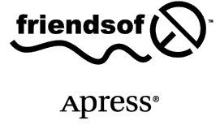

### 引言

本书延续了我对 HTML5 的探索。我在开发这些项目时，采取的方法是将 Canvas 和视频等特性相结合；尝试更复杂的绘图，运用数学知识；并采用标准的编程技术，例如面向对象编程以及内容与逻辑分离。我还对构建将 HTML5 和 JavaScript 与其他技术（包括 Google Maps、地理定位和服务器端编程）相结合的应用程序感兴趣。

本书每一章都聚焦于一个应用程序或一组相关的应用程序。这是因为作为教师和学习者的经验告诉我，概念和机制最好在实际应用的情境中加以理解。这些应用程序从绘制 HTML5 官方 Logo 开始。正如您将在第 1 章中发现的，我开发此应用程序的方式促使了对坐标变换的使用。第 2 章中涉及家庭拼贴画的项目，灵感源于我不断壮大的家庭以及教授面向对象编程的愿望。这是一个很好的应用程序，您可以将其作为基础，用自己的照片和自己发明的对象来创建您自己的版本。第 3 章展示了如何创建弹跳视频，它建立在我创建的其他二维应用之上，并展示了两种结合 Canvas 和视频的不同方式。

第 4、5 和 6 章演示了 Google Maps API（应用程序编程接口）的使用，这是一个强大的工具，允许您将访问 Google Maps 作为自身项目的一部分。第 4 章展示了一个结合地图和 Canvas 的用户界面，包括一个自定义光标以及在绘制路径中使用 Alpha 通道（透明度）。第 5 章讨论的三个应用程序都演示了将地图用作媒体入口点。这一系列应用程序向您展示了如何分离内容和逻辑，以便扩展到各种应用程序（例如，区域导览或包含多个地点的地理测验）。第 6 章重点介绍地理定位，即确定最终用户位置的技术。我将其与使用 PHP 的服务器端编程相结合，允许您将用户所在位置的电子邮件发送给最终用户选择的对象。

在第 7 章中，我通过制作折纸说明，展示了如何将线条绘制（通常使用数学表达式）、视频和照片结合起来。您可以将其作为使用绘图、视频和图像制作自己说明集的模型，或者让阅读内容刷新您对代数和几何主题的记忆。第 8 章的灵感来源于我使用 Adobe Flash 制作的一个项目，其中将拼图游戏转换为视频。在本章的项目中，您还将学习如何在 iPod 和 iPad 上实现此功能，包括如何整合对触摸事件的处理。类似地，第 9 章最初受到我使用 Flash 制作的一个识别并命名州份游戏的启发。本章包含了将州份以拼图形式打乱的挑战，包括使用 `localStorage` 保存进行中拼图的功能。由此产生的教育游戏呈现了一个必须处理多种玩家操作的用户界面。第 10 章作为最后一章，演示了数据库的使用。在本章中，HTML5 和 JavaScript 与 PHP 以及结构化查询语言（SQL）相结合，SQL 是大多数数据库使用的标准语言。本章中使用的数据库是 MySQL。HTML5 的表单验证功能以及 `localStorage` 满足了许多数据库应用程序的常见需求。该数据库应用程序还演示了用户密码的单向加密以及客户端与服务器端表单验证的结合。

## 本书适合谁阅读？

我确实相信我的解释是完整的，但我并不像在之前的书《HTML5 基础指南》中那样声称本书适合完全的初学者。本书适合那些具备一定编程知识，并希望通过结合基本特性以及将 JavaScript 与其他技术相结合来构建（更）大型应用程序的开发者。它也可以作为那些与程序员合作的人获取可能性认知的灵感书籍。

## 本书是如何组织的？

本书包含十章，每一章都围绕一个应用程序或一类应用程序展开。您可以跳着阅读。不过，在阅读第 5 或第 6 章之前，先阅读第 4 章可能更合理。另外，PHP 服务器端语言在第 6 章中以简单方式使用，然后在第 10 章中更全面地使用。其他交叉引用在文中有所标明。每一章都以对应用程序的介绍开始，包含应用程序运行时的截图。在一些情况下，还展示了浏览器之间的差异。章节继续讨论关键需求，在深入技术细节之前先介绍概念。接下来的部分描述了如何满足这些需求，涉及 HTML5、JavaScript、PHP 和/或 SQL 中的具体构造，以及标准的编程技术。然后我逐行展示带有注释的应用程序代码。每一章都以测试和将应用程序上传到服务器的说明和提示，以及您所学内容的总结结束。

代码（第 10 章中注明的某些例外情况除外）均包含在出版商提供的下载包中。此外，图表以全彩 TIFF 文件提供。当然，您会希望在第 2、3、5 和 8 章所示的项目中使用自己的媒体。我的媒体（视频、音频、图像）包含在代码包中，其中包括第 9 章州份游戏中 50 个州的图像。您可以将此项目作为模型，用于世界上不同的地区，或基于图像或图表的拼图。让我们开始吧。

## 第1章

## 构建HTML5标志——在画布上绘图，实现缩放，并使用语义化标签

在本章中，我们将回顾以下内容：

- 在画布上绘制路径
- 在画布上放置文本
- 坐标变换
- 画布上绘制文本所用的字体与元素中文本所用字体的对比
- 语义化标签
- `range`输入元素

### 引言

本章的项目是展示带有配套文本的官方HTML5标志。标志的盾牌和字母绘制在`canvas`元素上，配套文本则演示了语义化标签的使用。用户可以使用滑块输入设备来改变标志的大小。作为本书的开篇项目是合适的，因为本书汇集了利用HTML5、JavaScript及其他技术的各种项目，其主题内容本身，以及它作为对基本事件驱动编程和HTML5其他重要特性的一次良好回顾，都使其成为一个恰当的起点。我开发这个项目的方式，即在他人工作的基础上构建，是我们大多数人典型的工作方式。特别是在这个场景下，它为使用坐标变换提供了动机。最后，在撰写本文时，Firefox并未完全实现滑块输入元素。不幸的是，这也是一种常见情况，我将讨论其影响。

本书的方法是在具体示例的背景下解释HTML5、层叠样式表和JavaScript章节。这些项目代表了各种应用，希望你能在每一个项目中学到一些东西，并将其调整适应你自己的用途。

注意 如果你需要使用HTML5和JavaScript进行编程的入门指导，可以参考我的书《HTML5 Essential Guide》或由Apress等出版商出版的其他书籍。网上也有大量可用资料。

图1-1显示了在Chrome浏览器上标志项目的初始屏幕。（要查看Firefox上的效果，请跳至图1-3。）

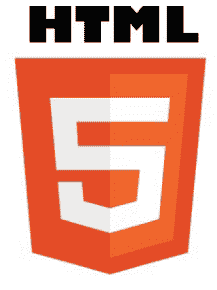

图1-1. HTML5标志的初始屏幕

注意滑块功能、包含看似超链接内容的配套文本，以及位于黄线下方的页脚文本。页脚也包含一个超链接。正如我稍后将解释的，页脚和任何其他语义化元素的功能和格式完全由我决定，但为标志的所有者——万维网联盟（The World Wide Web Consortium）提供参考，将被视为一种合适的使用。

用户可以使用滑块来改变标志的大小。图1-2显示了滑块调整后，标志宽度和高度均缩小至约三分之一的应用效果。


缩放百分比：`slider` 注意：在某些浏览器中滑块被视为文本字段。基于Daniel Davis等人的工作构建，但字体问题请不要怪罪他们。查看`style`元素中的`font-family`用法和`script`元素中的`fontfamily`变量，以了解安全设置字体的方法。缩放功能由我实现。另请注意语义化元素的使用。

图1-2. 缩小后的标志

目前没有任何浏览器完全实现HTML5，而且事实证明，Firefox将所有滑块输入都视为简单的文本字段。这被称为"优雅降级"，它总比完全不产生任何效果要好。图1-3显示了在Firefox上的初始屏幕。注意初始值显示为100。


缩放百分比：100 `text field` 注意：在某些浏览器中滑块被视为文本字段。基于Daniel Davis等人的工作构建，但字体问题请不要怪罪他们。查看`style`元素中的`font-family`用法和`script`元素中的`fontfamily`变量，以了解安全设置字体的方法。缩放功能由我实现。另请注意语义化元素的使用。HTML5标志由W3C提供。

图1-3. 使用Firefox的应用程序

正如本书每一章的惯例，我现在解释应用程序的关键需求，或多或少独立于其实现将采用HTML5这一事实，然后根据需要描述将在实现中使用的HTML5、JavaScript和其他技术的特性。"构建"部分包含一个表格，其中对每行代码都有注释，并提供了构建类似应用程序的指导。"测试"部分提供了上传和测试的详细信息。对于某些项目而言，这一部分比其他项目更为关键。最后，有一个"总结"，回顾了涵盖的编程概念，并预览了本书接下来的内容。

### 项目历史与关键需求

本项目的关键需求有些人为设定，且不易与HTML本身分离开来陈述。例如，我想要绘制标志，而不是从网上复制一张图片。我的设计目标始终包括想要练习编程并为我的学生准备示例。标志盾牌部分的形状似乎适合在画布上绘制，而HTML字母可以使用绘制文本功能来完成。此外，绘制图像相对于使用图像文件有实际优势。单独的文件需要管理、存储和下载。图1-4所示的图像大小为90KB。而包含程序代码的文件只有4KB。绘制标志或其他图形意味着可以使用代码动态更改缩放比例和其他属性。


*图1-4. 标志图像*

我在网上找到了一个仅由盾牌部分组成的示例，由Daniel Davis（在Opera工作）制作。这很棒，因为这意味着我不必测量标志图像的副本以获取坐标。这就引出了他是如何确定坐标的问题。即使我们有过愉快的邮件交流，我也不知道答案。一种可能性是下载图像，并使用Adobe Photoshop或Corel Paint Shop Pro等图像处理程序的网格功能。另一种可能性是使用（老式的）透明坐标纸。

然而，基于Daniel Davis的工作存在一个问题。他的应用程序不包含HTML字母。解决方案是将字母定位在屏幕上，然后可以说"向下移动"以使用Daniel示例中提供的坐标来定位盾牌的绘制。 "向下移动屏幕"的技术术语是执行坐标变换。因此，执行坐标变换的能力成为了本项目的关键需求。

我选择写一些关于标志的内容，特别是以超链接的形式提供致谢和参考文献。我决定在文档底部、一条线之下，以简短文本的形式引用标志的官方来源。对Daniel Davis的引用是正文写作的一部分。我们交流了关于字体选择的意见，我将在下一节更详细地讨论这一点。

为了让用户与标志有所互动，我决定提供一种改变大小的方式。一个合适的设备就是滑块，并指定最小值、最大值和步长。因此，本应用程序的关键需求包括以特定字体绘制形状和字母、坐标变换、格式化包含主部分和页脚部分的文档，以及包含超链接。

### HTML5、CSS和JavaScript特性

我假设你，读者，对HTML和HTML5文档有一些经验。HTML5最重要的新特性之一是用于绘图的`canvas`元素。我简要描述绘制适当颜色的填充路径和填充文本。接下来，我描述坐标变换，在本项目中用于标志本身的两个部分以及整个标志的缩放（改变大小）。最后，我描述`range`输入元素。它产生了滑块。

### 在画布上绘制路径

Canvas是HTML5中引入的一种元素类型。所有`canvas`元素都有一个称为2D上下文的属性（也称为属性）。通常，在文档加载后，一个变量被设置为该属性：

```
ctx = document.getElementById('canvas').getContext('2d');
```

理解`canvas`是一个很好的名字非常重要：代码将颜色应用于画布的像素，就像颜料一样。稍后编写的代码可以在画布上放置不同的颜色。旧的颜色不会透出来。即使我们的代码导致矩形、形状和字母出现，这些独立的实体也不会保留其作为可重新定位对象的身份。

盾牌是通过连续绘制六个填充路径产生的，累积结果如图1-5所示。在检查代码时可以参考此图。请记住，在坐标中，第一个数字是距离画布左边缘的距离，第二个数字是距离画布顶边缘的距离。

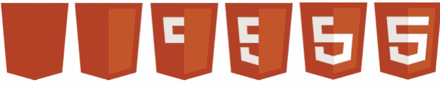

图1-5. 绘制标志的路径序列

顺便说一下，我选择向你展示带有累积结果的序列。如果我显示绘制的内容，你将看不到构成"5"左侧的白色部分。你能看到它，是因为它是覆盖在橙色之上的两个白色填充路径。

所有绘制都使用`ctx`变量的方法和属性完成，该变量保存`canvas`元素的2D上下文属性。任何后续填充操作的颜色通过为`canvas`上下文的`fillStyle`属性赋值来设置。

### 在画布和文档正文中放置文本

文本通过使用上下文的方法和属性绘制在画布上。可以使用 `fillText` 方法填充文本，或使用 `strokeText` 方法绘制文本轮廓。颜色由当前 `fillStyle` 属性或 `strokeStyle` 属性的值决定。上下文的另一个属性是 `font`。此属性可以包含文本的大小和一种或多种字体。包含多种字体的目的是为浏览器提供选项，以防第一种字体在运行浏览器的计算机上不可用。对于本项目，我使用了

```javascript
var fontfamily = "65px 'Gill Sans Ultra Bold', sans-serif";
// 并在 init 函数中
ctx.font = fontfamily;
```

这指示浏览器使用 Gill Sans Ultra Bold 字体（如果可用），如果不可用，则使用计算机上的默认无衬线字体。我本可以将这些都写在一个语句中，但选择将其定义为一个变量。你可以判断我选择的字体是否足够接近官方 W3C 标志。

> **注意** 针对此示例，至少还有另外两种方法。一种可能性是不使用文本，而是将字母绘制为填充路径。另一种是找到并获取一种字体，将其放置在托管 HTML5 文档的服务器上，并使用 `@font-face` 直接引用。

设置好字体和颜色后，绘制文本的方法需要一个字符串和一个位置：`x` 和 `y` 坐标。本项目中绘制字母的语句是

```javascript
ctx.fillText("HTML", 31, 60);
```

在 HTML 文档的其余部分（即 `canvas` 元素之外）格式化文本，同样需要关注字体。在本项目中，我选择利用 HTML5 的新语义元素，并遵循将格式放在 `style` 元素中的实践。我的 HTML 脚本正文包含两个 `article` 元素和一个 `footer` 元素。一个 `article` 包含带有注释的 `input` 元素，另一个 `article` 包含其余的解释内容。`footer` 元素包含对 W3C 的引用。这些元素的格式和使用取决于开发者/程序员。这包括确保 `footer` 是文档中的最后一项。如果我将 `footer` 放在其中一个或两个 `article` 之前，它将不再显示在页脚，即文档的底部。本项目的样式指令如下：

```css
footer {display:block; border-top: 1px solid orange; margin: 10px;
font-family: "Trebuchet MS", Arial, Helvetica, sans-serif; font-weight: bold;}
article {display:block; font-family: Georgia, "Times New Roman", Times, serif; margin: 5px;}
```

这些样式分别将所有这些元素实例设置为块级显示。这会在其前后产生换行。`footer` 顶部有一个边框，从而在文本上方产生一条线。两种样式都指定了一个包含四种字体的列表。因此，浏览器首先检查 Trebuchet MS 是否可用，然后检查 Arial，再检查 Helvetica，如果仍然不可用，则为 `footer` 元素使用系统默认的无衬线字体。类似地，浏览器检查 Georgia，然后是 Times New Roman，再是 Times，如果不可用，则使用标准衬线字体。这可能有些过度，但这是安全的操作方式。`footer` 文本以粗体显示，每个 `article` 周围有 5 像素的边距。

格式化（包括字体）很重要。HTML5 提供了许多用于格式化以及将格式与结构和内容分离的功能。你确实需要以不同于其他元素中文本的方式来处理画布上的文本。

### 坐标变换

我已经说明了使用坐标变换的动机，特别是为了持续使用同一坐标系。回顾一下，坐标系是指定画布上位置的方式。位置由距离原点的距离指定。对于二维画布，需要两个坐标：第一个坐标控制水平方向，通常称为 `x`，第二个坐标控制垂直方向，称为 `y`。一个棘手的事实是，在绘制到屏幕时，`y` 轴是翻转的，因此垂直方向是从画布顶部开始测量的。水平方向则从左侧测量。这意味着点 (100, 200) 在屏幕上的位置比点 (100, 100) 更靠下。

在标志项目中，我编写代码来显示字母 HTML，然后移动原点以绘制标志的其余部分。一个类比是，我知道从城镇中心到我家的方位，因此我可以给出到城镇中心的方向，然后再给出到我家的方向。我在标志中绘制字母并"向下移动屏幕"的情况需要使用平移变换。平移仅在垂直方向上进行。平移量存储在一个名为 `offsety` 的变量中：

```javascript
var offsety = 80;
// ...
ctx.fillText("HTML", 31, 60);
ctx.translate(0, offsety);
```

由于我决定提供一种让观看者改变标志大小的方法，因此我使用了缩放变换。继续使用方向的类比，这相当于改变单位。你可能会以英里（或公里）给出一些方向，而以码或英尺或米，或者可能以街区为单位给出其他方向。缩放可以分别应用于每个维度。在此应用程序中，有一个名为 `factorvalue` 的变量，它由输入更改时调用的函数设置。语句

```javascript
ctx.scale(factorvalue, factorvalue);
```

会同时改变水平和垂直方向的单位。


# 第 1 章 构建 HTML5 徽标 - 在画布上绘图，进行缩放，并使用语义标签

HTML5 提供了一种保存当前坐标系状态并恢复所保存状态的方法。如果你的代码需要恢复到先前的状态，这一点非常重要。保存和恢复是通过一种称为“栈”（后进先出）的机制来实现的。恢复坐标系状态被称为“出栈”，而保存坐标系状态则被称为“将某些东西压入栈中”。我的徽标项目并未完全展现其全部功能，但如果你正在开发更复杂的应用程序，这是一个值得记住并深入研究的点。在徽标项目中，我的代码在文档首次加载时保存了原始状态。然后在绘制徽标之前，它会恢复所保存的状态，再次保存，以便下次使用。绘制徽标的功能 `dologo()` 的开头代码如下：

```javascript
function dologo() {
    var offsety = 80;
    ctx.restore();
    ctx.save();
    ctx.clearRect(0, 0, 600, 400);
    ctx.scale(factorvalue, factorvalue);
    ctx.fillText("HTML", 31, 60);
    ctx.translate(0, offsety);

    // 5 sided orange background
    ctx.fillStyle = "#E34C26";
    ctx.beginPath();
    ctx.moveTo(39, 250);
    ctx.lineTo(17, 0);
    ctx.lineTo(262, 0);
    ctx.lineTo(239, 250);
    ctx.lineTo(139, 278);
    ctx.closePath();
    ctx.fill();

    // right hand, lighter orange part of the background
    ctx.fillStyle = "#F06529";
    ctx.beginPath();
    ctx.moveTo(139, 257);
    ctx.lineTo(220, 234);
    ctx.lineTo(239, 20);
    ctx.lineTo(139, 20);
    ctx.closePath();
    ctx.fill();
    ...
}
```

请注意，画布（canvas）被清除（擦除）了之前绘制的任何内容。

## 使用 range 输入元素

我称之为滑块的输入设备，是新的 HTML5 `input type="range"`，它被放置在 HTML 文档的 `body` 中。我的版本被放置在一个 `article` 元素内部。这种类型及其他输入元素的属性提供了指定初始值、最小值和最大值、最小增量调整以及查看者更改滑块时应采取的操作的方式。代码如下：

```html
<input id="slide" type="range" min="0" max="100" value="100" onChange="changescale(this.value)" step="10"/>
```

`min`、`max`、（初始）`value` 和 `step` 可以设置为任何你喜欢的值。由于我使用的是百分比，并且不希望徽标变得比初始值更大或处理负值，所以我使用了 0 和 100。

在滑块的适当实现中，查看者不会看到初始值、最大值或最小值。我的代码将输入用作百分比。表达式 `this.value` 被解释为 THIS 元素的 `value` 属性，此处大写是为了强调切换到了英语！术语 `this` 在 JavaScript 和其他几种编程语言中具有特殊含义。`changescale()` 函数接受通过赋值给 `onChange` 属性的参数指定的值，并使用它来设置一个全局变量（在任何函数外部声明的变量，因此它可以持久存在并可供任何函数使用）。

```javascript
function changescale(val) {
    factorvalue = val / 100;
    dologo();
}
```

根据 HTML5 规范的一部分，浏览器将提供表单验证，即检查输入元素中属性指定的条件是否得到遵守。这可以显著提高生产力，减少程序员需要完成的工作，并且由于由浏览器执行检查可能更快，因此也能提升性能。我们将在第 10 章关于数据库和 PHP 中进一步讨论它。在 HTML5 徽标项目中，滑块的一个优点是查看者无需关心数值，只需移动设备即可。无法输入非法值。我不想贬低 Firefox 浏览器，而且如我所述，生成一个文本框总比什么都不生成好，但至少在撰写本文时，它没有显示滑块或进行任何检查。图 1-6 显示了在输入字段中输入 200 后的结果。

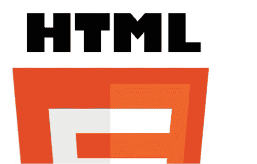

缩放百分比：200 注意：在某些浏览器中，滑块被当作文本字段处理。基于 Daniel Davis 等人的工作，但字体问题不要怪他们。查看 `style` 元素中 `font-family` 的使用和 `script` 元素中 `fontfamily` 变量的使用，了解设置字体的安全方法。缩放是我做的。另请注意语义元素的使用。HTML5 徽标由 W3C 制作

*图 1-6. Firefox 中显示缩放比例为 200 的情况*

画布具有固定的宽度和高度，超出画布范围的绘制（即当缩放被设置为接受数字并将其拉伸到原始值的两倍时所做的操作）将被忽略。

## 构建应用程序并使其成为你自己的

该项目只做一件事：绘制徽标。为此定义了一个函数 `dologo()`。非正式地讲，程序的提纲如下：

1.  `init()`：初始化
2.  `dologo()`：绘制徽标，从 HTML 字母开始，然后是盾牌
3.  `changescale()`：更改缩放比例

函数调用与被调用表显示了函数之间的关系。`dologo()` 函数在文档首次加载时被调用，然后在每次缩放比例更改时被调用。

**表 1-1. HTML5 徽标项目中的函数**

| 函数 | 被谁调用 / 调用谁 | 调用 |
| --- | --- | --- |
| `init()` | 由 `<body>` 标签中 `onLoad` 属性的操作调用 | `dologo()` |
| `dologo()` | `init()` 和 `changescale()` | |
| `changescale()` | 由 `<input type="range"...>` 标签中 `onChange` 属性的操作调用 | `dologo()` |

`dologo()` 函数的编码结合了前面描述的技术。特别是，该代码恢复了原始坐标系并清除了画布。

此应用程序中的全局变量为：

```javascript
var ctx;
var factorvalue = 1;
var fontfamily = "65px 'Gill Sans Ultra Bold', sans-serif";
```

如前所述，也可以不使用 `fontfamily`，而直接在代码中使用字符串。将 `ctx` 和 `factorvalue` 设为全局变量是很方便的。

表 1-2 显示了基本应用程序的代码，每行都有注释。

### 表 1-2. HTML5 徽标项目的完整代码

| 代码行 | 描述 |
| :--- | :--- |
| `<!DOCTYPE html>` | 文档头 |
| `<html>` | html 开始标签 |
| `<head>` | head 开始标签 |
| `<title>HTML5 Logo </title>` | 完整的 title 元素 |
| `<meta charset="UTF-8">` | meta 标签 |
| `<style>` | style 开始标签 |
| `footer {display:block; border-top: 1px solid orange; margin: 10px; font-family: "Trebuchet MS", Arial, Helvetica, sans-serif; font-weight: bold;}` | 页脚的样式，包括顶部边框和字体族 |
| `article {display:block; font-family: Georgia, "Times New Roman", Times, serif; margin: 5px;}` | 两个 article 元素的样式 |
| `</style>` | 关闭 style 元素 |
| `<script language="JavaScript">` | script 开始标签。注意：JavaScript 对大小写不敏感。 |
| `var ctx;` | 用于保存 context（上下文）的变量。用于所有绘图 |
| `var factorvalue = 1;` | 设置缩放的初始值 |
| `var fontfamily = "65px 'Gill Sans Ultra Bold', sans-serif";` | 设置画布上绘制文本的字体 |
| `function init() {` | `init()` 函数的开始 |
| `ctx = document.getElementById('canvas').getContext('2d');` | 设置 `ctx` |
| `ctx.font = fontfamily;` | 设置画布上绘制文本的字体 |
| `ctx.save();` | 保存原始坐标状态 |
| `dologo();` | 调用绘制徽标的函数 |
| `}` | 关闭函数 |
| `function dologo() {` | `dologo()` 函数的开始 |
| `var offsety = 80 ;` | 指定调整坐标以绘制徽标盾牌部分的量。 |
| `ctx.restore();` | 恢复坐标的原始状态 |
| `ctx.save();` | 保存它（压入栈）以便再次恢复 |
| `ctx.clearRect(0,0,600,400);` | 擦除整个画布 |
| `ctx.scale(factorvalue,factorvalue);` | 使用滑块设置的值进行水平和垂直缩放 |
| `ctx.fillText("HTML", 31,60);` | 绘制字母：HTML |
| `ctx.translate(0,offsety);` | 在屏幕（画布）上向下移动 |
| `// 5 sided orange background` | |
| `ctx.fillStyle = "#E34C26";` | 设置为官方亮橙色 |
| `ctx.beginPath();` | 开始一条路径 |
| `ctx.moveTo(39, 250);` | 移动到左下角指定位置 |
| `ctx.lineTo(17, 0);` | 向上并向左画线 |
| `ctx.lineTo(262, 0);` | 水平向右画线 |
| `ctx.lineTo(239, 250);` | 向下并向左稍作画线 |
| `ctx.lineTo(139, 278);` | 画线到盾牌的中点低处 |
| `ctx.closePath();` | 关闭路径 |
| `ctx.fill();` | 用指定颜色填充 |
| `// right hand, lighter orange part of the // background` | |
| `ctx.fillStyle = "#F06529";` | 将颜色设置为官方的深橙色 |
| `ctx.beginPath();` | 开始路径 |
| `ctx.moveTo(139, 257);` | 移动到靠近顶部的中间点 |
| `ctx.lineTo(220, 234);` | 向右上方绘制线条 |
| `ctx.lineTo(239, 20);` | 向右上方绘制线条 |
| `ctx.lineTo(139, 20);` | 向左绘制线条（指向中间点） |
| `ctx.closePath();` | 关闭路径 |
| `ctx.fill();` | 用指定颜色填充 |
| `//light gray, left hand side part of the //five` | |
| `ctx.fillStyle = "#EBEBEB";` | 将颜色设置为灰色 |
| `ctx.beginPath();` | 开始路径 |
| `ctx.moveTo(139, 113);` | 移动到水平居中、垂直居中的点 |
| `ctx.lineTo(98, 113);` | 向左绘制线条 |
| `ctx.lineTo(96, 82);` | 向左上方绘制线条 |
| `ctx.lineTo(139, 82);` | 向右绘制线条 |
| `ctx.lineTo(139, 51);` | 向上绘制线条 |
| `ctx.lineTo(62, 51);` | 向左绘制线条 |
| `ctx.lineTo(70, 144);` | 向左下方绘制线条 |
| `ctx.lineTo(139, 144);` | 向右绘制线条 |
| `ctx.closePath();` | 关闭路径 |
| `ctx.fill();` | 用指定颜色填充 |
| `ctx.beginPath();` | 开始新路径 |
| `ctx.moveTo(139, 193);` | 移动到中间点 |
| `ctx.lineTo(105, 184);` | 向左上方绘制线条 |
| `ctx.lineTo(103, 159);` | 稍微向左上方绘制线条 |
| `ctx.lineTo(72, 159);` | 更向左绘制线条 |
| `ctx.lineTo(76, 207);` | 稍微向右下方绘制线条 |
| `ctx.lineTo(139, 225);` | 向左下方绘制线条 |
| `ctx.closePath();` | 关闭路径 |
| `ctx.fill();` | 用指定颜色填充形状 |
| `// white, right hand side of the 5` | |
| `ctx.fillStyle = "#FFFFFF";` | 将颜色设置为白色 |
| `ctx.beginPath();` | 开始路径 |
| `ctx.moveTo(139, 113);` | 从中间点开始 |
| `ctx.lineTo(139, 144);` | 向下绘制线条 |
| `ctx.lineTo(177, 144);` | 向右绘制线条 |
| `ctx.lineTo(173, 184);` | 稍微向左下方绘制线条 |
| `ctx.lineTo(139, 193);` | 更向左下方绘制线条 |
| `ctx.lineTo(139, 225);` | 向下绘制线条 |
| `ctx.lineTo(202, 207);` | 向右上方绘制线条 |
| `ctx.lineTo(210, 113);` | 稍微向右上方绘制线条 |
| `ctx.closePath();` | 关闭路径 |
| `ctx.fill();` | 填充白色 |
| `ctx.beginPath();` | 开始新路径 |
| `ctx.moveTo(139, 51);` | 移动到中间点 |
| `ctx.lineTo(139, 82);` | 向下移动 |
| `ctx.lineTo(213, 82);` | 向右移动 |
| `ctx.lineTo(216, 51);` | 稍微向右上方移动 |
| `ctx.closePath();` | 关闭路径 |
| `ctx.fill();` | 填充白色 |
| `}` | 关闭 `dologo()` 函数 |

## 测试与上传应用程序

这是一个用于测试和上传（以及测试）的简单应用程序，因为它是一个单文件。我被告知该标志确实能在 iPhone4 和 iPad2 上显示，但在这两种情况下滑块都是一个文本框。我还在 PC 上的 Safari 和 Opera 上对其进行了测试。你可以跳到第 8 章，那里有一个拼图变为视频的项目，在 iPhone 和 iPad 上支持手指触摸，在电脑上支持鼠标移动。

## 总结

在本章中，你学习了如何进行特定绘制，以及制作其他类似应用程序的步骤。使用的功能包括：

-   路径
-   canvas 上的文本以及 body 中语义元素内的文本
-   `range` 输入元素及其关联的 `change` 事件
-   坐标变换，即平移和缩放
-   字体集的指定
-   语义元素的样式，包括用于在页脚前添加线条的上边框

下一章描述了如何构建一个实用程序，用于将照片和形状组合或拼贴成画作。它结合了在 canvas 上绘制和创建 HTML 元素的技术，并与计算中的标准技术——对象相结合。它还利用了坐标变换。

# 第 2 章 家庭拼贴画：在 Canvas 上操作程序员定义的对象

在本章中，你将学习：

-   创建和操作面向对象编程以在 canvas 上绘图
-   处理鼠标事件，包括双击
-   将 canvas 保存为图像
-   使用 `try` 和 `catch` 捕获错误
-   涉及代码位置的浏览器差异
-   使用代数和几何来构造形状并确定光标何时悬停在特定对象上
-   控制光标使用的图标

## 简介

本章的项目是一个在 canvas 上操作对象以生成图片的实用程序。我称其为实用程序，因为一个人进行编程、收集照片和设计，然后可以将该程序提供给朋友、家人、同事等来制作组合/拼贴画。结果可以是从抽象设计到照片拼贴画的任何东西。我的示例中的对象包括两个矩形、一个椭圆、一个圆形、一个心形和五张家庭照片。你，或者可能是你的最终用户/客户/玩家，可以制作任何对象的副本，或者删除任何对象。最终用户使用鼠标拖放来定位对象。当判断图片完成后，可以创建一个可以下载到文件中的图像。

图 2-1 显示了我程序的启动屏幕。注意，你开始时有十个对象可以排列。

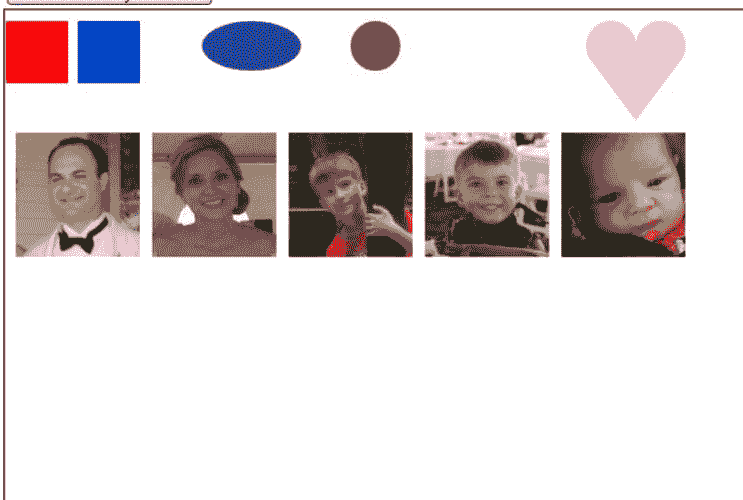

*图 2-1. 家庭照片的启动屏幕*

按下、移动并释放鼠标以移动对象。双击以获取新对象。如果图像未能出现，请点击重新加载。

打开包含图像的窗口（你可以将其保存为图像文件）

删除最后移动的对象

图 2-2 显示了我作为最终用户生成的最终产品。我排列了照片来代表我儿子的家庭，包括我的新孙女。我删除了两个矩形和椭圆，并复制了圆形作为图片角落的装饰。


| 代码行 | 描述 |
|---|---|
| `function changescale(val) {` | 打开带参数的 `changevalue` 函数 |
| `factorvalue = val / 100;` | 将 `factorvalue` 设置为输入值除以 100 |
| `dologo();` | 调用函数以绘制标志 |
| `}` | 关闭 `changevalue` 函数 |
| `</script>` | 关闭 `script` 元素 |
| `</head>` | 关闭 `head` 元素 |
| `<body onLoad="init();">` | `body` 标签，属性设置为调用 `init` |
| `<canvas id="canvas" width="600" height="400">` | `canvas` 标签，设置尺寸并在代码中使用的 `id` |
| Your browser does not support the canvas element. | 如果 `canvas` 不支持时出现的消息 |
| `</canvas>` | 关闭 `canvas` 标签 |
| `<article>` | `article` 标签 |
| Scale percentage: `<input id="slide" type="range" min="0" max="100" value="100" onChange="changescale(this.value)" step="10"/>` | 带设置的滑块（range）输入 |
| Note: slider treated as text field in some browsers. | 注释说明滑块可能是文本字段。它仍然可用。 |
| `</article>` | `article` 关闭标签 |
| `<article>Built on <a href="http://people.opera.com/danielk/html5/html5logo/">work by Daniel Davis, et al</a>, but don't blame them for the fonts. Check out the use of <em>font-family</em> in the style element and the <em>fontfamily</em> variable in the script element for safe ways to do fonts. I did the scaling. Note also use of semantic elements.</article>` | `article` 标签，包含一些文本和超链接 |
| `<footer>HTML5 Logo by <a href="http://www.w3.org/"><abbr title="World Wide Web Consortium">W3C</abbr></a>.` | `footer` 标签和内容，包括 `abbr` 元素 |
| `</footer>` | `footer` 关闭标签 |
| `</body>` | `body` 关闭 |
| `</html>` | `html` 关闭 |

你可以通过将此应用程序的全部或部分用于你自己的工作来使其为你所用。你可能想省略关于字体的注释。

按下鼠标、移动并释放鼠标可移动对象。双击可创建新对象。若图片无法显示，请点击重新加载。

打开包含图像的窗口（可将图像保存为图片文件）

移除上一个被移动的对象

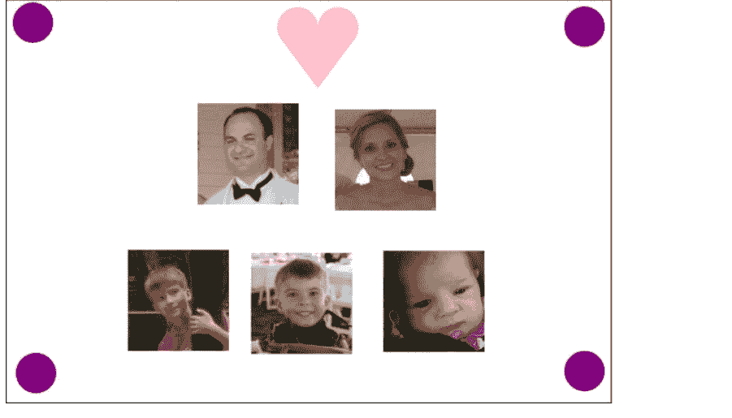

我决定加入一个心形，不仅出于情感因素，更因为它需要我运用代数和几何知识。不要惧怕数学，它非常有用。可以说，我发明了一个标准的心形。至于其他形状，你或许能找到基于数学表达式的标准定义。

在这种情况下，我创建了对象集合，然后使用程序进行构图。你可以规划你的应用，用于处理家庭照片或按其他主题分类的照片，以及一些圆圈、椭圆、矩形和心形。完成后，你可以将此程序提供给他人使用。这类似于为玩家构建游戏程序。该应用程序的最终用户可能是家庭成员、朋友或同事。

当然，完全有可能使用诸如 Adobe Photoshop 或 Corel Paint Shop Pro 之类的绘图程序来创建此类构图，但此应用程序在其特定用途上提供了极大的易用性。该项目也是学习重要编程技术以及 HTML5 和 JavaScript 特性的载体。而且，正如将反复强调的那样，不同的浏览器之间存在差异需要讨论。

### 关键要求

该项目的关键要求包括构建一个用于操作屏幕上对象的框架，包括检测对象上的鼠标事件、删除对象以及创建对象副本。当前的框架提供了一种指定矩形、椭圆、心形和图像的方法，但该方法可以容纳其他形状，这是本章的重要一课。

目标是使拖放操作足够精确：不仅仅是将某个东西从窗口的一个区域移动到另一个区域。我将在第 8 章和第 9 章关于制作拼图的内容中重新探讨这个主题。

我还决定控制光标的外观。当鼠标不在画布上时，光标是标准箭头。当位于画布元素上时，光标将变为十字准线。当用户按下鼠标按钮并拖动对象时，光标会变为带指向手指的手形。

当工作完成时，一个自然的愿望是保存它，也许作为图像文件，因此这也是项目的一个要求。

### HTML5、CSS 和 JavaScript 特性

我们现在探讨用于“家庭拼贴画”项目的 HTML5 和 JavaScript 特性。思路是维护画布上材料的列表。这个列表将是一个 JavaScript 数组。信息将包括每个项目的位置、如何在画布上绘制它，以及如何确定鼠标光标是否在项目上。

### JavaScript 对象

面向对象编程是计算机科学的标准，也是大多数编程语言的关键部分。对象具有 `属性`（也称为 `特性`）和 `方法`。方法是一种函数。换句话说，对象拥有数据和可以使用这些数据的代码。HTML 和 JavaScript 有许多内置对象，例如 `document` 和 `window`，以及数组和字符串。对于“家庭图片”项目，我利用了 JavaScript 中（在 HTML5 之前就已确立的）一个基本功能来定义我自己的对象。这些有时被称为用户定义对象，但我和其他人更倾向于使用的术语是程序员定义对象。对于“家庭拼贴画”项目，这是一个重要的区别，因为你，程序员，可能创建一个应用程序，包含你识别和设计的图片和其他形状，然后将其提供给家庭成员使用。

该项目的目标是为在画布上创建和操作不同形状建立一个框架，同时要记住，一旦某个东西被绘制到画布上，它作为矩形或图像的身份就会丢失。每种形状的第一步是定义一个所谓的 `构造函数`，用于存储指定该形状的信息。下一步是定义方法，即使用这些信息来执行所需操作的代码。

我的方法营造了在画布上移动物体的表象。事实上，存储在内部变量中的信息被更改，并且每次画布外观发生变化时，画布都会被清除并重新绘制。

我的策略是定义新的对象类型，每种类型都将定义两个方法：

- `draw` 用于在画布上绘制对象
- `overcheck` 用于确定给定位置（具体是鼠标位置）是否在对象上

这些方法引用对象的属性，并在数学表达式中使用这些值来产生结果。一旦构造函数被定义，就可以作为这些对象的新实例创建值。一个名为 `stuff` 的数组保存所有对象实例。

> **注意：** 面向对象编程具有其全部的丰富性，其词汇丰富且常常令人生畏。类是定义对象的东西。我在这里暗示了所谓的接口。类可以是其他类的子类，这对于图片和矩形可能很有用。我在这里的目标是采用更随意的语气。例如，我将谈论对象和对象实例。

让我们抛开泛泛而谈，展示这是如何工作的。我创建了名为 `Rect`、`Oval`、`Picture` 和 `Heart` 的函数。这些将是 `Rect`、`Oval`、`Picture` 和 `Heart` 对象实例的所谓构造函数。按照惯例，此类函数的名称以大写字母开头。

#### Rect

`Rect` 构造函数的定义如下：

```javascript
function Rect(x, y, w, h, c) {
    this.x = x;
    this.y = y;
    this.w = w;
    this.h = h;
    this.draw = drawrect;
    this.color = c;
    this.overcheck = overrect;
}
```

该函数在文档加载时调用的 `init` 函数中使用方式如下：

```javascript
var r1 = new Rect(2, 10, 50, 50, "red");
```

变量 `r1` 被声明并设置为使用 `Rect` 函数构造的新对象。内置术语 `new` 负责创建新对象的任务。新构造的对象保存了初始 x 和 y 位置的值 2 和 10（通过属性名 `x` 和 `y` 访问），以及宽度和高度的值 50 和 50（通过属性名 `w` 和 `h` 访问）。术语 `this` 指的是正在被构造的对象。`new` 和 `this` 的英文含义与计算机术语含义相符。`Rect` 函数还存储了 `draw` 和 `overcheck` 属性的值。从你目前所见可能不明显，但这些值将用于调用名为 `drawrect` 和 `overrect` 的函数。这是为程序员定义对象指定方法的方式。最后，`color` 属性被设置为 `"red"`。

#### Oval

接下来，`Oval` 的构造函数类似。

```javascript
function Oval(x, y, r, hor, ver, c) {
    this.x = x;
    this.y = y;
    this.r = r;
    this.radsq = r * r;
    this.hor = hor;
    this.ver = ver;
    this.draw = drawoval;
    this.color = c;
    this.overcheck = overoval;
}
```

`x` 和 `y` 值指的是 `Oval` 的中心。`hor` 和 `ver` 属性将分别用于缩放水平轴和垂直轴，并且根据值的不同，产生一个不是圆形的椭圆。`radsq` 属性被计算并存储是为了在 `overoval` 函数中节省时间。

> **注意：** 计算机速度非常快，我存储半径的平方然后再使用它显得有些过时。不过，用额外的存储来换取计算时间的节省可能是合理的。

在我的示例中，

```javascript
var oval1 = new Oval(200, 30, 20, 2.0, 1.0, "teal");
```

生成了图 2-1 中的青色椭圆。注意它在水平维度上被拉伸了。相比之下，紫色椭圆在以下声明中被声明：

```javascript
var cir1 = new Oval(300, 30, 20, 1.0, 1.0, "purple");
```

紫色圆的 `hor` 和 `ver` 值相同，因此是一个圆。你完全有权利询问这些信息是如何或在哪里被用来生成椭圆或圆的。答案将在后面展示的 `drawoval` 函数中。类似地，检查给定的 x,y 位置是否在椭圆上的操作由 `overoval` 函数执行。

#### Picture

`Picture` 对象的构造函数存储位置、宽度和高度，以及 `Image` 对象的名称。

```javascript
function Picture(x, y, w, h, imagename) {
    this.x = x;
    this.y = y;
    this.w = w;
    this.h = h;
    this.imagename = imagename;
    this.draw = drawpic;
    this.overcheck = overrect;
}
```

我的示例有四个 `Picture` 对象。以下是设置其中一个的代码：

```javascript
var dad = new Image();
dad.src = "daniel1.jpg";
var pic1 = new Picture(10, 100, 100, 100, dad);
```

设置一个 `Picture` 对象比设置 `Rect` 对象需要更多的工作。我需要编写代码来创建一个 `Image` 对象。这是 JavaScript 中的内置对象类型。我需要获取一个图像文件，并将其移动到与 HTML 文件相同的文件夹中，然后编写代码将正确的文件名赋给 `Image` 变量的 `src` 属性。（或者，你可以将所有图像放入一个子文件夹或几个子文件夹中。例如，`src` 的字符串可以是 `"images/daniel1.jpg"`。）然后，我编写一行代码来构造 `pic1` 变量。

#### 心形

我们还有一个程序员定义的对象需要介绍。我给自己设定的挑战是定义指定心形的值。我想出了以下定义：心形由位置定义，即一组 x、y 值，它们将是心形凹陷处的位置；从凹陷处到底部点的距离；以及代表心形曲线部分的两个部分圆的半径。你可以将其视为一个标准心形。关键信息如图 2-3 所示。如果以及当您向应用程序添加新的形状类型时，您需要发明或发现定义该形状的数据。

构造函数将指示的值以及颜色保存到任何新构造的对象中。你可能怀疑绘制和过度检查会比矩形的函数更复杂一些，你是对的。构造函数与其他构造函数相似。

```javascript
function Heart(x, y, h, drx, color) {
    this.x = x;
    this.y = y;
    this.h = h;
    this.drx = drx;
    this.radsq = drx * drx;
    this.color = color;
    this.draw = drawheart;
    this.overcheck = overheart;
    this.ang = .25 * Math.PI;
}
```

`ang` 属性是我采取的一种保险措施。你注意到它是一个常量，我本可以避免将其作为属性。你稍后会看到，当我解释 `drawheart` 时，我的代码如何使用它来使心形变圆。我将其作为属性，以防我想要改变它，以允许心形具有更多的多样性。

### 绘制

我有不同的方法函数需要解释，但让我们先看看绘制是在哪里进行的，以演示所有这些如何协同工作。我定义了一个数组，初始为空，

```javascript
var stuff = [];
```

然后我的代码通过如下语句添加到这个数组中

```javascript
stuff.push(pic1);
stuff.push(pic2);
stuff.push(pic3);
stuff.push(pic4);
stuff.push(r1);
stuff.push(s1);
stuff.push(oval1);
stuff.push(cir1);
```

在适当的时机，即在任何更改之后，调用函数 `drawstuff`。它的工作方式是清除画布，绘制一个矩形作为框架，然后遍历 `stuff` 数组中的每个元素，并调用 `draw` 方法。该函数是

```javascript
function drawstuff() {
    ctx.clearRect(0, 0, 600, 400);
    ctx.strokeStyle = "black";
    ctx.lineWidth = 2;
    ctx.strokeRect(0, 0, 600, 400);
    for (var i = 0; i < stuff.length; i++) {
        stuff[i].draw();
    }
}
```

注意，没有代码询问：这是椭圆吗，如果是，就做这个；或者这是图片吗，如果是，就做那个……相反，为数组的每个成员建立的 `draw` 方法执行其工作！在检查位置（鼠标）是否在对象上时，同样的魔法也会发生。随着更多对象类型的添加，这种方法的好处会增加。

我确实意识到，由于我的代码从不改变 `strokeStyle` 或 `lineWidth`，我可以将这些语句移到 `init` 函数中，只执行一次。然而，我想到我可能有一个形状确实改变了这些值，因此为了为应用程序中后期可能的这种变化做好准备，我将在 `drawstuff` 中设置 `strokeStyle` 和 `lineWidth`。

现在我将解释绘制方法以及检查位置是否在对象上的方法。`drawrect` 函数相当直接：

```javascript
function drawrect() {
    ctx.fillStyle = this.color;
    ctx.fillRect(this.x, this.y, this.w, this.h);
}
```

记住，术语 `this` 指的是 `drawrect` 作为其方法的对象。`drawrect` 函数是矩形和图片的方法。

`drawoval` 函数稍微，但只是稍微复杂一些。你需要回忆坐标变换是如何工作的。HTML5 JavaScript 只允许圆形弧线，但允许缩放坐标以产生不是圆形的椭圆（椭圆）。`drawoval` 函数中的代码所做的操作是保存坐标系的当前状态，然后执行到对象中心的平移。然后应用缩放变换，使用 `hor` 和 `ver` 属性。现在，在将 `fillStyle` 设置为 `color` 属性中指定的颜色后，我使用绘制由圆形弧线组成的路径并填充该路径的代码。最后一步是恢复坐标系的原始状态。

```javascript
function drawoval() {
    ctx.save();
    ctx.translate(this.x, this.y);
    this.scale(this.hor, this.ver);
    ctx.fillStyle = this.color;
    ctx.beginPath();
    ctx.arc(0, 0, this.r, 0, 2 * Math.PI, true);
    ctx.closePath();
    ctx.fill();
    ctx.restore();
}
```

这就是在画布上绘制可能是也可能不是圆形的椭圆的方式。由于我的代码恢复了坐标系的原始状态，这有效地撤销了缩放和平移变换。

`drawpic` 函数是最简单的，只有一行：

```javascript
function drawpic() {
    ctx.drawImage(this.imagename, this.x, this.y, this.w, this.h);
}
```

同样，以 `this` 开头后跟一个点和属性名的术语引用存储的属性。

> **注意** 请记住，我并没有一次性规划和编写整个应用程序。我做了矩形和椭圆，后来添加了图片，再后来添加了心形。我还在很晚的时候添加了复制操作和删除操作。分阶段进行是可行的方法。规划很重要也很有用，但你不必在开始时就有所有细节。


**drawheart**函数首先定义稍后使用的变量。`leftctrx`是左弧中心的x坐标，`rightctrx`是右弧中心的x坐标。每个弧线都超过半圆。超过多少？我决定将其设为`.25*Math.PI`，并将此值存储在`ang`属性中。

棘手的事情是确定弧线在右侧的停止位置。我的代码使用三角表达式来设置`cx`和`cy`值。`cx, cy`位置是弧线与直线相交的地方。图2-4显示了变量的含义。

**图2-4. 在函数中使用的附加数据**

路径将从我们称为凹陷或乳沟（咯咯笑）的地方开始，绘制左侧的弧线，然后绘制一条线到底部点，然后向上到`cx, cy`点，最后以右侧的弧线结束。该函数如下：

```javascript
function drawheart() {
    var leftctrx = this.x-this.drx;
    var rightctrx = this.x+this.drx;
    var cx = rightctrx+this.drx*Math.cos(this.ang);
    var cy = this.y + this.drx*Math.sin(this.ang);
    ctx.fillStyle = this.color;
    ctx.beginPath();
    ctx.moveTo(this.x,this.y);
    ctx.arc(leftctrx,this.y,this.drx,0,Math.PI-this.ang,true);
    ctx.lineTo(this.x,this.y+this.h);
    ctx.lineTo(cx,cy);
    ctx.arc(rightctrx,this.y,this.drx,this.ang,Math.PI,true);
    ctx.closePath();
    ctx.fill();
}
```

### 检查鼠标是否悬停在对象上

在描述**overcheck**方法的函数之前，我将预览为什么需要它。HTML5和JavaScript提供了处理（监听和响应）画布上鼠标事件的方法，并提供事件发生位置的坐标。然而，我们的代码必须执行确定涉及哪个对象的工作。记住：画布上实际上没有对象，只有残留物，可以将其视为任何所做绘画的颜料。我的代码通过循环遍历`stuff`数组并为每个对象调用**overcheck**方法来完成此任务。一旦有命中（我稍后将解释执行此操作的顺序），我的代码将继续处理该对象作为选定对象。进行此检查的函数是**startdragging**和**makenewitem**，将在下一节中解释。

有三个函数需要解释**overcheck**方法，因为Picture和Rect引用同一个函数。每个函数接受两个参数。将`mx, my`视为鼠标的位置。**overrect**函数检查四个条件是否都为真。用英语来说，问题是：mx是否大于或等于`this.x` 并且 mx是否小于或等于`this.x + this.w` 并且 my是否大于或等于`this.y` 并且 my是否小于或等于`this.y + this.h`？该函数更简洁地表达了这一点：

```javascript
function overrect (mx,my) {
    if ( (mx>=this.x)&&(mx<=(this.x+this.w))&&(my>=this.y)&&(my<=(this.y+this.h)))
        {return true;}
    else {return false;}
}
```

用于定义椭圆 overcheck 方法的函数是 `overoval`。`overoval` 函数执行检查某物是否在圆形内的操作，但作用于经过平移和缩放的坐标系中。检查一个点是否在圆形内，可以通过将圆心设为 x1,y1，将点设为 x2,y2，然后判断两点之间的距离是否小于半径来实现。我使用了一种变体来节省时间，即比较距离的平方与半径的平方。我定义了一个函数 `distsq`，它返回距离的平方。但现在我需要弄清楚如何在经过平移和缩放的坐标系中实现这一点。答案是将 x1,y1 设置为 0,0。这是椭圆在平移后的坐标系中的中心位置。然后，我的代码将 x2 和 y2 设置为代码中指示的缩放后的值。

```javascript
function overoval(mx,my) {
    var x1 = 0;
    var y1 = 0;
    var x2 = (mx-this.x)/this.hor;
    var y2 = (my-this.y)/this.ver;
    if (distsq(x1,y1,x2,y2)<=(this.radsq) ){
        return true
    }
    else {return false}
}
```

这并不是我立刻想到的。我是通过尝试 mx 和 my 相对于椭圆中心的不同位置的值来推导出来的。这段代码确实代表了先平移后缩放的变换效果。

`overheart` 函数由几个独立的 if 语句组成。这是一个不追求简单表达式，而是考虑各种情况的案例。函数开始时设置稍后要使用的变量。函数进行的第一个检查是确定 mx,my 点是否在心形的外接矩形之外。我编写了 `outside` 函数，如果最后两个参数指定的位置在前四个参数指定的矩形之外，则返回 true。qx,qy 点是左上角。qwidth 是最宽处的宽度，qheight 是总高度。我认为这是一个快速检查，在大多数情况下会返回 false。接下来的两个 if 语句确定 mx,my 点是否包含在两个圆形中的任何一个内。也就是说，我再次使用 mx,my 到每个弧线中心的距离的平方与存储的 `radsq` 属性进行比较。在函数的这个阶段，如果 mx,my 位置离两个圆心都不够近，并且 my 在 this.y 之上（小于 this.y），则代码返回 false。最后，代码将 mx 值代入每条斜线的方程，并将结果与 my 进行比较。一条直线的方程可以用斜率 m 和线上的一点 x2,y2 来写：

```
y = m * (x - x2) + y2
```

代码为左侧的直线设置 m 和 x2,y2，然后通过改变 m 的符号来适配右侧的直线。这里可能的一个顾虑是，屏幕坐标系的垂直值是倒置的（垂直值向下增加）是否会导致问题。我检查了各种情况，代码是有效的。

```javascript
function overheart(mx,my) {
    var leftctrx = this.x-this.drx;
    var rightctrx = this.x+this.drx;
    var qx = this.x-2*this.drx;
    var qy = this.y-this.drx;
    var qwidth = 4*this.drx;
    var qheight = this.drx+this.h;
    //quick test if it is in bounding rectangle
    if (outside(qx,qy,qwidth,qheight,mx,my)) {
            return false;}
    //compare to two centers
    if (distsq(mx,my,leftctrx,this.y)<this.radsq) return true;
    if (distsq(mx,my,rightctrx,this.y)<this.radsq) return true;
    // if outside of circles AND below (higher in the screen) than this.y, return false
    if (my<this.y) return false;
    // compare to each slope
    var x2 = this.x
    var y2 = this.y + this.h;
    var m = (this.h)/(2*this.drx);
    // left side
    if (mx<=this.x) {
            if (my < (m*(mx-x2)+y2)) {return true;}
            else { return false;}
    }
    else {
    m = -m;
    if (my < (m*(mx-x2)+y2)) { return true}
    else return false;
    }
}
```

`outside` 函数背后的逻辑与 `overcorrect` 函数类似。你需要编写代码将 mx,my 值与矩形的边进行比较。然而，对于 `outside`，我选择使用或运算符 `||`，并返回其值。如果任何一个条件为真，结果就为真，否则为假。

```javascript
function outside(x,y,w,h,mx,my) {
    return ((mx<x) || (mx > (x+w)) || (my < y) || (my > (y+h)));
}
```

实际上，我刚才说的是对的，但忽略了一个如果性能很重要的话可能很重要的考虑因素。`||` 运算符从第一个（最左边的）条件开始依次评估。一旦其中一个条件为真，它就停止评估并返回 true。`&&` 运算符的行为类似。一旦其中一个条件为假，它就返回 false。

这是我为画布操作设计的四种对象类型的基础。你可以提前查看所有代码，或者继续查看这些对象如何在鼠标事件响应中被使用。

请注意，此示例并未展示面向对象编程的全部能力。在像 Java（或专为艺术家设计的变体 Processing）这样的语言中，我可以以这样的方式编程：检查每个额外的对象是否定义正确，即是否具有用于定位的 x 和 y 属性以及用于绘制和检查的方法。

### 用户界面

用户界面的应用要求包括拖动（即鼠标按下、鼠标移动和鼠标抬起）以重新定位项目，以及双击以产生项目的副本。我决定为其他最终用户操作使用按钮：从画布上移除一个项目并创建要保存的图像。按钮操作很简单。我编写了两个 HTML5 按钮元素的实例，其 onClick 属性设置为相应的函数。

```html
<button onClick="saveasimage();">Open window with image (which you can save into image file)</button></br>
<button onClick="removeobj();">Remove last object moved </button>
```

`saveasimage` 函数将在下一节中解释。`removeobj` 函数从 `stuff` 数组中删除最后移动的对象。最后移动的对象是数组中的最后一个。这使得编码变得极其简单：

```javascript
function removeobj() {
    stuff.pop();
    drawstuff();
}
```

对任何数组调用 `pop` 会删除最后一个元素。然后该函数调用 `drawstuff` 函数来显示除最后一个元素之外的所有元素。顺便说一句，如果按钮在应用程序启动时被点击，那么压入 `stuff` 数组的最后一个元素将被删除。如果这是不可接受的，你可以添加一个检查来防止这种情况发生。代价是每次用户点击按钮时都需要执行此检查。

幸运的是，HTML5 提供了此应用程序所需的鼠标事件。在 `init` 函数中，我包含以下几行：

```javascript
canvas1 = document.getElementById('canvas');
canvas1.onmousedown = function () { return false; };
canvas1.addEventListener('dblclick',makenewitem,false);
canvas1.addEventListener('mousedown',startdragging,false);
```

第一行语句将 `canvas1` 变量设置为引用 canvas 元素。第二行语句是关闭光标默认操作所必需的。我还为 canvas 包含了一个样式指令，将其定位设置为绝对定位，然后将 canvas 定位在距离顶部 80 像素的位置。这为说明和按钮提供了充足的空间。

```css
canvas {position:absolute; top:80px;
    cursor:crosshair;
}
```

第三和第四行语句为双击和鼠标按钮按下事件设置事件处理。我们应该感谢，作为程序员，我们不需要编写代码来区分鼠标按下、单击和双击。

`makenewitem` 和 `startdragging` 函数开始时是相同的。代码首先确定鼠标光标坐标，然后循环遍历 `stuff` 数组以确定（如果有）点击了哪个对象。你以前可能见过鼠标光标坐标代码，例如在《HTML5 基本指南》中。数组的循环是按相反顺序进行的。调用为不同类型对象适当定义的 `overcheck` 方法。如果命中，则 `makenewitem` 函数调用 `clone` 函数来制作该项目的副本。代码稍微修改了 `x` 和 `y`，使新项目不直接位于原始项目之上。新项目被添加到数组中，并且有一个 break 语句以退出 for 循环。

```javascript
function makenewitem(ev) {
    var mx;
    var my;
    if ( ev.layerX ||  ev.layerX == 0 ) {
            mx= ev.layerX;
            my = ev.layerY;
            } else if (ev.offsetX || ev.offsetX == 0) {
                    mx = ev.offsetX;
                    my = ev.offsetY;
    }
    var endpt = stuff.length-1;
    var item;
    for (var i=endpt;i>=0;i--) {  //reverse order
            if (stuff[i].overcheck(mx,my)) {
                    item = clone(stuff[i]);
                    item.x +=20;
                    item.y += 20;
                    stuff.push(item);
                    break;
            }
    }
    drawstuff();
}
```

正如我之前指出的，`clone` 函数复制 `stuff` 数组中的一个元素。你可能会问，为什么不直接写：

```javascript
item = stuff[i];
```

答案是这个赋值并不会创建一个新的、独立的值。JavaScript 只是将 `item` 变量设置为指向与 `stuff` 的第 i 个成员相同的东西。这被称为“引用复制”。我们不想要那样。我们想要一个全新的、独立的东西，我们可以修改它。`clone` 函数中演示了复制的方法。创建了一个新对象，然后调用一个 for 循环。`for(var info in obj)` 表示：对于 `obj` 的每个属性，在 `item` 中设置一个同名的属性，并赋予该属性的值。

```javascript
function clone(obj) {
    var item = new Object();
    for (var info in obj) {
            item[info] = obj[info];
    }
    return item;
}
```

因此，这两个函数的作用是复制鼠标光标下的任何元素。然后，您或您的最终用户可以按下原始对象或克隆对象并将其四处移动。

**startdragging** 函数按指示进行，以确定鼠标下的对象。然后，代码确定我（和其他人）所说的鼠标坐标与对象的 x、y 位置之间的 x 和 y 偏移量。这是因为我们希望对象在移动时保持对象与鼠标之间的相同关系。有些人称这种效果为“粘纸效应”。**offsetx** 和 **offsety** 是全局变量。请注意，此编码适用于其 x、y 值分别指代左上角（图片和矩形）、中心（椭圆）和特定内部点（心形）的对象。

然后，代码执行一系列操作，其效果是将此对象移动到数组的末尾。第一条语句是引用复制操作，用于设置变量 item。下一步将 stuff 数组最后一个元素的索引保存到全局变量 thingInMotion。此变量将被 moveit 函数使用。splice 语句删除原始元素，push 语句将其添加到数组末尾。引用 cursor 的语句是指定光标的方式。"pointer" 指的是内置选项之一。函数中的最后两条语句为移动鼠标和释放鼠标按钮设置事件处理。此事件处理将在 dropit 函数中被移除。

```javascript
function startdragging(ev) {
    var mx;
    var my;
    if (ev.layerX || ev.layerX == 0) {
        mx = ev.layerX;
        my = ev.layerY;
    } else if (ev.offsetX || ev.offsetX == 0) {
        mx = ev.offsetX;
        my = ev.offsetY;
    }
    var endpt = stuff.length - 1;
    for (var i = endpt; i >= 0; i--) { //reverse order
        if (stuff[i].overcheck(mx, my)) {
            offsetx = mx - stuff[i].x;
            offsety = my - stuff[i].y;
            var item = stuff[i];
            var last = stuff.length - 1;
            stuff.splice(i, 1);
            stuff.push(item);
```


```javascript
            thingInMotion = last;

            canvas1.style.cursor = "pointer"; // change to finger

            canvas1.addEventListener('mousemove', moveit, false);

            canvas1.addEventListener('mouseup', dropit, false);

            break;

        }

    }

}
```

`moveit()`函数移动由`thingInMotion`引用的对象，并使用`offsetx`和`offsety`变量移动对象。调用`drawstuff()`函数以显示修改后的画布。

```javascript
function moveit(ev) {

    var mx;

    var my;

    if (ev.layerX || ev.layerX == 0) {

        mx = ev.layerX;

        my = ev.layerY;

    } else if (ev.offsetX || ev.offsetX == 0) {

        mx = ev.offsetX;

        my = ev.offsetY;

    }

    stuff[thingInMotion].x = mx - offsetx; //adjust for flypaper dragging

    stuff[thingInMotion].y = my - offsety;

    drawstuff();

}
```

如果鼠标在任何方向移动一个像素，就会触发`mousemove`事件。如果这看起来过于频繁，请记住这是计算机在执行，而不是您或我。用户移动鼠标时会获得流畅的响应。

`dropit()`函数在`mouseup`事件时被调用。响应是移除、停止监听鼠标的移动和释放，然后将光标改回十字准线。

```javascript
function dropit(ev) {

    canvas1.removeEventListener('mousemove', moveit, false);

    canvas1.removeEventListener('mouseup', dropit, false);

    canvas1.style.cursor = "crosshair"; //change back to crosshair

}
```

总而言之，此应用程序的用户界面涉及两个按钮和两种类型的鼠标操作。拖放操作使用一组函数实现。

### 将画布保存为图像

创建构图后，用户可能希望将其保存为图像文件。Firefox 浏览器使这变得容易。使用 PC 时，您可以右键单击画布，或在 MAC 上执行等效操作，将出现一个弹出菜单，其中包含"将图像另存为..."的选项。但是，Chrome、Safari 和 Opera 不提供此功能。如果您右键单击，选项与 HTML 文档相关。然而，HTML5 提供了一种替代方案。

`canvas`元素有一个名为`toDataURL()`的方法，可以从画布生成图像。该方法提供从`png`、`jpg`或`bmp`中选择图像文件类型。我选择对此操作结果执行的操作是编写代码以打开一个新窗口，其中图像作为内容。然后用户可以通过保存文件选项或右键单击图像来将此图像另存为文件。但是，还有一个需要考虑的问题。Chrome 和 Firefox 要求此代码从服务器运行，而不是在客户端计算机上运行。客户端计算机是运行浏览器程序的计算机。服务器计算机是您将上传最终作品的网站。您可能有也可能没有。Opera 和 Safari 允许代码在客户端计算机上运行。这会影响测试，因为一般来说，我们是在本地测试程序，然后上传到服务器。鉴于这种情况，这里是使用 JavaScript 的`try`/`catch`功能捕获错误（可以这么说）以便程序员采取适当行动的合适位置。以下是`saveasimage()`函数的代码。变量`canvas1`已在文档加载时调用的`init()`函数中设置为`canvas`元素。

```javascript
function saveasimage() {

    try {

        window.open(canvas1.toDataURL("image/png"));

    } catch (err) {

        alert("You need to change browsers OR upload the file to a server.");

    }

}
```


### 构建应用程序并使其成为您自己的

您可以通过识别自己的图像文件、指定要包含在要操作的对象集合中的矩形、椭圆和心形，并在您有了可运行的内容后添加新的对象类型，来使此应用程序成为您自己的。该应用程序有许多函数，但每个函数都很小，并且许多函数与其他函数共享属性。应用程序的非正式摘要/大纲是：

1. `init` 用于初始化，包括为双击、鼠标按下、鼠标移动和鼠标释放设置事件处理
2. 对象定义方法：构造函数、绘制函数和 `overcheck` 函数
3. 事件处理函数：鼠标事件和按钮 `onClick`

更正式地说，表 2-1 列出了所有函数，并指出了它们的调用方式和调用的函数。请注意，几个函数是作为对象类型的方法被指定而调用的。

**表 2-1. HTML5 家庭卡项目中的函数**

| 函数 | 被调用 / 调用者 | 调用 |
| :--- | :--- | :--- |
| `init` | 由 `<body>` 标签中 `onLoad` 属性的操作调用 | `Picture`, `Rect`, `Oval`, `Heart`, `drawstuff` |
| `saveasimage` | 由按钮标签中 `onClick` 属性的操作调用 | |
| `removeobj` | 由按钮标签中 `onClick` 属性的操作调用 | `drawstuff` |
| `Picture` | 在 `init` 函数中调用 | |
| `Rect` | 在 `init` 函数中调用 | |
| `Oval` | 在 `init` 函数中调用 | |
| `Heart` | 在 `init` 函数中调用 | |
| `drawheart` | 在 `drawstuff` 中调用 | |
| `drawrect` | 在 `drawstuff` 中调用 | |
| `drawoval` | 在 `drawstuff` 中调用 | |
| `drawpic` | 在 `drawstuff` 中调用 | |
| `overheart` | 在 `startdragging` 和 `makenewitem` 中调用 | `distsq`, `outside` |
| `overrect` | 在 `startdragging` 和 `makenewitem` 中调用 | |
| `overoval` | 在 `startdragging` 和 `makenewitem` 中调用 | `distsq` |
| `distsq` | 被 `overheart` 和 `overoval` 调用 | |
| `drawstuff` | 被 `makenewitem`, `moveit`, `removeobj`, `init` 调用 | `stuff` 数组中每个项的绘制方法 |
| `moveit` | 由 `startdragging` 中为 `mousemove` 设置的 `addEventListener` 的操作调用 | |
| `dropit` | 由 `startdragging` 中为 `mouseup` 设置的 `addEventListener` 的操作调用 | |
| `outside` | 被 `overheart` 调用 | |
| `makenewitem` | 由 `init` 中为 `dblclick` 设置的 `addEventListener` 的操作调用 | `clone` |
| `clone` | 在 `makenewitem` 中调用 | |
| `startdragging` | 由 `init` 中为 `mousedown` 设置的 `addEventListener` 的操作调用 | |

表 2-2 显示了基本应用程序的代码，每行都有注释。

### 表 2-2. HTML5 Logo 项目完整代码

| 代码行 | 描述 |
| --- | --- |
| `<!DOCTYPE html>` | HTML5 文档的标准头部声明 |
| `<html>` | html 标签 |
| `<head>` | head 标签 |
| `<title>Build family picture</title>` | 完整的标题 |
| `<meta charset="UTF-8">` | meta 标签 |
| `<style>` | 样式开始 |
| `canvas {position:absolute; top:80px;` | canvas 的样式规则，设置其定位为绝对定位，并距文档顶部 80 像素 |
| `cursor:crosshair;` | 指定鼠标悬停在 canvas 上时的光标图标 |
| `}` | 关闭样式规则 |
| `</style>` | 关闭样式标签 |
| `<script language="Javascript">` | 脚本标签 |
| `var ctx;` | 用于保存 canvas 上下文的变量 |
| `var canvas1;` | 用于保存 canvas 元素的变量 |
| `var stuff = [];` | 用于存放 canvas 上所有对象的数组 |
| `var thingInMotion;` | 指向正在被拖拽对象的引用 |
| `var offsetx;` | 正在被拖拽对象的水平偏移量 |
| `var offsety;` | 正在被拖拽对象的垂直偏移量 |
| `function init() {` | 初始化函数头 |
| `canvas1 = document.getElementById('canvas');` | 将变量设置为引用 canvas 元素 |
| `canvas1.onmousedown = function () { return false; } ;` | 防止光标恢复为默认样式 |
| `canvas1.addEventListener('dblclick', makenewitem, false);` | 设置 canvas 双击事件处理 |
| `canvas1.addEventListener('mousedown', startdragging, false);` | 设置 canvas 鼠标按下事件处理 |
| `ctx = canvas1.getContext("2d");` | 将 `ctx` 设置为引用 canvas 的上下文，用于所有绘图操作 |
| `var r1 = new Rect(2, 10, 50, 50, "red");` | 构造一个矩形 |
| `var s1 = new Rect(60, 10, 50, 50, "blue");` | 构造一个矩形 |
| `var oval1 = new Oval(200, 30, 20, 2.0, 1.0, "teal");` | 构造一个椭圆 |
| `var cir1 = new Oval(300, 30, 20, 1.0, 1.0, "purple");` | 构造一个椭圆（将成为一个圆形） |
| `var dad = new Image();` | 创建一个 `Image` 元素 |
| `dad.src = "daniel1.jpg";` | 设置 `src` 指向指定文件 |
| `var mom = new Image();` | 创建一个 `Image` 元素 |
| `mom.src = "allison1.jpg";` | 设置 `src` 指向指定文件 |
| `var son1 = new Image();` | 创建一个 `Image` 元素 |
| `son1.src = "liam2.jpg";` | 设置 `src` 指向指定文件 |
| `var son2 = new Image();` | 创建一个 `Image` 元素 |
| `son2.src = "grant1.jpg";` | 设置 `src` 指向指定文件 |
| `var pic1 = new Picture(10, 100, 100, 100, dad);` | 构造一个 `Picture` 对象 |
| `var pic2 = new Picture(120, 100, 100, 100, mom);` | 构造一个 `Picture` 对象 |
| `var pic3 = new Picture(230, 100, 100, 100, son1);` | 构造一个 `Picture` 对象 |
| `var pic4 = new Picture(340, 100, 100, 100, son2);` | 构造一个 `Picture` 对象 |
| `var heart1 = new Heart(400, 30, 60, 20, "pink");` | 构造一个 `Heart` 对象 |
| `stuff.push(pic1);` | 将 `pic1` 添加（压入）到 `stuff` 数组 |
| `stuff.push(pic2);` | 添加 `pic2` |
| `stuff.push(pic3);` | 添加 `pic3` |
| `stuff.push(pic4);` | 添加 `pic4` |
| `stuff.push(r1);` | 添加 `r1` |
| `stuff.push(s1);` | 添加 `s1` |
| `stuff.push(oval1);` | 添加 `oval1` |
| `stuff.push(cir1);` | 添加 `cir1` |
| `stuff.push(heart1);` | 添加 `heart1` |
| `drawstuff();` | 绘制 canvas 上的所有对象 |
| `}` | `init` 函数结束 |
| `function distsq (x1, y1, x2, y2) {` | `distsq` 函数头，接受两个点（两组 x, y 值）作为参数 |
| `var xd = x1 - x2;` | 设置 x 方向的差值 |
| `var yd = y1 - y2;` | 设置 y 方向的差值 |
| `return ((xd * xd) + (yd * yd) );` | 返回平方和。这是两点之间距离的平方 |
| `}` | `distsq` 函数结束 |
| `function Picture(x, y, w, h, imagename) {` | `Picture` 构造函数头，位于 x, y 位置，宽度 w，高度 h，以及 `imagename` 图像对象 |
| `this.x = x;` | 设置属性 |
| `this.y = y;` | 设置属性 |
| `this.w = w;` | 设置属性 |
| `this.h = h;` | 设置属性 |
| `this.imagename = imagename;` | 设置属性 |
| `this.draw = drawpic;` | 将 `drawpic` 函数设置为 `draw` 方法 |
| `this.overcheck = overrect;` | 将 `overrect` 函数设置为 `overcheck` 方法 |
| `}` | 函数结束 |
| `function Heart(x, y, h, drx, color) {` | `Heart` 构造函数头，位于 x, y 位置（凹陷处），从 x, y 到尖端的距离为 h，半径 drx，颜色为 color |
| `this.x = x;` | 设置属性 |
| `this.y = y;` | 设置属性 |
| `this.h = h;` | 设置属性 |
| `this.drx = drx;` | 设置属性 |
| `this.radsq = drx * drx;` | 设置属性，避免后续重复执行此操作 |
| `this.color = color;` | 设置属性 |
| `this.draw = drawheart;` | 将 `drawheart` 函数设置为 `draw` 方法 |
| `this.overcheck = overheart;` | 将 `overheart` 函数设置为 `overcheck` 方法 |
| `this.ang = .25 * Math.PI;` | 将属性设置为此常数值。稍后可能使其更通用 |
| `}` | 函数结束 |
| `function drawheart() {` | `drawheart` 函数头 |
| `var leftctrx = this.x - this.drx;` | 计算并设置变量为左侧曲线中心点的 x 坐标 |
| `var rightctrx = this.x + this.drx;` | 计算并设置变量为右侧曲线中心点的 x 坐标 |
| `var cx = rightctrx + this.drx * Math.cos(this.ang);` | 计算并设置变量为右侧曲线变为直线点的 x 坐标 |
| `var cy = this.y + this.drx * Math.sin(this.ang);` | 计算并设置变量为右侧曲线变为直线点的 y 坐标 |
| `ctx.fillStyle = this.color;` | 设置填充样式 |
| `ctx.beginPath();` | 开始路径 |
| `ctx.moveTo(this.x, this.y);` | 移动到心形凹陷处 |
| `ctx.arc(leftctrx, this.y, this.drx, 0, Math.PI - this.ang, true);` | 绘制左侧曲线 |
| `ctx.lineTo(this.x, this.y + this.h);` | 移动到底部点 |
| `ctx.lineTo(cx, cy);` | 移动到直线与曲线的交点 |
| `ctx.arc(rightctrx, this.y, this.drx, this.ang, Math.PI, true);` | 绘制右侧曲线 |
| `ctx.closePath();` | 关闭路径 |
| `ctx.fill();` | 填充路径 |
| `}` | 函数结束 |
| `function overheart(mx, my) {` | `overheart` 函数头 |
| `var leftctrx = this.x - this.drx;` | 设置变量为左侧曲线中心点的 x 坐标 |
| `var rightctrx = this.x + this.drx;` | 设置变量为右侧曲线中心点的 x 坐标 |
| `var qx = this.x - 2 * this.drx;` | 计算并设置变量为包围矩形左侧的 x 坐标 |
| `var qy = this.y - this.drx;` | 计算并设置变量为包围矩形顶部的 y 坐标 |
| `var qwidth = 4 * this.drx;` | 计算并设置变量为包围矩形的宽度 |
| `var qheight = this.drx + this.h;` | 计算并设置变量为包围矩形的高度 |
| `if (outside(qx, qy, qwidth, qheight, mx, my)) {` | 快速测试是否在包围矩形内 |
| `return false; }` | |
| `if (distsq(mx, my, leftctrx, this.y) < this.radsq)` | 检查是否在左侧曲线内 |
| `return true;` | |
| `if (distsq(mx, my, rightctrx, this.y) < this.radsq)` | 或右侧曲线内 |
| `return true;` | |
| `if (my <= this.y) return false;` | 如果 `my` 在屏幕上 `y` 值的上方（且先前未确定在曲线内），则返回 false |
| `var x2 = this.x` | 开始计算 `my` 相对于斜率的关系。设置 `x2`，并 |
| `var y2 = this.y + this.h;` | 设置 `y2`，使 `x2, y2` 成为每条斜线上的点 |
| `var m = (this.h) / (2 * this.drx);` | 计算左侧直线的斜率 |
| `if (mx <= this.x) {` | 如果 `mx` 在左侧... |
| `if (my < (m * (mx - x2) + y2)) { return true; }` | 将 `my` 与 `mx` 对应的 `y` 值进行比较。如果 `my` 在上方（屏幕上），则返回 true |
| `else { return false; }` | 否则返回 false |
| `}` | 关闭 `if (mx <= this.x)` 子句 |
| `else {` | 否则 |
| `m = -m;` | 改变斜率符号以成为右侧直线的斜率 |
| `if (my < (m * (mx - x2) + y2)) { return true }` | 将 `my` 与右侧直线上 `mx` 对应的值进行比较，如果 `my` 在上方（屏幕上），则返回 true |
| `else return false;` | 否则返回 false |
| `}` | 关闭子句 |
| `}` | 函数结束 |
| `function outside(x, y, w, h, mx, my) {` | `outside` 函数头 |
| `return ((mx < x) || (mx > (x + w)) || (my < y) || (my > (y + h)));` | 如果任何条件为真，则返回 true，表明 `mx, my` 点在矩形外部 |
| `}` | 函数结束 |
| `function drawpic() {` | `drawpic` 函数头 |
| `ctx.drawImage(this.imagename, this.x, this.y, this.w, this.h);` | 绘制指定的图像 |
| `}` | 函数结束 |

## 第 2 章 ■ 家庭拼贴 - 在画布上操作程序员定义的对象

| 代码行 | 描述 |
| :--- | :--- |
| `function Oval(x, y, r, hor, ver, c) {` | `Oval` 构造函数的函数头，参数：位置 `x, y`，水平缩放 `hor`，垂直缩放 `ver`，颜色 `c`。 |
| `this.x = x;` | 设置属性 |
| `this.y = y;` | 设置属性 |
| `this.r = r;` | 设置属性 |
| `this.radsq = r * r;` | 存储为属性以避免后续重复计算 |
| `this.hor = hor;` | 设置属性 |
| `this.ver = ver;` | 设置属性 |
| `this.draw = drawoval;` | 将 `drawoval` 设置为 `draw` 方法 |
| `this.color = c;` | 设置属性 |
| `this.overcheck = overoval;` | 将 `overoval` 设置为 `overcheck` 方法 |
| `}` | 结束函数 |
| `function drawoval() {` | `drawoval` 的函数头 |
| `ctx.save();` | 保存当前坐标状态 |
| `ctx.translate(this.x, this.y);` | 移动到中心点 |
| `ctx.scale(this.hor, this.ver);` | 按属性指示进行缩放 |
| `ctx.fillStyle = this.color;` | 设置颜色 |
| `ctx.beginPath();` | 开始路径 |
| `ctx.arc(0, 0, this.r, 0, 2 * Math.PI, true);` | 绘制弧线（完整圆形） |
| `ctx.closePath();` | 闭合路径 |
| `ctx.fill();` | 填充 |
| `ctx.restore();` | 恢复原始坐标状态 |
| `}` | 结束函数 |
| `function Rect(x, y, w, h, c) {` | `Rect` 构造函数的函数头：位置 `x, y`，宽度 `w` 和高度 `h`，颜色 `c`。 |
| `this.x = x;` | 设置属性 |
| `this.y = y;` | 设置属性 |
| `this.w = w;` | 设置属性 |
| `this.h = h;` | 设置属性 |
| `this.draw = drawrect;` | 将 `drawrect` 设置为 `draw` 方法 |
| `this.color = c;` | 设置属性 |
| `this.overcheck = overrect;` | 将 `overrect` 设置为 `overcheck` 方法 |
| `}` | 结束函数 |
| `function overoval(mx, my) {` | `overoval` 的函数头 |
| `var x1 = 0;` | 设置将在调用 `distsq` 时使用的变量。此变量代表椭圆中心点的 `x` 坐标 |
| `var y1 = 0;` | 设置将在调用 `distsq` 时使用的变量。此变量代表椭圆中心点的 `y` 坐标 |
| `var x2 = (mx - this.x) / this.hor;` | 使用输入值和缩放因子计算 `x2` |
| `var y2 = (my - this.y) / this.ver;` | 使用输入值和缩放因子计算 `y2` |
| `if (distsq(x1, y1, x2, y2) <= (this.radsq)) {` | 如果距离平方小于等于存储的半径平方…… |
| `return true` | 返回 true |
| `}` | 结束条件 |
| `else { return false }` | 否则返回 false |
| `}` | 结束函数 |
| `function overrect (mx, my) {` | `overrect` 的函数头 |
| `if ((mx >= this.x) && (mx <= (this.x + this.w)) && (my >= this.y) && (my <= (this.y + this.h)))` | 如果 `mx, my` 在边界内（四条边） |
| `{ return true; }` | 返回 true |
| `else { return false; }` | 否则返回 false |
| `}` | 结束函数 |
| `function makenewitem(ev) {` | `makenewitem` 的函数头。有一个由 JavaScript 设置的事件参数 `ev` |
| `var mx;` | 将存储鼠标 `x` 坐标的变量 |
| `var my;` | 将存储鼠标 `y` 坐标的变量 |
| `if (ev.layerX || ev.layerX == 0) {` | 此浏览器是否使用 `layer`... |
| `mx = ev.layerX;` | ... 设置 `mx` |
| `my = ev.layerY;` | ... `my` |
| `} else if (ev.offsetX || ev.offsetX == 0) {` | 浏览器是否使用 `offset`... |
| `mx = ev.offsetX;` | ... 设置 `mx` |
| `my = ev.offsetY;` | ... 设置 `my` |
| `}` | 结束条件 |
| `var endpt = stuff.length - 1;` | 存储 `stuff` 数组中最后一个项目的索引 |
| `var item;` | 将存储新项目 |
| `for (var i = endpt; i >= 0; i--) {` | 从末尾开始搜索 |
| `if (stuff[i].overcheck(mx, my)) {` | 鼠标是否悬停在 `stuff` 的此成员上 |
| `item = clone(stuff[i]);` | 克隆（创建副本） |
| `item.x += 20;` | 在水平方向上稍微移动 |
| `item.y += 20;` | 和在垂直方向上 |
| `stuff.push(item);` | 将新创建的项目添加到 `stuff` 数组 |
| `break;` | 跳出 `for` 循环 |
| `}` | 结束 `if` 子句 |
| `}` | 结束 `for` 循环 |
| `drawstuff();` | 绘制所有内容 |
| `}` | 结束函数 |
| `function clone(obj) {` | `clone` 的函数头 |
| `var item = new Object();` | 创建一个 `Object` |
| `for (var info in obj) {` | 遍历作为参数传递的 `obj` 的所有属性 |
| `item[info] = obj[info];` | 将该名称的属性设置为属性值 |
| `}` | 结束 `for` 循环 |
| `return item;` | 返回新创建的对象 |
| `}` | 结束函数 |
| `function startdragging(ev) {` | `startdragging` 的函数头。有一个由 JavaScript 设置的事件参数 `ev` |
| `var mx;` | 将存储鼠标 `x` 坐标的变量 |
| `var my;` | 将存储鼠标 `y` 坐标的变量 |
| `if (ev.layerX || ev.layerX == 0) {` | 此浏览器是否使用 `layer`… |
| `mx = ev.layerX;` | … 设置 `mx` |
| `my = ev.layerY;` | … `my` |
| `} else if (ev.offsetX || ev.offsetX == 0) {` | 浏览器是否使用 `offset`… |
| `mx = ev.offsetX;` | … 设置 `mx` |
| `my = ev.offsetY;` | … 设置 `my` |
| `}` | 结束条件 |
| `var endpt = stuff.length - 1;` | 存储 `stuff` 数组中最后一个项目的索引 |
| `for (var i = endpt; i >= 0; i--) {` | 从末尾开始搜索 |
| `if (stuff[i].overcheck(mx, my)) {` | 鼠标是否悬停在 `stuff` 的此成员上 |
| `offsetx = mx - stuff[i].x;` | 计算 `mx` 与此对象的 `x` 坐标的距离 |
| `offsety = my - stuff[i].y;` | 计算 `my` 与此对象的 `y` 坐标的距离 |
| `var item = stuff[i];` | 现在将此项移动到数组末尾。设置 `item` |
| `thingInMotion = stuff.length - 1;` | 设置将在拖动中使用的全局变量 |
| `stuff.splice(i, 1);` | 从其原始位置移除此项 |
| `stuff.push(item);` | 将 `item` 添加到末尾 |
| `canvas1.style.cursor = "pointer";` | 拖动时将光标更改为手形 |
| `canvas1.addEventListener('mousemove', moveit, false);` | 设置移动鼠标事件处理 |
| `canvas1.addEventListener('mouseup', dropit, false);` | 设置释放鼠标按钮事件处理 |
| `break;` | 跳出 `for` 循环 |
| `}` | 结束 `if` 子句 |
| `}` | 结束 `for` 循环 |
| `}` | 结束函数 |
| `function dropit(ev) {` | `dropit` 的函数头。有一个由 JavaScript 设置的事件参数 `ev` |
| `canvas1.removeEventListener('mousemove', moveit, false);` | 移除（停止）移动鼠标的事件处理 |
| `canvas1.removeEventListener('mouseup', dropit, false);` | 移除（停止）释放鼠标按钮的事件处理 |
| `canvas1.style.cursor = "crosshair";` | 将光标改回十字准线 |
| `}` | 结束函数 |
| `function moveit(ev) {` | `moveit` 的函数头。有一个由 JavaScript 设置的事件参数 `ev` |
| `var mx;` | 将存储鼠标 `x` 坐标的变量 |
| `var my;` | 将存储鼠标 `y` 坐标的变量 |
| `if (ev.layerX || ev.layerX == 0) {` | 此浏览器是否使用 `layer`… |
| `mx = ev.layerX;` | … 设置 `mx` |
| `my = ev.layerY;` | … `my` |
| `} else if (ev.offsetX || ev.offsetX == 0) {` | 浏览器是否使用 `offset`… |
| `mx = ev.offsetX;` | ... 设置 `mx` |
| `my = ev.offsetY;` | ... 设置 `my` |
| `}` | 结束条件 |
| `stuff[thingInMotion].x = mx - offsetx;` | 设置 `thingInMotion` 的 `x`，为粘拖调整 |
| `stuff[thingInMotion].y = my - offsety;` | 设置 `thingInMotion` 的 `y`，为粘拖调整 |
| `drawstuff();` | 绘制所有内容 |
| `}` | 结束函数 |
| `function drawstuff() {` | `drawstuff` 的函数头 |
| `ctx.clearRect(0, 0, 600, 400);` | 清除（擦除）画布 |
| `ctx.strokeStyle = "black";` | 设置边框颜色 |
| `ctx.lineWidth = 2;` | 设置线宽 |
| `ctx.strokeRect(0, 0, 600, 400);` | 绘制边框 |
| `for (var i = 0; i < stuff.length; i++) {` | 遍历 `stuff` 数组 |
| `stuff[i].draw();` | 为数组的每个成员调用 `draw` 方法 |
| `}` | 结束 `for` |
| `}` | 结束函数 |
| `function drawrect() {` | `drawrect` 的函数头 |
| `ctx.fillStyle = this.color;` | 设置颜色 |
| `ctx.fillRect(this.x, this.y, this.w, this.h);` | 绘制一个填充矩形 |
| `}` | 结束函数 |

# 弹跳视频：HTML5 视频的动画与蒙版处理

### 简介

本章的项目是一个将视频片段以球形在一个盒子内弹跳的形式进行展示。HTML5 的一个重要新特性是原生支持视频（和音频）。Silvia Pfeiffer 所著的《HTML5 视频权威指南》（Apress, 2010）是一本极佳的参考书。本项目的挑战在于让视频片段在屏幕上移动。我将描述两种不同的应用实现方式。截图无法揭示它们之间的差异。

图 3-1 展示了该应用在 Opera 浏览器中全窗口视图下的样子。这是一个标准的矩形视频片段。由于我的编码方式，它看起来像一个球体。你可以跳到图 3-8 了解为配合视频而创建的蒙版样式。所有图片都是动画的静态屏幕截图。你需要相信我所说的，即视频确实在盒子内移动和弹跳。

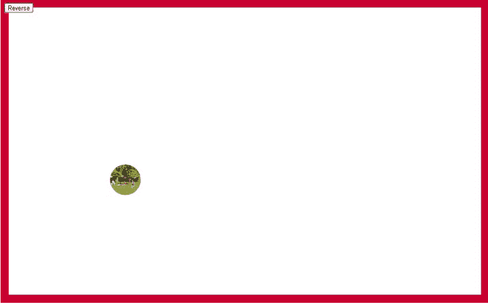

*图 3-1. 屏幕截图，全窗口*

在所有情况下，当虚拟球撞击到墙壁时，它都会表现出从墙上弹开的效果。例如，如果虚拟球正向屏幕下方和右侧移动，当它撞击到盒子的右侧时，它会向左移动但仍然向屏幕下方运动。当虚拟球接着撞击到盒子的底部墙壁时，它会向左弹起，向屏幕上方运动。其轨迹如图 3-2 所示。为了生成这张图，我将虚拟球改为了一个简单的圆形，并且没有编写代码在每个时间间隔清除画布。你可以将其视为定格摄影。改变虚拟球是必要的，因为它本身很复杂：一个来自视频片段的图像和一个全白的蒙版。我在“构建应用并使其个性化”部分包含了生成此轨迹的代码。

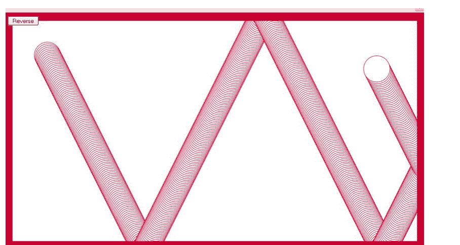

*图 3-2. 虚拟球的轨迹*

如果我将浏览器窗口调整得稍小一些并重新加载应用，代码会调整画布大小以产生图 3-3 所示的效果：一个更小的盒子。

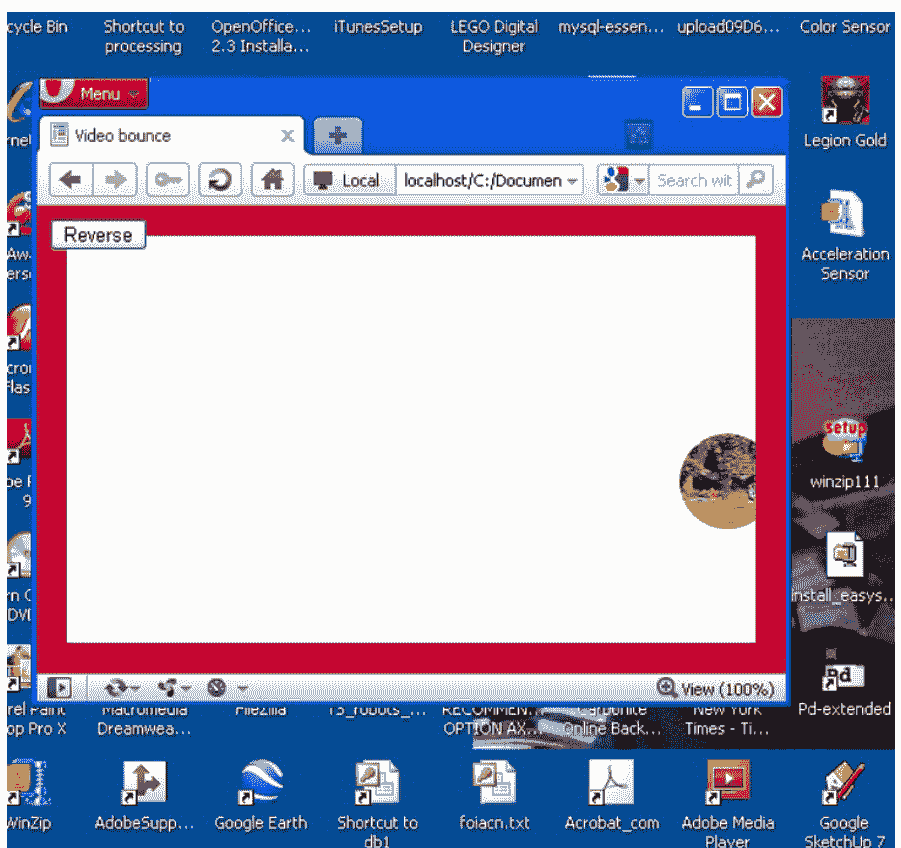

*图 3-3. 小窗口中的应用*

如果窗口变得非常小，这将迫使视频片段本身的大小以及画布和盒子的大小发生改变，如图 3-4 所示。

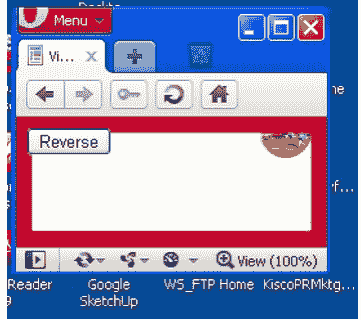

*图 3-4. 窗口调整为非常小*

该应用会根据 HTML 文档首次加载时的窗口尺寸来调整盒子的大小，并可能调整虚拟视频球的大小。如果观众在应用程序运行期间稍后调整了窗口大小，画布和视频片段不会调整大小。在这种情况下，你会看到类似图 3-5 的情况，一个大窗口中的小盒子。

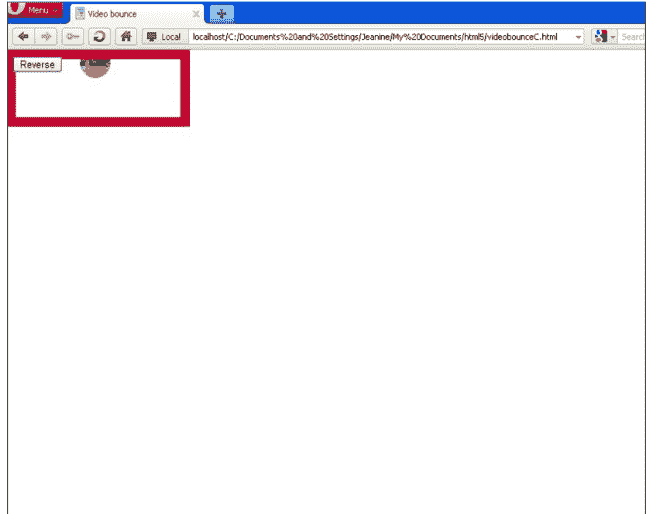

*图 3-5. 运行期间窗口调整为更大*

类似地，如果你使用全尺寸窗口或任何大窗口启动应用程序，并在程序运行期间将其调整为较小的尺寸，你会看到类似图 3-6 的情况，其中浏览器会显示滚动条，表示文档内容比窗口更宽、更长。如果你（观众）选择不使用滚动条，那么视频片段会定期短暂消失在视野之外，然后重新出现。

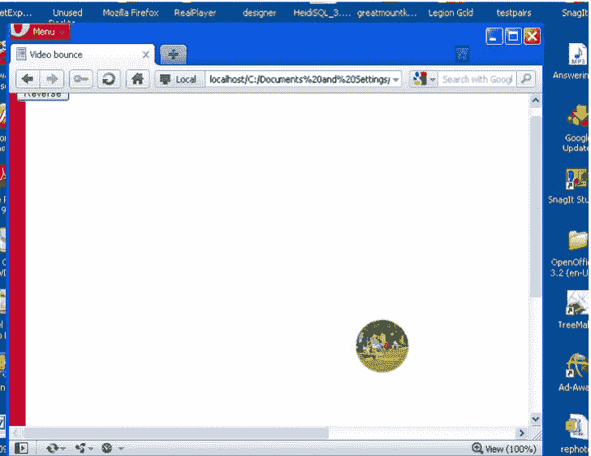

*图 3-6. 大窗口被调整*

这两个应用程序（我将它们命名为 `videobounceC`，表示“在画布上绘制的视频”，和 `videobounceE`，表示“视频元素”）已在 Firefox、Chrome 和 Opera 中成功测试。该项目展示了使用 HTML5、JavaScript 和 CSS 操控视频，以及将视频与画布结合以实现特效的编码技术。该项目还解释了有助于根据浏览器窗口尺寸自定义应用程序的计算方法。

### 项目历史与关键要求

我一直喜欢模拟球在盒子内弹跳的应用。《HTML5 核心指南》第 3 章展示了由路径绘制生成的球和由图像生成的球，各自在二维封闭空间内弹跳的项目。我决定让一个视频片段也这样做——

---
下一章将描述创建一个展示视频片段像球一样在盒子内四处弹跳的应用程序。

### 测试与上传应用

你需要收集所有希望包含在应用中的图像文件。测试过程取决于你使用的浏览器。实际上，使用多个浏览器进行测试是一个好习惯。如果你使用 Firefox 或 Chrome，你需要将应用程序（html 文件和所有图像文件）上传到服务器以测试创建图像的功能。然而，应用程序的其他方面可以在你自己的[客户端]计算机上测试。

### 总结

在本章中，你学习了如何构建一个涉及在画布上创建和定位特定形状（即矩形、椭圆形和心形）以及图片（如照片）的应用程序。所包含的编程技术和 HTML5 特性包括：

- 编程定义的对象
- 画布上的鼠标事件
- 使用 `try` 和 `catch` 捕获错误
- 用于多个函数的代数和几何。

下一章将描述创建一个展示视频片段像球一样在盒子内四处弹跳的应用程序。

52

---

| 代码行 | 描述 |
| --- | --- |
| `function saveasimage() {` | `saveasimage` 函数头 |
| `try {` | 开始 `try` 子句 |
| `window.open(canvas1.toDataURL("image/png")); }` | 创建图像数据并用作新窗口的内容 |
| `catch(err) {` | 如果失败，即抛出错误 |
| `alert("You need to change browsers OR upload the file to a server.");` | 显示警告消息 |
| `}` | 结束 `catch` 子句 |
| `}` | 结束函数 |
| `function removeobj() {` | `removeobj` 函数头 |
| `stuff.pop();` | 移除 `stuff` 数组的最后一个成员 |
| `drawstuff();` | 绘制所有内容 |
| `}` | 结束函数 |
| `</script>` | 结束 `script` 元素 |
| `</head>` | 结束 `head` 元素 |
| `<body onLoad="init();">` | `body` 标签，设置了 `onLoad` |
| `Mouse down, move and mouse up to move objects. Double click for new object.<br/>` | 给出操作指示的文本 |
| `<canvas id="canvas" width="600" height=400>` | `canvas` 标签 |
| `Your browser doesn't recognize the canvas element` | 为旧浏览器提供的消息 |
| `</canvas>` | 结束 `canvas` 标签 |
| `<button onClick="saveasimage();">Open window with image (which you can save into image file) </button></br>` | 用于保存图像的按钮 |
| `<button onClick="removeobj();">Remove last object moved </button>` | 用于移除对象的按钮 |
| `</body>` | 结束 `body` 标签 |
| `</html>` | 结束 `html` 标签 |

很明显，如何仅使用我示例中展示的技术使此应用个性化：收集你自己家人的照片或获取其他照片，并使用矩形、椭圆和心形来创建你自己的形状集。

你可以定义自己的对象，以这里的代码为模型。例如，《HTML5 核心指南》一书包含了显示多边形的代码。你可以让多边形的 `over check` 函数将多边形视为一个圆形，可能是一个半径较小的圆形，你的用户不会有异议。

下一步可以是构建一个允许最终用户指定图像文件地址的应用程序。你需要为此设置一个表单。另一个增强功能是允许最终用户输入文本，例如问候语，并将其定位在画布上。你需要创建一个新的对象类型并编写 `draw` 和 `overcheck` 方法。`overcheck` 方法可以是 `overrect`，即程序接受任何在边界矩形内的内容都被视为在文本上。

同理。我在本章中对编码的讲解已完整。不过，如果你手头有第一本书（容我自荐），通过对比不同版本间的异同，你可能会获益。在小球和图片应用中，画布被设置为固定尺寸，并与文档中的其他材料一起定位。由于我不想让视频片段太小，我决定在这种情况下使用整个窗口。这个目标带来了确定文档窗口尺寸的挑战。在旧的小球和图片应用中，我想演示表单验证，因此程序提供了用于改变垂直和水平速度的表单元素。而对于弹跳小球视频片段，应用仅为用户提供了一个操作：一个用于反向的按钮。学完本章，你应该能够为视频应用添加其他界面操作。

由于在画布上绘制视频是 HTML5 的一项特性，这是我完成此项目的首选方法。然而，我的阅读表明，这被认为计算量过大，应该避免，因此我还开发了另一种方法：移动视频元素，并在其上移动一个画布元素。

抛开实现细节不谈，除了确定窗口尺寸外，关键需求是同时移动（重新定位）视频片段和一个充当遮罩的图形元素，并使其动画化。遮罩的效果是使视频片段呈现为圆形，而非标准的矩形。视频片段在移动的同时播放。该应用旨在模拟一个球状物体在一个盒子内弹跳。因此，应用必须显示盒子的壁，并进行计算，使得当视频片段看起来与任何一壁碰撞时，运动方向以适当的方式改变。一种炫酷的说法是，反射角必须等于入射角。实际意味着的是，当视频片段虚拟地撞到底壁或顶壁时，它在水平方向上保持相同方向（如果向左移动则继续向左，如果向右移动则继续向右），但在垂直方向上切换方向。当视频片段虚拟地撞到左壁或右壁时，它在垂直方向上保持相同方向（如果向上移动则继续向上，如果向下移动则继续向下），但在水平方向上切换方向。如果你对模拟现实物理感兴趣，可以在每次虚拟撞壁时减慢运动速度。

### HTML5、CSS 和 JavaScript 特性

任何解释顺序都意味着有时在阐述为何这样做之前就讨论了某些内容。在本节中，我将展示某些变量是如何设置的，这些变量稍后将在使用中显现。总体计划是提取窗口尺寸，为画布和视频片段设置变量，这些变量将在绘制视频和遮罩的编码中被引用。

### Body 和窗口尺寸的定义

文档对象模型提供了关于浏览器显示 HTML 文档的窗口的信息。具体来说，属性 `window.innerWidth` 和 `window.innerHeight` 表示窗口的可用尺寸。我的代码将在设置应用时使用这些值。

回想一下，HTML5 视频元素可以包含任意数量的指向不同视频文件的 `source` 子元素。目前，这是必要的，因为支持视频元素的浏览器不接受相同的视频格式（编解码器）。未来情况可能会改变。如果你知道*所有*潜在客户使用的浏览器，你可以确定单一的视频格式。如果不是这种情况，你需要制作同一视频片段的三个版本。开源 Miro 视频转换器（可从 www.mirovideoconverter.com/ 下载）是一个将视频片段转换为其他格式的好产品。有了这个提醒，我可以展示此应用的 `body` 元素。它包含一个视频元素、一个按钮和一个画布元素：

```html
```


<body onLoad="init();">

<video id="vid" loop="loop" preload="auto">

<source src="joshuahomerun.mp4" type="video/mp4; codecs='avc1.42E01E, mp4a.40.2'">

<source src="joshuahomerun.webmvvp8.webm" type='video/webm; codec="vp8, vorbis"'>

<source src="joshuahomerun.theora.ogv" type='video/ogg; codecs="theora, vorbis"'>

Your browser does not accept the video tag.

</video>

<button id="revbtn" onClick="reverse();">Reverse </button><br/>

<canvas id="canvas" >

This browser doesn't support the HTML5 canvas element.

</canvas>

</body>

样式指令将改变三个元素的位置：视频、画布和按钮。在文档加载时调用的`init()`函数中，以下语句将画布尺寸设置为与窗口尺寸匹配：

```javascript
canvas1 = document.getElementById('canvas');
ctx = canvas1.getContext('2d');
canvas1.width = window.innerWidth;
cwidth = canvas1.width;
canvas1.height = window.innerHeight;
cheight = canvas1.height;
```

这些语句还设置了稍后将使用的变量。这样，将画布适应窗口的任务就完成了。现在，下一个任务需要更多思考。我希望在多大程度上将视频适应窗口尺寸？我决定在所有情况下将视频宽度和高度减少到原始宽度和高度的三分之一。但是，如果窗口非常小，我会进一步缩小。`Math.min()`方法返回其操作数中最小的一个，因此语句

```javascript
v = document.getElementById("vid");
v.width = Math.min(v.videoWidth/3, .5*cwidth);
v.height = Math.min(v.videoHeight/3, .5*cheight);
```

首先将变量`v`设置为指向视频元素，你可以看到我在`body`中将其编码为id为"vid"。然后将视频宽度设置为视频片段原始固有宽度的三分之一或画布宽度的一半中较小的一个。下一条语句对视频高度做同样的处理。这种方法不会使视频片段与画布成比例。当你在开发此应用或其他应用时，你需要决定要采取的方法。`init()`函数中还设置了其他一些变量，用于绘制盒子和遮罩。代码如下：

```javascript
videow = v.width;
videoh = v.height;
ballrad = Math.min(50, .5*videow, .5*videoh);
maskrad = .4*Math.min(videow, videoh);
ctx.lineWidth = ballrad;
```

变量`ballrad`继承自先前的应用。它假设视频高度和宽度相等且小于50像素，是球的半径。它在videobounce应用中的用途是设置绘制盒子所用线条的宽度。遮罩中孔的半径设置为视频宽度和高度中较小值的0.4倍。你当然可以尝试这些值，并尝试遮罩的形状。

## 动画

动画是一种技巧，通过快速连续地呈现静态图像，使我们的眼睛和大脑将所见解释为运动。具体的绘制机制将在接下来的两节中解释。请记住，有两个动画同时进行：视频的呈现和视频在盒子中的位置。在本节中，我讨论的是视频在盒子中的位置。

在HTML和JavaScript中实现动画的方法是使用`setInterval()`函数。该函数使用两个参数调用。第一个是我们要调用的函数名，第二个表示每次调用函数之间的时间间隔长度。时间单位是毫秒。

以下语句位于`init()`函数中，设置动画：

```javascript
setInterval(drawscene,50);
```

`drawscene`指的是一个将完成所有工作的函数。50代表50毫秒。这意味着每50毫秒（或每秒20次），`drawscene()`函数将被调用。可以推测，`drawscene()`将执行必要的操作以显示在新位置的视频片段。你可以尝试不同的间隔时长。

如果你想增强此应用或构建另一个需要停止动画的应用，你应该为`setInterval()`调用声明一个局部变量（我们称之为`tid`），并使用语句

```javascript
tid = setInterval(drawscene,50);
```

在需要停止动画，或者更正式地说，停止间隔计时事件时，你编写

```javascript
clearInterval(tid);
```

如果你有多个计时事件，你需要将每个的输出赋给一个新变量。小心不要对同一个函数多次调用`setInterval()`。这样做会产生添加新计时事件并多次调用该函数的效果。

`drawscene()`函数的许多细节将在后续章节中描述。然而，两个关键任务是擦除画布，然后确定视频片段的下一个位置。擦除整个画布的语句是

```javascript
ctx.clearRect(0,0,cwidth,cheight);
```

注意，它使用了基于窗口尺寸计算的`cwidth`和`cheight`值。

弹跳的模拟由一个名为`moveandcheck()`的函数执行。虚拟球的位置由变量`ballx`和`bally`定义。(`ballx`,`bally`)位置是视频的左上角。运动，也称为*位移*，由变量`ballvx`和`ballvy`定义。这两个变量分别称为水平位移和垂直位移。

## 在画布上绘制视频并作为可移动元素

`moveandcheck()` 函数的目标是通过设置 `ballx` 和 `bally` 来重新定位虚拟球，并在适当时候改变 `ballvx` 和 `ballvy` 的符号。代码的实现方式是尝试使用新值（参见函数中的 `nballx` 和 `nbally`），然后设置 `ballx` 和 `bally`。改变位移值的符号会产生使球反弹的效果，具体方式是在下一个时间间隔内改变相应的水平或垂直调整量。

现在需要确定何时进行反弹。你需要接受这样一个事实：就计算机而言，不存在任何球（无论是否在反弹）和墙壁，只有计算。而且，这些计算是在离散的时间间隔内完成的。不存在连续的运动。虚拟球是从一个位置跳跃到另一个位置的。轨迹之所以看起来平滑，是因为跳跃足够小，而且我们的眼脑系统会将这些画面解释为连续运动。由于墙壁是在视频之后绘制的（稍后会解释），其效果是虚拟球在改变方向之前会接触甚至略微穿过墙壁。

我的方法是为 `ballx` 和 `bally` 设置试验值或替代值，并基于这些值进行计算。从逻辑上讲，你可以这样想：如果视频球移动了，它是否会超出任何墙壁？如果是，则重新调整使其刚好撞到那面墙，并改变相应的位移值。新的位移值不会立即使用，而是会成为下一次迭代时间计算的一部分。如果试验值没有到达或超出墙壁，则保持试验值及其相应的位移值不变。然后，将 `ballx` 和 `bally` 更改为可能经过调整的替代值。

`videobounceC` 程序的函数定义如下：

```javascript
function moveandcheck() {
    var nballx = ballx + ballvx +.5*videow;
    var nbally = bally + ballvy +.5*videoh;
    if (nballx > cwidth) {
        ballvx = -ballvx;
        nballx = cwidth;
    }
    if (nballx < 0) {
        nballx = 0;
        ballvx = -ballvx;
    }
    if (nbally > cheight) {
        nbally = cheight;
        ballvy = -ballvy;
    }
    if (nbally < 0) {
        nbally = 0;
        ballvy = -ballvy;
    }
    ballx = nballx-.5*videow;
    bally = nbally-.5*videoh;
}
```

`moveandcheck()` 函数在移动视频元素时略有不同，这是由于一个涉及滚动的问题，我稍后会讨论。基本概念是相同的。`videobounceE` 中的 `moveandcheck()` 函数如下：

```javascript
function moveandcheck() {
  var nballx = ballx + ballvx;
  var nbally = bally + ballvy;
  if ((nballx+videow) > cwidth) {
    ballvx = -ballvx;
    nballx = cwidth-videow;
  }
  if (nballx < 0) {
    nballx = 0;
    ballvx = -ballvx;
  }
  if ((nbally+videoh) > cheight) {
    nbally = cheight-videoh;
    ballvy = -ballvy;
  }
  if (nbally < 0) {
    nbally = 0;
    ballvy = -ballvy;
  }
  ballx = nballx;
  bally = nbally;
}
```

请注意，`videobounceC` 版本将 `ballx + ballvx + .5*videow` 与 `cwidth` 进行比较，而 `videobounceE` 则将 `ballx + ballvx + videow` 与 `cwidth` 进行比较。这意味着 `videobounceE` 程序会更早地强制反弹——即更早地调头——以应对右侧墙壁。检查底部墙壁时也是同样的道理。我这样做是为了避免一个涉及自动滚动的问题。视频元素不受画布限制，因此如果它移出画布之外，它仍然是文档的一部分并会被显示出来。由于新的显示内容大于窗口，这会导致滚动。滚动条会出现，虽然你看不到任何东西，但我不喜欢这种效果。如果你从一个较小的窗口开始，并在程序执行期间将其变大，你可能会看到类似图3-7所示的画面。

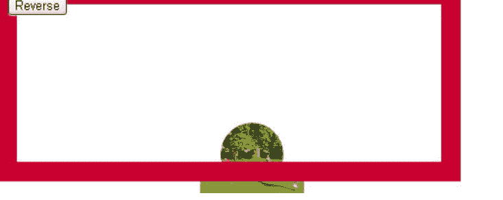

*图3-7. 视频元素在限制较少的检查下反弹*

为了避免这种情况，你会看到我改变了视频元素应用程序的检查方式。这样做的缺点是视频球几乎碰不到右侧和底部墙壁。为什么这些效果在在画布上绘制视频的应用程序（`videobounceC`）中没有发生呢？因为使用超出画布坐标的绘制在画布上没有可见效果。你可以回顾第1章图1-6，看看一个在“线外”绘制但在画布外没有任何效果的例子。

> **注意** 可能还有其他方法来避免滚动问题。但这无法防止图3-7所示的不美观情况。也许可以在浏览器中防止滚动。阻止用户滚动是可能的，但自动滚动似乎更具挑战性。

## 在画布上绘制视频

正如我之前提到的，HTML5 确实提供了在画布上绘制视频的功能，就像绘制图像一样。实际上，这是一个用词不当的说法。视频片段由一系列称为 *帧* 的静态图像组成。帧率各不相同，但通常为每秒15到32帧，因此你可以理解视频文件往往很大。视频使用不同类型的编码存储，每种编码在质量和存储大小之间可能做出不同的技术权衡。我们不需要关心这些技术细节，而是可以将视频视为一系列帧。播放视频涉及按顺序呈现这些帧。`drawImage()` 命令的作用是将视频片段的当前帧作为图像绘制在画布上。如果通过定时间隔事件执行此操作，那么观看者将在每个时间间隔看到一帧图像。无法保证显示的图像来自视频片段的连续帧，但如果操作足够快，绘制的帧将足够接近实际序列，我们的眼睛和大脑会将其体验为视频片段的实时动作。

伪代码中的命令是：

```
ctx.drawImage(video element, x position, y position, width, height);
```

这个命令，正式名称是 `ctx` 画布上下文的方法，提取与视频当前帧对应的图像，并将其绘制在 x 和 y 值处，具有指定的宽度和高度。如果图像没有指定的宽度和高度，则会对图像进行缩放。这种情况不会在此发生。

目标是让移动的视频片段看起来像一个球。对于这个应用程序，这意味着我们想要遮罩掉矩形视频片段中心圆圈之外的所有部分。我通过创建一个移动遮罩来实现这一点。遮罩是画布上的一个绘图。由于我想将视频元素放在画布元素上，并在从视频片段绘制的图像上定位通过绘制路径创建的形状，我使用 CSS 指令让视频和画布都使用绝对定位。我希望反转按钮位于画布之上。这些指令可以实现：

```css
#vid {position:absolute; display:none; }
#canvas {position:absolute; z-index:10; top:0px; left:0px;}
#revbtn {position:absolute; z-index:20; }
```

一种记住分层工作原理的方法是将 z 轴想象为从屏幕中伸出。设置较高值的元素位于设置较低值的元素之上。画布的 `top` 和 `left` 属性都设置为0像素，以将画布的左上角定位在窗口的左上角。

> **注意：** 当在 JavaScript 中引用或修改 `z-index` 时，其名称为 `zIndex`。希望你能理解为什么 `z-index` 这个名字不行：连字符（-）会被解释为减号运算符。

视频元素在样式指令中被设置为不显示。这是因为作为一个独立元素，它本身不应该显示任何内容。相反，当前帧的内容通过以下语句绘制到画布上：
`ctx.drawImage(v,ballx, bally, videow,videoh);`
`ballx` 和 `bally` 的值在 `init()` 函数中初始化，并如上一节所述递增。视频片段的宽度和高度已被修改为适合窗口大小。理解这一点的一种方式是想象视频在屏幕外某处播放，浏览器可以访问其信息，以便在 `drawImage()` 方法中提取当前帧。

## 可移动视频元素

`videobounceE` 应用程序在文档上移动实际的视频元素。视频元素不是绘制在画布上，而是 HTML 文档中的一个独立元素。但是，我需要确保绘制在画布上的遮罩相对于视频元素始终处于正确位置。我需要编写样式指令以确保视频位于画布下方，而画布又位于反转按钮下方。一个关键步骤是将三个元素（视频、画布和按钮）的定位都设置为绝对定位，并将画布定位为其左上角位于窗口的左上角。这对于定位视频元素和遮罩至关重要，我们将在后面探讨。样式指令如下：

```css
#vid {position:absolute; display:none; z-index: 1; }
#canvas {position:absolute; z-index:10; top:0px; left:0px;}
#revbtn {position:absolute; z-index:20;}
```

移动视频元素需要使视频可见并开始播放视频。它还需要定位。视频元素通过引用 `style.left` 和 `style.top` 来定位。此外，`left` 和 `top` 属性的设置必须是表示数字的字符串后跟字符串 "px" 的形式，代表像素。以下代码

在`init()`函数中执行以下代码：

```javascript
v.style.left = String(ballx)+"px";
v.style.top = String(bally)+"px";
v.play();
v.style.visibility = "visible";
v.style.display = "block";
```

同时请注意，视频的初始位置被设置为`ballx`和`bally`的初始值。数值需要转换为字符串，然后将"px"拼接到字符串末尾。这是因为HTML/JavaScript假设样式属性是字符串。我在`drawscene()`函数中编写了相同的代码，将视频元素的`top`和`left`属性设置为与`ballx`和`bally`对应的值。替代`ctx.drawImage()`语句的语句是：

```javascript
v.style.left = String(ballx)+"px";
v.style.top = String(bally)+"px";
```

`videobounceC`和`videobounceE`的全部代码将在“构建应用程序并使其个性化”部分列出，并附有注释。

## 循环视频

您可能注意到视频标签有属性设置`loop="loop"`。这表明视频将循环播放——也就是说，当片段播放结束时，将重新开始播放。在撰写本文时，此功能在Firefox中无效，因此我使用以下语句：

```javascript
v.addEventListener("ended",restart,false);
```

设置一个事件，当`ended`事件发生时调用指定的函数。`false`参数表示事件不应冒泡到任何其他应用程序。虽然其他应用程序不太可能监听此事件，但阻止冒泡行为并无坏处。我定义了名为`restart()`的函数：

```javascript
function restart() {
    v.currentTime=0;
    v.play();
}
```


### 移动遮罩

遮罩的目标是遮盖——即覆盖——视频中除中心圆形区域外的所有部分。样式指令确保我可以使用相同的变量——即 `ballx` 和 `bally`——在两种情况下引用视频和遮罩：视频绘制和视频元素移动。那么问题是如何制作一个带有圆形孔洞的矩形环形遮罩。

我通过编写代码绘制两条路径并用白色填充来实现这一点。由于遮罩的形状可能难以可视化，我创建了两幅图来展示它的样子。图 3-8 显示了两条路径的轮廓。

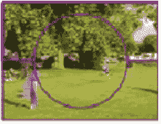

*图 3-8. 遮罩路径轮廓*

图 3-9 显示了填充和描边后的路径轮廓。

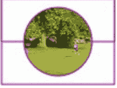

*图 3-9. 填充和描边后的遮罩路径*

实际上，路径只有填充，填充颜色为白色。您需要想象这两个白色形状在视频上移动。遮罩的效果是覆盖视频片段的大部分。可以这么说，画布上没有颜料的部分是透明的，视频片段内容会显示出来。换句话说，画布位于视频元素之上，但它相当于一片玻璃。每个未绘制任何内容的像素都是透明的。

绘制遮罩的代码在画布上绘制视频（`videobounceC`）和屏幕上移动的视频元素（`videobounceE`）两种方式中是相同的。第一条路径从左上角开始，然后向右、向下到中点，最后向左返回。路径接着是一个半圆弧。表示弧线方向的最后一个参数为 `true`，表示逆时针方向。路径继续延伸到左边缘，然后向上返回起点。第二条路径从左边缘的中点开始，向下延伸到左下角，再到右下角，然后向上移动到右侧中点，再向左移动。这次弧线的方向参数为 `false`，表示顺时针方向。路径在起点结束。

```javascript
ctx.beginPath();

ctx.moveTo(ballx, bally);

ctx.lineTo(ballx + videow, bally);

ctx.lineTo(ballx + videow, bally + .5 * videoh);

ctx.lineTo(ballx + .5 * videow + maskrad, bally + .5 * videoh);

ctx.arc(ballx + .5 * videow, bally + .5 * videoh, maskrad, 0, Math.PI, true);

ctx.lineTo(ballx, bally + .5 * videoh);

ctx.lineTo(ballx, bally);

ctx.fill();

ctx.moveTo(ballx, bally + .5 * videoh);

ctx.lineTo(ballx, bally + videoh);

ctx.lineTo(ballx + videow, bally + videoh);

ctx.lineTo(ballx + videow, bally + .5 * videoh);

ctx.lineTo(ballx + .5 * videow + maskrad, bally + .5 * videoh);

ctx.arc(ballx + .5 * videow, bally + .5 * videoh, maskrad, 0, Math.PI, false);

ctx.lineTo(ballx, bally + .5 * videoh);

ctx.fill();
```

您可以根据我的“英文”描述来跟踪编码过程，以了解其工作原理。顺便说一下，我最初的尝试是绘制一个由四边形表示外部矩形和中间圆形组成的路径。这在某些浏览器中有效，但在其他浏览器中则不行。对于 `videobounceC` 应用程序，遮罩位于画布上绘制的视频之上，因为两条白色填充路径是在 `drawImage` 语句从视频绘制一帧之后绘制的。我在 `videobounceE` 应用程序中通过指定视频元素的 `z-index` 为 0，画布的 `z-index` 为 10 来实现相同的效果。记住，z 轴是垂直于屏幕向外延伸的轴。数值越高，越靠近我们，位于数值越低的元素之上。`z-index` 设置为 10 的画布位于 `z-index` 设置为 0 的视频元素之上。下一章将演示在谷歌地图上移动的聚光灯，将重点介绍使用 JavaScript 更改 `z-index`。

### 用户界面

两个版本的 `videobounce` 项目的用户界面只包含一个用户操作：用户可以反转行进方向。按钮由 `body` 中的一个元素定义：

```html
<button id="revbtn" onClick="reverse();">Reverse </button><br/>
```

`onClick` 设置的作用是调用名为 `reverse` 的函数。该函数被定义为改变水平和垂直位移的符号：

```javascript
function reverse() {

    ballvx = -ballvx;

    ballvy = -ballvy;

}
```

对于任何用户界面，有一个重要的考虑事项。您需要确保它是可见的。这通过以下样式指令实现：

```css
#revbtn { position: absolute; z-index: 20; }
```


# 第3章 ■ 弹跳视频：HTML5 视频的动画与遮罩

`z-index`将按钮放置在画布之上，而画布又位于视频之上。在解释了可用于满足视频弹跳关键要求的各个HTML5、CSS和JavaScript特性之后，我现在将展示两个`videobounce`应用程序中的代码，以及用于显示图3-2中轨迹的代码。

## 构建应用程序并使其个性化

模拟视频片段球在二维盒子中弹跳的两个应用程序包含相似的代码，生成轨迹图片的程序也是如此。以下是应用程序的简要概述。视频应用程序总结如下：

1.  `init`：初始化，包括适应窗口大小和设置调用`drawscene`的定时事件。
2.  `drawscene`：
    a.  擦除画布。
    b.  使用`moveandcheck`确定视频（虚拟球）的新位置。
    c.  在画布的指定位置绘制视频中的图像，或将视频元素重新定位到指定位置。
    d.  在画布上绘制路径作为视频的遮罩。
    e.  绘制盒子。
3.  `moveandcheck`：检查虚拟球是否会撞击墙壁。如果会，则更改相应的位移值。

轨迹函数也使用`init`和`moveandcheck`，但有一个更简单的`drawscene`函数：

1.  使用`moveandcheck`确定圆（虚拟球）的新位置。
2.  绘制由圆形组成的路径，并使用填充和描边绘制圆形。
3.  绘制盒子。

描述调用/被调用关系的函数（如表3-1所示）在所有应用程序中都是相同的。

**表3-1. 弹跳视频项目中的函数**

| 函数 | 调用/被调用方式 | 调用 |
| :--- | :--- | :--- |
| `init` | 由`<body>`标签中`onLoad`属性的操作调用 | |
| `drawscene` | 由`init`中发出的`setInterval`命令的操作调用 | `moveandcheck` |
| `moveandcheck` | 在`drawscene`中调用 | |
| `reverse` | 由按钮中`onClick`的操作调用 | |
| `restart` | 由`init`中`addEventListener`的操作调用（在`videobounceTrajectory`中不存在） | |

表3-2显示了`videobounceC`应用程序的代码，该代码在设定的时间间隔内在画布上绘制视频的当前帧。

### 表3-2. VideobounceC应用程序完整代码

| 代码行 | 描述 |
| :--- | :--- |
| `<!DOCTYPE html>` | 头部声明 |
| `<html>` | 开始`html`标签 |
| `<head>` | 开始head标签 |
| `<title>Video bounce</title>` | 完整标题 |
| `<meta charset="UTF-8">` | Meta元素 |
| `<style>` | 开始样式 |
| `#vid {position:absolute; display:none; }` | 设置视频定位；将显示属性设为none；视频元素永不显示 |
| `#canvas {position:absolute; z-index:10; top:0px; left:0px;}` | 将定位设为绝对定位，并定位到左上角；设置z-index使其位于"反向"按钮下方 |
| `#revbtn {position:absolute; z-index:20; }` | 将定位设为绝对定位，并设置z-index使其位于画布上方 |
| `</style>` | 结束样式 |
| `<script type="text/javascript">` | 开始脚本标签 |
| `var ctx;` | 用于保存画布上下文，用于所有绘图操作 |
| `var cwidth ;` | 用于保存画布宽度 |
| `var cheight ;` | 用于保存画布高度 |
| `var ballrad = 50;` | 设置小球半径 |
| `var ballx = 50;` | 小球初始水平坐标 |
| `var bally = 60;` | 小球初始垂直坐标 |
| `var maskrad;` | 用于遮罩半径 |
| `var ballvx = 2;` | 小球初始水平位移 |
| `var ballvy = 4;` | 小球初始垂直位移 |
| `var v;` | 将保存视频元素 |
| `function restart() {` | `restart`函数头 |
| `v.currentTime=0;` | 将视频播放位置重置到开头 |
| `v.play();` | 播放视频 |
| `}` | 结束`restart`函数 |
| `function init(){` | `init`函数头 |
| `canvas1 = document.getElementById('canvas');` | 设置画布引用 |
| `ctx = canvas1.getContext('2d');` | 设置画布上下文引用 |
| `canvas1.width = window.innerWidth;` | 设置画布宽度以匹配当前窗口宽度 |
| `cwidth = canvas1.width;` | 设置变量 |
| `canvas1.height = window.innerHeight;` | 设置画布高度以匹配当前窗口高度 |
| `cheight = canvas1.height;` | 设置变量 |
| `v = document.getElementById("vid");` | 设置视频元素引用 |
| `v.addEventListener("ended",restart,false);` | 设置视频结束时的事件处理；这样做是因为元素头部中的loop属性设置在Firefox浏览器中不起作用 |
| `v.width = Math.min(v.videoWidth/3,.5*cwidth);` | 设置视频宽度 |
| `v.height = Math.min(v.videoHeight/3,.5*cheight);` | 设置视频高度 |
| `videow = v.width;` | 设置变量 |
| `videoh = v.height;` | 设置变量 |
| `ballrad = Math.min(50,.5*videow,.5*videoh);` | 如果视频非常小，则修改`ballrad` |
| `maskrad = .4*Math.min(videow,videoh);` | 根据视频尺寸设置`maskrad` |
| `ctx.lineWidth = ballrad;` | 设置绘制方框的线条宽度 |
| `ctx.strokeStyle ="rgb(200,0,50)";` | 将颜色设置为偏红色 |
| `ctx.fillStyle="white";` | 将遮罩的填充样式设置为白色 |
| `v.play();` | 开始播放视频 |
| `setInterval(drawscene,50);` | 设置定时事件 |
| `}` | 结束`init`函数 |
| `function drawscene(){` | `drawscene`函数头 |
| `ctx.clearRect(0,0,cwidth,cheight);` | 擦除画布 |
| `moveandcheck();` | 检查下一步移动是否碰到墙壁，如果碰到，则调整位移和位置；否则，直接进行移动 |
| `ctx.drawImage(v,ballx, bally, videow,videoh);` | 在指定位置绘制来自视频的图像 |
| `ctx.beginPath();` | 开始绘制遮罩上半部分的路径 |
| `ctx.moveTo(ballx,bally);` | 移动到起点 |
| `ctx.lineTo(ballx+videow,bally);` | 水平向右移动 |
| `ctx.lineTo(ballx+videow,bally+.5*videoh);` | 向下移动到一半位置 |
| `ctx.lineTo(ballx+.5*videow+maskrad, bally+.5*videoh);` | 向内移动到开口起始处 |
| `ctx.arc(ballx+.5*videow,bally+.5*videoh,maskrad,0, Math.PI,true);` | 绘制半圆弧 |
| `ctx.lineTo(ballx,bally+.5*videoh);` | 向左移动 |
| `ctx.lineTo(ballx,bally);` | 移动到起点 |
| `ctx.fill();` | 填充遮罩的白色上半部分 |
| `ctx.moveTo(ballx,bally+.5*videoh);` | 移动到遮罩底部的起始点；移动到左侧中间点 |
| `ctx.lineTo(ballx,bally+videoh);` | 向下移动到左下角 |
| `ctx.lineTo(ballx+videow,bally+videoh);` | 向右移动到右下角 |
| `ctx.lineTo(ballx+videow,bally+.5*videoh);` | 向上移动到右侧中间点 |
| `ctx.lineTo(ballx+.5*videow+maskrad,bally+.5*videoh);` | 向内移动到遮罩孔的起始处 |
| `ctx.arc(ballx+.5*videow,bally+.5*videoh,maskrad,0,Math.PI,false);` | 绘制半圆弧 |
| `ctx.lineTo(ballx,bally+.5*videoh);` | 向左移动 |
| `ctx.fill();` | 填充遮罩的白色下半部分 |
| `ctx.strokeRect(0,0,cwidth,cheight);` | 绘制方框 |
| `}` | 结束`drawscene`函数 |
| `function moveandcheck() {` | `moveandcheck`函数头 |
| `var nballx = ballx + ballvx+.5*videow;` | 设置x的试验值 |
| `var nbally = bally +ballvy+.5*videoh;` | 设置y的试验值 |
| `if (nballx > cwidth) {` | 与右墙比较，当碰到时 |
| `ballvx =-ballvx;` | 改变水平位移的符号 |
| `nballx = cwidth;` | 将试验值设置为正好在右墙处 |
| `}` | 结束条件子句 |
| `if (nballx < 0) {` | 与左墙比较，当碰到时 |
| `nballx = 0;` | 将试验值设置为正好在左墙处 |
| `ballvx = -ballvx;` | 改变水平位移的符号 |
| `}` | 结束条件子句 |
| `if (nbally > cheight) {` | 与下墙比较，当碰到时 |
| `nbally = cheight;` | 将试验值设置为精确高度 |
| `ballvy =-ballvy;` | 改变垂直位移的符号 |
| `}` | 结束条件子句 |
| `if (nbally < 0) {` | 与上墙比较，当碰到时 |
| `nbally = 0;` | 将试验值更改为正好在上墙处 |
| `ballvy = -ballvy;` | 改变垂直位移的符号 |
| `}` | 结束条件子句 |
| `ballx = nballx-.5*videow;` | 使用试验值设置`ballx`，并偏移为左上角，而非中心 |
| `bally = nbally-.5*videoh;` | 使用试验值设置`bally`，并偏移为左上角，而非中心 |
| `}` | 结束`moveandcheck`函数 |
| `function reverse() {` | 按钮动作的函数头 |
| `ballvx = -ballvx;` | 改变水平位移的符号 |
| `ballvy = -ballvy;` | 改变垂直位移的符号 |
| `}` | 结束`reverse`函数 |
| `</script>` | 结束脚本标签 |
| `</head>` | 结束head标签 |
| `<body onLoad="init();">` | 开始body标签；设置对`init`的调用 |
| `<video id="vid" loop="loop" preload="auto">` | 视频元素头 |
| `<source src="joshuahomerun.mp4" type='video/mp4; codecs="avc1.42E01E, mp4a.40.2"'>` | mp4视频源 |
| `<source src="joshuahomerun.webmvp8.webm" type='video/webm; codec="vp8, vorbis"'>` | WEBM视频源 |
| `<source src="joshuahomerun.theora.ogv" type='video/ogg; codecs="theora, vorbis"'>` | OGG视频源 |
| `Your browser does not accept the video tag.` | 为不兼容浏览器显示的信息 |
| `</video>` | 结束视频标签 |
| `<button id="revbtn" onClick="reverse();">Reverse</button><br/>` | 供观众反转方向的按钮 |
| `<canvas id="canvas" >` | 开始canvas标签 |
| `This browser doesn't support the HTML5 canvas element.` | 为不兼容浏览器显示的信息 |
| `</canvas>` | 结束canvas标签 |
| `</body>` | 结束body标签 |
| `</html>` | 结束html标签 |

该应用程序的第二个版本是移动视频元素，而不是在画布上绘制视频的当前帧。我的研究表明，在执行时，这可能会使用更少的计算机资源。所有版本都有很多共同点，我将通过只注释不同的行来指出这一点。

### 表3-3. VideobounceE程序完整代码

| 代码行 | 描述 |
| :--- | :--- |
| `<!DOCTYPE html>` | |
| `<html>` | |
| `<head>` | |
| `<title>Video bounce</title>` | |
| `<meta charset="UTF-8">` | |
| `<style>` | |
| `#vid {position:absolute; display:none; z-index: 1;` | 需要设置定位和z-index，因为display设置将被更改为使元素可见 |
| `}` | 结束指令 |
| `#canvas {position:absolute; z-index:10; top:0px; left:0px;}` | 这将位于视频上方和按钮下方 |
| `#revbtn {position:absolute; z-index:20;}` | |
| `</style>` | |
| `<script type="text/javascript">` | |
| `var ctx;` | |
| `var cwidth ;` | |
| `var cheight ;` | |
| `var ballrad = 50;` | |
| `var ballx = 80;` | 起始点是任意的 |
| `var bally = 80;` | 起始点是任意的 |
| `var maskrad;` | |
| `var ballvx = 2;` | |
| `var ballvy = 4;` | |
| `var v;` | |
| `function restart() {` | |
| `v.currentTime=0;` | |
| `v.play();` | |
| `}` | |
| `function init(){` | |
| `canvas1 = document.getElementById('canvas');` | |
| `ctx = canvas1.getContext('2d');` | |
| `canvas1.width = window.innerWidth;` | |
| `cwidth = canvas1.width;` | |
| `canvas1.height = window.innerHeight;` | |
| `cheight = canvas1.height;` | |
| `window.onscroll = function () {` | |
| `window.scrollTo(0,0);` | |
| `};` | |
| `v = document.getElementById("vid");` | |
| `v.addEventListener("ended",restart,false);` | |
| `v.width = Math.min(v.videoWidth/3,.5*cwidth);` | |
| `v.height = Math.min(v.videoHeight/3,.5*cheight);` | |
| `videow = v.width;` | |
| `videoh = v.height;` | |
| `ballrad = Math.min(50,.5*videow,.5*videoh);` | |
| `maskrad = .4*Math.min(videow,videoh);` | |
| `ctx.lineWidth = ballrad;` | |
| `ctx.strokeStyle = "rgb(200,0,50)";` | |
| `ctx.fillStyle="white";` | |
| `v.style.left = String(ballx)+"px";` | |
| `v.style.top = String(bally)+"px";` | |
| `v.play();` | |
| `v.style.display = "block";` | 使视频元素可见 |
| `setInterval(drawscene,50);` | |
| `}` | |
| `function drawscene(){` | |
| `ctx.clearRect(0,0,cwidth,cheight);` | |
| `moveandcheck();` | |
| `v.style.left = String(ballx)+"px";` | 水平定位视频 |
| `v.style.top = String(bally)+"px";` | 垂直定位视频 |
| `ctx.beginPath();` | |
| `ctx.moveTo(ballx,bally);` | |
| `ctx.lineTo(ballx+videow,bally);` | |
| `ctx.lineTo(ballx+videow,bally+.5*videoh);` | |
| `ctx.lineTo(ballx+.5*videow+maskrad, bally+.5*videoh);` | |
| `ctx.arc(ballx+.5*videow,bally+.5*videoh,maskrad,0, Math.PI,true);` | |
| `ctx.lineTo(ballx,bally+.5*videoh);` | |
| `ctx.lineTo(ballx,bally);` | |
| `ctx.fill();` | |
| `ctx.moveTo(ballx,bally+.5*videoh);` | |
| `ctx.lineTo(ballx,bally+videoh);` | |
| `ctx.lineTo(ballx+videow,bally+videoh);` | |
| `ctx.lineTo(ballx+videow,bally+.5*videoh);` | |
| `ctx.lineTo(ballx+.5*videow+maskrad,bally+.5*videoh);` | |
| `ctx.arc(ballx+.5*videow,bally+.5*videoh,maskrad,0, Math.PI,false);` | |
| `ctx.lineTo(ballx,bally+.5*videoh);` | |
| `ctx.fill();` | |
| `ctx.strokeRect(0,0,cwidth,cheight); // box` | |
| `}` | |
| `function moveandcheck() {` | |
| `var nballx = ballx + ballvx;` | 试验值 |
| `var nbally = bally +ballvy;` | 试验值 |
| `if ((nballx+videow) > cwidth) {` | 将总宽度相加并进行比较 |
| `ballvx =-ballvx;` | 改变水平位移的符号 |
| `nballx = cwidth-videow;` | 设置为精确位置 |
| `}` | |
| `if (nballx < 0) {` | |
| `nballx = 0;` | |
| `ballvx = -ballvx;` | |
| `}` | |
| `if ((nbally+videoh) > cheight) {` | 比较总长度 |
| `nbally = cheight-videoh;` | 设置为精确位置 |
| `ballvy =-ballvy;` | 改变垂直位移的符号 |
| `}` | |
| `if (nbally < 0) {` | |
| `nbally = 0;` | |
| `ballvy = -ballvy;` | |
| `}` | |
| `ballx = nballx;` | 设置为试验位置，可能已调整 |
| `bally = nbally;` | 设置为试验位置，可能已调整 |
| `}` | |
| `function reverse() {` | |
| `ballvx = -ballvx;` | |
| `ballvy = -ballvy;` | |
| `}` | |
| `</script>` | |
| `</head>` | |
| `<body onLoad="init();" >` | |
| `<video id="vid" loop="loop" preload="auto">` | |
| `<source src="joshuahomerun.webmvp8.webm" type='video/webm; codec="vp8, vorbis"'>` | |
| `<source src="joshuahomerun.mp4" type='video/mp4; codecs="avc1.42E01E, mp4a.40.2"'>` | |
| `<source src="joshuahomerun.theora.ogv" type='video/ogg; codecs="theora, vorbis"'>` | |
| `Your browser does not accept the video tag.` | |
| `</video>` | |
| `<button id="revbtn" onClick="reverse();">Reverse</button><br/>` | |
| `<canvas id="canvas" >` | |
| `This browser doesn't support the HTML5 canvas element.` | |
| `</canvas>` | |
| `</body>` | |
| `</html>` | |

我通过将`drawscene`函数修改为`videobounceC`来制作轨迹函数。由于我希望圆形的尺寸与遮罩后的视频片段相似，我在视频的宽度和高度设置后，暂时在`videobounceC`函数中添加了一个`alert`语句，并使用这些值运行程序：


## 第3章 ■ 弹跳视频：HTML5 视频的动画与遮罩

```
v.width = Math.min(v.videoWidth/3, .5*cwidth);
v.height = Math.min(v.videoHeight/3, .5*cheight);
alert("width "+v.width+" height "+v.height);
```

然后，我使用了 `106` 和 `80` 这两个值，作为轨迹程序中的 `videow` 和 `videoh` 值。完整的代码，以及已更改行的注释，如表 3-4 所示。请注意，此程序与前两个程序的主要区别在于缺少的行。

### 表 3-4. VideobounceTrajectory 程序的完整代码

| 代码行 | 描述 |
| --- | --- |
| `<!DOCTYPE html>` | |
| `<html>` | |
| `<head>` | |
| `<title>Video bounce</title>` | |
| `<meta charset="UTF-8">` | |
| `<style>` | |
| `#canvas {position:absolute; z-index:10; top:0px; left:0px;}` | |
| `#revbtn {position:absolute; z-index:20; }` | |
| `</style>` | |
| `<script type="text/javascript">` | |
| `var ctx;` | |
| `var cwidth ;` | |
| `var cheight ;` | |
| `var ballrad = 50;` | |
| `var ballx = 50;` | |
| `var bally = 60;` | |
| `var ballvx = 2;` | |
| `var ballvy = 4;` | |
| `function init(){` | |
| `canvas1 = document.getElementById('canvas');` | |
| `ctx = canvas1.getContext('2d');` | |
| `canvas1.width = window.innerWidth;` | |
| `cwidth = canvas1.width;` | |
| `canvas1.height = window.innerHeight;` | |
| `cheight = canvas1.height;` | |
| `videow= Math.min(106,.5*cwidth);` | 使用实际视频宽度的值 |
| `videoh = Math.min(80,.5*cheight);` | 使用实际视频高度的值 |
| `ballrad = Math.min(50,.5*videow,.5*videoh);` | |
| `maskrad = .4*Math.min(videow,videoh);` | |
| `ctx.lineWidth = ballrad;` | |
| `ctx.fillStyle= "white";` | |
| `ctx.strokeStyle ="rgb(200,0,50)";` | |
| `ctx.strokeRect(0,0,cwidth,cheight);` | |
| `setInterval(drawscene,50);` | |
| `}` | |
| `function drawscene(){` | |
| `moveandcheck();` | |
| `ctx.beginPath();` | 为圆形开始路径 |
| `ctx.moveTo(ballx+.5*videow+maskrad, bally+.5*videoh);` | 移动到圆右侧的点 |
| `ctx.arc(ballx+.5*videow,bally+.5*videoh,maskrad,0, 2*Math.PI,true);` | 绘制圆形 |
| `ctx.lineWidth=1;` | 设置线宽 |
| `ctx.fill();` | 填充（这将是白色） |
| `ctx.stroke();` | 设置红色描边（轮廓） |
| `ctx.lineWidth= ballrad;` | 设置框的线宽 |
| `ctx.strokeRect(0,0,cwidth,cheight);` | 绘制框 |
| `}` | |
| `function moveandcheck() {` | |
| `var nballx = ballx + ballvx+.5*videow;` | |
| `var nbally = bally +ballvy+.5*videoh;` | |
| `if (nballx > cwidth) {` | |
| `ballvx =-ballvx;` | |
| `nballx = cwidth;` | |
| `}` | |
| `if (nballx < 0) {` | |
| `nballx = 0;` | |
| `ballvx = -ballvx;` | |
| `}` | |
| `if (nbally > cheight) {` | |
| `nbally = cheight;` | |
| `ballvy =-ballvy;` | |
| `}` | |
| `if (nbally < 0) {` | |
| `nbally = 0;` | |
| `ballvy = -ballvy;` | |
| `}` | |
| `ballx = nballx-.5*videow;` | |
| `bally = nbally-.5*videoh;` | |
| `}` | |
| `function reverse() {` | |
| `ballvx = -ballvx;` | |
| `ballvy = -ballvy;` | |
| `}` | |
| `</script>` | |
| `</head>` | |
| `<body onLoad="init();">` | |
| `<button id="revbtn" onClick="reverse();">Reverse</button><br/>` | |
| `<canvas id="canvas" >` | |
| `This browser doesn't support the HTML5 canvas element.` | |
| `</canvas>` | |
| `</body>` | |
| `</html>` | |

### 使应用个性化

使此应用个性化的第一种方法是使用您自己的视频。您确实需要找到一些在显示为小圆形时效果可以接受的内容。如前所述，您需要使用不同的视频编解码器制作版本。下一步是添加其他用户界面操作，包括改变水平和垂直速度，就像在 *《The Essential Guide to》* 中的弹跳球项目所做的一样。

### HTML5

另一套增强功能是添加视频控制。视频控制可以作为视频元素的一部分，但我认为对于需要保持小巧且处于移动状态的视频片段来说，这行不通！不过，你可以参照“后退”按钮的模式，用按钮实现自己的控制。例如，以下语句：

```
v.pause();
```

确实会暂停视频。

属性 `v.currentTime` 可以被引用或设置，以控制视频片段中的播放位置。你在第一章中已经了解了范围输入类型的工作原理，因此可以考虑构建一个滑块输入元素来调整视频。

你可能想要改变我适应窗口尺寸的方法。一种替代方案是改变视频片段的尺寸以保持纵横比。另一种替代方案是不断改变视频尺寸。这意味着视频尺寸和画布方向将始终保持比例一致。还有一种替代方案，尽管我认为这会令人不安，即每个时间间隔都参考窗口尺寸，并每次都对画布，可能还有视频，进行更改。有一个事件可以插入到 body 标签中：

```
<body onresize="changedims();" … >
```


这段代码假设你已经定义了一个名为`changedims`的函数，该函数包含当前`init`函数中的一些语句，用于提取`window.innerWidth`和`window.innerHeight`属性，以设置画布和视频的尺寸。

更广泛地说，本章的目的是向你展示将视频动态融入项目的方法，无论是屏幕位置还是时间安排。特别是，将视频播放与画布上的绘图结合起来可以产生令人兴奋的效果。

有些屏幕保护程序中，屏幕会被一个类似弹跳轨迹程序的弹跳物体填满。你可以更改`drawscene`函数来产生不同的形状。此外，正如我之前提到的，你可以应用《The Essential Guide to HTML5》中解释的技术来提供观众交互。你可以参考本书第一章中关于范围输入（滑块）的使用。另一种可能性是为观众提供一种使用`color`输入类型来改变圆形（或其他你设计的形状）颜色的方法。Opera 浏览器提供了一个颜色选择器选项。

### 测试和上传应用

正如已经提到的，但值得重复的是，你需要获取一个合适的视频片段。在撰写本书时，你需要使用如 Miro 等程序来生成 WEBM、mp4 和 OGG 版本，因为浏览器识别不同的视频编码（编解码器）。这种情况可能会改变。同样，如果你只打算为一个浏览器实现此功能，你可以检查哪种视频编码适用于该浏览器，并只准备一个视频文件。视频文件和 html 文件需要位于你计算机上的同一个文件夹中，如果你将此应用上传到服务器账户，它们也需要位于服务器上的同一个文件夹中。或者，你可以在 source 元素中使用完整的网络地址或正确的相对地址。

### 总结

在本章中，你学习了操作视频的不同方法。这些方法包括以下内容：

- 将视频的当前帧作为图像绘制到画布上
- 通过更改`left`和`top`样式属性重新定位屏幕上的视频元素
- 使用样式指令对视频、画布和按钮进行分层
- 在画布上创建移动蒙版
- 获取窗口尺寸信息以使应用适应不同情况

下一章将向你展示如何在 HTML5 项目中使用 Google Maps 应用程序编程接口（API）。该项目将涉及使用画布并更改`z-index`，以便画布交替地处于 Google Maps 生成内容的下方和上方。

# 第 4 章

## 地图制作者：结合 Google Maps 与画布

在本章中，你将学习如何执行以下操作：

- 使用 Google Maps API 在特定位置显示地图
- 使用透明度（也称为 alpha 或不透明度级别）和自定义光标图标在画布上绘制图形
- 通过管理事件和`z-index`层级，结合使用 Google Maps 和 HTML5 功能，为用户提供图形用户界面（GUI）
- 计算两个地理位置之间的距离

### 引言

本章的项目是一个涉及地理地图的应用程序。当今许多应用程序涉及使用由他人或组织提供的应用程序编程接口（API）。本章将介绍 Google Maps API 的使用，这是使用 Google Maps JavaScript 第 3 版 API 的三章中的第一章。图 4-1 显示了起始屏幕。

基准位置（小红 x）
更改基准位置：

- 朋友 ED，纽约市
- 普切斯学院
- 伊利诺伊理工学院

更改

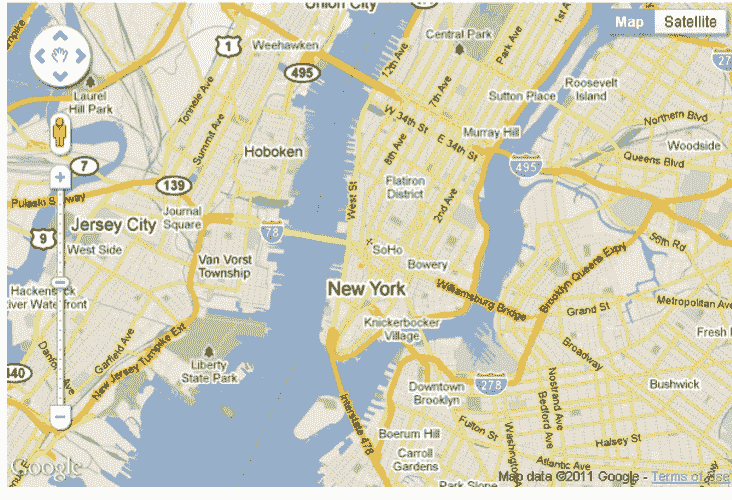

*图 4-1. 地图聚光灯项目起始屏幕*

注意位于 SoHo 左上方的（手绘）小红 x。在选择地图标记时，你会面临一个权衡。较小的标记更难看清。较大和/或更复杂的标记更容易看清，但会遮挡更多地图或分散对地图的注意力。x 标记了曼哈顿下城的一个街区。它是朋友 ED 出版商的地址。对于此程序，它是初始基准位置。基准位置用于计算距离。

将鼠标移到地图上如图 4-2 所示。

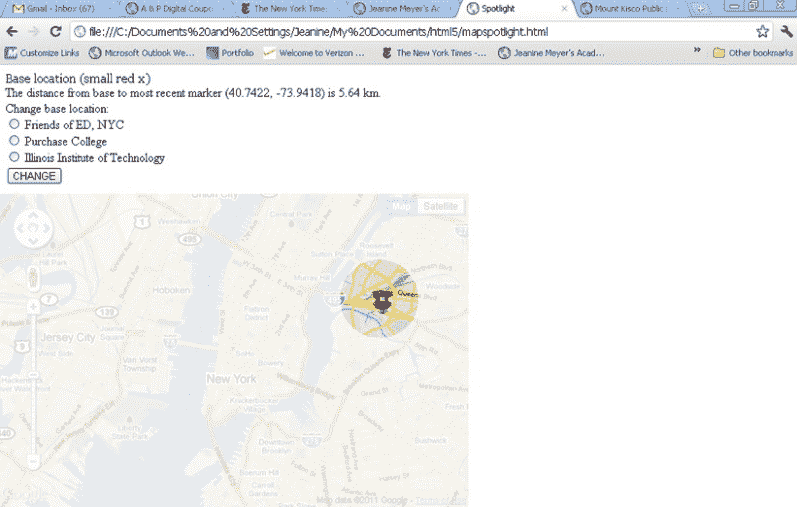

*图 4-2. 地图上的阴影/聚光灯*

注意地图上现在出现的阴影和聚光灯组合。地图的大部分被半透明的阴影覆盖。你需要相信我，这张截图是在我将鼠标移到地图上时截取的。在鼠标位置周围有一个圆圈，原始地图透过该圆圈显示出来。光标不是标准的默认光标，而是我使用一个代表紧凑型荧光灯泡的小图像创建的。

屏幕上的文本显示从基准位置到我点击的地图上最后一个点的距离为 5.64 公里。所有此类位置的标记都是手绘的 x。该位置的经纬度在括号中指示。

Google Maps 提供的一般 GUI 功能可供此项目的用户使用。这包括一个控制演示比例的垂直滑块。图 4-3 展示了使用该滑块进行放大的结果。可以进一步放大。

基准位置（小红 x）
从基准位置到最新标记 (40.7422, -73.9418) 的距离是 5.64 公里。
更改基准位置：

- 朋友 ED，纽约市
- 普切斯学院
- 伊利诺伊理工学院

更改

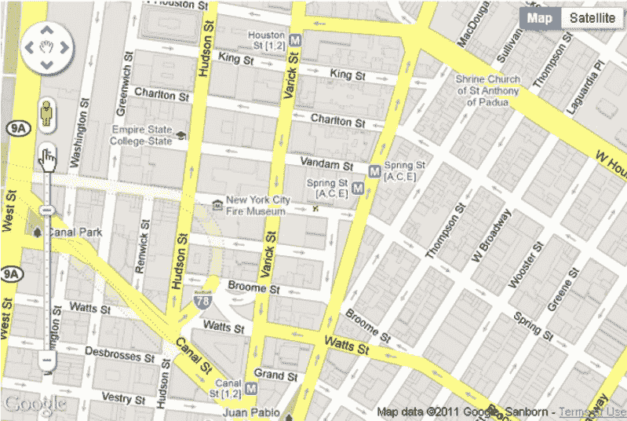

*图 4-3. 放大到街道级别*

也可以通过点击左上角的手形图标，然后按下鼠标按钮并拖动来虚拟地抓取地图进行平移。图 4-4 显示了缩小并向北移动的效果。屏幕上再次显示了阴影/聚光灯。

基准位置（小红 x）

从基准位置到最新标记 (41.2365, -73.6977) 的距离是 62.39 公里。

更改基准位置：

- 朋友 ED，纽约市
- 普切斯学院
- 伊利诺伊理工学院

更改

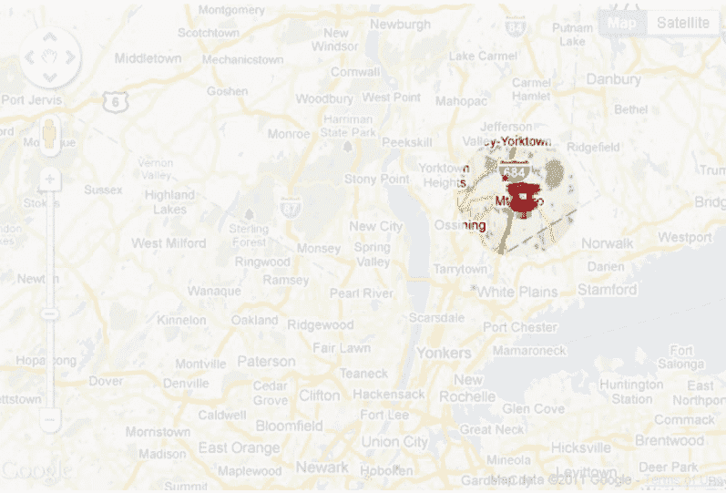

*图 4-4. 缩小并向北移动*

该程序提供了一种更改基准位置的方法。有三种选择：出版商朋友 ED 在纽约市的位置；普切斯学院（我在那里教学），位于纽约州纽约市北部的普切斯；以及伊利诺伊理工学院（我儿子在那里教学），位于伊利诺伊州的芝加哥。进行此选择的界面是一组单选按钮——一次只能选择一个按钮——以及一个标有"更改"的按钮，当用户/观众/访客决定进行更改时点击。图 4-5 显示了更改为普切斯学院的结果。注意手绘的红色 x 标记基准位置，以及页面顶部的文本通过名称指示新的基准位置。

基准位置（红色小x）为 Purchase College/ SUNY
更改基准位置：
○ Friends of ED, NYC
◉ Purchase College
○ Illinois Institute of Technology
[更改]

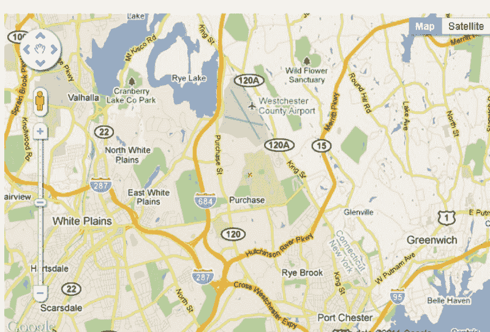

*图 4-5. Purchase College 的新基准位置*

接下来，我点击第三个单选按钮，将基地切换到伊利诺伊州芝加哥市的伊利诺伊理工学院。结果如图 4-6 所示。

基准位置（红色小x）为 Illinois Institute of Technology
更改基准位置：
○ Friends of ED, NYC
○ Purchase College
● Illinois Institute of Technology
[更改]

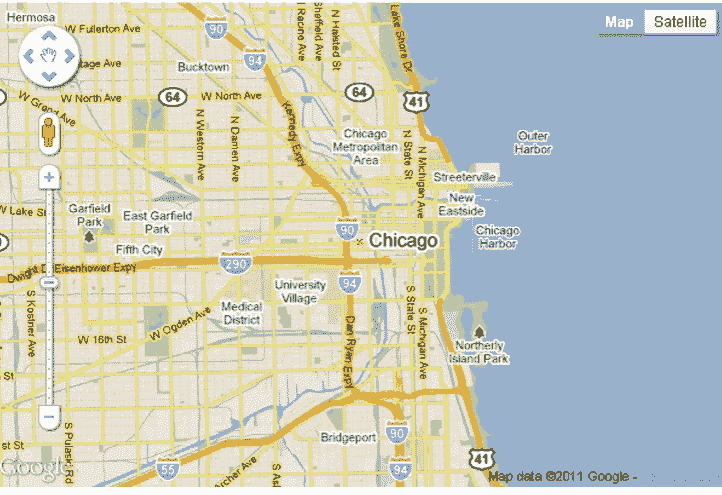

*图 4-6. 基地位于伊利诺伊州芝加哥市的伊利诺伊理工学院*

再次注意指示基准位置的红色小x，以及屏幕顶部显示新基准位置名称的文本。

每个基地的位置是由我确定的三个值的纬度和经度值决定的。我的代码并不是在"询问"Google 地图按名称查找这些位置。如果你在 Google 或 Google 地图中输入"Purchase College, NY"和"Illinois Institute of Technology"，可能会得到不同的结果。要制作你自己的应用程序，你需要决定一组基准位置并查找其经纬度值。我将在下一节中建议如何操作。

以防你好奇，将缩放/比例尺滑块拖到最远位置，会产生如图 4-7 所示的效果。这种投影展示了所谓的格陵兰问题。格陵兰岛并不比非洲大，实际上只有非洲面积的约 1/14。

基准位置（红色小x）
从基准位置到最近标记点 (40.6855, -74.0935) 的距离为 8.7 km。
更改基准位置：
- ○ Friends of ED, NYC
- ○ Purchase College
- ○ Illinois Institute of Technology

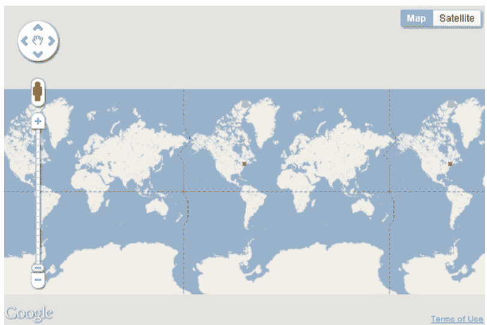

*图 4-7. 地图最远视图*

图 4-8 显示了接近最放大限制的地图。地图也已使用右上角的按钮更改为卫星视图。

基准位置（红色小x）为 Friends of ED, NYC
从基准位置到最近标记点 (40.6855, -74.0935) 的距离为 8.7 km。
更改基准位置：
- ○ Friends of ED, NYC
- ○ Purchase College
- ○ Illinois Institute of Technology

[更改]

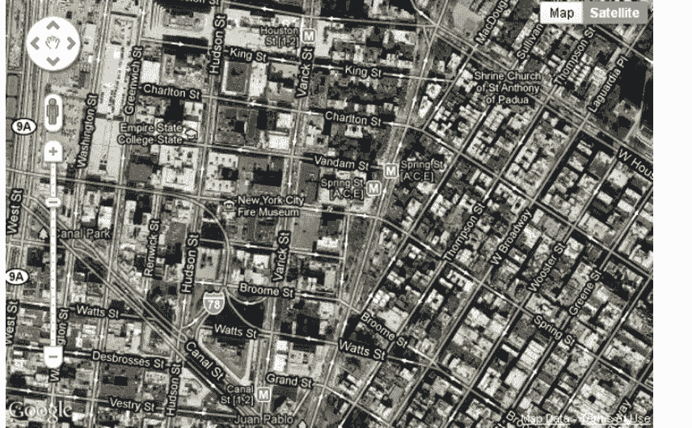

*图 4-8. 放大到可以识别城市街区的程度*

注意左侧的滑块大约在最接近设置上方四个刻度处。最后，图 4-9 显示了放大到极限的地图。这基本上是建筑级别，至少在曼哈顿是如此。

基准位置（红色小x）为 Friends of ED, NYC
从基准位置到最近标记点 (40.7257, -74.0049) 的距离为 0.01 km。
更改基准位置：
Friends of ED, NYC
Purchase College
Illinois Institute of Technology
更改

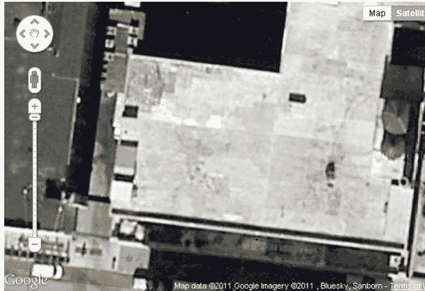

*图 4-9. 完全放大*

通过使用界面缩小、平移和再次放大，我可以确定从任何一个基准位置到世界上任何其他位置的距离！我还可以使用此应用程序来确定任何位置的经纬度值。你需要知道经纬度，以便更改或添加到基准位置列表，以及为第 5 章的项目确定位置。我将在下一节中回顾经纬度。

Google 地图本身就是一个非常有用的应用程序。本章和接下来的两章将演示如何将该功能引入你自己的应用程序。也就是说，我们将 Google 地图的通用功能与我们可以使用 HTML5 和 JavaScript 开发的任何或几乎所有东西结合起来。

### 经纬度和其他关键要求

本项目以及接下来两章项目最基本的requirement，是理解地理坐标系。就像需要坐标系来指定画布上的点或屏幕上的位置一样，有必要使用一个系统来表示地球上的位置。纬度和经度系统在过去的几百年中已经发展并标准化。这些值是角度，纬度表示距赤道的度数，经度表示距英国格林尼治本初子午线的度数。后者是19世纪末成为标准的一个任意选择。这里存在北半球偏见：纬度值从赤道的 0 度到北极的 90 度和南极的 –90 度。同样，经度值从格林尼治本初子午线向东为正，向西为负。纬度平行于赤道，经度垂直于赤道。纬度通常称为平行线，通常显示为水平线；经度称为子午线，通常显示为垂直线。这种方向是任意的，但相当稳固地确立。

我将使用十进制值，这是 Google 地图中显示的默认格式，但你会看到度、分（1/60度）和秒（1/60分）的组合。你无需记忆经纬度值，但培养一些对该系统的直觉感知是有益的。你可以通过我所谓的"双向操作"来做到这一点。首先，识别并比较你所知道地方的经纬度值；其次，选择值并查看它们是什么。例如，我项目版本的基准值如下：

- [40.725592, -74.00495, "friends of ED, NYC"]
- [41.04796, -73.70539, "Purchase College/SUNY"]
- [41.878928, -87.641926, "Illinois Institute of Technology"]

首先要注意到的是纬度值相当接近，经度值为负且不那么接近。纽约市的 Friends of ED 办公室与 Purchase College 的纬度差在 1 度以内，经度差也在 1 度以内。根据 Google 地图，距离为 27.4 英里。伊利诺伊理工学院的经度值更负，表明它比纽约州的两个位置更靠西。这一切都讲得通，但你需要花时间仔细思考。

有多种方法可以找到特定位置的经纬度。你可以使用 Google 地图如下操作：

1. 调用 Google 地图（访问`www.google.com`并点击地图，或访问`http://maps.google.com`）。
2. 在右上角，点击齿轮图标打开下拉菜单。点击"地图实验室"选项。将出现一个标题为 Google Maps Labs 的窗口。向下滚动到 LatLng Marker 选项，点击旁边的"启用"圆圈。如果你登录，所有设置将在下次登录时保持有效。保存并关闭窗口。
3. 在位置字段中输入你感兴趣的位置。
4. 右键/Ctrl+点击该位置以获取下拉菜单，如图 4-10 所示。
5. 点击 Drop LatLng marker 以获得如图 4-11 所示的结果。

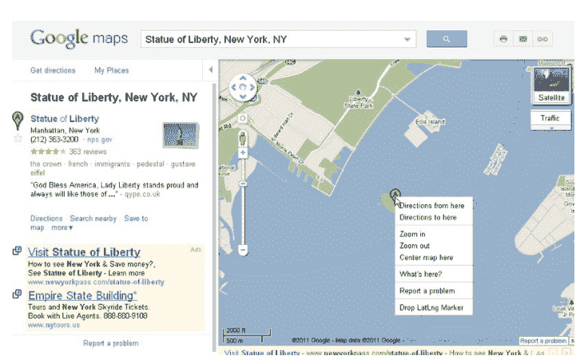

*图 4-10. 在 Google 地图中获取经纬度值*

选择 Drop LatLng Marker 选项后，你将在一个小框中看到经纬度值，如图 4-11 所示。

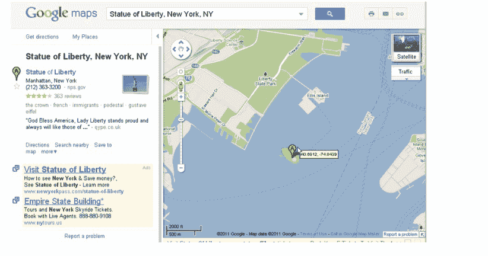

*图 4-11. 显示经纬度的框*

另一个选择是使用 Wolfram Alpha (`www.wolframalpha.com`)，如图 4-12 所示，它提供了一种确定经纬度值以及许多其他信息的方法。

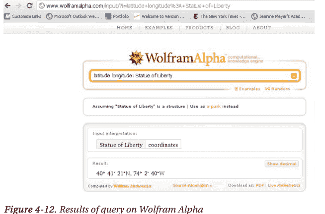

*图 4-12. Wolfram Alpha 的查询结果*

注意结果的格式。这是度/分/秒格式，N 表示北，W 表示西。当我点击"Show decimal"按钮时，程序会显示如图 4-13 所示的内容。

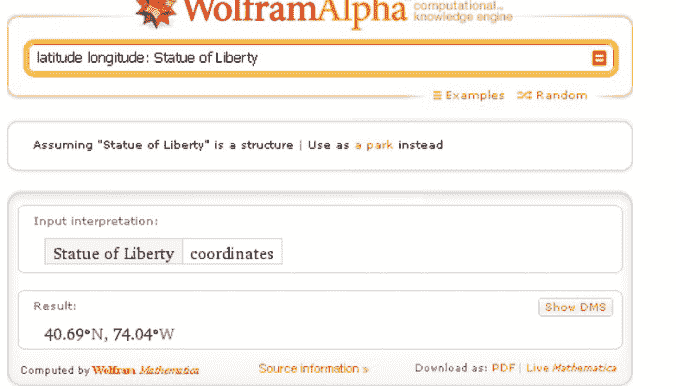

*图 4-13. Wolfram Alpha 查询的十进制结果*

请注意，这里经度仍然使用W表示西方，而不是谷歌地图中使用的负值。

执行我称之为"反向操作"的过程，你可以将纬度和经度值输入谷歌地图。图4-14展示了输入0.0和0.0的结果。这是加纳以南海域中的一个点。这个点既在赤道上*又*在格林尼治本初子午线上。

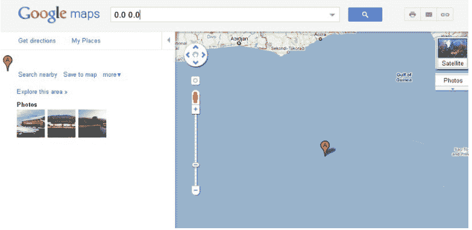

*图4-14. 位于格林尼治本初子午线上的赤道*

我试图在英格兰找到一个位于格林尼治本初子午线上的地方，在猜测纬度为52.0度时，得到了如图4-15所示的结果。

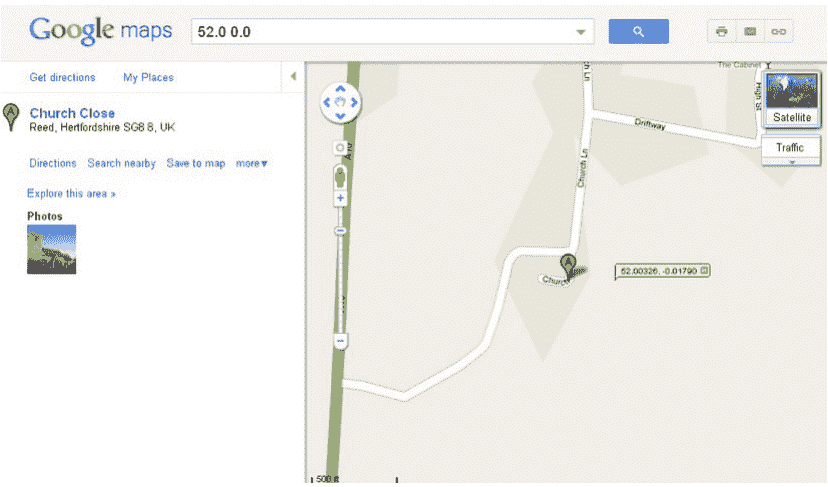

*图4-15. 格林尼治本初子午线附近地点的结果*

A标记表示谷歌数据库中距离所请求位置最近的地方。我使用了"放置LatLng标记"选项来显示确切的纬度和经度值。

该项目的关键需求首先是将谷歌地图引入HTML5应用程序，并使用指定的纬度和经度值。一个额外的需求是在地图上生成阴影/聚光灯组合，以跟踪鼠标的移动。我还要求将鼠标默认光标更改为我自己选择的样式。

接下来，我增加了一个在地图上放置标记的需求，但同样，使用的是我挑选的图形图标，而不是谷歌地图标准的倒水滴形。水滴形标记本身很好，但我的设计目标是与众不同，向你展示如何将你自己的创意融入应用程序。

除了图形之外，我希望用户能够使用谷歌地图设备以及我使用HTML5构建的任何GUI功能。这都需要管理由谷歌地图API设置的事件和使用HTML5 JavaScript设置的事件。我希望用于用户界面的事件响应包括：

- 使用阴影/聚光灯图形跟踪鼠标移动
- 通过在地图上放置*x*来响应点击
- 保持与谷歌地图界面相同的响应方式（滑块、平移按钮、通过抓取地图进行平移）
- 以适当的方式处理单选按钮和CHANGE按钮

谷歌地图提供了一种确定地点之间距离的方法。由于我希望将此项目设置为基于基础位置运行，因此需要一种直接计算距离的方法。

这些是地图聚光灯项目的关键需求。现在我将解释我用来构建该项目的HTML5特性。目标是使用谷歌地图特性和JavaScript特性，包括事件，并让它们互不干扰。你可以将你在此项目和其他项目中学到的内容应用起来。

### HTML5、CSS和JavaScript特性

地图制作项目的挑战在于引入谷歌地图，然后在外观和GUI操作方面将地图、画布和按钮结合起来使用。我将描述基本的谷歌地图API，然后解释HTML5特性如何提供部分遮罩和事件处理。

### 谷歌地图API

谷歌地图JavaScript API第3版基础文档位于`http://code.google.com/apis/maps/documentation/javascript/basics.html`，文档非常详尽。你现在不需要查阅它，但如果你决定构建自己的项目，它将会对你有帮助。特别是在为移动设备制作应用程序时，它将特别有帮助。

大多数API都以一组相关对象的形式呈现，每个对象都有属性（也称为特性）和方法。API还可能包括事件以及设置事件的方法。谷歌地图API就是这种情况。重要的对象有`Map`、`LatLng`和`Marker`。设置事件的方法是`addListener`，它可以用来设置对地图点击的响应。

谷歌地图API通过一个`script`元素引入到你的HTML5文档中：

```html
<script type="text/javascript" charset="UTF-8"
src="http://maps.google.com/maps/api/js?sensor=false</script>
```

我将在第6章再次讨论`script`标签，特别是`sensor=false`设置。

下一步——如果你只想引入谷歌地图，这可能就是你需要做的全部——是设置对Map构造函数方法的调用。伪代码如下：

```javascript
map = new google.maps.Map(你要放置地图的地方, 包含选项的关联数组);
```


注意，将变量命名为 `map` 没有坏处。

让我们一次讨论这两个参数。放置地图的地方可以是 HTML 文档 `body` 中定义的一个 `div`。然而，我选择动态创建这个 `div`。我通过在一个以通常方式调用的 `init` 函数中使用代码来完成此操作，即在 `body` 语句中设置 `onLoad` 属性。我还编写了在 `div` 内创建 canvas 元素的代码。代码如下：

```javascript
candiv = document.createElement("div");
candiv.innerHTML = ("<canvas id='canvas' width='600' height='400'>No canvas</canvas>");
document.body.appendChild(candiv);
can = document.getElementById("canvas");
pl = document.getElementById("place");
ctx = can.getContext("2d");
```

> **注意** 尽管我试图使用“将谷歌地图的访问权限引入 HTML 文档”这样的语言，但我还是犯了一个描述函数“制造”地图的错误。谷歌地图的连接是动态的，谷歌地图会创建所谓的“要显示的图块”。

`Map` 方法的第二个参数是一个关联数组。关联数组具有命名的元素，而不是索引元素。`Map` 方法的数组可以指示缩放级别、地图中心和地图类型等。缩放级别可以从 0 到 18。级别 0 是图 4-7 中显示的内容。级别 18 可以显示建筑物。地图类型有 `ROADMAP`、`SATELLITE`、`HYBRID` 和 `TERRAIN`。这些使用谷歌地图 API 中的常量表示。中心由 `LatLng` 类型的值给出，正如你可能预料的那样，它使用代表纬度和经度值的十进制数字构造。使用关联数组意味着我们不必按照固定的参数顺序，对于任何我们省略的参数，都将应用默认设置。

以下是我的 `makemap` 函数的开始部分。该函数调用时使用两个数字，指示地图中心的纬度和经度。我的代码构建一个 `LatLng` 对象，设置保存地图规范的数组，然后构建地图——即构建通往谷歌地图的门户。

```javascript
function makemap(mylat, mylong) {
    var marker;
    blatlng = new google.maps.LatLng(mylat, mylong);
    myOptions = {
        zoom: 12,
        center: blatlng,
        mapTypeId: google.maps.MapTypeId.ROADMAP
    };
    map = new google.maps.Map(document.getElementById("place"), myOptions);
}
```

`Map` 方法构建对谷歌地图的访问，从在 ID 为 `place` 的 div 中显示具有指定选项的地图开始。`makemap` 函数继续执行，在地图中心放置一个标记。这是通过设置一个关联数组作为 `Marker` 方法的参数来完成的。图标标记将是我使用自己设计的图像创建的图像，一个画的红色 x。

```javascript
marker = new google.maps.Marker({
    position: blatlng,
    title: "center",
    icon: rxmarker,
    map: map
});
```

`makemap` 函数中还有一条语句，但我稍后会解释其余部分。

## Canvas 图形

我们希望随着鼠标在地图上移动的图形类似于第 3 章中用于将矩形视频片段转换为圆形视频片段的遮罩。两个遮罩都可以描述为类似于矩形甜甜圈：一个带有圆形孔洞的矩形。我们使用两条路径绘制阴影/聚光灯的图形，就像前一章中视频的遮罩一样。然而，这两种情况之间存在两个明显的差异：

- 这个遮罩的确切形状各不相同。外边界是整个画布，孔洞的位置与鼠标的当前位置对齐。孔洞会四处移动。
- 遮罩的颜色不是实心颜料，而是透明的灰色。

画布最初位于谷歌地图的上方。我通过编写设置 z-index 值的样式指令来实现这一点：

```css
canvas {position:absolute; top: 165px; left:0px; z-index:100;}
#place {position:absolute; top: 165px; left: 0px; z-index:1;}
```

第一条指令适用于所有 canvas 元素。在这个 HTML 文档中只有一个。回想一下，z 轴是从屏幕指向观众的，所以较高的值会位于较低值的上方。另请注意，我们在 JavaScript 代码中使用 `zIndex`，而在 CSS 中使用 `z-index`。JavaScript 解析器会将 `-` 视为减号运算符，因此需要改为 `zIndex`。我将需要编写代码来更改 `zIndex`，以实现这个项目所需的事件处理。

图 4-16 展示了在画布上绘制的阴影遮罩的一个例子。就 z-index 而言，画布位于地图上方，遮罩用透明的灰色绘制，因此下方的地图是可见的。

- 基础位置（小红叉）是纽约市的 Friends of ED
- 从基础位置到最新标记点 (40.7257, -74.0049) 的距离是 0.01 公里。
- 更改基础位置：
  - Friends of ED, NYC
  - Purchase College
  - Illinois Institute of Technology
- [更改]

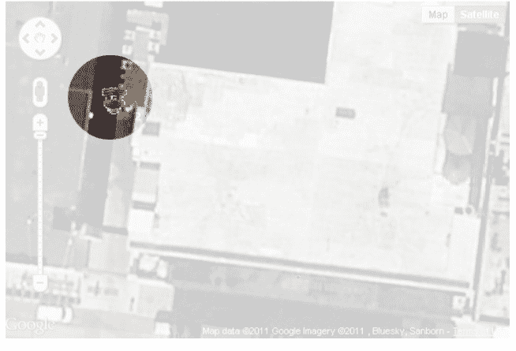

**图 4-16.** *地图上某个位置的阴影/聚光灯效果*

图 4-17 展示了在同一张地图上绘制的阴影遮罩的另一个例子。这是由用户移动鼠标产生的。

基础位置（小红叉）是纽约市的 Friends of ED
从基础位置到最新标记点 (40.7257, -74.0047) 的距离是 0.03 公里。
更改基础位置：

- Friends of ED, NYC
- Purchase College
- Illinois Institute of Technology

更改

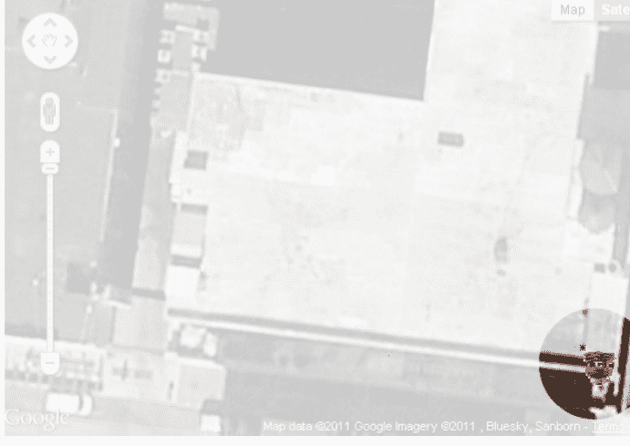

图 4-17. 遮罩位于地图上另一个位置的阴影效果

这里有几个主题相互关联。让我们假设变量 `mx` 和 `my` 存储了鼠标光标在画布上的位置。我将在本章后面解释如何做到这一点。函数 `drawshadowmask` 将绘制阴影遮罩。作为遮罩颜色的透明灰色是在一个我命名为 `grayshadow` 的变量中定义的，并使用内置函数 `rgba` 构建。`rgba` 代表红-绿-蓝-透明度。透明度指的是透明/不透明度。透明度值为 1 表示颜色完全不透明：实心。值为 0 表示完全透明——颜色不可见。同时回想一下，红、绿、蓝的值范围是 0 到 255，而 255, 255, 255 的组合将是白色。现在是实验的时候了。我为灰色/灰白色/幽灵般的阴影决定了以下设置：

```javascript
var grayshadow = "rgba(250,250,250,.8)";
```

函数 `drawshadowmask` 利用了几个作为常量的变量——它们从不改变。图 4-18 展示了标有这些值的示意图。

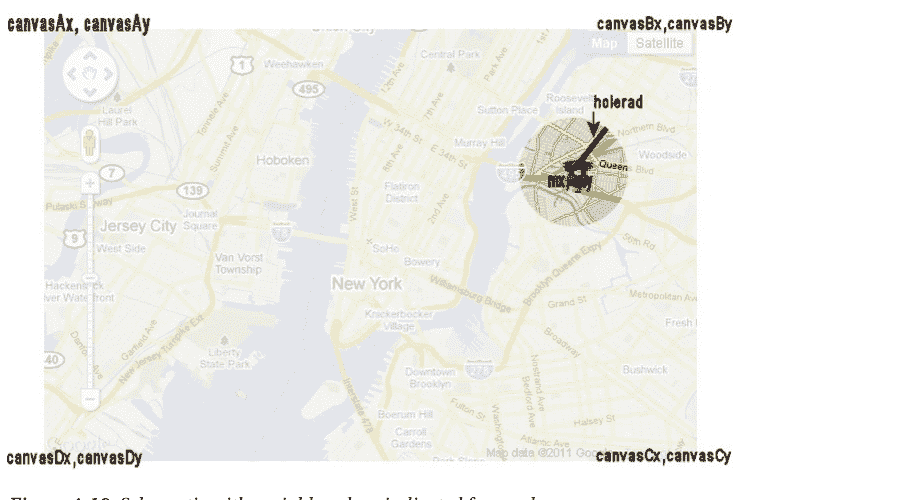

遮罩分两部分绘制，就像用于弹跳视频的遮罩一样。你可以回顾图 3-8 和图 3-9。编码是类似的：

```javascript
function drawshadowmask(mx, my) {
    ctx.clearRect(0, 0, 600, 400);
    ctx.fillStyle = grayshadow;
    ctx.beginPath();
    ctx.moveTo(canvasAx, canvasAy);
    ctx.lineTo(canvasBx, canvasBy);
    ctx.lineTo(canvasBx, my);
    ctx.lineTo(mx + holerad, my);
    ctx.arc(mx, my, holerad, 0, Math.PI, true);
    ctx.lineTo(canvasAx, my);
    ctx.lineTo(canvasAx, canvasAy);
    ctx.closePath();
    ctx.fill();
    ctx.beginPath();
    ctx.moveTo(canvasAx, my);
    ctx.lineTo(canvasDx, canvasDy);
    ctx.lineTo(canvasCx, canvasCy);
    ctx.lineTo(canvasBx, my);
    ctx.lineTo(mx + holerad, my);
    ctx.arc(mx, my, holerad, 0, Math.PI, false);
    ctx.lineTo(canvasAx, my);
    ctx.closePath();
    ctx.fill();
}
```

现在我们继续讨论红色灯泡。

### 光标

光标——当你移动鼠标时在屏幕上移动的小图形——可以在 style 元素或 JavaScript 中设置。对于图形有几种内置选择（例如，十字准线、指针），我们也可以参考自己的设计来制作自定义光标，这正是我在这个项目中演示的。我在 `init` 函数中包含了这条语句：

```javascript
can.onmousedown = function () { return false; };
```

以防止按下鼠标时默认光标发生变化。这可能不是必需的，因为默认光标可能不会被触发。

为了将移动鼠标时的光标更改为传达聚光灯效果的东西，我创建了一个红色紧凑型荧光灯泡的图片，并将其保存在文件 `light.gif` 中。然后我在 `showshadow` 函数中使用了以下语句。`showshadow` 函数已被设置为 `mousemove` 的事件处理程序：

```javascript
can.style.cursor = "url('light.gif'), pointer";
```

以指示 JavaScript 在 `can` 元素上方时，应使用该地址作为光标的图像。此外，如果文件 `light.gif` 不可用，该语句指示 JavaScript 使用内置的指针图标。这与指定字体时使用优先选择列表的方式类似。变量 `can` 已被设置为引用 canvas 元素。当画布被推到谷歌地图下方时，将不会使用光标，这将在下一节中讨论。

### 事件

事件处理——即鼠标事件，但也包括更改谷歌地图滑块或单选按钮的事件——在我开始这个项目时似乎是最令人生畏的。然而，实际的实现结果却很直接。在 `init` 函数中，我编写代码来设置画布元素上鼠标移动、鼠标按下和鼠标释放的事件处理：

```javascript
can.onmousedown = function () { return false; };
can.addEventListener('mousemove', showshadow, true);
can.addEventListener('mousedown', pushcanvasunder, true);
can.addEventListener("mouseout", clearshadow, true);
```

第三个参数的 `true` 值表示此事件要*冒泡*，即它要通知其他监听器。然而，要实现这个项目所需的事件处理，还需要更多工作。我将解释这三个函数，然后继续描述另一个事件。

如前所述，`showshadow` 函数调用 `drawshadowmask` 函数。我本可以将这两个函数合并，但将任务分解为更小的任务通常是一个好习惯。`showshadow` 函数确定鼠标位置，进行调整使灯泡底座位于聚光灯中心，然后调用 `drawshadowmask`：

```javascript
function showshadow(ev) {
    var mx;
    var my;
    if (ev.layerX || ev.layerX == 0) {
        mx = ev.layerX;
        my = ev.layerY;
    } else if (ev.offsetX || ev.offsetX == 0) {
        mx = ev.offsetX;
        my = ev.offsetY;
    }
    can.style.cursor = "url('light.gif'), pointer";
    mx = mx + 10;
    my = my + 12;
    drawshadowmask(mx, my);
}
```

现在我需要思考当用户按下鼠标时我想做什么。我决定让阴影消失，并以完整的亮度显示地图。除了外观之外，我还希望谷歌地图 API 恢复控制权。希望谷歌地图 API 接管的一个关键原因是，我想在地图上而不是画布上放置一个标记来标记一个位置。这是因为我想让标记随地图一起移动，而这通过在画布上绘制是很难做到的。我需要同步画布上的标记与地图的平移和缩放。相反，API 为我完成了所有这些。此外，我需要谷歌地图 API 生成位置的经纬度值。

将谷歌地图重新置于控制之下（可以这么说）的方式是“将画布推到下面”。该函数是：

```javascript
function pushcanvasunder(ev) {
    can.style.zIndex = 1;
    pl.style.zIndex = 100;
}
```

将画布推到下面或将其重新带到上面的操作并非瞬时完成。我乐于接受关于 (1) 如何定义接口以及 (2) 如何实现你所定义内容的建议。这里有改进的空间。

还需要处理的另一种情况是，如果用户将鼠标移出画布会发生什么？`mouseout` 事件可以作为被监听的事件，因此我编写了设置该事件的代码（参见上面显示的 `can.addEventListener` 语句），由 `clearshadow` 函数处理。`clearshadow` 函数正是完成这个任务：清除整个画布，包括阴影：

```javascript
function clearshadow(ev) {
    ctx.clearRect(0, 0, 600, 400);
}
```

在引入谷歌地图的函数中，我为地图的 `mouseup` 设置了事件处理程序。

```javascript
listener = google.maps.event.addListener(map, 'mouseup', function(event) {
    checkit(event.latLng);
});
```

调用 `addListener`（这是 Google Maps API 的一部分，而非 JavaScript 本身的方法）来设置对 `checkit` 函数的调用。`checkit` 函数使用事件对象的一个属性作为参数来调用。可以猜到，`event.latLng` 是鼠标在地图对象上释放时的经纬度值。`checkit` 函数将使用这些值来计算与基准位置的距离，并在屏幕上打印出这些值以及距离。代码调用了一个我编写的函数来四舍五入数值。这样做是为了避免显示具有许多有效数字的值，对于这个项目来说这并不合适。Google Maps API 的 `marker` 方法提供了一种方式来使用我选择的图像作为标记（这次是一个黑色的手绘 'x'），并为标记添加一个标题。推荐使用标题是为了让使用屏幕阅读器的人能够访问应用程序，尽管我不能声称这个项目在可访问性方面能满足任何人。可以生成图 4-19 所示的屏幕。

基准位置（小红 x）是 Purchase College/SUNY
从基准位置到最近标记 (41.2057, -73.725) 的距离是 17.62 km。
更改基准位置：

- Friends of ED, NYC
- Purchase College
- Illinois Institute of Technology

[CHANGE]

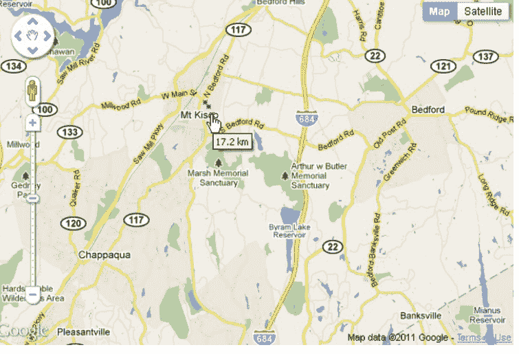

**图 4-19.** *地图上显示距离的标题*

`checkit` 函数如下所示，它接收一个包含经纬度值的参数：

```javascript
function checkit(clatlng) {
    var distance = dist(clatlng, blatlng);
    distance = round(distance, 2);
    var distanceString = String(distance) + " km";
    marker = new google.maps.Marker({
        position: clatlng,
        title: distanceString,
        icon: bxmarker,
        map: map
    });
    var clat = clatlng.lat();
    var clng = clatlng.lng();
    clat = round(clat, 4);
    clng = round(clng, 4);
    document.getElementById("answer").innerHTML =
        "The distance from base to most recent marker (" + clat + ", " + clng + ") is " + String(distance) + " km.";
    can.style.zIndex = 100;
    pl.style.zIndex = 1;
}
```

请注意，该函数最后做的一件事是将画布重新置于地图之上。CHANGE 按钮和单选按钮使用标准的 HTML 和 JavaScript 实现。表单使用以下 HTML 代码生成：


<form name="f" onSubmit="return changebase();">

<input type="radio" name="loc" /> Friends of ED, NYC<br/>

<input type="radio" name="loc" /> Purchase College<br/>

<input type="radio" name="loc" /> Illinois Institute of Technology<br/>

<input type="submit" value="CHANGE">

</form>

当点击标记为 `CHANGE` 的提交按钮时，会调用 `changebase()` 函数。`changebase()` 函数确定哪个单选按钮被选中，并使用 `Locations` 表来获取经纬度值。然后，它使用这些值作为参数调用 `makemap()`。这种组织数据的方式被称为并行结构：`locations` 数组的元素对应于单选按钮。最后一条语句设置标题元素的 `innerHTML` 以显示文本，包括所选基准位置的名称。

```
function changebase() {

    var mylat;

    var mylong;

    for(var i=0;i<locations.length;i++) {

        if (document.f.loc[i].checked) {

            mylat = locations[i][0];

            mylong = locations[i][1];

            makemap(mylat,mylong);

            document.getElementById("header").innerHTML =

                "Base location (small red x) is "+locations[i][2];

        }

    }

    return false;

}
```

### 计算距离与舍入显示值

众所周知，Google Maps 提供距离信息，甚至区分步行和驾车。对于这个应用程序，我需要更多控制来指定要计算距离的两个位置，因此我决定在 JavaScript 中开发一个函数。确定两个点（每个点代表经纬度值）之间的距离是使用球面余弦定理完成的。我的来源是 www.movable-type.co.uk/scripts/latlong.html。代码如下：

```
function dist(point1, point2) {

    var R = 6371; // km

    // var R = 3959; // miles

    var lat1 = point1.lat()*Math.PI/180;

    var lat2 = point2.lat()*Math.PI/180;

    var lon1 = point1.lng()*Math.PI/180;

    var lon2 = point2.lng()*Math.PI/180;

    var d = Math.acos(Math.sin(lat1)*Math.sin(lat2) +

    Math.cos(lat1)*Math.cos(lat2) *

    Math.cos(lon2-lon1)) * R;

    return d;

}
```

> **注意** 我没有在代码中包含很多注释，因为我包含了每行都有注释的表格。然而，注释很重要。我强烈建议保留 `dist()` 函数中关于公里和英里的注释，以便您可以相应地调整程序。或者，您可以同时显示两个值或给用户一个选择。

最后一个函数用于舍入值。当一个量取决于一个人移动鼠标时，你不应该显示小数位数很多的值。然而，我们应该记住经纬度代表的是大单位。我决定让距离显示两位小数，经纬度显示四位小数。我编写的函数相当通用。它接受两个参数，一个是数字 `num`，另一个是 `places`，表示要取值的小数位数。您可以在其他情况下使用它。它根据需要向上或向下舍入，通过添加我称之为增量的值，然后计算不大于该值的最大整数。所以

- `round(9.147,2)` 将产生 9.15；而
- `round(9.143, 2)` 将产生 9.14。

代码的工作方式是首先确定我所谓的因子，即10的所需位数次方。对于2位，这将是100。然后我计算增量。对于两位小数，这将是 5 / 100 * 10，即 5 / 1000，即 0.005。我的代码执行以下操作：

1.  将增量添加到原始数字
2.  将结果乘以因子
3.  计算不大于结果的最大整数（这称为 floor）——产生一个整数
4.  将结果除以因子

代码如下：

```
function round (num,places) {

    var factor = Math.pow(10,places);

    var increment = 5/(factor*10);

    return Math.floor((num+increment)*factor)/factor;

}
```


我使用 `round` 函数将距离舍入到两位小数，经纬度舍入到四位小数。

> **提示** JavaScript 有一个名为 `toFixed` 的方法，它本质上执行我的 `round` 函数的任务。如果 `num` 持有一个数字——比如 51.5621——那么 `num.toFixed()` 将产生 51，而 `num.toFixed(2)` 将产生 51.56。我读到过这个方法可能存在不准确性，所以我选择创建自己的函数。不过，您可能愿意在您自己的应用程序中使用 `toFixed()`。

在解释了相关的 HTML5 和 Google Maps API 功能之后，我们现在可以把它们整合在一起。

### 构建应用程序并使其成为您自己的

地图聚光灯应用程序设置了 Google Maps 功能与 HTML5 编码的组合。该应用程序的简要总结如下：

1.  `init`：初始化，包括引入地图 (`makemap`) 并设置带有处理程序的鼠标事件：`showshadow`、`pushcanvasunder`、`clearshadow`
2.  `makemap`：引入地图并设置事件处理，包括调用 `checkit`
3.  `showshadow`：调用 `drawshadowmask`
4.  `pushcanvasunder`：启用地图上的事件
5.  `checkit`：计算距离，添加自定义标记，并显示距离以及舍入后的经纬度

描述被调用/调用关系的函数表（表 4-1）对于所有应用程序都是相同的。

### 表 4-1. 地图制作者项目中的函数

| 函数 | 被调用/调用者 | 调用 |
| :--- | :--- | :--- |
| init | 被 `<body>` 标签中 `onLoad` 属性的操作调用 | makemap |
| pushcanvasunder | 被 init 中调用的 `addEventListener` 的操作调用 | |
| clearshadow | 被 init 中调用的 `addEventListener` 的操作调用 | |
| showshadow | 被 init 中调用的 `addEventListener` 的操作调用 | drawshadowmask |
| drawshadowmask | 被 showshadow 调用 | |
| makemap | 被 init 调用 | |
| checkit | 被 makemap 中调用的 `addEventListener` 的操作调用 | round, dist |
| round | 被 checkit 调用（三次） | |
| dist | 被 checkit 调用 | |
| changebase | 被 `<form>` 中 `onSubmit` 的操作调用 | makemap |

### 表 4-2. mapspotlight.html 应用程序的完整代码

| 代码行 | 描述 |
| :--- | :--- |
| `<!DOCTYPE html>` | 文档头 |
| `<html>` | 开始 html 标签 |
| `<head>` | 开始 head 标签 |
| `<title>Spotlight </title>` | 完整标题 |
| `<meta charset="UTF-8">` | Meta 标签 |
| `<style>` | style 元素的开始 |
| `header {font-family:Georgia,"Times New Roman",serif;` | 为标题设置字体 |
| `font-size:16px;` | 字体大小 |
| `display:block; }` | 前后换行 |
| `canvas {position:absolute; top: 165px; left:0px;` | 单个canvas元素的样式指令：位置在页面稍下方 |
| `z-index:100;}` | canvas的初始设置：位于地图之上 |
| `#place {position:absolute; top: 165px; left: 0px;` | 持有Google地图的div的样式指令：位置与canvas完全相同 |
| `z-index:1;}` | 初始设置：位于canvas之下 |
| `</style>` | 关闭style元素 |
| `<script type="text/javascript" charset="UTF-8" src="http://maps.google.com/maps/api/js?sensor=false"></script>` | 引入持有Google Maps API的外部script元素；未尝试使用传感器进行地理定位 |
| `<script type="text/javascript" charset="UTF-8">` | 开始script标签 |
| `var locations = [` | 定义一组基础位置 |
| `[40.725592,-74.00495, "Friends of ED, NYC"],` | ED朋友组织，纽约市的纬度、经度和名称 |
| `[41.04796,-73.70539,"Purchase College/SUNY"],` | ...普切斯学院 |
| `[41.878928, -87.641926,"Illinois Institute of Technology"]` | ...伊利诺伊理工学院 |
| `];` | 结束位置数组 |
| `var candiv;` | 用于持有包含canvas的div |
| `var can;` | canvas元素的引用 |
| `var ctx;` | canvas上下文的引用；用于所有绘图 |
| `var pl;` | 持有Google地图的div的引用 |
| `function init() {` | init函数头 |
| `var mylat;` | 将持有纬度值 |
| `var mylong;` | 将持有经度值 |
| `candiv = document.createElement("div");` | 创建一个div |
| `candiv.innerHTML = ("<canvas id='canvas' width='600' height='400'>No canvas </canvas>");` | 将其内容设置为一个canvas元素 |
| `document.body.appendChild(candiv);` | 添加到body |
| `can = document.getElementById("canvas");` | 设置canvas的引用 |
| `pl = document.getElementById("place");` | 设置持有Google地图的div的引用 |
| `ctx = can.getContext("2d");` | 设置上下文 |
| `can.onmousedown = function () { return false; } ;` | 防止光标变为默认样式 |
| `can.addEventListener('mousemove',showshadow,true);` | 为鼠标移动设置事件处理 |
| `can.addEventListener('mousedown',pushcanvasunder,true);` | 为按下鼠标按钮设置事件处理 |
| `can.addEventListener("mouseout",clearshadow,true);` | 为鼠标移出canvas设置事件处理 |
| `mylat = locations[0][0];` | 将纬度设置为第0个位置的纬度 |
| `mylong = locations[0][1];` | 将经度设置为第0个位置的经度 |
| `makemap(mylat,mylong);` | 调用制作地图的函数（在指定位置加载Google Maps） |
| `}` | 结束init函数 |
| `function pushcanvasunder(ev) {` | pushcanvas函数头，通过引用事件的参数调用 |
| `can.style.zIndex = 1;` | 将canvas推到下方 |
| `pl.style.zIndex = 100;` | 将地图div设到上方 |
| `}` | 结束pushcanvasunder函数 |
| `function clearshadow(ev) {` | clearshadow函数头，通过引用事件的参数调用 |
| `ctx.clearRect(0,0,600,400);` | 清除canvas（擦除阴影蒙版） |
| `}` | 结束clearshadow函数 |
| `function showshadow(ev) {` | showshadow函数头，通过引用事件的参数调用 |
| `var mx;` | 用于持有鼠标的水平位置 |
| `var my;` | 用于持有鼠标的垂直位置 |
| `if ( ev.layerX \|\| ev.layerX == 0) {` | 此浏览器是否使用layerX？ |
| `mx = ev.layerX;` | 如果是，用它设置mx . . . |
| `my = ev.layerY;` | . . . 和 my |
| `} else if (ev.offsetX \|\| ev.offsetX == 0) {` | 尝试offsetX |
| `mx = ev.offsetX;` | 如果是，用它设置mx . . . |
| `my = ev.offsetY;` | . . . 和 my |
| `}` | 结束条件语句 |
| `can.style.cursor = "url('light.gif'), pointer";` | 将光标设置为light.gif（如果可用），否则为pointer |
| `mx = mx+10;` | 进行粗略校正，使灯光中心在灯泡底部水平和 . . . |
| `my = my + 12;` | . . . 垂直方向 |
| `drawshadowmask(mx,my);` | 在修改后的(mx,my)处调用drawshadowmask函数 |
| `}` | 结束showshadow函数 |
| `var canvasAx = 0;` | 蒙版常量：左上角x |
| `var canvasAy = 0;` | 左上角y |
| `var canvasBx = 600;` | 右上角x |
| `var canvasBy = 0;` | 右上角y |
| `var canvasCx = 600;` | 右下角x |
| `var canvasCy = 400;` | 右下角y |
| `var canvasDx = 0;` | 左下角x |
| `var canvasDy = 400;` | 左下角y |
| `var holerad = 50;` | 阴影中孔的常量半径（聚光灯半径） |
| `var grayshadow = "rgba(250,250,250,.8)";` | 浅阴影颜色；注意alpha值为.8 |
| `function drawshadowmask(mx,my) {` | drawshadowmask函数头；参数持有甜甜圈孔的中心 |
| `ctx.clearRect(0,0,600,400);` | 擦除整个canvas |
| `ctx.fillStyle = grayshadow;` | 设置颜色 |
| `ctx.beginPath();` | 开始第一个（顶部）路径 |
| `ctx.moveTo(canvasAx,canvasAy);` | 移动到左上角 |
| `ctx.lineTo(canvasBx,canvasBy);` | 绘制到右上角 |
| `ctx.lineTo(canvasBx,my);` | 绘制到由my参数指定的垂直点 |
| `ctx.lineTo(mx+holerad,my);` | 向左绘制到孔的边缘 |
| `ctx.arc(mx,my,holerad,0,Math.PI,true);` | 绘制半圆弧 |
| `ctx.lineTo(canvasAx,my);` | 绘制到左侧 |
| `ctx.lineTo(canvasAx,canvasAy);` | 绘制回起点 |
| `ctx.closePath();` | 关闭路径 |
| `ctx.fill();` | 填充 |
| `ctx.beginPath();` | 开始第二个（底部）路径 |
| `ctx.moveTo(canvasAx,my);` | 从左侧由my参数指示的点开始 |
| `ctx.lineTo(canvasDx,canvasDy);` | 绘制到左下角 |
| `ctx.lineTo(canvasCx,canvasCy);` | 绘制到右下角 |
| `ctx.lineTo(canvasBx,my);` | 绘制到右侧边缘的点 |
| `ctx.lineTo(mx+holerad,my);` | 向左绘制到孔的边缘 |
| `ctx.arc(mx,my,holerad,0,Math.PI,false);` | 绘制半圆弧 |
| `ctx.lineTo(canvasAx,my);` | 绘制到右侧边缘 |
| `ctx.closePath();` | 关闭路径 |
| `ctx.fill();` | 填充 |
| `}` | 结束drawshadowmask函数 |
| `var listener;` | 由addListener调用设置的变量；*未再次使用* |
| `var map;` | 持有地图 |
| `var blatlng;` | 持有基础纬度经度对象 |
| `var myOptions;` | 持有用于地图的关联数组 |
| `var rxmarker = "x1.png";` | 持有红色*x*图像的文件名 |
| `var bxmarker = "bx1.png";` | 持有黑色*x*图像的文件名 |
| `function makemap(mylat,mylong) {` | makemap函数头；参数持有地图中心的位置 |
| `var marker;` | 将持有为中心创建的标记 |
| `blatlng = new google.maps.LatLng(mylat,mylong);` | 构建一个LatLng对象（API的特殊数据类型） |
| `myOptions = {` | 设置关联数组 |
| `zoom: 12,` | 缩放设置（可以是0到18） |
| `center: blatlng,` | 中心 |
| `mapTypeId: google.maps.MapTypeId.ROADMAP` | 地图类型 |
| `};` | 结束myOptions数组 |
| `map = new google.maps.Map(document.getElementById("place"),myOptions);` | 调用API在指定位置加载地图 |
| `marker = new google.maps.Marker(` | 在地图中心放置标记；marker方法接受一个关联数组作为参数 |
| `{` | 关联数组的开始 |
| `position: blatlng,` | 设置位置 |
| `title: "center",` | 设置标题 |
| `icon: rxmarker,` | 设置图标 |
| `map: map` | 将名为map的参数设置为名为map的变量 |
| `}` | 结束作为Marker调用参数的关联数组 |
| `);` | 结束Marker调用 |
| `listener = google.maps.event.addListener(` | 设置事件处理（以下三个参数） |
| `map,` | 对象，即地图 |
| `'mouseup',` | 特定事件 |
| `function(event) {` | 一个自主函数（直接作为 addListener 的参数定义） |
| `checkit(event.latLng);` | 用指定的经纬度对象调用 checkit 函数 |
| `}` | 结束函数定义 |
| `);` | 结束 addListener 调用 |
| `}` | 结束 makemap 函数 |
| `function checkit(clatlng) {` | checkit 函数头；用经纬度对象调用 |
| `var distance = dist(clatlng,blatlng);` | 调用 dist 函数计算点击位置与基准点之间的距离 |
| `distance = round(distance,2);` | 四舍五入该值 |
| `var distanceString = String(distance)+" km";` | 设置 distanceString 用于显示 |
| `marker = new google.maps.Marker(` | 调用 Marker 方法，该方法接受一个关联数组作为其参数 |
| `{` | 关联数组开始 |
| `position: clatlng,` | 设置位置 |
| `title: distanceString,` | 设置标题 |
| `icon: bxmarker,` | 将图标设置为黑色 X |
| `map: map` | 将关联数组的 map 元素设置为名为 map 的变量的值 |
| `}` | 关联数组结束 |
| `);` | 结束 Marker 方法调用 |
| `var clat = clatlng.lat();` | 提取纬度值 |
| `var clng = clatlng.lng();` | 提取经度值 |
| `clat = round(clat,4);` | 将值四舍五入到小数点后 4 位 |
| `clng = round(clng,4);` | 将值四舍五入到小数点后 4 位 |
| `document.getElementById("answer").innerHTML =` | 设置屏幕上的文本 ... |
| `"The distance from base to most recent marker ("` | ... 为计算并格式化后的信息 |
| `+ clat+", "+clng+") is "+String(distance) + " km.";` | |
| `can.style.zIndex = 100;` | 将 Canvas 置于顶层 |
| `p1.style.zIndex = 1;` | 将 p1（包含地图）置于底层 |
| `}` | 结束 checkit 函数 |
| `function round (num,places) {` | 四舍五入函数的函数头 |
| `var factor = Math.pow(10,places);` | 根据小数位数确定因子 |
| `var increment = 5/(factor*10);` | 确定用于向上或向下舍入的增量 |
| `return Math.floor((num+increment)*factor)/factor;` | 执行计算 |
| `}` | 结束 round 函数 |
| `function dist(point1, point2) {` | 距离函数的函数头 |
| `// spherical law of cosines,<br>// from<br>// http://www.movable-type.co.uk/scripts/latlong.html` | 资料来源。这是标准数学 |
| `var R = 6371; // km` | 用于以公里为单位产生结果的因子 |
| `// var R = 3959; // miles` | 已注释掉，但以防万一你想以英里为单位给出结果 |
| `var lat1 = point1.lat()*Math.PI/180;` | 将值转换为弧度 |
| `var lat2 = point2.lat()*Math.PI/180 ;` | 将值转换为弧度 |
| `var lon1 = point1.lng()*Math.PI/180;` | 将值转换为弧度 |
| `var lon2 = point2.lng()*Math.PI/180;` | 将值转换为弧度 |
| `var d =` | 计算 ... |
| `Math.acos(Math.sin(lat1)*Math.sin(lat2) +`<br>`Math.cos(lat1)*Math.cos(lat2) * Math.cos(lon2-lon1)) * R;` | 使用三角学确定距离 |
| `return d;` | 返回结果 |
| `}` | 结束 dist 函数 |
| `function changebase() {` | changebase 函数头 |
| `var mylat;` | 将保存新的基准点位置纬度 |
| `var mylong;` | 将保存新的基准点位置经度 |
| `for(var i=0;i<locations.length;i++) {` | for 循环，用于确定哪个单选按钮被选中 |
| `if (document.f.loc[i].checked) {` | 这个被选中了吗？ |
| `mylat = locations[i][0];` | 如果是，设置 mylat |
| `mylong = locations[i][1];` | 设置 mylong |
| `makemap(mylat,mylong);` | 调用 makemap |
| `document.getElementById("header").innerHTML = "Base location (small red x) is "+locations[i][2];` | 更改标题中的文本以显示名称 |
| `}` | 结束 if 真值子句 |
| `}` | 结束 for 循环 |
| `return false;` | 返回 false 以阻止页面刷新 |
| `}` | 结束函数 |
| `</script>` | 结束 script 标签 |
| `</head>` | 结束 head 标签 |
| `<body onLoad="init();">` | 开始 body 标签；包含 onLoad 以调用 init |
| `<header id="header">Base location (small red x) </header>` | 语义化 header 元素 |
| `<div id="place" style="width:600px; height:400px"></div>` | 用于容纳谷歌地图的 div |
| `<div id="answer"></div>` | 用于容纳点击位置信息的 div |
| `Change base location: <br/>` | 文本 |
| `<form name="f" onSubmit=" return changebase();">` | 用于更改基准点的表单开始 |
| `<input type="radio" name="loc" /> Friends of ED, NYC<br/>` | 单选按钮选项 |
| `<input type="radio" name="loc" /> Purchase College<br/>` | 单选按钮选项 |
| `<input type="radio" name="loc" /> Illinois Institute of Technology<br/>` | 单选按钮选项 |
| `<input type="submit" value="CHANGE">` | 执行更改的按钮 |
| `</form>` | 结束 form 标签 |
| `</body>` | 结束 body 标签 |
| `</html>` | 结束 html 标签 |

你需要决定你的基准点位置集合。同样，三个并没有什么特别之处。如果你的基准点列表过大，你可以考虑使用 `<optgroup>` 来生成一个下拉列表。无论如何，你需要定义一组位置。每个位置有两个数字——纬度和经度——以及一个包含名称的文本字符串。这个文本在 HTML 编码的表单中被重复使用。

### 测试和上传应用程序

本项目包含一个 HTML 文件和三个图像文件。对于我的项目版本，图像文件是：灯泡，`light.gif`；红色 X，`rxmarker.png`；以及黑色 X，`bxmarker.png`。这些图像文件类型没有什么特别的。你可以使用任何你喜欢的。可以说我的 X 标记太小了，所以在决定做什么时要考虑你的用户。

这个应用程序确实需要你在线测试，因为这是与谷歌地图取得联系的唯一方式。

### 总结

在本章中，你学习了如何做以下事情：

- 使用谷歌地图 API
- 将谷歌地图与 Canvas 图形结合
- 创建一个包含谷歌地图事件和 HTML5 事件的 GUI
- 使用控制透明度/不透明度的 alpha 设置进行绘制
- 更改为自定义光标
- 计算地理点之间的距离
- 四舍五入十进制值以便合适地显示

下一章将描述另一个使用谷歌地图的项目。你将学习如何构建一个应用程序，在其中你可以将图片、视频剪辑或图片与音频剪辑的组合与特定的地理位置关联起来，并在用户点击地图上或附近的位置时显示和播放指定的媒体。

# 第5章

## 地图门户：使用谷歌地图访问你的媒体

在本章中，你将探索以下内容：

- 使用谷歌地图 API 播放和显示视频、音频和图像
- 动态创建 HTML5 标记
- 将程序与内容描述分离
- 构建一个地理游戏

### 介绍

本章中的项目利用谷歌地图 API 作为基于地理位置播放视频、显示图像或播放音频*并*显示图像的方式。你可以使用这些项目作为模型来构建对一个地理区域的研究、报告一次商务或度假旅行，或者创建一个地理测验。我将描述三个不同的应用程序。对于所有三个应用程序，我都获取了媒体文件，如视频文件、音频文件和图像文件，并且我在代码中定义了文件与特定地理位置之间的关联。为了让你了解我的意思，对于我的项目，目标位置（在代码中以经纬度坐标给出）与媒体之间的关联如表 5-1 所示。

**表 5-1. 内容概览**

| 地点描述 | 媒体 |
| :--- | :--- |
| 普切斯学院 | 机器人课程视频 |
| 基斯科山 | 埃斯特的照片及她弹钢琴的音频文件 |
| 伊利诺伊州迪克森 | 阿维瓦的照片 |
| 纽约市自由女神像 | 烟花视频 |

这三个应用都能流畅地处理不同类型的媒体。这得益于 HTML5 的特性，以及（恕我直言）我的编程技巧。媒体文件是分离的，并且对所有三个应用都通用。仍然建议你提供多种视频和音频格式，以确保你的应用能在不同的浏览器中正常工作。浏览器可识别的媒体类型可能会发生变化，从而所需类型更少，但目前并非如此。

第一个应用由一个名为 `mapvideos.html` 的 HTML 文件组成，它邀请查看者点击地图。如果点击位置足够接近某个目标位置，查看者要么会看到对应的图片，要么会看到对应的视频播放，或者同时看到对应的图片并听到对应的音频文件。该程序能处理所有三种媒体类型及其组合。

第二个应用在查看者看来与第一个相同，但在实现上有一个重要区别。这个应用由两个 `html` 文件组成：`mapmediabase.html` 和 `mediacontent.js`。`mediacontent.js` 文件包含了描述应用特定媒体内容的信息。`mapmediabase.html` 程序引入 `mediacontent.js` 文件，并在运行时创建复制第一个应用所需的内容。

我同时提供了第一个和第二个应用，因为第一个更容易理解，所有信息都在一处。当你开发自己的应用时，你可以尝试直接实现将代码与内容分离的方案，但如果做不到也不必太沮丧。

第三个应用是一个测验。与第二个类似，它也由两个文件组成：`mapmediaquiz.html` 和 `mediaquizcontent.js`。`mediaquizcontent.js` 文件包含了将媒体与地点关联的信息，也包含了问题的文本。

这三个应用有很多相同的代码。创建第二个和第三个应用的过程将向你展示如何通过将特定媒体集（或其他内容）的细节与主体编程分离来扩展你的应用。

图 5-1 显示了第一个应用的启动屏幕。

点击地图。

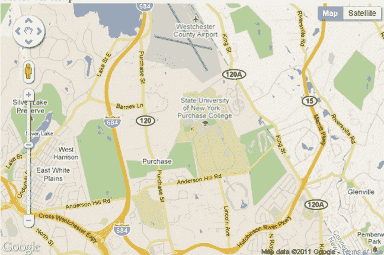

标题将放置在此处。

图 5-1. 启动屏幕

图 5-2 显示了当我点击普切斯学院校园屏幕时发生的情况。一个视频片段出现并开始播放。你还可以在标题位置看到“乐高机器人”。

点击地图。

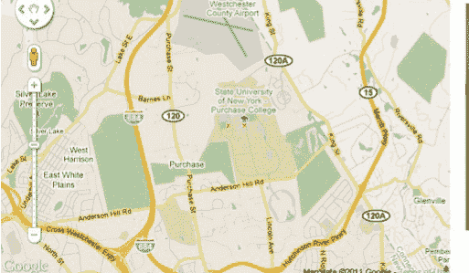

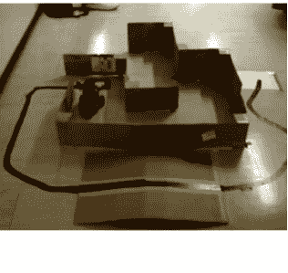

图 5-2. 点击普切斯学院的结果

图 5-3 显示了点击屏幕但未足够接近任何目标位置的结果。注意，我已经平移了地图，将其向北移动。

点击地图。

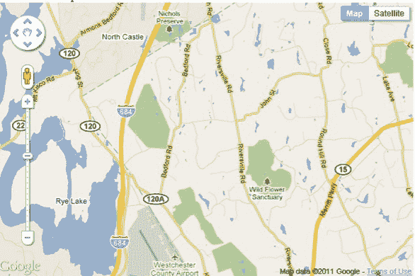

图 5-3. 点击未接近任何目标

图 5-4 显示了我点击足够接近基斯科山以获得“奖励”的结果。我需要向北移动更远才能到达基斯科山。还要注意音频控件，它提供了一种暂停和恢复播放以及更改扬声器音量的方式。不同浏览器中的音频（和视频）控件会有所不同，但功能相同。

点击地图。

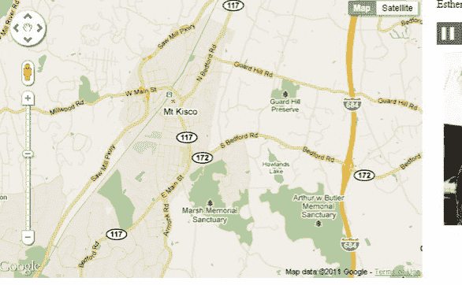

图 5-4. 图片与音频的组合

因为我知道这些地点的位置，所以我知道需要缩小地图以到达下一个地点。图 5-5 显示了使用 Google 地图界面完成此操作的结果。音轨继续播放，我仍然可以看到图片。

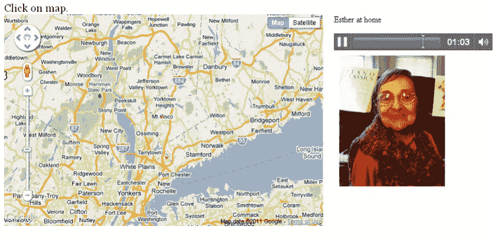

图 5-5. 缩小地图为向南平移做准备

图 5-6 显示了将地图向南移动，然后放大到自由女神像位置（烟花视频片段的目标地点）的结果。

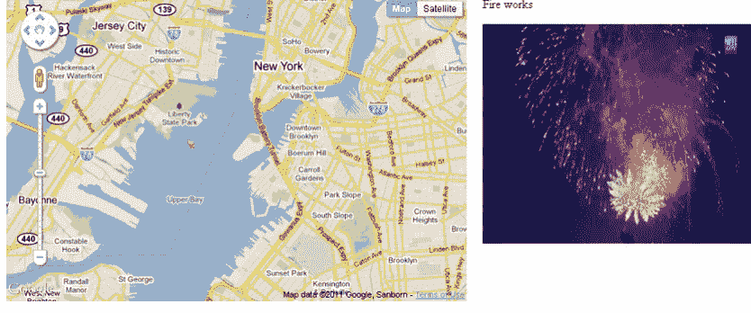

图 5-6. 平移和放大后点击自由岛

同样，我知道这些图片的位置，所以我缩小地图，平移到芝加哥西部，然后点击伊利诺伊州小镇迪克森。图 5-7 显示了我预期的图片。

点击地图。

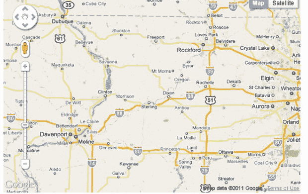

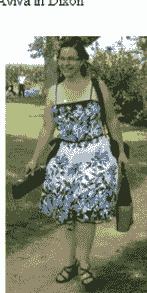

迪克森的阿维瓦

图 5-7. 平移到西部并放大到伊利诺伊州迪克森

实际上，要使第二个应用在布局上类似于第一个，需要做些工作（稍后解释）。

现在我将展示第三个应用（测验）的屏幕截图。图 5-8 显示了启动屏幕。

埃斯特奶奶住在哪里？

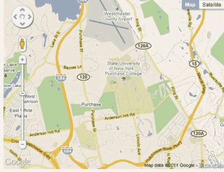

标题将放置在此处。

图 5-8. 测验的启动屏幕

问题是：埃斯特奶奶住在哪里？玩家必须点击接近与此问题相关的位置。你可能能从之前的屏幕截图中猜出答案。图 5-9 显示了一个不正确的响应。我只是点击了普切斯学院附近的地图。

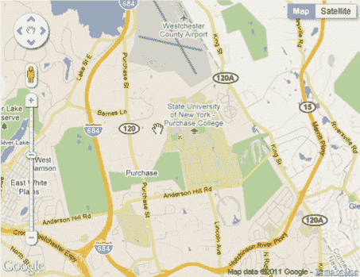

图 5-9. 不正确的响应

我知道答案，而且知道如何在地图上找到它。我将地图向北移到基斯科山并点击那里。图 5-10 显示了熟悉的图片和音频控件。钢琴音乐正在播放。

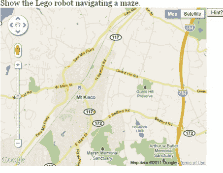

图 5-10. 给出了正确答案，因此显示图片并播放音频，并给出下一个问题。

注意，一旦上一个问题被正确回答，屏幕就会立即显示下一个问题。

在设计这样的游戏时，当玩家不知道答案时，最好给予怜悯。我提供了“提示？”按钮，尽管它不仅仅局限于给出提示。跳过中间步骤，我将正确回答接下来的两个问题，然后我将需要帮助来找到伊利诺伊州迪克森。图 5-11 显示了提示。

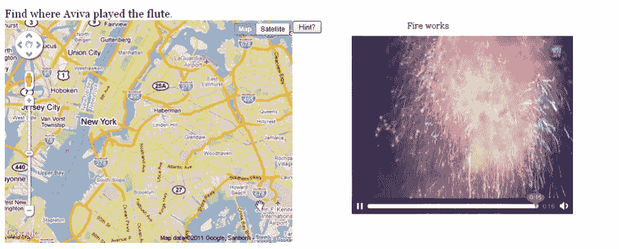

图 5-11. 关于长笛演奏的提示

如果我点击“提示？”按钮，应用程序将引入一个新地图，以所需位置为中心。图 5-12 显示了屏幕。

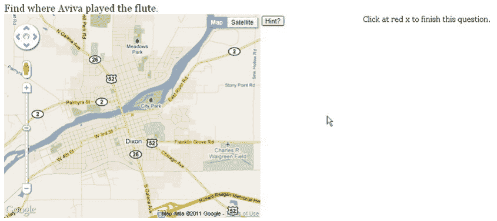

图 5-12. 以伊利诺伊州迪克森为中心的地图

仍然需要点击地图（最好点击在红色叉号上或附近）来完成问题。你可能会说，有更好的提示方式——例如提供包含地名的特定文本——我不会与你争辩。这就是我决定采用的方法。有了这个介绍，我将继续讨论项目历史和关键要求。

### 项目历史和关键要求

普切斯学院的一名大四学生收集并制作了关于纽约皇后区民族社区的视频片段和照片，并希望有一种方式来展示这些作品。Google 地图 API 和 HTML5 的新功能似乎非常适合这项任务。请记住，学生只需要一种方式在她为毕业项目展设置的计算机上展示作品，因此不合规浏览器的问题并不是关注点。关键要求包括 Google 地图 API 提供的功能。正如你在上一章所学，我们可以编写代码来访问以指定地理位置为中心、设置初始缩放级别、并显示道路、卫星、地形或混合视图的地图。此外，API 提供了一种响应查看者点击地图事件的方式。我们需要一种定义特定位置的方法，以便与查看者点击对应的位置进行比较。

我为学生构建的第一个系统只使用了视频和图像。我后来决定添加图片与音频的组合。该应用的关键要求是在正确的时间显示和播放指定的媒体 *并且* 在适当时停止并移除媒体，例如在需要进行下一个演示时。

在开发初始项目后，我考虑了修改。第一个修改是添加图片与音频的组合。我决定不单独提供音频。下一个修改是将特定内容与通用代码分离。这反过来又需要一种动态创建视频和音频元素标记的方法。

我一直喜欢游戏和课程，构建一个带有问题或提示的应用程序似乎是很自然的一步——现在最好将查看者描述为玩家或学生。玩家通过在地图上找到正确的位置来给出答案。通用应用程序和测验应用程序都有一个要求，即定义答案的容差范围。不能期望查看者/玩家/学生点击完全准确的位置。

在测试测验时，我意识到需要某种方式来帮助玩家度过特别困难的问题。因为我是一名教师，我决定向玩家展示答案，而不仅仅是跳过问题。然而，正如我之前指出的，你也许能设计出更好的提示方式。

游戏应该具有一定的随机性特征，因此我决定打乱问题的顺序，尽管我是在过程中较晚的时候才这样做的。

在描述了关键要求之后，下一节将解释可用于构建项目的具体 HTML5 特性。

### HTML5、CSS 和 JavaScript 特性

与第 4 章的地图制作项目一样，这些项目是通过结合使用 Google 地图 API 和 HTML5 的特性来实现的。这个项目的组合没有那么棘手。地图保持在窗口左侧，媒体在右侧呈现。我将快速回顾如何获取地图以及如何设置事件处理，然后继续介绍满足其余关键要求的 HTML5、CSS 和 JavaScript 特性。

### 用于地图访问和事件处理的 Google Maps API

要访问 Google Maps API，需要一个引用外部文件的 `script` 元素。对于本应用，我使用了：

```
<script type="text/javascript" charset="UTF-8" src="http://maps.google.com/maps/api/js?sensor=false"></script>
```


<script type="text/javascript" charset="UTF-8" src="http://maps.google.com/maps/api/js?sensor=false"></script>

## 第五章 地图门户：使用 Google Maps 访问您的媒体

### `makemap` 函数与地图初始化

我使用一个名为 `makemap` 的函数来设置地图。它有两个参数：两个表示纬度和经度值的十进制数字：

```javascript
function makemap(mylat, mylong)
```

全局变量 `zoomlevel`（存储一个从 0 到 18 的数字）和 `xmarker`（存储图像文件的地址）在调用 `makemap` 函数之前设置。

引入地图的代码是调用 `google.maps.Map` 构造函数方法。它接受两个参数。第一个是地图在 HTML 文档中出现的位置。我在文档的 `body` 中设置了一个 ID 为 `place` 的 `div`：

```html
<div id="place" style="float: left;width:50%; height:400px"></div>
```

第二个参数是一个关联数组。以下三条语句将地图中心位置设置为 Google Maps 的经纬度对象，创建关联数组 `myOptions`，并调用 Map 构造函数：

```javascript
blatlng = new google.maps.LatLng(mylat,mylong);

myOptions = {
    zoom: zoomlevel,
    center: blatlng,
    mapTypeId: google.maps.MapTypeId.ROADMAP
};

map = new google.maps.Map(document.getElementById("place"), myOptions);
```

### 地图类型设置

为完整起见，这里有一些地图类型其他设置的截图。这些是 TERRAIN、HYBRID 和 SATELLITE。

#### TERRAIN 地图类型

图 5-13 展示了请求显示地形（即显示海拔、水域、公园和人工建筑区域颜色的设置）的结果：

```javascript
mapTypeId: google.maps.MapTypeId.TERRAIN
```

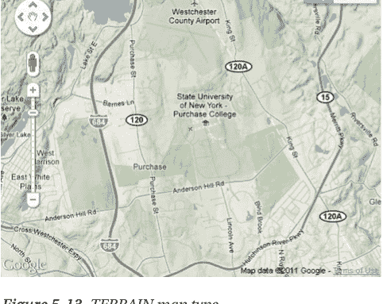

图 5-13. TERRAIN 地图类型

#### HYBRID 地图类型

图 5-14 展示了请求 HYBRID 视图（结合卫星和道路地图图像）的结果。

```javascript
mapTypeId: google.maps.MapTypeId.HYBRID
```

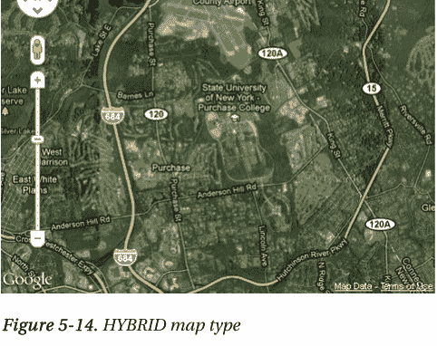

图 5-14. HYBRID 地图类型

顺便说一句，混合地图就是通过点击界面上的“卫星”选项生成的。图 5-15 展示了请求 SATELLITE 图像的结果。

```javascript
mapTypeId: google.maps.MapTypeId.SATELLITE
```


图 5-15. SATELLITE 地图类型

最后，您可能有一个应用，不希望查看者更改地图。您可以通过在 `myOptions` 数组中使用额外选项来禁用默认界面，从而防止用户更改地图。注意 `ROADMAP` 后的逗号。

```javascript
mapTypeId: google.maps.MapTypeId.ROADMAP,
disableDefaultUI: true
```

图 5-16 展示了结果。


图 5-16. 地图界面已移除

### 标记与事件处理

`makemap` 函数还有两项操作需要执行。一个自定义标记被放置在地图上指示的中心位置，并为点击地图设置事件处理：

```javascript
marker = new google.maps.Marker({
    position: blatlng,
    title: "center",
    icon: xmarker,
    map: map
});

listener = google.maps.event.addListener(map, 'click', function(event) {
    checkit(event.latLng);
});
```

`xmarker` 值引用一个 Image 对象，其 `src` 设置为名为 `x1.png` 的外部文件。

### 项目内容

这些门户项目都展示了与地图位置相关的媒体。我的项目使用了三种类型的媒体：视频、图片和图片音频。注意：这些是我为项目选择包含的三种类型的术语。门户项目的内容使用一个我命名为 `content` 的数组来指定。数组的每个元素本身是一个包含五个或六个元素的数组。前四个元素对于所有类型都是相同的：纬度、经度、标题和类型。第五个或第五个和第六个元素指向特定的媒体元素。

```javascript
content = [
    [41.19991,-73.72353,"Esther at home","pictureaudio",esther,aud1],
    [41.05079,-73.70448,"Lego robot  ","video",vid1],
    [40.68992,-74.04460,"Fire works  ","video",vid2],
    [41.8442,-89.480,"Aviva in Dixon","picture",aviva]
];
```

指定了四个位置，首先是图片/音频组合，接着是两个视频，然后是一个图片。图片/音频组合的数组元素包含，正如您所预期的，两条额外信息。仅从这段代码中并不明显，但 `esther` 指向一个 Image 元素，`aud1` 指向一个 audio 元素。类似地，`vid1` 和 `vid2` 指向 video 元素，`aviva` 指向另一个 Image 元素。

`content` 数组被 `checkit` 函数（将在后面描述）引用，相应的媒体得以展示。

测验项目有额外内容，即一个问题数组，稍后展示。

### 视频、音频和图像的呈现与移除

我假设您对 HTML5 用于呈现视频和音频以及在画布上绘制文件中的图像的功能有基本理解。地图门户项目需要代码来按需呈现媒体（即让媒体出现和消失）。这个要求类似于第三章中的弹跳视频。在基本的 mapvideos 应用中，我在文档的 `body` 元素中包含了视频、音频和画布元素的定义，全部位于一个我指定为向右浮动的 `div` 元素内：

```html
<div style="float: right;width:38%;height:400px">
<div id="answer">Title will be placed here.</div>
<p> </p>
<video id="maze" preload="auto" controls="controls" width="400">
<source src="maze.mp4" type="video/mp4; codecs="avc1.42E01E, mp4a.40.2"">
<source src="maze.theora.ogv" type="video/ogg; codecs="theora, vorbis"">
<source src="maze.webmvp8.webm" type="video/webm; codec="vp8, vorbis"">
Your browser does not accept the video tag.
</video>
<video id="fire" preload="auto" controls="controls">
<source src="sfire3.mp4" type="video/mp4; codecs="avc1.42E01E, mp4a.40.2"">
<source src="sfire3.theora.ogv" type="video/ogg; codecs="theora, vorbis"">
<source src="sfire3.webmvp8.webm" type="video/webm; codec="vp8, vorbis"">
Your browser does not accept the video tag.
</video>
<audio id="mpiano" controls="controls" preload="preload">
<source src="estherT.ogg" type="audio/ogg" />
<source src="estherT.mp3" type="audio/mpeg" />
<source src="estherT.wav" type="audio/wav" />
</audio>
<canvas id="canvas" width="300" height="300" >
Your browser doesn't recognize canvas
</canvas>
</div>
```

注意，我没有在 `<video>` 标签中使用 `loop` 属性，也没有调用 `addEventListener` 来添加一个重新启动视频的函数，这是基于某些浏览器不识别 `loop` 的假设。这是因为视频控件是可见的，如果查看者想要重播视频，他们可以操作。同样，查看者可以重放音频片段。

在样式元素中，我添加了指令，使所有视频不显示，并且定位为相对定位：

```css
video {display:none; position:relative;}
audio {display:none; position:relative;}
```

对于画布，我不必做类似的操作。画布始终存在，但如果上面没有绘制任何内容或已被清除，则不会显示任何内容。

呈现媒体的关键代码位于 `checkit` 函数中的一个 `switch` 语句中。变量 `bestyet` 保存 `content` 数组中距离查看者/玩家点击地图位置最近的元素的索引。如果已确定足够接近，则它将继续显示图片并播放视频或音频。

```javascript
switch (content[bestyet][3]) {
    case "video":
        answer.innerHTML = content[bestyet][2];
        v = content[bestyet][4];
        v.style.display = "block";
        v.currentTime = 0;
        v.play();
        break;
    case "picture":
    case "pictureaudio":
        answer.innerHTML = content[bestyet][2];
        ctx.drawImage(content[bestyet][4], 10, 10);
        if (content[bestyet][3] == "picture") {
            break;
        } else {
            audioel = content[bestyet][5];
            audioel.style.display = "block";
            audioel.currentTime = 0;
            audioel.play();
            break;
        }
}
```

将显示样式更改为 `"block"` 的效果是显示视频或音频控件。将 `currentTime` 赋值为 0 意味着视频或音频将从头开始播放。您可以利用 `currentTime` 来产生其他效果——例如，播放长音频或视频片段的不同部分。

还有一段代码需要。这就是移除最后查看的内容：停止视频或音频，并停止显示。执行此操作的代码必须考虑到没有任何内容需要移除的可能性。代码如下：

```javascript
if (v != undefined) {
    v.pause();
    v.style.display = "none";
}

if (audioel != undefined) {
    audioel.pause();
    audioel.style.display = "none";
}

ctx.clearRect(0, 0, 300, 300);
```

请注意，即使画布上没有任何绘制内容，清除它也没有坏处。如果 `v` 未被设置，语句 `v.pause();` 将会出错。在测验项目中，我将这段代码放入了自己的函数中，并命名为 `eraseOld`，因为删除旧材料需要在代码中的两个不同地方执行。

### 距离与容差

两个经纬度点之间的距离计算在前一章已经描述。这里需要解释的问题是如何进行距离比较。对于门户应用，我需要编写代码来确定 `content` 数组中指定的位置中，哪个离用户点击的位置最近。我使用 `for` 循环来实现这一点。正如这类“当前最佳”计算中常见的做法，我首先计算到 `content` 数组第 0 个（即第一个）元素的距离。这是当前的最佳值。然后 `for` 循环从索引 1 开始继续执行。

```javascript
function checkit(clatlng) {
    var i;
    var latlnga = new google.maps.LatLng(content[0][0], content[0][1]);
    var bestyet = 0;
    var closestdistance = dist(clatlng, latlnga);
    var distance;

    for (i = 1; i < content.length; i++) {
        latlnga = new google.maps.LatLng(content[i][0], content[i][1]);
        distance = dist(clatlng, latlnga);
        if (distance < closestdistance) {
            closestdistance = distance;
            bestyet = i;
        }
    }
```

当 `for` 循环完成时，`bestyet` 保存的是当前最佳（即最近）元素的索引，而 `closestdistance` 保存的是到该元素的距离，这个距离已被确定为最近（最小）距离。

接下来，我需要编写代码来检查该元素——即 `bestyet` 命名的索引对应的元素——是否足够近以继续操作。在游戏和其他应用中，会使用容差或边距这样的术语。你不能期望一个人精确地点击某个位置。当单位是像素时这是不可能的，当单位是经纬度且在当前缩放级别下用户可能无法看到精确点时，这更是不可能的。变量 `maxdistance` 保存了我选择用于此测试的值。以下是 `checkit` 函数的其余部分（不重复整个 switch 语句）：

```javascript
if (distance < maxdistance) {
    marker = new google.maps.Marker({
        position: clatlng,
        title: content[bestyet][2],
        icon: xmarker,
        map: map
    });

    switch (content[bestyet][3]) {
        ...
    }
} else {
    answer.innerHTML = "Not close enough to any [new] target";
}
```


### 正则表达式

正则表达式是一种强大的工具，用于描述字符字符串（文本）的模式，以进行检查和操作。它是一种用于指定模式的完整语言。例如，为了让你对这个宏大的主题有个初步了解，模式

```
/^5[1-5]\d{2}-?\d{4}-?\d{4}-?\d{4}$/
```

可用于检测万事达卡号码。这些号码以 51 到 55 开头，后跟两个数字，然后是三组四位数。此模式接受短横线，但不强制要求。`^` 符号表示模式必须出现在字符串的开头，`$` 表示它必须延伸到字符串的末尾。正斜杠（`/`）是模式的定界符，反斜杠是转义字符。从开头解释此模式的过程如下：

- `^`：从字符串的开头开始。
- `5`：模式必须包含一个 5。
- `[1-5]`：模式必须包含数字 1、2、3、4 或 5 中的一个。
- `\d{2}`：模式必须恰好包含两个数字。
- `-?`：模式必须包含 0 个或 1 个短横线。
- `\d{4}`：模式必须恰好包含四个数字。
- `-?`：模式必须包含 0 个或 1 个短横线。
- `\d{4}`：模式必须恰好包含四个数字。
- `-?`：模式必须包含 0 个或 1 个短横线。
- `\d{4}`：模式必须恰好包含四个数字。
- `$`：字符串结尾。

万事达卡号码还必须遵守其他规则，你可以自行研究如何进一步验证它们。别担心，我们将使用的正则表达式（也称为 regex）会比这个简单得多。

正则表达式的使用早于 HTML。正则表达式可以在表单中用于指定输入的格式。在这个应用中，我们将使用字符串的 `replace` 方法来查找长字符串中所有特定的小段文本实例，并将其替换为其他内容。我使用的一条语句是

```
videomarkup = videomarkup.replace(/XXXX/g, name);
```

这条语句的作用是找到字符串 `XXXX` 的所有出现位置（`g` 的作用就是这个），并将其替换为变量 `name` 的值。

我本可以而且可能应该更多地使用正则表达式来验证定义应用内容的数据。也许这是你想在自己的应用中尝试的东西。

### 外部脚本文件

对于这个项目和前一章的项目，我演示了使用 `script` 元素引入外部脚本文件，即 Google Maps API。你也可以使用这个功能来引入自己的外部文件。我的目标是将所有与我项目相关的具体内容放入自己的文件中。对于 `mapmediabase` 的情况，这是一个我命名为 `mediacontent.js` 的文件。以下是完整内容：

```
var base = [41.04796, -73.70539, "Purchase College/SUNY"];

var zoomlevel = 13;

var precontent = [
    [41.19991, -73.72353, "Esther at home", "pictureaudio", "estherT", "esther.jpg"],
    [41.05079, -73.70448, "Lego robot ", "video", "maze"],
    [40.68992, -74.04460, "Fire works ", "video", "sfire3"],
    [41.8442, -89.480, "Aviva in Dixon", "picture", "avivadixon.jpg"]
];

var maxdistance = 5;
```

> **提示** 下一步可能是将媒体内容信息放入数据库中。

`base`、`zoomlevel` 和 `maxdistance` 变量顾名思义。`base` 是地图的初始中心点。缩放级别指定初始缩放。我说*初始*是因为用户可以使用 Google Maps 控件来平移或缩放。`maxdistance` 是我用来检查用户是否点击了离某个位置足够近的数值。你需要确定对于你的应用来说，什么距离是合适的。

我只是将变量声明从另一个文档移动到了这个将成为外部的、特定于内容的文档中。我必须承认，我忘记了 `zoomlevel` 和 `maxdistance`，只是在考虑其他项目可能是什么之后才移动它们的。例如，你可能决定构建一个缩放级别非常不同的项目。也许你希望玩家能区分到城市街区的级别，在这种情况下，最大距离可能是 1 公里或更小。

`precontent` 数组类似于但不等同于 `content` 数组。不同之处在于，那些现在包含 "estherT"、"esther.jpg"、"maze"、"sfire3" 和 "avivadixon.jpg" 的字段被用于创建 HTML5 元素或 JavaScript 元素。一旦这些创建完成，就可以在 `content` 数组中插入引用。为了使其工作，我需要更改视频和音频文件的名称，以便视频元素编码和音频元素编码都符合某种模式。

对于 `mapmediaquiz` 应用，我需要添加问题。我本可以在 `precontent` 数组的内部数组中再添加一个元素，但决定不这样做，因为那需要更改代码。相反，我定义了另一个名为 `questions` 的数组。这被称为*并行结构*，是一种常见的技巧。

> **注意** 在某个时候，正确的决定可能是停止使用纯 JavaScript 数组（包括并行结构的使用），转而使用 XML 或数据库。我认为在这个应用中不需要，但我可能错了。请注意，使用数据库确实提供了一种隐藏数据的方法。

```
var base = [41.04796, -73.70539, "Purchase College/SUNY"];

var zoomlevel = 13;

var precontent = [
    [41.19991, -73.72353, "Esther at home", "pictureaudio", "estherT", "esther.jpg"],
    [41.05079, -73.70448, "Lego robot ", "video", "maze"],
    [40.68992, -74.04460, "Fire works ", "video", "sfire3"],
    [41.8442, -89.480, "Aviva in Dixon", "picture", "avivadixon.jpg"]
];

var questions = [
    "Where does Grandma Esther live?",
    "Show the Lego robot navigating a maze.",
    "Where are great fireworks?",
    "Find where Aviva played the flute."
];

var maxdistance = 10;
```

外部脚本通过 `script` 元素引入主文档。对于 `mapmediabase` 程序，这是

```
<script type="text/javascript" src="mediacontent.js"> </script>
```

对于 `mapmediaquiz`，这是

```
<script type="text/javascript" src="mediaquizcontent.js"> </script>
```

现在我将解释如何使用 `precontent` 信息来构建项目运行所需的内容。

### 动态创建 HTML5 标记和定位

外部脚本语句引入了基础应用和测验应用的信息。现在是时候解释这些信息是如何使用的了。在这两种情况下，`init` 函数都将调用一个我命名为 `loadcontent` 的函数。这个函数调用 `makemap` 在指定的基础位置创建一个地图。

```
makemap(base[0], base[1]);
```

`content` 数组初始为空数组。

```
var content = [];
```

顺便说一下，这不同于

```
var content;
```


# 第五章 地图门户：使用谷歌地图访问您的媒体

## 代码结构与初始化

你的代码需要将 `content` 定义为一个数组。然后它使用 `for` 循环来遍历 `precontent` 的所有元素。`for` 循环的开始将 `precontent` 的第 i 个元素添加到 `content` 数组中。

```javascript
for (var i = 0; i < precontent.length; i++) {
    content.push(precontent[i]);
    name = precontent[i][4];
}
```

下一行是一个 `switch` 语句的头部，其条件是内部数组中指示类型的元素。

```javascript
switch (precontent[i][3]) {
```

## 媒体标记生成

对于视频和 `pictureaudio`（音频图片），代码创建一个 `div` 元素并将其定位为向右浮动。然后，它在 `div` 元素内放置适用于视频或音频的正确标记。这些标记是什么？我将称之为“虚拟字符串”，其中用 `XXXX` 表示实际的视频或音频文件名。这些字符串是：

```javascript
var videotext1 = "<video id=\"XXXX\" preload=\"auto\" controls=\"controls\" width=\"400\"><source src=\"XXXX.mp4\" type=\"video/mp4; codecs=\\\"avc1.42E01E, mp4a.40.2\\\"\">";
var videotext2 = "<source src=\"XXXX.theora.ogv\" type=\"video/ogg; codecs=\\\"theora, vorbis\\\"\"><source src=\"XXXX.webmvp8.webm\" type=\"video/webm; codec=\\\"vp8, vorbis\\\"\">";
var videotext3 = "Your browser does not accept the video tag.</video>";
var audiotext1 = "<audio id=\"XXXX\" controls=\"controls\" preload=\"preload\"><source src=\"XXXX.ogg\" type=\"audio/ogg\" />";
var audiotext2 = "<source src=\"XXXX.mp3\" type=\"audio/mpeg\" /><source src=\"XXXX.wav\" type=\"audio/wav\" /></audio>";
```

我将这些字符串分成三组和两组，只是为了便于我检查。注意反斜杠（`\`）的用法。它告诉 JavaScript 使用下一个符号的原义，而不将其解释为正则表达式的特殊运算符。这就是引号如何在字符串内部被保留并成为 HTML 的一部分的。我的方法要求我确保视频和音频文件名遵循此模式。这意味着 mp4 文件都需要只包含名称，而不含内部的点。我使用正则表达式函数 `replace` 编写代码，从 `precontent` 数组中提取信息并将其填充到字符串中需要的所有位置。完整的 `switch` 语句是：

```javascript
switch (precontent[i][3]) {
    case "video":
        divelement = document.createElement("div");
        divelement.style = "float: right;width:30%;";
        videomarkup = videotext1 + videotext2 + videotext3;
        videomarkup = videomarkup.replace(/XXXX/g, name);
        divelement.innerHTML = videomarkup;
        document.body.appendChild(divelement);
        videoelementreference = document.getElementById(name);
        content[i][4] = videoelementreference;
        break;
    case "pictureaudio":
        divelement = document.createElement("div");
        divelement.style = "float: right;width:30%;";
        audiomarkup = audiotext1 + audiotext2;
        audiomarkup = audiomarkup.replace(/XXXX/g, name);
        divelement.innerHTML = audiomarkup;
        document.body.appendChild(divelement);
        audioreference = document.getElementById(name);
        savedimagefilename = content[i][5];
        content[i][5] = audioreference;
        imageobj = new Image();
        imageobj.src = savedimagefilename;
        content[i][4] = imageobj;
        break;
    case "picture":
        imageobj = new Image();
        imageobj.src = precontent[i][4];
        content[i][4] = imageobj;
        break;
}
```

请注意，`pictureaudio` 分支进行了一些调整，以创建包含新创建的音频元素和 `Image` 元素引用的内容元素。然而，这还不足以确保视频和音频在所有浏览器中都显示在右侧。也就是说，它对某些浏览器有效，但对另一些则无效。我决定对音频和视频进行精确定位——即绝对定位。这需要在样式元素中为所有视频和音频元素添加以下 CSS：

```css
video {display:none; position:absolute; top: 60px; right: 20px; }
audio {display:none; position:absolute; top: 60px; right: 20px;}
```

音频的位置是为音频控件预留的。

## 提示按钮

从我的编码中你可以看出，我对于是否提供提示或帮助已经放弃的玩家有些犹豫不决。在 `<body>` 元素中，我包含了：

```html
<button onClick="giveup();">提示？ </button>
```

`giveup` 函数创建一个新的地图。也就是说，它使用 `makemap` 函数来构造对同一地点不同 Google 地图的访问。它还擦除旧媒体，并在 `answer` 元素中放入方向说明。

```javascript
function giveup() {
    makemap(content[nextquestion][0], content[nextquestion][1]);
    eraseold();
    answer.innerHTML = "Click at red x to finish this question.";
}
```

## 乱序排列

我添加了一个乱序步骤来混合问题的顺序。更准确地说，程序对 `content` 数组和 `questions` 数组进行乱序，同时保持它们平行。我使用的乱序算法与《HTML5 精髓指南》第 10 章演示的 Fisher-Yates 算法相同。另请参阅 http://eli.thegreenplace.net/2010/05/28/the-intuition-behind-fisher-yates-shuffling/ 以了解乱序的工作原理。该算法为每个元素确定一个随机位置。由于我需要保持两个数组平行，因此必须对每个数组执行相同的交换操作。在下面的代码中，你会看到确定了 `s` 和 `i` 元素要交换位置。两个变量 `hold` 和 `holdq` 是在交换操作中使用的额外存储空间。

```javascript
function shufflecontent() {
    var i = content.length - 1;
    var s;
    var hold;
    var holdq;
    while (i > 0) {
        s = Math.floor(Math.random() * (i + 1));
        hold = content[s];
        content[s] = content[i];
        content[i] = hold;
        holdq = questions[s];
        questions[s] = questions[i];
        questions[i] = holdq;
        i--;
    }
}
```

在解释了各个部分之后，我将在下一节继续描述这三个应用程序。

## 构建应用程序并使其个性化

将应用程序个性化的第一个关键步骤是决定内容。你可以选择不实现第一个应用程序 `mapvideos`，可以说它的内容是硬编码的，并与其他所有编码在一起。再次说明，我包含了它是因为我先写了它，而且它最容易理解。我坚信大多数人会开发类似的东西，然后可能决定将内容与编码分离。如果你愿意，可以直接转到 `mapmediabase` 或 `mapmediaquiz`。

## Mapvideos 应用程序

Mapvideos 应用程序将 Google Maps 功能与用于 canvas 上视频、音频和图片的 HTML5 编码相结合。canvas 不在地图之上。以下是应用程序的简要概述：

- `init`：执行初始化，包括调用 `makemap` 来引入地图。`init` 函数使用构造为对 `<body>` 中元素引用来构建 `content` 数组的数据。
- `makemap`：引入地图并设置事件处理，包括对 `checkit` 的调用。
- `checkit`：将点击位置与 `content` 数组中描述的位置进行比较。如果足够接近，则显示并播放关联的媒体。
- `dist`：计算两个位置之间的距离。

### 表 5-2. Mapvideos 门户项目中的函数

| 函数 | 被...调用 | 调用 |
| :--- | :--- | :--- |
| `init` | 由 `<body>` 标签中 `onLoad` 属性的动作调用 | `makemap` |
| `makemap` | 由 `init` 调用 | |
| `checkit` | 由 `makemap` 中的 `addListener` 调用 | `dist` |
| `dist` | 由 `checkit` 调用 | |

### 表 5-3. Mapvideos 门户应用程序的完整代码

| 代码行 | 描述 |
| :--- | :--- |
| `<!DOCTYPE html>` | HTML5 文档类型 |
| `<html>` | html 标签 |
| `<head>` | Head 标签 |
| `<title>Clickable map </title>` | 完整的 title 元素 |
| `<meta charset="UTF-8">` | Meta 标签，HTML5 标准 |
| `<style>` | 样式标签 |
| `header {font-family:Georgia, "Times New Roman",serif;` | 为语义化元素 `header` 设置样式；字体族设置 Georgia 为首选，Times New Roman 为备用，然后是默认衬线字体 |
| `font-size:20px;` | 相对较大的字体 |
| `display:block;` | 在前后设置换行 |
| `}` | 关闭样式指令 |
| `video {display:none; position:relative; }` | 视频的样式指令 |
| `audio {display:none; position:relative;}` | 音频的样式指令；注意这是针对控件的 |
| `</style>` | 关闭样式标签 |
| `<script type="text/javascript" charset="UTF-8" src="http://maps.google.com/maps/api/js?sensor=false"></script>` | 引入谷歌地图 API 的脚本元素 |
| `<script type="text/javascript" charset="UTF-8">` | 开始脚本标签 |
| `var maxdistance = 5;` | 将 `maxdistance` 设置为 5，这是我决定的合适值；点击需要距离其中一个目标 5 公里以内才被视为足够接近 |
| `var listener;` | 用于调用 `addListener` 的占位符 |
| `var map;` | 保存当前地图的变量 |
| `var myOptions;` | 用于保存调用 `Map` 构造函数选项的关联数组变量 |
| `var ctx;` | 保存画布上下文的变量 |
| `var blatlng;` | 保存为基准位置构建的纬度/经度对象的变量 |
| `var esther = new Image();` | 保存 Image 对象的变量 |
| `esther.src = "esther.jpg";` | 将此 Image 对象的 `src` 设置为文件地址 |
| `var aviva = new Image();` | 保存 Image 对象的变量 |
| `aviva.src = "avivadixon.jpg";` | 将此 Image 对象的 `src` 设置为文件地址 |
| `var vid1;` | 在 `init` 中设置为其中一个视频元素 |
| `var vid2;` | 在 `init` 中设置为另一个视频元素 |
| `var aud1;` | 在 `init` 中设置为音频元素 |
| `var content;` | 在此声明为全局变量；将在 `init` 中设置 |
| `var answer;` | 将在 `init` 中设置为引用 body 中的一个 div |
| `var v;` | 引用当前（最后播放的）视频 |
| `var audioel;` | 引用当前（最后播放的）音频 |
| `var base = [41.04796, -73.70539, "Purchase College/SUNY"];` | 设置为我项目的基准位置的变量 |
| `function init() {` | `init` 函数头 |
| `ctx = document.getElementById("canvas").getContext('2d');` | 设置 `ctx` 用于在画布上绘图 |
| `makemap(base[0], base[1]);` | 调用 `makemap` |
| `answer = document.getElementById("answer");` | 设置 `answer` |
| `vid1 = document.getElementById("maze");` | 为其中一个视频元素设置 `vid1` |
| `vid2 = document.getElementById("fire");` | 为另一个视频元素设置 `vid2` |
| `aud1 = document.getElementById("mpiano");` | 为音频元素设置 `aud1` |
| `content = [` | 设置 content 数组的内容 |
| `[41.19991, -73.72353, "Esther at home", "pictureaudio", esther, aud1],` | Esther 图片音频组合的信息 |
| `[41.05079, -73.70448, "Lego robot", "video", vid1],` | Lego 机器人视频的信息 |
| `[40.68992, -74.04460, "Fire works", "video", vid2],` | 烟花视频的信息 |
| `[41.8442, -89.480, "Aviva in Dixon", "picture", aviva]` | Aviva 图片的信息 |
| `];` | content 数组结束 |
| `}` | 关闭 `init` 函数 |
| `var xmarker = "x1.png";` | 设置地图上标记的文件地址 |
| `function makemap(mylat, mylong) {` | `makemap` 函数头；地图将以 (mylat, mylong) 为中心 |
| `var marker;` | 保存构建的标记 |
| `blatlng = new google.maps.LatLng(mylat, mylong);` | 设置纬度/经度对象 |
| `myOptions = {` | 开始设置 **options** 数组 |
| `zoom: 13,` | 缩放级别设置为常数，经过实验确定 |
| `center: blatlng,` | 以 `blatlng` 为中心 |
| `mapTypeId: google.maps.MapTypeId.ROADMAP` | 路线图类型 |
| `};` | 关闭 `myOptions` 数组 |
| `map = new google.maps.Map(document.getElementById("place"), myOptions);` | 调用构造函数引入谷歌地图 |
| `marker = new google.maps.Marker({ position: blatlng, title: "center", icon: xmarker, map: map });` | 标记中心点 |
| `listener = google.maps.event.addListener(map, 'click', function(event) {` | 设置地图点击的事件处理 |
| `checkit(event.latLng);` | 以事件的 `latLng` 属性作为参数调用 `checkit` 函数 |
| `});` | 关闭引入地图的调用 |
| `}` | 关闭 `makemap` 函数 |
| `function checkit(clatlng) {` | `checkit` 函数头 |
| `var i;` | 用于索引 |
| `var latlnga = new google.maps.LatLng(content[0][0], content[0][1]);` | 从 content 的第一个元素构建纬度/经度对象 |
| `var bestyet = 0;` | 将指向目前确定的最佳（最近）项的索引 |
| `var closestistance = dist(clatlng, latlnga);` | 计算到第一个元素的距离 |
| `var distance;` | 用于保存距离 |
| `for (i = 1; i < content.length; i++) {` | 设置对 content 的迭代，从第二个（索引=1）元素开始 |
| `latlnga = new google.maps.LatLng(content[i][0], content[i][1]);` | 构建纬度/经度对象 |
| `distance = dist(clatlng, latlnga);` | 计算距离 |
| `if (distance < closestistance)` | 与当前最近的距离比较；如果这个更小... |
| `{` | |
| `closestistance = distance;` | ...那么替换之前最近距离的候选... |
| `bestyet = i;` | ...以及之前的索引 |
| `}` | 关闭 `if` 真值子句 |
| `}` | 关闭 `for` 循环 |
| `distance = Math.floor((closestistance + .005) * 100) / 100;` | 设置距离；注意此阶段不需要格式化；将来可能会选择使用 |
| `if (v != undefined) {` | 检查是否有之前的视频 |
| `v.pause();` | 暂停它 |
| `v.style.display = "none";` | 从显示中移除 |
| `}` | 关闭 `if` 有之前视频子句 |
| `if (audioel != undefined) {` | 检查是否有之前的音频 |
| `audioel.pause();` | 暂停它 |
| `audioel.style.display = "none";` | 清除最后播放的音频的控件 |
| `}` | 关闭 `if` 有音频子句 |
| `ctx.clearRect(0, 0, 300, 300);` | 清除画布 |
| `if (distance < maxdistance) {` | 这个距离是否足够接近？ |
| `marker = new google.maps.Marker({ position: clatlng, title: content[bestyet][2], icon: xmarker, map: map });` | 在地图上标记目标位置；注意这是目标位置，而不是点击位置 |
| `switch (content[bestyet][3]) {` | 确定这是什么类型的媒体 |
| `case "video":` | 对于视频 |
| `answer.innerHTML = content[bestyet][2];` | 显示标题 |
| `v = content[bestyet][4];` | 将 `v` 设置为该视频 |
| `v.style.display = "block";` | 使视频元素可见（之前 `style.display` 的设置是 `"none"`。） |
| `v.currentTime = 0;` | 将视频时间设置为零，从头开始播放；这会重新开始视频，以防它之前已经开始播放 |
| `v.play();` | 播放视频 |
| `break;` | 离开 `switch` 语句 |
| `case "picture":` | 对于图片 |
| `case "pictureaudio":` | 对于图片音频组合 |
| `answer.innerHTML = content[bestyet][2];` | 显示标题 |
| `ctx.drawImage(content[bestyet][4], 10, 10);` | 在画布上绘制图像 |
| `if (content[bestyet][3] == "picture") {` | 如果是图片... |
| `break;` | ...离开 `switch` |
| `} else {` | 否则（对于图片/音频组合） |
| `audioel = content[bestyet][5];` | 将 `audioel` 设置为音频元素 |
| `audioel.style.display = "block";` | 显示音频——即控件 |
| `audioel.currentTime = 0;` | 将时间设置为零 |
| `audioel.play();` | 播放音频 |
| `break;` | 离开 `switch` |
| `}` | 关闭图片或图片音频子句 |
| `}` | 关闭 `switch` |
| `}` | 关闭 `if` 距离足够子句 |
| `} else {` | 否则 |
| `answer.innerHTML = "Not close enough to any [new] target";` | 显示消息，表示点击距离任何目标都不够近 |
| `}` | 关闭子句 |
| `}` | 关闭 `checkit` 函数 |
| `function dist(point1, point2) {` | 两点之间距离函数头 |
| `var R = 6371; // km` | 用于公里的因素（地球半径） |
| `// var R = 3959; // miles` | 代码中的注释；保留以防您想切换到英里 |
| `var lat1 = point1.lat() * Math.PI / 180;` | 转换为弧度 |
| `var lat2 = point2.lat() * Math.PI / 180;` | 转换为弧度 |
| `var lon1 = point1.lng() * Math.PI / 180;` | 转换为弧度 |
| `var lon2 = point2.lng() * Math.PI / 180;` | 转换为弧度 |
| `var d = Math.acos(Math.sin(lat1) * Math.sin(lat2) + Math.cos(lat1) * Math.cos(lat2) * Math.cos(lon2 - lon1)) * R;` | 计算距离 |
| `return d;` | 返回距离值 |
| `}` | 关闭 `dist` 函数 |
| `</script>` | 关闭脚本标签 |
| `</head>` | 关闭 head 标签 |
| `<body onLoad="init();">` | body 标签，onLoad 调用 init |
| `<header id="header">Clickable map</header>` | 页眉 |
| `<div id="place" style="float: left;width:50%; height:400px"></div>` | 地图容器 |
| `<div style="float: right;width:30%;height:400px">` | 右侧容器 |
| `<div id="answer">Title will be placed here.</div>` | 答案显示区域 |
| `<p> </p>` | 空段落 |
| `<canvas id="canvas" width="300" height="300" >` | 画布元素 |
| `Your browser doesn't recognise canvas` | 画布不支持时的提示 |
| `</canvas>` | 关闭画布 |
| `</div>` | 关闭右侧容器 |
| `</body>` | 关闭 body |
| `</html>` | 关闭 html |

## 第二个门户应用：Mapmediabase

### 表 5-4. 第二个门户应用中的函数

| 函数 | 调用者 | 调用 |
| :--- | :--- | :--- |
| `init` | 由 `<body>` 标签中 `onload` 属性的动作调用 | `makemap` |
| `makemap` | 由 `init` 调用 | |
| `checkit` | 由 `makemap` 中的 `addListener` 调用 | `dist` |
| `dist` | 由 `checkit` 调用 | |
| `loadcontent` | 由 `init` 调用 | |

表 5-5 展示了第二个门户应用的代码，该应用名为 `mapmediabase.html`。请回顾“外部脚本文件”部分，以查看 `mediacontent.js` 内容的代码（所有变量声明）。

### 表 5-5. 第二个门户应用的完整代码

| 代码行 | 描述 |
| :--- | :--- |
| `<!DOCTYPE html>` | |
| `<html>` | |
| `<head>` | |
| `<title>Clickable map </title>` | |
| `<meta charset="UTF-8">` | |
| `<style>` | |
| `header {font-family:Georgia,"Times New Roman",serif;` | |
| `    font-size:20px;` | |
| `    display:block;` | |
| `}` | |
| `video {display:none; position:absolute; top: 60px; right: 20px; }` | 使视频显示在右侧 |
| `audio {display:none; position:absolute; top: 60px; right: 20px;}` | 使音频控件显示在右侧 |
| `canvas {position:relative; top:60px}` | |
| `#answer {position:relative; font-family:Georgia, "Times New Roman", Times, serif; font-size:16px;}` | |
| `</style>` | |
| `<script type="text/javascript" charset="UTF-8" src="http://maps.google.com/maps/api/js?sensor=false"></script>` | |
| `<script type="text/javascript" src="mediacontent.js"></script>` | 引入特定内容 |
| `<script type="text/javascript" charset="UTF-8">` | |
| `var listener;` | |
| `var map;` | |
| `var myOptions;` | |
| `var ctx;` | |
| `var blatlng;` | |
| `var content = [];` | |
| `var answer;` | |
| `var v;` | |
| `var audioel;` | |
| `var videotext1 = "<video id=\"XXXX\" preload=\"auto\" controls=\"controls\" width=\"400\"><source src=\"XXXX.mp4\" type='video/mp4; codecs=\"avc1.42E01E, mp4a.40.2\"'>` | 用于创建视频元素标记的第一段虚拟（模板）文本 |
| `var videotext2="<source src=\"XXXX.theora.ogv\" type='video/ogg; codecs=\"theora, vorbis\"'><source src=\"XXXX.webmvp8.webm\" type='video/webm; codec=\"vp8, vorbis\"'>` | 用于创建视频元素标记的第二段虚拟文本 |
| `var videotext3="Your browser does not accept the video tag.</video>";` | 用于创建视频元素标记的第三段虚拟文本 |
| `var audiotext1="<audio id=\"XXXX\" controls=\"controls\" preload=\"preload\"><source src=\"XXXX.ogg\" type=\"audio/ogg\" />` | 用于创建音频元素标记的第一段虚拟文本 |
| `var audiotext2="<source src=\"XXXX.mp3\" type=\"audio/mpeg\" /><source src=\"XXXX.wav\" type=\"audio/wav\" /></audio>";` | 用于创建音频元素标记的第二段虚拟文本 |
| `function init() {` | |
| `ctx = document.getElementById("canvas").getContext('2d');` | |
| `answer = document.getElementById("answer");` | |
| `loadcontent();` | 调用 `loadcontent` 以执行剩余的初始化工作 |
| `}` | |
| `function loadcontent() {` | `loadcontent` 函数头 |
| `    var divelement;` | 用于保存动态创建的 div |
| `    makemap(base[0],base[1]);` | 引入地图 |
| `    var videomarkup;` | 用于保存视频元素 HTML 标记的文本字符串 |
| `    var videoelementreference;` | 用于保存对新创建视频元素的引用 |
| `    var audiomarkup;` | 用于保存音频元素 HTML 标记的文本字符串 |
| `    var audioelementreference;` | 用于保存对新创建音频元素的引用 |
| `    var imageobj;` | 用于保存新创建的 Image 对象 |
| `    var name;` | 用于保存名称 |
| `    var savedimagefilename;` | 需要用于保存图像文件名，因为内部数组中的槽位会被覆盖 |
| `    for (var i=0;i<precontent.length;i++) {` | 遍历 precontent 项 |
| `        content.push(precontent[i]);` | 将该项（本身是一个数组）添加到 content 数组 |
| `        name = precontent[i][4];` | 提取名称 |
| `        switch (precontent[i][3]) {` | 对不同媒体类型（视频、图片、音频图片）进行切换 |
| `        case "video":` | 处理视频情况 |
| `        divelement= document.createElement("div");` | 创建一个新的容器 div |
| `        divelement.style = "float: right;width:30%;";` | 设置其样式为向右浮动（虽然这在所有浏览器中并非都有效） |
| `        videomarkup = videotext1+videotext2+videotext3;` | 创建视频元素的完整 HTML 标记 |
| `        videomarkup = videomarkup.replace(/XXXX/g,name);` | 将 XXXX 替换为 precontent 中给出的名称 |
| `        divelement.innerHTML = videomarkup;` | 将构造好的文本设置为 div 内的 HTML |
| `        document.body.appendChild(divelement);` | 将 div 添加到 body |
| `        videoelementreference = document.getElementById(name);` | 获取创建的 video 元素的引用 |
| `        content[i][4] = videoelementreference;` | 将此值放入 content 数组 |
| `        break;` | 退出 switch |
| `        case "pictureaudio":` | 处理音频图片情况 |
| `        divelement = document.createElement("div");` | 创建一个新的容器 div |
| `        divelement.style = "float: right;width:30%;";` | 设置其样式为向右浮动（虽然这在所有浏览器中并非都有效） |
| `        audiomarkup = audiotext1+audiotext2;` | 创建音频元素的完整 HTML 标记 |
| `        audiomarkup = audiomarkup.replace(/XXXX/g,name);` | 将 XXXX 替换为 precontent 中给出的名称 |
| `        divelement.innerHTML = audiomarkup;` | 将构造好的文本设置为 div 内的 HTML |
| `        document.body.appendChild(divelement);` | 将 div 添加到 body |
| `        audioreference = document.getElementById(name);` | 获取创建的 audio 元素的引用 |
| `        savedimagefilename = content[i][5];` | 保存文件名 |
| `        content[i][5] = audioreference;` | 覆盖该位置，将其设置为音频的引用 |
| `        imageobj = new Image();` | 创建一个新的 Image 对象 |
| `        imageobj.src= savedimagefilename;` | 将其 src 设置为文件名 |
| `        content[i][4] = imageobj;` | 将 content 项设置为 Image 对象 |
| `        break;` | 退出 switch |
| `        case "picture":` | 处理图片情况 |
| `        imageobj = new Image();` | 创建一个新的 Image 对象 |
| `        imageobj.src= precontent[i][4];` | 将其 src 设置为文件名 |
| `        content[i][4] = imageobj;` | 将 content 项设置为 Image 对象 |
| `        break;` | 退出 switch（并非严格必要，因为它是最后一个，但保留以防添加新的媒体类型） |
| `        }` | 关闭 switch |
| `    }` | 关闭 for 循环 |
| `}` | 关闭 `loadcontent` 函数 |
| `var xmarker = "x1.png";` | 地图标记的图片 |
| `function makemap(mylat,mylong) {` | |
| `    var marker;` | |
| `    blatlng = new google.maps.LatLng(mylat,mylong);` | |
| `    myOptions = {` | |
| `        zoom: zoomlevel,` | 从外部文件获取此值 |
| `        center: blatlng,` | |
| `        mapTypeId: google.maps.MapTypeId.ROADMAP,` | |
| `    };` | |
| `    map = new google.maps.Map(document.getElementById("place"), myOptions);` | |
| `    marker = new google.maps.Marker({` | |
| `        position: blatlng,` | |
| `        title: "center",` | |
| `        icon: xmarker,` | |
| `        map: map });` | |
| `    listener = google.maps.event.addListener(map, 'click', function(event) {` | |
| `        checkit(event.latLng);` | |
| `    });` | |
| `}` | |
| `function checkit(clatlng) {` | |
| `    var i;` | |
| `    var latlnga = new google.maps.LatLng(content[0][0],content[0][1]);` | |
| `    var bestyet = 0;` | |
| `    var closestdistance = dist(clatlng,latlnga);` | |
| `    var distance;` | |
| `    for (i=1;i<content.length;i++) {` | |
| `        latlnga = new google.maps.LatLng(content[i][0],content[i][1]);` | |
| `        distance = dist(clatlng,latlnga);` | |
| `        if (distance < closestdistance) {` | |
| `            closestdistance = distance;` | |
| `            bestyet = i;` | |
| `        }` | |
| `    }` | |
| `    distance = Math.floor((closestdistance+.005)*100)/100;` | |
| `    if (distance<maxdistance) {` | |
| `    marker = new google.maps.Marker({` | |
| `        position: clatlng,` | |
| `        title: content[bestyet][2],` | |
| `        icon: xmarker,` | |
| `        map: map });` | |
| `    if (v != undefined) {` | |
| `        v.pause();` | |
| `        v.style.display = "none";` | |
| `    }` | |
| `    if (audioel != undefined) {` | |
| `        audioel.pause();` | |
| `        audioel.style.display = "none";` | |
| `    }` | |
| `    switch (content[bestyet][3]) {` | |
| `    case "video":` | |
| `    answer.innerHTML=content[bestyet][2];` | |
| `    ctx.clearRect(0,0,300,300);` | |
| `    v = content[bestyet][4];` | |
| `    v.style.display="block";` | |
| `    v.currentTime = 0;` | |
| `    v.play();` | |
| `    break;` | |
| `    case "picture":` | |
| `    case "pictureaudio":` | |
| `    answer.innerHTML=content[bestyet][2];` | |
| `    ctx.clearRect(0,0,300,300);` | |
| `    ctx.drawImage(content[bestyet][4],10,10);` | |
| `    if (content[bestyet][3]=="picture") {` | |
| `    break;}` | |
| `    else {` | |
| `    audioel = content[bestyet][5];` | |
| `    audioel.style.display="block";` | |
| `    audioel.currentTime = 0;` | |
| `    audioel.play();` | |
| `    break;` | |
| `    }` | |
| `    }` | |
| `    }` | |
| `    else {` | |
| `    answer.innerHTML= "Not close enough to any [new] target.";` | |
| `    }` | |
| `}` | |
| `function dist(point1, point2) {` | |
| `    var R = 6371; // km` | |
| `    // var R = 3959; // miles` | |
| `    var lat1 = point1.lat()*Math.PI/180;` | |
| `    var lat2 = point2.lat()*Math.PI/180 ;` | |
| `    var lon1 = point1.lng()*Math.PI/180;` | |
| `    var lon2 = point2.lng()*Math.PI/180;` | |
| `    var d = Math.acos(Math.sin(lat1)*Math.sin(lat2) + Math.cos(lat1)*Math.cos(lat2) * Math.cos(lon2-lon1)) * R;` | |
| `    return d;` | |
| `}` | |
| `</script>` | |
| `</head>` | |
| `<body onLoad="init();">` | |
| `<header id="header">点击地图。</header>` | |
| `<div id="place" style="float: left;width:50%; height:400px"></div>` | |
| `<div style="float: right;width:30%;height:400px">` | |
| `<div id="answer">标题将放在这里。</div>` | |
| `<p> </p>` | |
| `<canvas id="canvas" width="300" height="300" >` | |
| `您的浏览器不支持 canvas` | |
| `</canvas>` | |
| `</div>` | |
| `</body>` | |
| `</html>` | |

## 问答应用程序

本章的第三个也是最后一个应用是一个问答程序。其实现基于第二个应用程序。它使用了外部脚本文件。请回顾“外部脚本文件”部分以了解其内容。以下是该应用程序的简要概述：

1. `init`：执行初始化，包括调用 `loadcontent`。
2. `loadcontent`：使用变量（最重要的是外部脚本元素中包含的 `precontent` 数组）为媒体创建新的标记。它还调用 `makemap`。`questions` 数组不需要任何额外处理。
3. `makemap`：引入地图并设置事件处理，包括调用 `checkit`。
4. `shufflecontent`：对 `content` 和 `questions` 数组进行洗牌（保持它们的对应关系）。
5. `asknewquestion`：显示问题。
6. `checkit`：将点击的位置与当前问题的位置进行比较。
7. `dist`：计算两个位置之间的距离。
8. `giveup`：引入以当前问题位置为中心的新地图。
9. `eraseold`：移除任何当前显示的视频、音频或图片。

### 表 5-6. 问答应用程序中的函数

| 函数 | 被谁调用/调用 | 调用谁 |
| :--- | :--- | :--- |
| `init` | 被 `<body>` 标签中 `onLoad` 属性的动作调用 | `loadcontent`, `asknewquestion` |
| `makemap` | 被 `init` 调用 | |
| `checkit` | 被 `makemap` 中的 `addListener` 调用 | `dist`, `asknewquestion` |
| `dist` | 被 `checkit` 调用 | |
| `loadcontent` | 被 `init` 调用 | |
| `asknewquestion` | 被 `init` 和 `checkit` 调用 | |
| `eraseold` | 被 `checkit` 和 `giveup` 调用 | |
| `giveup` | 被按钮动作调用 | `eraseold` |

### 表 5-7. 问答应用程序的完整代码

| 代码行 | 描述 |
| :--- | :--- |
| `<!DOCTYPE html>` | |
| `<html>` | |
| `<head>` | |
| `<title>地图测验 </title>` | |
| `<meta charset="UTF-8">` | |
| `<style>` | |
| `header {font-family:Georgia,"Times New Roman",serif;` | |
| `    font-size:20px;` | |
| `    display:block;` | |
| `}` | |
| `video {display:none; position:absolute; top: 60px; right: 20px;` | |
| `}` | |
| `audio {display:none; position:absolute; top: 60px; right: 20px;}` | |
| `canvas {position:relative; top:60px}` | |
| `#answer {position:relative; font-family:Georgia, "Times New Roman", Times, serif; font-size:16px;}` | |
| `</style>` | |
| `<script type="text/javascript" charset="UTF-8" src="http://maps.google.com/maps/api/js?sensor=false"></script>` | |
| `<script type="text/javascript" src="mediaquizcontent.js"></script>` | 引入 `mediaquizcontent.js` 中的内容 |
| `<script type="text/javascript" charset="UTF-8">` | |
| `var listener;` | |
| `var map;` | |
| `var myOptions;` | |
| `var ctx;` | |
| `var blatlng;` | |
| `var content = [];` | |
| `var answer;` | |
| `var v;` | |
| `var audioel;` | |
| `var videotext1 = "<video id=\"XXXX\" preload=\"auto\" controls=\"controls\" width=\"400\"><source src=\"XXXX.mp4\" type='video/mp4; codecs=\"avc1.42E01E, mp4a.40.2\"'>";` | |
| `var videotext2="<source src=\"XXXX.theora.ogv\" type='video/ogg; codecs=\"theora, vorbis\"'><source src=\"XXXX.webmvp8.webm\" type='video/webm; codec=\"vp8, vorbis\"'>";` | |
| `var videotext3="Your browser does not accept the video tag.</video>";` | |
| `var audiotext1="<audio id=\"XXXX\" controls=\"controls\" preload=\"preload\"><source src=\"XXXX.ogg\" type=\"audio/ogg\" />";` | |
| `var audiotext2="<source src=\"XXXX.mp3\" type=\"audio/mpeg\" /><source src=\"XXXX.wav\" type=\"audio/wav\" /></audio>";` | |
| `var nextquestion = -1;` | 问题计数器需要在第 0 个问题之前就开始 |
| `function init() {` | |
| `ctx = document.getElementById("canvas").getContext('2d');` | |
| `answer = document.getElementById("answer");` | |
| `header = document.getElementById("header");` | |
| `loadcontent();` | |
| `shufflecontent();` | 调用函数以随机打乱问题顺序 |
| `asknewquestion();` | 调用函数以提问，从而开始测验 |
| `}` | |
| `function shufflecontent() {` | `shufflecontent` 函数的标题；两个数组将被打乱 |
| `var i=content.length-1;` | 从末尾开始 |
| `var s;` | 保存随机指定的位置 |
| `var hold;` | 用于保存内容元素，其本身是一个数组 |
| `var holdq;` | 用于保存问题元素 |
| `while(i>0) {` | 从末尾开始，向下处理到零 |
| `s = Math.floor(Math.random()*(i+1));` | 选择一个随机位置 |
| `hold = content[s];` | 首先处理内容数组；保存第 s 个元素 |
| `content[s]=content[i];` | 交换第 i 个元素 |
| `content[i] = hold;` | 放入保存的元素 |
| `holdq = questions[s];` | 现在，处理问题数组，保存第 s 个元素 |
| `questions[s]=questions[i];` | 交换第 i 个元素 |
| `questions[i] = holdq;` | 放入保存的元素 |
| `i--;` | 递减 `i` |
| `}` | 结束 while 循环 |
| `}` | 结束 `shufflecontent` 函数 |
| `function asknewquestion() {` | `asknewquestion` 函数的标题 |
| `nextquestion++;` | 递增计数器 |
| `if (nextquestion<questions.length) {` | 如果还有更多问题 |
| `header.innerHTML=questions[nextquestion];` | 显示问题 |
| `}` | 结束“如果还有更多问题”子句 |
| `else {` | 否则 |
| `header.innerHTML="No more questions.";` | 显示“没有更多问题” |
| `}` | 结束 else 子句 |
| `}` | 结束 `asknewquestion` 函数 |
| `function loadcontent() {` | |
| `var divelement;` | |
| `makemap(base[0],base[1]);` | |
| `var videomarkup;` | |
| `var videoreference;` | |
| `var audiomarkup;` | |
| `var audioreference;` | |
| `var imageobj;` | |
| `var name;` | |
| `var savedimagefilename;` | |
| `for (var i=0;i<precontent.length;i++) {` | |
| `content.push(precontent[i]);` | |
| `name = precontent[i][4];` | |
| `switch (precontent[i][3]) {` | |
| `case "video":` | |
| `divelement= document.createElement("div");` | |
| `videomarkup = videotext1+videotext2+videotext3;` | |
| `videomarkup = videomarkup.replace(/XXXX/g,name);` | |
| `divelement.innerHTML = videomarkup;` | |
| `document.body.appendChild(divelement);` | |
| `videoreference = document.getElementById(name);` | |
| `content[i][4] = videoreference;` | |
| `break;` | |
| `case "pictureaudio":` | |
| `divelement = document.createElement("div");` | |
| `audiomarkup = audiotext1+audiotext2;` | |
| `audiomarkup = audiomarkup.replace(/XXXX/g,name);` | |
| `divelement.innerHTML = audiomarkup;` | |
| `document.body.appendChild(divelement);` | |
| `audioreference = document.getElementById(name);` | |
| `savedimagefilename = content[i][5];` | |
| `content[i][5] = audioreference;` | |
| `imageobj = new Image();` | |
| `imageobj.src= savedimagefilename;` | |
| `content[i][4] = imageobj;` | |
| `break;` | |
| `case "picture":` | |
| `imageobj = new Image();` | |
| `imageobj.src= precontent[i][4];` | |
| `content[i][4] = imageobj;` | |
| `break;` | |
| `}` | |
| `}` | |
| `}` | |
| `var xmarker = "x1.png";` | |
| `function makemap(mylat,mylong) {` | |
| `var marker;` | |
| `blatlng = new google.maps.LatLng(mylat,mylong);` | |
| `myOptions = { zoom: zoomlevel, center: blatlng, mapTypeId: google.maps.MapTypeId.ROADMAP };` | |
| `map = new google.maps.Map(document.getElementById("place"), myOptions);` | |
| `marker = new google.maps.Marker({ position: blatlng, title: "center", icon: xmarker, map: map });` | |
| `listener = google.maps.event.addListener(map, 'click', function(event) {` | |
| `    checkit(event.latLng);` | |
| `});` | |
| `}` | |
| `function eraseold() {` | `eraseold` 函数的标题（与之前示例中的代码相同，但现在在函数中） |
| `    if (v != undefined) {` | 是否已定义旧的 `v`？ |
| `        v.pause();` | 暂停它 |
| `        v.style.display = "none";` | 从显示中移除 |
| `    }` | 结束子句 |
| `    if (audioel != undefined) {` | 是否已定义旧的 `audioel`？ |
| `        audioel.pause();` | 暂停它 |
| `        audioel.style.display = "none";` | 擦除上次播放音频的控件 |
| `    }` | 结束子句 |
| `    ctx.clearRect(0,0,300,300);` | 清除画布 |
| `}` | 结束 `eraseold` 函数 |
| `function checkit(clatlng) {` | |
| `var latlnga = new google.maps.LatLng(content[nextquestion][0],content[nextquestion][1]);` | 为当前问题的答案构建经纬度对象 |
| `var distance = dist(clatlng,latlnga);` | 计算距离 |
| `eraseold();` | 调用函数以擦除当前显示的任何媒体 |
| `if (distance<maxdistance) {` | 用户的点击是否足够接近？ |
| `marker = new google.maps.Marker({position: latlnga, title: content[nextquestion][2], icon: xmarker, map: map });` | 标记正确位置；函数继续执行，与之前应用中的相同 |
| `switch (content[nextquestion][3]) {` | |
| `case "video":` | |
| `answer.innerHTML=content[nextquestion][2];` | |
| `ctx.clearRect(0,0,300,300);` | |
| `v = content[nextquestion][4];` | |
| `v.style.display="block";` | |
| `v.currentTime = 0;` | |
| `v.play();` | |
| `break;` | |
| `case "picture":` | |
| `case "pictureaudio":` | |
| `answer.innerHTML=content[nextquestion][2];` | |
| `ctx.clearRect(0,0,300,300);` | |
| `ctx.drawImage(content[nextquestion][4],10,10);` | |
| `if (content[nextquestion][3]=="picture") {` | |
| `    break;` | |
| `} else {` | |
| `    audioel = content[nextquestion][5];` | |
| `    audioel.style.display="block";` | |
| `    audioel.currentTime = 0;` | |
| `    audioel.play();` | |
| `    break;` | |
| `}` | |
| `}` | |
| `asknewquestion();` | 提出一个新问题（仅在用户猜测足够接近时） |
| `}` | |
| `else {` | |
| `    answer.innerHTML= "Not close enough to the answer.";` | |
| `}` | |
| `}` | |
| `function dist(point1, point2) {` | |
| `var R = 6371; // km` | |
| `// var R = 3959; // miles` | |
| `var lat1 = point1.lat()*Math.PI/180;` | |
| `var lat2 = point2.lat()*Math.PI/180 ;` | |
| `var lon1 = point1.lng()*Math.PI/180;` | |
| `var lon2 = point2.lng()*Math.PI/180;` | |
| `var d = Math.acos(Math.sin(lat1)*Math.sin(lat2) + Math.cos(lat1)*Math.cos(lat2) * Math.cos(lon2-lon1)) * R;` | |
| `return d;` | |
| `}` | |
| `function giveup() {` | `giveup` 函数的标题 |
| `makemap(content[nextquestion][0],content[nextquestion][1]);` | 引入以答案为中心的新地图 |
| `eraseold();` | 擦除任何旧媒体 |
| `answer.innerHTML="Click at red x to finish this question.";` | 显示说明，因为玩家需要点击以继续；这为玩家提供了一种表明其已看到新地图的方式 |
| `}` | |
| `</script>` | |
| `</head>` | |
| `<body onLoad="init();">` | |
| `<header id="header">Click</header>` | |
| `<div id="place" style="float: left;width:50%; height:400px"></div>` | |
| `<button onClick="giveup();">Hint? </button>` | 表示需要帮助的按钮 |
| `<div style="float: right;width:30%;height:400px">` | |
| `<div id="answer">Title will be placed here.</div>` | |
| `<p> </p>` | |
| `<canvas id="canvas" width="300" height="300" >` | |
| `Your browser doesn't recognise canvas` | |
| `</canvas>` | |
| `</div>` | |
| `</body>` | |
| `</html>` | |

## 测试和上传应用程序

我在本章中描述了三个独立的应用程序。`mapvideos.html` 应用程序由单个 HTML 文件组成。其他两个应用程序各由两个 HTML 文件组成：一个包含大部分代码，另一个包含内容。在所有情况下，代码都引用了媒体。我在两个视频剪辑中使用了相同的视频文件，在单个音频剪辑中使用了音频文件，并在所有三种情况下使用了相同的两个图像文件。我使用一个小的手绘叉号图像来标记地图上的位置，而不是使用谷歌地图标记的默认泪滴形状。

与上一章和下一章的项目一样，此应用程序确实需要你在线进行测试，因为这是与谷歌地图建立联系的唯一方式。

## 总结

在本章中，你继续使用谷歌地图 API。你学会了如何做以下事情：

- 编程谷歌地图 API 事件处理，以检测用户是否接近你拥有视频、音频或图像的位置
- 将媒体内容的定义与程序本身分开
- 动态创建 HTML5 标记，使用正则表达式生成正确的标记
- 启动和停止媒体的显示和播放

在下一章中，我们将探索如何将地理定位与谷歌地图 API、HTML5 和 JavaScript 以及 PHP 结合使用来发送电子邮件。

# 第六章 我在哪里：使用地理定位、谷歌地图 API 和 PHP

## 本章内容

在本章中，你将学习以下内容：

- 如何使用地理定位来确定你的用户/客户/访问者的位置
- 关于谷歌地图 API 中的反向地理编码，以找到给定经纬度的地址
- 关于谷歌地图 API 中某些操作的异步性质
- 如何使用服务器端函数发送电子邮件

## 简介

本章的项目涉及谷歌地图 API、地理定位和 PHP。我将描述两个应用程序：第一个只是为了展示地理定位，这是一种浏览器使用各种方式之一来确定用户位置的功能。此应用程序让你可以找出位置服务认为你所在的位置，并将其与你实际所在的位置进行比较。第二个应用程序为用户提供了一种使用地理定位信息以及其他数据生成电子邮件并将其发送给某人的方式。这利用了一个服务器端 PHP 脚本来发送电子邮件，并使用 HTML5 表单验证来确认电子邮件地址。

地理定位规范正在与 HTML5 并行开发，并被视为一个独立的规范。它也不同于谷歌地图，尽管谷歌位置服务是地理定位信息的主要来源之一。对位置数据做的一件显而易见的事情是显示谷歌地图，但你可以用这些信息做任何你想做的事情。

地理定位规范的一个重要特性是，用户——即在客户端计算机上浏览网页的人——必须批准确定位置。这就是所谓的“选择加入”。屏幕的确切外观因不同的浏览器而异。术语也不同：特定地址可能需要“了解”、“跟踪”或“使用”。这都是同一回事。图 6-1 显示了使用 Firefox 的初始屏幕。


下拉菜单提供四个选项：共享位置、始终共享、从不共享和暂时不共享。如果你选择第一个选项，当你刷新屏幕或返回页面时，程序将再次提示你做出响应。

请注意，屏幕上已经出现了来自我程序的其他材料。当调用地理定位操作的代码时，会触发权限请求。图 6-2 显示了 Opera 浏览器中的类似屏幕。


请注意，Opera 提供了为此站点记住选择的选项。图 6-3 显示了一个后续屏幕，要求用户确认其选择加入。


图 6-4 显示了 Chrome 中的相应屏幕。此时，我已将应用程序上传到我的一个服务器账户。浏览器在其查询中使用账户的域名。


图 6-5 显示了 Safari 的屏幕。我再次回到使用本地计算机上的文件。


请注意，Safari 为用户提供了一种为期 24 小时授权的方式——也就是说，避免每天重复请求。请注意，我台式机上的 Safari 不起作用，而且不幸的是会挂起——无响应——而不是在调用最简单的函数时触发问题处理程序。在解释地理定位实际执行的不同方式以及为触发问题处理程序而使用的技术时，我会说明它在哪里可以工作。目前，我注意到运行在 iPhone 上的 Safari 变体确实有效。图 6-6 显示了 iPhone 的权限屏幕。我想测试另一个程序，因此我使用了另一个服务器账户。


存在许多变量，下文将予以解释，但在我最近在本地进行的实验中，iPhone 返回了最精确的结果。

权限与浏览器相关联。例如，为 Opera 浏览器点击“记住此站点的我的选择”不会影响你使用 Firefox 或任何其他浏览器时发生的情况。你也可以使用浏览器中针对所有站点的常规设置。例如，在 Firefox 中，通过“工具/页面信息/权限”，你可以从“始终允许”、“始终阻止”和“始终询问”中进行选择，后者是推荐选项。在 Opera 中，你可以右键单击（PC）或 Ctrl+单击（Mac），或选择“编辑站点首选项 ▶ 网络”，以获得相同的选择。在 Chrome 中，你首先点击右上角的扳手图标。然后选择“选项 ▶ 高级选项 ▶ 内容设置”，并向下滚动到“位置”。Safari 似乎采用了不同的方法。你可以点击右上角的齿轮图标，然后点击“偏好设置”，并选择“安全性”选项卡。选择是允许站点询问或完全不给予权限。iPhone 在“设置 ▶ 通用 ▶ 定位服务”中提供了类似的选项。

地理定位标准正在 W3C 的推荐流程中推进（参见 www.w3.org/2008/geolocation/drafts/API/Implementation-Report.html）。你需要检查并持续关注每个浏览器，以确定哪些功能有效以及如何运作。

那么，继续，在获得确定位置的许可后，我的程序做了什么？该程序，`geolocationkmgeo.html`，使用返回的坐标值来引入谷歌地图，并使用另一个服务——反向地理编码——来计算地址。图 6-7 显示了结果。地理定位被称为基准位置。


反向地理编码返回了地址描述为“100-162 E. Main Street, Mt. Kisco, NY 10549, USA”，精度给出为 86 米。这对于红 x 的位置来说相当精确。此截图是在使用笔记本电脑于 Borders Café（现已关闭）时制作的。这一事实很重要，因为正如将要展示的，地理定位本身相当精确。W3C 关于地理定位的官方规范对于精度如何计算提供的信息很少。此项目可用于你自己分析地理定位的准确性。用户可以使用谷歌地图界面进行缩放和/或平移，然后点击屏幕。这就是我所做的。将出现一个黑点，伴随着反向地理编码地址和距离点击位置到基准点的距离。这可以用来检查到其他位置的距离，或者计算地理定位到实际位置的距离。图 6-8 显示了在我认为自己实际所在位置点击屏幕的结果。


反向地理编码结果很好：我们在 Green 街。程序计算并显示从基准点（红 x）到我点击位置（黑 x）的距离。距离为 0.03 公里（相当于 30 米）。这在地理定位函数返回的 86 米精度范围内。

第二个应用程序演示了如何使用地理定位、反向地理编码信息以及你自己采取的操作来编写一封电子邮件发送给其他人。当然，许多公司提供此类服务以促进聚会、推广餐厅等。这个应用程序，`geolocationkme-mail.html`，利用一个用 PHP 编写的小程序，该程序在你的服务器上运行，以向你选择的个人发送电子邮件。你需要确认这在你的服务器账户上是可行的。这是一个你的互联网服务提供商可能提供也可能不提供的额外服务。我们将在第 10 章中回到 PHP。

同意允许地理定位后，显示了第二个应用程序的主屏幕（见图 6-9）。


请注意，屏幕上显示了一个表单，其中有填写“发件人”和“收件人”电子邮件地址的地方。主题行包含反向地理编码信息，邮件正文则引用了主题行。

接下来，我点击我认为我所在的位置。此应用程序确实要求你能够在地图上找到自己！图 6-10 显示了结果。


点击的位置现在有了谷歌地图使用的默认标记。这实际上是我个人的疏忽，但我决定保留它，以向你展示你可以使用默认的倒水滴形图标。注意，电子邮件的主题行和正文已被填写。现在是填写“发件人”和“收件人”地址的时候了。你也可以更改电子邮件正文或主题行中的内容。然后你点击“发送”按钮。这不是即时的，但消息将被发送到你的电子邮件账户。图 6-11 显示了该消息在我的 Gmail 账户中出现的样子。


我对这个效果很满意，但我目前向你展示的内容似乎假设我的用户/客户/客户会表现良好并输入正确的电子邮件地址。这是一个糟糕的假设。为了处理这个问题，我将表单验证声明为此应用程序的一项要求。表单验证指的是一组用于检查输入是否有效的测试。通过表单验证，如果用户在点击“发送”按钮之前忘记输入任何内容，程序将显示类似图 6-12 所示的内容（使用 Chrome 制作）。


如果用户输入了一些内容，但该内容不是有效的电子邮件地址（就仅能从格式上判断而言），应用程序将显示类似图 6-13 所示的内容（同样使用 Chrome 制作）。


其他浏览器也支持类似的表单验证。图 6-14 显示了 Firefox 对空字段产生的响应。


图 6-15 显示了 Firefox 对输入不是正确电子邮件格式产生的响应。


有人可能会争辩说，如果同时验证所有表单输入字段会更好，但这可能导致屏幕过于拥挤。我们希望用户能理解这个信息。如果不理解，针对“收件人”字段的消息将被重复显示。用户可能会想知道“发件人”电子邮件字段的含义。它并不意味着此消息会出现在用户电子邮件账户的“已发送”文件夹中。它的作用是让收件人能够点击“回复”。

在介绍了本章的项目之后，我现在将提供有关地理定位以及这些应用程序其他关键要求的背景信息。

## 地理定位和其他关键要求

此应用程序的主要要求涉及地理定位：确定客户端计算机的纬度和经度位置。在本节中，我将简要介绍为各种计算机（从最便携的智能手机到最固定的台式机）完成此任务的多种不同方法。下一节将描述如何在 HTML5 和 JavaScript 中使用位置信息的机制。

如果你的汽车、手机或平板电脑中有一个全球定位系统（GPS）芯片，那么计算机程序确定你的位置这一概念就很常见。GPS 芯片利用绕地球运行的 24 颗 GPS 卫星中的一些卫星提供的信息来确定其位置。天空中的一颗卫星并不会发送告诉我们所在位置的信息。相反，地面上的 GPS 设备接收来自多颗卫星的信号。该设备利用当前时间和每个信号离开卫星的指定时间来计算每个信号的传播时间。它利用这些传播时间来计算到卫星的距离，并利用这些距离以及卫星的位置进行计算。使用三颗卫星确定纬度和经度；使用四颗卫星则确定纬度、经度和高度。粗略地说，这些确定是通过计算球体的交集来完成的：两个球体相交于一个圆。软件可以对代表地球的球体做出假设，但它可能不准确，我知道有一次使用我的车载 GPS 时，它“告知”我正在布鲁克林大桥的引桥下方。本地设备可能使用来自更多卫星（通常多达十颗）的信号来确认结果。最好的 GPS 应用程序使用设备加速计的信息来在 GPS 信号接收短暂中断期间更新其位置，这个技巧曾经仅限于潜艇导航。汽车中的导航设备或手机中的应用程序也可能利用设备上存储的数据将位置转换为街道地址。

那么，如果你的计算机内部没有 GPS 芯片，或者处于无法接收卫星信号的位置，但它有手机无线电并且在手机服务区内，会发生什么？另一种计算位置的方法是使用来自一个或多个手机信号塔的信号强度。谷歌位置服务和其他地理定位应用程序已经确定了许多信号塔的位置，并将这些信息存储在数据库中。如果只有一个信号塔在范围内，一个非常粗略的位置估计就是该信号塔的位置。然而，如果你的计算机能够接收到来自几个信号塔的信号，那么它就可以更精确地计算你的位置。它使用信号塔不同的信号强度，而不是 GPS 卫星不同的信号传播时间，通过已知点的已知距离来计算你的位置。

如果你的计算机没有 GPS 或手机无线电，但确实通过短导线连接到 Wi-Fi 无线电，那么浏览器可能能够利用来自附近其他 Wi-Fi 无线电的信号强度来确定其位置。事实证明，某些公司，如谷歌位置服务，拥有包含许多许多 Wi-Fi 热点已知位置的数据库。即使 Wi-Fi 热点是私有的且安全的，其位置也可以被确定。谷歌、苹果以及可能还有其他公司收集这些信息的事实存在争议。收集信息的一种方式是通过那些在街道上行驶以获取用于谷歌地图街景服务图像的货车。另一种方式是保留人们在手机上使用某些应用程序时使用的数据，并将其转发给这些公司。

> **注意** 谷歌、苹果等公司声称收集的数据已去除了个人信息。我并不赞同公司秘密收集信息的做法。然而，我们必须接受，许多服务并非按使用次数明确收费。对于那句老生常谈的“一分价钱一分货”，我们或许可以补充一句：“我们未付费的服务，其代价由大众或社群承担。”

最后，如果你的计算机没有 GPS、手机或 Wi-Fi 无线电怎么办？IP 地址——用于在网络上识别你计算机的四数组合——与一个经纬度值相关联。如果计算机与局域网上的许多其他设备共享一个 IP 地址，这种方法效果不佳——位置可能会偏差很大。然而，即使是孤立计算机的用户，也能通过这种方法受益于了解计算机大致位置的应用程序。根据我的经验，台式机上的浏览器没有使用 Wi-Fi，而是使用了 IP 方法，或者（以 Safari 为例）要么失败，要么超时（有关超时选项的更多信息，请参见下一节）。相比之下，我家中的笔记本电脑、iPhone 和 iPad 上的浏览器，利用连接到我台式机的 Wi-Fi 网络进行地理位置定位时，确实使用了 Wi-Fi，并获得了好得多的结果。

这些是确定位置的主要技术。W3C 正在制定的地理位置标准确立了方法、属性和事件，供程序员在信息可用时访问这些信息。

我的项目还使用了反向地理编码，即确定街道地址或某种描述位置信息。可以推测，谷歌位置服务和其他类似服务拥有大量与经纬度值相关的地理描述术语数据库——肯定不是每个值，而是值的范围。下一节将描述的 HTML5 功能提供了反向地理编码生成的几个结果，你需要决定哪些适合你的应用程序。这将取决于所在国家和世界的不同区域。

两个项目都需要响应用户点击地图。这包括以一种即使地图移动或缩放也能持久显示的方式标记位置。项目还会计算从基础位置到标记位置的距离。

发送电子邮件首先需要一种让用户输入电子邮件地址的方式。发送电子邮件超出了常规 JavaScript 处理的范围，因此为了满足此要求，需要做一些不同的事情——即在服务器上运行一个程序。回想一下 Web 的基本机制：文件（包括 HTML 文档）位于服务器站点上。像 Firefox 或 Opera 这样的浏览器程序运行在所谓的客户端计算机上——我们家里的、咖啡店或图书馆里的你的或我的计算机。浏览器程序从服务器获取文件并解释它们。要执行服务器操作（如发送电子邮件），浏览器必须调用在服务器上运行的程序。

在发送电子邮件之前，程序需要获取电子邮件地址：收件人地址以知道消息发送至何处，发件人地址以便对方可以回复。程序应进行某种检查以确保地址有效。你会看到，收集和验证信息是在客户端计算机上完成的，即就在你或你的用户面前的那台计算机。处理电子邮件和发送它则是由运行在服务器上的 PHP 程序完成的，该服务器存放着项目的文件。

这些是在“简介”部分演示的项目所需的要求。在下一节中，我将描述用于实现这些项目的 HTML5、CSS、JavaScript 和 PHP 特性。

## HTML5、CSS、JavaScript 和 PHP 特性

在本节中，我将解释用于满足基本地理位置项目和电子邮件项目要求的特性。

### 地理定位

W3C 的地理定位标准独立于实际提供信息的服务方式或服务内容。假定获取任务需要时间，因此请求被设置为异步请求。我编写的用于发起请求的代码如下：


```
if (navigator.geolocation) {

  navigator.geolocation.getCurrentPosition(handler, problemhandler, positionopts);

}

else {

  if (document.getElementById("place")) {

    document.getElementById("place").innerHTML = "I'm sorry but geolocation services are not supported by your browser";

    document.getElementById("place").style.color = "#FF0000";

  }

}
```

"简介"部分展示了地理位置的成功示例。此时，在解释如何使用信息之前，我将展示处理可能发生的问题的方法。

外层`if`的条件测试`navigator.geolocation`是否是浏览器识别的对象。如果不是，那么在检查名为`place`的`div`存在后，程序会显示以"I'm sorry . . ."开头的消息。当我在旧版Internet Explorer中尝试此程序时，我首先必须授予运行任何脚本的权限，如图6-16所示。

⚠️ 为帮助保护您的安全，Internet Explorer已限制此网页运行可能访问您计算机的脚本或ActiveX控件。有关选项，请单击此处...

基础位置（小红x）是您当前的地理位置。

基础纬度：[          ] 度。经度：[          ] 度。精度：[          ] 米。

上次地址

距离

## 图6-16. Internet Explorer 请求运行脚本

我授予权限后，Internet Explorer显示地理位置不可用（见图6-17）。

基础位置（小红x）是您当前的地理位置。

I'm sorry but geolocation services are not supported by your browser

基础纬度：[          ] 度。经度：[          ] 度。精度：[          ] 米。

上次地址

距离

## 图6-17. 旧版Internet Explorer中地理位置不可用的消息

如果`navigator.geolocation`对象确实存在，那么我的代码将使用三个参数调用`getCurrentPosition`方法。第一个参数`handler`是在操作完成时将被调用的函数的名称。第二个参数`problemhandler`在出现问题时被调用。第三个参数`positionopts`用于指定选项。我使用的选项设置如下：

```
var positionopts;

positionopts = {

    enableHighAccuracy: true,

    timeout: 10000};
```

W3C未指定`enableHighAccuracy`设置的含义，但目前的实际影响是，如果GPS可用则使用GPS。启用后，可能会使用更多的处理时间，整个应用程序可能运行得更慢。将此项设置为`false`（默认值）也可能节省本地设备的电池寿命。`timeout`设置表示执行此操作的时间限制为10,000毫秒（10秒）。还有其他选项设置，因此当你开始在生产工作中使用地理位置时，请务必研究它们。

如果在执行地理位置操作时检测到问题，将使用包含指示问题性质代码的参数调用`problemhandler`函数。`problemhandler`函数的定义包括基于此代码的`switch`语句。

```
function problemhandler(prob) {

    switch(prob.code) {

    case 1:

        document.getElementById("place").innerHTML = "User declined to share the location information.";

        break;

    case 2:

        document.getElementById("place").innerHTML = "Errors in getting base location.";

        break;

    case 3:

        document.getElementById("place").innerHTML = "Timeout in getting base location.";

    }

    document.getElementById("header").innerHTML = "Base location needs to be set!";

}
```

图6-18显示了用户拒绝授予地理位置权限的结果。

## 必须设置基准位置！

用户拒绝共享位置信息。

基准纬度：[__________] 度。经度：[__________] 度。精度：[__________] 米。
上次地址
距离

*图 6-18. 用户拒绝地理定位的结果*

一个更微妙的问题是未能及时执行操作。图 6-19 展示了之前提到的有关在台式电脑上使用 Safari 的情况。

## 必须设置基准位置！

获取基准位置超时。

基准纬度：[__________] 度。经度：[__________] 度。精度：[__________] 米。
上次地址
距离

*图 6-19. 地理定位耗时过长*

现在让我们转向成功的情况：地理定位成功了。我的代码已调用函数处理程序，其参数由`getCurrentPosition`方法设置为包含计算出的位置信息。代码提取经纬度值并调用我的`makemap`函数，该函数设置一个名为`blatlng`的全局变量并引入谷歌地图。`makemap`函数本质上与上一章和本章项目中使用的函数相同。屏幕将出现带有完整谷歌地图界面的地图。处理函数还会显示数值并调用`reversegeo`，这是下一节的主题。以下是`handler`的代码：

```
function handler(position) {

    var mylat = position.coords.latitude;

    var mylong = position.coords.longitude;

    makemap(mylat,mylong);

    document.coutput.lat.value = mylat;

    document.coutput.lon.value = mylong;

    document.coutput.acc.value = position.coords.accuracy;

    reversegeo(blatlng);

}
```

精度值是 W3C 规范的一部分。其确切含义在标准中未定义。一种可能性是，它定义了一个以返回点为中心的圆的半径，实际位置将位于该圆内。当我在台式电脑上使用时，返回的精度值为 22,000 米，而实际上实际位置距离返回位置仅有 610 米。无论如何，如果您构建的是生产应用，可能不会与用户共享精度信息。

> **注意** `navigator.geolocation`对象还有其他方法和属性。最值得注意的是，有一个`watchPosition`方法，可用于监视位置变化或位置计算方式的变化。

### 反向地理编码

反向地理编码是指从经纬度位置获取描述信息（例如街道地址）的功能。考虑到"垃圾进，垃圾出"的原则，如果原始经纬度有误，那么反向地理编码操作返回的地址也将有误。

我使用的地理编码功能是谷歌地图 API 的一部分，包括获取全名、短名、邮政编码等功能。在`init`函数中，我的代码构造了一个`Geocoder`对象并设置变量`geocoder`：

```
geocoder = new google.maps.Geocoder();
```

`reversegeo`函数调用该对象的`geocode`方法。这是一个异步操作。也就是说，该方法启动一个需要时间的操作。`geocode`方法在任务完成之前就开始执行。控制权在任务完成之前就已移至下一条语句。大多数异步方法都通过指定一个在任务完成时调用的函数来工作。对`geocode`方法的调用指定了一个函数。我指定函数的方式是在方法调用本身中定义一个所谓的*匿名函数*。函数定义完全作为调用`geocode`的第二个参数。完整的`reversegeo`函数如下所示。它本质上是一个语句，即对`geocode`的调用，该调用内包含了函数定义。

```
function reversegeo(latlng) {

    geocoder.geocode({'latlng': latlng}, function(results, status) {

        if (status == google.maps.GeocoderStatus.OK) {

            if (results[0]) {

                addressref.innerHTML = results[0].formatted_address;

            } else {

                alert("未找到结果");

            }

        }

        else {

            alert("地理编码器失败，原因：" + status);

        }

    });

}
```

`geocode`方法可用于通过描述（地址）查找位置，或进行反向地理编码：从位置确定描述。`'latlng'`坐标的存在表明这是一个反向地理编码操作。我的代码指定了经纬度，`geocode`返回描述性信息，例如街道地址。

> **注意** 如果您指定一个地址，例如使用`{'address': locrequest}`，其中`locrequest`是一个包含地址的字符串变量，那么`geocode`将返回经纬度。这为您将谷歌地图的基本功能引入应用提供了一种方式。

`results`参数是一个数组，保存地址信息，从最精确的开始。图 6-20 显示了通过向代码添加以下内容产生的警告框：

```
var out = "";

for (var i=0;i<results.length;i++) {

    out += results[i].formatted_address +"\n";

}

alert(out);
```

第二行和第三行相同的原因可能与 Kisco 山既是村又是镇有关。无论如何，您可能需要运行带有这种显示的程序，以确定您在特定应用中想使用什么。我的示例使用`results[0]`。您可能决定最好使用`results[3]`。这取决于您，可以被视为精确度与准确性之间的权衡。

### 单击地图

我为这些项目规定的要求允许用户单击地图。如前两章所讨论的，谷歌地图 API 提供了设置事件处理的方法。在`makemap`函数中，我包含了以下行：

```
listener = google.maps.event.addListener(map, 'click', function(event) {

    checkit(event.latLng);

});
```

`checkit`函数使用单击的位置创建标记，使用`reversegeo`计算地址，计算从基准位置到单击位置的距离，并显示信息。在基本的地理定位应用中，`checkit`的定义如下：

```
function checkit(clatlng) {

    var distance = dist(clatlng,blatlng);

    var result;

    distance = Math.floor((distance+.005)*100)/100;

    var distanceString = String(distance);

    marker = new google.maps.Marker({

        position: clatlng,

        title: distanceString,

        icon: bxmarker,

        map: map });

    markersArray.push(marker);

    reversegeo(clatlng);

    distanceref.innerHTML = "您单击的位置距离基准位置 " + distanceString + " 公里。";

}
```

使用的标记是自定义的黑色 X。标题（如果您将鼠标移到标记上会看到）是距离，格式化为保留两位小数。以"您单击的位置..."开头的句子显示为文档正文的一部分。

电子邮件地理定位项目的`checkit`函数类似。此应用程序的目的是撰写一封与用户位置相关的电子邮件；请回顾图 6-10。此应用程序的`checkit`函数定义使用默认标记，并创建一个关于距离的句子作为邮件正文。

```
function checkit(clatlng) {

    var distance = dist(clatlng,blatlng);

    var result;

    distance = Math.floor((distance+.005)*100)/100;

    var distanceString = String(distance)+" 公里。";

    var newcoords = String(clatlng.lat())+" 纬度 " + String(clatlng.lng())+" 经度";

    distanceString = newcoords + " " + distanceString;

    marker = new google.maps.Marker({

        position: clatlng,

        title: distanceString,

        map: map });

    document.msg.body.value = document.msg.body.value + " 但是，我确实在 " + distanceString;

}
```

### 检查电子邮件地址输入并调用 PHP 发送电子邮件

如"介绍"部分所述，任何涉及基于用户输入发送电子邮件的应用程序都应尝试检查输入是否符合电子邮件地址格式。幸运的是，这是 HTML5 的新功能之一。表单中的输入元素有一个`type`属性，其中一个类型是`email`。标准 HTML（4 及更早版本）提供了一种指定表单提交将导致调用服务器上文件的方法。我将在下一节中更详细地描述这一点，包括`method`设置的重要性。完整的电子邮件表单如下：

```
<form name="msg" action="sendemailp.php" method="post">

<p>您的电子邮件（用于回复）

    <input type="email" name="from" required/>

收件人电子邮件

    <input type="email" name="to" required />

</p>


主题：<input type="text" name="subject" size="100" />

<p>

邮件正文（您可以修改）<br/>

<TEXTAREA NAME="body" COLS=40 ROWS=5>

我的地理位置位于主题行中给出的地址。

</TEXTAREA>

</p>

<input type="submit" value="发送" />

</form>
```

此代码生成了图6-12至图6-15所示（如前所述）的错误检查功能，应被视为减轻了程序员的责任。

表单标签中的`action`属性指定了php文件`sendmailp.php`。这意味着当表单提交时，假设输入有效，浏览器将向服务器（下载HTML文档的计算机）发送消息。该消息将是调用`sendmailp.php`。输入数据将被一并传递。我现在将简要介绍PHP。关于数据库项目的第10章将包含更多信息。

### PHP语言简介

电子邮件发送是服务器上提供的功能，而非客户端计算机。有几种语言可用于编写所谓的服务器端脚本，PHP就是其中之一。它在`www.php.net`上得到了良好的维护和文档支持。您将在第10章关于数据库项目的描述中读到更多关于PHP的内容。

上一节展示了如何在表单提交时调用PHP脚本。表单输入可以通过两种方式之一传递给脚本：`POST`和`GET`。`GET`方式利用所谓的查询字符串。`POST`方式通过HTTP头实现。我选择在此示例中使用`POST`。

PHP脚本的主要目的是在服务器上执行某些操作，可能使用来自HTML文档的表单输入，并生成要返回给浏览器显示的HTML文档。虽然本项目的示例不是这种情况，但许多PHP脚本由HTML和PHP的混合组成。PHP部分由分隔符`<?php`和`?>`指示。函数`echo`将其输入添加到正在创建的HTML文档中。

PHP的一个特点是，无论是内置变量还是程序员定义的变量，都以美元符号开头。例如，如果PHP脚本是由表单操作调用的，方法指定为`POST`，并且表单有一个名为`to`的输入元素，那么代码行

```
$to = $_POST['to'];
```

将访问名为`to`的表单输入并将其赋值给变量`$to`。

如前所述，PHP脚本构造成HTML文档，因此一个常见的操作是字符串连接。PHP中用于此操作的运算符是`.`（点）。代码行

```
$headers = "From: " . $_POST['from'];
```

提取名为`from`的表单输入，并将其添加到字面字符串`"From: "`中，以形成一个更长的字符串，该字符串被赋值给变量`$headers`。

PHP的另一个特点，对于经验丰富的程序员来说可能是最奇怪的，是变量可以包含在字符串中。语句


```
echo("There was a problem: <br>the body is $body,<br> the to is $to,<br> subject is $subject,<br> headers is $headers.");
```

产生图6-21所示的输出。


*图6-21. PHP echo 组合字符串的演示*

变量`$body`、`$to`、`$subject`和`$headers`的值已被提取并成为字符串的一部分。还请注意，该字符串包含HTML标记`<br>`。

电子邮件发送相当直接。有一个内置的PHP函数`mail()`来完成这项工作，参数包括收件人地址、主题、消息正文和任何头信息。如果发送操作成功，该函数返回`true`，否则返回`false`。请注意，发送操作可能成功，但收件人的电子邮件服务仍可能以地址不存在为由拒绝。`sendmailp.php`的完整代码在下一节中展示。

# 第六章 ■ 我在哪里：使用地理位置、谷歌地图API和PHP

## 构建应用程序并使其个性化

您可以通过将地理定位功能与更实质性的应用程序相结合，使这些项目变得个性化。了解网站访问者的位置有助于个性化应用程序，也许还能影响图像的选择。基本地理定位应用程序的非正式摘要/大纲如下：

- `init`：用于初始化，包括调用地理定位请求，该请求是异步完成的
- `handler` 和 `problemhandler`：用于完成地理定位
- `makemap`：用于引入Google地图
- `checkit`：用于响应地图上的点击并调用`dist`
- `reversegeo`：用于根据纬度/经度值确定地址

表6-1列出了所有函数，并指明了它们如何被调用以及调用了哪些函数。

表6-1. 基本地理定位项目中的函数

| 函数 | 调用者 | 调用 |
| :--- | :--- | :--- |
| `init` | 由`<body>`标签中`onLoad`属性的动作调用 | |
| `handler` | 由`init`中`getCurrentPosition`调用的动作调用 | `makemap`, `reversegeo` |
| `reversegeo` | 在`handler`中调用 | |
| `problemhandler` | 由`init`中`getCurrentPosition`调用的动作调用 | |
| `makemap` | 由`handler`调用 | |
| `checkit` | 由`makemap`中`addListener`的动作调用 | `dist` |
| `dist` | 由`checkit`调用 | |

表6-2显示了基本应用程序的代码，每行都有注释。您在前几章已经看到过大部分代码。

表6-2. 地理定位项目的完整代码

| 代码行 | 描述 |
| :--- | :--- |
| `<!DOCTYPE html>` | HTML5的文档类型声明 |
| `<html>` | html标签 |
| `<head>` | 头标签 |
| `<title>我在哪里？</title>` | 完整的title元素 |
| `<meta charset="UTF-8">` | 用于字符集的Meta标签 |
| `<style>` | 样式标签 |
| `header {font-family:Georgia,"Times New Roman",serif;` | 为header元素设置格式，包括字体选择 |
| `font-size:20px;` | 字体大小 |
| `display:block;` | 在前后设置换行 |
| `}` | 关闭样式指令 |
| `</style>` | 样式的结束标签 |
| `<script type="text/javascript" charset="UTF-8" src="http://maps.google.com/maps/api/js?sensor=false</script>` | 引入Google地图API的脚本 |
| `<script type="text/javascript" charset="UTF-8">` | 脚本开始标签 |
| `var positionopts;` | 设置地理定位选项的全局变量 |
| `positionopts = {` | 开始定义关联数组 |
| `enableHighAccuracy: true,` | 设置请求以尝试高精度 |
| `timeout: 10000};` | 设置超时限制 |
| `var addressref;` | 将保存对地址div元素的引用 |
| `var distanceref;` | 将保存对距离div元素的引用 |
| `var headerref;` | 将保存对头部div元素的引用 |
| `var geocoder;` | 将保存geocoder对象 |
| `function init() {` | `init`函数的头部 |
| `addressref = document.getElementById("address");` | 设置`addressref` |
| `headerref = document.getElementById("header");` | 设置`headerref` |
| `distanceref = document.getElementById("distance");` | 设置`distanceref` |
| `geocoder = new google.maps.Geocoder();` | 创建并将`geocoder`设置为`Geocoder`对象 |
| `if (navigator.geolocation) {` | 浏览器是否识别`navigator.geolocation`？ |
| `navigator.geolocation.getCurrentPosition(handler, problemhandler, positionopts);` | 如果是，使用所示参数进行调用 |
| `}` | 关闭子句 |
| `else {` | 否则 |
| `if (document.getElementById("place")) {` | 如果存在ID为`place`的`place` |
| `document.getElementById("place").innerHTML = "I'm sorry but geolocation services are not supported by your browser";` | 将其内容设置为显示消息 |
| `document.getElementById("place").style.color = "#FF0000";` | 将内容变为红色 |
| `}` | 关闭子句 |
| `}` | 关闭外部else子句 |
| `}` | 关闭函数 |
| `var listener;` | 用于监听器的变量（已设置但未用作变量） |
| `var map;` | 将用于保存地图 |
| `var blatlng;` | 将保存基础点的纬度/经度对象 |
| `var myOptions;` | 将保存引入地图时使用的选项 |
| `function handler(position) {` | `handler`函数的头部；如果地理定位成功，将使用参数`position`调用它 |
| `var mylat = position.coords.latitude;` | 设置为纬度 |
| `var mylong = position.coords.longitude;` | 设置为经度 |
| `makemap(mylat,mylong);` | 调用（我的）`makemap`函数 |
| `document.coutput.lat.value = mylat;` | 显示纬度 |
| `document.coutput.lon.value = mylong;` | 显示经度 |
| `document.coutput.acc.value = position.coords.accuracy;` | 显示精度 |
| `reversegeo(blatlng);` | 调用（我的）函数`reversegeo` |
| `}` | 关闭处理函数 |
| `function reversegeo(latlng) {` | `reversegeo`函数的标题 |
| `geocoder.geocode({'latLng': latlng}, function(results, status) {` | 使用`latLng`对象调用`geocode`方法。第二个参数是一个匿名函数。函数定义从这一行开始，在11行之后、`reversegeo`函数的闭合括号之前结束。 |
| `if (status == google.maps.GeocoderStatus.OK) {` | 如果返回的状态值等于`google.maps.GeocoderStatus.OK`的值 |
| `if (results[0]) {` | 如果`results[0]`存在 |
| `addressref.innerHTML = results[0].formatted_address;` | 显示此结果 |
| `} else {` | 否则 |
| `alert("No results found");` | 发出警报消息 |
| `}` | 关闭子句 |
| `}` | 关闭外部子句 |
| `else {` | 否则（状态不是OK） |
| `alert("Geocoder failed due to: " + status);` | 发出警报消息 |
| `}` | 关闭子句 |
| `});` | 关闭函数定义，关闭`Geocode`方法调用 |
| `}` | 关闭`reversegeo`函数 |
| `function problemhandler(prob) {` | `problemhandler`函数的标题；`prob`将包含有关失败的信息 |
| `switch(prob.code) {` | 基于`prob.code`的`switch`语句 |
| `case 1:` | 如果用户拒绝共享位置信息，则返回代码1。 |
| `document.getElementById("place").innerHTML = "User declined to share the location information.";` | 发出消息 |
| `break;` | 退出`switch` |
| `case 2:` | 如果执行地理编码的程序检测到错误，则返回代码2。 |
| `document.getElementById("place").innerHTML = "Errors in getting base location.";` | 发出消息 |
| `break;` | 退出`switch` |
| `case 3:` | 如果地理编码耗时过长，则返回代码3。你可以在最初调用`geocode`方法时指定时间限制。 |
| `document.getElementById("place").innerHTML = "Timeout in getting base location.";` | 发出消息 |
| `}` | 关闭`switch`语句 |
| `document.getElementById("header").innerHTML = "Base location needs to be set!";` | 在所有情况下，设置标题内容 |
| `}` | 关闭`problemhandler`函数 |
| `var rxmarker = "rx1.png";` | 红色x；用于基准位置 |
| `var bxmarker = "bx1.png";` | 黑色x；用于点击位置 |
| `function makemap(mylat,mylong) {` | `makemap`函数的标题 |
| `var marker;` | 将保存标记 |
| `blatlng = new google.maps.LatLng(mylat,mylong);` | 创建一个`LatLng`对象并设置全局变量`blatlng` |
| `myOptions = {` | 开始设置地图选项的关联数组 |
| `zoom: 14,` | 将缩放级别设置为常数14 |
| `center: blatlng,` | 将地图中心设置为`blatlng` |
| `mapTypeId: google.maps.MapTypeId.ROADMAP` | 将地图类型设置为`ROADMAP`。其他可能性有`SATELLITE`、`TERRAIN`和`HYBRID`。 |
| `};` | 关闭数组 |
| `map = new google.maps.Map(document.getElementById("place"), myOptions);` | 调用`Map`构造函数方法以引入具有指定选项的地图；设置`map`变量 |
| `marker = new google.maps.Marker({` | 创建一个标记 |
| `position: blatlng,` | 定位`blatlng` |
| `title: "center",` | 标题`"center"` 这是当您使用鼠标将光标移动到标记附近时将出现的文本。 |
| `icon: rxmarker,` | 标记的图标设置为我的自定义`rxmarker` |
| `map: map }};` | 标记在地图上；关闭`Marker`方法调用 |
| `listener = google.maps.event.addListener(map, 'click', function(event) {` | 为点击地图设置事件处理；函数在此定义 |
| `checkit(event.latLng);` | 函数是`checkit(event.latLng)`这一行 |
| `});` | 关闭函数定义和`addListener`调用 |
| `}` | 关闭`makemap` |
| `function checkit(clatlng) {` | `checkit`函数的标题 |
| `var distance = dist(clatlng,blatlng);` | 计算从输入参数给定的位置到`blatlng`中保存的基准位置的距离 |
| `distance = Math.floor((distance+.005)*100)/100;` | 将距离四舍五入到两位小数 |
| `var distanceString = String(distance);` | 将距离转换为字符串 |
| `marker = new google.maps.Marker({` | 创建一个标记 |
| `position: clatlng,` | 当用户点击地图时... |
| `title: distanceString,` | ...将标题设为格式化的距离 |
| `icon: bxmarker,` | ...用黑色x标记 |
| `map: map }};` | ...标记地图；关闭数组，关闭`Marker`调用 |
| `reversegeo(clatlng);` | 调用`reversegeo` |
| `distanceref.innerHTML = "You clicked "+distanceString+" km from base.";` | 显示距离信息 |
| `}` | 关闭`checkit`函数 |
| `function dist(point1, point2) {` | 两点之间距离的标题 |
| `var R = 6371; // km` | 公里的系数 |
| `// var R = 3959; // miles` | 英里的系数；保留在代码中以防万一 |
| `var lat1 = point1.lat()*Math.PI/180;` | 转换为弧度 |
| `var lat2 = point2.lat()*Math.PI/180 ;` | 转换为弧度 |
| `var lon1 = point1.lng()*Math.PI/180;` | 转换为弧度 |
| `var lon2 = point2.lng()*Math.PI/180;` | 转换为弧度 |
| `var d = Math.acos(Math.sin(lat1)*Math.sin(lat2) + Math.cos(lat1)*Math.cos(lat2) * Math.cos(lon2-lon1)) * R;` | 基于球面余弦定律的计算 |
| `return d;` | 返回距离 |
| `}` | 关闭`dist`函数 |
| `</script>` | 关闭`script`标签 |
| `</head>` | 关闭`head`标签 |
| `<body onLoad="init();">` | Body标签，包括设置对`init()`的调用； |
| `<header id="header">Base location (small red x) is your current geolocation</header>` | Header元素 |
| `<div id="place" style="width:600px; height:400px</div>` | ID为`place`的Div，Google Maps将放置于此 |
| `<form name="coutput">` | Form标签 |
| `Base Latitude: <input type="text" name="lat"> degrees. Longitude: <input type="text" name="lon"> degrees. Accuracy: <input type="text" name="acc"> meters. <br/>` | 文本和输入元素（在本例中均用于输出/显示） |
| `</form>` | 关闭`form`标签 |
| `Last address <div id="address</div>` | 用于地址的Div |


| `Distance <div id="distance</div>` | 用于距离的 Div |
| --- | --- |
| `</body>` | 关闭 body 标签 |
| `</html>` | 关闭 html 标签 |

你可以以多种方式扩展基本的地理位置程序。例如，你可以将信息与 `dist` 函数结合使用，其方式类似于上一章的演示，根据用户距离一组固定位置的远近来执行某些操作。电子邮件地理位置项目则以另一种方式扩展了基础项目。它利用这些信息向用户选择的某人发送电子邮件。以下是电子邮件地理位置应用的非正式摘要/大纲：

- `init`：用于初始化，包括异步调用地理位置请求
- `handler` 和 `problemhandler`：用于完成地理位置获取
- `makemap`：用于加载谷歌地图
- `checkit`：用于响应地图点击并调用 `dist`
- `reversegeo`：用于根据经纬度值确定地址
- `sendemailp`（一个在服务器上运行的单独程序）：用于执行发送电子邮件的操作

表 6-3 列出了所有函数，并描述了它们如何被调用以及它们调用了哪些函数。在其他情况下运作良好的结构现在有些不足。`sendemailp.php` 函数是通过 body 元素中第二个 `<form>` 标签的 `action` 属性设置来调用的：

```
<form name="msg" action="sendemailp.php" method="post">
```

## 表 6-3. 电子邮件地理定位项目中的函数（与基础地理定位项目相同）

| 函数 | 被谁调用 | 调用了谁 |
| --- | --- | --- |
| `init` | 由 `<body>` 标签的 `onLoad` 属性调用 | |
| `handler` | 由 `init` 中的 `getCurrentPosition` 调用调用 | `makemap`, `reversegeo` |
| `reversegeo` | 在 `handler` 中被调用 | |
| `problemhandler` | 由 `init` 中的 `getCurrentPosition` 调用调用 | |
| `makemap` | 被 `handler` 调用 | |
| `checkit` | 由 `makemap` 中的 `addListener` 调用调用 | `dist` |
| `dist` | 被 `checkit` 调用 | |

表 6-4 展示了 `geolocationkemail.html` 的完整代码。新增的代码语句和修改过的代码语句都添加了注释。

## 表 6-4. 电子邮件地理定位应用程序代码

```html
<!DOCTYPE html>
<html>
<head>
<title>我在哪里？</title>
<meta charset="UTF-8">
<style>
header {font-family:Georgia,"Times New Roman",serif;
font-size:20px;
display:block;
}
</style>
<script type="text/javascript" charset="UTF-8" src="http://maps.google.com/maps/api/js?sensor=false</script>
<script type="text/javascript" charset="UTF-8">
var positionopts;
positionopts = {
&nbsp;&nbsp;&nbsp;&nbsp;enableHighAccuracy: true,
&nbsp;&nbsp;&nbsp;&nbsp;timeout: 10000};
var headerref;
var geocoder;
function init() {
&nbsp;&nbsp;&nbsp;&nbsp;headerref = document.getElementById("header");
&nbsp;&nbsp;&nbsp;&nbsp;geocoder = new google.maps.Geocoder();
&nbsp;&nbsp;&nbsp;&nbsp;if (navigator.geolocation) {
&nbsp;&nbsp;&nbsp;&nbsp;&nbsp;&nbsp;&nbsp;&nbsp;navigator.geolocation.getCurrentPosition(handler, problemhandler, positionopts);
&nbsp;&nbsp;&nbsp;&nbsp;}
&nbsp;&nbsp;&nbsp;&nbsp;else {
&nbsp;&nbsp;&nbsp;&nbsp;&nbsp;&nbsp;&nbsp;&nbsp;if (document.getElementById("place")) {
&nbsp;&nbsp;&nbsp;&nbsp;&nbsp;&nbsp;&nbsp;&nbsp;&nbsp;&nbsp;&nbsp;&nbsp;document.getElementById("place").innerHTML = "很抱歉，您的浏览器不支持地理定位服务";
&nbsp;&nbsp;&nbsp;&nbsp;&nbsp;&nbsp;&nbsp;&nbsp;&nbsp;&nbsp;&nbsp;&nbsp;document.getElementById("place").style.color = "#FF0000";
&nbsp;&nbsp;&nbsp;&nbsp;&nbsp;&nbsp;&nbsp;&nbsp;}
&nbsp;&nbsp;&nbsp;&nbsp;}
}
var listener;
var map;
var blatlng;
var myOptions;
function handler(position) {
var mylat = position.coords.latitude;
var mylong = position.coords.longitude;
var result;
makemap(mylat,mylong);
document.coutput.lat.value = mylat;
document.coutput.lon.value = mylong;
document.coutput.acc.value = position.coords.accuracy;
reversegeo(blatlng);
}
function reversegeo(latlng) {
geocoder.geocode({'latlng': latlng}, function(results, status) {
if (status == google.maps.GeocoderStatus.OK) {
if (results[0]) {
document.msg.subject.value = results[0].formatted_address;
} else {
alert("反向地理编码未找到结果。");
}
}
else {
alert("地理编码失败，原因：" + status);
}
});
}
function problemhandler(prob) {
switch(prob.code) {
case 1:
document.getElementById("place").innerHTML = "用户拒绝共享位置信息。";
break;
case 2:
document.getElementById("place").innerHTML = "获取基本位置时出错。";
break;
case 3:
document.getElementById("place").innerHTML = "获取基本位置超时。";
}
document.getElementById("header").innerHTML = "需要设置基本位置！";
}
var xmarker = "x1.png";
function makemap(mylat,mylong) {
var marker;
blatlng = new google.maps.LatLng(mylat,mylong);
myOptions = {
zoom: 14,
center: blatlng,
mapTypeId: google.maps.MapTypeId.ROADMAP
};
map = new google.maps.Map(document.getElementById("place"), myOptions);
marker = new google.maps.Marker({
position: blatlng,
title: "center",
icon: xmarker,
map: map });
listener = google.maps.event.addListener(map, 'click', function(event) {
checkit(event.latLng);
});
}
function checkit(clatlng) {
var distance = dist(clatlng,blatlng);
var result;
distance = Math.floor((distance+.005)*100)/100;
var distanceString = String(distance)+" km. away.";
var newcoords = String(clatlng.lat())+" lat. "+String(clatlng.lng())+" lng.";
distanceString = newcoords+" "+distanceString;
marker = new google.maps.Marker({
position: clatlng,
title: distanceString,
map: map });
document.msg.body.value = document.msg.body.value + " However, I really am at "+distanceString;
}
function dist(point1, point2) {
var R = 6371; // km
// var R = 3959; // miles
var lat1 = point1.lat()*Math.PI/180;
var lat2 = point2.lat()*Math.PI/180 ;
var lon2 = point2.lng()*Math.PI/180;
var d = Math.acos(Math.sin(lat1)*Math.sin(lat2) + Math.cos(lat1)*Math.cos(lat2) * Math.cos(lon2-lon1)) * R;
return d;
}
</script>
</head>
<body onLoad="init();">
<header id="header">基本位置（红色小 x）是您当前的地理位置</header>
<div id="place" style="width:600px; height:350px</div>
<form name="coutput">
基本纬度：<input type="text" name="lat"> 度。经度：<input type="text" name="lon"> 度。
精度：<input type="text" name="acc"> 米。 <br/>
</form>
<form name="msg" action="sendmailp.php" method="post">
<p>您的电子邮件（用于回复）
<input type="email" name="from" required/>
收件人电子邮件
<input type="email" name="to" required />
</p>
主题：<input type="text" name="subject" size="100" />
<p>
邮件正文（您可以修改） <br/>
<TEXTAREA NAME="body" COLS=40 ROWS=5>
My geolocation is at the address given in the subject line.
</TEXTAREA>
</p>
<input type="submit" value="SEND" />
</form>
</body>
</html>
```

**代码说明：**

| 代码行 | 描述 |
| --- | --- |
| `document.msg.subject.value = results[0].formatted_address;` | 将值放入消息表单的主题输入元素 |
| `<form name="msg" action="sendmailp.php" method="post">` | `form` 标签，指定了 `action` 属性以调用 `sendmailp.php`，并指定了 `method` 属性以通过 `POST` 方法进行调用 |
| `<input type="email" name="from" required/>` | 此字段必填，类型为 `email` |
| `<input type="email" name="to" required />` | 此字段必填，类型为 `email` |
| `</p>` | 强制换行 |
| `<input type="text" name="subject" size="100" />` | 主题将由 `reversegeo` 设置 |
| `<p>` | 换行 |
| 邮件正文（您可以修改） `<br/>` | 邮件正文的标签 |
| `<TEXTAREA NAME="body" COLS=40 ROWS=5>` | 用于输入的文本区域，设置为 5 行 40 列 |
| `My geolocation is at the address given in the subject line.` | 初始文本 |
| `</TEXTAREA>` | 关闭 `textarea` 元素 |
| `</p>` | 换行 |
| `<input type="submit" value="SEND" />` | 提交按钮 |
| `</form>` | 关闭 `form` 标签 |
| `</body>` | 关闭 `body` 标签 |
| `</html>` | 关闭 `html` 标签 |

该电子邮件应用程序需要一个 PHP 脚本来完成发送电子邮件的实际工作。我的 `sendmailp.php` 程序如表 6-5 所示。

## 表 6-5. 发送电子邮件的 PHP 脚本代码

```php
<?php
$to = $_POST['to'];
$subject = $_POST['subject'];
$body = $_POST['body'];
$headers = "From: " . $_POST['from'];
if (mail($to, $subject, $body,$headers))
{
echo("Your message was sent");
} else {
echo("There was a problem: <br>the body is $body,<br> the to is $to,<br> subject is $subject,<br> headers is $headers.");
}
?>
```

**代码说明：**

| 代码行 | 描述 |
| --- | --- |
| `<?php` | PHP 代码的定界符 |
| `$to = $_POST['to'];` | 将变量 `$to` 设置为表单中名为 `to` 的输入值 |
| `$subject = $_POST['subject'];` | 将变量 `$subject` 设置为表单中名为 `subject` 的输入值 |
| `$body = $_POST['body'];` | 将变量 `$body` 设置为表单中名为 `body` 的输入值 |
| `$headers = "From: " . $_POST['from'];` | 将变量 `$headers` 设置为一个字符串，以 `From: ` 开头，后跟表单中名为 `from` 的输入值 |
| `if (mail($to, $subject, $body,$headers))<br>{` | 调用 `mail` 函数，如果成功 |
| `echo("Your message was sent");` | 输出成功消息 |
| `} else {` | 否则 |
| `echo("There was a problem: <br>the body is $body,<br> the to is $to,<br> subject is $subject,<br> headers is $headers.");` | 输出较长的消息，包含所有变量的内容 |
| `}` | 关闭子句 |
| `?>` | 结束 PHP |

除了用于地理定位的应用之外，您可能还会发现将电子邮件发送用于其他应用程序的用途。您还可以在其他方面基于此应用程序进行更实质性的构建，例如在电子邮件内容中包含其他信息。

如果您有一个不希望完全依赖地理定位的应用程序，您可以考虑使用一个表单，让用户可以输入地址。您可以使用 `geocoder.geocode` 和地址参数来获取经纬度，并使用该值引入地图。另一个选择是使用我第 4 章中介绍的地点列表。

### 测试和上传应用程序

您需要在线才能测试第一个应用程序，因为这是与 Google Maps 联系的唯一方式，但 HTML 文件和标记图标文件（`bx1.png` 和 `rx1.png`）可以放在本地。

# 第七章 折纸指引：运用基于数学的线描图、照片与视频


要测试电子邮件应用，您需要从服务器运行程序。也就是说，您需要将所有文件上传到服务器。我的文件包括 `geolocationkmemail.html`、`rx1.png` 和 `sendemailp.php`。此外，我要重申之前提到的一点：您需要确认服务器允许使用 PHP，并且允许 PHP 发送电子邮件。具体来说，例如，我所在学院的标准服务器允许部分 PHP 功能，但不允许发送电子邮件。本地 IT 团队为我的数据库课程专门设置了一台能胜任此任务的服务器！

### 总结

在本章中，您继续使用了 Google Maps API。您学习了如何使用以下功能：

- 地理定位
- Google Maps API 与用于地址的地理编码
- 用于发送电子邮件的 PHP 脚本

在下一章中，我们将离开地理领域，转向一个虽小但依然充满空间魅力的折纸世界。我们将探索如何使用 JavaScript、HTML5 视频以及在 canvas 上绘制照片，来制作一条会说话的鱼的折纸指引。

### 引言

本章的项目是一套用于折叠会说话的鱼这一折纸模型的连续指引。不过，您可以带着任何主题来阅读它——只要您希望向观看者展示一系列图解，包括前后导航功能，并且这些图解由线描图、文件图像或视频片段构成。

> **注** 折纸指的是纸张折叠的艺术。它通常与日本相关联，但也起源于中国和西班牙。传统的折叠包括水炸弹、纸鹤和拍翅鸟。莉莲·奥本海默被誉为在美国推广折纸艺术的先驱，并创立了后来成为美国国家折纸组织 OrigamiUSA 的组织。她于 1972 年亲自教过我名片青蛙的折法。本章的下载文件中包含一个用于名片青蛙的 HTML5 程序。折纸是一种在全球范围内充满活力的艺术形式，同时也是数学、工程学和计算复杂性领域的研究重点。

图 7-1 展示了会说话的鱼应用 `origamifish.html` 的初始屏幕。屏幕显示了折纸图解的标准惯例，我对其进行了修改以加入颜色。标准的折纸纸张，称为“神纸”（kami），一面是白色，另一面是非白色。

| 制作谷折      | ----------------------- |
| --------------------- | ----------------------- |
| 制作山折    | ----------------------- |
| 未折叠的折痕线    | ----------------------- |
| 当折叠方向重要时： |                       |
| 未折叠的谷折  | ----------------------- |
| 未折叠的山折| ----------------------- |

**图解惯例**

 

*图 7-1. 初始屏幕*

请注意，我精简了折纸动作的集合。例如，我省略了用于将嘴唇向内翻的“反向折叠”的表示法。这些折叠通常被称为“预备折叠”，我将在会说话的鱼的折法中进行描述。

折叠者可以点击“下一步”（在此序列点，“返回”不起作用）以进入说明的第一个实际步骤，如图 7-2 所示。当然，可以通过编程移除起始时的“返回”按钮和结束时的“下一步”按钮。

制作四分之一转。

**返回** **下一步**

*图 7-2.* 第一步，显示正方形纸张。说明要求将纸张转动。

跳过中间步骤，图 7-3 展示了折叠过程中的一个后续步骤。请注意，纸张的彩色面正在显示。未折叠的折痕线由细垂直线表示，接下来要进行的折叠（将角向下折）由右上角的彩色虚线对角线显示。


将右角向下折至三分之一处的折痕线。

[返回](link) [下一步](link)

*图 7-3. 将角向下折至折痕线*

在模型制作的后续步骤中，折叠者必须执行一次“沉降折叠”。这被认为是一个高难度动作。图 7-4 展示了沉降前所谓的“折痕图”：折叠方向被标示为山折或谷折。


向内推挤两侧，使中间正方形沉降。

[返回](link) [下一步](link)

*图 7-4. 带有沉降标准图解的步骤*

我决定用一段展示沉降步骤的视频片段来补充线描图。图 7-5 显示了视频中的一帧。我（折叠者）使用了视频控件来暂停动作。折叠者可以多次回放视频片段并返回到折痕图。


> 沉降正方形，收拢模型。

- 返回
- 下一步

**图 7-5. 展示沉降步骤的暂停视频**

沉降折叠仍然是一个挑战，但观看视频片段会有所帮助。折叠者可以重新播放和暂停视频片段。图 7-6 展示了沉降后的下一步。从线描图切换到视频片段再切换回线描图，对于用户/折叠者来说很容易，而且事实证明，对于开发者来说也很直接。


现在，将右侧的瓣片向后折回中心谷折线。您正在平分指定的角度。

- [返回](link)
- [下一步](link)

**图 7-6. 沉降后的步骤（第一个视频片段）**

下一步要求折叠者将右侧的三角形瓣片向后折叠，平分该角度。请注意，角度由一段圆弧标示。继续进行折叠，有一个步骤我认为用一两张照片是传达所需操作的最佳方式。图 7-7 展示了一张正在制作中的模型照片，从上方俯视（朝向鱼嘴内部看）。


将手指伸入其口中，将内部折叠的材料推向一侧

- [返回](link)
- [下一步](link)

**图 7-7. 展示鱼喉部的照片**

图 7-8 展示了按照图 7-7 所示指引将折叠材料移向一侧后的结果。


**喉部固定。**

- [返回]
- [下一步]

***图 7-8. 喉部固定的鱼的照片***

指引以另一段视频片段结束，这次展示的是会说话的鱼，由折叠者轻轻按压顶部和底部来表演。图 7-9 展示了视频中的一帧。


**会说话的鱼。**

- [返回]
- [下一步]

*图 7-9. 展示会说话的鱼的视频*

### 关键要求

折纸指引有一种标准格式，通常被称为图解，我正是基于此标准构建的。在这种方法中，每个步骤都使用一套排版来展示下一步要进行的折叠。最基本的折叠要么在展开时呈谷形，要么呈山形，这通过虚线或点划线来标示。在制作折纸模型的过程中，折叠通常会被展开。有时，曾有折叠的地方用细线表示，有时则用虚线表示谷折，用点划线表示山折。

我的目标是制作线描图，类似于书籍中那些，并对关键点和线的坐标位置进行计算。我不想手工绘制再扫描，也不想使用典型的工程 CAD 程序。我不想测量和记录长度或角度，而是让 JavaScript 为我完成这项任务。即使对于折纸行话中所说的“凭感觉”折叠，这方法也有效，因为我可以确定自己选择使用的确切位置。运用基础代数、几何和三角学，通过计算线条端点的坐标，提供了一种实现线描图精确位置的方法。

折纸步骤通常配有文字说明，有时也会使用箭头。我希望在遵循标准的同时，也能利用这些说明将在电脑上呈现、拥有彩色显示及其他媒体形式的可能性。想到“会说话的鱼”以及其他一些折纸作品，我决定对那些线描图可能不够清晰的步骤，采用照片和视频进行展示。

> **注意** 我为自己设定的折纸图示挑战是既要遵循标准，又要利用 HTML5 的新技术。这在转向新的媒介和技术时是典型的。你不想放弃观众可能认为必不可少的标准，但如果新技术能解决实际问题，你也想利用它。

一个更微妙的要求是，我希望在开发过程中测试应用。这意味着需要一种灵活而稳健的方式来定义步骤。

### HTML5、CSS、JavaScript 特性与数学

现在我将描述用于满足折纸指南项目需求的 HTML5 特性和编程技巧。最好的方法是首先介绍展示步骤的整体机制，然后解释我如何推导出位置的初始值集。接着，我会解释用于绘制谷折、山折和箭头，以及计算交点和比例的实用函数。最后，我将简要回顾图像的显示和视频的播放。

### 步骤的整体机制

折纸指南的步骤通过一个名为 `steps` 的数组来指定。该数组的每个元素本身也是一个两元素数组，包含一个函数名和一段将在屏幕上显示的文本。`origamifish.html` 中 `steps` 数组的最终值如下：

```javascript
var steps = [
    [directions, "Diagram conventions"],
    [showkami, "Make quarter turn."],
    [diamond1, "Fold top point to bottom point."],
    [triangleM, "Divide line into thirds and make valley folds and unfold "],
    [thirds, "Fold in half to the left."],
    [rttriangle, "Fold down the right corner to the fold marking a third. "],
    [cornerdown, "Unfold everything."],
    [unfolded, "Prepare to sink middle square by reversing folds as indicated ..."],
    [changedfolds, "note middle square sides all valley folds, some other folds changed. Flip over."],
    [precollapse, "Push sides to sink middle square."],
    [playsink, "Sink square, collapse model."],
    [littleguy, "Now fold back the right flap to center valley fold. You are bisecting the indicated angle."],
    [oneflapup, "Do the same thing to the flap on the left"],
    [bothflapsup, "Make fins by wrapping top of right flap around 1 layer and left around back layer"],
    [finsp, "Now make lips...make preparation folds"],
    [preparelips, "and turn lips inside out. Turn corners in..."],
    [showcleftlip, "...making cleft lips."],
    [lips, "Pick up fish and look down throat..."],
    [showthroat1, "Stick your finger in its mouth and move the inner folded material to one side"],
    [showthroat2, "Throat fixed."],
    [rotatefish, "Squeeze & release top and bottom to make fish's mouth close and open"],
    [playtalk, "Talking fish."]
];
```

我开始构建应用时并没有预先想好 `steps` 数组。相反，我是边做边添加 `steps` 数组的内容，包括插入新条目和更改函数的内容和/或名称。我从以下 `steps` 数组定义开始：

```javascript
var steps = [
    [showkami, "Make quarter turn"],
    [diamond, "Fold top point to bottom point."]
];
```

我花了一些时间才掌握展示上一个折叠阶段、同时添加下一步标记的节奏。最终结果是使用单个 HTML 页面进行演示，通过 21 个步骤，包含矢量绘图、照片和视频，遵循类似于 PowerPoint 演示文稿的格式——即能够前进或后退。

前进和后退由 `donext` 和 `goback` 函数完成。但首先我需要解释这一切是如何开始的。与之前所有项目一样，一个名为 `init` 的函数由 `<body>` 标签中的 `onLoad` 属性触发。该代码设置全局变量并调用呈现下一步的函数 `donext`。`init` 函数如下：

```javascript
function init() {
    canvas1 = document.getElementById("canvas");
    ctx = canvas1.getContext("2d");
    cwidth = canvas1.width;
    cheight = canvas1.height;
    ta = document.getElementById("directions");
    nextstep = 0;
    ctx.fillStyle = "white";
    ctx.lineWidth = origwidth;
    origstyle = ctx.strokeStyle;
    ctx.font = "15px Georgia, Times, serif";
    donext();
}
```

变量 `nextstep` 可以说是 `steps` 数组中的指针。我将其初始值设为零。`donext` 函数的任务是在生成折纸模型的步骤进程中展示下一步。该函数首先检查是否在范围内；也就是说，如果它已递增到超出 `steps` 数组的末尾，则将 `nextstep` 的值设为最后一个索引。接下来，该函数暂停并从显示中移除最后一个视频。它将画布恢复为其完整高度，我的代码在播放视频片段时会更改此高度。该函数还将 `video` 变量设为 undefined，这样就不必再次为该视频执行移除语句。在所有情况下，`donext` 都会清除画布并重置线宽。`donext` 函数然后展示 `nextstep` 步骤。显示包含两部分：由线描图、视频或图像组成的图形部分，以及由说明组成的文本部分。`donext` 函数调用内部数组第一个（即第 0 个）元素指示的绘图函数：

```javascript
steps[nextstep][0]();
```

并显示文本，使用内部数组第二个（即第 1 个）元素：

```javascript
ta.innerHTML = steps[nextstep][1];
```

`donext` 函数的最后一条语句是递增指针。整个 `donext` 函数如下：

```javascript
function donext() {
  if (nextstep >= steps.length) {
    nextstep = steps.length - 1;
  }
  if (v) {
    v.pause();
    v.style.display = "none";
    v = undefined;
    canvas1.height = 480;
  }
  ctx.clearRect(0, 0, cwidth, cheight);
  ctx.lineWidth = origwidth;
  steps[nextstep][0]();
  ta.innerHTML = steps[nextstep][1];
  nextstep++;
}
```

编写 `goback` 函数所花费的思考时间远比其代码长度所暗示的要长。`nextstep` 变量保存着下一步的索引。这意味着后退需要将该变量递减 2。必须检查指针是否不会太低——即小于零。最后，`goback` 函数调用 `donext` 来显示已设置为 `nextstep` 的内容。代码如下：

```javascript
function goback() {
  nextstep = nextstep - 2;
  if (nextstep < 0) {
    nextstep = 0;
  }
  donext();
}
```

### 用户界面

用户（我称之为折纸者）有两个按钮，分别标记为“下一步”和“返回”。它们使用 HTML5 `button` 元素实现，并分别调用 `goback` 和 `donext` 函数。我选择为按钮使用两种不同的颜色——“返回”用红色，“下一步”用绿色——这一点可以商榷，措辞不一致也是如此。然而，这确实给了我一个机会来提醒您“*层叠*”在“*层叠样式表*”这个名称中的重要性。我在 `head` 元素的 `style` 元素中使用了一条指令，然后在 `body` 元素中使用了以下标记：最后一条样式指令起着控制作用，并赋予按钮颜色。

```html
<hr/>
<button onClick="goback();" style="color: #F00">Go back </button>
<button onClick="donext();" style="color: #03F">Next step </button>
```

颜色代码每个只有三个字符，分别等同于 `#FF0000` 和 `#0033FF`。以上两节描述了顺序指南的基本机制。它假设每个步骤由一个函数和一段文本表示。下一节将展示如何设置坐标值。

### 坐标值

线描图使用 HTML5 canvas 函数和变量完成，主要指示 x 和 y 值。这些变量在代码中以带初始化的 `var` 语句形式出现。我在逐步制作模型时编写了这些语句，尽管从 JavaScript 的角度来看，它们充当常量，其值在程序加载时设置。图 7-10 显示了序列中的第三个步骤，并标注了点 a、b、c 和 d。


我如何确定这四个点的坐标？作为基础，我指定了点`a`的位置。我还指定了纸张的宽度和高度为4英寸，从英寸到像素的转换率为72。变量声明如下：

```javascript
var kamiw = 4;
var kamih = 4;
var i2p = 72;
var ax = 10;
var ay = 220;
```

变量名`kamiw`和`kamih`分别指代标准折纸方纸的宽度和高度。从现在起，一切都将通过计算得出。首先需要计算的值是纸张的对角线长度。对于正方形，根据勾股定理，对角线长度等于边长乘以`2`的平方根。以下设置变量`diag`的语句，将边长（`kamiw`）乘以`2`的平方根，再乘以表示英寸到像素转换的系数。

```javascript
var diag = kamiw * Math.sqrt(2.0) * i2p;
```

大多数其他编程语言都内置了许多标准数学函数的代码，因此程序员不必重复造轮子。在 JavaScript 中，这些函数通常作为`Math`类的方法提供。你可以通过在线搜索来确定它们的确切名称和用法。

有了`diag`，变量`b`、`c`和`d`的位置值就可以通过现有值来表示了。

```javascript
var bx = ax + .5 * diag;
var by = ay - .5 * diag;
var cx = ax + diag;
var cy = ay;
var dx = bx;
var dy = ay + .5 * diag;
```

我通过建立模型并确定新位置如何基于旧位置来推导出这些变量的表达式。这些变量被`steps`数组中指定的函数使用，用于绘制表示模型边缘、折线、箭头和角度的线条。一些计算使用了通用的数学公式。接下来的两节将介绍实用工具函数：即由步骤函数使用的函数。

### 显示实用工具函数

谷折线由虚线表示。山折线由点划线表示。两者都可以是默认颜色（黑色）或其他颜色。我需要为基本元素设置变量：虚线长度、点长度、两个虚线之间的间隔、点之间的间隔以及最后一个点与一条虚线之间的间隔。最简单的理解方式是先查看函数，然后定义必要的值。谷折函数定义如下：

```javascript
function valley(x1, y1, x2, y2, color) {
    var px = x2 - x1;
    var py = y2 - y1;
    var len = dist(x1, y1, x2, y2);
    var nd = Math.floor(len / (dashlen + dgap));
    var xs = px / nd;
    var ys = py / nd;
    if (color) ctx.strokeStyle = color;
    ctx.beginPath();
    for (var n = 0; n < nd; n++) {
        ctx.moveTo(x1 + n * xs, y1 + n * ys);
        ctx.lineTo(x1 + n * xs + dratio * xs, y1 + n * ys + dratio * ys);
    }
    ctx.closePath();
    ctx.stroke();
    ctx.strokeStyle = origstyle;
}
```

谷折函数确定将有多少条虚线。这是通过将谷折线的总长度除以一条虚线及其后间隔的总长度来完成的。如果这不是一个整数，最后一个不完整的虚线-间隔组合将被舍弃。`Math.floor`方法为我们完成了这个任务。`Math.floor(4.3)`返回`4`。

变量`xs`和`ys`分别是 x 和 y 方向的增量。`color`参数可能存在也可能不存在。`if (color)`语句在参数存在时会改变描边颜色。函数的核心是绘制每条虚线的`for`循环。

山折函数类似，但由于山折线型的本质而更复杂：它由虚线组合构成，后跟一个等于点宽的间隔，然后是一个点，再一个间隔。山折函数如下：

```javascript
function mountain(x1, y1, x2, y2, color) {
    var px = x2 - x1;
    var py = y2 - y1;
    var len = dist(x1, y1, x2, y2);
    var nd = Math.floor(len / ddtotal);
    var xs = px / nd;
    var ys = py / nd;
    if (color) ctx.strokeStyle = color;
    ctx.beginPath();
    for (var n = 0; n < nd; n++) {
        ctx.moveTo(x1 + n * xs, y1 + n * ys);
        ctx.lineTo(x1 + n * xs + ddratio1 * xs, y1 + n * ys + ddratio1 * ys);
        ctx.moveTo(x1 + n * xs + ddratio2 * xs, y1 + n * ys + ddratio2 * ys);
        ctx.lineTo(x1 + n * xs + ddratio3 * xs, y1 + n * ys + ddratio3 * ys);
    }
    ctx.closePath();
    ctx.stroke();
    ctx.strokeStyle = origstyle;
}
```

理解了函数的语句后，以下是我为这两个函数使用的变量定义：

```javascript
var dashlen = 8;
var dgap = 2.0;
var ddashlen = 6.0;
var ddot = 2.0;
var dratio = dashlen / (dashlen + dgap);
var ddtotal = ddashlen + 3 * ddot;
var ddratio1 = ddashlen / ddtotal;
var ddratio2 = (ddashlen + ddot) / ddtotal;
var ddratio3 = (ddashlen + 2 * ddot) / ddtotal;
```

线条用于显示纸张的边缘。我将这些线条的宽度设置为`2`。对于纸张折叠后又展开的地方，我使用更细的线条：线宽设置为`1`。我编写了一个函数来绘制细线：

```javascript
function skinnyline(x1, y1, x2, y2) {
    ctx.lineWidth = 1;
    ctx.beginPath();
    ctx.moveTo(x1, y1);
    ctx.lineTo(x2, y2);
    ctx.closePath();
    ctx.stroke();
    ctx.lineWidth = origwidth;
}
```

在为折纸鱼提供指示时，我曾一度决定使用短小、指向下方的箭头。为此我编写了一个通用函数，你可以在“构建应用程序并使其个性化”一节的注释代码中研究它。有两处我决定显示长的弯曲箭头，可以是水平的也可以是垂直的。这成了项目中最长的函数，我将不在此处详细展开。你可以在完整的带注释的代码清单中研究这个函数。请备好你喜欢的饮品以坚定信心。这是一个复杂的函数，因为需要单独处理许多情况：向上或向下指的垂直箭头，或者从左到右或从右到左指的水平箭头。箭头被制作成一个圆弧，其中心计算在离弧线较远的地方，再加上两条表示箭头头部的小线段。

### 计算实用工具函数

你在前面的章节中已经看到了这个项目所需的第一个数学计算。它叫做`dist`，计算两点之间的距离：

```javascript
function dist(x1, y1, x2, y2) {
    var x = x2 - x1;
    var y = y2 - y1;
    return Math.sqrt(x * x + y * y);
}
```

接下来要讨论的函数是确定两条线的交点。交点是同时满足两条线方程的点。在折纸鱼的例子中，查看图 7-14。我（我的程序）需要计算从`k`到`n`的线与从`s`到`q`的线的交点。继续查看本章后面的图 7-17。`xx`点就是交点。程序中的代码是：

```javascript
var xxa = intersect(sx, sy, qx, qy, kx, ky, nx, ny);
var xxx = xxa[0];
var xxy = xxa[1];
```

线由两点定义，每个点由两个数字定义。这意味着`intersect`函数有`2 × 2 × 2`个输入参数。我的函数不是通用的；它只在线段确实相交且不是垂直的情况下有效。这对于我的折纸鱼用途是可以接受的，但如果你将其用于其他应用，可能需要做更多工作。

现在让我们关注直线的数学表示。有多种方程，但我使用的是称为*点斜式*的形式。一条线的斜率是任意两点之间 y 的变化量除以 x 的变化量。按照惯例，斜率命名为`m`。一条通过点`(x1,y1)`且斜率为`m`的直线方程是：

`y – y1 = m * (x – x1)`

请注意，这里的线是数学概念，而非 JavaScript。回到编程，我确定了传递给`intersect`函数的每条线的斜率和方程。

`intersect`函数将`m12`设置为从`(x1,y1)`到`(x2,y2)`的线的斜率，将`m34`设置为从`(x3,y3)`到`(x4,y4)`的线的斜率。代码本质上设置了两个 y 值：

`y = m12 * (x – x1) + y1` 和 `y = m34 * (x – x3) + y3`

## 第 7 章 折纸图解：使用基于数学的线条绘制、照片和视频

下一步是将这两个表达式设为相等并求解`x`。这样做计算出了一个同时位于两条线上的`x`值。利用这个`x`值，我使用其中一个方程来获得对应的`y`值。这一对`x,y`表示一个点——事实上，是唯一一个同时位于两条线上的点。这就是交点的含义。我编写函数的代码以返回数组`[x,y]`。以下是完整的代码：

```javascript
function intersect(x1, y1, x2, y2, x3, y3, x4, y4) {
    // only works on line segments that do intersect and are not
    // vertical
    var m12 = (y2 - y1) / (x2 - x1);
    var m34 = (y4 - y3) / (x4 - x3);
    var m = m34 / m12;
    var x = (x1 - y1 / m12 - m * x3 + y3 / m12) / (1 - m);
    var y = m12 * (x - x1) + y1;
    return ([x, y]);
}
```

此时，你可能突然对高中数学课上学到的知识是否适用失去了信心，因为屏幕的坐标系是上下颠倒的。垂直方向的值随着在屏幕上向下移动而增加。事实证明，这些方程仍然有效（尽管我们的解释可能不同）。例如，一条从`(0,0)`开始到`(100,100)`结束的线，计算出的斜率是正的`1`，即使我们可能认为它是向下倾斜的。在这个颠倒的世界里，它具有正斜率。

折纸鱼所需的另一个计算是我称之为`proportion`的函数。这个函数接受五个输入参数。`(x1,y1)`和`(x2,y2)`定义一条线段。第五个参数是`p`，表示比例。该函数的任务是计算线段上从`(x1,y1)`到`(x2,y2)`进度为`p`处的`(x,y)`位置。

```javascript
function proportion(x1, y1, x2, y2, p) {
    var xs = x2 - x1;
    var ys = y2 - y1;
    var x = x1 + p * xs;
    var y = y1 + p * ys;
    return ([x, y]);
}
```

这涵盖了我所说的折纸项目的实用工具函数。这三个计算函数可应用于其他应用程序。

### 步骤绘图函数

用于生成序列中某个步骤图表的函数使用了 HTML5 的路径绘制功能以及已经通过计算实用工具函数或内置`Math`方法设置的变量。我不会在本节中介绍所有函数，而是解释几个。例如，函数`triangleM`（关于此函数的更多信息见后文）的任务是生成图 7-11 所示步骤的图表。

将线段三等分并进行谷折及展开。

图7-11. 三等分步骤

**注意** 我的说明中并未建议具体方法。折纸者常用的三等分方法是：先从一端（例如左端）估算约三分之一处的位置，将右端点折叠至该位置并轻轻捏出折痕。再将左端折向折痕处，重复操作直至折痕位置不再变化。此方法展现了有趣的数学原理——极限概念。初始估算的误差每次都会缩减为原值的四分之一。持续重复此过程，很快就能达到可接受的精度。

图7-12展示了标注有关键点`e`、`f`、`g`、`h`的示意图。

图7-12. 线段三等分折叠

定义这四个点的变量如下：

```javascript
var e = proportion(ax,ay,cx,cy,.333333);
var ex = e[0];
var ey = e[1];
var f = proportion(ax,ay,cx,cy,.666666);
var fx = f[0];
var fy = f[1];
var g = proportion(ax,ay,dx,dy,.666666);
var gx = g[0];
var gy = g[1];
```

`triangleM`函数定义如下：

```javascript
function triangleM() {
    triangle();
    shortdownarrow(ex,ey);
    shortdownarrow(fx,fy);
    valley(ex,ey,gx,gy,"orange");
    valley(fx,fy,hx,hy,"orange");
}
```

该函数绘制三角形，在`e`和`f`点上方绘制两个短向下箭头，然后绘制两条橙色谷折线。

`triangle`函数定义如下：

```javascript
function triangle() {
    ctx.fillStyle="teal";
    ctx.beginPath();
    ctx.moveTo(ax,ay);
    ctx.lineTo(cx,cy);
    ctx.lineTo(dx,dy);
    ctx.lineTo(ax,ay);
    ctx.closePath();
    ctx.fill();
    ctx.stroke();
}
```

此`triangle`函数并非通用函数，而是专门绘制该特定三角形的。通用函数应为：

```javascript
function generaltriangle(px,py, qx,qy, rx,ry, scolor, fcolor) {
    ctx.fillStyle=fcolor;
    ctx.strokeStyle = scolor;
    ctx.beginPath();
    ctx.moveTo(px,py);
    ctx.lineTo(qx,qy);
    ctx.lineTo(rx,ry);
    ctx.lineTo(px,py);
    ctx.closePath();
    ctx.fill();
    ctx.stroke();
}
```

另需说明，我并非预先计划要编写此函数。最初可能将代码写在第一个函数中，待进行到模型下一步时，才意识到需要再次绘制三角形。于是我提取了已编写的代码，将第一个函数重命名为`triangleM`（代表"带标记的三角形"）。这样`triangleM`函数和`thirds`函数都可以调用名为`triangle`的函数。

图7-13展示了模型中的一个步骤，我将用一个我称之为`littleguy`的函数来演示，因为它在我眼中就像个小人。


*现在将右瓣向后折回中心谷折。这正在平分所示的角。*

**返回** **下一步**

*图7-13. 沉折后，我称之为"小人"的形状*

图7-14展示了关键点的标注。


*图7-14. "小人"关键点的标注*

对应变量的定义如下：

```javascript
var kx = ax+diag/3;
var ky = ay;
var lx = kx + diag/3;
var ly = ay;
var mx = ax + diag/6;
var innersq = Math.sqrt(2)*diag/6;
var my = ay + innersq*Math.sin(Math.PI/4);
var nx = ax+diag/3+diag/6;
var ny = my;
var px = mx;
var py = dy;
var rx = nx;
var ry = py;
var qx = kx;
var qy = hy;
```

请注意，我并未刻意节省变量。是的，`rx`的值与`nx`相同，但将它们视为不同的变量更便于我的思考。

`littleguy`函数的代码如下：


```
function littleguy() {
    ctx.fillStyle="teal";
    ctx.beginPath();
    ctx.moveTo(ax,ay);
    ctx.lineTo(kx,ky);
    ctx.lineTo(mx,my);
    ctx.lineTo(ax,ay);
    ctx.moveTo(kx,ky);
    ctx.lineTo(lx,ly);
    ctx.lineTo(px,py);
    ctx.lineTo(mx,my);
    ctx.lineTo(kx,ky);
    ctx.moveTo(nx,ny);
    ctx.lineTo(rx,ry);
    ctx.lineTo(qx,qy);
    ctx.lineTo(nx,ny);
    ctx.closePath();
    ctx.fill();
    ctx.stroke();
    skinnyline(qx,qy,kx,ky);
    ctx.beginPath();
    ctx.arc(qx,qy,30,-.5*Math.PI,-.25*Math.PI,false);
    ctx.stroke();
    mountain(qx,qy,sx,sy,"orange")
}
```

该圆弧的度数描述为从-90度延伸至-45度。注意零度对应水平方向，正度数沿顺时针方向递增。

图7-15、7-16、7-17和7-18展示了模型中其余关键位置的布局。

图7-15. 对折步骤的标注

图7-16. 准备沉折中心


图7-17. 环绕步骤后


图7-18. 塑造鱼唇后

可借助这些图示来理解设置变量值的代码。例如，正如我在描述相交函数时所提及，观察图7-14和7-17可以看出，由`xxx`和`xxy`表示的点`xx`，正是从`s`到`q`的直线与从`k`到`n`的直线的交点。

还有一个步骤函数值得解释。在结束前的步骤中，鱼头指向屏幕下方。我需要让最后一个视频片段前的图示呈水平方向，以匹配即将显示的视频片段。这通过HTML5的画布坐标变换实现。前一个函数名为`lips`。`rotatefish`函数首先保存当前（即原始的）坐标系统，然后平移到鱼身上的某点，执行旋转（逆时针90度），再撤销平移。接着调用`lips`函数绘制鱼，但此时鱼已呈水平方向。代码如下：

```
function rotatefish() {
    ctx.save();
    ctx.translate(kx,my);
    ctx.rotate(-Math.PI/2);
    ctx.translate(-kx,-my);
    lips();
    ctx.restore();
}
```

### 显示照片

显示照片的步骤与生成线绘图的步骤结构相同。对于应用程序需要的每张图片，我需要定义一个`Image`对象，并将`src`属性设置为图像文件名。以下语句与图7-7所示的图片相关：

```
var throat1 = new Image();
throat1.src = "throat1.jpg";
```

```
function showthroat1() {
    ctx.drawImage(throat1,40,40);
}
```

第5章展示的创建独立文件来定义媒体并自动生成代码（包括HTML标记）的技术在此同样适用。我为每张照片编写了函数，并且将在下一节中说明，也为每个视频片段编写了函数。

### 展示与移除视频

`origamifish.html`文件为两个视频片段分别设置了视频元素，一个ID为`sink`，另一个ID为`talk`。样式元素包含一条指令，隐藏所有视频：

```
video {display: none;}
```

`playsink`和`playtalk`函数各自使视频显示，将当前时间重置为零，播放视频，并调整画布高度。`playsink`函数的定义如下：

```
function playsink() {
    v = document.getElementById("sink");
    v.style.display="block";
    v.currentTime = 0;
    v.play();
    canvas1.height = 178;
}
```

通过以上对折纸说明项目编程技术和HTML5功能的探讨，我们现在可以整体审视该应用程序了。

### 构建应用程序并使其个性化

基于本章所学内容进行拓展的最快方式，是为另一个类似折纸、包含线绘图且可受益于照片和视频片段的手工艺项目创建说明。你可以逐步构建，创建所需的函数。结果可能会发现某些函数属于我所说的工具函数：被其他函数调用的函数。你也可以在需要时逐步构建表示位置的变量。以下是折纸鱼应用程序的非正式摘要/大纲：

- `init`：用于初始化
- `donext`和`goback`：用于在步骤间前进和后退
- 绘制特定类型线条的工具函数
- 用于计算的工具函数
- 步骤函数（在`steps`数组中引用的函数）

表7-1列出了函数及其分组，说明了它们的调用方式以及调用了哪些函数。

*表7-1. 折纸说明项目中的函数*

| 函数 | 被调用/调用者 | 调用 |
| :--- | :--- | :--- |
| `init` | 由`<body>`标签中`onLoad`属性的动作调用 | `donext` |
| `donext` | 由`init`、`goback`以及按钮标签中的`onClick`属性调用 |  |
| `goback` | 由按钮标签中的`onClick`属性调用 | `donext` |
| 绘图工具函数（`shortdownarrow`、`valley`、`mountain`、`skinnyline`、`curvedarrow`） | 由步骤函数调用 |  |
| 计算工具函数（`dist`、`intersect`、`proportion`） | 主要在`var`语句中调用，用于设置模型中关键位置的变量 |  |
| 步骤函数 | 作为`donext`中`steps`数组的元素被调用。部分函数（`fins`、`triangle`、`diamond`、`rtttriangle`、`diamondc`和`lips`）被其他步骤函数调用 | 工具绘图函数、上表中指定的其他步骤函数 |

表7-2展示了基础应用的代码，并附有每行代码的注释。其中大部分代码在前几章中你已经见过。

### 表7-2. 插入表格标题

| 代码行 | 描述 |
|---|---|
| `<!DOCTYPE html>` | 头部 |
| `<html>` | html 标签 |
| `<head>` | Head 标签 |
| `<title>Origami fish</title>` | 完整标题 |
| `<style>` | 样式标签 |
| `button {font-size:large; font-family:Georgia, "Times New Roman", Times, serif;}` | 按钮格式化指令；注意每个按钮的颜色在 body 元素中指定 |
| `#directions {font-family:"Comic Sans MS", cursive;}` | 所有指示说明的格式化指令 |
| `video {display:none; }` | 关闭所有视频元素的显示，直到被调用 |
| `</style>` | 结束样式标签 |
| `<script>` | 开始脚本标签 |
| `var ctx;` | 将用于保存所有绘图的画布上下文 |
| `var cwidth;` | 画布宽度 |
| `var cheight;` | 画布高度 |
| `var ta;` | 将用于保存每个步骤文本部分的元素 |
| `var kamiw = 4;` | 设置纸张宽度 |
| `var kamih = 4;` | 设置纸张高度 |
| `var i2p = 72;` | 设置英寸到像素的转换 |
| `var dashlen = 8;` | 设置谷折中虚线的长度 |
| `var dgap = 2.0;` | 设置虚线之间的间距 |
| `var ddashlen = 6.0;` | 设置山折中虚线的长度 |
| `var ddot = 2.0;` | 设置山折中点的长度 |
| `var dratio = dashlen/(dashlen+dgap);` | 用于山线 |
| `var ddtotal = ddashlen+3*ddot;` | 用于山线 |
| `var ddratio1 = ddashlen/ddtotal;` | 用于山线 |
| `var ddratio2 = (ddashlen+ddot)/ddtotal;` | 用于山线 |
| `var ddratio3 = (ddashlen+2*ddot)/ddtotal;` | 用于山线；所有值用于计算虚线和点的数量以及虚线和点的起始和范围 |
| `var kamix = 10;` | 第一步中纸张的X位置 |
| `var kamiy = 10;` | 第一步中纸张的Y位置 |
| `var nextstep;` | 步骤数组的指针 |
| `function dist(x1,y1,x2,y2) {` | `dist` 函数的头部 |
| `var x = x2-x1;` | 设置x差值 |
| `var y = y2-y1;` | 设置y差值 |
| `return Math.sqrt(x*x+y*y);` | 返回平方和的平方根 |
| `}` | 结束 `dist` 函数 |
| `function intersect(x1,y1,x2,y2,x3,y3,x4,y4) {` | 两条线（由2×2个点表示）相交的 `intersect` 函数头部 |
| `// only works on line segments that do intersection and` | 保留的好注释：假设有交点…… |
| `// are not vertical` | ……并假设线不是垂直的；如果是垂直的，代码会除以零，这将产生错误 |
| `var m12 = (y2-y1)/(x2-x1);` | 计算斜率 |
| `var m34 = (y4-y3)/(x4-x3);` | 计算斜率 |
| `var m = m34/m12;` | 用于计算 |
| `var x = (x1-y1/m12-m*x3+y3/m12)/(1-m);` | 求解x |
| `var y = m12*(x-x1)+y1;` | 求解y |
| `return ([x,y]);` | 返回配对 |
| `}` | 结束 `intersect` 函数 |
| `function init() {` | `init` 函数的头部 |
| `canvas1 = document.getElementById("canvas");` | 设置 canvas1 |
| `ctx = canvas1.getContext("2d");` | 设置上下文 |
| `cwidth = canvas1.width;` | 设置 cwidth |
| `cheight = canvas1.height;` | 设置 cheight |
| `ta = document.getElementById("directions");` | 设置 ta 以保存文本说明的元素 |
| `nextstep = 0;` | 初始化 nextstep |
| `ctx.fillStyle = "white";` | 设置填充样式；将用于擦除 |
| `ctx.lineWidth = origwidth;` | 设置线宽（之前已设置） |
| `origstyle = ctx.strokeStyle;` | 保存描边颜色 |
| `ctx.font = "15px Georgia, Times, serif";` | 设置字体 |
| `donext();` | 从第0步开始 |
| `}` | 结束 `init` 函数 |
| `function directions() {` | `directions` 函数的头部，显示第一个"步骤" |
| `ctx.fillStyle = "black";` | 更改填充样式，用于文本 |
| `ctx.font = "15px Georgia, Times, serif";` | 设置字体 |
| `ctx.fillText("Make valley fold", 10,20);` | 输出解释 |
| `valley(200,18,300,18,"orange");` | 制作示例橙色谷线 |
| `ctx.fillText("Make mountain fold",10,50);` | 输出解释 |
| `mountain(200,48,300,48,"orange");` | 制作示例橙色山线 |
| `ctx.fillText("unfolded fold line",10,100);` | 输出解释 |
| `skinnyline(200,98,300,98);` | 为展开的折线制作示例细线 |
| `ctx.fillText("When sense of fold matters:",10,150);` | 输出解释 |
| `ctx.fillText("unfolded valley fold", 10,180);` | 继续 |
| `valley(200,178,300,178);` | 制作示例旧谷线 |
| `ctx.fillText("unfolded mountain fold",10,210);` | 输出解释 |
| `mountain(200,208,300,208);` | 制作示例旧山线 |
| `ctx.fillStyle = "white";` | 将填充样式改回 |
| `}` | 结束 `directions` 函数 |
| `function donext() {` | `donext` 函数的头部 |
| `if (nextstep>=steps.length) {` | 检查 nextstep 是否太大 |
| `nextstep=steps.length-1;` | 重置 |
| `}` | 结束子句 |
| `if (v) {` | 检查 v 是否已设置 |
| `v.pause();` | 暂停视频 |
| `v.style.display = "none";` | 使其不显示 |
| `v = undefined;` | 将 v 设为 undefined |
| `canvas1.height = 480;` | 恢复高度 |
| `}` | 结束子句 |
| `ctx.clearRect(0,0,cwidth,cheight);` | 清空画布 |
| `ctx.lineWidth = origwidth;` | 重置线宽 |
| `steps[nextstep][0]();` | 调用相应的步骤函数 |
| `ta.innerHTML = steps[nextstep][1];` | 显示伴随文本 |
| `nextstep++;` | 递增 nextstep |
| `}` | 结束 `donext` 函数 |
| `function goback() {` | `goback` 的头部 |
| `nextstep = nextstep -2;` | 将 nextstep 递减 2（因为它已经超前1） |
| `if (nextstep<0) {` | 检查 nextstep 是否现在过低 |
| `nextstep = 0;` | 重置 |
| `}` | 结束子句 |
| `donext();` | 调用 donext |
| `}` | 结束 `goback` 函数 |
| `function shortdownarrow(x,y) {` | `shortdownarrow` 函数的头部 |
| `ctx.beginPath();` | 开始路径 |
| `ctx.moveTo(x,y-20);` | 移动到 (x,y) 位置的正上方 |
| `ctx.lineTo(x,y-7);` | 画线到刚好在 (x,y) 上方 |
| `ctx.moveTo(x-5,y-12);` | 移动到左上方 |
| `ctx.lineTo(x,y-7);` | 画对角线 |
| `ctx.moveTo(x+5,y-12);` | 移动到右上方 |
| `ctx.lineTo(x,y-7);` | 画对角线 |
| `ctx.closePath();` | 结束路径 |
| `ctx.stroke();` | 绘制完整路径：一个短箭头 |
| `}` | 结束 `shortdownarrow` 函数 |
| `function proportion(x1,y1,x2,y2,p) {` | `proportion` 函数的头部 |
| `var xs = x2-x1;` | 设置x差值 |
| `var ys = y2-y1;` | 设置y差值 |
| `var x = x1+ p*xs;` | 计算新的x |
| `var y = y1 + p* ys;` | 计算新的y |
| `return ([x,y]);` | 返回配对 |
| `}` | 结束 `proportion` 函数 |
| `function skinnyline(x1,y1,x2,y2) {` | `skinnyline` 函数的头部 |
| `ctx.lineWidth = 1;` | 设置线宽 |
| `ctx.beginPath();` | 开始路径 |
| `ctx.moveTo(x1,y1);` | 移动到起点 |
| `ctx.lineTo(x2,y2);` | 画线到终点 |
| `ctx.closePath();` | 结束路径 |
| `ctx.stroke();` | 进行描边 |
| `ctx.lineWidth = origwidth;` | 重置线宽 |
| `}` | 结束 `skinnyline` |
| `var origstyle;` | 将保存原始颜色 |
| `var origwidth = 2;` | 设置为大多数线条的线宽 |
| `function valley(x1,y1,x2,y2,color) {` | `valley` 函数的头部 |
| `var px=x2-x1;` | 设置x差值 |
| `var py = y2-y1;` | 设置y差值 |
| `var len = dist(x1,y1,x2,y2);` | 确定长度 |
| `var nd = Math.floor(len/(dashlen+dgap));` | 多少个虚线和间隙 |


# 第7章 折纸图解：使用基于数学的线条图、照片和视频

## 代码示例：虚线函数

| 代码行 | 描述 |
| :--- | :--- |
| `var xs = px/nd;` | 称此为x因子 |
| `var ys = py/nd;` | 称此为y因子 |
| `if (color) ctx.strokeStyle = color;` | 如果提供了颜色参数，则将描边颜色设置为此值 |
| `ctx.beginPath();` | 开始路径 |
| `for (var n=0;n<nd;n++) {` | 循环虚线数量 |
| `ctx.moveTo(x1+n*xs,y1+n*ys);` | 移动到下一个位置 |
| `ctx.lineTo(x1+n*xs+dratio*xs,y1+n*ys+dratio*ys);` | 画虚线 |
| `}` | 结束 for 循环 |
| `ctx.closePath();` | 结束路径 |

## 代码示例：谷折函数与山折函数

| 代码行 | 描述 |
| :--- | :--- |
| `ctx.stroke();` | 绘制路径 |
| `ctx.strokeStyle = origstyle;` | 重置描边样式 |
| `}` | 结束谷折函数 |
| `function mountain(x1,y1,x2,y2,color) {` | 山折函数头 |
| `var px=x2-x1;` | 设置x差值 |
| `var py = y2-y1;` | 设置y差值 |
| `var len = dist(x1,y1,x2,y2);` | 确定长度 |
| `var nd = Math.floor(len/ddtotal);` | 确定点划线组合数量 |
| `var xs = px/nd;` | 设置x因子 |
| `var ys = py/nd;` | 设置y因子 |
| `if (color) ctx.strokeStyle = color;` | 如果给出了颜色参数，将描边颜色设置为此值 |
| `ctx.beginPath();` | 开始路径 |
| `for (var n=0;n<nd;n++) {` | 循环组合数量 |
| `ctx.moveTo(x1+n*xs,y1+n*ys);` | 移动到下一个位置 |
| `ctx.lineTo(x1+n*xs+ddratio1*xs,y1+n*ys+ddratio1*ys);` | 绘制划线部分 |
| `ctx.moveTo(x1+n*xs+ddratio2*xs,y1+n*ys+ddratio2*ys);` | 移动到点线部分起点 |
| `ctx.lineTo(x1+n*xs+ddratio3*xs,y1+n*ys+ddratio3*ys);` | 绘制点线部分 |
| `}` | 结束循环 |
| `ctx.closePath();` | 关闭路径 |
| `ctx.stroke();` | 绘制路径 |
| `ctx.strokeStyle = origstyle;` | 重置描边样式 |
| `}` | 结束山折函数 |

## 代码示例：曲线箭头函数

| 代码行 | 描述 |
| :--- | :--- |
| `function curvedarrow(x1,y1,x2,y2,px,py){` | 曲线箭头函数头，从 `(x1,y1)` 到 `(x2,y2)`，偏移 `(px,py)` |
| `var arrowanglestart;` | 起始角度 |
| `var arrowanglefinish;` | 结束角度 |
| `var d = dist(x1,y1,x2,y2);` | 距离 |
| `var rad=Math.sqrt(4.25*d*d);` | 4.25这个值是通过实验得出的，以获得有吸引力的曲线箭头 |
| `var ctrx;` | 弧线中心的X坐标，即曲线箭头所在弧线 |
| `var ctry;` | Y坐标 |
| `var ex;` | 用于构成箭头头部的两条短线 |
| `var ey;` | 用于构成箭头头部的两条短线 |
| `var angdel = Math.atan2(d/2,2*d);` | 弧线角度 |
| `var fromhorizontal;` | 弧线起始角度 |
| `ctx.strokeStyle = "red";` | 设置颜色 |
| `ctx.beginPath();` | 开始路径 |
| `if (y1==y2) {` | 水平箭头情况 |
| `arrowanglestart = 1.5*Math.PI-angdel;` | 设置起始角度 |
| `arrowanglefinish = 1.5*Math.PI+angdel;` | 设置结束角度 |
| `ctrx = .5*(x1+x2) +px;` | 计算中心x |
| `ctry = y1+2*d +py;` | 计算中心y |
| `if (x1<x2) {` | 从左到右的箭头 |
| `ctx.arc(ctrx,ctry, rad,arrowanglestart,arrowanglefinish, false);` | 绘制弧线 |
| `fromhorizontal=2*Math.PI-arrowanglefinish;` | 用于计算 |
| `ex = ctrx+rad*Math.cos(fromhorizontal);` | 设置x增量 |
| `ey = ctry - rad*Math.sin(fromhorizontal);` | 设置y增量 |
| `ctx.lineTo(ex-8,ey+8);` | 绘制第一条短线 |
| `ctx.moveTo(ex,ey);` | 移动到另一端 |
| `ctx.lineTo(ex-8,ey-8);` | 绘制线 |
| `}` | 结束从左到右箭头 |
| `else {` | 从右到左 |
| `ctx.arc(ctrx,ctry, rad,arrowanglefinish,arrowanglestart, true);` | 绘制弧线 |
| `fromhorizontal=2*Math.PI- arrowanglestart;` | 用于计算短线 |
| `ex = ctrx+rad*Math.cos(fromhorizontal);` | 设置短线x |
| `ey = ctry - rad*Math.sin(fromhorizontal);` | 设置短线y |
| `ctx.lineTo(ex+8,ey+8);` | 绘制第一条线 |
| `ctx.moveTo(ex,ey);` | 移动到另一条线的末端 |
| `ctx.lineTo(ex+8,ey-8);` | 绘制线 |
| `}` | 结束子句 |
| `ctx.stroke();` | 执行两种情况的绘制 |
| `}` | 结束水平情况 |
| `else if (x1==x2) {` | 垂直线 |
| `arrowanglestart = -angdel;` | 设置起始角度 |
| `arrowanglefinish = angdel;` | 设置结束角度 |
| `ctrx = x1-2*d+px;` | 计算中心x |
| `ctry = .5*(y1+y2) + py;` | 计算中心y |
| `if (y1<y2) {` | 向下箭头 |
| `ctx.arc(ctx,ctry,rad,arrowanglestart, arrowanglefinish,false);` | 绘制弧线 |
| `fromhorizontal=- arrowanglefinish;` | 用于计算 |
| `ex = ctrx+rad*Math.cos(fromhorizontal);` | 计算短线x |
| `ey = ctry - rad*Math.sin(fromhorizontal);` | 计算短线y |
| `ctx.lineTo(ex-8,ey-8);` | 绘制第一条短线 |
| `ctx.moveTo(ex,ey);` | 移动到末端 |
| `ctx.lineTo(ex+8,ey-8);` | 绘制第二条短线 |
| `}` | 结束向下子句 |
| `else {` | 向上子句 |
| `ctx.arc(ctx,ctry, rad,arrowanglefinish,arrowanglestart, true);` | 绘制弧线 |
| `fromhorizontal=- arrowanglestart;` | 用于计算 |
| `ex = ctrx+rad*Math.cos(fromhorizontal);` | 计算短线x |
| `ey = ctry - rad*Math.sin(fromhorizontal);` | 计算短线y |
| `ctx.lineTo(ex-8,ey+8);` | 绘制第一条短线 |
| `ctx.moveTo(ex,ey);` | 移动到第二条线末端 |
| `ctx.lineTo(ex+8,ey+8);` | 绘制短线 |
| `}` | 结束子句 |
| `ctx.stroke();` | 绘制弧线 |
| `}` | 结束垂直情况 |
| `ctx.strokeStyle = "black";` | 重置颜色 |
| `}` | |

## 代码示例：鱼模型专用步骤与坐标计算

| 代码行 | 描述 |
| :--- | :--- |
| `// specific to fish` | 以下特定于鱼模型 |
| `var steps= [` | 指令步骤：函数名和附带文本 |
| `[directions,"图解约定"],` | |
| `[showkami,"四分之一转弯。"],` | |
| `[diamond1,"将顶点折向底点。"],` | |
| `[triangleM,"将线分成三等份，折出谷折并展开"],` | |
| `[thirds,"向左对折。"],` | |
| `[rttriangle,"将右角向下折叠到三分之一的折痕标记处。"],` | |
| `[cornerdown,"展开所有。"],` | |
| `[unfolded,"准备通过反向折叠来压入中间的正方形..."],` | |
| `[changedfolds,"注意中间正方形的边都是谷折，其他一些折痕已改变。翻面。"],` | |
| `[precollapse,"将两侧推入以压入中间正方形。"],` | |
| `[playsink,"压入正方形，折叠模型。"],` | |
| `[littleguy,"现在将右折片折回中心谷折。你正在平分指定的角度。"],` | |
| `[oneflapup,"对左侧的折片做同样的操作"],` | |
| `[bothflapsup,"制作鱼鳍：将右折片顶部包裹1层，左折片包裹后层"],` | |
| `[finsp,"现在制作鱼唇...制作准备折痕"],` | |
| `[preparelips,"并将鱼唇由内向外翻出。将角落向内翻..."],` | |
| `[showcleftlip,"...形成裂唇。"],` | |
| `[lips,"拿起鱼，查看喉部..."],` | |
| `[showthroat1,"将手指伸入鱼嘴，将内部的折叠材料移到一边"],` | |
| `[showthroat2,"喉部固定。"],` | |
| `[rotatefish,"挤压并释放顶部和底部，使鱼嘴闭合和张开"],` | |
| `[playtalk,"会说话的鱼。"]` | |
| `];` | |
| `var diag = kamiw* Math.sqrt(2.0)*i2p;` | 对角线长度 |
| `var ax = 10;` | 设置左角x |
| `var ay = 220;` | 设置左角y |
| `var bx = ax+ .5*diag;` | 计算b（顶角） |
| `var by = ay - .5*diag;` | |
| `var cx = ax + diag;` | 计算c（右角） |
| `var cy = ay;` | |
| `var dx = bx;` | 计算d（底角） |
| `var dy = ay + .5*diag;` | |
| `var e = proportion(ax,ay,cx,cy,.333333);` | e至h的值见图7-12 |
| `var ex = e[0];` | |
| `var ey = e[1];` | |
| `var f = proportion(ax,ay,cx,cy,.666666);` | |
| `var fx = f[0];` | |
| `var fy = f[1];` | |
| `var g = proportion(ax,ay,dx,dy,.666666);` | |
| `var gx = g[0];` | |
| `var gy = g[1];` | |
| `var h = proportion(cx,cy,dx,dy,.666666);` | |
| `var hx = h[0];` | |
| `var hy = h[1];` | |
| `var jx = ax + .5*diag;` | 见图7-15和7-16 |
| `var jy = ay;` | |
| `var diag6 = diag/6;` | |
| `var gry = ay-(gy-ay);` | |
| `var kx = ax+diag/3;` | k至s的值见图7-14 |
| `var ky = ay;` | |
| `var lx = kx + diag/3;` | |
| `var ly = ay;` | |
| `var mx = ax + diag/6;` | |
| `var innersq = Math.sqrt(2)*diag/6;` | |
| `var my = ay + innersq*Math.sin(Math.PI/4);` | |
| `var nx = ax+diag/3+diag/6;` | |
| `var ny = my;` | |
| `var px = mx;` | |
| `var py = dy;` | |
| `var rx = nx;` | |
| `var ry = py;` | |
| `var qx = kx;` | |
| `var qy = hy;` | |
| `var dkq = qy-ky;` | |
| `var sx = kx + (dkq/Math.cos(Math.PI/8))*Math.sin(Math.PI/8);` | |
| `var sy = ay;` | |
| `var tx = kx;` | 见图7-17 |
| `var ty = qy-dist(qx,qy,lx,ly);` | |

## 代码示例：后续坐标计算与图像处理

| 代码行 | 描述 |
| :--- | :--- |
| `var xxa = intersect(sx,sy,qx,qy,kx,ky,nx,ny);` | |
| `var xxx = xxa[0];` | |
| `var xxy = xxa[1];` | |
| `var xxlx = kx-(xxx-kx);` | |
| `var xxly = xxy;` | |
| `var slx = kx- (sx-kx);` | |
| `var sly = sy;` | |
| `var tlx = tx-5;` | |
| `var tly = ty;` | |
| `var dkt=ky-ty;` | |
| `var finlx = kx-dkt;` | 参见图7-18 |
| `var finly = ky;` | |
| `var finrx = kx+dkt;` | |
| `var finry = ky;` | |
| `var w = Math.cos(Math.PI/4)*dkt;` | |
| `var wx = kx-.5*dkt;` | |
| `var wy = w*Math.sin(Math.PI/4)+ky;` | |
| `var zx = kx+.5*dkt;` | |
| `var zy = wy;` | |
| `var plipx = px;` | |
| `var plipy = py-10;` | |
| `var rlipx = rx;` | |
| `var rlipy = ry-10;` | |
| `var plipex = px - 10;` | |
| `var plipey = plipy;` | |
| `var rlipex = rx + 10;` | |
| `var rlipey = rlipy;` | |
| `var rclipcleft1 = proportion(rlipex,rlipey,rlipx,rlipy,.5);` | |
| `var pclipcleft1 = proportion(plipex,plipey,plipx,plipy,.5);` | |
| `var rclipcleft2 = proportion(rlipex,rlipey,qx,qy,.1);` | |
| `var pclipcleft2 = proportion(plipex,plipey,qx,qy,.1);` | |
| `var rcx1 = rclipcleft1[0];` | |
| `var rcy1 = rclipcleft1[1];` | |
| `var rcx2 = rclipcleft2[0];` | |
| `var rcy2 = rclipcleft2[1];` | |
| `var pcx1 = pclipcleft1[0];` | |
| `var pcy1 = pclipcleft1[1];` | |
| `var pcx2 = pclipcleft2[0];` | |
| `var pcy2 = pclipcleft2[1];` | |
| `var v;` | 将用于存放视频元素 |
| `var throat1 = new Image();` | 定义图像对象 |
| `throat1.src = "throat1.jpg";` | 设置源文件 |
| `var throat2 = new Image();` | 定义图像对象 |
| `throat2.src = "throat2.jpg"` | 设置源文件 |
| `var cleft = new Image();` | 定义图像对象 |
| `cleft.src="cleftlip.jpg";` | 设置源文件 |
| `function showcleftlip() {` | `showcleftlip` 函数头 |
| `ctx.drawImage(cleft,40,40);` | 绘制图像 |
| `}` | 结束 `showcleftlip` |
| `function showthroat1() {` | `showthroat1` 函数头 |
| `ctx.drawImage(throat1,40,40);` | 绘制图像 |
| `}` | 结束 `showthroat1` |
| `function showthroat2() {` | `showthroat2` 函数头 |
| `ctx.drawImage(throat2,40,40);` | 绘制图像 |
| `}` | 结束 `showthroat2` |


# 第7章 ｜ 折纸方向：使用基于数学的线条绘制、照片和视频

## 代码与函数说明

| 代码行 | 描述 |
| :--- | :--- |
| `}` | 结束 `showthroat2` |
| `function playtalk() {` | `playtalk` 函数头 |
| `v = document.getElementById("talk");` | 设置为 talk 视频 |
| `v.style.display="block";` | 设为可见 |
| `v.currentTime = 0;` | 设置为起始位置 |
| `v.play();` | 播放 |
| `canvas1.height = 126;` | 根据视频高度调整 |
| `}` | 结束 `playtalk` |
| `function playsink() {` | `playsink` 函数头 |
| `v = document.getElementById("sink");` | 设置为 sink 视频 |
| `v.style.display="block";` | 设为可见 |
| `v.currentTime = 0;` | 设置为起始位置 |
| `v.play();` | 播放 |
| `canvas1.height = 178;` | 根据视频高度调整 |
| `}` | 结束 `playsink` |
| `function lips() {` | `lips` 函数头 |
| `ctx.fillStyle = "teal";` | 设置颜色 |
| `ctx.beginPath();` | 开始路径 |
| `ctx.moveTo(finlx,finly);` | 移动到左侧鱼鳍的左角 |
| `ctx.lineTo(kx,ky);` | 绘制到中心点 |
| `ctx.lineTo(wx,wy);` | 绘制返回并向下 |
| `ctx.lineTo(finlx,finly);` | 绘制向上回到起点（左角，左鳍） |
| `ctx.moveTo(finrx,finry);` | 移动到右侧鱼鳍 |
| `ctx.lineTo(kx,ky);` | 绘制到中心点 |
| `ctx.lineTo(zx,zy);` | 绘制向下并靠右 |
| `ctx.lineTo(finrx,finry);` | 绘制向上回到右角，右鳍 |
| `ctx.moveTo(mx,my);` | 移动到 m 点 |
| `ctx.lineTo(kx,ky);` | 绘制到 k 点 |
| `ctx.lineTo(xxx,xxy);` | 绘制到 xx 点 |
| `ctx.lineTo(qx,qy);` | 绘制向下，中心到 q 点 |
| `ctx.lineTo(plipx,plipy);` | 绘制向下，靠右 |
| `ctx.lineTo(mx,my);` | 绘制直线上回到 m 点 |
| `ctx.moveTo(xxx,xxy);` | 移动到 xx 点 |
| `ctx.lineTo(nx,ny);` | 绘制向右并向下 |
| `ctx.lineTo(rlipx,rlipy);` | 绘制向下到 rlip 点 |
| `ctx.lineTo(qx,qy);` | 绘制到中心 q 点 |
| `ctx.lineTo(xxx,xxy);` | 绘制返回到 xx 点 |
| `ctx.closePath();` | 闭合路径 |
| `ctx.fill();` | 填充形状 |
| `ctx.stroke();` | 描边形状 |
| `ctx.fillStyle="white";` | 设置为白色 |
| `ctx.beginPath();` | 开始路径 |
| `ctx.moveTo(qx,qy);` | 从下方中心开始 |
| `ctx.lineTo(pcx2,pcy2);` | 绘制到唇部左上角 |
| `ctx.lineTo(pcx1,pcy1);` | 绘制到左外唇 |
| `ctx.lineTo(plipx,plipy);` | 绘制稍微靠右至底角 plip 点 |
| `ctx.lineTo(qx,qy);` | 绘制返回中心 |
| `ctx.lineTo(rcx2,rcy2);` | 绘制到唇部右上角 |
| `ctx.lineTo(rcx1,rcy1);` | 绘制到右外唇 |
| `ctx.lineTo(rlipx,rlipy);` | 绘制到底角 rlip 点 |
| `ctx.lineTo(qx,qy);` | 绘制返回中心 |
| `ctx.closePath();` | 闭合路径 |
| `ctx.fill();` | 填充白色形状（两部分） |
| `ctx.stroke();` | 描边形状 |
| `skinnyline(kx,ky,qx,qy);` | 绘制垂直中心线 |
| `ctx.fillStyle="teal";` | 重置为原颜色 |
| `}` | 结束 `lips` |
| `function rotatefish() {` | `rotatefish` 函数头 |
| `ctx.save();` | 保存当前坐标系 |
| `ctx.translate(kx,my);` | 移动到一个中心点 |
| `ctx.rotate(-Math.PI/2);` | 旋转90度 |
| `ctx.translate(-kx,-my);` | 撤销平移 |
| `lips();` | 绘制嘴唇（到此为止的模型） |
| `ctx.restore();` | 恢复旧坐标系 |
| `}` | 结束 `rotatefish` |
| `function preparelips() {` | `preparelips` 函数头 |
| `ctx.fillStyle="teal";` | 设置颜色 |
| `fins();` | 绘制鱼鳍 |
| `valley(qx,qy,rlipx,rlipy);` | 标记谷线 |
| `valley(qx,qy,plipx,plipy);` | 标记谷线 |
| `}` | 结束 `preparelips` |
| `function finsp() {` | `finsp` 函数头 |
| `ctx.fillStyle="teal";` | 设置颜色 |
| `fins();` | 绘制鱼鳍 |
| `valley(qx,qy,rlipx,rlipy,"orange");` | 绘制谷折 |
| `valley(qx,qy,plipx,plipy,"orange");` | 绘制谷折 |
| `}` | 结束 `finsp` |
| `function fins() {` | `fins` 函数头 |
| `ctx.beginPath();` | 开始路径 |
| `ctx.moveTo(finlx,finly);` | 移动到左侧鱼鳍 |
| `ctx.lineTo(kx,ky);` | 绘制线条到中心点 |
| `ctx.lineTo(wx,wy);` | 绘制线条向左并向下 |
| `ctx.lineTo(finlx,finly);` | 绘制到左侧鱼鳍 |
| `ctx.moveTo(finrx,finry);` | 移动到右侧鱼鳍 |
| `ctx.lineTo(kx,ky);` | 绘制到中心点 |
| `ctx.lineTo(zx,zy);` | 绘制向右并向下 |
| `ctx.lineTo(finrx,finry);` | 绘制返回到右侧鱼鳍 |
| `ctx.moveTo(mx,my);` | 移动到 m 点（向左并向下） |
| `ctx.lineTo(kx,ky);` | 绘制到中心点 |
| `ctx.lineTo(xxx,xxy);` | 绘制到 xx 点 |
| `ctx.lineTo(qx,qy);` | 绘制向下到 q 点 |
| `ctx.lineTo(px,py);` | 绘制靠左到 p 点 |
| `ctx.lineTo(mx,my);` | 绘制向左到 m 点 |
| `ctx.moveTo(xxx,xxy);` | 移动到 xx 点 |
| `ctx.lineTo(nx,ny);` | 绘制向右到 n 点 |
| `ctx.lineTo(rx,ry);` | 绘制向下到 r 点 |
| `ctx.lineTo(qx,qy);` | 绘制向左上回到中心点 |
| `ctx.lineTo(xxx,xxy);` | 绘制到 xx 点 |
| `ctx.closePath();` | 闭合路径 |
| `ctx.fill();` | 填充形状 |
| `ctx.stroke();` | 绘制轮廓 |
| `skinnyline(kx,ky,qx,qy);` | 绘制细线以表示中心折痕 |
| `}` | 结束 `fins` |
| `function bothflapsup() {` | `bothflapsup` 函数头 |
| `ctx.fillStyle="teal";` | 设置颜色 |
| `ctx.beginPath();` | 开始路径 |
| `ctx.moveTo(slx,sly);` | 移动到角点 |
| `ctx.lineTo(tlx,tly);` | 绘制线条到尖端 |
| `ctx.lineTo(kx,ky);` | 绘制线条到中心点 |
| `ctx.lineTo(xxlx,xxly);` | 绘制线条向左并向下 |
| `ctx.lineTo(slx,sly);` | 绘制返回到尖端 |
| `ctx.moveTo(mx,my);` | 移动到下方（左侧） |
| `ctx.lineTo(kx,ky);` | 绘制线条到中心点 |
| `ctx.lineTo(sx,sy);` | 绘制到右侧 |
| `ctx.lineTo(qx,qy);` | 绘制向下，靠左 |
| `ctx.lineTo(px,py);` | 绘制到左下尖端 |
| `ctx.lineTo(mx,my);` | 绘制向上 |
| `ctx.moveTo(tx,ty);` | 绘制向上 |
| `ctx.lineTo(sx,sy);` | 绘制到右侧 |
| `ctx.lineTo(kx,ky);` | 绘制到中心点 |
| `ctx.lineTo(tx,ty);` | 向上绘制 |
| `ctx.moveTo(xxx,xxy);` | 向右绘制 |
| `ctx.lineTo(nx,ny);` | 向右绘制 |
| `ctx.lineTo(rx,ry);` | 向下绘制至尖端 |
| `ctx.lineTo(qx,qy);` | 绘制至中心 |
| `ctx.lineTo(xxx,xxy);` | 向右回绘 |
| `ctx.closePath();` | 关闭路径 |
| `ctx.fill();` | 填充形状 |
| `ctx.stroke();` | 描边形状 |
| `skinnyline(kx,ky,qx,qy);` | 添加表示折痕的线条 |
| `}` | 关闭两个向上翻折 |
| `function oneflapup() {` | `oneflapup` 函数头 |
| `ctx.fillStyle="teal";` | 设置颜色 |
| `ctx.beginPath();` | 开始路径 |
| `ctx.moveTo(ax,ay);` | 移动到左角 |
| `ctx.lineTo(kx,ky);` | 绘制到中部 |
| `ctx.lineTo(mx,my);` | 向下向左绘制 |
| `ctx.lineTo(ax,ay);` | 绘制回左角 |
| `ctx.moveTo(kx,ky);` | 移动到中部 |
| `ctx.lineTo(sx,sy);` | 向右绘制 |
| `ctx.lineTo(qx,qy);` | 向下绘制，中部 |
| `ctx.lineTo(px,py);` | 向左向下绘制 |
| `ctx.lineTo(mx,my);` | 向上绘制 |
| `ctx.lineTo(kx,ky);` | 绘制（回）到顶部中央 |
| `ctx.moveTo(xxx,xxy);` | 向右向下绘制 |
| `ctx.lineTo(nx,ny);` | 向下绘制 |
| `ctx.lineTo(rx,ry);` | 向下绘制至右尖端 |
| `ctx.lineTo(qx,qy);` | 绘制至中心 |
| `ctx.lineTo(xxx,xxy);` | 向右向上绘制 |
| `ctx.moveTo(kx,ky);` | 移动到中部 |
| `ctx.lineTo(tx,ty);` | 绘制到顶部 |
| `ctx.lineTo(sx,sy);` | 向下向右绘制 |
| `ctx.lineTo(kx,ky);` | 绘制（回）到顶部中央 |
| `ctx.closePath();` | 关闭路径 |
| `ctx.fill();` | 填充形状 |
| `ctx.stroke();` | 描边形状 |
| `skinnyline(qx,qy,kx,ky);` | 绘制折痕线 |
| `}` | 关闭 `oneflapup` |
| `function littleguy() {` | `littleguy` 函数头 |
| `ctx.fillStyle="teal";` | 设置颜色 |
| `ctx.beginPath();` | 开始路径 |
| `ctx.moveTo(ax,ay);` | 移动到左角 |
| `ctx.lineTo(kx,ky);` | 绘制到中心 |
| `ctx.lineTo(mx,my);` | 向左向下绘制 |
| `ctx.lineTo(ax,ay);` | 绘制回角落 |
| `ctx.moveTo(kx,ky);` | 移动到中心 |
| `ctx.lineTo(lx,ly);` | 绘制到右角 |
| `ctx.lineTo(px,py);` | 向下向左绘制 |
| `ctx.lineTo(mx,my);` | 向上绘制 |
| `ctx.lineTo(kx,ky);` | 绘制回中心 |
| `ctx.moveTo(nx,ny);` | 向右向下移动 |
| `ctx.lineTo(rx,ry);` | 向下绘制 |
| `ctx.lineTo(qx,qy);` | 绘制到下方中心 |
| `ctx.lineTo(nx,ny);` | 向后向右绘制 |
| `ctx.closePath();` | 关闭路径 |
| `ctx.fill();` | 填充形状 |
| `ctx.stroke();` | 描边形状 |
| `skinnyline(qx,qy,kx,ky);` | 绘制折痕线 |
| `ctx.beginPath();` | 开始路径 |
| `ctx.arc(qx,qy,30,-.5*Math.PI, -.25*Math.PI,false);` | 绘制表示角度的弧线 |
| `ctx.stroke();` | 以描边方式绘制 |
| `mountain(qx,qy,sx,sy,"orange")` | 指示山折 |
| `}` | 关闭 `littleguy` |
| `function unfolded() {` | `unfolded` 函数头 |
| `diamond();` | 绘制菱形 |
| `valley(ax,ay,cx,cy);` | 指示贯穿纸张的谷折 |
| `valley(ex,ey,gx,gy);` | 指示谷折，左侧中部向下 |
| `valley(fx,fy,hx,hy);` | 指示谷折，右侧中部向下 |
| `mountain(ex,ey,gx,gry);` | 指示山折，左侧中部向上 |
| `mountain(fx,fy,hx,gry);` | 指示山折，右侧中部向上 |
| `valley(jx,jy,dx,dy);` | 从内菱形到底部的谷折 |
| `mountain(jx,jy,bx,by);` | 从内菱形到顶部的山折 |
| `valley(ex,ey,jx,jy+diag6);` | 左侧谷折，内菱形上侧 |
| `valley(jx,jy-diag6,fx,fy);` | 右侧谷折，内菱形下侧 |
| `mountain(ex,ey,jx,jy-diag6);` | 左侧山折，内菱形下侧 |
| `mountain(jx,jy+diag6,fx,fy);` | 右侧山折，内菱形上侧 |
| `}` | 关闭 `unfolded` |
| `function precollapse() {` | `precollapse` 函数头 |
| `diamondc();` | 彩色菱形 |
| `mountain(ax,ay,cx,cy);` | 贯穿纸张的山折 |
| `valley(ex,ey,gx,gy);` | 中心谷折，左侧向下 |
| `valley(fx,fy,hx,hy);` | 中心谷折，右侧向下 |
| `valley(ex,ey,gx,gry);` | 中心谷折，左侧向上 |
| `valley(fx,fy,hx,gry);` | 中心谷折，右侧向上 |
| `valley(jx,jy-diag6,jx,jy+diag6);` | 纸张中部垂直谷折 |
| `mountain(jx,jy-diag6,bx,by);` | 从内菱形向上的山折 |
| `mountain(jx,jy+diag6,dx,dy);` | 从内菱形向下的山折 |
| `mountain(ex,ey,jx,jy+diag6);` | 山折，内菱形左侧上方 |
| `mountain(jx,jy-diag6,fx,fy);` | 山折，内菱形右侧上方 |
| `mountain(ex,ey,jx,jy-diag6);` | 山折，内菱形左侧上方 |
| `mountain(jx,jy+diag6,fx,fy);` | 山折，内菱形右侧上方 |
| `}` | 关闭 `precollapse` |
| `function changedfolds() {` | `changedfolds` 函数头；请注意这与 `unfolded` 相同，除了某些折痕的方向（山折与谷折） |
| `diamond();` | 绘制菱形 |
| `valley(ax,ay,cx,cy);` | 贯穿纸张的谷折 |
| `mountain(ex,ey,gx,gy);` | 山折，纸张中部，左侧向下 |
| `mountain(fx,fy,hx,hy);` | 山折，中部，右侧向下 |
| `mountain(ex,ey,gx,gry);` | 山折，中部，左侧向上 |
| `mountain(fx,fy,hx,gry);` | 山折，中部，右侧向上 |


## 第七章 ■ 折纸指令：基于数学的线稿、照片和视频的使用

| 代码行 | 描述 |
|---|---|
| `mountain(jx,jy-diag6,jx,jy+diag6);` | 山折，中部，垂直 |
| `valley(jx,jy-diag6,bx,by);` | 谷折，内菱形向上 |
| `valley(jx, jy+diag6, dx, dy);` | 谷折，内菱形向下 |
| `valley(ex, ey, jx, jy+diag6);` | 谷折，内菱形左侧上方 |
| `valley(jx, jy-diag6, fx, fy);` | 谷折，内菱形右侧上方 |
| `valley(ex, ey, jx, jy-diag6);` | 谷折，内菱形左侧下方 |
| `valley(jx, jy+diag6, fx, fy);` | 谷折，内菱形右侧下方 |
| `}` | 关闭 `changedfolds` |
| `function triangleM() {` | `triangleM` 函数头 |
| `triangle();` | 绘制三角形 |
| `shortdownarrow(ex, ey);` | 用箭头指示，三分之一处 |
| `shortdownarrow(fx, fy);` | 用箭头指示，三分之二处 |
| `valley(ex, ey, gx, gy, "orange");` | 下一个谷折 |
| `valley(fx, fy, hx, hy, "orange");` | 下一个谷折 |
| `}` | 关闭 `triangleM` |
| `function thirds() {` | `thirds` 函数头 |
| `triangle();` | 绘制三角形 |
| `skinnyline(ex, ey, gx, gy);` | 指示折叠线 |
| `skinnyline(fx, fy, hx, hy);` | 指示折叠线 |
| `curvedarrow(cx, cy, ax, ay, 0, -20);` | 绘制从右到左的曲线，垂直偏移 |
| `valley(jx, jy, dx, dy, "orange");` | 绘制（下一个）谷折线 |
| `}` | 关闭 `thirds` |
| `function cornerdown() {` | `cornerdown` 函数头 |
| `rttriangle();` | 绘制直角三角形 |
| `ctx.clearRect(ex,ey, diag6+5,diag6);` | 擦除覆盖角落的矩形 |
| `ctx.beginPath();` | 开始路径 |
| `ctx.moveTo(ex,ey);` | 移动到起点 |
| `ctx.lineTo(ex+diag6,ey+diag6);` | 向右向下绘制 |
| `ctx.lineTo(ex,ey+diag6);` | 垂直向下绘制 |
| `ctx.lineTo(ex,ey);` | 绘制回起点 |
| `ctx.closePath();` | 关闭路径 |
| `ctx.fill();` | 填充三角形形状 |
| `ctx.stroke();` | 描边三角形形状 |
| `}` | 关闭 `cornerdown` |
| `function showkami() {` | `showkami` 函数头 |
| `ctx.strokeRect(kamix,kamiy,kamiw*i2p,kamih*i2p);` | 绘制一个矩形 |
| `}` | 关闭 `showkami` |
| `function diamond1() {` | `diamond1` 函数头 |
| `diamond();` | 绘制菱形 |
| `valley(ax,ay,cx,cy,"orange");` | 添加橙色谷折 |
| `curvedarrow(bx,by,dx,dy,10,0);` | 添加垂直曲线箭头 |
| `}` | 关闭 `diamond1` |
| `function diamondc() {` | `diamondc` 函数头 |
| `ctx.beginPath();` | 开始路径 |
| `ctx.moveTo(ax,ay);` | 移动到左角 |
| `ctx.lineTo(bx,by);` | 向上向右画线 |
| `ctx.lineTo(cx,cy);` | 向下向右画线 |
| `ctx.lineTo(dx,dy);` | 向下画线至中部 |
| `ctx.lineTo(ax,ay);` | 画线回起点 |
| `ctx.closePath();` | 关闭路径 |
| `ctx.fillStyle="teal";` | 设置颜色 |
| `ctx.fill();` | 填充菱形 |
| `ctx.stroke();` | 绘制轮廓 |
| `}` | 关闭 `diamondc` |
| `function diamond() {` | `diamond` 函数头 |
| `ctx.beginPath();` | 开始路径 |
| `ctx.moveTo(ax,ay);` | 移动到左角 |
| `ctx.lineTo(bx,by);` | 向上向右绘制线条 |
| `ctx.lineTo(cx,cy);` | 向下向右绘制线条 |
| `ctx.lineTo(dx,dy);` | 向下绘制线条至中心 |
| `ctx.lineTo(ax,ay);` | 绘制回起点 |
| `ctx.closePath();` | 关闭路径 |
| `ctx.stroke();` | 绘制轮廓 |
| `}` | 关闭 `diamond` |
| `function triangle() {` | `triangle` 函数头 |
| `ctx.fillStyle="teal";` | 设置为颜色 |
| `ctx.beginPath();` | 开始路径 |
| `ctx.moveTo(ax,ay);` | 移动到左上角 |
| `ctx.lineTo(cx,cy);` | 绘制水平线 |
| `ctx.lineTo(dx,dy);` | 向下绘制线段 |
| `ctx.lineTo(ax,ay);` | 向上绘制线段返回起点 |
| `ctx.closePath();` | 闭合路径 |
| `ctx.fill();` | 填充形状 |
| `}` | 闭合三角形 |
| `function rttriangle() {` | `rttriangle` 函数头 |
| `ctx.fillStyle="teal";` | 设置颜色 |
| `ctx.beginPath();` | 开始路径 |
| `ctx.moveTo(ax,ay);` | 移动到左上角 |
| `ctx.lineTo(jx,jy);` | 向中间绘制水平线 |
| `ctx.lineTo(dx,dy);` | 向下绘制线段 |
| `ctx.lineTo(ax,ay);` | 向上绘制线段返回起点 |
| `ctx.closePath();` | 闭合路径 |
| `ctx.fill();` | 填充直角三角形 |
| `valley(ex,ey,ex+diag6,ey+diag6, "orange");` | 绘制对角谷线 |
| `skinnytline(ex,ey,gx,gy);` | |
| `}` | 闭合 `rttriangle` |
| `</script>` | 结束 script 标签 |
| `</head>` | 结束 head 标签 |

| 代码行 | 描述 |
|---|---|
| `<body onLoad="init();">` | body，调用 `init()` |
| `<video id="sink" loop="loop" preload="auto" controls="controls" width="400">` | 视频标签 |
| `<source src="sink.mp4video.mp4" type='video/mp4; codecs="avc1.42E01E, mp4a.40.2"'>` | mp4 格式 |
| `<source src="sink.theora.ogv" type='video/ogg; codecs="theora, vorbis"'>` | OGG 格式 |
| `<source src="sink.webmvp8.webm" type='video/webm; codec="vp8, vorbis"'>` | WEBM 格式 |
| Your browser does not accept the video tag. | 旧版浏览器提示信息 |
| `</video>` | 结束 video 标签 |
| `<video id="talk" loop="loop" preload="auto" controls="controls">` | 视频标签 |
| `<source src="talk.mp4video.mp4" type='video/mp4; codecs="avc1.42E01E, mp4a.40.2"'>` | mp4 格式 |
| `<source src="talk.theora.ogv" type='video/ogg; codecs="theora, vorbis"'>` | OGG 格式 |
| `<source src="talk.webmvp8.webm" type='video/webm; codec="vp8, vorbis"'>` | WEBM 格式 |
| Your browser does not accept the video tag. | 旧版浏览器提示信息 |
| `</video>` | 结束 video 标签 |
| `<canvas id="canvas" width="900" height="480">` | 设置画布 |
| Your browser does not recognize the canvas element | 旧版浏览器提示信息 |
| `</canvas>` | 结束 canvas 标签 |
| `<br/>` | 换行 |
| `<div id="directions"> Press buttons to advance or go back </div>` | 放置指令的区域 |
| `<hr/>` | 水平分割线 |
| `<button onClick="goback();" style="color: #F00">Go back</button>` | 设置“后退”按钮 |
| `<button onClick="donext();" style="color: #03F">Next step</button>` | 设置“下一步”按钮 |
| `</body>` | 结束 body 标签 |
| `</html>` | 结束 html 标签 |

你可以将此方法直接应用于为其他折纸模型或类似构造项目准备指令。然而，更广泛地思考其他主题会很有益，对于这些主题，线稿将受益于数学计算，并且可以将线稿、图像和视频结合起来使用。你不必在一开始就了解所有内容。请准备好一步一步地完成这个项目。

### 应用程序的测试与上传

`origamifish.html` 应用程序可以在你自己的计算机上进行完整测试，前提是你下载了照片和视频片段。如果你将它或你自己的应用程序上传到服务器，你需要上传 HTML 文件、所有图像文件以及所有视频文件。请记住，为了让应用程序在所有浏览器上运行，你需要为每个视频提供多种格式。

### 总结

在本章中，你学习了如何构建一个用于呈现涉及线稿、照片和视频片段的指令的大型应用程序。编程技术包括以下内容：

- 使用数学（代数、几何和三角学）进行精确绘图
- 使用数组保存对应于每个步骤的文本和函数名称
- 通过使用函数集成照片和视频片段

在下一章中，我们将着手另一个整合照片和视频片段的项目：构建一个当玩家拼好拼图时会变成视频的拼图游戏。

## 第八章 视频拼图：使用鼠标和触摸操作来排列图像

在本章中，你将学习以下内容：

- 如何设置鼠标和触摸事件，以构建适用于各种设备的应用程序
- 如何将图片分割成碎片，并确定这些碎片的坐标以生成拼图
- 如何计算水平和垂直坐标，并操作 `left` 和 `top` 样式属性来重新定位屏幕上的元素
- 了解容差或边距的概念，这样你的玩家就不需要完美地拼合拼图
- 如何让拼图变成正在播放的视频

### 引言

本章的项目是一个当拼图完成时会变成视频的拼图游戏。它已在配备鼠标的计算机上的 Chrome、Firefox、Opera 和 Safari 浏览器上进行了测试，也已在 iPhone 和 iPad 上使用手指触摸进行了测试。每次程序加载或点击按钮重新启动程序时，拼图碎片会在屏幕上随机定位。图 8-1 显示了在运行 Firefox 浏览器的台式计算机上运行程序时的起始屏幕。


在计算机上，玩家使用鼠标移动和重新定位碎片。随机放置的碎片最终可能会相互重叠。图 8-2 显示了分散开的拼图碎片。我是用鼠标做到的。我的示例有六个矩形碎片。


图 8-3 显示了我拼合拼图的进展。我可以将拼图定位在屏幕上的任何位置。三块拼图已经拼合在一起。


请注意，带有“反馈”标签的框显示“继续努力”。图 8-4 显示拼图即将完成。


该程序允许在拼合碎片时存在一定的误差范围，我称之为 `容差`。你可以注意到舞池周围的白色边框，表明拼图并未完美拼合。当我移入最后一块时，图 8-5 显示了我最后一次移动后不久的屏幕截图。


请注意，反馈现在显示“GOOD!”。一个视频已经开始播放。画面看起来很完美。事实上，六块拼图碎片已被视频替换。图 8-6 显示了带有显示控件的视频。控件不会自动显示，但如果玩家将鼠标放在视频的下半部分，则可以看到它们。视频控件在不同的浏览器中有所不同。


我决定尝试让该项目在 iPhone 和 iPad 上工作的任务。这意味着要构建一个允许玩家使用手指触摸的用户界面。更有雄心的是，我想创建一个程序作为一个网站，可以同时适用于鼠标和触摸。图 8-7 显示了 iPhone 上的起始屏幕。


请注意，你和玩家无法看到原始屏幕的底部部分，那里有“重新拼图”按钮和反馈信息。我决定接受这一点，以避免挤压游戏区域或减小拼图块的大小。图 8-8 展示了游戏进行中的状态。拼图块已经通过在屏幕上的手指操作被移动。


图 8-9 展示了拼图成功完成后的屏幕。


iPhone 操作系统要求用户点击播放按钮才能播放所有视频。iPhone 制造商认为这是一项功能，而非错误。要求点击确实给了 iPhone 用户一个阻止视频下载的机会，下载视频会消耗时间和电池电量，并可能产生费用。对于拼图转视频项目，我希望它是无缝的，但我也会接受现状。图 8-10 展示了正在播放的视频。


在这个可以被称为“带视频奖励的拼图”项目的介绍之后，我们可以继续讨论该项目的需求和实现。

### 背景与关键需求


有三个不同的情况激励我想要构建这个特定的项目。我曾在我教授的“编程游戏”课程中，为 Adobe Flash 构建过拼图变成视频的例子，许多学生很乐意将它们用作自己项目的模型。当我在开发一个关于美国各州的教育游戏时，这是下一章的主题，我决定添加一个将各州拼图组合起来的活动，作为对其他问题的良好补充，比如要求玩家在全美国的地图上点击来识别一个州。最后，我手机上有一段短视频片段，是由一位新郎的母亲在她儿子的婚礼上拍摄的。这些情况是创建拼图转视频项目的动机。

### HTML5、CSS、JavaScript 和编程特性

拼图视频项目使用的特性是 HTML5 构造和通用编程技术的混合体。

### 获取图像和拼图块数据

我将描述如何为这个项目获取拼图块。你的做法取决于你拥有的工具和你觉得舒适使用的工具。第一个任务是获取视频的第一帧，用作拼图的基础。我使用 SnagIt，一个屏幕截图工具 (www.techsmith.com/snagit/)。你也可以按两次 PC 的 Print Screen 键来捕获屏幕，或者在 Mac 上按 Command+Shift+4 来获得十字准线。在任一情况下，你然后将图像导入到图像编辑软件包中。然而，如果你使用的是视频编辑软件，那么使用它是有意义的。下一步是执行将基础图片用拼图切开的数字等效操作。我使用了 Corel Paint Shop Pro 和 Adobe Flash（更多内容在下一章）。你可以使用标准的矩形选择工具、自由套索工具或裁剪工具。在 Adobe Flash 中，你可以画线来切割图片并选择拼图块。http://pixlr.com/ 提供了一个开源的图像编辑工具。

在切割各个拼图块并将其各自保存为单独的图像文件时，需要记录每个拼图块左上角距离原始图片左上角的距离。你需要将拼图切开以制作拼图块，并记录拼图块如何拼合在一起。图 8-11 显示了 6 个拼图块之一，`dan5.jpg`，在基础图片上勾勒出的位置。我在这个图中添加了红色边框以显示单独的拼图块。


*图 8-11. 来自 Corel Paint Shop Pro 的屏幕截图*

在图 8-11 的底部，`(77,72)` 表示该图片左上角相对于原始图片的位置。我为每个拼图块记录了这些值。这些值用于检查玩家是否已将拼图块放在一起。它们也可以用来向玩家展示完整的拼图。我认为在这种情况下没有必要。你将在下一章看到这个操作。在这个开发过程中，我可以在我的程序中编写以下几行 JavaScript 代码：

```javascript
var pieces = ["dan1.jpg","dan2.jpg","dan3.jpg","dan4.jpg","dan5.jpg","dan6.jpg"];
var piecesx = [0,71, 124,0,77,123];
var piecesy = [0,0,0,72,72,72];
```

我将 `piecesx` 和 `piecesy` 的值称为偏移量（分别是水平和垂直的），用于拼图块。请注意，名为 `pieces` 的数组保存着图像文件的名称。下一节将描述为每个拼图块构建 HTML 元素。数组 `pieceelements` 将保存对每个元素的引用。总之，该应用程序利用了四个数组，其中包含关于拼图块的信息。

### 动态创建的元素

在第 2 章中，你读到了家庭拼贴项目，其中图像在画布上重新定位。我在这里将采用稍微不同的方法。每个拼图块将作为自己的元素，其标记是动态创建的。没有画布元素。标记是在一个名为 `setupgame` 的函数中创建的，该函数由 `init` 函数调用。我有三个函数，`init`、`setupgame` 和 `setupjigsaw`，这部分上是该项目历史的产物。我重用了为美国各州游戏创建的代码，其中拼图只是其中的一部分。然而，将一个函数分解成更小的部分通常是一件好事。`init` 函数做一些工作，调用 `setupgame`，也调用 `setupjigsaw`。`setupjigsaw` 函数也从 `endjigsaw` 调用。更一般地说，我编写这个应用程序的方式并非唯一可行的方式。在某些情况下，这里和其他章节中，我选择编写一个比需要更通用的函数，而在其他情况下我没有这样做。

`setupgame` 函数遍历三个并行数组中的数据：`pieces` 保存图像文件名；`piecesx` 保存水平偏移值；`piecesy` 保存垂直偏移值。新元素是使用程序员定义（我定义的）类型 `piece` 创建的，并根据 `piecesx` 和 `piecesy` 值定位。

```javascript
function setupgame() {
    var i;
    var x;
    var y;
    var uniqueid;
    var s;

    for(i=0;i<nums;i++) {

        uniqueid = "a"+String(i);
        s = document.createElement('piece');
        s.innerHTML = (
            "");
        document.body.appendChild(s);
        thingelem = document.getElementById(uniqueid);
        x = piecesx[i] +100;
        y = piecesy[i] + 100;
        thingelem.style.top = String(y)+"px";
        thingelem.style.left = String(x)+"px";
        pieceelements.push(thingelem);

    }
    firstpkel = document.getElementById("a0");
    questionfel = document.getElementById("questionform");
    questionfel.style.left = "20px";
    questionfel.style.top = "400px";
    questionfel.feedback.value = " ";

}
```

这段代码将拼图块排列成类似原始图片（视频片段的第一帧）的样子。然而，`setupjigsaw` 函数随后立即被调用，因此玩家不会看到拼图的解法。在 `for` 循环之后，执行了另一个初始化。`firstpkel` 变量指向新创建的包含第一个拼图块的元素，即 ID 为 `a0` 的拼图块。假设该拼图块位于左上角，因此当你创建自己的拼图时，你可以自由地以任何方式切割拼图块。但是，请确保第一个（索引为零）是左上角的，因为这是代码用于定位视频片段的参考点。将拼图块彼此正确定位的计算与第一个拼图块的特殊作用无关。`setupgame` 函数还设置了包含按钮和反馈字段的表单元素的位置。

### 设置拼图游戏

设置拼图游戏的工作始于停止视频并使其不显示。这并非第一次必须执行，但让代码始终执行这些操作会更方便。接下来的任务是将拼块随机放置在屏幕上。代码使用 `Math.random` 和 `Math.floor` 实现这一点。你可能想尝试使用我使用的常量 210 和 240 的其他值。`display` 属性被设置为 `inline` 以使拼块可见，但不会产生换行，如果代码使用 `block` 就会发生这种情况。当需要播放视频时，通过将 `display` 设置为 `none` 使所有拼块不可见，因此这段代码是必要的。

```javascript
function setupjigsaw() {
    v.pause();
    v.style.display = "none";
    doingjigsaw = true;
    pieceelements[choice].style.border="";
    var i;
    var x;
    var y;
    var thingelem;
    for (i=0;i<nums;i++) {
        x = 10+Math.floor(Math.random()*210);
        y = 50+Math.floor(Math.random()*240);
        thingelem = pieceelements[i];
        thingelem.style.top = String(y)+"px";
        thingelem.style.left = String(x)+"px";
        thingelem.style.display = "inline";
    }
    ...
}
```

> **注意** 如果你注意到在处理重新开始拼图游戏的问题时，编码中出现了一定程度的复杂性，这是典型的。重新启动、重新初始化等比只编程一次发生的事情更具挑战性。

`setupjigsaw` 的下一部分涉及设置事件处理，我将在下一节中介绍。

### 处理鼠标和手指触摸事件

我的方法是首先实现鼠标事件并使其正常工作。然后，当我的野心上升到为使用 iPhone 和 iPad 的某些家庭成员构建应用程序时，我通过让触摸事件模拟鼠标事件来实现手指触摸。因此，我将首先解释鼠标事件，然后解释触摸事件。

本程序中的事件处理不使用 HTML5 的新拖放功能。这些功能旨在用于需要编写代码将元素从一个类似 bin 的元素移动到另一个元素内部或之上时使用。拼图项目需要更精确的定位。

### 使用鼠标事件

移动拼图拼块的任务包括：

-   识别当按钮按下时，鼠标光标下是哪个拼块（如果有的话）；
-   当鼠标移动时移动拼块，调整位置以确保拼块不会跳动，而是保持光标似乎附着在其原始位置，可能在元素的中间；以及
-   当玩家释放鼠标按钮时释放或放下元素。

你可能还记得第 2 章中的类似操作。这个推理表明我的代码将设置至少三个事件，事实就是这样。事件是为文档设置的。全局变量 `d` 已被设置为指向 HTML 文档：

```javascript
var d = document;
```

在 `setupjigsaw` 函数中，以下三条语句为三个事件设置事件处理：

```javascript
d.onmousedown = startdragging;
d.onmousemove = moving;
d.onmouseup = release;
```

`startdragging` 的任务是确定光标下是哪个拼块（如果有的话），因为可以说，此时所有代码知道的是鼠标按钮在文档的某个位置被按下。要进行此确定，需要根据传递给函数的事件参数持有的信息进行计算。代码使用条件表达式（`?` 和 `:`）来定义 `curX` 和 `curY`，如果名为 `ie` 的全局变量设置为 `true`，则以一种方式定义；否则，执行其他操作。是的，`ie` 代表“Internet Explorer”，但请注意，该应用程序未使用 Internet Explorer 进行测试。我包含这段编码是因为它在我参考的多个来源中都存在，并且我假设在未来支持所有 HTML5 功能的 Internet Explorer 版本中将是必要的。函数开始于

```javascript
function startdragging(e)
{
    var o;
    var j;
    var i;
    curX = ie ? e.clientX+d.body.scrollLeft : e.pageX;
    curY = ie ? e.clientY+d.body.scrollTop : e.pageY;
```

代码使用 `for` 循环检查鼠标是否悬停在 `pieceelements` 数组的每个元素上。一旦测试返回 `true`，它就立即跳出循环。这意味着如果一个拼块在另一个拼块上面，它不一定是上面的那个，而是 `pieceelements` 数组中第一个出现的那个。这可能是一个改进的机会，从非关键的角度来看。

```javascript
for (i=0; i<nums;i++) {
    j = pieceelements[i];
    o = offset(j);
    if (curX >= o.x && curX <= o.x + j.width &&
        curY >= o.y && curY <= o.y + j.height)
        {
            break;
        }
}
```

此时，`for` 循环要么提前终止，要么在索引变量 `i` 等于 `nums` 时结束。这对应于确定鼠标是否悬停在某个拼块上。`startdragging` 中的代码还必须确定鼠标光标相对于拼块的确切位置。变量 `curX` 和 `curY` 给出了到鼠标光标位置的距离，`o.x` 和 `o.y` 是由函数 `offset` 设置的值，用于计算 `adjustX` 和 `adjustY`，这些值在函数 `draw` 中使用。请参见图 8-12。

### 在帐篷里


**图 8-12.** 较长的下方箭头代表 `curX`；较短的上方箭头代表 `o.x`。

拼块右中间的点代表玩家移动鼠标并按下按钮的位置。（在游戏中该点不会出现；我将其放入图中以供参考。）底部箭头代表 `curX`，即从文档左侧到鼠标位置的距离。顶部箭头代表 `o.x`，即从边缘到此拼块的距离。语句

```javascript
adjustX = curX - o.x;
```

将 `adjustX` 设置为在重新定位拼块以使其被鼠标移动拖动时使用。

名为 `mouseDown` 的全局变量，初始化为 `false`，将在 `startdragging` 中设置为 `true`，在 `moving` 中检查，并在 `release` 中重置为 `false`。`startdragging` 函数的其余部分是

```javascript
if (i<nums) {
    movingobj = pieceelements[i];
    adjustX = curX -  o.x;
    adjustY = curY -  o.y;
    mouseDown = true;
}
};
```

请注意，如果玩家按下鼠标按钮时鼠标不在拼块上，则不会发生任何事情。

`offset` 函数旨在处理元素是另一个元素的子元素的情况，该元素可能是另一个元素的子元素，依此类推，并且每个元素都可以在其父元素内偏移。本程序中的实际情况相当简单：拼块元素是 body 的子元素，而 body 在每个方向上与文档的偏移量为零。

```javascript
function offset(obj)
{
    var left = 0;
    var top  = 0;
    if (obj.offsetParent)
        do
        {
            left += obj.offsetLeft;
            top  += obj.offsetTop;
        } while (obj = obj.offsetParent);
    return {x: left, y: top};
}
```

请注意，该函数返回一个单个元素，该元素是一个关联数组。回想一下，关联数组具有命名元素而不是索引元素。该数组有一个 `x` 值设置为函数中计算出的值 `left`，一个 `y` 值设置为函数中计算出的值 `top`。

如果玩家使用鼠标将光标移动到拼块上并按下按钮，全局变量 `movingobj` 将指向拼块元素，全局变量 `mouseDown` 将为 `true`。当鼠标移动事件发生时，将调用函数 `moving`。该函数是

```javascript
function moving(e)
{
    if (!mouseDown) return;
    if (ie)
        draw(e.clientX+d.body.scrollLeft, e.clientY+d.body.scrollTop);
    else
        draw(e.pageX, e.pageY);
}
```

`draw` 函数执行工作：重新定位 `movingobj` 元素：

```javascript
function draw(x, y)
{
    var js = movingobj.style;
    js.left = (x - adjustX) + "px";
    js.top  = (y - adjustY) + "px";
}
```

`draw` 函数通过更改 `movingobj` 样式的 `left` 和 `top` 属性来完成其工作。只要鼠标在移动，JavaScript 就会反复调用 `moving` 函数。当玩家释放鼠标按钮时，将调用 `release` 函数。它只有两条语句：

```javascript
function release(e){
    mouseDown = false;
    checkpositions();
}
```

将变量 `mouseDown` 更改为 `false` 意味着，当玩家移动鼠标时，直到玩家再次按下鼠标按钮并调用 `startdragging` 函数之前，不会发生任何事情。这完成了鼠标事件处理。`checkpositions` 函数将在下一节中解释。然而，在转向触摸事件之前，还有一件事需要解释鼠标事件。在 `setupjigsaw` 函数中，我插入了代码来创建另一个对象，其效果是关闭内置的拖放活动。代码创建一个新元素，为其指定一个名称以便在样式部分引用，并将其附加到 body。没有这个额外的元素，拼块的幽灵会被拖动，但它们不会被放置在放置的位置。

```javascript
var df = document.createElement('div');
df.id = "fullpage";
bodyel.appendChild(df);
```


在样式元素中，创建的 id 为 "fullpage" 的元素被设置为与文档对齐，并占据除底部 90% 以外的所有空间，为按钮留出空间。`overflow: hidden` 指令隐藏垂直滚动条。

```css
#fullpage
{
    display:block;
    position:absolute;
    top:0;
    left:0;
    width:100%;
    height:90%;
    overflow: hidden;
    z-index: 1;
}
```

### 使用触摸操作

现在是时候解释如何让触摸事件模拟鼠标事件了。W3C 定义了以下基本触摸事件（参见 www.w3.org/TR/2011/WD-touch-events-20110505）：

- **touchstart**：当触摸开始时触发（鼠标等效事件：`mouseDown`）。
- **touchmove**：当触摸移动时触发（鼠标等效事件：`mouseMove`）。
- **touchend**：当触摸结束时触发（鼠标等效事件：`mouseUp`）。这个事件在 iPhone 上有点特殊；详见下文。
- **touchcancel**：用户代理必须分派此事件类型，以指示触摸点已以特定于实现的方式中断。

`setupjigsaw` 函数为四个触摸事件建立事件处理程序，都指向我编写的一个名为 `touchHandler` 的函数：

```javascript
d.addEventListener("touchstart", touchHandler, true);
d.addEventListener("touchmove", touchHandler, true);
d.addEventListener("touchend", touchHandler, true);
d.addEventListener("touchcancel", touchHandler, true);
```

`touchHandler` 函数接受一个参数，该值由 JavaScript 在事件发生时设置。触摸可以涉及屏幕上的多个手指。如果你使用过 iPhone 并使用双指手势来放大屏幕，你会对此很熟悉。在这个应用程序中，我的代码只识别单个触摸，正如你在代码中看到的那样。如果有多个触摸，该函数将直接返回，不执行任何操作。请注意，即使 `touches` 是一个只有一个成员的数组，你也需要使用代码 `touches[0]` 来获取该成员。

如果只有一个触摸，代码会创建一个相应类型的鼠标事件。`touchcancel` 事件没有相应的类型，如果该事件发生，`touchHandler` 会返回而不执行任何操作。

`initMouseEvent` 方法本质上在事件参数传递的位置发送一个相应类型的鼠标事件。还有其他几个参数；我为这个应用程序设置的参数是有效的。该方法的文档见 https://developer.mozilla.org/en/DOM/event.initMouseEvent。

`touchHandler` 的代码如下：

```javascript
function touchHandler(event)
{
    var touches = event.changedTouches;
    if (touches.length > 1) {
        return false;
    }
    var first = touches[0];
    var type = "";
    switch(event.type)
    {
        case "touchstart": type = "mousedown"; break;
        case "touchmove":  type = "mousemove"; break;
        case "touchend":   type = "mouseup"; break;
        default: return;
    }
    var simulatedEvent = document.createEvent("MouseEvent");
    simulatedEvent.initMouseEvent(type, true, true, window, 1,
                              first.screenX, first.screenY,
                              first.clientX, first.clientY, false,
                              false, false, false, 0, null);
    first.target.dispatchEvent(simulatedEvent);
    event.preventDefault();
}
```

最后一行代码非常重要：它阻止了默认操作。一个默认操作是滚动屏幕，而我们不希望这种情况发生。

### 计算拼图是否完成

回想一下，我设定计算拼图是否完成的要求是：拼图可以位于屏幕上的任何位置，并且玩家不需要操作得非常精确。另一个或多或少隐含的要求是检查必须是自动完成的。在玩家松开鼠标或抬起手指后，`release` 函数会调用 `checkpositions`。`checkpositions` 函数在每次移动后被调用。别担心，是 JavaScript 在完成这项工作，而不是你。

`checkpositions` 函数计算每个拼图块元素的 `piecesx` 值与 `style.left` 值之间的水平差，以及 `piecesy` 值与 `style.top` 值之间的垂直差。`style.left` 和 `style.top` 的值是字符串，不是数字，并且包含 "px"。代码需要移除代表 "像素" 的 "px"，并计算出数值。差异存储在数组 `deltax` 和 `deltay` 中。

该函数计算这些差异的平均值（一个用于 x，一个用于 y）。如果拼图块完全按照 `piecesx` 和 `piecesy` 数组中的值拼接在一起，差异将各为零，因此，x 和 y 的平均值也将各为 0。如果拼图块拼接后，实际位置都比原始位置更靠近左侧 100 像素——即更靠左，并且在页面上更低 50 像素——即 y 值更高，那么平均值将是 100 和 50。拼图将被完美拼接，但位置在原始位置的左下方。所有拼图块的 x 差异将是 100，y 差异将是 50。每个差异的值都将与相应的（x 或 y）平均值相同。

目标是*不*要求完美。`checkpositions` 函数的任务是计算 x 和 y 的差异，计算两个平均值，并检查每个差异是否足够接近平均值。

计算出差异值后，该函数通过遍历每个拼图块来执行这些任务，将其与相应的平均值进行比较。检查使用的是绝对值，因为我们的代码不关心拼图块是向左或向右、向上或向下偏移了几个像素。足够接近的标准是存储在变量 `tolerance` 中的值。如果任何拼图块的间隔大于 `tolerance`，拼图将被视为未完成。关键的 if 测试是：

```javascript
if ((Math.abs(averagex - deltax[i]) > tolerance) || (Math.abs(averagey - deltay[i]) > tolerance)) {
    break;
}
```

`doaverage` 函数计算并返回数组中数字的平均值。这是以通常的方式完成的。变量 `sum` 被称为*累加器*。它被初始化为零。一个 `for` 循环遍历数组中的元素，将每个元素加到变量 `sum` 上。

```javascript
function doaverage(arr) {
    var sum;
    var i;
    var n = arr.length;
    sum = 0;
    for(i = 0; i < n; i++) {
        sum += arr[i];
    }
    return (sum / n);
}
```

`checkpositions` 函数的前半部分如下：

```javascript
function checkpositions() {
    var i;
    var x;
    var y;
    var tolerance = 10;
    var deltax = [];
    var deltay = [];
    var delx;
    var dely;
    for (i = 0; i < nums; i++) {
        x = pieceelements[i].style.left;
        y = pieceelements[i].style.top;
        x = x.substr(0, x.length - 2);
        y = y.substr(0, y.length - 2);
        x = Number(x);
        y = Number(y);
        delx = x - piecesx[i];
        dely = y - piecesy[i];
        deltax.push(delx);
        deltay.push(dely);
    }
    var averagex = doaverage(deltax);
    var averagey = doaverage(deltay);
    // 检查任何差异（x 或 y）是否超过容差范围
    for (i = 0; i < nums; i++) {
        if ((Math.abs(averagex - deltax[i]) > tolerance) || (Math.abs(averagey - deltay[i]) > tolerance)) {
            break;
        }
    }
    if (i < nums) {
        questionfel.feedback.value = "继续努力。";
    }
}
```

我选择向玩家显示一条消息，提供关于拼图的反馈。表单元素 `questionfel` 持有对该表单的引用，而 `feedback` 是一个输入字段。我将在下一节中描述当拼图被视为完成时会发生什么。

### 准备、定位和播放视频，以及使其隐藏或可见

准备视频片段与你看到的其他涉及视频的项目相同。你需要创建视频的多个编码。另外，与其他项目一样，当我们不希望视频在特定情况发生之前显示时，样式部分包含使视频最初不可见、设置为绝对定位，并且（当显示时）将其置于所有内容之上的指令：

```css
video {display:none; position:absolute; z-index: 100; }
```

现在我们来看一下 `checkpositions` 函数在拼图被判定为完成时会发生什么。代码在反馈字段中写入 "GOOD"，隐藏所有拼图块，并开始播放视频。视频使用 `firstpel`（设置为第一个拼图块）的 `left` 和 `top` 值定位。视频元素的 `currentTime` 被设置为零，以便从头开始播放视频片段。调用 `play` 方法。写出 "Good" 并开始播放视频的代码是 `checkpositions` 函数的最后一部分。它是检查每个拼图块与平均差异的差异并利用 `tolerance` 变量的 if 语句的 else 子句：

```javascript
else {
    questionfel.feedback.value = "很好！";
    for (i = 0; i < nums; i++) {
        pieceelements[i].style.display = "none";
    }
    v.style.left = firstpel.style.left;
    v.style.top = firstpel.style.top;
    v.style.display = "block";
    v.currentTime = 0;
    v.play();
}
}
```

你已经看到了几个 HTML5 特性的应用，以及其他应用程序中可以使用的编程技巧。下一节将向你展示该项目的所有代码。

### 构建应用程序并使其个性化

你可以通过使用自己的视频片段来使这些项目个性化。你也可以单独制作一个拼图游戏，不过你可能应该等读完下一章，该章描述了一个更复杂的拼图游戏，并包含了关于如何切割更复杂形状的指南。本章还向你展示了如何在应用程序中使用触摸事件。以下是拼图转视频项目的非正式摘要/大纲：

- init：用于初始化，包括调用 `setupgame` 和 `setupjigsaw`
- setupgame：用于创建拼图块
- setupjigsaw：用于随机定位拼图块和设置事件处理
- startdragging、moving、release 和 touchhandler：用于处理事件
- checkpositions：用于判断拼图是否完成
- offset：用于计算运动中拼图块的位置
- draw：用于实际执行拼图块的重新定位
- doaverage：用于计算数组中数值的平均值

表8-1列出了所有函数，并说明了它们的调用方式及所调用的函数。

### 表8-1. 拼图转视频项目中的函数

| 函数 | 被调用/调用自 | 调用 |
| :--- | :--- | :--- |
| init | 由 `<body>` 标签中 `onLoad` 属性的动作调用 | setupgame, setupjigsaw |
| setupgame | 由 init 调用 | |
| setupjigsaw | 由 init 和 endjigsaw 调用 | |
| endjigsaw | 由 body 中表单的 onSubmit 设置调用 | setupjigsaw |
| checkpositions | 由 release 调用 | doaverage |
| doaverage | 由 checkpositions 调用 | |
| touchHandler | 由 setupjigsaw 中的事件设置调用 | |
| startdragging | 由 setupjigsaw 中的事件设置调用，并间接由 touchHandler 调用 | offset |
| moving | 由 setupjigsaw 中的事件设置调用，并间接由 touchHandler 调用 | draw |
| release | 由 setupjigsaw 中的事件设置调用，并间接由 touchHandler 调用 | checkpositions |
| draw | 由 moving 调用 | |
| offset | 由 startdragging 调用 | |

表8-2展示了基本应用的代码，并为每一行添加了注释。你在前面的章节中已经见过这些代码的大部分。

### 表8-2. 拼图转视频项目的完整代码

| 代码行 | 描述 |
| --- | --- |
| `<!DOCTYPE html>` | 头部声明 |
| `<html>` | html 标签 |
| `<head>` | head 标签 |
| `<title>Jigsaw</title>` | 完整的 title 元素 |
| `<meta name="viewport" content="width=device-width, user-scalable=yes, initial-scale=1.0, minimum-scale=1.0, maximum-scale=2.0" />` | Meta 标签，对 iPhone 必需，以防止浏览器为适应小屏幕而缩放页面 |
| `<style>` | 样式标签 |
| `img {position:absolute; border:none; }` | 将所有 img 元素的定位设置为绝对定位，并移除边框。 |
| `form {position: absolute; z-index: 10;}` | 设置表单的定位；将其置于全页面之上 |
| `body{ height:100%; margin: 30px; }` | 将 body 设置为占据屏幕高度，外边距为 30 像素。 |
| `video {display:none; position:absolute; z-index: 100; }` | video 元素的初始显示设置为 none，即不可见。将其层级设置为在所有其他元素之上 |
| `#fullpage` | 为创建的页面设置的指令 |
| `{display:block; position:absolute; top:0; left:0;` | 绝对定位 |
| `width:100%;` | 占据屏幕的整个宽度 |
| `height:90%;` | 占据大部分，但不是全部高度 |
| `overflow: hidden;` | 隐藏垂直滚动条 |
| `z-index: 1;` | 定位在下层 |
| `}` | 结束指令 |
| `</style>` | 关闭样式标签 |
| `<script type="text/javascript">` | 脚本标签 |
| `var pieces = ["dan1.jpg", "dan2.jpg", "dan3.jpg", "dan4.jpg", "dan5.jpg", "dan6.jpg" ];` | 保存拼图块图像文件的名称 |
| `var piecesx=[0,71, 124,0,77,123];` | 保存 x 偏移量 |
| `var piecesy = [0,0,0,72,72,72 ];` | 保存 y 偏移量 |
| `var v;` | 将保存 video 元素的引用 |
| `var doingjigsaw = false;` | 在进行拼图时设置为 true |
| `var firstpkel;` | 将保存第一个拼图块 |
| `function init(){` | init 函数的标题 |
| `v = document.getElementById("dance");` | 获取 video 的引用 |
| `setupgame();` | 调用 setupgame |
| `bodyel = document.getElementById("body");` | 获取 body 的引用 |


| `formel = document.getElementById("questionform");` | 获取表单的引用 |
| --- | --- |
| `setupjigsaw();` | 调用`setupjigsaw` |
| `}` | 关闭`init`函数 |
| `var bodyel;` | 将保存`body`的引用 |
| `var formel;` | 将保存表单的引用 |
| `var nums = pieces.length;` | 拼图块数量 |
| `var pieceelements = [];` | 将保存拼图块元素的列表 |
| `var questionfel;` | 将保存表单的引用 |
| `function setupgame() {` | `setupgame`的标题 |
| `var i;` | 用于遍历拼图块 |
| `var x;` | 用于`x`值 |
| `var y;` | 用于`y`值 |
| `var uniqueid;` | 为拼图块生成的唯一 ID |
| `var s;` | 创建元素的引用 |
| `for(i=0;i<nums;i++) {` | 遍历拼图块 |
| `uniqueid = "a"+String(i);` | 创建一个唯一 ID |
| `s = document.createElement('piece');` | 创建一个元素 |
| `s.innerHTML = ( "");` | 设置元素的内容 |
| `document.body.appendChild(s);` | 追加到`body` |
| `thingelem = document.getElementById(uniqueid);` | 获取新创建图像的引用 |
| `x = piecesx[i] +100;` | 设置一个`x`值 |
| `y = piecesy[i] + 100;` | 设置一个`y`值 |
| `thingelem.style.top = String(y)+"px";` | 使用`y`来定位元素 |
| `thingelem.style.left = String(x)+"px";` | 使用`x`来定位元素 |
| `pieceelements.push(thingelem);` | 将此元素添加到`pieceelements` |
| `}` | 关闭`for`循环 |
| `firstpkel = document.getElementById("a0");` | 保存第一个元素（左上角）的引用，以便在定位`video`元素时使用 |
| `questionfel = document.getElementById("questionform");` | 设置表单的引用 |
| `questionfel.style.left = "20px";` | 水平定位表单 |
| `questionfel.style.top = "400px";` | 垂直定位表单 |
| `questionfel.feedback.value = " ";` | 将反馈设置为空白 |
| `}` | 关闭`setupgame`函数 |
| `function endjigsaw() {` | `endjigsaw`函数的标题 |
| `var df;` | 用于`fullpage`元素。 |
| `if (doingjigsaw) {` | 如果正在进行拼图 |
| `doingjigsaw = false;` | 设置为`false` |
| `d.onmousedown = "";` | 移除`mousedown`的事件处理 |
| `d.onmousemove = "";` | 移除`mousemove`的事件处理 |
| `d.onmouseup = "";` | 移除`mouseup`的事件处理 |
| `df = document.getElementById("fullpage");` | 获取引用 |
| `bodyel.removeChild(df);` | 移除此元素 |
| `v.pause();` | 暂停`video` |
| `v.style.display = "none";` | 停止显示`video` |
| `}` | 关闭子句 |
| `setupjigsaw();` | 调用`setupjigsaw` |
| `return false;` | 防止页面刷新 |
| `}` | 关闭`endjigsaw`函数 |
| `function checkpositions() {` | `checkpositions`的标题 |
| `var i;` | 用于索引 |
| `var x;` | 用于`x`值 |
| `var y;` | 用于`y`值 |
| `var tolerance = 10;` | 设置拼图的容忍度 |
| `var deltax = [];` | 将保存所有`x`差值 |
| `var deltay = [];` | 将保存所有`y`差值 |
| `var delx;` | 用于计算 |
| `var dely;` | 用于计算 |
| `for (i=0;i<nums;i++) {` | 遍历拼图块 |
| `x = pieceelements[i].style.left;` | 提取`left`属性 |
| `y = pieceelements[i].style.top;` | 提取`top`属性 |
| `x = x.substr(0,x.length-2);` | 移除`style.left`中用于表示像素的`px` |
| `y = y.substr(0,y.length-2);` | 移除`style.top`中用于表示像素的`px` |
| `x = Number(x);` | 转换为数字 |
| `y = Number(y);` | 转换为数字 |
| `delx = x - piecesx[i];` | 计算与偏移量的差值 |
| `dely = y - piecesy[i];` | 计算与偏移量的差值 |
| `deltax.push(delx);` | 添加到`deltax`数组 |
| `deltay.push(dely);` | 添加到`deltay`数组 |
| `}` | 关闭`for`循环 |
| `var averagex = doaverage(deltax);` | 计算平均值 |
| `var averagey = doaverage(deltay);` | 计算平均值 |
| `for (i=0;i<nums;i++) {` | 再次遍历拼图块 |
| `if ((Math.abs(averagex - deltax[i])>tolerance) \|\| (Math.abs(averagey-deltay[i])>tolerance)) {` | 是否有任何差值与平均值的差超过容忍度？ |
| `break;` | 如果是，则退出`for`循环 |
| `}` | 关闭子句 |
| `}` | 关闭`for`循环 |
| `if (i<nums) {` | `for`循环是否提前结束？ |
| `questionfel.feedback.value = "Keep working.";` | 显示需要继续努力 |
| `}` | 关闭子句 |
| `else {` | 否则（没有提前中断） |
| `questionfel.feedback.value="GOOD!";` | 显示 "GOOD" |
| `for (i=0;i<nums;i++) {` | 遍历拼图块 |
| `pieceelements[i].style.display = "none";` | 隐藏拼图块 |
| `}` | 关闭`for`循环 |
| `v.style.left = firstpkel.style.left;` | 将`video`的水平（左）位置设置为`firstpkel`的位置。 |
| `v.style.top = firstpkel.style.top;` | 将`video`的垂直（顶）位置设置为`firstpkel`的位置。 |
| `v.style.display="block";` | 使`video`可见 |
| `v.currentTime = 0;` | 设置从开头播放 |
| `v.play();` | 播放`video` |
| `}` | 关闭`else`子句 |

## 第8章 ■ 拼图视频：使用鼠标和触摸来排列图像

| 代码行 | 描述 |
| --- | --- |
| `}` | 关闭`checkpositions`函数 |
| `function doaverage(arr) {` | `doaverage`函数头 |
| `var sum;` | 用于存放总和 |
| `var i;` | 用于索引 |
| `var n = arr.length;` | 数组的长度 |
| `sum = 0;` | 将总和初始化为零 |
| `for(i=0;i<n;i++) {` | 遍历数组元素的`for`循环 |
| `sum += arr[i];` | 加入第`i`个值 |
| `}` | 关闭`for`循环 |
| `return (sum/n);` | 返回总和除以`n` |
| `}` | 关闭`doaverage`函数 |
| `function setupjigsaw() {` | `setupjigsaw`函数头 |
| `v.pause();` | 停止视频 |
| `v.style.display = "none";` | 使视频不显示 |
| `doingjigsaw = true;` | 将标志设置为`true` |
| `var i;` | 用于索引 |
| `var x;` | 用于`x`值 |
| `var y;` | 用于`y`值 |
| `var thingelem;` | 用于引用拼块元素 |
| `for (i=0;i<nums;i++) {` | 遍历所有拼块 |
| `x = 10+Math.floor(Math.random()*210);` | 计算`x`的随机值 |
| `y = 50+Math.floor(Math.random()*240);` | 计算`y`的随机值 |
| `thingelem = pieceelements[i];` | 提取第`i`个元素 |
| `thingelem.style.top = String(y)+"px";` | 设置其`top`属性 |
| `thingelem.style.left = String(x)+"px";` | 设置其`left`属性 |
| `thingelem.style.display = "inline";` | 将显示设置为可见（`inline`表示无换行） |
| `}` | 关闭`for`循环 |
| `d.onmousedown = startdragging;` | 设置`mousedown`的事件处理 |
| `d.onmousemove = moving;` | 设置`mousemove`的事件处理 |
| `d.onmouseup = release;` | 设置`mouseup`的事件处理 |
| `d.addEventListener("touchstart", touchHandler, true);` | 设置`touchstart`的事件处理 |
| `d.addEventListener("touchmove", touchHandler, true);` | 设置`touchmove`的事件处理 |
| `d.addEventListener("touchend", touchHandler, true);` | 设置`touchend`的事件处理 |
| `d.addEventListener("touchcancel", touchHandler, true);` | 设置`touchcancel`的事件处理（以防止默认行为） |
| `var df = document.createElement('div');` | 创建一个新的`div` |
| `df.id = "fullpage";` | 设置 ID |
| `bodyel.appendChild(df);` | 追加到`body` |
| `questionel.submitbut.value = "Do jigsaw again.";` | 显示标签的值 |
| `questionel.feedback.value = " ";` | 清除反馈 |
| `formel.style.zIndex = 100;` | 将表单设置在最上层 |
| `}` | 关闭`setjigsaw`函数 |
| `function touchHandler(event) {` | `touchHandler`函数头 |
| `var touches = event.changedTouches;` | 提取所有触摸点 |
| `if (touches.length>1) {` | 如果多于一个触摸点 |
| `return false; }` | 退出函数 |
| `var first = touches[0];` | 提取第一个且唯一的触摸点 |
| `var type = "";` | 将类型设置为空字符串 |
| `switch(event.type) {` | 根据事件类型进行切换 |
| `case "touchstart": type = "mousedown"; break;` | 设置类型 |
| `case "touchmove": type="mousemove"; break;` | 设置类型 |
| `case "touchend": type="mouseup"; break;` | 设置类型 |
| `default: return;` | 退出函数 |
| `}` | 关闭`switch` |
| `var simulatedEvent = document.createEvent("MouseEvent");` | 创建一个事件 |
| `simulatedEvent.initMouseEvent(type, true, true, window, 1, first.screenX, first.screenY, first.clientX, first.clientY, false, false, false, false, 0, null);` | 为创建的事件调用`initMouseEvent`；传递类型；指明冒泡、可取消、窗口、坐标；注意这里的`0`代表标准（左）按钮 |
| `first.target.dispatchEvent(simulatedEvent);` | 派发创建的事件 |
| `event.preventDefault();` | 停止触摸事件的默认操作 |
| `}` | 关闭`touchHandler`函数 |
| `var d = document;` | 指向 HTML 文档 |
| `var ie= d.all;` | 某些浏览器（即 Internet Explorer）的标志 |
| `var mouseDown = false;` | 将`mouseDown`初始化为`false` |
| `var adjustX;` | 用于水平调整值 |
| `var adjustY;` | 用于垂直调整值 |
| `var movingobj;` | 将存放正在移动的元素 |
| `function release(e){` | `release`函数头；参数未使用，但必须包含 |
| `mouseDown = false;` | 将`mouseDown`重置为`false` |
| `checkpositions();` | 调用`checkpositions` |
| `};` | 关闭`release`函数 |
| `function startdragging(e) {` | `startdragging`函数头 |
| `var o;` | 将存放偏移量 |
| `var j;` | 将存放第`i`个元素 |
| `var i;` | 用于索引 |
| `var curX = ie ? e.clientX+d.body.scrollLeft : e.pageX;` | 使用条件表达式从`e`设置`x`坐标 |
| `var curY = ie ? e.clientY+d.body.scrollTop : e.pageY;` | 使用条件表达式从`e`设置`y`坐标 |
| `for (i=0; i<nums;i++) {` | 遍历所有拼块 |
| `j = pieceelements[i];` | 将`j`设为第`i`个拼块元素 |
| `o = offset(j);` | 计算偏移量 |
| `if (curX >= o.x && curX <= o.x + j.width && curY >= o.y && curY <= o.y + j.height)` | 鼠标是否在此拼块上？ |
| `{` | 开始子句 |
| `break;` | 离开`for`循环 |
| `}` | 关闭子句 |
| `}` | 关闭`for`循环 |
| `if (i<nums) {` | `for`循环是否提前中断了？ |
| `movingobj = pieceelements[i];` | ...设置`movingobj` |
| `adjustX = curX - o.x;` | 计算`adjustX` |
| `adjustY = curY - o.y;` | 计算`adjustY` |
| `mouseDown = true;` | 将`mouseDown`设为`true` |
| `}` | 关闭子句 |
| `};` | 关闭`startdragging`函数 |
| `function moving(e) {` | `moving`函数头 |
| `if (!mouseDown) return;` | 如果鼠标按钮未按下则立即返回 |


| `if (ie)` | ie 是否被设置？ |

| `draw(e.clientX+d.body.scrollLeft, e.clientY+d.body.scrollTop);` | 在该位置绘制 |

| `else` | 否则 |

| `draw(e.pageX, e.pageY);` | 使用这些值进行绘制 |

| `};` | 关闭 moving 函数 |

| `function draw(x, y) {` | draw 函数头 |

| `var js = movingobj.style;` | 设置为正在移动对象的 style |

| `js.left = (x - adjustX) + "px";` | 将 left 设置为计算值，连接 px |

| `js.top = (y - adjustY) + "px";` | 将 top 设置为计算值，连接 px |

| `}` | 关闭 draw 函数 |

| `function offset(obj) {` | 偏移量计算函数头 |

| `var left = 0;` | 设置初始 left |

| `var top = 0;` | 设置初始 top |

| `if (obj.offsetParent)` | 检查是否存在来自父元素的偏移 |

| `do{` | 如果存在... |

| `left += obj.offsetLeft;` | 加到 left 值上 |

| `top += obj.offsetTop;` | 加到 top 值上 |

| `} while (obj = obj.offsetParent);` | 关闭 do 子句；如果此对象有父对象则继续 |

| `return {x: left, y: top};` | 以关联数组的 x 和 y 值的形式返回计算出的 left 和 top |

| `}` | 关闭 offset 函数 |

| `</script>` | 关闭 script 标签 |

| `</head>` | 关闭 head 标签 |

| `<body id="body" onLoad="init();">` | body 标签 |

| `<h2> In the tent</h2>` | 屏幕上的文本 |

| `<form id="questionform" name="questionform" onSubmit="return endjigsaw();" >` | form 标签 |

| `<input name="submitbut" type="submit" value="" size="30"/>` | 提交按钮 |

| `Feedback: <input name="feedback" value="" size="11" />` | 反馈标签和输入框 |

| `</form>` | 关闭 form 标签 |

| `<video id="dance" loop="loop" preload="auto" controls="controls" autoplay>` | video 标签 |

| `<source src="dance.webm" type='video/webm; codec="vp8, vorbis"'>` | 源 |

| `<source src="dance.mp4">` | 源 |

| `<source src="dance.ogg" type='video/ogg; codecs="theora, vorbis"'>` | 源 |

| `Your browser does not accept the video tag.` | 非兼容浏览器的消息 |

| `</video>` | 关闭 video 标签 |

| `</body>` | 关闭 body 标签 |

| `</html>` | 关闭 html 标签 |

### 测试和上传应用程序

你可以在本地计算机上测试该应用程序。上传时，你必须上传 HTML 文件以及视频文件和所有单独的图像拼块文件。要在 iPad 或 iPhone 上测试，你需要将文件上传到服务器。该项目不是一个应用程序——即不是要下载到你的 iPad 或 iPhone 上的程序——而是一个要被浏览器下载并运行的网站。

### 总结

在本章中，你学习了如何构建一个可以变成视频片段的拼图游戏。这些技术包括：

+ 动态创建 HTML 标记以创建元素
+ 为鼠标事件和触摸事件定义事件处理
+ 更改 `style.left` 和 `style.top` 属性以重新定位屏幕上的元素
+ 将拼块随机放置在屏幕上

# 第9章 美国各州游戏：构建多活动游戏

## 美国各州游戏：构建一个多活动游戏

在本章中，你将学习以下内容：

- 如何为涉及不同类型玩家操作的游戏构建用户界面，包括拼接拼图
- 如何使用鼠标重新定位拼图块
- 如何获取图像，将其分割成拼图块，并确定这些拼图块的坐标以生成拼图
- 如何编码和检索拼图游戏的当前状态
- 如何使用 `localStorage` 存储和检索信息，包括在 `localStorage` 不可用的情况下使用 `try` 和 `catch` 进行处理

### 引言

本章的项目是一个教育游戏，玩家/学生根据文字提示在美国地图上点击一个州，通过输入名称来命名一个由边框标示的州，或者将屏幕上随机放置的州重新组合在一起。图 9-1 展示了游戏的启动屏幕。


**图 9-1.** *美国各州游戏的启动屏幕*

我遵循了常见做法，展示的地图中阿拉斯加和夏威夷的位置和比例都不正确。还需注意，罗得岛州的尺寸比实际更大，以便有足够的空间点击它。游戏向玩家提供了不同的可能性。图 9-2 展示了点击"查找州"按钮后的结果。

展开州 | 恢复原图/压缩地图 | 查找州 | 命名州 | 进行拼图 | 恢复上次进行中的拼图

USA


州名：点击华盛顿州 反馈：[          ]

**图 9-2.** *提示是查找华盛顿州。*

当我点击俄勒冈州时，看到如图 9-3 所示的界面。

展开州 | 恢复原图/压缩地图 | 查找州 | 命名州 | 进行拼图 | 恢复上次进行中的拼图

USA


州名：点击华盛顿州 反馈：[请重试。   ]

**图 9-3.** *对错误选择的响应*

当我点击正确的选择时，应用程序做出了适当的响应，如图 9-4 所示。


**图 9-4.** *对正确答案的响应*

我认为为玩家提供展开所有州的选项会很有帮助。点击标记为"展开州"的按钮后，你会看到如图 9-5 所示的画面。


**图 9-5.** *展开的州*

玩家可以使用"恢复原图/压缩地图"按钮，或者继续在展开的状态下进行游戏。点击"命名州"按钮会产生一个提示，即一个随机选择的州被边框包围，如图 9-6 所示。


*图 9-6. 被命名州的边框*

注意特拉华州周围的双线边框，它是右侧（大西洋海岸）中部一个非常小的州。这表明展开州对于玩家来说确实会产生实际影响。图 9-7 展示了我输入正确答案后的响应。


*图 9-7. 提交正确答案后的响应*

应用程序还以拼图的形式为玩家提供活动。点击"进行拼图"按钮后，你会看到类似图 9-8 的画面。我说"类似"是因为州是使用伪随机处理排列的，所以每次出现的排列都会不同。


*图 9-8. 用于拼图的打乱的州*

现在玩家可以使用鼠标以与第8章描述的拼图转视频谜题相同的方式（并以相同方式实现）拖放拼图块。图 9-9 展示了我的进行中的工作。


*图 9-9. 进行中的拼图*

请注意，我已经整理出了阿拉斯加州和夏威夷州、西部的五个州、南部的七个州、整个新英格兰地区以及纽约州和新泽西州。反馈显示伊利诺伊州以及可能还有其他州位置不对。反馈可以改进，但这严格来说不是编程问题。

这对我来说是一个有挑战性的拼图。为了充分披露，并且因为它展示了游戏的一个功能，我点击了"保存并关闭拼图"按钮，这让我看到所有州都回到了正确的位置。然后我点击"恢复上次进行中的拼图"以回到我之前的状态。有了这个功能，我能够达到图 9-10 所示的状态。


*图 9-10. 不太正确*

反馈表明北达科他州有问题。经过"作弊"——即点击"保存并关闭拼图"并查看完成的地图——我意识到北达科他州和堪萨斯州，这两个形状相似的矩形州需要互换。图 9-11 展示了正确的排列。


*图 9-11. 正确拼接完成的拼图*

请注意，阿拉斯加州和夏威夷州的位置没有严格检查。拼图被认为已完成。

在介绍了这个教育游戏的功能之后，我将描述实现的关键要求。

### 关键要求

教育游戏的关键要求涉及向玩家呈现不同类型的活动。对于拼图活动，应用程序提供了一个保存和恢复功能。此功能可用于查看完成的拼图，或者将拼图搁置一段时间去做其他事情。游戏构建者的任务是提供用户界面功能以及让玩家从一种活动类型切换到另一种活动类型的方式。

应用程序需要呈现一个完整的美国地图，其中各个州可以点击。我在"引言"部分描述的第一种活动类型是游戏显示一个州的名称，并提示玩家点击它。应用程序必须能够判断响应是正确还是错误，并提供反馈。

我演示的下一种活动类型则相反。地图上的某个州以某种方式被标记，提示玩家输入其名称。有多种方法可以单独标示一个州。我选择在需要命名的州周围放置边框。程序必须读取玩家输入并判断名称是否正确。

在实现了这两种类型的活动后，我想到我们有一些非常小的州。于是我决定提供展开功能以及撤销该功能的能力。这对于其他地图也可能有用。我还修改了代表微小罗得岛州的图像，使其更大。

最后，我决定提供一种方式来检验人们是否能将各州组合在一起。应用程序呈现一个拼图，其中各州随机放置在屏幕上，玩家使用鼠标重新定位它们。正是在此时，我意识到我需要不同于HTML5中拖放到分类箱的功能。如果你还没读过，现在可以阅读第8章了解如何实现拼图。美国各州游戏有两个额外要求：我需要构建一种方式来进入和退出拼图模式，以便所有按钮都能工作，并且玩家可以点击一个州。我还需要一种方式来保存未完成的拼图。这在第8章拼图转视频项目中的婚礼舞蹈部分并非必需，但对于一个有50块拼图的拼图来说是必要的。我也将其视为一款教育游戏，因此让玩家有机会查看完成的地图以及休息是合适的。

### HTML5、CSS、JavaScript 功能、编程技术和图像处理

实现教育州游戏的这些功能和技术，大多数都是你以前见过的。然而，将它们组合起来可能会很棘手，因此本章与前面章节的材料之间会有一些重复。

### 获取拼图块的图像文件并确定偏移量

50个州中每个州的图像文件是本章下载内容的一部分。然而，由于你可能想制作自己的地图拼图，我将描述如何制作拼图块以及如何确定用于检查定位和恢复完整地图的信息。

- 确定表示拼图块如何拼合在一起的坐标值，并使用这些值以及定义的容差来检查拼图是否拼接得足够好。
- 在适当时，使视频出现并播放。

在下一章中，我们将处理另一个项目，该项目包含拼图以及玩家可能进行的其他操作。因为我的美国拼图，以及可能你的拼图，具有挑战性，所以我将解释一种使用HTML5的 `localStorage` 功能将拼图保存为进行中状态的方法。

制作代表各州的独立图像文件，首要任务是获取一张美国地图（或其他你选择的国家或地区地图），然后为每个州生成一个图像文件。基于网页的Pixlr图像编辑工具（`http://pixlr.com/`）、Corel Paint Shop Pro以及其他图像处理程序通常都配有称为"魔棒"的工具，用于选取颜色相同的区域。图9-12展示了Pixlr工具栏，并选中了魔棒工具。


*图9-12. Pixlr中的工具栏*

在一张为每个州（或国家）使用单一颜色的地图上，魔棒工具可以选取所需区域。阿拉斯加和夏威夷的定位与尺寸不精确是合理的权衡（大多数美国地图都这样处理），但你可能有不同看法。图9-13展示了魔棒工具在伊利诺伊州上方的状态。


*图9-13. 美国地图，魔棒位于伊利诺伊州上*

点击代表伊利诺伊州的浅绿色区域后，只有伊利诺伊州会被选中，如图9-14所示。我将复制并粘贴此区域以保存为独立图像文件，但首先需要说明其他内容。


*图9-14. 已选中的伊利诺伊州*

下一步是确定每个州代表的图像相对于基准点的位置。我在第8章中已针对矩形演示过此方法。这里的任务相同，但形状大多不是矩形。基准位置的一个选择是基准地图的右上角，另一个是基准位置的原点。你会发现在Adobe Flash中，这可能不是左上角。

考虑每个图像周围的边框矩形。你需要计算从基准位置到边框矩形左上角的x距离和y距离。边框矩形的左上角可能不在州域范围内。以伊利诺伊州为例，其边框矩形的左上角似乎位于爱荷华州和威斯康星州的边界上。你需要记录这些信息，以便将数据整合到程序中。我使用Adobe Flash完成此操作，具体步骤后文将详述。使用Pixlr也可以完成，但过程会稍显繁琐。你需要"目测"确定边框矩形的左上角，并在导航器面板中记录坐标（见图9-12右上角）。由于Pixlr基于Flash构建，可能存在比目测记录鼠标坐标更好的方法。

回到Flash的使用，如前所述，我使用魔棒选择工具选取每个州。我们以伊利诺伊州为例继续说明。我复制选区并将其粘贴到名为`Illinois`的新元件中。图9-15展示了在Flash开发环境中作为元件的伊利诺伊州。


绿色选区左侧的十字准线是基准位置。Flash已复制选区内容，其位置与原图的原点对应。原点可能在左上角或其他位置，但当我在Flash中导入美国地图时，原点更接近地图中心。关键是每个州必须使用相同的基准点。现在请注意图9-15中的x和y值：X: 88.65 和 Y: -26.10。这些是需要记录的数值，它们将作为构建地图和检查拼图完整性的偏移量。

下一步是使用Flash为每个州元件创建副本。创建影片剪辑元件副本是Flash的功能。例如，我为伊利诺伊州创建了一个副本，命名为`illinoisclone`，选中它并将X:和Y:值更改为0和0。图9-16展示了结果。


*图9-16. 伊利诺伊州移至新原点*

请注意，十字准线（+）现在位于左上角。作为对比，图9-17展示了夏威夷的原始元件，图9-18展示了调整后的图像。


*图9-17. 夏威夷元件*


*图9-18. 调整原点后的夏威夷*

如果决定使用Flash，必须使用文件 ➤ 导出 ➤ 导出图像功能来生成图像文件（见图9-19）。


*图9-19. 在Adobe Flash中导出图像*

如果使用其他图像处理程序，则以标准方式将图像保存为GIF或PNG格式。你肯定希望图像具有透明背景，这可能意味着在图像处理程序中需要更多操作来实现。HTML中的图像元素是矩形的，因此透明度至关重要。实际州域之外但在边框矩形之内的区域必须透明。我提供了展开图像的功能，但当图像未展开时，我们需要防止边框矩形内的区域遮挡其他州。

我创建了包含图像文件名以及水平（x）和垂直（y）偏移数据的数组。我还创建了一个列出各州全名的数组。另一种方法是系统性地保存文件，使用下划线代替名称中的空格——例如`North_Carolina.gif`。我可以编写代码将下划线替换为空格，用于游戏显示和检查玩家答案。但我决定直接生成名称。在描述完存储程序所需各州数据的四个并行数组后，现在该回顾如何创建元素了。

### 动态创建元素

第6章和第8章都涉及动态生成HTML标记——即在运行时生成。你可能创建的各州游戏和其他地图游戏也将使用此技术。工作在`setupgame`函数中完成。

代码根据`nums`变量（已设置为`states`数组的长度）确定元素数量（即拼图块数量）。例如，当你构建包含10个国家的拼图时，`nums`将被设置为10。使用`for`循环为每个州构建一个元素。每个元素都生成唯一的ID值。任何元素的`innerHTML`属性都设置为相应的标记。代码使用数组变量`states`、`statesx`和`statesy`中的信息。与上一章相同，代码将数字转换为字符串，然后连接`px`字符串以设置元素的`style.top`和`style.left`属性值。代码如下：


```javascript
function setupgame() {
    var i;
    var x;
    var y;
    var uniqueid;
    var s;
    for(i=0;i<nums;i++) {
        uniqueid = "a"+String(i);
        s = document.createElement('state');
        s.innerHTML = (
            "");
        document.body.appendChild(s);
        thingelem = document.getElementById(uniqueid);
        x = statesx[i] +310;
        y = statesy[i] + 200;
        thingelem.style.top = String(y)+"px";
        thingelem.style.left = String(x)+"px";
        stateelements.push(thingelem);
    }
}
```

```javascript
questionfel = document.getElementById("questionform");
questionfel.style.left = "100px";
questionfel.style.top = "500px";
questionfel.question.value = " ";
questionfel.feedback.value = " ";
}
```

元素使用自定义类型`state`创建。其`innerHTML`设置为相应的值。定位使用`statesx`和`statesy`数组中的偏移值完成（对应于我在第8章中命名的`piecesx`和`piecesy`数组）。`setupgame`函数的第二部分定位了`body`元素中已存在的表单。该表单将用于识别和命名活动。

### 用户界面整体

现在该展示应用程序的`body`元素了，因为这将显示各种操作的按钮：

```html
<body id="body" onLoad="init();">
<button onClick="spread();">展开各州</button>
<button onClick="restore();">恢复原始/压缩地图</button>
<button onClick="setupfindstate();">查找州</button>
<button onClick="setupidentifystate();">命名州</button>
<button onClick="setupjigsaw();">进行拼图</button>
<button onClick="restorepreviousjigsaw();">恢复上次进行的拼图</button>
<h1>USA</h1>
<form id="questionform" name="questionform" onSubmit="return checkname();">
州名: <input type="text" name="question" value="      " size="40"/>
<input name="submitbut" type="submit" value="           " size="30"/>
反馈: <input type="text" name="feedback" value="    " size="40" />
</form>
</body>
```

HTML标记在屏幕顶部生成六个按钮（回顾图9-1-）。顶部的按钮各调用一个函数；接下来的几个小节将详细介绍每个函数。底部的表单以不同方式用于三种不同类型的活动。这是一个设计决策：我试图高效利用屏幕空间，避免多个表单造成的混乱，但可能会让玩家产生困惑。

### 让玩家点击州的用户界面

玩家点击"查找州"后，应用程序会生成一个问题。在选择州之前，程序会移除上次选择的州周围可能存在的边框。如果玩家刚刚完成命名州活动，就会出现这种情况。如果这是玩家的第一次活动，代码不会产生错误，只会将第0个州的边框设置为空，而这已经是它的初始状态。让任何活动都以这种清理工作开始是个好习惯。这使得应用程序在未来更容易修改或升级。同样，如果上一个问题也是识别问题，代码也不会产生错误。这种活动之间的转换必须处理好，游戏才能流畅运行。当玩家进入下一个活动时，我们不希望任何州带有边框。

`setupfindstate`函数在状态中进行随机选择。全局变量`choice`保存随机选择的结果。随后，该函数为对应每个状态的元素设置事件处理。玩家提示信息被放置在表单的问题字段中。

```javascript
function setupfindstate(){
    var i;
    var thingelem;
    stateelements[choice].style.border="";
    choice = Math.floor(Math.random()*nums);
    for (i=0;i<nums;i++) {
        thingelem = stateelements[i];
        thingelem.addEventListener('click',pickstate,false);
    }
    var nameofstate = names[choice];
    questionel.question.value = "Click on "+nameofstate;
    questionel.feedback.value = " ";
    questionel.submitbut.value = "";
}
```

此活动要求玩家在地图上点击一个州来做出适当响应。当玩家点击任意州时，JavaScript 事件处理会被触发以调用`pickstate`函数。此函数的任务是判断玩家的选择是否正确。为此，我的代码使用了传递给函数的事件信息以及由`setupfindstate`设置的全局变量`choice`中的值。`pickstate`的代码如下：

```javascript
function pickstate(ev) {
    var picked = Number(ev.target.id.substr(1));
    if (picked == choice) {
        questionel.feedback.value = "Correct!";
    }
    else {
        questionel.feedback.value = "Try Again.";
    }
}
```

现在我需要提醒你，我是如何为每个状态元素设置 ID 字段的。我使用了从 0 到 49 的索引值，并在开头添加了一个`a`。添加这个`a`并非绝对必要。我这样做是因为当时认为可能会创建其他元素集。传递给`pickstate`的`ev`参数有一个`target`属性，引用了接收点击事件的目标元素。该目标的 ID 可能是`a0`、`a1`、`a2`，以此类推。`String`方法`substr`提取从参数位置开始的子字符串，因此`substr(1)`返回`0`、`1`、`2`，等等。我的代码将字符串转换为数字。现在它可以与全局变量`choice`中的值进行比较了。

你可以考虑限制玩家的尝试次数，和/或提供提示。

### 要求玩家说出州名的用户界面

当玩家选择进行说出州名的活动时，`setupidentifystate`函数会被调用。其任务是在地图上的某个州周围放置一个边框，并提示玩家输入其名称。与上一个活动不同，此操作中我的代码为提交按钮设置了值。该函数还会移除点击州的事件处理。

```javascript
function setupidentify(){
stateelements[choice].style.border="";
stateelements[choice].style.zIndex = "";
choice = Math.floor(Math.random()*nums);
stateelements[choice].style.border="double";
stateelements[choice].style.zIndex = "20";
questionel.question.value = "Type name of state with border HERE";
questionel.submitbut.value = "Submit name";
questionel.feedback.value = "  ";
var thingelem;
for (i=0;i<nums;i++) {
 thingelem = stateelements[i];
 thingelem.removeEventListener('click',pickstate,false);
}
}
```

玩家的操作由`checkname`函数进行检查。此函数已设置为表单的`onsubmit`属性。`checkname`函数实际上承担双重职责：如果当前活动是进行拼图游戏，它会结束该活动；否则，它会检查玩家是否为选定的州输入了正确的名称。`checkname`中的代码如下：

```javascript
function checkname() {
 if (doingjigsaw) {
 restore();
 }
 else {
 var correctname = names[choice];
 var guessedname = document.questionform.question.value;

 if (guessedname==correctname) {
 questionel.feedback.value = "Correct!";
 }
 else {
 questionel.feedback.value = "Try again.";

 }
 return false;
 }
}
```

请注意，我再次没有限制尝试次数，也没有提供任何提示或对拼写错误的容忍度。

### 展开拼块

在保持各州位置关系的同时将其展开的任务很直接，不过我确实对常量进行了一些试验以达到预期效果。思路是系统性地使用偏移值。这些偏移量表示距离地图中心点的大致距离。我的代码拉伸了除阿拉斯加和夏威夷外所有州的这些偏移值。我将阿拉斯加和夏威夷定位为最后两个州。代码如下：

```javascript
function spread() {
    var i;
    var x;
    var y;
    var thingelem;
    for (i=0;i<nums-2;i++) {  // don't move alaska or hawaii

        x = 2.70*statesx[i] +410;
        y = 2.70*statesy[i] + 250;
        thingelem = stateelements[i];
        thingelem.style.top = String(y)+"px";
        thingelem.style.left = String(x)+"px";
    }
}
```

恢复各州的位置只需将它们重新定位到`statesx`和`statesy`数组中指定的值即可。`restore`函数将在下文的"保存和重建拼图游戏状态并恢复原始地图"部分进行说明。

### 设置拼图游戏

设置拼图活动包括随机定位屏幕上的各州，并设置鼠标操作的事件处理。这也意味着关闭默认的拖放事件处理，并关闭屏幕顶部的按钮。屏幕底部问题表单上的提交按钮将保持可用，此按钮将执行保存拼图游戏状态的操作，如下一节所述。停止拼图活动、恢复地图并返回其他活动的唯一方法是点击此按钮。

为了防止拖放默认操作而新创建的、ID 为`fullpage`的`div`，在样式部分被设置为不覆盖屏幕底部。CSS 如下：

```css
#fullpage
{
    display:block;
    position:absolute;
    top:0;
    left:0;
    width:100%;
    height:90%;
    overflow: hidden;
    z-index: 1;
}
```

回忆一下，在 CSS 中，层叠是通过`z-index`属性实现的。在 JavaScript 中，该属性是`zIndex`。`setupjigsaw`函数如下：

```javascript
function setupjigsaw() {
    doingjigsaw = true;
    stateelements[choice].style.border="";
    var i;
    var x;
    var y;
    var thingelem;
    for (i=0;i<nums;i++) {
        x = 100+Math.floor(Math.random()*600);
        y = 100+Math.floor(Math.random()*320);
        thingelem = stateelements[i];
        thingelem.style.top = String(y)+"px";
        thingelem.style.left = String(x)+"px";
        thingelem.removeEventListener('click',pickstate,false);
    }
    d.onmousedown = startdragging;
    d.onmousemove = moving;
    d.onmouseup = release;
    var df = document.createElement('div');
    df.id = "fullpage";
    bodyel.appendChild(df);
    questionel.question.value = "";
    questionel.submitbut.value = "Save & close jigsaw";
    questionel.feedback.value = " ";
    questionel.style.zIndex = 100;
}
```

玩家通过使用鼠标重新定位拼块来完成拼图。请返回第8章查看完整细节。每次玩家松开鼠标按钮时都会进行完整性检查。`release`函数调用我命名为`checkpositions`的函数。`checkpositions`拼图函数计算拼块实际位置与`statesx`和`statesy`数组中存储的偏移量在 x 和 y 方向上的平均差异。然后代码检查任何差异是否超过相应平均值的容差量。一旦发现某个拼块位置不对，该函数就会停止遍历。对于第8章中非常简单的六块拼图，当这种情况发生时，我给玩家的反馈只是显示"继续努力"。对于美国各州游戏，我想做得更多。我决定做的是报告第一个 x 或 y 差异大于平均值的州。当大多数拼块都未就位时，这个信息并不是特别有用，所以这是一个改进的机会。

### 保存和重建拼图游戏状态并恢复原始地图

正如我之前指出的，结束拼图活动的唯一方法是点击表单上的提交按钮。如果全局变量`doingjigsaw`为真，则会调用`restore`函数。`restore`函数将关闭鼠标的事件处理并移除`fullpage` `div`。我意识到我无法在一次会话中且不作弊——即查看完成的拼图——的情况下完成拼图。不过我正在变得越来越熟练。这就是促使我实现保存和恢复功能的原因。

下一个任务是编码拼图游戏的状态。定义应用状态的问题自然取决于应用程序本身。对于拼图游戏，需要存储的是每个元素的`style.top`和`style.left`属性。目标是让一个字符串包含所有信息。我首先做的是使用`&`将`style.top`和`style.left`连接成一个字符串。然后使用以下行将每个这样的字符串放入一个数组中：

`xydata.push(thingelem.style.top+"&"+thingelem.style.left);`

当所有50个字符串都已放入数组后，我的代码使用`join`方法将所有内容合并到一个大数组中，并用我选择的分隔符（`;`）进行分隔。这就是使用`localStorage`存储的字符串。

在HTML5中，`localStorage`是cookie的一种变体。数值以名称/值对的形式存储在玩家（客户端）的计算机上。一个`localStorage`项与浏览器相关联。使用Firefox时存储的拼图游戏状态，在使用Chrome时将不可用。对于`localStorage`项的名称，我使用`jigsaw`这个名称，对于值，则是`join`操作的结果。

`localStorage`功能可能无法使用。例如，玩家可能已使用浏览器设置来阻止使用`localStorage`或其他类似功能。一个`localStorage`项与特定的网络域相关联。Chrome允许从本地计算机上的程序进行设置和检索，但Firefox在检索数据时会抛出错误。我的代码使用`try`和`catch`，如果出现问题则显示警告语句。图9-20显示了尝试从本地计算机文件恢复使用Firefox保存的拼图游戏时的结果。


*图 9-20. 尝试在Firefox中本地使用`localStorage`时显示的警告*

我再次强调：这在Chrome中不会发生，在使用Firefox时从服务器下载应用程序时也不会发生。

有两个不同的函数：`restore`和`restorepreviousjigsaw`。记住，`restore`函数承担双重任务：它在拼图块散开后恢复原始地图，并在玩家完成拼图活动后恢复原始地图。


```javascript
function restore() {
    var i;
    var x;
    var y;
    var thingelem;
    var df;
    var lsname = "jigsaw";
    var xydata = [];
    var stringdata;
    if (doingjigsaw) {
        doingjigsaw = false;
        d.onmousedown = "";
        d.onmousemove = "";
        d.onmouseup = "";
        df = document.getElementById("fullpage");
        bodyel.removeChild(df);
        for (i=0;i<nums;i++) {
            thingelem = stateelements[i];
            xydata.push(thingelem.style.top+"&"+thingelem.style.left);
        }
        stringdata = xydata.join(";");
        try {
            localStorage.setItem(lsname,stringdata);
        }
        catch(e) {
            alert("data not saved, error given: "+e);
        }
    }
    for (i=0;i<nums;i++) {
        x = statesx[i] +310;
        y = statesy[i] + 200;
        thingelem = stateelements[i];
        thingelem.style.top = String(y)+"px";
        thingelem.style.left = String(x)+"px";
    }
}
```

`restorepreviousjigsaw()`函数尝试从`localStorage`中读取以`jigsaw`为名称存储的长字符串数据；将字符串解码为50个字符串的数组，每个字符串包含`top`和`left`信息；并使用这些信息来定位拼图块。然后，该函数设置鼠标事件的事件处理程序，并设置`fullpage` div。最后，该函数设置提交按钮的标签，以指示该按钮用于保存和关闭拼图。代码如下：

```javascript
function restorepreviousjigsaw() {
    var i;
    var lsname = "jigsaw";
    var xydata;
    var stringdata;
    var ss;    // will hold combined top and left for a state
    var ssarray;
    var thingelem;
    try {
        stringdata = localStorage.getItem(lsname);
        xydata = stringdata.split(";");
        for (i=0;i<nums;i++) {
            ss = xydata[i];
            ssarray = ss.split("&");
            thingelem = stateelements[i];
            thingelem.style.top = ssarray[0];
            thingelem.style.left = ssarray[1];
        }

        doingjigsaw = true;
        stateelements[choice].style.border="";
        d.onmousedown = startdragging;
        d.onmousemove = moving;
        d.onmouseup = release;
        var df = document.createElement('div');
        df.id = "fullpage";
        bodyel.appendChild(df);
        questionfel.question.value = "";
        questionfel.submitbut.value = "Save & close jigsaw";
        questionfel.feedback.value = " ";
        questionfel.style.zIndex = 100;
    }
    catch(e) {
        alert("Problem in restoring previous puzzle. Click on Do jigsaw.");
    }
}
```

### 构建应用程序并使其成为你自己的项目

你可以通过完善和扩展各州应用程序来使其成为你自己的项目，也许可以添加提示、计分功能，或者将此应用程序作为世界其他地区的模型。对于不同的地图，请注意我为阿拉斯加和夏威夷使用的特殊处理方法。你可能需要移除出现的`nums-2`。你可以添加另一个并行数组来存储各州首府的名称，并将命名首府和根据指定首府识别州作为额外的活动。你也可以将此用作识别任何图表或图片（例如，身体部位）各部分的模型。请注意，每个活动都有一个用于设置的函数和一个用于检查响应的函数。

你可以使用第8章中描述的内容使此项目支持手指触摸操作。美国各州对于iPhone来说似乎太多，但对于iPad可能适用。你可以使用第5章中展示的方法将内容提取到外部文件中。如果你真的有勇气，你还可以尝试使用SVG（可缩放矢量图形）来创建地图的矢量版本。

该应用程序展示了可用于其他项目的各项功能。以下是各州游戏函数的非正式大纲/摘要：

- `init()`用于初始化，包括调用`setupgame()`。
- `setupgame()`构建各州元素并定位表单。
- `setupfindstate()`设置点击州的函数，`pickstate()`检查玩家的响应。
- `setupidentifystate()`设置输入州名，`checkname()`检查响应。
- `setupjigsaw()`设置拼图游戏。函数`startdragging()`、`moving()`和`release()`，以及`offset()`和`draw()`，处理玩家使用鼠标移动拼图块的操作。`checkpositions()`函数与`doaverage()`一起，检查拼图是否完成。
- `spread()`散开拼图块，`restore()`将拼图块恢复到原始地图位置。`restore()`函数还使用`localStorage`保存拼图游戏的状态。
- `restorepreviousjigsaw()`从`localStorage`提取信息，以将拼图设置为上次离开时的状态。

更正式地说，表9-1列出了所有函数，并指明了它们如何被调用以及调用了哪些函数。请注意，有几个函数是作为对象类型的方法指定而被调用的。

### 表 9-1. 美国各州游戏项目中的函数

| 函数 | 被谁调用/调用方式 | 调用 |
| :--- | :--- | :--- |
| `init()` | 由`<body>`标签中`onLoad`属性的动作调用 | `setupgame()` |
| `setupgame()` | 由`init()`调用 | |
| `pickstate()` | 由`setupfindstate()`中的`addEventListener`调用 | |
| `spread()` | 由按钮调用 | |
| `restore()` | 由按钮和`checkname()`调用 | |
| `restorepreviousjigsaw()` | 由按钮调用 | |
| `setupfindstate()` | 由按钮调用 | |
| `setupidentifystate()` | 由按钮调用 | |
| `checkname()` | 作为表单中`onSubmit`的动作被调用 | `restore()` |
| `checkpositions()` | 由鼠标释放（mouseup事件）调用 | `doaverage()` |
| `doaverage()` | 由`checkpositions()`调用 | |
| `setupjigsaw()` | 由按钮调用 | |
| `release()` | 由`restorepreviousjigsaw()`和`setupjigsaw()`中设置的事件调用 | `checkpositions()` |
| `startdragging()` | 由`restorepreviousjigsaw()`和`setupjigsaw()`中设置的事件调用 | `offset()` |
| `moving()` | 由`restorepreviousjigsaw()`和`setupjigsaw()`中设置的事件调用 | `draw()` |
| `draw()` | 由移动鼠标（mousemove事件）调用 | |
| `offset()` | 由`startdragging()`调用 | |

表9-2显示了基本应用程序的代码，并为每一行提供了注释。

### 表 9-2. 美国各州游戏项目的完整代码

| 代码行 | 描述 |
| :--- | :--- |
| `<!DOCTYPE html>` | 文档类型声明 |
| `<html>` | html标签 |
| `<head>` | Head标签 |
| `<title>USA States game</title>` | 完整的标题 |
| `<style>` | 样式标签 |
| `img {position:absolute; }` | 所有图像元素使用绝对定位 |
| `form {position: absolute; z-index: 10;}` | 表单使用绝对定位 |
| `body{ height:100%; margin: 0; }` | Body样式化为占据整个高度 |
| `#fullpage` | 为创建的div设置的样式指令 |
| `{ display:block; position:absolute; top:0; left:0; width:100%; height:90%; overflow: hidden; z-index: 1; }` | 占据整个宽度和几乎整个高度；层级置于底层 |
| `</style>` | 结束样式标签 |
| `<script type="text/javascript">` | 脚本标签 |
| `var names = [` | 州的名称；包含州信息的多个并行数组之一；此处的顺序和分组不重要，但顺序必须一致，且阿拉斯加和夏威夷排在最后 |
| `"Illinois","Iowa","Missouri","Oregon","Michigan",` | |
| `"Indiana","Vermont","New Hampshire","Maine","South Dakota","North Dakota",` | |
| `"Ohio","Wisconsin","Kentucky","Tennessee",` | |
| `"North Carolina","South Carolina","Georgia","Alabama","Mississippi",` | |
| `"Virginia","West Virginia","Maryland","Delaware","Pennsylvania","New Jersey","New York",` | |
| `"Rhode Island","Connecticut","Massachusetts","Louisiana","Arkansas","Minnesota",` | |
| `"Florida","Kansas",` | |
| `"Arizona","California","Colorado","Idaho","Montana","Nebraska",` | |
| `"Nevada","New Mexico","Texas","Oklahoma","Utah","Washington","Wyoming","Hawaii","Alaska"` | |
| `]` | 名称数组结束 |
| `var states = [` | 存放图像文件地址的数组 |
| `"illinois.gif",` | |
| `"missouri.gif",` | |
| `"oregon.gif",` | |
| `"michigan.gif",` | |
| `"indiana.gif","vermont.gif","newhampshire.gif","maine.gif","southdakota.gif","northdakota.gif",` | |
| `"ohio.gif","wisconsin.gif","kentucky.gif","tennessee.gif",` | |
| `"northcarolina.gif","southcarolina.gif","georgia.gif","alabama.gif","mississippi.gif",` | |
| `"virginia.gif","westvirginia.gif","maryland.gif","delaware.gif",` | |
| `"pennsylvania.gif","newjersey.gif","newyork.gif",` | |
| `"rhodeislandbig.gif","connecticut.gif","massachusetts.gif","louisiana.gif","arkansas.gif","minnesota.gif",` | |
| `"florida.gif","kansas.gif",` | |
| `"arizona.gif","california.gif","colorado.gif","idaho.gif","montana.gif","nebraska.gif",` | |
| `"nevada.gif","newmexico.gif","texas.gif","oklahoma.gif","utah.gif","washington.gif","wyoming.gif","hawaii.gif","alaska.gif"` | |
| `];` | 图像文件地址数组结束 |
| `var statesx = [` | 水平（x）偏移量数组 |
| `88.65,60.15,65.40,` | |
| `-81.70,90.40,` | |
| `107.40,171.95,181.00,183.00,21.10,22.60,` | |
| `121.70,78.90,103.65,99.40,` | |
| `132.20,138.95,125.45,110.45,93.90,` | |
| `138.95,138.95,151.65,171.95,144.20,174.20,147.95,` | |
| `187.75,179.35,177.60,77.40,73.65,54.15,` | |
| `115.70,32.35,` | |
| `-44.95,-86.85,-8.15,-47.20,-32.15,21.10,` | |
| `-66.70,-11.15,-4.40,22.60,-36.70,-72.50,-15.65,-300.95,-230.30` | |
| `];` | statesx数组结束 |
| `var statesy = [` | 垂直（y）偏移量数组 |
| `-26.10,-29.85,-8.45,` | |
| `-64.75,-59.05,` | |
| `-22.70,-66.00,-67.30,-85.65,-47.15,-70.30,` | |
| `-27.90,-55.30,-3.60,12.90,` | |
| `5.20,21.45,26.40,27.90,29.65,` | |
| `-13.20,-17.10,-19.85,-20.85,-36.40,-31.35,-61.30,` | |
| `-41.85,-41.85,-50.85,47.10,21.15,-72.70,` | |
| `55.45,-2.85,` | |
| `15.15,-35.75,-11.85,-76.70,-76.30,-23.85,` | |
| `-27.60,18.15,22.65,19.65,-22.35,-83.45,-41.75,31.55,-171.30` | |
| `];` | statesy数组结束 |
| `var doingjigsaw = false;` | 指示是否在进行拼图的标志 |
| `function init(){` | init函数头 |
| `  setupgame();` | 调用setupgame |
| `  bodyel = document.getElementById("body");` | 设置用于添加全页div的引用 |
| `  questionfel = document.getElementById("questionform");` | 设置表单的引用 |
| `}` | 结束init函数 |
| `var bodyel;` | 用于保存对body的引用 |
| `var nums = states.length;` | 州的数量 |
| `var stateelements = [];` | 将保存动态创建的元素 |


# 第九章 美国各州游戏：构建多活动游戏

## 代码清单

| 代码行 | 描述 |
| :--- | :--- |
| `var questionfel;` | 用于保存对表单的引用 |
| `function setupgame() {` | `setupgame` 函数头 |
| `  var i;` | 用于索引 |
| `  var x;` | 用于 x 值 |
| `  var y;` | 用于 y 值 |
| `  var uniqueid;` | 用于为每个元素创建的唯一 ID |
| `  var s;` | 保存每个新创建的元素 |
| `  for(i=0;i<nums;i++) {` | 遍历各州 |
| `    uniqueid = "a"+String(i);` | 定义一个 ID |
| `    s = document.createElement('state');` | 创建元素 |
| `    s.innerHTML = ("");` | 将新创建元素的 HTML 标记内容设置为具有指定属性的图像 |
| `    document.body.appendChild(s);` | 添加到 body |
| `    thingelem = document.getElementById(uniqueid);` | 获取引用 |
| `    x = statesx[i] + 310;` | 计算水平坐标 |
| `    y = statesy[i] + 200;` | 计算垂直坐标 |
| `    thingelem.style.top = String(y)+"px";` | 设置 `style.top` 为 y |
| `    thingelem.style.left = String(x)+"px";` | 设置 `style.left` 为 x |
| `    stateelements.push(thingelem);` | 添加到 `stateelements` 数组 |
| `  }` | 结束 for 循环 |
| `  questionfel.style.left = "100px";` | 水平定位表单 |
| `  questionfel.style.top = "500px";` | 垂直定位表单 |
| `  questionfel.question.value = " ";` | 清空问题字段 |
| `  questionfel.feedback.value = " ";` | 清空反馈字段 |
| `}` | 结束 `setupgame` 函数 |
| `function pickstate(ev) {` | `pickstate` 函数头 |
| `  var picked = Number(ev.target.id.substr(1));` | 提取并计算玩家选择的州的索引 |
| `  if (picked == choice) {` | 与选项进行比较 |
| `    questionfel.feedback.value = "Correct!";` | 显示反馈为正确 |
| `  }` | 结束子句 |
| `  else {` | 否则 |
| `    questionfel.feedback.value = "Try Again.";` | 显示反馈以再次尝试 |
| `  }` | 结束子句 |
| `}` | 结束 `pickstate` 函数 |
| `function spread() {` | `spread` 函数头 |
| `  var i;` | 用于索引 |
| `  var x;` | 用于 x 值 |
| `  var y;` | 用于 y 值 |
| `  var thingelem;` | 用于元素 |
| `  for (i=0;i<nums-2;i++) {` | 遍历 48 个州 |
| `    x = 2.70*statesx[i] + 410;` | 拉伸 x 并加上常数 |
| `    y = 2.70*statesy[i] + 250;` | 拉伸 y 并加上常数 |
| `    thingelem = stateelements[i];` | 获取第 i 个元素 |
| `    thingelem.style.top = String(y)+"px";` | 设置 `style.top` |
| `    thingelem.style.left = String(x)+"px";` | 设置 `style.left` |
| `  }` | 结束 for 循环 |
| `}` | 结束 `spread` 函数 |
| `function restore() {` | `restore` 函数头 |
| `  var i;` | 用于索引 |
| `  var x;` | 用于 x |
| `  var y;` | 用于 y |
| `  var thingelem;` | 用于元素引用 |
| `  var df;` | 用于移除全页元素 |
| `  var lsname = "jigsaw";` | `localStorage` 的名称 |
| `  var xydata = [];` | 用于保存数据 |
| `  var stringdata;` | 用于保存数据 |
| `  if (doingjigsaw) {` | 检查 `doingjigsaw` 是否为 true |
| `    doingjigsaw = false;` | 设置为 false |
| `    d.onmousedown = "";` | 移除事件处理 |
| `    d.onmousemove = "";` | 移除事件处理 |
| `    d.onmouseup = "";` | 移除事件处理 |
| `    df = document.getElementById("fullpage");` | 获取引用 |
| `    bodyel.removeChild(df);` | 移除 df |
| `    for (i=0;i<nums;i++) {` | 遍历各州 |
| `      thingelem = stateelements[i];` | 获取对第 i 个州元素的引用 |
| `      xydata.push(thingelem.style.top+"&"+thingelem.style.left);` | 创建一个组合了 top 和 left 设置的字符串，并将其添加到 `xydata` 数组 |
| `    }` | 结束 for 循环 |
| `    stringdata = xydata.join(";");` | 从数组生成一个字符串 |
| `    try {` | 尝试（因为 `localStorage` 可能存在问题） |
| `      localStorage.setItem(lsname,stringdata);` | 设置 `localStorage` 项 |
| `    }` | 结束 try 子句 |
| `    catch(e) {` | catch 子句 |
| `      alert("data not saved, error given: "+e);` | 错误消息 |
| `    }` | 结束 catch 子句 |
| `  }` | 结束 if doingjigsaw |
| `  for (i=0;i<nums;i++) {` | 遍历各州 |
| `    x = statesx[i] + 310;` | 将 x 设置为原始 x 坐标 |
| `    y = statesy[i] + 200;` | 将 y 设置为原始 y 坐标 |
| `    thingelem = stateelements[i];` | 获取对第 i 个州的引用 |
| `    thingelem.style.top = String(y)+"px";` | 设置 `style.top` |
| `    thingelem.style.left = String(x)+"px";` | 设置 `style.left` |
| `  }` | 结束 for 循环 |
| `}` | 结束 `restore` 函数 |
| `function restorepreviousjigsaw() {` | `restorepreviousjigsaw` 函数头 |
| `  var i;` | 用于索引 |
| `  var lsname = "jigsaw";` | 用于 `localStorage` 的名称 |
| `  var xydata;` | 将用于提取数据 |
| `  var stringdata;` | 将用于提取数据 |
| `  var ss;` | 将保存一个州的 top 和 left 组合值 |
| `  var ssarray;` | 将用于提取数据 |
| `  var thingelem;` | 第 i 个州元素的引用 |
| `  try {` | 尝试 |
| `    stringdata = localStorage.getItem(lsname);` | 获取保存在 `localStorage` 中名为 "jigsaw" 的数据 |
| `    xydata = stringdata.split(";");` | 从 `stringdata` 生成一个数组 |
| `    for (i=0;i<nums;i++) {` | 遍历各州 |
| `      ss = xydata[i];` | 提取 `xydata` 的第 i 个元素 |
| `      ssarray = ss.split("&");` | 分割此字符串以获取两个值 |
| `      thingelem = stateelements[i];` | 获取第 i 个元素 |
| `      thingelem.style.top = ssarray[0];` | 将 `style.top` 设置为第 0 项 |
| `      thingelem.style.left = ssarray[1];` | 将 `style.left` 设置为第 1 项 |
| `    }` | 结束 for 循环 |
| `    doingjigsaw = true;` | 设置为正在进行拼图 |
| `    stateelements[choice].style.border="";` | 移除任何边框 |
| `    d.onmousedown = startdragging;` | 设置事件处理 |
| `    d.onmousemove = moving;` | 设置事件处理 |
| `    d.onmouseup = release;` | 设置事件处理 |
| `    var df = document.createElement('div');` | 创建一个 div |
| `    df.id = "fullpage";` | 给它一个 ID 为 `fullpage` |
| `    bodyel.appendChild(df);` | 附加到 body |
| `    questionfel.question.value = "";` | 清空问题字段 |
| `    questionfel.submitbut.value = "Save & close jigsaw";` | 设置提交按钮的标签 |
| `    questionfel.feedback.value = " ";` | 清空反馈字段 |
| `    questionfel.style.zIndex = 100;` | 设置表单在顶层 |
| `  }` | 结束 try 子句 |
| `  catch(e) {` | 捕获 |
| `    alert("Problem in restoring previous puzzle. Click on Do jigsaw.");` | 显示警告框 |
| `  }` | 结束 `restorepreviousjigsaw` 函数 |
| `var choice = 0;` | 存储正确答案的全局变量 |
| `function setupfindstate(){` | `setupfindstate` 函数头 |
| `  var i;` | 用于索引 |
| `  var thingelem;` | 对元素的引用 |
| `  stateelements[choice].style.border="";` | 移除上一个选择的边框（如果存在） |
| `  choice = Math.floor(Math.random()*nums);` | 为问题随机选择一个 |
| `  for (i=0;i<nums;i++) {` | 遍历各州 |
| `    thingelem = stateelements[i];` | 设置对第 i 个元素的引用 |
| `    thingelem.addEventListener('click',pickstate,false);` | 为此元素设置事件处理 |
| `  }` | 结束 for 循环 |
| `  var nameofstate = names[choice];` | 使用 choice 作为 `names` 数组的索引 |
| `  questionfel.question.value = "Click on "+nameofstate;` | 设置提示 |
| `  questionfel.feedback.value = " ";` | 清空反馈 |
| `  questionfel.submitbut.value = "";` | 此任务不使用提交按钮 |
| `}` | 结束 `setupfindstate` 函数 |
| `function setupidentifyfstate(){` | `setupidentifyfstate` 函数头 |
| `  stateelements[choice].style.border="";` | 移除之前的边框 |
| `  stateelements[choice].style.zIndex="";` | 将此州置于下一个选择将出现的位置之下 |
| `  choice = Math.floor(Math.random()*nums);` | 随机选择 |
| `  stateelements[choice].style.border="double";` | 在选择的州周围设置边框 |
| `  stateelements[choice].style.zIndex="20"` | 将此元素置于其他元素之上，以便边框显示在顶层 |
| `  questionfel.question.value = "Type name of state with border HERE";` | 设置提示，指示输入答案的位置 |
| `  questionfel.submitbut.value = "Submit name";` | 设置按钮的标签 |
| `  questionfel.feedback.value = " ";` | 清空反馈字段 |
| `  var thingelem;` | 用于保存对元素的引用 |
| `  for (i=0;i<nums;i++) {` | 遍历各州 |
| `    thingelem = stateelements[i];` | 设置为第 i 个元素 |
| `    thingelem.removeEventListener('click',pickstate,false);` | 移除事件处理 |
| `  }` | 结束 for 循环 |
| `}` | 结束 `setupidentifystate` 函数 |
| `function checkname() {` | `checkname` 函数头 |
| `  if (doingjigsaw) {` | 如果玩家正在做拼图，则 ... |
| `    restore();` | ... 调用 `restore` |
| `  }` | 结束子句 |
| `  else {` | 否则 |
| `    var correctname = names[choice];` | 这是正确的名称 |
| `    var guessedname = document.questionform.question.value;` | 这是玩家输入的内容 |
| `    if (guessedname==correctname) {` | 玩家是否正确？ |
| `      questionfel.feedback.value = "Correct!";` | 显示反馈 |
| `    }` | 结束子句 |
| `    else {` | 否则 |
| `      questionfel.feedback.value = "Try again.";` | 显示反馈 |
| `    }` | 结束子句 |
| `    return false;` | 返回 false 以防止刷新（可能不是必需的） |
| `  }` | 结束 if-not-jigsaw 子句 |
| `}` | 结束 `checkname` 函数 |
| `function checkpositions() {` | `checkpositions` 函数头 |
| `  var i;` | 索引 |
| `  var x;` | 用于 x |
| `  var y;` | 用于 y |
| `  var tolerance = 20;` | 允许的定位边距 |
| `  var deltax = [];` | 将存储 x 差值 |
| `  var deltay = [];` | 将存储 y 差值 |
| `  var delx;` | 用于计算 |
| `  var dely;` | 用于计算 |
| `  for (i=0;i<nums-2;i++) {` | 遍历前 48 个州；不检查阿拉斯加或夏威夷 |
| `    x = stateelements[i].style.left;` | X 是此州的 left 值 |
| `    y = stateelements[i].style.top;` | Y 是此州的 top 值 |
| `    x = x.substr(0,x.length-2);` | 移除 px |
| `    y = y.substr(0,y.length-2);` | 移除 px |
| `    x = Number(x);` | 转换为数字 |


### 代码片段说明

| 代码行 | 描述 |
| --- | --- |
| `y = Number(y);` | 转换为数字 |
| `delx = x - statesx[i];` | 计算与 x 偏移量的差值 |
| `dely = y - statesy[i];` | 计算与 y 偏移量的差值 |
| `deltax.push(delx);` | 添加到 deltax 数组 |
| `deltay.push(dely);` | 添加到 deltay 数组 |
| `}` | 结束 for 循环 |
| `var averagex = doaverage(deltax);` | 计算所有 x 差值的平均值 |
| `var averagey = doaverage(deltay);` | 计算所有 y 差值的平均值 |
| `for (i=0;i<nums;i++) {` | 遍历 |
| `if ((Math.abs(averagex - deltax[i])>tolerance) \|\| (Math.abs(averagey-deltay[i])>tolerance)) {` | 检查 x 差值或 y 差值是否超过各自平均值的容差 |
| `break;` | 如果是，则跳出循环 |
| `}` | 结束子句 |
| `}` | 结束 for 循环 |
| `if (i<nums) {` | 循环是否提前中断了？ |
| `questionfel.feedback.value = names[i]+" and maybe more out of position";` | 设置反馈以显示被发现位置不正确的州 |
| `}` | 结束子句 |
| `else {` | 否则循环未提前结束；可以在此处添加对夏威夷和阿拉斯加的检查 |
| `questionfel.feedback.value = "GOOD";` | 显示反馈 |
| `}` | 结束子句 |
| `}` | 结束 checkpositions 函数 |
| `function doaverage(arr) {` | doaverage 函数的头；参数是一个数组 |
| `var sum;` | 用作计算中的累加器 |
| `var i;` | 用于索引 |
| `var n = arr.length;` | 数组长度 |
| `sum = 0;` | 初始化为零 |
| `for(i=0;i<n;i++) {` | 遍历元素 |
| `sum += arr[i];` | 加入第 i 个值 |
| `}` | 结束 for 循环 |
| `return (sum/n);` | 返回总和除以数量 `n` |
| `}` | 结束 doaverage 函数 |
| `function setupjigsaw() {` | setupjigsaw 函数的头 |
| `doingjigsaw = true;` | 将标志设置为 true |
| `stateelements[choice].style.border="";` | 移除任何先前的边框 |
| `var i;` | 用于索引 |
| `var x;` | 用于 x 值 |
| `var y;` | 用于 y 值 |
| `var thingelem;` | 引用状态元素 |
| `for (i=0;i<nums;i++) {` | 遍历各州 |
| `x = 100+Math.floor(Math.random()*600);` | 为 x 选择随机值 |
| `y = 100+Math.floor(Math.random()*320);` | 为 y 选择随机值 |
| `thingelem = stateelements[i];` | 设置第 i 个元素 |
| `thingelem.style.top = String(y)+"px";` | top 定位 |
| `thingelem.style.left =String(x)+"px";` | left 定位 |
| `thingelem.removeEventListener('click',pickstate,false);` | 移除事件处理 |
| `}` | 结束 for 循环 |
| `d.onmousedown = startdragging;` | 设置事件处理 |
| `d.onmousemove = moving;` | 设置事件处理 |
| `d.onmouseup = release;` | 设置事件处理 |
| `var df = document.createElement('div');` | 创建 div |
| `df.id = "fullpage";` | 给它 ID |
| `bodyel.appendChild(df);` | 添加到 body |
| `questionfel.question.value = "";` | 清空问题字段 |
| `questionfel.submitbut.value = "Save & close jigsaw";` | 更改提交按钮上的标签 |
| `questionfel.feedback.value = " ";` | 清空反馈字段 |
| `questionfel.style.zIndex = 100;` | 设置表单在顶层 |
| `}` | 结束 setupjigsaw 函数 |
| `var d = document;` | 保存文档 |

## 第九章 美国州名游戏：构建多活动游戏

| 代码行 | 描述 |
| --- | --- |
| `var ie= d.all;` | Internet Explorer 检查；注意，该应用尚未针对最新版本的 Internet Explorer 进行测试 |
| `var mouseDown = false;` | 将标志初始化为 false |
| `var curX;` | 当前 X 坐标 |
| `var curY;` | 当前 Y 坐标 |
| `var adjustX;` | 用于拖动 |
| `var adjustY;` | 用于拖动 |
| `var movingobj;` | 被拖动的对象 |
| `function release(e){` | release 函数头 |
| `    mouseDown = false;` | 将标志重置为 false |
| `    checkpositions();` | 调用拼图完成检查 |
| `};` | 关闭 release 函数 |
| `function startdragging(e) {` | startdragging 函数头 |
| `    var o;` | 用于计算偏移量 |
| `    var j;` | 用于保存元素的引用 |
| `    var i;` | 用于索引 |
| `    curX = ie ? e.clientX+d.body.scrollLeft : e.pageX;` | 计算光标的 X 位置 |
| `    curY = ie ? e.clientY+d.body.scrollTop : e.pageY;` | 计算光标的 Y 位置 |
| `    for (i=0; i<nums;i++) {` | 遍历所有州 |
| `        j = stateelements[i];` | 获取第 i 个元素 |
| `        o = offset(j);` | 确定偏移量 |
| `if (curX >= o.x && curX <= o.x + j.width && curY >= o.y && curY <= o.y + j.height)` | 检查鼠标是否悬停在 *第 i 个* 元素上 |
| `{ break; }` | 如果是，则跳出 for 循环 |
| `}` | 结束子句 |
| `if (i<nums) {` | for 循环是否被提前终止？ |
| `movingobj = stateelements[i];` | 将第 i 个元素设置为正在移动的对象 |
| `adjustX = curX- o.x;` | 拼图块在 X 方向上偏离鼠标光标的量 |
| `adjustY = curY- o.y;` | 拼图块在 Y 方向上偏离鼠标光标的量 |
| `mouseDown = true;` | 将标志设置为 true：对象正在移动 |
| `}` | 关闭鼠标悬停在对象上的子句 |
| `}` | 关闭 startdragging 函数 |
| `function moving(e) {` | moving 函数头 |
| `if (!mouseDown) return;` | 如果没有对象在移动，则返回 |
| `if (ie)` | 检查是否设置了 IE 标志 |
| `draw(e.clientX+d.body.scrollLeft, e.clientY+d.body.scrollTop);` | 使用这些值进行绘制 |
| `else` | 否则 |
| `draw(e.pageX, e.pageY);` | 使用这些值进行绘制 |
| `}` | 关闭 moving 函数 |
| `function draw(x, y) {` | draw 函数头；此函数移动/拖动州 |
| `var js = movingobj.style;` | 提取对样式的引用 |
| `js.left = (x - adjustX) + "px";` | 将样式更改为新的 X（左）值 |
| `js.top = (y - adjustY) + "px";` | 将样式更改为新的 Y（上）值 |
| `}` | 关闭 draw 函数 |
| `function offset(obj) {` | offset 函数头；添加 obj 所有祖先元素的偏移量 |
| `var left = 0;` | 初始化 left |
| `var top = 0;` | 初始化 top |
| `if (obj.offsetParent)` | 是否存在父元素？ |
| `do {` | 那么 |
| `left += obj.offsetLeft;` | 累加 left |
| `top += obj.offsetTop;` | 累加 top |
| `} while (obj = obj.offsetParent);` | 如果存在父元素，则继续 |
| `return {x: left, y: top};` | 返回包含 left 和 top 值的数组 |
| `}` | 关闭 offset 函数 |
| `</script>` | 结束 script 标签 |
| `</head>` | 结束 head 标签 |
| `<body id="body" onLoad="init();">` | body 标签，onLoad 设置为 init(); |
| `<button onClick="spread();">Spread out states </button>` | 用于展开所有州的按钮 |
| `<button onClick="restore();">Restore original /compress map </button>` | 用于恢复原始/压缩地图的按钮 |
| `<button onClick="setupfindstate();">Find the state </button>` | 用于启动“查找州”任务的按钮 |
| `<button onClick="setupidentifystate();">Name the state</button>` | 用于启动“说出州名”任务的按钮 |
| `<button onClick="setupjigsaw();">Do jigsaw</button>` | 用于启动拼图的按钮 |
| `<button onClick="restorepreviousjigsaw();">Restore last jigsaw in process </button>` | 用于恢复上次进行的拼图的按钮 |
| `<h1>USA</h1>` | 屏幕上美国拼图的标题 |
| `<form id="questionform" name="questionform" onSubmit="return checkname();">` | 表单标签，onSubmit 设置为 checkname 调用 |
| `State name: <input type="text" name="question" value="    " size="40"/>` | 州名称的标签和输入框 |
| `<input name="submitbut" type="submit" value="    " size="30"/>` | 提交按钮，当前值为空 |
| `Feedback: <input type="text" name="feedback" value="    " size="40" />` | 反馈信息的标签和输入框 |
| `</form>` | 结束 form 标签 |
| `</body>` | 结束 body 标签 |
| `</html>` | 结束 html 标签 |

### 测试和上传应用

该项目可以在本地（你的家庭电脑上）使用 Chrome 进行测试。但是，要测试用于保存拼图当前状态的 localStorage 功能，你需要上传该应用，以便它在 Firefox（以及其他可能的浏览器）中正常工作。此应用需要代表 50 个州的 50 个文件，因此请确保也上传这些文件（或者上传与你的应用中地图部分相对应的任何文件）。

### 总结

在本章中，你学习了如何构建一个为玩家提供不同类型问题的教育游戏。HTML5 特性和编程技巧包括：

- 构建涉及文本或视觉提示的用户界面。玩家的响应包括点击屏幕上的元素和输入文本。进入拼图模式后，玩家的操作是在屏幕上拖动和重新定位元素。
- 如何使用 `split` 和 `join` 方法来编码和解码信息。
- 如何保存和恢复进行中的作品，包括使用 `try...catch` 结构。
- 重用上一章解释的技术：
    - 动态创建 HTML 标记以在屏幕上创建拼图块元素
    - 将拼图块随机放置在屏幕上
    - 确定指示拼图块如何拼接在一起的坐标值，并使用这些值以及定义的容差来检查拼图是否已正确拼接
    - 操纵拼图块元素的位置以展开拼图块并将其恢复到原始位置

在第十章（也是最后一章）中，我们将探索 MySQL 数据库与 PHP 的结合使用，这在第六章中已首次介绍。

## 第十章 网站数据库：使用 PHP 和 MySQL

在本章中，你将完成以下任务：

- 了解数据库和结构化查询语言 (SQL) 的入门知识
- 学习如何在 MySQL 数据库中创建表
- 学习如何使用 PHP 在数据库的表中插入、更新、删除和查询记录
- 探索客户端处理与服务器端处理之间的区别
- 学习构建基本用户登录系统的技巧，包括使用 `localStorage` 和安全哈希算法进行单向加密

### 简介

本章的项目是一个关于网站信息的数据库。注册用户——我们称之为查找者——可以将网站添加到数据库中，网站信息包括地址（URL），以及由查找者提供的名称、类别和描述。查找者通过 ID 和密码进行注册，通常由系统管理员完成。已注册的查找者可以更改其密码。任何人都可以查看整个网站列表，或者通过点击一个动态生成的下拉列表（该列表是数据库中所有唯一类别的列表）来查看所选类别中的网站。查找者可以从列表中删除网站。

请注意，我知道这不如弹跳的视频、会说话的鱼、作为媒体地理门户的网站以及拼图变成视频片段那样令人兴奋。此外，该应用程序只是比你在任何浏览器的书签中可用的功能多了一点点。然而，这个应用程序确实可以作为数据库以及 HTML5、JavaScript、PHP 和 SQL 交互的良好入门——尤其是表单输入验证。当你需要构建一个数据库时，你在本章中学到的内容将帮助你入门。

像这种使用 HTML5、JavaScript、PHP 和 MySQL 实现的数据库应用程序的一个特点是，它们由许多独立的程序组成。这些程序被称为*脚本*，通常相当简短。这与前面章节描述的项目不同。脚本及其关系的列表将在“构建应用并使其成为你自己的”部分给出。在这里，我将展示应用程序的使用情况。

我首先展示注册用户/查找者的脚本，以此开始介绍数据库应用程序。这一步可能并非对所有人都可用。图 10-1 显示了初始屏幕。


*图 10-1. 用于注册查找者的初始屏幕 (register.html)*

图 10-2 显示了我输入的内容。（我经常使用 Larry、Curly 和 Moe，或者 Harpo、Groucho、Zeppo 和 Chico，并且我使用非常简单的密码。）


*图 10-2. 为新查找者输入的数据 (register.html)*

假设密码匹配，该脚本会将两个字段都替换为编码后的密码，并调用另一个脚本。图 10-3 显示了结果。

查找器已成功添加。

*图 10-3. 成功添加查找器 (completereg.php)*

数据库项目的一个特点是需要关注可能出现的问题。例如，如果注册新查找器的人忽略了输入用户 ID 的电子邮件地址会怎样？图 10-4 显示了响应情况。


*图 10-4. ID 不是电子邮件地址时的响应 (register.html)*

数据输入者的另一个错误可能是输入了错误的密码，或者未能正确确认密码。图 10-5 显示了这种用户错误的响应。


*图 10-5. 密码不匹配 (register.html)*

这两种用户错误由不同的机制处理。我将在后面演示一个部分解决方案。


查找者可以使用`changepassword.html`脚本更改密码。图10-6显示了开始界面。


图10-7显示了输入的数据。查找者必须知道当前密码——按照正式的说法，这大概是系统所有者提供的。


图10-8显示了结果。


我决定，尽管系统所有者可能会接受图10-5所示的错误响应，但我想要一个更醒目且与其他查找者（即最终用户）响应保持一致的结果。实际上，我还有另一个动机：我想演示你可以在调用PHP脚本或由PHP代码组成的脚本中使用HTML5的所有新特性。图10-9显示了尝试更改密码但两次输入不同密码的结果。


*图10-9. 更改密码时输入错误的响应*

我本可以把这个做得更好——例如，将"密码不匹配"的气泡移到更靠近输入框的位置。实现这一点的一种方法是使用第4章所示的技术来更改canvas的zIndex。另一种可能性是重新定位文档上的元素。我的主要目标是在调用PHP脚本的HTML文件中包含使用新HTML5特性的示例。

接下来，图10-10显示了向数据库添加网站的开始界面。


*图10-10. addsite.html的开始界面*

注意那些浅色文本，称为`占位符文本`，用于提示输入框中需要填写什么。还要注意，查找者必须输入用户名和密码。系统提供了保存此信息的选项，默认值为"否"。查找者必须执行某些操作才能将信息保存在本地计算机上。图10-11显示了查找者输入的数据。


*图10-11. 用于添加网站的已填写表单 (addsite.html)*

如果操作成功，会通知查找者，并显示另一个类似的表单，如图10-12所示。


*图10-12. 反馈并有机会添加另一个网站或查看网站 (addsite.php)*

注意密码输入框现在有一个很长的条目。这是密码编码形式的实际长度。还要注意，系统为查找者提供了查看数据库中所有网站、查看某个类别所有网站或添加另一个网站的选择。如果查找者点击第一个链接，或者直接访问`showsites.html`，将显示数据库的当前内容，如图10-13所示。

| 标题 | URL | 日期 | 描述 | 类别 | 查找者 |
| :--- | :--- | :--- | :--- | :--- | :--- |
| Purchase College | http://www.purchase.edu | 2011-08-01 | Purchase College website | 学术 | larry@gmail.com |
| Daily Kos | http://dailykos.com | 2011-07-31 | 进步派博客 | 政治 | moe@yahoo.com |
| Google | http://google.com | 2011-07-30 | 搜索网站 | 媒体 | larry@gmail.com |
| Jeanine at Purchase | http://faculty.purchase.edu/jeanine.meyer | 2011-07-28 | JM的学术信息 | 学术 | moe@yahoo.com |
| Bogus | http://bogus.com | 2011-07-20 | 另一个假网站 | 虚假 | larry@gmail.com |
| Nate Silver | http://fivethirtyeight.com | 2008-01-01 | 政治民调 | 政治 | larry@gmail.com |

图10-13. 显示所有网站 (`showsites.php`)

如果你点击"按类别显示网站"链接或直接访问`showsitesbycategory1.php`脚本，你将看到类似图10-14所示的内容。


图10-14. 选择类别的界面

点击向下箭头会导致一个下拉菜单出现，其中包含数据库中所有当前类别的列表。图10-15显示了我操作时的样子。


图10-15. 下拉菜单 (`showsitesbycategory1.php`)

实际上，我没有选择"媒体"，而是选择了"学术"。图10-16显示了结果。

学术类别中的网站

| 标题 | URL | 日期 | 描述 | 查找者 |
| :--- | :--- | :--- | :--- | :--- |
| Purchase College | http://www.purchase.edu | 2011-08-01 | Purchase College website | larry@gmail.com |
| Jeanine at Purchase | http://faculty.purchase.edu/jeanine.meyer | 2011-07-28 | JM的学术信息 | moe@yahoo.com |

图10-16. 标记为"学术"的网站 (`showsitesbycategory2.php`)

顺便说一下，任何人都可以访问`showsites.php`或`showsitesbycategory1.php`来查看数据库中的内容。任何人也可以调用`removesites.php`。但是，实际删除任何网站都需要用户名和密码。开始界面如图10-17所示。


*图10-17. 删除（移除）网站的机会 (`removesites.php`)*

请注意，任何注册的查找者都可以删除任何网站。这可能是你想要改变的地方。图10-18显示了如果有人点击了两个网站但忘记登录时的界面显示。


*图10-18. 提醒需要用户ID和密码 (`removesites.php`)*

如果用户名和密码无效，应用程序会给出反馈，如图10-19所示。


*图10-19. 用户名和密码必须正确 (`completeremovesites.php`)*

如果登录信息有效，网站将从数据库中移除并给出反馈，如图10-20所示。

已删除2个选定的网站。

*图10-20. 成功移除两个网站 (`completeremovesites.php`)*

回想一下，我指定了在使用Firefox浏览器访问`addsite`脚本时，希望将用户名和密码保存在我的本地计算机上（见图10-11）。某个时候，我关闭了Firefox。当我再次使用Firefox浏览器返回此程序时，显示的界面如图10-21所示。保存和检索是特定于浏览器的。还要注意，问题的答案已更改为"是"。选择加入的选项已更改为选择退出。如果我将"是"改回"否"，信息将从本地存储中删除。


*图10-21. 返回addsite.html，检索到存储的登录信息*

浏览器对指定为日期类型的输入框处理方式不同。你可以在图10-22中看到Opera浏览器中`addsite.html`的开始界面。


*图10-22. Opera浏览器中的开始界面 (`addsite.html`)*

当我点击日期输入框旁边的向下箭头时，我看到了图10-23所示的内容。


*图10-23. Opera浏览器带日期选择器日历页面 (`addsite.html`)*

至此，数据库应用程序的概述/介绍完成。在下一节中，我将描述构建此应用程序所需的关键特性，在之后的一节中，我将描述HTML5、MySQL和PHP的不同特性，以及满足需求的编程技术。

### 关键需求

此项目最基本的需求是为人们提供一种保存和共享数据的方式。数据必须持久化——即，比任何单个用户（即查找者或查看者）的浏览器会话持续时间更长。该项目包含一个用户ID/密码系统，为应用程序提供基本级别的安全保护。安全保护包括使用安全哈希算法（一种单向加密）来保护密码。这意味着密码以编码形式存储在数据库中，这样查看数据库记录的人就无法轻易确定原始密码。

该项目还为查找者提供了一种为自己设置持久信息的方式，允许他们方便地将自己的登录信息保存在自己的计算机上。是的，这是便利性与安全性之间的权衡。

网站信息包括网址，并且假设用户ID是电子邮件地址。HTML5标准包含对某些类型的输入框进行验证的规范。相反，我提出的要求是查找者可以输入任何文本作为类别，程序会生成类别菜单。

数据库操作包括添加、更改、删除和查询信息。更改（称为`更新`）、删除和查询涉及逻辑表达式。

### SQL、PHP、HTML5 和 JavaScript 特性

我将首先对数据库进行一般性介绍，以此开启对支持数据库项目的技术特性的讲解，然后再描述其他编程技术以及 HTML5、JavaScript、SQL 和 PHP 的具体构造。请记住，您可以在"构建应用程序并使其个性化"部分看到这些语言特性和编程技术在实际场景中的应用。

### 关系型数据库

术语`数据库`通常特指所谓的`关系型数据库`。关系型数据库被组织成`表`，表又由`记录`组成，而记录则包含`字段`。字段可以容纳多种不同数据类型的数据，包括几种不同的数字类型、字符串、日期、日期/时间等等。在设计生产数据库时，数据类型的选择对存储大小和性能有显著影响。数据库中的某个字段可能被标记为`主键`。这意味着该字段的值在表中必须是唯一的。数据库管理系统（DBMS），例如 MySQL，会构建其他表以加速访问。

表中的一条记录除了主键字段外，可能还包含一个或多个字段，这些字段保存着另一条记录（通常在另一张表中）的主键。例如，一个商店的数据库可以包含销售表、产品表和客户表。一条简单销售记录通常包含一个指向产品表的字段和另一个指向客户表的字段。另一个常见的例子是大学的课程。一条代表名为"HTML5 Projects"课程的记录，可能包含一个字段指向代表"HTML入门"的另一条课程记录，表示该课程的先决条件。有些课程有先决条件，有些则没有。

本章的项目使用两张表：`sitesfinders` 表和 `finders` 表。`sitesfinders` 表包含以下字段：

- `sid`：主键
- `stitle`：网站名称
- `sdate`：插入日期
- `sdescription`：网站描述
- `scat`：网站类别
- `surl`：网址
- `finderid`：提交此网站的查找者ID

`finders` 表包含以下字段：

- `finderid`：主键
- `username`：此查找者的用户ID（指定为电子邮件地址）
- `epw`：加密密码

两张表之间的关系由 `sitesfinders` 表中的 `finderid` 字段表示。每条网站记录都指明了是哪位查找者将该网站添加到数据库中。图 10-24 展示了表示此信息的示意图，采用了实体关系图（ERD）的风格。


连接两个矩形的线上的所谓"乌鸦脚"标记指示了可能涉及的记录数量。每条网站记录恰好引用 `finders` 表中的一条记录。两条短竖线表示"至多一个"和"至少一个"。换句话说，每个网站只引用一个查找者。相反，一个查找者可以被任意数量的网站记录引用。ERD 还有其他格式，并且存在更复杂的关系。

MySQL（`www.mysql.com/`）是一个支持关系型数据库的开源 DBMS。还有许多其他产品，包括 Oracle 和 DB2 等商业产品。不同的数据库产品在性能、开发和管理工具的易用性等因素上竞争，这些因素对于大型、繁忙的数据库可能至关重要。好消息——而且这是非常好的消息，在技术领域并不常见——是这些产品有如此多的共同点，包括表/记录/字段结构、主键概念以及 SQL（将在下一节描述）。同样开源的 PHP 语言，定义了许多专门用于 MySQL 的命令，但它也可以用于其他 DBMS。

正如我在第 6 章中提醒您确认服务器允许使用 PHP 发送电子邮件一样，您也需要确认您的服务器提供了对 MySQL 的访问。具体来说，我将假设您被分配了一个数据库、一个用于该数据库的用户 ID（这可能与您上传文件到服务器空间的用户 ID 相同，也可能不同）以及一个用于访问该数据库的密码。最后，您需要拥有使用下一节讨论的每个 SQL 命令的权限。在生产系统中，巧妙地使用权限是一种合适的工具。我（或者更准确地说，我从本地 IT 部门获得的用户 ID）拥有执行所有操作的权限，除了删除整个数据库。

对于这个应用程序，我遵循了标准做法，即将数据库信息放在一个脚本中，并将该脚本包含在所有其他访问数据库的脚本中。这是我 `opendb.php` 文件的一个经过处理的版本。我在赋值语句中用空格代替了原本存放我的数据库信息的 `$host`、`$user`、`$password` 和 `$DBname` 的值：

```php
<?php
global $DBname, $link;
$host = '            ';
$user = "            ";
$password = "            ";
$DBname = "            ";
$link = mysql_connect($host, $user, $password);
mysql_select_db($DBname, $link);
?>
```

回顾第 6 章，PHP 中的变量以美元符号开头。同样，您需要根据与互联网服务提供商的讨论来确定 `$host`、`$user`、`$password` 和 `$DBname` 的值。

在 `createresearchtables.php`、`addsite.php` 和其他 PHP 文件中，我使用语句

```php
require("opendb.php");
```

来引入此代码，以建立与 MySQL 的连接并选择分配给我的数据库。

### SQL

SQL 是一种专门用于数据库操作的语言。关于 SQL 有许多在线资源。每个语句，称为一个`查询`，会调用一个相当于程序的操作。我将通过解释本项目中使用的语句来介绍 SQL。SQL 查询将由 PHP 代码构建，并如"中间件：PHP"部分所述发送给数据库。但是，请记住，SQL 也适用于其他数据库产品。

> **注意** 数据库，尤其是 SQL，所涵盖的主题远比我在本章中打算介绍的内容要广泛得多。还有其他 SQL 语句，并且我将要描述的语句也有不同的变体。网站 `www.mysql.com/` 提供了大量信息，包括 MySQL Workbench 等数据库管理工具。

SQL 有用于创建表和删除（即`移除`）表的语句。一种常见的做法是在创建具有给定名称的表之前先删除它，以防止错误。这种语句的一个例子是

```sql
DROP TABLE sitesfinders
```

DROP 语句非常强大，因为它会删除表及其所有信息。我使用 SQL 术语大写字母、应用程序特定名称小写字母的约定。在编写 CREATE TABLE 语句之前，我需要确定字段是什么——即字段的名称、数据类型和其他规范。对于我命名为 `sitesfinders` 的表，字段信息如下：

```sql
sid INT UNSIGNED NOT NULL AUTO_INCREMENT PRIMARY KEY,
stitle char(50),
sdate DATE,
surl char(100),
sdescription TEXT,
scategory char(30),
finderid INT
```

我为了阅读方便将其分成了几行。让我们从第一个字段 `sid` 开始。它被设置为无符号整数。它不能为空。该字段被指定为 `AUTO_INCREMENT`。这意味着 MySQL 将自动分配值。此字段被指定为主键。值将是唯一的，因为 MySQL 将负责分配。对于没有内在唯一标识符（如社会安全号码或书籍的 ISBN）的字段，这是一种常见做法。接下来，`stitle`、`surl` 和 `scategory` 每个都被设置为保存字符串，括号中指定了字符数量。`char` 数据类型有替代方案，包括用于 `sdescription` 的 TEXT。通常，存在空间与时间的权衡。像 `VARCHAR` 这样的数据类型占用空间更少，但需要稍微多一点的处理。`fid` 字段是一个简单的整数。我的 PHP 代码将确保每次插入记录时都指定这些字段，因此我没有做 NON NULL 指定。完整的 SQL 语句将是

```sql
CREATE TABLE sitesfinders (sid INT UNSIGNED NOT NULL AUTO_INCREMENT PRIMARY KEY, stitle char(50), sdate DATE, surl char(100), sdescription TEXT, scategory char(30), finderid INT)
```


# CREATE TABLE finders

```sql
CREATE TABLE finders (finderid INT UNSIGNED NOT NULL AUTO_INCREMENT PRIMARY KEY KEY, username char(50), epw char(64))
```

我本可以将 `username` 设为主键，但我决定让 MySQL 来处理。

创建好表之后，接下来我将描述如何插入记录。我为这个项目使用的 `INSERT` 语句格式，是通过按照 `CREATE` 语句中定义的顺序列出所有值来插入一条新记录。一个使用常量的例子（在我的任何代码中都*不会*出现）如下：

```sql
INSERT INTO sitesfinders VALUES ('0','apress','2011-08-01','http://apress.com','my publisher','media','1');
```

对于这个完全人造的例子，有两点必须解释。`0` 是 MySQL 分配的主键字段的占位符。标题、日期、URL、描述和类别仅用于说明。末尾的 `1` 会指向 `finders` 表中主键为 `1` 的记录。

SQL 提供了一种更改一条或多条记录中一个或多个字段的方法。这将在密码更改脚本中进行演示。现在，请看这个例子：

```sql
UPDATE sitesfinders SET stitle = 'friends of ED' WHERE stitle = 'apress'
```

如果有多条记录的 `stitle` 字段值为 `apress`，它们都会被更改。

请注意，在 `INSERT` 语句中，等号有两种不同的用法。第一个等号是赋值。第二个等号是比较测试。与 JavaScript 和许多其他编程语言不同，SQL 中没有 `==` 这样的用法。

SQL 的强大语句是 `SELECT` 语句。该语句从表中提取所谓的*记录集*。语句

```sql
SELECT * FROM sitesfinders
```

提取整个表。`*` 表示所有字段。

`SELECT` 语句的下一个示例用于在显示某类别站点的脚本中准备下拉菜单。

```sql
SELECT DISTINCT scategory FROM sitesfinders
```

一个 `SELECT` 的人造例子是

```sql
SELECT stitle, surl FROM sitefinders WHERE scategory = 'media'
```

该语句生成一个记录集，其中每一行包含两个元素，即来自 `scategory` 字段等于 `media` 的记录中的 `stitle` 和 `surl` 字段。

`SELECT` 的真正威力体现在涉及所谓*连接*的语句中。网站项目利用了两张表，这两张表通过一张表中的记录指向另一张表中的记录这一事实相连接。在显示信息时，我不希望显示 `finderid` 字段。这对任何人都没有意义。我想要显示的是查找器实际输入的用户名。例如，回顾图 10-13。该信息仅存在于 `finders` 表中，而不在 `sitesfinders` 表中。考虑到在生产应用中，我们希望此类信息放在一处，以便于更改。用于 `showsites.php` 脚本的 `SELECT` 语句是

```sql
SELECT * FROM sitesfinders as s JOIN finders as f WHERE s.finderid = f.finderid ORDER BY sdate DESC
```

该语句在满足 `WHERE` 条件时将两张表连接在一起。`s` 和 `f` 用于表达条件。`ORDER BY` 的功能如其名称所示，`DESC` 表示最新的记录排在最前面。该语句生成的表格看起来与图 10-13 非常相似，但每一行额外包含四个字段：`sid` 存储 `sitesfinders` 中每条记录的主键；记录的 `finderid`；`finders` 记录中相同的 `finderid` 值；以及 `epw` 记录，一个很长的字符串（在后面的 "Hash Function" 部分解释），表示查找器密码的编码。

`DELETE` 语句的功能如其名称所示，应谨慎使用。对于删除站点的操作，我的 PHP 代码会构建一个字符串，其中包含要删除的所有站点的主键列表。下面是一个删除键为 `1` 和 `2` 的记录的人造示例：

```sql
DELETE FROM sitesfinders WHERE sid IN (1, 2)
```

我已经简要介绍了 SQL。在接下来的章节中，你将了解如何从 HTML 脚本传递的表单输入创建 SQL 查询，以及 `SELECT` 查询生成的记录集如何用于构建 HTML 页面。

## 本地存储

你在第 9 章已经了解了 HTML5 `localStorage` 的更复杂用法。回想一下，`localStorage` 保存键值对。保存的内容是一个给定名称下的字符串，并与服务器域名关联。`localStorage` 值与浏览器相关联。对于美国州项目，需要组合并编码 50 个州中每个州的位置（x 和 y 坐标），以生成一个字符串。在这个应用中，我的 JavaScript 代码保存了两个小项目：一个用户名和一个密码。我必须考虑是否以及何时希望代码保存某些内容，以及如何将选项传达给用户。`localStorage` 方法很直接。一个名为 `saveok` 的输入字段要么保存 `"No"`，要么保存其他任何值。其他任何值都被视为保存信息的请求。在下面的代码中，还引用了 `un` 和 `pw1` 输入字段：

```javascript
if (document.f.saveok.value != "No") {
    try {
        localStorage.setItem("researchun", document.f.un.value);
        localStorage.setItem("researchpw", pw1);
    }
    catch (e) {
        alert("error on local storage " + e);
    }
}
else {  // 不保存，移除任何已保存的内容
    try {
        localStorage.removeItem("researchun");
        localStorage.removeItem("researchpw");
    }
    catch (e) {
        // alert("error on local storage " + e);
    }
}
```

第一个 `alert("error on local storage " + e)` 语句会告知那些请求使用本地存储的人存在问题。我注释掉了第二个 `alert`，因为这是针对用户表示不保存任何内容的响应。

## 第 10 章 ■ 网站数据库：使用 PHP 和 MySQL

## 哈希函数

直接存储在数据库中的密码可以被任何有权访问数据库的人读取，而通过互联网发送的密码可以被任何有能力监控通信线路上传输数据包的人读取。避免这些问题的一种方法是不存储密码本身，而是存储其编码版本。编码版本有时被称为*摘要*。编码可以使用多种算法或单向加密函数之一来完成。这些算法的特点是其逆函数未知。`SHA256` 算法就是这样一种算法。你可以从 `www.webtoolkit.info/javascript-sha256.html` 下载此程序的副本。作者为 Angel Marin 和 Paul Johnston。

当查找器输入他们的密码时，我的 `encode` 函数会立即应用 `sha256` 函数。此函数的结果会在查找器首次注册或更改密码时发送到数据库。所有比较都是在编码版本（即摘要）之间进行的，而不是在原始密码之间。这意味着，如前所述，即使有人知道数据库中存储的编码版本，潜在的入侵者也不会知道足够信息来输入原始密码。

> **注意** 安全，包括密码处理，是一个大问题。有些人反对客户端编码。如果你要构建生产系统，你确实需要评估你的安全安排。

## 客户端与服务器端的输入验证

提醒一下，客户端计算机通常是你正前方的那台，你在上面运行浏览器程序，如 Firefox。服务器计算机是保存浏览器下载的文件的那些计算机。这些文件包括 HTML 文档、图像文件、视频文件和音频文件。上一节提到了在 HTML 文档中使用 JavaScript 对密码进行编码以便在客户端计算机上的浏览器中运行的问题。数据库应用的另一个关键活动是输入验证。许多现代浏览器会检查输入到 `email` 类型输入字段的电子邮件地址是否确实遵守电子邮件的格式规则。回顾第 6 章的例子。URL 也是如此。你还可以使用特殊的 CSS 标识符来重新格式化无效输入。浏览器执行此操作的优势在于，浏览器代码通常比我们编写的 JavaScript 代码快得多。然而，正如我在本章中多次所说的，如果你要构建生产系统，你可能选择不依赖 HTML5 验证，而是执行自己的验证。顺便说一句，MySQL 也会对 `INSERT` 或 `UPDATE` 语句中使用的数据进行检查。你可以使用 MySQL 查询的结果来确定数据是否存在问题。

假设需要进行验证，下一个问题是何时以及在哪里进行。我将把 PHP 的角色描述为介于在浏览器上运行的代码和在 MySQL DBMS 上运行的 SQL 之间。检查用户名/密码组合是否有效（即属于已注册的查找器）的输入验证必须使用数据库来完成，因此是在服务器上完成的。

经过关于输入验证的哲学讨论，接下来是我们如何编写具体代码。`form` 标签可以有一个 `action` 属性和一个 `onsubmit` 属性。`addsite.html` 脚本包含以下 `form` 标签：

```html
<form name="f" action="addsite.php" onSubmit="return encode();" method="post">
```

HTML5 用户验证在 `encode` 函数被调用之前进行。`encode` 函数在此文档的 `script` 元素中定义，在客户端机器上运行。`addsite.php` 脚本是一个单独的脚本，执行服务器端操作。如果 `encode` 函数发出 `false` 返回，那么操作*不会*转到 `addsite.php`。如果编码函数返回 `true`，那么操作就会继续执行。对于 `addsite` 任务，客户端操作包括检查输入是否已提交以及是否为指定类型。对于 `register.html` 脚本，会检查密码和确认密码是否相同。服务器端操作包括检查是否为已注册的查找者——即用户名和密码是否存在于数据库中。`addsite.php` 脚本接着执行将记录添加到数据库的操作。

## 中间件：PHP

PHP 语言在浏览器和数据库之间执行功能，因此得名*中间件*。PHP 脚本通常是在表单标签中设置 `action` 属性时被调用的。PHP 代码提取表单输入，我将在接下来的内容中详细描述。通常，PHP 脚本使用这些信息创建一个 SQL 查询，并使用特殊命令将其传递给 MySQL。在许多情况下，PHP 脚本获取 MySQL 返回的结果，并用这些结果构建一个新的 HTML 文档。PHP 脚本运行在服务器上，*而不是*直接在客户端计算机上运行（或者更准确地说，不是在客户端计算机的浏览器上解释执行）。术语*三层模型*或*架构*用于描述这种情况：

- 用户界面在客户端计算机上运行。
- 中间件表示在服务器上运行的业务规则。
- 数据或信息逻辑在 DBMS 上运行。

用户界面（又名表示层）通常使用 HTML、CSS 和 JavaScript 编程，尽管也有其他可能性，例如 Adobe Flash ActionScript、Java 和 Processing。中间件的另一种选择是 ASP.NET。最后，正如我所说，还有其他 DBMS，尽管使用 SQL 是标准的。三层模型是一个简化模型。今天的生产系统可能涉及更多层。图 10-25 显示了一些典型的交互。


*图 10-25. 三层交互*

图 10-25 所示的交互可能代表 `addsite.html` 和 `addsite.php` 脚本中发生的情况，或者 `changepassword.html` 和 `completechangepassword.php` 脚本，或者 `register.html` 和 `completereg.php` 脚本中的情况。在每种情况下，一对程序（一个 HTML 和一个 PHP）共同执行任务。`showsites.php` 脚本“自行”构建一个 SQL 查询，并使用结果创建要在浏览器中显示的 HTML 文档。`showsitesbycategory1.php` 和 `showsitesbycategory2.php` 这一对脚本，以及 `removesites.php` 和 `completeremovesites.php` 这一对脚本，都是首先使用 PHP 构建查询，然后使用结果构建包含表单的 HTML 文档。这对脚本中的第二个脚本处理表单输入。表单操作将在下一节中进一步讨论。

由于 PHP 的任务通常涉及创建表示 SQL 查询或 HTML 标记的字符串，因此该语言具有用于文本的特殊功能。对我来说最不寻常的是变量可以在字符串内部被引用。也就是说，如果变量 `$name` 保存字符串 `Jeanine`，那么在执行以下语句后：

```php
$greeting = "My name is $name.";
```

变量 `$greeting` 的值是 `My name is Jeanine`。

PHP 语言还接受双引号内的单引号，反之亦然。对前一个示例做一个小改动：

```php
$greeting = "My name is '$name'.";
```

现在变量 `$greeting` 的值是 `My name is 'Jeanine'`。

这里有两个来自代码的示例。`addsite.php` 脚本构建一个 SQL 查询来检查查找者的用户名和密码是否在数据库中。该语句是

```php
$query = "SELECT * FROM finders WHERE username='$un' AND epw='$epw'";
```

变量 `$un` 的值和变量 `$epw` 的值周围的单引号将出现在 `$query` 中。不久之后，在 `addsite.php` 中，代码构建了另一个 SQL 查询来执行向数据库插入新记录的操作。

```php
$query = "INSERT INTO $tname values ('0','$stitle','$sdate','$surl','$sdesc','$scat','$fid')";
```

字符串连接运算符是一个句点（`.`），而不是 JavaScript 中使用的 `+`。由于字符串内插入变量引用的特性，在很多时候不需要使用 `.` 运算符，但它有其用途。

PHP 语言包含 `join` 函数，类似于 JavaScript 的 `join` 方法。我将在下一节展示 `join` 函数的一个例子。

PHP 的一个任务是准备表示 SQL 查询的字符串。如果有人想输入一个标题为 “Who's on First?” 的站点（我允许由查找者自行编造），会怎么样？其中的 `'` 在成为字符串的一部分或数据传递给 MySQL 时可能会带来麻烦。PHP 语言有两种处理方式。一种是 PHP 的安装可以设置为对 GET 或 POST 数据中出现的单引号、双引号等特定字符执行所谓的转义或魔法引号。我的安装不是这种情况，所以我需要做其他处理。

PHP 语言包含一个名为 `addslashes` 的函数。这个函数会将 `Who's on First?` 变成 `Who\'s on First?`，我在 `addsite.php` 脚本中处理标题、描述和分类输入时使用了它。

> **提示** 你需要与服务器支持人员确认是否需要使用 `addslashes` 函数。可以使用名为 `phpinfo()` 的命令来查看它是否可用，该命令会显示关于 PHP 安装的大量信息。但是，有些安装不允许使用此命令。

PHP 脚本通常并非全部用 PHP 语言编写。因为 PHP 的任务之一是构建 HTML 文档，所以 PHP 脚本可以包含纯 HTML。PHP 部分由 `<?php` 和 `?>` 的存在来界定（分隔）。以下是完整的 `showsites.php` 脚本。请注意，它以标准的 HTML5 开始和结束。`<?php` 之后和 `?>` 之前的代码将在后面的 “SQL 查询结果” 部分进行解释。简而言之，`showsites.php` 脚本调用一个 SQL 查询，并使用结果构建一个 HTML 表格，该表格将由客户端计算机上的浏览器显示。

```php
<!DOCTYPE html>
<html>
<head>
<title>List sites with finder ids</title>
</head>
<body>
<?php
require("opendbo.php");
$query="SELECT * FROM sitesfinders as s JOIN finders as f where s.finderid = f.finderid ORDER BY sdate DESC";
$result=mysql_query( $query, $link);
print("<table border='1'>");
print("<tr><th>Title</th><th>URL</th><th>Date </th><th>Description </th><th>Category </th><th>Finder </th></tr>");
while ($row=mysql_fetch_array($result)) {
print("<tr>");
print("<td> ".$row['stitle']."</td>");
print ("<td><a href='".$row['surl'] ."' target='_new'>".$row['surl']."</a></td>");
print ("<td>".$row['sdate']."</td>");
print ("<td>".$row['sdescription']."</td>");
print ("<td>".$row['scategory']."</td>");
print ("<td>".$row['username']."</td>");
print ("</tr>");
}
mysql_close($link);
?>
</table>
</body>
</html>
```

文档可以多次进入和退出 PHP。特别是，可能看起来尤其奇怪的是，你可以有一个 PHP `if` 语句和用于子句的括号，然后退出 PHP 来编写纯 HTML，再回到 PHP 编写更多的 PHP 语句，包括关闭括号。你将在 `addsite.php` 脚本中看到一个这样的例子。

## 表单操作


# HTML 表单与 PHP 数据库交互

## HTML 表单基础

HTML 表单代表了用户与应用程序交互的一种方式。用户输入可以由浏览器内置的验证代码引用，例如在 HTML5 表单验证的情况下。输入也可以被 `<form>` 标签中 `onSubmit` 属性指定的 JavaScript 函数引用，并可能被修改。最后，输入可以传递给由 `<form>` 标签中 `action` 属性指定的函数。数据的传递可以使用 GET 方法或 POST 方法。使用 GET 方法传递的输入是通过所谓的*查询字符串*传递的，并且在 Web 地址栏中可见。你可能已经注意到一个网站地址后面跟着像这样的字符串：

```
....?first=John&last=Doe
```

你也可以查看图10-26。在调试过程中，检查查询字符串会很有帮助。使用 POST 方法传递的信息不可见，而是作为 HTTP 协议的一部分进行传递。POST 方法呈现给用户一个更整洁的界面，这也是我为本项目中大多数脚本所采用的方式。例如，`register.html` 脚本的 `form` 标签如下：

```
<form name="f" action="completereg.php" onSubmit="return encode();" method="post">
```

在 `completereg.php` 或任何其他接收表单输入的脚本中，代码通过 `$_GET` 或 `$_POST` 关联数组来引用。例如，要提取名为 `pw` 的表单输入字段的内容，PHP 语句为：

```
$epw = $_POST["pw"];
```

表单可以包含多组输入字段。回顾图10-17和图10-18；每个复选框的 HTML 标记都有 `name` 属性为 `group[]`。该标记是根据数据库中的信息创建的，将在下一节中解释。有了这种输入字段名称的定义，提取输入值数组的代码与处理简单变量的方式相同：

```
$ids = $_POST['group'];
```

我在上一节提到了 `join` 函数。我在 `completeremovesites.php` 函数中使用它，将 `$ids` 数组中的值用第一个操作数指定的分隔符连接成一个字符串。因此，如果 `$ids` 数组包含 10、20 和 30，那么经过以下两行代码后：

```
$deletelist = join (', ',$ids);
$query = "DELETE FROM sitesfinders WHERE sid IN ($deletelist)";
```

`$deletelist` 将是字符串 "10,20,30"，而 `DELETE` 语句将从 `sitesfinders` 表中删除主键 `sid` 等于 10、20 或 30 的三个元素。

> **注意** 早期的 PHP 版本允许开发者以一种简单的方式引用 POST 输入、GET 输入和 cookies：只需使用美元符号加名称。这过去和现在都被认为是一种不安全的做法，因为知识渊博的黑客可以绕过之前的程序，直接通过查询字符串跳转到脚本中。虽然可以更改 PHP 实现的设置以继续这样做，但不建议这样做。

## 脚本对

我创建了几组程序对：

- `register.html` 和 `completereg.php`
- `changepassword.html` 和 `completechangepassword.php`
- `addsite.html` 和 `addsite.php`
- `showsitesbycategory1.php` 和 `showsitesbycategory2.php`
- `removesites.php` 和 `completeremovesites.php`

每对中的第一个脚本在 `form` 标签的 `action` 属性中引用了第二个脚本。如果第一个脚本不需要访问数据库，则它是 HTML 文件；如果需要，则是 PHP 文件。我本可以通过检查是否定义了表单输入字段，将每对脚本合并成一个脚本。这是一种标准做法，被称为使用*自引用脚本*。其优点是文件更少，并且可能更容易进行修改，因为你不必参考多个文件。然而，缺点是脚本会更复杂。

## SQL 查询的结果

SQL 查询产生两种类型的结果：操作成功或失败的指示 *或者* 记录集（一个表，其中每一行是一个关联数组）。关联数组的名称或键是数据库表中的字段名。

### 简单结果

让我们先介绍第一种结果。**completereg.php** 脚本的任务是向 **finders** 表中插入一条新记录。请假设变量 `$finder` 和 `$epw` 分别包含用户名和编码后的密码。我假设用户名是电子邮件地址这一事实对于程序的这一部分并不重要。**completereg.php** 脚本包含以下几行：

```
$query = "INSERT INTO $tname values ('0','$finder','$epw')";
$result = mysql_query($query, $link);
if ($result) {
    print("The finder was successfully added.<br>\n");
}
else {
    print ("The finder was NOT successfully added. <br>\n");
}
```

`$query` 变量包含 SQL 查询。单引号是必需的。0 是为主键字段占位的值，该字段由 MySQL 分配。**mysql_query** 函数提交查询并返回一个结果，我的代码将其赋值给变量 `$result`。`$result` 被解释为 **true** 或 **false**。print 语句将两个字符串中的一个作为 HTML 文档的一部分返回给浏览器显示。**true** 和 **else** 子句都可以更大，并包含更多 print 语句。

### 记录集结果

现在我们来看看 SQL 查询更有趣的结果。SELECT 查询可能返回大量信息，所有这些信息都可用于构建 HTML 文档。让我们考虑 **showsitescategory1.php** 脚本需要做什么来生成图10-14和图10-15所示的内容。该代码利用了刚才展示的 **mysql_query**，以及 **mysql_fetch_array**，这是一个用于提取记录集中下一行的 PHP 函数。要发送给浏览器的 HTML 文档包含的标记与数据库返回的内容无关，包括 `<form>` 标签和 `<select>` 标签。form 标签指定了 GET 方法。显示查询字符串的结果如图10-26所示。注意 `pickedcategory` 被设置为 "academic"。同时，提交输入的值也是查询字符串的一部分。%21 代表感叹号。

# 第10章 网站数据库：使用 PHP 和 MySQL


*图10-26. 显示 GET 方法的查询字符串*

依赖于数据库内容的部分是 option 元素的 value 属性和 option 元素的内容。这是完整的 `showsitesbycategory1.php` 脚本。注意 `<?php` 和 `?>` 分隔符。

```
<!DOCTYPE html>
<html>
<head>
<title>List sites in a category</title>
</head>
<body>
Pick the category you want:
<br/>
<form action="showsitesbycategory2.php" method="get">
Choices: <select name="pickedcategory">
<?php
require("opendbo.php");
$query="SELECT DISTINCT scategory FROM sitesfinders";
$categories = mysql_query($query, $link);
while ($row=mysql_fetch_array($categories))
{ $cat=$row['scategory'];
  print ("<option value='$cat'>$cat</option><br>\n");
}
mysql_close($link);
?>
</select>
<input type=submit name=submit value="Choose!"> <br>
</form>
</body>
</html>
```

`mysql_query` 调用的结果被赋值给变量 `$categories`。`while` 语句的条件是将 `mysql_fetch_array` 的结果赋给 `$row` 的表达式。这个 PHP 函数的作用正如其名：它从 `$categories` 中获取下一行。一个内部索引跟踪下一行。当没有更多行时，`$row` 被赋值为一个被解释为 `false` 的值，然后退出 `while` 子句。

那么，假设 `$row` 有一个有效值。这个值是一个关联数组。由于 SELECT DISTINCT 查询只要求 `scategory` 值，所以每行只有一个项目。行

```
$cat = $row['scategory'];
```

提取该值并赋给 `$cat`。下一行打印一行 HTML。在这里，我需要提醒你（因为我经常需要提醒自己），当变量名出现在字符串中时，PHP 会提取变量的值。如果 `$cat` 的值是 media，那么行

```
print ("<option value='$cat'>$cat</option><br>\n");
```

将导致以下行作为 HTML 文档的一部分被打印：

`<option value='media'>media</option><br>`

`\n` 会导致 HTML 文档中出现换行。你经常会看到 `<br>` 和 `\n` 一起出现。`<br>` 表示浏览器将在显示中包含换行，而 `\n` 表示 HTML 文档将有一个换行，使程序员更容易阅读。

当 while 语句将这些行添加到 HTML 文档后，连接关闭，PHP 编码结束。HTML 文档的其余部分随后出现，包括 `<input type=submit...>` 以及 `form`、`body` 和 `html` 的结束标签。

`showsitesbycategory2.php` 脚本类似，但稍微复杂一些；然而，大部分工作由 SQL 为我们完成。目标是生成类似图10-16所示的内容，其中的行都是用户通过响应 `showsitesbycategory1.php` 呈现的界面指定的类别的所有记录。while 循环为表的一行创建 HTML 标记。循环如下：

```
while ($row=mysql_fetch_array($result)) {
print("<tr>");
 print("<td> "."$row['stitle']."</td>");
 print ("<td><a href="."$row['surl'] ."' target='_new'>"."$row['surl']."</a></td>");
 print ("<td>"."$row['sdate']."</td>");
 print ("<td>"."$row['sdescription']."</td>");
 print ("<td>"."$row['username']."</td>");
 print ("</tr>");
}
```

注意首先打印的是一个 `<tr>` 标签，每行的最后是 `</tr>` 标签。在这之间，代码打印出 `td` 元素。内容来自 `$row` 关联数组的不同元素。`.` 运算符用于连接字符串。表的行包含了 a 元素的标记。`$row['surl']` 的值在 HTML 标记中出现了两次：一次用于 href 值，一次用于元素的内容。我本可以选择让 `$row['stitle']` 作为内容——即开始时是蓝色并带下划线的部分——但我决定显示查找者输入的 URL。`<a>` 标签包含一个 `target` 属性为 '_new'，表示如果有人点击该链接，将打开一个新窗口。

> **注意** PHP 的 print 语句（你也可以使用 echo 命令）生成起来很复杂，但你能做到！要有耐心，跟踪好单引号以及 HTML 的开始和结束标签，并确保你使用了正确的变量名。

在介绍了 HTML5、JavaScript、PHP 和 SQL 的特性，以及它们在客户端和服务器计算机上如何工作的全部内容后，是时候将它们整合在一起了。

## 构建应用程序并使其个性化

你可以通过以下方式使该应用程序为你所用：直接使用它，并插入你感兴趣的网站或你正在为之构建项目的群体感兴趣的网站。你也可以通过构建一个完全不同的数据库来使其个性化。定义表结构的任务可能需要时间，因为实体和关系可能并不明显。

该项目的一个重要考虑因素是哪些脚本面向最终用户，哪些面向数据库管理员。`createresearchtables.php` 和 `register.html` 脚本可能只有数据库管理员才会运行。你甚至可能希望将它们（以及 `completereg.php`）从网站上移除，仅在每次使用时短暂上传。同样，`removesites.php` 和 `completeremovesites.php` 可能也不适合普遍使用，尽管它们需要注册的查找者。一旦你确定了哪些是合适的，你可能需要创建一个 HTML 文件，其中包含指向你向公众开放的脚本的链接。

本章演示和讨论的基本网站项目包含 15 个脚本。其中一个是你需要自己从 www.webtoolkit.info 网站下载的 `sha256.js` 脚本。另一个是我在上一节中展示的字段为空的 `opendbo.php` 脚本。我已将文件 `opendboToBeFixed.php` 作为出版商提供的下载文件之一包含在内。你需要确定这四条信息，编辑文件，然后将其保存为 `opendbo.php`。其余 13 个脚本也可作为下载提供，此处附有注释。

在前几章描述的项目中，我在本节开头简要概述了函数，并提供了一个描述被调用和调用函数的表格。对于数据库项目的相应概览是不同的。表10-1 列出了对应不同任务的行。当两个脚本在同一行中列出时，第二个脚本是通过第一个脚本中 `form` 标签的 `action` 属性机制调用的。包含 JavaScript 的文件通过使用 `script` 元素包含在 HTML 文件中。`sha256.js` 文件和 `drawaroundarrowbox.js` 文件就是这样做的。类似的操作也用于 PHP 脚本。如“关系数据库”部分之前所述，`opendbo.php` 文件使用 `require` 函数被引入到所有 PHP 文件中。

**表10-1. 网站数据库项目中的脚本任务**

| 脚本 | 任务 | 使用 | 调用或使用 |
|---|---|---|---|
| `opendbo.php` | 建立与数据库的连接 | | 所有访问数据库的脚本（即所有 PHP 脚本） |
| `createresearchtables.php` | 创建表 | `opendbo.php` | 由设置项目的人直接调用；生产环境中调用一次，但调试期间通常调用多次 |
| `register.html` 和 `completereg.php` | 注册查找者 | `register.html` 使用 `sha256.js`；`completereg.php` 包含 `opendbo.php` | `register.html` 由设置项目的人直接调用以注册查找者 |
| `changepassword.html` 和 `completechangepassword.php` | 更改密码 | `changepassword.html` 使用 `sha256.js` 和 `drawroundarrowbox.js`；`completechangepassword.php` 包含 `opendbo.php` | `changepassword.html` 由查找者直接调用 |
| `addsite.html` 和 `addsite.php` | 向数据库添加网站 | `addsite.html` 使用 `sha256.js`；`addsite.php` 包含 `opendbo.php` | `addsite.html` 由查找者直接调用 |
| `showsites.php` | 显示所有网站 | 包含 `opendbo.php` | 可以由任何人直接调用；`addsite.php` 生成的 HTML 中包含一个链接 |
| `showsitesbycategory1.php` 和 `showsitesbycategory2.php` | 按类别显示网站 | 两个脚本都包含 `opendbo.php` | `showsitesbycategory1.php` 可以由任何人直接调用；`addsite.php` 生成的 HTML 中包含一个链接 |
| `removesites.php` 和 `completeremovesites.php` | 移除网站 | 两个脚本都包含 `opendbo.php`；`removesites.php` 使用 `sha256.js` | `removesites.php` 可以由任何人调用，但只有注册的查找者才能执行删除操作 |
| `sha256.js` | 对密码进行编码 | | 在 `register.html`、`changepassword.html`、`addsite.html` 和 `removesites.php` 中调用 |
| `drawroundarrowbox.js` | 绘制花式形状 | | 在 `changepassword.html` 中调用 |

我现在将展示 15 个脚本中 13 个的注释代码表格。脚本的代码占用了许多页面，但当你浏览它们时，你会看到代码有很多重复。例如，一个编码函数出现在多个脚本中。它在不同的文件中并非完全相同，但很相似。创建表格以显示网站信息的脚本（`showsites.php`、`showsitesbycategory2.php` 和 `removesites.php`）也有显著的相似之处。

表10-2 显示了 `createresearchtables.php` 的代码。

### 表10-2. `createresearchtables.php` 的代码

| 代码行 | 描述 |
| :--- | :--- |
| `<?php` | 开始 PHP |
| `function createtable($tname,$fields) {` | createtable 函数头；用于两个表 |
| `global $DBname, $link;` | 这两个变量指的是在 `opendbo.php` 中设置的变量；`$DBname` 未被使用 |
| `$query = "DROP TABLE $tname";` | 删除任何名为 `$tname` 的现有表 |
| `mysql_query($query,$link);` | 对当前数据库和连接执行查询 |


# 第10章 网站数据库：使用PHP和MySQL

## 创建表的PHP代码

| 代码行 | 描述 |
| :--- | :--- |
| `$query="CREATE TABLE ".$tname."(".$fields.")";` | 现在创建一个查询，用于创建一个新表，表名由 `$tname` 持有，字段由参数 `$fields` 定义 |
| `if (mysql_query($query,$link)) {` | 执行查询，如果成功 . . . |
| `    print ("The table, $tname, was created successfully.<br>\n");` | . . . 打印出表已成功创建 |
| `}` | 关闭子句 |
| `else {` | 否则 |
| `    print ("The table, $tname, was not created. <br>\n");` | 打印出表未创建 |
| `}` | 关闭子句 |
| `}` | 关闭函数 |
| `?>` | 关闭PHP |
| `<!DOCTYPE html>` | 标准文档类型 |
| `<html><head><title>Creating order project tables </title></head>` | 标准HTML |
| `<body>` | Body标签 |
| `<?php` | 开始PHP |
| `require("opendbo.php");` | 引入 `opendbo.php` 以建立与数据库的连接 |
| `$tname = "sitesfinders";` | 设置 `sitesfinders` 表的名称 |
| `$fields="sid INT UNSIGNED NOT NULL AUTO_INCREMENT PRIMARY KEY, stitle char(50), sdate DATE, surl char(100), sdescription TEXT, scategory char(30), finderid INT ";` | 设置 `sitesfinders` 表的字段定义 |
| `createtable($tname, $fields);` | 调用 `createtable` 函数进行创建 |
| `$tname = "finders";` | 设置 `finders` 表的名称 |
| `$fields = "finderid INT UNSIGNED NOT NULL AUTO_INCREMENT PRIMARY KEY, username char(50), epw char(64)";` | 设置 `finders` 表的字段定义 |
| `createtable($tname,$fields);` | 调用 `createtable` 函数进行创建 |
| `mysql_close($link);` | 关闭与数据库的连接 |
| `?>` | 关闭PHP |
| `</body>` | 关闭body标签 |
| `</html>` | 关闭html标签 |

## 注册与修改密码相关脚本

我将五个与注册和更改密码相关的脚本归为一组：`register.html`、`completereg.php`、`changepassword.html`、`completechangepw.php` 和 `drawroundedarrowbox.js`。最后一个仅从 `changepassword.html` 调用，并且比它需要的更通用。表10-3显示了查找者注册脚本。

### 表10-3. 与查找者注册相关的脚本

#### register.html

| 代码行 | 描述 |
| :--- | :--- |
| `<!DOCTYPE html>` | 严格来说不是必需的，但这是标准头部，将来可能需要；你可以使用HTML5元素和特性 |
| `<html>` | html标签 |
| `<head>` | Head标签 |
| `<meta http-equiv="Content-Type" content="text/html; charset=utf-8" />` | Meta标签（将来可能需要） |
| `<title>Register</title>` | 完整的title元素 |
| `<script type="text/javascript" src="sha256.js"></script>` | 引入包含单向加密函数的 `sha256.js` 文件 |
| `<script type="text/javascript">` | Script标签 |
| `function encode() {` | `encode` 函数头 |
| `var pw1 = document.f.pw.value;` | 提取密码 |
| `if ((document.f.un.value.length<1) ||(pw1.length<1)) {` | 检查是否已输入用户名和密码 |
| `alert("Need to enter User Name and Password. Please try again.");` | 显示错误消息 |
| `return false;` | 返回false（不继续到PHP） |
| `}` | 关闭子句 |
| `else` | 否则 |
| `if (pw1 == document.f.cpw.value) {` | 检查密码和确认密码是否匹配 |
| `document.f.pw.value = SHA256(pw1);` | 如果匹配，编码密码并在表单中替换它 |
| `document.f.cpw.value = document.f.pw.value;` | 为确认密码使用相同的值 |
| `return true;` | `return true`意味着控制权将继续传递给`action`属性中指定的PHP文件 |
| `}` | 关闭子句 |
| `}` | 关闭encode函数 |
| `</script>` | Script结束标签 |
| `</head>` | Head结束标签 |
| `<body>` | Body标签 |
| `<form name="f" action="completereg.php" onSubmit="return encode();" method="post">` | 表单标签，指示服务器端操作以及在提交按钮上的客户端操作 |
| `<table>` | 表格标签；用于布局 |
| `<tr>` | 开始行 |
| `<td>User id (email address) </td><td><input type="email" name="un" required /></td></tr>` | 显示`un`字段的标签（描述符）和输入字段；指定类型为电子邮件且为必填项 |
| `<tr><td>Password </td><td><input type="password" name="pw" required /></td></tr>` | 显示密码的标签和输入字段；指定类型为密码（显示为圆点而非字符）且为必填项 |
| `<tr><td>Confirm password </td><td><input type="password" name="cpw" required/></td></tr>` | 显示确认密码的标签和输入字段；规格与第一个密码字段相同 |
| `</table>` | 结束表格 |
| `<input type="submit" value="Register"/>` | 提交按钮 |
| `</form>` | 表单结束标签 |
| `</body>` | body结束标签 |
| `</html>` | html结束标签 |

#### completereg.php

| 代码行 | 描述 |
| :--- | :--- |
| `<!DOCTYPE html>` | 虽非严格必需，但这是标准文档头，未来可能会要求；可使用HTML5元素和特性 |
| `<html>` | html标签 |
| `<head>` | Head标签 |
| `<title>Complete registering finder</title>` | 完整标题 |
| `</head>` | Head结束标签 |
| `<body>` | Body标签 |
| `<?php` | PHP开始 |
| `require("opendbo.php");` | 引入连接数据库的`opendbo.php`脚本 |
| `$tname = "finders";` | 设置表名 |
| `$finder = $_POST["un"];` | 提取`un`输入字段 |
| `$epw = $_POST["pw"];` | 提取密码字段；我将变量命名为`$epw`以提醒自己这是编码后的密码 |
| `$query = "INSERT INTO $tname values ('0','$finder','$epw')";` | 创建查询以添加新的查找者——即`INSERT`一条记录，其值如上所示；数字`0`是MySQL提供的主键字段的占位符 |
| `$result = mysql_query($query, $link);` | 将查询发送到MySQL |
| `if ($result) {` | 检查结果是否正常 |
| `print("The finder was successfully added.<br>\n");` | 打印成功消息；包含`<br>`以在显示中产生换行，包含`\n`以在HTML源码中产生换行 |
| `}` | 关闭子句 |
| `else {` | 否则 |
| `print ("The finder was NOT successfully added. <br>\n");` | 打印未成功添加的消息 |
| `}` | 关闭子句 |
| `?>` | PHP结束 |
| `</body>` | body结束标签 |
| `</html>` | html结束标签 |

#### changepassword.html

| 代码行 | 描述 |
| :--- | :--- |
| `<!DOCTYPE html>` | 文档类型 |
| `<html>` | html标签 |
| `<head>` | Head标签 |
| `<meta http-equiv="Content-Type" content="text/html; charset=utf-8" />` | Meta标签 |
| `<title>Change password</title>` | 完整标题 |
| `<script type="text/javascript" src="sha256.js"></script>` | 引入包含单向加密函数的`sha256.js`文件 |
| `<script type="text/javascript" src="drawroundedarrowbox.js"></script>` | 引入`drawroundedarrowbox.js`函数 |
| `<script type="text/javascript">` | Script标签 |
| `function encode() {` | encode函数的头部 |
| `var ctx= document.getElementById("canvas").getContext("2d");` | 设置ctx以便在canvas上书写 |
| `ctx.clearRect(0,0,600,600);` | 清空canvas |
| `var pw1 = document.f.oldpw.value;` | 设置密码值 |
| `var npw = document.f.newpw.value;` | 设置新密码值 |
| `if ((document.f.un.value.length<1) \|\| (pw1.length<1)) {` | 检查密码和用户名是否已提交 |
| `alert("Need to enter User Name and Password. Please try again.");` | 显示消息 |
| `return false;` | 返回false以阻止跳转到PHP |
| `}` | 关闭子句 |
| `else` | 否则 |
| `if (npw == document.f.cpw.value) {` | 新密码是否与确认密码相同？ |
| `document.f.oldpw.value = SHA256(pw1);` | 编码原始密码 |
| `document.f.newpw.value = SHA256(npw);` | 编码新密码 |
| `document.f.cpw.value = document.f.newpw.value;` | 将其赋值给`cpw`字段；这不会被使用，但我们希望该字段有值以防止在字段为空时发生任何默认操作 |
| `return true;` | 返回true，以便控制权传递给PHP |
| `}` | 关闭子句（密码匹配） |
| `else {` | 否则 |
| `drawroundedarrowbox(ctx,10,30,40,300,80,<br>`<br>`"Passwords do not match.",30,"black","pink");` | 调用函数绘制精美的框以指示问题 |
| `return false;` | 返回false以阻止操作传递给PHP |
| `}` | 关闭子句 |
| `}` | 关闭encode函数 |
| `</script>` | Script结束标签 |
| `</head>` | Head结束标签 |
| `<body>` | Body标签 |
| `<form name="f" action="completechangepw.php" onSubmit="return encode();" method="post">` | 表单标签，指示服务器端操作以及在提交按钮上的客户端操作 |
| `<table>` | 表格标签；用于布局 |
| `<tr>` | 行标签 |
| `<td>User name </td><td><input type="email" name="un" required /></td></tr>` | 用户名标签和输入字段（注意`required`和类型`email`） |
| `<tr><td>Current password </td><td><input type="password" name="oldpw" required /> </td></tr>` | 当前密码标签和输入字段（注意`required`和类型`password`） |
| `<tr><td>Password </td><td><input type="password" name="newpw" required /></td></tr>` | 新密码的输入位置；标签和输入字段（注意`required`和类型`password`） |
| `<tr><td>Confirm password </td><td><input type="password" name="cpw" required/></td></tr> </table>` | 为再次输入密码进行确认的位置；标签和输入字段（注意`required`和类型`password`） |
| `<input type="submit" value="Change pw"/>` | 提交按钮 |
| `</form>` | 表单结束标签 |
| `<canvas id="canvas" width="600" height="600">` | Canvas元素 |
| Your browser does not recognize canvas | 给旧版浏览器的消息 |
| `</canvas>` | Canvas结束标签 |
| `</body>` | Body结束标签 |
| `</html>` | HTML结束标签 |

#### completechangepw.php

| 代码行 | 描述 |
| :--- | :--- |
| `<html>` | HTML标签 |
| `<head>` | Head标签 |
| `<title>Complete change finder password</title>` | 完整标题 |
| `</head>` | Head结束标签 |
| `<body>` | Body标签 |
| `<?php` | PHP开始 |
| `require("opendbo.php");` | 引入与数据库建立连接的文件 |
| `$tname = "finders";` | 设置表名 |
| `$finder = $_POST["un"];` | 提取用户名 |
| `$epw1 = $_POST["oldpw"];` | 提取编码后的原始密码 |
| `$epw2 = $_POST["newpw"];` | 提取编码后的新密码 |
| `$query = "UPDATE $tname SET epw = '$epw2' WHERE username = '$finder' AND epw = '$epw1'";` | 构建`UPDATE`（即更改）查询，更新`epw`字段，条件是`username`等于`$finder`且`epw`等于`$epw1`；如果数据库中存在该用户名和原始密码，查询将进行更改 |
| `$result = mysql_query($query, $link);` | 将查询发送到MySQL |
| `if ($result) {` | 检查结果；如果正常... |
| `print("The password was changed.<br>\n");` | ...打印成功消息 |
| `}` | 关闭子句 |
| `else {` | 否则打印未成功更改的消息；换行用于显示和HTML文档中的换行 |
| `print ("The password was NOT successfully changed. <br>\n"); }` | 打印失败消息 |
| `?>` | PHP结束 |
| `</body>` | Body结束标签 |
| `</html>` | HTML结束标签 |

#### drawroundedarrowbox.js

| 代码行 | 描述 |
| :--- | :--- |
| `function drawroundedarrowbox(ctx,x,y,rad,width,height,text,arrow,colorstroke, colorfill) {` | `drawroundedarrowbox`函数的头部；参数依次表示上下文、(x,y)位置、圆角半径、宽度和高度、文本、箭头大小，以及轮廓（stroke）和填充的颜色 |


# 第10章 网站数据库：使用PHP和MySQL

## 表10-4. 添加和移除站点记录

### addsite.html

| 代码行 | 描述 |
| :--- | :--- |
| `<!DOCTYPE html>` | 文档类型 |
| `<html>` | html标签 |
| `<head>` | head标签 |
| `<title>Add website info, login</title>` | 完整标题 |
| `<script type="text/javascript" src="sha256.js"></script>` | 引入包含单向加密函数的`sha256.js`文件 |
| `<script type="text/javascript">` | 脚本标签 |
| `function encode() {` | `encode`函数的头部 |
| `var pw1 = document.f.pw.value;` | 用输入值设置`pw1` |
| `if (document.f.saveok.value!="No") {` | 检查用户是否更改了`saveok`字段 |
| `try {` | 尝试执行`localStorage` |
| `localStorage.setItem("researchun",document.f.un.value);` | 将项目以名称`researchun`保存，值为`un`的值 |
| `localStorage.setItem("researchpw",pw1);` | 将项目以名称`researchpw`保存，值为密码 |
| `}` | 关闭`try`子句 |
| `catch(e) {` | 如果出现错误... |
| `alert("error on local storage "+e);` | ...显示错误信息 |
| `}` | 关闭`catch`子句 |
| `}` | 关闭如果`saveok`已更改 |
| `else {` | 不保存，因此移除之前保存的任何内容 |
| `try {` | 尝试 |
| `localStorage.removeItem("researchun");` | 移除项目 |
| `localStorage.removeItem("researchpw");` | 移除项目 |
| `}` | 结束`try` |
| `catch(e) {` | 捕获 |
| `//alert("error on local storage "+e);` | 暂时，不显示消息 |
| `}` | 关闭`catch` |
| `}` | 关闭不保存的`else`分支 |
| `if ((document.f.un.value.length<1) \|\|(pw1.length<1)) {` | 检查用户是否未为`un`和`pw1`都输入内容 |
| `alert("Need to enter User Name and Password. Please try again.");` | 显示消息 |
| `return false;` | 返回`false`以阻止跳转到PHP脚本 |
| `}` | 关闭子句 |
| `else {` | 否则 |
| `document.f.pw.value = SHA256(pw1);` | 编码密码 |
| `return true;` | 返回`true`，以便操作确实跳转到PHP脚本 |
| `}` | 关闭`else`子句 |
| `}` | 关闭函数 |
| `function retrieveinfo() {` | 尝试从`localStorage`检索信息的函数头部 |
| `var savedun;` | 用于`un` |
| `var savedpw;` | 用于`pw` |
| `try {` | 尝试 |
| `savedun = localStorage.getItem("researchun");` | 尝试获取名为`"researchun"`的`localStorage`数据 |
| `savedpw = localStorage.getItem("researchpw");` | 尝试获取名为`"researchpw"`的`localStorage`数据 |
| `if (savedun) {` | 如果`savedun`不为`null`... |
| `document.f.un.value = savedun;` | ...那么将其设置为输入字段中的`un`值 |
| `document.f.pw.value = savedpw;` | 同时假设`savedpw`是好的，并用它来设置输入字段中的`pw`值 |
| `document.getElementById("greeting").innerHTML="Welcome Back.";` | 在文档顶部填充`"Welcome Back"` |
| `document.f.saveok.value = "Yes";` | 将`saveok`设置为`Yes`；用户可以更改它 |
| `}` | 关闭`if (savedun)`子句 |
| `}` | 关闭`try`子句 |
| `catch(e) {}` | `catch`子句；如果在尝试使用`localStorage`时出现问题，则不做任何操作 |
| `}` | 关闭函数 |
| `</script>` | 关闭脚本标签 |
| `</head>` | 关闭head标签 |
| `<body onLoad="retrieveinfo();">` | body标签；加载后调用`retrieveinfo()` |
| `<div id="greeting"></div>` | 用于放置`"Welcome Back"`问候语的`div` |
| `<form name="f" action="addsite.php" onSubmit="return encode();" method="post">` | 表单标签；将服务器端操作设置为`addsite.php`；将提交按钮的客户端响应设置为`return encode()`；方法为`post` |
| `Site: <input name="stitle" placeholder="Your name for site" required/><br/>` | 站点名称的标签和输入字段 |
| `Date: <input name="sdate" type="date" placeholder="YYYY-MM-DD" required/> <br/>` | 日期的标签和输入字段 |
| `Site description: <br/>` | 站点描述的标签；换行 |
| `<textarea name="sdesc" cols="30" rows="2">` | `textarea`元素 |
| `</textarea> <br/>` | 关闭`textarea`；换行 |
| `URL: <input name="surl" type="url" placeholder="http://" required/><br/>` | URL的标签和输入字段 |
| `Category: <input name="scat" type="text" required/><hr/>` | 类别的标签和输入字段 |
| `Username: <input name="un" type="email" required /> <br/>` | 用户名的标签和输入字段 |
| `Password: <input name="pw" type="password" required /> <br/>` | 密码的标签和输入字段 |
| `Save on this computer next time you invoke addsite? <input name="saveok" value="No" />` | 询问用户是否下次调用`addsite`时保存在此计算机上，以及输入字段 |
| `<input type="submit" value="Submit Site"/>` | 提交按钮 |
| `</form>` | 关闭表单标签 |
| `</body>` | 关闭body标签 |
| `</html>` | 关闭html标签 |

### addsite.php

| 代码行 | 描述 |
| :--- | :--- |
| `<html>` | html标签 |
| `<head>` | head标签 |
| `<title>Complete adding site to research table</title>` | 完整标题 |
| `</head>` | 关闭head标签 |
| `<body>` | body标签 |
| `<?php` | 开始PHP |
| `require("opendbo.php");` | 引入连接数据库的文件 |
| `$tname = "sitesfinders";` | 用表名设置变量 |
| `$stitle=addslashes($_POST["stitle"]);` | 提取标题并转义诸如 `'` 等烦人的字符 |
| `$sdate= $_POST["sdate"];` | 提取日期 |
| `$sdesc= addslashes($_POST["sdesc"]);` | 提取描述并转义诸如 `'` 等烦人的字符 |
| `$surl= $_POST["surl"];` | 提取URL |
| `$scat = addslashes($_POST["scat"]);` | 提取类别并转义诸如 `'` 等烦人的字符 |
| `$un = $_POST['un'];` | 提取用户名 |
| `$epw = $_POST['pw'];` | 提取密码 |
| `$query = "SELECT * FROM finders WHERE username='$un' AND epw='$epw'";` | 构建查询以查看这是否是注册的查找者；即，从`finders`表中选择所有`username`等于`$un`且`epw`等于`$epw`的记录 |
| `$result = mysql_query($query, $link);` | 将查询发送到MySQL |
| `if ($row=mysql_fetch_array($result)) {` | 如果有结果，则获取第一个结果 |
| `$fid = $row['finderid'];` | 提取`fid`字段 |
| `$query = "INSERT INTO $tname values ('o','$stitle','$sdate','$surl','$sdesc','$scat','$fid')";` | 构建查询，使用所有数据（包括刚刚从`SELECT`语句中确定的`fid`）向`sitesfinders`表插入新记录 |
| `$result = mysql_query($query, $link);` | 将查询发送到MySQL |
| `if ($result) {` | 检查结果是否正常 |
| `print("The site was successfully added.<br>\n");` | 打印成功消息 |
| `?>` | 离开PHP（仍在成功分支中） |
| `Add [another] web site? <br/>` | 显示添加另一个网站的邀请 |
| `<form name="f" action="addsite.php" method="post">` | 表单，其`action`指向`addsite.php` |
| `Site: <input name="stitle" placeholder="Your name for site"/><br/>` | 网站名称输入框 |
| `Date: <input name="sdate" type="date" placeholder="YYYY-MM-DD" /> <br/>` | 日期输入框 |
| `Site description: <br/>` | 描述标签 |
| `<textarea name="sdesc" cols="30" rows="2">` | 用于较长描述的文本区域 |
| `</textarea> <br/>` | 关闭文本区域；换行 |
| `URL: <input name="surl" type="url" placeholder="http://"/><br/>` | URL输入框 |
| `Category: <input name="scat" type="text"/><hr/>` | 分类输入框 |
| `<?php` | 重新开始PHP部分 |
| `print ("Username: <input name='un' type='email'  value=''");` | 使用发送的数据 |
| `print ($un." />");` | 显示用户名 |
| `print ("Password: <input name='pw' type='password'  value='$epw '/>");` | 为编码密码的每个字符显示点（这是32个字符） |
| `?>` | 结束PHP |
| `<input type="submit" value="Submit Site"/>` | 提交按钮 |
| `</form>` | 关闭表单 |
| `<a href="showsites.php">Show all websites </a>  or <a href="showsitesbycategory1.php">Show sites for a category </a>` | 跳转到`showsites.php`或`showsitesbycategory1.php`的超链接 |
| `<?php` | 重新开始PHP |
| `}` | 关闭用于检查结果是否正常的`if`语句 |
| `else {` | 否则 |
| `print ("The site was NOT successfully added. <br>\n");` | 打印错误消息 |
| `}` | 关闭子句 |
| `}` | 关闭针对finder信息无问题的子句 |
| `else {` | 否则 |
| `print ("Problem with username and/or password and/or data.");` | 打印针对finder信息有问题的消息 |
| `}` | 关闭子句 |
| `?>` | 结束PHP |
| `</body>` | 关闭body标签 |
| `</html>` | 关闭html标签 |

## 代码示例：Canvas绘图路径

| 代码行 | 描述 |
| :--- | :--- |
| `ctx.lineWidth = 4;` | 设置线宽 |
| `ctx.strokeStyle = colorstroke;` | 设置描边颜色 |
| `ctx.fillStyle = colorfill;` | 设置填充颜色 |
| `ctx.font = "bold 16px sans-serif";` | 设置字体 |
| `ctx.beginPath();` | 开始路径 |
| `ctx.moveTo(x+rad,y);` | 移动到左上角稍外的位置 |
| `ctx.lineTo(x+.5*width-arrow,y);` | 画线到比中心更靠近箭头的位置 |
| `ctx.lineTo(x+.5*width,y-arrow);` | 在框上方画一条对角线 |
| `ctx.lineTo(x+.5*width+arrow,y);` | 画一条对角线返回下方 |
| `ctx.lineTo(x+width-rad,y);` | 画到右上角稍前的位置 |
| `ctx.arc(x+width-rad,y+rad,rad,-.5*Math.PI,0,false);` | 画一段弧线，即四分之一圆 |
| `ctx.lineTo(x+width,y+height-rad);` | 画一条线向下到右下角稍前的位置 |
| `ctx.arc(x+width-rad,y+height-rad,rad,0,.5*Math.PI,false);` | 画一段弧线，即四分之一圆 |
| `ctx.lineTo(x+rad,y+height);` | 一路向左画到左下角稍前的位置 |
| `ctx.arc(x+rad,y+height-rad,rad,.5*Math.PI,Math.PI,false);` | 画一段弧线，即四分之一圆 |
| `ctx.lineTo(x,y+rad);` | 向上画到左上角圆形稍前的位置 |
| `ctx.arc(x+rad,y+rad,rad,Math.PI,-.5*Math.PI,false);` | 画一段弧线，即四分之一圆 |
| `ctx.closePath();` | 闭合路径 |
| `ctx.fill();` | 填充 |
| `ctx.stroke();` | 绘制轮廓 |
| `ctx.fillStyle = colorstroke;` | 将填充样式更改为轮廓（描边）颜色 |
| `ctx.fillText(text,x+rad,y+rad);` | 绘制文本 |
| `}` | 关闭函数 |

## 代码片段：表单验证与提交逻辑

| 代码行 | 描述 |
| :--- | :--- |
| `else {` | 否则 |
| `alert("passwords do not match. Please try again.");` | 显示密码不匹配的错误消息 |
| `return false;` | 返回`false`，阻止控制权传递给PHP |
| `}` | 关闭子句 |
| `}` | 关闭函数 |
| `</script>` | Script结束标签 |
| `</head>` | Head结束标签 |
| `<body>` | Body开始标签 |
| `<form name="f" action="completereg.php" onSubmit="return encode();" method="post">` | 表单标签，设置服务器端和客户端处理；方法设为`post` |
| `<table>` | 用于布局的表格标签 |


# 第十章 网站数据库：使用PHP和MySQL

最后一组脚本，如表10-5所示，包含了用于显示数据库内容的三个脚本。现在，我需要澄清术语*表*的含义。PHP代码创建的是HTML表格。PHP使用从SELECT语句返回的信息，这些信息涉及MySQL的`sitesfinders`表和MySQL的`finders`表。请回顾图10-13和图10-16以获取详细说明。

## 表10-5. 显示数据库中的站点信息

### showsites.php

```php
<!DOCTYPE html>
<html>
<head>
    <title>List sites with finder ids</title>
</head>
<body>
<?php
require("opendbo.php");
$query="SELECT * FROM sitesfinders as s JOIN finders as f where s.finderid = f.finderid ORDER BY sdate DESC";
$result=mysql_query($query, $link);
print("<table border='1'>");
print("<tr><th>Title</th><th>URL</th><th>Date</th><th>Description </th><th>Category </th><th>Finder</th></tr>");
while ($row=mysql_fetch_array($result)) {
    print("<tr>");
    print ("<td> ".$row['stitle']."</td>");
    print ("<td><a href='".$row['surl'] ."' target='_new'>".$row['surl']."</a></td>");
    print ("<td>".$row['sdate']."</td>");
    print ("<td>".$row['sdescription']."</td>");
    print ("<td>".$row['scategory']."</td>");
    print ("<td>".$row['username']."</td>");
    print ("</tr>");
}
mysql_close($link);
?>
</table>
</body>
</html>
```

### showsitesbycategory1.php

```php
<!DOCTYPE html>
<html>
<head>
    <title>List sites in a category</title>
</head>
<body>
Pick the category you want:
<br/>
<form action="showsitesbycategory2.php" method="get">
Choices: <select name="pickedcategory">
<?php
require("opendbo.php");
$query="SELECT DISTINCT scategory FROM sitesfinders";
$categories = mysql_query($query, $link);
while ($row=mysql_fetch_array($categories)) {
    $cat=$row['scategory'];
    print ("<option value='$cat'>$cat</option><br>\n");
}
mysql_close($link);
?>
</select>
<input type=submit name=submit value="Choose!">
</form>
</body>
</html>
```

### showsitesbycategory2.php

```php
<!DOCTYPE html>
<html>
<head>
    <title>Show sites in selected category</title>
</head>
<body>
<?php
$cat = $_GET['pickedcategory'];
print "Sites in $scat category <br/>";
require("opendbo.php");
$query="SELECT * FROM sitesfinders as s JOIN finders as f WHERE s.finderid = f.finderid AND scategory = '$scat' ORDER BY sdate DESC";
$result=mysql_query($query, $link);
$NoR=mysql_num_rows($result);
if ($NoR==0) {
    print ("No sites in that category");
} else {
    print("<table border='1'>");
    print("<tr><th>Title</th><th>URL</th><th>Date</th><th>Description </th><th>Finder </th></tr>");
    while ($row=mysql_fetch_array($result)) {
        print("<tr>");
        print("<td> ".$row['stitle']."</td>");
        print ("<td><a href='".$row['surl'] ."' target='_new'>".$row['surl'] ."</a></td>");
        print ("<td>".$row['sdate']."</td>");
        print ("<td>".$row['sdescription']."</td>");
        print ("<td>".$row['username']."</td>");
        print ("</tr>");
    }
    print ("</table>");
}
mysql_close($link);
?>
</body>
</html>
```

## 测试与上传应用程序

本章的项目要求你拥有一个支持使用PHP并允许访问MySQL数据库的服务器账户。测试数据库程序是一项挑战！首先，你确实需要将所有内容上传到服务器，或者在自己的计算机上执行复杂的服务器设置过程。其次，你需要了解整个系统的状态。数据是持久的，这正是重点所在。例如，你可能需要从数据库表中删除已添加的项目来测试特定的脚本。如果你的应用程序涉及使用`localStorage`，这也是系统的一部分，你可能需要删除已保存的项目。当项目包含登录/密码子系统时，你需要记住这些密码。

请务必记住，你需要创建自己版本的`opendbo.php`文件。可以使用`opendboToBeFixed.php`作为基础。你需要咨询你的服务器组织来完成此操作。你还需要从www.webtoolkit.info/javascript-sha256.html下载`sha256.js`文件或获取一个等效的程序。如果你使用不同的程序，你需要搜索名为`sha256`的函数，并将其更改为包含的那个函数。

## 总结

本章中，你学习了 HTML5、JavaScript、MySQL 和 PHP 的相关技术，包括以下内容：

- 用于创建数据库表的 SQL 命令
- 用于插入、更新、查询和删除记录的 SQL 命令
- 用于根据表单输入组合 SQL 查询，并利用查询结果生成 HTML 页面的 PHP 命令和技术
- 使用 `localStorage` 保存和检索信息

这是本书的最后一章。希望你喜欢这些示例，并能在此基础上独立构建出精彩而优美的项目。

# 索引

## A

- 累加器，303
- `addEventListener`，142
- `addListener` 函数，111
- Adobe Flash，332

## B

- 弹跳视频，53
- 动画
  - 自动滚动，63
  - `clearInterval(tid)`，61
  - `ctx.clearRect(0,0,cwidth,cheight)`，61
  - 位移值，62
  - `init` 函数，61
  - `moveandcheck` 函数，61，62
  - `setInterval(drawscene,50)`，61
  - `setInterval` 函数，61
  - `tid = setInterval(drawscene,50)`，61
  - `videobounceC` 程序，62
  - `videobounceE` 程序，62，63
  - 具有更宽松检查条件的视频元素弹跳，63
- 应用程序
  - `changedims` 函数，86
  - 测试与上传，86
  - `trajectory` 函数，69
  - `v.currentTime` 属性，86
  - `videobounceC` 应用程序代码，69，70
  - `videobounceE` 程序代码，76


## 索引

### A

- `VideobounceTrajectory` 程序代码，82
- `window.innerWidth` 和 `window.innerHeight` 属性，86

### B

- 主体定义与窗口尺寸
  - `ballrad` 变量，61
  - `body` 元素，60
  - `init()` 函数，60
  - `Math.min()` 方法，60
  - `video` 元素，59
  - 视频格式，59
  - `window.innerWidth` 和 `window.innerHeight` 属性，59
- HTML5，53
- 循环视频，66
- 可移动视频元素，65，66
- Opera 屏幕截图，53，54
- 项目历史与关键需求，58，59
- 较小窗口，55，56
- 定格摄影，54
- 虚拟球轨迹，54，55
- 移动遮罩，66–68
- 用户界面，68
- 极小窗口，57
- 在画布上绘制视频，64，65
- 窗口调整大小，运行程序，57，58

### C

- `changescale()` 函数，10
- `checkpositions()` 函数，340
- `clearshadow()` 函数，110
- Corel Paint Shop Pro，330
- 折痕图案，228，229

### D

- 数据库
  - 构建应用程序，390
  - 添加和删除站点记录，404
  - `createresearchtables.php` 代码，392
  - 显示站点信息，417
  - 最终用户与数据库
    - 管理员，390
    - 查找者注册脚本，394
    - 脚本执行的任务，390
  - 客户端处理与服务器端处理，382，383
  - 关键需求，376
  - 查找者，367
    - 添加站点，371，372
    - 修改密码，370，371
    - 删除站点，374，375
    - 网站列表，372，373
    - 注册，368
    - 用户错误，369
  - 哈希函数，382
  - 本地存储，381
  - Opera 浏览器，375，376
  - PHP（参见 PHP）
  - 关系型数据库，377，378
  - SQL，379，381
  - 测试与上传，422
- 数据库管理系统（DBMS），377，378
- 文档对象模型（DOM），59
- `dologo()` 函数，9，11
- 放置 `LatLng` 标记选项，100，103
- 绘制
  - 图像应用程序，35
  - 事件处理函数，35
  - HTML5 家庭卡片项目，35，36
  - HTML5 标志项目，37–52
  - 初始化，35
  - 对象定义方法，35
- JavaScript 对象，22
  - 构造函数，22
  - 家庭图片项目，22
  - 方法函数，22
  - 对象类型，22
- 操作对象，19
- 鼠标悬停对象，28
  - 坐标系，29
  - `outside()` 函数，30
  - `overcheck()` 方法，28
  - `overheart()` 函数，29
  - `overoval()` 函数，29
  - `overrect()` 函数，28
  - `startdragging` 和 `makenewitem`，28
- 开屏界面，家庭照片，20
- 保存画布图像，34
  - `DataURL`，34
  - Firefox 浏览器，34
  - `saveasimage()` 函数，34
- 测试与上传应用程序，52
- 用户界面，31
  - `clone()` 函数，32
  - `drawstuff()` 函数，31
  - `dropit()` 函数，34
  - 便签纸效果，33
  - 鼠标光标坐标，32
  - `moveit()` 函数，33
  - `onClick` 属性，31
  - `removeobj()` 函数，31

### E

- 实体关系图（ERD），377

### F

- 家庭拼贴画，19
  - Adobe Photoshop，21
  - 关键需求，21
    - `canvas` 元素，22
    - 拖放操作，22
  - CSS，JavaScript 特性，22
  - 最终用户位置，19
  - 最终成品，重排后的对象，20，21
  - HTML5，22
- `fillStyle` 属性，7
- 帧，64

### G

- 地理位置，183
  - 精度值，200
  - 始终共享选项，184
  - 应用程序
    - 电子邮件地理位置应用程序代码，215
    - 电子邮件地理位置项目功能，215
    - 函数，206
    - `geocoder.geocode`，223
    - 项目代码，206
    - 测试与上传，223
  - 异步请求，196
  - 基准位置，188，189
  - `checkit()` 函数，202，203
  - 关键需求
    - 基准位置，195
    - 客户端计算机，195
    - Google Maps 街景服务，194
    - GPS，194
    - JavaScript 处理，195
    - 经纬度位置，194
    - 发送电子邮件，195
    - Wi-Fi 热点，194
    - Wi-Fi 无线电，194
  - 默认标记，192
  - 空字段消息
    - Chrome，193
    - Firefox，193
  - 表单验证，193
  - `geolocationkme-mail.html`，190
  - `geolocationkmgeo.html` 程序，188
  - `getCurrentPosition()` 方法，198
  - 处理函数，200
  - Internet Explorer 脚本运行请求，196，197
  - 无效的电子邮件地址
    - Chrome，193
    - Firefox，193
  - iPhone 权限屏幕，187，188
  - `makemap()` 函数，200，202
  - 消息正文信息，192
  - 缺席时的消息，197
  - `navigator.geolocation` 对象，198，200
  - 永不共享选项，184
  - 暂不共享选项，184
  - 开屏界面
    - Chrome，186
    - 电子邮件程序，191
    - Firefox，183，184
    - Opera，184，185
    - Safari，186，187
  - Opera 后续屏幕，185
  - 选择加入，183
  - PHP
    - 检查电子邮件地址输入，203，204
    - 语言，204，205
  - `positionopts`，198
  - `problemhandler`，198
  - 收到的包含位置信息的电子邮件，192
  - 反向地理编码，189，190
    - 匿名函数，200
    - 数组，201，202
    - 定义，200
    - Google Maps API，200
    - `init()` 函数，200
    - `locrequest`，201
    - `reversegeo()` 函数，200
  - 共享位置选项，184
  - 规范，183
  - 更微妙的问题，199
  - 用户拒绝权限，198，199
  - W3C 推荐流程，188
  - W3C 标准，196
- 全球定位系统（GPS），194
- Google 位置服务，183，194
- Google Maps API
  - `addListener`，104
  - 关联数组，105
  - 混合地图，105
  - `makemap()` 函数，105
  - `Map` 构造方法，104
  - `Map`、`LatLng` 和 `Marker`，104
- 地图门户
  - 关联数组，138
  - 事件处理，141
  - HTML 文档位置，138
  - 混合地图类型，139
  - 界面已移除，141
  - 经纬度值，138
  - `makemap()` 函数，138
  - `myOptions` 数组，140
  - 卫星地图类型，140
  - 地形地图类型，138，139
  - `x1.png` 文件，141
- 移动设备应用程序，104
- `onLoad` 属性，104
- 门户构建，105
- 伪代码，104
- 路线图，105
- 卫星地图，105
- 地形地图，105

### H

- HTML5 标志，1
  - 文档主体，7，8
  - 构建部分，4
  - `canvas` 元素，1
  - Chrome 浏览器开屏界面，2
  - 坐标变换，8，9
  - 绘制路径
    - `canvas` 元素，5
    - 2D 上下文，5
    - 2D 坐标系，6
    - `closePath()` 方法，6
    - 十六进制格式，6
    - `init()` 函数，6，7
    - `onLoad` 属性，6
    - 顺序，5
  - `drawpath`、`fillStyle` 属性，5
  - Firefox 开屏界面，3
  - 优雅降级，3
  - 实现，3
  - 项目代码，12
  - 项目功能，11
  - 项目历史与关键需求，4，5
  - `range` 输入元素，9-11
  - 按比例缩小，3
  - 语义标签，1
  - 滑块功能，2
  - 测试与上传，18
  - 测试部分，4
  - 文本放置，7，8
  - 万维网联盟，2
- 混合地图，139

### I

- `initMouseEvent()` 方法，302
- `innerHTML` 属性，335
- `intersect()` 函数，239
- 交叉，240

### J

- JavaScript 数组，147
- JavaScript 对象，构造函数
  - 绘图，26，28
  - 心形，25
  - 椭圆形，23，24
  - 图片，24，25
  - 矩形，23
- 拼图视频游戏，283
  - 应用程序
    - 拼图转视频项目代码，307
    - 拼图转视频项目功能，306
    - 测试与上传，319
  - 桌面计算机
    - 反馈标签，286
    - 几乎完成的拼图，286，287
    - 开屏界面，283，284
    - 拼图进度，285，286
    - 已替换的碎片，288
    - 散开的碎片，284，285
    - 容差，287
    - 带控制条的视频，288，289
  - `display` 属性，297
  - `endjigsaw()` 函数，296
  - 手指触摸
    - 累加器，303
    - `checkpositions()` 函数，303，304
    - `deltax` 和 `deltay` 数组，303
    - `doaverage()` 函数，303
    - `piecesx` 和 `piecesy` 数组，303
    - `questionfel` 元素，304
    - `release()` 函数，303
    - `setupjigsaw()` 函数，302
    - 容差，303
    - `touchcancel`，302
    - `touchend`，302
    - `touchHandler` 代码，302，303
    - `touchmove`，302
    - `touchstart`，302

### K

- `kamih` 变量，237
- `kamiw` 变量，237

### M

- `Math.floor()` 方法，238
- `Math.min()` 方法，60
- `mediacontent.js` 文件，146
- `mountain()` 函数，238
- Map maker，Google Maps，89
  - API（参见 Google Maps API）
  - 应用程序
    - 函数，114，115
    - `mapspotlight.html` 应用程序代码，115
    - 测试与上传，127
  - 基准位置，90，93–95
  - 画布图形
    - `drawshadowmask()` 函数，107，108
    - `grayshadow`，107
    - 鼠标移动、遮罩，105
    - 带有变量值的示意图，108
    - 阴影遮罩，106，107
    - `z-index` 值，106
  - 最近限制，96，97
  - 光标，109
  - 距离与舍入值，113，114
  - 事件
    - `addEventListener`，111
    - 冒泡，109
    - `changebase()` 函数，112
    - CHANGE 按钮，112
    - `checkit()` 函数，111
    - `drawshadowmask()` 函数，109
    - HTML 编码，112
    - `init()` 函数，109
    - `mouseout` 事件，110
    - 平移与缩放，110
    - 并行结构，112
    - `pushcanvasunder()` 函数，110
    - 单选按钮，112
    - `showshadow()` 函数，109
    - 表示距离的标题，111
  - 最远视图，95，96
  - 格陵兰问题，95
  - 纬度和经度
    - 坐标系，98
    - 位置间的距离，103
    - Drop `LatLng` 标记选项，100，103
    - 本初子午线处的赤道，102
    - 格林威治本初子午线，99
    - HTML5 应用程序，103
    - 位置，91，95
    - 经线，99
    - 纬线，99
    - 泪滴标记，103
    - 值，99，100
    - Wolfram Alpha，101
  - 开始界面，89，90
  - 卫星视图，96，97
  - 半透明阴影，91
  - 阴影/聚光灯，90，91
  - 滑块、缩放，91，92
  - 缩放至限制内，97，98
  - 缩小并向北移动，92，93
- Map portal，Google Maps，129
  - API（参见 Google Maps API, map portal）
  - 应用程序测试与上传，182
  - 点击未接近任何目标，131，132
  - 内容大纲，130
  - 距离与容差，144
  - 外部脚本文件，146，147
  - 提示按钮，149
  - HTML5 标记与定位，147，149
  - 图像与音频组合，132
  - 错误响应，135
  - 乐高机器人，131
  - 平移缩放后的自由女神像，133
  - 以伊利诺伊州迪克森为中心的地图，136
  - `mapmediabase` 应用程序
    - 函数，160
    - 纬度/经度坐标，160
    - `mapspotlight.html` 应用程序，160
    - portal 代码，161
  - `mapmediabase.html` 文件，130
  - `mapmediaquiz.html` 文件，130
  - `mapvideos` 应用程序
    - 画布，150
    - 函数，151
    - portal 代码，151
  - `mapvideos.html` 文件，130
  - `mediacontent.js` 文件，130
  - 媒体文件，130
  - `mediaquizcontent.js` 文件，130
  - 开始界面，130，131
  - 向西平移并缩放迪克森，134
  - 播放钢琴音乐，135
  - 项目内容，141
  - 项目历史与关键要求，137
  - 关于长笛演奏的提示，136
  - 测验应用程序，134
    - 代码，171，172
    - 外部脚本文件，170
    - 函数，171
  - 正则表达式，145，146
  - 随机排列，149，150
  - 视频、音频和图像文件，129
  - 视频、音频和图像的呈现与移除
    - `addEventListener`，142
    - `checkit()` 函数，143
    - 显示样式，143
    - `div` 元素，142
    - 移除上次查看的内容，143
    - 按需媒体，142
    - `style` 元素，142
  - 点击 Purchase College 播放视频，131
- MasterCard 号码，145
- 中间件。参见 PHP

### O

- `onChange` 属性，10
- Open Source Miro Video Converter，60
- 折纸指南，225
  - 应用程序
    - 函数，248
    - 项目代码，249
    - 测试与上传，282
  - 坐标值，236，237
  - 折痕图案，228
  - 关键要求，232，233


## 索引

- 第一个说明, 226, 227
- 鱼喉部照片, 230
- 固定喉部后的鱼, 231
- 折纸（kami）, 226
- 线条图/图像, 225
- 山折/谷折, 228
- 开始界面, 226
- 折纸定义, 225
- `origamifish.html`, 226
- 暂停的视频、沉入步骤, 229
- 照片显示, 247
- 沉入折, 228
- 瘦垂直线, 227
- 沉入后的步骤, 229, 230
- 步骤线条绘制函数
  - 制作嘴唇后, 246
  - 绕回步骤后, 246
  - 内置 `Math` 方法, 240
  - 画布坐标变换, 246
  - 将线分成三等份并折叠, 241
  - 分成三等份步骤, 240, 241
  - HTML5 路径绘制功能, 240
  - 在半步骤折叠处标注, 245
  - 标注关键点, 243
  - `littleguy` 函数, 243, 244
  - `rotatefish` 函数, 246, 247
  - 沉入中心准备, 245
  - `triangle` 函数, 242
  - `triangleM` 函数, 240, 242, 243
  - 变量, 243, 244
- `steps` 数组
  - 定义, 234
  - `donext` 函数, 234, 235
  - `goback` 函数, 234, 235
  - `init` 函数, 234
  - `nextstep`, 234
  - `onLoad` 属性, 234
  - `origamifish.html`, 233, 234
- 会说话的鱼, 225, 226, 231, 232
- 展开的折线, 227
- 用户界面, 235, 236
- 实用函数
  - 计算, 239, 240
  - 显示, 237–239
- 视频呈现与移除, 247

`origamifish.html` 应用程序, 226, 282

### P

- 并行结构, 112, 146
- `PHP`, 383
  - 字符串, 384
  - 表单操作（Form Action）, 385, 387
  - 函数, 205
  - 语言, 384
  - 脚本, 384, 385
  - `SQL` 查询, 387
    - 记录集结果, 387, 389
    - 简单结果, 387
  - 三层模型, 383
- `Pieceelements` 数组, 295
- `piecesx` 值, 303
- `piecesy` 值, 303
- `Pixlr`, 330, 332
- `playsink` 函数, 247
- `playtalk` 函数, 247
- 点斜式, 239
- `problemhandler` 函数, 198
- 比例, 240
- 勾股定理, 237

### R

- 红绿蓝Alpha（`rgba`）, 107
- 关系数据库, 377, 378
- `restorepreviousjigsaw` 函数, 341, 342, 343
- `reversegeo` 函数, 200

### S

- `SATELLITE` 地图, 140
- Set typography, 232
- `setupgame` 函数, 335
- `setupjigsaw` 函数, 339
- `SQL`, 379, 381
- `strokeStyle` 属性, 7
- `strokeText` 方法, 7
- `style.left` 值, 303
- `style.top` 值, 303

### T

- `TERRAIN` 地图, 138, 139
- `THIS` 元素, 10
- `toFixed` 方法, 114
- `touchHandler` 函数, 302

### U

- 美国州游戏, 321
  - 应用程序
    - 函数, 344
    - 项目代码, 345
    - 测试与上传, 364
  - 关键要求, 329
  - `doingjigsaw` 变量, 340
  - 教育游戏, 321
  - 元素创建, 335
  - 找到该州, 322, 323
  - `fullpage div`, 342
  - 图像文件
    - Adobe Flash 符号, 332
    - 数组, 335
    - 基准位置, 332
    - 边界框, 332
    - Corel Paint Shop Pro, 330
    - Flash 图像导出, 334
    - GIFs/PNGs, 335
    - 夏威夷原始符号, 333
    - 调整原点后的夏威夷, 333, 334
    - `illinoisclone`, 332, 333
    - 图像处理程序, 335
    - 不精确的定位和尺寸, 330
    - 魔术棒, 330, 331
    - 偏移量, 332
    - `pixlr` 工具栏, 330
    - 拼图块, 329
    - 选定的伊利诺伊州, 331
    - 透明背景, 335
    - 基于网络的 `pixlr` 图像编辑工具, 330
  - 拼图
    - 正确排列, 328
    - 反馈, 327, 328
    - 伪随机处理, 326
    - 恢复进行中的上一个拼图, 327
    - 保存并关闭拼图, 327, 328
    - 设置, 339, 340
    - 进行中的工作, 327
  - `localStorage`, 341
  - 命名该州, 325
  - 开始界面, 321, 322
  - 正确回答后的响应, 325, 326
  - 对正确答案的响应, 324
  - 对错误选择的响应, 323
  - 恢复函数, 339–341
  - 恢复原始/压缩地图, 325
  - `restorepreviousjigsaw` 函数, 341, 342, 343
  - 展开碎片, 338, 339
  - 展开各州, 324
  - `statesx` 和 `statesy` 数组, 339
  - 用户界面
    - `body` 元素, 336
    - `checkname` 函数, 338
    - `ev` 参数, 337
    - `HTML` 标记, 336
    - `onsubmit` 属性, 338
    - `pickstate` 函数, 337
    - `setupfindstate` 函数, 337
    - `setupidentifystate` 函数, 337
    - `String` 方法, 337

### W

- `watchPosition` 方法, 200
- 网站数据库, 367
- `Wi-Fi` 热点, 194
- `Wi-Fi` 无线电, 194
- `Wolfram Alpha`, 101
- 万维网联盟（World Wide Web Consortium）, 2

### X, Y, Z

- `zIndex`, 65, 106, 339

---

# HTML5 与 JavaScript 项目

**Jeanine Meyer**

**Apress®**

版权所有 © 2011 Jeanine Meyer

保留所有权利。未经版权所有者和出版商事先书面许可，不得以任何形式或任何方式（电子或机械，包括影印、录制或任何信息存储或检索系统）复制或传播本书的任何部分。

ISBN-13 (平装): 978-1-4302-4032-7

ISBN-13 (电子版): 978-1-4302-4033-4

本书中可能出现商标名称、标识和图像。我们并未在每次出现商标名称、标识或图像时都使用商标符号，而是仅以编辑方式使用它们，并旨在维护商标所有者的利益，无意侵犯商标。

本出版物中使用的商品名称、商标、服务标志和类似术语，即使未明确标识，也不应被理解为对其是否受专有权约束的意见表达。

总裁兼出版人：Paul Manning

首席编辑：Jonathan Gennick

技术审阅：Andrew Zack

编辑委员会：Steve Anglin, Mark Beckner, Ewan Buckingham, Gary Cornell, Jonathan Gennick, Jonathan Hassell, Michelle Lowman, Matthew Moodie, Jeff Olson, Jeffrey Pepper, Frank Pohlmann, Douglas Pundick, Ben Renow-Clarke, Dominic Shakeshaft, Matt Wade, Tom Welsh

协调编辑：Adam Heath

文字编辑：Damon Larson

生产支持：Patrick Cunningham

索引编制：SPi Global

插图制作：SPi Global

封面设计：Anna Ishchenko

本书由 Springer Science+Business Media, LLC. 向全球图书贸易发行，地址：233 Spring Street, 6th Floor, New York, NY 10013。电话：1-800-SPRINGER，传真：(201) 348-4505，电子邮件：`orders-ny@springer-sbm.com`，或访问 `www.springeronline.com`。

有关翻译信息，请发送电子邮件至 `rights@apress.com`，或访问 `www.apress.com`。

Apress 和 friends of ED 图书可批量购买，用于学术、企业或推广用途。大多数书名也提供电子书版本和许可。更多信息，请参考我们的批量销售–电子书许可网页 `www.apress.com/info/bulksales`。

本书中的信息按“原样”提供，不附带任何保证。尽管在编写本书时已采取一切预防措施，但作者和 Apress 均不对任何个人或实体因本工作所含信息直接或间接造成的或据称造成的任何损失或损害承担责任。

本书的源代码可在 `www.apress.com` 获取。您需要回答与本书相关的问题才能成功下载代码。

> 献给我日益壮大的家庭，包括 Annika Lyyli 及其父母和兄弟；
>
> 以及 Esther、Aviva 和 Anne，她们现在照顾着我；
>
> 献给我的父亲，他依然照顾着我。

---

## 目录

- 关于作者 xi
- 关于技术审阅 xii
- 致谢 xiii
- 引言 xiv

### 第 1 章：构建 HTML5 Logo – 使用 Canvas 绘图、缩放与语义标签

- 引言 1
- 项目历史与关键需求 4
- HTML5、CSS 和 JavaScript 特性 5
  - 在 Canvas 上绘制路径 5
  - 在 Canvas 和文档主体中放置文本 7
  - 坐标变换 8
  - 使用 `range` 输入元素 9
- 构建应用并使其个性化 11
- 测试与上传应用 18
- 总结 18

### 第 2 章：家庭拼贴画：在 Canvas 上操作程序员定义的对象

- 引言 19
- 关键需求 21
- HTML5、CSS 和 JavaScript 特性 22
  - JavaScript 对象 22
  - 用户界面 31
  - 将 Canvas 保存为图像 34
- 构建应用并使其个性化 35
- 测试与上传应用 52
- 总结 52

### 第 3 章：弹跳视频：HTML5 Video 的动画与遮罩

- 引言 53
- 项目历史与关键需求 58
- HTML5、CSS 和 JavaScript 特性 59
  - 定义 Body 和窗口尺寸 59
  - 动画 61
  - 将视频绘制在 Canvas 上并作为可移动元素 64
  - 移动遮罩 66
  - 用户界面 68
- 构建应用并使其个性化 68
  - 使应用个性化 85
- 测试与上传应用 86
- 总结 87

### 第 4 章：地图制作者：结合 Google Maps 与 Canvas

- 引言 89
- 经纬度及其他关键需求 98
- HTML5、CSS 和 JavaScript 特性 104
  - 事件 109
  - 计算距离与四舍五入显示值 113
- 构建应用并使其个性化 114
- 测试与上传应用 127
- 总结 127

### 第 5 章：地图门户：使用 Google Maps 访问您的媒体

- 引言 129
- 项目历史与关键需求 137
- HTML5、CSS 和 JavaScript 特性 137
  - 用于地图访问和事件处理的 Google Maps API 138
  - 项目内容 141
  - 视频、音频和图像的呈现与移除 142
  - 距离与容差 144
  - 正则表达式 145
  - 外部脚本文件 146
  - 动态创建 HTML5 标记与定位 147
  - 提示按钮 149
  - 随机排序 149
- 构建应用并使其个性化 150
  - Mapvideos 应用 150
  - Mapmediabase 应用 160
  - Quiz 应用 170
- 测试与上传应用 182
- 总结 182

### 第 6 章：我在哪里：使用 Geolocation、Google Maps API 和 PHP

- 引言 183
- 地理定位及其他关键需求 194
- HTML5、CSS、JavaScript 和 PHP 功能特性 196
  - 地理定位 196
  - 逆向地理编码 200
  - 点击地图 202
  - 检查电子邮件地址输入并调用 `PHP` 发送电子邮件 203
  - `PHP` 语言简介 204
- 构建应用程序并使其成为你自己的 205
- 测试与上传应用程序 223
- 总结 224

### 第 7 章：折纸指南：使用基于数学的线条绘制、照片和视频

- 引言 225
- 关键要求 232
- HTML5、CSS、JavaScript 特性与数学知识 233
  - 步骤的整体机制 233
  - 用户界面 235
  - 坐标值 236
  - 用于显示的实用函数 237
  - 用于计算的实用函数 239


# 目录

## 第 8 章：拼图视频：使用鼠标和触摸来排列图像

- 引言
- 背景与关键要求
- HTML5、CSS、JavaScript 和编程特性
    - 获取拼图块的图像和数据
    - 动态创建元素
    - 设置拼图
    - 处理鼠标和手指触摸事件
    - 计算拼图是否完成
    - 准备、定位、播放视频以及隐藏或显示视频
- 构建应用程序并使其成为你自己的
- 测试与上传应用程序
- 总结

## 第 9 章：美国州游戏：构建多活动游戏

- 引言
- 关键要求
- HTML5、CSS、JavaScript 特性、编程技巧与图像处理
    - 获取拼图块的图像文件并确定偏移量
    - 动态创建元素
    - 用户界面总体设计
    - 询问玩家点击一个州的用户界面
    - 询问玩家命名一个州的用户界面
    - 展开拼图块
    - 设置拼图
    - 保存并重建拼图游戏状态以及恢复原始地图
- 构建应用程序并使其成为你自己的
- 测试与上传应用程序
- 总结

## 第 10 章：网站数据库：使用 PHP 和 MySQL

- 引言
- 关键要求
- SQL、PHP、HTML5 和 JavaScript 特性
    - 关系型数据库
    - SQL
    - 本地存储
    - 哈希函数
    - 客户端与服务器端的输入验证对比
    - 中间件：PHP
- 构建应用程序并使其成为你自己的
- 测试与上传应用程序
- 总结

## 索引

## 关于作者

Jeanine Meyer 是纽约州立大学帕切斯学院的全职教授。她为数学/计算机科学和新媒体专业的学生授课。她开发并讲授一门面向人文学科学生的理解量化信息课程。她的学术活动网站是 `http://faculty.purchase.edu/jeanine.meyer`。在进入学术界之前，她是 IBM Research 的研究员和经理，专注于机器人和制造业研究，后来在 IBM 担任教育资助项目的研究顾问。

在 2010 年愉快地开发了 *《HTML5 精髓指南：通过游戏学习 HTML5 和 JavaScript》* 之后，Jeanine 期待在编写本书时也能有类似的体验，而她的期望得到了实现。她也需要在等待孙女出生期间（见第 2 章）找点事做。家庭成员也出现在第 3、5 和 8 章中。她继续享受玩填字游戏和数独、编织和钩针、阅读小说和历史、园艺、品尝 Aviva 的非凡烹饪、聆听母亲弹钢琴以及吹长笛。她仍然并再次成为进步事业和候选人的积极志愿者和给编辑写信的撰稿人。

## 关于技术审校者

Andrew Zack 是 ZTMC (`http://ztmc.com`) 的首席执行官，专门从事搜索引擎优化 (SEO) 和互联网营销策略。他的项目背景包括近 20 年的网站开发和项目管理经验，以及超过 15 年的 SEO 和互联网营销专家经验。Andrew 在出版行业也非常活跃，曾合著 *《Flash 5 工作室》* (Apress, 2001)，并担任过十多本书和行业出版物的技术审校者。

## 致谢

非常感谢我在纽约州立大学帕切斯学院的学生和同事。特别是，对于涵盖地图门户的第 5 章，我要感谢 Jennifer Douglas、Jeremy Martinez 和 Nik Dedvukaj 在 2008 年我的机器人课程中制作的迷宫视频片段，以及我母亲录制的钢琴音频片段。同样感谢 LA HTML5 MeetUp 小组，特别是 Samy Kamkar、Matthew Sacks 和 Tiffany Brown 的帮助，以及他们寻求帮助的请求，这给了我灵感。感谢 Daniel Davis 的 HTML5 标志；Mike Taylor 的视频建议；David Keefe，他总能给人启发；Aviva Meyer、Anne Kellerman、John McMullen 和 Barbara McMullen 在 iPhone 和 iPad 上的测试帮助；以及 Palmer Agnew 和 Daniel Meyer 的全面支持以及帮助我更好地理解地理定位。

感谢 Apress/friends of Ed 的团队：Ben Renow-Clarke、Adam Heath、Andrew Zack、Damon Larson、Nancy Wright、Michael Spano 以及其他让这本书比我独自一人能完成的要好得多的人。
