# HTML5 与 JavaScript Web 应用构建指南


## 前言

*HTML5 与 JavaScript Web 应用* 一书主要讲述如何使用被各类设备和浏览器广泛支持的 HTML5 和 W3C 规范来构建 Web 应用程序。本书面向那些面临将更多代码通过 JavaScript、CSS 和 HTML 移动到前端挑战的程序员，同时他们也需要提供一个松耦合且支持离线客户端的后端基础设施。

我的目标是带你从头到尾经历每一个研究和开发步骤，以构建当今这个移动优先、响应式、渐进式以及各种 JavaScript 驱动应用程序（MV*）新世界中的 Web 应用。每一章都包含实际案例以及对所讨论规范的运用。

几个核心的 W3C 规范被认为是当今“企业级”Web 应用的基石：Web Storage、Web Workers、Geolocation、Device Orientation 和 Web Sockets。在接下来的章节中，你将学习如何在移动和桌面环境中使用这些规范，以及如何应对碎片化问题。在此过程中，你还将发现那些必须了解的隐藏细节和错综复杂之处，以创造出宇宙有史以来最令人惊叹的应用程序。

许多书籍都描述了 HTML5 制作过程中 W3C 与 WHATWG 之间的纷争，同样也有很多人会告诉你“HTML5”现在只是一个营销术语。我在某种程度上同意这一点，但这只是故事的一部分。需要理解的重要事项，也是本书的重点，是利用 HTML5 伞下或随着 HTML5 兴起而备受关注的规范来开发 Web 应用程序所带来的变革性影响和挑战。

## 本书适合谁

我们编写 Web 应用的方式正在改变——并且将永远改变。本书试图捕捉 HTML5 革命中的一个时间快照，涵盖从入门到高级的主题。也许你是个刚入门的新手，正在学习 Web 应用程序开发；也许你是个专家，正在优化你现有的技术栈。无论哪种情况，*HTML5 与 JavaScript Web 应用* 都将为你构建高级客户端 Web 应用程序提供一个基准。

如果你是一名旨在编写闪电般快速、HTML5 驱动的应用程序，并且想了解服务器如何与当今更新的客户端概念和技术交互的开发者，那么这本书适合你。

## 本书不适合谁

如果你刚开始学习 JavaScript、CSS 或 HTML，那么本书不适合你。在阅读*HTML5 与 JavaScript Web 应用*之前，请先查阅一本涵盖 Web 应用程序开发基础知识的书籍。本书假设你已经理解如何构建 Web 应用程序，并且之前使用过 jQuery、Prototype 或纯 DOM API 等库编写过应用程序。

同样，如果你坚信服务器端生成的标记是未来的方向，那么你很可能不会喜欢这本书。这里涵盖的主题主要针对那些认为“离线优先”并编写现代 Web 应用程序的开发者，这些应用程序一开始*不*考虑服务器。驱动本书的主要理念是将 Web 浏览器作为平台。

最后，本书侧重于用户界面（UI）。虽然有一些服务器端代码的示例，主要在[第 5 章](#)，但其他所有内容都是使用 JavaScript 和 CSS 的客户端代码。

## 你将学到什么

HTML5 和移动领域正以光速发展，我们正见证着一场从传统服务器端概念向更侧重客户端思想的革命和转变。在这种环境下，纯粹从 HTML5 及相关规范构建 Web 应用是复杂且具有挑战性的，至少可以说。然而，这些标准可以优雅地适应移动和桌面浏览器，本书将帮助你应对这一挑战。

[第 1 章](#) 和 [第 2 章](#) 从移动 Web 的概述开始，将帮助你很好地掌握哪些浏览器支持本书讨论的规范，以及你应该支持哪些浏览器。在这里，你将学习如何对浏览器进行分级，以便你的开发团队、质量保证（QA）团队和客户都能了解你在浏览器支持方面的立场。


## 第三章

第三章直接进入如何使用HTML5开发移动Web应用。本章将为你提供一个起点，教你构建具有原生触控事件和过渡效果的应用程序。你还将学习如何通过AppCache添加离线支持，以及如何根据用户所处的网络类型（如3G、WiFi等）动态增强你的应用。

## 第四章

第四章介绍了适用于所有浏览器（包括移动和桌面端）的概念和功能。本章涵盖了高级服务器端主题，如压缩和代码精简，以及能帮助你构建开发流程的框架。本章还比较了当今排名前五的JavaScript MVC框架，以及它们如何与服务器交互。与其他仅涵盖JavaScript MVC基础知识的书籍不同，第四章更深入地探讨了这些框架如何与服务器进行交互。

后续章节将详细介绍五项主要的HTML5规范。你将学习每项规范的底层实现，以及它在实际场景和用例中的应用。每章的结尾都会介绍支持该技术的可用框架。

例如，第五章广泛介绍了WebSockets，以及如何在客户端和服务器端使用它。这是唯一一章详细讲解服务器端代码的章节。你将搭建一个简单的WebSocket服务器，并比较可用于移动和桌面浏览器的框架。本章还详细对比了Socket.IO、Vert.x和Atmosphere。

## 第六章

第六章详细介绍了Web Storage。你将看到像Google、Yahoo!、Twitter和亚马逊这样的当今顶级网站如何在客户端存储数据，并研究存储数据的最佳方式，同时分析可用的框架。

## 第七章

接下来，第七章探讨了Geolocation（地理定位），并讨论了利用移动网页浏览器追踪用户的真实用途以及其他相关概念。本章概述了如何使用这项技术，以及你在各种实现中可能遇到的陷阱。

## 第八章

第八章涵盖了Device Orientation API（设备方向API）。虽然它并非现存最耀眼的规范，但正如你将了解到的，它具有极其宝贵和有效的用途。本章结尾展示了一个在移动设备上利用方向信息进行页面导航的实现。

## 第九章

专注于Web Workers，第九章深入探讨了浏览器中线程的实际应用，其详细程度远不止于简单地在独立线程中处理质数。本章提供了使用Web Workers处理图像数据的真实案例，并向你展示如何创建自己的线程池。

在本书结束时，你应该能够熟练编写自己的HTML5 Web应用，使其能在任何你希望支持的浏览器上运行。你将真正理解你可以用HTML5构建什么，了解其可用的框架，以及当今的Web浏览器。

## 关于代码

本书的示例代码托管在 [http://github.com/html5e](http://github.com/html5e)。JavaScript和CSS封装在一个名为 *slidfast.js* 和 *slidfast.css* 的简单框架中。JavaScript特意设计为不依赖任何其他库或框架。它的构建专门是为了展示本书各章节所涵盖的浏览器提供的核心JavaScript和DOM API。这是一个学习框架，并非面向公众使用，但请务必从中学习，并在觉得必要时使用它。

## 本书中使用的约定

本书使用了以下排版约定：

*斜体*
表示新术语、URL、电子邮件地址、文件名和文件扩展名。

等宽字体
用于程序清单，以及在段落中引用程序元素，如变量或函数名、数据库、数据类型、环境变量、语句和关键字。

**等宽粗体**
表示应由用户按字面意思输入的命令或其他文本。

*等宽斜体*
表示应替换为用户提供的值或由上下文决定的值的文本。


此图标表示提示、建议或一般说明。


此图标表示警告或注意事项。

## 使用代码示例

本书旨在帮助你完成工作。通常情况下，你可以在你的程序和文档中使用本书中的代码。除非你复制了大量代码，否则无需联系我们获得许可。例如，编写一个使用本书中多个代码片段的程序不需要许可。

销售或分发包含O’Reilly书籍示例的CD-ROM则需要许可。通过引用本书并引用示例代码来回答问题则不需要许可。将本书中大量的示例代码整合到你的产品文档中则需要许可。

我们感谢但不强制要求注明出处。注明出处通常包括书名、作者、出版商和ISBN。例如：*“HTML5 and JavaScript Web Apps* by Wesley Hales (O’Reilly). Copyright 2013 Hales Consulting, Inc., 978-1-449-32051-5。”

如果你认为你对代码示例的使用超出了合理使用或上述许可的范围，请随时通过 [permissions@oreilly.com](mailto:permissions@oreilly.com) 联系我们。

## Safari® Books Online


Safari Books Online ([www.safaribooksonline.com](http://www.safaribooksonline.com)) 是一个按需数字图书馆，提供来自全球顶尖技术及商业专家的书籍和视频形式的专业内容。

技术人员、软件开发者、网页设计师以及商业和创意专业人士使用Safari Books Online作为他们研究、解决问题、学习和认证培训的主要资源。

Safari Books Online为组织、政府机构和个人提供一系列产品组合和定价方案。订阅者可以访问一个完全可搜索的数据库，其中包含来自O’Reilly Media、Prentice Hall Professional、Addison-Wesley Professional、Microsoft Press、Sams、Que、Peachpit Press、Focal Press、Cisco Press、John Wiley & Sons、Syngress、Morgan Kaufmann、IBM Redbooks、Packt、Adobe Press、FT Press、Apress、Manning、New Riders、McGraw-Hill、Jones & Bartlett、Course Technology等数十家出版商的数千本书、培训视频和预出版手稿。有关Safari Books Online的更多信息，请访问我们的网站。

## 如何联系我们

请将有关本书的意见和问题寄给出版商：

O’Reilly Media, Inc.
1005 Gravenstein Highway North
Sebastopol, CA 95472
800-998-9938 (美国或加拿大)
707-829-0515 (国际或本地)
707-829-0104 (传真)

我们有一个本书的网页，上面列出了勘误表、示例和任何其他信息。你可以在这里[访问](http://www.oreilly.com/catalog/9781449320515)该页面。

要对本书发表评论或提出技术问题，请发送电子邮件至 [bookquestions@oreilly.com](mailto:bookquestions@oreilly.com)。

有关我们的书籍、课程、会议和新闻的更多信息，请访问我们的网站 [http://www.oreilly.com](http://www.oreilly.com)。

在Facebook上找到我们：[http://facebook.com/oreilly](http://facebook.com/oreilly)

在Twitter上关注我们：[http://twitter.com/oreillymedia](http://twitter.com/oreillymedia)

在YouTube上观看我们：[http://www.youtube.com/oreillymedia](http://www.youtube.com/oreillymedia)

## 致谢

本书献给我非凡的妻子克里斯汀和我们美丽的孩子亚当和斯特拉。我也将此书献给耶稣基督，感谢他赋予我写作本书的才能和能力。

如果没有梅根·布兰切特和西蒙·圣·劳伦特不断督促我做得更好，这本书是不可能完成的。我本人不是一个超级好相处的人，有时可能相当懒惰 ☺，所以他们值得高度赞扬。

同时，非常非常感谢道格拉斯·坎帕斯、布莱恩·勒鲁、迪维亚·马尼安、杰森·波特、雪莉·鲍尔斯和达伦·尼尔森花费时间审阅本书。我寻求了行业内最优秀的开发者、作家和演讲者提供反馈，他们推动我思考了我未曾考虑的方面。他们让我对HTML5和当今Web的不同方面有了深刻的认识。与他们合作并获得他们的意见是我的荣幸。

最后但同样重要的是，围绕HTML5和开放网络技术的开源社区是本书的灵感、想法和动力的源泉。没有那些从社区中获取并回馈社区的无数人，我不会有今天的成就。所以，感谢你们所有人。


## 第一章

## 客户端架构

如今，客户端开发显然需要对HTML驱动型应用的架构进行更多思考和投入。随着Web应用的发展，我们正目睹着一个深刻的转变：从传统的、具有紧密耦合模板逻辑和繁重后端处理的服务器端框架，转向能够在任意时间离线或在线的、松耦合的JavaScript客户端。

但这是否仅仅是过去的重演？我们难道没有经历过图1-1所示的、上世纪八九十年代的"胖客户端"阶段吗？


图1-1. 胖客户端在八九十年代曾风靡一时

与20年前不同，浏览器——当今的客户端平台——功能强大得多，更不用说移动端了。此外，今天的客户端可以通过浏览器和蜂窝网络报告各种有趣的数据，例如你所在位置的经纬度。

另一个推动浏览器成为平台的小事实是：多家公司——Google、Apple、Mozilla和Microsoft——每周都在向改进其混合型、厚客户端技术平台提交成千上万的代码提交。

在过去，构建严重依赖服务器的应用是完全合理的。这使得硬核的后端开发者无需担心DOM操作和CSS。如果你能找到一个能与后端代码集成、并能生成兼容IE6至IE8标记的数据网格或分页组件，那就堪称完美了。（参见图1-2。）

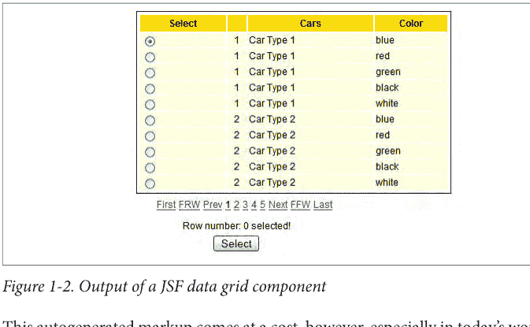

图1-2. JSF数据网格组件的输出

然而，这种自动生成的标记是有代价的，特别是在当今这个浏览器快速演进、高度碎片化的世界里。对灵活、可控标记的需求达到了前所未有的高度。开放Web的发展速度空前，用户界面不能再让服务器成为过去陈旧理念与闪电般快速、可扩展的前端代码之间的瓶颈。开发者从未像现在这样关注浏览器中的性能。标记的渲染方式和异步资源的加载方式，足以成就或摧毁你的应用。更快、更精简的前端意味着更多的潜在客户转化、更好的SEO排名以及更低的数据中心成本。

### HTML5之前

在HTML5和移动设备出现之前，前端（或UI）开发者并不太关心用户界面背后的架构。那时的环境充斥着各种hack和专有插件。许多开发者专注于支持IE6、Firefox、Safari以及可能其他几个浏览器。他们编写干净、语义化的标记，并担心其XHTML的有效性。他们偶尔引入JavaScript库来创建一些酷炫效果，而prototype.js或jQuery是应用的核心（绝非双关）。

一旦开发者为某个特定应用解决了浏览器的怪异性和缺陷，情况就基本保持不变。高级Web应用的架构主要在服务器端管理。应用的性能取决于传入HTTP请求的处理速度以及标记渲染回用户Web浏览器的速度。通过服务器端模板和组件框架，服务器解析模板，数据与常规的XHTML或HTML标记交织在一起。对于Java，你可能使用过JSP、Velocity、Tiles、GWT或JSF来实现这一点。对于Ruby，则是ERB、HAML或RedCloth，诸如此类。每一个服务器端Web框架都有一个配套的UI模板引擎可供选择或使用。这就是过去十年甚至更长时间里UI开发的方式，而且这种方式可能还会持续一段时间。但并非必须如此。是时候重新思考我们如何构建新一代的Web应用了。

你可能会问："为什么我们需要改变前端生成的方式？"或者"为什么我们要将所有代码迁移到Web浏览器中运行，而不是在服务器上？"首先想到的答案是，Web浏览器正在成为一个平台。我们的应用现在运行在能力比其前身高出数个数量级的平台（或浏览器）内部。当今的Web应用就是应用本身。我们不再仅仅创建网站；我们正在创建以HTML5、CSS和JavaScript为核心的强大应用，正如你在图1-3所示的HTML5徽章中看到的那样。

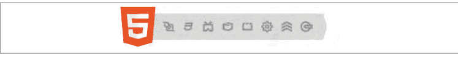

图1-3. HTML5徽章

是时候退一步，审视我们构建应用的方式，并在客户端领域建立公平的竞争环境。开发者必须理解，为任何给定应用构建可扩展、坚如磐石的用户界面需要哪些框架和方法。

### 客户端承载更多代码

平衡无疑正在从传统的服务器端模板转向JavaScript模板。尽管市面上有如此多新的JavaScript框架，我们可能显得有些过度，但这是技术转变并找到合理平衡后的必然结果。驱动我们UI的技术正在发生变化，因为浏览器变得更加移动化，并且通过JavaScript API获得了更多硬件访问权限。在某种程度上，构建用户界面的概念在客户端和服务器端方法中保持不变。它们都需要展示数据和收集数据。我们仍在代码中添加特定于框架的标签或属性，以便数据知道显示在哪里，但对服务器的依赖已经消失。我们现在通过间歇性的RESTful或WebSocket连接获取对象和数据，这些数据通过客户端的JavaScript框架自动绑定到UI。我们的应用现在能够偶尔同步数据，并具备离线工作的能力。

为了驾驭这种力量并处理应用的不同状态，我们必须考虑管理客户端代码的新方法。像jQuery和prototype这样的JavaScript库不应定义我们的前端开发模型。跨浏览器的DOM操作库应受到高度重视，但可扩展的客户端架构的复杂性值得比过去多得多的关注。运用Erich Gamma等人所著的经典著作《设计模式：可复用面向对象软件的基础》（Addison-Wesley Professional, 1995）中收集的成熟技术来组织代码和应用结构，仅仅是开始。现在有超过40个MVC JavaScript框架声称自己是MVC，但它们应该被称为MV*。它们都使用不同的技术来管理模型、视图和控制器，其中许多已经严重偏离了最初的Smalltalk MVC概念。而且，尽管JavaScript框架为我们提供了一种组织和构建代码的好方法，但我们必须自己处理那些暴露硬件级访问权限的浏览器API，例如Geolocation或Web Workers。重度依赖HTML5的用户界面架构仍处于起步阶段，但幸运的是，你有这本书来为你照亮前路。

### 浏览器作为平台

Web浏览器正在成为，或已经是，我们应用技术栈的一个额外平台。在选择我们的应用必须支持的功能时，它得到的考虑与服务器端不相上下，甚至更多。我们的前端代码现在被打包在由HTML5驱动的本地应用、扩展程序和操作系统中。正如我们在Google的Chrome OS和Mozilla的Boot 2 Gecko项目中看到的那样，开放Web显然正被视为Web应用应该且将会为其编写的平台。

HTML5、开放Web和移动设备帮助推动了浏览器作为平台的发展，赋予了浏览器存储数据和在离线状态下运行应用的能力。但许多推动此平台的新标准可能尚未最终确定，或未在所有你希望支持的Web浏览器中一致实现。


## 第2章

### 移动网络

预计到2013年，消费者将购买十亿台支持HTML5的移动设备。目前，美国有一半的成年人拥有智能手机。这相当于1.5亿人，其中28%的人认为移动设备是他们访问网络的主要方式。对HTML5应用的支持浪潮已超过原生应用，当今的开发者正调整他们的优先级，将移动开发置于首位。

即使在大型企业环境中，移动浏览器的使用统计数据也在上升，并开始与桌面浏览器趋同。然而，我们仍然面临这样一个事实：三分之一的互联网用户仍在使用版本早于IE 9的Internet Explorer浏览器。更令人警醒的是，在某些情况下，这些早期的IE用户可能占到我们网站访客的三分之二。这种情况会随着时间的推移而改善，桌面用户将升级到更新的版本和更好的浏览器。但是，当我们推动网络向前发展，为所有浏览器创建令人惊叹的应用程序时，我们也必须创建一个坚实的架构，以考虑到所有用户，并为他们提供尽可能最好的体验。

网络浏览器的功能对于我们的网络项目和产品的成功至关重要。无论是为了娱乐、盈利，还是为了人类的整体福祉，理解如何为桌面和移动用户提供数据都至关重要。本章的目标是在所有浏览器中找到共同点，并确定在构建当今的Web应用程序时应该使用哪些部分。

*移动网络*指的是为移动设备（如智能手机或平板电脑）创建的基于浏览器的应用程序，这些设备可以通过无线方式连接。自2008年以来，网络已转向关注移动浏览器，这为当今的Web开发者和用户带来了整体上更好的生活质量。然而，一旦你开始在各种各样的设备和浏览器上测试你的新移动Web应用时，这种更好的生活质量有时会很短暂。你可能会开始怀疑到底有哪些功能被支持，以及你应该使用哪些HTML5特性来构建你的应用。

无论你是热衷于HTML5、W3C标准的开放Web专家，还是刚从HTML 1时代过来的新手，本章都将为你提供最新的代码、趋势和市场研究，指导你为下一个Web项目做出正确的决定。那么，你还在等什么？升级吧！

### 移动优先

首先，让我们明确我们的优先级。优先考虑移动设计和开发而非桌面曾一度令人发笑。短短几年间，“移动优先”的理念已经深入人心，在基于HTML5的API方面，为Web开发者带来了一股清流，这些API能够访问移动设备上的硬件。

除了显而易见的原因外，以下是采用移动优先策略的几个理由：

-   为受限设备和分辨率开发网站，将迫使你创建更流畅、更灵活的内容。
-   设备功能，如加速计和地理定位硬件，通过增强现实等技术，带来了新的商业机会。
-   总的来说，移动优先要求你以代码质量的思维模式来思考。如今，开发者在进行CSS硬件加速动画时，必须考虑电池寿命等问题。这种开发质量不仅带来了性能更好的应用，还鼓励你专注于更清晰的语义。
-   当你逐渐脱离以桌面为中心的Web开发时，移动浏览器让你得以一窥未来。这让你能够保持在最前沿，并了解新的规范和功能。

不幸的是，移动网络尚未实现“一次编写，随处运行”。随着规范的最终确定和功能的实现，互操作性将会实现。然而，在当今的移动浏览器世界中，我们在所有浏览器中还没有一个大体一致的实现。尽管新的平板电脑和手机不断发布，以实现一致的HTML5实现水平，但我们都知道，我们必须在一段时间内继续支持那些较旧的、碎片化的设备。因此，不用说，像iPhone 3G以及任何没有升级到Android 4以上的设备，将成为这个移动时代的IE6。

### 决定支持什么

就目前移动领域的现状而言，我们有多个平台和浏览器需要支持。当你使用HTML5的核心API时，你受限于目标设备所支持的功能。因此，了解移动浏览器的现状及其发展方向至关重要。

编写跨所有平台和所有浏览器的移动Web应用可能是一项艰巨的任务。以前，Web应用开发者并不关心桌面电脑是否连接了摄像头或加速计。过去的Web应用程序不与操作系统和桌面硬件的功能绑定。现在，移动网络为我们的应用增加了另一个支持维度，而浏览器和设备之间的碎片化程度令人震惊。我们现在必须创建能够跨浏览器、平台*以及*设备兼容的应用程序。例如，基于WebKit的Android浏览器在2.1版本中支持Web Workers，但在2.2、3.0和4.0版本中禁用了支持。然后，在4.1版本中，Web Workers的支持被修复并重新启用！很令人困惑，对吧？这就是我所说的另一个支持维度或*碎片化*。你不仅要支持浏览器，还要支持浏览器所依附的操作系统。

你如何理清这一切？不用担心，本章的其余部分将研究各种移动浏览器，讨论每个设备普遍支持的API，并确定一组核心特性，你可以基于这些特性构建一个坚实的企业级移动网络应用。

> 你可以在维基百科的[HTML5引擎比较](https://en.wikipedia.org/wiki/HTML5_engine_comparison)页面上找到最新的HTML5跨所有渲染引擎的支持矩阵。


### 移动网络浏览器

花点时间回顾一下各种移动浏览器及其各自的社区。作为开发者，我们必须尝试拥抱所有平台，并开发能够跨以下所有浏览器（如果需要，甚至更多）运行的应用程序。例如，你的用户不应该被限制在仅支持WebKit的移动应用程序中，你的代码只能在iOS和Android上运行。

### WebKit

WebKit是Mobile Safari、Android和Chrome等浏览器的引擎。这个开源项目不断推动开放网络的发展，适应最新发布的W3C规范。最近对WebKit兴趣的激增，可以归因于它驱动了许多领先的移动平台浏览器。

图2-1显示了源代码修订（垂直轴）作为时间（水平轴）的函数。一些图标代表与WebKit相关的产品；其位置大致类似于这些产品流行的年代。


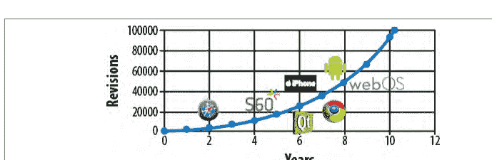

图 2-1. WebKit 修订版

### Mobile Safari (iOS6)

苹果公司在早期 HTML5 规范的采用和实施方面令人印象深刻。该公司一直是推动 Web 发展的重要力量。凭借标准的硬件和多核技术，iPhone 和 iPad 成为了 HTML5 开发的绝佳平台。然而，在 iOS 的世界里并非一切尽如人意，因为每个移动浏览器都有其特有的怪癖和缺陷。早期版本的 iOS 因 JavaScript 的 `innerHTML()` 存在一个缺陷而受到困扰，迫使开发者们思考新的动态内容插入方式。你将在下一章看到这个问题的解决方案——目前，我们将专注于全局概览。

苹果围绕 iOS 发展和缺陷报告的社区流程受制于其自身选择的方式。你可以通过其 BugReporter (http://bugreport.apple.com) 提交缺陷报告，但你只能搜索自己提交的问题。幸运的是，社区再次挺身而出，帮助苹果允许公开搜索来自客户的非机密数据。要查看你的缺陷是否已被提交，可以访问 http://openradar.appspot.com/faq。

### Android

尽管 Android 默认浏览器基于 WebKit，但在撰写本文时，其 HTML5 规范的实现才刚刚在 4.0 版本中开始增强。随着 Android 的演进，我们可以放心，未来的 HTML5 实现将与其社区 (http://source.android.com/community) 一同发展。不过目前，Android 设备的碎片化问题非常严重，HTML5 的支持程度因设备和操作系统版本而异。

至于 Android 的未来，较新的海豚浏览器 (http://dolphin-browser.com) 承诺在浏览器技术上取得重大进步：

- 比 Android 默认浏览器快 5 到 10 倍
- 有时比 Chrome 快 100%
- 在权威测试网站 http://HTML5test.com 上的得分超过 450，如图 2-2 所示

| 引擎 | 平台 | 得分 | 附加分 |
| :--- | :--- | :--- | :--- |
| Dolphin Engine Beta » | Android 2.2 或更高版本 | 450 | 3 |
| BlackBerry 10 » | | 447 | 10 |
| Tizen 1 » | | 408 | 15 |
| iOS 6.0 » | Apple iPhone, iPad and iPod Touch | 360 | 9 |
| Firefox Mobile 12 » | Multiple platforms | 328 | 9 |
| Windows Phone 8 » | | 300 | 6 |
| Nokia Belle FP 2 » | S60 5.5 | 256 | 9 |

图 2-2. http://html5test.com/results/mobile.html 的性能测试结果

### Mobile Firefox

Mozilla 已经存在了很长时间，并且在专注社区努力和推动 Web 发展方面比以往任何时候都更加强大。截至撰写本文时，Mobile Firefox 在最佳 HTML5 实现方面排名第三（图 2-3），并且在已实现的 HTML5 功能方面已经超越了 Mobile Safari (iOS)。


| 浏览器 | 平台 | 得分 | 附加分 |
| :--- | :--- | :--- | :--- |
| Chrome » | All Android 4 devices | 371 | 11 |
| Opera Mobile 12.00 » | Multiple platforms | 369 | 11 |
| Firefox Mobile 10 » | Multiple platforms | 325 | 9 |
| iOS 5.1 » | Apple iPhone, iPad and iPod Touch | 324 | 9 |
| MeeGo/Harmattan » | Nokia N9 and N950 | 284 | 14 |
| Android 4.0 » | Samsung Galaxy Nexus | 280 | 3 |
| BlackBerry OS 7 » | BlackBerry Bold 9900 and others | 273 | 3 |
| Bada 2.0 » | Samsung Wave and others | 268 | 9 |
| Nokia Belle FP 1 » | S60 5.4, Nokia 603, 700 and 701 | 226 | 9 |
| webOS 2.2 » | Palm Pre 2 and HP Pre 3 | 210 | 5 |
| Android 2.3 » | Google Nexus S and others | 189 | 1 |
| Windows Phone 7.5 » | Samsung Omnia W, LG E906 and others | 138 | 5 |

图 2-3. 最佳移动 HTML5 实现及其结果

随着移动 Web 的发展和演进，这种王座的交替将持续下去——这是一件好事。我们需要竞争和标准的推进。对于移动 Web 的演进，Mozilla 并不陌生，它推出了一个雄心勃勃的新项目，称为 WebAPI ([https://wiki.mozilla.org/WebAPI](https://wiki.mozilla.org/WebAPI))。WebAPI 项目是一组用于访问通常只有原生应用程序才能使用的设备功能的 API。总而言之，它是一个基于 HTML、CSS 和 JavaScript 的移动设备操作系统。这是推动 Web 发展、让开发者为所有移动操作系统编写一次 Web 应用程序的又一努力。WebAPI 项目预计在 2012 年年中通过 Boot to Gecko 项目 (B2G) 交付。图 2-4 展示了 B2G 的 Gaia UI 界面截图。

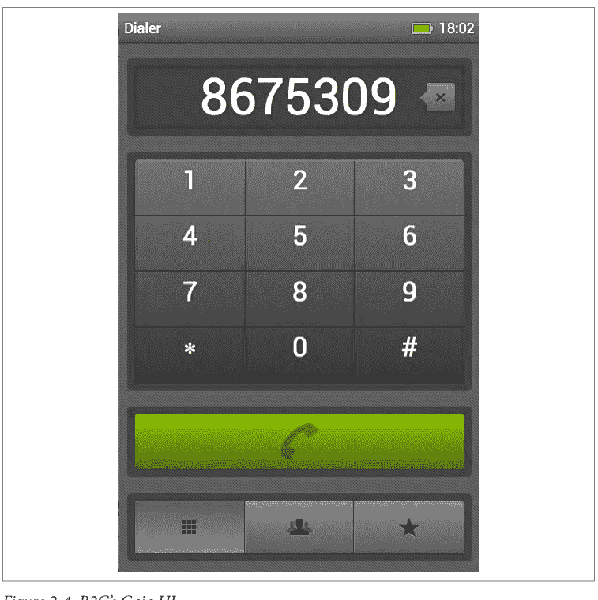

### Opera Mobile

Opera (http://www.opera.com/mobile) 为手机提供了两个独立的浏览器：Opera Mobile 和 Opera Mini。在 Opera Mini 中，Opera Presto 浏览器引擎位于服务器上。在 Opera Mobile 中，它被安装在手机上。目前，Opera Mini 在其他浏览器中占据着很大的市场份额，但对于企业 HTML5 应用程序，Opera Mobile 支持我们需要的核心规范，例如 Web Storage、Web Workers 和 Geolocation。

### Internet Explorer Mobile

Windows Phone 7.5 的特色是一个版本的 Internet Explorer Mobile，其渲染引擎基于 Internet Explorer 9。因此，解释 Windows Phone 支持什么的最简单方式就是说它支持 IE9 所支持的一切，包括 Web Storage 和 Geolocation。IE9 Mobile 支持的规范可以在 http://windowsteamblog.com/windows_phone/b/wpdev/archive/2011/09/22/ie9-mobile-developer-overview.aspx 找到。

更好的消息是，Windows Phone 8 支持 IE10。Internet Explorer 10 对 WebSockets、Web Workers、Application Cache 和 IndexedDB 等 HTML5 功能提供了更好的支持。

### 移动浏览器市场份额

根据最新的全球浏览器市场份额报告，基于 WebKit 的浏览器以超过 80% 的市场份额遥遥领先（图 2-5）。目前，Android 和 iOS 占据主导地位，但随着新操作系统（如 Mozilla 的基于 HTML5 的移动 B2G 项目）的出现，我们可能会看到正在进行的“浏览器大战”中权力的再次转移。

事情发展得已经很快了。在我撰写本书的几个月里，基于 WebKit 的浏览器市场份额从 2011 年 10 月的 75% 增长到 2012 年的 80% 以上。Opera Mini 从 18.65% 萎缩到 12%。IE 浏览器从 0.16% 增长到 0.58%，但微软刚刚在 2012 年启动其 Windows Phone 平台的营销机器——因此可以预期 IE 的数字会增长。


你可以访问 http://www.netmarketshare.com/browser-market-share.aspx?qprid=0&qpcustomd=1 查看最新的浏览器统计数据。

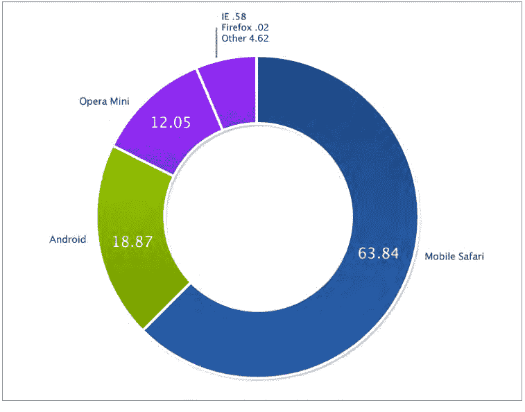

图 2-5. 全球浏览器市场份额；2012年5月数据由 *Net Applications* 提供

### 浏览器分级

所有这些信息都引向了一个重要话题：浏览器分级。浏览器分级对于任何移动 Web 项目都是必需的。它为开发人员和质量保证团队提供了一种在开发和测试应用程序时保持理智的方法。它还为用户设定了一个具体的支持时间表，并为移动 Web 应用程序的能力设定了一个总体目标。表 2-1 展示了一个来自 *QuirksMode* 的浏览器分级表示例。

表 2-1. 浏览器分级示例

| 等级 | 描述 |
|---|---|
| A：高质量 | 具有显著市场份额的高质量浏览器。移动 Web 开发人员必须针对的浏览器。 |
| B：中等质量 | 要么是市场份额高的低质量浏览器，要么是市场份额低的高质量浏览器。根据你的能力，你也应该努力支持这些浏览器。 |
| C：低质量 | 通常是市场份额高的极低质量浏览器。通常无法运行现代 JavaScript 或 DOM 代码。应针对此浏览器，但可能仅能访问有限的功能。 |
| F：不合格 | 勉强能运行的浏览器。请明智地选择你的支持范围。 |

### 企业中的 HTML5

对移动设备和浏览器格局有了更清晰的了解之后，接下来你需要确定各种浏览器支持哪些 W3C 规范，以及你现在如何使用它们。在企业开发方面，某些客户端 API 被认为是当今移动 Web 应用程序的高级构建块：Geolocation、WebSocket、Web Storage、Device Orientation 和 Web Workers。这些是 W3C 最后征求意见的规范；它们已接近最终确定，基本稳定，并且已被当今的移动浏览器所采用。当然，你还可以找到许多其他优秀的规范，例如 Media Capture API，它允许访问设备的音频、视频和图像，但本书试图专注于当今所有浏览器都广泛支持的规范。

表 2-2 详细介绍了五大领先或新兴移动平台对这些构建块 API 的支持情况。所有这些移动浏览器都被认为是 A、B 或 C 级。在本书和 [http://html5e.org](http://html5e.org) 中，我将把这组规范和浏览器称为 *HTML5 Enterprise* 或 *HTML5e*，以便轻松识别并在移动和桌面环境中基于相同的规范和浏览器进行构建。

表 2-2. HTML5 Enterprise (HTML5e) 移动端支持

| 浏览器 | Geolocation | WebSocket | Web Storage | Device Orientation | Web Workers |
| --- | --- | --- | --- | --- | --- |
| Mobile Safari | Yes | Yes | Yes | Yes | Yes |
| Android | Yes | No | Yes | Yes | No |
| Mobile IE | Yes | Yes<sup>a</sup> | Yes | No | Yes<sup>a</sup> |
| Opera Mobile | Yes | Mixed<sup>b</sup> | Yes | Mixed<sup>c</sup> | Yes |
| Mobile Firefox | Yes | Mixed<sup>b</sup> | Yes | Yes | Yes |

<sup>a</sup> Windows Phone 7.5 的 Mobile IE 不支持这些，但 Windows 8 及更高版本支持。
<sup>b</sup> Mozilla 和 Opera 都由于该协议的安全问题而暂时禁用了 WebSockets。
<sup>c</sup> Android 版 Opera Mobile 提供实验性支持。

如表 2-2 所示，Mobile Firefox 和 Safari 在广泛支持方面是明显的赢家，Opera Mobile 紧随其后位列第三。Android 仍需努力，其 4.0 版本看起来好多了。同样，Mobile IE 在 IE10 中对 HTML5 的支持也好了很多，但 IE9 主要关注“相同标记”方法：试图在 HTML5 相关标记和 IE 渲染引擎方面做到正确。


要获取最新的浏览器 HTML5 支持信息，请查看 [http://caniuse.com](http://caniuse.com) 和 [http://mobilehtml5.org](http://mobilehtml5.org)。


### 优雅降级

那么，你已经决定了要支持哪些浏览器（希望是所有浏览器），但现在你必须在某些 HTML5 规范未实现的平台上，对你的应用进行*功能回填*或优雅降级。优雅降级的前提是首先为最新、最强大的浏览器构建，然后为功能较弱的设备添加*功能回填*或处理程序。如何创建一个开发环境，既能满足你的企业项目需求，又能提供一个在多种移动浏览器上有效工作并优雅降级的 API？在后续每一章的结尾，我们将探讨处理这些问题的方法，并找出可能提供开源解决方案的项目。

你现在有了一个起点：对移动设备浏览器支持哪些 HTML5 API 有了清晰的了解。展望未来，随着新设备操作系统的发布和规范本身的最终确定，W3C 规范驱动的设备功能只会越来越好。接下来的章节将评估可用的框架，为你的项目构建一个可复用的 API。

### 质量保证与设备测试

除了决定要支持哪些浏览器外，你还需要一个便捷的方式在它们之间进行开发和测试。企业开发和质量保证周期可能会根据项目规模而变得昂贵。因此，建立合适的快速开发和测试环境对于成功至关重要。

由于当前移动市场主要由 Android 和 iOS 占据，基于 WebKit 的测试相当容易。你可以像在桌面浏览器上一样进行测试，然后在由 WebKit 版本支持的目标移动设备上运行它们。然而，仅仅因为你在 Chrome 或 Safari 的桌面版本上测试了你的应用，并不意味着它在所有基于 WebKit 的移动浏览器上都能正常工作。这也不意味着 WebKit 是移动 Web 的完美代表。你应该尽可能基于 W3C 标准在多种目标平台上进行测试。

测试你的移动 HTML5 应用的最佳方式是使用你所针对的实际物理设备（或模拟器）。作为一项对开发者的服务，《Programming the Mobile Web》（O'Reilly）的作者 Max Firtman 在识别可用模拟器方面做得非常出色，并维护着一个更新的列表，你可以在 [mobilexweb](http://mobilexweb.com) 找到它，并在**图 2-6** 中预览。

花点时间决定你可能需要哪个模拟器，并为**第 3 章**做好准备。在那里，你将了解如何调试硬件加速问题，研究所有可用的远程调试技术，并学习如何在每种浏览器上进行开发和工作。

### 用于移动 Web 设计与开发测试的移动设备和平板电脑模拟器列表

| 名称 | 官方 | 平台 | 类型 | 浏览器测试 | 原生测试 | 兼容性 |
| :--- | :--- | :--- | :--- | :--- | :--- | :--- |
| **iOS 模拟器** | 官方 | iOS | 模拟器 | 仅 Safari | Objective-C | （Apple 标志图片） |
| **下载**（3.7GB，需登录） | | *设备：iPhone 3GS、iPod Touch、iPhone 4、iPad（平板电脑）* | 随 XCode 和原生 SDK 一起提供。无法模拟加速度计/陀螺仪 **(DeviceMotion API)**。无法模拟 URI 方案，例如 **click-to-call**。作为模拟器，它不提供 AppStore；你无法安装其他浏览器进行测试，例如 Opera Mini 或 Skyfire。 | | | |
| **Android 模拟器** | 官方 | Android | 模拟器 | Android 浏览器 – 其他 | Java | （Apple 标志、Windows 标志、Tux 企鹅标志图片） |
| **下载**（每个平台包 20MB 和 60MB） | | *设备：使用 1.1、1.5、1.6、2.0、2.1、2.2、2.3、3.0 操作系统平台的通用设备* | 我们需要在下载 SDK 后下载平台的镜像。详见**本书第 4 章**。下载平台后，你可以在 Android 模拟器中安装 **Firefox、Opera Mini、Opera Mobile、Skyfire** 和 **UCWEB** 进行测试。你可以下载 Motorola、Samsung 和 Nook 附加组件（见下文）。现在它包括 HoneyComb (3.0) 中的平板电脑支持。 | | | |
| **HP webOS 模拟器** | 官方 | webOS | 虚拟机 | webOS 浏览器 | JavaScript – C++ | （Apple 标志、Windows 标志、Tux 企鹅标志图片） |
| **下载**（260MB） | | *设备：Palm Pre、Palm Pixi、Palm Pixi Plus* | 随 SDK 一起提供 | | | |
| **Samsung Galaxy Tab 附加组件** | 官方 | Android | 附加组件 | Android 浏览器 – 其他 | Java | （Apple 标志、Windows 标志、Tux 企鹅标志图片） |
| **下载**（52MB） | | *设备：Samsung Galaxy Tab（平板电脑）* | 需要带有 2.2 包的 Android SDK。通过使用 Android 2.3 SDK 搜索第三方包来完成下载。 | | | |

图 2-6. 模拟器列表，可在 mobilexweb 获取

## 第 3 章
### 为移动 Web 进行构建

任何移动 Web 应用的成功都取决于两个因素：设计和性能。对于移动应用设计，我们必须在所有平台上保持一致的外观和感觉。为了更好的性能，我们必须具备离线功能、UI 上的动画，以及通过 RESTful 或 WebSocket 端点获取和发送数据的后端服务。简单来说，你的应用受到两个不断变化的速度的限制：设备 CPU/GPU 的速度和互联网的速度。UI 由设备硬件（如 GPU）处理，当通过 CSS 进行类似原生的动画和过渡时，而后端服务则受限于移动设备当前的互联网连接速度。

在本章中，我们将讨论如何设计、创建和优化你的移动 Web 应用，使其外观更好、性能更佳。本章首先简要解释应用在移动设备上应有的外观，然后深入讲解硬件加速 CSS 的底层原理及其调试方法。接下来，你将了解构建离线移动应用需要什么，以及如何将所有代码整合到一个应用中，创建一个能够处理间歇性互联网连接的、类似原生的移动 Web 应用。最后，你将研究当今最受欢迎的移动框架，以了解何时或是否应该将社区支持的框架添加到你的项目中。

### 移动 Web 的外观和感觉

“原生与移动 Web”之争并非关乎哪种编程模型会胜出。它关乎在 HTML5 类技术赶上之前，我们能构建什么。我们有三个选择：

-   纯原生方法，目前在整体应用响应速度方面显然占据优势
-   混合方法和框架，试图弥合 HTML5 和原生之间的差距
-   真正的前沿移动 Web 框架，试图通过标记、JavaScript 和 CSS 征服原生体验

将快速且响应灵敏的移动 Web 应用与现有的企业基础设施相结合，让游戏开始吧。Web 标准正在迅速缩小与缺失的原生功能之间的差距，设备制造商也在加紧实现它们。例如，截至 Android 3.1，由于 Media Capture API 规范，你可以捕获照片和视频。

W3C 近日非常繁忙，开发者们正在推动规范的完善和提出更好的用例。像 jQuery 这样的项目正在呼吁开源社区参与这些规范，并为构建更好的 Web 提交他们的想法。

移动开发者倾向于一次编写，到处运行他们的应用，这是合乎逻辑的。*一次编写，到处运行*，或称 *WORA*，在 Sun 的 JVM 开始在企业中崭露头角后受到了广泛关注。有了 HTML5，WORA 基本上意味着你可以使用标准的 JavaScript 和 CSS 访问原生应用所能访问的所有设备功能（设备 GPS、摄像头、加速度计等）。这种方法为曾经只用于提供文档而非应用的浏览器和语言（HTML）注入了新的活力。

### 外观

要真正实现那种原生的外观和感觉，不仅需要你的应用响应迅速，还必须看起来美观。如今，让你的原生应用跻身应用商店 Top 10 名单的大秘诀，就是拥有一个漂亮的设计。仅此而已。如果你有一个利用所有最新设备功能的杀手级数据驱动应用，但没有好的干净设计，它也不会走得太远。

总的来说，Web 有其自身的外观和感觉，这一点大家都知道。然而，并不存在一个能让所有用户都满意的默认外观，因此，创造吸引人的用户体验的责任落在你和你的设计团队身上。

iOS 肯定有其自己的移动 Web 外观和感觉，模仿其原生应用，但 Android、Windows Mobile、Kindle 以及所有其他设备呢？即使你能让 Web 应用像原生应用一样响应，你如何征服让它看起来像原生应用的问题？因为你主要只关心三到四个领先的平台，你可以为目标平台创建三个原生皮肤，并为所有其他平台提供默认的 Web 外观和感觉。

Theresa Neil 在《Mobile Design Pattern Gallery》（O’Reilly）中出色地解释了原生应用的 UI 模式。她的网站（如*图 3-1*所示）是了解移动设计趋势模式的重要资源。


### 体验感受

当你尝试构建一个行为类似原生应用的移动 Web 应用时，旋转时的刷新、页面切换的卡顿，以及点击事件的周期性延迟，仅仅是需要面对的众多难题中的一小部分。开发者们正努力让应用尽可能接近原生体验，但常常被各种 hack、重置和僵化的框架所阻碍。

#### 硬件加速

通常，GPU 用于处理精细的 3D 建模或 CAD 图纸，但对于移动 Web 应用，我们希望我们的基础绘图元素（div、背景、带阴影的文字、图片等）能够通过 GPU 平滑显示和动画化。不幸的是，大多数前端开发者正将动画处理过程交给第三方框架，而不关心其语义，但这些核心 CSS3 特性是否应该被掩盖？思考一下关心硬件加速为何重要的几个原因：

##### 内存分配与计算负担

如果你只是为了硬件加速而随意组合 DOM 中的每个元素，那么下一个接手你代码的人可能会追着你打。

##### 功耗与电池寿命

显然，当硬件介入时，电池消耗也会增加。开发者在编写移动 Web 应用时，被迫考虑各种各样的设备限制。随着浏览器厂商开始提供越来越多设备硬件的访问权限，这种情况将更为普遍。幸运的是，我们很快将有一个用于检查设备电池状态的 API。

##### 冲突

当你将硬件加速应用到页面中已经被加速的部分时，会遇到行为异常。因此，了解是否存在重叠加速非常重要。

为了让用户交互流畅并尽可能接近原生体验，你必须让浏览器为你工作。理想情况下，你希望移动设备 CPU 设置初始动画，然后让 GPU 仅在动画过程中负责组合不同的层。这就是 `translate3d`、`scale3d` 和 `translateZ` 的作用：它们为动画元素提供自己的层，从而允许设备平滑地一起渲染所有内容。

CSS 特性在低端设备上可能会有代价。当使用 CSS 渐变、`box-shadow`、边框和 `background-repeat` 时，你是在使用设备 GPU 来实时绘制图像。CSS 对于渲染漂亮的用户界面非常强大，但你应该避免在软件中处理这类工作，如果它们可以预先烘焙到图像中。这意味着你应该使用精灵图，以便设备只下载单个图像，并在 CSS 文件中嵌入数据 URI 以处理较小的图像。

一些不需要重绘的动画包括：

- `transition-property`
- `opacity`
- `transform`

CSS 选择器性能会严重拖累旧版移动浏览器。使用像这样的选择器：

```css
div[style*='foo']
```

会在 iOS 4.3.x 及更早版本设备上严重降低性能。

### 交互与过渡

在开发移动 Web 应用时，我们来看看三种最常见的用户交互方式：滑动、翻转和旋转效果。首先，我们将剖析滑动、翻转和旋转过渡效果，以及它们是如何被加速的。请注意每个动画只需要三四行 CSS 和 JavaScript。示例不使用任何额外的框架，只使用 DOM 和带有厂商前缀的 API。

你可以在 [http://html5e.org/example](http://html5e.org/example) 查看这些代码的实际效果。该演示是为移动设备构建的，因此请启动一个模拟器，使用你的手机或平板电脑，或者将浏览器窗口大小缩小到 1024px 或更小。

#### 滑动

这三种方式中最常见的是滑动页面过渡，它模仿了移动应用程序的原生感觉。滑动过渡被调用以将新的内容区域带入视口。

对于滑动效果，首先声明你的标记：

```html
<div id="home-page"
class="page">
  <h1>Home Page</h1>
</div>

<div id="products-page" class="page stage-right">
  <h1>Products Page</h1>
</div>

<div id="about-page" class="page stage-left">
  <h1>About Page</h1>
</div>
```

注意页面被设置在左侧和右侧。你可以将它们放在任何方向，但这是最常见的。

我们现在只需几行 CSS 就可以添加动画和硬件加速。实际的动画发生在我们切换页面 div 元素的类时。

```css
.page {
  position: absolute;
  width: 100%;
  height: 100%;
  /*activate the GPU for compositing each page */
  -webkit-transform: translate3d(0, 0, 0);
}
```

虽然 `translate3d(0,0,0)` 被称为 WebKit 的银弹方法，但其他浏览器引擎如 fennec（移动版 Firefox）和 Opera Mobile 在撰写本文时并不支持，或者刚刚开始实现 `translate3d`。它们支持 2D 变换，即去掉了 Z 轴，因此为了支持这些浏览器，你需要更改：

```javascript
translate3d(X,Y,Z);   // 或
translateX(X), translateY(Y), translateZ(Z);
```

为：

```javascript
translate(X,Y);
```

2D 变换的一个缺点是，与 3D 变换不同，它们不通过 GPU 加速。

> 硬件加速技巧在 Android Froyo 2.2 及更高版本下无法提供任何速度提升。所有合成都在软件中完成。

当用户点击一个导航元素时，我们执行以下 JavaScript 来切换类。我们还没有使用任何第三方框架，这是纯正的 JavaScript！

```javascript
function slideTo(id) {
  //1.) the page we are bringing into focus dictates how
  // the current page will exit. So let’s see what classes
  // our incoming page is using.
  //We know it will have stage[right/left/etc…]
  var classes = getElement(id).className.split(' ');

  //2.) decide if the incoming page is assigned to right or left
  // (-1 if no match)
  var stageType = classes.indexOf('stage-left');

  //3.) on initial page load focusPage is null, so we need
  // to set the default page which we’re currently seeing.
  if (FOCUS_PAGE == null) {
    // use home page
    FOCUS_PAGE = getElement('home-page');
  }

  //4.) decide how this focused page should exit.
  if (stageType > 0) {
    FOCUS_PAGE.className = 'page transition stage-right';
  } else {
    FOCUS_PAGE.className = 'page transition stage-left';
  }

  //5. refresh/set the global variable
  FOCUS_PAGE = getElement(id);
}
```

```javascript
//6. Bring in the new page.
FOCUS_PAGE.className = 'page transition stage-center';
}
```

`stage-left` 或 `stage-right` 变成 `stage-center`，并强制页面滑入中心视口。我们完全依赖 CSS3 来完成繁重的工作。

```css
.stage-left {
    left: 100%;
}

.stage-right {
    left: 100%;
}

.stage-center {
    top: 0;
    left: 0;
}
```

通过在 JavaScript 中切换 stage 类来控制动画，我们将 CSS 实现与 JavaScript 解耦了。然而，我们也可以使用以下方式在 JavaScript 中控制所有呈现逻辑：

```javascript
FOCUS_PAGE.style.transform =
"translate(X,Y)";
```

每个浏览器厂商可能对 transform 能力使用特定的*厂商前缀*。一个快速检查目标浏览器支持什么的方法是使用：

```javascript
var getTransformProperty =
    function(node) {
        var properties = [
            'transform',
            'WebkitTransform',
            'msTransform',
            'MozTransform',
            'OTransform'
        ];
        var p;
        while (p = properties.shift()) {
            if (typeof node.style[p] != 'undefined') {
                document.
                querySelector("#log").innerHTML += p + "<br/>";
            }
        }
        return false;
    };
```

这个滑动效果已经在 Mobile Safari、Android、Mobile Firefox（图 3-2）和 Opera Mobile（图 3-3）上进行了测试。你也可以查看支持上述所有浏览器的**源代码**。

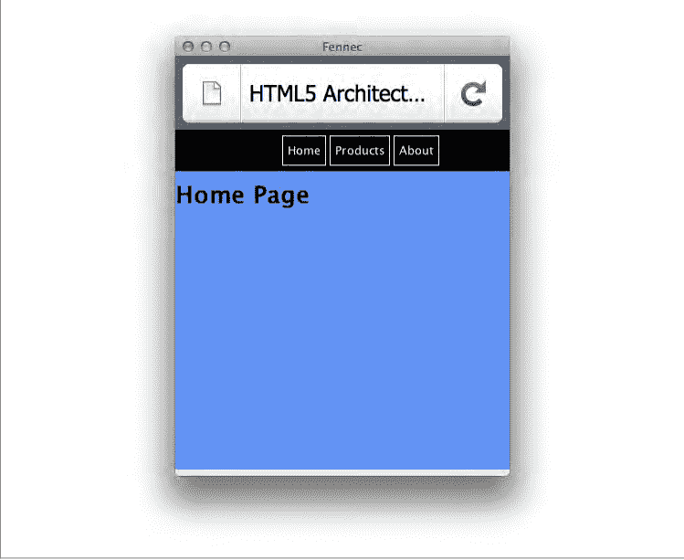


#### 翻页

在移动设备上，翻页的特点是真正将页面滑走。这里你可以使用一些简单的 JavaScript 来处理 iOS 和基于 WebKit 的 Android 设备上的事件。这是一个[翻页效果示例](http://example.com/flipping)和 [GitHub 上的源代码](http://example.com/source)。

在处理触摸事件和过渡动画时，首先需要获取元素当前位置的信息。得益于 CSSMatrix 接口（在撰写本文时，仅由 WebKit 实现），你可以通过传递当前 transform 的计算样式来获取 WebKitCSSMatrix 的实例。

```
function pageMove(event) {
    // get position after transform
    var curTransform =
        new WebKitCSSMatrix(window.getComputedStyle(page).webkitTransform);
    var pagePosition = curTransform.m41;
}
```

由于我们为页面翻转使用了 CSS3 ease-out 过渡效果，常用的 `element.offsetLeft` 将不起作用。

有关 WebKitCSSMatrix 的更多信息，请访问 [Apple 的开发者页面](http://developer.apple.com)。

接下来，我们需要确定用户翻页的方向，并为触发事件（页面导航）设置一个阈值。

```
if (pagePosition >= 0) {
    //moving current page to the right
    //so means we're flipping backwards
    if ((pagePosition > pageFlipThreshold) ||
            (swipeTime < swipeThreshold)) {
        //user wants to go backward
        slideDirection = 'right';
    } else {
        slideDirection = null;
    }
} else {
    //current page is sliding to the left
    if ((swipeTime < swipeThreshold) ||
            (pagePosition < pageFlipThreshold)) {
        //user wants to go forward
        slideDirection = 'left';
    } else {
        slideDirection = null;
    }
}
```

你还会注意到，我们也在以毫秒为单位测量 `swipeTime`。这允许在用户快速滑动屏幕翻页时触发导航事件。

为了在手指触摸屏幕时定位页面并使动画看起来流畅自然，我们在每次事件触发后使用 CSS3 过渡效果。

```
function positionPage(end) {
  page.style.webkitTransform = 'translate3d(' + currentPos + 'px, 0, 0)';
  if (end) {
    page.style.WebkitTransition = 'all .4s ease-out';
    //page.style.WebkitTransition = 'all .4s cubic-bezier(0,.58,.58,1)'
  } else {
    page.style.WebkitTransition = 'all .2s ease-out';
  }
}
```

在这个示例中，ease-out 效果很好，但在你自己的项目中，可以尝试使用 `cubic-bezier` 来为过渡效果带来最佳的流畅感。

最后，为了实现导航，我们必须调用上一个示例中定义的 `slideTo()` 方法。

```
track.ontouchend =
  function(event) {
    pageMove(event);
    if (slideDirection == 'left') {
      slideTo('products-page');
    } else if (slideDirection == 'right') {
      slideTo('home-page');
    }
  }
```

#### 旋转

接下来，看看这个演示中使用的旋转动画。任何时候，你都可以通过点击“联系”菜单选项将当前查看的页面旋转 180 度以显示背面。同样，这只需要几行 CSS 和一些 JavaScript 就可以在点击时分配一个过渡类。

> 旋转过渡在大多数版本的 Android 上渲染不正确，因为它缺乏 3D CSS transform 能力。不幸的是，Android 不是忽略翻转效果，而是通过旋转而不是翻转使页面“翻滚”开。我建议在改进支持之前谨慎使用这种过渡效果。

这是完整的源代码，但这是标记结构（正面和背面的基本概念）：

```
<div id="front"
     class="normal">
  ...
</div>
<div id="back" class="flipped">
  <div id="contact-page" class="page">
    <h1>Contact Page</h1>
  </div>
</div>
```

你需要的 JavaScript 是：

```
function flip(id) {
  // get a handle on the flippable region
  var front = getElement('front');
  var back = getElement('back');

  // again, just a simple way to see what the state is
  var classes = front.className.split(' ');
  var flipped = classes.indexOf('flipped');

  if (flipped >= 0) {
    // already flipped, so return to original
    front.className = 'normal';
    back.className = 'flipped';
    FLIPPED = false;
  } else {
    // do the flip
    front.className = 'flipped';
    back.className = 'normal';
    FLIPPED = true;
  }
}
```

最后，这是相关的 CSS：

```
#back,
#front {
  position: absolute;
  width: 100%;
  height: 100%;
  -webkit-backface-visibility: hidden;
  -webkit-transition-duration: .5s;
  -webkit-transform-style: preserve-3d;
  -moz-backface-visibility: hidden;
  -moz-transform-style: preserve-3d;
  -moz-transition-duration: .5s;
}

.normal {
  -webkit-transform: rotateY(0deg);
  -moz-transform:  rotateY(0deg);
}

.flipped {
  -webkit-user-select: element;
  -webkit-transform: rotateY(180deg);
  -moz-transform:  rotateY(180deg);
}
```

### 调试硬件加速

了解了基本过渡的代码后，我们来看看过渡在设备上运行和合成的机制。以下是使用加速合成时需要记住的一些提示：

- 减少图层数量
- 保持图层尽可能小
- 不频繁更新图层
- 根据你的目的调整图层合成
- 使用试错法；测试很重要

开始调试时，启动几个基于 WebKit 的浏览器和你选择的 IDE。

#### 使用 Safari

首先，从命令行启动 Safari 以使用一些调试环境变量。我使用的是 Mac，因此示例命令可能与你的操作系统不同。打开终端，输入以下内容（或者直接跳过 Safari，使用下一节中的 Chrome 设置）：

```
$> export CA_COLOR_OPAQUE=1
$> export CA_LOG_MEMORY_USAGE=1
$> /Applications/Safari.app/Contents/MacOS/Safari
```

这几行命令使用几个调试辅助工具启动 Safari。`CA_COLOR_OPAQUE` 会向你显示哪些元素实际上是被合成或加速的，而 `CA_LOG_MEMORY_USAGE` 会在将绘制操作发送到后台存储时显示你使用了多少内存。这可以准确地告诉你给移动设备带来了多大的负担，并可能提示你的 GPU 使用情况如何消耗目标设备的电池。

你也可以在运行以下命令后启动 Safari，这会给你一个完整的调试菜单，包含所有可用选项，如图 3-4 所示：

```
defaults write com.apple.Safari
    IncludeInternalDebugMenu 1
```

*图 3-4. Safari 调试菜单*

#### 使用 Chrome

现在启动 Chrome 以查看一些良好的每秒帧数（FPS）信息以及合成图层周围的边框：

1. 打开 Google Chrome 网页浏览器。
2. 在 URL 栏中，输入 **about:flags**。
3. 向下滚动几项，点击启用 FPS 计数器，如图 3-5 所示。

*图 3-5. Chrome about:flags 标签页*

> 不要启用“在所有页面上启用 GPU 合成”选项。只有当浏览器检测到你标记中的合成时，FPS 计数器才会出现在左上角——这正是你在此情况下想要的。

如果你在增强版的 Chrome 中查看此页面，你会在左上角看到红色的 FPS 计数器，如图 3-6 所示。

*图 3-6. Chrome FPS 测量器*

这就是你知道硬件加速已开启的方式。它还可以让你了解动画运行的情况以及是否有任何泄漏（应停止的持续运行的动画）。

另一种可视化硬件加速的方法是在应用了上述环境变量的 Safari 中打开同一个页面。每个加速的 DOM 元素都会带有红色色调。这会准确地向你显示每个图层或加速的 div 元素正在合成什么。注意在图 3-7 中，白色的导航不是红色的，因为它没有被加速。

*图 3-7. 调试演示应用的加速*

Chrome 的 about:flags 标签页中也有一个类似的设置：点击启用“合成渲染图层边框”。

另一个查看合成图层示例的好方法是在应用了 `CA_COLOR_OPAQUE=1` 的情况下查看 WebKit 落叶演示（[http://www.webkit.org/blog-files/leaves/](http://www.webkit.org/blog-files/leaves/)）。图 3-8 显示了结果。


### 内存消耗

最后，要真正理解应用程序的图形硬件性能，需查看内存的使用情况。此处可以看到，该应用正向 Mac OS 上的 CoreAnimation 缓冲区推送 1.38MB 的绘图指令。CoreAnimation 内存缓冲区在 OpenGL ES 和 GPU 之间共享，用于创建你在屏幕上看到的最终像素（图 3-9）。

*图 3-9. CoreAnimation 调试会话（小屏幕）*

当你简单地调整或最大化浏览器窗口时，也可以看到内存随之扩展（图 3-10）。

使用之前的调试技术，可以让你了解移动设备上的内存消耗情况，但前提是将浏览器调整到正确的尺寸。例如，在调试或测试 iPhone 环境时，应将尺寸调整为 480×320 像素。

本节阐述了硬件加速的工作原理，以及调试内存问题或其他硬件加速故障所需的方法。阅读相关资料是一回事，但实际直观地看到 GPU 内存缓冲区的工作过程，确实能让人豁然开朗。

图 3-10. CoreAnimation 调试会话（放大屏幕）

### 获取与缓存

现在，是时候让你的页面和资源缓存更上一层楼了。与 jQuery Mobile 及类似框架所采用的方法类似，你可以通过并发 AJAX 调用来预获取和缓存页面。一些核心的移动端 Web 挑战凸显了采用此方法的原因：

- **获取**
  预获取页面允许用户离线使用应用，并消除了导航操作之间的等待时间。当然，你不想在设备上线时阻塞其带宽，因此需要谨慎使用此功能。
- **缓存**
  你需要一种并发或异步的方式来获取和缓存页面。由于 `localStorage` 在设备间得到了很好的支持，你也需要使用它，但不幸的是它并非异步的。
- **AJAX 与响应解析**
  使用 `innerHTML()` 将 AJAX 响应插入 DOM 是危险的，根据 [http://martinkou.blogspot.com/2011/05/alternative-workaround-for-mobile.html](http://martinkou.blogspot.com/2011/05/alternative-workaround-for-mobile.html) 的说明，它可能不可靠。相反，我推荐一种可靠的机制来处理 AJAX 响应插入和并发调用（[https://community.jboss.org/people/wesleyhales/blog/2011/08/28/fixing-ajax-on-mobile-devices](https://community.jboss.org/people/wesleyhales/blog/2011/08/28/fixing-ajax-on-mobile-devices)）。你也可以利用 HTML5 的一些新特性来解析 `xhr.responseText`。

你可以在滑动、翻转和旋转演示的基础上，通过添加一些次级页面并链接到它们来构建代码。然后，你可以解析这些链接并动态创建过渡效果。

```html
<div id="home-page"
     class="page">
    <h1>Home Page</h1>
    <a href="demo2/home-detail.html" class="fetch">
        Find out more about the home page!
    </a>
</div>
```

如你所见，此代码片段利用了带有指向另一个页面链接的语义化标记。子页面遵循与其父节点相同的节点/类结构。你还可以更进一步，为页面节点等使用 `data-*` 属性。

这是位于单独 HTML 文件 (`/demo2/home-detail.html`) 中的详情页（子页面），它将在应用加载时被加载、缓存并设置好过渡效果。

```html
<div id="home-page-detail"
     class="page">
    <h1>Home Page Details</h1>
    <p>Here are the details.</p>
</div>
```

现在看看 JavaScript 代码。为简单起见，代码中省略了任何辅助函数或优化。该代码遍历指定的 DOM 节点数组，以提取需要获取和缓存的链接。完整源码请参见 [https://github.com/html5e/slidfast/blob/master/slidfast.js#L264](https://github.com/html5e/slidfast/blob/master/slidfast.js#L264)。

```javascript
var fetchAndCache = function()
{
    // iterate through all nodes in this DOM to
    //find all mobile pages we care about
    var pages = document.getElementsByClassName('page');

    for (var i = 0; i < pages.length; i++) {
        // find all links
        var pageLinks = pages[i].getElementsByTagName('a');

        for (var j = 0; j < pageLinks.length; j++) {
            var link = pageLinks[j];

            if (link.hasAttribute('href') &&
                //'#' in the href tells us that this page is
                //already loaded in the DOM - and
                // that it links to a mobile transition/page
                !(/[\#]/g).test(link.href) &&
                //check for an explicit class name setting to fetch this link
                (link.className.indexOf('fetch') >= 0)) {
                //fetch each url concurrently
                var ai = new ajax(link,function(text,url){
                    //insert the new mobile page into the DOM
                    insertPages(text,url);
                });
                ai.doGet();
            }
        }
    }
};
```

使用 AJAX 对象确保了正确的异步后处理。在此示例中，你可以看到在每次请求时缓存的基本用法，以及当服务器返回非成功（200）响应时提供缓存对象的用法。

```javascript
function processRequest () {
    if (req.readyState == 4) {
        if (req.status == 200) {
            if (supports_local_storage()) {
                localStorage[url] = req.responseText;
            }
            if (callback) callback(req.responseText,url);
        } else {
            // There is an error of some kind, use our
            //cached copy (if available).
            if (!!localStorage[url]) {
                // We have some data cached, return that to the callback.
                callback(localStorage[url],url);
                return;
            }
        }
    }
}
```

不幸的是，由于 `localStorage` 使用 UTF-16 进行字符编码，每个单字节被存储为 2 字节，将我们的总存储限制从 5MB 降至 2.6MB。在应用缓存范围之外获取和缓存这些页面/标记，可以让你充分利用设备提供的所有存储空间。

随着 HTML5 中 iframe 元素的最新进展，你现在拥有了一种简单有效的方法来解析从 AJAX 调用返回的 `responseText`。有很多 3000 行的 JavaScript 解析器和正则表达式可以移除 script 标签等等。但何不让浏览器做它最擅长的事呢？下一个示例将 `responseText` 写入一个临时的隐藏 iframe。这使用了 HTML5 的 `sandbox` 属性，它禁用了脚本并提供了许多安全特性。（参见[完整源码](source)）。

> 引用 HTML5 规范：“当指定 `sandbox` 属性时，它会对 iframe 托管的任何内容启用一组额外的限制。其值必须是唯一的、空格分隔的、不区分大小写的 ASCII 令牌无序集合。允许的值为 `allow-forms`、`allow-same-origin`、`allow-scripts` 和 `allow-top-navigation`。当设置该属性时，内容被视为来自唯一源，表单和脚本被禁用，链接被阻止定向到其他浏览上下文，并且插件被禁用。为了限制恶意 HTML 内容可能造成的损害，应使用 `text/html-sandboxed` MIME 类型提供内容。”

```javascript
var getFrame = function() {
    var frame = document.getElementById("temp-frame");

    if (!frame) {
        // create frame
        frame = document.createElement("iframe");
        frame.setAttribute("id", "temp-frame");
        frame.setAttribute("name", "temp-frame");
        frame.setAttribute("seamless", "");
        frame.setAttribute("sandbox", "allow-same-origin");
        frame.style.display = 'none';
        document.documentElement.appendChild(frame);
    }
    // load a page
    return frame.contentDocument;
};

var insertPages = function(text, originalLink) {
    var frame = getFrame();
    //write the ajax response text to the frame and let
    //the browser do the work
    frame.write(text);

    //now we have a DOM to work with
    var incomingPages = frame.getElementsByClassName('page');

    var pageCount = incomingPages.length;
    for (var i = 0; i < pageCount; i++) {
        //the new page will always be at index 0 because
        //the last one just got popped off the stack with
        //appendChild (below)
        var newPage = incomingPages[0];

        //stage the new pages to the left by default
        newPage.className = 'page stage-left';

        //find out where to insert
        var location = newPage.parentNode.id == 'back' ? 'back' : 'front';
```


### 网络类型检测与处理

既然我们已经能够为示例Web应用进行缓冲（或预测性缓存），就必须提供适当的连接检测功能，使应用更加智能。这正是移动应用开发在处理在线/离线模式及连接速度时极为敏感之处。这时就需要引入**网络信息API**。借助它，你可以构建出极其智能的移动Web应用。

这种功能何时有用？假设有人在高速列车上使用你的应用与网络交互。随着列车飞驰，网络连接很可能在不同时间点中断，而不同地区可能支持不同的传输速度（某些城市区域可能支持HSPA或3G，而偏远地区可能仅支持较慢的2G技术）。以下代码不仅能处理此类连接场景，还能：

- 通过applicationCache实现离线访问
- 检测应用是否被书签收藏且处于离线状态
- 检测从离线切换到在线（或反之）的状态变化
- 检测慢速连接并根据网络类型获取内容

所有这些功能只需少量代码即可实现。第一步是检测事件和加载场景（参见 https://github.com/html5e/slidfast/blob/master/slidfast.js#L536）：

```
window.addEventListener('load', function(e) {
  if (navigator.onLine) {
    // 新页面加载
    processOnline();
  } else {
    // 应用可能已被缓存并（或许）被收藏...
    processOffline();
  }
}, false);

window.addEventListener('offline', function(e) {
  // 我们刚刚失去连接并进入离线模式，
  // 禁用外部链接
  processOffline(e.type);
}, false);

window.addEventListener('online', function(e) {
  // 刚刚恢复在线，启用链接
  processOnline(e.type);
}, false);
```

在上面的EventListener语句中，我们必须告知代码是从事件触发还是实际页面请求/刷新时被调用。主要原因是body onload事件在在线和离线模式切换时不会触发。

下面简单的在线/onload事件检查，会在从离线切换到在线时重置被禁用的链接。对于更复杂的应用，你还可以插入逻辑来恢复内容获取或处理间歇性连接的用户体验。

```
function processOnline(eventType) {
  setupApp();
  checkAppCache();

  // 重置之前被禁用的离线链接
  if (eventType) {
    for (var i = 0; i < disabledLinks.length; i++) {
      disabledLinks[i].onclick = null;
    }
  }
}
```

对于processOffline()函数，你可以调整应用以适应离线模式，并尝试恢复后台进行中的事务。以下代码会遍历DOM查找所有外部链接并禁用它们，将用户永久困在我们的离线应用中！

```
function processOffline() {
  setupApp();

  // 在恢复连接前禁用外部链接
  // 设置应用边界
  disabledLinks = getUnconvertedLinks(document);

  // 下面onclick事件的辅助函数
  var onclickHelper = function(e) {
    return function(f) {
      alert('此应用当前处于离线状态，无法访问网络');
      return false;
    }
  };

  for (var i = 0; i < disabledLinks.length; i++) {
    if (disabledLinks[i].onclick == null) {
      //提醒用户当前不在线
      disabledLinks[i].onclick = onclickHelper(disabledLinks[i].href);
    }
  }
}
```

好了，收起你邪恶的天才笑声，让我们继续讨论更精彩的部分。既然应用已知晓当前连接状态，我们还可以在在线时检查连接类型，并使用以下代码进行相应调整。注释中列出了北美典型运营商在各种连接下的下载速度和延迟。

```
function setupApp(){
	// 如果navigator.connection不可用，则创建自定义对象
	var connection = navigator.connection || {'type':'0'};
	if (connection.type == 2 || connection.type == 1) {
		//wifi/以太网
		//咖啡馆WiFi延迟：约75ms-200ms
		//家庭WiFi延迟：约25-35ms
		//咖啡馆WiFi下载速度：约550kbps-650kbps
		//家庭WiFi下载速度：约1000kbps-2000kbps
		fetchAndCache(true);
	} else if (connection.type == 3) {
		//edge
		//ATT Edge延迟：约400-600ms
		//ATT Edge下载速度：约2-10kbps
		fetchAndCache(false);
	} else if (connection.type == 2) {
		//3g
		//ATT 3G延迟：约400ms
		//Verizon 3G延迟：约150-250ms
		//ATT 3G下载速度：约60-100kbps
		//Verizon 3G下载速度：约20-70kbps
		fetchAndCache(false);
	} else {
		//未知类型
		fetchAndCache(true);
	}
}
```

你可以对fetchAndCache过程进行多种调整，但示例代码仅根据给定连接类型指示是异步（true）还是同步（true）获取资源。要了解实际工作原理，可参考图3-12所示的edge（同步）请求时间线和图3-13所示的WiFi（异步）请求时间线。

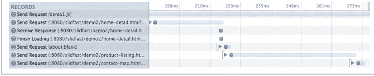

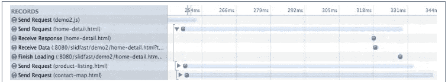

示例代码至少提供了一种基于慢速或快速连接调整用户体验的方法，但这绝非终极解决方案。另一个改进方向是：当用户点击链接（在慢速连接时）可显示加载模态框，同时应用仍在后台获取该链接页面。总体目标是利用最新HTML5的强大功能，在充分利用用户连接能力的同时减少延迟。你可以在[http://html5e.org/example](http://html5e.org/example)查看网络检测演示。

### 框架与实现方案

似乎每天都有新的基于JavaScript的移动框架涌现。你完全可能花费数天（或数月）比较框架、制作多个概念验证（POC），最终却发现自己可能根本不需要或不适合使用任何框架。

在大多数情况下，无论是转换现有应用还是全新开发，最好自己编写CSS和DOM交互代码。你对框架的依赖越深，出现问题时应用崩溃的风险就越大。掌握基础知识和底层修复方法至关重要。DOM是所有Web应用的底层基础设施和API。无论你喜欢与否，如果希望构建极速运行且"接近底层"的移动Web应用，就必须理解如何使用它。

移动Web常用的编程模型称为*单页面*应用。这意味着将整个标记放在单个HTML页面中，通常用`<div>`或其他合适的块级元素包裹，如下单页Web应用结构示例：

```
<!DOCTYPE html>
<html lang="en" dir="ltr">
  <body>
    <div id="home-page">
      ...页面内容
    </div>
    <div id="contact-page">
      ...页面内容
    </div>
```


为什么要把所有内容放在一个页面上？首先，这样做可以实现近乎原生的流畅过渡效果，并减少初始HTTP请求。你必须使用AJAX和CSS3过渡来模拟原生应用的感觉，并动态加载数据。这种单页应用方式还鼓励将所有资源（如JavaScript和CSS）包含在文件内。同样，这减少了额外的HTTP请求，从而为你的移动应用带来最佳的性能表现。

在了解了基础知识之后，让我们来考虑几个专注于移动端的JavaScript框架，它们试图处理UI方面繁重的工作。如今大多数JavaScript框架都有其特定的目标浏览器或平台。有些仅支持WebKit，而另一些则尝试覆盖所有设备的浏览器。可能存在你需要的特性，也可能有你不需要的。因此，何时将任何框架引入你当前或现有的项目，这取决于你自己的决定。

一些移动框架是在老旧、臃肿的桌面浏览器框架基础上扩展或构建的。要小心，无论你选择哪个框架，它不应该检查那些你并不针对的旧版IE6 bug或平台。这种臃肿对某些人来说可能微不足道，但正如你将在下一章看到的，从初始加载时间中削减的每一字节都将极大地提升用户体验。


在评估移动JavaScript框架时，请关注以下几点：

-   为触摸屏设备优化；确保框架使用CSS3过渡来处理动画
-   跨所有主要平台（A级和B级）浏览器保持跨平台一致性
-   使用（或封装）最新的HTML5和CSS3标准
-   背后有强大的开源社区支持

最后，研究它使用的编程模型，并问问自己：我的项目是需要通过JavaScript动态生成UI，还是希望在单页应用方式中预先声明我的标记？

接下来的章节中的框架对决，概述了移动Web应用开发的三种主要方法：单页应用、无页面结构和100%JavaScript驱动。

#### 单页应用

如前所述，单页应用方式迫使你将尽可能多的标记和资源放入单个HTML文件中。最终，这限制了HTTP请求，从而提升了应用性能。该领域的领导者是jQuery Mobile和jQTouch。

##### jQuery Mobile

jQuery Mobile (http://jquerymobile.com; 演示见 http://jquerymobile.com/test) 与核心jQuery库的发布计划严格绑定。该框架以其基于AJAX的导航系统和可定制的ThemeRoller设计而闻名，由核心jQuery项目团队制作。它还拥有一套吸引人的控件集，但不幸的是，它们都装饰着CSS背景渐变、文本阴影、圆角和投影。正如你将在接下来的章节中看到的，在移动Web应用中大量使用CSS装饰可能会让浏览器运行缓慢。

jQuery Mobile是当今最受欢迎的移动Web框架。考虑到它在Twitter上有超过10,000名关注者，在GitHub上有超过6,000名关注者（图3-14），你可以很容易地看到借助现有项目（此处为jQuery核心）的成功将项目推向主流的强大力量。这个项目的真正力量和优势来自于其社区。表3-1提供了jQuery Mobile项目的高级概览。

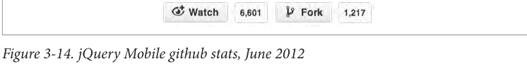

表3-1. jQuery Mobile

| 平台支持 | Android, bada, BlackBerry, iOS, MeeGo, Symbian, webOS 和 Windows Phone（其他平台在49个不同级别的支持下进行评估） |
| --- | --- |
| 许可证 | MIT 或 GPL 2 双许可 |
| 编程模型 | CSS 和 JavaScript：在DOM本身上声明式；使用CSS和data-*属性的标记 |
| 封装或填充的HTML5 API | 无 |

要设置页面，请使用以下代码：

```html
<!DOCTYPE html>
<html>
    <head>
        <title>My Page</title>
        <meta name="viewport" content="width=device-width, initial-scale=1">
        <link rel="stylesheet" href="/jquery.mobile-1.0.min.css" />
        <script type="text/javascript" src="/jquery-1.6.4.min.js"></script>
        <script type="text/javascript" src="/jquery.mobile-1.0.min.js"></script>
    </head>
</head>
<body>

<div data-role="page">

    <div data-role="header">
        <h1>My Title</h1>
    </div><!-- /header -->

    <div data-role="content">
        <p>Hello world</p>
    </div><!-- /content -->

</div><!-- /page -->

</body>
</html>
```

要设置如图3-15所示的组件，请使用：

```html
<ul data-role="listview"
data-inset="true" data-filter="true">
    <li><a href="#">Acura</a></li>
    <li><a href="#">Audi</a></li>
    <li><a href="#">BMW</a></li>
    <li><a href="#">Cadillac</a></li>
    <li><a href="#">Ferrari</a></li>
</ul>
```

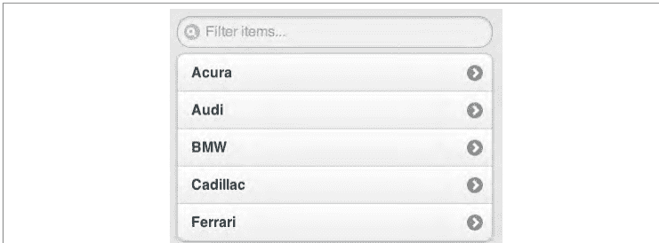

##### jQTouch

jQTouch是一个Zepto/jQuery插件，是一个很好的、简单的入门框架。它提供了一套基本的控件和动画，但缺乏对多平台的支持。该框架还存在动画卡顿、闪烁以及点击事件延迟的问题。仅支持iOS和Android，jQTouch是互联网上第二大受欢迎的框架，在Twitter上有超过9,000名关注者，在GitHub上也有不错的关注度（图3-16）。然而，GitHub上的提交历史看起来有些稀疏，有时会有六个月的间隔。表3-2概述了其特性。（查看jQTouch演示。）

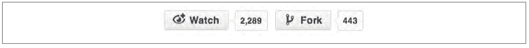

图3-16. jQTouch GitHub统计，2012年6月

表3-2. jQTouch

| 类别 | 详情 |
| :--- | :--- |
| 平台支持 | 仅支持 Android 和 iOS |
| 许可证 | MIT |
| 编程模型 | 重CSS，轻JavaScript；使用CSS类检测适当的动画和交互；支持扩展 |
| 封装或填充的HTML5 API | 无 |

要设置页面，请使用以下代码：

```html
<html>
    <head>
        <title>My App</title>
    </head>
    <body>
        <div id="home">
            <div class="toolbar">
                <h1>Hello World</h1>
            </div>
            <ul class="edgetoedge">
                <li class="arrow"><a href="#item1">Item 1</a></li>
            </ul>
        </div>
    </body>
</html>
```

要设置如图3-17所示的组件，请使用：

```html
<ul class="edgetoedge">
    <li class="arrow"><a id="0" href="#date">Today</a></li>
    <li class="arrow"><a id="1"
        href="#date">Yesterday</a></li>
    <li class="arrow"><a id="2" href="#date">2 Days
        Ago</a></li>
    <li class="arrow"><a id="3" href="#date">3 Days
        Ago</a></li>
    <li class="arrow"><a id="4" href="#date">4 Days
        Ago</a></li>
    <li class="arrow"><a id="5" href="#date">5 Days Ago</a></li>
</ul>
```

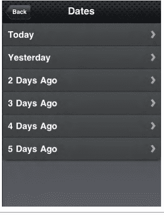

*图3-17. jQTouch列表视图组件*

##### 无页面结构

在无页面结构的方法中，标记是灵活且轻量的。与单页应用不同，这里的标记不绑定到特定的DOM结构。使用此方法的最佳选择是xui。

###### xui

xui (http://xuijs.com) 诞生于PhoneGap框架，它不试图规定页面结构或控件范式。相反，xui处理事件、动画、变换和AJAX。它以轻量级为荣，并能通过添加插件来获得所需功能。

xui专门为移动环境中的DOM操作而定制。在处理像jQuery这样的现有桌面浏览器框架时，这是一个重要因素。使用xui，你将得到一个10kb的JavaScript文件，它为你提供了一个非常有用的编程模型。Brian Leroux是xui的作者，在HTML5/开放网络社区中广为人知。关于这个项目的一个值得注意之处是其代码贡献者的全明星阵容：Rebecca Murphey、Remy Sharp、Fil Maj、Alex Sexton、Joe McCann等等。所以，重点是，有时通过贡献者和创始人的身份而非关注者数量来判断项目价值会更有帮助（图3-18）。表3-3概述了其统计数据。


图3-18. xui GitHub统计，2012年6月

表3-3. xui

| 特性 | 值 |
| --- | --- |
| 平台支持 | WebKit, IE Mobile, BlackBerry |
| 许可证 | MIT |
| 编程模型 | 简洁、熟悉（类似jQuery）、链式语法；支持插件 |
| 封装或填充的HTML5 API | 无 |

#### 100%JavaScript驱动

如果你更喜欢通过编程方式创建用户界面，而不是编写大量标记，那么100%JavaScript驱动的方法可能是你的最佳选择。在这种方法中，Sencha Touch、Wink Toolkit和The-M-Project是三个顶级项目。

##### Sencha Touch

Sencha Touch是一个HTML/CSS3/JavaScript框架，提供各种原生风格的控件、通过SASS/Compass实现的灵活主题定制、类似数据特性的模型、存储和代理。增强的触摸事件和强大的数据模型赋予该框架一些企业级优势，尽管在不同设备上的覆盖范围并不广泛（见表3-4）。虽然不在GitHub仓库中，Sencha Touch目前在Twitter上约有800名关注者。（查看Sencha Touch演示。）

如果你选择Sencha Touch，请注意对于移动开发者来说，这是一种特定的生活方式。就像GWT或JSF一样，你被绑定到一个特定的开发模型来创建用户界面。在jQTouch或jQuery Mobile中，你编写特殊结构的HTML。加载时，库会重新配置页面，并将你的普通链接转换为基于AJAX的动画链接。而使用Sencha，你基本上不需要编写HTML，而是用JavaScript构建你的UI和应用，因此请准备好迎接一段学习曲线。

表3-4. Sencha Touch

| 特性 | 值 |
| --- | --- |
| 平台支持 | Android, iOS 和 BlackBerry（从 Sencha 1.1 开始） |
| 许可证 | GPLv3, Limited Touch Commercial License |
| 编程模型 | 极少的HTML；依赖于编写、子类化和实例化JavaScript对象 |
| 封装或填充的HTML5 API | Geolocation, Web Storage |


对于页面设置，请使用以下代码：

```html
<!DOCTYPE html>
<html>
<head>
    <meta http-equiv="Content-Type" content="text/html; charset=utf-8">
    <meta name="viewport" content="width=device-width, initial-scale=1.0, maximum-scale=1.0, minimum-scale=1.0, user-scalable=0;">
    <link rel="stylesheet" href="/sencha-touch.css" type="text/css">
    <title>List</title>
    <script type="text/javascript" src="/sencha-touch.js"></script>
</head>
<body></body>
</html>
```

JavaScript 负责设置你的组件以及整个应用程序（图 3-19）：

```javascript
Ext.setup({
    tabletStartupScreen: 'tablet_startup.png',
    phoneStartupScreen: 'phone_startup.png',
    icon: 'icon.png',
    glossOnIcon: false,
    onReady: function() {
        Ext.regModel('Contact', {
            fields: ['firstName', 'lastName']
        });

        var groupingBase = {
            itemTpl: '<div class="contact2"><strong>{firstName}</strong> {lastName}</div>',
            selModel: {
                mode: 'SINGLE',
                allowDeselect: true
            },
            grouped: true,
            indexBar: false,
            onItemDisclosure: {
                scope: 'test',
                handler: function(record, btn, index) {
                    alert('Disclose more info for ' + record.get('firstName'));
                }
            },
            store: new Ext.data.Store({
                model: 'Contact',
                sorters: 'firstName',
                getGroupString: function(record) {
                    return record.get('firstName')[0];
                }
            })
        };
    }
});
```

```javascript
data: [
    {firstName: 'Hello', lastName: 'World'}
}]
];

if (!Ext.is.Phone) {
    new Ext.List(Ext.apply(groupingBase, {
        floating: true,
        width: 350,
        height: 370,
        centered: true,
        modal: true,
        hideOnMaskTap: false
    })).show();
}
else {
    new Ext.List(Ext.apply(groupingBase, {
        fullscreen: true
    }));
}
}
});
```


图 3-19. Sencha Touch List 组件

##### Wink Toolkit

Wink Toolkit 项目始于 2009 年初的 Orange Labs (法国电信研发中心)。自 2010 年 6 月以来，Wink 一直是 Dojo 基金会的一个项目。Wink 的核心提供了移动开发者所需的所有基本功能，从触摸事件处理到 DOM 操作对象和 CSS 变换工具（表 3-5）。此外，它还提供了广泛的 UI 组件。目前，其在线关注度较低，如图 3-20 所示。（参见他们的演示）。


图 3-20. Wink github 统计数据，2012年6月

Wink 最酷的地方在于其庞大的 2D 和 3D 组件集，以及通过手势操作组件的能力。例如，使用 Wink 的 Cover Flow 组件，用户可以用两根手指来改变视角（图 3-21）。

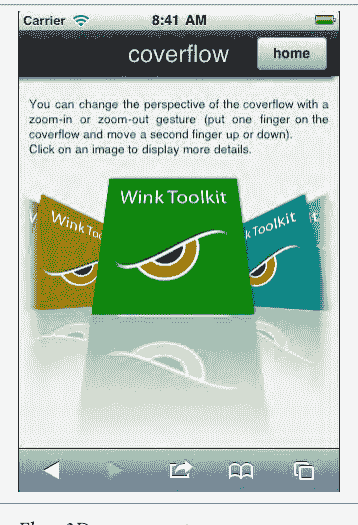

图 3-21. Wink Cover Flow 3D 组件

表 3-5. Wink Toolkit

| 平台支持 | iOS, Android, BlackBerry 和 Bada |
|---|---|
| 许可证 | Simplified BSD License |
| 编程模型 | JavaScript 辅助工具以增加标准移动浏览器支持；UI 在 JavaScript 代码片段中创建 |
| 封装或兼容的 HTML5 API | 加速度计、地理位置、Web Storage |

页面设置的 HTML 如下：

```html
<html>
    <head>
        <link rel="stylesheet" href="wink.css" type="text/css">
        <link rel="stylesheet" href="wink.default.css" type="text/css">
        ...
        <script type="text/javascript" src="wink.min.js"></script>
        ...
    </head>
    <body onload="init()">
    <div class="w_box w_header w_bg_dark">
        <span id="title">accordion</span>
        <input type="button" value="home"
          class="w_button w_radius w_bg_light w_right"
          onclick="window.location='..?theme='+theme"/>
    </div>
    <div class="w_bloc">
        click on the accordion section below to display the content.
    </div>
    <div id="output" style="width: 95%; margin: auto">
    </div>
    </body>
</html>
```

要设置图 3-22 所示的组件，请使用：

```javascript
var accordion, section1,
    section2, section3;

init = function()
{
    accordion = new wink.ui.layout.Accordion();
    section1 = accordion.addSection('Section1', 'Hello World');
    section2 = accordion.addSection('section2', '...');
    section3 = accordion.addSection('section3', '...');
    $('output').appendChild(accordion.getDomNode());
}

deleteSection = function()
{
    accordion.deleteSection(section2);
}
```

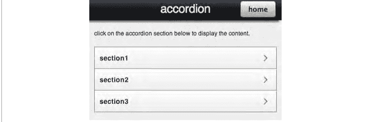

图 3-22. Wink Accordion 组件

##### The-M-Project

The-M-Project（他们的演示）构建在 jQuery 和 jQuery Mobile 之上。它使用了 SproutCore 的概念和部分组件，并基于 persistence.js 来处理持久化。图 3-23 展示了其社区关注度。

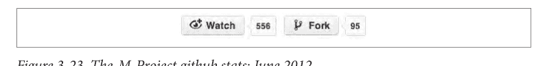

因为 The-M-Project 的 UI 看起来和 jQuery Mobile 完全一样，所以乍一看很难分辨出有什么大的不同。然而，这个项目远不止是一个光鲜的 UI 框架。它有四个核心开发概念：MVC、内容绑定、动态值计算和事件处理。因此，与专注于 UI 的 Wink Toolkit 不同，The-M-Project 将其大部分重点放在了编程模型上，如表 3-6 所示。

表 3-6. The-M-Project

| 特性 | 描述 |
|---|---|
| 平台支持 | iOS, Android, WebOS, BlackBerry, Windows Phone |
| 许可证 | GPLv2 和 MIT |
| 编程模型 | 大量依赖于 MVC 模式；通过 JavaScript 创建视图组件并处理数据绑定 |
| 封装或兼容的 HTML5 API | Web Storage (用于本地和远程存储持久化的 DataProvider) |

一些 JavaScript 代码处理页面设置：

```javascript
PageSwitchDemo.Page1 = 
M.PageView.design({
    childViews: 'header content',
    header: M.ToolbarView.design({
        value: 'Page 1'
    }),
    content: M.ScrollView.design({
        childViews: 'button',
        button: M.ButtonView.design({
            value: 'Goto Page 2',
            events: {
                tap: {
                    target: PageSwitchDemo.ApplicationController,
                    action: 'gotoPage2'
                }
            }
        })
    })
});
```

要创建图 3-24 所示的组件，请使用：

```javascript
M.SelectionListView.design({
    childViews: 'item1 item2 item3 item4',
    /* renders a selection view like radio buttons */
    selectionMode: M.SINGLE_SELECTION,
    item1: M.SelectionListItemView.design({
        value: 'item1',
        label: 'Item 1',
        isSelected: YES
    }),
    item2: M.SelectionListItemView.design({
        value: 'item2',
        label: 'Item 2'
    }),
    item3: M.SelectionListItemView.design({
        value: 'item3',
        label: 'Item 3'
    }),
    item4: M.SelectionListItemView.design({
        value: 'item4',
        label: 'Item 4'
    })
});
```


当然，还有许多其他框架可用——SproutCore、Jo、Zepto、LungoJS，等等，不胜枚举。所有这些框架都包含了用于日常移动 Web 应用程序编程的有用特性和构建块。有些甚至尝试为规范驱动的特性（如 Web Storage）创建一个封装或代理。但是，它们似乎都在企业开发者的需求以及跨设备浏览器的一致架构方面存在着明显的漏洞。

### 移动调试

在基于桌面的 Web 开发领域中，我们有许多可供使用的调试工具。Firebug 和 Chrome 的开发者工具就是其中几个能帮助我们更快完成工作的工具。对于移动设备，情况则大不相同，我们必须通过第三方工具进行远程调试。幸运的是，像 weinre、Adobe Shadow 和 Opera 的远程调试工具这样的项目，试图为开发者提供与桌面环境相同的调试体验。

#### weinre

就像 FireFox 的 FireBug 和基于 WebKit 浏览器的 Web Inspector 一样，weinre ([http://people.apache.org/~pmuellr/weinre](http://people.apache.org/~pmuellr/weinre)) 是一个网页调试器。它的不同之处在于其设计为远程工作，特别是允许你调试移动设备（如手机）上的网页。如果你使用过 Safari 的 Web Inspector 或 Chrome 的开发者工具，weinre 会让你感到非常熟悉（图 3-25）。

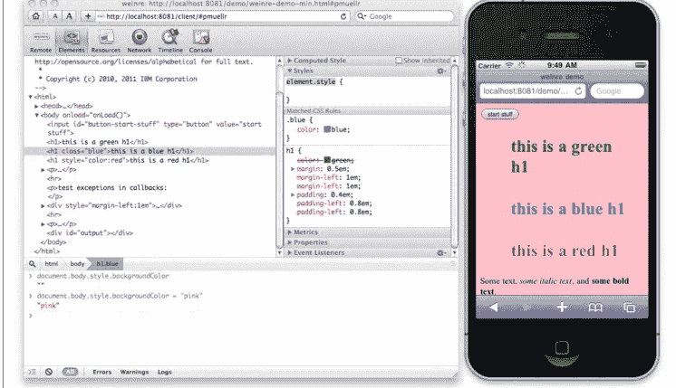

*图 3-25. weinre 实战演示*

对于调试客户端，weinre 支持：

*   weinre Mac 应用程序 (Mac OS X 10.6 64 位)
*   Google Chrome 8.x
*   Apple Safari 5.x


#### debug targets，weinre 支持：

- Android 2.2 浏览器应用
- Android 2.2 搭配 PhoneGap 0.9.2
- iOS 4.2.x Mobile Safari 应用
- BlackBerry v6.x 模拟器
- webOS 2.x（未指定版本）

#### Adobe Shadow

如图 3-26 所示，**Adobe Shadow** 是一款检查和预览工具，它简化了 Android 和 iOS 移动设备的预览流程。在你的电脑上安装 Shadow 后，你将能够无线配对你的设备，让它们与你的电脑同步浏览，并进行远程检查和调试，这样你就可以在你的设备上即时看到 HTML/CSS/JavaScript 的更改。Shadow 的一些功能包括：

- 将你的 iOS 设备无线配对到你的电脑
- 与你的电脑同步浏览
- 针对某个设备进行调试并在 DOM 中选择元素
- 对你的 HTML 标记进行更改
- 调整你的 CSS 规则
- 在你的设备上即时查看更改

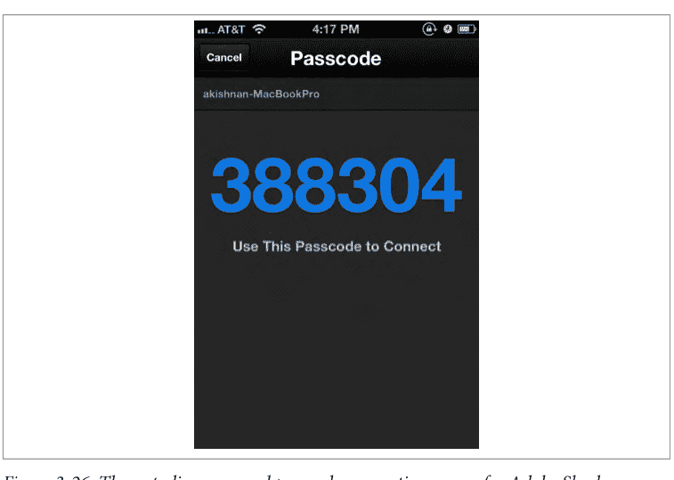

图 3-26. Adobe Shadow 的自动发现和密码连接屏幕

#### Opera 远程调试

使用 Opera Dragonfly 的远程调试功能，你可以分析和调试在 Opera 移动模拟器（参见图 3-27）中运行的页面。借助 Dragonfly，你可以在单独的 Opera 浏览器实例中进行调试，也可以在其他由 Opera Presto 驱动的用户代理中调试。无论这些实例是在同一台机器上，还是在另一个设备（如手机或电视）上，都没有关系。当进入远程调试模式时，Opera Dragonfly 将监听到指定 IP 地址和端口的连接。单独的 Opera 浏览器实例可以通过网络连接，并通过该连接传递调试信息。Opera Dragonfly 随后可以与远程实例上的网页和应用程序进行交互，就像它在本地运行一样。

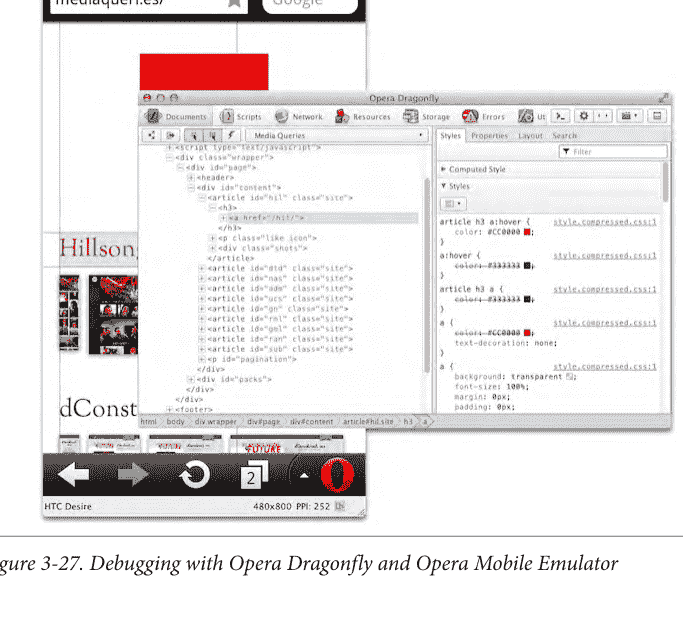

图 3-27. 使用 Opera Dragonfly 和 Opera 移动模拟器进行调试

## 第 4 章
### 桌面端 Web

本书的其余部分涵盖了对所有浏览器的支持和功能，包括桌面端和移动端。在前三章中，我们讨论了移动浏览器以及构建移动 Web 应用所需的一切。对于桌面端，在支持 HTML5 以及本书所定义的 HTML5e 方面，情况正在变得更好。将表 4-1 与第 2 章的表 2-2 进行比较，你会看到桌面端浏览器对这五个核心框架的支持是完全相同的，甚至更好。因此，我们可以放心地将 HTML5 引入到我们当今的生产应用中。

表 4-1. HTML5 企业版 (HTML5e)

| 浏览器 | Geolocation | WebSocket | Web Storage | Device Orientation | Web Workers |
| :--- | :---: | :---: | :---: | :---: | :---: |
| Safari 5+ | 是 | 是 | 是 | 未知 | 是 |
| Chrome 19+ | 是 | 是 | 是 | 是 | 是 |
| IE 10+ | 是 | 是 | 是 | 未知 | 是 |
| Opera 12+ | 是 | 是 | 是 | 否 | 是 |
| Firefox 12+ | 是 | 是 | 是 | 是 | 是 |

当然，你会注意到支持方面存在一些差异。例如，设备方向（Device Orientation）对于桌面浏览器可能意义不大，但它在 Chrome 和 Firefox 浏览器中得到了支持。

> 虽然地理定位（Geolocation）不属于 HTML5 的一部分，但我将其包含在 HTML5e 中，因为它对现代 Web 应用的价值以及在大多数浏览器中的广泛支持。


### 浏览器即平台

对一些人来说，自动生成 JavaScript、CSS 和 HTML 的服务器端 UI 框架是企业开发的救星。而对另一些人来说，这些 UI 框架造成了巨大的瓶颈，并将你束缚在过时的思想和结构中。

如今，开发者被迫从不同的角度审视 Web 应用架构，浏览器和 JavaScript 正与服务器端代码（在某些情况下，JavaScript 就是服务器端代码）一样备受瞩目。

### 客户端与服务器端 HTML 生成

在 2008 年至 2009 年间的某个时候，后端大量生成 HTML 和其他资源的服务器端文化开始瓦解。这主要是由于网页通过 AJAX 进行渐进增强以及其他性能优化的结果。这种思维方式迫使开发者创建更好的 API，并通过 JSON 和 XML 以更有效的方式向 Web 应用传递数据。

在客户端生成 HTML 可以减少服务器负载，并能提供更好的整体用户体验。JSON 和 XML 比即时呈现的 HTML 占用更少的带宽，而且需要执行的字符串连接和 HTML 转义也更少。客户端浏览器必须下载初始的 JavaScript 和标记负载，但在此之后，控制资源交付和应用增强的方式就容易多了。这还让你可以灵活地使用 CDN 带宽来提供像 jQuery 这样的流行库。使用 CDN 交付资源时，你是在赌用户已经通过使用相同 CDN 的其他网站下载了这个库。这为用户省去了再次下载一个 33K（gzipped）大小的 jQuery 库的麻烦和开销。

然而，当一切都在客户端运行时，性能会降低。解析 JSON 或 HTML 并生成 HTML 比直接打印一些服务器渲染的 HTML 使用更多的内存和处理时间。

无论你是在客户端还是服务器端生成 HTML，每种方法都有其优缺点。

客户端方法提供以下好处：

- 更好的用户体验
- 减少网络带宽（降低成本）
- 可移植性（支持离线功能）

客户端最显著的缺点是安全性。当你创建一个离线功能的应用程序并将其分发到许多不同的浏览器时，WebStorage（localStorage）是客户端存储数据的唯一可行手段——而它不提供任何安全性。

使用服务器端方法的优点有：

- 更好的安全性
- 减少客户端处理开销（移动设备的电池寿命等）
- 可扩展性（添加更多服务器可以提高负载能力）

服务器端渲染有其优势，如果你创建的 Web 应用必须始终连接到互联网，那么你可能会考虑采用属于此范畴的框架。然而，在选择服务器端框架时，请确保所有标记都易于更改和编辑。你不想被一个自动生成且不允许你传递更新的 HTML5 属性和标签的预构建组件所束缚。

总的来说，在服务器端或客户端生成标记的主要目标应该是避免最终陷入一团糟。大多数情况下，你会得到一个混合应用程序，它在服务器端处理一些工作，在客户端处理更多工作。因此，你要确保代码得到适当的分发和组织。处理两个相互交互的独立代码库需要特别小心。使用客户端 MV* 框架（如 Backbone 或 Knockout）在查询服务器 API 获取数据时，强制实现了清晰的关注点分离。（你将在本章后续内容中了解更多关于此主题的信息。）

关于近期向更多客户端处理迈出一步的应用程序，LinkedIn 于 2011 年底推出了其新的基于 HTML5 的移动 Web 应用（图 4-1）。该公司的移动开发负责人在接受采访时（http://venturebeat.com/2011/08/16/linkedin-node）发表了以下声明：

> 该应用在客户端的速度是其前身的 2 到 10 倍，而在服务器端，它使用的资源只是前者的一小部分，这得益于从 Ruby on Rails 转向 Node.js——一种服务器端 JavaScript 开发技术，虽然才问世一年多，但已迅速获得发展势头。

随着像 LinkedIn 移动 HTML5 Web 应用这样被大量使用的应用转向 Node.js 和重度使用 JavaScript 的客户端代码等新技术，我们可以看到 Web 应用开发领域正在不断演进和变化。这个世界日新月异，并将随着岁月的流逝继续变化，但在今天这个客户端和服务器端技术并存的新世界中，我们如何构建高性能的客户端解决方案？答案就在你眼前。本章回顾了为你的 Web 应用设置适当 HTML5 基础设施所需的一切。某些 API，如 WebSockets 和 Web Storage，将在后续章节中被赋予更多重点和示例。将本章视为本书其余部分的设置脚本。


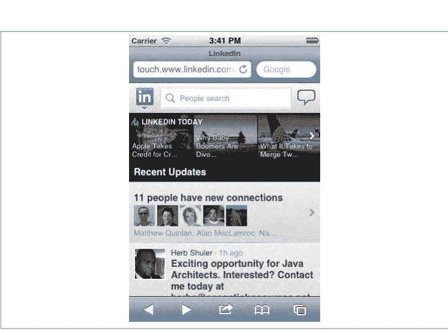

图 4-1. LinkedIn 移动网页版

### 设备与功能检测

向你的用户群交付基于 HTML5 的新功能的第一步，实际上是检测浏览器支持哪些功能。你需要在页面渲染之前与浏览器“沟通”，了解它支持什么。过去，你不得不检测并解析那些有时并不可靠的浏览器 userAgent (UA) 字符串，然后假定你得到了正确的设备信息。如今，像 *Modernizr.js* 这样的框架，或简单的 JavaScript，能帮助你在更细粒度的层面上检测客户端的能力。

哪种检测方法最好？功能检测方法是新的，但正在增长，而解析 userAgent 字符串的方法是有缺陷的，应谨慎使用。即使在撰写本文时，浏览器厂商仍然在犯错。例如，Android 上最新手机版 Firefox 的 userAgent 字符串，报告自己是平板电脑而非手机。Mozilla 对手机和平板电脑使用完全相同的 userAgent 字符串，而且该字符串中都包含 "Android" 这个词。成功的关键在于理解如何最有效地使用每种方法，无论是单独使用还是相互补充。

### 客户端功能检测

基于 JavaScript 的功能检测通常是通过创建一个 DOM 元素来检查它是否存在或是否按预期行为来实现的，例如：

```
detectCanvas() ? showGraph() :
showTable();

function detectCanvas() {
  var canvas = document.createElement("canvas");
  return canvas.getContext ? true : false;
}
```

此代码片段创建一个 canvas 元素，并检查其是否支持 getContext 属性。检查创建元素的属性是必须的，因为无论浏览器是否支持，它都允许你在 DOM 中创建任何元素。

这种方法是众多方法之一，如今我们拥有开源、社区支持的框架来为我们处理繁重的工作。以下是使用 Modernizr 框架实现的、与上面相同的代码：

```
Modernizr.canvas ? showGraph()
: showTable();
```

然而，功能检测框架可能会带来一定的开销。假设你在页面渲染前在浏览器窗口上运行一系列测试。这可能开销很大：例如，运行完整的 Modernizr 检测套件，每次页面加载可能需要超过 30 毫秒。你必须考虑在 DOM 渲染前计算值以及根据框架发现修改 DOM 的成本。当你准备好将应用投入生产环境时，确保没有使用你所选功能检测库的开发版本。

另一方面，像 Modernizr 这样的框架提供了一个构建工具，使你能够挑选应用必须具备的功能（图 4-2）。你可以准确选择要检测的功能，从而减少生产环境中的总体检测开销。

功能检测的性能也取决于你针对的设备和浏览器。例如，在第一代智能手机或旧的 Blackberry 上运行功能检测框架可能会导致浏览器崩溃，并使你的应用完全失败。请花时间调整功能检测，以在你的目标浏览器上获得最佳性能。

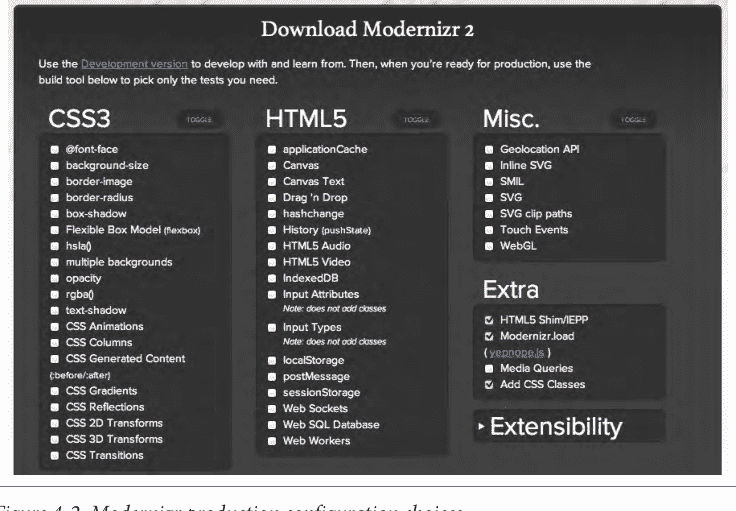

图 4-2. Modernizr 生产环境配置选项

有时，你可能还需要更进一步，检测设备的实际形态因子。*FormFactor.js* 可以帮助你实现这一点。它帮助你为不同的形态因子（移动版本、电视版本等）定制你的 Web 应用。例如：

```
if(formfactor.is("tv")) {
  alert("Look ma, Im on tv!");
}

if(formfactor.isnt("tv")) {
  alert("The revolution will not be televised");
}
```

因为 *FormFactor.js* 是一个管理概念上不同的用户界面的框架，它并不能消除对功能检测的需求。然而，它确实能帮助你在特定形态因子的界面的上下文中使用功能检测。

尽管社区最近有些不活跃，但你可以在 <https://github.com/PaulKinlan/formfactor> 找到更多示例。

### 客户端 userAgent 检测

有时你必须检测 userAgent 并相应地解析它。通常，你可以通过检查 JavaScript 的 window.navigator 对象或在服务器端使用 userAgent 请求头来确定浏览器。这种方法可能适用于大多数浏览器，但并不可靠，正如 MobileESP 项目最近的一个错误报告所指出的：

> 问题摘要：当在 Android 移动手机上使用 Firefox 浏览器时，MobileESP 代码库错误地将设备报告为 Android 平板电脑。Android 平板电脑被正确地识别为 Android 平板电脑。此问题仅影响手机和类似的小屏幕 Android 设备，如 MP3 播放器（例如三星 Galaxy Player）。
>
> 根本原因：Mozilla 对手机和平板电脑使用完全相同的 userAgent 字符串。字符串中都包含 "Android" 这个词。根据 Google 的指南，Mozilla 应该在手机的 userAgent 字符串中包含 "mobile" 这个词。不幸的是，Mozilla 未遵守 Google 的指南。省略 "mobile" 这个词是手机被错误识别为平板电脑的原因。

那么，如果 userAgent 检测并不总是可靠，什么时候才是使用它的好时机？

- 当你事先知道支持哪些平台，并且它们的 UA 字符串报告正确时。例如，如果你只关心应用程序运行的环境（而不是其功能），比如 iOS，你可以只为该环境提供定制的 UI。
- 当你将其与仅调用检查设备所需最小函数的功能检测 JavaScript 结合使用时。例如，你可能不关心报告字符串中的差异，因为这是不需要的信息。你可能只关心它报告为 TV，其他一切都不相关。这也允许通过 JavaScript 进行“轻量级”功能检测。
- 当你不希望基于 userAgent 嗅探的优化可用时，将所有基于 JavaScript 的功能测试下载到每个浏览器并执行。

雅虎有自己的理由使用 userAgent 检测：

> 在雅虎，我们有一个包含约 10,000 种移动设备的数据库。因为即使在一台设备上 userAgent 字符串也会变化（由于区域设置、供应商、版本等），这导致了超过五十万个不同的 userAgent。维护起来变得相当疯狂，但对于所有这些甚至无法运行 JavaScript 的功能手机来说，这确实是必要的，因为没有其他替代方案。

另一方面，谷歌和其他公司内部选择使用基于 JavaScript 的（也已移植到 *node.js*）userAgent 解析器。它是一个包装了约 7Kb JSON 文件的封装器，可用于其他语言。你可以在 [https://github.com/Tobie/Ua-parser](https://github.com/Tobie/Ua-parser) 找到更多信息，但这里有一个代码片段：

```
var uaParser =
  require('ua-parser');
var ua = uaParser.parse(navigator.userAgent);

console.log(ua.tostring());
// -> "Safari 5.0.1"

console.log(ua.toVersionString());
// -> "5.0.1"

console.log(ua.toFullString());
// -> "Safari 5.0.1/Mac OS X"

console.log(ua.family);
// -> "Safari"

console.log(ua.major);
// -> 5

console.log(ua.minor);
// -> 0

console.log(ua.patch);
// -> 1

console.log(ua.os);
// -> Mac OS X
```

另一个用 JavaScript 编写的平台检测库是 *Platform.js*。它被 jsperf.com 用于 userAgent 检测。*Platform.js* 已在至少 Adobe AIR 2.6、Chrome 5–15、Firefox 1.5–8、IE 6–10、Opera 9.25–11.52、Safari 2–5.1.1、*Node.js* 0.4.8–0.6.1、Narwhal 0.3.2、RingoJS 0.7–0.8 和 Rhino 1.7RC3 上进行了测试。（更多信息，请参阅 [https://github.com/Bestiejs/Platform.js](https://github.com/Bestiejs/Platform.js)。）

以下示例展示了使用 *Platform.js* 时从各种浏览器返回的结果：

```
// 在 IE10 x86 平台上
在 Windows 7 64 位版本中以 IE7 兼容模式预览运行
platform.name; // 'IE'
platform.version; // '10.0'
platform.layout; // 'Trident'
platform.os; // 'Windows Server 2008 R2 / 7 x64'
platform.description; // 'IE 10.0 x86 (platform preview; running in IE 7 mode) on Windows Server 2008 R2 / 7 x64'
```


### 服务端 userAgent 检测

在服务端，MobileESP 是一个开源框架，用于检测用户代理头。它使您能够将用户引导至相应的页面，并允许其他开发者针对受支持的设备特性进行编码。

MobileESP 提供六种语言版本：

- PHP
- Java (服务端)
- ASP.NET (C#)
- JavaScript
- Ruby
- Classic ASP (VBscript)

在 Java 中，你会这样使用：

```java
userAgentStr = request.getHeader("user-agent");
httpAccept = request.getHeader("Accept");
uAgentTest = new UAgentInfo(userAgentStr, httpAccept);

if(uAgentTest.detectTierIphone()){
    //...执行重定向
}
```

在 PHP 中，代码如下：

```php
<?php
// 加载移动检测库
include("code/mdetect.php");

// 在这个简单示例中，我们将存储备用首页的文件名。
$iphoneTierHomePage = 'index-tier-iphone.htm';

// 实例化用于测试的对象。
$uagent_obj = new uagent_info();

// 在这个简单示例中，我们仅根据设备类型进行重定向。
// 在调用该函数之前，我们必须先定义它。
function AutoRedirectToProperPageHome()
{
    global $uagent_obj, $iphoneTierHomePage,
           $genericMobileDeviceHomePage, $desktopHomePage;

    if ($uagent_obj->isTierIphone == $uagent_obj->true)
    // 执行重定向
}
```

所以结论是，userAgent 检测并不可靠，应谨慎使用或仅用于特定情况。即使是在 Android/Firefox 缺陷报告所描述的场景中，例如，你仍然可以实施 userAgent 检测，然后使用特性检测结合 CSS 媒体查询来查找基于 Android 的手机的最大屏幕尺寸。总有解决方法，像这样的问题不应阻止你使用 userAgent 字符串。

### 压缩

在当今移动优先的环境中，资源压缩是强制性的。如果你不关心你的 HTML、JavaScript 和 CSS 文件大小，你应该关心起来。HTTP 压缩用于在给定的网络连接上实现最小化的字节传输。这通过减少 HTTP 响应的大小来缩短响应时间。当今 Web 上最常用的两种 HTTP 压缩方案是 DEFLATE 和 GZIP（接下来会有更多介绍）。

然而，当你在客户端获得性能提升时，很容易忽略服务器资源上增加的开销。如果你有复杂的 SQL 查询会增加 CPU 负载来呈现某些页面，你应该分析在这些场景下使用 HTTP 压缩的影响。压缩一个超过 20K 到 30K 的巨大页面可能会对你的应用程序性能产生负面影响。在这种情况下，压缩数据的开销将完全被服务器端 SQL 工作的开销所掩盖。在开启每个请求的压缩开关之前，还需要考虑以下几点：

-   确保只压缩可压缩的内容，不要浪费资源试图压缩不可压缩的内容
-   为你的访问者选择正确的压缩方案
-   正确配置 Web 服务器，以便将压缩内容发送给支持的客户端

那么，应该压缩什么呢？除了显而易见的 HTML、JavaScript 和 CSS 等资源外，还应该通过 HTTP 压缩提供几种常见的文本资源类型：

-   XML。
-   JSON。
-   新闻源（RSS 和 Atom 源都是 XML 文档）。
-   HTML 组件 (HTC)。HTC 文件是 Internet Explorer 的一个专有特性，它封装了用于 CSS 行为的标记、样式和代码信息。HTC 文件经常被 polyfill（如 Pie 或 iepngfix.htc）用于修复 IE 的各种问题或移植现代功能。
-   纯文本文件可以有多种形式，从 README 和 LICENSE 文件到 Markdown 文件。所有这些都应该被压缩。
-   用于告诉搜索引擎网站哪些部分需要爬取的文本文件 *Robots.txt* 经常被遗忘，因为它通常不是由人类访问的。由于 *robots.txt* 会被搜索引擎爬虫反复访问，并且可能相当大，它可能会在你不知情的情况下消耗大量带宽。
-   任何非原生压缩的内容都应通过 HTTP 压缩进行传输。HTTP 压缩不仅适用于文本资源，应应用于所有非原生压缩的文件格式。例如，网站图标 (ICO)、SVG 和 BMP 图像文件不是原生压缩的。ICO 文件作为网站图标在大多数浏览器的 URL 栏或选项卡中显示，因此请确保这些文件获得 HTTP 压缩。

#### GZIP 与 DEFLATE

目前最流行的两种 HTTP 压缩方案是 GZIP 和 DEFLATE。GZIP 由 GNU 项目开发，并由 [RFC 1952](https://datatracker.ietf.org/doc/html/rfc1952) 标准化。GZIP 是目前最流行的压缩方法，通常可以将响应大小减少约 70%。DEFLATE 是一种无专利的无损数据压缩算法。该算法有众多开源实现。Apache 的 mod_deflate 模块就是许多开发者熟悉的一个实现。

> 要了解更多关于 GZIP 和 DEFLATE 压缩的区别，请参阅 Billy Hoffman 的精彩文章：http://zoompf.com/2012/02/lose-the-wait-http-compression。

如今大约 90% 的互联网流量来自声称支持 GZIP 的浏览器。所有支持 DEFLATE 的浏览器也支持 GZIP，但所有支持 GZIP 的浏览器不一定支持 DEFLATE。一些浏览器，如 Android，在其 Accept-Encoding 请求头中不包含 DEFLATE。因为你无论如何都得配置你的 Web 服务器使用 GZIP，所以最好避免 Content-Encoding: deflate 带来的所有混乱。

Apache 中处理所有 HTTP 压缩的模块是 mod_deflate。尽管名字如此，mod_deflate 根本不支持 DEFLATE。不可能让 Apache 2 的原生版本发送原始 DEFLATE 或 zlib 包装的 DEFLATE。Nginx 和 Apache 一样，完全不支持 DEFLATE，只发送 GZIP 压缩的响应。发送 Accept-Encoding: deflate 请求头会导致未压缩的响应。

如果你使用 Apache，配置 GZIP 的模块取决于你的版本：Apache 1.3 使用 mod_gzip，而 Apache 2.x 使用 mod_deflate。同样，尽管命名惯例如此，两者底层使用的都是 GZIP。

以下是一个简单的示例，展示如何匹配特定文件类型以包含在 HTTP 压缩中。你需要将其放在 Apache 2.4 的 .htaccess 文件中：

```apache
AddOutputFilterByType DEFLATE text/html text/plain text/xml
```

下面是一个更复杂的示例，用于处理浏览器不一致问题，可以设置为压缩除图像以外的所有内容：

```apache
<Location />
#### 插入过滤器
SetOutputFilter DEFLATE

#### Netscape 4.x 有一些问题...
BrowserMatch ^Mozilla/4 gzip-only-text/html

#### Netscape 4.06-4.08 有更多问题
BrowserMatch ^Mozilla/4\.[0678] no-gzip

#### MSIE 伪装成 Netscape，但它没问题
BrowserMatch \bMSIE !no-gzip !gzip-only-text/html

#### 不要压缩图像
SetEnvIfNoCase Request_URI \.(?:gif|jpe?g|png)$ no-gzip dont-vary

#### 确保代理不会传递错误的内容
Header append Vary User-Agent env=!dont-vary
</Location>
```

社区项目 HTML5Boilerplate.com 包含一个优化的 .htaccess 文件优秀示例。它是专门为 Web 性能优化精心设计的。它为正确实施 HTTP 压缩提供了一个很好的起点。它也是一个不错的指南，可以与现有的 Web 服务器配置进行比较，以验证你是否遵循了最佳实践（https://github.com/h5bp/html5-boilerplate/blob/master/.htaccess）。

你可以在 HTML5Boilerplate 的 github 仓库（https://github.com/h5bp/server-configs）以及图 4-3 中查看大多数其他主要服务器的 HTTP 压缩配置。包含的一些配置有：

-   Node.js
-   IIS
-   Nginx
-   lighttpd
-   Google App Engine

在你认为已经从压缩和优化角度正确配置了 Web 服务器之后，你必须验证它。Web Sniffer 是一个优秀的、免费的、基于 Web 的工具，可以让你发出单独的 HTTP 请求并查看响应。如你在图 4-4 中所见，Web Sniffer 让你可以控制 userAgent 和 Accept-Encoding 头，以确保正确提供压缩内容。


### 代码压缩与合并

保持 JavaScript 和 CSS 文件尽可能小，以节省带宽并缩短页面加载时间，对于确保更快的加载速度和更愉悦的用户体验变得越来越重要。*代码压缩*（Minification）是指在不改变源代码功能的前提下，移除所有不必要字符的过程。

JavaScript 和 CSS 资源可以被压缩，在保持其行为特性的同时显著减小文件大小。一些库还能将多个脚本文件合并成一个文件供客户端下载。这促进了模块化的开发方式，并减少了 HTTP 请求次数。

谷歌发布了其 Closure Compiler 工具，它不仅提供压缩功能，还能进行更激进的命名优化。它还能移除无用代码并提供函数内联。此外，某些在线工具，如微软的 Ajax Minifier、雅虎的 YUI Compressor 和 Pretty Diff，可以压缩 CSS 文件。你的一些选择包括：

#### JSMin
JSMin 是一个保守的压缩器，由道格拉斯·克罗克福德（Douglas Crockford）在多年前编写。它是一个过滤器，用于从 JavaScript 文件中删除注释和不必要的空格。它通常能将文件大小减少一半，从而加快下载速度。它还鼓励一种更具表现力的编程风格，因为它消除了编写清晰、规范的自文档化代码所带来的下载开销。建议在使用 JSMin 压缩 JavaScript 之前先使用 JSLint 进行检查。

#### Packer
由迪安·爱德华兹（Dean Edwards）开发的 Packer 也是一个非常流行的 JavaScript 压缩器。它不仅能进行常规压缩，还能添加先进的运行时解压缩机制。例如，Packer 可以选择性地对给定的源代码进行 base64 压缩，这种方式可以被常规的 Web 浏览器解压缩。它还能将通常为 5 到 10 个字符的变量名缩减为单个字母，这减少了脚本的文件大小，从而使其下载更快。

#### Dojo ShrinkSafe
Dojo ShrinkSafe 是一个非常流行的基于 Java 的 JavaScript 压缩器。它使用 Rhino 库解析 JavaScript 并压缩局部变量名。

#### YUI Compressor
YUI Compressor 是由朱利安·勒孔特（Julien Lecomte）编写的一个较新的压缩器，旨在结合 JSMin 的安全性和 Dojo ShrinkSafe 实现的高压缩率。与 Dojo ShrinkSafe 一样，它也是用 Java 编写的，并基于 Rhino 库。

你如何选择压缩器？CompressorRater (http://compressorrater.thruhere.net/) 可以提供帮助。CompressorRater 是一个用于一次性评级和评估上述所有压缩工具的工具（图 4-5）。

### 整合一切

正如你所看到的，在压缩和合并代码时，有很多工具和选项可供选择。幸运的是，社区最近有一个努力，将所有这些项目整合到一个通用的构建工具中：它叫做 **grunt**。

**grunt** (https://github.com/cowboy/grunt) 不仅仅是一个简单的压缩器，它是一个基于任务的命令行构建工具，用于前端项目。通过它，你可以合并文件、使用 JSHint 验证文件，以及使用 UglifyJS 进行压缩。此外，grunt 还能让项目在 PhantomJS 实例中运行无界面的 QUnit 测试。

grunt 以 npm（node-packaged module）的形式提供，这是 Node.js 管理可安装包的方式 (http://npmjs.org)。如果你通过以下命令全局安装 grunt：

```
npm install -g grunt
```

它就可以在你的所有项目中使用。安装 grunt 后，你可以在命令行输入 **grunt --help** 获取更多信息。然后，你可用的任务包括：

- **concat**: 合并文件
- **init**: 从预定义模板生成项目脚手架
- **lint**: 使用 JSHint 验证文件
- **min**: 使用 UglifyJS 压缩文件
- **qunit**: 在无界面的 PhantomJS 实例中运行 QUnit 单元测试
- **server**: 启动静态 Web 服务器
- **test**: 使用 nodeunit 运行单元测试
- **watch**: 当监视的文件发生变化时运行预定义的任务

以下代码是一个非常基本的 *grunt.js* 文件示例，它处理项目配置、加载 grunt 插件和一个默认任务：

```
module.exports =
  function(grunt) {
    // Project configuration.
    grunt.initConfig({
      lint: {
        all: ['grunt.js', 'lib/**/*.js' 'test/**/*.js']
      },
      jshint: {
        options: {
          browser: true
        }
      }
    });

    // Load tasks from "grunt-sample" grunt plugin installed via Npm.
    grunt.loadNpmTasks('grunt-sample');

    // Default task.
    grunt.registerTask('default', 'lint sample');
  };
```

你可以通过 `grunt init` 命令轻松设置一个新的 grunt 项目。有几种不同的模板适用于各种类型的项目，包括 CommonJS、jQuery 和 Node.js。

例如，尝试在前几章使用的 *slidfast.js* 库上运行 grunt。在项目的根目录下，在终端中运行：

    grunt init:gruntfile

这个可自定义的模板（图 4-6）会根据你对几个问题的回答创建一个 *grunt.js* 文件。Grunt 还会尝试使用自己的环境检测来确定源代码、单元测试和其他系统路径。

每次 grunt 运行时，它都会在当前目录中查找名为 *grunt.js* 的文件。如果找不到此文件，grunt 会继续在父目录中查找，直到找到该文件。此文件通常放置在项目仓库的根目录，是一个由三部分组成的有效 JavaScript 文件：

- 项目配置
- 加载 grunt 插件或任务文件夹
- 任务和辅助函数

以下是 *slidfast.js* JavaScript 项目（仅包含 HTML、CSS 和 JavaScript 文件）的 *grunt.js* 文件内容：

```
/*global module:false*/
module.exports = function(grunt) {

  // Project configuration.
  grunt.initConfig({
    meta: {
      version: '0.1.0',
      banner: '/*! PROJECT_NAME - v<%= meta.version %> - ' +
        '<%= grunt.template.today("yyyy-mm-dd") %>\n' +
        '* http://PROJECT_WEBSITE/\n' +
        '* Copyright (c) <%= grunt.template.today("yyyy") %> ' +
        'YOUR_NAME; Licensed MIT */'
    },
    lint: {
      files: ['grunt.js', 'slidfast.js']
    },
//    qunit: {
//      files: ['example/**/*.html'
//    ],
concat: {
  dist: {
    src: ['<banner:meta.banner>', '<file_strip_banner:slidfast.js>'],
    dest: 'dist/slidfast.js'
  }
},
min: {
  dist: {
    src: ['<banner:meta.banner>', '<config:concat.dist.dest>'],
    dest: 'dist/slidfast.min.js'
  }
},
watch: {
  files: '<config:lint.files>',
  tasks: 'lint qunit'
},
jshint: {
  options: {
    curly: true,
    eqeqeq: true,
    immed: true,
    latedef: true,
    newcap: true,
    noarg: true,
    sub: true,
    undef: true,
    boss: true,
    eqnull: true,
    browser: true
  },
  globals: {}
},
uglify: {}
});

// Default task.
grunt.registerTask('default', 'lint concat min');

};
```

因为目前该项目没有定义 QUnit 测试，我注释掉了默认值并从文件的最后一行中移除了它。

现在，如果你在项目中简单地在命令行输入 **grunt** 来运行 grunt，grunt 会返回一个如图 4-7 所示的日志。从示例日志中可以看到，grunt 列出了 JavaScript 检查失败的位置。此外，因为此示例通过使用 `grunt -force` 绕过了检查过程，所以 grunt 能够继续压缩文件并显示压缩前后文件的大小。

*图 4-7. 从命令行运行 grunt*

另外两个对压缩有用的通用工具是 Jawr 和 Zproxy。

**Jawr** 是一个可调节的 JavaScript 和 CSS 打包解决方案，允许在独立模块文件中快速开发资源。你可以在开发模式下处理大量拆分的 JavaScript 文件，然后 Jawr 会以可配置的方式将它们全部打包成一个或几个文件。通过使用标签库，Jawr 使你能够使用相同、未更改的页面进行开发和生产。Jawr 还会压缩和优化文件，从而减少页面加载时间。你可以使用一个简单的 `.properties` 描述符来配置 Jawr。除了标准的 Java Web 应用程序外，它还可以与 Facelets 和 Grails 应用程序一起使用。

**Zproxy** ([http://zproxy.sourceforge.net](http://zproxy.sourceforge.net)) 是一个转发、非缓存、压缩的 HTTP 代理，专门用于流量优化。它压缩和优化 HTML、CSS 和 JavaScript 资源，并重新压缩图片。基本上，它通过将图像转换为较低质量的 JPEG 或 JPEG 2000 来压缩图片，并通过 GZIP 压缩 HTML 和其他类似文本的数据。此外，它还提供抢先主机名解析、透明代理、IP ToS 标记 (QoS)、广告拦截器、详细日志记录等功能。Zproxy 不需要客户端软件，并为任何操作系统上的任何 Web 浏览器提供加速。


### JavaScript MVC 框架与服务端

过去几年间，随着众多 JavaScript MV*（又称 MVC）框架的涌现，从宏观视角了解当前可用的框架以及它们如何支持某种形式的服务端交互变得至关重要。

理论上，JavaScript 框架为开发者提供了一条组织代码的便捷路径。在经历了数年手动组织 AJAX/jQuery 回调的尝试后，开发界认识到需要围绕前端代码创建框架。开发者意识到，复杂客户端应用无法依赖杂乱无章的代码来扩展，并且使用 innerHTML() 手动绑定和处理 AJAX 返回数据会变得异常混乱。因此，解决方案是采用一种被称为 MVC（模型-视图-控制器）的模式变体。MVC 将应用的关注点分离为三个部分：

- 模型
- 视图
- 控制器

尽管 JavaScript MVC 框架帮助我们构建代码结构，但它们并不总是严格遵循如图 4-8 所示的经典模式。有些框架会将控制器的职责包含在视图中，例如 Backbone.js，而其他框架则将自己特有的组件融入其中，认为这样更为高效。


*图 4-8. MVC 流程*

因此，我将此类框架称为遵循 MV* 模式；也就是说，你很可能拥有一个视图和一个模型，但很可能还包含其他东西。如果你的目标是学习当今市场上每个 MV* 框架的基础知识，TodoMVC（图 4-9）提供了用超过任何人有时间学习的框架数量构建的待办事项应用实现。目前大约有 40 个 JavaScript MV* 框架存在。为特定项目选择合适的框架是你旅程的起点。

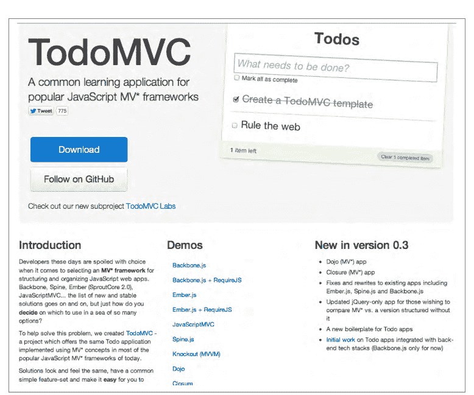

*图 4-9. TodoMVC 是为大多数 JavaScript MV* 框架构建的待办事项演示集合*

### 五大框架

在决定哪个框架最适合你的项目之前，你需要了解它们的表现。以下章节重点关注五个主要框架如何处理从服务端集合对象渲染到 DOM 的过程。数据交互之所以重要主要有两个原因：

- 将对象绑定到 UI 必须是声明式的，并且视图层应在模型发生更改时自动更新。
- 很容易创建以 JavaScript 为核心的复杂应用，最终却变成一团由 jQuery、RESTful 端点和回调组成的混乱结构。结构化的 MVC 方法使代码更易于维护和重用。

对于每个框架，我将评估持久化策略，识别对服务端无关的 JavaScript 框架，并使用诸如 HTTP（用于 RESTful 端点）和其他协议（如 WebSockets）的传输方式。本节假设你已经对 JavaScript MV* 框架是什么及其功能有基本了解。我不会详细介绍每个框架对原始 Smalltalk MVC 模式的实现程度，而是聚焦于每个框架如何将数据从服务器同步到客户端，反之亦然。

> 选择并用好合适的框架归结为了解你需要什么。除了我在本节回顾的五个框架外，还有许多其他框架可以在你的应用中使用。权衡每个框架的优缺点，找到适合你目标应用的正确开发模型。

#### Backbone

*Backbone.js* 是当今的首选框架，原因充分；一系列令人印象深刻的品牌，如 Foursquare、Posterous、Groupon（图 4-10）以及许多其他公司，都使用 Backbone 构建了 JavaScript 应用。


*图 4-10. Groupon 使用 Backbone*

Backbone 大量使用 *Underscore.js*，并为开发者提供使用 jQuery 或 Zepto 作为核心 DOM 框架的选择。它还拥有健康的社区和强大的口碑（图 4-11）。


*图 4-11. Backbone GitHub 统计数据，2012年6月*

使用 Backbone，你可以将数据表示为*模型*，这些模型可以被创建、验证、销毁并保存到服务器。每当 UI 操作导致模型的属性发生变化时，模型会触发一个变更事件；所有显示该模型状态的视图都可以收到变更通知，从而能够做出相应反应，使用新信息重新渲染自身。在一个完成的 Backbone 应用中，你不必编写那些需要查找 DOM 中特定 ID 元素并手动更新 HTML 的胶水代码。当模型发生变化时，视图只需自行更新即可。

最终，Backbone 更适合大型框架和应用。如果你正在编写一个需要 MVC 结构的简单应用，你将不得不编写大量代码来呈现一个简单的界面。

每个框架讨论都提供了托管在本书 GitHub 仓库中的演示。对于 Backbone，你可以在 https://github.com/html5e/backbone-jax-cellar 找到以下用 Java 编写的 RESTful 演示。


##### Backbone 服务端同步

如果你的后端数据通过纯 RESTful API 暴露，使用 *Backbone.js* 简单的模型 API 进行获取（GET）、创建（POST）、更新（PUT）和删除（DELETE）模型将极其容易。例如：

```javascript
// Models
window.Book = Backbone.Model.extend({
    urlRoot: "/api/books",
    defaults: {
        "id": null,
        "name": "HTML5 Architecture",
    }
});

window.BookCollection = Backbone.Collection.extend({
    model: Book,
    url: "/api/books"
});
```

在上面的代码中，window.Book 的 urlRoot 是用于获取或持久化模型数据的 RESTful 服务端点。请注意，此属性仅在获取或持久化不属于集合的模型时才需要。如果模型是集合的一部分，集合中定义的 url 属性就足以让 Backbone 知道如何使用你的 RESTful API 来检索、更新或删除数据。

在 window.BookCollection 中，url 提供了 RESTful API 的端点。这就是使用 Backbone 简单的模型 API 进行检索、创建、更新和删除所需的全部内容。

如果你的持久层无法通过 RESTful 服务访问，或者你想使用不同的传输机制（例如 WebSockets），你可以覆盖 Backbone.sync。

Backbone.sync 是 Backbone 在每次尝试从服务器读取或保存模型时调用的函数。默认情况下，它使用 jQuery 或 Zepto 发起 RESTful JSON 请求。你可以覆盖它以使用不同的持久化策略，例如 WebSockets、XML 传输或 localStorage。在默认实现中，当 Backbone.sync 发送保存模型的请求时，其属性将被序列化为 JSON，并以 content-type application/json 放在 HTTP 请求体中发送。默认的同步处理程序将 CRUD 映射到 REST 如下：

```
create -> POST    /collection
read   -> GET     /collection[/id]
update -> PUT     /collection/id
delete -> DELETE  /collection/id
```

##### Backbone 和传统服务器

如果你必须使用不支持 Backbone 默认 REST/HTTP 方法的遗留 Web 服务器，你可以选择开启 Backbone.emulateHTTP。设置此选项将使用 HTTP POST 模拟 PUT 和 DELETE 请求，并在 X-HTTP-Method-Override 头中设置实际方法。如果 emulateJSON 也开启，实际方法将作为额外的 _method 参数传递。例如：

```javascript
Backbone.emulateHTTP = true;
model.save();  // POST to "/collection/id", with "_method=PUT" + header.
```

如果你使用的 Web 服务器无法处理编码为 application/JSON 的请求，设置 Backbone.emulateJSON = true; 将导致 JSON 序列化在 model 参数下，并以 application/x-www-form-urlencoded MIME 类型发出请求，就像来自 HTML 表单一样。

#### Ember

Ember.js（前身为 Amber.js 和 SproutCore 2.0）是最新的竞争者之一。它试图将 SproutCore 2.0 的核心功能提取到一个更紧凑、适合 Web 的模块化框架中。它也因优雅地处理 DOM 更新而闻名，并在 GitHub 上拥有可观的关注度（图 4-12）。

##### Ember 服务器同步

当 SproutCore 决定不再那么像 Apple Cocoa，而更像 jQuery 时，Ember 便应运而生。其成果是一个保留了高级概念（如观察者、绑定和状态图），同时提供简洁 API 的 Web 框架。SproutCore 最初是一个早期客户端电子邮件应用背后的开发框架。随后，Apple 用它构建了 MobileMe（以及后来的 iCloud），这两者都包含电子邮件客户端。不用说，Apple 已经意识到从服务器更新的集合非常重要。

与 Backbone 不同，Ember 需要更少的线缆连接；例如，将视图指向一个数组，当数组被操作时，视图会自动重新渲染。Ember 的绑定系统以及与 Handlebars.js 模板语言的紧密集成使得这成为可能。

##### Ember 服务器同步

Ember Data 是一个用于从持久层（如 JSON API）加载模型、更新这些模型并保存更改的库。它提供了许多在服务器端 ORM（如 ActiveRecord）中能找到的功能，但它是专为浏览器中 JavaScript 的独特环境而设计的。以下是使用 Ember 存储数据的简短示例：

```
// 我们的模型
App.Person = Ember.Object.extend();

App.people = Ember.ArrayController.create({
  content: [],
  save: function () {
    // 假设你正在使用 jQuery，但也可能是其他 AJAX/DOM 框架
    $.post({
      url: "/people",
      data: JSON.stringify( this.toArray() ),
      success: function ( data ) {
        // 你的数据应该已经用最新的更改渲染好了
        // 然而，你可能想将状态从某个值更改为"已保存"等等
      }
    });
  }
});
});
});
```

你代码中的下一步将是调用 `App.people.save()` 来持久化数据。

#### Angular

由 Googlers 开发的优秀框架 *Angular.js* 有一些非常有趣的设计选择，最著名的是为 JavaScript 提供的依赖注入（或 IOC）。*依赖注入*使你的代码更容易测试，并将对象的创建和连接推到尽可能高的应用层面，这为你提供了一个集中的逻辑流程位置。

Angular 在模板作用域和控制器设计方面考虑周全。它支持丰富的 UI 绑定语法，使诸如过滤和转换值等操作变得容易。在 GitHub 上，Angular 是一个备受关注的项目，并且有一个健康的社区为其贡献（图 4-13）。

> 关于一个使用 *Node.js* 编写的 RESTful 演示，以展示 Angular 的服务器同步能力，请参阅 [https://github.com/html5e/angular-phonecat-mongodb-rest](https://github.com/html5e/angular-phonecat-mongodb-rest)。

**Angular 服务器同步。** Angular 模型通过 Angular 作用域对象上的属性进行引用。你模型中的数据可以是 JavaScript 对象、数组或原始类型；这并不重要。重要的是所有这些都通过作用域对象被引用。Angular 使用作用域来保持你的数据模型和 UI 同步。每当有事件改变模型的状态时，Angular 会立即将该更改反映在 UI 中，反之亦然。

> 构建 Web 应用程序时，你的设计需要考虑来自 JSON 漏洞和 XSRF 的安全威胁。服务器和客户端都必须合作来消除这些威胁。Angular 预配置了解决这些问题的策略，但要使其工作，需要后端服务器的配合。

这个简单的示例说明了如何使用 Angular 的默认 CRUD 方法（.get、.save、.delete 和 .query）来检索和保存数据：

```
// 定义 CreditCard 类
var CreditCard = $resource('/user/:userId/card/:cardId',
    {userId:123, cardId:'@id'}, {
    charge: {method:'POST', params:{charge:true}}
}));

// 我们可以从服务器检索一个集合
var cards = CreditCard.query();
// GET: /user/123/card
// 服务器返回: [ {id:456, number:'1234', name:'Smith'} ];

var card = cards[0];
// 每个项目都是 CreditCard 的一个实例
expect(card instanceof CreditCard).toEqual(true);
card.name = "J. Smith";
// 非 GET 方法被映射到实例上
card.$save();
// POST: /user/123/card/456 {id:456, number:'1234', name:'J. Smith'}
// 服务器返回: {id:456, number:'1234', name: 'J. Smith'};
```

更多详情请参阅：

- [http://docs.angularjs.org/#!/api/angular.service.$xhr](http://docs.angularjs.org/#!/api/angular.service.$xhr)
- [http://docs.angularjs.org/#!/api/angular.service.$resource](http://docs.angularjs.org/#!/api/angular.service.$resource)

#### Batman

由 Shopify 创建的 *Batman.js* 是另一个类似于 Knockout 和 Angular 的框架。它有一个基于 HTML 属性的良好 UI 绑定系统，是唯一一个用 CoffeeScript 编写的框架。*Batman.js* 也与 *Node.js* 紧密集成，甚至达到了拥有自己的（可选的）*Node.js* 服务器的程度。目前，它在 GitHub 上的关注度与其他框架相比仍然相对较小（图 4-14）。

*图 4-14. Batman GitHub 统计，2012年6月*

> 关于一个展示 Batman 服务器同步功能的 RESTful 应用程序，请参阅 HTML5e [Batman 仓库](Batman repository)。

**Batman 服务器同步。** 一个 *Batman.js* 模型对象可以设置任意属性，就像任何 JS 对象一样。其中只有一部分属性会被序列化并持久化到其存储后端。模型具有以下能力：

- 持久化到各种存储后端
- 仅将其定义的属性子集序列化为 JSON
- 使用状态机暴露生命周期事件
- 使用同步或异步操作进行验证

你使用 `encode` 宏在模型上定义持久化属性：

```
class Article extends
Batman.Model
    @encode 'body_html', 'title', 'author', 'summary_html', 'blog_id', 'id', 'user_id'
    @encode 'created_at', 'updated_at', 'published_at', Batman.Encoders.railsDate
    @encode 'tags',
        encode: (tagSet) -> tagSet.toArray().join(', ')
        decode: (tagString) -> new Batman.Set(tagString.split(', ')...)
```

给定一个或多个字符串作为参数，`@encode` 会将这些属性注册为模型的持久化属性，以便在模型的 `toJSON()` 输出中进行序列化，并在 `fromJSON()` 中进行提取。未用 `@encode` 指定的属性在序列化和反序列化时都将被忽略。如果提供了一个可选的编码器对象作为最后一个参数，其 `encode` 和 `decode` 函数将分别用于模型的序列化和反序列化。

默认情况下，模型的主键（唯一索引其实例的不变属性）是其 `id` 属性。如果你想让模型有一个不同的主键，请在 `primaryKey` 类属性上指定键的名称：

```
class User extends
Batman.Model
    @primaryKey: 'handle'
    @encode 'handle', 'email'
```

要为模型的持久化指定存储适配器，请在其类定义中使用 `@persist` 宏：

```
class Product extends
Batman.Model
    @persist Batman.LocalStorage
```

现在，当你在 product 上调用 `save()` 或 `load()` 时，它将使用浏览器窗口的 `localStorage` 来检索或存储序列化的数据。

如果你想连接到一个 REST 后端，`Batman.RestStorage` 是一个简单的存储适配器，你可以对其子类化并扩展以满足你的需求。默认情况下，它假设你的驼峰式单数 product 模型可通过下划线复数 `/products` 路径访问，而资源的实例可通过 `/products/:id` 访问。你可以通过将字符串或返回字符串的函数分配给模型类的 `url` 属性（用于集合路径）或分配给原型（用于成员路径）来覆盖这些默认路径。例如：

```
class Product extends
Batman.Model
  @persist Batman.RestStorage
  @url = "/admin/products"
  url: -> "/admin/products/#{@id}"
```

#### Knockout

*Knockout.js* 围绕三个核心特性构建：

- 可观察对象和依赖跟踪
- 声明式绑定
- 模板

Knockout 设计为允许将任意 JavaScript 对象用作视图模型（viewModel）。只要你的 viewModel 的某些属性是可观察对象，你就可以使用 Knockout 将它们绑定到 UI，并且每当可观察属性更改时，UI 都会自动更新。图 4-15 显示 Knockout 拥有良好的用户群，且提交日志活跃。

*图 4-15. Knockout GitHub 统计，2012年6月*

> 关于如何使用 Knockout 服务器同步的完整演示，请[查看此教程](view this tutorial)。

**Knockout 服务器同步。** 可观察对象在模型属性上声明。它们允许在模型更改时自动更新 UI：

```
var viewModel = {
    serverTime: ko.observable(),
    numUsers: ko.observable()
}
```

因为服务器端没有任何可观察对象的概念，它只会提供一个普通的 JavaScript 对象（通常序列化为 JSON）。

你可以按照以下方式将这个 viewModel 手动绑定到某些 HTML 元素：

```
服务器上的时间是：<span data-bind='text: serverTime'></span>，
并且有 <span data-bind='text: numUsers'></span> 个用户已连接。
```

因为 viewModel 的属性是可观察的，每当这些属性发生变化时，Knockout 会自动更新 HTML 元素。

接下来，你想从服务器获取最新数据。为了演示目的，你可能会每五秒发起一个 AJAX 请求（或许使用 jQuery 的 $.getJSON 或 $.ajax 函数）：

```
var data = getDataUsingAjax();
         // 从服务器获取数据
```

服务器可能会返回类似以下的 JSON 数据：

```
{
    serverTime: '2010-01-07',
    numUsers: 3
}
```

最后，要使用这些数据更新你的 viewModel，你可以这样写：

```
// 每当从服务器接收到数据时
viewModel.serverTime(data.serverTime);
viewModel.numUsers(data.numUsers);
```

对于页面上要显示的每个变量，你都必须执行此操作。如果你的数据结构变得更复杂，包含子元素或数组，手动处理会变得非常繁琐。然而，Knockout 提供了便捷的方法来用传入的 JSON 载荷填充 viewModel。

或者，你可以使用 Knockout.js 的 mapping 插件。这个插件允许你创建一个从普通 JavaScript 对象（或 JSON 结构）到可观察 viewModel 的映射。mapping 插件为你提供了一种直接的方法，将那个普通的 JavaScript 对象映射成带有适当可观察对象的 viewModel。这是手写 JavaScript 代码来基于你从服务器获取的数据构建 viewModel 的一种替代方案。

要通过 mapping 插件创建 viewModel，请将上面代码中创建 viewModel 的部分替换为 `ko.mapping.fromJS` 函数：

```
var viewModel =
ko.mapping.fromJS(data);
```

这会为 data 上的每个属性自动创建可观察属性。然后，每当从服务器接收到新数据时，你可以通过再次调用 `ko.mapping.fromJS` 函数来一步更新 `viewModel` 上的所有属性：

```
// 每当从服务器接收到数据时
ko.mapping.fromJS(data, viewModel);
```

对象的所有属性都会被转换为可观察对象。如果更新会改变值，它会更新可观察对象。

数组会被转换为可观察数组。如果更新会改变项的数量，它会执行适当的添加或删除操作。它还会尽力保持与原始 JavaScript 数组相同的顺序。

## 第5章 WebSockets

从浏览器发出的每个 HTTP 请求都包含头部，无论你是否想要它们。这些头部也不小。未压缩的请求和响应头部的大小范围可以从 200 字节到超过 2K 不等。虽然典型大小在 700 到 900 字节之间，但随着用户代理功能的扩展，这些数字还会增长。

WebSockets 提供了最小的开销，以及一种更高效的方式，通过单个套接字进行全双工通信，向客户端和服务器传递数据。WebSocket 连接是在客户端和服务器之间通过底层相同的 TCP/IP 连接进行一次小的 HTTP 握手后建立的。这为你提供了一个客户端和服务器之间的开放连接，双方可以随时开始发送数据。

WebSockets 的众多优势中包括：

- 没有 HTTP 头部
- 没有因 keep-alive 问题导致的延迟
- 低延迟、更好的吞吐量和响应性
- 对移动设备电池更友好

### 构建协议栈

要使用 WebSockets 有效地开发任何应用程序，你必须接受“实时 Web”的理念，即你的 Web 应用程序的客户端代码在每次用户连接期间都与相应的实时服务器持续通信。为此，你可以使用像 WebSockets 或 SPDY 这样功能强大的协议自己构建协议栈。或者，你可以选择一个服务或项目来为你管理连接和优雅降级。在本章中，你将学习如何实现一个原始的 WebSocket 服务器以及围绕其设置细节的最佳实践。

如果你选择将管理交给别人，你有多种选择。免费增值服务，如 Pusher ([http://pusher.com](http://pusher.com))，开始出现并提供此功能，而像 Kaazing 这样的公司（提供 Kaazing Gateway）多年来一直为 STOMP 和 Apache ActiveMQ 提供适配器。此外，你可以找到很多围绕 WebSocket 的包装框架来提供优雅降级——从 Socket.IO 到 CometD，再到当前流行的任何技术。优雅降级是指在浏览器不支持 WebSocket 协议时，回退使用旧技术（如 Flash 或长轮询）的过程。Web 应用中的 Comet、推送技术和长轮询速度慢、效率低、不优雅，并且具有更高的不可靠性风险。在本书中，我只涵盖核心 WebSocket 规范，以避免混淆并保持简单。

> 截至 2012 年 8 月，WebSocket 规范处于工作草案状态。实现者和编辑们正在努力将该规范推进到候选推荐状态。在该状态宣布之前，请注意底层协议方面的事情可能会发生变化。

### 在服务器端，幕后

同时保持大量连接开放需要一种架构，该架构允许在传输完成之前继续进行其他处理。这样的架构通常围绕线程或*异步非阻塞 I/O*（NIO）设计。关于 NIO 和线程之间的争论，有些人可能会说 NIO 实际上并不比线程性能更好，它只是允许你为多个客户端编写单线程事件循环，就像 Unix 上的 select 一样。另一些人则认为选择 NIO 还是线程取决于你预期的工作负载。如果你有很多长期空闲的连接，NIO 会胜出，因为它没有数千个线程“阻塞在读”操作上。此外，关于线程是否比事件循环更快或更容易编写（或者相反）有很多争论，所以这完全取决于你要处理的用例类型。别担心，我将在本章中展示事件循环和线程的示例。

### 编程模型

如前所述，WebSockets 为服务器端和客户端应用程序呈现了一种新的开发模型：“实时” Web。在此模型下的每次用户连接中，你的 Web 应用程序的客户端都需要与相应的实时服务器持续通信。尽管大多数服务器端框架提供了事件机制，但很少有框架将事件一路延伸到 Web 浏览器以支持这种实时模型。因此，你需要将当前的解决方案和架构改造为这种实时模型。

例如，假设你的服务器端框架能够发送事件，并且你的代码中有该事件的观察者。WebSockets 使你能够扩展该事件，使其从服务器端一路传递到已连接客户端的浏览器。一个很好的例子是通知所有 WebSocket 连接，一个用户已在你的网站上注册。

实现此类解决方案的第一步是连接与 WebSockets 相关的三个主要监听器：`onopen`、`onmessage` 和 `onclose`。基本上，当 WebSocket 连接成功打开时，以下事件会自动触发。例如：

```
objWebSocket.onopen = function(evt)
{
    alert("WebSocket 连接已成功打开");
};
objWebSocket.onmessage = function(evt)
{
    alert("消息：" + evt.data);
};
objWebSocket .onclose = function(evt)
{
    alert("WebSocket 连接已关闭");
};
```

WebSocket 连接打开后，每当服务器向客户端发送数据时，`onmessage` 事件就会触发。如果客户端想向服务器发送数据，可以这样做：

```
objWebSocket.send("Hello World");
```

然而，当你想开发企业级的 Web 应用程序时，通过原始 WebSocket 以字符串形式发送消息并不十分吸引人。因为当前的 WebSocket 实现主要处理字符串，你可以使用 JSON 在服务器之间传输数据。

但是如何传播在服务器上触发的服务器端事件，然后在客户端将其冒泡传递呢？一种方法是中继事件。当特定的服务器端事件触发时，使用监听器或观察者将数据转换为 JSON 并发送给所有已连接的客户端。

### 将事件从服务器中继到浏览器

在你能够成功与服务器通信之前，你需要知道你在与谁通信以及如何通信。在本章的示例中，我使用的是 JBoss AS7 应用程序服务器，不过这些示例应该适用于任何你选择的服务器或框架，因为我们将讨论的概念适用于任何服务器或框架。


服务器和在Web应用程序内嵌入Jetty。这种方法背后的主要考量是利用轻量级的Java EE 6.0 [完整配置]应用服务器。还有其他几种Java选项，例如GlassFish或独立运行Jetty，但此方案提供了开箱即用的上下文和依赖注入（CDI）、分布式事务、可扩展的JMS消息传递以及数据网格支持。这种支持对于前沿的企业项目和私有云架构极其宝贵。

因为这种方法将一个服务器（Jetty）嵌入到另一个服务器（JBoss）中，所以它可以与任何应用服务器一起使用，甚至可以与那些可能不支持WebSockets的服务器一起使用，并使现有的、较旧的应用程序能够利用实时连接。

此示例的完整可部署源代码位于“embedded-jetty branch”。有几点值得注意：

##### 安全性
由于WebSocket服务器运行在与JBoss AS7服务器（8080）不同的端口（8081）上，我们必须考虑没有身份验证cookie等问题。然而，正如您将在本章最后一节看到的，反向代理可以处理这个问题。

### 代理
现有的代理服务器在通过同一端口运行WebSockets和HTTP方面已经是一个巨大的问题，在本例中，我们不得不将它们分开运行，这更是雪上加霜。

### 线程
因为我们正在观察和监听CDI事件，我们必须执行一些相同的线程操作和连接共享。

下面的代码首先使用Jetty的WebSocketHandler设置WebSocket服务器，并将其嵌入到ServletContextListener中。尽管该应用程序在不同线程间共享一组同步的WebSocket连接，但我们通过使用`synchronized`关键字确保一次只有一个线程可以执行一个方法或块。为了将CDI事件中继到浏览器，我们必须将所有WebSocket连接存储在`ConcurrentHashSet`中，并在新连接上线时写入。在任何时候，`ConcurrentHashSet`都会在不同的线程上被读取，这样我们就知道要将CDI事件中继到哪里。`ChatWebSocketHandler`包含一个全局的WebSocket连接集合，并在Jetty服务器中添加每个新连接。

```
public class ChatWebSocketHandler extends WebSocketHandler {

    private static Set<ChatWebSocket> websockets =
            new ConcurrentHashSet<ChatWebSocket>();

    public WebSocket doWebSocketConnect(HttpServletRequest request,
            String protocol) {
        return new ChatWebSocket();
    }
}
```

```
public class ChatWebSocket implements WebSocket.OnTextMessage {

    private Connection connection;

    public void onOpen(Connection connection) {
        // 客户端（浏览器）WebSockets已建立连接。
        // 1) 存储已打开的连接
        this.connection = connection;
        // 2) 将ChatWebSocket添加到全局ChatWebSocket实例列表中
        getWebsockets().add(this);
    }

    public void onMessage(String data) {
        // 遍历每个ChatWebSocket实例，将消息从服务器发送到每个客户端WebSockets。
        try {
            for (ChatWebSocket webSocket : getWebsockets()) {
                // 向当前客户端WebSocket发送消息。
                webSocket.connection.sendMessage(data);
            }
        } catch (IOException x) {
            // 检测到错误，关闭客户端的ChatWebSocket
            this.connection.disconnect();
        }

    }

    public void onClose(int closeCode, String message) {
        // 从全局ChatWebSocket实例列表中移除ChatWebSocket。
        getWebsockets().remove(this);
    }
}

public static synchronized Set<ChatWebSocket> getWebsockets() {
    return websockets;
}

}
```

接下来，我们将具有WebSocket功能的Jetty服务器嵌入到Web应用程序中：

```
private Server server = null;
/**
 * 当Web应用程序启动时启动嵌入的Jetty服务器。
 *
 */
public void contextInitialized(ServletContextEvent event) {
    try {
        // 1) 在8081端口创建一个Jetty服务器。
        InetAddress addr = InetAddress.getLocalHost();
this.server = new Server();
Connector connector = new SelectChannelConnector();
connector.setPort(8081);
connector.setHost(addr.getHostAddress());

server.addConnector(connector);

// 2) 在Jetty服务器实例中注册ChatWebSocketHandler。
ChatWebSocketHandler chatWebSocketHandler =
                                        new ChatWebSocketHandler();
chatWebSocketHandler.setHandler(new DefaultHandler());

server.setHandler(chatWebSocketHandler);

// 2) 启动Jetty服务器。
server.start();
} catch (Throwable e) {
    e.printStackTrace();
}
}

....
}
```

现在我们将创建一个方法来观察CDI事件，并将触发的Member事件发送到所有活动连接。这会中继一个非常简单的`cdievent` JavaScript对象，该对象将被推送到所有已连接的客户端，然后通过JavaScript解释器在浏览器中执行。

```
public void observeItemEvent(@Observes Member member) {
    try {
        for (ChatWebSocket webSocket : websockets) {
            webSocket.connection.sendMessage("{\"cdievent\":{\"fire\":function(){" +
                                            "eventObj.initEvent(\'memberEvent\', true, true);" +
                                            "eventObj.name = '" + member.getName() + "';\n" +
                                            "document.dispatchEvent(eventObj);" +
                                            "}}");
        }
    } catch (IOException x) {
        //...
    }
}
```

上面的代码在通过Web界面注册新Member时观察以下事件。如下所示，当用户通过提供的RESTful URL注册时，会触发`memberEventSrc.fire(member)`。

```
@POST
@Consumes(MediaType.APPLICATION_FORM_URLENCODED)
@Produces(MediaType.APPLICATION_JSON)
public Response createMember(@FormParam("name") String name,
@FormParam("email") String email,
    @FormParam("phoneNumber") String phone) {
    ...

    // 根据字段创建一个新的member类
    Member member = new Member();
    member.setName(name);
    member.setEmail(email);
    member.setPhoneNumber(phone);

    try {

        // 触发CDI事件
        memberEventSrc.fire(member);
```

最后，我们设置WebSocket JavaScript客户端，并安全地避免使用`eval()`方法来执行接收到的JavaScript。

```
    ...
    var location = "ws://192.168.1.101:8081/"
    this._ws = new WebSocket(location);
    ....
    _onmessage : function(m) {
        if (m.data) {
            // 检查此消息是否为CDI事件
            if(m.data.indexOf('cdievent') > 0){
                try{
                    //$('#log').innerHTML = m.data;
                    // 避免使用eval...
                    var event = (m.data);
                    event = (new Function("return " + event))();
                    event.cdievent.fire();
                }catch(e){
                    alert(e);
                }
            }else{
                //... 在DOM中追加数据
            }
        }
    },
```

以下是监听CDI事件并执行必要的客户端代码的JavaScript代码：

```
    window.addEventListener('memberEvent', function(e) {
        alert(e.name + ' just registered!');
    }, false);
```

如您所见，这是一种非常原型化的方法来实现运行中的WebSocket服务器，但它是在WebSocket协议之上添加可用编程层的一步。

### 使用最新技术

截至撰写本文时，JBoss刚刚开始在JBoss AS7上原生实现WebSockets。上面的相同示例已为在JBoss AS 7.1.2及更高版本上原生支持WebSocket（无需嵌入Jetty）进行了转换。这为您带来了在同一端口上处理HTTP和WS流量的优势，无需担心跨线程管理数据。要查看使用原生WebSocket的聊天室示例，请查看 https://github.com/html5/HTML5-Mobile-WebSocket。您可以在 https://github.com/mikebrock/jboss-websockets 找到JBoss WebSocket源代码。

### 通过WebSockets传输二进制数据

WebSockets的另一个酷炫用途是能够使用二进制数据而不仅仅是JSON字符串。例如：

```
objWebSocket.onopen = function(evt)
{
    var array = new Float32Array(5);
    for (var i = 0; i < array.length; ++i) array[i] = i / 2;
    ws.send(array, {binary: true});
};
```

为什么要发送二进制数据？这允许您使用Web Audio API向连接的客户端流式传输音频。或者，您可以为用户提供使用canvas实现实时屏幕共享应用程序的协作功能，从而避免对图像进行base64编码的需求。可能性是无限的！

以下代码设置了一个Node.js服务器，以演示通过WebSocket连接发送音频的示例。完整示例请参见 https://github.com/einaros/ws-audio-example。

```
var express = require('express');
var WebSocketServer = require('ws').Server;
var app = express.createServer();

function getSoundBuffer(samples) {
  var header = new Buffer([
    0x52,0x49,0x46,0x46, // "RIFF"
    0, 0, 0, 0,         // 将总大小放在这里
    0x57,0x41,0x56,0x45, // "WAVE"
    0x66,0x6d,0x74,0x20, // "fmt "
    16,0,0,0,            // 后续内容的大小
    1, 0,                // PCM格式
    1, 0,                // 单声道：1个声道
    0x44,0xAC,0x0,0,    // 每秒44,100个样本
    0x88,0x58,0x01,0,   // 字节速率：每个样本两个字节
    2, 0,                // 每两个字节对齐一次
    16, 0,               // 每个样本16位
    0x64,0x61,0x74,0x61, // "data"
    0, 0, 0, 0          // 将样本数量放在这里
  ]);
```


### 管理代理服务器

新技术带来了新的问题。就WebSockets而言，其挑战主要涉及与大多数企业网络中用于中介HTTP连接的代理服务器的兼容性。防火墙、代理服务器或交换机始终是企业的关键节点，这些设备和服务器限制了你允许与服务器之间来回发送的流量类型。

WebSocket协议使用HTTP升级系统（通常用于HTTPS/SSL）将HTTP连接“升级”为WebSocket连接。一些代理服务器无法处理此握手过程，会直接断开连接。因此，即使特定客户端使用WebSocket协议，也可能无法建立连接。

当你使用安全WebSocket（wss://）时，传输流量会被加密，中间的透明代理服务器可能会直接放行加密流量，因此WebSocket连接成功建立的可能性要大得多。使用加密并非没有资源开销，但它通常能提供最高的成功率。

有些代理服务器无害且能与WebSockets正常工作，而另一些则会阻止WebSockets正常工作，导致连接失败。在某些情况下，可能需要额外的代理服务器配置，某些代理服务器可能还需要升级才能支持WebSocket连接。

如果未加密的WebSocket流量在通往WebSocket服务器的途中经过显式或透明代理服务器，那么无论代理服务器是否按预期运行，连接几乎都注定会失败。因此，未加密的WebSocket连接只应在最简单的拓扑结构中使用。随着WebSockets变得更为主流，代理服务器也将具备WebSocket感知能力。

如果你使用加密的WebSocket连接，那么请在安全WebSocket连接中使用*传输层安全（TLS）*，以确保当浏览器配置为使用显式代理服务器时，会发出HTTP CONNECT命令。这将建立一个隧道，在安全WebSocket客户端和WebSocket服务器之间通过HTTP代理提供低级端到端TCP通信。对于透明代理服务器，浏览器意识不到代理服务器的存在，因此不会发送HTTP CONNECT。然而，由于传输流量是加密的，中间的透明代理服务器可能会直接放行加密流量，因此如果你使用安全WebSocket，连接成功建立的可能性要大得多。使用加密并非没有资源开销，但它通常能提供最高的成功率。

> 2010年中期的一个草案（版本hixie-76）破坏了与反向代理和网关的兼容性，因为它在头部之后包含了8字节的密钥数据，但没有在Content-Length: 8头部中公布该数据。并非所有中间件都转发了这些数据，这可能导致协议故障。较新的草案（如hybi-09）将密钥数据放在Sec-WebSocket-Key头部中，解决了这个问题。

### 构建你自己的服务器

自从我们使用Apache为静态资源服务等任务在服务器前端部署以来，情况已经发生了变化。Apache配置更改会导致数百个活动连接被终止，进而导致服务可用性降低。

在当今的私有云架构中，对吞吐量和可用性的需求很高。如果我们希望Apache或Tomcat等服务能够随时启动或关闭，那么我们必须在这些服务前面放置某些东西，能够根据当前的云拓扑结构正确地路由流量。在不影响服务可用性的情况下关闭服务器并启动新服务器的一种方法是使用代理服务器。在大多数情况下，HAProxy是高吞吐量和高可用性的首选。

HAProxy是一个轻量级代理服务器，其吞吐量高得惊人。Github、Fedora、Stack Overflow和Twitter等公司都使用HAProxy来平衡负载和扩展其基础设施。HAProxy不仅可以处理HTTP流量，它还是一个通用的TCP/IP代理服务器。最重要的是，它非常易于使用。

以下代码将HAProxy添加到前面的示例中。结果是在WebSocket端口（8081）上创建了一个反向代理，允许所有流量（HTTP和WS）通过一个公共端口（本例中为8080）发送。这是一个来自示例WebSocket服务器的简单反向代理：

```
global
    maxconn     4096 # Total Max Connections. This is dependent on ulimit
    nbproc      1

defaults
    mode        http

frontend all 0.0.0.0:8080
    timeout client 86400000
    default_backend www_backend
    acl is_websocket hdr(Upgrade) -i WebSocket
    acl is_websocket hdr_beg(Host) -i ws

    use_backend socket_backend if is_websocket

backend www_backend
    balance roundrobin
    option forwardfor # This sets X-Forwarded-For
    timeout server 30000
    timeout connect 4000
    server apiserver 192.168.1.101:8080 weight 1 maxconn 4096 check

backend socket_backend
    balance roundrobin
    option forwardfor # This sets X-Forwarded-For
    timeout queue 5000
    timeout server 86400000
    timeout connect 86400000
    server apiserver 192.168.1.101:8081 weight 1 maxconn 4096 check
```

这种方法对于任何在单独端口上嵌入单独WebSocket服务器的HTTP服务器都通用。

### 框架

Comet、AJAX推送、WebSocket框架和服务器的数量几乎与移动Web框架一样多。因此，理清哪些是为轻量级移动环境构建的，哪些可能仅适用于桌面浏览器至关重要。请记住，优雅降级是有代价的。如果你选择了一个以10种不同方式降级的WebSocket框架，你不希望你的移动客户端因为沉重的框架下载而受到影响。要为每个浏览器提供实时连接，你需要一个能在运行时检测最有效传输方式的框架。

你可能已经熟悉*Node.js*、Ruby EventMachine或Python Twisted等项目。这些项目使用基于事件的API，允许你用几行代码创建网络感知应用程序。但是企业级的性能和并发性呢？来看看你的一些选择如何比较。

### Vert.x

Vert.x是一个完全异步的、通用的JVM语言应用容器，它从*Node.js*等事件驱动框架中汲取灵感，然后将其与分布式事件总线结合，并全部放在JVM上。其结果是一个具有*真正*并发性和无与伦比性能的运行时环境。然后，Vert.x将API暴露给Ruby、JavaScript、Groovy和Java。Vert.x支持TCP、HTTP、WebSockets以及更多模块。你可以把它看作是JVM语言的*Node.js*。

Vert.x推荐使用SockJS在客户端提供类似WebSocket的对象。在底层，SockJS首先尝试使用原生WebSockets。如果失败，它可以使用各种浏览器特定的传输协议，并通过类似WebSocket的抽象来呈现它们。SockJS旨在适用于所有现代浏览器，以及在不支持WebSocket协议的环境中工作，例如在受限制的企业代理服务器后面。

Vert.x需要JDK 1.7.0。它使用Netty、JRuby、Mozilla Rhino和Hazelcast等开源项目，并基于MIT和Apache 2.0许可证发布。

SockJS页面设置的代码是：

```
<!DOCTYPE html>
<html>
<head>
    <title>my app</title>
</head>
<body>
    <script src="http://cdn.sockjs.org/sockjs-0.1.min.js"></script>
</body>
</html>
```

要使用SockJS：


### 使用 Web Storage 进行优化

如今，你有两种广泛使用且支持良好的机制来在客户端存储数据：cookies 和 Web Storage。许多人认为 Web Storage 是 cookies 的进化，但实际上，cookies 可能会比人们想象的更长久地存在。这主要是因为它们与 Web Storage 有很大不同，并且在每次请求时通过 HTTP 头隐式地将数据发送回服务器。Cookies 在服务器端始终可用，可以自由读写，这对于用户会话管理和类似情况非常有利。缺点是每个 cookie 你只能获得 4kb 的存储空间。

Web Storage 与 cookies 的不同之处在于存储的数据不会与服务器共享。目前，你可以使用 Web Storage 在客户端设备上存储 5MB 的数据，某些浏览器在用户批准的情况下允许最多 10MB 的存储。然而，这些限制可能有点误导性。如果你尝试在基于 WebKit 的浏览器（如 Mobile Safari）中将 5MB 的纯 HTML 存储到本地存储，你会发现它最多只允许 2.6MB。对此，你可以归因于 Web Storage 规范第一个 W3C 工作草案的第 7.4 节，其中指出：

> 通常，建议用户代理不要支持控制数据库在磁盘上存储方式的功能。例如，几乎没有理由允许 Web 作者控制数据在磁盘表示中使用的字符编码，因为 JavaScript 中的所有数据都隐式为 UTF-16。

尽管第 7.4 节在后续草案中被删除，但大多数 WebKit 浏览器供应商仍坚持使用 UTF-16 的数据编码实现。两个例外——Firefox 和 IE——为你提供了实际的 5MB 存储空间。

Web Storage 提供两个存储对象——localStorage 和 sessionStorage——两者都从 IE8 向上及所有现代浏览器（包括移动设备）中得到广泛支持。（对于不支持 Web Storage 的浏览器，它包含多个 polyfill。）两个存储对象使用完全相同的 API，这意味着你可以用 `localStorage` 做的任何事情，也可以用 `sessionStorage` 做，反之亦然。然而，使用 `sessionStorage` 时，你的数据仅在该特定浏览器窗口（或标签页）打开时存储。用户关闭窗口后，数据将被清除。使用 `localStorage` 时，你的数据将跨浏览器会话、设备重启等保留在客户端上。任何存储的数据都绑定到文档源，即绑定到特定协议（如 HTTP 或 HTTPS）、顶级域名（例如 `html5e.org`）和端口（通常是端口 80）。关于 `sessionStorage` 还有一个注意事项：如果浏览器支持在重启后恢复会话，那么你的 `sessionStorage` 对象可能会在不知情的情况下被持久化。如果你的用例期望 `sessionStorage` 数据在浏览器关闭时被销毁，这可能会成为一个问题。

Web Storage 定义了两个 API：Storage 和 StorageEvent，本地存储或会话存储都可以使用。这意味着你有两种方式来处理和管理本地数据。无论你选择哪个 API，请记住在 Web Storage 中，操作是同步的：当你存储或检索数据时，你正在阻塞主 UI 线程，页面的其余部分在你的数据操作完成之前不会渲染。

#### Storage API

正如这个用法示例所示，Storage API 提供了多种方式来操作存储对象中的数据：

```javascript
localStorage.bookName = 'HTML5 Architecture';
//or
localStorage['bookName'] = 'HTML5 Architecture';
//or
localStorage.setItem('bookName') = 'HTML5 Architecture';
```

你可以像处理任何其他 JavaScript 对象一样处理你的数据，直接将键添加为 `localStorage` 属性，这会在后台调用 `setItem()`。你可用的函数是：

```javascript
.length //返回键/值对的数量
.key(n) //返回列表中第 n 个键的名称
.getItem(key) //返回与键关联的当前值
.setItem(key, value) //创建新键或添加到现有键
.removeItem(key) //你大概可以猜到这是做什么的 :)
.clear() //删除与此域关联的所有存储数据
```

你可能认为所有存储数据的方法性能相同，但这在 Web 浏览器领域是疯话，对吧？图 6-1 和图 6-2 提供了更现实的视图和性能分析（`http://jsperf.com/localstorage-getitem-setitem-vs-getter-setter/4`），关于哪种存储方法效果最佳。

| 测试 | Ops/sec |
|---|---|
| `localStorage.setItem('small', 'X')` | 5,745 ±0.67% 慢 44% |
| `localStorage.setItem('large', largeValue)` | 70.68 ±0.92% 慢 99% |
| `localStorage.small = 'X'` | 10,321 ±1.43% 慢 0% |
| `localStorage.large = largeValue` | 70.38 ±1.54% 慢 99% |
| `localStorage['small']='X'` | 10,326 ±0.98% 最快 |
| `localStorage['large']=largeValue` | 72.10 ±1.05% 慢 99% |

图 6-1. Chrome 性能测试

| 测试 | Ops/sec |
|---|---|
| `localStorage.setItem('small', 'X')` | 104,106 ±0.97% 最快 |
| `localStorage.setItem('large', largeValue)` | 358 ±0.56% 慢 100% |
| `localStorage.small = 'X'` | 101,210 ±0.84% 慢 3% |
| `localStorage.large = largeValue` | 362 ±0.43% 慢 100% |
| `localStorage['small']='X'` | 99,513 ±0.97% 慢 4% |
| `localStorage['large']=largeValue` | 361 ±0.59% 慢 100% |

图 6-2. Firefox 性能测试


与使用 `localStorage.setItem()` 或直接通过 `localStorage.small` 或 `localStorage['small']` 设置对象属性相比，你可以在 Chrome 中为数据存储带来 50% 的性能提升（图 6-1）。然而，在最新的 Firefox 和 Safari 浏览器中进行的性能测试显示，对于小值，`localStorage.setItem()` 的性能优于其他方法（图 6-2）。

至于大多数应用，你希望你的 Web 应用能在所有浏览器中以最高速度运行。通常，实际应用会将较大的 JSON 对象、base64 图像字符串或 HTML 片段存储在 `localStorage` 中。正如你在图中的 `largeValue` 测试所见，所有存储 API 选项的性能大致相同。

#### StorageEvent API

尽管 Web Storage 被认为存在“竞态条件”（稍后详述），但你可以通过使用 StorageEvent API 来避免大多数竞态条件。如果用户在不同标签页中打开了同一站点，此事件可用于同步数据。以下是用法示例：

```
window.addEventListener('storage', function(evt){alert(evt.key)}, false);

.key //返回被更改键的值。创建时为 null。
.oldValue //表示被更改键的旧值。
.newValue //表示被更改键的新值。
.url //键发生变化的文档的地址。
.storageArea //受影响的 Storage 对象。可以是 localStorage 或 sessionStorage。
```

`storage` 事件仅在新值与旧值不同时触发。`storage` 事件包含已更改数据的 `key`、`oldValue` 和 `newValue` 属性，你可以在代码中访问它们。此示例创建了相应的事件监听器，该监听器在所有打开的浏览器会话中记录 `oldValue` 和 `newValue`：

```
window.addEventListener('storage', function(event) {
  console.log('The value for ' + event.key + ' was changed from' + event.oldValue + ' to ' + event.newValue);
}, false);
```


存储事件仅在其他窗口上触发。它不会在执行存储操作的那个窗口上触发。

#### 什么是竞态条件，什么不是？

归根结底，Web Storage 的一个缺点是缺乏事务性。例如，用户可能在两个标签页中打开了你的应用。标签页 1 开始向数据库写入多条数据，然后标签页 2 开始读取，在数据只更新了一部分时就获取了数据。

因此，Web Storage 存在竞态条件，这意味着它容易受到竞态条件的影响。因此，你需要采取预防措施来确保数据的完整性和任何查询的准确性。如前所述，防止竞态条件的唯一机制是 StorageEvent。

在多线程浏览器中也可能发生竞态条件，因为线程在保存数据时可能会引起问题。这里有一个很好的例子：

```
var myarray = [a,b];
var first = myarray.splice(0,1);
localStorage.first = first;
```

你可能预期如下结果：

```
localStorage.first == a; //true
```

当发生竞态条件时，我们可能会发现发生了这种情况：

```
localStorage.first == b; //true
```

当一个线程对 myarray 执行 splice 操作并被调度出去时，另一个线程运行相同的代码段，实际上读取到的 myarray 只有一个元素 b，因此将其赋值给 first。

总而言之，cookies 存在完全相同的问题，但似乎并没有给人们带来太多困扰。如果竞态条件是个问题（或者你认为它会成为问题），你需要比 Web Storage 更高级的存储机制，例如 IndexedDB 或支持事务和写锁的解决方案。

#### 使用 JSON 进行编码和解码

要在你的 localStorage 或 sessionStorage 中存储 JavaScript 对象（或者可能是数组），你需要使用 JSON 对数据进行编码和解码，如下所示：

```
var mydata = {
    "Book" : "HTML5 Architecture",
    "Author" : "Wesley Hales",
};
```

接下来，将 JavaScript 对象存储为字符串：

```
localStorage.setItem("mydata", JSON.stringify(mydata));
```

当你准备检索数据时，使用：

```
JSON.parse(localStorage.getItem("mydata"));
```

#### 安全性和隐私浏览

所有这些客户端与服务器之间的通信都带来了安全问题。它们主要分为两类：保持应用安全和用户的隐私浏览。

由于存在 DNS 欺骗攻击的可能性，你无法保证一个声称来自某个域的主机确实来自该域。为了缓解这个问题并保持应用安全，你可以为页面使用 *TLS*（*传输层安全协议*）。TLS 及其前身 *SSL*（*安全套接字层*）是提供互联网通信安全的加密协议。使用 TLS 的页面可以确保只有用户、代表用户工作的软件，以及使用 TLS 并持有标识其来自同一域证书的其他页面，才能访问其存储区域。

##### 安全性

Web Storage，无论是 `localStorage` 还是 `sessionStorage`，都不安全，它以明文形式存储且无法加密。如果你担心数据安全性，就不要使用 localStorage。对于那些不愿购买 SSL 证书或托管提供商不支持 SSL 的情况，有一些解决方案，如 JCryption（<http://www.jcryption.org/>）。它无法替代 SSL，因为它没有身份验证，但 jCryption 插件在安装非常方便快捷的同时，提供了一个基础的安全级别。


> 请注意，任何形式的 JavaScript 加密都天然容易受到中间人（MITM）攻击，因此不推荐将其用于存储敏感数据。

##### 隐私浏览

在某些浏览器中，当用户在使用隐私或无痕浏览模式时，你的应用在尝试将任何内容存储到 Web Storage 时会收到一个异常。每个使用 `localStorage` 的应用在调用之前都应该检查 `window['localStorage'].setItem` 是否会抛出 `QUOTA_EXCEEDED_ERR` 异常。例如，图 6-3 中的问题是 `window` 对象仍然在全局命名空间中暴露 `localStorage`，但当你调用 `setItem` 时，会抛出此异常。对 `.removeItem` 的任何调用都会被忽略。


*图 6-3. 访问 localStorage 时的错误*

Safari 对于在 `localStorage` 或 `sessionStorage` 对象中设置的任何项目都返回 null。因此，即使你在用户进入隐私浏览模式之前设置了某些内容，在他们退出隐私会话之前也无法检索到。

Chrome 和 Opera 允许你检索在进入无痕模式之前设置的项目，但一旦隐私浏览开始，localStorage 就被视为 sessionStorage（只有在该会话期间在 localStorage 上设置的项目才会被返回）。

Firefox 与 Chrome 类似，不会检索在隐私会话开始之前在 localStorage 上设置的项目，但在隐私浏览中将 localStorage 视为 sessionStorage。

为了安全起见，在使用 localStorage 或 sessionStorage 之前，请始终进行一系列检查：

```
function isLocalStorageSupported() {
    try {
        var supported = ('localStorage' in window &&
                        window['localStorage'] !== null);
        if (supported) {
            localStorage.setItem("storage", "");
            localStorage.removeItem("storage");
        }
        return supported;
    } catch(err) { return false; }
}
```

#### 谁在使用 Web Storage？

查看表 6-1，即互联网上访问量最大的五个网站的概述，了解哪些网站正在（或未）使用 Web Storage 进行优化。

表 6-1. Web Storage 调查

| 网站 | 桌面端 | 移动端 |
| --- | --- | --- |
| 谷歌搜索 | 是，87K | 是，160K |
| 雅虎！ | 否 | 否 |
| 维基百科 | 否 | 否 |
| 推特 | 是，少于 1K | 是，46K |
| 亚马逊 | 是，少于 1K | 否 |

在移动端，谷歌的基本搜索页面通过存储 base64 图像和其他 CSS 来最大限度地利用 localStorage。对于每个后续的页面请求，它使用 JavaScript 将 <style> 块插入到文档头部的标题之后，其中的 CSS 值来自 localStorage（图 6-4）。

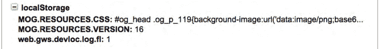

图 6-4. 谷歌在移动端对 localStorage 的使用


对于桌面端的谷歌基础搜索，数据的存储方式与移动端不同。首先，它使用`sessionStorage`，因此你知道这将是临时数据。查看**图6-5**中简单谷歌搜索存储的原始JSON数据，你会发现主要存储了CSS和HTML，以及一些带命名空间的跟踪数据。

```
sessionStorage
web-c: ["d22a8f7c2490765"]
web-cd22a8f7c2490765: {"css":"body{color:#000;margin:0;overflow-y:scroll}body,#left...
web-rt: "-29077143"
web-s: ["bav=on.2.or.r_gc.r_pw.r_qf.,cf.osb&fp=d22a8f7c2490765&hl=en...
web-sbav=on.2.or.r_gc....: [{"n":"ad","a":["one search - Google Search","rkCdT5fOH4iy8QT...
web-v: "21_c9c918f0"
```

*图6-5. 谷歌在桌面端使用sessionStorage*

Twitter在移动设备上也大量使用`localStorage`。查看**图6-6**中设备上保存的JSON，你可以看到Twitter存储了呈现用户界面所需的所有数据。不过，这些数据并非HTML直接转储到`localStorage`，而是组织在一个JSON对象结构中，带有适当的转义和JavaScript模板变量。

```
localStorage
TWITTER: {"strs":{"connect_followed_by_one":"<span class='highlight'>{...
onslyde: {"profile":{"retweets":null,"blocking":"false","url":"http://...
```

*图6-6. Twitter在移动端使用localStorage*

亚马逊对`sessionStorage`的使用仅限于与“产品点赞”相关的少量跟踪信息。但总体而言，看到互联网上的顶级网站仍未充分利用Web Storage来加速其网站并减少HTTP请求，这有点令人惊讶。

对于桌面网站来说，高效的请求和更快的界面可能不是大问题，但我们没有理由不在移动端和桌面端都采用这些存储增强功能。我们仅在移动端看到大量使用Web Storage的一些原因是：

- 仅在现代浏览器中才支持CSS中使用的Data URIs（将背景图片进行base64编码）。这种技术即使在IE9中也存在限制和令人烦恼的问题。
- 移动端的网络延迟要高得多（正如你在**第3章**所见），因此在移动设备上进行缓存可以使用户界面快得多。

使用base64编码的Data URI时，请注意编码后的数据大小是其二进制等效数据的三分之一。（但是，如果HTTP服务器使用GZIP压缩响应，这个开销会减少到2%到3%。）

#### 如今使用Web Storage

正如你所看到的，在应用程序中使用Web Storage有无数种方式。归根结底是回答几个问题：

- 如何提升用户体验？
- 如何减少移动端的HTTP请求？
- 如何高效地减轻服务器负载？

当然，在看到Web Storage在访问数据时会阻塞主JavaScript UI线程后，你必须考虑页面如何加载，并使用存储和检索数据的最佳实践。

使用`localStorage`的最佳起点是将其应用于应用程序需要用户输入的地方。例如，如果你的表单中有一个评论输入框，你可以使用`localStorage`来保存用户输入的草稿，以防会话超时或表单提交不当。评论服务Disqus就采用了这种实践，将你的草稿评论保存在`localStorage`中。

#### 启用自动登录

`localStorage`的另一个良好用途是自动登录。以下是W3C移动Web应用程序最佳实践第3.3.2节中的建议：

> 3.3.2.1 含义
> 如果应用程序需要用户身份，通常会提示输入用户凭证（用户名和密码），并提供在下次使用会话时自动登录的选项。这在移动设备上尤为重要，因为数据输入比在桌面设备上更困难。
>
> 请注意，如果启用了自动登录，还应提供退出登录链接。
>
> 3.3.2.2 如何实现
> 用户凭证可以存储在cookie或本地存储中。但是，重要的是不要存储未加密的密码信息，因为这不安全。通常，会存储一个安全哈希的令牌，必要时可以在服务器端撤销该令牌，以便实现自动登录。

#### 带时间戳的缓存

大多数网络服务允许你每天访问其服务的次数有限。通过使用带有时间戳的`localStorage`，你可以在本地缓存网络服务的结果，并在指定时间后才访问它们以刷新数据。

一个实现类似memcache行为的简单库是lscache (https://github.com/pamelafox/lscache)。lscache使用HTML5 localStorage模拟memcache功能，因此你可以在客户端缓存数据，并为每条数据关联一个过期时间。如果超出localStorage限制（约5MB），它会尝试通过移除最接近过期的项目来创建空间。如果浏览器中根本无法使用localStorage，该库会优雅降级，即简单地不进行缓存，所有缓存请求都返回null。

#### 从客户端同步数据

到目前为止讨论的所有Web Storage加速网络应用程序的方法，都是单向通信的形式，不需要将修改后的JSON对象同步或传输回服务器。相反，你只需将数据推送到浏览器并将其用作缓存。

如今，企业才刚刚开始利用Web Storage来存储对象模型，并将其同步回服务器端数据库。此类功能对于以下情况非常有用：

- 允许Web应用程序离线运行，然后将新的客户端数据同步到服务器
- 允许Web应用程序离线运行，然后在重新连接时刷新客户端数据
- 允许离线Web应用程序和在线服务器数据都被修改，然后同步两个数据集并处理冲突

其中一些数据管理和版本控制的情况可能会变得相当复杂。例如，LinkedIn最近发布了其使用localStorage管理RESTful JSON数据的解决方案。该公司将localStorage纳入考量的主要原因是为了减少其最新iPad应用程序中的延迟和不必要的网络请求。据LinkedIn工程师Akhilesh Gupta称：

> LinkedIn刚刚发布了一款全新的iPad应用程序，该程序使用HTML5、backbone.js和underscore.js构建。该应用程序包含丰富的信息流，结合了网络更新、群组帖子和新闻文章。用户还可以切换到特定的信息流，如同事更新或来自特定类别的新闻文章。

完整文章请参阅：http://engineering.linkedin.com/mobile/linkedin-ipad-using-local-storage-snappy-mobile-apps。

其核心是，这个特定的应用程序使用Backbone来管理客户端数据模型。然后，开发人员编写了必要的代码来覆盖基本同步功能，允许模型和集合存储在`localStorage`中。同样，这显然是一个性能举措，并未真正涉及将数据同步回服务器。但是，这是一个更复杂的用例，管理着数据的版本控制和迁移到应用程序的较新版本。最终，iPad应用程序获得了以下性能改进：

- 由于临时存储最近获取的数据，应用程序响应更快；用户不再需要等待网络请求完成才能在应用程序中移动
- 在原生应用程序中，多个Web视图之间无缝共享获取的数据
- 独立于移动设备的内存限制；`localStorage`可以在必要时存储并在内存中填充临时对象
- 滚动时减少内存占用和渲染时间，因为复杂的HTML文档片段存储在`localStorage`中

##### 使用Backbone进行数据库同步

一些框架允许数据从`localStorage`同步回服务器。例如，*Backbone.js* 自带从服务器获取和保存数据模型的方法。然而，开箱即用时，它并不提供需要离线工作并在在线时与服务器同步的应用程序所需的高级功能。为了解决这个问题，Dev Camp博客的Neil Bevis发布了一个出色的解决方案，我将在此进行总结。（完整的博客文章请参阅：http://ocddevcamp.wordpress.com/2011/10/15/backbone-localstorage-and-server-synchronization。）

*Backbone-localstorage.js* 通过简单地将JavaScript文件添加到项目中来提供与`localStorage`的通信。然而，添加此文件后，你就无法再通过`Backbone.sync`在Backbone和服务器之间进行通信。你必须做的第一件事是在包含*backbone-localstorage.js* JavaScript文件之前创建一个`Backbone.sync`方法的副本：

```
<script src="backbone.js"></script>
<script>Backbone.serverSync = Backbone.sync;</script>
<script src="backbone-localstorage.js"></script>
```

现在，你可以使用以下方式将数据保存到服务器：

```
Backbone.serverSync('update', model, options);
```

这使得标准的`model.fetch()`和`model.save()`函数能够使用`localStorage`。接下来，你必须提供一个`标志`，其布尔值描述其客户端状态。当客户端准备好从给定的集合将本地更改推送到服务器时，它会使用以下方式逐个模型地发送带有`synchronized=false`的模型对象：

`Backbone.serverSync('update', model, { success: 'foo', error: 'bar'})`.

如果服务器返回的ID与客户端存储的ID不同，则表示这是一个新对象。但如果ID保持不变，那么你只是进行了一次更新。当服务器返回一个新对象时，以下代码会删除localStorage中现有的ID并添加新版本：

```
for (var i = 0; i < models.length; i++) {
    var model = models[i];
    if (model.get('synchronized')) { continue; }
    model.change();
    Backbone.serverSync('update', model, {
        success: function (data) {
            var model = collection.get(data.ClientId);
            //if new server will return a different Id
            if (data.ServerId != data.ClientId) {
                //delete from localStorage with current Id
                Backbone.sync("delete", model,
                { success: function () { },
                  error: function () { } });

                //save model back into localStorage
                model.save({ Id: data.ServerId })
            }
            model.save({ synchronized: true });
            collection.localCacheActive = false;
        },
        error: function (jqTHX, textStatus, errorThrown) {
            console.log('Model upload failure:' + textStatus);
            collection.localCacheActive = false;
        }
    });
}
```

当被要求从服务器拉取服务器端更改到集合时，客户端首先使用 `model.save()` 将任何未推送的客户端更改保存到localStorage中。接下来，通过标准的Backbone fetch方法从服务器请求整个集合：

```
tempCollection.sync = Backbone.serverSync;
tempCollection.fetch( { success: blah, error: blah });
```

在实践中，你可以将相关数据下载量减少到仅包含需要更新的项目。当它从服务器收到每个模型时，success函数会将其与自己的列表进行比对。如果该模型是新的，success会将其添加到正在更新的集合中，并使用 `model.save()` 将其记录到本地存储中：

```
collection.add(tempModel);
tempModel.change();
tempModel.save({ synchronized: true });
```

最后，在模型同步之后，success函数使用修正后的数据更新该模型：

```
model.set(tempModel.toJSON());
model.set({ synchronized: true });
model.save();
```

这种方法的主要问题在于，如果模型已存在且用户已对其进行了基于localStorage的修改。在这段代码中，这些模型在拉取服务器端更改时不会被更新。这些对象会被推送到服务器以在数据库中进行更新。

这不是一个终极解决方案，目前有许多框架正在尝试解决这个问题。其中许多解决方案与本文讨论的一样成熟。因此，你对localStorage和同步到服务器端数据库的使用将取决于你用例的复杂性。

#### 在任何浏览器中使用 Web Storage

虽然你可以在大多数现代网页浏览器中安全地使用localStorage，但如果你的应用程序必须兼容不支持localStorage的浏览器，你可以使用一些易于遵循的轻量级polyfill。例如，以下示例polyfill兼容IE 6和7，以及Firefox 2和3。它拥有与Web Storage规范中定义的完全相同的API，你可以今天就在你的应用程序中包含大约90行JavaScript代码来开始使用它。（完整源代码请参见 https://raw.github.com/wojodesign/local-storage-js/master/storage.js。）

```
(function(){
    var window = this;
    // check to see if we have localStorage or not
    if( !window.localStorage ){

        // globalStorage
        // non-standard: Firefox 2+
        // https://developer.mozilla.org/en/dom/storage#globalStorage
        if ( window.globalStorage ) {
            // try/catch for file protocol in Firefox
            try {
                window.localStorage = window.globalStorage;
            } catch( e ) {}
            return;
        }

        // userData
        // non-standard: IE 5+
        // http://msdn.microsoft.com/en-us/library/ms531424(v=vs.85).aspx
        var div = document.createElement( "div" ),
            attrKey = "localStorage";
        div.style.display = "none";
        document.getElementsByTagName( "head" )[ 0 ].appendChild( div );
        if ( div.addBehavior ) {
            div.addBehavior( "#default#userdata" );
            var localStorage = window["localStorage"] = {
                "length":0,
                "setItem":function( key , value ){
                    div.load( attrKey );
                    key = cleanKey(key );

                    if( !div.getAttribute( key ) ){
                        this.length++;
                    }
                    div.setAttribute( key , value );

                    div.save( attrKey );
                },
                "getItem":function( key ){
                    div.load( attrKey );
                    key = cleanKey(key );
                    return div.getAttribute( key );

                },
                "removeItem":function( key ){
                    div.load( attrKey );
                    key = cleanKey(key );
                    div.removeAttribute( key );

                    div.save( attrKey );
                    this.length--;
                    if( this.length < 0){
                        this.length=0;
                    }
                },

                "clear":function(){
                    div.load( attrKey );
                    var i = 0;
                    while ( attr =
                    div.XMLDocument.documentElement.attributes[ i++ ] ) {
                            div.removeAttribute( attr.name );
                    }
                    div.save( attrKey );
                    this.length=0;
                },

                "key":function( key ){
                    div.load( attrKey );
                    return
                    div.XMLDocument.documentElement.attributes[ key ];
                }

            },

            // convert invalid characters to dashes
            // http://www.w3.org/TR/REC-xml/#NT-Name
            // simplified to assume the starting character is valid
            cleanKey = function( key ){
                return key.replace( /^-_.\0-9A-Za-z\xb7\xc0-\xd6\xd8-\xf6\xf8-\u037d\u037f-\u1fff\u200c-\u200d\u203f\u2040\u2070-\u218f]/g, "-" );
            };

            div.load( attrKey );
            localStorage["length"] =
                div.XMLDocument.documentElement.attributes.length;
        }
    }
})();
```

### 框架

一些JavaScript框架在移动设备上解决了Web Storage的需求。在评估Web Storage框架时，要寻找一个良好、一致且能在所有设备上工作的存储API。当然，这是规范本身通过简单的JavaScript API实现的，但在所有设备都支持该规范之前，你需要一个辅助框架。

##### LawnChair

LawnChair (http://westcoastlogic.com/lawnchair) 是专为移动端设计的。它支持所有主流移动浏览器，适应于本书中描述的移动和桌面环境，并为你提供一个一致的API来访问某种形式的localStorage。LawnChair允许你在浏览器上存储和查询数据，而无需担心底层的API。它也不依赖于任何服务器端实现，使你能够快速上手这个简单、轻量级的框架。

页面设置如下：

```
<!DOCTYPE html>
<html>
<head>
    <title>my app</title>
</head>
<body>
    <script src="lawnchair.js"></script>
</body>
</html>
```

要持久化数据，使用：

```
LawnChair(function(){
    this.save({msg: 'hooray!'})
})
```

##### persistence.js

支持所有主流移动浏览器平台，*persistence.js* (http://persistencejs.org) 是一个异步JavaScript对象关系映射器。它集成了Node.js和服务器端MySQL数据库，并推荐用于服务器端，因为使用内存中的数据存储似乎会减慢过滤和排序的速度。其下载大小比LawnChair大得多。

页面设置使用：

```
<!DOCTYPE html>
<html>
<head>
    <title>my app</title>
</head>
<body>
    <script src="persistence.js" type="application/javascript"></script>
    <script src="persistence.store.sql.js" type="application/javascript"></script>
    <script src="persistence.store.websql.js" type="application/javascript"></script>
</body>
</html>

if (window.openDatabase) {
    persistence.store.websql.config(persistence, "jquerymobile", 'database',
                                      5 * 1024 * 1024);
} else {
    persistence.store.memory.config(persistence);
}

persistence.define('Order', {
    shipping: "TEXT"
});

persistence.schemaSync();
```

类似于Hibernate（JBoss的持久化框架），*persistence.js* 使用跟踪机制来确定哪些对象的更改需要持久化到数据库。从数据库检索的所有对象都会被自动跟踪更改。新的实体可以使用 `persistence.add` 函数进行跟踪和持久化：

```
var c = new Category({name: "Main category"});
persistence.add(c);
```

所有对跟踪对象的更改都可以通过使用 `persistence.flush` 刷新到数据库，该函数接受一个事务对象和一个回调函数作为参数。你可以使用 `persistence.transaction` 开始一个新事务：

```
persistence.transaction(function(tx) {
    persistence.flush(tx, function() {
        alert('Done flushing!');
    });
});
```


## 第7章
地理定位

地理定位API提供了对与宿主设备相关联的地理位置信息进行脚本化访问的能力。这使你的应用程序能够定位用户，并在他们移动时跟踪其纬度和经度。此功能可用于许多有趣的用例，例如：

**地理围栏**
赋予你的应用能力，以在用户进入或离开某个位置时立即调度任务提醒用户。你也可以针对位于特定城市或州内的用户投放定向广告。

**地理编码**
将你的应用与类似谷歌地图API的服务（图7-1）结合使用，你可以将纬度和经度坐标翻译成实际的邮政地址。

**通用跟踪**
跟踪行驶、步行或跑步的距离。

该API本身与设备无关；它不关心浏览器如何确定位置。获取用户实际位置的底层机制可能通过WiFi、GPS，或由用户实际在设备上输入邮政编码来实现。该API设计用于处理“一次性”位置请求和重复的位置更新。当然，就缺陷、解决方法以及不同浏览器之间的实现差异而言，地理定位与其他HTML5 API并无不同。在复习基础知识后，我们将深入探讨跨浏览器的细微差别。

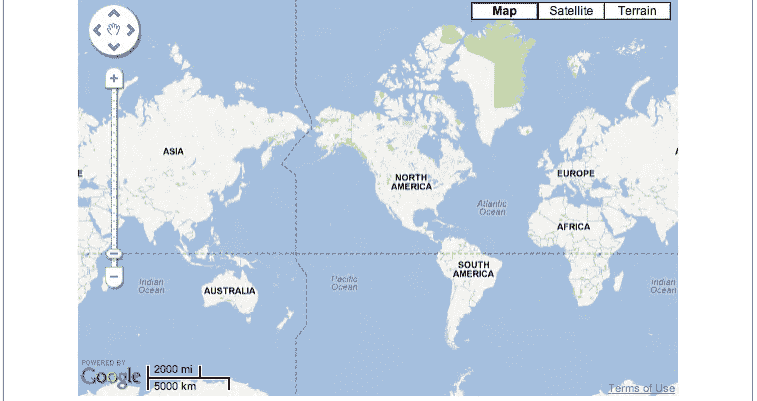

要访问用户的位置，请运行以下JavaScript代码：

```javascript
navigator.geolocation.getCurrentPosition(function(){//show a map});
```

网络浏览器会请求用户许可以公开其位置，如图7-2所示。

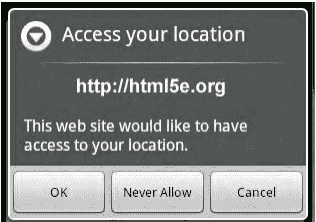

获得许可后，浏览器返回一个带有coords属性的位置对象。这允许你调用以下属性，通过这些属性你可以了解用户的纬度、经度以及许多其他数据点：

```javascript
position.coords.latitude //地理坐标，单位为十进制度数
position.coords.longitude //地理坐标，单位为十进制度数
position.coords.altitude //位置的高度（椭球面以上的米数）
position.coords.accuracy //纬度和经度坐标的准确度级别
position.coords.altitudeAccuracy //以米为单位指定
position.coords.heading //宿主设备的行进方向，单位为度
position.coords.speed //设备的当前速度（米/秒）
```

只有纬度、经度和准确度属性保证可用。其余属性可能返回null，具体取决于用户设备的功能以及与其通信的后端定位服务器。

getCurrentPosition()函数有一个可选的第三个参数，一个PositionOptions对象：

```javascript
navigator.geolocation.getCurrentPosition(successCallback, errorCallback,
    { enableHighAccuracy: true, timeout: 10000, maximumAge: 6000 });
```

enableHighAccuracy属性提示应用程序希望获得最佳可能的结果。如果此属性为true，设备能够支持它，并且用户同意，那么设备将尝试提供精确的位置。使用此属性可能导致响应时间变慢或功耗增加。用户也可能拒绝此功能，或者设备可能有更精确的结果可以提供。此属性的预期目的是允许应用程序告知实现，它们不需要高精度的地理定位修正，因此实现可以避免使用消耗大量电量的地理定位提供者（想想GPS）。

timeout属性是你的网络应用程序愿意等待位置信息的毫秒数。此计时器在用户同意共享位置数据后才开始倒计时。你计时的不是用户；你计时的是网络。

maximumAge属性表示应用程序愿意接受的缓存位置的最大年龄，不超过指定的毫秒数。这为你提供了一个从用户设备获取缓存位置的时间窗口。定义此属性意味着你接受该设备在x毫秒前的位置。

你的网络应用将精确地规定你的地理定位需求。因此，在使用上述属性时，请记住用户设备上的电池寿命和延迟。如果需要持续跟踪用户的位置，规范定义了watchPosition()函数。它的结构与getCurrentPosition()相同，并会在设备位置发生变化时调用successCallback：

```javascript
navigator.geolocation.watchPosition(successCallback, errorCallback,
    { enableHighAccuracy: true, timeout: 10000, maximumAge: 6000 });
```

在运行iOS5的Mobile Safari中使用watchPosition()时要小心。在撰写本文时，存在一个已知问题：页面将运行大约四分钟，之后用户将收到“JavaScript执行超过超时”的错误。要绕过iOS5上的watchPosition()问题，你可以使用getCurrentPosition()和setInterval()实现以下代码：

```javascript
var geolocationID;
(function getLocation() {
    var count = 0;
    geolocationID = window.setInterval(
        function () {
            count++;
            if (count > 3) { //当计数达到某个数字时，重置间隔
                window.clearInterval(geolocationID);
                getLocation();
            } else {
                navigator.
                    geolocation.getCurrentPosition(successCallback, errorCallback,
                        { enableHighAccuracy: true, timeout: 10000 });
            }
        },
        60000); //结束setInterval;
})();
```

特定WebKit地理定位实现的另一个问题是，访问地理定位会激活地理定位服务，该服务目前会阻止页面缓存（[https://bugs.webkit.org/show_bug.cgi?id=43956](https://bugs.webkit.org/show_bug.cgi?id=43956)）。如果你只是检查地理定位属性，你可以避免这个问题：

```javascript
function supports_geolocation() {
    try {
        return 'geolocation' in navigator &&
               navigator['geolocation'] !== null;
    } catch (e) {
        return false;
    }
}
```

你可以在[http://html5e.org/example/geo](http://html5e.org/example/geo)查看包含所有已实现变通方法的在线演示。

### 一个实际用例：用户跟踪

要跟踪用户在一系列纬度和经度坐标上的移动，你可以使用Haversine公式。通过它，你的应用程序可以计算地球表面的最短距离，并提供两点之间的直线距离。你需要的代码是：

```javascript
function calculateDistance(lat1, lon1, lat2, lon2) {
    var R = 6371; // 千米
    var dLat = (lat2 - lat1).toRad();
    var dLon = (lon2 - lon1).toRad();
    var a = Math.sin(dLat / 2) * Math.sin(dLat / 2) +
            Math.cos(lat1.toRad()) * Math.cos(lat2.toRad()) *
            Math.sin(dLon / 2) * Math.sin(dLon / 2);
    var c = 2 * Math.atan2(Math.sqrt(a), Math.sqrt(1 - a));
    var d = R * c;
    return d;
}
Number.prototype.toRad = function() {
    return this * Math.PI / 180;
}
```

此距离计算以及许多其他计算可在[http://www.movable-type.co.uk/scripts/latlong.html](http://www.movable-type.co.uk/scripts/latlong.html)在知识共享署名3.0许可下获取。

### 一个实际用例：反向地理编码

术语“地理编码”通常指将人类可读的地址翻译成地图上的位置。执行反向操作，即把地图上的位置翻译成人类可读地址的过程，称为*反向地理编码*。以下代码是一个简单的示例，展示如何使用谷歌地图API对地理定位API返回的坐标进行反向地理编码：

```html
<!DOCTYPE html>
<html>
  <head>
    <meta name="viewport" content="initial-scale=1.0, user-scalable=no">
    <meta charset="utf-8">
    <title>
      Google Maps JavaScript API v3 示例：反向地理编码
    </title>
    <link
      href="https://google-developers.appspot.com/maps/documentation/javascript/examples/default.css"
      rel="stylesheet">
    <script
      src="https://maps.googleapis.com/maps/api/js?sensor=false">
    </script>
    <script>
      var geocoder;
      var map;
      var infowindow = new google.maps.InfoWindow();
      var marker;
      function initialize() {
        geocoder = new google.maps.Geocoder();
        var latlng = new google.maps.LatLng(40.730885,-73.997383);
        var mapOptions = {
          zoom: 8,
          center: latlng,
          mapTypeId: 'roadmap'
        }
        map = new google.
        maps.Map(document.getElementById('map_canvas'), mapOptions);
      }

      function codeLatLng() {
        var input = document.getElementById('latlng').value;
```


var latlngStr = input.split(',', 2);
var lat = parseFloat(latlngStr[0]);
var lng = parseFloat(latlngStr[1]);
var latlng = new google.maps.LatLng(lat, lng);
geocoder.geocode({'latLng': latlng}, function(results, status) {
  if (status == google.maps.GeocoderStatus.OK) {
    if (results[1]) {
      map.setZoom(11);
      marker = new google.maps.Marker({
          position: latlng,
          map: map
      });
      infowindow.setContent(results[1].formatted_address);
      infowindow.open(map, marker);
    } else {
      alert('No results found');
    }
  } else {
    alert('Geocoder failed due to: ' + status);
  }
});
}
</script>
</head>
<body onload="initialize()">
  <div>
    <input id="latlng" type="textbox" value="40.714224,-73.961452">
  </div>
  <div>
    <input type="button" value="Reverse Geocode" onclick="codeLatLng()">
  </div>
  <div id="map_canvas"
  style="height: 90%; top:60px; border: 1px solid black;"></div>
</body>
</html>
```

### 框架

在使用地理定位 API 时，你应该检测并封装不同移动设备上可用的地理定位机制。例如，你可以在一个 JavaScript 的 `init()` 方法中检测 Google Gears、BlackBerry 以及默认的地理定位 API。但是，为什么你要费力地自己编写所有这些代码呢？何不直接使用一个框架？地理定位 JavaScript 框架的体积相对较小，选择也较为多样。

#### geo-location-javascript

这是一个以移动设备为中心的框架，它使用了非标准的 BlackBerry 和 WebOD 技巧。`geo-location-javascript` (http://code.google.com/p/geo-location-javascript) 通过一个符合 W3C 地理定位 API 规范的简单 JavaScript API，封装了底层平台特定的实现。该框架采用 MIT 许可证，支持多种平台，包括 iOS、Android、BlackBerry OS、支持 Google Gears 的浏览器（Android、Windows Mobile）、Nokia Web Run-Time（Nokia N97）、webOS Application Platform（Palm Pre）、Torch Mobile Iris Browser 和 Mozilla Geode。

要设置和使用该 API，你需要的代码如下：

```
<html>
<head>
    <title>Javascript geo sample</title>
    <script src="http://code.google.com/apis/gears/gears_init.js"
            type="text/javascript" charset="utf-8"></script>
    <script
        src="js/geo.js" type="text/javascript"
        charset="utf-8"></script>
</head>
<body>
    <b>Javascript geo sample</b>
    <script>
        if(geo_position_js.init()){
            geo_position_js.getCurrentPosition(success_callback,
                                              error_callback,
                                              {enableHighAccuracy:true});
        }
        else{
            alert("Functionality not available");
        }

        function success_callback(p)
        {
            alert('lat='+p.coords.latitude.toFixed(2)+'\nlon='+p.coords.longitude.toFixed(2));
        }

        function error_callback(p)
        {
            alert('error='+p.message);
        }
    </script>
</body>
</html>
```

#### Webshims lib

Webshims (http://afarkas.github.com/webshim/demos) 框架支持所有 jQuery 的 A 级浏览器以及最新的 Opera。它基于 jQuery 和 Modernizr，采用 MIT 许可证。它试图处理许多不同的 Polyfill 和 Shims，包括地理定位。

其设置和使用代码如下所示：

```
<!DOCTYPE html>
<html lang="en">
<head>
    <script
        src="http://ajax.googleapis.com/ajax/libs/jquery/1.7.1/jquery.min.js">
    </script>
    <script src="../js-webshim/minified/extras/modernizr-custom.js"></script>
    <script src="../js-webshim/minified/polyfiller.js"></script>
    <script>
        $.webshims.setOptions('geolocation', {
            confirmText: '{location} wants to know your position. It is Ok.'
        });
        //加载所有 polyfill 功能
        //或者只加载特定功能，例如：$.webshims.polyfill('feature-name');
        $.webshims.polyfill();
    </script>
</head>
```

还有其他一些脚本试图处理这种 Polyfill，包括：

-   [Geolocation API crossbrowser support](http://bit.ly/Geolocation-API-Polyfill)
-   [HTML5 Geolocation with fallback](http://gist.github.com/366184)

目前，在移动网络浏览器中使用地理定位 API 的最大缺点之一是，当浏览器关闭后无法在后台运行。例如，要在后台跟踪用户并允许该人切换到移动浏览器之外的另一个应用程序，这变得极其困难。此时，你的浏览器必须作为一个后台进程保持打开状态，你的基于地理定位的应用程序才能正常工作。

## 第八章
### 设备方向 API

加速度计、陀螺仪和指南针现在在移动设备和笔记本电脑中已很常见。通过设备方向 API，你可以极其精细地捕捉移动，接收关于设备运动和加速度的确切细节。

从概念上讲，加速度计的作用就像弹簧上的阻尼质量块。当加速度计经历加速度时，质量块会移动，直到弹簧能够以与外壳相同的速率加速质量块。然后测量这个位移以得出加速度。

方向硬件已经使用了相当长一段时间，应用范围从基于军事的惯性制导系统到跟踪动物，再到测量地震和余震。现在你有机会将此功能添加到你的应用程序中，以增强设备如何被跟踪以及如何与你的用户界面进行交互。是时候超越仅仅将设备方向 API 用于游戏和简单地理定位的阶段了。

首先，你需要了解该 API 的基础知识以及如何在 JavaScript 中处理测量数据。该规范提供的第一个 DOM 事件是 `deviceorientation`，它提供设备的物理方向，表示为从本地坐标系开始的一系列旋转。以下是一个简单的检查，用于查看此浏览器是否支持 `DeviceOrientationEvent` 对象：

```
supports_orientation : function() {
  try {
    return 'DeviceOrientationEvent' in
    window && window['DeviceOrientationEvent'] !== null
  } catch (e) {
    return false;
  }
}
```

接下来，你必须添加一个事件监听器来监听设备方向的变化：

```
if (window.DeviceOrientationEvent) {
    window.addEventListener("deviceorientation", function( event ) {
    //alpha: 绕 z 轴旋转
    var rotateDegrees = event.alpha;
    //gamma: 从左到右
    var leftToRight = event.gamma;
    //beta: 前后运动
    var frontToBack = event.beta;

    handleOrientationEvent( frontToBack, leftToRight, rotateDegrees );
    }, false);
}

var handleOrientationEvent =
    function( frontToBack, leftToRight, rotateDegrees ){
    //处理事件
};
```

现在你有了数据，这些变量意味着什么？你如何使用它们？当你将设备从一侧倾斜到另一侧时，这被称为 *beta*（图 8-1）。从前向后倾斜是 *gamma*（图 8-2），而手机面朝上时旋转（在 Z 轴上）被称为 *alpha*（图 8-3）。

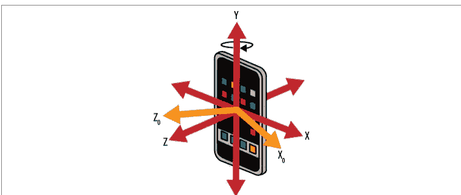

*图 8-1. 设备方向 API 的 Beta 定位*

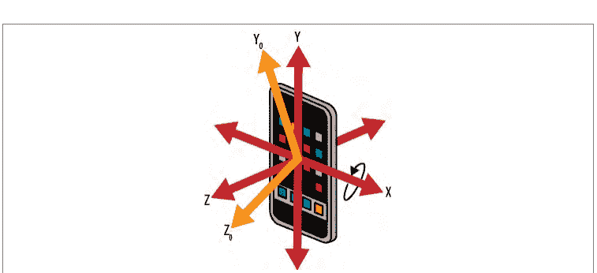

*图 8-2. 设备方向 API 的 Gamma 定位*

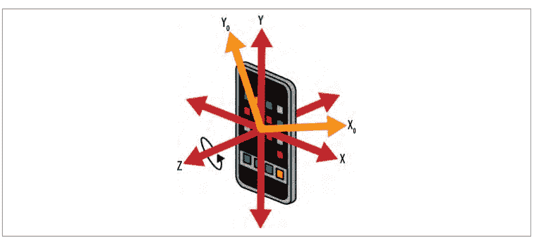

*图 8-3. 设备方向 API 的 Alpha 定位*

需要记住一个与浏览器相关的注意事项：较旧版本的 Firefox（3.6、4 和 5）支持 `mozOrientation`，而不是标准的 `DeviceOrientation` 事件。如果你想匹配当前新规范提供的内容，你必须将数据标准化为弧度。方法如下：

```
if (!evt.gamma && !evt.beta) {
  //如果这是 Firefox 3.6、4 或 5，则将
  // 角度数据转换为弧度
  evt.gamma = -(evt.x * (180 / Math.PI));
  evt.beta = -(evt.y * (180 / Math.PI));
}
```


### 一个实际用例：通过设备移动进行滚动

设备方向 API 的典型商业用途是将方向硬件与地理位置服务结合，以增强用户在特定地图上的实际位置和方向感知。但是，如果你可以通过向左或向右倾斜设备来浏览页面呢？轻轻一挥手，你就能翻到下一页。或者，你可以基于左右移动来呈现一个连续滚动的幻灯片。我想你明白这个思路了，现在让我们来编码实现。

如果你将**第 3 章**中用于页面滑动过渡的代码与设备方向 API 结合，你就可以创建一个幻灯片，根据设备倾斜的方向进行导航。你可以在 [http://html5e.org/example/orientation](http://html5e.org/example/orientation) 找到这个功能的在线演示。

首先，为左右移动设置你的 CSS 变换：

```javascript
var handleOrientationEvent = function (frontToBack, leftToRight, rotateDegrees) {
  //on each movement, we're controlling how the current focusPage moves
  var curTransform = 
    new window.WebKitCSSMatrix(window.
      getComputedStyle(focusPage).webkitTransform);
  focusPage.innerHTML = leftToRight;
  focusPage.style.webkitTransform = 
    'translate3d(' + leftToRight * 5 + 'px, 0, 0)';
  focusPage.style.WebkitTransition = 'all .5s ease-out';
  navigate(leftToRight);
};
```

接下来，使用**第 3 章**中的单页模型，对 DOM 中所有定义好的页面执行导航：

```javascript
var keepgoing = true, pagehistory = [];

var pagestate = function(pages, className) {
  var that = {};
  that.count = 0;
  that.pages = pages;
  that.pageCount = pages.length;
  that.className = className;
  return that;
};

var allpages = listToArray(document.querySelectorAll('.page'));

var leftPageState = new pagestate(allpages, 'page stage-left');
var rightPageState = new pagestate(allpages.slice(), 'page stage-right');

function detecttilt(leftToRight) {
  if (keepgoing) {
    if (leftToRight > 30) {
      donav(leftPageState, rightPageState);
    } else if (leftToRight < -30) {
      donav(rightPageState, leftPageState);
    }
  }
}

function donav(ps, ops) {
  var page;
  if (ps.count <= (ps.pageCount + 1)) {
    //reset
    if (ps.count === 0) {
      if (pagehistory.length > 0) {
        ps.pages = pagehistory;
        pagehistory = [];
      }
      ps.count++;
    } else {
      page = ps.pages.pop();
      if (page !== undefined) {
        page.className = ps.className;
        pagehistory.push(page);
        ps.count++;
        console.log(ps.count);
        slideQueue(page);
      } else {
        ops.count = 0;
      }
    }
  }
}

function slideQueue(page) {
  keepgoing = false;
  // A simple way to put a block on the calling code, because
  // the orientation is a constant change
  slidfast.ui.slideTo(page, function () {
    keepgoing = true;
  });
}
```

这个演示已在基于 WebKit 的设备上进行了测试，例如 Safari、Android 和 Chrome。更棒的是，由于你使用的是与第 3 章相同的 CSS 过渡效果，它应该也能在 Firefox 和 Opera 移动浏览器上正常工作。

### Web Workers

当你的 Web 应用需要在 JavaScript 端进行繁重的运算或后台处理时，Web Workers API 就是你的解决方案。

Web Workers 接口生成真正的操作系统级线程，允许在任何给定线程（或 Worker）之间来回传递数据。此外，由于线程之间的通信点受到严格控制，因此并发问题很少出现。你无法访问对线程不安全的组件或 DOM，并且必须通过序列化对象在线程中传入和传出特定数据。因此，你必须非常努力才能在代码中引发问题。无论你计划如何在应用程序中使用 Web Workers，处理任何后台数据的核心思想在于在浏览器中创建多个 Worker（或线程）的概念。

在撰写本文时，Safari、iOS5 的 Safari、Chrome、Opera 和 Mozilla Firefox 支持 Web Workers API，但 Internet Explorer 不支持。（Internet Explorer 10 在 Platform Preview 2 中确实增加了对 Web Workers 的支持。）Android 版本 2.0 和 2.1 也支持 Web Workers，但更高版本的 Android 则不支持。目前唯一可用的 Web Workers shim 使用了 Google Gears。如果设备或浏览器不支持核心 Web Workers API，你可以检测是否安装了 Google Gears。更多详情，请参阅 http://html5-shims.googlecode.com/svn/trunk/demo/workers.html。

使用 Web Workers 及其多线程方法，你无法访问 DOM（它不是线程安全的）、window、document 或父对象。然而，你可以访问许多其他功能和对象，从 `navigator` 对象开始：

```javascript
appCodeName      //浏览器的代号
appName          //浏览器的名称
appVersion       //浏览器的版本信息
cookieEnabled    //确定浏览器中是否启用了 cookies
platform         //返回浏览器编译所针对的平台
userAgent        //浏览器发送给服务器的 user-agent 头信息
```

虽然你可以访问 `location` 对象，但它是只读的：

```javascript
hash      //URL 的锚点部分
host      //URL 的主机名和端口
hostname  //URL 的主机名
href      //整个 URL
pathname  //URL 的路径名
port      //服务器用于 URL 的端口号
protocol  //URL 的协议
search    //URL 的查询部分
```

你可以在 Worker 中使用 `XMLHttpRequest` 发起 AJAX 调用，也可以使用 `importScripts()` 方法导入外部脚本，只要它们在同一个域中。为了减少等待时间，你可以使用 `setTimeout()`、`clearTimeout()`、`setInterval()` 和 `clearInterval()` 来设置和清除超时和间隔。最后，你可以访问应用缓存并生成其他 Worker。创建 Worker 相当容易；你只需要一个 JavaScript 文件的 URL。`Worker()` 构造函数以该文件的 URL 作为其唯一参数被调用：

```javascript
var worker = new Worker('worker.js');
```

> Worker 脚本必须是与调用页面具有相同协议的外部文件。因此，你无法从 data URL 加载脚本，HTTPS 页面也无法启动以 HTTP URL 开头的 Worker 脚本。

Worker 实际上在调用 `postMessage()` 时才开始，例如向 Worker 发送一些对象数据：

```javascript
worker.postMessage({'haz':'foo'}); // Start the worker.
```

接下来，添加一个 `EventListener` 来监听 Worker 返回的数据：

```javascript
worker.addEventListener('message', function(e) {
  console.log('returned data from worker', e.data);
}, false);
```

在实际的 `worker.js` 文件中，你可以有类似这样简单的内容：

```javascript
self.addEventListener('message', function(e) {
  var data = e.data;
  //Manipulate data and send back to parent
  self.postMessage(data.haz); //posts 'foo' to parent DOM
}, false);
```

前面的例子只是将序列化的 JSON 从父 DOM 中继到生成的 Worker 实例，然后再传回来。

在较新的浏览器（如 Chrome）中，你可以更进一步地处理数据类型，并在 Worker 之间传递二进制数据。使用可传输对象，数据可以从一个上下文传输到另一个上下文。这是零拷贝的，极大地提高了向 Worker 发送数据的性能。

当你将一个 `ArrayBuffer` 从主应用程序传输到 Worker 时，原始的 `ArrayBuffer` 会被清除，并且不再能被浏览器使用。其内容被传输到 Worker 上下文中。

Chrome 版本 8 及以上还包含一个支持可传输对象的新版本 `postMessage()`：

```javascript
var uInt8Array = new Uint8Array(new ArrayBuffer(10));
for (var i = 0; i < uInt8Array.length; ++i) {
    uInt8Array[i] = i * 2; // [0, 2, 4, 6, 8,...]
}

worker.webkitPostMessage(uInt8Array.buffer, [uInt8Array.buffer]);
```

图 9-1 展示了使用可传输对象时，数据在各线程之间传输的速度能快多少。例如，32MB 的数据从 Worker 往返于父线程只需 2 毫秒。使用以前的方法，如结构化克隆，在线程之间复制数据则需要超过 300 毫秒。要亲自尝试此测试，请访问 http://html5-demos.appspot.com/static/workers/transferables/index.html。

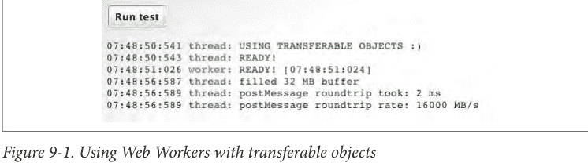

图 9-1. 使用带有可传输对象的 Web Workers

#### 一个实际用例：池化和并行化作业

下面的例子，最初灵感来自 Jos Dirksen 的线程池示例，它为你提供了一种指定并发 Worker（或线程）数量的方法。通过这种方法，像 Chrome 这样的浏览器可以在同时处理数据时使用多个 CPU 核心，你可以将渲染时间显著提高多达 300%。你可以在 http://html5e.org/example/workers 查看完整的演示，但基本的 `worker1.js` 文件包含：

```javascript
self.onmessage = function(event) {
    var myobj = event.data;
```


search: while (myobj.foo < 200) {
    myobj.foo += 1;
    for (var i = 2; i <= Math.sqrt(myobj.foo); i += 1)
        if (myobj.foo % i == 0)
            continue search;
    // found a prime!
    self.postMessage(myobj);
}

// close this worker
self.close();

上面的代码简单地输出素数，并在200处停止。你可以将while循环设置为`while(true)`以持续输出素数，但这是一个简单的示例，演示了如何分块处理数据，并利用多个工作线程并行化代码以实现共同目标。

从你的主索引页面`index.html`（你希望所有数据都显示的地方），初始化你的线程池并为工作线程提供一个回调函数：

```
slidfast({
    workers: {script:'worker1.js', threads:9, mycallback:workerCallback}
});
```

要查看此技术的实时演示，请访问 https://github.com/html5e/slidfast/blob/master/example/workers/index.html。

当工作线程参数初始化时，以下代码创建线程池并开始并发执行每个任务：

```
function Pool(size) {
    var _this = this;

    // set some defaults
    this.taskQueue = [];
    this.workerQueue = [];
    this.poolSize = size;

    this.addWorkerTask = function (workerTask) {
        if (_this.workerQueue.length > 0) {
            // get the worker from the front of the queue
            var workerThread = _this.workerQueue.shift();
            //get an index for tracking
            slidfast.worker.obj().index = _this.workerQueue.length;
            workerThread.run(workerTask);
        } else {
            // no free workers,
            _this.taskQueue.push(workerTask);
        }
    };

    this.init = function () {
        // create 'size' number of worker threads
        for (var i = 0; i < size; i++) {
            _this.workerQueue.push(new WorkerThread(_this));
        }
    };

    this.freeWorkerThread = function (workerThread) {
        if (_this.taskQueue.length > 0) {
            // don't put back in queue, but execute next task
            var workerTask = _this.taskQueue.shift();
            workerThread.run(workerTask);
        } else {
            _this.taskQueue.push(workerThread);
        }
    };
}

// runner work tasks in the pool
function WorkerThread(parentPool) {

    var _this = this;

    this.parentPool = parentPool;
    this.workerTask = {};

    this.run = function (workerTask) {
        this.workerTask = workerTask;
        // create a new web worker
        if (this.workerTask.script !== null) {
            var worker = new Worker(workerTask.script);
            worker.addEventListener('message', function (event) {
                mycallback(event);
                _this.parentPool.freeWorkerThread(_this);
            }, false);
            worker.postMessage(slidfast.worker.obj());
        }
    };

}

function WorkerTask(script, callback, msg) {
    this.script = script;
    this.callback = callback;
    console.log(msg);
    this.obj = msg;
}

var pool = new Pool(workers.threads);
pool.init();
var workerTask = new WorkerTask(workers.script,
                                mycallback,
                                slidfast.worker.obj());
```

初始化工作线程后，添加实际的工作任务来处理数据：

```
pool.addWorkerTask(workerTask);
slidfast.worker.obj().foo = 10;
pool.addWorkerTask(workerTask);
slidfast.worker.obj().foo = 20;
pool.addWorkerTask(workerTask);
slidfast.worker.obj().foo = 30;
pool.addWorkerTask(workerTask);
```

如图9-2所示，每个线程将数据带回主页面，并使用提供的回调函数进行渲染。线程顺序在每次刷新时各不相同，浏览器处理数据的方式无法保证。要查看演示，请访问 http://html5e.org/example/workers。请使用最新版本的Chrome或其他支持每个Web Worker使用实际CPU核心的浏览器。

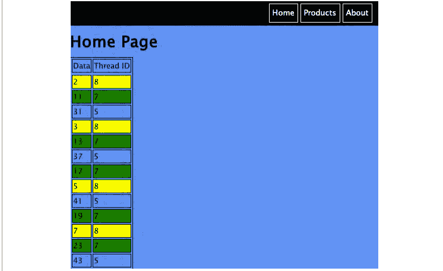

#### 其他用途

计算素数可能不是使用线程池的最佳实际示例，但你可以使用相同的技术来处理图像数据。更多信息，请参阅 http://www.smartjava.org/examples/webworkers2 和图9-3。


*图9-3. Web Worker线程处理图像数据的示例*

Web Workers也可以在你的应用中应用于更多场景。例如，你可以在用户输入时解析wiki文本，然后生成HTML。你可以在 http://www.cach.me/blog/2011/01/javascript-web-workers-tutorial-parse-wiki-text-in-real-time 找到此示例。或者，你可以将其用于可视化和商业图表。关于可视化框架，请参阅 https://github.com/samizdatco/arbor。

## 索引

符号
- 100% JavaScript驱动方法，52–58
  - Sencha Touch，52–54
  - Wink Toolkit，54–56
- 无页面结构方法，51
- 单页应用，48–50
- 应用，19（参见 web应用）
- 异步非阻塞IO（NIO），96
- Atmosphere（WebSocket框架），108
- 自动登录，实现，119

### A
- 加速计，137
- Adobe Shadow（移动调试器），60
- adoptNode，41
- AJAX调用
  - 安全问题，39
- Ajax Minifier在线CSS压缩工具（微软），77
- Amber.js，87
- Android
  - 渲染旋转过渡，29
- Android默认浏览器，10
- Dolphin浏览器，10
- Angular框架
  - Google，89
  - 安全特性，89
  - 服务器同步，89
- Apache ActiveMQ，96
- Apache，HTTP压缩支持，74
- Apple，2
  - 和Ember框架，88
- 方法
  - 100% JavaScript驱动，52–58

### B
- Backbone（客户端MV*框架），65
- Backbone框架，85–87，121
  - 和遗留服务器，87
  - 服务器同步，86
- background-repeat CSS，22
- Batman框架（Shopify），90
  - 服务器同步，91
- body onload事件，43
- Boot 2 Gecko项目（Mozilla），4
- Boot to Gecko项目（B2G），12
- borders CSS，22
- box-shadow CSS，22

### C
- 缓存，37–41
  - 定义，37
  - 和存储限制，39
  - 添加时间戳，120
- Chrome，114
  - 调试Web应用，作为工具，33
  - 隐私浏览，117
- Chrome OS（Google），4
- 客户端架构
  - 碎片化，8
  - 和硬件访问，4
  - 向其移动，1–5
  - 数据存储安全问题，64
  - 服务器端HTML生成 vs.，64–65
  - 和存储限制，39
  - Web浏览器作为平台，4
  - Web浏览器作为其平台，64–65
  - Web Storage，111–127
  - WebSockets，96
- Closure Compiler压缩工具（Google），77
- coffeescript，90
- Comet，96
- CometD，96
- 指南针，137
- 压缩（CSS和JavaScript）
  - 压缩，77–82
- 压缩（HTTP），72–82
  - DEFLATE，73–75
  - 适用的文件类型，73
  - GZIP，73–75
  - HTML5Boilerplate.com，75
  - 性能考虑，72
  - 验证，75
- CompressorRater，78
- 上下文和依赖注入（CDI），98
- Crockford，Douglas，77
- cubic-bezier，29

### D
- 数据库同步，120–123
  - Backbone框架，121
- 调试
  - Chrome，作为工具，33
  - 硬件加速，31–34
  - 测量内存消耗，36
  - Safari，作为工具，31
- 调试，移动端，59
  - Adobe Shadow，60
  - Opera远程调试，61
  - weinre，59
- DEFLATE压缩，73–75
  - 互操作性问题，74
- 设计模式：可复用面向对象软件的元素（Gamma等人），4
- 桌面Web，63–94
  - 浏览器作为平台，64–65
  - 特性检测，66–72
  - HTTP压缩，72–82
- 设备方向，137–141
  - Firefox，旧版本，139
  - 使用设备移动进行滚动，140
- Device Orientation API，15
- deviceorientation，137
- DeviceOrientationEvent对象，137
- Disqus，119
- Dojo foundation，54
- Dojo shrinksafe（压缩工具），77
- Dolphin浏览器，10

### E
- Edwards，Dean，77
- Ember框架，87–89
  - 和Apple，88
  - 服务器同步，88
- enableHighAccuracy属性（Geolocation API），131
- EventListener语句，43

### F
- 特性检测，66–72
  - 客户端，67
  - FormFactor.js，68
  - MobileESP框架，71
  - Modernizr.js，66
  - userAgent字符串，在Android手机上不可靠，66
  - userAgent，客户端，69–71
  - userAgent，服务器端，71
- 获取，37–41
  - 定义，37
- Firefox（Mozilla），11
  - 性能测试，114
  - userAgent字符串，在Android手机上不可靠，66
- Firtman，Max，16
- Flash，96
- 翻转过渡，27–29
- FormFactor.js框架，68

### G
- Gaia UI（B2G），12
- geo-location-javascript，134

我们很想听听您对我们索引的改进建议。请发送电子邮件至 index@oreilly.com。


### G

-   地理位置，129-136
    -   通过 JavaScript 访问，130
    -   缺点，136
    -   框架，134
    -   逆地理编码，133
    -   用户跟踪，132
-   地理位置 API，15，129-132
-   地理位置框架，134
    -   geo-location-javascript，134
    -   Webshims lib，135
-   `getCurrentPosition()` (地理位置 API)，131
-   GlassFish 应用服务器，98
-   谷歌，2
    -   使用 Web Storage，117
-   Google Gears，135
-   谷歌地图 API，133
-   CSS 渐变，22
-   grunt (压缩工具)，78-82
-   古普塔，阿基莱什，120
-   陀螺仪，137
-   GZIP 压缩，73-75

### H

-   Hacker News，5
-   HAProxy，104
-   硬件加速，21
    -   Android Froyo 与，24
    -   调试，31-34
    -   内存分配/计算负担问题，22
    -   内存消耗，36
    -   加速重叠问题，22
    -   功耗/电池寿命问题，22
    -   变换，2D 与 3D，24
-   硬件 API，15
-   Haversine 公式，132
-   HTML5
    -   企业开发，15
    -   以及远离服务器端架构，2
    -   与 JSON/XML 对比，64
-   HTML5 企业版 (HTML5e) 浏览器，15
-   HTML5Boilerplate.com，75
-   HTTP 压缩 (参见压缩 (HTTP))

### I

-   iframe
    -   与 innerHTML() 对比，41
-   innerHTML()
    -   AJAX 响应与，37
    -   与 iframe 对比，41
-   交互/过渡，23-36
    -   翻转，27-29
    -   旋转，29-30
    -   滑动，23-25
-   Internet Explorer，7
-   Internet Explorer Mobile，13
-   互操作性
    -   与 polyfills，16
    -   `translate3d(0,0,0)`，非普遍支持，24
    -   浏览器厂商前缀，25
    -   与 Web Storage，123

### J

-   Java，3
-   Java EE 6.0 [完整配置] 应用服务器，98
-   JavaScript API
    -   与硬件访问，4
-   JavaScript 框架，46-58
    -   依赖它们的风险，46
    -   评估，47
    -   Smalltalk MVC 与，4
-   JavaScript MVC 框架
    -   Angular (谷歌)，89
    -   Backbone，85-87
    -   Batman (Shopify)，90
    -   Ember，87-89
    -   Knockout，92
    -   服务器端架构与，83-94
-   JAWR (压缩工具)，82
-   JBoss AS7 应用服务器，97
-   Jetty，98
-   jQTouch，49
-   jQuery Mobile，48-49
-   JSMin (压缩工具)，77

### K

-   Kaazing Gateway，96
-   Knockout (客户端 MV* 框架)，65
-   Knockout 框架，92
    -   服务器同步，92

### L

-   勒孔特，朱利安，77
-   勒鲁，布莱恩，51
-   LinkedIn，65，120
-   localStorage，111
-   长轮询，96
-   lscache，120

### M

-   `maximumAge` 属性 (地理位置 API)，131
-   媒体捕获 API，15
-   微软，2
-   压缩，77-82
    -   CompressorRater，78
    -   grunt，78-82
    -   JAWR，82
    -   Ziproxy，82
-   移动设计模式库 (尼尔)，20
-   Mobile Safari (iOS6)，10
    -   BugReporter，其限制，10
    -   innerHTML() 漏洞，10
-   移动 Web，7-16
    -   浏览器互操作性，7
    -   浏览器，9-14
    -   浏览器，分级，14
    -   为其构建应用，19-61
    -   客户端 API 与，15
    -   定义，7
    -   设备模拟器，16
    -   碎片化，8
    -   移动优先开发，8
    -   原生与移动 Web 模型对比，19-22
    -   测试，16
-   移动 Web 浏览器，9-14
    -   Firefox (Mozilla)，11
    -   优雅降级，16
    -   分级，14
    -   Internet Explorer Mobile，13
    -   市场份额，13
    -   Opera Mobile，13
    -   WebKit，9
-   MobileESP 框架，71
-   MobileESP 项目，69
-   Modernizr.js 框架，66
-   `mod_deflate` 模块 (Apache)，74
-   Mozilla，2
    -   启动 Gecko 项目 (B2G)，12
    -   WebAPI 操作系统，12
-   MVC 模式 (模型-视图-控制器)，83-94

### N

-   尼尔，特蕾莎，20
-   网络信息 API，43-46
-   无页面结构方法，51
    -   xui，51
-   node.js (WebSocket 框架)，106

### O

-   `onclose` (WebSocket 监听器)，97
-   100% JavaScript 驱动方法
    -   The-M-Project，57
-   `onload` 事件，44
-   `onmessage` (WebSocket 监听器)，97
-   `ononline` 事件，44
-   `onopen` (WebSocket 监听器)，97
-   透明度动画，22
-   开放 Web，2
-   Opera
    -   隐私浏览，117
-   Opera Dragonfly
    -   使用其调试 Web 应用，61
-   Opera Mobile，13
-   Orange Labs (法国电信研发中心)，54

### P

-   Packer (压缩工具)，77
-   性能
    -   CSS，相关问题，22
    -   与 HTTP 压缩，72
-   persistence.js 框架，126
-   PhoneGap 框架，51
-   Platform.js 库，70
-   polyfills，16
-   Pretty Diff 在线 CSS 压缩器，77
-   `processOffline()` 函数，44
-   《移动 Web 编程》(菲尔特曼)，16
-   推送技术，96
-   Pusher，96
-   Python Twisted (WebSocket 框架)，106

### R

-   竞态行为，114
-   reddit，5
-   旋转过渡，29-30
    -   在 Android 设备上，29
-   Ruby EventMachine (WebSocket 框架)，106

### S

-   Safari，114
    -   调试 Web 应用，作为工具，31
    -   隐私浏览，116
-   `sandbox` 属性，允许的值，40
-   `scale3d`，22
-   Sencha Touch，52-54
-   服务器端架构
    -   用于此的 JavaScript MVC 框架，83-94
    -   WebSockets，96
-   服务器端模板/框架
    -   JavaScript 模板对比，3
    -   远离它们，2
    -   Ruby，3
-   sessionStorage，111
-   单页方法，48-50
    -   jQTouch，49
    -   jQuery Mobile，48-49
-   `slideTo()` 方法，29
-   滑动过渡，23-25
-   Socket.IO，96，107
    -   WebSocket 框架，106-108
-   SockJS，106
-   SPDY，96
-   SproutCore 2.0，87
-   STOMP，96
-   Storage API，112
-   StorageEvent API，114
    -   竞态行为，114

### T

-   The-M-Project，57
-   线程，96
-   `timeout` 属性 (地理位置 API)，131
-   变换动画，22
-   `transition-property` 动画，22
-   `translate3d`，22
-   `translateZ`，22
-   传输层安全 (TLS)，104
-   Twitter，118

### U

-   UI (用户交互)
    -   体验考量，21
    -   Web 应用，设计以模仿原生，20
-   `userAgent`，95
    -   userAgent 字符串
        -   客户端检测，69-71
        -   内部解析器，70
        -   Platform.js 库，70
        -   服务器端检测，71
        -   不可靠性，66
-   UX (用户体验)
    -   与网络类型/检测，43

### V

-   浏览器厂商前缀，25
-   Vert.x (WebSocket 框架)，106

### W

-   W3C 地理位置 API 规范，135
-   `watchPosition()` (地理位置 API)，131
-   Web 应用，19-61
    -   CSS，性能问题，22
    -   调试，31-34，59
    -   硬件加速，21
    -   交互/过渡，23-36
    -   模仿原生应用外观，20
    -   原生应用，模仿其体验，21
-   Web 浏览器
    -   作为平台，4
    -   标准符合性，或缺乏，5
-   Web Sniffer，75
-   Web Storage，111-127
    -   亚马逊，使用情况，118
    -   框架，125-127
    -   互操作性，123
    -   JSON，使用其编码/解码，115
    -   性能优化，112
    -   隐私浏览，116
    -   安全，115
    -   Storage API，112
    -   存储大小限制，111
    -   StorageEvent API，114
    -   使用其同步数据库，120-123
    -   使用情况，桌面与移动端对比，117-120
    -   用途，119
-   Web Storage API，15
-   Web Storage 框架，125-127
    -   LawnChair，125
    -   persistence.js，126
-   Web Storage 规范 (W3C 工作草案)，111
-   Web Workers API，15，143-149
    -   互操作性，143
    -   池化/并行化任务，145-149
-   WebAPI 操作系统 (Mozilla)，12
-   WebKit 浏览器引擎，9
    -   Android 默认浏览器，10
    -   Mobile Safari (iOS6)，10
-   WebKitCSSMatrix，28，29
-   Webshims lib，135
-   WebSocket
    -   HAProxy，104
    -   代理服务器与，103-105
-   WebSocket API，15
-   WebSocket 框架
    -   Atmosphere，108
    -   Socket.IO，107
    -   Vert.x，106
-   `WebSocketHandler` (Jetty)，98
-   WebSockets，95-108
    -   音频数据传输，102
    -   二进制数据传输，102-103
    -   客户端架构与，96
    -   框架，106-108
    -   优雅降级，96
    -   互操作性问题，98
    -   代理，98
    -   安全，98
    -   服务器端架构，96
    -   服务器端架构与，96
    -   服务器/浏览器，通信，97-102
    -   技术栈，构建，95
    -   线程，98
-   WebSocket 安全，103
-   weinre (移动调试器)，59
-   `window.navigator` 对象，69
-   Wink 工具包，54-56

### X

-   xui，51

### Y

-   YUI Compressor (压缩工具)，77

### Z

-   Ziproxy (压缩工具)，82

## 关于作者

韦斯利·海尔斯是来自乔治亚州亚特兰大的用户界面架构师。他在初创企业和企业环境中参与用户界面和用户体验工作已超过十年。在红帽 JBoss 工作的 4.5 年期间，韦斯利共同创立了几个企业框架（包括 JBoss Portlet Bridge 和 AeroGear 项目），同时也担任了最近被收购的初创公司 InstaOps 的联合创始人。总的来说，韦斯利热衷于创造让人们喜爱的世界级用户界面和体验。你可以在偶尔举办的会议上看到他的演讲，在[wesleyhales.com](http://wesleyhales.com)上阅读他的文章，或在 Twitter 上关注他 @wesleyhales。

## 版权页

*HTML5 and JavaScript Web Apps* 封面上的动物是管口鱼属 (*Fistularia*) 的管口鱼。由于其细长的形状，它也被称为长嘴鱼、烟草管鱼和步枪鱼。管口鱼有四个品种，可在大西洋、西太平洋和印度洋中找到。它们在珊瑚礁、沿海水域、海草和沙地上茁壮成长。

管口鱼是一种细长的鱼，有一个长吻和小嘴。它们可以长到 200 厘米长。靠近脊骨末端有一个独特的丝状物，也为其长度做出了贡献。它们以其他鱼类、小型甲壳类动物和无脊椎动物为食。

封面图片来自伍兹的《动画造物》。封面字体是 Adobe ITC Garamond。正文字体是 Robert Slimbach 的 Minion Pro；标题字体是 Robert Slimbach 和 Carol Twombly 的 Myriad Pro；代码字体是 Dalton Maag 的 UbuntuMono。
