# HTML5, CSS3 和 JavaScript：通过实践练习构建现代响应式、动态且用户友好型全设备网站的快速入门指南

## 第九章

### 高效的 CSS 动画

使用高效的 CSS 动画：在使用 CSS 动画时，避免使用过多的关键帧或同时为过多属性添加动画效果。这可能会拖慢页面加载速度，并使动画不够流畅。

### 调试 CSS

调试 CSS 是 Web 开发中的重要环节。以下是一些调试 CSS 的技巧：

- 使用浏览器内置的开发者工具：大多数现代 Web 浏览器都内置了开发者工具，可用于检查和调试 CSS。你可以使用“元素”标签查看网页的 HTML 和 CSS，使用“控制台”标签查看任何错误或警告。
- 检查拼写错误和语法错误：CSS 对拼写错误和语法错误非常敏感。请检查 CSS 代码中是否有拼写错误、缺少分号或其他语法问题。
- 使用有意义的类名和 ID 名：使用描述性强且有意义的类名和 ID 名。这将有助于理解 CSS 代码并调试问题。
- 使用注释组织代码：使用注释来组织 CSS 代码，使其更易于理解。这也有助于识别代码中的问题或错误。
- 使用 CSS 预处理器：像 Sass 或 Less 这样的 CSS 预处理器可以帮助你编写更高效、更有组织的 CSS 代码。它们还提供变量和混入等功能，有助于避免重复代码。
- 使用 CSS 代码检查工具：CSS 代码检查工具可以帮助你识别和修复常见的 CSS 错误，并提高代码的整体质量。
- 在不同浏览器中测试代码：CSS 在不同浏览器中的表现可能不同，因此在多个浏览器中测试代码以确保其按预期工作非常重要。

### CSS 的未来

CSS 的未来令人期待，因为新特性和功能正在不断被开发和实现。以下是塑造 CSS 未来的一些趋势和发展方向：

- CSS 网格布局：CSS 网格布局是一种强大的布局系统，可以快速轻松地创建复杂布局。它已被广泛采用，并正在成为布局设计的标准。
- CSS 自定义属性：CSS 自定义属性（即变量）允许开发者定义可复用的值，并将其应用于 CSS 的各个部分，从而更易于维护和更新样式。
- CSS 动画与过渡：CSS 动画和过渡正变得越来越复杂，新增的属性和特性使得创建更复杂、更具交互性的动画成为可能。
- 响应式网页设计：响应式设计已成为网页设计的标准，但随着更多设备和屏幕尺寸的出现，对响应式设计的需求只会持续增长。
- 无障碍性：无障碍性变得越来越重要，而 CSS 在使网站对所有用户可访问方面发挥着关键作用。新的 CSS 特性和技术正在开发中，以便更轻松地创建无障碍设计。

### HTML 与 CSS 实战练习

本章包含 HTML 与 CSS 实战练习，旨在提升初学者和高级 Web 开发者使用 HTML 和 CSS 构建专业网站的能力。

#### 练习 1：使用 HTML 和 CSS 设计一个简单的登录页面

以下是一个简单登录页面的 HTML 和 CSS 代码示例。

HTML 代码：

```html
<!DOCTYPE html>
<html lang="en">
<head>
<meta charset="UTF-8">
<meta http-equiv="X-UA-Compatible" content="IE=edge">
<meta name="viewport" content="width=device-width, initial-scale=1.0">
<title>Login Page</title>
<link rel="stylesheet" type="text/css" href="style.css">
</head>
<body>
<div class="login-container">
<h1>Login</h1>
<form>
<label for="username">Username</label>
<input type="text" id="username" name="username">
<label for="password">Password</label>
<input type="password" id="password" name="password">
<button type="submit">Sign In</button>
</form>
</div>
</body>
</html>
```

CSS 代码：

```css
body {
margin: 0;
padding: 0;
font-family: Arial, sans-serif;
background-color: #f2f2f2;
}

.login-container {
width: 400px;
margin: 100px auto;
background-color: #bbbbbb;
padding: 30px;
border-radius: 5px;
box-shadow: 0px 0px 10px 0px rgba(0,0,0,0.3);
}

h1 {
text-align: center;
margin-bottom: 30px;
}

form {
display: flex;
flex-direction: column;
}

label {
margin-bottom: 5px;
}

input {
padding: 10px;
margin-bottom: 20px;
border: none;
border-radius: 5px;
}

button {
background-color: #4CAF50;
color: white;
padding: 10px;
border: none;
border-radius: 5px;
cursor: pointer;
}

button:hover {
background-color: #3e8e41;
}
```

网页效果如下所示。

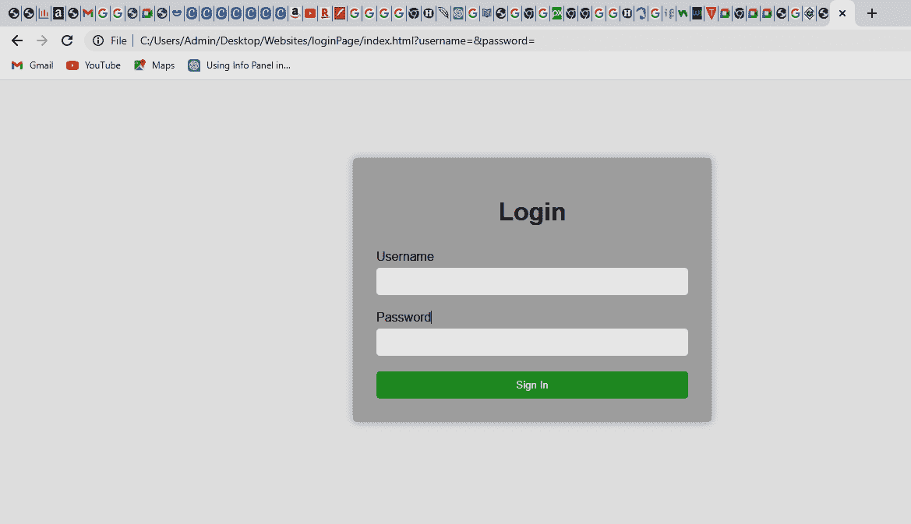

#### 练习 2：使用 HTML 和 CSS 构建一个简单的产品落地页

以下是一个简单产品落地页的 HTML 和 CSS 代码示例：

HTML 代码：

```html
<!DOCTYPE html>
<html lang="en">
<head>
<meta charset="UTF-8">
<meta http-equiv="X-UA-Compatible" content="IE=edge">
<meta name="viewport" content="width=device-width, initial-scale=1.0">
<title>Product Landing Page</title>
<link rel="stylesheet" href="style.css">
</head>
<body>
<header>
<nav>
<ul>
<li><a href="#">Home</a></li>
<li><a href="#">Features</a></li>
<li><a href="#">Pricing</a></li>
<li><a href="#">Contact</a></li>
</ul>
</nav>
<h1>Mouse</h1>
</header>
<main>
<section>
<h2>Features</h2>
<ul>
<li>Rechageable</li>
<li>8hrs Battery Life</li>
<li>Grey Color</li>
</ul>
</section>
<section>
<h2>Pricing</h2>
<p>Price: $20</p>
<button>Buy Now</button>
</section>
</main>
<footer>
<p>Copyright; 2023 Sammie Smith. All rights reserved.</p>
</footer>
</body>
</html>
```

CSS 代码：

```css
body {
font-family: Arial, sans-serif;
margin: 0;
padding: 0;
}

header {
background-color: #333;
color: white;
padding: 20px;
display: flex;
justify-content: space-between;
align-items: center;
}

nav ul {
list-style: none;
margin: 0;
padding: 0;
display: flex;
}

nav li {
margin-right: 20px;
}

nav li:last-child {
margin-right: 0;
}

nav a {
color: white;
text-decoration: none;
}

main {
padding: 20px;
max-width: 800px;
margin: 0 auto;
}

section {
margin-bottom: 40px;
}

h2 {
margin-top: 0;
}

ul {
list-style: none;
margin: 0;
padding: 0;
}

p {
margin: 0;
}

button {
background-color: #333;
color: white;
border: none;
padding: 10px 20px;
border-radius: 5px;
cursor: pointer;
font-size: 16px;
}

button:hover {
background-color: #666;
}

footer {
background-color: #ccc;
padding: 20px;
text-align: center;
}
```

这段代码创建了一个简单的落地页，包含导航栏、产品名称、功能部分、定价部分和页脚。你可以根据产品的需求自定义内容和样式。网页效果如下所示。

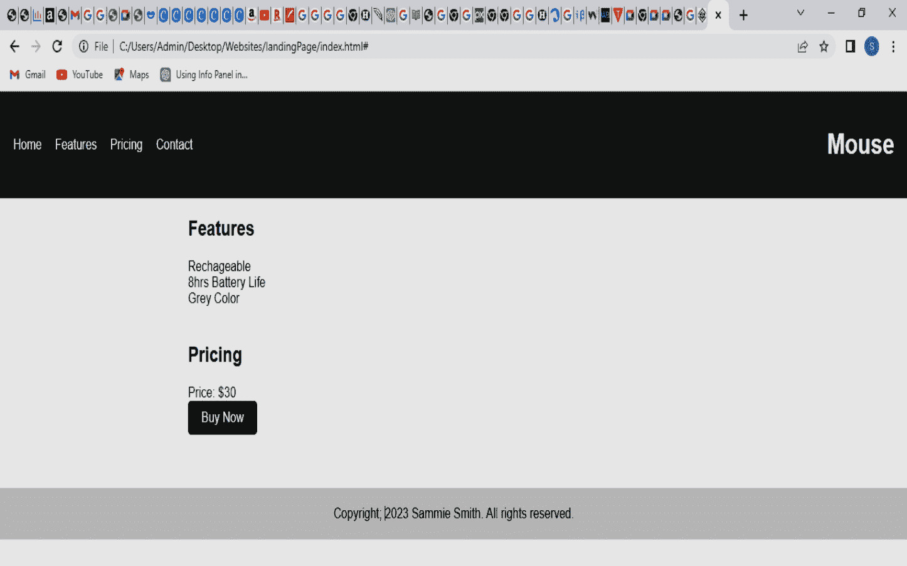

请注意，你可以修改上述练习以适应你的项目。

#### 练习 3：使用 HTML 和 CSS 创建一个响应式定价表

以下是一个使用 HTML 和 CSS 创建的响应式定价表示例：

HTML 代码：

```html
<!DOCTYPE html>
<html lang="en">
<head>
<meta charset="UTF-8">
<meta http-equiv="X-UA-Compatible" content="IE=edge">
<meta name="viewport" content="width=device-width, initial-scale=1.0">
<title>Pricing Table</title>
<link rel="stylesheet" type="text/css" href="style.css">
</head>
<body>
<div class="pricing-table">
<div class="plan">
<h2>Basic</h2>
<h3>$10/month</h3>
<ul>
<li>1 User</li>
<li>5GB Storage</li>
<li>Unlimited Projects</li>
<li>Free Support</li>
</ul>
<a href="#" class="button">Choose Plan</a>
</div>
<div class="plan popular">
<h2>Pro</h2>
<h3>$20/month</h3>
<ul>
<li>5 Users</li>
<li>20GB Storage</li>
<li>Unlimited Projects</li>
<li>Free Support</li>
</ul>
<a href="#" class="button">Choose Plan</a>
</div>
<div class="plan">
<h2>Advanced</h2>
<h3>$30/month</h3>
<ul>
<li>Unlimited Users</li>
<li>50GB Storage</li>
<li>Unlimited Projects</li>
<li>Free Support</li>
</ul>
<a href="#" class="button">Choose Plan</a>
</div>
</div>
</body>
</html>
```

## 第十章：响应式网页设计

响应式网页设计是一种专注于创建针对各种设备和屏幕尺寸进行优化的网站的网页设计方法。随着移动设备的日益普及，响应式网页设计已成为确保网站在所有设备上都能易于访问且用户友好的关键。

响应式网页设计通过使用 CSS 媒体查询，根据网站所显示的屏幕尺寸来调整布局和内容。这确保了无论使用何种设备访问网站，都能获得无缝的用户体验。

在本章中，我们将探讨响应式网页设计的原则，包括设计响应式网站的最佳实践以及用于创建响应式网站的工具和技术。我们还将介绍与响应式网页设计相关的一些常见挑战和解决方案，例如优化图像和管理复杂布局。

### 响应式设计简介

响应式设计是一种确保网站和应用程序在多种设备和屏幕尺寸上外观良好且运行良好的网页设计方法。随着使用移动设备上网的人数日益增多，响应式设计已成为现代网页开发的关键要素。

响应式设计通常结合使用多种技术，例如流式布局、弹性图像和媒体查询，以创建能够适应不同屏幕尺寸和分辨率的网站。响应式设计的目标是提供无缝且一致的用户体验，无论使用何种设备访问网站。这意味着页面上的元素会根据屏幕尺寸和方向重新定位、调整大小，甚至消失，而不会丧失任何功能或可读性。

响应式设计确保所有用户无论使用何种设备都能访问网站和应用程序，并帮助确保他们能够以最高效、最用户友好的方式导航和与内容互动。

### 设计响应式网站的最佳实践

以下是设计响应式网站的一些最佳实践：

- 移动优先方法：首先针对最小屏幕尺寸进行设计，然后逐步向更大屏幕尺寸过渡。这确保网站针对小屏幕进行优化并能更快加载。
- 使用响应式框架：像 Bootstrap 这样的响应式框架提供了网格系统，有助于快速创建响应式布局。这还能确保网站与不同屏幕尺寸兼容。
- 优化图像：大图像会减慢网站的加载时间，因此为网络使用优化图像非常重要。您可以使用像 TinyPNG 或 JPEGmini 这样的图像压缩工具来在不影响质量的情况下减小图像大小。
- 使用媒体查询：媒体查询允许您为不同的屏幕尺寸应用不同的样式。这有助于在不同设备上创建一致的用户体验。
- 在多种设备上进行测试：在不同设备上测试网站以确保其在所有设备上外观和功能正常非常重要。您可以使用像 BrowserStack 或 Google Chrome 的设备模式这样的工具来在不同设备上测试网站。
- 保持简洁：避免使用过多复杂的设计元素或可能减慢网站加载时间的动画。坚持简单干净的设计原则，在小屏幕上易于阅读和导航。
- 使用可缩放字体：使用在小屏幕上可缩放且易于阅读的字体。避免使用过小或在小屏幕上难以阅读的字体。

### 用于创建响应式网站的工具和技术

创建响应式网站有多种工具和技术。以下是一些最流行的：

- HTML 和 CSS：这些是任何网站的基本构建块，用于创建网站的结构和样式。
- CSS 框架：像 Bootstrap 和 Foundation 这样的框架提供了预构建的 CSS 样式和组件，使创建响应式网站更加容易。
- CSS 预处理器：像 Sass 和 Less 这样的预处理器通过提供变量、嵌套和混合等特性，使开发者能够更高效地编写 CSS。
- JavaScript：JavaScript 可用于为网站添加交互性和动态行为。它常用于响应式导航菜单和滑块等功能。
- 响应式设计工具：有许多工具可用于辅助响应式设计，例如媒体查询生成器、视口测试工具和响应式设计框架。
- 内容管理系统（CMS）：像 WordPress、Drupal 和 Joomla 这样的 CMS 平台内置了响应式设计功能和模板，可用于创建响应式网站。
- 移动应用开发平台：像 React Native 和 Flutter 这样的平台允许开发者创建针对不同设备和屏幕尺寸优化的移动应用。

### 理解媒体查询

媒体查询是一种 CSS 技术，用于根据查看网页的设备或屏幕尺寸来设置网页样式。通过媒体查询，您可以为不同的设备或屏幕尺寸（如台式机、笔记本电脑、平板电脑和移动设备）定义不同的样式。

媒体查询通过检查视口（即浏览器窗口中显示网页的区域）的宽度和高度来工作。您可以使用 CSS 中的`@media`规则为特定的视口尺寸或尺寸范围设置特定的样式。

例如，您可以为最大宽度为 768 像素的屏幕定义媒体查询，并为该尺寸范围设置不同的字体大小和布局。这使您能够在不同设备上创建更友好、更一致的用户体验。

媒体查询还可以根据设备的其他特性（如方向（横向或纵向）、分辨率或颜色深度）应用不同的样式。

#### 应用媒体查询

要在 CSS 中应用媒体查询，首先需要指定要应用样式的媒体类型。最常见的媒体类型是屏幕，用于有屏幕的设备，如台式电脑、笔记本电脑、平板电脑和智能手机。其他媒体类型包括打印（用于打印）和语音（用于屏幕阅读器）。要为特定的媒体类型应用样式，可以使用`@media`规则，后跟括号中的媒体类型，如下所示：

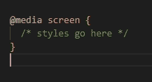

在媒体查询块内，您可以编写仅在指定媒体类型使用时才应用的样式。例如，您可以为台式机和移动设备设置不同的字体大小、颜色或布局属性。您还可以使用媒体查询根据设备屏幕的宽度或高度指定不同的样式。例如，您可以编写仅在屏幕宽度小于或等于 768 像素时才应用的样式：

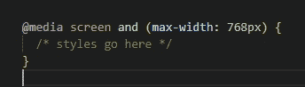

### 代码示例

#### HTML 示例

```html
<li>Free Support</li>
</ul>
<a href="#" class="button">Choose Plan</a>
</div>
</div>
</body>
</html>
```

#### CSS 代码


```css
.pricing-table {
    display: flex;
    justify-content: space-around;
    flex-wrap: wrap;
}
.plan {
    text-align: center;
    margin: 20px;
    padding: 20px;
    border: 1px solid #ccc;
    width: 30%;
    max-width: 300px;
    transition: all 0.3s ease-in-out;
}
.plan:hover {
    transform: scale(1.1);
    box-shadow: 0 5px 10px rgba(0,0,0,0.3);
}
.popular {
    background-color: #f9f9f9;
}
h2, h3 {
    margin: 0;
}
ul {
    list-style: none;
    padding: 0;
}
li {
    padding: 10px 0;
}
.button {
    display: inline-block;
    padding: 10px 20px;
    margin-top: 20px;
    background-color: #333;
    color: #fff;
    text-decoration: none;
    border-radius: 4px;
}
```

网页效果如下图所示。

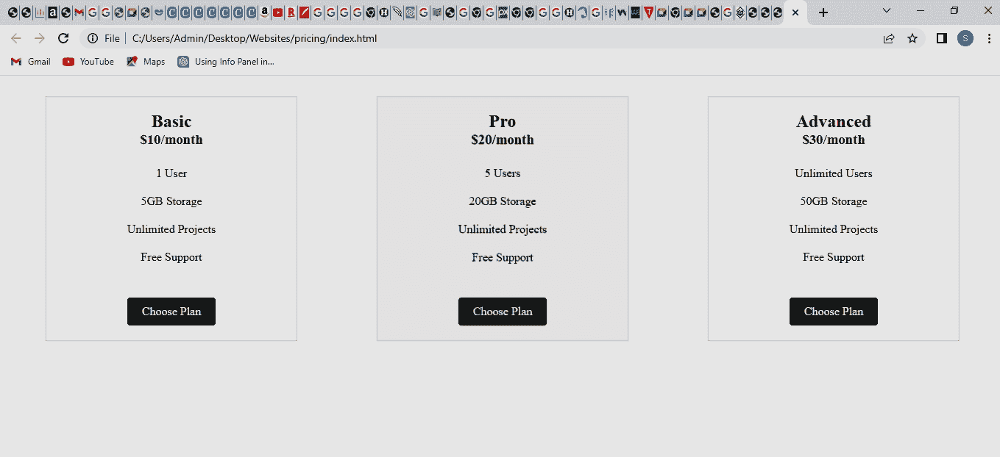

# 响应式网页设计

## 媒体查询

当屏幕宽度为 768 像素或更小时，将应用媒体查询块内的样式。你也可以使用`min-width`属性来指定样式生效的最小屏幕宽度。

通过使用媒体查询，你可以创建适应不同屏幕尺寸和设备的响应式设计，使你的网站更加用户友好和易于访问。

## 理解移动优先设计方法

移动优先设计是一种设计方法，即首先为移动设备设计网站或应用程序，然后将其放大以适应更大的屏幕，如台式机或笔记本电脑。这种方法假设更多人通过移动设备而非台式机访问网站，旨在为移动用户创造最佳体验。在进行移动优先设计时，重点在于创建精简、高效的用户体验，优先考虑最重要的内容和任务。这通常涉及使用极简设计、简化导航，以及使用大号、易读的字体和按钮。

一旦移动端设计完成，就可以将设计放大以适应更大的屏幕。这涉及使用媒体查询，根据所用设备的屏幕尺寸调整网站的布局和样式。随着移动设备成为人们访问互联网的主要方式，移动优先设计变得越来越重要。通过以移动端为出发点进行设计，开发者可以确保其网站对大多数受众来说都是可访问和可用的。

### 应用移动优先设计

要使用 CSS 实现移动优先设计，请遵循以下步骤：

*   从移动优先的 CSS 文件开始，该文件首先包含针对最小屏幕尺寸的样式，然后根据需要逐步添加针对更大屏幕尺寸的样式。例如：

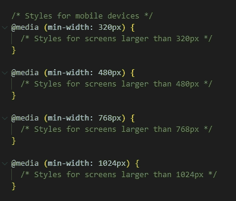

*   使用响应式单位，如`em`和`%`，而不是固定单位如`px`，以确保元素在不同屏幕尺寸下能正确缩放。

*   使用响应式框架，如 Bootstrap 或 Foundation，它们提供了预构建的 CSS 类和组件，用于创建响应式布局。

*   使用 CSS 媒体查询来针对特定屏幕尺寸，并根据需要应用自定义样式。

*   在各种设备和屏幕尺寸上测试你的设计，以确保它在所有平台上都能良好显示并正常运行。

研究下面的代码，了解如何实现移动优先设计。

HTML 代码：

```html
<!DOCTYPE html>
<html>
<head>
<meta charset='utf-8'>
<meta http-equiv='X-UA-Compatible' content='IE=edge'>
<title>Example Page</title>
<meta name='viewport' content='width=device-width, initial-scale=1'>
<link rel='stylesheet' type='text/css' media='screen' href='main.css'>
<script src='main.js'></script>
</head>
<body>
<header>
<h1>My Website</h1>
<nav>
<ul>
<li><a href="#">Home</a></li>
<li><a href="#">About</a></li>
<li><a href="#">Contact</a></li>
</ul>
</nav>
</header>
<main>
<section>
<h2>About Me</h2>
<p>Hi, my name is John Doe and I am a web developer.</p>
</section>
<section>
<h2>Recent Work</h2>
<div class="work">
<a href="#"></a>
<a href="#"></a>
<a href="#"></a>
</div>
</section>
</main>
<footer>
<p> Copyrights @ 2023 My Website. All Rights Reserved.</p>
</footer>
</body>
</html>
```

之后，创建一个 CSS 外部文件并将其链接到你的 HTML 文件，并包含以下代码。确保使用适合你正在进行的项目的信息。

CSS 代码：

```css
* {
    box-sizing: border-box;
}

body {
    font-family: Arial, sans-serif;
    font-size: 16px;
    margin: 0;
    padding: 0;
}

header {
    background-color: #333;
    color: #fff;
    padding: 10px;
}

nav ul {
    list-style: none;
    margin: 0;
    padding: 0;
    display: flex;
    flex-wrap: wrap;
}

nav li {
    margin: 0 10px;
}

nav a {
    color: #fff;
    text-decoration: none;
}

main {
    padding: 20px;
}

section {
    margin-bottom: 20px;
}

section h2 {
    font-size: 24px;
    margin-bottom: 10px;
}

section p {
    font-size: 16px;
    line-height: 1.5;
}

.work {
    display: flex;
    flex-wrap: wrap;
}

.work a {
    flex: 1 1 300px;
    margin: 10px;
}

@media screen and (min-width: 768px) {
    header {
        display: flex;
        justify-content: space-between;
        align-items: center;
    }

    nav {
        flex: 1;
    }

    main {
        display: flex;
        flex-wrap: wrap;
    }

    section {
        flex: 1;
        margin: 0 10px;
    }

    .work a {
        margin: 10px 0;
    }
}
```

这段代码包含一个简单的页眉、导航、包含两个部分的主内容以及一个页脚。CSS 包含了针对屏幕宽度小于 768 像素的移动设备的样式，以及通过媒体查询针对更大屏幕尺寸的样式。当屏幕宽度至少为 768 像素时，页眉和主内容将使用 flexbox 布局显示。结果如下所示。

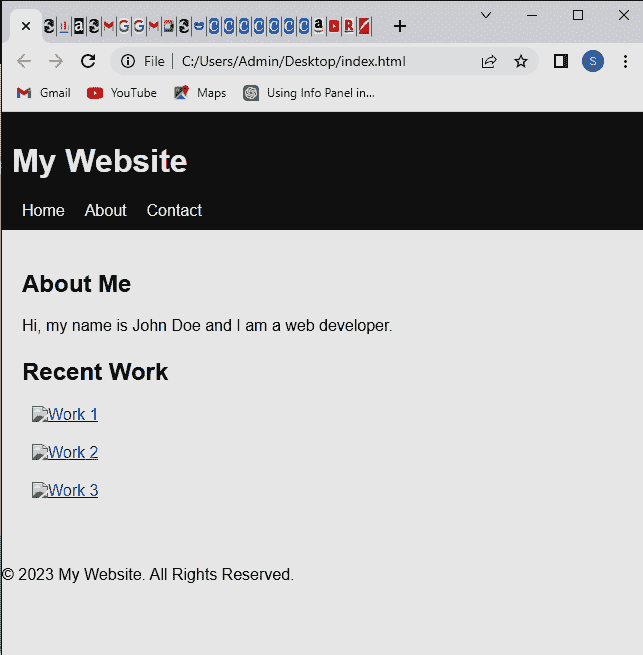

请注意，你可以随时修改本指南中的代码以符合你的喜好。

## 响应式框架

响应式框架是预先构建的 CSS 和 JavaScript 文件集合，为创建响应式网页设计提供了基础。它们通常包含一个网格系统、常见 HTML 元素的预定义样式，以及预构建的组件，如导航菜单、按钮和表单。

使用响应式框架可以大大简化构建响应式网站的过程，因为它无需为每个设计元素编写自定义 CSS。相反，开发者可以使用框架的预构建类和组件来快速创建响应式布局和设计。一些流行的响应式框架包括 Bootstrap、Foundation 和 Bulma。这些框架被广泛使用且文档完善，是初学者和经验丰富的开发者的绝佳选择。

请注意，要制作一个功能强大的完全交互式网站，你需要将所有框架整合在一起，但本书仅限于 HTML 和 CSS。

## 响应式网页设计的常见挑战及解决方案

响应式网页设计可能会带来一些挑战，需要加以解决，以便在所有设备上提供无缝体验。与响应式网页设计相关的一些常见挑战及解决方案包括：

*   **设备兼容性**：如今设备种类繁多，确保你的网站在所有设备上都能良好显示可能是一个挑战。解决方案是使用适应不同屏幕尺寸的响应式设计技术，例如弹性网格、响应式图片和媒体查询。

*   **内容优先级**：在为较小屏幕设计时，优先考虑内容非常重要，以便最重要的信息首先显示。一种解决方案是采用移动优先方法，即先为最小屏幕尺寸设计，然后随着屏幕尺寸增大再添加更多内容和功能。

*   **导航**：导航菜单在小屏幕上可能很棘手，因为它们会占用宝贵的屏幕空间。一种解决方案是使用汉堡菜单，即菜单隐藏在一个小图标后面，直到用户点击它才显示。

*   **性能**：大图片和复杂布局可能会降低网站的性能，尤其是在网络连接较慢的移动设备上。一种解决方案是优化图片，并使用懒加载等技术来提高页面加载速度。

*   **测试**：在不同设备和屏幕尺寸上测试你的网站可能既耗时又困难。一种解决方案是使用响应式设计测试工具，例如 BrowserStack、Responsinator 或 Am I Responsive，这些工具允许你在不同设备和屏幕尺寸上预览你的网站。

## 优化图片和管理复杂布局

# 第十一章

## 响应式网站实战练习

在构建响应式网站的过程中，优化图像和管理复杂布局是两个需要重点关注的关键领域。优化图像包括减小图像文件大小以提高网站性能和加载速度。这可以通过压缩图像、将图像调整为适当尺寸以及使用适当的图像文件格式等技术来实现。还有多种工具可用于帮助优化图像，例如 Photoshop 和 TinyPNG 等在线工具。

管理复杂布局涉及创建能够在各种屏幕尺寸和设备上工作的布局。这可以通过使用 CSS 网格系统和框架来实现，它们提供预定义的网格和响应式设计模式，可以轻松适应不同的屏幕尺寸。此外，采用移动优先的设计方法有助于确保最重要的内容在较小的屏幕上优先显示，随着屏幕尺寸的增大，再添加额外的内容和布局元素。

响应式网页设计的其他常见挑战包括排版、导航和性能优化问题。然而，通过仔细规划和注意细节，这些挑战是可以克服的，从而打造一个设计精良且功能完善的响应式网站。

在本章中，我们将重点介绍实际练习，帮助您从零开始创建一个响应式网站。您将学习如何使用 HTML 和 CSS 构建一个在台式电脑、平板电脑和智能手机上看起来都很棒的网站。我们将涵盖各种主题，例如布局设计、媒体查询和响应式图像。到本章结束时，您将能够创建一个在任何设备上看起来都很棒的网站，从而覆盖更广泛的受众。

### 练习 1：设计一个响应式餐厅网站

设计一个响应式餐厅网站，包括首页、菜单页、预订页和联系页。使用响应式设计技术，确保网站在所有设备上看起来都很棒，并为客户提供友好的用户体验，使用 HTML 和 CSS。

以下是一个如何创建餐厅网站的示例。

HTML 代码：


## 练习 1：创建一个响应式餐厅首页

### HTML 代码

```html
<!DOCTYPE html>
<html lang="en">
<head>
    <meta charset="UTF-8">
    <meta http-equiv="X-UA-Compatible" content="IE=edge">
    <meta name="viewport" content="width=device-width, initial-scale=1.0">
    <title>Restaurant Homepage</title>
    <link rel="stylesheet" href="style.css">
</head>
<body>
    <header>
        <nav>
            <ul>
                <li><a href="#">Home</a></li>
                <li><a href="#">Menu</a></li>
                <li><a href="#">Reservation</a></li>
                <li><a href="#">Contact</a></li>
            </ul>
        </nav>
    </header>
    <main>
        <section class="hero">
            <h1>Welcome to Our Restaurant</h1>
            <p>Enjoy delicious food and great ambiance</p>
            <a href="#">See Menu</a>
        </section>
        <section class="menu">
            <h2>Our Menu</h2>
            <ul>
                <li>
                    
                    <h3>Pizza</h3>
                    <p>Delicious pizza with fresh toppings</p>
                    <span>$10</span>
                </li>
                <li>
                    
                    <h3>Burger</h3>
                    <p>Classic burger with all the fixings</p>
                    <span>$8</span>
                </li>
                <li>
                    
                    <h3>Pasta</h3>
                    <p>Freshly made pasta with delicious sauce</p>
                    <span>$12</span>
                </li>
            </ul>
        </section>
        <section class="reservation">
            <h2>Make a Reservation</h2>
            <form>
                <label for="name">Name:</label>
                <input type="text" id="name" name="name">
                <label for="email">Email:</label>
                <input type="email" id="email" name="email">
                <label for="date">Date:</label>
                <input type="date" id="date" name="date">
                <label for="time">Time:</label>
                <input type="time" id="time" name="time">
                <label for="guests">Number of Guests:</label>
                <input type="number" id="guests" name="guests">
                <button type="submit">Submit</button>
            </form>
        </section>
        <section class="contact">
            <h2>Contact Us</h2>
            <form>
                <label for="name">Name:</label>
                <input type="text" id="name" name="name">
                <label for="email">Email:</label>
                <input type="email" id="email" name="email">
                <label for="message">Message:</label>
                <textarea id="message" name="message"></textarea>
                <button type="submit">Submit</button>
            </form>
        </section>
    </main>
    <footer>
        <p>&copy; 2023 Yummies Restaurant</p>
    </footer>
</body>
</html>
```

### CSS 代码

```css
/* Global styles */
* {
    box-sizing: border-box;
    margin: 0;
    padding: 0;
}

body {
    font-family: Arial, sans-serif;
}

header {
    background-color: #333;
    color: #fff;
    padding: 10px;
}

nav ul {
    list-style: none;
    margin: 0;
    padding: 0;
}

nav li {
    display: inline-block;
    margin-right: 20px;
}

nav a {
    color: #fff;
    text-decoration: none;
}

main {
    padding: 20px;
}

section {
    margin-bottom: 40px;
}

h1 {
    font-size: 48px;
    margin-bottom: 20px;
}

h2 {
    font-size: 36px;
    margin-bottom: 10px;
}

ul {
    list-style: none;
    margin: 0;
    padding: 0;
}

li {
    display: flex;
    margin-bottom: 20px;
}

img {
    margin-right: 20px;
}

span {
    margin-left: auto;
    font-weight: bold;
}

form {
    display: flex;
    flex-direction: column;
}

label {
    margin-bottom: 10px;
}

input,
textarea,
button {
    padding: 10px;
    margin-bottom: 20px;
    border: 1px solid #ccc;
    border-radius: 5px;
}

input:focus,
textarea:focus {
    outline: none;
    border-color: #333;
}

button {
    background-color: #333;
    color: #fff;
    border: none;
    cursor: pointer;
}

button:hover {
    background-color: #555;
}

footer {
    background-color: #333;
    color: #fff;
    text-align: center;
    padding: 10px;
}

/* Media queries */
@media (min-width: 768px) {
    /* Header */
    nav li {
        margin-right: 40px;
    }

    /* Sections */
    section {
        display: flex;
        flex-wrap: wrap;
    }

    .hero {
        flex-basis: 50%;
        padding-right: 40px;
    }

    .menu,
    .reservation,
    .contact {
        flex-basis: 27%;
        padding-left: 22px;
        padding-right: 22px;
    }

    /* Form fields */
    label,
    input,
    textarea,
    button {
        width: 100%;
    }

    /* Form buttons */
    button {
        width: 50%;
        margin-left: auto;
        margin-right: auto;
    }
}
```

### 效果展示

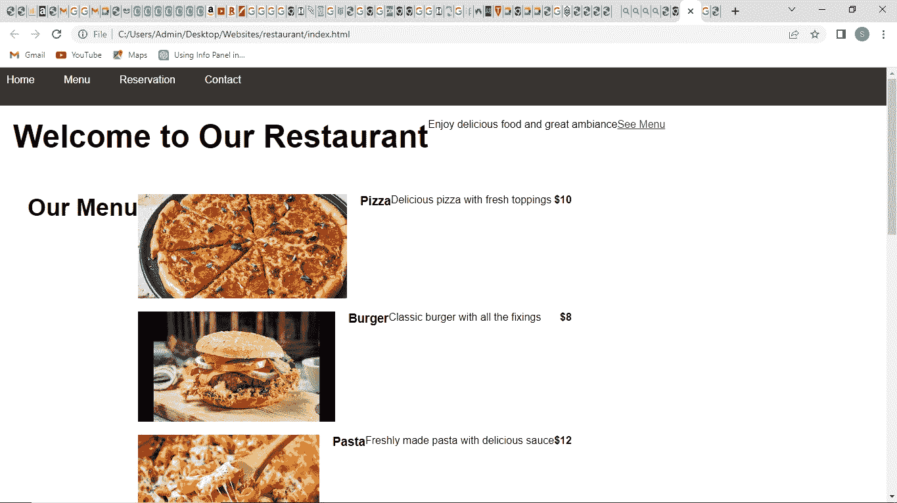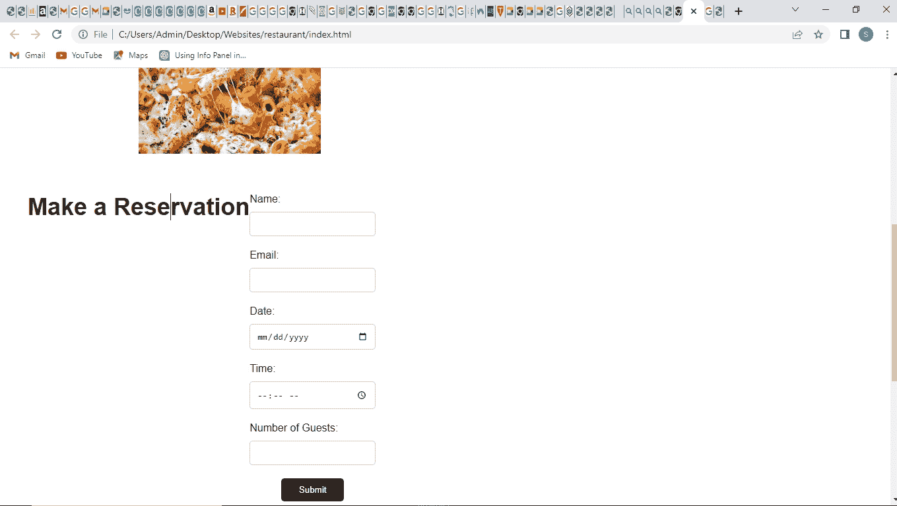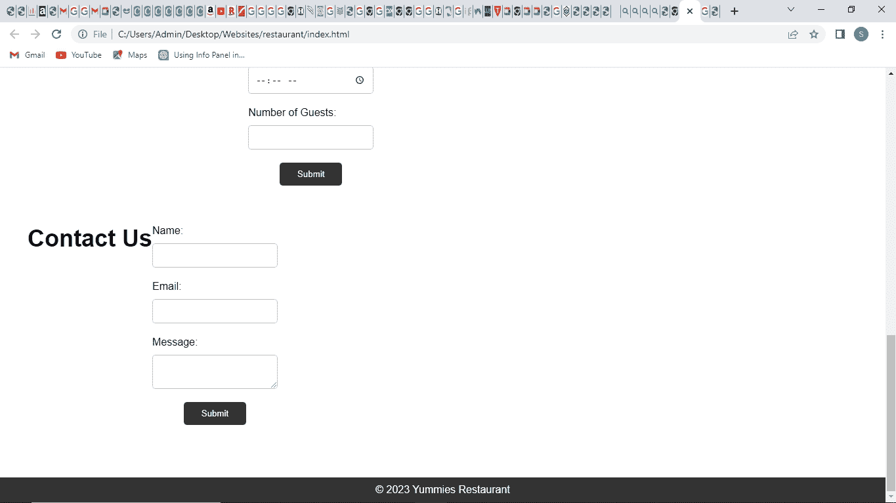

## 练习 2：创建一个响应式摄影师作品集

为摄影师、艺术家或设计师创建一个响应式在线作品集。以视觉上吸引人的方式展示他们的作品，使用响应式设计技术确保网站在所有设备上看起来都很棒，使用 HTML 和 CSS。

以下是一个示例，展示如何使用 HTML 和 CSS 创建一个响应式摄影师在线作品集：

### HTML 代码

```html
<!DOCTYPE html>
<html lang="en">
<head>
    <meta charset="UTF-8">
    <meta http-equiv="X-UA-Compatible" content="IE=edge">
    <meta name="viewport" content="width=device-width, initial-scale=1.0">
    <title>Photographer Portfolio</title>
    <link rel="stylesheet" href="style.css">
</head>
<body>
    <header>
        <nav>
            <ul>
                <li><a href="#">Home</a></li>
                <li><a href="#">Portfolio</a></li>
                <li><a href="#">About</a></li>
                <li><a href="#">Contact</a></li>
            </ul>
        </nav>
    </header>
    <main>
        <section class="hero">
            <h1>Welcome to My Portfolio</h1>
            <p>Check out my latest work</p>
        </section>
        <section class="portfolio">
            <h2>My Portfolio</h2>
            <ul>
                <li>
                    
                    <h3>Photograph 1</h3>
                </li>
                <li>
                    
                    <h3>Photograph 2</h3>
                </li>
                <li>
                    
                    <h3>Photograph 3</h3>
                </li>
                <li>
                    
                    <h3>Photograph 4</h3>
                </li>
            </ul>
        </section>
        <section class="about">
            <h2>About Me</h2>
            <p>Hi, I'm a photographer based in New York City. I specialize in landscape and portrait photography. My goal is to capture the beauty of the world and tell stories through my photographs.</p>
        </section>
        <section class="contact">
            <h2>Contact Me</h2>
            <form>
                <label for="name">Name:</label>
                <input type="text" id="name" name="name">
                <label for="email">Email:</label>
                <input type="email" id="email" name="email">
                <label for="message">Message:</label>
                <textarea id="message" name="message"></textarea>
                <button type="submit">Submit</button>
            </form>
        </section>
    </main>
    <footer>
        <p>&copy; 2023 Photographer Portfolio</p>
    </footer>
</body>
</html>
```

## 示例网站代码

### HTML 代码

```html
<button type="submit">提交</button>

</form>

</section>

</main>

<footer>

<p>&copy; 2023 Sammie Smith</p>

</footer>

</body>

</html>
```

### CSS 代码


```css
/* 全局样式 */

* {
  box-sizing: border-box;
  margin: 0;
  padding: 0;
}

body {
  font-family: Arial, sans-serif;
  font-size: 16px;
  line-height: 1.5;
  color: #130101;
}

a {
  text-decoration: none;
  color: #4b0b0b;
}

ul {
  list-style: none;
}

img {
  max-width: 100%;
  height: auto;
}

/* 头部样式 */

header {
  background-color: #7c7a7a;
  border-bottom: 1px solid #696262;
}

nav ul {
  display: flex;
  justify-content: space-between;
  align-items: center;
  margin: 0;
  padding: 1rem;
}

nav li {
  margin: 0 1rem;
}

nav a {
  font-weight: bold;
  letter-spacing: 1px;
  text-transform: uppercase;
}

/* Hero 区域样式 */

.hero {
  background-image: url(https://via.placeholder.com/1200x600);
  background-size: cover;
  background-position: center;
  height: 60vh;
  display: flex;
  flex-direction: column;
  justify-content: center;
  align-items: center;
  text-align: center;
}

.hero h1 {
  font-size: 3rem;
  margin-bottom: 1rem;
  color: #791818;
  text-shadow: 2px 2px #333;
}

.hero p {
  font-size: 1.5rem;
  color: #442222;
  text-shadow: 2px 2px #418d58;
}

/* 作品集区域样式 */

.portfolio {
  padding: 2rem;
}

.portfolio h2 {
  font-size: 2rem;
  margin-bottom: 1rem;
}

.portfolio li {
  margin-bottom: 2rem;
}

.portfolio h3 {
  font-size: 1.5rem;
  margin-top: 1rem;
}

/* 关于我们区域样式 */

.about {
  padding: 2rem;
}

.about h2 {
  font-size: 2rem;
  margin-bottom: 1rem;
}

/* 联系我们区域样式 */

.contact {
  padding: 2rem;
}

.contact h2 {
  font-size: 2rem;
  margin-bottom: 1rem;
}

label {
  display: block;
  margin-bottom: 0.5rem;
}

input,
textarea {
  display: block;
  width: 100%;
  padding: 0.5rem;
  margin-bottom: 1rem;
  border: 1px solid #ccc;
  border-radius: 4px;
}

button[type="submit"] {
  background-color: #333;
  color: #fff;
  border: none;
  padding: 0.5rem 1rem;
  border-radius: 4px;
  cursor: pointer;
  font-size: 1rem;
  text-transform: uppercase;
}

button[type="submit"]:hover {
  background-color: #444;
}

/* 页脚样式 */

footer {
  background-color: #333;
  color: #fff;
  text-align: center;
  padding: 1rem;
}
```

查看下方的网页结果。

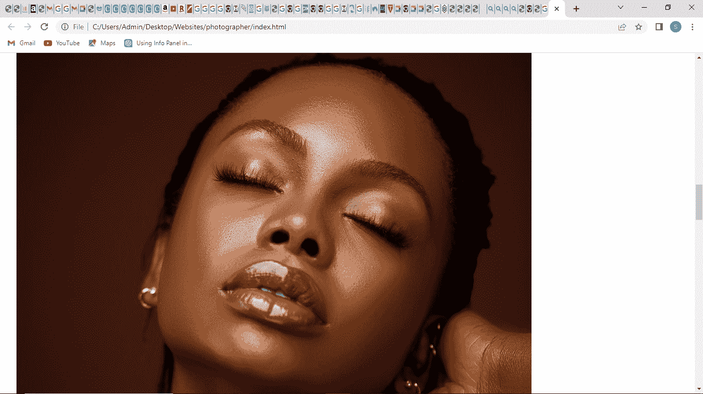

### 练习 3：开发响应式电子商务网站

开发一个包含首页、产品列表页和产品详情页的响应式电子商务网站。使用响应式设计技术确保网站在所有设备上都能良好显示，并使用 HTML 和 CSS 提供无缝的购物体验。

以下是一个响应式电子商务网站的示例。

### HTML 代码

```html
<!DOCTYPE html>
<html lang="en">
<head>
<meta charset="UTF-8">
<meta http-equiv="X-UA-Compatible" content="IE=edge">
<meta name="viewport" content="width=device-width, initial-scale=1.0">
<title>响应式电子商务网站</title>
<link rel="stylesheet" href="style.css">
</head>
<body>
<header>
<nav>
<ul>
<li><a href="#">首页</a></li>
<li><a href="#">商店</a></li>
<li><a href="#">联系我们</a></li>
<li><a href="#">购物车</a></li>
</ul>
</nav>
</header>
<main>
<section class="hero">
<h1>欢迎来到我们的电子商务网站</h1>
<p>立即购买最新产品</p>
</section>
<section class="featured">
<h2>特色产品</h2>
<ul>
<li><a href="#"><h3>产品 1</h3><p>$20.00</p></a></li>
<li><a href="#"><h3>产品 2</h3><p>$25.00</p></a></li>
<li><a href="#"><h3>产品 3</h3><p>$30.00</p></a></li>
</ul>
</section>
</main>
<footer>
<p>&copy; 2023 Sammie Smith</p>
</footer>
</body>
</html>
```

### CSS 代码

```css
/* 全局样式 */

* {
  box-sizing: border-box;
  margin: 0;
  padding: 0;
}

body {
  font-family: Arial, sans-serif;
  font-size: 16px;
  line-height: 1.5;
  color: #130101;
}

a {
  text-decoration: none;
  color: #4b0b0b;
}

ul {
  list-style: none;
}

img {
  max-width: 100%;
  height: auto;
}

/* 头部样式 */

header {
  background-color: #7c7a7a;
  border-bottom: 1px solid #696262;
}

nav ul {
  display: flex;
  justify-content: space-between;
  align-items: center;
  margin: 0;
  padding: 1rem;
}

nav li {
  margin: 0 1rem;
}

nav a {
  font-weight: bold;
  letter-spacing: 1px;
  text-transform: uppercase;
}

/* Hero 区域样式 */

.hero {
  background-image: url(https://via.placeholder.com/1200x600);
  background-size: cover;
  background-position: center;
  height: 60vh;
  display: flex;
  flex-direction: column;
  justify-content: center;
  align-items: center;
  text-align: center;
}

.hero h1 {
  font-size: 3rem;
  margin-bottom: 1rem;
  color: #791818;
  text-shadow: 2px 2px #333;
}

.hero p {
  font-size: 1.5rem;
  color: #442222;
  text-shadow: 2px 2px #418d58;
}

/* 作品集区域样式 */

.portfolio {
  padding: 2rem;
}

.portfolio h2 {
  font-size: 2rem;
  margin-bottom: 1rem;
}

.portfolio li {
  margin-bottom: 2rem;
}

.portfolio h3 {
  font-size: 1.5rem;
  margin-top: 1rem;
}

/* 关于我们区域样式 */

.about {
  padding: 2rem;
}

.about h2 {
  font-size: 2rem;
  margin-bottom: 1rem;
}

/* 联系我们区域样式 */

.contact {
  padding: 2rem;
}

.contact h2 {
  font-size: 2rem;
  margin-bottom: 1rem;
}

label {
  display: block;
  margin-bottom: 0.5rem;
}

input,
textarea {
  display: block;
  width: 100%;
  padding: 0.5rem;
  margin-bottom: 1rem;
  border: 1px solid #ccc;
  border-radius: 4px;
}

button[type="submit"] {
  background-color: #333;
  color: #fff;
  border: none;
  padding: 0.5rem 1rem;
  border-radius: 4px;
  cursor: pointer;
  font-size: 1rem;
  text-transform: uppercase;
}

button[type="submit"]:hover {
  background-color: #444;
}

/* 页脚样式 */

footer {
  background-color: #333;
  color: #fff;
  text-align: center;
  padding: 1rem;
}
```

一个响应式电子商务网站。

```css
/* 全局样式 */

* {
  box-sizing: border-box;
  margin: 0;
  padding: 0;
}

body {
  font-family: Arial, sans-serif;
  font-size: 16px;
  line-height: 1.5;
  color: #130101;
}

a {
  text-decoration: none;
  color: #4b0b0b;
}

ul {
  list-style: none;
}

img {
  max-width: 100%;
  height: auto;
}

/* 头部样式 */

header {
  background-color: #7c7a7a;
  border-bottom: 1px solid #696262;
}

nav ul {
  display: flex;
  justify-content: space-between;
  align-items: center;
  margin: 0;
  padding: 1rem;
}

nav li {
  margin: 0 1rem;
}

nav a {
  font-weight: bold;
  letter-spacing: 1px;
  text-transform: uppercase;
}

/* Hero 区域样式 */

.hero {
  background-image: url(https://via.placeholder.com/1200x600);
  background-size: cover;
  background-position: center;
  height: 60vh;
  display: flex;
  flex-direction: column;
  justify-content: center;
  align-items: center;
  text-align: center;
}

.hero h1 {
  font-size: 3rem;
  margin-bottom: 1rem;
  color: #791818;
  text-shadow: 2px 2px #333;
}

.hero p {
  font-size: 1.5rem;
  color: #442222;
  text-shadow: 2px 2px #418d58;
}

/* 作品集区域样式 */

.portfolio {
  padding: 2rem;
}

.portfolio h2 {
  font-size: 2rem;
  margin-bottom: 1rem;
}

.portfolio li {
  margin-bottom: 2rem;
}

.portfolio h3 {
  font-size: 1.5rem;
  margin-top: 1rem;
}

/* 关于我们区域样式 */

.about {
  padding: 2rem;
}

.about h2 {
  font-size: 2rem;
  margin-bottom: 1rem;
}

/* 联系我们区域样式 */

.contact {
  padding: 2rem;
}

.contact h2 {
  font-size: 2rem;
  margin-bottom: 1rem;
}

label {
  display: block;
  margin-bottom: 0.5rem;
}

input,
textarea {
  display: block;
  width: 100%;
  padding: 0.5rem;
  margin-bottom: 1rem;
  border: 1px solid #ccc;
  border-radius: 4px;
}

button[type="submit"] {
  background-color: #333;
  color: #fff;
  border: none;
  padding: 0.5rem 1rem;
  border-radius: 4px;
  cursor: pointer;
  font-size: 1rem;
  text-transform: uppercase;
}

button[type="submit"]:hover {
  background-color: #444;
}

/* 页脚样式 */

footer {
  background-color: #333;
  color: #fff;
  text-align: center;
  padding: 1rem;
}
```

# 第十二章：开始学习 JavaScript

## 什么是 JavaScript

JavaScript 是一种高级的、解释执行的编程语言，广泛用于客户端 Web 开发。它最初由 Brendan Eich 在 1995 年在 Netscape 开发，旨在为网页添加动态和交互式功能。

在设计网页、应用程序、服务器甚至游戏时，Web 开发人员经常使用这种轻量级编程语言 JavaScript 来生成更动态的交互。JavaScript 通常与 HTML 和 CSS 一起使用。对于格式化组件，脚本语言和 CSS 配合得很好。用户交互仍然通过 JavaScript 维持，但 CSS 无法独立做到这一点。

# JavaScript


JavaScript 脚本语言用于创建网站、移动端应用程序和视频游戏。你可以通过在 GitHub 等代码托管平台上探索免费的 JavaScript 模板和应用程序，或者使用 BitDegree 等学习平台来实现这一目标。JavaScript 是一种多功能的语言，可用于多种用途，包括构建 Web 应用程序、创建浏览器扩展和开发移动应用。它也被用于服务端，像 `Node.js` 这样的平台允许开发者构建全栈 JavaScript 应用程序。所有现代网络浏览器都支持 JavaScript，使其成为 Web 开发者不可或缺的工具。它用于为网页添加交互性，包括表单验证、弹出窗口和动画。它还可以用于从 Web 服务器检索并显示数据，允许网页在无需刷新的情况下进行动态更新。JavaScript 是一种面向对象的语言，这意味着它允许开发者定义并创建带有属性方法的对象。它还支持函数式编程，允许开发者以更模块化和可重用的方式编写代码。JavaScript 是一种多功能且强大的编程语言，对于 Web 开发至关重要。它允许开发者创建动态交互的网页，并已成为构建现代 Web 应用程序不可或缺的工具。

## JavaScript 的历史

Brendan Eich 在 1995 年于 Netscape Communications 工作期间发明了 JavaScript。为了与该公司主要的网页浏览器 Netscape Navigator 配合，Netscape 和 Eich 创建了 JavaScript 作为一种脚本语言。LiveScript 是该语言的原始名称，Netscape 将其更改为 JavaScript，以便将其作为合作伙伴 Sun Microsystems 创建的 Java 语言的补充。然而，JavaScript 和 Java 编程语言之间除了某些表层语法上的相似之处外，它们并没有关系。

JavaScript 一经发布，越来越多的浏览器开始支持它。尽管如此，在很长的一段历史中，JavaScript 并不被视为一种严谨的编程语言。尽管它的早期版本存在显著的速度和安全问题，但开发者并没有其他选择。他们需要使用 JavaScript 来在浏览器中运行程序。

JavaScript 的一个转折点出现在 2008 年，Google 发布了高性能的开源 Chrome V8 JavaScript 引擎。随后涌现的快速 JavaScript 引擎让程序员能够创建性能与桌面和移动应用相当的复杂浏览器应用程序。

不久后，Ryan Dahl 发布了 `Node.js` 开源跨平台环境。它提供了一种从浏览器外部执行 JavaScript 代码的方法。它通过将 JavaScript 从浏览器的限制中释放出来，促进了其如今的显赫地位。今天，JavaScript 可用于创建各种应用，包括桌面端、移动端、服务器和浏览器应用。如今大多数最大的互联网公司，如 Facebook、Twitter、Netflix 和 Google，都在其产品中使用了 JavaScript。

## JavaScript 的特性

JavaScript 拥有广泛的特性，使其成为一种流行且强大的编程语言。其关键特性包括：

* 客户端脚本：JavaScript 主要用作客户端脚本语言，这意味着它运行在用户的 Web 浏览器上，并允许动态和交互的网页内容。
* 跨平台兼容性：JavaScript 受所有主流网络浏览器以及移动设备和桌面应用程序的支持，使其成为一种易于获取的语言。
* 面向对象编程：JavaScript 是一种面向对象的语言，允许开发者定义并创建带有属性方法的对象。
* 函数式编程：JavaScript 支持函数式编程，允许开发者以更模块化和可重用的方式编写代码。
* 异步编程：JavaScript 支持异步编程，允许非阻塞代码执行，并在某些场景下提高性能。
* 事件驱动编程：JavaScript 是事件驱动的，这意味着它可以响应网页上的用户操作或其他事件。
* 动态类型：JavaScript 是一种动态类型语言，这意味着变量类型在运行时确定，而不是显式定义。
* 易于与 HTML 和 CSS 集成：JavaScript 可以轻松与 HTML 和 CSS 集成，以创建动态交互的网页。
* 广泛的库和框架：JavaScript 拥有庞大且不断发展的库和框架生态系统，使得构建复杂的应用程序和网站变得简单。
* 基于解释器：与编译语言相比，JavaScript 是一种解释语言。在这一点上它与 Python 和 Ruby 相似。JavaScript 的源代码由浏览器逐行解释并执行。相反，编译语言需要被翻译成可执行的字节码。编译语言的示例有 Java 和 C++。
* 大小写敏感：JavaScript 对大小写非常敏感。关键字、变量、函数名和其他标识符中的每个单词必须保持大小写一致。由于大小写区分，`hitCounter` 和 `hitcounter` 是不同的变量。此外，包括 `var` 在内的所有关键字都是大小写敏感的。
* 控制语句：JavaScript 提供了 `if-else-if`、`switch-case` 以及 `for`、`while` 和 `do-while` 循环等控制语句。其用户可以使用这种编程语言强大的控制语句创建复杂的逻辑。
* 客户端验证：JavaScript 被广泛用于简化用户与 Web 应用程序之间的交互。为此，验证发挥着重要作用。验证可以引导用户使用有效数据正确填写表单，并防止垃圾提交。
* 基于原型：JavaScript 采用原型继承模型而不是更为人知的类继承，因为它是一种基于原型的脚本语言。因此，我们定义对象的原型，并利用此对象原型来构建相同类型的其他对象，而不是定义类并从中派生对象。鉴于这种行为类似于对象工厂函数，这种设计模式在 JavaScript 应用程序中经常使用。
* 对象简写：遵循 ES6/ES2015 语法，你可以使用简写并只需给出键名来定义对象，该对象的键与作为属性传入的变量相同。通过允许使用这种简写，对象简写允许你节省时间和空间，同时提高了代码的惯用性和简洁性。

## JavaScript 与其他语言的差异

JavaScript 是一种独特的编程语言，与其他语言相比具有一些关键差异。以下是 JavaScript 与其他语言的一些主要区别：

* 解释执行：JavaScript 是一种解释语言，这意味着代码由浏览器或运行时环境直接执行。这与 C++ 等编译语言不同，后者在执行之前需要进行编译。
* 动态类型：JavaScript 是一种动态类型语言，意味着变量类型在运行时确定，而不是显式定义。这与 Java 等静态类型语言不同，在这些语言中变量类型是在编译时定义的。
* 原型继承：JavaScript 使用原型继承，这与 Java 和 C++ 等语言使用的经典继承不同。原型继承允许对象直接从其他对象继承属性和方法。

## JavaScript 概述

* 事件驱动编程：JavaScript 是一种事件驱动的语言，意味着它可以响应网页上的用户操作或其他事件。这与 C 等过程化语言不同，后者遵循代码执行的线性顺序。
* 客户端脚本：JavaScript 主要用作客户端脚本语言，运行在用户的 Web 浏览器中，而不是在服务器上。这与 PHP 或 Ruby 等服务器端语言不同，后者在服务器上运行以动态生成网页。
* 函数式编程：JavaScript 支持函数式编程，这与许多其他语言使用的面向对象编程是两种不同的编程范式。
* 多功能性：JavaScript 是一种多用途的语言，可以用于 Web 开发之外的广泛应用，包括使用 `Node.js` 进行服务端编程，以及使用 Electron 或 React Native 等框架进行桌面或移动应用开发。

## 理解面向对象编程

面向对象编程 (OOP) 是一种编程范式，它涉及将代码组织成具有属性和行为的对象。它基于在代码中创建现实世界对象模型的思想。OOP 专注于创建可重用的代码和简化复杂系统。

在 OOP 中，对象拥有自己的属性和方法，并且可以与其他对象交互以执行特定任务。OOP 有四个基本概念：封装、继承、抽象和多态。

* 封装是隐藏对象实现细节并只暴露必要方法和属性的概念。这有助于确保对象只能以设计者预想的方式被使用。
* 继承是基于现有类创建新类的概念。继承允许子类继承父类的属性和方法。这允许开发者在不需要重写已存在代码的情况下创建更具特异性的类。
* 抽象是通过将复杂系统分解为更小、更易管理的部分来简化复杂系统的概念。抽象允许开发者关注对象的本质特征，而无需担心实现细节。
* 多态是创建可以与不同类型对象工作的代码的概念。这允许开发者编写更具活性和可重用的代码。

OOP 用于许多流行的编程语言，包括 Java、Python 和 C++。它已成为创建健壮且可扩展软件应用程序的标准。对于任何想要构建易维护、易扩展复杂系统的开发者来说，理解 OOP 是至关重要的。

## 设置 JavaScript 开发环境

要设置 JavaScript 开发环境，您需要一些关键工具和软件。以下是入门的基本步骤：

* 安装代码编辑器：代码编辑器是允许您编写和编辑代码的工具。有很多编辑器可用，包括免费和付费选项。JavaScript 开发的流行选择包括 Visual Studio Code、Sublime Text 和 Atom。您可以在 `https://code.visualstudio.com/download` 下载并安装 Visual Studio。

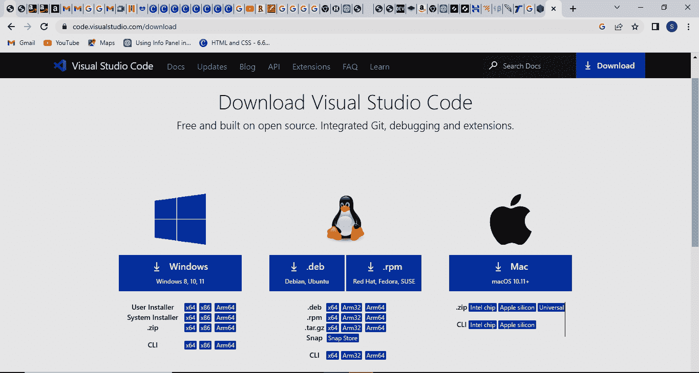

* 安装 `Node.js`：`Node.js` 是一个 JavaScript 运行时环境，允许你在浏览器之外运行 JavaScript 代码。它包含一个名为 `npm` 的包管理器，用于管理和安装第三方包和库。您可以从官方网站 `https://nodejs.org/en` 下载 `Node.js` 并按照操作系统的安装说明进行操作。在您的系统上安装 `Node.js` 环境。确保安装 LTS 版本以获得稳定性和长期支持。

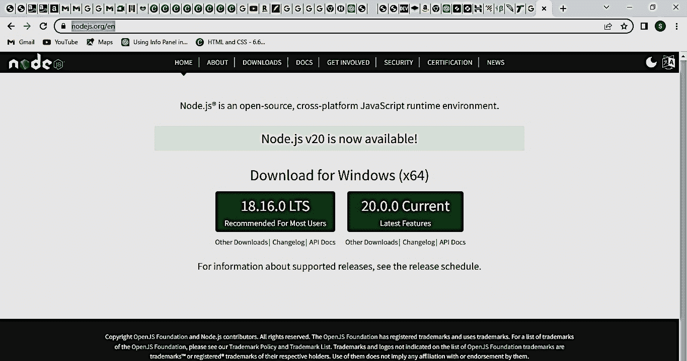

* 创建项目目录：一旦安装了代码编辑器和 `Node.js`，就可以创建一个项目目录，在其中存储您的 JavaScript 代码文件。您可以使用命令行或通过操作系统的文件管理器创建新目录。

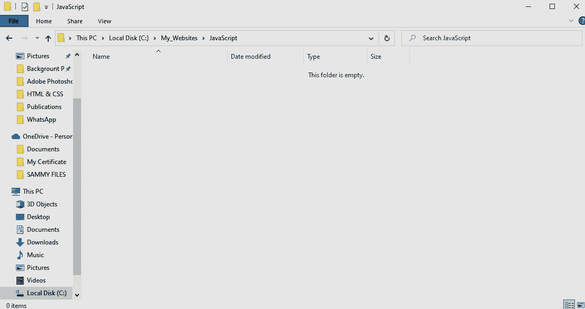

* 初始化新的 `Node.js` 项目：在项目目录中，您可以使用终端中的 `npm init` 命令初始化一个新的 `Node.js` 项目。这将创建一个 `package.json` 文件，其中包含有关项目及其依赖的信息。
* 安装依赖项：您可以使用 `npm` 安装项目所需的任何依赖项或包。例如，如果您正在构建 Web 应用程序，可能想要安装类似 `Express.js` 的包来处理服务端路由和中间件。
* 开始编码：设置好开发环境后，就可以开始编写 JavaScript 代码了。您可以在项目目录中创建一个 JavaScript 文件，并开始使用代码编辑器编写代码。

您可以使用像记事本这样的简单编辑器编写 JavaScript 代码。然而，您可以安装任何开源或授权的 IDE（集成开发环境），以获得 JavaScript 的 IntelliSense 支持以及语法错误/警告高亮，以便快速开发。

## 如何配置 Visual Studio Code 运行 JavaScript

要配置 Visual Studio Code 运行 JavaScript 代码，可以遵循以下步骤：

* 启动 Visual Studio Code。
* 在 Visual Studio Code 中安装 "Code Runner" 扩展。您可以点击左侧边栏的扩展图标，搜索 "Code Runner"，并点击 "Install" 按钮。
* 在 Visual Studio Code 中打开想要运行的 JavaScript 文件。
* 按下 `Ctrl+Shift+P` 键组合打开命令面板。搜索 `Code Runner: Run Code` 命令并选择它。
* 或者，您可以使用 `Ctrl+Alt+N` 键组合直接运行代码。
* 如果 JavaScript 文件需要用户输入，您可以在运行代码后打开的终端中输入内容。
* 您还可以通过 文件 > 首选项 > 设置 来配置 Code Runner 扩展设置，搜索 "code-runner" 并根据您的需求修改选项。
* 仔细完成上述步骤后，您现在可以通过右键点击代码区域然后选择 Run Code，在 Visual Studio Code 中运行 JavaScript 文件。见下面的截图。

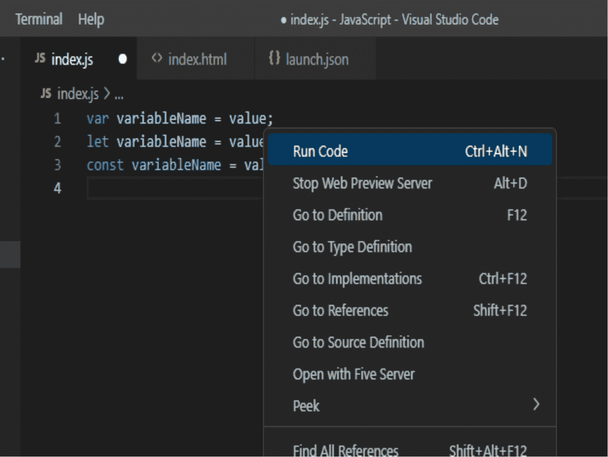

# 第十三章：JavaScript 基础

变量和数据类型是编程中的基本概念。在 JavaScript 中，变量用于存储稍后在程序中使用的值。另一方面，数据类型是定义可以存储在变量中的值类型的分类。在本章中，我们将结合实际示例深入探讨这些概念。

### JavaScript 变量

在 JavaScript 中，使用 `var`、`let` 或 `const` 关键字声明变量。这些关键字告诉 JavaScript 解释器正在声明一个新变量。声明变量的语法如下：

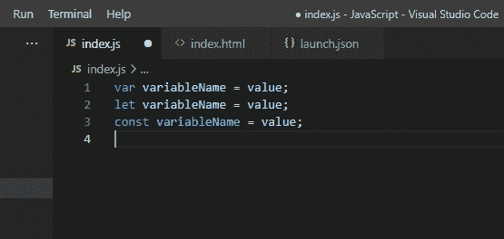

在这里，`variableName` 是变量名，`value` 是赋值给变量的初始值。`var` 关键字用于声明具有函数级作用域的变量，而 `let` 关键字用于声明具有块级作用域的变量。`const` 关键字用于声明常量变量，意味着一旦赋值无法更改。

### JavaScript 数据类型

JavaScript 有多种数据类型，包括字符串、数字、布尔值、对象和数组。

### 字符串

字符串是用于表示文本的数据类型。它们被包含在单引号或双引号中。这里有一个示例：

```javascript
var myString = "Hello, world!";
```

### 数字

数字用于表示数值。它们可以是整数或浮点数。下面的示例：

```javascript
var myNumber = 42;
```

#### 布尔值

布尔值用于表示真或假的值。它们通常用于条件语句。下面的示例：

```javascript
var myBoolean = true;
```

# JavaScript 基础

## 变量声明

```javascript
var myBoolean = true;
```

在 JavaScript 中，声明变量请使用 `var`、`let` 或 `const` 关键字，后跟你想要创建的变量名。你也可以通过给变量赋值一个值来初始化它，如上面的示例所示。如果你在声明变量时没有给它赋值，它的值将是 `undefined`。

让我们来看一些在 JavaScript 中声明变量的示例：

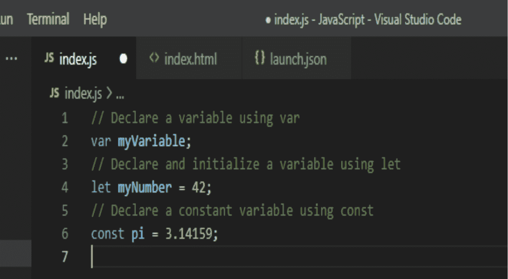

### 对象

对象是复杂的数据类型，可以包含多个属性和方法。它们使用 `object` 关键字创建，属性使用 `属性名: 值` 的语法定义。这里是一个示例：

```javascript
var myObject = { name: "John", age: 30, occupation: "Programmer" };
```

## 数组

数组用于存储值的集合，这些值可以是任何数据类型。它们使用 `array` 关键字创建，每个值之间用逗号隔开。这里是一个示例：

```javascript
var myArray = [1, 2, 3, "four", true];
```

## 字符串、数字和布尔值操作

字符串、数字和布尔值是 JavaScript 中最常用的数据类型。理解如何处理这些数据类型对于有效地编写 JavaScript 代码至关重要。

### 字符串操作

字符串是封装在单引号或双引号中的字符序列。在 JavaScript 中，字符串被视为对象，并拥有一系列可以用于操作字符串的属性和方法。

#### 声明字符串变量

在 JavaScript 中声明字符串变量，你可以使用单引号或双引号。这里是一个示例：

```javascript
let message = 'Hello World!';
```

你也可以使用反引号（backticks）来声明字符串变量。反引号用于创建模板字符串（字面量），它们允许你在字符串内部嵌入表达式。这里是一个示例：

```javascript
let name = 'Sammie';
let greeting = `Hello ${name}!`;
console.log(greeting); // 输出: Hello Sammie!
```

查看下方的输出。

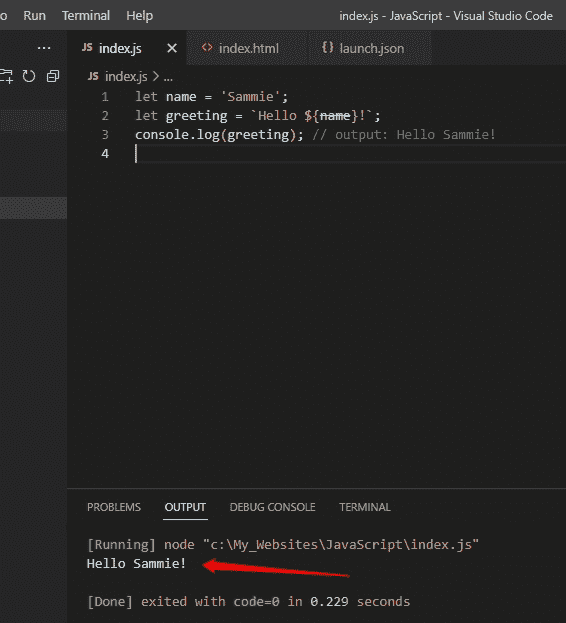

#### 访问字符串中的单个字符

你可以通过 `charAt()` 方法或方括号符号访问字符串中的单个字符。这里是一个示例：

```javascript
let message = 'Hello World!';
console.log(message.charAt(0)); // 输出: H
console.log(message[0]); // 输出: H
```

查看下方的输出。

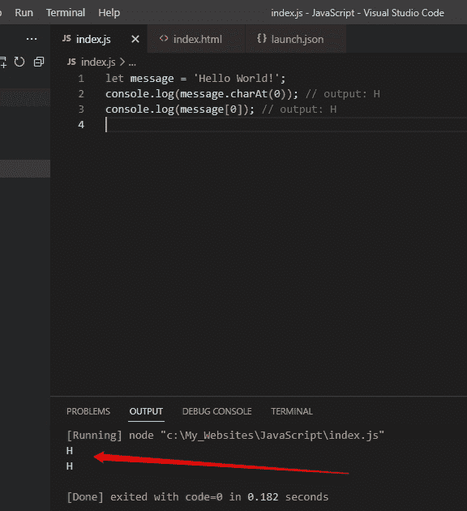

#### 字符串拼接

你可以使用拼接运算符（`+`）或模板字符串来拼接两个或多个字符串。下面是一个示例：

```javascript
let firstName = 'Sammie';
let lastName = 'Smith';
let fullName = firstName + ' ' + lastName;
console.log(fullName); // 输出: Sammie Smith
let message = `My name is ${firstName} ${lastName}.`;
console.log(message); // 输出: My name is Sammie Smith
```

查看下方的输出。

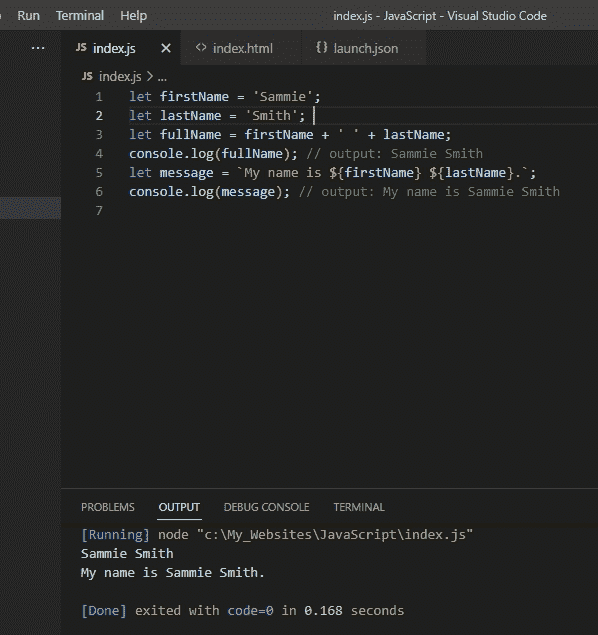

### 数字操作

在 JavaScript 中，数字表示为浮点值。你可以对数字进行算术运算，如加、减、乘、除法。

#### 声明数字变量

在 JavaScript 中声明数字变量，你只需给变量赋值一个数值即可。这里是一个示例：


# JavaScript 基础

## 变量声明

```javascript
var myBoolean = true;
```

在 JavaScript 中声明变量，使用`var`、`let`或`const`关键字，后跟你想要创建的变量名。你也可以通过给变量赋值一个值来初始化它，如上面的示例所示。如果你在声明变量时没有给它赋值，它的值将是`undefined`。

让我们来看一些在 JavaScript 中声明变量的示例：


### 对象

对象是复杂的数据类型，可以包含多个属性和方法。它们使用`object`关键字创建，属性使用`propertyName: value`的语法定义。这里是一个示例：

```javascript
var myObject = { name: "John", age: 30, occupation: "Programmer" };
```

## 数组

数组用于存储值的集合，这些值可以是任何数据类型。它们使用`array`关键字创建，每个值之间用逗号隔开。这里是一个示例：

```javascript
var myArray = [1, 2, 3, "four", true];
```

## 字符串、数字和布尔值操作

字符串、数字和布尔值是 JavaScript 中最常用的数据类型。理解如何处理这些数据类型对于有效地编写 JavaScript 代码至关重要。

### 字符串操作

字符串是封装在单引号或双引号中的字符序列。在 JavaScript 中，字符串被视为对象，并拥有一系列可以用于操作字符串的属性和方法。

#### 声明字符串变量

在 JavaScript 中声明字符串变量，你可以使用单引号或双引号。这里是一个示例：

```javascript
let message = 'Hello World!';
```

你也可以使用反引号（backticks）来声明字符串变量。反引号用于创建模板字符串（字面量），它们允许你在字符串内部嵌入表达式。这里是一个示例：

```javascript
let name = 'Sammie';
let greeting = `Hello ${name}!`;
console.log(greeting); // 输出: Hello Sammie!
```

查看下方的输出。


#### 访问字符串中的单个字符

你可以通过`charAt()`方法或方括号符号访问字符串中的单个字符。这里是一个示例：

```javascript
let message = 'Hello World!';
console.log(message.charAt(0)); // 输出: H
console.log(message[0]); // 输出: H
```

查看下方的输出。


#### 字符串拼接

你可以使用拼接运算符（`+`）或模板字符串来拼接两个或多个字符串。下面是一个示例：

```javascript
let firstName = 'Sammie';
let lastName = 'Smith';
let fullName = firstName + ' ' + lastName;
console.log(fullName); // 输出: Sammie Smith
let message = `My name is ${firstName} ${lastName}.`;
console.log(message); // 输出: My name is Sammie Smith
```

查看下方的输出。


### 数字操作

在 JavaScript 中，数字表示为浮点值。你可以对数字进行算术运算，如加、减、乘、除法。

#### 声明数字变量

在 JavaScript 中声明数字变量，你只需给变量赋值一个数值即可。这里是一个示例：

```javascript
let x = 10; let y = 3.14;
```

#### 执行算术运算

你可以使用`+`、`-`、`*`和`/`等运算符对数字进行算术运算。这里是一个示例：

```javascript
let x = 10; let y = 5;
console.log(x + y); // 输出: 15
console.log(x - y); // 输出: 5
console.log(x * y); // 输出: 50
console.log(x / y); // 输出: 2
```

查看下方的输出。

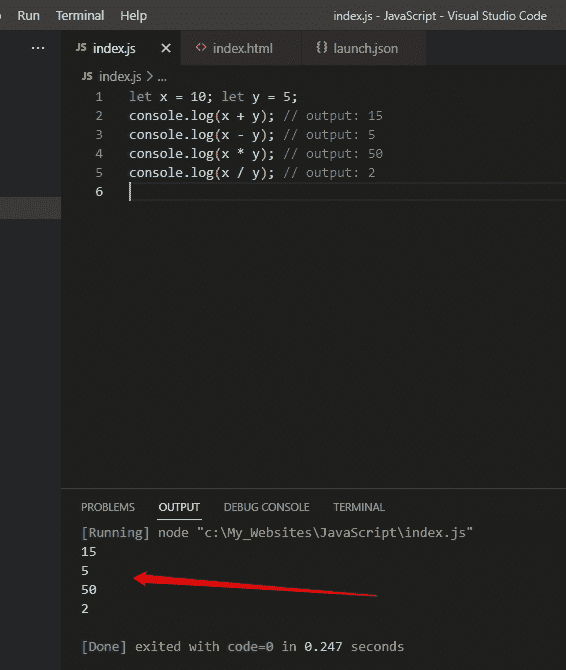

### 布尔值操作

布尔值表示真（`true`）或假（`false`）。布尔值常用于条件语句和循环以控制程序的执行流。

#### 声明布尔变量

在 JavaScript 中声明布尔变量，你只需给变量赋值一个`true`或`false`值即可。这里是一个示例：

```javascript
let isRaining = true;
let isSunny = false;
```

#### 使用布尔运算符

你可以使用`&&`（与）、`||`（或）和`!`（非）等布尔运算符对布尔值执行逻辑操作。这里是一个示例：

```javascript
let isRaining = true;
let isCold = true;
let isWindy = false;
console.log(isRaining && isCold); // 输出: true
console.log(isRaining || isWindy); // 输出: true
console.log(!isCold); // 输出: false
```

查看下方的输出。

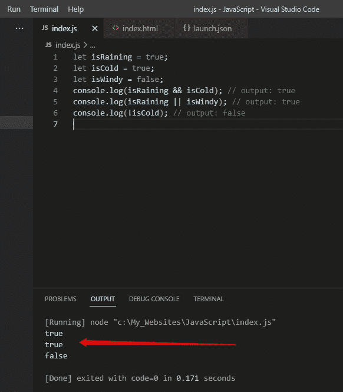

## 理解对象和数组

在 JavaScript 中，对象和数组是两种重要的数据结构，允许开发者以各种方式存储和操作数据。在本节中，我们将探索对象和数组的基础知识、它们的语法以及如何在实际示例中使用它们。

### 理解对象

JavaScript 中的对象是属性的集合，这些属性是键值对，描述了对象的各种特征。例如，一个人的对象可以拥有姓名、年龄和性别属性，每个属性都有其值。对象可以包含任何类型的数据，包括其他对象、函数和数组。

#### 声明对象

```javascript
var myObject = { name: "John", age: 30, occupation: "Programmer" };
```

### 理解数组

JavaScript 中的数组是值的集合，这些值可以是任何数据类型。数组是有序的，这意味着存储的顺序是重要的。

### 声明数组

在 JavaScript 中声明数组，使用方括号（`[]`）符号。在方括号内列出值并用逗号隔开。

```javascript
let numbers = [1, 2, 3];
```

JavaScript 具有若干算术运算符，可执行数学运算。这些运算符包括加法（`+`）、减法（`-`）、乘法（`*`）、除法（`/`）和取模（`%`）。让我们详细查看每一个运算符。

### 加法 (+)

该运算符用于将两个或多个数字相加。例如：

```javascript
let x = 5;
let y = 10;
let z = x + y;
console.log(z); // Output: 15
```

查看下方的输出。

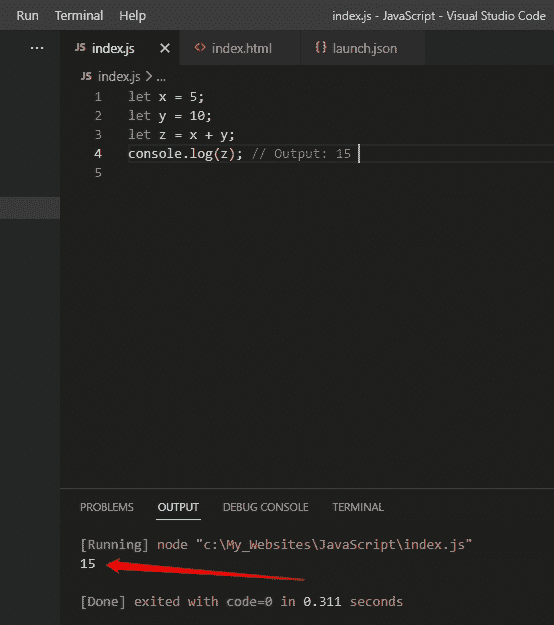

### 减法 (-)

该运算符用于从一个数字减去另一个数字。例如：

```javascript
let x = 10;
let y = 5;
let z = x - y;
console.log(z); // Output: 5
```

查看下方的输出。

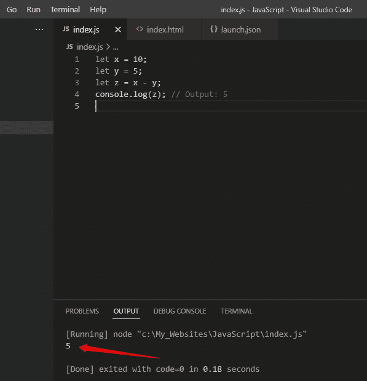

### 乘法 (*)

该运算符用于将两个或多个数字相乘。例如：

```javascript
let x = 5;
let y = 10;
let z = x * y;
console.log(z); // Output: 50
```

查看下方的输出。

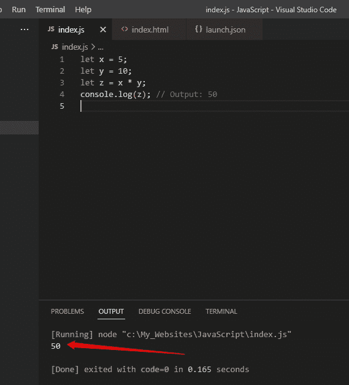

### 除法 (/)

该运算符用于将一个数字除以另一个数字。例如：

```javascript
let x = 10;
let y = 5;
let z = x / y;
console.log(z); // Output: 2
```

查看下方的输出。

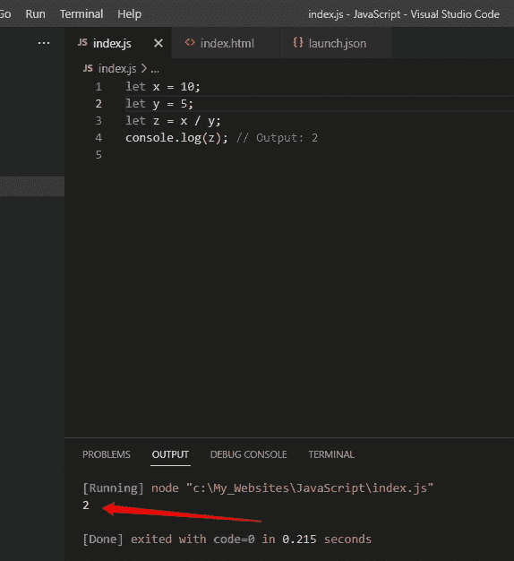

### 取模 (%)

该运算符用于找到除法后的余数。例如：

```javascript
let x = 10;
let y = 3;
let z = x % y;
console.log(z); // Output: 1
```

查看下方的输出。

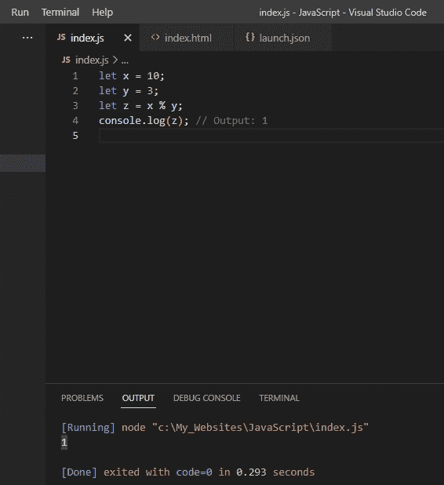

## 比较运算符

JavaScript 还有若干比较运算符，可用于比较两个值。这些运算符包括等于（`==`）、不等于（`!=`）、大于（`>`）、小于（`<`）、大于等于（`>=`）和小于等于（`<=`）。让我们详细查看每一个运算符。

### 等于 (==)

该运算符用于检查两个值是否相等。例如：

```javascript
let x = 5;
let y = 5;
console.log(x == y); // Output: true
```

查看下方的输出。

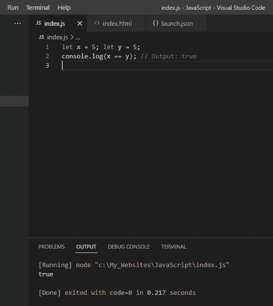

### 不等于 (!=)

该运算符用于检查两个值是否不相等。例如：

```javascript
let x = 5;
let y = 10;
console.log(x != y); // Output: true
```

查看下方的输出。

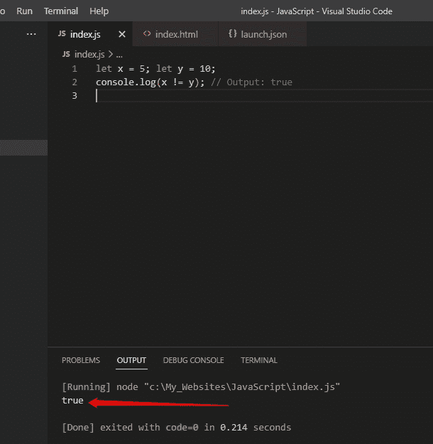

### 大于 (>) 和 小于 (<)

这些运算符用于比较两个值，判断其中一个是否大于或小于另一个。例如：

```javascript
let x = 5;
let y = 10;
console.log(x < y); // Output: true
console.log(x > y); // Output: false
```

查看下方的输出。

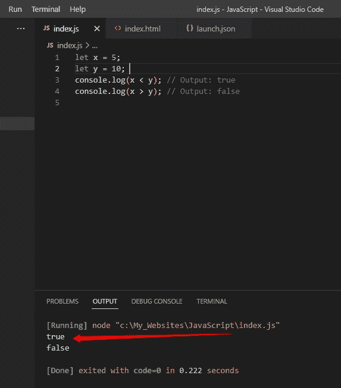

### 大于等于 (>=) 和 小于等于 (<=)

这些运算符用于比较两个值，判断其中一个是否大于等于或小于等于另一个。例如：

```javascript
let x = 5;
let y = 5;
console.log(x >= y); // Output: true
console.log(x <= y); // Output: true
```

查看下方的输出。

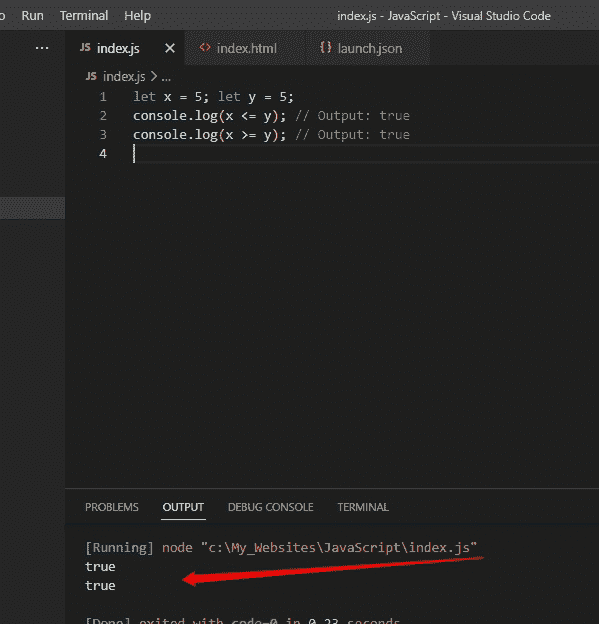


这些运算符用于检查一个值是否大于等于或小于等于另一个值。例如：

```javascript
let x = 5;
let y = 5;
console.log(x <= y); // Output: true
console.log(x >= y); // Output: true
```

查看下方的输出。


## 逻辑运算符

在编程中，逻辑运算符用于组合两个或多个条件以形成更复杂的条件。JavaScript 中有三个主要的逻辑运算符：

### 与 运算符 (&&)

与运算符表示为`&&`，用于检查两个条件是否都为真。只有当两个条件都为真时，它才返回真。如果一个或两个条件为假，它返回假。

示例：

```javascript
let x = 5;
let y = 10;
if(x > 0 && y > 5) {
  console.log("Both conditions are true");
}
else {
  console.log("At least one condition is false");
}
// Output: Both conditions are true
```

在这个示例中，第一个条件`(x > 0)`为真，第二个条件`(y > 5)`也是真。因此，控制台将输出 "Both conditions are true"。

### 或 运算符 (||)

或运算符表示为`||`，用于检查两个条件中至少有一个是否为真。如果其中一个或两个条件为真，它就返回真。如果两个条件都为假，它返回假。

示例：

```javascript
let x = 5;
let y = 10;
if(x > 0 || y < 5) {
  console.log("At least one condition is true");
}
else { 
  console.log("Both conditions are false");
}
// Output: At least one condition is true
```

在这个示例中，第一个条件`(x > 0)`为真，第二个条件`(y < 5)`为假。但由于至少有一个条件为真，控制台将输出 "At least one condition is true"。


### 非 运算符 (!)

非运算符表示为`!`，用于反转条件的逻辑状态。如果条件为真，它会使其为假；如果条件为假，它会使其为真。

示例：

```javascript
let x = 5;
if(!(x > 0)) {
  console.log("condition is false");
}
else {
  console.log("condition is true");
}
// Output: condition is true
```

在这个示例中，条件`(x > 0)`为真，但`!`使其为假，从而触发了`else`块。(image_src64J)

## 条件语句 (IF/ELSE)

条件语句也称为控制语句，用于控制程序的流程。它们允许程序做出决策。

### if 语句

`if`语句的语法如下：

```javascript
if (condition) {
  // 如果条件为真则执行代码块
}
```

这是一个示例：

```javascript
let a = 5;
if (a > 3) {
  console.log("a is greater than 3");
}
```

在这个示例中，条件`a > 3`为真，因此执行大括号内的代码。(image_src64K)

### else 语句

`else`语句与`if`语句结合使用，在条件为假时执行代码块。`else`语句的语法如下：

```javascript
if (condition) {
  // 如果条件为真则执行代码块
}
else {
  // 如果条件为假则执行代码块
}
```

这是一个示例：

```javascript
let a = 2;
if (a > 3) {
  console.log("a is greater than 3");
}
else {
  console.log("a is less than or equal to 3");
}
```

在这个示例中，条件`a > 3`为假，因此执行`else`块。(image_src64M)

### else if 语句

`else if`语句与`if`语句结合使用，当另一个条件为真时执行代码块。`else if`语句的语法如下：

```javascript
if (condition1) {
  // 如果 condition1 为真则执行代码块
} else if (condition2) {
  // 如果 condition2 为真则执行代码块
}
else {
  // 如果所有条件为假则执行代码块
}
```

这是一个示例：

```javascript
let a = 7;
if (a > 10) {
  console.log("a is greater than 10");
} else if (a > 5) {
  console.log("a is greater than 5 but less than or equal to 10");
} else {
  console.log("a is less than or equal to 5");
}
```

## 条件语句

在这个例子中，条件`a > 10`为假，但条件`a > 5`为真，因此第二个代码块将被执行，消息 "a 大于 5 但小于或等于 10" 将被打印到控制台。上述代码的输出如下所示。

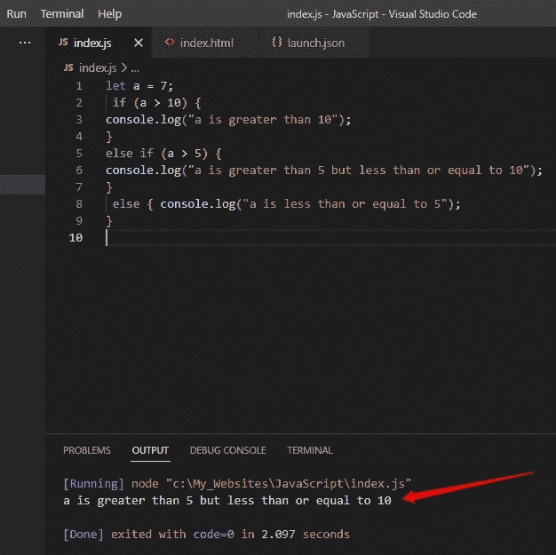

## Switch 语句

Switch 语句是一种控制流语句，用于 JavaScript、Java 和 C++ 等编程语言。它允许程序求值一个表达式，并根据表达式的值执行不同的操作。

JavaScript 中 switch 语句的语法如下：

```javascript
switch(expression) {
  case value1:
    // code block
    break;
  case value2:
    // code block
    break;
  default:
    // code block
}
```

表达式只会求值一次，其值将与每个 case 的值进行比较。如果匹配，则执行关联的代码块。如果不匹配，则执行 default 块中的代码。

下面是 switch 语句的示例：

```javascript
let day = new Date().getDay();
let dayName;

switch(day) {
  case 0:
    dayName = "Sunday";
    break;
  case 1:
    dayName = "Monday";
    break;
  case 2:
    dayName = "Tuesday";
    break;
  case 3:
    dayName = "Wednesday";
    break;
  case 4:
    dayName = "Thursday";
    break;
  case 5:
    dayName = "Friday";
    break;
  case 6:
    dayName = "Saturday";
    break;
  default:
    dayName = "Invalid day";
}

console.log(dayName);
```

在这个例子中，switch 语句使用`Date`对象的`getDay()`方法获取当前星期几。代码将日期匹配到相应的字符串值，并将其赋值给`dayName`变量。如果日期值不匹配任何 case，则 default case 将`dayName`变量赋值为 "Invalid day"。上述代码的结果如下图所示。

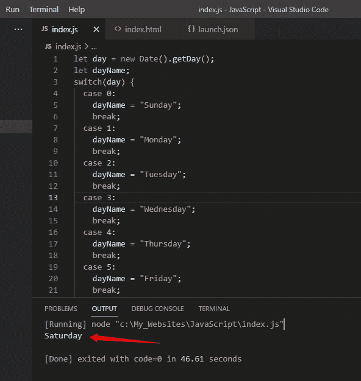

Switch 语句通常用作 if-else 语句的替代方案，当需要检查多个条件时。它们还可以使代码在某些情况下更具可读性和效率。

## 函数与作用域

在 JavaScript 中，函数是可重用的代码块，可以接受输入（实参）并返回一个值。它们是编程的基本构建块，允许创建模块化和可重用的代码。在本章中，我们将介绍声明和调用函数、处理参数和实参、返回值以及理解作用域和闭包的基础知识。

### 声明和调用函数

在 JavaScript 中，可以使用`function`关键字声明函数，后跟函数名和一对圆括号。函数体用花括号`{}`包裹。例如：

```javascript
function greet() {
  console.log("Hello, world!");
}
```

要调用此函数，只需使用函数名后跟一对圆括号：

```javascript
greet(); // Output: Hello, world!
```

请参见下面的输出：

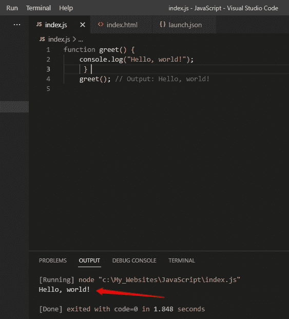

### 参数与实参

函数也可以通过参数接受输入。参数在函数声明中声明，用于指定函数的预期输入。例如：

```javascript
function greet(name) {
  console.log("Hello, " + name + "!");
}
```

在上面的例子中，`greet`函数接受一个参数`name`。要用实参调用函数，只需在调用函数时传递值作为实参：

```javascript
greet("Sammie"); // Output: Hello, Sammie!
```

请参见下面的输出：

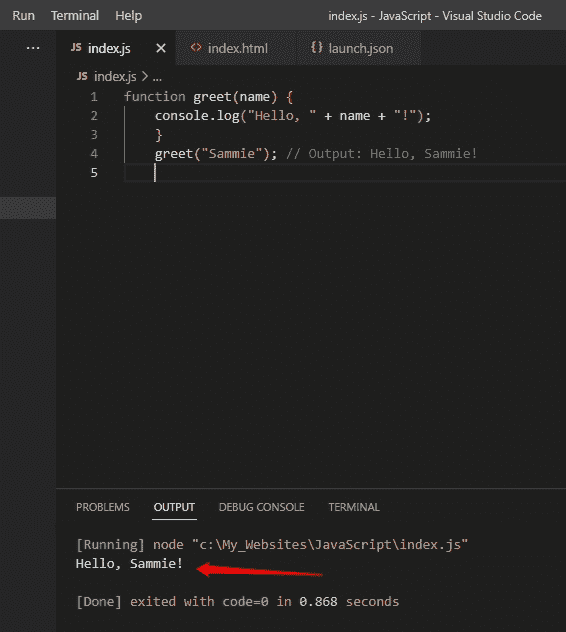

函数也可以接受多个参数，用逗号分隔：

```javascript
function add(a, b) {
  return a + b;
}

console.log(add(2, 3)); // Output: 5
```

请参见下面的输出：

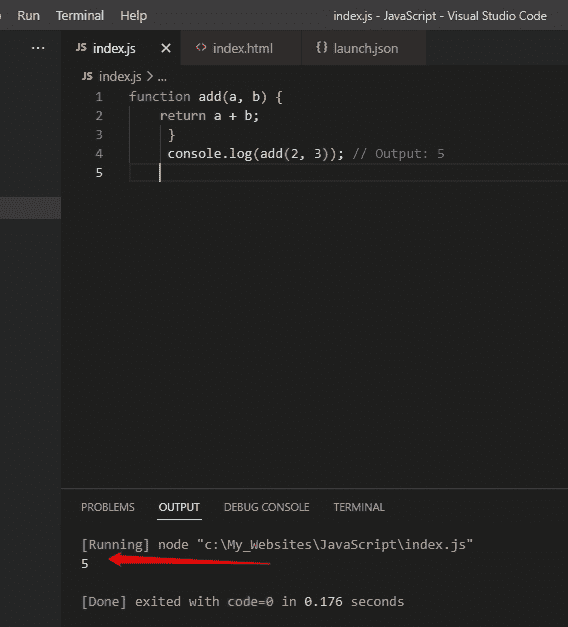

### 返回值

函数也可以使用`return`关键字返回值。这允许函数提供一个可用于代码其他部分的结果。例如：

```javascript
function multiply(a, b) {
  return a * b;
}

console.log(multiply(2, 3)); // Output: 6
```

在上面的例子中，`multiply`函数返回`a`和`b`的乘积。请参见下面的输出。

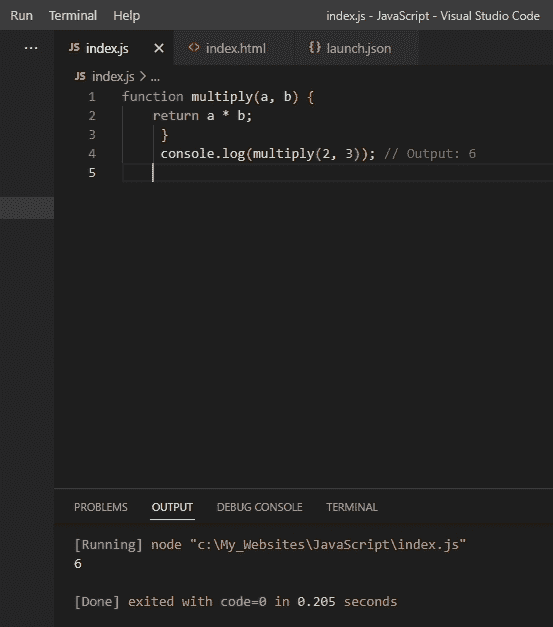

### 作用域与闭包

作用域指的是变量在代码不同部分的可见性。在 JavaScript 中，有两种作用域：全局作用域和局部作用域。

**全局作用域**

全局作用域指的是在函数外部声明的变量，可以从代码的任何地方访问：

```javascript
let globalVar = "I'm a global variable";

function printGlobalVar() {
  console.log(globalVar);
}

printGlobalVar(); // Output: I'm a global variable
```

请参见下面的输出：

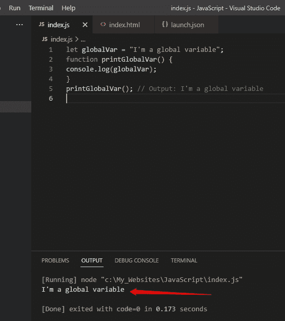

**局部作用域**

局部作用域指的是在函数内部声明的变量，只能在该函数内部访问：

```javascript
function printLocalVar() {
  let localVar = "I'm a local variable";
  console.log(localVar);
}

printLocalVar(); // Output: I'm a local variable
```

请参见下面的输出。

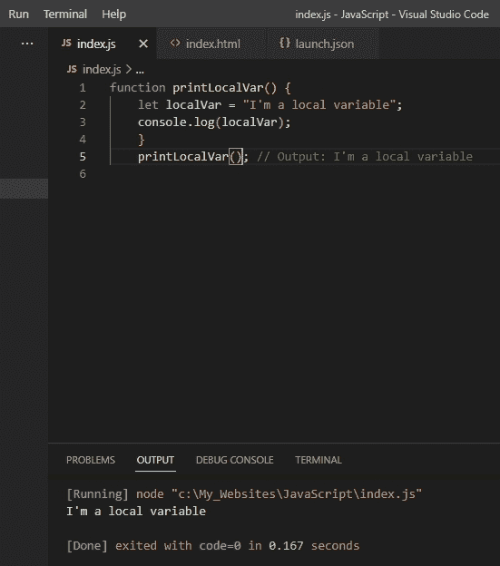

**闭包**

闭包指的是函数访问其外部（封闭）函数中变量的能力，即使外部函数已经返回。例如：

```javascript
function outer() {
  let x = 10;
  function inner() {
    console.log(x);
  }
  return inner;
}

let innerFunc = outer();
innerFunc(); // Output: 10
```

在上面的例子中，`outer`函数返回`inner`函数，该函数可以访问外部函数作用域中的`x`变量，即使外部函数已经返回。请参见下面的输出；

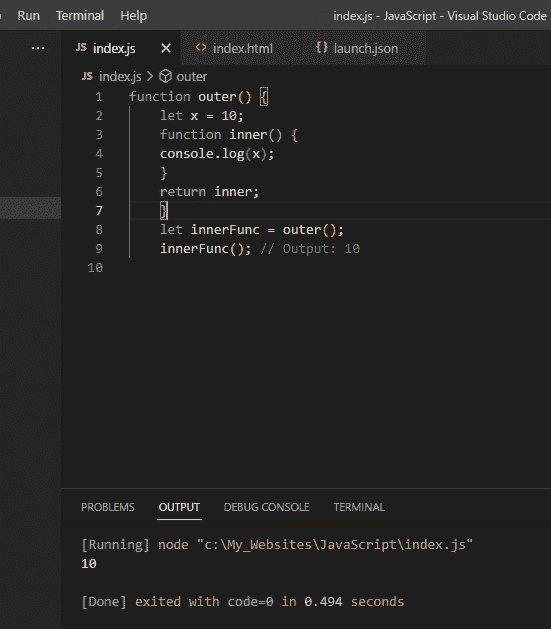

在上面的例子中，`outer`函数返回`inner`函数，该函数可以访问外部函数作用域中的`x`变量，即使外部函数已经返回。

## 数组与循环

数组和循环是 JavaScript 中最基础的概念之一。数组用于存储数据集合，而循环用于遍历这些数据。在本章中，我们将深入探讨数组的使用、数组方法以及 JavaScript 中不同类型的循环。

### 数组与数组方法

数组用于在 JavaScript 中存储数据集合。数组是一种特殊的变量，可以容纳多个值。数组中的每个值称为元素，每个元素都有一个唯一的索引号，表示其在数组中的位置。

声明数组时，我们使用方括号并用逗号分隔元素。例如：

```javascript
let fruits = ["apple", "banana", "orange"];
```

在上面的例子中，我们声明了一个名为`fruits`的数组，包含三个元素："apple"、"banana" 和 "orange"。

我们可以使用索引号访问数组的各个元素。数组第一个元素的索引始终是`0`。例如，要访问`fruits`数组的第一个元素，我们使用：

```javascript
let firstFruit = fruits[0];
```

这会将值 "apple" 赋值给`firstFruit`变量。

数组还有几个内置方法，允许我们操作其所包含的数据一些最常用的数组方法包括：

- `push()`: 将一个或多个元素添加到数组的末尾。
- `pop()`: 删除数组的最后一个元素并返回它。
- `shift()`: 删除数组的第一个元素并返回它。
- `unshift()`: 将一个或多个元素添加到数组的开头。
- `splice()`: 在指定索引处添加或删除数组的元素。
- `slice()`: 返回一个新数组，包含原数组的一部分。

下面是演示如何使用其中一些方法的示例：

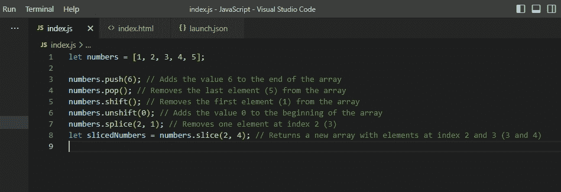

### For 循环

for 循环用于遍历数组或任何其他可迭代对象。它有三个部分：初始化、条件 和 更新。下面是一个 for 循环的示例，它遍历数字数组并将每个数字打印到控制台：

```javascript
let numbers = [1, 2, 3, 4, 5];

for (let i = 0; i < numbers.length; i++) {
  console.log(numbers[i]);
}
```

在上面的示例中，我们使用`numbers`数组的`length`属性来确定所需的迭代次数。循环从 0 开始，一直持续到索引等于数组的`length`。见下方的输出。

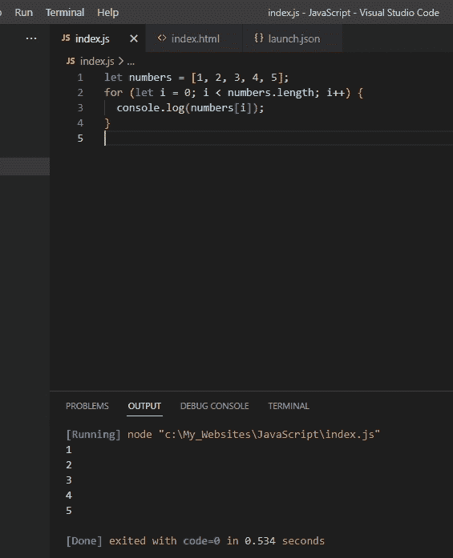

## While 循环

`while`循环是一种控制流语句，允许你在特定条件为真时重复执行一个代码块。`while`循环的语法如下：

```javascript
while (condition) {
  // 要执行的代码
}
```

在这里，`condition`是一个布尔表达式，在循环的每次迭代之前都会进行求值。如果条件为真，则执行代码块。这个过程会不断重复，直到条件为假。

让我们通过一个例子来理解`while`循环是如何工作的：

```javascript
let i = 0;
while (i < 5) {
  console.log(i);
  i++;
}
```

在这个示例中，`while`循环将执行代码块，直到`i`小于 5。上述代码的输出将是：

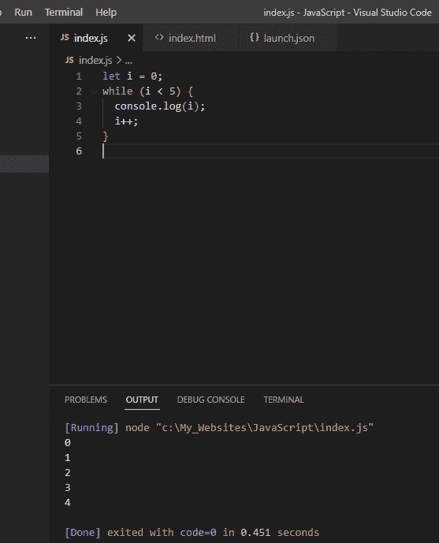

## Do-While 循环

`do-while`循环与`while`循环类似，但有一个显著区别：即使条件为假，代码块也会至少执行一次。`do-while`循环的语法如下：

```javascript
while (condition) {
  // 要执行的代码
}
```

在这里，`condition`是一个布尔表达式，在循环的每次迭代之后都会进行求值。如果条件为真，则再次执行代码块。这个过程会不断重复，直到条件为假。

让我们通过一个例子来理解`do-while`循环是如何工作的：

```javascript
let i = 0;
while (i < 5) {
  console.log(i);
  i++;
}
```

在这个示例中，即使`i`不小于 5，代码块也会至少执行一次。上述代码的输出将是：

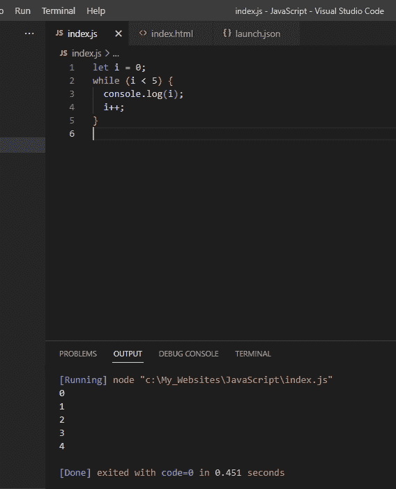

## forEach 方法

`forEach`方法是 JavaScript 中的一个内置函数，允许你遍历数组并在每个元素上执行一个函数。`forEach`方法的语法如下：

```javascript
array.forEach(function(currentValue, index, array) {
  // 要执行的代码
});
```

在这里，`currentValue`表示当前正在处理的元素，`index`表示元素的索引，`array`表示正在扫描的数组。数组的每个元素都会接收代码块的执行。

为了进一步理解`forEach`方法是如何工作的，让我们来看一个例子：

```javascript
let fruits = ["apple", "banana", "orange"];
fruits.forEach(function(fruit) {
  console.log(fruit);
});
```


在这个示例中，`forEach` 方法将为 `fruits` 数组的每个元素执行代码块。上述代码的输出将是：

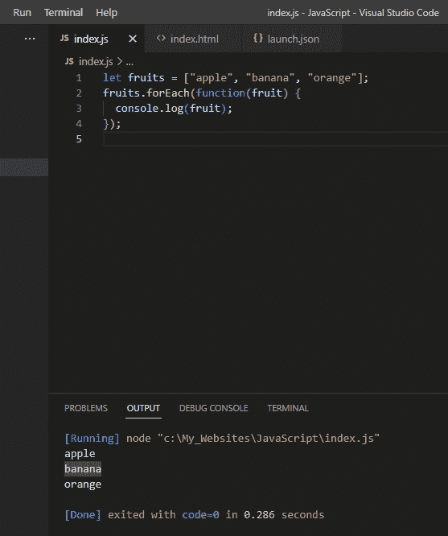

为了让代码更简短，你也可以使用箭头函数语法：

```javascript
let fruits = ["apple", "banana", "orange"];
fruits.forEach(fruit => console.log(fruit));
```

见下方的输出：

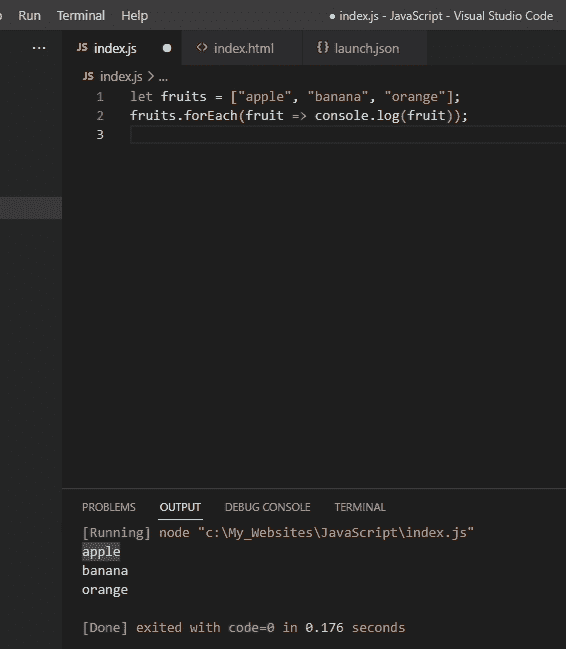

# 第十七章：对象与类

JavaScript 中的对象是属性的组，每个属性都是一个键值对。对象可能具有特征，这些特征可以是其他对象，也可以是基本数据类型（如文本、整数和布尔值）。此外，还可以拥有方法，方法被定义为对象的属性和函数。因为对象让程序员能够高效地组织和管理代码，这对 JavaScript 编程至关重要。

## 创建和使用对象

在 JavaScript 中创建一个对象，你可以使用对象字面量符号或 `Object` 构造函数。对象字面量符号是创建对象的快捷方式，通过在大括号中包含键值对列表来创建。例如：

```javascript
let person = {
  name: "John",
  age: 30,
  city: "New York"
};
```

在这个示例中，我们创建了一个名为 `person` 的对象，包含三个属性：`name`、`age` 和 `city`。

你也可以使用 `Object` 构造函数创建对象。`Object` 构造函数创建一个空对象，你可以为其添加属性和方法。例如：

```javascript
let person = new Object();
person.name = "John";
person.age = 30;
person.city = "New York";
```

这段代码使用 `new` 关键字创建了一个名为 `person` 的空对象，然后使用点符号向其添加了三个属性。

### 对象方法

JavaScript 中的对象也可以拥有方法，方法是定义为对象属性的函数。方法可以访问对象的属性和其他方法。在 JavaScript 中，对象可以拥有方法，即属于对象并可以对其属性进行操作的函数。为对象创建方法，我们将函数定义为对象的属性。

这是一个例子：

```javascript
let person = {
  firstName: 'John',
  lastName: 'Smith',
  fullName: function() {
    return this.firstName + ' ' + this.lastName;
  }
};
console.log(person.fullName()); // 输出: "John Smith"
```

在这个示例中，我们为 `person` 对象定义了一个 `fullName` 方法。`fullName` 方法将连接 `firstName` 和 `lastName`。

我们可以使用箭头函数语法：

```javascript
let person = {
  firstName: 'John',
  lastName: 'Smith',
  fullName: () => {
    return this.firstName + ' ' + this.lastName;
  }
};
console.log(person.fullName()); // 输出: "undefined"
```

在对象方法中使用箭头方法使用 `this` 关键字通常是不推荐的，因为会产生问题。

对象方法也可以通过 `call()` 方法在对象之外调用。例如：

```javascript
let person1 = {
  firstName: 'John',
  lastName: 'Smith',
  fullName: function() {
    return this.firstName + ' ' + this.lastName;
  }
};
let person2 = {
  firstName: 'Jane',
  lastName: 'Smith'
};
console.log(person1.fullName.call(person2)); // 输出: "Jane Smith"
```

在这个示例中，我们定义了对象 `person1` 和 `person2`。`person1` 有一个 `fullName` 方法，而 `person2` 没有。我们可以使用 `call()` 方法调用 `person1` 的 `fullName` 方法，并将 `person2` 作为其 `this` 值。

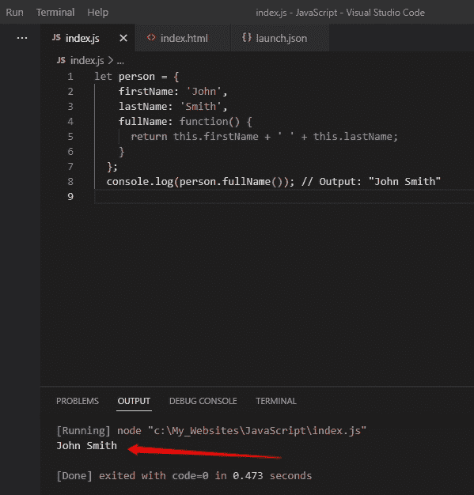

还可以使用 ES6 语法定义对象方法：

```javascript
let person = {
  firstName: 'John',
  lastName: 'Smith',
  fullName() {
    return this.firstName + ' ' + this.lastName;
  }
};
console.log(person.fullName()); // 输出: "John Smith"
```

在这个示例中，我们定义了一个名为 `person` 的对象，具有 `firstName`、`lastName` 属性和 `fullName` 方法。见输出。

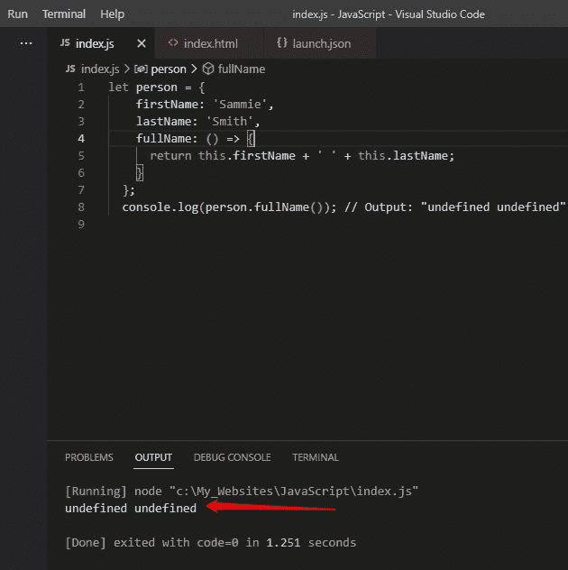

对象方法还可以使用简写形式：

```javascript
let person = {
  firstName: 'Sammie',
  lastName: 'Smith',
  fullName() {
    return this.firstName + ' ' + this.lastName;
  }
};
console.log(person.fullName()); // 输出: "Sammie Smith"
```

这种方法与之前的示例相同。见输出的截图。

## 创建类

除了使用对象字面量符号或 `Object` 构造函数创建对象外，你还可以使用类创建对象。类是创建对象的蓝图，它定义了对象将拥有的属性和方法。在 JavaScript 中定义类，你使用 `class` 关键字，后面跟着类名。

在 JavaScript 中，你可以使用 `class` 关键字创建类。类是定义想要创建对象的蓝图的方法。它们提供了一种将数据和行为封装在单一实体的方法。类可以像对象一样拥有属性和方法。

这是一个在 JavaScript 中创建类的例子：

```javascript
class Person {
  constructor(firstName, lastName, age) {
    this.firstName = firstName;
    this.lastName = lastName;
    this.age = age;
  }

  getFullName() {
    return `${this.firstName} ${this.lastName}`;
  }

  canVote() {
    return this.age >= 18;
  }
}
```

在这个示例中，我们定义了一个 `Person` 类，其构造函数接收三个参数：`firstName`、`lastName` 和 `age`。构造函数将这些值赋值给正在创建对象的属性。

该类还有两个方法：`getFullName` 和 `canVote`。`getFullName` 通过连接姓和名返回人的全名，而 `canVote` 检查人是否满 18 岁或以上并返回真或假。

要从此类创建一个对象，你需要使用 `new` 关键字并带有必要的参数调用构造函数：

```javascript
const sammie = new Person('Sammie', 'Smith', 25);
console.log(sammie.getFullName()); // 输出: "Sammie Smith"
console.log(sammie.canVote()); // 输出: true
```

在这里，我们创建了一个名为 `sammie` 的新 `Person` 对象，其名为 "Sammie"，姓为 "Smith"，年龄为 25。然后我们在 `sammie` 对象上调用了 `getFullName` 和 `canVote` 方法。请查看下方的输出截图。

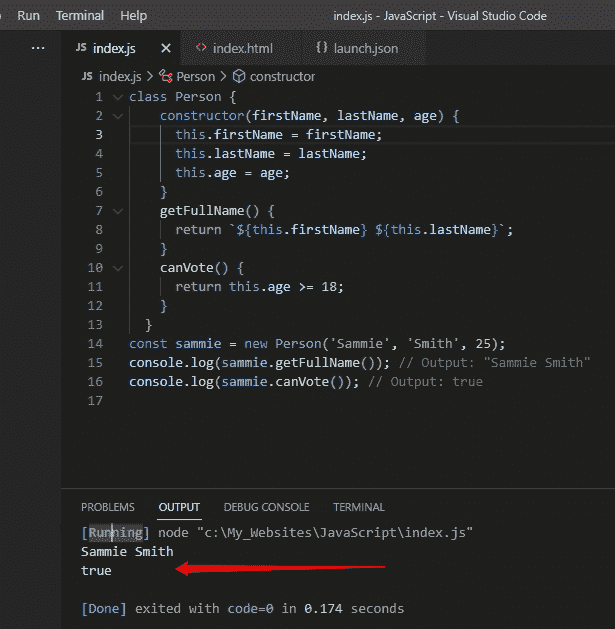

JavaScript 中的类还支持继承，这允许你基于现有的类创建一个新类。你可以使用 `extends` 关键字创建一个子类，它可以从父类继承属性和方法。

例如，我们可以创建一个扩展 `Person` 类的 `Student` 类，并添加一个新属性 `major`：

```javascript
class Person {
  constructor(firstName, lastName, age) {
    this.firstName = firstName;
    this.lastName = lastName;
    this.age = age;
  }
  getFullName() {
    return `${this.firstName} ${this.lastName}`;
  }
  canVote() {
    return this.age >= 18;
  }
}

class Student extends Person {
  constructor(firstName, lastName, age, major) {
    super(firstName, lastName, age);
    this.major = major;
  }
  getMajor() {
    return this.major;
  }
}
```

在这里，我们使用 `extends` 关键字定义了一个扩展 `Person` 类的 `Student` 类。构造函数接受四个参数：`firstName`、`lastName`、`age` 和 `major`。我们带有必要的参数调用 `super` 方法来执行父类的构造函数并继承它的属性。

`Student` 类还有一个名为 `getMajor` 的新方法，它返回 `major` 属性的值。要创建一个 `Student` 对象，可以使用与创建 `Person` 对象相同的语法：

```javascript
const alice = new Student('Alice', 'Smith', 20, 'Computer Science');
console.log(alice.getFullName()); // 输出: "Alice Smith"
console.log(alice.getMajor()); // 输出: "Computer Science"
console.log(alice.canVote()); // 输出: true
```

在这里，我们创建了一个名为 `alice` 的新 `Student` 对象，其名为 "Alice"，姓为 "Smith"，年龄 20，专业为 "Computer Science"。我们在 `alice` 对象上调用了 `getFullName`、`getMajor` 和 `canVote` 方法。请查看下方的代码输出。

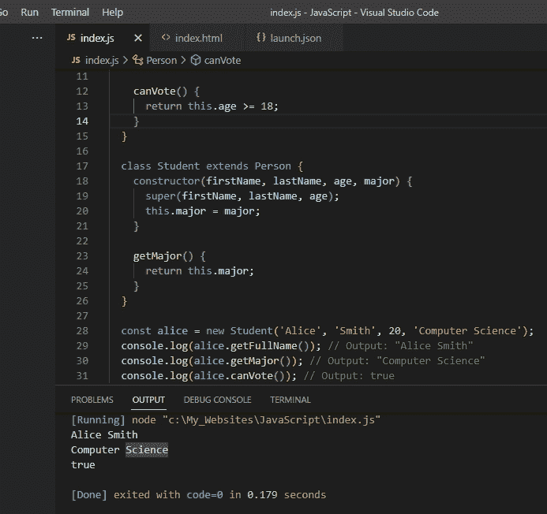

# 构造函数与原型

构造函数和原型是 JavaScript 面向对象编程的重要组成部分。在本节中，我们将探索构造函数和原型是如何工作的，以及如何使用它们来创建对象和类。

构造函数是用于创建新对象的函数。它们定义对象的属性和方法，还可以为这些属性定义默认值。当使用 `new` 关键字调用构造函数时，会创建一个新对象，构造函数会初始化对象的属性。

这是一个构造函数的示例：

```javascript
function Person(name, age) {
  this.name = name;
  this.age = age;
}

let person1 = new Person("John", 30);
let person2 = new Person("Jane", 25);
```

在这个示例中，我们创建了一个名为 `Person` 的构造函数，它接受两个参数 `name` 和 `age`。在构造函数内部，我们使用 `this` 设置了对象的 `name` 和 `age` 属性。当使用 `new` 关键字调用构造函数时，会创建一个新对象，构造函数会初始化对象的属性。

原型是用于让对象共享属性和方法的机制。它允许你在一个对象上定义方法，并让该对象的所有实例访问这些方法。这可以节省内存，因为不需要为每个实例都创建一个相同的方法副本。

这是一个使用原型的示例：

```javascript
function Animal(name) {
  this.name = name;
}

Animal.prototype.eat = function() {
  console.log(this.name + " is eating.");
};

let dog = new Animal("Buddy");
dog.eat(); // 输出: "Buddy is eating."
```

# JavaScript DOM 操作

```javascript
const element = document.getElementById("myElement");
element.innerHTML = "<h1>Hello World!</h1>";
```

## textContent

`textContent` 属性用于获取或设置元素的文本内容。它返回所有子节点的文本内容，排除 HTML 标签。例如，假设我们有一个 ID 为 `myElement` 的 HTML 元素。我们可以使用以下代码更改其文本内容：

```javascript
const element = document.getElementById("myElement");
element.textContent = "Hello World!";
```

## setAttribute

`setAttribute` 方法用于设置元素的属性值。例如，假设我们有一个 ID 为 `myElement` 的 HTML 元素。我们可以使用以下代码设置它的 `src` 属性：

```javascript
const element = document.getElementById("myElement");
element.setAttribute("src", "image.jpg");
```

## 事件处理

事件处理是 Web 开发的一个关键方面，它使 Web 应用程序能够响应用户交互。用户可以通过点击按钮、在文本框中输入内容、在元素上悬停、滚动等方式与网页进行交互。DOM 允许我们操作网页上的元素，而通过事件处理，我们可以创建能够响应用户交互的交互式 Web 应用。

在 JavaScript 中，事件是浏览器中发生的动作，例如点击按钮、提交表单或滚动页面。事件监听器是一个监听特定事件发生的函数，并在检测到事件时执行操作。

有多种方法可以向 HTML 元素附加事件监听器。最常用的方法是使用 `addEventListener()` 方法。该方法接受两个参数：要监听的事件名称以及检测到事件时应执行的函数。以下是一个如何为按钮添加事件监听器的示例，当按钮被点击时会向控制台打印消息：

```javascript
const myButton = document.querySelector('#myButton');
myButton.addEventListener('click', function() {
  console.log('Button clicked!');
});
```

在这个示例中，我们首先使用 `querySelector()` 方法选择 ID 为 `myButton` 的按钮元素。然后，我们使用 `addEventListener()` 方法为按钮附加一个点击事件监听器。当按钮被点击时，作为 `addEventListener()` 第二参数传递的函数将执行，并在控制台打印“Button clicked!”消息。

我们还可以使用 `removeEventListener()` 方法从元素中移除事件监听器。该方法接受与 `addEventListener()` 相同的参数：要移除的事件名称以及最初用事件监听器的函数。

```javascript
const myButton = document.querySelector('#myButton');
function handleClick() {
  console.log('Button clicked!');
}
myButton.addEventListener('click', handleClick);
// 之后，我们可以移除事件监听器
myButton.removeEventListener('click', handleClick);
```

在示例中，我们首先定义了一个函数 `handleClick()`，它在调用时会向控制台打印消息。然后，我们使用 `addEventListener()` 将 `handleClick()` 作为按钮点击事件的事件监听器。最后，我们使用 `removeEventListener()` 移除事件监听器。

除了 `addEventListener()` 和 `removeEventListener()` 之外，处理事件时常用的一些其他方法和属性。这些包括：

- `event.target`：此属性返回触发事件的元素。
- `event.preventDefault()`：此方法阻止元素的默认行为。例如，在表单上调用 `event.preventDefault()` 可以防止表单在点击提交按钮时提交。
- `event.stopPropagation()`：此方法停止事件传播。例如，在子元素上调用 `event.stopPropagation()` 可以防止事件传播到其父元素。

以下是如何使用其中一些方法的示例：


```javascript
const myButton = document.querySelector('#myButton');
myButton.addEventListener('click', function(event) {
console.log('Button clicked!');
console.log('Target:', event.target);
event.preventDefault();
event.stopPropagation();
});
```

在示例中，我们为按钮附加了一个点击事件监听器。当按钮被点击时，作为 `addEventListener()` 第二参数传递的函数将执行。在函数内部，我们向控制台打印消息，并使用 `event.target` 属性打印触发事件的目标元素。我们还调用了 `event.preventDefault()` 和 `event.stopPropagation()` 来阻止按钮的默认行为并停止事件传播到其父元素。

## DOM 操作的实际实现

以下是 DOM 操作实现的示例：

```html
<!DOCTYPE html>
<html lang="en">
<head>
<meta charset="UTF-8">
<meta http-equiv="X-UA-Compatible" content="IE=edge">
<meta name="viewport" content="width=device-width, initial-scale=1.0">
<title>DOM Manipulation Example</title>
</head>
<body>
<h1 id="my-heading">Hello World!</h1>
<button id="my-button">Change Text</button>
<script src="app.js"></script>
</body>
<script>
// 选择按钮和标题元素
const button = document.getElementById('my-button');
const heading = document.getElementById('my-heading');
// 为按钮添加事件监听器
button.addEventListener('click', () => {
// 修改标题元素的文本
heading.textContent = 'New Text!';
});
</script>
</html>
```

在示例中，我们首先使用 `getElementById()` 方法通过 id 属性选择按钮和标题元素。然后，我们使用 `addEventListener()` 方法为按钮添加了事件监听器，用于监听“点击”事件。当按钮被点击时，监听器内部的匿名箭头函数执行，使用 `textContent` 属性更改标题元素的文本。请看下图。

image_rsrc65C.jpg

点击 Change text 后，你应该得到如下结果：

image_rsrc65D.jpg

这只是一个简单的示例，但 DOM 操作可以用于网页的许多操作，例如更改 CSS 样式、创建和删除 HTML 元素等。

# 第十九章：异步 JavaScript

异步编程是 JavaScript 中用于执行耗时较长才能完成的代码的技术。JavaScript 代码通常在单线程环境中执行，这意味着长时间运行的代码会导致程序其他部分的出现延迟。异步编程允许我们在后台执行长时间运行的代码的同时继续执行其他代码，从而避免这些延迟。

在本章中，我们将探索 JavaScript 中不同的异步编程方法，包括回调函数、承诺（Promises）和 async/await。

## 理解异步编程

在同步编程中，代码按顺序执行，一次执行一条指令。相比之下，异步编程允许代码无序执行，程序的不同部分可以同时执行。

在 JavaScript 中，异步编程通常用于处理耗时较长才能完成的操作，例如网络请求、文件系统操作或数据库查询。

异步编程的好处是它可以提高应用程序的性能和响应能力。如果没有它，应用程序必须等待每个长耗时任务完成后才能继续执行下一个任务，这会导致应用程序看起来运行缓慢且无响应。通过使用异步编程，应用程序可以在后台执行这些长耗时任务的同时，继续响应用户的输入。

异步编程的一个常见示例是网络请求。当用户点击按钮从服务器获取数据时，应用程序可以使用异步函数来发送请求，并在等待响应的过程中继续执行代码。当响应到达时，该函数会收到通知并处理数据。

然而，异步编程可能会变得复杂且难以管理，特别是当有多个异步任务同时运行时。这就是为什么 JavaScript 提供了几种工具来简化这一过程，包括回调函数、`promises` 和 `async/await`。

## 回调函数 (CALLBACK FUNCTIONS)

回调函数是作为参数传递给其他函数，并在特定事件发生时执行的函数。这些事件可以是任何内容，从用户点击按钮到 HTTP 请求返回响应。回调函数是 JavaScript 异步编程中的一个基本概念。

让我们来看一个回调函数的实际示例。假设我们有一个数字数组，并想要遍历数组并将每个数字翻倍。我们可以使用 `map` 方法来实现：

```javascript
const numbers = [1, 2, 3, 4, 5];

const doubledNumbers = numbers.map(function(number) {

return number * 2;

});

console.log(doubledNumbers); // 输出: [2, 4, 6, 8, 10]
```

在这个示例中，我们向 `map` 方法传递了一个回调函数。`map` 方法将为 `numbers` 数组中的每个元素执行该函数，并返回一个带有转换后值的新数组。

让我们来看另一个示例，其中我们使用回调函数来处理异步操作。假设我们有一个函数向 API 发送 HTTP 请求并返回响应数据。我们希望在数据返回后对其进行某些操作，但我们并不知道数据确切何时返回。我们可以使用回调函数来处理这种情况：

```javascript
function makeHttpRequest(url, callback) {

const xhr = new XMLHttpRequest();

xhr.addEventListener('load', function() {

if (xhr.status === 200) {

callback(xhr.responseText);

}

});

xhr.open('GET', url);

xhr.send();

}

makeHttpRequest('https://jsonplaceholder.typicode.com/posts/1', function(responseData) {

const data = JSON.parse(responseData);

console.log(data);

});
```

在这个示例中，我们将一个回调函数作为第二个参数传递给 `makeHttpRequest` 函数。一旦 HTTP 请求完成并且我们获得了响应数据，我们就会将数据作为参数调用回调函数。在这种情况下，我们只是将数据打印到控制台，但我们可以在回调函数内部对数据进行任何操作。

回调函数还可以用于处理异步操作期间发生的错误。让我们修改一下 `makeHttpRequest` 函数，使用回调函数来处理错误：

```javascript
function makeHttpRequest(url, successCallback, errorCallback) {

const xhr = new XMLHttpRequest();

xhr.addEventListener('load', function() {

if (xhr.status === 200) {

successCallback(xhr.responseText);

} else {

errorCallback(xhr.statusText);

}

});

xhr.addEventListener('error', function() {

errorCallback('Network Error');

});

xhr.open('GET', url);

xhr.send();

}

makeHttpRequest('https://jsonplaceholder.typicode.com/posts/1', function(responseData) {

const data = JSON.parse(responseData);

console.log(data);

}, function(error) {

console.error(error);

});
```

在这个示例中，我们将两个回调函数作为参数传递给 `makeHttpRequest` 函数。如果 HTTP 请求成功，将调用 `successCallback` 函数；如果发生错误，则将调用 `errorCallback` 函数。我们还单独处理了错误事件，并带有相应的错误消息调用 `errorCallback` 函数。

## 理解 Promise (UNDERSTANDING PROMISES)

Promise 是 ECMAScript 6 中引入的的一种较新的异步编程方法。Promise 是 JavaScript 中处理异步操作的一种方式。promise 是一个代表未来值的对象，该值现在可能已经可用，也可能尚未可用。与传统的回调函数相比，Promise 为处理异步操作提供了一种更简洁、更灵活的方式。一个 promise 有三种状态：

- `Pending`（等待中）：初始状态，promise 既没有完成也没有被拒绝。
- `Fulfilled`（已完成）：promise 已完成，结果值可用。
- `Rejected`（已拒绝）：promise 失败，错误消息可用。

这是一个代表模拟 HTTP 请求的 promise 示例：

```javascript
const getData = () => {

return new Promise((resolve, reject) => {

setTimeout(() => {

const data = { id: 1, name: 'John Smith ' };

resolve(data);

}, 2000);

});

};
```

在这个示例中，`getData()` 返回一个新的 promise。在 promise 内部，有一个 `setTimeout()` 函数来模拟 2 秒钟的延迟。一旦延迟完成，就会调用 `resolve()` 函数并将示例数据对象 `data` 作为参数。

要使用这个 promise，你可以在上面调用 `then()` 方法，并传入一个回调函数，该函数将在 promise 完成后执行：

```javascript
getData().then(data => {

console.log(data); // 输出: { id: 1, name: 'John Smith' }

});
```

在这个示例中，`then()` 方法接收一个接收 `data` 的回调函数。

## ASNC/AWAIT

Async/await 是 JavaScript 中处理异步代码的一种较新的方式，于 ES2017 引入。它构建在 Promise 之上，为处理异步操作提供了更具读性和更简洁的语法。`async` 关键字用于声明异步函数，该函数会自动返回一个 Promise。在异步函数内部，`await` 关键字用于等待 Promise 完成，然后再继续执行下一行代码。

这是一个异步函数的示例，它使用 `fetch` 方法从 API 获取数据并使用 Promise 返回结果：

```javascript
async function getData() {

const response = await fetch('https://api.example.com/data');

const data = await response.json();

return data;
}
```

# JavaScript 中的 Async/Await

在上述代码中，`await` 关键字用于等待 `fetch` 方法的完成，该方法返回一个解析为 `Response` 对象的 `Promise`。`Response` 对象的 `JSON` 方法也返回一个 `Promise`，该 `Promise` 解析为实际的 `JSON` 数据。通过使用 `await` 关键字，我们等待两个 `Promise` 解析后再返回数据。

我们也可以将 `try`/`catch` 块与 `async`/`await` 函数一起使用来处理错误。以下是一个示例：

```javascript
async function getData() {

try {

const response = await fetch('https://api.example.com/data');

const data = await response.json();

return data;

} catch (error) {

console.error('Error fetching data:', error);

}

}
```

在上述代码中，如果在获取或解析数据时发生错误，错误将在 `catch` 块中被捕获并记录到 `console`。

`Async`/`await` 也可以与 `Promise.all` 一起使用，以并行获取多个资源。以下是一个示例：

```javascript
async function getData() {

const [userData, postData] = await Promise.all([

fetch('https://api.example.com/users'),

fetch('https://api.example.com/posts')

]);

const users = await userData.json();

const posts = await postData.json();

return { users, posts };

}
```

在上述代码中，我们使用 `Promise.all` 同时获取用户和帖子数据。然后使用 `await` 关键字等待两个 `Promise` 解析后再解析 `JSON` 数据并将其作为对象返回。

# 第二十章：AJAX 和 APIs

本章聚焦于 `AJAX`（Asynchronous JavaScript and XML，异步 JavaScript 和 XML）和 `APIs`（Application Programming Interfaces，应用程序编程接口），它们是构建动态和交互式 Web 应用程序的重要工具。`AJAX` 是一种与服务器交换数据、在不刷新整个页面的情况下更新网页部分内容并提供无缝用户体验的技术。另一方面，`APIs` 提供了不同软件应用程序相互通信的方式，使开发者能够访问第三方服务的数据和功能，并将其集成到自己的应用程序中。

在本章中，我们将介绍 `AJAX` 和 `APIs` 的基础知识，包括如何使用 `APIs`、如何使用 `AJAX` 获取数据以及如何在网页上显示数据。我们还将讨论一些常见的 `API` 集成场景，如社交媒体集成、天气数据集成等。到本章结束时，你将对如何使用 `AJAX` 和 `APIs` 创建强大的、动态的和交互式的 Web 应用程序有一个扎实的理解。

## AJAX 简介

`AJAX` 是 Asynchronous `JavaScript` and `XML`（异步 JavaScript 和 XML）的缩写。它是一种用于 Web 开发的技术，用于创建可以与 Web 服务器交换数据而无需重新加载整个页面的动态网页。`AJAX` 基于 `JavaScript`，并使用 `XMLHttpRequest`（`XHR`）对象和 `DOM` 的组合来与服务器异步交互并更新网页。

在 `AJAX` 出现之前，每次请求新数据时都必须重新加载整个网页，导致用户体验缓慢且低效。有了 `AJAX`，网页可以更新部分内容而无需重新加载整个页面，使用户体验更加流畅和快速。

`AJAX` 在 Web 开发中广泛用于多种场景，例如实时聊天应用程序、动态网页表单和自动建议搜索栏。它还允许开发者创建可以与 `APIs` 交互并实时获取和显示数据的 Web 应用程序。

## 使用 APIs

`API` 是 "Application Programming Interface"（应用程序编程接口）的缩写。它是一组用于构建软件应用程序的协议、例程和工具。`APIs` 提供了不同软件组件相互交互的方式。在 Web 开发中，`API` 通常用于与服务器通信并检索数据或执行其他操作。

要使用 `API`，你需要知道 `API` 的端点或 URL，以及任何所需的认证或 `API` 密钥。你还需要知道 `API` 返回的数据格式，例如 `JSON` 或 `XML`。

### 使用 Fetch API 获取数据

```javascript
fetch('https://api.example.com/data')
.then(response => response.json())
.then(data => console.log(data))
.catch(error => console.error(error));
```

在这个示例中，我们使用 `Fetch API` 向 `API` 端点 `https://api.example.com/data` 发送 GET 请求。然后使用 `response.json()` 方法将响应转换为 `JSON`。结果数据被记录到 `console`。

### 使用 Fetch API 发送数据


```javascript
fetch('https://api.example.com/data', {
  method: 'POST',
  body: JSON.stringify({ name: 'John Doe', email: 'johndoe@example.com' }),
  headers: { 'Content-Type': 'application/json' }
})
.then(response => response.json())
.then(data => console.log(data))
.catch(error => console.error(error));
```

在这个示例中，我们使用 `Fetch API` 向 `API` 端点 `https://api.example.com/data` 发送 POST 请求。我们在请求正文中包含一个 `JSON` 对象，其中包含 name 和 email 属性。我们还将 Content-Type 头设置为 `application/json`。然后使用 `response.json()` 方法将响应转换为 `JSON`。结果数据被记录到 `console`。

### 使用 Axios

```javascript
axios.get('https://api.example.com/data')
.then(response => console.log(response.data))
.catch(error => console.error(error));
```

在这个示例中，我们使用 `Axios` 库向 `API` 端点 `https://api.example.com/data` 发送 GET 请求。响应数据被记录到 `console`。

### 实践练习：天气应用

在这个练习中，我们将构建一个简单的天气应用，从 `API` 获取天气数据并显示在网页上。用户可以输入一个地点，应用将显示该地点的当前天气状况。我们将使用 `OpenWeatherMap API` 来获取天气数据。该 `API` 提供免费计划，允许我们每分钟最多进行 60 次请求。

### HTML 代码

```html
<!DOCTYPE html>
<html lang="en">
<head>
<meta charset="UTF-8">
<meta http-equiv="X-UA-Compatible" content="IE=edge">
<meta name="viewport" content="width=device-width, initial-scale=1.0">
<title>Weather App</title>
<link rel="stylesheet" href="index.css">
</head>
<body>
<h1>Weather App</h1>
<form>
<label for="location1">Enter location:</label>
<input type="text" id="location1" name="location">
<button type="button" class="get-weather">Get Weather</button>
</form>
<div id="weather1"></div>
<form>
<label for="location2">Enter location:</label>
<input type="text" id="location2" name="location">
<button type="button" class="get-weather">Get Weather</button>
</form>
<div id="weather2"></div>
<script src="index.js"></script>
</body>
</html>
```

### CSS 代码

```css
/* Set global styles */
body {
font-family: Arial, sans-serif;
background-color: #f8f8f8;
}
h1 {
text-align: center;
margin-top: 30px;
}
form {
display: flex;
flex-direction: row;
align-items: center;
margin: 20px 0;
}
label {
margin-right: 10px;
}
input[type="text"] {
padding: 5px;
border-radius: 5px;
border: none;
margin-right: 10px;
}
button.get-weather {
padding: 5px 10px;
border-radius: 5px;
border: none;
background-color: #4CAF50;
color: #fff;
cursor: pointer;
}
button.get-weather:hover {
background-color: #3e8e41;
}
#weather1,
#weather2 {
margin: 20px 0;
padding: 10px;
border-radius: 5px;
border: 1px solid #ccc;
background-color: #fff;
}
```

### JavaScript 代码

```javascript
// Get all the form elements
const forms = document.querySelectorAll('form');

// Loop through each form
forms.forEach((form, index) => {
const locationInput = form.querySelector('input[type="text"]');
const weatherDiv = document.querySelector(`#weather${index + 1}`);
const button = form.querySelector('button');

// Add event listener to the button
button.addEventListener('click', () => {
const location = locationInput.value;
const apiKey = 'YOUR_API_KEY_HERE';
// Further implementation would go here
});
});
```

```javascript
const apiUrl = `https://api.openweathermap.org/data/2.5/weather?q=${location}&appid=${apiKey}&units=metric`;

// Fetch weather data
fetch(apiUrl)
  .then(response => response.json())
  .then(data => {
    const temperature = data.main.temp;
    const description = data.weather[0].description;
    const city = data.name;
    const country = data.sys.country;
    // Update the weather data
    weatherDiv.innerHTML = `
    <p><strong>Location:</strong> ${city}, ${country}</p>
    <p><strong>Temperature:</strong> ${temperature} &deg;C</p>
    <p><strong>Condition:</strong> ${description}</p>
    `;
  })
  .catch(error => {
    console.error(error);
    weatherDiv.textContent = 'An error occurred while fetching the weather data.';
  });
```

查看下方输出。


# 使用 AJAX 获取数据

使用 AJAX 获取数据允许我们在不重新加载整个网页的情况下向 API 或服务器发送请求。这使得 Web 应用程序更加动态，并对用户操作做出响应。

AJAX 代表“异步 JavaScript 和 XML”，但现在 JSON 通常被用来代替 XML。在 JavaScript 中，我们可以使用 `XMLHttpRequest` (XHR) 对象异步地从服务器发送和接收数据。然而，`Fetch API` 是 JavaScript 中实现此操作的一种更新、更现代的方法。

这里是一个使用 `Fetch API` 通过 AJAX 获取数据的示例：

```javascript
const apiUrl = 'https://api.example.com/data';

fetch(apiUrl)
  .then(response => {
    if (!response.ok) {
      throw new Error('Network response was not ok');
    }
    return response.json();
  })
  .then(data => {
    console.log(data);
  })
  .catch(error => {
    console.error('There was a problem fetching the data:', error);
  });
```

在此示例中，我们使用 `fetch()` 方法对 `apiUrl` 变量指定的 URL 发送 GET 请求。`fetch()` 方法返回一个 `Promise`，该 Promise 将解析为代表服务器对请求响应的 `Response` 对象。然后我们可以使用 `Response` 对象的 `ok` 属性来检查响应是否成功。如果没有成功，我们可以抛出一个带有自定义消息的 `Error`。如果响应成功，我们可以使用 `Response` 对象的 `json()` 方法提取 JSON 数据，该方法同样会返回一个 `Promise`。

最后，我们可以使用另一个 `.then()` 块将检索到的数据打印到控制台，或对其进行其他处理。如果在任何一点发生错误，我们可以使用 `.catch()` 块来处理它并在控制台记录自定义的错误消息。

注意，`Fetch API` 在现代浏览器中受支持，但在旧版本的 Internet Explorer 中不支持。为了支持旧浏览器，我们可以使用 polyfill 或像 `jQuery` 这样的库来发送 AJAX 请求。

# 在网页上显示数据

一旦你使用 AJAX 成功获取数据，下一步将其显示在网页上。你可以通过多种方式显示数据，例如更新 HTML 元素、动态创建新元素或生成图表。

以下是如何使用获取到的数据更新 HTML 元素的示例：

### HTML 代码：

```html
<!DOCTYPE html>
<html lang="en">
<head>
<meta charset="UTF-8">
<meta http-equiv="X-UA-Compatible" content="IE=edge">
<meta name="viewport" content="width=device-width, initial-scale=1.0">
<title>Displaying Data</title>
<link rel="stylesheet" href="index.css">
</head>
<body>
<div id="data-container">
<h1>Loading data...</h1>
</div>
<script src="index.js"></script>
</body>
</html>
```

### CSS 代码：

```css
#data-container {
margin: 20px auto;
padding: 20px;
max-width: 600px;
text-align: center;
background-color: #f5f5f5;
border: 1px solid #ddd;
border-radius: 4px;
}
h1 {
font-size: 24px;
font-weight: bold;
margin-bottom: 10px;
}
```

### JavaScript 代码：

```javascript
const dataContainer = document.querySelector('#data-container');
const apiUrl = 'https://jsonplaceholder.typicode.com/posts/1';

fetch(apiUrl)
  .then(response => response.json())
  .then(data => {
    const title = data.title;
    const body = data.body;
    const html = `
    <h1>${title}</h1>
    <p>${body}</p>
    `;
    dataContainer.innerHTML = html;
  })
  .catch(error => console.error(error));
```

查看下方输出。


# 第二十一章

## 理解 ES6

ES6，也称为 `ECMAScript 2015`，是 JavaScript 语言的一次重大更新，它引入了许多新功能和语法改进。这些新功能为开发者提供了更强大的工具。

在本章中，我们将探索 ES6 引入的一些重要功能，包括箭头函数、模板字符串、解构和类。我们还会查看如何使用模块来更有效地组织代码。

## ES6 简介

ES6，也称为 `ECMAScript 2015`，是 JavaScript 语言的一次重大更新，它引入了许多新功能和语法改进。这些新功能为开发者提供了更强大的工具。

ES6 引入了一些新功能，其中最显著的变化包括：

- 块作用域变量 (`let` 和 `const`)

- 箭头函数

- 模板字符串

- 解构

- 类和模块

- 默认参数

- 剩余和扩展运算符

- Promise

- 生成器

- 符号

## 新功能与语法

ES6 为 JavaScript 引入了一些新功能和语法。一些主要的包括：

- **Let 和 const**：ES6 引入了两个新的声明关键字：`let` 和 `const`。与具有函数作用域的 `var` 不同，`let` 和 `const` 具有块作用域。`let` 声明变量可以重新赋值。

- **箭头函数**：箭头函数提供了更简洁的定义语法。它们是匿名函数，使用 `=>` 代替 `function` 关键字。箭头函数也可以作为返回值的简写。

- **模板字符串**：模板字符串提供了在字符串字面量嵌入表达式的方法。它们使用反引号（`` ` ``）而不是单引号或双引号，并允许在 `${}` 中包含变量和表达式。

- **解构**：解构提供了一种从数组和对象提取值并将其赋值给变量的方法。它使用简写语法一次性提取多个值。

- **类和模块**：ES6 引入了类语法，提供更传统的面向对象编程模型。类允许定义具有方法和属性的蓝图。ES6 还引入了模块语法，使得文件之间的代码组织和共享更加容易。

- **默认参数**：默认参数允许在未提供值时为函数参数指定默认值。

- **剩余和扩展运算符**：剩余和扩展运算符提供了更容易处理数组和对象的方法。剩余运算符 `...` 可以将多个参数收集到一个数组中，而扩展运算符 `...` 可以将数组或对象展开为单独参数。

- **Promise**：Promise 提供了一种更具读性和可预测性的处理异步操作的方法。它们允许链式异步操作并优雅地处理错误。

- **生成器**：生成器提供了暂停和恢复函数执行的方法。它们用于创建迭代器，用于遍历值的序列。

- **符号**：符号提供了一种创建唯一、不可变值的方法，这些值可以作为对象的键。它们有助于创建私有属性和方法。

## 使用模块

# JavaScript 模块与现代特性

## ES6 模块

### 导出与导入

在 ES6 中，引入了模块的概念以帮助更有效地组织和重用代码。模块简单来说就是一个包含代码的独立文件，这些代码可以被导入到另一个文件中中使用。

`export` 关键字用于模块文件，使某些代码部分可供其他文件使用。例如，如果我们有一个名为 `utils.js` 的文件，其中包含一个我们想在另一个文件中使用的函数 `sum`，我们可以这样导出 `sum` 函数：

```javascript
// utils.js

export function sum(a, b) {

return a + b;

}
```

在另一个文件中，我们可以使用 `import` 关键字这样导入 `sum` 函数：

```javascript
// app.js

import { sum } from './utils.js';

console.log(sum(2, 3)); // output: 5
```

上述 `import` 语句从 `utils.js` 模块中导入了 `sum` 函数，并使其可以在 `app.js` 文件中可以使用。

### 默认导出 (Export Default)

从模块中导出代码的另一种方法是使用 `export default` 语法。通过这种语法，我们可以从模块中导单个值，而无需在导入时使用大括号。例如：


```javascript
// utils.js

export default function sum(a, b) {

return a + b;

}
```

在另一个文件中，我们可以这样导入默认导出：

```javascript
// app.js

import sum from './utils.js';

console.log(sum(2, 3)); // output: 5
```

注意，当使用 `export default` 时，导入导出的值时不需要使用大括号。我们只需要使用想要赋值给导入值的名称（在本例中为 `sum`）即可。

## JavaScript 未来更新

JavaScript 是一门不断演进的语言，定期添加新的更新和提案。JavaScript 即将推出的一些特性和更新包括：

* 可选链（Optional Chaining）：此特性允许开发人员安全地访问对象的嵌套属性，而无需担心每个属性是否存在。这有助于减少用于空值检查的样板代码，并提高代码的可读性。

* 空值合并运算符（Nullish Coalescing Operator）：该运算符允许开发者检查 `null` 或 `undefined` 值，并简洁地提供默认值。它有助于减少用于空值检查的样板代码，并提供更具读性的代码。

* `Promise.any()`：此特性允许开发者创建一个 `Promise`，当传递给它的任何一个 `Promise` 解决时，该就会就会解决。当你想要执行多个异步操作并在任何一个操作成功完成时获取结果时，这非常有用。

* 逻辑赋值运算符（Logical Assignment Operators）：这些运算符是常用操作（如 `+=`、`-=`、`*=` 和 `/=`）结合逻辑运算符的简写。例如，`||=` 运算符仅在变量为 `null` 或 `undefined` 时才给其赋值。

* 私有字段和方法（Private Fields and Methods）：此特性提供了一种在类中创建私有属性和方法的方法，更容易封装和保护数据。

* SIMD（单指令多数据）：此特性允许 JavaScript 对数组执行 SIMD 操作，使其处理大量数据时更快、更高效。

* `GlobalThis`：此特性提供了一种跨平台访问全局对象的方法，无论代码运行在什么环境中。

这些只是 JavaScript 许多更新和提案中的几个例子。随着语言不断演进，开发者需要跟上最新的特性和语法。

## 应当避免的常见错误

遵循最佳实践以确保你的代码整洁、可维护且易读非常重要。在本文中我们将讨论编写 JavaScript 代码时应避免的一些常见错误，以及编写整洁可维护代码的一些最佳实践。

* 不使用 `const` 和 `let`：最常见的错误之一是在声明变量时使用 `var` 而不是 `const` 或 `let`。`var` 关键字在循环或嵌套函数会导致问题，因为它不是块作用的。相比之下，`const` 和 `let` 是块作用的，是声明变量的更好选择。

* 未检查 `undefined`：另一个常见错误是未检查 `undefined` 值。这在尝试访问 `undefined` 对象的属性或调用 `undefined` 函数时会导致错误。为了避免这种情况，请在访问它们之前始终检查 `undefined` 值。

* 使用全局变量：全局变量在大型应用程序中使用会导致问题，因为可以从应用程序的任何部分访问和修改。相反，请使用局部变量或将代码封装在模块中以避免使用全局变量。

* 不使用严格模式：严格模式是 JavaScript 的一项特性，有助于捕获常见的编码错误并使编写安全代码更容易。在你的 JavaScript 代码中始终使用严格模式以避免常见错误。

* 不处理错误：错误处理是编写 JavaScript 代码的一个重要方面。不处理错误会导致意外行为，并使代码调试变得困难。请始终通过 `try-catch` 块或返回错误对象来处理错误。

## 编写整洁可维护代码的最佳实践

* 使用描述性名称：为变量、函数和类使用描述性名称，以便更容易理解它们的作用。避免使用单字母或通用名称，因为这些名称可能使代码目的变得难以理解。

* 编写模块化代码：模块化代码是指组织成更小的、可重用模块的代码。这使得代码更容易维护和调试，并减少了引入 bug 的概率。使用模块封装你的代码并避免使用全局变量。

* 使用注释：使用注释解释代码的作用、其工作原理以及任何潜在的问题或陷阱（gotchas）。这使得其他开发者更容易理解和维护代码。

* 避免嵌套代码：避免使用嵌套循环或嵌套函数，因为它们可能会使代码难以阅读和理解。相反，请使用模块化代码和函数将代码拆分为更小易管理的部分。

* 使用正确的缩进：正确的缩进对于提高代码的可读性和理解性很重要。为每一层代码使用一致的缩进，避免混合使用制表符和空格。

* 使用分号：虽然 JavaScript 不是强制，但使用分号终止语句是一种良好的习惯。这使得代码更容易阅读并避免潜在错误。

* 使用 `const` 和 `let`：声明变量时使用 `const` 和 `let` 代替 `var`。这使得代码更容易阅读和理解，并避免潜在的作用域问题。

* 使用模板字符串：构建字符串时使用模板字符串代替拼接。模板字符串使得构建复杂字符串更容易，且比拼接更具可读性。

* 使用箭头函数：使用箭头函数代替传统的函数声明。箭头函数更简洁、易读。

* 使用解构：使用解构从对象和数组中提取值。解构使得处理复杂数据结构变得更容易，比传统方法更具可读性。

# 第二十二章

## 实践练习

JavaScript 实践练习是开发者通过构建现实应用程序来练习编码技能的极佳方法。这些练习提供了将 JavaScript 课程和教程中学到的概念应用于实际场景的机会。项目的复杂程度和范围各不相同，从简单的待事项列表应用到带有后端服务器的完整 Web 应用程序。

进行项目练习有助于开发者对自己的编码能力建立信心，学习新技术并开发解决问题的能力。它还提供了探索新框架和库的机会，并在使用它们方面获得实战经验。

此外，JavaScript 实战练习可以是开发者作品集的极佳补充。潜在的雇主可以通过查看他们完成的项目来评估开发者的技能。此外，它还可以帮助开发者与其他从事相似项目的开发者建立联系并进行协作。

在本章中，我们将探索一些开发者可以用来提高其 JavaScript 技能的项目想法。每个项目都将有一个简要描述，我们将指导要实现的功能和特性。我们还将提供代码片段和有用的资源以辅助开发过程。

请注意，书中的代码列表仅用于指导您创建所需的网站或网络应用程序，您可以根据需要添加或删除任何元素。

### 练习 1：创建一个简单的管理任务和待办事项的应用

以下是一个用 JavaScript 编写的简单待办事项应用示例及其对应的 HTML 和 CSS 代码：

#### HTML 代码：

```html
<!DOCTYPE html>
<html lang="en">
<head>
<meta charset="UTF-8">
<meta http-equiv="X-UA-Compatible" content="IE=edge">
<meta name="viewport" content="width=device-width, initial-scale=1.0">
<title>To-do List</title>
<link rel="stylesheet" href="index.css">
</head>
<body>
<h1>To-do List</h1>
<input type="text" id="new-todo" placeholder="Enter new to-do item">
<button id="add-todo">Add</button>
<ul id="todo-list</ul>
<script src="index.js</script>
</body>
</html>
```

#### CSS 代码：

```css
ul {
  list-style: none;
  padding-left: 0;
}
li {
  margin-bottom: 5px;
}
.completed {
  text-decoration: line-through;
}
```

#### JavaScript 代码：

```javascript
const todoList = document.getElementById('todo-list');
const newTodoInput = document.getElementById('new-todo');
const addTodoButton = document.getElementById('add-todo');
let todos = [];

// 渲染待办事项列表
function renderTodos() {
  todoList.innerHTML = '';
  todos.forEach(function(todo, index) {
    const li = document.createElement('li');
    li.textContent = todo.text;
    if (todo.completed) {
      li.classList.add('completed');
    }
    li.addEventListener('click', function() {
      toggleCompleted(index);
    });
    todoList.appendChild(li);
  });
}

// 添加新的待办事项
function addTodo() {
  const newTodoText = newTodoInput.value.trim();
  if (newTodoText === '') {
    return;
  }
  todos.push({
    text: newTodoText,
    completed: false
  });
  newTodoInput.value = '';
  renderTodos();
}

// 切换待办事项的完成状态
function toggleCompleted(index) {
  todos[index].completed = !todos[index].completed;
  renderTodos();
}

// 添加事件监听
addTodoButton.addEventListener('click', addTodo);
newTodoInput.addEventListener('keydown', function(event) {
  if (event.key === 'Enter') {
    addTodo();
  }
});

// 初始渲染
renderTodos();
```

请参下方的截图。


### 练习 2：创建一个执行简单和复杂数学运算的应用

这是一个使用 HTML、CSS 和 JavaScript 执行简单和复杂数学运算的示例计算器应用示例：

#### HTML 代码：

```html
<!DOCTYPE html>
<html lang="en">
<head>
<meta charset="UTF-8">
<meta http-equiv="X-UA-Compatible" content="IE=edge">
<meta name="viewport" content="width=device-width, initial-scale=1.0">
<title>Calculator</title>
<link rel="stylesheet" href="index.css">
</head>
<body>
<div class="calculator">
<div class="output">
<input type="text" id="result" readonly>
</div>
<div class="buttons">
<button onclick="clearResult()">C</button>
<button onclick="backspace()">&larr</button>
<button onclick="calculate('^')">x<<sup>>y</sup</button>
<button onclick="calculate('/')">&divide</button>
<button onclick="calculate('*')">&times</button>
<button onclick="calculate('-')">-</button>
<button onclick="calculate('+')">+</button>
<button onclick="calculate('%')">%</button>
<button onclick="calculate('.')"></button>
<button onclick="calculate('0')">0</button>
<button onclick="calculate('1')">1</button>
<button onclick="calculate('2')">2</button>
<button onclick="calculate('3')">3</button>
<button onclick="calculate('4')">4</button>
<button onclick="calculate('5')">5</button>
<button onclick="calculate('6')">6</button>
<button onclick="calculate('7')">7</button>
<button onclick="calculate('8')">8</button>
<button onclick="calculate('9')">9</button>
<button onclick="calculate('(')"></button>
<button onclick="calculate(')')"></button>
<button onclick="calculate('pi')">&pi</button>
<button onclick="calculate('e')">e</button>
<button onclick="calculate('sqrt')">√</button>
<button onclick="calculate('sin')">sin</button>
<button onclick="calculate('cos')">cos</button>
<button onclick="calculate('tan')">tan</button>
<button onclick="calculate('log')">log</button>
<button onclick="calculate('ln')">ln</button>
<button onclick="calculate('abs')">abs</button>
<button onclick="calculate('floor')">floor</button>
<button onclick="calculate('ceil')">ceil</button>
<button onclick="calculate('exp')">exp</button>
<button onclick="calculate('min')">min</button>
<button onclick="calculate('max')">max</button>
<button onclick="equal()"></button>
</div>
</div>
</div>
<script src="index.js</script>
</body>
</html>
```

#### CSS 代码：

```css
body {
  font-family: Arial, sans-serif;
  display: flex;
  justify-content: center;
  align-items: center;
  height: 100vh;
  margin: 0;
}
.calculator {
  background-color: #333;
  padding: 20px;
  border-radius: 10px;
  box-shadow: 0 10px 20px rgba(0,0,0,0.3);
}
.output {
  margin-bottom: 20px;
}
.output input {
  width: 100%;
  height: 50px;
  font-size: 24px;
  text-align: right;
  padding: 10px;
  box-sizing: border-box;
}
.buttons {
  display: grid;
  grid-template-columns: repeat(4, 1fr);
  gap: 10px;
}
button {
  padding: 20px;
  font-size: 20px;
}
```

#### JavaScript 代码：


```javascript
let result = document.getElementById("result");

function calculate(input) {
  if (input === 'C') {
    result.value = "";
  } else if (input === 'pi') {
    result.value += Math.PI;
  } else if (input === 'e') {
    result.value += Math.E;
  } else if (input === 'sqrt') {
    result.value += "Math.sqrt(";
  } else if (input === 'sin') {
    result.value += "Math.sin(";
  } else if (input === 'cos') {
    result.value += "Math.cos(";
  } else if (input === 'tan') {
    result.value += "Math.tan(";
  } else if (input === 'log') {
    result.value += "Math.log10(";
  } else if (input === 'ln') {
    result.value += "Math.log(";
  } else if (input === 'abs') {
    result.value += "Math.abs(";
  } else if (input === 'floor') {
    result.value += "Math.floor(";
  } else if (input === 'ceil') {
    result.value += "Math.ceil(";
  } else if (input === 'exp') {
    result.value += "Math.exp(";
  } else if (input === 'min') {
    result.value += "Math.min(";
  } else if (input === 'max') {
    result.value += "Math.max(";
  } else {
    result.value += input;
  }
}

function equal() {
  try {
    result.value = eval(result.value);
  } catch (error) {
    result.value = "Error";
  }
}

function clearResult() {
  result.value = "";
}

function backspace() {
  result.value = result.value.substring(0, result.value.length - 1);
}
```

```javascript
expression = expression.replace("ln(", "Math.log(");

}

if (expression.includes("abs(")) {

expression = expression.replace("abs(", "Math.abs(");

}

if (expression.includes("floor(")) {

expression = expression.replace("floor(", "Math.floor(");

}

if (expression.includes("ceil(")) {

expression = expression.replace("ceil(", "Math.ceil(");

}

if (expression.includes("exp(")) {

expression = expression.replace("exp(", "Math.exp(");

}

if (expression.includes("min(")) {

expression = expression.replace("min(", "Math.min(");

}

if (expression.includes("max(")) {

expression = expression.replace("max(", "Math.max(");

}

try {

result.value = eval(expression).toFixed(2);

} catch (error) {

result.value = "Error";

}

}

function clearResult() {

result.value = "";

}
```

请查看下面的输出。


请查看下面的计算结果。


### 练习 3：使用 JavaScript 创建简单游戏

下面是一个使用 `HTML`、`CSS` 和 `JavaScript` 创建的名为“打地鼠”的简单游戏示例：

#### HTML 代码

```html
<!DOCTYPE html>

<html lang="en">

<head>

<meta charset="UTF-8">

<meta http-equiv="X-UA-Compatible" content="IE=edge">

<meta name="viewport" content="width=device-width, initial-scale=1.0">

<title>Whack-a-Mole Game</title>

<link rel="stylesheet" type="text/css" href="index.css">

</head>

<body>

<div class="game">

<h1>Whack-a-Mole</h1>

<p>Score: <span id="score">0</span></p>

<div class="holes">

<div class="hole hole1">

<div class="mole"></div>

</div>

<div class="hole hole2">

<div class="mole"></div>

</div>

<div class="hole hole3">

<div class="mole"></div>

</div>

<div class="hole hole4">

<div class="mole"></div>

</div>

<div class="hole hole5">

<div class="mole"></div>

</div>

<div class="hole hole6">

<div class="mole"></div>

</div>

</div>

</div>

<script type="text/javascript" src="index.js"></script>

</body>

</html>
```

#### CSS 代码

```css
.game {

text-align: center;

margin-top: 100px;

}

.holes {

display: flex;

justify-content: center;

align-items: center;

margin-top: 50px;

}

.hole {

display: inline-block;

width: 100px;

height: 100px;

background-color: #C2B280;

margin: 10px;

position: relative;

}

.mole {

position: absolute;

top: 0;

left: 0;

width: 100%;

height: 100%;

background-image: url('https://image.flaticon.com/icons/svg/174/174879.svg');

background-repeat: no-repeat;

background-position: center;

background-size: 60%;

transition: all 0.3s;

}

.mole.up {

top: -60px;

}

.mole.hit {

background-image: url('https://image.flaticon.com/icons/svg/174/174875.svg');

}

p {

font-size: 24px;

margin-bottom: 20px;

}

#score {

font-weight: bold;

color: #FF6F00;

}
```

#### JavaScript 代码

```javascript
const holes = document.querySelectorAll('.hole');

const scoreBoard = document.querySelector('#score');

const moles = document.querySelectorAll('.mole');

let score = 0;

let lastHole;

let timeUp = false;

function randomTime(min, max) {

return Math.round(Math.random() * (max - min) + min);

}

function randomHole(holes) {

const idx = Math.floor(Math.random() * holes.length);

const hole = holes[idx];

if (hole === lastHole) {

return randomHole(holes);

}

lastHole = hole;

return hole;

}

function peep() {

const time = randomTime(200, 1000);

const hole = randomHole(holes);

hole.classList.add('up');

setTimeout(() => {

hole.classList.remove('up');

if (!timeUp) {

peep();

}

}, time);

}

function bonk(e) {

if (!e.isTrusted) {

return;

}

score++;

this.classList.remove('up');

scoreBoard.textContent = score;

}

moles.forEach((mole) => mole.addEventListener('click', bonk));

function startGame() {

scoreBoard.textContent = 0;

score = 0;

timeUp = false;

peep();

setTimeout(() => timeUp = true, 10000);

}
```

请查看下面的截图。


## 部署和托管选项

部署和托管是软件开发的关键环节，涉及将应用程序提供给各种设备和平台上的用户。根据应用程序类型、预算和所需控制级别，有多种部署和托管选项，各有优缺点。在本回答中，我们将讨论一些最常见的部署和托管选项。

*   **本地部署**：此部署选项涉及在位于现场的服务器或其他硬件上运行应用程序。本地部署使企业能够更好地控制其应用程序和数据，但维护和升级硬件成本较高，并且需要经验丰富的 IT 团队来管理基础设施。

*   **云部署**：云部署涉及在由云服务提供商（如 Amazon Web Services (`AWS`)、Microsoft `Azure` 和 Google Cloud Platform (`GCP`)）托管的远程服务器上运行应用程序。云部署具有可扩展性、灵活性和成本效益，因为企业只需为使用的资源付费。云服务提供商还提供数据库、存储和分析等各种服务，使企业能够轻松地将不同的服务和功能集成到其应用程序中。

*   **虚拟专用服务器 (`VPS`) 托管**：`VPS` 托管涉及从托管提供商处租用虚拟服务器。与共享托管相比，`VPS` 托管对服务器环境的控制更多，并且比专用托管更实惠。但是，`VPS` 托管需要一定的技术知识来设置和管理，企业需要确保服务器资源足以满足其应用程序的需求。

*   **共享托管**：共享托管涉及将应用程序托管在与其他用户共享的服务器上。共享托管是最实惠的托管选项，非常适合小型企业或个人拥有的小型应用程序。但是，共享托管对服务器环境的控制有限，并且共享资源可能导致性能问题。

*   **专用托管**：专用托管涉及租用完全专用于某个应用程序的物理服务器。专用托管提供对服务器环境的完全控制，非常适合高流量或资源密集型应用程序。但是，专用托管成本高昂，并且需要技术知识来设置和管理。

*   **容器化**：容器化涉及将应用程序打包到容器中，这些容器可以在不同的平台和环境中一致地运行。容器化提供了一个标准化的环境，开发人员可以在其中构建、测试和部署应用程序。容器化还允许轻松扩展、更新和维护应用程序。容器化技术包括 `Docker` 和 `Kubernetes`。

### 了解几种更便宜的网站托管平台

多家网络托管提供商为个人和小型企业提供经济实惠的托管方案。以下是一些最便宜的选择：

*   **Hostinger**：`Hostinger` 提供共享托管方案，起价仅为每月 0.99 美元。其方案包括免费域名、网站构建器和 24/7 客户支持。

*   **Bluehost**：`Bluehost` 是一家流行的网络托管提供商，提供共享托管方案，起价为每月 2.95 美元。其方案包括免费域名、`SSL` 证书和网站构建器。

*   **DreamHost**：`DreamHost` 提供共享托管方案，起价为每月 2.59 美元。其方案包括无限存储和带宽、免费域名以及 24/7 客户支持。

*   **A2 Hosting**：`A2 Hosting` 提供共享托管方案，起价为每月 2.99 美元。其方案包括无限存储和带宽、免费 `SSL` 证书以及 24/7 客户支持。

*   **HostGator**：`HostGator` 是另一家流行的网络托管提供商，提供共享托管方案，起价为每月 2.75 美元。其方案包括免费域名、网站构建器和 24/7 客户支持。

### 如何托管你的网站

托管网站需要几个基本步骤，包括：

- **选择托管提供商**：目前有多种托管提供商可用，例如 `Bluehost`、`HostGator`、`SiteGround` 等。你可以比较每个提供商的定价、功能和客户支持，并选择最符合你需求和预算的一个。

- **选择托管计划**：一旦你选择了托管提供商，你就需要选择一个托管计划。大多数提供商会根据你所需的功能和资源（如存储空间、带宽、电子邮件账户等）提供不同的计划。

- **注册域名**：域名是你的网站的地址，例如 `www.example.com`。你可以从域名注册商（如 `Namecheap` 或 `GoDaddy`）购买域名。

- **将你的域名连接到你的托管账户**：你需要更新域名的 `DNS` 设置，以指向你的托管提供商的服务器。你通常可以通过域名注册商的控制面板进行此操作。

- **上传你的网站文件**：你可以使用 `FTP` 客户端（如 `FileZilla`）将网站文件上传到托管账户。或者，许多托管提供商还提供网站生成器或针对 `WordPress` 等流行 `CMS` 平台的一键安装工具。

- **测试你的网站**：一旦上传了网站文件，你就想要测试你的网站以确保一切运行正常。你可以通过在网络浏览器中访问网站的 `URL` 来实现。

- **发布你的网站**：当你对网站的外观和功能满意后，就可以通过将其向公众开放来正式发布它。

需要注意的是，具体的步骤可能会根据你选择的托管提供商和网站平台而略有不同。

# 结

本书带你开启了一场穿越现代 Web 开发基础支柱的全面之旅。通过深入研究 `HTML`、`CSS` 和 `JavaScript`，本书将使你具备创建动态、交互式且具有视觉吸引力的网站所需的知识和技能。

在整本书中，你学习了 `HTML` 如何提供网页的结构和语义化标记，让你能够有效地组织和展示内容。`CSS` 赋予了你将这些页面转化为迷人且视觉惊艳的体验的能力，并能够自定义布局、颜色、字体排版等。

通过 `JavaScript`，你探索了交互和动态行为的世界，使你能够添加功能、处理用户交互，并实时操作页面元素。通过掌握 `JavaScript`，你获得了创建引人入胜的用户体验并构建超越静态内容的 Web 应用程序的力量。

此外，你发现了响应式设计的重要性，确保你的网站能够完美适应各种屏幕尺寸和设备。这种对响应性和用户体验的强调在当今移动驱动的世界中变得至关重要，而你现在已经掌握了所有平台上提供无缝体验的技术和最佳实践。

从基础概念到更高级的主题（如 `DOM manipulation`、`event handling` 和 `AJAX`），本书提供了对核心 Web 开发技术的坚实理解。你学会了利用 `HTML`、`CSS` 和 `JavaScript` 的潜力来释放你的创意，并在 Web 上实现你的愿景。

当你继续你的 Web 开发之旅时，请记住学习是一个持续的过程。保持好奇，不断实验，并拥抱在这个快速发展的领域中出现的新技术和框架。通过将对 `HTML`、`CSS` 和 `JavaScript` 的知识与成长思维相结合，你将能够很好应对遇到的任何 Web 开发挑战。

现在，带着从书中获得的知识，去创造能够启发灵感、参与并在数字世界产生持久影响的卓越 Web 体验吧。编码愉快！

# 索引

### A

- 抽象，216

- 加法，229, 239, 289, 345

- `AJAX`，322, 323, 331, 333


# 索引

## A

- **alt**，7, 14, 20, 33, 72, 74, 78, 165, 176, 177, 188, 189, 201, 202
- **备选**，14, 20, 33, 72
- **动画**，123, 124, 125, 126, 127, 128, 129, 133
- **动画**，3, 63, 64, 94, 123, 126, 127, 133, 138, 140, 159, 210
- **动画**，vi, 123, 124, 140
- **匿名**，306, 338
- **API**，299, 300, 310, 319, 322, 323, 324, 325, 329, 331, 333
- **APIs**，8, 322, 323, 325, 331
- **应用**，215, 305, 325, 340, 346, 350
- **应用**，210, 211, 212, 213, 214, 215, 216, 301, 322, 323, 331, 342, 345, 370
- **应用**，210, 211, 212, 345
- **参数**，264, 290, 293, 295, 302, 309, 312, 339
- **算术**，229, 239
- **数组**，224, 235, 236, 273, 274, 279, 310, 339
- **数组**，223, 232, 235, 278, 338, 342, 344
- **文章**，4, 11, 75
- **辅助**，10, 74
- **Async/await**，319, 320
- **异步**，212, 308, 309, 310, 311, 313, 318, 339
- **异步**，212, 308, 322, 331
- **原子**，9, 217
- **属性**，1, 5, 6, 20, 21, 25, 29, 31, 32, 33, 35, 36, 39, 41, 43, 44, 45, 46, 47, 48, 49, 51, 52, 53, 58, 59, 62, 70, 74, 98, 135
- **属性**，2, 13, 14, 20, 25, 33, 37, 39, 41, 42, 49, 51, 52, 53, 57, 79, 109, 134
- **属性**，ii, 2, 13, 14, 20
- **音频**，2, 3, 7, 11, 38, 39, 40, 73
- **身份验证**，323
- **Azure**，369

## B

- **背景**，308, 309, 327, 328, 334, 354, 355, 364, 365
- **反引号**，225
- **带宽**，371, 372
- **BitDegree**，210
- **块**，223, 254, 255, 256, 257, 258, 259, 260, 264, 276, 277, 278, 279, 320, 338, 342, 364
- **块级**，223
- **块**，24, 33, 159, 254, 264, 308, 319, 343
- **Bluehost**，371
- **蓝图**，289, 297, 338
- **Body**，12, 13, 15, 16, 17, 18, 80, 82, 83, 85, 91, 118, 136, 141, 142, 146, 147, 152, 154, 164, 166, 175, 178, 179, 187, 190, 191, 200, 202, 203
- **布尔值**，223, 230
- **框**，55, 99, 108, 109, 110, 111, 112, 113, 114, 115, 143, 144, 150, 154, 156, 166, 179, 182, 183, 190, 192, 196, 202, 206
- **边**，3, 55, 57, 60, 62, 107, 138
- **盒模型**，110, 111, 112, 113, 115
- **盒模型**，111, 166, 179, 190, 202
- **大括号**，233, 254, 255, 264, 282, 340, 341
- **括号**，226
- **括号**，235, 273
- **括号**，9
- **终止**，260, 261, 262, 343
- **Brendan**，210, 211
- **浏览器**，2, 3, 5, 6, 8, 11, 12, 15, 16, 17, 18, 19, 21, 29, 34, 36, 39, 53, 63, 66, 70, 92, 99, 100, 117, 118, 124, 137, 138, 160, 210, 211, 212, 213, 214, 215, 216, 217, 218, 219, 220, 221, 225, 254, 255, 256, 257, 258, 259, 260, 262, 263, 264, 268, 269, 276, 277, 278, 279, 280, 282, 283, 293, 300, 301, 308, 309, 318, 319, 320, 321, 337, 339, 340, 341, 342, 343, 344, 345, 346
- **预算**，369, 371
- **按钮**，14, 42, 47, 48, 51, 52, 126, 127, 142, 144, 147, 150, 152, 153, 154, 156, 178, 182, 183, 185, 196

## C

- **C++**，213, 214, 216, 259
- **计算器**，350, 351, 354
- **回调**，308, 309, 310, 311, 312, 314
- **回调**，309, 311
- **Canvas**，iv, 63, 64, 65, 66
- **区分大小**，213
- **catch**，316, 317, 332
- **链式**，341
- **类**，213, 289, 290, 291, 292, 293, 295, 297, 300, 326, 338, 351, 362, 363
- **类**，214, 216, 289, 294, 297, 337, 341, 343
- **类**，289, 291, 337, 338
- **客户端**，63, 66, 67, 71, 72
- **客户端**，21
- **闭包**，264
- **云**，369
- **合并**，341
- **代码**，3, 5, 6, 7, 8, 10, 11, 16, 19, 21, 39, 46, 47, 48, 49, 51, 52, 53, 55, 56, 58, 59, 64, 73, 77, 79, 80, 82, 83, 84, 91, 94, 96, 98, 99, 100, 101, 103, 107, 114, 117, 122, 123, 130, 131, 132, 133, 134, 136, 137, 138, 139, 141, 142, 145, 147, 151, 154, 163, 166, 169, 187, 210, 211, 212, 213, 214, 215, 216, 217, 218, 219, 220, 221, 225, 254, 255, 256, 257, 258, 259, 260, 262, 263, 264, 268, 269, 276, 277, 278, 279, 280, 282, 283, 293, 300, 301, 308, 309, 318, 319, 320, 321, 337, 339, 340, 341, 342, 343, 344, 345, 346
- **代码**，217, 220, 325, 326, 329, 333, 334, 335, 346, 347, 350, 353, 356, 362, 364, 366
- **代码运行**，220
- **代码**，219, 343, 345
- **集合**，273
- **冒号**，233
- **颜色**，3, 5, 55, 59, 62, 66, 73, 74, 94, 95, 97, 98, 99, 100, 104, 106, 107, 108, 109, 113, 125, 126, 127, 128, 129, 131, 132, 133, 142, 143, 144, 148, 149, 150, 155, 156, 160, 166, 167, 179, 180, 182, 183, 191, 192, 193, 196, 197, 203, 204, 205, 206, 207, 208
- **列**，51, 54, 55, 56, 57, 58, 59, 60, 120, 121, 122
- **命令**，218, 219, 220
- **比较**，244, 247, 371
- **比较**，244
- **兼容性**，8, 124, 137, 171

## 索引参考

- `编译的`，213, 214
- `编译时`，214
- `复杂的`，211, 213, 215, 216, 223, 249, 309, 344, 350
- `拼接`，227
- `条件`，249, 250, 251, 252, 253, 254, 255, 256, 257, 259, 274, 276, 277, 278
- `条件`，254
- `条件`，249, 250, 251, 254, 258, 263, 325
- `配置`，220
- `连接`，71, 72
- `连接`，71, 172
- `一致性`，52, 101, 118
- `控制台`，225, 226, 228, 229, 231, 233, 234, 235, 236, 237, 238, 239, 241, 242, 243, 244, 245, 246, 247, 249, 250, 251, 253, 254, 255, 256, 258, 259, 262, 264, 265, 267, 268, 269, 270, 271, 274, 275, 276, 278, 279, 280, 283, 290, 293, 296, 297, 298, 302, 303, 304, 310, 311, 312, 314, 315, 317, 320, 323, 324, 325, 330, 332, 335, 340
- `构造函数`，282, 289, 290, 292, 293, 294, 295, 296, 297, 298
- `构造函数`，294
- `容器化`，370
- `内容`，1, 2, 3, 4, 6, 7, 9, 10, 11, 12, 13, 14, 15, 17, 18, 19, 20, 21, 23, 24, 25, 32, 38, 54, 63, 67, 72, 73, 74, 75, 76, 77, 78, 79, 80, 82, 85, 94, 95, 96, 104, 105, 110, 111, 112, 113, 116, 121, 124, 129, 131, 137, 141, 145, 148, 151, 152, 154, 157, 158, 162, 164, 168, 169, 171, 172, 175, 187, 192, 193, 200, 204, 205, 206
- `对比`，213, 214, 215, 308, 342
- `控制`，36, 39, 40, 74, 119
- `已转换`，324
- `创建`，1, 2, 4, 7, 8, 11, 13, 14, 15, 20, 24, 25, 26, 28, 29, 31, 33, 41, 42, 45, 46, 47, 48, 50, 51, 54, 56, 61, 62, 63, 64, 65, 66, 67, 69, 71, 72, 79, 91, 93, 94, 95, 96, 104, 105, 110, 113, 115, 118, 120, 123, 126, 127, 128, 129, 130, 140, 157, 159, 160, 161, 162, 166, 171, 174, 187
- `跨平台`，8
- `密码学的`，6
- `CSS`，i, iv, vii, 1, 2, 3, 8, 9, 12, 13, 25, 38, 55, 57, 59, 62, 66, 86, 87, 88, 93, 94, 95, 96, 97, 98, 99, 100, 101, 102, 103, 104, 105, 106, 107, 108, 109, 110, 111, 112, 113, 114, 115, 116, 117, 118, 119, 120, 121, 122, 123, 124, 125, 126, 127, 128, 129, 130, 131, 132, 133, 134, 135, 136, 137, 138, 139, 140, 142, 145, 147, 151, 154, 157, 159, 160, 162, 163, 166, 169, 170, 171, 172, 174, 179, 187, 190, 199, 199, 202, 210, 213, 300, 307, 326, 334, 346, 347, 353, 362
- `自定义`，51, 132, 135, 136, 140, 171
- `数据类型`，222
- `调试`，138, 139
- `调试`，vii, 138
- `声明`，223, 224, 225, 229, 231, 233, 235, 273, 319
- `依赖`，219
- `部署`，369
- `解构`，337, 338, 344
- `开发者`，1, 2, 6, 8, 10, 11, 12, 21, 66, 67, 68, 94, 104, 105, 110, 115, 118, 120, 121, 136, 140, 159, 160, 162, 171, 210, 211, 212, 216, 232, 322, 323, 337, 341, 342, 343, 345, 370
- `开发`，210, 211, 215, 216, 217, 219, 220, 301, 322, 323, 345, 369
- `设备`，212, 369
- `数字`，2
- `方向`，116, 124, 125, 129, 143, 182, 193, 205
- `目录`，30, 35, 136, 218, 219, 220
- `显示`，5, 11, 54, 70, 75, 119, 120, 121, 129, 131, 143, 148, 154, 156, 167, 168, 169, 180, 181, 182, 184, 192, 193, 195, 204, 205, 206, 207
- `div`，3, 13, 14, 18, 70, 71, 74, 112, 114, 115, 119, 125, 128, 129, 142, 152, 153, 154
- `Docker`，370
- `文档`，iii, 2, 4, 6, 12, 13, 14, 15, 16, 17, 18, 19, 21, 23, 33, 35, 38, 41, 42, 45, 47, 48, 50, 51, 52, 54, 57, 59, 61, 64, 65, 72, 73, 74, 75, 79, 80, 82, 93, 94, 95, 96, 97, 98, 99, 100, 101, 102, 103, 104, 105, 107, 108, 109, 110, 111, 112, 113, 114, 115, 116, 117, 118, 119, 120, 121, 122, 123, 124, 125, 126, 127, 128, 129, 130, 131, 132, 133, 134, 135, 136, 137, 138, 139, 140, 141, 142, 145, 147, 148, 151, 152, 154, 157, 159, 160, 162, 163, 164, 166, 168, 169, 170, 171, 172, 174, 179, 187, 190, 199, 202, 210, 213, 300, 307, 326, 334, 346, 347, 350, 353, 362
- `DOM`，299, 300, 302, 304, 305, 307, 322
- `DOM API`，299, 300
- `DOM tree`，299
- `域`，371, 372
- `下载`，217
- `时长`，124, 125, 126, 127
- `动态`，2, 6, 63, 64, 66, 93, 133, 159, 210, 211, 212, 213, 322, 323, 331
- `动态`，213, 214
- `动态`，210, 213, 214, 215, 333
- `ECMAScript`，2015, 337
- `扩展`，211
- `编辑器`，8, 9, 14, 16, 17, 33, 217, 218, 220
- `元素`，273, 274, 279, 299, 300, 302, 303, 304, 305, 306, 307, 322, 333
- `元素`，2, 3, 5, 6, 7, 11, 13, 14, 15, 16, 17, 20, 33, 36, 39, 41, 42, 54, 55, 57, 58, 64, 65, 70, 72, 73, 74, 75, 91, 93, 94, 95, 96, 97, 98, 99, 100, 103, 104, 105, 107, 108, 109, 110, 111, 112, 113, 114, 115, 116, 117, 118, 119, 121, 123, 129, 131, 133, 134, 138, 158, 159, 163, 170, 173, 273, 274, 299, 300, 302, 303, 304, 305, 306, 307, 322, 333
- `嵌入`，225, 338
- `嵌入`，3, 7
- `封装`，289, 341, 343
- `封装`，216
- `包含`，24
- `错误`，312, 317, 320, 332, 343, 360
- `错误`，311, 316, 319, 339, 342, 343, 344


- `ES6`, 214, 284, 337, 338, 339
- `事件`, 212, 215, 301
- `事件驱动`, 212, 215
- `事件`, 212, 215, 303, 309
- `示例`, 222, 224, 232, 272, 323, 342
- `执行`, 254, 256, 257, 260, 276, 278, 279, 308, 310
- `执行`, 211, 308, 309
- `执行`, 212, 215, 279, 339
- `练习`, 1, 79, 174, 345
- `练习`, 345
- `Express.js`, 219
- `表达式`, 5, 52
- `表达式`, 225, 239, 338
- `表达式`, 5
- `扩展`, 210
- `外部`, 13, 95, 101, 102, 134, 135, 166
- `Facebook`, 212
- `特性`, 2, 3, 5, 7, 8, 9, 12, 13, 14, 15, 16, 17, 18, 19, 21, 23, 33, 35, 38, 41, 42, 45, 47, 48, 50, 51, 52, 54, 57, 59, 61, 64, 65, 70, 72, 73, 74, 75, 79, 80, 82, 93, 94, 95, 96, 97, 98, 99, 100, 103, 104, 105, 107, 108, 109, 110, 111, 112, 113, 114, 115, 116, 117, 118, 119, 120, 121, 122, 123, 124, 125, 126, 127, 128, 129, 130, 131, 132, 133, 134, 135, 136, 137, 138, 139, 140, 141, 142, 145, 147, 151, 152, 154, 157, 159, 160, 162, 163, 164, 166, 169, 170, 171, 172, 174, 179, 187, 199, 200, 210, 211, 212, 213, 300, 301, 302, 304, 305, 307, 322, 333, 346, 350, 362
- `Fetch`, 323, 324, 329, 333
- `FileZilla`, 372
- `完成`, 308, 309
- `Flexbox`, vi, 115, 116, 129, 130
- `浮点`, 223, 229
- `字体`, 93, 135, 136, 159, 162
- `页脚`, 3, 4, 11, 56, 75, 77, 85, 86, 146, 148, 150, 151, 165, 166, 168, 169, 175, 179, 187, 188, 192, 200, 203, 208
- `表单验证`, 210
- `表单`, 5, 11, 41, 46, 48, 51, 52, 79, 170
- `框架`, 312
- `框架`, 213, 215, 345
- `FTP`, 372
- `全栈`, 210
- `函数`, 210, 213, 214, 223, 264, 265, 266, 268, 269, 270, 271, 272, 279, 280, 283, 284, 286, 294, 295, 297, 298, 302, 303, 304, 306, 308, 309, 310, 311, 312, 313, 314, 318, 319, 320, 337, 338, 339, 340, 342, 343, 344, 345, 346, 347, 348, 349, 356, 358, 366, 367, 368
- `函数`, 12, 79, 93, 95, 173, 211, 212, 215
- `函数`, 233, 264, 279, 282, 283, 284, 286, 294, 308, 309, 311, 312, 313, 318, 319, 337, 338, 342, 343, 344, 372
- `函数`, 264, 265, 266, 268
- `游戏`, 210
- `GCP`, 370
- `性别`, 233, 234
- `通用`, 343
- `GitHub`, 210
- `全局`, 269, 342
- `GoDaddy`, 372
- `Google`, 211, 212, 370
- `Google 的`, 211
- `大于`, 245, 247, 248, 254, 255, 256, 258, 259
- `硬件`, 369
- `头部`, 12, 13, 15, 16, 18, 79, 80, 82, 85, 100, 101, 103, 141, 145, 146, 152, 164, 174, 175, 187, 199, 200
- `头部`, 3, 4, 10, 11, 56, 75, 85, 86, 146, 148, 150, 151, 165, 166, 168, 169, 175, 179, 187, 188, 192, 200, 203
- `标题`, 2, 10, 12, 19, 23, 33
- `高度`, 37, 65, 94, 105, 106, 111, 112, 114, 115, 119, 127, 128, 134, 135, 160, 161, 168, 191, 193, 203, 208
- `高级`, 210
- `计数器`, 213
- `HostG`, 371
- `托管`, 210, 360, 371, 372
- `Hostinger`, 371
- `HTML`, i, iii, vii, 1, 2, 3, 6, 9, 10, 11, 12, 13, 14, 15, 16, 17, 18, 19, 21, 23, 33, 35, 38, 41, 42, 45, 47, 48, 50, 51, 52, 54, 57, 59, 61, 64, 65, 72, 73, 74, 75, 79, 80, 82, 93, 94, 95, 96, 97, 98, 99, 100, 101, 102, 103, 104, 105, 107, 108, 109, 110, 111, 112, 113, 114, 115, 116, 117, 118, 119, 120, 121, 122, 123, 124, 125, 126, 127, 128, 129, 130, 131, 132, 133, 134, 135, 136, 137, 138, 139, 140, 141, 142, 145, 147, 151, 152, 154, 157, 159, 160, 162, 163, 164, 166, 169, 170, 171, 172, 174, 187, 199, 200, 210, 211, 212, 213, 300, 301, 302, 304, 305, 307, 322, 333, 346, 350, 362
- `HTML5`, iii, iv, v, 2, 3, 5, 7, 8, 9, 12, 13, 35, 38, 41, 52, 63, 64, 65, 66, 67, 69, 70, 71, 73, 77
- `HTTP 请求`, 309, 310, 311, 312, 313
- `ID`, 25, 65, 98, 139, 299, 300, 301, 302
- `IDE`, iii, 8, 9, 220
- `标识符`, 213
- `惯用性`, 214
- `图像`, 2, 6, 7, 11, 13, 14, 17, 18, 23, 33, 35, 64, 70, 72, 74, 78, 84, 95, 119, 123, 133, 157, 158, 171, 172, 174
- `缩进`, 343
- `继承`, 213, 214, 216, 291
- `继承`, 291
- `初始化`, 219
- `内联`, 5, 95, 115, 119, 137, 156
- `内部`, 17, 154
- `实例化`, 217, 320
- `指令`, 308
- `整数`, 223, 294
- `交互`, 2, 6, 63, 64, 66, 93, 133, 159, 210, 211, 212, 213, 322, 323, 331
- `交互`, 299, 300
- `交互式`, 213, 214
- `接口`, 299
- `网络`, 211, 372
- `解释器`, 210, 214
- `解释器`, 211
- `JavaScript`, 1, 2, 3, 4, 5, 6, 7, 8, 9, 10, 11, 12, 13, 14, 15, 16, 17, 18, 19, 20, 21, 22, 23, 24, 25, 26, 27, 28, 29, 30, 31, 32, 33, 34, 35, 36, 37, 38, 39, 40, 41, 42, 43, 44, 45, 46, 47, 48, 49, 50, 51, 52, 53, 54, 55, 56, 57, 58, 59, 60, 61, 62, 63, 64, 65, 66, 67, 68, 69, 70, 71, 72, 73, 74, 75, 76, 77, 78, 79, 80, 81, 82, 83, 84, 85, 86, 87, 88, 89, 90, 91, 92, 93, 94, 95, 96, 97, 98, 99, 100, 101, 102, 103, 104, 105, 106, 107, 108, 109, 110, 111, 112, 113, 114, 115, 116, 117, 118, 119, 120, 121, 122, 123, 124, 125, 126, 127, 128, 129, 130, 131, 132, 133, 134, 135, 136, 137, 138, 139, 140, 141, 142, 143, 144, 145, 146, 147, 148, 149, 150, 151, 152, 153, 154, 155, 156, 157, 158, 159, 160, 161, 162, 163, 164, 165, 166, 167, 168, 169, 170, 171, 172, 173, 174, 175, 176, 177, 178, 179, 180, 181, 182, 183, 184, 185, 186, 187, 188, 189, 190, 191, 192, 193, 194, 195, 196, 197, 198, 199, 200, 201, 202, 203, 204, 205, 206, 207, 208, 209, 210, 211, 212, 213, 214, 215, 216, 217, 218, 219, 220, 221, 222, 223, 224, 225, 226, 227, 228, 229, 230, 231, 232, 233, 234, 235, 236, 237, 238, 239, 240, 241, 242, 243, 244, 245, 246, 247, 248, 249, 250, 251, 252, 253, 254, 255, 256, 257, 258, 259, 260, 261, 262, 263, 264, 265, 266, 267, 268, 269, 270, 271, 272, 273, 274, 275, 276, 277, 278, 279, 280, 281, 282, 283, 284, 285, 286, 287, 288, 289, 290, 291, 292, 293, 294, 295, 296, 297, 298, 299, 300, 301, 302, 303, 304, 305, 306, 307, 308, 309, 310, 311, 312, 313, 314, 315, 316, 317, 318, 319, 320, 321, 322, 323, 324, 325, 326, 327, 328, 329, 330, 331, 332, 333, 334, 335, 336, 337, 338, 339, 340, 341, 342, 343, 344, 345, 346, 347, 348, 349, 350, 351, 352, 353, 354, 355, 356, 357, 358, 359, 360, 361, 362, 363, 364, 365, 366, 367, 368, 369, 370, 371, 372

# 关键词

`keywords`, 213, 222, 224, 239, 338

# Kubernetes

`Kubernetes`, 370

# L

### 语言

`language`, 2, 20, 64, 65, 93, 210, 211, 212, 213, 214, 215, 299, 337, 341, 342

`languages`, 213, 214, 215, 216, 259

### 布局

`layout`, 1, 59, 93, 94, 95, 96, 104, 110, 115, 116, 117, 120, 121, 129, 139, 157, 160, 161, 162, 170, 173, 174

### 库

`libraries`, 213, 217, 345

### 已许可的

`licensed`, 220

### 链接

`links`, iv, 6, 11, 12, 13, 17, 18, 23, 25, 29, 31, 32, 64, 74, 75, 76, 78, 84, 95, 96

`链接`, 6, 29, 33

### 列表

`list`, 13, 14, 25, 26, 27, 28, 33, 38, 42, 46, 47, 48, 61, 62, 70, 148, 149, 155, 167, 179, 181, 191, 203

`lists`, 11, 13, 14, 15, 18, 23, 25, 26, 28, 29, 33, 54, 61, 62, 72, 74, 79, 106

### 字面量

`literals`, 225, 227, 337, 338, 344

### LiveScript

`LiveScript`, 211

### 本地

`Local`, 270

### 已登录的

`logged`, 302, 320, 324, 325

### 逻辑

`logic`, 213

`logical`, 231, 249, 252, 253, 341

### 循环

`loop`, 274, 275, 276, 277, 278, 300

### LTS 版本

`LTS version`, 218

# M

### 主

`Main`, 4

### 操作

`manipulate`, 225, 232, 274, 300, 302

`manipulation`, 299, 307

### 边距

`margin`, 99, 110, 111, 112, 113, 114, 115, 116, 131, 138, 142, 143, 144, 147, 148, 149, 150, 154, 155, 156, 166, 167, 168, 169, 179, 180, 181, 182, 183, 185, 190, 192, 193, 194, 195, 196, 202, 204, 205, 206, 207

### 标记

`markup`, 2, 9, 10, 11, 20, 64, 65, 73, 74, 75, 137

### 匹配

`match`, 1, 52

### 元

`meta`, 12, 13, 73, 77, 79, 80, 82, 85, 141, 145, 152, 164, 174, 175, 187, 199, 200

### 计量

`Meter`, 5, 6

### 方法

`methods`, 211, 212, 215, 216, 223, 225, 273, 274, 282, 283, 284, 286, 287, 289, 290, 291, 293, 294, 295, 297, 298, 299, 300, 303, 308, 315, 337, 338, 339, 341

### 微系统

`Microsystems`, 211

### 最小长度

`minlength`, 53

### 移动端

`mobile`, 210, 211, 212

### 现代

`modern`, 1, 2, 66, 67, 68, 71, 94, 116, 124, 132, 157, 210, 211, 333

### 模块

`modules`, 337, 338, 343

### 多媒体

`multimedia`, 2, 79

### 多个

`multiple`, 57, 58, 66, 94, 101, 104, 137, 139, 158, 223, 266, 273, 309, 315, 320, 338-341

### 乘法

`multiplication`, 229, 239

### 名字

`name`, 211, 214, 222, 224, 225, 228, 233, 234, 264, 265, 266, 282, 283, 289, 290, 293, 295, 296, 297, 298, 302, 305, 313, 314, 315, 324, 331, 332, 338, 339, 341, 342, 351, 362, 372

`cheap`, 372

`names`, 213, 290, 343

### 导航

`nav`, 11, 73, 74, 75, 76, 85, 131, 146, 148, 149, 162, 164, 165, 167, 169, 170, 173, 174, 179, 180, 183, 187, 188, 192, 200, 203, 204

`navigation`, 4, 11, 73, 74, 75, 76, 130, 131, 151, 159, 162, 169, 170, 28

### Netflix

`Netflix`, 212

### 网景浏览器

`Netscape`, 210, 211

### Node.js

`Node.js`, 210, 211, 215, 217, 218, 219

### 非

`NOT`, 252, 253

### 写法

`notation`, 226, 233, 235, 282, 283, 287, 288, 289, 338

### npm

`npm`, 217, 219

### 数字

`Numbers`, 223

# O

### 对象


# O

### 对象

object, 210, 212, 214, 215, 216, 223, 233, 234, 262, 274, 282, 283, 284, 286, 289, 290, 293, 294, 295, 296, 298, 299, 300, 313, 314, 315, 319, 321, 324, 331, 332, 338, 339, 341, 342

objects, 211, 212, 214, 215, 216, 223, 225, 232, 233, 235, 238, 282, 283, 286, 289, 294, 295, 296, 297, 322, 337, 338, 339, 342, 343, 344

Objects, 214, 223, 233, 282, 283

### 面向对象

OOP, 215, 216

### 操作系统

operating, 217, 218, 227, 239, 240, 241, 242, 243, 245, 246, 250, 252, 231, 239, 244, 247, 248, 338, 339, 341

operators, 229, 231, 239, 244, 247, 248

### 选项

option, 47, 48, 49, 50, 51

### 排序

ordered, 13, 14, 25, 26, 27, 28, 33, 61, 62

### 外部

outer, 271, 272

# P

### 包

package, 217, 219, 370

### 内边距

padding, 99, 110, 111, 112, 113, 114, 115, 138, 142, 143, 144, 149, 150, 155, 156

### 页面

pages, 1, 2, 3, 10, 11, 12, 13, 14, 20, 29, 30, 54, 61, 62, 70, 72, 73, 74, 79, 84, 93, 94, 96, 100, 101, 104, 105, 106, 107, 110, 113, 114, 115, 117, 118, 119, 120, 129, 132, 135, 136, 137, 138, 140, 148, 149, 150, 151, 155, 155, 156, 160, 161, 167, 169, 210, 211, 212, 213, 214, 215, 322, 323

paragraph, 2, 10, 19, 20, 22, 24, 33, 97, 116

### 参数

parameter, 264, 265, 266, 290, 293, 339

parameters, 264, 265, 266, 290, 293, 339

### 模式

pattern, 5, 52

### 性能

performance, 211, 212, 309, 370

### PHP

PHP, 215

### 像素

pixels, 37, 65, 94, 95, 98, 106, 107, 113, 114, 115, 117, 119, 135, 160, 161, 169

### 占位符

Placeholders, 4

### 平台

platforms, 210, 369, 370, 372

### 多态

polymorphism, 216

### 作品集

portfolio, 222, 232, 345

### 偏好

Preferences, 220

### 预加载

Preload, 4

### 演示

presentation, 9, 93, 94, 95, 96

### 问题

problems, 211, 342

### 专业的

professional, 86, 93, 141

### 程序员

programmers, 211, 282

### 编程

programming, 210, 211, 212, 213, 214, 215, 216, 222, 249, 254, 259, 264, 282, 294, 299, 308, 309, 313, 337, 338

programs, 211, 299

### 进度

Progress, 3, 5

### 项目

project, 218, 219, 220, 345

Project, 345

### 承诺/

Promises, 313, 318, 319, 321, 338, 339

### 属性

properties, 4, 5, 6, 94, 97, 98, 99, 104, 105, 106, 107, 108, 109, 110, 111, 113, 114, 115, 116, 117, 118, 119, 120, 121, 122, 123, 124, 126, 127, 129, 132, 133, 134, 136, 137, 138, 140, 148, 149, 150, 151, 155, 156, 159, 160, 161, 167, 175, 179, 181, 187, 191, 200, 203

property, 4, 5, 6, 96, 97, 99, 108, 109, 110, 111, 113, 114, 115, 116, 117, 118, 119, 120, 121, 124, 126, 127, 129, 131, 133, 134, 161, 211, 212, 214, 215, 216, 223, 225, 233, 234, 282, 283, 284, 289, 290, 294, 295, 296, 297, 298, 300, 303, 338, 339, 341

### 原型

prototype, 71, 213, 214, 295, 296, 297

prototypes, 214

### 用途

purposes, 210, 323

### 查询

queries, 157, 158, 160, 161, 162, 163, 171, 174

### 注册

Registration, 82

### 相对

Relative, 30, 117

### 移除

Removes, 274

### 代表

represents, 230, 233, 273, 299, 313

### 请求

requests, 308, 325, 331, 333

### 要求的

required, 33, 44, 52, 53, 80, 82, 83, 91, 134

### 重置

reset, 51

### 响应

Response, 319, 332

responsive, 1, 66, 67, 73, 94, 96, 115, 116, 120, 121, 129, 133, 140, 151, 157, 158, 159, 160, 161, 163, 170, 171, 172, 174, 186, 187, 199

### 返回值

Return Values, 218, 264, 343

### 反转

Reverse, 6

### 行

rows, 51, 54, 55, 57, 60, 120, 121, 122

### Ruby

Ruby, 213, 215

### 运行

Run, 220, 221

### 运行时

runtime, 213, 214, 217

### Ryan

Ryan, 211

# S

### 可扩展的

Scalable, 64, 133, 134

### 场景

scenarios, 212, 322, 345

### 范围

scope, 223, 264, 269, 270, 271, 272, 338, 345

Scope, 269, 270

### 屏幕

screen, 1, 10, 11, 14, 46, 70, 71, 73, 74, 80, 82, 93, 94, 96, 116, 118, 121, 129, 140, 157, 158, 160, 161, 162, 163, 164, 168, 169, 171, 172

### 脚本

scripting, 210, 211, 212, 214, 215, 299

### 章节

section, 4, 11, 15, 23, 32, 75, 77, 86, 87, 88, 90, 100, 101, 103, 104, 146, 147, 149, 151, 165, 167, 168, 169, 175, 176, 177, 178, 180, 184, 186, 188, 189, 200, 201, 202, 232, 254, 294

Section, 4

### 安全

secure, 343

### 安全性

security, 6, 211

### 语义化的

semantic, 9, 10, 11, 72, 74, 75

### 服务器

server, 8, 11, 41, 47, 48, 71, 72, 210, 215, 21, 309, 322, 323

servers, 210, 212, 331, 345

### 语句

statement, 24, 254, 256, 257, 259, 260, 276, 314, 315

statements, 213, 223, 230, 254

### 存储

storage, 370, 371, 372

### 字符串

string, 225, 226, 338

Strings, 223, 225

### 样式

style, 2, 6, 25, 38, 41, 54, 55, 59, 62, 65, 93, 94, 95, 97, 98, 100, 102, 104, 105, 106, 107, 113, 114, 115, 116, 117, 118, 119, 120, 121, 133, 134, 135, 140, 148, 149, 152, 155, 159, 160, 161, 167, 175, 179, 181, 187, 191, 200, 203

Styling, 59, 60

### 子类

subclass, 216

### 副标题

subheading, 9, 16, 17, 217

### Sublime

Sublime, 9

### 提交

submit, 11, 41, 42, 51, 80, 83, 142, 178, 196

### 减法

subtraction, 229, 239

### 支持

supports, 211, 212, 215

### SVG

SVG, 63, 64, 65, 66, 79, 133, 134, 135

### 切换

switch, 213, 254, 259, 260, 262

### 同步的

synchronous, 308

### 语法

syntax, 214, 220, 222, 224, 232, 254, 256, 257, 260, 276, 277, 279, 280, 284, 293, 319, 337, 338, 340, 342

# T

### 表格

Tables, iv, 54, 57, 59

tablets, 1, 8, 160, 174

### 标签

tag, 2, 3, 4, 6, 7, 12, 13, 18, 20, 23, 24, 33, 36, 38, 39, 42, 45, 46, 47, 48, 49, 50, 51, 52, 53, 61, 62, 73, 77, 79, 82, 83, 97, 98, 99, 100, 101, 102, 104, 105, 106, 107, 108, 109, 110, 111, 113, 114, 115, 116, 117, 118, 119, 120, 121, 124, 129, 131, 132, 133, 134, 135, 136, 137, 138, 140, 141, 145, 146, 148, 149, 150, 151, 152, 157, 158, 159, 160, 161, 162, 163, 164, 165, 167, 168, 169, 170, 171, 172, 173, 174, 175, 177, 178, 179, 180, 181, 183, 184, 186, 187, 188, 189, 190, 191, 196, 199, 200, 201, 202, 203

tags, 2, 3, 4, 9, 11, 12, 13, 14, 16, 17, 18, 20, 21, 22, 23, 25, 26, 27, 28, 29, 30, 31, 32, 33

### 技术

tech, 8

### 技术

techniques, 1, 54, 96, 116, 140, 157, 171, 172, 174, 187, 199

### 技术

technologies, 1, 8, 10, 64, 73, 74, 157, 159

### 技术

technology, 64

### 模板

templates, 210

### 终端

terminal, 219, 220

### 时间

Time, 5, 6

### 标题

title, 12, 13, 15, 16, 18, 23, 24, 80, 82, 85, 141, 146, 152, 164, 175, 187, 200

### 趋势

trends, 139

### Twitter

Twitter, 212

### 类型

type, 2, 5, 6, 12, 14, 18, 36, 39, 42, 44, 45, 46, 47, 51, 52, 53, 62, 66, 80, 82, 83, 88, 115, 117, 117, 118, 119, 141, 142, 152, 160, 161, 164, 177, 178, 190, 196

types, 213, 214, 216, 222, 223, 225, 254, 269, 273, 282

# U

### 未定义

undefined, 224, 285, 341, 342

### 无序

无序, 13, 14, 25, 26, 28, 33, 61

### URL

URL, 3, 14, 20, 21, 29, 33, 41, 103, 135, 136, 323, 332, 372

URLs, iv, 30, 73, 78

### 用户

用户, 1, 3, 4, 5, 7, 8, 11, 14, 21, 22, 29, 32, 36, 38, 39, 41, 43, 44, 45, 46, 47, 48, 51, 52, 63, 64, 66, 67, 68, 69, 70, 71, 94, 118, 119, 123, 124, 133, 157, 158, 160, 161, 162, 172, 174

用户, 1, 5, 6, 9, 10, 11, 29, 32, 41, 45, 46, 48, 51, 54, 70, 71, 72, 73, 74, 77, 124, 140, 158, 162

# V

### 验证

验证, 5, 52, 53

### 值

值, 4, 20, 21, 42, 44, 47, 48, 49, 66, 67, 80, 83, 96, 97, 99, 114, 116, 118, 119, 132, 133

### 变量

变量, 213, 214, 222, 224, 225, 229, 231, 262, 269, 270, 271, 272, 273, 332, 341

变量, 213, 214, 222, 224, 239, 269, 270, 271, 337, 338, 342, 343, 344

### 多功能性

多功能性, 215

### 视频

视频, 2, 3, 4, 35, 36, 37, 73, 210

视频, 4, 7, 11, 35, 72, 74

视频, iv, 4, 35

### Visual Studio

Visual Studio, 9, 16, 83, 217, 220

# W

### web

web, 1, 2, 3, 6, 7, 8, 9, 10, 11, 12, 13, 14, 17, 19, 20, 23, 25, 29, 32, 33, 34, 36, 37, 39, 40, 41, 45, 46, 48, 51, 52, 54, 63, 66, 67, 68, 69, 70, 71, 73, 74, 75, 76, 77, 79, 93, 94, 95, 96, 99, 100, 101, 104, 105, 110, 112, 113, 115, 117, 118, 120, 123, 124, 125, 133, 135, 137, 138, 140, 141, 144, 151, 156, 157, 158, 160, 165, 170, 171, 173, 185, 197, 208, 210, 211, 212, 213, 215, 217, 219, 299, 301, 322, 323, 331, 333, 345, 371, 372

Web, i, iii, iv, v, vii, 2, 8, 11, 63, 66, 67, 68, 69, 71, 94, 133, 140, 171

### 网页

网页, 212, 215, 299, 301, 322

网页, 11, 93, 104

网页, 307, 322, 333

### 网站

网站, viii, 4, 5, 6, 11, 30, 32, 41, 72, 73, 74, 78, 94, 95, 96, 100, 101, 104, 115, 124, 133, 135, 136, 157, 158, 159, 161, 162, 171, 172, 173, 174, 187, 199, 217, 371, 372

网站, 1, 3, 5, 6, 7, 8, 72, 79, 93, 94, 96, 100, 101, 104, 133, 140, 141, 157, 158, 159, 162, 171, 172, 210, 213

### WebSocket

WebSocket, 71, 72

### WebStorm

WebStorm, 9


宽度, 6, 37, 60, 65, 80, 82, 85, 111, 112, 113, 114, 115, 116, 119, 127, 128, 134, 135, 141, 143, 145, 149, 152, 154, 155, 160, 161, 164, 168, 169, 175, 183, 185, 187, 191, 196, 200, 208

## X

XML, 322, 323, 331
