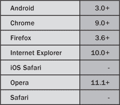
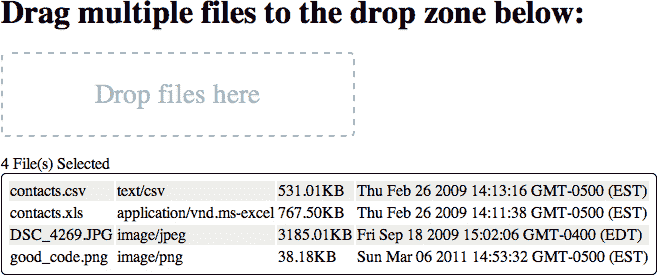
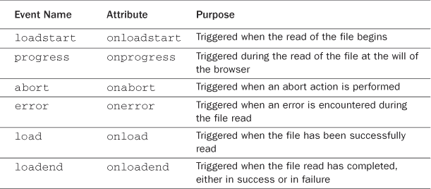
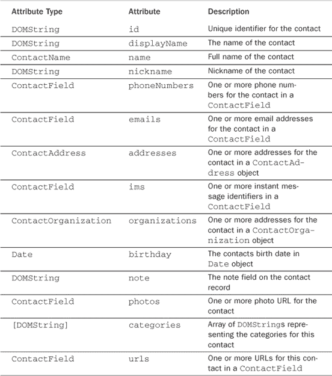
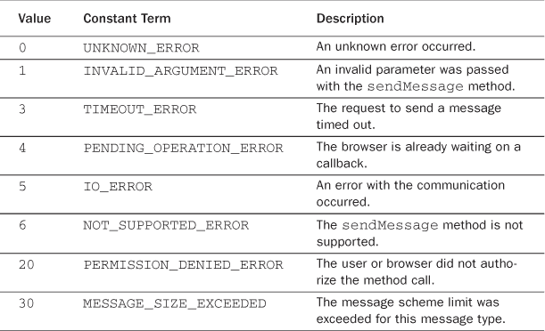
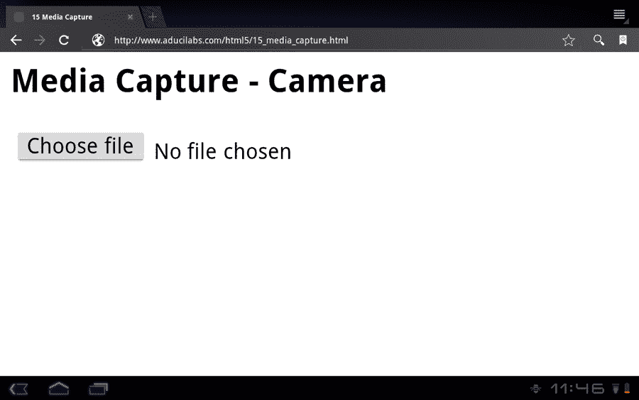
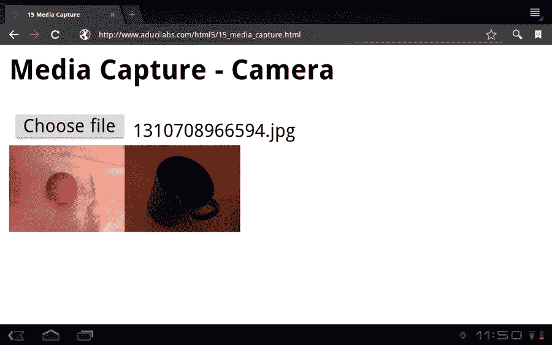
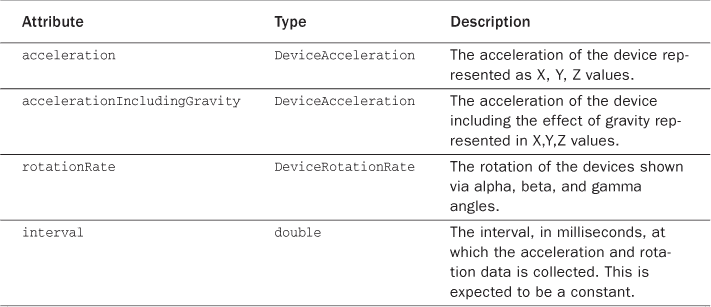

# HTML5 开发者秘籍


```html
<button id="btnCheckPermission">Check Permission Level</button>

<button id="btnGrabTweets">Grab Tweets</button>

</body>

</html>
```

```javascript
setTimeout(function() {event.currentTarget.cancel()}, 15000);

}

// 设置 onclose 事件处理器

notification.onclose = function() {

  // 记录通知已关闭

  console.log('Notification closed.');

}

// 设置 onerror 事件处理器

notification.onerror = function() {

  // 记录通知发生错误

  console.log('Notification Error.');

}

// 显示通知

notification.show();

break;

// web worker 已完成

case 'END':

  // 如果我们有最后一条推文，则将其存储以供下一次搜索

  if (msg.data.lastTweetId>0) {

    lastTweetId = msg.data.lastTweetId;

  }

  // 设置定时器在 1 分钟后再次搜索

  setTimeout('grabTweets()',60000);

  break;

}

}, false);

// 使用最后的推文 ID 启动 worker 搜索

tworker.postMessage(lastTweetId);

}

// window load 事件处理器

window.addEventListener('load',init,false);
```

# 从新推文中创建通知

先点击“Set Permission”以授权通知。
然后点击“Grab Tweets”开始监听新推文。

```html
<button id="btnSetPermission">Set Permission</button>
<button id="btnCheckPermissionLevel">Check Permission Level</button>
<button id="btnGrabTweets">Grab Tweets</button>
```

---

现在主页面已经完成，您需要创建一个 web worker JavaScript 文件，用于获取推文并对返回的任何推文进行解析，如列表 13.7 所示：

1. 为 web worker 创建一个`.js`文件，并带有`onmessage`处理器以接收来自主页的消息。`onmessage`处理器还将从[Twitter.com](http://Twitter.com)导入 REST API 脚本。
2. 添加`getResult`函数，这是`importScripts` REST API 调用的回调函数。该函数将处理任何获取推文的解析，并将它们发送回主线程进行显示。web worker 部分到此结束。

### 列表 13.7 利用 Web Worker 关注推文

---

```javascript
// 13_7_tweetworker.js

// 用于获取推文集的 web worker 线程

// 解析推文结果的回调函数

function getResult(data) {

  // 用于保存推文列表最大 ID 的变量

  var maxId = 0;

  // 检查是否有推文需要解析

  if (data.length>0) {

    // 用于通知的变量

    var tIcon = '';

    var tTitle = '';

    var tBody = '';

    // 反向遍历结果集

    for (var i=(data.length-1); i>=0; i--) {

      // 获取个人资料、显示名称和推文

      tIcon = data[i].user.profile_image_url;

      tTitle = data[i].user.screen_name;

      tBody = data[i].text;

      // ... 逻辑继续 ...

    }

  }

}
```

`END`消息将向主页面表示 web worker 已经完成了对任何推文的检索和处理。通过让 web worker 告诉你线程已完成，你可以确保没有多个工作器（线程）同时运行，并确保在 worker 完成和启动新 worker 之间留出指定的时间。`END`消息将包含最后一条推文 ID，或者如果没有检索到任何推文，则值为 0。如果需要，最后一条推文 ID 将更新书签，以跟踪最后检索到的消息。在设置最后一条推文 ID 后，将设置计时器以再次启动`grabTweets`函数。我们没有为这个配方添加停止功能，但你可以轻松地添加一个标志位来防止未来的检索，并在需要时取消当前的 web worker。在`grabTweets`函数的末尾，代码将通过发送一个将书签`lastTweetId`传递给 web worker 的消息来让 web worker 开始。

现在让我们进入 web worker 并简要回顾一下用户推文的检索过程。在 web worker 中，基本上分为两个部分：通过`onmessage`事件处理程序请求信息，以及在`getResult`函数中解析结果集。web worker 通过带有最后一条推文消息的消息启动，因此 web worker 的`onmessage`处理程序获取最后一条推文 ID，并利用工作器的`importScripts`方法创建一个 URL REST 请求。类似于使用内联`script`标签，`importScripts`简单地将外部脚本或一组脚本加载到 web worker 中。这允许你绕过跨域安全问题。在请求 URL 上，请确保使用回调查询字符串（querystring）选项来命名启动结果的`getResults`函数。此外，你还会根据是首次请求还是后续请求动态设置某些参数。请参考 Twitter API 文档以获取这些搜索选项的进一步说明。

一旦回调函数`getResults`带有 JSON 结果被调用，web worker 将通过检查数据长度是否大于 0 来检查是否有推文。如果长度大于 0（即你有推文需要解析），脚本将遍历结果的每个子项，并提取图像 URL、用户名和推文。一旦脚本获取了这些字段，web worker 就会向主线程发送一个包含通知信息的消息。发送消息后，web worker 将推文 ID 存储在变量中，并在处理结束时发送回主页面，作为下次开始的推文书签。你可能会发现脚本以反序解析推文结果集。这是因为第一条记录是最新的，最后一条记录是最旧的。因为你希望按照推文编写的顺序显示通知，所以你需要反向显示它们。这个配方展示了如何显示通知、自动删除，并将其与其他 API 结合，即使在用户可能没有查看页面事件的浏览器窗口时也能提醒用户。

### 总结

在本章中，你学习了一些较小的 API 扩展。拖放、离线存储 API 和通知 API 提供了极大提升网站和应用程序用户体验的手段。这些 API 提供了更高层次的集成，正在迅速消除浏览器体验与原生应用程序之间的差异。看到这些 API 扩展在未来如何被使用将是非常有趣的。

## 14. 处理本地文件

在 HTML5 之前，在客户端浏览器中处理文件很少受到关注和支持。通常，功能范围仅限于简单的选择文件以发布到 Web 服务器。通过 HTML5 和一组补充的 API 集合——File API，我们现在拥有了功能更丰富的功能，更重要的是拥有一套标准化的功能，可以通过 JavaScript 获取文件的基本属性并将不同类型的文件读取到客户端浏览器。在本章中，你将通过配方学习 File API 的新功能，这些配方将涵盖基础知识以及即将面世的一些新的 File API 规范。

### File API 概述

File API 提供了一种标准的方法来与客户端浏览器中用户选择的文件交互。File API 的接口可以分为三个功能区域：

- 在`FileList`接口中选择一个或多个文件
- 通过`File`接口检索有关文件的属性
- 通过`FileReader`接口读取实际文件

`FileList`接口是用户选择的文件列表，可以像数组一样遍历。`File`接口提供了所选文件的属性。通过这两个接口，脚本可以循环处理选定的文件并如下所示检索文件的关键属性：

- `name`: 文件名
- `type`: MIME 格式和 ASCII 编码的文件类型
- `size`: 以字节（bytes）为单位的文件大小
- `lastModifiedDate`: 文件最后修改的日期时间

### File API 安全

File API 与客户端设备上浏览器容器之外的信息和数据进行交互。这种与本地文件系统的交互自然地引发了对安全性的担忧。HTML5 File API 规范通过允许 JavaScript 只与用户提供访问权限的文件进行交互来处理文件读取访问的安全问题。在没有用户通过文件选择进行交互的情况下，File API 无法导航目录结构或选择文件。

表格 14.1 显示了支持 File API 的每个浏览器版本。然而，支持程度在浏览器之间有所不同，本章配方将在适用处进行说明。

表格 14.1 File API 浏览器可用性



### 初学者配方：获取文件属性

此配方将使用`File`接口获取用户通过文件输入框选择的文件名称、类型、大小和最后修改日期。在显示如何获取这些内容之前，配方将展示如何验证浏览器支持`FileList`接口。要显示属性（如列表 14.1 所示），请执行以下步骤：

1. 创建带有文件的空白 HTML 页面，并添加在选择文件时调用的`onchange`事件处理程序。
2. 在 HTML 主体中添加`fileAttributes`以显示属性。
3. 添加`handleFile`函数，并将`fileInput`作为参数。

列表 14.1 显示属性

```html
<!DOCTYPE html>

<html><head><meta charset="UTF-8" />

<title>14.1 获取文件</title>

<script>

// 处理选择的文件

function handleFile(fileInput) {

  // 引用我们的属性区域

  var fileAttributes = document.getElementById('fileAttributes');

  // 验证浏览器是否支持 files 

  if (fileInput.files) {

    // 使用 files 接口引用文件

    var file = fileInput.files[0];

    // 创建输出

    var output = '文件属性:<br>';

    output += '名称: ' + file.name + '<br>';

    output += '类型: ' + file.type + '<br>';

    output += '大小: ' + (file.size/1024).toFixed(2) + 'KB<br>';

    output += '最后修改日期: ' + file.lastModifiedDate;

    // 将输出设置到区域

    fileAttributes.innerHTML = output;

  } else {

    // 浏览器不支持 files 

    fileAttributes.innerHTML = '浏览器不支持 files ';

  }

}

</script>

</head>

<body>

  <h1>在下方选择文件：</h1>

  <section id="fileAttributes"></section>

  <input type="file" onchange="handleFile(this)">

</body>

</html>
```

```html
<input type="file" id="input" onchange="handleFile(this)" />

</section>

<br>

<section id="fileAttributes"></section>

</body>

</html>
```

---

当列表 14.1 中创建的页面访问者从文件输入元素的浏览按钮选择一个文件时，`onchange`事件处理程序将调用`handleFile`函数，并将文件元素作为参数传递。在`handleFile`函数内部，你首先获取显示区域元素的引用，然后检查并验证浏览器是否支持`FileList`接口。如果通过检查是否存在`Files`数组发现浏览器不支持`FileList`接口，则会在`fileAttributes`区域显示消息，但你可以通过继续执行逻辑或向访问者询问更多信息来处理这种情况。

如果支持`FileList`接口，你可以通过引用`Files`数组中的第一个文件`fileInput.files[0]`，从文件数组中获取特定的`File`实例。然后，你使用该`File`接口实例获取`name`、`type`、`size`和`lastModifiedDate`属性。对`size`属性进行了转换，因为它的单位是字节，而文件大小通常以千字节为单位。该公式将字节转换为千字节。你可以增强此功能，让一个函数接收字节并根据总字节数显示千字节、兆字节或其他单位的转换，就像普通目录列表中所做的那样。

---

### Note

`File`接口继承自`Blob`，因此它包含了`size`和`type`属性。通过`File`接口，增加了`name`和`lastModifiedDate`属性。然而，在多个浏览器平台中，`lastModifiedDate`是不可用的，在请求时将返回`undefined`值。

---

在本示例中，你获取了访问者选择的文件并显示了该文件的属性。这对于在上传到服务器之前对文件进行过滤，或者仅向用户显示确认都是非常方便的。下一个示例将扩展这一点，并为访问者提供一个选择多个待处理文件的接口。

### 初学者食谱：通过拖放处理多个文件

`FileList`接口提供了处理来自本地文件系统的`File`对象数组的能力。本示例展示了如何将拖放区域结合`FileList`来处理用户选择的多个文件。这有多种不同的用途，包括按名称、大小或类型过滤文件，以及由用户确认其所选的文件。一旦文件被拖放到释放区域，脚本将使用`length`属性遍历`FileList`序列。`length`属性返回`FileList`中元素（即`File`对象）的数量，并用于“遍历”文件序列。对于每个`File`对象，页面将在表格中显示文件属性，以向查看者确认什么被拖到了页面的释放区域。要创建此拖放页面，请遵循以下步骤和列表 14.2 中的代码：

1. 在列表 14.2 中创建页面，为释放区域和`filesSelected`区域带有`style`和`body`标签。确保`input`元素具有`multiple`属性和`onchange`事件处理程序。
2. 在`init`函数中添加释放区域监听器，并添加`handleFileDrop`和`handleDragOver`函数以启用释放区域。
3. 添加`displayFiles`函数以遍历所选文件并在表格中显示属性。
4. 添加`clearTable`函数和`addEventListener load`触发器。

#### 列表 14.2 使用 FileList 遍历多个文件

---

```html
<!DOCTYPE html>

<html>

<head>

<meta charset="UTF-8" />

<title>14.2 使用 FileList 处理多个文件</title>

<style>

#dropZone {

  width:300px;

  border: 2px dashed #bbb;

  -moz-border-radius: 5px;

  -webkit-border-radius: 5px;

  border-radius: 5px;

  padding: 25px;

  text-align: center;

  font: 20pt bold;

  color: #bbb;

}

#fileTable {

  border: 1px solid #000;

  -moz-border-radius: 5px;

  -webkit-border-radius: 5px;

  border-radius: 5px;

  padding: 5px;

  visibility:hidden;

}

tr:nth-child(odd)  { background-color:#eee; }

tr:nth-child(even) { background-color:#fff; }

</style>

<script>

// 初始化我们的释放区域

function init() {

  // 设置释放区域和监听器。

  dropZone = document.getElementById('dropZone');

  dropZone.addEventListener('dragover', handleDragOver, false);
```


```javascript
dropZone.addEventListener('drop', handleFileDrop, false);

}

// 处理文件

function handleFileDrop(evt) {

  // 停止拖放

  evt.stopPropagation();

  evt.preventDefault();

  // 获取文件列表

  files = evt.dataTransfer.files;

  // 显示文件列表

  displayFiles(files);

}

// 处理拖拽经过

function handleDragOver(evt) {

  // 关闭拖拽覆盖

  evt.stopPropagation();

  evt.preventDefault();

}

// 显示文件

function displayFiles(files) {

  // 清空表格

  clearTable();

  // 显示文件数量

  fileCount = document.getElementById('fileCount');

  fileCount.innerHTML = files.length + ' File(s)';

  // 设置表格

  fileTable = document.getElementById('fileTable');

  if (files.length>0) {

    var row;

    var cell;

    var textNode;

    // 遍历文件列表创建行

    for (var i=0; i<files.length; i++) {

      // 添加行

      row = fileTable.insertRow(i);

      // 添加名称单元格

      cell = row.insertCell(0);

      textNode = document.createTextNode(files[i].name);

      cell.appendChild(textNode);

      // 添加类型单元格

      cell = row.insertCell(1);

      textNode = document.createTextNode(files[i].type);

      cell.appendChild(textNode);

      // 添加大小单元格

      cell = row.insertCell(2);

      textNode = document.createTextNode((files[i].size/1024).toFixed(2)+'KB');

      cell.appendChild(textNode);

      if (files[i].lastModifiedDate != undefined) {

        // 添加文件修改日期单元格

        cell = row.insertCell(3);

        textNode = document.createTextNode(files[i].lastModifiedDate);

        cell.appendChild(textNode);

      }

    }

    fileTable.style.visibility = 'visible';

  } else {

    fileTable.style.visibility = 'hidden';

  }

}

// 清空表格

function clearTable() {

  // 获取我们的表格

  var fileTable = document.getElementById('fileTable');

  // 循环并移除现有行

  while (fileTable.rows.length>0) {

    fileTable.deleteRow(fileTable.rows.length-1);

  }

}

// 初始化窗口

window.addEventListener('load',init,false);

</script>

</head>

<body>

  <h1>将多个文件拖到下面的释放区域：</h1>

  <section id="fileSelection">

    <!--

    // 多文件部分也可以通过 multiple 属性实现

    <input type="file" id="input" multiple="true" onchange="displayFiles(this.files)">

    -->

    <div id="dropZone">将文件拖到这里</div>

  </section>

  <section id="filesSelected">

    <br>

    <div id="fileCount"></div>

    <table id="fileTable">

    </table>

  </section>

</body>

</html>
```

页面在浏览器中加载后，将通过窗口`load`事件监听器调用的`init`函数初始化拖放区域。`init`将`dropzone`变量设置为`dropzone div`，并为`dragover`和`drop`事件注册两个事件监听器。当触发`dragover`事件时，将调用`handleDragOver`函数；当触发`drop`事件时，将调用`handleFileDrop`函数。当文件被拖放到拖放区域并调用`handleFileDrop`时，脚本将检索`FileList`并将其传递给`displayFiles`方法。

`displayFiles`函数调用辅助函数`clearTable`来清除任何之前的结果。`clearTable`会从表格中删除行，直到所有行都被删除。接下来，`displayFiles`检查`FileList`的长度，以验证文件是否已拖入拖放区域。脚本使用索引遍历`FileList`以获取每个`File`接口。对于每个`File`对象，将检索属性并将其作为新行中的新单元格添加到表格中。最后，脚本通过将表格设为可见来显示表格，如图 14.1 中的示例执行所示。

图 14.1 显示拖动并放置到页面的文件多个属性的示例输出



通过使用拖放区域和`FileList`序列，HTML5 让访问者轻松将文件提交到客户端页面。然而，到目前为止，你查看的是文件的属性而不是文件中的数据。在本章的剩余部分中，你将学习如何在客户端 JavaScript 中读取不同类型的文件。

提示

继承自`Blob`接口的`File`接口的`type`属性返回文件的多用途邮件扩展（MIME）类型。MIME 类型是全小写且 ASCII 编码的`DOMString`。此 MIME 类型字符串可以用于根据`image`或类似的文件类型进行过滤。如图 14.1 所示，这里有两张不同类型的图像，但 MIME 以`image`开头，因此你可以轻松验证这两个文件都是图像。正如你将在下一节中看到的，MIME 类型提供了一种执行文件过滤和验证的简单有效的方法。

### `FileReader` 接口

为了将文件读取到客户端内存中，HTML5 File API 提供了一个名为`FileReader`的新接口。该接口提供了方法、属性和事件，允许开发者从客户端 JavaScript 异步读取文件。通过`FileReader`事件，你可以显示或处理文件数据。可以读取不同类型的文件，因为`FileReader`接口具有四种不同的读取方法，取决于你可能读取的文件类型：

- `readAsArrayBuffer(Blob)`：将文件内容作为`ArrayBuffer`返回
- `readAsBinaryString(Blob)`：将文件内容作为二进制字符串返回
- `readAsText(Blob [,encoding])`：将文件内容作为文本`DOMString`返回
- `readAsDataURL(Blob)`：将文件内容作为数据 URL 的`DOMString`返回

由于`FileReader`接口是异步的，这允许页面的主线程继续处理，同时使用事件来捕获文件读取的关键阶段。表 14.2 显示了作为`FileReader`接口一部分定义的事件。

表 14.2 `FileReader` 事件



通过使用适当`FileReader`读取方法并监听`FileReader`事件，你可以使用`FileReader`接口在客户端浏览器中执行通常在上传文件后在服务器上发生的工作。在下一个配方中，你将使用`readAsDataURL`方法在用户的浏览器中创建选中图像的缩略图，并显示它们相应的属性。

注意

通过结合 Web Worker 使用`FileReaderSync`，可以将文件读取作为同步接口，因为 Web Workers API 允许方法在不同于主线程的线程上操作。`FileReaderSync`具有与`FileReader`相同的方法。关于同步 File API 使用的信息，请参考 W3C 工作草稿。

### 中级配方：通过 `readAsDataURL` 预览图像

`FileReader`接口的`readAsDataURL`方法接收提供的`Blob`或`File`引用并将数据读取到可以在适当容器中加载的 URL。在这个配方中，你将让访问者选择多个文件，然后从文件中过滤出图像，通过`readAsDataURL`读取它们，并将它们加载到图像容器中作为缩略图查看。通常，在 HTML5 File API 出现之前，要实现此功能，你需要将文件上传到服务器，在服务器上进行处理，然后将它们加载到客户端浏览器页面。这增加了往回发送文件和在服务器上处理文件的开销。通过使用 HTML5 File API，你可以省去往回发送文件的需求，并利用客户端机器的计算能力来执行文件的处理。

此配方将使用`readAsDataURL`方法配合`onload FileReader`事件来读取选定的文件。此外，配方将显示文件的属性。要开始此配方，请在列表 14.3 中执行以下步骤：

1. 创建一个空白 HTML 文件并添加`body`。
2. 添加`style`部分。
3. 在脚本中添加`handleFiles`函数。
4. 添加`showFile`函数。
5. 添加`clearFile`函数。

列表 14.3 使用 `readAsDataURL` 预览图像

```html
<!DOCTYPE html>

<html>

<head>

<meta charset="UTF-8" />

<title>14.3 imgPanel</title>

<style>

.highlight,.unhighlight {

max-height:100px;

max-width:100px;

-moz-border-radius: 5px;

-webkit-border-radius: 5px;

border-radius: 5px;

margin:10px;

}

.highlight {

border: 5px solid #6f0;

}

.unhighlight {

border: 5px solid #000;

}

</style>

<script>

// load the image files

function handleFiles(files) {

  // set our defaults

  var fileLimit = 10; // maximum files at one time

  var sizeLimit = 500; // KB file limit

  var imageType = /image.*/ // mime type of images

  // reference the image panel and clear

  var imgPanel = document.getElementById('imgPanel');

  imgPanel.innerHTML = '';

  // calculate the file size in bytes

  var sizeLimitBytes = sizeLimit*1024;

  // check if the number of files is greater than

  if (files.length<fileLimit) {

    // loop through the filelist

    for (var i = 0; i < files.length; i++) {

      // reference the current file

      var file = files[i];

      // verify the file is an image

      if (file.type.match(imageType)) {

        // verify the file is not above the max size

        if (file.size<sizeLimitBytes) {

          // create an image container for the file

          var img = document.createElement("img");

          img.file = file;

          img.className = 'unhighlight';

          img.addEventListener('mouseover', showFile, false);

          img.addEventListener('mouseout', clearFile, false);

          imgPanel.appendChild(img);

        }

      }

    }

  }

}

</script>
```

```javascript
// create our reader to read the file

var reader = new FileReader();

// set the onload event of the reader

reader.onload = (function(aImg) { return function(e) { aImg.src = e.target.result; }; })(img);

// read the file as a data url for the image

reader.readAsDataURL(file);

} else {

  // file is too big

  alert(file.name+' is larger than '+sizeLimit+'KB.');

}

} else {

  // file is not an image mime type

  alert(file.name+' is not an image.');

}

}

} else {

// too many files were selected

imgPanel.innerHTML = 'Only '+fileLimit+' files can be selected at a time.';

}

}

// display the info on the image moused over

function showFile() {

  // highlight the current image

  this.className = 'highlight';

  // get references to our attributes panel and file

  var fileAttributes = document.getElementById('fileAttributes');

  var file = this.file;

  // create our file info

  var fileinfo = 'File info:<br>';

  fileinfo += file.name + '<br>';

  fileinfo += file.type + '<br>';

  fileinfo += (file.size/1024).toFixed(2) + 'KB<br>';

  fileinfo += file.lastModifiedDate + '<br>';

  // display the file info

  fileAttributes.innerHTML = fileinfo;

}

// reset after rolling off of image

function clearFile() {

  // clear the file attributes panel

  var fileAttributes = document.getElementById('fileAttributes');

  fileAttributes.innerHTML = '';

  // set highlight on image back to normal

  this.className = 'unhighlight';

}
```


```
</script>
</head>

<body>
  <h1>选择图片以进行预览。</h1>
  <section>
    <input type="file" id="input" multiple="true" onchange="handleFiles(this.files)">
  </section>
  <section id="imgPanel"></section>
  <section id="fileAttributes"></section>
</body>
</html>
```

当 Listing 14.3 中的页面加载时，访问者会被提示选择一个文件或一组文件。选择文件后，输入元素的`onchange`事件会被触发，从而启动`handleFiles`函数并传递已选择的文件。`handleFiles`函数是脚本的核心，它首先设置了关键的默认值。这些默认值包括允许的最大文件数、每个文件的最大大小，以及一个用于匹配图像 MIME 类型的正则表达式。限制文件大小和文件数量是为了防止客户端浏览器内存过载，因为处理将在客户端机器的内存中进行。在本食谱中，你将循环遍历文件，这将创建多个同时运行的`FileReader`。脚本在处理上可以变得更智能一些，例如维护一个读取器池，在读取器释放之前不获取下一个文件，但我们将这一步留给你来决定。

接下来，脚本会检查你的文件数量是否少于最大值，如果不是，则显示相应的消息。如果文件数量在可控范围内，你将遍历`FileList`并通过匹配 MIME 类型验证每个文件是否为图像，同时确保每个文件都小于你设置的最大文件大小。如果每个文件都符合这些要求，该食谱将创建一个图像容器，其属性包括用于显示属性的`mouseover`和`mouseout`事件。现在，脚本准备好通过为每个图像创建一个新的`FileReader`来读取文件。脚本在`FileReader`上设置了`onload`事件，将`FileReader`的结果加载到图像元素的源属性中，从而创建实际的缩略图，如图 14.2 所示。

图 14.2


### 高级食谱：使用`FileReader`解析 CSV

除了新方法`readAsText`外，该食谱还将使用`FileReader`上的一个函数`abort`。该方法允许脚本或用户中止读取过程。当`abort`方法被调用并成功时，`FileReader`会抛出`ABORT_ERR`以验证中止已发生。

在本食谱中，你将探索`FileReader`提供的最后一个事件处理器之一的`onprogress`。`onprogress`事件处理器提供了读取文件的进度通知，并可向用户显示状态。`onprogress`事件处理器包含三个属性：`lengthComputable`、`loaded`和`total`。`lengthComputable`属性是一个布尔标记，标记`loaded`和`total`属性可用。`loaded`属性是读入内存的字节数，而`total`是要读取的总字节数。通过将`progress.loaded`除以`progress.total`，你可以计算出一个给用户的完成百分比。在本食谱中，随着文件读取到内存，页面将显示一个指示状态的进度条。不过要注意，`progress`事件取决于浏览器对`FileReader`接口的实现，因此无法保证事件会在何时或以何种频率触发。以下步骤将创建 Listing 14.4 中的代码：

1. 创建一个空白的 HTML 页面，其中包含 HTML`body`和`style`标签，如 Listing 14.4 所示，包括文件选择、取消按钮、文件信息部分和文件输出的`div`。

2. 添加`style`标签以及各种类的样式设置，包括隐藏取消按钮。

3. 添加`script`标签以及对名为`textReader`的`FileReader`实例的全局引用。这将是用于读取所选 CSV 文件的`FileReader`实例。

4. 添加`addEventListener load`行以及`init`函数，该函数用于为`textReader`事件注册相应的函数。

5. 添加相应的事件函数：`onErrorHandler`、`updateProgress`、`onAbortHandler`、`onLoadStartHandler`和`onLoadHandler`。

6. 添加`cancelFileReader`函数，允许访问者中止读取过程。

7. 添加`handleFile`函数，该函数通过`readAsText FileReader`方法启动对选文件的读取过程。

### Listing 14.4 显示 CSV 文件的内容

```html
<!DOCTYPE html>
<html>
<head>
<meta charset="UTF-8" />
<title>14.4 Basic File API</title>
<style>
#fileInfo {
  border: 1px solid #000;
  -moz-border-radius: 5px;
  -webkit-border-radius: 5px;
  border-radius: 5px;
  padding: 5px;
  visibility:hidden;
}
#progHolder {
  float:right;
  width:200px;
  height:30px;
  border:solid;
  border-width:1px;
  background-color:#999;
  text-align:center;
}
#progMeter {
  width:0px;
  height:30px;
  background-color:#9FF;
}
#btnCancel {
  visibility:hidden;
}
</style>
<script>
// set up a filereader
var textReader = new FileReader();
function init() {
  // set up our filereader handlers
  textReader.onerror      = onErrorHandler;
  textReader.onprogress  = updateProgress;
  textReader.onabort     = onAbortHandler;
  textReader.onloadstart = onLoadStartHandler;
  textReader.onload      = onLoadHandler;
}
// handle the selected file
function handleFile(inputFile) {
  // the csv mime type for regular expression
  var csvMimeType = /text\/csv/;
  // reference our selected file
  var file = inputFile.files[0];
  // verify that the file is a csv file
  if (file.type.match(csvMimeType)) {
    // make the file info section visible
    var fileInfo = document.getElementById("fileInfo");
    fileInfo.style.visibility = 'visible';
    // kick off the reader to read the csv file
    textReader.readAsText(file);
    // set our file info - the filereader is asynchronous
    // so this will display
    var output = 'File attributes:<br>';
    output += 'name: ' + file.name + '<br>';
    output += 'type: ' + file.type + '<br>';
    output += 'size: ' + (file.size/1024).toFixed(2) + 'KB<br>';
    output += 'last modified date: ' + file.lastModifiedDate;
    // display the file attributes
    var fileAttributes = document.getElementById('fileAttributes');
    fileAttributes.innerHTML = output;
  } else {
    // inform user that the file is not a csv
    alert(file.name + ' is not a CSV file.');
  }
}
// cancel filereader function
function cancelFileReader() {
  // tell the filereader to abort
  textReader.abort();
}
// triggered filereader onloadstart handler
function onLoadStartHandler(evt) {
  // get our local element references
  var btnCancel = document.getElementById('btnCancel');
  var progMeter = document.getElementById('progMeter');
  var fileoutput = document.getElementById('fileoutput');
  // reset our cancel button, progress meter, and file output
  btnCancel.style.visibility = 'visible';
  progMeter.style.width = '0%';
  progMeter.innerHTML = 'loading...';
  fileoutput.innerHTML = '';
}
// triggered filereader onload handler
function onLoadHandler(evt) {
  // set our progress meter to 100% and hide the cancel button
  var progMeter = document.getElementById('progMeter');
  var btnCancel = document.getElementById('btnCancel');
  progMeter.style.width = '100%';
  progMeter.innerHTML = 'loaded.';
  btnCancel.style.visibility = 'hidden';
  // split the file into an array for processing
  var fileArr = evt.target.result.split('\n');
  // process each row and set to a table
  // this is a simplistic processing for csv
  // does not handle differences in csv format
  var strDiv = '<<table>>';
  for (var i=0; i<fileArr.length; i++) {
    strDiv += '<tr>';
    var fileLine = fileArr[i].split(',');
    for (var j=0; j<fileLine.length; j++) {
      strDiv += '<td>' + fileLine[j] + '</td>';
    }
    strDiv += '</tr>';
  }
  strDiv += '</table>';
}
</script>
...
```


```html
<!DOCTYPE html>
<html>
<head>
<meta charset="UTF-8" />
<title>14.4 Basic File API</title>
<style>
#fileInfo {
  border: 1px solid #000;
  -moz-border-radius: 5px;
  -webkit-border-radius: 5px;
  border-radius: 5px;
  padding: 5px;
  visibility:hidden;
}
#progHolder {
  float:right;
  width:200px;
  height:30px;
  border:solid;
  border-width:1px;
  background-color:#999;
  text-align:center;
}
#progMeter {
  width:0px;
  height:30px;
  background-color:#9FF;
}
#btnCancel {
  visibility:hidden;
}
</style>
<script>
// set up a filereader
var textReader = new FileReader();
function init() {
  // set up our filereader handlers
  textReader.onerror      = onErrorHandler;
  textReader.onprogress  = updateProgress;
  textReader.onabort     = onAbortHandler;
  textReader.onloadstart = onLoadStartHandler;
  textReader.onload      = onLoadHandler;
}
// handle the selected file
function handleFile(inputFile) {
  // the csv mime type for regular expression
  var csvMimeType = /text\/csv/;
  // reference our selected file
  var file = inputFile.files[0];
  // verify that the file is a csv file
  if (file.type.match(csvMimeType)) {
    // make the file info section visible
    var fileInfo = document.getElementById("fileInfo");
    fileInfo.style.visibility = 'visible';
    // kick off the reader to read the csv file
    textReader.readAsText(file);
    // set our file info - the filereader is asynchronous
    // so this will display
    var output = 'File attributes:<br>';
    output += 'name: ' + file.name + '<br>';
    output += 'type: ' + file.type + '<br>';
    output += 'size: ' + (file.size/1024).toFixed(2) + 'KB<br>';
    output += 'last modified date: ' + file.lastModifiedDate;
    // display the file attributes
    var fileAttributes = document.getElementById('fileAttributes');
    fileAttributes.innerHTML = output;
  } else {
    // inform user that the file is not a csv
    alert(file.name + ' is not a CSV file.');
  }
}
// cancel filereader function
function cancelFileReader() {
  // tell the filereader to abort
  textReader.abort();
}
// triggered filereader onloadstart handler
function onLoadStartHandler(evt) {
  // get our local element references
  var btnCancel = document.getElementById('btnCancel');
  var progMeter = document.getElementById('progMeter');
  var fileoutput = document.getElementById('fileoutput');
  // reset our cancel button, progress meter, and file output
  btnCancel.style.visibility = 'visible';
  progMeter.style.width = '0%';
  progMeter.innerHTML = 'loading...';
  fileoutput.innerHTML = '';
}
// triggered filereader onload handler
function onLoadHandler(evt) {
  // set our progress meter to 100% and hide the cancel button
  var progMeter = document.getElementById('progMeter');
  var btnCancel = document.getElementById('btnCancel');
  progMeter.style.width = '100%';
  progMeter.innerHTML = 'loaded.';
  btnCancel.style.visibility = 'hidden';
  // split the file into an array for processing
  var fileArr = evt.target.result.split('\n');
  // process each row and set to a table
  // this is a simplistic processing for csv
  // does not handle differences in csv format
  var strDiv = '<table>';
  for (var i=0; i<fileArr.length; i++) {
    strDiv += '<tr>';
    var fileLine = fileArr[i].split(',');
    for (var j=0; j<fileLine.length; j++) {
      strDiv += '<td>' + fileLine[j] + '</td>';
    }
    strDiv += '</tr>';
  }
  strDiv += '</table>';
}
</script>
</head>
<body>
</body>
</html>
```

在读取文件时，你通过在`FileReader`触发`onprogress`事件时调用`updateProgress`方法来更新进度条。`updateProgress`方法通过检查属性`lengthComputable`来验证`loaded`和`total`属性是否可用。该属性基本上表示，如果为真，则`loaded`和`total`属性可用。`updateProgress`将使用`loaded`和`total`计算完成的百分比，并通过进度条显示此值，该进度条是通过设置`progHolder div`中`progMeter div`的宽度构建的。

如果`FileReader`完成了文件读取，则将触发`onload`事件，并调用`onLoadHandler`函数，将事件结果作为参数传递给该方法。在方法中，你关闭取消按钮并将进度标记为100%，这样访问者就知道文件已读取到内存中。由于CSV文件是基于行内容的，你接下来通过执行以下代码按换行符分割结果，以创建一个行数组：

```javascript
var fileArr = evt.target.result.split('\n');
```

结果引用是内存中的文本文件。在你将结果分割成行数组或逗号分隔值数组后，脚本将遍历每个数组元素，并按逗号字符分割值。当脚本遍历每一行时，值会被添加到输出字符串中，当所有行处理完成后，该字符串将显示在文件输出`div`中，如图14.3所示。

本食谱中用于解析逗号分隔值文件的方法相当简单；它没有处理嵌入值中的逗号等情况，也不理解引号值和未引号值之间的区别。你可以在网上找到更全面的解析方法，但为了演示`readAsText`方法是如何工作的，本食谱使用了一个简单的模型。

本食谱通过取消按钮包含了中止选项。如果访问者在`FileReader`读取文件时点击取消按钮，将调用`cancelFileReader`方法，该方法反过来调用`FileReader`实例`textReader`的`abort`方法。这指示`FileReader`实例取消读取过程，从内存中移除已读取的任何信息，并触发`onabort`事件。随后，脚本将通过`onAbortHandler`方法捕获`onabort`事件并向访问者显示消息，确认取消读取。

你还会注意到脚本包含一个针对通过`onerror`事件传递的任何错误的错误处理器。当读取过程被中止时，会创建一个名为`ABORT_ERR`的错误事件，并带有此错误调用`onErrorHandler`方法。由于你已经在其他地方处理了中止，脚本将简单地忽略此错误。然而，可能会遇到的其他错误将通过向用户显示适当的消息来处理。

本食谱展示了使用`FileReader`接口在客户端浏览器上处理CSV文件的强大。CSV文件解析的结果可以进行过滤、显示并打包传输到Web服务器，而无需服务器端进行任何工作。本食谱包含了读取文件、中止过程以及处理可能发生的错误的功能。这应该为你在自己的网页中开始处理文件提供一个模板。

### File API扩展规范

此时你可能在想，是否可以导航到系统目录、创建文件并向它们写入内容。目前正在基于File API准备两个新的规范来处理这些精确的用例。第一个是File API: Directories and System（目录与系统），第二个是File API: Writer（写入器）规范。这些规范已经过了几个版本并且仍在变动中，因此许多浏览器尚未实现它们。事实上，目前只有Chrome浏览器支持这些扩展的File API对象和方法。

> **注意**
>
> 在Chrome 12及更高版本中，浏览器使用了`requestFileSystem`调用的自定义版本`webkitRequestFileSystem`。该调用的参数是相同的，但你可能需要根据Chrome版本有条件地使用正确的调用。理想情况下，随着规范的完善和更多浏览器支持File API规范，这些调用将再次变得通用并在全范围内保持一致。

在Directories和Writer File APIs中有多个对象和方法，但几个对于本食谱以及与文件系统和文件的操作至关重要。以下是一些更有实用的目录和系统接口：

- `FileSystem`：代表正在操作的文件系统
- `Entry`：代表文件系统中的通用条目
- `DirectoryEntry`：代表文件系统中的目录
- `FileEntry`：代表文件系统中的文件

这里是一些更有实用的文件写入器接口：

- `BlobBuilder`：用于管理与文件接口配合数据`Blob`
- `FileSaver`：用于监控写入事件和进度
- `FileWriter`：用于写入、截断和追加文件

`DirectoryEntry`和`FileEntry`接口构建在`Entry`接口之上，该接口具有标准的复制、移动和删除方法。Directories和Writer API set具有相应的事件和一组可能的错误。此外，API提供了用于嵌入式使用的异步调用，以及用于web workers的同步调用。每个接口都有方法和属性，我们建议你查阅最新的规范以获取当前信息。然而，表14.4描述了本章将利用的一些方法。

表14.4 关键目录与系统及写入方法


`FileWriter`接口还有`length`和`position`属性，可用于定位文件中写入信息的位置。

多个方法与目录和系统相关，包括复制和移动，以及可以在普通目录资源管理器中找到的文件和目录属性。这些方法和属性将能够让你轻松创建自己的文件目录管理器。遗憾的是，我们这里没有空间创建一个这样的食谱，但你可以在Directories and System规范中找到使用这些方法和属性的所有信息。不过，需要注意的是，这些接口似乎处理的是由浏览器出于安全目的针对源域特定沙箱“生成”的文件系统。

### 高级食谱：创建本地文件

在本食谱中，你将创建一个使用本地文本文件存储用户添加的电子邮件地址列表的页面。该页面将允许用户添加电子邮件地址（并将其追加到文件中）、从文件中显示电子邮件地址列表以及删除文件。

> **注意**
>
> 由于目前还没有安全权限界面允许用户授权浏览器访问本地文件存储，你必须通过在启动浏览器时带有两个参数来指示Chrome浏览器已授权：`--unlimited-quota-for-files`和`--allow-file-access-from-files`。要在带有参数启动浏览器，可以在Mac OS上启动Terminal并使用以下命令：

```bash
open /Applications/Google Chrome.app --n --args --unlimited-quota-for-files --allow-file-access-from-files
```

此命令将启动Chrome浏览器，并传入命令行参数，指示浏览器允许访问文件并为文件设置无限制配额。如果您不以这种方式启动Chrome，将会收到安全或权限错误，导致您无法访问文件系统。

该脚本通常会使用`requestFileSystem`方法来获取本地文件系统的引用；然而，在Chrome 12及更高版本中，由于规范一直在变动中，浏览器使用了该方法的自定义版本`webkitRequestFileSystem`。此外，脚本中使用了条件逻辑，根据浏览器版本通过`BlobBuilder`或`WebKitBlobBuilder`创建`Blob`对象。要创建此页面，请执行以下步骤以创建列表14.5：

1. 创建一个空白的HTML文件，并添加来自列表14.5的`body`部分HTML内容，其中包含电子邮件输入元素、多个`button`元素以及用于显示电子邮件地址列表的显示`div`。
2. 添加`fileErrorHandler`函数，该函数将处理异步代码遇到的任何目录或文件错误。
3. 在列表14.3所示脚本中添加`fileAction`函数，该函数获取文件引用并根据用户请求的操作作为分发器。
4. 添加`writeToFile`、`readFromFile`和`removeFile`函数，这些函数将根据传入的文件引用处理特定的操作。
5. 为页面加载添加事件监听器，该器将触发`fileAction`方法，以便在存储文件存在时显示任何电子邮件地址。

### 列表14.5 在本地文件中存储电子邮件列表


```html
<!DOCTYPE html>
<html>
<head>
<meta charset="UTF-8" />
<title>14.5 异步创建文件 / 写入</title>
<script>
// File API 错误处理器
function fileErrorHandler(e) {
  var msg = '';
  // 根据代码设置相应的错误消息
  switch (e.code) {
    case FileError.NOT_FOUND_ERR:
      msg = '未找到文件或目录。';
      break;
    case FileError.SECURITY_ERR:
      msg = '发现安全问题。';
      break;
    case FileError.NOT_READABLE_ERR:
      msg = '无法读取文件或目录。';
      break;
    case FileError.ENCODING_ERR:
      msg = '文件或目录地址格式错误。';
      break;
    case FileError.NO_MODIFICATION_ALLOWED_ERR:
      msg = '无法修改文件或目录。';
      break;
    case FileError.INVALID_STATE_ERR:
      msg = '文件或目录状态错误。';
      break;
    case FileError.SYNTAX_ERR:
      msg = '写入文件时语法错误。';
      break;
    case FileError.INVALID_MODIFICATION_ERR:
      msg = '请求的操作无效。';
      break;
    case FileError.QUOTA_EXCEEDED_ERR:
      msg = '存储配额剩余空间不足。';
      break;
    case FileError.TYPE_MISMATCH_ERR:
      msg = '文件或目录类型不匹配。';
      break;
    case FileError.PATH_EXISTS_ERR:
      msg = '路径已存在。';
      break;
    default:
      msg = '未知文件 API 错误。';
      break;
  }
  console.log('File API error: ' + msg);
}
// 获取文件 System 并分发操作的
function fileAction(actionType) {
  var fileName = 'HTML5FileText.txt';
  // 开始处理文件系统的异步过程
  // 获取 fileSystem
  window.webkitRequestFileSystem(window.PERSISTENT, 1024 * 1024, function(fileSystemObj) {
    // 获取文件的引用，如果文件不存在则创建该文件
    fileSystemObj.root.getFile(fileName, {create:true}, function(fileEntry) {
      // 分发给处理器
      switch (actionType) {
        case 'write':
          writeToFile(fileEntry);
          break;
        case 'read':
          readFromFile(fileEntry);
          break;
        case 'remove':
          removeFile(fileEntry);
          break;
      }
    }, fileErrorHandler);
  }, fileErrorHandler);
}
// 用于向文件添加条目的异步处理器
function writeToFile(fileEntry) {
  // 创建指向文件的写入器
  fileEntry.createWriter(function(fileWriter) {
    // 写入器的 onwriteend 
    fileWriter.onwriteend = function(e) {
      console.log('写入文件成功。');
      readFromFile(fileEntry);
    };
    // 写入器的 onerror 
    fileWriter.onerror = function(e) {
      console.log('写入文件失败: ' + e.toString());
    };
    // 创建用于添加到文件的 blob
    var bb = new (window.BlobBuilder || window.WebKitBlobBuilder)();
    var emailToAdd = document.getElementById('emailAddress').value + "<br/>";
    bb.append(emailToAdd);
    // 移动到文件末尾然后添加 blob
    fileWriter.seek(fileWriter.length);
    fileWriter.write(bb.getBlob('text/plain'));
  }, fileErrorHandler);
}
// 读取文件的异步处理器
function readFromFile(fileEntry) {
  // 获取文件
  fileEntry.file(function(file) {
    // 创建文件读取器
    var reader = new FileReader();
    // onloadend
    reader.onloadend = function(e) {
      // 显示结果
      var emailDiv = document.getElementById('emailList');
      emailDiv.innerHTML = this.result;
    };
    // 使用 reader 读取文件
    reader.readAsText(file);
  }, fileErrorHandler);
}
// 删除文件的异步处理器
function removeFile(fileEntry) {
  // 删除文件
  fileEntry.remove(function() {
    console.log('文件已删除。');
  }, fileErrorHandler);
}
// 默认读取文件
window.addEventListener('load',fileAction('read'),false);
</script>
</head>
<body>
  <input type="email" id="emailAddress" />
  <button onClick="fileAction('write');">添加电子邮件</button>
  <button onClick="fileAction('read');">读取电子邮件</button>
  <button onClick="fileAction('remove');">删除文件</button>
  <br/><br/>
  <div id="emailList"></div>
</body>
</html>
```

要创建列表 14.5 所示的页面，请确保通过命令行启动 Chrome，并传入提供本地文件系统权限的参数。如果不带这些参数启动 Chrome，则页面将无法处理本地文件。当页面加载时，页面将被指示从文件中加载任何电子邮件并显示它们（如果文件当前存在）。这是通过调用`fileAction`函数并传入`read`参数来实现的

在你掌握了文件系统后，脚本将在文件系统根对象上执行`getFile`方法，传入文件名、打开参数、成功回调和错误处理程序。在这种情况下，当你获取文件时，通过将`create`标志设置为`true`来通知该方法在文件不存在时创建该文件。如果该标志被设置为`false`，则该方法在文件不存在时不会创建文件，仅作为打开函数运行。在获取文件条目后，脚本会将流程分发到`readFromFile`函数，该函数通过获取文件并通过文件读取对象实例进行读取来继续异步流程。当文件读取对象完成文件读取后，结果将显示在结果`div`中，如图 14.4

现在文件已经创建，用户可以通过输入电子邮件地址并点击“添加电子邮件”（Add Email）按钮来添加，这将触发`fileAction`。`fileAction`将启动`writeToFile`，你将在其中创建一个`fileWriter`来处理文本写入文件的操作。脚本首先为`fileWriter`完成后设置了处理程序`onwriteend`，以及当由于任何原因文本写入失败时设置的`onerror`。脚本使用`BlobBuilder`为输入的电子邮件地址创建一个`Blob`对象。在这种情况下，我们根据条件选择接口，因为它在不同版本的 Chrome 之间存在差异。然后，脚本使用文件写入器的`seek`方法根据`length`属性将位置移动到文件末尾，然后调用写入命令以文本格式添加`Blob`。注意，在将地址附加文件时，你在每个电子邮件地址的末尾添加了 HTML 换行符`<br/>`。这完全是为了方便在读取文件时在`div`中显示多个电子邮件地址。你可以以最适合你信息的布局格式化文件数据。在完成新电子邮件地址写入文件后，脚本将触发读取以更新页面上显示的列表。

最后，脚本为文件提供了删除选项，该选项调用了`FileEntry`上的`remove`方法。这将从文件系统中删除文件。如果你离开页面并返回而不删除文件，该文件将持久存在，因为你已经通过`webkitRequestFileSystem`调用请求文件系统持久化文件。在未来的几个月里，这些规范应该会有很大的进展，预计各种浏览器制造商将开始更多地整合“File API：目录和系统 API”以及“File API：写入器 API”。

### 总结

在本章中，演示的示例展示了如何通过客户端浏览器中新的 File API 查看文件属性并读取文件。此外，你还学习了一些较新的文件规范，这些规范将增加除读取文件之外的功能。通过将通常必须通过服务器端处理的工作负载转移到客户端浏览器，你可以将处理过程分布到客户端机器上，并提高访问者的整体体验。

## 15. 集成设备数据

在过去的 20 年里，超文本标记语言（HTML）取得了长足的发展，并通过浏览器创建者以及 W3C 工作组等各个小组的工作不断演进。我们所熟知的 HTML5 是 HTML 标签和属性、JavaScript API 以及 CSS 样式的集合。在书中，我们涵盖了许多作为 HTML5 部分创建的扩展 API。然而，为了提升用户浏览器体验的努力并没有停止，事实上，随着用户使用越来越多的移动设备，这种努力变得比以往任何时候都更强。在过去的几年里，新型移动设备爆炸式增长，它们与过去的手机有根本区别。设备不再仅仅是一个具有许多其他功能的手机，而是一个手机仅作为其中一项功能的移动设备。

在本章中，你将学习浏览器体验中最令人兴奋和全新的领域之一：与设备功能的集成，例如摄像头、麦克风、陀螺仪、加速度计，以及联系人数据库、日历应用和相册库等设备应用程序。通过这些设备 API，预计网页能够执行广泛的功能，包括视频会议、在用户日历中安排预约、从用户图库中插入图片、电池电量检查或其他通常局限于原生设备应用程序或专用插件的任务。在不久的将来，Web 开发者也将受益于这一功能的引入。

### 设备 API 简史

W3C 设备 API 和策略工作组于 2009 年 5 月成立，旨在创建一组客户端 API 和事件，以便与设备硬件和应用程序进行交互。该小组在原始章程中定义了几个不同的 API，这些 API 范围很广并与其他几个小组重叠。该小组章程的预计结束日期定于 2011 年 7 月。然而，该小组由于各种原因在 2010 年 11 月重新制定了章程，并采用了一组更集中的 API。该小组现在标记为设备 API 工作组，预计在 2010 年 11 月到新的结束日期 2013 年 6 月之间创建几个聚焦于设备集成的 API。

正如你所想象的，像设备 API 这样的主题其 API 覆盖非常广泛。该工作组在创建供浏览器制造商使用的 API 和事件规范方面正取得巨大进展。尽管还处于早期，但某些浏览器已经开始包含这些 API。设备 API 工作组的 API set 和事件包括：

- 应用程序注册 API (Application Registration API)：为 Web 应用程序提供在系统中注册为应用程序的能力，并允许应用程序处理带有注册字符串标识的调用。
- 电池状态事件 (Battery Status event)：提供一个电池状态变化的事件，包括电池电量和插电状态。
- 蜂鸣器 API (Beep API)：提供对设备蜂鸣声的控制。
- 日历 API (Calendar API)：提供对设备上日历事件的读取权限。
- 联系人 API (Contacts API)：提供从设备联系人存储程序中读取联系人及其信息的权限。
- 相册 API (Gallery API)：提供对设备相册的访问，可能包括音频、视频和图像文件。
- 通用传感器 API (Generic Sensor API)：为设备上的各种传感器提供集成和支持。
- HTML 媒体捕获 (HTML Media Capture)：提供属性和 HTML 能力来实时捕获设备媒体，如音频、视频和图像。
- 媒体捕获 API (Media Capture API)：通过设备的摄像头和麦克风捕获媒体的编程接口。
- 菜单 API (Menu API)：提供应用程序设备菜单的控制。
- 消息 API (Messaging API)：允许客户端页面发送基于`mms`、`sms`或`mailto` URI 方案的消息。
- 网络信息 API (Network Information API)：获取设备的当前网络连接类型。
- 任务 API (Tasks API)：提供对设备上管理的个人任务的访问。
- 振动 API (Vibration API)：提供对设备振动的控制。

目前，列出的 API 都非常新，任何在浏览器中实现的 API 都是特例。事实上，在编写本书时，只有`Contacts API`已经达到了规范草案的最后一次调用状态。标记有星号（`*`）的规范在 [www.w3.org](http://www.w3.org) 上发布了某种形式的草案。到 2011 年底，预计这些 API 中的许多将拥有其工作草案版本的规范。在本章中，我们将介绍这些 API 中的一部分，展示一些更成熟的 API，以及一些目前可用的 API 实现方案。请注意，由于这些 API 还处于起步阶段，现在说哪些浏览器平台支持哪些功能还为过早。

### Contacts API

`Contacts API`的设计旨在允许与浏览器页面交互的用户从本地联系人应用程序向页面共享联系人（或多个联系人）的信息。用户可以选择仅与页面共享特定的字段。此外，用户可以选择仅提供符合页面请求标准的联系人，例如地址州份值为“CA”的联系人。该 API 是一个只读 API，因此目前无法添加新条目。`Contacts API`规范建议使用当前的行业格式（如`vCard`）在用户的联系人库中添加或更新联系人。由于该 API 提供了个人机密信息的访问，浏览器代理在提供`Contact APIs`访问之前必须获得用户的许可。

如果获得了权限，页面上的 JavaScript 就可以使用`Contacts`接口开始查找联系人。`Contacts`接口有一个方法`find`，它允许脚本查找一个或多个联系人，如下所示`find`方法签名所示：

```javascript
void find (DOMString[] fields, ContactFindCB successCB, optional ContactErrorCB errorCB, optional ContactFindOptions options);
```

`find`函数的参数解释如下：

- `DOMString[] Fields`: 一个表示要返回的联系人记录字段的`DOMString`数组
- `successCB`: 成功时启动的成功回调函数
- `errorCB`: 失败时启动的可选回调函数
- `Options`: 用于匹配联系人记录的搜索选项，例如首名名称

为了防止在搜索联系人时阻塞页面，`find`方法在成功或失败时使用回调函数。如果有匹配的联系人和要返回的字段，则将启动成功回调函数并传递一个包含结果数组的`results`变量。如果`find`方法执行但没有返回结果，则将`null`值传递给成功回调函数，表示未找到匹配的联系人记录。

返回的联系人记录是`Contacts`接口的实例，它包含多个属性和其他联系人接口子类型，如`ContactName`、`ContactAddress`等，因为联系人实际上可能具有多个子组件（例如多个地址）。表 15.1 显示了`Contacts`接口的属性。我们在这里不会描述所有的子接口，但它们可以在 [www.w3.org/TR/contacts-api](http://www.w3.org/TR/contacts-api) 的`Contacts API` W3C 草案中轻松引用。

表 15.1 `Contacts`接口属性



注意

目前，尚无任何浏览器代理支持`Contacts API`。但是，预计浏览器代理很快就会支持此 API，可能在本书出版之前。我们提供以下配方作为示例；它可能包含错误，或与可能形成的实际实现存在差异。

### 初学者配方：获取所有联系人和手机号码


尽管可能不建议获取用户的所有联系人，但有时这是可能的。此配方将使用`Contacts`接口的`find`方法结合成功和错误回调函数来获取所有联系人，检查联系人是否有手机号码，并在页面上的`div`中显示联系人的姓名和手机号码。要创建此配方，请执行以下步骤，将生成列表15.1：

1. 创建一个空白的HTML页面，包含一个按钮元素和结果`div`。为按钮添加`click`处理程序以启动`findAllContacts`方法。

2. 在页面中添加`script`标签和`findAllContacts`方法，该方法负责启动联系人请求。

3. 添加`contactsFindSuccess`回调函数和`contactsError`回调函数，分别处理联系人请求的成功和失败事件。

列表15.1 获取并显示所有联系人手机号码

***

```html
<!DOCTYPE html>
<html>
<head>
<meta charset="UTF-8" />
<title>15.1 获取所有联系人</title>
<script>
// 初始化页面函数
function init() {
  // 设置按钮处理程序
  var btnFindAll = document.getElementById('findAll');
  btnFindAll.addEventListener('click',findAllContacts,false);
}
// 查找联系人的成功回调函数
function contactsFindSuccess(contacts) {
  // 获取用于显示结果的 div 引用
  var divResults = document.getElementById('divResults');
  // 遍历联系人结果
  for (var i in contacts) {
    // 遍历任何号码
    for (var j in contacts[i].phoneNumbers) {
      // 检查号码是否为手机
      if (contacts[i].phoneNumbers[j].type === 'mobile') {
        // 显示姓名和手机号码
        divResults.innerHTML += contacts[i].displayName + '(' + contacts[i].phoneNumbers[j].value + ')';
      }
    }
  }
}
// 查找联系人的错误回调函数
function contactsError(error) {
  // 妥善处理错误，在此情况下直接显示
  alert(error.code);
}
// 查找联系人的函数
function findAllContacts() {
  // 检查 Contacts API 是否可用
  if (navigator.contacts) {
    // 设置要获取的字段数组
    var arrFields = ['displayName', 'phoneNumbers'];
    // 对联系人执行 find 方法
    navigator.contacts.find(arrFields, contactsFindSuccess, contactsError);
  } else {
    // 告诉用户此浏览器不支持 Contacts API
    alert('此浏览器尚未支持 Contacts API...');
  }
}
// 在加载时初始化页面
window.addEventListener('load',init,false);
</script>
</head>
<body>
  <h1>获取所有带手机的联系人</h1>
  <button id="findAll">查找所有联系人</button>
  <div id="divResults"></div>
</body>
</html>
```

`type`属性是一个`DOMString`，当类型为`phoneNumbers`时，`type`属性可以是`home`或`mobile`。`value`属性是实际的号码，而`pref`属性是一个布尔值，用于告知该值是否为该联系人的首选值或主要值。当成功回调函数`contactsFindSuccess`被调用时，一个结果集会被传递给该函数。该结果集是一个联系人接口实例的数组，你可以对其进行遍历。在这种情况下，我们把结果变量命名为`contacts`。

在成功回调中，该配方首先创建页面上结果`div`的引用，以便你可以显示任何匹配的结果。接下来，函数会遍历`contacts`数组。对于每个联系人，该配方会遍历该联系人的`phoneNumbers`。对于每个电话号码，代码会检查`type`以查看该电话号码是否为手机号码。如果电话号码是手机号，则代码会在结果`div`中显示名称和电话号码。

此配方中使用的`Contacts find`方法请求成功和错误回调函数来获取所有联系人。`find`方法可以接受第四个可选参数，类型为`ContactFindOptions`。根据Contacts API规范，该接口的实现取决于特定的浏览器代理。然而，该接口的基础是创建一个与请求的联系人字段相匹配的过滤器。这是一个简单的过滤方法，它将匹配请求的任何字段以及值中的任何位置的内容。例如，如果提供了过滤值“son”并检索了`displayName`和`emails`字段，那么任何在这两组字段中包含字符串“son”的联系人都将匹配成功，例如“sonny@....com”或“Chuck Hudson”。此示例的预期语句如下：

```
{filter: 'son'}
```

在浏览器代理实际实现带有过滤功能的Contacts API之前，我们只能推测对过滤的控制程度，但过滤器似乎至少将对设备上的联系人提供一些基础的筛选。

***

### 注意事项

Contacts API的设计纯粹是作为设备上联系人数据的只读服务。为了在设备的数据存储器中执行联系人的添加和更新，你需要将联系人信息放入联系人应用程序的标准格式中（例如文本的vCard），并通过`href`元素引用此卡片文本，以便用户可以将卡片下载到他们的联系人应用程序中。

***

### 消息 API

Messaging API的设计允许页面使用`sms`、`mms`和`mailto` URI方案向特定地址发送消息。该API非常简单，因为它只有一个接口和一个方法：`device`和`sendMessage`。`device`接口预计是`navigator`接口的一部分，因此要检查对Messaging API的支持，可以使用以下代码：

```
if (navigator.device.sendMessage) {
  ... 在此处编写 sendMessage 代码 ...
}
```

如果浏览器代理支持Messaging API，你就可以使用`sendMessage`方法向指定的收件者发送消息。`sendMessage`方法的结构所示：

```
void sendMessage (DOMString to [,Blob attachments] [, messagingErrorCB]);
```

`to`参数接收匹配`sms`、`mms`或`mailto`方案的URI方案，并接受包含`body`元素类的查询字符串。`attachments`字段可以用于图片或视频，最后一个参数是可选的错误处理程序。因此，要通过SMS发送基本消息，可能如下调用`sendMessage`：

```
navigator.device.sendMessage('sms:+17705551212?body=Hi%20Tom');
```

如果添加了错误回调函数（建议这样做，因为否则你将不知道`sendMessage`是否失败），则会将一个带有错误代码的错误对象传递给处理器。表15.3提供了可能的错误代码列表。

表15.3 Messaging API错误代码值



尽管Messaging API规范很短，但其影响是巨大的。现在客户端页面将能够直接从设备浏览器通过MMS消息和电子邮件发送短信、视频和图片。

***

### 提示

预计`sendMessage`方法将在浏览器代理中实现以支持URI功能，从而启用多个收件者等功能。如果是这样，那么通过用逗号分隔号码就可以轻松向多个SMS收件者发送消息，例如“sms:+17705551212,+18025551212....”

***

### 网络信息 API

确定浏览器的连接速度对于能够限制数据和功能以提供更好的用户体验非常重要。Network Information API旨在暴露一个简单的`type`属性，用于指示设备当前拥有的连接类型。根据此值，页面可以更改其行为以适应可用数据管道的大小和速度。连接类型可以是以下之一：`unknown`、`ethernet`、`wifi`、`2g`、`3g`、`4g`和`none`。提供了一个名为`Connection`的新接口，它关联有一个属性`type`。因此，要获取当前的连接类型，你应该使用以下代码：

```
var connectionType = navigator.connection.type;
```

除了`Connection`接口，还有两个新事件：`online`和`offline`。这些事件绑定到`window`对象，并可以在`online`触发时检查连接类型的变化，或在设备离线时进行处理。

***

### 提示

当用户更改连接类型时，可能会多次发送`online`事件。你的代码应该经过精简，以尽可能减少在该事件触发时运行的功能，因为由于快速切换连接，该事件可能会反复触发。

***

### 电量状态事件

电量状态事件允许你捕获与设备电池状态相关的事件。在电量状态事件规范中，有两种可能的状态变化会触发事件。第一次状态变化是设备插入电源或从电源拔掉时。第二次事件表示电池电量水平变化了1%或更多。在任何情况下，都会分发电量状态事件。该事件将具有以下可用属性：`isPlugged`（一个布尔值）和`level`（一个浮点数，范围从0到100，100表示电池已充满电）。如果level为空，则浏览器无法报告电池电量。

要注册处理电量状态事件，可以使用`onbatterystatus`属性和事件`batterystatus`。以下示例任一都是有效的：

```
window.addEventListener('batterystatus', function (event) {
  alert(event.level);
}

window.onbatterystatus = function (event) {
  alert(event.level);
}
```

在任何情况下，当前的电池电量都会提示给用户。如果你想在插拔状态变化时提示用户，则可以使用`event.isPlugged`来获取设备已插入的布尔值。

***

### 注意事项

如果浏览器无法确定0到100之间的当前电池电量，则将`null`值赋值给level属性。

***

### HTML 媒体捕获

HTML Media Capture（HTML媒体捕获）旨在通过对文件输入元素引入新的参数和属性，指令浏览器代理启动媒体捕获工具。通过提供关于文件输入接受哪些类型的信息以及建议使用什么工具来“捕获”输入的建议，浏览器代理可以启动相应的设备捕获机制。捕获可以是视频、音频或图片的形式，因为它们都是通常在智能手机、平板电脑和笔记本电脑等带有摄像头和麦克风的设备上的媒体形式。

通常情况下，文件输入元素会打开文件浏览窗口以选择要提交的文件。HTML Media Capture使用文件输入的`accept`属性来推荐合适的文件选择器，例如用于接受图像的摄像头。以下是可选三个不同的`accept`属性值：

- `image/*`: 用于接受来自相机或用户相库的图像

- `audio/*`: 用于通过设备麦克风录制来接受音频输入

- `video/*`: 用于接受通过设备摄像头和麦克风录制的视频文件

可以添加额外的属性来建议浏览器应该使用何种方法来捕获输入。`capture`属性可以取四个值之一：`camera`、`camcorder`、`microphone`或`filesystem`。如果提供`capture`属性，默认值为`filesystem`。因此，一个从麦克风捕获音频的示例文件输入元素如下：

```html
<input type="file" accept="audio/*" capture="microphone">
```

在`accept`和`capture`属性之间，你将能够以有趣的方式使用设备麦克风和摄像头。已经有小组致力于使用HTML Media Capture和`WebSocket`等其他HTML5技术实现设备之间全工音频/视频通话的流。

### 中级教程：使用文件输入捕获图片

在本教程中，你将使用文件输入元素上的`accept`和`capture`属性让浏览器启动设备的内置摄像头拍摄界面，让用户拍照，然后将图片返回页面。当图片文件返回页面时，HTML Media Capture将获取该文件并将其加载到新的缩略图图像元素中并添加到页面中。要在列表15.2中创建代码，请遵循以下步骤：

1. 创建带有文件输入元素和缩略图`div`的空白HTML页面。

2. 向页面添加`script`标签和`handleCapture`函数，该函数处理通过文件输入元素的`onChange`方法传递的文件。

> **注意**

> 在编写时，此示例运行在Android 3.0及更高版本的设备上，这些设备支持HTML Media Capture。因此，本教程的截图来自Android平板电脑。

列表15.2 捕获摄像头图像

```html
<!DOCTYPE html>
<html>
<head>
<meta charset="UTF-8" />
<title>15.2 HTML Media Capture</title>
<script>
// 处理 HTML 媒体捕获文件的函数
function handleCapture(files) {
  // 设置图像匹配模式
  var imageType = /image.*/;
  // 我们期望一次只有一张图片，但会遍历提供的任何文件
  for (var i = 0; i < files.length; i++) {
    // 从传递的文件获取文件
    var file = files[i];
    // 检查文件是否为图像类型
    if (file.type.match(imageType)) {
      // 创建我们的新图像元素
      var newImg = document.createElement("img");
      newImg.classList.add("obj");
      newImg.file = file;
      newImg.style.maxHeight = "100px";
      newImg.style.maxWidth = "100px";
      // 将新图像元素添加到缩略图区域
      var thumbnails = document.getElementById('thumbnails');
      preview.appendChild(newImg);
      // 使用文件内容加载图像元素
      var reader = new FileReader();
      reader.onload = (function(aImg) {
        return function(e) { aImg.src = e.target.result; };
      })(newImg);
      reader.readAsDataURL(file);
    }
  }
}
</script>
</head>
<body>
  <h2>媒体捕获 - 摄像头</h2>
  <input type="file" accept="image/*;capture=camera" capture="camera" onChange="handleCapture(this.files)"></input>
  <div id="thumbnails"></</div>
</body>
</html>
```

当页面在浏览器中加载时，会提供标准的“选择文件”提示，如图15.1所示。

图15.1 来自列表15.2的示例输出，显示页面已准备好捕获图像。



当用户点击“选择文件”时，通过`accept`和`capture`属性告知启动摄像头选择器，在这种情况下启动了Android拍摄界面，如图15.2所示。

图15.2 设备调出默认摄像头界面以捕获图像。


一旦拍完照片，图片文件将发送到页面，并带有文件作为参数调用`handleCapture`函数。在`handleCapture`函数中，你首先检查文件以验证其是否为图像类型，然后创建一个新的图像元素，将其添加到页面并使用文件加载。在图15.3中，“选择文件”按钮被点击了几次，拍摄的图片已作为缩略图添加到`div`中。

图15.3 拍摄完成后，用户自动返回Web应用程序，并显示缩略图。



### 设备方向与运动事件


# 设备方向与运动事件

设备方向与运动事件（Device Orientation and Motion Events）最初是设备 API 工作组的一个规范，但后来移动到了地理位置工作组，因此你不会在当前的设备 API 工作组列表中看到它。我们将其保留作为本章的一部分，因为它专门关注与用户可能正在使用的设备内部陀螺仪的集成。许多手机、平板电脑甚至电脑硬件都内置了这种内部陀螺仪，Chrome 等浏览器代理已将这些事件实现到它们的 JavaScript 引擎中。

W3C 组织的设备方向规范规定了三个新事件，如下：

- `deviceorientation`：以 `alpha`、`beta`、`gamma` 格式提供方向，显示设备的空间位置
- `compassneedscalibration`：由浏览器代理触发的事件，表示设备指南针需要校准
- `devicemotion`：提供加速度（包括重力的加速度）、旋转速率以及用于设备运动的间隔时间

设备朝向（device orientation）中的三个事件都会在 `window` 对象上触发，并像任何普通事件一样注册在 `window` 对象上。`deviceorientation` 事件通过传递给你的处理程序的事件数据提供了四个可以读取的属性：`alpha`、`beta`、`gamma` 和 `absolute`。`alpha`、`beta` 和 `gamma` 属性对应于设备的朝向，例如设备的倾斜或旋转。`alpha` 属性代表旋转，而 `beta` 和 `gamma` 分别对应左/右倾斜和前/后倾斜。例如，放在桌子上的笔记本电脑其 `beta` 为 0，`gamma` 为 0，而 `alpha` 将具有一个代表其朝向的值。对于笔记本电脑，朝向是基于键盘而非屏幕，而手机的朝向则是手机本身。`absolute` 属性表示浏览器是否能够为朝向角度提供绝对值。如果设备无法设置绝对值，则该值为 `false`。在我们的大多数测试中，此值确实为 `false`，尽管 `beta` 和 `gamma` 角度是绝对的，且在页面执行时 `alpha` 被设置为任意的 0。

`compassneedscalibration` 事件是一个直观的事件，用于通知窗口设备的内部指南针需要校准。根据规范，该事件可以被网站或应用程序取消，默认的设备校准用户界面可以用 Web 提供的自定义校准取代。然而，该事件的细节仍待定。

`devicemotion` 事件是一个复杂的事件，因为它包含了加速度、旋转和间隔的属性。`acceleration` 属性是新接口 `DeviceAcceleration` 的实例，它以双精度数据类型提供加速度属性 `x`、`y`、`z`，显示 X、Y、Z 方向的加速度。旋转速率也是一个接口实例，即 `DeviceRotationRate`，它以 `alpha`、`beta`、`gamma` 的格式提供旋转速率。`devicemotion` 事件的所有属性在规范中均显示为可选属性。表 15.4 详细展示了 `devicemotion` 事件的属性。

#### 表 15.4 `devicemotion` 事件属性值



## 中间级配方：创建一个水平仪

如果你有机会接触过移动设备编程领域，你很可能见过在大多数移动平台上都提供的水平仪示例原生应用，该应用用于显示设备的朝向。`deviceorientation` 事件可以通过查看 `beta` 和 `gamma` 事件字段，在客户端 JavaScript 中提供相同的功能。（你不需要 `alpha` 字段，因为水平仪不使用设备的旋转。）在本配方中，你将使用分层的 `canvas` 元素创建一个基础的水平仪，以构建一个复合水平仪并显示 `beta` 和 `gamma` 值，如图 15.4 所示。

你可以改进定位算法以添加诸如限制气泡在圆形内的功能，但本配方将展示处理设备朝向数据的基础。要创建此水平仪，请使用列表 15.3 并执行以下步骤：

1. 创建一个包含三个 `canvas` 元素的空白 HTML 页面，并添加用于显示 `beta` 和 `gamma` 值的 `span`。
2. 添加用于设置 `canvas` 元素的 `style` 部分。
3. 添加 `init` 函数，其中在 `script` 标签中定义了 `deviceorientation` 事件处理程序。
4. 在页面加载时通过 `window.addEventListener` 启动 `init` 函数。

> **注意**
>
> 此配方要求你的浏览器支持 `canvas` 元素，并且你运行此页面的设备具有内部陀螺仪以提供 `beta` 和 `gamma` 值。

#### 列表 15.3 使用 Beta 和 Gamma 值创建水平仪

```html
<!DOCTYPE html>
<html>
<head>
<meta charset="UTF-8" />
<title>15.3 Bubble Level</title>
<style>
#canvas {
  height:100px;
  width:100px;
}
</style>
<script>
// canvas and context reference variables for drawing
var cvsBackground;
var ctxBackground;
var cvsBubble;
var ctxBubble;
var cvsCircle;
var ctxCircle;
// Variable holders for the beta and gamma values
var tempBeta = 0;
var tempGamma = 0;
// The canvas location and center variables
var canvasX;
var canvasY;
var canvasXCenter;
var canvasYCenter;
// Initialize the canvas object references and orientation event handler
function init() {
  // Grab references to the canvas objects and their contexts
  cvsBackground = document.getElementById('background');
  ctxBackground = cvsBackground.getContext('2d');
  cvsBubble = document.getElementById('bubble');
  ctxBubble = cvsBubble.getContext('2d');
  cvsCircle = document.getElementById('circle');
  ctxCircle = cvsCircle.getContext('2d');
// ... (后续代码保持不变不翻译)
</script>
...
</html>
```

```html
<canvas id="background" style="position:absolute; left:100px; top:150px;">
  气水平仪背景。
</canvas>
<canvas id="bubble" style="position:absolute; left:100px; top:150px;">
  用于移动以显示水平的气泡。
</canvas>
<canvas id="circle" style="position:absolute; left:100px; top:150px;">
  用于显示水平中心的叠加圆环。
</canvas>
<br>
Beta 值: <span id="betaValue"></span><br>
Gamma 值: <span id="gammaValue"></span>
</body></html>
```

当页面在你的浏览器中加载并调用 `init` 函数时，脚本将首先创建气水平仪的各种组件。气水平仪由三个 `canvas` 元素组成：背景、气泡和前景中心圆环。将气水平仪分为这三个组件的目的有两点：首先，这允许进行分层处理，使气泡位于背景之上、中心环之下，看起来像一个真实的气水平仪。其次，这允许你通过程序移动气泡，而无需在每次移动时重新绘制元素。

在绘制完气水平仪组件后，脚本为 `deviceorientation` 事件设置了事件处理器。该事件处理函数的设计是首先检查 `beta` 和 `gamma` 值是否有任何变化，如果有变化，则将临时存储变量设置为新值。接下来，函数会设置一些位置调整变量，这些变量用于计算气泡 `canvas` 的位置。`adjFactor` 变量用于在气泡远离中心时“加速”其离开中心的移动，而 `adjMax` 变量是气泡可以移动的最大距离。在计算出气泡 `canvas` 新的顶部和左侧坐标后，移动画布并显示更新后的 `beta` 和 `gamma` 角度。注意，在处理 `beta` 和 `gamma` 角度时，你只需使用提供的双浮点值的整数部分。在我们的测试中，提供的角度非常细微，为了防止在角度发生极小变化时就移动画布，我们选择仅在角度发生整度变化时才移动画布。

## 总结

在本章中，你学习了一些正在创建的、新的和即将推出的 API 以及事件规范，这些规范旨在访问所有类型的设备信息和功能。这些规范的完成、发布并在各种浏览器平台中可用只是时间问题。Web 应用最终将拥有许多原生设备应用提供的集成功能。虽然关于设备 API 仍有几个规范需要完成，但这些努力展示了 HTML5 在功能上如何不断成长。

# 菜谱

## 初学者食谱

- 构建 HTML5 起始文档 [2]
- 使用 `header` 元素创建网站页眉 [5]
- 使用 `hgroup` 元素对标题分组 [7]
- 使用 `nav` 元素创建导航 [8]
- 使用 `aside` 元素创建侧边栏 [15]
- 使用 `footer` 元素 [17]
- 使用 `figure` 和 `figcaption` 元素标记图形和说明 [31]
- 使用 `time` 元素标记日期和时间 [34]
- 使用 `details` 元素制作原生切换小组件 [35]
- 使用 `address` 元素联系信息 [37]
- 使用 `mark` 元素高亮文本 [38]
- 使用 `s` 元素显示不准确或无关的内容 [39]
- 为元素包裹链接 [47]
- 处理 Internet Explorer [55]
- 测试 HTML5 功能 [57]
- 使用 `@font-face` 使用自定义字体 [77]
- 创建一个表单收集信息 [97]
- 使用 `input="search"` 创建搜索表单 [101]
- 创建日历和时间控制 [102]
- 创建一个数字选择器 [105]
- 创建一个滑动块（无需 JavaScript） [106]
- 创建一个颜色选择器 [107]
- 使用 `output` 元素显示结果 [108]
- 使用表单占位符 [109]
- 使用 `list` 和 `datalist` 创建自动完成 [110]
- 使用 `progress` 元素跟踪进度 [111]
- 页面加载时跳转到 `form` 元素 [112]
- 允许多个输入 [114]
- 使用 `required` 属性进行验证 [115]
- 限制用户输入 [116]
- 在画布上绘制网格 [130]
- 制作简单的形状和线条 [134]
- 添加文本 [144]
- 绘制图像 [145]
- 使用 `video` 元素包含视频 [163]
- 使用 `audio` 元素包含音频 [187]
- 使用 `pushState` 添加历史 [208]
- 创建一个图片查看器 [211]
- 使用 `replaceState` 修改历史 [216]
- 使用简单的 `getCurrentPosition` 确定位置 [233]
- 获取和设置 Session Storage [263]
- 来自 Session Storage 的样式化 [266]
- 通过 WebSockets 进行通信 [299]
- 创建一个 Web Worker [304]
- 跨越 `div` 的拖放操作 [321]
- 创建一个清单文件 [335]
- 离线使用 Web 页面 [337]

## 中级食谱

- 使用新的 `article` 元素 [11]
- 使用 `section` 元素分组内容 [12]
- 使用 HTML5 大纲工具确保结构正确 [19]
- 使用微数据（Microdata）添加语义化信息 [47]
- 在 HTML5 中使用 WAI-ARIA [49]
- 利用 jQuery 替换日历 [59]
- 使用 Modernizr 检测特性 [62]
- 使用 CSS3 媒体查询创建响应式设计 [69]
- 使用 CSS 渐变和多背景制作按钮 [80]
- 使用变换（Transformations）和过渡（Transitions）增强网站 [84]
- 编写你自己的验证规则 [117]
- 表单自定义与样式化 [119]
- 使用路径（Path）绘制多边形 [139]
- 绘制弧和圆 [143]
- 裁剪图像 [146]
- 制作精灵图（Sprite Map） [147]
- 为所有浏览器启用视频 [166]
- 创建带有字幕和说明的视频 [173]
- 为所有浏览器启用音频 [188]
- 创建一个节拍混音器 [193]
- 图像查看器中的状态弹出 [214]
- 更改页面历史 [218]
- 测试历史安全性 [225]
- 使用 `getCurrentPosition` 定位 [237]
- 使用 `PositionOptions` 确定距离 [243]
- 使用本地存储（Local Storage）存储表单 [271]
- 添加双向通信 [308]
- 通过 `readAsDataURL` 预览图像 [368]
- 使用文件输入捕捉图片 [399]
- 创建气泡水位器 [404]

## 高级食谱

- 使用所有新元素构建新闻页面 [21]
- 使用所有新元素构建搜索结果页面 [25]
- 为带有注释的文章页面标记 [51]
- 使用 CSS 创建动画 [89]
- 整合一切制作注册表单 [121]
- 制作动画 [151]
- 制作垂直图表动画 [155]
- 制作你自己的自定义控制控件 [178]
- 添加流媒体电台 [197]
- 使用高级状态对象跨页面传递信息 [221]
- 使用 `watchPosition` 跟踪移动位置 [250]
- 在本地存储中捕获事件 [275]
- 使用 Web 数据库制作清单 [286]
- 利用共享 Web Worker [311]
- 利用事件和 `dataTransfer` [325]
- 创建推特通知页面 [348]
- 使用 `readAsText` 解析 CSV 文件 [373]
- 创建本地文件 [382]

# 索引

## `abbr` 元素, [46]

## `abort` 函数, `FileReader`, [373], [376], [378], [380]

## `ABORT_ERR`, `FileReader`, [373], [378]

## `accept` 属性, HTML 媒体捕获, [399–402]

## 可访问性

- ARIA 改进, [49–51]
- 使用 `nav` 导航, [10]
- 占位符和, [109]
- 带有字幕和说明的视频, [173–176]
- 缩写, [46]

## `:active` 状态, CSS3 过渡, [86]

## `addEventListener` 函数

- 设备方向的气泡水位, [405], [407–408]
- 创建 web worker, [304–306]
- 自定义视频控制控件, [181–183], [185]
- 数据库存储, [287–288], [293]
- 显示简单的通知, [344–345]
- 利用事件和 `dataTransfer`, [326–328]
- 利用共享 web worker, [313–314]
- 使用 `readAsText` 解析 CSV 文件, [374], [378]
- 使用拖放处理多个文件, [363], [365]
- 使用本地存储存储表单, [272–273]

## `addGroceryItem` 函数, 数据库存储, [288], [292–293]

## `addNote` 函数, 本地存储, [276–278], [281]

## `address` 元素, 联系人, [37–38]

## `Adobe Photoshop`, 基于坐标的绘制系统, [129]

## 高级食谱, [413–414], [xxviii]

## 警告。*参见* `Notification API`

## `alt` 文本

- 悬停时显示, [89]
- 标记图形和说明, [32]
- 用于海报图像, [171]
- 以及语法, CSS3 媒体查询, [71]

## Android

浏览器支持。*参见* `Browser support`

- 使用媒体查询进行定位, [76]

## `animateSprite` 函数, [147]

## 动画

- CSS3, [86], [89–94]
- 图像, [151–155]
- 精灵图, [147–150]
- 垂直条形图, [155–161]

## `antiClockwise` 值, 弧, [143]

## `APIs`, 类型

- 应用程序缓存, [340–341]
- 音频媒体, [192–193]
- 联系人, [391–396]
- 拖放, [319–325]
- 通知, [341–343]
- 视频媒体, [177]
- Web Workers。*参见* Web Workers API
- WebSocket, [297–302]

## `.appcache file`, [335]

## 应用缓存 (Application cache)

- API, [340–341]


- 创建 manifest 文件，335–337

- 概述，334–335

- 在线使用网页，337–340

## 弧方法 (arc method)

- 在 canvas 中绘制圆弧和圆，143

- 在 canvas 上绘制网格，130–133

## 弧工具 (Arc tool),134

`aria-required;"true"`, 116

## ARIA (Web 可访问性计划富丰富的互联网应用程序),49–51

### article 元素

- 用于文档大纲，21

- 带有注释的文章页，53

- 用于新闻首页，23–25

- 在内部放入 footer 元素，17–18

- 用于搜索结果页，27–29

- 在 section 内部，12

- 与 section 元素的对比，14–15

- 用法，11–12

## 带有注释的文章页，51–54

## aside 元素

- 用于文档大纲，21

- 用于新闻首页，23–25

- 用于搜索结果页，28–29

- 用于侧边栏，15–17

## 关联列表 (Association list),43–44

## 异步命令，Web SQL Database API，284

## `@font-face`, CSS3，77–78

## 属性选择器，CSS3，72

### 属性 (Attributes)

- audio，190–192

- canvas 元素，128

- `ContactField interface`,395

- `Contacts interface`,391–392

- `DataTransfer interface`,320

- `DeviceAcceleration interface`,404

- `devicotion event`,403–404

- `deviceorientation event`,403

- 获取文件，360–362

- HTML Media Capture，399

- 微数据 (Microdata)，48

- `onprogress event of FileReader`,374

## audio 属性，video 元素，171

### audio 元素

- 添加流媒体音频，198–206

- 创建节奏混音器，193–197

- 为所有浏览器启用音频，188–190

- 包含音频，187–188

- 新属性，190–192

## Audio，使用 HTML5 嵌入

- 创建节奏混音器，193–197

- 为所有浏览器启用，188–190

- 用于测试的文件，192

- 媒体 API，192–193

- 新属性，190–192

- 流媒体电台，197–206

- 使用 audio 元素，187–188

### 作者信息

- 禁止使用 cite 元素，39–40

- 在 footer 内部，[6], 17

- 在 header 内部，6

- 使用 `b element` 用于，40

## 授权、位置隐私以及，237

## 自动补全，使用 datalist 创建，110–111

- `autofocus attribute`，114–115

- `autoplay attribute`

audio 元素，191

- video 元素，172

## b 元素

- 用于作者姓名，40

- 更改，44–45

- 带有注释的文章页，53

## 返回按钮，会话历史，207, 213–214

### 背景颜色

- 动画横幅，92–93

- 绘制 canvas 网格，131, 133

- 使用 CSS3 渐变制作按钮，81

- 会话存储样式化，266–271

## 向后兼容，HTML5，xxv

## 柱图 (Bar chart)，垂直动画，155–161

## 基础用户界面，CSS3，120–121

## 电池，移动设备，257

## 电池状态事件，398

## 节奏混音器，193–197

## 初学者教程，411–412, xxviii

- `beginPath method`, canvas 线条，139, 142

- `bezierCurve`,绘制曲线，143

- `BlobBuilder interface`,381

- `Block handlers`,利用事件，326–328, 330

- `blockquote`, 与 cite 元素，40

## 博客文章，11–12

## 模板 (Boilerplates)，57

### 边界

- 添加到 canvas，128

- 绘制 canvas 网格，131, 133

## HTML5 体验

- 应用缓存，334–335

- 应用缓存 API，340–341

- 创建 manifest 文件，335–337

- 创建推通知页，347–356

- 显示简单通知，344–347

- 拖放 API，319–321

- 跨 div 拖拽，321–325

- 利用事件和 `dataTransfer`，325–333

- 通知 API，341

- 概述，319

- 在线使用网页，337

## 浏览器处理

- 模板，57

- 自定义控制，184

- 处理 Internet，55

- 使用 Modernizr 检测，62

- 历史，iii

- 概述，55

- 使用 jQuery 进行 polyfilling，59

- HTML5 原则，xxv

- 有用的 HTML5 网站，67

### 浏览器支持

- 应用缓存，334

- 音频解码器，188

- autofocus 属性，114

- 日历组件，102

- canvas，128

- 客户端存储，261

- 颜色选择器，107

- CSS 动画，90

- CSS 变换和过渡，84

- CSS3 @font-face，77

- CSS3 渐变，80

- CSS3 媒体查询，70

- datalist 元素，110–111

- 拖放 API，321

- email 输入类型，98

- 启用音频，188–190

- 启用视频，166–173

- History API, 208

- HTML5 与视频编码器, 165

- meter 元素, 113

- min 和 max 属性, 118

- multiple 属性, 115

- Notification API, 343

- 数字选择器, 105

- output 元素, 108

- pattern 属性, 117

- placeholder 属性, 110

- progress 元素, 112

- 节拍混合器的特性, 197

- required 属性, 116

- search 输入类型, 101

- 滑滑块控制, 106

- step 属性, 118

- tel 输入类型, 99

- url 输入类型, 100

- `video` 元素, 164

- Web SQL 数据库, 283

- Web Workers API, 303

- WebSocket API, 298

## 气泡水平，创建, 404–408

## C

### Cache（缓存）

- application. *参见* Application cache

- 通过 manifest 文件更新, 337

- manifest 文件中的 `CACHE` 区域, 336

- `cached event`, application cache API, 341

- `calculateDistance` 函数, `PositionOptions`, 244–246

### Calendar widget（日历小部件）

- 利用 jQuery 替换, 59–62

- 用于时间控制, 102–105

### `callback` 函数, 推特通知, 348–349, 353, 356

### Camera（相机）,使用 file input 拍摄, 399–402

### `cancel` 方法, 通知, 348, 352

### `canvas`（画布）

- 添加文本, 144

- 动画图片, 151–155

- 动画精灵贴图, 147–150

- 动画垂直条形图, 155–161

- 在形状上应用渐变, 137

- 创建气泡水平, 404–408

- 裁剪图片, 146–147

- 绘制和样式化矩形或正方形, 135–137

- 绘制弧和圆, 143

- 绘制图片, 145–146

- 绘制线条和路径, 138–139

- 使用路径 绘制多边形, 139–142

- 绘制网格, 130–134

- 概述, 127–128

- 设置 canvas 元素, 128–129

- 测试浏览器对 HTML5 功能的支持, 58–59

- 道具, 134

- 变换工具, 150–151

- X 和 Y 坐标, 129

### Captions（说明文字）

- 创建视频, 173–176

- 关联图片, 31–34

### `capture` 属性, HTML Media, 399–402

### Cascading Style Sheets（层叠样式表）. *参见* CSS (Cascading Style Sheets)

### Categories（类别）,食谱, xx

### `changeField` 函数, local storage, 272–274

### `changeNote` 函数, local storage, 276, 278, 280

### `chapters` 值, kind 属性, 173

### `Character` 编码, 2–3

### `charset` 声明, 2–3

### `checking event`, application cache API, 340–341

### `checkPermission` 方法, 推特通知, 349–351, 353, 355

### `checkPermissionLevel` 函数, 推特通知, 349–353, 355

### `checkStorage` 函数, local storage, 272–274

### `Chrome`

- 浏览器支持. *参见* Browser support

- HTML5 Outliner 扩展, 19–21

### `Chrome` 开发者工具

- 使用 local storage 存储表单, 272, 274

- 查看 SQLite 数据库, 287

- 查看存储, 265–266

### `Circle`, 在 canvas 中绘制, 143

### `cite` 元素, 更改, 39–40

### `clearAllNotes` 函数, local storage, 276, 279–281

### `clearFile` 函数, 预览图片, 368, 370–372

### `clearRect` 方法

- 清空 canvas, 142, 154

- 矩形, 136

### `clearTable` 函数, 拖放, 363–366

### `clearWatch` 函数, `watchPosition`, 251, 255

### `client-side storage`（客户端存储）

- 在 local storage 中捕捉事件, 275–283

- 使用 Chrome 开发者工具查看, 265–266

- 数据安全, 260–261

- 在浏览器禁用, 262

- 获取和设置 `sessionStorage`, 263–264

- 概述, 259–260

- session storage 和 local storage, 261–262

- 使用 local storage 存储表单, 271–275

- 从 session storage 样式化, 266–271

- 类型, 259

- 使用 local storage 存储列表, 285

- Web SQL 数据库, 283

- WebSocket API, 298

检索所有联系人和手机号码，393–396

### `Contacts` 接口，391–392

### `contactsFindSuccess` 函数，`Contacts` 接口，393

### 内容

- `footer` 元素，17–19

- 使用 `section` 元素分组，12–14

- 可能的标题，5

- `controls` 属性，`audio` 元素，191

- `controls` 属性，`video` 元素，172–173

- 控制控件，自定义视频，178–186

- 菜谱风格，HTML5，xxvii–xxviii

- Cookies，存储，259

### 坐标系，canvas

- 绘制网格，130–134

- 概述，129

- `coords` 对象，`getCurrentPosition`，236, 239

- 版权数据，`footer` 元素，17

- 创建多边形按钮，142

- `createHTMLNotification` 属性，`NotificationCenter`，342

- `createLinearGradient` 方法，形状，135

- 定义，342

- `createNotification` 属性，`NotificationCenter`

- 简单通知，344–347

- 推特通知，348, 352

- `createPattern` 方法，裁剪图像，145–146

- `createRadialGradient` 方法，形状，135

- 裁剪图像，145–146

- 跨浏览器修复，`@font-face`，79

### CSS（层叠样式表），188

- 节拍混合器，193–197

- 构建 HTML5 启动文档，2

- 创建带有字幕和说明的视频，174–176

- 自定义视频控制，179, 184

- HTML5 对比，xxvi

- 使 IE 兼容 HTML5，56–57

- 设置视频高度和宽度，167

- 流媒体电电播放器，197

- 开发期间的易用性，xxix

- 用于休息，46

- 在线使用网页，338–340

-  ARIA 角色使用，51

### CSS3

- 动画，89–94

- 基础用户界面，120–121

- 带有渐变和多背景的按钮，80–83

- 使用 `@font-face` 的自定义字体，77–78

- 使用 `Modernizr` 进行特性检测，62–64

- 文件格式和跨浏览器修复，78–79

- iPhone 和 Android 设备以及，76

- 媒体查询（Media Queries），69–76

- 概述，69

- 合理使用，76

- 为 canvas 样式，128

- 样式表单元素，119–121

- 变换和过渡，84–89

- 类型服务，79–80

- CSV（逗号分隔值）文件，使用 `readAsText` 解析，373–380

### 曲线，绘制

- 使用 `Curve` 工具，134

- 概述，143–144

### 自定义字体

- 使用 CSS3 `@font-face`，77–78

- 文件格式和跨浏览器修复，78–79

- 类型服务，79–80

### 自定义视频控制，178–186

### 自定义 Web 表单，119–121

### D

#### `data` 参数，`History API`

- `pushState` 方法，208–209

- `replaceState` 方法，216–218

### 数据库存储

- HTML5 选项，260

- 客户端安全问题，260–261

- 用于购物清单，286–295

- Web SQL API，283–286

### `datalist` 元素

- 创建创建自动补全功能，110–111

- 创建注册表单，122–125

### `dataTransfer`

- 属性和方法，320

- 拖放 API，321–324

- 利用事件，325, 329, 332

### date input type

- 日期，103–104

- 创建注册表单，122–125

- 利用 jQuery 替换日期，59–62

### Date，使用 `time` 元素标记，34–35

### `datetime` 属性，`time` 元素，34–35

### `datetime` input type，102–103

### `datetime-local` input type，103

### `db` 函数，数据库存储，287, 289, 293

### Debugging

- 易于开发的 worker，317

- 拖放编程，333

- `Geolocation` API，237

- 移除数据库，287

### 专用 web workers

- 添加双向通信，308–311

- 定义，302

- 方法和事件，303

### Definition list，`dl` 元素，42–43

- `del` 元素，编辑或删除，39

- `deleteItem` 方法，数据库存储，288

### Description list，`dl` 元素，43–44

- `descriptions` 值，`kind` 属性，173

- `details` 元素，切换，35–37

### Device APIs Group，389–390

### Device data，电池状态事件，398

- `Contacts` API，391–396

- Device APIs history，389

- Device Orientation and Motion Events，403–408

- HTML Media Capture，398–402

- Messaging API，396–397

- Network Information API，397–398

- 概述，389

`dragstart` 属性，拖放投放 API，320

`dragStartHandler` 函数，拖放投放 API，322, 324


`drawAxis` 函数，垂直柱图动画，155, 157–158, 161

`drawBar` 函数，垂直柱图动画，155, 160–161

`drawImage` 方法，canvas，145–150

绘制，使用 canvas。参见 canvas

`drawPolygon` 函数，139–142

`drop` 事件，`dropzone` 属性，320

### 落地区域

利用事件和 `dataTransfer`，326, 328, 331–333

使用拖放投放处理多个文件，362–366

`dropHandler` 函数，322, 324–325

`dropzone` 属性，320–321, 324

DTD（文档类型定义），2

时长，自定义视频控制，179–181, 183–185

`durationChange` 事件，流式电台，200, 206

### E

效果，canvas 工具，135

### Elements（元素）

分组或文本级。参见 分组或文本级元素

结构化的。参见 结构化元素，新

包裹链接，47

#### 元素，对现有元素的更改

`abbr`，46

`b` 和 `strong`，44–45

`cite`，39–40

`dl`，42–44

`hr`，46

`i` 和 `em`，45–46

`ol`，40–42

已删除的元素，46–47

`small`，44

`em` 元素，45–46

Email（电子邮件），创建本地文件，382–388

### email 输入类型

创建联系表单，98–99

创建注册表单，122–125

### Embedded（嵌入）

音频。参见 使用 HTML5 嵌入音频

视频。参见 使用 HTML5 嵌入视频

嵌入 OpenType (`.eot`) 字体文件格式，78

强调，句子，45–46

`enableHighAccuracy`, `PositionOptions`，243

`ENCODING_ERR`, `FileReader`，373, 378

加密，数据存储，260–261

`END` 消息，推文通知，355–356

`Entry` 接口，381

`.eot` (嵌入 OpenType) 字体文件格式，78

### Error values（错误值）

`FileReader`，373, 378

`Messaging` API，397

`error` 事件，应用缓存 API，341

### Error handling（错误处理）

为 Web 表单更改消息，121

`Web SQL Database API`，285–286

### Error handling, Geolocation API（地理位置 API 错误处理）

确定距离，247

跟踪移动位置，254

位置隐私，237

位置定位，238, 240

`errorCallback` 参数

`getCurrentPosition`，233

`watchPosition`，250, 251

### Event handling（事件处理）

和 `dataTransfer`，326–328

本地存储，276–277, 282

推文通知，348, 351–353

### Events（事件）

应用缓存，340–341

Battery Status（电池状态），398

在本地存储中捕获，275–283

`dataTransfer` 数据，325–333

Device Orientation and Motion（设备方向与运动），403–404

`drag and drop` API，320, 325

`FileReader`，367–368

共享 web worker，312

media API，177, 192–193, 197

Network Information API，398

使用 `readAsText` 解析 CSV 文件，374–376

Web Workers API，303

### F（F 部分）

Fallback container，canvas，129

Fallback content，旧版浏览器，167, 189–190

`FALLBACK` 章节，manifest 文件，336–337

Fast-forward button，自定义视频控制，186

Feature detection methods（方法）

Modernizr，62–66

overview of，57–59

`figcaption` 元素，31–34

`figure` 元素，31–34

### File API（文件 API）

extended specifications（规格说明），381–382

overview of，359–360

File formats，和 CSS3 修复，78–79

`file input` 元素，捕捉图片，399–402

`File` 接口，359–362

`fileAction` 函数，本地文件，383

`fileAttributes` 章节，360–362

`FileEntry` 接口，381–385

`fileErrorHandler` 函数，本地文件，383–386

`FileList` 接口，359

file attributes，360–362

使用拖放处理多个文件，362–366

`FileReader` 接口，359

Local files（本地文件）

Local files 概述，367–368

overview of，367–368

使用 `readAsText` 解析 CSV 文件，374–376

通过 `readAsURL` 预览图片，368–372

`FileSaver` 接口，381

`FileSystem` 接口，381

`FileWriter` 接口，381–382

`FileNotification` 方法，推文通知，355–356

`FileSystemDirectory` 接口，381–385

`FileSystemFile` 接口，381–385

`FileSystemFileEntry` 接口，381–385

`FileSystemFileSystemReader` 接口，381–385

`FileSystemDirectoryReader` 接口，381–385

`FileSystemObjectStore` 接口，381–385

`FileSystemRootDirectory` 接口，381–385

`FileSystemRootReader` 接口，381–385

`FileSystemSyncDatabase` 接口，381–385

`FileSystemSyncDirectory` 接口，381–385

`FileSystemSyncFile` 接口，381–385

`FileSystemSyncFileReader` 接口，381–385

`FileSystemSyncObjectStore` 接口，381–385

`FileSystemSyncRootDirectory` 接口，381–385

`FileSystemSyncRootReader` 接口，381–385

`FileSystemTransactionDatabase` 接口，381–385

`FileSystemTransactionDirectory` 接口，381–385

`FileSystemTransactionFile` 接口，381–385

`FileSystemTransactionFileReader` 接口，381–385

`FileSystemTransactionObjectStore` 接口，381–385

`FileSystemTransactionRootDirectory` 接口，381–385

`dragstart` 属性，拖放投放 API，320

`dragStartHandler` 函数，拖放投放 API，322, 324

`drawAxis` 函数，垂直柱图动画，155, 157–158, 161

`drawBar` 函数，垂直柱图动画，155, 160–161

`drawImage` 方法，canvas，145–150

绘制，使用 canvas。参见 canvas

`drawPolygon` 函数，139–142

`drop` 事件，`dropzone` 属性，320

### 落地区域

利用事件和 `dataTransfer`，326, 328, 331–333

使用拖放投放处理多个文件，362–366

`dropHandler` 函数，322, 324–325

`dropzone` 属性，320–321, 324

DTD（文档类型定义），2

时长，自定义视频控制，179–181, 183–185

`durationChange` 事件，流式电台，200, 206

### E

效果，canvas 工具，135

### Elements（元素）

分组或文本级。参见 分组或文本级元素

结构化的。参见 结构化元素，新

包裹链接，47

#### 元素，对现有元素的更改

`abbr`，46

`b` 和 `strong`，44–45

`cite`，39–40

`dl`，42–44

`hr`，46

`i` 和 `em`，45–46

`ol`，40–42

已删除的元素，46–47

`small`，44

`em` 元素，45–46

Email（电子邮件），创建本地文件，382–388

### email 输入类型

创建联系表单，98–99

创建注册表单，122–125

### Embedded（嵌入）

音频。参见 使用 HTML5 嵌入音频

视频。参见 使用 HTML5 嵌入视频

嵌入 OpenType (`.eot`) 字体文件格式，78

强调，句子，45–46

`enableHighAccuracy`, `PositionOptions`，243

`ENCODING_ERR`, `FileReader`，373, 378

加密，数据存储，260–261

`END` 消息，推文通知，355–356

`Entry` 接口，381

`.eot` (Embedded OpenType) 字体文件格式，78

### Error values（错误值）

`FileReader`，373, 378

`Messaging` API，397

`error` 事件，应用缓存 API，341

### Error handling（错误处理）

为 Web 表单更改消息，121

`Web SQL Database API`，285–286

### Error handling, Geolocation API（地理位置 API 错误处理）

确定距离，247

跟踪移动位置，254

位置隐私，237

位置定位，238, 240

`errorCallback` 参数

`getCurrentPosition`，233

`watchPosition`，250, 251

### Event handling（事件处理）

和 `dataTransfer`，326–328

本地存储，276–277, 282

推文通知，348, 351–353

### Events（事件）

应用缓存，340–341

Battery Status（电池状态），398

在本地存储中捕获，275–283

`dataTransfer` 数据，325–333

Device Orientation and Motion（设备方向与运动），403–404

`drag and drop` API，320, 325

`FileReader`，367–368

共享 web worker，312

media API，177, 192–193, 197

Network Information API，398

使用 `readAsText` 解析 CSV 文件，374–376

Web Workers API，303

WebSocket API，298

`executeSql` 方法，Web SQL Database API，284–285

Extensible Hypertext Markup Language (XHTML)，xxiii–xxiv

# 文件格式与跨浏览器修复，78–79

# 类型服务，79–80

`footer` 元素

内部的作者信息，6

在引用块中，40

创建新闻首页，23–25

创建搜索结果页，28–29

使用方法，17–19

表单元素，页面加载时跳转，114–115

## 格式

CSS3 跨浏览器修复与文件，78–79

`drawImage()` 函数，145

`formnovalidate` 属性，表单输入，119–119

## 表单。参见 Web 表单

论坛帖子，标记，11–12

全屏模式，视频，181, 183–185

### G

### 地理编码，232

`geoErrorHandler` 函数

`getCurrentPosition()`，238, 240–242

`PositionOptions`，247

#### 地理定位 API (Geolocation API)

浏览器兼容性，232

设备方向规范，403–404

`getCurrentPosition()`，位置感知，233–236

`getCurrentPosition()`，位置隐私，237

`getCurrentPosition()`，地图位置，237–243

概览，231–232

`PositionOptions`，确定距离，243–249


### `watchPosition()`

追踪移动位置，250–257

### `geoSuccess()` 函数，`getCurrentPosition()`，234–236, 239

### `getContext()` 方法

在画布上绘图，129

### `getCurrentPosition()` 方法，地理定位 API

确定浏览器位置，233–236

使用 `PositionOptions` 确定距离，243–249

位置隐私，237

地图位置，237–243

概览，233

### `getData` 属性，`DataTransfer`，320

### `getDepartments()` 函数，数据库存储，288

### `getGroceryItems()` 函数，数据库存储，288, 290–292

### `getItem()` 方法

`sessionStorage`，263–264

`sessionStorage` 和 `localStorage`，262

### `getTimeStamp()` 函数，Web Worker，304–305

## GitHub，228

## 词汇表，使用 `dl` 创建，43

## Google

Chrome。参见 Chrome

字体目录，79–80

HTML5 和视频编码器，165–166

### Google Maps API V3 服务

地理定位 API 和，232

`getCurrentPosition()`，237–243

`PositionOptions`，244–249

`watchPosition()`，250–257

### `Grab Tweets` 按钮，推文通知，355

### `grabTweets()`，349

### `Gradient` 生成器，83

## 渐变 (Gradients)

添加到形状中，137–138

带有多个背景的按钮，80–83

Canvas 工具，135

格里日历，34–35

网格系统 (Grid system)，画布，130–134

杂货列表页，数据库存储，287–295

分组内容，12–14

分组标题，7–8

分组导航，9–10

分组文本级元素。参见 Elements

带有地址的信息，37–38

带有评论的文章页，51–54

带有时间的日期，34–35

`figure` 和 `figcaption`，31–34

使用 `mark` 高亮文本，38

不准确/不相关的内容，39

使用 `details` 切换，35–37

使用 Microdata，47–49

使用 WAI-ARIA，49–51

元素周围的链接，47

### `growBars()` 函数，157–161

## H.264 编码 (MPEG-4)，165–166

### `handleCapture()` 函数，HTML 捕获，399–401

### `handleDragOver()` 函数，多个文件，362–364, 366

### `handleFile()` 函数

获取文件属性，360–361

解析 CSV 文件，374–375, 378–379

### `handleFileDrop()` 函数，多个文件，362–363, 366

### `handleFiles()` 函数，图像预览，368–369, 371

### `hash address` 方法，History API，228

### `hashChange` 事件，History API，228

## `header` 元素

创建文档大纲，21

创建新闻首页，23–25

创建搜索结果页，27–28

创建网站头部，5–7

使用 `hgroup` 分组标题，7–8

内部的 `nav` 元素，9

## 标题 (Headings)

文档大纲，21

使用 `hgroup` 分组，7–8

页面上的多个 `header` 元素，6–7

## `height` 值，`video` 元素，167

## `hgroup` 元素

分组标题，7–8

制作文档大纲，21

## Hickson, Ian “Hixie”，4, xxiv

### `high` 属性，`progress` 元素，114–115

使用 `mark` 高亮文本，38

## History

更改浏览器。参见 Browser

History API，207

HTML 的历史，xxiii–xxv

## 文本语言

### `history.js` 库，228

托管网站，旧浏览器，189

## `:hover` 状态，CSS3，86–89

## `hr` 元素，46

## HTML (超文本语言)，xxiii–xxv

## HTML Media 捕获，399–401

## HTML4，输入类型，95–97

## HTML5

Boilerplate，57

教程风格，xxvii–xxviii

增强功能和新特性，xxvi

标志，xxvii

其原理，xxv–xxvi

就绪，xxix

第三方库，xxviii

Web Forms 2.0 和 Web App 1.0 作为，xxiv

XHTML 2.，xxiv

[HTML5Developers.com](http://HTML5Developers.com)，xxix

## HTML5Shiv，56

## `i` 元素，45–46

## 图标，xxvii

## `id` 样式，画布，129–130

## IE (Internet Explorer)。参见 浏览器支持

旧浏览器中的音频，189–190

与 CSS 的兼容性，56–57

支持 HTML5，55

使用 Selectivizr 处理新 CSS 选择器，72

使用 JavaScript 使用 HTML5，55–56

旧版本中的视频，167–169

IE 打印器，56

IETF (互联网工程任务组)，HTML 历史，xxiii

## 图片查看器

创建历史记录，211–214

`popstate` 事件，214–216

## 图像

- 添加标题，31–34
- 添加悬停效果，88–89
- 动画处理，151–155
- 捕捉摄像头，399–402
- 裁剪，145–146
- 在 canvas 中绘制，145–146
- 针对在线网页，338–340
- 使用 `readAsDataURL` 预览，368–372

## `img` 标签，使用 `figure`/`figcaption` 元素对比，32

## `importScripts` 命令，推文通知，349, 353, 355–356

## 不准确的内容，使用 `s` 元素显示，39

## `IndexedDB` API，数据库存储，260, 283–286

## `init` 函数

- 创建泡泡关，404–408
- 创建数据库存储，287–288
- 在 canvas 中绘制多边形，140
- 针对会话存储，263–264
- 流媒体电台播放器，199, 202, 205
- 通过 websocket 话，299

### `initGraph` 函数，动画化垂直柱图，155, 157, 160–161

### `initMap` 函数，`watchPosition`，251–252, 255–256

### `initNoteBoard` 函数，本地存储，276–277, 281

### `initPage` 函数，数据库存储，288

### `initShoppingDb` 函数，数据库存储，287, 289–290, 293

## 输入类型

- 颜色，107–108
- 联系单，97–101
- 日期，103–104
- 日期和时间，102–103
- 本地日期和时间，103
- 电子邮件，98–99
- HTML4，95–97
- 利用 jQuery 替换日历，59–62
- 月份，104
- 多项输入，115–116
- 数字，105–106
- 范围，106–107
- 搜索，100
- 搜索表单，101–102
- 注册表单，122–125
- 电话，99
- 时间，104
- URL，100
- 周，104–105

## 设备数据集成。参见 `Device data`，`index.html_dev`

## 接口

- 基础用户界面，CSS3，120–121
- `BlobBuilder`，381
- `Connection`，397
- `ContactField`，392, 395
- `Contacts`，391–395
- `DeviceAcceleration`，404
- `DeviceRotationRate`，404
- 目录与系统，381
- `DirectoryEntry`，381
- `Entry`，381
- `File`，359–362
- `File` API，359
- 文件写入器，381
- `FileEntry`，381
- `FileList`，359–367
- `FileReader`。参见 `FileReader interface`，`index.html_fil`
- `FileSaver`，381
- `FileSystem`，381
- `FileWriter`，381
- `Notification`，341–342
- `NotificationCenter`，341–342
- `worker`，303
- 中间食，412–413, xxviii
- 互联网工程任务组 (IETF)，HTML 历史，xxiii
- `Internet Explorer`。参见 `IE (Internet Explorer)`，`index.html_iei`
- 相交点，canvas 网格，134
- `:invalid` 类，CSS3，121
- `INVALID_ARGUMENT`，Messaging API，397
- `IO_ERROR`，Messaging API，397
- `iOS Safari`。参见 `Browser support`，`index.html_bro`
- IP 地址位置，231
- `iPhone`，76。参见 `Browser support`，`index.html_bro`
- 无关内容，使用 `s` 元素，39
- `itemid` 属性，Microdata，48
- `itemprop` 属性，Microdata，48
- `itemref` 属性，Microdata，48
- `itemscope` 属性，Microdata，48
- `itemtype` 属性，Microdata，48

## JavaScript

- 构建 HTML5 启动文档，3
- 创建视频控制，184
- 创建带字幕和说明的视频，174–176
- 在 canvas 上绘制，129
- 使用 Modernizr 进行功能检测，64–65
- 使用 canvas 实现，127–128
- 针对 jQuery 日历，61
- 使 IE 兼容 HTML5，55–56
- 手机手机样式化，69
- 使用在线网页，338–340

## `jQuery calendar`

- 作为备备方案，59–62
- 使用 Modernizr 作为检测工具，65–66

## `jQuery plug-in`

- 带字幕和说明的视频，174–176

## `JSON`

- 列出广播电台，197, 205
- 使用数据推送页面，221–222, 224
- 使用开发者工具查看，265

## `JSONP`，348

## `Key`

- `key/value` 对，Chrome 开发者工具，265–266
- 基于源的安全，260
- `length` 属性，261–262
- 针对 session 存储，263–264
- 使用本地存储存储表单，271–275
- 使用 session 存储样式化，266–271
- 针对 web 存储，259–260

## `kind`

- `kind` 属性，带字幕和说明的视频，173

## `Labels`

使用 Microdata 添加，47–49

## `Landmark Roles`

- `Landmark Roles`，用注释标记，51–54
- 概述，49–51

## `Languages`

- 日历上的 `datetime` 控制，103

## `lastModifiedDate`

- `lastModifiedDate` 属性，File API，359–362

## `lastTweetId`

- `lastTweetId`，推文通知，355

## `Latitude` 坐标

- `Geolocation` API，232
- `getCurrentPosition`，242
- `PositionOptions`，244–249
- 反向地理编码，232
- `watchPosition`，253, 255–256

## `Layers`

- `Layers`，在 canvas 中，150

## `Legal issues`

- 法律问题，类型服务，79–80

## `legend` 元素

- `legend` 元素，32

## `length`

- `length` 属性，表单的本地存储，271–272

## `lengthComputable` 属性

- `lengthComputable` 属性，`onprogress` 事件，374

## 线性渐变，81, 137–138

## 线条，在 canvas 中绘图，138–139

## 链接

- `footer` 元素内，19
- 元素周围，47

## `list` 属性，`datalist` 元素，110–111

## `loaded` 属性，`onprogress` 事件，374

## `loadeddata` 事件监听，自定义视频控制，185

## `loadPages()` 函数，页面历史，219–220

## 本地文件

- 创建，382–388
- File API 扩展，381–382
- File API 概述，359–360
- `FileReader` 接口，367–368
- 获取文件属性，360–362
- 解析 CSV 文件，373–380
- 预览图片，368–372
- 处理多个文件，362–367

## 本地存储

- 捕获事件，275–283
- 键值对，261–262
- 基于源的安全，260
- session storage（会话存储），259
- 存储表单，271–275
- 数据库存储，284

## 位置感知。查看 Geolocation API

## 图标

- `footer` 元素内，18
- `header` 元素内，5
- HTML5 和，xxvii

## 经度坐标

- Geolocation API，232
- `getCurrentPosition()`，242
- `PositionOptions`，244–249
- 地理编码，232
- `watchPosition()`，253, 255–256

## `loop` 属性

- `audio` 元素，190
- `video` 元素，172

## `low` 属性，`progress` 元素，113

## Manifest 文件

- 应用缓存 API，340–341
- 捕获的应用缓存文件，334
- 创建，335–337
- 引用，335
- 使用在线网页，337–340

## `Map Me` 按钮，237–238, 241

## 映射位置，使用 `getCurrentPosition()`，237–243

## `mark` 元素，高亮文本，38

## `max` 属性

- 限制表单输入，118
- `number` 输入类型，105
- `progress` 元素，111–112, 113
- `range` 输入类型，105–106
- 限制控件日期或时间，104–105

### `max-device-width`，CSS Media Queries，71–72

### `max-width`，CSS Media Queries，71

### `maximumAge`，`PositionOptions`，243

### 测量，使用 `meter` 元素，112–113

## Media API

- `audio`，192–193
- `video`，177

## 媒体捕获。查看 HTML Media

## Media Queries（CSS3）

- 浏览器支持，70
- 组合不同的查询，71–72
- 网站的紧凑 HTML，72
- 默认屏幕布局，73–74
- 示例，70
- 内部文件，70–71
- 概述，69
- 缩小屏幕尺寸，74–75
- 选择器，72
- 使用方法，76
- 针对手机，75
- 针对 Android 设备，76

## 消息大小，消息 API，397

## 消息 API，396

## `metadata` 属性，`audio` 元素，190

## `metadata` 类型，`video` 元素，173

## 测量，使用 `meter` 元素，112–113

## `Modernizr` 库，63

## Microdata（微数据），47

## Microformats（微格式），49

## MIME 类型，HTML5 和，69

## `min` 属性

- 限制表单项，118
- `number` 输入类型，105
- `progress` 元素，111–112, 113
- `range` 输入类型，105–106
- 限制控件日期或时间，104–105

## Mobile 端查询，CSS Media Queries，71–72

## Modernizr

- 检测浏览器功能，62
- 填充，66

## `month` 输入类型，104

## `mouseclick` 事件，86

## `mouseover` 事件

- CSS 转换，86–89
- 与 canvas 交互，155

## `moveTo()` 方法，画布线条，152–155

## Movie 电影，创建，43–44

## Mozilla，渐变语法，81

## `.mp3` 文件（MP3），音频

- `audio` 元素问题，188
- 混合器，193–197


# 流式电台，197–206

## MPEG-4（H.264 编码），165–166

## 多媒体 API，177

## `multiple` 属性，表单输入，115–116

## `myLocation` 位置，使用 `getCurrentPosition()`，237–243

## `name` 属性，File API，359–360

## `nav` 元素，8

- 创建新页面，10
- 构建新大纲，21
- 创建搜索结果，23
- 创建首页，27

## 导航

- `header` 元素用于，5
- `article`，11
- `aside`，16
- `strong`，45

## 网络信息，消息 API，397

## `NETWORK` 部分，manifest 文件，336–337

## News 条目，`Modernizr`，11

## News 页面

- 使用新元素构建，21
- 使用区块创建，13

`noupdate` 事件，应用缓存 API，341

`novalidate` 属性，限制表单输入，119

`nth-child` 选择器，CSS3，72

`nth-of-type` 选择器，CSS3，72

`nullHandler` 函数，数据库存储，287

`number` 输入类型，105–106，122–125

`Number` 数字选择器，105–106

### O

`obsolete` 事件，应用缓存 API，341

`offline` 事件，网络信息 API，398

`Offline`，网页，337–340

`.ogg` 文件 (Ogg Vorbis)，音频代码

音频元素问题，188

节拍混音器，193–197

流媒体电台，197–206

`Ogg Theora` 编码器，165

`ol` 元素

更改，40–42

为带有评论的文章页面标记，53

`onbatterystatus` 属性，电池状态事件，398

`onchange` 事件

使用文件输入获取图片，399–402

获取文件属性，360–361

处理多个文件，362，365

流媒体电台播放器，205

`onclose` 事件

推特通知，352，355–356

WebSocket API，298–301

`onconnect` 事件，共享 Web Worker，317

`onDbError` 函数，数据库存储，287，290–294

`ondisplay` 事件，推特通知，348，352，355–356

`ondragstart` 属性，拖放 API，320，324

`ondrop` 事件，落落区域属性，320

`onerror` 事件

推特通知，352，355–356

双向通信，308–309

Web Workers API，303

WebSocket API，298–302

`online` 事件，网络信息 API，398

`onload` FileReader 事件，预览图片，368，370，372

`onmessage` 事件

创建 Web Worker，307

利用共享 Web Worker，317

推特通知，352，355

Web Workers API，303

WebSocket API，298–302

`onmousedown` 事件，拖放 API，324

`onopen` 事件，WebSocket API，298–301

`onprogress` 事件，FileReader，374

`onStorageEvent` 函数，本地存储，276–277，282

`open` 属性，`details`，35–36

`openDatabase` 方法，Web SQL Database API，284–285

`openShoppingDb` 函数，287，289

OpenType PS (`.otf`) 字体文件格式，78

Opera，59–60

`optimum` 属性，进度元素，113

`options` 参数，`getCurrentPosition`，233

`options` 参数，`watchPosition`，250

`Ordered` 列表，40–41

`Origin-based` 安全，存储，260

`.otf` (OpenType PS) 格式，78

`Outline`，制作文档，19–21

`Outliner` 扩展，HTML5，19–21

`output` 元素，显示结果，108–109

### P

Page 元素或文本级元素

`Paragraph` 换行，`hr`，46

`Parsing` CSV 文件，带有文本，373–380

`Path` 工具，canvas，134

`Paths` 绘制 canvas，139–142

使用 canvas 绘制，138

`pattern` 属性，验证规则，117

`pause` 方法，节拍混音器，194，197

`PENDING_OPERATION_ERROR`，Messaging API，397

`PERMISSION_DENIED` 错误，`getCurrentPosition`，241

`PositionOptions`，247

`watchPosition`，254

`Permissions` 桌面通知，349

本地文件，383

`Notification` API，343

`simple` 通知，344–346

推特通知，349，353，355

`PERMISSIONS_DENIED_ERROR`，Messaging API，397

`PERMISSION_UNAVAILABLE` 错误，`getCurrentPosition`，241

`PositionOptions`，247

`watchPosition`，254

`Phishing` 攻击，历史安全，225

`Placeholder` 文本，表单，109–110

`Play` 按钮，节拍混音器，194，197

自定义视频控制，178

`Play/Pause` 按钮，流媒体电台，198，200–202，205–206

`Playback` 速率，视频，181–183，185

`Policies`，浏览器，225

`Polyfilling`，66–67

`Polygons` 绘制，139–142

`popstate` 事件，为站点添加/修改历史，207

更改页面，218–220

在图像查看器中，214–216

带有数据推送页面，221–225

为新条目获取数据，208

测试历史安全，225

`position return object`，浏览器位置，236

`PositionOptions` 方法，Geolocation API，243–249

`posOptions`，`getCurrentPosition`，247，249

`poster` 属性，视频元素，170–171

`postMessage` 函数，创建 Web Worker，307

利用共享 Web Worker，317

双向通信，308–310

Web Workers API，303

WebSocket API，298–302

`postToWorker` 函数，双向通信，308–310

`preload` 属性，音频元素，190–191

`preload` 属性，视频元素，171

`preventDefault` 方法，调试拖放，333

跨 `div` 拖拽和放置，325

利用事件和 `dataTransfer`，328，332–333

`progress` 元素，跟踪任务完成情况，111–112

## `pubdate` 属性，`time` 元素，34

## `pushPage` 函数，历史记录安全性，225–227

## `pushState` 方法

添加到历史记录，208–211

更改页面历史，218–220

定义，207

在图片查看器中，216

带数据推送页面，221–225

测试历史安全性，225–228

### Q

## `quadraticCurveTo`，绘制曲线，143

## `Quotation marks`，语法，3

### R

## `Radial gradients`，81–83，137–138

## `range input type`

创建注册表单，122–125

创建滑块，106–107

自定义视频控制的异常，186

## `RDFa`，扩展 HTML，49

## `readAsDataURL`，预览图片，368–372

## `readAsText` 方法，解析 CSV 文件，373–380

## `readFromFile` 函数，本地文件，383，385–387

## `readyState` 属性值，WebSocket，298

## `readyState` 值，自定义视频控制，181，184

## 菜谱 (Recipes)

高级，413–414

入门，411–412

本书中使用的食谱风格，xxvii–xxviii

中级，412–413

## `Rectangle tool`，画布，134

## `Rectangles`，绘制，135–136

## `Regular expressions`，编写验证规则，117

## `Remove Database button`，287

## `Removed elements`，来自 HTML5，46–47

## `removeDatabase` 函数，288，292–293

## `removeFile` 函数，本地文件，383，385

## `removeItem` 方法，从会话存储中样式，266，271

## `removeNote` 函数，本地存储，276，279–280

## `repeat` 参数，裁剪图片，146

## `replaceState` 方法

更改历史，216–218

更改页面历史，218–220

定义，207

带数据推送页面，221–225

测试历史安全性，225，228

## `requestPermission` 方法，Notification API，345–346

## `required` 属性

创建注册表单，122–125

email 输入类型，98–99

表单验证，95，116

## `:required` 类，CSS3，121

## `resetGroceryList` 方法，数据库存储，288，292–293

## `Resets`，CSS，57

## `restore` 方法，画布，151

## `results` 属性，搜索输入类型，101

## `Reverse geocoding`，232

## `reversed` 属性，`ol` 元素，40–41，53

## `reverseGeoCode` 函数，`PositionOptions`，244

## `Rewind` 按钮，自定义视频，186

## `rotate` 函数，CSS `transform` 属性，84–86

## `rotate` 方法，画布，150，154

## `Rules`，验证，117

### S

## `s` 元素，39

## `Safari`，浏览器支持

## `save` 方法，画布，151

## `scale` 函数，CSS `transform` 属性，86

## `scale` 方法，画布，151

## `Script` 标签，通知，348

## `Search form`

带有 `input type="search"`，101–102

`header` 元素用于，5

## `search input type`

创建搜索表单，101–102

使用 `autofocus`，114–115

## `Search results page`，25–29

## `section` 元素

创建首页，23–25

创建搜索结果页，27

分组内容，12–14

制作文档大纲，21

使用 `article` 元素，14–15

## Security

浏览器缓存，334

客户端存储问题，260–261

`File API`，360

`Notification API permissions`，343

测试历史记录，225–228

## `SECURITY_ERR`，`FileReader`，373，378

## `select` 元素，流媒体播放，200–201，205

## `Selectivizr`，72

## `Selectors`，新 CSS3，72

## `Semantic information`，添加 Microdata，47–49

## `sendAllConnections` 函数，共享 web worker，315–316

## `sendMessage` 方法，Messaging API，396–397

## `sendNumber` 函数，共享 web worker，313，317

## `Session history`，207

## `Session storage`

获取和设置，263–264

键/值对，261–262

本地存储 vs.，259

## `setData` 方法，客户端存储，260

## `setItem` 方法，本地存储，263–264

## `removeItem` 方法，从会话存储中样式，266，271

## `removeNote` 函数，本地存储，276，279–280

## 网站条款与条件，位于页脚，17

## `size` 属性，File API，359，362

## `skew` 函数，CSS `transform` 属性，86

## Slider 滑动块控制，106–107

## `small` 元素，44

## 智能手机，75–76

## Socket 连接。参见 WebSocket API

## `source` 元素

显示视频格式，166–167

为所有浏览器启用音频，188–190

## 规范，File API 扩展，381–382

## 精灵图（Sprite map），动画，147–150

## SQLite 数据库

存储，260

使用网络数据库制作购物列表，287

基于 Web SQL Database API，283–284

## 正方形，绘制，135–136

## `src` 属性

`audio` 元素，190

`video` 元素，170

## 栈（Stack），历史

使用 `pushState` 添加到历史，207

更改页面历史，220

定义，207

替换当前历史状态，218

## `start` 属性，`ol` 元素，40–41

## `startAnimation` 函数，精灵图，147–149

## `startWatch` 函数，`watchPosition`，251，256

## `startWorkerThread` 函数，web worker，304–307

## `stateInfo` div

创建图片查看器，212–213

在图片查看器中弹出状态，215–216

历史状态的推与弹出，216

替换当前历史状态，217–218

## `step` 属性

限制表单输入，118

`number` 输入类型，105–106

`range` 输入类型，105–106

## `stepDegrees` 方法，制作图片，154

## `stopAnimation` 函数，精灵图，147–149

## Storage。参见客户端存储

## `storageEvent` 属性，本地存储，275

## 流媒体音频，197–206

## `streamPlaying` 函数，流媒体电台，200–201，206

## `stringify` 方法，JSON

更改页面历史，219

在图片查看器中弹出状态，215

带有数据的页面推入，222，224

## `stroke` 描边效果，canvas 工具，135

## `stroke` 方法，canvas 线条，138

## `strokeRec` 方法，矩形，136

## `strokeStyle` 方法，形状，135–137

## `strokeText` 方法，canvas，144

## `strong` 元素，44–45

## 结构化元素，新的

`article`，11–12

`article`、`section`，14–15

构建新闻页面，21–25

构建搜索结果页面，25–29

构建启动文档，2–4

使用 HTML5 Outliner 修正结构，19–21


# 使用 `nav` 创建导航，8–10

# 使用 `aside` 创建侧边栏，15–17

# 使用 `header` 创建网站页眉，5–7

# `footer`，17–19

# 使用 `section` 分组内容，12–14

# 使用 `hgroup` 分组标题，7–8

# 概述，1

# 新元素来自何，2–5

## 样式化

矩形和正方形，135–137

来自 `session storage`，266–270

视频字幕，173–176

`web` 表单，119–121

## 字幕，`video`，173–176

## `successCallback` 参数

`getCurrentPosition`，233

`watchPosition`，250, 251

## `summary` 元素，`details` 内部，35–36

## `.svg` (SVG) 文件格式，78

## `swapCache` 函数，应用缓存，341

## 语法

HTML5 样式，1

XHTML 规则，iii

## `SYNTAX_ERR`，`Web SQL API`，286

### T

目录，显示/隐藏，36–37

## 标签，HTML4，62–66

## 任务完成，11–12

## `tel` 输入类型

联系表单，99

注册表单，122–125

## `terminateWorker` 函数，304–306

## 测试

HTML5 功能，57–59

历史记录，225–228

通知，346

## `Text`

添加到 `canvas`，144

`form placeholder`，109–110

## `text` 输入类型，96, 122–125

## `text-level` 元素。参见 `grouping` 或 `text-level elements`

## `textReader`，`FileReader`，374–376

## `Themes`

在 `session storage` 中，266–270

显示，268–270

## 第三方库，HTML5，xxviii

## 线程。参见 `Web Workers API`

## 时间控制，日历，101–105

## `time` 元素

带有时间，34–35

带有注释标记页面，53

## `time` 输入类型，日历，104–105

## 时区，日历，103

## `Timeout`

通知，352

## `Timeout error`

`Geolocation API`，237

## `Messaging API`，397

## `Position`，247

## `watchPosition`，254

## `title` 参数

`pushState`，208

`replaceState`，216–218

## `Toggle`，带有 `details` 元素，35–37

## `Tools`，`canvas`，134

## `toString` 内置方法，查看 `session storage`，265

## `total` 属性，`onprogress` 事件，374

## 汉诺塔游戏，325

## `track` 元素，173–174

## `transaction` 方法，`Web SQL Database API`，284–285

## 变换

`canvas` 工具，150–151

CSS3，84–89

## `Transitions`，CSS3，84–89, 94

## `translate` 函数

`canvas`，151, 154

`CSS transform` 属性，86

## 透明度效果，`canvas` 工具，135

## `.ttf` (TrueType/OpenType) 文件格式，78

## `TWEET` 消息，推特通知，355–356

## 推特通知页面，348–356

## `Twitter REST API`，348

## `Twitter`，推特通知页面，348–356

## `tworker`，通知，349–350, 353, 355

## `type` 属性，网络信息 API，397

## `type` 属性，`ol` 元素，40–42

## `type` 属性，`File API`，359, 362

## `type` 服务，CSS3，79–80

## `TypeKit` 服务，80

## U

### `UNKNOWN_ERROR` 代码

`getCurrentPosition`，242

`Messaging API`，397

`PositionOptions`，247

`watchPosition`，254

### 无序列表，用于标记标记，8

`updateAverage function`，共享 `Web worker`，315–316

`updateNote function`，本地存储，276–281

`updateNoteBoard function`，本地存储，276–281

`updateready` 事件，应用程序缓存 API，341

### 更新

`cache`，通过清单文件，337

`Contact API` 中的联系人，391

`updateStatus function`，`WebSocket API`，299–301

### 上传，多个文件，115

### 大写，语法写作风格，3

### `url` 输入类型

联系表单，100

注册表单，122–125

### `url` 参数，`pushState` 方法，208–209, 211

### `url` 参数，`replaceState` 方法，216–218

## `URLs`

使用 `pushState` 向历史记录添加，209–211

`drawImage` 方法和，145

`History API` 的之前用法，207

测试历史记录安全性，225–228

### 用户输入，`Web` 表单上的限制，118–119

## V

### `:valid` 类，CSS3，121

### 验证，HTML5 表单

`email` 输入类型，99

概述，95

为...使用 `required` 属性，116

为...编写自己的规则，117

### 验证器，HTML5，4

### `value` 属性，`progress` 元素，111–113

### `vCard`，`Contact API`，391

### 验证网站，67

### 版本号，`openDatabase` 方法，285

### 柱状图，动画效果，155–161

### `video` 元素

基础用法，163–166

与器的兼容性，164

自定义视频控制，178–186

为所有浏览器启用视频，166–167

HTML5 和视频编码器，165

原生渲染视频，163

新属性，170–173

针对旧版浏览器，167–169

### 视频，使用 HTML5 嵌入

自定义控制，178–186

为所有浏览器启用，166–169

`media API`，177

新属性，170–173

概述，163

字幕和说明，173–176

带有 `video` 元素，163–166

### 视频播放器，可用，186

### 使用开发者工具查看，265–266

### `Viewport`，`iPhone` 和 `Android`，76

### `Vimeo`，HTML5 和视频编码器，165–166

### `Volume` 控制，流媒体，198–198, 200, 202, 204

### `Volume` 控制，视频，180–183, 185

### `VP8` (`webM`) 多媒体格式，165–166

### `.vtt` 文件 (`WebVTT`)，173–176

## W

### `W3C` 验证器，4

### `W3C` (`World Wide Web`)

开发 HTML5，xxiv

开发 XHTML 1.0，xxiii

`Device APIs` 策略小组，389–390

HTML5 标志和 xxvii

### `WAI-ARIA` (`Web Accessibility Rich Internet Applications`)，49–51

### `watchID` 参数，清，250

### `watchPosition` 方法，`Geolocation API`，250–257

### `.wav` 文件 (`WAV`) 音频解码，188

### `Web Accessibility Rich Internet Applications` (`ARIA`)，49–51

### `Web Applications 1.0`，xxiv

### `Web` 表单

允许多个条目，115–116

自动完成功能，110–111

日历和时间控制，102–105

颜色选择器，107

联系信息，97–101

自定义和样式化，119–121

使用 `output` 元素显示结果，108–109

错误消息，121

HTML4 输入类型，95–97

页面加载时跳转到表单元素，114–115

限制用户输入，118–119

使用 `meter` 元素测量，112–113

数字选择器，105–106

占位符文本，109–110

搜索表单，101–102

注册表单，121–125

滑块，106–107

使用本地存储存储，271–275

跟踪任务完成，111–112

验证，95, 116

验证，117

### `Web Forms 1.0`，xxiv

### `Web Hypertext Technology Group` (`WHATWG`)，xxiv–xxv

### `Web pages offline`，337

### `Web SQL Database`，概述，283–286

`Web storage`，259–266

`Web Workers`，见 349–356

## `writeToFile` 函数，本地文件，383, 385, 387

## X

### X 坐标，画布

裁剪图像，145–146

绘制画布网格，130–134

与画布交互，155

概述，129

### XHTML (可扩展超文本标记语言)，xxiii–xxiv

## Y

### Y 坐标，画布

裁剪图像，145–146

绘制画布网格，130–134

与画布交互，155

概述，129

### `YouTube`

为旧版浏览器添加备用内容，167–169

HTML5 和视频编码器，165–166

## Z

### `z-index` 样式属性，画布，150
