# HTML5 电子学习套件 秘籍


## 关于作者

**弗兰克·鲍姆弗雷** 的编程启蒙源于英国军队，军队让他远离了最喜欢的爆破和跳伞活动，试图将他培养成一名大型机程序员。

因用十六进制思考而精疲力竭后，他离开了军队，进入医学院学习，职业生涯的大部分时间在中西部一家大型医疗机构度过，最终成为教授和脊柱外科主任。在此期间，他帮助将 MRI 引入医学界。

他一直保持着对编程的兴趣，并早期参与互联网和医疗信息电子交换。在此角色中，他是 SGML 的用户，并且是 HTML 的早期采用者，自其诞生起就使用它。这引导他开启了第二个职业生涯——担任医疗文档和电子病历管理的顾问。他最近从这一第二职业中退休。

他曾担任 HTML 作家协会主席，因此曾服务于多个 W3C 工作组，包括 XHTML 小组（他是该推荐标准的编辑）、CSS、RDF、XForms 和 DOM 小组。他还曾是 W3C 咨询委员会的成员。

他撰写了几本与网络相关的书籍，这是他的第二本 *《入门经典》* 书籍。

弗兰克和他的妻子罗娜与几只猫以及偶尔同住的孩子们共享他们的房子。他们有几个孩子和孙辈。

## 献词

Wiley 的编辑们谨以此书深切缅怀弗兰克·鲍姆弗雷，他在完成本书手稿后不久便与世长辞，并向其家人致敬。弗兰克的幽默感以及他从写作和修订中获得的乐趣给我们所有人留下了美好而持久的印象。

## 出版商致谢

我们为这本书感到自豪；请将您的意见发送至 http://dummies.com/help。其他意见，请在美国境内致电 877-762-2974 联系我们的客户服务部，在美国境外致电 317-572-3993，或传真至 317-572-4002。

帮助本书推向市场的部分人员包括：

## 采编、编辑和垂直网站

- **高级项目编辑：** 丽贝卡·休尔斯
- **高级采编编辑：** 凯蒂·费尔特曼
- **文字编辑：** 珍·里格斯
- **技术编辑：** 罗纳德·诺曼
- **高级编辑经理：** 利亚·迈克尔
- **垂直网站：** 里奇·格雷夫斯
- **编辑助理：** 莱斯利·萨克斯曼
- **高级编辑助理：** 切丽·凯斯
- **封面照片：** ©iStockphoto.com / Tommaso Colia
- **漫画：** 里奇·坦南特 (www.the5thwave.com)

## 排版服务

- **高级项目协调员：** 克里斯蒂·里斯
- **版式与图形：** 安德烈娅·霍恩伯格，詹妮弗·梅贝里
- **校对：** 林赛·阿蒙尼斯，丽贝卡·德农库尔，劳伦·曼德尔鲍姆
- **索引编制：** Potomac Indexing, LLC
- **特别帮助：**
  克里斯·明尼克，帕特·奥布莱恩

## 科技类《入门经典》出版与编辑

- **理查德·斯瓦德利，** 副总裁兼执行集团出版人
- **安迪·卡明斯，** 副总裁兼出版人
- **玛丽·贝德纳雷克，** 执行采编总监
- **玛丽·C·科德，** 编辑总监

## 消费类《入门经典》出版

- **凯瑟琳·内本豪斯，** 副总裁兼执行出版人

## 排版服务

- **黛比·斯泰利，** 排版服务总监


### 简介

如果您一直在考虑参加在线课程（这在当下非常流行），但又担心会在电子世界中迷失方向，那么请不要再担心了。《HTML5 eLearning 傻瓜书》在这里为您提供帮助，它为您提供了一种综合的学习体验，不仅包括您手中的书籍和 CD，还包括 www.dummieslearning.com 上的在线课程版本以及您可以在 www.dummies.com/go/html5elearningkit 下载的练习文件。将本简介视为您的入门指南。

### 关于本套件

本电子学习套件的每个部分都与其他部分协同工作。无论您是将 CD 插入计算机开始在线课程，跟随书籍（或不跟随）学习，还是上网查看课程，本套件都将教您如何：

- 使用 HTML 的通用最佳实践并遵循 HTML5 中的新实践，为 HTML 文档构建框架。
- 在向网页添加文本、图片、链接和多媒体内容时，使用最新的标签和元素。这些标签包括为播放音频和视频提供原生支持的 HTML5 多媒体标签。
- 创建使用新的语义化表单标签以及长期存在的表单元素（如文本框、下拉列表、单选按钮和提交按钮）的表单。了解 HTML5 中改进表单验证的新功能。
- 创建并应用 CSS 规则到网页背景和元素。您将了解 CSS 如何改变 HTML 内容的外观和布局。
- 添加较新的 Web 浏览器支持的最当前的 CSS3 样式。这些样式扩展了网页现在可以使用的字体和设计元素的选择，例如圆角和阴影，而无需复杂的变通方法。
- 设计足够灵活的 HTML 和 CSS，以便在计算机显示器、平板电脑或智能手机等移动网络设备上良好显示。
- 设置将数据发送到服务器的表单属性，并通过结合 HTML5 和 JavaScript 来验证表单。
- 探索脚本和动画功能，例如在网页上交换图像、添加地理位置定位以及在 `<canvas>` 元素上创建基本动画。

### 本套件的组织结构

除了包含七课内容外，本书还附带一张 CD 和一个配套网站，其中提供六课内容。我在此描述所有这些元素：

- **第 1 课：HTML5 入门：** 本课向您介绍 HTML5 的新特性，并解释如何创建 HTML5 文档的框架。您将学习创建 HTML 的一些最佳实践，例如为每个元素添加 ID。HTML5 的开发周期仍在发展中，因此您将了解参与其中的人员以及处理浏览器差异（这些浏览器通常处于采用 HTML5 标准的不同阶段）的基本技巧。
- **第 2 课：用文本、图片、链接和多媒体填充主体：** 本课主要讲解如何用内容填充网页的主体。HTML5 引入了描述网页上常见元素（如页眉和页脚）的新标签。您将学习重要的新标签及其位置，以及如何使用经受住时间考验的现有标签。
- **第 3 课：创建表单：** 表单对许多网站（如果不是大多数的话）都很重要。本课重点介绍表单底层 HTML 的工作原理。了解如何使用基本表单元素（包括 HTML5 中的一些新元素）创建自己的表单。
- **第 4 课：创建基本 CSS 规则：** CSS 为网页内容增添了绚丽色彩——好吧，即使不是绚丽，至少也带来了颜色、背景、字体、布局等。本课是您的 CSS 入门，解释了 CSS 规则的基本组成部分以及如何创建能够改变


### 本套件的组织方式

网页元素的外观、背景和定位。探索继承和层叠的概念，从而理解HTML和CSS在幕后如何协同工作。

**第5课：使用CSS为页面添加样式**：在本课中深入探讨具体的CSS属性。例如，探索所有用于修改字体和文本的不同属性，包括新的`@font-face`规则，它使你能够探索各种可下载的字体文件。通过圆角自定义框元素的角落，甚至为每个元素创建不同的曲线。创建阴影和发光效果，自定义边框等等。最终结果是，你既能学习基础CSS，也能掌握CSS3的新特性。你还将结合媒体类型和媒体查询，以便你的网站在各种设备上都能良好显示，遵循移动网页和CSS3的最佳实践。

**第6课：通过脚本添加交互性**：在本课中，本书和在线课程都讲解了如何设置表单属性，以便表单能够与Web服务器共享数据。两者还介绍了在网站上交换图像和添加地理位置功能的主题，使网站能够检测用户的位置并基于该位置呈现信息。在本书中，你将找到更多关于JavaScript构建模块的信息，以及关于如何组合JavaScript元素以使示例脚本工作的更详细解释。本书还指引你到 www.dummies.com/go/html5learningkit 下载示例文件，你可以修改它们并在浏览器中显示，从而更好地理解JavaScript示例的工作方式。

**第7课：探索画布和动画**：本课主要在本书中讲解，让你体验更高级的HTML5、CSS3和JavaScript。HTML5中的新元素`<canvas>`可以包含用于在屏幕上绘制图像的JavaScript。本书提供了示例代码和示例文件指引，让你能够开始使用这个强大的新功能。CSS3动画是另一个在浏览器中获得更广泛支持的新功能。你在本书中找到的示例应用程序提供了非常简单的例子，你可以将它们作为进一步探索这些激动人心的CSS3发展的起点。

**关于CD附录**：附录简要概述了随书附带的CD的内容，以及你将在在线课程中找到的内容，该课程可在此处访问：
www.dummieslearning.com

附录还包含一些关于使用CD的技术细节和故障排除提示，以备不时之需。

**关于配套网站**：配套网站存放着示例文件，你可以使用它们来实验本书中找到的代码。你可以在此处下载这些示例文件：
www.dummies.com/go/html5elearningkit

### 本书如何与电子课程配合使用

《HTML5 eLearning Kit For Dummies》将基于教程的 *For Dummies* 书籍与CD及在线课程中的电子学习指导相结合。你在本书中找到的课程与在线课程中的课程相对应，你可以同时或分别使用两者。（如果你是从图书馆借阅本书，你只能通过CD访问课程。详见附录。）本书和在线课程都包含自我评估问题、技能构建练习、插图和额外资源。

在本书的每课中，你将找到以下元素：

-   **课程开篇问题：**这些问题会测试你对特定关注点的掌握情况。页码会指引你找到答案的正确方向。
-   **总结：**这部分回顾你刚刚学习的内容。
-   **动手实践实验室：**在课程末尾查看本部分，获取一些想法，这些想法能帮助你通过实际练习应用所学知识，从而进一步磨练你的技能。你需要考虑你在某个部分学到的几个概念才能完成一个实验室。
-   **了解技术术语：**每课都包含一个简短的术语表。

### 愚蠢的假设

我假设你知道什么是电子学习，并且想学习如何使用最新特性的HTML5、CSS3和JavaScript来编写驱动网站运行的代码。虽然你可能使用过Dreamweaver或其他免费的简单工具来创建网站或博客，但我不假设你有太多（如果有的话）HTML、CSS或脚本语言的经验。我还假设你想以有趣、简单的方式学习，结合在线课程和书籍来支持你的学习。

### 编写自己的代码需要什么？

你当然需要一台带键盘的计算机来编写HTML文档。任何操作系统都可以；你只需要能够轻松地将文件保存到文件夹中。

我建议你为本课程创建一个单独的文件夹，并为每课的示例和练习创建子文件夹。

你还需要一个文本编辑器和一个支持HTML5（或更好的是，多个浏览器）的Web浏览器。两者都很容易获得，如下文要点所示：

-   **文本编辑器：**在Windows操作系统上，记事本是可靠的后备选择。然而，其他一些编辑器提供了颜色编码，可以帮助你阅读代码。强烈推荐Textpad和Editpad。两者都具有自动缩进和颜色编码功能。两者都有免费试用版，但如果你喜欢它们，请体面地支付小额、非常合理的许可费。

    在Mac上，请注意默认的文本编辑器TextEdit会在你的代码中添加各种“bling”，当在浏览器中显示时可能会引起问题。为避免此问题，请在保存文件之前选择“格式”→“制作纯文本”。

-   **浏览器：**拥有多种浏览器可以让你测试你的页面。对于本课程，我建议你获取（或检查你是否拥有）以下每种浏览器的最新版本：IE（Windows中的默认浏览器）、Firefox、Chrome、Safari（Mac上的默认浏览器）和Opera。

为了检查本课程中的某些移动特性和布局，你会发现至少拥有一台支持网络的移动设备会很有帮助。当你开始为移动平台编写实际网站的程序时，尽可能地获取、借用或“偷来”尽可能多的设备来测试你的页面！

### 本书使用的惯例

一些风格惯例将帮助你驾驭本套件的书籍部分：

-   我真正想强调的术语在“术语”部分定义。
-   网站地址或URL如下所示：www.dummies.com。
-   你需要遵循的编号步骤，以及你需要输入的字符（如用户ID或密码），以**粗体**显示。

### 本套件使用的图标

熟悉的、有用的 *For Dummies* 图标贯穿《HTML5 eLearning Kit For Dummies》的书籍和电子课程。


提示图标指出可能使你的工作更轻松的有用信息。


此图标标记一个有趣且有用的事实——你可能想记住以备将来使用的东西。


警告图标突出显示潜在的危险。当你看到此图标时，你知道要小心注意并谨慎行事。


练习图标突出显示我为你提供的简短练习。

除了图标，你在本书中还会找到这些友好的学习辅助工具，它们能吸引你对某些信息的关注：

-   **额外信息：**此框突出显示图表中需要密切关注的内容，或指出与当前讨论相关的其他有用信息。
-   **在线资源：**此框引导你在线查看网络资源、完成活动或查找示例。
-   **术语：**当你看到“术语”框时，请查找关键术语或概念的定义。

### 开课啦

现在你已准备就绪，是时候开始了。如果你对使用HTML5、CSS3和JavaScript完全是新手，本课程从头开始（见第1课），并在学习过程中帮助你为使用每种类型的编码打下基础。你也可以直接跳到你感兴趣的主题。无论你选择哪条路径，你都可以将本书与CD和在线课程结合使用——每部分的内容都相互补充。


#### 课程 1

##### HTML5 入门

- *W3C 与 WHATWG 协同合作*，推动 HTML5 规范的持续发展。
- HTML5 为可编辑内容、插入音频和视频等提供了*新功能*。
- HTML 文档包含 *DOCTYPE*、*根元素*、*head* 和 *body*。
- *HTML 文档树*将 HTML 文档中的每个元素视为类似于家族树上的节点。
- 不同的*网络浏览器*对 HTML5 特性的支持和显示方式各不相同。

1.  W3C 和 WHATWG 有什么区别？
   详见第……页.................................................................................... 10
2.  HTML5 为字体和文本编辑提供了哪些新选项？
   了解新文本特性的详情请见第……页......................................... 14
3.  每个 HTML 文档的顶部都包含什么？
   翻阅第……页...................................................................................... 18
4.  如何在浏览器的标题栏中插入网页标题？
   详情请见第……页............................................................................ 20
5.  块级元素和内联元素有什么区别？
   如果您感兴趣，请查看第……页......................................................... 22

在本课程中，您将立即开始编写自己的网页代码。嗯，差不多是这样。我将带您简要回顾 HTML5 的来源及其仍在发展的历史——这是在开始创建自己的网页之前需要理解的要点。在了解这些之后，您将立即使用一个名为 Hello HTML 的简单示例页面作为参考，开始创建网页框架。您也将学习 HTML 元素的基本概念。一旦入门，您会发现编写自己的 HTML 是多么容易。

#### 介绍 HTML5

HTML5 正在应对现代网络用户带来的诸多挑战。在撰写本文时，HTML5 尚未成为标准——W3C 正在制定规范。然而，许多网络浏览器已经在进行更新以符合 HTML5 规范。

尽管 HTML5 有许多新增内容和特性，但它仍然包含以前版本 HTML 的特性。（否则您将不得不重建所有现有网站！）以下部分将向您介绍哪些内容仍然有效，以及 HTML5 提供了哪些令人兴奋的新特性。

##### 理解 HTML 的演变

HTML5 标志着 HTML 已经成熟。

Tim Berners-Lee 发明 HTML 的初衷是为了交换科学和技术文档。虽然 1993 年被认为是官方的发明日期，但实际上他从 20 世纪 80 年代就开始研究它了。他富有灵感的天才之举是构想了一个由超链接连接的自我描述性文档组成的互联网络，他的精力和奉献使这个想法成为现实。由于 HTML 发展迅速，在短时间内经历了三个版本，它变得相当混乱，充斥着样式标签和属性。浏览器也未能提供帮助，它们容忍各种标记，并尽力解释不合法的文档（即不符合 HTML 规则的文档）。为了帮助遏制这种混乱局面，HTML 被交由更严格的 XML 管理，产生了 XHTML。

在 XHTML 中，所有样式标签都被*弃用*（或逐步淘汰），新创建的层叠样式表（CSS）被用于样式设置。这确实控制住了局面，作者们逐渐过渡到新的范式，开始创建合法的文档。然而，XML 的定义在一定程度上限制了发展。因此，网络超文本应用技术工作组（WHATWG）成立；它将 HTML 从 XML 文档类型定义（DTD）的限制中解放出来，并允许 HTML 的持续发展。万维网联盟（W3C）很快也认同了 HTML5，正如您将在本课程后面了解到的，这两个组织几乎同步工作。打个可能不太恰当的比喻，HTML 现在正式摆脱了束缚，面临着光明且几乎无限的未来。

在 HTML5 中，您可以发现以下变化和创新：

- 样式属性和样式标签已废弃。
- 众多新的语义化标签使设计师和开发者能够更精细地控制网页内容的标记方式。
- 与脚本语言更紧密的集成提供了几个新事件，并简化了脚本与标记的集成。
- 不当标记的处理方式得到了改进和标准化。
- 对多媒体的更好控制有助于在移动设备上查看媒体的网站访客。

> 术语：**语义化**标签是指其名称描述了它所包含内容类型的标签。例如，标题标签包含标题。

##### 介绍 W3C 和 WHATWG

W3C 和 WHATWG 对网络语言的发展最具影响力。尽管这些组织合作，但它们对 HTML 变革的方式略有不同。

在整本书中，我都会引用 W3C 和 WHATWG 的文档——根据 HTML5 的编辑 Ian Hickson 的说法，这些文档源自相同的源文件。可以认为它们是理解所有网络事物的罗塞塔石碑，如果您想阅读 HTML5 的实际工作建议并跟踪其进展，它们是必读之物。然而，解释它们可能是另一回事。

#### 介绍 HTML5

##### W3C

W3C 是制定推动网络发展的国际标准的机构。发明原始网络的 Tim Berners-Lee 是 W3C 的负责人——这真是一个合乎逻辑的安排！这个由设计师、网络浏览器开发者和管理人员组成的组织发布建议和规范，这些成为网络浏览器开发者支持标准的基础。

> W3C 的网络主页是 www.w3c.org。在这里，您可以找到所有关于 HTML5、CSS3 及其前身的工作草案和当前规范，以及围绕变革和新想法的无数讨论。W3C 关于网络标准的工作是在长达数年的开发、分析，并最终在成员之间达成（尽管常常存在争议）共识的周期中进行的。

W3C 致力于多项工作——对于任何有兴趣基于 HTML5 设计网站的人来说，最重要的是，它帮助推动 HTML5 和 CSS3 标准以及所有（众多！）相关组件的发展。

W3C 并不仅仅关注您通常通过主要浏览器了解的网络。每年，W3C 都会关注网络技术的不同方面，以满足当前和未来的需求。在本书出版时，W3C 有五个主要关注领域：

- **网络应用**：结合视频、图形、样式、字体、地理位置、3D 和其他技术（本地和网络），创造新的娱乐、游戏、教育、治理、社交网络等形式。
- **数据与服务集成**：随着网络规模和范围的增长，越来越多的数据可用于各种目的。W3C 探索跨应用集成和共享数据的方法。
- **可信网络**：信任和数据安全是整个网络持续存在的问题。W3C 探索更好的方法来保护数据，尤其是在寻找共享数据方法的同时（特别是）。
- **电视、移动和设备网络**：网络不再局限于计算机上的浏览器。电视、游戏设备、手机、医疗设备等都可以访问网络。W3C 试图使规范足够开放，实现完全的设备无关性，特别关注让网络和电视更紧密地结合。
- **统一网络**：网络可访问性是 W3C 的一个重要目标，它致力于确保规范允许无论设备、网络、带宽、语言或残障如何，都能平等访问网络。


#### WHATWG

顾名思义，WHATWG（网页超文本应用技术工作组）是专注于规范制定过程的团队。WHATWG负责推动HTML5规范沿着W3C推荐标准轨道前进，这是一个漫长而艰巨的过程。

WHATWG基于开源社区原则建立：与W3C不同，任何对该过程感兴趣的人都可以免费参与贡献。这些贡献由一个核心小组进行审核，他们研究各种想法、建议和设计，然后将优秀且可行的内容融入开发工作。与W3C的另一个主要区别是，WHATWG不进行版本划分，而是将开发视为一个持续的过程。在某个时间点，W3C将停止HTML5的持续开发，并将HTML5规范作为一个推荐标准进行版本化，这意味着开发完成。然后，W3C将开始HTML6的工作！版本化的优点在于Web开发者不必瞄准一个移动的目标；然而，活标准的优点在于开发新想法要容易得多，尽管缺乏标准制定所带来的严谨性。

部分由于WHATWG采用开放模式，除了（或可能因为）其底层组织结构外，W3C和WHATWG之间还存在一个关键区别。WHATWG仅指HTML，而非W3C所称的HTML5。WHATWG不是朝着某个预定日期后锁定的单一标准或版本（两个组织都已*延迟*了*数年*）努力，而是持续将HTML维护为一个*活标准*——它认识到外部条件不断变化（正如口语一样），HTML应足够灵活以随之调整。

WHATWG (www.whatwg.org)的主要工作类别包括：HTML，供那些希望阅读完整规范的人使用，通常是浏览器、阅读器等的开发者；Web Dev Edition，供普通的Web开发者使用；Web Apps 1.0，供构建应用和API的开发者使用；以及为有兴趣关注或贡献的人提供的各种对话平台。

作为Web设计师和开发者，Web Dev Edition可以告诉你关于HTML中最新元素、属性和属性的信息，包括与先前版本相比的变化，同时省略那些*真正*技术性的语言——这些语言仅适用于实际的Web浏览器开发者。

WHATWG列出了其HTML规范处理与W3C处理方式之间的差异。在此查看列表：http://www.whatwg.org/specs/web-apps/current-work/multipage/introduction.html#how-do-the-whatwg-and-w3c-specifications-differ。

#### 处理已弃用和已过时的功能

你经常听到设计师和程序员谈论已弃用和已过时的功能。它们几乎是一回事，但在这里你将了解它们有何不同，以及为什么理解这种区别很重要。

随着网络的发展，新的和改进的功能被开发出来，而其他功能则逐渐过时：

> **术语**
**已过时的功能**根据W3C维护的HTML规范已不再受支持。**已弃用的功能**仍然受支持，但正在逐步淘汰。

- **已过时：** 已过时的功能已完全消失，在当前版本的HTML规范中不再受支持。
- **已弃用：** 另一方面，已弃用的功能仍然受支持，但正在用新方法逐步淘汰。

例如，*表现性标记*，如`<font color="#ff0000">`，自HTML 3.2起已被弃用，现在已过时。


HTML5支持包含已弃用属性和功能的页面，但如果你正在编写新页面，最好避免使用已弃用的功能，转而遵循其替代功能。在少数情况下，Web浏览器或某些浏览器可能支持已过时的功能，但如果你使用一致性检查器，如W3C在http://validator.w3.org提供的工具，你会看到警告。你可以在第2课中找到关于测试页面的详细信息。

#### 探索HTML5的新特性

HTML5正在被开发以实现新功能，并改进HTML二十多年来一直做得很好的事情。

以下部分将介绍HTML5中新增和改进的功能，以便你可以识别现有网站中哪些部分可以通过升级到HTML5进行改进，或者你可能如何以不同方式设计新网站。在后续课程中，你将发现使这些新功能在你的Web设计中工作所需的代码。

##### 文本和布局

在HTML5中，你可以利用以下文本和布局选项的更新：

- 定义可编辑的页面内容并实时编辑页面内容（所见即所得风格）。详情请参见第2课。
- 从比以前版本多得多的字体中进行选择。并且你可以嵌入字体，这样你的访问者就不需要在自己的计算机上加载字体就能看到设计使用的任何字体。参见第5课。
- 创建真正的列（例如，非常适合报纸/通讯布局），而不是使用表格和脚本拼凑内容。你在本书中找不到太多关于列功能的内容，因为该功能仍在开发中，但请关注更新。如果规范的制定和浏览器支持达到当前预期，此功能将非常方便。

##### 多媒体和游戏

尽管网络的大部分内容仍然涉及传统网页，但网络正迅速成为许多人主要的娱乐来源。HTML5反映了网站支持多媒体和游戏日益增长的需求，提供了以下功能：

- 原生音频和视频：支持HTML5的浏览器不再需要Flash插件或移动设备的变通方法。在第2课中了解新的`<audio>`和`<video>`标签如何工作。
- 简化的命令和样式：以前的HTML版本需要标签和样式的组合，而HTML5只需要一种。在整本书中，你将了解许多这些合并的命令。例如，第5课解释了向网页添加图像的新方法，以及HTML5如何处理可伸缩矢量图形——一种令人兴奋且非常灵活的图像格式，也称为SVG。第2课介绍了SVG。

> **术语**
**原生媒体支持**意味着HTML5内置了显示图像、播放声音和显示视频内容的功能，所有这些都不需要外部插件，如Flash或MP3播放器。

##### 移动设备

由于移动设备的带宽比许多家庭和办公室中的宽带连接要窄得多，为移动设备设计的网页必须更简单、更精简、更干净。

HTML5的更新回应了移动网络浏览的需求。HTML5为移动网站带来的改进包括：

- **原生视频支持和改进的视频压缩：** 较旧的视频格式，如Flash，可以实现很棒的功能，但即使是短的Flash动画也往往是大文件，在移动设备上加载需要很长时间。

为了解决对更小文件大小视频的更大需求，HTML5提供了对嵌入式视频内容的原生支持。这意味着你的访问者不需要在浏览器中安装插件播放器来播放视频。而且由于新的视频格式压缩得更好，视频文件更小，下载更快。

> **术语**
**带宽**是指一次通过连接可以传输的数据量。把带宽想象成管道：粗大的管道一次可以让大量数据通过，而狭窄的管道只能让少量数据通过。带宽是管道的大小，而连接速度（通常表示为*Kbps*、*每秒千字节*或*Mbps*、*每秒兆字节*）是数据通过连接的速度。任何类型的数据连接都需要带宽、连接速度和相当复杂的流量控制的最佳组合才能良好运行。

- **改进的图像嵌入和对新图形格式的支持：** 过去几年发展的`.png`和`.svg`图形格式可以将图像保存在更小但更好的文件中，HTML5提出了一些更好的方法将图像嵌入页面。大多数浏览器支持`.png`和`.svg`，尽管支持略有不均。

> **术语**
**地理定位**是基于设备的地理位置查找你的设备的能力（需经你许可），可以通过定位其相对于附近移动服务塔的位置或GPS来实现。地理定位还根据该位置向移动设备提供自定义内容。

- **基于位置的功能：** 由于许多移动设备可以通过附近的移动塔、GPS定位或两者的组合报告位置（当然需要你的批准），Web设计师可以通过结合JavaScript和HTML5，根据用户的位置提供内容。如果使用得当且正确，你可以设计出让访问者找到附近餐厅、公共交通甚至干净卫生间的网站！第6课将向你介绍地理定位。

##### 无障碍性

除了许多标准浏览器使用的功能外，设计师还需要考虑辅助技术，例如帮助盲人、聋人或其他残障用户浏览和使用网络的工具。


#### 第1课

在某些情况下，法律规定必须满足无障碍访问要求。例如，美国政府要求联邦机构根据第508条无障碍合规要求（www.section508.gov），使其电子和信息技术对所谓的标准用户和需要辅助技术的用户完全可用。

Section508.gov网站的设计师是按照自己的标准设计的。因此，例如在图1-1中，法律菜单对于标准浏览器可以展开和折叠，而屏幕阅读器则查看底层代码，并向视障用户说"打开法律菜单"。这是因为屏幕阅读器可以查找底层代码中的`title`属性，并将该标题读给用户。该单个元素的代码如下所示：

```html
<div class="AccordionPanelTab1" role="application"><a href="#" title="Open the Laws menu">Laws</a></div>
```

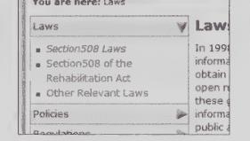

尽管法律要求日益严格，许多公司仍因多种原因忽视无障碍访问标准。按照无障碍标准进行设计带来的额外复杂性对设计师来说往往令人望而生畏。虽然HTML5并不完美，但它在创建完全无障碍的网络方面取得了长足进步。然而，满足特殊用户的需求仍然需要额外的工作和良好的判断力。

#### 图1-1

HTML5中帮助设计师创建更具无障碍访问性网站的功能包括以下方面：

- 在页面代码中描述元素（如菜单、树形项目、滑块和进度条）的方法
- 描述页面结构（如标题、区域、部分和表格或网格）的方法（参见第2课）
- 描述元素状态（如复选框的选中状态）的属性（参见第3课）
- 网页对象和事件的键盘导航，这对无法使用鼠标或图形浏览器的用户非常有帮助

#### 创建HTML文档的框架

前面的示例仅介绍了一些有助于提高网站无障碍访问性的较简单功能。

> W3C关于无障碍访问的网站包含丰富信息。如需快速概览，请访问www.w3.org/WAI/users/overview.html。网站作者可以在www.w3.org/TR/wai-aria-practices找到具体指南。

将无障碍访问性纳入设计规划有几个主要优势：除了这是正确的做法之外，它还能显著扩大您的网站受众群体。此外，由于无障碍访问标准要求设计的简洁性，符合无障碍标准的网站通常干净、直观易用且易于导航。而且搜索引擎也很喜欢它们！

本节将引导您了解设置网页的基础知识。按照编程书籍的传统，我们将从一个名为HelloHTML.htm的最基本HTML文档开始。这个文件是一个载体，用来阐述一些讨论要点。以下各节将解释该文档在显示网页时各部分的作用。您可以在代码清单1-1中查看代码，也可以从本书的配套网站下载示例文件ch1_01.htm（详情请参阅引言部分）。

```html
<!DOCTYPE html>
<html lang="en">
<head>
    <title>Hello World Example</title>
    <link rel=" " type=" " href=" ">
    <meta http-equiv="content-type" content="text/html;charset=utf-8" />
</head>
<body>
    <h1 id='h1'>Hello HTML!</h1>
    <p id='p1'><strong>HTML</strong> was invented by
        <em>Tim Berners-Lee</em> in 1993. All markup
        was considered <b>semantic.</b></p>
</body>
</html>
```

图1-2显示了在Chrome浏览器中运行并查看上述代码时看到的内容。

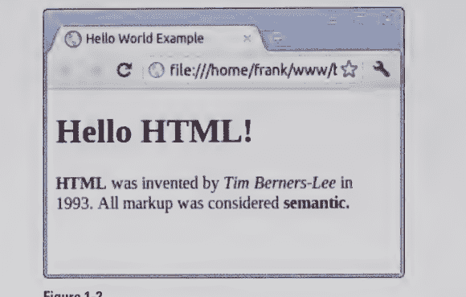

图1-2

> 您可以从本地文件夹运行HTML文件。双击HTML文件将在默认浏览器中显示。要在其他浏览器中查看网页，请右键单击该文件，然后从出现的上下文菜单中选择您想要的浏览器。

HTML5对于合法文档所需的条件实际上相当宽松。不过，我建议您使用稍微严格的XHTML规则。这样做将使您的网站与不支持HTML5的旧浏览器向后兼容，并使您的代码更易于阅读。您在本书中看到的示例都显示了XHTML标记。

#### 从DOCTYPE开始

HTML文档以文档类型声明（也称为DOCTYPE或DTD）开始。在HTML5中，DOCTYPE是`<!DOCTYPE html>`。DOCTYPE使*用户代理*（也称为浏览器）能够了解它必须处理哪种类型的文档。您可以在`HelloHTML.htm`文件的顶部看到DOCTYPE（参考代码清单1-1）。

虽然DOCTYPE像HTML标签一样有尖括号，但它并不是标签。您知道这一点是因为它以感叹号（!）开头。

**额外信息**

以前版本的HTML和DTD要复杂得多。例如，这是XHTML文档可能使用的DTD之一（实际上有几种选择）：

```html
<!DOCTYPE html PUBLIC "-//W3C//DTD XHTML 1.0 Strict//EN" "http://www.w3.org/TR/xhtml1/DTD/xhtml1-strict.dtd">
```

它包含文档类型——HTML——一个公共声明，以及用户代理可以找到另一个文档来验证此文档的位置。最后一句对您来说可能难以理解。这都是关于XML的！如果您想了解更多（本书不需要），请参阅Lucinda Dykes和Ed Tittel所著的《XML For Dummies》第4版。

HTML5的优点之一是您不需要拼写所有这些复杂的声明；它只是假设，如果您说这是HTML文档，那么您指的是最新版本，即HTML5。这样很合理，对吧？

#### 设置根元素

在XHTML中，所有格式正确的文档都必须有一个包含整个文档的根元素。在代码清单1-1中，您可以在DOCTYPE下方看到根元素的开始标签：

```html
<html lang="en">
```

根元素的结束标签`</html>`出现在文档末尾。您可能会发现DOCTYPE的名称总是与根元素相同，这很有趣。

根元素也是告诉用户代理文档使用什么语言的好地方，使用`lang`属性。属性的"en"值告诉浏览器该网页是英文的。

在XHTML中，所有属性值必须用引号括起来。（这在HTML5中不是必需的，但这是一个好习惯。）通常，您可以使用单引号或双引号。重要的是要存在引号。

在另一个文档中，您可能会找到类似这样的根元素：

`<html xmlns="http://www.w3.org/1999/xhtml">`

`xmlns`属性是命名空间属性。*命名空间*超出了本书的范围，它使您能够包含来自其他文档类型语言（如'mathml'和'musicml'）的标记。同样，更多信息请参阅Lucinda Dykes和Ed Tittel所著的《XML For Dummies》第4版。

#### 填充head部分

HTML文档的head部分包含在`<head>`标签中。此部分中的元素不是用来显示的，而是包含大量使浏览器能够显示网页的信息。以下各节将向您介绍在`<head>`标签之间插入的最重要元素。在示例页面`HelloHTML.htm`中，文档的head部分如下所示：

```html
<head>
    <title>Hello World Example</title>
    <meta http-equiv="content-type" content="text/html;charset=utf-8" />
</head>
```

重要的标签已突出显示，以便您轻松识别。

##### `<title>`元素

HTML规范要求HTML文档包含`<title>`元素。它包含的文本不会出现在浏览器窗口中，但会在浏览器标题栏中显示页面标题，这是一项重要任务。此外，搜索引擎（如Google和Yahoo！）会给标题中的信息很高的评分，因此请尽量使标题简短且信息丰富。您可以看到`HelloHTML.htm`的标题如下所示：

```html
<title>Hello World Example</title>
```

在浏览器中，Hello World Example会出现在浏览器的标题栏中。

##### `<link>`元素

`link`元素用于链接到其他文件。最重要的用途是链接到包含CSS代码的文件，该文件包含网页内容的格式化和定位指令。您可以在第4课和第5课中找到有关创建CSS的详细信息，第5课包含有关将CSS文件链接到HTML文件的具体内容。

目前，请注意`<link>`元素包含三个属性，在`HelloHTML.htm`中这些属性是*空的*（不包含任何值）：

```html
<link rel=" " type=" " href=" ">
```

以下是每个属性功能的简要介绍：

- **rel** 告诉用户代理它正在处理一个样式表链接。
- **type** 指定样式表的媒体类型。
- **href** 告诉代理在哪里可以找到样式表文件。


#### 创建 HTML 文档框架

#### `<meta>` 元素

元标签主要用于提供关于页面的信息，但还有一些其他巧妙用途。搜索引擎使用它们来分类和排名你的页面。其基本语法是

```html
<meta name="value" content="value"/>
```

`name` 通常取值为 `keywords`、`description` 或 `summary`。

以下是来自一个关于膝盖韧带修复页面的两个示例：

```html
<meta name='description' content='A paper describing the various techniques for repairing Anterior Cruciate Ligaments; their short and long term results' />

<meta name='keywords' content='Knee; Orthopedic Surgery; Sports Medicine; ACL; Anterior Cruciate Ligament; surgical outcomes;' />
```

这是一个带有 `http-equiv` 属性的元标签，你在清单 1-1 中可以看到。这个元标签旨在补充在 HTTP 头中找到的信息。`http-equiv` 属性的一个可能值是 `content-type`。`content-type` 元标签告诉浏览器网页使用的是哪套字符集。例如，一个用日语编写的网页可能使用 EUC-JP 或 SHIFT_JS。最常用的字符集值之一是 UTF-8。

```html
<meta http-equiv="content-type" content="text/html;charset=utf-8" />
```

#### 添加文档主体

`<body>` 部分是你放置所有文本、图片、链接、表格以及任何你希望访问页面时人们看到的其他内容的地方。换句话说，你在这里构建你的 HTML 页面。第 2 课专门介绍了填充 `<body>` 元素内容的细节，但你可以在示例文件 `HelloHTML.htm` 中看到主体内元素的示例：

```html
<body>
    <h1 id='h1'>Hello HTML!</h1>
    <p id='p1'><strong>HTML</strong> was invented by
        <em>Tim Berners-Lee</em> in 1993. All markup
        was considered <b>semantic.</b></p>
</body>
```

在你开始用 HTML 构建网页之前，了解以下关于 HTML 元素如何工作的特殊性将帮助你编写出外观符合预期的页面：

- **块级元素与内联元素：** *块级元素*，顾名思义，是文本块。当用户代理看到一个块级元素时，它会在元素前后添加换行。*内联元素*包含在块级元素中，其前后没有换行。

`HelloHTML.htm` 中的 `<body>` 包含两个块级元素和三个内联元素。在前面的代码中，块级元素以绿色显示，分别是标题 `<h1>` 和段落 `<p>`。内联元素以栗色显示，分别是 `<strong>`、`<em>` 和 `<b>` 元素。`<strong>` 和 `<b>` 都将文本加粗；`<em>`（代表 *强调*）则应用斜体。

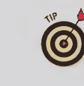

> 你如何知道一个元素是块级元素还是内联元素？嗯，大多数元素都是块级元素。在本书中，我通常会提到一个元素是否是内联的。或者，如果一个元素在浏览器中显示页面时不添加换行，那么你处理的就是一个内联元素。同样需要了解的是：你可以使用 CSS 将块级元素更改为内联元素，反之亦然。在第 4 课和第 5 课中了解具体方法。

- **语义元素与样式元素：** *语义* HTML 元素是在英语中有意义的名称；该元素描述了它所包含内容的类型。用户代理决定如何呈现 HTML 元素，大多数浏览器使用类似的呈现方法。然而，由于这些元素具有语义含义，语音浏览器或盲文浏览器可以以合适的方式呈现你的文档。*样式* 指的是诸如颜色、缩进以及字母和单词间距等事宜——简而言之，就是你的纯文本和其他项目在浏览器中的外观。

你可能会争辩说 `<b>` 标签是一个样式标签。是，也不是。加粗的含义非常广为人知，以至于它已经具有了语义含义。

#### 为每个块级元素赋予 ID

在本课前面的 `HelloHTML.htm` 示例中，每个块级元素都有一个 ID。例如，`<h1 id='h1'>` 赋予 `<h1>` 标签一个 ID `h1`。元素 ID 取的值必须在整个文档中是唯一的。例如，如果你有多个 `<h1>` 元素，每个都需要一个唯一的 ID。

ID 的值受某些规则约束。ID 名称必须以下划线或字母字符开头，并且只能包含字母数字字符。

养成给所有块级元素赋予 ID 的习惯，原因如下：

- ID 提供了一种简单的方法，可以仅将 CSS 样式应用于文档中的一个元素（例如，你可能只想让一个 `<h1>` 为红色，而其他所有 `<h1>` 为蓝色）。在第 4 课和第 5 课中了解更多。
- ID 允许外部文档链接到文档中的特定位置。第 2 课解释了如何实现。
- ID 为脚本语言提供了一种简单的方法，通过文档对象模型（DOM）为你的元素创建一个脚本对象。*脚本对象* 是一个引用元素的 JavaScript 对象。第 6 课提供了脚本介绍。

#### 理解文档树

HTML 文档树也称为 *文档对象模型* 或 *DOM*。基本上，DOM 是一个概念，它将 HTML 文档中的每个元素都视为一个对象，并组织成一棵树。在编程中，*树* 是一种组织元素的系统，类似于家谱，其中文档中的每个元素都可以是一个父节点，其子节点从中分叉出来。在 HTML 中，唯一没有父元素的元素是根元素，即 `<html></html>` 标签对。

> **术语**
> **文档对象模型（DOM）** 将 HTML 文档中的每个元素都视为一个对象，并组织成一棵树。

要理解 DOM，你需要理解 *对象* 的概念。基本上，一切都是对象。任何对象都由许多更小的对象组成。例如，人类对象由解剖对象（或器官）组成，而器官又由不同类型的细胞对象组成，细胞对象又由细胞器对象组成……你明白了。对象也有描述它们的属性和特性。例如，你的眼睛可能具有棕色的属性，你的头发可能具有黑色（或者如果你像我一样，是灰色）的属性，等等。一些对象也有方法。例如，你的大脑有思考的方法，你的手有抓握的方法，等等。

HTML 文档也由对象组成。考虑以下几点：

- 每个 HTML 元素都是一个对象，并有自己的属性。
- 元素也由其他对象组成；例如，每个表示性元素内部都嵌入了一个样式对象。
- DOM（HTML5 的核心）描述了元素的对象结构。以 `<body>` 元素对象为例：它有几个子对象。例如，在清单 1-1 中，有两个子对象，`<h1>` 元素对象和 `<p>` 元素对象。这些对象中的每一个也都有一个 `id` 属性。`<p>` 元素对象还有三个子元素对象：`<strong>`、`<em>` 和 `<b>` 对象。这些对象又由文本对象组成，文本对象由单词对象组成，单词对象由字符对象组成，以此类推。

理解 DOM 如何将元素组织成层次结构，对于你开始编写 CSS 代码或想要用 JavaScript 添加动态特性非常重要。第 4 课和第 5 课将向你介绍 CSS，第 6 课则对脚本进行了介绍。

#### 处理浏览器差异

特别是由于 HTML5 规范尚未最终确定，并非所有网页浏览器都一致支持 HTML5 的所有新功能，但这在 HTML 的先前版本中实际上也是如此，而 HTML4 已经存在十年了！好消息是，每次新版本的浏览器发布时，它都支持更多最新版本 HTML5 中的功能。

然而，并非所有网页浏览器都是平等的。大多数主要的参与者已经发布了基本上符合最新和最佳 HTML 标准的版本，但没有单一的浏览器符合所有这些标准。大多数浏览器支持新功能的组合略有不同，有些浏览器在解释这些功能时加入了自己独特的见解——或者在某些情况下，完全另辟蹊径。

HTML5 支持远非普遍（主要是因为规范仍在变化），但近年来已经稳步获得发展。如果你从事网页开发已有一段时间，你一定遇到过网站管理者的诅咒：浏览器兼容性。唉，兼容性仍然是一个


### 总结

即便在 HTML5 中依然存在问题，因此你的设计方案需要为这些差异包含应急措施。截至本书付印时，以下是使用 HTML5 的网页设计师需要了解的关于浏览器支持的基本情况：

- **每个浏览器对 HTML5 的符合程度都在日益提高。** 例如，Internet Explorer 8 几乎不支持任何 HTML5 特性，IE9 支持约一半的关键 HTML5 特性，而 IE10 的预览版承诺支持更多。
- **Safari、Firefox、Opera 和 Chrome 浏览器在支持 HTML5 特性方面处于领先地位**，但其他浏览器正在迅速追赶。
- **然而，每个浏览器在显示 HTML5 特性时仍然会有其自身的怪癖**，因此设计师仍需要测试、测试、再测试他们的页面。

> 一个测试你的特定浏览器支持哪些特性的有用在线资源可以在 http://html5test.com 找到。在这里你可以检查你的浏览器版本和代码，它会报告你的浏览器对最新 HTML5 推荐特性的支持程度。这样做可以让你很好地了解你对新特性或属性的出色创意性使用是否能在不同的浏览器中播放（当然，作为设计师和开发人员，在不同的浏览器中进行测试总是一个好主意）。我尝试在本书中告诉你什么在不同的浏览器中有效，什么无效。

### 总结

在本课中，你深入了解了 HTML 的发展，并快速回顾了基础知识：

- HTML5 是从早期 HTML 版本发展而来的，W3C 和 WHATWG 在其发展中扮演了角色。W3C 控制构成 HTML5 和 CSS3 的许多规范，以及许多其他相关 Web 技术。WHATWG 推动 HTML 沿着 W3C 的推荐轨道发展。
- HTML5 中已弃用的特性仍然受支持，但将来会消失。简单的颜色属性、边框和层属性在 HTML5 中已弃用。
- HTML5 改进了对图形、音频和视频的支持。它还提高了必须依赖辅助技术的用户的可访问性。
- HTML5 文档的框架包括 DOCTYPE、根元素、`<head>` 元素和正文。`<head>` 元素通常包含 `<title>`、`<link>` 和 `<meta>` 元素。
- 网页内容出现在 HTML 文件中，格式化指令出现在相关的 CSS 文件中。
- HTML DOM 将 HTML 文档中的元素视为具有属性和特征、以及父元素和子元素的对象。
- Web 浏览器支持不同的 HTML5 特性，并且可能以略有不同的结果显示它们。这使得在不同的浏览器中测试网页变得非常重要。

在第 2 课中，你将学习添加到 HTML 文档正文中的基本元素，包括文本元素、图像、链接、表格和多媒体。

## 了解这项技术谈话

- **可访问性 (accessibility)：** 无论人们如何访问互联网或是否存在任何身体残疾或特殊需求，网站对尽可能多的人的可用程度。
- **块级元素 (block element)：** 一个 HTML 元素，跨越其可用空间的宽度并从新行开始。
- **已弃用 (deprecated)：** 描述一个仍然受支持但不鼓励使用，并且可能在将来版本中废弃的特性。
- **文档对象模型 (Document Object Model (DOM))：** 一种表示 HTML 文档的方式，以便使用 CSS 或 JavaScript 操作它。
- **文档类型声明 (Document Type Declaration (DTD))：** 一个将文档与文档语言的正式定义（如 XML、XHTML 或 HTML）相关联的语句。
- **地理定位 (geolocation)：** 使用移动服务基站、GPS 或两者来定位设备并根据位置提供自定义内容（这需要移动用户的许可）。
- **内联元素 (inline element)：** 不在新行开始的元素。
- **原生媒体支持 (native media support)：** 无需额外软件或插件即可支持图像、音频和视频。
- **已过时 (obsolete)：** 描述一个不再受支持的特性。
- **表现性标记 (presentational markup)：** 用于对样式或布局进行一次性更改的内联 HTML 代码。在当前的 HTML 站点中不鼓励使用，某些表现性标记根本不支持。
- **根元素 (root element)：** 标记文档中包含所有其他元素的元素。在 HTML 中，根元素是 `<html>`。

## 了解这项技术谈话

- **第 508 节 (Section 508)：** 美国政府的一套要求，旨在使技术对所有用户（无论是否存在身体或精神残疾）都可访问。
- **语义标记 (semantic markup)：** 增强网页内容含义的标记，而不仅仅是其呈现方式。
- **样式表 (style sheet)：** 一个扩展名为 .css 的单独文件，用于设置现代网页的样式和布局。
- **验证器 (validator)：** 一个检查标记文档正确性的程序。
- **W3C：** 万维网联盟管理 Web 技术规范和建议。
- **WHATWG：** Web 超文本应用技术工作组推动 HTML 沿着 W3C 的推荐轨道发展。

## 第 1 课

#### 第 2 课

### 用文本、链接和多媒体填充正文

- HTML 有六个级别的标题标签，从 `<h1>` 到 `<h6>`。
- HTML 列表的三种类型是无序列表、有序列表和定义列表。
- `contenteditable` 属性使观众可以直接在网页上编辑文本。
- HTML 实体帮助你用 HTML 显示特殊字符。
- `<table>` 元素显示表格数据。
- 使用 `` 元素插入图像。
- `<a>` 标签在 HTML 文档内部和之间创建超链接。
- 使用 `<iframe>` 将文档嵌入到文档中。
- HTML5 的 `<audio>`、`<video>` 和 `<embed>` 元素在你的 HTML 文档中放置多媒体。
- W3C 验证器可以检查你的代码是否符合 HTML 规范中的规则。

**1. 属性的目的是什么？**
请在第 .... 页查找

**2. 如何将图像插入 HTML 文档？**
详情请见第 .... 页

**3. 如何在 HTML 中创建超链接？**
请在第 .... 页了解不同的方法

**4. 你可以使用哪些元素将 HTML 文档的不同部分分组为节？**
请翻阅至第 .... 页

**5. 如何添加媒体元素？**
请查看第 .... 页上巧妙的新功能

**6. 为了让你的页面可访问，你应该做什么？**
请在第 .... 页了解基础知识

**7. 如何检查你的 HTML 代码是否符合相应的 HTML 规范？**
请在第 .... 页亲眼查看

### 1

在本课中，你将学习添加和标记内容。内容包括用户在网页上看到、听到，有时甚至感觉到（用于盲文显示）的所有内容，包括文本、图像、声音和动画。你将学习标签如何赋予内容意义，以及属性如何增强这种意义。

### 添加文本

向 HTML 文档添加文本几乎就像在文字处理器中打字一样简单。当你创建 HTML 文档时，你有一个额外的步骤，即用与你希望在 Web 浏览器中显示方式相对应的标签包围文本，这个概念你可能已经很熟悉了。你可能还想添加一两个属性，因为属性不仅使你能够为元素提供唯一的 ID，还使你能够做诸如使页面上的内容可编辑和检查拼写之类的事情。

在本节中，你将了解作为 HTML 主要支柱的标签以及 HTML5 新功能的介绍。

### 从标题和段落标签开始

几乎任何网页都使用标题和段落标签。*标题标签 (Heading tags)* 包围网页上的标题或标题。默认情况下，浏览器显示标题标签中的文本比*正文文本 (body text)*，或段落 (`<p>`) 标签内的文本更大。你可以使用多达六个级别的标题，标题标签范围从 `<h1>` 到 `<h6>`。`<h1>` 标签表示最高级别，`<h6>` 表示最低级别。


## 第2课

标题标签和段落标签都以成对的方式工作，包含一个开始标签和一个结束标签。你可以在下面这段来自本书示例网站（苏格兰诗人罗伯特·彭斯的粉丝网站）的代码片段中看到两者同时使用：

```html
<h1 class="body">The Life of Robert Burns</h1>

<p>Robert Burns was the firstborn of seven children and grew up on his father's farm in Scotland. His family was poor, and Burns worked hard on the farm and received little formal schooling. However, he did receive an education at home and spent some time studying in nearby schools. Burns' interest in poetry began in earnest when he was a young man and began writing songs and poems.</p>
```

**附加信息**
开始标签 `<h1>` 包含一个 `class` 属性，你可以使用它根据想用 CSS 样式化那些元素的方式，将元素组织成组。例如，你可能会将标题分为页面主体和右侧栏的标题，为一组赋予 `body` 的类值，为另一组赋予 `sidebar` 的类值。你将在第4课中了解更多关于使用 `class` 属性来样式化文本的内容。

#### 制作列表

在 HTML5 中，你可以创建三种类型的列表：

- **有序列表：** 这种列表类型会自动为列表项编号。
- **无序列表：** 无序列表标签创建项目符号列表。你可以使用 CSS 自定义项目符号的外观。（我将在第5课中介绍如何自定义项目符号和编号。）
- **定义列表：** 定义列表最常用于列出术语和定义。网页浏览器会以术语表的样式格式化定义列表。该标签提供两个子元素，一个用于定义标题，另一个用于定义文本。如果你更宽泛地应用定义列表的概念，它们也可以方便地将具有直接关系的项目联系在一起。

要创建有序列表，你需要在 `<ol>` 的开始和结束标签之间插入列表项，并使用 `<li>` 的开始和结束标签来包裹列表中的每一项。以下是有序列表的语法：

```html
<ol>
    <li>Item 1</li>
    <li>Item 2</li>
    <li>Item 3</li>
</ol>
```

无序列表的工作原理与有序列表类似，只是你使用的是 `<ul>` 标签。下面的代码片段展示了一个无序列表，以及如何将一个列表嵌套在另一个列表中。嵌套列表的标签是栗色的，因此它们与主列表区分开来：

```html
<ul>
    <li>Item 1</li>
    <li>Item 2</li>
    <ul>
        <li>Item A</li>
        <li>Item B</li>
    </ul>
    <li>Item 3</li>
</ul>
```


尝试在文本编辑器中创建自己的列表和嵌套列表。

你可以执行以下操作：

- ✔ 将一个有序列表嵌套在另一个有序列表中。
- ✔ 将一个无序列表嵌套在有序列表中。
- ✔ 尝试进行三级嵌套。（你可能在教科书的目录中需要这样做。）

定义列表允许你列出项目并为每个项目提供简要描述。以下是语法：

```html
<dl>
    <dt>Title 1</dt>
    <dd>Some descriptive text</dd>
    <dt>Title 2</dt>
    <dd>Some descriptive text</dd>
    <dt>Title 3</dt>
    <dd>Some descriptive text</dd>
</dl>
```

在标记中，`<dl>` 标记定义列表的开始。对于每个列表项，`<dt>` 是你放置定义标题的地方，而 `<dd>`（代表 *定义描述*）是实际定义的容器。

图 2-1 展示了每种类型的列表在浏览器中的显示方式。

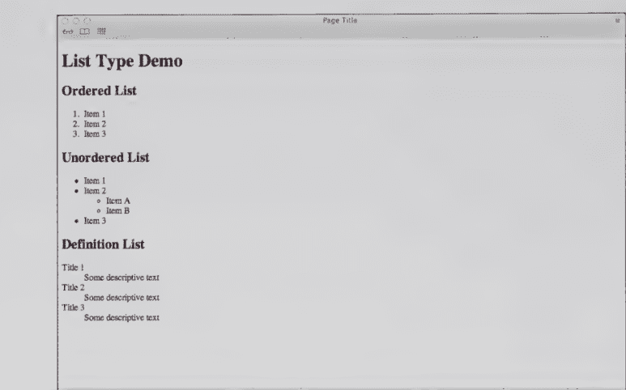

**图 2-1**

#### 使文本可编辑

考虑以下非常常见的场景：你必须下载一份 PDF 表格；用笔*清晰*地填写它（如果你的字迹和我一样……）；签名；然后通过扫描、传真或传统邮件将其寄回正确的地址。如果你能直接在网页上填写它，那不是很好吗？这难道不是一种节省时间的方法吗？

嗯，如果页面是使用 HTML5 新增的 `contenteditable` 属性创建的，你就可以做到。你可能仍然需要打印表格以添加签名，但你至少可以先以电子方式填写所有其他信息。

在任何元素上使用 `contenteditable` 属性意味着你的用户实际上可以编辑内容。该属性的值可以是 `true` 或 `false`，子元素会继承该值。

介绍 `contenteditable` 如何工作的最简单方法是用一个简单的例子：

```html
<p contenteditable="true">The content of this paragraph is editable!</p>
<ul contenteditable="true">
    <li>This list item is editable ...</li>
    <li>... and so is this, because the item inherits the value from the &lt;ul&gt; element</li>
    <li contenteditable="false">But this content is <b>not</b> editable because the list item's <code>contenteditable</code> value is explicitly set to <code>false</code>.</li>
</ul>
<p>This paragraph is NOT editable; it is a normal paragraph.</p>
```

如果你使用 Safari，生成的网页将如图 2-2 所示。

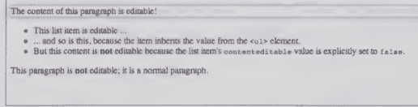

以下是代码中发生情况的逐步分析：

- ✓ 在第一个段落中，`contenteditable` 被设置为 `true`，所以它是可编辑的。任何子节点，如内联 `<i>` 或 `<b>` 元素，也会继承该值。
- ✓ `<ul>` 元素有一个设置为 `true` 的 `contenteditable` 属性，因此所有列表项默认继承该值。
- ✓ 我将第三个列表项显式设置为 `false`，因此它不继承其父元素 `<ul>` 的 `true` 值。

因为第二个段落没有设置 `contenteditable` 属性，所以它假定默认值为 `false`。

要练习添加 `contenteditable` 属性，请启动你最喜欢的编辑器并输入前面的示例，以及使页面在浏览器中显示所需的 HTML 文档框架。或者，如果你只想玩玩生成的页面，请打开 `L2_01.htm` 文件（你可以从本书的配套网站下载，详见介绍）并在浏览器中运行该文件。

以下任务可以帮助你从用户的角度了解可编辑内容是如何工作的：

- 在某个可编辑部分输入一些内容。它有效！
- 将网页保存到本地文件夹，然后关闭页面。重新打开它，你的编辑内容仍然在那里！
- 打印网页，查看你的编辑如何体现在打印件上。

当 HTML 元素可编辑时，你也可以使用新的 HTML5 `spellcheck` 属性。对于像我这样拼写不好的人来说，这简直是有史以来最棒的东西。有了这个新属性，浏览器会在用户输入时自动进行拼写检查。只需在任何可编辑元素上添加 `spellcheck="true"`，浏览器就会像文字处理器一样检查拼写。右键单击检查器识别为拼写错误的单词，可以看到替代拼写列表。默认情况下，所有设置了 `spellcheck="true"` 的元素的子元素也会自动进行拼写检查。

> 任何拼写检查器背后都进行着大量工作。在典型的拼写检查器中，用户代理（文字处理器、出版应用程序、浏览器等）必须监控每次按键。当遇到它识别为单词结尾的按键（如空格或标点符号）时，它会读取该单词并将其与字典进行比较。

每个浏览器都有自己的内置字典；其他应用程序，尤其是在 Linux 中，可能会共享字典。如果没有找到匹配项，浏览器会给该单词加下划线，或以某种方式指示存在拼写错误。如果用户右键单击该单词，拼写检查器将使用复杂的算法在字典中搜索相似的匹配项，并将它们显示在熟悉的弹出框中。

还有许多其他细节，但这些是基本要素。

最棒的是你现在就可以开始使用 `spellcheck`。几乎所有现代浏览器都支持该属性，如果用户的浏览器不支持，他也不会察觉。

除了使用 `contenteditable` 属性的元素外，可编辑元素还包括 `<input>` 和 `<textarea>`。这两个都是表单元素，将在第3课中介绍。

#### 显示特殊字符

有时，你需要显示诸如 `<` 和 `&` 这样在 HTML 文本中非法的字符。有时，你需要显示一个无法在标准西式键盘上输入的字符。在这些情况下，HTML 实体和 Unicode 可以提供帮助。以下是它们如何让你显示特殊字符：

- **HTML 实体：** 你可能已经注意到我引用了其中一些字符，例如版权字符 `&copy;` 和 `&` 符号字符 `&amp;`。你也可能希望在文本中放置一个 "<"。你不能直接这样做，因此必须使用 `&lt;`。这些被称为 HTML *命名实体*。
- **Unicode：** 你也可以使用任何 Unicode 数字来引用一个字符，这意味着你可以使用以下语法编写浏览器支持的任何字符：
    `&#unicode number;`
    因此 `&#65;` 将产生一个大写的 A。

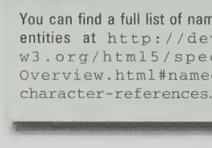

#### 将内容组织成表格

`<table>` 元素用于显示表格数据，如数字或图形。在过去，人们也常用表格来布局图像、链接、文本等。如今，这种做法极不提倡，因为它强调的是数据的呈现（布局），而不是数据的意义（表格性）。有更好的方法来布局文本和图像，而不是使用表格。

为了说明如何向表格添加行和列，下面是创建一个两行两列表格的代码：


## 第2课

<table border="1">
    <tr><td>第1行第1列</td><td>第1行第2列</td></tr>
    <tr><td>第2行第1列</td><td>第2行第2列</td></tr>
</table>

以下是上述示例创建表格的方式：

-   开始和结束的 `<table>` 标签标记了表格的起始和结束。`<table>` 元素上的 `border` 属性是 HTML5 中少数未过时的样式属性之一。此属性决定表格单元格周围是否显示线条。如果不希望显示边框，请将 `border` 属性的值留空，如下所示：`border=" "`
-   每对 `<tr>` 标签标记了一个表格行的开始和结束。
-   在每对 `<tr>` 标签内，你会看到表格每一列都有一对 `<td>` 标签。每对 `<td>` 标签包含显示在表格中的数据。

如果您的表格需要标题，可以使用 `<caption>` 元素添加。使用 `<th>` 元素标记列标题。以下是为前面的示例表格添加标题和标题行的方法：

```
<table border="1">
    <caption>简单表格</caption>
    <tr><th>表头列 1</th><th>表头列 2</th></tr>
    <tr><td>第1行第1列</td><td>第1行第2列</td></tr>
    <tr><td>第2行第1列</td><td>第2行第2列</td></tr>
</table>
```

您可以使用 `colspan` 和 `rowspan` 属性合并表格单元格。例如，以下单元格使用 `<tr>` 标签上的 `colspan` 属性跨越两列：

```
<tr colspan="2"><td>跨越两列</td></tr>
```

或者，一个单元格可以使用 `rowspan` 属性跨越多行。以下是使用 `<tr>` 标签的示例：

```
<tr rowspan="2"><td>跨越两行</td></tr>
```

清单 2-1 使用本节讨论的所有选项来组织罗伯特·彭斯的著名诗歌列表。查看代码，并查看图 2-3 中浏览器中的代码显示效果。

#### 清单 2-1：示例表格

<table border='1'>
    <caption>罗伯特·彭斯的著名诗歌</caption>
    <tr><th>诗歌标题</th><th>首句</th></tr>
    <tr><td>一朵红红的玫瑰</td><td>啊，我的爱人像一朵红红的玫瑰</td></tr>
    <tr><td>致山野雏菊</td><td>娇小，娴静，深红色的花蕊，</td></tr>
    <tr><td colspan='2'>约翰·安德森，我的乔，约翰（首句与标题相同）</td></tr>
    <tr><td rowspan='2'>去年五月，一个帅气的追求者（两个不同的首句）</td><td>去年五月，一个帅气的追求者来到了长长的峡谷，</td></tr>
    <tr><td>去年五月，一个帅气的追求者来到了长长的峡谷，</td></tr>
</table>

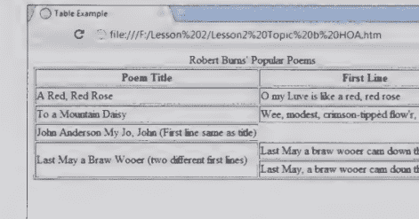

补充信息
正如我前面提到的，设计师长期以来一直使用 `<table>` 元素，不仅用于以表格格式呈现信息（该元素的预期用途），还用于在网页上布局元素。过去，使用表格进行网页布局是必要的，因为当时没有更好的方法。随着 CSS 的引入，特别是 HTML5 和 CSS3 的出现，你现在可以在不使用表格的情况下进行网页布局。`<table>` 元素已恢复其应有的地位，成为当你想显示任何可能放在电子表格中的内容时应使用的元素，例如预算、产品及其功能的比较或一系列实验的结果。

最终结果是，HTML5 规范强烈不鼓励使用表格进行布局。原因是辅助技术难以区分表格是在显示数据（其本意）还是作为布局目的的不可见结构。使用表格进行布局还会使您的设计不够灵活，这个概念在第4课和第5课中有详细阐述。尽管如此，如果表格是创建所需布局的唯一方法，您可以添加 `role` 属性并将值设置为 `presentation`，例如 `role="presentation"`，以表明辅助技术在向用户朗读内容时可以忽略特定的 `<table>` 元素。

#### 插入图像

要插入图像，请使用 `` 元素，这是一个空元素或自闭合元素，没有结束标签。要使用图像填充标签，需要添加必需的 `src` 属性。其他重要属性是 `alt`、`height` 和 `width`，本节将快速介绍每一个属性。

您也可以插入 SVG 图像，这是一种由 W3C 提出的矢量图形格式。本节也会简要介绍 SVG 图像。

#### 使用 `` 显示图像文件

`` 元素的 `src` 属性接受网络位置（指定为 URL）作为其值，该值可以是相对的也可以是绝对的：

-   ✔ **相对值**指的是相对于承载页面的位置。换句话说，相对值指的是与显示它的页面位于同一站点上的图像。例如，许多（大多数）站点将其图像保存在单独的文件夹中，因此如果图像 `myimage.png` 位于站点中名为 `myimages` 的子文件夹中，您可以如下引用图像文件：`` 虽然 HTML5 中不是严格要求，但出于向后兼容的原因，您应该*始终*用引号括起值。

-   ✔ **绝对值**指的是一个 URL，该 URL 可能在也可能不在您的站点上。如果使用绝对 URL，*必须*使用正确的前缀 `http://`。以下是两个绝对值的例子。首先是指向您自己站点的引用：``

#### 插入图像

现在是引用其他站点的：

```

```

另一个重要属性是 `alt`，它包含供辅助设备（如屏幕阅读器）朗读页面内容时使用的替代文本。*替代文本*是描述图像的简短文本字符串，您应始终包含 `alt` 属性（虽然不是严格要求的）以符合无障碍访问指南。替代文本在图像无法显示时也很有用。用户可能禁用了图像显示，或者图像可能是用户代理（即浏览器）不支持的格式。

`height` 和 `width` 属性控制图像的显示高度和宽度。关于 `height` 和 `width`，您需要了解以下内容：

-   **属性值可以是像素或百分比。**
-   **您可以使用这些值来缩放图像。** 但需谨慎：大于实际图像的像素值会放大图像，但可能导致其看起来像素化，降低质量。小于实际图像的像素值会缩小显示尺寸，但浏览器仍必须下载较大的图像，这可能迫使您的用户使用更多带宽，并等待比必要更长的时间来加载页面。百分比值根据包含图像的容器来调整图像大小，这个概念在第4课中将更详细地探讨，该课解释了如何使用 CSS 调整元素大小。
-   如果您两次使用同一图像，则不必担心额外的带宽和下载时间。大多数浏览器会缓存您的页面、脚本和图像。这意味着如果您重复使用图像，则不必第二次下载它们。因此，使用大图像的缩小版本可能非常高效。

-   **如果只给出一个属性值，另一个属性值会按比例调整。** 如果两个值都不符合图像的宽高比，图像看起来会失真。
-   **如果省略 `height` 和 `width`，图像将以保存时的相同大小显示。** 因此，以 120 像素宽和 300 像素高保存的图像将在屏幕上以相同大小显示。
-   **省略 `height` 和 `width` 属性可能会在图像加载时导致令人讨厌的页面跳动。** 当页面下载时，首先下载 HTML，然后是图像。如果给出了 `height` 和 `width` 值，则会为图像预留空间。如果没有，当图像开始下载时，页面看起来会跳动。大多数用户觉得这非常烦人。

## 第2课

以下代码片段在页面上两次显示相同的图像，并使用了本节讨论的所有属性。图 2-4 显示了在浏览器中显示的代码，您可以看到将图像大小设置为 50% 会使图像宽度和高度占据浏览器窗口空间的一半。（同样，您将在第4课中找到关于调整大小的更多信息。）

```


```

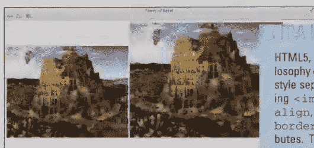

> HTML5 为了保持语义和样式分离的哲学，使以下 `` 属性过时了：`align`、`hspace`、`vspace` 和 `border`。请使用 CSS 来实现这些属性的功能。`name` 属性也已过时，作者应使用全局 `id` 属性。

图 2-4

您可以使用示例图像 `babel.png`（可通过本书配套网站获取）进行以下练习步骤，或使用您自己选择的图像。

在这些步骤中，您将练习使用 `` 标签：

1.  为您的 HTML 文档创建一个文件夹，并创建一个名为 `images` 的子文件夹，用于保存本练习的图像文件。
2.  在您的文本编辑器中创建 HTML 文档的框架，并在 `<body>` 标签内添加一个指向图像文件的 `` 元素。
3.  创建一个指向站外图像的链接，例如

```
http://media.wiley.com/spa_assets/site/wiley2/cvo/images/wiley-logo.gif
```


#### 插入图像

4.  创建一个带有错误 `src` 值的 `` 元素，并为其添加一个 `alt` 属性。
5.  为你的示例设置一个远大于其实际高度的 `height` 值。
6.  添加一个小于其实际宽度的 `width` 值。
7.  将 HTML 文档保存为 `.htm` 文件，并在你的网页浏览器中打开它。

请务必查看浏览器如何显示不同版本的 `` 元素以及错误的 `src` 值。同时也要查看 `height` 和 `width` 值的效果。

#### 介绍 SVG 图像

所有现代浏览器都支持 JPEG、GIF 和 PNG 图像格式。这些是*位图*图形。几乎所有浏览器也支持 SVG（可缩放矢量图形）格式，这是一种*矢量*图形。

> **术语**
> **位图**图形为构成图形的每个像素分配不同的颜色。**矢量**图形使用数学公式来描述图形。

对于简单的绘图和图表，例如图 2-5 所示的那样，矢量图形通常比位图小得多，这在网络上是一个优势。矢量图像还可以放大到几乎任何尺寸，而不会损失分辨率或增加文件大小。如果你做了前面章节的练习，你就知道位图图像并非如此。矢量图像的主要缺点是它们不能很好地显示精细细节，也不能用于照片。

矢量图形已经存在很长时间了，那么 SVG 矢量格式有何特别之处？SVG 是

- **W3C 的一项倡议。**
- **设计为可读的。** 换句话说，通过查看绘制矢量图形的代码，人们可以大致了解其内容。例如，以下代码绘制了一条简单的线：
    `<line x1="0" y1="100" x2="100" y2="0" stroke-width="2" stroke="black" />`
    你只需在行首和行尾附近指定 x 和 y 坐标，为线条指定像素单位的 stroke-width，并为线条指定颜色。
- **越来越多地作为矢量图形程序（如 Inkscape、CoralDraw 和 Adobe Illustrator）的通用媒介使用。**

SVG 图像

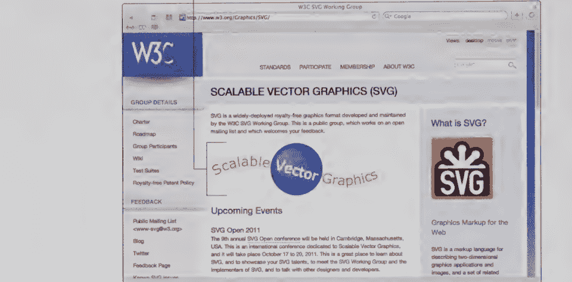

图 2-5

尽管 HTML5 允许你使用 `<svg>` 元素从头开始编写 SVG 图像的代码，但大多数人只是在矢量图形程序中制作 SVG 矢量图形。

如果你想使用原始代码或查看 SVG 图形背后的代码，请遵循以下一般步骤：

1.  在你最喜欢的图形程序中创建一个矢量图形，然后将该图形保存为 SVG 格式。
2.  打开包含该图形的文件夹，右键单击该图形，并在浏览器中打开它。
3.  查看源代码，然后根据需要复制并粘贴它。

虽然本节不会让你成为专家，但它确实为你提供了使用 SVG 的坚实基础。更多详情，请参见规范：www.w3.org/graphics/svg。第 7 课介绍了使用新的 `<canvas>` 元素绘制矢量图的方法。

#### 从一处链接到另一处

链接是网络之所以成为网络的基础。你希望你的用户能够在这里和那里点击，移动到他们想去的地方，并找到他们正在寻找的东西——或者你*希望*他们找到的东西，例如在网站用于商业目的时你的产品或服务。以下部分将向你介绍插入链接的多种方式。

##### 创建文本链接

要从一个页面链接到另一个页面，请使用 `<a>` 元素。链接元素的一般语法如下：

`<a href="地址">可点击区域</a>`

你将 *地址* 替换为链接的目的地点，将 *可点击区域* 替换为用户点击以访问链接的文本。链接大致分为三类：

- **跨站：** 这是指向完全不同的网站上某个页面的链接。`href` 值必须是完整的绝对 URL，包括正确的协议——通常是 `http://`。假设你的网站是 `http://robertburnsbard.com`，你想链接到另一个关于诗人罗伯特·彭斯的粉丝页面。你会使用一个像这样的跨站链接：

  `<a href="http://www.poetrobertburns.com">Poet Robert Burns</a>`

- **站内：** 这是指向你自己网站内某个文档的链接。站内链接是重要的导航工具，可以让访客在你的网站内移动。你可以使用它们来创建导航栏，或在上下文中指向你网站上有用的页面。

> 额外信息
>
> 为了保持链接的组织性，请考虑为网站制定一个链接策略。将相似类型的链接分组，每组不超过五个链接，这样你的访客就不会因为要去的地方太多而不知所措。如果你有超过五个链接的组，请创建链接子类别并在页面上进行划分。此外，将特定的组放在访客最有可能寻找的地方。例如，指向网站主要区域的导航链接通常出现在网页的顶部或左侧。指向网站外部资源的链接通常出现在页面的右栏中。法律和版权信息通常出现在页面的底部。当然，你总是希望通过有组织的链接为用户提供进出每个页面的方式，通常包括一个返回主页的链接和导航栏。有关在 HTML 代码中分组链接的更多信息，请参见本课程后面“创建小节”部分。

要创建站内链接，你可以使用绝对地址或相对地址。如果你想使用绝对地址链接到名为 `life.htm` 的页面，它应该像这样：

```
<a href="http://www.robertburnsbard.com/life.htm">Find out more about Robert Burns' life.</a>
```

如果你网站中的所有文件都在同一个文件夹中，你可以使用相对链接，像这样：

```
<a href="life.htm">Find out more about Robert Burns' life.</a>
```

- **文档内：** 文档内链接是指向同一文档内某个位置的链接，通常用于带有大量标题的长页面。在长页面的顶部，你可能会链接到页面上的每个标题，以便访客可以跳转到他们感兴趣的部分。

要添加这种类型的链接，`href` 值是 # 和页面元素的 `id` 值。因此，如果页面上的第七个标题的 `id` 是 s7，则指向该标题的文档内链接如下所示：

```
<a href="#s7">Heading title</a>
```

你可以使用相同的格式链接到另一个页面上的特定点。只需将用于文档内链接的 `id` 技术与绝对或相对值结合起来。在下面的示例中，一个相对链接指向文件 `life.htm` 中 `id` 为 s7 的元素：

```
<a href="life.htm#s7">Early years</a>
```

> **额外信息**
>
> 在一些旧页面中，你可能会看到 `<a name="somename">` 用作锚点而不是 `id` 属性。不要考虑使用它。它已过时了！

##### 使图像可点击

当你想让你页面上的图像成为可点击的链接时，你可以简单地用 `<a>` 元素将它们包裹起来，像这样：

```
<a href="mylink.html"></a>
```

你还可以使用图像映射使图像的不同区域指向不同的目的地。这些现在很少使用，但一个经典的例子是一张实际地图的图像，你可以点击它访问与特定位置相关的网页。要了解图像映射的工作原理，请查看清单 2-2 中的代码片段。

##### 清单 2-2：图像映射示例

```
<body>
    
    <map name='scot1'>
        <area shape='circle' coords='250,360,20'
              href='#glasgow' alt='Glasgow'/>
        <area shape='circle' coords='330,360,20'
              href='#edin' alt='Edinburgh'/>
        <area shape='rect' coords='220,400,300,470'
              href='#ayr' alt='Ayrshire'/>
    </map>
    <div style='height:100px'>
    <h1 id='glasgow'>Glasgow</h1>
    <p>Ipsum Lorem...</p>
    </div>
    <div style='height:100px'>
    <h1 id='edin'>Edinburgh</h1>
    <p>Ipsum Lorem...</p>
    </div>
    <div style='height:600px'>
    <h1 id='ayr'>Ayrshire</h1>
    <p>Ipsum Lorem...</p>
    </div>
</body>
```

清单 2-2 中的代码如何在图 2-6 所示的图像上创建图像映射：

- 我给图像添加了一个 `usemap` 属性，例如 `usemap='#scot1'`。# 号又出现了！`usemap` 属性告诉浏览器使用图像映射在图像中创建链接。
- 以 `<map name='scot1'>` 开头并以 `</map>` 结尾的标记是实际的映射；它使用图像内的坐标和形状来创建链接。
- 我选择了三个区域，两个圆形区域和一个矩形区域。
  - 圆形区域需要中心点的 x 和 y 坐标（从图像左上角开始，以像素为单位）以及像素为单位的半径。
  - 矩形需要两组 x 和 y 坐标，左上角和右下角坐标。
- `<area>` 元素的 `href` 属性告诉浏览器，当用户点击由 shape 和 `coords` 属性定义的区域时要打开哪个链接。


## 第2课

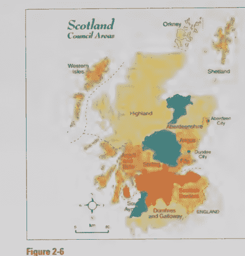

当你将光标移动到指定区域上时，会显示一个手形指针。如果你点击地图，就会链接到正确的位置。

要尝试使用图像地图，请尝试使用 `scotland.jpg` 文件完成以下任务，你可以从本书的配套网站下载该文件。你也可能会发现为什么如今很少使用图像地图：因为它们非常耗费人工！

请完成以下操作：

-   创建一个圆形链接到阿伯丁市。
-   创建一个矩形链接到设得兰群岛。

### 设置链接目标

在继续讨论无障碍性这一重要主题之前，我们先快速看一下 `target` 元素。`<a>` 元素的 `target` 属性告诉浏览器从 `href` 属性指向的位置加载页面。默认情况下，链接页面会在同一个浏览器窗口中替换当前页面。通过为 `target` 使用不同的值，你可以改变这种默认行为。

### 使用 <iframe> 元素嵌入页面

例如，输入以下内容：

```html
<h1>Page 1</h1>
<p><a href='ch6_target1.htm'> Load this page by replacing this one</a></p>
<p><a href='ch6_target1.htm' target='newpage'> Load this page in a window named newpage</a></p>
<p><a href='ch6_target1.htm' target='myframe'> Load this page in an iframe named 'myframe'</a></p>
<iframe name='myframe'></iframe>
```

点击不同的链接，看看页面加载到哪里。在第二个链接中，如果你仔细观察，会看到创建了一个新窗口。猜猜第三个例子中的页面会加载到哪里，这个可不用奖品！

### 使用 <iframe> 元素嵌入页面

`<iframe>` 元素使你能够在网页中嵌入完整的 HTML 文档。例如，当网站需要显示来自广告服务器或广告网络（如 Google AdSense）的横幅广告时，一种在网站上放置这些广告的方法是使用 iframe 元素在浏览器窗口内创建一个窗口（称为*内联框架*）。

`<iframe>` 元素的基本语法很简单：

```html
<iframe src="http://www.someothersite.com/info.htm" />
```

注意 iframe 元素中闭合 `>` 符号前的斜杠。这个斜杠表示该元素是一个空元素。你也可以这样编写 iframe 元素：

```html
<iframe src="http://www.someothersite.com/info.htm"></iframe>
```

这两种编写 `<iframe>` 元素的方式产生相同的结果。使用哪一种纯粹是个人选择。

`<iframe>` 接受以下全局属性：

-   `src` 是任何相对或绝对 URL。
-   `name` 允许使用 JavaScript 轻松引用该元素。
-   `width` 和 `height` 以像素为单位进行度量。
-   `srcdoc`、`sandbox` 和 `seamless` 是可用于提高安全性的属性。

你可能听说过框架，这是一种更古老的在页面中嵌入另一个页面的方式。在 Web 的早期，框架用于在一个页面中显示三个不同的页面，以便重用元素，如标题和导航。你可能会遇到使用框架设计的旧网站，但要知道这种技术现在被认为是一种不好的做法。HTML5 已经废弃了 `<frame>` 元素。然而，`<iframe>` 元素在当前规范版本中依然有效，你可以在以下地址在线查看：http://dev.w3.org/html5/spec-author-view/the-iframe-element.html

#### 创建章节

当人们创建文档时，通常会将其划分为章节。例如，一封信可能包含信头（包含收件人和发件人的地址）、正文（包含信件的真实信息）和信尾。对于较长的文档，你可能有额外的章节，如章和部分。

你使用所有这些章节来对相关类型的内容进行分组，以帮助读者理解。为了方便在网页中创建章节，请使用*分组元素*，我将在下一节中解释。

### 介绍新的 HTML5 元素

HTML5 提供了一系列新的分组元素。其中最重要的是：

-   `<header>` 对构成文档显示标题的元素进行分组。网站的页眉通常在多个页面中是相同的，header 元素创建一个连贯的、具有语义描述性的组。例如，以下代码为一个关于罗伯特·彭斯生平的页面创建了一个非常简单的页眉。你可以在浏览器中看到显示的页眉，如图 2-7 所示。然而，大多数页眉，如图 2-8 所示的那个，更为复杂。

```html
<header>
  <h1>Robert Burns, Bard<br/>1759-1796</h1>
</header>
```

图 2-7

-   `<hgroup>` 对标题进行分组。例如，文章通常有一个标题后跟一个副标题。通过用 `<hgroup>` 将两个标题分组，你明确了这些标题密切相关，就像这个来自未来新闻网站的示例：

```html
<hgroup>
  <h1>Surviving the Zombie Apocalypse</h1>
  <h2>Be Prepared When the Undead Arrive</h2>
</hgroup>
```

-   `<article>` 表示作为独立文章起作用的内容。`<section>` 元素可用于划分文章。
-   `<section>` 定义较大文档中一组相关的内容，通常以副标题开始，该副标题会列在文档的大纲中。例如，条款和条件以及其他长篇法律文件通常按节组织。
-   `<nav>` 包围一组*主要的*链接，例如链接目录或导航栏。
-   `<footer>` 对页面页脚中的元素进行分组。

## 第2课

页眉


图 2-9 显示了一个文章、一个主要导航元素和一个页脚在浏览器中显示的示例。

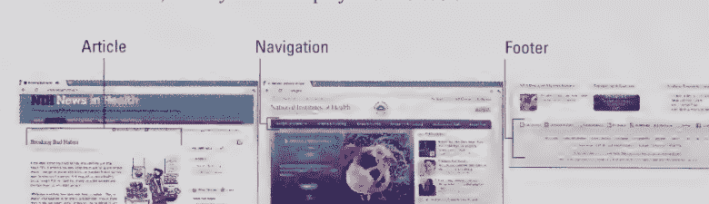

#### 创建章节

**额外信息**

对于本课的目的而言，服务器端包含是你打算在整个网站中重用的一段 HTML 代码片段。网站上的元素，如页眉、主导航和页脚，是服务器端包含的理想候选对象，它们简化了网站的创建和更新。在你创建一个将重复出现的元素并使用服务器端包含将其插入网站页面后，你只需编辑包含文件，而无需编辑该元素出现的每个页面。你对该元素所做的任何更改都会出现在网站的任何地方。服务器端包含超出了本书的范围，但我鼓励你在继续探索 Web 开发时了解更多相关信息。

其他用于布局的新标签包括：

-   **`<aside>`** 用于与主要叙述分离但相关的文本块。在排版中，示例包括引文或边栏。
-   **`<figure>`** 定义一个图形或插图。想想杂志文章中的插图，就能理解这个元素的目的。一个图形通常与文章的内容相关，但不依赖于在文章中的任何精确位置。所以，如果我说“这是我小狗的照片”，你会期望照片紧跟在这句话后面。但如果我说“请参见图 1-1 我小狗的照片”，你会期望图形在附近，但不一定是页面流程中的下一个。
-   **`<figcaption>`** 通常是 `<figure>` 元素的子元素，包含解释该图形的文本。

> 截至本文撰写时，HTML5 规范已添加了 30 个新元素，以及众多新的属性值。我在本书中涵盖了主要的新元素。关于新元素的一个很好的总结可以在 www.w3schools.com/html5/html5_new_elements.asp 找到。

#### 选择 <div> 还是新的语义元素

`<div>` 元素用于标记逻辑内容组并赋予其语义意义。过去，`<div>` 元素被严重过度使用，变成了一个万能元素。前面章节中描述的新的语义 HTML5 元素现在取代了 `<div>` 的主要用途，但 `<div>` 在 HTML 文档中仍然有其用途。


如果你的分组似乎超出了新 HTML5 元素的范围，或者你只需要一个通用的包装器，请使用 `<div>` 在代码中对元素进行分组。


## 第2课

例如，参考图2-7，你会看到页面左侧有一个装饰性图像。在代码中，一个 `<div>` 元素将这个装饰与页面内容分开，这样图像就可以沿着页面与罗伯特·伯恩斯的信息一起平铺显示。该 `<div>` 元素仅有一个 `id` 属性，没有文本或图像；你在图2-7中看到的图像是通过CSS作为背景图像插入的：

```
<div id="burnsimage">
</div>
```

### 添加媒体元素

HTML5中新增的 `<audio>` 和 `<video>` 元素为音频和视频提供了原生媒体支持。用户不再需要像使用 `<embed>` 元素那样，在计算机上安装能够播放特定文件类型的插件。用户只需点击文件即可播放。

然而，由于 `<audio>` 和 `<video>` 元素是新增的，你需要了解一些当前的局限性和使用这些元素的潜在缺点：

-   你的访客必须拥有支持HTML5的浏览器，该浏览器需能处理 `<audio>` 或 `<video>` 标签。任何使用旧版浏览器的人都无法播放媒体。
-   在支持HTML5的浏览器中，对不同类型的音频和视频文件的支持并不一致。例如，MP3文件可以在Chrome、Internet Explorer 9和Safari浏览器中播放，但无法在Firefox或Opera浏览器中播放。
-   目前尚不清楚浏览器是否会在确定文件可以播放之前就下载它。这些元素可能会消耗你的网站访客无法访问的资源的带宽。
-   当浏览器无法播放 `<audio>` 或 `<video>` 元素中的文件时，有些浏览器会向访客显示消息，而另一些则完全不显示任何内容。

由于这些问题，提供一种替代方式让用户查看多媒体内容非常重要。其中支持最广泛的是 `<embed>` 元素。因此，在接下来的章节中，我将向你介绍这些新元素，并解释如何使用这个经典可靠的 `<embed>`。

> 要获取关于支持HTML5的浏览器支持哪些媒体文件类型的最新信息，请访问Mozilla的以下页面：https://developer.mozilla.org/En/Media_formats_supported_by_the_audio_and_video_elements。

### 了解属性

除了全局属性外，`<video>` 和 `<audio>` 元素还有一组共同的属性。最常用的属性包括：

-   **src** 提供媒体资源的地址。
-   **autoplay** 是一个布尔属性，这意味着它的值要么是 `true` 要么是 `false`。默认情况下，`autoplay` 为 `false`。当该属性存在时，音频或视频一旦可以就会立即播放。除非你有充分的理由使用 `autoplay`，否则我建议不要使用它，这样移动设备访客就不会为他们未请求查看的内容消耗带宽，其他访客也不会在媒体意外播放时急于将其静音。
-   **loop** 是另一个布尔属性。设置后，媒体会循环播放，一遍又一遍又一遍。最佳实践是*不要*为你的音频设置循环。
-   **muted** 是一个布尔属性，控制音频输出的默认状态。设置后，音频将被静音。对于用户未请求的视频（例如嵌入在横幅广告中的视频），此属性可能很有用。通过以静音方式开始播放视频，你可以随后将是否听到音频的控制权交给用户。
-   **controls** 是一个布尔属性，表示作者没有创建脚本化控制器，并希望用户代理提供自己的控件集。
-   **width** 使你能够以像素为单位设置媒体显示宽度。
-   **height** 以像素为单位设置媒体显示高度。

```
要将布尔属性设置为true，你只需在元素中包含该属性，如下所示：
<video src="myfile.mp3" autoplay>
你也可能看到带有值的布尔属性，这是技术上更正确的使用方式，但不太常见：
<video src="myfile.mp3" autoplay="autoplay">
```

### 使用新的 `<audio>` 或 `<video>` 标签插入媒体

显示音频或视频文件的语法可以像下面这样简单：

```
<video src="videos/movie.ogg" controls></video>
```

`src` 属性指向保存在网站根文件夹的 `videos` 子文件夹中的 `movie.ogg` 文件。`controls` 属性告诉浏览器显示其默认播放器，供网站访客控制播放。

以下是音频文件的基本代码可能的样子，以便你了解 `<audio>` 和 `<video>` 的代码是多么相似：

```
<audio src="audio/sound.mp3" controls></audio>
```

如果 `<audio>` 或 `<video>` 的 `src` 属性缺失，该元素可以接受零个或多个 `<source>` 元素。这个元素很方便，因为并非所有浏览器都能播放所有不同的格式，它使你能够为浏览器提供多个文件选项。使用 `<source>` 元素，你可以放入多个不同格式的源文件，以确保浏览器能播放其中一个。`<source>` 元素是 `<audio>` 或 `<video>` 元素的子元素，如下示例代码所示：

```
<video width="320" height="240" controls="controls">
  <source src="movie.mp4" type="video/mp4" />
  <source src="movie.ogg" type="video/ogg" />
  Your browser does not support the video tag.
</video>
```

在此示例中，`width` 和 `height` 属性以像素为单位设置播放器的尺寸。你还能看到 `controls` 属性以及文本 Your browser does not support the video tag. 当浏览器正确遵循规范时，你网站的访客只有在其浏览器无法播放文件时才会看到此文本。此功能的实现目前尚不一致。在每个 `<source>` 元素内，`src` 属性指向一个视频文件，`type` 属性告诉浏览器 `<source>` 元素包含的文件类型。

### 以传统方式嵌入媒体

2000年，我写道：“在XHTML文档中嵌入多媒体文件有两种方式：官方方式是使用 `<object>` 元素，而有效的方式是使用 `<embed>` 元素！” 多年来，大多数浏览器都支持 `<embed>` 元素，但直到HTML5它才成为官方支持的元素。

`<embed>` 元素与 `<audio>` 和 `<video>` 共有以下属性：src、width 和 height，以及全局属性。大多数浏览器还支持一个尚未正式纳入规范的属性：autoplay。然而，autoplay 在 `<audio>` 和 `<video>` 元素中是正式的。（详情请参见前面的“了解属性”部分。）

> 实际上严格来说，`<embed>` 元素确实允许 autoplay 属性。该元素只是将该属性视为给插件的指令。规范指出：“未知属性随后会作为参数传递给插件。”

`<embed>` 的语法很简单：

```
<embed src="slo-mo-3-hires.wmv" />
```

`<embed>` 元素使用浏览器插件播放多媒体内容。在前面的示例中，`<embed>` 会寻找用于Windows Media Player (WMV) 文件的正确插件。网站访客仍然需要安装正确的插件。图2-10显示了在Firefox中如果没有安装插件你会看到什么。对于其他浏览器，缺少正确插件时的行为不一致。Chrome会告诉你缺少插件，但Safari什么都不显示！

> 人们安装的一些最常见的插件包括Adobe Flash Player、Adobe PDF、Apple QuickTime和Windows Media Player。

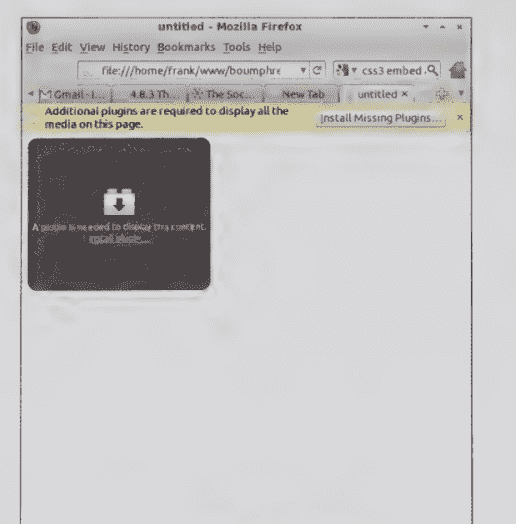

你也可以使用 `<a>` 元素链接到多媒体文件：
`<a href="slo-mo-3-hires.wmv">Bobby Jones Golf Swing</a>`

### 创建无障碍HTML

在创建HTML代码时，你可以在幕后做一些重要的事情，以确保网站对残疾访客无障碍访问。

盲人通常使用音频浏览器或盲文浏览器上网。*音频浏览器*向用户朗读页面，而*盲文浏览器*具有可刷新的盲文显示屏，会根据屏幕阅读器从网页捕获的内容凸起盲文点。对于这些访客，请记住以下几点：

你可以在 www.w3.org/wai/er/tools/complete 找到测试网页无障碍性的工具列表。

-   表格在这两种浏览器上显示效果都不好，非可视浏览器通常以列表形式呈现表格，因此在设计网站时请牢记这一点。
-   图像应都具有 `alt` 属性，简要描述图像。此外，如果图像是图表或传达信息，请确保它有一个描述性的标题来解释其含义。如何在本课前面的“插入图像”部分添加 `alt` 属性。
-   使用语义标记，尤其是在标题和列表中。一个好的测试是去掉所有样式，看看你的页面是否仍然传达清晰的含义。
-   几乎10%的用户是红绿色盲，3%是完全色盲，因此不要仅使用颜色来传达意义上的差异。如果你使用颜色，如红色和绿色，请确保它们是不同的色调。这样色盲人士仍然可以区分两者。
-   视力不佳的人通常希望放大文本。如果你将字体设置为绝对大小，这可能会产生问题。因此，对于字体大小，请确保使用相对值，如 ems。关于相对和绝对大小的更多信息，请参见第4课。

无障碍性也影响运动障碍人士。例如，用户可能无法使用鼠标，因此确保所有元素，尤其是表单元素，都可以通过键盘访问。


癫痫是另一个需要考虑的问题：快速闪烁可能诱发癫痫发作，因此请勿在网站上放置任何快速闪烁的标识，例如反复闪烁的“你是赢家！”。大多数用户会觉得这极其烦人，而且我怀疑……不，我确信使用闪烁内容的*唯一*目的就是试图诱骗用户点击以消除闪烁！

一般而言，以下指南本身就是良好的网页设计基础，同时也能打造出无障碍网站：

- **导航：**使导航元素清晰可预测，并为链接提供有意义的标签。遵循我在前文“从一处链接到另一处”部分给出的指导原则。
- **可读性：**使你的文案清晰准确。
- **颜色：**以黑白两色查看你的页面。为此，你可能需要截取页面屏幕截图，并导入能将截图转换为灰度图像的图像处理程序。检查所有网页元素是否仍然清晰可读。

设计无障碍网站的基本原则相当简单，如果你专注于良好的页面设计，就能满足大部分无障碍要求。反过来，如果你遵循良好的无障碍设计指南，也就设计出了一个好页面。

事实上，移动网络的需求与残障人士的需求如此相似，以至于W3C为此专设了一个完整章节！你可以在 www.w3.org/wai/mobile 找到它。

更多关于无障碍性和创建无障碍网站的详细信息，请查阅W3C致力于无障碍性指南的工作组网站：www.w3.org/wai/policy。

### 保存和验证HTML文档

所有优秀的作者都希望确保自己的文档是有效的。*有效文档*是指遵守其编写所用HTML版本规则的文档。幸运的是，验证文档相当容易。有多种验证器可用，但第一个且可能是最好的，是W3C验证器（见图2-11），你可以在 `http://validator.w3.org` 找到它。

#### 课程2

如你所见，W3C验证器提供三种验证HTML文件的方式：

- 如果文件已在线，可在“通过URI验证”选项卡上将验证器指向文件的URL。
- 通过“通过文件上传验证”选项卡上传文件。
- 将你的文档粘贴到“通过直接输入验证”选项卡的文本框中。

此验证器会查看你文件的DOCTYPE并据此进行验证。

清单2-3是一个用于验证的XHTML文件骨架。该文件包含一些明显的错误和一些不那么明显的错误。看看你能否找出它们。

#### 清单2-3：用于验证的示例文件

```html
<!DOCTYPE html PUBLIC "-//W3C//DTD XHTML 1.0 Strict//EN"
"http://www.w3.org/TR/xhtml1/DTD/xhtml1-strict.dtd">
<html xmlns="http://www.w3.org/1999/xhtml" xml:lang="en"
      lang="en">
<head>
<title>Validate</title>
<meta http-equiv="content-type" content="text/html;charset=utf-8" />
<meta name="generator" content="Geany 0.20" />
</head>
<body>
<header><h1>Robert Burns</h1>    </header>
<h2>Life & Times</h2>
<div class='body'>
    <p id='1'>"Lorem ipsum dolor sit amet, ...
    ...anim id est laborum."</p>
    <p id='2'>"Lorem ipsum dolor sit amet, ...
    ...anim id est laborum."</p>
</div>
<footer><p>&copy Wiley</p></footer>
</body>
</html>
```

如果你想练习编写HTML，可以将此代码输入文本编辑器并将其保存为L2_02.htm。一般而言，你可以随意命名HTML文件，但需遵循一些规则：

- 文件名必须以字母或数字开头。
- 文件名不能包含空格、引号或某些不允许的字符（$ &+,/:;=?@<>#%{}|\^~[]`）。
- 文件扩展名必须是 .htm。

如果你希望当有人访问你的网站地址而未输入特定网页地址时（例如有人输入 www.example.com）显示某个文件，请将文件命名为 index.htm。

如果你只是想练习验证文件，请使用文件L2_02.htm，你可以从本书的配套网站下载。（有关网站的详细信息，请参见引言。）

现在，你可以在W3C验证器中验证清单2-3中的代码。以下步骤将引导你完成几次试验文件验证：

1. 使用你喜欢的方法，当文件准备好验证时，单击“检查”按钮。

以下是你应该在验证器生成的结果中看到的内容：

- 你已经知道 `<header>` 和 `<footer>` 元素是HTML5新增的，这就是为什么验证器在XHTML中将这些标记为错误。
- 闭合的 `<h1>` 标签未完成。
- &符（&）应转换为实体 —— &amp; —— 你将在课程2中学习。
- 缺失的 `</p>` 标签已被指出。
- *id*属性具有非法值，例如 `<p id='1'>`。在XHTML中，id值必须以下划线或字母开头。
- &copy缺少结尾的分号。代码应为 &copy;。

2. 将文件的DOCTYPE更改为HTML5并将其保存为 **L2_03.htm**。记住HTML5的DOCTYPE格式为 `<!DOCTYPE html >`。
3. 修复闭合的 `</h1>` 标签。
4. 在W3C验证器中运行 **L2_03.htm**。

因为你更改了DOCTYPE，验证器将把该文档视为HTML5文档，因此只会发现一个错误！当然HTML5接受 `<header>` 和 `<footer>` 元素。HTML5也接受裸&符、缺失的 `<p>` 标签和ID值。验证器仅指出了 &copy; 实体中缺失的分号。

> HTML5在标记要求上比XHTML宽松得多。话虽如此，出于向后兼容的考虑，我仍然敦促你按照更严格的XHTML标准来编写代码。将你的文档作为XHTML进行验证，并忽略不支持的元素错误消息。

### 总结

在本课程中，你学习了关于HTML5的以下基础知识：

- 用于添加文本的最常用元素包括标题和段落元素。标题最多可以有六个级别。其他包含文本的常用元素包括有序列表、无序列表和定义列表。
- 你可以通过添加新的 `contenteditable` 属性使文本在浏览器中可编辑。
- HTML代码中的实体或Unicode字符使你能够显示特殊字符。示例包括键盘上没有的符号（如版权符号©），以及在HTML中有特殊含义的字符（如 < 字符）。
- 表格可以组织网页上的数据。使用 `<table>` 元素设置表格，并使用 `<tr>`、`<th>` 和 `<td>` 标签将数据组织成行和列。
- 要插入图像，请使用带有 `src` 属性的 `` 标签来指向文件。`src` 属性值可以是绝对路径或相对路径。
- 文本和图像可以通过 `<a>` 元素变成可点击的链接。你可以将链接设置为指向同一页面内的某一点、网站中的不同页面或另一个网站。
- `<iframe>` 元素可用于将外部文档嵌入到你当前的网页中。
- 分组元素，如 `<header>`、`<article>` 和 `<footer>`，有助于你将网页内容组织成语义化的部分。
- 新的 `<audio>` 和 `<video>` 标签提供了对音频和视频文件的原生支持，尽管在本书出版时浏览器对这些元素的支持尚不稳定。你也可以使用 `<embed>` 元素插入多媒体文件，它在浏览器中的支持更为广泛。
- 无障碍网页清晰地组织信息，使用语义化标签，并遵循其他设计实践，使网页易于使用，包括那些有视觉、运动或其他障碍的人士。
- 将HTML文档通过W3C验证器运行，可以让你了解文档符合DOCTYPE中指定的HTML版本的程度。

### 动手实验室

要尝试你在本课程中学到的一些元素，请按照以下步骤操作：

1. 在任何文本编辑器（如记事本（Windows）或TextEdit（Mac））中打开一个空白文档，然后将其保存为 `test.htm`。
2. 插入基本的HTML5页面模板标记。你创建的每个HTML5文档都有某些基本元素。你可以使用以下标记作为每个页面的模板：

```html
<!DOCTYPE html>
<html>
<head>
	<title>Page Title</title>
</head>
<body>
</body>
</html>
```

3. 在 `<body>` 元素内创建一些部分。例如，以 `<article>` 元素开始你的页面，然后使用 `<section>`、`<hgroup>` 和不同级别的 `<header>` 元素在其中创建大纲。


### 了解本次技术讲座

本课程中使用的重要术语如下：

**绝对值：** 使用文件完整定位符（包括 `http://` 和网站域名）来定位文件的 `src` 或 `href` 属性值。

**图像热点：** 一个被划分为不同可点击区域的图像，这些区域链接到网络上的不同目标。

**位图图像：** 由像素组成的图像，这意味着放大它会导致图像分辨率降低。

**跨站链接：** 指向不同网站的链接。

**HTML 实体：** 浏览器可以将其转换为特殊字符的代码，例如版权符号。

**文档内链接：** 指向与链接位于同一页面上某个位置的链接，使用 HTML 元素的 `id` 属性值和 `<a>` 元素 `href` 属性值中的 `#` 符号。

**站内链接：** 指向同一网站内不同页面的链接。此链接可以使用相对或绝对 URL 来指向链接目标。

**相对值：** 假设所有文件都位于同一网站根文件夹中的 `src` 或 `href` 属性值。

**语义标记：** 描述内容含义或目的的标记。

**SVG：** 可缩放矢量图形；一种使用标记描述形状和线条的网络图形格式。

**Unicode：** 由 Unicode 联盟开发的代表字符的一组数字。参见 `http://unicode.org`。

**矢量图像：** 使用数学算法创建二维图像的图像。更改矢量图像的大小不会改变其分辨率。

这是您在本课中学到的 HTML 标签的快速参考。

### 总结

| 标签 | 描述 | 标签 | 描述 |
|---|---|---|---|
| `<a>` | 创建链接。 | `<hgroup>` | 用于创建紧密相关的一组标题。 |
| `<article>` | 划分出一个完整的文章。 | `<iframe>` | 内联框架。用于将文档嵌入另一个网页中。 |
| `<aside>` | 标记相关但独立的材料，例如侧边栏。 | `` | 指向一个图像文件并在页面上显示它。没有结束标签，但以 `/>` 结尾。 |
| `<audio>` | 插入一个音频文件，浏览器原生支持播放。 | `<li>` | 创建一个列表项。是 `<ol>` 或 `<ul>` 标签的子元素。 |
| `<caption>` | 为表格添加标题。是 `<table>` 元素的子元素。 | `<nav>` | 表示一个主要的导航链接组。 |
| `<dd>` | 包含定义的文本。是 `<dl>` 元素的子元素。 | `<ol>` | 创建一个自动为列表项编号的有序列表。 |
| `<div>` | 当内容需要用 `class` 或 `id` 属性分组且没有合适的语义标签时，创建一个包装器。 | `<section>` | 一个用于在文档中定义子部分的分组元素。每个子部分通常都有一个小标题。 |
| `<dl>` | 创建一个定义列表。 | `<source>` | `<audio>` 或 `<video>` 元素的子元素。用于指定内容的多种文件格式。 |
| `<dt>` | 包含定义列表中被定义的词。是 `<dl>` 元素的子元素。 | `<table>` | 创建一个表格。可以有一个 `border` 属性，其值为 1 或空字符串。 |
| `<embed>` | 插入多媒体（例如音频或视频），但没有原生播放支持。用户需要插件。 | `<td>` | 包含表格数据或单元格内容。是 `<tr>` 元素的子元素。 |
| `<figcaption>` | 包含图像标题的文本。是 `<figure>` 元素的子元素。 | `<th>` | 标记表格中的列标题。是 `<tr>` 元素的子元素。 |
| `<figure>` | 容纳不需要精确放置在文档中的插图或图表。 | `<tr>` | 在表格中创建一行。是 `<table>` 元素的子元素。 |
| `<footer>` | 标记网页中包含页脚内容（如版权和管理信息）的部分。 | `<ul>` | 创建一个无序列表，自动为每个列表项目添加项目符号。 |
| `<h1>`...`<h6>` | 标记页面上的标题并将其组织为不同级别。 | `<video>` | 在网页中插入视频，并提供浏览器原生播放支持。 |
| `<header>` | 指示通常出现在网站页面顶部的页眉内容。 | | |

#### 第 2 课

| 标签 | 描述 | 标签 | 描述 |
|---|---|---|---|
| `<footer>` | 标记网页中包含页脚内容（如版权和管理信息）的部分。 | `<ul>` | 创建一个无序列表，自动为每个列表项目添加项目符号。 |
| `<h1>`...`<h6>` | 标记页面上的标题并将其组织为不同级别。 | `<video>` | 在网页中插入视频，并提供浏览器原生播放支持。 |
| `<header>` | 指示通常出现在网站页面顶部的页眉内容。 | | |

#### 第 3 课

### 创建表单


-   使用 form 和 input 元素来*创建一个表单框架*。


-   创建文本框，以便*用户可以填写表单信息*。

-   *让访问者通过复选框、单选按钮、下拉列表和属性从一组选项中进行选择*。


-   添加一个按钮来*控制表单*。


1.  在 HTML 文档中，哪个元素标记了任何表单的开始和结束？
    查看第 69 页的详细信息

2.  哪个属性决定了 `<input>` 元素在浏览器中如何显示？
    在第 74 页了解更多

3.  如何创建复选框，以便访问者可以选择任意多个？
    查看第 78 页的工作原理

4.  HTML 代码的哪个部分限制了访问者只能选择一个单选按钮？
    解释在第 80 页

5.  您可以在表单中包含哪些不同类型的按钮？
    详细信息在第 86 页

表单允许用户与正在浏览的页面进行通信，或将信息传递给服务器。每次您在 Google 或 Yahoo! 上进行搜索时，您都在使用表单。每次在线购物时，您都在使用多个表单。每次登录帐户时，您都在使用表单。我说表单是推动现代商业的引擎，这一点也不夸张！

在本课中，您将学习如何在 HTML 文档中设置表单，将经得起时间考验的表单元素与 HTML5 中的新元素结合起来。

您在本课中学不到的是如何将表单与服务器连接，以便将站点访问者输入的数据传递到服务器。本课程的重点是 HTML。第 6 课将介绍脚本并解释如何使您的表单具备功能性。

### 设置表单结构

设置表单的结构不仅使您的表单组织有序，以便用户可以轻松浏览选项，还使浏览器能够准确读取所有表单元素。本主题从框定每个表单的 `<form>` 元素开始，然后向您展示如何使用 `<fieldset>` 将表单元素组织成部分，使用语义化 `<legend>` 元素标记这些部分，以及将每个表单输入与其相应的标签分组。

### 从 `<form>` 元素开始

您使用 `<form>` 元素来显示一个表单，它可以接受所有全局属性，以及以下属性：

-   **action**：表单信息发送到的地址。
-   **name**：此属性为表单赋予一个唯一的名称，然后脚本可以通过该名称访问表单。
-   **method**：方法值指示用于发送表单信息的方法：GET 或 POST。默认为 GET。

一个空的表单元素和属性值如下所示：

```
<form action=" " name=" " method=" ">
</form>
```

您将在第 6 课中了解这些属性的值如何使您的表单工作。目前，只需知道这些是您最常用的 `<form>` 属性。

在表单元素内，您可以添加出现在 HTML 文档主体内的几乎所有元素。例如，您可以插入标题、段落、图像等。`<form>` 元素还可以接受几个特定于 `<form>` 的子元素，包括以下内容：

-   **`<input>`**：这是表单的主力。我将在本课中详细解释此元素。
-   **`<textarea>`**：当您希望用户能够输入大量文本时，这就是要使用的表单元素。详情请参见本课后面的“让访问者添加大量文本”。
-   **`<select>`**：您使用 `<select>` 创建下拉列表。为下拉列表中的每个选项添加一个 `<option>` 元素。详情请参见本课后面的“让访问者选择选项”。
-   **`<button>`**：这个元素现在很少使用，它生成一个带有图像的按钮。大多数表单使用 `<input>` 元素创建按钮，正如您在本课末尾的“添加按钮以控制表单”中所发现的那样。
-   **`<datalist>`**：`<datalist>` 元素是 HTML5 的新功能，尚未得到所有浏览器的支持，它为标准文本输入字段提供了一个预定义选项列表。浏览器可以使用此列表为文本输入提供自动完成功能。
-   **`<keygen>`**：同样是 HTML5 的新功能，`<keygen>` 元素旨在用于将用户登录到服务器。然而，问题在于它

支持除 Internet Explorer 以外的所有浏览器——而 Internet Explorer 没有计划支持它。因此，目前这个元素并不实用。

✓ **<output>：** HTML5 中最后一个新增的表单元素，`<output>` 元素可用于显示涉及多个 `<input>` 元素的计算结果。例如，如果你向用户询问两个数字，`<output>` 元素可以显示这两个数字相加的结果。

### 将表单组织成多个部分

在较长的表单中，将表单划分为较小的部分可以帮助访客填写表单。

要在表单中创建部分，你可以使用 `<fieldset>` 元素对进行分组，并使用 `<legend>` 元素为各组添加标签。

你想要创建的每个部分都需要一对 `<fieldset>` 开始和结束标签。在 `<fieldset>` 标签内，你插入一对 `<legend>` 开始和结束标签。在每个标签中，添加该部分的名称。对于这个表单，我创建了三个部分：联系信息、罗伯特·彭斯偏好和评论。请查看图 3-1 中的各个部分。

```
<form action=" " name=" " method=" ">

<fieldset>
    <legend>Contact Information</legend>
</fieldset>

<fieldset>
    <legend>Robert Burns Preferences</legend>
</fieldset>

<fieldset>
    <legend>Comments</legend>
</fieldset>

</form>
```

表单每个部分的图例

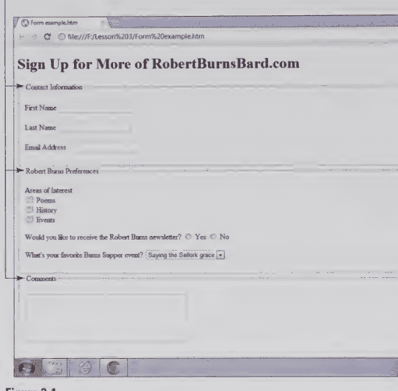

### 为 `<input>` 元素添加标签

`<input>` 元素是表单的主力。对于大多数允许访客填写表单的元素，使用 `<input>` 元素的 `type` 属性来告诉浏览器你想要显示哪种类型的表单元素。每个输入框还需要一个标签，告诉访客需要提供或选择什么信息。

要将每个标签与其对应的输入框分组，你可以将每个输入框包裹在一个段落标签中，如下所示：

```
<p>
    <label>First Name</label>
    <input type=" " />
</p>
```

### 设置表单结构

为了在示例表单中规划访客提供信息的位置，你可以为每个标签和输入框插入段落标签。然后添加带有空 `type` 值的 `<label>` 和 `<input>` 元素：

```
<form action="" name="" method="">
    <fieldset>
        <legend>Contact Information</legend>
        <p>
            <label>First Name</label>
            <input type="" />
        </p>
        <p>
            <label>Last Name</label>
            <input type="" />
        </p>
        <p>
            <label>Email Address</label>
            <input type="" />
        </p>
    </fieldset>
</form>
```

下一节“创建不同类型的输入框”将介绍你可以为 `type` 属性使用的不同值，具体取决于你希望 `<input>` 元素收集的信息类型。


假设你需要为一个房地产经纪人的网站创建一个表单。在咨询页面上，经纪人希望表单向网站访客询问以下信息：姓名、电子邮件地址以及访客感兴趣的工作类型（出售房屋、购买房屋、房屋布置、租赁房屋或其他）。表单还需要包括访客正在出售或寻找的房产的简要描述、街区和价格范围。经纪人还希望表单询问联系访客的最佳方式。利用所有这些信息，创建表单框架如下：

1.  决定你将如何将数据组织成信息组。
2.  为每组创建 `<fieldset>` 元素和一个 `<legend>` 元素。
3.  为访客需要填写的每个框或其他表单元素设置一个 `<label>` 和一个 `<input>` 元素。

### 创建不同类型的输入框

访客输入文本的框是一个基本的表单元素。你可以通过选择与表单请求的数据类型相对应的 `type` 属性值，使文本框更专门化——从而从网站访客那里获得更好的信息。例如，如果你想要电子邮件地址，你可以使用一个名为 `email` 的特殊 `type` 属性值，当用户提交表单时，它将检查数据是否符合电子邮件地址的格式。这个检查数据的过程就是验证。

你所使用的类型在验证表单时很重要，正如你在第 6 课中将学到的。在本课中，你将专注于在表单中设置 HTML，以便数据在浏览器中进行验证。HTML5 添加了几个新的 `type` 值，使你能够更多地利用浏览器的验证功能。

在本节中，你将首先创建一个基本的文本输入框。然后，你将学习如何使用 HTML5 中新的 `type` 值创建特殊类型的文本框。此外，你还将了解如何使用 `<textarea>` 元素，它创建了另一种 HTML5 中新的特殊类型文本框。

#### 创建基本的文本输入框

前面图 3-1 中显示的示例表单有一个用于访客名字和姓氏的基本文本输入框。

要创建一个基本的文本输入框，请使用一个 `type` 属性值为 `text` 的 `<input>` 元素。这告诉浏览器访客可以在框中输入任何类型的文本。基本文本框通常用于预期相对较短的输入，如姓名或电话号码。虽然你可以允许用户在文本框中输入数百万个字符或粘贴整个文档，但这并不实用，因为文本框只显示一行。

你还需要添加一个 `name` 属性，以便表单可以将用户输入的内容作为名称/值对发送，其中名称是你作为 `name` 属性输入的任何内容，而值是访客输入到表单中的文本。以下是名字和姓氏的两个输入元素：

```
<input type="text" name="firstname" />
<input type="text" name="lastname" />
```

我为每个输入框添加标签后，代码如下所示：

```
<p>
    <label>First Name</label>
    <input type="text"
           name="firstname" />
</p>
<p>
    <label>Last Name</label>
    <input type="text"
           name="lastname" />
</p>
```

图 3-2 显示了这些元素在浏览器中的显示方式，以及我将在下一节中解释的电子邮件文本框。

如果你希望用户在框中输入的内容不被看到，你可以使用 `password` 类型值，而不是 `text`。当你使用这个值时，浏览器会显示点或类似的字符来隐藏用户的输入，这种做法你可能非常熟悉。代码如下所示：

```
<input type="password"
       name="pwd" />
```

#### 探索新的 HTML5 输入类型

HTML5 添加了几种新的输入类型，使你能够为文本框指定特殊用途。以下列表介绍了更受欢迎的几种：

- **email**：如果你创建一个 `type` 属性值为 `email` 的 `<input>` 元素（并且浏览器支持此输入类型），浏览器将只接受填写表单的用户输入的有效电子邮件地址。浏览器通过检查输入以确保其符合电子邮件地址的标准格式来确定地址是否有效：name@something.something。换句话说，如果你输入 `joe@testing.com`，浏览器会将其视为有效的电子邮件地址。但是，如果你在一个 `type` 属性值为 `email` 的 `<input>` 元素中输入 `this is my email address`，浏览器将拒绝它。

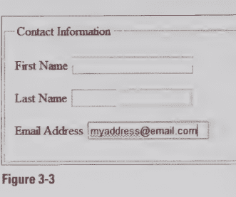

图 3-3

以下是图 3-3 中电子邮件地址文本框背后代码的示例：

```
<input type="email" name="email" />
```

- **url：** 当你希望用户输入网站地址时，使用 `url` 值。浏览器会检查标准的 URL 格式，例如 `http://www.test.com` 或 `http://website.test.net`。示例如下：

`<input type="url" name="addnamehere" />`

- **number：** `number` 值告诉浏览器检查输入的字符是否都是数字。你还可以使用 `min` 和 `max` 属性设置数字的上限和下限。`min` 值为 1 表示输入的数字不得小于 1。`max` 值为 100 表示输入的数字不能大于 100。当你设置限制时，会启用一个滚动框，允许访客在你设置的限制内选择一个数字。

```
<input type="number" name="addnamehere" min="1"
       max="100" />
```

- **range：** 此值也限制了用户的输入，但为了选择指定范围内的数字，网站访客必须使用滑块。使用 `min` 和 `max` 属性设置范围。

```
<input type="range" name="addnamehere" min="1"
       max="100" />
```

- **search：** 用户输入搜索词。该框的行为类似于普通文本框，但 `search` 值使代码具有语义性。

```
<input type="search" name="addnamehere" />
```


### 制作不同类型的输入框

在图 3-4 中，你可以看到不同的 `<input>` 类型属性在浏览器中的显示效果。

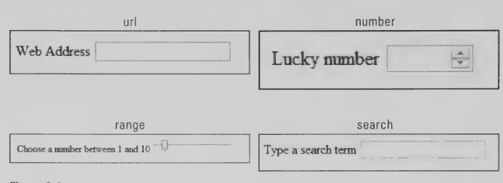

### 允许访客添加大量文本

当你想为用户提供一个适合输入大量文本的多行文本框时，请使用 `<textarea>` 元素。与 `<input>` 类似，`<textarea>` 也有尖括号，并且是 `<form>` 元素的子元素。与 `<input>` 不同的是，`<textarea>` 同时具有开始和结束标签。

要控制 `<textarea>` 创建的文本框大小，可以使用 `rows` 和 `cols` 属性，或者更推荐使用 CSS 来指定高度和宽度。你还必须为 `<textarea>` 提供一个 `name` 值。以下是一个 `<textarea>` 元素的代码示例，你可以在图 3-5 中看到它在浏览器中的显示效果：

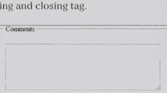

```
<textarea rows="6" cols="40" name="addnamehere">
</textarea>
```

你可以通过继续为虚构的房地产经纪人表单工作来练习使用不同类型的输入框。（如果需要复习这个例子，请参考本课程前面“`<input>` 元素的标签”部分末尾的练习图标。）在你创建的表单结构内，请执行以下操作：

#### 第 3 课

1. 对于用户输入姓名的文本框，使用一个 `type` 值为 `text` 的 `<input>` 元素。
2. 在表单请求电子邮件地址的位置，使用一个检查电子邮件地址的 `<input>` 元素。
3. 设置一个文本框，用于检查用户输入的电话号码是否仅为数字。
4. 使用 `<textarea>` 元素创建一个用户可以输入更长房产描述的位置。
5. 创建一个用户可以调整的滑块，以指示他们的价格范围。

### 允许访客选择选项

表单通常通过下拉列表、列表框、复选框和单选按钮等元素来限制用户可以选择的选项。有些选项允许用户只能选择一个选项，而有些则允许用户任意选择多个。无论哪种方式，限制用户选项的表单元素都能让你通过表单收到更一致的回答。

以下部分将解释如何为用户提供一个可供选择的选项列表。你还将了解 HTML5 如何为日期、时间等添加新的 `type` 属性值。

### 使用复选框提供多个选项

当访客需要从选项列表中进行多项选择时，使用 `checkbox` 输入类型。以下步骤将指导你设置一组复选框：

1. 添加一个段落元素和标签，以便在表单内对选项进行分组，并提供有关用户如何填写表单元素的说明：

```
<form action=" " name=" " method=" ">
<p>
<label>Does the item contain any of the following colors?</label><br />
</p>
</form>
```

2. 为表单上要显示的每个复选框添加一个 `<input>` 元素：

```
<form action=" " name=" " method=" ">
<p>
<label>Does the item contain any of the following colors?</label><br />
<input type=" " name=" " />
<input type=" " name=" " />
<input type=" " name=" " />
<input type=" " name=" " />
<input type=" " name=" " />
</p>
</form>
```

3. 将 `type` 属性设置为 `checkbox`，并为每个 `<input>` 元素提供一个唯一的 `name` 属性：

```
<form action=" " name=" " method=" ">
<p>
<label>Does the item contain any of the following colors?</label><br />
<input type="checkbox" name="red" />
<input type="checkbox" name="white" />
<input type="checkbox" name="blue" />
<input type="checkbox" name="orange" />
<input type="checkbox" name="yellow" />
</p>
</form>
```

4. 在 `<input>` 元素之后添加文本，告诉用户该复选框代表哪个选项。示例表单的文本在以下代码中显示为绿色。你也可以使用 `<br />` 标签来添加换行，使每个复选框显示在单独的行上。

```
<form action=" " name=" " method=" ">
<p>
<label>Does the item contain any of the following colors?</label><br />
<input type="checkbox" name="red" /> Red <br />
<input type="checkbox" name="white" /> White <br />
<input type="checkbox" name="blue" /> Blue <br />
<input type="checkbox" name="orange" /> Orange <br />
<input type="checkbox" name="yellow" /> Yellow
</p>
</form>
```

#### 第 3 课

用户勾选的框将在你通过添加脚本（第 6 课的主题）使表单功能化后返回一个 on 值。图 3-6 显示了这组复选框在浏览器中的显示效果。

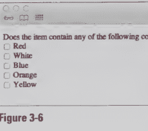

> 记住
为每个 `<input>` 元素设置不同的 name 值，才能让访客勾选多个复选框。

### 使用单选按钮仅选择一个选项

单选按钮将用户在表单上的选择限制为仅提供的选项之一。以下步骤将指导你创建一组单选按钮：

1. 添加一个段落元素和标签，以便在表单内对选项进行分组，并提供有关用户如何填写表单元素的说明：

```
<p>
<label>Is it animal, vegetable, or mineral? </label>
</p>
```

2. 为表单上要显示的每个单选按钮添加一个 `<input>` 元素：

```
<p>
<label>Is it animal, vegetable, or mineral? </label>
<input type=" " />
<input type=" " />
<input type=" " />
</p>
```

3. 将 type 属性设置为 radio，并为每个 `<input>` 元素设置相同的 name 属性：

```
<p>
<label>Is it animal, vegetable, or mineral? </label>
<input type="radio" name="composition" />
<input type="radio" name="composition" />
<input type="radio" name="composition" />
</p>
```

### 允许访客选择选项

> 通过给几个单选按钮设置相同的 name，你可以将选择限制为其中一个选项。

4. 为每个单选按钮添加一个唯一的 value 属性，以便你稍后添加的脚本可以确定用户选择了哪个选项：

```
<p>
<label>Is it animal, vegetable, or mineral? </label>
<input type="radio" name="composition"
       value="animal"/>
<input type="radio" name="composition"
       value="vegetable"/>
<input type="radio" name="composition"
       value="mineral"/>
</p>
```

5. 添加跟在每个 `<input>` 元素后面并告诉用户该单选按钮代表哪个选项的文本。

```
<p>
<label>Is it animal, vegetable, or mineral? </label>
<input type="radio" name="composition"
       value="animal"/> Animal
<input type="radio" name="composition"
       value="vegetable"/> Vegetable
<input type="radio" name="composition"
       value="mineral"/> Mineral
</p>
```

图 3-7 显示了此示例在浏览器中的显示效果。

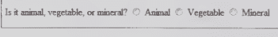

图 3-7

### 创建选项的下拉列表

当你希望表单将选项列表呈现为下拉列表或列表框时，请使用 `<select>` 元素与 `<option>` 元素结合使用。

`<select>` 元素与 `<input>` 和 `<textarea>` 类似，是 `<form>` 的一个独特的子元素。

#### 第 3 课

此示例下拉列表位于一组段落标签内，并带有一个标签，就像本课程前面的示例一样。以下步骤将指导我如何创建下拉列表的其余部分：

1. 为 `<select>` 元素添加一个 name 属性，以便用户从下拉列表中选择的任何选项都可以作为 name/值对发送到服务器：

```
<form action=" " name=" " method=" ">
<p>
<label>What is your favorite Burns Supper event?
</label>
<select name="supperevent">
</select>
</p>
</form>
```

2. 为下拉列表中需要显示的每个选项添加一个 `<option>` 元素：

```
<form action=" " name=" " method=" ">
<p>
<label>What is your favorite Burns Supper event?
</label>
<select name="supperevent">
<option > </option>
<option > </option>
<option > </option>
<option > </option>
</select>
</p>
</form>
```

一个 `<select>` 元素可以拥有任意数量的 `<option>` 子元素。每个 `<option>` 元素对应用户可以从下拉列表中选择的一个项目。

3. 为每个 `<option>` 元素提供一个 value 属性和将在浏览器中显示的文本，以便用户知道他们正在选择哪个选项：

```
<form action=" " name=" " method=" ">
<p>
<label>What is your favorite Burns Supper event?
</label>
```


### 允许访客选择选项

```
<select name="supperevent">
    <option value="grace">Saying the Selkirk grace</option>
    <option value="piping">Piping</option>
    <option value="haggis">Cutting the haggis</option>
    <option value="auld">Singing <em>Auld Lang Syne</em></option>
</select>
</p>
</form>
```

> **提示：** 如果你想创建列表框而不是下拉列表，请使用 `<select>` 元素的 `size` 属性。如果将其设置为大于1的值，将出现一个显示 `size` 属性所指定选项数量的列表框，而不是下拉列表。例如，如果 `<select>` 元素有四个选项，可以将 `size` 属性设置为4，这样用户就可以在列表框中看到所有选项。以下是列表框的代码示例，你可以在图3-8中看到该元素分别以下拉列表和列表框形式显示。

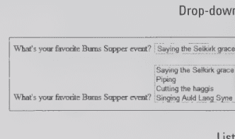

```
<form action=" " name=" " method=" ">

<p>
<label>What is your favorite Burns Supper event? </label>
<select name="supperevent" size="4">
    <option value="grace">Saying the Selkirk grace</option>
    <option value="piping">Piping</option>
    <option value="haggis">Cutting the haggis</option>
    <option value="auld">Singing <em>Auld Lang Syne</em></option>
</select>
</p>

</form>
```

#### 第3课

##### 添加用于选择时间和日期的属性

以下时间和日期输入类型值在HTML5中是新的：

- `<input type="time" name="addnamehere" />`：允许用户选择时间，不含时区。
- `<input type="date" name="addnamehere" />`：允许用户选择日期。
- `<input type="datetime" name="addnamehere" />`：允许用户选择日期和时间，含时区。
- `<input type="datetime-local" name="addnamehere" />`：允许用户选择日期和时间，不含时区。
- `<input type="week" name="addnamehere" />`：允许用户选择某一周和年份。
- `<input type="month" name="addnamehere" />`：允许用户选择某个月份和年份。

当这些新的日期类型被浏览器支持时，会打开一个日期选择器，如图3-9所示，你可以选择相应的数据。然而，目前这些日期输入类型仅被Opera浏览器完全支持。

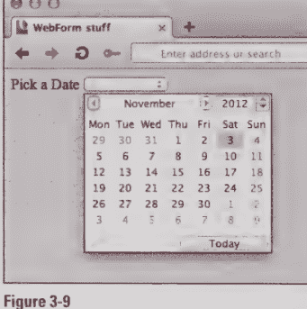

图3-9


为了练习创建复选框、单选按钮和下拉列表，请回到虚拟的房地产经纪人表单。（如果需要回顾此示例，请参见本课前面“标记`<input>`元素”末尾的实践图标。请注意，这个早期的实践是建立在“允许访客添加大量文本”部分的基础上的。）在你为该表单创建的组织结构内，执行以下操作：

### 添加控制表单的按钮

1.  添加复选框，使访客能够选择他们可能需要的每项服务。
2.  创建一个下拉列表，使访客能够选择他们最感兴趣的街区或邮政编码。
3.  添加单选按钮，使访客能够选择他们偏好的联系方式。

因此，如果经纪人提供针对任何卖房、买房、房屋布置或租房的服务，请为每一项添加一个复选框。

你可以编造街区名称，或使用你所在地区的名称。毕竟，这个表单只是用于练习。

例如，访客可能能够选择电子邮件、电话或短信。

### 添加控制表单的按钮

当用户填写完表单后，他们期望看到一个按钮，能将他们的信息快速发送到正确的服务器。

在表单的HTML部分，你只需让按钮出现在页面上并为其分配一个基本功能：一个普通按钮、一个重置按钮或一个提交按钮。普通按钮在添加了能够响应用户按钮点击的脚本之前，几乎没有任何作用。

要创建按钮的HTML部分，请从一个基本的 `<input>` 元素开始。使用 `type` 属性来指定按钮的功能。你也可以将 `type` 属性设置为 `button`、`reset` 或 `submit`，如下所示：

```
type="button"
type="reset"
type="submit"
```

当你使用 `<input>` 元素创建按钮时，通常也会添加一个 `value` 属性。`value` 属性使你能够选择按钮上显示的文本。如果你不添加自定义的按钮文本，则会显示默认的按钮文本。表3-1概述了你需要了解的每种按钮类型。图3-10显示了表3-1中的示例按钮在浏览器中的呈现方式。

第3课

表3-1 | 你需要了解的每种按钮信息
--- | --- | --- | --- | ---
按钮类型 | 示例代码 | 默认按钮文本 | 无脚本时，按钮的行为... | 有脚本时，按钮的行为...
普通按钮 | `<input type="button" value="Click Me"/>` | 按钮上不显示文本。 | 什么也不做。（脚本为这个按钮添加所有魔力。） | 事件处理程序捕获一个JavaScript事件，你将在第6课中详细了解。
重置按钮 | `<input type="reset" value="Clear Form Entries"/>` | 重置 | 重置所有表单元素，这意味着它们会恢复为默认值。 | 很少对此按钮使用脚本。
提交按钮 | `<input type="submit" value="Submit Form"/>` | 提交查询 | 根据表单 `action` 属性中的地址，将表单上的名称/值对发送到服务器。必须在服务器端进行设置以接收数据，这个概念超出了本书的范围。 | 通常使用脚本在提交表单前检查字段的有效性。当代码包含新的HTML5输入类型（如 `type="date"`）时，浏览器会自动检查，无需额外脚本。参见第6课。

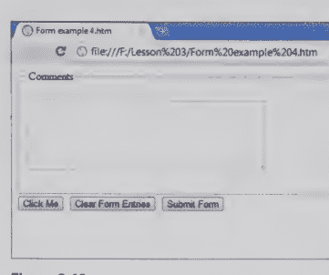

图3-10

### 总结

在本课中，你学习了如何在HTML文档中设置表单，包括以下所有基础知识：

- `<form>` 元素标记表单的开始和结束。`action`、`name` 和 `method` 属性使表单能够与脚本协作。
- 你可以使用 `<fieldset>` 元素将表单组织成多个部分。作为 `<fieldset>` 子元素的 `<legend>` 标签为表单中的每个部分添加标签。
- 你使用 `<input>` 元素创建访客用来填写表单的许多功能。它的 `type` 属性决定了屏幕上显示哪种类型的 `<input>` 元素。`name` 属性使浏览器能够向Web服务器发送名称/值对。
- 基本文本框的 `type` 属性值是 `text`。HTML5提供的新 `type` 属性值包括 `email`、`url`、`number`、`range` 和 `search`。如果你希望访客在文本框中输入的文本被隐藏，请将 `type` 属性的值设置为 `password`。
- HTML5中的一个新表单元素 `<textarea>`，使访客能够在表单中输入较长的文本。

#### 第3课

- 要创建允许访客选择多个选项的复选框，请使用 `type` 属性值 `checkbox` 和一个描述该方框的 `name` 属性值。同时，请记住为每个复选框添加文本标签，告诉访客他正在选择哪个选项。
- 当你希望用户只选择一个选项时，请使用单选按钮表单元素。要创建一组单选按钮选项，请为该组中的每个单选按钮赋予相同的 `name` 属性，然后添加一个反映访客所选任何选项的 `value` 属性。创建单选按钮的 `type` 属性值，不出所料，是 `radio`。
- 下拉列表使访客能够从菜单中选择一个选项。`<select>` 元素告诉浏览器显示下拉列表，而作为 `<select>` 子元素的 `<option>` 元素包含访客在列表中看到的每个选择。
- HTML5添加了用于选择时间和日期的新输入选项：`time`、`date`、`datetime`、`datetime-local`、`week` 和 `month`。你可以在 `<input>` 元素中将这些选项中的任何一个用作 `type` 属性值。
- 你可以使用 `<input>` 元素创建三种类型的按钮：普通按钮、重置按钮和提交按钮。

##### 自己动手实践

如果你在本课中完成了所有实践操作，你就有机会尝试创建一些不同的表单元素。为了进一步积累在HTML中创建表单元素的经验，请看下面的图，并决定表单的每个部分最适合使用哪些表单元素。在你的文本编辑器中，创建一个包含图中所示所有元素的HTML文档。如果需要帮助，请查看配套文件 `L3_01.htm` 中的源代码，你可以从本书的配套网站下载它（详见简介部分）。


##### 了解此技术讲座

**标签：** 与输入字段关联的文本；通常向用户提示应输入或选择的内容。

**名称/值对：** 一种存储或传输数据的方式，其中分配一个文本来代表另一段数据。示例包括 `name=Ed`、`quantity=4` 和 `phone=555-555-5555`。

**验证：** 检查用户输入是否符合预期或所需数据或数据格式的过程。

表 3-2 概述了重要标签、标签的功能以及相关的特殊属性。

#### 第 3 课

| 标签 | 功能 | 重要特殊属性 |
| :--- | :--- | :--- |
| `<fieldset>` | 将表单元素组织成组。 | name, form |
| `<form>` | 在 HTML 文档中创建一个 `<form>`。 | action, name, method |
| `<input>` | 创建多种类型的表单元素，使访问者能够向表单输入数据。创建的输入类型取决于 `type` 属性的值。 | name 属性<br>value 属性<br>type 属性值：<br>text, password<br>email, url, number, range, search<br>checkbox, radio<br>time, date, date-time, datetime-local, week, month<br>button, reset, submit |
| `<label>` | 包含标记 `<input>` 元素或提供如何从中选择项目的说明的文本。 | for, form |
| `<legend>` | 标记使用 `<fieldset>` 创建的表单元素组。是 `<fieldset>` 元素的子元素。 | 此项目没有特殊属性。 |
| `<option>` | 包含下拉列表的值。是 `<select>` 元素的子元素。 | disabled, label, selected, value |
| `<select>` | 创建下拉列表。 | autofocus, disabled, form, multiple, name, size |
| `<textarea>` | 创建用于输入段落文本的文本框。 | autofocus, cols, disabled, form, maxlength, name, placeholder, readonly, rows, wrap |

#### 第 4 课
创建基本 CSS 规则

- 将选择器、属性和值组合成 CSS 规则语法。
- 用简单的颜色或图像装饰背景。
- 你可以在网页上居中元素并创建列。

- CSS 规则可以外部保存、内部保存或内联在网页上。

- 子元素继承样式，浏览器解决样式冲突。

1.  **为什么在 CSS 规则末尾包含分号很重要？**
    解释见第 94 页

2.  **CSS 选择器做什么？**
    在第 95 页了解

3.  **你使用什么属性来设置网页背景的颜色？**
    在第 103 页发现方法

4.  **你能控制图像在网页背景中平铺时图像边缘是否被裁剪吗？**
    在第 112 页了解

5.  **你能将内联元素更改为块级元素吗？**
    在第 119 页找到答案

6.  **设置网页元素宽度，绝对值还是相对值是最佳方式？**
    在第 131 页了解两者之间的区别

7.  **如何将外部样式表链接到 HTML 文档？**
    查看第 134 页

8.  **当外部样式表和内部样式表包含同一元素的不同样式时会发生什么？**
    在第 136 页自行查看

层叠样式表 (CSS) 让你可以控制 HTML 页面呈现给用户的方方面面。例如，你可以使用 CSS 设置文本的字体、大小、粗细（或加粗）和颜色。你也可以使用 CSS 来安排页面上的图片和文本块。或者，如果你希望页面在移动设备上查看时与在桌面浏览器上查看时呈现不同的外观，CSS 也是实现这一点的关键。

在本课中，我将让你领略 CSS 的强大功能，以及如何在你的网页中充分利用它。

### CSS 规则基础介绍

CSS 的基本单位是 CSS 规则。在本节中，你将仔细了解 CSS 规则的语法。规则的每个部分——选择器、属性和值——都告诉浏览器一些关于如何显示网页的信息。CSS 有几种类型的选择器，你将了解如何在它们之间进行选择。CSS 还提供了一系列可以分配给这些属性的属性和值，因此你将在本节中了解它们的工作原理。本课后面的章节以及第 5 课将在格式化文本、图像、布局等背景下更详细地解释属性和值。

### 了解 CSS 规则的组成部分

CSS 是层叠样式表的缩写。*样式表* 由 CSS 规则组成，专门用于为 HTML 文档设置样式。以下是一个简单的 CSS 规则示例：

```
p {
    color: red;
}
```

以下要点详细说明了 CSS 规则的工作原理：

- 整个构造被称为 *CSS 规则*、语句或指令。

- 第一个项目 `p` 被称为 *选择器*，它告诉浏览器该样式适用于什么。在此例中，选择器告诉浏览器将样式应用于 HTML 中 *所有* `<p>` 元素。

- 接下来是一系列 *声明*。此示例仅显示一个声明。所有声明都包含在花括号内。在一个声明内，你需要一个属性和一个值，用冒号分隔。

- 在此示例中，唯一的 CSS 属性是 `color`，它定义文本的颜色。在此例中，值是一个字符串或关键字，值为 `red`。你可以用多种方式描述颜色，稍后在本课的“介绍不同的值类型”一节中，我们将探讨值定义。

- 分号终止声明。

- 浏览器忽略空白。此示例也可以轻松写成

```
p{color:red;}
```

结果也会完全相同。

> **警告！**
语法简单，但不容有失。犯下最轻微的错误，最好的情况是结果不如你所愿。最坏的情况是，错误会使整个样式表无效。例如，你不需要在最后一个声明后加分号，但你需要在每个非最后一个声明后加分号。如果省略分号，该声明将不会被读取，并可能导致任何其他声明出现不可预测的行为。我通常在最后一个声明后也加上分号，因为我认为这样做是一个好习惯。

- 一个选择器可以有多个声明，并且适用于该选择器的所有声明都包含在花括号中。语法如下：

```
selector {
    property: value;
    property: value;
    property: value;
}
```

**术语**
在 CSS 中，*样式表* 由规则组成并为 HTML 文档设置样式；*规则* 是一条语句或指令；*选择器* 告诉浏览器该样式适用于什么；*声明* 包括花括号以及括号之间的所有属性和值。

### 使用简单选择器为元素设置样式

CSS3 提供了几种类型的选择器，其中许多在 CSS2 中引入。在 CSS 规则中，选择器的作用顾名思义：选择器在 HTML 文档中选择元素。它选择什么取决于你使用的类型。

以下列表介绍了四种重要的简单选择器：

- **类型选择器：** 根据标记内容的标签选择 HTML 中的内容。如果你用 HTML5 中新增的 `<nav>` 元素标记页面上的所有导航元素，你可以使用类型选择器选择所有这些 `<nav>` 元素，并例如将它们设置为红色，如下所示：
  `nav {color: red ;}`

在 CSS 中，你不需要使用像 HTML 标签中那样的尖括号。

- **类选择器：** 如果 HTML 元素的 `class` 属性与类选择器的名称相对应，则选择 HTML 文档中的内容。因此，使用类选择器，你可以用一条 CSS 规则选择多种类型的 HTML 元素，只要它们都具有相同的 `class` 属性。

例如，假设你的 HTML 文档使用 `class` 属性来指定管理内容，如下所示的 HTML 片段：

```
<h3 class="adminstuff">法律声明和免责声明</h3>
<p class="adminstuff"> 保留所有权利。版权所有 2008。此处表达的观点为作者个人观点，不一定反映 ExampleSite.com 的观点</p>
```

> 补充信息
你可以用简化语法检查的方式编写 CSS 规则。一种方法是将左花括号与选择器放在同一行，然后将每个属性和值对单独写在一行，缩进五个空格，分号放在末尾。右花括号也有自己的行。这种结构背后的目的是使花括号和分号易于发现。这种结构也使得浏览更长的 CSS 规则列表变得更容易，因为选择器在左侧很突出。不同的开发人员有不同的约定。例如，有些人在行首放置分号，这样分号（或缺少分号）更容易发现。因为空白无关紧要，你可以尝试不同的约定，以便轻松审查你的代码。


### CSS规则基础介绍

在CSS中，你可以使用类选择器仅对特定元素应用特殊格式。无论内容被哪个HTML标签标记都无关紧要。只要标签包含值为`adminstuff`的`class`属性，该内容就会在网页上应用对应CSS规则的声明。这个例子的CSS选择器如下所示：

```
.adminstuff {property: declarations;}
```


注意到类选择器`.adminstuff`前的句点了吗？那个句点就是用来标识类选择器的。

- **ID选择器：** 还记得在第1课中，我建议你为HTML中所有块级元素添加`id`属性吗？使用这种选择器就是主要原因之一。

如果某个特定元素需要特殊样式——比如，嗯，使用红色使其在页面上突出显示——可以使用ID选择器。例如，假设网页顶部某个元素需要突出显示，用于敦促访问者购买你的产品或参加你下次的演示。如果该元素在HTML中有唯一的`id`属性，CSS就能通过ID选择器仅为该元素设置样式。如果你在HTML中给该元素一个值为"urgent"的`id`属性，就像这样：

```
<p id="urgent">Our next event is Tuesday, April 18!
    Sign up now!</p>
```

使该文本变红的CSS规则如下：

```
#urgent {color: red ;}
```


每个ID选择器都以井号（#）开头。

- **属性选择器：** 如果类和ID选择器还不够用，你还可以使用属性选择器，它选择的是——我猜你能猜到——属性！如果你需要突出显示每个跨多行的表格单元格，可以使用属性选择器轻松选择它们，它可以选择页面上每个包含`rowspan`属性的HTML元素，如下所示：

```
[rowspan] {color: red; }
```

你可以通过指定值来进一步缩小选择范围，例如，只选择值为2的`rowspan`属性，如下所示：

```
[rowspan="2"] {color: red; }
```

表4-1总结了每种选择器的作用。

**表4-1：CSS选择器类型**

| 选择器 | 选择内容 | 语法 | 示例 | 用于设置样式 |
|---|---|---|---|---|
| 类型 | 指定HTML元素的每个实例，例如`<body>`、`<p>`、`<table>`或`<nav>` | `element {declarations}` | `nav {color:red;}` | 基于HTML元素的页面元素 |
| 类 | 每个具有指定类属性值的HTML元素 | `.classvalue {declarations}`（记住：类值前必须有一个句点。） | `.adminstuff {color:red;}` | 页面上具有相同类名的不同HTML元素 |
| ID | 具有指定`id`的元素 | `#idvalue {declarations}` | `#same {color:red;}` | 单个页面元素（记住：HTML页面上的每个`id`属性值应该是唯一的。） |
| 属性 | 任何具有给定名称属性的元素 | `[att] {declarations}` 或 `[att=value] {declarations}` | `[rowspan] {color:red;}` `[rowspan="2"] {color:red;}` | 具有共同属性或属性值的页面元素 |

#### 第4课

要练习创建不同类型的选择器，请按照以下步骤操作：

1.  打开一个文本编辑器，输入以下HTML5文档：

```
<!DOCTYPE html>
<html>
  <head>
    <style type="text/css">
      p {
        font-color:red;
      }
    </style>
  </head>
  <body>
    <p class="bodytext" id="myparagraph">Style this text</p>
  </body>
</html>
```

2.  将文档保存为styledtext.htm，然后在网页浏览器中打开它。尝试用尽可能多的不同方式更改选择器类型来选择`<p>`元素。

例如，要使用ID选择器选择它，请使用以下声明：

```
#myparagraph {
  font-color:red;
}
```

### 组合选择器

组合选择器使你能够更精细地控制样式如何应用于HTML文件中的内容，比单独使用基本选择器提供了更大的灵活性。以下部分解释了你可以在CSS规则中组合选择器的方法。

#### 将相同样式应用于多个元素

当你想将相同样式应用于多个元素时，可以为每个要选择的HTML元素使用类型选择器，并用逗号分隔它们。例如，如果你想让页面上所有标题都变成蓝色，以便它们从正文中脱颖而出，你可以创建以下CSS规则……

```
h1, h2, h3 {color: blue ;}
```

……而不是创建三条重复相同声明的CSS规则：

```
h1 {color: blue ;}
h2 {color: blue ;}
h3 {color: blue ;}
```

#### 遍历文档树以选择元素

> **术语**
> **文档树**，或称**DOM**，是HTML文档中HTML元素相互关联的方式。

你也可以组合选择器，让它们遍历HTML文档树。（如果需要复习，我在第1课中介绍了文档树。）*文档树*，或称*DOM*，是HTML文档中HTML元素相互关联的方式。例如，假设你的HTML文档包含一个段落中的列表，如下所示：

```
<p><b>To sign up for the Robert Burns newsletter,</b>
      follow these steps:
    <ol>
      <li>Go the <b>Robert Burns newsletter</b>
          page.</li>
      <li>Enter your <b>name</b> and <b>email
          address</b>.</li>
      <li>Click the <b>Sign Me Up!</b> button.</li>
    </ol>
Signing up is that easy! Do it today!
</p>
```

`<ol>`标签被认为是`<p>`标签的*子元素*，因为`<ol>`的开始和结束标签都在`<p>`标签内。反之，`<p>`标签是`<ol>`标签的父元素。`<li>`标签被认为是`<p>`标签的*孙元素*。

换句话说，文档树指的是HTML文档中标签相互嵌套的方式。每个元素只有一个父元素，根元素除外，它没有父元素。

如果你想使用文档树来缩小选择器的选择范围，可以按照元素在树中出现的顺序（从父到子到孙等）组合选择器。例如，假设你希望列表中的加粗文字显示为蓝色，以便加粗的关键词在页面上更加突出。然而，在介绍列表的句子中，你不想让加粗变成蓝色。解决方案是使用以下CSS规则（假设示例中的`<p>`标签是根元素的子元素）：

```
p ol li b {color: blue ;}
```

选择器中元素的顺序反映了HTML中元素的嵌套方式，从最外层的`p`开始，到最内层的`b`结束。

如果你想让加粗也应用于`<ol>`和`<ul>`列表项中的加粗文字，可以使用通配符选择器（即星号），并将选择器修改如下：

```
p * li b {color:blue}
```

通配符选择器通常与其他选择器结合使用，它会选择该位置上的任何元素。


逗号告诉浏览器将相同的CSS样式应用于多个元素。遍历文档树的选择器仅使用空格，而不是逗号，来分隔选择器中的多个元素。

#### 使用伪类选择器深入筛选

伪类用于选择文档树中未明确表示的元素。例如，大多数浏览器会根据链接是否已被访问而显示不同的颜色，但这些未访问和已访问的链接在文档树中是同一个对象。

伪类使你能够区分这两者。对于`<a>`元素：

- `:link` 指的是未访问的链接。
- `:visited` 指的是已访问的链接。

伪类的一般语法是：

```
element:pseudo-class {declarations}
```

以下CSS规则使用伪类选择器为不同的链接状态指定颜色：

- `a:link {color: blue ;}`：未访问的链接显示为蓝色。
- `a:hover {color: red ;}`：当鼠标指针悬停在链接上时，链接变为红色。
- `a:visited {color: violet ;}`：已访问的链接显示为紫色。


### CSS规则基础介绍

### 伪元素

伪元素与伪类类似，允许您为文档树中不存在的实体设置样式；例如，一行中的第一个字母或段落的第一行就是这样的实体。

> **专业术语**
> 伪元素允许您为文档树中不存在的实体设置样式。

其通用语法为

```
element::pseudo-element {declarations}
```

请注意双冒号，这是CSS3中的新语法，用于区分伪元素（双冒号）和伪类（单冒号）。两者的区别超出了本课程的范围。只需知道使用伪元素时，双冒号被认为是正确的方式。如果您碰巧使用了单冒号，CSS规则仍然有效；只是不符合CSS3规范。

以下CSS规则使用伪元素将每个段落的首字母设置为红色：

```
p::first-letter {color: red ;}
```

而此规则将每个段落的第一行设置为红色：

```
p::first-line {color: red;}
```

### 选择属性和值

前面的示例向您介绍了 `color` 属性，但CSS的功能远不止于此。本节将对不同类型的属性和值进行快速概述，让您了解它们的工作原理以及不同类型属性和值之间的区别。

> 要查看CSS3规范中关于选择器的说明，包括更多组合选择器的方法，请将您的浏览器指向CSS3推荐标准：www.w3.org/tr/2011/rec-css3-selectors-20110929。

#### 第4课


CSS规则的语法如下所示：

```
selector {property: value; property: value; property: value; }
```

以下样式属性常用于设置HTML代码的样式：

+   **字体属性：** 在图4-1中，请注意页面标题、导航和版权信息中的字体如何从默认字体更改为Arial。

一个CSS规则将字体更改为Arial —— 具体来说，这是一个针对 `<h1>`、`<nav>` 和类属性值为 `adminstuff` 的 `<p>` 元素的组合CSS规则。该CSS规则如下所示：

`h1, nav, p.adminstuff {font-family: arial; }`

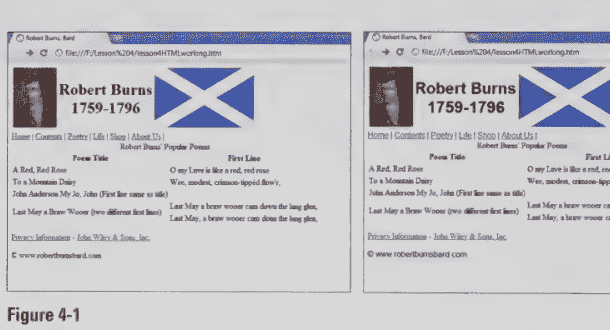

图4-1

在第5课中了解格式化文本的所有细节。

+   **元素周围边框和轮廓的颜色与宽度，例如表格或图像：** 以下CSS规则为示例页面中的表格元素应用了顶部和底部边框样式，使其看起来像图4-2。

```
table {border-top: 10px solid blue; border-bottom: thick solid blue }
```

### CSS规则基础介绍

罗伯特·彭斯的流行诗作

| 诗歌标题 | 首行 |
|---|---|
| 一朵红红的玫瑰 | 啊，我的爱人像一朵红红的玫瑰 |
| 致一朵山雏菊 | 纤弱、谦逊、深红尖儿的小花， |
| 约翰·安德森，我的乔，约翰（首行与标题相同） | 约翰·安德森，我的乔，约翰， |
| 去年五月，一位俊朗的追求者（两个不同的首行） | 去年五月，一位俊朗的追求者沿着长长的幽谷走来， |
| | 去年五月，一位俊朗的追求者沿着长长的幽谷走来， |

图4-2

在此示例中，`border-top` 和 `border-bottom` 是属性。值包括 `thick`、`10px` 和 `blue`。您还会看到由至关重要的分号分隔的两个属性-值对。请记住，如果没有分号，包含多个属性-值对的CSS规则将无法工作。

下一节“介绍不同的值类型”将解释设置颜色和长度值的不同方法。第5课涵盖了设置边框、阴影、圆角等的多种选项。

✓ **背景颜色和图像：** `background-color` 属性将 `<nav>` 元素的背景色设置为银色，如图4-3所示，使其与正文内容区分开来，看起来更像一个导航栏。

```
nav {background-color: silver; }
```

背景颜色和图像在CSS中有自己的一套属性，本课后面的“用颜色和图像装饰背景”部分将解释它们的工作原理。

✓ **尺寸，例如高度和宽度：** 您可以使用CSS将图像设置为相同的高度，例如。

✓ **空白：** 您可以使用外边距或内边距设置HTML元素之间的间距。要增加图4-3中表格周围的空白，我添加了一个 `margin`，如下所示CSS规则所示：

```
table {border-top: 10px solid blue; border-bottom:
thick solid blue; margin:25px;}
```

外边距和内边距与定位页面元素的CSS规则一起工作；您可以在本课后面的“在页面上定位元素”中找到有关定位、外边距和内边距的详细信息。

> 要获取CSS属性的完整参考，请查看 www.w3schools.com/cssref/default.asp 或 CSS规范 www.w3.org/tr/#tr_CSS。

104 第4课

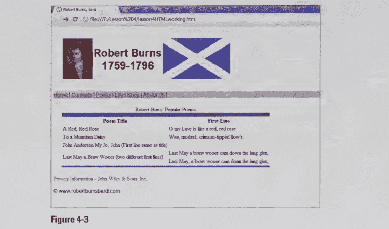

### 介绍不同的值类型

所有属性都接受一个或多个值。在研究各个属性时，我将更深入地讨论这些值，但在开始编写自己的CSS时，对这些值及其工作方式有一个概述是有帮助的。一般来说，CSS属性值属于以下类别之一：

+   - 长度
- 百分比
- URL
- 关键字
- 字符串
- 数字
- 颜色

表4-2介绍了属性值类型，不包括颜色值。当您查看规范中属性可以接受的值时，会看到这些值类型。

| 项目 | 描述 | 示例 |
| :--- | :--- | :--- |
| 相对长度 | HTML5规范建议尽可能使用相对单位。这些单位（em和ex）是相对于其他事物的。元素当前的字体大小是1 em。元素字体中x字符的高度是1 ex。在示例中，标题字体大小是段落字体大小的2.5倍。 | h1 {font-size: 2.5em} p {font-size: 1em} |
| 绝对长度 | 这些单位不相对于其他元素，而是绝对的。CSS识别以下绝对长度：in（英寸）、cm（厘米）、mm（毫米）、pt（点）、pc（派卡）和px（像素）。 | table {border-top: 10px solid blue } |
| 百分比 | 百分比的格式是一个数字后跟%号。 | body {font-size: 100%} |
| URL | 某些属性接受URL作为值。与关键字不同，地址应该加引号。 | **语法：** url("address") body { background: url("http://www.example.com/pinkish.png") } |
| 关键字 | 这些值不需要引号。示例代码中有三个关键字。 | table { border-bottom: thick solid blue } |
| 字符串 | 字符串值是单引号或双引号内的一组字符。 | p {font-family: "Times New Roman"} |
| 数字 | 很少有属性接受纯数字。当CSS表示法要求 `<integer>` 时，使用整数，如1、5和27。实数，或表示法中的 `<number>`，是小数：1.0、5.4和29.6。 | {z-index:1} |

#### 第4课

在CSS中，布局可以是灵活的（也称为*流动的*），也可以是固定的。（或者可以是两者的混合，但为了简单起见，本节只比较灵活布局和固定布局。）简而言之，*灵活*布局使用百分比和其他相对值来确定元素在页面上的位置，而*固定*布局使用绝对值。灵活布局通常比绝对布局更可取，因为灵活布局可以更容易地适应显示页面的任何设备或浏览器。随着越来越多的人从不同类型的设备（包括台式机、笔记本电脑、手机和平板电脑）访问网页，这种适应性变得越来越重要。

网页上的颜色有助于传达关于网站身份和信息的重要信息。设计师希望对颜色及其呈现给用户的方式进行精细控制，这是可以理解的。随着这种需求，出现了越来越好的方法来向浏览器传达颜色。RGB和HSL颜色表示法都适用于任何处理数字图形的人熟悉的颜色值。表4-3显示了在CSS中指定颜色的各种方式。

表4-3：CSS中的颜色值

| 项目 | 描述 | 示例 |
|---|---|---|
| 关键字颜色 | 十六个关键字标识特定颜色：栗色、红色、橙色、黄色、橄榄色、紫色、品红色、白色、酸橙色、绿色、藏青色、蓝色、水鸭色、青色、黑色和灰色。 | h1 {color:red;} |
| 十六进制RGB颜色 | 十六进制颜色使用一个六字符代码（包含红、绿、蓝的值，即RGB值）来定义颜色。十六进制值比关键字提供更多的颜色选项。示例是一种珊瑚色。 | h1 {color: #FF7256;} |
| 十进制RGB颜色 | 十进制RGB颜色包含红、绿、蓝的值。示例颜色是黄色。 | 语法：rgb(`<red value>`,`<green value>` `<blue value>`)<br><br>h1 {color: rgb(255,255,0) ;} |


### 介绍 CSS 规则的基础知识

| 项目 | 描述 | 示例 |
| :--- | :--- | :--- |
| RGBa | CSS3 的新增功能，RGBa 用于控制颜色的 *alpha* 值，也称为透明度。RGBa 中的 alpha 值（列表中的第四个）接受从 0（完全不透明）到 1（完全透明）的十进制值。对于 alpha 值，请仅使用整数，而不是百分比。由于浏览器实现问题，请为任何 RGBa 值提供一个 RGB 值作为备用。 | 半透明的蓝色：`aside {background-color: rgba(0,0,255,0.5);}`<br><br>非常透明的橙色：`aside {background-color: rgba(100%, 50%, 0%, 0.1); }` |
| HSL 颜色 | CSS3 的新增功能，并被所有浏览器采用，这种直观的系统正变得越来越受欢迎。*HSL* 代表色相、饱和度和亮度。你为每个参数输入一个值以创建所需的颜色。两个示例颜色都显示红色。 | 语法：`hsl(<hue>, <saturation>%, <luminosity>%)`<br><br>`h1 {color: hsl(360,100%,50%); }`<br><br>`h1 {color: hsl(0,100%,50%);}` |

HSL 表示法的优点是它生成一个色轮。自古以来，艺术家们就使用色轮来选择正确的颜色。这些色轮有助于决定哪些颜色冲突，哪些颜色可以补充、调和或对比。所有这些组合都有其用途，如果使用得当，就能带来良好的设计。

更精细的色轮会显示饱和度，最外圈是全饱和度，中心是无饱和度（黑色）。相反，你会发现越靠近中心亮度越高，越靠外亮度越低。大多数设计文本都基于传统的色轮，但很容易将它们转换为 HSL 色轮，这就是 HSL 的有用之处。

你可以通过使用如图 4-4 所示的基于色轮的取色器（它将值转换为 HSL 表示法）来学习色相、饱和度和亮度设置如何相互作用。

请访问以下网页，尝试不同的颜色值并将它们转换为不同类型的颜色表示法，包括 HSL。将浏览器指向 www.workwithcolor.com/hsl-color-picker-01.htm。

### 用颜色和图像装饰背景

网页的背景有点像绘制它的画布（尽管大多数网站的功能性更强，而非艺术作品）。在你的网页背景上，你可以显示简单的颜色或图像，图像可以平铺在背景上或仅显示一次。以下部分将引导你设置背景的细节，以及如果你选择使用背景图像时，所有关于重复、定位和调整背景图像大小的选项。

### 为页面或元素设置背景颜色

为网页添加颜色的一种简单方法是使用背景颜色。你可以使用 `background-color` 属性为整个页面或某个元素添加背景颜色。只需使用任何可接受的颜色值表示法（十六进制、RGB、HSL 等）为所需颜色添加一个值。

通过选择 `<body>` 来更改整个页面的背景颜色。例如，以下 CSS 规则为图 4-5 右侧所示的页面提供了浅蓝色背景：

```
body {background-color: hsl(210, 100%, 95%); }
```

`body` 类型选择器选择整个页面。`background-color` 属性告诉浏览器为背景着色，而不是 `<body>` 元素内的所有文本。颜色使用 HSL 颜色表示法表示。

实践
打开你之前创建的 HTML 文档，通过选择 `<body>` 元素为整个页面应用背景颜色。尝试使用不同的方法指定颜色，例如使用颜色关键字和十六进制 RGB 值。在浏览器中预览页面以查看结果！

通过选择所需元素而不是整个页面来更改元素的背景。例如，以下代码将 `<nav>` 元素的背景更改为黄色，如图 4-6 所示：

```
nav {background-color: hsl(49, 100%, 72%); }
```

此代码仍使用 `background-color` 属性和 HSL 颜色表示法中的颜色值，但 `nav` 类型选择器告诉浏览器仅对 `<nav>` 元素着色，而不是整个页面。

### 插入背景图像

早期网站大量使用背景图像，如图 4-7 所示的示例，但现代网站很少大量使用它们进行设计。然而，如果使用得当，背景图像会非常有用，例如罗伯特·彭斯网站页面右下角的苏格兰蓟花图案，或重复使用的羊皮纸图像，使网页背景看起来像旧纸张。

**图 4-7**

加载背景图像的语法如下：

```
selector {background-image: url("absolute or relative URL"); }
```

在罗伯特·彭斯网站中，插入图 4-8 所示背景图像的 CSS 如下所示：

```
body {background-image: url("images/thistle.png"); }
```

`body` 选择器告诉浏览器在页面主体（即整个页面的背景）中插入图像。`background-image` 属性告诉浏览器将图像作为背景层插入。URL 值指向你要插入的图像文件，可以是绝对或相对 URL。在本例中，`thistle.png` 文件保存在网站的 `images` 子文件夹中。

### 控制背景图像如何重复

`background-repeat` 属性告诉浏览器如何重复图像。以下列表解释了可能的值如何影响最终网页的外观：

- **repeat-x**：仅沿 x 轴重复图像。
- **repeat-y**：仅沿 y 轴重复图像。
- **repeat**：重复图像以填充其可用的整个空间。这是默认值（参见图 4-7）。
- **no-repeat**：图像仅显示一次。
- **space**：图像重复以填充背景，但均匀分布，因此没有图像实例被裁剪。
- **round**：如果整个图像不适合其分配的空间，则调整图像大小以使其适合。

浏览器对 `space` 和 `round` 的支持不稳定，因此在 CSS 代码中使用这些值之前，请仔细测试。

在图 4-9 中，你在浏览器中看到四个 `<div>` 元素，每个元素都有不同的 **id** 属性。每个 `<div>` 都有一个背景图像，其 **background-repeat** 值不同。**第一个**显示了 **repeat** 的默认行为，第二个是 **no-repeat**，第三个是 **repeat-x**，第四个是 **repeat-y**。以下是 CSS 的内容：

```
div {background-image:url("image.gif");}
#div2 {background-repeat:no-repeat; }
#div3 {background-repeat:repeat-x; }
#div4 {background-repeat:repeat-y; }
```

第一个 `<div>` 元素显示默认值，因为每当 CSS 未设置重复值时，默认值会自动生效。

### 在背景中插入多个图像

`background` 属性使你能够在背景中叠加多个图像。图 4-10 显示了两个叠加背景图像的示例。在第一个示例中，紫色蝴蝶的图像在 CSS 中列在第一位，因此它出现在顶层。绿色蝴蝶（一个具有透明背景的 GIF 图像）列在第二位。你还可以为每张图像指定位置和 `repeat` 值。在第一个示例中，紫色蝴蝶设置为 `no-repeat`，而绿色蝴蝶则重复。

**图 4-10**

第一个示例的 CSS 规则如下所示：

```
#div1{
    background: url(image2.jpg) 0 0 no-repeat,
               url(image.gif) 0 0 repeat;
}
```


### 使用颜色和图像装饰背景

在底部的示例中，图像的顺序被调换了：绿色蝴蝶被列在第一位，显示在最上层。由于绿色蝴蝶图像是一张透明GIF图，我们可以看到下层紫色蝴蝶的更多部分。此外，绿色蝴蝶的位置`75px 75px`将图像定位在距离页面左上角（即坐标0 0）向右和向下各75像素的位置。图4-10中底部图像的CSS规则如下：

```
#div2 {
    background: url(image.gif) 75px 75px, url(image2.jpg);
    background-repeat: no-repeat;
}
```

要为多个背景图像设置位置，你也可以使用以下位置关键字：`top`（上）、`bottom`（下）、`center`（居中）、`left`（左）和`right`（右）。

### 在页面上定位背景图像

要定位背景图像，请使用`background-position`属性，该属性用于在包含图像的区域内定位图像。

你可能会问，我所说的“*区域*”是什么意思？一般来说，一个父元素会为其内部的内容设定尺寸。因此，如果图像的父元素是`<body>`，那么`<body>`就是包含该背景图像的区域。如果图像被插入到一个`<div>`元素中，那么这个`<div>`及其尺寸就构成了包含该背景图像的区域。

要将背景图像定位到你想要的位置，你需要了解以下信息：

- **`background-position`属性可以接受一个百分比或长度值。** 以下关键字值也是有效的：`left`、`center`、`right`、`top`和`bottom`。
- **对于基本的背景图像定位，你可以使用一个或两个值：**
  - *如果你使用一个值*，第二个值默认为`center`。
  - *如果你使用两个值*，关键字值的顺序无关紧要，例如`bottom right`会将图像定位在页面的右下角（参见图4-8）。

但是，如果你使用的是百分比或长度值，第一个值用于水平位置，第二个值用于垂直位置，其中的值是相对于包含图像的区域/背景左上角的偏移量。

因此，将`background-position: 40px 50px;`应用于`<body>`元素，会将图像定位在网页左上角向右40像素、向下50像素的位置。

✔ **百分比值是相对于背景区域和背景图像（由`background-size`属性指定）的宽度和高度的。**

假设`background-position`的水平值是50%。这会告诉浏览器将背景图像定位在背景区域宽度的50%点（或中点），如图4-11中的红色标记所示。

如果垂直定位的百分比值是80%，浏览器会将图像在垂直轴上对齐，使每个高度值等于80%。参见图4-11中的蓝色标记。

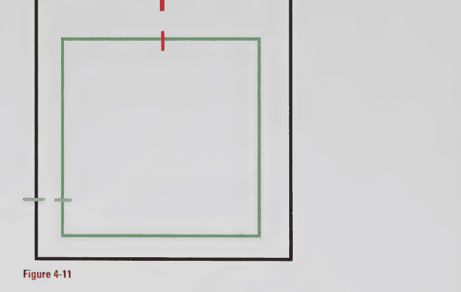

### 在滚动区域中定位背景图像

如果内容对于包含区域来说过大，并且你对该区域使用了`overflow:scroll`属性，则会出现滚动条。如果该区域中还有背景图像，你可以使用`background-attachment`属性来确定当区域滚动时图像的行为。取值有：

**fixed:** 背景图像相对于包含区域的*祖先元素*保持固定。在图4-12的顶部区域中，注意蝴蝶图像在左上角被边框稍微裁剪了。文本在图像上方滚动，而图像保持可见。

**scroll:** 背景图像固定在区域的边框上，因此文本在图像上方滚动，而图像保持可见。在图4-12的第二个区域中，你可以看到当文本向下滚动时，图像是如何移出视野的。此值是默认值。

**local:** 背景图像固定在滚动区域的内容上，因此图像会随文本一起移出视野，如图4-12底部区域所示。

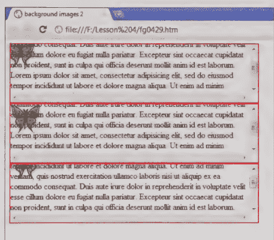

图4-12

### 调整背景图像大小

如果你想指定背景图像的大小，可以使用`background-size`属性。要设置其值，你有以下选项：

**使用一个或两个长度或百分比值。** 如果你只使用一个值，第二个值默认为关键字值`auto`。如果你使用两个值，第一个设置宽度，第二个设置高度。

✓ 关键字`auto`可以与长度或百分比值一起使用，也可以单独使用。`auto`会将图像大小设置为其固有值。因此，在图形程序中设置为300像素宽的图像在浏览器中将显示为300像素宽。

✓ 你也可以不使用长度或百分比，而使用关键字`cover`或`contain`。`cover`关键字会尽可能地缩小图像，同时确保其完全覆盖背景区域并保持图像的纵横比。`contain`关键字则会尽可能地放大图像，在背景区域内保持其纵横比。


`cover`和`contain`的尺寸在不同浏览器中的层叠效果略有不同。如果你想使用这些关键字值中的任何一个，请务必在多个浏览器中测试网页，以确保页面按你希望的方式显示。

表4-4展示了不同的背景大小值如何影响图像在背景区域中的显示方式。

### 表4-4 background-size属性的值

| 值 | 作用 | 代码示例 | 图像示例 |
|-------|--------------|--------------|---------------|
| `auto` | 使用图像的固有值。这是默认值。 | `{background-size: auto;}` | （蝴蝶图像） |
| `percentage` | 根据背景区域按比例调整背景图像大小。 | `{background-size: 100% 50%;}` | （蝴蝶图像） |
| `length` | 使用固定的长度值调整背景图像大小。 | `{background-size: 100px 50px;}` | （蝴蝶图像） |
| `cover` | 尽可能地缩小图像，同时确保其完全覆盖背景区域并保持图像的纵横比。 | `{background-size: cover;}` | （蝴蝶图像） |
| `contain` | 在背景区域内尽可能地放大图像，同时保持图像的纵横比。 | `{background-size: contain;}` | （蝴蝶图像） |

### 在页面上定位元素

在本节中，你将学习使用CSS定位内容的基本技术。首先，你需要了解你是在处理块级元素还是行内元素。然后，你将学习如何在页面上居中内容。你将学习如何构建内容结构，使布局能够适应不同的浏览器和设备，即使在创建多列布局时也是如此。你还将了解`margin`和`padding`属性之间的区别，以及它们如何帮助你在页面上的元素之间添加空白。

### 使用块级元素与行内元素

在HTML中，任何在页面上显示的元素都有一个默认的块级或行内属性。（你可能还记得第1课中关于块级元素与行内元素的讨论。）*块级*元素默认情况下会占据页面的整个宽度，并在其前后换行。块级元素的例子包括`<h1>`、`<p>`、`<div>`等。

*行内*元素不会创建新行；它们只占据在页面上显示所需的空间。行内元素的例子包括用于加粗的`<b>`和用于表单的`<input>`。

当你开始使用CSS在网页上定位元素时，了解块级元素和行内元素之间的区别非常重要。处理块级元素时，你会得到浏览器默认添加的额外换行，并且该元素会占据页面的整个宽度。处理行内元素时，你仍然可以仅为该元素应用格式。然而，行内元素只占据它所需的空间（而不是整个页面宽度），浏览器不会在其上方和下方添加换行符。

如果需要，你可以通过设置元素的`display`属性将块级元素更改为行内元素，反之亦然：

```
display: block;
display: inline;
```

CSS还允许你更改元素的宽度以及块级元素和行内元素的其他默认属性。


要查看块级元素和行内元素之间的区别：

1. 打开一个文本编辑器，输入以下HTML文档：

```
<!DOCTYPE html>
<html>
  <head>
    <style type="text/css">
      p.block {
        display: block;
      }
      p.inline {
        display: inline;
      }
    </style>
  </head>
  <body>
    <p class="block">This is a block.</p>
```


### 页面上的元素定位

```
<p class="block">This is also a block.</p>
<p class="inline">This is inline.</p>
<p class="inline">This is also inline.</p>
</body>
</html>
```

2.  将文档保存为 `block-inline.htm`，并在浏览器中预览。

请注意，块级元素总是显示在新行上，而行内元素显示时不会插入换行符。

### 网格与列简介

由于 CSS3 和 HTML5 一样，其开发仍在进行中，因此有一些新的定位技术可用，但在更广泛的 Web 开发领域中尚不实用——至少目前还不实用。以下部分介绍了两个具有变革性且备受期待的功能——网格定位和列——以及在使用它们之前需要牢记的注意事项。

### CSS3 网格定位

*网格定位模块*的目标是将桌面排版程序中可用的相同布局功能引入 Web。该模块由微软提出，并于 2007 年成为 CSS3 工作草案的一部分。将所有内容放置在网格中可以实现精细定位。

截至本书付印，除微软的 Internet Explorer 外，其他浏览器尚未实现网格定位，且 CSS3 工作组也未将网格定位列为高优先级事项。然而，随着 CSS3 的进展，请密切关注网格模型，因为浏览器最终将开始支持它。

网格模块的规范可在 `www.w3.org/tr/css3-grid-layout` 找到。最简单地说，网格模块生成类似列的布局。例如，以下代码创建一个包含两列三行的网格。第一列的宽度将自动调整以适应其内容。第二列的宽度将始终为 250 像素。三行的高度都将根据内容进行调整。

```
#grid {
    display: grid;
    grid-columns: auto 250px;
    grid-rows: auto auto auto
}
```

更复杂的布局可能包含跨越多列的对象，甚至可能包含相互重叠的网格项。图 4-13 展示了使用网格定位可能实现的示例布局。

在很多方面，网格模块复制了列的功能，但又远超列的能力。在列成为正式推荐标准并得到全面实现之后，开发很可能会开始向网格推进。网格绝对是所有开发者都应该关注的技术。

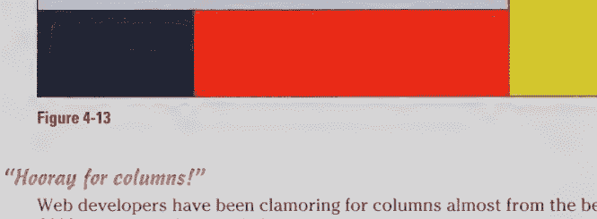

> "为列欢呼！"

Web 开发者几乎从一开始就强烈要求使用列功能。CSS3 承诺提供一个专门用于呈现从一列流向另一列的文本的功能。然而，迄今为止，浏览器各自实现了不同的列功能，这不一定符合标准。为了表明对某项功能的支持仍在进行中，浏览器厂商引入了厂商前缀。

厂商前缀只是你放在 CSS 属性前面的字符，用于在特定浏览器中触发该功能。因此，例如，如果你想在 Firefox 中使用列功能，可以在列 CSS 属性前加上 `-moz-`；要在 Chrome 或 Safari 中使用列功能，则使用前缀 `-webkit-`。实际上，对于需要前缀的功能，厂商前缀要求你编写至少两倍多的 CSS 代码。这是一个混乱的解决方案，但目前你不得不接受它。当列功能实现标准化后，你就可以在没有厂商前缀的情况下使用它们，并且列在任何浏览器中的含义都将相同（或者，至少这是其初衷）。

以下代码是使用浏览器前缀实现列功能的示例：

```
-webkit-column-width: 7em;
-webkit-column-count: 3;
-webkit-column-rule: 4px solid green;
-moz-column-width: 7em;
-moz-column-count:3;
-moz-column-rule: 4px solid green;
```

请注意 `width`、`count` 和 `rule` 属性。`width` 属性设置列宽，`count` 属性设置列数，`rule` 属性在每列周围添加边框。

以下代码展示了一个使用列功能的完整 HTML5 文档。图 4-14 展示了该文档在浏览器中的渲染效果。请注意，第一列底部的文本会继续显示在第二列中。

```
<!DOCTYPE html>
<html>
<head>
  <title>3 columns</title>
  <style>
    #content {
      -webkit-column-width: 7em;
      -webkit-column-count:3;
      -webkit-column-rule: 4px solid green;
      -moz-column-width: 7em;
      -moz-column-count:3;
      -moz-column-rule: 4px solid green;
    }
  </style>
</head>
<body>
  <div id="content">
    <p>Lorem ipsum dolor sit amet, consectetur adipiscing elit. Curabitur mauris mi, cursus ut mattis eget, faucibus vitae mi. Nulla dictum facilisis venenatis. Nam consequat congue lorem, ac tincidunt nibh dictum id. Integer consectetur ultrices orci, a faucibus ante suscipit eget. Pellentesque fermentum vestibulum magna id venenatis. Nam lacinia condimentum risus a mollis. Nam porta sodales tempor. Ut accumsan ipsum in arcu mattis ut congue enim malesuada. Mauris vulputate lectus vel sem convallis laoreet. In ut varius est. Fusce convallis, lorem vel facilisis euismod, lectus urna porttitor urna, vitae adipiscing odio purus id dolor. Nulla facilisi.</p>
    <p>Nam id tortor sed nisl interdum feugiat. In condimentum lorem nec tortor mollis mattis. Fusce ornare lobortis sem quis fringilla. Quisque molestie augue vel neque dapibus condimentum. Praesent hendrerit euismod leo, eget eleifend erat scelerisque id. Quisque at sem</p>
  </div>
</body>
</html>
```

nisi, a sodales urna. Maecenas vulputate dolor sed felis aliquet tincidunt. Maecenas faucibus, elit et adipiscing venenatis, ante augue egestas justo, nec fringilla nulla turpis in est. Fusce bibendum posuere lorem, quis viverra nisl congue quis. In felis nisl, gravida vitae porta sit amet, eleifend eu tortor. Lorem ipsum dolor sit amet, consectetur adipiscing elit. Integer egestas imperdiet convallis. Mauris laoreet sem nulla, a egestas erat. Nunc accumsan, arcu sed luctus iaculis, augue velit egestas leo, a porta magna est at nisi. Aliquam dignissim blandit est, sit amet mollis libero molestie congue. Aenean adipiscing elementum venenatis.

<p>Vestibulum sit amet libero velit, at vehicula arcu. Mauris ornare sagittis lacus, euismod vulputate tortor suscipit ut. Duis feugiat, velit nec molestie aliquet, turpis massa venenatis ante, vel venenatis diam tortor nec nisl. Fusce adipiscing auctor blandit. Aliquam erat volutpat. Aliquam eu sapien lorem, a venenatis dui. Vestibulum placerat pellentesque nulla, et pretium ligula accumsan sed. Vestibulum ante ipsum primis in faucibus orci luctus et ultrices posuere cubilia Curae; Nullam molestie tellus at nisl malesuada a pellentesque nunc tempor. Curabitur ut augue augue, in scelerisque ligula. Aliquam iaculis augue sed nibh sodales dictum. Fusce dui nisi, facilisis sit amet tempor sit amet, lacinia pellentesque eros. Cras nec nisl libero, a placerat elit. Suspendisse potenti. Sed ante libero, placerat vitae iaculis sit amet, sodales pulvinar justo.</p>

<p>Suspendisse luctus malesuada magna at rhoncus. Phasellus malesuada iaculis laoreet. Suspendisse leo nunc, congue ac blandit eu, varius ac dui. Etiam tempor elementum laoreet. Sed iaculis tellus sed nibh tincidunt at malesuada urna semper. Nullam adipiscing dui condimentum arcu euismod eu consequat dui mattis. Fusce aliquam risus vel odio viverra ut blandit purus auctor. Ut sed nulla eget nulla gravida dapibus. Fusce interdum, neque at luctus sollicitudin, mauris purus pulvinar mauris, ut aliquet velit libero et risus. Donec magna nibh, dapibus a ultrices vitae, convallis sed enim. Phasellus in sodales ante. Suspendisse in nisi dolor, ac ullamcorper nulla.</p>

<p>Proin pretium iaculis placerat. Etiam massa ipsum, pretium quis mattis et, feugiat ac quam. Vestibulum suscipit bibendum enim, eu aliquam nisi euismod fringilla. Maecenas placerat, libero id aliquam interdum, quam nisi tincidunt erat, a pretium eros leo ut nibh. Quisque sodales aliquam fringilla. Pellentesque non mi sed nunc aliquet aliquam. Aenean sollicitudin lobortis consectetur.</p>

```
</div>
</body>
</html>
```


### 在页面上定位元素

### 在页面上居中内容

默认情况下，HTML元素位于页面的左侧，并依次显示每个块级元素。然而，大多数网站都会将内容居中显示在页面中间，这样布局看起来更平衡。以下步骤解释了如何将网页内容居中：

1.  使用类型选择器选中`<body>`，然后将`margin`属性设置为`auto`：
```css
body {margin: auto;}
```
此时，你的网页不会看到任何变化，但变化即将到来。

2.  为了在网页内容的两侧添加空白区域，以创造更平衡的外观，需要减小`body`子元素的宽度。

例如，以下CSS规则添加了一个声明，将`body`内所有元素的宽度设置为页面宽度的60%：

```css
body {
    margin: auto;
    width: 60%;
}
```

定位看起来有些不同，如图4-15所示。右侧的图片显示了将宽度减小到60%后的网页。

记住，使用百分比和其他相对值会使底层代码更加灵活，这样网页就能更容易地适应各种不同设备的显示，比使用固定（或绝对）值的代码更灵活。

### 向左和向右浮动

除了居中，网页布局通常还将内容分为两列（见图4-16）或三列（见图4-17）。为了实现这种效果同时保持布局的灵活性，可以使用`float`属性使页面元素浮动到页面的任意一侧。

图4-16

图4-17

例如，假设你希望页面导航出现在页面内容左侧的一个窄栏中，而不是横跨顶部。以下步骤将引导你使用`float`属性创建一个双栏布局，我们以Robert Burns网站为例：

1.  为`<nav>`元素（或任何你希望放在左侧的元素；它可能是一个`<div>`或其他元素）的CSS声明添加一个值为`left`的`float`属性。

CSS如下所示：

```css
nav {
    background-color: hsl(49, 100%, 72%);
    float: left;
}
```

这会将`<nav>`元素推到左侧，如图4-18所示。

2.  为包含诗歌信息的表格（或任何你希望定位在右侧的元素）添加一个`float`属性。

你希望将表格浮动到右侧：

```css
table {
    border-top: 10px solid hsl(207, 100%, 29%);
    border-bottom: thick solid hsl(207, 100%, 29%);
    float: right;
}
```

图4-18

此时，页面看起来相当混乱，如图4-19所示。两个浮动元素需要调整它们的宽度。

3.  为`<nav>`元素添加一个`width`值`20%`，为表格添加一个`width`值`75%`。

对于你自己的内容，你可以根据你希望定位的元素的所需宽度来调整这些值。

这会告诉浏览器你希望这些元素占据整个页面宽度（记住，这只是浏览器窗口宽度的60%）的多少空间。另外请注意，总百分比加起来是95%，留下了5%的空间，以便在元素之间创造一点“呼吸”空间。

调整宽度将解决这个问题。

图4-19

```css
nav {
    background-color: hsl(49, 100%, 72%);
    float: left;
    width: 20%;
}

table {
    border-top: 10px solid hsl(207, 100%, 29%);
    border-bottom: thick solid hsl(207, 100%, 29%);
    float: right;
    width: 75%;
}
```

经过此更改，页脚会跳到`<nav>`元素下方的左栏中。（参见图4-20左侧的图片。）

4.  要将页脚放回其应在的页面底部（或在你的代码中，任何跟随浮动元素的元素），同样为页脚设置*浮动*和*宽度*值：

```css
footer {
    float: left;
    width: 100%;
}
```

5.  要平衡`<nav>`元素的高度与表格的高度，请为`<nav>`元素添加一个*高度*值，使用em单位，以便页面上元素的定位和尺寸保持灵活。

图4-20右侧的图片显示了网页在浏览器中的显示变化。

```css
nav {
    background-color: hsl(49, 100%, 72%);
    float: left;
    width: 20%;
    height: 15em;
}
```

图4-20

### 使用`position`属性

`position`属性也允许你移动页面上的元素。你可以为`position`属性使用以下值：`static`、`fixed`、`relative`和`absolute`：

- 默认值是**static**，它在正常流的位置上显示框。
- 值**fixed**根据浏览器窗口定位框。
- **relative**根据其正常空间定位框，并且元素的预留空间在正常流中仍然保留。
- **absolute**根据父框（其值不是`static`）定位框。

在以下示例中，框根据其`top`和`left`属性进行定位。

```css
{
    position: relative;
    top: -75px;
    left: 125px;
}
```

注意负号，它允许你将元素定位在与正值相反的方向。

当你希望更具体地指定元素在浏览器窗口中的位置时，`position`属性非常方便。例如，你可能希望你的公司logo显示在距离浏览器窗口左边缘10像素、距离窗口顶部50像素的位置。在这种情况下，你将使用以下声明：

```css
#logo {
    position: fixed;
    top: 50px;
    left: 10px;
}
```

下面是如何在完整的HTML文档中使用此样式：

```html
<!DOCTYPE html>
<html>
<head>
    <title>position logo</title>
    <style>
        #logo {
            position: fixed;
            top: 50px;
            left: 10px;
        }
    </style>
</head>
<body>
    <div id="logo">
        Logo Goes Here
    </div>
</body>
</html>
```

### 添加外边距和内边距

块级元素框可以有外边距和内边距：

- **外边距**是边框*外部*与包含框或相邻样式框之间的距离。
- **内边距**是边框*内部*与框内容之间的距离。

在图4-21中，两个`<div>`元素被赋予了50px的外边距和内边距值：

```css
{margin: 50px;}
{padding: 50px;}
```

请注意，顶部和底部框之间的外边距是50px，而不是100px。换句话说，外边距会相互折叠。

还要注意，框的左侧与窗口之间的距离是60px。默认的10px的body外边距不会折叠。

### 保存CSS指令

你可以通过三种方式将CSS样式规则应用于你的页面：

- 使用`<link>`元素链接到外部CSS文件。
- 使用`<style>`元素在文档中嵌入样式表。
- 在元素上使用`style`属性。

这些方法之间的区别在于你将样式指令放置在何处。放置很重要，因为它决定了样式如何*层叠*，或者当任何样式与其他样式冲突时最终应用哪个样式。在本节中，你将了解保存样式的最佳实践，并学习样式层叠的基础知识。

### 选择CSS3样式的放置位置

使用`<style>`元素在文档中嵌入样式表有其局限性：必须为每个HTML页面编写一个单独的样式表；站点维护困难；并且样式表是特定于文档的。

在整个站点中为文档应用样式的首选方法是使用一个包含CSS规则的单独文件。该文件通常以`.css`作为扩展名。

表4-5介绍了每种放置样式的方法的工作原理，以及每种方法如何影响样式与HTML文档的配合方式。以下各节将更详细地解释每种方法的工作原理。

| 位置 | 工作原理 | 重要须知 |
|---|---|---|
| 外部CSS | 通过向HTML文档添加`<link>`元素来链接到外部CSS文件。 | 这是为整个网站的文档应用样式的首选方法。 |
| 内部CSS | 使用`<style>`元素将样式嵌入HTML文档的`<head>`中。 | 使用此方法，样式表是特定于文档的。你必须为每个HTML页面编写一个样式表，使站点维护变得困难。 |
| 内联CSS | 在HTML元素的`style`属性中添加样式指令作为值。 | `style`属性中的规则仅适用于该元素。将样式规则内联放置对于原型设计可能很有用。对于设置单个元素的样式，首选方法是使用`id`属性和选择器，而不是`style`属性。 |

### 创建和链接外部样式表

CSS文件只是一个列出CSS规则的文本文件，保存时使用`.css`作为文件扩展名。


### 保存 CSS 指南

样式表可以像这个示例 `mystyles.css` 一样简单：

```css
/*mystyles.css*/

p{
    font-size:1.2em;
    color:green;
}
```

实际上，你的样式表很可能至少包含一些样式。除了 CSS 语句，文件还可以包含空行和注释（注释前用 `/*` 标记，注释后用 `*/` 标记）。

> 注释使你能够在代码中为自己或其他可能阅读或使用它的人留下笔记。如果你使用注释，请遵循 CSS 的风格。不要使用 HTML (`<!-- ... -->`) 或 JavaScript (`// ...`) 注释。不幸的是，在某些浏览器中你可以使用 JavaScript 注释，但这会导致你的样式表在其他浏览器（如 Chrome 和 Firefox）中无效。没有任何浏览器允许你在样式表中使用 HTML/XML 风格的注释。

样式表只是一个文本文件！要将你的 CSS 文件链接到 HTML 文档，你可以使用 `<link>` 元素或 `<style>` 元素中的 `@import` 构造。

### 使用 `<link>` 元素

`<link>` 元素是链接到样式表的首选方式。你需要将 `<link>` 元素插入到 HTML 文档的 `<head>` 标签中。例如：

```html
<head>
    <title>Robert Burns Popular Poems </title>
    <link rel="stylesheet" type="text/css" href="mystyles.css" />
</head>
```

以下是属性值的含义：

-   **`rel`**：`stylesheet` 值告诉浏览器它正在处理一个样式表。
-   **`type`**：该值指示你链接到的文档类型，对于 CSS 文件始终是 "text/css"。
-   **`href`**：这告诉浏览器你链接到的文件。该值可以是相对或绝对 URL。这里的示例是相对的。绝对值是一个完整的 URL，像这样：

    `http://www.somesite.com/styles/corporatestyles.css`

> 如果使用绝对值，请确保包含 `http://`。

### 使用 @import 构造

虽然 `<link>` 元素是链接 CSS 文件的首选方式，但 `@import` 语句在某些情况下很有用，例如你只想在满足某些条件时加载 CSS 文件（例如屏幕宽度为特定大小，甚至查看者是否使用彩色显示器）。在第 5 课讨论媒体类型时，我会更多地讨论为什么你可能使用 `@import` 的原因。现在，只需知道 CSS *媒体类型*允许你根据用于查看 HTML 文档的设备来更改其呈现方式。

要使用 `@import` 方法，请在 HTML 文档的 `<head>` 中插入一个 `<style>` 元素（而不是 `<link>` 元素），如下所示：

```html
<style type='text/css'>
    @import url("mystyles.css");
</style>
```

在示例中显示 `mystyles.css` 的地方，请使用你要链接的样式表的文件名。

### 插入内部样式

你可以使用 `<style>` 元素将内部样式插入到 HTML 文档的 `<head>` 中，如下所示：

```html
<head>
    <title>background images</title>
    <style type="text/css">
        .bgimage{background-image:url("image.gif");}
        p{margin-top:.1cm;
        margin-bottom:.1cm;
        font-weight:bold;
        color:red;
        }
    </style>
</head>
```

什么时候你会想使用 `<style>` 元素来设置页面样式，而不是使用导入的样式表？以下是几种情况：

-   你希望某个特定样式仅应用于单个页面。
-   你正在设计一个样式原型。
-   你希望某个样式仅应用于单个元素。（使用 ID 选择器。）
-   你认为你的页面可能会离线使用。如果你离线，你的链接将找不到样式表，除非样式表文件已被缓存。

### 使用 style 属性内联插入 CSS

将 CSS 语句整合到页面中的最后一种方法是使用 HTML 元素中的 `style` 属性。`style` 属性中的规则仅适用于该元素。

HTML5 规范强烈反对使用 `style` 属性添加内联 CSS——首选的设置单个元素样式的方法是使用 `id` 定位器——但承认内联 CSS 对于原型设计很有用。如果你使用 JavaScript 生成页面内容，它也可能很有用。

语法非常简单。每个规则必须用分号隔开，如下所示：

```
style="rule1;rule2;rule3;"
```

以下示例将 `<div>` 元素中的文本颜色更改为银色：

```html
<div style="color:silver;">
</div>
```

请注意，放置在元素上的样式会被子元素继承；这个 `<div>` 的所有子元素都有银色文本。

### 理解继承和层叠

> 术语
> 在 CSS 中，**继承**意味着子元素从父元素继承属性。**层叠**指的是当一个样式表的声明与其他声明合并时发生的情况。

在 CSS 中，*继承*意味着子元素从父元素继承属性。大多数属性是继承的；少数不是。这里有一个简短的例子来说明继承是如何工作的。假设你的样式表有一个设置字体颜色的 CSS 规则：

```css
body{color: green;}
```

当您在浏览器中显示页面时，所有文本都是绿色的，如图 4-22 所示。`<body>` 的子元素继承了该样式。

如果你然后添加以下规则……

```css
p{color: black;}
```

所有*不*在 `<p>` 元素中的文本仍然是绿色的，但 `<p>` 文本是黑色的，如图 4-23 所示。针对 `<p>` 的特定规则优先于针对 `<body>` 的更通用规则，因此 `<p>` 元素不会继承应用于 `<body>` 元素的样式。

*层叠*指的是当一个样式表的声明与其他声明合并时发生的情况。浏览器需要一种方法来确定当样式组合或冲突时显示哪些样式。假设你有

-   一个外部样式表中关于 `<h1>` 元素颜色和字体大小的样式。
-   一个内部样式表中关于 `<h1>` 元素字体颜色的样式。

层叠规则指出

-   `<h1>` 元素从外部样式表继承字体大小规则。
-   内部样式表中的字体颜色规则覆盖外部样式表。

CSS 规范有一个复杂的算法来计算哪些样式优先，但基本规则是：最接近 HTML 元素的样式会出现在浏览器中。这意味着

-   外部 CSS 离浏览器显示的内容最远。
-   内部 CSS 规则优先于外部样式表中的规则。
-   内联 CSS 规则优先于内部 CSS 和外部 CSS 规则。类似地，使用 ID 选择器的样式规则胜过继承的 `style` 属性规则。

声明为重要的规则胜过任何其他规则。`!important` 声明如下所示：

`!important`

按照以下步骤实验层叠：

1.  打开本课程前面的另一个练习 HTML 文档，并尝试以下操作：
    a. 为 `<body>` 元素应用一种字体颜色。
    b. 使用元素选择器为 `<body>` 元素的子元素（例如 `<p>`）应用不同的字体颜色。
    c. 使用 `id` 选择器为 `<body>` 元素的同一个子元素应用不同的字体颜色。
2.  保存文件，然后猜测 `<p>` 元素的内容将显示什么颜色。
3.  在浏览器中预览你的文档。

你猜对了吗？为什么一种颜色会胜过其他颜色？

### 总结

在本课中，你学习了创建选择 HTML 元素、为网页添加背景和定位元素的 CSS 规则的基础知识：

-   CSS 规则的语法包括选择器、属性和值。
-   简单选择器可以根据标记内容的 HTML 标签或 `class` 或 `id` 属性的值来选择网页中的内容。
-   组合选择器，如 HTML 元素列表、基于文档树的选择器或伪类，使你能够更精细地控制网页的选择和样式设置。
-   属性采用不同类型的值，具体取决于属性。值可以包括整数、URL、长度或颜色值。


### 总结

- `background-color` 属性使您能够更改网页和特定页面元素的背景颜色。
- 如果插入背景图像，您可以设置属性来决定图像如何重复、定位以及调整大小。
- 一个网页可以拥有多个背景图像。
- `display` 属性使您能够将块级元素更改为行内元素，反之亦然。
- CSS 网格定位和多栏布局是两种新兴的方法，可更精确地控制内容在页面上的排列方式以及文本在页面不同元素内的流动。
- 多个属性协同工作，以在页面上居中内容并创建类似多栏的布局。
- `margin` 和 `padding` 属性使您能够在网页上的元素周围添加空白。
- 您可以将 CSS 指令保存在外部样式表中、HTML 文档的 `<head>` 中，或者作为 `style` 属性内联保存。外部样式表是保存样式的首选方法，因为此方法简化了从一个样式表应用于多个网页的样式的组织。
- 通常，当样式规则重叠时，最接近 HTML 的规则是浏览器应用的规则，子元素会继承父元素的属性。

### 动手实践实验室

本课程中的实践练习让您有机会尝试应用 CSS。为了进一步提升您的 CSS 技能，请从本书的配套网站下载 HTML 文件 `L4_01.htm`（详情请参阅引言部分）。然后，查看下图，并根据您在本课程中学到的内容，创建一个外部 CSS 样式表来模拟此处所示的设计。（一些功能，如圆角、文本对齐和格式，您将在第 5 课中学习。）以下是您的 CSS 规则需要实现的功能的快速列表：

- 为 `<body>` 元素选择背景色、边距和宽度。
- 在 `id` 为 `burnsimage` 的 `<div>` 中插入背景图像。决定图像如何重复以及它在 `<div>` 内的位置。
- 为 `<div id="burnsimage">` 添加宽度、高度和浮动属性。
- 为 `<div id="burnspage">` 设置宽度、高度和浮动值。选择一种能使文本在页面上突出显示的颜色，并添加内边距以在页面元素之间增加一点空白。
- 为 `<nav>` 元素设置不同的背景色，并更改未访问、悬停和已访问链接的颜色，使其与页面的配色方案相协调。
- 将联系信息区域中的标签浮动到左侧。将 `<input>` 元素从行内更改为块级元素，并添加左边距以在标签和文本框之间增加一点空白。

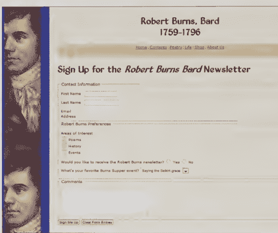

您还可以在本课程的下载资料中找到我创建的 CSS 样式表（`form.css`）。尝试自己创建这些样式，如果您愿意，可以将您的方法与示例样式表中显示的方法进行比较。

### 了解此技术术语

您在本课中学习了以下术语：

- **绝对值：** 指向带有完整 URL 的在线资源的值。
- **属性选择器：** 一种 CSS 选择器，其语法允许它根据是否包含指定属性来选择任何元素。
- **背景图像：** 通过 CSS 插入网页背景的图像，而不是 HTML 中的 `` 元素。
- **块级元素：** 在网页中显示时，会自动在其后插入换行符和空格的 HTML 元素。
- **层叠：** 冲突的 CSS 样式决定在浏览器中显示哪种样式的方式。
- **类选择器：** 根据 `class` 属性的值选择 HTML 文档中内容的 CSS 选择器。
- **多栏布局：** 使用 CSS 创建多栏布局的一种方式，类似于杂志和报纸的排列方式。
- **声明：** CSS 规则中出现在花括号之间的部分。
- **文档树：** 对 HTML 文档进行建模的一种方式，其中文档中的所有元素都排列为根元素 `<html>` 的分支和子分支。
- **外部样式：** 保存在扩展名为 `.css` 的外部样式表中的 CSS 样式。
- **网格定位：** 一种提议的标准，允许通过将对象排列在网格上来精确布局网页中的对象。
- **十六进制 RGB：** 以 # 符号开头并包含两个字符分别表示红、绿、蓝色值的颜色值。
- **HSL：** 包含色调值以及饱和度和亮度百分比的颜色值。
- **ID 选择器：** 根据 `id` 属性的值选择 HTML 文档中内容的 CSS 选择器。
- **继承：** 子元素继承其父元素的 CSS 值的过程。
- **行内元素：** 仅占据其在浏览器中显示所需空间的元素。这种元素不会添加额外的空格或换行符。
- **行内样式：** 使用 `style` 属性直接应用于 HTML 元素的 CSS 规则。不推荐使用。
- **内部样式：** 通过 HTML 文档 `<head>` 中的 `<style>` 元素应用于 HTML 文档的 CSS 规则。
- **关键字：** CSS 中的属性值，使用一个词来应用某种格式，不应加引号。
- **外边距：** HTML 元素外部的空白区域。
- **内边距：** HTML 元素边框内部的空白区域。
- **属性：** CSS 语法的一部分，指示 CSS 规则修改哪个特性。
- **伪类选择器：** 允许您根据文档树中未表示的属性（例如链接是否已被访问或用户的鼠标当前是否悬停在元素上）来选择元素。
- **伪元素选择器：** 选择元素的子部分，例如段落中的第一个单词。
- **相对值：** 指向相对于当前网页位置的在线资源或文件的 URL 值。
- **RGB：** 根据指定的红、绿、蓝色值创建颜色的颜色值。
- **RGBa：** 类似于 RGB 值，但也包含第四个用于不透明度的值。
- **选择器：** 在 CSS 规则的语法中，选择器决定了 HTML 文档的哪个部分被选中。
- **类型选择器：** 根据标记内容的 HTML 标签选择 HTML 文档中内容的 CSS 选择器。
- **值：** CSS 规则的一部分，告诉浏览器如何设置选定内容的样式。值可以是长度、百分比、URL、关键字等。

下表列出了本课中涵盖的 CSS 元素。

| 元素 | 描述 | 元素 | 描述 |
| :--- | :--- | :--- | :--- |
| `a:link` | 伪类选择器；设置未访问链接的颜色。 | `@import` | 插入到 `<style>` 元素中，`@import` 语句可以将外部样式表连接到 HTML 文档。 |
| `a:hover` | 伪类选择器；设置鼠标悬停时链接的颜色。 | `<link>` | 将 HTML 文档链接到外部样式表。包括 `rel`、`type` 和 `href` 属性。 |
| `a:visited` | 伪类选择器；设置点击后链接的颜色。 | `margin` | 设置元素外部空白区域的属性。值可以是长度或百分比。 |
| `background-color` | 设置网页的背景颜色。使用任何接受的颜色值。 | `padding` | 设置元素内部空白区域的属性。值可以是长度或百分比。 |
| `background-image` | 将图像插入网页背景的属性。使用 URL 值。 | `<style>` | 包含内部样式规则和 @import 语句。 |
| `background-position` | 定位背景图像的属性。值包括百分比、长度、`left`、`right`、`top`、`bottom` 和 `center`。 | `style`（属性） | 包含行内样式。不推荐使用。 |
| `background-repeat` | 决定背景图像如何重复的属性。值包括 `repeat-x`、`repeat-y`、`repeat`、`no-repeat`、`space` 和 `round`。 | `width` | 设置元素宽度的属性。值可以是长度或百分比。 |
| `background-size` | 调整背景图像大小的属性。值包括百分比、长度、`auto`、`cover` 和 `contain`。 | `display` | 可以将块级元素更改为行内元素或反之亦然的属性。值为 `block` 或 `inline`。 |
| `float` | 将元素移动到页面上其他元素的左侧或右侧，覆盖块级元素的默认行为。值可以是 `left` 或 `right`。 | `height` | 设置元素高度的属性。值可以是长度或百分比。 |


### 146 课程 4

### 课程 5 使用 CSS3 为页面元素添加样式

-   你将学习如何*选择字体*并应用字体和文本样式。
-   你可以*自定义项目符号和编号列表*。
-   *应用通用的 CSS 图片规则*，例如设置外边距和内边距、将元素向左或向右浮动，以及设置宽度和高度。
-   你可以*绘制边框、圆角并添加阴影*。
-   通过使用媒体类型和媒体查询，*为不同类型的设备自定义 CSS*。


1.  **字体和文本有什么区别？**
    请参阅第 ................................................................................................ 149 页。

2.  **如何确保网站访问者看到你想要他们看到的字体？**
    请查看第 ............................................................................. 156 页的 `@font-face`。

3.  **哪些 CSS 属性允许你自定义边框的每一边？**
    请在第............................................................................................ 165 页了解具体方法。

4.  **你能用图片作为边框吗？**
    请查看第...................................................................................................... 168 页。

5.  **如何为一个角应用更多或更少的圆角？**
    详情请见第.......................................................................................... 168 页。

6.  **你的代码如何决定在不同屏幕尺寸下应用哪个 CSS？**
    请在第......................................................................................... 176 页亲自看看。

尽管如今图形主宰着网络，但文本仍然很重要，而如何设置文本样式可以提升可读性，并改善网站的整体观感和体验。

在本课程中，你将全面学习使用 CSS 设置文本元素样式的基础知识，包括 CSS3 中的一些最新特性。你将从介绍属性开始，这些属性允许你设置字体系列、大小、粗细等。你还将了解对齐和缩进是如何工作的。

在你将学到的 CSS3 新特性中，包括为文本添加阴影，以及随网页一起下载任何你喜欢的字体（而不是指望你的网站访问者电脑上加载了你想要使用的字体）。

### 设置文本样式

在开始之前，了解文本和字体的区别会很有帮助。在 CSS 中，你会发现有修改文本的属性和修改字体的属性。以下是你需要了解的两者的区别：

-   文本是由字符组成的序列，这些字符构成了一个单词、一行或一个段落。一个字符代表一个字母、一个数字、一个符号或一个特殊字符。
-   另一方面，字体是字符的呈现方式。也就是说，一个单独的文本字符可以根据渲染它的字体，以多种不同的方式呈现。

> 在手工排版的时代，字体是用金属制造的，许多早期的设计至今仍以电子形式使用。每种字体都被分配一个名称。在单个字体面上呈现的字符被称为*字形*。每种物理字体也有用于字距调整对的特殊字形。这些是字母对，如 ff 和 AW，需要挤压在一起。

### 课程 5 为 font-family 选择字体

> 术语
> **字体系列**是一组相似的字体。

一组相似的字体被称为*字体系列*。通常，一个字体系列包含各种大小的字体，以及用于斜体、粗体和小型大写字母文本的字体。

使用 `font-family` 属性来设置网页上的文本样式。一般语法是

```
selector {font-family: family-name1, family-name2, ... generic name;}
```

对于属性值，使用可能存在于用户计算机上的字体名称以及一个通用名称。字体名称的顺序是浏览器搜索字体的顺序。因此，如果用户的计算机有列表中的第一种字体，网页就会用那种字体显示。如果没有，浏览器会移动到列表中的第二个，然后是第三个，依此类推。

通用名称告诉浏览器选择用户计算机上加载的指定类型的字体。基本上，通用名称是一个后备选项，以防其他字体都不可用。你可以选择的通用名称有*serif*、*sans-serif*、*cursive*、*fantasy* 和 *monospace*。

为了说明 `font-family` 的工作原理，我们来看几个例子。第一个 CSS 规则示例显示了应用于应该显示为衬线字体的选择器的 `font-family`：

较新的浏览器还支持 CSS3 的 `@font-face` 规则，该规则可以随网页一起下载字体文件，这样你的网站访问者就不需要在本地加载该字体。此规则为你提供了前所未有的灵活性，可以选择能体现网站特色的字体。不过，额外的文件确实需要额外的下载时间。你可以在本课程后面的“随网页下载字体”部分了解更多关于 `@font-face` 的信息。

```
body {font-family: Georgia, Times, "Times New Roman", serif;}
```

第二个 CSS 规则表明哪些选择器应以无衬线字体显示文本：

```
h1, h2, h3 {font-family: Verdana, Arial, Helvetica, sans-serif;}
```

那么，如何选择要使用哪些字体呢？以下字体是计算机上最常见的加载字体之一：Verdana、Georgia、Courier、Helvetica、Arial 和 Times New Roman。

如果你预计会有大量需要阅读的文本，请选择衬线字体。研究表明，这类字体更容易阅读。（然而，许多人更喜欢无衬线字体的*外观*，因此你可能不得不在吸引眼球的字体和适合阅读的字体之间做出选择。）

> 有些字体，如 Verdana 和 Georgia，是为屏幕设计的。更适合印刷页面的字体包括 Times New Roman 和 Helvetica。

### 微调字体属性

设置好要使用的字体后，你可以进一步优化字体的外观和感觉。常见的更改包括：

-   将某些字体放大或缩小于主体文本
-   在标题或其他需要突出显示的元素上应用粗体以强调
-   调整宽度，使字母排列更紧密或更分散

要设置字体的高度，请使用 `font-size` 属性。建议将值设置为百分比或 em。以下示例显示了相对于文档中其他段落文本设置字体大小的百分比值：

```
p.big { font-size: 125%; }
p.normal {font-size: 100%; }
p.small {font-size: 60%; }
```

在图 5-1 中，你可以看到这些字体大小样式应用于沃尔特·惠特曼诗歌的标题、引文和署名行。

要设置字体显示的粗细程度，请使用 `font-weight` 属性，它接受关键字值 `normal`（默认值）、`bold`、`bolder` 或 `lighter`。图 5-2 显示了以下三个 CSS 规则应用于同一段沃尔特·惠特曼诗歌的效果：

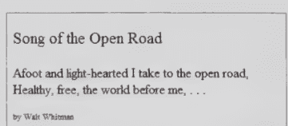

图 5-1

### 使用文本属性

当你想要对齐、缩进或应用一些更花哨的视觉效果时，你需要文本属性。

### 对齐文本

首先，看看 text-align，它允许你将文本向左、向右等对齐，就像在文字处理程序中一样。text-align 属性接受以下关键字值：left、right、center 和 justify。以下 CSS 规则将文本右对齐，如图 5-4 所示：

```
{ text-align: right; }
```

要将对齐方式更改为居中，请更改 text-align 的值。

p.bolder { font-weight: bolder; }
p.normal { font-weight: normal; }
p.lighter { font-weight: lighter; }

要拉伸文本行，可以使用 font-stretch 属性。此属性也接受关键字值，包括 expanded、normal 和 condensed。在图 5-3 中，你看不到太大区别，但效果可能因情况而异：

```
p.expanded { font-stretch: expanded; }
p.normal { font-stretch: normal; }
p.condensed { font-stretch: condensed; }
```

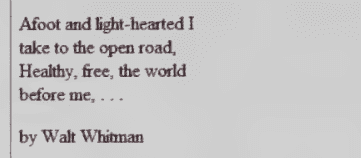

图 5-2

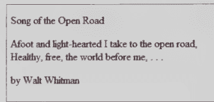

图 5-3

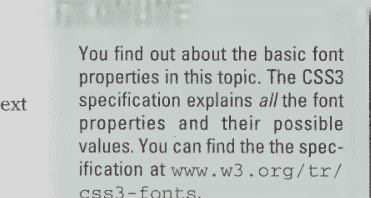

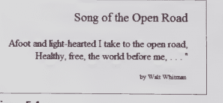

图 5-4


### 段落缩进

`text-indent` 属性允许您在硬换行后缩进文本的第一行。使用长度或百分比作为值，如以下代码所示：

```
{ text-indent: 3em; }
```

图 5-6 展示了文本段落的缩进效果。

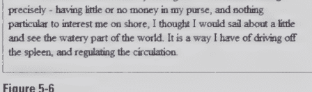

图 5-6

### 转换大小写

使用 CSS 更改文本大小写，可以快速轻松地创建和调整样式效果。例如，在图 5-7 所示示例的 HTML 中，我将一个 `id` 属性值为 `ishmael` 的 `<span>` 标签应用于段落的第一句话。然后在 CSS 中使用 ID 选择器，选中这段文本，并使用 `text-transform` 属性将其更改为大写。CSS 规则如下：

```
#ishmael { text-transform: uppercase; }
```

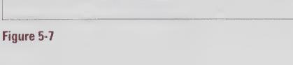

图 5-7

`text-transform` 的其他值包括 `capitalize` 和 `lowercase`。

### 添加下划线、删除线和上划线

要控制下划线、删除线和上划线在文本上的显示方式，请使用 `text-decoration` 属性。您可以为该属性包含最多三个值，每个值来自以下三组关键字值之一：

- `underline`、`no-underline`、`replace-underline`
- `overline`、`no-overline`、`replace-overline`
- `line-through`、`no-line-through`、`replace-line-through`

您也可以包含 `none` 或 `remove-all`。大多数浏览器都支持 `text-decoration` 属性，您可以使用它来控制是否显示下划线（例如在链接上），或者添加删除线。

### 创建阴影

文本阴影是 CSS3 中的新功能，许多设计师都对此感到高兴，因为 HTML5 和 CSS3 能原生处理的文本功能越多，网页设计师就越不需要依赖文本来获得他们想要的效果，或者满足于他们觉得平淡无奇的文本效果。您可以在 CSS3 中使用直观命名的 `text-shadow` 属性来创建阴影。这个属性可以取的所有值则不那么直观。以下是一个添加橙色文本阴影的 CSS 规则示例，您可以在图 5-8 中看到它在浏览器中的显示效果：

```
{ text-shadow: 1px 1px 5px hsl(33, 100%, 50%); }
```

前三个值必须是绝对值，从左到右依次是：

- **水平阴影：** 指定阴影在水平方向上延伸的距离。
- **垂直阴影：** 指定阴影在垂直方向上延伸的高度。
- **模糊半径：** 决定阴影边缘的锐利或柔和程度。如果您希望阴影看起来像文本一样方正，就不要添加任何模糊。相反，您添加的模糊越多，阴影看起来就越柔和。

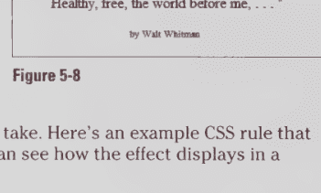

最后一个值是颜色值，在本例中是 HSL 表示法，但您可以使用任何有效的颜色表示法。大多数新版浏览器都支持 `text-shadow`。（IE9 是例外。）

### 调整文本间距

空格通常用于使文本更易于阅读或让眼睛得到休息。当您想添加不同类型的间距时，可以使用以下属性：

- **行高：** 指定每行文本应占据多少垂直空间。当然，不允许使用负值（因为一行文本必须占据一些空间）。但是，您可以将行高设置为小于字符的高度，在这种情况下，各行文本会相互重叠。
- **字母间距：** 指定字符之间应有多少空间。
- **单词间距：** 用于增加或减少单词之间的默认间距量。

### 新兴的 CSS3 属性

CSS3 中的许多文本属性尚未在浏览器中被采用。以下是对那些目前浏览器支持有限或不受支持，但未来可能会被支持的文本属性的简要介绍：

- **对齐：** 您会发现新的 CSS3 值（如 `start` 和 `end`）对 `text-align` 的支持很少或有限。新的 CSS3 属性 `text-align-last` 和 `text-align-justify` 也是如此。`text-align-last` 在任何主流浏览器中都不受支持，而 `text-justify` 仅在 IE 中受支持。
- **装饰：** 以下 `text-decoration` 属性是 CSS3 的新特性，尚未在所有浏览器中完全实现：`text-decoration-color`、`text-decoration-style` 和 `text-decoration-line`。
- **换行：** `text-wrap` 属性是 CSS3 的新特性。它允许您控制元素内的文本行是否以及如何换行。它尚未在任何主流浏览器中实现。

`text-align` 属性还有一个字符串值，该值必须是单个字符。理想情况下，文本会按此字符对齐。然而，大多数浏览器不支持 `text-align` 的字符串值，这很遗憾，因为这个功能会非常有用，尤其是在表格中。

> 要获取有关 CSS3 文本属性的最新信息，请参阅规范 www.w3.org/TR/css3-text。

### 使用网页下载字体

CSS3 中的 @font-face 规则允许您在网页上使用字体，而无需担心网站访问者的计算机上是否安装了该字体。使用 @font-face 规则，您的网页会链接到一个字体文件，该文件会随页面一起下载，以便网页能够显示该字体。

@font-face 规则的基本 CSS 语法如下：

```
@font-face {
    font-family: value;
    src: url(address) format("filetypestring");
}
```

- font-family 的值是字体的名称。
- url 地址的值是指向您希望浏览器随页面下载的字体文件的绝对或相对地址。您可能会将字体文件保存在名为 fonts 的子文件夹中，就像处理图片一样。
- format 的值是与 url 链接的文件类型相对应的任何文件类型字符串。

在实践中，您目前需要链接几种不同的字体文件类型，因为并非所有浏览器都识别单一文件类型。未来，WOFF（Web 开放字体格式）可能会成为标准，但目前尚未实现。表 5-1 列出了最常见的字体文件类型以及哪些浏览器支持每种文件类型：

表 5-1 @font-face 的文件类型

| 文件类型 | 含义 | 文件类型字符串 | 浏览器支持 | 备注 |
| :--- | :--- | :--- | :--- | :--- |
| TTF | TrueType 字体 | "truetype" | Safari 3.1、Firefox 3.5、Opera 10、Mobile Safari（iOS 4.2 中）和 IE9 | 一种与 Microsoft 紧密相关的成熟格式，但 Microsoft 以外的供应商也已采用它。 |
| SVG | 可缩放矢量图形 | "svg" | iOS 4.2 之前的版本、Chrome 和 Opera | 文件可能很大，下载缓慢。这是 iOS（用于 iPhone 和 iPad）在 4.2 版本之前唯一支持的格式。 |
| EOT | 嵌入式开放字体 | "embedded-opentype" | IE4 到 IE9 | Microsoft 是唯一支持此文件类型的浏览器供应商。 |
| WOFF | Web 开放字体格式 | "woff" | IE9、Firefox 3.6 和 Chrome 6 | 网页图形文件的拟议标准。 |

要链接多种文件类型，您需要在 src 中包含所需的所有 url 值，并用逗号分隔每个值。用户代理会使用它识别的第一个文件类型，因此如果需要，请确定文件的优先顺序。以下是为名为 Muncie 的字体编写的 @font-face 规则的 CSS 代码示例：

```
@font-face { font-family: Muncie;
src: url(fonts/muncie.ttf) format("truetype"),
     url(fonts/muncie.woff) format("woff"),
     url(fonts/muncie.eot) format("embedded-opentype");
}
```

当您在 CSS 中设置此规则后，您可以在样式表中稍后设置 HTML 元素样式时引用该 font-family 名称。因此，如果您希望所有 `<h1>` 和 `<h2>` 元素都以 Muncie 字体显示，这些元素的 CSS 将如下所示：

```
h1, h2 {font-family: Muncie, Verdana, Arial, sans-serif; }
```

CSS 仍然指定了备用字体（Verdana、Arial，以及最后的通用 sans-serif 字体），以防 Muncie 无法加载。在使用 @font-face 规则时，仍然建议指定备用字体。

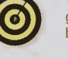

@font-face 规则是使用能补充网站内容和基调的字体的好方法，它能让您自信地显示更多种类的字体，并确信用户能在浏览器中看到所选字体。在选择要使用的字体时，请记住以下提示：

- **检查字体是否易于阅读并在屏幕上显示良好。** 并非所有字体都能做到。
- **检查字体的版权信息和最终用户许可协议（EULA），确保您有权在网站上使用该字体。** 仅仅因为您能为字体付费，并不意味着您可以在网页上使用它。


### 列表项目符号的样式设置

CSS 允许您自定义无序列表中出现的项目符号，自定义有序列表中使用的编号系统，并调整列表项目符号或编号的位置。

要更改项目符号的外观，请选择您想要更改的列表，使用 `list-style-type` 属性，并从以下关键字值中进行选择：

- `disc`（默认值）
- `circle`
- `square`

这是一个将项目符号样式更改为 `circle` 的 CSS 规则示例：

```
ul.circle {list-style-type: circle; }
```

您也可以使用图像代替关键字作为项目符号。CSS 语法为

```
selector {list-style-image: url("image.png"); }
```

您需要使用 `list-style-image` 属性和一个 `url` 值，该值指向您要使用的图像文件。图像文件的 URL 可以是相对路径或绝对路径。这是一个使用图像的 CSS 规则示例：

```
ul.star {list-style-image: url("starbullet.png"); }
```

图 5-10 展示了一个包含三种不同项目符号类型的示例列表。第一种是星形图像，第二种使用 `circle` 关键字值，第三种使用 `square` 关键字值。

> 有时，图像项目符号的一部分会在浏览器中被截断。要解决此问题，请使用 `margin-left` 属性增加 `<ul>` 或 `<li>` 元素的左外边距大小。

### 自定义有序列表中的编号

要更改有序列表中的编号，请使用 `list-style-type` 属性，就像您对无序列表所做的那样。

> `list-style-type` 属性不区分 `<ol>` 和 `<ul>` 元素，因此无论您将文本标记为 `<ol>` 还是 `<ul>`，都可以使用此处讨论的任何选项。不过，大多数关键字值显然是为配合项目符号或编号而设计的。`none` 值对两者都适用。

#### 表 5-2  有序列表的关键字值

| 值 | 外观 |
|---|---|
| decimal | 1. 列表项 1<br>2. 列表项 2 |
| decimal-leading-zero | 01. 列表项 1<br>02. 列表项 2 |
| lower-roman | i. 列表项 1<br>ii. 列表项 2 |
| upper-roman | I. 列表项 1<br>II. 列表项 2 |
| lower-greek | α. 列表项 1<br>β. 列表项 2 |
| lower-latin | a. 列表项 1<br>b. 列表项 2 |
| upper-latin | A. 列表项 1<br>B. 列表项 2 |
| armenian | Ա. 列表项 1<br>Բ. 列表项 2 |
| georgian | ა. 列表项 1<br>ბ. 列表项 2 |
| lower-alpha | a. 列表项 1<br>b. 列表项 2 |
| upper-alpha | A. 列表项 1<br>B. 列表项 2 |
| none | 列表项 1<br>列表项 2 |

### 项目符号和编号的定位

默认情况下，项目符号或编号悬挂在文本左侧的空白区域中。这个默认选项非常好，因为这是大多数人想要和期望的样式。

但是，当您想要不同的效果时，CSS 允许您使用 `list-style-position` 属性来更改定位。值包括关键字 `inside`、`outside` 和（CSS3 新增）`hanging`。

> **补充信息**
>
> 您可以通过将伪元素与 CSS 结合使用在网页上生成内容。这个过程超出了本节课的范围，但在您扩展 HTML 和 CSS 知识时了解它很有用。
>
> 生成的内容是自动插入到项目之前或之后的内容，例如列表或标题。内容可以是文本字符串、图像、计数器或 CSS 规范允许的任何其他内容。要使生成的内容生效，您需要将伪元素与 `content` 属性结合使用。伪元素指示生成内容的位置，而 `content` 属性告诉浏览器要生成什么内容。
>
> 这是一个在列表元素之前生成文本字符串 `Wow!` 的 CSS 规则示例：
> `li::before{content: "Wow!";}`
>
> 您可以在 `www.w3.org/tr/css2/generate.html` 找到更多关于生成内容的信息。
> 关于更新列表和计数器的工作草案位于 `www.w3.org/tr/2011/wd-css3-lists-20110524`。

### 图像和边框的样式设置

本节向您介绍设置图像和边框样式的基础知识。您将了解如何让文本环绕图像，以及如何使用不同的线条样式创建边框。您还将发现如何为方框添加圆角和阴影，这是 CSS3 中两项受欢迎的新功能。

### 设置图像样式

您已经学习了通常应用于图像的几种属性，包括外边距和内边距、将元素向左或向右浮动，以及设置宽度和高度。图像对大多数网站来说非常重要，因此这些属性对图像的影响值得单独用一节来介绍。您还可以将这些与边框结合使用，这也是下一节的主要焦点。

`margin` 和 `padding` 属性可以决定图像与周围文本之间（`margin`），以及边框与图像之间（`padding`）出现多少空白区域。以下 CSS 规则应用于图 5-11 中的图像。

```
img {padding: 50px;
margin: 50px;
}
```

通常，您希望文本环绕与该文本相关的图像。为此，请使用 `float` 属性。以下 CSS 规则创建了图 5-12 中显示的效果。

```
img {float: right; }
```

表格默认是块级图像，因此遵循一般规则，并采用与所有块级图像相同的样式属性。然而，`<td>` 单元格是内联元素，它们的行为类似于内联图像。但是，如果您将整个表格从块级更改为内联元素，则可以浮动该表格，以便周围的文本环绕它。其效果类似于浮动图像，当您想在段落文本中穿插显示一个小型相关数据表时，这会很方便。

设置表格样式的其他概念与本课程涵盖的其他样式类似。

有关设置表格样式的更多信息，请查看 CSS 规范 `www.w3.org/tr/css2/tables.html`。您也可以通过 W3Schools 网站 `www.w3schools.com/css/css_table.asp` 找到有关设置表格样式的详细信息。

在图像上使用 `width` 和 `height` 属性时，请记住，尽管图像在浏览器窗口中显示很小，但网站访客下载的是全尺寸图像。另外，如果您放大图像，您并没有增加像素尺寸。当大小差异不大时，使用 CSS 调整图像尺寸可能会有所帮助，但如果可以，在图形程序中调整图像大小并对其进行优化是最佳选择。然后浏览器将以您在图形程序中选择的大小显示图像，而您无需编写额外的 CSS 代码。图 5-13 说明了 `width` 和 `height` 如何可能扭曲图像。

以下是图 5-13 中应用 `width` 和 `height` 属性的方式：

- **左上角：** 未指定宽度或高度
- **顶部中间：** `img { width: 100px; }`
- **右上角：** `img { width: 100px; height: 204px; }`
- **底部：** `img { width: 300px; height: 100px; }`

### 创建边框

边框非常简单，但您可以使用它们做很多不同的事情。您可以使用以下语法为图像或任何其他块级元素添加基本边框：

```
{ border: style color width; }
```

图 5-13 展示了一张带有纯灰色边框的图像。这是一个添加虚线边框的 CSS 规则示例，这种边框常用于表示优惠券上的旧裁剪线，尽管它在图 5-14（如今，真正的在线优惠券采用条形码或二维码形式）中于浏览器中显示。

```
img.coupon {border: dashed green 0.2em}
```

边框样式的默认值是 `none`，您可以使用以下任何关键字值来更改样式。图 5-15 显示了使用每个值创建的边框。


#### 第五课

-   点线
-   虚线
-   实线
-   双线
-   凹槽
-   凸脊
-   内嵌
-   外凸

为了更精确地控制边框每一边的外观，你可以使用 `border-style`、`border-color` 和 `border-width` 属性：

-   `border-style` 接受前面列表中提到的任何关键字值，以及 `none`。
-   `border-color` 接受任何公认颜色表示法中的颜色值：关键字、十六进制、RGB 或 RGBA。
-   `border-width` 可以接受相对值或绝对值。请记住，相对值（如 `em`）能让你的设计保持灵活性，从而更有可能在广泛的浏览器和设备上显示良好。

这些属性能提供更多控制的主要原因是，每个属性都可以设置一个、两个或四个值：

-   如果你使用一个值，边框四边都一样。
-   如果你使用两个值，第一个值应用于顶部和底部，第二个值应用于左侧和右侧。
-   如果你使用四个值，这些值将按顺时针方向应用：顶部、右侧、底部和左侧。

图 5-16 展示了这些值如何应用于边框的不同部分。我使用了对比色，它们不一定最好看，但很醒目，这样你就能看到这些值是如何显示的。

### 为图像和边框设置样式

一个值 `{border-color: red;}`

两个值 `{border-color: red blue;}`

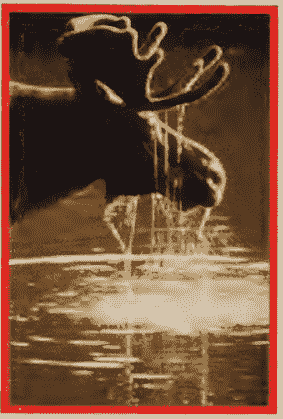

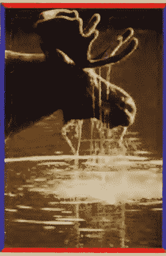

由美国鱼类及野生动物管理局提供

由美国鱼类及野生动物管理局提供

四个值 `{border-color: red green blue black;}`

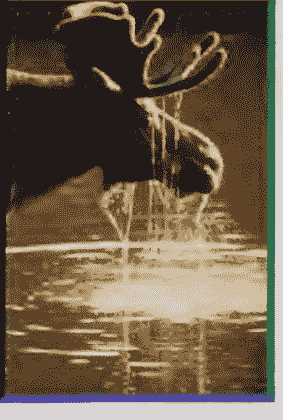

由美国鱼类及野生动物管理局提供

图 5-16

### 使用边框图像

`border-image` 属性是 CSS3 的新特性。它的目的是让你通过使用图像为元素创建任何你想要的边框类型。目前，它需要一个浏览器厂商前缀才能工作，唯一能正确运行此属性的浏览器是 Chrome。为了让你了解它的功能，请查看 `L5_01.htm` 中的代码，该代码使用了 `border.png`。你可以从本书的配套网站下载这些文件（详见引言部分）。图 5-17 显示了在 Chrome 中显示的输出。

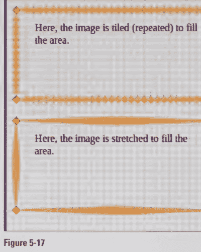

将图 5-17 与图 5-18 进行比较，后者显示了用于创建这些效果的原始图像。

### 圆角

圆角是 CSS3 的新特性。要创建它们，请将 `border-radius` 属性应用于你想要圆角的元素，例如图 5-19 中所示的变色龙照片，其 `border-radius` 属性设置为 `3em`。


在此例中，值 `3em` 是一个圆的半径。半径告诉浏览器圆的大小，从而决定添加多少圆角。半径越大，元素就越圆。你以长度形式提供值：`em`、百分比等。

> 有关 `border-image` 属性的详细信息，请参阅 www.w3.org/TR/css3-background/#border-images。

如图 5-20 所示，你可以提供一个或多个值：


-   如果只提供一个值，所有边框的圆角都相同。
-   如果提供两个值，第一个值是椭圆的 y 轴，第二个值是 x 轴。
-   每个单独的角都可以有自己的值：`border-top-right-radius`、`border-bottom-right-radius`、`border-bottom-left-radius` 和 `border-top-left-radius`。

图 5-19

```css
border-radius: 2em;
```

```css
border-radius: 3em 1em;
```

```css
border-radius: 10%;
```

```css
border-radius: 10% 25%;
```

```css
border-radius: 1em 2em 3em 4em;
```

```css
border-radius: 2em 3em/5em 2em;
```

图 5-20

✔ 要为复合属性 `border-radius` 加载不同的值，请用正斜杠分隔它们。

要仔细查看图 5-20 中不同方框是如何创建的，请查看清单 5-1 中创建此网页的 CSS 样式表。ID 选择器 `#d1`、`#d2`、`#d3` 等对应于图中显示的方框编号。

#### 清单 5-1：使用 CSS3 创建圆角

```css
body {
  margin: auto;
  width: 80%;
}

#left {
  float: left;
  width: 45%;
}

#right {
  float: right;
  width: 45%;
}

div.example {
  border-style: solid;
  border-color: red black green blue;
  border-width: 0.7em;
  margin: 5%;
  width: 80%;
  height: 150px;
}

p {
  font-family: Arial;
  font-weight: bolder;
  text-align: center;
}

span {
  font-family: courier;
}

#d1 { border-radius: 2em; }
#d2 { border-radius: 3em 1em; }
#d3 { border-radius: 10%; }
#d4 { border-radius: 10% 25%; }
#d5 { border-radius: 1em 2em 3em 4em; }
#d6 { border-radius: 2em 3em/5em 2em; }
```

### 为盒子元素添加阴影

盒阴影是 CSS3 的新特性，它可以为任何块级元素添加阴影，例如你在前面部分看到的变色龙图像。看看图 5-21 中的图像现在有了阴影？

要创建阴影，请使用 `box-shadow` 属性，它必须至少有两个值：阴影的水平位置和垂直位置。以下示例代码展示了这两个值的实际应用：

```css
{ box-shadow: 1em 1em; }
```

你还可以添加可选值，必须按以下顺序排列这些值才能生效：

1.  *水平位置*
2.  *垂直位置*
3.  *模糊度*：添加到阴影的模糊量
4.  *扩展量*：出现在盒子左侧和顶部边缘的阴影量
5.  *颜色*：使用任何接受的颜色值
6.  *内阴影*：一个关键字值，将阴影与背景颜色翻转

在图 5-22 中，你可以看到将每个可选值添加到黄色方块阴影中如何影响其在浏览器中的外观。

下面是黄色和绿色盒阴影示例的最终 CSS 代码：

```css
div {
  background-color: yellow;
  height: 20em;
  width: 20em;
  box-shadow: 1em 1em 1em 1em green inset;
}
```

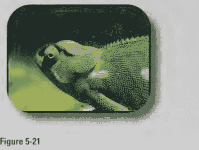

**图 5-21**

### 介绍媒体类型和媒体查询

HTML 文档可以在各种不同的设备上使用和访问——不仅仅是台式计算机。媒体类型和媒体查询是两种方法，可以确保你在用户打算用于查看网页的每种设备上都提供最佳体验。

#### 介绍媒体类型

媒体类型源自 CSS2，它使你能够根据访问者使用的媒体类型以不同的方式呈现你的网站。例如，你可能希望打印的网页与访问者在屏幕上看到的网页呈现方式不同。或者你可能希望向使用小屏幕移动设备的访客展示与在较大台式显示器或笔记本电脑屏幕查看网页的访客不同的布局。

> **术语**
> **媒体类型**使你能够根据访问者使用的媒体类型以不同的方式呈现你的网站。

以下是公认的媒体类型列表：

-   **all**：适用于所有设备。
-   **braille**：用于盲文触觉反馈设备。
-   **embossed**：用于分页的盲文打印机。
-   **handheld**：用于手持设备（通常屏幕小且带宽有限）。
-   **print**：用于分页材料和在打印预览模式下查看的屏幕文档。
-   **projection**：用于投射演示，例如投影仪。
-   **screen**：大多数人编写网页的目标。主要用于彩色计算机屏幕。
-   **speech**：用于语音合成器。*注意*：CSS2 有一个类似的媒体类型叫 `aural`，用于此目的。`aural` 在 HTML5 中已弃用。虽然现在鼓励你使用 `speech` 媒体类型，但目前还没有浏览器识别 `speech`。
-   **tty**：用于使用固定宽度字符网格的媒体（如电传打字机、终端或显示能力有限的便携设备）。
-   **tv**：用于电视类设备（低分辨率、彩色、滚动能力有限的屏幕和声音可用）。

基于 `@media` 规则应用 CSS 的基本语法如下：

```css
@media mediatype {
  selector { property: value; }
}
```

基本上，你从 `@media` 规则开始，并指明你希望某些 CSS 规则应用到的媒体类型——例如 `print`、`handheld`、`screen` 等。然后，你在 `@media` 规则的花括号内插入你想使用的 CSS 属性和值，就像在典型的 CSS 规则中一样。

清单5-2展示了一个使用`@media`结构的样式表片段，让你了解如何在样式表中为不同的媒体类型设置`@media`规则。

#### 清单5-2：一个示例@media规则

```
@media print{
    h1{font-size:40pt;
        text-decoration:underline;
        font-style:italic;
    }

    #lcol,#rcol{display:none;
    }

    table{border:none;
    }

    #printbadge{display:block;
    }
}

@media screen{
    #webbadge{display:block;
    }
}
```

图5-23显示了打印模式下的输出，图5-24显示了屏幕模式下的输出。

> 相关规范请参见 www.w3.org/tr/css2/media.html 和 www.w3.org/tr/css3-media-queries。

175

### 介绍媒体类型和媒体查询

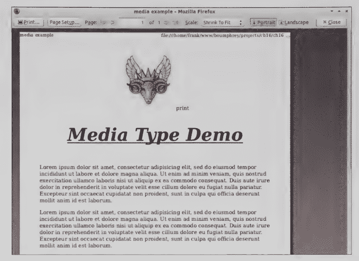

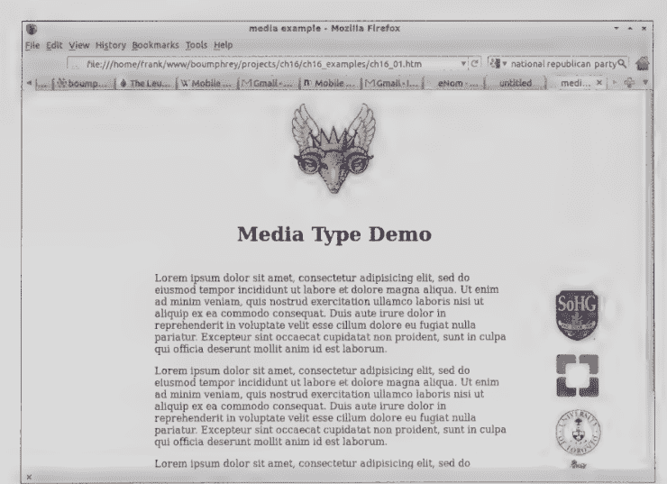

### 创建媒体查询

媒体查询是CSS3中的新功能，它扩展了媒体类型的功能，让你能更精细地控制何时应用一组样式。媒体类型允许你根据设备类型使用不同的样式表，而媒体查询允许你根据设备的能力使用不同的样式表。媒体查询正成为在各种设备上处理网站显示的一种流行方式，原因有两个：

- 并非每个手持设备上的网络浏览器都响应`handheld`（手持）媒体类型。
- 手机和平板电脑的屏幕尺寸正变得越来越多样化。

通过媒体查询，你可以询问浏览器其屏幕分辨率是多少，并根据浏览器提供的信息告诉它应使用哪个CSS。例如，如果你想在浏览器宽度（技术上称为视口）小于800像素时以单列显示页面，你可以创建如下媒体查询：

```
@media screen and (max-width: 799px) {
  property:value;
  property:value;
}
```

以下列表更详细地说明了浏览器在遇到此媒体查询时如何解释每个元素：

- **@media screen** 告诉浏览器此查询适用于任何符合`screen`（屏幕）媒体类型的设备，如台式计算机、智能手机和平板电脑。
- **and (max-width: 799px)** 告诉浏览器检查屏幕宽度是否为799像素或更少。为了创建单列布局而需要添加的任何属性和值，都将放在它们通常所在的位置——花括号之间。

在媒体查询中，你仍然使用`@media`规则和媒体类型。你还会添加一个结果为`true`或`false`的表达式。如果表达式为`true`，浏览器就会应用媒体查询中的CSS。在这种情况下，如果视口宽度为799像素或更少，花括号内的CSS规则就会生效。

> 术语解释
> **媒体查询**允许你询问浏览器其屏幕分辨率，然后根据屏幕尺寸的多样性告诉浏览器应使用哪个CSS。

### 为移动网络创建样式表

媒体查询的一个常见用途是检测小屏幕设备，并为它们提供针对智能手机优化的样式表。

要检测小屏幕设备，你可以在HTML文档的头部使用以下`<link>`标签：

```
<link rel="stylesheet" type="text/css" media="only screen and (max-width:480px), only screen and (max-device-width: 480px)" href="/css/smallscreen.css" />
```

如果浏览器尺寸为480像素或更小，或者设备屏幕尺寸为480像素或更小，此标签将加载`smallscreen.css`样式表。在移动设备上，浏览器的宽度通常与屏幕的宽度相同（换句话说，浏览器占据了整个屏幕宽度）。

要创建移动样式表，请遵循以下三个建议：

- ✔ **将宽度指定为百分比，即流动布局。** 注意这两种样式之间的区别：

```
#content {
  width: 960px;
}

#content {
  width: 100%;
}
```

第一个示例无法为小设备调整。第二个示例始终占据其可用水平空间的100%——无论是960像素还是320像素。

- ✔ **通过设置viewport meta标签来关闭自动缩放。** 尽管这不是你可以在样式表中设置的内容，但它对于优化你的网站以适应移动设备至关重要。将以下meta标签放在HTML文档的头部，可以向浏览器指示网站的宽度应设置为显示屏的宽度：

```
<meta name="viewport" content="width=device-width, initial-scale=1.0, maximum-scale=1.0" />
```

- ✔ **使可点击区域足够大，便于触摸。** Apple的移动应用指南表示，按钮应至少为44px x 44px，以便用户能够轻松用手指按压。这也是设计移动网站的一个良好准则。


### 总结

本课带你概览了许多可用于不同元素类型的CSS属性。以下是简要回顾：

- CSS将样式文本的属性分为两类：字体属性和文本属性。当你想格式化字符外观时，请查看字体属性。文本属性使你能够格式化单词和段落。
- 通常，你会选择几种用户计算机上可能已加载的字体之一，以及一系列备用字体。当使用不常见的字体对你很重要时，`@font-face`规则可以告诉浏览器与页面的其余部分一起下载你想要的字体。
- 除了对齐、缩进、调整间距和更改页面文本大小写的属性外，CSS3中的新文本属性还可以添加阴影和在框内自动换行。CSS3还增加了在特定字符上对齐文本的能力，当更多浏览器开始支持此功能时，这对于表格将非常有用。
- 你可以使用关键字值或图像自定义无序列表中项目符号的外观。同样，通过选择多种编号方案来自定义有序列表的编号。
- 边框可以像你需要的那样简单或复杂。使用`border`属性，或者使用更具体的边框属性（用于样式、颜色和宽度）来自定义边框的每一侧。
- `border-radius`属性是CSS3中的新功能，它允许你通过指定半径大小来圆化任何块级元素的角。半径越大，圆就越大，应用于元素的圆角就越明显。
- `@media`规则允许你使用媒体类型和媒体查询。媒体类型使你能够根据访问者使用的媒体类型以不同的方式呈现你的网站。媒体查询建立在媒体类型之上，允许你根据媒体查询指定的参数使用不同的样式表。
- 要创建移动样式表，请将宽度指定为百分比，通过设置viewport meta标签来关闭自动缩放，并使可点击区域足够大，便于触摸。

### 动手实践实验室

在本课中，你学习了如何使用CSS格式化文本。现在来尝试一些你学到的东西：

1. 在你的文本编辑器中，从以下基本HTML文档开始：
2. 按照文档中的说明为三个标题设置样式。
3. 完成初始说明后，尝试一些你学到的其他样式。

```
<!DOCTYPE html>
<html>
<head>
<title>CSS Experiments</title>
<style type='text/css'>
  h1 {
    /*replace this*/
  }
  h2 {
    /*replace this*/
  }
  h3 {
    /*replace this*/
  }
</style>
</head>
<body>
  <h1>Make this text huge.</h1>
  <h2>Align this to the right and make it blue.</h2>
  <h3>Compress This (reduce the space between letters).</h3>
</body>
</html>
```

如果需要帮助，你可以从网站下载完成的文档（L5_02.htm）。

尽情尝试吧！看看仅通过更改CSS，你能把这个简单文档变得多好看或多难看（随你喜欢！）。也欢迎添加你自己的文本。


### 了解这个技术讲座

- **模糊（blur）**：决定阴影呈现的边缘是生硬还是柔和。
- **字符（character）**：表示一个字母、数字、符号或特殊字符。
- **字体（font）**：字符的渲染方式。
- **字体族（font family）**：一组相似的字体。
- **字间距（letter spacing）**：指定字符之间应有多少间距。
- **行高（line height）**：指定文本每一行应占据多少垂直空间。
- **外边距（margin）**：图像与周围文本之间出现多少空白。
- **媒体查询（media query）**：允许你根据设备的功能使用不同的样式表。它基于浏览器提供的关于其屏幕分辨率的信息，告诉浏览器应使用哪些CSS。
- **媒体类型（media type）**：使你能够根据访客使用的媒体类型，以不同方式呈现你的网站。
- **内边距（padding）**：边框与图像之间出现多少空白。
- **文本（text）**：构成一个词、一行或一个段落的字符序列。
- **词间距（word spacing）**：用于增加或减少单词之间的默认间距量。

下表概述了一些重要的文本和字体相关属性及其作用。

| 属性 | 作用 |
| :--- | :--- |
| `font-family` | 设置字体族。 |
| `font-weight` | 指定字体的粗细。 |
| `font-size` | 设置字体大小。 |
| `color` | 设置文本颜色。 |
| `text-align` | 指定文本的水平对齐方式。 |
| `letter-spacing` | 增加或减少字母之间的间距。 |
| `line-height` | 设置文本的行高。 |
| `word-spacing` | 增加或减少单词之间的间距。 |

### 第六课 使用脚本添加交互性

- `get`或`post`协议可用于从服务器返回数据。
- `if`关键字用于测试语句的真假。
- 你可以通过外部或内联方式链接JavaScript。
- 你可以使用forms数组验证表单。
- 处理地理位置信息时，你需要遵循安全规则。


1.  浏览器如何处理表单数据？请参阅第184页
2.  脚本的基础构建块是什么？请参阅第186页
3.  你能将JavaScript链接到文档吗？从第194页开始
4.  如何验证表单？请参阅第196页了解详情
5.  你能将图像和CSS与JavaScript一起使用吗？请在第204页找到答案
6.  如何确定位置？请参阅第208页了解详情
7.  jQuery库是什么？请在第212页获取详细信息

本课和第七课涉及多个需要脚本的话题。到目前为止，如何使表单具有交互性一直是个回避不了的问题，但除非你满足于编写纯装饰性的页面，否则你需要了解一些脚本知识。本课不会让你成为JavaScript专家，但它涵盖了足够多的内容，能让你理解正在发生的事情。

JavaScript（及其服务端兄弟PHP）是一种功能非常强大的编程语言，但本课不会专门教授JavaScript。我会在特定示例的背景下向你展示如何使用它们。

> Dummies.com网站有一些关于JavaScript的优秀页面。将你的浏览器指向 www.dummies.com/how-to/computers-software/programming/javascript.html。

### 发送表单

在第三课中，你学习了如何构造一个表单以向服务器发送信息。但是，当用户点击提交按钮时会发生什么？

答案取决于创建按钮的`<input>`元素的`type`属性是`submit`还是`button`。

在大多数情况下，按钮是`submit`按钮，因此我将在本节中重点关注这一点。（稍后在本课的“验证表单”部分，你会了解到如果按钮类型是`button`会发生什么。）以下代码片段是一个简单表单的示例：

```
<form method='get' action='forms1.htm'>
<br/>名:-<input type='text' name='fname'/>
<br/>姓:-<input type='text' name='lname'/>
<br/><input type='submit' value='submit form'/>
</form>
```

输入这段文本（或从本书配套网站下载`L6_01.htm`并将其保存为`forms1.htm`），在你喜欢的浏览器中打开它，填写一个名字（如John Doe），然后点击“提交表单”按钮。表单会重新加载，但当你查看地址栏时，你会看到类似这样的内容：

```
...forms1.htm?fname=John&lname=Doe
```

地址栏揭示了当你点击“提交表单”按钮时后台发生的事情。浏览器构建了一个名称/值对的字符串，并将其发送到表单`action`属性中给出的地址。在图6-1中，你可以看到我在示例表单中填入我的名字后，Chrome浏览器地址栏的样子。

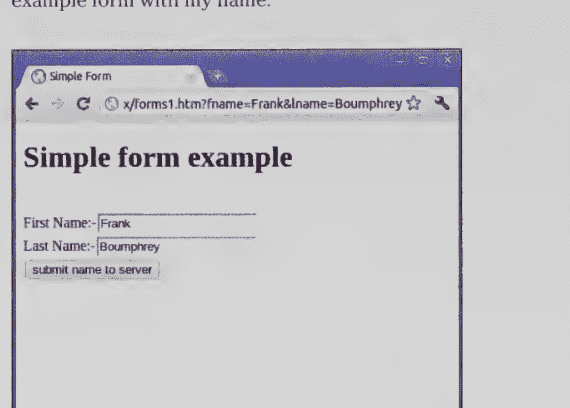

图6-1

### 理解浏览器如何处理表单数据

既然你已经查看了地址栏，现在可以仔细看看`<input>`元素中发生的事情了：

- 每个`<input>`元素都被赋予了`type`和`name`属性。值是用户在文本框中输入的内容。
- 当用户点击“提交表单”按钮时，浏览器首先构建一个名称/值对的字符串，格式为`name=value`。
- 每个名称/值对用一个与号（`&`）分隔。
- 接下来，浏览器会查找`<form>`元素，以确定将信息发送到何处以及使用哪种协议发送。

- `action`属性告诉浏览器将信息发送到何处。此属性的值必须是绝对URL或相对URL。在前面的示例中，`action`属性包含的是包含该表单的页面文件名。换句话说，表单正在将其信息发送给自身。
- `method`属性告诉浏览器使用哪种协议：`get`或`post`。前面的示例表单指定了`get`协议，这也是默认值。
- `get`协议将名称/值对字符串作为查询字符串附加在目标地址名称后发送到该地址。*查询字符串*是URL中?之后的部分。虽然URL中?左侧的所有信息都是关于特定网页的地址，但查询字符串的目的是传递网页应使用的数据。

> **查询字符串**是URL中?之后的部分。查询字符串传递网页应使用的数据。

下一节将介绍`method`的值，然后你将了解服务器端发生的事情。


使用示例表单（位于本书配套文件中的`ch6_01.htm`）进行实验，看看浏览器如何处理你输入到表单中的数据。向示例表单添加一些值，并在每次点击“提交表单”按钮时检查地址栏。请执行以下操作：

- **在一个字段中输入多个单词。** 注意浏览器如何用加号（+）替换空格。因为空格不允许出现在URL中，浏览器使用替代字符。
- **在一个字段中输入非常长的字符字符串。** URL查询字符串对其能包含的数据量有限制（因浏览器而异）。看看你是否能达到这个限制！
- **在一个字段中输入换行符。**
- **在一个字段中插入在URL中有其他含义的特殊字符（如?、/和:）。** 注意浏览器如何自动用字符组合（如%26）替换这些字符。因为空格是不允许出现在URL中的字符之一，浏览器使用以百分号开头的代码来表示这些字符。


### 在 GET 和 POST 协议之间做选择

每当用户向 Web 服务器提交包含数据的表单时，浏览器就会向服务器发送一个请求。该请求以一个格式化的文本文件传输，被称为 *HTTP 请求头*，此文本文件包含：

- 用于从服务器返回数据的协议名称：`get` 或 `post`。
- 所请求服务器文件的 URL。
- 浏览器愿意从服务器接收的文件类型列表。
- 名称/值字符串。

如果指定 `get` 方法，名称/值字符串会附加到 URL 上。如果使用 `post` 方法，字符串则嵌入到请求文件本身中，因此不会出现在浏览器的地址栏中。

> **额外信息**
查询字符串中可发送的字符数量限制因浏览器而异。Web 开发人员通常使用 2,048 个字符作为有效限制，因为这是 Internet Explorer 在查询字符串中接受的最大字符数。

该使用哪种方法？`post` 方法更安全，因为表单信息不会那么容易被访问到。此外，`post` 方法对可包含的字符数没有限制。`get` 方法的优点是，如果某个页面被添加了书签，所请求的信息也会被一起保存。

### 脚本构建模块简介

在本课和第 7 课中，你将广泛使用 JavaScript。本节介绍 JavaScript 语言的关键元素及其作用。本节为你提供 JavaScript 基础知识，这些是开始学习本课和第 7 课示例所需的基础。

#### 值

JavaScript，实际上任何编程语言，都是关于操作值的。JavaScript 识别三种类型的值：

- **字符串：** 字符串是用单引号或双引号括起来的简单文本片段。你可以使用加号将两个字符串拼接在一起，这个过程称为 *连接*。因此，"This is a string" + " which is just text" 等同于 "This is a string which is just text"。
- **数字：** 数字就是不带引号的数字，可以是正数或负数。67 是一个数字，3.14 也是。然而，"3.14" 不是一个数字，而是一个字符串，因为它被引号括起来了。
- **布尔值：** 布尔值要么是 `true`，要么是 `false`。

#### 变量

*变量* 就像水桶或容器，用于保存一个值或一个对象。你也可以将一个数组放入变量中，这一点我稍后在本课中会解释。

在 JavaScript 中，你使用关键字 `var` 来声明一个变量名。例如，`var myname` 创建了一个名为 `myname` 的变量。创建变量名时，你需要了解以下规则：

- 你可以使用字母数字字符或下划线。
- 你不能在名称中使用空格或 JavaScript 关键字。
- 变量名区分大小写；`myvar` 与 `myVar` 不同。

> **术语**
JavaScript 使用了许多称为 **关键字** 的保留字。例如 `var`、`true`、`for`、`if`、`while` 以及许多其他关键字。我在你学习到它们时会指出来。请注意，关键字是区分大小写的。

要为变量赋值，你需要使用等号，其技术术语是 *赋值运算符*。以下是几个例子：

```javascript
var myName='Jane Roe';
var Num=1.414;
var myBool=true;
```

在以上每个例子中，我同时声明了变量名并为其赋值。分号表示一条语句的结束，下一节将对此进行解释。

声明变量名后，你可以更改其值。例如，以下代码更改了 `myNum` 中包含的值：

```javascript
myNum=49;
```

变量创建后，你可以根据需要多次修改其值，新值将被记住，直到你再次修改它。这正是脚本赋予网页执行有用任务的能力的一部分。

> **额外信息**
虽然在更改变量的值时可以使用不同的值类型，但不建议这样做。

#### 语句

JavaScript 代码由一系列语句组成。分号（;）或换行符终止一条语句。然而，永远不要依赖换行符。务必养成用分号终止语句的习惯。

> **额外信息**
JavaScript 的最初设计者认为，能够用换行符终止语句会使 JavaScript 易于使用。相反，它产生了许多意想不到的后果，可能导致代码出错并使调试问题变得更加困难。

#### 注释

你已经见过两种注释：

```html
<!--HTML Comment-->
```

```css
/*CSS Comment*/
```

然而，JavaScript 使用以下两种注释：

- 一对正斜杠 `//`，注释掉直到下一个换行符之前的所有内容。
- 与 CSS 相同的注释，可以注释多行：
```css
/*This is also a JavaScript Comment*/
```

#### 对象

一切皆为 *对象*，而对象由其他对象组成。例如，我的身体是一个对象，它有一个躯干对象和一个头部对象。我的头部有一个眼睛对象、一个耳朵对象和一个头发对象。

对象也有它们自身是什么（属性），以及它们能做什么（方法）。在编程中，这些被称为 *属性* 和 *方法*。例如，我的眼睛有一个颜色属性和一个视觉方法。当你谈到 HTML DOM 时，你已经遇到过一组特殊的对象（如需回顾，请参阅第 1 课）。

JavaScript 有许多内置对象。例如 `window` 对象包含有关浏览器窗口的信息；`document` 对象包含有关加载到浏览器上的页面信息。在 JavaScript 中，你使用对象来修改和操作网页。

例如，网页中的所有 HTML 元素都有样式对象，这些样式都有属性。你可以通过字符串 `document.myElement.style.color` 访问名为 `myElement` 的元素对象的 `color` 样式（你需要自己创建这些，但随着学习深入会了解更多）。`color` 是 JavaScript 中与同名 CSS 属性等效的属性。

大多数 JavaScript 对象是可读写的，因此 `document.myElement.style.color='red';` 会将 `color` 属性值设置为红色。

JavaScript 不喜欢连字符，因此要获得与带连字符的 CSS 属性等效的属性，只需将第二个单词首字母大写即可；例如，CSS 的 `background-color` 在 JavaScript 中变成 `backgroundColor`，`margin-left` 变成 `marginLeft`，依此类推。

JavaScript 也有许多具有 *方法*（对象能做的事情）的对象。在 JavaScript 中，圆括号表示一个方法。例如，`window` 对象有一个 `open` 方法，可以打开一个新的浏览器窗口。你可以这样使用 `window` 对象的 `open` 方法：

```javascript
window.open('http://www.example.com', 'examplewindow');
```

此代码的结果是浏览器打开一个名为 `examplewindow` 的新窗口，并在该窗口中打开 `http://www.example.com` 处的网页。

为了帮助你了解对象及其属性和方法在 JavaScript 中如何协同工作，这里有两个例子：

- `window` 对象的一个常用方法是 `alert()` 方法，因此 `window.alert("Hello JavaScript");` 会弹出一个提示框并显示文本 Hello JavaScript。
- `document` 对象的一个常用方法是 `write()` 方法。以下代码在网页上显示文本 Hello JS Objects：`document.write("Hello JS Objects");`

#### 数组

通常，以一种便于一起访问的方式存储 *列表* 或相关变量组非常重要。实现这一点的方法是使用数组。*数组* 是一个带索引的值或对象列表。例如，假设我有一个猫的名字列表：Ben、Pierre 和 Daisy。我可以创建这些名字的数组，然后通过数字而不是名字来引用它们。这有点像军队里过去对你做的一样！入伍后，你就不再是 John Doe，而是二等兵 34578120！

在 JavaScript 中，你可以如下创建一个数组：

```javascript
var myCats=new Array('Ben','Pierre','Daisy');
```

索引从 0 开始，因此现在我可以使用 `myCats[0]` 来引用 'Ben'。

数组的另一种形式是 *关联数组*。在这里，索引不是数字，而是一个字符串。因此，如果我有一个州列表并想将它们与其邮政编码关联起来，我可以创建一个名为 `state` 的数组，其内容模式如下：

```javascript
state["NY"]="New York";
state["OH"]="Ohio";
state["SC"]="South Carolina"
```

关联数组对于读取表单以及在服务器端读取名称/值对非常重要。

#### 循环

循环和数组密不可分。*循环* 是一种遍历数组的方法。JavaScript 中两种基本类型的循环是 *for* 循环和 *while* 循环。为了了解循环的工作原理，我们在本节快速了解一下 *for* 循环。

`for` 循环是许多编程语言的支柱，它们都使用相同的语法：

```javascript
for(i=*starting value*;i < *end value*; *value increment* )
```

`for` 告诉浏览器这是一个 `for` 循环。在圆括号内，`for` 循环有三部分。第一部分是起始值。传统上，你使用 `i` 作为


### 介绍脚本的基础构件

递增变量，但变量名也可以轻松地使用任何其他字母或任何有效的变量名，例如 `cat` 或 `myLoopValue`。递增值在每次循环迭代中会以某种方式改变（如第三部分所示），并且循环将一直运行，直到满足 `for` 循环语句第二部分中的条件为止。

例如，以下代码用于读取 `myCats` 数组：

```
<script type='text/javascript'>
var myCats=new Array('Ben','Pierre','Daisy');
for(var i=0;i<myCats.length;i++){
    document.write(myCats[i] + "<br/>");
}
</script>
```

请注意以下几点：

- 代码片段位于一个 `type` 属性为 `text/javascript` 的 `<script>` 标签内。有关详细信息，请参阅本课程后面的“将 JavaScript 链接到文档”部分。
- `myCats.length` 使用 `length` 关键字来确定数组中有多少个名称。请记住，索引从 0 开始。
- `i++` 在每次循环中将 `i` 的值加一。
- `document.write(myCats[i] + "<br>");` 输出猫的名字，后面跟着一个 HTML 换行标签。

另一种循环，`for/in` 循环，特别适合用于遍历关联数组。这是因为 `for/in` 循环提供了一种同时读取索引和值的方法，如下例所示：

```
<h1>关联数组</h1>
<p>下方列出了州和邮政编码</p>
<script type='text/javascript'>
var states=new Array;
states["NY"]="New York";
states["OH"]="Ohio";
states["SC"]="South Carolina";
var state;
for(state in states){
    document.write(states[state]+" - "+state +
    "<br/>");
}
</script>
```

这里使用了一种特殊形式的 `for` 循环来读取州名及其邮政编码。它通过从数组的第一个元素开始，并循环遍历每个元素直到没有剩余元素来实现这一点。在每次循环迭代中，`document.write` 语句会打印索引（例如 "NY" 或 "OH"）和值。

#### 第 6 课

### 事件

*事件*在 JavaScript 中非常重要。它们是用户与文档进行通信的方式。用户通过移动鼠标（哪怕只有一个像素）、单击鼠标、按键、加载图像或页面、提交表单等操作来触发事件。为了能够处理事件，理解事件的捕获和冒泡也是重要的概念：

- 要使事件有用，必须捕获它，而 JavaScript 有许多 *事件处理程序* 来完成这项工作。
- 事件会冒泡。当一个 HTML 元素嵌套在另一个 HTML 元素内时，事件首先在顶层元素上触发，然后在下一个元素上触发，依此类推。

> **术语**
> **事件处理程序**将事件传递给更多的代码，然后由这些代码处理该事件。

以下代码的特点是一个嵌套在 `<div>` 元素中的 `<p>` 元素。每个元素上都使用了 `onclick` 事件处理程序来捕获点击事件。输入以下代码：

```
<h1>事件示例</h1>
<div onclick='alert("Div 捕获")'>
<p onclick='alert("P 捕获")'>点我</p>
</div>
```

请注意弹出框出现的顺序。

在前面的代码中，`click` 事件只是被传递给了 `window.alert()` 方法。不过，更常见的是，`click` 事件会被传递给一个函数进行处理。请注意，在前面的示例中，使用 `alert()` 方法时没有指定 `window` 对象。当你这样做时，JavaScript 会假定你希望警告在当前窗口中发生，因此不需要指定 `window` 对象。

#### 函数

*函数*是一段代码，它会一直存在，直到被*调用*。其语法如下：

```
function functionName(parameters) {
  要执行的代码
  要返回的值
}
```

在下面的示例中，点击文本会调用一个简单的函数：

```
<p onclick='demofunct(this)'>点我看看这是什么元素</p>
<script type='text/javascript'>
function demofunct(a) {
    alert("这是一个 '"+a.nodeName+"' 元素");
    return 0;
}
</script>
```

输入此代码（或从本书的配套网站下载 L6_02.htm）并点击文本后，你会看到一个警告框显示：这是一个 'P' 元素。以下是代码如何实现这一结果的：

- 点击事件由一个 onclick 处理程序捕获，该处理程序调用 demofunct() 函数。
- 函数被赋予一个参数 this，这是一个 JavaScript 关键字，指的是捕获事件的元素。
- JavaScript 代码包含在 <script> 标签内。（请参见即将介绍的“将 JavaScript 链接到文档”部分。）
- <script> 标签中的第一行 JavaScript 告诉浏览器，我已经创建了一个名为 demofunct() 的函数，它期望一个参数，该参数在函数接收时将被命名为 a。
- 当函数被调用时，花括号内的所有代码都会运行。
- 在函数中，参数被引用为 a。在这种情况下，参数是一个元素对象。因此，a.nodeName 使用了元素的 nodeName 属性并返回 P。（请注意，即使我使用了小写 p，JavaScript 总是会返回大写。）
- alert 方法和连接（或拼接）在一起的字符串创建了窗口和出现在窗口中的文本。
- 此函数没有返回任何东西。因为函数的目的通常是接受一个或多个值并使用该值执行某些操作，所以许多函数使用 return 语句来告诉函数将其新值返回给调用它的代码。但是，由于此函数不返回值，我使用了语句 return 0; 来表明这一点。在这种情况下，我本可以省略 return 语句，大多数程序员也确实会这样做。

### if 语句

`if` 关键字用于测试语句的真假；以下是其一般语法：

```
if(语句为真){
    执行花括号中的代码
}
else {执行此代码}
```

在下面的示例中，我想检查元素的样式是否为 `red`。为此，我使用了相等运算符，即两个等号 `==`。如果 `color` 属性确实是 `red`，代码会将元素转换为 `black`。如果不是 `red`，则 `else` 关键字将元素更改为 `red`。请注意在 JavaScript 中颜色是如何被引用的，这与 CSS 不同：

```
<p onclick='toggle(this)'>点我切换此文本颜色</p>
<script type='text/javascript'>
function toggle(a){
    if(a.style.color=='red'){
        a.style.color='black';
    }
    else{a.style.color='red';}
}
</script>
```

相等运算符是几种比较运算符之一。以下是其他一些。

| 运算符 | 含义 |
| --- | --- |
| != | 不等于 |
| < | 小于 |
| > | 大于 |

### 将 JavaScript 链接到文档

你可以通过以下三种方式之一将 JavaScript 链接到 HTML 文档：

- 将 JavaScript 嵌入在 `<script>` 标签中。
- 使用特殊的 `<script>` 标签链接到包含 JavaScript 的外部文件。
- 将 JavaScript 代码与 HTML 内联放置。

我在大多数示例中使用第一种方法（为简单起见，将每个示例的代码保持在一个文件中），尽管在现实中，第二种方法更常用。

> **提示：** 将 JavaScript 放在单独文件中的优点是相同的代码可以反复重用。正如你将发现的，JavaScript 非常繁琐，难以调试，拥有可重用且已调试的代码非常有用！

本课前面的 `if` 语句可用于演示所有三种方法。首先，我向你展示 `<script>` 标签方法：

```
<p onclick='toggle(this)'>点我切换此文本颜色</p>
<script type='text/javascript'>
function toggle(a){
    if(a.style.color=='red'){
        a.style.color='black';
    }
    else{a.style.color='red';}
}
</script>
```

### 链接到外部 JavaScript

为了说明外部 JavaScript 的工作方式，你将前一个示例中的相同代码移动到一个外部文件中。首先，你需要创建两个新文件：`L6_03a.htm` 和 `L6_03b.js`。

这是 `L6_03a.htm` 的内容：

```
<p onclick='toggle(this)'>点我切换此文本颜色</p>
<script type='text/javascript' src='L6_03b.js'></script>
```

基本上，`src` 属性指向 `L6_03b.js`，而不是将 JavaScript 插入到 `<script>` 标签中。请记住，链接到外部 JavaScript 文件时，结束的 `</script>` 标签是必不可少的。

除了 `L6_03a.htm`，你还有一个 `L6_03b.js`，它只包含函数，没有其他内容！不需要 script 标签。如果你愿意，可以添加注释。

当你在浏览器中显示 `L6_03a.htm` 时，结果与内部文件相同。


### 内联 JavaScript

嵌入脚本的第三种方式是内联嵌入。这种方法很少使用，但它的样子是这样的：

```
<p onclick="if(this.style.color=='red'){this.style.color='black';} else{this.style.color='red';}">Click Me to toggle this text color</p>
```

所有的 JavaScript 和 HTML 代码都必须在一行上。

### 验证表单

在第 3 课中，你学习了如何设置表单的 HTML 部分，并在本课开始时，你了解了提交到服务器的内容。在本节中，你将了解如何防止用户发送垃圾信息，例如错误的电子邮件地址或表单中缺失的信息，无论是意外还是故意的。

关键在于表单验证，可以在浏览器端或服务器端进行。在接下来的几节中，你将学习如何使用刚刚学到的基础知识来创建验证表单的 JavaScript。

### 在用户点击提交时进行验证

用户最常犯的错误是遗漏必填字段，你可以使用 JavaScript 确保所有必填字段都已填写。以下示例表单要求用户填写一个字段：

```
<form name="myForm" action="validate1.htm"
      onsubmit="return validateForm()" method="get">
  First name: <input type="text" name="fname">
  <input type="submit" value="Submit Name">
</form>
```

当用户点击"Submit Name"按钮时，会触发一个提交事件。你可以使用这个事件来触发 JavaScript，在将信息提交到 Web 服务器之前对其进行检查。

以下代码显示了 `onsubmit` 事件处理程序调用的 `validateForm()` 函数。这个函数查看 `onsubmit` 处理程序传递给事件的值，并测试它是否已完成。如果已完成，则返回 `true`，表单将被提交。如果未完成，则返回 `false`，表单将不会被提交。请注意，你*必须*在调用函数之前加上 `return`。

```
<script type='text/javascript'>
function validateForm()
{
var x=document.forms["myForm"]["fname"].value;
if (x==null || x=="")
  {
  alert("First name must be filled out");
  return false;
  }
}
</script>
```

`var x=document.forms["myForm"]["fname"].value;` 这一行创建了一个变量 `x`，其值等于 `fname` 名称/值对的值。换句话说，`x` 变量等于用户在文本框中输入的任何内容。代码通过 `forms` 对象访问这个值，该对象使用 DOM 中一个特殊部分，仅适用于表单（并且使用了方括号）。本课后面的部分“处理 forms 数组”将解释 `forms` DOM 是如何工作的。目前，你需要知道它使你能够指定要访问表单的哪一部分。面包屑路径末尾的 `value` 则访问路径前面部分指定的任何元素的值。

在下一行，你会看到双竖线符号 `||`，代表 OR。所以这条语句的意思是：“如果值是 null 或空字符串，则显示警告。”不必担心 `null` 的确切含义。

如果输入字段为空，`return` 关键字会将 `false` 返回给 `onsubmit` 事件处理程序，表单将不会被提交。

### 使用通用按钮进行验证

你也可以通过使用 `type` 属性为 `button` 的 `<input>` 元素并在 `<input>` 上添加 `onclick` 事件来使用这种表单验证。记住，`button` 类型的 input 本身不起任何作用，仅用于调用函数。此表单的 HTML 如下所示：

```
<form name="myForm" action="validate1b.htm" method="get">
First name: <input type="text" name="fname">
<input type="button" value="Submit"
       onclick='validateForm()'>
</form>
```

注意函数现在是从按钮本身调用的，而不是从表单调用的。

JavaScript 函数如下所示：

```
function validateForm()
{
var x=document.forms["myForm"]["fname"].value;
if (x==null || x=="")
  {
  alert("First name must be filled out");
  return false;
  }
else{document.myForm.submit();}
}
```

由于 `<input>` 没有使用 `type="submit"` 按钮，你必须使用 JavaScript 的 `submit()` 方法来提交表单，如上一段代码中蓝色部分所示。

### 处理 forms 数组

当我在本课前面介绍数组时，我提到 HTML 有许多内置数组，`forms` 数组就是其中之一。`forms` 数组既可以是索引数组，也可以是关联数组。所谓关联，是指你可以通过名称而不是仅仅通过数字来检索值。`forms` 数组由两个数组组成，称为二维数组：

- 页面上所有不同表单的数组。
- 每个表单的数组，包含所有表单元素。

前面部分中的验证示例使用一个名为 `myForm` 的单个表单和一个名为 `fname` 的文本输入。因此，你可以通过以下面包屑路径访问 `fname` 的值：

```
document.forms["myForm"]["fname"].value;
```

这个面包屑路径同样可以写成：

```
document.forms[0][0].value;
```

由于每个数组也是一个对象，以下方式也是有效的：

```
document.forms.myForm.fname.value
```

或者更简单：

```
document.myForm.fname.value
```

`forms` 是一个数组这一事实使得评估多个字段的内容变得非常容易。

### 验证多个字段

前面的示例验证了单个字段。在接下来的示例中，你将了解 JavaScript 如何检查多个字段。以下代码设置了一个包含多个字段的示例表单：

```
<p>Fill all fields</p>
<form name="myForm" action="validate1b.htm" method="get">
First name: <input type="text" name="fname">
Last name: <input type="text" name="lname">
E-Mail: <input type="text" name="email">
<input type="button" value="Submit"
       onclick='validateForm()'>
</form>
```

以下是验证这些字段的脚本：

```
<script type='text/javascript'>
function validateForm(){
    var formlen=document.forms[0].length;
    for(var i=0;i<formlen;i++){
        var x=document.forms[0][i].value;
        //alert(x);
        if(x==null || x==""){
            alert("All fields must be filled");
            return false;
        }
    }
    document.forms[0].submit();
}
</script>
```

这个脚本需要一点解释，因为这里有几个新概念：

- 函数的第一行将 `forms[0]` 数组的长度放入一个变量中。`length` 是一个 JavaScript 关键字。
- 一个 `for` 循环读取 `forms[0]` 元素的每个值。
- 括号中的代码告诉 `for` 循环从哪里开始和结束读取数组。`i=0` 告诉循环从头开始（记住索引从 0 开始）。`i<formlen` 告诉循环检查 `i` 的值是否小于数组的长度（或者换句话说，看看是否还有更多值要遍历）。如果前一部分的测试通过，`i++` 就会增加 `i` 的值（加一），循环继续。基本上，它表示当 `for` 循环达到循环长度时就完成了。
- 花括号中的代码在每次循环时执行。对于每次循环，代码都会检查输入值是否为空。如果为空，则显示一条消息，并且浏览器通过返回 `false` 来中止函数。
- 如果代码可以一直运行到循环结束，脚本就会使用 `submit()` 方法提交表单。

如果表单需要其他类型的验证，你可以编写单独的代码来检查，例如，电子邮件地址是否有效，或者是否需要卡片号。然而，自己编写那种类型的验证超出了本书的范围。实际上，像 jQuery 这样的库可以为你处理这些繁重的工作。此外，HTML5 引入了几种新的 `<input>` 类型来为你进行验证，我现在就向你介绍它们。

### 使用 HTML5 输入类型简化验证

在第 3 课中，我介绍了 HTML5 中的新输入类型，现在你已经了解了更多关于验证和脚本的知识，值得重新审视它们。基本上，这些输入类型可以在幕后帮助你进行验证，或者通过限制用户可以通过选择器输入的选项来辅助验证。但问题是用户的浏览器必须支持这些输入类型。

> ⚠️ **警告！**
在撰写本文时，IE 不支持其中任何一种（IE10 未测试），Opera 仅支持 color 但不支持 URL。

以下列表再次向你介绍其中一些输入类型，以及支持它们的浏览器。要更仔细地了解代码的工作原理，请查看 `L6_04.htm` 文件，你可以从本书的配套网站下载。

- **`placeholder` 属性**

```
placeholder="descriptive text"
```

`placeholder` 是一个有用的属性，可放置在产生文本框的 `<input>` 元素上，用于在框中显示灰色提示文本。一旦用户开始输入，此文本就会消失；如果用户不填写，该文本不会作为值发送。


<input type="email" />

如果你尝试输入一些浏览器认为不是电子邮件地址的内容，提交按钮将不允许你提交表单。（这在 Firefox、Chrome 和 Opera 中受支持。）

**required 属性**

`required="required"`

这个新的 `<input>` 属性在 Firefox、Opera 和 Chrome 的最新版本中受支持，但在 IE 和 Safari 中不受支持。

<input type="url" />

输入一个无效的 URL，你会看到一条消息（在 Firefox 和 Chrome 中）。图 6-2 显示了在 Chrome 中输入无效 URL 后，消息的显示方式。（请使用配套文件 L6_05.htm 自行尝试验证。）

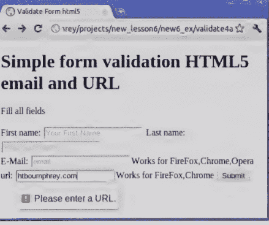

<input type="color" />

在支持的浏览器中（目前仅限 Opera），会出现一个颜色选择器，如图 6-3 所示。（你可以使用配套文件 L6_06.htm 查看此类型的工作原理。）

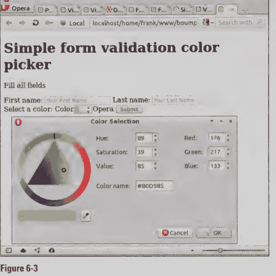

**图 6-3**

### 日期和时间输入

以下所有内容目前在 Chrome、Safari 和 Opera 中均有效。它们通常包含一个日期选择器，并期望以国际日期/时间格式输入：`yyyy-mm-ddThh:mm`。例如 `2012-02-07T15:57`。

-   *以下显示 GMT：*
    -   `<input type="date" />`
    -   `<input type="datetime" />`
-   *这些显示本地时间：*
    -   `<input type="datetime-local" />`
    -   `<input type="time" />`
-   *以下允许用户选择日期：*
    -   `<input type="month" />`
    -   `<input type="week" />`

所有符合标准的浏览器都提供某种形式的日期选择器。图 6-4 显示了 Opera 中的 `date` 选项（`L6_07.htm`）。图 6-5 显示了在 Chrome 中输入无效日期后同一文件的效果。（美式风格不是有效的日期格式；需要国际格式 `yyyy-mm-dd`。）

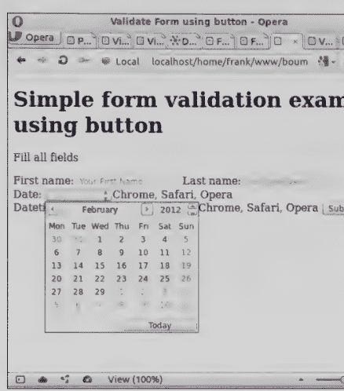

图 6-4

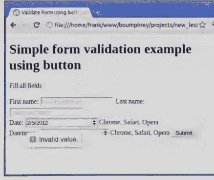

图 6-5

请注意，如果浏览器不支持该类型，输入将默认为常规文本输入。还要注意，尽管这些字段在你输入数据时会强制执行正确的数据格式，但如果填写者只是将其留空，它们不会在意也不会报告错误。

这些新的 HTML5 属性非常有用，我确信即使是 IE 在不久的将来也会完全兼容。

### 使用 JavaScript 交换图像

当用户下载页面时，页面会先被下载，然后是图像。你可以通过 JavaScript 更改页面上的图像，只需更改图像的 `src` 属性值即可。向服务器发送请求，并提供一个新图像。关键点是不必下载全新的页面，只需下载一张新图像。

> **额外信息**
> 图像一旦下载，就会被浏览器缓存，因此如果请求新图像，浏览器会查看其缓存中是否已存在该图像。图像交换的这个方面是我在第 7 课中探讨的动画基础。

使图像交换工作的是 JavaScript 在文档中维护的完整图像数组。这个数组被称为 *images 集合*，你可以通过路径 `document.images[]` 访问该数组。

以下示例代码展示了图像交换的实际操作：

```
<h1>Image swapping Demo</h1>

<button onclick='swapimg()'>Click Me</button>
<script type='text/javascript'>
    function swapimg(){
        document.images[0].src='butterfly4.jpg';
    }
</script>
```

当你点击按钮时，会调用函数 `swapimg()`。这只需将图像的 `src` 属性设置为新值，从而替换旧图像。使用配套文件 L6_08.htm 查看其工作原理。

要了解函数 `swapImg()` 如何成为动画的基础，请将上例中的脚本替换为以下内容：

```
<script type='text/javascript'>
    var imgnum=4;
    function swapImg(){
        document.images[0].src='butterfly'+imgnum+'.jpg';
        imgnum++;
        if(imgnum==7){imgnum=3;}
    }
</script>
```

现在当你点击按钮时，它会在四张图像中循环，如果你下载配套文件 `L6_09.htm` 可以看到这一点。其工作原理如下：

-   我在函数 *外部* 设置了一个 `imgnum` 变量。这很重要，因为有了 `imgnum` 变量，你现在可以指定一个起始值。起始值是什么并不重要。在这种情况下，我决定将其设为 4。这个数字只是决定了第一次调用函数时显示哪张图像。
-   每次点击时，函数都会构建一个新的图像 `src`。这允许你显示 `butterfly3.jpg` 到 `butterfly6.jpg`。
-   函数在每次点击时使用增量运算符（`++`）递增 `imgnum`。
-   当 `imgnum` 达到 7（没有 `butterfly7.jpg`）时，它使用以下代码将 `imgnum` 重置为 3：`if (imgnum==7) {imgnum=3;}`。用简单的英语来说就是：“如果 `imgnum` 的值是 7，则将 `imgnum` 的值重置为 3。”

在第 7 课中，你将了解如何自动化图像交换从而创建动画。

### 通过 JavaScript 设置 CSS 属性

使用 HTML DOM，所有 CSS 属性都可以被应用、删除或更改。过程如下：

1.  隔离一个元素或一组元素。
2.  修改 `style` 属性。

你也可以使用 JavaScript 自动编写 HTML。在清单 6-1 中，代码切换了简单标题的颜色。使用配套文件 L6_10.htm 查看其工作原理。

**清单 6-1：切换元素颜色**

```
<h1 id='h1' >Toggle Heading Colors</h1>
<button onclick='toggle()'>Toggle Heading Colors</button>
<script type='text/javascript'>
    var myhead=document.getElementById("h1");
    myhead.style.backgroundColor='red';
    myhead.style.color='black';
    function toggle(){
        if(myhead.style.color=='black'){
            myhead.style.color='red';
            myhead.style.backgroundColor='black';
        }
        else {
            myhead.style.color='black';
            myhead.style.backgroundColor='red';
        }
    }
</script>
```

在清单 6-2 中，我创建了一个 6x6 的 HSL 颜色值表格，并使用表格显示的 HSL 颜色值为每个单元格添加匹配的背景色（在 JavaScript 中写作 backgroundColor）。

**清单 6-2：一个简单的颜色表**

```
<h1>HSL Colors</h1>
<table border='1'>
<caption><h2>Hues</h2></caption>
<tr>
    <script type='text/javascript'>
        for(var i=1;i< 37;i++){
            document.write("<td style='background-color:hsl("+i*10+",100%,50%)'>"+i*10+"</td>");
            if (i%6==0){document.write("</tr><tr>")}
        }
    </script>
</tr>
</table>
```

图 6-6 显示了清单 6-2 中代码生成的 HSL 色相表。想象一下，如果你手动完成这一切，需要输入多少内容！

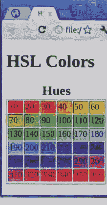

图 6-6

以下是清单 6-2 中代码创建表格的方式。这里没有什么新东西，除了使用了你之前没见过的取模运算符（%）。

-   `for(var i=1;i< 37;i++)` 创建一个将运行 36 次的循环。
-   每次循环，`document.write` 创建一个带有 `background-color` 属性的 `<td>` 单元格，该属性根据循环的索引计算得出。
-   `+i*10+` 将索引 (i) 乘以十，用作 HSL 颜色值的色相值。此行中重复进行计算以便同时在单元格中打印此数字。
-   `if (i%6==0){document.write("</tr><tr>")}` 使用取模运算符来确定是否该开始新的表格行了。（取模运算符也称为除法余数运算符。）取模运算符告诉你一个数除以另一个数后的余数是多少。例如，6 除以 5 的余数是 1。每次循环运行第六次时，你就写入一个新行。

### 通过地理定位走向本地

地理定位变得越来越重要，尤其是在移动设备增加的背景下——尽管你并不一定需要移动设备才能使用。


### 遵循安全最佳实践

地理位置是安全性的首要考量。用户不希望向任意弹出的网页透露自己的位置信息。合规的浏览器通过多种方式处理此问题，但都坚持要求用户必须采取明确行动才能向网站提供位置信息。Firefox 提供了最友好的用户方案：在向网站发送位置信息前，Firefox 会先让用户点击同意框。（接下来地理位置部分的示例图中均使用 Firefox 浏览器。）

### 建立定位

规范并未说明浏览器应如何确定精确位置。从浏览器的角度看，定位操作需要消耗大量资源。通常来说，浏览器根据访问网页的设备类型来确定位置：

- **若用户通过手机浏览网页**，浏览器可能使用 GPS 坐标，返回的位置精度通常在几米范围内。
- **通过 WiFi 或有线连接的浏览器**，只能使用精度较低的信息（如 WiFi 热点位置、短波信号塔位置等），定位精度会大幅下降。总体而言，这种方法在大城市相当精确，但在乡村地区可能存在数英里的误差。

下一节我们将分析相关代码。

### 构建地理位置应用

本节示例将创建一个简单页面，返回浏览器的大致经纬度以及浏览器与罗伯特·彭斯出生地的距离。您可以通过配套文件 L6_11.htm 实践该应用。

#### 通过地理定位实现本地化

兼容性浏览器在其 JavaScript DOM 中包含 `geolocation` 对象，该对象是 `navigator` 对象的子对象。应用程序通过此对象确定坐标。

以下是 HTML 代码：

```
<h1>Geolocation example</h1>

<div id="main">
    <button onclick='startSearch()'>Where am I?</button>
</div>

<div id="results">
</div>
```

`button` 元素调用 `startSearch()` 函数，第二个 `<div>` 元素用于显示结果。

在 JavaScript 中，首先创建 `navigation.geolocation` 对象如下：

```
<script type="text/javascript">
function possearch() {
    var gps = navigator.geolocation;
}
```

此时浏览器会请求用户权限以继续操作，如图 6-7 所示。（Firefox 使用弹窗，其他浏览器方式略有不同）

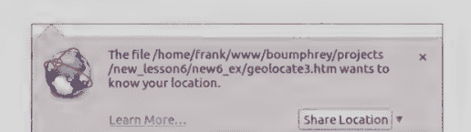

接着代码检查浏览器是否确实创建了对象，如下所示：

```
if (gps) {
    gps.getCurrentPosition(getmypos, myerror);
}
else {
    alert("There were ERRORS:- No Geolocation object created");
}
// possearch 函数结束
```

- `if (gps)`：该行仅检查是否存在名为 `gps` 的对象。
- `gps.getCurrentPosition(getmypos,myerror);`：若存在 `gps` 对象，此代码使用 `getCurrentPosition` 方法确定用户位置。括号中的参数指示 `getCurrentPosition` 如何处理位置信息（交给 `getmypos` 函数）以及发生错误时的处理方式（交给 `myerror` 函数）。
- `else`：若未创建地理定位对象，下方提醒通知用户发生错误。
- `alert("There were ERRORS:- No Geolocation object created");`：此代码弹出错误消息并结束脚本执行。使用非兼容浏览器的用户将看到此提示。

现在回归到用户使用支持地理定位的浏览器访问此页面的情况。在 `if/else` 语句之后，创建执行实际程序功能的函数。首先是 `getmypos()` 函数：

```
function getmypos(position){
    var myposinfo=document.getElementById("results");
    // 构建显示位置的字符串
    var strmypos="<br/>My current latitude is:- "+position.coords.latitude;
    strmypos+="<br/>My current longitude is:- "+position.coords.longitude;
    strmypos+="<br/>You are "+(position.coords.latitude-55.453941)+" degrees of Latitude from Robert Burns' birthplace.";
    strmypos+="<br/>You are "+(position.coords.latitude-(-4.62616))+" degrees of Latitude from Robert Burns' birthplace.";
    // 显示此字符串
    myposinfo.innerHTML=strmypos;
}    // getmypos 函数结束
</script>
```

- `function getmypos(position)`：当此函数被调用（通过 `getCurrentPosition` 方法）时，它接收由 `getCurrentPosition()` 创建的 `position` 对象。
- `var myposinfo=document.getElementById("results");`：将 `results` 元素的当前内容复制到新变量 `myposinfo` 中。（确定该值后再用新值更新此变量。）
- `var strmypos="<br/>My current latitude is:- " + position.coords.latitude;`：`position` 对象包含具有 `latitude` 和 `longitude` 属性的 `coords` 对象。此处使用该对象填充 `strmypos` 变量。
- `strmypos+="<br/>My current longitude is:- " + position.coords.longitude;`：对经度执行相同操作，并使用 `+=` 运算符将新字符串添加到前一个字符串末尾。此时 `strmypos` 包含两个句子。
- 接下来两行代码计算当前位置与罗伯特·彭斯出生地的距离差，同样添加到 `strmypos` 变量中。
- `myposinfo.innerHTML=strmypos;`：将字符串读入 `<div id='results'>`，使字符串内容得以显示，如图 6-8 所示。可以显示英里距离，但需要球面三角学进行经度转换——而我已经忘记所有相关知识！


`geolocation` 对象还有更多功能，希望这个地理定位示例能激发您的探索兴趣。

当 `getCurrentPosition` 方法无法确定用户位置时，将调用此函数，向用户显示错误提醒。

### 使用 jQuery 和 JavaScript 库

在结束本课前，需要简要说明 JavaScript 库。许多功能的 JavaScript 代码可能相当复杂且难以维护。因此，出现了多个包含可重用 JavaScript 代码片段的库。

导入 JavaScript 代码片段可以节省大量时间和调试精力。众多商业和免费库中，jQuery 是最优秀的免费库之一。

更多信息请查阅 Lynn Beighley 的 *jQuery For Dummies*。


### 总结

本课探讨了脚本技术及其多种应用：

- 向服务器提交表单时，`action` 属性设置用户输入的提交目标。
- 脚本基础包括变量与值、语句、注释、对象、数组、循环、事件、函数和 `if` 语句。
- 向 HTML 文档添加 JavaScript 可使用外部文件或 `<script>` 标签，也可内联插入 JavaScript（但较少使用）。
- 表单验证通过 `onsubmit` 或 `onclick`（取决于按钮类型）启动，使用 `forms` 数组检查用户是否在表单输入框中填写内容。也可使用新 HTML5 输入类型和 JavaScript 进行验证。
- 服务器端包含可简化页面维护。
- JavaScript 可通过 `swapimg()` 函数实现图像替换。
- 当需要事件触发网页外观变化时，可使用 JavaScript 设置 CSS 属性。
- `navigation.geolocation` 对象使网页能在用户授权的情况下检测其位置。当您需要根据用户所在地提供相关信息时，该对象非常实用。


### 动手实验室

JavaScript 已经存在一段时间了，是一种极其流行的脚本语言。因此，网络上可以下载成千上万的 JavaScript 程序——其中许多都是免费的！

想要体验一下 JavaScript 能做什么，可以在线搜索*免费的 JavaScript 代码*，然后尝试一下别人编写的脚本。你会发现许多专门对免费 JavaScript 代码进行分类或评级的网站，并提供这些代码供你在自己的网站上使用。

### 了解这个技术术语

- **客户端：** 指浏览器中提供网页的服务进程。
- **拼接：** 粘合在一起。
- **事件处理程序：** 将事件交给更多代码，然后由这些代码处理该事件。
- **表单 DOM：** 页面上所有表单的 HTML 集合。
- **地理位置定位：** 用于确定浏览器地理位置的 HTML API（应用程序编程接口）。
- **图像替换：** 使用 JavaScript 更改图像对象的来源。
- **jQuery：** 比较流行的库之一。
- **关键字：** 在计算机语言中保留用于特殊目的的词。
- **库：** 预编写和调试过的 JavaScript 集合。
- **名称/值对：** 表单信息发送到服务器的格式。
- **查询字符串：** 传递网页应使用的数据。
- **服务器端：** 指服务器上提供网页的服务进程。

### 第 7 课

### 探索 Canvas 和动画


- 你需要*按照六个步骤在 <canvas> 上进行绘制*。
- 你可以*在 <canvas> 元素中修改图像*。
- 使用 CSS3 和 JavaScript 创建滑块、间隔计时器和行进动画。
- 你可以*使用 CSS3 的过渡、变换和动画*。


1. **什么是 \<canvas\> 元素？**
   查看第................................................................................................217 页

2. **什么是贝塞尔曲线？**
   答案请看第..........................................................................223 页

3. **什么是颜色渐变？**
   要了解详情，请看第.............................................................................226 页

4. **如何裁剪图像？**
   从第.....................................................................................229 页开始裁剪

5. **如何使用 CSS3 和 JavaScript 制作动画？**
   要了解如何操作，请看第..............................................................................231 页

6. **如何将过渡与变换结合使用？**
   翻到本课结尾第....................................................................245 页

### 1

在本课中，我将带你了解 HTML 和 CSS 的前沿技术。你将研究 HTML5 和 CSS3 的两个最酷的功能：动画和 `<canvas>` 元素。这两者都严重依赖 JavaScript，因此我会在学习过程中尽可能地为你提供帮助。首先，我将介绍 `<canvas>` 元素；既然它已被普遍支持，我确信你会看到它的更广泛应用。

### 在 `<canvas>` 上绘图

将 `<canvas>` 元素视为一块空白画布，你可以在上面作画，但不是用画笔，而是使用 JavaScript。该元素可以接受所有常规属性，此外，像图像一样，它还有 `height` 和 `width` 属性，其作用与图像的 `height` 和 `width` 属性相同，以像素为单位指定高度和宽度。

> 术语
**<canvas> 元素**允许你使用 JavaScript 在页面上绘图，并允许你在像素级别操作图像。

#### 整个过程概述

以下是在 `<canvas>` 上绘图的步骤概述：

1. 创建一个 `<canvas>` 元素。
2. 根据 `<canvas>` 元素创建一个 JavaScript 元素对象。
3. 创建一个 JavaScript 函数来在 `<canvas>` 上绘图。
4. 创建一个 JavaScript `context` 对象。
5. 在 `<canvas>` 上绘图。
6. 加载该函数。

以下各节将引导你完成每个步骤。

### 创建 `<canvas>` 元素

首先，创建一个名为 `L7_01.htm` 的文件。以下代码创建一个 300 像素高、500 像素宽的 `<canvas>` 元素：

```
<canvas id='canvas1' height='300' width='500' style='border:solid 2px red;'>Your browser does not support canvas</canvas>
```

正如我在第 6 课中提到的，为元素提供一个 ID 可以让你利用某些 JavaScript 特性。此外，只有当用户的浏览器确实不支持 canvas 时，才会显示文本 `Your browser does not support canvas`。

### 创建元素对象

你使用通常的方式，通过 `getElementById()` 方法来完成此操作，如下所示：

```
<script type='text/javascript'>
var mycanvas=document.getElementById('canvas1');
</script>
```

### 创建 JavaScript 函数

你添加的函数遵循你在第 6 课中学到的格式。对于这个 `<canvas>` 示例，在 JavaScript 文件中添加以下内容：

```
function paintCanvas(){
}
```

该函数需要测试你的浏览器是否支持 `<canvas>`。标准做法是检查 `canvas` 对象的 `getContext` 方法是否存在。在函数的花括号之间放置以下 `if/else` 语句：

```
if(mycanvas.getContext){
}
else {alert("Couldn't create context.");}
```

### 创建上下文对象

`context` 对象是你将在画布上进行实际绘制时使用的对象。你使用 `getContext()` 方法创建 `context` 对象，并为得到的对象命名。

以下代码（应放置在 `if/else` 语句的 `true` 条件分支内）创建一个名为 `ctx` 的 2D 对象：

```
var ctx = mycanvas.getContext('2d');
```

### 在 `<canvas>` 上绘图

请注意，理论上，你可以通过将传递给 getContext 的参数更改为 3d 来创建一个 3 维上下文对象，但目前还没有任何浏览器支持此功能。

现在你有了一个带有上下文对象的画布，你可以将此上下文与众多的 canvas 方法和对象一起使用。

### 创建绘图代码

想象你拿着一支笔，将其移动到指定位置；然后在画布上画一条线，不将笔提离画布，再画另一条线。

以下代码将你的“笔”移动到 x 和 y 坐标 50, 50 处；然后画一条线到坐标 50, 100；最后画一条线到 100, 100。然后代码告诉画布以描边方式绘制该线。如果你在画布上绘制多个对象，请以 `beginPath();` 方法开始每个对象的绘制：

```
ctx.beginPath();
ctx.moveTo(50, 50);
ctx.lineTo(50, 100);
ctx.lineTo(100, 100);
ctx.stroke();
```

这创建了两条形成字母 L 形状的描边。

> 在 JavaScript 中，坐标从左上角开始测量。

要创建另一条描边，请将笔移动到另一个位置。在 ctx.stroke 之前添加以下内容：

```
ctx.moveTo(100, 150);
ctx.lineTo(400, 150);
```

线条的默认粗细为 1 像素。使用 lineWidth 属性使线条变粗。默认颜色是黑色，你可以使用 strokeStyle 属性更改颜色。在代码中的 ctx.stroke 之前添加以下内容：

```
ctx.strokeStyle="red";
ctx.lineWidth=8;
```

### 加载函数

要执行绘图，你必须调用之前创建的函数。此示例使用 onload JavaScript 事件来调用该函数：

```
<body onload='paintCanvas()'>
```

当页面完成加载时，此事件触发。请查看此示例的完整代码，见清单 7-1。

### 清单 7-1：在 Canvas 上绘制线条

```
<body onload='paintCanvas()'>
    <canvas id='canvas1' height='300' width='500'
            style='border:solid 2px red;background-image:url(10px.png);'> Your browser does not support canvas
    </canvas>

<script type='text/javascript'>
    var mycanvas=document.getElementById('canvas1');
    function paintCanvas(){

        //create a JS context object
        if(mycanvas.getContext){
            var ctx = mycanvas.getContext('2d');

            ctx.moveTo(50,50);
            ctx.lineTo(50,100);
            ctx.lineTo(100,100);
            ctx.moveTo(100,150);
            ctx.lineTo(400,150);
            ctx.strokeStyle="red";
            ctx.lineWidth=8;
            ctx.stroke();

        } //end if
        else{
            alert("could not create a context");
        }
    } //end paintCanvas
</script>
</body>
```

### 创建基本形状

本节将向你展示更多技巧，使你能够在画布上绘制三角形、矩形和圆形。

对于以下每个形状，创建一个名为 L7_02.htm 的文件，并以前面的示例清单 7-1 作为模板。也就是说，使用你在前面部分创建的 `<canvas>` 作为框架，并简单地添加或替换绘制线条的代码为本节中看到的代码：


### 在`<canvas>`上绘图

- ✓ **要创建一个三角形**，请在创建第一个示例的代码之后添加`closePath()`方法。`closePath()`方法正如其名：它会关闭任何未闭合的路径。

```javascript
ctx.beginPath();
ctx.moveTo(50, 50);
ctx.lineTo(50, 100);
ctx.lineTo(100, 100);
ctx.closePath();
ctx.stroke();
```

*瞧！* 一个直角三角形！

- ✓ **要创建一个矩形**，请使用`rect(x, y, width, height)`方法。以下是绘制矩形的示例代码：

```javascript
ctx.rect(150, 50, 100, 50);
```

你无需使用`moveTo()`方法，因为`rect()`会为你处理这些细节。

- ✓ **要创建一个圆形**，代码比三角形或矩形稍微复杂一点。使用`moveTo()`将你的上下文画笔移动到你希望圆形的起始位置。然后，创建一个360度的弧线，使用以下语法：

```
arc(centerX, centerY, radius,
     startAngle, endAngle, clockwise || anticlockwise)
```

以下是绘制圆形的代码：

```javascript
ctx.moveTo(375, 75);
ctx.arc(350, 75, 25, 0, Math.PI * 2, false);
```

`Math`是另一个JavaScript对象。`PI`是圆周率常数的精确表示，略大于3.14。半圆的周长是pi弧度，圆的周长是2 pi弧度。因此，前面的代码绘制了一个完整的圆。


> 尝试修改绘制圆形的代码，看看你能创造哪些不同的效果，并培养更好的感觉，了解不同参数如何影响最终绘图。尝试以下操作：

- ✓ 将`moveTo()`的x坐标值更改为与`arc`中的x值（第一个参数）相同。你能预测会发生什么吗？
- ✓ 绘制不同的弧线。
- ✓ 使用`closePath()`方法将这些弧线变成闭合弧。
- ✓ 看看使用`true`和`false`绘制半圆时有什么不同。

### 填充形状和添加阴影

本节，你将了解能够让你填充在`<canvas>`上创建的形状并添加阴影的方法。

- ✓ **用颜色填充圆形和三角形：**

```javascript
// a. 在 `beginPath()` 之后添加以下代码：
ctx.fillStyle = "violet";

// b. 在 `moveTo()` 之前，添加以下代码：
ctx.fill();
```

为了更多上下文，查看这些行如何融入三角形的绘制中：

```javascript
ctx.beginPath();
ctx.fillStyle = "violet";
ctx.fill();
ctx.moveTo(50, 50);
ctx.lineTo(50, 100);
ctx.lineTo(100, 100);
ctx.closePath();
ctx.stroke();
```

- ✓ **要填充一个矩形**，可以使用与圆形或三角形相同的方法，或者你可以使用`fillRect()`方法，如下所示：

```javascript
ctx.fillRect(150, 150, 100, 50);
```

对于黑色以外的颜色，也请添加`fillStyle`属性。在`<canvas>`上绘制蓝色矩形的代码如下所示：

```javascript
ctx.rect(150, 50, 100, 50);
ctx.fillStyle = "violet";
ctx.fillRect(150, 150, 100, 50);
```

- ✓ **要为填充的形状添加投影阴影**，请在`fill()`之前添加以下几行代码：

```javascript
ctx.shadowOffsetX = 4;
ctx.shadowOffsetY = 4;
ctx.shadowBlur = 5;
ctx.shadowColor = "silver";
```

前面的示例为你的投影阴影添加了银色。同时，请注意投影阴影将出现在画布上所有后续形状上。通过将偏移量设置为0来关闭投影阴影。

要查看完整的代码，请查看文件`L7_02.htm`，你可以从本书的配套网站下载。（有关详细信息，请参见简介。）图7-1显示了在Chrome中显示的不同颜色的线条、填充颜色和阴影下，几个不同的三角形、矩形和圆形的样子。


### 绘制贝塞尔曲线

如果你使用过绘图程序，你可能熟悉*Bézier curve*（贝塞尔曲线），这是一种两端带有手柄的曲线，可以扭曲线条。

以下是绘制贝塞尔曲线的一般语法：

```javascript
context.bezierCurveTo(controlX1, controlY1, controlX2,
                           controlY2, endX, endY);
```

以下HTML创建了一个`<canvas>`，其中你将看到一个贝塞尔曲线的示例：

```html
<canvas id='myCanvas'
    style='border:1px solid red;
           background-image:url(10px.png);'
    height='300'
    width='500'>
    Your browser does not
    support the canvas
    element
</canvas>
```

以下网站是学习贝塞尔曲线的便捷在线资源：www.html5canvastutorials.com/tutorials/html5-canvas-Bezier-curves。

清单7-2显示了绘制贝塞尔曲线的代码，如图7-2所示。

#### 清单7-2：在canvas上的贝塞尔曲线

```html
<script type='text/javascript'>
window.onload = function(){
    var canvas = document.getElementById("myCanvas");
    var context = canvas.getContext("2d");
    context.moveTo(190, 120);
    context.bezierCurveTo(160, 260, 400,
        10, 400, 150);
    context.lineWidth = 10;
    context.strokeStyle = "black"; // line color
    context.stroke();
};
</script>
```


图7-2

尝试修改曲线值，看看它如何变化。如果你想知道到底发生了什么，请查看www.html5canvastutorials.com上的教程。

### 在canvas上输入文本

你可以在画布上显示两种文本：

- ✓ **描边文本**创建空心文本，类似于你在文字处理器中应用轮廓格式时看到的文本。描边文本的语法如下所示：
    `ctx2.strokeText("text", posX, posY, width);`
- ✓ **填充文本**创建全部为一种颜色的文本，非常像文字处理器中的默认文本。要创建填充文本，请使用以下语法：
    `ctx2.fillText("text", posX, posY, width);`

你在引号内的`text`占位符处添加要显示的文本。`posX`和`posY`值代表你希望文本在画布上出现的位置。`width`值是像素单位的文本最大宽度，因此你可以使用此属性将文本挤在一起或展开。

要格式化文本，你有以下选项：

- ✓ 要更改字体大小和字体系列，请使用`font`属性。
- ✓ 使用`strokeStyle`和`lineWidth`属性更改描边文本的颜色和描边宽度。
- ✓ 使用`fillStyle`属性更改常规文本的颜色。

清单7-3应用了这些格式选项在画布上创建文本。要在浏览器中查看此代码，请查看文件L7_03.htm，你可以从本书的配套网站下载。

```javascript
var canvas = document.getElementById("myCanvas");
var context = canvas.getContext("2d");
    context.font = "36pt arial";
    context.strokeStyle = "navy";
    context.lineWidth = 2;
    context.strokeText("To be or not to be?", 10, 50, 270);

    context.font = "24pt times";
    context.fillStyle = "red";
    context.fillText("Hamlet", 10, 105, 250);
```

### 混合颜色渐变

`<canvas>`元素使你能够创建两种颜色渐变模式：线性和圆形（或*径向*），如图7-3所示。


图7-3

要创建颜色渐变，请设置渐变，然后使用该渐变填充形状。以下代码创建了从红到蓝的渐变，然后使用它来填充一个矩形（参见图7-3）。

创建线性渐变的一般语法是

```javascript
context.createLinearGradient(startX, startY, endX, endY);
```

*startX*和*startY*参数是数字，确定渐变在画布上的起点，*endX*和*endY*参数是数字，确定渐变的终点。

现在，查看以下代码，它创建了图7-3左侧从红到蓝的线性渐变。

```javascript
var grd = ctx.createLinearGradient(0, 0, 170, 90);
grd.addColorStop(0, "#f00");
grd.addColorStop(1, "#00f");
ctx.fillStyle = grd;
ctx.fillRect(30, 30, 175, 150);
```

以下是前面代码每行的作用：

- ✓ `var grd = ctx.createLinearGradient(0, 0, 170, 90);`：这创建了一个渐变对象，从屏幕的左上角延伸到屏幕右侧170像素、下方90像素的位置。


### 在 `<canvas>` 元素中修改图像

Canvas 使你能够显示图像文件，并且可以在文件显示后修改图像。本节将介绍 canvas 能够创建的一些巧妙效果。

要处理图像，你需要使用 `drawImage()` 方法将其 *绘制* 到画布上。`drawImage()` 的语法如下：

```javascript
context.drawImage(image, x, y)
context.drawImage(image, x, y, w, h)
context.drawImage(image, sx, sy, sw, sh, dx, dy, dw, dh)
```

以下分解了上述部分代码参数的含义：

- *s* 代表 *source*，即你想要处理的图像部分。
- *d* 代表 *destination*，即你想要放置源图像的位置。
- *x* 和 *y* 代表相应的轴。
- *w* 代表宽度。
- *h* 代表高度。

根据你使用的参数数量，效果如下：

- **两个参数：** 简单地将图像放置在指定的 x 和 y 坐标处（参见上面代码的第一行）。
- **四个参数：** 允许你通过调整宽度和高度来放置并缩放图像（参见上面代码的第二行）。
- **八个参数：** 允许你通过选择图像中的一个区域并将其移动到画布上的新位置来裁剪图像（参见上面代码的最后一行）。

以下是一个简单的示例，它使用 `drawImage()` 方法将一个士兵的图像加载到画布上，并且仅使用了两个参数。（你可以在本书的配套网站上查看实际文件 `L7_05.htm`。）

```javascript
var img = new Image();
img.src = 'images/walk1.png';
//when the image finishes loading, draw it

img.onload = function(){
    context.drawImage(img,0,0);
}
```

#### 裁剪源图像

*图像裁剪* 或 *切片* 是选择图像的一部分并将其移动到画布上其他位置的过程。你可以为绘制在 `<canvas>` 上的图像添加裁剪效果。

> **术语**
> **图像裁剪** 或 **切片** 是选择图像的一部分并将其移动到画布上其他位置的过程。

例如，以下参数将从源图像中裁剪一个区域，并将其显示在一个 180 x 160 像素的框中：

```javascript
context.drawImage(img,10,10, 90,70, 100,10, 180,160);
```

图 7-4 显示了一张未裁剪的图像和一张裁剪后的图像，我是使用上面的代码创建的。


**图 7-4**

要查看实际运行的示例，请查看 *L7_06.htm*，该文件位于本书的配套网站上。

#### 更改图像数据

`drawImage()` 方法捕获图像后，`createImageData()` 方法可以捕获图像的各个像素数据。语法如下：

```javascript
imagedata = context.createImageData(imageData)
```

`imageData` 参数代表你要处理的 `imageData` 对象。使用 `createImageData` 捕获图像后，就可以操作数据。`L7_07.htm` 展示了如何反转颜色，`L7_08.htm` 展示了如何将其转换为灰度。图 7-5 显示了使用这两个文件操作图像数据的结果，并提供了正常图像进行对比。


**图 7-5**

请注意，这仅适用于由服务器提供的文档，而 *不* 适用于从你的文件系统提供的文档。同时注意，图像 *必须* 与 HTML 文档位于同一域中。否则，会产生错误。

> 有关在 canvas 上处理图像的更多信息，请查看以下网站：www.whatwg.org/specs/web-apps/current-work/multipage/the-canvas-element.html#images 和 www.html5canvastutorials.com/advanced/html5-canvas-get-image-data-tutorial。

#### 使用 CSS3 和 JavaScript 进行动画

既然你已经了解了 `<canvas>` 元素及其用途，现在可以学习动画了。

#### 使用 CSS3 和 JavaScript 进行动画

CSS3 最令人兴奋的事情之一是它为改进动画创造了可能性。动画图片实际上是一系列图片以设定的时间间隔连续显示。你仍然必须使用 JavaScript 来制作动画，但 HTML5 和 CSS3 增加了新的可能性。

你应该熟悉的两项关键技能是：找到页面上某点的 x 和 y 坐标，以及设置时间间隔。以下几节将向你介绍这些技能。为了学习如何找到 x 和 y 坐标，你将创建一个简单的滑块。然后你将了解如何在 JavaScript 中使用时间间隔。

你将接触一个行军动画，它演示了如何使用图像制作动画。你将了解如何捕获击键，这是创建许多不同类型动画的一个重要元素。然后，你将把这些示例中的技术结合起来，创建一个游戏。

#### 查找 x 和 y 坐标

当鼠标指针在页面上移动时，你会创建一系列 JavaScript 事件，特别是 `onmousemove` 事件。本节将向你展示如何使用这些事件捕获 x 和 y 坐标。

首先，创建一个普通的 200x200 像素的 `<div>` 元素，并将其绝对位置设置为 x 轴 20，y 轴 20。如果你想跟着这个示例操作，请输入以下代码，注意要完全重复（或者查看本书配套网站上的 L7_09.htm）：

```html
<body>
	<div id='d1' onmousemove='getposxy(event,this)'>
	</div>
	<script type='text/javascript'>
	function getposxy(e,a){
		var myx=e.pageX;
		var myy=e.pageY;
		a.innerHTML=(myx-20) + ", " + (myy-20);
	}
	</script>
</body>
```

当你将鼠标移动到图 7-6 所示的框上时，鼠标的坐标将被写出来。屏幕截图上的点显示了拍摄快照时鼠标的大致位置。以下是代码的工作原理：


图 7-6

- `<div>, onmousemove='getposxy(event, this)'` 捕获事件并将其发送给 JavaScript 进行处理，使用两个参数：`event` 参数和 `this` 参数。
- `event` 和 `this` 是两个 JavaScript 关键字：
    - `event` 指代码正在捕获的事件。
    - `this` 指事件被捕获所在的元素对象。
- `var myx=e.pageX` 创建一个对象变量，引用事件的 `pageX` 属性。`pageX` 是鼠标距离页面左上角的位置。
- `var myy=e.pageY` 类似地捕获 `pageY` 位置。
- `a.innerHTML=(myx-20) + ", " + (myy-20)` 使用 `innerHTML` 属性将这些位置写入 `<div>` 元素：
    - `a` 代表你正在捕获鼠标移动的 `<div>`。
    - `innerHTML` 属性只是表示更改此 `div` 内部的值。换句话说，就是将数字写入 `<div>` 内部。


### 制作滑块

滑块通常是动画的一部分。本节将应用前面的坐标查找示例，来制作一个简单的水平滑块。代码清单7-4中的示例包含一些全局变量和两个新函数。你可以通过在浏览器中打开L7_10.htm（可在本书配套网站上找到）来查看滑块的外观和工作方式。

代码清单7-4：创建滑块

```
<div id='d1' onmousemove='getposxy(event,this)'>
  <div id='d2' onmouseover='spriteon(this)' onmouseout='spriteoff(this)'>&nbsp;</div>
</div>
<p id='p1'></p>

<script type='text/javascript'>
var reader=document.getElementById("p1");
var sprite=document.getElementById("d2");
var animationon=false;
function getposxy(e,a){
  var myx=e.pageX;
  //var myy=e.pageY;
  if(animationon && myx > 19 && myx<221){
    sprite.style.marginLeft=myx-30+"px";
    //reader.innerHTML=sprite.style.marginLeft;
    reader.innerHTML=(myx-20) //+ ", "+ (myy-20);
  }
}
function spriteon(a){
  a.style.backgroundColor="rgba(0,200,0,0.5)";
  animationon=true;
}
function spriteoff(a){
  a.style.backgroundColor="rgba(200,0,0,0.5)";
  animationon=false;
}
</script>
```

以下是对这段代码的更详细解释：

- `var reader=document.getElementById("p1");` 创建了一个名为 `reader` 的对象，用于设置 id 为 "p1" 的 `div` 的值，目的是显示滑块的数值位置。
- `var sprite=document.getElementById("d2");` 创建了一个对象，用于访问 "d2" `<div>` 的属性，这个精灵图（sprite）的位置是可以调整的。
- `function getposxy(e, a)` 是一个函数，当用户的鼠标通过 d1 `<div>` 的 `onmousemove` 事件处理程序属性移动时被调用。
- `var myx=e.pageX;` 创建了一个包含精灵图水平位置的局部变量。
- `if(animationon && myx > 19 && myx<221)` 检查鼠标位置，确保其在滑块的宽度范围内。这样做的目的是确保不会将精灵图定位到滑块之外！
- `sprite.style.marginLeft=myx-30+"px";` 通过增加或减少其左边距来调整精灵图的位置。
- `reader.innerHTML=(myx-20)` 更改 `reader` `<div>` 的值，使其显示精灵图沿滑块的当前位置。
- `spriteon()` 和 `spriteoff()` 仅仅根据鼠标是否悬停在其上改变精灵图的颜色。

> **术语说明**
> **精灵图（sprite）** 是一种可以集成到场景中以创建动画的图像。你将在本课后面的行进动画中看到另一个精灵图的示例。

根据你从示例滑块中学到的内容（并使用代码中注释的提示）创建你自己的代码。以下任务可让你练习修改代码的不同方面：

- 以代码清单7-4为模型制作一个垂直滑块。
- 制作三个滑块来设置RGB或HSL颜色。将生成的颜色显示为某个元素的背景色。
- 增大滑块的尺寸。看看这是否会提高其可用性和性能。
- 使用你选择的图像作为精灵图。

你可以在本书的配套文件 `L7_11.htm` 中看到一个改进的滑块。代码虽然简单，但因太长而无法在此包含。

### 使用JavaScript创建间隔计时器

任何动画的核心都是计时器。JavaScript使用 `setInterval()` 函数以各种间隔调用其他函数。`setInterval()` 函数接受两个参数：

- 必须调用的函数名称
- `setInterval()` 应调用该命名函数的时间间隔（以毫秒为单位）

`setInterval()` 函数将持续调用该命名函数，直到调用 `clearInterval()` 函数为止。

代码清单7-5创建了一个简单的计数器。你可以通过在浏览器中查看本书的配套文件 L7_12.htm 来查看计数器的运行情况。

#### 代码清单7-5：一个简单的计数器

```
<body>
<div id='d1'>0</div>
<form>
    <input type='button' value='start' onclick='startcounter()'/>
    <input type='button' value='stop' onclick='stopcounter()'/>
    <input type='button' value='reset' onclick='resetcounter()'/>
</form>
<script type='text/javascript'>
    var mydiv=document.getElementById("d1");
    //mydiv.style.color="lime";
    var intervalID;

    function startcounter(){
        intervalID =setInterval("startcount()",250);
    }
    function startcount(){
        mydiv.innerHTML=(mydiv.innerHTML-0) + .25;
    }
    function stopcounter()
    {
        var dummy=clearInterval(intervalID);
    }
    function resetcounter()
    {
        mydiv.innerHTML=0;
    }
</script>

</body>
```

以下是代码清单7-5的工作原理：

- HTML代码创建了一个用于显示计数的框，并创建了三个表单按钮。
- 在JavaScript中，`getElementById()` 创建了一个全局元素对象变量。
- `var intervalID;` 创建了一个全局变量，用于保存代码稍后在清单中创建的 `setInterval()` 函数的ID。
- `startcounter()` 函数设置 `setInterval()` 函数，并将其ID读入之前创建的 `intervalID` 变量。需要这个ID，以便代码可以停止该函数。注意函数名是被引号括起来的。250表示代码将每四分之一秒调用一次 `setInterval()` 函数。

> **术语说明**
> **全局变量** 在函数外部创建，可以在脚本中的任何地方使用。另一方面，**局部变量** 在函数内部创建。它们只能从创建它们的函数内部访问。


时间以毫秒为单位设置。

- `startcount()` 函数只是将四分之一秒加到读数上。将被调用的函数尽可能保持简单。这个函数会占用你的CPU！
- `stopcounter()` 函数对之前创建的 `setInterval()` 函数调用 `clearInterval()`。
- `resetCounter()` 函数将计数器重置为0。


要练习使用间隔计时器，请在你选择的代码编辑器中打开本书的配套文件 L7_013.htm，并尝试以下操作：

- 改变轰炸机的速度。
- 使运动不那么生硬。

> **补充信息**
> 你可以修改它来创建动画。对代码清单7-5（网站上的配套文件 L7_013.htm）进行简单补充，可以显示一架轰炸机飞过天空。去看看吧。

### 制作行进动画

我不确定本节中的动画显示的是一名革命士兵行进加入他的部队，还是罗伯特·彭斯（Robert Burns）去拜访 *莫克林女士们*（*Mauchline ladies*）！

不过，总的来说，图7-7中的士兵是一个动画精灵图，一种可以集成到场景中的图像。你可以通过谷歌搜索“动画精灵图”在网上找到大量精灵图。本节中的图片来自 http://caja-de-luz.blogspot.com/ 。图7-7显示了图像被分割前的样子。为了使这个示例工作，我使用图像编辑器将这张图像裁剪成单独的文件，命名为 walk1.png 到 walk7.png。


该程序使用JavaScript更改图像的 `img` `src` 属性。所有需要做的就是对本节前面介绍的间隔计时器代码进行一些小的修改。要查看以下代码的完整内容，请查看本书的配套文件 L7_14.htm。在本节中，我将代码分成块，并解释每个部分工作原理的关键点。

首先，我对样式表和HTML进行了以下补充，这些补充创建了士兵行进时将跨越的景观和图像容器。在HTML中，我用立正的图像 walk1.png 加载图像。

以下是样式表：

```
<style type='text/css'>
#d1{border:solid 1px red;
    height:100px;
    width:200px;
    font-size:3em;
    color:lime;
}
</style>
```


#### 第七课

以下是对应的 HTML 代码：

```
<div id='d0' style='height:350px;background-color:#e9e9e9;'>
    
</div>
```

现在对脚本做几处修改。首先，创建一个图像源名称的数组，这样引用 `src` 属性会很方便。数组如下所示：

```
var imagelist = new Array(
    "images/walk1.png",
    "images/walk2.png",
    "images/walk3.png",
    "images/walk4.png",
    "images/walk5.png",
    "images/walk6.png",
    "images/walk7.png"
);
```

添加以下全局变量：

```
var imagenumber = 0;
document.images[0].src = imagelist[imagenumber];
var paddingnumber = 0;
```

下面解释这些变量的作用：

-   `var imagenumber = 0;` 用于跟踪图像序列。
-   `document.images[0]` 是 HTML 文档对象模型（DOM）中用于跟踪页面上图像数量的元素。
-   `0` 指向第一张图像。
-   `var paddingnumber = 0` 用于跟踪内边距（padding）。

接下来，修改两个函数。修改的部分用蓝色标出，每处修改的说明以注释形式置于修改之前。以下是需要对 `startcount()` 函数进行的修改：

```
function startcount(){
    /*there are only 7 images. When the number reaches 7 go back to number 1*/
    if(imagenumber > 6){imagenumber = 1};
    /*at the end of the page, return to the beginning*/
    if(paddingnumber > 24){paddingnumber = 1};
    /* the next two lines calculate the padding amount and applies it to mydiv2*/
    var padding = paddingnumber * 50;
    mydiv2.style.paddingLeft = padding + "px";
    //switch the images
    document.images[0].src = imagelist[imagenumber];
    mydiv.innerHTML = imagenumber;
    /*increment imagenumber and paddingnumber by 1*/
    imagenumber = imagenumber + 1;
    paddingnumber = paddingnumber + 1;
}
```

以下是对 `resetcounter()` 函数的修改：

```
function resetcounter(){
    mydiv.innerHTML = 0;
    document.images[0].src = imagelist[0];
    mydiv2.style.paddingLeft = "0px";
    paddingnumber = 0;
}
```

在浏览器中运行修改后的示例，士兵就会在田野上行进，并返回起点。

尝试以下任务来练习你的 JavaScript 动画技能：

*   将间隔从 250 毫秒更改为其他时间间隔。
*   制作你自己的动画。

JavaScript 动画很有用，但它也有缺点，主要是动画效果往往不够平滑。CSS3 有望改变这一点，并为 Flash 提供一个出色的替代方案。请参阅本课后面“使用 CSS3 动画”的部分。

### 预加载图像

如果你第一次从服务器查看行进动画，你会注意到士兵（或罗伯特·彭斯）起步时有些犹豫——一点也不像一个勇敢、大摇大摆、去对抗乔治国王雇佣兵的革命士兵，更不像罗伯特·彭斯要去拜访他的女朋友们！

延迟的原因并非角色不情愿，而是动画在图像全部下载完成之前就开始了。从互联网下载图像需要时间。要克服下载延迟，你需要在动画播放*之前*加载图像，这可以通过以下两种方式之一实现：

-   **实际下载图像以进行显示。** 如果你使用此方法，则无需实际显示图像。将 CSS `display` 属性设置为 `none`，图像仍会被下载。
-   **将图像下载到 JavaScript 图像对象中。**

本书的配套文件 `L7_15.htm` 和 `L7_16.htm` 可从网站获取，展示了图像预加载的实际效果。

### 捕获按键

在阅读各种关于动画的文章时，你会发现许多文章要求你捕获按键（即按下键盘上的某个键）。你需要记住的唯一一点是，能够捕获按键的元素必须是能够获得焦点的元素。

捕获按键最简单的方法是给元素添加 `tabindex`。下面是一个简单的例子，它弹出一个警告框，告诉你按下了哪个键：

```
<div id="div2" tabindex="1" style='height:200px;border:solid 2px red;'>Click or tab to give this element the focus</div>

<script type="text/javascript">
    var el = document.getElementById("div2");
    el.onkeyup = function(evt) {
        evt = evt || window.event;
        alert("keyup: " + evt.keyCode);
        if(evt.keyCode == 65){alert("You clicked the 'A' key!");}
    };
</script>
```

在这段代码中，我给 `<div>` 元素添加了 `tabindex`。变量 `el` 选中了 HTML 中的 `<div>`。我使用 `el` 对象的 `onkeyup` 方法来检测用户何时释放一个键（这当然意味着她之前按下了该键）。之后，我将按键转换为 JavaScript 用于识别字母的数字代码，并将该代码显示在警告框中。`if(evt.keyCode == 65)` 这行代码演示了如何使用 `keyCode` 来查找按下的特定键——本例中是 A 键。请查看配套文件 `L7_17.htm` 来了解示例的工作原理。

### 游戏尝试：轰炸机游戏

综合运用你在本课中学到的几种技术和方法，你可以制作出相当复杂的效果。`L7_18.html` 和 `L7_19.html` 展示了两个简单的游戏，目标是在轰炸机穿过屏幕时将其击落。按键控制“枪”。虽然代码太长无法在书中印刷，但你可以在本书的配套网站上查看示例文件的源代码。

> 你可以使用 `<canvas>` 元素创建无数动画。基本上，`<canvas>` 可以做到 JavaScript 能做的一切，还有一些额外的功能。

虽然 `<canvas>` 动画的详细内容超出了本书的范围，但我鼓励你在熟悉本书课程中学到的基础知识后，去探索它的可能性。一个开始探索 `<canvas>` 动画的好地方是 www.html5canvas tutorials.com/advanced/ html5-clear-canvas。


从配套网站下载游戏，并逐行弄清楚代码的工作原理。（代码只是本节前面示例的组合。）然后，尝试更改数字：加快轰炸机的速度并更改目标区域的大小。（温馨提示：当你开始改进这样一个游戏时，你可能会浪费好几个晚上。这有点像玩 Facebook！）

### 使用 CSS3 动画

CSS3 过渡（transitions）、变换（transformations）和动画（animation）使你无需任何 JavaScript 就能制作动画。缺点是这些技术仍然是实验性的，并且需要浏览器厂商前缀，正如我在第五课中所讨论的那样。IE 浏览器直到 IE10 才开始支持这些技术。

> **术语**
> **过渡**允许 CSS 属性在一段时间内平滑变化。**变换**允许你拉伸、扭曲、旋转和移动元素。

尽管如此，CSS3 动画仍然展现出很大的前景，我相信它们会逐渐流行起来。

> 有关支持情况的总结，请参阅 http://css3.bradshawenterprises.com/all/#support，该页面会经常更新。目前过渡（transitions）正处于 W3C 的快速开发通道上。

### 制作平滑的 CSS 过渡

*过渡*允许 CSS 属性在一段时间内平滑变化。介绍过渡的最佳方式是一个简单的例子，你可以在浏览器中通过显示本书的配套文件 `L7_20.htm` 来查看。

过渡示例的 HTML 如下所示：

```
<div id='div1' style='width:800px;
    text-align:center;
    border:solid 1px lime;'>
    <p>Hello Transitions!</p>
</div>
```

以下是样式表：

```
<style type='text/css'>
    #div1:hover {
        color: #f00;
        font-size: 4em;
        padding-top: 50px;
        padding-bottom: 50px;
        /*vendor prefixes*/
        -moz-transition: all 4s;
        -webkit-transition: all 4s;
        -o-transition: all 4s;
        -ms-transition: all 4s;
    }
</style>
```

当你将鼠标悬停在 `<div>` 上时，样式表中的新样式规则将在四秒内生效。`#div1:hover` 使用了一个伪类选择器，告诉浏览器仅在鼠标悬停在 `<div>` 上时才应用颜色、字体大小和内边距。CSS `transition` 属性是使变化在指定时间段内发生的属性。`all` 值表示你希望元素的所有属性（而不仅仅是宽度或高度）都进行过渡，而 `4s` 值将过渡间隔设置为四秒。

> 可以在 http://nettuts.s3.amazonaws.com/581_cssstransitions/demos.html 和 http://css3.bradshawenterprises.com/transitions 找到更多过渡演示。


要查看之前的轰炸机示例作为过渡，请访问本书的配套文件 `L7_21.htm`，可在网站上找到。（我添加了一个新元素：轰炸机飞入夜空。）

> **提示** 在不同的浏览器上尝试这些示例，看看动画如何略有不同地运行，具体取决于浏览器。在我编写本课程时，根据CSS3规范，Opera是最接近正确的。

### 使用CSS3转换元素

*转换* 允许你拉伸、倾斜、旋转和移动元素，如图7-8所示。


CSS3有两种类别的 `transform`：

-   **2D转换：** 用于在二维（x和y）中操作元素
-   **3D转换：** 用于三维转换和动画

转换在Chrome和其他WebKit浏览器中得到了最充分的开发，但基本的2D值在所有最新的浏览器中都有效。清单7-6展示了创建图7-7所示转换的样式表。请注意，我仅显示了一次厂商前缀，代码 `[vendor prefixes]` 是一个占位符，显示了前缀在后续CSS规则中的位置。此外，每个唯一的ID选择器和转换属性（不带前缀）都以橙色显示，以便你可以轻松扫描代码。

#### 清单7-6：转换样式表

```
<style type='text/css'>
#container div{
    width:70px;
    height:130px;
    margin:10px 20px;
    padding:10px;
    border:1px lime solid;
    float:left;
}
#container #skew {
    -webkit-transform:skew(35deg);
    -moz-transform:skew(35deg);
    -o-transform:skew(35deg);
    -ms-transform:skew(35deg);
    transform:skew(35deg);
}
#container #skew2 {
    [vendor prefixes]
    transform:skew(-35deg);
}
#container #scale {
    [vendor prefixes]
    transform:scale(1,2);
}
#container #rotate {
    [vendor prefixes]
    transform:rotate(45deg);
}
#container #translate {
    [vendor prefixes]
    transform:translate(100px, 200px);
}
#container #rotate-skew-scale-translate {
    [vendor prefixes]
    transform:skew(30deg) scale(1.1,1.1) rotate(40deg) translate(10px, 20px);
}
</style>
```

图7-8中页面的HTML如下所示。与前面选择器对应的 `id` 属性以绿色显示，以便你可以更轻松地看到HTML和CSS如何结合在一起：

```
<div id="container">
    <div>no translation</div>
    <div id="skew">Positive Skew.</div>
    <div id="skew2">Negative Skew.</div>
    <div id="scale">Scale in Y direction by 200%</div>
    <div id="rotate">Rotate</div>
    <div id="translate">translated 200px down, and 100px across.</div>
    <div id="rotate-skew-scale-translate">This div has all four types!</div>
</div>
```


你可以通过将本书的配套文件 `L7_22.htm` 加载到浏览器中来查看前面代码的显示效果。要自己尝试转换，请尝试以下任务：

-   将 `float` 属性更改为 `right`。看看倾斜会发生什么！这让你感到惊讶吗？
-   完全移除 `float` 属性。
-   玩转 `rotate` 值。尝试大于 `360deg` 的值。

### 组合过渡和转换

当你组合过渡和转换时，你可以创建更复杂的CSS3动画。以下CSS创建一个框并让它旋转几圈：

```
<style>
#container div {
    height:100px;
    width:100px;
    border:1px red solid;
    margin:10px auto;
    text-align:center;
    -webkit-transition: all 3s ease-in-out;
    -moz-transition: all 3s ease-in-out;
    -o-transition: all 3s ease-in-out;
    -ms-transition: all 3s ease-in-out;
    transition: all 3s ease-in-out;
}
#container div:hover, #container div.spinme_effect {
    -webkit-transform:rotate(1080deg) scale(2,2);
    -moz-transform:rotate(1080deg) scale(2,2);
    -o-transform:rotate(1080deg) scale(2,2);
    -ms-transform:rotate(1080deg) scale(2,2);
    transform:rotate(1080deg) scale(2,2);
}
</style>
```

如果你在浏览器中尝试这个示例，你会看到当你将鼠标悬停在框上时，CSS过渡会处理转换随时间发生的动画。

### 使用CSS动画

CSS3动画是对CSS过渡的扩展。使用CSS动画，你可以无需一行JavaScript就能制作动画。

解释如何使用CSS动画的最佳方式是通过一个例子。如果你想跟着做，你需要下载一个符合WebKit标准的浏览器，例如Chrome或Safari。Opera和Mosaic浏览器目前还不支持CSS动画。

以下CSS将一个蝴蝶图像和文本 "Soaring Butterfly" 从网页的中间左侧移动到顶部，并使蝴蝶图像拍动翅膀。你可以在WebKit浏览器中查看本书的配套文件 `L7_23.htm` 来看到动画的实际效果。以下是创建动画的样式表：

```
#soar {
    position: absolute;
    top: 50px;left: 150px;
    height:166px;width:180px;
    background-color:transparent;
    background-image:url(blue_butterfly_2.gif);
    background-repeat:no-repeat;
    -webkit-animation-name:soaring-butterfly;
    -webkit-animation-duration: 2s;
    -webkit-animation-iteration-count: 4;
    -webkit-animation-timing-function: linear;
}
@-webkit-keyframes soaring-butterfly {
    from {
        -webkit-transform:translate(0px,450px);
    }
    to {
        -webkit-transform:translate(450px,0px);
    }
}
```

HTML如下所示：

```
<div id='soar' style="text-align:center;font-size:1.5em;">Butterfly <br/>Soaring.</div>
```

以下是代码如何创建动画的：

-   `position: absolute` 开始CSS。（记住，要使转换属性工作，位置必须是绝对的。）
-   `-webkit-animation-name:soaring-butterfly` 为动画命名。该名称允许你在代码后面使用关键帧来引用动画。
-   `animation-duration` 是你希望动画发生的时间范围。时间范围以秒为单位。
-   `animation-iteration` 是你希望动画发生的次数。
-   `animation-timing-function` 接受下表中的值。默认值是 `ease`。
-   动画中的 `keyframes` 是在时间线上设置的参考点。因此，例如，如果你想将对象从A点移动到B点，但不是直线，你可以沿路径插入关键帧来指示对象应走的路径。

| 值 | 作用 |
| :--- | :--- |
| `linear` | 动画从开始到结束速度相同。 |
| `ease` | 动画开始慢，然后变快，最后结束慢。 |
| `ease-in` | 动画开始慢。 |
| `ease-out` | 动画结束慢。 |
| `ease-in-out` | 动画开始和结束都慢。 |
| `cubic-Bezier(<number>, <number>, <number>, <number>)` | 使用0到1之间的数字定义你自己的时间曲线值。 |

#### 第7课

要练习使用CSS3动画，请按照以下方式操作前面的代码：

-   尝试 `keyframes` 参数。
-   移除 `animation-timing-function`，并在浏览器中查看结果。
-   修改其他值，看看你能得到什么结果。
-   尝试使用 `skew` 制作另一个动画。
-   在 `L7_24.htm` 中，我将 `keyframes` 属性与JavaScript间隔计时器结合，创建了一只飞舞的蝴蝶。请查看并破译代码。可以说，这是你的测试！

关于CSS3动画，我在这里篇幅有限，但还有很多内容。我希望我已经展示了足够多的内容来激发你的兴趣！要了解所有可能性，请访问规范 `www.w3.org/tr/css3-animations`。

### 总结

恭喜！你已经完成了本课程的最后部分！如果你已经跟着做了练习，那么你现在对客户端网络编程有了很多了解！

在本课中，我介绍了 `<canvas>` 元素和动画。你学会了如何

-   绘制线条和形状，包括填充它们并添加投影。
-   在 `<canvas>` 上绘制文本和加载图像。
-   裁剪和缩放这些图像。你还快速了解了如何在像素级别执行操作。
-   使用JavaScript、过渡和转换创建动画。
-   将按键和x、y鼠标坐标应用于许多不同的动画。

我希望所有示例都对你有所帮助。继续学习的一个好方法是使用示例来构建你自己的网站，并根据需要修改示例。在网上查找类似的示例。我的示例是以清晰为目标编写的。在网上，你会发现一些非常

聪明的人们已经完成了很多了不起的事情。许多程序员将网络上的一个小领域作为自己的爱好，他们不断突破着可能性的边界。然而，他们有时会忘记，并非所有人都像他们一样聪明！我给出的例子将帮助你理解他们的代码！

### 自己动手实验室

学习本课中提到的HTML5和CSS3前沿新特性的最佳方式是亲自动手尝试。为此，请尝试以下步骤：

1.  在你的文本编辑器中创建一个新文档，并将其保存为Bezier.html。
2.  在文档中输入以下内容（来自本课前面部分）：
3.  在网页浏览器中打开此文档，查看它如何绘制贝塞尔曲线。

```
<!DOCTYPE html>
<html>
<head>
	<title>Bezier curve</title>
	<meta http-equiv="content-type" content="text/html;charset=utf-8" />
	<meta name="generator" content="Geany 0.20" />
</head>
<body>
	<canvas id='myCanvas' style='border:1px solid red;background-image:url(10px.png);height height='300' width='500'></canvas>

	<script type='text/javascript'>
	window.onload = function(){

	var canvas = document.getElementById("myCanvas");

	var context = canvas.getContext("2d");

	context.moveTo(190, 120);
	context.bezierCurveTo(160, 260, 400, 10, 400, 150);
	context.lineWidth = 10;
	context.strokeStyle = "black"; // line color
	context.stroke();
};
	</script>
</body>
</html>
```

4.  逐一调整`bezierCurveTo`方法中的每个数字，然后刷新浏览器窗口，观察它对曲线的影响。

参考以下说明：
`context.bezierCurveTo(controlX1, controlY1, controlX2, controlY2, endX, endY);`

5.  将所有值更改为0，看看会发生什么；然后一次将一个值从0更改为非0值，并观察每次发生的变化。

6.  尝试不同的值，直到你能预测数字变化对曲线的影响。

完成这个实验后，你对贝塞尔曲线的理解将比大多数网页设计师更深入！

### 技术名词解读

**贝塞尔曲线：** 用数学方法描述的曲线。

**<canvas> 元素：** 允许你使用JavaScript在页面上绘图，并允许你在像素级别处理图像。

**颜色渐变：** 一种颜色向另一种颜色的过渡。

**上下文对象：** `canvas`的JavaScript `context`对象。它可以是2D或3D。

**投影阴影：** 物体离开表面时投下的阴影。

**间隔定时器：** 在动画中用于计时事件之间的时间间隔。

**全局变量：** 在函数外部创建，可以在脚本中的任何地方使用。

**局部变量：** 在函数内部创建。只能从创建它们的函数内部访问。

**弧度：** 一种角度测量。弧长等于半径时所对应的圆心角。圆的周长是2π弧度。

**滑块：** 一个复杂的对象，当它通过鼠标指针或按键沿轨道滑动时会改变一个值。

**变换：** 元素从一个状态转换到另一个状态的过程。

**过渡：** 变换发生的时间段。

**x- 和 y- 坐标：** 在JavaScript中，x-和y-坐标从左上角开始测量。

### 关于CD

本附录文件包含帮助您开始使用 *For Dummies* 电子学习课程的信息。此课程无需安装。

#### 系统要求

*For Dummies* 电子学习课程将在以下Microsoft操作系统上提供所有必需的功能：Windows 7、Windows Vista、Windows XP、Windows 2000和Windows 2003 Server。

在Windows下，将支持以下浏览器：Microsoft Internet Explorer 6.0或更高版本，以及Mozilla Firefox 2.x或更高版本。

要运行QS3 CD-ROM，系统应满足以下最低硬件/软件要求：

-   Adobe Flash Player 8
-   Pentium III，500 MHz处理器
-   256MB RAM
-   CD-ROM或DVD-ROM驱动器

跟踪数据所需的磁盘空间量可以忽略不计。通常使用不到1MB。购买此 *For Dummies* 电子学习套件后，您将获得在 *For Dummies* 电子学习中心在线访问课程的权限。如果您购买了本书的电子版本，请访问www.dummies.com/go/getelearningcode以获取在线课程的访问代码。如果您从图书馆借阅了此书，则只能使用CD上的课程。请遵循本附录后面关于使用CD的说明。

### 启动说明


请记住，课程功能在很大程度上依赖于称为弹出窗口的小窗口来传递其内容。许多网络浏览器具有弹出窗口阻止程序，它们（错误地）假设所有弹出窗口都是广告，没有人真正想看。如果您愿意，这些浏览器也允许您启用弹出窗口。请确保在开始使用CD或在线课程之前启用弹出窗口。如果不启用弹出窗口，某些弹出窗口阻止程序可能会限制课程运行。

Windows机器的设置说明：

1.  将CD放入CD驱动器。
2.  双击“我的电脑”图标以查看“我的电脑”窗口的内容。
3.  双击CD-ROM驱动器图标以查看 *For Dummies* 电子学习CD的内容。
4.  双击`start.bat`文件以启动 *For Dummies* 电子学习CD。

您的计算机可能会警告您有关活动内容的信息。单击“是”以继续启动CD。CD可能会在您的浏览器中创建新选项卡。单击该选项卡以查看内容。

浏览器提供了使用CD上的课程或网站上的课程的选项，如下所述。

### 在网站上访问课程

当您启动 *For Dummies* 电子学习CD时，您有两种方式访问电子学习课程：在线访问课程和在CD上访问课程。要在线访问课程，请执行以下操作：

1.  在“立即激活您的免费在线课程！”部分，单击“在线访问课程”按钮。
    *注意：您需要本书CD-ROM背后的在线课程访问密钥来完成在线注册。*
2.  在出现的新浏览器页面中，单击句子“单击此处访问在线课程”中的蓝色“此处”链接。
    在出现的 *For Dummies* 电子学习主页上，注意“访问密钥”字段以输入您的个人访问密钥。
3.  在“访问密钥”字段中输入您的个人访问密钥（在本书CD-ROM背面），然后单击“发送”按钮。

您将被带到“使用条款和条件”浏览器页面。

> 您只需要使用一次访问密钥。事实上，如果您尝试在访问密钥已被接受后再次输入，最终会得到一个错误代码。

4.  阅读在线课程的使用条款和条件，然后单击“接受”按钮。
5.  在“注册”页面上，填写所需的个人信息（包括用户名和密码）；然后单击“提交”按钮。

您将被带到 *For Dummies* 电子学习网站的“我的课程”页面。

6.  在“我的课程”页面中，单击您想要学习的课程的链接。

课程启动。

您的在线课程的起始页面为您提供了课程的良好概览。要真正开始学习，请单击“内容”选项卡以查看课程主题列表。单击从列表中选择任何主题。当主题打开时，它会播放一个介绍性动画。要观看更多关于该主题的动画，请单击屏幕底部的“下一步”按钮（指向右的箭头）以播放下一个动画。

如果您想切换到另一课或另一个主题，请使用主题窗口左侧的列表打开一课并选择一个主题。

某些主题在窗口右侧有一个活动的“资源”选项卡。默认情况下，Windows会在新窗口中打开此内容。如果您安装了另一个压缩文件管理器，例如WinZip，您的系统行为可能会有所不同。

以下是使用在线课程时需要记住的一些事项：

-   在为期六个月的订阅期内，您可以多次返回并继续您的课程。
-   您的在线课程“主页”可以在www.dummies elearning.com找到。每当您想返回在线课程时，只需将浏览器指向该地址即可。（您可能希望使用浏览器的“书签”功能存储此地址，以便日后快速访问。）


### 关于光盘

访问 dummieslearning.com 网站后，只需在右上角的相应字段中输入你的用户名和密码，然后点击“登录”按钮，即可返回“我的课程”页面。（如果你勾选“记住我”复选框，dummieslearning.com 网站将为你存储用户名和密码，这样当你再次访问时，只需点击“登录”按钮即可进入“我的课程”页面。）

-   返回“我的课程”页面后，你可以点击你的其中一门课程，从头开始学习或继续上次的进度。
-   要快速浏览 dummieslearning.com 网站提供的其他在线课程，请点击网站主页上的“目录”标签，访问在线目录。在那里，你可以选择购买新课程。

### 访问光盘上的课程

启动你的 *For Dummies* 电子学习光盘后，你会看到一个浏览器页面，它为你提供了访问电子学习课程的*两个*选项（在线或光盘）。如果你选择使用课程的光盘版本，请执行以下操作：

1.  在 **立即激活您的免费在线课程！** 部分，点击 **在光盘上访问课程** 按钮。
2.  在出现的 **添加用户** 页面上，在 **添加新用户账户** 字段中输入你的用户名，然后点击 **添加新用户账户** 按钮。
3.  在新出现的页面中，从 **学习者姓名** 列表中选择你的用户名，然后点击 **输入** 按钮。

你将被带到你的 *For Dummies* 电子学习课程主页。在这里，你可以选择一个课程（或课程中的某个主题）进行学习。

无论何时你想返回电子学习课程的光盘版本，只需启动光盘，点击 **在光盘上访问课程** 按钮，从出现的页面中的 **学习者姓名** 列表中选择你的用户名，然后点击 **输入** 按钮。（换句话说，不需要添加新用户账户。）

输入用户名后，电子学习课程会显示一个主题列表，类似于在线使用课程时看到的列表。不过，在这里你需要通过点击主题的 **启动** 按钮来从列表中选择一个主题。当主题打开时，它会播放一个介绍性动画。要观看该主题的更多动画，请点击屏幕底部的 **下一个** 按钮（指向右的箭头）来播放下一个。

与在线版本课程一样，如果你想切换到另一个课程或另一个主题，请使用主题窗口左侧的列表来打开一个课程并选择一个主题。

### 故障排除

*如果页面无法加载怎么办？*

可能是你启用了某个安全设置，导致所需的 Flash 文件无法运行。请确保弹出窗口阻止程序已关闭，ActiveX 内容已启用，并且你使用的系统上安装了正确版本的 Shockwave 和 Flash。

请联系你的系统管理员或技术支持团队寻求帮助。

*如果课程加载时出现“添加用户”窗口，而“学习者姓名”列表中没有姓名，但我之前已经创建了用户账户，该怎么办？*

课程会将你的信息存储在你创建账户的机器上，因此首先请确保你是在创建学习者账户的同一台机器上使用 *For Dummies* 电子学习课程。如果你是在网络上使用课程，并且使用的机器与创建账户的机器不同，软件将无法访问你的学习者记录。

如果你在创建账户的机器上，请关闭课程浏览器窗口。根据你的机器配置，有时课程会在访问用户数据之前加载。

如果这仍然无效，请联系你的网络管理员寻求更多帮助。

*如果我点击“启动”按钮但没有任何反应，该怎么办？*

这可能发生在安装了 AOL 的机器上。如果你是从 CD-ROM 使用课程并且是 AOL 订阅用户，请按照以下步骤操作：

1.  退出课程。
2.  登录 AOL。
3.  重新启动课程。

*如果光盘上的 Shockwave 安装程序说我拥有更新版本的插件，但软件仍然说我需要安装 8.5 或更高版本，该怎么办？*

直接从 Adobe 的网站下载最新版本的 Shockwave 插件：

www.adobe.com/downloads

如果提示你安装 Flash Player 以查看 CD 内容，你可以从同一 URL 下载最新版本。

## 索引

### 符号和数字

- {} （花括号），95
- // （正斜杠），188
- > （大于）运算符，194
- < （小于）运算符，194
- != （不等于）运算符，194
- : （冒号），95
- 2D 变换，243
- 二维数组，198–199
- 3D 变换，243

### A

- `<a>` 标签，29，45–49，58，63，65
- 绝对值，40–41，64，142
- 无障碍性
  - 定义，26
  - 新功能，15–17，25
- 创建无障碍 HTML，58–59，63
- 访问
  - 光盘上的课程，254–255
  - 课程网站，252–254
- `action` 属性，70，87，212
- 添加
  - 用于选择时间和日期的属性，84–85
  - `<audio>` 标签，54–58
  - 用于控制表单的按钮，85–87
  - 用于填充形状的投影，221–222
  - 将 JavaScript 添加到 HTML 文档，212
  - 外边距，132–133
  - 媒体元素，54–58
  - 上划线，154
  - 内边距，132–133
  - 阴影，171–172，178，221–222
  - 删除线，154
  - 文本，31–37
  - 下划线，154
  - `<video>` 标签，54–58
- Adobe（网站），256
- `a:hover` 元素，100，144
- `alert` 方法，193
- `align` 属性，42
- 文本对齐，152–153
- `a:link` 元素，100，144
- `all` 媒体类型，173
- `alt` 属性，40，41
- 动画
  - 轰炸机游戏，241
  - 捕获按键，240–241
  - 结合过渡和变换，245–246
  - 使用 JavaScript 创建间隔定时器，235–236
  - 创建滑块，233–234
  - 使用 CSS3，231–248
  - 查找 x 和 y 坐标，231–232
  - 使用 JavaScript，231–248
  - 行军动画，237–239
  - 预加载图像，239–240
  - 平滑 CSS 过渡，242–243
  - 使用 CSS3 变换元素，243–245
  - 自己动手实验室，249–250
- 动画精灵，237–239
- 图像映射区域，64
- `armenian` 值，160
- 数组
  - 关联数组，198–199
  - `forms`，198–199，212
  - 在脚本中，190
- `<article>` 标签，51，63，65
- `<aside>` 标签，53，65
- 赋值运算符，187
- 关联数组，198–199
- 属性选择器，96–98，142
- 属性
  - `action`，70，87，212
  - 添加用于选择时间和日期，84–85
  - `align`，42
  - `alt`，40，41
  - `autoplay`，55，57
  - `border`，42
  - `button`，197–198
  - `class`，32
  - `colspan`，38
  - `contenteditable`，29，34–37，62
  - `controls`，55
  - `height`，40，41–42，55
  - `hspace`，42
  - `id`，42
  - `loop`，55
  - `media`，55
  - `method`，70，87
  - `muted`，55
  - `name`，42，70，87，88
  - `placeholder`，200
  - `required`，201
  - `rowspan`，38
  - `spellcheck`，36–37
  - `src`，40，55，56，62，204
  - `style`，137，145
  - `type`，73，74–75
  - `value`，85
  - `vspace`，42
  - `width`，40，41–42，55
  - `xmlns`，19
- `<audio>` 标签，29，54–58，63，65
- 音频浏览器，58
- `auto` 值，118
- `autoplay` 属性，55，57
- `a:visited` 元素，100，145
- `background-color` 属性，103，109–110，141，145
- `background-image` 属性，145
- `background-position` 属性，115–116，145
- `background-repeat` 属性，112–113，145
- `background-size` 属性，117–119，145
- 带宽，15
- `<base>` 标签，21
- `beginPath()` 方法，219
- Beighly, Lynn（作者）
  - jQuery For Dummies，212
- Berners-Lee, Tim（HTML 发明者），9
- 贝塞尔曲线
  - 定义，250
  - 绘制，223–225
- 位图图像，43，64
- “空白”按钮，86
- 混合颜色渐变，226–227
- 块级元素
  - 关于，22
  - 与行内元素比较，119–121
  - 定义，26，143
- 模糊，180
- 正文文本，31
- `<body>` 标签，21–22
- 轰炸机游戏，241
- `border` 属性，42
- 边框图像，168
- `border` 属性，178
- `border-color` 属性，166
- `border-image` 属性，168
- `border-radius` 属性，168–170，178
- 边框
  - 关于，178
  - 创建，165–167
  - 样式化，162–172
- `border-style` 属性，166
- `border-width` 属性，166
- `box-shadow` 属性，171–172
- 盲文浏览器，58
- 盲文媒体类型，173
- 浏览器
  - 关于，5
  - 差异，24–25，26
  - 表单数据，184–186

### B

- 背景图像
  - 关于，108–109
  - 上色，109–110
  - 定义，143
  - 插入，110–112，114–115，141
  - 定位，115–117
  - 在滚动框中定位，116–117
  - 重复，112–113
  - 调整大小，117–119
- `background` 属性，114–115
- `background-attachment` 属性，116–117


## 索引

项目符号，定位，161
`<button>` 属性，197–198
`<button>` 标签，70，209
按钮，添加到控制表单，85–87

### C

#### `<canvas>` 标签
- 关于，217
- 添加阴影，222–223
- 混合颜色渐变，226–227
- 更改图像数据，230–231
- 更改其中的图像，228–231
- 裁剪源图像，229
- 创建基本形状，220–221
- 定义，250
- 绘制贝塞尔曲线，223–225
- 填充形状，222–223
- 过程，217–220
- 动手实践实验室，249–250
- 输入文本，225

`<caption>` 标签，38，65
捕获击键，240–241
层叠，138–140，143

#### 层叠样式表 (CSS)
*另请参见* CSS 规则；CSS3
- 关于，10
- 属性（网站），103

大小写，文本转换，153–154

#### CD
- 访问课程，254–255
- 启动说明，252–255
- 系统要求，251
- 疑难解答，255–256

在页面上居中内容，125–126

#### 更改
- 图像数据，230–231
- `<canvas>` 标签中的图像，228–231

字符，149，180
复选框输入类型，提供多个选项，78–80，88

#### 选择
- `<div>` 元素，53–54
- 用于 font-family 的字体，150–151
- 在 get 和 post 方法之间选择，186
- 新的语义元素，53–54
- 使用单选按钮选择选项，80–81

#### 圆形
- 创建，220
- 用颜色填充，221

class 属性，32
类选择器，95–96，97，143
clearInterval() 函数，235
click 事件，192，193
客户端，213
裁剪源图像，229
closePath() 方法，220

#### 代码清单
- canvas 中的贝塞尔曲线，224–225
- 颜色表，206–207
- 创建滑块，233
- 在 canvas 上显示文本，225
- 在 canvas 中绘制线条，220
- 示例区域映射，47
- HelloHTML.htm，17
- 使用 CSS3 圆角，170
- 验证的示例文件，60–61
- 示例 @media 规则，174
- 示例表格，39
- 简单计数器，235
- 转换样式表，244
- 切换元素颜色，206

代码编写要求，5
颜色渐变，226–227，250
网页颜色，59
color 属性，180
颜色值，106–107
背景图像着色，109–110
colspan 属性，38

#### 列
- CSS，121–125，141
- 定义，143

#### 组合
- 选择器，98–101，140
- 过渡和转换，245–246

脚本中的注释，188
连接，187，213
contain 值，119

#### 内容
- 在页面上居中，125–126
- 生成的，161
- 组织成表格，37–40，62

contenteditable 属性，29，34–37，62
上下文对象，218–219，250
controls 属性，55
惯例，解释，5
圆角，168–170
cover 值，119

#### 创建
- 可访问的 HTML，58–59
- 基本文本输入框，74–75
- 边框，165–167
- `<canvas>` 标签，218
- 圆形，220
- 绘图的代码，219
- 上下文对象，218–219
- 选项下拉列表，81–83
- 外部样式表，134–136
- 表单。*参见* 表单
- HTML 文档框架，17–23，25
- 使用 JavaScript 创建间隔计时器，235–236
- JavaScript 函数，218
- 列表，32–34
- 行进动画，237–239
- 媒体查询，175
- 移动样式表，178
- 矩形，220
- 分节，50–54
- 形状，220–221
- 滑块，233–234
- 移动 Web 的样式表，177–178
- 文本链接，45–46
- 文本阴影，154–155
- 三角形，220

跨站链接，45，64

#### CSS (层叠样式表)
- 关于，10
- 属性（网站），103

#### CSS 规则
- 关于，93
- 添加外边距和内边距，132–133，141
- 块与内联元素比较，119–121
- 层叠，138–140，143
- 在页面上居中内容，125–126，141
- 选择 CSS3 样式的位置，134
- 选择属性和值，101–104，140，141
- 为页面和元素着色背景，109–110
- 列，121–125，141
- 组合选择器，98–101，140
- 创建外部样式表，134–136
- 装饰背景，108–119
- 向左和向右浮动，126–130
- 基础，93–108
- 网格，121–125，141
- 继承，138–140，143
- 插入背景图像，110–112，141
- 使用 style 属性内联插入 CSS，137
- 插入内部样式，136–137
- 在背景中插入多张图像，114–115，141
- 链接外部样式表，134–136
- position 属性，131–132
- 在滚动框中定位背景图像，116–117
- 在页面上定位背景图像，115–116
- 在页面上定位元素，119–133
- 重复背景图像，112–113
- 保存说明，133–140
- 调整背景图像大小，117–119
- 使用选择器为元素设置样式，95–98
- 动手实践实验室，141–142
- 值类型，104–108

#### CSS3
- 关于，149
- 在框元素后添加阴影，171–172
- 使用 CSS3 动画，231–248
- 边框图像，168
- 为 font-family 选择字体，150–151
- 创建边框，165–167
- 创建移动 Web 的样式表，177–178
- 使用网页下载字体，156–158
- 字体属性，102，151–152
- 格式化文本，149–161
- 媒体查询，176
- 媒体类型，172–175
- 有序列表，29，32，62，159–161，178
- 定位项目符号和编号，161
- 圆角，168–170
- 设置图像样式，162–164
- 为图像和边框设置样式，162–172
- 为列表项目符号设置样式，158–159
- 文本属性，152–155
- 动手实践实验室，179

### D

#### `<datalist>` 标签，70
- 日期，添加属性进行选择，84–85

`<dd>` 标签，65
十进制值，160
前导零十进制值，160
声明，94，143
定义列表，29，32，62
demofunct() 方法，193
已弃用的功能，13，25，26
display 属性，141，145

#### 显示
- 使用 `` 显示图像文件，40–43
- 显示特殊字符，37

`<div>` 标签，53–54，65
`<dl>` 标签，65
DOCTYPE，18–19，25
文档对象模型 (DOM)，23–24，26，99，143
文档树。*参见* 文档对象模型 (DOM)
文档类型声明 (DTD)，26
文档，将 JavaScript 链接到文档，194–196
DOM (文档对象模型)，23–24，26，99，143
使用网页下载字体，156–158
drawImage() 方法，228–231
绘制贝塞尔曲线，223–225
投影阴影，221–222，250
下拉列表，81–83，88
DTD (文档类型声明)，26
`<dt>` 标签，65
Dummies (网站)，183

### E

- ease 值，247
- ease-in 值，247
- ease-in-out 值，247
- ease-out 值，247
- 电子课程，4
- 元素。*另请参见* 标签
  - :hover，100，144
  - :link，100，144
  - :visited，100，145
  - 块级，22，26，119–121，143
  - 内联，22，26，119–121，143
  - 媒体，54–58
  - 在页面上定位，119–133
  - 语义，22，53–54
  - 样式，22
  - 使用选择器设置样式，95–98
  - 目标，48–49
  - 切换颜色，206
  - 使用 CSS3 转换，243–245
- email 值，75–76，87
- 嵌入
  - 媒体，56–58
  - 使用 `<iframe>` 标签嵌入页面，49–50

`<embed>` 标签，29，56–58，63，65
浮雕媒体类型，173
新兴的 CSS3 属性，155
让访问者选择选项，78–85
EOT 文件，157
癫痫症，59
建立位置，208
事件处理程序，192，213
事件，脚本中的事件，192
外部 CSS，134
外部 JavaScript，195
外部样式表，134–136
外部样式，143
额外信息框，解释，6

`<fieldset>` 标签，71–72，87，90
`<figcaption>` 标签，53，65
`<figure>` 标签，53，65

fill() 方法，221–222
填充文本，225
填充形状，221–222
fillRect() 方法，221–222
查找 x 和 y 坐标，231–232
fixed 值，117
float 属性，126–130，145，162，244
浮动，126–130
字体属性，102，151–152

#### font-family
- 为 font-family 选择字体，150–151
- 定义，150，180

font-family 属性，150–151，180
@font-face 规则，150，156–158，178

#### 字体
- 为 font-family 选择字体，150–151
- 定义，149，180
- 使用网页下载字体，156–158

font-size 属性，151–152，180
font-weight 属性，151–152，180
`<footer>` 标签，51，63，66
for 循环，190–192
格式化文本，149–161
`<form>` 标签，69–71，87，90

#### 表单
- 关于，69
- 添加按钮进行控制，85–87
- 让访问者选择选项，78–85
- 输入框类型，74–78
- 发送，183–186
- 设置结构，69–74
- 提交，212
- 动手实践实验室，88–89
- 验证，196–204，212

forms 数组，198–199，212
forms DOM，213
正斜杠 (//)，188
`<frame>` 标签，50
框架，为 HTML 文档创建框架，17–23，25

#### 函数
- clearInterval()，235
- getmypos()，210
- JavaScript，218
- 加载，219–220
- resetCounter()，236
- 脚本中的函数，192–193
- setInterval()，235，236
- startcount()，236
- startcounter()，236
- startSearch()，209
- stopcounter()，236
- swapImg()，204–205，212
- validateForm()，196–197

### G

#### 游戏，14
生成的内容，161

#### 地理定位
- 关于，15，207–208
- 定义，26，213
- 建立位置，208
- 制作地理定位应用程序，208–211
- 安全最佳实践，208

geolocation 对象，209
Georgia 字体，151
georgian 值，160
get 方法，186
getContext() 方法，218–219
getCurrentPosition 方法，210，211
getElementById() 方法，218，236
getmypos() 函数，210

#### 入门
- 浏览器差异，24–25
- 为 HTML 文档创建框架，17–23
- 已弃用的功能，13
- DOCTYPE，18–19
- 文档主体，21–22
- 文档树，23–24
- head，20–21
- HTML5，9–10，13–17
- ID，23
- 已过时的功能，13
- 设置根元素，19
- W3C，10–12
- WHATWG，10–12

全局变量，236，250
字形，149
在线指南框，解释，6
大于 (>) 运算符，194
网格定位，121–122，143
网格，121–125，141


## 索引

### H

手持媒体类型，173

`<header>` 标签，50–51, 63, 66

`<head>` 标签，20–21, 25

标题标签，29, 31–32, 62

高度属性，40, 41–42, 55

高度属性，145, 164

十六进制 RGB，143

`<hgroup>` 标签，51

`<h1>`…`<h6>` 标签，23, 29, 31–32, 66

href: 值，136

HSL
- 颜色值，107
- 定义，143

hspace 属性，42

HTML
- 关于，9–10
- 创建无障碍 HTML，58–59

HTML 文档
- 添加 JavaScript，212
- 为其创建框架，17–23, 25
- 保存，59–62
- 验证，59–62

HTML 实体，37, 62, 64

HTML5。另请参阅特定主题
- 关于，9–10, 25
- 新元素，50–53
- 新功能，13–17
- 新输入类型，75–77, 200–204

### I

图标，说明，6

id 属性，42

ID 选择器，96, 97, 143

IDS，23

if 语句，194

`<iframe>` 标签，29, 49–50

非法文档，9

图像裁剪，229

图像切片，229

图像交换，213

imageData 参数，230–231

图像
- 位图，43, 64
- 边框，168
- 更改数据，230–231
- 在 `<canvas>` 标签中更改，228–231
- 裁剪，229
- 插入，40–44, 63
- 使用 JavaScript，204–205
- 使其可点击，46–48
- 预加载，239–240
- 设置样式，162–172
- SVG，43–44, 64, 156

背景图像
- 关于，108–109
- 着色，109–110
- 定义，143
- 插入，110–112, 114–115, 141
- 定位，115–117
- 在滚动框中定位，116–117
- 重复，112–113
- 调整大小，117–119

images 集合，204

`` 标签，40–44, 62

`` 标签，29

@import 属性，136, 144

段落缩进，153

文档内链接，46, 64

继承，138–140, 143

内联 CSS，134

内联元素
- 关于，22
- 与块级元素比较，119–121
- 定义，26, 143

内联框架，49–50

内联 JavaScript，196

内联样式，143

输入框，74–78

`<input>` 标签，37, 70, 72–75, 85, 87, 88, 90

插入
- 背景图像，110–112, 114–115, 141
- 通过 style 属性内联 CSS，137
- 图像，40–44, 63
- 内部样式，136–137
- 使用 `<audio>` 或 `<video>` 标签嵌入媒体，56
- 站点内链接，45–46, 64
- 启动指令，252–255
- 内部 CSS，134
- 内部样式，136–137, 143
- 间隔定时器，235–236, 250

### J

JavaScript
- 添加到 HTML 文档，212
- 使用 JavaScript 创建动画，231–248
- 创建函数，218
- 使用 JavaScript 创建间隔定时器，235–236
- 外部 JavaScript，195
- 使用 JavaScript 创建图像，204–205
- 库，212
- 链接到文档，194–196
- 通过 JavaScript 设置 CSS 属性，205–207

jQuery，212, 213

jQuery For Dummies (Beighly)，212

### K

`<keygen>` 标签，70–71

按键捕获，240–241

关键词，143, 187, 213

### L

标签
- 定义，89
- `<input>` 标签，72–73

`<label>` 标签，90

启动指令，252–255

布局功能，14

`<legend>` 标签，71–72, 87, 90

长度值，118

小于 (<) 运算符，194

课程导入问题，说明，4

字母间距，180

letter-spacing 属性，180

库，213

`<li>` 标签，32–33, 99–100

行高，180

线性值，247

line-height 属性，180

术语框，说明，6

链接
- 外部样式表，134–136
- 将 JavaScript 链接到文档，194–196

`<link>` 标签，20, 25, 135–136, 144, 177–178

链接
- 创建文本链接，45–46
- 跨站点链接，45–64

### M

创建行进动画，237–239

外边距属性，132–133, 141, 143, 145, 162, 180

媒体
- 属性，55
- 嵌入，56–58
- 使用 `<audio>` 或 `<video>` 标签插入，56

媒体元素，添加，54–58

媒体查询，175, 178, 180

媒体类型，21, 180

媒体类型，172–175

@media 规则，173–175, 178

@media screen，175

`<meta>` 标签，21, 25

method 属性，70, 87

方法
- alert，193
- beginPath()，219
- closePath()，220
- demofunct()，193
- drawImage()，228–231
- fill()，221–222
- fillRect()，221–222
- get，186
- getContext()，218–219
- getCurrentPosition，210, 211
- getElementById()，218, 236
- JavaScript 方法，189
- moveTo()，220
- post，186
- rect()，220

mime 类型，21

移动设备，14–15

移动样式表，创建，178

移动网页，创建样式表，177–178

`moveTo()` 方法，220

多媒体功能，14, 25

muted 属性，55

### N

name 属性，42, 70, 87, 88

名称/值对，75, 89, 213

原生媒体支持，14, 26, 54

导航元素，59

`navigator.geolocation` 对象，209, 212

`<nav>` 标签，51

`none` 值，161

`onsubmit` 事件处理程序，196–197

no-repeat 值，112

不等于 (!=) 运算符，194

`number` 值，76, 87

数字，159–161, 187

### O

`<object>` 标签，56–58

对象
- context 对象，218–219, 250
- 地理位置对象，209
- 脚本中的对象，188–189

过时功能，13, 26

`<ol>` 标签，32–33, 99–100

`onclick` 处理程序，193, 212

`onload` 事件，219–220

`onmousemove` 事件，231–232

`onsubmit`，212

`<option>` 标签，81–83, 88, 90

有序列表，29, 32, 62, 159–161, 178

组织
- 将内容组织到表格中，37–40, 62
- 将表单组织为部分，71–72
- 组织链接，45

`<output>` 标签，71

overflow:scroll 属性，116–117

添加上划线，154

### P

内边距属性，132–133, 141, 144, 145, 162, 180

段落标签，31–32, 62

段落，缩进，153

`percentage` 值，118

`placeholder` 属性，200

插件，57

弹出窗口阻止程序，252

`position` 属性，131–132

定位
- 背景图像，115–117
- 在滚动框中定位背景图像，116–117
- 项目符号，161
- CSS3 网格，121–122
- 页面上的元素，119–133
- 数字，161

`post` 方法，186

`<p>` 标签，99–100

练习图标，6

预加载图像，239–240

表现性标记，13, 26

`print` 媒体类型，173

`projection` 媒体类型，173

属性
- background，114–115
- background-attachment，116–117
- background-color，103, 109–110, 141, 145
- background-image，145
- background-position，115–116, 145
- background-repeat，112–113, 145
- background-size，117–119, 145
- border，178
- border-color，166
- border-image，168
- border-radius，168–170, 178
- border-style，166
- border-width，166
- box-shadow，171–172
- 选择，101–104, 140, 141
- color，180
- CSS 属性，103
- 定义，144
- display，141, 145
- float，126–130, 145, 162, 244
- font，102, 151–152
- font-family，150–151, 180
- font-size，151–152, 180
- font-weight，151–152, 180
- height，145, 164
- @import，136, 144
- letter-spacing，180
- line-height，180
- list-style-type，158–161
- margin，132–133, 141, 143, 145, 162, 180
- overflow:scroll，116–117
- padding，132–133, 141, 144, 145, 162, 180
- position，131–132
- `<style>`，136–137, 145
- text，152–155
- text-align，152–153, 155, 180
- text-decoration，154, 155
- text-indent，153
- text-shadow，154–155
- text-wrap，155
- width，145, 164
- word-spacing，180

伪类选择器，100, 144

伪元素选择器，101, 144

### Q

查询字符串，185, 213

### R

弧度，250

单选按钮，80–81, 88

范围值，76, 87

可读性，59

rect() 方法，220

矩形
- 创建，220
- 用颜色填充，221

rel: 值，135

相对值，40, 64, 144

记住图标，6

repeat 值，112

重复背景图像，112–113

repeat-x 值，112

repeat-y 值，112

required 属性，201

“重置”按钮，86

resetCounter() 函数，236

RGB，144

RGBA，107, 144

根元素，19, 25, 26

round 值，112, 113

圆角，168–170

rowspan 属性，38

规则，94

### S

保存
- CSS 指令，133–140
- HTML 文档，59–62

screen 媒体类型，173

脚本
- 关于，183
- 数组，190
- 浏览器，184–185
- 基本构件，186–194
- 注释，188
- 事件，192
- 表单数组，198–199
- 函数，192–193
- 基础知识，212
- 地理位置，207–211
- get 方法，186
- HTML5 输入类型，200–204
- if 语句，194
- 使用 JavaScript 创建图像，204–205
- JavaScript 库，212
- jQuery，212
- 将 JavaScript 链接到文档，194–196
- 循环，190–192
- 对象，188–189
- post 方法，186
- 发送表单，183–186
- 通过 JavaScript 设置 CSS 属性，205–207
- 语句，188
- 动手实验室，213
- 验证表单，196–204
- 验证多个字段，199–200


## 索引

值，186–187
变量，187–188
`<script>` 标签，193，194–196，212
`scroll` 值，117
滚动框，定位背景图片于，116–117
`search` 值，76，87
第508节，16，27
章节，创建，50–54
`<section>` 标签，51
选择
- `<div>` 元素，53–54
- `font-family` 的字体，150–151
- `get` 与 `post` 方法之间，186
- 新的语义元素，53–54
- 单选按钮选项，80–81
- 属性，101–104
- 值，101–104
选择器
- 属性，96–98，142
- 类，95–96，97，143
- 组合，98–101，140
- 定义，94，144
- 伪类，100，144
- 伪元素，101，144
- 使用选择器为元素设置样式，95–98
- 类型，95，97，144
`<select>` 标签，70，81–83，88，90
语义元素，22，53–54
语义标记，27，64
语义标签，10
分号 (;)，95
发送表单，183–186
服务器端包含，53，212，213
`setInterval()` 函数，235，236
设置
- 通过 JavaScript 设置 CSS 属性，205–207
- 图片样式，162–164
- 链接目标，48–49
表单结构设置，69–74
阴影
- 添加，171–172，178，221–222
- 在盒子元素后添加，171–172
- 为文本创建阴影，154–155
形状
- 创建，220–221
- 填充，221–222
背景图片尺寸，117–119
切片，229
滑块
- 创建，233–234
- 定义，250
`<source>` 标签，56
`space` 值，112，113
间距，文本，155
特殊字符，显示，37
语音媒体类型，173
`spellcheck` 属性，36–37
精灵图，234，237–239
`src` 属性，40，55，56，62，204
`startcount()` 函数，236
`startcounter()` 函数，236
`startSearch()` 函数，209
语句，脚本中的，188
`stopcounter()` 函数，236
删除线，154
字符串，187
描边文本，225
`style` 属性，137，145
样式元素，22
样式表
- 为移动网页创建样式表，177–178
- 定义，27，93–94
`<style>` 属性，136–137，145
设置样式
- 边框，162–172
- 使用选择器为元素设置样式，95–98
- 图片，162–172
- 列表项目符号，158–159
设置页面元素样式。*参见* CSS3
“提交”按钮，86
提交表单，212
SVG 文件，43–44，64，156
`<svg>` 标签，43–44
`swapimg()` 函数，204–205，212
系统要求（CD），251

### T

表格，将内容组织成表格，37–40，62
`<table>` 标签，29，37–40，62
标签。*另见* `<canvas>` 标签；元素
- `<a>`，29，45–49，58，63，65
- `<article>`，51，63，65
- `<aside>`，53，65
- `<audio>`，29，54–58，63，65
- `<base>`，21
- `<body>`，21–22
- `<button>`，70，209
- `<caption>`，38，65
- `<datalist>`，70
- `<dd>`，65
- `<div>`，53–54，65
- `<dl>`，65
- `<dt>`，65
- `<embed>`，29，56–58，63，65
- `<fieldset>`，71–72，87，90
- `<figcaption>`，53，65
- `<figure>`，53，65
- `<footer>`，51，63，66
- `<form>`，69–71，87，90
- `<frame>`，50
- `<h1> . . . <h6>`，23，29，31–32，66
- `<head>`，20–21，25
- `<header>`，50–51，63，66
- 标题，29，31–32，62
- `<hgroup>`，51
- `<iframe>`，29，49–50
- ``，29
- ``，40–44，62
- `<input>`，37，70，72–75，85，87，88，90
- `<keygen>`，70–71
- `<label>`，90
- `<legend>` 标签，71–72，87，90
- `<li>`，32–33，99–100
- `<link>`，20，25，135–136，144，177–178
- `<meta>`，21，25
- `<nav>`，51
- `<object>`，56–58
- `<ol>`，32–33，99–100
- `<option>`，81–83，88，90
- `<output>`，71
- `<p>`，99–100
- 段落，31–32，62
- `<script>`，193，194–196，212
- `<section>`，51
- `<select>`，70，81–83，88，90
- 语义，10
- `<source>`，56
- `<svg>`，43–44
- `<table>` 标签，29，37–40，62
- `<td>`，38，62，162
- `<textarea>`，37，70，77–78，87，90
- `<th>`，38，62
- `<title>`，20，25
- `<tr>`，38，62
- `<ul>`，33
- `<video>`，29，54–58，63
- 目标元素，48–49
- `<td>` 标签，38，62，162
- 文本
  - 添加，31–37
  - 对齐，152–153
  - 允许访客添加，77–78
  - 创建链接，45–46
  - 定义，180
  - 填充，225
  - 格式化，149–161
  - 使其可编辑，34–37
  - 新功能，14
  - 属性，152–155
  - 阴影，154–155
  - 间距，155
  - 转换大小写，153–154
  - 在画布上打字，225
  - 换行，178
- 文本编辑器，5
- text-align 属性，152–153，155，180
- `<textarea>` 标签，37，70，77–78，87，90
- text-decoration 属性，154，155
- text-indent 属性，153
- text-shadow 属性，154–155
- text-wrap 属性，155
- 3D 变换，243
- `<th>` 标签，38，62
- 时间，添加属性以选择，84–85
- 提示图标，6
- `<title>` 标签，20，25
- 切换元素颜色，206
- 变换
  - 关于，241
  - 与过渡效果结合，245–246
  - 定义，250
- 变换
  - 文本大小写，153–154
  - 使用 CSS3 变换元素，243–245
- 过渡效果
  - 关于，241，242–243，250
  - 与变换结合，245–246
- 三角形，220，221
- 故障排除 CD，255–256
- `<tr>` 标签，38，62

## 索引

动手实践实验室
- 动画，249–250
- HTML5 基础，88–89
- `<canvas>` 元素，249–250
- CSS 规则，141–142
- CSS3，179
- 解释，4
- 表单，88–89
- HTML5 基础，63–64
- 脚本，213
- TTF 文件，156
- tty 媒体类型，173
- tv 媒体类型，173
- 2D 变换，243
- 二维数组，198–199
- type 属性，73，74–75
- 类型选择器，95，97，144
- type: 值，135
- 在画布上打字文本，225
- contain，119
- cover，119
- 贝塞尔曲线，247
- decimal，160
- decimal-leading-zero，160
- 定义，144
- ease，247
- ease-in，247
- ease-in-out，247
- ease-out，247
- email，75–76，87
- fixed，117
- georgian，160
- href:，136
- length，118
- linear，247
- local，117
- lower-alpha，161
- lower-greek，160
- lower-latin，160
- lower-roman，160
- none，161
- no-repeat，112
- number，76，87
- percentage，118
- range，76，87
- rel:，135
- relative，40，64，144
- repeat，112
- repeat-x，112
- repeat-y，112
- round，112，113
- 脚本的，186–187
- scroll，117
- search，76，87
- space，112，113
- type:，135
- 类型，104–108
- upper-alpha，161
- upper-greek，160
- upper-latin，160
- upper-roman，160
- url，76，87
- 变量，脚本的，187–188
- 矢量图形，43，64
- 浏览器前缀，122
- Verdana 字体，151
- `<video>` 标签，29，54–58，63
- `<ul>` 标签，33
- 下划线，154
- Unicode，37，62，64
- 无序列表，29，32，62，178
- upper-alpha 值，161
- upper-greek 值，160
- upper-latin 值，160
- upper-roman 值，160
- url 值，76，87
- 用户代理，18
- 有效文档，59–62
- validateForm() 函数，196–197
- 验证
  - 关于，74，89
  - 表单，196–204，212
  - HTML 文档，59–62
- 验证器，27
- value 属性，85
- 值
  - armenian，160
  - auto，118
  - 选择，101–104，140，141
  - 颜色，106–107

# HTML5 从入门到精通

视口，175
访客
- 允许添加文本，77–78
- 使其能够选择选项，78–85
vspace 属性，42


W3C
- 关于，10–12，25
- 定义，27
- 网站，17
W3C 验证器，29，59–62，63
警告！图标，6
Web 超文本应用技术工作组 (WHATWG)，10–12，25，27
网页
- 在网页上居中内容，125–126
- 网页颜色，59
- 使用网页下载字体，156–158
- 使用 `<iframe>` 标签嵌入，49–50
- 在网页上定位元素，119–133
网站
- 无障碍测试工具，58，59
- 访问网站上的课程，252–254
- Adobe，256
- 贝塞尔曲线，224
- border-image 属性，169
- 浏览器支持，25
- 列，125
- CSS 属性，103
- CSS3 字体属性，152
- CSS3 推荐标准，101
- CSS3 文本属性，155
- Dummies，183
- 渐变，227
- 网格模块，121
- HTML5 地理定位标准，208
- 画布上的图片，230
- 支持的媒体文件类型，55
- 媒体类型和查询，174
- 命名实体，37
- 新元素，53
- Section508.gov，16
- 设置表格样式，162
- 支持的动画，241
- 过渡效果演示，242
- Unicode，64
- W3C，12，17
- W3C 验证器，59–60
- WHATWG，12
- WHATWG (Web 超文本应用技术工作组)，10–12，25，27
- while 循环，190–192
- width 属性，40，41–42，55
- width 属性，145，164
- WOFF 文件，157
- 单词间距，180
- word-spacing 属性，180
- 文本换行，178


x 坐标，231–232，250
XHTML，10
xmlns 属性，19


y 坐标，231–232，250

- 使用社交媒体求职 从入门到精通
  978-0-470-93072-4
- QuickBooks 2012 从入门到精通
  978-1-118-09120-3
- 简历 从入门到精通，第6版
  978-0-470-87361-8
- 创办 Etsy 业务 从入门到精通
  978-0-470-93067-0
- 数码单反设置与快捷键 从入门到精通
  978-0-470-91763-3
- Photoshop Elements 10 从入门到精通
  978-1-118-10742-3

## 园艺

- 园艺基础 从入门到精通
  978-0-470-03749-2
- 蔬菜园艺 从入门到精通，第2版
  978-0-470-49870-5

## 烹饪与娱乐

- 烹饪基础 从入门到精通，第4版
  978-0-470-91388-8
- 葡萄酒 从入门到精通，第4版
  978-0-470-04579-4

## 饮食与营养

- 壶铃训练 从入门到精通
  978-0-470-59927-7
- 营养学 从入门到精通，第5版
  978-0-470-93231-5
- 餐厅卡路里计数器 从入门到精通，第2版
  978-0-470-64405-8

## 数码摄影

- 数码单反相机与摄影 从入门到精通，第4版
  978-1-118-14489-3

## 爱好

- 养蜂 从入门到精通，第2版
  978-0-470-43065-1
- 国际象棋 从入门到精通，第3版
  978-1-118-01695-4
- 素描 从入门到精通，第2版
  978-0-470-61842-4
- eBay 从入门到精通，第7版
  978-1-118-09806-6
- 编织 从入门到精通，第2版
  978-0-470-28747-7

## 绿色/可持续

- 养鸡 从入门到精通
  978-0-470-46544-8
- 绿色清洁 从入门到精通
  978-0-470-39106-8

## 健康

- 糖尿病 从入门到精通，第3版
  978-0-470-27086-8
- 食物过敏 从入门到精通
  978-0-470-09584-3
- 无麸质生活 从入门到精通，第2版
  978-0-470-58589-4

## 语言与外语

- 英语语法 从入门到精通，第2版
  978-0-470-54664-2
- 法语 从入门到精通，第2版
  978-1-118-00464-7
- 德语 从入门到精通，第2版
  978-0-470-90101-4
- 西班牙语基础 从入门到精通
  978-0-470-63751-7
- 西班牙语 从入门到精通，第2版
  978-0-470-87855-2


## 数学与科学

《代数I入门》第2版 978-0-470-55964-2

《生物学入门》第2版 978-0-470-59875-7

《化学入门》第2版 978-1-1180-0730-3

《几何学入门》第2版 978-0-470-08946-0

《预备代数精要》 978-0-470-61838-7

《单簧管入门》 978-0-470-58477-4

《iPod与iTunes入门》第9版 978-1-118-13060-5

## 宠物

《猫入门》第2版 978-0-7645-5275-5

《狗大全》 978-0470-52978-2

《海水水族箱入门》 978-0-470-06805-2

## 老年人

《老年人填字游戏入门》 978-0-470-49157-7

《老年人iPad 2入门》第3版 978-1-118-17678-8

《老年人笔记本电脑与平板电脑入门》第2版 978-1-118-09596-6

## 考试准备

《ACT入门》第5版 978-1-118-01259-7

《ASVAB入门》第3版 978-0-470-63760-9

《GRE考试入门》第7版 978-0-470-00919-2

《警察考试入门》 978-0-470-88724-3

《Series 7考试入门》 978-0-470-09932-2

## 微软Office

《Excel 2010入门》 978-0-470-48953-6

《Office 2010大全》 978-0-470-49748-7

《Mac版Office 2011入门》 978-0-470-87869-9

《Word 2010入门》 978-0-470-48772-3

## 宗教与灵性

《圣经入门》 978-0-7645-5296-0

《天主教入门》第2版 978-1-118-07778-8

《灵性入门》第2版 978-0-470-19142-2

## 智能手机与平板电脑

《BlackBerry入门》第5版 978-1-118-10035-6

《Droid X2入门》 978-1-118-14864-8

《HTC ThunderBolt入门》 978-1-118-07601-9

《MOTOROLA XOOM入门》 978-1-118-08835-7

## 网页开发

《HTML、CSS与XHTML入门》第7版 978-0-470-91659-9

《Drupal入门》第2版 978-1-118-08348-2

## 音乐

《吉他入门》第2版 978-0-7645-9904-0

## 自助与人际关系

《幸福入门》 978-0-470-28171-0

《克服焦虑入门》第2版 978-0-470-57441-6

## 体育

《篮球入门》第3版 978-1-118-07374-2

《美式橄榄球入门》第2版 978-1-118-01261-1

《高尔夫球入门》第4版 978-0-470-88279-5

## Windows 7

《Windows 7入门》 978-0-470-49743-2

《Windows 7入门》书+DVD套装 978-0-470-52398-8

《Windows 7大全》 978-0-470-48763-1

在各大书店均有售。欲了解更多信息或直接订购：美国客户请访问 www.dummies.com 或致电 1-877-762-2974。英国客户请访问 www.wileyeurope.com 或致电 (0) 1243 843291。加拿大客户请访问 www.wiley.ca 或致电 1-800-567-4797。

在线联系我们：www.facebook.com/fordummies 或 @fordummies

## 无论您处于人生的哪个阶段，Dummies 都能让事情变得更简单。

从时尚到 Facebook®，从葡萄酒到 Windows®，以及其间的一切，Dummies 让事情变得更简单。

请访问我们的网站 Dummies.com，并在线联系我们：www.facebook.com/fordummies 或 @fordummies

## Dummies 产品让生活更轻松！

- DIY
- 消费电子
- 手工艺
- 软件
- 炊具

- 爱好
- 视频
- 音乐
- 游戏
- 以及更多！

欲了解更多信息，请访问 **Dummies.com**® 并按类别搜索商店。

在线联系我们：www.facebook.com/fordummies 或 @fordummies

## 最终用户许可协议

请阅读本协议。在打开本书（“书籍”）附带的软件包之前，您应仔细阅读这些条款和条件。这是您与 John Wiley & Sons, Inc.（“WILEY”）之间的许可协议（“协议”）。通过打开附带的软件包，您即表示已阅读并接受以下条款和条件。如果您不同意且不受这些条款和条件的约束，请立即将书籍和未打开的软件包退还至购买处以获得全额退款。

1.  **许可授予。** WILEY 授予您（个人或实体）非独占许可，以在单台计算机（无论是标准计算机还是多用户网络的工作站组件）上，仅为自己的个人或业务目的，使用随附软件程序中的一份副本（统称为“软件”）。当软件加载到临时内存（RAM）或安装到永久内存（硬盘、CD-ROM 或其他存储设备）时，即视为在计算机上使用。WILEY 保留所有未在此明确授予的权利。

2.  **所有权。** WILEY 是记录在随附于本书籍（“软件介质”）的物理包中的软件编译的所有权利、所有权和权益（包括版权）的所有者。记录在软件介质上的各个程序的版权属于每个程序的作者或其他授权版权所有者。软件的所有权及所有相关专有权仍归 WILEY 及其许可方所有。

3.  **使用和转让限制。**
    (a) 您仅可 (i) 为备份或存档目的制作一份软件副本，或 (ii) 将软件传输到单个硬盘，前提是您保留原件以备备份或存档之用。您不得 (i) 出租或租赁软件，(ii) 通过 LAN 或其他网络系统或通过任何计算机用户系统或电子布告牌系统复制或再生产软件，或 (iii) 修改、改编或创建基于软件的衍生作品。
    (b) 您不得对软件进行反向工程、反编译或反汇编。您可以永久转让软件和用户文档，前提是受让方同意接受本协议的条款和条件，并且您不保留任何副本。如果软件是更新版本或已更新，任何转让必须包含最新的更新和所有先前版本。

4.  **各个程序的使用限制。** 您必须遵守本书的“关于 CD”附录或软件介质上针对每个单独程序的详细要求和限制。这些限制也包含在记录在软件介质上的单独许可协议中。这些限制可能包括要求用户在使用程序一段指定时间后，必须支付注册费或停止使用。通过打开软件包，您同意遵守本书“关于 CD”附录和/或软件介质上详细说明的这些单独程序的许可和限制。本软件介质上的任何材料或本本书中列出的任何材料均不得以原始或修改形式重新分发用于商业目的。

5.  **有限保证。**
    (a) WILEY 保证，自购买本书之日起六十（60）天内，在正常使用下，软件介质无材料和工艺缺陷。如果 WILEY 在保修期内收到有关材料或工艺缺陷的通知，WILEY 将更换有缺陷的软件介质。
    (b) WILEY 和本书的作者在此否认所有其他明示或暗示的保证，包括但不限于对适销性和特定用途适用性的暗示保证。关于软件、其中包含的程序、源代码和/或本书描述的技术。WILEY 不保证软件中包含的功能满足您的要求，也不保证软件的操作无错误。
    (c) 本有限保证赋予您特定的法律权利，您可能拥有因司法管辖区而异的其他权利。

6.  **补救措施。**
    (a) WILEY 的全部责任和您对材料和工艺缺陷的唯一补救措施仅限于更换软件介质，可将软件介质连同收据副本寄回 WILEY，地址如下：Software Media Fulfillment Department, Attn.: *HTML5 eLearning Kit For Dummies*, John Wiley & Sons, Inc., 10475 Crosspoint Blvd., Indianapolis, IN 46256，或致电 1-800-762-2974。请允许四到六周的交货时间。如果软件介质的故障是由于意外、滥用或误用造成的，则本有限保证无效。任何更换的软件介质将在原始保修期的剩余期间或三十（30）天内（以较长者为准）获得保证。
    (b) 在任何情况下，WILEY 或作者均不对因使用或无法使用本书或软件而引起的任何损害（包括但不限于业务利润损失、业务中断、业务信息损失或任何其他金钱损失）承担责任，即使 WILEY 已被告知此类损害的可能性。
    (c) 由于某些司法管辖区不允许排除或限制附带或间接损害的责任，因此上述限制或排除可能不适用于您。

7.  **美国政府受限权利。**
为美利坚合众国、其机构和/或工具（“美国政府”）或代表其使用、复制或披露软件，须遵守 DFARS 252.227-7013 中《技术数据和计算机软件中的权利》条款的 (c)(1)(ii) 段、FAR 52.227-19 中《商业计算机软件-受限权利》条款的 (c) (1) 和 (2) 小节，以及适用的 NASA FAR 补充条款中的类似条款的限制。

8.  **一般条款。**
本协议构成双方之间的全部理解，并撤销和取代双方之间先前的所有口头或书面协议，除双方签署的专门提及本协议的书面文件外，不得修改或修订。本协议应优先于任何可能与此冲突的其他文件。如果本协议中包含的任何一项或多项条款被任何法院或法庭认定为无效、非法或不可执行，则所有其他条款仍应完全有效。

© 2008 Element K Corporation。

© 2012 John Wiley & Sons, Inc.

Element K、QuickSkill 和 Element K 标志是 Element K Corporation 的商标。Wiley、Wiley 标志、For Dummies、Dummies Man 标志、The Dummies Way、Dummies.com、Making Everything Easier 以及相关商业外观是 John Wiley & Sons, Inc. 和/或其附属公司在美国和其他国家的商标或注册商标，未经书面许可不得使用。其他产品名称和商标归各自所有者所有，与 Wiley 或 Element K 无关。


### 让学习变得更简单！


#### Microsoft Excel 2010 FOR DUMMIES eLEARNING KIT
包括：
- 书籍、CD，或两者兼有 - 选择你最有效的学习方式！
- 四小时的Excel 2010教学
- 易于跟随的格式，让你可以按照自己的节奏学习
4小时培训课程
ISBN：978-1-118-11079-9
Faithie Weingpen


#### Java FOR DUMMIES eLEARNING KIT
包括：
- 书籍、CD，或两者兼有 - 选择你最有效的学习方式！
- 三小时的Java教学
- 易于跟随的格式，让你可以按照自己的节奏学习
3小时培训课程
ISBN：978-1-118-09878-3
John Paul Mueller


#### Windows 7 FOR DUMMIES eLEARNING KIT
包括：
- 书籍、CD，或两者兼有 - 选择你最有效的学习方式！
- 三小时的Windows 7教学
- 易于跟随的格式，让你可以按照自己的节奏学习
3小时培训课程
ISBN：978-1-118-03159-9
Jennifer Fulton


#### Microsoft Office 2010 FOR DUMMIES eLEARNING KIT
包括：
- 书籍、CD，或两者兼有 - 选择你最有效的学习方式！
- 六小时的Office 2010教学
- 易于跟随的格式，让你可以按照自己的节奏学习
6小时培训课程
ISBN：978-1-118-02972-5
Faithie Weingpen


#### Social Media Marketing FOR DUMMIES eLEARNING KIT
包括：
- 书籍、CD，或两者兼有 - 选择你最有效的学习方式！
- 三小时的社交媒体营销教学
- 易于跟随的格式，让你可以按照自己的节奏学习
3小时培训课程
ISBN：978-1-118-03470-5
Phyllis Khare


#### HTML5 FOR DUMMIES eLEARNING KIT
包括：
- 书籍、CD，或两者兼有 - 选择你最有效的学习方式！
- 两小时的HTML5教学
- 易于跟随的格式，让你可以按照自己的节奏学习
2小时培训课程
ISBN：978-1-118-07475-6
Frank Boumphrey


#### Digital SLR Photography FOR DUMMIES eLEARNING KIT
包括：
- 书籍、CD，或两者兼有 - 选择你最有效的学习方式！
- 两小时的数码单反摄影教学
- 易于跟随的格式，让你可以按照自己的节奏学习
2小时培训课程
ISBN：978-1-118-07389-6
Mark Holmes


#### Microsoft Word 2010 FOR DUMMIES eLEARNING KIT
包括：
- 书籍、CD，或两者兼有 - 选择你最有效的学习方式！
- 三小时的Word 2010教学
- 易于跟随的格式，让你可以按照自己的节奏学习
3小时培训课程
ISBN：978-1-118-33699-1
Lois Lowe

**FOR DUMMIES**
WILEY旗下品牌
现在你懂了。

### Web开发与编程/HTML

### 使用最新技术开始开发和构建最酷的网页

### 开卷有益：

如果你想打造一个功能强大的网站，你需要利用HTML5、CSS3和JavaScript。现在，通过这种集成学习体验，比以往任何时候都更容易上手，它能帮助你掌握这些技术的基础。学习创建高级图形、添加酷炫的动画、增强过渡效果，以及构建复杂网站的更多技巧！

- 新HTML5功能示例
- 如何整合最新标签和元素的技巧
- 如何创建包含文本框、下拉列表和提交按钮的表单
- 应用新CSS3属性来实现圆角、添加阴影、创建渐变等效果的方法
- 扩展字体选择范围的技巧
- 使用地理位置和图像交换的方法

- **一步一个脚印** —— 遵循HTML5最佳实践构建网页框架
- **展示自我** —— 将文本、图片、链接和多媒体内容整合到你的网页中
- **增添一些风格** —— 了解如何使用CSS3改变内容的外观和布局
- **你叫什么名字** —— 设置表单属性，以便将数据从你的网站发送到服务器，并通过结合HTML5和JavaScript来验证表单
- **让你的页面脱颖而出** —— 充分利用脚本和动画功能


### 包含CD-ROM和在线课程
详情请见内页！

也可作为电子书获取


Frank Boumphrey曾担任HTML作家协会主席，并服务于多个W3C工作组，包括XHTML小组。他是该建议标准以及CSS、RDF、XForms和DOM小组的编辑。他还曾是W3C咨询委员会的成员。

121
12235
473959
$39.99

ISBN 978-1-118-07475-6
53999
9 781118 074756
