# HTML5 快速参考指南

## 学习如何

- 使用 HTML5 创建富互联网应用
- 构建带有视频的移动网站
- 利用 HTML5 数据库功能
- 测试、调试和部署你的网站

安迪·哈里斯

《HTML、XHTML 和 CSS 一库通》作者

## 如何使用本书

欢迎阅读《HTML5 入门简明参考》。请将此书放在手边，以便快速找到问题的答案。

## 如何浏览本书

HTML 是用于创建网页的主要编程语言。HTML5 是 HTML 标准的最新版本，由万维网联盟 (W3C) 维护和管理。HTML5 代表了 HTML 的一次重大变革——可以说是自 XHTML 发展以来最重大的改变。HTML5 增强了富媒体、地理位置、数据库和移动功能，现在还能够编写 API 脚本。

本书涵盖了使用 HTML5 开发网站的基础知识，通过明确的任务、代码示例、分步说明和易于遵循的建议来呈现。本书为经验丰富的 Web 程序员和开发者以及新手提供了一个快速参考，帮助他们快速掌握 HTML5。

## 你遇到的图标

这是一本《入门》书，所以你肯定期待一些花哨的图标，对吧？我不会让你失望。以下是你将会看到的：

- **提示：** 这是我分享在学习过程中获得的任何小见解的地方。
- **记住：** 这里包含很多细节。我使用这个图标指出一些容易忘记的重要事项。
- **警告：** 小心！任何我用此图标标记的地方，都是我自己或学生曾遇到麻烦的地方。我使用这个图标指出任何潜在问题。
- **技术细节：** 我实在忍不住偶尔还是会有点极客范儿。有时我想更深入地解释一些东西。阅读这部分内容，可以在你下次的计算机科学鸡尾酒会上给人留下深刻印象，或者如果你真的不需要细节，也可以跳过它。

作者：安迪·哈里斯

Wiley 出版公司

## 关于作者

安迪·哈里斯曾拥有一台 TRS-80 Model I。它至今仍在车库里。他深情地回忆起向那台机器输入 BASIC 代码，并好奇它究竟是如何工作的时光。他最终自学了足够的编程知识，一边从事特殊教育事业，一边担任顾问。他现在在印第安纳大学——普渡大学印第安纳波利斯分校担任计算机科学高级讲师，教授 Web 编程、游戏开发和计算机科学一年级课程。

## 献词

我将此书献给我的个人救主耶稣基督，以及我生命中的喜悦希瑟。我也将此项目献给本杰明、雅各布、马修和伊丽莎白。我爱你们每一个人。

## 作者致谢

人们通常认为写作是一项单人运动，但我深知并非如此。感谢希瑟，一次又一次地如此出色（感谢）。感谢凯蒂·费尔特曼，带来了另一个有趣的项目，并且始终如一的朋友。感谢布莱尔·波特恩格对本书的所有支持。你费心费力才将这个庞然大物整理成形。非常感谢海蒂·昂格尔的编辑帮助。赢得这场仗花了不少时间。感谢罗纳德·诺曼的技术编辑。你发现了许多可能让学生困惑的低级错误。非常感谢你的敏锐。

还要感谢 Wiley 的许多作者从未谋面的员工。感谢你们的贡献。同时感谢开源社区，他们创造了如此多优秀的工具。特别感谢 IUPUI 大家庭在本书以及许多其他项目中对我的支持，尤其是米歇尔和玲玛。

最后，感谢我的大家庭——周五早上的伙计们和周日晚上的家人们。我很幸运能有一份工作，可以公开感谢你们为我的生活增添的一切。

## 出版商致谢

我们为此书感到自豪；请将您的意见发送至 `http://dummies.custhelp.com`。其他意见，请在美国境内致电 `877-762-2974`，美国境外致电 `317-572-3993`，或传真 `317-572-4002` 联系我们的客户服务部。

以下是一些帮助将此书推向市场的人员：

- **策划、编辑与媒体开发**

  - **项目编辑：** 布莱尔·J·波特恩格
  - **策划编辑：** 凯蒂·费尔特曼
  - **文字编辑：** 海蒂·昂格尔
  - **技术编辑：** 罗纳德·诺曼
  - **编辑经理：** 凯文·基什纳
  - **媒体开发项目经理：** 劳拉·莫斯-霍利斯特
  - **媒体开发助理项目经理：** 珍妮·斯威舍
  - **媒体开发助理制作人：** 乔希·弗兰克、玛丽莲·胡梅尔、道格拉斯·库恩和肖恩·帕特里克
  - **编辑助理：** 阿曼达·格雷厄姆
  - **高级编辑助理：** 切丽·凯斯

- **排版服务**

  - **项目协调员：** 凯蒂·克罗克
  - **版面与图形：** 艾琳·泽尔特纳
  - **校对员：** 约翰·格林诺、索西蒂·R·史密斯
  - **索引编制：** Potomac Indexing LLC

- **Technology Dummies 出版与编辑**

  - **理查德·斯瓦德利**，副总裁兼执行集团出版人
  - **安迪·卡明斯**，副总裁兼出版人
  - **玛丽·贝德纳雷克**，执行策划总监
  - **玛丽·C·科德**，编辑总监

- **Consumer Dummies 出版**

  - **黛安·格雷夫斯·斯蒂尔**，副总裁兼出版人

- **排版服务**

  - **黛比·斯坦利**，排版服务总监

## 关于术语 HTML5 的说明

在本书即将完成时，万维网联盟（W3C）宣布，即将推出的 HTML 版本的变更将不再是 HTML5，而直接称为 HTML。他们的理由是，像 HTML 标准这样的协作项目是一个演进过程，而非一个严格的里程碑。当 HTML5 得到相当普遍的应用时，就没有必要再称其为 HTML5，直接称为 HTML 即可。

就本书而言，区分当前的最新技术水平和作为本书重点的不断演进的标准化工作很重要。为此，我将新兴的标准称为 HTML5，以区别于旧的 Web 开发方法，并在书名中保留 HTML5 这一术语。

## 网络上的配套资源

请务必访问我的网站，查看书中每个代码片段的实际示例：`www.aharrisbooks.net/h5qr`。

也请访问本书的配套网站 `www.dummies.com/go/html5fdqr`，获取“额外部分 1：使用 JavaScript”，以复习（或预览）JavaScript 计算机编程。编程是一项复杂的事业，学习如何用 JavaScript 编程本身就值得一本书；有关更完整的介绍，请参阅我的《JavaScript and AJAX For Dummies》（Wiley 出版社）或《HTML, XHTML, and CSS All-In-One For Dummies, 第2版》（Wiley 出版社）。

# 第 1 部分

## 走进 HTML5

HTML5 是 HTML 家族的最新化身。HTML，即超文本标记语言，是网络如此强大和有用的主要原因之一。HTML 是一个相对简单的纯文本代码系统，它提供了互联网上所有网页的结构。

在本部分中，你将快速了解 HTML5 如何融入网络的历史，并整理一些入门所需的工具。

> 务必访问我的网站查看本书中每个代码片段的可运行示例：`www.aharrisbooks.net/h5qr`。

### 在本部分中

- 了解 HTML 的历史
- 理解什么是 HTML5
- 运行浏览器功能测试
- 决定使用合适的浏览器
- 利用 Chrome Frame 为 IE 添加支持

### HTML 简史

HTML 是互联网的关键部分。它有着短暂但极其充满活力的历史。为了理解 HTML5 的内容，回顾其来源很有帮助。互联网（尤其是万维网）一直以令人眩晕的速度变化。HTML 一直在努力跟上步伐。

当 HTML 首次被设计出来时，它只包含少量标签，除了决定页面如何布局外，功能甚少。随着网络的成熟，增加了许多功能。今天的互联网仍然是关于文档的，但它也关乎应用程序。今天的网站是动态交互式应用程序。

互联网上使用的设备类型也在变化。早期，只有台式电脑使用网络。现在，手机和移动设备已成为网络上最重要的参与者之一。它们需要与几年前标准的桌面庞然大物不同的思维方式。

是时候采用一套全新的标准来支持人们今天使用互联网的方式了。HTML5 就是这套标准。

#### 一点远古历史

在遥远的迷雾时间里（1989 年），蒂姆·伯纳斯-李创建了一个连接电子文档的新系统。他设计了一种简单的语言，允许文档作者将各种文档链接在一起，并提供有限的格式化选项。这种语言被称为 HTML。

那时，互联网已经存在，但主要通过基本的命令行程序访问，并不容易使用。HTML（以及一些其他底层技术）从一开始就被设计为易于使用，并创建易于用户管理的文档。HTML 的设计刻意保持简单，以便尽可能多的人能够参与使用这种新格式构建文档的过程。

当然，网络以非常重大的方式腾飞，很快网页变得无处不在。很明显，基本 HTML 中的简单功能不足以满足现在构建网页的许多人的兴趣。

#### 第一次浏览器战争开始了

随着各种组织开始构建网络浏览器（用于读取 HTML 并向用户显示的工具），他们开始通过添加新的 HTML 功能进行竞争。到 1993 年，Mosaic 浏览器已经包含了添加图像的功能（这并非原始规范的一部分）。许多浏览器由世界各地的小型团队创建，每个浏览器都有自己的一套新功能。

到 1994 年，一个平台成为了主导浏览器。Netscape Navigator 是一个非常成功的浏览器。与此同时，工作组为解决 Web 浏览器领域缺乏标准的问题而成立。其中最重要的团体是万维网联盟（W3C），由蒂姆·伯纳斯-李（同一位引发这场混乱的始作俑者）领导。然而，网景公司当时占据着如此主导的地位，以至于其代表经常缺席标准会议，并随意创建他们想要的任何功能。

微软直到 1995 年才进入浏览器领域。Internet Explorer (IE) 的设计初衷就是为了直接与网景的浏览器竞争。有一段时间（有时被称为第一次浏览器战争），网景和微软展开了一场军备竞赛，双方都试图开发独家功能，以将开发者引向各自心目中的 Web 愿景。

尽管当时已有标准机构存在，但现实是网景和微软都添加了他们想要的任何功能，并基本无视 W3C。Web 标准方面取得了一些微小的进展。HTML 2 在 1994/1995 年被采纳为标准（尽管没有任何制造商完全遵守）。HTML 3.2 于 1997 年发布，随后是 1998 年春季发布的 HTML 4。

大约在 HTML 4 开始普及的同时，微软主导浏览器领域的局面已清晰可见。到 2002 年，Internet Explorer 被大约 95% 的互联网用户使用。凭借这种影响力，HTML 的未来几乎完全掌握在微软手中，标准机构的努力在很大程度上已无足轻重。无论以何种标准衡量，微软赢得了第一次浏览器战争。Internet Explorer 6（主要使用 HTML 4）是唯一真正重要的浏览器，并且多年来几乎没有任何创新。

##### 新的挑战者从灰烬中崛起

然而，出现了一些挑战微软主导地位的新浏览器。其中 Firefox 浏览器（2004 年首次发布）尤为重要，因为它引入了许多创新功能，并遵循了 W3C 工作组的大部分标准。Firefox（以及在较小程度上的其他浏览器，如苹果的 Safari、Opera，最终还有谷歌的 Chrome）震动了整个 Web。这些其他浏览器往往比 IE 更致力于遵循标准，它们促使 IE 在长期停滞之后推出了新版本。甚至微软也开始至少在口头上宣扬标准的概念，承诺在每个新版本的 IE 中提供更好的标准兼容性。一些人认为这是第二次浏览器战争的开端，各种开发者正在争夺浏览器市场的份额。

然而，这一次有所不同。Web 不再是新鲜事物，而是如今商业和社会的重要组成部分。基于 Web 的文档现在被置于与印刷文档相同的视觉标准之下，而 HTML 4 根本无法轻松满足这一标准。事实上，将 Web 视为一系列文档的整个概念正受到挑战。Web 页面正在被 Web 应用程序取代。如今，人们在互联网上做的大部分事情已不再是阅读文档。今天，开发者正在将 Web 本身用作编程接口。

##### HTML 4 已经过时

Web 的变化要求对文档标准的理念进行改变。HTML 4 显然无法胜任支持现代 Web 开发的任务。多年来添加的各种专有标签提供了一些视觉灵活性，但远远不够。对于页面布局或字体管理没有令人满意的解决方案。有一组用于输入表单数据的功能，但这些工具功能有限且界面简陋。大多数浏览器都内置了某种形式的 JavaScript 编程语言，但其实现方式差异很大，使用 Web 技术制作真正的应用程序是一件冒险的事情。

W3C 在 2002 年引入 XHTML 来解决其中一些问题。XHTML 被提议作为遵循更严格的 XML 标记语言标准的 HTML 版本。XHTML 比 HTML 严格得多，因此如果一个页面符合该标准的严格要求，它（据推测）将是良好且可预测的。不幸的是，XHTML 运动的理想主义从未实现。创建有效的 XHTML 文档被证明非常困难，以至于很少有开发者尝试。浏览器能够相当不错地渲染不准确的 XHTML 代码（即使不完美）。事实上，大多数浏览器并没有真正渲染 XHTML，而是悄悄地将其转换为 HTML 的一种形式。开发者几乎没有动力去遵循 XHTML 标准（除非他们在上我的课）。

为了获得 HTML 缺失的功能，许多开发者转向了插件技术，如 Java Applets 和嵌入式 Flash。Java 从未流行起来作为客户端环境（尽管它在其他应用中仍然极其重要），但 Flash 一度非常流行。不幸的是，Flash 自身也带来了问题。Flash applet 的内容只能通过 Flash 编辑器修改，并且搜索引擎无法读取（至少无法轻松读取）。HTML5 的许多新功能（特别是字体支持和 `canvas` 标签）可以被视为对 Flash 的直接回应。

W3C 试图创建一种新的 XHTML 形式，称为 XHTML 2.0，但与此同时，另一个名为 WHATWG（Web 超文本应用技术工作组）的小组开始着手制定他们自己的竞争标准，后来被称为 HTML5。这些竞争标准产生的主要原因是认为 XHTML 过于僵化，并且仍然将 HTML 视为一种文档语言。HTML5 的部分动机是创建一个开发者真正愿意使用的 Web 应用程序构建框架。最终，W3C 放弃了对 XHTML 2 的支持，转而支持 WHATWG 的提案，因此 HTML5 似乎将成为下一个标准。

##### 了解真正的 HTML5

WHATWG 小组似乎从历史中学到了一些教训。HTML5 的设计体现了以下优先事项：

- **核心语言应该简单。** HTML5 比 XHTML 简洁得多。特别是文档类型声明，与编写 XHTML 页面开头所需的繁琐代码相比，令人耳目一新。每个标签都用于描述页面的某个特性。大多数标签使用纯英文，很少使用缩写。
- **标记基于语义。** HTML 的原始理念之一是基于含义而非细节的标记。例如，标题只是标记为 `<h1>`，而不是指定特定的字体大小或字体。HTML5 回归了这一传统，添加了许多新标签来描述页面的常见部分。
- **CSS 用于样式细节。** 与 XHTML 类似，HTML5 高度依赖另一种称为 CSS（层叠样式表）的语言来处理特定元素的外观细节。本质上，HTML 描述页面元素是什么，而 CSS 描述该元素看起来如何。HTML5 不包含像 `<font>` 或 `<center>` 这样的标签，因为这些特性由 CSS 以更灵活的方式处理。
- **页面通常是应用程序。** 表单（允许用户在网站中输入数据的元素）从一开始就成为 HTML 的一部分，但多年来并未看到太大改进。HTML5 添加了许多令人兴奋的新表单元素，使 HTML 成为与用户交互的更好工具。
- **JavaScript 是核心。** 多年来，大多数 Web 浏览器都内置了某种形式的 JavaScript (JS) 编程语言。然而，由于存在许多限制，很难真正认真对待 JavaScript。有些限制是出于合理的安全考虑，有些则仅仅是实现不佳或不兼容。随着强大的新型 JavaScript 引擎和一种称为 AJAX（异步 JavaScript 和 XML）的新范式的出现，JavaScript 重新成为一个强大且重要的编程环境。HTML5 许多最有趣的功能（如 `canvas` 标签）主要是 JavaScript 语言的改进。（`canvas` 标签是一个 HTML 标签，但没有 JavaScript 它无法执行任何有趣的操作。）

##### HTML5 不仅仅是 HTML

这项技术被称作 HTML5 有点令人遗憾，因为 HTML 语言实际上只是一个更大图景中的一部分。事实上，我们称之为 HTML5 的东西是多种不同技术（HTML、CSS、JavaScript 和基于服务器的技术）的整合，它们各自扮演着如下角色：

### HTML

当然，HTML 语言本身也发生了变化。HTML 4 标准中增加了一些标签，同时也移除了不少。然而，HTML5 保持了向后兼容性，因此并不绝对要求你的代码必须遵循 HTML5 标准编写。从 HTML 4 适应到 HTML5，可能是转向完整 HTML 思维模式过程中最简单的部分。

以下是主要的 HTML 特性：

- **语义化标记：** HTML5 现在包含了用于描述文档各个部分的新增标签。现在有了专门用于导航元素、文章、章节、页眉和页脚的标签。
- **新的表单元素：** HTML5 表单进行了重大更新。`<input>` 元素有了几个新版本，允许用户使用易于操作的元素来选择颜色、数字、电子邮件地址和日期。
- **媒体元素：** 终于，HTML5 原生支持音频和视频，使用的标签类似于 `` 标签。
- **`canvas` 标签：** `canvas` 标签允许程序员交互式地构建图形。这一功能将带来非常有趣的能力，例如自定义游戏和界面元素。

### CSS


对于习惯 HTML 4 的人来说，最大的调整可能并非 HTML 本身，而是 HTML 与 CSS 之间不断变化的关系。在 HTML5（如同在 XHTML 中）中，标记语言仅描述各个元素的含义。而 CSS 用于描述事物的外观。如果你真的打算转向 HTML5，你就不能再使用像 `<font>` 和 `<center>` 这样描述细节的标签了。CSS 在 HTML 4 中或许可被视为可选的附加组件，但它在 HTML5 的思维方式中是核心。如果你还没有学习 CSS，现在绝对是时候了。CSS 是一种不同的思维方式，但它极其强大和灵活。随着 HTML5 标准一起到来的，还有一个新的 CSS 标准，称为 CSS3。谈论 HTML5 几乎不可能不同时涉及 CSS3，因为它们联系如此紧密。以下是主要的新特性：

- **内嵌字体支持：** 借助这一备受期待的工具，你可以将字体与网页一起包含，即使用户的操作系统没有安装该字体，它也能正常渲染。

- **新的选择器：** 选择器用于描述要修改的代码块。CSS3 现在支持新的选择器，允许你选择每隔一个元素，以及特定的子元素（例如不同类型的 `input` 标签）。

- **分栏：** HTML 以前从未对分栏有很好的支持，人们使用各种变通方法来克服这一缺点。终于，CSS 包含了轻松将元素分割成任意数量栏的功能。

- **视觉增强：** CSS 有许多有趣的新功能：透明度、阴影、圆角、动画、渐变和变换。这些功能为页面外观的控制提供了全新的深度。

### JavaScript

如果 HTML 描述了文档的各个部分是什么，CSS 描述了这些部分看起来如何，那么 JavaScript 则用于定义元素的行为。JavaScript 是一门成熟的编程语言，它值得单独写一本书（当然，它确实有自己的书；可以参考我的书《JavaScript 和 AJAX 全攻略》[Wiley出版社] 作为一例）。在这本参考指南中无法完全描述 JavaScript，但 JavaScript 是 HTML5 观点中一个非常关键的部分。HTML5 最有趣的一些特性（例如 `canvas` 标签、地理定位和本地数据存储）只能通过 JavaScript 访问。我在本书中描述了这些特性。请参阅附录第一部分，如果你需要复习或入门 JavaScript 的概述。

- **矢量图形支持：** 基于矢量的图形为传统图形提供了一种有趣的替代方案，因为它们可以通过代码动态创建。HTML5 实际上有两种实现方式：通过 SVG（可缩放矢量图形）和 `canvas` 标签。

- **新的选择器：** 大多数 JavaScript 编程都从通过 ID 获取元素开始。HTML5 现在允许你按标签名称选择元素，或者使用与 CSS 中选择元素相同的机制。

- **本地存储机制：** 以前的 HTML 版本只允许在客户端存储非常有限的信息。HTML5 现在允许开发人员在客户端存储数据。甚至还有一个内置的数据库管理器，可以接受 SQL 命令。

- **地理定位：** 这个有趣的功能使用多种机制来确定用户的位置。

### 服务器技术

现代 Web 开发的核心在于通信。构成 HTML5 的所有技术都存在于 Web 浏览器中，而浏览器是 Web 的重要组成部分。然而，Web 开发同样重要的一部分是位于 Web 服务器上的一系列技术。当今许多最有趣的应用都在使用 PHP 或 ASP 等技术运行程序来创建网页。许多有趣的应用程序还使用 Oracle 或 MySQL 等数据库程序来管理大量数据。AJAX 的出现使得这些技术与浏览器之间的集成变得更加容易。尽管这些工具很有趣，但我在这本参考书中并不聚焦于它们。如果你对它们感兴趣，请参阅我的书《HTML、XHTML、CSS 一力抵千（第 2 版）》（Wiley出版社），其中对这些及其他主题有深入的探讨。

### 浏览器特性考察

正如你在 HTML 历史中所见，将某物称为标准并不意味着它就是标准。官方上，HTML5 尚未被接受，也没有一个流行的浏览器实现了它的所有特性。如果是这样，你可能会怀疑现在研究这项技术是否值得。我认为值得，理由如下：

- **大部分理念已被接受。** 虽然 HTML5 本身尚未被批准为正式标准，但大部分关键理念如今已可用。今天的 Web 浏览器即使不知道如何用 HTML5 做所有酷炫的事情，也能很好地与 HTML5 配合工作。

- **HTML5 作为新标准的地位毋庸置疑。** W3C 实际上已经承认 XHTML 2.0 不是一个可行的解决方案，使得 HTML5 成为标准之争中明确的赢家。如果还存在任何标准，那就是 HTML5（以及 CSS 和 JS 中的相关特性）。

- **标准兼容性现在是一个理想特性。** 在第一次浏览器战争中，制造商竞相添加新功能，完全不顾及标准。如今，浏览器因其遵循公认的 Web 标准而受到评判。连微软也加入了这场竞争，声称 IE 9 支持大多数 HTML5 特性。

- **HTML5 促进了良好的编码习惯。** 内容与布局的分离是现代 Web 开发的关键部分。如果你来自 XHTML 背景，你可能已经适应了这种情况。如果你更熟悉 HTML 4，这虽然是一个新概念，但却是不可避免的趋势。

官方预计，HTML5 要到 2022 年才会被完全接受为标准。在 Web 时间尺度上，这似乎遥遥无期。然而，标准的一部分（例如 `canvas` 标签）现在已普遍可用，并值得立即探索。另一些（如大多数表单元素和语义化标记标签）在浏览器不支持高级功能时会自动提供合适的后备方案。还有一些（如拖放功能）则尚未准备好使用。少数功能（如本地数据支持机制）备受争议，尚不清楚哪种形式的技术将成为标准的一部分。当我贯穿全书讨论这些主题时，我会尽量让你了解它是否已准备好使用，以及哪些浏览器支持特定特性。

### 评估你的浏览器能力

HTML5 包含许多不同的技术，不同的浏览器采用了标准的不同部分。要确定哪些功能可以使用可能会非常令人困惑。有几个不错的解决方案。一些网站提供了图表，指明哪些功能在哪些浏览器中受支持。我喜欢 <http://caniuse.com> 和 <http://en.wikipedia.org/wiki/Comparison_of_layout_engines_%28HTML5%29> 上的图表。这些工具可以帮助你了解目前主要浏览器支持的内容。特别是用于检查你自己的机器上没有安装的浏览器时，非常方便。

然而，浏览器对HTML5特性的支持几乎每天都在变化。主流浏览器的新版本不断涌现，要跟上当前的发展动态非常困难。因此，我为你提供了一个程序，你可以用它来检查当前浏览器支持哪些HTML5特性。图1-1展示了 `detect.html` 程序的实际运行情况。

**图1-1**

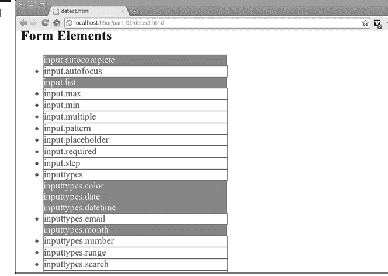

`detect.html` 页面可以在我的网站 www.aharrisbooks.net/h5qr/detect.html 找到。你可以在任何浏览器中使用它，来实时分析你的浏览器支持哪些HTML5特性。

该程序使用了一个名为 Modernizr 的脚本，它可以自动检查各种浏览器特性。你可以从 www.modernizr.com 免费获取 Modernizr。

### 在代码中检查特性

你也可以在自己的代码中使用 Modernizr 脚本。本质上，Modernizr 为每个 HTML 特性创建一个布尔值（`true`/`false`）。你可以检查一个变量来查看当前浏览器是否支持某个特定特性。如果支持，你可以实现该特性。如果不支持，你通常会实现某种降级方案。以下是具体步骤：

1. 下载 Modernizr 脚本。Modernizr 脚本可以从 www.modernizr.com 免费下载。将脚本安装在与你的网页相同的目录中。（如果你将页面移动到服务器上，也需要确保脚本副本可用。）

2. 引用该脚本。在页面的 `<head>` 部分（在任何其他 JavaScript 代码之前）使用 `<script>` 标签引用该脚本：

```html
<script type = "text/javascript"
        src = "modernizr-1.6.min.js"></script>
```

3. 向 `<html>` 标签添加一个特殊类。Modernizr 脚本需要一个特殊的标签才能知道如何操作。向 `<html>` 标签添加 `no-js` 类：

```html
<html lang = "en"
      class = "no-js">
```

4. 编写一个新的 JavaScript 函数。添加一个新的 JavaScript 函数来执行实际的测试。本节后面的代码列表中展示了具体示例。

5. 使用相应的布尔属性来检查特定特性。Modernizr 支持的每个 HTML5 特性都有一个对应的变量。（你可以在 Modernizr 网站上查找这些变量，或者查看我的 `detect.html` 脚本，其中使用了所有这些变量。）

6. 使用该特性或其替代方案。通常，你会使用 Modernizr 来检查一个特性。如果该特性存在，你就使用它。如果不存在，你会实现某种替代方案。

例如，以下页面使用 Modernizr 脚本来测试当前浏览器是否支持 HTML5 的 `video` 标签。如果支持，它还会检查对两种主要视频编解码器的支持。

```html
<!DOCTYPE html>
<html lang = "en"
      class = "no-js">
<head>
  <title>checkVideo.html</title>
  <meta charset = "UTF-8" />
  <script type = "text/javascript"
          src = "modernizr-1.6.min.js"></script>
  <script type = "text/javascript">
    function init(){
      var output = document.getElementById("output");
      if (Modernizr.video){
        output.innerHTML =
          "Your browser supports video <br /> ";
        if (Modernizr.video.h264){
          output.innerHTML += "H.264 codec supported <br />";
        } // end if
        if (Modernizr.video.ogg){
            output.innerHTML +=
            "Ogg Theora video codec supported <br />";
        } // end if
    } else {
        output.innerHTML = "Your browser does not support the HTML5 video tag";       } // end if
    } // end init
</script>
</head>

<body onload = "init()">
    <h1>Check for HTML5 Video</h1>
    <div id = "output">
        checking video...
    </div>
</body>
</html>
```

图1-2展示了视频检查脚本的实际运行情况。

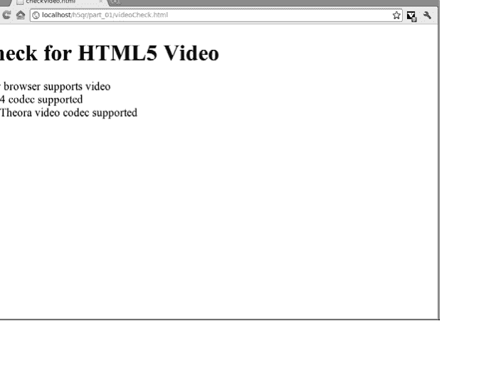

这个例子只是检查了对 `video` 元素的支持。一个更复杂的例子实际上会根据浏览器的能力，在页面中嵌入相应的标签或代码来显示视频。

有关 `video` 标签的更多信息，请查阅第3部分。

### 选择合适的浏览器

如果你打算编写 HTML5 代码，你可能会希望在一个能正确解释 HTML5 的浏览器中查看你的页面。但这并不像听起来那么容易。HTML5 实际上不是一个单一的规范，而是许多不同的标准。各种浏览器对 HTML5 的支持程度各不相同。最好使用多种不同的浏览器，看看哪一个最适合你。目前有几种可用的浏览器，它们对 HTML5 的支持程度各不相同。

虽然有大量可用的浏览器，但大多数都基于一组较小的工具，称为*渲染引擎*。真正决定是否支持特性的是渲染引擎。以下是主要引擎、使用它们的浏览器以及它们对 HTML5 支持程度的列表：

- **Gecko（火狐浏览器）：** Gecko 引擎是 Firefox、Mozilla 以及许多其他相关浏览器的主流引擎。它支持许多，但不是全部的特性。预计 Gecko 2.0 将包含 HTML5 的大部分特性，但该引擎版本尚未发布（并且可能是 Firefox 4 的基础）。尽管 Firefox 在 Web 开发社区中是一个知名且受尊重的浏览器，但它（目前）对 HTML5 的支持还不是极其出色。

- **Trident（Internet Explorer）：** 各种形式的 Internet Explorer 都使用 Trident 引擎。到目前为止，在所有主流浏览器中，该引擎对 HTML5 特性的支持是最弱的。IE9 承诺对 HTML5 有更完善的支持，但即使这个版本也预计会缺少一些关键特性，包括高级表单元素支持和地理位置定位。

- **WebKit：** WebKit 引擎最初由 Apple 基于开源的 KHTML 项目的代码创建。Apple 随后将代码作为开源发布，它成为了许多浏览器的基础。Mac、iPhone 和 iPad 上的 Safari 浏览器都使用 WebKit 引擎。WebKit 也是 Google Chrome 浏览器和 Android 移动平台浏览器的基础。WebKit 已成为移动平台的标准渲染引擎。如果你想看看你的页面在移动平台上的显示效果，你应该使用基于 WebKit 的浏览器（如 Chrome 或 Safari）进行检查。WebKit 对 HTML5 元素的支持最广泛，尽管它仍然不支持所有特性。本书中的大部分代码都在 Google Chrome 6 中进行了测试，它支持当前的 WebKit 渲染引擎。

- **Presto：** Presto 引擎是 Opera 系列浏览器的底层引擎。Opera 长期以来一直被认为是一款技术上更优越的浏览器，但它从未获得应有的市场份额。许多游戏和便携式浏览器都基于 Presto，包括 Wii Internet Channel、Nintendo DS Browser 以及在众多手机和便携设备上可用的 Opera Mobile。

> 浏览器规范可能随时变化。当你读到这本书时，很可能已经添加了新的特性。你应该始终在尽可能多的浏览器中测试你的页面，这样才不会感到意外。你也可以查看 http://en.wikipedia.org/wiki/Comparison_of_layout_engures_(HTML5) 。这个维基百科网站往往有关于哪些浏览器支持哪些 HTML 特性的最新信息。

### 使用 Chrome Frame 为 IE 添加支持

注意到市场份额最大的浏览器对 HTML5 标准的支持最少，这可能会令人沮丧。然而，有一个解决方案。Google Chrome Frame 是一个特殊工具，它将 Chrome 渲染引擎嵌入到 IE 中。要使用它，请将以下代码放入你的页面：

```html
<!DOCTYPE html>
<html lang="en">
<head>
    <title>ChromeFrame.html</title>
    <meta charset="UTF-8">
    <script type="text/javascript"
        src="http://ajax.googleapis.com/ajax/libs/chrome-frame/1/CFInstall.min.js"></script>
</head>

<body onload = "CFInstall.check()">
</body>

</html>
```

你的其余代码可以假设用户拥有 Chrome（它对 HTML5 有极好的支持）。在微软决定对 HTML5 提供有意义的支持之前，这是在 IE 中使用 HTML5 的最佳方式。

## 第一部分：步入 HTML5

## 第二部分：HTML 基础

HTML5 是一系列 HTML 版本中的最新版。要想充分发挥 HTML5 的优势，你需要了解它如何与之前版本的 HTML 相互衔接。

本章大部分内容是对标准 HTML 概念的回顾。如果你从未手写过 HTML 代码，建议仔细阅读本章。如果你已经是一位编程高手，则可以快速浏览。

本章内容构成了一个基础。此处描述的代码适用于所有现代浏览器。由于 HTML5 的许多内容仍依赖于浏览器，因此我们从一套适用于所有浏览器的标准标签和元素开始。本章描述的是这种最基础、最通用的 HTML 语法，后续章节会在此基础上进行扩展。

> **提示**
>
> 本章实际上是一个概览。如果你是 HTML 的初学者，或许可以考虑翻阅我的另一本书——《HTML、XHTML 和 CSS 入门到精通（第 2 版）》（Wiley出版社）。该书对 HTML、CSS 以及其他许多优秀内容进行了详尽阐述，是当今 Web 开发的权威参考书。而你现在手中的这本书，则更多地关注 Web 在不久的将来的发展方向。


> **请记住**
>
> 请务必访问我的网站，查看本书中每个代码片段的实际运行示例：www.aharrisbooks.net/h5qr。


### 本部分包含……

- 回顾 HTML

- 将 HTML5 与 XHTML 和 HTML 4 进行比较

- 构建基本页面

- 添加图像和链接

- 使用列表和表格格式化数据

- 验证你的代码

- 构建表单

### 探索 HTML 和 XHTML

HTML 已经存在了一段时间，并且一直在不断演变。曾经的前沿思想（如使用框架）如今已被视为过时。HTML 最初是一种非常简单的语言，随着使用增多而变得越来越复杂。HTML5 试图让 HTML 重新变得简单。以下理念推动了 HTML5 的发展。

- **让代码尽可能干净。** 事情会很快变得复杂。HTML 代码应当简洁、易读，不应有任何不必要的功能，并且应采用易于遵循的格式。

- **将结构与设计分离。** 尽量使你的 HTML 代码专注于代码的结构（它的含义）而非显示效果（它的外观）。这能使 HTML 代码保持相对干净和易于处理。


## 用HTML定义结构

避免在HTML代码中使用像`<font>`和`<center>`这样的标签，因为它们难以用JavaScript修改，会使代码变得杂乱，并且在某些HTML形式中是不允许的。使用HTML代码来确定页面的含义和结构。

## 用CSS实现设计

如果将设计工作（颜色、字体、位置等）交给CSS，你的HTML会变得更容易处理。如果你使用CSS进行设计，你的JavaScript将能更灵活地改变页面的工作方式，因为你还可以通过JavaScript修改CSS。

## 避免使用表格和框架进行布局

这些技术曾是Web设计师拥有的最佳工具，因此它们被频繁用于为网页提供视觉结构。然而，现代的CSS方法提供了更干净的代码，即使在情况变得更加复杂时，也更易于处理。

## 从有效的代码开始

很多时候，一个页面看起来完全正常，但隐藏的错误会在最糟糕的时刻（通常是你向客户展示时）暴露出来。最好从你知道是有效的HTML开始你的项目。更多关于确保HTML基础完善的内容，请参阅本部分稍后的“验证你的页面”。

### 理解HTML

HTML 4在很长一段时间内是HTML的主要形式。它的流行有其充分的理由：

- **普遍支持：**HTML 4发布时，真正主导市场的浏览器只有一种——Internet Explorer 6（IE6）。由于绝大多数用户都使用某种形式的这个浏览器，任何能在这个浏览器上运行的代码都被视为标准。事实上，我们称为HTML 4的标准，实际上就是IE6所支持的那部分HTML 4。

- **合理的控制：**HTML 4在旧版本HTML的基础上增加了一些出色的功能，如字体支持、更改颜色的能力以及一些多媒体支持。框架增加了一定的布局支持，尽管它们也带来了自己的问题。

- **易于使用：**HTML 4标准本身相当容易学习。在尝试执行高级操作（如基于表格的布局）之前，它并不太麻烦。然后语言的简单性开始显现出缺点，因为它就是无法完成某些事情。

- **宽容性：**HTML被设计得非常随和。如果你做错了什么，浏览器会简单地猜测你想要表达什么。通常，这些猜测是正确的。

### XHTML的出现

HTML 4流行了很长时间，但它并不完美。随着Web开发从个人爱好转向严肃应用程序的基础，HTML 4的弱点变得越来越明显。虽然HTML 4从未消失，但一种名为XHTML（可扩展超文本标记语言）的新标准在精英Web开发者中兴起。XHTML旨在成为对HTML 4更严肃的回应。虽然HTML 4容易相处，但被专业程序员认为不够严谨。XHTML（特别是严格版本）更加精确和可预测，使其在高端开发者中颇受欢迎。以下是XHTML严格版的主要特点：

- **更严格的语法：**XHTML区分大小写，要求所有属性都用引号括起来，并且对标签的嵌套方式有非常严格的规定。每个标签都必须有一个明确的结束标签。（即使是像``这样的单标签也需要一个特殊的结束字符。）这种更精确的语法使XHTML比HTML 4编程时要求更高，但结果也远比HTML 4可预测。

- **验证支持：**XHTML所有严格性的主要优势在于支持验证。HTML 4的标准非常宽松，以至于没人能判断一个页面格式是否错误。使用XHTML，就可以运行一个特殊的验证程序，它可以找到你代码中的结构错误。

- **内容和布局分离：**HTML最初只用于描述文档的内容。到HTML 4推出时，它增加了许多用于处理文档视觉方面的标签。`<font>`和`<center>`标签就是典型的例子。虽然这些标签完成了它们的工作，但它们没有提供足够的控制，并且偏离了HTML的核心思想。XHTML严格版移除了所有布局标签。

- **CSS重要性的提升：**层叠样式表（CSS）在HTML 4中就已经可用，但因为HTML提供了一些替代方案，它们并不总是被正确使用。当XHTML消除了布局标签后，CSS从一种可选的增强功能变成了Web开发的核心部分。

- **XML语法：**XHTML的早期推广者强调XHTML遵循XML标准的语法。虽然这是真的，但事实证明它并没有人们想象的那么重要。XML语法使自动化程序更容易将网页作为数据来处理，但这并不是大多数Web开发者特别关心的功能。

### 它活下来了，它就是HTML5

XHTML严格版是一个非常棒的理念，但它从未真正流行起来。专业开发者（尤其是那些将JavaScript和PHP等编程语言集成到Web项目中的开发者）喜爱XHTML严格版。顶尖设计师则享受CSS带来的新自由。然而，对于大多数开发者来说，XHTML有点过于苛刻，绝大多数页面从未费心去验证是否符合新标准。当需要制定新标准时，W3C最终决定支持HTML5，而不是XHTML 2。

HTML5并非真正排斥XHTML。它兼具HTML 4和XHTML的最佳特性：

- **简洁的文档类型：**XHTML的文档类型定义（每个Web网页开头的样板代码）非常复杂。即使是那些教授相关课程并撰写相关书籍的人（比如，呃，我）也从未记住过文档类型，每次都必须复制粘贴。HTML5有一个非常简单、清晰的文档定义，人们再次可以凭借记忆用文本编辑器编写页面。

- **内容和样式分离：**HTML5不包含HTML 4中的样式标签（`font`、`center`等），要求开发者使用CSS进行所有样式设置。同样，框架和基于表格的布局不被鼓励，取而代之的是CSS样式的布局。

- **验证支持：**事实证明，验证是一个非常有用的工具，因此HTML5可以像XHTML一样进行验证。W3C验证器（`http://validator.w3.org`，参见本部分稍后的“验证你的页面”）现在支持HTML5，其他验证工具也陆续上线。验证是消除愚蠢编码错误的简单方法，并且一旦开始为文档添加编程支持，验证可以大大简化你的编码工作。

- **严格的传统：**HTML5的编码标准更接近XHTML，而非HTML 4。虽然在HTML5中仍可以使用松散的编码方式，但大多数开发者遵循XHTML的严格标准，以使代码更易读、更可预测。

本书中的所有代码都遵循XHTML更严格的样式标准。

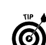

CSS与编程语言更紧密的集成：HTML5最重要的特性或许是其谦逊性。尽管HTML仍是互联网的核心语言，但HTML5实质上是将控制权分配给其他语言。HTML5被设计为一种核心粘合剂，将多种其他技术整合在一起：CSS负责视觉布局，JavaScript用于客户端编程，PHP等服务器端语言负责服务器控制，以及数据库。

新功能：当然，HTML5提供了新的功能，这是本书的主要关注点。许多新功能从技术上讲并非HTML本身，而是相关技术的进步（集成数据库、新的JavaScript语法、新的CSS特性等）。

### 设置基本HTML页面

构建基本HTML5页面非常简单。只需打开任意文本编辑器并添加以下代码：

```
<!DOCTYPE HTML>
<html lang = "en">
<head>
<!-- basic.html -->
<title>basic.html</title>
<meta charset = "UTF-8" />
</head>

<body>
<h1>一级标题</h1>

<p>
这是一个段落。
注意文本会自动换行。
</p>

</body>
</html>
```

这个页面，如图2-1所示，创建起来并不困难：

> 我倾向于在这些截图中尽可能增大字体——这样做能让页面更易阅读。请务必查看网站（www.aharrisbooks.net）上的实际页面，以了解其确切效果。

## 第2部分：HTML基础

图2-1

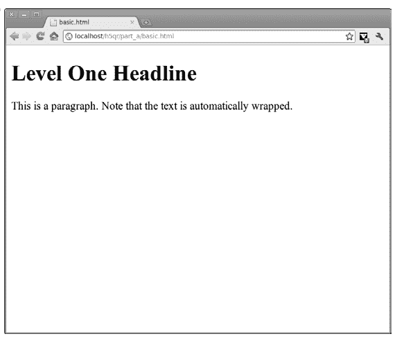

要构建基本HTML5页面，请遵循以下步骤：

1. 从文档类型声明开始。现代版本的HTML（XHTML和HTML5）有一个称为`doctype`的特殊属性，用于指明使用的HTML版本。XHTML的文档类型声明非常复杂，而HTML 4甚至没有文档类型声明。使用此标签将文档类型设置为HTML5：`<!DOCTYPE HTML>`。文档类型定义应位于网站的第一行。如果省略，可能仍能使用HTML5特性，但验证工具将不得不猜测您使用的HTML版本。（可以参考任何科幻电影，看看计算机猜测事物时会发生什么。）

2. 添加`<html>`标签。此特殊标签表示网页的开始。最好指明页面使用的语言。对于英语，指定`lang = "en"`。务必在页面底部有对应的`</html>`标签。这表示页面的结束，与页面开头的`<html>`标签相对应。

3. 创建`<head>`区域。`head`就像汽车的发动机舱。人们通常不会去那里，但那里有许多重要的“机器”。在这个简单示例中`head`是空的，但它很快就会充满JavaScript和CSS的精华。

4. 指定字符集。虽然这不是严格必需的，但告知浏览器在显示页面时应使用何种字符是一种良好的做法。用英语编写的页面通常应使用UTF-8，因此使用以下代码指定：`<meta charset = "UTF-8" />`。

5. 为代码缩进。浏览器不关心代码是否缩进，但养成这个习惯非常好。通常，我每次打开一个不在同一行关闭的新元素时都会缩进。这样我就能轻松对齐开始和结束标签，确保页面结构良好，且没有遗漏任何结束标签。

6. 添加注释。注释不是严格必需的，但它们是良好的做法。HTML注释以`<!--`开头，以`-->`结尾。通常，本书中的注释将简要概述页面的用途。注释可以跨越多行。

7. 使用`<title></title>`放置标题。此标签允许您为页面指定标题。标题通常出现在Web浏览器的标题栏中，并且也经常出现在搜索引擎的页面结果中。在本书中，我通常将文件名放在标题中，以便您可以轻松地将配套网站上的程序与书中的代码清单对应起来。

8. 将页面主体内容放在`<body>`标签内。如果`head`区域是发动机舱，那么`body`就是乘客空间。网站上可见的大部分文本都是`body`的一部分。`</body>`标签通常紧接在`</html>`标签之前，因为您通常会在结束`body`后关闭HTML。

9. 使用标题标签描述您的大纲。`<h1>`标签是一个标题示例。所有标题标签都以h开头，后跟一个表示标题强度的数字。所有主要主题都应使用一级标题（`h1`）表示。子主题应使用二级标题（`<h2>`）。标题级别一直到`h6`，但很少使用比三级更小的标题。

10. 将大部分文本放入段落中。虽然HTML不强制要求使用段落标签，但这仍然是一个非常好的做法。将每个段落放在一对`<p></p>`中。这将使您以后管理文本的外观和行为变得容易得多。

11. 使用`.html`扩展名保存文件。务必将文件保存为`.html`扩展名。然后，您可以将文件加载到浏览器中查看其效果。

> 其中一些元素（尤其是标题）往往具有特定的视觉样式。默认样式仅作为指导。避免根据外观选择标题的诱惑。当您在第5部分使用CSS时，您将能够使任何标题呈现您想要的任何外观。

# 充实您的页面

如果您使用过HTML 4或XHTML，您会发现HTML5非常熟悉。您的大部分文本将放入用`<p></p>`对标记的段落中。较大的部分可以使用`<div></div>`对包含在分区中。然后，您将添加各种其他元素：图像、链接、列表、表格和表单。HTML5添加了一些新元素，但现在，请坚持使用在所有浏览器中都适用的基础元素。

## 添加图像

网页的功能远不止文本。图2-2显示了一个包含嵌入图像的页面。

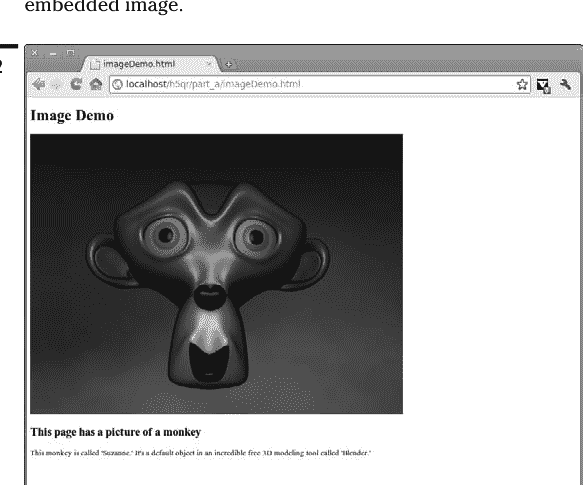

图像很容易添加到网页中。以下是添加图像的代码：

```
<!DOCTYPE HTML>
<html lang = "en">
<head>
  <title>imageDemo.html</title>
  <meta charset = "UTF-8" />
</head>
<body>
<h1>图像演示</h1>

<p>
    
</p>
<h2>此页面有一张猴子图片</h2>

<p>
    这只猴子名为“苏珊娜”。它是名为“Blender”的
    令人惊叹的免费3D建模工具中的默认对象。
</p>

</body>
</html>
```

添加图像相对容易。以下是操作步骤：

1. 确定要使用的图像。当然，在使用图像之前，您必须有权访问该图像。确保您有权在网站中使用该图像。

2. 必要时修改图像。您可能需要调整图像以用于页面。最好在将图像用于网络之前调整其大小。您可以使用商业图像处理软件，但我更喜欢使用IrfanView或Gimp进行此类工作。这两个免费程序的链接可在我的网站（www.aharrisbooks.net/h5qr/resources.html）上找到。

3. 选择图像类型。Web浏览器可以显示`.jpg`、`.gif`和`.png`图像。如果您的图像采用其他格式，请使用IrfanView或Gimp等工具将其更改为这些网络友好的格式之一。

4. 将图像放在正确的位置。图像文件应与HTML文件位于同一目录中。这样，当您将页面发布到服务器时，移动图像也会更容易。

5. 按正常方式构建页面。图像将通过嵌入在`body`中的标签放置。

6. 使用``标签指示图像。如果希望页面正确验证，此标签需要嵌套在段落或`div`内。

7. 使用`src`属性指示包含图像的文件。如果图像文件与网页位于同一目录中，您只需提供图像名称即可。如果图像文件位于互联网上的其他位置，您可以使用完整的URL，例如`http://www.aharrisbooks.net/jad/jad_2/monkey.png`。

8. 包含描述图片的`alt`属性。`alt`属性包含描述图片的文本。这对于那些无法看到你图片的人很重要——包括视力障碍用户、为了提升浏览速度而关闭图片显示的用户，以及虽然无法看见图片但会读取`alt`标签的搜索引擎机器人。

9. 使用`/`结束`img`标签。`img`标签是一个特殊标签，不需要（也不允许）结束标签。标签末尾的斜杠字符表明该标签是一个自闭合标签。

## 插入链接

HTML中的H代表超文本（hypertext），这是链接（links）的一个花哨术语。链接是让互联网如此酷炫和强大的要素之一。在网页中添加链接非常容易。图2-3展示了一个包含两种不同类型链接的示例。

图2-3

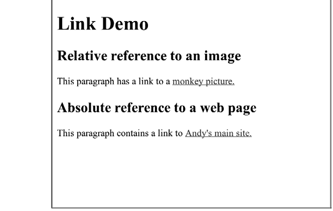

构建链接的代码如下：

```
<!DOCTYPE HTML>
<html lang = "en">
<head>
    <title>linkDemo.html</title>
    <meta charset = "UTF-8" />
</head>
<body>
  <h1>Link Demo</h1>
  <h2>Relative reference to an image</h2>
  <p>
    This paragraph has a link to a
    <a href = "monkey.png">monkey picture.</a>
  </p>

  <h2>Absolute reference to a web page</h2>
  <p>
    This paragraph contains a link to
    <a href = "http://www.aharrisbooks.net">
      Andy's main site.
    </a>
  </p>
</body>
</html>
```

链接的功能不止于表面。它们在页面上显示文本，但当用户点击文本时，浏览器会加载互联网上的另一个页面。将链接嵌入你的页面非常直接。

1. 从一个普通页面开始。链接通常直接嵌入你的页面中。链接不能独立存在，通常是某个其他块级元素（如段落）的一部分。

2. 使用`<a>`标签表示链接。`a`代表锚点。（我知道；它应该是链接标签，但那个术语在HTML中用于其他东西。）

3. 利用`href`属性描述链接的去向。大多数链接都有一个`href`（超文本引用）属性，它描述了用户点击链接时应加载的页面。`href`可以是相对地址或绝对地址。

   - 相对地址：`href`可以是一个简单的文件名。如果你链接的是与你正在编写的网页位于同一目录中的文件，你只需指明文件名即可。这被称为相对引用，因为浏览器假定链接的文件位于当前服务器的当前目录中。我示例中的第一个链接指向与页面本身位于同一目录中的猴子图片。

   - 绝对地址：`href`也可以是一个完整的网址。如果你愿意，可以给出网站的完整地址。这被称为绝对引用，因为它解释了如何找到文件，无论当前页面位于何处。如果你想指向其他人服务器上的页面或文件，你必须使用绝对引用。

4. 将可见文本放在`<a>`和`</a>`标签之间。任何出现在`<a>`和`</a>`标签之间的文本都将以表示链接的格式显示在屏幕上。默认格式是蓝色带下划线的文本。你将在第5部分中了解如何更改此设置（以及许多其他显示技巧）。

你链接到的文件可以是网页，也可以是浏览器能读取的任何其他内容。`linkDemo.html`上的第一个链接指向一个图片文件，第二个指向一个网页。大多数链接指向网站，但你也可以链接浏览器能读取的任何内容，包括图片。

## 创建列表和表格

页面通常涉及数据，而数据经常被组织成列表。图2-4展示了一个包含一系列列表的页面。

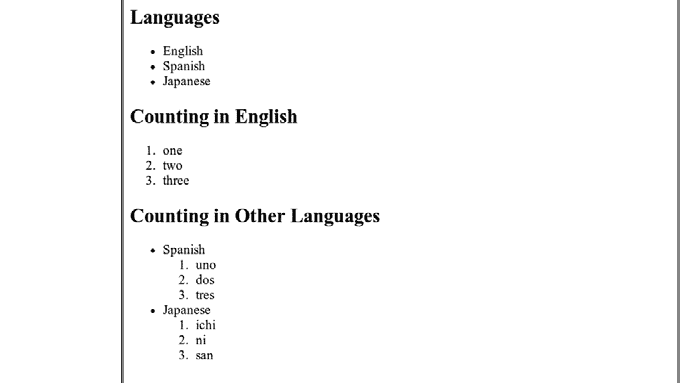

图2-4中的页面显示了两种主要类型的列表和一个将一种类型嵌套在另一种类型中的组合列表。以下是用于创建这些列表的代码：


```
<!DOCTYPE HTML>
<html lang = "en">
<head>
  <title>listDemo.html</title>
  <meta charset = "UTF-8" />
</head>
<body>
  <h2>Languages</h2>
  <ul>
    <li>English</li>
    <li>Spanish</li>
    <li>Japanese</li>
  </ul>

  <h2>Counting in English</h2>
  <ol>
    <li>one</li>
    <li>two</li>
    <li>three</li>
  </ol>

  <h2>Counting in Other Languages</h2>
  <ul>
    <li>Spanish
      <ol>
        <li>uno</li>
        <li>dos</li>
        <li>tres</li>
      </ol>
    </li>

    <li>Japanese
      <ol>
        <li>ichi</li>
        <li>ni</li>
        <li>san</li>
      </ol>
    </li>
  </ul>
</body>
</html>
```

列表，像大多数 HTML 元素一样，非常容易构建。

1. 用`<ul>`或`<ol>`指定列表的开始。`<ul>`标签表示无序（项目符号）列表，`<ol>`标签用于描述有序（编号）列表。当你使用 CSS（在第 5 部分中介绍）为列表设置样式时，你可以有多种不同的标记，包括数字、罗马数字、项目符号或自定义图形。

2. 用`<li></li>`对标记每个项目。`<li>`标签用于表示列表项。列表的所有元素都应包含在`<li>`标签中。

3. （可选）在列表内嵌套列表。一个列表的`<li>`可以包含一个完整的新列表。这就是用于在示例中构建嵌套列表的技术。只需确保在开始新列表之前关闭一个列表。适当的缩进有助于你跟踪嵌套的深度。

## 使用表格

有时你会遇到以表格格式呈现效果最好的数据。HTML 为此目的提供了一个功能齐全的表格系统。例如，考虑图 2-5 中显示的表格。

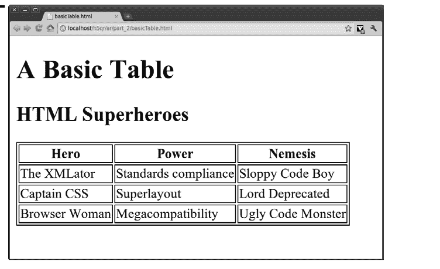

HTML 格式表格的基本结构相当容易理解。以下是创建`basicTable.html`的代码：

```
<!DOCTYPE HTML>
<html lang = "en">
  <head>
    <title>basicTable.html</title>
    <meta charset = "UTF-8" />
    <style type = "text/css">
      table, td, th {
        border: 1px solid black;
}
</style>

</head>

<body>
  <h1>A Basic Table</h1>
  <h2>HTML Superheroes</h2>
  <table>
    <tr>
      <th>Hero</th>
      <th>Power</th>
      <th>Nemesis</th>
    </tr>

    <tr>
      <td>The XMLator</td>
      <td>Standards compliance</td>
      <td>Sloppy Code Boy</td>
    </tr>

    <tr>
      <td>Captain CSS</td>
      <td>Superlayout</td>
      <td>Lord Deprecated</td>
    </tr>

    <tr>
      <td>Browser Woman</td>
      <td>Megacompatibility</td>
      <td>Ugly Code Monster</td>
    </tr>
  </table>
</body>
</html>
```

当你检查这段代码时，你会看到表格只是一组仔细嵌套的标签。构建表格的过程并不困难，但它确实需要一些预先规划。

1. 首先规划你的表格。如果你已经知道表格的结构，在 HTML 中构建表格会容易得多。你应该知道会有多少列，以及哪些行或列是标题行。如果你不确定这些，在纸上草绘你的表格是个好主意。

2. 用`<table>`标签开始表格。`<table></table>`对包含整个表格。

3. 用`<tr>`创建表格行。表格由一系列行定义。使用`<tr></tr>`对包含每一行数据。

4. 用`<th>`表示标题。一些单元格将包含标题，另一些将包含实际数据。通常，顶部行包含标题（有时最左边的列也是）。使用`<th></th>`对来标记应被视为标题单元格的文本。默认情况下，此类单元格通常加粗并居中，但可以使用 CSS 更改。

5. 用`<td>`指定普通数据单元格。`<td></td>`对用于指定普通数据单元格。表格中的大多数单元格将由`<td>`标签指定。

6. 保持单元格数量一致。每行应具有相同数量的单元格。（虽然有技术可以让你跨多行或多列扩展单元格，但我在这个入门部分坚持使用基本技术。）

7. 根据需要添加 CSS。表格确实有基本格式，但像往常一样，你可以用 CSS 更改内容。我在这个示例中添加了边框，因此在图 2-5 中更容易看到表格。

8. 不要使用表格进行布局。HTML 的早期版本对布局（创建列和精确的页面布局）支持不足。聪明的 HTML 开发者想出了各种使用表格来模拟布局系统的变通方法。CSS（在第 5 和第 6 部分中介绍）提供了你需要的所有页面布局技术，因此表格的使用应限制在其原始用途：呈现表格数据。

## 创建表单

从一开始，网页就具有从用户收集数据的能力。HTML 有一套标准但非常有用的表单元素，你可以用它们来获取输入。在纯 HTML 中，你无法对数据进行任何操作，但这就是 JavaScript 和 PHP 的用武之地。你将编写许多程序来从 Web 表单中提取数据，因此了解它们的工作原理是个好主意。图 2-6 展示了一个包含你可能遇到的所有主要 HTML 表单元素的表单。

### 表单结构标签

这些标签用于帮助管理表单的整体结构：

- `<form>`：`<form>`标签是实际包含表单的标签。所有表单元素都包含在此标签内。`<form>`标签还应包含`action=""`属性。这表示你并不打算在表单提交时调用服务器端脚本。

- `<fieldset>`：这是一个特殊标签，允许你将一系列输入元素分组在一起。它不是必需的，但可以使复杂表单更易于浏览。默认情况下，`fieldset`周围有一个边框，但你可以使用 CSS 更改这一点。

- `<legend>`：可以为`fieldset`添加图例。它充当整个字段集的标签。

- `<label>`：`<label>`标签将文本标记为与特定输入元素关联的标签。你可以使用可选的`for`属性来指定标签与哪个输入元素关联。标签标签通常用于使表单的 CSS 样式更易于管理。

> `fieldset`、`legend`和`label`标签不是必需的，坦率地说，在 HTML 的早期形式中使用不多。这些标签在 XHTML 和 HTML5 中更常见，因为使用表格来组织页面的物理布局是不鼓励的。这些标签帮助你组织页面，使其更容易使用 CSS 进行布局。正确使用这些标签和 CSS 通常使你的表单比旧的基于表格的 hack 更容易使用。

### 构建文本输入

许多表单元素基于`input`标签。这个多用途标签是一个通用标签，用于创建许多有趣的输入对象。`type`属性用于确定标签在页面上创建的元素类型。到目前为止，最常见的输入元素是基本文本框。其代码如下：

```html
<input type = "text"
      id = "myText"
      value = "text here" />
```

构建它很简单。

1. 创建一个输入元素。`<input>`标签创建元素的整体结构。

2. 将类型设置为 "text"。这表示你正在构建一个标准文本元素，而不是更复杂的东西。

3. 添加`id`属性。`id`属性允许你为元素命名。当你向页面添加 JavaScript 时，这将非常重要，因为你的 JavaScript 代码将使用 ID 从表单中提取数据。

4. 添加默认数据。如果需要，你可以使用`value`属性添加默认数据。你放在`value`中的任何文本将成为表单的默认值。

文本元素将在屏幕上放置一个小框。当用户选择该框时，光标将变为 I 形，用户将能够在框中输入文本。

当然，如果你想对这段文本进行一些操作，你需要编写一些代码。请参阅附录第 1 部分，了解如何使用 JavaScript 从表单中读取数据。

### 创建密码字段

标准输入元素有一个有时会用到的兄弟元素——密码。密码的代码看起来很像标准输入元素的代码。

```html
<input type = "password"
    id = "myPwd"
    value = "secret" />
```

密码字段看起来与普通文本字段非常相似，但它确实有一个主要区别。当用户在文本字段中输入数据时，字段的实际内容会被星号替换。这可以防止坏人偷看你的肩膀来发现你的密码。

密码字段本身并不提供任何真正的安全性。当用于向 Web 服务器发送请求时，该请求通常是以明文发送的，那些坏人肯定会找到它。在 JavaScript 处理中，情况更糟，因为用于检索数据的代码将对浏览器自由可用。如果你想保守很多秘密，JavaScript 不是使用的语言。

### 创建多行文本框

有时你需要输入多行文本的能力。文本区域元素非常适合这种情况。它的语法与你目前看到的`input`元素略有不同：

```html
<textarea id = "myTextArea"
    rows = "3"
    cols = "80">Your text here</textarea>
```

要创建自己的文本区域：

1. 从`<textarea>`标签开始。此标签表示多行文本框的开始。

2. 指定行数。指示你希望文本区域包含的文本行数。更大的框可以容纳更多文本，但需要屏幕上更多的空间。

3. 指示列数。列表示文本框应有多宽（以字符为单位）。80 个字符是页面宽度表单的典型宽度。

### 构建下拉列表

下拉列表是网页中的一个常见功能。它们很好，因为它们允许程序员指定多个选择。用户可以选择一个选项而无需输入。下拉列表特别好，因为它们不需要太多的屏幕空间——选项仅在用户选择它们时可见。

下拉列表还有一个极其重要的属性；它们可以防止某些错误。有限的选项使响应非常可预测。当你允许用户在表单中输入信息时，很难检查用户可能输入的所有疯狂内容。使用列表框，你已经预先确定了所有可能的答案。出错的可能性大大降低。

在 HTML/XHTML 中，下拉列表由两种类型的对象创建。整体结构使用`<select>`标签，而每个可能的选择都有自己的`<option>`标签。以下是其工作原理：

```html
<select id = "myList">
  <option value = "1">one</option>
  <option value = "2">two</option>
  <option value = "3">three</option>
  <option value = "4">four</option>
</select>
```

选择列表是一个真正的主力，所以你应该知道如何制作它：

1. 首先创建`<select>`元素。列表的容器将是一个`<select>`元素。整个列表被包含在`<select></select>`这对标签中。

2. 给`select`元素一个 ID。你将使用此 ID 在代码中引用该元素。

3. 向 select 元素添加一个`option`元素。我通常缩进选项，以提醒自己它们是`select`对象的一部分。

4. 给每个选项一个值。该值将是用户选择选项时发送给程序的响应。用户不一定会看到该值。

5. 指示用户将看到的文本。用户将看到的选项文本位于`<option>`和`</option>`标签之间。这可以与值不同，也可以相同。（在你进行一些 JavaScript 编码后，这会更有意义。）

6. 添加任意多的选项。为你希望列表中可用的每个选择创建一个新的`option`对象。

## 创建复选框

有时你会遇到一些可能为真或假的信息。`checkbox`元素非常适合这类输入，因为用户可以点击来选择或取消选择该选项。复选框是多功能`input`标签的另一种变体：

```html
<p>
    <label>Check boxes</label>
    <input type="checkbox"
        id="chkEggs"
        value="greenEggs" />
    <label for="chkEggs">Green Eggs</label>

    <input type="checkbox"
        id="chkHam"
        value="ham" />
    <label for="chkHam">Ham</label>
</p>
```

当你创建一个复选框时，通常还会为其关联一个文本标签。这样，用户既可以点击复选框，也可以点击相关的标签来进行选择。复选框通常成组出现，但它们彼此独立。以下是创建复选框的方法：

1. 从一个`input`元素开始。复选框只是`input`元素的另一种形式。

2. 将`type`属性设置为`checkbox`。这明确表示该`input`元素将是一个复选框。屏幕上会出现一个小的可勾选框。

3. 为元素指定一个`id`。与所有表单元素一样，你需要一个`id`字段，以便你的代码可以直接操作该元素。

4. 指定一个值。你可以为复选框附加一个值。用户不会看到这个值（除非你选择让标签看起来与值完全一样）。

5. 添加一个标签。复选框确实需要关联一个标签，这样用户才能明白该复选框的用途。复选框的标签通常位于复选框的右侧。

6. 为标签添加`for`属性。标签有一个名为`for`的特殊属性，它允许你指定该标签对应的`input`元素。将复选框的`id`值放入此标签的属性中。这对复选框特别有用，因为在大多数浏览器中，用户可以点击标签或复选框来触发选择。将标签与复选框关联起来，为用户提供了更大的点击目标，使表单更易于使用。

HTML 表单本身不会执行任何操作。你需要添加某种 JavaScript 或 HTML 编程，才能让表单执行某些功能。

## 添加单选按钮

表面上看，单选按钮与复选框很相似，但它们在几个重要方面有所不同。

- 单选按钮只成组出现。你可以在表单中放置一个复选框，但单价按钮只有成组放置才有意义。

- 单选按钮组中只能选中一个元素。在单选按钮组中，选中一个按钮会取消选中其他按钮。这就像汽车收音机，点击一个预设按钮会取消其他按钮的选择。（它真的很像老式汽车收音机，如果选中的电台被物理按下，其他按钮会弹出。不过我不打算提这个，因为它会让我显得很老。）

- 应该始终有一个元素被选中。当你创建单选按钮组时，应该始终让组中的一个元素处于选中状态。否则，附加到你表单上的任何程序都会感到困惑。

- 每个单选按钮的`id`仍然是唯一的。网页上的每个`id`必须是唯一的，每个单价按钮的`id`元素将遵循与往常相同的规则。

- 每个单选元素还有一个`name`属性。`name`属性用于指定整个单选对象组。

- 一个组中的所有单选按钮具有相同的`name`。HTML 使用`name`属性来确定单选按钮属于哪个组，并确保组中只有一个按钮被选中。

创建单选按钮组与创建复选框非常相似，但有一些不同之处。

1. 首先创建一个`input`元素。与往常一样，`input`元素提供了基本框架。

2. 将`type`设置为`radio`。使用`type`属性来形成单选按钮。

3. 为每个元素指定一个唯一的`id`。与往常一样，为每个单选按钮应用一个唯一的`id`。

4. 为组中的所有按钮赋予相同的`name`。使用`name`属性来标识组中的按钮。

5. 考虑视觉上的分组。用户仅通过 HTML 格式无法分辨哪些按钮属于同一组。最好使用 fieldset 或其他格式技巧来帮助用户了解哪些按钮在哪个组中。同一组中的所有按钮应在物理位置上靠近。

6. 默认情况下使其中一个按钮处于选中状态。将`checked = "checked"`属性（由冗余部门提供）应用于其中一个元素，使其初始状态为选中。

## 添加操作按钮

另一个关键的表单元素是无处不在的按钮。按钮很棒，因为它们只是坐在那里，看起来令人无法抗拒。用户通常期望点击按钮时会发生重要的事情。实际上有三种主要类型的按钮，尽管它们对用户来说看起来完全相同。

- 标准按钮：标准按钮看起来就像一个按钮。这些按钮通常用于 JavaScript 编程中，以在客户端触发某种操作。你在 JavaScript 中经常使用这种类型的按钮。

- 提交按钮：此按钮通常用于服务器端编程。它将表单中的所有数据打包并提交到位于远程 Web 服务器上的程序。

- 重置按钮：这种特殊类型的按钮具有内置行为。当用户点击重置按钮时，表单中的所有数据将重置为其原始默认值。

除了这三种类型的按钮之外，按钮元素还可以通过两种不同的方式创建。神奇的`input`元素也可以用来构建按钮，像这样：

```html
<input type="button"
    value="input button" />
```

当以这种方式使用时，`value`属性成为按钮的标签，`type`属性表示你打算构建的按钮类型。无需为按钮添加标签，因为标签是隐含的。


这是 HTML 中最初创建按钮的方式，并且仍然常用。但按钮实际上不是用于输入的；它们用于指定用户想要做什么。因此，一种新的按钮语法应运而生：

```html
<button type="button">
    standard button
</button>
```

这种语法引入了一个带有开始和结束标签的`button`标签。`type`属性用于指示你要使用哪种类型的按钮。（默认类型是`"submit"`，主要用于服务器端开发，这不是本书的重点。）按钮内的文本表示打印在按钮上的文本。我倾向于使用`button`语法，因为它我觉得更清晰，而且它使 CSS 格式化（见第 5 部分）更容易一些，因为按钮很少像其他输入元素那样格式化。

**40** 第 2 部分：HTML 基础

## 验证你的页面

本部分描述的指南通常会为你提供一个不错的网站，但如果你像我一样，有时仍会犯一些粗心的错误。如果能有某种工具像代码的拼写检查器一样就好了。它可以查找诸如缺失标签和顺序错误之类的低级错误。有时你的代码中会有这样的垃圾，你甚至不知道这是个问题。它在你的浏览器上可能看起来没问题，但这类错误往往会在你连接投影仪向数百人展示如何构建网站时出现。（好吧，也许这只是我……）

幸运的是，确实有这样一个代码检查工具可用。W3 联盟（就是最初制定标准的那些人）提供了一个软件工具，允许你检查任何页面，看它是否符合你在 doctype 中声明的标准。这个工具叫做 W3 验证器，它可以在以下巧妙命名的地址找到：

```
http://validator.w3.org
```

图 2-7 显示了一个正在被 W3 验证器检查的页面。

验证器很棒，但它并不完美。它不能找出所有错误，而且当然只在你连接到互联网时才工作。更麻烦的是，它给出的错误信息有时非常神秘，而且不太有帮助。

> **提示** W3 验证器检查 XHTML 和 HTML5 代码。随着 HTML5 越来越普遍，请留意其他工具直接在你的浏览器和编辑器中可用，以简化 HTML5 代码的验证。

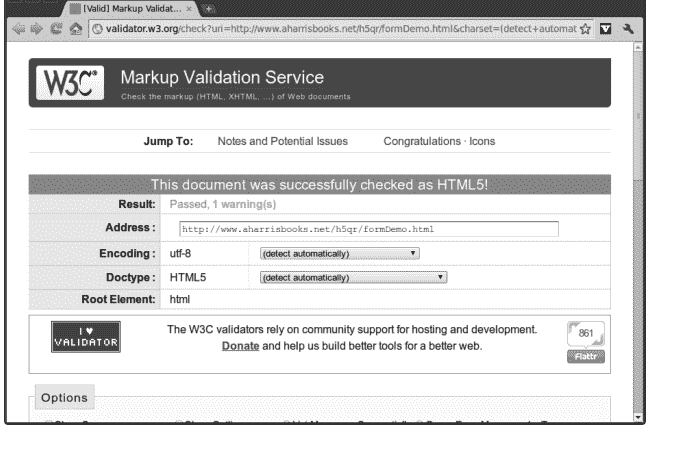

## 第三部分：新增或更改的HTML5元素

HTML新版本的有趣之处在于新标签。HTML5引入了许多新标签。此外，一些旧标签也有了新的变体。本部分将介绍这些新标签，并讨论一些旧标签的变化。

请务必访问我的网站查看本书中每个代码片段的运行示例：[www.aharrisbooks.net/h5qr](http://www.aharrisbooks.net/h5qr)。

### 本部分内容

- 熟悉语义化页面元素
- 查看内联语义元素
- 回顾备受期待的媒体元素
- 了解Ruby元素

### 语义化页面元素

HTML5强化了语义化标记的概念。也就是说，标签不应描述页面中某个部分的外观，而应描述该部分在页面上下文中的*含义*。当Web开发者开始在XHTML中拥抱这些变化时，页面充满了`<div class="x">`标记。在XHTML中添加的语义化页面元素旨在为每个页面上常见的几个元素提供一等公民标签。

> **提示** Firefox 3支持大多数语义化标签（`header`、`article`、`footer`等），但将它们显示为内联元素。在CSS中为这些元素添加`display:block`，它们就会按预期显示（尽管仍然需要更多CSS才能实现任何特殊效果）。

#### address

`<address>`标签用于保存页面或部分作者的联系信息。虽然在HTML 4中就已存在，但`<address>`标签现在旨在用于整个页面内容内部或某个部分或文章内部，以指示该部分的作者。其他标签（特别是指向电子邮件地址或页面链接的锚点）可以嵌入地址中。

```
<address>
  10475 Crosspoint Blvd <br />
  Indianapolis, IN 46526
</address>
```

大多数浏览器将地址渲染为斜体，但这并非保证。与任何HTML标签一样，你可以通过CSS精确修改地址内容的显示方式。

#### article

*文章*是页面的一个子集。`<article>`标签应用于指示来自外部来源或与主页面内容无关的内容。通常，文章用于标记从某种聚合系统引入的页面部分。

```
<article>
  <header>
    <h1>来自
      <em>
        <a href="http://aharrisboks.net/jad">
          JavaScript and AJAX for Dummies
        </a>
      </em>
    </h1>
  </header>
  <p>
    偶尔会出现一种技术，它有望改变一切。
    AJAX就是这样一种技术。在本书中，你将了解
    这一切为何如此重要，以及AJAX为何如此重要。
  </p>
</article>
```

大多数浏览器不会为`article`添加任何特定格式；这取决于CSS定义。如果文章来自在线文档，大多数文章都会包含指向原始页面的链接。`<article>`标签不会从外部源导入数据。它只表示关系是外部的。对于更集成的内容，请改用`<section>`标签。请注意，如果文章包含`header`标签，则`article`有自己的`h1`标题是合适的。这允许页面聚合器从多个来源拉取页面并应用适当的格式。

#### aside

`<aside>`元素用于指示与主要内容相关但独立的页面片段。`aside`文本通常格式化为侧边栏。

```
<aside>
  这是一个次要评论
</aside>
```


> 请注意，大多数浏览器在如何显示`aside`元素（如果显示的话）方面尚未达成一致。

#### footer

`<footer>`标签用于表示页面的页脚内容。通常此部分包含作者联系信息（通常在`<address>`标签中）。

```
<footer>
  <h2>页脚</h2>
  <address>
    Andy Harris <br />
    <a href="mailto:andy@aharrisbooks.net">
    andy@aharrisbooks.net</a>
  </address>
</footer>
```

#### header

`<header>`标签主要用于指定页面头部。它取代了HTML 4和XHTML中经常使用的`<div id="header">`惯用法。

```
<header>
  <h1>这是我的页头</h1>
</header>
```

页头通常包含`h1`和其他属于页面视觉顶部的信息。不要将`<header>`元素（页面的可见部分）与`<head>`元素（包含不向用户显示的元数据）混淆。另请注意，`<header>`元素不取代`<h1>`到`<h6>`元素，但通常包含它们。

大多数浏览器不为页头提供任何默认格式。Web开发者应通过CSS添加任何所需的格式。

`<header>`元素还有一个用途。它可以用于`section`或`article`内部，以指示该元素内的`h1`是该元素的顶级标题，而不是页面的标题。这很有用，因为页面应该只有一个顶级元素。许多页面由聚合器或内容管理系统构建，因此每个`article`和`section`都可以有一个顶级标题，而不会与页面的主要标题冲突。

#### hgroup

`<hgroup>`标签用于将标题和一个或多个副标题组合成一个逻辑组。正常的标题结构旨在作为页面的大纲。在`h1`标题后立即使用`h2`作为副标题会干扰大纲功能。你可以在`hgroup`中放置多个标题，只有第一个标题会被自动大纲工具考虑。

```
<hgroup>
  <h1>世界历史</h1>
  <h2>（不包括所有令人讨厌的东西）</h2>
</hgroup>
```

`hgroup`不为标题组提供任何特定格式。

#### menu

`<menu>`标签和相关的`<command>`元素用于添加各种类型的菜单系统。

```
<menu>
  <command label="一"
           onclick="alert('uno')">
  <command label="二"
           onclick="alert('dos')">
  <command label="三"
           onclick="alert('tres')">
</menu>
```

`<menu>`标签支持`type`属性，该属性指示菜单的行为：

- **list**：像列表一样呈现命令。
- **context**：预期在用户右键单击元素时充当弹出菜单。
- **toolbar**：命令将作为工具栏呈现。

`menu`元素旨在包含`<command>`实例。（*有关`command`元素的详细信息和属性，请参阅本部分后面的"command"部分。*）此外，`menu`元素没有与之关联的任何特定视觉显示。目前还没有主要浏览器显示带有命令的菜单。（*有关解决方法，请参阅本部分后面的"command"部分。*）

> 请注意，`menu`元素在HTML5中的含义与HTML 4完全不同。在HTML 4中，`menu`项是一种列表类型。

#### nav

`<nav>`标签用于指示页面中用于页面导航的部分。这旨在取代HTML 4和XHTML中经常使用的`<div id="nav">`惯用法。

```
<nav>
  <h2>导航</h2>
  <ul>
    <li><a href="#">链接 a</a></li>
    <li><a href="#">链接 b</a></li>
    <li><a href="#">链接 c</a></li>
    <li><a href="#">链接 d</a></li>
    <li><a href="#">链接 e</a></li>
  </ul>
</nav>
```

`nav`元素没有默认格式。Web开发者应添加CSS来确定元素的外观及其在页面上的位置。

#### section

`section`是页面的通用划分。页面或文章可以分成多个部分。`section`元素旨在比HTML 4和XHTML标记中当前使用的`<div>`标签更具体。

```
<section id="1">
  <h2>第一节</h2>
  <p>正文内容...</p>
</section>
```

到目前为止，现代浏览器对`<section>`标签的支持非常少。在浏览器开始支持`section`元素之前，`<article>`标签或标准的`<div>`标签是合适的替代品。在尝试使用它之前，请使用第1部分中描述的`detect`脚本查看你的浏览器是否支持此标签或任何其他标签。

### 内联语义元素

除了页面级语义元素（为整个页面添加结构）之外，还有许多其他新增或修改的标签旨在页面内部添加新元素。

#### command

`<command>`标签在`<menu>`标签的上下文中用于向页面添加菜单系统。它也可以在`<menu>`标签之外页面的任何位置使用，以定义键盘快捷键。

```
<menu>
  <command label="一"
           onclick="alert('uno')">
  <command label="二"
           onclick="alert('dos')">
  <command label="三"
           onclick="alert('tres')">
</menu>
```

`<command>`标签接受多个属性：

- **icon**：指示将用作此命令图标的图像地址。
- **checked**：显示当前命令是否被选中（仅对`checkbox`和`radio`命令有意义）。
- **disabled**：如果存在此属性，则命令被禁用。
- **label**：标识将要显示给用户的文本。
- **onclick**：指示用户单击命令时要执行的JavaScript代码行。
- **title**：向用户提示该命令的功能。
- **type**：决定元素的类型或行为。（可以是`command`、`checkbox`或`radio`。）这些类型与普通表单`input`元素的类型相对应。

目前，尚无主流浏览器支持`<command>`标签。不过，由于`onclick`属性现在可以附加到几乎任何HTML元素上，因此可以使用以下代码模拟一个列表式菜单：

```
<menu>
  <li onclick = "alert('a')">alpha</li>
  <li onclick = "alert('b')">beta</li>
  <li onclick = "alert('g')">gamma</li>
</menu>
```

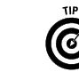

虽然前面的代码是HTML 4对菜单列表的旧式解释，但它仍然符合HTML5规范。

当然，你可能希望使用CSS来为列表项设置样式，使其看起来更像按钮或可点击的元素。

#### details

`details`元素可以包含`summary`元素和其他HTML标签。默认情况下，仅`summary`部分可见。当用户点击`summary`激活`details`时，`details`元素中的其余内容就会显示出来。这提供了一种方便的方式来隐藏和显示内容。

#### dfn

`<dfn>`标签表示一个被定义的术语。请将需要定义的术语用`<dfn></dfn>`标签括起来。

```
<p><dfn>flollop:</dfn>
   The sound a mattress makes when falling into
   a swamp. <br />
   -- Douglas Adams
</p>
```

大多数浏览器会将`<dfn>`标签格式化为斜体，但可以通过CSS来更改样式。`dfn`元素并不替代*定义列表*，后者仍用于许多类型的名称-值对（尽管它最初是为定义而设计的）。

#### figcaption

`<figcaption>`标签为`figure`元素提供标题，并且应该只包含在`<figure>`标签内部。*请参阅*本部分下一节的"figure"了解更多信息。

#### figure

`figure`是一个语义化元素，用于描述一张或多张图片以及可选的标题。`<figure>`标签本身不直接显示任何图片；它被设计为一个容器，用于容纳任何类型的图片（包括标准的``标签，但也可能包括 SVG 或 canvas 图像）。图片可以使用`<figcaption>`标签附加一个可选的标题。

```
<figure>
  
  <figcaption>Laguna De Apoyo, Nicaragua</figcaption>
</figure>
```

你可以在一个`figure`元素中放入多张图片。

目前，浏览器尚未为`figure`和标题提供任何特定的样式或格式，但可以通过CSS来设置这些项目的样式。

#### summary/details

`summary`标签旨在与`details`标签配合使用，为用户提供一个可见的摘要元素。当用户点击`summary`时，`details`元素中之前隐藏的所有其他内容就会变得可用。

```
<details>
  <summary>Batman's secret identity</summary>
  <p>Bruce Wayne</p>
</details>
```

请注意，目前尚无主流浏览器支持`summary`/`details`组合。`summary`和`details`的内容都会被显示出来。你可以通过CSS和JavaScript代码来模拟预期的行为。

### time

`time`元素提供了一个表示日期或时间的字段。此字段将包含一个日期、一个时间，或者一个日期和时间。

```
<p>
  The rooster crows at <time>6:30</time>
  every morning.
</p>
```

目前，浏览器不会对`time`元素应用任何特殊格式。`time`元素中编码的数据应采用标准格式，以便进行时区调整。

#### wbr

`<wbr>`元素用于建议词的换行位置。将此标签放入一个长单词中，以指明在需要进行自动换行时，该单词的合适断开位置。

```
<p>
    The wbr tag is used to mark a space in a long word
    where it would be ap<wbr>propriate to break the
    word if necessary.
</p>
```

目前还没有浏览器支持此标签。

### 媒体元素

HTML5中或许没有比媒体元素更令人期待的功能了。HTML终于在不依赖外部插件的情况下支持了音频和视频。同样令人兴奋的是，通过`canvas`和`svg`机制支持了基于矢量的图形。

#### audio

`<audio>`标签允许用户将音频文件直接嵌入浏览器中。

```
<audio src = "DoYou.ogg" controls>
    <a href = "DoYou.ogg">DoYou.ogg</a>
</audio>
```

如果浏览器不支持`<audio>`标签，那么`<audio>`和`</audio>`之间的代码将会被呈现出来，因此你可以提供一个普通链接让用户下载音频。或者，你也可以为旧版浏览器嵌入一个 Flash 播放器。

`<audio>`标签支持几个标准属性：

- **autoplay**：如果存在此属性，音频文件将在浏览器加载页面时立即播放。通常不应使用此选项，因为未经用户明确许可播放音频被认为是不礼貌的。
- **controls**：如果存在此属性，浏览器将呈现一个简单的控制界面，包括播放/暂停、音量控制和某种进度指示器。不同浏览器的控制界面外观有所不同。最好通过内置控制机制或JavaScript代码给用户提供某种控制方式。


### audio 标签

- **preload**：如果存在此属性，音频文件将在页面加载后立即开始在内存中加载，但直到用户激活播放器才会播放。这可以防止因音频未预加载而可能出现的缓冲。

- **src**：指示文件的地址。请注意，更推荐使用`<source>`标签，因为它允许多种选择。

`<audio>`标签在某种程度上被所有主流浏览器支持，并且预计也会在Internet Explorer 9 (IE9) 中得到支持。然而，实际支持的音频文件格式并未在标准中统一规定，因此不同的浏览器（自然）支持不同的格式。大多数浏览器支持开源的Ogg标准，但少数浏览器（尤其是Safari和IE9）更倾向于Mp3。如果你提供每种格式的一个版本，那么任何新型浏览器很可能都会支持你的音频。使用`<source>`标签来包含多个音频源：

```
<audio>
  <source src = "DoYou.ogg">
  <source src = "DoYou.mp3">
</audio>
```

请注意，`audio`元素可以通过JavaScript代码进行控制。以下代码（在`body.onload`中调用）在页面上添加一个音频元素，但不显示它：

```
var song;

function init(){
  song = document.createElement('audio');
  song.setAttribute('src', 'DoYou.ogg');
} // end init
```

这段代码创建了一个名为`song`的元素，并将一个Ogg文件预加载到该元素中。以下HTML代码创建了一个播放按钮：

```
<button type = "button"
        onclick = "song.play()">
  play
</button>
```

当然，这个按钮可以通过任何你想要的方式来设计，以创建你自己的界面。一旦你在页面中确定了一个音频元素，你就可以对其应用以下JavaScript函数：

- **play**：正如你可能猜到的，这个函数播放文件。令人惊讶的是，没有停止命令。你需要暂停它或将音量设置为零。

- **pause**：这个函数暂停声音。下一次播放命令将从暂停点开始。

- **setAttribute**：这个函数允许你修改通常设置在HTML`<audio>`标签上的任何属性。这主要用于将`src`附加到音频元素。

你还可以访问许多有用的属性：

**currentTime:** 这表示歌曲当前播放到的位置（以秒为单位）。你可以读取它来查找当前位置，或者设置它来跳转到歌曲的特定部分。

**volume:** 音量范围从0（静音）到100（最大）。你可以通过JavaScript代码设置或检索此属性。

### canvas

`<canvas>`标签在屏幕上划出一个区域，用于程序控制的图形。HTML只是在屏幕上划出一块区域作为画布。所有的绘图和图像操作都通过JavaScript代码完成。以下HTML代码设置了一个canvas元素并提供了一个按钮。

```
<canvas id = "myCanvas"
        width = "300"
        height = "200">
This example requires HTML5 canvas support
</canvas>

<button type = "button"
        onclick = "draw()">
  click me to see a drawing
</button>
```

canvas元素本身的作用很小。要使用canvas标签做些有趣的事情，你需要使用JavaScript来获取一个*绘图上下文*（一个可以在其上绘制的特殊元素），并使用该上下文对象的方法来创建动态图形。例如，以下是当用户点击按钮时将被启用的`draw()`函数：

```
function draw(){
  var myCanvas = document.getElementById("myCanvas");
  var context = myCanvas.getContext("2d");
  context.fillStyle = "blue";
  context.strokeStyle = "red";
  circle(context, 1, 1, 1);

  for (i = 1; i <= 200; i+= 2){
    circle(context, i, i, i, "blue");
    circle(context, 300-i, 200-i, i, "red");
    circle(context, 300-i, i, i, "blue");
    circle(context, i, 200-i, i, "red");
  } // 结束 for 循环

} // 结束 draw 函数

function circle(context, x, y, radius, color){

    context.strokeStyle = color;

    context.beginPath();

    context.arc(x, y, radius, 0, Math.PI * 2, true);

    context.stroke();

} // 结束 circle 函数
```

上述画布示例代码的输出如图 3-1 所示。

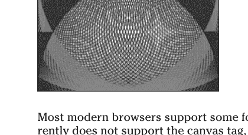

大多数现代浏览器都直接支持某种形式的 canvas 标签。目前，IE 浏览器不支持 canvas 标签，但您可以使用 ExplorerCanvas 插件为 IE 添加 canvas 功能。IE9 浏览器测试版似乎支持 canvas 标签，因此它可能很快会成为一个通用的元素。

目前，只有 2D 绘图上下文可用，但最终计划支持 3D 绘图上下文，以允许在浏览器中直接进行 3D 图形绘制。

`context`对象控制着所有实际的绘图功能。以下是`context`对象的一些主要方法：

- **`arc()`**：arc 命令用于绘制弧线（圆的一部分）作为路径的一部分。弧线像圆一样定义，具有中心和半径，但也具有起始和结束角度。如果角度描述了一个完整的圆（0 到 2 × pi 弧度），arc 命令将绘制一个完整的圆。请参阅前面的示例，了解如何使用 arc 命令创建自定义的圆形函数。

- **`beginPath()`**：此命令开始路径的定义。通常，路径由单个 moveTo 命令定义，后跟一系列 lineTo 命令，最后以 stroke、closePath 或 fill 命令结束。

- **`closePath()`**：此命令将路径的最后一个点（通过 moveTo 和 lineTo 命令绘制）连接到第一个点，创建一个可以填充的封闭形状。

- **`drawImage()`**：drawImage 命令允许您在画布上绘制图像（来自外部图像文件）。许多实现允许像素级操作，从而允许您对图像应用自定义滤镜和变换，这比典型的``标签提供了更多的控制。

- **`fill()`**：fill 命令（及其变体，如 fillRect）允许您将当前的填充样式应用于屏幕上绘制的元素。

- **`fillRect()`**：此命令创建一个指定大小和位置的矩形，并用当前的填充样式填充。

- **`fillStyle()`**：允许您指定填充样式。这可以是标准的颜色值，也可以是预定义的渐变。

- **`lineTo()`**：此命令（与 moveTo 命令一起）允许您在屏幕上构建路径。lineTo 命令接受一个点作为输入，并从先前定义的点绘制到当前点。请注意，在应用 stroke 函数之前，路径不会显示出来。

- **`lineWidth()`**：这定义了 stroke 命令绘制线条的宽度。

- **`moveTo()`**：用于路径定义，moveTo 命令用于指示路径的起点。

- **`stroke()`**：此命令绘制当前定义的路径。请注意，路径不会立即绘制；stroke 命令实际上是在屏幕上绘制路径。

- **`strokeRect()`**：此命令绘制一个未填充的矩形。

- **`strokeStyle()`**：确定下一次描边的样式。大多数绘图上下文支持点线和虚线描边样式，但预计会有更多样式。

- **`text`**：canvas 标签的某些实现允许文本操作。这种支持不均衡，但在未来的实现中很可能会变得普遍。

`canvas`标签是 HTML5 最重要的新功能之一，因为它允许几乎无限地控制视觉界面。游戏开发者已经开始使用 canvas 创建在线游戏，它已经成为几个创新用户界面实验的基础（特别是 Google 地图）。

有关`canvas`元素编程的更多信息，请参阅第 8 部分，同时查看 http://dev.w3.org/html5/canvas-api/canvas-2d-api.html。

### embed 标签

`<embed>`标签可以说是一个通用媒体标签。它（至少在理论上）可以用于将任何类型的媒体嵌入页面，并指定要显示的媒体类型。

## 第 3 部分：新的或更改的 HTML5 元素

```
<embed src = "monsterTraffic.swf"
       type = "application/x-shockwave-flash"
       width = "400"
       height = "400" />
```

此标签允许您嵌入其他媒体标签不支持的媒体。它使用`type`属性根据 MIME 类型确定要使用的适当插件。但是，不能保证该类型会被支持。即使支持，用于显示该元素的特定插件也由客户端控制。

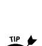

> `<embed>`标签实际上曾从 HTML 和 XHTML 中移除，因为它非常不可靠，但在 HTML5 中它被重新启用。仅将`embed`作为像`img`、`audio`或`video`标签这样更可靠的工具的备份使用。

`embed`元素仍然是包含 Flash 元素的最佳选择，特别是作为音频或视频元素的备份。

### source 标签

`source`标签用于`audio`或`video`元素内部，以指示媒体元素的源。可以列出多个`sources`。浏览器将按顺序尝试每个源，直到找到一个它可以使用的源。这是在音频或视频元素中指示多种可能编码的首选方式。有关示例，请参阅本部分前面的“audio”部分。

### svg 标签

`<svg>`元素允许作者直接在页面中使用 SVG 标记语言构建基于矢量的图像。

```
<svg xmlns:xlink="http://www.w3.org/1999/xlink"
     xmlns="http://www.w3.org/2000/svg"
     viewBox="0 0 200 100"
     width="200px" height="100px">

  <circle cx="50" cy="50" r="30"
          style="stroke:#0000ff; stroke-width: 5px;
                 fill:#ff0000;"/>

  <rect x = "100"
        y = "0"
        height = "50"
        width = "50"
        stroke-width = "2px"
        stroke = "#ffff00"
        fill = "#00ff00" />

</svg>
```

此处 svg.html 示例代码的输出如图 3-2 所示。

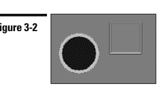

SVG 使用的 XML 系统与 XHTML 非常相似。每个元素都由一个标签描述，该标签具有定义其大小、位置和颜色的各种属性。SVG 元素也可以通过某种形式的 CSS 进行修改。也可以使用 JavaScript 代码实时创建和修改 SVG 代码。SVG 经常用于动态创建图表或其他可视化内容。此外，可以从 Dia 或 Inkscape 等工具中导出 SVG 图像，并将生成的绘图直接嵌入页面中。像 SVG 这样的基于矢量的图像格式的主要优势在于能够缩放图像而不损失图像质量。

除 IE 外的所有主要浏览器在其最新版本中都已支持某种程度的 SVG，微软计划在 IE9 中包含 SVG。

> 有关 SVG 标准的更多信息，请参阅 W3C 的 SVG 页面：www.w3.org/Graphics/SVG。

### video 标签

`<video>`元素是 HTML5 更受期待的功能之一。使用此标签，开发人员将能够将视频嵌入网页，而无需像 Flash 这样的插件。

```
<video src = "bigBuck.ogv" controls>
  Your browser does not support embedded video
  through HTML5.
</video>
```

`<video>`标签本身相当容易理解，但实际实现有些复杂。HTML5 指定了`video`标签，但它没有指定浏览器将支持哪种格式。所有浏览器制造商对于将支持哪种格式都有不同的看法，这并不会让您感到惊讶。目前，有三种主要的视频格式在竞争。

- **Ogg/Theora/Vorbis：** Ogg 是一种容器格式，使用 Vorbis 编码进行音频，使用 Theora 编码进行视频。Ogg 系统不受任何已知专利的限制。它受到 Firefox、Chrome 和 Opera 的支持。（如果用户为 QuickTime 安装了 Vorbis 插件，Safari 也支持它。）IE9 根本不打算支持这种格式。

## 第三部分：新增或变更的HTML5元素

- **MP4/H.264/AAC：** MP4标准是一种容器格式，使用H.264进行视频编码，AAC进行音频编码。这三种格式均受专利限制。Safari、Chrome、iPhone和Android均支持此格式。IE计划在IE9中提供支持。

- **WebM/VP8/Vorbis：** WebM是Google推出的一个相对较新的标准。它使用VP8视频编码格式和Vorbis音频编码。目前对WebM的支持尚少，但大多数浏览器表示将在未来版本中支持此格式。

如果你想整合HTML5视频，请使用`<source>`标签来包含所有主要格式。（你可以使用适用于所有主要软件平台的免费FFmpeg工具来转换视频。）作为最终的后备方案，请在`<video>`标签内使用`<embed>`标签来通过Flash播放器加载视频。

你可以像控制音频一样，使用JavaScript来控制`video`元素。有关通过JavaScript代码控制媒体元素的更多信息，请参阅本部分前面的“音频”部分。

### Ruby元素

Web是一个真正的国际化现象。HTML5通过一系列支持*Ruby*的标签承认了这一现象。Ruby是一种主要用于亚洲语言的标记形式。

请注意，Ruby也是一个编程语言的名称（起源于日本），有时用于服务器端Web开发。在HTML5的上下文中，Ruby指的是标记机制，而非编程语言。

#### ruby

`<ruby>`标签标记一段预期包含Ruby注释的代码。

#### rt

`<rt>`标签放置在Ruby标记内。它包含对前面字符的发音指南。它主要用于中文和日语等语言中不常用的字符。

#### rp

官方上，`<rp>`标签在浏览器不支持`<rt>`时使用。

目前，尚无主要浏览器支持任何Ruby标记。

## 第四部分

### 新增和修改的表单元素

表单从一开始就一直是HTML的一部分。随着网站演变为应用程序框架，基本的表单元素开始显露出其年代感。许多工具（包括XForms和第三方插件如jQuery UI）试图给表单元素改头换面。HTML5最终对表单元素增添了一些亟需的关注。该标准包括几个新的表单元素，以及对标准input元素的一些新增内容和可以应用于任何表单元素的新属性。

#### 在本部分中 ...

- 介绍新的表单元素

- 探索新的表单元素属性

- 尝试新的表单输入类型

#### 新的表单元素

HTML5中引入了许多新的表单元素。这些新工具中的每一个都增加了一种新功能。当然，它们并非全部都已获得支持，但确实展示了一些前景。其中一部分值得注意的表单元素设计用于让程序动态修改页面的一部分。

##### datalist

`datalist`元素允许开发者为文本输入元素附加一个建议列表。一旦用户开始在文本字段中输入，建议列表就会出现，用户可以用鼠标从建议中选择。

```
<label for = "txtList">Your name
  <input type = "text"
         list = "names"
         id = "txtList"/>
  <datalist id = "names">
    <option value = "Andy">
    <option value = "Andrew">
    <option value = "Androcles">
  </datalist>
</label>
```

`datalist`元素目前仅受Opera支持。你可以在`datalist`对象内嵌入一个普通的HTML`<select>`元素（与文本元素具有相同的`id`）。能够支持datalist的浏览器会这样做，其他浏览器则会显示`select`元素。

许多其他字段（尤其是`number`输入类型）具有一个`list`属性，可将该元素连接到一个datalist。这旨在允许datalist与其他类型的输入连接，但目前对此行为的支持尚少。

##### fieldset

从技术上讲，`fieldset`元素对HTML5来说并非新东西，但开发者并未广泛使用它。所有表单元素都应该嵌入在某种块级元素中，而`fieldset`显然是完成此工作的工具。默认情况下，`fieldset`在其子标签周围绘制一个简单的黑色边框。使用`<legend>`标签为`fieldset`添加标签。


```
<form action = "">
  <fieldset>
    <legend>My Form</legend>
    <label for = "myInput">
      <input type = "text"
             id = "myInput" />
    </label>
  </fieldset>
</form>
```

所有主要浏览器均支持`fieldset`元素。

### keygen

`keygen`元素生成一个加密密钥，用于将加密数据传递给服务器。

```
<label for = "key">keygen
    <keygen id = "key"
            keytype = "rsa"
            challenge = "openSesame" />
</label>
```

`<keygen>`标签有多个参数：

- `keytype`：指定加密类型。（rsa是标准。）
- `challenge`：随公钥传递的字符串。（通常由服务器指定。）

`keygen`元素在HTML5社区中备受争议。一些安全专家认为其加密机制已经过时，并且使用该工具需要具备相对较少的Web开发者所拥有的加密知识。`keygen`元素目前尚未在任何浏览器中得到支持，它可能不会成为标准的一部分。

### label

与`fieldset`元素一样，`label`也已存在一段时间但一直未被充分利用。`label`标签允许你将一个HTML元素附加到一个表单输入元素。`for`属性保存与该标签相关联的元素的`id`。表单元素通常嵌入到标签中以简化CSS格式化，并且标签可以提供一些用户界面优势。例如，如果标签附加到一个复选框或单选按钮选项，用户可以单击标签或选项来进行选择。

> 一些Web开发人员会将input标签嵌入到相应的标签中以简化CSS格式化。我在这个参考手册中都使用了这种技术。

使用字段集、标签和一些基本的CSS可以消除使用表格进行表单布局的需要。以下CSS展示了一种简单的方法，可以使表单整齐对齐，而无需增加使用表格进行布局管理的额外复杂性：

```
<style type = "text/css">
  label{
    display: block;
    width: 60%;
    text-align: right;
    margin-right: 1em;
  }
  input {
    width:40%;
  }
</style>
```

### meter

`meter`标签表示一个落在某个范围内的数值。

```
<p>
  A
  <meter min = "0"
         max = "10"
         value = "7"></meter>
</p>
```

`meter`标签可以放置在表单中，也可以放置在任何需要表示某个值落在规定范围内的其他地方。`meter`标签支持多个属性：

- `value`：如果未将其指定为属性，则`<meter></meter>`对内的第一个数值将被视为该值。
- `max`：该项目可能的最大值。
- `min`：该项目可能的最小值。
- `high`：如果该值可以定义为一个范围，则此为范围的高端。
- `low`：如果该值可以定义为一个范围，则此为该范围的低端。
- `optimum`：这是该元素的最佳值。

`value`、`high`、`low`和`optimum`值都应在`min`和`max`之间。虽然目前基于webkit的浏览器显示一个小的柱状图，但并未为此元素指定特定的显示机制。请注意，`meter`元素用于`output`一个数值元素。要进行范围内的数值输入，请使用`<input type = "range">`。

`meter`标签通常在表单中使用，但它可以出现在文档中的任何位置。`meter`的`value`可以通过JavaScript像任何表单元素的`value`一样动态更改。

### output

`output`元素用于显示文本输出。它表示页面中将被脚本（通常是JavaScript）修改的部分。请看以下代码片段：

```
<output id = "myOutput">
    This is the original value
</output>
<button onclick = "changeOutput()">
    change the output
</button>
```

当按钮被按下时，它将调用`changeOutput()` JavaScript函数，该函数可能如下所示：

```
function changeOutput(){
    var myOutput = document.getElementById("myOutput");
    myOutput.value = "The value has changed";
} // end changeOutput
```

当此函数运行时，它会更改`myOutput`的内容。`output`元素目前由Opera支持。它没有与之关联的任何特定视觉样式。在使用此元素变得更加普遍之前，你可以使用任何页面元素的`innerHTML`属性来通过代码动态更改其内容。`output`标签通常嵌入在表单中，因为它是一个用户交互元素，但它可以出现在页面的任何位置。

### progress

`<progress>`标签表示任务的完成进度（通常标记为百分比）。

```
<p>Now destroying the world. <br />
<p>
    progress:
    <progress value = "25"
              max = "100"></progress>
</p>
```

大多数浏览器以纯文本形式指示进度，但可以合理地推测，某种视觉量表可能会变得可用。

## 第4部分：新增和修改的表单元素

`progress`元素预计将通过JavaScript代码进行修改。因为它与JavaScript相关联，`progress`元素通常包含在表单中，但它们可以放置在页面的任何位置。

## 新的表单元素属性

除了HTML5中引入的新表单元素外，所有表单元素都获得了一些新特性。这些新属性和功能可以应用于任何表单元素。

### autofocus

`autofocus`属性可以应用于任何表单元素。如果一个元素具有此属性，则该元素将成为第一个用户输入的焦点。通常将`autofocus`属性应用于表单的第一个元素。

```
<form action = "">
  <fieldset>
    <label>name
      <input type = "text"
             autofocus />
    </label>
    <label>email
      <input type = "email">
    </label>
  </fieldset>
</form>
```

如果浏览器不接受`autofocus`属性，不会发生任何有害的事情，你仍然可以使用基于JavaScript的解决方案。当然，每个表单只有一个`autofocus`字段是有意义的。

### pattern

`pattern`属性允许你指定用于验证表单的正则表达式。如果内容与正则表达式匹配，则该字段将被视为有效。（有关更多详细信息，请参阅本部分后面的“验证”部分。）仅当标准验证技术不足时才应使用`pattern`属性，因为调试正则表达式可能很困难。

```
<input type = "text"
       id = "txtPhone"
       pattern = "\(\d{3}\) +\d{3}-\d{4}"
       title = "(ddd) ddd-dddd" />
```

当你指定`pattern`时，还应该包含一个`title`属性。`title`应该说明模式是什么。浏览器可以将其用作用户的提示。将`pattern`信息作为占位符文本添加也可能有用。（请参阅下一节了解更多信息。）

请参阅我的书《JavaScript & AJAX For Dummies》（Wiley Publishing）第7章，了解正则表达式的完整描述以及如何将其用于页面验证。

### placeholder

`placeholder`属性允许你在文本字段中添加特殊的占位符值。此占位符充当临时标签，显示字段的用途，而无需`label`标签。一旦用户激活该字段，占位符文本就会消失。

```
<input type = "text"
       placeholder = "Name" />
```

并非所有浏览器都支持占位符文本。其他浏览器将简单地忽略`placeholder`属性。同样，如果字段已经填写，则占位符将不可见。出于这些原因，仍然建议添加标签，以便用户知道在每个文本区域中输入什么。当占位符文本用于指示输入应如何格式化时（特别是如果这将通过验证或模式强制执行），它特别有用。

### required

`required`属性允许你将特定字段指定为必需字段。支持的浏览器会将所有必需字段标记（可能通过红色高亮显示）为未填写。如果用户尝试提交包含空必需字段的表单，某些浏览器还会发送警告。

```
<input type = "text"
       required />
```

特殊的`:required`伪类允许你将CSS样式应用于表单中的所有必需元素（例如，为它们提供边框或背景颜色）。这是一个为必需元素添加红色边框的CSS样式示例：

```
:required {
    border: 1px solid red;
}
```

### 验证

表单验证是Web开发中最棘手的部分之一。设置一个要求用户提供信息的表单相当容易，但要确保用户正确输入信息可能相当困难。例如，电子邮件地址应包含几个字母、一个“at”符号（`@`）、更多字母、一个句点以及一个两到四个字符的顶级域。通常，程序员使用诸如JavaScript中的正则表达式解析之类的技巧来确保数据格式正确。

> 如果你需要在不使用HTML5的情况下支持验证，请参阅我的书《JavaScript & AJAX For Dummies》（Wiley），了解如何使用正则表达式进行表单验证的完整讨论。

HTML5承诺提供更简单的解决方案。当你使用专用输入元素（在下一节中描述）时，浏览器将自动检查表单字段以确保其格式正确。如果条目无效，（通常）表单将不会提交，并且特殊的`:invalid` CSS伪类将与无效字段关联。只需向你的页面提供处理`:invalid`状态的CSS：

```
:invalid {
    background-color: red;
}
```

当此CSS状态处于活动状态时，任何无效字段都将具有`:invalid`样式。例如，如果你有一个颜色字段并在此处定义了红色背景CSS样式，则颜色字段将具有红色背景，除非用户输入有效的颜色（公认的颜色名称或十六进制颜色值）。同样，电子邮件字段将显示红色，直到输入有效的电子邮件地址。

开发人员不需要向表单添加任何其他代码。只需添加CSS以显示无效条目，浏览器就会完成其余工作。

请注意，如果字段是必需的（具有`required`属性），则在包含某些值之前，它将被视为无效。

浏览器可能会拒绝处理表单，直到所有字段都经过验证，但这种行为在HTML5兼容浏览器中似乎还不是普遍的。

如果你愿意，可以通过向该元素添加`novalidate`属性来关闭任何字段的验证。

## 新的表单输入类型

HTML表单围绕着朴素但灵活的`input`元素而构建。HTML 4中使用相同的元素来构建许多不同类型的界面小部件，从标准文本和密码字段到单选按钮和复选框。HTML5添加了许多非常有用的输入形式，有助于将HTML转变为更现代的用户界面工具。

尽管对这些标签的支持并非普遍，但现在开始使用它们是安全的。任何不理解高级输入类型的浏览器（甚至IE6）都将回退到`<input type="text" />`，这仍然可以完全按预期工作（尽管没有新标签的验证和用户界面改进）。


请注意，该标准表明将支持各种类型，但支持元素的确切方式会因浏览器而异。例如，对于使用标准桌面计算机的用户，电子邮件字段可能看起来就像普通文本字段，但移动设备上的虚拟键盘在遇到电子邮件字段时可能会更改以包含`@`。

大多数这些专用字段确实支持验证，因此至少设置一个`:invalid` CSS样式是有用的，这样用户就可以知道数据是否在字段中。

### color

`color`工具允许用户使用标准Web格式选择颜色——公认的颜色名称（`yellow`）和以`#`符号开头的十六进制值（`#FF0033`）。浏览器可能会显示类似于文字处理器和图像编辑程序中的颜色选择工具。目前，大多数浏览器只显示一个文本框，并指示当前内容是否为有效的颜色名称或值。

```
<input type="color"
       id="color" />
```

### date

将`input`类型设置为`date`表示你希望用户输入日期值。某些浏览器（Firefox 3.5）仍会显示文本字段，而其他浏览器（Opera 10）将显示特殊的日历控件，允许更准确和更容易地选择日期。还有其他浏览器（Chrome）将同时包含文本和弹出日历。如果通过文本输入日期，则必须以`yyyy-mm-dd`格式输入。

```
<input type="date"
       id="date" />
```

你可以通过将`min`和`max`属性应用于元素来将允许的日期限制为特定范围。

### datetime

`datetime`元素将`date`和`time`组合到一个元素中。它还包括一个输入时区的机制。

```
<input type="datetime"
       id="datetime" />
```

某些浏览器会为日期弹出日历控件，并为时间提供格式化的输入界面。其他浏览器则可能为日期和时间输入修改虚拟键盘。

各种日期和时间元素返回的官方完整日期时间格式是一种专门的代码：

```
yyyy-mm-ddThh:mm+ff:gg
```

代码中的每个字符都描述了日期和时间的一部分：

- `yyyy`：四位数字表示年份。
- `-`：一个实际的连字符，必须放在年和月之间。另一个连字符放在月和日之间。
- `mm`：两位数字表示月份。
- `dd`：两位数字表示日。
- `T`：大写`T`表示代码中时间部分的开始。
- `hh`：两位数字表示小时，采用24小时制。
- `:`：小时和分钟之间的冒号字符。时区偏移量的小时和分钟之间也会出现另一个冒号。
- `mm`：两位数字表示分钟。
- `+/-/Z`：时区偏移量由大写`Z`（如果时间是祖鲁时间或GMT时间）或`+`或`-`符号表示（如果时间在其他时区）。
- `ff`：如果时区不是祖鲁时间，表示与GMT相差的小时数。
- `gg`：与祖鲁时间相差的分钟数。通常为`00`，但时区偏移量也可能是`15`、`30`或`45`分钟。

例如，2010年10月11日下午5:30在纽约表示如下：

```
2010-10-11T17:30-05:00
```

如果用户使用验证`dateTime`字段的浏览器，日期和时间需要符合此格式才能被视为有效。`dateTime`字段的值将采用此格式，这对计算机程序来说相对容易解析和管理。

### datetime-local

`datetime-local`元素与`datetime`元素类似，但不包含时区指示符。

```
<input type="datetime-local"
       id="datetimeLocal" />
```

`datetime-local`输入类型期望并返回与标准`datetime`元素相同格式的日期和时间，只是`datetime-local`不包含时区偏移量。

### email

`email`元素通常看起来像一个纯文本字段，但它会验证电子邮件地址。此外，浏览器可能会以其他方式修改用户体验。例如，移动浏览器可能会修改虚拟键盘以包含`@`符号，该符号始终存在于电子邮件地址中。

```
<input type="email"
       id="txtEmail" />
```

### month

`month`输入类型生成四位年份后跟两位月份。它经常弹出与其他日期选择器相同的日历控件，但只返回年份和月份（`yyyy-mm`格式）。

```
<input type="month"
       id="month" />
```

### number

`number`字段允许输入数字数据。这通常由一个文本字段后跟某种选择器（例如，上下箭头）组成，或者它可能会改变便携设备的虚拟键盘，使其仅处理数字输入。

```
<input type="number"
       id="number"
       max="10"
       min="0" />
```

`number`输入类型支持几个特殊属性：

- `min`：这是允许的最小值。如果存在屏幕输入元素，它将不允许小于`min`值的值。如果字段的值小于`min`值，该字段也将无法通过验证。
- `max`：这是允许的最大值。如果存在屏幕输入元素，它将不允许大于`max`值的值。如果字段的值大于`max`值，该字段将无法通过验证。
- `step`：此值表示可视化界面工具（通常是小的上下箭头）在激活时将更改多少值。
- `value`：这是元素的数值。

`number`元素的所有属性都可以是整数或浮点数。但是，当前支持此标签的浏览器（Opera和Chrome）似乎对浮点值的验证不如对整数值的验证好。要对数字输入进行更多控制，请考虑使用`range`输入类型。（请参阅下一节。）

### range

`range`输入类型是HTML工具箱中期待已久的新增功能。用户界面专家多年来一直知道，用户输入整数值非常难以正确实现。大多数用户界面工具包都有某种滑块或滚动条机制，这使得用户可以轻松地以可视化方式输入数值。`<input type="range">`构造终于将此功能添加到HTML表单中。


```
<input type="range"
       id="range"
       min="0"
       max="255"
       value="128" />
```

`range`输入接受与`number`相同的属性：`min`、`max`、`value`和`step`。如果浏览器支持`range`标签，用户将看到一个滚动条；如果不支持，将出现一个纯文本输入类型。当`range`元素变得普及时，将鼓励其使用，因为将用户输入限制在有效范围内要比事后检查用户输入容易得多（尤其是当执行此操作的机制是可视化且易于操作时）。

然而，`range`类型不显示确切的值，并且比`number`输入类型更难获得精确的结果。一个解决方案是将`output`标签与`range`配对，并在range更改时使用JavaScript更新输出。下面是一个包含此想法的示例表单：

```
<form action="">
  <fieldset>
    <input id="myRange"
           type="range"
           min="0"
           max="255"
           value="128"
           onchange="updateOutput()" />

    <output id="myOutput">128</output>
  </fieldset>
</form>
```

当`range`值更改时，它会调用一个名为`updateOutput`的JavaScript函数。该函数如下：

```
function updateOutput(){
    //get elements
    var myRange = document.getElementById("myRange");
    var myOutput = document.getElementById("myOutput");

    //copy the value over
    myOutput.value = myRange.value;
} // end function
```

与`number`输入类型一样，如果需要，也可以为`range`提供浮点值。

### search

`search`输入类型用于检索旨在用作搜索一部分的文本（内部搜索或通过Google等搜索服务）。在大多数浏览器上，它显示为一个普通的文本字段。它有时确实会有一些特殊行为。在Safari上，搜索字段显示一个小的`x`，用于清除搜索内容。在Chrome上，主搜索栏（也是Chrome中的URL输入元素）的自动完成功能会自动应用于搜索框。

```
<input type="search"
       id="search" />
```

与其他新的输入类型一样，在不支持它的浏览器中使用`search`元素不会有任何损失。回退方案是纯文本输入。

请注意，`search`元素实际上并不执行任何搜索。如果你想实际搜索该值，你仍然需要编写一些代码。`search`元素确实为你提供了一个与浏览器集成搜索工具一致的界面，但实际行为仍由程序员决定。

### tel

`tel`字段用于输入电话号码。它期望三位数字后跟一个连字符和四位数字。如果希望允许区号或分机通过验证，可能需要使用`pattern`属性。

```
<input type="tel"
       id="tel" />
```

### time

`time`输入类型的目的是允许用户输入时间。时间以`hh:mm`格式存储，其中`hh`是小时（24小时制），`mm`是分钟。某些浏览器会直接在字段中包含冒号，而其他浏览器则会修改虚拟键盘以包含数字和冒号字符。浏览器也可能会弹出某种自定义时间选择器，但目前主要浏览器尚不支持此功能。

```
<input type="time"
       id="time" />
```

### url

使用`url`输入类型指示网址。支持此元素的浏览器将检查`http://`前缀。移动浏览器也可能调整虚拟键盘以包含URL中常见的字符：冒号（`:`）、正斜杠（`/`）和波浪号（`~`）。

```
<input type="url"
       id="url" />
```

### week

`week`字段用于从日历控件中选择一周。它返回以下格式的值：

`yyyy-Wnn`

- `yyyy`：表示四位年份。
- `-`：连字符。
- `W`：大写*W*字符。
- `nn`：两位数字表示的周数。

某些浏览器会弹出标准的日历控件。当用户选择日期（或周）时，将只返回年份和周。其他浏览器将仅验证格式是否正确。

```
<input type="week"
       id="week" />
```

# 第五部分

## 使用CSS进行格式化

早期的HTML形式很少关注页面布局的视觉效果。最初的计划是让HTML更多地与页面元素的*含义*而非其显示方式相关联。在Web的最初阶段，这没问题，但很快人们就想要比HTML能够提供的复杂得多的设计元素。浏览器制造商通过添加特定于供应商的标签来应对，这些标签增加了新功能，但大大增加了开发工作的复杂性。

HTML5试图让HTML回归早期的简洁性。所有曾经用于直接管理页面外观的标签（如`<font>`、`<center>`、`<b>`和`<i>`等标签）都被移除。为了取代用于指示格式的特殊标签，人们设计了一种新的语言，它可以为几乎任何HTML/XHTML标签提供非常强大的格式化功能。CSS（层叠样式表）就是这种语言。

本部分回顾了CSS的当前状况。如果您已经熟悉CSS技术，可以随意跳过这部分。但是，如果您需要了解当前技术的最新状态，那么您来对地方了。此处描述的CSS适用于所有主要浏览器。第六部分介绍了作为HTML5一部分的新CSS功能。

请务必访问我的网站，查看本书中每个代码片段的实际示例：[www.aharrisbooks.net/h5qr](http://www.aharrisbooks.net/h5qr)。

### 本部分内容...

- 了解CSS概述
- 控制页面外观
- 利用浮动定位

### CSS快速概述

CSS通过描述页面的某些部分（一个特定的标签、所有特定类型的标签或所有具有特定特性的标签）来工作。对于每个标签组，您可以定义多个*规则*。每个规则是一个名称/值对。看看图5-1中显示的简单页面。

生成此页面的代码如下所示：

```html
<!DOCTYPE HTML>
<html lang = "en">
<head>
  <title>cssColors.html</title>
  <meta charset = "UTF-8" />
  <style type = "text/css">
    body {
      background-color: yellow;
    }

    h1 {
      color: red;
    }

    p {
      color: blue;
      background-color: white;
    }
  </style>
</head>
<body>
  <h1>CSS Colors</h1>
  <p>
    The heading is red, this paragraph is blue on white, and
    the page background is yellow.
  </p>
</body>
</html>
```

不言而喻，在黑白书籍中查看关于颜色的页面令人失望。一如既往，请务必查看本书的配套网页（www.aharrisbooks.net/h5qr），以查看此页面的完整效果，并在您自己的机器上尝试。

这些新元素并不令人惊讶，但它们非常强大。请注意，颜色的更改无需更改HTML主体中的任何内容。所有真正的操作都发生在页眉的一个特殊部分。这就是CSS的魅力所在。它使您的HTML更加简洁，因为大部分格式化可以放在其他地方。以下是向页面添加颜色格式化（或任何CSS）的方法：

1. 从干净有效的HTML代码开始。在尝试进行其他太多操作之前，请确保您的HTML代码经过验证。不规范的HTML不总是会像您认为的那样响应CSS。
2. 在页面页眉中添加`<style>`标签。`<style>`标签允许您直接在页面上添加*样式表*（格式化指令列表）。有关如何将样式表放在其他位置，请*参见*本部分后面的“管理CSS级别”。将样式的类型设置为`text/css`。您将使用的样式类型唯一值就是`text/css`。
3. 指示要修改的标签。我更改的第一个标签是`body`。对`body`标签的更改将影响页面的整个可见部分，因此这是一个很好的起点。只需键入标签名称（不带尖括号）。
4. 使用花括号（`{}`）将此样式的规则括起来。您可能有多个规则来描述应如何显示正文。对于每个样式，您需要将所有规则括在一对花括号中。
5. 标记`background-color`属性。每个规则由一个*属性*和一个*值*组成。属性是元素的内置特性，值是我们希望赋予该属性的值。目前，要更改背景的背景颜色，因此请输入`background-color:`。请注意，必须在属性名称后加上冒号（`:`）。大小写和拼写很重要，因此请小心。
6. 指示要应用于该属性的值。对于此示例，我想要黄色背景，因此只需在属性`background-color:`后键入值`yellow;`。这将导致正文的背景颜色设置为黄色。
7. 每个值以分号（`;`）结尾。每个值必须以分号结尾。如果一个标签有很多规则（这很常见），分号可帮助浏览器将所有不同的规则彼此分开。
8. 使用`color`属性更改前景色。注意我如何将一级标题设为红色。将`h1`设置为新标签，并将其`color`属性设置为值`red`。
9. 一个标签可以有多个规则。看看段落（`p`）标签的规则。您会看到我同时设置了前景色和背景色。

> 您将在下一节中找到更多关于可以使用哪些颜色的信息。不过，现在只需尝试使用各种颜色名称。大多数常见颜色名称的效果与您预期的相同。当您想要更花哨的颜色时，您将需要了解如何使用复杂的十六进制代码；*请参见*本部分后面的“理解十六进制颜色”。

### 使用局部样式

CSS有丰富的机制来处理颜色。每当您想要指定颜色时，只需键入颜色名称即可。图5-2展示了CSS能理解的16种颜色名称。

在黑白书籍中展示颜色的页面不是很实用，因此您肯定需要在我的网站（www.aharrisbooks.net/h5qr）上查看此页面（以及本书中的所有其他页面）。

图5-2中的`namedColors.html`页面还有另一个技巧。查看源代码，您就会明白我的意思：

```html
<!DOCTYPE HTML>
<html lang = "en">
<head>
    <title>namedColors.html</title>
    <meta charset = "UTF-8" />
</head>

<body>
    <h1>Named Colors</h1>
    <table>
        <tr>
            <th>color name</th>
            <th>color value</th>
        </tr>

        <tr>
            <td>aqua</td>
            <td style="background-color: aqua;"><br /></td>
        </tr>

        <tr>
            <td>black</td>
            <td style="background-color: black;"><br /></td>
        </tr>

        <tr>
            <td>blue</td>
            <td style="background-color: blue;"><br /></td>
        </tr>

        <tr>
            <td>fuchsia</td>
            <td style="background-color: fuchsia;"><br /></td>
        </tr>

        <tr>
            <td>gray</td>
            <td style="background-color: gray;"><br /></td>
        </tr>

        <tr>
            <td>green</td>
            <td style="background-color: green;"><br /></td>
        </tr>

        <tr>
            <td>lime</td>
            <td style="background-color: lime;"><br /></td>
        </tr>

        <tr>
            <td>maroon</td>
            <td style="background-color: maroon;"><br /></td>
        </tr>

        <tr>
            <td>navy</td>
            <td style="background-color: navy;"><br /></td>
        </tr>

        <tr>
            <td>olive</td>
            <td style="background-color: olive;"><br /></td>
        </tr>

        <tr>
            <td>purple</td>
            <td style="background-color: purple;"><br /></td>
        </tr>

        <tr>
            <td>red</td>
            <td style="background-color: red;"><br /></td>
        </tr>

        <tr>
            <td>silver</td>
            <td style="background-color: silver;"><br /></td>
        </tr>

        <tr>
            <td>teal</td>
            <td style="background-color: teal;"><br /></td>
        </tr>

        <tr>
            <td>white</td>
            <td style="background-color: white;"><br /></td>
        </tr>

        <tr>
            <td>yellow</td>
            <td style="background-color: yellow;"><br /></td>
        </tr>
    </table>
</body>
</html>
```

此页面使用表格来演示CSS识别的所有颜色。颜色名称旁边是一个背景色设置为该颜色的表格单元格。请注意，在本例中，我没有在文档顶部使用一个大的样式表，而是直接在HTML页面的正文中添加了几个较小的样式。这种技术被称为*局部样式*。

大多数HTML标签都有一个名为`style`的属性。如果你愿意，你可以直接向此样式中添加CSS规则。例如，要制作aqua颜色的单元格，请查看以下代码：

```
<td style="background-color: aqua;"><br /></td>
```

> 局部样式易于使用，但并非完美。它们往往会使HTML代码变得杂乱，而这正是CSS试图避免的。不过，这种技术在少数情况下很有用，就像这个例子一样。

### 利用id和class

CSS非常有用，因为它允许你快速地为所有特定类型的元素添加样式。例如，你可以非常容易地让页面上所有段落都具有相同的颜色。但如果你只想将样式应用于单个元素呢？如果你有两种不同样式的段落，应该怎么办？

图5-3展示了CSS解决这些问题的方式。

#### 图5-3

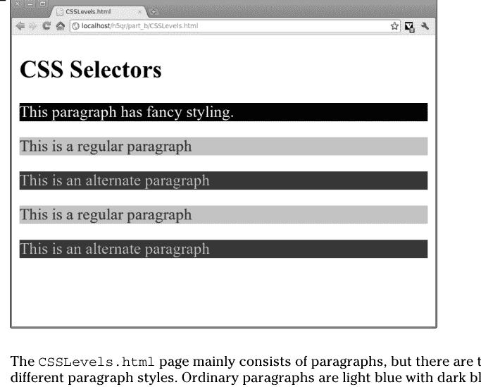

`CSSLevels.html`页面主要由段落组成，但有三种不同的段落样式。普通段落是浅蓝色背景，深蓝色文字。有两种特殊的段落。一个段落有一个特殊名称（`fancy`）。`fancy`段落有其自己的样式。只有一个`fancy`段落，但有两个使用`alternate`样式的段落。请先查看代码，然后我将解释它是如何工作的。


```
<!DOCTYPE HTML>
<html lang = "en">
<head>
    <title>CSSLevels.html</title>
    <meta charset = "UTF-8" />
    <style type = "text/css">
        p {
            background-color: lightblue;
            color: blue
        }

        #fancy {
            background-color: black;
            color: white;
        }

        .alternate {
            background-color: blue;
            color: lightblue;
        }
    </style>
</head>
<body>
    <h2>CSS Selectors</h2>
    <p id = "fancy">
        This paragraph has fancy styling.
    </p>

    <p>
        This is a regular paragraph.
    </p>

    <p class = "alternate">
        This is an alternate paragraph.
    </p>

    <p>
        This is a regular paragraph.
    </p>

    <p class = "alternate">
        This is an alternate paragraph.
    </p>
</body>
</html>
```

首先，看看 HTML。它几乎相同，但我在一些段落中添加了一些特殊的指示符。

- **普通段落：** 这些段落不需要任何特殊功能。它们将根据常规的 `p` 样式规则进行样式设置。
- **命名段落：** 第一个段落有一个 `id` 属性。此属性允许你为任何 HTML 对象指定一个名称。`id` 必须是唯一的，这意味着屏幕上只能有一个对象拥有任何特定的 `id`。`id` 可以是任何你想要的，但它应该是一个没有空格或标点符号的单词。如果一个对象有 `id`，你可以将样式应用于该特定的 `id`。
- **类中的段落：** 除了 `id` 属性外，你还可以为任何 HTML 元素分配一个 `class`。`class` 属性允许你表明一个元素是特定类的成员。与 `id` 不同，你可以在同一个类中拥有任意数量的元素。alternate 段落都将 `class` 属性设置为 `alternate`。你可以使用任何你想要的术语作为类名，但不应包含空格或标点符号。你可以将样式应用于所有具有某个类的元素。不同类型的元素都可以拥有相同的类，因此如果你愿意，可以将相同的类应用于段落和标题。

一旦你在 HTML 中应用了 `id` 和 `class`，你就可以修改 CSS 代码以将样式应用于各种元素。

在 CSS 中，在 `id` 前使用井号（`#`）表示你想要为具有该 `id` 的元素设置样式。例如，此代码为 `id` 为 `fancy` 的任何元素设置样式：

```
#fancy {
  background-color: black;
  color: white;
}
```

在类名前使用句点来为特定类定义样式。例如，你可以使用此代码为 `alternate` 类的所有元素设置样式：

```
.alternate {
  background-color: blue;
  color: lightblue;
}
```

当你要将样式应用于页面上的单个元素时，使用 `id` 方法。当你要将样式附加到所有特定类型的元素时，使用标签名称。当你想将样式附加到一组可能相同也可能不同类型的元素时，使用类机制。

### 管理 CSS 层级

CSS 代码可以通过这三种不同的方式添加到页面中：

- **在 HTML 正文内局部使用：** 你可以使用 `style` 属性直接将样式应用于大多数 HTML 标签。此技术在前面“使用局部样式”部分中进行了说明。
- **在页面头部级别：** 此技术使用 `<style></style>` 对放在 HTML 页面的 `head` 内。这是为特定页面指定样式的好方法。
- **在外部文档中：** 样式可以在单独的文档中指定，然后从网页中引用。这种方法允许你在多个页面之间共享一组样式规则。它也使主页面变得整洁，因为样式被移出了视线。

图 5-4 演示了一个使用外部样式表的简单页面。

#### 图 5-4

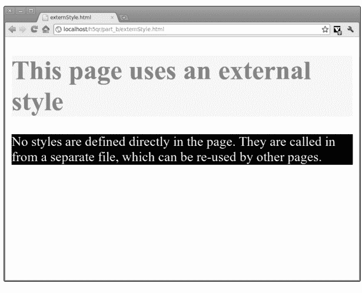

当你查看图 5-4 的源代码时，你会看到没有任何 CSS！

```
<!DOCTYPE HTML>
<html lang = "en">
<head>
  <title>externStyle.html</title>
  <meta charset = "UTF-8" />
  <link rel = "stylesheet"
        type = "text/css"
        href = "externStyle.css" />
</head>
<body>
  <h1>This page uses an external style</h1>

  <p>
    No styles are defined directly in the page. They are
    called in from
    a separate file, which can be reused by other pages.
  </p>
</body>
</html>
```

此清单的有趣之处在于，该页面显然具有样式，但样式信息并不直接出现在页面上。秘诀在于头部中明显的 `link` 标签。此标签允许你从单独的页面引入样式。要构建外部链接，请按照以下步骤操作：

1. 在头部添加一个 `<link>` 标签。`link` 标签允许你将另一个文件与当前页面关联起来。它对于将样式表附加到网页非常有用。
2. 将 `rel` 属性设置为 `stylesheet`。`rel` 属性指定外部文件的性质。使用 `stylesheet` 值表示你正在向页面附加样式。
3. 将 `type` 设置为 `text/css`。链接的样式被表示为 `text/css`，就像嵌入的样式（使用 `style` 标签创建的那些）一样。
4. 使用 `href` 属性指定样式表的位置。使用 `href` 属性指示样式表在文件系统上的位置。通常最好对样式表使用相对引用。这允许你将页面和样式表一起移动到服务器上。
5. 你可以反复使用相同的样式表。多个页面可以使用相同的样式表。如果你有一个网站，其中许多页面将使用相同的样式，这将非常完美。然后你可以在一个页面上更改样式，新的样式将反映在整个网站中。

外部样式是另一个标准的纯文本文件，也可以用纯文本编辑器编辑。它只包含样式规则。它不需要 `<style></style>` 对。以下是 `externStyle.html` 调用的 `externStyle.css` 页面：

```
h1 {
    color: red;
    background-color: yellow;
}

p {
    color: white;
    background-color: black;
}
```

### 管理页面的外观

当然，网页的功能远不止改变颜色。你可以通过更改文本外观、添加边框和背景图像以及更改整体布局来修改页面的主要区域。

### 理解十六进制颜色

对于基本颜色（如红色和黄色），颜色名称完全没问题，但有时你需要更复杂一点的东西。颜色名称有点令人困惑，而且 CSS 只保证能理解十六种颜色名称。调整颜色也有些困难。例如，问问自己，哪种颜色比水绿色（`aqua`）多一点点绿色？

CSS 有一种更精确的颜色指定方式。这有点极客范儿，但非常强大。计算机显示器上的每个点实际上都是三个不同的微小颜色发射器：红、绿、蓝。计算机可以调整每个发射器发出的颜色量。如果你想看到一个红点，红色发射器会开到最大，而绿色和蓝色发射器则会完全关闭。你可以组合这些发射器来获得各种颜色，比如红色和绿色混合会变成蓝色。

你可能会困惑为什么红色和绿色混合会变成蓝色，因为在小学美术课上，老师教过你完全不同的混色方法。这两种方法其实都正确。在小学时，你从白纸开始，使用颜料来*减去*颜色值。纸张艺术通常使用减色模型（你的电脑打印机也是如此）。显示器从黑色开始，添加各种颜色的光，因此它采用的是*加色*模型。虽然方法不同，但结果是一样的。

如果你想在计算机世界中指定一种特定颜色，可以分别指定用于生成该颜色的红色、绿色和蓝色的量。那么，红色对应的颜色值就是 `100, 0, 0`。这意味着“打开所有红色，关闭所有绿色和蓝色。”

然而，计算机处理百分比的方式不像我们那样自然。计算机的组织方式不同，因此颜色值实际上范围是 `0` 到 `255`。（哎呀。）更糟糕的是，技术人员经常将这些数字转换为 16 进制（十六进制表示法），这引入了各种奇怪的数字甚至字母。每个值（红、绿或蓝）取一个两位值，范围从 `00`（完全关闭）到 `FF`（最大亮度）。这个奇特的系统被称为*十六进制*表示法（通常简称为*hex*）。

别慌。这并不难。看看图 5-5 所示的颜色测试程序。

可以随意查看源代码以了解其工作原理。现在，使用该程序看看这些十六进制值如何用于指定颜色。

首先，注意页面的布局。

- **页面背景是黑色的。** 页面背景会改变颜色以反映当前的颜色设置。
- **有三列按钮。** 有红色、绿色和蓝色列。
- **灰色按钮直接设置十六进制值。** 灰色按钮可用于将颜色值设置为特定设置。较亮的值（`FF`）在列的顶部，较低的值（`00`）在底部。
- **当前颜色会实时修改。** 当你点击各种按钮时，背景颜色会改变以反映当前颜色，标题会改变以指示当前颜色的十六进制值。
- **灰色按钮显示预设值。** Web 开发人员通常从按钮所示范围内的预设值（`00`, `33`, `66`, `99`, `CC` 和 `FF`）开始。这些值提供了一个合理的颜色范围，同时易于修改。
- **黑色按钮允许更精细的调整。** 当然，你可以使用预设值以外的值。例如，如果你想增加一点红色，可以使用红色列中的 `+10` 按钮来实现。

你可以在任何使用颜色名称的地方使用十六进制颜色值。例如，如果你想指定一级标题是红色文字黄色背景，你可以使用这些十六进制代码：

```
h1 {
    color: #FF0000;
    background-color: #FFFF00;
}
```

使用井号（`#`）表示你使用的是十六进制值而不是颜色名称。十六进制值比命名颜色有几个优点。

- **数量更多。** CSS 官方只认可 16 种命名颜色（尽管大多数浏览器能识别更多）。使用十六进制系统，你实际上可以表示超过 1600 万种不同的颜色。即使你只使用 `00336699CCFF` 系统，也有 216 种颜色可供选择。
- **十六进制颜色更容易调整。** 你可以直接调整十六进制值来获得基本颜色的变体。如果你想“再多一点蓝色”，用十六进制颜色比用命名颜色更容易实现。
- **十六进制颜色更通用。** 大多数计算机图形程序都使用十六进制表示法，因此你可以在图形编辑器中取样一种颜色，并在网页中匹配它。
- **配色方案生成器可以帮助你匹配颜色。** 如果你有设计障碍（像我一样），你可以使用像 `http://colorschemedesigner.com` 这样的配色方案生成器。这个奇妙的工具让你可以实时尝试各种配色方案，然后生成你可以在自己页面中使用的十六进制代码。

> HTML5 现在支持一些处理颜色的新方法，包括新的 HSB 模型和带透明度的颜色。*参见*第 6 部分了解更多关于这些新发展的信息。

### 编辑文本

网页主要是关于文本的，CSS 有许多用于处理文本的优秀功能。图 5-6 显示了一个包含多种文本效果的页面：

文本可以通过多种有趣的方式进行操作。查看 `textManipulation.html` 页面的 HTML 源代码以了解大致情况。

```html
<!DOCTYPE HTML>
<html lang = "en">
  <head>
    <title>textManipulation.html</title>
    <meta charset = "UTF-8" />
    <link rel = "stylesheet"
          type = "text/css"
          href = "textManipulation.css" />
  </head>

  <body>

    <p>
      This paragraph uses the default style.
    </p>

    <p class = "italic">
      This paragraph is italicized.
    </p>

    <p class = "bold">
      This paragraph is bold-faced.
    </p>

    <p class = "underline">
      This paragraph is underlined.
    </p>

    <p class = "strikeThrough">
      This paragraph has strike-through text.
    </p>

    <p class = "center">
      This paragraph is centered.
    </p>

    <p class = "right">
      This paragraph is right-justified.
    </p>

    <p class = "sans">
      This paragraph uses a sans-serif font
    </p>

    <p class = "big">
      This paragraph uses a larger font.
    </p>

    <p class = "center underline">
      This paragraph is centered and underlined
    </p>
  </body>
</html>
```

这里没有太多内容，因为大部分工作是在 CSS 中完成的。需要注意以下几点：

- **页面主要是一系列段落。** HTML 本身没有真正的样式。
- **样式通过类标识符指示。** 每个段落都有一个类标识符来指定应如何设置样式。你会在样式表中找到对应的类定义。
- **页面调用外部样式表。** 样式由 `textManipulation.css` 处理。
- **一个段落使用多种样式。** 最后一个段落实际上组合了两个类。它同时调用了 `center` 和 `underline` 类。

样式表是所有有趣功能发生的地方。它使用许多 CSS 规则来阐明各个段落应如何设置样式。查看整体代码，然后我将其分解以展示细节。

```css
.italic {
    font-style: italic;
}

.bold {
    font-weight: bold;
}

.underline {
    text-decoration: underline;
}

.strikeThrough {
    text-decoration: line-through;
}

.center {
    text-align: center;
}

.right {
    text-align: right;
}

.sans {
    font-family: sans-serif;
}

.big {
    font-size: 200%;
}
```

你可以看到我定义了许多类。类名表示各种效果，每个类包含一个生成该效果的规则。

以下是所有不同规则的工作原理：

- **设置字体样式：** 你可以使用 `font-style` 属性设置整体字体样式。此规则的有效选项是 *italic*（斜体）、*normal*（正常）和 *oblique*（倾斜）。
- **更改文字粗细：** 你可以使用 `font-weight` 属性指定应用于文本的粗细（粗细度）。最常见的值是 **bold**（粗体）和 **normal**（正常）。
- **管理文本装饰：** `text-decoration` 属性可以修改多种效果，但它通常用于在文本上添加线条。最常用的值是 `underline`（下划线）、`overline`（上划线）、`line-through`（删除线）和 `none`（无）。
- **处理文本对齐：** 文本对齐通常通过（恰如其名的）`text-align` 属性控制。最常见的值是 `center`（居中）、`left`（左对齐）、`right`（右对齐）和 `justify`（两端对齐）。注意此属性仅用于对齐元素内部的文本。如果你想使整个元素（比如段落或表格）居中，请参阅本部分后面“清理表单”部分描述的 `margin` 属性。
- **管理字体：** 你可以使用 `font-family` 属性指定要显示的字体。这可以用来指定系统上的任何字体，但如果用户没有安装这些字体，他们将无法看到。第 6 部分介绍了克服这些问题的精彩新字体技术。
- **更改字体大小：** 你可以使用 `font-size` 属性指定文本的大小。此属性可以用多种方式度量，但对于 Web 开发来说，最安全的方法是指定基础字体的百分比。要使文本比正常大两倍，请将其 `font-size` 设置为 `200%`。（你可以使用传统的度量单位，如磅，但它们在 Web 环境中的意义和可靠性不如在标准印刷应用中。）

### 添加边框

可以为元素绘制边框。这是一种潜在有用的设计元素，但在调试页面布局时也可能非常有帮助。主要有三个边框属性：

- **`border-width`**：指定边框的宽度。这可以使用标准的 CSS 测量方案，但边框通常以像素（`px`）为单位。
- **`border-color`**：确定边框的颜色。边框颜色用颜色名称或十六进制值指定。
- **`border-style`**：指定边框的样式。

图 5-7 展示了可能的边框样式。

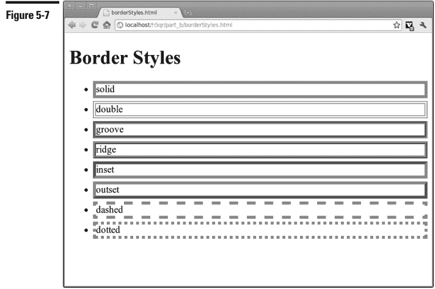


通常，各种边框属性会合并为单一的`border`属性，允许你一次性指定宽度、样式和颜色。例如，要为段落指定一个5像素宽的蓝色双线边框，你可以使用以下代码：

```
p {
    border: 5px double blue;
}
```

另一个有用的技巧是分离边框的各个部分以获得线条。例如，你可以指定`border-top`在元素上方绘制一条线，指定`border-right`在元素右侧绘制一条线。这些迷你边框中的每一个都可以赋予与标准边框相同的值列表。

### 添加背景图像

你可以为任何元素添加背景图像。背景属性的格式与你到目前为止见过的其他一些元素略有不同。图5-8展示了一个带有背景图像的页面。

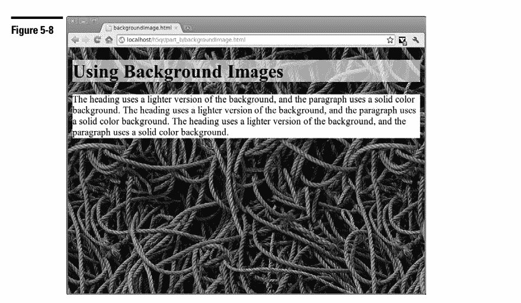

背景图像通过CSS添加：

```
<!DOCTYPE HTML>
<html lang = "en">
  <head>
    <title>backgroundImage.html</title>
    <meta charset = "UTF-8" />
    <style type = "text/css">
      body {
        background-image: url("ropeBG.jpg");
      }
      h1 {
        background-image: url("ropeBGLight.jpg");
      }
      p {
        background-color: white;
      }
    </style>
  </head>
  <body>
    <h1>Using Background Images</h1>
    <p>
        The heading uses a lighter version of the background,
        and the paragraph uses a solid color background.
        The heading uses a lighter version of the background,
        and the paragraph uses a solid color background.
        The heading uses a lighter version of the background,
        and the paragraph uses a solid color background.
    </p>
  </body>
</html>
```

添加背景图像的关键是`background-image`属性。以下是使用方法：

1. 确定要使用的图像。谨慎选择背景图像。确保图像支持你想传达的想法，并且不会分散你信息的注意力。任何标准的Web格式（`png`、`gif`或`jpg`）都可以。你可能需要在编辑器中调整图像（IrfanView和Gimp是优秀的免费选项），以确保其尺寸和分辨率合适。

2. 将图像放置在与你的页面相同的目录中。虽然这一步不是绝对必要的，但如果图像在物理上靠近你的页面，管理起来会容易得多。这样，当你将页面移动到服务器时，也可以轻松地移动相关的图像。

3. 像往常一样构建你的页面。像平常一样创建XHTML代码。

4. 向`body`标签添加背景图像。这将为整个页面应用一个图像。当然，你也可以将图像应用于任何你想要的其他元素。

5. 指定图像的URL。背景图像的值具有独特的语法。你必须指定正在调用一个URL，因此如果图像是`background.png`，那么`background-image`属性的值将是`url("background.png")`。

6. 考虑修改背景。你可以通过使用许多其他CSS属性来更改背景图像：`background-repeat`允许你控制背景如何重复，`background-position`允许你操纵背景的位置。

7. 测试你的页面。确保你的背景图像不会太分散注意力。

背景图像可能会引起问题。请看图5-9，了解这种现象的一个例子：

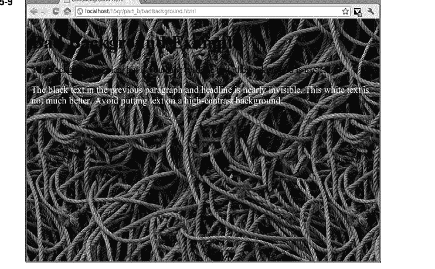

不合适的背景图像是初学者最常见的错误之一。想想你见过多少具有难以阅读文本的网页。

大多数有趣的照片对比度很高。这对于旨在吸引用户注意力的图片来说很棒，但当图像本应作为背景时，这就成了问题。高对比度会吸引用户的注意力，而当用户试图阅读文本时，这就成了问题。这个问题有几个标准的解决方案。你可以提供对比度较低的背景图像版本，或者你可以使用纯色作为包含文本的元素的背景。

如果你回顾图5-9，你会发现我同时使用了这两种技巧。整个页面都有绳索背景（感谢Julian Burgess提供了这张很棒的图片），但标题使用了该图像的较浅版本——而段落则使用了纯色背景。

你可以使用像IrfanView这样的工具来创建图像的低对比度版本。（使用颜色调整工具，制作图像的极暗或极浅版本。）使用深色背景搭配浅色文本，或者浅色背景搭配深色文本。更好的是，参考第6部分，了解如何使用CSS创建半透明背景。这使你可以添加高对比度的背景，同时仍然可以看到底层的图像。

### 使用浮动定位

长期以来，页面布局一直是HTML最大的弱点之一。基于表格的技巧曾经是使页面正确显示的最佳方式，但现在CSS提供了许多有用的工具来管理元素的位置。

浮动定位通过定义元素之间的关系而不是精确指定每个元素的位置来工作。这可能是一个难以理解的概念，但一旦你理解了浮动定位的工作原理，它就是一个极其灵活且有用的系统。

一旦你理解了这个概念，你就可以使用浮动定位来设置一个在各种浏览器上都能良好运行的页面。例如，想想一个标准的HTML/XHTML表单。图5-10显示了一个没有应用CSS的典型表单。

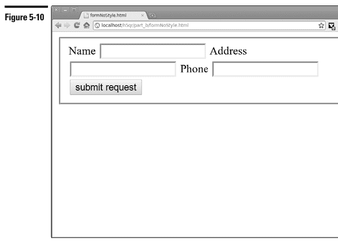

该表单具有所有必要的功能，但它很丑陋。查看HTML代码以了解其格式：

```
<!DOCTYPE HTML>
<html lang = "en">
  <head>
    <title>formNoStyle.html</title>
    <meta charset = "UTF-8" />
  </head>
  <body>
    <form action = "">
      <fieldset>
        <label>Name</label>
        <input type = "text" id = "txtName" />
        <label>Address</label>
        <input type = "text" id = "txtAddress" />
        <label>Phone</label>
        <input type = "text" id = "txtPhone" />
        <button type = "button">
          submit request
        </button>
      </fieldset>
    </form>
  </body>
</html>
```

关于这段代码，有许多重要特征需要注意：

- 它支持一个表单。表单元素在JavaScript编码中至关重要，你将在学习过程中构建许多表单。
- 该表单有一个`fieldset`容器。大多数表单元素是`inline`（内联）元素。（也就是说，它们必须存在于块级元素内部。）`fieldset`标签是一个特殊的块级元素，设计用于存在于表单中，因此它是表单元素的完美容器。
- 该表单有多个标签和输入框。大多数表单都具有这种通用结构：标签用于指示用户要输入的内容，输入元素用于接受用户输入。每一行通常是一个标签/输入对。
- `label`标签描述标签。这是HTML中相对较新的发展。`label`标签没有任何相关的格式，因此传统上没有被使用。有了CSS，你可以提供任何你想要的格式。
- 最后一个元素是一个按钮。大多数表单包含一个或多个按钮。真正的操作发生在用户点击按钮时。由于按钮的格式与输入元素不同，我使用`button`标签来描述它。
- HTML中没有描述格式。HTML代码只是描述了各种元素的意图，而不是它们的格式。CSS将处理这一点。
- HTML是自解释的。你只需查看代码就能明白每部分的作用。这里没有任何代码不与表单的直接目的相关。
- 它有点像一个表格。表单的整体结构看起来有点像表格，但不完全是。CSS的目标是让这个非常干净的数据结构在视觉上看起来像一个表格，而无需用实际的表格标签弄乱HTML代码。

当你查看图5-10时，可以清楚地看到浏览器没有以可接受的方式显示表单。通常，我们希望表单看起来更像一个表格。当然，你可以在代码中嵌入一个HTML表格，但这比你需要做的要复杂得多（也更复杂）。CSS提供了一个更简单的解决方案。

### 了解显示类型

要理解如何让表单像表格一样显示，你需要了解一些关于Web浏览器如何管理页面布局的知识。

只需很少的CSS代码就可以将表单转换为基本的表格样式格式，但这些代码可能有些神秘。秘密与HTML的页面布局方式有关。本质上，Web浏览器可以通过以下三种不同的方式来布局Web元素：

- 内联：将元素放置在你放置下一个文本字符的确切位置。
- 块级：该元素基本上是独立的，并占据自己的行。块级元素（如`h1`标签和段落）通常在自身前后有换行。
- 替代方式：一些特殊的CSS属性会将元素从正常的布局方案中移除（至少在某种程度上），并应用不同的放置规则。本节描述的`float`属性就是一个例子。

所有HTML标签都有自己的默认显示机制（内联或块级）。你可以通过更改标签的`display`属性来改变其显示方式。你也可以通过更改其他CSS属性来添加替代放置方案。这就是如何让表单看起来和表现得像表格，而不需要表格标签的方法。

### 举办块级派对

调整此表单使其像表格一样工作的第一步是使用`display`属性将某些元素定义为块级元素。

查看图5-11了解如何操作。

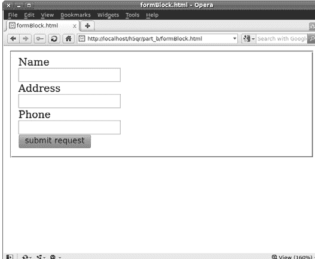

`formBlock.html`中的HTML与`formNoStyle.html`中的HTML没有区别。唯一的区别是包含了外部样式表：`formBlock.css`。

`formBlock.css`的代码非常简单：

```
input {
    display: block;
}

button {
    display: block;
}
```

所有代码所做的就是指定按钮和输入元素（文本框）应该是块级元素。这迫使页面呈现堆叠外观，但更重要的是，它为更好的布局奠定了基础。

> 注意，我在本章的所有截图中手动更改了文本（使用`Ctrl-+`），以便在书中更易于阅读。CSS不会改变文本的大小，但当然，如果你想，你可以使用它来实现这一点。

### 浮动到双列外观

这是一个起点，但你确实希望标签位于相应块级元素的左侧。`float`属性可以用来创建完全相同的效果，如图5-12所示。

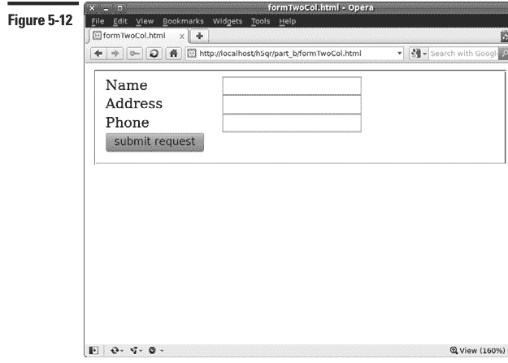

`float`属性允许你将元素从正常的布局规则中移除，并应用特殊的浮动行为。`float`属性描述了一个元素与其邻居之间的关系。在这种情况下，我告诉每个标签向左浮动。（你也可以向右浮动，但在实践中很少这样做。）这导致标签立即位于相应输入元素的左侧。给浮动的标签添加宽度可以使输入元素整齐地排列（看起来和表现得像表格，而无需额外的HTML代码）。

这是`formTwoCol.css`的代码：

```
label {
    float: left;
    width: 30%;
}

input {
    display: block;
}

button {
    display: block;
}
```

### 清理表单

当然，你可以用CSS做更多事情来让外观更好看。图5-13中的`formFloat.html`展示了一个格式精美的表单。

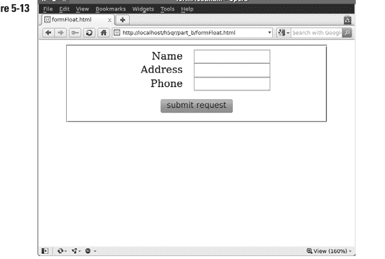

还使用了更多的CSS属性来调整表单的外观：

- `margin`：描述元素边界之外出现的边距。你可以用普通的`margin`属性定义所有边距，也可以指定各个边距。（例如，`margin-left`控制左边距。）如果你将`margin`属性设置为`auto`，你会将元素水平居中。（在CSS中没有简单的方法来实现垂直居中。）
- `padding`：指定元素内容与其边界之间的空间。填充用于修复文本太靠近边框的情况。
- `text alignment`：操作元素的内容（使用`margin`属性来居中元素本身）。

查看`formFloat.css`的代码，然后我解释它的工作原理：

```
fieldset {
    width: 80%;
    margin: auto;
}

label {
    float: left;
    width: 30%;
    text-align: right;
    padding-right: 1em;
    margin-left: 15%;
}

input {
    display: block;
    width: 30%;
}

button {
    display: block;
    margin: auto;
    margin-top: 1em;
}
```

这个版本的CSS仍然适用于与前面示例完全相同的HTML。它添加了一些格式属性来清理页面并获得更好看的表单。以下是构建此类表单布局的方法：

1. 从双列布局开始。首先构建上一节描述的简单双列布局。
2. 居中`fieldset`。`fieldset`默认是块级元素，这正是你想要的。块级元素通常占据其容器宽度的100%，因此如果你想居中一个`fieldset`（或任何其他块级元素），你需要使其更窄并将边距设置为`auto`。
3. 右对齐标签。我认为在表单中输入数据时，如果标签非常靠近文本框会更容易。因此，我通常右对齐标签。将标签的`text-align`属性设置为`right`以实现此效果。
4. 给标签添加一些填充。当`text-align`设置为`right`时，标签似乎有点挤占输入元素。给标签添加一点`padding-right`，给它们一点呼吸空间。（`1em`是当前字体中最宽字符的宽度。）
5. “居中”标签和输入元素。你无法精确地居中标签和输入组合，因为它们是同一行上的两个不同元素。但是，你可以使用百分比来获得相同的效果。如果标签和输入都设置为30%宽度，并且标签的左边距为20%，你的标签和输入元素将在`fieldset`内居中。但是，如果你右对齐标签（正如我倾向于做的那样），将表单向左移动一点看起来会更好。我实际上将标签的`margin-left`设置为15%，而不是20%，因为我认为这样看起来更好。
6. 居中按钮。虽然按钮可以作为HTML `input`元素创建，但我倾向于使用`<button>`标签。按钮通常具有与输入元素不同的样式（因为它们不需要标签），因此使它们成为不同的HTML元素使生活更轻松。要居中按钮，只需将其`display`属性设置为`block`，并将`margin`设置为`auto`。我发现按钮需要更多的垂直空间，所以我添加一点`margin-top`使其看起来更好。

当然，你可以做更多事情来使表单看起来更好。你可以添加颜色、背景图像和自定义字体。这里的重要思想是让CSS处理所有格式，这样你的页面就可以用尽可能干净的HTML代码看起来很好。当你开始编写JavaScript代码来操作页面时，将CSS与HTML分离将使你的生活轻松得多。

### 使用绝对定位

CSS提供了一些其他有用的机制来定位元素。绝对定位方案特别有用，因为它允许你更精确地控制CSS元素的位置。当你指定一个元素将使用绝对定位时，你会将其从正常的内联/块级计算中完全移除，你需要自己指定对象的确切位置。

这使得绝对定位方案非常强大，但对于一般布局来说通常过于繁琐。如果你依赖绝对定位来设置页面，你通常必须对屏幕上的每个元素使用该技术。绝对定位技术最适合用于可以忽略页面其余布局方案的特殊对象。我主要将其用于创建用JavaScript动画化的移动对象。

图5-14展示了一个绝对定位的例子。

图5-14中的bug位于段落之上。使用绝对定位可以实现此效果。

当你使用绝对定位时，你手动指定元素的位置。以下是`absolute.html`演示的HTML：

```
<!DOCTYPE HTML>
<html lang = "en">
  <head>
    <title>absolute.html</title>
    <meta charset = "UTF-8" />
    <link rel = "stylesheet"
          type = "text/css"
          href = "absolute.css" />
  </head>
  <body>
    <h1>绝对定位示例</h1>
    <p>
      这个页面好像有个虫子！！！
      这个页面好像有个虫子！！！
      这个页面好像有个虫子！！！
      这个页面好像有个虫子！！！
      这个页面好像有个虫子！！！
      这个页面好像有个虫子！！！
      这个页面好像有个虫子！！！
      这个页面好像有个虫子！！！
    </p>
    <p id = "bug">
      
    </p>
  </body>
</html>
```


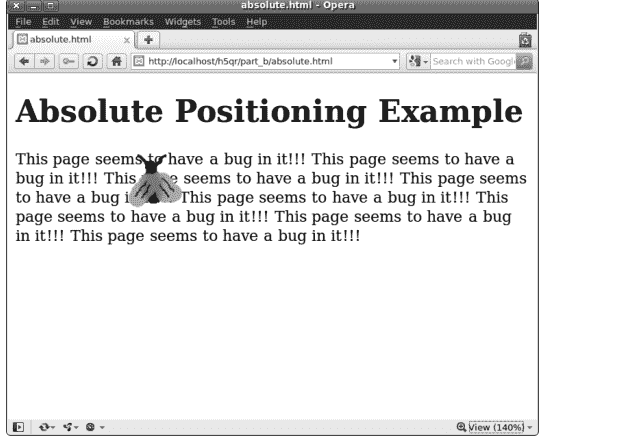

这个页面包含一个普通段落和一个名为“bug”的第二个段落。“bug”段落仅包含一张虫子的图片。请注意，图像是行内级标签，必须嵌套在块级标签内才能使页面验证通过。这就是为什么图像位于另一个元素内部，并且被操纵的是段落元素。

如果没有CSS，页面将只是在普通（包含文本的）段落之后，将虫子图像作为其自己的独立段落进行显示。但是，CSS文件改变了这一点：

```css
#bug {
  position: absolute;
  left: 100px;
  top: 50px;
}
```

CSS以几种重要的方式改变了名为bug的元素的行为：

1. `position`属性被设置为`absolute`。这意味着常规的布局机制将被特定的位置信息所取代。

2. `left`属性被设置为100 px（像素）。一旦为元素指定了绝对定位，你就必须指定其`top`和`left`位置。通常，绝对定位的元素使用像素（px）设置。

3. `top`属性被设置为50 px。这强制对象的左上角位于文档左上角的(100, 50)像素处。

4. 元素将遮盖传统元素。任何使用绝对定位放置的内容都将忽略先前定位的元素。这在普通的Web设计中可能是一个问题，但在动画中，它可能是一个很好的特性。（例如，你可以使用JavaScript技巧让虫子在屏幕上飞来飞去。）

CSS定位的内容远比我在这入门部分能描述的要多。如果你想更详细地研究CSS定位，请查阅我的其他书籍之一：*HTML, XHTML, and CSS All-in-One For Dummies, 第2版*（Wiley）。在那本书中，我用了数百页专门讲解多栏布局、下拉菜单以及其他CSS优点。当然，你也可以查看第6部分，了解一些精彩的新CSS功能，包括一个全新的布局机制。

## 第6部分

### 新增和改进的CSS元素

除了HTML的变化之外，层叠样式表（CSS）技术也发生了一些引人注目的新变化。现在，几乎所有的页面格式化、样式和布局都由CSS执行。本部分描述了CSS3中那些相对较新、已获得支持（或预计将获得支持）并且可能对Web产生重大影响的特性。在使用这些CSS元素时，你会注意到其中许多并未完全实现。主要的渲染引擎已经为其中许多标签创建了供应商特定的测试版本：

- `-webkit-`：这表示为基于WebKit渲染引擎的浏览器优化的属性测试版本。这包括Safari、Chrome和iPhone浏览器。

- `-o-`：此前缀代表Opera浏览器。它并不常用，因为Opera倾向于完全支持某个属性或根本不支持。Opera渲染引擎（很自然地）用于Opera浏览器。你也会在许多便携式设备上看到Opera浏览器的版本。

- `-moz-`：`-moz-`前缀用于为Mozilla渲染引擎优化的属性的测试版本。这主要是Firefox，但越来越多的其他基于Mozilla的浏览器也开始出现。

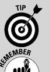

IE8几乎不支持本部分描述的任何功能。IE9有望更全面地支持HTML5标准（并希望支持CSS3）。

一如既往，请务必访问我的网站查看本书中每个代码片段的工作示例：www.aharrisbooks.net/h5qr。

### 在本部分中...

- 介绍新的CSS3选择工具

- 了解字体和文本支持

- 探讨弹性盒布局模型

- 预览新的视觉元素

### CSS3的新选择工具

CSS的一个关键元素是开发者可以选择页面的哪些部分进行标记。传统的CSS允许通过标签类型（例如，`p`选择所有段落）、通过类（`.fancy`表示应用于所有具有`fancy`类的元素的样式）或通过ID（`#sidebar`表示将应用于具有`sidebar` ID的元素的样式）进行选择。

CSS3支持几个具有有趣新功能的新选择器。

#### 属性选择

你现在可以将样式应用于具有特定属性值的任何元素。例如，`input`标签采用许多不同的形式，所有这些都由`type`属性决定。如果你对`input`元素应用单个样式，该样式将应用于许多不同类型的元素：复选框、文本字段和单选按钮。通过使用新的属性语法，你可以将样式应用于任何特定类型的input元素：

```css
input[type="text"] {
  background-color: #CCCCFF;
}
```

你可以应用带有或不带有标签类型的样式，但如果你选择一个极其常见的属性，可能会产生意想不到的副作用。

#### not

有时你需要反向选择。例如，假设你想将样式应用于所有不属于`special`类的段落：

```css
p:not(.special) {
  border: 1px solid red;
}
```

给定的代码将为任何未分配`special`类的段落应用实线红色边框。

#### nth-child

`nth-child`选择器允许你选择组中的一个或多个元素。基本版本使用数字输入：

```css
#myList>li:nth-child(1) {
  border: 1px solid blue;
}
```

这允许你将样式应用于一组元素中的第一个。在我的示例中，我有一个包含四个项目的列表。该样式应用于列表项，而不是列表本身。

（在我看来，列表项是列表的子项，所以它应该是列表的nth-child——但没人问过我。）

数字值实际上可以是一个公式，比如*an+b*。如果你喜欢代数（谁不喜欢呢？），你可以像这样选择所有偶数编号的元素：

```css
#myList>li:nth-child(2n) {
    border: 1px solid blue;
}
```

类似的公式可用于选择奇数编号的子项：

```css
#myList>li:nth-child(2n+1) {
    border: 1px solid blue;
}
```

你可以使用这个公式系统来获得各种分组（例如，使用`3n`选择每第三个元素），但大多数人只需要特定的元素，或者所有偶数行或奇数行。CSS3提供了快捷关键字——*even*和*odd*——这样你就不必使用数学方法了：

```css
#myList>li:nth-child(even) {
    color: white;
    background-color: red;
}
```

*last*关键字允许你从组中选择最后一个元素。这种选择技术还有几个变体：

- `:nth-last-child(N)`：工作方式与*nth-child*相同，只是它从元素组的末尾开始计数，而不是从开头。

- `:nth-of-type(N)`：此选择器的工作方式与*nth-child*相同，只是它过滤到特定类型，并忽略任何不是完全相同类型的元素。

- `last-child`：这（很自然地）选择最后一个子元素。

- `last-nth-of-type(N)`：工作方式类似于*nth-of-type*，但从组的末尾开始。

- `first-child`：选择第一个元素。（从技术上讲，这在CSS2中就已可用，但很少使用。）

除了IE之外，所有现代浏览器都完全支持这些选择工具。IE9支持这些工具，但旧版本不支持。但是，由于它们通常仅用于提高可读性，因此使用它们应该是安全的。不支持标准的浏览器将直接跳过该样式。

### 其他新的伪类

伪类允许你根据元素的状态来指定样式。现代CSS支持许多新的伪类：

- `:hover`：`:hover`伪类从一开始就存在于CSS中，但它最初只被正式定义为适用于`<a>`标签。现在，`:hover`伪类可以应用于任何元素。如果鼠标（或其他指针设备）悬停在元素上，该元素就会激活悬停状态。

请注意，移动设备并非总是支持悬停，因为在激活项目之前，指针设备（触控笔或手指）的位置是未知的。移动设备可能有某种标签切换机制来指示当前“悬停”在哪个项目上。

- `:focus`：当元素准备好接收键盘输入时，此伪类被激活。

- `:active`：当表单元素当前正在被使用时，它就是活动的。例如，当一个按钮被按下但尚未释放时。

移动设备通常会直接跳到活动模式，而不会经过悬停模式。在使用状态进行样式设计时，这可能是一个重要的设计考量。

除了IE系列浏览器外，所有现代浏览器都完全支持状态伪类。早期版本的IE有有限（但存在错误）的支持。

### 可下载字体和文本支持

字体支持一直是HTML/CSS模型最大的弱点之一。虽然Web开发者可以为网页建议任何字体，但字体文件传统上是客户端级别的资产——如果客户没有安装该字体，她就看不到它。开发者不得不依赖一系列替代字体和后备方案。最终，CSS3现在支持一个合理的解决方案来提供可下载的字体。

#### @font-face

`@font-face`样式的工作方式与大多数CSS元素不同。它不是将标记应用于页面的某个部分。相反，它定义了一个新的CSS值，可以在其他标记中使用。具体来说，它允许你将字体文件放在服务器上，并使用该字体定义一个字体族。

```
@font-face {
  font-family: "Miama";
  src: url("Miama.otf");
}
```

`font-family`属性指示你将在CSS代码的其余部分中赋予此字体的名称。通常，它类似于字体文件名，但这不是必需的。`src`属性是服务器上实际字体文件的URL。定义字体后，可以在CSS代码其余部分的普通`font-family`属性中使用它：

```
h1 {
    font-family: Miama;
}
```

虽然所有现代浏览器都支持`@font-face`功能，但实际支持的文件类型因浏览器而异。以下是主要的字体类型：

- **TTF**：标准的TrueType格式（TTF）支持良好，但并非所有浏览器都支持。许多开源字体以这种格式提供。

- **OTF**：类似于TTF，但它是一个真正的开放标准，因此，那些对开放标准感兴趣的人更倾向于使用它。大多数浏览器都支持OTF（OpenType），除了IE。

- **WOFF**：一种提议的标准格式，目前由Firefox支持。微软已暗示将在IE9中支持WOFF（Web开放字体格式）。

- **EOT**：微软专有的嵌入式字体格式。EOT（嵌入式OpenType）仅在IE中有效，但公平地说，微软多年来一直支持嵌入式字体。

**提示** 你可以使用字体转换工具，如免费的在线字体转换器（http://onlinefontconverter.com），将字体转换为你喜欢的任何字体格式。

可以提供多个`src`属性。这样，你可以同时包含一个字体的EOT和OTF版本，使其能在各种浏览器上工作。

**警告** 能够包含字体并不意味着你就应该这样做。请仔细考虑可读性。同时，要尊重知识产权。有许多优秀的免费开源字体可供选择。请从 http://openfontlibrary.org 开始查找。

### 多栏支持

自HTML早期以来，Web开发者一直在寻求多栏支持。多年来，人们使用了多种方法，包括框架、表格和浮动元素。最终，CSS3现在集成了多栏支持。

```css
#main{
    column-count: 3;
    column-gap: 2em;
    column-rule: 5px double red;

    -webkit-column-count: 3;
    -webkit-column-gap: 2em;
    -webkit-column-rule: 5px double red;

    -moz-column-count: 3;
    -moz-column-gap: 2em;
    -moz-column-rule: 5px double red;
}
```

三条新规则控制多栏布局：

- `column-count`：指示栏数。

- `column-gap`：使用标准CSS测量值的栏间距。

- `column-rule`：栏之间的垂直线（如果有的话）。此规则的定义参数与边框规则完全相同。

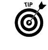

尽管多栏系统看起来很有前途，但它存在一些问题：

- 尚未得到支持。标准多栏规则尚未得到任何主要浏览器的支持。然而，两个主要引擎有自己的多栏标签变体。对于Firefox及相关浏览器，需要包含`-moz-`版本的标签。`-webkit-`版本支持Safari和Chrome。

- 栏宽是自动的。你可以将所有栏设置为相同宽度（在这种情况下，栏数会自动确定），或者你可以设置栏数（这会自动确定每栏的宽度）。你不能使一栏与其他栏大小不同。

- 文本流是自动的。内容填满整个区域，自动从一栏流向下一栏。没有简单的方法来指定哪个文本在哪一栏。

考虑使用多栏CSS属性作为页面布局技术很有诱惑力，但这似乎还不太实际。此外，由于IE和Opera不支持多栏，因此仍然需要考虑其他更通用的页面布局技术。（关于一个有趣的新选项，请参见本部分后面的“弹性盒布局模型”。）

多栏更适合杂志风格的布局，文本在各栏之间流动。

### text-stroke

你可以用另一种新的方式改变字体的外观。使用CSS3，你可以为文本指定描边颜色。这定义了字母周围的轮廓。你可以指定描边颜色（使用任何标准的CSS颜色值）以及描边宽度（使用正常的尺寸属性）。

```css
h2 {
    color: yellow;
    -webkit-text-stroke: 2px red;
    font-size: 300%;
}
```

目前，没有浏览器直接支持`text-stroke`属性，但基于WebKit的浏览器（Chrome和Safari）支持特定于厂商的`-webkit-`版本。

### text-shadow

阴影是现代网页设计的另一个常见特性。阴影为页面增加了深度元素，但如果使用得当，它们还可以增强可读性，使标题从页面中凸显出来。`text-shadow`属性在技术上是CSS2的一部分，但直到最近才得到主要浏览器的支持：

```css
h2 {
    font-size: 300%;
    text-shadow: 3px 3px 5px #666666;
}
```

`text-shadow`属性有四个参数：

- `offset-x`：确定阴影在x轴（左右）上与原始文本的距离。正值使阴影向右移动，负值向左移动。

- `offset-y`：表示阴影在y轴（上下）上与原始文本的距离。正值使阴影向下移动，负值向上移动。

- `blur`：指定阴影的模糊半径。如果值为`0px`，则没有模糊，阴影看起来就像原始文本。通常，你会希望模糊度相当于偏移量中的最大值。这使得阴影可识别为文本的阴影，而不会分散注意力。

- `color`：定义阴影颜色。通常，深灰色是标准阴影颜色，但你也可以尝试其他颜色以获得特殊效果。请注意，模糊往往会使阴影颜色变浅。如果应用了大量的模糊，阴影颜色可以与文本颜色相同。如果阴影的模糊度不高，你可能需要使阴影颜色变浅以提高可读性。

阴影的大小通过偏移量和模糊度的组合间接确定。你可能需要尝试才能获得你想要的阴影效果。

文本阴影的一个特殊情况可用于帮助文本在背景图像中凸显出来。应用一个小的、对比色的阴影。

### 弹性盒布局模型

页面布局一直是Web开发中的一个持续关注点。曾出现过许多不同的页面布局方法，但都有各自的不足。当前的标准是浮动机制。虽然浮动机制工作得相当不错，但它有两个主要缺点：

- **它可能难以理解。** 浮动规范的各个部分可能难以理解，其行为也不直观。`width`、`clear`和`float`属性之间的关系可能难以理清。

- **页面书写顺序很重要。** 语义化布局的一个目标是将页面的创建方式与其显示方式完全分离。使用浮动布局时，HTML文档中各元素的书写顺序会影响它们的放置位置。理想的布局方案应能通过CSS实现任何放置方式，即使在HTML编写完成之后也是如此。

虽然浮动机制是当前的页面布局标准，但显然另一种选择会更好。CSS3包含了新的弹性盒布局作为替代方案。

#### 创建弹性盒布局

CSS3提出了一种新的布局机制——弹性盒。虽然它远未完善，但这一机制显示出巨大的潜力。其基本工作原理如下。（为了清晰起见，我在此刻意省略了细节；**请参阅本部分后面的“查看弹性盒布局”**。）

1. 将页面片段指定为一个盒。大多数元素的`display`属性可以设置为多种类型。CSS3引入了一种新的显示类型：`box`。将元素的显示类型设置为`box`，使其能够使用弹性盒机制容纳其他元素。

2. 确定子元素的方向。使用名为`box-orient`的新属性来确定当前元素的子元素将在主元素内部垂直还是水平放置。

3. 指定子元素的权重。每个子元素可以被赋予一个数值权重。权重决定了该元素占据多少空间。如果权重为零，该元素将占据尽可能小的空间。如果所有元素的权重都为1，它们将占据相同的空间。如果一个元素的权重为2，而其他元素的权重都为1，那么该较大元素的大小将是其他元素的两倍，依此类推。权重通过`box-flex`属性确定。

4. 在第一个盒内嵌套另一个盒。你可以将弹性盒相互嵌套。只需将内部元素的显示类型设置为`box`即可。

5. 修改元素出现的顺序。通常，元素将按照它们在页面上放置的顺序出现，但你可以使用`box-ordinal-group`属性来调整放置顺序。

#### 查看弹性盒布局

作为新布局机制的一个示例（**请参阅**本部分前面的“创建弹性盒布局”），请查看以下HTML代码：

```html
<div id = "a">
    <div id = "b">b</div>
    <div id = "c">c</div>
    <div id = "d">
        <div id = "e">e</div>
        <div id = "f">f</div>
    </div>
</div>
```

虽然这显然是一个虚构的例子，但它展示了一个使用标准布局技术可能难以设置样式的复杂结构。图6-1展示了一个复杂的嵌套样式，通过传统布局技术（例如CSS2）很难实现。

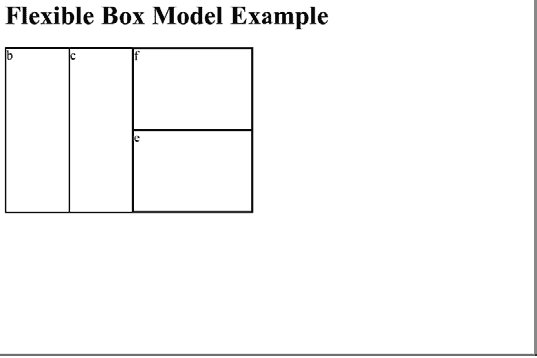

以下示例样式表用于为此页面应用浮动样式：


```css
div {
  border: 1px solid black;
}

#a {
  width: 300px;
  height: 200px;

  box-orient: horizontal;
  display: box;

}

#b {
  box-flex: 1;
}

#c {
  box-flex: 1;
}

#d {
  display: box;
  box-orient: vertical;
  box-flex: 2;
}

#e {
  box-flex: 1;
  box-ordinal-group: 2;
}

#f {
  box-flex: 1;
}
```

CSS看起来很复杂，但实际上只有四个新的CSS元素。这个具体示例的工作原理如下：

1. 将`a`设置为主容器。`a` div是主容器，因此为其设置高度和宽度。它将包含弹性盒，因此将`display`属性设置为`box`。通过将`box-orient`属性设置为`vertical`或`horizontal`，来确定你希望此盒的子元素如何排列。

2. 指定`b`、`c`和`d`的权重。在我这里的示例样式表中，我希望元素`b`和`c`各占一半空间，而`d`填满剩余空间。为实现此行为，将`b`和`c`的`box-flex`值设置为1，将`d`的`box-flex`值设置为2。

3. 将`d`设置为另一个容器。`d`元素将包含`e`和`f`。使用`display: box`将`d`设置为弹性容器，并将`box-orient`设置为`vertical`使元素垂直排列。（通常，嵌套元素会在水平和垂直之间切换。）

4. 元素`e`和`f`应各占`d`的一半。使用`box-flex`属性为这些元素赋予相等的权重。

5. 更改`e`的序数组，使其出现在`f`之后。`box-ordinal-group`属性表示元素在其组内的显示顺序。通常，所有项目都有一个默认值1，因此它们按书写顺序显示。你可以通过将元素的`box-ordinal-group`值设置为更大的数字来降低其优先级，导致该元素比正常情况显示得更晚。我将`e`的序数组设置为2，因此它显示在元素`f`之后。

### 现实情况

弹性盒系统看起来很完美。它比当前使用的那些令人费解的布局技术合理得多。然而，弹性盒系统尚未准备好普遍使用。目前，没有一个浏览器直接实现弹性盒属性。但是，有特殊的厂商特定版本可用。基于WebKit的浏览器（主要是Safari和Chrome）使用以`-webkit-`开头的变体，而基于Gecko的浏览器（Firefox和Mozilla）使用`-moz-`扩展。为了使本部分的示例在现代浏览器中工作，你需要包含所有属性的`-webkit-`和`-moz-`版本，如下所示：

```css
#a {
    width: 300px;
    height: 200px;

    -moz-box-orient: horizontal;
    display: -moz-box;

    -webkit-box-orient: horizontal;
    display: -webkit-box;
}

#b {
    -moz-box-flex: 1;
    -webkit-box-flex: 1;
}
```

目前，没有任何版本的IE支持弹性盒模型，但IE9的初步版本确实支持该模型。令人惊讶的是，Opera尚未支持此机制。尽管如此，它似乎可能成为一种重要的布局技术，特别是在已经包含兼容浏览器的移动设备上。

一些浏览器在多级嵌套方面存在问题，但这预计会得到解决。这项技术值得学习，因为它很可能在未来成为首选的布局技术。有关于使用弹性盒技术的标准两列页面示例，请参阅我网站（`www.aharrisbooks.net/h5qr`）上的文件`flexTwoCol.html`。

## 新的视觉元素

在即将发布的CSS版本中，提供了大量的视觉增强功能。虽然它们都不是必需的，但它们为开发者增添了巨大的新选项。

### 颜色值

CSS3包含了思考颜色的新方式。

CSS3还支持一种新的颜色表示形式，其中也包含了透明度。你现在可以使用RGBA格式定义颜色：

```css
h1 {
    color: rgba(0, 0, 0, .3);
}
```

此格式使用四个数值。前三个分别用于红色（r）、绿色（g）和蓝色（b）。使用标准的0–255值来表示你想要的颜色。第四个值（a）代表alpha，这是透明度的另一个术语。alpha值是一个介于0（完全透明）和1（完全不透明）之间的实数。

CSS3还支持灵活的HSL颜色模型。HSL代表色相、饱和度和亮度。虽然RGB模型反映了计算机显示器上颜色的表示方式，但HSL模型更接近大多数艺术家和设计师实际使用颜色的方式。HSL颜色需要三个参数：

- **色相：** 色轮上的一个角度。红色的值是0和360，可见光谱环绕成一个圆。使用0到360之间的值作为色相。有关于色轮的示例，请参阅 `http://colorschemedesigner.com` 上的工具。

### HSL颜色模型

- **饱和度：** 指颜色与灰色、黑色或白色的偏离程度。饱和度为0%的颜色是灰色、黑色或白色（取决于明度）。饱和度为100%的颜色是该色相最鲜艳的形式。饱和度值是0到100之间的整数，后跟百分号。

- **明度：** 使颜色比基色更亮或更暗。明度为0%的任何颜色将是黑色，明度为100%的任何颜色将是白色。明度值是0到100之间的整数，后跟百分号。

你可以在任何使用颜色的地方分配HSL颜色：

```css
background: hsl(0, 0%, 50%);
```

颜色无法在黑白书中欣赏。请访问本书网站 (`www.aharrisbooks.net/h5qr/hsl.html`) 上的 `hsl.html`。这是一个HSL颜色模型的交互式示例。更改色相、饱和度和明度的值，看看颜色样本如何实时变化。


HSL模型与图形程序中常用的HSV模型（色相、饱和度和明度）并不完全相同（尽管它们相似）。这两个模型在本质上以相同的方式使用色相和饱和度。HSV中的`明度`范围从黑色到完全饱和，而HSL中的`明度`范围从黑色到白色。此外，请注意术语*亮度*在颜色理论中经常使用，但HSL中的L不是关于亮度（这是光能量的技术测量）而是关于明度。

CSS3包含另一个颜色模型HSLA。正如你可能猜到的，它是带有alpha通道的HSL模型。alpha通道指示透明度级别；alpha通道值为0表示完全透明，1表示完全不透明。

```css
background: hsla(0, 0%, 50%, 0.7);
```

## 渐变

*渐变*是一系列颜色。简单的渐变从前景色流向背景色，但渐变可以包含许多其他颜色。还有多种类型的*渐变*。最常见的是*线性*渐变（从一种颜色直线流向另一种颜色）或*径向*渐变（一种颜色集中在特定点，其他颜色在该点更远处可见）。

渐变在Web开发中已经使用了一段时间，是添加颜色的好方法。处理渐变的主要方式是在图像编辑器中构建一个细长的渐变条，并将该图像应用到元素的`background-image`属性。

图6-2说明了本节中描述的渐变。

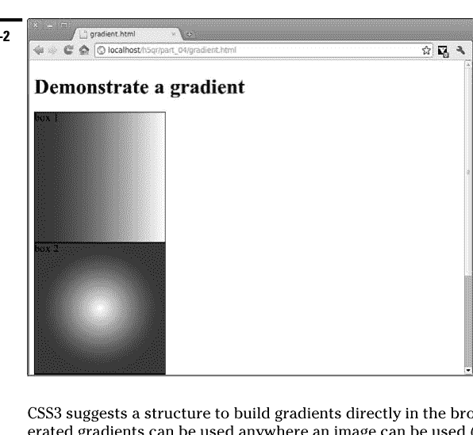

CSS3建议了一种直接在浏览器中构建渐变的结构。这些生成的渐变可以在任何可以使用图像的地方使用（通常用作背景图像）。

不幸的是，渐变的标准语法尚未确定。Mozilla和WebKit引擎对属性的处理方式不同。Mozilla版本更容易理解：

```css
background-image: -moz-linear-gradient(left, blue, white);
```

以下是如何将Mozilla风格的渐变附加到元素背景：

1. 以图像属性开始。渐变不是一个独立的属性。它是图像的替代品。在使用图像的任何地方使用渐变属性。

2. 使用`-moz-linear-gradient`属性。Mozilla对线性和径向渐变使用不同的属性。

3. 指定渐变的方向。此渐变将从左到右，因此我指定`left`。（你也可以指定像素值或百分比，但特殊的关键字`left`很容易记住。）

4. 指示起始和结束颜色。我的渐变从蓝色开始，以白色结束。

基于WebKit的浏览器（Chrome、Safari和iPhone）使用完全不同的语法：

```css
background-image: -webkit-gradient(linear, left center, right center, from(blue), to(white));
```

参数很熟悉，但与Mozilla变体略有不同。

1. 将渐变附加到图像。渐变不是独立的，必须在使用图像的地方使用。

2. 指定渐变类型。WebKit对两种渐变类型使用单个属性。第一个参数指示将创建哪种类型的渐变（本例中为线性）。

3. 指示渐变的起始和结束位置。你可以指示渐变如何流动。值`left center, right center`告诉渐变从左向右移动；`left top, right bottom`值将创建对角线渐变，依此类推。

4. 指定起始和结束颜色。`from()`和`to()`参数是创建双色渐变的简单方法。每个参数接受一个颜色值。渐变将始终从`from`值开始，到`to`值结束。

5. 如果需要，添加色标。在`from`和`to`颜色之间，你可以添加任意数量的色标元素。每个色标接受两个参数：百分比（0-1）和颜色。指定的颜色将出现在渐变百分比所指示的位置。

径向渐变与线性渐变非常相似。同样，WebKit和Mozilla引擎有不同的语法。以下是Mozilla风格的径向渐变：

```css
background-image: -moz-radial-gradient(white, blue);
```

这是一个非常简单的语法。只需列出你想要从内到外显示的颜色。

WebKit版本更复杂：

```css
background-image: -webkit-gradient(radial, center center, 0, center center, 100, from(white), to(blue));
```

在WebKit模型中，线性和径向渐变使用相同的属性，但参数不同：

1. 将渐变作为图像。像往常一样，渐变不会单独出现，而是图像元素的一部分，通常是`background-image`。

2. 将渐变类型设置为径向。`-webkit-gradient`属性的第一个参数是类型。

3. 确定第一种颜色的中心和半径。通常，第一种颜色是中心的点。值`center center, 0`表示在元素中心处，半径为零。

4. 确定第二种颜色的中心和半径。第二种颜色将是外部颜色。它通常也以元素的中心为中心，但通常具有更大的半径。

5. 指定起始和结束颜色。描述将显示哪些颜色。

目前尚不清楚哪个版本将成为标准。（如果你是W3C的成员并且在问我，我投票给Mozilla模型。）

### 图像边框

CSS 3允许你将图像用作元素边框。这个机制非常强大，因为它检测图像的边缘，并将其切片以从图像的边缘和角创建边框的边缘和角。

例如，看图6-3中的简单相框图像。

相框图像存储在HTML文件所在目录中的`frame.png`中。它有一个透明的中心。应用以下代码为页面上的所有`h2`元素添加图像边框：

```css
h2 {
    border-width: 15px;
    border-image: url("frame.png") 25% repeat;
    -webkit-border-image: url("frame.png") 25% repeat;
    -moz-border-image: url("frame.png") 25% repeat;
}
```

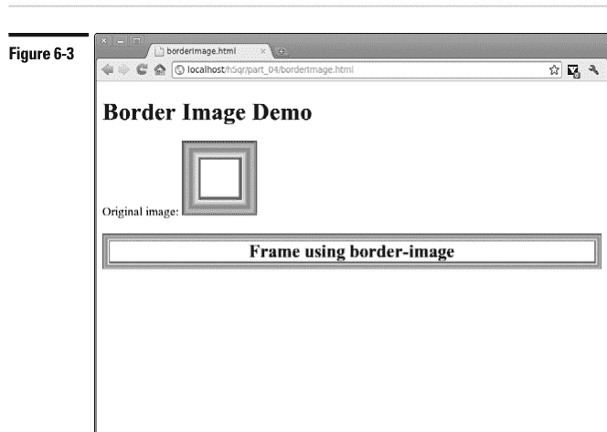

以下是如何添加边框图像：

1. 获取你的图像。图像应已设计为某种边框。通常，它将是边缘周围的形状，具有纯色中心或透明中心。我通常将图像设为100×100像素，以便稍后更容易计算。

2. 指定边框宽度。你需要直接指定边框宽度。相框图像的边框将缩放以适合你想要的任何大小。

3. 计算你想要使用图像边框的多少。我想使用相框图像的外部25%作为边框，因此我指定25%。如果省略百分号，该值将以像素为单位计算。如果你希望每条边界使用原始图像的不同数量，可以添加四个值。

4. 指示你想要的行为。原始图像几乎永远不会与你想要环绕的元素大小相同，因此你可以提供一个提示来解释浏览器应如何处理比原始图像更大的元素。最常见的选择是`repeat`（重复原始图像）或`stretch`（拉伸图像以占据整个空间）。对于像本例中使用的`frame.png`这样的简单图像，结果将是相同的。

### 反射

反射是另一个视觉元素，如果处理得好，可以为页面增添很多效果。CSS3承诺仅使用CSS来处理反射。目前，只有基于WebKit的浏览器（即Safari、Mobile Safari和Chrome）支持此功能。然而，该功能前景广阔，未来很可能以某种形式出现在其他浏览器中。将以下CSS应用于所有带有`reflect`类的元素，即可在支持的浏览器中呈现精美的倒影效果：

```css
-webkit-box-reflect: below 2px;
```

基础倒影效果十分简单：

1. 应用`-webkit-box-reflect`属性。遗憾的是，目前尚无通用版本，其他浏览器也未复制`reflect`属性。

2. 指定倒影的放置位置。通常倒影置于主元素下方（`below`），但也可置于`above`（上方）、`left`（左侧）或`right`（右侧）。

3. 设定间距宽度。倒影可紧邻原始元素放置，但通常留有少量间距效果更佳。间距通常以像素为单位。

这样就能生成非常漂亮的倒影效果。

不过，倒影通常并非像素级完美复制，而是随距离逐渐淡化。WebKit允许为倒影添加渐变效果。在此情况下，渐变将从完全不透明（`white`）过渡到完全透明（`transparent`）。`webkit`渐变模型较为复杂。（更多细节请参阅本部分前面的“渐变”章节。）通常只需使用本示例中提供的渐变变体即可：

```css
.reflect {
    -webkit-box-reflect: below 2px
      -webkit-gradient(
        linear,
        center top, center bottom,
        from(transparent),
        color-stop(.6, transparent),
        to(white));
}
```

倒影的标准部分与前面的示例相同，但包含一个使倒影淡化至透明的渐变。

1. 创建线性渐变。倒影的渐变几乎总是线性的。

2. 使渐变从上到下移动。使用`center top`表示顶部，`center bottom`表示底部。这些值代表*原始*图像的顶部和底部，而非倒影（倒影当然是上下颠倒的）。

3. 从完全透明开始。原始图像的顶部将是倒影的底部，因此从透明度开始。（将`transparent`设为`from`颜色。）

4. 以完全不透明结束。此渐变并非关于颜色，而是关于倒影哪些部分可见。原始图像的底部（即倒影的顶部）将完全不透明。将`to`颜色设为`white`以表示不透明。

5. 添加色标以调整淡化效果。`color-stop`参数允许添加新颜色。添加色标以指定希望图像在倒影中开始显现的位置。我在60%处设置了第二个透明色，因此只有原始图像底部约40%的区域会显示为倒影。

> 注意，反射图像不会被计算为页面布局的单独元素，因此文本和其他内容将直接覆盖在倒影上。

图6-4展示了一个反射图像。

倒影通常应用于图像，但也可以应用于任何元素，甚至是视频！

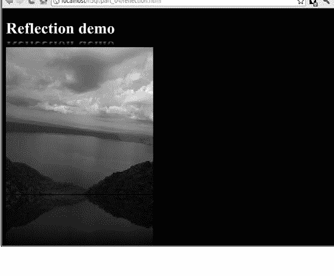

## 圆角

圆角已成为Web 3.0设计的象征。在之前的CSS版本中创建跨平台圆角相当困难，但CSS3使其变得非常简单。

以下CSS生成一个漂亮的蓝色标题：

```css
h1 {
    width: 60%;
    background-color: #000066;
    color: #9999ff;
    border: #9999ff 3px groove;
    margin: auto;
    text-align: center;
    border-radius: 10px;
}
```

几乎所有代码都是常规的CSS2。唯一的新元素是`border-radius`属性。该属性允许你为角指定一个圆角参数。每个角将被一个小圆弧替换，圆角参数决定该圆弧的半径。值为`1em`会使单行元素（如大多数标题和链接）呈现完美的圆形端点。值为`.5em`则会创建类似大多数操作系统中常见的按钮形状。

尽管该属性名为`border-radius`，但并不需要定义边框。

请注意，每个标签都有变体以支持特定角：`border-top-left-radius`等。如果你不想对元素的所有四个角应用相同的圆角，这会很有用。

目前所有主流浏览器均不支持其默认格式的此属性。但是，除IE外的所有主流浏览器都有特定于供应商的变体。使用`-moz-border-radius`、`-webkit-border-radius`或`-o-border-radius`可在这些浏览器中获得圆角效果。

### 阴影

你可以使用`box-shadow`属性为任何元素添加阴影。该工具的工作原理与`text-shadow`属性非常相似。（更多细节请参阅本部分前面的“可下载字体和文本支持”章节。）以下代码为包含`shadow`类的div添加了吸引人的投影：

```css
.shadow {
    box-shadow: 10px 10px 10px #000000;
    -moz-box-shadow: 10px 10px 10px #000000;
    -webkit-box-shadow: 10px 10px 10px #000000;
}
```


图6-5展示了此投影效果。


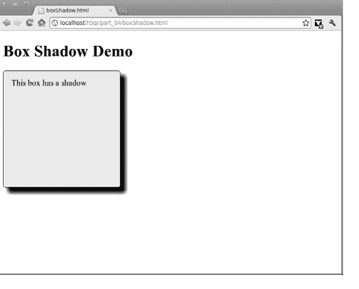

`shadow`属性接受四个参数：

- **x-offset**：这决定了阴影在x（左右）轴上偏离主元素的距离。正值将阴影向右移动；负值将阴影向左移动。
- **y-offset**：这决定了阴影在y（上下）轴上偏离主元素的距离。正值将阴影向下移动，负值将阴影向上移动。
- **cast-length**：这表示阴影的模糊程度。较大的值使阴影更模糊。较小的值产生更清晰的阴影。
- **color**：最后一个参数是阴影颜色。通常为黑色或灰色，但你可以使用其他颜色来添加有趣的特征。

与许多其他CSS3元素一样，标准版`box-shadow`的支持并不均衡（只有Opera直接支持），但基于WebKit和Mozilla的浏览器都有特定于供应商的变体。

通常，页面上的所有阴影应具有相同的一般特征。最有效的方法是创建一个`shadow`类，并将此类添加到所有将要有阴影的元素中。

如果原始图像具有圆角（有关如何实现此效果，请参阅本部分前面“圆角”部分中的`border-radius`属性），阴影也将具有圆角。

有关向文本元素添加阴影的信息，请参阅本部分前面“text-shadow”部分中的示例。

### 变换

CSS3包含了对任何元素应用几何变换的能力。这为Web开发者提供了前所未有的卓越视觉控制水平。

`transform`属性允许你对任何div应用数学变换。将`transform`应用于元素时，你需要应用以下一个或多个参数来描述变换类型：

- **translate**：将对象从其默认位置移动。平移需要两个参数：X测量值和Y测量值。使用标准的CSS测量单位。
- **rotate**：围绕中心点旋转图像，接受一个参数，即以度为单位的角度测量值。（例如30度为`30deg`。）
- **scale**：改变对象的大小。标准版本同时均匀地改变水平和垂直尺寸。`scalex`和`scaley`属性可用于沿单个轴调整缩放比例。缩放比例以标准CSS测量单位为单位。如果缩放比例大于1，则对象比原始尺寸大。介于零和一之间的缩放比例使项目比原来小。零或负缩放比例值未定义。
- **skew**：这允许你将元素倾斜某个角度。`skew`参数需要以度为单位的角度测量值。`skewx`和`skewy`变体允许对变换进行更完整的控制。

你可以通过空格分隔在transform属性后列出多个参数来组合它们。

为说明问题，想象以下HTML代码片段：

```
<div id = "box1">box 1</div>
<div id = "box2">box 2</div>
<div id = "box3">box 3</div>
<div id = "box4">box 4</div>
<div id = "box5">box 5</div>
```

代码显示了五个相同的div。为说明目的，所有div共享相同的通用CSS：

### 过渡动画

请注意，目前没有任何浏览器完全支持规范中所述的`transform`元素。然而，除了IE之外的所有主要浏览器都有厂商特定的版本，因此框2的实际代码如下所示：

```
#box2 {
    transform: translate(100px, 0px);
    -webkit-transform: translate(100px, 0px);
    -moz-transform: translate(100px, 0px);
    -o-transform: translate(100px, 0px);
}
```

目前已经可以通过伪类（如`hover`）或JavaScript代码动态更改CSS属性。在CSS3之前，所有CSS状态变化都是瞬间发生的。通过新的`transition`属性，你可以让过渡在一段时间内发生。

看一个简单的`h1`标题：

```
<h1>Transition Demo</h1>
```

CSS代码主体相当直接：

```
h1 {
    color: black;
    font-size: 300%;
    transition: color 1s ease-in;
}

h1:hover {
    color: red;
}
```

首先忽略`transition`属性。如果你看代码的其余部分，很容易就能看出它的作用。在`normal`状态下，标题是黑色的。在`hover`状态下，颜色是红色的。通常情况下，标题会在鼠标悬停时立即变成红色，当鼠标离开时会立即变回黑色。然而，当添加了`transition`属性后，颜色变化不是立即的，而是需要一秒钟。颜色从黑色逐渐变为红色，然后再变回来。

当过渡与变换结合使用时，会变得更加有趣。想象一个非常简单的`div`：

```
<div id = "box">Box 1</div>
```

应用一点CSS3魔法，当用户将鼠标悬停在div上时，它会平滑地旋转直到倒置。当用户离开div时，它会平滑地旋转回原始位置：

```
#box {
    transition: all 1s ease-in;
    height: 100px;
    width: 100px;
    border: 1px solid black;
}

#box:hover {
    transform: rotate(180deg);
}
```

`transform`在`:hover`伪类中定义。唯一的新增内容是类标准样式中指定的transition。

`transition`属性接受几个参数：

- **animation property**：此标签定义的动画类型。默认值是`all`，但其他类型应该也能工作，包括`color`、`length`、`width`、`percentage`、`opacity`和`number`。如有疑问，使用标准的`all`。
- **duration**：动画的持续时间，以秒为单位。一秒是`1s`。
- **timing function**：如果你希望动画以恒定速度发生，请使用`linear`。如果你希望更自然的运动，在动画两端逐渐加速和减速，请使用以下之一：`ease`、`ease-in`、`ease-out`、`ease-in-out`。
- **delay**：如果你包含第二个`time`值，这将被视为延迟。动画在延迟结束后才开始。

如果你愿意，可以为动画的各个部分使用单独的属性，但大多数开发者更喜欢使用单行快捷方式（就像用于边框的那样）。

并非所有CSS属性都可以被动画化，但很多可以。可能需要一些实验来确定哪个CSS属性可以与`transition`属性一起动画化。

不幸的是，标准的`transition`属性目前尚未被任何主要浏览器支持，但Mozilla (`-moz-`)、WebKit (`-webkit-`) 和 Opera (`-o-`) 有厂商特定的版本。遗憾的是，目前似乎还没有任何版本的IE支持它。在广泛支持之前，你最好的选择是除了标准版本外，还包含所有厂商特定的版本。

### 透明度

CSS3完全支持可调节的不透明度。这体现在几个方面。首先，任何元素都有一个不透明度属性，可以设置为0（完全透明）到1（完全不透明）。

图6-7显示了一个部分透明的div叠加在图像上。

实现此效果的CSS相当简单：

```
#box {
  position: absolute;
  top: 350px;
  left: 100px;
  height: 100px;
  width: 100px;
  border: 1px solid red;
  background-color: white;
  opacity: .3;
}
```

除了最后一个属性，所有代码都是常见的CSS2内容。不透明度属性接受一个介于0和1之间的浮点值。值为0是完全透明，值为1是完全不透明。

## 第7部分 JavaScript中的变化

HTML5有许多新特性，但最大的变化实际上是Web页面的使用方式。Web不再仅仅是托管文档，而是正在成为一个应用开发框架。HTML5中一些最有趣且可能影响深远的创新，是现代浏览器中可用的JavaScript新特性。

JavaScript已经成为现代Web应用的关键技术，近年来每个浏览器都提高了JavaScript引擎的性能。此外，JavaScript语言的一些令人着迷的新扩展也变得可用。

本部分重点关注JavaScript中那些特别引人入胜的新方面。我假设你对计算机编程和JavaScript语言有一定熟悉。如果你需要复习，请查看我的书《JavaScript & AJAX For Dummies》(Wiley)。

请务必访问我的网站，查看本书中每个代码片段的实际示例：[www.aharrisbooks.net/h5qr](http://www.aharrisbooks.net/h5qr)。

### 本部分内容概览...

- 检查新的选择选项
- 预览数据选项
- 查看其他新的JavaScript特性

### 看啊：新的JavaScript选择选项

JavaScript通常用于与Web页面交互。程序员通常使用`document.getElementById()`方法基于页面元素创建一个变量。这个机制要求元素有一个id属性。HTML5引入了一些从页面中选择元素的新方法。

#### document.getElementsByClassName()

有时你希望将代码应用于特定类中的所有元素。`getElementsByClassName()`函数返回特定类中所有元素的数组。例如，看以下代码：

```
function init(){
    specP = document.getElementsByClassName("special");
    alert(specP.length);
    for(i = 0; i < specP.length; i++){
        alert(specP[i].innerHTML);
    } // end for
} // end function
```

此例程创建当前页面上所有具有类`special`的元素的数组。然后，它遍历该数组的每个元素并提示该元素的内容。

请注意，`getElementsByClassName()`不会像`getElementById()`那样返回单个元素。相反，它返回一个数组。通常，你将使用`for`循环遍历数组并对每个元素执行某些操作。

该类不需要有任何与之关联的CSS。这可以成为标记一组你希望对其执行某些操作的元素的简单方法。

#### document.getElementsByTagName()

`getElementsByTagName()`方法允许你快速检索具有给定标签名的所有元素。例如，你可以使用此机制访问表单的所有`input`元素。与`getElementsByClassName()`类似，此方法返回一个值的数组（即使只有一个匹配项）。你将需要使用数组语法（通常使用`for`循环）来处理数组的成员。以下代码提示当前页面每个段落的内容：

```
function init(){
    paras = document.getElementsByTagName("p");
    for(i = 0; i < paras.length; i++){
        alert(paras[i].innerHTML);
    } // end for
} // end function
```

### document.querySelector()

许多 JavaScript 库（尤其是 jQuery）已经添加了通过 CSS 定义元素所用的相同语法来选择 DOM 元素的能力。JavaScript 现在通过 `querySelector()` 方法原生支持此功能。这个极其强大的机制使得选择任何元素变得非常容易。例如，以下代码会选择页面上的第二个段落：

```
para2 = document.querySelector("p + p");
alert(para2.innerHTML);
```

> **提示** 请注意，此方法仅检索与查询匹配的第一个元素。如果查询可能匹配多个元素，请改用 `document.querySelectorAll()` 方法。`querySelector()` 方法也可用于按标签名、类或 id 选择元素。

### document.querySelectorAll()

`document.querySelectorAll()` 方法的工作方式与 `document.querySelector()` 类似，但它会检索页面上所有与给定查询匹配的元素。以下函数请求一个 CSS 选择器，并显示与该选择器匹配的任何页面元素的内容：

```
function init(){
    paras = document.getElementsByTagName("p");
    alert(specP.length);
    for(i = 0; i < paras.length; i++){
        alert(paras[i].innerHTML);
    } // end for
} // end function
```

`querySelectorAll()` 方法返回一个元素数组，即使只返回单个元素也是如此。使用数组语法（通常配合 `for` 循环）来遍历数组中的每个元素。

### 数据选项

客户端应用程序（包括 JavaScript 程序）通常被阻止在本地机器上存储数据。这是一件好事，因为它防止了 Web 开发者编写恶意代码并将其安装在你的机器上。然而，这一限制使得在浏览器中创建应用程序变得更加困难。

开发者使用了服务器端解决方案（如 PHP 中的会话变量、持久数据等）。然而，在客户端存储数据的唯一方式一直是 cookie 机制。Cookie 很有用，但它们非常有限（仅允许 4K 数据），而且效率相当低。（数据实际上作为 HTTP 头的一部分传递，并且每次刷新时都会传递给服务器。）

现在 Web 浏览器正成为应用程序平台，拥有更强大的存储机制同时对用户保持安全变得非常重要。现代浏览器内置了一些非常有趣的功能。

### 实现离线缓存

基于 Web 的应用程序是一类日益重要的应用程序，但它们至少有一个主要问题：大多数基于 Web 的应用程序只能在你在线时工作。这似乎是显而易见的，但如果有一个机制可以强制将部分网页及其资源存储在本地机器上，以便在离线时查看，那将是很好的。当然，许多浏览器有保存页面的功能，但其理念是让一个页面标识自身以进行此行为，并尝试自动在本地机器上保存一份副本。离线缓存机制正是为此目的服务的。想象一个像这样的页面：

```
<!DOCTYPE HTML>
<html lang = "en"
      manifest = "cache.manifest">
<head>
    <title>offline.html</title>
    <meta charset = "UTF-8" />
    <link rel = "stylesheet"
          type = "text/css"
          href = "offline.css" />
    <script type = "text/javascript"
            src = "offline.js">
    </script>
</head>

<body onload = "setCaption()">
    <h1>Offline Storage Demo</h1>

    <div>
        
        <p id = "caption"></p>
    </div>

</body>
</html>
```

尽管极其简单，但这个页面设法从多个不同的文件中获取资源。当然，它需要图像 pot.jpg，但它还使用了外部 JavaScript 文件（offline.js）和外部样式表（offline.css）。

HTML5 提供了一种机制，允许浏览器不仅自动保存 HTML 文件，还保存其正确显示所需的所有其他资源。


我通常不会用如此多的外部依赖来构建这样一个简单的页面，但这正是本练习的重点。

秘密在于一个名为 `cache.manifest` 的特殊文件。这个特殊文件只是一个文本文件，它指明了页面需要哪些其他文件。以下是此示例的 `cache.manifest` 文件内容：

```
CACHE MANIFEST
offline.css
offline.js
pot.jpg
```

文件必须以 `CACHE MANIFEST`（全部大写）短语开头。随后的每一行应包含完成页面所需的文件名。如果所有文件都在同一目录中是最简单的，但使用相对路径引用也是可以接受的。

以下是为离线缓存设置页面的方法：

1. 设置你的服务器来管理缓存。缓存机制使用 `text/manifest` MIME 类型。你的服务器可能尚未为此类型的数据做好设置。如果你使用 Apache，这很容易修复。在你的 Web 服务器根目录中查找（或创建）一个名为 `.htaccess` 的文本文件。将以下行添加到此文件中：`AddType text/cache-manifest .manifest`。如果你没有权限添加或修改 `.htaccess`，或者你使用的是其他服务器，你可能需要让你的服务器管理员添加此 MIME 类型。
2. 创建你的清单文件。在你的项目所在目录中创建一个名为 `cache.manifest` 的文本文件。使第一行内容为 `CACHE MANIFEST`。在随后的每一行上，列出你的页面所需的一个资源。你可能需要查看源代码以找到你的页面所需的各种元素（通常是图像、CSS 和 JavaScript 文件）。
3. 以正常方式构建页面。像往常一样构建你的页面。跟踪你可能需要的任何外部资源。


4. 在`<html>`标签中添加 manifest 属性。通过添加此属性以及指向你的`cache.manifest`文件的链接，表明你的页面将请求本地存储。

5. 加载你的页面。显然，你无法在本地机器上测试缓存（除非你正在运行自己的 Web 服务器并通过`http://localhost`地址进行测试）。你需要将文件加载到服务器上。第一次尝试访问该页面时，你的浏览器可能会请求在本地保存数据的权限。授予权限。

## 第 7 部分：JavaScript 的变化

6. 测试离线。要查看页面是否有效，请断开互联网连接（通过关闭无线或拔掉网络电缆）。尝试再次加载页面。如果你成功了，整个页面及其所有组件都将加载。

浏览器已经有一种形式的缓存，可以自动存储用户访问过的页面，但我们现在构建的缓存类型是一种不同的、更有意图的缓存形式。

请注意，你不能在缓存中放置指向服务器端资源的链接。本地缓存无法存储 PHP 程序或数据库。但是，你可以使用本节中描述的其他本地存储机制在客户端存储你需要的任何数据，这样你的项目在没有服务器连接的情况下仍然可以工作。

如果你对`cache.manifest`文件进行更改并重新测试，浏览器不会立即更新。这是因为浏览器被设置为保留当前缓存几个小时。如果你在几个小时后再次测试，你将看到更改生效。在测试期间，你可以通过将以下行添加到你的`.htaccess`文件中来关闭浏览器自动缓存：

```
ExpiresActive On
ExpiresDefault "access"
```

仅在测试服务器上关闭浏览器缓存才有意义。对于生产服务器，请将缓存行为保留为默认级别。

如果其中一个文件发生更改但`cache.manifest`文件没有更改，浏览器将不知道重新加载已更改的文件。如果你想触发完整的文件重新加载，你需要在`cache.manifest`文件中至少更改一个字符。这可以是一个注释，所以你可以像这样添加版本号：

```
#version 3
```

更改版本号将在你下次在线时触发重新加载机制，这样离线版本将是最新版本。

### 本地存储

本地存储机制是 cookie 的一个很好的替代品。它允许程序员向客户端上的一个特殊文件写入最多 5MB 的数据。此文件不可执行且无法保存二进制数据（仅字符串），因此它相当安全。

来自你域的所有页面共享相同的存储区域，因此你可以使用此机制在多个页面之间保持数据持久性。数据也保留在客户端机器上（直到你将其删除），因此它可用于随时间跟踪信息。

`localStorage`属性是一个非常简单（但强大）的数据结构类型的示例，称为*字典*。每条数据存储在一个*键/值*对中。键标识信息的名称（例如`'firstName'`），而值（value）是与该键（`'Herbert'`）关联的值。作为 Web 开发人员，你已经多次使用过字典。HTML 属性是字典（在`<a href = "http://www.google.com">`中，`href`是键，`http://www.google.com`是值）。CSS 规则也是字典。（在样式规则`color: red`中，`color`是键，`red`是值。）一些编程语言对字典使用不同的名称，包括关联数组（associative arrays）和哈希表（hash tables）。

访问本地存储是通过一个名为`localStorage()`的特殊内置对象实现的。这个类的方法相对较少，但它们功能强大且易于使用：

- `localStorage.setItem(key, value)`：存储与一个键关联的值。本质上，键就像变量名，值是与该键关联的值。你可以存储任何类型的值，但它将被存储为字符串数据。
- `localStorage.getItem(key)`：检索与键关联的值。同样，你可以将键视为变量名。请注意，此方法始终返回字符串值，因此你可能需要将数据转换为其他类型。（请参阅本节后面的计数器演示示例。）如果键不存在，你将得到特殊值`null`。
- `localStorage.removeItem(key)`：从存储中移除一个条目。键和值都将被移除。如果你的存储空间不足，这会很有用。你只被分配了 5MB 的空间，一旦用满，就无法添加其他任何内容。
- `localStorage.length`：返回数据库中键/值对的数量。通常与`key()`方法在循环中一起使用，以处理每个键/值对。
- `localStorage.key(i)`：给定一个整数`i`，此方法找到相应的键。请注意，键的顺序是不确定的。通常，此方法在循环中用于检索数据库中的所有键。然后，每个键用于查找相应的值。请参阅本部分后面的示例，该示例从`localStorage`中提取所有键和值。
- `localStorage.clear()`：清除`localStorage`中所有的键/值对。这是一个具有潜在破坏性的命令，因此使用前请三思。根据定义，`localStorage`数据不会在服务器（或其他任何地方）备份。一旦消失，就真的消失了。

以下是一个存储和检索用户名的代码片段：

```
function greet() {
  name = localStorage.getItem("name");
  if (name == null || name == "null") {
    alert("Hi, Stranger!");
    name = prompt("What is your name?");
    localStorage.setItem("name", name);
  } else {
    alert ("Hi, " + name + "!");
  } // end greet
} // end function
```

这个过程相当简单：

1. 检索值。通常，你会创建一个与键同名的变量。尝试使用`getItem()`方法从`localStorage`对象中提取值。检索数据就像从图书馆借书一样。
2. 确定值是否存在。如果键不存在，则值为`null`。如果是这种情况，则需要做些操作来添加值。（我通过提示用户输入姓名来实现。）请注意，某些浏览器查找字符串值`"null"`，而另一些则实际使用关键字`null`（不带引号，因为它是关键字）。我使用特殊运算符`||`（或）来检查这两种可能性。
3. 修改变量。你的代码很可能会修改变量。（在本例中，我通过用户提示添加了一个新名字。）
4. 将值存储回数据库。`localStorage`数据库与你的变量是分离的。你负责更新任何你希望保留的数据。使用`setItem()`方法保存数据。这就像将书归还图书馆一样。

如果你处理的是数字数据，你需要记住`localStorage`将所有内容都存储为字符串。将数值存储在`localStorage`中没有问题，但当你检索它时，你需要将值转换回数值类型（使用`parseInt()`或`parseFloat()`）以匹配所需的数据类型。以下是一个统计用户访问网站次数的示例：

```
function countVisits() {
  str_count = localStorage.getItem("count");
  //get a numeric value from str_count, put it in count
  if (str_count == null || str_count == "null"){
    count = 0;
  } else {
    count = parseInt(str_count);
  } // end if

  //increment count
  count++;

  //display count
  lblCounter = document.getElementById("lblCounter");
  lblCounter.innerHTML = "You have been here " + count + " times";

  //store count
  localStorage.setItem("count", count);
} // end count
```

此代码需要在每次加载页面时运行（也许通过`<body onload>`属性）。它的工作原理与`name`代码非常相似，但涉及基本的数字转换：

1. 尝试从`localStorage`获取计数。请注意，我将计数器存储在一个字符串变量中。（JavaScript 不需要你指定变量的类型，但它们仍然不同。）我使用`str_`前缀来帮助自己记住数据当前是字符串。
2. 确保值存在。如果数据库中没有`count`条目，则这一定是用户第一次访问（或者他们已经清除了数据库）。无论哪种情况，将值 0 赋给`count`（它是一个数字变量）。
3. 如果`str_count`存在，将其转换为整数。使用`parseInt()`方法将字符串`str_count`转换为整数`count`。
4. 给`count`加一。现在`count`是一个整数，你可以对它进行加法运算。
5. 向用户显示计数器值。当然，这并非绝对必要，但提供某种形式的反馈是很好的。
6. 将`count`存储回`localStorage`数据库。请注意，你可以将整数`count`存储到数据库中，不会有任何问题。它在存储时会被静默地转换为字符串。

清除任何或所有数据是可能的（而且很简单）。使用`localStorage.clear()`方法清除与你的网站相关的所有数据，或使用`localStorage.removeItem(key)`方法删除特定的键/值对。

```
function clearValues(){
  alert("clearing " + name + " from the database...");
  localStorage.removeItem("name");
  localStorage.removeItem("count");
  //to clear all values at once, you can use this:
  //localStorage.clear();

  //clean up display
  lblCounter = document.getElementById("lblCounter");
  lblCounter.innerHTML = "You have been here 0 times";
}
```

## 第 7 部分：JavaScript 中的变化

有时，你会想要遍历数据库中的所有数据。使用`length`属性和`keys()`方法，这实际上非常容易做到。查看这个示例：

```
function viewData(){
  //shows all the key / value pairs

  for (i = 0; i < localStorage.length; i++){
    key = localStorage.key(i);
    value = localStorage.getItem(key);
    alert(key + ": " + value);
  } // end for loop

} // end viewData
```

这个过程涉及创建一个`for`循环来遍历所有键/值对：

1. 构建一个`for`循环来遍历数据。使用`localStorage.length`属性来确定你需要循环多少次。
2. 查找下一个键。使用循环计数器（在我的例子中是`i`）通过`localStorage.key(i)`获取下一个键。请注意，键的顺序是不可预测的。
3. 检索与该键关联的值。使用标准的`localStorage.getItem()`方法以及你刚刚检索到的键。
4. 使用键和值。此时，你有一个名为`key`的变量包含当前键，另一个名为`value`的变量包含与该键关联的值。然后，你可以将数据打印到页面上，或者用它做任何你想做的事情。

如果你尝试存储来自同一域名的超过 5MB 的数据，JavaScript 将抛出一个`QUOTA_EXCEEDED_ERR`异常。目前没有办法更改允许的存储量，即使有用户的许可也不行。

令人惊讶的是，本地存储机制在所有当前浏览器上都能很好地工作，即使是 Internet Explorer。

当然，任何时候网页都可以将数据写入客户端机器，都会引起一些对隐私和安全的担忧。但是，数据存储在客户端机器上，因此永远不会传输到服务器（与 cookie 数据不同）。数据存储在客户端机器上并属于客户端。5MB 的限制为 Web 应用程序提供了相当大的空间，但即使它被填满，也不会堵塞

### WebSQL 数据库

`localStorage`机制功能强大且易于使用，但大多数高端数据应用采用关系数据库模型。通常，客户端程序会连接到 Web 服务器上的一个程序，然后该程序再连接到如 MySQL 或 Oracle 之类的关系数据库程序。服务器端程序使用一种称为 SQL（结构化查询语言）的特殊数据语言创建请求。查询结果返回给服务器，随后服务器将结果发送回客户端。

如果你对这种模型感兴趣，请参阅我的书《*HTML, XHTML, and CSS All-in-One For Dummies*》(Wiley)。在那本书中，我详细讲解了如何使用 PHP 编程语言和 MySQL 数据库包来搭建这种类型的系统。HTML5 引入了一种全新的、根本性的模型。浏览器实际上包含了它自己的数据库程序（基于流行的 SQLite 引擎），程序员可以直接在客户端构建和管理数据库！

以下 SQL 代码创建了一个名为`contact`的简单数据库表，并向该表添加了三条记录：

```
DROP TABLE IF EXISTS contact;
CREATE TABLE IF NOT EXISTS contact (id, name, email);
INSERT INTO contact VALUES(1, 'Andy','andy@aharrisbooks.net');
INSERT INTO contact VALUES(1, 'Bill', 'bgates@msBob.com');
INSERT INTO contact VALUES(1, 'Steve', 'sJobs@newton.com');
```

SQL 语言功能强大且复杂。（它本身就值得专门写一本书来讲解。）只有当你已经熟悉标准 SQL 时，尝试使用 webSQL 的功能才比较实际。

如果你想尝试使用 webSQL 中的 SQL 形式，你应该了解 SQLite（www.sqlite.org）。这个流行的数据库引擎有多种形式可用。你可以为你使用的平台下载一个原生版本，或者使用 Firefox 的 SQLite 管理器扩展。此外，最近版本的 Chrome 浏览器也提供了一个数据库控制台。（右键点击页面任意位置并选择“检查元素”。）开发者工具对话框将会出现，你可以使用“存储”选项卡来查看任何本地定义的数据库。如果你的页面中定义了一个数据库，你可以在控制台中输入 SQL 命令来手动管理和更新数据库。

#### 创建 WebSQL 数据库

通过 SQL 创建和管理数据库并不是非常困难。第一步是打开数据库：

```
var db = openDatabase(
    'contactDB',
    '1.0',
    'Contact DB',
    2 * 1024 * 1024);
```

这个强大的命令在客户端打开一个数据库。它包含多个重要部分，如下所示：

- 数据库句柄 (`db`)：`openDatabase`命令将尝试打开一个数据库。成功时会返回一个特殊的数据库对象，失败时返回`null`。这个数据库对象（本例中为`db`）将在后续的数据库操作中使用。
- 数据库名称 (`contactDB`)：第一个参数是数据库名称。这将用于内部（例如，浏览器开发者工具）表示该数据库。
- 版本号：这是用于跟踪数据库版本号的地方。当你更改数据结构时，应该记录版本号。这将帮助你在结构变化时管理数据。（如果可能，你希望避免在数据库填充数据后更改数据结构。）
- 显示名称：这个名称可能用于显示数据的输出表（尽管目前似乎尚未用于任何实际用途）。
- 以字节为单位的存储大小：最后一个参数表示你希望为数据库分配的存储空间大小。通常，你会以兆字节为单位来考虑，所以 2MB = 2 × 1024 × 1024。（记住，1024 × 1024 字节等于 1MB。）

一旦你创建了数据库，就可以开始操作它了。webSQL 使用一种称为*事务*的机制来干净地处理数据库命令。本质上，一系列 SQL 命令被组织在一个称为*事务*的包中一起执行。我的示例中的`init()`方法（通过`<body onload>`自动调用）运行两个事务：

```
function init(){
    db.transaction(makeContact);
    db.transaction(getContacts);
} // end init
```

`db`对象的`transaction`方法接受一个函数作为其唯一参数。这些函数中的每一个（`makeContact`和`getContacts`）将在本部分的接下来两节中详细描述。程序员需要创建这些函数来处理事务。

大多数（几乎是所有）WebSQL 的在线示例都使用一种称为*匿名回调函数*的高级 JavaScript 技术。*回调函数*是在另一个进程中的某个时刻被调用的函数。通常，当需要回调函数时，你可以提供一个现有函数的名称（作为变量名，不带参数），或者你可以直接在需要的位置创建所需的函数。

如果你在需要的位置创建函数，那么你就是在构建一个*匿名函数*。我不喜欢匿名函数，尤其是对于初学者来说，因为它们使代码更难阅读。通常，你是在参数列表中创建整个函数，这使得缩进和括号表示法出了名的混乱。即使我很擅长使用匿名函数，为了保持代码易于阅读和管理，我也会避免使用它们。

因此，在接下来的示例中，我将不使用匿名函数。相反，我将使用许多标准函数，并采用回调机制。如果你习惯使用匿名函数，可以随意使用。

#### 创建联系人数据库

联系人数据库本身是通过`makeContact`函数创建的。`db.transaction()`方法调用`makeContact`函数。一旦事务被创建，浏览器就会寻找一个名为`makeContact`的函数。事务函数需要有一个参数，其中包含对事务本身的引用。事务对象几乎总是被命名为`tx`。以下是完整的`makeContact()`函数的代码：


```
function makeContact(tx){
tx.executeSql("DROP TABLE IF EXISTS contact");
tx.executeSql("CREATE TABLE IF NOT EXISTS contact
                (id, name, email)");
tx.executeSql(
    "INSERT INTO contact VALUES(1, 'Andy',
    'andy@aharrisbooks.net')");
tx.executeSql(
    "INSERT INTO contact VALUES(2, 'Bill',
    'bgates@msBob.com')");
tx.executeSql(
    "INSERT INTO contact VALUES(3, 'Steve',
    'sJobs@newton.com')");
} // end makeContact
```

创建实际的数据库表使用了事务对象的一个重要方法，名为`executeSql()`。该方法接受一个 SQL 命令并将其传递给数据库。

## 第 7 部分：JavaScript 中的更改

代码只是一组`tx.executeSql()`调用，其中嵌入了用于构建和填充数据库的各种 SQL 命令。每一行 SQL 都被传递给`executeSql()`命令。

如果你使用 Chrome 浏览器，可以通过开发者控制台检查数据库的内容（右键点击页面，选择“检查元素”，点击“资源”选项卡，然后选择“数据库”）。

`executeSql()`函数有一个变体，允许你将参数传递给请求。例如，这个变体将变量`id`、`name`和`email`传递给数据库：

```
tx.executeSql("INSERT INTO contact VALUES(?, ?, ?)",
             [id, name, email], null, null);
```

有关`executeSql()`方法的这个四参数版本的更多信息，请阅读下一节关于检索输出的部分。

### 浏览数据库的输出

当然，如果你能把数据放入数据库，最终你也会想要取出它。一般技术是类似的。回想一下，`init()`函数有以下一行代码：

```
db.transaction(getContacts);
```

这段代码设置了第二个事务，该事务由`getContacts()`函数激活。这个函数也使用了`tx.executeSql()`命令，但方式略有不同：

```
function getContacts(tx) {
    tx.executeSql('SELECT * FROM contact',
                  [],
                  showData,
                  null);
} // end getContacts
```

这个函数严格来说只有一行代码，但那一行包含了很多信息。（事实上，我把它简化了不少：通常它要复杂得多。）`getContacts()`函数使用了`executeSql()`的一个不同变体，它接受四个参数：

- **查询：** 第一个参数是一个 SQL 查询。由于这个特定命令的目标是从数据库中提取数据，我使用了一个 SELECT 查询。查询可以变得复杂得多，但它们的工作原理大致相同。

- **参数：** 你可以放置一个字符串值数组（用方括号括起来），如果查询中有问号占位符，就用它们来填充参数。这与传统数据库中的存储过程非常相似，并且是

### WebSQL 的实际考量

WebSQL 听起来像是一项非常棒的技术，开发者们对此也相当兴奋。不过，它可能并非目前最佳的技术选择。尽管它现在已在 Safari、Chrome 和 Opera 上可用，但不出所料，微软并未支持。更令人惊讶的是另一家的坚持。Firefox 未实现 WebSQL，并坚持表示不会支持该标准。WebSQL 并非 HTML5 的正式组成部分，未来也可能不会成为标准的一部分。

Firefox 支持另一种不同的变体，称为 *IndexedDB*。目前，它仅在基于 gecko 的浏览器（Firefox/Mozilla）中得到支持，但其他开发者也表现出兴趣。观察其发展将会很有价值。对于现代浏览器而言，`localStorage`机制（*参见*本部分前面的“本地存储”）现在使用起来完全没有问题。

### 杂项新 JavaScript 特性

HTML5 标准包含了许多其他便捷的特性。这些特性不易分类，但它们确实提供了令人印象深刻的新能力。继续阅读，了解浏览器如何确定位置、设置通知以及通过 Web 套接字连接到服务器。

#### 地理定位

了解浏览器在世界上的位置通常很有用。对于移动应用来说，这尤其有用，因为你可以利用此信息提供有趣的服务。例如，你可以返回物理上靠近用户位置的搜索结果。

许多移动浏览器可以访问同一设备上的 GPS 单元，这可以提供相当精确的位置信息。手机上的浏览器可以通过确定信号来自哪个基站来获取大致的位置指示，并在可用时通过对多个基站进行三角测量来获取更精确的信息。即使是标准台式机上的页面，也可以通过分析 IP 号码和其他资源来提供有限的位置信息。

到目前为止，还没有一种标准方法可以从所有这些不同的来源检索位置信息。新的地理定位 API 是 HTML 规范的一部分。它为 Web 开发人员提供了一个简单的接口，让你的应用程序可以尝试确定用户的准确位置。

这个机制的基本行为是一个非常简单的 JavaScript 调用：

```
function getLoc(){
  navigator.geolocation.getCurrentPosition(showMap);
} // end getLoc
```

这个函数通常通过`body.onload`机制或其他初始化脚本调用。它调用单个函数：`navigator.geolocation.getCurrentPosition()`。该函数接受一个参数，即一个回调函数。回调函数是位置确定后应立即调用的函数名。在我的示例中，我调用`showMap()`函数：

```
function showMap(position){
  var lat = position.coords.latitude;
  var long = position.coords.longitude;
  var linkUrl = "http://maps.google.com?q=" + lat + "," + long;
  var mapLink = document.getElementById("mapLink");
  mapLink.href = linkUrl;
  var embedMap = document.getElementById("embedMap");
  embedMap.src = linkUrl + "&z=16&amp;output=embed";
} // end showMap
```

当浏览器检索到其位置后，`showMap`函数会被自动调用。（实际的定位发现方法完全取决于浏览器和主机硬件；应用程序并不知道也不关心位置究竟是如何检索到的。）

1.  接受`position`对象作为参数。回调函数总是会传递一个名为`position`的特殊对象。

2.  从位置中提取纬度和经度。`position`对象有一个名为`coords`的属性。这是另一个具有两个属性的对象：`latitude`和`longitude`。将这些值存储到局部变量中以便更轻松地处理。

3.  对位置数据执行某些操作。纬度和经度数字很有趣，但你可能需要对它们做些处理。最简单、最直接的方法是创建一个链接到 Google 地图的链接。

4.  构建 Google 地图链接。通过研究 Google 地图页面，我弄清楚了如何获取任何纬度和经度的地图。只需创建一个链接到`maps.google.com?q=lat, long`，其中`lat`是纬度，`long`是经度。我使用字符串连接将此链接放入字符串变量中。当然，你不仅限于 Google 地图。可以根据需要任意使用纬度和经度。

5.  创建地图链接。页面上已经有一个链接。我使用标准的 DOM 操作技术将链接的`href`属性设置为生成的地址。

6.  嵌入地图。也可以直接在页面上嵌入地图。Google 地图搜索的结果包含一些“嵌入此内容”的代码。我只需复制该代码并修改它以接受当前位置的纬度和经度。请注意，这里展示的技术使用了一种称为 iFrame 的方法，通常不推荐使用。尽管如此，它还是很酷。

地理定位 API 确实存在一些安全隐患。它允许页面确定浏览器在物理空间中的位置。当然，用户可能不希望泄露此信息。位置信息未经用户许可绝不会被释放。每当用户访问一个请求位置信息的页面时，浏览器会弹出一个通知，告知该页面正在请求位置数据。用户可以选择允许或禁止此行为。

使用地理定位可以做更多事情。例如，你可以设置第二个函数，以便在获取位置出错时被调用。你还可以确定位置的精确度。某些类型的位置信息（如 GPS）非常精确，而其他类型（IP）则不太精确。设备也可能使用几种精确度逐渐提高的位置类型，因此精确度可能会随时间变化。（iPhone 使用了这种技术，首先通过基站定位找到一个非常大致的位置，最终才启动 GPS 接收器。）

除 IE 外，所有主要浏览器都支持某种形式的地理定位。你可以使用 Google Gears 扩展将此功能添加到 IE，或者使用 Google 的`geo.js`库（`http://code.google.com/p/geo-location-javascript`）来简化跨平台的位置管理。

`coords`对象还有几个其他可能可用的属性（取决于你的设备）：

- **altitude:** 海拔高度，以米为单位。

- **accuracy:** 当前测量值的准确度，以米为单位。

- **heading:** 用户行进的方向，以度为单位。

- **speed:** 用户的速度，以米每秒为单位。

航向和速度仅在浏览器获得多个位置后才有效。这是通过`navigator.geolocation.watchPosition()`函数完成的。此函数的工作方式与`getCurrentPosition()`完全相同。它接受完全相同的参数（一个或两个回调函数）。每当浏览器位置发生变化时，`watchPosition()`机制就会调用回调函数。

#### 通知

通知 API 是 Chrome 目前支持的一项提案。它允许开发者从浏览器添加操作系统级的通知窗口。通知有点像旧的`alert()`框，但它们允许更多的灵活性。

与许多其他高级 JavaScript 函数一样，通知需要用户许可。在弹出通知之前，有必要征求用户的许可。

这是一个示例：

```
function notify(){

    if (window.webkitNotifications) {
        //notifications allowed, so proceed...

        //check to see if we have permission from user
        if (window.webkitNotifications.checkPermission() == 0)
        {
            //You have permissions
            var note = window.webkitNotifications.createNotification(
                'andyGoofy.gif',
                'Hi there',
                'This is my notification');
            note.show();
        }else{
            //request permission
            window.webkitNotifications.requestPermission();
            alert("You may need to click the 'notify' button again");
        } // end "got permission" if

    } else {
        //notifications not supported
    }
}
```

#### 通知

```
alert("Notifications are not supported in this browser");

} // end if

} // end notify
```

构建通知机制与许多其他新的 JavaScript 工具类似。其工作原理如下：

1.  通知必须是对用户事件的响应。我将通知代码放在一个（巧妙命名的）名为`notify`的函数中。此函数不能通过`body onload`或其他初始化技术调用。通知只能响应用户的直接操作而激活。这应该可以防止使用弹出窗口作为通知时发生的一些滥用行为。

2.  检查是否允许通知。使用`window.webkitNotifications`调用来确定是否支持通知。目前，只有 WebKit 支持通知，因此所有通知函数都有`webkit`前缀。随着其他浏览器整合此功能，此前缀可能会被移除。

3.  查看用户是否已授予发送通知的权限。通知需要用户许可。如果用户以前访问过此站点（并已授予权限），浏览器将记住这一事实。`webkitNotifications.checkPermissions()`方法返回一个数字代码（0 表示已授予权限）。

4.  创建通知。实际的通知将显示为浏览器外部的一个小对话框。使用`webkitNotifications.createNotification()`方法构建实际通知。此方法需要三个参数：一个图像、一个文本标题和要显示的消息。将通知暂时存储在变量中。

5.  显示通知。使用通知的`show()`方法将通知显示给用户。

6.  必要时请求权限。步骤 4 和 5 仅在用户已授予权限时执行。如果尚未授权，请使用`webkitNotifications.requestPermission()`方法请求发送通知的权限。这将弹出一个小对话框，询问用户是否愿意接受通知。如果愿意，请提醒用户再次按下按钮以实际获取通知。

7.  如果用户的浏览器不支持通知，请告知用户。用户的浏览器不支持通知是可能的（甚至是常见的）。如果不支持，你可以回退到标准的`alert()`框向用户发送信息。

通知机制很好，但并非完全必要。也可以通过其他方式向用户发送类似信息。这项技术值得关注，但目前并非特别实用。

#### Web Sockets

Web sockets 是 HTML5 中技术最先进、也最有潜力对互联网工作方式产生最显著改变的新增功能之一。

要理解 Web sockets，你需要了解目前的 Web 工作方式。大多数 Web 工作是通过 HTTP（超文本传输协议）完成的。这种通信方法在发送传统互联网所基于的请求类型方面非常高效：用户请求一个文档，服务器将其发送回来。HTTP 是一种 *无状态* 协议。这意味着在一次事务完成后，客户端和服务器之间的连接将完全断开，下一次事务将需要一个全新的连接。对于大多数应用程序来说，这是件好事。想象一下，一个客户端访问你的网页并请求一个表单。他查看了它，但决定去睡觉，第二天早上再填写。使用无状态的 HTTP，你的服务器不需要整夜保持与该客户端的活动连接。当用户决定提交表单时，他将创建一个全新的事务。

随着 Web 向应用框架发展（而不是文档传递的隐喻），HTTP 的无状态特性可能成为障碍。AJAX 如此流行的一个原因是它将一个大型事务分解为一系列较小的 HTTP 请求（通常用户不知道这正在发生）。这允许客户端和服务器之间进行更流畅的通信。然而，创建数百个独立的小型请求仍然有很多开销。

在我们所知的 Web 很早之前，程序员就在使用一种叫做 *套接字* 的想法，允许远程计算机通过持久连接进行通信。如果你曾经使用过 Telnet、FTP 或 SSH 客户端，你就使用过使用套接字的程序。通常，程序员会创建两种类型的套接字：一种存在于服务器上（一个——等等——*服务器套接字*），另一种存在于客户端上。（你比我快一步……一个 *客户端套接字*。）这两个程序通过一个预定的、程式化的通信协议进行通信。事实上，Telnet、FTP、HTTP 和许多其他互联网工具与其说是软件，不如说是协议。一个 Telnet 程序实际上是一个多用途的套接字客户端，它可用于测试许多不同类型的服务器套接字。Web 服务器本身是一个专门的服务器，主要使用 HTTP 协议，而 Web 浏览器是一个使用 HTTP 的专用客户端。

你可以使用像 Telnet 这样的套接字工具连接到 HTTP 服务器。要测试此功能，请从命令行运行以下代码。（它在所有主要平台上应该工作方式相同：它们都内置了一个基本的 Telnet 程序。）

```
telnet aharrisbooks.net 80
```

你已使用端口 80（标准的 Web 服务器端口）连接到服务器。你将看到一个类似于以下内容的响应。（粗体表示这来自服务器。）

**Trying 66.40.52.176...**

**Connected to www.aharrisbooks.net.**

**Escape character is '^]'.**

现在服务器认为你是一个浏览器。要获取特定页面，你需要发送浏览器会发送的相同请求。以下请求用于获取我的 JavaScript 书籍的索引页：

`GET /jad/index.html HTTP/1.1`

`host: www.aharrisbooks.net`

在最后一行之后按两次 Enter 键提交请求。你将看到一长串 HTML 代码——构成该页面的所有代码。当然，你只会看到代码，因为这不是一个真实的浏览器。在最后，你会看到这一行：

`Connection closed by foreign host.`

这总是会发生，因为 HTTP 是一个无状态协议。每次请求后，连接都会完全断开。


Web sockets 提供了一种额外的协议。你仍然可以像往常一样连接到网页，但当你实现一个 Web socket 时，你在网页中编写的代码可以连接到一个服务器套接字并与之通信。虽然页面本身仍然使用无状态的 HTTP 协议，但只要页面处于活动状态，套接字连接就会保持，从而无需重新建立连接即可实现完整的双向通信。

通过此机制获得的连接类型非常适合需要大量客户端-服务器通信的应用程序，例如聊天应用程序和多人游戏。

当然，要构建一个 Web socket 连接，你需要同时拥有客户端和服务器端。通常，服务器是用 PHP 或 Python 等语言编写的。以下是一些示例：

- PHP Web socket: `http://code.google.com/p/phpwebsocket/`
- Python Web socket: `http://code.google.com/p/pywebsocket`

当然，构建服务器套接字需要同时了解套接字编程和服务器构建所使用的语言。许多现代语言支持通用的套接字模式，可用于创建专用的 Web socket。

创建服务器套接字超出了本书的范围，因此我将重点介绍如何连接到现有的服务器。在 `http://websockets.org/echo.html` 上有一个非常好的回声服务器。

这个简单的服务器只是接受来自客户端的消息并返回它。图 7-1 显示了一个程序，它允许用户输入信息，该信息被发送到服务器并回显回来。

##### 图 7-1

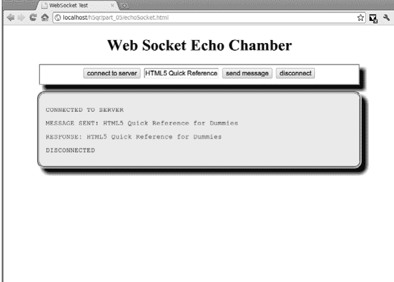

整个代码有点长，但仍然不是特别复杂：

```html
<!DOCTYPE HTML>
<html lang = "en">
<head>
<title>WebSocket Test</title>
<meta charset = "UTF-8" />
<style type = "text/css">
h1 {
text-align: center;
}

.error {
color: red;
```

##### 设置 HTML

和往常一样，上一节的 HTML 代码提供了基本框架。在这个特定示例中，我有一个包含三个按钮和一个输入区域的简单表单：

1. 在 `body.onload` 中进行初始化。代码将包含少量的初始化工作，这将（像往常一样）通过 `body` 元素的 `onload` 属性来调用。
2. 构建一个“连接”按钮。一个按钮将调用 `connect()` 函数，该函数将尝试创建 Web socket。
3. 为消息创建一个 Input 元素。用户将能够输入一条消息并将其发送到服务器。为此，构建一个简单的输入元素，并为其关联一个标签。
4. 创建一个“发送消息”按钮。另一个按钮将在用户准备好将当前消息发送到服务器时被激活。它将关联到 `sendMessage()` 函数。
5. 构建一个“断开连接”按钮。还有一个按钮用于关闭连接。这段代码很简单，不需要特殊函数。只需调用 `websocket.close()`。
6. 创建输出区域。使用一个简单的 div 作为输出。
7. 根据喜好设置样式。默认表单有点单调，所以使用 CSS 来美化一下。

创建这个表单让你对代码需要做什么有了一个相当清晰的概念。

##### 连接到 socket

如果你有一个可用的 Web socket（如本例所示），编写与该 socket 通信的 JavaScript 代码相当容易。首要任务是连接到 socket。这是通过创建一个 `websocket` 对象来完成的：

1. 检查浏览器是否支持 Web socket。最简单的方法是检查 `WebSocket` 对象是否是内置 window 对象的一部分。
2. 创建一个新的 Web socket。`new WebSocket()` 函数创建到服务器 socket 的连接。你必须拥有要连接的 socket 的 URL。在此示例中，我使用了 `echo.websocket.org` 处的回显服务器。请注意，URL 总是以 `ws` 开头，因为我们不再使用默认的 HTTP 协议。对于此连接，我们使用新的 `ws`（Web socket）协议。当然，如果你创建自己的服务器，你需要在此处包含服务器的 URL。
3. 为各种事件附加回调方法。与标准 HTML 类似，`websocket` 对象为多个事件设有句柄。为每个这些事件指定一个回调函数。有时你会看到使用匿名函数来完成此操作，但我认为使用标准函数更容易。当然，你必须构建每个这些函数。*（请参阅本部分后面的“创建回调函数”）。*

##### 创建回调函数

在上一节的最后一步中，你引用了许多应该在发生各种事件时调用的函数。当然，这些函数需要被创建。大多数这些函数只是通知用户发生了什么。所有函数都自动提供了一个参数 `evt`，这是一个描述刚刚发生事件的特殊对象。

- `onOpen`：当连接打开时，向用户传递一条指示连接成功的信息。我通过使用 `innerHTML` 属性将内容连接到 `output` 元素上来完成所有输出。
- `onClose`：同样，当连接关闭时，需要做的只是通知用户。
- `onMessage`：当从服务器发送消息时调用此函数。消息的内容在 `evt.data` 中可用。将此信息传递给用户。我选择更改传入数据的颜色，以便更容易看清哪些数据来自服务器。
- `onError`：当发生某种错误时调用此函数。如果发生错误，错误的解释可在 `evt.data` 中找到。明智的做法是设法标记错误（我用红色文本显示），以便明确表明出了问题。

##### 发送消息

用户通过点击 `发送消息` 按钮来指示她想向服务器发送一条消息。这将调用 `sendMessage()` 函数。此消息被传递给 Web socket 对象。

即使这个过程也不是太难：

1. 从文本字段中提取消息。在我的示例中，消息位于名为 `txtMessage` 的文本字段中，因此我使用普通的 JavaScript 代码提取该值。
2. 将消息传递给 `websocket` 对象。`websocket` 对象有一个 `send()` 方法。
3. 通知用户消息已发送。使用标准机制让用户知道发生了什么。当服务器响应时，`onMessage()` 方法将自动被调用。

##### 关于 Web socket 的一些说明

Web socket 协议不再是 HTML5 的官方组成部分，但它仍被视为非正式 HTML5 规范的一部分。所有主要浏览器都计划整合某种形式的此功能，但目前只有 Safari、Chrome 和 Firefox 4 可用。

Web socket 的真正优势在于能够创建自定义服务器。Web socket 可能最常用于两种场景：

- **瘦客户端**：在某些应用程序中，所有主要工作都应在服务器上完成，而客户端本质上应是一个接口。这是 Web socket 的理想应用场景，因为始终打开的连接提供了非常快速的客户端-服务器通信。
- **多用户应用程序**：当多个用户想要相互通信时，他们都可以与中央服务器交谈。服务器 socket 将使这比当前机制更容易管理。

### Web worker

Web 正在从文档服务平台迅速转变为管理系统应用程序的平台。然而，Web 浏览器尚未能充分利用现代处理器和操作系统。

本质上，所有现代操作系统都是*多任务*的。许多计算机仍然只有一个 CPU（中央处理器——计算机的主要“大脑”）。一台没有运行程序的现代机器通常会在后台运行多达 50 个进程。（使用你的任务管理器应用程序在你自己的机器上检查。）问题是，单个 CPU 如何能运行所有这些程序。操作系统使用*任务切换*算法在各种进程之间切换，并为每个程序提供足够的 CPU 时间来完成其工作。即使是拥有多个 CPU（例如双核处理器）的计算机也面临同样的问题；多个程序需要访问相同的有限计算资源。操作系统会自动处理此问题，程序员通常不需要考虑它。

通常，一个程序在内存中占据单个进程，这意味着它需要与其他操作系统需要管理的所有其他程序轮流执行。Web 浏览器是一个程序，它通常占据单个进程。当浏览器不仅仅是文档处理器时，这是可行的。然而，现在，Web 浏览器本身就像一个操作系统：它管理应用程序和程序，这意味着可能出现新类型的问题。

问题出现在你要求浏览器做一些计算成本高昂的事情时。例如，假设你希望浏览器执行某事一百万次。这并不太难；只需使用一个长 `for` 循环。然而，当该循环运行时，浏览器只能做这一件事。将没有剩余的处理器功率用于管理界面、响应鼠标或任何其他操作。当 CPU 在处理单个问题时，浏览器（有时是整个操作系统）似乎会锁定。

在传统编程中，解决方案是创建一种称为*线程*的东西。本质上，这是一个新的小程序，它在 CPU 的待办事项列表中拥有自己的位置。创建一个线程，将计算成本高的代码放入该线程，并让操作系统会设法运行它。这样主程序就不会卡住，计算任务将在后台执行。如果 CPU 拥有多核，操作系统通常能利用一个独立的 CPU 核心来运行该线程。

此前，Web 浏览器没有实现线程的良好方式。浏览器及其所有代码都运行在单个线程上，如果你遇到计算密集型问题，那真是无能为力。大多数程序员并不介意，因为使用线程可能非常棘手。你总是要提防某些被称为*死锁*和*竞态条件*的问题，因此线程编程长期以来被认为是一种黑魔法。

HTML5 引入了一项迷人的新技术，称为*Web Worker*。这是一种简单而强大的方式，为浏览器增添线程能力。以下是 Web Worker 实现其魔力的基本原理：

1. 像往常一样创建你的页面和 JavaScript 代码。通常，Web Worker 用于优化，因此你常会用它来修复一些运行缓慢的代码。一般来说，你需要隔离出一段占用 CPU 的代码（通常称为*关键代码段*）。这就是你将要移至 Web Worker 的代码。
2. 识别计算密集型代码。找出占用 CPU 资源的代码。通常，这是一个大型循环或繁重的数据初始化。这就是将被移至 Worker 的代码。
3. 创建一个包含关键代码段的独立 JavaScript 文件。构建一个完全独立的、带 `.js` 扩展名的文件。这个文件将包含一个（或多个）函数，这些函数受益于在独立线程中运行。
4. 在你的主页面中，创建一个 `Worker` 对象。这是一个全新的特殊类。它期望一个 `.js` 文件名（通常与 Web 页面在同一服务器上）作为其唯一参数。浏览器将根据该文件创建一个 Web Worker，其中包含关键代码段。
5. 指定一个函数，用于在收到 Worker 消息时运行。Web Worker 使用*消息传递*算法。对于 CPU 而言，Worker 和主页面是完全不同的程序。它们之间唯一的通信方式是来回传递消息。Worker 对象有一个 `onmessage` 事件处理程序。将一个函数附加到这个消息上，每当主程序从 Worker 收到消息时，该函数就会被激活。
6. 向 Worker 传递消息以告知其做什么。控制 Worker 的唯一方式就是向它传递消息。Worker 对象有一个 `postMessage()` 方法。向这个方法发送一个值，该消息就会被发送到 Worker。当然，你需要设置 Worker 以接收消息并相应地执行操作。
7. 为 Worker 提供一个 `onmessage` 函数。就像主页面一样，Worker（记住，它只是一个 JavaScript 文件）也可以有一个 `onmessage` 处理程序。将一个函数附加到 `onmessage`，每当事件触发时，Worker 就会运行该函数。
8. 编写函数代码。Worker 是一个与主代码完全独立的程序。它不知道 Web 页面或页面上的任何对象。它唯一知道的是发送给它的消息。除了进行计算或处理之外，它唯一能做的就是发回消息。然而，对于大多数处理任务来说，这已经足够了。
9. 完成后销毁 `Worker` 对象。Web Worker 会占用 CPU 时间，因此当你完成使用时需要终止它——否则它将驻留在内存中。Worker 有一个 `terminate()` 方法，用于请求 Worker 光荣地自尽。

观察其实际效果最简单的方法是查看一个简单的示例。请看以下 HTML 代码：

```html
<body>
  <h1>Web worker demo</h1>
  <button onclick = "startWorker()"
          type = "button">
    start web worker
  </button>
  <button type = "button"
          onclick = "stopWorker()">
    stop web worker
  </button>

  <div id = "output">
    default output
  </div>
</body>
</html>
```

这个页面不过是几个按钮，分别调用 `startWorker()` 和 `stopWorker()`。还有一个用于输出的 div，它将显示任何计算的结果。

这个页面将从零数到十万。根据你的 CPU 速度和使用的浏览器，这个过程可能需要一分钟或更长时间。没有 Web Worker 的话，你的浏览器在循环期间会卡住。然而，我的代码实际上不会运行这个循环。相反，它创建一个独立的 Web Worker，在一个全新的进程中运行这个循环。以下是 JavaScript 代码（像往常一样嵌入在页面的 head 部分）：

```javascript
//set up global vars
var worker;
var output;

function startWorker(){
    //initialize worker
    worker = new Worker("worker.js");
    output = document.getElementById("output");

    //when we get a message from worker, run update function
    worker.onmessage = update;

    //tell worker to get started
    worker.postMessage("start");
} // end init

function update(evt){
    //update the page with current message from worker
    output.innerHTML = evt.data;
} // end update

function stopWorker(){
    //stop the worker
    worker.terminate();
} // end stopWorker
```

虽然我们在这里进行了一些相对高级的编程，但实际代码非常简单。设置步骤如下：

1. 创建一些全局变量。我需要在整个代码中访问一个特殊的 `Worker` 对象（我将其称为 `worker`）和 `output` 元素。像往常一样，任何将在多个函数中使用的变量都应在函数外部声明。
2. 创建三个函数。我的代码使用了三个函数（在网页上——稍后还会有更多）。`startWorker` 函数在用户点击 `start worker` 按钮时触发。`stopWorker` 函数在用户点击 `stop worker` 按钮时触发。（我喜欢命名规范。）`update` 函数将在主程序从 Worker 收到消息时被调用。
3. 指定一个函数，用于在 Worker 发送消息时运行。当 Worker 发送消息时，一个特殊的函数将被运行。使用 `worker.onmessage` 指定符来指定收到消息时将运行哪个函数。在我的示例中，每当程序从 Worker 收到消息时，我都会调用 `update()` 方法（在步骤 5 中描述）。这通常在初始化函数中完成。
4. 向 Worker 传递消息。与 Worker 通信的唯一方式是向它传递消息。消息就是某种值。`worker.postMessage()` 函数允许你向 Worker 发送消息。在这个例子中，我只是发送了字符串 `"start"`。稍后当我创建 Worker 时，我需要告诉它如何响应 start 消息。
5. 编写 `update()` 函数。在步骤 3 中，我指定了每当页面从 Worker 收到消息时，它应该运行一个名为 `update()` 的函数。当然，这意味着我应该有一个名为 `update` 的函数。Web Worker 的回调函数会自动传递一个描述所发生事件的单个参数。我将该对象称为 `evt`。
6. 打印来自 Worker 的任何消息。如果消息来自 Worker，则将该消息复制到 `output` 对象的 `innerHTML` 中。`evt.data` 元素包含从 Worker 发送的消息。
7. 在请求时停止 Worker。如果用户想停止 Worker，`stopWorker()` 函数可以完成这项工作。它只是调用 Worker 的 `terminate()` 方法，这会销毁 Worker。

到目前为止，你只构建了系统的 Web 页面部分。Web Worker 是一个独立的文件。幸运的是，它非常容易构建。任何在带 `.js` 扩展名的文本文件中的 JavaScript 代码都可以是一个 Web Worker。Web Worker 将被操作系统作为一个与浏览器完全独立的程序运行，这意味着它不会阻止浏览器执行其他操作。然而，Worker 中的代码与浏览器或页面无关，因此它不能直接与页面交互。它的所有输入都来自浏览器传递的消息，所有输出都是传递给浏览器的消息。Worker 无法操作本地文档（因为就它所知，不存在本地文档）。

这是我的简单 Web Worker（存储在 `worker.js` 中）：

```javascript
//tell system to runloop when a message comes in
onmessage = runLoop;

function runLoop(evt){
    if ( evt.data === "start" ) {
        for(i = 0; i < 100000; i++){
            postMessage(i);
        } // end for
    }
}

// 发送一条消息表示我们已完成

postMessage("finished");

} // end if

} // end runLoop
```


这个 Worker 是普通的 JavaScript 代码，但它使用了消息机制与页面进行通信：

1. 当收到消息时运行`runLoop()`函数。使用`onmessage`机制来告知程序，每当有消息发送到 Worker 时，就运行`runLoop()`函数。
2. 构建`runLoop()`函数。这个函数会自动传递一个事件对象作为其唯一参数。
3. 检查传入的消息是否为 "start"。按照这个特定示例的写法，只有一条传入消息。通常情况下，可能会有来自浏览器的多种不同消息。你通常需要查看传入的事件，以确定程序应该执行什么操作。
4. 开始一个计算密集型的过程。在这个示例中，我让 Worker 在一个`for`循环中计数到 100,000。这个过程足够长，如果是在普通的 JavaScript 函数中执行，会导致浏览器暂时冻结。由于循环是在单独的线程中发生的，浏览器通常不会变慢。
5. 将当前计数器值传回浏览器。你可以使用`postMessage()`方法将某种信息发送回浏览器。在这个示例中，我将当前计数器值传回浏览器。这将触发浏览器的`update()`函数，该函数进而更新输出区域。
6. 传递另一条消息表明过程已完成。这并非必须，但这样做可以让你的主程序知道过程已经完成——然后 Worker 可以被终止，或者依赖该 Worker 的其他工作可以开始。

## 第 8 部分：使用 Canvas

`canvas`元素是 HTML5 中最令人兴奋的新发展之一。虽然`<canvas>`标签是一个 HTML 标签，但如果没有 JavaScript 编程，它本身并不那么有趣。`canvas`标签提供了一个*图形上下文*，这是一个可以用 JavaScript 命令进行绘制的页面区域。

Canvas 提供了一套丰富的绘图操作工具包，很可能会革新 Web。Canvas 标签的创新——加上 JavaScript 引擎速度的提升——很可能会带来 Web 的新用途。许多开发者已经使用 canvas 标签和 JavaScript 开发了游戏，而就在几年前，这些游戏还需要 Flash 或 Java。此外，canvas 的灵活性可能导致完全基于非 HTML 的全新视觉工具和小部件，这对可用性和用户界面可能产生深远影响。

Canvas 标签得到了几乎所有当前浏览器的支持。Chrome、Safari、Opera 和 Firefox 的最新版本都完全支持 canvas 标签元素。（老实说，像素级操作在 Firefox 3.x 中不可用，但在 Firefox 4 中可以。）一个明显的例外是（你可能猜到了）微软。截至 IE8，canvas 标签仍然不受支持，尽管 IE9 承诺支持 canvas 元素。与此同时，可在`http://excanvas.sourceforge.net`获取的 *ExplorerCanvas* 项目是一个有前景的替代方案。它提供了一种简单的方法，甚至可以为旧版本的 IE 添加 canvas 功能。

尽管 canvas 元素的许多功能（阴影、变换和图像）可以通过 HTML5 领域的其他部分获得，但在支持该平台的所有浏览器上，各种 canvas 元素的实现都是相同的。

请务必访问我的网站查看书中每个代码片段的实际示例：`www.aharrisbooks.net/h5qr`。

### 本部分内容...

- 检查 Canvas 基础知识
- 预览填充和描边样式
- 创建基本形状
- 绘制复杂形状
- 使用图像
- 添加变换
- 实现动画
- 了解像素操作

### Canvas 基础知识

从一个简单的 canvas 标签演示开始。“Hello World” 的 canvas 变体创建一个简单的 canvas 并在其上绘制一个矩形。

#### 设置 canvas

要使用 canvas 标签，请构建一个包含`canvas`元素的网页。通常，你会提供`width`、`height`和`id`参数：

```
<canvas id = "drawing"
        width = "200"
        height = "200">
    <p>Your browser does not support the canvas tag...</p>
</canvas>
```

在 canvas 标签内部，你可以放置任何你想要的 HTML 代码。如果浏览器不支持 canvas 标签，这些代码将会显示。通常，你会放一些消息让用户知道她错过了什么。

如果没有某种 JavaScript 代码，canvas 中不会发生任何有趣的事情。通常，你会使用一个函数在屏幕上绘图。这是我的`draw()`函数，它由`body onload`事件调用：

```
function draw(){
    var canvas = document.getElementById("drawing");
    if (canvas.getContext){
        var con = canvas.getContext('2d');
        con.fillStyle = "#FF0000";
        con.fillRect(10, 10, 50, 50);
    } // end if
} // end draw
```

`draw()`函数说明了使用 canvas 标签的所有主要思想。以下是构建基本绘图的方法：

1. 创建对 canvas 的变量引用。使用标准的`getElementById()`机制创建一个指向 canvas 的变量。
2. 从 canvas 中提取图形上下文。Canvas 元素有一个*图形上下文*，这是一个封装了 canvas 可以执行的所有绘图方法的特殊对象。现在大多数浏览器支持 2D 上下文，但 3D 上下文已在计划中。
3. 设置上下文的`fillStyle`。`fillStyle`指示你将如何为填充区域（如矩形）着色。基本方法是提供一个 CSS 风格的颜色值。有关如何用颜色、渐变或图像模式填充的信息，请参见本部分后面的“控制填充和描边样式”。
4. 创建一个填充矩形。图形上下文有一些内置形状。矩形形状很容易构建。它需要四个参数：`x`、`y`、`width`和`height`。`x`和`y`参数表示矩形左上角的位置，`width`和`height`参数表示矩形的大小。所有测量单位都是像素。有关你可以构建的各种基本形状的更多信息，请参见本部分后面的“绘制基本形状”。

#### 理解 canvas 的工作原理

我在本部分中会详细讲解，但首先概览一下 canvas 的工作原理和总体功能会很有帮助。

Canvas 中实际上只有两个主要的绘图函数：填充和描边。大多数绘图都是一个两步过程。首先，你定义某种形状（矩形、弧线、一系列线），然后告诉 canvas 用描边或填充来绘制。描边只是画一条线——所以如果你描边一个矩形，你会看到矩形的轮廓，但不会被填充。填充绘制的是填充后的形状，所以一个填充的矩形会显示矩形的内部。

你可以指定一个`fillStyle`，它指定了后续填充命令的颜色和图案。你也可以指示一个`strokeStyle`，它决定了后续描边命令的绘制方式。

更复杂的形状是用一种叫做`paths`的机制绘制的，这是一系列画线指令。你可以使用路径来创建描边或填充形状。

你可以将图像绘制到 canvas 上。你可以绘制整个图像，或者图像的一部分到 canvas 上。

你也可以直接在 canvas 上绘制各种字体和颜色的文本。你可以为文本元素或图像添加阴影效果。

Canvas 对象让你可以访问图像的底层数据。这允许你对图像数据执行任何你想要的变换，包括颜色平衡、调整亮度等等。

你可以为你的任何对象添加变换。变换允许你移动、调整大小或旋转你放置在 canvas 上的任何元素（文本、绘图或图像）。

最后，你可以使用 JavaScript 的动画和用户界面工具来构建你自己的动画，这些动画可以实时移动元素，或者在用户控制下移动。

### 控制填充和描边样式

Canvas 中的几乎所有操作都涉及填充或描边样式。要充分发挥 Canvas 的潜力，你需要理解它们的工作原理。用于填充和描边的主要有三种样式类型：颜色、渐变和图案。

### 颜色

在 Canvas API 中，有多种方式可以指定颜色值。通常，你可以使用与 CSS 和 HTML 中相同的颜色工具：

1. **六位十六进制值：** 管理颜色最常用的方式是使用 CSS 中常见的六位十六进制表示法，红、绿、蓝各占两位。值以井号开头。例如，`#FF0000`表示红色，`#FFFF00`表示黄色。
2. **三位十六进制值：** 十六进制颜色值经常使用重复的数字，因此可以缩写为三位数。在这种方案中，红色是`#F00`，黄色是`#FF0`。
3. **颜色名称：** 你通常可以使用颜色名称，如 "red" 或 "yellow"。常用的颜色名称通常有效，但并非所有浏览器都支持相同的颜色名称列表，因此 "papaya whip" 可能不被支持。（对我来说，它听起来更像是一道甜点食谱而不是颜色。）
4. **RGB 和 RGBA 值：** 你可以使用`rgb()`函数，通过整数（0–255）或百分比（0%–100%）来创建颜色。红色是`rgb(255, 0, 0)`，黄色是`rgb(100%, 100%, 0%)`。注意 rgb 函数必须像任何其他颜色值一样放在引号中。如果你想包含 alpha 透明度，添加第四个参数，这是一个 0 到 1 之间的值。半透明的红色是`rgba(255, 0, 0, 0.5)`。
5. **HSL 和 HSLA：** 新的`hsl`和`hsla`颜色格式理应被 Canvas 元素支持，但目前，对这些特性的支持程度因浏览器而异。

请注意，各种颜色值总是包含在引号中。颜色参数是一个可以被解析为 CSS 颜色的字符串。

### 渐变

你也可以使用渐变来填充形状。Canvas 渐变分两步定义：

1. **创建渐变对象。** 上下文对象中有两种内置方法用于此目的。一种构建线性渐变，另一种构建径向渐变。
2. **添加色标。** *色标*是一个特殊元素，表示要添加到渐变中的颜色。你可以添加任意多的颜色，还可以指定颜色在渐变图案中的出现位置。

以下代码在画布上构建了一个径向渐变和一个线性渐变：

```
function draw(){
  var drawing = document.getElementById("drawing");
  var con = drawing.getContext("2d");

  //构建一个线性渐变
  lGrad = con.createLinearGradient(0,0,100,200);
  lGrad.addColorStop(0, "#FF0000");
  lGrad.addColorStop(.5, "#00FF00");
  lGrad.addColorStop(1, "#0000FF");
  con.fillStyle = lGrad;
  con.fillRect(0, 0, 100, 200);

  //构建一个径向渐变
  rGrad = con.createRadialGradient(150, 100,
          0, 150, 100, 100);
  rGrad.addColorStop(0, "#FF0000");
  rGrad.addColorStop(.5, "#00FF00");
  rGrad.addColorStop(1, "#0000FF");
  con.fillStyle = rGrad;
  con.fillRect(100,0, 200, 200);
} // end draw
```

这段代码的输出如图 8-1 所示。

*线性渐变*是一种颜色图案，它们沿着一条直线路径相互融合。要定义线性渐变，请遵循以下步骤：

1. 创建一个变量来保存渐变。渐变比简单的颜色复杂一点，因此将它们存储在变量中以便重用。
2. 构建渐变。使用上下文对象的`createLinearGradient()`方法来构建线性渐变。
3. 定义渐变路径。`createLinearGradient()`方法需要四个参数。这些参数定义了一条线 (x1, y1, x2, y2)。颜色将垂直于这条线分布，因此如果你想要水平色带，就绘制一条垂直线。如果你想要垂直色带，就绘制一条水平线。在我的例子中，我画了一条对角线以获得对角线颜色。这条线通常占据元素的全部宽度或高度，但并非必须如此。如果这条线比图像小，多余区域将自动分配渐变最近端的颜色。
4. 添加色标。没有颜色的渐变没什么意思。渐变对象的`addColorStop()`方法允许你向渐变中添加颜色。每个色标有两个参数：位置和颜色。位置是一个 0 到 1 之间的值，表示颜色在渐变线上的位置。0 是起点，1 是终点，中间值在中间。颜色参数是一个可以被解析为 CSS 颜色的文本值。（你可以使用上一节描述的任何机制。）至少，你应该定义两个色标，一个用于起点，一个用于终点。
5. 将渐变应用为填充图案。如果你想将渐变用作填充图案，请将上下文的`fillStyle`设置为刚刚创建的渐变变量。所有后续的填充都将使用该渐变图案完成（直到`fillStyle`被更改为其他内容）。

径向渐变类似。它们不是在直线上绘制渐变，而是绘制一系列圆形色带。第一种颜色是圆心，最后一种颜色定义外半径。构建径向渐变与构建线性渐变非常相似。唯一的区别是创建命令。

使用上下文对象的`createRadialGradient()`方法来构建径向渐变。此命令实际上需要六个参数：

- `beginX`：起点的 X 坐标。这通常是形状的中心。
- `beginY`：与`beginX`一起，确定渐变的起始位置。
- `beginRadius`：中心圆的半径。通常为零，但如果你想更强调中心颜色，可以将其设置得更大。
- `endX`：描述结束圆的 X 坐标。通常与`beginX`相同。
- `endY`：与`endX`一起，定义结束圆的位置。如果起始圆和结束圆具有相同的位置，你将得到一个圆形渐变。更改结束位置可以使渐变向特定方向延伸。
- `endRadius`：结束半径定义了最后一种颜色渐变的放置位置。较小的半径值会导致渐变紧密聚集，较大的值会将渐变分散到更大的区域。

一旦渐变定义完成，`addColorStop()`方法的工作方式与线性渐变完全相同。通过`createRadialGradient()`命令创建的变量通常存储在一个变量中，以便后续用于`fillStyle`请求。

#### 图案

图案用于定义要用作填充或描边的图像。你可以使用任何图像作为图案，但最好找到或创建一个设计为可平铺的图像。（关于如何使用免费软件构建平铺图案的完整信息，请参阅我的书《*HTML, XHTML, & CSS All-in-One For Dummies, 第 2 版*》。）

网络上也有很多可用的平铺图案资源。一旦你获得了一个想要用作填充图案的图像，以下是如何在 Canvas 标签中实现它：

```
function draw() {
  var drawing = document.getElementById("drawing");
  var con = drawing.getContext("2d");
  var texture = document.getElementById("texture");
  pFill = con.createPattern(texture, "repeat");
  con.fillStyle = pFill;
  con.fillRect(10,150,190,150);
  con.font = "40px sans-serif";
  con.fillText("Pattern!", 20, 80);
  con.strokeStyle = pFill;
  con.lineWidth = 5;
  con.strokeRect(10, 10, 180, 100);
} // end draw
```

你可以在图 8-2 中看到这段代码的结果。

图案就是一个图像。构建图案相对直接：

1. 获取对图像的访问。你需要一个 JavaScript 图像对象作为图案的基础。有多种方法可以实现这一点，但最简单的方法是在 HTML 中的某处创建图像，用`display:none`样式隐藏它，并使用标准的`document.getElementById()`

## 绘制基本形状

一些基本形状可以直接绘制在图形上下文上。最常见的形状是矩形和文本，它们还可以带有阴影。

### 绘制矩形

你可以绘制三种不同类型的矩形：

- `clearRect(x, y, w, h)`：擦除一个以左上角`(x,y)`为起点、尺寸为`(w,h)`的矩形区域。通常，擦除操作会用背景色进行绘制。
- `fillRect(x, y, w, h)`：绘制一个以左上角`(x, y)`为起点、尺寸为`(w,h)`的矩形框。该矩形会用当前定义的`fillStyle`进行填充。
- `strokeRect(x, y, w, h)`：绘制一个以左上角`(x, y)`为起点、尺寸为`(w,h)`的矩形框。该矩形框不会被填充，但会使用当前定义的`strokeStyle`和`lineWidth`绘制其轮廓。

图 8-3 展示了几个矩形。

以下是生成图 8-3 的代码。

```
function draw(){
    var drawing = document.getElementById("drawing");
    var con = drawing.getContext("2d");
    con.fillStyle = "red";
    con.strokeStyle = "green";
    con.lineWidth = "5";
    con.fillRect(10, 10, 180, 80);
    con.strokeRect(10, 100, 180, 80);
} // end draw
```


### 绘制文本

`canvas`标签提供了完整的文本支持。你可以在画布的任何位置添加文本，并使用任何你想要的字体样式和大小。

图 8-4 展示了一个嵌入了文本的画布。

绘制文本到画布上的过程与绘制矩形类似。第一步是选择所需的字体。画布字体通过将字体赋值给上下文的`font`属性来创建。字体的定义方式与 CSS 中的单字符串字体赋值类似。你可以按照使用字体快捷方式时的相同顺序指定所有字体特性：样式（style）、变体（variant）、粗细（weight）、大小（size）和族系（family）。

当你准备好在屏幕上显示实际文本时，使用`fillText()`方法，它接受三个参数。第一个参数是要显示的文本。最后两个参数是文本左侧的 X 和 Y 坐标。以下代码用于生成图 8-4 所示的结果：

```
function draw(){
    var drawing = document.getElementById("drawing");
    var con = drawing.getContext("2d");
    //clear background
    con.fillStyle = "white";
    con.fillRect(0, 0, 200, 200);
    // draw font in red
    con.fillStyle = "red";
    con.font = "20pt sans-serif";
    con.fillText("Canvas Rocks!", 5, 100);
    con.strokeText("Canvas Rocks!", 5, 130);
} // end draw
```

### 使用阴影增强形状

你可以为画布上绘制的任何内容添加阴影。阴影很容易实现。它们需要上下文对象的多个方法：

- `shadowOffsetX`：确定阴影在 X 轴上移动多少。通常，这个值在 0 到 5 之间。正值会将阴影移到对象的右侧。更改此值和`shadowOffsetY`值可以改变光源的表观位置。
- `shadowOffsetY`：确定阴影在 Y 轴上移动多远。正值会将阴影移到对象的下方。通常，页面上的所有阴影应具有相同的 X 和 Y 偏移量，以表示一致的光照。偏移值的大小意味着元素从页面“抬起”的高度。
- `shadowColor`：指示阴影的颜色。通常定义为黑色，但如果需要，可以将颜色更改为其他值。
- `shadowBlur`：`shadowBlur`效果决定阴影的柔化程度。如果设置为零，阴影将极其清晰锐利。值为 5 会导致阴影更柔和。阴影模糊通常会使阴影颜色变浅。

如果你为文本添加阴影，请确保文本仍然可读。首选大的简单字体，并且你可能需要调整阴影颜色或模糊度，以确保主要文本仍然可读。

一旦应用了阴影特性，所有后续的绘制命令都将包含阴影。如果你想关闭阴影，请使用 RGBA 将`shadowColor`设置为透明颜色。

以下是生成带阴影文本的代码：

```
function draw(){
    var drawing = document.getElementById("drawing");
    var con = drawing.getContext("2d");
    //clear background
    con.fillStyle = "white";
    con.fillRect(0,0, 200, 200);
    // draw font in red
    con.fillStyle = "red";
    con.font = "20pt sans-serif";
    //add shadows
    con.shadowOffsetX = 3;
    con.shadowOffsetY = 3;
    con.shadowColor = "black";
    con.shadowBlur = 5;
    con.fillText("Canvas Rocks!", 5, 100);
} // end draw
```

#### 绘制更复杂的形状

更复杂的形状使用路径机制创建。*路径*是一系列由图形上下文执行的命令。你可以将其视为笔触运动的记录。以下是一个绘制蓝色三角形、红色边框的示例：

```
function draw(){
    var drawing = document.getElementById("drawing");
    var con = drawing.getContext("2d");
    con.strokeStyle = "red";
    con.fillStyle = "blue";
    con.lineWidth = "5";
    con.beginPath();
        con.moveTo(100, 100);
        con.lineTo(200, 200);
        con.lineTo(200, 100);
        con.lineTo(100, 100);
    con.closePath();
    con.stroke();
    con.fill();
} // end draw
```

这里显示的代码生成了图 8-5 中显示的输出。

绘制路径的技术并非极其复杂，但它确实涉及新的步骤。

1. 生成图形上下文。所有`canvas`程序都从为`canvas`创建一个变量、为图形上下文创建另一个变量开始。
2. 设置描边和填充样式。描边样式指示线条的颜色。线宽属性描述线条的宽度（以像素为单位），填充样式指示封闭形状将具有的颜色。
3. 开始路径。路径是一系列绘制命令。使用`beginPath()`方法开始你的路径定义。
4. 移动画笔。`moveTo(x, y)`命令将画笔移动到屏幕上的特定点而不进行绘制。
5. 绘制线条。`lineTo(x, y)`命令从当前画笔位置绘制一条直线到指定的`(x, y)`坐标。（有关其他绘制命令的信息，请参阅本部分后面的“绘制弧线和圆”、“绘制二次曲线”和“生成贝塞尔曲线”。）请注意，线条仍然不可见。请参见步骤 7。
6. 关闭路径。完成路径后，使用`closePath()`函数表示你已完成路径定义。
7. 描边或填充路径。当你定义路径时，它不会立即显示！`stroke()`命令使用当前描边样式和线宽沿路径绘制线条。如果你愿意，可以使用`fill()`命令来绘制由路径定义的填充形状。如果路径没有定义封闭形状，`fill()`命令会从终点向起点绘制一条线。`fill()`命令使用`fillStyle()`指定的颜色、渐变或图案填充路径。

> 请注意，`closePath()`函数会在路径的起点和终点之间绘制一条连接线。这将创建封闭形状。如果你希望路径保持开放，请在`closePath()`命令之前使用`stroke()`命令。在创建新路径之前，仍然需要调用`closePath()`。

> `lineTo()`方法实际上并不绘制线条！它只是指示你的路径。在执行`stroke()`、`closePath()`或`fill()`命令之前，路径不可见。

#### 线条绘制选项

每当使用描边命令时，你可以使用多种有趣的选项来修改线条宽度和样式。图 8-6 展示了其中一些选择。

要使用图案填充，请按照以下步骤操作：

1. 为图案创建一个变量。与渐变类似，图案填充可以重用，因此将图案存储在变量中以便以后重用。
2. 构建图案。上下文的`createPattern()`方法从图像创建一个图案。
3. 指定图案的重复参数。第二个参数指示图案将如何重复。默认值为`repeat`，它会在 X 和 Y 轴上无限重复图案。如果你的图案不是平铺的，你会在图案重复处看到明显的接缝。你还可以将重复值设置为`repeat-x`、`repeat-y`和`no-repeat`。
4. 将图案变量应用于`fillStyle`或`strokeStyle`。将图案变量赋值给上下文的`fillStyle`（或`strokeStyle`），然后执行任何填充操作以绘制图案。

#### 图 8-6

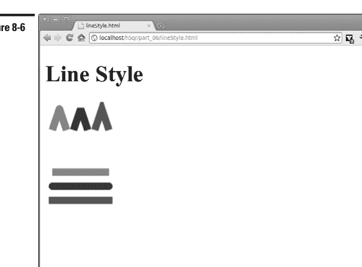

以下是创建图 8-6 的代码：

```javascript
function draw(){
  var drawing = document.getElementById("drawing");
  var con = drawing.getContext("2d");
  //change line width and color
  con.strokeStyle = "red";
  con.lineWidth = 10;
  con.lineJoin = "round";
  con.beginPath();
  con.moveTo(10, 40);
  con.lineTo(20, 10);
  con.lineTo(30, 40);
  con.stroke();
  con.closePath();
  con.strokeStyle = "blue";
  con.lineJoin = "bevel";
  con.beginPath();
  con.moveTo(40, 40);
  con.lineTo(50, 10);
  con.lineTo(60, 40);
  con.stroke();
  con.closePath();
  con.lineJoin = "miter";
  con.strokeStyle = "green";
  //draw a simple line
  con.beginPath();
  con.moveTo(70, 40);
  con.lineTo(80, 10);
  con.lineTo(90, 40);
  con.stroke();
  con.closePath();
  //line caps
  con.lineCap = "butt";
  con.strokeStyle = "red";
  con.beginPath();
  con.moveTo(10, 100);
  con.lineTo(90, 100);
  con.stroke();
  con.closePath();
  con.lineCap = "round";
  con.strokeStyle = "blue";
  con.beginPath();
  con.moveTo(10, 120);
  con.lineTo(90, 120);
  con.stroke();
  con.closePath();
  con.lineCap = "square";
  con.strokeStyle = "green";
  con.beginPath();
  con.moveTo(10, 140);
  con.lineTo(90, 140);
  con.stroke();
  con.closePath();
} // end draw
```

虽然这段代码很长，但它非常重复。只有几个新的元素：

- `strokeStyle`：使用任何样式选项（颜色、渐变或图案）来指定线条的绘制方式。
- `lineWidth`：以像素为单位指定线条的宽度。

#### 绘制更复杂的形状

- `lineJoin`：`lineJoin`属性表示路径中的角将如何渲染。默认形式是`miter`（产生尖角）。你也可以选择`round`（产生圆角）和`bevel`（产生方角）。
- `lineCap`：你还可以决定线条的端点如何渲染。使用`round`产生圆形端点，`square`产生方形端点，`butt`产生在线条宽度处精确切断的端点。方形和截断看起来几乎相同，但方形会为每条线增加一个小的长度，而截断则立即将线条切断。

#### 绘制弧线和圆

弧线和圆是`path`机制的一部分。它们的创建方式与线条非常相似，因为它们是作为路径的一部分来执行的。路径完成后，使用`stroke()`或`fill()`命令来实际绘制弧线或圆。

弧线和圆都是使用`arc()`方法创建的。

要绘制弧线或圆：

1. 设置描边或填充样式。与所有路径绘制命令一样，你需要在绘制弧线之前指定填充或描边样式。
2. 开始一个路径。弧线，像线条一样，必须作为路径的一部分来绘制。如果需要，弧线可以与线条组合。
3. 指定圆心。弧线只是一个圆的部分，因此通过确定圆心来开始定义弧线。`arc()`方法的前两个参数是圆心。
4. 指定圆的半径。第三个参数是圆的半径，它描述了弧线。
5. 定义起点和终点。弧线是圆的一部分。要指定你想绘制圆的哪个部分，请指定起始角和结束角。这些度量是`arc()`方法的第四个和第五个参数。注意，角度是以弧度定义的。
6. 指定绘制方向。最后一个参数确定绘制方向。使用`true`表示逆时针，`false`表示顺时针。

以下代码中使用了弧线绘制函数：

```javascript
function draw(){
  var drawing = document.getElementById("drawing");
  var con = drawing.getContext("2d");
  con.strokeStyle = "green";
  con.fillStyle = "rgba(255,0,0,0.5)";
  con.lineWidth = "5";
  //half-circle stroked
  con.beginPath();
  con.arc(220, 140, 50, 0, Math.PI, false);
  con.closePath();
  con.stroke();
  //full circle filled
  con.beginPath();
  con.arc(220, 220, 50, 0, Math.PI*2, true);
  con.closePath();
  con.fill();
}
```

此代码将生成图 8-7 所示的图像。

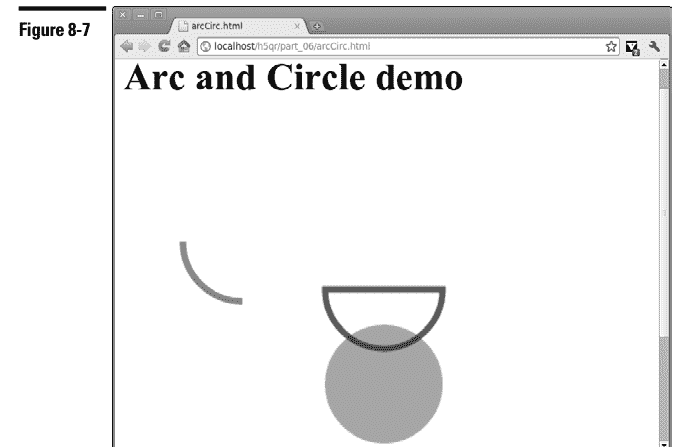

`arc()`命令的角度度量使用弧度作为角度单位。弧度在数学中经常使用，而不是度数。弧度就是当你将圆的半径绕同一圆的圆周展开时所描述的角度。弧度通常使用常量 pi (π) 表示，因此一个完整的圆有 2 × π 弧度。JavaScript 有内置常量`Math.PI`来简化与 π 的工作。你可以使用下表来确定主要角度：

| 方向 | 角度 |
| --- | --- |
| 北 | `3 × Math.PI / 2` |
| 西 | `Math.PI` |
| 南 | `Math.PI / 2` |
| 东 | `0` |

如果你熟悉弧度测量，你可能会认为角度是倒置的。（通常，`π / 2`是北，`3 × π / 2`是南。）角度是反转的，因为在计算机系统中，Y 值向下增加。

#### 绘制二次曲线

`canvas`元素还支持两种优雅的曲线绘制机制。二次曲线是一种具有起点和终点的特殊曲线。但是，起点和终点之间的线条受到一个控制点的影响。例如，看看图 8-8。它显示了一个带有控制点的简单曲线。

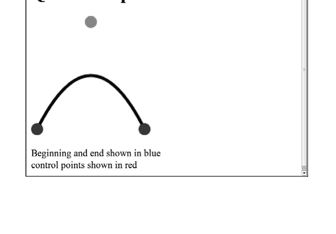

如果你检查二次曲线的代码，你会发现它的工作原理与绘制线条和弧线非常相似：

```javascript
function draw(){
    drawing = document.getElementById("drawing");
    con = drawing.getContext("2d");
    con.strokeStyle = "black";
    con.lineWidth = "5";
    con.beginPath();
    con.moveTo(10,190);
    con.quadraticCurveTo(100, 10, 190, 190);
    con.stroke();
    con.closePath();
    //mark beginning and end with blue
    drawDot(10, 190, "blue");
    drawDot(190, 190, "blue");
    //mark control points with red
    drawDot(100, 10, "red");
} // end draw
```


二次曲线的起点和终点是明确描述的，线条在这些点上开始和结束。然而，控制点通常不在曲线上。相反，它*影响*曲线。

以下是构建二次曲线的方法：

1. 开始一个路径。曲线，像大多数绘图功能一样，在路径的上下文中工作。
2. 移动到起始位置。使用`moveTo()`命令移动到你希望曲线开始的位置。
3. 使用`quadraticCurveTo()`方法绘制曲线。此方法需要四个参数：控制点的 X 和 Y 位置以及终点的 X 和 Y 位置。
4. 如果需要，绘制另一条曲线。像大多数绘图命令一样，你可以将一系列`quadraticCurveTo()`调用链接在一起以构建更复杂的形状。

> 注意，在这个例子中，我调用了一个名为`drawDot`的自定义函数来在屏幕上绘制各个点。完整的代码请参见我的网站 (www.aharrisbooks.net/h5qr)。

### 生成贝塞尔曲线

贝塞尔曲线是另一种曲线绘制工具。它类似于二次曲线，只是需要两个控制点。图 8-9 说明了一条贝塞尔曲线。

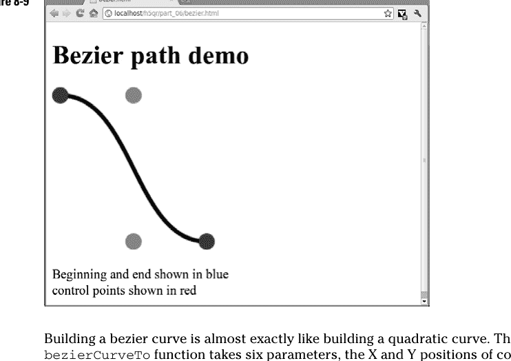

构建贝塞尔曲线与构建二次曲线几乎完全相同。`bezierCurveTo`函数需要六个参数：控制点一、控制点二和终点的 X 和 Y 位置。以下是图 8-9 所示贝塞尔路径的代码：

```javascript
function draw() {
    drawing = document.getElementById("drawing");
    con = drawing.getContext("2d");
    con.strokeStyle = "black";
    con.lineWidth = "5";
    con.beginPath();
    con.moveTo(10,190);
    con.quadraticCurveTo(100, 10, 190, 190);
    con.stroke();
    con.closePath();
    //mark beginning and end with blue
    drawDot(10, 190, "blue");
}
```

184 第8部分：使用Canvas

```javascript
drawDot(190, 190, "blue");
// 标记控制点为红色
drawDot(100, 10, "red");
} // draw函数结束
```

与二次曲线示例类似，我使用了自定义的`drawDot()`函数来绘制控制点的圆圈。*请参阅本部分前面的“绘制弧线和圆形”*，了解如何绘制这些点。

### 图像

虽然HTML早已支持图像，但Canvas接口为Web图像注入了新的活力。图像可以在Canvas内显示，并与Canvas API的矢量绘图技术相结合。你还可以选择图像的一部分进行显示，并对图像应用各种变换，以创建有趣的构图和动画。

图8-10展示了这项技术的基本版本，其中一张图像在canvas元素上被绘制了两次。

图8-10

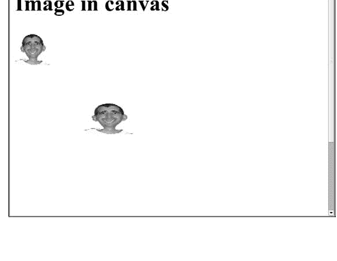

### 在Canvas上绘制图像

在canvas元素中使用图像最简单的方法是使用网页上已有的图像。你可以用普通的``标签将图像放在页面上，并使用CSS的`display: none`规则使图像不可见。另一种方法是在JavaScript中创建一个`Image`对象，并应用`src`属性将该图像与特定的图像文件关联。要了解这两种技术的示例，请看以下HTML代码：

```html

<canvas id = "drawing"
        height = "400"
        width = "400">
    <p>Canvas not supported</p>
</canvas>
```

以下JavaScript代码在canvas中显示图像：

```javascript
function draw(){
    var drawing = document.getElementById("drawing");
    var con = drawing.getContext("2d");
    var goofyPic = document.getElementById("goofyPic");
    con.drawImage(goofyPic, 0, 0, 50, 50);
    var image2 = new Image();
    image2.src = "andyGoofy.gif";
    con.drawImage(image2, 100, 100, 70, 50);
} // draw函数结束
```

具体步骤如下：

1. 在主页面中创建图像。访问图像最简单的方法是使用普通的HTML将图像嵌入主页面。如果需要，你可以用CSS代码 (`display: none`) 隐藏``标签，这样只有canvas中的版本可见。
2. 为图像创建一个JavaScript变量。使用普通的`document.getElementById()`机制创建一个指向该图像的变量。
3. 在canvas上绘制图像。`drawImage()`函数接受五个参数。第一个是图像对象的名称。（它必须是JavaScript图像对象的名称，而不仅仅是图像文件名。）接下来的两个参数是图像左上角的X和Y坐标，最后两个参数是图像的尺寸（宽度和高度）。
4. 创建一个JavaScript Image对象。如果你不想在页面中嵌入图像，可以使用JavaScript动态创建图像。使用`new Image()`构造函数来构建一个新图像。
5. 更改图像的src属性。如果你创建了一个JavaScript图像，必须指定`src`属性以指示与该图像关联的文件。图像加载可能需要一些时间。

> 提示
> 图像在从服务器加载完成之前不会显示。在大多数情况下，这不是问题，但有时你会需要程序延迟执行，直到图像加载完成。Image对象有一个`onload`属性，它接受一个回调函数。使用此技术来等待绘图完成：

```javascript
image.onload = finishDrawing;
function finishDrawing(){
    // 其余的绘图代码放在这里
}
```

### 绘制图像的一部分

有时你会想绘制原始图像的一小部分。图8-11展示了一个聚焦于滑稽脸中心部分的程序：

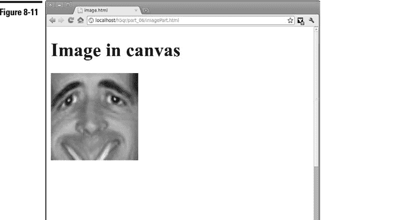

绘制图像的一部分相当容易。使用相同的`drawImage()`命令，但这次使用带有九个参数的版本：

```javascript
con.drawImage(goofyPic, 60, 70, 90, 90, 0, 0, 150, 150);
```

以下是所有这些参数的含义：

- **图像名称：** 第一个参数是图像对象（不是文件名，而是JavaScript Image对象的名称）。
- **源图的左上角：** 首要任务是选择原始图像中要显示的部分。接下来的两个参数指示原始图像上选区的左上角坐标。（你可以使用Gimp或IrfanView等图像编辑器来确定选区的位置和尺寸。）
- **源图的高度和宽度：** 接下来的两个参数指示源选区的高度和宽度。
- **目标位置：** 接下来的两个参数是图像左上角在canvas上的位置。
- **目标尺寸：** 最后两个参数描述了目标图像在canvas上的尺寸。

这里描述的子图像技术非常有用，因为它允许你将多张图像组合成一张图像（有时称为精灵图）。这减少了传输图像的开销。（传输一张大图像比传输几张小图像更快。）它也经常用于游戏和动画中，其中一个实体可能按顺序显示多张图像，以表示行走或攻击。

### 使用变换操作图像

*变换*是可应用于任何绘图或图像以改变其外观的数学运算。主要有三种变换：

- **平移 (translation)：** 在X和Y方向上移动特定量。
- **旋转 (rotation)：** 绕特定点旋转。
- **缩放 (scale)：** 在X和Y方向上改变对象的尺寸。

Canvas元素允许对任何类型的绘图执行所有这些操作。然而，Canvas元素实现这一点的方式比你可能接触过的更接近数学。在理解它们实际工作原理之前，Canvas中的变换可能很难理解。

在数学中，你并不是真正地变换*对象*。相反，你修改的是*坐标系*，然后在新变换后的坐标系中绘制图像。在矢量绘图应用程序中，同时有多个隐藏的坐标系在工作是很常见的。这很重要，因为这正是Canvas变换的工作方式。本质上，当你想要对一个对象执行变换时，你需要执行以下步骤：

1. 宣布一个临时坐标系的开始。主图像已经有自己的坐标系，它不会改变。在变换任何东西之前，你需要建立一个新的坐标系来容纳这些变化。`save()`命令（命名不佳）表示一个新坐标系定义的开始。
2. 使用`translate()`移动原点。默认情况下，原点 (0, 0) 位于canvas的左上角。通常，你会在（新的）原点上构建变换后的对象，然后移动原点来放置对象。如果你`translate(50, 50)`，然后在 (0, 0) 处绘制图像，图像将被绘制在临时坐标系的原点，该原点将位于主canvas的 (50, 50) 处。
3. 使用`rotate()`旋转坐标系。`rotate()`命令围绕其原点旋转新的坐标系。旋转参数是以弧度为单位的角度。
4. 在X和Y方向缩放坐标系。你也可以通过应用X和Y的缩放值来改变新的坐标系。这允许你创建拉伸和压缩的图像。
5. 在新坐标系中创建元素。一旦应用了所有想要的变换，你就可以使用所有普通的Canvas绘图技术。然而，这些绘图将绘制在你刚刚创建的虚拟坐标系中，而不是在canvas的主坐标系中。
6. 关闭临时坐标系。通常你会想对canvas的不同部分应用不同的变换。当你完成某个特定的变换时，使用`restore()`命令来关闭新的坐标系。所有后续的绘图命令都将使用canvas对象的默认坐标系。

### 构建变换后的图像

一个实际的例子更容易理解，因此请看下面的代码：

```javascript
function draw() {
    var drawing = document.getElementById("drawing");
    var con = drawing.getContext("2d");
    var goofyPic = document.getElementById("goofyPic");
    con.save();
    con.translate(100, 100);
    con.rotate(Math.PI / 4);
    scale(3.0, 1.5);
    con.drawImage(goofyPic, -25, -25, 50, 50);
    con.restore();
    //在普通坐标系中绘制一个矩形
    con.strokeStyle = "red";
    con.lineWidth = 5;
    con.strokeRect(0, 0, 200, 200);
} // 绘制结束
```

该程序创建了一个包含平移、旋转和缩放的新坐标系。它在新坐标系中绘制了一幅图像，然后恢复到标准坐标系，并绘制了一个矩形边框。

该程序展示了多种变换，如图8-12所示。

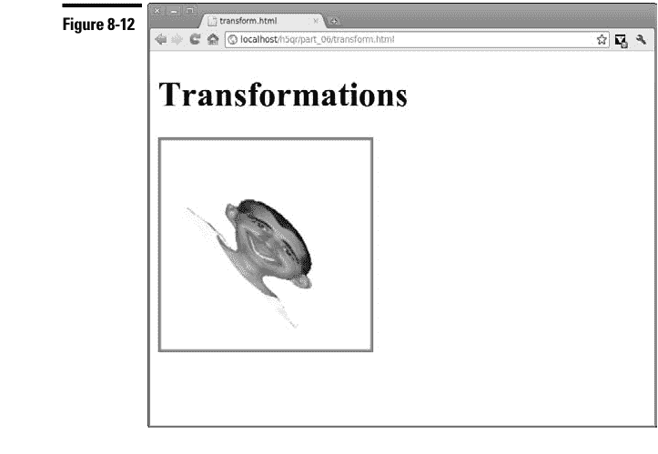

以下是构建此类图像的步骤：

1. 获取图像对象。从主站点加载图像（如本例所示）或通过JavaScript代码加载。（*参见*本部分前面的“在画布上绘制图像”。）

2. 使用`save()`方法开始变换。`save()`这个方法名（依我之见）非常令人困惑。这个方法*不是*将画布保存到文件。相反，它将当前的坐标系设置保存在内存中，并允许你定义一个新的坐标系。我本会把这个方法命名为`beginTransform()`。

3. 应用你想要的任何平移。记住，平移会移动整个坐标系。如果你像我在本例中那样将坐标系平移(100, 100)，这意味着随后在(0, 0)处绘制的任何内容实际上会出现在我200×200画布的中心。

4. 如果需要，旋转坐标系。你可以根据需要对坐标系应用旋转。系统将绕其原点旋转。通常，为了获得你想要的效果，请设计你的图像使其以原点为中心，然后通过移动原点来移动图像。旋转角度以弧度定义。如果你更习惯使用度数，可以使用此公式进行转换：`弧度 = 度数 × (Math.PI / 180)`。

5. 沿X轴和Y轴缩放坐标系。你可以通过指定新的缩放值来改变新坐标系的表观宽度和高度。缩放是一种乘法运算。如果缩放比例为1，元素保持原大小。如果缩放比例为2，元素大小变为原来的两倍，而0.5则是原来的一半。你甚至可以使用负数进行缩放来翻转图像。

6. 绘制你的图像。在应用所有变换后，在画布上绘制。你可以使用任何你想要的画布绘制技术：路径、矩形、图像、文本或其他任何东西。绘制的内容将受到指定变换的影响。

7. 结束变换。`restore()`方法应该被命名为`endTransform()`。（W3C如果在听，我可以帮你们想出更好的名字。会议时间确定后请告诉我。）不管怎样，这个方法表示你已经完成了对此变换中声明的所有变换的思考，并准备返回默认坐标系。术语*restore*（恢复）实际上意味着“返回到使用开始此变换的*save*命令保存的坐标状态”。

8. 随后的绘制将使用默认坐标。在我的例子中，我在图像周围绘制了一个普通矩形。这个矩形应该使用画布的常规坐标——我不希望它像图像一样被旋转或缩放。因为这些绘制命令存在于`save()`/`restore()`对的上下文之外，所以它们使用常规坐标系。

### 关于变换的一些要点

变换是一套极其强大的工具集，也是HTML5最受期待的功能之一。然而，它们确实隐藏了一定量的数学知识。你可以在线性代数（其底层数学理论）不理解的情况下使用它们，但有几个关键点需要记住：

- **每个变换都以矩阵形式存储。** 有一个叫做*矩阵*的底层结构（它比那部电影酷多了）在一个数学结构中存储了所有的平移、旋转和缩放。如果你愿意，可以通过上下文对象的`transform()`方法直接使用变换矩阵。
- **变换的顺序很重要。** 试试这个实验。站在房间中央。现在向前走五步，左转90度。看看你在哪里。现在回到同样的起点。这次，左转90度，然后向前走五步。你在同一个地方吗？你可能需要稍微尝试一下，才能让事情按照你预期的方式运作。
- **先变换坐标系，然后在原点上绘制。** 画布中的大多数绘制命令允许你在画布的任何位置绘制东西。如果你不使用变换，你可以使用这个机制将东西放置在任何你想要的地方。但是，如果你使用变换，变换整个坐标系然后在原点(0, 0)绘制你的元素会容易得多。否则你会得到一些非常奇怪的结果（尤其是在组合旋转和平移时）。

### 使用动画

当然，关于HTML5 canvas标签的大问题是它能否取代Flash作为在浏览器中实现游戏和动画的机制。目前还没有定论，但给画布图像添加动画是相当容易的。关键是利用浏览器内置的动画功能。

### 动画循环的基本结构

动画通常需要一种称为*动画循环*的特殊组织结构。动画循环的基本结构在任何语言中都是一样的：

1. 初始化。创建资源，包括背景和你将要使用的任何对象。将被实时操作的对象通常称为*精灵*。通常，这在程序首次运行时完成，以节省主执行期间的时间。你可能还会为图像大小、显示大小、帧率和其他在游戏执行期间不会改变的值设置常量。

2. 确定帧率。动画和游戏通过以规定的速率重复调用函数来工作。通常，你会有某种函数被重复调用。在JavaScript中，你通常使用`setInterval()`函数来指定一个将被重复调用的函数。*帧率*表示指定函数被调用的频率。游戏和动画通常以每秒10到30帧的帧率运行。更快的帧率更流畅，但在某些硬件上可能无法维持。

3. 评估当前状态。每个精灵实际上是一个数据元素。在每一帧期间，确定是否发生了任何重要事件：用户是否按下了键？某个元素是否应该移动？某个精灵是否离开了屏幕？两个精灵是否撞到了一起？

4. 修改精灵数据。每个精灵通常具有位置或旋转数据，可以在每帧期间修改。通常这是通过变换（平移、旋转和缩放）完成的，尽管有时你可能会在图像之间切换。

5. 清除背景。动画实际上是一系列在同一位置快速绘制的图像。通常，你需要在每帧开始时清除背景，以清除上一帧的图像。

6. 重新绘制所有精灵。每个精灵使用其新数据重新绘制。精灵看起来在移动，因为它们被绘制在新的位置或方向上。

通常，我本会在这里展示一个屏幕截图，但动画的静态图像在本书中不会有趣。请访问我的网站（www.aharrisbooks.net/h5qr）上的`autoRotate.html`查看程序实时运行。既然如此，也请查看我为你准备的所有其他精彩内容。

### 创建常量

作为示例，构建一个在画布内旋转图像的程序。完整代码分为几个部分。我将使用一个基本图像作为精灵。第一步是设置描述问题的各种变量和常量。以下代码是在任何函数之外创建的，因为它描述了将在函数之间共享的值：

```javascript
var drawing;
var con;
var goofyPic;
var angle = 0;
CANV_HEIGHT = 200;
CANV_WIDTH = 200;
SPR_HEIGHT = 50;
SPR_WIDTH = 40;
```

### 部署动画

通常，`body onload`机制用于在页面加载完成后立即启动一些代码。但现在页面有两个功能。`init()`函数负责初始化，而`draw()`函数将被重复调用以处理实际的动画。以下是`init()`函数的代码：

```javascript
function init(){
    drawing = document.getElementById("drawing");
}
```


### 初始化

```javascript
con = drawing.getContext("2d");

goofyPic = document.getElementById("goofyPic");

setInterval(draw, 100);

} // end init
```

`init()`函数的任务是初始化。在这个具体示例中，我将各种元素（画布、上下文和图像）加载到 JavaScript 变量中，并设置动画。`setInterval()`函数用于设置主动画循环。它接受两个参数：

- **一个可重复调用的函数：** 第一个参数是要重复调用的函数名称。在这种情况下，我将多次调用`draw`函数。
- **一个延迟值：** 第二个参数表示调用该函数的频率，单位是毫秒（1/1000秒）。延迟值为 100 将产生每秒 10 帧的帧率。延迟值为 50 将产生每秒 20 帧的帧率，依此类推。

### 为当前帧添加动画

`draw()`函数将被连续多次调用。通常，它的任务是清除帧、计算新的精灵状态并重新绘制精灵。以下是代码：

```javascript
function draw(){

    //clear background

    con.fillStyle = "white";

    con.fillRect(0, 0, CANV_HEIGHT, CANV_WIDTH);

    //draw border

    con.strokeStyle = "red";

    con.lineWidth = "5";

    con.strokeRect(0, 0, CANV_WIDTH, CANV_HEIGHT);

    //change the rotation angle

    angle += .25;

    if (angle > Math.PI * 2){

        angle = 0;

    }

    //start a new transformation system

    con.save();

    con.translate(100, 100);

    con.rotate(angle);

    //draw the image

    con.drawImage(goofyPic,

        SPR_WIDTH/-2, SPR_HEIGHT/-2,

        SPR_WIDTH, SPR_HEIGHT);

    con.restore();

} // end draw
```

虽然这段代码看起来可能有点复杂，但它实际上并没有做什么新的事情：

1. 清除背景。记住，动画是重复绘制。如果你在每一帧开始时不清除背景，你将看到上一帧的图画。使用上下文的`clearRect()`函数来绘制一个全新的背景，或者使用其他绘图工具来使用更复杂的背景图像。你必须先清除背景，这样后续的绘图才能在干净的画布上进行。
2. 绘制任何非精灵内容。在这个示例中，我希望在帧周围有一个红色的边框。只需为此使用普通的画布元素。我使用了`strokeStyle`、`lineWidth`和`strokeRect()`在画布周围构建了一个红色的矩形边框。请注意，我使用了`CANV_HEIGHT`和`CANV_WIDTH`常量来引用当前画布的尺寸。
3. 修改精灵状态。在这个示例中，我想修改图像的旋转角度。我已经在函数外部创建了一个名为`angle`的变量。（重要的是`angle`是在函数上下文之外创建的，这样它才能在函数调用之间保留其值。）我每帧都给`angle`增加一个小的值。每当你改变一个变量（尤其是在像动画这样几乎无限循环的场景中），你应该检查边界条件。在这个示例中，我在改变角度。允许的最大角度值（以弧度为单位）是 2 × π。如果角度大于 2 × π，它将被重置为零。
4. 构建一个变换。许多动画实际上是变换的修改。这里的情况就是这样。我实际上并没有改变图像本身，而是改变了包含图像的变换。使用`save()`方法设置一个新的变换，并使用`rotate()`和`translate()`函数来变换一个临时坐标系统。（关于变换如何与临时坐标系统相关的信息，请参阅本部分前面的“使用变换操作图像”。）
5. 在新变换的中心绘制图像。记住，`drawImage()`命令是基于图像的左上角来绘制图像的。如果你在新的变换中的 (0, 0) 处绘制图像，图像将看起来围绕其左上角旋转。通常，你希望图像围绕其中心点旋转。只需绘制图像，使其中心位于原点。将 X 设置为零减去图像宽度的一半，将 Y 设置为零减去图像高度的一半。
6. 关闭变换。使用`restore()`方法完成临时坐标系统的定义。

### 移动元素

通常你会更喜欢移动一个元素。这个过程实际上与旋转机制非常相似。这是一些移动图像并在其离开画布时使其环绕到另一边的代码：

```javascript
var drawing;

var con;

var goofyPic;

CANV_HEIGHT = 200;

CANV_WIDTH = 200;

SPR_HEIGHT = 50;

SPR_WIDTH = 40;

var x = 0;

var y = 100;

var dx = 10;

var dy = 7;

function init(){

    drawing = document.getElementById("drawing");

    con = drawing.getContext("2d");

    goofyPic = document.getElementById("goofyPic");

    setInterval(draw, 100);

}

function draw(){

    //clear background

    con.clearRect(0, 0, 200, 200);

    //move the element

    x += dx;

    y += dy;

    //check for boundaries

    wrap();

    //draw the image

    con.drawImage(goofyPic, x, y, SPR_WIDTH, SPR_HEIGHT);

    //draw a rectangle

    con.strokeStyle = "red";

    con.lineWidth = 5;

    con.strokeRect(0, 0, CANV_WIDTH, CANV_HEIGHT);

} // end draw

function wrap(){

    if (x > CANV_WIDTH){

        x = 0;

    }

    if (x < 0){

        x = CANV_WIDTH;

    }

    if (y > CANV_HEIGHT){

        y = 0;

    } // end if

    if (y < 0){

        y = CANV_HEIGHT;

    }

} // end wrap
```

环绕代码与旋转程序非常相似。它有一些不同的特点：

- 跟踪精灵位置。精灵的位置现在会改变，因此重要的变量是`x`和`y`，用于跟踪精灵的位置。
- 你还需要用于精灵运动的变量。`dx`变量代表 *x 方向上的差值*，用于表示`x`值每帧变化多少。同样，`dy`用于表示`y`值每帧变化多少。`x`、`y`、`dx`和`dy`都是在函数上下文之外创建的。
- **移动元素值。** 在每一帧（在`draw()`函数中），将`dx`加到`x`上，将`dy`加到`y`上。
- **检查边界。** 我创建了一个名为`wrap()`的新函数来检查边界条件。代码非常直接。如果精灵的`x`值超过画布的宽度（意味着它已经移动到画布的右边界），则将`x`值重置为 0（将其移回左侧）。使用类似的计算来检查其他边界，并将图像重置到另一侧。

再一次，静态的静态图像无法公正地展示这个动画效果。请访问我的网站 (www.aharrisbooks.net/h5qr) 查看`wrap.html`中的示例。`bounce.html`页面展示了下一节中的弹跳示例。

### 现在我们正在反弹

如果你希望你的精灵从墙上反弹回来，只需将`wrap()`函数替换为一个这样工作的`bounce()`函数：

```javascript
function bounce(){

  if (x > CANV_WIDTH - SPR_WIDTH) {

    dx *= -1;

  }

  if (x < 0) {

    dx *= -1;

  }

  if (y > CANV_HEIGHT - SPR_HEIGHT) {

    dy *= -1;

  }

  if (y < 0) {

    dy *= -1;

  }

} // end bounce
```

## 处理像素操作

Canvas 标签还有一个令人难以置信的技巧。你可以将 Canvas 标签的数据提取为底层的像素数据。如果你知道如何操作这些数据，你就可以非常广泛地实时控制你的图像。你可以使用这些数据进行颜色平衡，以及实验你自己的模糊、锐化和色度键效果。

为了理解这是如何工作的，你需要了解一些关于图像如何在内存中存储的知识。无论图像以什么格式存储在文件系统上，它都会以像素列表的形式显示。每个像素由（在

## 第8部分：使用Canvas

在标准的32位系统中，每个像素由四个整数表示：RGBA。R值表示当前像素点中红色的含量。G代表绿色，B代表蓝色。A代表*alpha*，是衡量图像透明度的指标。这些值的范围都可以是0到255。当你将图像转换为图像数据格式时，你会得到一个由整数组成的大型数组。每四个一组的整数代表一个像素的颜色数据。

下面是一个改变图像颜色平衡的示例：

```javascript
function draw(){

  var drawing = document.getElementById("drawing");

  var con = drawing.getContext("2d");

  var original = document.getElementById("original");

  CANV_WIDTH = 200;

  CANV_HEIGHT = 200;

  //draw the original on the canvas

  con.drawImage(original, 0, 0);

  //get the image data

  imgData = con.getImageData(0, 0, 200, 200);

  //loop through image data

  for (row = 0; row < CANV_HEIGHT; row++){

    for (col = 0; col < CANV_WIDTH; col++){

      //find current pixel

      index = (col + (row * imgData.width)) * 4;

      //separate into color values

      r = imgData.data[index];

      g = imgData.data[index + 1];

      b = imgData.data[index + 2];

      a = imgData.data[index + 3];

      //manipulate color values

      r -= 20;

      g += 50;

      b -= 30;

      a = a;

      //manage boundary conditions

      if (r > 255){

        r = 255;

      }

      if (r < 0){

        r = 0;

      }

      if (g > 255){

        g = 255;

      }

      if (g < 0){

        g = 0;

      }

      if (b > 255){

        b = 255;

      }

      if (b < 0){

        b = 0;

      }

      if (a > 255){

        a = 255;

      }

      if (a < 0){

        a = 0;

      }

      //return new values to data

      imgData.data[index] = r;

      imgData.data[index+1] = g;

      imgData.data[index+2] = b;

      imgData.data[index+3] = a;

    } // end col for loop

  } // end row for loop

  //draw new image onto canvas

  con.putImageData(imgData, 0, 0);

} // end function
```


虽然这段代码清单看起来很长，但其实并不难理解：

1. 绘制原始图像。你将使用的技术是从canvas元素中提取数据，因此要修改图像，你首先需要将其绘制到canvas上。我首先使用普通的`drawImage()`方法将我的滑稽人脸图像绘制到canvas上。
2. 提取图像数据。`getImageData()`方法获取当前canvas显示的图片，并将其放置在一个由整数组成的大型数组中。
3. 编写循环处理行。图像数据被分解成行和列。每一行从0到canvas的高度，因此创建一个`for`循环来遍历这些行。
4. 编写另一个循环处理列。在每一行内部，有足够的数据从0到canvas的宽度，因此在第一个循环内部创建第二个`for`循环。使用一对嵌套的`for`循环来遍历像图像信息这样的二维数据是非常常见的。
5. 找到当前行和列在`imageData`中的索引。`imageData`数组为每个像素包含四个整数，因此我们需要做一点计算来找出每个像素的第一个整数在哪里。最简单的公式是将行号乘以canvas的宽度，加上列号，然后将整个结果乘以四。
6. 从索引中提取相应的颜色值。索引也代表当前像素的红色值。下一个`int`包含绿色值，然后是蓝色值，最后是alpha值。
7. 根据需要操作颜色值。如果你要做一个颜色平衡应用（就像我做的那样），你可以简单地通过加减值来改变整体颜色平衡。在我的例子中，我给绿色增加了一些值，从红色和蓝色中减去了一些值。我选择让alpha值保持不变。当然，如果你想尝试像素级图像操作，这里是你做更复杂工作的地方。
8. 检查边界。像素值不能低于0或高于255，因此检查这两个边界并将所有像素值调整到合法范围内。
9. 将操作后的值返回到`imgData`数组。你可以将值复制回数组，并且你应该这样做以使更改可见。
10. 将图像数据绘制回canvas。`putImageData()`函数将当前图像数据作为普通图像绘制回canvas。图像的新版本将反映这些更改。在我的例子中，我得到了一张明显看起来病态的图片。


颜色平衡是一种过于微妙的效果，在黑白截图中无法准确显示，因此请访问我的网站 (www.aharrisbooks.net/h5qr) 以查看此程序的完整效果。

# 索引

## A

- AAC音频编码，56
- 绝对定位，100–102
- 精度，145
- 操作按钮，39
- `active`伪类，106
- 加色模型，83
- 附加组件，4，52，53–54，57，163
- `<address>`标签，42
- 地址，42
- Adobe Flash
  - 消除，55，163，191
  - 嵌入，4，54
  - 视频加载，56
- 聚合器，44
- AJAX（异步JavaScript和XML），7，148
- 文本对齐，88，98
- alpha值，114，115
- 替代布局，95
- 海拔，145
- Android移动平台，12
- 角度测量，180–181
- 动画，7，126–127，165
- 匿名回调函数，141
- Apple iPads，12
- Apple iPhones，12，103，116–118，145
- Apple Safari
  - 早期，3
  - 渐变语法，116–118
  - 移动版Safari，119–120
  - Ogg/Theora/Vorbis，55–56
  - WebKit引擎，12，103
- Apple Safari，支持
  - canvas，163
  - 多列，108
  - 弹性盒布局，113
  - 反射，119–120
  - 搜索功能，69
  - 文本描边（颜色），109
  - Web sockets，155
  - WebSQL，143
- 应用程序
  - 浏览器开发，131，132
  - JavaScript作为开发框架，128
  - 多用户，156
  - 页面即应用，5
  - Web应用，3，4
- 弧线，179–181
- `<article>`标签，42–43
- 文章，6，42–43
- 亚洲语言，56
- `<aside>`元素，43
- ASP，7
- 密码字段中的星号，35
- 异步JavaScript和XML（AJAX），7，148
- `@font-face`样式，106–107
- 属性，17，46–47，49–50，62–64，104。*另见特定属性*
- 音频，6，49–51，54
- `<audio>`标签，49–50
- 搜索框自动补全，69
- `autofocus`属性，62
- `autoplay`属性，49

## B

- 背景，90–93，109，115
- 向后增强，17
- 向后兼容，6
- 伯纳斯-李，蒂姆（计算机科学家），2，3
- 贝塞尔曲线，183–184
- 块布局，95，96
- 块级元素，58
- 阴影模糊，109，123
- `body.onload`机制，144
- 边框，CSS中的，89–90，118–119
- 边界，绘制，197
- 浏览器。*另见特定浏览器*
  - 作为应用平台，131，132
  - 构建渐变，116
  - 缓存，133，134
  - 带数据库程序，139
  - 早期，2–3
  - 功能特性，8–12
  - HTML5适用性，7，12–13
  - 可缩放矢量图形，55
  - 更新，134
- 浏览器，限制
  - 音频，49
  - `autofocus`，62
  - `command`标签，47
  - `details`，48
  - 显示问题，93–95
  - 弹性盒布局，113–114
  - `keygen`元素，59
  - `output`，61
  - 占位符，63
  - Ruby注音，56
  - `section`标签，46
  - `summaries`，48
- 浏览器，限制（续）
  - `time`，70
  - `transition`动画，127
  - 视频，55–56
  - WebSQL，143
  - 断字，49
- 浏览器，支持
  - canvas，52，163
  - 多列，108
  - `fieldsets`，58
  - 字体，107
  - 地理定位，143–144，145
  - 本地存储，138
  - 通知，146
  - `nth-child`选择，105
  - 数字验证，68
  - 伪类，106
  - 反射，120
  - `required`属性，63
  - 搜索功能，69
  - 阴影，123
  - 文本阴影，109
  - 变换，126
  - URLs，70
  - Web sockets，155
  - 周，70
- 按钮，38–39，50

## C

- `cache.manifest`，133–134
- 回调函数，141，143，155
- canvas
  - 概述，163
  - 动画编码，192，193–194，195–196，197
  - 弧线，编码，179–180
  - 基础，164–165
  - 贝塞尔曲线，编码，183–184
  - 圆形，编码，179–180
  - 填充与描边，166–171
  - 渐变，编码，167
  - 图像，基础，184–187
  - 图像，编码，185，186
  - 带变换的图像，187–191
  - 线条绘制选项，编码，177–178
  - 路径机制，编码，174–175
  - 像素操作，197–200
  - 二次曲线，编码，182
  - 矩形，编码，171–172
  - 设置，编码，164–165
  - 复杂形状，175–184
  - 基本形状，171–174
  - 文本，编码，172–173
  - 平铺图案，编码，169–170
  - 变换，编码，188–189
- `<canvas>`标签，4，5，6，7，8，51–53
- 标题，47
- 层叠样式表（CSS）
  - 概述，71
  - 边框，89–90，118–119
  - 编码。*参见* 编码
  - 元素，103，106–114。*另见* 视觉元素（CSS）
  - 格式化，概述，72–82
  - 格式化，浮动定位，93–102
  - 格式化，页面，82–93
  - 在HTML中，5，6–7，16
  - 用于视觉布局，19
  - 在XHTML中，17–18
- 区分大小写的编码，17
- 手机地理定位支持，143–144
- HTML中的居中，6，16，17
- 中央处理单元（CPU），156，158
- 表单中的复选框，37–38
- `checked`属性，46
- 在代码中检查功能，9–12
- 子选择器，104–105
- Chrome（谷歌）
  - 早期，3
  - 渐变语法，116–118
  - Ogg/Theora/Vorbis，55–56
  - 渲染引擎，12–13，103
- Chrome（谷歌），支持
  - canvas，163
  - 多列，108
  - 联系人数据库，142
  - 弹性盒布局，113
  - 通知，146
  - 数字验证，68
  - 反射，119–120
  - 搜索功能，69
  - SQLite，139
  - 文本描边（颜色），109
  - Web sockets，155
  - WebSQL，143
- Chrome（谷歌）Frame，13
- Chrome（谷歌）版本6，13

# 索引

## 203

- 习惯，8
- 图像，22–24
  - 适用于 Internet Explorer，16
- JavaScript，50，130–132，135–137，144，146–147，150–154，158–161
- 链接，24–26
- 列表，26–28
- 段落，22
- 有问题的，94
- 节，22
- SQL，139–142
- 表格，28–30
- 验证。**参见** 验证
- 网页设置，19

### 颜色

- 平衡，197
- 在画布上，165，166–169
- 使用 CSS，16，73–77，114–115
- 在表单中，6，65
- 十六进制，82–85
- 阴影的，123
- 文本阴影的，109
- 文本描边，108–109

### 颜色渐变点

- 167

### 列

- 6，97–98，107–108

### 组合图像

- 184，187

### `<command>`元素

- 44

### `<command>`标签

- 46

### 命令

- 44–45，46

### 通信协议

- 148

### 浏览器功能比较

- 8

### 标准合规性

- 3，8

### 计算密集型问题

- 156，157

### 计算机概述

- 156

### 联系人数据库

- 141–143

### 内容布局

- 17，18

### 内容管理系统

- 44

### 上下文

- 在图形中，51，163
- 在菜单中，45

### 二次曲线的控制点

- 181，182

### `controls`属性

- 49

### 转换

- 字体，107
- 视频，56

### cookies

- 131–132

### 坐标系

- 188，189，191

### 核心语言简洁性

- 5

### 圆角

- 7，122

### CPU（中央处理单元）

- 156，158

### CSS（层叠样式表）

- 关于，71
- 边框，89–90，118–119
- 编码。**参见** 编码
- 元素，103，106–114。另见 可视元素（CSS）
- 格式化，关于，72–82
- 格式化，浮动定位，93–102
- 格式化，页面，82–93
- 在 HTML 中，5，6–7，16
- 用于可视化布局，19
- 在 XHTML 中，17–18

### `currentTime`属性

- 51

### 曲线绘制机制

- 181–182，183

### 服务器定制

- 156

## D

### 数据，图像

- 165

### 数据选项

- 关于，131–132
- 本地存储，7，134–139
- 离线缓存，132–134
- WebSQL 数据库，139–143

### 数据库

- 7，19，139–143

### `datalist`元素

- 58

### 表单中的日期

- 6，65

### `datetime`元素

- 65–66

### `datetime-local`元素

- 66–67

### 死锁

- 157

### 有争议的功能

- 8

### 定义列表

- 47

### 延迟，动画

- 193

### 部署动画

- 193

### `details`元素

- 47，48

### `detect.html`页面

- 9

### `<dfn>`标签

- 47

### 字典

- 134–135

### 行进方向

- 145

### `disabled`属性

- 46

### 显示

- 93–100

### `<div></div>`标签

- 22，45–46

### `doctype`定义

- 18

### `document.getElements`

- 130

### `document.querySelector`

- 131

### 文档，链接

- 2

### 绘图

- 51，52–53。另见 画布

### 下拉列表

- 36

## E

### 元素

- 在表单中，34
- HTML，6
- 媒体，49–56
- 移动，195–197
- ruby，56
- 选择器，6，7
- 语义化标记，42–49

### 表单中的电子邮件地址

- 6，67

### `<embed>`标签

- 53–54

### 嵌入式 OpenType (EOT)

- 107

### 嵌入

- Flash，4
- 字体，6
- 表单，58，61
- 媒体，53–54

### 加密

- 59

### EOT（嵌入式 OpenType）

- 107

### `executeSql()`

- 141–142

### ExplorerCanvas 插件

- 52，163
- 在截图中，19
- 带阴影，174

### `<footer>`标签

- 6，43

### 前景色

- 115

### 宽容的特性

- 17

### `<form>`标签

- 33

### 格式，视频

- 55–56

### 格式化

- 16，17，48。另见 层叠样式表（CSS）

### 表单

- 关于，30–33
- 操作按钮，39
- 复选框，37–38
- 在 CSS 中，95–100
- 早期岁月，4
- 元素，57–70
- 改进，5
- 列表，36
- 密码字段，35
- 单选按钮，38–39
- 结构标签，33–34
- 文本框，34–35
- 更新，6

## F

### 失败回调函数

- 143

### FFmpeg 工具（视频转换）

- 56

### `fieldset`元素

- 58–59

### `<fieldset>`标签

- 34

### `<figcaption>`标签

- 47

### `<figure>`标签

- 48

### 图表

- 48

### 填充与描边

- 165，166–171

### `fillStyle()`

- 165

### 帧

- 16，17，18

### Web 应用程序开发框架

- 4

### FTP

- 148

### Firefox (Mozilla)

- 关于，2，103
- 早期岁月，3
- 渐变语法，116–118
- HTML5 适用性，12
- 渲染引擎，103
- 视频限制，143
- WebSQL 限制，143

## G

### 游戏

- 13，163

### Gecko 浏览器/引擎

- 12，113

### 地理位置

- 7，143–146

### 几何变换

- 124

### 全球定位系统（GPS）单元

- 143–144，145

### Firefox (Mozilla) 支持

- 列，108
- 弹性盒布局，113
- 字体，107
- 阴影，123
- SQLite，139
- 过渡动画，127
- 视频，55

### Google Chrome

- 早期岁月，3
- 渐变语法，116–118
- Ogg/Theora/Vorbis，55–56
- 渲染引擎，12–13，103

### Google Chrome 支持

- 画布，163
- 列，108
- 联系人数据库，142
- 弹性盒布局，113
- 通知，146
- 数字验证，68
- 反射，119–120
- 搜索功能，69
- SQLite，139
- 文本描边（颜色），109
- Web 套接字，155
- WebSQL，143

### Firefox (Mozilla) 版本 3

- 42

### Firefox (Mozilla) 版本 3.5

- 65

### Firefox (Mozilla) 版本 4

- 155

### Flash (Adobe)

- 消除，55，163，191
- 嵌入，4，54
- 视频加载，56

### Google Chrome Frame

- 13

### Google Chrome 版本 6

- 13

### Google Gears 扩展

- 145

### 弹性盒布局

- 110–114

### CSS 中的浮动定位

- 93–102，110

### 浮点数

- 68

### `focus`伪类

- 106

### 字体

- 在地址中，42
- 在画布上，165
- 在 CSS 中，88，106–107
- 在定义中，47
- 早期岁月，4
- 在 HTML 中，4，6，16，17

### GPS（全球定位系统）单元

- 143–144，145

### 渐变

- 7，115–118，166–169

### 图形。**参见** 图像

## H

### `<h1>`–`<h6>`元素

- 44

### H.264 视频编码

- 56

### Harris, Andy（作者）

- 网站上的动画，192
- 网站上的代码片段，15，41，71，129
- 网站上的颜色平衡，198–199
- 网站上的颜色样本，73，115
- *《HTML、XHTML 和 CSS 一书通》*，7，15，102，139，169
- *《JavaScript 和 AJAX 一书通》*，7，63，64，129，139

### `<head>`元素

- 44

### `<header>`标签

- 44

### 标题

- 6，44

### 标题（行进方向）

- 145

### 标题标签

- 44

### 十六进制颜色

- 82–85，166

### `<hgroup>`标签

- 44

### `hover`伪类

- 106

### HSB 颜色模型

- 85

### HSL（色相、饱和度、明度）模型

- 114–115，166

### HSLA（色相、饱和度、明度、透明度）模型

- 115，166

### HSV（色相、饱和度、明度）模型

- 115

### HTML

- 下拉列表，36
- 基础，16–19
- 历史，2–5
- 页面。**参见** 网页
- 设置，153–154
- XHTML，4，5，17–18，36

### *《HTML、XHTML 和 CSS 一书通》* (Harris)

- 7，15，102，139，169

### HTML 2

- 3

### HTML 3.2

- 3

### HTML 4

- 3，4，16–17

### HTML5。另见 特定浏览器，如 *Google Chrome*；特定主题

- 关于，18–19
- 自 HTML 4 以来的变化，4–6
- 元素。**参见** 元素
- 表单。**参见** 表单

### HTTP（超文本传输协议）

- 148

### 色相、饱和度、明度（HSL）模型

- 114–115，166

### 色相、饱和度、明度（HSV）模型

- 115

### 色相、饱和度、明度、透明度（HSLA）模型

- 115，166

### 超链接

- 2，24–26，81–82

### 超文本标记语言。**参见** HTML

### 超文本传输协议（HTTP）

- 148

## I

### 图标

- 46

### IE。**参见** Internet Explorer (IE)

### 图像

- 背景，90–93，109
- 基础，184–187
- 作为边框，118–119
- 在画布上。**参见** 画布
- 编码，22–24
- 标签上下文，163
- 图表内部，48
- 交互式，6
- 在 Mosaic 浏览器中，2
- 作为图案，169–171
- 像素操作，197–200
- 旋转，124
- 使用变换，187–191
- 基于矢量的，7

### ``标签

- 6，17

### IndexedDB (WebSQL)

- 143

### 内联布局

- 95

### 内联语义元素

- 46–49

### `<input>`元素

- 6

### `input`标签

- 34

### 输入类型

- 64–70

### 整数

- 68

### 知识产权，字体

- 107

### 交互式图形

- 6

### Internet Explorer (IE)

- 画布功能，52
- 早期岁月，3
- 地理位置限制，145
- HTML5 适用性，12，13
- 本地存储支持，138
- 过渡动画限制，127
- 视频格式限制，55–56

### Internet Explorer (IE) 版本 6

- 16

### Internet Explorer (IE) 版本 9

- CSS 限制，103
- 可缩放矢量图形，55
- 标准合规性，8
- 画布支持，163
- 弹性盒布局支持，114
- 字体支持，107
- `nth-child`选择支持，105
- 文本阴影限制，109
- 变换限制，126
- Trident 引擎，12

### 反向选择

- 104

### iPad

- 12

### iPhone

- 12，103，116–118，145

### IrfanView（照片处理）

- 93

## 206 索引

### J

- Java, 4, 163
- JavaScript (JS)
  - 关于, 5, 129
  - 角度, 180–181
  - 动画, 165
  - 作为应用开发框架, 129
  - 音频编码, 50, 51
  - 用于客户端编程, 19
  - 通过JS修改CSS, 16
  - 数据选项。*参见* 数据选项
  - 在表单中, 30
  - 地理定位功能, 143–146
  - 用于HTML5编程, 6–7
  - 通知功能, 146–148
  - 数值, 60, 136–137
  - 输出, 61
  - 进度标签, 62
  - 安全风险, 35
  - 选择选项, 130–131
  - 视频控制, 56
  - Web Sockets 功能, 148–156
  - Web Workers 功能, 156–161
- *JavaScript and AJAX For Dummies* (Harris), 7, 63, 64, 139
- jQuery UI, 57
- JSON 数据存储, 139

### M

- 苹果电脑, 12
- 杂志风格的文本流, 108
- `makeContact`函数, 141
- 恶意代码, 131
- 外边距, 98
- 数学变换, 124
- 媒体元素, 6, 49–56
- `<menu>`标签, 44–45, 46
- 菜单, 44–45, 46, 47
- 消息, 发送, 155
- 元数据, 44
- `meter`标签, 60
- 微软 Internet Explorer
  - canvas 功能, 52
  - 早期年份, 3
  - 地理定位限制, 145
  - HTML5 适用性, 12, 13
  - 对本地存储的支持, 138
  - 过渡动画限制, 127
  - 视频格式限制, 55–56
- 微软 Internet Explorer 版本 6, 16
- 微软 Internet Explorer 版本 9
  - CSS 限制, 103
  - 可缩放矢量图形, 55
  - 标准符合性, 8
  - 对 canvas 的支持, 163
  - 对弹性盒布局的支持, 114
  - 对字体的支持, 107
  - 对 `nth-child` 选择器的支持, 105
  - 文本阴影限制, 109
  - 变换限制, 126
  - Trident 引擎, 12
- 微软专有字体, 107
- 移动浏览器
  - 活动模式, 106
  - iPad, 12
  - iPhone, 12, 103, 116–118, 145
  - Opera, 13
  - 渲染引擎, 12, 13
  - Safari, 119–120
  - 对地理定位的支持, 143–144, 145
  - 其中的 URL, 70
- Modernizr (脚本), 9
- `month`元素, 67
- `-moz-`, 103, 112
- Mozilla Firefox
  - 关于, 2
  - 早期年份, 3
  - 渐变语法, 116–118
  - HTML5 适用性, 12
  - 渲染引擎, 103
  - 视频限制, 143
  - WebSQL 限制, 143

### K

- `keygen`元素, 59
- KHTML 项目, 12

### L

- `<label>`标签, 34
- 标记, 34, 46, 59–60
- 布局
  - 内容与布局分离, 8, 17
  - 使用CSS进行布局, 16
  - 显示, 93–100
  - 早期年份, 8
- `<legend>`标签, 34
- CSS 级别, 80–82
- 亮度, 114–115
- 线性渐变, 115, 118, 167–168
- 线条绘制选项, 176–177
- 链接, 2, 24–26, 36, 81–82
- 列表, 26–28, 36, 45, 47
- 本地存储, 134–139
- 局部样式, 74–77
- 低对比度图像, 92–93
- 亮度值, 115
- Mozilla Firefox 支持
  - 多列布局, 108
  - 弹性盒布局, 113
  - 字体, 107
  - 阴影, 123
  - SQLite, 139
  - 过渡动画, 127
  - 视频, 55
- Mozilla Firefox 版本 3, 42
- Mozilla Firefox 版本 3.5, 65
- Mozilla Firefox 版本 4, 155
- MP4/H.264/AAC, 56
- 多行文本框, 35
- 多任务计算机, 156
- 多用户应用, 156
- MySQL, 7, 139

- Opera 支持
  - canvas, 163
  - 数据列表, 58
  - 数字验证, 68
  - 输出, 61
  - 阴影, 123
  - 过渡动画, 127
  - WebSocket, 143
- Opera Mobile, 13
- Opera 版本 10, 65
- 操作系统, 156
- Oracle, 7, 139
- 变换顺序, 191
- 网页排序, 110
- OTF (OpenType Format), 107
- 输出, 61, 142–143

### N

- `name`属性, 38
- 名称-值对, 47
- `<nav>`标签, 45
- 导航, 6, 34, 45
- Navigator, 2–3
- `navigator.geolocation.watchPosition()`函数, 146
- 嵌套标签, 17
- Netscape Navigator, 2–3
- Nintendo DS 浏览器, 13
- 非选择, 104
- 通知, 146–148
- `nth-child`选择器, 104–105
- 表单中的数字, 6, 67–70
- 数值, 60, 135–137

### O

- `-o-`, 103
- 离线缓存, 132–133

# 210 索引

### 类型属性

- 在表单中，34, 39, 64–70
- 在菜单行为中，45
- 在语义元素中，47

## U

- 表单中的 URL，70

## V

- 验证
  - 表单验证，62, 63–64, 65
  - HTML 验证，16, 18
  - 菜单编码验证，47
  - 数字验证，68
  - 网页验证，40
  - XHTML 验证，17, 18
- 矢量图形，7, 54
- 矢量绘图技术，184, 188
- 视频，6, 10–12, 55–56
- `<video>`标签，55
- 视觉元素 (CSS)
  - 颜色，114–115
  - 渐变，115–118
  - 图像边框，118–119
  - 倒影，119–121
  - 圆角，122
  - 阴影，122–124
  - 变换，124–126
  - 过渡动画，126–127
  - 透明度，128
- 视觉增强，7
- `volume`属性，51
- Vorbis 音频编码，55, 56
- VP8 视频编码，56

## W

- W3C (万维网联盟)
  - 早期发展，3
  - HTML5，18
  - 可缩放矢量图形，55
  - 验证工具，18, 40
  - XHTML，4, 8
- `wbr`元素，49
- 表单中的网页地址，70
- Web 应用程序，3, 4
- Web 超文本应用技术工作组 (WHATWG)，4
- Web 开放字体格式 (WOFF)，107
- 网页
  - 一致性，134
  - 在 CSS 中，82–93
  - 早期发展，4
  - 表单，30–39
  - 图像，22–24
  - 链接，24–26
  - 列表，26–28
  - 排序，110
  - 设置，19–21
  - 表格，28–30
  - 验证，40
- Web 服务器，148
- Web 套接字，148–156
- Web 工作线程，156–161
- 基于 Web 的文档标准，3
- 基于 WebKit 的浏览器
  - 关于，12–13, 103
  - 弹性盒子布局，113
  - 渐变语法，116–117
  - 倒影，119–120
  - 阴影支持，123
  - 过渡动画支持，127
- WebM/VP8/Vorbis，56
- WebSQL 数据库，139–143
- 周元素，70
- WHATWG (Web 超文本应用技术工作组)，4
- Wii 互联网频道，13
- Wikipedia 作为浏览器信息来源，13
- WOFF (Web 开放字体格式)，107
- 换行符，49
- 万维网联盟 (W3C)
  - 早期发展，3
  - HTML5，18
  - 可缩放矢量图形，55
  - 验证工具，18, 40
  - XHTML，4, 8

## X

- XForms，57
- XHTML
  - 关于，17–18
  - 下拉列表，36
  - 与 HTML5 比较，5
  - 引入，4
  - 缺点，8
- XML
  - 本地存储，139
  - 标准，4
  - 语法，18
  - 在矢量图形中，55

# Dummies 应用软件，样样精通

Dummies 品牌在全球拥有超过2亿册图书、逾1,600种独特标题，是操作指南类信息领域的全球领导者。现在，您可以在应用程序中获取同样出色的 Dummies 信息。涵盖葡萄酒、西班牙语、数码摄影、资格认证等诸多主题，让您以可信赖的格式即时获取所需知识。

要获取我们所有 Dummies 应用程序的信息，请访问以下网址：

- 从您的电脑访问 [www.Dummies.com/go/mobile](http://www.Dummies.com/go/mobile)。
- 从您的手机访问 [www.Dummies.com/go/iphone/apps](http://www.Dummies.com/go/iphone/apps)。

# 关于 HTML5 及其使用方法的快速、最新信息

HTML 是创建网页的首选编程语言，而 HTML5 充满了新特性。这本便捷实用的书籍为您提供了直接的介绍。您将发现增强的富媒体、地理位置定位、数据库和移动功能，CSS 和 JavaScript 的新内容，以及如何使用新的 canvas 标签。快速找到您需要的信息，让您的网站成为赢家！

## 翻开本书，您会发现：

- 语义化的要义 — 快速掌握新的语义化页面元素和内联语义元素
- 洞悉表单 — 探索为 HTML 新增功能的新增和改进的表单元素
- 庆祝 CSS — 发现 CSS3 的新工具和功能，包括弹性盒子布局以及改进的字体和文本支持
- 酝酿新意 — 探索新的 JavaScript® 特性，如拖放、地理位置定位、通知和 Web 套接字
- 画布酷玩 — 使用 canvas 标签和 JavaScript 创建酷炫多彩的图形

访问配套网站 [www.dummies.com/go/html5fdqr](http://www.dummies.com/go/html5fdqr) 获取额外内容。

前往 **Dummies.com**®
观看视频、查看分步示例、
阅读操作文章或在线购物！

For Dummies®
WILEY 旗下
品牌印记

$18.99 美元 / $22.99 加元 / £14.99 英镑

ISBN 978-1-118-01252-9

**Andy Harris** 因编程有趣而自学成才。如今，他在大学教授计算机科学、游戏开发和 Web 编程，并担任印第安纳州的技术顾问。
