# HTML5 for iOS and Android 初学者指南


## 关于作者

**Robin Nixon**自1980年代初期就开始使用和撰写计算机相关文章（他的第一台计算机是拥有惊人的4KB内存的Tandy TRS 80 Model 1！）。在此期间，他为英国多家顶级计算机杂志撰写了超过500篇文章。《面向iOS与Android的HTML5开发：初学者指南》是他的第八本书。

Robin与他的妻子Julie（一位受过专业培训的护士）、五个孩子以及三个寄养残疾儿童住在英格兰东南海岸，他目前全职担任书籍作者。

## Robin Nixon的其他著作

*学习PHP、MySQL与JavaScript*（O'Reilly，2009）

ISBN 978-0596157135

*Ubuntu：从入门到精通*（O'Reilly，2010）

ISBN 978-0596804848

*即插即用PHP*（McGraw-Hill Professional，2010）

ISBN 978-0071666596

*即插即用JavaScript*（McGraw-Hill Professional，2010）

ISBN 978-0071738613

*即插即用CSS*（McGraw-Hill Professional，2010）

ISBN 978-0071748766

## 关于技术编辑

**Jim McLeod**与他可爱的妻子Paula（他们已结婚11年）居住在佛罗里达州南部。他对计算机语言的热爱始于80年代初的CP/M，此后他一直在该领域探索。他最喜欢的爱好是水肺潜水；他于2000年在劳德代尔堡获得了PADI教练证书，并已将许多人引入了奇妙的海洋世界。

献给Julie。


索引

## 致谢

> 我要感谢 Roger Stewart 委托并编辑本书，感谢 Joya、Jim、Melinda、Aloysius 以及所有帮助创建本书的人，没有他们，这本书就不会是现在的样子。这是我为 McGraw-Hill 出版的第四本书，这个过程与之前的所有书一样愉快。

## 简介

《HTML5 for iOS and Android: A Beginner's Guide》为你提供使用 HTML5 和 CSS3 等最新技术为 Apple iOS 和 Google Android 设备开发 Web 和独立应用所需的一切知识。它假设你没有先前的编程知识，并教你这两种技术的基础知识，以及 JavaScript、MySQL 和 PHP 的支持技术。

尽管 iOS 要求使用 Objective C 编写应用，Android 要求使用 Java，但你需要的每种语言的代码都在随附网站上提供，因此你不必学习这两种语言。

相反，你可以使用 Web 技术创建高级网站、Web 应用和独立应用，然后这些应用可以在 iOS 和 Android 设备上运行，就像原生应用一样。

### 本书内容

本书第一部分（第 1 至 8 章）首先带你了解 HTML 4.01 的基本原理（第 1 章），然后在第 2 章通过一个有趣且全面的教程（包含大量示例和屏幕截图）介绍 HTML5。接着，第 3 章介绍 CSS 并详细解释它，之后第 4 章涵盖最新版本的 CSS（即第 3 版）的强大功能。

掌握了 HTML 和 CSS 技术后，第 5 至 7 章从头开始教你 JavaScript 和 PHP 语言，让你很快就能用它们编写自己的程序。然后，为了支持 PHP，第 8 章介绍 MySQL 数据库程序，这样你就可以访问 Ajax 通信协议的客户端和服务器端，而 Ajax 协议是当今许多 Web 基础设施的基础。

第二部分（第 9 至 11 章）向你展示如何利用新掌握的知识创建移动友好的网站和 Web 应用。第三部分介绍 iOS 和 Android SDK（软件开发工具包），并向你展示如何将第二部分中的 Web 应用转换成可以分发在 Apple 和 Google 应用商店中的独立应用。

### 包含和不包含的内容

本书包含你需要知道的一切，以使用标准 Web 技术为所有 Apple iOS 和 Google Android 设备创建外观最佳的网站、Web 应用和独立应用。

本书不包含使用 iOS 和 Android 使用的强大但极其复杂的 Objective C 和 Java 语言的教程，因为随附网站上的软件允许你将标准 HTML 网站和 Web 应用放入现成的“封装”中，该封装会直接与智能设备的操作系统通信。

当然，为了达到最大速度，例如快速动作赛车游戏所需的速度，你需要编写原生应用，但对于不需要运行那么快的任何内容，你可以使用本书中的信息。而且由于描述的技术使用标准 Web 技术，因此它们实施起来快速而简单。

### 代码许可

你可以自由使用本书中的任何代码到你自己的项目中，并且你可以根据需要修改它，无需归属本书——尽管归属总是受到赞赏。

### 随附网站

本书附有随附网站（位于 http://html5formobile.com），所有示例和所需的“封装”代码均可免费下载。你也可以访问 www.mhprofessional.com/computingdownload 获取本书和其他 McGraw-Hill Professional 书籍的配套代码和示例。

# 第一部分

## 核心技术

本书涵盖了多项核心技术，包括HTML、CSS、JavaScript、PHP和MySQL。你将学习如何利用它们来创建网站、Web应用，甚至为iOS和Android设备制作可下载的应用程序。当然，你可能不会在任何时候同时使用所有这些技术，但可以肯定的是，在大多数移动应用中，你会将其中一些技术组合使用。

而且，你无需预先了解任何这些语言，因为本书第一部分清晰解释了你需要学习的所有内容，包括每项技术的速成课程介绍——包含构建复杂Web和移动应用所需的所有信息，例如图1屏幕截图中展示的电子书应用。该应用完全使用本书的信息编写，可作为应用运行在所有iOS和Android设备上，也可作为网站在所有其他浏览器中工作。

在第1章和第2章中，你将学习如何有效运用标准HTML和最新的HTML5特性。第3章和第4章全面讲解了层叠样式表（CSS），包括最新的CSS3属性（如过渡效果）。第5章和第6章描述了JavaScript编程，并详细介绍了如何整合流行的JavaScript框架。第7章和第8章作为第一部分的最后两章，涵盖了服务器端的内容，介绍了PHP和MySQL，通过它们你可以管理Ajax握手——即在Web客户端和服务器之间后台传输信息而用户毫不知情的过程——的服务器端。

### 2 面向iOS和Android的HTML5初学者指南

一旦你完成了本书的这一部分，你将对贯穿本书剩余部分所使用的技术有透彻的理解，并能够调整或改进示例，甚至编写自己的强大网站和移动应用。

**注意**

如果你有兴趣，可以通过Apple App Store或Android Market免费下载图1中的应用；只需搜索关键词**eml ebook**。或者，你可以访问 *nixonpublishing.com* 获取在线版本。

### 第1章

HTML简介

#### 关键技能与概念

- HTML标签与属性

- 整合样式表和JavaScript

- 标题与段落

- 字体、强调与颜色

- 嵌入图像与超链接

- 表格、列表与表单

- 使用 `<div>` 和 `<span>` 标签

- 框架集与内联框架

HTML是超文本标记语言的缩写，它由文本和标签组合而成，构成了所有网页的基本结构。在本入门指南中，我解释了最常用的HTML 4.01标签，并提供了使用示例。如果你已经熟悉HTML，可以安全地跳过本章，不过你可能希望在继续学习HTML5引入的新内容（详见下一章）之前，快速浏览一下表1-2中的HTML 4标签摘要。

#### 为什么需要HTML？

在互联网的早期，有可能连接到互联网上的计算机并传输数据，实现这一目标有多种方法，如GOPHER（一种菜单和相关文档系统）、TELNET（一种登录其他计算机的方法）以及许多其他方式。但是万维网的发明者蒂姆·伯纳斯-李爵士意识到，如果每个文档都能通过单次按键或鼠标点击链接到其他相关文档，使用后来被称为*超链接*的技术，将会高效得多。因此，HTML被创造出来，它使用尖括号来包含标签，例如 `<a href='http://example.com'>点击这里</a>` 创建超链接，`<b>强调</b>` 用于加粗文本，等等。多年来，HTML不断得到增强，在大约2010年之前，大多数现代浏览器支持的版本是HTML 4.01。自那时起，HTML5获得了越来越多的支持，而开源WebKit浏览器引擎（Apple iOS和Safari浏览器、Google Android和Chrome浏览器均基于此构建）是早期采用者之一。但在探讨HTML5提供的功能之前，让我们先看看HTML 4能做什么。

**注意**

当提到HTML 4时，通常的做法是在缩写HTML后加一个空格。但对于HTML5，这个空格通常被省略——进行网络搜索时请记住这一点。

#### HTML标签

HTML标签以 `<` 符号开始，以 `>` 符号结束。例如，标签 `<i>` 告诉Web浏览器将标签后的文本以斜体显示。大多数标签随后通过重复标签名称并在前面加上 `/` 字符来关闭，例如，`</i>` 会关闭应用于文本的斜体效果。

有些标签的关闭方式有一个例外，比如换行标签 `<br>`。由于换行是一个单一实体，不需要关闭，但为了遵守更严格的HTML版本XHTML（可扩展HTML），像这样的自关闭标签仍然应该有关闭的 `/` 字符，但直接放在最后的 `>` 之前，像这样：`<br />`。这样做可以确保你的网页能被更多种类的Web浏览器和客户端读取，并且更容易转换为XML（可扩展标记语言），这是许多RSS（简易信息聚合）阅读器使用的格式。

#### 标签属性

HTML不仅仅是几个简单的标记标签，因为许多标签支持（或需要）使用属性，这些是数据项（也称为参数），为浏览器提供附加信息。

属性由属性名后跟 `=` 符号，然后是属性数据组成，属性数据必须用单引号或双引号括起来。例如，以下是一个锚点标签的开头部分，其中 `href` 是属性，数据包含在单引号中：

`<a href='http://google.com'>`

属性有多种类型，不同的标签支持不同的属性。但有一小部分属性被所有标签支持：

- **id** 此属性用于为标签引用的对象命名，以便可以使用层叠样式表（CSS）或JavaScript访问它。例如，`<h1 id='MainHeader'>` 为 `<h1>` 标签提供了名称或id 'MainHeader'。除非CSS或JavaScript对其采取操作（例如应用特定的字体样式），否则标签的内容（也称为对象）不会发生任何变化。

- **class** 此属性让你提供一个组名，可应用于此对象及其他对象。例如，`<p class='indent'>` 将类名 'indent' 应用于 `<p>` 标签，样式表可能会使用它来缩进所有使用该类的对象的第一行。

- **style** 此属性允许你通过将CSS样式放在引号内来应用于对象。例如，要将Arial字体应用于段落对象，你可以这样使用style属性：`<p style='font-family:Arial'>`。

- **title** 使用此属性，可以为任何对象指定一个标题，大多数浏览器会在鼠标悬停时将其显示为工具提示。例如，以下锚点在鼠标悬停时显示工具提示'转到主页'：`<a href='/' title='Go to the Home page'>`

在相关部分，每个标签可用或需要的属性将在以下章节中解释。

#### HTML文档的构成

在开始处理页面本身的细节之前，你需要在HTML网页的开头放置一些项。这包括诸如指定要使用的文档类型、页面标题、元标签、样式等。

##### `<!DOCTYPE>` 标签

为了能够告诉浏览器你希望你的网页如何显示——例如，是否只支持严格格式化的HTML——你应该以 `<!DOCTYPE>` 标签开始你的网页，它代表文档类型声明。

此标签有多个不同的参数，列在doctype.org上，并在wikipedia.org/wiki/Doctype上有详细解释。然而，本书中的所有示例都使用过渡类型（Transitional），它需要在每个文档的开头包含以下两行：

```
<!DOCTYPE HTML PUBLIC "-//W3C//DTD HTML 4.01 Transitional//EN"
 "http://www.w3.org/TR/html4/loose.dtd">
```

##### 针对Internet Explorer的调整

因为微软Internet Explorer（IE）将本地文档置于受信任的安全区域，当你打开包含任何活动内容（如JavaScript）的网页时，必须点击几个不同的选项来确认你希望授予该网页访问你计算机的权限。显然，当你只是在测试文档然后上传到互联网或在应用中使用时，这相当烦人。例如，图1-1显示了一些正在访问的本地活动内容，即使在显示了消息和选项菜单之后，如果你点击“允许阻止的内容”，还会出现另一个确认窗口。

幸运的是，有一个简单的解决方案，即告诉IE该文档是从互联网保存的（即使实际上不是），这样它就会自动分配正确的安全限制而无需提示。因此，本书中的所有示例都包含了以下仅适用于IE的标签：

```
<!-- saved from url=(0014)about:internet -->
```

因为它在注释标签内（参见本章后面的“使用注释”部分），除IE外的所有浏览器都会忽略此行。

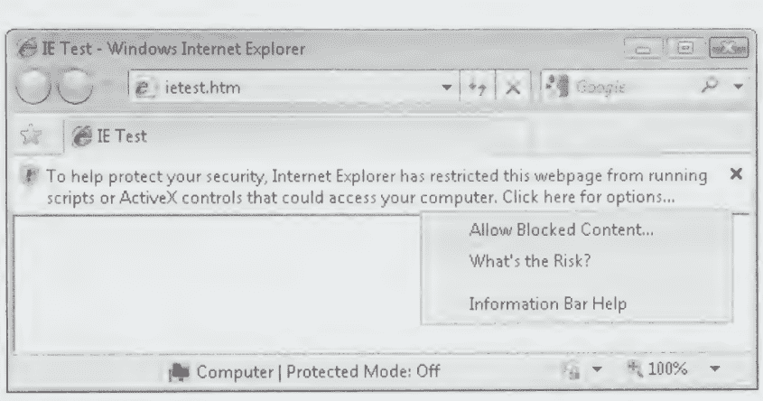

图 1-1 Internet Explorer 对本地驱动器上动态内容的反应

#### `<html>` 标签

在准备好前三行重要内容后，网页还需要一个 `<html>` 标签，它告诉浏览器 HTML 内容从哪里开始。稍后会用 `</html>` 标签来闭合它。

除非在其他标签或注释内，否则大多数浏览器会将这些标签之外的任何内容简单地视为纯文本。许多浏览器具有容错能力，即使缺少或错误放置了 `<html>` 或其他标签，也会尽力将页面显示好。但最好还是按正确的顺序放置，以确保所有浏览器都能良好地显示你的内容。

在 `<html>` 和 `</html>` 标签标识的区域内，通常还有另外两种类型的标签：`<head>` 和 `<body>` 标签。

#### `<head>` 标签

网页文档中位于 `<head>` 和 `</head>` 标签内的部分，用于放置有关文档的信息，例如其标题、任何元数据、样式表信息等，具体如下所述。

##### 创建文档标题

要定义网页文档的标题，你需要将其放在 `<title>` 和 `</title>` 标签内，如下所示：

```
<title>Rob's Place Chat</title>
```

选择一个能清晰表明页面内容的标题非常重要，这样搜索引擎才能正确索引该页面，访问者也能方便地收藏页面并再次找到它。

##### 提供元数据

元数据是关于文档的附加数据，有许多不同类型的元数据。例如，你可以告诉文档在给定的时间段后用另一个文档替换自身，如下所示：

```
<meta http-equiv='refresh' content='10;url=http://othersite.com' />
```

这行代码将在十秒后用 *othersite.com* 上的页面替换当前页面，这是一种有时用于页面移动位置时快速重定向的命令类型（尽管对于永久重定向，服务器设置是更好的管理方式）。

如果你愿意，可以将元标签放置在 `<head>` 部分之外，但通常将它们放在其中更有意义，在那里它们也更容易被可能更新你页面的其他人找到。

**设置视口** 在本书中，浏览器的视口通常使用以下 `<meta>` 标签设置为默认宽度 980 像素：

```
<meta name='viewport' content='width=980' />
```

其作用是告诉移动设备（如苹果和安卓手机）该网页的宽度为 980 像素，以便它们可以正确地应用视图。选择 980 像素这个值是因为它已成为移动浏览器能很好处理的标准宽度。

##### 包含样式表

你可以通过几种不同的方式将样式表加载到网页文档中。你可以在 `<style>` 和 `</style>` 标签内嵌入一段 CSS，或者使用 `<link>` 标签从单独的文件中加载它们，如下所示：

```
<link rel='stylesheet' href='styles.css' type='text/css' />
```

在第 3 章中，你将了解 CSS 规则的工作原理以及如何格式化这些规则，以便通过上述任一方法将其包含进来。

##### 插入 JavaScript

通常，你会希望尽快加载网页使用的任何 JavaScript，以便页面一准备好它就能开始工作。因此，通常最好的放置位置是在网页 `<head>` 部分内的 `<script>` 和 `</script>` 标签中。

与 HTML 的常见情况一样，有几种方法可以实现这一点。你可以将 JavaScript 代码直接嵌入在 `<script>` 和 `</script>` 标签内，也可以将其放在一个单独的文件中，然后单独加载，如下例所示，它加载了文件 *ProgramCode.js*：

```
<script src='ProgramCode.js'></script>
```

第 5 章将更详细地介绍 JavaScript 的使用。

#### 第 1 章：HTML 入门

**注意**

不要尝试通过在结束 > 之前直接放置 / 来自动关闭第一个 `<script>` 标签，例如：`<script src='...' />`。尽管某些浏览器可能允许这样做，但不推荐这样做，因为许多浏览器要求所有 `<script>` 标签必须有匹配的 `</script>` 标签。

##### 包含其他文件

通常，你需要将其他文件告知浏览器。例如，在本书中，一些示例被赋予了一个图标，如果它们被保存（或收藏）到移动设备上作为应用程序显示，将会显示该图标。这是通过以下方式实现的，它告诉浏览器使用文件 `appicon.png` 作为应用程序或书签的缩略图：

```
<link rel='apple-touch-icon' href='appicon.png' />
```

周到的是，Android 设备也能识别此命令（即使其中包含 *apple* 这个词），因此它为苹果和安卓设备都定义了图标。

> **注意**

有关为各种设备（包括 iPod Touch、iPhone、iPad 以及安卓手机和平板电脑）创建缩略图图标的更多信息，请参见第三部分。

##### 网页文档头部行总结

总结一下目前介绍的标签，每个网页文档（如本书中使用）都需要一个 `<!DOCTYPE>` 标签，后跟一个注释行，以使 Internet Explorer 能够从本地计算机加载动态页面而不会弹出对话框，然后是开始的 `<html>` 标签，接着是 `<head>` 和 `</head>` 标签及其内容。

因此，本书中的许多示例将以类似这样的 HTML 开始：

```
<!DOCTYPE HTML PUBLIC "-//W3C//DTD HTML 4.01 Transitional//EN"
    "http://www.w3.org/TR/html4/loose.dtd">
<!-- saved from url=(0014)about:internet -->
<html>
    <head>
        <title>The Web Page's Title</title>
        <meta name='viewport' content='width=980' />
        <link rel='stylesheet' href='styles.css' type='text/css' />
        <link rel='apple-touch-icon' href='appicon.png' />
        <script src='ProgramCode.js'></script>
    </head>
    <body>
```

此示例中的最后一个标签打开了文档的主体部分，接下来将进行解释。

#### `<body>` 标签

HTML 的 `<body>` 部分是你放置所有网页浏览器应显示内容的地方。最简单的情况下，你可以在 `<body>` 和 `</body>` 标签之间放置纯文本，浏览器就会为你显示它。

然而，无论你在这个文本中放置多少空格、回车符或其他字符，浏览器都会忽略它们，只将文本显示为一个长字符串。那么，让我们来看看如何格式化这段文本，使其开始看起来更有趣一些。

##### 使用注释

HTML 中最简单的格式化标签可能是 `<!--` 和 `-->`。你放在它们之间的任何内容都会被浏览器忽略，因此它们被称为注释标签，因为它们对于在网页中留下注释以提醒你（以及将维护该页面的其他人）其中的任何不寻常之处非常有用。

这是一个典型的单行注释：

```
<!-- Created by Joe Smith, January 27th 2012 -->
```

注释可以包含任意多行，对于快速从显示中移除你可能希望以后恢复的 HTML 部分也非常有用。

##### 文本格式化

HTML 4.01 有将近 100 个不同的标签可用，详细说明所有标签超出了本书的范围。然而，有一些标签比其他标签使用频率高得多，因此这里将解释它们，从基本格式化标签开始。

##### 标题

要在网页文档中指定标题，你可以使用 `<h1>` 到 `<h6>` 标签及其闭合标签 `</h1>` 到 `</h6>`。

`<h1>` 标题是最高级别，通常显示最大或最粗的文本。副标题和子副标题（依此类推）继续使用 `<h2>`、`<h3>`，一直到 `<h6>` 标题，它们通常非常小。你很少会看到使用超过前四个级别的标题的文档，但如果需要，额外的两个级别也在那里。

以下是使用这些标签的两个标题示例：

```
<h1>This is a main heading</h1>
<h2>This is a subheading</h2>
```

在图 1-2 中，你可以看到 Internet Explorer 显示的默认六个级别的标题，以及一些标准大小的纯文本，有趣的是，它实际上比第五和第六级标题更大，尽管不是粗体。

通过在整个文档中逻辑地使用这些标签，而不是直接在行内指定字体、大小（或其他属性），你可以分别为每个标签应用不同的 CSS 规则，只需几个简单的语句就能完全改变标题的外观和感觉。当你读到第 3 章时，你将看到这种方法的强大之处。

#### 段落

HTML段落包含在`<p>`和`</p>`标签内。没有它们，段落会连在一起，难以阅读。不过，默认情况下，`<p>`标签会在每个段落之间创建合适的间距。

正如你将在第3章看到的，一旦网页文档使用这些标签分割成段落，你就可以通过CSS进一步增强它们的显示方式，例如缩进每个段落的首行、使用首字下沉等等。

#### 更改文本强调

以下是你可用于强调文本的一些主要标签。其中一些是*已弃用*的，这意味着HTML的开发者打算在未来某个时候移除它们，通常是因为引入了更好的方法来实现相同的效果。

对于已弃用的标签，我也列出了推荐的替代方案，以防你已习惯使用它们或想开始使用它们。

- `<b>` ... `</b>` 这些标签内的文本将以粗体显示。

- `<big>` ... `</big>` 这些标签内的文本将比标签外的文本更大。

- `<center>` ... `</center>` 这些标签内的文本将居中显示。这些标签已弃用，建议使用CSS替代。

- `<del>` ... `</del>` 这些标签内的文本将以删除线样式显示。

- `<em>` ... `</em>` 通常，这些标签内的文本以斜体显示，因此使用它们与使用`<i>` ... `</i>`相同，但可以通过CSS将这些标签的样式设置得与`<i>` ... `</i>`不同。

- `<i>` ... `</i>` 这些标签内的文本将以斜体显示。

- `<s>` ... `</s>` 这些标签内的文本将以删除线样式显示。这些标签已弃用，建议使用CSS或`<del>` ... `</del>`标签替代。

- `<small>` ... `</small>` 这些标签内的文本将比标签外的文本更小。

- `<strike>` ... `</strike>` 这些与`<s>` ... `</s>`相同。

- `<strong>` ... `</strong>` 通常，这些标签内的文本以粗体显示，因此使用它们与使用`<b>` ... `</b>`相同，但可以通过CSS将这些标签的样式设置得与`<b>` ... `</b>`不同。

- `<sub>` ... `</sub>` 这些标签内的文本将显示为下标文本。

- `<sup>` ... `</sup>` 这些标签内的文本将显示为上标文本。

- `<u>` ... `</u>` 这些标签内的文本将显示为带下划线。这些标签已弃用，建议使用CSS替代。

#### 更改字体和颜色

你还可以通过多种HTML标签更改字体和颜色，尽管这些标签都已弃用，建议使用CSS替代。然而，由于它们仍在数百万网站上使用，你需要了解这些标签，至少以便你能更新任何需要维护的代码。

`<font>` ... `</font>` 这些标签内的文本会根据为以下属性提供的参数进行更改：

`color='...'` 文本的颜色更改为引号内的值。此值可以是颜色名称（请参阅此列表后面的“命名颜色”）或颜色编号（请参阅此列表后面的“通过数字着色”）。

`face='...'` 文本的字体更改为引号内的值。此值应是浏览器可用字体的名称。如果找不到该字体，浏览器将选择替代字体。

`size='...'` 文本的字体大小更改为引号内的值。这应是1到7之间的值（从最小到最大字体大小，默认为3）。该值前面可以加+或-符号，表示相对变化而非绝对变化。

`<basefont>` ... `</basefont>` 这些标签与`<font>`标签具有相同的属性，用于更改整个文档的默认字体值。特别是，如果大小被更改，那么任何使用带有+或-值的`<font>`标签的操作，都将相对于基础字体大小更改字体大小。标题不受此标签影响，在某些浏览器上，表格也不使用此标签的值。

此外，你可以使用`bgcolor='...'`属性（带命名值或数字值，如下所述）更改`<body>`标签或表格单元格的背景颜色。

##### 命名颜色

有16个颜色名称可用于`color`属性：aqua、black、blue、fuchsia、gray、green、lime、maroon、navy、olive、purple、red、silver、teal、white和yellow。

一些浏览器支持更多颜色名称，但这些名称不是HTML 4.01标准的一部分：如果你需要更多颜色选择，应使用十六进制颜色编号，如下所述，这允许非常精确的颜色选择。

##### 通过数字着色

你可以为`color`属性提供颜色编号，而不是颜色名称，该编号由一个#符号后跟六个十六进制数字组成，代表三种原色：红、绿和蓝。

例如，值#000000指定黑色，因为它为红色分配00，为绿色分配00，为蓝色分配00。另一方面，值#ffff00指定黄色，因为它为红色分配ff，为绿色分配ff，为蓝色分配00（在计算机上，混合红色和绿色会产生黄色）。

尽管`<font>`和`<basefont>`标签可能已弃用且不建议使用，但颜色名称和编号仍然受支持，可以在CSS规则中使用。

> **注意**

值00在十进制和十六进制表示法中都是零，十六进制值ff在十进制中是255。因此，每种原色有256种不同的阴影可用，从而产生了超过1600万种可能的颜色组合（256x256x256）。

#### 字体

浏览器可用的字体取决于其底层操作系统上安装的字体。因此，你可以在`font='...'`属性中指定多个字体名称，用逗号分隔。这意味着你可以使用表1-1中的任何字符串作为参数值，浏览器将以你选择的字体（或类似的字体）显示文本。

我选择将这些字体字符串用双引号括起来，以便其中任何包含空格的字体名称都可以用单引号括起来。通过这样做，这些相同的字符串也可以在CSS规则中使用，它们也将确保浏览器尽可能以接近你选择的字体显示文本。

因此，例如，要更改为Courier New字体，你可以使用以下HTML，如果字体不可用，它将回退到系统的标准等宽字体：

```html
<font face="'Courier New', monospace">
```

**表1-1** 用于更改字体的推荐字符串

| 字体字符串 |

| :--- |

| "Arial, sans-serif" |

| "'Arial Black', sans-serif" |

| "'Arial Narrow', sans-serif" |

| "'Avant Garde', sans-serif" |

| "'Bookman', 'Bookman Old Style', serif" |

| "'Century Gothic', sans-serif" |

| "'Copperplate', 'Copperplate Gothic Light', serif" |

| "'Comic Sans MS', cursive" |

| "Courier, monospace" |

| "'Courier New', monospace" |

| "Garamond, serif" |

| "'Gill Sans', 'Gill Sans MT', sans-serif" |

| "Georgia, serif" |

| "Helvetica, sans-serif" |

| "Impact, fantasy" |

| "'Lucida Grande', 'Lucida Sans Unicode', sans-serif" |

| "'Lucida Console', monospace" |

| "'Palatino', 'Palatino Linotype', serif" |

| "Tahoma, sans-serif" |

| "Times, serif" |

| "'Times New Roman', serif" |

| "Trebuchet, sans-serif" |

| "Verdana, sans-serif" |

#### 嵌入图像

文本之后，图像可能是网页的下一个最常见元素，它们使用``标签嵌入，该标签支持一系列属性——其中一些如下所述并在图1-3中显示。

`src='...'` 引号内的值告诉浏览器从哪里获取图像。如果它前面是字符串http://，则图像将从http://后面的域名网站下载。否则，假定图像在当前网站上（或在本地磁盘上），并从那里加载。

#### HTML5 for iOS and Android: A Beginner's Guide

`alt='...'` 某些浏览器可能不显示图片或已禁用图片显示，因此您可以使用此属性提供描述图片的替代文本。这在图片加载缓慢或失败的情况下也很有用，如图1-3中的第四张图片所示，由于找不到图片而显示了替代文本。

`width='...'` 和 `height='...'` 默认情况下，Web浏览器会查找图片的尺寸并据此显示。但有时您可能希望使用不同的宽度和高度显示图片，这可以通过指定其中一个或两个属性来实现。如果只使用一个属性，浏览器会计算另一个维度以保持图片的宽高比。指定图片宽度和高度的另一个原因是确保页面布局在图片加载之前也能正确对齐。通过提前指定这些值，浏览器会立即为图片分配所需的空间。

`border='...'` 使用此属性，您可以指定应用于图片的边框（如果有）宽度。它接受值0或任何正数。除非通过CSS修改，如果图片有边框并与锚点放置在一起，当鼠标悬停在其上时，边框颜色会发生变化。图1-3中可以加载的三张图片分别没有边框、有1像素边框和有5像素边框。

`align='...'` 使用此属性，您可以通过使用以下任何值将图片与当前行对齐来垂直定位图片：top、middle、bottom、absmiddle或absbottom。您也可以使用值left或right将图片与当前行左对齐或右对齐。

例如，要从当前文件夹加载图片pic.jpg，指定其宽度和高度，提供一些替代文本并将其与当前行左对齐，您可以使用以下HTML代码：

```html

```

图片之后的任何文本或其他元素将被放置在图片的右侧并环绕其排布。

#### 专家问答

> **问：** 将元素左对齐或右对齐后，如何为后续元素恢复正常对齐方式？

**答：** 一旦文本或其他HTML元素流过对齐对象的底部，左对齐或右对齐就会被取消。要在此前清除对象的对齐，您可以使用以下`<br />`标签变体之一，它们将（按顺序）清除左对齐、右对齐或两种类型的对齐：`<br clear='left' />`、`<br clear='right' />`或`<br clear='all' />`。当对齐被清除时，后续元素将被迫显示在对象下方，而不是与其并排。

#### 创建链接

使用`<a>`标签可以将超链接锚点附加到Web文档的几乎任何元素，该标签支持三个主要属性：

- **`href='...'`** 引号之间的值是锚点链接到的项目。如果它以字符串`http://`开头，则目标很可能是外部的；否则它被假定在当前网站上（或本地磁盘上）。一个典型的链接如下所示：

  ```html
  <a href='http://google.com'>访问 Google</a>
  ```

- **`target='...'`** 使用此属性，您可以指定目标文档应加载到哪个元素中。此值通常是现有`<frame>`或`<iframe>`标签的名称，或者是特殊名称`_blank`，以便在新窗口（或选项卡，取决于您的浏览器设置）中打开目标。有关框架的更多信息，请参阅本章后面的“框架”部分。

- **`name='...'`** 此属性为页面内的链接提供命名目标。例如，除了链接到您（或其他）网站上的其他页面外，您也可以链接到任何网页中的特定位置。当访问此类链接时，浏览器会自动向下滚动到相关部分。要使用此功能，首先创建一个页面内锚点，如下所示：

  ```html
  <a name='jumptoher'></a>
  ```

  现在您可以像这样超链接到此部分：

  ```html
  <a href='#jumptoher'></a>
  ```

  或者，如果锚点在与当前文档不同的文档中，您可以这样链接：

  ```html
  <a href='http://othersite.com/doc.htm#jumptoher'></a>
  ```

#### 专家问答

> **问：您能给我一个展示页面内锚点用法的网站吗？**

**答：** 维基百科网站（*wikipedia.org*）是查看标准锚点和页面内锚点使用情况的好地方，因为它包含数百万个内部交叉引用，可能还有同样多的外部引用。

例如，尝试点击任何维基百科条目目录框中的链接，看看页面内锚点是如何工作的。有趣的是，在维基百科搜索框中输入“html anchor”，您会直接进入维基百科关于该主题文章的页面内锚点部分，如下所示：

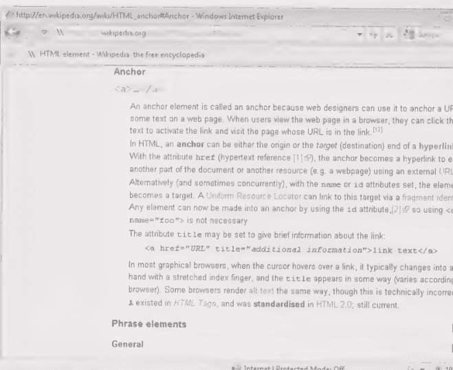

#### 表格

近年来，表格常常被CSS用户所鄙视，他们解释说使用CSS可以获得更精确的定位。但事实仍然是，表格对于，嗯，显示数据表来说仍然很棒。

此外，当您需要快速搭建一个简单网页设计时，表格可以更快地完成工作。然后，一旦您对设计满意，您可以将其转换为CSS（如果您愿意的话）。

`<table>`标签支持许多属性，其中主要属性如下：

- **`align='...'`** 此属性支持值left、right或center，用于根据周围文本对齐表格，尽管此属性现在已弃用，建议改用CSS。

- **`bgcolor='...'`** 使用此属性，您可以设置表格的背景颜色。但是，建议使用CSS，因为此属性现在已弃用。

- **`border='...'`** 使用此属性，您可以指定表格周围0或任何正数像素的边框。

- **`cellpadding='...'`** 此属性指定单元格边框与其内容之间的像素空间数，可以是0或任何更高的数字。

- **`cellspacing='...'`** 此属性指定单元格与外部表格边框之间的像素空间数，可以是0或任何更高的数字。

- **`height='...'` 和 `width='...'`** 使用这些属性，您可以指定表格的宽度和高度。未指定时，浏览器将调整表格大小以最适合其内容。

`<table>`标签非常有趣，因为它需要使用进一步嵌套在其中的HTML标签来定义表格的行和列。以下是您可能要使用的主要标签：

- **`<caption> ... </caption>`** 这些标签显示与表格宽度相同的标题。

- **`<tr> ... </tr>`** 这些标签创建表格行，通常是`<table>`标签之后的下一级标签。

- **`<td> ... </td>`** 使用这些标签，您可以在表格行内创建单个单元格（或列）。

- **`<th> ... </th>`** 您使用这些标签的方式与`<td>`和`</td>`相同，以向Web浏览器表明单元格的内容是标题。

如果您以前从未见过这些标签，那么创建表格可能看起来相当复杂，但实际上并非如此。例如，下面是如何组合一个简单的表格，详细说明2010年8月主要Web浏览器的市场份额（根据维基百科），并生成图1-4所示的表格：

```html
<table border='1'>
  <caption>
    <i>2010年8月Web浏览器市场份额</i>
  </caption>
  <tr>
    <th>浏览器</th>
    <th>份额</th>
  </tr>
  <tr>
    <td>Internet Explorer</td>
    <td>51.34%</td>
  </tr>
  <tr>
    <td>Mozilla Firefox</td>
    <td>30.82%</td>
  </tr>
  <tr>
    <td>Google Chrome</td>
    <td>10.70%</td>
  </tr>
  <tr>
    <td>Apple Safari</td>
    <td>5.16%</td>
  </tr>
  <tr>
    <td>Opera</td>
    <td>1.40%</td>
  </tr>
  <tr>
    <td>其他</td>
    <td>0.58%</td>
  </tr>
</table>
```

表格单元格中并不局限于只包含文本和数字数据：您可以在其中放置任何您喜欢的HTML元素，例如图像、按钮、iframe，甚至其他表格。

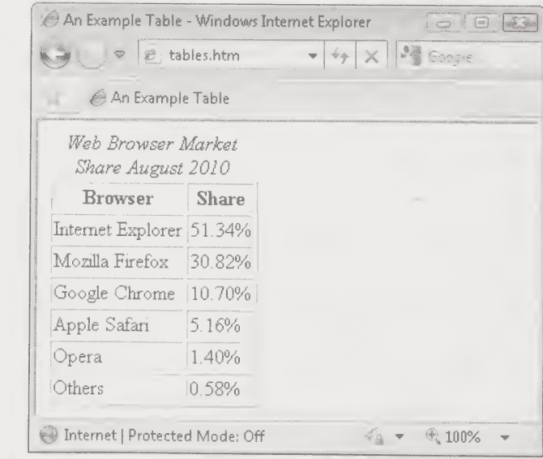

#### 列表

当涉及显示列表和子列表时，HTML 真的非常出色，支持多种类型，如图 1-5 所示，其中展示了每种类型的一个列表。

HTML 支持两种主要的列表类型：有序列表和无序列表。有序列表使用 `<ol>` 标签，其中的每个元素都以一个数字开头，该数字在每个项目后递增。无序列表使用 `<ul>` 标签，所有元素都以三种不同类型符号中的一种开头。

这些标签支持使用属性来修改它们的显示方式：

`start='...'` 默认情况下，有序列表从数字 1 开始，列表中的每个后续项目都以序列中的下一个数字开头，但您可以选择任何其他起始值，可以是正数、负数或零。无序列表不使用此属性，它们总是在每个项目前显示相同的字符。

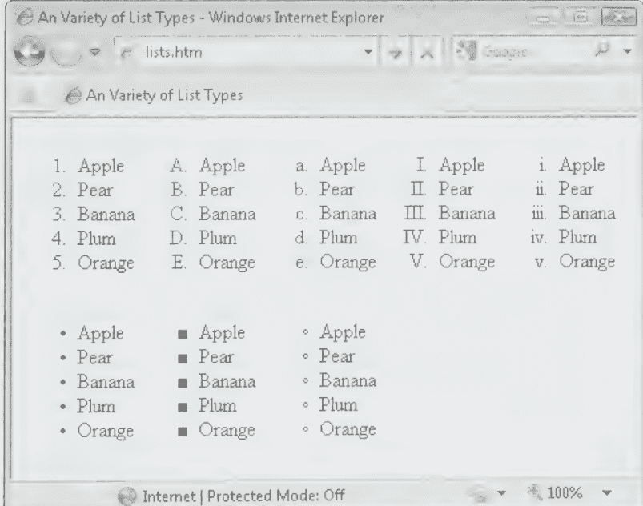

图 1-5 HTML 支持多种不同类型的列表。

`type='...'` 有序列表默认使用数字作为每个列表项目的前缀，但您可以通过为此属性赋予以下值之一来更改此行为，分别显示大写或小写字母或大写或小写罗马数字：'A'、'a'、'I' 或 'i'。无序列表需要以下三个单词之一作为此属性的值：'disc'、'square' 或 'circle'，默认值与指定 'disc' 相同。

列表中的每个元素都包含在 `<li>` 和 `</li>` 标签内。例如，以下代码显示了图 1-5 中显示的第一个列表：

```
<ol>
    <li>Apple</li>
    <li>Pear</li>
    <li>Banana</li>
    <li>Plum</li>
    <li>Orange</li>
</ol>
```

这是一个无序列表的示例，项目前带有方块，如图 1-5 中的第七个列表所示：

```
<ul type='square'>
    <li>Apple</li>
    <li>Pear</li>
    <li>Banana</li>
    <li>Plum</li>
    <li>Orange</li>
</ul>
```

列表也可以有子列表，如下所示：

```
<ul>
    <li>Apple</li>
    <ul>
        <li>Bramley</li>
        <li>Cox</li>
        <li>Golden Delicious</li>
    </ul>
    <li>Pear</li>
    <li>Banana</li>
    <li>Plum</li>
    <li>Orange</li>
</ul>
```

**注意**

对于嵌套的无序列表，默认情况下，列表的每个子级别都以不同的字符开头，首先是实心圆，然后是方块，最后是圆圈，对于任何更深层级则再次以实心圆开始，依此类推。

HTML 还支持另一种类型的列表，称为定义列表，它使用 `<dl>` 标签。使用它，可以使用一个单词或短语（称为 *术语*）来代替列表元素的前缀，然后在列表元素部分（称为定义）中对其进行定义。

例如，以下是如何为不同类型的食物创建定义列表：

```
<dl>
    <dt>Apple</dt>
    <dd>A fruit with red, yellow, or green skin</dd>
    <dt>Cabbage</dt>
    <dd>Any of several forms of a European vegetable</dd>
    <dt>Peanut</dt>
    <dd>The underground pod of the peanut vine</dd>
</dl>
```

此示例将显示如下：

```
Apple
    A fruit with red, yellow, or green skin
Cabbage
    Any of several forms of a European vegetable
Peanut
    The underground pod of the peanut vine
```

#### 表单

用户通常向网站提交数据的方式是通过网页表单。在第 7 章中，您将了解如何在 Web 服务器上使用 PHP 来解释此类提交的数据，但本节解释了如何首先收集数据。

`<form>` 和 `</form>` 标签围住一个网页表单，并支持多个属性，其中主要的有：

- **`method='...'`** 此属性接受两个值：'post' 或 'get'。当您选择 'post' 时，所有表单数据都会不可见地发送到 Web 服务器，但当使用 'get' 时，数据会附加到 HTML 请求中 ? 符号之后，即所谓的 *查询字符串*。这可能导致 URL 看起来很混乱，但在其他可能性中，它确实允许将表单提交到本地 JavaScript 程序而不是 Web 服务器。

- **`action='...'`** 此属性应包含表单要提交到的 URL。如果表单使用 'get' 请求发送，则 ? 后跟表单数据将附加到此值上。

图 1-6 显示了单个页面上的一系列表单元素，每个元素都将在以下部分中描述。

##### `<input />` 标签

与 `<table>` 标签类似，`<form>` 标签在其内部使用额外的标签。正如您可能想象的那样，有许多不同的标签可用，例如 `<input />`，它可能是最常见的。它接受多个参数，其中第一个是 `type='...'`，它可以具有以下任何值：

- **'text'** 此值创建一个适合输入文本的输入字段。您可以使用 `size='...'` 属性更改输入字段的宽度，并使用 `maxlength='...'` 属性限制允许的字符数。

- **'password'** 此值创建一个适合输入密码的输入字段，因为在显示时，所有键入的字符都会被 * 字符替换，但在内部会正确存储。您可以使用 `size='...'` 属性更改输入字段的宽度，并使用 `maxlength='...'` 属性限制允许的字符数。

- **'radio'** 每个表单可以有任意数量的单选按钮，每个按钮都通过将此值赋予 `<input>` 标签的 `type='...'` 属性来创建，但一次只能有一个处于活动状态。当另一个单选按钮被点击时，先前选定的那个将被取消选择。单选按钮是圆形的。

- **'checkbox'** 您使用此属性值创建复选框，它类似于单选按钮，但它们是方形的，并且可以一次选择多个。

- **'hidden'** 有时在网页表单中，您可能希望传递用户不应看到的值，例如识别令牌或其他数据。您可以传递此值来实现这一点，在这种情况下，您还必须在 `value='...'` 属性中提供要提交的值（见下一节）。

- **'submit'** 此属性值创建一个将提交表单的按钮。默认情况下，按钮标记为 Submit 或 Submit Query。

24 HTML5 for iOS and Android: A Beginner's Guide

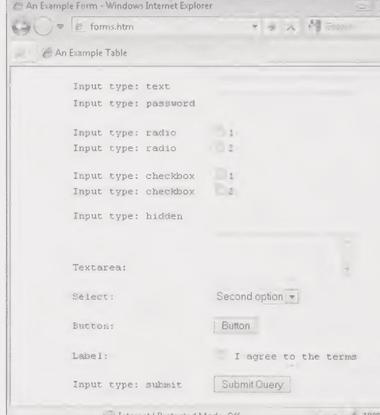

**图 1-6** 您可以在 `<form>` 标签中包含的主要元素。

##### `value='...'` 属性

`<input />` 标签也可以有其他属性，其中主要的是 `value='...'`，您可以使用它来用默认数据预填充字段，当与 `type='hidden'` 属性结合使用以提交跟踪或其他隐藏数据时特别有用。

##### `<textarea>` 标签

此标签创建一个多行区域，用户可以以更自由的形式输入数据。它适合提交不适合单字段输入的用户简介或其他信息。

要指定要显示的行数和列数，可以使用 `rows='...'` 和 `cols='...'` 属性。该标签以 `</textarea>` 标签关闭。

##### `<select>` 标签

使用此标签，您可以创建一个下拉列表，用户可以从中选择一个选项。要使用它，您必须给标签一个名称，以便提交的数据可以被识别，然后将所有选项放在 `<option>` 和 `</option>` 标签内，如下所示：

```
<select name='chocolate'>
    <option value='plain'>Plain</option>
    <option value='dark'>Dark</option>
    <option value='milk' selected='selected'>Milk</option>
    <option value='white'>White</option>
</select>
```

无论选择哪种巧克力，小写的值（来自 'plain'、'dark'、'milk' 或 'white'）将与字段名称 'chocolate' 一起被提交。

**提示**

您看到示例中第三个选项的 `selected='selected'` 属性了吗？它指定此特定选项将被默认选中，除非用户更改它。

##### `<button>` 标签

此标签显示一个可点击的按钮，但我不建议使用它，因为 Internet Explorer 会提交 `<button>` 和 `</button>` 标签之间的内容，而其他浏览器则提交其 `value='...'` 属性的内容。因此，除非您使用 JavaScript 将其附加到 click 事件，否则很难一致地使用它。

##### `<label>` 标签

此标签特别适合与单选按钮或复选框（它们很小）一起使用，因为您可以将单选按钮或复选框放在一些解释性文本旁边，并将两者都包围在 `<label>` 和 `</label>` 标签中，使用户可以单击文本或单选按钮/复选框来激活它。

这是一个常用的示例：

```
<label>
    <input type='checkbox' name='agree' value='yes' />
    I agree to these terms and conditions.
</label>
```

此示例显示如下，单击它的任何部分都将选中或取消选中该框：

□ I agree to these terms and conditions.

##### 组合表单

以下是用于创建图 1-6 中屏幕截图的 HTML。因为这纯粹是为了演示不同输入的外观和工作方式，所以没有为 `<form>` 标签提供任何属性，因此表单不会提交，或者提交到自身但提交的数据被忽略。此外，`<pre>` 标签（它使用等宽字体并且 *确实* 显示空格）仅用于对齐所有元素，而无需额外的样式。

```
<form><pre>
    Input type: text      <input type='text'      name='f1' size='26' />
    Input type: password  <input type='password'  name='f2' size='26' />

    Input type: radio     <input type='radio'     name='f3' value='1' />1
    Input type: radio     <input type='radio'     name='f3' value='2' />2

    Input type: checkbox  <input type='checkbox'  name='f4' value='1' />1
    Input type: checkbox  <input type='checkbox'  name='f4' value='2' />2

    Input type: hidden    <input type='hidden'    name='f5' />

    Textarea:             <textarea name='f6' rows='3' cols='20'>
                          </textarea>
</pre></form>
```

选择：

```
<select name='f7'>
    <option value='1'>第一个选项</option>
    <option value='1' selected='selected'>
        第二个选项</option>
    <option value='3'>第三个选项</option>
</select>
```

按钮：

```
<button name='f8' value='f8'>按钮 </button>
```

标签：

```
<label><input type='checkbox' name='agree'
    value='yes' /> 我同意这些条款</label>
```

输入类型：提交

```
<input type='submit' />
```

#### 小贴士

要尝试本书中的这个或其他示例HTML文件，而无需手动输入，您可以从配套网站 html5formobile.com 下载它们。

#### `<div>` 和 `<span>` 标签

`<div>` 和 `<span>` 标签的创建是为了帮助将元素组合成组，类似于将它们放入表格单元格，其主要目的是使包含的元素能够通过样式表进行整体操作。

`<div>` 标签创建所谓的*块级元素*，默认情况下，其宽度会一直延伸到浏览器的右边缘，迫使任何后续元素移动到下一行。因此，所有由 `<div>` 标签创建的块级元素都有四个边且呈矩形。

另一方面，`<span>` 标签创建一个随文本流动的内联元素，因此特别适合对文本片段应用样式。

在第3章中，您将看到这两种容器如何以各自的方式帮助应用CSS规则。

#### 框架

最后剩下的主要HTML 4.01标签与在框架中放置内容有关。第一种方法，也是最不推荐的方法，是将网页分成多个部分，然后将它们全部放入 `<frameset>` 标签内的框架中，如下所示：

```
<frameset cols='20%, *, 20%'>
    <frame src='header.htm' />
    <frame src='body.htm' />
    <frame src='footer.htm' />
</frameset>
<noframes>
    <!-- 替代内容放在这里 -->
</noframes>
```

**注意**

示例中的 `<noframes>` 和 `</noframes>` 标签会向浏览器不支持框架的用户显示替代内容。虽然所有现代主流浏览器都支持框架，但一些专业浏览器，如为盲人设计的音频浏览器或纯文本浏览器，可能会从使用这些标签中受益。

这将生成一个占据浏览器高度20%的顶部框架，并从文件 *header.htm* 中加载。然后是主框架，由于 `cols='...'` 属性中的 `*` 参数，它将扩展以填充固定大小框架就位后剩余的任何空间。它从文件 *body.htm* 加载。最后，页脚框架从 *footer.htm* 加载并放置在网页底部20%的位置。

这种方法的问题在于整个网页由框架组成，页面本身没有内容。这显然不理想，并且不利于搜索引擎排名，搜索引擎不会认为这样的页面很有价值。

因此，我建议当您需要框架时，使用 `<iframe>` 标签，如图1-7所示，因为您可以像插入图像一样轻松地在文档中的任何位置放置一个具有任意宽度和高度的框架，如下所示：

```
<!-- 这里是各种HTML内容 -->
    <iframe src='framecontent.htm' width='200' height='200'></iframe>
<!-- 更多HTML内容 -->
```

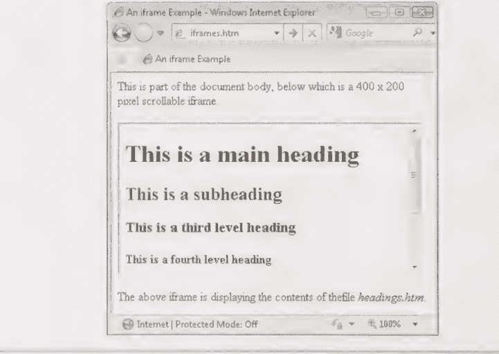

图1-7 使用 `<iframe>` 标签在一个页面内显示另一个页面

#### HTML 4.01 标签完整集合

为了完整起见，作为复习，或者如果您是HTML新手，为您提供关于使用HTML能做什么的指引，表1-2列出了所有HTML 4.01标签及其简要描述。它还告诉您某个标签是否已弃用，因此可能会在未来版本的HTML中被移除——在这种情况下，为了网站的长期稳定性，您应该使用表格中指示的替代标签。

| 标签或标签集 | 描述 | 已弃用/替代方案 |

| --- | --- | --- |

| `<!-- ... -->` | 注释 | |

| `<!DOCTYPE>` | 文档类型 | |

| `<a> ... </a>` | 链接锚点 | |

| `<abbr> ... </abbr>` | 缩写 | |

| `<acronym> ... </acronym>` | 首字母缩略词 | |

| `<address> ... </address>` | 作者联系信息 | |

| `<applet> ... <applet>` | 嵌入式小程序 | 是，请改用 `<object>` |

| `<area />` | 图像映射中的区域 | |

| `<b> ... </b>` | 加粗文本 | |

| `<base />` | 默认链接地址或目标 | |

| `<basefont />` | 默认字体、颜色或大小 | 是，请改用 CSS |

| `<bdo> ... </bdo>` | 文本方向 | |

| `<big> ... </big>` | 大号文本 | |

| `<blockquote> ... </blockquote>` | 长引用 | |

| `<body> ... </body>` | 文档主体 | |

| `<br />` | 换行 | |

| `<button> ... </button>` | 可点击按钮 | |

| `<caption> ... </caption>` | 表格标题 | |

| `<center> ... </center>` | 居中文本 | 是，请改用 CSS |

| `<cite> ... </cite>` | 引用 | |

| `<code> ... </code>` | 计算机代码文本 | |

| `<col />` | 表格列属性 | |

| `<colgroup> ... </colgroup>` | 表格列组 | |

表1-2 所有 HTML 4.01 标签（续）

| 标签或标签集 | 描述 | 已弃用 / 替代方案 |

| --- | --- | --- |

| `<dd>` ... `</dd>` | 定义列表描述 | |

| `<del>` ... `</del>` | 已删除文本 | |

| `<dfn>` ... `</dfn>` | 定义术语 | |

| `<dir>` ... `</dir>` | 目录列表 | 是，请改用 `<ul>` |

| `<div>` ... `</div>` | 文档的块级区域 | |

| `<dl>` ... `</dl>` | 定义列表 | |

| `<dt>` ... `</dt>` | 定义列表术语 | |

| `<em>` ... `</em>` | 强调文本 | |

| `<fieldset>` ... `</fieldset>` | 围绕表单元素的边框 | |

| `<font>` ... `</font>` | 字体名称、颜色和大小 | 是，请改用 CSS |

| `<form>` ... `</form>` | 表单 | |

| `<frame />` | 框架集框架 | |

| `<frameset>` ... `</frameset>` | 框架集 | |

| `<h1>` ... `</h1>` - `<h6>` ... `</h6>` | 标题 | |

| `<head>` ... `</head>` | 文档头 | |

| `<hr />` | 水平线 | |

| `<html>` ... `</html>` | HTML 文档 | |

| `<i>` ... `</i>` | 斜体文本 | |

| `<iframe>` ... `</iframe>` | 内联框架 | |

| `` | 图像 | |

| `<input />` | 输入字段 | |

| `<ins>` ... `</ins>` | 已插入文本 | |

| `<isindex>` ... `</isindex>` | 可搜索索引 | 是，请改用 `<input>` |

| `<kbd>` ... `</kbd>` | 键盘文本 | |

| `<label>` ... `</label>` | 输入元素的标签 | |

| `<legend>` ... `</legend>` | fieldset 元素的标题 | |

| `<li>` ... `</li>` | 列表项 | |

| `<link />` | 链接到支持文件 | |

| `<map>` ... `</map>` | 图像映射 | |

| `<menu>` ... `</menu>` | 菜单列表 | 是，请改用 `<ul>` |

表1-2 所有 HTML 4.01 标签（续）

#### 第一章：HTML 简介

| 标签或标签集 | 描述 | 已弃用 / 替代方案 |

| :--- | :--- | :--- |

| `<meta />` | 文档元数据 | |

| `<noframes>` ... `</noframes>` | 框架的替代内容 | |

| `<noscript>` ... `</noscript>` | 脚本的替代内容 | |

| `<object>` ... `</object>` | 嵌入式对象 | |

| `<ol>` ... `</ol>` | 有序列表 | |

| `<optgroup>` ... `</optgroup>` | 列表选项组 | |

| `<option>` ... `</option>` | 下拉列表中的选项 | |

| `<p>` ... `</p>` | 定义段落 | |

| `<param />` | 对象的参数 | |

| `<pre>` ... `</pre>` | 预格式化文本 | |

| `<q>` ... `</q>` | 定义短引用 | |

| `<s>` ... `</s>` | 删除线文本 | 是，请改用 `<del>` 或 CSS |

| `<samp>` ... `</samp>` | 计算机代码示例 | |

| `<script>` ... `</script>` | 脚本（通常是 JavaScript） | |

| `<select>` ... `</select>` | 下拉选择列表 | |

| `<small>` ... `</small>` | 定义小号文本 | |

| `<span>` ... `</span>` | 文档的内联区域 | |

| `<strike>` ... `</strike>` | 删除线文本 | 是，请改用 `<del>` 或 CSS |

| `<strong>` ... `</strong>` | 强调文本 | |

| `<style>` ... `</style>` | 样式信息 | |

| `<sub>` ... `</sub>` | 下标文本 | |

| `<sup>` ... `</sup>` | 上标文本 | |

| `<table>` ... `</table>` | 表格 | |

| `<tbody>` ... `</tbody>` | 表格主体单元格组 | |

| `<td>` ... `</td>` | 表格单元格 | |

| `<textarea>` ... `</textarea>` | 多行文本输入 | |

| `<tfoot>` ... `</tfoot>` | 表格页脚单元格组 | |

| `<th>` ... `</th>` | 表格标题单元格 | |

| `<thead>` ... `</thead>` | 表格标题单元格组 | |

表1-2 所有 HTML 4.01 标签（续）

#### 总结

如果你是HTML新手，我建议你动手试试那些示例文件（可从配套网站 html5formobile.com 下载），以便对HTML的可能性有一个直观的感受。但无论你是新手还是老手，本章都将帮助你快速掌握HTML 4.01的使用。现在你已准备就绪，在下一章，我们将深入探讨HTML5提供的所有新特性。

### 第2章

#### HTML5的新特性

#### 面向iOS和Android的HTML5：入门指南

#### 关键技能与概念

- HTML5 Canvas（画布）

- 地理定位

- 增强的表单处理

- 模式匹配与时间/日期输入

- 本地存储

- 媒体嵌入

- 音频与视频编解码器

- 微数据、Web Workers（网页工作者）与Web应用

尽管这是一本关于适用于iOS和Android移动设备的HTML5的书籍，但由于HTML5是一个仍在发展中的规范，预计在2012或2013年之前不会完成，因此了解所有标签（包括当前和未来的）以及它们在其他平台和浏览器上的工作方式对你来说很重要。

原因在于，你很可能不希望你的HTML5网页、Web应用和设备应用仅能在iOS和Android上运行，因为它们是用HTML编写的，所以也会在大多数其他设备上显示。我相信你不会错过在其他设备上提供你的创作的机会。

因此，本章更侧重于HTML5总体上能做什么，而不仅仅是它能为iOS和Android做什么。当然，当某些内容特定于其中某个操作系统时，会加以提及，但你应该将以下内容视为对HTML5当前整体状况的总结。在本书的后续部分，我们将看到如何将这些功能应用于移动设备，特别是当你读到第二部分的第一章——第9章时。

那么，事不宜迟，以下是你可对HTML5抱有的期待。

> **注意**

> 当旧版浏览器遇到它无法识别的HTML5标签时，它会简单地忽略该标签，就像你使用虚构的标签名（如 `<madeupnametag>` 和 `</madeupnametag>`）一样。然而，浏览器**会**显示这些标签之间的任何文本或HTML。

#### Canvas（画布）

`<canvas>` 元素由Apple引入WebKit渲染引擎（这是默认iOS和Android网页浏览器的驱动力，也被Apple Safari和Google Chrome使用），旨在提供一种在网页内绘制图形的方法，而无需加载Java或Flash等插件。它后来被标准化，并已被Opera和基于Gecko的浏览器（如Mozilla Firefox浏览器使用）采用，也包含在Google Chrome和Microsoft Internet Explorer 9中。

画布是网页中的一个区域，可以使用JavaScript在其上进行绘制。要创建一个画布，你可以使用如下HTML代码，这将创建一个ID为'mycanvas'、大小为320x240像素的画布：

```
<canvas id='mycanvas' width='320' height='240'>
    此部分内容将在不支持canvas的浏览器上显示
</canvas>
```

由于一个网页中可以有多个画布，因此需要为每个画布提供一个ID，以便绘图命令知道应该应用于哪个画布。

在图2-1中，你可以看到在Chrome浏览器的画布上绘制一系列亮度渐变的圆形和正方形，并在其上叠加一些文本的结果。

由于在画布上绘图需要使用JavaScript编程语言，关于如何操作的详细信息将在第6章提供。同时，如果你想查看此屏幕截图的源代码，请参考配套网站 html5formobile.com 上 examples.zip 文件中的 canvas.htm 文件。

#### Geolocation（地理定位）

HTML5的地理定位功能可以返回访问网页的访客的位置（或尽可能接近的位置），如图2-2中的示例所示，该示例返回了一位站在巴黎埃菲尔铁塔附近用户的位置。如果返回了位置，则会在iframe中以地图形式显示；否则会给出错误消息。此网页在配套网站的 examples.zip 文件中可作为 geolocation.htm 获取。

由于网站访客的位置随后可以通过表单或使用Ajax发送给Web服务器，因此默认情况下，所有浏览器都会阻止此信息的泄露，除非访客给予许可。

每个浏览器的行为略有不同，但它们都提供相同的安全控制：当你第一次访问一个请求你位置的网站时，网络浏览器会询问你是否愿意提供此信息。如果你愿意，通常还会有一个复选框供你勾选，以始终允许该网站访问。如果你授予访问权限但未勾选该复选框，那么你的位置仅这一次被提供；下次你访问该网站时，会再次收到提示。但如果你勾选了该复选框，则不会再收到该网站的提示，该网站将始终能够确定你的位置。

同样，如果你不希望向某个网站透露你的行踪，你可以拒绝访问，通常还可以勾选一个复选框，以始终阻止当前网站访问你的位置。

要获取浏览器的位置，你必须进行一些JavaScript调用，因此具体细节将在第6章提供。


*图2-1 在画布上绘制文本、同心正方形和圆形*

第2章：HTML5的新特性 37


*图2-2 使用HTML5的地理定位功能轻松查找用户位置*

#### 专家问答

**问：** 网络浏览器如何确定我的位置？

**答：** 你的位置可以通过多种方式确定。首先，你的IP地址可以揭示你所在的国家，执行此操作的程序通常可以接近你所在的地区。通常，你对此无能为力，因为所有网站都需要知道你的IP地址才能向你发送数据。但是，有第三方服务可以作为你的代理，在与Web服务器通信时用他们的IP地址替换你的IP地址。

（接上页）

使用HTML5地理定位时，如果你的计算机启用了Wi-Fi，定位程序能够通过扫描你本地可访问的Wi-Fi热点，利用包含数百万个热点名称和MAC地址及其位置的数据库，来收集更精确的位置信息，从而精确定位你的位置。

此外，如果你使用的是移动设备，通过对你能连接到的移动通信基站进行三角定位，可以相当准确地揭示你的位置；或者如果你的计算机具有GPS（全球定位系统）功能，则可以将你的精确位置揭示到几英尺之内。

#### Forms（表单）

Web表单可能是互联网上最重要且使用最广泛的部分之一，因此看到HTML5提供的众多增强功能是件好事，其中许多以前必须用相当复杂的JavaScript编写才能在所有浏览器上工作。

总的来说，有近20个新属性和十多种新输入类型来增强你的Web表单。

#### 表单属性

从以下讨论中你将看到，HTML5仍然是一个不断发展中的规范，浏览器只是零星地实现它。因此，对新特性的支持在不同浏览器间不一致，有些浏览器完全不支持。而且，通常并非是那些尚未跟上规范的旧版本浏览器；截至本文撰写时，所有主要浏览器的最新版本都至少省略了其中三个属性，有些甚至省略了多达十个。

尽管如此，在未来几年，大多数浏览器将实现越来越多的HTML5规范，因此使用这些功能所需的信息将在此处呈现。

##### `autocomplete` 属性

此属性可应用于 `<form>` 标签或 `<input>` 标签的 `color`、`date`、`email`、`password`、`range`、`search`、`telephone`、`text` 或 `url` 类型。此属性的有效参数是 `'on'`（默认值）和 `'off'`。

当`autocomplete`设置为 `'on'` 时，任何先前输入过值且具有ID的字段都会记住其值，并将其作为建议值提供，省去你再次输入的麻烦。

当`autocomplete`设置为 `'off'` 时，此行为被禁用。应用于 `<form>` 标签时，该属性影响表单内的所有相关字段。应用于 `<input>` 标签时，仅影响该字段。以下是使用此属性的两个示例：

```
<form action='prog.php' method='post' autocomplete='on'>
    <input type='text' name='field1' autocomplete='off' />
</form>
```

所有主要浏览器的最新版本都支持此功能。

##### `autofocus` 属性

`autofocus` 属性可应用于任何 `<input>` 标签，使其在页面加载时自动获得焦点。这会将光标置于输入字段中，以便用户直接输入，或者选中其他类型的字段，以便用户进行操作，其启用方式如下：

```
<input type='text' name='field' autofocus='autofocus' />
```

除 Internet Explorer 外，所有主流浏览器的最新版本均支持此功能，因此在你的网页中使用它是安全的——因为 IE 无论如何都能正常运行，它只是不提供自动聚焦字段的额外可用性。

##### `form` 属性

通过此属性，你无需将 `<input>` 标签放置在其所属的表单内。相反，只要为表单指定一个 ID，你就可以将该表单指定为 `form` 属性的参数。

例如，以下代码先打开一个 ID 为 `form1` 的表单，然后关闭它，之后才将 `<input>` 标签附加到该表单：

```
<form id='form1' action='prog.php' method='post'>
	<input type='submit' />
</form>

<input type='text' name='field' form='form1' />
```

此功能目前仅在 Opera 浏览器中可用，因此我建议在其他主流浏览器也支持它之前不要使用。

##### `formaction` 属性

此属性是一个表单覆盖，允许你将 `action` 属性更改为不同的目标。例如，在以下代码中，表单不会像 `<form>` 标签中指定的那样提交到程序 `prog.php`，而是会提交到 `prog2.php`：

```
<form action='prog.php' method='post'>
	<input type='text' name='field' />
	<input type='submit' formaction='prog2.php' />
</form>
```

当你希望提供多个提交按钮，且每个按钮对应不同的表单提交目标程序时，此属性尤其有用。

表单覆盖适用于 `<input>` 标签的 `submit` 或 `image` 类型，但目前仅 Opera 浏览器支持。因此，在其他主要浏览器支持之前，我不建议使用它们。

##### `enctype` 属性

此属性是一个表单覆盖，允许你更改表单的编码类型（`enctype` 属性），其方式与 `formaction` 覆盖类似。（此属性目前仅在 Opera 上有效，因此目前不建议使用。）

##### `formmethod` 属性

此属性是一个表单覆盖，允许你更改提交方法（`method` 属性的 `'post'` 或 `'get'` 参数），其方式与 `formaction` 覆盖类似。（此属性目前仅在 Opera 上有效。）

##### `formnovalidate` 属性

此属性是一个表单覆盖，允许你更改 `novalidate` 属性，其方式与 `formaction` 覆盖类似。（此属性目前仅在 Opera 上有效。）

##### `formtarget` 属性

此属性是一个表单覆盖，允许你更改 `target` 属性，其方式与 `formaction` 覆盖类似。（此属性目前仅在 Opera 上有效。）

##### `height` 和 `width` 属性

这些属性可应用于 `<input>` 标签的 image 类型，以更改其高度和宽度。此功能在所有主流浏览器的最新版本中都可用。使用方式如下：

```
<input type='image' src='image.png' height='20' width='60' />
```

##### `list` 属性及 `<datalist>` 和 `<option>` 标签

某些输入字段支持列表，此属性可用于引用它们。例如，以下代码使用此属性以及新的 `<datalist>` 标签，提供一组可供选择的 URL：

```
Choose a web page: <input type='url' name='links' list='sites' />
<datalist id='links'>
    <option label='Google' value='http://google.com' />
    <option label='Yahoo!' value='http://yahoo.com' />
    <option label='Bing' value='http://bing.com' />
    <option label='Ask' value='http://ask.com' />
</datalist>
```

此功能的工作方式类似于 `autocomplete` 属性，不同之处在于你定义了当输入获得焦点时出现的建议选择列表。

目前此功能仅 Opera 浏览器支持，但你仍可以在网页中使用它，因为其他浏览器只会不显示建议列表。随着时间的推移，当其他浏览器也采用此属性时，使用它的网页表单将为大多数访客提供更快的填写体验。

##### `min` 属性

此属性用于为包含数字或日期的输入类型指定最小值。但我还不建议你依赖此类验证，因为目前只有 Chrome 和 Opera 浏览器支持其使用，示例如下：

```
<input type='time' name='deliver' value='09:00' min='09:00' />
```

##### `max` 属性

此属性用于为包含数字或日期的输入类型指定最大值，同样也仅 Chrome 和 Opera 浏览器支持。以下是结合 `min` 属性的使用示例：

```
<input type='time' name='deliver' value='09:00' min='09:00'
    max='17:00' />
```

##### `multiple` 属性

此属性允许你为使用 email 或 file 类型的 `<input>` 标签接受多个值。它在除 Internet Explorer 和 Opera 外的所有主流浏览器的最新版本中有效。启用方式如下：

```
<input type='file' name='images' multiple='multiple' />
```

然后，当浏览对话框弹出时，可以一次选择多个文件（通常需要结合 CTRL 键）。在不支持此功能的浏览器上，一次只能选择一个文件。

##### `novalidate` 属性

此属性指定表单在提交时不应被验证。它接受 `'true'` 或 `'false'` 值。目前没有任何主流浏览器实现此功能，因此不应使用。

当浏览器支持它时，此属性将适用于 `<form>` 标签和 `<input>` 标签的 color、date、email、password、range、search、telephone、text 或 url 类型中的任何一种。使用方式如下：

```
<input type='text' name='field' novalidate='true' />
```

一旦此属性实现，你可能会选择一直使用它，至少在 HTML5 的验证功能比目前提供的好得多之前。如果你正在寻找可靠的浏览器内表单验证，有许多库可用，例如 livevalidation.com 上的开源工具。

##### `pattern` 属性

此属性允许你指定一个正则表达式，用于评估输入字段的值。它可以应用于任何使用 email、password、search、telephone、text 或 url 类型的 `<input>` 标签。例如，为了只允许字段中包含字母数字字符、连字符和下划线，你可以使用以下 HTML：

```
<input type='text' name='username' pattern='[\w\-]{6,16}' />
```

模式 `'[\w\-_]{6,16}'` 告诉浏览器只接受以下内容：

- `\w` 字母 a–z 和 A–Z、数字 0–9 以及下划线字符

- `\-` 连字符

- `{6,16}` 6 到 16 个字符，包含两端

然而，目前此功能仅在 Opera 和 Chrome 浏览器中有效，因此不能依赖它进行浏览器内验证。而且，要使其生效，网页的 `!DOCTYPE` 必须如下设置（而不是 HTML 4.01 文档类型之一）：

```
<!DOCTYPE HTML>
```

我还要补充一点，当模式不匹配时，Chrome 会直接拒绝提交表单——不给你任何提示原因——而 Opera 则显示“[input] 不是此页面要求的格式！”。在我看来，这确实是粗糙的验证，对任何人都没太大用处。因此，我建议忽略此功能，直到它在所有浏览器上都可用，并且成熟到能真正告知用户需要输入什么内容。

##### `placeholder` 属性

此属性允许你在任何空白输入字段中放置一个有用的提示，你可以用它来向用户解释应输入什么内容。使用方式如下：

```
<input type='text' name='username' size='35'
    placeholder='Enter your 6-16 character username' />
```

`size` 属性值 35 确保有足够的空间容纳占位符文本，只要字段中尚未输入任何内容，该文本就会以浅色显示，如图 2-3 所示。

一旦字段获得焦点，提示就会消失，准备输入文本。此属性可应用于 `<input>` 标签的 email、password、search、telephone、text 和 url 类型中的任何一种。

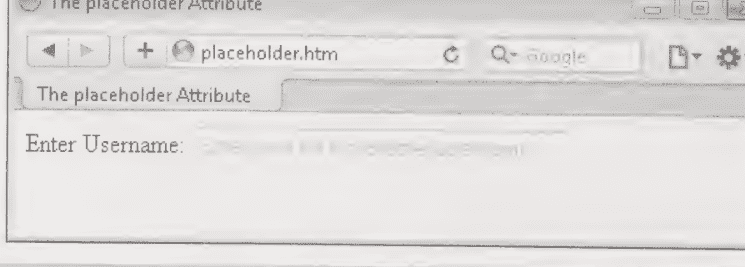

图 2-3  在 Apple Safari 浏览器中显示占位符

该属性在所有主流浏览器的最新版本中可用，但 Internet Explorer 和 Opera 除外。不过，使用它仍然是安全的，因为这些浏览器会直接忽略它。

##### `required` 属性

`required` 属性用于确保在表单提交前某个字段已被填写。你可以这样使用它：

```
<input type='number' name='age' required='required' />
```

为使此属性生效，网页的 `!DOCTYPE` 必须如下所示（而不是使用任何 HTML 4.01 文档类型）：

```
<!DOCTYPE HTML>
```

与许多其他验证功能一样，它目前仅在 Chrome 和 Opera 浏览器中可用，因此对于所有 Web 表单的浏览器内验证并不可靠。

##### `step` 属性

此属性用于为包含数字或日期的输入类型指定步长值，同样仅受 Chrome 和 Opera 浏览器支持。以下是它与 `min` 和 `max` 属性结合使用的方式：

```
<input type='time' name='deliver' value='09:00' min='09:00'
       max='17:00' step='3600' />
```

`step` 属性的值可以是任何正整数，在时间引用中以秒为单位。在 Opera 中使用上述 HTML 的结果如图 2-4 所示。通过单击微调框旁边的上下箭头图标，或使用键盘上的上下箭头键，可以滚动小时数以进行选择。

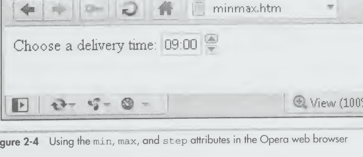

**图 2-4** 在 Opera 浏览器中使用 `min`、`max` 和 `step` 属性

44 iOS 和 Android 的 HTML5 入门指南

#### 表单输入类型

多年来，Web 开发者发现他们的网站需要的输入类型远多于 HTML 4.01 所支持的简单选择类型。事实上，HTML5 中现在提供了 16 种新的输入类型。

这些新输入类型提供了更严格的用户输入控制以及内置验证。唯一的缺点是这些输入类型在 Opera 以外的浏览器中并未广泛实现。尽管如此，你仍然可以在所有新输入类型上使用，即使是在不支持的浏览器上，因为如果不被支持，它们会回退到普通文本字段。

当然，这意味着你目前还不能依赖 Opera 以外浏览器的验证功能，但如果你使用这些类型，那么随着时间的推移，当其他浏览器赶上时，你的表单将自动对大多数访客来说更易于填写。

使用任何这些类型时，你必须使用以下 HTML5 文档类型才能使其工作：

```
<!DOCTYPE HTML>
```

> **注意**

> Apple iOS 设备在某种程度上能够识别这些输入类型，因为它们会相应地更改呈现给你的键盘类型。例如，`email` 输入类型将确保 @ 符号包含在主字符集中，`number` 类型确保数字键可见，而 `tel` 类型显示电话键盘。目前没有进行其他增强。我检查过的任何 Android 设备都没有提供即使是这么一点额外的输入辅助。

##### `color` 输入类型

最终，此输入类型将调用颜色选择器，以便你可以简单地单击选择的颜色，但现在它仅限于输入颜色名称，并且仅在 Chrome 浏览器上。你可以这样使用它：

```
Enter your preferred color <input type='color' name='favcolor' />
```

##### `date` 和 `time` 输入类型

日期和时间选择器类似于 `color` 输入类型，因为最终你将能够单击其中一个，然后会弹出一个日历，从中可以选择日期或时间。

目前，这些选择器仅在 Opera 和 Chrome 中有效，但 Chrome 的实现有些愚蠢，因为它默认调用 1582 年（见图 2-5），要求你在 `value` 字段中输入固定日期——这是愚蠢的，因为：

- 浏览器很容易使用当前细节填充日期和时间，为什么不这样做呢？

- 除非你在 Web 服务器上或使用 JavaScript 创建输入字段，否则你无法自行填充当前日期，将不得不输入一个默认开始日期，该日期不会随时间变化而改变。

此外，Chrome 不会弹出任何类型的选择器，你只能单击上下箭头图标（或按 `UP` 和 `DOWN` 键）来更改选择。

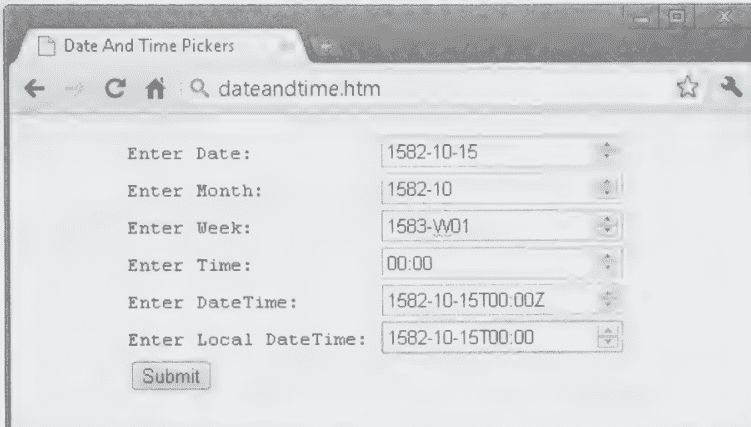

**图 2-5** Google Chrome 中的日期选择器尚未修复错误。

另一方面，Opera 总是弹出一个日历供选择，如图 2-6 所示。

如果你使用除 `time` 选择器之外的任何选择器，你将面临一个困境，因为 Opera 默认工作良好，但 Chrome 将要求你在 `value` 字段中输入像 2012-06-07 这样的日期，否则它将显示几百年前的日期。但是，如果你输入这样的日期，那么 Opera 将使用该值作为其种子值，而不是当前日期。

那么我的建议是？忽略日期和时间选择器功能，直到它们成熟并在所有主要浏览器上正常工作；同时，你可以通过搜索引擎找到许多 JavaScript 日期选择器库。

> **注意**

> 图 2-5 和 2-6 中使用的示例的 HTML 位于 `html5formobiles.com` 网站上可下载的 `examples.zip` 文件中的 `dateandtime.htm` 文件中。

**`date` 输入类型** 此输入类型选择日期，使用方式如下：

```
<input type='date' name='thedate' />
```

返回的值将是 YYYY-MM-DD 格式。如果你希望确保它在 Chrome 中正常工作，你需要使用如下 HTML（尽管 Opera 也会使用种子日期作为默认值）：

```
<input type='date' name='thedate' value='2012-03-17' />
```

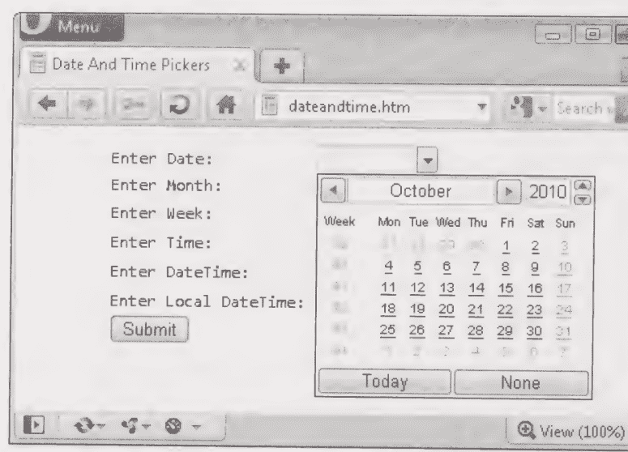

**图 2-6** Opera 对日期选择器的使用非常出色。

**`month` 输入类型** 此输入类型选择月份，使用方式如下：

```
<input type='month' name='themonth' />
```

返回的值是 YYYY-MM 格式。在它被修复之前，请记得为 Chrome 正常工作而设置输入值属性。

**`time` 输入类型** 此输入类型以 24 小时格式 HH:MM 返回时间。你可以这样使用它：

```
<input type='time' name='thetime' />
```

**`week` 输入类型** 此输入类型以 YYYY-WNN 格式返回周数（例如 2011-W06）。你可以这样使用它：

```
<input type='week' name='theweek' />
```

在它被修复之前，请记得为 Chrome 正常工作而设置输入值。

##### `datetime` 输入类型

此输入类型以 UTC（协调世界时）返回日期和时间，这与格林威治标准时间几乎相同，误差在一秒钟左右。返回的值将是 YYYY-MM-DDTHH:MMZ 格式（例如 2011-10-15T15:35Z）。你可以这样使用它：

```
<input type='datetime' name='dateandtime' />
```

在它被修复之前，请记得为 Chrome 正常工作而设置输入值。

##### `datetime-local` 输入类型

此输入类型返回用户的本地日期和时间。返回的值将是 YYYY-MM-DDTHH:MM 格式（例如 2011-10-15T15:35）。你可以这样使用它：

```
<input type='datetime-local' name='localdateandtime' />
```

在它被修复之前，请记得为 Chrome 正常工作而设置输入值。

##### `email` 输入类型

此验证类型目前仅受 Chrome 和 Opera 支持，并确保只能输入有效格式的电子邮件地址。你可以这样使用它：

```
<input type='email' name='emailaddress' />
```

##### `number` 输入类型

此验证类型目前仅由 Chrome 和 Opera 支持，并确保只能输入数字。你可以这样使用它：

```
<input type='number' name='age' />
```

在这两种浏览器上，默认值可以通过单击输入旁边的小上下箭头图标或使用上下箭头键来更改。

##### `range` 输入类型

此输入类型显示一个范围小部件，你可以滑动以选择最小值和最大值之间的任何值，并具有指定的起始值和步长值，如图 2-7 所示。它在 Opera、Chrome 和 Safari 的最新版本中有效，使用方式如下：

```
<input type='range' name='num' min='0' max='255' value='128' step='1' />
```

在其他浏览器中，将显示一个纯文本输入字段，用户可以直接在其中输入数字。

##### `search` 输入类型

通过指定搜索类型，浏览器应该定制输入框以提供搜索建议（类似于 Google 搜索）、带有

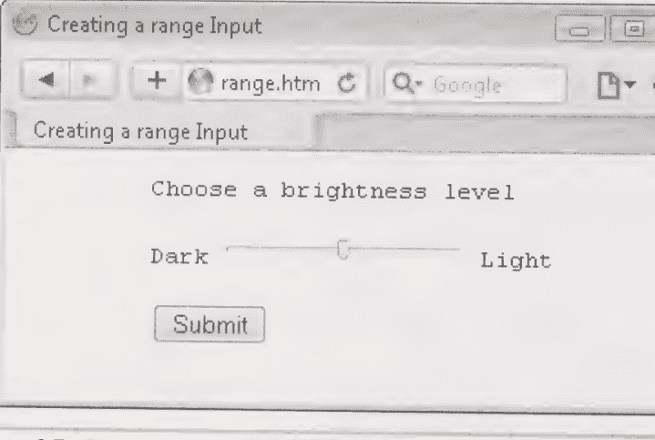

用于清空输入框，并且可能会有样式变化来提示你输入类型。不过，目前此功能仅在Safari和Chrome上实现，且唯一的增强功能仅限于一个用于清空输入的“×”图标和一个圆角输入框（仅限OS X上的Safari）。但现在使用这种输入类型并无坏处，因为其他浏览器只会将其显示为普通文本框，而当它们在未来支持此功能时，你的网页已经为此做好了增强。你可以像这样使用该属性：

```
<input type='search' name='searchphrase' />
```

##### 电话号码输入类型

此输入类型告知浏览器需要输入电话号码。目前，它仅在iOS设备上使用，当选择该字段时，会弹出电话号码键盘而非标准键盘，如图2-8所示，由以下HTML代码生成：

```
电话号码<br /><input type='tel' name='phone' />
```

##### 网址输入类型

与电话号码输入类型类似，此类型也是为了告知浏览器预期的数据类型。在iPhone和其他iOS设备上，此类型可确保显示“.”、“/”和“.com”按钮。

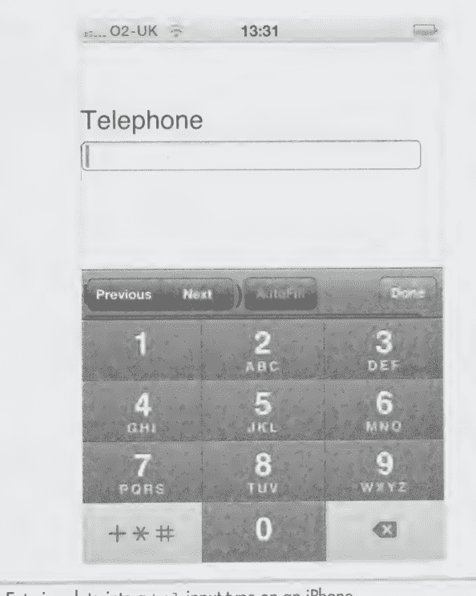

其他浏览器也可能在未来为此类型提供增强功能。此类型可通过以下HTML创建：

```
<input type='url' name='webpage' />
```

##### 本地存储

你可能对cookies（由浏览器本地存储的小型数据单元）相当熟悉。它们包含有助于使用网站的信息，例如你的登录详情（这样你就不必每次访问都重新输入），而且也常被更侵入性地用于追踪你的浏览习惯。

本地存储与cookies类似，但它支持存储更大量的数据，并且还提供了一个本地数据库引擎，使数据的保存和检索变得容易得多。主要优势在于更强大的网络应用，更多数据可以驻留在你的计算机上，而不是远在世界某处的服务器上。例如，一个管理你电视节目的网站可以将所有你喜爱的节目存储在本地数据库中，这样当你打开应用时，它只需检查一个节目列表网站，就能知道这些节目下次何时播出以及在哪个频道。这通过将数据分散在用户端，减轻了Web服务器的负担。

另一个好处是，这样的本地数据库可以通过JavaScript从本地网页访问，这意味着即使在没有互联网连接的情况下，应用也可以使用数据（在前面的例子中，只要电视节目表也已经下载下来）。

因此，如你所见，本地存储为仅使用HTML和JavaScript创建移动设备应用提供了巨大的潜力，这也是本书的关键方面之一。

结合伴侣网站（*html5formobile.com*）上提供的Objective C（用于iOS）和Java（用于Android）包装器，以及第二部分中的文档，你将能够制作出外观专业、流畅、速度极快的应用，然后只需最少的修改即可将其用作网站。未来，也有可能创建包装器，使你的Web应用也能在Windows Phone 7、MeeGo和Blackberry OS等其他移动操作系统上运行。

不过，不用担心。你不需要学习这两种语言中的任何一种，因为在第三部分中，我将逐步指导你如何将你的Web应用放入可从伴侣网站下载的现成包装器中。但是，由于你需要使用JavaScript来访问本地存储，因此第6章将提供有关此操作的详细信息。

#### 媒体

除了`<canvas>`标签，HTML5规范中可能最受欢迎的部分是HTML5浏览器内置的无需任何插件（如Flash、QuickTime或Microsoft Media Player）即可播放媒体的能力。

当然，这项技术还很年轻，支持的文件格式也在不断演变，并且由于专利原因，不同浏览器支持的格式各不相同。本节将解释你需要了解的有关使用HTML5嵌入媒体的所有信息。

#### 编解码器

术语*编解码器*代表编码器/解码器，描述了由软件提供的编码和解码媒体（如音频和视频）的功能。在HTML5中，根据使用的浏览器，目前有几组不同的编解码器可供选择：

- **H.264** 这是一个受专利保护的专有视频编解码器，终端用户可以免费播放，但编码和传输过程中的所有环节可能需要支付版税。因此，Safari和Internet Explorer支持它，但仅使用开源或没有财务能力获取许可的浏览器则不支持。

- **Theora** 这是一个不受专利限制、在编码、传输和播放的各个层级都无需支付版税的视频编解码器。Chrome、Firefox和Opera支持此编解码器。

- **VP8** 这个视频编解码器与Theora类似，但归Google所有，Google已将其开源发布，使其免收版税。Chrome、Firefox和Opera支持此编解码器。

- **AAC** 这个音频编解码器，代表高级音频编码，是苹果iTunes Store使用的编解码器。与H.264一样，它是一项专有、受专利保护的技术，Safari、Chrome和Internet Explorer支持它。

- **MP3** 这个音频编解码器，代表MPEG音频第三层，已经存在多年。尽管该术语常被（错误地）用来指代任何类型的数字音频，但它是一项专有、受专利保护的技术，Safari、Chrome和Internet Explorer支持它。

- **PCM** 这个音频编解码器，代表脉冲编码调制，存储模拟数字转换器编码的完整数据，是音频CD上使用的存储格式。由于PCM不使用压缩，它被称为*无损*编解码器，其文件通常比AAC或MP3文件大许多倍。Safari、Firefox和Opera支持它。

- **Vorbis** 有时被称为Ogg Vorbis，因为它通常使用.ogg文件扩展名。这个音频编解码器不受专利限制且免费。Chrome、Firefox和Opera支持它。

这些音频和视频编解码器通常包含在三种包装器或容器类型之一中：MP4、OGG和WebM。表2-1显示了主流浏览器使用的容器类型和编解码器的完整列表。

| 浏览器 | 容器类型 | 视频 | 音频 |

| :--- | :--- | :--- | :--- |

| Apple iOS | MP4 | H.264 | AAC, MP3, PCM |

| Apple Safari | MP4 | H.264 | AAC, MP3, PCM |

| Google Android（版本3之前） | — | — | — |

| Google Chrome* | MP4, OGG, WebM | Theora, VP8 | AAC, MP3, Vorbis |

| Microsoft Internet Explorer | MP4 | H.264 | AAC, MP3 |

| Mozilla Firefox* | OGG, WebM | Theora, VP8 | PCM, Vorbis |

| Opera | OGG, WebM | Theora, VP8 | PCM, Vorbis |

* 参见下一页的说明。

表2-1 主流浏览器和设备中的视频与音频支持

**说明**

微软已经发布了针对Chrome和Firefox的插件，以启用H.264视频的播放。因此，如果你希望这些浏览器的用户能够访问你的H.264内容，可以指引他们访问以下网址下载并安装插件：

- interoperabilitybridges.com/wmp-extension-for-chrome

- interoperabilitybridges.com/html5-extension-for-wmp-plugin

要了解HTML5实现的最新进展，最佳方法是使用目标浏览器和操作系统访问网站html5test.com。然后，它将报告哪些HTML5功能已被实现，如图2-9所示，其中测试的是iPhone 4，以及图2-10所示，其中Android 2.1设备正在显示该网站。

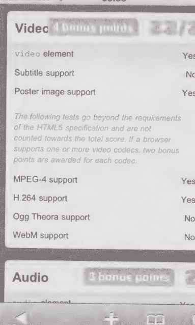

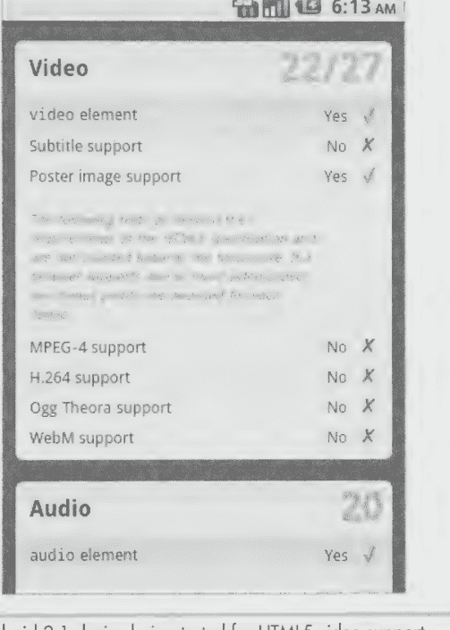

图2-10 正在测试HTML5视频支持的Android 2.1设备

#### 专家问答

**问：** 我对所有这些不同的标准感到困惑。作为一个Web开发者，这一切对我意味着什么？

**答：** 遗憾的是，关键点在于，没有单一的容器和编解码器组合能在所有HTML5浏览器上工作。因此，目前必须能够在所有浏览器上查看的内容，需要至少编码成两种不同的格式。

#### 54 HTML5 for iOS and Android: A Beginner's Guide

> 但更糟糕的是，如果你想在Android设备上播放媒体，那你将会遇到问题。因为虽然`<audio>`标签能被识别，但在Android 2.2及之前的所有版本中，都不支持任何音频格式。不过，据称Android 3版本修复了这个错误。同样，`<video>`标签在Android上也存在一些缺陷，但可以通过变通方法解决。

希望在本书此版本的生命周期内，尘埃能稍落定，一个单一标准能够演变出来（可能是WebM，因为它有Google的支持），从而能在所有HTML5浏览器和操作系统上播放。

#### 第2章：HTML5的新特性

##### 播放媒体

要播放HTML5媒体，你需要使用`<audio>`或`<video>`标签，像这样：

```
<audio src='music.aac'>
  Only non-HTML5 Browsers display what appears here
</audio>
```

或像这样：

```
<video src='video.mp4' width='320' height='240'>
  Only non-HTML5 Browsers display what appears here
</video>
```

你放在这两个标签内的任何HTML，在HTML5浏览器中都会被忽略，但所有其他浏览器会处理它。因此，你可以利用这一点来包含Flash或其他显示媒体的方式，作为此类浏览器的备用方案。

由于Android设备上的一个错误，你必须在标签中添加以下JavaScript调用，才能使其播放（否则`<video>`标签将没有任何作用）：

```
<video src='video.mp4' width='320' height='240'
  onclick='this.play()'>
</video>
```

不幸的是，这会导致播放按钮在其他浏览器中工作不正常。因为当按钮被点击时，它会发送第二个播放命令，而这个命令接着又起到了暂停的作用——几乎瞬间再次停止播放。因此，在使用`<video>`标签之前，你可能需要执行一些浏览器检测，并且只在发现浏览器是Android时才附加`onclick`事件。第7章将向你展示如何做到这一点。

##### `<source>`标签

当你调用一个媒体文件时，默认情况下，浏览器会自动开始下载该文件以确定其类型，然后只有在它是受支持的格式时才允许播放。因为这可能会浪费带宽，你可以通过使用`<source>`标签向浏览器提供关于文件的更多信息，如下所示，这样浏览器在无法播放文件时甚至不会尝试下载它：

```
<audio>
    <source src='music.aac' type='audio/aac' />
</audio>
```

你也可以为视频提供文件信息，像这样：

```
<video width='320' height='240'>
    <source src='movie.mp4' type='video/mp4' />
</video>
```

#### 注意

由于一个错误，Android 2.1和2.2版本拒绝显示使用了`type`属性的视频。因此，你需要在该平台上省略它。第7章详细介绍了浏览器检测以及在此类情况下提供自定义HTML的方法。

如果你知道使用的编解码器，你甚至可以在`type`属性中提供该信息，以便在编解码器无法识别的情况下进一步节省带宽使用，像这样：

```
<video>
    <source src='video.ogv'
            type="video/ogg; codecs='theora, vorbis'" />
</video>
```

为了支持一系列不同的浏览器，你可以对文件的不同编码多次使用`<source>`标签，像这样：

```
<audio>
    <source src='music.aac' type='audio/aac' />
    <source src='music.mp3' type='audio/mp3' />
    <source src='music.ogg' type='audio/ogg' />
</audio>
```

在这种情况下，浏览器会播放它知道能播放的第一个文件（如果有的话）。

##### 音频和视频属性

为了控制媒体文件的播放方式，你可以向`<audio>`或`<video>`标签提供许多不同的属性，以引起播放控件显示、使媒体自动播放等。

**`autoplay`** 使用此属性，你可以在文件加载足够后立即使其播放。你可以这样使用它：

```
<audio src='music.aac' autoplay></audio>
```

**`controls`** 当你想让用户访问播放控件时，只需包含`controls`属性，像这样：

```
<audio src='music.aac' controls></audio>
```

当然，你可以混合和匹配这些属性，因此以下也是完全可以接受的：

```
<audio src='music.aac' controls autoplay></audio>
```

**`height` 和 `width`** 这两个属性仅与`<video>`标签一起使用，用于指定显示视频时使用的尺寸。如果省略，视频将使用其编码时的尺寸显示。你可以像这样使用这些属性：

```
<video src='movie.mp4' height='240' width='320'></video>
```

**`loop`** 要使文件循环播放，你可以使用以下HTML：

```
<audio src='music.aac' loop autoplay></audio>
```

通常，当你循环播放音乐时，是为了背景效果，因此此示例还包含了一个`autoplay`属性，但你也可以单独使用`loop`属性。

**`poster`** 此属性允许你选择一个图像，在视频将要播放的位置显示。为了正确显示比例，它必须具有与视频相同的相对尺寸。你可以像这样使用它：

```
<video src='movie.mp4' poster='movie.png'></video>
```

**`preload`** 如果你希望加快用户访问媒体文件的速度，你可以告诉浏览器尽快开始加载它，如下所示，这样文件将在用户点击播放按钮时立即准备好播放：

```
<video src='movie.mp4' preload></video>
```

或者，要明确阻止浏览器预加载文件，你也可以像这样使用该属性：

```
<video src='movie.mp4' preload='none'></video>
```

**`src`** `<audio>`、`<video>`和`<source>`标签的此属性提供要播放的媒体的源路径和/或文件名。你可以像这样使用它（你已经见过很多次了）：

```
<video src='movie.mp4'></video>
```

##### `<embed>`标签

尽管`<embed>`标签已被支持多年，但它在HTML 4.01中已被正式弃用——换句话说，它计划被移除，但暂时保留。原本打算用`<object>`标签替代它，但因为几乎没有人理会这个规定并继续使用`<embed>`标签，所以它在HTML5中已被恢复。

所以，既然它再次成为官方标准，以下是如何使用它来嵌入非标准对象（例如Flash文件）的方法：

```
<embed src='flashanimation.swf' />
```

该标签是自闭合的（使用`/>`），并支持height、width、src和type属性。以下是当你为YouTube视频选择嵌入选项时如何使用它——在此例中，是获奖的Dr. Horrible's Sing-Along Blog的第一部分（如图2-11所示）：

```
<object width="480" height="385">
    <param name="movie" value="http://www.youtube.com/v/apEZpYnN_1g"></param>
    <param name="allowFullScreen" value="true"></param>
    <param name="allowscriptaccess" value="always"></param>
    <embed src="http://www.youtube.com/v/apEZpYnN_1g"
           type="application/x-shockwave-flash"
           allowscriptaccess="always"
           allowfullscreen="true" width="480" height="385">
    </embed>
</object>
```

如果你以这种方式将`<embed>`标签用于YouTube视频，你会发现它在iOS设备上播放良好，这些设备与YouTube通信以使用兼容的编解码器播放文件。在iPad上，嵌入的YouTube视频从网页内播放，而其他iOS设备以及一些Android设备则启动一个单独的视频播放器应用程序。当你观看完视频后，你可以使用iOS上的“完成”按钮或Android上的“返回”按钮从播放器返回。

##### 微数据、Web Worker和离线Web应用

这是HTML5的三个高级特性，才刚刚开始被使用。例如，目前没有浏览器包含微数据，可能还需要一段时间才能全部支持。另一方面，Web Worker现在已被Chrome、Firefox、Safari、Opera和iOS支持，但无法在Internet Explorer或Android设备上运行。Web应用在被所有浏览器使用的道路上走得最远，但即便如此，仍有一半的网民无法使用它们，因为Internet Explorer尚不支持此功能。

因此，虽然你现在不需要知道如何使用这些功能，但本节将解释它们的作用，以便你在它们全面可用时做好准备。

#### 微数据

微数据是HTML的一个子集，旨在通过提供元数据，使文档对机器具有意义，就像它对文档读者具有意义一样。它的作用是提供以下新的标签属性：`itemscope`、`itemtype`、`itemid`、`itemref`和`itemprop`。使用它们，你将能够清晰地定义诸如书籍等项目的属性，提供计算机可用于理解的信息范围，例如其作者、出版商、内容等。

#### Web Workers

通常，要在JavaScript中实现后台处理，你需要设置一个定时器并不断调用它，为一个或多个函数提供处理器时间片。这些函数必须随后快速完成一小部分工作并返回，以避免减慢浏览器速度并使其显得迟钝。

然而，Web Workers为浏览器提供了一种标准方式，可以在后台运行多个JavaScript线程，这些线程可以相互通信，方式与操作系统中运行的线程非常相似。你只需调用一个新的worker脚本，它将在后台等待发送给它的消息，然后对这些消息进行处理。

总的来说，这项技术的目标是实现比常规后台JavaScript代码快两到三倍的速度，尽管要掌握它们的编程可能需要更长而不是更短的学习曲线。

#### 离线Web应用程序

离线Web应用程序的想法是，一旦你访问一个网站，该网站会告诉你的浏览器它使用的所有文件，以便浏览器可以下载所有这些文件，然后你可以在本地运行Web应用程序，即使没有互联网连接。本质上，这就是我们将在第11章中做的事情，尽管你将通过将所有文件直接放入一个包装器中来创建一个包，而不是让网站将它们下载到设备上。

Web应用程序还有一个复杂之处，即它们需要Web服务器配置正确的MIME类型（最初称为多用途互联网邮件扩展，但“邮件”一词后来被“媒体”取代），以便能够理解Web应用程序的浏览器利用该功能并获取其所需的文件。因此，由于Internet Explorer尚不支持Web应用程序，本书忽略了此功能，并提供了一种更简单的替代方法来创建也能作为本地应用程序运行的Web应用程序。

#### 其他HTML5标签

还有许多其他新的HTML5标签尚未在任何浏览器中实现，因此我不会详细介绍（特别是因为它们的规范可能会改变）。但是，为了完整性起见，这些标签包括`<article>`、`<aside>`、`<command>`、`<details>`、`<figcaption>`、`<figure>`、`<footer>`、`<header>`、`<hgroup>`、`<keygen>`、`<mark>`、`<meter>`、`<nav>`、`<output>`、`<progress>`、`<rp>`、`<rt>`、`<ruby>`、`<section>`、`<summary>`、`<time>`和`<wbr>`。你可以在*dev.w3.org/html5/markup*上获取关于这些以及所有其他HTML5标签的更多信息。

#### 总结

本章介绍了你现在使用HTML5所需了解的所有内容（或者至少是其中一部分）。然而，HTML5的规范可能会持续演变到2012年或2013年，因此其中一些细节可能会发生变化，并且某些未（或仅部分）在所有浏览器中实现的标签和属性肯定会逐渐被包含。

既然你知道了HTML5能为你做的一些事情，在下一章中，我将介绍层叠样式表（CSS）。如果你已经使用该技术，我建议你至少浏览一下第3章，因为它将作为在第4章介绍所有新CSS3标签之前的复习。否则，如果你*是*CSS新手，你应该会发现本章包含了你入门所需的一切。

### 第3章：CSS简介

#### 关键技能与概念

- 文档对象模型（DOM）

- 使用层叠样式表

- 构建CSS规则

- 层叠

- 测量单位

- 字体和文本样式及颜色

- 元素定位

- 盒子模型

HTML发明时，是基于文档对象模型（DOM），这是一种将网页中所有不同元素分离为独立对象的方法，每个对象都有自己的属性和值。这逻辑上导致了样式表的引入，使得网页内容可以与其样式完全分离。使用样式表也使得HTML文档更容易被JavaScript等语言修改，以提供动态用户交互。

由于网页使用DOM，你可以很容易地使用CSS为其各个方面设置样式。例如，每个标题都会在标签对内，例如`<h1> . . . </h1>`，因此单个CSS指令可以设置文档中所有此类出现的样式，更改使用的字体、大小、任何字体装饰等。

这让你可以完全更改页面的设计而不改变HTML。一些样式设置甚至可以对页面元素应用动态效果，例如当鼠标悬停时更改其颜色和其他属性，或者甚至通过使用专有的浏览器扩展创建过渡效果。

#### 文档对象模型的工作原理

DOM将HTML文档的不同部分分离成一个对象层次结构，每个对象都有自己的属性。术语*属性*用于指代对象的属性，例如其包含的HTML、其宽度和高度等。

最外层的可能对象是*window*对象，即当前浏览器窗口、选项卡、iframe或弹出窗口。在此之下是*document*对象，可以有多个（例如，页面中加载到不同iframe中的多个文档）。在文档内部还有其他对象，例如页面的头部和主体。

在头部内部可以有其他对象，例如title和meta对象，而body对象可以包含许多其他对象，包括标题、锚点、表单等。例如，图3-1显示了示例文档DOM的表示，其中文档标题Hello是头部部分中的一个meta标签，而三个HTML元素（一个链接、一个表单和一个图像）位于主体部分。

当然，即使是最简单的网页，其结构也比这里显示的要复杂，但它有助于说明DOM的工作原理：从最外层开始是window，其中有一个单独的文档，文档内部是各种元素或对象，它们彼此连接。

在图3-1中，属性值以较深的背景和斜体显示。例如，值`robots`是属性`name`的值，而`name`是`meta`的属性，以此类推。虽然图中未显示，但meta标签应有另一个名为`content`的匹配属性，其中包含一个字符串，指定哪些机器人可以访问该网页。

其他属性是`href`，其值为`http://google.com`（它本身是`a`的属性，以此类推），以及`title`，其值为`Hello`。所有其他项目都是对象或对象参数名称。如果图表进一步向下和向侧面延伸，将会看到附加到所示对象的其他对象和属性。这些会出现的几个地方由未连接的虚线在`type`和`name`下方表示。

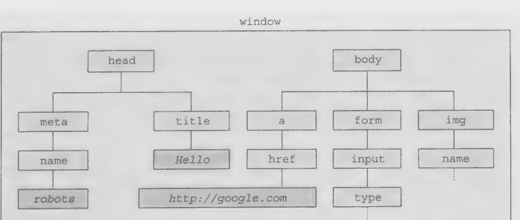

**图3-1** 显示头部和主体部分的DOM示例

将其表示为HTML代码，头部部分的结构如下所示：

```
<head>
<meta name="robots" content="index, follow" />
<title>Hello</title>
</head>
```

而HTML的主体部分可能如下所示：

```
<body>

<a href="http://google.com">Visit Google</a>
or enter your username and password to continue...
<form id="login" method="post" action="login.php">
<input type="text" name="name" />
<input type="password" name="password" />
<input type="submit" />
</form>
</body>
```

请记住，这两个HTML部分是同一文档的一部分，我们会将它们放在一个`<html>`标签内，如下所示：

```
<html>
<head>
<meta name="robots" content="index, follow" />
<title>Hello</title>
</head>
<body>

<a href="http://google.com">Visit Google</a>,
or enter your username and password to continue...
<form id="login" method="post" action="login.php">
<input type="text" name="name" />
<input type="password" name="password" />
<input type="submit" />
</form>
</body>
</html>
```

当然，所有网页都是不同的，但它们通常遵循与此相同的形式。

#### 正确的HTML结构

为了遵循推荐的HTML结构并确保你的文档可被最大数量的浏览器和其他客户端读取，标签内的参数应包含

#### 关于层叠样式表

使用 CSS，你可以为网页应用样式，使其完全符合你的期望。这之所以可行，是因为 CSS 与 DOM 相连接，因此你可以快速轻松地重新设置任何元素的样式。例如，如果你不喜欢 `<h1>`、`<h2>` 等标题标签的默认外观，你可以分配新样式来覆盖所用字体族和字体大小的默认设置，指定是否应设置粗体或斜体，并更改更多其他属性。

你可以通过将所需的语句插入网页的 `<head>` 和 `</head>` 标签之间来为网页添加样式。例如，要更改 `<h1>` 标签的样式，你可能会使用以下代码：

```
<style>
  h1 { color:red; font-size:3em; font-family:Arial; }
</style>
```

在一个 HTML 页面中，这可能看起来像下面这样（参见图 3-2）：

```
<html>
  <head>
    <style>
      h1 { color:red; font-size:3em; font-family:Arial; }
    </style>
  </head>
  <title>Hello World</title>
  <body>
    <h1>Hello there</h1>
  </body>
</html>
```

图 3-2 为 `<h1>` 标签设置样式，原始样式显示在较小的窗口中

#### 导入样式表

当你希望为整个网站（而不是单个页面）设置样式时，管理样式表的更好方法是将它们完全从你的网页中移除，放入单独的文件，然后导入你需要的那些。这允许你拥有用于不同布局（例如网页和打印）的不同样式表，而无需更改 HTML。

有几种不同的方法可以实现这一点，第一种是使用 CSS `@import` 指令，如下所示：

```
<style>
    @import url("/css/styles.css");
</style>
```

此语句告诉浏览器从 /css 文件夹中获取名为 *styles.css* 的样式表。`@import` 命令非常灵活，你可以创建本身就引入其他样式表的样式表，以此类推。只需确保你的任何外部样式表中都没有 `<style>` 或 `</style>` 标签，否则它们将无法工作。

#### 从 HTML 中导入 CSS

你也可以使用 HTML `<link>` 标签来包含样式表，如下所示：

```
<link rel="stylesheet" type="text/css" href="/css/styles.css" />
```

这与 `@import` 指令具有完全相同的效果，不同之处在于 `<link>` 是一个仅限 HTML 的标签，而不是有效的样式指令，因此它不能用于从一个样式表内部引入另一个，也不能放置在一对 `<style>` ... `</style>` 标签内。

正如你可以在 CSS 中使用多个 `@import` 指令来包含多个外部样式表一样，你也可以在 HTML 中使用任意数量的 `<link>` 语句。

#### 本地样式设置

同样，你也可以通过直接在 HTML 中插入样式语句，为当前页面单独设置或覆盖某些样式，具体如下（导致标签内文本为蓝色斜体）：

```
<div style="font-style:italic; color:blue;">Hello</div>
```

但这应仅限于最特殊的情况，因为它破坏了内容和布局的分离。

#### 使用 ID

为元素设置样式的一个更好解决方案是在 HTML 中为其分配一个 ID，如下所示（记住，你通常可以互换使用单引号和双引号，但需成对使用）：

```
<div id='iblue'>Hello</div>
```

这样做的作用是声明 ID 为 "iblue" 的 div 的内容应应用在 "iblue" 样式设置中定义的样式。与此匹配的 CSS 语句可能如下所示：

```
#iblue { font-style:italic; color:blue; }
```

注意 `#` 符号的用法，它指定只有名称为 "iblue" 的 ID 应使用此语句进行样式设置。

#### 使用类

如果你想将相同的样式应用于许多元素，不必为每个元素分配不同的 ID，因为你可以指定一个 *类* 来管理它们所有，如下所示：

```
<div class="iblue">Hello</div>
```

这样做的作用是声明此元素（以及任何其他使用该类的元素）的内容应应用在 "iblue" 类中定义的样式。一旦应用了类，你就可以在页面头部或外部样式表中使用以下样式设置来设置该类的样式：

```
.iblue { font-style:italic; color:blue; }
```

类语句不使用为 ID 保留的 `#` 符号，而是以 `.`（句点）符号开头。

#### 专家问答

**问：** CSS 中使用的分号是必需的，还是像 JavaScript 中一样是可选的？

**答：** 答案是既需要也不需要。为了在同一行上分隔多个 CSS 语句，你必须在它们之间放置分号。但如果一行中只有一个语句（或在 HTML 标签内的内联样式设置中），那么你可以省略分号，就像你可以在一组语句中的最后一个语句一样省略它。

为了避免难以发现的 CSS 错误，你可能更喜欢在每条 CSS 规则后始终使用分号，这样你就可以复制粘贴规则，或者修改属性，而无需担心在严格不需要的地方删除分号，或在需要的地方添加分号。

#### CSS 规则

CSS 规则中的每个语句都以选择器开头，选择器是规则作用的对象。例如，在下面的赋值中，`h1` 是被赋予比默认值大 240% 字体大小的选择器：

```
h1 { font-size:240%; }
```

为选择器的 `font-size` 属性提供一个新值，可确保所有 `<h1>` ... `</h1>` 标签对的内容将以相对于默认大小 240% 的字体大小显示。这是通过在选择器后的 `{` 和 `}` 符号内放置一个或多个赋值来实现的（本例中为 `font-size:240%;`）。`:`（冒号）符号之前的部分是属性，而冒号之后的部分是应用于它的值。

最后，有一个 `;`（分号）来结束语句，在本例中，这不是必需的（但如果同一行上还有另一个赋值则会需要）。为了便于避免难以追踪的错误，在本书中，即使分号不是必需的，我也总是包含它们。

#### 多重赋值

你可以用几种不同的方式创建多个属性赋值。首先，你可以在同一行上将它们连接起来，如下所示：

```
h1 { font-size:240%; color:blue; }
```

这添加了第二个赋值，将所有 `<h1>` 标题的颜色更改为蓝色。你也可以将赋值每行一个放置，如下所示：

```
h1 { font-size:240%;
color:blue; }
```

或者你可以将赋值稍微间隔开一些，使它们在冒号处垂直对齐，如下所示：

```
h1 {
    font-size:240%;
    color:blue;
}
```

这样，由于第一列的选择器，你可以轻松地看到每组新规则的开始，并且后续的赋值整齐地排列在一起，所有属性值从相同的水平偏移量开始。在前面的例子中，两个分号都是不必要的，但如果你曾经想将任何这样的语句组连接成一行，由于分号已经存在，这样做会非常快。

没有绝对正确或错误的 CSS 布局方式，但我建议你至少尝试保持每个 CSS 块内部一致，以便一目了然地理解它。

#### 注释

为你的 CSS 规则添加注释是一个好主意，即使你只描述主要的语句组，而不是全部或大部分。你可以通过两种不同的方式做到这一点。首先，你可以在一对 `/* ... */` 标签内放置注释，如下所示：

```
/* This is a CSS comment */
```

或者你可以将注释扩展到多行，如下所示：

```
/* A Multi
   line
   comment */
```

#### 注意

如果你使用多行注释，请注意不能在其中嵌套更多单行（或任何其他）注释；否则，你将得到不可预测的错误。

#### 样式类型

CSS 提供了多种不同的样式类型，从你的浏览器设置的默认样式（以及你可能已应用的任何用户样式），到内联或嵌入式样式，再到外部样式表。每种类型中定义的样式都具有从低到高的优先级层次结构。

你还应该关闭每个标签，并且按照正确的顺序关闭。例如，你不应该通过发出 `</html>` 后跟 `</body>` 来结束文档，因为这种反转会破坏标签的正确嵌套。关闭文档的正确方法是先用 `</body>`，然后 `</html>`。

同样，出于同样的原因，你应该自关闭任何没有关闭版本的标签，例如 ``（它没有匹配的 `</img>` 标签），因此需要在最终的 `>` 之前放置一个 `/` 字符来正确关闭它。同样，`<br>` 变为 `<br />`，以此类推。

遵循这些规则，你的文档更容易被程序理解，也更容易转换为 XML（可扩展标记语言），这是一种更严格的标记语言，用于处理 RSS（简易信息聚合）提要等数据。

#### 70 面向 iOS 和 Android 的 HTML5：入门指南

#### 默认样式

样式优先级的最低层级是网页浏览器应用的默认样式。当网页没有任何样式时，这些样式作为后备方案提供。它们旨在成为一组通用样式，能在大多数情况下显示得相当合理。

在 CSS 出现之前，默认样式是应用于文档的唯一样式，而且网页只能更改其中的一小部分（如字体、颜色和大小，以及一些调整元素尺寸的参数）。

#### 用户样式

用户样式是优先级仅次于默认样式的下一高优先级样式。大多数现代浏览器都支持用户样式，但每个浏览器的实现方式都不同。如果你想了解如何创建自己的浏览器默认样式，请打开搜索引擎，输入你的浏览器名称后跟“用户样式”（例如，输入“firefox”、“mozilla”、“opera”或“ie”后跟“user styles”）来查找方法。图 3-3 展示了应用于 Microsoft Internet Explorer 的用户样式表。你可以通过选择“工具” | “Internet 选项”并单击“常规”选项卡上的“辅助功能”按钮来打开显示的“辅助功能”对话框。

如果已分配的用户样式已被定义为浏览器默认样式，它将覆盖浏览器的默认设置。用户样式表中未定义的任何样式将保留其在浏览器中设置的默认值。

#### 外部样式表

下一类样式是在外部样式表中分配的样式。这些设置会覆盖用户或浏览器分配的任何样式。外部样式表是创建样式的推荐方式，因为你可以为不同目的创建不同的样式表——例如，用于一般网络浏览、用于在屏幕较小的移动浏览器上查看、用于打印目的等——然后仅为每种媒体类型应用所需的那一个样式表。

#### 内部样式

内部样式是在 `<style>` ... `</style>` 标签内创建的样式，其优先级高于所有前述样式类型。不过，此时你开始打破样式与内容的分离，因为任何与内部样式表同时加载的外部样式表的优先级都会较低。

#### 内联样式

最后，内联样式是直接将属性分配给元素的方式。它们在任何样式类型中具有最高优先级，使用方式如下：

```
<a href="http://google.com" style="color:green;">Visit Google</a>
```

在此示例中，指定的链接将以绿色显示，无论其他任何类型的样式表（无论是直接应用于此链接，还是通用地应用于所有链接）应用了任何默认或其他颜色设置。

当你使用这种样式时，你正在打破布局与内容的分离，因此建议仅在有充分理由时使用它。

#### 选择器

你访问一个或多个元素的方式称为*选择*，而 CSS 规则中执行此操作的部分被称为*选择器*。正如你可能预期的，选择器有许多不同的种类。

##### 类型选择器

类型选择器作用于 HTML 元素类型，如 `<p>` 或 `<i>`。例如，以下规则确保 `<p>` ... `</p>` 标签内的所有文本都是两端对齐的：

```
p { text-align:justify; }
```

##### 后代选择器

后代选择器允许你将样式应用于包含在其他元素中的元素。例如，以下规则将 `<b>` ... `</b>` 标签内的所有文本设置为红色，但仅当它们出现在 `<p>` ... `</p>` 标签内时生效（如此：`<p><b>Hello</b> there</p>`）：

```
p b { color:red; }
```

后代选择器可以无限嵌套，因此以下规则是完全有效的，它将无序列表元素内、粗体文本中的文本设置为蓝色：

```
ul li b { color:blue; }
```

##### 子选择器

子选择器类似于后代选择器，但它对样式何时应用施加了更多限制，仅选择那些是另一个元素的直接子元素的元素。例如，以下代码使用了后代选择器，它会将段落内的任何粗体文本更改为红色，即使粗体文本本身在斜体内（如此：`<p><i><b>Hello</b> there</i></p>`）：

```
p b { color:red; }
```

在此例中，单词“Hello”显示为红色。然而，当不需要这种更通用的行为时，可以使用子选择器来缩小选择器的范围。例如，以下子选择器将仅当元素是段落的直接子元素，且其本身不被包含在另一个元素内时，才将粗体文本设置为红色：

```
p > b { color:red; }
```

现在单词“Hello”将不会改变颜色，因为它不是段落的直接子元素。

##### ID 选择器

如果你给一个元素一个 ID 名称（如此：`<div id='mydiv'>`），那么你可以通过以下方式直接从 CSS 访问它，这会将 div 中的所有文本更改为斜体：

```
#mydiv { font-style:italic; }
```

##### 重用 ID

ID 在一个文档中只能使用一次，因此只有找到的第一个实例会接收 CSS 规则分配的新属性值。但在 CSS 中，你可以直接引用任何同名的 ID，只要它们出现在不同的元素类型中，如此：

```
<div id='myid'>Hello</div>
<span id='myid'>Hello</span>
```

因为 ID 通常仅适用于唯一元素，所以下面的规则只会将下划线应用于 myid 的第一个出现位置：

```
#myid { text-decoration:underline; }
```

然而，你可以确保 CSS 将规则应用于两个出现位置，如此：

```
span#myid { text-decoration:underline; }
div#myid { text-decoration:underline; }
```

或者，更简洁地，如此（参见本章稍后的“按组选择”部分）：

```
span#myid, div#myid { text-decoration:underline; }
```

#### 注意

如果你使用这种形式的选择器，请记住任何也必须访问这些元素的 JavaScript 代码将无法轻松执行，因为常用的 `getElementById()` 函数只会返回第一个出现的实例。要引用任何其他实例，程序员必须遍历文档中的整个元素列表，这是一项更棘手的任务。

##### 类选择器

当你希望页面中的多个元素共享相同的样式时，你可以为它们分配相同的类名（如此：`<span class='myclass'>`），然后创建一个单独的规则来一次性修改所有这些元素，如以下规则所示，它为所有使用该类的元素创建了 10 像素的左外边距偏移：

```
.myclass { margin-left:10px; }
```

在现代浏览器中，HTML 元素也可以使用多个类，通过空格分隔，如此：`<span class='thisclass thatclass otherclass'>`。旧版浏览器只允许单个类。

##### 缩小类的作用范围

你可以通过指定它应适用的元素类型来缩小类的作用范围。例如，以下规则仅将设置应用于使用 main 类的段落：

```
p.main { text-indent:30px; }
```

在此示例中，只有使用 main 类的段落（如此：`<p class="main">`）才会收到新的属性值。任何其他可能尝试使用该类的元素类型（例如 `<div class="main">`）都将被忽略。

#### 属性选择器

许多 HTML 标签支持属性，使用这种类型的选择器可以让你不必使用 ID 和类来引用这些属性。例如，你可以通过以下方式直接引用属性，这会将所有具有属性 `type="submit"` 的元素的宽度设置为 100 像素：

```
[type="submit"] { width:100px; }
```

如果你希望将选择器的范围缩小到，例如，仅具有该属性类型的表单输入元素，你可以改用以下规则：

```
form input[type="submit"] { width:100px; }
```

> **注意**

> 属性选择器也适用于 ID 和类，因此，例如，`[class="classname"]` 的执行方式与 ID 选择器 `.classname` 完全相同（除了后者具有更高的优先级）。同样，`[id="idname"]` 等同于使用类选择器 `.idname`。因此，以 # 或 . 为前缀的类和 ID 选择器可以被视为属性选择器的简写形式，但具有更高的优先级。

##### 通用选择器

通用（或通配符）选择器匹配任何元素，因此以下规则会将文档搞得很混乱，为所有元素添加绿色边框：

```
* { border:1px solid green; }
```

因此，你不太可能单独使用 `*`，但作为复合规则的一部分，它可以非常强大。例如，以下规则将应用与前面示例相同的样式，但仅适用于 ID 为 boxout 的元素的所有子段落，且仅当它们不是直接子元素时：

```
#boxout * p { border:1px solid green; }
```

让我们看看这里发生了什么。`#boxout` 后的第一个选择器是 `*` 符号，因此它指的是 `boxout` 对象内的任何元素。随后的 `p` 选择器通过将选择器更改为仅适用于 `*` 选择器返回的元素作为子元素的段落（由 `p` 定义），从而缩小了选择范围。因此，此 CSS 规则执行以下操作（在此我将使用术语 *对象* 和 *元素* 来互指同一样东西）：

1. 找到 ID 为 `boxout` 的对象。

2. 找到步骤 1 返回对象的所有子元素。

3. 找到步骤 2 返回对象的所有 `p` 子元素，并且由于这是组中的最终选择器，也找到步骤 2 返回对象的所有 `p` 子元素以及子子元素（依此类推）。

4. 将 `{` 和 `}` 字符内的样式应用到步骤 3 返回的对象。

最终结果是，绿色边框仅应用于主元素的孙级（或孙孙级，依此类推）段落。

##### 按组选择

使用 CSS，可以通过用逗号分隔选择器，将规则同时应用于多个元素、类或任何其他类型的选择器。例如，以下规则将在所有段落、ID 为 `idname` 的元素以及所有使用类 `classname` 的元素下方添加一条橙色虚线：

```
p, .idname, #classname { border-bottom:1px dotted orange; }
```

#### 层叠

CSS 属性的一个基本特征是它们会 *层叠*，这就是为什么这项技术被称为层叠样式表。但这意味着什么？

层叠是一种用于解决浏览器支持的各种不同类型样式表之间潜在冲突的方法，并根据它们的创建者、创建样式的方法以及所选属性的类型，按优先级顺序应用这些样式表。

##### 样式表创建者

所有现代浏览器都支持三种主要类型的样式表。按从高到低的优先级顺序，它们是：

1. 由文档作者创建的样式表

2. 由用户创建的样式表

3. 由浏览器创建的样式表

##### 样式表方法

这三组样式表按相反的顺序处理。首先，将 Web 浏览器中的默认设置应用于文档。没有这些默认值，不使用样式表的网页看起来会非常糟糕。默认样式包括字体、大小和颜色、元素间距、表格边框和间距，以及用户期望的所有其他标准文档特性。

接下来，如果用户创建了任何样式来代替标准样式，它们将被应用，替换任何可能冲突的浏览器默认样式。

最后，应用当前文档作者创建的任何样式，替换任何已作为浏览器默认值或由用户创建的样式。

样式表可以通过三种不同的方式或方法创建。按从高到低的优先级顺序，它们是：

1. 作为内联样式

2. 在嵌入式样式表中

3. 作为外部样式表

同样，这些样式表创建方法按优先级相反的顺序应用。因此，首先处理所有外部样式表，并将其样式应用于文档。

接下来，处理任何嵌入式样式（在 `<style> ... </style>` 标签内），任何与外部规则冲突的样式将被优先处理并覆盖它们。

最后，任何直接作为内联样式（例如 `<div style="..."> ... </div>`）应用于元素的样式被赋予最高优先级，并覆盖所有先前分配的属性。

##### 样式表选择器

有三种不同的方式来选择要设置样式的元素。按从高到低的优先级顺序，它们是：

1. 通过单个 ID 引用

2. 通过类进行分组引用

3. 通过元素标签引用（例如 `<p>` 或 `<b>`）

选择器根据规则影响的元素数量和类型进行处理，这与解决冲突的前两种方法略有不同。这是因为规则不必一次只应用于一种类型的选择器，而是可能引用许多不同的选择器。因此，需要一种方法来确定可以包含任意组合选择器的规则的优先级。这是通过计算每个规则的特异性来实现的，方法是将它们按作用范围从宽到窄排序。

##### 计算特异性

规则的特异性是根据前面编号列表中的选择器类型创建的三部分数字来计算的。这些复合数字一开始看起来像 `[0, 0, 0]`。处理规则时，每个引用 ID 的选择器将第一个数字加 1，因此复合数字变为 `[1, 0, 0]`。例如，如果特定规则中有三个 ID 引用，则复合数字变为 `[3, 0, 0]`。

然后，引用类的选择器数量被放置在复合数字的第二部分。例如，如果有五个，则数字变为 `[3, 5, 0]`。

最后，计算所有引用元素标签的选择器，并将此数字放置在复合数字的最后一部分。如果有两个这样的选择器，则最终的复合数字变为 `[3, 5, 2]`，这就是比较此规则特异性与其他规则所需的一切。

在复合数字中每种类型有九个或更少的情况下，你可以将其直接转换为十进制数，在这种情况下是 352。数字低于此值的规则将具有较低的优先级，而数字较高的规则将具有较高的优先级。当两个规则具有相同的值时，最近应用的规则获胜。

##### 使用不同的数字进制

当一种类型在数字中超过九个时，你必须使用更高的数字进制进行计算。例如，复合数字 `[11, 7, 19]` 不会通过简单地连接三个部分来转换为十进制。相反，你可以将数字转换为更高的进制，例如 20 进制（或者如果任何类型超过 19，则使用更高的进制）。

为此，你需要从最右边的数字开始，向左计算，将三个部分相乘并加总结果，如下所示：

```
20 × 19 = 380
20×20 × 7 = 2800
20×20×20 × 11 = 88000
十进制总数 = 91180
```

在左侧，将 20 的值替换为你使用的进制数；然后，一旦一组规则的所有复合数字都从该进制转换为十进制，就很容易确定每个规则的特异性，从而确定其优先级。

值得庆幸的是，所有这些都由 CSS 处理器为你处理，但了解其工作原理有助于你正确构建规则并理解它们将具有的优先级。

> 注意

> 如果所有这些优先级计算听起来相当复杂，你会很高兴知道，在大多数情况下，你通常可以遵循这个简单的经验法则：“通常，要修改的元素越少，赋予规则的优先级就越高。”

##### 有些规则更平等

当两个或多个样式规则完全相同时，最近处理的规则优先。但是，你可以通过使用 `!important` 标签强制规则具有比其他等效规则更高的优先级，如下所示：

```
p { color:#ff0000 !important; }
```

当你这样做时，所有先前的等效设置都会被覆盖（即使使用了 `!important`），并且任何稍后处理的等效规则都将被忽略。例如，以下两个规则中的第二个通常会优先，但由于先前赋值中使用了 `!important`，第二个将被忽略：

```
p { color:#ff0000 !important; }
p { color:#ffff00 }
```

#### 专家问答

> **问：** 用于指定默认浏览器样式的用户样式表能否使用 `!important` 关键字？

>

> **答：** 可以。如果用户也对某个设置应用了 `!important`，则用户的样式设置优先于当前网页中指定的相同属性。但是，在使用 CSS 1 的非常旧的浏览器上，此功能不受支持。

##### Div 和 Span 的区别

div 和 span 都是容器的类型，但它们具有不同的特性。默认情况下，div 具有无限宽度（至少到浏览器边缘），这可以通过为其添加边框来观察，如下所示：

```
<div style="border:1px solid green;">Hello</div>
```

但是，span 的宽度仅为其包含的文本的宽度。因此，以下 HTML 行仅在单词 "Hello" 周围显示边框，而不会延伸到浏览器的右边缘：

```
<span style="border:1px solid green;">Hello</span>
```

此外，行内元素会包裹文本或其他对象，因此可能形成复杂的边框。例如，在以下网页中，CSS被用来将所有div的背景设为黄色，所有span的背景设为青色，并为两者添加边框，然后创建了几个示例行内元素和块级元素：

```html
<html>
    <head>
        <title>Div and span example</title>
        <style>
            div, span { border:1px solid black; }
            div       { background-color:yellow; }
            span      { background-color:cyan; }
        </style>
    </head>
    <body>
        <div>This text is within a div tag</div> This isn't.
        <div>And this is again.</div><br />
        <span>This text is inside a span tag.</span> This isn't.
        <span>And this is again.</span><br /><br />
        <div>This is a larger amount of text in a div element that
        wraps around to the next line of the browser</div><br />
        <span>This is a larger amount of text in a span element that
        wraps around to the next line of the browser</span>
    </body>
</html>
```

图3-4展示了该页面在网页浏览器中的效果。虽然图中仅以灰度而非彩色打印，但它清晰地显示了块级元素如何扩展到浏览器的右边缘，并迫使后续内容出现在其下方第一个可用位置的起始处。

该图还显示了行内元素仅占据容纳其内容所需的空间——不会迫使后续内容出现在其下方。例如，在图底部的两个示例中，你还可以看到当块级元素环绕屏幕边缘时，它们保持矩形形状，而行内元素则简单地遵循其内部文本（或其他内容）的流动方向。

#### 专家问答

> **问：与 `<span>` 标签相比，哪些类型的内容最适合放在 `<div>` 标签中？**

**答：由于 `<div>` 标签只能是矩形的，因此更适合包含图像、文本框、引用等对象，而 `<span>` 标签最适合用于放置内联排列的文本或其他属性，这些内容应从左到右流动。**

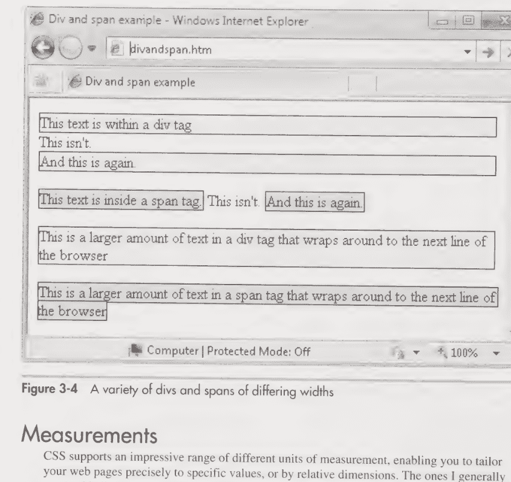

图3-4 各种不同宽度的div和span

#### 度量单位

CSS支持种类繁多的度量单位，使你能够精确地根据特定值或相对尺寸来定制网页。我通常使用（并且相信你也会发现最有用的）是像素、磅、em和百分比，以下将连同其他单位一起介绍：

- **像素** 像素（px）的大小根据用户显示器的尺寸和像素深度而变化。由于1像素等于屏幕上单个点的宽度/高度，因此此度量单位最适合用于显示器。

  示例：`#classname { margin:5px; }`

- **磅** 磅（pt）的大小等同于1/72英寸。此度量单位源于印刷设计背景，最适合用于该媒介，但也常用于显示器。

  示例：`#classname { font-size:14pt; }`

- **英寸** 英寸（in）等同于72磅，也是一种最适合用于印刷的度量类型。

  示例：`#classname { width:3in; }`

- **厘米** 厘米（cm）是另一种最适合用于印刷的度量单位。一厘米略多于28磅。

  示例：`#classname { height:2cm; }`

- **毫米** 毫米（mm）是厘米的十分之一（或接近3磅）。毫米是另一种最适合用于印刷的度量单位。

  示例：`#classname { font-size:5mm; }`

- **派卡** 派卡（pc）是另一种印刷排版度量单位，等同于12磅。

  示例：`#classname { font-size:1pc; }`

- **em** 一个em（em）等于当前字体大小，因此是CSS中最有用的度量单位之一，因为它用于描述相对尺寸。

  示例：`#classname { font-size:2em; }`

- **ex** 一个ex（ex）也与当前字体大小相关；它等同于小写字母 *x* 的高度。此度量单位使用不广泛，最常被用作近似值，以帮助设置包含文本的框的宽度。

  示例：`#classname { width:20ex; }`

- **百分比** 此单位（%）与em相关，当用于字体时，其大小恰好是em的100倍。1 em等于当前字体大小，而相同的尺寸在百分比中则是100。当不与字体相关时，此单位相对于所访问属性的包含元素的大小。

  示例：`#classname { height:120%; }`

#### 字体

你可以使用CSS来设置四种主要的字体属性：字体族、字形、大小和字重。通过它们，你可以微调文本在网页中的显示方式、打印效果等。

##### 字体族

此属性指定要使用的字体。它还支持按从左到右的偏好顺序列出多种字体，以便在用户未安装首选字体时，样式能够优雅地回退。例如，要为段落设置默认字体，你可以使用如下CSS规则：

```css
p { font-family: Verdana, Arial, Helvetica, sans-serif; }
```

当字体名称由两个或多个单词组成时，必须将名称用引号括起来，如下所示：

```css
p { font-family: "Times New Roman", Georgia, serif; }
```

#### 提示

由于这些字体几乎在所有网页浏览器和操作系统上都可用，因此在网页上使用的最安全字体族是Arial、Helvetica、Times New Roman、Times、Courier New和Courier。Verdana、Georgia、Comic Sans MS、Trebuchet MS、Arial Black和Impact字体在Mac和PC上使用是安全的，但在其他操作系统（如Linux）上可能未安装。其他常见但安全性较低的字体包括Palatino、Garamond、Bookman和Avant Garde。如果你使用安全性较低的字体，请确保在CSS中提供一个或多个更安全字体的后备方案，这样你的网页在没有首选字体的浏览器上也能优雅降级。

##### 字形

使用此属性，你可以选择以正常、斜体或倾斜方式显示字体。以下规则创建了三个类（normal、italic和oblique），可以应用于元素以产生这些效果：

```css
.normal  { font-style:normal; }
.italic  { font-style:italic; }
.oblique { font-style:oblique; }
```

#### 字体大小

正如前面度量单位部分所述，你可以通过多种方式更改字体大小。但这些方式主要归结为两种：固定和相对。固定设置如下例规则所示，它将默认段落字体大小设置为14磅：

```css
p { font-size:14pt; }
```

或者，你可能希望使用当前默认字体大小，并以此来设置各种类型文本的样式，如标题。在以下规则中，定义了一些标题的相对大小，其中 `<h4>` 标签的大小比默认大20%，而每个更大的尺寸又比前一个大40%：

```css
h1 { font-size:240%; }
h2 { font-size:200%; }
h3 { font-size:160%; }
h4 { font-size:120%; }
```

##### 字重

使用此属性，你可以选择字体显示的粗细程度。它支持多个值，但你可能主要使用的是 `normal` 和 `bold`，如下所示：

```css
.bold { font-weight:bold; }
```

#### 管理文本样式

无论使用何种字体，你都可以通过修改文本装饰、间距和对齐方式来进一步调整文本的显示方式。然而，文本属性和字体属性之间存在交叉，例如斜体或粗体文本是通过 `font-style` 和 `font-weight` 属性实现的，而其他效果如下划线则需要 `text-decoration` 属性。

##### 装饰

使用 `text-decoration` 属性，你可以为文本应用 `underline`、`line-through`、`overline` 和 `blink` 等效果。以下规则创建了一个名为 `over` 的新类，它为文本添加上划线（上划线、下划线和删除线的粗细将与字体匹配）：

```css
.over { text-decoration:overline; }
```

##### 间距

多个不同的属性允许你修改行距、单词间距和字母间距。例如，以下规则通过将 `line-height` 属性修改为增加25%、`word-spacing` 属性修改为30像素、`letter-spacing` 修改为3像素，来更改段落的行间距：

```css
p {
    line-height:125%;
    word-spacing:30px;
    letter-spacing:3px;
}
```

##### 对齐

CSS中有四种文本对齐方式：`left`、`right`、`center`和`justify`。在以下规则中，默认段落文本设置为两端对齐：

```css
p { text-align:justify; }
```

##### 文本转换

文本转换有四个可用属性：`none`、`capitalize`、`uppercase` 和 `lowercase`。以下规则创建了一个名为 `upper` 的类，当使用该类时，它将确保所有文本都以大写形式显示：

```css
.upper {
    text-transform: uppercase;
}
```

##### 文本缩进

使用 `text-indent` 属性，可以将文本块的第一行缩进指定的量。以下规则将每个段落的第一行缩进 20 像素，尽管也可以使用不同的度量单位或百分比增加：

```css
p {
    text-indent: 20px;
}
```

#### 颜色

可以使用 `color` 和 `background-color` 属性（或通过向 `background` 属性提供单个参数）将颜色应用于文本和对象的前景和背景。指定的颜色可以是命名颜色之一（如 `red` 或 `blue`）、从十六进制 RGB 三元组创建的颜色（如 `#ff0000` 或 `#0000ff`），或者使用 `rgb()` CSS 函数创建的颜色。

W3C（w3.org）标准组织定义的标准 16 种颜色名称如下：`aqua`、`black`、`blue`、`fuchsia`、`gray`、`green`、`lime`、`maroon`、`navy`、`olive`、`purple`、`red`、`silver`、`teal`、`white` 和 `yellow`。以下规则使用这些名称之一来设置 ID 为 `object` 的对象的背景色：

```css
#object {
    background-color: silver;
}
```

在下面的规则中，所有 `div` 中文本的前景色设置为黄色（因为在计算机显示屏上，组合十六进制级别的 `ff` 红色、`ff` 绿色和 `00` 蓝色会产生黄色）：

```css
div {
    color: #ffff00;
}
```

或者，如果您不希望使用十六进制，您可以使用 `rgb()` 函数指定颜色三元组，如以下规则所示，该规则将当前文档的背景色更改为水绿色：

```css
body {
    background-color: rgb(0, 255, 255);
}
```

> **提示**

如果您不喜欢使用每种颜色 256 个级别的范围，您可以在 `rgb()` 函数中使用百分比，其值从 0 到 100，从最低（0）的原色量到最高（100），如下所示：`rgb(58%, 95%, 74%)`。您也可以使用浮点值以获得更精细的颜色控制，如下所示：`rgb(23.4%, 67.6%, 15.5%)`。

##### 简写颜色字符串

十六进制数字字符串还有一种简写形式，其中每个 2 字节对仅使用第一个字节来表示每种颜色。例如，不是分配颜色 `#fe4692`，而是使用 `#f49`，省略每对中的第二个十六进制数字。这会产生几乎相同的颜色，并且在不需要精确颜色时很有用。六位数字字符串和三位数字字符串之间的区别在于，前者支持 1600 万种不同的颜色，而后者支持 4000 种。

在任何您打算使用类似 `#803060`（其中每对的第二位数字为零）的颜色的地方，它直接等同于 `#836`（因为较短的版本隐含了零），您可以使用任一字符串创建完全相同的颜色。

在本书中，我根据当时需要的颜色使用任一类型。

#### 元素定位

网页中的元素放置在文档中的位置，但您可以通过将其 `position` 属性从默认的 `static` 更改为 `absolute`、`relative` 或 `fixed` 之一来移动元素。

具有绝对定位的元素会从文档中移除，任何其他能够流动的元素将流入其释放的空间。然后，您可以使用 `top`、`right`、`bottom` 和 `left` 属性将对象定位在文档中的任意位置。它将位于其他元素的上方（或后面）。

因此，例如，要将 ID 为 `object` 的对象移动到距文档开头向下 100 像素、距左侧 200 像素的绝对位置，您需要对其应用以下规则（您也可以使用 CSS 支持的任何其他度量单位）：

```css
#object {
    position: absolute;
    top: 100px;
    left: 200px;
}
```

同样，您可以相对于其在正常文档流中的位置来移动对象。因此，例如，要将 `object` 从其正常位置向下移动 10 像素并向右移动 10 像素，您将使用以下规则：

```css
#object {
    position: relative;
    top: 10px;
    left: 10px;
}
```

最后一种定位属性设置允许您将对象移动到绝对位置，但仅限于当前浏览器视口内。然后，当文档滚动时，对象保持在其放置的确切位置，主文档在其下方滚动——这是创建停靠栏和其他类似设备的好方法。要将对象固定到浏览器窗口的左上角，您将使用以下规则：

```css
#object {
    position: fixed;
    top: 0px;
    left: 0px;
}
```

图 3-5 展示了一个使用 `position` 属性值为 `fixed` 来将图标对齐到屏幕底部的简单停靠栏。通过一些 JavaScript 或专有的 CSS 变换，图标可以在鼠标经过时调整大小，正如第二个图标正在发生的那样。您可以参考我的书籍 *Plug-in CSS* 和 *Plug-in JavaScript*（McGraw-Hill），分别了解处理此功能和许多其他便捷功能的 CSS 和 JavaScript 插件。

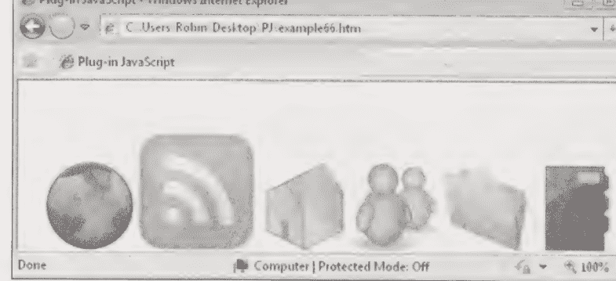

#### 伪类

有许多选择器和类仅在样式表中使用，在任何 HTML 中都没有匹配的标签或属性。它们的任务是使用名称、属性或内容以外的特征对元素进行分类，这些特征无法从文档树中推断出来。这些包括伪类，如 `first-line`、`first-child` 和 `first-letter`。

伪类使用 `:`（冒号）字符与元素分隔。例如，要创建一个名为 `bigfirst` 的类来强调元素的第一个字母，您将使用如下规则：

```css
.bigfirst:first-letter {
    font-size: 400%;
    float: left;
}
```

当 `bigfirst` 类应用于元素时，第一个字母将显示得更大，其余文本以正常大小显示并整齐地环绕它（由于 `float` 属性），就好像第一个字母是图像或其他对象一样。

其他伪类包括 `hover`、`link`、`active` 和 `visited`，它们大多用于应用于锚元素，如以下规则所示，第一条规则将所有链接的默认颜色设置为蓝色，第二条规则将已访问链接的默认颜色设置为浅蓝色：

```css
a:link    { color: blue; }
a:visited { color: lightblue; }
```

以下规则对很有趣，因为它使用了 `hover` 伪类，因此仅当鼠标放在元素上时才应用规则。在此示例中，它们将链接更改为红色背景上的白色文本，提供通常只有使用 JavaScript 代码才能获得的动态效果。

```css
a:hover {
    color: white;
    background: red;
}
```

这里我使用了带单个参数的 `background` 属性，而不是更长的 `background-color` 属性。

`active` 伪类也是动态的，因为它在鼠标按钮被点击和释放之间的时间内对链接产生更改，如以下规则所示，它将链接颜色更改为深蓝色：

```css
a:active {
    color: darkblue;
}
```

另一个有趣的动态伪类是 `focus`，它仅在元素通过用户用键盘或鼠标选择而获得焦点时应用，如以下规则所示，它使用通用选择器始终在当前聚焦对象周围放置一个中灰色、点状、2 像素的边框：

```css
*:focus {
    border: 2px dotted #888888;
}
```

#### 简写规则

为了节省空间，相关的 CSS 属性组可以连接成一个简写赋值。例如，我已经多次使用了创建边框的简写形式，如上一节中的 `:focus` 规则，它实际上是以下规则集的简写连接：

```css
*:focus {
    border-width: 2px;
    border-style: dotted;
    border-color: #888888;
}
```

使用简写规则时，您只需应用属性，直到要更改值的点为止。因此，您可以使用以下方式仅设置边框的宽度和样式，而不设置其颜色：

```css
*:focus {
    border: 2px dotted;
}
```

> **注意**

属性在简写规则中的放置顺序非常重要，错放它们是导致意外结果的常见方式。由于属性太多，无法在本章中详细说明，如果您希望使用简写 CSS，则需要使用 CSS 手册或搜索引擎查找默认属性及其应用顺序。为了入门，我推荐访问 *dustindiaz.com/css-shorthand* 网页。

#### 盒模型

影响页面布局的基本 CSS 属性基于盒模型：一组嵌套的属性围绕元素，如图 3-6 所示。几乎所有的元素都有（或可以有）这些属性，包括文档主体，您可以（例如）使用以下规则移除其边距：

```css
body {
    margin: 0px;
}
```

一旦掌握了盒模型，您就朝着创建专业布局页面的方向迈出了重要一步，因为仅这些属性就将构成页面样式的大部分。

##### 边距属性

边距是盒模型的最外层。它将元素彼此分开，并且其使用非常智能。例如，假设您选择为多个元素设置默认边距为 10 像素。当它们彼此重叠时，由于边框宽度相加，将产生 20 像素的间隙。

##### CSS 盒模型

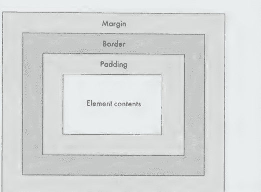

然而，为了克服这个潜在问题，当两个带有边框的元素直接上下相邻时，只会使用两者中较大的那个外边距来分隔它们。如果两个外边距宽度相同，则只使用其中一个宽度。这样，你更有可能得到想要的结果。但你需要注意，绝对定位元素或行内元素的外边距不会发生折叠。

元素的外边距可以通过 `margin` 属性整体更改，也可以通过 `margin-left`、`margin-top`、`margin-right` 和 `margin-bottom` 单独设置。设置 `margin` 属性时，你可以提供一个到四个参数，其效果如以下规则中的注释所述：

```
margin:1px;                    /* 将所有外边距设置为1像素宽 */
margin:1px 2px;                /* 将上下外边距设置为1像素，
                                 左右外边距设置为2像素宽 */
margin:1px 2px 3px;            /* 将上外边距设置为1像素，左右
                                 外边距设置为2像素，下外边距
                                 设置为3像素宽 */
margin:1px 2px 3px 4px;        /* 将上外边距设置为1像素，右外边距
                                 设置为2像素，下外边距设置为3像素，
                                 左外边距设置为4像素宽 */
```

##### 边框属性

盒模型的边框层级与外边距类似，只是没有折叠现象。用于修改边框的主要属性是 `border`、`border-left`、`border-top`、`border-right` 和 `border-bottom`，其中每一个都可以添加其他子属性作为后缀，例如 `-color`、`-style` 和 `-width`。

用于访问单个属性设置的四种方式（这些方式也适用于外边距属性）同样适用于 `border-width` 属性，因此以下所有规则都是有效的：

```
border-width:1px;                    /* 所有边框                       */
border-width:1px 2px;                 /* 上/下边框和左/右边框         */
border-width:1px 2px 3px;             /* 上边框、左/右边框和下边框       */
border-width:1px 2px 3px 4px; /* 上边框、右边框、下边框和左边框 */
```

##### 内边距属性

盒模型层级中最深的一层是内边距，它应用于任何边框和/或外边距的内部。用于修改内边距的主要属性是 `padding`、`padding-left`、`padding-top`、`padding-right` 和 `padding-bottom`。

用于访问外边距和边框属性的单个属性设置的四种方式同样适用于内边距属性，因此以下所有规则都是有效的：

```
padding:1px;                    /* 所有内边距                       */
padding:1px 2px;                 /* 上/下内边距和左/右内边距         */
padding:1px 2px 3px;             /* 上内边距、左/右内边距和下内边距       */
padding:1px 2px 3px 4px; /* 上内边距、右内边距、下内边距和左内边距 */
```

##### 元素内容

在盒模型层级的最深处，在其中心，是一个元素，它可以被本章讨论的所有方式设置样式，并且可以（并且通常会）包含进一步的子元素，而这些子元素又可能包含子元素的子元素，依此类推，每个元素都有自己的样式和盒模型设置。

#### 总结

尽管本章只涵盖了 CSS 的一个子集（这门语言的方方面面远比在单独一章中能妥善讨论的要多得多），但它提供了足够的信息，让你能出色地开始使用 CSS。

在下一章中，我们将利用你在这里学到的知识，向你展示如何将这些新知识与 CSS3 结合使用，CSS3 支持过渡、动画、更多字体、圆角边框、阴影等众多特性。

### 第 4 章

#### CSS3 增强功能

#### 关键技能与概念

- 背景和边框样式、颜色和图像

- 创建盒阴影和文本阴影

- 元素溢出

- 操作颜色和更改不透明度

- 文本换行和使用多列布局

- 盒尺寸和大小调整

- 使用 Web 字体

CSS 的首次实现最初于 1996 年起草，并于 1999 年发布。到 2001 年，所有新发布的浏览器都支持 CSS，但即便如此，该标准仍在 2008 年再次修订。与此同时（从 1998 年开始），CSS2 已经在起草中，并于 2007 年最终完成——但又于 2009 年再次修订。

然后是 CSS3，它于 2001 年开始开发，但其中一些功能直到 2009 年才被提出。因此，开发过程可能会持续一段时间，直到 CSS3 的最终推荐标准达成一致。尽管 CSS3 尚未完成，但人们已经开始提出 CSS4 的建议（甚至还有关于 HTML6 的想法）。

因为 Web 标准的发展始终处于不断变化之中，像本书这样的书籍只能总结特定时间点的状况。因此，在以下描述中，当提到某些功能尚未在特定浏览器中实现（或已以非标准方式应用）时，到你阅读本书时情况可能已有所改变。鉴于此，我建议你同时参考以下网站以获取最新进展：

- css3.info 获取关于 CSS3 的最新消息

- quirksmode.org 获取最新的浏览器兼容性问题

- html5test.com 验证浏览器支持哪些 HTML5 功能

因此，考虑到浏览器技术的持续发展，本章描述了撰写本书时 CSS3 所提供的功能。

#### 属性选择器

正如第 3 章所述，选择器在 CSS 中用于匹配 HTML 元素，共有十种不同的类型：

| 选择器类型 | 示例 |

|---|---|

| 类型 | `b { font-weight:bold; }` |

| 类 | `.classname { color:blue; }` |

| ID | `#idname { background-color:red; }` |

| 后代 | `p em { color:cyan; }` |

| 子 | `div > em { color:green; }` |

| 通用 | `* { color:black; }` |

| 相邻兄弟 | `i + b { color:gray; }` |

| 属性 | `a[href='mysite.com'] { color:red; }` |

| 伪类 | `a:hover { text-decoration:underline; }` |

| 伪元素 | `p:first-letter { font-size:300%; }` |

CSS3 对属性选择器进行了三项增强，使你能够更轻松地基于属性内容匹配元素。

例如，在 CSS2 中，你可以使用像 `a[href='mysite.com']` 这样的选择器来匹配 href 属性中出现的字符串 "mysite.com"，但无法仅匹配字符串的一部分。CSS3 提供了三个新的运算符来解决这个问题：`^`、`$` 和 `*`。在 `=` 符号前直接使用其中一个，你可以分别匹配字符串的开头、结尾或任何部分。例如，`a[href^='mysite']` 将匹配任何 href 属性值以字符串 "mysite" 开头的元素，因此 `<a href='mysite.com'>` 会匹配，但 `<a href='thisismysite.com'>` 不会匹配。

要仅匹配字符串的结尾，你可以使用像 `img[src$='.jpg']` 这样的选择器，它将匹配任何 src 属性以 ".jpg" 结尾的 img 标签。例如，`` 会匹配，但 `` 不会匹配。

或者，要匹配任何子字符串，你可以使用像 `a[href*='google']` 这样的选择器来查找页面上任何 href 属性中包含 "google" 字符串的链接。例如，`<a href='http://google.com'>` 和 `<a href='http://googlemail.com'>` 都会匹配。

#### 背景

CSS2 为背景提供了大量支持，但在 CSS 盒模型方面仍存在一些缺陷，这些问题现在已在 CSS3 中通过两个新属性得到解决：`background-clip` 和 `background-origin`。通过 `background-origin`，你可以指定背景应从元素的哪个位置开始；通过 `background-clip`，你可以指定如何裁剪背景，使其不出现在盒模型中你不需要的区域。

为了实现这些效果，这两个属性都支持以下值：

- **border-box** 指边框的外边缘

- **padding-box** 指内边距区域的外边缘

- **content-box** 指内容区域的外边缘

所有主要浏览器的最新版本都支持这些属性，但 Safari 和 Firefox 除外，它们使用自己的非标准属性名 `border`、`padding` 和 `content`，省略了 `-box` 后缀。

此外，还有一个新的 `background-size` 属性，并且现在也支持多重背景。

所有这些新功能将在以下各节中依次描述。

##### `background-clip` 属性

此属性指定如果背景出现在元素的边框或内边距区域内，是否应忽略（裁剪）该背景。例如，以下规则表明背景可以显示在元素的所有部分，一直到边框的外边缘：

```
background-clip:border-box;
```

要限制背景不显示在元素的边框区域内，你可以将其限制为仅在元素内边距区域外边缘以内的部分，如下所示：

```
background-clip:padding-box;
```

或者，要将背景限制为仅在元素的内容区域内显示，你需要使用此规则：

```
background-clip:content-box;
```

图 4-1 显示了在 Safari 浏览器中显示的三行元素，其中第一行对 `background-clip` 属性使用了 `border-box`，第二行使用了 `padding-box`，第三行使用了 `content-box`。

在第一行中，内部框（一个已加载到元素左上角且禁用了重复的图像文件）被允许显示在元素的任何地方。你还可以清楚地看到它显示在第一个框的边框区域内，因为边框被设置为虚线。

在第二行中，背景图像和背景阴影都没有显示在边框区域内，因为它们已被 `background-clip` 属性值为 `padding-box` 裁剪到内边距区域。

##### `background-origin` 属性

通过此属性，您还可以指定背景图像应位于何处，方法是定义图像的左上角从哪里开始。例如，以下规则声明背景图像的原点位于边框外边缘的左上角：

```
background-origin: border-box;
```

要将图像的原点设置为内边距区域的左上外角，您可以使用此规则：

```
background-origin: padding-box;
```

或者，要将图像的原点设置为元素内部内容区域的左上角，您可以使用此规则：

```
background-origin: content-box;
```

再次查看图 4-1，每一行中，第一个方框使用 `border-box` 的 `background-origin` 属性，第二个使用 `padding-box`，第三个使用 `content-box`。因此，在每一行中，较小的内部分别显示在第一个方框的边框左上角、第二个方框的内边距左上角和第三个方框的内容左上角。

**注意**

关于图 4-1 中内部方框的原点，各行之间唯一需要注意的区别是，在第二行和第三行中，内部方框分别被裁剪到内边距区域和内容区域内，因此在这些区域之外不会显示方框的任何部分。

##### 兼容性问题

正如在不断发展的 Web 开发领域中常见的情况一样，某些浏览器的处理方式有所不同。例如，旧版本的 Firefox 和 Safari 浏览器拥有自己的属性名称。标准属性名称是 `background-clip` 和 `background-origin`，但在 Firefox（以及其他基于 Gecko 的浏览器）中，它们被称为 `-moz-background-clip` 和 `-moz-background-origin`，而在旧版 Safari 浏览器（以及其他基于 WebKit 渲染引擎的浏览器）中，它们的名称是 `-webkit-background-clip` 和 `-webkit-background-origin`。

因此，当您使用 `background-clip` 属性时，例如，如果您希望您的 CSS 规则适用于尽可能多的浏览器，您必须使用三条规则来确保浏览器识别您想要实现的目标。您还应考虑到，旧版本的 Firefox 和 Safari 对这些属性使用非标准的 `border`、`padding` 和 `content` 值，而不是 `border-box`、`padding-box` 和 `content-box`。

因此，要在各种平台上将元素的 `background-clip` 属性设置为 `border-box`，您应该使用以下三条规则：

```
-moz-background-clip    :border;
-webkit-background-clip:border;
background-clip         :border-box;
```

同样，要将元素的 `background-clip` 属性设置为 `padding-box`，您可以使用这些规则：

```
-moz-background-clip    :padding;
-webkit-background-clip:padding;
background-clip         :padding-box;
```

要将元素的 `background-clip` 属性设置为 `content-box`，您可以使用这些规则：

```
-moz-background-clip    :content;
-webkit-background-clip:content;
background-clip         :content-box;
```

您应该以同样的方式处理 `background-origin` 属性，因此以下是为获得最大兼容性而应使用的三组规则：

```
-moz-background-origin    :border;
-webkit-background-origin:border;
background-origin         :border-box;
```

```
-moz-background-origin    :padding;
-webkit-background-origin:padding;
background-origin         :padding-box;
```

```
-moz-background-origin    :content;
-webkit-background-origin:content;
background-origin         :content-box;
```

##### 其他问题

4.0 之前的 Firefox 版本不支持将 `content-box` 值应用于 `background-clip` 属性。如果您在这样的浏览器上使用 `content-box`，该值将被忽略，因此结果将与使用 `border-box` 值相同——或者根本没有使用该属性。

此外，在我撰写本文时，直到 5.02 的所有 Safari 版本、直到 4.1 的所有 iOS 版本以及直到 2.2 的所有 Android 版本仍然只接受 `-webkit-background-clip` 这种旧式名称作为 `background-clip` 属性，因此请确保在可预见的未来继续同时使用新旧两种名称。

##### `background-size` 属性

就像您可以在 `` 标签中指定图像的宽度和高度一样，您现在也可以在所有浏览器的最新版本中对背景图像执行相同的操作。

因为浏览器的工作方式各不相同，您需要使用以下一组规则来在所有浏览器上更改背景的大小（其中 *ww* 是宽度，*hh* 是高度）：

```
-moz-background-size    :wwpx hhpx;
-webkit-background-size:wwpx hhpx;
-o-background-size      :wwpx hhpx;
background-size         :wwpx hhpx;
```

如果您愿意，可以只使用一个参数，这样两个维度都将被设置为该值。此外，如果您将此属性应用于块级元素，例如 `<div>`（而不是像 `<span>` 这样的内联元素），您可以将宽度和/或高度指定为百分比，而不是固定值。

###### 使用 `auto` 值

如果您希望仅缩放背景图像的一个维度，然后让另一个维度自动缩放以保持相同的比例，您可以为另一个维度使用 `auto` 值，如下所示：

```
background-size:100px auto;
```

这将宽度设置为 100 像素，高度设置为与宽度增减成比例的值。

##### 多重背景

通过 CSS3，您现在可以将多个背景附加到一个元素上，每个背景都可以使用前面讨论的 CSS3 背景属性。图 4-2 显示了在 iPhone 上的一个示例。其中，八个不同的图像被分配给背景，以创建证书边框的四个角和四条边。

要在单个 CSS 规则中显示多个背景图像，您可以用逗号将它们分隔开。例如，以下是用于在图 4-2 中创建背景的 CSS——添加了大量空白和格式以使其更清晰：

```
background:url('b1.gif') top left no-repeat,
url('b2.gif') top right no-repeat,
url('b3.gif') bottom left no-repeat,
url('b4.gif') bottom right no-repeat,
url('ba.gif') top repeat-x,
url('bb.gif') left repeat-y,
url('bc.gif') right repeat-y,
url('bd.gif') bottom repeat-x; }
```

前四行将角图像放置到元素的四个角，最后四行放置边图像，之所以最后处理边图像，是因为背景图像的优先级顺序是从高到低。换句话说，在重叠的地方，额外的背景图像将显示在已放置图像的后面。如果不是这种顺序，那么重复的边图像将显示在角图像之上，这是不正确的。

使用此 CSS，您可以将包含元素调整为任意尺寸，边框将正确调整大小以适应，这比使用表格或多个元素实现相同效果要容易得多。更重要的是，所有主要浏览器在所有平台上的最新版本都支持此功能。

顺便提一句，如果新的 CSS3 边框属性（接下来讨论）支持的圆角边框仍然不能满足您的需求，您可以轻松地修改或替换此示例中使用的图像，使用类似的单个 CSS 规则创建您所需的精确边框样式。

**注意**

用于创建图 4-2 的文件 css3multiplebg.htm 可从配套网站 html5formobile.com 下载。

#### 边框

CSS3 还为边框的呈现方式带来了更大的灵活性，允许您独立更改所有四条边框边缘的颜色、为边缘和角落显示图像、提供用于为边框应用圆角的半径值，以及在元素下方放置框阴影。

##### `border-color` 属性

有两种方法可以为边框应用颜色。首先，您可以向该属性传递一种颜色，如下所示：

```
border-color:#888;
```

此规则将元素的所有边框设置为中灰色。您也可以单独设置边框颜色，如下所示（将边框颜色设置为各种深浅的灰色）：

```
border-top-color    :#000;
border-left-color   :#444;
border-right-color  :#888;
border-bottom-color:#ccc;
```

你也可以使用单条规则单独设置所有颜色，如下所示：

```
border-color:#f00 #0f0 #880 #00f;
```

此规则将上边框颜色设置为 #f00，右边框为 #0f0，下边框为 #880，左边框为 #00f（分别为红色、绿色、橙色和蓝色）。你也可以使用颜色名称作为参数。

#### 注意

Gecko 引擎（驱动 Firefox）还支持为单条边分配多种颜色的能力（允许实现渐变等酷炫效果），使用诸如 `-moz-border-top-colors` 之类的属性。但由于目前尚无其他浏览器支持此功能，在此处记录并无意义。希望等到本书下一版出版时，所有浏览器都能支持这项绝妙的特性。

##### `border-image` 属性

在除 Internet Explorer 外的所有主流浏览器的最新版本中，可以显示元素四边和四角的图像。使用此功能，你可以实现类似于本章前文“多重背景”部分描述的效果，但仅需使用一个包含所有八个元素的单一图像，如图 4-3 所示。

在此图像中，四个角彼此之间由单像素边缘分隔。你的边缘部分可以比单像素的宽度或高度更具细节，你的角也可以更小或更大。

要将此图像作为元素的边框附加，你可以使用如下规则：

```
border-width:102px;
-moz-border-image    :url('border.png') 102 102 102 102;
-webkit-border-image:url('border.png') 102 102 102 102;
border-image        :url('border.png') 102 102 102 102;
```


第一条 CSS 规则定义了边框的宽度，如果所有图像尺寸相同，可以是一个单一值；也可以按顺时针方向从上到左列出各个维度。其他几行是该规则的三个版本，分别适用于 Firefox、iOS、Android、Safari 和 Chrome，以及其他浏览器如 Opera。

在规则中，图像 URL 后跟有四个值，分别代表上、右、下、左四个角所使用的像素数。剩余的任何空间将用于边缘部分，如图 4-4 所示，其中浅灰色线划分了这八个元素。图像中央第九部分的区域将被忽略。

在 `border.png` 示例中，其尺寸为 205×205 像素，每个角为 102×102 像素，边缘部分仅留下单像素的宽度或高度。你也可以通过添加 % 字符使用百分比值代替像素值，如下所示（尽管我通常建议使用像素值，因为它们精确得多）：

```
border-image:url('border.png') 49.75% 49.75% 49.75% 49.75%;
```

> ### 专家问答

**问：那么，哪个更好，边框图像还是多重背景图像？**

**答：** 如果你正在创建需要在所有浏览器中可见的元素边框，我建议你使用多重背景图像，因为它们也能在 Internet Explorer 中工作——而边框图像则不行。

然而，对于 iOS 和 Android，使用 `border-image` 属性可能是更简单的解决方案，并且它还能将服务器的请求次数从每个边框八次减少到仅一次。

你也可以为任何角使用超过 50% 的图像，甚至高达 100%；你可能会发现在示例文件 `css3borderimage.htm`（可从配套网站 `html5formobile.com` 下载的 `examples.zip` 文件中获取）中尝试为此属性应用不同的值很有趣。

##### `border-radius` 属性

在 CSS3 之前，才华横溢的 web 开发人员想出了许多不同的调整和修复方法来实现圆角边框，通常使用 `<table>` 或 `<div>` 标签。但现在，使用 CSS3，为元素添加圆角边框非常简单，并且适用于所有主流浏览器的最新版本，如图 4-5 所示——这是一张从 Android 设备上截取的屏幕截图，其中以不同方式显示了 10 像素的边框。

第 4 章：...CSS3 增强功能... 103


> 注意

用于创建图 4-5 屏幕截图的 *css3borderradius.htm* 文件可从配套网站获取。

例如，要创建半径为 20 像素的圆角边框，你可以简单地使用以下规则：

```
border-radius:20px;
```

但事情并非如此简单，因为尽管 iOS 和 Android 可以正常工作，但某些当前（以及许多旧版）主流浏览器使用不同的属性名称，如果你希望支持所有这些浏览器，还需要为它们使用如下规则（使用 *-moz-* 和 *-webkit-* 前缀）：

```
-moz-border-radius   :20px;
-webkit-border-radius:20px;
```

或者你可以为四个角分别指定一个半径，如下所示（从左上角开始按顺时针方向应用）：

```
border-radius:10px 20px 30px 40px;
```

如果你愿意，你也可以单独处理元素的每个角，如下所示：

```
border-top-left-radius :20px;
border-top-right-radius :40px;
border-bottom-left-radius :60px;
border-bottom-right-radius:80px;
```

并且，在引用单个角时，你可以提供两个参数来选择不同的垂直和水平半径——从而产生更有趣和微妙的边框——如下所示：

```
border-top-left-radius :40px 20px;
border-top-right-radius :40px 20px;
border-bottom-left-radius :20px 40px;
border-bottom-right-radius:20px 40px;
```

第一个参数是水平半径，第二个是垂直半径。

###### Mozilla Firefox

虽然你可以将 -moz- 放在 border-radius 属性前使其在 Firefox 上工作，但不能对诸如 border-top-left-radius 等单个角属性这样做。相反，Firefox 使用的 Gecko 引擎提供以下属性名称：

```
-moz-border-radius-topleft
-moz-border-radius-topright
-moz-border-radius-bottomright
-moz-border-radius-bottomleft
```

#### 提示

如果你只为 iOS 和 Android 开发，则只需使用标准属性名称，但如果你想让你的代码支持大多数其他近期的主流浏览器版本，则应添加备用属性名称。

##### `box-shadow` 属性

强调对象的另一种好方法是为其添加盒阴影。为此，你需要指定对象的水平和垂直偏移量、要添加到阴影的模糊量以及要使用的颜色，如下所示：

```
box-shadow:15px 15px 10px #888;
```

两个 15px 值指定了相对于元素的垂直和水平偏移量，这些值可以是负数、0 或正数。10px 指定了模糊量，值越小模糊越少。而 #888 是阴影的颜色，可以是任何有效的颜色值。此规则的结果如图 4-6 所示。

你还可以将 inset 值作为此规则的参数添加，然后盒阴影将显示在对象边框的内部，而不是外部。

然而，与许多 CSS3 属性一样，这对 Opera 和 Internet Explorer 浏览器来说是足够的。要在 iOS、Android、Safari 和 Chrome 上应用阴影，你应该使用以下替代方案：

```
-webkit-box-shadow:15px 15px 10px #888;
```

对于 Firefox 和其他基于 Gecko 的浏览器，你应该使用

```
-moz-box-shadow:15px 15px 10px #888;
```

如果你希望支持所有主流浏览器，那么你需要使用所有三条规则。

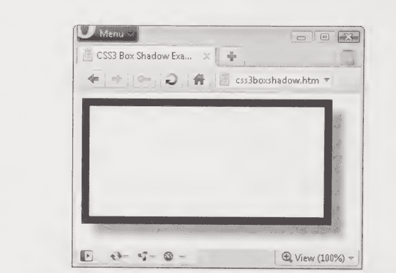

##### 元素溢出

在 CSS2 中，可以通过将 `overflow` 属性设置为 `hidden`、`visible`、`scroll` 或 `auto` 来允许或阻止从元素溢出。但在 CSS3 中，你现在可以将这些值分别应用于水平或垂直方向，如图 4-7 所示，其中显示了内容在两个方向上溢出的 16 种可能组合。

图 4-7 可能看起来有些违反直觉，因为有时 `overflow-x` 或 `overflow-y` 属性被设置为 `visible`，但元素的内容实际上并没有显示在其外部。根据 W3C 规范，原因在于某些包含 `visible` 参数的组合是不可能的；例如，如果一个属性指定为 `visible` 而另一个是 `scroll` 或 `auto`，则 `visible` 值应更改为 `auto`。

不过，这些属性的实现方式存在一些差异，因为除了此规则外，在 Internet Explorer 6 到 9 版本中，任何与 `hidden` 组合的 `visible` 属性也会更改为 `hidden`。

以下是使用这些属性的一些示例：

```
overflow-x:hidden;
overflow-x:visible;
overflow-y:auto;
overflow-y:scroll;
```

> **注意**

图 4-7 所用的代码可从配套网站 `html5formobile.com` 上的 `css3overflow.htm` 文件获取。

#### 颜色

CSS3 极大地扩展了定义颜色的方式，现在你还可以使用 CSS 函数来应用 RGB（红、绿、蓝）、RGBA（RGB 加透明度）、HSL（色相、饱和度、亮度）和 HSLA（HSL 加透明度）颜色——alpha 值允许你指定颜色的透明度。

##### HSL 颜色

要使用 `hsl()` 函数定义颜色，你首先需要从色轮上选择一个介于 0 到 359 之间的色相值。任何更高的色相值都会循环回到开头，因此值 0 是红色，值 360 和 720 也是红色。在色轮上，红、绿、蓝三原色相隔 120 度，因此绿色的值是 120，蓝色的值是 240，这些值之间的数字代表由两侧不同比例原色混合而成的各种色调。

接下来你需要设置饱和度，这是一个介于 0% 到 100% 之间的值。它指定了颜色看起来是暗淡还是鲜艳。图 4-8 展示了一个显示色相和饱和度的色轮。由于本书中的图以灰度显示，你看不到太多细节，但如果你仔细观察，应该会注意到一个较浅的 Y 形。这是因为红色在顶部，绿色在 4 点钟位置，蓝色在 8 点钟位置，而 Y 形的臂和腿（从 10 点钟方向开始）分别是品红、黄色和青色。

饱和度值从色轮中心的中等灰色（饱和度为 0%）开始，随着向外缘移动（饱和度为 100%）变得越来越鲜艳。剩下的就是通过选择 0% 到 100% 之间的亮度值来决定颜色的明亮程度。

亮度值为 50% 时，颜色最饱满、最明亮。降低该值（最低至 0%）会使颜色变暗，直至显示为黑色。提高该值（最高至 100%）会使颜色变亮，直至显示为白色。你可以将其形象地理解为在颜色中混入黑色或白色的程度。

因此，例如，要选择一个饱和度为 100%、亮度为 50% 的标准黄色，你可以使用如下规则：

```
color:hsl(60, 100%, 50%);
```

或者，对于一个更深的蓝色，你可能会使用如下规则：

```
color:hsl(240, 100%, 40%);
```

你也可以将此函数（以及所有其他 CSS 颜色函数）与任何接受颜色的属性一起使用，例如 `background-color` 等。

##### HSLA 颜色

为了进一步控制颜色的显示效果，你可以使用 `hsla()` 函数，为其提供第四个（或 alpha）值，这是一个介于 0 到 1 之间的浮点数。值 0 表示颜色完全透明，而 1 表示完全不透明。

以下是选择一个饱和度 100%、亮度 50% 且透明度 30% 的黄色的方法：

```
color:hsla(60, 100%, 50%, 0.3);
```

或者，对于一个饱和度 100%、亮度 60% 但透明度 82% 的蓝色，你可以使用此规则：

```
color:hsla(240, 100%, 60%, 0.82);
```

##### RGB 颜色

你可能更熟悉使用 RGB 系统来选择颜色，因为它类似于使用 `#nnnnnn` 和 `#nnn` 颜色格式。例如，要将黄色应用于某个属性，你可以使用以下任一规则（第一个支持 1600 万色，第二个支持 4000 色）：

```
color:#ffff00;
color:#ff0;
```

你也可以使用 CSS 的 `rgb()` 函数来实现相同的效果，但你需要使用十进制数字而不是十六进制（其中十进制 255 等于十六进制 ff）：

```
color:rgb(255, 255, 0);
```

但更棒的是，你甚至不需要再考虑高达 256 的数值了，因为你可以指定百分比值，像这样：

```
color:rgb(100%, 100%, 0);
```

事实上，现在你可以通过简单地思考其原色来获得非常接近目标的颜色。例如，绿色和蓝色混合成青色，因此要创建一个接近青色但比绿色含有更多蓝色的颜色，你可以首先尝试 0% 红色、60% 绿色和 40% 蓝色，试试这个规则：

```
color:rgb(0%, 60%, 40%);
```

##### RGBA 颜色

与 `hsla()` 函数一样，`rgba()` 函数也支持第四个 alpha 参数，因此你可以通过如下规则应用之前那个类似青色的颜色，并设置 40% 的透明度：

```
color:rgba(0%, 60%, 40%, 0.4);
```

##### `opacity` 属性

`opacity` 属性提供了与 `hsla()` 和 `rgba()` 函数相同的 alpha 控制，但它允许你独立于颜色来修改对象的透明度（或不透明度）。

要使用它，你需要对一个元素应用如下规则（在此示例中，将不透明度设置为 25%——即 75% 透明）：

```
opacity:0.25;
```

此属性在所有主流浏览器的最新版本中都能工作，包括 iOS 和 Android，但如果你需要兼容旧版浏览器，还需要为 Safari 和 Chrome 添加以下规则：

```
-webkit-opacity:0.25;
```

为 Firefox 添加以下规则：

```
-moz-opacity:0.25;
```

以及为 Internet Explorer 9 之前的版本添加以下规则（其中不透明度值乘以了 100）：

```
filter:alpha(opacity='25');
```

#### 多列布局

多年来，Web 开发人员最常请求的功能之一就是多列，而这个请求终于在 CSS3 中实现了——至少对于大多数浏览器是如此，包括 iOS、Android、Safari、Chrome 和 Firefox（遗憾的是，Opera 和 Internet Explorer 尚未跟上）。

在支持多列的浏览器中，将文本分列显示就像指定列数一样简单，然后（可选地）选择列间距和分隔线类型（如果有的话），如图 4-9 所示。

用于创建该图的 CSS 如下：

```
text-align       :justify;
font-size        :16pt;
-webkit-column-count:3;
-webkit-column-gap  :1em;
-webkit-column-rule :1px solid black;
```

图 4-9 在 iPhone 上显示莎士比亚戏剧文本的三列布局

前两行只是告诉浏览器将文本两端对齐，并设置为 16 点字体大小。这些规则对于多列并非必需，但它们能改善文本显示效果。其余行设置元素，使其文本在三列中流动，列间有 1 em 的间距，并且每个间距中间有一条 1 像素的边框。

对于 iOS 和 Android（以及 Safari 和 Chrome），这就是你需要做的全部。但如果你还想支持 Firefox，你需要添加以下行：

```
-moz-column-count:3;
-moz-column-gap  :1em;
-moz-column-rule :1px solid black;
```

遗憾的是，目前你无法在 Internet Explorer 或 Opera 中实现此效果，只能将内容分割到单独的 `<table>` 或 `<div>` 元素中。

> **注意**

是我一个人这样想，还是你也讨厌那些使用 "Lorem Ipsum" 拉丁文占位符的网页原型？对我来说，没有什么比复制粘贴一段莎士比亚或狄更斯的文本更好的了。

#### 文本效果

现在可以使用 CSS3 将许多新效果应用于文本，包括文本阴影、文本叠加和自动换行。

##### `text-shadow` 属性

此属性类似于 `box-shadow` 属性，接受相同的参数集：水平和垂直偏移量、模糊量以及要使用的颜色。例如，以下规则将阴影水平和垂直各偏移 3 像素，阴影颜色为深灰色，模糊量为 4 像素：

```
text-shadow:3px 3px 4px #444;
```

此规则的效果如图 4-10 所示的文本。此属性在 iOS、Android 和所有主流浏览器（Internet Explorer 除外）上有效。如果你也想支持该浏览器，需要添加以下规则：

```
filter:progid:DXImageTransform.Microsoft.Shadow(
    color='#888888', Direction=135, Strength=4);
```

虽然此规则产生的不是标准的文本阴影（如其他浏览器所实现的那样），但它提供了合理的近似效果，如图 4-11 所示。

##### 第四章：CSS3 增强功能


**图 4-10** CSS3 `text-shadow` 属性应用于句子

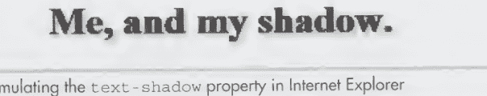

**图 4-11** 在 Internet Explorer 中模拟 `text-shadow` 属性

###### `text-overflow` 属性

当使用任何 CSS overflow 属性并设置值为 `hidden` 时，你还可以使用 `text-overflow` 属性在截断位置之前放置一个省略号（三个点），以表示一些文本已被截断，如下所示：

```
text-overflow:ellipsis;
```

如果不使用此属性，截断的文本看起来就像图 4-12 所示的那样，但使用后结果如图 4-13 所示。遗憾的是，Firefox 和 Opera 都不支持此属性，但 iOS、Android 以及所有其他主要浏览器的最新版本都支持。

###### `word-wrap` 属性

作为使用 `text-overflow` 属性并截断文本的替代方案，当你有一个非常长的单词，其宽度超过包含它的元素时，你可以使用 `word-wrap` 属性并设置值为 `break-word` 来强制该长单词总是换行，如下所示：

```
word-wrap:break-word;
```

例如，在图 4-14 中，单词 Antidisestablishmentarianism 对于包含框来说太宽了，并且因为没有应用任何 overflow 属性，它已溢出其边界。但在图 4-15 中，元素的 `word-wrap` 属性被赋予了 `break-word` 值，因此该单词已整齐地换行到下一行。所有主要浏览器的最新版本都支持此属性。


图 4-12 短语 “Cut off in his prime.” 被截断。

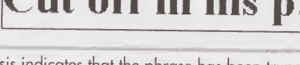

图 4-13 省略号表示该短语已被截断。

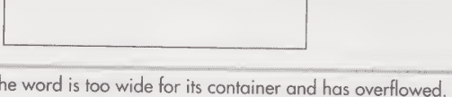

图 4-14 单词对于其容器来说太宽，已溢出。

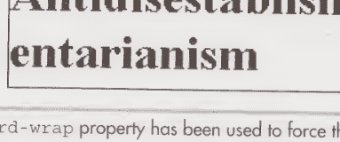

图 4-15 *word-wrap* 属性已用于强制长单词换行。

###### `box-sizing` 属性

W3C 盒子模型（除 Internet Explorer 5.5 之外的所有浏览器的默认模型）规定，对象的宽度和高度应仅指元素内容的尺寸，忽略任何内边距或边框。但一些网页设计师表达了希望指定包含任何内边距和边框在内的整个元素尺寸的意愿。

为了提供此功能，CSS3 允许你使用 `box-sizing` 属性选择你希望使用的盒子模型。例如，要使用包含内边距和边框在内的对象总宽度和高度，你会使用此规则：

```
box-sizing:border-box;
```

或者，要让对象的宽度和高度仅指其内容，你会使用此规则（默认值）：

```
box-sizing:content-box;
```

让我们通过查看一个尺寸已知的对象（例如图 4-16 中的 200×70 像素矩形）来看看这在实践中意味着什么。

现在将其与图 4-17 中显示的对象进行比较，该对象既有 10 像素的内边距，也有 10 像素的边框，并且也被赋予了相同的 200×70 尺寸。在这种情况下，由于 `box-sizing` 属性的值为 `border-box`，对象中的所有内容都必须适应指定的宽度和高度。

这意味着边框和内边距都应用于给定的宽度和高度内部，导致内容区域缩小为仅 162×32 像素——这正是某些网页开发者不喜欢的效果。

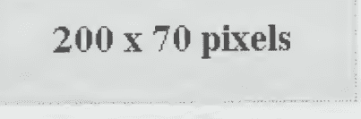

图 4-16 宽度为 200 像素、高度为 70 像素的矩形


图 4-17 使用 `border-box` 值显示的 200×70 像素对象


图 4-18 对象现在使用 `content-box` 值显示。

另一方面，图 4-18 中显示的对象使用 `box-sizing` 属性的 `content-box` 值，因此内边距和边框应用于固定内容区域的*外部*，该区域保持最初指定的 200×70 像素。可以想象，关于 `box-sizing` 的哪种设置更好有很多讨论。但有了这个属性，无论你站在哪一边，你现在都可以按照对你来说最直观的方式构建你的网页。

###### 浏览器兼容性

该属性的标准名称 `box-sizing` 目前除了 Opera 和 Android 之外，尚未被任何浏览器使用。因此，为了使此功能在 iOS 设备（以及 Safari 和 Chrome）上工作，你还需要使用以下版本的属性名称和参数：

```
-webkit-box-sizing:border-box;
-webkit-box-sizing:content-box;
```

如果你还想支持 Firefox 和 Internet Explorer，那么你还必须添加以下一个或多个版本的属性名称：

```
-moz-box-sizing:border-box;
-moz-box-sizing:content-box;
-ms-box-sizing:border-box;
-ms-box-sizing:content-box;
```

###### `resize` 属性

如果你希望给用户更多控制他们向表单输入信息的方式，你可以使用 `resize` 属性允许他们将对象调整到更舒适的尺寸。要应用此功能，请使用以下规则之一：

```
resize:horizontal;
resize:vertical;
resize:both;
```

第一条规则允许用户仅水平调整对象大小，第二条规则仅允许垂直调整，第三条允许两者。调整大小时，你无法使对象比其原始尺寸更小，但可以使其变大。因此，为了限制此功能的范围，你可以使用 `max-height` 和 `max-width` 属性，如下所示：

```
max-height:500px;
max-width:300px;
```

目前，可能是由于触摸设备上的网页可以通过捏合手势调整大小，此功能在 iOS 和 Android 上都未启用，但它在 Firefox、Chrome 和 Safari 的最新版本上确实有效。在这些浏览器上，一个小型的调整大小手柄会放置在任何可调整大小对象的右下角，你可以抓取并拖动它，如图 4-19 所示。

###### `outline-offset` 属性

如果你不喜欢对象获得焦点时轮廓框的应用方式，你可以使用 `outline-offset` 属性来放大它，如下所示，这（例如）会将轮廓的四个边从对象向外移动 15 像素：

```
outline-offset:15px;
```

这在所有浏览器的最新版本中都有效，除了 Internet Explorer。

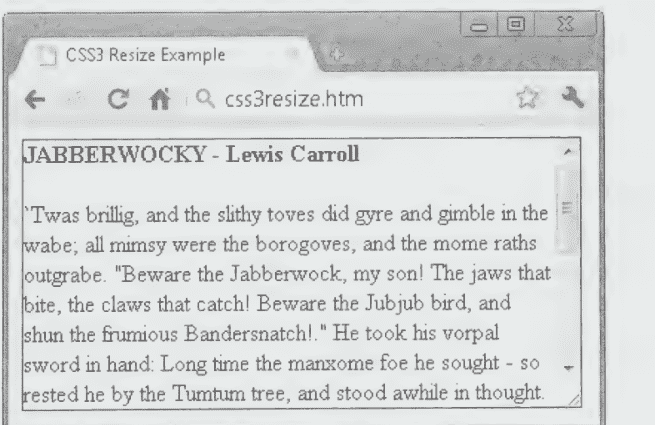

图 4-19 此对象可以使用右下角的拖动柄进行调整大小。

#### Web 字体

CSS3 Web 字体的使用极大地扩展了网页设计师可用的排版，允许字体从整个网络加载和显示，而不仅仅是来自用户的计算机。为此，你使用 @font-face 规则声明一个 Web 字体，如下所示：

```
@font-face {
    font-family:FontName;
    src:url('FontName.otf');
}
```

`url()` 函数需要一个包含字体路径或 URL 的值。在大多数浏览器上，你可以使用 TrueType (.ttf) 或 OpenType (.otf) 字体，但 Internet Explorer 将你限制为仅已转换为 EOT (.eot) 的 TrueType 字体。要告诉浏览器字体类型，你可以使用 `format()` 函数。对于 OpenType 字体，你这样使用它：

```
@font-face {
    font-family:FontName;
    src:url('FontName.otf')
    format('opentype');
}
```

对于 TrueType 字体，你这样使用它：

```
@font-face {
    font-family:FontName;
    src:url('FontName.ttf')
    format('truetype');
}
```

然而，由于 IE 仅接受 EOT 字体，它会忽略包含 `format()` 函数的 @font-face 规则。

##### Google Web 字体

只要你创建的是支持互联网（而非独立）的应用程序或网页，使用 Web 字体的最佳方法之一是从 Google 的服务器免费加载它们。要了解更多信息，你应该查看 code.google.com/webfonts，但为了向你展示这有多容易，以下是如何使用 `<link>` 标签加载一个字体：

```
<link href='http://fonts.googleapis.com/css?family=Lobster&subset=latin'
rel='stylesheet' type='text/css'>
```

然后要使用这样的字体，只需在 CSS 规则中应用它，如下所示：

```
h1 { font-family:'Lobster', arial, serif; }
```

图 4-20 仅展示了 Google 提供的超过 50 种字体和字体变体中的一部分。

#### 其他CSS3新增功能

还有许多其他的CSS3新增功能，由于种种原因我尚未提及，通常是因为它们仍处于草案阶段、应用尚属实验性质，或者其特性仍可能发生变化。

其中一些例子包括用于语音输出的样式表、内容的自动生成，以及一系列最终将提供指定页面元素导航（或制表键）顺序方法的 `nav-` 属性。

当这些以及更新的功能被广泛支持时，我会将它们纳入本书的未来版本中。不过与此同时，你可以通过访问配套网站 html5formobile.com 来了解最新浏览器的实现情况。

#### 总结

至此，你已经掌握了理解最新版本HTML和CSS功能所需的所有信息。但你还不完全清楚如何利用它们来创建iOS和Android网站和应用程序，因为这还涉及到如何操作网页及其属性以实现动态用户交互的问题。为了解决这个问题，接下来的四章将向你介绍如何进行服务器端和客户端编程——以及数据库管理——首先是对JavaScript的全面介绍。

### 第5章

#### JavaScript简介

#### 关键技能与概念

- 将JavaScript代码嵌入网页

- JavaScript语言语法

- 数值变量、字符串和数组

- 运算符和内置JavaScript函数

- 使用函数和传递参数

- 全局变量与局部变量作用域的区别

- 使用条件表达式控制程序流程

- 创建不同类型的循环结构

- 基本错误处理

JavaScript是内置于所有现代浏览器中的免费语言，包括Apple iOS、Google Android、Microsoft Internet Explorer、Mozilla Firefox、Apple Safari、Opera和Google Chrome。它是驱动用于Web 2.0网站（如Facebook、Flickr、Gmail等）动态HTML的动力。

与用于创建网站的其他语言（如Perl、PHP和Ruby）不同，它们在Web服务器上运行，而JavaScript在Web浏览器内运行。这使其成为创建动态网页的理想工具，因为它可以实时修改HTML元素。

JavaScript也是Ajax功能背后的技术，数据在Web服务器和Web浏览器之间在后台传输，用户对此毫无察觉。

> **专家问答**

> **问：** JavaScript为什么叫这个名字？

> **答：** JavaScript与Java是完全不同的语言，但作为1995年Netscape和Sun Microsystems之间达成的营销协议的一部分，JavaScript被赋予这个名字，试图从围绕Java语言的普遍热议中获益。为了解释这个命名，在JavaScript中，所有Java关键字都是保留字，其标准库遵循Java的命名约定，其 `Math` 和 `Date` 对象基于Java 1.0的类。此外，商标名 *JavaScript* 属于Sun（因此现在属于Oracle）——但相似之处仅止于此。

#### 在网页中嵌入JavaScript

有两种方法可以将JavaScript代码包含在网页中：直接写在 `<script>` 和 `</script>` 标签内，或者通过在 `<script>` 标签的 `src` 参数中指定要加载的文件名。

例如，下面是一个小的JavaScript代码段，它将通过调用内置的 `alert()` 函数弹出一个窗口显示“Hello”：

```
<script>
    alert("Hello")
</script>
```

总的来说，人们倾向于将此类JavaScript代码段放在网页的开头附近，以便它能尽早运行，但你可以在页面中的任何位置放置JavaScript代码，其任何输出将出现在页面的相应部分。

第二种在页面中嵌入JavaScript的方法如下所示，其中文件 `code.js` 被获取并作为直接嵌入页面中的代码来执行：

```
<script src='code.js'></script>
```

在这种情况下，包含的文件*不能*包含任何 `<script>` 或 `</script>` 标签，因为这些标签已由调用的 `<script>` 和结束的 `</script>` 标签提供了。

##### 使用注释

当你希望在代码中包含注释，或者在调试时防止一行或多行代码被执行时，可以使用 `/*` 和 `*/` 注释标签，如下所示：

```
<script>
    /* 下面这行会显示一个警告框 */
    alert("Hello")
</script>
```

你可以在这些注释中包含任意数量的字符甚至代码行。不过，有时你只是想快速添加注释，而不必在其前后都放置注释标签，这时可以使用 `//`，这是另一种注释标签，如下所示：

```
<script>
    // 下面这行会显示一个警告框
    alert("Hello")
</script>
```

这种类型的注释在到达行尾时自动关闭。

#### 使用分号

在一些语言中，如PHP和CSS，你必须在每条语句后放置分号，即使一行中只有一条语句。在JavaScript中，对于单条语句的行，你可以选择省略分号，但*必须*在同一行的多条语句之间放置分号。

在JavaScript中仅在需要时使用分号是我在本书中采用的风格，但你会发现许多程序员无论如何都会在JavaScript中到处使用分号。

#### JavaScript变量

如果你以前从未接触过变量，你可以把变量想象成值的容器，就像香料架上的小玻璃罐装着不同的香料一样，只不过变量包含的是数字和字母等数字值。

因此，在以下示例中，假设你有几个由透明玻璃制成的小香料罐，你已经去掉了原来的标签。再想象你有一支笔、一些纸和一些不干胶标签。

##### 变量和对象命名

在JavaScript中，变量和对象名称区分大小写，可以包含从a到z和A到Z的任何字母、数字0到9，以及 `_` 和 `$` 字符。

变量和对象名称不能以数字开头，长度没有预定义限制，但较短的名称可使代码更具可读性（只要它们不是难以理解的缩写）。

#### 注意

`$` 符号经常被JavaScript框架（用于帮助处理跨浏览器兼容性和通用编程的辅助代码文件）中的特殊功能使用，例如jQuery、Script.aculo.us、Prototype等。因此，我建议你在使用框架时，避免在自己的代码中使用 `$` 符号。

##### 数值变量

创建一个数值变量就像拿起一个空的香料罐，在里面放一张写着数字的小纸条。然后拧上盖子，并在罐子上贴一张不干胶标签（上面写着变量的名称）。

##### 给变量赋值

在JavaScript中，等价的操作是将值49赋给变量 `age`，如下所示：

```
<script>
    age = 49
</script>
```

你可以读取 `age` 的值并将其传递给另一个变量，这等同于从第一个罐子中读取值，然后将一个新罐子标记为 `copyofage` 并将复制的值放入其中，如下所示：

```
<script>
    age = 49
    copyofage = age
</script>
```

所以现在变量 `age` 和 `copyofage` 的值都是49。

你也可以将变量的值直接传递给一个函数（一个小型、现成的JavaScript程序）以进行显示或其他用途。例如，下面的代码将 `age` 变量的值传递给 `alert()` 函数，该函数会弹出一个窗口显示其值，如图5-1所示：

```
<script>
    alert(age)
</script>
```

下面的例子将所有这些内容组合成一个完整的网页，该网页首先将值49赋给变量 `age`，然后在一个警告框中显示它（这也是用于创建图5-1的代码）：

```
<!DOCTYPE html>
<html>
    <head>
        <title>示例</title>
    </head>
```

图5-1 在Safari网页浏览器中显示警告框中的值

###### 添加数值

将数字相加、将数字加到数值变量值上，甚至将数值变量值与其他数值变量值相加，都非常简单。

例如，在以下三条语句中，首先将变量 `tempval` 赋值为 40（23 与 17 之和）。然后将 `otherval` 赋值为 `tempval` 中的值（40）加上额外的 19——总计 59。最后，将 `result` 赋值为 `tempval` 中的值（40）加上 `otherval` 中的值（59）——总计 99。

```
tempval  = 23 + 17        // tempval is assigned the value 40
otherval = tempval + 19    // otherval is assigned the value 59
result   = tempval + otherval // result is assigned the value 99
```

执行这三条语句后，`tempval` 的值为 40，`otherval` 的值为 59，`result` 的值为 99。

###### 使用浮点数

你也可以像处理整数一样，对浮点数（带有小数部分的数字）进行赋值和操作，如下所示，这两条语句共同将变量 `weight` 赋值为 88.26：

```
weight = 23.56
weight = weight + 64.7
```

请注意第二条语句中，变量 `weight` 出现在 `=` 符号的两侧，这样它的值被读取，加上 64.7，然后将加法结果赋值回 `weight`。

##### 字符串变量

字符串变量与数值变量略有不同，因为你赋值给变量的是一组字符，而不是一个数字（或者，用类比来说，你是在放进香料罐的那张纸上写下一个单词、短语或段落）。

例如，以下语句将一个句子赋值给名为 *hobbies* 的变量：

```
hobbies = 'Swimming, running, movies, books and TV'
```

###### 字符串连接

组合字符串称为 *连接* 而不是 *加法*，但使用的是相同的 `+` 运算符。例如，以下代码显示一个包含字符串 "I am Spartacus!" 的警告框：

```
string1 = 'I am '
string2 = 'Spartacus!'
name = string1 + string2
alert(name)
```

在我们关于香料罐的类比中，这个例子中共使用了三个罐子。第一个罐子标记为 `string1`，包含一张写有 "I am" 的纸条，第二个罐子标记为 `string2`，包含一张写有 "Spartacus!" 的纸条。然后，这两个罐子中的值被读取并连接成一个新句子，写在一张新纸上，并放入第三个标记为 `name` 的罐子中。

###### 转义字符

为了表明一个值是字符串（而不是数字或运算符），它必须用单引号或双引号括起来。例如，以下两条语句是等效的：

```
somewhere = 'Over the rainbow'
somewhere = "Over the rainbow"
```

然而，当你希望在字符串中实际包含其中一种引号时，这可能会引起问题。一种解决方法是，用与字符串内部使用的引号类型相反的引号来括起字符串，如下所示：

```
heyhey = "We're the Monkees!"
```

如果外部的双引号是单引号，那么 JavaScript 会认为只有 'We' 是字符串，而语句的其余部分是难以理解的语法错误。

或者，以下是一条合法的语句，在单引号内嵌入了双引号：

```
line = 'She said, "What big eyes you have!"'
```

但当你需要在一个字符串中同时包含单引号 *和* 双引号时，会发生什么情况，就像这条（非法的）语句一样？

```
line = 'Rhett Butler: "Frankly my dear, I don\'t give a damn."'
```

答案是你必须通过在引号前加上 `\` 来转义一个或多个引号，就像这个修正后的版本：

```
line = 'Rhett Butler: "Frankly my dear, I don\'t give a damn."'
```

在这个例子中，双引号前不需要转义字符，因为外层的引号是单引号。但是，你可以转义任何内部的引号（如果你愿意的话），有些人喜欢总是这样做，如下所示：

```
line = 'Rhett Butler: "Frankly my dear, I don\'t give a damn."'
```

当你在字符串中转义字符时，起初看起来可能很混乱，但 JavaScript 会处理它并正确显示这些字符串，如图 5-2 所示，其中赋值给变量 *line* 的值显示在一个警告框中。

#### 数组

在 JavaScript（以及许多其他语言）中，有另一种类型的变量叫做 *数组*。实际上，它更像是一种构造而非变量，因为数组就像是用胶带粘在一起的一组香料罐。

例如，假设你想记录一支五人足球队中球员的进球数，并且你知道安德鲁进了 3 个球，布莱恩进了 2 个球，克莱夫进了 4 个球，大卫还没进球，爱德华进了 1 个球。你可以用以下语句表示这一点：

```
andrew = 3
brian = 2
clive = 4
david = 0
edward = 1
```

这些语句相当于将五个香料罐粘在一起，形成一个包含多个数据元素的单一单元——换句话说，一个罐子数组。但这不是最优的编码方式，因为使用了五种存储类型（变量），而只需要一种。

> **注意**

> 这些名称不使用大写字母，因为它们是变量，并且我在 JavaScript 程序中使用的约定是以小写字母开头。但是，你可以在变量名中使用任何大小写字母的组合。

##### 将数值赋值给数组

以下是一种将多个变量组合成一个 JavaScript 数组（在这种情况下称为 `goals`）的方法：

```
goals     = Array()
goals[0]  = 3
goals[1]  = 2
goals[2]  = 4
goals[3]  = 0
goals[4]  = 1
```

数组使用 `Array()` 函数创建，然后用每个球员的进球数填充五个元素（元素 0 到 4）。你也可以使用这条语句创建数组，它等同于使用 `Array()` 函数：

```
goals = []
```

然而，上面例子中为数组赋值的方式过于复杂，因为 JavaScript 允许你同时创建数组并为其元素赋值，如下所示：

```
goals = [3, 2, 4, 0, 1]
```

一旦数组中有数据，只要你知道哪个球员对应哪个粘在一起的罐子，你现在就可以通过在方括号中放置表示数组索引的值来轻松查找球员的分数，如下所示：

```
score = goals[2]
```

因为数组元素总是从 0（而不是 1）开始，这条语句表示：“将数组 `goals` 的*第三个*元素中的值赋给 `score`。” 在这种情况下，值是 4——克莱夫的进球数——所以 `score` 现在的值是 4。

##### 将字符串值赋值给数组

就像物理上粘在一起的香料罐一样，数组可以包含你能放进去的任何东西，包括字符串。这意味着以下是在记录足球队球员时的有效方式：

```
players = ['Andrew', 'Brian', 'Clive', 'David', 'Edward']
```

从数组元素中获取字符串值也非常容易。例如，以下语句返回名字 Clive：

```
name = players[2]
```

因此，我们现在有一种简单的方法将球员与其进球数联系起来，如下面的五条语句组（为了清晰起见，我拉开了球员和进球分配的间距）：

```
players = ['Andrew', 'Brian', 'Clive', 'David', 'Edward']
goals   = [3,         2,        4,       0,         1        ]

name    = players[2]
score   = goals[2]
alert(name + ' has scored ' + score + ' goals.')
```

让我们更仔细地看看这里发生了什么。在第三条和第四条语句中，数组的索引是值 2，它实际上引用每个数组的第三个元素（因为第一个元素在位置 0）。因此，由于 `players[2]` 引用克莱夫，那么 `goals[2]` 就引用克莱夫的进球数。

这些值被放入变量 `name` 和 `score` 中，然后在对 `alert()` 函数的调用中使用，以显示一个有意义的句子，如图 5-3 所示。

> **注意**

> 正如上面列表中的第五条语句所示，提供给 `alert()` 函数的参数由字符串和变量的组合构成，它们使用 + 符号连接成一个单一的字符串，然后显示出来。

##### 关联数组

使用 JavaScript，你可以通过使用关联数组进一步改进前面的例子，其中数组中的元素通过名称而不是索引偏移量来引用。此外，只需要一个单一的数组（而前面的例子需要两个）。例如，以下语句将名称和值的配对赋值给 `goals` 数组：

```
goals = {'Andrew':3, 'Brian':2, 'Clive':4, 'David':0, 'Edward':1}
```

**关联数组**

> **注意**

创建关联数组时，赋值需要使用花括号（而非方括号）。

现在，你可以更方便地引用球员的进球数，例如下面的语句，它将值 2 赋给变量 `score`：

```
score = goals['Brian']
```

当某个球员再进一球时，你也可以更新元素，像这样（将该元素的值增加 1）：

```
goals['David'] = goals['David'] + 1
```

或者，与任何变量赋值一样，你可以提供一个绝对值或任何数值计算的结果。

**关联数组与字符串值**


## 关联数组

关联数组既可以包含字符串，也可以包含数值。因此，例如，以下语句存储了五个女孩最喜欢的颜色：

```
favcolors = { 'Anne':'pink', 'Bea':'red', 'Cara':'orange',
    'Debbie':'green', 'Elaine':'purple' }
```

使用这种结构，你可以很容易地用以下语句确定 Bea 喜欢的颜色：

```
color = favcolors['Bea']
```

这条语句的结果是将字符串`'red'`赋给变量`color`。

> **注意**

JavaScript 中的关联数组实际上不是数组；它们是对象。但是，你可以使用与数组相同的语法向对象写入值或从中读取值。因此，目前你不需要关心数组和对象之间的区别。

### 多维数组

JavaScript 数组非常有趣，因为它们的元素可以包含其他数组，以及数字和字符串。这意味着可以创建多维数组。例如，在下面的代码中，为了清晰起见，我选择使用`Array()`函数来创建一个二维数组：

```
tictactoe = Array(
    Array('.', '.', '.'),
    Array('.', '.', '.'),
    Array('.', '.', '.')
)
```

这里，创建了数组`tictactoe`，然后为其前三个元素赋值，每个元素又是一个包含三个元素的进一步数组。所有这些的最终结果是一个包含三行三列矩阵的二维数组，每个元素都填充了字符串`'.'`。

如果你愿意，你可以通过避免使用`Array()`函数来缩短和简化多维数组的创建，改用方括号，如下所示：

```
tictactoe =
[
    ['.', '.', '.'],
    ['.', '.', '.'],
    ['.', '.', '.']
]
```

或者你也可以更紧凑地编写它，像这样：

```
tictactoe = [['.', '.', '.'], ['.', '.', '.'], ['.', '.', '.']]
```

> **提示**

我认为数组创建的简写形式（不使用`Array()`函数）对初学者更好，因为它使用了在创建数组后也会用于访问数组的方括号。

使用这种数据结构，现在可以存储井字棋游戏的走步，例如，假设这是前三步：

```
tictactoe[1][1] = 'X'
tictactoe[0][0] = 'O'
tictactoe[1][0] = 'X'
```

要引用多维数组，你需要在第一对方括号后使用额外的方括号对。因此，在前面的语句中，玩家 1 将 X 放在数组正中央（`tictactoe[1][1]`），然后玩家 2 将 O 放在左上角（`tictactoe[0][0]`），之后玩家 1 在玩家 2 的 O 正下方放置另一个 X（`tictactoe[1][0]`），此时游戏棋盘如下所示：

```
O . .
X X .
. . .
```

因为所有数组元素都支持包含其他数组，所以你可以创建的子维度数量仅受计算机可用内存的限制。因此，例如，你可能会像这样引用三维数组中的一个元素（尽管本书不涵盖如此复杂的数组）：

```
item = bigarray[7][5][12]
```

### 多维关联数组

你也可以使用如下代码创建多维关联数组（记住关联数组需要花括号，而不是方括号）：

```
tictactoe =
{
    'row1': {'col1':'.', 'col2':'.', 'col3':'.'},
    'row2': {'col1':'.', 'col2':'.', 'col3':'.'},
    'row3': {'col1':'.', 'col2':'.', 'col3':'.'}
}
```

然后，要向元素赋值，你需要在代码中使用元素名称（而不是索引号），像这样：

```
tictactoe['row2']['col2'] = 'X'
tictactoe['row1']['col1'] = 'O'
tictactoe['row2']['col1'] = 'X'
```

在第 6 章中，你将看到关联数组实际上是对象这一事实意味着它们也可以作为对象来访问，如下面的语句所示，它们与前面三条语句等价，因为`.`符号是 JavaScript 用来分隔对象和子对象（或属性）的分隔符：

```
tictactoe.row2.col2 = 'X'
tictactoe.row1.col1 = 'O'
tictactoe.row2.col1 = 'X'
```

### 专家问答

> **问：哪种浏览器最适合 JavaScript 开发？**

**答：** 我更喜欢 Mozilla Firefox，因为我用它浏览网页，并且它是 Internet Explorer 之后最受欢迎的浏览器（尽管 IE 是最不符合标准的浏览器，尽管它来自微软）。在 Firefox 中，随时按下 SHIFT-CTRL-J 会打开错误控制台，其中所有错误、警告和消息都有自己的选项卡。它还支持强大的调试工具 Firebug（可从 *getfirebug.com* 获取）。

如果你最喜欢的浏览器是 Google Chrome，你会感兴趣地知道（如果你还不知道的话）它也支持使用 SHIFT-CTRL-J 调出一个更强大的错误控制台，但我通常从 Firefox 的错误控制台中就能找到我需要的所有信息。在 Opera 中，你可以通过 工具 | 高级 | 错误控制台 调用错误控制台。在 Safari 中（只要在偏好设置 | 高级中选中了“在菜单栏中显示开发菜单”），你可以使用 PC 上的 CTRL-ALT-C 或 Mac 上的 ALT-CMD-C 来调出错误控制台。最后，在 Internet Explorer 中，每当发生错误时，你可以单击出现在浏览器窗口左下角的黄色三角形，以便查看有关错误的信息。

非 Firefox 浏览器也可以运行轻量版的 Firebug 来帮助调试。它可以在所有主要浏览器中运行，可以从 *getfirebug.com/firebuglite* 获取。

## JavaScript 运算符

既然你已经了解了数字、字符串、变量和数组，现在是时候看看如何使用各种运算符来操作它们了，例如你已经见过的`+`符号，它既用于数字相加，也用于字符串连接。

### 算术运算符

JavaScript 支持多种算术运算符，如表 5-1 所示，该表还展示了每个运算符的使用示例以及执行每个示例计算的结果。

此表中的前四个运算符不言自明；它们是标准的加法、减法、乘法和除法运算符（尽管在计算机上，`*`符号用于乘法，`/`符号用于除法，而不是你可能在学校里用过的 × 和 ÷ 运算符）。

如果你不熟悉`%`运算符，它被称为取模运算符，用于确定除法运算后剩余多少。例如，如果你有七个苹果要分给三个孩子，而不能切开苹果，你可以执行以下计算：

```
remainder = 7 % 3
each      = (7 - remainder) / 3
```

第一条语句的结果是值 1，它被放入变量`remainder`中。然后从初始的 7 个苹果中减去这个值（剩下 6 个），这个值然后除以 3 个孩子，结果值为 2，它被赋给变量`each`。因此，每个孩子得到两个苹果，还剩下一个。

表中最后两个运算符让你能够快速增加或减少变量的值，如以下示例所示，其中变量`potatoes`被赋值为 99，然后增加，使变量的值为 100：

```
potatoes = 99
++potatoes
```

| 运算符 | 描述 | 示例 | 结果 |
| :--- | :--- | :--- | :--- |
| `+` | 加法 | `1 + 2` | 3 |
| `-` | 减法 | `7 - 3` | 4 |
| `*` | 乘法 | `6 * 9` | 54 |
| `/` | 除法 | `21 / 7` | 3 |
| `%` | 取余（模） | `44 / 10` | 4 |
| `++` | 递增 | `++f` | `f + 1` |
| `--` | 递减 | `--g` | `g - 1` |

表 5-1 JavaScript 的七种算术运算符

如果此时你执行`alert(potatoes)`语句，你会看到显示的值为 100。然后，你可以将土豆的数量递减回 99，就像这样（之后再次调用`alert(potatoes)`会确认值已变回 99）：

```
--potatoes
```

你也可以将`++`或`--`运算符放在变量之后，这样变量的值只有在被访问后才会递增或递减。例如，以下两行代码会显示一个值为 100 的警告框：

```
potatoes = 99
alert(++potatoes)
```

然而，以下几行只显示值 99，因为递增发生在查找当前值之后：

```
potatoes = 99
alert(potatoes++)
```

你可以通过再次执行`alert(potatoes)`语句来验证递增确实发生了，此时将显示变量的当前值 100。

### 算术函数

确定除法商（或非小数部分）的另一种方法是使用 JavaScript 的内置数学函数`floor()`，它只返回结果中十进制点之前的部分，如以下语句所示（返回 2）：

```
Math.floor(7 / 3)
```

正如你可能预期的那样，JavaScript 附带了几个现成的数学函数，如表 5-2 所述，该表还给出了它们的使用示例和示例返回值。

| 函数 | 返回值 | 示例 | 结果 |
| :--- | :--- | :--- | :--- |
| `Math.abs(p)` | `p` 的绝对值；负值变为正值 | `Math.abs(-23)` | 23 |
| `Math.acos(p)` | `p` 的反余弦值 | `Math.acos(0.45)` | 1.10403... |
| `Math.asin(p)` | `p` 的反正弦值 | `Math.asin(0.6)` | 0.64350... |
| `Math.atan(p)` | `p` 的反正切值 | `Math.atan(10)` | 1.47112... |
| `Math.atan2(p, q)` | `p/q` 的反正切值 | `Math.atan2(10, 3)` | 1.27933... |
| `Math.ceil(p)` | `p` 向上取整到最接近的整数 | `Math.ceil(17.24)` | 18 |
| `Math.cos(p)` | `p` 的余弦值 | `Math.cos(100)` | 0.86231... |
| `Math.exp(p)` | `p` 的指数值 | `Math.exp(3)` | 20.08553... |
| `Math.floor(p)` | `p` 向下取整到最接近的整数 | `Math.floor(98.4)` | 98 |
| `Math.log(p)` | 以 e 为底的 `p` 的对数 | `Math.log(100)` | 4.60517... |
| `Math.max(p, q)` | `p` 和 `q` 中的最大值 | `Math.max(33, 87)` | 87 |
| `Math.min(p, q)` | `p` 和 `q` 中的最小值 | `Math.min(33, 87)` | 33 |
| `Math.pow(p, q)` | `p` 的 `q` 次幂 | `Math.pow(8, 3)` | 512 |
| `Math.random()` | 一个介于 0 和 1 之间的伪随机浮点数 | `Math.random()` | 0.?????... |
| `Math.round(p)` | 最接近 `p` 的整数；必要时四舍五入 | `Math.round(32.501)` | 33 |
| `Math.sin(p)` | `p` 的正弦值 | `Math.sin(100)` | -0.50636... |
| `Math.sqrt(p)` | `p` 的平方根 | `Math.sqrt(144)` | 12 |
| `Math.tan(p)` | `p` 的正切值 | `Math.tan(100)` | -0.58721... |

表 5-2 JavaScript 支持的 18 个数学函数

数学函数可以在任何语句中以与使用标准运算符相同的方式使用，如下所示（计算一个直角边长为 12 和 7 的直角三角形的斜边）：

```
side1 = 12
side2 = 7
alert(Math.sqrt(side1 * side1 + side2 * side2))
```

由于运算符优先级（参见本章后面的“运算符优先级”一节），第三个语句中的乘法表达式首先执行，然后才将两个结果相加，显示的结果为 13.89244 ...

### 赋值运算符

除了标准的`=`运算符外，还有另外五个运算符可用于赋值，如表 5-3 所述，该表还显示了它们的使用示例和应用示例的结果。

| 运算符 | 描述 | 示例 | `p` 的值 |
| :--- | :--- | :--- | :--- |
| `=` | 赋值 | `p = 100` | 100 |
| `+=` | 加法赋值 | `p = 100; p += 10` | 110 |
| `+=` | 字符串连接赋值 | `p = 100; p += 'lbs'` | 100lbs |
| `-=` | 减法赋值 | `p = 100; p -= 10` | 90 |
| `*=` | 乘法赋值 | `p = 100; p *= 10` | 1000 |
| `/=` | 除法赋值 | `p = 100; p /= 10` | 10 |
| `%=` | 取模赋值 | `p = 100; p %= 10` | 0 |

这里唯一需要注意的不寻常之处是第三行，其中字符串`'lbs'`与值`100`连接以创建一个新字符串，因为`'lbs'`是一个字符串而不是数值。每当使用`+`运算符且其中一个操作数是字符串时，就会发生这种情况，即使字符串是由一个或多个数字组成的数字。

### 比较运算符

为了使程序能够比较值，JavaScript 有八个比较运算符，如表 5-4 所述，其中每个运算符都提供了几个示例，以及尝试每个示例的结果。

| 运算符 | 描述 | 示例 | 结果 |
|---|---|---|---|
| `==` | 等于 | `100 == 10`<br>`100 == '100'` | false<br>true |
| `!=` | 不等于 | `100 != 10`<br>`100 != '100'` | true<br>false |
| `>` | 大于 | `100 > 10`<br>`10 > 100` | true<br>false |
| `<` | 小于 | `100 < 10`<br>`10 < 100` | false<br>true |
| `>=` | 大于或等于 | `100 >= 10`<br>`100 >= 100` | true<br>true |
| `<=` | 小于或等于 | `100 <= 10`<br>`100 <= 100` | false<br>true |
| `===` | 值和类型都相等 | `100 === '100'`<br>`'100' === '100'` | false<br>true |
| `!==` | 值不相等或类型不相等 | `100 !== '100'`<br>`100 !== 100` | true<br>false |

**表 5-4** JavaScript 中的八个比较运算符

我想这张表的大部分内容对你来说都很直接，可能除了最后两个运算符`===`和`!==`。因为 JavaScript 支持数字、字符串和其他能够容纳相同或相似值的不同类型对象，你可以使用这些运算符来确保你在比较苹果和苹果（而不是和梨子）。

为了说明这一点，这里有一条可能让你惊讶的合法语句：

```
result = 23 * '1024'
```

这里，尝试将数值乘以一个字符串。奇怪的是，JavaScript 允许这样做，并将数值`23552`赋给`result`。这是因为该语言是*弱类型*的，这意味着它试图提供帮助，如果能理解一个不寻常的语句，它就会返回一个结果。

在前面的例子中，JavaScript 识别出`'1024'`是字符串中的一个数字，虽然它不能将字符串乘以数字，但它可以将两个数字相乘。因此，它首先创建字符串的副本（并将其转换为一个数字），然后执行乘法。

因此，在你不希望进行这种自动变量类型转换的情况下，请先检查变量的类型，然后再对其应用表达式。例如，如果`'1024'`恰好是产品型号而不是数字，那么将其乘以另一个数字将永远不会有什么意义。本章后面的“自动变量类型”一节中有更多相关内容。

> **注意**

JavaScript 中的`true`和`false`是代表它们所代表值的实际关键字。因此，语句`(100 > 10) == true`是一个有效的语句，其本身计算结果为`true`。

### 逻辑运算符

JavaScript 提供了三种不同的逻辑运算符，为表达式提供 *与*、*或* 和 *非* 功能。这些在表 5-5 中详细说明，每个运算符附带几个示例，以及求值示例的结果。

| 运算符 | 描述 | 示例 | 结果 |
|---|---|---|---|
| `&&` | 与 | `a = 10; if (a > 5 && a < 15)`<br>`a = 10; if (a == 10 && (a / 2) == 4)` | true<br>false |
| `\|\|` | 或 | `a = 10; b = 12; if (a > 5 \|\| b == 10)`<br>`a = 10; if (a == 10 \|\| (a / 2) == 4)` | true<br>true |
| `!` | 非 | `a = 10; if (!(a / 5) > 1)`<br>`a = 10; if (!a > 5)` | true<br>false |

表 5-5 JavaScript 中的三个逻辑运算符

一些语言允许使用`and`、`or`和`not`作为运算符名称，但 JavaScript 只支持`&&`、`||`和`!`运算符名称。使用它们，你可以将表达式串联起来，询问诸如“如果（这个是真的并且那个不是真的）”或“如果（这个是假的或者那个是真的）”之类的问题。

你可能会遇到一点困难的运算符是`!`运算符，它只是将比较结果反转。例如，以下行将显示一个内容为字符串`'Hello'`的警告框：

```
a = 5; if (a == 5) alert('Hello')
```

然而，下一行根本不会调用警告框：

```
a = 5; if !(a == 5) alert('Hello')
```

这是因为该语句等同于输入：

```
a = 5; if (a != 5) alert('Hello')
```

只有将变量`a`的初始赋值改为 5 以外的值，警告框才会显示。

### 三元运算符

JavaScript 中有一对运算符接受三个操作数，它们合称为三元运算符。主要三元运算符是`?`符号，次要三元运算符是`:`符号。它们结合在一起，最常用于将成对的比较语句缩短为单个语句。

例如，以下一对语句可能构成库存重新订购模块的一部分：

```
if (apples > 24) alert('There are over two dozen apples')
else alert('It is time to restock on apples')
```

使用三元语法，这可以缩短为

```
apples > 24 ? alert('There are over two dozen apples') :
    alert('It is time to restock on apples')
```

用英文来解释（将`?`替换为 *那么*，将`:`替换为 *否则*），这段代码告诉 JavaScript 解释器的是“*那么*计算这个表达式，如果结果为真则返回这个值，*否则*返回这个值。”

事实上，利用三元运算符的强大功能，你可以编写一个更简洁的语句，只需调用一次`alert()`函数，就像这样：

```
alert(apples > 24 ? 'There are over two dozen apples' :
'It is time to restock on apples')
```

### 自动变量类型

在本章前面，当我们探讨一个数字如何与一个字符串相乘（只要字符串包含一个数字）时，我提到了变量类型这个主题。这种自动类型转换的工作方式是：只有在 JavaScript 决定了被赋值的变量应该是什么类型之后，才会确定其类型。

了解这一点后，你就可以在需要时控制自动类型转换。例如，你可以确保一个数字，无论当前存储为数字还是字符串，在赋值给新变量时都将成为一个字符串，就像这样：

```
newvariable = oldvariable + ''
```

同样，你可以通过以下语句确保一个新变量将是一个数字：

```
newvariable = oldvariable * 1
```

在第一种情况下，所有数字都将变成字符串（所有字符串将保持字符串类型），因为进行了强制字符串连接。在第二种情况下，所有数字将保持数字类型，所有字符串将通过乘以 1 的值转换为数字。

然而，对于不包含数值的字符串，这种方法将无效，这种情况下新变量将被赋予`NaN`类型，它代表 *非数字*。

为了帮助你编写能决定对特定变量类型执行何种操作的代码，你总是可以使用`typeof`运算符来查明变量的类型，就像这样：

```
vartype = typeof varname
```

这里变量`vartype`被赋予一个字符串值，该值包含变量`varname`的类型。你也可以在条件语句中使用这个关键字，比如下面这个，这是一个非常有用的测试，可以检查一个变量是否已经被定义：

```
if (typeof varname == 'undefined') alert('the variable is undefined')
```

> **注意**

JavaScript 支持的变量类型有`boolean`、`number`、`string`、`function`和`object`。此外，还有伪类型`NaN`（当尝试进行一个算术运算，而其中一个操作数不是（且无法转换为）数字时返回）和`undefined`（当变量尚未被赋值，因此不存在时）。

### 运算符优先级

在计算表达式时，JavaScript 使用运算符优先级来赋予某些运算符比其他运算符更高的优先级。例如，以下表达式，如果不考虑优先级进行计算，结果是 10：（6 - 5 等于 1，然后 1 * 7 等于 7，最后 7 + 3 等于 10）：

```
6 - 5 * 7 + 3
```

然而，按照惯例，乘法符号的优先级高于减法，因此在 JavaScript 中，表达式的计算顺序是：5 * 7 等于 35，然后 6 - 35 等于 -29，然后 -29 + 3 等于 -26——结果大不相同。

如果你实际上想要第一种计算形式（仅从左到右），那么你需要使用一个优先级更高的运算符（即括号），就像这样：

```
(6 - 5) * 7 + 3
```

在这种情况下，括号具有最高优先级，其次是乘法运算符，然后是加法运算符。因此，该表达式的计算将从左到右进行。

表 5-6 列出了可用的运算符，按优先级从高到低排序，以及运算符的类型。

为了完整性，表 5-6 列出了一些我尚未讨论的其他运算符，如位运算符和移位运算符。这些超出了本书的范围，但将其包含在表中，是为了那些熟悉其他语言（优先级可能不同）但对 JavaScript 不熟悉的程序员。

### 专家问答

**问：有没有比用简单文本编辑器编辑 JavaScript 源代码更好的方法？**

**答：** 近年来，编写程序代码的软件取得了长足进步。文本编辑器已被强大的程序编辑器所取代，这些编辑器使用不同颜色突出显示你的语法，并能快速为你定位诸如匹配（和缺失）的括号和大括号等。

我最喜欢的是 Notepad++（仅限 Windows：notepad-plus.sourceforge.net），但还有其他值得一看的，包括 jEdit（Windows、Mac 和 Linux：jedit.org）和 Editra（Windows、Mac 和 Linux：editra.org）。

## JavaScript 函数

JavaScript 函数提供两个主要好处。首先，它们使你能够轻松地将一个大程序分割成更小的部分，每个部分都有特定的任务要完成。其次，它们提供了给变量赋予局部作用域的能力，这限制了它们仅在当前函数内适用。

| 运算符 | 类型 |
| --- | --- |
| `[] . new` | 成员 |
| `()` | 括号或函数调用 |
| `++ --` | 自增 / 自减 |
| `+ - ~ ! typeof void delete` | 一元正 / 一元负 / 按位非 / 逻辑非 / `typeof` / `void` / `delete` |
| `* / %` | 乘法 / 除法 / 取模 |
| `+ -` | 加法 / 减法 |
| `<< >> >>>` | 按位移位 |
| `< > <= >=` | 关系 |
| `== != === !==` | 相等 |
| `&` | 按位与 |
| `^` | 按位异或 |
| `\|` | 按位或 |
| `&&` | 逻辑与 |
| `\|\|` | 逻辑或 |
| `? :` | 三元条件 |
| `= += -= *= /= %= <<= >>= >>>= &= \|=` | 赋值 |
| `,` | 分隔符 |

**表 5-6** JavaScript 运算符的优先级从高到低

函数的语法以关键字`function`开头，后跟函数名，然后是一对括号。函数接受的任何参数都列在这些括号内（用逗号分隔），如下所示的将摄氏温度转换为华氏温度的函数：

```
function convertCtoF(temp)
{
    return temp * (9 / 5) + 32
}
```

函数的主体包含在一对大括号内，并且通常（但并非总是）函数会包含一个或多个`return`关键字，用于将值返回给调用语句。前面的示例函数通过获取传递给它的值并将其放入一个名为`temp`的新局部变量中来工作。然后这个变量乘以分数 9/5，并加上值 32——这是转换温度的方程——然后返回这个表达式的结果。

要使用此函数，你需要调用它，传递一个要从摄氏度转换为华氏度的温度，使用如下代码，该代码将变量`c`中的摄氏值转换为华氏度，并将该值放入变量`f`中——然后使用警报框显示转换结果：

```
c = 36.89
f = convertCtoF(c)
alert(c + ' degrees Celsius is ' + f + ' degrees Fahrenheit')
```

### 全局变量

你在代码主体（而非在函数内部）创建的变量具有所谓的 *全局作用域*。这意味着它们的值可以从程序的任何部分访问。

然而，使用全局变量有一个问题，那就是（特别是在较大的程序中）你很快就会开始用完简短、自解释的变量名。解决这个问题的方法是在可能的情况下使用局部变量。

### 局部变量

局部变量在函数内部声明，它们的值只在该函数当前调用期间保留。要将变量声明为局部变量，你需要在其前面加上`var`关键字，就像这样：

```
var myLocalVariable
```

或者你也可以同时赋值，就像这样：

```
var myLocalVariable = 42
```

如果你在函数内部省略了`var`关键字，那么假定该变量已被预先定义（或者尚未定义，但那是糟糕的编程），因此它具有全局作用域——函数只是被允许访问它。或者，如果你在函数外部使用`var`关键字，则该关键字被忽略，指定的变量将被赋予全局作用域。

### 函数参数

当你将一个变量传递给函数时，只会传递它的值。因此，你在函数内部为获取该值而提供的变量名仅具有局部作用域。例如，在以下代码中，变量`fred`被赋值为`17`，并且由于这发生在函数外部，其作用域是全局的：

```
fred = 17;			alert(fred)
dosomething(fred);	alert(fred)

function dosomething(fred)
{
    fred += 24
}
```

为了显示`fred`的当前值，它被传递给一个`alert()`调用，该调用忠实地显示其值`17`。然后调用函数`dosomething()`，将`fred`作为值传递。

在函数内部，使用了相同的变量名`fred`来获取传递的值。然而，它实际上是一个完全不同的变量（即使名称相同），因为它只具有局部作用域。

因此，当局部变量`fred`增加了`24`的值并且函数返回时，第二次调用`alert()`（再次传递全局变量`fred`）仍然显示其值为`17`（而不是`41`），因为函数内部的加法仅作用于名为`fred`的局部变量。

这说明了局部变量最大的好处之一：你可以反复重用相同的变量名。

**按值传递变量给函数的例外情况** 关于传递给函数的变量仅传递其值这一规则，存在一个例外，那就是数组是整体传递的。即使你在函数内部为数组参数使用了不同的名称，你在函数内部所做的任何更改都会作用于原始数组。

> **注意**

数组是整体传递（而不是按值传递）这一事实是一个需要记住的重要点，因为它使许多刚开始接触 JavaScript 的程序员感到困惑，他们可能（错误地）认为可以在不影响原始数组内容的情况下操作传递的数组内容。

### 选择命名约定

在 JavaScript 中，一个常见的变量和函数命名约定是以小写字母开头，然后将后续任何单词的首字母大写，因此`mylocalvariable`会被命名为`myLocalVariable`。这样做的目的是为了在查看代码时实现更快的视觉识别。

因此，为了使全局变量能够轻松地与局部变量区分开来，我通常只对全局变量使用大写字母；所以，使用这种命名风格，前面的示例将如下所示，这清晰得多：

```
FRED = 17;            alert(FRED)
dosomething(FRED);    alert(FRED)

function dosomething(fred)
{
    fred += 24
}
```

## 条件表达式

使用条件表达式，你可以控制程序的流程，使得某些语句仅在特定条件下执行。有多种条件表达式语句类型，包括`if()`、`else`和`switch()`。

### if() 语句

`if()`语句会提出一个问题，并且只有在问题的答案为`true`时才执行匹配的语句。例如，以下代码检查变量`age`的值是否在`13`到`19`之间（包含边界值），如果是，则在警报框中显示一条消息：

```
if (age > 12 && age < 20)
{
    alert('You are a teenager.')
}
```

语句的提问（或表达式）部分必须放在括号内，但花括号仅在需要执行多条语句时才需要，像这样：

```
if (age > 12 && age < 20)
{
    message = 'You are a teenager.'
    alert(message)
}
```

否则，对于单条语句，可以省略花括号，如下所示：

```
if (age > 12 && age < 20) alert('You are a teenager.')
```

### else 语句

`else`语句允许你在表达式计算结果不为`true`时为 JavaScript 提供一个要执行的操作，像这样：

```
if (age > 12 && age < 20) alert('You are a teenager.')
else alert('You are either a child or an adult.')
```

### else if() 语句

如果你愿意，可以继续将`else`和`if()`语句组合在一起，像这样：

```
if           (age < 13)   alert('You are a child.')
else if  (age > 12 && age < 20) alert('You are a teenager.')
else if  (age > 19 && age < 40) alert('You are a young adult.')
else if  (age > 39 && age < 65) alert('You are middle aged.')
else                       alert('You are a senior citizen.')
```

顺便提一下，有一种方法可以利用`if()` ... `else`语句的结构更高效地重写此代码，即首先检查最大年龄并反向进行——避免了在大多数语句中两次检查年龄，像这样：

```
if           (age > 64) alert('You are a senior citizen.')
else if  (age > 39) alert('You are a mature adult.')
else if  (age > 19) alert('You are a young adult.')
else if  (age > 12) alert('You are a teenager.')
else               alert('You are a child.')
```

### switch() 语句

因为将大量的`if()`和`else`语句链接在一起有时会使代码编写变得笨重，所以提供了`switch()`语句作为更简单的替代方案。使用它，你可以消除在需要测试一组离散值时对`if()`和`else`语句的需求。

例如，假设你要求用户输入五个可能值之一来表示他们的大致年龄，分别是`c`代表儿童，`t`代表青少年，`y`代表青年，`m`代表中年人，`s`代表老年人，这个值现在存储在变量`key`中。

然后你可以使用如下代码来决定显示什么：

```
switch(key)
{
    case 's': alert('You are a senior citizen.');  break
    case 'm': alert('You are a mature adult.');   break
    case 'y': alert('You are a young adult.');    break
    case 't': alert('You are a teenager.');        break
    default:  alert('You are a child.')
}
```

注意`if()`和`else`语句如何被`case`关键字替代，并且还有一个`default`选项可用，在本例中它总是选择儿童消息。

还要注意每个语句（最后一个除外）后面都跟着`break`关键字。这告诉 JavaScript 解释器退出`switch()`语句，并继续执行其后的下一行。没有它，第一个匹配语句之后的每个`alert()`调用也会被执行。然而，在这种情况下，`default`情况不需要`break`语句，因为在其下方的`switch()`语句中没有更多的代码行了。

顺便提一下，这个示例代码可以通过将五次`alert()`调用减少为一个来进一步改进，方法是引入一个新变量`m`，像这样：

```
switch(key)
{
    case 's': m = 'You are a senior citizen.'; break
    case 'm': m = 'You are a mature adult.'; break
    case 'y': m = 'You are a young adult.'; break
    case 't': m = 'You are a teenager.'; break
    default: m = 'You are a child.'
}
alert(m)
```

如果你打算在函数中使用此代码，你可能希望做的唯一其他更改是在其前面加上以下一行，以便变量名`m`也可以在需要时重用：

```
var m
```

## 循环代码段

计算机非常擅长的事情之一就是不知疲倦地一遍又一遍地重复任务，JavaScript 通过`while()`、`do...while()`和`for()`循环来支持这一点，每种循环都提供了管理循环程序流程的不同方式。

### while() 循环

使用`while()`语句，你可以让一个循环持续运行，直到所选条件不再满足为止。事实上，只有当条件已经满足时，循环才会开始循环，如以下示例所示，该示例计算`1`到`10`之间所有数字的和：

```
p = 0
a = 1
while (a < 11) p += a++
alert(p)
```

我让`while()`表达式的内容变得稍微有趣一些，以展示`+=`和`++`运算符的使用。发生的情况是，每次循环时，都会查找变量`a`的当前值，并使用`+=`运算符将其加到变量`p`上。然后变量`a`后面的`++`运算符将其递增，为下一次循环做准备。

当`a`达到`11`的值时，它不再满足其值应小于`11`的条件，因此循环不会重新进入，执行直接流向下面的一行，在警报框中显示结果`55`。

如果你需要在`while()`循环中执行多条语句，那么你必须将语句包含在花括号内，就像这个不太简洁的示例版本一样：

```
p = 0
a = 1
while (a < 11)
```

### do ... while() 循环

有时你可能希望循环在检查任何条件之前至少执行一次，这时可以使用`do ... while()`语句。下面的例子重写了之前的示例，使用了这种`while()`循环的变体：

```
p = 0
a = 1
do
{
    p += a
    ++a
} while (a < 11)
alert(p)
```

### for() 循环

使用`for()`语句，你可以对循环进行更精细的控制，而无需预先设置那么多变量。例如，以下代码仅使用一个`for()`循环就实现了与前面示例相同的功能：

```
for (p = 0, a = 1 ; a < 11 ; ++a)
{
    p += a
}
alert(p)
```

由于此特定示例只包含单个语句，你可以省略大括号以真正减小代码体积，如下所示：

```
for (p = 0, a = 1 ; a < 11 ; ++a) p += a
alert(p)
```

#### 构建一个 for() 循环

正如你在前面示例中看到的，`for()`循环由三部分组成，用分号分隔，如下所示：

1. 变量初始化——仅在开始时执行一次
2. 条件测试——在每次循环前测试
3. 每次循环后执行的代码

在第一部分和最后一部分中，你可以包含任意多的语句，用逗号分隔。

以下是构建一个典型`for()`循环的方法：

1. 在第一部分中设置循环内使用的所有变量及其所需值。
2. 提供一个在评估为`true`时才会执行循环的条件。
3. 提供一条或多条语句在下一次循环迭代前更新变量——其中一条通常会更新在条件部分测试的一个或多个变量；否则循环可能永远不会停止重复。

#### 跳出一个 for() 循环

有时你在循环内会有多个语句，并且可能提前完成了循环所需的计算。在这种情况下，你可以使用`break`关键字（与`switch()`语句中使用的关键字相同）来停止循环，并将程序流程发送到循环之后的下一行代码。

在下面的示例中，创建了一个名为`haystack`的数组，并将其第 18 个元素（偏移量为 17）赋值为字符串`"Needle"`。然后循环重复直到找到该值，此时会显示一个提示框表示已找到，并使用`break`关键字停止循环并将程序流程发送到循环之后的行。

```
haystack = []
haystack[17] = "Needle"

for (j = 0 ; j < 20 ; ++j)
{
    document.write(j + ' ')

    if (haystack[j] == "Needle")
    {
        alert("Found at location " + j)
        break
    }
}
```

在此示例中，你看到了一个新函数调用`document.write()`。这是一个内置函数，它使 JavaScript 将传入的值输出到网页中 JavaScript 所在的部分。

#### continue 语句

有时你可能不想跳出整个循环，而是想跳过当前迭代的后续执行，直接进入下一次迭代。你可以通过使用`continue`关键字来实现这一点，如下面的示例所示，该示例随机选择一个 0 到 99 之间的数字，然后列出该数字的所有除数：

```
n = Math.floor(Math.random() * 100)
document.write(n + '<br /><br />')
```

```
for (j = 2 ; j < n / 2 + 1 ; ++j)
{
    if (n % j > 0) continue
    document.write(n + ' is divisible by ' + j + '<br />')
}
```

此代码首先将一个 0 到 99 之间的随机数赋值给变量`n`，然后显示它。接着开始一个`for()`循环，包含第一部分将变量`j`的值设置为 2；第二部分是一个条件表达式，检查`j`是否小于`n / 2 + 1`（`n`的最大可能除数）；第三部分设置`j`在每次循环迭代后递增 1。在循环内部，每当`n`除以`j`的值不是整数时（换句话说，模数值大于 0），就会发出`continue`语句，以快速跳过本次循环迭代并进入下一次。这是因为`n`不能被`j`整除，并且由于我们不想浪费任何宝贵的处理时间，因此跳过了当前迭代。另一方面，如果`n`能被`j`整除，则不会发出`continue`语句，而是会显示一条短语，详细说明发现的除数。

## 捕获和显示 JavaScript 错误

在 Internet Explorer 和 Firefox 上调试 JavaScript 代码时，如果你在程序开头添加以下代码，可以使工作稍微轻松一些：

```
window.onerror = function(message, file, line)
{
    alert('Error: ' + message + ', in\n' + file + ', at line: ' + line)
}
```

这会捕获所有错误，然后弹出一个提示框，描述错误并告诉你错误发生的文件和行号，其中错误是由以下语句中的错误引起的（单词 write 少了最后的 e）：

```
document.writ('Hello World')
```

不幸的是，只有 Firefox 和 Internet Explorer 支持此功能。然而，尽管 iOS、Android、Safari、Chrome 和 Opera 比 IE 和 Firefox 让你更难立即得知任何错误，但你仍然可以通过使用以下代码在发生错误时得到通知（即使它没有提供文件名和行号）：

```
try
{
    // 将你的所有代码
    // 放在这个 try 部分内
}
catch(err) { alert(err) }
```

只需将你所有的代码放在 try 部分内，任何错误都会被捕获并报告。通常，通过简单搜索消息中提供的字符串，你可以相当快速地定位错误。

> **注意**

在将网页移到实际或生产服务器之前，请确保从网页中移除所有调试代码。

## 总结

本章包含了可能是关于 JavaScript 最简短的介绍，同时仍为你提供了良好的语言基础。如果有任何方面仍然显得不清楚，请不要担心，因为在下一章中，我将开始向你展示这一切如何在现实世界中工作，通过直接从 JavaScript 操纵 HTML 元素和利用 CSS。

# 第 6 章 在 HTML5 中使用 JavaScript

## 关键技能与概念

- 从 JavaScript 访问 DOM
- 从 JavaScript 访问 CSS 样式
- 访问类的所有实例
- 在画布上绘图
- 确定用户的位置
- 管理本地存储

JavaScript 的妙处在于，即使它被设计成一种纯粹的独立脚本语言，它仍然会非常有用。但开发者们做了一件将帮助塑造未来网络的事情，那就是将其与 HTML 文档对象模型（DOM）连接起来。

每当你在网页上看到动态效果发生时，比如鼠标悬停在链接上时弹出一个图像，点击图像时图像缩放，或者菜单根据你的选择而改变，这些通常都是使用 JavaScript 实现的。

使用 JavaScript，你可以对网页做几乎所有你想做的事情，例如轻松添加新段落；更改焦点和选择文本；替换图像；播放音效、音乐和视频；以及更多。当你将 CSS 加入其中时，你可以动态地对页面应用样式更改，完全改变其外观而不改变 HTML。

## 从 JavaScript 访问 DOM

考虑以下示例 HTML 网页，它有一个包含元信息和标题的`<head>`区域，以及一个包含链接、表单和嵌入图像的`<body>`区域：

```
<html>
    <head>
        <meta name='robots' content='index, follow' />
        <title>Hello</title>
    </head>
    <body>
        <a href='http://google.com'>Visit Google</a>
        <form id='login' method='post' action='program.php'>
            <input id='name' type='text' name='username' value='jane' />
            <input type='submit' />
        </form>
        
    </body>
</html>
```

这些元素都可以通过 JavaScript 访问。例如，可以按以下方式读取文档标题（此操作将 HTML 中包含的标题赋值给 JavaScript 变量`title`）：

```
title = document.title
```

或者，你可以像这样写入该属性：

```
document.title = 'An example web page'
```

但是，为了访问大多数其他对象属性，你需要为对象分配一个名称（称为 ID）。例如，在前面的表单中，一旦你获得了`<input>`标签的`name`属性，你就可以按以下方式找到其当前值（如果有的话），该操作将值赋给变量`username`：

```
username = document.forms.login.name.value
```

在`.name`之后添加`.value`（但在前面的例子中`.title`之后没有）的原因是，`.title`本身就是一个属性，而`.name`是一个表单输入对象，它本身也具有属性，包括其`.value`中的值。

现在，让我们在结束标签`</body>`之前添加以下四行代码，然后将前面的示例加载到浏览器中：

```
<script>
    document.write(document.title)
    alert(document.forms.login.name.value)
</script>
```

浏览器会在输入字段下方显示单词"Hello"（`document.title`的值），然后在一个警告框中显示单词"jane"（当前名为"name"的输入元素的值）。

## 从 JavaScript 访问 CSS 样式

使用 JavaScript，你还可以动态更改许多与使用 CSS 定义时相同的样式。这是可能的，因为 CSS 属性也是 DOM 对象属性。例如，如第 3 章所述，以下是如何使用 CSS 为特定 ID（在此例中称为`under`）设置属性的方法：

```
#under { text-decoration:underline; }
```

ID 为`under`的元素内的任何文本现在都将带下划线，并且也可以从 JavaScript 访问此元素。因此，让我们使用此 JavaScript 语句将其更改为另一种装饰类型：

```
document.getElementById('under').style.textDecoration = 'line-through'
```

ID 为`under`的对象内的所有文本项目现在将从下划线更改为删除线。为了使这一点更清晰，下面的示例将这两个语句组合到一个可工作的 HTML 页面中：

```
<html>
<head>
<style>
    #under { text-decoration:underline; }
</style>
</head>
<title>Hello World</title>
<body>
<div id='under'><h1>How are you?</h1></div>
<div id='under'>A second line</div>
<div id='under'>And a third</div>
<script>
    document.getElementById('under').style.textDecoration =
    'line-through'
</script>
</body>
</html>
```

从结果可以立即看出，"How are you?"文本已更改为删除线，但请看下面的两行；它们仍然带有下划线。造成这种情况的原因是相同的 ID 名称被多次使用，但 JavaScript 只对第一个实例进行了操作。

尽管 CSS 可能允许使用 ID 就像使用类一样（类适用于一组元素，而不仅仅是一个），但 JavaScript 肯定不会；一旦完成对第一个实例的修改，它就会停止，因为它假设工作现在已完成。因此，第二行和第三行没有被脚本更改。

## 通过类访问多个元素

如果你希望修改一个类中的所有元素，可以从 JavaScript 中进行，但这需要多一些步骤，因为必须遍历 DOM 并搜索该类的所有实例。例如，假设我们已经用`class`替换了前面示例中的所有`id`赋值，如下所示：

```
<div class='under'><h1>How are you?</h1></div>
<div class='under'>A second line</div>
<div class='under'>And a third</div>
```

现在可以使用一个简单的循环从 JavaScript 修改所有这些元素的属性，如下所示：

```
tags = document.getElementsByClassName('under')
for (j = 0 ; j < tags.length ; ++j)
    tags[j].style.textDecoration = 'line-through'
```

这里创建了一个名为`tags`的数组，并用所有访问类`under`的元素填充它。然后使用`for()`循环遍历数组，并将`line-through`样式应用于每个元素的`text-decoration`样式属性。

顺便说一句，因为`for()`循环内只有一条语句，所以我不需要在语句周围加上花括号——但如果有两条或更多语句，则*需要*用花括号将它们括起来。

> **注意**

从 JavaScript 引用 CSS 属性（如`text-decoration`）时，必须将所有后跟小写字母的`-`字符替换为大写字母，如下所示：`textDecoration`。否则，JavaScript 会将`-`字符解释为减法运算符。

## Canvas

`<canvas>`元素是 HTML 的一大飞跃，因为它提供了一个 JavaScript 可以访问的标准绘图区域，这意味着你不再需要依赖服务器端程序来生成图像。实际上，它功能强大，足以替代流行的 Adobe Flash 插件，并且对于在支持 Flash 的平台（如 iOS 和早期版本的 Android）上创建合适的动画变得至关重要。

`<canvas>`标签仅支持两个属性：`width`和`height`。默认情况下，它们是 300×150 像素，但你可以选择任何其他尺寸；例如，以下定义了一个 320×240 像素的画布：

```
<canvas id='example' width='320' height='240'></canvas>
```

为每个画布提供一个唯一的 ID 非常重要，这样 JavaScript 才能方便地引用它们。在前面的示例中，我选择了 ID`example`。

在不支持 canvas 的浏览器中，你可以在开始和结束标签之间放置要显示的备用 HTML，如下所示：

```
<canvas id='example' width='320' height='240'>
  <h1>HTML5 Canvas</h1>
  This web page uses the HTML5 canvas element, which is available on most modern browsers. If you wish to view this page at its best please upgrade your browser to the most recent version.
</canvas>
```

### 从 JavaScript 访问 Canvas

为了向 canvas 写入内容或从中读取内容，你必须首先使用`getContext()`函数（或方法，在 JavaScript 中函数也称为方法）。所有访问 canvas 的方法都使用此上下文。

目前只有`2d`渲染上下文可用，但未来可能会支持许多其他上下文（最有可能从`3d`开始）。无论如何，要创建一个`2d`上下文，你必须首先创建一个对象来访问 canvas，方式如下，该示例使用前面 HTML 中的 ID`example`：

```
canvas = document.getElementById('example')
```

一旦获得了 canvas 对象，你就可以从中创建一个上下文，如下所示：

```
context = canvas.getContext('2d')
```

现在，你可以使用`<canvas>`标签部分其余小节中详述的所有方法，只需在此上下文对象前加上它们即可，如下所示，它创建了一个填充矩形，其左上角位于坐标 10,10，宽度和高度均为 100 像素：

```
canvas.style.background = '#ddd'
context.fillRect(10, 10, 100, 100)
```

第一行将 canvas 的背景设置为浅灰色，第二行在其上绘制矩形。由于未指定颜色，矩形为黑色（默认值）。

### 将 Canvas 转换为图像

用户无法像处理图像一样右键单击复制或拖放 canvas，但你可以使用`toDataURL()`函数创建 canvas 的图像副本。

为了展示其工作原理，假设除了前面的示例代码外，你在 HTML 中创建了一个图像，如下所示：

```

```

注意，这里没有应用`src`属性，因为图像源将从画布中提供，如下所示：

```
image = document.getElementById('image')
image.src = canvas.toDataURL()
```

第一条语句创建了用于操作图像属性的`image`对象，第二条语句则从画布中提取数据并将其放入`image`对象的`src`属性中。

由于本节已经介绍了相当多不同的 HTML 和 JavaScript 代码行，此时将它们全部放入一个网页中，并观察它们如何协同工作是合理的，如下所示：

```
<!-- todataurl.htm -->
<html>
<head>
    <title>toDataURL() 示例</title>
</head>
<body>
    <canvas id='example' width='320' height='240'>
        <h1>HTML5 Canvas</h1>
        本网页使用HTML5 canvas元素，该元素在大多数现代浏览器上可用。如果您希望以最佳效果查看此页面，请将浏览器升级到最新版本。
    </canvas>

    

    <script>
        canvas = document.getElementById('example')
        canvas.style.background = '#ddd'

        context = canvas.getContext('2d')
        context.fillRect(10, 10, 100, 100)

        image = document.getElementById('image')
        image.src = canvas.toDataURL()
    </script>
</body>
</html>
```

快速浏览一下，代码从在`<head>`部分放置标题开始，然后`<body>`中的第一个项目是一个`<canvas>`标签，以及一些为不识别该标签的浏览器提供的备选 HTML。接下来是一个空的``标签，其 ID 为`image`。

然后是 JavaScript 代码，在其中创建了用于访问画布的`canvas`对象，并将画布的背景色设置为`#ddd`。接着创建了用于使用 2D 渲染访问画布的`context`对象，之后绘制了一个 100×100 像素的矩形，其左上角位于位置 10,10。最后，创建了用于访问``标签的`image`对象，并将其`src`属性赋值为从画布内容构建的图像，该图像会立即显示。

> **注意**

尽管在前面的示例中将画布的背景色设置为`#ddd`，但它*不是*画布的一部分。相反，背景色只是`<canvas>`元素的一种样式——如果浏览器不识别 canvas 元素，该样式也会应用于备选 HTML。背景色仅仅是应用于画布*下方*的样式，而不是画布的一部分。

### 选择要创建的图像类型

如果向`toDataURL()`方法提供一个可选的`imagetype`参数，则它定义了要返回的图像类型，可以是`image/png`（默认值）或`image/jpeg`。将来可能还会支持其他图像格式。

> **注意**

使用默认类型以外的图像类型（如`image/jpeg`）目前似乎仅在 WebKit 浏览器（如 Safari、Chrome 和 iOS）中有效。Android 似乎根本不支持`toDataURL()`函数。

当提供了`imagetype`参数时，也可以传递后续参数。例如，如果`imagetype`的值为`image/jpeg`，则一个可选的第二个参数可以是介于 0.0 和 1.0 之间的浮点值，表示所需的质量级别，介于最低质量/最大压缩和最高质量/最小压缩之间。

以下是使用此方法将画布作为 PNG 图像返回，然后作为 JPEG 图像返回的两个示例语句：

```
dataurl = canvas.toDataURL()                     // 默认PNG图像
dataurl = canvas.toDataURL('image/jpeg', 1) // 最高质量JPEG图像
```

> **注意**

请记住，`toDataURL()`方法使用的是`canvas`对象，*而不是*`context`对象。这是因为后者用于使用分配的上下文渲染对画布应用更改，而前者指的是画布对象本身。

`toDataURL()`返回的字符串值可以赋给图像的`src`属性（如您已经看到的），或者赋给对象的`innerHTML`属性（该属性包含元素标签内出现的所有 HTML），以便字符串数据可以作为文本查看，如下所示：

```
<div id='mydiv'></div>

<script>
    element             = document.getElementById('mydiv')
    element.innerHTML   = canvas.toDataURL()
</script>
```

### 专家问答

> **问：向``标签提供图像是如何工作的——我以为`src`属性只能使用 URL？**

**答：** `toDataURL()`方法返回一个长的字母数字字符串，其中包含从画布创建的图像，前面带有`data:`的 URL 类型。您的浏览器能够理解显示嵌入此类 URL 中的数据，而不是尝试加载图像。

如果您要查看生成的 URL，它看起来会类似于以下截断的字符串，只是长得多，并且长度根据图像大小而变化：

```
data:image/png;base64,iVBORw0KGgoAAAANSUhEUgAAUAAAADwCAYAAABjWLwCAAA...
```

## 管理矩形

您已经看到用于创建黑色正方形的`fillRect()`方法，但还有两种其他方法可用于管理矩形：`clearRect()`，用于创建一个清晰的矩形；以及`strokeRect()`，用于创建一个有边框的矩形。

### clearRect(x, y, width, height)

此方法在画布上创建一个宽度为*width*、高度为*height*的矩形区域，其左上角位于位置*x,y*，使用透明黑色。这意味着像素的所有 RGBA（红、绿、蓝和 alpha 透明度）值都设置为 0。

您使用此方法的方式如下：

```
context.clearRect(10, 10, 100, 100)
```

清除的区域将被剥离所有颜色，仅保留可能已应用于`<canvas>`标签的任何底层背景色。

### fillRect(x, y, width, height)

此方法创建一个宽度为*width*、高度为*height*的填充矩形，其左上角位于位置*x,y*。默认颜色为黑色，但可以使用`fillStyle`属性更改为其他纯色或渐变色。

以下是使用此方法的语句示例：

```
context.fillRect(10, 10, 100, 100)
```

### strokeRect(x, y, width, height)

使用此方法，您可以绘制宽度为*width*、高度为*height*的矩形轮廓，其左上角位于位置*x,y*，而不修改其内部的任何内容。轮廓使用当前的`strokeStyle`、`lineWidth`、`lineJoin`和`miterLimit`属性。

以下是使用此方法的语句示例：

```
context.strokeRect(10, 10, 100, 100)
```

### 结合三种矩形方法

为了说明如何使用这些方法，以下示例结合了每种方法的一次调用：

```
context.fillRect(10, 10, 150, 220)
context.clearRect(20, 20, 130, 130)
context.strokeRect(170, 10, 140, 140)
```

## 颜色、渐变和图案

你可以通过多种不同的方式使用`fillStyle`和`strokeStyle`属性为画布添加颜色。例如，要更改填充操作的颜色，你需要指定要使用的填充样式，该样式可以是以下任意一种：

- 通过名称（如`'red'`）或颜色字符串（如`'#ff0000'`）指定的颜色
- 使用`createLinearGradient()`或`createRadialGradient()`方法创建的渐变
- 使用`createPattern()`方法创建的重复图案
- 使用`createPattern()`方法创建的非重复图案

### 创建填充颜色

要指定纯色填充颜色，你可以使用如下语句：

```
context.fillStyle = 'blue'
context.fillStyle = '#0000ff'
```

也支持颜色数值的简写形式，如下所示：

```
context.fillStyle = '#00f'
```

无论你使用何种方式指定颜色，所选颜色随后都将应用于任何使用`fill`操作的方法，例如`fillRect()`和`fillText()`。

### 创建线性渐变

要创建线性渐变，你需要指定要使用的颜色以及它们应该改变的位置。例如，在下面的语句中，渐变被设置为从位置 0,0 开始，到 0,100 结束：

```
gradient = context.createLinearGradient(0, 0, 0, 100)
```

因为 x 位置没有变化（保持在 0），所以这个渐变将垂直地从画布顶部流动到下方 100 像素处。只有要填充的形状才会显示渐变；这条语句只是设置了其边界。

你可以让渐变从画布中的任何位置流动到任何其他位置，这意味着流动方向可以是你选择的任何角度。例如，这条语句将使渐变沿对角线向下和向右流动：

```
gradient = context.createLinearGradient(0, 0, 100, 100)
```

指定了渐变在画布中的应用位置（以及方向）之后，下一个任务是分配要使用的颜色。至少，你应该输入一个起始颜色和一个结束颜色，如下所示——其中第一个参数是颜色在渐变中应该出现的百分比位置（应该是介于 0.0 和 1.0 之间的浮点值），第二个参数是该位置在渐变中的颜色：

```
gradient.addColorStop(0, '#fff')
gradient.addColorStop(1, '#000')
```

第一行将 0% 位置的初始颜色设置为`#fff`（白色），100% 位置的最终颜色设置为`#000`（黑色）。这将导致一个从白色到黑色的线性渐变，从渐变起点到终点。然而，你可以在渐变中使用任意多种颜色和色调，因此，例如，以下语句将创建彩虹效果，从一种颜色平滑地过渡到另一种颜色：

```
gradient.addColorStop(0.00, '#f00')
gradient.addColorStop(0.16, '#fa0')
gradient.addColorStop(0.33, '#ff0')
gradient.addColorStop(0.50, '#080')
gradient.addColorStop(0.66, '#00f')
gradient.addColorStop(0.83, '#508')
gradient.addColorStop(1.00, '#e8e')
```

现在剩下要做的就是将渐变应用到`fillStyle`属性，并使用类似下面的代码执行填充，这将创建一个包含渐变的 100×100 像素矩形，将其放在画布的左上角：

```
context.fillStyle = gradient
context.fillRect(0, 0, 100, 100)
```

为了展示不同类型的线性渐变的实际应用，以下是用于创建各种渐变的代码，使用了与前面示例相同的 320×240 画布：

```
canvas = document.getElementById('example')
canvas.style.background = '#ddd'
context = canvas.getContext('2d')

gradient = context.createLinearGradient(70, 10, 70, 115)
gradient.addColorStop(0, '#fff')
gradient.addColorStop(1, '#000')
context.fillStyle = gradient
context.fillRect(10, 10, 145, 105)

gradient = context.createLinearGradient(10, 125, 145, 230)
gradient.addColorStop(0, '#fff')
gradient.addColorStop(1, '#000')
context.fillStyle = gradient
context.fillRect(10, 125, 145, 105)

gradient = context.createLinearGradient(165, 70, 310, 70)
gradient.addColorStop(0, '#fff')
gradient.addColorStop(1, '#000')
context.fillStyle = gradient
context.fillRect(165, 10, 145, 105)

gradient = context.createLinearGradient(165, 230, 310, 125)
gradient.addColorStop(0.00, 'red')
gradient.addColorStop(0.16, 'orange')
gradient.addColorStop(0.33, 'yellow')
gradient.addColorStop(0.50, 'green')
gradient.addColorStop(0.66, 'blue')
gradient.addColorStop(0.83, 'indigo')
gradient.addColorStop(1.00, 'violet')
context.fillStyle = gradient
context.fillRect(165, 125, 145, 105)
```

前三行设置了画布和上下文对象。请注意这部分代码，因为它被所有剩余的示例使用，因此不会再次显示。接下来是四段代码，用于创建四个渐变。

第一段代码创建了一个沿框向下流动的垂直渐变。`createLinearGradient()`方法使用的坐标确保了渐变从第一个框的上边中心开始，流动到其下边中心。例如，如果我使用了上边的左端和下边的右端，那么渐变将从左上角流向右下角。

第三个框显示了一个从其左边中心流向右边中心的水平渐变，最后一个框显示了一个从其左边底部流向右边顶部的渐变。这个框中的渐变使用了彩虹色，而不是其他框所采用的简单黑白渐变。

### 创建径向渐变

径向渐变可以以类似的方式创建，但需要两个额外的参数来指定圆的起始半径和结束半径。换句话说，你必须提供圆的初始中心位置及其半径，然后是最终中心位置及其半径。例如，将这一行（来自前面的示例），

```
gradient = context.createLinearGradient(70, 10, 70, 115)
```

替换为以下行，

```
gradient = context.createRadialGradient(82, 62, 0, 82, 62, 70)
```

则左上角的框就变成了径向渐变。

唯一的区别是使用了`createRadialGradient()`方法而不是`createLinearGradient()`，选择的 x 和 y 坐标是框的中心点，并且两个半径分别为 0 像素（初始半径）和 70 像素（最终半径）。

类似地，左下角的框使用了与前面示例相同的代码，只是使用了`createRadialGradient()`，如下所示：

```
gradient = context.createRadialGradient(82, 177, 0, 82, 177, 150)
```

这里的圆也以框的中心为中心，初始半径也为 0 像素。然而，最终半径现在是 150 像素，并且由于它延伸得更远，该框只显示了渐变的内部部分。

右上角的框与左上角的框几乎相同，但它为圆的中心使用了不同的起始和结束位置，使得原始位置向左移动，最终位置向右移动，从而实现了一种聚光灯效果。用于创建它的代码是：

```
gradient = context.createLinearGradient(165, 70, 310, 70)
```

最后一个框（右下角）与第一个框（左上角）类似，只是应用了彩虹渐变而不是简单的黑白渐变。它是使用以下语句创建的：

```
gradient = context.createRadialGradient(237, 177, 0, 237, 177, 80)
```

前面线性渐变部分示例文件中的所有其他行保持不变。

### 创建图案

除了使用纯色和渐变填充，你还可以使用图案，这些图案可以重复显示或仅显示一次（类似于背景图片的方式）。为此，你需要向`createPattern()`方法提供图像和所需的重复类型，如下所示：

```
<p>Image: pattern.gif (100 x 59 pixels)</p>


<p>Canvas (150 x 150 pixels)</p>
<canvas id='example' width='150' height='150'></canvas>
```

```
<script>
    image          = new Image()
    image.src      = 'pattern.gif'
    image.onload   = function()
    {
        pattern   = context.createPattern(image, 'repeat')
        context.fillStyle   = pattern
        context.fillRect(0, 0, 150, 150)
    }
</script>
```

在此示例中，一个 100x59 像素的图像显示在页面顶部，然后创建一个 150x150 像素的画布，在其中放置一个与画布尺寸相同的填充矩形，其填充样式设置为以下代码行创建的图案：

```
pattern = context.createPattern(image, 'repeat')
```

图像只有在加载完成后才会被使用；否则，由于代码可能在图像可访问之前运行，它可能无法在所有浏览器中始终显示。为了实现这种时序，图像对象的`onload`事件被附加了一个匿名的内联函数，其中放置了使用图像的代码。

任何对象的`onload`事件都在该对象完全加载并准备好可访问时触发。此代码同样可以附加到`window.onload`事件（而不是`image.onload`），因为此事件仅在所有对象加载完成后才会触发。

通过向函数传递参数`repeat`，左侧的图像在右侧的画布中水平和垂直方向都进行了重复。

你还可以选择图像应如何（或是否）重复，使用参数`repeat-x`仅水平重复，`repeat-y`仅垂直重复，或`no-repeat`防止任何重复。

一旦你创建了一个图案，你也可以将其用作任何支持填充的函数的填充图案，例如`fillText()`。

## 书写文本

在向画布书写任何文本之前，你需要选择要使用的字体及其大小，如下所示：

```
context.font = '12px, Times'
```

你还可以决定所需的对齐类型，`start`、`end`、`left`、`right`或`center`，如下所示：

```
context.textAlign = 'center'
```

当你准备好书写文本时，你可以使用`fillText()`函数将其放置在画布上，使用已分配的填充样式，可以是纯色、渐变或图案。默认情况下始终是纯黑色填充。要书写文本，你可以使用如下语句，将文本放置在画布的左上角，并允许其最大宽度为 200 像素：

```
fillText('Text string', 0, 0, 200)
```

文本随后将根据使用的文本对齐方式显示。

你也可以使用`strokeText()`方法向画布书写文本，以轮廓形式显示。此函数使用`strokeStyle`属性中的值来决定如何显示文本，该值可以是纯色、渐变或图案。

以下语句用于绘制描边文本：

```
context.lineWidth = 5
context.textBaseline = 'top'
context.strokeStyle = 'red'
context.font = '150px Arial'
context.strokeText('Hello!', 0, 0)
```

第一行通过更改`lineWidth`属性设置描边宽度，第二行通过`textBaseline`属性告诉浏览器使用文本顶部进行垂直对齐，第三行通过`strokeStyle`属性选择红色作为描边颜色，第四行通过`font`属性分配字体和大小，最后一行使用`strokeText()`方法在画布左上角显示文本。

`lineWidth`属性可由任何绘制线条的函数使用。它可以是任何正浮点数，默认值为 1 像素。

`textBaseline`属性告诉浏览器将文本与提供的坐标对齐的位置，有以下选项：

- **top** 对齐到文本顶部
- **middle** 对齐到文本中部
- **alphabetic** 对齐到文本的字母基线
- **bottom** 对齐到字体底部

### 确定文本宽度

有时你需要知道一些文本的宽度以便最好地定位它。要获取此值，请像书写文本前一样设置所有属性，然后发出如下语句：

```
metrics = context.measureText('Hello!')
alert('Text width: ' + metrics.width + ' pixels')
```

`measureText()`函数是一个返回有关文本信息（或度量）的方法，它将信息放在返回的对象中。在前面的代码中，这被分配给`metrics`对象。它只有一个值（目前），即`width`属性，这就是通过调用`alert()`显示的内容。

## 线条和路径

绘制线条时，可以应用四种样式：`lineWidth`、`lineCap`、`lineJoin`和`miterLimit`。通过它们，你可以创建几乎任何需要的线条和线条连接。你在前面的示例中已经看到了`lineWidth`属性。它接受一个正浮点值，默认宽度为 1 像素。

通过`lineCap`属性，你可以选择线条末端的显示方式，选项有`butt`（默认）、`round`和`square`，而`lineJoin`属性可以是`round`、`bevel`或`miter`（默认）。

在图 6-13 中，左侧的三条水平线从上到下依次使用`lineCap`属性`butt`、`round`和`square`绘制，而右侧的三个 V 形线从上到下依次使用`lineJoin`属性`round`、`bevel`和`miter`绘制。

在图 6-13 的左半部分，细垂直线放置在粗水平线后面，以显示每条线在未修改`lineCap`属性时的默认起点和终点位置。

在图的右侧，对于底部的 V 形线，还需要应用足够大的`miterLimit`属性值，以允许斜接延伸到其自然点。没有这个设置，底部的 V 形线看起来会像中间那个。斜接长度是从两条线相交的点到沿每条线外缘绘制的两条线相交的点的距离。如果此值大于`miterLimit`，则不会绘制斜接。`miterLimit`的默认值是 10 像素。

通过为`lineCap`、`lineJoin`、`lineWidth`和`miterLimit`属性应用不同的值，你可以实现多种线条和角样式。

### 绘制线条

要绘制线条，需要结合多个属性和方法。例如，顶部的水平线使用以下代码：

```
context.lineCap = 'butt'
context.beginPath()
context.moveTo(20, 20)
context.lineTo(130, 20)
context.stroke()
context.closePath()
```

在第一行中，`lineCap`属性被赋予值`butt`。如果这是绘制的第一条线，设置该属性不是必需的，因为`butt`是该属性的默认值。然而，养成明确设置属性值的习惯是一个好主意，这样任何先前的值都会被覆盖。这也意味着你可以将代码复制和/或移动到程序的其他地方，它仍然会正确绘制。

其余行以调用`beginPath()`开始，以调用`closePath()`结束。这些方法告诉浏览器路径的起点和终点在哪里。它们之间有三条语句。第一条，`moveTo()`，将绘图位置设置为位置 20,20。想象这个调用是将一支假想的笔移动到画布上的那个点。然后调用`lineTo()`方法，这导致假想的笔绘制一条线一直到位置 130,20。然而，此刻这条线只是名义上的，并且只有在调用`stroke()`方法时才会被绘制——它的作用是实际应用所有`moveTo()`和`lineTo()`调用。

### 连接线条

要连接线条，只需连续发出`lineTo()`语句即可，如以下代码所示，该代码绘制了顶部人字形图案：

```
context.lineJoin = 'round'
context.beginPath()
context.moveTo(150, 10)
context.lineTo(260, 20)
context.lineTo(150, 30)
context.stroke()
context.closePath()
```

在此示例中，`lineJoin`属性设置为`round`，并且没有单独调用一次`lineTo()`方法，而是调用了两次。它们共同绘制了一条向右下方的对角线，然后是一条向左下方的对角线，在它们连接的地方，拐角被圆滑处理了。

### 使用路径绘图

除了上一节介绍的线条和拐角，你还可以使用路径，通过`fill()`、`stroke()`和`clip()`等多种附加方法来绘制许多不同的形状。

#### 填充形状

即使是最复杂的形状，你也可以通过首先使用`moveTo()`和`lineTo()`方法来“绘制”轮廓线来填充。回想一下，调用这些函数的结果只有在调用`stroke()`等动作函数后才会显示。对于填充形状的情况，要使用的动作命令是`fill()`。

在图 6-14 中，一个不规则形状被勾勒轮廓，然后使用径向渐变进行填充。实现此功能的代码如下：

```
context.beginPath()
context.moveTo(10, 10)
context.lineTo(70, 140)
context.lineTo(90, 70)
context.lineTo(30, 140)
context.lineTo(70, 110)
context.lineTo(140, 70)
context.lineTo(90, 30)
context.lineTo(10, 10)
context.fill()
context.closePath()
```

这段代码非常直接。在`beginPath()`和`closePath()`方法内部，有一次`moveTo()`调用，接着是七次`lineTo()`调用来绘制轮廓线，然后是一次`fill()`调用，使用分配给`fillStyle`属性的任何值（颜色、渐变或图案）来填充形状。

`fill()`方法足够智能，在执行`lineTo()`调用时，你甚至可以回溯并穿过先前定义的线条，而`fill()`将只填充包含在形状外周内部的那些区域。

> **注意**

如果你截取一个已绘制内容的画布屏幕截图，然后使用图形程序放大图像，你会注意到所有内容都经过了整洁的抗锯齿处理；通过对边缘和对角线沿不同亮度和色度的颜色进行匹配底色的处理，使其变得平滑。使用这种技术，你创建的图形看起来更干净，没有锯齿状边缘的外观。

#### 判断点是否在路径中

如果你需要知道某个特定位置是否在当前路径中，你可以查询`isPointInPath()`方法，如以下示例所示，该示例测试位置 23,65 是否在路径中，并将`true`或`false`赋值给变量`pointisin`，具体取决于返回的结果：

```
pointisin = isPointInPath(23, 65)
```

#### 限制绘图区域

就像任何好的图形程序一样，你可以在画布上创建一个区域，在该区域之外的所有绘图命令都将被忽略。例如，在图 6-15 的左侧，一条锯齿线从画布顶部绘制到底部，但在右侧，在画布内创建了一个裁剪区域，在该区域之外没有绘制锯齿线。

以下是用于创建图 6-15 右半部分的代码：

```
context.rect(20, 20, 110, 110)
context.clip()
context.lineWidth = 5
context.strokeStyle = 'green'
context.beginPath()
context.moveTo(0, 0)
context.lineTo(150, 30)
context.lineTo(0, 60)
context.lineTo(150, 90)
context.lineTo(0, 120)
context.lineTo(150, 150)
context.stroke()
context.closePath()
```

第二对行设置线宽为 5 像素，颜色为绿色，然后第三组行从屏幕顶部到底部绘制一条锯齿线。但是因为前两行定义了一个矩形，然后调用了`clip()`方法，所以只有裁剪区域内的部分会被绘制出来。

`rect()`方法是定义画布矩形区域的快捷方式，本示例开头使用的两行代码等效于以下更冗长的代码段：

```
context.beginPath()
context.moveTo(20, 20)
context.lineTo(130, 20)
context.lineTo(130, 130)
context.lineTo(20, 20)
context.clip()
context.closePath()
```

### 绘制曲线

HTML5 提供了一些相当复杂的曲线绘制函数，例如`quadraticCurveTo()`，它绘制一条贝塞尔曲线，看起来其中心被某种看不见的力量拉扯。例如，在图 6-16 中，一条线从画布左侧中部开始绘制，一直延伸到右下角。然而，在画布右上角放置了一个“吸引子”（称为贝塞尔控制点），将这条线拉成了曲线。

以下是创建图 6-16 的代码：

```
context.moveTo(0, 75)
context.quadraticCurveTo(150, 0, 150, 150)
context.stroke()
```

第一行将绘图起始位置移动到 150×150 像素画布左侧中部。下一行从那里绘制一条曲线到右下角（方法的最后两个参数），使用位于画布右上角的控制点（方法的前两个参数）。

通过使用`bezierCurveTo()`函数，你可以使用额外的控制点，玩出更多曲线花样，如图 6-17 所示（绘制在另一个 150×150 像素的画布上）。

以下是用于创建图 6-17 的代码：

```
context.moveTo(0, 75)
context.bezierCurveTo(0, 0, 150, 0, 150, 150)
context.stroke()
```

这里的区别在于，`bezierCurveTo()`方法的前两对参数是“吸引子”（或贝塞尔控制点），因此曲线被同时拉向画布的左上角和右上角。

### 绘制弧线

你可以通过提供两个位置来绘制弧线（圆周的一段），这两个位置代表圆周上与当前路径点相交的切点。

例如，在图 6-18 中，两条切线用直线表示，并在切线下方使用较粗的线条绘制了一条弧线，显示了它所代表的圆周部分。

为此，使用`arcTo()`方法的方式如下：

```
context.moveTo(0, 75)
context.arcTo(75, 30, 150, 75, 150)
context.stroke()
```

第一行将弧线的起始点移动到画布左边缘中部。然后第二行声明第一条切线的终点在位置 75,30，第二条切线的终点在位置 150,75——位于画布右边缘中部。

使用这两条假想的切线，绘制一条曲线，使得如果将其变成一个完整的圆，并且两条切线在其他方向上继续延伸相同的长度，那么这两条线会以这样的方式位于圆上：从每条切线接触圆的点到圆心的连线将垂直于切线。

### 绘制圆形

创建弧线，甚至圆形（即 360 度的弧线）的另一种方法是使用`arc()`方法，如图 6-19 所示，其中左侧和中间绘制了半圆，右侧绘制了一个圆。

以下语句用于创建图 6-19 中的第一个半圆：

```
context.arc(75, 75, 74, 0, Math.PI, false)
```

这告诉浏览器将圆心定位在坐标 75,75，半径为 74 像素，从 3 点钟方向（由起始弧度值 0 定义）开始。结束弧度值 π（`Math.PI`）用于定义半圆。如果该值是`Math.PI / 2`，则会绘制四分之一圆；如果是`Math.PI / 180`，则只会绘制 1 度的弧线。

最后一个参数`false`使弧线顺时针绘制。如果该值为`true`，则弧线将逆时针绘制。因此，要创建图 6-19 中的第二个半圆，只需将前述语句中的`false`值更改为`true`，如下所示：

```
context.arc(75, 75, 74, 0, Math.PI, true)
```

要得到完整的圆，只需将结束角度提供为`Math.PI * 2`，而不是简单的`Math.PI`，如下所示：

```
context.arc(75, 75, 74, 0, Math.PI * 2, true)
```

### 专家问答

> **问：为什么在这里使用 π 的值，弧度到底是什么？**

**答：** π（Pi）的值约为 3.1416。它表示圆的直径长度能嵌入其周长的次数。

`arc()`方法要求以弧度（而非更常见的角度）提供起始和结束角度，弧度的值为 180 / π。因此，由于半圆是 180 度的弧，你可以简单地提供 π 作为结束角度值来创建半圆，或者提供 π * 2 来创建一个完整的圆。

如果你希望直接将角度转换为弧度，公式为：弧度 = 角度 * π / 180。换句话说，1 弧度约等于 57.2958 度，而 1 度约等于 0.01745 弧度。

圆的 360 度值很可能是因其拥有众多因子而被选用的——1, 2, 3, 4, 5, 6, 8, 9, 10, 12, 15, 18, 20, 24, 30, 36, 40, 45, 60, 72, 90, 120, 180 和 360——提供了近 24 种将圆等分的不同方式。因此，当你考虑到圆的直径与其周长的比例是 π（因此圆的半径与其周长的比例是 2π），并且圆的面积是 πr² 时，在绘制弧线时使用弧度和 π（而不是角度）可能更有意义。

## 绘制图像

使用 HTML5，你可以将图像直接绘制到画布上，该图像可以是图像对象，也可以是另一个（或同一个）画布。例如，在图 6-20 中，一个星星图像被绘制在画布的多个位置上。由于图像是 PNG 格式并使用了透明度，因此只有图像的可见部分被绘制到画布上。

创建图 6-20 的代码如下：

```
image = new Image()
image.src = 'star.png'

image.onload = function()
{
    for (j = 25 ; j < 150 ; j += 4)
        context.drawImage(image, j, 25)
}
```

前两行将星星图像加载并保存在`image`对象中。然后，通过内联匿名函数附加`image`的`onload`事件，该函数仅在图像完全加载后才运行。

在函数内部，使用一个`for()`循环在水平线的不同位置多次绘制图像。`j += 4`表达式确保图像之间相隔 4 像素。

### 修改图像宽度和高度

你也可以通过添加额外的参数来选择绘制图像时使用的宽度和高度，如下面的语句所示，它将图像的原始尺寸从 75×71 像素增加到 130×120 像素：

```
context.drawImage(image, 60, 0, 130, 120)
```

### 只使用图像的一部分

你也可以选择只使用图像的一部分进行绘制，代码如下：

```
context.drawImage(image, 30, 32, 14, 14, 0, 0, 56, 28)
```

这段代码的作用是从图像中获取一个矩形区域，其左上角位于 30,32，宽度和高度各为 14 像素。然后，这个图像部分被绘制到画布的 0,0 位置，但水平方向从 14 像素拉伸到 56 像素，垂直方向拉伸到 28 像素。

### 将画布用作绘制图像

除了使用外部图像，你还可以像这样从同一个（或另一个）画布中获取图像：

```
context.drawImage(canvas, 0, 0, 250, 120, 0, 90, 62.5, 30)
```

这里，正在绘制的同一个画布被用作源图像。整个画布从 0,0 位置开始使用，尺寸为 250×120 像素，目标位置是 0,90，图像以缩小后的宽度 62.5 像素和高度 30 像素绘制。

语句中的参数`canvas`是之前通过在画布 ID 上调用`getElementById()`返回的对象（所有这些示例都使用此方法），但你同样可以使用`context`的`canvas`属性来替代，如下所示：

```
context.drawImage(context.canvas, 0, 0, 250, 120, 0, 90, 62.5, 30)
```

> **注意**

也可以将 HTML5 视频绘制到画布上，但这有点更复杂，需要设置中断并逐帧复制视频。如果你有兴趣了解如何做到这一点，html5doctor.com/video-canvas-magic 网页上有该技术的良好示例。

### 添加阴影

你可以通过首先为设置阴影偏移、模糊和颜色赋值，为绘制到画布上的任何元素添加阴影，如下例所示：

```
context.shadowOffsetY = 6
context.shadowOffsetX = 6
context.shadowBlur = 5
context.shadowColor = '#888'
```

这将创建一个阴影，其模糊使用 5 像素的半径，颜色为中灰色，并向下和向右偏移 6 像素。图 6-24 显示了将这些阴影设置应用于四个不同元素：一个填充的正方形、一个带轮廓的圆形、一些文本和一个图像。

## 直接像素操作

如果所有这些高级绘图工具对你还不够，那么你可以直接深入到直接像素操作的层面，以实现更多效果。实现此目的的方法是使用`getImageData()`方法将画布的一部分加载到一个数组中，如下所示：

```
imagedata = context.getImageData(0, 0, 138, 130)
```

这会将画布左上角一个 138×130 像素方形区域的像素数据加载到`imagedata`对象中。画布元素支持数百万种颜色以及每个像素的透明度，这是通过为每个像素分配四个位置来管理的，分别用于其红色、绿色、蓝色和 alpha（透明度）分量，每个分量接受 0 到 255 之间的值。

这些位置是连续存储的，因此可以按如下方式访问画布左上角（0,0）的像素：

```
imagedata.data[0] // 0,0的红色部分
imagedata.data[1] // 0,0的绿色部分
imagedata.data[2] // 0,0的蓝色部分
imagedata.data[3] // 0,0的alpha部分
```

然后，可以像这样访问此像素右侧一个单位（1,0）的像素：

```
imagedata.data[4] // 1,0的红色部分
imagedata.data[5] // 1,0的绿色部分
imagedata.data[6] // 1,0的蓝色部分
imagedata.data[7] // 1,0的alpha部分
```

一旦到达第一行像素的末尾，数组将继续下一行。因此，对于宽度为 138 像素的区域，每行有 4×138（552）个位置。因此，位置 137,0 和 0,1 的像素可以按如下方式访问：

```
imagedata.data[548] // 137,0的红色部分
imagedata.data[549] // 137,0的绿色部分
imagedata.data[550] // 137,0的蓝色部分
imagedata.data[551] // 137,0的alpha部分

imagedata.data[552] // 像素 (0,1) 的红色分量
imagedata.data[553] // 像素 (0,1) 的绿色分量
imagedata.data[554] // 像素 (0,1) 的蓝色分量
imagedata.data[555] // 像素 (0,1) 的 alpha 分量
```

或者，为了使这些数字更易于处理，你可以使用如下表达式来访问数组，其中变量`x`和`y`包含要引用的像素坐标，`w`是区域的宽度：

```
imagedata.data[x * 4 + y * w     ] // 红色
imagedata.data[x * 4 + y * w + 1] // 绿色
imagedata.data[x * 4 + y * w + 2] // 蓝色
imagedata.data[x * 4 + y * w + 3] // Alpha
```

### 更改 imagedata 数组中的像素

利用上一节的信息，你可以直接访问像素，例如，复制画布的一部分，将其从彩色转换为黑白，然后将其保存到新的位置。下面是一些使用 138×130 像素图像和 276×130 像素画布来实现此目的的代码：

```
// 参见 examples.zip 中的 pixeldata.htm
image        = new Image()
image.src = 'leaf.png'

image.onload = function()
{
    context.drawImage(image, 0, 0)
    imagedata = context.getImageData(0, 0, 138, 130)

    for (y = 0 ; y < 130 ; ++y)
    {
        pos = y * 138 * 4

        for (x = 0 ; x < 138 ; ++x)
        {
            average = (imagedata.data[pos     ] +
                      imagedata.data[pos + 1] +
                      imagedata.data[pos + 2]) / 3

            for (j = 0 ; j < 3 ; ++j)
                imagedata.data[pos + j] = average

            pos += 4
        }
    }

    context.putImageData(imagedata, 138, 0)
}
```

前两行加载一张枫叶图像，然后将图像的`onload`事件与一个匿名内联函数关联，该函数仅在图像完全加载后运行。在函数内部，首先将叶子绘制到画布的左侧，随后立即使用`getImageData()`方法将该半边画布的内容抓取到`imagedata`对象中。

> **注意**

`getImageData()`方法返回的对象具有三个属性，其中前两个是`width`和`height`，因此，例如，如果对象被命名为`imagedata`，那么`imagedata.width`将包含数据的宽度，`imagedata.height`将包含数据的高度。因此，像素数据存储在数组`imagedata.data`中。你还可以通过检查属性`imagedata.data.length`来查看数据数组的长度。

现在，像素数据位于一个数组中，两个`for()`循环遍历它，一个用于行（使用变量`y`），另一个用于列（使用变量`x`）。`y`循环如下所示：

```
for (y = 0 ; y < 130 ; ++y)
```

每次`y`循环执行时，变量`pos`被赋值为代表该行第一个像素的数组位置的值，如下所示：

```
pos = y * 138 * 4
```

这个值用于索引数组。然后，进入当前行`y`的`x`循环，其中读取并加总每组三个颜色值（红、绿、蓝）。然后将总和除以 3 以获得平均值。读取颜色数据的代码行如下（本例中未使用每个像素第四位的 alpha 分量，将其忽略）：

```
average = (imagedata.data[pos     ] +
          imagedata.data[pos + 1] +
          imagedata.data[pos + 2]) / 3
```

接下来，存储在变量`average`中的颜色三个分量的平均值被使用一个简单的循环写回数组，如下所示：

```
for (j = 0 ; j < 3 ; ++j)
    imagedata.data[pos + j] = average
```

数据更新后，数组的指针`pos`随后递增 4，为下一次循环中处理行中的下一个像素做好准备，如下所示：

```
pos += 4
```

数据完全处理完毕后，将其写回画布，但写入右侧，以便你可以比较两张图像，如下所示：

```
context.putImageData(imagedata, 138, 0)
```

所有这一切的结果就是图 6-25 中所示的图像。当然，由于这是一本黑白书，两片叶子看起来完全相同，但在 Web 浏览器中，左边是彩色的，而右边是灰度的。

> **提示**

通过直接操作画布的像素数据，你可以执行许多高级效果，如色调分离、平滑、锐化等，尽管实现这些效果的逻辑超出了本书的范围。但至少你现在有了编写自己的滤镜和操作工具的能力——事实上，HTML5 Canvas 功能非常强大，足以完全用 JavaScript 创建像 Adobe Photoshop 这样的编辑程序！

### 创建新的像素数据对象

你也可以通过向`createImageData()`方法提供所需的*宽度*和*高度*，创建一个空白的像素数据对象（其中所有颜色和 alpha 值都为零），如下所示：

```
imagedata = createImageData(width, height)
```

或者，你可以使用以下语句从现有像素数据对象创建一个新的对象，该语句还会将复制对象的像素数据填充到新对象中：

```
newimagedataobject = createImageData(imagedata)
```

## 合成与透明度

通过合成，你可以在所有主流浏览器的最新版本中指定元素绘制到画布上的方式。

图 6-26 显示了一个 PNG 树叶图像（具有透明背景）的十几个实例，这些实例被绘制在一个填充矩形之上，使用了以下每种合成类型：

- **source-over** 默认值。源图像覆盖在目标图像之上绘制。
- **source-in** 仅显示源图像中将出现在目标图像内的部分，目标图像被移除。在 Chrome 和 Safari 上，源图像中的任何 alpha 透明度都会导致其下的目标被移除。在 Firefox、IE9 和 Opera 上，整个目标都被移除。
- **source-out** 仅显示源图像中不出现在目标图像内的部分，目标图像被移除。在 Chrome 和 Safari 上，源图像中的任何 alpha 透明度都会导致其下的目标被移除。在 Firefox、IE9 和 Opera 上，整个目标都被移除。
- **source-atop** 源图像在其覆盖目标图像的区域上显示。目标图像在其不透明且源图像透明的区域上显示。其他区域是透明的。
- **destination-over** 源图像绘制在目标图像之下。
- **destination-in** 在 Chrome 和 Safari 上，目标图像在源图像未显示的区域显示，并且也在源图像形状内显示，但在源图像透明度的任何区域中不显示。在 Firefox、IE9 和 Opera 上，源图像的任何透明度都被忽略，目标图像仅在源图像形状内显示。
- **destination-out** 仅显示目标图像中位于源图像非透明部分之外的部分。
- **destination-atop** 源图像在目标图像未显示的区域显示。在目标图像和源图像重叠的地方，显示目标图像。在除 Chrome 和 Safari 之外的所有浏览器上，源图像中的任何透明度都会阻止显示目标图像的该区域。在 Firefox、IE9 和 Opera 上，目标图像中位于源图像非透明部分之外的任何部分都不显示。
- **lighter** 应用源图像和目标图像的和，使得它们不重叠时正常显示，但在重叠时显示两个图像的和，但变亮。
- **darker** 应用源图像和目标图像的和，使得它们不重叠时正常显示，但在重叠时显示两个图像的和，但变暗。Firefox、IE9 和 Opera 忽略此属性值，它们将简单地使用默认的`source-over`。
- **copy** 源图像覆盖在目标图像上绘制。在 Chrome 和 Safari 上，源图像的任何透明区域会导致其重叠的任何目标不显示。在 Firefox、IE9 和 Opera 上，整个目标图像被忽略且不显示。
- **xor** 在源图像和目标图像不重叠的地方，它们正常显示。在它们重叠的地方，它们的颜色值进行异或运算。这是一个逻辑过程，其中源图像和目标图像中只有一个像素可以被设置，结果像素才会被设置。如果源图像和目标图像的像素都被设置（或都未设置），则结果像素未设置。

Opera、Firefox 4 和 IE9 浏览器对这些样式的解释与 Chrome 和 Safari 的解释不同，其中差异主要体现在透明度的处理方式上：当不应该显示时，整个方块被完全移除，而不是仅移除叶子下的区域。

### 全局 Alpha 透明度

任何时候，你都可以将`globalAlpha`属性设置为 0.0 到 1.0 之间的值，以更改未来绘图命令的默认透明度，如下所示：

```
context.globalAlpha = 0.5
```

值为 0.0 表示不透明，而 1.0 表示完全透明。因此，前面的语句将导致未来所有元素绘制到画布上时都是半透明的——或者说是半不透明的，这取决于你如何看待它。

## 变换

为了进一步增强 HTML canvas 功能的绘图能力，你可以应用四种类型的变换：缩放、旋转、平移和变换。

### 缩放元素

有多种不同的方法可以改变对象的尺寸，但其中大多数都需要计算所需的新尺寸。然而，通过缩放，你只需应用两个缩放因子来设置水平和垂直尺寸，浏览器会为你完成其余工作。

例如，在图 6-28 中，以下语句被执行了四次：

```
context.fillRect(10, 10, 100, 100)
```

然而，在第二次、第三次和第四次执行之前，还会发出以下语句：

```
context.scale(1.5, 1.5)
```

为了帮助你了解发生了什么，每次的填充颜色也会改变。以下是所使用的完整代码：

```
context.fillStyle = 'green'
context.fillRect(10, 10, 100, 100)

context.scale(1.5, 1.5)
context.fillStyle = 'red'
context.fillRect(10, 10, 100, 100)

context.scale(1.5, 1.5)
context.fillStyle = 'blue'
context.fillRect(10, 10, 100, 100)

context.scale(1.5, 1.5)
context.fillStyle = 'orange'
context.fillRect(10, 10, 100, 100)
```

发生的情况是，每次调用`scale()`方法时，所有未来的绘图命令都会按指定的量进行缩放。因此，前面的代码等效于以下代码：

```
context.fillStyle = 'green'
context.fillRect(10, 10, 100, 100)

context.fillStyle = 'red'
context.fillRect(15, 15, 150, 150)

context.fillStyle = 'blue'
context.fillRect(22.5, 22.5, 225, 225)

context.fillStyle = 'orange'
context.fillRect(33.75, 33.75, 337.5, 337.5)
```

你可以向正方向和负方向缩放，并且可以为垂直轴和水平轴使用不同的值，例如以下示例语句：

```
context.scale(2.2, -0.5)
context.scale(-0.3, -1.7)
context.scale(3, 1.6)
```

### 旋转元素

要旋转元素，只需向`rotate()`方法提供一个以弧度为单位的旋转值，如下面的语句所示，该语句应用顺时针 90 度旋转：

```
context.rotate(Math.PI / 2)
```

例如，图 6-29 显示了一个在位置 100,0 处绘制了几次的正方形，但在每次绘制之前，都已发出以下语句：

```
context.rotate(Math.PI / 20)
```

如果从每个正方形的右上角画一条线穿过其左上角，并继续延伸到画布的左边缘，所有线条都将在左上角相交。这是因为用于旋转的原点在 0,0 处。

如果你想更改原点（例如，就地旋转正方形），你需要首先使用`translate()`方法，下文将解释该方法。

### 平移元素

平移元素是将其原点移动到不同位置的过程。例如，要将上一节中的正方形围绕其中心旋转，你需要首先将旋转点移动到该位置。所以，例如，在 200×200 像素的画布中，中心位于位置 100,100。因此，以下语句会将原点移动到该位置：

```
context.translate(100, 100)
```

从现在开始，所有坐标都必须相对于该新位置发布。因此，要将一个 140×140 像素的正方形居中放置在画布内，你需要发出以下语句，将左上角从新原点向左和向上各移动 70 像素（正方形宽度和高度的一半）：

```
context.fillRect(-70, -70, 140, 140)
```

现在你可以发出所有你喜欢的旋转，并使用相同的坐标绘制更多的正方形，它们都将围绕中心旋转。例如，以下代码创建了图 6-30 所示的图像：

```
context.translate(100, 100)

context.fillStyle = 'green'
context.fillRect(-70, -70, 140, 140)

context.rotate(Math.PI / 8)
context.fillStyle = 'red'
context.fillRect(-70, -70, 140, 140)

context.rotate(Math.PI / 8)
context.fillStyle = 'blue'
context.fillRect(-70, -70, 140, 140)

context.rotate(Math.PI / 8)
context.fillStyle = 'orange'
context.fillRect(-70, -70, 140, 140)
```

### 变换元素

前面的`scale()`、`rotate()`和`translate()`方法都向画布应用了一个变换矩阵，你也可以通过向`transform()`方法提供自己的矩阵来实现。你可以模拟`scale()`和其他方法，或者创建新的变换，例如剪切，使用以下语句，当应用于一个正方形时，将产生图 6-31 所示的图像（第三个参数是导致剪切的那个）：

```
context.transform(1, 0, -0.5, 1, 0, 0)
```

将值从 -0.5 更改为更小或更大的值将修改剪切的量和/或方向。

### 重置变换矩阵

你也可以使用以下变换将当前矩阵重置为其默认值：

```
context.transform(1, 0, 0, 1, 0, 0)
```

此命令将矩阵恢复到使用`scale()`或其他类似方法之前的状态。这非常有用，因为每次调用`scale()`（或`rotate()`等）都是累积的，因此这个特定的变换为你提供了一种快速方法，可以重新开始，以便对可能需要以不同方式变换的其他元素进行操作。

然而，如果你在执行矩阵状态重置后将使用另一个`transform()`调用，还有另一个方法可以在应用新变换之前自动为你重置。你不是使用`transform()`方法，而是使用`setTransform()`方法，如下所示：

```
context.setTransform(1, 0, -0.5, 1, 0, 0)
```

这个单一语句等效于以下两个语句：

```
context.transform(1, 0, 0, 1, 0, 0)
context.transform(1, 0, -0.5, 1, 0, 0)
```

## 保存和恢复当前上下文

当你计划发布几组复杂的绘图命令，以及书写文本、应用变换等时，通过在每组语句前后使用`save()`和`restore()`方法，可以为你省去很多麻烦，因为每组都可以使用一组默认属性重新开始。

使用`save()`方法，当前的变换矩阵和裁剪区域，以及表 6-1 中的所有属性都将被保存。这些都可以在稍后使用`restore()`方法恢复。

| 属性 | 属性 |
| :--- | :--- |
| `fillStyle` | `miterLimit` |
| `font` | `shadowBlur` |
| `globalAlpha` | `shadowColor` |
| `globalCompositeOperation` | `shadowOffsetX` 和 `shadowOffsetY` |
| `lineCap` | `strokeStyle` |
| `lineJoin` | `textAlign` |
| `lineWidth` | `textBaseline` |

## 地理定位

通过获取移动用户的位置，你可以提供许多有用的服务，例如地图和提供本地信息。但是，当然，由于此信息可能很敏感，由用户选择是否希望你提供。因此，你需要编写支持两种可能性的 JavaScript 代码：授予访问权限和拒绝访问。

如果你打算让你的代码在除 iOS 和 Android 之外的其他浏览器中可移植，你需要以如下方式开头：

```
if (typeof navigator.geolocation == 'undefined')
{
    // 不支持地理定位的浏览器的代码
    alert("抱歉，您的浏览器不支持地理定位..")
}
else
{
    // 地理定位代码放在这里
}
```

如果浏览器不支持地理定位，这会显示一个警报框，但你不需要发出警报，而是可以放置任何其他代码（例如，一个例程，用于在`if()`部分显示地图）。在`else`部分中，你需要放置执行地理定位的 JavaScript 代码。如果你不打算让你的代码在 iOS 和 Android 之外的任何地方运行，那么你可以忽略前面的代码。

要调用地理定位例程，你需要发出以下语句：

```
navigator.geolocation.getCurrentPosition(granted, denied)
```

这会调用浏览器的地理定位功能，该功能要么提示用户授权或拒绝访问，要么记住用户之前创建的保存授权或拒绝的设置并使用它——当一些浏览器询问它们是否可以传递你的位置时，它们也会询问是否在未来记住你的决定。

传递给函数`getCurrentPosition()`的两个参数是你必须编写的两个函数的名称，用于处理授权和拒绝两种情况。以下是授权代码的示例（其中`position.coords`被赋予包含用户坐标的`latitude`和`longitude`属性）：

```
function granted(position) {
    alert("You are at location: " +
        position.coords.latitude + "," +
        position.coords.longitude)
}
```

拒绝代码可能如下所示（其中`error.code`包含四个错误值之一）：

```
function denied(error) {
    var message

    switch(error.code) {
        case 1: message = 'Permission Denied'; break
        case 2: message = 'Position Unavailable'; break
        case 3: message = 'Operation Timed Out'; break
        case 4: message = 'Unknown Error'
    }

    alert("Error with Geolocation: " + message)
}
```

以下是一个真实示例，可用于显示用户位置的 Google 地图。它以一些解释性文本开始，然后创建一个`<div>`，将地理定位查询的结果放置其中。之后创建一个`<iframe>`，如果地理定位成功，将在其中插入 Google 地图。`<script>`部分与前面的示例相同，但进行了一些调整以生成状态消息和地图：

```
This example will ask your browser for its location if it supports this feature.<br /><br />
<div id='status'></div><br />
<iframe id='map' width='640' height='320'></iframe>
<script>
    if (typeof navigator.geolocation == 'undefined')
    {
        alert("Sorry, your browser doesn't support geolocation.")
    }
    else
    {
        navigator.geolocation.getCurrentPosition(granted, denied)

        function granted(position) {
            document.getElementById('status').innerHTML = 'Permission Granted'
            var gmap = 'http://maps.google.com/maps?q=' +
                position.coords.latitude + ',' +
                position.coords.longitude
            document.getElementById('map').src = gmap
        }

        function denied(error) {
            var message

            switch(error.code) {
                case 1: message = 'Permission Denied'; break;
                case 2: message = 'Position Unavailable'; break;
                case 3: message = 'Operation Timed Out'; break;
                case 4: message = 'Unknown Error'; break;
            }

            document.getElementById('status').innerHTML = message
        }
    }
</script>
```

> **提示**

管理不支持 W3C 地理定位 API 的浏览器超出了本书的范围，但如果你需要这样做，你总是可以使用 Google Code 网站上的 JavaScript 地理定位框架，地址如下：`code.google.com/p/geo-location-javascript`。

## 本地存储

过去，你能在用户计算机上存储数据的唯一方式是使用 Cookie，每个 Cookie 只能保存 4KB 数据，且只能有限地使用。它们还必须在每次页面重新加载时来回传递，而且，除非你的服务器使用 SSL（安全套接字层）加密，否则每次传输 Cookie 时，它都是明文（未加密）传输的。

但是使用 HTML5，你可以访问更大的本地存储空间（根据浏览器的不同，每个域名通常在 5MB 到 10MB 之间），该空间在页面之间保持不变。要访问本地存储，你需要使用`localStorage`对象的方法，如`setItem()`、`getItem()`、`removeItem()`和`clear()`。例如，要本地存储用户名和密码，你可以使用如下代码：

```
localStorage.setItem('username', 'Muhammad-Ali')
localStorage.setItem('password', 'IAmTheGreatest')
```

如果值的大小大于存储区域剩余的磁盘配额，将抛出“内存不足”异常。否则，当另一个页面加载或用户返回网站时，可以检索这些详细信息，让用户不必再次输入，如下所示：

```
username = localStorage.getItem('username')
password = localStorage.getItem('password')
```

如果键不存在，则`getItem()`函数返回`null`。如果你不想使用这些函数名，可以直接访问`localStorage`对象，因为以下两条语句彼此等效：

```
localStorage.setItem('key', 'value')
localStorage['key'] = 'value'
```

因此，以下两条语句也彼此等效：

```
value = localStorage.getItem('key')
value = localStorage['key']
```

图 6-33 显示了一个警告框，其中显示了从本地存储中检索到的值。

### 删除和清除本地数据

要从本地存储中删除数据项，你只需发出如下命令：

```
username = localStorage.removeItem('username')
```

这会检索数据项并将其放入一个变量中（本例中为`username`），然后从本地存储中删除该数据。如果你不需要先读取要删除的数据，你可以直接调用该函数，如下所示：

```
localStorage.removeItem('username')
```

你还可以通过发出以下命令完全清除当前域名的本地存储：

```
localStorage.clear()
```

## 总结

你现在拥有创建优秀网页所需的所有 HTML5 和 CSS3 工具，但在研究如何将这些网页变成 Web 应用或在线商店应用之前，重要的是向你展示如何为服务器端编程，以提供你精美的新 HTML5 页面。为此，接下来的两章（本书本部分的最后两章）将向你展示如何使用 PHP 和 MySQL，以及如何在 Web 浏览器和 Web 服务器之间执行后台的 Ajax 通信。

# 第 7 章 PHP 简介

## 关键技能与概念

- PHP 入门
- 数值、字符串和超全局变量
- 一维和多维数组
- 常量和预定义常量
- 运算符和优先级
- 函数以及局部和全局变量作用域
- 条件表达式和循环
- 表单处理和 Ajax 请求

如果你对 HTML5 的主要兴趣是为 iOS 和 Android 创建市场应用，你可能希望跳过本章（以及下一章关于 MySQL 的内容），因为此类应用只使用客户端 JavaScript 脚本。但是，如果你打算创建具有动态用户交互和 Ajax 支持的 Web 应用或网站，那么你需要使用像 PHP 这样的脚本语言，它是最流行的，并且在大多数 Web 服务器上都可用。

PHP 的结构也与 JavaScript 非常相似，因此，只需在这里或那里进行一些调整，你在第 5 章 JavaScript 简介中学到的内容也可以用于 PHP。这意味着，在学习了 JavaScript 之后，你应该会发现本章很简单，完成本章后，你将掌握另一门编程语言的基础知识。

## 检查 Web 服务器上的 PHP

在深入研究 PHP 语言之前，你首先需要确保你的 Web 服务器支持它。大多数服务器都支持，但有必要进行检查以确定。为此，请创建一个包含以下内容的简单文本文件，使用文件名`phptest.php`保存，并将文件上传到你的 Web 服务器：

```
<?php
    phpinfo();
?>
```

将程序上传到 Web 服务器后，在 Web 浏览器中输入其 URL（例如，`myserver.com/phptest.php`）。如果安装了 PHP，你将看到一个类似图 7-1 的屏幕，尽管 PHP 的版本号和其他细节可能有所不同。

## 使用本地 Web 开发服务器

为了进行快速便捷的 Web 开发，您可能想在自己的电脑上安装一个本地 PHP 环境。使用 Zend Server 社区版（CE）安装程序，这可以免费且相对简单地实现，该程序由 PHP 引擎的创建者开发。

拥有本地 Web 开发服务器意味着您可以立即测试代码，而无需先将其上传到 Web 服务器。虽然开发 PHP 并非必须使用此服务器，但它可以为您节省大量时间。您可以在以下 URL 获取更多信息并下载适用于 PC、Mac 或 Linux 操作系统的 Zend Server CE 安装程序：

```
zend.com/en/products/server-ce/
```

只要您仔细阅读提示、对提出的问题给出合理答案并运用常识，您应该能够不太费力地安装 Zend Server CE。如果您将使用 MySQL 数据库程序（将在下一章介绍），请务必在任何安装屏幕中，如果其名称旁边的复选框未被选中，请勾选它。

> **提示**

在我的书 *《插件 PHP：100 个强力解决方案》*（McGraw-Hill/Professional，2010 年）中，第 1 章会引导您完成在 PC、Mac 或 Linux 操作系统上安装 Zend Server CE 的过程，并提供有用的建议和截图，向您展示应该看到的内容。

## PHP 基础

与您使用`<script>`和`</script>`标签在 Web 浏览器中激活 JavaScript 引擎的方式非常相似，您使用`<?php`和`?>`标签来激活 Web 服务器的 PHP 引擎，如此简单的代码所示，它使用`phpinfo()`函数检查 PHP 是否存在：

```
<?php
    phpinfo();
?>
```

因为 PHP 被设计为增强 HTML 网页，所以您使用这些标签的方式确实非常灵活。例如，以下 HTML 代码将`phpinfo()`调用放在 HTML 表格中，是完全有效的：

```
<table><tr><td><?php phpinfo(); ?></td></tr></table>
```

您经常会看到 PHP 标签嵌入 HTML 中的示例，特别是在内容管理系统（CMS）中，如 WordPress。

### echo 关键字

我个人不喜欢不断地在 PHP 中进进出出，因为我发现这样做的页面通常非常难以理解和维护。相反，在任何使用 PHP 的页面上，如果可能，我更喜欢只使用一个 PHP 部分，有时这可能构成整个页面，像这样：

```
<?php
echo <<< ECHOEND
<html>
    <head>
    <title>A web page displayed using PHP</title>
    </head>
    <body>
        <p>This page was created with PHP</p>
    </body>
    </html>
ECHOEND;
?>
```

在这个例子中，页面的 PHP 部分以粗体显示。它使用单个命令，即`echo`语句，后跟`<<<`运算符和标签`ECHOEND;`。这个命令的作用是告诉 PHP 引擎输出从`<<< ECHOEND`之后直到`ECHOEND;`标签之前一行的所有内容。

这种文本输出被称为 *heredoc*，您可以使用任何喜欢的标签名称，只要起始标签与结束标签匹配。您也可以在字符串变量赋值时使用 heredoc，像这样：

```
$variable = <<< EOS
This is a multi-line string.
It includes a line feed.
EOS;
```

heredoc 语法有两个主要优点：

- 由于没有使用引号来封装字符串，您可以在其中使用所有您喜欢的引号，而无需通过在前面加上`\`符号来转义任何引号。
- 所有 heredoc 字符串都允许您将变量直接放在其中，输出时变量名将被替换为其当前值。

### 单引号和双引号的区别

就像 heredoc 字符串允许直接嵌入变量一样，双引号字符串也是如此。例如，以下代码在另一个字符串中嵌入了两个字符串：

```
$forename = "Simon";
$surname = "Cowell";
$fullname = "$forename $surname";
```

在这种情况下，`$fullname`中的结果字符串是`"Simon Cowell"`。您也可以使用单引号来阻止此行为，像这样：

```
$forename = "Simon";
$surname = "Cowell";
$fullname = '$forename $surname';
```

在这种情况下，`$fullname`中的结果字符串是`"$forename $surname"`。

> **注意**

由于双引号支持变量嵌入，这些字符串赋值比使用单引号字符串慢。因此，在不需要嵌入的情况下，我通常使用单引号字符串。在小程序中，差异很小，但在具有大量字符串处理的大型 Web 应用中，如果没有这种优化，页面显示可能会减慢一秒甚至更多。

### 使用注释

PHP 支持 JavaScript 的两种注释类型。多行注释使用`/*`和`*/`，自动在下一个换行符关闭的注释使用`//`。

以下是两个示例：

```
/* This is a
   multi-line
   comment */

// This is a single line comment
```

### 分号

与 JavaScript 中分号大多是可选的不同，所有 PHP 语句都必须以分号结尾，即使一行中只有一条语句。忘记使用分号是一个常见错误，尤其是在新的 PHP 程序员中。但是，在 PHP 中有一个地方可以省略分号，那就是在关闭`?>`标签之前。这允许您编写尽可能短的 PHP 插入 HTML，像这样：

```
Info about this web server follows: <?php phpinfo() ?>
```

> **注意**

向用户透露您的 PHP 服务器设置不是一个好主意，使用`phpinfo()`可能会提供黑客可以利用的信息。相反，我建议您仅出于自己的目的使用此函数。

## PHP 变量

从前面的示例中您可能已经注意到，所有 PHP 变量都必须以`$`符号开头——这样做的主要原因是允许在 heredoc 和双引号字符串中嵌入字符串。除了开头的`$`符号，PHP 变量名只能包含字母 a–z 和 A–Z、数字 0–9 以及`_`字符。PHP 变量名区分大小写，因此，例如，`$HighScore`是一个与`$highscore`不同的变量。这些命名规则适用于所有类型的 PHP 变量，包括数组和对象。

PHP 变量与 JavaScript 变量有许多共同点，因为它们是弱类型的，这意味着它们可以根据使用的上下文转换为字符串、整数、浮点数或任何其他类型。这使得语言功能强大且灵活，但确实意味着当您希望变量为特定类型时，必须将变量显式转换为所需类型，正如您稍后将看到的。

### 数值变量

PHP 中的数值变量与 JavaScript 中非常相似，第 5 章中的香料罐比喻也适用于 PHP，因为您可以将数值变量视为一个容器或罐子，您可以通过将值写在纸上并放入其中来插入值。

#### 将值赋给变量

要将数值赋给变量，请使用以下语法，将值 17 赋给变量`$age`：

```
$age = 17;
```

您也可以将一个变量的值赋给另一个变量，像这样：

```
$apples = 12;
$fruit = $apples;
```

#### 添加数值

使用`+`运算符将存储在变量中的值相加也很简单，像这样：

```
$fruit = $apples + $pears;
```

本章稍后在“PHP 运算符”部分，您将了解其他可用的数学运算符。

#### 使用浮点数

您可以像处理整数一样处理浮点数（即小数点后有小数值的数字），如以下示例所示，它计算一周工作的总小时数（总计 40 小时，由 echo 语句显示）：

```
$mon = 7.75;
$tue = 7.50;
$wed = 8.25;
$thu = 8;
$fri = 8.50;
$hours = $mon + $tue + $wed + $thu + $fri;
echo "You worked for $hours hours";
```

请注意，与一周中的其他日期不同，变量`$thu`被赋值为一个整数，而非浮点数，但这对加法表达式没有任何影响——就 PHP 而言，除非你使用代码特别指定数字是整数还是浮点数，否则一个数字就是一个数字。

还要注意，`echo`语句中嵌入了变量`$hours`的值（而不是字符串`"$hours"`），因为它被包含在双引号中。

### 字符串变量

同样，与 JavaScript 类似，使用 PHP 字符串变量类似于使用一个调料罐来装写在一张纸上的数字，只不过对于字符串变量，纸上包含的是文本，而不是数字。

为字符串变量赋值使用此语法：

```
$myname = 'James Bond';
```

在这个例子中，字符串变量`$myname`被赋值为该字符串的值。注意这里为字符串使用了单引号。这是因为要赋值的字符串值不包含任何 PHP 变量，因此使用单引号（而不是双引号）字符串速度更快，因为不会调用 PHP 变量解析器来预处理字符串。

你也可以赋值数字形式的字符串，像这样：

```
$pi = '3.1415927';
```

尽管变量`$pi`包含的是一个字符串，但如果你尝试像访问数字一样访问它（你稍后会看到），PHP 允许你这样做，并会自动为你执行转换。

#### 字符串连接

要将一个字符串附加到另一个字符串（连接它们），你使用`.`运算符（而不是 JavaScript 使用的`+`运算符），像这样：

```
$forename = 'Steve';
$surname = 'Jobs';
$fullname = $forename . ' ' . $surname;
```

赋值之后，`$fullname`包含字符串`"Steve Jobs"`（两个名字之间添加了一个空格）。你也可以连接数字和字符串，像这样：

```
$number = 1600;
$street = 'Pennsylvania Avenue';
$address = $number . ' ' . $street;
```

#### 转义字符

当使用双引号或单引号来包围字符串时，你可以在字符串内部毫无问题地使用另一种类型的引号，如以下示例所示：

```
$tvshow = "America's Got Talent";
$quote = 'Piers said "You need to raise the bar."';
```

但当你想在字符串内部包含相同类型的引号时，你需要通过在其前面添加`\`字符来转义它，像这样：

```
$quote = 'Sharon said "I didn\'t like that performance."';
```

转义字符也用于在双引号（而不是单引号）字符串中插入特殊字符，例如换行符(`\n`)、回车符(`\r`)和制表符(`\t`)。要将`\`字符本身插入字符串中，你也需要转义它，像这样：

```
$info = 'The escape character is the \\ symbol';
```

> **注意**

转义字符在许多语言中都很常见，但具体到 PHP，当你希望在双引号字符串中显示`$`符号时，你也应该转义它(`\$`)，以防 PHP 将其后的任何字符与变量名混淆，从而将其值（而不是名称）放入字符串中。

### 超全局变量

PHP 为每个脚本实例提供了一组脚本可能需要的超全局变量。这些变量包含了许多关于当前程序的信息，如表 7-1 所示。

| 变量 | 类型 | 内容 |
| :--- | :--- | :--- |
| `$GLOBALS` | 数组 | 当前在脚本全局作用域中定义的所有变量。变量名是数组的键。 |
| `$_SERVER` | 数组 | 诸如标头、路径和脚本位置之类的信息。此数组中的条目由 Web 服务器创建，不能保证每个 Web 服务器都会提供这些条目中的任何一个或全部。 |
| `$_GET` | 数组 | 通过 HTTP GET 方法传递给当前脚本的变量。 |
| `$_POST` | 数组 | 通过 HTTP POST 方法传递给当前脚本的变量。 |
| `$_FILES` | 数组 | 通过 HTTP POST 方法上传到当前脚本的项目。 |
| `$_COOKIE` | 字符串 | 通过 HTTP cookie 传递给当前脚本的变量。 |
| `$_SESSION` | 数组 | 当前脚本可用的会话变量。 |
| `$_REQUEST` | 字符串 | 从浏览器传递的信息内容；默认为`$_GET`、`$_POST`和`$_COOKIE`。 |
| `$_ENV` | 数组 | 通过环境方法传递给当前脚本的变量。 |

表 7-1 PHP 超全局变量

例如，以下语句显示当前页面被引用自任何页面的 URL：

```
echo $_SERVER['HTTP_REFERER'];
```

你将在本章（以及其他章节）稍后的“处理 Web 表单数据”部分看到这些超全局变量的使用示例。

## 数组

在 PHP 中，数组的功能与 JavaScript 中的相同——它们存储一组关联的值，类似于将一堆调料罐粘在一起用作一个相关的容器集合。

要创建数组，你可以使用`array()`函数，像这样：

```
$operatingsystems = array('Windows', 'OS X', 'iOS', 'Android');
```

这里数组`$operatingsystems`有四个元素，每个元素包含一个字符串值——一个流行操作系统的名称。

与普通变量一样，你也可以为数组元素赋值数字，如下面的数组所示，它有十个元素，每个元素包含一个质数：

```
$primes = array(2, 3, 5, 7, 11, 13, 17, 19, 23, 29);
```

数组不一定只包含相同类型的值；你可以根据需要混合和匹配类型，像这样：

```
$randomthings = array(42, 'Sausages', '1961', 22.2, 'Jelly Beans');
```

好吧，我不知道这个特定的数组会用来做什么，但它是完全合法的 PHP。要访问前面示例数组中的任何元素，你将索引值括在一对方括号内，像这样：

```
echo $operatingsystems[2]; // 显示 'iOS'
echo $primes[7];           // 显示 19
echo $randomthings[3];     // 显示 22.2
```

> **注意**

从这三个示例中可以看出，对于 JavaScript 和 PHP 数组，需要记住的一点是第一个元素总是通过索引值 0 来访问。因此，例如，`$primes[7]`实际上是数组的*第八个*元素。

### 关联数组

同样像 JavaScript，你可以选择使用名称而不是索引号来访问数组。当你这样做时，你正在使用关联数组，你可以像这样创建它：

```
$likes = array('Mary' => 'Pizza', 'Bill' => 'Chips', 'Ann' => 'Cake');
```

这个数组包含三个元素，其值依次为 Pizza、Chips 和 Cake。`=>`运算符接受两个值。左边是要分配给数组元素的名称，右边是值。

如果你愿意，你也可以使用数字索引来访问这些值，像这样：

```
echo $likes[1]; // 显示 Chips
```

然而，每个元素也被赋予了一个你可以用来引用它的名称，因此你可以更轻松地访问相同的元素，像这样：

```
echo $likes['Bill']; // 显示 Chips
```

使用关联数组，你可以忽略元素的数字排序（这可能导致大数据数组出现各种问题），而只需为每个元素使用名称。想象一下，这可以让编写一个跟踪老师作业的程序变得多么容易。通过为数组元素提供一个名称（例如`'Joe Smith'`），而不是通过数字引用每个学生的详细信息（老师每次都需要记住或查找），使得维护数据变得容易得多。

与标准数组一样，你可以在数组元素中存储任何数据类型，并且可以在数组中使用多种数据类型。

### 多维数组

你甚至可以将整个数组放入单个数组元素中。与 JavaScript 一样，这就是你如何创建多维数组。例如，要创建一个空的井字棋棋盘，你可以创建一个像这样的结构，它与第 5 章中的 JavaScript 版本几乎相同：

```
$tictactoe = array(
    array('.', '.', '.'),
    array('.', '.', '.'),
    array('.', '.', '.')
)
```

PHP 和 JavaScript 版本的这个数组之间的主要区别是其名称前的`$`以及 PHP 中使用`array()`函数，而不是 JavaScript 中使用`Array()`（大写的 A）。

例如，要在此游戏的中心位置填入 X 符号，你将使用以下语句（记住数组元素从 0 开始）：

```
$tictactoe[1][1] = 'X';
```

或者，要显示左下角的值，你将使用如下代码：

```
echo $tictactoe[0][2];
```

### 多维关联数组

你还可以为关联数组添加额外的维度。例如，以管理学生家庭作业的概念为基础，请看以下结构，它假设每个月布置一次作业：

```
$assignments = array(
    'Joe Smith' => array('Jan' => 'B+', 'Feb' => 'C', 'Mar' => 'A-')
);
```

这里创建了一个名为`$assignments`的数组。目前它只有一个元素，但这个元素包含了另一个数组，其中存储了该生前三个月的作业成绩。假设没有春假或暑假，并且学年从一月到十二月，那么一整年的成绩可能如下所示：

```
$assignments = array(
    'Joe Smith' => array('Jan' => 'B+', 'Feb' => 'C', 'Mar' => 'A-',
                         'Apr' => 'B+', 'May' => 'B', 'Jun' => 'B+',
                         'Jul' => 'B-', 'Aug' => 'C', 'Sep' => 'B',
                         'Oct' => 'A-', 'Nov' => 'A', 'Dec' => 'A+')
);
```

值得庆幸的是，到年底 Joe Smith 取得了 A+ 的成绩，但我不太想让孩子去那种地方——除了学习就是学习！然而，对于老师来说这还不错，因为有一个简单的系统来跟踪学生的作业。例如，要查看 Joe 在八月份的作业表现如何，只需使用以下代码：

```
echo $assignments['Joe Smith']['Aug']; // 显示 'C';
```

可以向这个数组添加更多学生，如下列代码所示，我善意地给了另外两名学生全优的成绩：

```
$assignments = array(
    'Joe Smith'    => array('Jan' => 'B+', 'Feb' => 'C', 'Mar' => 'A-',
                            'Apr' => 'B+', 'May' => 'B', 'Jun' => 'B+',
                            'Jul' => 'B-', 'Aug' => 'C', 'Sep' => 'B',
                            'Oct' => 'A-', 'Nov' => 'A', 'Dec' => 'A+'),
    'Claire Jones' => array('Jan' => 'A',  'Feb' => 'A',  'Mar' => 'A',
                            'Apr' => 'A',  'May' => 'A',  'Jun' => 'A',
                            'Jul' => 'A',  'Aug' => 'A',  'Sep' => 'A',
                            'Oct' => 'A',  'Nov' => 'A',  'Dec' => 'A'),
    'David Johnson' => array('Jan' => 'A',  'Feb' => 'A',  'Mar' => 'A',
                             'Apr' => 'A',  'May' => 'A',  'Jun' => 'A',
                             'Jul' => 'A',  'Aug' => 'A',  'Sep' => 'A',
                             'Oct' => 'A',  'Nov' => 'A',  'Dec' => 'A'))
);
```

> **注意**

当然，你可能不会硬编码这样的数据结构。相反，你会使用 HTML 表单作为前端，并使用数据库作为后端来存储和读取数据（如后续关于 MySQL 的章节所讨论），然后这些数据会自动分配给数组。

## 常量

常量是一种变量，一旦被赋值，无论发生什么情况，它都会保持该值不变，无法更改。要创建常量，你可以使用`define()`函数，如以下示例，它将值 299792458（光在一秒内传播的米数）赋给常量`SPEED_OF_LIGHT`：

```
define("SPEED_OF_LIGHT", 299792458);
```

常量名可以使用字母 a-z 和 A-Z 以及下划线字符`_`，但按照惯例，通常只使用大写字母。此外，常量名前面不加`$`符号。

> **注意**

常量的一个主要好处是，由于其不可变性，PHP 脚本的任何部分都无法更改它们，被初始脚本包含的其他脚本也是如此。这提供了一种非常健壮的方式来保护重要值不被意外覆盖，无论是你自己，还是其他维护你的代码但不完全理解其工作原理的程序员。

### 预定义常量

PHP 维护着一些预定义常量，称为魔术常量，其中包含有用的信息。例如，常量`__LINE__`和`__FILE__`（每个都有两个前导和两个后导下划线字符）分别指向脚本的当前行和文件。因此，在调试时，使用如下代码可能非常有用：

```
echo "Debugging point at line " . __LINE__ . " in file " . __FILE__;
```

该语句的输出结果将如下所示（具体取决于你的文档根目录、运行的文件以及语句的行号）：

```
Debugging point at line 12 in file /www/mywebsite.com/myprogram.php
```

## PHP 运算符

PHP 支持与 JavaScript 相同范围的运算符（还有少数额外的），它们的工作方式都相同。因此，第 5 章的表 5-1 也列出了 PHP 中所有可用的算术运算符。

### 算术函数

与 JavaScript 要求数学函数前缀`Math.`不同，PHP 不使用此类前缀；所以，例如，简单地调用`abs(-2)`返回值 2（-2 的绝对值），`sqrt(16)`返回 4（16 的平方根），以此类推。

> **提示**

PHP 的完整数学函数集大多与第 5 章表 5-2 中的 JavaScript 集相同（但没有前缀`Math.`），尽管存在一些差异和一些额外的函数，因此你可能希望参考以下 URL 获取完整详解：php.net/manual/en/ref.math.php。

### 赋值运算符

再次参考第 5 章，表 5-3 列出了 JavaScript 中所有可用的赋值运算符，它们与 PHP 完全相同，只有一个区别——在 PHP 中，赋值运算符是`.`符号，而不是`+`符号，因此在 PHP 中，连接赋值使用`.=`（而不是`+=`）。PHP 中的加法赋值与 JavaScript 相同（`+=`）。

除此之外，所有其他运算符在 JavaScript 和 PHP 中的工作方式都相同。

### 比较运算符

再次参考第 5 章查看 PHP 支持的比较运算符，因为它们与 JavaScript 中的完全相同。它们在表 5-4 中有详细说明。

### 逻辑运算符

在逻辑运算符方面，PHP 胜过 JavaScript，因为它还提供了关键字运算符`and`和`or`，以及有用的`xor`（异或）运算符。表 7-2 列出了所有这些。

运算符`and`和`or`与`&&`和`||`相同，只是它们的优先级较低，这使你能够创建稍复杂一些的表达式。例如，在以下`if()`语句中，两个外部表达式将首先被求值：

```
if ($a == 1 && $b == 2 and $c == 3 || $d == 5)
{
    // Some code
}
```

由于`and`的优先级低于`&&`和`||`运算符，因此`$a == 1 && $b == 2`将被计算，其结果将被保存，然后`$c == 3 || $d == 5`将被计算，其结果也被保存。之后才会使用这两个保存的中间结果处理中间的`and`。

因此，前面的表达式等价于：

```
if (($a == 1 && $b == 2) && ($c == 3 || $d == 5)) ...
```

| 运算符 | 描述 | 示例 | 结果 |
| :--- | :--- | :--- | :--- |
| `&&` | 与 | `$a = 10; if ($a > 5 && $a < 15)`<br>`$a = 10; if ($a == 10 && ($a / 2) == 4)` | true<br>false |
| `and` | 与* | `$a = 10; if ($a > 5 and $a < 15)`<br>`$a = 10; if ($a == 10 and ($a / 2) == 4)` | true<br>false |
| `\|\|` | 或 | `$a = 10; $b = 12; if ($a > 5 \|\| $b == 10)`<br>`$a = 10; if ($a == 10 \|\| ($a / 2) == 4)` | true<br>true |
| `or` | 或* | `$a = 10; $b = 12; if ($a > 5 or $b == 10)`<br>`$a = 10; if ($a == 10 or ($a / 2) == 4)` | true<br>true |
| `!` | 非 | `$a = 10; if (!($a / 5) > 1)`<br>`$a = 10; if (!$a > 5)` | true<br>false |
| `xor` | 异或 | `$a = 0; $b = 0; if ($a xor $b)`<br>`$a = 0; $b = 1; if ($a xor $b)`<br>`$a = 1; $b = 0; if ($a xor $b)`<br>`$a = 1; $b = 1; if ($a xor $b)` | false<br>true<br>true<br>false |

*`and`和`or`的优先级低于`&&`和`||`。

表 7-2 PHP 的六种逻辑运算符

### xor 运算符

`xor`运算符在 JavaScript 中不可用，但它功能强大。如果两个输入值中的一个为`true`（但不能两个都是），它返回`true`，否则返回`false`。

以下是使用`xor`运算符的四个语句及其返回的结果：

```
if (false xor false) ... // 返回 false
if (false xor  true) ... // 返回 true
if (true  xor false) ... // 返回 true
if (true  xor  true) ... // 返回 false
```

一个很好的思考方式是举一个例子：你需要清理一个非常顽固的污渍。你有两种清洁剂，氨水清洁剂和漂白剂清洁剂（`$a`和`$b`），你必须使用其中一种，但绝不能同时使用两者——因为那样会产生有毒气体。

所以这里有四种可能性：

```
$a = 0; $b = 0; // $a xor $b 为 false
$a = 1; $b = 0; // $a xor $b 为 true
$a = 0; $b = 1; // $a xor $b 为 true
$a = 1; $b = 1; // $a xor $b 为 false
```

你可以立即看出，当`$a`（氨水）和`$b`（漂白剂）都不使用时，结果为`false`。换句话说，如果两种产品都不使用，那么污渍就无法清除，因为没有施加任何化学药剂。同时，如果`$a`和`$b`都被设置为 1，结果也返回`false`，因为出于安全考虑，这两种产品绝不应一起使用。

另一方面，如果`$a`为 1 或`$b`为 1（但不能两者都不或两者都为 1），那么结果为`true`——因此可以放心使用氨水或漂白剂中被设置为 1 的那一个。

### 三元运算符

PHP 的三元运算符与 JavaScript 中的工作方式完全相同。它提供了一种单语句的方法，来完成原本需要两条语句才能完成的任务。例如，看看下面嵌入在`if() ... else`结构中的一对表达式：

```
if ($raining) echo 'Use umbrella';
else echo 'Umbrella not needed';
```

使用`?`三元运算符及其匹配的`:`运算符，你可以将其简化为：

```
echo ($raining) ? 'Use umbrella' : 'Umbrella not needed';
```

### 自动变量类型

如前所述，在 PHP 中，变量可以根据其使用的上下文改变类型。这与 JavaScript 的行为非常相似，这意味着，例如，一个包含数字的字符串如`'27.54'`在字符串操作（如`echo '27.54' . ' degrees'`）中会被视为字符串，该操作显示字符串`27.54 degrees`。

或者，如果同一个字符串用于算术表达式，如`'27.54' * 3`，它会被转换为浮点数（82.62）。

然而，当你想强制变量为特定类型时，你可以使用以下带括号的运算符对其进行类型转换：`(int)`、`(integer)`、`(bool)`、`(double)`、`(float)`、`(real)`、`(string)`、`(array)`和`(object)`。其中唯一可能需要解释的是`(int)`和`(integer)`运算符，它们转换为整数且彼此相同；同样，`(double)`、`(float)`和`(real)`运算符转换为浮点数；`(bool)`运算符转换为布尔值，只能容纳`true`或`false`值。

例如，以下语句将字符串`'3.1415927'`转换为整数并显示值 3——小数点前的部分（*有效数字*），不包括浮点余数（*尾数*）：

```
echo (int) '3.1415927';
```

这种类型转换不是四舍五入，它只是去掉尾数。因此，以下也只显示有效数字值 3（因为 3.1415927 + 0.8 小于 4）：

```
echo (int) '3.1415927' + 0.8;
```

要将字符串转换为浮点数，你应使用：

```
echo (float) '3.1415927';
```

同样，例如，你可以使用以下语句将指数数字 25.123e7（25.123 的小数点向右移动七位）转换为字符串，该语句显示`'251230000'`：

```
echo (string) 25e3;
```

### 运算符优先级

PHP 运算符的应用遵循优先级规则，例如，这些规则被选择为使`*`和`/`等运算符比`+`和`-`具有更高的优先级。在第 5 章的表 5-6 中，你可以看到所有 JavaScript 运算符及其优先级。这些与 PHP 几乎完全相同，只是 JavaScript 的`typeof`、`void`、`delete`和`>>>`运算符在 PHP 中不使用，而 JavaScript 的`.`运算符在 PHP 中不用于表示成员关系。

## PHP 函数

PHP 中的函数与 JavaScript 中的使用方式相同，但局部变量和全局变量的定义和使用略有不同。例如，以下调用内置函数`round()`，返回最接近数字 6.56 的整数值（即 7）：

```
echo round(6.56);
```

你也可以编写自己的函数来完成此操作，如下所示：

```
function newround($value)
{
    $significand = (int) $value;
    $mantissa    = $value - $significand;
    if ($mantissa >= 0.5) return $significand + 1;
    else return $significand;
}
```

在此示例中，有效数字和尾数被分离到唯一的变量中，然后将`$mantissa`（其值将在 0.0 到 0.9 循环之间）与值 0.5 进行比较。如果它大于或等于该值，则返回`$significand + 1`。

否则，只返回`$significand`。该函数可以按如下方式调用（也显示结果 7）：

```
echo newround(6.56);
```

> **注意**

PHP 支持面向对象编程（OOP），这非常强大，但超出了本书的范围——而且，无论如何，对于本书将 PHP 用于简单用途（如将 Web 服务器与移动设备连接，通常使用 Ajax）来说，并不需要它。如果你感兴趣，我的书《*Learning PHP, MySQL & JavaScript*》（O'Reilly，2009）包含了使用 PHP 进行面向对象编程的全面教程。

### 局部变量

与 JavaScript 不同，在 PHP 中，所有变量都具有其定义所在上下文的作用域。例如，在上一节的`newround()`函数中，变量`$significand`和`$mantissa`仅在`newround()`函数内具有局部作用域。在函数外部，任何尝试从这些变量获取值的操作都将失败，除非这些名称也在函数外部被赋值。在这种情况下，它们将保持一个与函数内部不同的值。

### 全局变量

在 PHP 中，全局变量是在任何函数之外定义的变量。任何不在函数内的代码都可以通过引用它们来自动写入和读取。然而，尽管它们是全局的，但它们在函数内没有全局作用域，除非函数使用`global`关键字将其声明为全局变量，如下所示：

```
$USERNAME = 'OptimusPrime';
greeting('Welcome');

function greeting($message)
{
    global $USERNAME;
    echo $message . ' ' . $USERNAME;
}
```

通过使用语句`global $USERNAME;`，该函数被允许访问全局变量，并能够显示`"Welcome OptimusPrime."`如果省略该语句，该变量及其值对函数将是不可见的，函数将只显示`"Welcome."`

发生这种情况时不会显示错误消息，因为 PHP 假设，由于你引用了一个名为`$USERNAME`的局部变量，你可能稍后会在函数中使用它，因此 PHP 用空值`''`（一个空字符串）初始化该函数。

顺便说一句，`$USERNAME`是全大写的，因为这是我使用的惯例，这样我总是知道我正在处理一个全局变量。

> **注意**

如果你用 C 语言编程过，你会习惯于全局变量自动可从你的所有代码中访问，包括函数内部。所以请记住，PHP 要求你在函数中使用全局变量时，必须显式地将其声明为全局变量。

### 静态变量

除了局部变量和全局变量，PHP 还支持使用静态变量。这些是局部变量，当函数退出时保留其值，并且该值不能被程序的任何其他部分访问，除了该函数本身。

虽然作为初学者你不太可能使用静态变量，但当你开始编写更高级的代码时（例如，在时分共享架构中定期调用的函数），你会发现拥有一个变量在每次重新进入函数时恢复其值会非常有用。

要将变量声明为静态，你使用`static`关键字，如下所示：

```
static $highscore;
```

## 条件表达式

与 JavaScript 一样，PHP 支持条件表达式，如`if()`、`else`、`else if()`——或`elseif()`——和`switch()`。实际上，它们的用法如此相似，我建议你参考第 5 章“条件表达式”一节的完整细节，以下是一个简要摘要。

### if() 语句

`if()`语句的语法如下：

```
if ($expression)
{
    // 语句
}
```

如果只有一条语句，你可以省略花括号。

### else 语句

`else`语句为`if()`语句添加第二个子句，如下所示：

```
if ($expression)
{
    // 语句
}
else
{
    // 替代语句
}
```

与`if()`类似，如果`else`中只有一条语句，可以省略花括号。

### elseif() 语句

在 PHP 中，你可以使用`else if()`或`elseif()`（无空格）两种形式，取决于你的偏好。该语句的使用方式如下：

```
if ($expression)
{
    // Statements
}
elseif ($otherexpression)
{
    // Other statements
}
else
{
    // Alternative statements
}
```

你可以在一个条件链中包含任意数量的`elseif()`语句。如果同时也使用`else`语句，它必须出现在最后。如果某个`elseif()`（或`else if()`）内只有一条语句，你可以省略花括号。

### switch() 语句

你可以使用`switch()`语句，结合`case`、`default`和`break`关键字，来替代编写冗长的`if` ... `elseif()` ... `else`语句链，如下所示：

```
switch($value)
{
    case(value):
        // Statements
        break;
    case(othervalue):
        // Other statements
        break;
    default:
        // Default statements
}
```

`value`和`othervalue`（以及其他值）应该是与`$value`进行比较的值：如果`$value`是字符串，则为字符串值；否则为数值。一旦某个测试条件满足，从该点开始的所有语句都会被执行。因此，如果在`switch()`中有多个你不希望程序流程落入的`case`关键字，你必须在该`case`的最后一条语句中放置一个`break`关键字。`default`情况（如果使用）仅在所有其他测试都失败时才满足。`switch()`中的最后一个`case`或`default`不需要`break`关键字，因为没有更多的代码可以穿透。然而，如果你打算重新排序你的测试，那么在所有情况中都使用`break`关键字会很有帮助，这样你就可以在不需要进一步修改的情况下移动它们。

## 循环代码段

与 JavaScript 一样，PHP 支持所有三种循环结构：`while()`、`do ... while()`和`for()`，用于使代码段循环执行。同样，其用法与 JavaScript 完全相同，因此我建议你参阅第 5 章的“循环代码段”部分以获取完整细节。以下是如何使用每种循环类型的摘要。

### 使用 while() 循环

`while()`循环在决定是否进入循环之前进行一次测试，然后每次循环都会重新执行该测试。如果测试中的表达式计算结果为真，则将进入（或重新进入）循环，如下所示：

```
while($expression)
{
    // Statements
}
```

当`while()`循环中只有一条语句时，可以省略花括号。

### 使用 do ... while() 循环

在`do ... while()`循环中，循环至少会执行一次，因为测试仅在每次循环结束后进行，如下所示：

```
do
{
    // Statements

} while ($expression);
```

与`while()`类似，当`do ... while()`循环中只有一条语句时，可以省略花括号。

### 使用 for() 循环

`for()`循环允许你在进入循环前初始化变量并进行测试，还可以在每次循环迭代后更新变量，如下所示：

```
for($variable = 1 ; $variable < $value ; ++$value)
{
    // Statements
}
```

你还可以添加额外的变量用于在进入循环前初始化，以及在每次迭代后更新，只需用逗号分隔它们即可，如下所示：

```
for($variable = 1, $var2 = 20 ; $variable < $value ; ++$value, --$var2)
{
    // Statements
}
```

如果`for()`循环内只有一条语句，可以省略花括号。

### 跳出和继续循环

同样类似于 JavaScript，在`while()`、`do ... while()`或`for()`循环中，你可以使用`break`关键字立即跳出循环，或者使用`continue`关键字仅跳出当前迭代并开始下一次迭代（如果有的话）。

## 处理 Web 表单数据

迄今为止，你可能使用 PHP 最多的用途是处理从 Web 表单提交的数据。例如，下面是一个包含 HTML 部分和 PHP 程序的 PHP 文件：

```
<!-- processform.php -->
<html>
    <head>
        <title>Form Processing</title>
    </head>
    <body>
        <form method='post' action='processform.php'><pre>
            Name: <input type='text'     name='name'     />
           Email: <input type='text'     name='email'    />
        Username: <input type='text'     name='username' />
        Password: <input type='password' name='password' />
                 <input type='submit' value='Submit details' />
        </pre></form>
    </body>
</html>
```

```
<?php
if (isset($_POST['name']))
{
    $name     = $_POST['name'];
    $email    = $_POST['email'];
    $username = $_POST['username'];
    $password = $_POST['password'];

    echo "The data you entered was:<ul>" .
"Name = $name<br />" .
"Email = $email<br />" .
"Username = $username<br />" .
"Password = $password</ul>";
}
?>
```

此示例的文件名为 *processform.php*，HTML 部分创建了一个简单的表单（仅使用`<pre>`标签进行格式化），要求输入四个值（姓名、电子邮件、用户名和密码），然后根据`<form>`标签的`action='processform.php'`参数将这些数据提交回同一个文件。

文件的 PHP 部分检查`$_POST`中`'name'`是否有值。如果有值，说明有数据被提交，因此 PHP 部分会提取数据，并使用多行 echo 语句，通过`.`运算符连接各个部分来显示数据。

`<ul>`和`</ul>`（无序列表）标签用于缩进其包含的 HTML 内容。

### POST 请求

前面示例中的数据是使用 post 请求发送的。这种请求类型将数据作为 HTML 头信息发送，这些头信息在后台传输，用户不可见。

请求类型通过`<form>`标签的`method='post'`参数来选择。

### GET 请求

其他类型的请求也可用，例如 GET 请求。它不在 HTML 头信息中传递数据，而是将所有数据打包成一个称为查询字符串的单一字符串，然后将其附加到数据要提交到的 URL 上。

例如，前面使用 GET 请求发送的数据会产生以下查询字符串，其中`+`字符替换任何空格，令牌`%40`替换`@`符号，数据元素之间使用`&`字符分隔：

```
name=Clint+Eastwood&email=clint%40eastwood.com&username=DirtyHarry
&password=makemyday
```

当发送到 Web 服务器时，查询字符串前面会加上一个`?`字符，并附加到要提交到的文件的 URL 后面，形成如下所示的长 URL：

```
http://html5formobile.com/examples/processform.php?name=Clint+Eastwood
&email=clint%40eastwood.com&username=DirtyHarry&password=makemyday
```

GET 请求和查询字符串的好处在于可以共享包含有用数据的 URL。例如，对 PHP 一词的谷歌搜索可以这样共享：`google.com/search?q=PHP`。此外，GET 请求中发送的数据可以很容易地用浏览器内置语言（如 JavaScript）读取和处理，这是本书后面将介绍的一种用于向用 JavaScript 创建的移动应用传递数据的技术。

GET 请求的缺点在于整个复杂且不美观的 URL 会显示在浏览器的地址栏中。

### 在 PHP 中处理 GET 请求

尽管在 HTML 中使用 GET 方法替代 POST 方法只需要将`<form>`标签的参数改为`method='get'`，但在 PHP 中，你需要更改几行代码来访问`$_GET`数组（而不是`$_POST`数组）。以下是整个文件（现在称为 processform2.php）的内容：

```
<!-- processform2.php -->
<html>
    <head>
        <title>Form Processing</title>
    </head>
    <body>
        <form method='get' action='processform2.php'><pre>
            Name: <input type='text'        name='name'        />
            Email: <input type='text'       name='email'       />
            Username: <input type='text'    name='username'    />
            Password: <input type='password' name='password'   />
            <input type='submit' value='Submit details' />
        </pre></form>
    </body>
</html>
```

```
<?php
if (isset($_GET['name']))
{
    $name     = $_GET['name'];
    $email    = $_GET['email'];
    $username = $_GET['username'];
    $password = $_GET['password'];

    echo "The data you entered was:<ul>" .
         "Name = $name<br />" .
         "Email = $email<br />" .
         "Username = $username<br />" .
         "Password = $password</ul>";
}
?>
```

> **注意**

这两个表单处理示例均可在 *html5formobile.com* 网站的 *examples.zip* 文件中找到，点击第 7 章链接也可以在线运行它们。

## 结合 JavaScript 与 PHP 实现 Ajax 调用

Ajax 技术是所有现代 Web 2.0 网站的核心，它能在后台于 Web 浏览器与服务器之间交换信息，而用户对此毫不知情。

要实现这一点，需要一种服务器端编程语言，例如 PHP。如果你曾被告知 Ajax 很复杂，别担心，我将向你证明它其实相当简单，尤其是因为我已为你提供了现成的可调用函数。

### 专家问答

**问：Ajax 到底是什么？**

**答：** 术语 Ajax（或以前常写作 AJAX）指的是 Asynchronous JavaScript and XML（异步 JavaScript 和 XML）。然而，这是一个误称，因为 Ajax 调用传输给服务器以及从服务器接收的数据可以是任何格式，而不仅仅是 XML。

Ajax 调用在后台于 Web 浏览器和 Web 服务器之间交换数据，用户对此毫无察觉，它通常用于诸如检查所选用户名是否已存在、提供搜索建议词等场景。

微软最初在 Internet Explorer 5 中提出了 Ajax 所使用的 XMLHttpRequest 对象，然后在 IE6 中决定采用一种完全不同的方法。在微软的引领下，其他浏览器开发者也选择了各自不同的实现方式，这意味着现在根据所使用的浏览器，有三种不同的方式来创建 Ajax 对象。

Ajax 的主要好处在于，在网页中使用它不再需要将信息重新提交到服务器进行更新，因为页面中的任何数据都可以随时发送到服务器。例如，每个表单字段都可以在后台单独发送到服务器进行实时验证，如果验证失败，则可以直接在用户正在填写的同一个网页上提供提示——这一切都无需提交表单。

谷歌的 Gmail 服务是 Ajax 的一个绝佳示例，因为你输入的所有内容都会被保存，这样如果你的浏览器崩溃（例如），你只需点击鼠标即可轻松恢复草稿邮件和回复。Gmail 还使用 Ajax 提供许多其他功能，例如拼写检查。

### 创建 Ajax 对象

以下是一个简单的 JavaScript 函数，它考虑了不同浏览器中用于创建 Ajax 对象的所有不同类型的构造方法：

```
function CreateAjaxObject(callback)
{
    try { var ajax = new XMLHttpRequest() }
    catch(e1) { try { ajax = new ActiveXObject("Msxml2.XMLHTTP") }
    catch(e2) { try { ajax = new ActiveXObject("Microsoft.XMLHTTP") }
    catch(e3) { ajax = false }}}

    if (ajax) ajax.onreadystatechange = function()
    {
        if (this.readyState == 4   &&
            this.status     == 200 &&
            this.responseText != null)
            callback.call(this.responseText)
    }

    return ajax
}
```

我不会详细解释这段代码是如何工作的，因为你只需要知道如何使用它以及它的作用是什么，那就是依次尝试所有三种方法来创建 Ajax 对象。如果所有方法都失败，则不返回任何对象。但如果其中一种方法成功，则返回该对象，以供使用，并且传递给该函数的 *回调* 函数名称会被设置为在收到来自服务器的响应后立即被调用。

术语“回调”指的是仅在初始函数调用完成后才执行的函数。在这种情况下需要回调，因为你希望你的主网页在等待网页与服务器之间的 Ajax 通信完成时不会变得无响应。相反，你将一个函数分配为仅在服务器向浏览器返回新数据后才被调用。

### 发起 POST 请求

根据我编写这些 JavaScript 函数的方式，你无需自己调用`CreateAjaxObject()`函数，因为它会在需要时由其他函数为你调用。例如，要通过 Ajax 向服务器发送 POST 请求，你只需调用以下 JavaScript 函数：

```
function PostAjaxRequest(callback, url, args)
{
    var contenttype = 'application/x-www-form-urlencoded'
    var ajax        = new CreateAjaxObject(callback)
    if (!ajax) return false

    ajax.open('POST', url, true)
    ajax.setRequestHeader('Content-type',   contenttype)
    ajax.setRequestHeader('Content-length', args.length)
    ajax.setRequestHeader('Connection',     'close')
    ajax.send(args)
    return true
}
```

同样，无需详细解释这是如何工作的；你只需要知道它接受一个提供的回调函数名、一个程序 URL 以及要提供给该程序的任何参数，然后以与提交表单相同的方式执行，只不过提交是自动且在后台进行的。

例如，出于安全考虑，JavaScript 被阻止与调用它的网站（或同一域名上的网站）之外的任何网站共享其数据。但是，通过使用 Ajax 请求服务器与另一个域上的不同网站交换数据，你可以克服这一限制。

为了说明这一点，以下代码从 pluginphp.com 网站获取首页的 HTML，并将其放入一个`<div>`标签中：

```
<div id='mydiv'>The HTML will appear here</div>
```

```
<script>
    PostAjaxRequest(insert, 'fetchurl.php', 'u=pluginphp.com')

    function insert()
    {
        getElementById('mydiv').innerHTML = this
    }

    // function PostAjaxRequest etc...

    // function CreateAjaxObject etc...

</script>
```

成功后，`<div>`标签中的字符串`"The HTML will appear here"`将被从 Ajax 调用中提供的 URL 提取的 HTML 替换——因为此示例未加载样式表或其他外部文件，所以显示的 HTML 不太可能像原始页面那样格式良好，并且在使用相对 URL 引用图像的网站上，图像也不会显示。

要完成此 HTML 获取操作，只需将`PostAjaxRequest()`和`CreateAjaxObject()`两个函数放入网页的`<script>`部分（我因篇幅原因在前面的代码中将其截断了），然后使用一次`PostAjaxRequest()`调用来启动 Ajax 调用，并提供一个回调函数来处理服务器返回的信息。

在上面的示例中，回调函数名为`insert()`，服务器上的 PHP 程序名为`fetchurl.php`，传递给 PHP 程序的参数是`u=pluginphp.com`，它将字符串`'pluginphp.com'`放入 PHP 的`$_POST['u']`元素中。

`insert()`函数不接受任何命名参数。相反，它使用伪变量`this`，该变量由`CreateAjaxObject()`函数在 Ajax 调用成功完成后传递给该函数。因此，在此函数中所需做的就是访问其`innerHTML`属性，将`this`中返回的值插入到 ID 为`mydiv`的`<div>`标签的 HTML 中。

> **注意**

为了将我编写的函数与 JavaScript 内置的函数区分开来，我通常将我的函数首字母大写，而 JavaScript 函数则以小写字母开头。

### POST Ajax 请求的 PHP 端

在 PHP 服务器上，程序`fetchurl.php`的代码极其简单，如下所示：

```
<?php
    echo file_get_contents('http://' . $_POST['u']);
?>
```

这行代码提取了通过`$_POST['u']`元素传递给程序的值，为其添加了字符串前缀`http://`，然后将拼接后的字符串传递给 PHP 函数`file_get_contents()`。该函数会从本地服务器获取文件内容，或者在提供了互联网地址的情况下，从网络上获取。

函数调用前的`echo`命令仅仅是输出该函数接收到的数据，这些数据会被返回给 JavaScript Ajax 函数。

### 发起 GET 请求

要通过 Ajax 处理一个 GET 请求（而非 POST），你可以使用我编写的另一个名为`GetAjaxRequest()`的函数（代替`PostAjaxRequest()`函数）。它看起来像这样：

```
function GetAjaxRequest(callback, url, args)
{
    var nocache = '&nocache=' + Math.random() * 1000000
    var ajax    = new CreateAjaxObject(callback)
    if (!ajax) return false

    ajax.open('GET', url + '?' + args + nocache, true)
    ajax.send(null)
    return true
}
```

与其他 Ajax 函数一样，你需要了解的是，这个函数处理的是通过 Ajax 与 Web 服务器进行的 GET 请求，其使用方法与`PostAjaxRequest()`完全相同：它接受相同的参数：一个回调 URL、一个与服务器通信的程序 URL，以及传递给该程序的任何参数。

> **注意**

在此函数中，`nocache`变量被附加到查询字符串中，以防止浏览器缓存对同一 URL 的重新加载请求。这确保了数据始终直接从服务器获取。

### GET Ajax 请求的 PHP 端

为了接受 GET 请求而非 POST 请求，`fetchurl.php`程序应稍作修改，如下所示，以使用`$_GET`数组：

```
<?php
    echo file_get_contents('http://' . $_GET['u']);
?>
```

## 总结

现在，你应该对 PHP 和 JavaScript 都有了良好的基础掌握。在下一章（本节的最后一章）中，我将向你介绍 MySQL 数据库，并向你展示如何轻松地将该应用程序与 PHP 结合使用来管理你的所有网络数据。

# 第 8 章 MySQL 简介

## 关键技能与概念

- 创建 MySQL 用户账户
- 授予用户权限
- 从 PHP 访问 MySQL
- MySQL 数据类型
- 创建表和索引
- 插入和检索数据
- 保护数据和密码

本章涵盖了你开始使用 MySQL 所需的基本信息。学完本章后，你将能够轻松管理简单的数据库。你将知道如何执行诸如添加和编辑用户账户、创建数据库和表、以及向表中插入数据和从表中读取数据等操作。

本章假设你已经安装并运行了 MySQL，并且可以通过 Telnet、SSH（安全 Shell）甚至键盘（在本地开发服务器的情况下）通过命令行访问其 Web 服务器。本章还假设你使用的是 Linux 操作系统或其他与 Unix 相关的操作系统（也包括 Mac OS X）。如果你使用的是 Windows，安装 MySQL 和调用 MySQL 命令行有所不同，我建议你在需要帮助时参考以下网址：

```
dev.mysql.com/doc/mysql-windows-excerpt/5.5/en/
```

如今，大多数流行的托管服务（特别是针对 Linux 或 BSD 等操作系统）要么预装了 MySQL，要么愿意根据要求添加它。如果你要求添加，请确保他们也安装了使你能够与 MySQL 通信的 PHP 扩展。

> **提示**

如果你不打算使用 PHP 在服务器上存储数据，可以安全地跳过本章，尽管如果你以前从未使用过 MySQL，你可能希望浏览一下以备将来参考。

## 创建 MySQL 用户账户

要使用 MySQL，你需要一个用于访问它的用户名和密码。通常，MySQL 有一个具有完全权限的`root`用户名和关联密码，因此可以用于创建其他用户和执行系统维护。

要进入 MySQL 命令行，你需要在操作系统命令行中输入以下内容：

```
mysql
```

> **提示**

如果系统路径中未提及 MySQL 程序，你应该先切换到程序所在的文件夹，或者在程序名前加上路径。通常，你可以通过在命令行中输入`whereis mysql`来确定 MySQL 的安装位置。

在某些系统上，输入`mysql`会直接进入程序。这种设置不太安全，因为没有为用户`root`创建密码，如果服务器被入侵，访问你的 MySQL 数据库将非常容易。因此，在更安全的服务器上，运行命令时通常会提示你输入用户名和密码。

首次使用该程序时，你可能需要的用户名是`root`，密码是分配给`root`用户的任何密码（或者，如前所述，可能尚未创建密码，你只需按回车键即可）。但是，一些系统管理员会禁用 MySQL 上的`root`用户名，并为你提供不同的用户名和密码。因此，如果有疑问，请询问你的管理员。

登录 MySQL 的另一种方法是在程序名后指定用户名，如下所示：

```
mysql -uusername -p
```

这里提供了用户名`root`，并且会提示输入密码。出于安全原因，输入密码时不会回显到屏幕上。你也可以在`-p`参数后直接输入密码，这样就不会再提示输入，但输入时密码将以明文显示。

但是，无论你以哪种方式登录 MySQL，我建议你做的第一件事是创建一个新的用户名和密码，你将授予 PHP 解析器访问权限。没有这个，PHP 将无法访问 MySQL。

要执行此操作，你可以使用`CREATE USER`命令，如下所示，其中 *php* 是用户名，*password* 是要使用的密码：

```
CREATE USER 'php'@'localhost' IDENTIFIED BY 'password';
```

> **提示**

在 MySQL 中，所有命令都应以分号结尾，多行命令除外，多行命令需要在每行末尾按回车键，然后在最后一行之后使用分号。

选择密码时，请务必创建一个你能记住的密码（或者在服务器之外的安全地方保存一份副本），并且不要让密码太容易被猜到或尝试用暴力破解。一个好的密码应由随机的大小写字母组成，中间穿插数字和标点符号，例如`g%Rf$hj*bc37+`，这确实很难破解。

### 授予账户权限

一旦你创建了新的 *php* 账户（或者你选择的任何用户名），它还不可用，因为你还需告诉 MySQL 它被允许做什么。你可以使用`GRANT`命令来完成，如下所示：

```
GRANT ALL ON *.* TO 'php'@'localhost';
```

这授予了 *php* 账户在所有数据库和表（`*.*`）上访问 MySQL 所有功能（`ALL`）的权限。这些通常是你所需的设置，但你可以限制账户可以访问的功能类型（例如只允许它读取数据而不插入数据），以及账户可以使用的数据库和/或表。有关如何执行此操作的详细信息，请参考以下网址：

```
dev.mysql.com/doc/refman/5.1/en/grant.html
```

### 创建数据库

在创建了用户账户并授予相应权限后，你现在可以为你的 PHP 程序创建一个数据库了。你可以为数据库指定任意名称，但在下面的示例命令中，我选择了`phpdb`作为名称：

```
CREATE DATABASE phpdb;
```

与用户名不同，在访问数据库和表时，你不需要用引号括起来——如果你尝试加引号，系统会返回错误。

新数据库创建完毕并准备就绪后，你在 MySQL 命令行的工作就完成了，因为 PHP 现在可以接管。所以，如果你愿意，可以输入`quit`返回操作系统命令行；或者你也可以保持与 MySQL 的连接，以便使用其命令行来确认从 PHP 发出的命令是否成功执行。

### 其他 MySQL 命令

在 MySQL 中你可以做很多事情，以下是你在命令行中可能会常用到的一些命令（以大写显示，尽管 MySQL 也接受小写）：

- **`DESCRIBE table;`** 显示表`table`中所有字段（或列）的名称，并详细说明它们所存储的数据类型。
- **`DROP DATABASE database;`** 删除名为`database`的数据库。注意，被删除的数据库几乎无法恢复。
- **`DROP TABLE table;`** 删除名为`table`的表。注意，被删除的表几乎无法恢复。
- **`QUIT;`** 退出 MySQL 命令行。
- **`RENAME oldname TO newname;`** 将名为`oldname`的表重命名为`newname`。
- **`SHOW DATABASES;`** 列出当前 MySQL 安装中的所有数据库。
- **`SHOW TABLES;`** 列出当前数据库中的所有表。
- **`STATUS;`** 显示有关 MySQL 当前状态的信息，例如正在使用的用户名和数据库。
- **`TRUNCATE table;`** 删除名为`table`的表中的所有数据，但保留该表及其字段和字段类型。
- **`USE database;`** 选择`database`作为当前活动的数据库。

完整的 MySQL 命令列表，请参考以下网址：

```
dev.mysql.com/doc/refman/5.0/en/mysql-commands.html
```

## 从 PHP 访问 MySQL

在从 PHP 使用 MySQL 之前，你需要登录数据库。最安全的方法是创建一个名为`login.php`的简短 PHP 程序，如下所示：

```
<?php // login.php
$db_hostname = 'localhost';
$db_database = 'phpdb';
$db_username = 'php';
$db_password = 'g%Rf$hj*bC37+';

$db_server = mysql_connect($db_hostname, $db_username, $db_password)
    or die('Cannot connect to MySQL: ' . mysql_error());
mysql_select_db($db_database)
    or die('Cannot select database: ' . mysql_error());
?>
```

然后，可以使用`require_once`关键字在任何其他 PHP 程序中包含此文件，如下所示：

```
require_once 'login.php';
```

无论该命令在文件或其他被包含的文件中被包含多少次，这都只会加载`login.php`文件一次。确保打开标签`<?php`和关闭标签`?>`包裹`login.php`代码尤为重要，这样可以防止任何人在你的网站上随意输入 URL 就能查看到用户名和密码；这些标签确保只有 PHP 能看到原始代码。

使用单个文件来保存这些详细信息的另一个原因是，出于安全考虑你可以定期更改密码，而这样做时，你只需要修改一个文件中的一行代码。

好了，假设没有返回错误，程序将完成登录并准备就绪。然而，在生产服务器上，你可能希望将简短且不友好的`die()`调用替换为对用户更友好的解释。更好的做法是，确保这些特定命令永远不会失败。

## 基本的 MySQL 命令

你将在 MySQL 中使用的主要命令是那些用于创建和删除表的命令，以及用于向这些表中插入、检索和删除数据的命令，如下所示（省略了结尾的分号，因为 PHP 不使用它们）：

```
CREATE TABLE table(column1, column2, etc...)
DROP TABLE table
INSERT INTO table VALUES('val1', 'val2', etc...)
SELECT * FROM table WHERE field='value'
DELETE FROM table WHERE fieldcontents='value'
```

如你将在下面的示例中看到的，还有许多其他限定符可以扩展这个基本语法，但总的来说，这些命令代表了你从 PHP 访问 MySQL 的大部分操作。

## MySQL 数据类型

MySQL 表包含行和列。每一行是数据库中的一条包含数据的记录，而列代表每行中的字段。正如你可能想象的，可以放入表中的数据类型有很多种。

### 字符串和二进制数据类型

字符串数据类型用关键字`CHAR`引用，二进制数据用关键字`BINARY`引用。`CHAR`数据类型支持文本数据，而`BINARY`支持任何数据，例如图像或其他数据。每种数据类型有两种形式：可变长度和固定长度。

可变长度字段以关键字`VAR`为前缀，仅占用输入到字段的数据大小（最多为你分配的最大大小），而固定长度字段无论实际存储的数据大小如何，总是占用相同的数据量。

表 8-1 显示了这两种数据类型及其使用的空间（`CHAR`和`BINARY`），以及可变长度和固定长度形式（`VARCHAR`和`VARBINARY`），并附有使用示例。

**表 8-1 MySQL 的字符串和二进制数据类型**

| 数据类型 | 使用的字节数 | 示例 |
| :--- | :--- | :--- |
| `CHAR(n)` | 恰好 n (<= 256) | `CHAR(5)` "Hello" (使用 5 字节)<br>`CHAR(32)` "Pens" (使用 32 字节) |
| `VARCHAR(n)` | 最多 n (<= 65536) | `VARCHAR(100)` "Radio" (使用 5 字节)<br>`VARCHAR(6)` "TV" (使用 2 字节) |
| `BINARY(n)` | 恰好 n (<= 256) | 与 CHAR 示例相同，但用于二进制数据 |
| `VARBINARY(n)` | 最多 n (<= 65536) | 与 VARCHAR 示例相同，但用于二进制数据 |

使用哪种数据类型取决于你要存储的数据。例如，如果用户名最多可达 16 个字符，你可能会选择`VARCHAR(16)`数据类型，这样少于 16 个字母的用户名将占用更少的空间。

另一方面，如果你要存储的二进制数据总是 300 字节长，那么你会使用`BINARY(300)`数据类型。

> **注意**

MySQL 还支持`TEXT`和`BLOB`数据类型，它们与`CHAR`和`BINARY`类似，但可能没有默认值。它们还有其他属性，以及存储更大量数据的能力。有关这些数据类型的更多信息，请参考以下网址：dev.mysql.com/doc/refman/5.0/en/blob.html

### 数值数据类型

MySQL 支持占用 1 到 8 字节存储空间的数值数据类型，并且可以接受有符号或无符号的整数或浮点值。有符号数字的范围是从负值到正值。例如，一个`TINYINT`字段可以容纳 256 个不同的值，当无符号时，这些值是 0 到 255。但是，如果数据类型是有符号的，则存储的值范围是 -128 到 127。

表 8-2 详细列出了每种可用的数值数据类型、它们的最小和最大有符号值，以及它们的最小和最大无符号值（如果适用）。

例如，要存储一个字节的数据，其值在 0 到 255 之间，你会使用`INT UNSIGNED`数据类型。或者，要存储标准浮点值，你会使用`FLOAT`数据类型。

然而，与字符串和二进制类型不同，如果你在任何数值数据类型后面跟一个括号中的数字，该数字并不指定数据的存储大小，而是设置数据的显示宽度，通常与`ZEROFILL`限定符一起使用，如`INT(5) ZEROFILL`，这将导致任何宽度小于五个字符的数字用一个或多个零填充。

| 数据类型 | 字节数 | 最小值（有符号/无符号） | 最大值（有符号/无符号） |
| :--- | :--- | :--- | :--- |
| `TINYINT` | 1 | -128<br>0 | 127<br>255 |
| `SMALLINT` | 2 | -32768<br>0 | 32767<br>65535 |
| `MEDIUMINT` | 3 | -8388608<br>0 | 8388607<br>16777215 |
| `INT` | 4 | -2147483648<br>0 | 2147483647<br>4294967295 |
| `BIGINT` | 8 | -9223372036854775808<br>0 | 9223372036854775807<br>18446744073709551615 |
| `FLOAT` | 4 | -3.402823466E+38<br>（不支持无符号） | 3.402823466E+38<br>（不支持无符号） |
| `DOUBLE` | 8 | -1.7976931348623157E+308<br>（不支持无符号） | 1.7976931348623157E+308<br>（不支持无符号） |

**表 8-2** MySQL 的数值数据类型

> **注意**

MySQL 还支持多种不同的日期和时间数据类型，本书中的任何项目都未使用它们。有关这些数据类型的更多信息，请参考以下网址：

dev.mysql.com/doc/refman/5.1/en/date-and-time-functions.html

### 自增

一个非常重要的数据类型限定符是关键字`AUTO_INCREMENT`，它非常适合用于向没有其他唯一字段的数据库添加新记录，因为所有自增字段都保证是唯一的——每次向使用自增字段的数据库插入一条记录时，该字段在插入后都会自动递增一。

## 使用索引

在我们开始使用 MySQL 之前，我需要介绍最后一个基本部分，那就是索引的概念。解释这个概念的一个好方法是使用类比。

想象一下，要在图书馆里找到一本特定的书，你不得不走遍所有的书架，直到找到它（如果它存在的话）。再想象一下，你想找一本包含特定主题信息的书，但你不知道一本合适的书名。你大概可以在图书馆里找到正确的区域，但不知道书名的话，你将不得不浏览很多书才能找到你需要的信息。

幸运的是，你可以使用互联网快速查找一个 ISBN 号，从而找到在线卖家中价格最便宜的那本书。MySQL 也是如此，但前提是你必须用索引正确地设置它。

为此，你必须决定哪些字段需要支持搜索，然后为它们添加索引。例如，一个注册网站用户的数据库可以包含以下部分或全部详细信息：

- 用户名
- 密码
- 名
- 姓
- 电子邮件地址
- 简短简介

在这些详细信息中，你永远不需要搜索密码，因为密码应该始终加密存储，这样即使是你的网站也不知道它们是什么，而且你可能也不需要搜索简介，但所有其他字段都是可能需要建立索引的候选字段。

### 为用户名建立索引

在向数据库添加索引之前，你需要确保索引尽可能小，同时仍能提供快速高效的查找。例如，如果你允许用户名最多 16 个字符，那么索引也是 16 个字符就很愚蠢，因为它会和表一样大，浪费磁盘空间。

相反，你可能可以估计前五到七个字符（大约是总长度的三分之一）就足以唯一标识一个用户，或者，即使不能，至少可以将数万（或可能数十万）用户的列表缩小到少数几个，对于数据库来说，这已经足以让 MySQL 快速查找数据项了。

因此，如果用户名字段名为`username`，在创建表时，你可能会在创建表的命令中添加`INDEX(username(6))`。接下来发生的情况是，每个用户名的前六个字符将存储在一个超快速索引中，例如，所有用户名前六个字母为`jonath`的用户存储在一起，所有以`alison`开头的用户存储在它们自己的组中，依此类推。

现在，如果你希望快速定位用户`jonathansmith32`的记录，MySQL 可以快速查找`jonath`索引，然后在其中搜索该特定用户将非常快。

### 为其他类型的数据建立索引

用于用户名字段的相同过程可以用于名和姓字段，我发现电子邮件地址键可以更短，因为许多电子邮件地址以 hotmail.com、gmail.com 或其他流行的电子邮件地址域名结尾。

如果我们估计一个平均电子邮件地址有 25 个字符，并且多达一半的字符在`@`符号之后，那么我们可以将关键字符缩小到十几个左右。该值的三分之一给出了建议的键长度仅为四到六个字符，仅约为平均电子邮件长度的五分之一。

### 创建唯一索引

每个表都应该有一个唯一标识数据的字段，例如网站用户数据库中的*用户名*或关于图书数据的*ISBN*。这确保了尝试两次插入相同数据将会失败。

### 专家问答

**问：如果我不创建任何索引会发生什么？索引的最佳大小是多少？**

**答：** 不使用索引时，必须检查每一条记录，直到找到正确的记录。在一个未排序的数据库中，每次搜索平均需要处理一半的记录。因此，随着数据库大小的增加，查询返回的时间将越来越长。

我通常使用一条经验法则：对于长度低于约 25 个字符的短字符串，索引键的长度应约为整个字符串长度的三分之一。但是，随着字符串变长，你可以使用越来越小的百分比，例如，对于平均长度为 100 个字符的字符串，索引键宽度可能只需要 15-20 个字符长就足够高效了。

然而，随着数据库大小的增加，你可能会发现增加索引键宽度也有助于减少任何速度减慢——但你只需要稍微增加它们即可。例如，要从数十万个最长 16 个字符的用户名增加到数百万个这样的用户名，你可能需要将索引键长度从五到七个字符更改为大约六到八个字符。但是，为了在最小磁盘空间使用的情况下获得最佳速度，通常需要进行反复试验。为此，你可能需要将数据库复制到另一台服务器，进行优化，然后将其复制回原始服务器，而不是在修改时冒着减慢正在使用的数据库的风险。但具体如何操作超出了本书的范围。

为此，你可以使用数字字段上的自增，或者简单地在`INDEX`命令前加上关键字`UNIQUE`，如下所示：`UNIQUE INDEX(username(6))`。

## 创建表

掌握了 MySQL 接受的数据类型，我们现在准备编写一个简单的 PHP 程序，该程序创建一个表，用一些数据填充它，然后查询数据库。

为此，以下程序`mysqlcreate.php`将一些测试数据存储在 PHP 数组中，然后创建`users`表并将数据插入新表：

```
<?php // mysqlcreate.php
require_once 'login.php';

$usernames = array(
    array('thepresident', 'iamprez', 'Barack', 'Obama'),
    array('elizabeth', 'oneisqueen', 'Elizabeth', 'Windsor'),
    array('superrich', 'windoz', 'Bill', 'Gates'),
    array('genius', 'e=mc2', 'Albert', 'Einstein'),
    array('onebutton', 'magical', 'Steve', 'Jobs'));

$query =
    "CREATE TABLE IF NOT EXISTS users(\n" .
    "    username VARCHAR(16),\n" .
    "    password CHAR(32),\n" .
    "    forename VARCHAR(32),\n" .
    "    surname VARCHAR(32),\n" .
    "    UNIQUE INDEX(username(6)),\n" .
    "    INDEX(forename(8)),\n" .
    "    INDEX(surname(8))\n";

mysql_query($query);

for ($j = 0 ; $j < 5 ; ++$j)
{
    $u = $usernames[$j][0];
    $p = $usernames[$j][1];
    $f = $usernames[$j][2];
    $s = $usernames[$j][3];
    $query = "INSERT INTO users VALUES('$u', '$p', '$f', '$s')";

    mysql_query($query);
}
?>
```

### 创建用户表

通过此程序，第一行使用此调用包含了之前创建的 *login.php* 文件：

```
require_once 'login.php';
```

之后，二维数组`$usernames`被填充了五行数据，如下所示：

```
$usernames = array(
    array('thepresident', 'iamprez', 'Barack', 'Obama'),
    array('elizabeth', 'oneisqueen', 'Elizabeth', 'Windsor'),
    array('superrich', 'windoz', 'Bill', 'Gates'),
    array('genius', 'e=mc2', 'Albert', 'Einstein'),
    array('onebutton', 'magical', 'Steve', 'Jobs'));
```

然后，字符串变量`$query`被组装成用于创建表的代码：

```
$query =
    "CREATE TABLE IF NOT EXISTS users(\n" .
    "    username VARCHAR(16),\n" .
    "    password CHAR(32),\n" .
    "    forename VARCHAR(32),\n" .
    "    surname VARCHAR(32),\n" .
    "    UNIQUE INDEX(username(6)),\n" .
    "    INDEX(forename(8)),\n" .
    "    INDEX(surname(8))\n";
```

请注意，`username`的索引被设置为`UNIQUE`，因此没有两个用户可以共享相同的用户名。`$query`中组装好的字符串如下所示：

```
CREATE TABLE IF NOT EXISTS users(
    username VARCHAR(16),
    password CHAR(32),
    forename VARCHAR(32),
    surname VARCHAR(32),
    UNIQUE INDEX(username(6)),
    INDEX(forename(8)),
    INDEX(surname(8))
)
```

额外的空格和`\n`换行符仅用于视觉格式化，对于程序的工作方式并非必需——事实上，整个九行代码可以替换为下面这一行（但更难阅读）：

```
$query = "CREATE TABLE IF NOT EXISTS users(username VARCHAR(16), password CHAR(32), forename VARCHAR(32), surname VARCHAR(32), UNIQUE INDEX(username(6)), INDEX(forename(8)), INDEX(surname(8)))";
```

在创建字符串`$query`后，调用`mysql_query()`函数，将字符串传递给它，如下所示，结果是表被创建：

```
mysql_query($query);
```

如果您仍然登录在 MySQL 命令行中，可以通过输入以下两个命令来验证：

```
USE phpdb;
DESCRIBE users;
```

图 8-6 显示该表已成功创建，包含四个字段，以及指定的名称和类型。它还显示除了`password`之外，所有字段都有索引（在 Key 列中以`UNI`表示唯一，或`MUL`表示多个）。

回到`mysqlcreate.php`代码，`for()`循环遍历`$usernames`数组，每次循环都将用户名、密码、名和姓分配给变量`$u`、`$p`、`$f`和`$s`，然后将它们放入变量`$query`中，再通过另一次调用`mysql_query()`插入表中，如下所示：

```
for ($j = 0 ; $j < 5 ; ++$j)
{
    $u = $usernames[$j][0];
    $p = $usernames[$j][1];
    $f = $usernames[$j][2];
    $s = $usernames[$j][3];
    $query = "INSERT INTO users VALUES('$u', '$p', '$f', '$s')";
    mysql_query($query);
}
```

同样，如果您仍然登录在 MySQL 命令行中，可以使用以下命令检查数据是否已正确插入，该命令列出表中的所有行：

```
SELECT * FROM users;
```

### 插入更多数据

任何要添加到数据库的额外数据（通常是从表单发布数据的结果）都可以轻松地使用一对命令插入，如下所示（其中`$u`、`$p`、`$f`和`$s`包含用户名、密码、名和姓）：

```
$query = "INSERT INTO users VALUES('$u', '$p', '$f', '$s')";
mysql_query($query);
```

### 删除数据

要删除一行数据，可以使用`DELETE FROM`命令，如下所示：

```
$query = "DELETE FROM users WHERE username='genius'";
mysql_query($query);
```

或者简单地

```
mysql_query("DELETE FROM users WHERE username='genius'");
```

这将删除所有用户名为`genius`的记录。

或者，您可以删除所有名为`Bill`的用户，如下所示：

```
mysql_query("DELETE FROM users WHERE forename='Bill'");
```

或者，您可以，例如，发出一个复合命令来删除所有名为`Bill`且姓氏为`Gates`的用户，如下所示：

```
mysql_query(
    "DELETE FROM users WHERE forename='Bill' AND surname='Gates'");
```

或者，您可以使用`OR`关键字来删除所有名为`Steve`或姓氏为`Jobs`的用户，如下所示：

```
mysql_query(
    "DELETE FROM users WHERE forename='Steve' OR surname='Jobs'");
```

### 检索数据

与删除数据类似，您可以使用`SELECT`关键字来查找数据，如下例所示，该例返回所有名为`Steve`的用户：

```
$result = mysql_query("SELECT * FROM users WHERE forename='Steve'");
```

要找出查询返回了多少用户，可以使用以下命令：

```
$rows = mysql_num_rows($result);
```

该命令的作用是使用`$result`中由`SELECT`查询返回的值，将选中的行数放入变量`$rows`中。使用此值，您可以遍历所有行，如下所示：

```
for ($j = 0 ; $j < $rows ; ++$j)
{
    $u = mysql_result($result, $j, 'username');
    $p = mysql_result($result, $j, 'password');
    $f = mysql_result($result, $j, 'forename');
    $s = mysql_result($result, $j, 'surname');

    echo "$u: $f $s - Password='$p'<br />";
}
```

这将按以下格式显示所有行：

```
elizabeth: Elizabeth Windsor - Password='oneisqueen'
```

或者，您可以使用更强大的`mysql_fetch_row()`函数一次返回一行的所有项，如下所示的更短的代码：

```
for ($j = 0 ; $j < $rows ; ++$j)
{
    $row = mysql_fetch_row($result);

    echo "$row[0]: $row[2] $row[3] - Password='$row[1]'<br />";
}
```

`mysql_fetch_row()`函数返回一个数组，其中包含当前行的所有字段值。因此，`$row[0]`包含用户名，`$row[1]`包含密码，`$row[2]`包含名，`$row[3]`包含姓。

## 总结

在本章中，你已经学习了 MySQL 的基础知识，包括如何创建用户账户、授予权限、创建数据库和表、插入和检索数据，以及如何使用索引来加速查询。在下一章中，我将向你展示如何将所有这些知识结合起来，使用 PHP 和 MySQL 创建动态的 Web 应用。


```php
for ($j = 0 ; $j < $rows ; ++$j)
{
    $row = mysql_fetch_row($result);
    echo "$row[0]: $row[2] $row[3] - Password='$row[1]'<br />";
}
```

每次调用`mysql_fetch_row()`时，它都返回下一行数据。

### 返回特定字段

如果您需要检索的字段少于一行中存储的字段，可以通过将`SELECT`命令后的`*`替换为以逗号分隔的字段（或列）名列表来加快速度并节省内存，如下面的代码所示，该代码仅返回名和姓，因为用户名已知（它用于执行查询）：

```php
$result = mysql_query(
    "SELECT forename,surname FROM users WHERE username='thepresident'");
```

检索返回数据的代码有所不同，因为返回的字段较少，并且由于用户名是唯一的，因此只返回一行，所以它可能看起来很简单，如下所示：

```php
$row = mysql_fetch_row($result);
echo "Name: $row[2] $row[3]";
```

### 返回特定数量的行

要仅返回固定数量的行（从而尽可能快地运行查询），可以使用`LIMIT`关键字，如下例所示，该例最多返回十条记录：

```php
$result = mysql_query(
    "SELECT * FROM users WHERE forename='Steve' LIMIT 10");
```

如果您正在编写一个对搜索结果进行分页的系统，例如每次十条，那么您可以对数据库执行第二次查询以返回接下来的（最多）十行，如下例所示，该例从第十个结果开始搜索：

```php
$result = mysql_query(
    "SELECT * FROM users WHERE forename='Steve' LIMIT 10 10");
```

要获取第三组十个（如果有），您将使用以下内容（依此类推）：

```php
$result = mysql_query(
    "SELECT * FROM users WHERE forename='Steve' LIMIT 20 10");
```

### 对返回结果排序

要更改返回结果的顺序，您可以使用`ORDER BY`或`DESC`关键字分别按任何字段以升序或降序对其进行排序。例如，以下内容将按名以升序字母顺序对返回的结果进行排序：

```php
$result = mysql_query(
    "SELECT * FROM users WHERE forename='Steve' ORDER BY forename");
```

或者，要按姓氏以降序对结果排序，您可以使用以下内容：

```php
$result = mysql_query(
    "SELECT * FROM users ORDER BY surname DESC");
```

## 将所有这些组合成一个程序

创建了`users`表并填充了一些数据后，让我们使用前几节的信息来创建一个从数据库返回结果的程序，例如下面的*mysqllookup.php*：

```php
<html><!-- mysqllookup.php -->
<head>
    <title>Looking up MySQL data</title>
</head>
<body>
    <form method='post' action='mysqllookup.php'>
        Enter Username <input type='text' name='username'/>
        <input type='submit' />
    </form>

<?php
if (isset($_POST['username']))
{
    require_once 'login.php';
    $u      = $_POST['username'];

    $query  = "SELECT forename,surname FROM users WHERE username='$u'";
    $result = mysql_query($query);
    $rows   = mysql_num_rows($result);

    if (!$rows) $display = "Not found";
    else
    {
        $row = mysql_fetch_row($result);
        $display = "$row[0] $row[1]";
    }
}
?>
```

## 第8章：MySQL简介

```php
{
    $row = mysql_fetch_row($result);
    $display = "$row[0] $row[1]";
}

echo "Username: $u - $display";
}
?>
</body>
</html>
```

这个程序包含两个部分：开头的一段HTML（在代码清单末尾有对应的闭合HTML标签），以及其中加粗高亮显示的一段PHP代码。HTML创建了一个简单的表单，用户可以输入用户名来查询MySQL数据库。变量名`username`用于向PHP传递数据。在图8-8中，输入了用户名`genius`，并显示了其所有者的姓名。

PHP代码首先检查`$_POST`数组中是否包含名为`username`的条目，如下所示：

```php
if (isset($_POST['username']))
```

如果不存在，则说明没有提交数据，因此不会执行任何PHP代码，程序流程将返回到闭合的HTML标签。但如果`username`确实存在，则说明提交了搜索词，因此会加载`login.php`文件以建立与数据库的连接，并将变量`$u`赋值为提交的搜索词，如下所示：

```php
require_once 'login.php';
$u = $_POST['username'];
```

接下来，在变量`$query`中构建一个查询，并将其传递给`mysql_query()`函数，调用结果随后保存在变量`$result`中，然后使用`mysql_num_rows()`函数进行测试，查看是否返回了任何行，如下所示：

```php
$query = "SELECT forename,surname FROM users WHERE username='$u'";
$result = mysql_query($query);
$rows = mysql_num_rows($result);
```

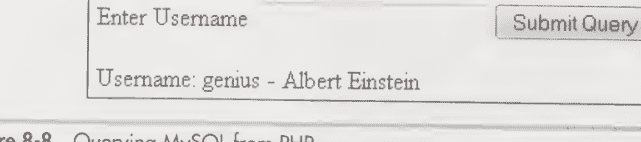

图8-8 从PHP查询MySQL

如果`$rows`不等于至少1，则说明没有返回任何内容，因此字符串`$display`被赋值为`Not found`。但如果`$rows`有值，则说明至少返回了一行（实际上，由于`username`是唯一字段，只能返回一行），因此从该行获取数据并放入`$display`变量中，如下所示：

```php
$row = mysql_fetch_row($result);
$display = "$row[0] $row[1]";
```

最后，显示查询结果，如下所示：

```php
echo "Username: $u - $display";
```

如果查询不成功，结果如图8-9所示，其中用户名`anyusername`未被找到。

> **注意**
>
> 如果您需要更多关于使用PHP和MySQL（以及JavaScript）的信息，可能会对我的书《学习PHP、MySQL和JavaScript》（O’Reilly，2009）感兴趣，该书从初学者的角度详细介绍了这三个主题的所有内容。

## 安全与防黑客措施

MySQL初学者通常没有意识到从表单输入直接访问MySQL所带来的危险，但这种危险是存在的。这是危险的，因为通常调用`mysql_query()`函数来创建查询，并且由于它使用SQL（结构化查询语言），用户有可能通过Web表单传递恶意命令，这些命令在发送到函数时，可能获得对数据库的访问权限，甚至损坏或破坏数据。

此外，如果用户通过Web表单提交的HTML或JavaScript代码未经检查就插入到数据库中，那么当从MySQL返回并显示数据时，HTML或JavaScript也会一起显示，这可能会破坏显示、将用户重定向到恶意网站等。

为了完全防止此类黑客攻击，您必须在数据接近MySQL之前对所有提交的数据进行清理。事实上，无论出于何种目的使用此类数据，您都应该始终对其进行清理。我将给您两个可以用来执行此操作的函数，一个用于表单数据的通用清理，另一个用于在MySQL中使用前进行进一步处理。第一个函数名为`htmlentities()`，是PHP内置的，您可以这样使用它：

```php
$variable = htmlentities($_POST['name']);
```

这将把任何HTML或JavaScript关键字转换为可以存储和显示的实体，但它们不会作为命令被执行。生成的字符串随后被放入变量`$variable`中。

例如，字符串`<b>some text</b>`在通过`htmlentities()`函数处理后，得到字符串`&lt;b&gt;some text&lt;/b&gt;`——`<`字符被替换为`&lt;`，`>`字符被替换为`&gt;`，HTML仍然会将它们显示为左右尖括号，但它们将无法创建HTML标签。

以下是另一个可以用来防止恶意尝试攻击MySQL的函数：

```php
function mysql_sanitize($string)
{
    if (get_magic_quotes_gpc())
        $string = stripslashes($string);
    return mysql_real_escape_string($string);
}
```

`if()`语句处理一种简单的黑客预防形式，称为Magic Quotes，它在MySQL的旧版本中使用，现已弃用。此工具背后的想法是自动转义通过表单发送的所有传入数据，但它带来的麻烦多于益处，因此`if()`语句会在启用Magic Quotes时关闭其使用。取而代之的是，其下方的`mysql_real_escape_string()`函数会正确转义所有已提交的数据，使得任何已知的黑客策略都无法突破（并且几乎可以肯定永远不会）。

因此，只要将`mysql_sanitize()`函数放置在程序中的某个位置，以下代码将保护任何已提交的数据，使其可以安全地用于MySQL查询：

```php
$variable = mysql_sanitize(htmlentities($_POST['name']));
```

这与前面推荐的将HTML字符转换为实体的代码相同，但额外调用了`mysql_sanitize()`函数。

### 修改 mysqllookup.php 代码

考虑到这些安全措施，前面的`mysqllookup.php`程序应将这一行

```php
$u = $_POST['username'];
```

改为以下内容：

```php
$u = mysql_sanitize(htmlentities($_POST['username']));
```

并且应添加以下函数定义：

```php
function mysql_sanitize($string)
{
    if (get_magic_quotes_gpc())
        $string = stripslashes($string);
    return mysql_real_escape_string($string);
}
```

### 安全与密码

我前面提到过，绝不应在数据库中存储原始密码，因为一旦服务器被攻破，这将带来巨大风险。相反，存储密码的最佳值是通过无法逆转的单向函数（例如称为MD5（消息摘要算法5）的过程）从中派生出的值。

使用PHP的`md5()`函数，您可以传递任何长度的字符串，它将返回一个看似随机的32个字符的字符串。例如，字符串`mypassword`会生成新字符串`34819d7beeabb9260a5c854bc85b3e44`。到目前为止，一切顺利，但不幸的是，有些黑客花费了数年时间构建所谓的彩虹表，其中包含了他们能想到的每个密码或可能密码的哈希值。这些彩虹表包含数百万个这样的哈希字符串，您可以打赌前面的那个就在其中。例如，使用Google，您可以输入前面的32字节哈希值，您会看到超过400页引用它！

因此，您不能存储这样的直接哈希值，但有一种方法可以防止任何彩虹表或Google搜索查找哈希值，那就是加盐，即在密码中添加一些只有您知道的秘密字符。

例如，假设您选择两组字符作为一对盐值（您可以使用一个盐值或任意多个）：`fT5$!`和`-:&;qK`。现在您可以将这些盐值添加到密码字符串中的任意位置，例如在以下代码中，将它们放在开头和结尾：

```php
$hash = md5('fT5$!' . $password . '-:&;qK');
```

对`$password`使用相同的值`mypassword`，会得到完全不同的哈希值`43a3c94ed32cb41d1a964bc87c891605`，并且如您所料，在Google上搜索不到结果（至少在本书的任何在线副本被索引之前）。

所以，请记住，不要在数据库中存储原始密码，而是通过一个或多个您从不透露的盐值对它们进行加盐处理，只存储此过程的结果，在前面的示例中，该结果将是`$hash`中的值。然后，当用户登录网站时，例如，为了验证是否输入了正确的密码，您只需将新提交的密码通过您的加盐过程运行，并将结果与存储的值进行比较。

## 摘要

由于这是一本关于 HTML5 的书，而非 MySQL（甚至 PHP），因此此处仅介绍数据库引擎的最基本部分。然而，本章包含足够的信息，可以帮助你开始管理简单的用户数据，正如第 10 章讨论如何构建 Web 应用程序时所需的那样。

# 第二部分：为移动设备开发

本书的这一部分解释了你需要做的事情，以便为访问你网站的移动用户提供最佳体验。第 9 章包含关于图像和字体缩放的提示，以充分利用移动屏幕分辨率和尺寸，以及用于自动管理此功能的 JavaScript 代码，还有许多其他提示，以最佳方式展示你的网站，并使其在触摸设备上具有高度交互性。

第 10 章介绍了一个免费的电子书发布平台，你可以用它创建外观精美的电子书，以便在桌面 PC 和 Mac 以及 iOS 和 Android 设备上显示。这个名为 eML 的应用程序支持音频、视频、地图、侧边栏、颜色、列表以及你可能希望包含在电子书中的所有内容。它功能强大，足以用作内容管理系统（CMS）来创建通用网站，而不仅仅是电子书。

然后，第 11 章解释了当你准备将在线网站离线并将其转换为独立应用程序时需要做的事情。利用这些信息，你将准备好继续学习本书的第三部分，在那里你将学习如何将这些应用程序嵌入到配套网站提供的简单框架中，以创建功能齐全的 iOS 和 Android 应用程序，而无需使用 Apple 的 Objective C 或 Android 的 Java 进行编程。

## 第 9 章：开发移动友好型网站

### 关键技能与概念

- 处理较小的屏幕
- 自动调整文本和图像大小
- 设置固定宽度的视口
- 使你的网页流畅
- 轻松触摸输入的提示
- 使 SMS（短消息服务）和电话号码可供智能手机访问
- 创建主屏幕图标

通过遵循本章中的指南，你会发现为使用移动浏览器的网站访问者提供出色体验要容易得多。你可以将这些提示用于整个网站，或者使用 JavaScript 来检测当前浏览器并根据需要重新格式化你当前的网站。

### 屏幕尺寸

创建移动友好型网站时，需要考虑的最重要因素是用户的屏幕尺寸。无论 iOS 或 Android 管理标准网页的缩放有多好，这些网页在移动设备上都不如专为小屏幕设计的网页易于使用。例如，图 9-1 显示了在 Dell Streak 上查看 CNN 首页的屏幕截图。

这是一个构建良好的首页，但它是为台式计算机格式化的，在移动设备上，你必须放大才能清晰查看感兴趣的区域。当然，与许多其他顶级网站一样，CNN 有一个适用于移动设备的替代网站（见图 9-2），但为什么智能手机必须局限于查看旨在用于简单“哑”手机的页面呢？

现在，我并不是在批评 CNN 的移动主页。它很好，并且对于简单手机来说工作得很好，但在智能手机上查看时，它看起来非常基础。

另一方面，标准页面的 1024 像素宽度是为至少该宽度的显示器格式化的，当在只有 480 像素可用宽度的浏览器中以纵向模式查看时，不缩放就无法阅读。

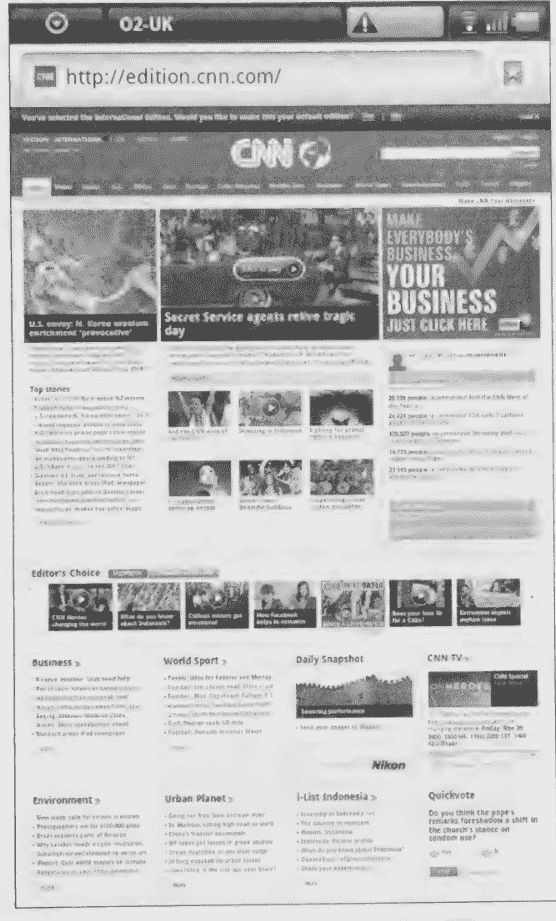

图 9-1 在 Dell Streak 上查看的 CNN 首页


图 9-2 Dell Streak 上 CNN 首页的移动版本

### 智能手机格式

希望针对 iOS 和 Android（或其他智能手机操作系统）的网站需要提供第三种类别的网页格式（除了桌面和简单移动）：智能手机格式。这种类型的网页会自动考虑所使用浏览器的宽度，因此无需使用放大手势即可阅读，然后滚动屏幕选择其他区域进行查看。

最棒的是，你实际上不必将网站构建为可在 480 像素宽度下查看；通过使用双倍的宽度（960 像素），只要将字体和图像大小加倍并使用流体布局，页面将很好地重新格式化为 480 像素宽度。

> **问：** 960 像素的宽度有什么好处？为什么不标准化为 1024 像素？
>
> **答：** 960 像素是一个很好的宽度，因为它是 iPhone 4 在横屏模式下的像素宽度，也是其在竖屏模式下宽度的两倍。因此，当你使用 960 像素的宽度时，你的页面保证在该手机上看起来尽可能好。
>
> 如果使用 1024 的值，它最适合缩放到 512 或 768 像素的分辨率，这在手机上并不常见——尽管 iPad 的分辨率为 1024×768 像素，而且它确实能很好地将 960 像素宽的页面缩放到这些尺寸。
>
> 回答问题的第二部分，我认为 1024 像素的标准宽度也可能效果很好，但我在各种 iOS 和 Android 设备上以 960 像素的宽度彻底测试了本书中的所有代码，因此我知道它确实效果很好。

例如，为了配合本书，我开发了一种免费的电子书开发和查看语言，称为 eML（电子书标记语言）。它包含一个简单的 JavaScript 程序，你将其与一页 HTML 以及任何图像或其他媒体一起包含，它会为你重新格式化所有内容。

有关此系统的更多信息，请参见第 10 章，但如果你查看图 9-3，你会看到一个使用该系统的电子书在运行 Microsoft Internet Explorer 的 PC 上显示。然后，在图 9-4 中，同一网页的不同部分在 iPhone 上显示，其中图形已放大，字体大小已调整（全部自动），以充分利用屏幕，并提供大小适中的按钮。

正如你在 iPhone 屏幕截图中看到的，重新格式化后的显示非常易于查看。你可能还注意到，尽管图 9-3 的菜单文本和阅读窗口在可滚动的框架中，但由于滚动条在触摸设备上非常难以使用，iPhone 版本没有使用框架；相反，你只需滑动即可滚动屏幕。iPad 的屏幕尺寸和旋转以及 Android 手机和平板电脑（如 Galaxy Tab）以及混合设备（如 Dell Streak）也类似地考虑了这些因素。在这些设备上，eML 将调整显示，以充分利用其分辨率、尺寸和其他属性。

确保你有一个 960 像素的显示可用于 iOS 和 Android 应用程序的方法是在 HTML 文档的开头（或在`<head>`部分，如果你愿意）包含以下`<meta>`标签：

```
<meta name="viewport" content="width=980" />
```

这会告诉两种设备将屏幕格式化为适合 960 像素宽的网页。然后，在完成此操作后，你可以以 960 像素的固定宽度构建你的智能手机网站，但请确保你考虑以下各节。

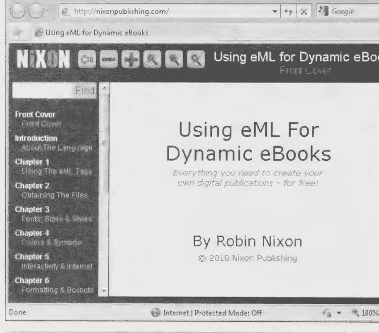

图 9-3 在 PC 上显示的 eML 电子书

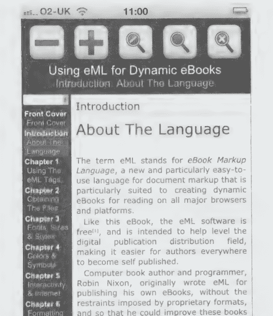

图9-4 同一电子书在iPhone上的显示效果

### 字体大小

由于移动设备显示屏的尺寸和长宽比各不相同，你应该使用条件性的JavaScript和/或CSS，将字体大小缩放至相对于960像素宽页面的可读尺寸。例如，我通过反复试错发现，表9-1中列出的相对字体大小效果相当不错。

如果你使用的基础字体大小不是12磅，只需将该字体大小的值乘以第三列中的值，即可计算出目标设备所需的新字体大小（中间列）。例如，如果你使用的基础字体大小是10磅，并想计算在iPad上使用的字体大小，你会计算10×1.5得到15磅的字体大小。

当然，这些字体大小是我的个人偏好，但你应该会发现它们处于合适的范围内，因此你可能只需要根据自己的口味稍作调整即可。

| 设备 | 字体大小 | 相对于桌面端 |
|---|---|---|
| 桌面计算机 | 12 pt | 1.00 |
| Android | 24 pt | 2.00 |
| iPhone/iPod Touch | 21 pt | 1.75 |
| iPad | 18 pt | 1.50 |

表9-1 建议在960像素宽网页上使用的字体大小

> **注意**
>
> Android移动设备往往比Apple移动设备需要稍大的字体，因为它们的屏幕分辨率通常较低，因此似乎需要额外的大小增加。

你可以使用类似于以下网页的代码来设置包含页面所有内容的`<div>`标签的字体大小：

```
<meta name='viewport' content='width=980' />
<html><!-- dynamicfonts.htm -->
    <head>
        <title>Dynamic font sizing</title>
    </head>
    <body>
        <div id='without'>
            <h3>Without dynamic resizing</h3>
            <ul>
                Standard Text<br />
                <h3>Heading 3</h3>
                <h2>Heading 2</h2>
                <h1>Heading 1</h1>
            </ul>
        </div>
        <div id='content'>
            <h3>With dynamic resizing</h3>
            <ul>
                Standard Text<br />
                <h3>Heading 3</h3>
                <h2>Heading 2</h2>
                <h1>Heading 1</h1>
            </ul>
        </div>
        <script>
            e = document.getElementById('content').style
            e.background = '#ddd'
            e.width      = '960px'

            switch(GetBrowser())
            {
                case('Android')  : f = '24pt'; break
                case('iPhone')   : f = '21pt'; break
                case('iPad')     : f = '18pt'; break
                default          : f = '12pt'; break
            }

            e.fontSize = f

            function GetBrowser()
            {
                if (NavCheck('iPhone') || NavCheck('iPod'))
                    return 'iPhone'
                else if (NavCheck('iPad'))
                    return 'iPad'
                else if (NavCheck('Android'))
                    return 'Android'
            }

            function NavCheck(check)
            {
                return navigator.userAgent.indexOf(check) != -1
            }
        </script>
```

这个网页首先将视口宽度设置为960像素。然后，在`<body>`部分，显示了一对相同的`<div>`区域，其中第二个区域的基础字体大小通过HTML之后的JavaScript进行了增加。

该脚本将第二个`<div>`的背景设置为浅灰色，并将其宽度精确设置为960像素，使其占据整个屏幕宽度。接着，`switch()`语句根据`NavCheck()`函数确定的浏览器类型，将不同的点数大小应用于变量`f`，然后用于更改`<div>`的字体大小。

如果设备不是Android、iPhone/iPod或iPad设备，则会选择适合桌面电脑的字体大小。在Android设备（这次是Google Nexus One）上显示此页面的结果如图9-5所示，该图仅显示了屏幕的相关部分。

### 图像尺寸

调整图像尺寸就不那么容易了，因为它们不像字体那样能很好地放大。不过，它们确实比放大更容易缩小，因此如果你以打算显示的最大尺寸创建所有图像，浏览器就可以在不损失太多质量的情况下将其缩小。

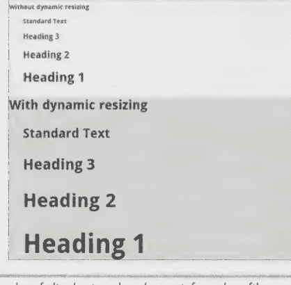

图9-5 在Android设备上显示*dynamicfonts.htm*文件的结果

例如，图9-6显示了一个480x480像素的地球图像，该图像已自动缩小75%（至240x240像素）以在桌面显示器上显示（在此示例中，使用Chrome浏览器）。

但同样的网页在iPhone上看起来像图9-7，其中图像仅缩小了25%，因为在这种小屏幕上需要显示得更大一些。

此外，在图9-6中，文本以桌面端的12磅大小显示，而在图9-7中，它已放大到22磅。文本和图像的调整大小都通过以下程序完成，它与前一个程序的差异以粗体文本显示：

```
<meta name='viewport' content='width=980' />
<html><!-- dynamicimages.htm -->
    <head>
        <title>Dynamic image sizing</title>
    </head>
    <body>
        <div id='content'>
            
            <h3>The Earth</h3>
            Earth (or the Earth) is the third planet from the Sun, and the densest and fifth-largest of the eight planets in the Solar System.<br />
            &nbsp;&nbsp;&nbsp;&nbsp;&nbsp;&nbsp;It is also the largest of the Solar System's four terrestrial planets. It is sometimes referred to as the World, the Blue Planet, or by its Latin name, Terra.<br />
            &nbsp;&nbsp;&nbsp;&nbsp;&nbsp;&nbsp;Home to millions of species including humans, Earth is currently the only place where life is known to exist. The planet formed 4.54 billion years ago, and life appeared on its surface within a billion years.<br />
            &nbsp;&nbsp;&nbsp;&nbsp;&nbsp;Earth's biosphere has significantly altered the atmosphere and other abiotic conditions on the planet, enabling the proliferation of aerobic organisms as well as the formation of the ozone layer which, together with Earth's magnetic field, blocks harmful solar radiation, permitting life on land.<br />
            &nbsp;&nbsp;&nbsp;&nbsp;&nbsp;The physical properties of the Earth, as well as its geological history and orbit, have allowed life to persist during this period. The planet is expected to continue supporting life for at least another 500 million years.
        </div>
        <script>
            document.getElementById('image').style.margin = '0px 20px 20px 0px'
            e             = document.getElementById('content').style
            e.textAlign   = 'justify'
            t             = document.getElementsByTagName('img')

            switch(GetBrowser())
            {
                case('Android') : f = '24pt'; m = 1.00; break
                case('iPhone')  : f = '22pt'; m = 0.92; break
                case('iPad')    : f = '18pt'; m = 0.75; break
                default         : f = '12pt'; m = 0.50; break
            }

            for (j = 0 ; j < t.length ; ++j)
            {
                t[j].width  *= m
                t[j].height *= m
            }

            e.fontSize  = f

            function GetBrowser()
            {
                if (NavCheck('iPhone') || NavCheck('iPod')) return 'iPhone'
                else if (NavCheck('iPad'))                     return 'iPad'
                else if (NavCheck('Android'))                  return 'Android'
            }

            function NavCheck(check)
            {
                return navigator.userAgent.indexOf(check) != -1
            }
        </script>
```


图9-6 尽管缩小到原始尺寸的25%，但图像仍然看起来很清晰

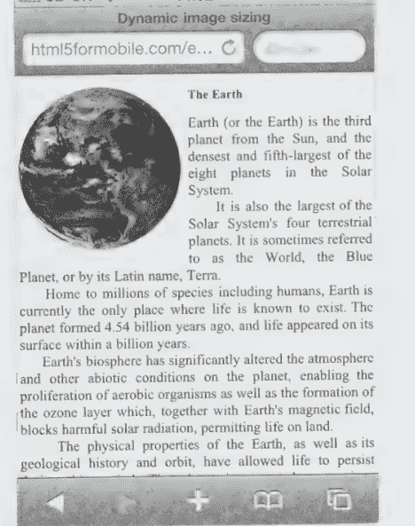

图9-7 该图像已从其原始尺寸缩小了25%

以下是从该程序中提取的最有趣的代码段，其中数组`t`被赋值为文档中所有的HTML``元素，然后使用下面的`for()`循环依次处理这些元素，将它们的图像宽度和高度缩小一定比例：对于Android（通过将两个尺寸乘以1.00）缩小0%，对于桌面浏览器（通过乘以0.50）缩小75%，对于iPhone（通过乘以0.87）缩小25%，对于iPad（通过乘以0.71）缩小50%：

```
t = document.getElementsByTagName('img')

switch(GetBrowser())
{
    case('Android') : f = '24pt'; m = 1.00; break
    case('iPhone')  : f = '22pt'; m = 0.92; break
    case('iPad')    : f = '18pt'; m = 0.75; break
    default         : f = '12pt'; m = 0.50; break
}

for (j = 0 ; j < t.length ; ++j)
{
    t[j].width  *= m
    t[j].height *= m
}
```

### 液态流布局

前面的两个例子说明了液态流（liquid flow）的使用，在这种布局中，元素不会被强制放入预定义的位置。相反，图像被放置在左侧或右侧，文本则围绕着它们流动。

如果你愿意，你可以包含不止一列，但如果你这样做，我建议你将它们创建为左浮动或对齐的`<div>`标签，这样任何无法与其他元素并排放置的元素，都会优雅地向下移动，而不是将页面向右扩展——从而需要水平滚动才能查看它们。

例如，你可以使用如下所示的HTML，我使用了`<div>`元素的`align='left'`属性，但同样可以使用`float:left`的样式规则：

```
<div align='left'>
    Some contents
</div>
<div align='left'>
    More contents
</div>
<div align='left'>
    Even more contents
</div>
```

根据你设置的元素宽度或由于其内部元素导致的宽度，如果浏览器没有足够的宽度将它们全部并排放置，它会将一个或多个元素下移到下一个空闲位置。

> **注意**
>
> 当然，这些用于调整文本和图像尺寸的方法旨在自动运行，因此可能并不总是产生你想要的确切尺寸，但使用它们比为每个浏览器和平台重写你的网页要容易得多。

### 使用悬停效果和工具提示

一个建议：不要用。

在不支持鼠标的设备上，悬停效果和工具提示毫无意义。例如，在 iOS 和 Android 上，用户仅限于点击和拖动，没有其他操作可以模拟鼠标悬停。

另一方面，如果你打算让你的页面也在非触摸设备上使用，那么可以使用悬停技术，但不要依赖它们作为界面——只将它们用作页面增强。

### 交互性导航和用户输入

在可能的情况下，对于触摸设备，你应该用点击选项（如单选按钮、复选框，或者更好的是，你自己的图形元素）来替代文本输入。

对于需要用户注册的站点，你当然必须要求输入用户名和密码来登录用户，但要考虑是否使用 cookie 让该用户在接下来的几次访问中保持登录状态，或者在你认为合理的天数内保持登录状态。允许用户保持登录状态的时间越长，用户需要调用屏幕键盘的次数就越少。

同时，尽量避免让用户在屏幕上四处导航。如果可以的话，将页面的各个部分放在单独的`<div>`标签中，并为每个标签设置绝对定位，以便它们可以相互重叠。然后，除了当前图层外，使所有图层都不可见，并使用标签页或其他简单的系统在它们之间切换。

在长网页上，在页面各处放置多个“主页”按钮或文本链接很有帮助，这样用户可以轻松返回页面顶部。或者，使用 CSS3 和 HTML5，你总是可以使用静态定位的元素，使其保持在屏幕上以提供导航访问。

如果你有雄心壮志，你也可以考虑用你自己的键盘（如何实现的示例见第 11 章）来替代移动设备上占用大量屏幕空间的内置弹出式键盘，或者使用第三方虚拟键盘，例如`greywyvern.com/code/javascript/keyboard`上的那个（见图 9-8）。


### 使用 sms: 和 tel: URL

为了适应作为电话的移动设备，请确保在你的网站上包含可点击的 SMS 和/或电话号码链接，如下所示：

```
点击通过
<a href='sms:0123456789'>短信</a>或
<a href='tel:0123456789'>电话</a>联系我们。
```

这会在文本下放置一个链接，与任何`http://`或`mailto:` URL 一样，点击时会调用手机的短信编辑器或电话拨号屏幕。

### Apple 主屏幕图标

你可以为你的 iOS 用户提供一个图标，用于在网页保存为主屏幕图标时进行标识。为此，请在网页开头输入如下一行代码，其中`myicon.png`是要使用的图标名称：

```
<link rel="apple-touch-icon" href="myicon.png" />
```

为了与所有 iOS 设备兼容，该图标应为 57×57 像素的 PNG 图像。创建一个在简单背景上的突出图像，当用作主屏幕图标时，Apple 设备会为其添加漂亮的闪亮光泽。

例如，在自动处理后，图 9-9 中显示的图像会出现在 iPhone 主屏幕的第三行，如图 9-10 所示。该图像是通过单击浏览器底部中间的 + 按钮（或 iOS 4.2 上的一个指向方框外的箭头）并选择“添加到主屏幕”添加到桌面的。

不幸的是，Android 没有等效的功能，因为所有 Android 设备似乎对主屏幕书签的处理方式都不同。通常，每个 Android 设备使用其自己的自定义图标，有时它们甚至不保存页面标题，而是输入像“浏览器”这样的通用标题。我真心希望 Google 在未来的版本中恢复此功能，以创造统一的体验，因为 Apple 的`<meta>`标签在 Android 2.1 之前的版本中肯定有效——该功能似乎在那之后就消失了。

### 以全屏模式运行 iOS 主屏幕页面

一旦用户将网页保存到 iOS 主屏幕，单击它时，它会像从书签中选择一样打开。但如果你想访问屏幕的导航栏和状态栏区域，你可以在网页开头使用以下`<meta>`标签：

```
<meta name="apple-mobile-web-app-capable" content="yes" />
```

当 iOS 浏览器在加载主屏幕网页时看到此标签，它会立即禁用导航栏和状态栏。例如，图 9-11 显示了与图 9-7 相同的网页，但应用了此`<meta>`标签。


图 9-9 一个简单但醒目的 57×57 像素图标


图 9-10 图 9-9 中的图标在 iPhone 主屏幕上处理后的样子

### 创建 iOS 启动画面

在加载主屏幕网页时，屏幕显示并不总是美观，特别是如果你启用了全屏模式而它尚未完全重绘时。为了缓解这种情况，你可以向 iOS 提供一个图像在加载期间显示，如下所示：

```
<link rel="apple-touch-startup-image" href="splashimage.png" />
```

将此标签放在网页开头附近，该图像（必须具有 320×460 像素的分辨率）将显示直到页面完全加载。一个好的图像可以是网页图标的放大版本，加上页面标题和可能的“加载中...”文本。


图 9-11 将导航栏和状态栏屏幕空间释放给网页

> **注意**
>
> 对于小型且加载速度快的网页，你可能永远不会看到启动画面，因为没有时间加载它。在这种情况下，尝试减小图像尺寸。此外，启动画面并不总是在第一次单击主屏幕图标时显示，因为它尚未下载，但如果它要显示，之后应该会显示。

### 总结

如果你在设计移动友好型网站时使用本章详述的技巧，你的网站将比简单的移动网站更易于使用、外观更好——而且将内容从原本面向桌面用户的网站重新利用所需的额外工作很少。如果你从头开始开发，这将是轻而易举的事。在下一章中，我将介绍用于电子书的eML标记语言，它能够创建跨浏览器和平台独立的电子书及网站，并且其构建正是运用了本章介绍的技术。

## 第10章：使用eML电子书平台

### 关键技能与概念

- eML的基本结构
- 创建菜单和章节
- 使用eML标签
- 三种不同类型的标签
- 字体、颜色和特殊符号
- 基础与高级格式化
- 在iOS和Android上覆盖字体大小

本章是对上一章的补充，向你展示如何使用一个现成的免费发布平台——eML（电子书标记语言）。该平台已能识别主要的不同操作系统和浏览器。它尤其适合制作便携式电子书，这些电子书既可以作为网站运行，也可以作为独立应用程序运行。对于希望快速将出版物发布到iOS和Android应用商店的用户来说，它最为实用。

使用eML，你可以将整本电子书置于单个HTML文档中，如图10-1所示。实际上，本章的所有插图都是使用不同设备运行eML软件时截取的，以便你能看到它们如何根据各自的屏幕尺寸和功能出色地重新格式化出版物。

每个eML文档都使用一个JavaScript程序文件，根据设备和浏览器的最佳性能来处理和显示书籍。但eML并不仅限于电子书，因为你也可以将其提供的150个特殊标签用作内容管理系统。

但eML最重要的特点是，它既可以作为网站运行，也可以作为应用程序运行，后者既可以是网页应用，也可以是独立的设备应用。这是通过尽可能将网站内容保留在单个文件中实现的，然后使用JavaScript一次显示一个页面，从而减少了多次页面加载和服务器请求，并使eML电子书和应用程序的加载和运行速度极快。

> **注意**
>
> 本章所需的所有代码及相关文件都包含在`examples.zip`文件中，你可以从配套网站`html5formobile.com`下载。你也可以在线阅读eML手册，网址是`nixonpublishing.com`，在那里你总能下载到最新版本的eML。

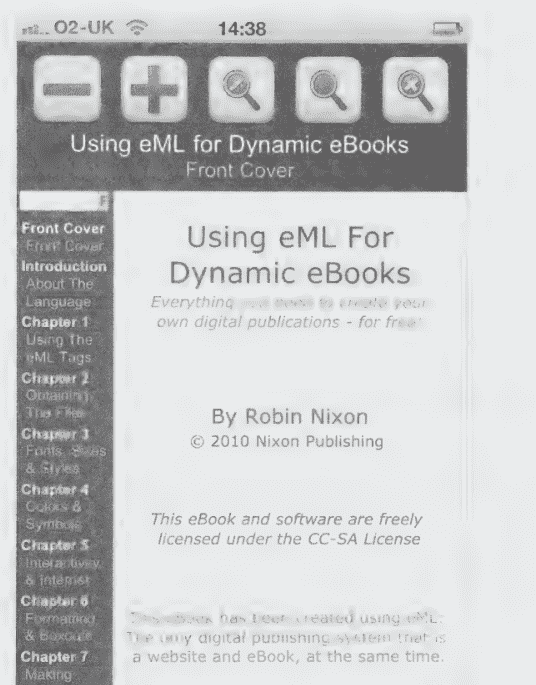

图10-1 在iPhone上查看的电子书首页

### eML文档的基本结构

要创建eML出版物，你需要从一个空白的HTML文件开始，并在其中添加以下头部行（可能需要根据你用于图标的文件名进行修改）：

```html
<!DOCTYPE html>
<!-- saved from url=(0014)about:internet -->
<html><head><meta name='viewport' content='width=980' />
<link rel='apple-touch-icon' href='apple-touch-icon.png' />
<link rel='apple-touch-startup-image' href='splashimage.png' />
<meta name='apple-mobile-web-app-capable' content='yes' />
```

所有这些内容在前面的章节中已经解释过，但在此回顾一下：第一行将文档类型定义为HTML5；任何非HTML5浏览器都将简单地使用标准模式显示文档：

```html
<!DOCTYPE html>
```

第二行在eML出版物需要在Windows Internet Explorer浏览器本地查看时是必需的；它确保不会显示弹出安全警告：

```html
<!-- saved from url=(0014)about:internet -->
```

之后，HTML开始，浏览器视口被设置为980像素宽度：

```html
<html><head><meta name='viewport' content='width=980' />
```

接下来，一个名为*apple-touch-icon.png*的图像被指定为保存出版物到iOS主屏幕时使用的图标：

```html
<link rel='apple-touch-icon' href='apple-touch-icon.png' />
```

然后，下一行提供了一个320x460像素的图像*splashimage.png*，当从iOS主屏幕图标启动应用程序时用作加载或启动屏幕：

```html
<link rel='apple-touch-startup-image' href='splashimage.png' />
```

这一组的最后一行用于让iOS浏览器在从主屏幕图标加载时以全屏模式显示应用程序：

```html
<meta name='apple-mobile-web-app-capable' content='yes' />
```

### 提供出版物标题和其他详情

文档的下一部分指定了页面标题，使用`<script>`标签进入JavaScript，并分配一些供出版物使用的全局变量：

```html
<title>Example eBook</title><script>

PUBLICATION = 'Example eBook Title'
PUBIPAD    = 'Short Name'
PUBIPHONE  = 'Short Name'
SUBTITLE   = 'Subtitle'
AUTHOR     = 'Author Name'
PUBLISHER  = 'Publisher'
PUBLISHED  = 'Date'
ISBN       = 'If you have one...'
```

这些变量基本都是不言自明的，除了`PUBIPAD`和`PUBIPHONE`变量。它们应包含保存到iOS主屏幕的出版物图标下方显示的简称。`PUBIPHONE`字符串是在iPhone图标下显示的文本，它应该只有几个字符（大约十几个）。`PUBIPAD`字符串是在iPad上显示的文本，由于屏幕和图标尺寸更大，它可以稍长一些。

### 创建菜单

在文档的下一部分，你在JavaScript数组`CHAPTERS`中创建一个包含章节名称和标题的菜单，如下所示：

```javascript
CHAPTERS =
{
    'Front Cover' : '',
    'Chapter 1'   : 'Chapter One Contents',
    'Chapter 2'   : 'Chapter Two Contents'
}
```

```html
</script><script src='eML/eML.js'></script></head><body>
<div style='display:none'>
```

除了最后一个章节外，所有章节行末都应有一个逗号。如果任何字符串需要使用单引号字符（例如撇号），则应将这些字符串包含在双引号中而不是单引号中。

`CHAPTERS`数组后面跟着一个结束的`</script>`标签，以及另一个用于加载`eML.js` JavaScript程序的`<script>`标签。然后，`<head>`部分关闭，`<body>`打开。最后，开始一个包含所有章节的`<div>`，但它被设置为不显示它们，因为这将由JavaScript处理。

> **注意**
>
> 将空字符串分配给章节标题会留下一个空白空间，这对于封面页非常理想，因为你可以在此空间中提供自己的设计。

### 添加章节

最后，所有章节按顺序列出，每个章节都在自己的`<div>`标签内，该标签必须被赋予在`CHAPTERS`数组中为其匹配元素分配的ID，如下所示：

```html
<div id='Front Cover'><pre>
#h:1|#center:Example eBook#-
#h:3|#center:By A N Author#-
#br|#center|#copy: Example Publishing#-
#br|#br|#br|#br|#br|#br:
#center|#color:#080;This eBook has been created using eML -
#br|the only digital publishing system that is both
#a website and an eBook at the same time.#-#br|#br:
</pre></div>
```

```html
<div id='Chapter 1'><pre>
#p1:This is Chapter One
#p:Here are its contents...
</pre></div>
```

```html
<div id='Chapter 2'><pre>
#p1:This is Chapter Two
#p:Here are its contents...
</pre></div>
```

现在你可以忽略所有`#`标签（它们很快就会被解释），只需注意每个章节的结构：

```html
<div id='Chapter Name'><pre>
...
</pre></div>
```

你将每个章节放入一个`<div>`标签内，并在其中用`<pre>`和`</pre>`标签包围其内容，以允许JavaScript程序读取文件末尾的换行符（这些标签表示包含的文本是预格式化的）。

如果你愿意，在最后一个章节之后，你可以通过添加最终的`</div>`来关闭包含所有章节的不可见`<div>`标签，但由于文档中没有其他内容，这是可选的，否则标签将在所有浏览器上自动关闭。

### eML子文件夹

你需要为每个eML出版物附带`eML`子文件夹的副本，该文件夹包含各种图标、一个Flash音频播放器以及所使用的JavaScript。你可以在文件夹中放置任意数量的出版物，它们都将仅访问单个`eML`子文件夹获取资源，因此这是一个相当高效的系统。

而且，正如你稍后将看到的，即使作为独立应用程序使用，eML出版物也可以链接到其他eML出版物。

### 整合所有内容

当前面的部分组合成一个完整的eML文档时，它看起来是这样的：

```html
<!DOCTYPE html>
<!-- saved from url=(0014)about:internet -->
<html><head><meta name='viewport' content='width=980' />
<link rel='apple-touch-icon' href='apple-touch-icon.png' />
<link rel='apple-touch-startup-image' href='splashimage.png' />
<meta name='apple-mobile-web-app-capable' content='yes' />

<title>Example eBook</title><script>

PUBLICATION = 'Example eBook Title'
PUBIPAD     = 'Short Name'
PUBIPHONE   = 'Short Name'
```

> **问：** 如果我想创建一个网站，而不是电子书，该怎么办？
>
> **答：** 使用 eML 并非仅限于制作电子书。您只需在章节标题中避免使用“Chapter”一词，转而使用页面标题，即可利用该系统创建一个完全独立、多页面的网站。这正是我在 nixonpublishing.com 上所做的实践——它既是一个网站，也是一本详细介绍如何使用 eML 语言的电子书。

### 使用 eML 标签

eML 语言专为作者写作而设计，力求特别易于使用；同时其格式足够简洁，便于编写程序将其转换为其他格式。但不仅如此，它还能创建高度动态和交互式的出版物。

例如，只需单击即可折叠或展开整个部分，仅显示您当前正在阅读的内容——这使得浏览出版物中的所有标题变得非常简单。顶部导航栏中的 + 和 – 按钮可对章节的*所有*部分执行此功能。

eML 平台还允许您展示图形、表格和示例，如果移动它们，所有引用都会自动重新编号；嵌入 MP3 音频文件和 YouTube 视频；添加书签（通过单击标题，然后再次单击出现的星形图标）；以及通过许多其他方式增强您的程序。

所有这些都是通过一种基于`#`符号的语言实现的。例如，要开始一个新段落，只需在前面加上一个`#p:`标签，如下所示：

```
#p:这是一个新段落。无需用任何东西标记段落结束。只需用相同的标签开始每个新段落即可。
```

还有一个通用关闭标签`#-`。如果您在 HTML 中使用`<i>`标签打开一个斜体标签，则必须使用匹配的`</i>`来关闭它。但使用 eML 时，您可以使用通用关闭器关闭大多数标签。您关闭所有其他 eML 标签的方式要么是使用分号，要么是输入换行符。

#### 不同的标签类型

eML 支持以下三种类型的标签，它们的主要区别在于是否支持参数、如何关闭，以及是否必须与其他标签组合使用：

- 自闭合标签，不需要`#-`来关闭它们，其本身就是完整的
- 需要向其传递一个或多个参数的标签
- 多部分标签，其中两个或多个标签协同工作

##### 自闭合标签

自闭合标签就像`#p:`，正如您已经看到的，它每次使用时都只是开始一个新段落。其他自闭合标签包括`#br:`用于创建换行符，`#caret:`用于显示`^`符号，等等。

##### 带参数的标签

这类标签需要一个或多个参数，然后在遇到分号或行尾时关闭。因此，例如，要创建一个四级标题，使用如下标签和文本组合：

```
#h:4|这是一个四级标题
```

`#h:`设置标题标签，后跟标题级别（此处为 4），以及`|`符号，表示标题标签第一部分的结束。然后是要在标题中显示的文本“This is a level 4 heading”，整个标签在行尾结束。

如果您想在前面的示例中为该行添加另一个标签，可以在行尾添加一个分号（这在 eML 中起到了换行符的作用），然后添加第二个标签。例如，这个两行标签对：

```
#fontsize:10pt
#alignment:justify
```

可以用这一行来替换：

```
#fontsize:10pt;#alignment:justify
```

##### 多部分标签

这类标签稍微复杂一些，因为它们是组合式或多部分的，例如用于创建以下表格的标签：

| 宠物类型 | 宠物名称 |
|---|---|
| 长毛猫 | 大黄 |
| 拉布拉多犬 | 艾玛 |
| 金鱼 | 泡泡先生 |

仅使用四个标签即可创建此表格：`#example:`、`#th:`、`#td:`和`#-`，如下所示：

```
#table:example|宠物及其名称精选
#th:宠物类型|宠物名称
#td:长毛猫|大黄
#td:拉布拉多犬|艾玛
#td:金鱼|泡泡先生
#-
```

图 10-2 展示了 eML 手册中的表格部分在 Android 浏览器上的显示效果。

第一个标签设置一个 ID 为 “example” 且标题为 “宠物及其名称精选” 的表格。然后第二行创建表格标题，赋予其“宠物类型”和“宠物名称”两个列标题，而第三到五行包含每一行的表格数据。

与`#h:`标题标签一样，`|`符号用于分隔数据项。因为它是一个保留字符，如果您需要显示竖线，可以使用`#|`标签。


#### 特殊符号和关闭标签

eML 语言以特殊方式使用一些字符，如下所示：

- `|`字符用于分隔带参数标签中的多个参数。
- `;`字符用于关闭带参数标签的起始部分。或者，就像 JavaScript 一样，换行符也能达到相同的效果。
- `^`符号可以用作显示`<`符号的快捷方式，而不是使用`#lt;`标签（或 HTML 的`&lt;`标签）。
- 因为`#`符号用作标签名称的前缀，当您希望显示`#`符号本身时，可以使用`##`标签。
- `#-`标签关闭所有非自闭合的 eML 标签。

图 10-3 中，一台 Galaxy Tab Android 平板电脑正在以竖屏模式显示 eML 手册的第三章。

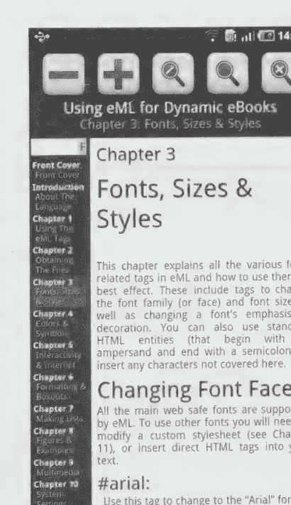

图 10-3 在运行 Android 系统的三星 Galaxy Tab 上显示第三章

### eML 标签

eML 标签可以分为不同的类别，例如与字体相关的标签、用于定义颜色和符号的标签、互联网和交互性标签等等。正如您将在接下来总结最常用标签的各节中看到的，它们非常直观且易于使用，同时比 HTML 标签提供了更大的灵活性。

> **问：** 使用 eML 相对于标准 HTML 和 JavaScript 有何优势？
>
> **答：** 主要优势在于 eML 系统会自动处理 iOS、Android 和其他平台与浏览器的所有不同类型，并相应地格式化其显示。它还提供了数十种现成标签，用于访问已在多种设备上测试过的功能，从而使您能够快速在 iOS 或 Android 应用商店中发布电子书或独立网站。
>
> 当然，eML 可能并非适合所有人，这没关系。如果您不想使用它，您仍然可以利用本书其余部分的技术，将您自己的网页嵌入 iOS 和 Android 封装器中，创建您自己的独立应用程序。但您将不得不编写自己的代码来处理操作系统和浏览器之间的差异。

### 管理字体

每当您希望在 eML 文档中更改字体时，只需通过名称引用它即可，例如`#arial:`，然后，要恢复之前的字体，请发出`#-`关闭标签，如下所示（参见表 10-1）：

```
#arial:这段文本使用 Arial 字体#-
```

| 标签 | 字体名称 | 标签 | 字体名称 |
| --- | --- | --- | --- |
| #arial: | Arial | #helvetica: | Helvetica |
| #arialb: | Arial Bold | #impact: | Impact |
| #andale: | Andale Mono | #times: | Times |
| #comic: | Comic Sans MS | #timesnr: | Times New Roman |
| #courier: | Courier | #trebuchet: | Trebuchet |
| #couriercn: | Courier New | #verdana: | Verdana |
| #georgia: | Georgia | | |

**表 10-1** eML 字体标签——均使用`#-`标签关闭

### 更改字体大小

要更改字体大小，您可以使用`#size:`标签，其格式为在冒号`:`后跟一个参数，再跟一个分号，如下所示：

```
#size:12pt;This text is in 12 point#-
```

`#-`标签用于恢复使用之前的字体大小。支持所有 CSS 测量单位，如 em、pt 和 px。图 10-4 展示了 eML 手册第三章在 iPad 上的显示效果。

### 更改字体强调和装饰

您还可以使用这些标签轻松更改文本的显示方式（参见表 10-2），例如下面这个将文本更改为粗体的例子：

```
#b:This text is in bold face#-
```

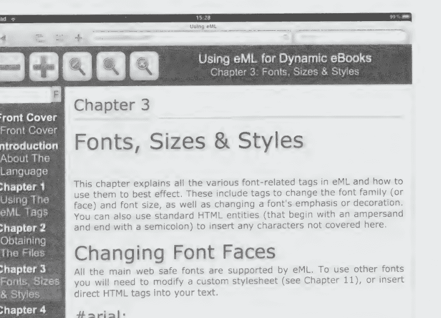

图 10-4 在运行 iOS 4.1 的 iPad 横屏模式下显示第三章

| 标签 | 作用 |
| --- | --- |
| #lightshadow: | 在文本下方添加浅色阴影 |
| #darkshadow: | 在文本下方添加深色阴影 |
| #b: | 启用粗体 |
| #i: | 启用斜体 |
| #l: | 启用等宽字体 |
| #s: | 启用删除线 |
| #sub: | 启用下标 |
| #sup: | 启用上标 |
| #u: | 启用下划线 |

### 更改颜色

要更改一段文本的颜色，请使用`#color:`标签（或使用`#highlight:`更改背景颜色），如以下示例所示：

```
#color:#ffff00;This is yellow text#-
#highlight:red;This has a red background#-
```

图 10-5 展示了 eML 关于颜色和符号的章节在另一台不同的 Android 设备上的显示效果。

颜色值后需要一个分号来关闭标签的第一部分，并且可以使用`#-`标签将颜色恢复为之前的颜色。您可以使用任何以`#`字符开头的三位或六位十六进制值，或者任何受支持的 CSS/HTML 颜色名称。

### 显示不常用符号

eML 系统让您能轻松使用许多不常用的符号，例如`#degree:`和`#euro:`。这些符号标签是自闭合的，不需要使用分号或`#-`标签（参见表 10-3）。

### 基本格式

eML 语言支持广泛的格式选项，从换行、居中、标题、缩进等基础功能开始。例如，以下行显示二级标题：

```
#h:2|This is a level 2 heading
```

表 10-4 详细列出了部分主要格式标签及其用法。

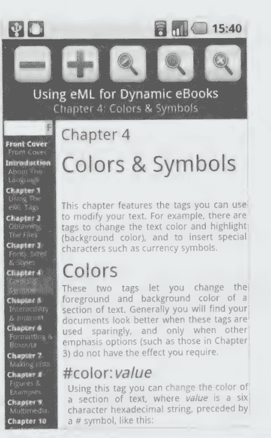

图 10-5 在运行 Android 2.2 的 Google Nexus One 上显示第四章

| 标签 | 符号 | 标签 | 符号 |
| --- | --- | --- | --- |
| #bar: | &#124; | #n: | &#160; (不换行空格) |
| #caret: | ^ | #nd: | - (短破折号) |
| #cent: | ¢ | #pound: | # |
| #copy: | © (版权符号) | #quarter: | ¼ |
| #degree: | ° | #rb: | > (右方括号) |
| #divide: | ÷ | #reg: | ® (注册商标) |
| #euro: | € (欧元) | #rq: | " (右引号) |
| #feet: | ' | #rs: | ' (右单引号) |
| #half: | ½ | #sc: | ; (分号) |
| #hash: | # | #threeq: | ¾ (四分之三) |
| #inches: | " | #ukpound: | £ (英镑) |
| #lb: | < (左方括号) | #yen: | ¥ (日元) |
| #lq: | " (左引号) | ## | # |
| #ls: | ' (左单引号) | #... | ... (省略号) |
| #md: | — (长破折号) | ^ | < (左方括号) |
| #multiply: | × | | |

表 10-3 eML 符号标签——自包含且无需闭合标签

| 标签 | 作用 | 示例 | 闭合标签 |
| :--- | :--- | :--- | :--- |
| #br: | 应用换行 | End of line#br: | 无 |
| #center: | 居中文本 | #center:I'm Centered#- | #- |
| #h:n\|文本 | 显示标题 | #h:1\|Level 1 heading | ; 或新行 |
| #hr:n | 绘制水平线 | #hr:75% | ; 或新行 |
| #indent:n | 缩进段落 | #indent:30px;Indented#- | ; 或新行（用于开始）， #- （用于结束） |
| #p: | 段落首行缩进20像素 | #p:Indented text | #p: 或 #p1: |
| #p1: | 开始无缩进的新段落 | #p1:Unindented text | #p: 或 #p1: |
| #tab: | 缩进段落20像素 | #tab:Indented block#- | #- |

表 10-4 eML 部分基本格式标签

提供不同的`#p:`和`#p1:`标签是为了支持带缩进和无缩进的段落，其中`#p1:`显示段落时首行不缩进，而`#p:`显示段落时首行缩进。由于段落非常常见，因此没有用于关闭段落的标签；相反，通过开始一个新段落，前一个段落会自动关闭。

### 高级格式

为了帮助您专业地排版出版物，eML 支持更多高级格式功能，如突出显示框和旁注。例如，要将文档的一部分放置在屏幕左侧的旁注中，您可以像这样使用`#lsidebar:`标签（参见图 10-6）：

```
#lsidebar:200;This is a sidebar, which is placed all the way over on the left of the page.#-
```

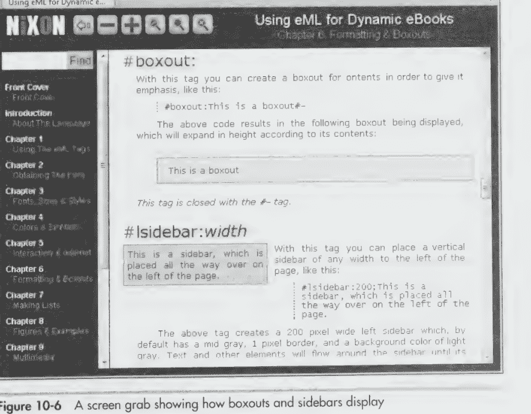

| 标签 | 作用 |
| --- | --- |
| #boxout: | 在突出显示框中显示 |
| #code: | 作为代码显示 |
| #input: | 作为用户输入显示 |
| #lsidebar:n; | 在左侧边栏中显示 |
| #note: | 作为注释显示 |
| #output: | 作为程序输出显示 |
| #quote: | 作为引文显示 |
| #rsidebar:n; | 在右侧边栏中显示 |
| #text: | 作为示例文本显示 |
| #tip: | 作为提示显示 |
| #warn: | 作为警告显示 |

**表 10-5** eML 提供的高级格式标签

`;`字符前的值是分配给侧边栏宽度的像素数。表 10-5 列出了可用的高级格式标签，所有这些标签都以`#-`标签闭合。只有`#lsidebar:`和`#rsidebar:`标签需要额外的宽度值（以像素为单位），后跟一个分号。

`#boxout:`标签将其内容显示在一个带有浅色背景的简单边框框中，而`#note:`、`#tip:`和`#warn:`执行相同操作，但在框的左侧还显示一个合适的图标。其余标签将其内容格式化为缩进并前置一条垂直虚线，以及其他用于强调其内容类型的格式。

> **注意**
>
> 还支持许多其他高级格式选项，例如各种列表类型、表格和图形；页码管理；引用和脚注；嵌入音频、视频、图像和地图；以及更多功能。有关完整详情，请阅读 html5formobile.com 或 nixonpublishing.com 上提供的 examples.zip 下载中的在线手册。

### 在 iOS 和 Android 上覆盖字体大小

在前一章中，我介绍了一些代码，让您可以根据设备实时更改字体大小。使用 eML 时，使用了类似的代码，但如果您愿意，可以使用`#androidfontsize:`、`#iphonefontsize:`和`#ipadfontsize:`标签覆盖默认设置，如下行所示，它将 Android 设备的基础字体大小设置为 18 pt：

```
#androidfontsize:18pt
```

这些标签可通过新行或分号来闭合。

### 总结

本章解释了如何使用 eML 作为快速完成项目并准备好放入 iOS 和 Android 应用商店（详见第三部分）的方法。使用该平台是一个很好的入门方式，我推荐您尝试一下。

但使用 eML 只是为移动设备分发准备网站的一种方式。在下一章中，我将确切地向您解释，如果您打算使用自己的 HTML 和 JavaScript 独立操作，您需要做什么，方法是向您展示如何创建一个数据库驱动的 Web 应用和一个更简单的 Web 应用，该应用可以轻松转换为独立的移动应用。

## 第十一章：开发 Web 应用

### 关键技能与概念

- 创建合适的 MySQL 数据库
- 确保 Ajax 调用能够工作
- 验证用户名和密码
- 用户登录和登出
- 发送和检索聊天消息
- 发送个人消息
- 管理虚拟键盘
- 防止 iOS 和 Android 同时处理点击事件
- 为保存到 iOS 主屏幕进行自定义
- Ajax 通信的 PHP 端

本整章都致力于一个名为“Rob's Place”（参见图 11-1）的项目，该项目包含用于运行简单聊天室的客户端和服务器端软件。在本章中，您将学习如何创建一个永久的屏幕键盘（以避免不断弹出设备自身的软键盘），管理键盘返回的输入，使用 Ajax 将输入和查看屏幕连接到 Web 服务器，创建和管理 MySQL 数据库，以及在服务器端处理 Ajax 请求。

项目完成后，我们将使用它作为构建一个外观专业且独立的 iOS 或 Android 应用的示例之一。在此过程中，我将指出许多您可以使用的技巧，以及在为触摸设备开发 Web 应用时需要避免的陷阱。

### 关于此项目

本项目包含相当多的代码，但我已尽力将其保持在最低限度，至少能呈现相当不错的效果，并且我已将主要 JavaScript 代码控制在远低于 500 行。

该项目分为多个文件，如下所示：

- **robs.htm**：项目的主要 HTML 页面
- **login.php**：第 8 章的 PHP 程序
- *robslogin.php*：通过 Ajax 验证/登录用户的 PHP 程序
- *robsgetchat.php*：通过 Ajax 返回聊天消息的 PHP 程序
- *robspost.php*：通过 Ajax 发布消息的 PHP 程序

所有这些文件都可在 *html5formobile.com* 网站的 *examples.zip* 文件中找到。你也可以将你的 iOS 或 Android 浏览器（或者，如果你把视图缩放得足够小，也可以是任何主流浏览器的最新 PC 或 Mac 版本）指向以下 URL，亲自尝试这个项目，它使用 *html5formobile.com* 服务器来存储 MySQL 数据库并处理 Ajax 调用：

`html5formobile.com/examples/robs.htm`

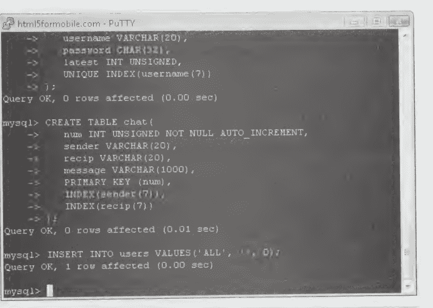

### 设置 MySQL

在我们查看聊天室项目的代码之前，你首先需要设置一个 MySQL 数据库和表。如果你已经安装了 MySQL 的 Web 服务器，并且已经完成了第 8 章的学习，你应该已经有一个名为 `phpdb` 的数据库（如果没有，你需要在继续本章之前创建一个 MySQL 数据库），你可以通过进入 MySQL 命令行并输入以下内容来使用它：

```
use phpdb;
```

接下来，你需要创建一个表来存储所有用户的登录详细信息。我将这个表命名为`users`。它需要一个`username`字段和一个`password`字段，以及一个名为`latest`的第三个字段，该字段将存储一个 0 到 43 亿之间的无符号整数值，用于保存用户最近查看的消息编号，以便只显示更新的消息。这个聊天室几乎不可能收到近 40 亿条帖子，但存储这个值仅占用 4 个字节。

为了能够快速查找表中的用户，你需要为其`username`字段分配一个索引，并选择将此索引长度设为七个字符，这大约是最大用户名长度 20 个字符的三分之一。`password`字段将存储一个 32 个字符的字符串，该字符串由使用 PHP `md5()`函数处理密码后生成，如第 8 章所述。

要创建符合这些规格的表，请在 MySQL 命令行中输入以下行（参见图 11-2）：

```
CREATE TABLE users(
    username VARCHAR(20),
    password CHAR(32),
    latest INT UNSIGNED,
    UNIQUE INDEX(username(7))
);
```

接下来，你需要创建一个表来包含聊天消息。它将包含一个名为`num`的无符号整数字段，用于唯一标识每条消息。此字段将被设置为主键以进行索引，并且在每次插入消息后将自动递增。

该表还需要`sender`和`recip`字段来存储每条消息的发送者和接收者用户名，并且需要为每个字段的前七个字符建立索引以便快速搜索。最后，该表需要一个`message`字段来存储消息本身（最多 1,000 个字符）。`message`字段不需要建立索引，因为本项目不打算允许按消息内容进行搜索。

要在 MySQL 提示符下创建表，请输入以下行，如图 11-3 所示：

```
CREATE TABLE chat(
    num INT UNSIGNED NOT NULL AUTO_INCREMENT,
    sender VARCHAR(20),
    recip VARCHAR(20),
    message VARCHAR(1000),
    PRIMARY KEY (num),
    INDEX(sender(7)),
    INDEX(recip(7))
);
```

包含`recip`字段和`sender`字段的原因是为了允许私信功能。在本项目中，任何接收者用户名为 `ALL` 的消息都被视为向所有人发布的公开消息。但如果`recip`是任何其他用户名，那么只有发送者和接收者才能查看它。因此，我们需要将用户名 `ALL` 保留起来，不让新用户选择，方法是输入以下行来保留该用户名，如图 11-4 所示：

```
INSERT INTO users VALUES('ALL', '', 0);
```

因为提供的密码是空字符串 `''`，它永远无法与`md5()`哈希字符串匹配，所以这个用户名现在就被保留了。

### HTML

这个项目的 HTML 代码相当简短，但文件却相当长，因为它还包含了 CSS 和 JavaScript 代码，以减少服务器请求次数。将所有三个元素放在单个 HTML 页面中也降低了 Android 缓存 CSS 或 JavaScript 的风险（如果它们在单独的文件中），这样你对它们进行的任何更新都可能被浏览器忽略，直到缓存更新，这使得它们几乎无法正确调试。

接下来展示的文件包含标准的标题行（在第 1 章中讨论）、一个用于创建屏幕键盘的部分、另一个用于登录界面的部分，以及几个用于私信弹出窗口的部分。以下网页中需要特别指出的是 ID 为 `main` 的`<div>`，它包含键盘上方屏幕的顶部区域，以及 ID 为 `keyboard` 的`<div>`，它包含键盘。

```
<!DOCTYPE html> <!-- robs.htm -->
<!-- saved from url=(0014)about:internet -->
<html><head><meta name='viewport' content='width=980' />
<link rel='apple-touch-icon' href='robs.png' />
<meta name='apple-mobile-web-app-capable' content='yes' />
<html>
    <head>
        <title>Rob's Place</title>
        <link href="robs.css" rel="stylesheet" type="text/css" />
    </head>
    <style>
        // 本部分的内容单独列出
    </style>
    <body bgcolor='black'>
        <table id='table' border='0' cellpadding='0' cellspacing='0' height='100%' width='100%'>
            <tr><td><div id='title'>Rob's Place</div>
            <div id='logout'>&times;</div>
            </td></tr><tr><td height='100%'>
<div id='main'>
    <div id='mainoverlay'></div>
    <div id='pmoverlay'></div>
    <div id='pmoverlay2'></div>
</div>
</td></tr><tr><td height='338'>
<div id='keyboard'>
    <div id='inpcontainer'>
        <textarea id='input' rows='1'>_</textarea><div
            id='clear'>&laquo;</div>
        <div id='inpoverlay'></div>
    </div>
    <div id='keybcontainer'>
        <div id='board'>
            <div class='k' id='q'>Q</div><div class='k' id='w'>W</div>
            <div class='k' id='e'>E</div><div class='k' id='r'>R</div>
            <div class='k' id='t'>T</div><div class='k' id='y'>Y</div>
            <div class='k' id='u'>U</div><div class='k' id='i'>I</div>
            <div class='k' id='o'>O</div><div class='k' id='p'>P</div>
            <div class='k' id='a'>A</div><div class='k' id='s'>S</div>
            <div class='k' id='d'>D</div><div class='k' id='f'>F</div>
            <div class='k' id='g'>G</div><div class='k' id='h'>H</div>
            <div class='k' id='j'>J</div><div class='k' id='k'>K</div>
            <div class='k' id='l'>L</div>
            <div class='k' id='del'>&#8592;</div>
            <div class='k' id='shift'>&dArr;</div>
            <div class='k' id='z'>Z</div><div class='k' id='x'>X</div>
            <div class='k' id='c'>C</div><div class='k' id='v'>V</div>
            <div class='k' id='b'>B</div><div class='k' id='n'>N</div>
            <div class='k' id='m'>M</div>
            <div class='k' id='at'>@#</div>
            <div class='k' id='ques'>?&amp;</div>
            <div class='k' id='alt'>123</div>
            <div class='k' id='apos'>`</div>
            <div class='k' id='space'></div>
            <div class='k' id='comma'>,;:!</div>
            <div class='k' id='period'>.</div>
            <div class='k' id='post'>Post</div>
        </div>
    </div>
</div></td></tr></table>
<script>
    // 本部分的内容单独列出
</script>
</body>
</html>
```

这个网页从本地或远程 URL 加载到浏览器中，然后使用 CSS 进行样式设置，聊天代码在最后的`<script>`部分被调用。

### CSS 样式

虽然 HTML 代码看起来（并且确实是）相当直观，但这个项目内部包含了许多复杂功能，例如用于输入私信的弹窗、对象的渐入渐出效果、平滑的渐变填充，以及阴影和过渡等其他效果。

但解释项目的每个方面超出了本书的范围，特别是因为你可能会编写自己的 Web 应用，而不是在此基础上扩展（如果你愿意，欢迎这样做，但请使用不同于 Rob 的名称），因此你应该直接使用以下 CSS 代码，并主要在查看 JavaScript 或 PHP 代码时将其作为参考：

```css
/* Rob's Place CSS Rules from the <style> section of the page */
body, html {
    padding :0;
    margin  :0;
    height  :100%; }
.inp {
    width         :14em;
    max-width     :14em;
    height        :1.2em;
    padding       :0 10px;
    margin-bottom :20px;
    color         :#000;
    overflow      :hidden;
    border        :10px solid #ccc;
    background    :#fff; }
.k {
    float        :left;
    width        :88px;
    height       :65px;
    margin       :4px;
    text-align   :center;
    font-size    :3.5em;
    color        :#000;
    background   :#e0e4cc;
    -webkit-box-shadow: 4px 4px 4px #444;
    -moz-box-shadow   : 4px 4px 4px #444; }
.pm {
    background :#e0e4cc; }
.cont {
    width        :400px;
    margin       :50px;
    font-size    :1.3em;
    text-shadow  :5px 5px 5px #444;
    -webkit-box-shadow: 6px 8px 8px #444;
    -moz-box-shadow   : 6px 8px 8px #444; }
.user {
    white-space :nowrap;
    padding-right:2%;
    font-weight :bold;
    color        :#22b; }
#alt, #post {
    width        :184px; }
#clear {
    float        :right;
    width        :56px;
    height       :50px;
    margin-right :12px;
    text-align   :center;
    font-size    :2.5em;
    color        :#000;
    background   :#e0e4cc; }
#comma {
    width        :104px; }
#del {
    font-size    :4.5em;
    line-height  :.7em; }
#inpcontainer, #keybcontainer {
    position     :relative; }
#inpoverlay {
    width        :892px;
    height       :56px;
    left         :0px;
    top          :0px;
    margin-left  :.5%;
    z-index      :10;
    opacity      :0; }
#input {
    width        :886px;
    height       :50px;
    padding      :0 0 0 4px;
    margin-left  :.5%;
    font-size    :2.5em;
    overflow     :hidden; }
#keyboard {
    width        :970px;
    height       :336px;
    padding      :4px 0px 20px 4px;
    opacity      :0; }
#logout {
    top          :7px;
    right        :10px;
    width        :60px;
    height       :60px;
    text-align   :center;
    line-height  :1.1em;
    font-size    :3.5em;
    color        :#f00;
    background   :#e0e4cc;
    opacity      :0; }
#main {
    width        :958px;
    height       :100%;
    padding      :8px;
    margin-bottom:5px; }
#mainoverlay {
    width        :97%;
    height       :96%;
    top          :10px;
    left         :0px;
    font-size    :4em;
    padding      :10px;
    z-index      :10;
    opacity      :0; }
#period {
    width        :72px; }
#pminput {
    width        :90%;
    height       :335px;
    margin-top   :10px;
    padding      :3%;
    font-size    :1em;
    font-family  :helvetica;
    -webkit-box-shadow:10px 10px 10px #888;
    -moz-box-shadow :10px 10px 10px #888; }
#pmoverlay {
    width        :80%;
    height       :500px;
    top          :9%;
    left         :9%;
    padding      :10px;
    text-align   :center;
    font-size    :3em;
    background   :#e0e4cc;
    background   :-webkit-gradient(linear, left top, left bottom, from(#e0e4cc), to(#a7dbd8));
    background   :-moz-linear-gradient(top, #e0e4cc, #a7dbd8);
    z-index      :-1;
    opacity      :0;
    -webkit-box-shadow:20px 20px 10px #888;
    -moz-box-shadow :20px 20px 10px #888; }
#pmoverlay2 {
    width        :83%;
    height       :525px;
    top          :9%;
    left         :9%;
    z-index      :-1; }
#pmtip {
    width        :100%;
    text-align   :center;
    font-size    :.6em;
    font-style   :italic; }
#post {
    width        :184px; }
#shift {
    font-size    :2.8em;
    line-height  :1.3em; }
#space {
    width        :280px; }
#title {
    width        :958px;
    height       :58px;
    padding      :8px;
    margin-bottom:5px;
    text-align   :center;
    font-size    :3em;
    text-shadow  :5px 5px 5px #444; }
.k, .cont, #clear, #inpoverlay, #input, #logout, #mainoverlay,
#pmoverlay, #title {
    font-weight  :bold;
    font-family  :helvetica; }
.cont, #title {
    color        :#fff;
    background   :#fa6900;
    background   :-webkit-gradient(linear, left top, left
                 bottom, from(#f38630), to(#fa6900));
    background   :-moz-linear-gradient(top, #f38630, #fa6900); }
#keyboard, #main {
    position     :relative;
    border       :1px solid black;
    background   :#69d2e7;
    background   :-webkit-gradient(linear, left top, left
                 bottom, from(#69d2e7), to(#a7dbd8));
    background   :-moz-linear-gradient(top, #69d2e7, #a7dbd8); }
.pm, #clear, #logout, #pminput, #pmoverlay, #title {
    border       :1px solid #000; }
.inp, .k, .cont, .user, #clear, #logout, #pmoverlay2 {
    cursor       :pointer; }
#inpoverlay, #logout, #mainoverlay, #pmoverlay,
#pmoverlay2, #pmtip {
    position     :absolute; }
.inp, .k, .pm, .cont, #clear, #keyboard, #logout, #main,
#pminput, #pmoverlay, #title {
    border-radius: 10px;
    -moz-border-radius: 10px; }
.k, #keyboard, #logout, #mainoverlay, #pmoverlay {
    -webkit-transition: opacity, color, background 0.25s linear;
    -moz-transition: opacity, color, background 0.25s linear; }
```

### JavaScript 程序

我已经多次重构了 JavaScript 代码，将其从超过 1000 行的代码精简到现在尽可能简单的状态。但你并不需要理解所有代码；我也不会详细解释它。相反，我将简单地给出代码大纲，主要涵盖每个函数的功能，以便你可以了解在编写自己的 Web 应用时需要考虑的事项类型。

此外，该代码已被编写为支持触摸和鼠标输入，你可以在 PC 或 Mac 上的任何最新浏览器版本中运行该项目，只要使用最大缩小视图（如图 11-5 所示）。这使得在台式计算机上修改和快速重新测试代码变得容易。

#### 全局变量

代码的前十几行设置了项目使用的一些全局变量。这些包括文件名和位置，以及变量`BROWSER`，它将在需要设备相关代码时被访问。

此外，`window.onload = function()`定义之后的前几个赋值语句创建了一些在整个项目中使用的额外全局变量，再往后还创建了几个。所有全局变量都很容易识别，因为它们是大写的，并在表 11-1 中列出。

以下是函数定义之前的代码第一部分：

```javascript
// Rob's Place JavaScript from the <script> section of the page
BASEURL         = 'http://html5formobile.com/examples/'
MAINPAGE        = BASEURL + 'robs.htm'
LOGIN           = BASEURL + 'robslogin.php'
GETCHAT         = BASEURL + 'robsgetchat.php'
POSTCHAT        = BASEURL + 'robspost.php'
UNDEF           = 'undefined'
LOCALSTORAGE    = true
RECIP           = 'ALL'
TAIL            = window.location.search.substring(1)

if (TAIL.length > 0) TAIL = '?' + TAIL
```

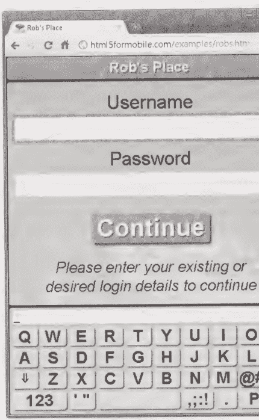

| 全局变量 | 用途 |
| :--- | :--- |
| BASEURL | 包含程序文件和数据的 Web 服务器文件夹的 URL |
| MAINPAGE | 主 HTML 网页的 URL |
| LOGIN | PHP 登录页面的 URL |
| GETCHAT | 返回最新聊天消息的 PHP 页面的 URL |
| POSTCHAT | 发布新消息的 PHP 程序的 URL |
| UNDEF | 字符串"undefined"的简写变量 |
| LOCALSTORAGE | 布尔变量，如果HTML5本地存储可用则值为true |
| RECIP | 包含当前接收者用户名的字符串 |
| BROWSER | 字符串变量，包含浏览器类型：Apple设备为"iOS"，Dell Streak Android设备为"Streak"，其他Android设备为"Android"，所有其他设备和桌面/笔记本电脑为"Other" |
| ALPHA | 数组，包含虚拟键盘中用于显示字母键和其他键的所有`<div>`部分名称 |
| UPPER | 字符串，包含大写字母A-Z，用于切换键盘为大写模式 |
| NUMBERS | 字符串，包含点击"123"键时可查看的替代字符。注意字符串赋值中使用了转义序列`\\`，结果只插入单个`\`字符 |
| OLDBUT | 最近点击按键的样式对象副本 |
| MAXINP | 整数，包含最大输入长度 |
| SMARTPERIOD | 布尔变量，如果在点击句点键后应在输入中添加空格则为true，否则为false |
| FIRST | 布尔变量，如果在首次请求服务器获取最新聊天消息时为true，则返回最近50条消息。如果为false，则仅从服务器返回未读消息 |
| GETFREQ | 整数，包含轮询服务器新消息的频率（毫秒）。默认值为2000毫秒，即2秒 |
| USERNAME | 用户输入的用户名 |
| PASSWORD | 用户输入的密码 |
| CHATTOUT | 由重复的Ajax中断返回的句柄，可用于禁用它们 |
| TOUT | HighlightButton()函数使用的句柄，用于在两秒后移除应用于按键的高亮显示 |
| THEFIELD | 如果键盘数据要传输到外部字段，此变量保存其ID |

表 11-1 使用的全局变量及其用途

```
if (self.location != MAINPAGE + TAIL ) self.location = MAINPAGE + TAIL

if (NavCheck('iPod') || NavCheck('iPhone') || NavCheck('iPad'))
                        BROWSER = 'iOS'
else if (NavCheck('Dell Streak')) BROWSER = 'Streak'
else if (NavCheck('Android'))     BROWSER = 'Android'
else                              BROWSER = 'Other'

document.onkeypress = function(e)
{
    var key = ''

    switch(e.keyCode)
    {
        case  8: key = 29; break
        case 13: PostMessage(RECIP); return false
    }

    var p = String.fromCharCode(e.charCode)

    switch(p)
    {
        case ' ': key = 26; break
        case '"':
        case "'": key = 27; break
        case '.': key = 30; break
        case '@':
        case '#': key = 32; break
        case '?':
        case '&': key = 33; break
        case ',':
        case ';':
        case ':':
        case '!': key = 34; break
    }

    c = ALPHA.indexOf(p)
    if (c > -1)
    {
        key = c
        DoToLower()
    }

    c = UPPER.indexOf(p)
    if (c > -1)
    {
        key = c
        DoToUpper()
    }

c = NUMBERS.indexOf(p)
if (c > -1)
{
    key = c
    DoToNumbers()
}

ProcessKey(key)
return false
}
```

```
window.onload = function()
{
    ALPHA = new Array('a', 'b', 'c', 'd', 'e', 'f', 'g', 'h', 'i', 'j',
                     'k', 'l', 'm', 'n', 'o', 'p', 'q', 'r', 's', 't', 'u', 'v', 'w',
                     'x', 'y', 'z', 'space', 'apos', 'alt', 'del', 'period', 'shift',
                     'at', 'ques', 'comma')
    UPPER          = 'ABCDEFGHIJKLMNOPQRSTUVWXYZ'
    NUMBERS        = '(!¥_3%+-8*/=\~9014)57€2£6$'
    OLDBUT         = O('space')
    BUFFER         = ''
    MAXINP         = 0
    SMARTPERIOD    = true
    FIRST          = true
    GETFREQ        = 2000
    S('board').height = '280px';

    if (BROWSER == 'iOS')
    {
        S('logout').lineHeight = '.9em'
        S('shift' ).fontSize   = '3.5em'
        S('shift' ).lineHeight = '1.1em'
        O('del'   ).innerHTML  = '&nbsp;&#8592;'
    }

    O('inpoverlay').ontouchstart =
    O('keyboard'  ).ontouchstart = StopDefaultAction

    for (j = 0 ; j < ALPHA.length ; ++j)
        eval('ActivateObject(O(ALPHA[j]), function(e) ' +
            '{ ProcessKey(' + j + ', e) })')

    ActivateObject(O('clear'), SetUpClearBut)
    window.scrollTo(0, 1)

    wh = window.innerHeight
    ww = window.innerWidth
    if (ww > wh) wh = ww / wh * ww

S('table').height = wh + 'px'
S('table').width  = '100%'
S('main').height  = '100%'

if (BROWSER != 'Other') setTimeout(function()
    { window.scrollTo(0, 1) }, 500)

try
{
    USERNAME = localStorage.getItem('username')
    PASSWORD = localStorage.getItem('password')
}
catch(e)
{
    LOCALSTORAGE = false
    USERNAME     = ProcessCookie('read', 'username')
    PASSWORD     = ProcessCookie('read', 'password')
}

if (USERNAME && PASSWORD)
{
    display = "<table height='100%' width='100%' border='0'><tr>" +
              "<td align='center' valign='absmiddle'>欢迎回来，" +
              USERNAME + "<div id='login' class='cont'>继续</div>" +
              "<br /><br /></td></tr></table></center>"

    O('mainoverlay').innerHTML  = display
    S('mainoverlay').opacity    = '1'
    S('keyboard'    ).opacity   = '.5'

    ActivateObject('login', Login)
} else DoLogin()
}
```

设置好各种全局变量后，第一段特别有趣的代码是`document.onkeypress = function(e)`部分，它将事件附加到浏览器的`onkeypress`事件，并将按键处理为对虚拟键盘的点击。这允许带有物理键盘的设备也能使用它们来发送聊天消息。

以下用于设置虚拟键盘的代码也值得特别关注：

```
for (j = 0 ; j < ALPHA.length ; ++j)
    eval('ActivateObject(O(ALPHA[j]), function(e) ' +
         '{ ProcessKey(' + j + ', e) })')
```

这是一个`for()`循环，遍历`ALPHA`数组中的键盘键`<div>`部分，并使用`ActivateObject()`函数将按键点击分配给`ProcessKey()`函数进行处理。

> **注意**
>
> 使用`eval()`函数是为了在每次迭代中启用变量`j`的当前值，而不是简单地传递变量`j`本身，后者只在事件被点击时才会被求值。这是相当高级的JavaScript，所以如果它让你困惑，不用担心——你可以直接复制粘贴代码来在你自己的Web应用中使用。

同样需要注意这些行中HTML5本地存储的使用：

```
USERNAME = localStorage.getItem('username')
PASSWORD = localStorage.getItem('password')
```

使用它们，如果用户之前已登录（且未退出），登录详细信息将从本地存储中提取，使用户无需重新输入，如以下`if()`语句所示，该语句只是在一个ID为`login`的`<div>`中呈现一个"继续"按钮供点击，而不是显示登录屏幕，如图11-6所示（从Dell Streak截取的屏幕截图）。请注意，此时键盘显示为灰色，因为目前没有内容可以输入。

> **注意**
>
> 顺便说一句，由于这不是必需的，我正在考虑如果发现它减慢了作为应用运行时页面的即时加载速度，就移除地球图片，所以如果它没有出现在网站上的`examples.zip`文件中，你就会知道原因。

对`getItem()`函数的两次调用被放置在`try`部分中，这样不支持HTML5本地存储的浏览器就不会发出错误，而是转到`catch`部分，其中使用标准浏览器cookie作为替代。

这段代码的最后两行也很有趣：

```
ActivateObject('login', Login)
} else DoLogin()
```

第一行附加到`login` `<div>`，这样当它被点击时，将调用`Login()`函数来验证提交的详细信息并让用户登录。

第二行仅在本地存储未返回保存的用户名和密码时运行。它调用`DoLogin()`函数，该函数在以下部分之后详细介绍。

### 准备使用Ajax

在继续讨论函数之前，我们需要回顾本节开头的几行代码：

```
TAIL = window.location.search.substring(1)

if (TAIL.length > 0) TAIL = '?' + TAIL
if (self.location != MAINPAGE + TAIL) self.location = MAINPAGE + TAIL
```

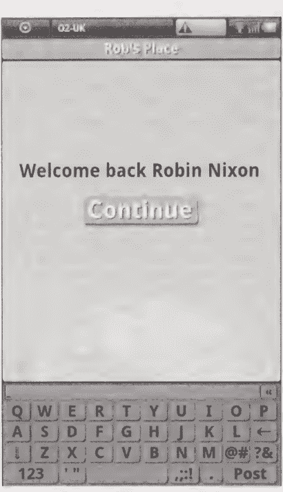

这段代码的作用是确保当前网页的 URL 与变量`MAINPAGE`中的 URL 不一致时，会加载`MAINPAGE`中的 URL 来替换当前页面。使用`TAIL`字符串是为了保留附加在 URL 上的任何查询字符串。

进行页面切换的简单原因是：聊天代码使用了 Ajax，而出于安全考虑，Ajax 通信*只能*在服务器和加载自该服务器的网页之间进行。例如，如果网页是下载到本地运行的，Ajax 就会失败，页面也无法正常运行。但是，通过始终确保页面与 PHP 文件来自同一服务器和文件夹，Ajax 就应该能正常运行。

#### DoLogin() 函数

如果初步代码无法从 HTML5 本地存储中检索到保存的用户名和密码，则会调用此函数。它只是显示一个简单的网页表单，并将用户名和密码输入框（`uname`和`pword`）关联到`GetInput()`函数，将“继续”按钮关联到`LoginCheck()`函数。

为了启动流程，最后一行调用`GetInput()`并传入值`uname`，以便自动在该字段上激活键盘：

```
function DoLogin()
{
    display = "<table height='100%' width='100%' border='0'><tr><td " +
        "align='center' valign='absmiddle'><div id='unameinp'>Username" +
        "<div id='uname' class='inp'></div></div><div id='pwordinp'>" +
        "Password <div id='pword' class='inp'></div></div><div id=" +
        "'login' class='cont'>Continue</div><div style='font-size:.8em;" +
        "'><i>Please enter your existing or<br />desired login details " +
        "to continue</i></div></td></tr></table></center>"

    S('mainoverlay').opacity    = '1'
    S('mainoverlay').fontSize   = '4em'
    O('mainoverlay').innerHTML  = display

    ActivateObject('unameinp', function() { GetInput('uname') } )
    ActivateObject('pwordinp', function() { GetInput('pword') } )
    ActivateObject('login', LoginCheck())
    GetInput('uname')
}
```

#### LoginCheck() 函数

当点击“继续”按钮时，会调用`LoginCheck()`函数来验证`USERNAME`和`PASSWORD`变量。它进行一个简单的测试，即确保两个变量都被赋了值。如果其中一个或两个都没有值，则会弹出一个警告框，显示如图 11-7 所示的消息。但如果两个变量都有值，则会调用`Login()`函数。

```
function LoginCheck()
{
    USERNAME = O('uname').innerHTML
    if (USERNAME.length == 0) alert('Please Enter a Username')
    else
    {
        PASSWORD = O('pword').innerHTML
        if (PASSWORD.length == 0) alert('Please Enter a Password')
        else Login()
    }
}
```

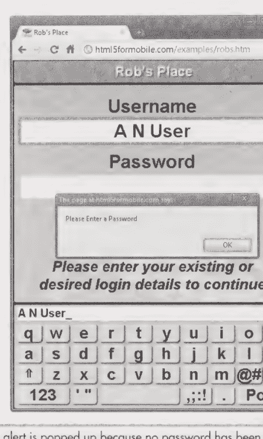

#### Login() 函数

此函数使用 Ajax，通过变量*USERNAME*和*PASSWORD*中的值查询 Web 服务器。服务器会返回一个单词：如果服务器出问题则返回 “Error”；如果用户名不存在或密码与用户名不匹配则返回 “Invalid”；如果用户名和密码验证通过则返回 “Valid”。

```
function Login()
{
    PostAjaxRequest(result, LOGIN, 'u=' + USERNAME + '&p=' + PASSWORD)
    S('mainoverlay').opacity = ''

function result()
{
	if (this == 'Error')
	{
		alert('There was an error - please try again.')
		DoLogin()
	}
	else if (this == 'Invalid')
	{
		alert('That Username is taken or the Password is incorrect' +
			' - please try again')
		DoLogin()
	}
	else
	{
		O('title').innerHTML = "Rob's Place (" + USERNAME + ')'
		S('logout').opacity  = '1'

		if (LOCALSTORAGE)
		{
			localStorage.setItem('username', USERNAME)
			localStorage.setItem('password', PASSWORD)
		}
		else
		{
			ProcessCookie('save', 'username', USERNAME, 31556926)
			ProcessCookie('save', 'password', PASSWORD, 31556926)
		}

		ActivateObject('logout', Logout)
		PostMessage('ALL', '... has joined')

		BUFFER                = ''
		SMARTPERIOD           = true;
		MAXINP                = 1000
		S('mainoverlay').fontSize  = '2em'
		S('mainoverlay').fontWeight = 'normal'
		S('mainoverlay').overflow  = 'auto'
		S('keyboard'    ).opacity  = '1'
		O('input'       ).value    = '_'
		O('mainoverlay').innerHTML  = ''

		GetChat()
		DoToUpper()
		SetPostRecipient('ALL')
	}
}
```

第一行的 Ajax 调用`PostAjaxRequest()`使用 POST 请求，将`USERNAME`的内容放在字段`u`中，`PASSWORD`的内容放在`p`中传递。变量`LOGIN`包含要调用的 PHP 程序的 URL。

完成后，Ajax 程序会调用本地函数`result()`（构成函数代码的其余部分）。如果发生错误或凭据验证失败，则会显示消息并调用`DoLogin()`函数以再次请求输入。否则，用户名和密码验证通过，因此`else`代码段将页面标题更改为包含用户名，并通过将按钮的不透明度从 0 改为 1 来在标题栏添加注销按钮。由于在此按钮的 CSS 规则中应用了 CSS 过渡效果，该按钮会平滑地淡入。

然后，用户名和密码内容被保存在本地存储中（如果不可用则保存在 cookie 中），以便在用户注销之前（或除非用户注销）未来快速访问，注销按钮被关联到`Logout()`函数，并且消息“… 已加入”使用用户名发布到聊天中。

此后，输入缓冲区`BUFFER`被重置，`SMARTPERIOD`被设置为`true`以允许句号后自动添加空格，`MAXINP`中的最大输入长度设置为 1,000 个字符，并修改各种 CSS 属性以最佳方式呈现聊天界面。

最后三行设置重复的 Ajax 调用到服务器以持续获取新消息，将键盘切换为大写字母，并将帖子的默认接收者设置为用户`ALL`，这意味着所有消息都将是公开的。

#### GetChat() 函数

此函数使用`PostAjaxRequest()`函数设置到 Web 服务器的 Ajax 调用。每次都在字段`u`和`p`中传递用户名和密码，因此每个 Ajax 请求都会验证用户的凭据。

如果变量`FIRST`为`true`，则字段`f`也会传递给 Web 服务器，服务器将返回最近的 50 条消息以填充聊天屏幕，显示最新的聊天内容。否则，在第一次之后，`FIRST`被设置为`false`，此后服务器只会返回那些尚未读取的消息。

```
function GetChat()
{
    var args = 'u=' + USERNAME + '&p=' + PASSWORD

    if (FIRST)
    {
        args += '&f=1'
        FIRST = false
    }

    PostAjaxRequest(ShowChat, GETCHAT, args)
}
```

变量`GETCHAT`包含服务器上要调用的 PHP 程序的 URL，并指定`ShowChat()`函数作为 Ajax 调用返回数据的目标。

#### ShowChat() 函数

Web 服务器返回的数据由`ShowChat()`函数在伪变量`this`中接收。如果没有新消息，则`this`包含空字符串。否则，变量`text`被赋值为`this`内容的副本，以便将 Web 服务器返回的任何`ontouchstart`事件实例替换为`onclick`，以支持不支持`ontouchstart`事件的浏览器。

然后，`mainoverlay` `<div>`的`innerHTML`属性追加了`text`的内容，并且将`<div>`滚动到第 100,000 行——这一行几乎肯定永远不会到达，因此此调用的效果是简单地滚动聊天屏幕，以便可以看到最新消息。

```
function ShowChat()
{
    if (this.length > 0)
    {
        var text = this

        if (BROWSER == 'Other')
            text = text.replace(/ontouchstart/g, 'onclick')

        O('mainoverlay').innerHTML += text
        O('mainoverlay').scrollTop = '100000'
        S('mainoverlay').opacity = '1'
        GETFREQ = 2000;
    } else GETFREQ += 17;

    CHATTOUT = setTimeout(GetChat, GETFREQ)
}
```

如果没有返回消息，则伪变量`this`没有内容，因此`GETFREQ`增加 17。其效果是，每次服务器没有返回任何内容时，再次尝试之前的延迟时间会增加 17 毫秒。因此，在聊天室不活跃的一天，如果 60 秒内没有返回消息，消息检查之间 2,000 毫秒的间隔将增加到 3,020 毫秒，即略超过 3 秒——并且在一小时没有检索到消息后，服务器现在将每分钟轮询一次，依此类推。

但是，一旦收到任何消息，延迟频率会恢复到两秒，因此这是在很少或没有聊天发生时，最小化服务器和用户带宽使用的好方法。

此函数的最后一行设置一个中断，在两秒后再次调用`GetChat()`函数，使用`setTimeout()`函数，其返回值保存在全局变量`CHATTOUT`中，以便在用户注销时可以禁用超时。否则，流程通过 Ajax 调用在`GetChat()`和`ShowChat()`之间无限期地继续，因此聊天屏幕将在用户执行其他操作（例如输入要发送的消息）时更新新消息。

图 11-8 显示了刚登录后以及发送和接收一对私聊消息后的聊天界面（在 Apple iPad 上），私聊消息以高亮和边框显示。


### SetPostRecipient() 函数

此函数在`Login()`函数中被调用，用于将`PostMessage()`函数绑定到虚拟键盘上的发送按钮。该函数简短而精巧，其核心作用是确保无论`to`变量中存储了哪个用户名，都会将其设置为所有消息的默认接收者。

```
function SetPostRecipient(to)
{
    RECIP = to
    ActivateObject('post', function() { PostMessage(to) } )
}
```

全局变量`RECIP`同样被赋值为`to`中的值，这样当按下附加键盘上的`ENTER`键时，便能查找当前接收者值并发送消息。

### PostMessage() 函数

在绑定到发送按钮后，当按钮被点击时，此函数就会被调用。它使用`to`和`mess`参数的内容，通过Ajax发送消息。

`to`参数是消息接收者的用户名，如果是公开消息，则值为`ALL`。如果`mess`有值，则它包含要发送的消息。否则，将使用虚拟键盘变量`BUFFER`中存储的消息。设置`mess`参数的原因是为了支持快速发送消息，例如当用户登录时发送“Fred ... 已加入”。

只要要发送的消息不是空字符串，它就会通过`PostAjaxRequest()`函数发送到服务器。然后，键盘的`BUFFER`变量会被清空，同时ID为`input`的`<textarea>`（用于显示`BUFFER`的内容）也会被清空。

最后，调用`RemovePMWindow()`函数以关闭窗口（以防消息是从私信窗口发送的），并将键盘重置为大写字母。

```
function PostMessage(to, mess)
{
    if (typeof mess != UNDEF) BUFFER = mess
    else HighlightButton('post')

    if (BUFFER.length > 0)
    {
        PostAjaxRequest(function() {}, POSTCHAT,
            'u=' + USERNAME + '&p=' + PASSWORD + '&t=' + to + '&m=' + BUFFER)
        BUFFER = ''
        O('input').value = '_'
        RemovePMWindow()
        DoToUpper()
    }
}
```

> **注意**
>
> 在代码的第二行中，如果要发送的消息来自键盘，则会调用`HighlightButton()`函数。这会产生改变按键颜色的效果，该颜色会在按下另一个键或两秒内无任何按键操作后恢复。

### SendPM() 函数

我在上一节中简要提及了私信（PM）窗口。当点击某个用户名时，该窗口会弹出，并允许向该人发送私信。这是通过服务器返回的聊天HTML，为每个用户名附加一个`ontouchstart`事件来实现的。

激活后，此函数通过更改其CSS `z-index`属性，将PM窗口（ID为`pmoverlay`的`<div>`）置于顶层，如图11-9所示，这是一张从三星Galaxy Tab上截取的屏幕截图。


另一个覆盖层也被提升到此窗口之上，以便将`<textarea>`置于其下。这可以防止在点击`<textarea>`时弹出iOS或Android内置的虚拟键盘，这种行为是我们不希望出现的，因为我们已经提供了自己的键盘。

为了将键盘输入发送到`<textarea>`，其ID `pminput`被传递给`GetInput()`函数。然后，通过调用`SetPostRecipient()`将默认接收者设置为被点击的用户名。

```
function SendPM(to)
{
    S('pmoverlay' ).zIndex       = '20'
    S('pmoverlay2').zIndex       = '30'
    S('pmoverlay' ).opacity      = '1'
    O('pmoverlay' ).innerHTML = 'PM ' + to + "<textarea id='pminput'>" +
    "</textarea><div id='pmtip'>Use keyboard to send message, or " + "tap to close.</div>"

    GetInput('pminput')
    SetPostRecipient(to)
    ActivateObject('pmoverlay2', RemovePMWindow)
}
```

在最后一行，覆盖在PM窗口上的`<div>`的`ontouchstart`事件（或在非iOS/Android设备上的`onclick`事件）被分配给了`RemovePMWindow()`函数，这样当它被点击时，PM窗口就会直接消失。

### RemovePMWindow() 函数

此函数在以下两种情况被调用：点击覆盖在PM窗口上的`<div>`，或使用`PostMessage()`函数发送消息时。它通过清空其`innerHTML`并将`z-index`属性更改为置于所有其他对象之后来移除窗口（及其第二层覆盖层）。窗口的`opacity`也被设置为`0`，并且虚拟键盘缓冲区被清空。

```
function RemovePMWindow()
{
    O('pmoverlay').innerHTML = ''
    S('pmoverlay').zIndex = '-1'
    S('pmoverlay2').zIndex = '-1'
    S('pmoverlay').opacity = '0'
    O('input').value = '_'
    BUFFER = ''

    SetPostRecipient('ALL')
    GetInput(null)
}
```

最后两行将默认接收者恢复为用户名`ALL`（这样消息将是公开的），并调用`GetInput()`函数。此实例中传递`null`值，因为没有需要将虚拟键盘输入副本放入的字段（例如登录或私信输入框）。如果需要将键盘输入缓冲区的内容复制到其他地方，参数将是目标字段的ID。

### GetInput() 函数

每当需要从虚拟键盘获取输入时，就会调用此函数。参数`field`指定输入应被分配到的字段（例如登录时的用户名和密码输入框——`uname`和`pword`）。如果其值为`null`，则表示没有需要将输入复制到的外部字段。在这种情况下，发送按钮将被定向为直接通过Ajax提交到Web服务器。

如果`field`指的是`uname`或`pword`（用户名和密码输入字段），则该字段会被设置样式，`SMARTPERIOD`被设置为`false`以禁用句点后的自动空格，`MAXINP`变量被设置为20（用户名或密码支持的最大长度）。

```
function GetInput(field)
{
    if (field == 'uname' || field == 'pword')
    {
        S('uname').borderColor =
        S('pword').borderColor = '#ccc'
        SMARTPERIOD = false
        MAXINP = 20
    } else MAXINP = 1000

    if (field != null)
    {
        BUFFER = O(field).innerHTML
        S(field).borderColor = '#fa6900'
    }

    O('input').value = BUFFER + '_'
    S('keyboard').opacity = '1'
    THEFIELD = field
    DoToUpper()
}
```

中间部分的代码确保，如果存在需要填充的外部字段，它会被设置为橙色边框。在最后四行代码中：输入`<textarea>`被设置为`BUFFER`的内容，后跟一个下划线字符作为光标；键盘的`opacity`被设置为1，这将由于CSS中为其启用的过渡效果而使其淡入；字段值的副本被放入全局变量`THEFIELD`中，供其他函数使用；键盘按键被重置为大写。

### ProcessKey() 函数

每当点击虚拟键盘中的某个按键时，就会调用此函数。它首先调用`StopDefaultAction()`以阻止iOS或Android对按键点击进行任何进一步处理。然后，局部变量`last`和`ch`分别被赋值为`BUFFER`中输入的长度和最后输入的字符。同时，通过调用`clearTimeout()`取消了为在不活动两秒后移除按键高亮而设置的任何超时事件。

随后是一个`switch()`语句，包含九个`case`部分，用于处理特殊按键（如句点、逗号和空格键），以及最后一个`default`部分来处理所有其他按键。

```
function ProcessKey(key, e)
{
    if (e) StopDefaultAction(e)

    var last = BUFFER.length - 1
    var ch   = BUFFER[last]

    if (typeof TOUT != UNDEF) clearTimeout(TOUT)

    switch(ALPHA[key])
    {
        case 'period':
            if (BUFFER.length >= MAXINP) return
            DoToUpper()
            BUFFER += '.'
            if (ch != '.' && SMARTPERIOD) BUFFER += ' '
            break
        case 'comma':
            if (ch == ',') BUFFER = BUFFER.substr(0, last) + ';';
            else if (ch == ';') BUFFER = BUFFER.substr(0, last) + ':';
            else if (ch == ':') BUFFER = BUFFER.substr(0, last) + '!';
            else if (ch == '!') BUFFER = BUFFER.substr(0, last) + ',';
            else if (BUFFER.length < MAXINP) BUFFER += ','
            break
        case 'del':
            if (BUFFER.length > 1)
            {
                BUFFER = BUFFER.substr(0, BUFFER.length - 1)
                ch     = BUFFER[BUFFER.length - 1]
                if (ch == '.') DoToUpper()
                else if (NUMBERS.indexOf(ch) > -1) DoToNumbers()
                else DoToLower()
            }
            else
            {
                BUFFER = ''
                DoToUpper()
            }
            break
        case 'space':
            if (BUFFER.length >= MAXINP) return
            if (ch == '?' || ch == '!') DoToUpper()
            BUFFER += ' '
            break
        case 'ques':
            if (ch == '?') BUFFER = BUFFER.substr(0, last) + '&';
            else if (ch == '&') BUFFER = BUFFER.substr(0, last) + '?';
            else if (BUFFER.length < MAXINP) BUFFER += '?'
            break
    }
}
```

```javascript
case 'at':
    if     (ch == '@') BUFFER = BUFFER.substr(0, last) + '#';
    else if (ch == '#') BUFFER = BUFFER.substr(0, last) + "@";
    else if (BUFFER.length < MAXINP) BUFFER += '@'
    break
case 'apos':
    if     (ch == "'") BUFFER = BUFFER.substr(0, last) + "'";
    else if (ch == "'") BUFFER = BUFFER.substr(0, last) + "'";
    else if (BUFFER.length < MAXINP) BUFFER += "'"
    break
case 'shift':
    if (O('a').innerHTML != 'A') DoToUpper()
    else DoToLower()
    break
case 'alt':
    if (O('a').innerHTML == '(') DoToUpper()
    else DoToNumbers()
    break
default:
    if (BUFFER.length >= MAXINP) return
    BUFFER += O(ALPHA[key]).innerHTML
    if (O('a').innerHTML == 'A') DoToLower()
    break
}

O('input').value = BUFFER + '_'
O('input').scrollTop = 10000

HighlightButton(ALPHA[key])

if (THEFIELD)
{
    O(THEFIELD).innerHTML = BUFFER
    O(THEFIELD).scrollTop = 10000
}
```

`switch()`语句执行后，`input` `<textarea>`的值会更新为`BUFFER`的内容加上一个用作光标的下划线字符。然后，其`scrollTop`属性被设置为一个非常高的值，使得只有最新输入的字符可见。

之后，会调用`HighlightButton()`函数来高亮显示被点击的按键。接着，如果全局变量`THEFIELD`有值，它也会获得`BUFFER`内容的一个副本，并且其`scrollTop`属性会被设置为一个能确保只有最新输入字符处于视图中的值。这部分功能负责将键盘输入复制到外部字段。

#### DoToUpper() 函数

此函数确保虚拟键盘上显示大写字母 A 到 Z。SHIFT 键也被更改为向下箭头，ALT 键则设置为显示 123。

```javascript
function DoToUpper()
{
    for (var j = 0 ; j < 26 ; ++j) O(ALPHA[j]).innerHTML = UPPER[j]

    O('shift').innerHTML = '&dArr;'
    O('alt'  ).innerHTML = '123'
}
```

#### DoToLower() 函数

此函数确保虚拟键盘上显示小写字母 a 到 z（参见图 11-10）。SHIFT 键也被更改为向上箭头，ALT 键则设置为显示 123。

```javascript
function DoToLower()
{
    for (var j = 0 ; j < 26 ; ++j) O(ALPHA[j]).innerHTML = ALPHA[j]

    O('shift').innerHTML = '&uArr;'
    O('alt'  ).innerHTML = '123'
}
```

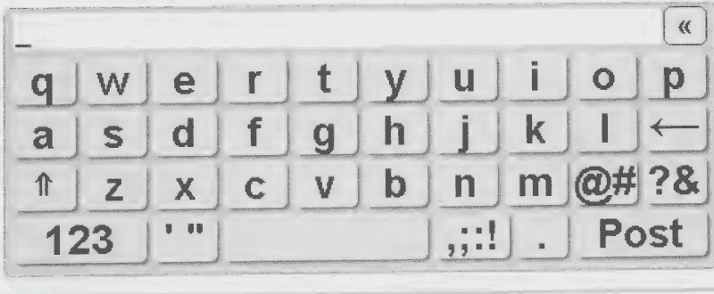

图 11-10 小写键盘

#### DoToNumbers() 函数

此函数确保虚拟键盘上显示数字 0 到 9 以及一系列标点符号、货币符号和其他符号（参见图 11-11）。SHIFT 键也被更改为向上箭头，ALT 键则设置为显示 ABC。

```javascript
function DoToNumbers()
{
    for (var j = 0 ; j < 26 ; ++j) O(ALPHA[j]).innerHTML = NUMBERS[j]

    O('shift').innerHTML = '&uArr;'
    O('alt'  ).innerHTML = 'ABC'
}
```

#### HighlightButton() 函数

此函数用于高亮显示虚拟键盘中的一个按键。它会在全局变量`OLDBUT`中保存该按键的副本，以便之后可以通过`setTimeout()`调用取消高亮显示，该调用设置一个在 2000 毫秒（2 秒）后执行匿名函数的中断。

```javascript
function HighlightButton(button)
{
    but           = S(button)
    but.background = '#fa6900'
    but.color      = '#fff'
}
```

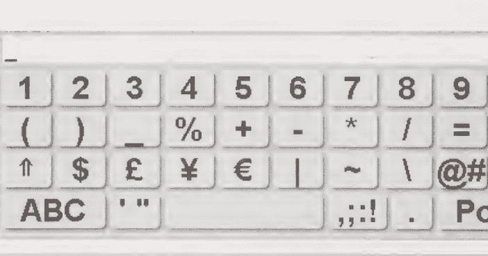

图 11-11 数字、货币和标点键盘

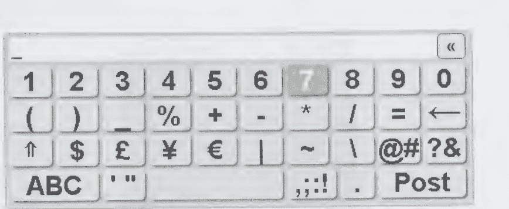

图 11-12 7 键刚刚被点击。

```javascript
if (OLDBUT != but)
{
    OLDBUT.background = '#e0e4cc'
    OLDBUT.color      = '#000'
    OLDBUT            = but
}

TOUT = setTimeout(function()
{
    but.background = '#e0e4cc'
    but.color      = '#000';
}, 2000)

}
```

在将`but`的副本赋值给`OLDBUT`之前，会先进行比较。如果它们不同，说明当前有另一个不同的按键被高亮显示，因此会先将其取消高亮。图 11-12 显示了数字模式下的键盘，其中 7 键当前被高亮显示。

#### Logout() 函数

此函数连接到显示在标题栏右侧的登出按钮。当点击登出按钮时，会弹出一个对话框，询问用户是否确认要登出，如图 11-13 所示。

如果用户选择“取消”，则函数直接退出，不执行任何操作。否则，变量`FIRST`会被设置为`true`，以便在用户（或其他人）再次登录时加载最多 50 行聊天记录，并且`USERNAME`和`PASSWORD`变量会被设置为空字符串。登出按钮也会被移除，标题后面的用户名也会被移除。


图 11-13 在 Nexus One 手机上查看的登出确认对话框

```javascript
function Logout()
{
    if (confirm("Logout from Rob's?"))
    {
        S('mainoverlay').overflow = 'hidden'
        S('logout').opacity = '0'
        O('title').innerHTML = "Rob's Place"
        FIRST = true
        USERNAME = PASSWORD = ''

        if (LOCALSTORAGE)
        {
            localStorage.removeItem('username')
            localStorage.removeItem('password')
        }
        else
        {
            ProcessCookie('erase', 'username')
            ProcessCookie('erase', 'password')
        }

        PostMessage('ALL', '... has left')
        clearTimeout(CHATTIMEOUT)
        DoLogin()
    }
}
```

在返回之前，该函数还会清除本地存储中的用户名和密码副本（如果支持本地存储）或 Cookie（如果不支持），以防止自动重新登录。一条类似“Mary ... has left”的消息会发布在聊天中。通过调用`clearTimeout()`取消了用于获取最新聊天消息的重复 Ajax 调用，并且调用了`DoLogin()`函数，以便允许用户（或新用户）重新登录。

#### NavCheck() 函数

此函数在程序开始时调用，根据浏览器提供的 User Agent 字符串来确定所使用的设备或浏览器类型。

```javascript
function NavCheck(check)
{
    return navigator.userAgent.indexOf(check) != -1
}
```

#### ActivateObject() 函数

此函数将`func`中指定的函数通过`ontouchstart`事件（如果设备是 iOS 或 Android）或`onclick`事件（在任何其他硬件上）附加到`object`对象。

```javascript
function ActivateObject(object, func)
{
    if (BROWSER != 'Other') O(object).ontouchstart = func
    else                     O(object).onclick      = func
}
```

对于 iOS 和 Android 设备，首选`ontouchstart`事件，因为它在对象被点击后立即触发。在这些设备上，`onclick`事件会在等待约 300 毫秒后才触发，期间操作系统会尝试检测拖动或双击操作，然后才默认为单击事件。在所有其他设备上，`onclick`事件会立即激活。

#### StopDefaultAction() 函数

当触摸设备上发生我们希望处理的`ontouchstart`事件时，需要此函数，因为我们还希望阻止 iOS 或 Android 对其进行进一步处理，例如可能将键盘上的两次单次点击变成一次不必要的双指点击缩放。

通过在对象的事件处理程序中调用此函数，底层操作系统将不会对该触摸事件采取进一步行动。

```javascript
function StopDefaultAction(e)
{
    e.preventDefault()
    e.stopPropagation()
    return false
}
```

#### SetUpClearBut() 函数

此函数连接到键盘输入字段右侧的 << 按钮。当点击此按钮时，输入的全部内容将被丢弃，并且如果键盘当前显示小写字母或数字/标点字符，则会切换为显示大写字母。

```javascript
function SetUpClearBut()
{
    HighlightButton('clear')
    BUFFER              = ''
    O('input').value    = '_'
    DoToUpper()

    if (typeof THEFIELD != UNDEF && THEFIELD != null)
        O(THEFIELD).innerHTML   = ''
}
```

如果全局变量`THEFIELD`有值，`if()`语句也会将其清空。

#### O() 函数

此函数用于替代数十个`getElementById('id')`函数调用，使代码更短更简洁。它接受一个对象的 ID 或对象本身，并返回它所引用的对象。它还具有方便的错误检查功能，因为无法识别的对象会弹出一个警告框，这在调试期间非常有用，例如，当您拼错对象 ID 时。

```javascript
function O(id)
{
    if (typeof id == 'object') return id
    try        { return document.getElementById(id) }
    catch(e)   { alert('Unknown ID: ' + id)           }
}
```

#### S() 函数

该函数与`O()`函数是配套使用的，它接受相同的参数（ID 或对象），但返回其引用的样式子对象。因此，该函数可替代`getElementById('id').style`的用法，并能显著缩短程序代码。此外，如果找不到对象，它会通过提示框发出警报。

```
function S(id)
{
	if (typeof id == 'object') return id.style
	try {			return O(id).style
			}
	catch(e) {	alert('Unknown ID: ' + id)	}
}
```

#### CreateAjaxObject() 函数

该函数在第7章中描述，被`PostAjaxRequest()`用于创建 Ajax 对象，然后在后台从服务器获取一些信息。

```
function CreateAjaxObject(callback)
{
	try				{ var 	 ajax = new XMLHttpRequest()					}
	catch(e1) { try { ajax = new ActiveXObject("Msxml2.XMLHTTP") 	  }
	catch(e2) { try { ajax = new ActiveXObject("Microsoft.XMLHTTP")}
	catch(e3) {. { ajax = false }}}

	if (ajax) ajax.onreadystatechange = function()
	{
		if (this.readyState	== 4			&&
			this.status			== 200 &&
			this.responseText != null)
		callback.call(this.responseText)
	}

	return ajax
}
```

#### PostAjaxRequest() 函数

该函数同样在第7章中详细介绍，负责通过 Ajax 将参数发送到 Web 服务器，然后将服务器返回的数据传递给回调参数中指定的函数：

```
function PostAjaxRequest(callback, url, args)
{
	var ctype = 'application/x-www-form-urlencoded'
	var ajax = new CreateAjaxObject(callback)
	if (!ajax) return false

	ajax.open('POST', url, true)
	ajax.setRequestHeader('Content-type', ctype)
	ajax.setRequestHeader('Content-length', args.length)
	ajax.setRequestHeader('Connection', 'close')
	ajax.send(args)
	return true
}
```

#### ProcessCookie() 函数

该函数用于保存、读取和检索 Cookie。第一个参数指定要执行的操作（保存、读取或删除），第二个参数是 Cookie 名称，第三个参数是其值，第四个参数是以秒为单位的过期时间。可选地，还可以传递路径（path）、域（domain）和安全选项（secure）。

```
function ProcessCookie(action, name, value, seconds,
    path, domain, secure)

{
    if (action == 'save')
    {
        var date = new Date()
        date.setTime(parseInt(date.getTime() + seconds * 1000))

        var expires = seconds ? '; expires=' + date.toGMTString() : ''
        path = path ? '; path=' + path : ''
        domain = domain ? '; domain=' + domain : ''
        secure = secure ? '; secure=' + secure : ''
        document.cookie = name + '=' + escape(value) + expires + path
    }
    else if (action == 'read')
    {
        if (!document.cookie.length) return false
        else
        {
            var start = document.cookie.indexOf(name + '=')

            if (start == -1) return false
            else
            {
                start += name.length + 1
                var end = document.cookie.indexOf(';', start)
                end = (end == -1) ? document.cookie.length : end
                return unescape(document.cookie.substring(start, end))
            }
        }
    }
    else if (action == 'erase')
        ProcessCookie('save', name, '', -60)
}
```

### 使用网页

一旦 Web 应用以纵向模式加载到浏览器中，如果你发现虚拟键盘的按键在特定设备上太小而难以使用，你可以旋转设备，如图 11-14 所示。这通常会使键盘大小增加到原来的四倍，并且仍然能让最近的几条消息保持可见——只需上下拖动页面即可查看之前的消息或私信窗口。

> **问：为什么虚拟键盘上的一些按键包含多个字符？**
>
> **答：** 这样做是为了避免出现多个替代的字符屏幕。例如，`@`和`#`字符在主键盘布局上共享一个键，因为它们在电子邮件地址和 Twitter 消息中常用。同样，`?`和`&`字符也很常用，为了便于访问需要放在主布局中，因此它们也共享一个键。
>
> 使用这些组合键类似于使用数字电话键盘发短信，许多人对此很熟悉。第一次点击选择第一个字符，第二次点击选择第二个字符。此后，每次点击同一按钮，它会在两个字符之间切换，最终只有在按下另一个键时才会确认选择。
>
> 这种切换操作也适用于空格键左侧按键上的单引号和双引号字符，以及空格键右侧按键上的逗号、分号、冒号和感叹号字符。通过这四个组合键，你可以访问大多数原本需要切换到第二键盘布局才能选择的字符。


### 使用主屏幕图标

当网页保存到 iOS 设备的主屏幕时，如果在网页开头附近有如下一行 HTML 代码，那么指定的图标（本例中是*robs.png*）将用作主屏幕图标：

```
<link rel='apple-touch-icon' href='robs.png' />
```

图 11-15 显示了我为本程序创建的一个非常简单的图标，在 iPhone 主屏幕（第三行）上，在自动添加了圆角和光泽效果之后的样子。

不幸的是，Android 不会使用此图标（尽管一些早期版本曾经使用过）。

### 为 Web 应用提供额外屏幕空间

与内置了返回按钮和菜单按钮的 Android 不同，iOS Web 浏览器的按钮行占据了 86 像素高度的宝贵屏幕空间。但是，如果你在网页开头包含以下 HTML 代码，并且该页面保存到 iOS 主屏幕，按钮行原本占据的空间就会被释放，本项目会注意到这一事实并相应地扩大聊天区域：

```
<meta name='apple-mobile-web-app-capable' content='yes' />
```


> **注意**
>
> 图 11-14 是从一部作为 Web 应用运行的 iPhone 上截取的，如你所见，底部没有按钮栏。在第12章中，我将向你展示如何在将项目转换为本地应用时，也能释放顶部的信息栏。

### PHP 程序

在服务器端，有四个 PHP 文件，它们分别处理登录 MySQL 数据库（*login.php*）、验证和登录用户（*robslogin.php*）、从聊天中检索消息（*robsgetchat.php*）以及向聊天发布消息（*robspost.php*）。

#### login.php 程序

该程序在第8章中介绍，仅被其他 PHP 程序用于登录 MySQL 数据库。在你的 Web 服务器上，你需要根据你的设置以及你分配给 PHP 的数据库用户名和密码，更改赋值给`$db_database`、`$db_username`和`$db_password`的一个或多个值。

```
<?php // login.php
$db_hostname = 'localhost';
$db_database = 'phpdb';
$db_username = 'php';
$db_password = 'a_password';

$db_server = mysql_connect($db_hostname, $db_username, $db_password)
    or die('Cannot connect to MySQL: ' . mysql_error());
mysql_select_db($db_database)
    or die('Cannot select database: ' . mysql_error());
?>
```

#### robslogin.php 程序

该程序通过 Web 浏览器使用 Ajax 调用，用于验证或创建给定的用户名和密码对。如果提供的用户名（通过字段`u`提交）在数据库中未找到，并且存在匹配的密码（通过字段`p`提交），则会向数据库添加一个新用户，并调用`die()`命令输出单词 "Valid" 并退出——但如果出现任何错误，则返回单词 "Error"。

如果用户名存在于数据库中且提供的密码匹配，则也返回单词 "Valid"。否则，返回单词 "Invalid" 以指示密码不匹配。

```
<?php // robslogin.php
require_once 'login.php';

if (isset($_POST['u'])) $uname = MySQL_Sanitize($_POST['u']);
if (isset($_POST['p'])) $pword = MySQL_Sanitize($_POST['p']);

if (strlen($uname) == 0 || strlen($pword) == 0) die ('Error');

$query = "SELECT password FROM users WHERE username='$uname'";
$result = mysql_query($query);
```

```php
$rows = mysql_num_rows($result);
$pw = md5('salt_1' . $pword . 'salt_2');

if (!$rows)
{
    $query = "INSERT INTO users VALUES('$uname', '$pw', 0)";
    if (mysql_query($query)) die('Valid');
    die('Error');
}
else
{
    $row = mysql_fetch_row($result);
    if ($pw == $row[0]) die('Valid');
    else               die('Invalid');
}
```

正如第 8 章所述，这里使用了一对*盐值*字符串作为安全措施；它们被放置在密码的前后，然后使用`md5()`函数将其转换为一个 32 字符的字符串。

然后，为了将用户提供的密码与数据库中的记录进行比较，它也会经过加盐处理和`md5()`函数，最终只比较这个结果值与数据库中的值。这确保了数据库中存储的是一个不可破解的值，而不是密码本身，后者会非常危险，因为如果数据库被成功入侵，可能会泄露聊天用户可能也用于访问其他服务的用户名和密码对。通过这种方式存储密码，黑客无法获取到实际使用的密码的任何信息。

##### MySQL_Sanitize() 函数

`MySQL_Sanitize()`函数用于移除黑客可能试图发送到服务器的任何恶意字符，并用安全的字符替换它们。该函数位于文件末尾，函数之后，文件通过最终的`?>`标签关闭。

```php
function MySQL_Sanitize($string)
{
    if (get_magic_quotes_gpc())
        $string = stripslashes($string);
    return mysql_real_escape_string($string);
}
?>
```

#### robsgetchat.php 程序

这是将聊天消息返回给 Web 浏览器的程序。它有两种模式。在第一种模式下，它返回最近的最多 50 条消息以填充浏览器的聊天屏幕；在第二种模式下，它只返回未读消息。

使用哪种模式取决于是否提交了一个名为`f`（代表 first）的字段。如果未提交，那么条件`$cond`（确保只返回未读消息）将被插入到`$query`中；否则，`$cond`被设置为空字符串，这个额外的条件不被应用，从而允许返回最近的最多 50 条消息。

```php
<?php // robsgetchat.php
require_once 'login.php';

$latest = VerifyUser();
$output = '';
$cond   = "num>$latest AND";

if ($latest < 0) die('Error');
if (isset($_POST['f'])) $cond = '';

$query = "SELECT * FROM chat WHERE $cond (sender='$uname' OR " .
         "recip='$uname' OR recip = 'ALL') ORDER BY num DESC LIMIT 50";
$result = mysql_query($query);
```

使用`mysql_query()`执行查询的结果被放入变量`$result`中。如果它有值，则进入`if()`语句，返回的行数被放入变量`$rows`中。

如果值小于 1，则没有返回消息；否则，一个`for()`循环遍历每条消息，只显示那些发送给用户`ALL`或发送者/接收者本人的消息。在第一种情况下，使用一种类型的 HTML 表格来显示消息；在第二种情况下，使用一个带有彩色背景和边框的不同表格。然后，每条消息被追加到变量`$output`。

> **注意**
>
> 我选择在这里使用表格，因为它们是一种快速的方法，可以确保消息的所有部分都显示在严格限定的区域内——换句话说，表格使显示整洁，而无需大量的 CSS。毕竟，聊天可以被视为一种表格数据，因此在这里使用表格是完全合理的。

所有消息处理完毕后，`$latest`中的值（包含返回的最近消息的编号）将被插入到`users`表中该用户的`latest`字段中。这用于确保只返回新消息。

```php
if ($result)
{
    $rows = mysql_num_rows($result);
    if ($rows < 1) return;

    for ($j = 0 ; $j < $rows ; ++$j)
    {
        $row = mysql_fetch_row($result);
        $from = $row[1];
        $to   = $row[2];
        $mess = $row[3];

        if ($j == 0) $latest = $row[0];

        if ($to == 'ALL')
            $output = "<table border='0' cellpadding='0' cellspacing='"
                . "'0' width='100%'><tr valign='top'><td width='25%' align='"
                . "'right' class='user' ontouchstart=\"SendPM('$from');\">"
                . "'$from</td><td>$mess</td></tr></table>\n" . $output;
        else if ($uname == $from || $uname == $to)
            $output = "<table class='pm' border='0' cellpadding='0' "
                . "cellspacing='0' width='100%'><tr valign='top'><td width='"
                . "'25%' align='right' class='user' ontouchstart=\"SendPM('"
                . "'$from');\">$from</td><td>to <span class='user' "
                . "ontouchstart=\"SendPM('$to');\">$to</span>$mess</td>"
                . "</tr></table>\n" . $output;
    }

    $query = "UPDATE users SET latest='$latest' WHERE
    username='$uname'";
        mysql_query($query);
}

die ($output);
```

所有处理完成后，`$output`中的值将返回给 Web 浏览器，然后程序退出，这两个操作都通过`die()`函数实现。如果没有找到消息，因为`$output`将包含空字符串，所以不会向 Web 浏览器返回任何数据。

##### VerifyUser() 函数

此函数是`login.php`程序的一个修改版本，用于确保对服务器的每个请求都是由授权用户发出的。它返回 -1（如果用户名和密码验证失败）或`users`表中`latest`字段的值，该字段包含用户迄今为止查看过的最高消息编号。

```php
function VerifyUser()
{
    global $uname;

    if (isset($_POST['u'])) $uname = mysql_sanitize($_POST['u']);
    if (isset($_POST['p'])) $pword = mysql_sanitize($_POST['p']);

    if (strlen($uname) == 0 || strlen($pword) == 0) return -1;

    $query  = "SELECT password,latest FROM users WHERE username='$uname'";
    $result = mysql_query($query);
    $row    = mysql_fetch_row($result);
    $pw     = md5('salt_1' . $pword . 'salt_2');

    if ($pw != $row[0]) return -1;
    return $row[1];
}
```

##### MySQL_Sanitize() 函数

这与`robslogin.php`程序中使用的函数相同。

```php
function MySQL_Sanitize($string)
{
    if (get_magic_quotes_gpc())
        $string = stripslashes($string);
    return mysql_real_escape_string($string);
}
?>
```

#### robspost.php 程序

实际上，当你移除它使用的函数后，这个程序非常简短和精悍。它的作用是验证用户，然后将新消息发布到聊天表中。

```php
<?php // robspost.php
require_once 'login.php';
if (VerifyUser() < 0) die('Error');

if ($mess != '' )
{
    $query = "INSERT INTO chat VALUES(null, '$uname', '$to', '$mess')";
    mysql_query($query);
}
```

##### VerifyUser() 函数

这与*robsgetchat.php*中使用的同名函数类似，不同之处在于它还将提交的字段`t`和`m`处理并赋值给全局变量`$to`和`$mess`。

```php
function VerifyUser()
{
    global $uname;
    global $to;
    global $mess;

    if (isset($_POST['u'])) $uname = MySQL_Sanitize($_POST['u']);
    if (isset($_POST['p'])) $pword = MySQL_Sanitize($_POST['p']);
    if (isset($_POST['t'])) $to    = MySQL_Sanitize($_POST['t']);
    if (isset($_POST['m'])) $mess  = MySQL_Sanitize($_POST['m']);

    if (strlen($uname) == 0 || strlen($pword) == 0) return -1;

    $query  = "SELECT password,latest FROM users WHERE username='$uname'";
    $result = mysql_query($query);
    $row    = mysql_fetch_row($result);
    $pw     = md5('salt_1' . $pword . 'salt_2');

    if ($pw != $row[0]) return -1;
    return $row[1];
}
```

##### MySQL_Sanitize() 函数

这与其他两个 PHP 程序中使用的同名函数类似，不同之处在于它包含了对另一个函数`htmlentities()`的调用，该函数会移除提交消息中的任何 HTML，这样用户就不能通过使用巨大的字体、试图黑客入侵或用 JavaScript 等方式扰乱聊天屏幕或骚扰其他用户。

```php
function MySQL_Sanitize($string)
{
    if (get_magic_quotes_gpc())
        $string = stripslashes($string);
    return mysql_real_escape_string(htmlentities($string));
}
?>
```

### 总结

本章带你了解了构建面向 iOS 和 Android 设备的 Web 应用的诸多方面。当然，你的应用很可能与本章所介绍的截然不同，但它们将需要运用到与这个项目相同的许多策略。

那么现在你已经有了两个示例项目（本章和上一章的），它们都可以作为 Web 应用运行。在本书的最后一部分，我将向你展示如何轻松地将它们放入配套网站提供的现成封装器中，从而将它们转换为可以发布在 Apple App Store 和 Android Market 的自包含应用。

# 第三部分：创建自包含应用

在本书的这一部分，你将学习如何安装和使用 Apple Xcode 以及 Google Eclipse SDK（软件开发工具包），以及如何将你的 iOS 和 Android 设备连接到它们，以便下载和测试你的应用。

你还将学习如何将你的 Web 应用放入配套网站提供的现成封装器中，并将它们转换为自包含应用——而无需学习比用于编写原生应用的 Objective C（针对 iOS）和 Java（针对 Android）语言的一些基本方面更多的内容。

这些自包含应用将使用第 10 章和第 11 章概述的 Web 应用（或你编写的任何应用），并且你无需为 iOS 或 Android 对它们进行调整（因为在编写过程中已考虑了这两个平台）。这意味着你只需编写一次 Web 应用，然后在几分钟内轻松将其转换为 iOS 和 Android 应用。

## 第 12 章：设置 Apple SDK

### 关键技能与概念

- 注册成为 Apple 开发者
- 使用会员中心
- 加入 iOS 开发者计划
- 安装 iOS SDK
- 为开发配置 iOS 设备

要为 iOS 设备开发应用，你必须首先成为注册的 Apple 开发者。这是一个完全免费且简单的过程。但是，要发布你的应用，你必须每年支付 99 美元的费用，即使你的应用是免费的。唯一的替代方案是通过 Cydia 等服务将你的应用提供给“越狱”设备，但这不在本书的讨论范围内。

在本章中，我将逐步引导你完成所有必要的操作，以便启动并运行 iOS 软件开发工具包（SDK），为下一章概述的将 Web 应用放入现成封装器、将其转换为自包含应用做好准备。

### 注册成为 Apple 开发者

如果你还没有 Apple 开发者账户，你需要通过访问以下 URL 并单击“Get Started”按钮（如图 12-1 所示）来获取一个：

`developer.apple.com/programs/register`

图 12-2 显示了注册过程的第一个屏幕，它会询问你的 Apple ID。你可以使用现有的 Apple ID 登录（例如你在 iTunes 上使用的 ID）来继续此过程，或者如果你希望将业务开发与个人 Apple 账户分开，可以创建一个新的，这是推荐的做法。

如果你选择创建新的 Apple ID，将显示一个新屏幕（如图 12-3 所示），你需要在其中选择一个 ID 和密码，输入你的生日和安全问题，并提供你的姓名、公司、地址和电话号码。如果你选择使用现有的 Apple ID，将显示图 12-4 所示的屏幕；登录后，你将看到你的个人详细信息，可以根据需要更新它们。

无论你是创建新的 Apple ID 还是使用现有的 Apple ID，注册过程的下一个屏幕都要求你完成你的专业资料，如图 12-5 所示。勾选适用于你的选项。根据你在第一部分勾选的选项，可能会打开其他小节，你应该在其中提供详细信息。完成专业资料后，你必须阅读并在下一个屏幕（见图 12-6）同意受注册 Apple 开发者协议条款约束。

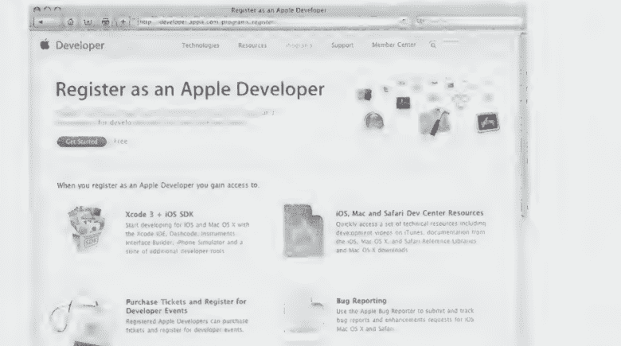

图 12-1 在 apple.com 网站上注册成为 Apple 开发者

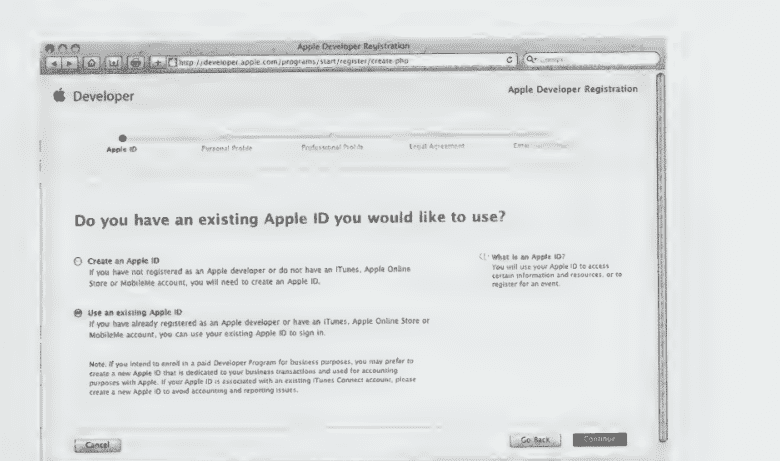

图 12-2 Apple 开发者注册过程的第一个屏幕

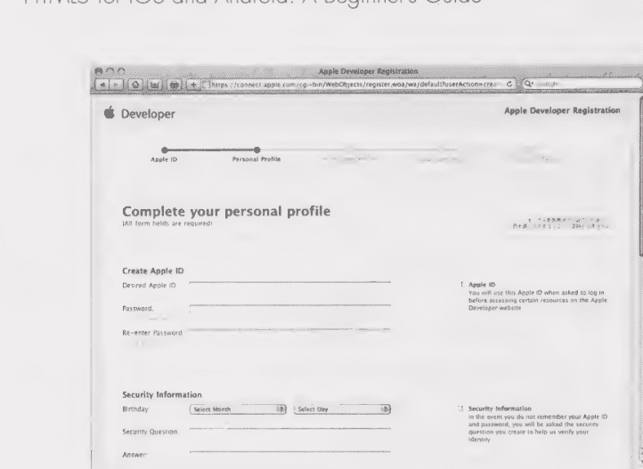

图 12-3 创建新的 Apple ID

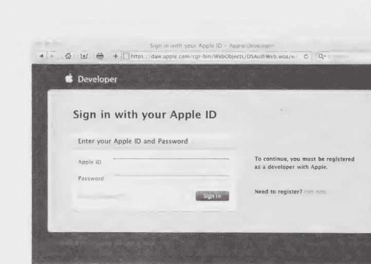

图 12-4 使用现有的 Apple ID 登录


图 12-5 完成你的专业资料

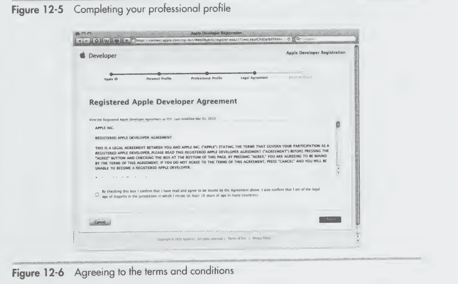

图 12-6 同意条款和条件

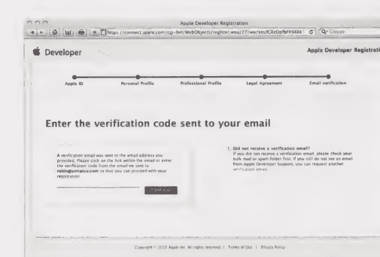

图 12-7 在此屏幕中输入你收到的验证码

在最后一步，你必须等待 Apple 开发者支持发送一封标题为“Please verify your email address”的电子邮件。收到后，将其中包含的代码复制到图 12-7 所示的字段中，或者你可以单击电子邮件中的代码。完成后，你将看到图 12-8 所示的屏幕，你可以单击“Continue”按钮进入会员中心。

#### 会员中心

会员中心是你进行 Apple 开发的起始页面。它提供了全面的资源、视频、支持和新闻更新（见图 12-9）。将来直接访问此页面的 URL 是

```
developer.apple.com/membercenter
```

你需要做的第一件事是下载最新的 SDK，因此单击“Dev Centers”部分中的 iOS 链接，将显示图 12-10 所示的屏幕，然后你应该单击“Downloads”部分中标题类似于“Xcode 4.02 and iOS SDK 4.3”的链接（取决于可用的最新版本）。下载大小约为 3.5 GB（见图 12-11），因此在平均 2 Mbps 的连接上可能需要长达四到五个小时。

在等待下载完成时，你可以通过查看 iOS 开发者中心中的一些文档和视频，或者浏览 iOS 参考库、操作方法和示例代码类别来有效利用时间。

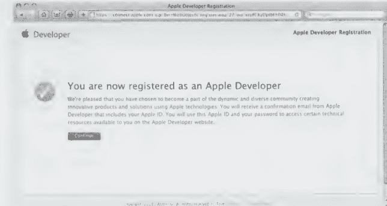

图 12-8 确认你现在是注册的 Apple 开发者


图 12-9 Apple 开发者会员中心网页


图 12-10 iOS 开发者中心，屏幕底部是“Downloads”部分


图 12-11 根据你的宽带速度，SDK 下载可能需要等待几个小时。

#### 加入 iOS 开发者计划

在等待下载时，你可以做的另一件事是加入 iOS 开发者计划，如果你打算在 Apple App Store 上提供应用（无论是免费还是付费）。费用为每年 99 美元，但该计划还允许你配置 iOS 设备以运行开发代码，这样你就可以在实际设备上而不是在 iOS 模拟器上试用你的代码。

你可以通过单击 iOS 开发者中心顶部的“Programs”链接或访问以下 URL 来加入该计划：

`developer.apple.com/programs`

只需单击 iOS Developer Program 链接，然后单击下一个屏幕上的“Enroll Now”链接。然后，你需要通过单击相应的按钮（如图 12-12 所示）来选择是作为个人还是公司注册。然后，在后续屏幕中输入所需的各种详细信息以审核你的详细信息、同意许可、购买计划订阅并激活它。


图 12-12 选择是作为个人还是公司注册。


图12-13 运行Xcode和iOS SDK安装程序

### 安装Xcode

下载完成后，Xcode安装程序`.dmg`文件“Xcode and iOS SDK”应该会挂载并打开如图12-13所示的窗口。在安装之前，您可能希望双击顶部的“关于”文件阅读说明。准备好后，双击底部的文件并按照所有说明操作，直至安装完成。

> **提示**
>
> 在安装Xcode时，请确保iTunes未运行，否则安装过程将被中断，直到您关闭iTunes。

对于安装过程，您很可能需要在所有提示时接受默认选项，因为您总是可以稍后重新安装并选择不同的选项。整个安装过程可能需要长达15分钟。

安装完成后，您可能希望使用Finder的“前往”菜单打开“Macintosh HD”文件夹，然后从那里打开“Developer”文件夹，再进入“Applications”文件夹，最后使用鼠标将Xcode应用程序复制到程序坞栏，以便于访问。

现在SDK已安装并可以使用了。

### 为开发配置iOS设备

为了使用iOS设备测试您的软件，必须先对设备进行配置。这仅仅是使其能够通过USB连接到您的计算机，以便您可以将应用程序传输到设备上进行测试。为此，请前往您的iOS开发者中心屏幕，该屏幕将如图12-14所示。


图12-14 使用iOS开发者资料查看的iOS开发者中心

在您注册为iOS开发者之后。在右上角的iOS开发者计划框中，点击第一个项目，iOS配置门户，打开如图12-15所示的屏幕。

> **注意**
>
> 在配置设备时，不必担心会占用您最喜爱的iPad、iPod Touch或iPhone，因为当您从Mac上拔掉已配置的iOS设备时，它将像配置前一样正常使用。您可能注意到的唯一区别是，在配置到期前几天会出现一条警告。

要开始配置过程，请点击屏幕底部的“启动助手”按钮，打开如图12-16所示的开发配置助手。点击“继续”按钮转到下一个屏幕（参见图12-17），您可以在其中创建新的App ID或使用您可能已创建的现有ID。由于这将是您第一次使用此助手，您将需要创建一个新的ID。我建议您使用一个标识您或您公司的短名称，例如“janedoe dev”。

> **提示**
>
> 运行助手时不要耗时太长，否则它可能会在没有警告的情况下将您注销并变得无响应，在这种情况下，您需要返回并重新登录。


图12-15 iOS配置门户


图12-16 开发配置助手


图12-17 选择App ID

一旦您创建了新ID（或选择了现有ID），将显示如图12-18所示的屏幕，您可以在其中将配置分配给新的iOS设备，或使用以前已配置的设备。假设您是第一次配置，选择“分配一个新的Apple设备”并点击“继续”。

这将带您到如图12-19所示的屏幕，您应该在此输入设备的名称，例如“Fred iPhone 4”，避免使用撇号等标点符号。您还需要提供设备的唯一设备ID（UDID）。

您可以从Xcode Organizer中获取UDID，或者通过一个免费的应用程序获取，该应用程序可以通过在Apple App Store中搜索并安装“My Device ID”来获得。安装并运行该应用程序后，它将打开一个包含UDID的新电子邮件消息。只需在其中输入您的电子邮件地址并点击“发送”即可将其通过电子邮件发送给自己。

然后，无论您使用何种方式获取，将UDID复制并粘贴到配置助手的“设备ID”字段中，点击“继续”进入如图12-20所示的屏幕。

接下来您要做的是向Apple发送证书签名请求（CSR）。为此，请点击“应用程序”文件夹，打开其中的“实用工具”文件夹，并启动


图12-18 选择要配置的Apple设备


图12-19 命名设备并提供其唯一设备ID


图12-20 生成证书签名请求

“钥匙串访问”程序。然后，从屏幕顶部的下拉菜单中，选择“证书助理”，然后选择“从证书颁发机构请求证书”，打开如图12-21所示的“证书助理”屏幕。

在“证书信息”字段中，输入您的电子邮件地址和名称，选择“存储到磁盘”选项，然后点击“继续”按钮。在出现的“另存为”对话框中，选择保存请求的位置——为了便于访问，桌面是一个不错的选择。然后您可以点击“完成”并关闭“钥匙串访问”程序。

现在点击配置助手中的“继续”按钮，进入如图12-22所示的屏幕，您应该点击“选择文件”按钮并选择您刚刚保存的文件`CertificateSigningRequest.certSigningRequest`。

接下来点击配置助手中的“继续”按钮，进入如图12-23所示的屏幕，该屏幕将在所示的空白区域中显示您的App ID、设备和证书名称。

为配置描述文件选择一个描述，例如“Jane Doe Provisioning”，然后点击“生成”按钮。然后会有一个大约一分钟的延迟，请求正在处理，之后会显示消息“您的配置文件已生成”。

准备就绪后，点击“继续”按钮进入下一个屏幕（参见图12-24），您应该点击“下载”按钮，这将把配置文件保存到您的计算机上，准备在Xcode中安装。


图12-21 输入您的证书信息


图12-22 提交证书签名请求


图12-23 命名配置文件


图12-24 下载并安装配置文件

您现在需要做的就是确保您的设备已连接到Mac，并且假设您已将Xcode应用程序复制到程序坞栏，将配置文件拖放到Xcode程序上以进行安装。这将导致Xcode运行；在可能出现关于更新iOS设备上文件的一两个提示之后，它将显示如图12-25所示的窗口，其中我已模糊了序列号、ECID和标识符。

组织者中的“配置”部分应显示您创建的配置文件。如果没有，请点击“+”按钮，定位您保存配置文件的位置并点击它；然后它应出现在“配置”部分。

现在返回配置助手并点击两次“继续”以显示如图12-26所示的屏幕，然后点击“下载”按钮下载证书。

下载完成后，双击`.cer`文件以将其安装到“钥匙串访问”程序中。然后您可以在配置助手中点击“继续”，然后点击“完成”来完成操作。

现在您将能够使用您的iOS设备来测试您的应用程序。您可以使用本节介绍的相同过程为任何其他您希望用于测试应用程序的iOS设备添加配置。


图12-25 Xcode Organizer显示已连接的iPhone


图12-26 下载开发证书

> **问：** 设备配置流程的目的是什么？
>
> **答：** 配置是Apple对其设备应用开发进行严格控制的方式。这意味着Apple知晓每一台被设置为用于开发的设备。它也限制了未配置的iOS设备无法从Apple App Store以外的任何地方下载和运行应用。据称这一切都是为了质量控制，这种说法有一定道理。然而，真正的原因似乎是为了限制替代性（且相互竞争的）应用商店的出现。唯一的解决办法是"越狱"你的iOS设备，这不被Apple支持，并且可能导致你的保修失效。在另一方面，正如你将在第14章看到的其SDK那样，你可以将任何Android设备通过USB调试模式连接到电脑，并将你编写的任何应用复制到该设备上，无需任何额外步骤。在我看来，这证明了Apple的配置实际上并非必要，更像是一个不必要的复杂障碍。


图12-27 从连接的iPhone抓取屏幕

### 使用Xcode Organizer进行屏幕截图

当你向Apple App Store提交应用时，通常需要（或至少被要求提供）你的应用的屏幕截图。通常，创建它们的方法是同时按下iOS设备的顶部和正面按钮，然后在相机胶卷中找到屏幕截图并通过电子邮件发送给自己。

但你可以通过点击"Screenshots"选项卡，如图12-27所示，使用Xcode Organizer来避开所有这些繁琐操作。从那里，你可以使用标准的`CMD-SHIFT-3`或`CMD-SHIFT-4`键组合将屏幕上的图像抓取到桌面文件中。

### 总结

至此，你应该已经下载并安装了iOS SDK，并且应该已经注册成为iOS开发者。如果你也注册为iOS开发者，你现在就可以为你的iOS设备配置开发目的，你也能够将你的应用上传到Apple App Store。如果你没有注册，你仍然可以开发应用，但你将必须在SDK模拟器中测试它们，并且你也无法访问Apple App Store。

但无论你选择了哪种选项，你现在都准备好使用下一章的信息来创建独立的iOS应用了。

## 第13章：创建iOS独立应用

### 核心技能与概念

- 创建Hello World应用
- 使用iOS模拟器
- 将应用保存到连接的设备并运行它们
- 调整Objective C代码
- 获取分发证书和配置文件
- 构建用于分发的应用
- 使用iTunes Connect网站
- 向Apple提交你的应用详情
- 上传图标和屏幕截图
- 使用Application Loader

使用随附网站提供的Wrapper项目，将你的Web应用转变为独立的iOS应用非常简单。有了它，你只需重命名一些项目；将一些图标、HTML和其他文件复制到正确的文件夹；更改一些设置；然后点击一个按钮。但本章也会逐步带你完成获取分发证书和配置文件的过程，这个过程相当复杂，以确保操作尽可能快速简单。

你还将学习如何使用iTunes Connect网站向Apple发送有关你的应用的信息，设置应用价格，签署合同，提供税务和银行详情以便收款（如果你提交的是付费应用），等等。

当你完成本章（其中创建了三个不同的应用）时，你将学到构建应用并将其提交到iTunes所需的一切知识。

### 为Xcode Wrapper项目文件准备你的Mac

按照第12章的说明安装Xcode后，你现在准备好开始创建自己的独立iOS应用，从一个非常简单的"Hello World"程序开始。

为此，你需要从`html5formobile.com`随附网站下载`examples.zip`文件。在这个压缩包中，你会找到以下文件夹，你需要将它们解压并复制到Mac的桌面：

- **iOS Wrapper** 用作应用基础的Xcode Objective C包装器
- **eML Files** 用于创建eML电子书应用的文件
- **Rob's Files** 用于创建Rob's Place应用的文件

一旦三个文件夹都在桌面上，按住Mac的ALT键并将iOS Wrapper文件夹拖到桌面的其他位置以制作一个副本，该副本将被命名为iOS Wrapper 2。然后按住CTRL键，点击新文件夹并选择"显示简介"，将文件夹重命名为Hello World，然后关闭窗口。你现在可以双击新的Hello World文件夹打开它，显示如图13-1所示的内容。

当你将自己的代码放入此项目时，你将更改的文件是三张PNG图片（`icon50.png`、`icon57.png`和`icon72.png`）和`index.htm`文件。你现在可以忽略所有其他文件，除了`Wrapper.xcodeproj`文件，你现在应该双击它以在Xcode中调出项目，显示如图13-2所示的窗口。在图中，窗口左侧"组与文件"窗格中的*Resources*文件夹已被点击，然后点击了右上角窗格中的*index.htm*文件，其内容显示在底部窗格中。


图13-2 Wrapper项目默认的*index.htm*文件被选中。

目前此项目的名称为"Wrapper"，因此你需要将其重命名为"HelloWorld"（无空格）；从桌面顶部的下拉菜单中选择Project，然后选择Rename，提供新名称**HelloWorld**，并点击Rename按钮。完成重命名后，点击OK按钮关闭窗口。

> **注意**
>
> 重要的是，你只能在Xcode 3.2或更高版本上使用Wrapper项目文件，因此你必须确保已下载并安装了最新版本。Xcode 3.1及更低版本使用不同的文件格式，当与Wrapper项目文件夹中提供的文件一起使用时，可能导致不可预测的错误。

### 在Xcode模拟器上运行应用

因为Wrapper项目附带一个默认的*index.htm*文件，你现在可以通过点击Xcode窗口左上角的Overview按钮并确保同时勾选了Simulator和Debug，并且你选择了iPhone Simulator 4.2，如图13-3所示，来测试它。然后你可以点击Xcode窗口顶部中央的Build and Run按钮，如果一切顺利，模拟器将弹出并显示如图13-4所示的屏幕。

这就是全部了——你已经创建了一个可运行的iPhone应用程序。然而，这个包装器的一个巧妙之处在于它也设计支持iPad，因此再次点击左上角的按钮，但这次选择iPad Simulator 4.2，然后再次点击Build and Run。

在弹出的关于停止可执行文件的警告中回复OK后，模拟的iPhone将消失，取而代之的是模拟的iPad，如图13-5所示。


图13-4 你的第一个iOS应用程序

### 在真实设备上运行应用

如果你已经按照第12章介绍的流程为开发配置了一台iOS设备，你现在可以通过确保设备通过USB连接到你的Mac，点击Xcode中的左上角Overview按钮，并在菜单顶部选择Device选项，以及连接的设备（应该列在菜单底部"Active Executable"下方），将此应用安装到该设备上。

现在点击Build and Run，如果提示停止可执行文件请点击OK，你的iOS设备将下载并运行该应用，以与图13-4或图13-5所示完全相同的方式显示它。

### 更改应用程序的标题

如果你在模拟器或实际的iOS设备上点击主按钮，你会看到该应用已安装到主屏幕上，带有一个图标和标题Wrapper。要更改标题，你需要点击Xcode窗口左侧窗格中的*Resources*文件夹，然后点击右上角窗格中的文件*HelloWorld-Info.plist*。这将在底部窗格中显示该文件，你应该点击“Bundle Display Name”字段中的Wrapper并将其更改为Hello World，如图13-7所示。


现在你可以再次点击“Build and Run”，点击“OK”停止可执行文件，然后点击“Save All”保存你刚才所做的更改。然后，该应用将在你选择的任意目标（模拟器或实际设备）上下载并运行。当你点击模拟器或设备屏幕上的主按钮将其关闭时，你会看到该应用程序现在具有正确的标题Hello World，如图13-8所示。

### 更改应用程序的图标

你也可以更改应用程序使用的图标，但由于iPhone、iPod Touch和iPad都受到支持，因此需要为不同尺寸的屏幕替换三个图标：`icon50.png`、`icon57.png`和`icon72.png`，它们的尺寸应分别为50×50、57×57和72×72像素。

> **注意**
>
> `icon72.png`文件被iPad用作应用程序的主屏幕图标，`icon50.png`用于iPad的Spotlight搜索。`icon57.png`文件在iPhone和iPod Touch上用作主屏幕图标。


一旦你准备好了要使用的图标，你就可以删除默认图标。方法是点击Xcode窗口左侧窗格中的*Resources*文件夹，然后在右上角窗格中选择三个图标文件，按住CTRL键并点击这些文件。现在从弹出菜单中选择“Delete”，并在对话框弹出时点击“Also Move to Trash”，它们将从文件夹中移除。

你现在可以将你制作的替换图标拖放到Xcode窗口左侧窗格的*Resources*文件夹中，这将弹出如图13-9所示的对话框，你应该确保勾选“Copy Items into Destination Group’s Folder”复选框，然后点击“Add”按钮。

点击“Build and Run”，然后点击模拟器或iOS设备上的主按钮，以查看图标已更新。


### 将 eML Web 应用转换为独立应用

现在让我们看看如何通过获取第10章中的eML电子书并将其编译成独立应用程序来创建一个更有用的应用程序。为此，你需要再次在Mac桌面上复制*iOS Wrapper*文件夹，方法是按住**ALT**键并将其拖到新位置，然后将新文件夹重命名为*eML eBook*。双击该文件夹打开它。它看起来将像之前图13-1所示的窗口，但标题为*eML eBook*。


现在打开你之前也复制到桌面的eML Files文件夹，选择三个图标文件（`icon50.png`、`icon57.png`和`icon72.png`）和`index.htm`文件，按住ALT键，将这些文件拖放到新的eML eBook文件夹中。出现提示时，勾选“Apply to All”并点击“Replace”（见图13-10）。得到的文件夹将如图13-11所示。

> **提示**
>
> 请记住，这些说明中的内容也可以是你使用eML系统创建的自己的电子书——只需更改`index.htm`文件、图标和任何支持文件，但请确保始终包含eML子文件夹。

现在双击`Wrapper.xcodeproj`图标在Xcode中打开它。打开后，从桌面顶部的菜单栏中选择“Project”，然后选择“Rename”，并将项目重命名为eMLeBook（无空格）。重命名项目完成后，点击“OK”。

你现在需要通过将eML文件夹（*eML*和*usingeML*）从*eML Files*文件夹拖放到Xcode窗口左侧窗格的*Resources*文件夹中来更新项目。当对话框弹出时，勾选“Copy Items into Destination Group's Folder”（如之前图13-9所示）并点击*Add*。

#### 处理 .js 文件

这可能有充分的理由（虽然我无法弄清楚是什么，所以可能是个错误），但JavaScript *.js*文件在Xcode中必须区别对待，因为它们不会自动复制到*Targets*文件夹（在Xcode窗口左侧窗格的更下方）。这个变通方法花了很多研究，所以让我用下面的解决方案为你省去麻烦。

要将*eMLsmall.js*文件放入*Targets*文件夹，你必须手动复制它。为此，首先点击左侧窗格中的*Targets*文件夹并打开它，以显示*eML eBook*子文件夹，然后打开该子文件夹以显示*Copy Bundle Resources*文件夹。点击*Resources*文件夹并在*eML*子文件夹中找到*eMLsmall.js*。当你在视图中看到它时，取消选中窗口右侧的复选框（当被选中时，该复选框告诉Xcode自动将文件复制到Target文件夹，但由于这对.js文件无效，你需要为它们禁用此选项）。

要复制该文件，将其从Resources文件夹拖放到Copy Bundle Resources文件夹（见图13-12）。两个文件夹可能会展开并将左侧窗格向下延伸，但你可以点击每个文件夹旁边的箭头将其折叠回去。之后，如果你再次查看Resources文件夹，你会看到`eMLsmall.js`文件再次被选中——这是正确的，并且确认手动复制成功了。


> **注意**
>
> 未压缩的`eML.js`文件也存在于eML Files文件夹中。它与`eMLsmall.js`相同，但更大且源代码更容易阅读。包含此文件是为了让你可以查看和/或修改它，并在进行任何增强时使用它代替`eMLsmall.js`。即使你将文件拖放到Resources文件夹时它会复制到该文件夹，但除非你手动复制，否则它不会复制到Targets文件夹。这个默认设置正是你想要的，因为（为了保持应用程序大小）`index.htm`文件只使用`eMLsmall.js`文件。

> **警告**
>
> 在Xcode中，目标应用程序不支持子文件夹；因此，所有拖放到Resources文件夹中的子文件夹内容最终都会出现在Target文件夹的根目录中。因此，必须删除`index.htm`文件中对子文件夹的所有引用。例如，在这个特定的应用程序中，引用了`eML/eMLsmall.js`，应该删除`eML/`前缀——eML Files文件夹中提供的`index.htm`文件已经为你完成了这个操作。

#### 重命名应用程序

与Hello World应用程序一样，此应用程序仍然名为Wrapper，因为它是在Wrapper骨架上构建的，所以你需要重命名它。点击Resources文件夹，找到并点击`eMLBook-Info.plist`文件，打开一个类似于之前图13-7所示的屏幕——文件在底部窗格中打开以供编辑。点击“Bundle Display Name”字段中的单词Wrapper，并将其重命名为eML eBook。

#### 构建应用程序

该应用程序现在已准备好构建，因此点击左上角的“Overview”按钮，选择“Simulator”或任何已配置并连接到Mac的iOS设备，然后点击“Build and Run”按钮。电子书应该会打开，如图13-13所示。


当然，你不太可能想要发布这个特定的电子书，因为它已经在iTunes和Android商店中发布了。但这些说明将使你能够将使用eML软件创建的任何网页应用转变为iOS独立应用程序。

#### 将Rob’s Place网页应用转变为iOS应用

为了演示如何使用另一个网页应用创建独立应用程序，我们现在通过再次复制*iOS Wrapper*文件夹，并将其重命名为*Rob’s Place*来创建一个Rob’s Place应用程序。然后打开*Rob’s Files*文件夹，将三个图标和*index.htm*文件复制到新的*Rob’s Place*文件夹中，选中“全部应用”复选框，并在提示时点击“替换”。

现在双击文件*Wrapper.xcodeproj*在Xcode中打开它，然后使用“项目 | 重命名”选项将项目重命名为RobsPlace（不带空格或标点符号）。

##### 关于index.htm文件

有趣的是，如果你点击*index.htm*文件查看它，你会发现它并不包含第11章中所有Rob’s Place的HTML代码；相反，其内容如下：

```html
<!DOCTYPE html>
<html>
    <head>
        <script>
            self.location = 'http://html5formobile.com/examples/robs.htm'
        </script>
        <style>
            body { font-size:3em; font-family:helvetica; padding:20px; }
        </style>
    </head>
    <body>
        <center>
            <h1>Loading...</h1>
        </center>
    </body>
</html>
```

原因在于Rob’s Place项目使用Ajax与Web服务器通信，因此存在限制，只有从服务器加载的网页才能通过Ajax与之通信。绕过这一限制的唯一方法是强制Rob’s Place网页直接从服务器加载。这是通过更改`self.location`属性来提供网页位置实现的。因此，此应用仅需要三个图标文件和简短的*index.htm*文件。

##### 构建应用

所以你现在需要做的是点击*RobsPlace-Info.plist*文件，将Bundle显示名称从Wrapper更改为Rob’s Place，使用左上角的按钮选择模拟器或连接的iOS设备，然后点击“构建并运行”来测试新应用。它在iPad上的显示应如图13-14所示——尽管它在iPhone或iPod Touch上同样运行良好。

##### 调整应用程序

你注意到我们创建了三个iOS应用，而完全没有遇到一行Objective C代码吗？本节描述了几种无需了解Objective C语言工作原理即可调整iOS应用的方法。

例如，如果你在Xcode程序的左窗格中点击*Classes*文件夹，然后在右上窗格中点击*WrapperViewController.m*文件，该文件将在底部窗格中打开。


其内容应如下所示：

```objectivec
#import "WrapperViewController.h"

@implementation WrapperViewController

- (void)viewDidLoad
{
    NSBundle *bundle = [NSBundle mainBundle];
    NSString *path = [bundle bundlePath];
    NSString *fullPath = [NSBundle pathForResource:@"index"
                                          ofType:@"htm"
                                     inDirectory:path];
    [webView loadRequest:[NSURLRequest requestWithURL:
        [NSURL fileURLWithPath:fullPath]]];
}

- (BOOL) shouldAutorotateToInterfaceOrientation:
    (UIInterfaceOrientation)interfaceOrientation
{
    return YES;
}

- (void) didRotateFromInterfaceOrientation:
    (UIInterfaceOrientation)fromInterfaceOrientation
{
    webView.scalesPageToFit = YES;
    webView.backgroundColor = [UIColor blackColor];
}

- (void) didReceiveMemoryWarning
{
    [super didReceiveMemoryWarning];
}

- (void) dealloc
{
    [super dealloc];
}

@end
```

这是将`index.htm`文件加载到称为WebView的程序，WebView是嵌入在应用中的iOS浏览器实例。

###### 禁用自动旋转

你可以对`WrapperViewController.m`做的一件事是注释掉以下函数，在其前后放置`/*`和`*/`标签以禁止视图自动旋转：

```objectivec
/* - (BOOL) shouldAutorotateToInterfaceOrientation:
    (UIInterfaceOrientation)interfaceOrientation
{
    return YES;
} */
```

重新编译后，应用将仅以纵向模式显示。你可以在连接的iOS设备上通过旋转来验证这一点；显示应保持锁定状态。在模拟器上，使用CMD键和左右箭头键来旋转模拟设备。

###### 禁用缩放和更改背景颜色

或者，如果你希望防止iOS在WebView中缩放页面以适应屏幕，可以使用`//`标签注释掉以下函数中的第一行：

```objectivec
- (void) didRotateFromInterfaceOrientation:
    (UIInterfaceOrientation)fromInterfaceOrientation
{
// webView.scalesPageToFit = YES;
    webView.backgroundColor = [UIColor blackColor];
}
```

你还可以通过修改最后一行来更改加载期间显示的默认背景颜色。只需将`blackColor`一词更改为`blueColor`或任何其他常见的颜色名称。

### 在iTunes上分发应用

为了能够将应用上传到iTunes App Store，Apple要求你获取另一个证书，称为iOS分发证书。方法是在“应用程序/实用工具”中打开“钥匙串访问”程序，并选择“钥匙串访问 | 证书助理 | 从证书颁发机构请求证书”。

负责提交应用程序的人员称为团队代理，因此在相关字段中输入该人员的电子邮件地址和姓名，选择“存储到磁盘”选项，然后点击“继续”将请求保存到磁盘。

现在将你的Web浏览器指向*developer.apple.com*，点击iOS Dev Center，然后点击“登录”，输入你的开发者ID和密码以查看如图13-15所示的屏幕。点击页面右上角的iOS Provisioning Portal链接，查看如图13-16所示的屏幕。

接下来点击左侧的“证书”链接，然后点击“分发”选项卡（将显示如图13-17所示的屏幕），并点击“请求证书”按钮。在接下来的页面上（见图13-18），向下滚动并点击“选择文件”按钮，选择你刚才保存的签名请求，然后点击“提交”按钮。

证书颁发应该不需要很长时间，要查看其颁发状态，可以交替点击“开发”和“分发”选项卡，直到证书显示为已颁发（见图13-19），此时你可以点击“下载”按钮将其保存为计算机上的文件*distribution_identity.cer*。

现在将下载的证书拖放到“钥匙串访问”程序中，它将被应用——图13-20显示了该程序同时包含开发和分发证书的情况。

###### 构建分发配置文件

接下来你需要创建一个分发配置文件，它将你的新分发证书与你的Xcode应用关联起来。点击iOS Provisioning Portal左侧的“配置文件”，点击“分发”选项卡，然后点击“新建配置文件”按钮打开如图13-21所示的屏幕。输入配置文件名称，如“Jane Doe Distribution”，从下拉列表中选择你的应用ID，然后点击“提交”按钮。


同样，你可以交替点击“开发”和“分发”选项卡，直到配置文件被分配，此时点击“下载”按钮将配置文件保存到你的Mac——其名称类似于*Jane_Doe_Distribution.mobileprovision*。将配置文件拖放到Xcode窗口或Dock栏中的Xcode图标上以安装它。

现在你需要双击Xcode程序左上角的应用程序名称（例如*RobsPlace*），这将打开“项目信息”窗口，你应该点击“构建”选项卡以查看如图13-22所示的窗口。

点击左上角“配置”旁边的下拉输入框，确保其显示为“分发”或“活动（分发）”。此外，在“任何iOS”字段中，如果尚未选择，请选择“iPhone分发”选项。现在你可以关闭窗口；如果提示你接受对钥匙串的任何更改，请接受。


图13-16 iOS配置门户

> **问：项目信息窗口“架构”字段中的标准（armv6 armv7）和优化（armv7）选项有什么区别？**
>
> **答：** 苹果的iOS设备最初使用armv6处理器架构，但更新的设备现在使用armv7，为新架构优化的代码无法在旧架构上运行。因此，如果您希望面向所有设备，应仅使用标准（armv6 armv7）选项。如果您确定只需支持新架构，可以选择优化（armv7）选项。
>
> 使用标准选项时，您的应用会被编译两次——一次针对armv6，一次针对armv7——然后将两个二进制文件并排放置在一个应用中。当此应用在iOS设备上运行时，只会使用应用所需的二进制文件。
>
> 但当您使用优化选项时，只会编译armv7代码并将其放入应用中，因此应用大小减半——但这同时也意味着旧设备无法运行它。


图13-17 分发证书页面


图13-18 选择要上传给Apple的证书请求


图13-19 证书已颁发。


图13-20 分发证书现已安装。


图13-21 创建分发配置文件

#### 更新捆绑包标识符

现在点击Xcode窗口左窗格中的*Resources*文件夹，然后在右上方的窗格中点击扩展名为.plist的文件（例如*RobsPlace.plist*）以在底部窗格中打开它。然后找到捆绑包标识符字段，其中将包含如下值：

```
com.yourcompany.${PRODUCT_NAME:rfc1034identifier}
```

您必须将字符串*yourcompany*替换为您用于登录iOS开发中心的公司ID（例如*janedoedev*），如下所示：

```
com.janedoedev.${PRODUCT_NAME:rfc1034identifier}
```


图13-22 信息窗口的构建选项卡

> **注意**
>
> 重要的是，janedoedev或您输入的任何内容必须与您的公司ID相同，否则当应用上传时，iTunes将拒绝接受。

#### 构建用于分发的应用

现在点击Xcode程序左上角的按钮，在顶部区域选择“设备”，在第二区域选择“分发”，然后从桌面顶部的“构建”菜单中选择“构建”选项，以构建应用程序而不运行它。

应用程序现在将被构建，您将在项目文件夹的`build/Distribution-iphoneos`子文件夹中找到它，保存为`appname.app`。例如，Rob's Place应用将存储在`Rob's Place/Distribution-iphoneos/RobsPlace.app`。因此找到该应用，按住CTRL键并点击该应用，然后选择“压缩*应用程序名称*”，其中*应用程序名称*是应用的名称。这将创建一个名为*application.zip*的文件，其中*application*是应用的名称（例如*RobsPlace*——这将创建文件*RobsPlace.zip*），准备好上传到iTunes。

> **注意**
>
> 压缩应用是必需的，因为iTunes不接受未压缩的应用程序。

### 分发iOS应用

要通过iTunes分发应用，您还需要创建一个512x512像素的高分辨率图标，以在商店中代表它。不建议简单地将57或72像素的图标放大，因为这样看起来会非常糟糕。相反，您应该专门在此分辨率下创建一个。

您还应该创建最多五个iPhone/iPod Touch屏幕截图，您可以轻松地通过模拟器使用`SHIFT-CMD-4`并拖动光标来仅勾勒出包含屏幕的模拟器内部区域——然后将其保存为桌面的PNG图像。

这些屏幕截图应为320x480像素；您可以使用横屏截图，但它们将以纵向模式显示，用户必须旋转手机才能查看。您还应该拍摄最多五个iPad屏幕截图，其尺寸必须为768x1024像素。

iPad模拟器默认不以全分辨率显示，因此（如果您无法使用iPad）您必须调整模拟器截图的大小——这并非最佳选择——或者（如果您的显示器深度至少为1024像素）点击桌面顶部的“窗口”菜单，然后点击“缩放”选项，再点击“100%”。否则（如果您可以使用已配置的iPad）您可以点击桌面顶部的“窗口”菜单，然后点击“Organizer”以打开Xcode Organizer，然后点击已连接iPad的链接，再点击“屏幕截图”选项卡以获取其屏幕截图。

所有截图应为每英寸72像素，扁平化且无透明度。您为每种设备拍摄的第一张截图将用作产品页面上的主图。根据我的经验，您提供的截图越多，应用被下载的机会就越大。

一旦素材准备就绪，就可以登录iTunes Connect（使用您的Apple开发者ID和密码），访问*itunesconnect.apple.com*，它将显示如图13-23所示的页面。

本书的范围并不真正涉及教授您如何管理iTunes Connect账户，但要启用应用上传，您必须做的第一件事是点击“合同、税务和银行业务”链接，并同意所有各种付费和免费应用合同，并设置您的税务和银行详情。

> **提示**
>
> 一旦您的应用被接受进入iTunes Store，“付款和财务报告”链接将提供有关下载和产生收入的大量信息。


图13-23 iTunes Connect主页

完成所有这些操作后，您可以点击“管理您的应用程序”链接以开始上传。就我而言，我在iTunes上已经有五个应用程序，因此图13-24所示的屏幕就是我看到的。

要告知iTunes有关新应用的信息，请点击左上角的“添加新应用”按钮以显示如图13-25所示的应用程序信息屏幕，您必须在其中输入应用的标题，输入一个SKU号码（这是您自己出于跟踪目的而选择的任何数字，但至少需要两位数），在“捆绑包ID”部分选择您的开发者ID，并通过输入“com”后跟您的开发者ID、句点和应用名称来提供“捆绑包ID后缀”。

例如，如果您的开发者ID是janedoe dev，应用名称是*RobsPlace*，则“捆绑包ID后缀”是*com.janedoe dev.RobsPlace*。现在点击“继续”。

接下来，您必须决定希望应用发布的日期，是收费提供还是免费提供，以及是否为教育机构提供折扣（参见图13-26）。

点击“继续”后，会出现一个元数据页面，您需要在其中输入有关应用的大量信息。如图13-27所示，我已经开始输入有关Rob's Place应用的信息。


图13-25 iTunes Connect应用程序信息屏幕


图13-26 指定应用的权利和定价


图 13-27 填写应用详情

在页面的下方，你还需要勾选几个复选框，以根据应用是否包含暴力、脏话、成人主题等内容来定义其受众。这一切都相当简单，无需在此举例说明。之后是上传图标和屏幕截图的部分，如图 13-28 所示，其中已上传了一个非常简单的大型图标，以及五张 iPhone/iPod Touch 和 iPad 截图中的第一张。

当你至少上传了每种类型的文件各一个后，点击保存按钮。你将进入应用的概览屏幕，然后可以点击“完成”返回到应用管理屏幕，你的新应用此时将显示在那里。

点击应用图标返回到其信息屏幕，然后点击其图标旁边的“查看详情”按钮。在下一个屏幕，点击右上角名为“准备上传二进制文件”的按钮，这将打开“出口合规性”屏幕（如果你的应用允许在美国以外下载，通常都是如此）。

如果你的应用使用了来自 iOS 或 Mac OS X 以外来源的加密，请点击“是”并按照提示操作；否则点击“否”，然后点击保存。现在点击“继续”按钮完成操作，你就完成了。


图 13-28 上传大型图标和屏幕截图

> **注意**
>
> 每当你的应用程序状态发生变化，例如准备上传（或稍后通过审核，或出现问题）时，iTunes Store 会向你发送电子邮件通知。

### 上传应用

你现在已准备好使用 Xcode 中内置的 Xcode Application Loader 将应用发送到 iTunes。因此，使用 Finder，打开硬盘上的*Developer*文件夹，然后是*Applications*文件夹，接着是*Utilities*文件夹，你将在其中找到程序*Application Loader.app*（你可能希望将其拖到 Dock 栏中 Xcode 应用旁边，以便将来轻松访问）。双击该程序，点击“下一步”按钮进入登录窗口，你需要输入你的 Apple 开发者 ID 和密码，然后在下一个屏幕再次点击“下一步”。

> **注意**
>
> 一旦登录 Application Loader，应该不会再提示你输入 ID 和密码。


下一个出现的屏幕（见图 13-29）用于选择要上传的应用二进制文件。点击下拉菜单并选择要发送的二进制文件，在本例中是 Rob's Place 1（1 是在 iTunes Connect 网站上提供的版本号）。然后点击“下一步”按钮。

然后可能会询问你是否已完全测试过二进制文件。如果已测试，点击“是”，然后在下一个屏幕点击出现的“选择”按钮以定位二进制文件，该文件将位于项目的`build/Distribution-iphoneos`文件夹中。对于 Rob's Place 应用，这是保存在`Rob's Place/Distribution-iphoneos/RobsPlace.zip`的压缩文件。

定位文件后，点击“发送”按钮将其上传到 iTunes。如果有任何错误，例如`.plist`文件中的 Bundle ID 与你在 iTunes Connect 上提供的 ID 不匹配（它们必须相同），你会收到通知。否则，文件将开始上传。上传完成后，点击“下一步”，就这样——应用现在正在等待发布前的审核。

顺便说一下，我打算在某个时候进一步开发 Rob's Place 应用，所以如果你将其上传到应用商店，我要求你将其重命名为其他名称。


图 13-29 选择要上传的二进制文件

#### 总结

在本章中，你已经看到了三个使用随书网站提供的 Wrapper 项目文件将 Web 应用程序转换为独立 iOS 应用的示例。希望完成此操作的简便性将激励你创建并将许多成功的应用上传到 iTunes Store。

在下一章中，我将介绍 Android SDK，我认为你会发现它比 Apple 的 SDK 更易于使用。

### 第 14 章

#### 设置 Android SDK


#### 关键技能与概念

- 下载并安装 Android SDK
- 下载并安装 Eclipse IDE
- 向 Eclipse 添加 Android 插件

在完成了第 12 章和第 13 章中安装和使用 iOS SDK 的过程后，当你按照本章中的步骤操作时，我认为你会对 Android SDK 在易用性和开发速度方面的表现感到非常满意。

当然，任何事情都有利有弊，安装 Android SDK 的某些方面比 iOS SDK 稍微棘手一些（例如在 64 位 PC 上安装，你将看到），但这是意料之中的事。不过总的来说，Android 上的整个安装和开发过程比 iOS 上更快、更容易。

### 下载并安装 Android SDK

要安装 Android SDK，你必须访问`developer.android.com/sdk`（见图 14-1）并选择你需要的版本：Windows、Mac OS X 或 Linux。本章仅讨论 Windows SDK，但其他版本非常相似，只要你根据需要更改路径名和其他依赖于机器的项目，就应该能够按照我给出的说明操作。

在开始之前，如果你还没有，你首先需要下载并安装 Java Development Kit (JDK)，可从以下 URL 获取：

```
oracle.com/technetwork/java/javase/downloads
```

下载后，运行安装程序并接受所有默认选项——这个过程相当简单直接。安装完 JDK（如果需要）后，下载 Android SDK 并打开安装文件以开始安装。

> **注意**
>
> 在 64 位计算机上，如果安装程序报告“Java SE development kit not found”，请不要担心，只需点击“后退”按钮，然后点击“下一步”按钮，这次它会找到 Java 并继续安装。

在安装 Android SDK 期间，接受为你提供的默认设置。完成后点击“完成”，但请确保在点击之前勾选了“启动 SDK Manager”复选框。这将打开图 14-2 所示的窗口，你可以从中选择要下载的软件包（见图 14-3）。


图 14-2 下载所有可用的 Android 软件包

### 下载 Eclipse

要开发 Android 应用，你需要使用 Eclipse IDE。访问`www.eclipse.org/downloads`，并为你的平台下载适用于 Java 开发者的 Eclipse IDE。解压下载的文件，这将创建一个包含所有必要文件的文件夹。该文件夹内还有一个名为`eclipse`的文件夹，你应该将其拖放到永久目的地，例如 C:\ 驱动器的根目录。

导航到新的`eclipse`文件夹，双击文件`eclipse.exe`启动程序，该程序将要求你决定使用哪个文件夹来存储你的工作空间（见图 14-3）。通常，提供的默认选项可能是最佳选择。为避免再次看到此消息，你可以勾选窗口左下角的复选框。

#### 提示

为便于将来使用，你可能希望按住 ALT 键并将`eclipse.exe`文件拖到桌面以创建快捷方式图标。

选择位置并点击“确定”后，Eclipse 将继续加载并最终显示欢迎屏幕，如图 14-4 所示。

### 添加 Android 插件

最后，你需要为 Eclipse 安装 Android 插件（称为 ADT）。选择“帮助” > “安装新软件”，这将打开图 14-5 所示的屏幕。在“与...一起使用”字段中，它显示“键入或选择站点”，输入以下 URL，点击“添加”按钮，在提示时为资源命名，例如“Android Repository”，然后点击“确定”。

```
https://dl-ssl.google.com/android/eclipse/
```

然后“名称”字段应更改为显示标题“Developer Tools”，其旁边是一个复选框，你应确保已勾选（见图 14-6）。然后点击“下一步”按钮。

#### 第14章：设置Android SDK


图14-3 决定你的工作空间文件夹应放置的位置。


图14-4 Eclipse欢迎屏幕

《面向iOS和Android的HTML5：初学者指南》


图14-5 Eclipse软件安装屏幕

然后在随后的屏幕上点击“下一步”按钮。在之后的屏幕上，选择标有“我接受许可协议条款”的单选按钮，并点击“完成”按钮。

另一个窗口将打开以显示仓库下载的进度；如果弹出一个安全窗口警告软件包含未签名的内容，请点击“确定”将其关闭。下载完成后，点击“立即重启”按钮以重启Eclipse。

当程序重新打开时，选择“窗口” > “首选项”。然后，在首选项屏幕的左上角，点击“Android”标题，接着点击“浏览”按钮以定位Android SDK文件夹，其默认路径为`C:\Program Files\Android\android-sdk-windows`（或在64位计算机上为`C:\Program Files (x86)\Android\android-sdk-windows`）。现在点击“确定”按钮，SDK设置就基本完成了。

最后，在32位计算机上，你应该从Eclipse菜单栏打开“窗口”菜单，然后点击“首选项”以打开一个新窗口。在此窗口的左半部分，点击


**图14-6** Android仓库现已添加并选中。

“Android”标题，然后在右上角出现的“SDK位置”输入框中，确保根据你使用的是32位还是64位计算机，分别列出以下路径之一：

```
C:\Program Files\Android\android-sdk
C:\Program Files (x86)\Android\android-sdk
```

如果不是，请使用“浏览...”按钮定位文件夹，或者直接输入路径，并记住如果你将Android SDK安装在C盘以外的其他磁盘上，需将C:替换为相应的磁盘名称。

现在点击“确定”按钮将路径输入Eclipse的首选项，然后关闭程序并重新打开它，再继续下一章，以确保所有设置都是最新的。

#### 专家问答

**问：这个安装过程看起来确实比iOS简单得多。为什么？**

**答：** 简单的答案可能是Android是一个开放平台，而不是专有平台。Android操作系统是开源的，所有用于开发的工具也是开源的，而且与苹果相比，Google对严格控制第三方开发者的顾虑较少。

也就是说，Android Market已经因包含大量漏洞百出且有些无用的程序而获得了声誉。而且Android操作系统本身也变得相当碎片化，因为不同的公司根据自己的需求对其进行定制。所以，这种开放性也有其缺点。

然而，Google正在向手机制造商施加压力，要求他们不要过多地改变Android，因此该平台正在迅速发展——据报道，在撰写本文时，每天有30万部Android智能手机被激活，这是一个巨大的市场，你可以向其推广你的应用程序。

#### 总结

信不信由你，你现在已经安装了Android SDK，无需获取证书或配置配置文件。你已准备好进入第15章，在那里我将向你展示如何从第13章中转换为iOS应用程序的三个Web应用程序编译出匹配的Android应用程序。

### 第15章：创建独立的Android应用程序

#### 关键技能与概念

- 创建一个“Hello World”应用程序
- 使用Android模拟器
- 将应用程序保存到连接的设备并运行它们
- 构建用于分发的应用程序
- 对你的应用程序进行签名
- 使用Android Market网站
- 将你的应用程序提交到Market
- 上传图标和屏幕截图

在本书的最后一章中，我将向你展示如何使用配套网站上的Android Wrapper项目将你的Web应用程序转换为独立的Android应用程序，或者如何使用该项目和SDK构建新的应用程序。

我将重点介绍创建三个不同的应用程序，说明这个过程是多么简单和相对直接——事实上，你会发现它比构建iOS应用程序快得多。

读完本章后，你将完成你的iOS和Android开发工具包，并准备好开始构建和上传你自己的应用程序。

#### 为Android Wrapper项目文件准备你的PC

类似于用于将你的Web应用程序转换为iOS应用程序的iOS Wrapper项目，在`html5formobile.com`提供的`examples.zip`文件中也有一个`Android Wrapper`文件夹。一旦你解压了zip文件，请将`Android Wrapper`文件夹复制到你的桌面，在接下来的几章中，你将多次将其复制到Android SDK中。

与此同时，你还应该将`eML Files`和`Rob's Files`文件夹复制到你的桌面，因为你稍后会用到它们。一旦你将它们复制到桌面，每次希望创建新的Android应用程序时，都应执行以下过程。

#### 从Wrapper创建新的Android项目

要创建一个新的Android应用程序，你现在需要将桌面上的Android Wrapper项目复制到你在第14章设置SDK时指定的工作空间文件夹中。默认情况下，该文件夹位于计算机上你用户名的主文件夹中——在我的例子中，它位于`robin/workspace`。

一旦你将Android Wrapper文件夹拖入工作空间文件夹，你应该将其重命名为与你正在构建的应用程序匹配的名称。因此，对于本示例，右键单击该文件夹，选择“重命名”，并将文件夹重命名为Hello World。

现在运行Eclipse程序，打开后，选择“文件” > “导入”以打开如图15-1所示的对话框。点击“常规”文件夹，然后从显示的子选项中选择“现有项目导入工作空间”。然后点击“下一步”按钮打开如图15-2所示的屏幕，你应该点击右上角的“浏览”按钮并定位到Hello World文件夹。


图15-1 选择导入源


**图15-2** Hello World文件夹已被选为源。

一旦你加载了该文件夹，请点击“完成”按钮进入Eclipse主屏幕，如图15-3所示，其中我关闭了除左侧的“包资源管理器”和底部的“控制台窗口”之外的所有窗口，这是当前唯一需要的两个窗口。程序的右上部分将用于显示任何正在编辑的文件。

> **注意**
>
> 你现在可以忽略控制台窗口中显示的任何错误消息。它们可能与几个预期文件夹未被找到有关，你不必担心，因为它们会自动创建。

从这个主屏幕开始，你现在需要通过右键单击左侧的Hello World文件夹，选择出现的菜单底部的“Android工具”选项，然后点击“重命名应用程序包”来重命名应用程序包。这将弹出如图15-4所示的对话框，你应该用类似`com.janedoedev.helloworld`的字符串替换字符串`com.yourcompany.wrapper`，其中`janedoedev`是你将使用的开发者ID，`helloworld`是应用程序ID。


**图15-3** Eclipse主屏幕

当你点击“确定”时，将显示如图15-5所示的屏幕，列出了将被修改的项目。只需点击“完成”按钮进行更改，当被问及是否更新启动配置时，点击“是”按钮。

#### 重命名主屏幕图标

回到Eclipse主屏幕，点击左窗格中的`res`文件夹以显示三个子文件夹，最后一个是`values`。打开此文件夹，你将看到文件`strings.xml`，你应该双击它在右上角窗格中打开（参见图15-6）。

在Elements下的框中双击`app_name`（字符串），（右侧）将显示Name和Value字段，其值分别为`app_name`和`Wrapper`。要将主屏幕图标从Wrapper重命名，请用

### 420 HTML5 for iOS and Android: A Beginner's Guide


图 15-4 重命名应用程序包


图 15-5 确认要修改的项目


在 Value 字段中输入 Hello World。然后点击程序左上角的单张软盘图标以保存更新后的文件。

#### 更新清单文件

由于这是你首次创建应用程序，它将具有默认的版本代码 1 和版本名称 1.0，你可以通过双击左侧窗格中的`AndroidManifest.xml`文件来查看（参见图 15-7）。

此时你无需编辑该文件，但是，一旦你成功将应用程序上传到 Android Market，如果你更新了应用程序，就必须递增 Version Code 字段，否则 Market 会拒绝该应用。Version Name 字符串使你能够以类似 Android 以姜饼、蜂巢和冰淇淋等甜点命名的方式来为你的版本命名。

### HTML5 for iOS and Android: A Beginner’s Guide


##### 运行应用程序

现在你已准备好构建并运行该应用程序，因此请点击程序顶部中央带有白色右向三角形的绿色圆形按钮（即构建和运行按钮）。当 "Run As" 对话框弹出时，选择 "Android Application" 并点击 "OK"。如果没有 Android 设备连接到你的 PC（我们稍后会讲到这一点），将弹出一个对话框，告诉你未找到兼容的目标设备，并询问你是否要添加新的 Android 虚拟设备 (AVD)。点击 "Yes" 进入 AVD 管理器。

当 AVD 管理器打开时，点击右上角的 "New" 按钮以显示如图 15-8 所示的窗口，我在其中输入了名称 Android2.2（名称中不允许有空格），选择了目标 Android 2.2 - API Level 8，输入了大小值 1000，并指定了分辨率 480×800 像素。以类似方式填写你的虚拟设备信息，然后点击 "Create AVD" 按钮。

几秒钟后，新设备将显示在 AVD 管理器屏幕上；点击虚拟设备，然后点击 "Start" 按钮。如果出现提示，你可以选择将显示缩放到实际大小，或者直接点击 "Launch" 按钮以启动设备运行。

启动模拟器可能需要一两分钟。完成启动后，再次点击 SDK 顶部中央的 "构建和运行" 按钮，以在虚拟设备中编译并运行应用程序，此时它应显示如图 15-9 所示的内容。

如果你看到此屏幕，那么你已成功编译并运行了你的第一个 Android 应用程序。要返回虚拟设备的主屏幕，你可以通过按 ESCAPE 键从应用程序退出。如果你这样做，然后点击 "Applications" 按钮，你将看到新的 Hello World 图标，你可以点击并按住它以打开主屏幕（如果你喜欢的话）。


**图 15-8** 创建虚拟设备


**图 15-9** Hello World 应用程序已成功编译并运行。

##### 连接 Android 设备

要直接将应用程序安装到真实的 Android 设备上，你首先需要安装设备附带的驱动程序。大多数 Android 设备都附带所需的驱动程序，因此请遵循设备制造商提供的说明。或者，Windows 会在你将许多设备连接到计算机时自动搜索并安装驱动程序。如果这不起作用，你也可以尝试从设备制造商的网站上查找并下载驱动程序。

> **提示** 对于 Galaxy S、Galaxy Tab 和其他三星 Android 设备，在英国，我已成功使用了`samsung.com/uk/support`上提供的发行版中包含的驱动程序。在“搜索产品支持”字段中输入（例如）“Galaxy Tab”，然后在后续页面上点击软件链接，从那里你可以下载包含所需驱动程序的 Samsung Kies 和 PC Sync 程序。

在美国，对应的 URL 是`samsung.com/us/support/downloads`，在那里你需要从“类别”菜单中选择（例如）“Galaxy Tab”，然后从“子类别”、“型号名称”和“型号代码”菜单中进行选择，接着点击“Find It”并在后续屏幕上点击“软件”链接。

安装完设备的驱动程序后，你必须告诉设备允许你将应用程序放置在上面，而不仅仅是通过你的 PC 浏览其文件系统。为此，请在设备上选择“设置”，然后依次点击“应用程序”、“开发”，勾选“USB 调试”复选框，然后点击“确定”按钮。

你的设备现在已准备好用于运行你的应用程序——这比你使用 iOS 时必须设置配置文件等等要容易得多吧？

##### 将应用程序保存到 Android 设备

现在你已连接设备并设置了 USB 调试模式，当你点击“构建和运行”按钮时，它将出现在 SDK 中（如图 15-10 所示）。你现在可以双击该设备以将应用程序下载并安装到其上，其显示方式将类似于图 15-9 所示的示例。

> **提示** 如果 SDK 似乎卡在自动模式，并且总是选择相同的目标设备或虚拟设备，而不提供你在它们之间选择的机会，请选择 "Run | Run Configurations"，点击 "Target" 选项卡，选择 "Manual" 单选按钮，然后点击 "Apply" 按钮。之后，点击 "Close" 关闭窗口。

#### 构建 eML 电子书应用程序

成功编译并运行 Hello World 应用程序后，以下是将 eML 出版物转换为应用程序的方法。首先，右键点击 Hello World 文件夹并选择 "Close Project"。

现在，再次按照前面概述的过程，将`Android Wrapper`文件夹复制到你的`workspace`文件夹，但这次将其重命名为`eML eBook`。然后使用 "Existing Projects into Workspace" 选项将项目导入到 SDK 中。接下来，右键点击左上角的`eML eBook`文件夹，选择 "Android Tools"，并将包重命名为类似`com.janedoedev.emlebook`的字符串。然后编辑`res/values`中的`strings.xml`文件，将单词 Wrapper 更改为 eML eBook。

##### 将 eML 文件复制到项目中

现在打开你复制到桌面的`eML Files`文件夹。按住 CTRL 键并点击以选择两个文件夹（`eML`和`UsingEML`）和文件`index.htm`，然后将它们拖放到 SDK 左侧窗格中的`assets`文件夹中。出现提示时，确保选中了 "Copy Files and Folders" 单选按钮，然后点击 "OK"。另外，当被问及是否要覆盖`index.htm`文件时，点击 "Yes"。


图 15-10 Android 设备选择器的顶部框架现在也显示已连接的设备。

接下来，因为`index.htm`文件中引用`eMLsmall.js`文件的代码行是为 iOS 优化的，你需要右键点击`index.htm`文件，然后选择 "Open With"，再选择 "Text Editor"。当文件显示在右侧窗格中时，向下滚动直到找到以下行，并在`eMLsmall.js`之前插入字符串`eML/`：

```
</script><script src='eMLsmall.js'></script></head>
```

结果应如下所示：

```
</script><script src='eML/eMLsmall.js'></script></head>
```

然后点击程序左上角的软盘图标以保存文件。你必须这样做，因为 iOS 不支持在应用程序中使用文件夹和路径，但 Android 支持，因此它需要知道 JavaScript 文件位于哪个文件夹中。

##### 运行应用程序

现在，你可以通过点击“构建并运行”按钮，然后选择之前创建的虚拟设备或已连接的设备作为目标来测试应用。应用编译并传输到设备后，应会显示如图15-11所示的屏幕。

##### 更新主屏幕图标

应用验证通过后，你需要更改主屏幕图标。方法是将桌面上`eML Files`文件夹中的`icon72.png`文件拖放到SDK左侧面板的`res/drawable`文件夹中。出现提示时，确保勾选“复制文件”，然后点击“确定”。

现在打开`res/drawable`文件夹，右键单击旧图标（`icon.png`），选择“删除”。然后右键单击`icon72.png`，选择“重构 | 重命名”，将文件重命名为`icon.png`。再次运行应用程序以重新安装，你将看到应用程序图标已更新。

#### 构建 Rob's Place 应用程序

要构建Rob's Place应用，请右键单击`eML eBook`文件夹并选择“关闭项目”，然后按照前面概述的步骤，将`Android Wrapper`文件夹复制到你的`workspace`文件夹，但这次将其重命名为`Robs Place`（不幸的是，你不能使用名称中本应存在的撇号，因为Android不允许你导出包含撇号的应用）。然后使用“将现有项目导入工作区”选项将项目导入SDK。

接下来，右键单击左上角的`Robs Place`文件夹，选择“Android 工具”，然后将包重命名为类似`com.janedoedev.robsplace`的字符串。接着编辑`res/values`中的`strings.xml`文件，将单词Wrapper改为Robs Place。与项目名称一样，你不能将应用重命名为“Rob's Place”，因为主屏幕图标名称中不允许使用撇号。

##### 将 Rob's Place 文件复制到项目中

现在打开你复制到桌面的`Rob's Files`文件夹，将`index.htm`文件拖放到SDK左侧面板的`assets`文件夹中。出现提示时，确保选中“复制文件和文件夹”单选按钮，然后点击“确定”。另外，当被问及是否覆盖`index.htm`文件时，点击“是”。

##### 更新主屏幕图标

现在，通过将桌面上`Rob's Files`文件夹中的`icon72.png`拖放到SDK左侧面板的`res/drawable`文件夹中来更改主屏幕图标。出现提示时，确保勾选“复制文件”，然后点击“确定”。

现在打开`res/drawable`文件夹，右键单击旧图标（`icon.png`），选择“删除”。然后右键单击`icon72.png`，选择“重构 | 重命名”，将文件重命名为`icon.png`。

##### 编译和运行应用程序

现在，你可以通过点击“构建并运行”按钮，然后选择之前创建的虚拟设备或已连接的设备作为目标来测试应用。应用编译并传输到设备后，应会显示如图15-12所示的屏幕。

#### 分发你的应用

你可能不知道，Android是一个非常开放的系统。它使你只需将应用放在自己的网站上即可进行分发。但你需要先完成签名过程，以便用户可以确信该应用是由你创建的。

为此，在SDK中打开一个应用，右键单击它并选择“导出”，点击“Android | 导出Android应用程序”，然后点击“下一步”以显示如图15-13所示的屏幕，在此屏幕中（第一次导出应用时）你应该选择“创建新密钥库”选项。

然后点击“浏览”按钮，选择一个合适的位置来存储它（例如工作区文件夹），使用诸如`janedoe dev.keystore`的文件名。输入密码（两次），然后点击“下一步”以查看如图15-14所示的屏幕。

**注意**

创建`.keystore`文件后，下次导出应用时，你可以选择“使用现有密钥库”单选按钮，点击“浏览”按钮选择应用，然后只需输入其密码即可访问。

现在输入一个别名（可以是你的开发ID）、密码（两次）、有效期（Validty）值30（代表30年），你的名字和姓氏，然后点击“下一步”以查看如图15-15所示的屏幕，在此屏幕中我选择点击“浏览”按钮并搜索来将应用保存到桌面。完成后点击“完成”，应用将被编译并保存到所选位置。

> **注意**

下次导出应用时，你可以选择“使用现有密钥”选项，然后从下拉菜单中选择密钥并输入其密码。

你现在可以将此应用上传到网站，尽管（为了便于输入其下载名称）你可能希望先通过将其重命名为`robsplace.apk`（或你的应用名称）来移除文件名中的空格并将其全部改为小写字母。

例如，我已经将本章中的所有三个示例上传到了配套网站，因此如果你将Android设备指向以下URL，你应该能够直接下载这些应用：

- `html5formobile.com/examples/helloworld.apk`
- `html5formobile.com/examples/emlebook.apk`
- `html5formobile.com/examples/robsplace.apk`

##### 专家解答

> **问：** 我试图从网站下载这些应用，但我的智能手机说我需要一张SD卡，并且失败了。我能做什么？
>
> **答：** 通过Android浏览器下载应用时，Android设备有时可能需要你安装一张SD卡。此内存用于在安装到主存储之前存储下载内容。如果你收到此消息，很遗憾，你唯一的选择是插入一张SD卡或从Android Market下载该应用（如果它也在那里可用的话）。

###### 从网站下载应用

要能够从网站以及Android Market下载应用，你必须首先在Android设备上打开“设置”屏幕，选择“应用程序”，然后勾选“未知来源”旁边的复选框。

如专家解答部分所述，某些Android设备可能还要求你插入一张SD卡来存储下载内容。

###### 将应用上传到Android Market

既然你已经有了签名和导出的应用，如果你支付25美元的注册费，就可以将它们上传到Android Market。为此，请转到`market.android.com/publish`（见图15-16）并使用你的Google凭据登录。这将带你进入如图15-17所示的屏幕，在此屏幕中你应该输入你的开发者名称和其他详细信息，然后点击“继续”链接。

在下一个屏幕中，你必须阅读分发协议，然后点击按钮通过Google结账支付你的25美元注册费。这会打开一个长页面，你必须在其中输入所有账单详细信息并同意条款。

一旦你完成注册并支付费用，你就可以转到Market主屏幕，如图15-18所示，在那里你可以看到我已经放置了五个应用。

现在你已准备好上传应用，让我们通过Rob's Place应用来演练此过程。点击“上传应用程序”链接，这将带你进入一个新屏幕，其顶部如图15-19所示，在此屏幕中我已经上传了`robsplace.apk`文件、两张480×800像素的屏幕截图，以及iTunes Store也要求的512×512像素高分辨率图标。

在此页面上，你还有机会上传一张180×120像素的促销图形，供Market使用（如果你输入了任何促销文本，则此为必需），以及

### 第15章：创建 Android 独立应用


图 15-16 登录 Android Market

一个 1024×500 像素的特色图片，以便在你的应用被 Google 选中推荐时使用。你甚至可以添加你制作的任何宣传视频的 YouTube 链接。

所有这些选项都是可选的，但你必须向下滚动页面并填写应用的列表详情，如图 15-20 所示，我已在其中填写了基本信息。我建议你使用所有允许的字符，以真正地推销你的应用。你还需要为应用选择一个价格（如果不是免费的），付款将通过 Google Checkout 进行——扣除 30% 的佣金。

最后，在页面底部，你会看到发布选项和其他一些选项（见图 15-21）。在这里，你可以选择是否对应用进行版权保护，选择内容评级，并选择应用应该在哪些国家/地区可用。你还必须提供一个网站和电子邮件地址，以便用户查询你的应用，并且需要选中最后一部分中的两个复选框，以确认应用符合 Android 准则，并且你已遵守所有适用法律。

434 HTML5 for iOS and Android：初学者指南


图 15-17 创建账户

在你提供了所有详细信息并准备发布应用后，可以点击页面底部的“发布”按钮。你也可以选择保存详细信息并在稍后完成此过程，或者删除详细信息并重新开始。

一旦你点击发布，你的应用将立即在 Android Market 上可用，你可以从那里将其下载并安装到任何 Android 设备上。

#### 更新应用

当你更新应用时，如果你希望将其重新提交到 Market（如本章前面“更新清单文件”一节所述），则必须更改其版本代码；否则，它将被 Google 拒绝。通常，这只是简单地递增数字。你可能也希望更新版本名称，但这并非必需。

一旦你更改了版本代码并重新导出应用，你就可以使用“最近更改”字段（见图 15-20）来告诉人们应用中的新内容。


**图 15-18** Android Market 主屏幕示例

#### 清晰标记测试应用

当仅为测试目的将这些示例中的任何一个上传到 Android Market 时，请在描述中包含类似“这是一个测试 - 请勿下载”的文本；否则，用户可能会无意中下载它。完成测试后，也请成为一个良好的 Market 参与者，如果应用不再有用，请取消发布。

436 HTML5 for iOS and Android：初学者指南


图 15-19 上传应用和相关图形

437


图 15-20 填写列表详情


**图 15-21** 发布选项、联系信息和同意书

439

#### 总结

你现在已了解了所有需要掌握的知识，能够利用 HTML5、CSS3 和 JavaScript 这些 Web 技术，以及 PHP 和 MySQL 这些服务器技术，创建高级且专业的 Web 应用程序，然后将其转化为独立的 iOS 和 Android 应用。

而且，你已经学会了如何完成所有这些工作（无需学习 Objective C 或 Java），方法是基于配套网站上提供的 Wrapper 项目来构建你的应用。但一旦你发布了一些应用，我希望你能借此机会进一步研究 Xcode 和 Eclipse SDK，以便更精确地根据你的具体规格定制应用。如果你这样做，我相信你会发现你几乎是在不知不觉中开始学习这些语言，甚至可能决定过渡到开发原生应用——但那是另一本（或两本）书的内容了。

与此同时，我希望你觉得这本书（其中包含了我花数月时间学到的许多技巧和窍门）是一个便捷的指南，并且它已帮助你成功穿越了 iOS 和 Android 开发的雷区，发布了你自己的 Web 应用程序和独立应用。

#### 索引

对图的引用为斜体。

#### A

- `+` - ;, 68, 124, 210, 290
- `#`, 291
- `#-`, 291
- `$` 符号, 124
- `@import` 命令, 66–67
- `^`, 290
- `|`, 290
- `align` 属性, 16, 18
- 对齐, 16
- `alt` 属性, 16
- 锚点, 页内锚点, 17–18
- Android
  - 覆盖字体大小, 298–299
  - *另请参阅* 移动友好网站
- Android Market，上传应用至, 432–438
- Android SDK
  - 添加 Eclipse 的 Android 插件 (ADT), 410–413
  - 下载和安装, 408–409
  - 下载和安装 Eclipse IDE, 409–410, 411, 412
- Android 独立应用
  - 构建 eML 电子书应用, 425–428
  - 构建 Rob's Place 应用, 428
  - 连接 Android 设备, 424–425
  - 创建新的 Android 应用, 416–424
  - 分发, 428–431
  - 从网站下载应用, 432
  - Hello World 文件夹, 417–419
  - 标记测试应用, 435
  - 重命名主屏幕图标, 419–421
  - 运行应用程序, 422–424, 427
  - 将应用保存到 Android 设备, 425
  - 和 SD 卡, 432
  - 选择导入源, 417
  - 更新应用, 434–435
  - 更新主屏幕图标, 427–428
  - 更新清单文件, 421–422
  - 上传应用至 Android Market, 432–438
- Android 虚拟设备 (AVD), 422
- 反黑客措施, MySQL, 255–258
- Apple 主屏幕图标, 275–276
- Apple SDK
  - 作为开放平台的 Android, 414
  - 设备配置流程, 371
  - 安装 Xcode, 362–371
  - 加入 iOS 开发者计划, 361–362
  - 成员中心, 358–361
  - 注册成为 Apple 开发者, 354–358
  - 使用 Xcode Organizer 截屏, 372
- 弧线，绘制, 180–181
- 算术函数, 135–137
- 算术运算符, 134–137, 218
- 数组
  - 为数组赋值数值, 129
  - 为数组赋值字符串, 129–130
  - 关联数组, 130–131, 214–215
  - 多维数组, 131–133, 215–217
  - 概述, 128
  - PHP, 214–217
- 赋值运算符, 137, 218
- 关联数组, 130–131, 214–215
  - 多维关联数组, 133, 216–217
- 属性选择器, 74, 93
- 属性, 5–6
  - 音频和视频, 55–56
  - 表单属性, 38–43
  - 另请参阅各属性
- 音频
  - 属性, 55–56
  - 在最流行的浏览器和设备中的支持, 51
- `<audio>` 标签, 54
- `autocomplete` 属性, 38
- `autofocus` 属性, 39
- 自动递增, 244
- `autoplay` 属性, 55
- 自动旋转，禁用, 390
- AVD 管理器, 422–423

#### B

- `<b>` 标签, 12
- 背景色，更改, 391
- 背景, 93–100
- `<basefont>` 标签, 13
- 伯纳斯-李，蒂姆, 4
- `bgcolor` 属性, 18
- `<big>` 标签, 12
- `<body>` 标签, 10
- 粗体, 12
- `border` 属性, 16, 19
- 盒模型, 88–90
- `<br>` 标签, 16
- `break` 关键字, 149
- 浏览器，HTML5 和旧版浏览器, 34
- Bundle Identifier, 396
- `<button>` 标签, 26

#### C

- canvas, 34–35, 36, 160
  - 从 JavaScript 访问 canvas, 160–161
  - 将 canvas 转换为图像, 161–164
  - 创建填充颜色, 166–167
  - 线性渐变, 167–169
  - 线条, 174–176
  - 管理矩形, 165–166
  - 路径, 176–179
  - 图案, 171–172
  - 径向渐变, 169–171
  - 用作绘图图像, 184–185
  - 书写文本, 172–174
- `<caption>` 标签, 19
- 级联，定义, 75
- 层叠样式表。参见 CSS
- `cellpadding` 属性, 19
- `cellspacing` 属性, 19
- `<center>` 标签, 12
- 居中文本, 12
- 厘米，81
- `checkbox` 属性，25
- 子选择器，72
- 圆形，绘制，181–182
- `class` 属性，5
- 类选择器，73–74
- 类，67
- 通过类访问多个元素，159–160
- 缩小类范围，74
- 伪类，86–87
- `clearRect` 方法，165–166
- 闭合标签，65
- eML，287
- 及特殊符号，290–291
- 编解码器，50–54
- 颜色
  - 在 eML 中，294
  - 填充颜色，166–167
  - 字体颜色，12–13
  - HSL 颜色，108–109
  - HSLA 颜色，109
  - RGB 颜色，109–110
  - RGBA 颜色，110
- `color` 属性，12
- `color` 输入类型，44
- 数字填色，13
- 注释，10
- JavaScript，123
- PHP，210
- 比较运算符，137–138，218
- 合成，189–192
- 另请参阅 绘制
- 条件表达式，145–147，223–225
- 常量，217
- `continue` 语句，149–151
- `controls` 属性，56
- Cookie，49–50，201
- `CreateAjaxObject()` 函数，339
- `createPattern` 方法，171–172
- CSS
  - 颜色，84–85
  - 注释，69
  - 默认样式，70
  - 后代选择器，72
  - div，78–80
  - 元素内容，90
  - 外部样式表，70
  - `font-family` 属性，81–82
  - `font-size` 属性，82
  - `font-style` 属性，82
  - `font-weight` 属性，83
  - ID 选择器，72–73
  - `!important` 关键字，78
  - 导入样式表，66–67
  - 从 HTML 内部导入，66–67
  - 内联样式，70–71
  - 内部样式，70
  - 本地样式设置，67
  - `margin` 属性，88–89
  - 度量单位，80–81
  - 多重赋值，68–69
  - 概述，65–66
  - `padding` 属性，90
  - 元素定位，85–86
  - 优先级计算，77，78
  - 伪类，86–87
  - 用于 Rob's Place 项目，309–313
  - 规则，68–69
  - 分组选择，75
  - 选择器，71–75，76–77
  - 分号，68
  - 简写颜色字符串，85
  - 简写规则，88
  - span，78–80
  - 样式表创建者，75–76
  - 样式表方法，76
  - `text-align` 属性，83
  - `text-decoration` 属性，83
  - `text-indent` 属性，84
  - 文本间距属性，83
  - `text-transform` 属性，84
  - 类型选择器，72
  - 通配符选择器，74–75
  - 用户样式，70，71，78
  - 使用不同的数字进制，77
  - 使用类，67
  - 使用 ID，67
  - 从 JavaScript 访问 CSS 样式，157–160
  - 属性选择器，74
  - `border` 属性，89–90
  - 盒模型，88–90
  - 计算特异性，77
  - 子选择器，72
  - 类选择器，73–74

#### 索引

##### CSS3

- 属性选择器，93
- `auto` 值，98
- `background-clip` 属性，94–96
- `background-origin` 属性，96
- 背景，93–94
- `background-size` 属性，98
- `border-color` 属性，100–101
- `border-image` 属性，101–102
- `border-radius` 属性，102–105
- `box-shadow` 属性，105–106
- `box-sizing` 属性，114–116
- 浏览器兼容性问题，96–98，116
- 颜色，108–110
- 元素溢出，106–107
- HSL 颜色，108–109
- HSLA 颜色，109
- 多列布局，111–112
- 多重背景，98–100，102
- `opacity` 属性，110
- 其他新增内容，119
- `outline-offset` 属性，117
- 概述，92
- `resize` 属性，116–117
- RGB 颜色，109–110
- RGBA 颜色，110
- `text-overflow` 属性，113，114
- `text-shadow` 属性，112–113
- 网络字体，118–119
- `word-wrap` 属性，113，114
- 曲线，179–180
- 绘制弧线，180–181
- 绘制圆形，181–182

#### D

- `<datalist>` 标签，40
- `date` 输入类型，44–46
- `datetime` 输入类型，47
- `datetime-local` 输入类型，47
- 定义列表，23
- `<del>` 标签，12
- 已弃用的标签，11–12
- 后代选择器，72
- 在 iTunes 上分发应用，391
- 构建分发配置文件，391–397
- 构建用于分发的应用，397–398
- 分发 iOS 应用，398–403
- 上传应用，403–404
- `<div>` 标签，27，78–80
- div，与 span 对比，78–80
- `<dl>` 标签，23
- `do ... while()` 循环，148，225
- `<!DOCTYPE>` 标签，6
- 文档对象，62–63
- 文档对象模型（DOM）
  - 从 JavaScript 访问，156–157
  - 定义，62
  - 工作原理，62–64
- `DoLogin()` 函数，321
- DOM。参见文档对象模型（DOM）
- `DoToLower()` 函数，333
- `DoToNumbers()` 函数，334
- `DoToUpper()` 函数，333
- 绘制
  - 约束绘制区域，177–179
  - 曲线，179–182
  - 图像，182–185
  - 另请参阅 合成

#### E

- eBook 标记语言。参见 eML
- `echo` 关键字，208–209
- Eclipse IDE
  - 添加 Eclipse 的 Android 插件（ADT），410–413
  - 下载和安装，409–410，411，412
- `else if()` 语句，146
- `else` 语句，145，223–224
- `<em>` 标签，12
- `email` 输入类型，47
- `<embed>` 标签，56–57
- eML
  - 添加章节，285–286
  - 相对于 HTML 和 JavaScript 的优势，292
  - 在单个 eML 文档中组合各节，286–287
  - 构建 eML 电子书应用，425–428
  - 颜色，294
  - 创建网站，287
  - 创建 eML 文档，283–284
  - 创建菜单，285
  - eML 子文件夹，286
  - 字体，292–294
  - 格式化，294–298
  - 多部分标签，289–290
  - 在 iOS 和 Android 上覆盖字体大小，298–299
  - 概述，282–283
  - 提供出版物标题和其他详细信息，284–285
  - 自闭合标签，288
  - 特殊符号和闭合标签，290–291
  - 符号标签，294，295–296
  - 标签，287–299
  - 带参数的标签，288–289
  - 将 eML Web 应用转换为独立应用，382–387
- `em` 单位，81
- JavaScript 错误，151–152
- `ex` 单位，81
- 可扩展超文本。参见 XHTML
- 可扩展标记语言，5
- `<frameset>` 标签，27
- 函数
  - JavaScript，141–145
  - PHP，221–223
  - 另请参阅 各函数条目

#### G

- 地理位置，35，37，38，198–201
- GET 请求，228–229，234
- `GetChat()` 函数，324
- `GetInput()` 函数，329–330
- 全局 alpha 透明度，192
- 另请参阅 透明度
- 全局作用域，143
- 全局变量，143
- 用于 Rob's Place 项目，313–320
- Google 网络字体，118–119
- GOPHER，4
- GPS，38
- 另请参阅 地理位置

#### F

#### H

- `face` 属性，13
- 文件，包含其他文件，9
- 填充颜色，166–167
- 填充形状，176–177
- `fillRect` 方法，165–166
- 字体颜色，12–13
- 字体，12–14
- 字体大小，267–269
- `<font>` 标签，12–13
- eML 中的字体，292–294
- `for()` 循环，148–151，225–226
- `form` 属性，39
- `<form>` 标签，23，24，26
- `formaction` 属性，39
- `formenctype` 属性，39
- `formmethod` 属性，40
- `formnovalidate` 属性，40
- 表单，23–27
  - 属性，38–43
  - 输入类型，44–49
- `formtarget` 属性，40
- 框架，27–28
- `<h1>` 标签，10
- H.264，50，52
- 标题，10–11
- `height` 属性，19，40，56
- `hidden` 属性，25
- `HighlightButton()` 函数，334–335
- 主屏幕图标，342
- `href` 属性，17
- HSL 颜色，108–109
- HSLA 颜色，109
- HTML
  - 正确的结构，64–65
  - 发展历史，4
  - 与 eML 对比，292
  - 用于 Rob's Place 项目，306–308
  - 标签，5–6，29–32
- `<html>` 标签，7–9
- HTML5
  - 与旧浏览器兼容性，34
  - 其他标签，59
- 超链接，4
  - 创建，17
- 超文本标记语言。参见 HTML

索引

445

446 索引

- `<i>` 标签，12
- `id` 属性，5
- ID 选择器，72–73
- ID，67
- ID 选择器，72–73
  - 重用，73
- `if()` 语句，145，223，346
- `<iframe>` 标签，28
- 图像
  - 选择图像类型，163–164
  - 将画布转换为图像，161–164
  - 绘制，182–185
  - 嵌入，15–16
  - 图像尺寸，269–273
- `` 标签，15–16，164–165
- `@import` 命令，66–67
- `!important` 关键字，78
- 英寸，81
- 索引，244–245
  - 创建唯一索引，246–247
  - 索引其他类型数据，246
  - 大小，246
  - 用户名，245
- 页内锚点，17–18
- `<input>` 标签，23–25
- 输入类型，44–49
- 交互式导航，274
- Internet Explorer 调试，6–7
- iOS
  - 创建启动画面，277–278
  - 加入 iOS 开发者计划，361–362
  - 覆盖字体大小，298–299
  - 配置用于开发的 iOS 设备，362–371
  - 在主屏幕页面运行全屏模式，276
  - 另请参阅 移动友好型网站
- iOS 开发中心，391，392
- iOS 配置门户，391，393
- iOS 独立应用
  - 构建应用程序，386–387
  - 更改应用图标，380–381，383
  - 更改应用标题，379–380，381，382
  - 禁用自动旋转，390
  - 禁用缩放并更改背景颜色，391
  - 在 iTunes 上分发，391–404
  - 为 Xcode Wrapper 项目文件准备 Mac，374–377
  - 重命名应用程序，386
  - 在真实设备上运行应用，378–379，380
  - 在 Xcode 模拟器上运行应用，377–378
  - 将 Rob's Place 项目转换为 iOS 应用，387–388
  - 将 eML Web 应用转换为独立应用，382–387
  - 调整应用程序，388–391
  - `WrapperViewController.m` 文件，388–390
- 斜体，12
- iTunes，在其上分发应用，391–404

#### J

##### JavaScript

- `$` 符号，124
- 从 JavaScript 访问画布，160–161
- 从 JavaScript 访问 CSS 样式，157–160
- 从 JavaScript 访问 DOM，156–157
- 算术运算符，134–137
- 数组，128–133
- 赋值运算符，137
- 自动变量类型推断，140
- 最佳开发浏览器，133–134
- 与 PHP 结合进行 Ajax 调用，229–234
- 注释，123
- 比较运算符，137–138
- 条件表达式，145–147
- `do ... while()` 循环，148
- `else if()` 语句，146
- `else` 语句，145
- 与 eML 对比，292
- 错误，151–152
- `for()` 循环，148–151
- 函数，141–145
- 全局变量，143
- 在 Xcode 中处理 .js 文件，384–386
- `if()` 语句，145
- 嵌入网页，123
- 插入，8–9
- 局部变量，143–145
- 逻辑运算符，138–139
- 名称，122
- 命名约定，144–145
- 数值变量，124–126
- 运算符优先级，141，142
- 概述，122
- Rob’s Place 项目，313
- 分号，124
- 字符串变量，126–128
- `switch()` 语句，146–147
- 三元运算符，139–140
- 文本编辑器，141
- 变量和对象命名，124
- 变量，124–134
- `while()` 循环，147–148

#### M

- `max` 属性，41
- 媒体，50
  - 编解码器，50–54
  - 播放媒体，54–57
- `meta` 标签，8
- 元数据，8
- `method` 属性，23
- 微数据，58
- 毫米，81
- `min` 属性，40
- 移动友好型网站
  - 字体大小，267–269
  - 图像尺寸，269–273
  - 交互式导航和用户输入，274–278
  - 流式布局，273–274
  - 悬停效果和工具提示，274
  - 屏幕尺寸，262–264
  - 智能手机格式，265–267
- 月份输入类型，46
- MP3，51
- MPEG Audio Layer 3。*参见* MP3
- 多维数组，131–133，215–217
- `multiple` 属性，41
- MySQL
  - 从 PHP 访问，241–242
  - 自动递增，244
  - 二进制数据类型，242–243
  - 命令，240，242
  - 创建数据库，240–241
  - 创建程序，253–255
  - 创建用户账户，236–238
  - 数据类型，242–244
  - 授予账户权限，238–239
  - 索引，244–247
  - 数值数据类型，243–244
  - 概述，236
  - 安全性和反黑客措施，255–258
  - Rob’s Place 项目的设置，304–306
  - 字符串数据类型，242–243
  - 表，247–253
- `MySQL_Sanitize()` 函数，345，348，349

#### L

- `<label>` 标签，26
- 线性渐变，167–169
- 直线，174–176
- 链接。*参见* 超链接
- 流式布局，273–274
- `list` 属性，40
- 列表，21–23
- 本地存储，49–50，201–202
  - 删除和清除本地数据，202–203
  - 存储和检索本地数据，202
- 位置，37–38
  - *另见* 地理定位
- 逻辑运算符，138–139，218–220
- `Login()` 函数，322–324
- `LoginCheck()` 函数，321–322
- `login.php` 程序，344
- `Logout()` 函数，335–337
- `loop` 属性，56
- 循环
  - `do … while()` 循环，148，225
  - `for()` 循环，148–151，225–226
  - `while()` 循环，147–148，225
- 无损编解码器，51

#### N

- `name` 属性，17
- 命名颜色，13
- `NavCheck()` 函数，337
- `<noframes>` 标签，28
- `novalidate` 属性，41
- 数字输入类型，47
- 数值变量，124
  - 添加数值，126，211
  - 为变量赋值，125–126，211
  - JavaScript，124–126
  - PHP，211–212
  - 使用浮点数，126，211–212

#### O

- `O()` 函数，338
- 对象属性，62
- 离线网页应用，59
- Ogg Vorbis。参见 Vorbis
- `<ol>` 标签，21–22
- 运算符
  - 算术运算符，134–137，218
  - 赋值运算符，137，218
  - 自动变量类型，140，220–221
  - 比较运算符，137–138，218
  - 逻辑运算符，138–139，218–220
  - 运算符优先级，141，142，221
  - 三元运算符，139–140，220
- `<option>` 标签，40
- 有序列表，21–22

#### P

- `<p>` 标签，11
- 段落，11
- `password` 属性，25
- 密码，257–258
- 路径，176–179
- `pattern` 属性，41–42
- 图案，171–172
- PCM，51
- 百分比，81
- PHP
  - 从 PHP 访问 MySQL，241–242
  - 数组，214–217
  - 检查网页服务器上的 PHP，206–207
  - 结合 JavaScript 进行 Ajax 调用，229–234
  - 注释，210
  - 条件表达式，223–225
  - 常量，217
  - `echo` 关键字，208–209
  - `else` 语句，223–224
  - 函数，221–223
  - 全局变量，222–223
  - `if()` 语句，223
  - 局部变量，222
  - 循环，225–226
  - 数值变量，211–212
  - 运算符优先级，221
  - 运算符，217–221
  - 概述，208
  - 处理网页表单数据，226–229
  - Rob’s Place 项目，344–349
  - 分号，210
  - 单引号和双引号，209–210
  - 静态变量，223
  - 字符串变量，212–213
  - 超全局变量，213–214
  - `switch()` 语句，224–225
  - 使用本地网页开发服务器，207–208
  - 变量，210–217
- `phpinfo()` 函数，208
- 圆周率，182
- 派卡，81
- 像素，80
  - 更改 imagedata 数组中的像素，187–189
  - 创建新的像素数据对象，189
  - 直接像素操作，185–187
  - 以及屏幕尺寸，262–266
- `placeholder` 属性，42–43
- 磅，80
- POST 请求，228，231–234
- `PostAjaxRequest()` 函数，339–340
- `poster` 属性，56
- `PostMessage()` 函数，327
- `<pre>` 标签，26
- 预定义常量，217
- `preload` 属性，56
- `ProcessCookie()` 函数，340–341
- `ProcessKey()` 函数，330–332
- 脉冲编码调制。参见 PCM
- `NavCheck()` 函数，337
- `O()` 函数，338
- PHP 程序，344–349
- `PostAjaxRequest()` 函数，339–340
- `PostMessage()` 函数，327
- `ProcessCookie()` 函数，340–341
- `ProcessKey()` 函数，330–332
- 为网页应用提供额外的屏幕空间，342–343
- `RemovePMWindow()` 函数，329
- `robsgetchat.php` 程序，345–348
- `robslogin.php` 程序，344–345
- `robspost.php` 程序，348–349
- `S()` 函数，339
- `SendPM()` 函数，327–329
- `SetPostRecipient()` 函数，326
- 设置 MySQL，304–306
- `SetUpClearBut()` 函数，338
- `ShowChat()` 函数，325–326
- `StopDefaultAction()` 函数，338
- 转换成 iOS 应用，387–388
- 使用网页，341，342
- `VerifyUser()` 函数，347–348，349
- 虚拟键盘，341

#### Q

- 查询字符串，23，228
- 引号，单引号与双引号，209–210

#### R

- 径向渐变，169–171
- 弧度，182
- `radio` 属性，25
- `range` 输入类型，47，48
- `RemovePMWindow()` 函数，329
- `required` 属性，43
- `restore()` 方法，198
- RGB 颜色，109–110
- RGBA 颜色，110
- Rob’s Place 项目
  - `ActivateObject()` 函数，337
  - 为 Android 构建，428
  - `CreateAjaxObject()` 函数，339
  - CSS，309–313
  - `DoLogin()` 函数，321
  - `DoToLower()` 函数，333
  - `DoToNumbers()` 函数，334
  - `DoToUpper()` 函数，333
  - 文件概述，302–303
  - `GetChat()` 函数，324
  - `GetInput()` 函数，329–330
  - 全局变量，313–320
  - `HighlightButton()` 函数，334–335
  - 主屏幕图标，342
  - HTML，306–308
  - JavaScript，313
  - `Login()` 函数，322–324
  - `LoginCheck()` 函数，321–322
  - `login.php` 程序，344
  - `Logout()` 函数，335–337
  - `MySQL_Sanitize()` 函数，345，348，349
  - `robsgetchat.php` 程序，345–348
  - `robslogin.php` 程序，344–345
  - `robspost.php` 程序，348–349
  - 悬停效果，274
- `rotate()` 方法，194–195
- 旋转元素，194–195

#### S

- `S()` 函数，339
- `<s>` 标签，12
- 加盐，257
- `save()` 方法，198
- `scale()` 方法，193–194
- 缩放，禁用，391
- 缩放元素，193–194
- 屏幕尺寸，262–264
- 智能手机格式，265–267
- `<script>` 标签，8
- SDK。参见 Android SDK；Apple SDK
- `search` 输入类型，47–48
- 安全性，MySQL，255–258
- `<select>` 标签，25–26
- 自闭合标签，eML，287
- 分号
  - CSS，68
  - eML 中，290
  - JavaScript，124
  - PHP，210
- `SendPM()` 函数，327–329
- `SetPostRecipient()` 函数，326
- `SetUpClearBut()` 函数，338
- 阴影，185
- 形状，填充，176–177
- `ShowChat()` 函数，325–326
- `size` 属性，13
- `<small>` 标签，12
- 智能手机格式，265–267
- 短信号码，275
- 软件开发工具包。参见 Apple SDK
- `<source>` 标签，54–55
- `<span>` 标签，27，78–80
- span 与 div，78–80
- 规则的具体性，77
- `src` 属性，15，56
- `start` 属性，21
- `step` 属性，43
- `StopDefaultAction()` 函数，338
- 存储，本地，49–50，201–203
- `<strike>` 标签，12
- 删除线，12
- 字符串变量，126–127
  - 转义字符，127–128，212–213
  - 字符串连接，127，212
- `strokeRect` 方法，165–166
- `<strong>` 标签，12
- `style` 属性，6
- 样式表
  - 层叠，75
  - 外部，70
  - 导入，66–67
  - 包含，8
  - 方法，76
  - 选择器，76–77
  - 样式表创建者，75–76
  - *另见* CSS
- `<style>` 标签，8，70
- `<sub>` 标签，12
- `submit` 属性，25
- 下标文本，12
- `<sup>` 标签，12
- 超全局变量，213–214
- 上标文本，12
- `switch()` 语句，146–147，224–225

#### T

- `<table>` 标签，18–20
- 表格，18–20
  - 删除数据，250–251
  - 插入数据，250
  - MySQL，247–253
  - 对返回的结果排序，253
  - 检索数据，251–252
  - 返回特定数量的行，252–253
  - 返回特定字段，252
- 标签
  - 属性，5–6
  - 闭合，65
  - HTML 4.01 标签完整集合，29–32
  - eML，287–299
  - HTML，5–6，29–32
  - HTML5，59
  - *另见* 各个标签
- `target` 属性，17
- `<td>` 标签，19
- `tel` 输入类型，48，49
- 电话号码，275
- TELNET，4
- 三元运算符，139–140，220
- 文本
  - 确定文本宽度，174
  - 在画布上书写文本，172–174
- `text` 属性，24
- 文本编辑器，141
- 文本强调，更改，11–12
- 文本格式，10–14
- `<textarea>` 标签，25
- `<th>` 标签，19
- Theora，51
- `time` 输入类型，44–45，46
- `title` 属性，6
- `<title>` 标签，7
- 工具提示，274
- `<tr>` 标签，19

#### 索引 451

- `transform()` 方法，196–197
- 变换，192–197
- `translate()` 方法，195–196
- 平移元素，195–196
- 透明度，189–192
- `type` 属性，22, 55
- 类型选择器，72

#### W

- 弱类型语言，138
- Web 字体，118–119
- Web 表单，处理 Web 表单数据，226–229
- Web Workers，58–59
- `week` 输入类型，46
- `while()` 循环，147–148, 225
- `width` 属性，16, 19, 40, 56
- 维基百科，17–18
- `window` 对象，62

#### U

- `<u>` 标签，12
- `<ul>` 标签，21–22
- 带下划线的文本，12
- 通配符选择器，74–75
- 无序列表，21–22
- `url` 输入类型，48–49
- 用户输入，274

#### V

- `value` 属性，25
- `VerifyUser()` 函数，347–348, 349
- 视频
  - 属性，55–56
  - 在主流浏览器和设备中的支持情况，51
- `<video>` 标签，54
- 视口，8
- 虚拟键盘，341
- Vorbis，51
- VP8，51

#### X

- Xcode
  - 处理 .js 文件，384–386
  - 安装，362–371
  - 为你的 Mac 准备 Xcode Wrapper 项目文件，374–377
  - 在 Xcode 模拟器上运行应用，377–378
  - 及子文件夹，386
  - 使用 Xcode Organizer 截取屏幕，372
- Xcode Application Loader，403–404
- XHTML，5
- XML，5
- `xor` 运算符，219–220

#### Z

- Zend Server Community Edition 安装程序，207–208

---

### 如何用最新软件、设备和技术完成一切


“如何用...完成一切”系列提供友好、注重结果的方法，内容涵盖广泛，并带领你从入门走向中级技能。这些书籍尽可能多地涵盖内容，以提供扎实的学习概览。


- **Mac OS X** (007177517X)
- **三星 GALAXY Tab** (0071771093)
- **BlackBerry Playbook** (0071768874)
- **iPad 2** (0071780912)
- **数码摄影** (0071754717)
- **Adobe Acrobat X** (0071752935)
- **iPad** (0071748695)
- **Microsoft SharePoint 2010** (0071743677)
- **MacBook** (0071742530)
- **BlackBerry Storm2** (0071703322)
- **Palm Pre** (0071639527)
- **Mac，第2版** (0071639985)
- **上网本** (007163956X)
- **iPod、iPhone 和 iTunes，第5版** (0071630244)
- **家族史研究，第2版** (0071625348)


了解更多。做得更多：MHPROFESSIONAL.COM

关注我们 @MHComputing

---

### 面向各个层级的 Microsoft SharePoint 2010 用户的实用指南


了解更多。做得更多。

MHPROFESSIONAL.COM

在所有图书销售点均有售，提供纸质版和电子书格式。

---

### 插件节省数百小时的编程时间！

这些便捷的指南包含了大量现成的插件，你可以立即使用它们来创建动态 Web 内容。每个插件都提供了一个完整的解决方案，让你可以立即获得结果，使用的是你可以直接放入自己程序中的完整代码。这些实用的资源中还包含了宝贵的定制技巧。


**罗宾·尼克松 (Robin Nixon)** 是一位开发者和自由技术撰稿人，已在 *PC Plus*、*PCW*、*Web User*、*.net*、*PC Advisor* 和 *PC Answers* 等杂志上发表了超过 500 篇文章。


在所有计算机图书销售点均有售，提供纸质版和电子书格式。

---

### 必备技能——轻松掌握

为 Apple iOS 和 Google Android 设备创建高级网站、Web 应用和独立应用。《面向 iOS 和 Android 的 HTML5 初学者指南》逐步讲解如何使用 HTML5 和 CSS3 以及支持性技术，例如 JavaScript、MySQL 和 PHP。从书籍的配套网站下载包装代码，使你的程序能够像原生的 iOS 或 Android 应用一样运行。你还将获得关于在不同应用商店分发你作品的技巧。这本实践指南包含了开始开发强大的移动应用和网站所需的一切。

### 为轻松学习而设计

- **关键技能与概念**——每章开头列出的本章涵盖的具体技能
- **专家答疑**——包含补充信息和实用技巧的问答部分
- **注释**——与所涵盖主题相关的额外信息
- **提示**——有用的提醒或做事的替代方法
- **警告**——需要避免的错误和陷阱
- **注解语法**——带有描述所说明编程技术的注释的示例代码

可在 www.mhprofessional.com/computingdownload 获取即用型代码

罗宾·尼克松是一位开发者和自由技术撰稿人，已在 *PC Plus*、*PCW*、*Web User*、*PC Advisor* 和 *PC Answers* 等杂志上发表了超过 500 篇文章。他是多本计算机书籍的作者，包括 *Plug-in PHP*、*Plug-in JavaScript* 和 *Plug-in CSS*。
