# .NET 开发者 HTML5 指南：单页 Web 应用、JavaScript 与语义化标记

## 前言

Scott Hanselman

MANNING

如需在线获取本书及其他 Manning 图书的信息和订购，请访问 www.manning.com。批量订购本书可享受折扣。

更多信息，请联系 Special Sales Department, Manning Publications Co., 20 Baldwin Road, PO Box 261, Shelter Island, NY 11964。Email: orders@manning.com

献给我可爱的新娘 Michelle，以及我美丽的女儿们 Norah 和 Mary。感谢你们的帮助、支持、耐心和理解。

—J.J.

献给 Christina 和 Caitlyn，我了不起的妻子和女儿组合。

—I.G.

## 目录

## 前言

HTML5正席卷全球。哦，不！

.NET已经消亡！Java也消亡了！

一切都已消亡，HTML5是唯一幸存的技术！

等等，以上说法完全不属实。事实证明，HTML5只是我们工具箱中一件出色的工具，它能让我们的其他工具变得更加强大。事实上，学习HTML5是.NET开发者当下能做的最好的事情之一。服务器端使用.NET，客户端在新浏览器中使用HTML5，这是一个绝妙的组合。

Jim和Ian以直击.NET开发者兴趣与关切的口吻撰写了关于HTML5的内容。示例清晰且实用，同时编码视角也契合希望高效完成工作的ASP.NET程序员。这对于希望快速掌握HTML5的现有ASP.NET和.NET程序员来说，帮助巨大。

HTML5是一系列新标签和标记片段的集合，但“HTML5”一词含义丰富。它还封装了CSS3和新的JavaScript API，如GeoLocation和LocalStorage。然而，HTML5不仅仅是这些新工具——它超越了一个规范；它是一种思考编写Web应用的新方式；它基于一个假设：你的客户端浏览器具备三年前我们无法想象的能力和处理性能。

几年前，如果你想在浏览器中显示图表，要么使用Flash，要么在服务器端动态生成图像。如今，你可以通过JSON将图表所需的所有数据发送给浏览器，让用户不仅能查看使用HTML5 Canvas生成的图表，还能在客户端与数据交互甚至修改数据。几年前，你的服务器是唯一具备处理、查询和操作复杂数据立方体能力的计算机。如今，在你的客户端Web浏览器内部，就有一个小巧的数据库和强大的即时编译虚拟机。

对我们所有人来说幸运的是，你现在就可以使用ASP.NET编写HTML5；随着ASP.NET 4.5的发布，我们看到了对HTML5的额外支持。最新的Visual Studio也在JavaScript和CSS3编辑方面进行了改进。所有HTML5及其奇妙的部分都已为你准备好，可用于Web Forms、Web Pages和MVC。得益于Modernizr特性检测库，你的ASP.NET应用程序可以生成在旧版浏览器中仍能工作的HTML5。你可以在客户端使用HTML5和JavaScript来调用服务器上的ASP.NET Web API。HTML5是一项让.NET开发者生活更有趣的技术！

有许多书籍谈论HTML5，仿佛它是一座孤岛，与任何服务器技术都脱节。Jim和Ian所著的《面向.NET开发者的HTML5指南》并非如此。如果你是一名资深的ASP.NET开发者，希望掌握Web开发的新技术，或者你刚刚开始使用ASP.NET，并希望确保以最现代和前沿的方式应对新问题，那么这本书就是为你而写。

SCOTT HANSELMAN

社区网络架构师

微软

## 前言

2010年初，我刚刚完成了一个工作流概念验证项目，正在Applied Information Sciences公司探索其他项目，为我的软件职业生涯寻找下一个方向。由于我有一些Silverlight经验并希望进一步拓展，我申请加入一个项目，旨在增强由Vertigo (vertigo.com) 为Bondi Digital (BondiDigital.com) 最初制作的杂志查看器。我最终重新构建了将源图像和数据导入查看器格式的处理软件。这是幸运的，因为这是一个可以持续参与的项目角色，而在此后两年里，许多其他角色则不断轮换。

当处理解决方案完成后，我开始参与应用程序的Silverlight部分，大约就在那时，苹果的新玩物iPad开始流行。项目利益相关者认为，为我们的查看器制作一个纯HTML版本是合适的，于是我们着手工作。对于像我这样传统的ASP.NET和Silverlight开发者来说，这是一个新领域，我花费数月时间，投入数百美元购买书籍，才得以在JavaScript方面站稳脚跟，并摒弃了所有隐藏HTML、CSS和JavaScript真实本质的ASP.NET碎片知识。

凭借一点知识，以及正在与Manning Publications合作各种书籍创意的AIS其他员工的帮助，我拿到了Mike Stephens的名字，打电话过去讨论一本关于Silverlight和GIS的书籍提案——这是我的爱好，也是我的技术热情所在。就在我们几乎要签订书籍合同时，一位微软员工在一次采访中碰巧提到，他们（微软）正在“重新聚焦”Silverlight。这对所有一直大量投资于该技术以构建富客户端Web解决方案的Silverlight开发者和客户公司来说，犹如晴天霹雳。

尽管微软后来进行了一些回溯和消息包装，但这似乎是微软的正确举措。虽然Silverlight当然没有消亡，但在行业炒作和未来的项目工作方面，它已被HTML5所超越。对于Web咨询公司来说，这并非一个巨大的问题，因为ASP.NET MVC是构建富客户端HTML应用的顶级平台。Windows 8允许HTML/CSS和JavaScript作为原生软件的一流开发语言！它并非万能药，但却是工具包中一件极好的工具。

当行业发生这一切时，我更多地参与了杂志查看器应用程序的新HTML版本。由于Silverlight/GIS书籍显然在市场上无法成功，Manning的Mike问我还在参与哪些其他应用。我回答说我们正在构建一个丰富的HTML5客户端，集成ASP.NET MVC并将其部署到SQL Azure和Azure Web角色。“我们可以写一本关于其中任何一项技术的书！”Mike回应道。当然，我认为自己远没有资格撰写如此权威的著作，但Mike说服我，事实上我正处于完美的位置来做这件事。作为一名从严格的ASP.NET和富客户端C#应用转向JavaScript和HTML的经验丰富的开发者，我能够从一个共同的视角来描述这些技术。

在撰写本书的过程中，我们曾多次调整方向，最终确定了当前的格式。最初，当我作为唯一作者时，想法是构建一个将HTML5 API集成到参考框架中的单一应用。结果证明此路不通。微软的Silk项目正在做同样的事情，只不过他们有真正的jQuery团队成员在旁指导和协助。这对我们的书来说不是一个有竞争力的定位，而且Manning对于只包含单一项目的书籍想法也不感兴趣；这类书籍可能导致内容更侧重于项目本身，而非学习技术。下一个迭代方案最终形成了当前每章聚焦一个项目的模式，并且我也意识到自己在编写可称为“参考级别”的JavaScript代码方面经验不足。杂志查看器项目的经理幸运地找到并聘请了Ian Gilman，他的专业知识立即提升了该平台以及我们集体在JavaScript方面的专长。Ian是一位技术专家，也是一位出色的沟通者，因此他成为该项目和本书的不二人选。他还带来了Git版本控制的专业知识。你可以在我们的代码仓库 www.github.com/axshore/HTML-5-Ellipse-Tours 上查看，其中Ellipse Tours是最初单一项目的名称。

本书的下一版本在2012年初接近完成时，Manning决定为项目增加一位新的开发编辑。在Renae Gregoire的帮助下，我和Ian对本书进行了重新设计，使其更侧重于每个HTML5 API的使用，而不是提供深入的参考材料，然后在每章最后几页试图用它构建一个项目。最终的格式通过将MVC焦点章节和JavaScript章节移至附录，缩减了本书的篇幅。

## 前言

你在本书中看到的内容，是我们为.NET开发者找到通往HTML5/JavaScript专家之路的共同尝试，力求最友好、最快速。你在这里看到的大部分文本、服务器端代码和JavaScript代码注释都是我的话，而大部分JavaScript、HTML和CSS则是伊恩的工作成果。

我们希望你觉得本书内容翔实且有趣。更重要的是，我们希望本书能为你开发出色且有趣的新软件产品提供绝佳的灵感。如果你有感兴趣的项目想宣传，欢迎随时通过jim@axshon.net联系我。

吉姆·杰克逊

### 致谢

我们要感谢许多人，是他们帮助我们完成了这本书。首先要感谢Manning出版社的每一位同仁，从副出版人迈克·斯蒂芬森和我们的开发编辑蕾娜·格雷戈瓦尔，到制作团队的玛丽·皮尔吉斯、特洛伊·莫特、安迪·卡罗尔、梅洛迪·多拉布、珍妮特·韦尔和丹尼斯·达林尼克。

特别感谢斯科特·汉塞尔曼欣然同意撰写前言。我们对他为我们作品的背书深表感谢。我们还要感谢技术校对员罗兰·西维特，他在开发过程中审阅了文本并测试了代码，并在书稿付印前再次进行了审查。

以下审阅者在书稿的不同阶段阅读了我们的手稿，我们感谢他们的反馈和见解：亚当·伦敦、阿尔萨兰·艾哈迈德、阿伦·诺罗尼亚、阿西夫·詹、弗朗西斯·塞塔什、伊恩·斯特克、杰弗里·詹金斯、约瑟夫·M·摩根、利奥·韦斯布拉特、马克·尼沙尔克、博士 奥萨马·莫拉德、保罗·斯塔克、彼得·奥汉隆、菲利普·维亚拉特、罗希特·阿斯塔纳、斯坦·拜斯和怀亚特·巴内特。

还要感谢马克·拉庞特、约翰·布鲁梅瑙、格伦·布洛克、朱莉·勒尔曼、塔德·范弗利特、史蒂夫·米凯洛蒂、奥斯卡·奥斯特加德、埃内斯托·德尔加多和皮特·布朗。感谢以下微软团队提供的指导、方向和帮助：Web APIs、Project Silk、Internet Explorer和Interoperability Bridges。

#### 吉姆·杰克逊

衷心感谢伊恩·吉尔曼，他帮助本书成就了如今的模样。他的知识、工作以及对细节一丝不苟的关注，造就了这本书。我相信，它将真正有助于将越来越多的.NET开发者带入HTML5时代。

由衷感谢我的妻子，在那些深夜、清晨，以及我本可以放弃却坚持下来的时刻，她如此耐心、支持和鼓励。我们能一起走过这段路，证明了你对我的信任。我真的很感激。

#### 伊恩·吉尔曼

感谢他们的见解和支持：凯文·哈尼斯、本·瓦尼克、丹尼尔·加西耶尼察、阿西姆·基肖尔、奥斯卡·奥斯特加德、詹纳罗·坎内洛拉，当然还有克里斯蒂娜·吉尔曼。最要感谢的是吉姆，他怀着对知识的巨大热情将我引入了这项事业；这真是一段疯狂的旅程！

### 关于本书

本书是为主要专注于C#和ASP.NET的专业.NET开发者编写的。虽然它对其他专业人士也有用，但重点在于使用C#和ASP.NET MVC开发服务器端代码，并尽可能减少额外负担。

我们的目标读者是已被置于开发者角色的专业人士，他们参与的项目已经采用HTML5和ASP.NET MVC平台，或者正在向此平台过渡。本书强调尽可能多地介绍HTML5规范中稳定的部分，以便开发者在学习有效使用JavaScript的同时，也能学会使用这些功能强大的API。

请注意，虽然你在本书中学到的JavaScript和HTML5技术对Windows 8开发也有用，但本书并不声称是Windows 8开发参考书。

#### 本书结构

本书分为两部分。第一部分（第1章和第2章）将让你大致了解HTML5是什么，以及它如何通过JavaScript和ASP.NET MVC与服务器组件交互。第2章专注于标记语言，以及语义在HTML5 Web应用程序开发中的作用。

第二部分（第3章至第10章）涵盖了各种在浏览器平台中稳定且普遍支持的HTML5 JavaScript API。每个实现都针对编写时可用的浏览器版本以及尽可能多的旧版本进行了测试。各章涵盖的API如下：

- 第3章 音频和视频控件
- 第4章 画布
- 第5章 历史API：改变MVC网站的游戏规则
- 第6章 地理定位和Web地图
- 第7章 Web Workers和拖放
- 第8章 WebSockets
- 第9章 本地存储和状态管理
- 第10章 离线Web应用程序

本书包含三个附录；它们概述了JavaScript，解释了如何使用ASP.NET MVC，并指导你如何安装IIS Express。

#### 如何使用本书

本书第二部分（第3章至第10章）的每一章都分为三个部分。第一部分是简要介绍，旨在让你思考该章重点在现实世界中的应用。这部分可能还包括背景信息，以帮助你更清楚地理解主题，比如地理定位章节就是这样。介绍部分还包括一个浏览器支持表，显示哪些浏览器版本兼容各HTML5 API。

第二部分是实际构建过程。在构建项目时，我们会展示代码并描述其在应用程序源代码中的放置位置。当使用API的每个部分时，都会进行介绍和定义。边栏中的核心API图标显示了每个API讨论所在的部分。

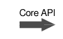

每章的第三部分，也是最后一部分，是源代码清单。每个使用的JavaScript库、HTML页面、样式表或C#类文件都将完整列出，除非该代码已在本章前面部分列出过。例如，如果HTML页面的完整标记在本章早期已列出，则不会在后面再次列出。然而，如果一个JavaScript文件随着项目进展逐步创建，那么完整的清单将包含在本部分中。

每个示例应用程序的可运行版本可在 www.ellipsetours.com/demos/index.html 找到。代码也可以从出版社网站 www.manning.com/HTML5for.NETDevelopers 下载。

#### 软件要求

本书的JavaScript部分与任何现代桌面或移动浏览器完全兼容。各章的构建需要Visual Studio 2010 Service Pack 1或更高版本。所有应用程序均使用Visual Studio 2012 Release Candidate进行了测试。

安装Git Bash和node.js，以及运行这些应用程序，需要本地管理员权限。

每一章都以一个浏览器支持表开始，显示哪些浏览器版本兼容各HTML5 API。

#### 代码约定和下载

清单或文本中的所有源代码都使用`像这样的等宽字体`，以区别于普通文本。许多清单附有代码注释，突出重要概念。

本书所有工作示例的源代码均可从出版社网站 www.manning.com/HTML5for.NETDevelopers 下载。每个示例应用程序的可运行版本可在 www.ellipsetours.com/demos/index.html 找到。

#### 作者在线

购买《面向.NET开发者的HTML5》可免费访问由Manning出版社运营的私人网络论坛，你可以在那里对本书发表评论、提出技术问题，并从作者和其他用户那里获得帮助。要访问论坛并订阅，请将你的网络浏览器指向 www.manning.com/HTML5for.NETDevelopers。此页面提供了注册后如何进入论坛、可获得何种帮助以及论坛行为准则的详细信息。

Manning对读者的承诺是提供一个场所，让读者之间以及读者与作者之间能够进行有意义的对话。这不是对作者任何特定参与程度的承诺，他们对本书论坛的贡献仍然是自愿的（且无报酬的）。我们建议你尝试向作者提出一些具有挑战性的问题，以免他们的兴趣偏离！

只要本书仍在印刷中，作者在线论坛和以往讨论的存档将可通过出版社网站访问。

#### 关于封面插图

《HTML5 for .NET Developers》封面图片的标题是“步兵军官”。该插图选自19世纪法国出版的西尔万·马雷夏尔四卷本地方服饰习俗与军装汇编。每幅插图都经过精心绘制并手工上色。马雷夏尔收藏中丰富多样的内容，生动地提醒我们，仅仅在200年前，世界各地的城镇和地区在文化上还存在着巨大的差异。人们彼此隔绝，说着不同的方言和语言。无论在街头还是乡村，仅凭穿着就能轻易辨别出他们居住的地方、从事的职业、专业、军衔或社会地位。

自那时起，着装规范发生了变化，曾经如此丰富的地区多样性也已逐渐消失。如今，我们很难区分来自不同大洲的居民，更不用说不同城镇或地区的人了。也许，我们用文化多样性换取了更加多元化的个人生活——当然也换取了更加多样化且快节奏的技术生活。

在一个很难将计算机书籍区分开来的时代，马宁（Manning）出版社通过封面设计，向计算机行业的创造力和进取精神致敬。这些封面基于两个世纪前丰富多彩的地区生活，并通过马雷夏尔的画作得以重现。

# HTML5 与 .NET

## 本章内容

- 了解 HTML5 的范围
- 浏览 HTML5 的新功能
- 评估 HTML5 在软件项目中的定位
- 了解什么是 HTML 应用程序
- 在 Visual Studio 中开始构建 HTML 应用程序

你一定会爱上 HTML5。这就像当你除了玩耍无事可做时，面前出现了一整箱崭新的玩具。别再谈论突破极限了；在客户端使用 HTML5，在服务器端使用 .NET，让你有能力在浏览器内执行应用程序创建全新的“信封”，而就在几年前，这些应用即便作为桌面应用也很难构建。利用你已有的技能，在任何地方为任何浏览器构建健壮且容错的 .NET 解决方案，这为你带来了市场优势，我们希望在本书中证明这一点。

例如，使用 HTML5，你可以：

- 利用全新的地理位置 API 在全球任何地方定位你的用户
- 使用 Canvas API 构建照片编辑或动画产品
- 使用 History 和拖放 API 构建高性能的用户界面
- 仅用几行 JavaScript 就能完成大量工作

HTML5 到底是什么？简而言之，它一部分是语义组织，可以为网络上的内容增添额外的意义；另一部分是 JavaScript 编程接口，让你能在简单的网页中实现不久前还无法做到的事情。机遇仅受限于你的想象力，而你当前用于开发软件的工具和环境，很可能正是帮助你构建这类新应用的工具。你可以在图 1.1 中看到一些示例。

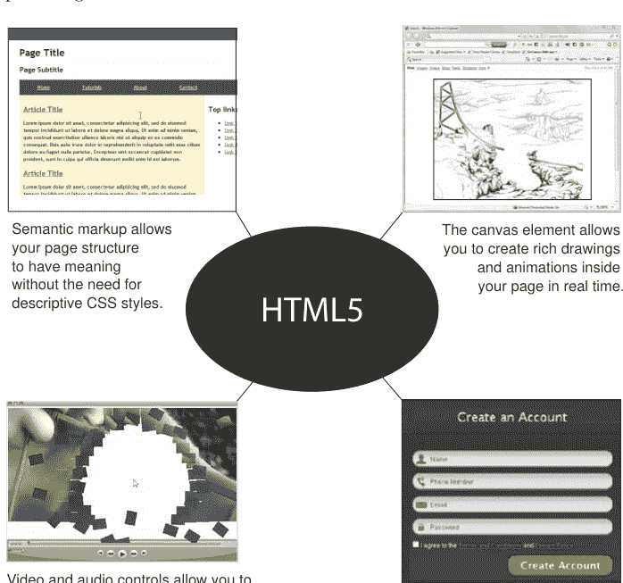

语义化标记让你的页面结构无需依赖描述性的 CSS 样式就能具有意义。

`canvas` 元素允许你在页面内实时创建丰富的绘图和动画。

视频和音频控件允许你展示富媒体，甚至可以与 `canvas` 等其他 API 集成。

新的表单元素让你能更好地组织、验证和展示页面上的数据。

开发者们，是时候认真关注了。HTML5 所利用的语义网已经到来，我们将在下一章详细讨论。更棒的是，你已经具备了许多为这个市场构建健壮应用所需的技能。你目前使用的工具和技术，如 Visual Studio、ASP.NET 和 Web 服务，都可以有效地集成到 HTML5 应用中。你需要在现有知识的基础上进行扩展，涉足一些新领域，但这些回报——例如与平板电脑和手机的无缝集成、简便的部署和升级、丰富的客户端功能集——都是值得的。

在本章中，我们将探讨 HTML5 为 .NET 开发者带来的新玩具，例如：

- 新的 HTML5 元素和微数据，它们为标记增添了超越页面标签内容本身的含义。
- 新的 Web 应用形式，让你能以很少甚至无需额外代码为页面添加功能。
- 新的 JavaScript API，不仅能提升性能，还能让你构建丰富的交互式图形并提升 Web 应用的速度。

我们还将探讨 JavaScript，以及为什么如果你打算利用 HTML5，它需要成为你技能集中的“一等公民”。同时，我们将探讨 .NET 框架为 HTML5 提供的服务器端处理和选项。

最后，我们将从端到端审视 HTML5 应用，并实现一个 Hello World 示例。这个示例将为你提供阅读本书示例应用所需的最少 JavaScript 知识，并让你领略即将呈现的 HTML5 盛宴。

事不宜迟，让我们开始探索 HTML5 为你玩具箱添加的新玩具。

### 1.1 HTML5 为开发者带来的新玩具

HTML5 是一个宏大的主题，图 1.2 应该能让你更好地理解使用 HTML5 的 Web 应用中各个动态组件。如果你感觉像是在看一辆赛车的底盘，对运作原理只有模糊的概念，别担心。随着本书的进展，我们会提供所有细节。重要的是整体图景以及各部分之间的基本互动。

在本节中，我们将为你提供一个高层次但扎实的概览，介绍一些最令人兴奋的 HTML5 新特性，其中许多你将在本书中学到如何使用。如果本书不涵盖某个特定功能，我们会为你指向其他优质资源，以便你在需要或喜欢时随时深入探索。具体来说，本节我们将涵盖以下主题：

- 新的 HTML5 标签和微数据，它们帮助你构建搜索优化、语义化的页面。
- HTML5 如何让你跨设备和浏览器开发，而无需编写多个程序。
- JavaScript 的改进以及大量库、扩展和框架，它们让开发工作变得更快更容易。
- 通过创建用户友好、图形丰富、交互式的 Web 应用，识别并实现备受关注的 HTML5 API。
- 回顾级联样式表 3 (CSS3) 和 ASP.NET MVC 在整体图景中的位置。

我们的第一站将转向 HTML5 标签和微数据。

#### 1.1.1 新的 HTML5 标签和微数据

想象一下，你是一个名为“四分之水”乐队的成员。你正在创建一个非常基础的网页，只是为了测试你新学到的 HTML5 知识。

你知道 HTML 标签，它们是你在尖括号内写下的小段文本，用于在网页上渲染元素。每个标签以开头符号 `<` 开始，以闭合符号 `>` 结束。内容紧随其后，然后以 `</tag>` 标记关闭标签。开始标签还可以包含属性以赋予其更多含义：

```html
<div>
    <p>My name is Neil.</p>
    <p>My band is called Four Parts Water.</p>
    <p>I am British.</p>
</div>
```

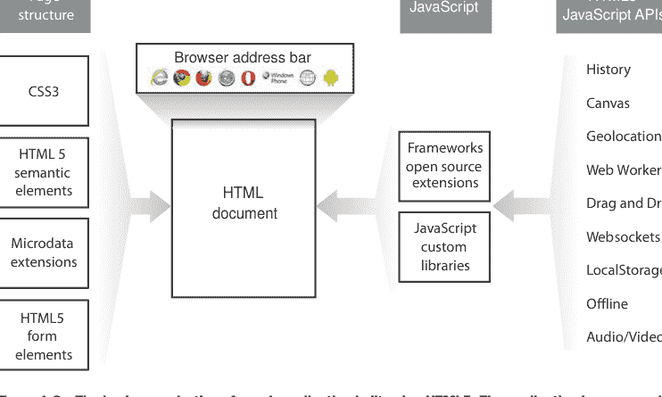

**图 1.2** 使用 HTML5 构建的 Web 应用的基本组织结构。应用程序由 Web 浏览器使用，浏览器读取一个 HTML 文本文件并解释其内容，根据需要加载 JavaScript 文件、图像或样式表等其他资源。标记使用链接或直接放置在标记中的样式表渲染在页面上，JavaScript 代码在适当的时间执行，以改变界面、与服务器通信或与当前浏览器可用的 HTML5 API 交互。这些 API 可以直接与客户端系统交互，但 JavaScript 通常不能。

这很好，但现在你想尝试添加一些微数据。微数据是一种你可以使用特殊属性关键词添加到页面中的附加信息。它可以通过JavaScript设置、读取和更改，并且微数据包含的值几乎可以是你喜欢的任何内容。你可以使用微数据来扩展标签，添加搜索引擎和JavaScript库可以用来更好地理解页面数据的语义或其他有意义的信息。对页面数据和内容的整体解读将有助于优化搜索以及像页面阅读器这样的无障碍应用程序。微数据扩展还可以减少代码量，并在几乎任何页面中增加标记的表达力。

掌握了这些知识后，你编写了下面清单中的代码（来自html5rocks.com），该代码显示了相同的基本页面，包含你的名字和你乐队的名字，但带有为网络爬虫和搜索引擎准备的额外信息。

```html
<div itemscope>
  <p>My name is <span itemprop='name'>
    Neil</span>.</p>
  <p>My band is called <span itemprop='band'>
    Four Parts Water</span>.</p>
  <p>I am <span itemprop='nationality'>
    British</span>.</p>
</div>
```

`itemscope` 声明定义了对象 `itemprops` 的边界。这里的 `itemprop` 是 `name`，一个对搜索引擎有用的、标准的微数据词汇术语。用 `itemscope` 声明的元素的结束标签关闭了微数据引用的对象。`band` 这个 `itemprop` 不在标准词汇中，但仍然允许使用。

如你所见，各种微数据标签帮助引擎和爬虫解释文本中哪些部分重要，以及每个部分意味着什么。

#### 1.1.2 HTML5在设备上的应用

HTML5不仅为我们.NET开发者提供了在Web上让代码有意义的新方法；它还为我们带来了为曾经只存在于科幻作家想象中的令人兴奋的新设备进行开发的能力：想想iPad、Kindle和智能手机。移动电话拥有功能齐全的浏览器，其显示技术优于五年前的大多数计算机，甚至笔记本电脑现在也拥有强大的图形处理器。游戏PC的图形支持允许它们无缝渲染复杂的3D图形和动画。HTML5让.NET开发者进入这个新世界，这里的挑战在于利用浏览器平台的多样性，同时保持功能的连续性。

> **注意** 目前，网络社区将HTML应用程序和HTML5应用程序这两个术语交替使用。这是因为随着HTML5规范投入市场而出现的新功能正在激发开发富互联网应用程序的新想法和新方法。在此，我们只提及“HTML应用程序”，但我们的示例将专注于HTML5和JavaScript中使应用程序对用户更深入、更有用的部分。

你如何开发一个能在图1.3所列的所有屏幕上工作的单一应用程序？这当然是可能的，但它需要很好地理解在整个目标浏览器范围内可用的折衷方案和功能。我们将在后续章节中为你提供这些知识，教你如何在多个浏览器中使用HTML5的功能。

#### 1.1.3 更好、更快的JavaScript

另一个使HTML应用程序引人注目的特性是，在过去几年中，所有浏览器的JavaScript引擎性能都得到了难以置信的改进。JavaScript仅适用于处理点击事件或提交表单的日子已经一去不复返了。只需看看图1.4，就能看到通过各种版本，执行时间得到了多么显著的改善。

加上HTML5对JSON数据传输的原生支持以及一系列可用的性能增强编码技术，很难说编译后的二进制库总是更快。虽然在许多情况下这可能是正确的，但在许多正常操作场景中，JavaScript例程可以与在.NET运行时中编译的相同例程一样快。这意味着像Silverlight和Flash这样的插件在应用程序市场上的优势大大降低了。在某些情况下，它们根本没有优势。

#### 1.1.4 库、扩展和框架

JavaScript开发也受益于广泛的开源项目和免费工具。虽然这些应用拼图的部分本身并非新玩具，但它们让你作为开发者能够更好、更高效地使用HTML5特有的玩具。

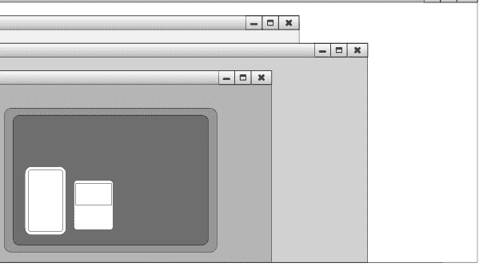

**图 1.3** 你可以使用的浏览器的形式因素、大小和分辨率一直在增长。

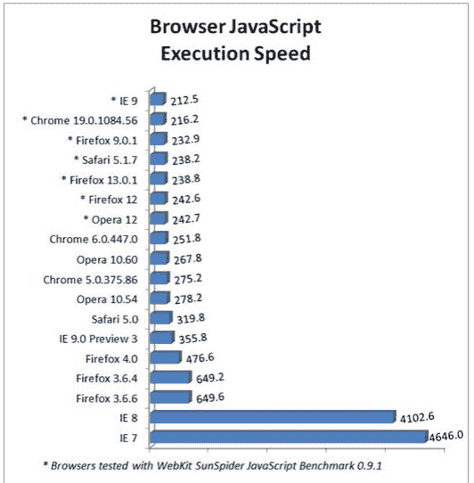

**图 1.4** 过去几年中JavaScript引擎性能的改进（由webkit.org提供）带来了令人印象深刻的全面速度提升。在该图中，测量了执行大量非常具体的JavaScript基准测试任务所需的毫秒数。

### Windows 8

Windows 8的发布及其后续版本对所有.NET开发者来说都是重大消息。它带来了一套新的功能、更好的安全性以及一个应用商店，并采用了Windows Phone上漂亮的Windows商店样式。虽然本书并非专门讲述如何使用HTML5、CSS和JavaScript构建原生Windows 8应用程序，但好消息是你在这里学到的内容将适用于这个新的平台。

Windows特定版本的JavaScript被称为WinJS，其核心是JavaScript，增加了调用主机系统原生函数和库的能力。来自你的HTML5应用程序的标记和样式应该相对容易移植到新的Windows 8环境中，这让你的技能更加有价值。

此外，随Windows 8一起发布的Internet Explorer 10是微软有史以来最符合标准、兼容性最好的浏览器，并且速度极快。这给了你选择，可以将你的应用程序构建为HTML5网络应用程序，以便在多个设备和浏览器上使用，或者构建为原生的Windows 8应用程序，适用于部署到应用商店。

简而言之，本书虽然不针对任何特定平台，但将让你能够运用所学的一切，在原生和基于浏览器的Windows 8开发上取得重大先机。

请参阅Windows开发中心的“使用JavaScript的Windows商店应用路线图”页面，网址为 http://msdn.microsoft.com/en-us/library/windows/apps/hh465037.aspx。

# 第1章 HTML5和.NET

例如，有几十种JavaScript单元测试框架，包括QUnit，一个用于JavaScript和jQuery的免费框架（github.com/jquery/qunit）。你可以使用像Backbone.js（documentcloud.github.com/backbone）或Knockout.js（knockoutjs.com）这样的库，通过基于模式的方法构建完整的应用程序。这些框架为你提供客户端MVC（模型-视图-控制器）或MVVM（模型-视图-视图模型）范式，用于构建大型HTML应用程序，同时保持其可维护性。还有成千上万的其他库；只需想到你可能想要的丰富网站的任何功能，然后搜索它。你几乎可以保证找到一些能让你入门的东西。

在考虑第三方商业和开源JavaScript库时，很难确切地说从哪里开始。有用于执行特定任务的组件、充当开发框架的库、用于单元测试的库、图形辅助工具、通信工具、文档增强工具，以及其他许多。只需看看GitHub（http://www.github.com/）自己看看。搜索“JavaScript”会显示超过9,000个项目。现在跳到jQuery网站（www.jquery.com），查看插件页面。有近500页的插件项目。

> **在库方面不知从何入手？考虑jQuery。**

在寻找JavaScript库以提高应用程序质量和开发速度时，jQuery显然是一个起点。它是开发HTML应用程序最受欢迎的框架之一，目前在近一半的活跃网站中使用。这个由John Resig创建的库一直在持续开发，既快速又易于使用。它还拥有一个插件模型，允许其他人向其添加新功能。

微软显然明白jQuery是构建下一波应用程序的理想工具，并投入了大量精力在数据绑定、模板插件以及像Knockout.js这样的基于模式的框架上。使用HTML5，微软开发者现在可以一次构建，几乎在任何地方部署。（我们以前在哪里听过这个说法？）但比微软的贡献更重要的是，它是jQuery生态系统中一个平等的合作伙伴。

如今几乎所有可用的JavaScript库都是开放供你审查，并根据其附带的许可证后续纳入你的网站的。除了直接使用这些库，你还可以用它们来学习如何执行特定任务或进行架构指导。

当你学习本书中的示例并更加精通JavaScript语言时，你将学会以批判的眼光审视这些库。

请参阅W3Techs的“jQuery的使用统计和网站市场份额”文章，网址为 http://w3techs.com/technologies/details/js-jquery/all/all。

#### 1.1.5 新的 HTML5 JavaScript API

还有各种 JavaScript 对象和 API 可以帮助你的页面与外部世界以及浏览器操作系统的其他部分进行交互。这类功能相当多，但我们讨论的重点将放在一些对构建富 Web 应用最稳定和最有用的特性上。

Canvas 是 HTML5 中基于光栅的绘图机制。Canvas JavaScript API 具有强大的功能，我们将在第 4 章详细介绍。如果你想先一睹为快，可以尝试使用以下代码在 `canvas` 元素上绘制一个简单的矩形：

```javascript
var myCanvas = document.getElementById("rectCanvas");
var canvContext = myCanvas.getContext("2d");
canvContext.fillRect(50, 25, 150, 100);
```

关键在于获取 `canvas` 的引用，然后获取其 `context` 对象。`context` 对象是你在渲染元素内进行所有工作的工具。如何使用它呢？可以作为绘图表面，用于绘制图表和图形，以及用于从非常简单到极其复杂的动画。

HTML5 中的 History API 用于在当前浏览器的会话历史中添加或替换数据。你可以用它用更通用或更有帮助的着陆页来覆盖当前页面。你也可以用它向会话历史添加新条目，以便可以使用浏览器的前进和后退按钮访问页面内的导航事件：

```javascript
history.pushState();
history.replaceState();
```

我们将在第 5 章讨论 History API。如何使用它？用于增强视图或页面之间的应用程序导航，并从当前站点的浏览器历史记录中移除不需要的步骤。

我们最喜欢的 API 是 Geolocation（地理定位）。使用 `geolocation.getCurrentPosition()` 函数，你可以从设备的板载 GPS 设备获取经纬度。请注意，地理定位对象仅适用于 JavaScript 中的 `navigator` 对象。正如你可能预期的那样，`navigator` 并非只是地理定位的封装。它是一个全局对象，包含许多功能组件。有关更多信息，请查阅第 6 章关于地理定位的内容。

如何使用它？作为让用户在世界上定位自己的工具，以及作为向用户提供其周围兴趣点有意义数据的基础。

##### Web Workers

Web Worker 允许你的 HTML 应用使用多线程。对于处理密集型应用或长时间运行的 JavaScript 任务，web worker 对象非常宝贵。Web worker 被声明为一个 `Worker` 对象，并传入一个 JavaScript 文件：

```javascript
var wrk = new Worker("BackgroundProcess.js");
```

一旦实例化，后台处理脚本和托管的 worker 对象就可以监听来回发送的消息。worker 对象可以这样做：

```javascript
wrk.postMessage("Hello to the web worker");
```

在 `BackgroundProcess.js` 内部，你可以这样做来向主机发回消息：

```javascript
self.postMessage("Hi from the background process");
```

这是一个没有任何必需管道代码的最小示例。这里重要的是来回传递的值是字符串。这为发送 JSON 数据对象以及其他更复杂的价值数组保留了可能性。我们将在第 7 章介绍 Web Workers。

如何使用它？通过在后台执行处理器密集型计算来加速应用程序性能，从而为图形渲染和用户交互释放周期。

##### 拖放

拖放是 HTML5 中的一项新功能，允许你以编程方式相对于页面、彼此或用户桌面在页面上拾取和放置元素。这是通过为元素设置 `drag`、`drop`、`dragover` 和 `dragenter` 事件来完成的。在拖放操作发生期间，可以激活 API 的其他功能向用户提供有关正在发生什么的反馈。我们将在第 7 章介绍拖放。

如何使用它？作为一种将自然的用户交互可靠且快速地引入 Web 应用程序的方式。

##### WebSockets

WebSockets 是一种脱离网页交互的请求/响应范式、转向双向通信通道的方式。这意味着通信可以在会话期间同时双向进行。这最好用例子来说明，但我们需要先介绍更多的 JavaScript 基础知识。关于 WebSockets 的内容将在第 8 章中介绍。

如何使用它？用于构建实时通信 Web 应用程序，如聊天、白板或协作绘图。

##### 本地存储

Local Storage HTML5 API 提供了一种通过使用键/值风格存储规范来存储本地数据的解决方案，该规范在单个域内可读写。你可以非常容易地读取、插入、更新和删除数据，并且比 Web 应用程序中通常可能的存储更多信息。我们将在第 9 章介绍这个 API。如何使用它？作为构建在本地存储用户数据、同时只发送服务器功能所需数据的应用程序的基础。

Local Storage 不提供与服务器数据库同步的任何规范，也不提供事务支持。如果你需要事务支持，最好查看 IndexedDB HTML5 规范。这个 API 使用文档数据库（或 NoSQL）风格的方法，但该规范目前不完整且不稳定，因此我们不会在本书中介绍它。

##### 离线访问

站点保持离线可用的能力在 HTML5 中是新功能。这是通过指定一个清单文件来完成的，该文件描述了哪些文件必须下载以供离线使用，哪些文件应仅在在线时访问，以及哪些文件在请求时应获取替代文件。清单文件在页面的顶层 `<html>` 元素中指定：

```html
<html manifest="/cache.manifest">
```

如何使用它？作为一种创建即使在没有互联网连接时也能运行的丰富游戏或商业应用程序的方式。

##### 音频/视频

`audio` 和 `video` 标签允许你在没有 Flash 或 Silverlight 插件的情况下播放音乐和视频。浏览器厂商内置了他们自己的默认播放器，但你可以轻松扩展或替换它们，正如我们将在第 3 章中展示的那样。由于支持的格式因浏览器而异，你可以用多种格式创建内容，并让浏览器自动选择使用哪个版本。这允许向前和向后兼容，使你能够跟上不断变化的多媒体格式格局。

一个简单的音频标签可能如下所示：

```html
<audio src="/content/music.mp3"></audio>
```

#### 1.1.6 级联样式表 3

级联样式表（CSS）第 3 版从技术上讲不属于 HTML5 规范的一部分，但媒体查询和转换的图形功能使其成为任何基于浏览器的富应用程序的关键组成部分。将你的呈现规则放入样式中，可以使你为客户构建更易于管理和可插拔的用户界面。精心设计的级联样式也可以显著减少你的开发时间。

我们将在第 2 章介绍实现 HTML5 应用程序所需的核心 CSS3 概念，并理解 CSS3 在应用程序设计中的位置。我们将在本书的其余部分中再次涉及它，作为一种添加平滑动画和丰富样式的方法。虽然我们没有在本书中提供权威的 CSS3 参考，但你肯定会意识到更深入地学习 CSS 的好处。

Eric Meyer 所著的《Smashing CSS: Professional Techniques for Modern Layout》（Smashing Magazine, 2010）一书是任何技术图书馆的绝佳补充。

#### 1.1.7 MVC 和 Razor

虽然 MVC（模型-视图-控制器）不是 HTML5 的直接组成部分，但它是一种软件开发模式，允许在业务逻辑组件和用户界面显示之间清晰地分离关注点。Microsoft 最新版本的 ASP.NET MVC 的 Visual Studio 模板正作为免费的、单独的发布持续直接更新到开发社区。ASP.NET MVC 在 HTML 应用程序上下文中提供了几种操作方式。

第一种也是最简单的方法是确保你的所有视图都符合 HTML5 标准。这可以通过在线在 validator.w3.org 等网站上完成，这些网站允许你输入 URL 并返回有效和无效标记的列表。这包括你的标记的语义组织和非侵入式 JavaScript（稍后讨论）的使用。你也可以构建一个单独的 HTML 页面来包含整个应用程序的一部分，并将其包含在你的 MVC 站点中。我们将在第 4 章介绍 HTML5 Canvas 时这样做。

下一种方法是使用 Razor，这是作为 ASP.NET MVC 一部分引入的视图处理引擎。Razor 促进了视图中可读的内联代码，允许你编写格式正确的 HTML，并穿插一些服务器代码来根据你可以构建的数据模型执行工作。使用 Razor，你的标记变得更加简洁、易于阅读，并且编码速度更快。使用 Razor 和 ASP.NET MVC，你可以融入你习惯的所有 .NET 开发功能，并无缝过渡到 HTML5 应用程序开发的世界。Razor 在我们的 MVC 视图中贯穿使用，更详细的内容在附录 B 的 ASP.NET MVC 部分介绍。

### 1.2 端到端的 HTML5 应用程序

现在你对本书中将要学习和使用的工具的基本概念有了了解，接下来你需要知道的是，在正常系统中每个部分如何与其他部分交互以及它们在何处相互接触。

> **注意** 在每章的开头，我们将清楚地定义支持哪些浏览器和版本。你应该能够下载、安装并测试 Google Chrome、Internet Explorer、Firefox、Opera 和 Apple Safari。此外，你可以使用任何可用的移动浏览器来测试站点渲染和功能。

图 1.5 展示了一个非常简化的视图，显示了每个部分如何适应 HTML5 应用程序的整体方案。这是你在图 1.2 中看到的同一个图表，但增加了 Microsoft 的服务器端组件。这些部分可以组合在一起的方式绝不仅限于此，但这将帮助你入门。

在 HTML 应用程序的服务器端，MVC 控制器将呈现一个视图（发送到浏览器的 HTML 文本）、从表单 POST 操作中获取数据，或使用 Ajax 调用发送或接收数据。在后面的章节中，我们将介绍所有这些通信以及如何在 HTML 应用程序中集成它们。

**图 1.5 应用程序中 HTML5 特性与 JavaScript API 之间的基本客户端和服务端交互**

你可能会觉得所有这些部分有点令人不知所措，因此我们将深入探讨每个领域以帮助你巩固理解。我们将从页面结构开始。

#### 1.2.1 页面结构与页面呈现

图 1.6 说明了页面结构以及它如何融入 HTML 应用程序的框架。

单个应用程序页面的结构包括语义元素，例如 `<header>`、`<footer>`、`<nav>`、`<article>` 和 `<section>`，以及任何传统的 HTML 标签，如 `<div>`、`<span>` 和 `<a>`。语义标签（将在下一章更详细地介绍）提供组织线索和一种表示内容各部分存在位置的方式。结构化元素使用 CSS 进行样式设置，并且可以在运行时附加 JavaScript 行为。页面结构中的元素可以在运行时从服务器交付，从客户端模板构建，或按需下载。

请注意，页面使用的样式也可以确定其结构。一个常见的例子是元素被浮动时。浮动元素（由 CSS 样式 `float:left` 或 `float:right` 表示）不参与页面流，但会停靠到窗口的相应一侧。我们将在第 4 章介绍 Canvas API 和第 6 章介绍 Geolocation API 时讨论在页面上定位元素的问题。

图 1.6 页面结构是 HTML 页面的物理组织。哪些标签存在于其他标签内部，可以决定元素如何使用 JavaScript 移动或访问。

页面呈现是页面结构接收的视觉样式，基于元素在结构中的位置以及页面上包含的样式表。样式表中的样式是可以在运行时发生的操作的起点。当页面显示时，浏览器布局的更改可以触发媒体查询更改，用户的交互可以触发 JavaScript 函数。我们将在第 2 章介绍什么是媒体查询以及它们如何工作。目前，重要的概念是，通过使用 CSS 和 JavaScript，你可以根据浏览器中的变化条件显著改变页面的呈现方式。

#### 1.2.2 页面内容

你的应用程序的内容可以是任何东西，从地图到可编辑的网格。它可以是来自内容管理系统的数据、用户上传的图片或新闻文章。无论内容是什么，它都是应用程序最重要的部分，并且应该以一种使其是什么以及为什么重要非常明显的方式放置在结构中。图 1.7 显示了内容在 HTML 应用程序框架中的作用。

**图 1.7** 静态内容直接写在页面的 HTML 元素中。在 MVC 应用程序中，动态内容可以通过视图交付到浏览器，或者通过 JavaScript 和 Ajax 交付。

页面内容可以是静态的、动态的，或者两者的混合，具体取决于应用程序的需要。它可以在应用程序执行时由用户添加，或者在应用程序检测到来自某个其他进程的更新时按需拉取。

#### 1.2.3 应用程序导航

在 HTML5 应用程序中，导航涉及两个部分：浏览器 URL 的操作和向服务器提交值以转到另一个页面。图 1.8 突出显示了图表底部的 POST 操作以及使用新的 HTML5 History API 来管理 URL。

**图 1.8** 当用户向服务器 POST 消息、当 JavaScript 事件发生、或者当浏览器 URL 更改被 HTML5 History API 拦截时，会发生应用程序导航。

当用户单击链接跳转到另一个页面或提交表单时，或者可以通过 JavaScript 通过其他事件启动时，可以发生导航。在传统网页中，这些操作是突兀的，有时甚至是令人不快的，但在丰富的 HTML 应用程序中，用户的操作可以被考虑并优雅地处理。自然或本能的交互是当今移动市场中获得巨大发展的领域，因为看似可用性故事中的小部分可能对用户满意度产生巨大影响。保持操作微妙而本能是一种艺术形式，其中将眼睛、鼠标或手吸引到特定位置执行操作的能力至关重要。

#### 1.2.4 业务逻辑

HTML 应用程序中的业务逻辑几乎总是客户端的 JavaScript；相应的服务器端实现可以是 .NET 或任何其他服务器技术。如图 1.9 所示，你在应用程序中包含的自定义库和框架将负责更改用户界面、与服务器通信以及集成 HTML5 API。

**图 1.9** HTML 应用程序中的业务逻辑几乎完全存在于客户端的 JavaScript 和服务器上的 .NET 库中。

在通信方面，我们将在本书中使用 ASP.NET MVC，但你并不局限于此技术。任何能够接收 HTTP 调用并返回数据的服务器解决方案都可以。你必须做出的决策将围绕何时、何地以及如何验证业务数据以及使用哪些外部库展开。

#### 1.2.5 服务器通信

与服务器的通信通过页面的初始加载、通过表单提交或通过 Ajax 调用 Web 服务来完成。良好的通信模型将保持低流量频率和尽可能最小的内容量。图 1.10 突出显示了 ASP.NET MVC 的一个限制，即所有通信将通过控制器传输，并且可以由 JavaScript Ajax 调用或通过表单 POST 发起。

**图 1.10** 与服务器的通信对于大多数业务应用程序至关重要，可以通过使用 Ajax 联系控制器操作或将表单 POST 到服务器来执行。

当需要安全性时，可以使用 MVC 的 SSL 来保持数据传输的私密性；当不需要安全性时，有时使与服务器的通信某种程度上是透明的是合理的。这样做将使你的系统能够在软件即服务（SAAS）模型中运行，并允许其他应用程序使用或操作你的应用程序的数据。

#### 1.2.6 数据层

数据层在 HTML 应用程序中很有趣，因为它可以涉及客户端和服务器数据存储。在服务器上，你将存储所有正常的业务数据、安全性和事务信息。客户端更为复杂，因为你通常还需要存储持久状态信息以及用于离线使用的客户端数据。图 1.11 显示了 JavaScript 与 Local Storage API 的交集。

**图 1.11** 在 HTML 应用程序中存储本地数据最好使用 Local Storage API 和 JavaScript 方法来维护。

如前所述，Local Storage 并不是在客户端维护数据的唯一手段，但它目前在支持的浏览器和使用简便性方面具有最佳的组合。Local Storage 比 IndexedDB 拥有更多的支持和稳定性，并且比浏览器 cookie 容易使用得多，尽管这些其他解决方案也有其用武之地。

设置为可离线访问的页面是否也可以被视为数据层的一部分，这是一个有趣的话题，我们将在第 10 章中加以考虑，但现在，请理解，在页面中放置的某些指令将允许在浏览器未连接到互联网时无缝访问它。

现在我们已经了解了使用 HTML5、JavaScript 和 .NET 开发应用程序的许多方面，是时候通过构建一个 Hello World 应用程序将它们全部整合起来了。

### 1.3 HTML5 中的 Hello World

你的 Hello World 应用程序将仅用几行代码显示一个网页、创建一个 JavaScript 对象，并从 MVC 控制器获取 JSON 数据以呈现给用户。图 1.12 显示该应用程序将在所有主流浏览器中工作。它也无需修改即可在 iPhone、iPad、Windows Phone 和 Android 设备上工作！

当用户输入姓名和日期时，服务器将向姓名添加一个“已验证”标签，并验证传入的日期。它将向返回的对象分配一个服务器日期，然后在界面上显示。用户执行任何这些步骤都不需要额外的导航。

这个应用程序不仅会让你立即动手实践；它还将向你介绍以下立即有用并在本书其余部分都有用的特性：

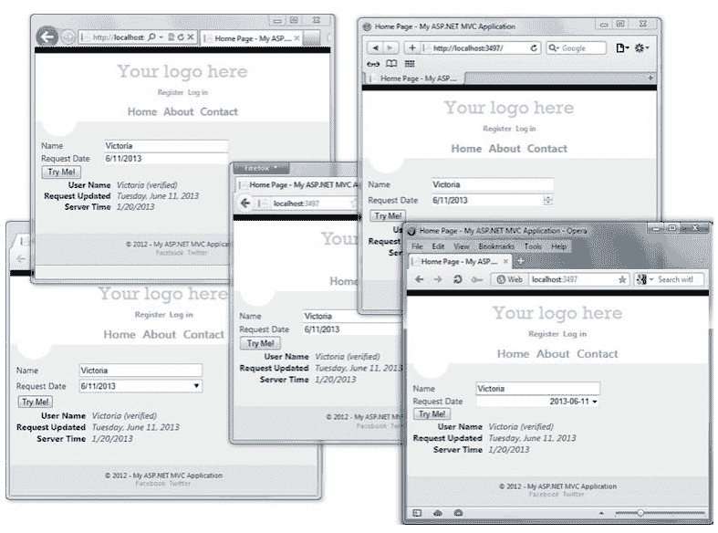

**图 1.12** Hello World 在所有主流浏览器中无需修改即可执行

- 根据需要更新或移除 Visual Studio NuGet 项目包
- ASP.NET MVC 模型绑定
- 使用 Ajax 和 jQuery 向服务器发布数据
- 使用 JavaScript 向页面添加和删除内容
- 构建和使用 JavaScript 对象
- JavaScript 闭包和作用域
- jQuery ready 处理程序

在接下来的章节中，你将创建一个新模板，自定义应用程序，构建你的 JavaScript 库，然后构建服务器端所需的内容。是时候开始了！

#### 1.3.1 创建模板

要开始，正常打开 Visual Studio 并启动一个名为 HelloWorld 的新项目：

1. 选择 Web 选项卡，找到名为 ASP.NET MVC Web Application 的项目模板。MVC 项目模板的版本取决于你安装的 Visual Studio 最新版本，但至少需要 MVC 3。可以从微软网站免费下载或通过 Web 平台安装程序 (http://www.microsoft.com/web/downloads/platform.aspx) 安装。
2. 如图 1.13 所示，将项目名称设置为 HelloWorld，然后单击确定。
3. 选择使用 HTML5 语义标记和 Razor 视图引擎的 Internet 应用程序。
4. 保持创建单元测试项目项未选中。

该模板将创建一个基线 MVC 网站，你可以立即启动它。你应该有包含控制器列表、视图、模型和脚本文件夹以及 `web.config` 文件的文件夹，这些你可能都很熟悉。在 Scripts 文件夹中，你会注意到有不少文件在文件名中包含版本号。这是 JavaScript 库中的常见做法。如果你熟悉 jQuery，你可能还会注意到，如图 1.14 所示，这些文件已经过时了。

在 Visual Studio 中包含由 Phil Haack 发起的开源项目 NuGet，可以使更新这些文件变得快速而轻松。在 Visual Studio 菜单栏中，选择“工具”>“库包管理器”>“管理解决方案的 NuGet 程序包”。在“管理 NuGet 程序包”窗口中，你可以选择左侧的“更新”选项卡，看到一个类似于图 1.15 的屏幕。

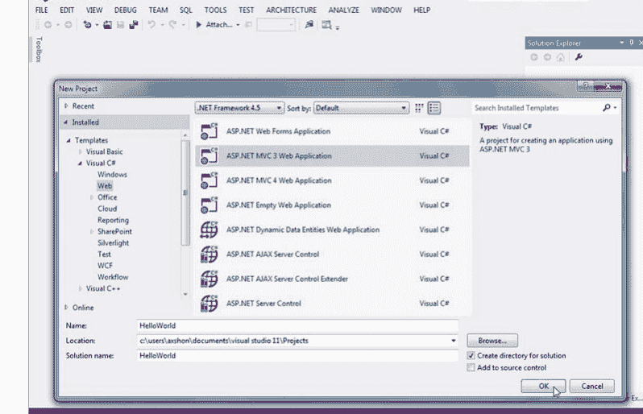

图 1.13 在 Visual Studio 中创建新的 ASP.NET MVC 项目，至少使用 MVC 3。

你只需单击每个程序包旁边的“更新”按钮（有些是关联的，因此更新可以级联），直到全部完成。现在你应该拥有所有最新的 JavaScript 库和项目引用，可以继续使用 HelloWorld 应用程序了。这些文件不一定在适当的位置链接，但你将在遇到它们时更新这些链接。在后面的章节中，我们只会包含和更新你实际要使用的程序包，但在这个练习中，我们会保持简单一些。

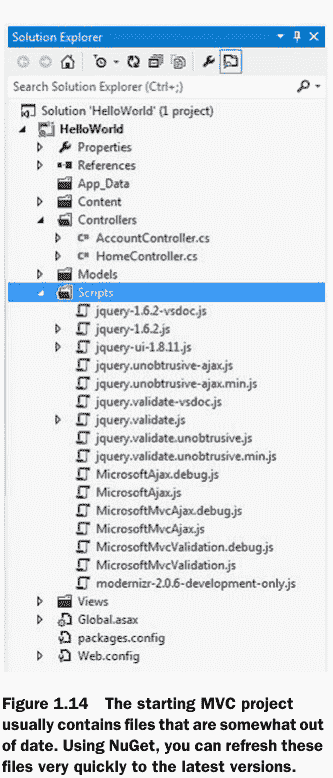

> **提示** 本节涵盖了一些 JavaScript 语言特有的主题。如果你还不熟悉 JavaScript 的结构和特性，我们建议你阅读本书末尾的附录 A 关于 JavaScript 的内容。

#### 1.3.2 自定义应用程序

自定义应用程序的第一步是修改用户界面。打开 `Views > Home > Index.cshtml` 文件并添加下一个代码清单中的标记。

```html
@{
    ViewBag.Title = "Home Page";
}
<title>@ViewBag.Message</title>
<article id="inputSection">
    <section class="submission">
        <label for="userName">Name</label>
        <input type="text" id="userName" />
    </section>
    <section class="submission">
        <label for="reqDate">Request Date</label>
        <input type="date" id="reqDate" />
    </section>
    <section>
        <button id="makeRequest" type="button">
            Try Me!</button>
    </section>
</article>
```

最终的 `<section>` 将在成功回调后用服务器返回的数据填充。

该标记将由 MVC 自动放置在应用程序的母版页中。如果你使用的是 MVC 版本 3，母版页文件仍将包含对旧文件的引用。这是你需要打开的下一个文件：

1. 在解决方案资源管理器中导航到 `Views > Shared > _Layout.cshtml`。注意在页面顶部有对各种脚本文件的引用。将这些引用与应用程序 Scripts 文件夹中的内容进行比较，并相应更新它们。

```html
<script src="@Url.Content("~/Scripts/jquery-1.7.2.min.js")" ...>
<script src="@Url.Content("~/Scripts/modernizr-2.5.3.js")" ...>
```

2. 同时，找到 `<h1>` 标签并将其内容更改为 "Hello World"。现在运行你的应用程序，你应该会看到类似于图 1.16 的内容。
3. 这很好，但可以改进一些。找到 `Content > Site.css` 样式表并打开它。滚动到底部并添加以下样式：

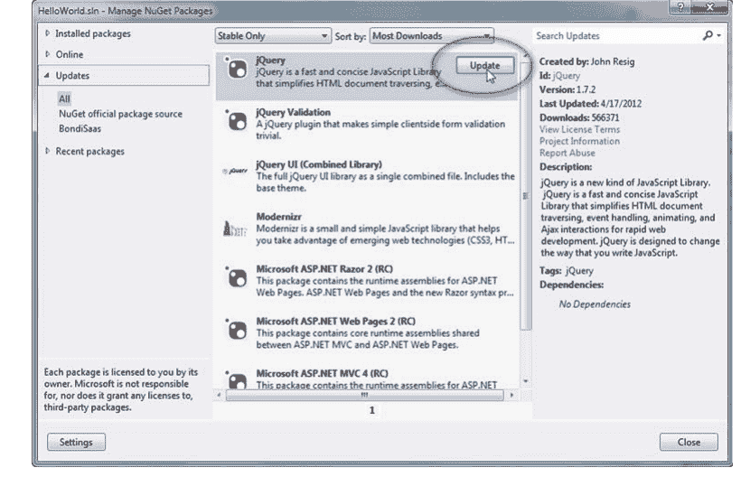

图 1.15 使用 NuGet 更新标准 MVC 解决方案中默认包含的所有程序包。

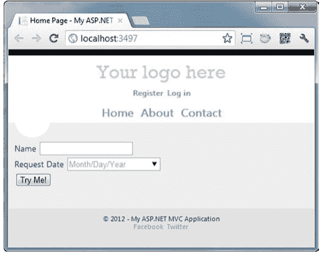

图 1.16 主页的内容包含了应用程序所需的控件，但仍然需要额外的样式。

```css
.submission label {
    display: inline-block;
    width: 100px;
}

.submission input {
    width: 200px;
}

.result label {
    display: inline-block;
    margin-right: 10px;
    width: 115px;
    text-align: right;
    font-weight: bold;
}

.result span {
    font-style: italic;
}
```

这些样式将使内容保持对齐和美观，特别是在你在客户端和服务器之间来回移动数据以及动态添加和删除 HTML 元素时。这些样式都采用相同的基本选择器（每个样式的标题，用于确定将选择哪些元素）。有很多方法可以编写样式来完成工作，但我们对这些样式非常具体，以避免无意中编辑页面其他部分的其他样式。

#### 1.3.3 构建 JavaScript 库

你可能在代码清单 1.2 中注意到我们引用了一个名为 `HelloWorld.js` 的脚本文件。是时候创建这个文件了。为此，我们将逐步完成以下步骤：

1. 创建 JavaScript 文件并连接 jQuery ready 函数。
2. 创建 `myApp` 对象。
3. 创建 Ajax 请求以调用 MVC 控制器。
4. 创建处理来自 MVC 控制器结果的 JavaScript 函数。
5. 创建在页面上显示结果的函数。

让我们开始吧。

展开 Scripts 文件夹并添加一个新的 JScript 文件。在此文件的顶部，添加以下 JavaScript 代码：

```javascript
$(document).ready(function () {
    myApp.helloWorldWireup();
});
```

这被称为 ready 处理程序。这是 jQuery 在包含 jQuery 库引用的任何页面完成其所有加载和页面布局任务时自动触发的一个事件。这可能不是一个容易知道的事情，因此 jQuery 团队不遗余力地检查多个信息来源以推断此就绪状态。作为开发者，你只需要连接事件就可以了！

对 `myApp.helloWorldWireup` 的调用现在还不做任何事情，所以你需要接下来看看它。下面的代码清单包含对象的声明以及一些开始使用的逻辑。你将很快填充这些存根函数。

```javascript
var myApp = {
    helloWorldWireup: function () {
        $("#makeRequest").click(function (event) {
            var nm = $("#userName").val();
            var dt = $("#reqDate").val();
            var myData = {
                UserName: nm,
                RequestedDate: dt
            };
            // Ajax 请求将放在这里
        });
    },
    processResult: function (returnedData) {
    },
    displayResult: function (label, value) {
    }
}
```

你的 JavaScript 对象 (`myApp`) 将在 JavaScript 文件加载后、ready 事件触发前创建，因此你可以确保在调用它时它已存在。这是 HTML 应用程序中的正常流程，无论你加载多少 JavaScript 库。

##### JavaScript对象创建

使用JavaScript代码创建对象有多种方法。在本书中你将用到其中好几种，但最简单的方法如下所示：

```javascript
var myObject = {
    prop: "prop 1",
    prop2: "property 2",
    func1: function() {
        alert('hi there!');
    }
};
```

这段代码告诉JavaScript引擎在内存中为`window`对象添加一个引用，并将其命名为`myObject`。这个对象将拥有两个属性（`prop`和`prop2`），其中已填充了值，以及一个函数（`func1`），该函数被调用时会在浏览器中弹出一个消息框。创建此类对象的关键规则是：

- 使用`var`声明对象
- 属性或函数名与值之间用冒号分隔
- 属性和函数之间用逗号分隔

创建同一对象的另一种方式如下：

```javascript
var myObject = {};
myObject.prop = 'prop 1';
myObject["prop2"] = 'property 2';
myObject.func1 = function() {
    alert('hi there!');
};
```

第二种方式创建的对象功能与前一个完全相同。唯一区别在于实例化方式。这种方法的优点是，添加每个属性或函数的操作彼此独立。这意味着你可以随时使用点号表示法（`object.property`）或字符串表示法（`object['property']`）向JavaScript对象添加新的属性和函数。

另外两种创建对象的方法是：将JSON文本解析为对象，以及将一个对象和/或其属性复制到另一个对象。

下一步是填写Ajax请求。jQuery有一个内置函数来实现这一点。执行时它可以接受多个可选属性，但为了本示例的目的，你只需要指定要执行的请求类型（`type`）、要调用的URL、内容类型、要传递的数据以及调用成功时要执行的函数（`success`）。每个属性的赋值方式与清单1.3中的`myApp`对象相同。请将下一个清单中的代码放入`makeRequest`点击事件处理程序的注释部分。

```javascript
$.ajax({
    type: "GET",
    url: "/Home/GetMessage",
    data: myData,
    contentType: "application/json",
    success: myApp.processResult
});
```

`/Home/GetMessage` URL将很快填入，并接收点击处理程序中先前创建的数据对象。确保请求头将“json”作为正确的数据类型传递。当Ajax调用成功返回时，`myApp.processResult`将自动被调用，并传入从服务器返回的数据。

当使用你之前创建的数据负载调用服务器时，你的MVC控制器代码将更新名称，验证传入的日期是否确实是有效日期，并添加一个新的服务器日期属性。

拿到Ajax调用成功执行返回的数据后，你就可以填充`processResult`函数了。以下清单展示了该代码。

```javascript
processResult: function (returnedData) {
    $("#outputSection section").remove();
    myApp.displayResult(
        "User Name",
        returnedData.UserName);
    myApp.displayResult(
        "Request Updated",
        returnedData.RequestedDate);
    myApp.displayResult(
        "Server Time",
        returnedData.ServerDate);
},
```

使用jQuery查找ID为`outputSection`的元素并清除其所有内容。对于从Ajax调用返回的数据对象中的每个属性，调用`displayResult`函数。

你的客户端代码已接近完成。接下来只需填写`displayResult`函数。该函数接收一个标签和一个值，将它们连接成一系列HTML元素，然后将它们放入刚刚清空的`outputSection`元素中。下一个清单展示了其工作原理。

```javascript
displayResult: function (label, value) {
    var start = "<section class='result'><label>";
    var mid = "</label><span>";
    var end = "</span></section>";
    $("#outputSection")
        .append(start + label + mid + value + end);
}
```

使用字符串拼接创建元素非常简单，并且创建的对象将自动应用样式和布局。使用jQuery的`append`函数，找到`outputSection`对象并将字符串内容作为HTML元素插入。

#### 1.3.4 构建服务器端

现在你的客户端已经完成，并且你至少对各种JavaScript部分的初始化和执行方式有了基本了解，是时候构建服务器端实现了。本章构建的HTML应用需要同时包含客户端和服务器端实现。

许多Web应用仅将服务器用作文件存储。在这类应用中，一旦加载了样式表、HTML文件和脚本等资源，就再也不会与服务器通信。游戏是这类应用的典型例子。然而，你的应用需要与服务器对话来发送信息和接收更新。为此，你需要的不仅仅是一个返回视图的普通HTML页面或MVC控制器。你需要一个只接收数据并返回数据的东西。你需要JSON。

你在此处的步骤将包括：

1. 构建用于在服务器上包含数据的模型对象。
2. 构建处理Ajax请求的MVC控制器方法。

> **JavaScript对象表示法（JSON）**

JSON用于通过HTTP在两点之间传输基于文本的数据，以及用于JavaScript对象的序列化。它也可用于许多其他用途，但其根源在于Web。它速度快、人类可读，并且得到广泛支持。

JSON的语法极其简单。使用特定字符可以轻松、低开销地将文本封装到序列化字段中。字段值的数据类型是隐含的，而非显式指定，对象无需符合特定模式。JSON中的数组可以包含任何类型的对象。

以下是基本规则：

- 花括号`{ }`包裹每个对象实例，方括号`[ ]`包裹每个数组实例。
- 对象中的每个属性都有一个名称和一个值，用冒号分隔。
- 对象中的每个属性和数组中的每个对象必须用逗号与下一个分隔。
- 对应关键字的属性名必须用引号包裹。
- 字符串类型的属性值必须用引号包裹。
- 对象属性可以是其他对象或数组。

这里有一个简单的JSON对象：

```json
{"fname":"George", "lname": "Washington"}
```

这段代码将直接创建一个包含两个属性（每个都有值）的JavaScript对象。

一些项目需要向客户端发送大量数据，JSON完全能够胜任。以下JSON代码包含一个由两个对象组成的数组，每个对象都包含一个时间线，该时间线可以立即在JavaScript中被解析和使用：

```json
[{
    "Timeline":"1800s", "StartYear":1800, "EndYear":1899,
    "Events": [
        {"Date":1803, "Event":"Louisiana Purchase"},
        {"Date":1808, "Event":"Napoleon Occupies Spain"},
    ]
},
{
    "Timeline":"1900s", "StartYear":1900, "EndYear":1999,
    "Events": [
        {"Date":1917, "Event":"US Declares War"},
        {"Date":1991, "Event":"Desert Storm"}
    ]
}]
```

JavaScript用于使用JSON解析器从字符串解析对象，该解析器内置于大多数现代浏览器中，或者可以从 http://www.JSON.org/js.html 找到免费的`json2.js`库。如果你的浏览器不支持JSON，只需包含此脚本，所有JSON解析逻辑都将自动添加。使用这种方法，你可以通过调用以下方法从JSON字符串创建对象：

```javascript
JSON.parse('string variable');
```

对象也可以使用同一库的stringify方法转换为字符串：

```javascript
var x = JSON.stringify(myObject);
```

在构建服务器端点以接受JSON对象并将其转换为.NET对象之前，你首先需要定义该对象的属性。在你的解决方案中，向Models文件夹添加一个名为`UserData.cs`的新类。这个对象应包含三个属性，因此请添加此处显示的代码：

```csharp
namespace HelloWorld.Models
{
    public class UserData
    {
        public string UserName { get; set; }
        public string RequestedDate { get; set; }
        public string ServerDate { get; set; }
    }
}
```

这个对象将保存用户的名称、请求日期的字符串版本以及服务器当前日期的字符串版本。

> **注意** 你本可以将这些属性定义为`DateTime`类型，但这会偏离我们展示如何从服务器接收、操作和发送数据的目标。如果你想更详细地了解JavaScript中的日期处理，请参阅本书末尾附录A关于JavaScript的内容。

下一步是构建一个控制器调用，用于响应使用Ajax从客户端提交的数据。你可以创建一个全新的控制器，但这是不必要的，因为你已经有一个可用的Home控制器。在解决方案资源管理器中导航到 `Controllers > HomeController` 即可打开该控制器。请注意，MVC的约定是通过名称加“Controller”后缀来引用控制器，因此`AccountController`将在你的浏览器中通过URL `/Account` 来引用。

> **注意** 控制器命名不仅仅是标准命名约定那么简单，这个话题会涉及ASP.NET MVC路由的设置。关于路由与MVC应用程序的关系，你可以在第5章找到更多信息。你也可以查阅K. Scott Allen、Steven Sanderson、Phil Haack和Adam Freeman等作者的优秀著作。它们都包含了该领域的丰富知识。

回到`HomeController`，你需要添加一个新方法。它将接收来自客户端的JSON对象，并自动将其转换为你的`UserData`对象。它将对该对象进行一些更改，然后返回它，将其转换回JSON。此操作如下所示。

```csharp
public JsonResult GetMessage(UserData myData)
{
    myData.UserName += " (verified)";
    var dt = DateTime.Now.AddYears(-1);
    DateTime.TryParse(myData.RequestedDate, out dt);
    myData.RequestedDate = dt.ToLongDateString();
    myData.ServerDate = DateTime.Now.ToShortDateString();
    return Json(myData, JsonRequestBehavior.AllowGet);
}
```

请注意，在清单1.7的控制器调用中，你接受一个`UserData`对象作为参数，但在客户端，你传递的对象看起来像这样：

```javascript
var myData = {
    UserName: nm,
    RequestedDate: dt
};
```

这之所以有效，是因为ASP.NET MVC将尝试使用其模型绑定机制，将输入参数转换为相应的对象类型。如果你愿意，你也可以将控制器函数签名写成如下形式：

```csharp
public JsonResult GetMessage(string UserName, string RequestedDate) {
```

这将导致服务器接收到相同的数据。模型绑定的优点在于，你的方法签名更小、更容易理解，并且你的对象是用构造方法创建的，这些构造方法会在函数被调用时自动执行逻辑。这些特性使得MVC控制器和模型绑定成为为HTML应用程序实现Ajax端点的理想方式。

你可能会惊讶地发现，你的第一个HTML应用程序已经完成了！现在运行解决方案，尝试在不同的浏览器中使用它。你应该会看到每个浏览器中的实现几乎相同。输入一个姓名和一个日期，观察经过“验证”后从服务器返回的结果，如图1.17所示。

当你测试这个刚刚完成的应用程序时，值得看看不同的桌面浏览器如何实现`<input type='date' />`标签（图1.18）。例如，Opera为你提供了一个内置的日期选择器，而Safari则有一个小型的上下按钮实现，可以一次改变一天的值。

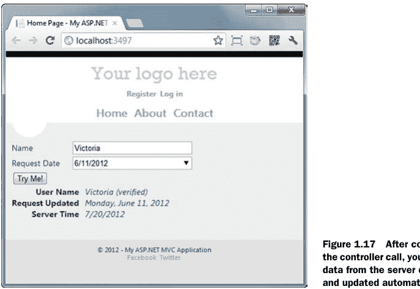

## 第1章 HTML5与.NET

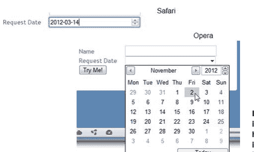

图1.18 各种浏览器中的日期选择器实现，凸显了浏览器市场中广泛的解释差异。

这个日期字段的差异凸显了在多个预期浏览器上测试你的HTML应用程序的必要性，以及进行功能测试的需求。功能测试通常使用像Modernizr (http://www.modernizr.com/) 这样的JavaScript库来完成，它会为特定功能返回一个布尔值。如果你确定你绝对需要某个功能，而当前浏览器不支持，你可以提醒用户必须使用不同的浏览器。

Modernizr是进行此类功能检测的自然选择，因为它被广泛使用、维护良好，并且默认包含在ASP.NET MVC的所有最新版本中。代码非常简单：

```javascript
if (Modernizr.touch){
    // .. 在这里绑定触摸事件
}
else {
    alert('不支持触摸');
}
```

## 第2章 标记入门：经典HTML、语义HTML与CSS

包含导航元素

描述名为techStart的数据段

标识段落内的文章

标识文章内的单个段落或数据项

描述页面页脚

特别有趣的是，当你以语义化方式布局网站时，你会获得使用JavaScript和样式类轻松选择所需内容的能力。例如，以下代码将查找当前页面上的所有`<article>`元素并确保它们可见：

```javascript
$("article").show();
```

当页面可以在图形元素和文本之间切换时，使用语义标记将允许你轻松区分它们以执行逻辑操作。让我们仔细看看HTML标签的构成要素。

### 2.2 所有HTML标签的基本结构元素

HTML的核心在于浏览器读取的文本。浏览器读取标签和属性，然后将它们渲染为页面上的元素。图2.1展示了HTML语法的基本结构。

HTML页面上的每个渲染元素都由开发者指定的方式在浏览器窗口中布局。你通过在页面上排序和嵌套元素、使用样式以及通过代码来"告诉它"。例如，查看以下文本：

> 从停车场沿Osceola Parkway向左走，在Buena Vista Drive左转。在World Drive右转，继续前往目的地。

现在看看图2.2，其中显示了添加各种标记后的相同路线说明。

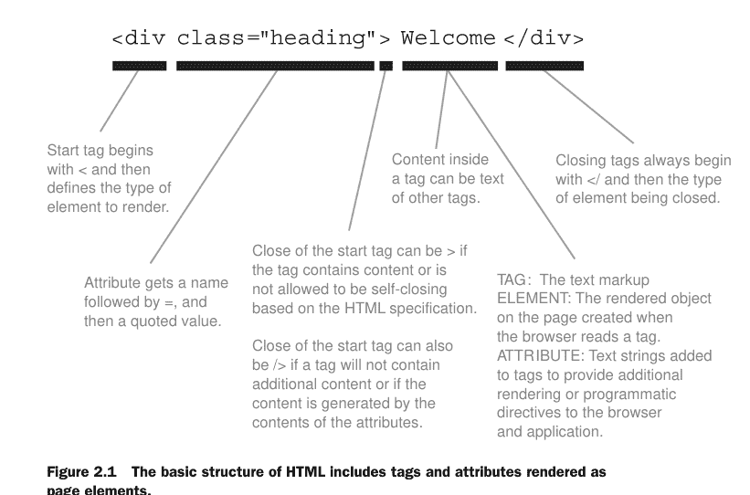

图2.1 HTML的基本结构包括渲染为页面元素的标签和属性

设身处地想想；你更倾向于哪套路线说明？以下清单显示了我们为生成图2.2中的路线说明而包裹在文本周围的代码，产生了让读者更快获取更有意义信息的图像。

```html
<div>
    <span>从停车场左转</span>
    <span class="rd">Osceola Parkway</span>
</div>
<div>
    <span>2英里</span>
    <span class="rd">Buena Vista Drive</span>
</div>
<div>
    <span>3英里</span>
    <span class="rd">World Drive</span>
</div>
<div>2.4英里</div>
```

这里的代码是"经典"HTML，而非新的"语义"HTML，后者将在介绍语义标签时发挥作用。在本书的其余部分，我们将在适当时实现两种标签。

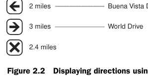

图2.2 使用HTML标记显示路线说明，为读者提供更多信息同时保持清晰度

在本节中，我们将逐步介绍构成经典HTML标记主体的各种标签和元素：

- 基本标签——这些标签专注于任何页面中都应存在的元素。它们是构成页面的核心部分。
- 块级和内联元素——这些是经典HTML中的基础显示元素。
- 表格元素——这些元素用于在页面上渲染数据网格。
- 表单元素——这些是HTML页面中用于数据输入的元素。

首先介绍构建任何页面所需的基本标签。

#### 2.2.1 使用基本HTML标签

HTML中几乎所有内容都是标签、指令或文本。标签属性或添加到标签以提供额外渲染或编程指令的文本字符串，要么是可选的，要么是必需的。

标签可以有两种格式之一。首先，它可以在开始和结束括号元素之间包含其他标签或文本内容：

```html
<div>这是我的内容</div>
```

在这里，`<div>`标签只是一个包含内容文本的块。没有属性，默认情况下会在页面上渲染为矩形。

另一个例子：

```html
<a href="http://microsoft.com">MS</a>
```

此标签是锚点，由于`href`属性，会将"Microsoft"文本渲染为链接，该链接将导航浏览器到microsoft.com。

标签也可以是自闭合的，使用属性将完整内容包含在内：

```html
<div style="width:50px; background-color:blue;" />
```

此`<div>`标签不包含内容，但会在屏幕上渲染一个恰好50像素宽的蓝色矩形。这里的`style`属性使用与本章稍后将介绍的CSS样式相同的语法。

标签的结束由字符`/>`表示，尽管浏览器供应商非常宽容，这并非总是必要的。为了保持HTML格式良好，开始标签要么需要与结束标签关联，要么必须是自闭合的。这确保你的页面在所有浏览器中呈现方式相同。

基本页面通常具有下一个清单中显示的结构。这不是硬性规定，但绝对使开发过程中更容易找到页面中的标记。

```html
<!DOCTYPE html>
<html>
<head>
</head>
<body>
</body>
</html>
```

`head`元素不在主浏览器区域渲染，但可以为页面提供额外修饰，如标题和搜索辅助信息。`body`元素是内容渲染的位置。

现在，让我们更仔细地看看使用HTML5时将使用最重要的标签。

### `<!DOCTYPE>` 标签

我们将讨论的唯一非HTML标签。`<!DOCTYPE>`就像你页面的"Hello World"名牌。它告诉任何使用你页面的浏览器如何翻译它接下来找到的内容。（`<html>`标签应始终紧随其后并包裹页面内容。）

本书中使用的最小声明告诉浏览器使用HTML5解析，而更详细的版本会包含解析模式，如下所示：

```html
<!DOCTYPE html PUBLIC "-//W3C//DTD XHTML 1.0 Transitional//EN">
```

### `<head>` 标签

`<head>`标签位于页面顶部，紧随浏览器解析所依据的文档类型之后。`<head>`不可见，而是包含关于如何使用页面数据、何处获取样式信息以及如何在浏览器标题栏中显示页面的指令。

> **已弃用的HTML标签**

HTML5中有许多已弃用的标签，不应在新标记中使用。在某些情况下，其他方法能更好地实现功能。其他标签很少使用或被普遍误解，或其使用导致可用性或可访问性问题。

这些标签的功能被CSS样式取代：`<basefont>`、`<big>`、`<center>`、`<font>`、`<s>`、`<strike>`、`<tt>`和`<u>`。

这些标签存在功能或可访问性问题：`<frame>`、`<frameset>`和`<noframe>`。

这些标签被误解或很少使用：`<acronym>`、`<applet>`、`<isindex>`和`<dir>`。

### `<title>` 标签

嵌套在页面`<head>`元素中的`<title>`元素设置客户端浏览器中页面标签的文本。当用户将页面添加为收藏夹或搜索引擎找到页面时，它也将成为默认标题：

```html
<title>欢迎来到我的页面</title>
```

### `<meta>` 标签

`<meta>`标签提供有关当前页面的附加信息。搜索引擎和插件使用它们，并且可以从代码中编辑。`<meta>`标签包含必需的`content`属性和可选的`name`值。其他属性包括`http-equiv`（用于描述content中的值类型）和`scheme`（用于帮助浏览器解释内容数据）。`<meta>`标签也是可重复的：

```html
<meta name="keywords" content="GPS tracks" />
<meta name="author" content="Jim Jackson II" />
<meta name="author" content="Ian Gilman" />
```

`<meta>`标签位于HTML文档的`<head>`区域。

### `<link>` 标签

`<link>`标签在当前页面和外部资源之间创建链接。`<link>`标签必须有指向外部资源的引用值（指定为`href`）以及链接建立的关系类型（称为`rel`属性）。`<link>`标签最常用于从网站引入样式表，但也可以在将链接添加到桌面时指定图标值：

```html
<link href="http://www.ellipsetours.com/css/touch.css" rel="stylesheet" />
<link href="/images/icon.png" rel="shortcut icon" />
```

链接可以是相对链接（指向同一站点中的位置）或绝对链接（列出资源的完整URL）。`<link>`标签位于HTML文档的head区域。

> **警告** `<link>`标签可以引用其他站点的样式表，但大多数设计者认为这是不好的做法，除非页面作者也是其他站点的所有者。

### `<script>` 标签

`<script>`标签在HTML页面中放置代码执行区域。这可以是链接到外部文件的形式（使用`src`属性），也可以是内联代码。内联代码出现在开始`<script>`和结束`</script>`标签之间，而外部资源链接只有标签，没有内容。script标签中唯一必需的另一个属性是`type`值，在你的情况下将是"text/javascript"。

> **提示** 链接到外部源的`<script>`标签可以使用开始和结束script标签`<script src=".."></script>`关闭，也可以就地关闭标签`<script src=".." />`。两者都是有效的HTML，但只有具有单独开始和结束标签的"完整"版本才是有效的XHTML。Internet Explorer默认使用XHTML验证，因此为了安全起见，请使用非最小化的标签结构。

虽然script标签确实可以出现在HTML页面中打开HTML标签后的任何位置，但最佳实践表明脚本应位于以下两个位置之一：

- `<head>`元素内（对于屏幕初始渲染必须可用的代码）
- 紧接在关闭`</body>`标签之前

脚本在加载时会阻塞页面渲染，且页面是从上到下渲染的，因此将脚本放在 HTML 文档末尾更为合理。请记住，这里的代码即使是在页面加载时立即执行，也要等到页面渲染到 `</body>` 标签之前才会触发。关于自执行 JavaScript 的更多讨论，请参见附录 A。

##### `<style>` 标签

`<style>` 标签用于在页面中直接嵌入一组样式。以这种方式嵌入样式可以减少你需要管理的文件数量，但除此之外并无太大优势。你可以在 `<style>` 标签内的 `title` 属性中提供额外信息，但浏览器不会使用它。唯一必需的属性是 `type`，对于本书中的所有样式表，其值均为 `text/css`：

```html
<style type="text/css">p { background-color: yellow; }</style>
```

##### `<body>` 标签

一旦页面处理完 `<head>` 标签中的信息，它就会开始处理 `<body>` 元素。这是页面内容的顶级容器。虽然你可以使用样式将元素放置在 `<body>` 的可视区域之外，但所有可见元素的标签都必须存在于 `<body>` 标签内。`<body>` 标签内有两类显示内容的元素：块级（或块级）元素和内联元素。

#### 2.2.2 使用块级和内联元素让内容按需流动

理解 HTML 中的内容流至关重要，因为它决定了标签的渲染位置以及周围标签如何影响页面上的任何给定标签。如前所述，有两种主要的标签布局类型：块级和内联。让我们先来看看块级标签。

##### 块级元素

块级元素是指渲染时占据一个矩形区域的标签，当前容器中的其他所有渲染元素都必须在其之前或之后流动。例如，一个 `<div>` 会占据页面上所有可用宽度，其他内容必须在其之前或之后出现。即使 `<div>` 的样式只有一像素宽，除非手动设置，否则不会有其他内容出现在它旁边。

一种更简单的理解方式是换行。块级元素总会尝试将自己放在内容的新行上，并强制页面上的下一个元素也换行。你可以通过在 `<body>` 标签内添加以下标记来创建一个 HTML 页面，以观察效果：

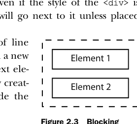

```html
<p style="width:100px;">Element 1</p>
<p style="width:100px;">Element 2</p>
```

现在，将 `<p>` 标签替换为任何其他元素类型（例如 `<div>`），看看会发生什么。段落元素是块级元素，因此它们的表现会类似于图 2.3。

表 2.1 中的标签都会创建块级元素。

**表 2.1 块级 HTML 元素（HTML5 元素以粗体显示）**

| `<address>` | `<form>` | `<legend>` |
| --- | --- | --- |
| `<article>` | `<h1>` | `<li>` |
| `<aside>` | `<h2>` | `<menu>` |
| `<blockquote>` | `<h3>` | `<nav>` |
| `<div>` | `<h4>` | `<p>` |
| `<fieldset>` | `<h5>` | `<table>` |
| `<figcaption>` | `<h6>` | `<ul>` |
| `<figure>` | `<header>` | `<section>` |
| `<footer>` | `<hgroup>` | |

##### 内联元素

内联标签渲染的元素通常用于为单个内容片段设置样式。它们包裹单个内容片段，并根据父容器中设置的样式属性与其一起流动。

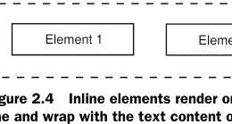

像 `<span>` 这样的内联元素在浏览器中的显示效果类似于图 2.4。

表 2.2 中的标签会创建内联元素。

**表 2.2 内联 HTML 元素（HTML5 元素以粗体显示）**

| `<a>` | `<input>` | `<progress>` |
| --- | --- | --- |
| `<abbr>` | `<keygen>` | `<span>` |
| `<canvas>` | `<label>` | `<summary>` |
| `<cite>` | `<link>` | `<textarea>` |
| `<datagrid>` | `<mark>` | `<time>` |
| `<datalist>` | `<map>` | `<wbr>` |
| `<details>` | `<meter>` | |
| `<em>` | `<output>` | |

#### 2.2.3 使用表格元素将数据划分为网格

HTML 中的表格是将数据划分成网格格式的一种方式。表格自然会使用块级格式，但使用 CSS 样式修改此行为，让其他内容环绕其流动的情况也很常见。

`<table>` 标签内会嵌套各种其他标签以生成网格布局。表格元素的嵌套顺序是 `<table>` → `<分组>` → `<行>` → `<单元格>`。分组元素是 `<thead>`、`<tbody>` 和 `<tfoot>`，它们不是必需的。每行定义使用 `<tr>` 标签，单个单元格可以是 `<th>`（表示表头单元格）或 `<td>`（表示普通单元格）。下面的代码清单展示了典型表格的布局方式。

```html
<table>
    <thead>
        <tr>
            <th>Month</th>
            <th>Sandy</th>
            <th>Rocky</th>
            <th>Total Sales</th>
        </tr>
    </thead>
    <tfoot>
        <tr>
            <td>Sum</td>
            <td>$1500</td>
            <td>$2000</td>
            <td>$3500</td>
        </tr>
    </tfoot>
    <tbody>
        <tr>
            <td>January</td>
            <td>$1000</td>
            <td>$900</td>
            <td>$1900</td>
        </tr>
        <tr>
            <td>February</td>
            <td>$500</td>
            <td>$1100</td>
            <td>$1600</td>
        </tr>
    </tbody>
</table>
```

在设计用于显示表格数据的 `<table>` 时，使用分组和表头标签可以极大地帮助样式化，但当你使用 `<table>` 来进行页面布局时，通常不会使用这些标签。你更可能为单个单元格添加属性，使其能够跨多行或多列显示。

> **提示** 过去，使用表格进行页面布局被认为是不良做法，因为表格必须在服务器上完全加载后才能渲染。如今，随着宽带的普及，这已不是大问题，但仍有人认为表格用于整页布局过于笨重，因为它们相当僵化，并且无法将样式与内容分离。最好将表格保留用于表格数据，而非页面布局。

#### 2.2.4 使用 HTML 表单元素

首先，我们应该介绍 HTML 表单的基础知识。`action` 属性是必需的，它指向表单数据的提交位置。这可能是同一个页面或不同的页面，但无论提交到哪里，表单数据都将作为某种编码值包含在 URL 中，除非你用自己的代码覆盖了提交动作。

以下 HTML 将生成一个提交到 `formRead.html` 页面的 URL。

```html
<form action="formRead.html">
    <input type="text" name="first" value="John Q" />
    <input type="text" name="last" value="O'Connor" />
    <input type="submit" />
</form>
```

```
http://www.site.com/formRead.html?first=John+Q&last=O%27Connor
```

现在，让我们继续看看你可以用 HTML5 的新 input 元素类型做些什么。

##### 用于表单的 HTML5 新 input 类型

HTML5 中的新 input 类型因其两个优点而备受好评。第一个优点是这些类型是描述其用途的，因此你的代码可以从语义上理解它们。你可以看出类型为 `email` 的 input 元素应该包含电子邮件地址，因此你的代码可以注入专门支持电子邮件的功能。第二个紧密相关的优点是，浏览器可以使用这些元素类型自动为你的页面添加功能，而无需你编写任何代码。这节省了时间并减少了表单中的错误。

与新 input 类型一起出现的，还有各种适用于这些类型的新属性：

- `datetime`、`date`、`time`、`month`、`week`、`datetime-local` — 这些 `<input>` 类型表示基于时间的值。你通过指定 `type` 的值并让浏览器完成渲染选择界面和格式化文本内容的工作来实现这一点。如果浏览器不支持此功能（例如无法将文本验证为适当的值或提供选择用户界面），你需要自己构建该功能。更多相关内容，请参见附录 A 中关于 jQuery UI 的部分。
- `number` — 这种 `<input>` 类型显示一个普通的文本框，但会根据几个属性值进行验证。`min` 和 `max` 属性限制输入的数字，`step` 属性规定了这些限制内的允许值。考虑以下示例：

```html
<input id="numPick" type="number" min="0" max="10" step="1" />
```

### 2.3 语义化HTML：语义蓝图

现在，让我们将焦点转向HTML5语义。语义化标签用于渲染描述其包含内容类型的元素。传统的HTML标签（例如`<div>`）可以包含任何内容，而语义化标签（如`<header>`）则清晰地定义了其内部包含的元素。

以语义化的方式组织元素能为页面带来两大主要价值。首先，它使搜索引擎能够轻松判断哪些内容值得索引，哪些只是用于样式或导航的页面噪声。其次，它让你作为页面开发者，能以一种更易于维护的方式来划分页面结构。当你在一两年后回到一个语义化页面进行调整时，如果页面的蓝图构建得当，你会更容易找到所需的部分。最后，它通过允许屏幕阅读工具定位页面上的重要内容并判断哪些部分仅是导航噪声，从而使你的内容更具可访问性。

以下代码清单是对你在代码清单2.1中看到的原始语义化页面布局的扩展。

```html
<!DOCTYPE html>
<html>
<head>
  <meta name="description" content="..." />
  <meta name="keywords" content="html5,map demos" />
  <title>HTML5 Maps – A resource…</title>
</head>
<body>
<header>
  <hgroup>
    <h1>HTML5 Maps</h1>
    <h2>Learn GIS and HTML5 Together</h2>
  </hgroup>
</header>
<nav>
  <ul>
    <li><a href="#">Home</a></li>
    <li><a href="#">Maps</a></li>
    <li><a href="#">Contact</a></li>
  </ul>
</nav>
<section id="techStart">
  <article id="whatisGIS">
    <header><h2>What is GIS?</h2></header>
    <section>
      Content describing what GIS is and what it does…
    </section>
  </article>
  <article id="samples">
    <header><h2>Sample Maps</h2></header>
    <section>
      There are lots of sample maps and articles available here.
      Take a look <a href="...">here</a> and <a href="...">here</a>!
    </section>
  </article>
</section>
<aside>
  <h2>Maps by Vendor</h2>
  <ul>
    <li><a ref="external" href="#">Bing Maps</a></li>
    <li><a ref="external" href="#">Google Maps</a></li>
    <li><a ref="external" href="#">ESRI Maps</a></li>
  </ul>
</aside>
<footer>
  <a href="...">Terms and Conditions</a>
  <a href="...">Privacy Policy</a>
</footer>
</body>
</html>
```

描述整个页面的头部区域，包含导航元素，标识节内的文章，描述称为`techStart`的数据节，指定文章的头部，用`article`指定单个节或数据块，创建`aside`以支持与内容不直接相关的内容。

我们将从三个类别来介绍语义化的HTML5标签：

- 内容标签，作为内容的容器
- 应用标签，用于呈现程序运行状态的信息
- 媒体标签，用于呈现富内容

> **何时使用语义化标记**

在本书中，我们将构建许多存在于单个页面中的HTML应用。这些应用可能会，也可能不会从语义化标记的包含中受益。为此，我们仅在内容性质需要时才尝试构建特定于HTML5的标签。

因为语义化标记主要为网络爬虫、搜索和可访问性工具提供对页面更好的理解，所以动态生成或图形化的内容并不总是能从使用语义化标记中受益。

#### 2.3.1 使用内容标签对页面内容进行分组和划分

内容标签渲染包含读者或用户希望看到的信息的元素。这些标签将各种类型的内容分组在一起，并将主题核心内容与辅助性或无关内容（如页眉和页脚）区分开来。你可以通过将页面看作一个包含标题、子标题和各种导航部分的文档来更好地理解内容标签。

##### `<section>`

`<section>` 定义的内容应被视为页面内独立的内容片段。根据HTML5规范，它不应被用作样式或脚本钩子；它应用于表示特定的内容片段。Bruce Lawson 在 HTML5doctor.com 上写道：“除非节的开头自然有一个标题，否则不要使用它”（http://HTML5doctor.com/the-section-element）。

但从更大的语义方案来看，将节用作样式机制确实有意义。为什么你会基于article而不是section来定位和设置元素样式呢？可以放心地使用节进行样式设置；只需确保它们在语义上是恰当的即可。

```html
<section>
  <p>Age considers; youth ventures</p>
</section>
```

早期的HTML规范要求在一个HTML页面中只能使用一个`<h1>`标签。随着section和article的创建，可以在页面中组织多个内容目标，而`<header>`元素正是该目标可以拥有自己的标题元素（`<h1>`、`<h2>`等）的方式：

```html
<section>
    <header>
        <h1>Famous Quotes</h1>
        <h2>Victor Hugo on Age</h2>
    </header>
    <p>Forty is the old age of youth; fifty is the youth of old age.</p>
</section>
```

##### `<footer>`

`<footer>` 在一段目标内容中执行与`<header>`相同的功能，只不过它位于末尾。它提供了一种将目标内容结尾部分隔离开来的方式：

```html
<section>
    <p>Fortune and love favor the brave.</p>
    <footer>Ovid</footer>
</section>
```

##### `<article>`

`<article>` 常与`<section>`混淆，因为它们都执行页面级的内容划分。它们也都可以包含`<header>`和`<footer>`元素。article和section之间的主要区别在于它们的独立性级别。`<section>`是其父元素或页面的一部分，而`<article>`可以是一个可独立分发的内容片段：

```html
<article>
    <h1>March scheduled activities</h1>
    <p>Come in like a lion</p>
    <p>Go out like a lamb</p>
</article>
<article>
    <h1>April schedule activities</h1>
    <p>Bloomin' flowers</p>
</article>
```

这会导致进一步的混淆，因为一个页面可以有多个section，每个section又可以有自己的article。同样，一个页面也可以有多个article，每个article内部包含多个section。在第一种情况下，article与section相关，但彼此之间无关。在第二种情况下，section是每个article内部的自然划分点。从语义上讲，这是合理的：

```html
<section>
    <header>
        <h1>Recipes</h1>
    </header>
    <article>
        <h1>30 minute apple pie</h1>
    </article>
</section>
```

## 第二章 标记入门：经典HTML、语义HTML与CSS

```html
<p>...</p>
</article>
<article>
  <header>
    <h1>Herb-braised ham with white wine</h1>
  </header>
  <p>...</p>
</article>
</section>
```

或

```html
<article>
  <header>
    <h1>Quotables</h1>
  </header>
  <section>
    <header>
      <h1>Parenting</h1>
    </header>
    <p>Kids are educated by who the parent is, not what he says.</p>
  </section>
  <section>
    <header>
      <h1>Politics</h1>
    </header>
    <p>A fool and his money are soon elected.</p>
  </section>
</article>
```

理解`<article>`和`<section>`之间区别的一种好方法是将section视为动词，将article视为名词。一个页面可以被分节（sectioned），但这些节仍然构成该页面。或者，一个页面可以包含文章（articles），但每篇文章应该能够独立于其原始所在页面进行分发。

##### `<aside>`

`<aside>`标签存在于文章或节元素内部，允许在不干扰主要内容流的情况下，呈现与主题相关的补充信息。它是一个内容呈现标签，而非布局标签，因此避免将其用作侧边栏风格的`<menu>`结构的包裹元素。

```html
<article>
  <p>All war is deception.</p>
  <aside>Sun Tzu: Chinese General and author (Art of War)</aside>
  <p>Strategy without tactics is the slowest route to victory.</p>
  <p>Tactics without strategy is the noise before defeat.</p>
</article>
```

##### `<details>`

`<details>`元素的有趣之处在于它有一个`open`属性。默认情况下，此元素及其属性仅是将内容分组的元素，但当通过JavaScript或浏览器内置功能激活时，它们提供了控制内容显示（open）或隐藏（无属性）的附加功能。

##### `<summary>`

`<summary>`标签是为`<details>`元素描述标题或题头的方式。它存在于`<details>`元素内部，在支持的浏览器中，允许你切换`open`属性。不支持的浏览器需要测试才能确切知道它们将如何渲染`<summary>`标签。请注意图2.5中以下代码的呈现效果：

```html
<p>Common Auto Maintenance Tasks</p>
<details open="open">
    <summary>Scheduling Notes</summary>
    <em>Oil change schedules will vary.</em>
</details>
<ul>
    <li>Change oil</li>
    <li>Rotate tires</li>
</ul>
```

##### `<figure>`

`<figure>`标签的用法与书籍、杂志和技术论文中的图表相同。为文章提供价值的图像或插图被放置在`<article>`或`<section>`内，以提供额外的上下文价值：

```html
<figure>
    
</figure>
```

##### `<figcaption>`

`<figcaption>`标签包含在`<figure>`元素内，为该`<figure>`提供图注内容。因为单个`<figure>`元素可以包含多个源图像，所以`<figcaption>`可以引用其父figure内的一个或多个元素：

```html
<figure>
    
    <figcaption>105 mile road through Shenandoah National Park</figcaption>
</figure>
```

##### `<hgroup>`

`<hgroup>`在技术上用于将一个或多个`<h1>`、`<h2>`等元素分组，并仅将最高级别作为文档大纲的一部分。这通常只对文本丰富的网站和CMS系统有用，因此我们将不再进一步讨论它。同时请注意，`<hgroup>`可能完全从HTML5规范中移除，因此请谨慎使用（如果使用的话）。

##### `<mark>`

`<mark>`标签环绕页面内容中与用户相关的文本。`<mark>`标签最常见的用法是在一段内容中高亮显示搜索结果。`<mark>`与`<em>`的不同之处在于，它提供了用户相关性的标注，而不仅仅是原作者的上下文强调：

```html
<p><mark>Wimbledon</mark> is a district in the south west area of London,
    England, located south of Wandsworth, and east of Kingston upon Thames.
    It is situated within Greater London. It is home to the
    <mark>Wimbledon</mark> Tennis Championships and New <mark>Wimbledon
    </mark> Theatre, and contains <mark>Wimbledon</mark> Common.</p>
```

##### `<nav>`

`<nav>`标签是页面主要导航元素的包裹容器。`<nav>`可以包含任何其他元素；它只是将页面或网站导航的重要部分组合在一起的一种方式。并非每个链接或菜单结构都需要位于`<nav>`内，但将你认为重要的导航路径包含在`<nav>`中会很有帮助。

```html
<nav>
    <ul>
        <li><a>Home</a></li>
        <li><a>Back</a></li>
        <li><a>Next</a></li>
    </ul>
</nav>
```

##### 使用语义内容标签构建页面

图2.6展示了几个基本示例，说明如何使用语义标签构建页面。注意，一些文章可以包含节，或者节可以包含文章。这取决于内容的用途。此外，你还可以看到，一个aside可以放置在节或文章数据之外，也可以完全嵌套在内部，紧邻内容。无论你如何划分，网站的功能和内容的目的都可以很容易地确定。

#### 2.3.2 超越语义：应用标签

应用标签可以向用户呈现由执行应用程序代码动态生成的信息。它们在呈现图形数据（如`<canvas>`的情况）或作为其他元素的数据源（如`<datalist>`的情况）方面也很有用。

##### `<canvas>`

`<canvas>`既是一个标签，也是一个完整的绘图API。你可以在`<canvas>`中绘制几乎任何你想要的东西，也可以使用普通属性对元素本身进行样式设置。`<canvas>`可以动态构建图像，或允许你的用户将现有图形整合到他们的体验中。这是一个深奥的话题，我建议如果你想了解更多，请查看众多关于此主题的博客和书籍。

这个标签看起来很简单，但它是一个重要API的入口点。创建一个canvas只需要以下内容：

```html
<canvas />
```

> **SVG 和 Canvas**

向用户呈现自定义图像内容有两种方式。第一种是可缩放矢量图形（SVG）。SVG使用标记来描述线条和形状。它适用于绘制3D图像或非常复杂的插图。甚至有一些工作使用SVG来动画化绘图。查看 http://www.ro.me 了解这个领域的惊人作品。

第二种绘图类型使用HTML5中新增的`<canvas>`元素。canvas元素最初是页面上一个空白的、可样式的矩形，通过JavaScript调用canvas的内置上下文对象而变得活跃起来。

SVG和Canvas都是极具趣味性的话题，但只有Canvas属于HTML5范畴。因此，我们将在整个第四章讨论它，但不会涵盖SVG。

##### `<command>`

`<command>`标签放置在`<menu>`元素内时，将定义一个用于执行你的代码的钩子。`<command>`元素可以有`type`值为`checkbox`、`radio`或`command`，其中最后一种类型提供普通的按钮式操作。

```html
<menu>
    <command type="command">Save all documents</command>
    <command type="checkbox">Check to include current document</command>
</menu>
```

##### `<datalist>`

`<datalist>`是页面上的一个隐藏标签，为另一个元素提供值列表。当将`<input>`元素分配给`list`属性时，它会获取对应于`<datalist>`的id，以验证其值。验证过程由你负责，尽管浏览器可能很快会在这方面为你提供一些帮助。

```html
<input type="text" name="autos" list="mfg">
<datalist list="mfg">
    <option value="Ford" />
    <option value="Toyota" />
    <option value="Ferrari" />
</datalist>
```

##### `<keygen>`

`<keygen>`是HTML中实现客户端发起认证的重要一步。当浏览器实现此元素时，它将生成一个公钥/私钥对，并将公钥与包含的表单一起发送到服务器。在撰写本文时，`<keygen>`还不完整，但请记住它，因为当它最终完善时，它将成为你安全架构的重要组成部分：

```html
<keygen name="myformKey" form="newUserInput" />
```

##### `<progress>`

`<progress>`标签提供了一种快速显示任何任务进度百分比的方法。它仅包含两个必需属性：`value`和`max`。最小值为0且不可编辑，这使得该标签不适合显示范围内的测量值或标量值。对于这些情况，`<meter>`标签会更合适：

```html
<progress max="120" value="90"></progress>
```

##### `<meter>`

`<meter>`标签在呈现和功能上与`<progress>`标签相似，但它能够显示从非零值开始的刻度中的量。通过填写范围的`min`和`max`属性以及`value`属性来实现：

```html
<meter min="25" max="75" value="60"></meter>
```

`<progress>`和`<meter>`标签通常都呈现为简单的状态栏。

##### `<time>`

`<time>`标签不是格式化时间值的方法，而是声明一段内容是日期、时间或日期/时间以达到语义清晰目的的方法。`<time>`标签要么包含日期/时间值，要么可以增强代表日期/时间的内容。使用`datetime`属性构建此增强：

```html
<p>The Gettysburg Address, given on <time>November 19, 1863</time> started
    with the words <time datetime="July 1776">Four score and seven years
    ago</time> our fathers brought forth...</p>
```

#### 2.3.3 使用媒体标签处理音频和视频内容

媒体标签将在第3章中介绍，仅限于音频和视频内容。使用媒体标签渲染的元素可以包含多级回退内容，以便单一媒体内容能在各种浏览器平台上展示。这些标签渲染的呈现元素不一定能归类为内联或块级元素。

要呈现音频或视频内容，您必须通过服务器上的URL使该内容可用。音频和视频内容的跨域访问是可能的，但内容所在站点的所有者必须启用此功能。

一旦您有了内容的有效URL，只需将标签添加到页面中，用户即可访问它：

```html
<audio src="MarineCorpsHymm.mp3" controls autoplay loop />
<video src="DirtyHarry.mp4" controls height="200px" width="400px" />
```

##### `<source>`

`<source>`标签在媒体元素内定义一段媒体内容。它包含一个`src`属性以及一个对应其媒体类型的`type`属性。（媒体类型是通常称为mime类型的正确术语。）

```html
<source src="Chrome.mp3" type="audio/mpeg"></source>
```

##### `<audio>`

`<audio>`标签代表页面上的音频内容。可以设置`src`属性，也可以在标签内放置多个`<source>`元素，以及传统的`<object>`标签，以便在浏览器不支持source元素中指定的格式时注入插件播放器。音频内容是以静态还是流式内容提供，取决于服务器的配置方式：

```html
<audio>
    <source src="CountryBoy.mp3" type="audio/mpeg" />
    <source src="CountryBoy.ogg" type="audio/ogg" />
    <object>Silverlight播放器位置</object>
    您的浏览器不支持任何可用的音频格式。
</audio>
```

或

```html
<audio src="DownOnTheCorner.mp3" type="audio/mpeg" />
```

##### `<video>`

`<video>`标签对视频执行与`<audio>`标签对音频内容相同的任务。关于视频格式和服务器配置的注意事项同样适用。`src`属性也存在，同样可以在`<video>`元素内嵌套`<source>`和`<object>`元素。

`<video>`元素具有一些附加功能，例如`loop`（使视频自动重新开始）和`poster`（描述视频开始前应显示的图像）。`autoplay`也可用：

```html
<video controls="controls" autoplay="autoplay" poster="StartImg.jpg">
    <source src="DemolitionMan.mp4" type="video/mp4" />
    <source src="DemolitionMan.ogg" type="video/ogg" />
    <object></object>
</video>
```

`controls`布尔属性以及`<audio>`和`<video>`的`mediagroup`属性很有趣，因为它们可以在渲染的元素上向用户显示一组控件，以允许播放开始、停止和暂停。如果浏览器支持，添加`controls`属性将向用户显示默认播放器。`<audio>`和`<video>`的另一个额外功能是它们能够从内容类型列表中进行选择，并根据用户浏览器可用的编解码器显示最具能力的内容。您可以通过嵌套source元素来实现这一点：

```html
<audio controls autoplays>
    <source src="Chrome.mp3" type="audio/mpeg"></source>
    <source src="Chrome.ogg" type="audio/ogg"></source>
</audio>
```

### 2.4 为HTML5添加样式：CSS基础

现在您应该对新的HTML5元素有了实际的了解，并知道如何使用它们。现在您需要知道当这些元素出现在页面上时如何为其添加样式。CSS是实现此目的的正确方式。

> **提示** 尽管CSS不是核心HTML或语义概念，但控制标签结构在页面上呈现方式的能力非常重要。如果您已经具备CSS的基本实际知识，请随意跳过本节并进入第3章。本书不会使您成为CSS专家，但我们希望在本节中非常清楚地表明，HTML与CSS的结合在Web应用程序中至关重要。

通过创建样式表文件并在页面的`<head>`元素中链接它，您的元素将根据您的偏好自动添加样式。样式表不过是一个带有`.css`扩展名的文本文件。Visual Studio为这些文件提供了内置模板，但您也可以使用任何文本编辑器创建它们。

#### 2.4.1 理解CSS语法

单个样式由一个声明和一个主体组成，单个样式语句由一个名称、一个冒号和一个值组成。该值可以是字符串、以空格分隔的值列表或枚举值，并以分号结尾。分号分隔样式语句，而斜杠星号包装器标记注释或注释掉样式的某些部分。

图2.7显示了一个基本样式的布局。

样式的主体是用冒号分隔的属性/值对列表。每个样式属性以分号结尾，如下所示：

```css
div {
    /* color指示文本颜色 */
    color: green;
    background-color: red;
}
```

为HTML5添加样式：CSS基础

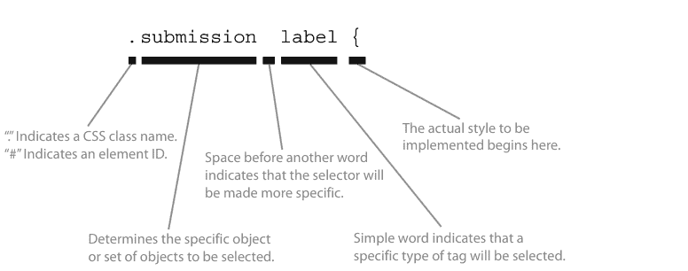

图2.7 CSS样式声明的结构

这段样式将使页面上的所有`<div>`元素渲染为红色矩形（`background-color: red`）并带有绿色文本（`color: green`）。

#### 2.4.2 构建选择器，最关键的CSS元素

使用CSS语言时，您必须掌握的最重要技能是构建选择器的能力。选择器是开始每个样式的文本块。布局引擎使用它们来确定页面上的哪些元素应应用样式。选择器可以非常通用或非常具体，您样式表中的选择器可能在特定时间使用，也可能不使用，具体取决于页面的结构和选择器的特异性。不使用样式不一定是坏事；当页面重排时也会应用样式，因此您的样式表应包含可能以编程方式添加到页面中的任何元素的样式。多个样式可以应用于单个元素，实际上，页面上的大多数元素将具有多个样式。这是由于样式的特异性以及元素可以根据其标签类型、类名和在页面上的位置进行样式设置的事实。样式可以应用于元素及其所有包含元素，或者样式可以与另一个样式组合或覆盖其设置之一的能力，这就是使层叠样式表如此有趣且有时令人沮丧的层叠效果。

##### 通用选择器

您的样式表中可能有一个通用选择器，它说要将特定样式应用于所有内容。通用选择器的格式为：`* { . . . }`。请注意，该样式与前面为`<div>`元素列出的样式略有不同。CSS语言在处理样式时不考虑换行符或空白。

##### 类型和后代选择器

接下来两种将样式应用于元素的方法是类型和后代选择器。类型选择器使用元素的名称来应用样式，而后代选择器使用多个名称基于元素与另一个类型元素的子关系来查找元素。

类型选择器有两种变体。这是选择单个元素类型的每个实例的简单版本：

```css
div { ... }
```

第二个版本提供以逗号分隔的元素类型列表，对多个不同元素类型执行相同任务：

```css
div, section { ... }
```

后代选择器看起来类似于多类型选择器，但类型之间没有逗号。以下将对其样式应用于页面上`<div>`元素内任何位置的每个`<span>`元素：

```css
div span { ... }
```

当您想要找到一个非常具体的元素时，可以通过特定的id或特定的类属性进行搜索。您可以在类型前使用井号（`#`）表示法来查找id定义，或使用点号（`.`）来查找类名。这也可以与其他选择器方法（如元素类型和子选择器）结合使用，如下一个清单所示。

```css
#logo { ... }
.menuSelect { ... }
div#logoArea { ... }
div.userName { ... }
div.userName span { ... }
div#inputArea a { ... }
```

这应该能让您很好地理解工作中会遇到的大多数样式。这里面还有很多内容，我们建议您深入研究Eric A. Meyer的任何书籍，他是当今该领域最重要的CSS专家之一。

#### 2.4.3 分配字体

CSS中分配的字体可能有点棘手。与`margin`和`color`等属性类似，字体可以使用简写组合属性值分配给样式，也可以分解为多个独立属性。

要使用简写，您按顺序使用以下空格分隔的属性：style variant weight size family。典型的字体分配可能如下所示：

```css
p {
    font: italic normal bold 12pt 'Times New Roman',Times,serif;
}
```

组合定义中唯一必需的值是 `size` 和 `family`；其他值如果未指定，将使用默认值。

你可能已经注意到前一个属性定义末尾的逗号分隔字符串。`font-family` 的值是基于客户端计算机上可用的字体，从最具体到最不具体排列。因此，赋值

```css
font-family: helvetica, arial, sans-serif;
```

将首先尝试应用 Helvetica 字体，然后是更通用的 Arial 字体，最后是它能找到的第一个无衬线字体。

##### 自定义字体

你可以使用 `@font-face` CSS 指令在页面中包含自己的字体。通过使用此指令，你可以引用安装在托管服务器上的 font-face 套件，并使其自动可用于支持它的浏览器的页面。

生成字体套件所涉及的步骤并不困难，但有时可能会产生费用。有关更多信息，请查看 Google 的网络字体（www.google.com/webfonts）或 Font Squirrel（www.fontsquirrel.com/fontface/generator）。

#### 2.4.4 赋值和操作颜色

现在让我们看看如何赋值颜色并操作它们。有相当多的方式来表达特定的颜色，你需要理解这些方式以便处理和操作它们。

最简单的方法是使用标准 CSS 识别的一组命名颜色。有很多这样的颜色，你可以从 W3C 网站 http://www.w3.org/TR/css3-color/#svg-color 获取列表。此列表为你提供每个可用颜色的名称，并连同其十六进制和 RGB 值一起显示（接下来会更多介绍这些）。

你可以将任何可用的颜色赋值给任何接受颜色的 CSS 属性。这包括文本颜色、背景颜色和边框属性等。

在 CSS 中用命名值以外的方式描述颜色的主要方法是十六进制、RGB 和 HSL。有许多方法可以找到界面中各种颜色对应的值。图 2.8 中的颜色拾取器是各种 Windows 应用程序中可用的众多颜色拾取器之一。

##### 十六进制颜色

十六进制颜色以井号（`#`）开头，然后是三组十六进制（基数 16）数字表示。这三个数字共同构成颜色的红、绿、蓝分量。十六进制颜色中的一个数字最多可以表达 256 个不同的值，因此一个十六进制颜色可以有效地表达超过 1600 万种颜色（256 x 256 x 256）。

##### RGB 颜色

描述颜色的下一种方法是使用 0 到 255 的直接红-绿-蓝数值，以逗号分隔的格式。然后你使用 `rgb(r, g, b)` CSS 函数来赋值颜色。0 到 255 的值表示颜色的强度，其中 0 表示没有强度，因此是黑色，而 255 表示最大强度，因此是白色。这意味着你也可以使用百分比值来表示 RGB 颜色，其中每种颜色被赋值一个强度值。

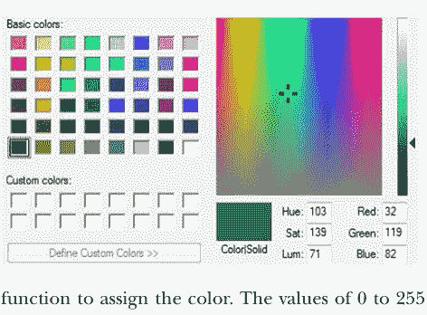

**图 2.8 使用 HSL 和 RGB 描述颜色**

##### HSL 颜色

表达颜色的最终方法是使用 HSL 值，代表色相、饱和度和明度（或亮度）。要理解 HSL 的工作原理，你必须找到一个色盘，该色盘显示所有可能的颜色，并在顶部（0 度）是纯红色，在 120 度（4 点钟方向）是绿色，在 240 度（8 点钟方向）是蓝色。图 2.9 说明了这个色轮。

HSL 值首先指定色盘周围的度数，然后是颜色的饱和度（或强度），以百分比表示。最后一个值是明度，另一个百分比，其中 0% 是黑色，100% 是白色。这可能有点难以理解，但如果你下载 Paint.NET，一个 Windows 画图的免费替代品，你将看到色轮并更清楚地理解它。

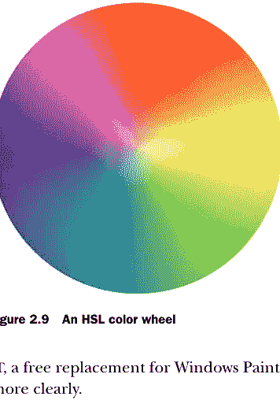

**图 2.9 HSL 色轮**

##### 带有 Alpha 值的颜色

RGB 和 HSL 颜色中最近加入颜色派对的是 alpha 或透明度值。这些是 RGBA 和 HSLA CSS 函数，虽然它们似乎是早期 CSS 规范的一部分，但直到最近才被广泛支持。颜色中的 alpha 值表示为不透明度百分比，其中 0 表示完全透明，1 表示完全不透明。请注意，在 HTML 元素上设置 `opacity` CSS 属性，然后为其赋值带有 alpha 值的颜色会导致非常棘手的显示，因为你有两个属性表示透明度。

#### 2.4.5 使用盒模型改变元素的大小

因为 HTML 中的一切最终都是可设置样式的矩形内容，所以你可以将其视为块或框。盒模型是一种描述样式中四个不同的尺寸值如何影响元素大小的方式。

从矩形元素的外部向内移动，你会遇到边距（margin）、边框（border）、内边距（padding）和内容（content）的尺寸值，如图 2.10 所示。

当你为一段内容赋值宽度时，该元素在页面上的实际渲染宽度将是你设置的值，加上左/右内边距，加上左/右边框。最终值是边距，它不影响元素的渲染大小。不过，边距对于整体布局仍然很重要，因为它充当缓冲区，通过样式中赋值的量将其他内容“推开”。

这里需要做一个实验来准确说明我们在讨论什么。看看下一个清单中的代码。这段代码定义了一个简单的样式，然后添加了两个 `<div>` 标签。该样式设置为应用于页面上的所有 `<div>` 元素。

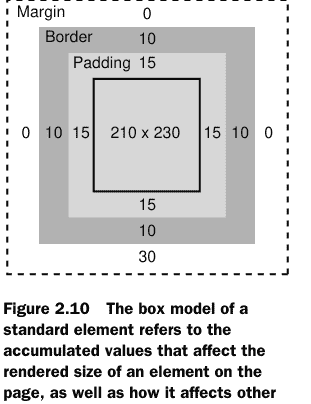

```css
div {
    height: 50px;
    width: 50px;
    border-width: 10px;
    border-style: solid;
    padding: 5px;
    margin-top: 10px;
    margin-bottom: 20px;
    background-color: #A0A0A0;
    border-color: #000000;
}
```

```html
<div>Box 1</div>
<div>Box 2</div>
```

所有 `div` 的高度和宽度将自动设置为 50 像素。所有 `div` 边框的宽度将设置为 10 像素。每个 `div` 内容周围的内边距为 5 像素。所有 `div` 将应用顶部边距 10 像素和底部边距 20 像素。

这段代码渲染出的屏幕看起来会像图 2.11。

现在我们来测量每个框。如果你向此页面添加代码来检查 Box 1 或 Box 2 的高度，你会发现每个的高度正好是 80 像素。也就是说，

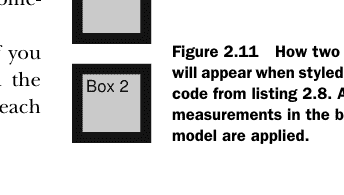

50 像素高度 + 5 像素顶部内边距 + 5 像素底部内边距 + 10 像素顶部边框 + 10 像素底部边框 = 80 像素总高度

> **注意** 曾经有一段时间，IE 中的盒模型与其他所有浏览器不同，这造成了无尽的头痛，有些人至今仍因此讨厌 IE。然而，时代已经改变，IE 现在使用与其他浏览器相同的盒模型。

但是，如果你测量每个边框边缘之间的距离，你会发现只有 20 像素的空间。如果分配了总共 30 像素的顶部和底部边距，这怎么可能呢？答案在于边距折叠的概念，这是你需要记在脑中以备将来参考的东西。当两个边距相交时，就会产生折叠边距。较小的边距被折叠，只保留较大的边距。

你可以在 w3.org 网站上查找“折叠边距”，但以下是规则：

- 相交的边距将折叠为组中元素之间的最大值。
- 边距仅在垂直方向上折叠，永远不会在水平方向上。
- 只有当两个元素都是块级元素时，边距才会折叠。
- 页面上根级元素的边距不会折叠。

这应该足以让你理解元素在页面上是如何测量的，以及可以应用于元素的各种属性如何相互作用导致页面流动。

#### 2.4.6 使用列和块进行布局

使用 CSS 的布局通常归结为列和块的问题。如何在不向页面添加表格并将所有内容放在其中的情况下创建两列或三列布局？答案通常在于元素能够相互嵌套和浮动的能力。

回想一下，一个普通的 `<div>` 是一个块级元素，会尝试占据其容器的全部宽度。如果你给它一个特定的宽度，它会变窄，但仍然不允许元素出现在其两侧。通过添加 `float: left` 或 `float: right` 的 CSS 属性，你的 `<div>` 将立即允许元素出现在其旁边。使用这种技术，你可以将块元素并排放置。

要让元素正确定位，需要使用相对定位和对页面流的深入理解进行一些额外的工作。我们建议你看看 http://www.alistapart.com/articles/holygrail 上的“圣杯”三列布局版本。这将让你很好地理解边距、位置和浮动属性如何相互作用，使 CSS 提供流畅的布局。

高级CSS在多栏页面布局中的应用通常属于设计范畴，并非本章或本书的重点。请访问 http://www.Smashing-Magazine.com/ 和 http://www.meyerweb.com/eric/css/，获取优秀的设计内容和实用技巧。

#### 2.4.7 使用媒体查询根据变化条件调整屏幕布局

媒体查询常被称为“@规则”或“@media规则”。无论你怎么称呼它们，一旦理解了概念，就会发现它们非常有趣。它们允许你根据页面内外的变化条件（如旋转平板设备）为页面应用样式。随着移动网络浏览器的日益普及，媒体查询因其简洁性和可靠性而越来越受欢迎。

媒体查询本质上是一个包含三种格式之一的语句，它表明“当满足此条件时，更改这些样式”。这三种格式是：

- 页面中样式表链接元素的 media 属性
- 样式表文件内部的 @media 语句
- 样式表文件内部的 @import 语句

这三种方法都是有效且跨浏览器兼容的。唯一的区别在于你如何决定拆分你的表现层样式。在样式表文件内部使用 @media 语句会使样式表变得更大且更难管理，但在特定条件下链接到另一个样式表可能难以调试。

> **注意** 所有样式表都会作为页面内分配的任何 @ 规则的一部分被加载，因此将样式拆分为用于不同布局选项的单独样式表会带来带宽成本。

媒体查询通常以媒体类型（print 或 screen）开头，然后对该媒体类型应用属性查询。属性值是规范中为数不多的可用值之一。最后一个值是要对其执行查询的 DOM 属性。如果你希望屏幕宽度恰好为 900 像素时变为绿色，你可以编写如下的媒体查询：

```css
@media screen and (width:900px) {
  body { background-color: green; }
}
```

这是一个相当死板的规则，用处不大。幸运的是，有可用的前缀来设置范围：`min-` 和 `max-`。通过使用这些前缀和两个可用的逻辑运算符，你可以真正开始根据浏览器中的条件调整页面布局，而无需编写任何JavaScript代码。这使得你的代码可维护性显著提高（更少的代码几乎总是更好），但它可能难以进行单元测试，因此你可能希望保持规则的作用域更广泛一些。

下面的代码片段显示了前一个规则的修改版本，当屏幕宽度在 900 到 2,100 像素之间时，它会更改屏幕颜色：

```css
@media screen and (min-width:900px) and (max-width:2100px) {
    body { background-color: green; }
}
```

未显示的逻辑运算符是 OR，它通过规则各部分之间的逗号来表示。

一旦你掌握了规则的基本格式，链接样式表的格式就非常简单了。下一个代码片段显示了当检测到前一个代码清单中的相同规则时，你将用来链接另一个样式表的代码片段：

```html
<link rel="stylesheet"
      media="screen and (min-width:900px) and (max-width:2100px)"
      href="../styles/MediaQueryWide.css" />
```

你可以通过媒体查询检测多种界面特性，但最常用的包括 width、height、device-width、device-height、orientation、aspect-ratio 和 device-aspect-ratio。其他可检测的特性将允许你对颜色和分辨率设置进行非常具体的调整，但这确实超出了本书的范围。

不少开发者觉得媒体查询很繁琐，可能是因为它们直到最近才在整个浏览器范围内得到支持。基于CSS规则更改整个屏幕布局是可以的，但检测媒体查询不可用，然后分支你的代码以其他方式处理环境变化，这导致了大量的重复工作和一个巨大的潜在错误漏洞。既然媒体查询已得到现代浏览器的全面支持，将其集成到你的HTML应用程序中是合理的。这为你进一步将表现层与应用逻辑分离提供了机会。

#### 2.4.8 使用过渡和变换调整元素的表现与位置

变换和过渡通常以方法调用表示法应用，它们是调整元素表现与位置的手段。它们主要分为四类：skew（倾斜）、rotate（旋转）、scale（缩放）和 translate（平移）。

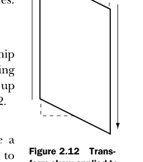

##### skew（倾斜）

当你倾斜一个元素时，你改变了两个平行边之间的相对关系。想象一下将你的手掌放在脸颊两侧，然后将一边向上推，另一边向下拉。这就是倾斜，如图 2.12 所示。

##### rotate（旋转）

使用变换旋转元素需要你给出一个在 360 度圆内的度数，以旋转目标元素。图 2.13 显示了使用变换旋转元素。

##### scale（缩放）

设置元素的缩放比例可以通过应用一个百分比值使其变大，其中 1 代表 100%。0 到 1 之间的值会使元素缩小，大于 1 的值会使元素变大。请注意，每个浏览器处理缩放的方式可能不同，如果元素放大或缩小过多，你可能会遇到像素化的问题，尤其是位图图像。图 2.14 说明了将一个方块放大到更大尺寸。

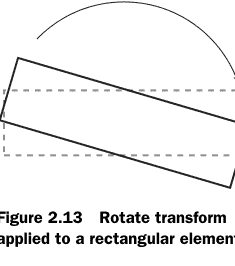

##### translate（平移）

平移变换使元素在屏幕上垂直和水平移动一定距离，如图 2.15 所示。变换通常不会影响屏幕上其他元素的流动，但这并不能保证。

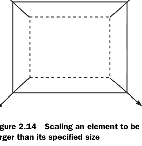

##### 使用CSS3变换和过渡

如前所述，调用变换的格式使用方法调用签名：

```css
#my_ul li {
    transform: scale(0.75);
}
```

这个例子显示了一个缩放变换，将列表项缩小了 25%。结果会立即在屏幕上生效，并导致页面回流。

关于变换的即时效果，应该注意过渡也与许多变换一起包含在过渡中。过渡在变换的基础上增加了时间元素。使用过渡，你可以根据CSS中的值来动画化页面中的元素。与变换类似，你可以在代码中构建过渡样式语句，使其更具动态性。

如以下代码片段所示，一个典型的过渡将使悬停时的透明度在半秒内生效。这提供了一个很好的淡入淡出效果，可以在jQuery中复制，但使用CSS稍微简单一些，并且可以无需代码统一应用：

```css
.myclass {
    transition: opacity .5s ease-in-out;
}
```

过渡为视觉变换增加了时间元素。

```css
.myclass:hover {
    opacity: 0.4;
}
```

过渡接受三个值：要过渡的属性、持续时间和时间函数。虽然过渡的最后一个参数值可以接受许多内置的时间函数值，但你也可以构建自己的贝塞尔函数应用于过渡。这引出了一些有趣的基于触控的可能性。

> **注意** 我们故意省略的一个新的CSS3功能是关键帧动画。它使你能够改变动画路径，而不仅仅是简单的从A到B的值。目前它还没有被广泛支持，但当它最终稳定时，预计它会成为最酷的特性。

这就引出了在动画化元素时使用哪种效果的问题。你是使用CSS3实现还是jQuery实现？答案取决于你的场景。如果你针对的是非常具体的平台，比如iPad，并且需要硬件加速，你应该考虑将你的代码分支，使用WebKit 3D transform/translate组合，然后回退到使用JavaScript的更通用的jQuery动画。

> **警告** 有人说你可以使用JavaScript检测各种CSS3实现。虽然这在大多数情况下有效，但在某些情况下，你的页面可能无法像素级完美，并且浏览器不会向你报告错误。在处理高级CSS3场景时，在可预见的未来，你将需要直观地检查所有接口，因为目前没有可用的测试框架。

#### 2.4.9 使用伪元素和伪类根据需要更改样式

样式不必在页面上是静态的。它们可以通过在代码中编辑类名来分配和移除，但有一种更简单的方法。CSS定义了两种基于可检测条件编辑样式的方式：伪类和伪元素。它们是临时的，仅在选择器的条件满足时应用。

样式的伪类是原始样式基于命名条件的更改。伪元素的写法相同，但它可以向页面添加新内容。

语法是正常的选择器，后跟一个冒号（:），然后是特定的伪类/伪元素名称。每个人最常用的是 `:hover`。当分配给一个锚点时，当鼠标光标在其边界内时，样式中的任何内容都将应用于该锚点元素：

```css
a:hover { ... }
```

在这种情况下，当伪类选择器没有特别覆盖时，样式将保留锚点元素的现有属性。

这很简单，但还有其他伪类/伪元素非常方便但很少使用。你应该熟悉它们，这样当你看到它们时就能认出来，并且能够自己编写更有效的样式。

`:link`、`:visited`、`:active` 和 `:hover` 伪类主要用于锚点，并将样式应用于具有这些属性的锚点。`:focus` 伪类允许你指定，当特定元素获得焦点时，它也应该获得分配的样式。这在基于触摸的应用程序中特别有用，可以让用户知道文本将放置在哪里。例如，当用户将焦点放在搜索输入框上时，可以使用这个伪类来放大输入框。

接下来的伪类用于选择页面内的顺序元素。`:first-letter` 和 `:first-line` 在适度使用时，可以为你的内容带来很好的阅读体验。它们分别将样式分配给包含文本内容的任何元素的第一个字母和第一行。

两个重要的伪元素是 `:before` 和 `:after`。它们通常用于相对于选择器放置内容，如果你想允许编辑页面（例如在内容管理系统中），这会很有帮助。通过将伪元素附加到选择器上，你可以向页面添加额外内容，以指示诸如文本插入点之类的位置。

最后一个我们应该讨论的伪类是 `:target`。当你使用目标伪类时，你将把特定样式应用于当前选择器的 `href` 目标。这意味着 `href` 必须是一个页面级锚点，一个以井号（#）开头并引用当前页面上元素的锚点。因此，一个分配了 `:target` 样式为 `background-color:green` 的链接，当该链接被点击时，会使任何链接的目标变为绿色。

这很方便，但你应该小心，因为你的整个呈现可能会随着页面内导航事件而改变，并且没有可追踪的代码。请查看 Lea Verou 在 http://leaverou.me/ft2010 上的演示，其中包含更多关于使用 `:target` 伪类的优秀示例以及许多其他有趣的 CSS 示例。

### 2.5 小结

在本章中，我们快速浏览了作为应用程序框架的 HTML 的许多新特性和一些经典特性。我们回顾了如何布局页面以及如何为其添加语义。我们涵盖了一些基本的 CSS 样式技巧以及 CSS3 的一些新特性。

如果你以前没有接触过这类细节，所有这些可能看起来有点令人难以招架。过去，ASP.NET 网站的正常运行方式是向网站作者隐藏大部分此类细节。在本书的其余部分，我们将探讨这里讨论的各种 HTML5 API，并包含一些技巧和窍门，以帮助你更流畅地使用各种 CSS 和 HTML 元素，这些元素对于构建 HTML 应用程序以提高生产力是必需的。

现在我们已经介绍了 HTML 语义化标记的基础知识以及它如何与 CSS 和传统标记集成，是时候着手处理 HTML5 方程式中的 JavaScript 部分了。首先，我们将更详细地了解音频和视频元素。这将是一个很好的过渡，因为它涉及大量标记以及一个简单 JavaScript 库的构建。

# 音频和视频控件

## 本章涵盖

- 无需代码即可使用音频和视频控件
- 将 JavaScript 控件与音频和视频集成
- 控制音频和视频的简单绑定技术
- 了解音频和视频格式

不久之前，播放视频内容的唯一方法是在你的 HTML 页面中使用 `<object>` 标签嵌入 QuickTime、Flash、Silverlight 或其他自定义安装的程序。这些元素与周围的页面几乎没有交互性，而且实际上，它们是页面上的媒体孤岛。音频内容只是稍好一些，在某些情况下甚至更糟。你上一次访问一个在后台播放歌曲的页面是什么时候？从用户的角度来看，最烦人的事情莫过于除了调低电脑音量或离开页面之外，你无法对该页面进行任何操作。本章将向你展示如何使用 HTML5 解决所有这些问题。

HTML5 引入了两个新标签：`<audio>` 和 `<video>`。这两个标签都实现了相同的 API 接口，因此虽然内部实现不同，但外部接口是相同的。此外，这两个标签都不需要任何额外的辅助下载即可在受支持的浏览器中工作。你只需添加标签，提供源内容，你的用户就可以看到和听到你的媒体。它真的就是这么简单！你还能走得更远，正如你将在本章的示例应用程序中看到的那样。这个例子从基本的操作功能开始，帮助你理解 `<audio>` 和 `<video>` 标签及其 JavaScript API 的工作原理，并在本章的过程中不断演进。到最后，它将能够执行以下操作：

- 下载并播放音频和视频内容
- 使用 HTML 对象控制内容播放
- 使用 JavaScript 播放和暂停内容
- 更改音量和静音媒体内容

当示例完成后，你将对新的 HTML5 音频和视频控件有实际的应用知识，并能够开始将这些内容构建到任何现有的 Web 应用程序中。

在你完成这个项目的过程中，你将学习如何做几件事：

- 不使用 JavaScript，而是作为 HTML 元素使用音频和视频标签
- 使用 JavaScript 控制音频和视频播放
- 为开源内容更新媒体类型

在我们讨论这些主题之前，让我们看看你将构建什么，并逐步了解启动应用程序所涉及的步骤。

### 浏览器支持

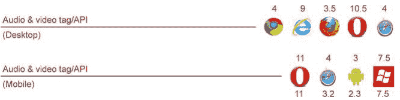

### 第 3 章导览

音频和视频标签允许浏览器加载和播放音频和视频内容，而无需插件框架。每个浏览器供应商控制其将支持的媒体格式，页面开发人员可以指定多个级别的回退内容，以便在不支持特定格式时播放。

- 识别 `<audio>` 和 `<video>` 标签 ........................................ 第 72 页
- 使用 `controls` 属性 ..................................................... 第 72 页
- 使用 `autoplay` 属性 ..................................................... 第 72 页
- 使用 `loop` 属性重复内容 ................................. 第 72 页
- 使用 `preload` 属性预加载内容 ............................. 第 72 页
- 无需代码使用 `<video>` 和 `<audio>` 标签 .......................... 第 74 页
- 学习在 JavaScript 中使用 `HTMLMediaElement` .................... 第 76 页
- 使用 JavaScript 播放内容 .................................................... 第 79 页
- 暂停内容 ............................................................................ 第 79 页
- 处理音量变化 ............................................................ 第 80 页

## 3.1 构建一个播放音频和视频的站点

图 3.1 显示了该站点在任何兼容浏览器中的确切外观。

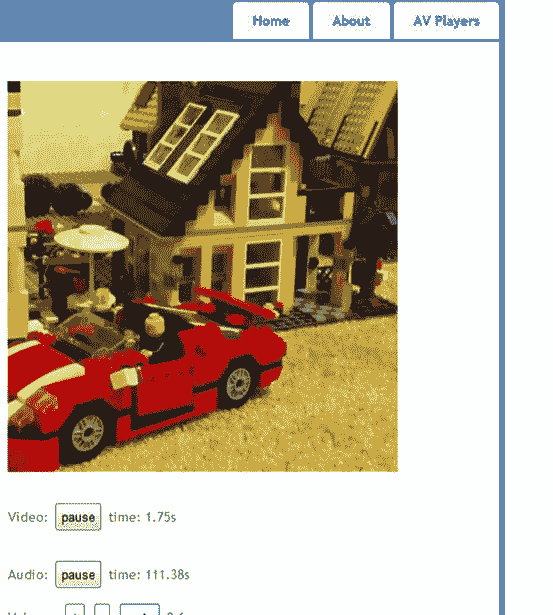

图 3.1 示例站点将在不使用插件或额外下载的情况下播放音频和视频内容。

要开始构建应用程序骨架，请执行以下步骤：

1. 打开 Visual Studio 并创建一个新的 ASP.NET MVC 应用程序。
2. 选择 "Internet Application"、"Razor View Engine" 和 "HTML5 语义化标记"。
3. 保持 "Create Unit Test" 复选框未选中。
4. 将应用程序命名为 AudioVideo。
5. 当 Visual Studio 启动时，导航至 "Tools" > "Library Package Manager" > "Manage NuGet Packages for Solution"。
6. 在左侧选择 "Installed Packages" 选项卡，然后对以下包单击 "Manage"：
   - Entity Framework
   - jQuery UI
   - jQuery Validation
7. 当弹出窗口出现时，取消选中项目，然后单击 "OK" 以从解决方案中移除该包。
8. 在左侧选择 "Updates" 选项卡，然后对窗口中央的每个剩余包单击 "Update" 按钮。
9. 打开解决方案中位于 `\Views\Shared\_Layout.cshtml` 的 Razor 视图文件，并更新顶部的脚本标签以匹配解决方案的 Scripts 文件夹中新更新的脚本。
10. 在菜单区域，添加一个新的列表项：

```html
<li>@Html.ActionLink("AV Players", "Players", "Home")</li>
```

这创建了一个链接，当应用程序运行时指向 `/Home/Players`。它还无法工作，因为该端点及其关联视图不存在。这是下一个设置步骤。

11. 导航到 Controllers 文件夹并打开 Home Controller。添加以下代码片段以创建新端点：

```csharp
public ActionResult Players()
{
    return View();
}
```

12. 右键单击 "View" 一词，并从弹出菜单中选择 "Add View"。这将在解决方案的 `\Views\Home` 文件夹中创建一个名为 `Players.cshtml` 的新文件。
13. 如果你还没有完成，请从 GitHub 帐户获取音频和视频内容，并将以下四个文件添加到解决方案的 Content 文件夹中：
    - `gwt.ogg`
    - `gwt.mp3`
    - `lego.ogv`
    - `lego.mp4`

`.ogg` 和 `.ogv` 文件是用于高质量数字媒体的开源音频和视频格式。该格式由 Xiph.org 基金会维护。

### 3.2 音频和视频标签

HTML5中的 `<audio>` 和 `<video>` 标签具有相似性，因为它们都实现了 `HTMLMediaElement` 接口。该接口描述了在网页上播放和控制多媒体内容所需的所有主要功能、属性和事件。在后续构建播放器应用程序的 JavaScript 部分时，你会看到其中一些事件和属性的实际应用，但你可以在 W3C 网站 http://dev.w3.org/html5/spec/media-elements.html#htmlmediaelement 上获取完整信息。

你可以在 HTML5 中实现的最简单的标签，用于渲染音频和视频内容，它会播放音频文件中存在的任何音频内容，只要该文件存在于 `src` 属性指定的相对 URL 中。它看起来像这样：

```html
<audio src="myaudio.mp3"></audio>
```

当你实现 `<source>` 子标签时，这些标签会变得更加强大。这让你可以为内容提供多种格式，从而更有可能在不同的浏览器平台上播放。以下是一个示例：

```html
<audio>
    <source src="myaudio.ogg" type="audio/ogg" >
    <source src="myaudio.mp3" type="audio/mp3" >
</audio>
```

`<source>` 标签对于 `<audio>` 和 `<video>` 标签都是相同的。你只需要根据用户想要看到或听到的特定内容添加尽可能多的 `<source>` 元素，浏览器将从顶部开始向下查找，直到找到它支持的格式。不会检测带宽、视频大小或源媒体文件的任何其他信息。如果格式受支持，浏览器就会使用它。事情到此结束。

在播放源文件方面，也没有“更受支持”的概念。某种格式要么受支持，要么不受支持。正如你可能从表 3.1 中推断出的那样，没有一种音频或视频格式是普遍支持的——甚至 mp3 也不是——因此目前你必须戴上格式转换器的帽子，将你拥有的任何内容转换为你的目标用户浏览器支持的格式。

> **注意** 我们决定不详细介绍哪些格式被哪些浏览器支持，因为格式“战争”仍在进行，目前还没有明确的赢家。哪个浏览器支持哪个格式可能会继续快速变化。请为向用户呈现的每个媒体文件准备至少两种或三种格式。

### 将 HTML 属性分配给标签

仅使用前面代码片段中的音频或视频标签不足以播放媒体内容，因为你还没有为标签分配适当的 HTML 属性来运行音频内容。音频和视频标签可以以三种方式之一运行：

- 严格作为 HTML 元素
- 严格作为 JavaScript 控件
- 作为混合体，同时使用 HTML 属性和 JavaScript 控制播放

在接下来的几页中，我们将描述使用第一种方法呈现媒体内容的细节，然后你将使用第二种方法继续构建示例应用程序。

因为第三种（混合）方法只是结合了前两种方法，所以我们学习的所有内容都应该能让你使用该方法进行构建。一个典型的可能使用混合方法的情况是，在视频网站上，一旦内容准备就绪就自动开始播放，但允许用户使用 JavaScript 代码停止和重新启动。

#### 3.2.1 不使用 JavaScript 使用音频和视频标签

让我们从第一种方法开始：严格将标签用作 HTML 元素。当你构建一个显示教程或显示站点介绍性音频或视频片段的网页的静态站点时，你可能想要这样做。

为此，你只需将 `controls` 属性添加到 `<audio>` 标签并刷新页面：

```html
<audio id="audio" controls>
    <source src="myaudio.ogg" type="audio/ogg" >
    <source src="myaudio.mp3" type="audio/mp3" >
</audio>
```

你应该会看到你运行的任何浏览器内置的各种音频播放器格式之一。图 3.2 中的屏幕截图选择可能会随着时间的推移而改变，因为浏览器会升级，但我们预计变化会很小。

其他常见的 `<audio>` 属性如下所列；每个属性的值在后续讨论中：

```html
<audio id="audio"
    controls
    autoplay
    loop
    preload="metadata or none or auto">
```

让我们更详细地了解这些属性。

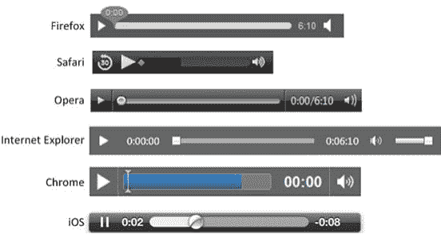

**图 3.2** 浏览器默认音频播放器的尺寸各不相同。如果布局是考虑因素，可以创建自己的播放器界面。第3.3节将展示如何操作。

##### `controls` 属性

`controls` 属性只需要存在，不需要赋值。你可能也会看到它被写成 `controls="controls"`，两者是一样的。

这个属性的功能，正如你之前所见，是向用户显示音频控件。它们的呈现和功能完全取决于浏览器厂商的实现。根据浏览器的不同，它们可以始终可见，或者只在悬停时可见，但这方面不是开发者可以控制的。

##### `autoplay` 属性

`autoplay` 属性不需要设置值，它会在元素加载后立即开始播放音频内容。这让人想起互联网早期音频内容的时代，网站会在你浏览时播放背景音乐。这几乎从来都不是个好主意，因为它会惹恼用户并浪费带宽。它确实在网站设计和内容呈现中有其一席之地，但请记住：少即是多。

##### `loop` 属性

`loop` 属性会在音频播放完成后重新开始播放。这在游戏开发中的原声带中可能很方便，但同样，它很容易被滥用。`autoplay` 会持续播放音频轨道，直到用户卸载页面或暂停它。如果音频内容的轨道没有显示控件，并且你开启了 `loop`，你可以保证访客会尽快离开你的网站。`loop` 也是一个不需要设置值的属性。

##### `preload` 属性

`preload` 属性有三个可能的值：`metadata`、`auto` 和 `none`：

- `metadata` — 请求播放器下载足够的关于音频轨道的信息，以显示轨道的总时长，并可能显示其他信息，具体取决于浏览器厂商的实现。
- `none` — 告诉浏览器在用户按下播放按钮之前不要下载任何内容。
- `auto` — 尝试在元素渲染到页面上时立即开始加载轨道。

请记住，这些 `preload` 设置是对浏览器的建议。浏览器可能会选择忽略这些设置，以便为元素下载音频或视频内容。

现在你已经掌握了通用HTML5媒体标签的工作原理，让我们花一点时间专注于 `<audio>` 标签。

#### 3.2.2 将音频标签用作 HTML 元素

如果你在第3.1节中创建的 `Players.cshtml` 页面中完成了标记，你应该在浏览器中运行应用程序时看到播放器出现在页面上，并且根据你分配的属性，它可能已经开始播放，或者已排队准备由用户启动。

(http://www.xiph.org/). The .mp3 and .mp4 formats are proprietary but very common.

##### 为示例应用程序查找音频/视频内容

你可以从 https://github.com/axshon/HTML-5-Ellipse-Tours/tree/master/demos/av/Media 下载我们在本章中使用的音频和视频内容。

这个 GitHub 项目最初是为本书设计的一个整体式示例应用程序，但我们决定采用“每章一个应用程序”的范例，更适合单独介绍和解释每个 HTML5 API。本书中的所有代码以及一些额外内容都可以在 GitHub 仓库中找到。

##### 转换音频和视频文件格式

有很多选项可以将你的音频和视频转换为 Ogg 或 WebM，但目前最简单的是免费的 Miro Video Converter (http://www.mirovideoconverter.com/)。安装后，只需将你的音频或视频文件拖入其中并选择一种格式。

对于 Ogg 视频 (.ogv)，请选择 Theora，一种开放的视频格式 (theora.org)。Theora 设置也会将音频文件转换为 Ogg 音频，但你需要将生成的文件扩展名更改为 .ogg。

表 3.1 显示了当前 .ogg 和 .ogv 格式的浏览器兼容性级别。

**表 3.1 开源媒体格式兼容性（.ogg 和 .ogv）**

| 浏览器 | 开始支持的版本 |
| :--- | :--- |
| Chrome | 4 |
| Internet Explorer | 不支持 |
| Firefox | 3.5 |
| Opera (桌面版) | 10.5 |
| Safari (所有版本) | 不支持 |
| Opera Mobile | 11 |
| Android (所有版本) | 不支持 |
| Windows Mobile | 不支持 |

既然应用程序骨架已经就位，接下来我们将看看 `<audio>` 和 `<video>` 标签及其基本相似之处，以及你可以在项目中使用标签的三种不同方式。你将使用其中一种方式来构建本章的示例应用程序。

## 强制显示音频和视频元素的控制条

有时你可能会遇到这样的页面：其中包含音视频控制元素，但 `controls` 属性被关闭了，而你希望看到控制条，或者你希望在运行时测试自己的页面。如果这些页面使用了 HTML5 标签和 jQuery，最简单的找到元素并开启控制条的方法是使用 `attr` 函数：

```javascript
$("#audio").attr("controls", "controls");
$("#video").attr("controls", "controls");
```

这段代码假定存在 ID 分别为 `audio` 和 `video` 的音频和视频元素，它将立即开启这些元素的 `controls` 功能。

下面代码片段中的代码更为详细，它使用了 ASP.NET MVC 的 `Url.Content` 辅助方法来构建相对 URL，而无需解析 HTTP 请求地址字符串。请注意 `<source>` 元素的顺序。如前所述，浏览器总是会从顶部开始尝试播放这些源，直到找到兼容的格式才会停止：

```html
<audio id="audio">
    <source src="@Url.Content("~/Content/gwt.ogg")"
        type="audio/ogg" >
    <source src="@Url.Content("~/Content/gwt.mp3")"
        type="audio/mp3" >
</audio>
```

基本的音频标签会提供一种播放声音的方式，但默认情况下不会显示播放器。

媒体标签内的源元素会按顺序尝试播放。

如果第一个源标签不被当前浏览器支持，则会尝试下一个，依此类推。

使用浏览器默认播放器播放 `<audio>` 内容时请小心，因为它们在页面上占用的空间可能差异很大。再次查看图 3.3 中渲染的音频播放器，注意 Safari 播放器比 Chrome 的窄得多，而 Internet Explorer 播放器则宽得多。如果处理不当，其中任何一个都可能改变你的页面布局。

#### 3.2.3 将 video 标签作为 HTML 元素使用

HTML5 中的 `<video>` 标签在大部分实现细节上与 `<audio>` 标签相似。事实上，你能在音轨上控制的任何功能，在视频轨道上也能控制。功能、事件和属性都是相同的，只是视频包含一些不适合音频的额外功能。使用 `<video>` 标签，你可以设置一些额外的属性来指定视频的尺寸，以及视频开始播放前显示的图像。

像下面代码片段中的基本 `<video>` 标签，其内部会嵌套 source 标签，并使用前面描述的相同格式回退机制。渲染时 `<audio>` 和 `<video>` 的区别在于，除非在代码中或通过某些 CSS 规则明确告知不显示，否则视频总会显示。另一方面，如果未开启 `controls`，则 `<audio>` 不会显示：

```html
<video id="video">
  <source src="@Url.Content("~/Content/lego.ogv")" type="video/ogg" >
  <source src="@Url.Content("~/Content/lego.mp4")" type="video/mp4" >
</video>
```

这段代码会显示内容视频的起始帧，但没有控制播放的控件。这个规则的一个例外是，某些浏览器（特别是 Internet Explorer 9 及更高版本）允许你右键单击视频，弹出带有播放器控件的上下文菜单。这些控件无法开启或关闭，但可以在代码中覆盖右键点击行为。

就像 `<audio>` 标签一样，你可以添加 `controls`、`autoplay`、`loop` 和 `metadata` 属性，它们的功能是相同的。仅适用于视频的额外功能是 `height` 和 `width` 属性，它们会将视频约束到一个特定的矩形区域，以及 `poster` 属性。`poster` 是一个指向有效图像文件的 URL 值。该图像将被缩放以适应指定的高度和宽度，但与视频内容（会缩小直到正确的宽高比适应指定的高宽矩形）不同，图像的宽高比不能保证被保留：

```html
<video id="video"
  controls
  autoplay
  loop
  preload="metadata or none or auto"
  poster="@Url.Content("~/Content/VideoPoster.png")">
```

图 3.4 显示了撰写本文时主要浏览器实现的默认视频播放器控件。控件出现在视频的边界内——有些会将视频内容向上推，有些则以轻微的透明效果显示在视频上方，但所有控件都渲染在播放器渲染区域的底部。

请注意，控件的宽度将与播放器的宽度相同，但浏览器供应商可以选择任何高度来渲染控件界面。虽然这对于并非特定页面核心目的的周边内容来说没问题，但事实是，如果你构建页面专门是为了呈现音频或视频内容，那么默认播放器根本不够用。它们在视觉上不一致，并且不提供自定义功能。这时 JavaScript API 就派上用场了。

### 3.3 使用 JavaScript 控制音频和视频播放

利用可供 `<audio>` 和 `<video>` 元素使用的 JavaScript API，你几乎可以控制客户端浏览器中播放的每一个功能。你还可以将事件和属性连接到任何其他 HTML 控件，这样展示方式就完全由网站设计师决定了。如前所述，你还可以使用 JavaScript API 控制播放功能，同时保留浏览器提供的现有控件。以下是你可以用这两个媒体元素在代码中实现的一些操作：

- 赋值源值
- 监控播放状态
- 获取正在播放的轨道的总时长和当前时间
- 检测和修改播放速率
- 为循环、自动播放和控件赋值属性
- 检测轨道播放完成
- 调高或调低音量
- 静音或取消静音

如你所见，在播放音频和视频内容时，有非常多的控制功能可供你使用，你将在示例应用程序中最常用的功能，例如播放/暂停、静音/取消静音和音量控制。在本节中，你将学习如何在完成以下任务时使用音频和视频 API：

- 构建自定义音频和视频控制界面
- 构建 main.js 库结构
- 创建 JavaScript 媒体播放器对象
- 将 JavaScript 附加到音频和视频事件模型，以完成用户的媒体体验

我们将从构建自定义控件开始。

#### 3.3.1 为音频和视频构建自定义控件

开始之前，如果你一直在跟随操作你的解决方案并调整 `<audio>` 和 `<video>` 标签属性，请先从 `Players.cshtml` 页面中清除它们。

你还需要为标签添加 `id` 属性，以便在代码中轻松识别它们。它们应该如下所示：

```html
<audio id="audio">
  <source src="@Url.Content("~/Content/gwt.ogg")" type="audio/ogg" >
  <source src="@Url.Content("~/Content/gwt.mp3")" type="audio/mp3" >
</audio>
<video id="video">
  <source src="@Url.Content("~/Content/lego.ogv")" type="video/ogg" >
  <source src="@Url.Content("~/Content/lego.mp4")" type="video/mp4" >
</video>
```

接下来，在 video 元素下方添加一些标准的 `<button>`、`<div>` 和 `<span>` 标签，以便绑定到你即将编写的控件代码。下面的清单显示了这个标记的布局。它们将在最终页面中充当控制用户界面元素。

```html
<div id="video-controls">
  视频:
  <button class="play">play</button>
  <span class="time"></span>
</div>
<div id="audio-controls">
  音频:
  <button class="play">play</button>
  <span class="time"></span>
  <div class="secondary-controls">
    音量:
    <button id="volume-up">+</button>
    <button id="volume-down">-</button>
    <button id="mute">静音</button>
    <span id="volume"></span>
  </div>
</div>
```

> **所有的 HTML5 语义化标签去哪了？**

你可能已经注意到，在本章中我们使用的是普通的 `<div>` 和 `<span>` 标签来组织页面结构。我们在这本书的很多地方这样做，原因有以下几点。

首先，本章中的音频/视频内容包含在一个页面中，也称为单页应用（SPA）。语义化标记的主要功能之一是允许网络爬虫、搜索引擎或无障碍工具“读取”页面的内容，但 SPA 通常基于用户交互或其他条件使用 JavaScript 动态加载内容。网络爬虫不会执行 JavaScript，因此无法加载和解析动态内容。这使得语义化标签显得有些无用。

其次，我们希望在这本书中明确指出，虽然你可以立即在所有网页和 HTML 应用程序中使用语义化的 HTML 标签，但这是可选的。之前（经典 HTML）的标签在整个网络中仍然有效且常见。

#### 3.3.2 构建 main.js 库结构

控件就绪后，便可以开始构建控制代码结构了。

请在解决方案的 Scripts 文件夹中创建一个名为 `main.js` 的新 JavaScript 库文件并打开它。如后续代码清单所示，你的 `main.js` 库中将只包含三个函数。它们分别用于初始化页面、初始化音频或视频对象，以及在屏幕上更新音量值。

```javascript
$(document).ready(function () {
    Main.init();
});

window.Main = {
    init: function () {
    },

    initMedia: function (name) {
    },

    showVolume: function () {
    }
};
```

此处的基本结构初始化了 `Main` 对象，并通过 `initMedia` 方法创建自定义对象，以控制音频或视频内容的播放。在 `init` 函数内部，你将使用 Modernizr 检测浏览器兼容性，然后执行函数来创建对象。相关代码如下所示。

```javascript
var self = this;

if (!Modernizr.audio) {
    alert("Audio tag not supported.");
    return;
}

if (!Modernizr.video) {
    alert("Video tag not supported.");
}

this.video = this.initMedia("video");
this.audio = this.initMedia("audio");
```

Modernizr 会检测音频和视频的兼容性。然后，这段代码向之前通过 `window.Main = { ... }` 创建的 `Main` 对象添加了两个属性。这两个属性（`video` 和 `audio`）是通过 `initMedia` 函数创建的。请继续阅读，了解具体方式和原因。

#### 3.3.3 创建 JavaScript 媒体播放器对象

这个 `initMedia` 函数是减少代码编写量并提高可维护性的一个绝佳示例。在这个函数中，你将查找界面中的各种元素，其中最重要的是渲染后的 `<audio>` 或 `<video>` 元素。然后，你将该元素视为通用内容，而非特定的音频或视频内容。之所以能做到这一点，是因为这两个标签都实现了 `HTMLMediaElement` 接口。

首先，请仔细查看下面的代码清单。这是 `initMedia` 的第一部分。这里进行了大量的元素定位和变量赋值操作。

```javascript
var result = {};
result.$media = $("#" + name);
result.media = result.$media[0];

result.$controls = $("#" + name + "-controls");
result.$play = result.$controls.find(".play");
result.$time = result.$controls.find(".time");
```

请注意，`$media`、`$controls`、`$play` 和 `$time` 都是 jQuery 选择器生成的包装集，而 `media` 元素则根据输入参数 (`name`) 的值对应于 `<audio>` 或 `<video>` 元素。为什么要如此大费周章？因为包装集能提供你需要的所有标准 jQuery 功能，用于绑定事件、更改 CSS 属性以及更新文本值，但它无法让你对单个 API 对象调用函数。为此，你必须拥有一个单独的对象，而不是一个包装集。

`initMedia` 函数中的下一段代码展示了获取包装集，然后使用该对象（而非包装集）来执行函数的过程：

```javascript
result.$play.click(function () {
    if (result.media.paused)
        result.media.play();
    else
        result.media.pause();
});
```

你刚刚实现了 `$play` 按钮的 `click` 处理程序，因此媒体（音频或视频）将会播放，但你仍然需要绑定到播放器的各种其他事件，以便能够暂停媒体并跟踪其播放期间的状态。你可以使用 `$media` 包装集来实现这一点，因为你并不需要执行特定的函数。

代码清单 3.5 展示了如何绑定到 `playing`、`pause`、`ended` 和 `timeupdate` 事件。再次强调，每次你需要调用 `HTMLMediaElement` API（无论是音频还是视频）的特定函数或属性时，都必须对 `media` 本地属性进行调用。这是 `initMedia` 函数的最后一部分。

```javascript
result.$media
    .bind("playing", function () {
        result.$play.text("pause");
    })
    .bind("pause", function () {
        result.$play.text("play");
    })
    .bind("ended", function () {
        result.media.play();
    })
    .bind("timeupdate", function () {
        var prettyTime =
            Math.round(result.media.currentTime * 100) / 100;
        result.$time.text("time: " + prettyTime + " s");
    });
result.media.play();
return result;
```

这里涉及音频和视频元素、页面上的控件以及 `Main` 对象的各种属性之间的大量交互。重申一下，使得这种使用 jQuery 包装集进行事件绑定的方法得以生效的秘诀在于：音频和视频元素实现了 `HTMLMediaElement` 接口，使得它们在功能上基本相同，只是输出到浏览器的方式不同。图 3.5 展示了你在代码中建立的各种包装集和属性，以及它们如何在 `window.Main` 对象中协同工作。

回到你在 `initMedia` 中创建的对象，你首先实例化了一个名为 `result` 的对象变量，然后将一堆 jQuery 包装集和一个媒体对象绑定到它上面。接着，你绑定各种媒体事件以创建一个响应式界面。最后，你启动媒体内容的播放，然后将对象返回给调用者（在本例中是 `init` 函数）。这看起来似乎很复杂，但实际上你只是设置了界面并播放了媒体。

#### 3.3.4 通过添加音量控件完善媒体体验

回到 `init` 函数中，这段代码现在应该更容易理解了：

```javascript
this.video = this.initMedia("video");
this.audio = this.initMedia("audio");
```

你正在将名为 `video` 和 `audio` 的变量赋值为在 `initMedia` 函数中创建的新对象。这些对象负责处理与播放、暂停、循环和内容计时器功能相关的所有事务。唯一需要填充的部分是那些特定于音频轨道的内容。

因为你使用的示例视频轨道恰好没有音频，所以你的代码必须偏离在 `initMedia` 函数内部完成工作。如果你想同时为视频和音频添加音量控件，你本可以在 `initMedia` 内部完成这项工作，但在本例中，我们将让你把它放在 `init` 内部，以便音量 HTML 元素仅绑定到音频控件。不过，你仍然可以使用你创建的 audio 对象。

下一个代码清单展示了用于调高/调低音量和静音的控件绑定，以及用于跟踪 `volumechange` 事件的简单绑定语句。这段代码填充了 `main` 对象的 `init` 函数。

```javascript
this.$volume = $("#volume");

this.$volumeUp = $("#volume-up")
    .click(function () {
        self.audio.media.muted = false;
        self.audio.media.volume += 0.1;
    });

this.$volumeDown = $("#volume-down")
    .click(function () {
        self.audio.media.muted = false;
        self.audio.media.volume -= 0.1;
    });

this.$mute = $("#mute")
    .click(function () {
        self.audio.media.muted = !self.audio.media.muted;
    });

this.audio.$media
    .bind("volumechange", function () {
        self.showVolume();
    });

this.showVolume();
```

让你的应用程序运行起来的最后一步是填充 `showVolume` 函数，如以下代码清单所示。这个函数会简单地将音量值四舍五入到最接近的十分位 (0.1)，并将其显示在页面上。

```javascript
var prettyVolume =
    Math.round(this.audio.media.volume * 10) / 10;
if (this.audio.media.muted) {
    prettyVolume = 0;
    this.$mute.text("unmute");
} else {
    this.$mute.text("mute");
}
this.$volume.text(prettyVolume);
```

### 3.4 为开源内容更新媒体类型

我们在列出能直接在Visual Studio解决方案中使用的浏览器时，特别排除了Opera和Firefox。这些浏览器完全兼容HTML5的`<audio>`和`<video>`标签，但当页面在你的本地环境运行时，你可能需要进行一些调整。这些调整与开源内容类型有关，而与特定的服务器兼容性无关。Opera和Firefox默认支持.ogv和.ogg文件类型，因此你必须告知本地Web服务器可以发送这些文件。

本节将介绍你需要对项目进行的更改。

### 使用IIS Express

你需要做的第一件事是更新你的解决方案，使其使用IIS Express。虽然可以将其一直推进到IIS服务器实例，但对于你的测试来说这其实没有必要，而且这通常也是网络管理人员的工作。要更新你的AudioVideo项目，请按照以下步骤操作：

1. 在解决方案资源管理器中，右键单击你的AudioVideo项目节点，然后选择“属性”。
2. 单击左侧的“Web”选项卡；你应该会看到一个类似于图3.7的界面。
3. 在页面的大约中间位置，在“服务器”部分，选择“使用本地IIS Web服务器”，然后选中“使用IIS Express”。你可以保持默认的项目URL不变。（如果你需要关于安装IIS Express的更多信息，请参考附录C。）

### 分配内容类型

既然你已经设置好解决方案以在IIS Express下运行，你就可以为本地服务器分配.ogg和.ogv内容类型了。目前，在运行IIS Express时，这只能通过appcmd可执行文件来完成。Appcmd是一个实用程序，可用于编辑许多配置值，而更新可用的内容类型是我们唯一需要进行的更改。

请按照以下步骤操作：

1. 以管理员身份打开命令提示符。
2. 导航到Program Files或Program Files (x86)文件夹。
3. 进入IIS Express文件夹。
4. 运行以下命令来更新.ogg内容类型：

```
appcmd set config /section:staticContent /+[fileExtension='.ogg',mimeType='audio/ogg']
```

5. 运行以下命令来更新.ogv内容类型：

```
appcmd set config /section:staticContent /+[fileExtension='.ogv',mimeType='video/ogv']
```

你应该会在命令行窗口中看到一个类似于图3.8的界面。现在，使用你喜欢的任何浏览器运行你的程序，你应该会获得完全相同的体验！你正在播放音频和视频内容，无需插件，也几乎没有额外的代码。这比仅仅几年前可用的技术是一个巨大的飞跃，而且随着格式和规范的稳定，这仅仅是未来可能实现功能的开始。

### 3.5 总结

流式传输音频和视频内容可能是你想通过网站或HTML应用程序实现的核心功能，也可能为你的网站增添最终的交互性、趣味性和专业性。无论你使用`<audio>`和`<video>`标签的原因是什么，它们目前的兼容性水平都指向了无插件的新应用体验，Flash或Silverlight仅作为旧浏览器淘汰前的后备方案。本章中的示例应用程序为你提供了一个坚实的基础。使用搜索功能查找内容的特定部分，以及通过各种事件监控缓存过程，是你可以在后续学习中探索的一些可能方向。

在下一章中，我们将深入探讨使用HTML5 Canvas API进行Web绘图的基础知识。这将是JavaScript前端一个更深入的主题，那一章中的项目应该是一个非常有趣的方式来开始学习标记语言与代码之间的关联。

### 3.6 完整代码清单

以下代码用于让你检查自己的作品，或者如果你没有跟着一起构建，则可以用来从头开始构建项目。

```html
@{
    ViewBag.Title = "Players";
}
<div id="content">
    <audio id="audio">
        <source src="@Url.Content("~/Content/gwt.ogg")" type="audio/ogg" >
        <source src="@Url.Content("~/Content/gwt.mp3")" type="audio/mp3" >
    </audio>
    <video id="video">
        <source src="@Url.Content("~/Content/lego.ogv")" type="video/ogv" >
        <source src="@Url.Content("~/Content/lego.mp4")" type="video/mp4" >
    </video>
    <div id="video-controls">
        视频：
        <button class="play">播放</button>
        <span class="time"></span>
    </div>
    <div id="audio-controls">
        音频：
        <button class="play">播放</button>
        <span class="time"></span>
        <div class="secondary-controls">
            音量：
            <button id="volume-up">+</button>
            <button id="volume-down">-</button>
            <button id="mute">静音</button>
            <span id="volume"></span>
        </div>
    </div>
    <div id="avfooter">
        <p>视频版权 2012，
            <a href="http://iangilman.com">Ian Gilman</a>。</p>
        <p>音频由 <a href="http://gwaxtrio.bandcamp.com">
            Gennaro's Wax Trio</a> 提供，版权 2008, BMI, BLZDub Music；
            经许可使用。</p>
    </div>
</div>
<script src="@Url.Content("~/Scripts/main.js")"
        type="text/javascript"></script>
```

```javascript
$(document).ready(function () {
    Main.init();
});

window.Main = {
    //--------------------
    init: function () {
        var self = this;

        if (!Modernizr.audio) {
            alert("音频标签不支持。");
            return;
        }

        if (!Modernizr.video) {
            alert("视频标签不支持。");
        }

        this.video = this.initMedia("video");
        this.audio = this.initMedia("audio");

        this.$volume = $("#volume");

        this.$volumeUp = $("#volume-up")
            .click(function () {
                self.audio.media.muted = false;
                self.audio.media.volume += 0.1;
            });

        this.$volumeDown = $("#volume-down")
            .click(function () {
                self.audio.media.muted = false;
                self.audio.media.volume -= 0.1;
            });

        this.$mute = $("#mute")
            .click(function () {
                self.audio.media.muted = !self.audio.media.muted;
            });

        this.audio.$media
            .bind("volumechange", function () {
                self.showVolume();
            });

        this.showVolume();
    },
    //--------------------
    initMedia: function (name) {
        var result = {};
        result.$media = $("#" + name);
        result.media = result.$media[0];
        result.$controls = $("#" + name + "-controls");
        result.$play = result.$controls.find(".play");
        result.$time = result.$controls.find(".time");

        result.$play.click(function () {
          if (result.media.paused)
            result.media.play();
          else
            result.media.pause();
        });

        result.$media
          .bind("playing", function () {
            result.$play.text("暂停");
          })
          .bind("pause", function () {
            result.$play.text("播放");
          })
          .bind("ended", function () {
            result.media.play();
          })
          .bind("timeupdate", function () {
            var prettyTime =
              Math.round(result.media.currentTime * 100) / 100;
            result.$time.text("时间：" + prettyTime + "秒");
          });

        result.media.play();
        return result;
    },
    //-------------------
    showVolume: function () {
      var prettyVolume =
        Math.round(this.audio.media.volume * 10) / 10;
      if (this.audio.media.muted) {
        prettyVolume = 0;
        this.$mute.text("取消静音");
      }
      else {
        this.$mute.text("静音");
      }
      this.$volume.text(prettyVolume);
    }
};
```

```css
/*--- 音频/视频 ----*/

#content {
  width: 100%;
  max-width: 400px;
  margin: 10px auto;
}

#video {
  width: 400px;
  height: 400px;
}
```

# Canvas 4

## 本章涵盖

- 使用 HTML Canvas 将图形构建到 Web 应用程序中
- 在 Canvas 上处理文本、线条、形状和图像
- Canvas 中的元素动画

Canvas API 是 HTML5 中的新特性，它提供了一种在浏览器内绘制基于位图图像的方法。Canvas 引起了媒体和开发者的广泛关注，因为事实上它是一块空白的画布，任何人都可以在上面绘制几乎任何视觉元素。此外，由于 `canvas` 元素与其他 HTML 元素一样，可以在 JavaScript 中将其视为普通元素进行操作，并参与页面流和样式设置。目前游戏是 Canvas 最常见的用途，但也可以使用此 API 构建任何类型的图像编辑或绘图程序。不过，确保页面与 `canvas` 元素之间的协调并非易事。绘制只能通过 JavaScript 进行，并且 `canvas` 的样式设置仅适用于整个元素，而不是你绘制在其上的像素，这意味着你精心设计的 CSS 将对 `<canvas>` 元素内部的呈现没有效果。换句话说，如果你的网站使用 Canvas 来呈现内容岛屿，而不是作为全屏呈现工具，你将不得不使用 JavaScript 复制你在 CSS 中创建的样式。

尽管存在这些小挫折，现代浏览器中图形操作和代码执行的速度，为那些开始使用 HTML5 Canvas 开发游戏的勇敢灵魂打开了新的大门。这是一个必将快速发展的领域。

但 Canvas 并非仅适用于游戏。使用 Canvas，你还可以构建图形解决方案、编辑和合成图像，以及构建强大的可视化与动画，为商业数据增添活力和清晰度。本章你将构建的示例应用程序——一个动画浏览器屏保——将由页面上的单个 `canvas` 和一个用于绘图的 JavaScript 库组成。在构建过程中，你将学习开始使用 Canvas 所需了解的内容，例如以下几点：

- Canvas 绘图上下文——它是什么以及如何引用它
- 如何使用 Canvas 坐标系绘制线条、形状和像素
- 绘制对象时如何从一个位置移动到另一个位置
- 如何使用 Canvas 在客户端操作图像
- 如何在画布上书写文本
- 如何为你的创作添加动画和特效

完成后，你将拥有一个动画浏览器屏保（其预览如图 4.1 所示），它会让朋友们惊叹不已！

它将包含许多老派 Windows 用户会从丝带和聚光灯屏保时代就记得的效果，但加入了 Canvas 所带来的新花样。你还将拥有充分的知识，开始从零构建自己的基于 Canvas 的 HTML5 应用程序。

首先，让我们为应用程序奠定基础，并了解快速启动任何 Canvas 应用程序所需的基础知识。


图 4.1 完成的示例 Canvas 应用程序，包含动画、图像和文本效果

## 4.1 Canvas 快速入门

在网页中使用 Canvas 需要了解的基本要点是，正如其名所示：它就是一个绘图画布。你可以使用 API 中的各种辅助函数在上面绘制任何你喜欢的东西，并且可以根据需要频繁地覆盖局部。你使用像素坐标进行绘制，并告诉 API 要执行何种类型的绘图（例如线条、形状和渐变）。一旦像素被绘制到画布上，除非你在同一位置绘制另一个像素来覆盖它，否则它将一直存在。

在本节中，你将执行以下操作：

- 为示例应用程序创建基本的站点结构
- 学习如何使用 `<canvas>` 标签
- 为画布分配尺寸
- 为示例应用程序创建样式表
- 学习设置和使用 2d 上下文对象
- 创建示例 Canvas 应用程序的核心

我们将从创建站点开始。

### 4.1.1 创建基本的 Canvas 站点结构

首先，你需要在 Visual Studio 中创建一个名为 CanvasTest 的 ASP.NET MVC 项目。你不会在 Canvas 项目中使用任何 MVC 功能，但我们将以展示纯客户端 HTML5 应用程序如何存在于 MVC 网站内的方式来构建它。我们这样做是为了表明 Canvas 可以是 Web 应用程序中完全独立的一部分，同时也为了尽可能多地介绍这个丰富的 API。

按照以下步骤启动项目：

1. 选择“文件” > “新建” > “项目”。
2. 在对话框中，选择左侧的“Web”，然后选择你当前安装的任何版本的 ASP.NET MVC 模板创建 ASP.NET MVC Web 应用程序。
3. 将项目命名为 CanvasTest。
4. 选择“Internet 应用程序”、Razor 视图引擎和 HTML5 语义化标记。
5. 不要选择“创建单元测试项目”，然后单击“确定”。

进入新项目后，打开 Views 项目文件夹中的 Home 子文件夹，双击 `Index.cshtml` 视图。将整个内容替换为下一个代码清单中的简单标记。

```html
@{ Layout = null;}
<!DOCTYPE html>
<html>
    <head>
        <title>Canvas Demo</title>
        <link href="@Url.Content("~/Content/main.css")" rel="stylesheet" type="text/css" />
        <script src="@Url.Content("~/Scripts/jquery-1.7.2.min.js")" type="text/javascript"></script>
        <script src="@Url.Content("~/Scripts/modernizr-2.5.3.js")" type="text/javascript"></script>
        <script src="@Url.Content("~/Scripts/main.js")" type="text/javascript"></script>
    </head>
    <body>
        <canvas id="main"></canvas>
    </body>
</html>
```

你很快将添加 JavaScript 文件和样式表。现在你需要关注 `<canvas>` 标签本身。此元素必须由开始和结束标签组成；它不能是自闭合的。因此，页面上最简单的 canvas 元素必须是：

```html
<canvas></canvas>
```

分开的开始和结束标签保持了向后兼容性。如果某个浏览器不支持 Canvas，`<canvas>` 标签的内容将作为后备方案显示。如果支持 Canvas，`<canvas>` 标签内的内容将不会显示。

### 4.1.2 为画布分配尺寸

你需要了解的关于任何 canvas 元素的另一个重点是如何分配其尺寸。因为它是一个普通的 HTML 元素，所以可以设置 `height` 和 `width` 样式。你也可以使用定义的 `height` 和 `width` 属性来调整画布大小，如下所示：

```javascript
var el = document.getElementById("myCanvas");
el.width = 200;
el.height = 250;
```

请注意，两种方法——CSS 的 `height` 和 `width` 或直接属性（`canvas.height` 和 `canvas.width`）——都会改变画布的大小，但结果完全不同。图 4.2 显示了在元素上更改尺寸与使用 CSS 样式之间的差异。

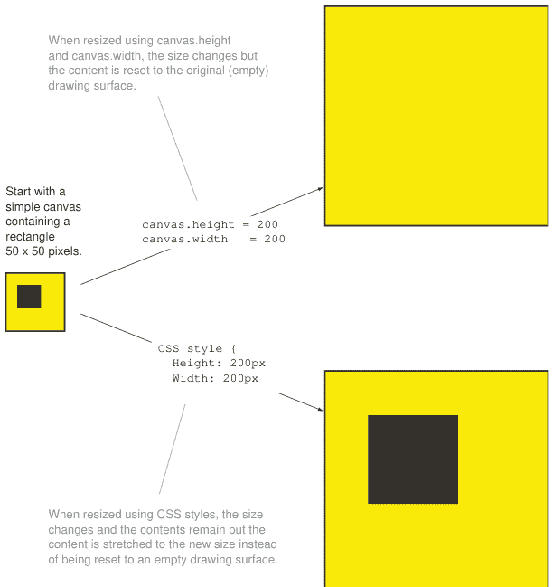

**图 4.2** 在页面上调整 canvas 元素的尺寸，可能会清除内容或强制其拉伸，这通常会导致图像模糊或失真。调整尺寸的最佳方式是使用 canvas 属性，并在调整完成后重绘图像。

### 浏览器支持

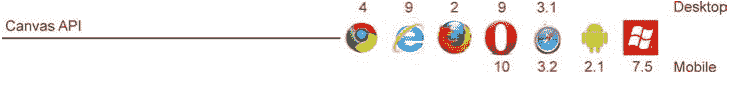

## 第 4 章导览

Canvas 是一个绘图表面，可用于在浏览器内创建和显示位图图像。JavaScript 用于操作绘图的各个方面，也可用于检索当前图像的数据。画布中的形状可以使用形状、线条、像素或外部图像文件来描述。

- 为 canvas 元素设置尺寸：第 94 页
- 使用 2d 上下文对象绘图：第 96 页
- 使用 canvas 安排绘图操作顺序：第 98 页
- 保存 canvas 绘图操作的上下文：第 98 页
- 绘制时使用 `fillStyle`：第 98 页
- 用颜色填充矩形：第 100 页
- 绘制线条：第 101 页
- 在画布上绘制图像：第 103 页
- 旋转和平移 canvas 绘图表面：第 103 页
- 使用 `context.save` 和 `context.restore`：第 103 页
- 处理单个像素：第 105 页
- 使用 `getImageData` 和 `putImageData`：第 105 页
- 向画布添加文本：第 107 页
- 使用 `context.arc` 绘制曲线：第 107 页
- 裁剪画布区域：第 107 页

```css
#audio {
    display: block;
}

button {
    padding: 5px;
}

#video-controls {
    margin-top: 25px;
}

#audio-controls {
    margin-top: 25px;
}

.secondary-controls {
    margin-top: 10px;
}

#avfooter {
    margin-top: 50px;
    font-size: 12px;
    color: #888;
}

#avfooter a,
#avfooter a:visited {
    color: #555;
}
```

图4.2也说明了理解canvas元素在何时何处调整大小的重要性。如果你想让绘制内容随着canvas的增大而自动拉伸，可以使用CSS的`height`和`width`设置，但请记住这也会引入模糊效果。如果你有图像数据可用，以便按新的canvas尺寸重绘，直接在canvas上赋值实际的`height`和`width`属性将产生更好的效果。

Canvas将作为`inline`元素参与页面的内容流，这意味着它只占据自身所需的空间，而不会在前后强制换行。然而，你在canvas内绘制的内容，根据你执行的调整大小类型，要么会缩放，要么会被清除。

> **警告** 如果应用了CSS的`height`或`width`样式属性，浏览器将不会遵从直接赋值`height`和`width`属性。该赋值的结果将是一个被清空、尺寸符合CSS样式规范的canvas。

### 4.1.3 为示例应用创建样式表

现在是时候创建将用于示例应用的样式表了。这些样式将用于确保canvas占据完整的浏览器显示区域，以增强屏保效果：

1. 在应用程序的Content文件夹中创建一个名为`main.css`的新样式表。
2. 添加以下样式：

```css
* {
    margin: 0; padding: 0;
}

html, body {
    position: absolute;
    left: 0; top: 0; right: 0; bottom: 0;
    overflow: hidden; font-family: sans-serif;
}

#main {
    position: absolute; width: 100%; height: 100%;
}
```

这些样式将确保即使在调整大小时，`<canvas>`和`<body>`元素也能占据整个浏览器空间。

结构设置好后，你可以运行应用程序，看到一个空白页。检查该页面的源代码，你会看到你的canvas元素。

本项目的客户端应用是一个JavaScript库，它将绘制和动画化最终产品中的所有内容。然而，在你开始构建该应用之前，你需要理解Canvas API的核心对象——2d上下文。

### 4.1.4 使用2d上下文对象进行绘制

在深入Canvas应用代码之前，你需要了解如何获取对绘图API的JavaScript引用，这是你必须用来执行JavaScript绘图操作的实际对象。这是一个两步过程：

1. 获取对页面上`<canvas>`元素的引用。
2. 找到`<canvas>`元素的`context`对象并为其创建一个变量引用。

`context`对象是你用来执行绘图函数的实际API：

```javascript
var canv = document.getElementById("myCanvas");
var ctx = canv.getContext("2d");
```

在你将看到的几乎每段代码中，这两个步骤都会同时发生，因为一旦你引用了`<canvas>`元素，你能做的操作就非常有限。除了设置`height`或`width`，你必须在开始任何绘图操作之前获得`context`对象的引用。

使用jQuery获取`context`的引用同样简单，只要记住你是在处理包装集而不是单个元素：

```javascript
var elemCanvas = $("#myCanvas");
var context = elemCanvas[0].getContext("2d");
```

这段代码获取了一个对应于`<canvas>`元素的jQuery包装集，然后使用该集合中的第一个对象来获取绘图API引用，这是所有绘图API方法的挂钩。

`context`之外唯一可用的Canvas函数就是前面提到的`height`和`width`属性设置。你将要使用的所有其他功能都是通过`context`来执行的。

> **关于3D呢？**

在代码中操作HTML5 canvas元素的标准方式是通过2d上下文对象。这似乎意味着也存在一个3d上下文，或者至少正在开发中。事实上，2d上下文的指定正是出于这个原因。

然而，自其发布以来，浏览器供应商一直在努力采用WebGL，这是一个专门为3D开发设计的图形API。WebGL目前支持范围有限（但在增长），但我们不会在HTML5规范的范围内介绍它。

### 4.1.5 构建Canvas应用的基础对象

在理解了`context`对象是什么、其用途以及如何获取其引用后，你现在可以开始构建示例应用了。

在你的解决方案中，右键单击Scripts文件夹并选择添加 > 新建项 > jScript（或JavaScript）文件。将文件命名为`main.js`并打开它。

> **注意** 我们将使用`document.ready`事件处理程序来包含Canvas应用的代码。后续章节将使用单独的对象来处理执行逻辑，但这里没有必要，因为页面加载后没有直接的用户交互。

以下清单中的代码用于调整canvas大小并为后续工作添加占位符，它将放入`main.js`文件中。如果你更喜欢一次性阅读整个代码清单，它包含在本章末尾。

```javascript
$(document).ready(function () {
    if (!Modernizr.canvas) {
        alert("This browser does not support the canvas tag.");
        return;
    }

    var $canvas = $("#main");
    var context = $canvas[0].getContext("2d");
    var w;
    var h;
    var maxVelocity = 10;
    var points = [];
    var radians = 0;
    var segments = 3;
    var pointsCount = 15;

    // Image preparation placeholder

    function resize() {
        w = $canvas.width();
        h = $canvas.height();
        $canvas.attr("width", w);
        $canvas.attr("height", h);
        // Resize function body placeholder
    }

    $(window).resize(resize);
    resize();

    // Randomizer placeholder

    function frame() {
        // Frame function body placeholder
    }

    frame();
});
```

这就是你开始所需的所有代码。下一步是在canvas表面上绘制简单的元素。

## 4.2 创建和操作形状、线条、图像和文本

Canvas API使你能够绘制简单的线条、矩形、曲线和圆弧，这些可以编译成你喜欢的任何类型的绘图。它们可用于从动画到复杂的商业智能图表的任何东西。你还可以在canvas上绘制图像和文本，并逐像素操作渲染的绘图。

在本节中，你将在做以下事情的同时构建示例应用的逻辑：

- 学习如何在canvas上绘制
- 添加形状、线条和图像
- 操作像素
- 添加文本

我们将从绘制的基础开始。

### 4.2.1 理解基本的绘图过程

一旦你有了对canvas `context`对象的引用，就可以开始绘图了。

关于在canvas上绘图，首先要注意的是，你始终需要至少`x`和`y`坐标。这些数值是基于从canvas左上角开始的像素测量的，如图4.3所示。

### jQuery选择器、包装集和链式调用

你可以使用CSS语法在jQuery中编写选择器。任何你通过CSS元素、类或ID选择器找到并设置样式的对象或对象组，使用`$(selector)`函数也会返回一组jQuery对象。正确使用选择器是使用jQuery用少量代码完成大量工作的关键。

包装集是jQuery选择器返回的对象。包装集可以不包含对象、包含单个对象或包含对象集合。要确定选择器返回了多少对象，你可以检查包装集的`length`属性。例如，`$("div").length`将返回当前页面上`<div>`元素的总数。

一旦你有了包装集，就可以开始在其上执行函数了。在jQuery中，每个函数都返回该函数执行操作的结果，因此如果你想删除页面上所有类名为highlighted的`<div>`元素，你可以这样做：

```javascript
$("div.highlight").remove();
```

`remove()`函数返回的结果是从当前页面刚刚移除的元素的包装集。然后，你可以使用`appendTo()`函数将这些元素重新插入页面上的另一个位置，如下所示：

```javascript
$("div.highlight").remove().appendTo("div.hiddenElements");
```

在使用jQuery选择器语法和函数链式调用编辑样式以及移除和插入元素时，请小心并彻底测试。这些操作看起来简单，实则极其强大。

### 绘制操作的顺序至关重要

请记住，在绘图时，您的绘制操作顺序至关重要。例如，考虑以下代码，它在 canvas 元素上绘制一个绿色的正方形。实际的绘制发生在 `fill` 函数执行时：

```javascript
var canvas = document.getElementById("myCanvas");
var ctx = canvas.getContext("2d");
ctx.rect(20,20,50,50); // rect(startX, startY, width, height)
ctx.fillStyle = "rgb(0, 255, 0)"; // Pure green
ctx.fill();
```

现在看看下面这个略有不同的例子，它在 canvas 上创建了一个黑色（默认颜色）的正方形，因为 `fillStyle` 属性是在 `fill` 函数执行之后才被赋值的：

```javascript
var canvas = document.getElementById("myCanvas");
var ctx = canvas.getContext("2d");
ctx.rect(20,20,50,50);
ctx.fill();
ctx.fillStyle = "rgb(0, 255, 0)";
```

如您所见，序列上的微小差异会导致非常不同的结果。

### 保存绘图上下文的当前状态

接下来的基本绘图操作是 `save` 和 `restore` 函数。这些函数用于保存绘图上下文中与线条、填充、文本和阴影相关的属性的当前状态，或将其恢复到之前保存的状态。

例如，看看图 4.4，它是由清单 4.3 中的代码生成的。它展示了以下过程：首先用默认颜色黑色填充一个矩形，然后保存上下文。接着，您将 `fillStyle` 更改为绿色并创建另一个矩形。最后，您恢复上下文，这会使 `fillStyle` 返回到默认的黑色，然后绘制第三个矩形。

虽然您不需要将下个清单中的代码放入您的应用程序，但您应该仔细查看操作顺序。

```javascript
var canvas = document.getElementById("myCanvas");
var ctx = canvas.getContext("2d");
ctx.fillRect(10, 10, 40, 40);
ctx.save();
ctx.fillStyle = "rgb(0, 255, 0)";
ctx.fillRect(20, 20, 40, 40);
ctx.restore();
ctx.fillRect(30, 30, 40, 40);
```

### 4.2.2 添加形状

有了这些背景知识，您现在可以开始更多的构建了。

首先，您将在整个 canvas 绘图表面上绘制一个矩形。您已经创建了几个示例矩形，所以这并不新鲜。该矩形将是白色且 80% 透明的，其效果是使每个先前的帧逐渐消失。

要改变帧淡出的方式，您可以将不透明度从 0.2 更改为任何其他值并观察效果。您还可以更改矩形的位置，以在 canvas 边框周围创建残影效果。

您将使用 `context.fillStyle` 和 `context.fillRect` 来绘制形状。

#### `context.fillStyle` 属性

context 的 `fillStyle` 属性将在绘制所有形状元素时设置其填充颜色，并且一旦设置，它将保持不变，直到发生以下任何操作：

- `<canvas>` 元素的大小发生变化，导致 `strokeStyle` 恢复为默认值。
- 调用 `context.restore` 方法，导致 `strokeStyle` 恢复到先前保存的值，或者如果之前没有保存过值，则恢复为默认值。
- `strokeStyle` 属性发生变化，覆盖了该值。

#### `context.fillRect` 函数

`fillRect` 函数执行的功能与先执行 `rect` 函数再执行 `fill` 相同。填充操作会立即发生，这使其成为用颜色填充区域的最快捷方法。

#### 创建矩形

要在 JavaScript 文件中的 `frame` 函数体占位符之前添加一个矩形，请放置以下代码。这将创建一个覆盖 canvas 整个绘图区域的矩形，起始位置为 0,0。该矩形将具有 80% 的透明度，因此它实际上会使 canvas 上的所有内容淡化 20%：

```javascript
// ___ clear
context.fillStyle = "rgba(255, 255, 255, 0.8)";
context.fillRect(0, 0, w, h);
```

请注意 `fillStyle` 的用法，它实际上是一个字符串化的 CSS 函数。只要客户端浏览器支持所使用的特定函数，在使用 2d 上下文时，这完全是可接受的。如果浏览器不支持 `rgba` 函数但支持 Canvas，那么 `fillStyle` 设置将保持不变。

### 4.2.3 添加线条

现在，在 `ready` 处理程序中将 `points` 数组设置为局部变量，并向其中添加一些值。该数组在每次帧执行时绘制飞舞的丝带效果。一个简单的循环就能完成这项工作。将随机化注释替换为以下代码：

```javascript
for (var i = 0; i < pointsCount; i++) {
    points.push({
        x: Math.random() * w,
        y: Math.random() * h,
        vx: (Math.random() * maxVelocity * 2) - maxVelocity,
        vy: (Math.random() * maxVelocity * 2) - maxVelocity
    });
}
```

我们想要的效果如图 4.5 所示：一条线在中间有一个连接点，在屏幕上随机弹跳。请注意，在进入动画部分之前，这些线条实际上不会移动。

这里大量使用了 `Math.random`，使得线条长度和方向的变化不可预测且赏心悦目。

但首先您需要绘制这些线条。为此，请将下个清单中的代码添加到 `frame` 函数体占位符上方的区域。

图 4.5 通过使用 `Math.random` 函数生成点列表，您可以生成弹跳线条效果。这个点列表稍后将用于使其他项目在屏幕上浮动。

```javascript
// ____ lines
context.strokeStyle = "#0f0";
context.beginPath();
context.moveTo(points[0].x, points[0].y);
for (i = 1; i < segments; i++) {
    context.lineTo(points[i].x, points[i].y);
}
context.stroke();
```

设置当前上下文线条的颜色。开始线条绘制过程。设置上下文线条的起始位置。绘制上下文缓存中的所有线条。从起始位置到下一个位置创建线条。

尽管只有几行代码，但这里发生了不少事情。您分配了一个上下文属性 `strokeStyle`，然后调用四个不同的方法在 canvas 表面上绘制线条：

```javascript
context.strokeStyle = "#0f0";
```

`strokeStyle` 属性使用一个 CSS 风格的颜色字符串，也可以包括 RGB 和 RGBA 函数。设置时，适用与设置 `fillStyle` 属性相同的规则。

`beginPath` 函数将在绘图表面上开始线条绘制过程：

```javascript
context.beginPath();
```

当您声明正在绘制路径时，上下文会将通过调用路径方法创建的线段组装成一条单线。每个线段也称为子路径。

开始路径后，您有很多选择：您可以绘制直线、创建简单或复杂的曲线，以及将线条连接在一起。所有这些都是从 `beginPath` 语句开始的操作。当您调用 `beginPath` 时，您是在明确地告诉上下文您想开始一组新的子路径。您也可能希望通过调用 `endPath` 或 `stroke` 函数，或者通过将上下文恢复到之前的状态（参见第 4.2.1 节中关于 `context.restore` 的讨论）来结束当前路径。

`moveTo` 函数设置绘图表面上下一条线的当前起始位置：

```javascript
context.moveTo(points[0].x, points[0].y);
```

如果您在调用之间没有进行任何绘制而多次调用此函数，则只有最后一次调用会被使用。请记住，绘制是一个串行（或线性）过程。

`lineTo` 函数告诉上下文 API 从上一个位置（来自之前的线或最后一次 `moveTo` 调用）开始，绘制一条线到新位置：

```javascript
context.lineTo(points[a].x, points[a].y);
```

请注意，`lineTo` 与 `arcTo`、`quadraticCurveTo` 和 `bezierCurveTo` 具有相同的连接效果。结果是从上一个点到当前方法传入点的线。

`stroke` 函数非常简单：

```javascript
context.stroke();
```

当前上下文子路径列表中的任何内容都将在表面上绘制，并且子路径列表将被清除。`stroke` 方法使用当前上下文的属性来绘制线条。

### 4.2.4 添加图像

我们提到过可以在 canvas 元素中处理图像。事实上，您在 canvas 上绘制的所有内容都是图像。但您也可以导入外部图像，如 PNG 和 JPEG 吗？当然可以！这不仅是可能的，而且就像获取图像引用并将其绘制到您的 canvas 上一样简单。

图 4.6 您将加载的图像是相同的，但您将使用 canvas API 在将其中一个添加到显示之前编辑其颜色。

在这里，您将向 canvas 添加两个相同的图像，但编辑其中一个的图像颜色，使其看起来像一个单独的图像。图 4.6 展示了完成本节和下一节后您将得到的结果。

在示例应用程序中，您可以包含任何您喜欢的 .png 或 .jpg 文件——为了我们的目的，我们将从网上抓取一个简单的笑脸。将图像文件放在 MVC 应用程序的 Content 文件夹中。现在，在 `main.js` 文件中，在图像准备占位符文本处添加以下清单中的代码，并根据您使用的图像调整图像文件名。

```javascript
var $image = $("")
    .hide()
    .appendTo("body");
```

既然你已经在文档中插入了一张图片，接下来就需要将其绘制到画布上。将清单 4.6 中的代码放置在 `frame` 函数占位符的上方。正如结果截图（图 4.6）所示，这部分代码的功能远不止是简单地将图像放到画布上——它还会旋转图像，然后绘制在新的位置。

```javascript
context.save();
context.translate(points[3].x, points[3].y);
context.rotate(radians);
context.drawImage($image[0], -($image.width())/2, -($image.height())/2);
context.restore();
```

通过使用 `drawImage` 方法，你已经将图像添加到了绘图表面。一旦你实现了一个计时器来模拟动画，你就会看到图像在移动和旋转。同时，在实现旋转效果时，你还需要采取一些措施来减轻对上下文所做的修改。

> **提示** 如果你发现图像没有被绘制到画布上，最常见的原因是在调用上下文对象的 `drawImage` 方法时，图像尚未完全加载。最简单的解决方法是向 `image.onload` 事件添加一个匿名处理函数，并在该函数中调用 `drawImage`。或者，如果图像已经是 DOM 的一部分，你可以等待 jQuery 的 `ready` 事件触发。在我们的代码中，我们通过调用 `appendTo` 函数将图像添加到 DOM，然后再将其绘制到画布上。

#### `context.translate` 和 `context.rotate` 函数

请注意，当您将图像绘制到画布上时，您使用了 `translate` 函数来分配坐标值，然后使用 `rotate` 来使用本地 `radians` 变量旋转图像：

```javascript
context.translate(points[3].x, points[3].y);
context.rotate(radians);
```

这引出了绘图表面中的一个重要概念：画布的原点默认位于位置 (0, 0)，这是画布上后续函数或属性调用的参考点。使用任何非 (0, 0) 的值调用 `translate` 函数都会更新绘图表面的原点位置，而任何使用该设置（例如 `rotate` 函数）的内容都将使用新的值。


`rotate`函数将绘图表面旋转特定的弧度，其中一整圈是（`2 * Math.PI`）。从调用`rotate`的点开始，在表面上绘制的任何内容都将倾斜到新的角度，直到旋转值通过再次调用`rotate`或将上下文恢复到之前的设置而被更改。

创建和操作形状、线条、图像和文本

## CONTEXT.SAVE 和 CONTEXT.RESTORE 函数

我们之前讨论过保存和恢复操作，但我们只是暗示了上下文属性的堆叠特性。

绘图上下文上的保存操作会获取所有当前属性并将它们存储在当前上下文对象的堆栈中。可以将`context.save`函数视为对上下文设置数组执行压栈操作。另一方面，`restore`函数将从设置堆栈中弹出最后一项，并将属性恢复为之前的状态。一个例子将使这一点更清楚。

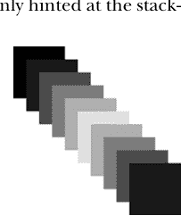

图 4.7 显示了创建一个正方形、逐步更改其颜色并在每次增量时保存的结果。然后，当代码逆转该过程并迭代调用`restore`时，正方形逐渐恢复到原始颜色。

执行此操作的代码显示在下一个清单中。

### 清单 4.7 利用设置堆栈的保存和恢复函数

```javascript
var canvas = document.getElementById("myCanvas");
var ctx = canvas.getContext("2d");
var d = 5;    // distance
var c = 0;    // color
for (var i = 0; i < 5; i++) {
  ctx.fillRect(d, d, 40, 40);
  c = (d * 5);
  ctx.fillStyle =
    "rgb(" + c + "," + c + "," + c + ")";
  ctx.save();
  d += 10;
}
for (var t = 0; t < 5; t++) {
  ctx.restore();
  ctx.fillRect(d, d, 40, 40);
  d += 10;
}
```

保存当前的`fillStyle`属性

恢复之前的`fillStyle`属性

### 4.2.5 操作像素

在处理位图图像时，可以使用 Canvas API 来操作引用图像中单个像素的颜色。

为此，你需要做的第一件事是在 JavaScript 文件的顶部声明区域添加两个新变量：

```javascript
var $imageCanvas = null;
var imageContext = null;
```

第一个变量将保存一个在内存中创建的新画布元素，用于进行像素操作，第二个变量是该画布的上下文对象。你将修改画布元素中的像素颜色，然后使用之前用过的`drawImage`函数将该新画布绘制到现有画布上。

时机很重要。因为我们确信你和我们一样，都不希望加载两次相同的图像，所以你只需接入图像元素的`load`事件并在那里进行变量赋值。为了做到这一点，请将图像文件的完整赋值从元素创建标签中移出，并将其放入 jQuery 的`attr`函数中。`attr`函数接受一个属性名和一个属性值并进行赋值。

简而言之，你需要从 JavaScript 文件中移除原始的图像赋值，并用以下代码替换它。

### 清单 4.8 使用 Canvas API 直接操作像素

```javascript
var $image = $("")
.load(function() {
    $imageCanvas = $("<canvas>")
        .width($image.width())
        .height($image.height());

    imageContext = $imageCanvas[0].getContext("2d");
    imageContext.drawImage($image[0], 0, 0);
    try {
        var imageData = imageContext.getImageData(
            0, 0, $imageCanvas.width(),
            $imageCanvas.height());
        for (var i = 0; i < imageData.data.length; i++) {
            if (i % 4 != 3)
                imageData.data[i] = 255 - imageData.data[i];
        }
        imageContext.putImageData(imageData, 0, 0);
    }
    catch(e) {
        $("<div class='error'>Note: Direct manipulation of
            pixels loaded from image files isn't allowed when
            running locally</div>")
        .appendTo("body");
    }
})
.attr("src", "Content/smiley.png")
.hide()
.appendTo("body");
```

由于在整个应用过程中你只加载一次图像，这段代码将只执行一次，设置`$imageContext`变量以准备绘制到可见画布上。你将在原始图像元素绘制完成后，在`frame`函数中使用位置数组中的下一个点来执行此操作：

```javascript
// ____ imageCanvas
if ($imageCanvas) {
    context.drawImage($imageCanvas[0],
        points[6].x - ($imageCanvas.width() / 2),
        points[6].y - ($imageCanvas.height() / 2));
}
```

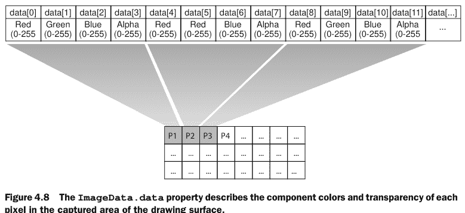

图 4.8 `ImageData.data`属性描述了绘图表面捕获区域中每个像素的组件颜色和透明度。

### CONTEXT.GETIMAGEDATA 和 CONTEXT.PUTIMAGEDATA 函数

在清单 4.8 中，你在上下文对象上调用了两个图像数据函数，让你能够找到特定的图像数据片段，然后将其放回画布：`getImageData`和`putImageData`。

`getImageData`函数以像素为单位，从画布绘图上下文中检索的矩形起始位置和大小作为参数：

```javascript
var imgData = context.getImageData(0, 0, width, height);
```

返回的数据对象包含一个数组，其中每四个值为一组，包含一个像素的 RGBA 值。图 4.8 清楚地展示了`imgData.data`属性中值的排列方式。

`putImageData`函数使用来自`getImageData`的`imgData`对象，并将其放置在参数定义的起始位置（当然，是在你编辑像素之后）：

```javascript
context.putImageData(imgData, 0, 0);
```

通过使用这两个方法，你可以做一些其他有趣的事情，比如将整个绘图表面偏移 20 个像素、将其反转或旋转它。让你的想象力成为你的向导吧！

### 4.2.6 添加文本

我们之前说过你会在画布上应用文本。事实上，你必须在画布上绘制文本，而不是写入它。执行此操作的过程可能不像你希望的那样简单或灵活，但稍加努力你就可以执行基本操作。你可以设置文本的字体、颜色和位置，但无法在绘制后换行或编辑文本。这意味着你可以写在绘图表面上的文本量是有限的，但它仍然可以很方便。

图 4.9 显示了文本渲染到屏幕上的示例。

要绘制文本，你将使用`context.fillText`函数，它会在提供的起始点添加文本。文本会立即绘制到画布上，遵循当前的填充、字体和文本对齐属性。请注意，文本相对于当前上下文原点，是左对齐、右对齐或居中对齐于插入点的；它并不基于实际绘图表面的任何边缘。

在示例应用中，你需要先定义一个局部变量来包含文本。然后，将`fillStyle`属性设置为你想要的文本颜色，并调用`fillText`函数将其绘制到画布上，起点是传入的坐标。

要执行此操作，请在`main.js`文件中，在实现`imageCanvas`对象的代码之后立即添加以下代码片段：

```javascript
// ____ text
var text = "HTML5 for .NET Developers!";
context.fillStyle = "#00a";
context.fillText(text, points[4].x, points[4].y);
```

你现在已经画布表面上绘制了线条和形状，并添加了图像和事件文本。此外，你用各种颜色填充了形状，甚至操作了绘图表面上的单个像素。但是，HTML5 Canvas API 还有很多其他功能。像贝塞尔曲线和渐变这样的东西是 API 的一部分，但也可以通过 JavaScript 为你的应用程序添加逻辑元素，比如碰撞检测和模拟重力。这些对于游戏以及图形密集型模拟和培训工具都很有帮助。

它们的共同点是，它们都需要动画。这正是我们接下来要探讨的内容。

## 4.3 为画布图像添加动画和特殊效果

在本节中，我们将向你展示如何为你的画布创作添加动画，以及如何添加额外的特殊效果来提升你的展示效果。首先，让我们开始添加动画吧！

### 4.3.1 添加动画

如果你现在运行你的应用程序，你会看到一些线条、一张图像和一点文本静止在屏幕上。考虑到所有的媒体和社区炒作，这可能不是你对 HTML5 `<canvas>`元素的预期。你缺少的是在屏幕上移动物体的能力。动画是任何基于图形的应用程序的关键能力。

HTML5 `<canvas>`元素中的动画是模拟的，而不是绘图对象从绘图表面上的一个点真实移动到另一个点。这是因为一旦你在屏幕上放置了一个像素，它就只是一个像素，无论你使用什么方法绘制它。

这并不意味着动画不可能实现。相反，一旦你确立了 Canvas 动画工作原理的基本规则，这个过程就很简单，而且性能通常相当出色。

为你的画布制作动画所涉及的步骤如下：

1. 通过用空白矩形覆盖表面来清除画布上的先前像素。
2. 使用保存的状态变量绘制所有元素。
3. 将所有状态变量迭代到它们下一个动画位置。
4. 等待规定的时间（帧率）。

你可能一直在从三维面向对象的角度思考，但你其实应该从你在学校课本角落里画的翻页动画的角度来思考。图 4.10 显示了一个简单的翻页动画，一个圆形沿对角线向上飞，撞到屏幕角落，然后落回原始位置。重复这个翻页系列以获得连续的动画。

### 更新变量并开始动画

一旦你有了重绘表面的变量和执行绘图操作所需的函数，你只需要计时器和改变变量的能力，以便它们为绘制下一帧做好准备。你现在通过完成`frame`函数来执行此操作。

以下列表提供了你需要的一切。移除`frame`函数体占位符，并用此代码替换它。

```javascript
// ___ update positions and handle bounce
for (i = 0; i < points.length; i++) {
    var p = points[i];
    p.x += p.vx;
    if (p.x < 0) {
        p.x = 0;
        p.vx *= -1;
    }
    else if (p.x > w) {
        p.x = w;
        p.vx *= -1;
    }

    p.y += p.vy;
    if (p.y < 0) {
        p.y = 0;
        p.vy *= -1;
    }
    else if (p.y > h) {
        p.y = h;
        p.vy *= -1;
    }
}
radians += 0.01;

// ___ set up the next frame
setTimeout(frame, 30);
```

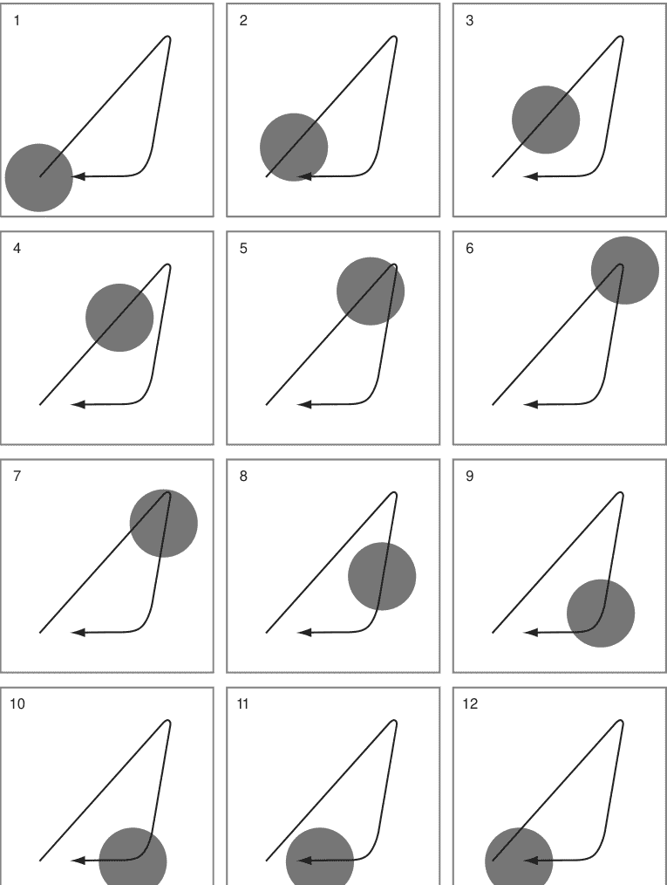

图 4.10 一个简单的翻页式动画，它使用定格动画将一个圆形移动到屏幕再移回原始位置。这就是 HTML5 Canvas 动画的本质；你绘制像素，然后再次绘制它们，使其位置比之前移动一点，并且速度非常非常快。

图 4.11 带有操作帧计时的画布元素


运行你的应用程序，你现在应该会看到类似图 4.11 的内容。

屏幕是动画的，每次调用`frame`函数时，都会在整个绘图表面上覆盖一个 20% 不透明度的矩形，从而产生漂亮的淡入淡出效果。你还应该注意到，无论你使用什么浏览器，动画效果都应该相当快。这是因为现代浏览器与操作系统图形引擎高度集成。

这个演示相对简单。通过快速搜索“HTML5 Canvas 动画”，你可以找到其他使用这种翻页式动画做出惊人效果的应用程序和网站。

### 4.3.2 使用曲线和裁剪添加特殊效果

Canvas API 中还有相当多其他概念可供你使用，例如渐变、模糊、贝塞尔曲线和高级裁剪机制，但我们没有空间一一介绍，因此我们将在结束前再介绍两个——曲线和裁剪。

你在这里为示例应用程序的目标是让屏幕具有聚光灯效果，同时继续动画化所有其他元素。为此，你将创建一个完全弯曲成圆形的弧线，然后将整个表面裁剪到其圆周。

#### CONTEXT.ARC 函数

`arc`函数将围绕由前两个参数定义的中心点绘制一条弧线。第三个参数是弧线的半径（以像素为单位，从中心点开始），第四个和第五个参数给出起始和结束角度（以弧度为单位）。最后一个参数是一个布尔值，声明弧线是顺时针绘制（`false`）还是逆时针绘制（`true`）。

你将在最终列表中使用此代码：

```javascript
context.arc(points[5].x, points[5].y, spotlightRadius,
    (Math.PI/180) * 0, Math.PI/180 * 360, false);
```

这段代码从传入的 x 和 y 坐标开始创建一个完整的圆（360 度弧线）。当你查看这里的命名参数时，可能会更清楚：

```javascript
arc(x, y, radius, startAngle, endAngle, counterclockwise)
```

因为此函数使用弧度而不是度，所以你需要使用以下公式来确定 360 度圆中的起始和结束角度：

`(Math.PI/180) * [degrees]`

`arc`函数还凸显了一个事实：如果起始点和结束点相同，或者你调用上下文的`closePath`函数，那么在绘图表面上描述的任何路径都会自动闭合。闭合路径要么被填充，要么用作裁剪区域。

#### CONTEXT.CLIP 函数

上下文的裁剪功能有点令人困惑，直到你理解它的工作原理，更重要的是，它在绘图表面上何时生效。将画布上的裁剪区域想象成一个你可以放置在任何地方并制作任何形状的镂空模板。当应用到上下文时，无论绘制在哪里，任何绘制的内容都只会在它落入区域边界内时才显示。边界可以是任何路径，并且在裁剪生效期间，任何绘制的内容都会被裁剪。

过程如下：

1. 描述一个闭合路径（在这种情况下，是一个完整的弧线）。
2. 调用`context.clip()`。
3. 继续绘制（只有裁剪区域内的像素会被绘制）。
4. 调用`context.restore()`以移除裁剪区域。

在`context`对象上调用`clip`后，下一个画布操作将只在定义的裁剪区域内绘制。

要构建裁剪区域，你需要添加一个新变量来跟踪你的聚光灯效果应该有多大。在将`resize`函数连接到窗口事件并调用它之后，立即放置以下代码：

```javascript
var spotlightRadius = Math.min(w, h) / 2;
```

现在重新设计`frame`函数的开头，使其看起来像下面的列表。这段代码将屏幕涂黑，绘制圆圈，然后将表面裁剪到它。

### 清单 4.10 在绘图表面上绘制弧线并将屏幕裁剪到该弧线

```javascript
function frame() {
    context.save();
    // ____ clear
    //context.fillStyle = "rgba(255, 255, 255, 0.2)";
    //context.fillRect(0, 0, w, h);
    // ____ clear
    context.fillStyle = "rgba(0, 0, 0, 1)";
    context.fillRect(0, 0, w, h);

    // ____ spotlight
    context.beginPath();
    context.arc(points[5].x, points[5].y,
        spotlightRadius,
        (Math.PI/180) * 0, Math.PI/180 * 360, false);
    context.clip();
    context.fillStyle = "rgba(56, 56, 56, 1)";
    context.fillRect(0, 0, w, h);
```

此清单之后的所有代码都应保持不变，并且随着聚光灯被绘制出来，它将自动裁剪到当前上下文的裁剪区域。要将屏幕恢复到其裁剪前的绘图区域，请在帧函数末尾的`setTimeout`方法调用之前添加一个`context.restore`。下次运行应用程序时，你应该会看到类似图4.12所示的内容。


你可能注意到，尽管canvas元素被设置为可调整大小，但实际上没有触发任何调整大小的事件，并且canvas只占据了屏幕的一小部分。这是因为你缺少样式表和一些额外的重置代码。你很快就会连接起最后的这些点，并完成这个应用程序。

### 4.3.3 在屏幕调整大小期间管理canvas属性

完成应用程序的最后一步是在屏幕调整大小时重置各种属性，如以下清单所示。此代码放在`main.js`的`resize`函数末尾。

```javascript
// 重置宽度和高度也会重置
// 这些其他属性，所以我们需要再次设置它们
context.lineWidth = 6;
context.lineCap = "round";
context.lineJoin = "round";
context.font = "100px sans-serif";
context.textAlign = "center";
context.textBaseline = "middle";
```

此步骤至关重要，因为正如本章前面所述，当canvas被调整大小并被清除时，它也会重置各种其他属性。清单4.11中的代码会在每次执行`resize`时将这些属性恢复到你想要的状态。再次运行你的应用程序将提供与之前相同的体验，但好处是能够调整浏览器窗口大小。恭喜！你的第一个Canvas应用程序完成了，你已在这个特定的API和一般的JavaScript开发方面迈出了重要的一步。

## 4.4 总结

在本章中，你了解了HTML5 Canvas API是什么以及它不是什么，并学习了在绘图表面上绘制像素所需的一些基本功能。正如你所看到的，Canvas是创建游戏（如Canvas Rider、Agent 008台球等）的绝佳工具。许多开发者已经构建了令人惊叹的在线图像编辑软件，并且到你阅读本文时，肯定会有许多其他出色的Canvas使用示例。

Canvas可能是工具箱中最有趣的玩具，但还有其他HTML5玩具可以帮助你构建更好的Web应用程序，比如我们接下来要介绍的History API。

## 4.5 完整代码清单

以下清单将帮助你填写本章示例应用程序的空白部分，并帮助你检查你的工作。

### 清单4.12 支持canvas元素自动调整大小的样式

```css
html { width: 100%; height: 100%; }
body { width: 100%; height: 100%; }
#main { position: absolute; width: 100%; height: 100%; }
```

### 清单4.13 canvas演示的完整JavaScript应用程序代码

```javascript
$(document).ready(function () {
    if (!Modernizr.canvas) {
        alert("This browser does not support the canvas tag.");
        return;
    }

    var $canvas = $("#main");
    var context = $canvas[0].getContext("2d");
    var $imageCanvas = null;
    var imageContext = null;

    var w;
    var h;
    var maxVelocity = 10;
    var points = [];
    var radians = 0;
    var segments = 3;
    var pointsCount = 7;
    var text = "HTML5 for .NET Developers!";

    var $image = $("")
    .load(function () {
        $imageCanvas = $("<canvas>")
        .width($image.width())
        .height($image.height());

        imageContext = $imageCanvas[0].getContext("2d");
        imageContext.drawImage($image[0], 0, 0);

        try {
            var imageData = imageContext.getImageData(
                0, 0, $imageCanvas.width(), $imageCanvas.height());

    for (var i = 0; i < imageData.data.length; i++) {
      if (i % 4 != 3) // 操作R, G, B通道，但不操作A通道
        imageData.data[i] = 255 - imageData.data[i]; // 颜色反转
    }

    imageContext.putImageData(imageData, 0, 0);
  } catch (e) {
    $("<div class='error'>
      注意：在本地运行时不允许直接操作
      从图像文件加载的像素</div>")
    .appendTo("body");
  }
})
.attr("src", "Content/smiley.png")
.hide()
.appendTo("body");

function resize() {
  // 调整函数体占位符
  w = $canvas.width();
  h = $canvas.height();
  $canvas.attr("width", w);
  $canvas.attr("height", h);
  // 重置宽度和高度也会重置
  // 这些其他属性，所以我们需要再次设置它们
  context.lineWidth = 6;
  context.lineCap = "round";
  context.lineJoin = "round";
  context.font = "100px sans-serif";
  context.textAlign = "center";
  context.textBaseline = "middle";
}

$(window).resize(resize);
resize();

var spotlightRadius = Math.min(w, h) / 2;

// 随机化器占位符
for (var a = 0; a < pointsCount; a++) {
  points.push({
    x: Math.random() * w,
    y: Math.random() * h,
    vx: (Math.random() * maxVelocity * 2) - maxVelocity,
    vy: (Math.random() * maxVelocity * 2) - maxVelocity
  });
}

function frame() {
  context.save();

  // ___ 清除
  context.fillStyle = "rgba(0, 0, 0, 1)"; // 100%不透明黑色
  context.fillRect(0, 0, w, h);

  // ___ 聚光灯
  context.beginPath();
context.arc(
    points[5].x,
    points[5].y,
    spotlightRadius,
    (Math.PI/180) * 0,
    Math.PI/180 * 360,
    false);
context.clip();

context.fillStyle = "rgba(56, 56, 56, 1)"; // 100%不透明深灰色
context.fillRect(0, 0, w, h);

// ____ 线条
context.strokeStyle = "#0f0";
context.beginPath();
context.moveTo(points[0].x, points[0].y);
for (i = 1; i < segments; i++) {
    context.lineTo(points[i].x, points[i].y);
}
context.stroke();
context.closePath();

// ____ 图像
context.save();
context.translate(points[3].x, points[3].y);
context.rotate(radians);
context.drawImage(
    $image[0], -($image.width()) / 2,
    -($image.height()) / 2);
context.restore();

// ____ imageCanvas
if ($imageCanvas) {
    context.drawImage($imageCanvas[0],
    points[6].x - ($imageCanvas.width() / 2),
    points[6].y - ($imageCanvas.height() / 2));
}

// ____ 文本
context.fillStyle = "#00a";
context.fillText(text, points[4].x, points[4].y);

// ____ 更新位置并处理反弹
for (i = 0; i < points.length; i++) {
    var p = points[i];

    p.x += p.vx;
    if (p.x < 0) {
        p.x = 0;
        p.vx *= -1;
    } else if (p.x > w) {
        p.x = w;
        p.vx *= -1;
    }

    p.y += p.vy;
    if (p.y < 0) {
        p.y = 0;
        p.vy *= -1;
    } else if (p.y > h) {
        p.y = h;
        p.vy *= -1;
    }
}

radians += 0.01;

context.restore();
// ____ 设置下一帧
setTimeout(frame, 30);
}
frame();
});
```

# History API：为MVC网站改变游戏规则

**本章涵盖**

- 理解History API的基本操作
- 将MVC与HTML5 History API集成
- 在Web应用程序中控制历史记录

假设你正在为Web构建一个新闻阅读器应用程序，并希望集成搜索功能，用于搜索图像、人物和地点等。你构建了一个响应式的HTML5界面，其中包含一个弹出式`<div>`，允许用户在多个标签页之间切换以细化搜索条件。在后台，你使用Ajax和jQuery根据每个更新的条件向服务器请求命中次数。你认为当用户切换三个标签页添加条件后，出于习惯性按下返回按钮时会发生什么？除非你使用了jQuery.address插件或类似的工具，否则浏览器将加载之前的网页并丢失搜索结果。用户会感到恼火。

现在不会了。多亏了HTML5 History API，游戏规则已经改变。使用我们将在本章中阐述的技术，你将学会利用ASP.NET MVC的路由和部分视图功能来构建一个既适用于旧版浏览器也适用于新版浏览器的网站。该网站将在旧版浏览器中以“正常”方式工作，但它也会更

## 历史API：改变MVC网站的游戏规则

### 浏览器支持


历史API

## 第5章地图

历史（History）是一个API，它允许一段JavaScript代码控制浏览器历史记录中的URL。这使你能够轻松地控制当用户点击前进和后退按钮以及通过点击链接触发导航事件时，应用程序内部发生的事情。

- `history.onpopstate` 组件 页面 135
- `history.pushState` 组件 页面 135
- `history.replaceState` 组件 页面 135
- 使用浏览器URL 页面 139

响应式设计在较新的浏览器中消耗更少的带宽，因为页面可以通过两种模式访问：

- 作为标准的服务器加载，不依赖任何JavaScript或历史集成，这非常适合较旧的浏览器
- 使用JavaScript和历史API来减少服务器负载并消除完整的页面刷新

在本章中，你将学习如何在.NET MVC应用程序中实现这些功能，同时构建一个简单的餐厅菜单网站，该网站既可以在有JavaScript和历史API的情况下工作，也可以在没有它们的情况下工作。在这个过程中，你将创建一个自定义的JavaScript库，来覆盖浏览器用于导航到其他页面的标准HTML锚点点击事件。你还将使用HTML5历史API来减少服务器负载，并为使用较新浏览器的用户提供流畅的用户体验。

以下是本章的主要内容：

1. 构建控制器、视图和路由方案，使其与HTML5历史API协同工作
2. 构建一个JavaScript库，用于从ASP.NET MVC网站内部控制浏览器历史记录
3. 为主页和CSS样式添加最后的修饰，以完成应用程序

让我们开始吧！

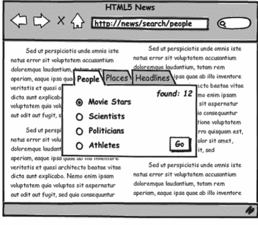

图 5.1 如果正确实现了历史API，用户可以通过点击标签页在搜索对话框的各个标签页之间切换，然后使用前进和后退按钮在标签页之间导航，而不会丢失搜索状态。

## 5.1 构建支持历史的MVC网站

ASP.NET MVC框架有两个非常适合实现支持历史的Web应用程序的特性：

- 丰富的路由框架
- 部分视图

丰富的路由框架将使你的URL在应用程序上下文中具有语义意义。例如，考虑图5.1中的URL，它展示了一个虚构的新闻阅读器应用程序可能的外观。

得益于ASP.NET MVC的路由功能，URL（在本例中为`http://news/search/people`）可以是一个特定的MVC应用程序路由，它是所有围绕存储、组织和查找人员信息的逻辑的入口点。如果你不确定路由是什么，别担心；我们将在本节后面更详细地讨论路由。

使MVC非常适合与HTML5历史API协同工作的下一个特性是它能够呈现部分HTML内容片段，称为部分视图。部分视图允许你的JavaScript代码调用一个特定的URL并获得一个特定的响应，该响应可以异步填充到页面的各个部分。例如，在前面的新闻阅读器示例中，一个部分视图可能包含一个图像和一个简短的搜索结果，页面可以在一个弹出的HTML元素中显示它们。在本节后面，你将构建一个部分视图，它将在现有的HTML页面上加载餐厅菜单项的图像和文本。

总的来说，本节将引导你完成：

- 在Visual Studio中启动ASP.NET MVC项目
- 添加可以响应历史客户端事件的控制器和视图
- 设置一个支持历史的路由方案
- 创建应用程序数据模型
- 根据需要从服务器加载少量内容到现有的HTML页面

你将从创建项目开始。

### 5.1.1 在Visual Studio中启动示例项目

在开始之前，请看一下图5.2，它展示了完成的餐厅菜单应用程序的外观。

要开始构建此应用程序，请按照以下步骤操作：

1. 打开Visual Studio并启动一个新的ASP.NET MVC项目——一个使用Razor视图引擎、HTML5语义标记且不包含单元测试项目的Internet应用程序。
2. 将项目命名为MenuHistory，然后查看生成的项目。你应该有Account和Home控制器（你可以保持原样）以及支持它们的视图。
3. 在项目中添加一个Images文件夹。

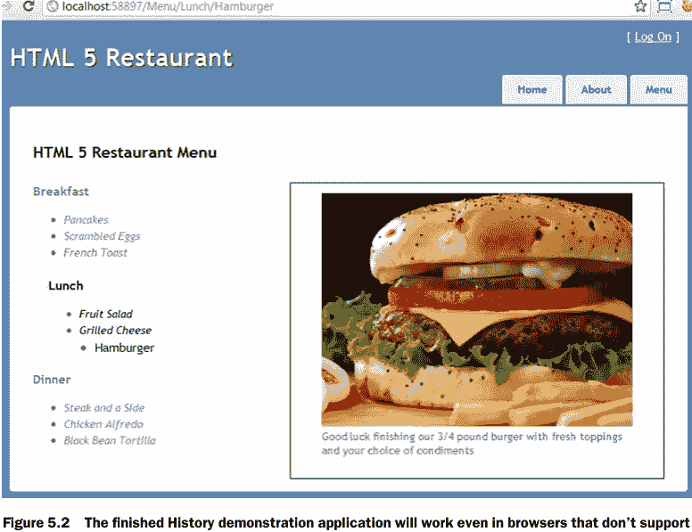

图 5.2 完成的历史演示应用程序甚至可以在不支持历史API的浏览器中工作。然而，在支持的浏览器中，用户体验将得到增强，服务器负载将降低，因为右侧的图像和内容将单独加载，而无需完整的页面刷新。

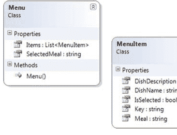

图 5.3 你将使用的对象模型有一个简单的`MenuItem`对象，它具有用于显示的各种属性，以及一个名为`Menu`的项集合。

在本章中，你将处理一个`MenuItem`对象和一个包含`MenuItem`对象集合的`Menu`对象。在现实世界中，这些对应于餐厅的真实菜单和该菜单上的单个菜品，按餐食（早餐、午餐或晚餐）分组。虽然确切的结构目前还不重要，但图5.3中的对象模型将让你对正在处理的内容有所了解。

### 5.1.2 添加控制器和视图

在本节中，你将在MVC视图中为菜单项列表创建一个简单的表示。首先，你需要添加一个控制器和一个视图：

1. 右键单击Controllers文件夹，然后选择“添加”>“控制器”。
2. 将控制器命名为`MenuController`，并使用“空控制器”模板。

`Index`控制器操作是在MVC控制器中为你创建的默认方法，它将返回一个`Menu`以及一个单独的`MenuItem`对象，该对象对应于用户根据Meal和Dish参数选择的项。当用户单击页面顶部的Menu链接时，将执行此操作。

> **注意** 如果你对所有这些如何工作有疑问，你可以暂停几分钟，看看附录B。

以下清单显示了`MenuController.cs`所需的基本代码。

### 清单 5.1 返回菜单和选中项到视图的控制器操作

```csharp
public ActionResult Index(string meal = "", string dish = "")
{
    var menu = new Models.Menu();
    menu.SelectedMeal = meal;
    menu.Items
        .Where(s => s.Meal == meal && s.Key == dish)
        .FirstOrDefault()
        .IsSelected = true;
    return View(menu);
}
```

`Menu`构造函数将创建系统所需的静态数据。

使用泛型`List`对象允许你使用lambda表达式过滤数据。

返回对象的`isSelected`属性被设置为`true`。

该方法确保将返回单个对象（或`null`）。

传递给视图的对象将成为视图的模型。

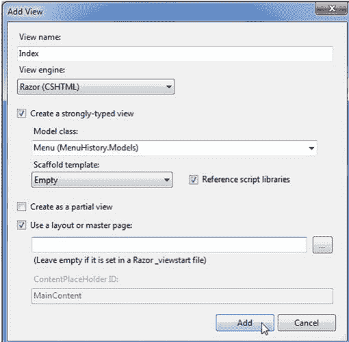

图 5.4 通过分配模型类值来创建强类型视图。这可以是从当前项目的可用对象中填充的值，也可以是你从项目中引用的另一个程序集中引用的对象。

控制器以调用`return View(menu)`结束。此视图尚不存在，因此你现在将创建它。在`Index`方法体中右键单击并选择**添加视图**。按照图5.4所示设置属性。

接下来，你需要为你的新`Index.cshtml`文件设置一些局部变量。这些变量将对应于并组织早餐、午餐和晚餐的项目列表，并将很快用于构建表示：

1. 在视图顶部的`<h2>`元素中，放置`HTML5 Restaurant Menu`，然后在Razor视图中打开一段新代码。
2. 使用下一个清单中的代码设置变量，添加`using`语句，并更改页面的标题。

### 清单 5.2 在Razor视图中设置局部变量

```csharp
@model Menu
@using MenuHistory.Models
@{
    ViewBag.Title = "Menu";
}
<h2>HTML5 Restaurant Menu</h2>
@{
    var selectedItem = Model.Items
        .Where(s => s.IsSelected == true)
        .FirstOrDefault();
    var selectedDish =
        selectedItem == null ?
        "none" : selectedItem.Key;
    List<List<MenuItem>> menuGroups = 
        new List<List<MenuItem>>();
    menuGroups.Add(
        (from i in Model.Items
         where i.Meal == "Breakfast"
         select i).ToList<MenuItem>()
    );
    menuGroups.Add(
        (from i in Model.Items
         where i.Meal == "Lunch"
         select i).ToList<MenuItem>()
    );
    menuGroups.Add(
        (from i in Model.Items
         where i.Meal == "Dinner"
         select i).ToList<MenuItem>()
    );
}
```

视图中的`using`语句与C#文件中的`using`语句作用相同。

如果存在，则从`Menu.Items`列表中查找选中的项。

执行空值检查以获取选中的菜品。

创建变量以保存'列表的列表'，以便用最少的代码遍历每种餐食。

为模型中的每种餐食填充`menuGroups`变量。

你在清单5.2中分配的变量在服务器上处理视图时将是可用的。在构建视图标记时请牢记这一点。即使你直接在视图中编写标记，C#代码也会在视图的上下文中维持状态，你可以利用这一点来构建展示逻辑。

以下清单展示了如何构建标记，为菜单上的每个项目呈现页面上的链接。这段代码接下来应该出现在你的`Menu Index.cshtml`页面中。

### 清单5.3 使用Razor构建标记

```csharp
<aside class="preview-dish"></aside>
@foreach (var mealList in menuGroups)
{
    var titleClass = Model.SelectedMeal == 
        mealList.First().Meal ? "active" : "";
    <section class="menu @titleClass" 
             data-meal="@mealList.First().Meal">
        <h3>@mealList.First().Meal</h3>
        <ul>
            @foreach (var item in mealList)
            {
                var itemClass = selectedDish == item.Key ? 
                    "selected" : "";
                <li class="menu-item @itemClass" 
                    data-dish="@item.Key">
                    @Html.RouteLink(
                        item.DishName,
                        "Menus",
                        new
                        {
                            meal = item.Meal,
                            dish = item.Key
                        }
                    )
                </li>
            }
        </ul>
    </section>
}
```

使用每组中的第一个项目为列表设置标题元素。

`Aside`元素稍后将使用局部视图进行填充和样式设置。

遍历每种餐食的项目列表，并根据列表中的第一个元素设置样式。

在每次迭代中，为每个`section`和`dish`分配数据属性。

在无序HTML元素内遍历餐食列表中的菜品。

创建列表项并用路由数据填充它以构建链接。

到目前为止，你已经为MVC视图中的菜单项目列表创建了一个简单的展示。你很快就会添加数据使其工作，但目前重要的是要理解，当加载`http://site/Menu` URL时，菜单视图将会被生成。如果浏览器支持History API，菜单项目图片和额外文本的加载将通过动态加载的局部视图来实现。如果不支持History，那么当点击每个菜单项目时，将加载局部视图和整个页面。

我们稍后将向你展示如何使用Modernizr JavaScript对象来检查对History的支持，当你构建应用程序的JavaScript部分时。图5.5描述了这个工作原理。

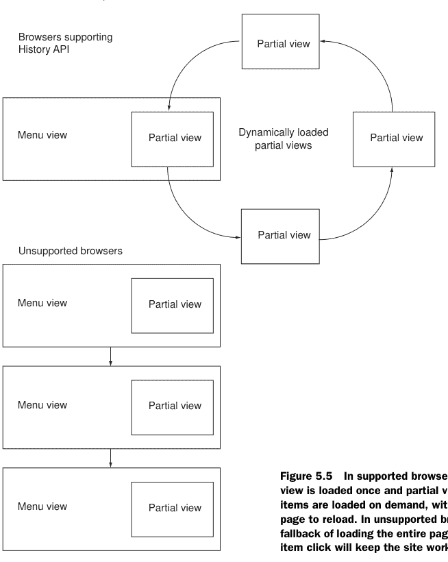

**图5.5** 在支持的浏览器中，菜单视图只加载一次，菜单项目的局部视图按需加载，无需强制页面重新加载。在不支持的浏览器中，当点击每个菜单项目时，加载整个页面的回退机制将保持站点正常工作。

### 5.1.3 History 与 MVC 路由

如果你现在运行该应用程序，你会收到一个错误，提示未找到名为"Menus"的路由。这是因为你需要向应用程序添加一个名为"Menus"的路由。MVC中的路由引擎为你提供了一种将特定URL或URL格式定向到控制器和操作方法的方式，它会自动将URL中的值解析为所需的参数。这使你能够轻松快速地响应应用程序中许多不同的URL格式，并将它们映射到应用程序逻辑。

在你的项目中，按照以下步骤添加一个新路由来响应对额外菜单项目数据的请求：

1. 双击`Global.asax`文件。
2. 在`RegisterRoutes`方法中注册默认路由之前，添加清单中所示的"Menus"路由。

```csharp
routes.MapRoute(
    "Menus",
    "Menu/{meal}/{dish}",
    new {
        controller = "Menu",
        action = "Index",
        meal = UrlParameter.Optional,
        dish = UrlParameter.Optional
    }
);
```

你在此使用的`MapRoute`签名如下：

```csharp
MapRoute(string name, string url, object defaults)
```

你使用`name`参数（如你在清单5.3中所做的那样）来专门选择此路由进行链接构建，并使用`url`参数提供模式。最后，`defaults`对象将包含与`url`中参数同名（区分大小写）的属性。这将导致应用程序一启动就添加一个路由。

### 跟踪ASP.NET MVC应用程序中的路由

你通过利用MVC提供的默认`RegisterRoutes()`方法创建了新的`Menus`路由。这需要一个`RouteCollection`对象，它是应用程序`RouteTable`的一个属性。`RouteCollection`是一个列表，必须包含默认路由，但可以包含更多条目。添加到此集合中的路由将按照它们出现的顺序进行评估——这是一个需要记住的关键点，你很快就会看到。ASP.NET中的路由实际上不过是一个高级的URL模式匹配引擎。当接收到HTTP请求时，URL会经过路由引擎，该引擎将其解析并评估为一组参数，这些参数与控制器、这些控制器上的操作方法以及作为操作方法参数的额外路由值相匹配。

应用程序路由表中的每个路由都可以有一个可选的名称，但至少需要一个URL值。URL是模式，可以包含字面量、参数（使用大括号定义）和分隔符。如果使用路由名称，则在应用程序中必须是唯一的。

路由可能是MVC中最常被误解的部分。路由表引起的挫败感通常源于以错误的顺序添加路由。我们说过路由的顺序很重要，原因如下。考虑下一个清单中显示的两个路由。

### 清单5.5 MVC路由选择有时会给出意想不到的结果

```csharp
MapRoute("Location",
    "{id}",
    new { controller = "Maps", action = "GetLocation", id = "" }
);

MapRoute("Default",
    "{controller}/{action}/{id}",
    new { controller = "Home", action = "Index", id = "" }
);
```

当使用像`http://site/NewYork`这样的URL时，默认路由将被执行，因为它匹配单参数模式。这似乎是正确的。

所有其他请求都应该转到默认路由，但由于第一个路由为`id`提供了默认值，应用程序将始终使用第一个路由并调用`Maps`控制器的`GetLocation`操作。

清单5.5中的问题是`Location`路由不够具体，并为位置`id`参数提供了默认值。你可以在`Home`控制器文件中的`Index`操作方法上设置世界上所有的代码断点，并试图弄清楚为什么它没有被命中，只是在经过数小时令人沮丧的努力后发现`Maps`控制器正在执行`GetLocation`操作，但`id`参数为空。

> **提示** 关于路由，最重要的一点是，你在应用程序中使用的路由方案应该足够具体以处理所有预期的入站请求，并且应该正确排序以确保正确的控制器接收到每个请求。

### 生成与特定路由匹配的视图内URL的两种方法

虽然MVC路由系统的第一部分使你能够将传入的请求映射到特定的控制器和操作，但第二部分让你可以在视图内部生成一个与特定路由匹配的URL。有几种方法可以实现。

最简单的选项是使用`Html.ActionLink()`方法。此方法有许多重载，但最常用于构建菜单和获取视图的静态链接。MVC模板中的默认母版页使用此方法构建页面顶部的选项卡。你将使用它来添加一个新的Menu项

### 5.1.4 创建应用数据模型

你现在已经完成了应用的视图、控制器和路由；是时候专注于数据模型了。这个示例应用的数据可以来自任何来源，无论是数据库、外部 Web 服务，甚至是文本文件。实际上，在 MVC 应用中，模型的要点在于提供一种统一的方式，将应用的数据存储机制与业务和流程逻辑抽象分离。在你的示例应用——一个餐厅菜单中——模型将由一个`Menu`对象组成，该对象包含一个菜单项列表。

那么，第一步是在 Models 文件夹中创建一个`Menu`类，并按照下一个清单分配属性。

### 清单 5.6 用于历史应用的菜单和菜单项模型

```csharp
namespace MenuHistory.Models
{
    public class Menu
    {
        public string SelectedMeal { get; set; }
        public List<MenuItem> Items { get; set; }
    }

    public class MenuItem
    {
        public string Key { get; set; }
        public string Meal { get; set; }
        public string DishName { get; set; }
        public string DishDescription { get; set; }
        public bool IsSelected { get; set; }
    }
}
```

使用泛型`List`对象来包含你的对象是有意义的，因为它可以使用 LINQ 表达式进行操作，就像你之前在控制器和视图中所做的那样，来对数据进行过滤和排序。`MenuItem`中的`Key`属性将与`DishName`的值相同，只是不包含空格或特殊字符。这使得它在 MVC 中作为路由元素更加友好，进而也更容易使用 History API 和 JavaScript 进行操作。

在你的`Menu`对象中，添加一个具有以下内容的构造函数：

```csharp
public Menu()
{
    Items = new List<MenuItem>();
    Items.Add(new MenuItem()
    {Key="", Meal="", DishName="", DishDescription=""});
}
```

现在使用这种模式，用数据填充对象。你在此示例应用中将使用的基本数据列在表 5.1 中，但你也可以填充任何你喜欢的数据。只要记住，`Key`字符串应对应于站点`Images`文件夹中的文件名。如果你选择使用表 5.1 中的数据，你可以添加自己的`DishDescription`文本。

**表 5.1** 此示例应用的数据虽然简单，但提供了足够的选项来展示 History API 和 MVC 路由。

| Key | Meal | DishName | DishDescription |
| :--- | :--- | :--- | :--- |
| Pancakes | Breakfast | Pancakes | ... |
| ScrambledEggs | Breakfast | Scrambled Eggs | ... |
| FrenchToast | Breakfast | French Toast | ... |
| FruitSalad | Lunch | Fruit Salad | ... |
| GrilledCheese | Lunch | Grilled Cheese | ... |
| Hamburger | Lunch | Hamburger | ... |
| Steak | Dinner | Steak | ... |
| ChickenPasta | Dinner | Chicken Pasta | ... |
| Tortilla | Dinner | Black Bean Tortilla | ... |

你也可以选择直接从我们的 GitHub 站点下载图像，地址是：`github.com/axshon/HTML-5-Ellipse-Tours/tree/master/demos/history/Menu-History/Images`。

现在数据模型已经完成，你如何让它在应用程序中发挥作用呢？

### 5.1.5 使用部分视图按需从服务器加载内容

要让数据模型工作，你需要用菜单对象中的图片和描述来注入你的`<aside>`元素。这就是 History API 的魔力——浏览器不需要刷新整个页面，每次点击链接时就能向用户呈现这些新的图片和描述。

> **注意** 记住，`<aside>`标签的目的是为不在关键路径中的内容提供支持信息。

你将通过创建一个新的视图来实现这一点，这个视图比你目前处理过的页面视图更专业一些。这个视图不包含呈现整个页面的标记。相反，它将是一个 HTML 内容片段，你将根据需要将其注入页面。

为此，你将创建一个控制器来支持部分视图，并创建一个路由将调用定向到新的控制器。创建控制器超级简单。只需按照以下步骤操作：

1. 右键单击应用程序中的 Controllers 文件夹，选择 添加 > 控制器。
2. 将其命名为`PreviewController`，并确保使用空控制器模板。

`Index`控制器操作应与以下代码片段中显示的完全一致。注意，为了使用默认的 MVC 路由，你必须将控制器参数命名为`id`：

```csharp
public PartialViewResult Index(string id)
{
    var menu = new Menu();
    var item = menu.Items.Where(d => d.Key == id).FirstOrDefault();
    return PartialView("Index", item);
}
```

3. 现在右键单击`PreviewController`中的`Index`方法内部，选择 添加视图。
4. 将模型设置为`MenuItem`，并勾选 创建为部分视图。此部分视图应类似于清单 5.7。

> **注意** 如果你对 ASP.NET MVC 的工作方式还不完全熟悉，本节应该让你明白，你应用程序中的每个控制器都可以有一个或多个视图。该视图及其关联的控制器方法的默认名称是`Index`。因此，`PreviewController.cs`文件中的`Index`方法对应于项目`Views\Preview`文件夹中的`Index.cshtml`视图。

### 清单 5.7 显示图像和描述的 Preview.cshtml 部分视图

```html
@model MenuHistory.Models.MenuItem
<section>
    <figure>
        
        <figcaption>
            @Html.Raw(Model.DishDescription)
        </figcaption>
    </figure>
</section>
```

`Url.Content`方法将为提供的输入字符串生成相对 URL。

`Html.Raw`方法不会转义或解码参数，并将输出传递的确切文本。

`<figure>`和`<figcaption>`标签用于插入图片并对其进行注释，以便图片和文本永远关联在一起。

一旦你包含示例图像（在`Images`文件夹中），其名称与模型中每道菜的`Key`值对应，你应该就能够运行应用程序并输入如下 URL：

`site/Preview/Index/{dish}`

将`dish`参数替换为模型中的任何菜名，你将得到类似于图 5.6 的结果。

它现在还不太美观，但经过最后的润色，你就可以开始实现客户端的 History 架构了。你的目标是创建与支持 History API 的现代浏览器以及不支持该 API 的旧浏览器都兼容的 ASP.NET MVC 视图。一旦你把各个部分准备好，使整个页面加载工作，你就向选项卡条添加了链接。你只需要在`Views\Shared\_Layout.cshtml`文件中的无序列表中添加以下行：

```html
<li>@Html.ActionLink("Menu", "Index", "Menu")</li>
```

这里的方法签名是

```csharp
ActionLink(string linkText, string actionName, string controllerName)
```

所以第一个`"Menu"`是链接文本，而最后一个告诉 MVC 调用菜单控制器。MVC 框架将构建一个链接 URL，该 URL 将导航到菜单控制器的`Index`操作。这个`Html.ActionLink()`方法非常有用，因为它会动态使用应用程序路由表中与传入参数匹配的第一个路由。

`ActionLink`方法适合在服务器上生成简单的锚标签，但你不仅要在服务器端，还要在客户端处理 URL，此外还要添加格式化的参数，因此能够正确格式化 URL 非常重要。MVC 提供了一个更具体的方法来处理这种情况：你在清单 5.3 中使用过的`Html.RouteLink()`方法将使用请求的确切路由构建一个带有`href`属性的`<a>`标签，如果未提供参数或路由不存在，则会引发异常。以下是那段代码：

```html
@Html.RouteLink(
    item.DishName,
    "Menus",
    new
    {
        meal = item.Meal,
        dish = item.Key
    })
```

这个函数签名是

```csharp
RouteLink(string linkText, string routeName, object routeValues)
```

`RouteLink`比`ActionLink`更严格，因为它强制使用特定路由，而不是基于正则表达式进行匹配。不过，对于任何需要保证 URL 匹配应用程序中特定路由的情况，这都是完美的。

> **警告** 尽管 History API 使你能够获取 URL 并使用 JavaScript 进行编辑，但你应该始终以这样的方式构建你的解决方案：即使 History API 不可用，页面也能有效运行。这可能意味着界面看起来完全相同，或者可能需要一些细微的界面差异。无论如何，你的应用程序不应该仅仅因为客户端没有这个 API 就中断——这被称为*优雅降级*。你将在本章构建的示例应用将做到这一点。

## 5.2 使用 HTML5 History

使用 History API，你无需执行完整的页面刷新即可操作页面的 URL。此外，由于 MVC 视图、控制器和路由在服务器端控制系统，你的应用可以完全兼容任何浏览器，即使禁用了 JavaScript 或 History API 不可用也是如此。

HTML5 History API 允许网站访客使用浏览器的前进和后退按钮，而不会丢失呈现页面所需的信息。正如我们在本章开头解释的，这在搜索场景中可能是一个真正的优势，并且当用户每次点击不同的链接时，它将帮助你在同一页面上展示菜单项的图片和描述。使用现代浏览器的用户将能够查看每个早餐菜单项（或任何其他菜单项），而不会像旧版浏览器中那样因整个页面加载而产生突兀的效果。

History API 让你无需执行完整的页面刷新即可操作 URL 和浏览器历史记录中的 URL 堆栈。在现代浏览器中，流量将如图 5.8 所示，其中只有第一个请求获取整个页面，此后所有 Ajax 请求只获取部分视图。

在本节中，你将学习通过有效使用 JavaScript 和 URL 格式来使用 History API。在学习过程中，你将：

- 设置 JavaScript 以响应触发界面更改的 History 事件
- 使用浏览器 URL 来确定需要对界面进行哪些更改
- 根据前两个步骤更改界面

首先，是 JavaScript。

### 5.2.1 添加 JavaScript 以处理 History API 导航事件

使用 History API 的第一步是将一些 JavaScript 附加到无处不在的 jQuery ready 处理程序上。这为你提供了其余代码的入口点，在那里你将 JavaScript 事件处理函数附加到 history 事件上，以触发仅加载页面一小部分的过程。

请记住，通常你希望你的库在页面完全加载后才执行。jQuery 团队付出了巨大努力来确定页面在任何浏览器中何时完全加载和渲染。这就是 ready 事件几乎是所有 HTML5 应用程序第一个编码入口点的原因。

要开始基础的管道工作，请按照以下步骤操作：

1. 打开 Shared 文件夹中的`_Layout.cshtml`文件，并移除 jQuery 和 Modernizr 脚本标签。
2. 将它们替换为位于 Microsoft CDN 上的最新库。

就你的目的而言，`_Layout.cshtml`顶部的脚本标签应编辑如下：

```html
<script
  src="http://ajax.aspnetcdn.com/ajax/jquery/jquery-1.7.1.js"
  type="text/javascript"></script>
<script
  src="http://ajax.aspnetcdn.com/ajax/modernizr/modernizr-2.0.6-development-only.js"
  type="text/javascript"></script>
```

**提示** 在前面的代码片段中，Modernizr 脚本设置为仅开发版本。对于你自己的项目，请访问 modernizr.com 上的 Modernizr 网站，构建一个仅包含你需要的特性的自定义脚本。

3. 在 Scripts 文件夹中为你的应用程序添加一个新的 JavaScript 文件，并将其命名为`main.js`。
4. 在`_Layout.cshtml`页面的 body 闭合元素之前添加对 JavaScript 文件的以下引用：

```html
<script src="@Url.Content("~/Scripts/main.js")" type="text/javascript"></script>
```

你将使用 MVC URL 辅助函数来确保在应用程序部署时路径正确。

5. 最后，打开`main.js`文件，并在以下清单中添加 ready 处理程序。

### 清单 5.8 连接 jQuery ready 事件

```javascript
$(document).ready(function () {
  if (!Modernizr.history)
    return;
});
```

如果 Modernizr 在当前浏览器中未检测到 HTML5 History API 支持，则不做任何操作。

这个特定的`ready`函数的重要之处在于，如果 Modernizr 未检测到 History API，它将不执行任何操作。浏览器中没有此功能的用户仍然可以点击任何菜单项并查看额外内容的完整视图；浏览器只会强制执行完整的页面刷新，而不会出现你即将构建的平滑过渡效果。你正在尝试确保在未检测到特定能力时用户体验能够优雅地降级，为用户提供尽可能好的体验。

### 使用 ONPOPSTATE 连接到浏览器历史事件

现在你需要连接到浏览器的历史事件。每个支持 History API 的浏览器都将有`onpopstate`事件可用于连接。

在 jQuery 世界中有两种连接方式：使用基础 JavaScript 事件或使用 jQuery`bind`函数：

```javascript
onpopstate = function (event) { function body };
```

或者

```javascript
$(window).bind("popstate", function (event) { function body });
```

每当用户按下浏览器的前进或后退按钮时，`onpopstate`事件就会触发，并且在某些浏览器中，当页面加载时也会触发。`event`参数是一个标准的 DOM 事件，附带一个`state`属性对象。此对象包含推送到浏览器历史记录堆栈中该特定元素的任何值。如果未为相关元素分配任何内容，`state`值也可能为 null。

在你的`ready`处理程序中，在末尾添加以下代码。此函数将在浏览器窗口中的`onpopstate`事件触发时执行：

```javascript
$(window).bind("popstate", function (event) {
    updateState(history.state);
});
```

我们接下来会讲到`updateState`函数，但现在你需要确切理解这段小代码的作用。每当浏览器的`onpopstate`事件被触发时，浏览器窗口历史对象的`state`值将被（由浏览器设置，而不是你的代码）设置为该历史堆栈项中的数据值。此外，在事件触发时，浏览器窗口的`title`和`document.location`将已经被更新。最后，浏览器不会调用任何请求来获取由新的`document.location`值定义的资源。即使客户端没有缓存，也不会发起服务器调用。图 5.9 说明了此过程。

### 使用 PUSHSTATE 和 REPLACESTATE 直接操作历史堆栈

在 History API 存在之前，历史堆栈（浏览器的 URL 历史记录）只能通过浏览器本身在用户从页面导航到页面时间接更改。它不能直接更改。但现在，随着对 History API 的基本理解，你可以在当前页面持续期间修改浏览器的历史记录。

但仍有两块缺失的逻辑需要探讨：

- 菜单页面上的链接是锚点标签，这会强制浏览器执行到服务器的完整往返以获取整个页面，从而违背了使用 History API 的初衷。
- 虽然你正在从`history.state`属性获取值，但你尚未将该值赋给任何地方，因为你还没有实现`updateState`函数。

`history`对象使用两个内置函数直接操作历史记录栈：`pushState`和`replaceState`。`pushState`为当前浏览器会话在历史记录栈中添加一个新条目。被推入历史记录的值在任何其他浏览器或会话中均不可用，除了通过`history.length`属性计数外，无法被枚举。相比之下，`replaceState`获取当前历史条目并替换其数据、标题和 URL 值，而不会在历史记录栈的其他部分添加或删除任何内容。

```javascript
history.pushState( data , title , url );
```

包含任何相关状态信息的对象。如果不需要数据，请使用`null`。

此历史条目的窗口标题。如果不需要标题，请使用`null`。

要应用于浏览器地址栏的 URL。可选参数。

```javascript
history.replaceState( data , title , url );
```

图 5.10 `history`对象中`pushState`和`replaceState`函数的语法

`pushState`和`replaceState`函数具有相同的签名，其语法如图 5.10 所示。

回到你的应用程序，你无需在页面完成加载周期后修改当前页面的历史记录，因此可以仅使用`pushState`函数。在你的`ready`函数中，添加下一个清单中的代码。

### 清单 5.9 使用 jQuery 覆盖锚点的默认行为

```javascript
$(".menu-item").click(function (event) {
    event.preventDefault();
    event.stopPropagation();
    var $target = $(this);
    var url = $target.find("a").attr("href");
    var state = stateFromPath(url);
    history.pushState(state, "", url);
    updateState(state);
});
```

`stopPropagation`阻止事件冒泡到事件之外

jQuery 选择器查找所有菜单元素

`preventDefault`覆盖正常的点击行为

点击处理程序中的`"this"`将引用上下文（在本例中是被点击的元素）

从目标对象的锚点元素获取 URL 参数

使用 URL 调用`stateFromPath`函数来构建自定义状态对象

将新状态对象推入历史记录

根据新状态更新用户界面

虽然这个点击处理程序中似乎发生了很多事情，但事实是，你只是覆盖了默认的页面行为并添加了自己的方法。History API 的作用就像一个本地存储的 LIFO（后进先出）队列，它存储你想要的 URL 和数据，无需太多繁琐操作。围绕该操作构建的机制远比 API 本身复杂得多。

此时，仍有两个方法需要构建：`stateFromPath`函数和`updateState`函数。`stateFromPath`解析当前 URL 以构建一个包含`meal`和`dish`属性的状态对象，供其他所有部分使用。`updateState`函数使用该状态对象来设置样式并异步加载内容到页面。

在 5.2.2 节，你将构建`stateFromPath`函数，因为它将让你有机会更深入地研究页面 URL 及其一些重要属性。之后，在 5.2.3 节，你将着手处理`updateState`函数。

### 5.2.2 在 JavaScript 中使用页面 URL

JavaScript 中`window`对象的`location`属性远不止是浏览器地址栏中显示的 URL。实际上，它是当前 URL 主要组件的分解，并附带一个`reload()`方法，该方法强制页面为当前页面重新向服务器请求所有内容。各种属性都是整个 URL 的子集，以字符串形式呈现，可以根据需要进行解析和分割，如图 5.11 所示。

至此，你的目标应该非常清楚了。为了构建一个包含 meal 和 dish 的对象，你取一个应用程序中使用的典型 URL，例如

```
http://www.mysite.com/Menu/Breakfast/Pancakes
```

并将其路径名分割为其组成部分。数组中的最后一个元素是`dish`；它之前的元素是`meal`。

将以下清单中的函数添加到你的`main.js`文件中。

### 清单 5.10 分割 `location.pathname` 以构建 JavaScript 对象

```javascript
function stateFromPath(path) {
    var base = "/Menu/";
    var parts = path.replace(base, "").split("/");
    return {
        meal: (parts.length >= 1 ? parts[0] : ""),
        dish: (parts.length >= 2 ? parts[1] : "")
    };
}
```

移除路径参数中的`/Menu/`部分，并将剩余字符串分割成数组。数组的最后一部分应为`dish`，前一部分是`meal`元素。

此代码远未达到生产就绪状态。在生产场景中，你需要测试整个 URL 以确保其根据业务规则有效，并且分配的属性顺序正确。你还应该考虑解析任何`querystring`值和特殊字符，或者可能转义出站文本以避免 URL 编码的文本。

```
http://www.ellipsetours.com:80/Menu/Breakfast#top
```

图 5.11 `window.location`对象属性

> **警告** 使用`history.replaceState`方法赋值会更改浏览器的当前 URL，而不会强制向服务器发送请求，但 History API 无法编辑 URL 的`protocol`、`hostname`或`host`属性。

### 5.2.3 使用 History 更新页面

你快完成了！你已经测试了 History API 支持的存在，并且拦截了`onpopstate`事件和所有菜单项点击事件，以便可以调用`updateState`函数。你还设计了一个简单的机制将 URL 解析成对象。所有这些背景知识使你能够根据用户交互更改页面，而无需完全刷新页面。`updateState`函数将实现这一点。

### 添加 UPDATESTATE 函数

`updateState`函数放在你的`main.js`文件中，并广泛使用 jQuery 选择器和 Ajax 异步服务器调用来获取预览数据。从构建函数签名的以下代码开始。你在函数内部做的第一件事是检查 state 参数是否已被赋值：

```javascript
function updateState(state) {
    if (!state)
        state = stateFromPath(location.pathname);
}
```

上述代码段确保你始终拥有一个 state 值，无论`onpopstate`事件触发时历史记录中是否有值。

接下来，增强`updateState`函数，对用户界面进行编辑，使其在直接使用当前 URL 调用 MVC 视图时默认呈现的样子。通过向页面上的元素添加和移除 CSS 类来实现这一点，将下一个清单中的代码附加到`updateState`函数。

### 清单 5.11 使用 jQuery 根据状态对象修改呈现

```javascript
var $selectedMenu =
    $(".menu[data-meal='" + state.meal + "']");
$(".menu").not($selectedMenu).removeClass("active");
$selectedMenu.addClass("active");

var $selectedItem =
    $(".menu-item[data-dish='" + state.dish + "']");
$(".menu-item").not($selectedItem).removeClass("selected");
$selectedItem.addClass("selected");
```

### 添加菜单项预览

`updateState`函数的最后一部分是菜单项预览，使用 jQuery Ajax 的`$.ajax()`函数，如以下清单所示。请注意，URL 对应于你为预览视图定义的路由。回调函数中的 data 值应该是一个 HTML 片段，你可以直接将其附加到预览容器元素中，无需更改。

## 5.3 再迈两小步……

应用程序现在应该可以工作了，但你仍需对母版页和CSS样式进行一些调整，让一切看起来更美观。你需要设置CSS样式，以便当各个部分（section）变为活动或非活动状态时，能显示相应的“活动”和“非活动”效果，并在页面顶部的菜单中显示一个新的标签页。此外，修改浏览器在加载页面时，将在标题栏中显示的应用程序标题也会很有帮助。

## 哈希值与查询字符串

本章我们讨论了如何解析URL的常规部分，这通常就是你使用HTML5 History API所需的全部。但有时，无论客户端还是服务器端都需要额外的数据。以下是一些关于资源名称后的查询字符串值，以及以井号（#）为前缀、位于URL末尾的哈希值的要点：

- 查询字符串值没有原生的JavaScript API来将其解析为组件名称/值对，jQuery库中也没有原生方法。你可以使用正则表达式针对`location.href`值进行解析，但需要小心，并在尝试在用户界面中呈现之前对这些值进行反转义处理。
- 查询字符串值在客户端和服务器端均可使用。
- 哈希值必须经过转义，可以包含任何值或值集，但设计上不像查询字符串那样有名称/值对的规范。
- 哈希值仅在客户端可用。它们无法在服务器端被检测或操作，除非进行设置。
- 哈希值因其能够以深度链接内容的方式而流行，这种方式允许HTML5应用程序查看请求内容并异步采取行动加载额外数据。即使必须下载大量数据，这也能保持用户界面的响应性。

HTML5 History API还实现了`onhashchange`事件，该事件在哈希值发生变化时触发，但这并未得到普遍支持，因此在实现严重依赖此事件的解决方案之前，你应该进行彻底测试。

你现在将通过那些调整来完善应用程序。

### 更改应用程序标题

要分配应用程序标题，请遵循以下简单步骤：

1. 打开`Shared/_Layout.cshtml`文件，找到`id`为`title`的`<div>`标签。
2. 将标签的内容更改为 "HTML5 Restaurant" 并保存文件。

现在母版页将在整个应用程序中显示一个更好的标题。

### 更改CSS样式

回顾一下，你为`<section>`标签分配了`active`或`inactive`（空字符串）的CSS类，为`<li>`标签分配了`selected`或`unselected`（空字符串）的CSS类。一个非活动的区域应该仍然可读，链接可点击，但`active`和`selected`的元素应该突出显示，这样用户无需阅读URL就能知道他们所在的位置。图5.12展示了你想要为选中的菜单项实现的效果。

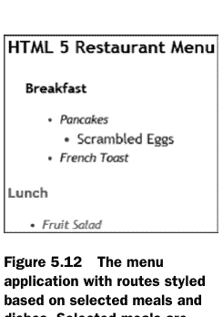

为了调整你的CSS使其看起来像图5.12，请打开你的MVC应用程序的`content`文件夹中的`site.css`文件，并滚动到底部。

> **注意** 在典型的.NET Web开发中，用于理解CSS在应用程序开发和自然用户界面设计中所扮演的关键角色的时间不足。我们在此深入探讨样式，是为了强调这种关系，并阐明CSS样式的层叠本质。

清单5.13展示了你将要创建的新样式。使用这段代码，你首先会覆盖现有的锚点样式，以便菜单页面可以进行自定义，而不影响任何其他页面。然后，你将构建你的活动和默认菜单部分，为活动部分添加一个小小的内缩和颜色变化。接下来，你将为选中的和默认的链接及列表项设置样式，提供一种视觉提示用户所处位置而不显得突兀的外观。按照描述将下一个清单中的代码放入你的`site.css`文件。

### 清单5.13 用于突出显示所选菜单项的CSS样式

```css
section.menu h3 {
    color: gray;
}

section.menu a:link,
section.menu a:visited {
    text-decoration: none;
    color: grey;
}

section.menu.active {
    margin-left: 20px;
}

section.menu.active h3 {
    color: black;
    font-weight: bold;
    font-size: larger;
}

section.menu.active a:link,
section.menu.active a:visited {
    color: black;
}

section.menu li {
    font-style: italic;
}

section.menu li.selected {
    font-style: normal;
    font-size: larger;
    margin-left: 20px;
}

.preview-dish {
    position: relative;
    float: right;
    height: 380px;
    width: 480px;
}

.preview-dish section {
    position: absolute;
    width: 100%;
    height: 100%;
    border: 1px solid black;
}
```

包含菜单照片的`aside`元素应浮动到屏幕右侧。

包含照片的`section`元素将在`aside`内进行绝对定位，以便每次都能渲染在完全相同的位置。

这是将单一样式应用于多个选择器以及覆盖应用程序其他部分现有样式的良好CSS实践。另请注意，由于你使用的是`Menu`对象的`SelectedMeal`属性，你可以执行仅包含餐点名称的URL（例如`/Menu/Dinner`），并获得一个突出显示整个部分而不会偏移单个菜品`<li>`元素的视图。当这些小技巧成为你的第二天性时，你会发现你的开发速度以及应用程序的质量和美观度都在提高。

## 5.4 总结

在本章中，我们研究了如何使用ASP.NET MVC中的部分视图和自定义路由来构建一个在任何浏览器中都响应迅速且兼容的页面。你还学习了如何使用异步方法和jQuery动画来实现HTML5 History API。这些方法同样可以轻松地用于相册网站、新闻阅读器或向导式问卷。任何代表步骤推进的交互都是集成History的良好候选。

使用History API将减少对服务器的请求数量和大小，并为用户提供更丰富、更响应迅速的体验。History API可能不是HTML5工具库中被谈论最多的API，但考虑到它在小功能包中带来的巨大好处，它在任何基于HTML的应用程序中都值得被关注。

在下一章中，我们将介绍HTML5 API中最受欢迎的之一——地理定位。这项技术使你能够开发能够实时响应用户当前位置的位置感知网站。

## 5.5 完整的JavaScript库

以下清单展示了完整的`main.js`文件，供你参考并帮助你检查你的工作。

### 清单5.14 完整的main.js库

```javascript
// -----------
function stateFromPath(path) {
    var base = "/Menu/";
    var parts = path.replace(base, "").split("/");
    return {
        meal: (parts.length >= 1 ? parts[0] : ""),
        dish: (parts.length >= 2 ? parts[1] : "")
    };
}

// ---------
function updateState(state) {
    if (!state)
        state = stateFromPath(location.pathname);

    // ____ 菜单
    var $selectedMenu =
        $(".menu[data-meal='" + state.meal + "']");
    $(".menu").not($selectedMenu).removeClass("active");
    $selectedMenu.addClass("active");

    var $selectedItem =
        $(".menu-item[data-dish='" + state.dish + "']");
    $(".menu-item").not($selectedItem).removeClass("selected");
    $selectedItem.addClass("selected");

    // ____ 预览
    var $dishContainer = $(".preview-dish");
    var $oldDish = $dishContainer.find("section");

    if (!state.dish) {
        $oldDish.fadeOut(function () {
            $oldDish.remove();
        });
        return;
    }

    var url = "/Preview/Index/" + state.dish;
    $.get(url, function (data) {
        var $newDish = $(data);
        $newDish.find("img").load(function () {
            $newDish.fadeIn(function () {
                $newDish.css("z-index", 0);
            });
            $oldDish.fadeOut(function () {
                $oldDish.remove();
            });
        });
        $newDish
            .css("z-index", 1)
            .hide()
            .appendTo($dishContainer);
    });
}

// ---------
$(document).ready(function () {
    if (!Modernizr.history)
        return;

    // ____ 历史事件
    $(window).bind("popstate", function (event) {
        updateState(history.state);
    });

    // ____ 点击事件
    $(".menu-item").click(function (event) {
        event.preventDefault();
        event.stopPropagation();

        var $target = $(this);
        var url = $target.find("a").attr("href");
        var state = stateFromPath(url);

        history.pushState(state, "", url);
        updateState(state);
    });
});
```

# 地理定位与网络地图

## 本章内容

- 理解地理空间数据和地理定位服务
- 使用HTML5地理定位API构建网络地图
- 构建和使用ASP.NET MVC控制器提供JSON数据服务

社交媒体、丰富的网络内容与移动设备内置位置服务的融合，为理解“位置”价值的开发者和企业创造了真正的机遇。当用户询问“在哪里？”时，他或她真正想问的可能是以下任何或所有问题：

- 我相对于想去的地方在何处？
- 与我交流的人相对于我的位置在哪里？
- 我离感兴趣的产品或服务有多近？
- 附近有没有我感兴趣的任何东西？
- 我什么时候能到达，有什么可能会拖慢我的行程？

### 浏览器支持

| 地理定位API | 桌面端 | 移动端 |
|---|---|---|
| | Chrome 4, IE 9, Firefox 3.5, Opera 10.6, Safari 5 | Opera 11, Android 2.1, iOS 3.2, Windows 7.5 |

## 第六章 地图

地理定位是一个编程接口，允许JavaScript读取浏览器从主机操作系统获取的GPS信息。数据可以通过接口直接读取，也可以分配监听器，以便在设备的物理位置发生变化时接收数据。

本书将讨论地理定位API的以下部分。6.3.1节涵盖了本列表中每个对象和函数的基础知识，本章的其余部分展示了每个对象和函数的操作方式。

- `navigator.geolocation`对象
- `getCurrentPosition`
- `watchPosition`
- `clearWatch`
- `position`对象
- `coordinates`对象
- 处理地理定位错误
- 位置`options`对象
- `setAutolocate`函数

“在哪里”的问题总是至少归结为两个位置：用户的位置和用户感兴趣的实体的位置。其他一切都是噪音，会分散对这个核心等式的注意力。

将地理定位集成到HTML应用程序中——本章的重点——需要你理解许多相当抽象的概念，比如在地球上找到特定位置以及测量地球表面点之间的距离。此外，你必须理解这些概念如何使用HTML5地理定位API和第三方地图API（可以在网页上显示地理空间数据）来付诸实践。我们将在本章中向你展示如何做这些事情，涵盖使用地理数据所需的基础知识。你还将学习做以下事情：

- 通过JavaScript代码使用地理定位API来查找用户的设备
- 使用第三方地图API（特别是Bing Maps JavaScript API），它提供带有可查看地图的用户界面
- 在地图上绘制数据
- 使用地理定位API的数据来更改地图
- 通过组合API实现导航
- 计算地理空间数据
- 将服务器地理空间数据引入你的应用程序

首先，我们将花一点时间介绍什么是地理空间数据，以及它与你在地球上位置的关系。你需要这些知识来理解如何实现地图解决方案。如果你已经理解了这些概念，请随意浏览标题或直接跳到下一节，在那里你将把这些知识应用到一个实际的应用程序中。

## 6.1 “我在哪里？”：（简要的）地理位置入门

在地球上为任何事物找到确切位置的实践，是基于使用角度来确定某物在球体表面的位置。考虑图6.1，一个压力球的渲染图，类似于你现在可能在桌子上的那个。

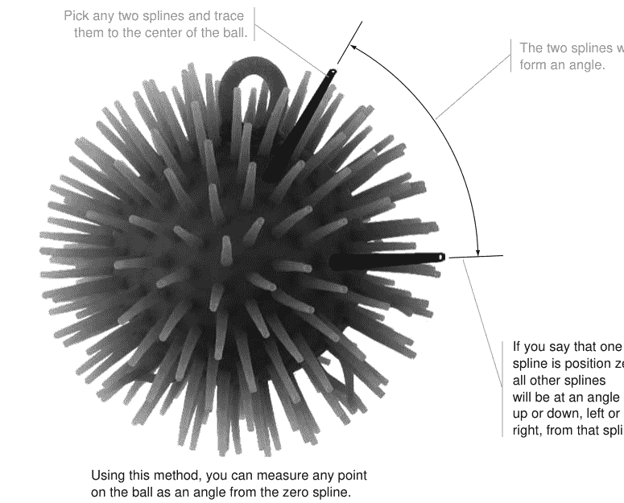

如果你使用任意一条线作为零标记，你可以看到任何其他线都可以通过其相对于零线向上或向下、向左或向右的角度来识别。

注意，将此方法应用于地球上的位置时，你可以划分和细分角度，以获得所需的任何精度。理论上，你可以定位地球上的任何一点，无论它多么微小！

> **基于坐标的定位与相对于已知位置的定位**
>
> 无论使用何种实际的数学公式，确定用户位置主要有两种方法。第一种是使用基于经纬度角度的传统地理坐标系。这个系统允许你指定两个数字，从而在地球上的任何地方得到一个精确的位置。
>
> 第二种方法是相对于已知位置来定位某个物体。使用这种方法，你可以说明从你当前的位置，感兴趣物体在90度方向、20米外。你也可以说它在3点钟方向20米外。所需的关键值是起点的绝对位置、起点处人员面向的方向、到目标的距离以及目标基于起始方向的方位角。
>
> 使用第二种位置方法的常见场景是在战术或军事环境中。每个团队成员都知道其他队友的位置，并可以基于这些知识指导行动。他们必须迅速行动，不需要记住哪边是北或者某个东西离每个成员的确切距离。相反，团队负责人必须能够告诉每个成员某个东西相对于他自己或另一个团队成员的位置。这种方法通常不太精确，因为涉及多个变量，每个变量都有误差范围，但在不需要精确度时，它快速且有用。
>
> 我们在本章将重点介绍第一种、更科学的方法。

这个非常通用的解释很有帮助，但仍然不足以让你在构建应用程序时使用。为此，你还需要了解一些描述唯一位置的标准术语。

### 经纬度

纬度是赤道以北或以南的度数。正数总是描述赤道和北极之间的点，而负数描述赤道和南极之间的点。纬度范围在-90到90度之间，因此90度纬度描述的是从地球中心到北极的直线。如果你想不使用负数来表达这些值，你可以说纬度度数是赤道以北或以南。

经度是从本初子午线向东或向西的度数值。本初子午线从北极延伸到南极，笔直穿过英格兰格林威治，并向下穿过非洲西部。本初子午线以西的点是负值，而以东的点是正值。这些值也可以表示为相对于本初子午线的向东或向西的度数。当仅使用数字而不带东或西标签时，经度值会递增，直到在地球另一侧达到180度。接近该点时，经度值可能为179.9999，稍微移动一下就变成−179.9999。

综合起来，你可以用一对数值来确定地球上任意一个点的位置，这对数值描述了相对于相应零线的角度纬度和经度。这里有几个例子：

- 华盛顿纪念碑的纬度是38.8891度，经度是−77.0355度。这也可以说是北纬38.8891度和西经77.0355度。
- 埃菲尔铁塔的纬度是48.8584度，经度是2.2944度。这等同于说它位于北纬48.8584度和东经2.2944度。

图6.2准确地展示了这些数值如何从赤道向北和向南、从本初子午线向东和向西分布在整个地球上。

这看起来非常直接，甚至可能有点乏味。“我在小学就学过这个了！这和地理定位API有什么关系？”你可能会这样想。对应用开发者的真正价值在于当你拥有*多个*地理坐标时。毕竟，哪个开发者会在乎华盛顿纪念碑或埃菲尔铁塔的经纬度呢？但综合来看，当你有多个数值并为每个点赋予任意含义时，你可以测量任意两点之间的距离，从而确定出行信息、区域分布，甚至空间数据随时间的变化。多个点正是空间坐标与现实世界数据相遇并演变为地理信息系统（GIS）的地方。

更进一步举例，你可以使用本章后面将编写的`computeDistance` JavaScript函数，仅根据华盛顿纪念碑和埃菲尔铁塔的经纬度坐标，计算出两者之间的距离为6,162公里。

> **为什么零度位置在欧洲？**
>
> 纬度为零度很合理，因为它正好是旋转地球的中心。但为什么经度为零度被设在西欧的一个随机位置？实际上，它是在19世纪中叶确立的，其依据是当时的头号超级大国英国控制了世界上大部分的海上航运。由于海上导航需要某种一致性，当时的大多数水手都采用了英国本初子午线作为他们的地图基准。这真正意味着本初子午线既是任意的，也几乎完全基于便利性和政治因素的结合。

## 利用GIS赋予地理空间数据意义

GIS是向一个或多个地理点添加意义的科学与实践。人口统计学、气象系统、地质学、水文学以及无数其他科学学科的研究都围绕着一个核心问题：感兴趣的实体在哪里，以及该实体通常如何随时间变化。作为一个行业，GIS涵盖了从空间数据的收集、存储和检索，到空间数据与其他数据相关联的深度分析。

> **缺失的一环……海拔**
>
> 你可能已经注意到，我们在讨论中仅包含了经纬度。海拔是坐标数据的第三部分，描述了从地球上任意点垂直向上、相对于海平面的距离。我们在此有意避免讨论海拔，因为虽然它对许多类型的GIS数据收集很重要，但许多移动地理定位的实现并不使用它。同样，许多常规的网页地图功能，如路线规划和地址定位，并不需要海拔也能正常工作。

现在，掌握了理解本章示例应用程序如何工作所需的非功能性地理定位信息后，让我们开始构建吧。

## 6.2 构建地理定位应用程序

你将在本章剩余部分构建的应用程序使用ASP.NET MVC、JavaScript和HTML5。图6.3中有它的截图。

为了帮助你构建这个地图应用，我们将引导你完成以下步骤：

1. 设置初始MVC项目
2. 创建一个新的地图页面并将其添加到应用程序菜单
3. 获取免费的Bing Maps账户并在页面上显示基本地图
4. 使用Geolocation和Bing Maps API自动在地图上定位你自己
5. 升级Geolocation API代码，以便在设备移动时持续跟踪用户
6. 添加服务器支持以构建逐步导航

完成后，你的应用程序中将有多个协同工作的部分，所有这些都在图6.4中进行了说明。

让我们从基本的应用程序设置开始。

### 6.2.1 基本应用程序设置

初始设置相对简单：

1. 打开Visual Studio，创建一个新的名为GeoMapping的ASP.NET MVC项目。
2. 通过导航到工具 > 库包管理器 > 管理解决方案的NuGet程序包，更新所有NuGet程序包。
3. 找到“更新”选项卡，浏览屏幕中央的每个列表项，并单击“更新”按钮。
4. 打开Scripts文件夹，找到列出的jQuery和Modernizr库。记下文件的版本号。
5. 导航到Views > Shared > _Layout.cshtml文件，这是应用程序的默认母版页。
6. 找到页面顶部列出的脚本，并更新其版本号。

现在你已准备好继续创建地图网页的实际工作。

### 创建页面和地图端点

你的第一个实质性步骤是创建将包含地图的页面并将其连接到MVC导航。为此，你需要创建一个新的样式表，因为JavaScript地图需要绝对定位；你还需要调整页面以允许完整的浏览器呈现。

在你的新解决方案中，打开`HomeController`，并在类定义内部添加以下代码片段：

```csharp
public ActionResult Maps()
{
    return View();
}
```

这就是创建新地图端点所需的全部内容。MVC现在将识别URL `yoursite/Home/Maps`，尽管那里暂时不会显示任何内容。

### 创建应用程序页面的界面

接下来，你需要创建界面页面：

1. 右键单击`Maps`方法内的`View()`文本，然后选择“添加视图”。
2. 在弹出的菜单中，取消选中“使用布局或母版页”复选框，然后单击“添加”。

一个名为`Maps.cshtml`的新视图将被创建。将以下清单中的代码放入新视图中。这将创建显示应用程序所需的HTML结构。

### 清单6.1 地理定位应用程序页面的界面

```html
@{ Layout = null; }
<!DOCTYPE html>
<html>
<head runat="server">
    <title>Bing Maps and Geolocation</title>
    <link href="@Url.Content("~/Content/Maps.css")" rel="stylesheet" type="text/css" />
    <script src="@Url.Content("~/Scripts/jquery-1.7.2.min.js")" type="text/javascript"></script>
    <script src="@Url.Content("~/Scripts/modernizr-2.5.3.js")" type="text/javascript"></script>
</head>
```

jQuery和Modernizr对于地图功能并非必需，但它们分别对于处理DOM和进行功能检测很有帮助。

## 创建样式表

现在你需要样式表（`maps.css`）。它位于应用程序的`Content`文件夹中，但我们不会在此列出完整内容。这很枯燥且与应用程序运行无关。如果你是边读边构建应用，请跳到本章末尾获取代码（清单 6.12），然后返回此处继续。

> **提示** 样式在地图和 GIS 章节中看似无关紧要，但请记住在 HTML5 的世界里，细节决定成败，用户要求在浏览器中获得流畅、整洁的体验。添加圆角和阴影，并让你的应用程序覆盖设备上每一个可用像素，这可能是良好体验与卓越体验之间的区别。

## 为菜单栏添加链接

接下来，你需要让 MVC 在顶部菜单栏添加一个新链接，这样当你运行应用程序时，就能看到新的选项卡，如图 6.5 所示。

要添加“地图”菜单项，请按以下步骤操作：

1. 在你的应用程序中，打开`Views\Shared\_Layout.cshtml`文件。
2. 找到菜单`<ul>`元素，并在其内容底部添加一个新的列表项：

```html
<li>@Html.ActionLink("Maps", "Maps", "Home")</li>
```

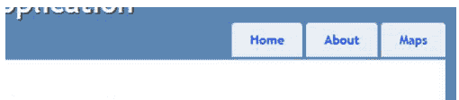

**图 6.5 编辑母版页后，新的“地图”菜单项应出现在应用程序中。**

要了解更多关于 ASP.NET MVC 的信息，请访问`http://asp.net/mvc`。

不幸的是，当你点击新的“地图”菜单项时，生成的页面不显示任何内容。使用母版页的视图至少会有菜单，但因为我们在视图中设置了`Layout=null`，这个特定页面甚至没有菜单。原因是你还需要启动地图 API。记住，本章你将使用两个不同的 API：提供可查看地图用户界面的 Bing Maps JavaScript API，以及允许你的 JavaScript 代码获取用户设备当前位置的 HTML5 Geolocation API。你的下一步是构建地图 UI。

### 6.2.2 使用 Bing Maps JavaScript API

基于网络的地图和 GIS 领域广阔而深入。以下仅为提供网络应用程序地图或 GIS 服务的公司示例：

- Bing Maps—`http://www.bingmapsportal.com`
- Google Maps—`https://developers.google.com/maps/`
- Esri—`http://www.esri.com/software/arcgis/web-mapping`
- OpenStreetMap—`http://www.openstreetmap.org`
- Yahoo! Maps—`http://developer.yahoo.com/maps`

每个服务都提供了一个 JavaScript 库，你可以将其链接到你的网站以显示和控制地图。每个库也提供了一套深入的 GIS 和显示功能，可与 Geolocation API 结合使用，以提供丰富的基于位置的体验。这些公司和组织还提供 Web 服务，你可以从客户端或服务器端调用它们以获取额外数据或执行计算。例如，有可用的美国人口普查数据集，以及整个地球的降雨量和气候信息。或者你可能想基于所谓的*视域*进行高级计算。这是基于已知地形信息，从地图上任何点计算出的肉眼可见区域。

你将使用 Bing Maps JavaScript API，原因有几点。首先，作为微软开发者，你可能已经有 MSDN 用户 ID，可以用来注册 Bing Maps 开发者账户。其次，Bing Maps 与 Google Maps 直接竞争，而 Google Maps 目前无疑是网络地图服务中最受欢迎的。因此，你可能更熟悉 Google Maps，所以使用不同的 API 应该有助于拓宽你的视野，并帮助你理解在需要时更换服务所涉及的工作。

## 开通 Bing Maps 账户

开始使用 Bing Maps 首先需要一个开发者账户。访问`http://www.bingmapsportal.com`并使用你的 Windows Live ID 登录。从那里你可以按照步骤设置你将提供给 Bing Maps API 以获取地图的密钥字符串。此密钥将用于跟踪微软提供的各项服务的使用情况和计费。

## 你是说地图也要付费？

除了 OpenStreetMaps 系列 API 之外，如果你对服务收费，那么部署到生产网站的地图肯定需要付费。如果你不为你的应用程序收费，或者如果你的应用程序将用于非营利组织，你可能能够免费获得地图功能。此外，作为开发者，根据你的开发者协议，你将获得一定数量的免费 API 调用次数。在花费太多时间针对单一服务进行开发之前，请仔细阅读条款和条件，这样在应用上线时，你才不会陷入难以承受的费用困境。

如果你能够免费将地图放在你的网站上，你通常会发现，根据你的协议，你可以自由使用服务，但在可以显示的地图类型以及为每个供应商实施的具体服务方面会有一些限制。

## 在页面上显示地图

一旦你有了许可证密钥，你将需要在页面上创建一个地图。默认情况下，Bing 地图将被放置在一个`<div>`标签内，并立即占据整个界面。使用样式设置其绝对位置、高度和宽度，以实现你想要的布局。

请注意，`Maps.cshtml`页面引用了两个尚不存在的 JavaScript 文件：

- `/Scripts/config.js`
- `/Scripts/main.js`

在`Scripts`文件夹中使用这些名称创建新的 JavaScript 文件。现在打开`config.js`文件并添加以下代码，将你的 Bing Maps 密钥作为值插入：

```javascript
window.config = {
    mapKey: "your key here"
};
```

这将允许你在不同环境之间切换时更改地图密钥，并将其与你的主代码库保持分离，因为它不属于那里。你也可以决定使用此`config`对象存储其他数据，或者你可能更喜欢从远程服务器获取密钥。

现在结构已就绪，让我们看看如何使地图显示在页面上并集成 Geolocation API。打开`main.js`文件并添加下个清单中的代码。

### 清单 6.2 使用 jQuery ready() 函数初始化页面上的 Bing Map

```javascript
$(document).ready(function () {
    gis.init();
});

window.gis = {
    map: null,
    watchID: null,
    $autoCheckbox: null,
    $status: null,
    $itinerary: null,
    startTime: 0,
    distance: 0,
    previousLocation: null,
    places: [],
    directionsManager: null,

    init: function () {
        var self = this;

        this.$status = $("#status");

        this.$itinerary = $("#itinerary")
            .click(function () {
                self.$itinerary.fadeOut();
            });

        this.map = new Microsoft.Maps.Map(
            $("#main-map")[0],
            { credentials: config.mapKey }
        );

        Microsoft.Maps.Events.addHandler(
            this.map, "click", function (event) {
                self.handleClick(event);
            }
        );

        this.$autoCheckbox =
            $("#auto").change(function () {
                self.setAutoLocate(
                    self.$autoCheckbox[0].checked);
            });

        if (Modernizr.geolocation)
            this.setAutoLocate(true);
    }
};
```

在页面加载后调用`gis`对象的`ready`函数。`gis`包含下面赋值的`map`属性。

分配本地属性以包含界面元素，避免在执行期间重新查询 DOM。地图对象使用 UI`<div>`元素和配置的地图密钥创建并赋值给本地变量。使用 Modernizr 检查 HTML5 Geolocation API，并为自动定位复选框分配事件处理程序。

如果你现在运行应用程序（并且填写了 Bing Maps 密钥），你应该能够单击“地图”选项卡并看到类似图 6.6 的地图。试一试吧！你可以缩放到地球上的任何地方，并在道路视图和航拍视图之间切换。花些时间感受一下地图如何通过鼠标点击、滚轮操作和左上角的地图控件进行平移和缩放。一旦你对用户体验感到满意，请继续下一节，开始为你的地图添加功能。我们将从向你展示如何将 HTML5 Geolocation API 与用户界面元素和地图 API 功能集成开始。

## 6.3 使用 Geolocation API

HTML5 Geolocation API 是进入空间集成网络应用世界的绝佳入口。该 API 本身不提供任何地图支持或 GIS 功能。它将返回一个位置和时间戳，并且根据浏览器的不同，执行非常基本的计算来告诉你设备的方向和速度，但仅此而已。要有效地使用它，你必须围绕该API添加逻辑，以显示地图并确定设备与周围世界之间的地理空间关系。

为了更好地理解这个拼图是如何组合在一起的，在本节中，你将：

- 与设备定位服务进行交互
- 在地图上绘制一个点
- 集成地理定位和地图
- 使用地理定位来导航地图

首先，让我们回顾一下地理定位API的基本操作原理，然后使用Bing地图服务来实践一些基本的地理空间功能。

### 6.3.1 与设备定位服务交互的API函数

`geolocation`对象作为附加在`window.navigator`对象上的一个对象属性是可用的。你可以通过JavaScript中一个简单的真值语句来检测其可用性：

```javascript
if (window.navigator.geolocation) {
    ... do work ...
}
```

`window.navigator`对象有三个与设备定位服务交互的方法：

- `getCurrentPosition`——这将基于最后已知或缓存的位置返回一个`Position`对象。它接受成功和错误的函数回调以及一个`options`对象。
- `watchPosition`——这将设置一个迭代监视操作，该操作会探测设备的位置服务，并在每次迭代中返回一个`Position`。此函数将返回一个唯一标识该监视操作的数字。（注意，规范说明该值是一个“令牌”，但实际上它是一个数字值，随着你添加新的位置监视会递增。）它接受与`getCurrentPosition`相同的成功和错误回调函数以及`options`对象。
- `clearWatch`——这将基于输入参数中指定的唯一ID结束一个`watchPosition`循环。

### POSITION对象

`Position`对象由`getCurrentPosition`和`watchPosition`的回调函数返回，它只有两个属性：

- `coords`对象属性——此属性对应于一个坐标对象。
- `timestamp`属性——这是一个数字值，可以通过将其作为参数传递给`Date()`来快速转换为JavaScript日期对象。

> **提示** 一些浏览器支持`Position`对象上的附加功能，但这些并非版本1 HTML5地理定位规范的一部分，不应指望其普遍可用。例如，Windows上较新版本的Firefox将在`Position`上返回一个附加的`Address`对象属性，这可能使你的应用程序无需使用付费的地理定位服务就能获得位置的准确地址。

### COORDINATES对象

坐标是`Position`对象的核心，它们包含一组对应于所找到位置的属性：

- `latitude`——当前纬度的十进制值。
- `longitude`——当前经度的十进制值。
- `accuracy`——纬度和经度坐标被认为准确的米数（半径）。
- `altitude`——高于海平面的高度，以米为单位。
- `altitudeAccuracy`——海拔高度值被认为准确的米数。
- `heading`——行进方向，以度为单位，0度表示真北。坐标对象上的度数航向可以直接在指南针上读取。
- `speed`——设备行进的速度，以米/秒为单位。

在`coords`对象的属性中，只有`latitude`和`longitude`保证会被填充。`Accuracy`和`altitude`信息可以为null或NaN（非数字），但永远不会是undefined。

### 错误处理回调和Error对象

错误处理回调是`getCurrentLocation`和`watchPosition`的一个可选参数。当触发时，它将返回一个包含数字代码值和消息的`error`对象。尽管错误代码是数字，但可以基于`error`对象本身定义的常量来调用：

```javascript
errHandler(err) {
    switch (err.code) {
        case err.TIMEOUT:
            // 无法获取位置
            break;
        case err.POSITION_DENIED:
            // 用户不允许使用地理定位
            break;
        case err.POSITION_UNAVAILABLE:
            // 浏览器无法访问基于位置的服务
            break;
    }
}
```

### Position Options对象

`options`对象在`getCurrentLocation`和`watchLocation`函数调用中也是可选的。提供时，它可以包含以下任何或所有属性：

- `enableHighAccuracy`——布尔值`true`表示应用程序希望获得尽可能最准确的结果。这可能会延迟结果，直到找到更多卫星，或者可能会通过更频繁地跟踪更多GPS定位器来减少电池寿命。高精度的实际实现因平台而异。默认值为`false`。
- `timeout`——一个整数值（毫秒），表示在调用`getCurrentPosition`后，在调用错误处理程序并传入`TIMEOUT`错误之前要等待多久。默认值为零。
- `maximumAge`——可接受返回缓存`position`对象的毫秒数。如果设置为非零值，API可以返回之前缓存的`position`，而无需重新执行其基于硬件的GPS定位操作。如果未提供给`getCurrentPosition`，默认值为零。如果未提供给`watchPosition`，返回的值可以是返回的最近位置，或者是执行循环时返回的第一个位置。

总的来说，地理定位API的操作集简单而直接，但将位置构建到现有应用程序中的能力为你提供了一些出色的消费者和企业可能性。然而，正如前面提到的，当你只有一个位置而没有周围其他兴趣点的参考时，你做不了太多事情。为了解决这个问题，我们现在来看看Bing Maps Ajax控件，它可以轻松地与地理定位集成，为你的HTML应用程序提供地图和GIS功能。

### 6.3.2 在地图上绘制一个点

地图上的任何单个点都将对应于地球上的一个位置，正如我们之前讨论的，该位置具有纬度和经度坐标。Bing Maps Ajax控件可以通过引用`click`事件的`x`和`y`坐标来找到这个点。

之前，当你开始处理`main.js`文件时，你在`init`函数中放置了以下代码片段：

```javascript
Microsoft.Maps.Events.addHandler(this.map, "click", function (event) {
    self.handleClick(event);
});
```

这段代码将地图的`click`事件连接到`Events`对象，该对象是`Microsoft.Maps`对象的一个属性，并列出了`addHandler`函数以及其他几个函数。你可以使用`removeHandler`移除一个处理程序，并使用`hasHandler`检查是否附加了特定的处理程序。`addThrottledHandler`函数使你能够添加一个处理程序，该处理程序将通过以基于传入的`throttleInterval`参数的最小间隔触发目标事件来减少地图上的事件噪声。这对于跟踪鼠标移动而不会给浏览器UI线程造成过度负载是完美的。

前面的事件连接代码调用了`gis`对象的`handleClick`函数，而该函数你尚未创建，所以下一步就是创建它。在`init`函数的结束大括号之后，将清单6.3中的代码添加到`main.js`中。

### 清单6.3 单击事件处理程序将找到屏幕上任何点的坐标

```javascript
handleClick: function (event) {
    var self = this;

    if (event.targetType != "map")
        return;

    if (this.places.length >= 2)
        this.clearPlaces();

    var point = new Microsoft.Maps.Point(
        event.getX(), event.getY());
    var loc = event.target.tryPixelToLocation(point);
    var pin = new Microsoft.Maps.Pushpin(loc, {
        icon: "/Content/html5.png",
        width: 32,
        height: 32
    });

    var place = {
        pin: pin,
        address: null
    };

    this.map.entities.push(pin);
    this.places.push(place);

    // Ajax call to server will go here
},
```

检查是否确实单击了地图。

使用事件查找被单击的x和y坐标。

将x,y坐标转换为地图位置对象。

在新位置添加图钉到地图。

`Places`属性将包含指向已点击位置的引用，用于路径规划功能。

将新的图钉添加到地图上以便查看。

请注意，地图对象通过两种方式引用：

- JavaScript库中的`self.map`
- 点击事件处理器中的`target`属性

`getX`和`getY`函数都返回以像素为单位的x和y值，用于标识用户点击的位置。你必须使用`tryPixelToLocation`函数将这些值转换为包含经纬度的地图点。如果无法从x,y组合找到地理坐标，`tryPixelToLocation`会返回`null`。

### 创建图钉

图钉的构造函数必须包含两个参数：一个位置对象和一个选项对象。`options`可以为`null`，但参数本身是必需的。

默认的图钉对象在必应地图 Ajax 控件中定义，不可编辑，但你可以创建自己的图钉。以下代码展示了如何创建一个新的图钉，并使用图像作为其显示对象：

```javascript
var pin = new Microsoft.Maps.Pushpin(loc, {
    icon: "Images/html5.png",
    width: 32,
    height: 32
});
```

你可以在 MSDN 上搜索`PushpinOptions`对象，以查看该对象所有可用属性的完整列表。

### 在地图上添加对象数组

地图对象的`entities`属性是一个对象数组，这些对象将显示在地图上。这些对象，例如官方 HTML5 标志，可能在可见区域内，也可能位于屏幕外的某个位置。

例如，如果你绘制一条路径，地图控件将跟踪该路径上的所有点和线，但仅显示当前可见地图范围内的内容。你不必担心元素在进入或离开可见地图区域时的显示或隐藏问题。如果它们不在当前可见地图区域内，当用户平移和缩放地图时，它们将会出现。可以将`entities`属性视为覆盖在地图上的一层透明膜。它不影响地图图像，但可用于增强图像。

**注意** HTML5 的官方标志可以从`http://www.w3.org/html/logo/`加载——对于你的目的，32x32 像素的版本最合适。你可以下载此文件并将其放入应用程序的内容文件夹中，或者选择你自己的图片。

**动手试试！** 现在运行你的应用程序。你应该能看到地图，并能够点击任意点。当你点击时，HTML5 标志将出现在你点击的位置。再次点击，第二个点将被添加到地图上。一旦地图上添加了两个点，第三次点击将移除前两个点并添加第三个点。你的页面最终应该看起来像图6.7。

### 6.3.3 整合地理定位与地图

在本章前面，我们介绍了你将使用的地理定位 API 的各个部分。现在是时候将这些 API 片段组合起来，以在世界上定位用户了。

首先，看看`init`函数。你之前使用这段代码来连接自动定位复选框的`change`事件：

```javascript
this.$autoCheckbox =
    $("#auto").change(function () {
        self.setAutoLocate(
            self.$autoCheckbox[0].checked
        );
    });

if (Modernizr.geolocation)
    this.setAutoLocate(true);
```

此代码中调用的`setAutoLocate`函数将设置位置监视，并在位置更改时更新地图。该函数显示在下面的代码清单中，应放在`gis`对象当前代码的末尾。

### 代码清单 6.4 `setAutoLocate`将处理错误并监视当前位置

```javascript
setAutoLocate: function (value) {
    var self = this;

    if (this.auto == value)
        return;

    if (value && !Modernizr.geolocation) {
        this.$status
            .text("geolocation not supported");
        return;
    }

    this.auto = value;
    this.$autoCheckbox[0].checked = this.auto;

    if (this.auto) {
        this.$status.text("locating...");
        this.watchID = navigator.geolocation
            .watchPosition(function(position) {
                self.updateForPosition(position);
            },
            function(error) {
                if (error.code == error.PERMISSION_DENIED)
                    self.$status.text("Please enable geolocation!");
                else if (error.code == error.POSITION_UNAVAILABLE)
                    self.$status.text("Unable to get location.");
                else if (error.code == error.TIMEOUT)
                    self.$status.text("Timeout error");
                else
                    self.$status.text("Unknown error");

                self.setAutoLocate(false);
            },
            {
                enableHighAccuracy: true,
                maximumAge: 30000
            }
        );
    }
    else {
        navigator.geolocation.clearWatch(this.watchID);
        this.watchID = null;
    }
},
```

判断本地`auto`变量是否已更改；如果没有，则不执行任何操作。

再次检查地理定位功能。

在启动时，复选框处于不确定状态，因此为其分配确定的值。

如果`auto`为`true`，则调用地理定位的`watchPosition`函数，并获取监视的数字 ID 值。

当监视值更改时更新地图位置。

使用`error.code`值通过匿名函数处理错误。

如果发生错误，则关闭自动定位。

分配选项以允许获得最佳的数据精度。

如果`auto`为`false`，则调用`clearWatch`并设置`watchID`值以关闭位置跟踪。

## 考虑时机与设备电池寿命

你仍然缺少`updateForPosition`函数，但在我们介绍它之前，让我们从时机和可能的设备电池寿命的角度来讨论`watchPosition`的性质。

GPS 定位器通常是无线电设备，通常与多颗卫星保持恒定的连接。因此，它们在移动设备上可能会消耗大量电力。虽然你无法告诉`watchPosition`多久返回一次新位置，但你可以通过`maximumAge`选项为其提供足够的缓存位置的灵活性。你也可以决定在`setInterval`循环内调用`getCurrentPosition`，但在那种情况下，你仍然依赖于设备的内部实现来维持卫星跟踪。

目前市场上的设备群体并不真正适合长期的 GPS 跟踪，但随着地理定位在移动领域变得更加普遍，预计情况将会改变，这些设备的功耗和精度也将提高。

### 6.3.4 使用地理定位数据导航地图

在地图上跟踪用户的下一步是实际处理从地理定位 API 返回的数据。你想要实现的效果如图6.8所示，当检测到地理定位时，屏幕将使用新位置更新当前视图和缩放级别。当地图加载到全球视图时，它将立即缩放到你的当前位置。

实现此功能的函数是`updateForPosition`。查看下面的代码清单，并将其添加到你的`gis`对象中。

### 代码清单 6.5 `updateForPosition`将当前位置应用于地图对象

```javascript
updateForPosition: function (position) {
    var loc = new Microsoft.Maps.Location(
        position.coords.latitude,
        position.coords.longitude);
    var a = Math.min(25000,
        position.coords.accuracy) / 5000;
    var zoom = 16 - Math.round(a);
    this.map.setView({
        zoom: zoom,
        center: loc
    });

    // watched route drawing goes here
}
```

将当前精度级别四舍五入以分配有效的缩放级别。

创建位置后，使用它将地图中心设置为该位置。

请注意，地理定位 API 返回的`position`对象与你用于在地图上定位事物的`location`对象不同。使用必应地图 API，你可以从地图上的像素位置或经纬度输入构建`location`对象。但最终一切都回归到经纬度。

`setView`函数可以在`ViewOptions`对象参数中接受多个属性。`center`属性接受单个`location`，`bounds`属性可以接受一个`LocationRect`对象，该对象使用左上角位置以及度数为单位的高度和宽度值描述一个矩形。`Heading`可用于描述地图顶部朝向的方向，`zoom`级别可以从 1（整个地球）设置到一个最大值，该值可能因位置而异，但通常在 12 到 20 之间。

这里有几个例子：

```javascript
this.map.setView({
    zoom: 14,
    center: loc,
});
```

或者

```javascript
this.map.setView({
    zoom: 14,
    center: loc,
    heading: 45
});
```

或者

```javascript
this.map.setView({
    locationrect: rect
});
```

## 使用坐标执行地理空间计算

在地图上定位自己非常重要，但当你想在地图上显示更多数据时会发生什么，比如一条显示你已行走路线的线？`coordinates`对象包含方向和速度值，但添加一些你自己的计算是值得的。

回到`updateForPosition`函数，并添加代码清单 6.6 中的代码，对位置进行一些基本处理。然后在地图上绘制一条`折线`。这将使你的应用程序显示当前已行走的总距离和速度

### 代码清单 6.6 在地点之间绘制线条并计算各种行程属性

```javascript
if (this.previousLocation) {
    var distance =
        this.computeDistance(this.previousLocation, loc);
    if (distance > position.coords.accuracy / 2) {
        var line = new Microsoft.Maps.Polyline(
            [this.previousLocation, loc], null);
        this.map.entities.push(line);

        this.distance += distance;
        this.previousLocation = loc;
    }
    var millisecondsPerHour = 1000 * 60 * 60;
    var hours =
        ($.now() - this.startTime) / millisecondsPerHour;
    var kilometerDistance = this.distance / 1000;
    var speed = kilometerDistance / hours;
    this.$status.html("distance:&nbsp;"
        + (Math.round(this.distance * 10) / 10)
        + "&nbsp;m, speed:&nbsp;"
        + (Math.round(speed * 10) / 10)
        + "&nbsp;km/h");
}
else {
    this.previousLocation = loc;
    this.startTime = $.now();
    this.$status.text("located");
}
```

如果行驶的米数距离小于当前精度级别，则不要继续，因为你可能实际上并未移动。

使用基于 haversine 的函数以及上一次和当前位置来获取距离。

创建`Polyline`对象以显示上一个位置和当前位置之间的线条。

累计计算行驶的总距离。

将上一个位置替换为当前位置，为下一次`watchPosition`事件做好准备。

使用总距离和时间计算并显示平均速度。

> **你可以在地图上添加多少条线？**
>
> `Polyline`是地图应用程序中的常用对象，因为它既可以表示两个点之间的直线，也可以表示沿路线的线段数组。大多数地图服务（如 Bing Maps Ajax Control）都经过高度优化，可以在表面上绘制大量线条而不会产生过多的处理开销。你应该注意要显示的数据量，但实际阈值其实相当高。

一旦页面加载完成并开始跟踪用户，用户应该会看到类似图 6.9 的内容。

## 使用 HAVERSINE 公式计算距离

你可能注意到了对 haversine 公式的引用。如果你做过任何地理空间工作，你会认出这个函数。我们不会深入探讨这个公式的工作原理，但在使用它时，有几点需要注意。

首先是`kilometerConversion`变量。这对应于以公里为单位的地球平均半径。由于地球并非完美的球体，中间部分略微凸起，该值在地球上有大约三米的差异。

关于 haversine 公式，你需要了解的第二点是它不测量地球表面的距离。它实际做的是确定点 A 和点 B 之间的角度差，并在提供的半径距离上计算该弧长的距离。一个例子可能有助于更好地解释这一点。

想象你手里拿着一个葡萄柚，你把两根筷子插入其中，使它们的尖端恰好接触球体的中心。每根筷子进入葡萄柚表面的点可以通过从已知位置（本初子午线）开始沿周长的经度度数，以及精确顶部和底部点之间的纬度度数来定位。有了这些值，你就可以计算两根筷子之间的角度。现在你只需要知道从中心到筷子进入葡萄柚表面的距离，你就可以使用 haversine 公式来告诉你每个孔之间的距离。这个公式用于查找“大圆”距离：即由经纬度坐标描述的两点之间沿弧线的距离。

> **关于 haversine 公式的更多细节……**
>
> haversine 公式在每种编程语言中都有实现，因为它使地理距离计算变得简单而快速。虽然所涉及的三角学超出了本书的范围，但你可以找到许多详细说明其功能的资源。最好的资源之一是 Wikipedia 页面：`en.wikipedia.org/wiki/Haversine_formula`。

以下清单为你的示例应用程序展示了 haversine 公式的 JavaScript 实现；将其放置在解决方案中的`gis`对象中。

### 代码清单 6.7 JavaScript 版本的 haversine 公式

```javascript
computeDistance: function (locationA, locationB) {
    var latA = locationA.latitude;
    var lonA = locationA.longitude;
    var latB = locationB.latitude;
    var lonB = locationB.longitude;
    var kilometerConversion = 6371;

    var dLat = (latB - latA) * Math.PI / 180;
    var dLon = (lonB - lonA) * Math.PI / 180;
    var a = Math.sin(dLat / 2) * Math.sin(dLat / 2) +
        Math.cos(latA * Math.PI / 180) *
        Math.cos(latB * Math.PI / 180) *
        Math.sin(dLon / 2) * Math.sin(dLon / 2);
    var c = 2 * Math.atan2(Math.sqrt(a), Math.sqrt(1 - a));
    var meters = c * kilometerConversion * 1000;

    return meters;
}
```

你可以到此为止，已经拥有一个相当不错的网络地图解决方案。你能够定位用户，并在设备移动时跟踪他们。你还有一个内置了大量功能的漂亮地图。但在 .NET 开发的世界里，服务器上还有许多额外的选项可供你选择，允许你构建更多功能。你的下一步是添加路由服务的服务器支持。

## 6.4 构建用于查找地址信息的服务

你应用程序的服务器端将是一个 MVC 控制器端点，它根据经纬度坐标返回地址。这被称为反向地理编码，许多提供商都提供此服务。

Bing Maps REST 服务平台就是其中之一。此服务是 Bing 平台的集成部分，因此你现有的开发者地图密钥也适用于此服务。你将使用一个支持 JSON 的 MVC 控制器来接收坐标并返回地址。

> **注意** 你可以直接从客户端调用 Bing REST 服务，但我们认为添加服务器组件很重要，因为应用程序经常需要通过添加和删除各种部分来处理发送给客户端的数据。此示例可以轻松扩展，通过 JSON 控制器操作向客户端提供特定于应用程序的地理空间数据（或任何类型的数据）。

首先，你将构建一个控制器来处理地理空间数据，然后你将学习如何显示坐标之间的路线。

### 6.4.1 在 .NET 中对地球上的点进行建模

你需要向应用程序添加两个新对象和一个控制器来支持新功能。按照以下步骤构建这些对象：

1. 在 Visual Studio 中，找到 Models 文件夹，右键单击并选择“添加 > 类”。
2. 将新文件命名为`GeoObjects`。此文件将包含两个类：`GeoPoint`和`GeoAddress`，分别对应输入坐标和输出地址。
3. 添加以下清单中的代码以激活这两个对象的属性。

### 代码清单 6.8 用于反向地理编码的 GeoPoint 和 GeoAddress 对象

```csharp
public class GeoPoint
{
    public double Latitude { get; set; }
    public double Longitude { get; set; }
}

public class GeoAddress
{
    public string AddressLine { get; set; }
    public string AdminDistrict { get; set; }
    public string AdminDistrict2 { get; set; }
    public string CountryRegion { get; set; }
    public string FormattedAddress { get; set; }
    public string Locality { get; set; }
    public string PostalCode { get; set; }
}
```

## 构建 AJAX 端点

接下来，你需要构建服务器端点，你的客户端应用程序将将其用作 Ajax 端点。记住，你在`main.js`文件中有一个注释占位符；你将很快填充它。该调用的服务器端是一个 MVC 控制器，因此你需要执行以下操作：

1. 在解决方案中右键单击 Controllers，然后选择“添加 > 控制器”。
2. 将其命名为`GeoDataController`。
3. 当控制器打开时，删除`Index()`方法；它不会被使用。
4. 替换为，按如下方式添加`GetAddress`调用：

```csharp
public JsonResult GetAddress(GeoPoint geoPoint)
{
    var ret = ReverseGeocode(geoPoint);
    return Json(ret, JsonRequestBehavior.AllowGet);
}
```

这段代码简单地接收传入的`geoPoint`对象，并对其进行反向地理编码以获取最接近坐标的地址。然后它获取输出并将其转换为 JSON 对象，然后发送回客户端。`JsonResult`对象和相应的`Json()` MVC 函数是辅助工具，允许你快速将对象序列化为 JavaScript 易于使用的格式。

## 反向地理编码坐标以获取地图点的地址

你需要的下一段代码是实际的`ReverseGeocode`函数，你将把它作为私有方法直接放入控制器中。由于内置的 MVC`Json`方法不能提供处理 JSON 数据所需的一切，你需要获取另一个包：

1. 在你的解决方案中，导航菜单栏到“工具 > 库程序包管理器 > 管理解决方案的 NuGet 程序包”。
2. 在左侧找到“联机”选项卡，然后在右上角的搜索框中键入 Json.NET。
3. 安装该免费包。

### 6.4.2 显示坐标间的路线

#### 构建地址查询服务

**安全性考虑**

有人可能认为，在这个Ajax调用中使用HTTP POST方法而非默认的GET方法会提高安全性，在某种程度上他们是对的。这确实能解决其他站点调用你的方法进行反向地理编码的问题。

这里我们为了简单起见并专注于Geolocation API及其最基本实现而使用GET方法。典型的生产环境场景会通过使用更安全的POST方法以及SSL（HTTPS），并在控制器调用中添加安全属性来保护你的服务端点。这些改进超出了本书范围，但MSDN库（`http://msdn.microsoft.com`）提供了大量安全相关资源，你可以根据应用和部署环境自行参考。

清单6.9中的`ReverseGeocode`函数通过一个包含`Latitude`和`Longitude`属性的点，调用Bing Maps REST API。当传入点数据时，REST服务会返回一个JSON字符串，你可以解析它来查找其中应该包含的`address`对象。你将该对象序列化到自己的`GeoAddress`对象中并返回。

以下代码应放在`GeoDataController.cs`文件中。

### 清单6.9 使用Bing Maps REST服务对坐标进行反向地理编码

```csharp
private GeoAddress ReverseGeocode(GeoPoint point)
{
    var key = "your bing maps key";
    var urlFmt =
        @"http://dev.virtualearth.net/REST/" +
        "v1/Locations/{0},{1}?o=json&key={2}";
    var url = string.Format(urlFmt,
        point.Latitude.ToString(),
        point.Longitude.ToString(),
        key);
    var req = WebRequest.Create(url) as HttpWebRequest;
    if (req != null)
    {
        using (var resp =
            req.GetResponse() as HttpWebResponse)
        {
            var rdr = new StreamReader(
                resp.GetResponseStream());
            var responseStr = rdr.ReadToEnd();
            JObject fullResponse =
                JObject.Parse(responseStr);
            try
            {
                JToken addressResponse =
                    fullResponse["resourceSets"]
                    .First()["resources"]
                    .First()["address"];
                var settings = new JsonSerializerSettings();
                settings.ContractResolver =
                    new CamelCasePropertyNamesContractResolver();
                var addr =
                    JsonConvert.DeserializeObject<GeoAddress>(
                        addressResponse.ToString(),
                        settings
                        );
                return addr;
            }
            catch
            {
                return null;
            }
        }
    }
    else
    {
        return null;
    }
}
```

调用位置API获取地址，尽管REST服务还有其他功能。

使用`HttpWebRequest`调用Web服务。

`HttpWebResponse`将以JSON格式包含地址数据。

使用Json.NET`JObject`解析响应文本。

使用Json.NET将数据解析为具有动态分配属性的对象。

序列化器对象便于在传入的JSON和具体对象之间进行轻松转换。

使用新的序列化器执行操作，创建新的`GeoAddress`对象。

如果响应为空或抛出异常，则向客户端返回`null`。

这就完成了服务器端所需的所有工作。除了使用Bing Maps REST服务进行反向地理编码外，你还可以执行其他任务，例如获取实时交通数据和在服务器上执行路线计算。REST服务和Ajax控件之间有很多交叉应用，因此我们决定将工作保留在客户端附近，并使用Ajax路由功能而非REST版本。

正如你可能已经注意到的，到目前为止我们让你编写的JavaScript只允许一次输入两个坐标。当第三个点添加到地图时，前两个点将被移除，新点将作为下一个起点添加。但是要调用你新建的MVC控制器，你需要一个传递数据对象的Ajax调用。

首先，你将调用`GetAddress`来查找每个位置的规范化地址，然后将两个地址发送到Bing服务以获取它们之间的逐步导航方向。

> **提示** 请记住，当你向控制器传递一个包含`Latitude`和`Longitude`属性的JSON对象时，MVC的模型绑定功能会自动将其转换为`GeoPoint`对象，因为对象的所有属性都与JSON对象中的属性名称匹配（包括大小写）。这意味着传入`Latitude`和`Longitude`就会得到一个`GeoPoint`，而你无需做任何额外工作！

在`main.js`的`handleClick`函数中找到应该进行Ajax调用的注释位置。在注释处，添加下个清单中显示的代码。

### 清单6.10 用于从控制器操作获取地址的jQuery Ajax调用

```javascript
$.ajax({
    url: "/GeoData/GetAddress",
    dataType: "json",
    data: {
        Latitude: loc.latitude,
        Longitude: loc.longitude
    },
    success: function (data, textStatus, jqXHR) {
        if (!data || !data.FormattedAddress) {
            self.removePlace(place);
            return;
        }
        place.address = data;
        if (self.places.length == 2
                && self.places[0].address
                && self.places[1].address)
            self.getDirections(
                self.places[0].address,
                self.places[1].address
            );
    },
    error: function (jqXHR, textStatus, errorThrown) {
        alert("unable to get address: " + errorThrown);
        self.removePlace(place);
    }
});
```

调用当前应用程序的`GeoData/GetAddress`控制器方法。

向服务传递命名参数。

将返回的地址分配给当前`place`对象。

如果存在两个地址，则构建它们之间的路线。

如果返回错误，则移除导致错误的`place`对象。

在前面的Ajax回调函数中，你调用了一些尚不存在的其他函数。

`removePlace`函数放在`main.js`的`gis`对象中，如果出现异常或数据没有地址，则从本地`places`数组中移除一个`place`：

```javascript
removePlace: function (place) {
    var index = $.inArray(place, this.places);
    if (index != -1) {
        this.places.splice(index, 1);
        this.map.entities.remove(place.pin);
    }
},
```

`clearDirections`函数从界面中移除显示的路线。这通过我们即将讨论的`directionsManager`对象来完成。请记住，这个函数是`clearPlaces`函数中一段被注释掉的代码的一部分，所以你需要移除那个注释：

```javascript
clearDirections: function () {
    if (!this.directionsManager)
        return;
    this.directionsManager.resetDirections();
    this.$itinerary.fadeOut();
},
```

`clearDirections`同样被放置在`gis` JavaScript对象中。

### 构建和显示路线方向

最后，你来到了应用程序的最后一部分，你将从Bing Maps API获取实际的逐步导航方向并将其显示在地图上。为此，你将创建一个函数，其内部有一个私有函数。这看起来可能有点奇怪，但它有助于将私有逻辑排除在`gis`对象的公开API之外。

`directionsManager`对象是地图API的一个特性，需要单独加载。这使得主要下载量更小。这意味着为了获取路线方向，你必须检查该对象是否存在，如果不存在，则通过调用其构造函数加载它。加载后，你可以用它设置航点，然后请求这些航点之间的方向。

下面的清单展示了这是如何工作的。这段代码应放在`main.js`的`gis`对象代码末尾。

### 清单6.11 使用Bing Maps的directionsManager构建和显示路线方向

```javascript
getDirections: function (addressA, addressB) {
  var self = this;

  function getRoute() {
    self.directionsManager.resetDirections();

    self.directionsManager.setRequestOptions({
      routeMode: Microsoft.Maps.Directions
        .RouteMode.driving
    });

    self.directionsManager.setRenderOptions({
      itineraryContainer: self.$itinerary[0]
    });

    self.directionsManager.addWaypoint(
      new Microsoft.Maps.Directions.Waypoint({
        address: addressA.FormattedAddress
      }));

    self.directionsManager.addWaypoint(
      new Microsoft.Maps.Directions.Waypoint({
        address: addressB.FormattedAddress
      }));

    self.$itinerary.fadeIn();
    self.directionsManager.calculateDirections();
  }

  if (this.directionsManager) {
    getRoute();
  }
  else {
    Microsoft.Maps.loadModule(
      "Microsoft.Maps.Directions", {
        callback: function () {
          self.directionsManager =
            new Microsoft.Maps.Directions
              .DirectionsManager(self.map);
          getRoute();
        }
      });
  }
}
```

`getRoute`函数对direction-building函数是私有的。

`setRequestOptions`函数可以接受多个参数，包括地图缩放级别和当前显示类型（航拍或道路）。

路线的`RenderingOptions`允许你指定逐步导航方向出现的位置或是否显示。

根据需要添加任意数量的航点对象，它们将按顺序被评估以构建最终的方向列表。

调用`calculateDirections`将在服务器上执行实际的路线计算工作以返回新路线。

`directionsManager`对象是`Microsoft.Maps.Directions`模块的一部分，必须显式加载才能使用。

## 6.5 总结

本章你学习了如何将地理位置API与HTML或ASP.NET MVC应用集成，以及使用必应地图Ajax控件和REST服务的基础知识。但更重要的是，你看到了如何将位置感知能力直接构建到你的应用程序中。

你已对如何从客户端机器获取位置数据，并将其在客户端与服务器之间来回传输以提升用户体验有了合理的理解。地理位置正迅速成为应用开发中不可或缺的技术，本章旨在为你提供当前HTML应用可能实现的全面概览。

接下来，我们将探讨HTML5 Web Workers和拖放API。这两项功能本身并不相关，但在需要执行大量处理而不影响用户体验的桌面环境中，它们能有效地相互补充。

## 6.6 完整代码清单

以下清单展示了`maps.css`文件的完整内容。

### 清单 6.12 maps.css 样式表

```css
html, body, #main-map {
  position: absolute;
  left: 0;
  top: 0;
  right: 0;
  bottom: 0;
  margin: 0;
  padding: 0;
}

aside {
  position: absolute;
  right: 10px;
  bottom: 10px;
  width: 250px;
  padding: 10px;
  z-index: 1;
  background-color: #ddd;
  border: 1px solid #333;
}

#itinerary {
  display: none;
  position: absolute;
  left: 10px;
  top: 10px;
  padding: 10px;
  z-index: 2;
  background-color: #ddd;
  border: 1px solid #333;
  font-size: smaller;
}

#itinerary .close {
    float: right;
    cursor: pointer;
}

.box-round {
    -webkit-border-radius: 6px;
    -moz-border-radius: 6px;
    border-radius: 6px;
    -moz-background-clip: padding;
    -webkit-background-clip: padding-box;
    background-clip: padding-box;
}

.box-shadow {
    -webkit-box-shadow: 2px 2px 4px rgba(0, 0, 0, 0.3);
    -moz-box-shadow: 2px 2px 4px rgba(0, 0, 0, 0.3);
    box-shadow: 2px 2px 4px rgba(0, 0, 0, 0.3);
}
```

`main.js`的完整JavaScript代码见下一个清单。

### 清单 6.13 main.js JavaScript文件

```javascript
// ----------
$(document).ready(function () {
    gis.init();
});

// ----------
window.gis = {
    map: null,
    watchID: null,
    $autoCheckbox: null,
    $status: null,
    $itinerary: null,
    startTime: 0,
    distance: 0,
    previousLocation: null,
    places: [],
    directionsManager: null,

    // ----------
    init: function () {
        var self = this;

        this.$status = $("#status");

        this.$itinerary = $("#itinerary")
            .click(function () {
                self.$itinerary.fadeOut();
            });

        // ___ 地图
        this.map = new Microsoft.Maps.Map($("#main-map")[0],
            {credentials: config.mapKey});
        Microsoft.Maps.Events.addHandler(this.map, "click", function(event) {
            self.handleClick(event);
        });

        // ___ 按钮
        this.$autoCheckbox = $("#auto").change(function() {
            self.setAutoLocate(self.$autoCheckbox[0].checked);
        });

        // ___ 开始
        if (Modernizr.geolocation)
            this.setAutoLocate(true);
    },

    // ----------
    handleClick: function(event) {
        var self = this;

        if (event.targetType != "map")
            return;

        if (this.places.length >= 2)
            this.clearPlaces();

        var point = new Microsoft.Maps.Point(event.getX(), event.getY());
        var loc = event.target.tryPixelToLocation(point);
        var pin = new Microsoft.Maps.Pushpin(loc, {
            icon: "/Content/html5.png",
            width: 32,
            height: 32
        });

        var place = {
            pin: pin,
            address: null
        };

        this.map.entities.push(pin);
        this.places.push(place);

        $.ajax({
            url: "/GeoData/GetAddress",
            data: {
                latitude: loc.latitude,
                longitude: loc.longitude
            },
            success: function(data, textStatus, jqXHR) {
                if (!data || !data.FormattedAddress) {
                    self.removePlace(place);
                    return;
                }

                place.address = data;
                if (self.places.length == 2
                    && self.places[0].address && self.places[1].address)
                    self.getDirections(
                        self.places[0].address, self.places[1].address);
            },
            error: function(jqXHR, textStatus, errorThrown) {
                alert("无法获取地址: " + errorThrown);
                self.removePlace(place);
            }
        });
    },

    // ----------
    removePlace: function(place) {
        var index = $.inArray(place, this.places);
        if (index != -1) {
            this.places.splice(index, 1);
            this.map.entities.remove(place.pin);
        }
    },

    // ----------
    clearPlaces: function() {
        var self = this;

        $.each(this.places, function(index, place) {
            self.map.entities.remove(place.pin);
        });

        this.places = [];
        this.clearDirections();
    },

    // ----------
    getDirections: function(addressA, addressB) {
        var self = this;

        function getRoute() {
            self.directionsManager.resetDirections();

            self.directionsManager.setRequestOptions({
                routeMode: Microsoft.Maps.Directions.RouteMode.driving
            });

            self.directionsManager.setRenderOptions({
                itineraryContainer: self.$itinerary[0]
            });

            self.directionsManager.addWaypoint(
                new Microsoft.Maps.Directions.Waypoint({
                    address: addressA.FormattedAddress
                }));

            self.directionsManager.addWaypoint(
                new Microsoft.Maps.Directions.Waypoint({
                    address: addressB.FormattedAddress
                }));

            self.$itinerary.fadeIn();
            self.directionsManager.calculateDirections();
        }

        if (this.directionsManager) {
            getRoute();
        } else {
            Microsoft.Maps.loadModule("Microsoft.Maps.Directions", {
                callback: function () {
                    self.directionsManager = new Microsoft.Maps.Directions
                        .DirectionsManager(self.map);

                    Microsoft.Maps.Events.addHandler(
                        self.directionsManager, "directionsError", function(error) {
                            alert("无法获取路线: " + error.message);
                            self.clearPlaces();
                        });

                    getRoute();
                }
            });
        }
    },

    // -----------
    clearDirections: function() {
        if (!this.directionsManager)
            return;

        this.directionsManager.resetDirections();
        this.$itinerary.fadeOut();
    },

    // -----------
    setAutoLocate: function(value) {
        var self = this;

        if (this.auto == value)
            return;

        if (value && !Modernizr.geolocation) {
            this.$status.text("此浏览器不支持地理位置功能。");
            return;
        }

        this.auto = value;
        this.$autoCheckbox[0].checked = this.auto;

        if (this.auto) {
            this.$status.text("正在定位...");
            this.watchID = navigator.geolocation.watchPosition(
                function(position) {
                    self.updateForPosition(position);
                },
                function(error) {
                    if (error.code == error.PERMISSION_DENIED)
                        self.$status.text("请启用地理位置功能！");
                    else if (error.code == error.POSITION_UNAVAILABLE)
                        self.$status.text("无法获取位置。");
                    else if (error.code == error.TIMEOUT)
                        self.$status.text("获取位置时超时。");
                    else
                        self.$status.text("获取位置时发生未知错误。");
                    self.setAutoLocate(false);
                }, {
                    enableHighAccuracy: true,
                    maximumAge: 30000
                });
        } else {
            navigator.geolocation.clearWatch(this.watchID);
            this.watchID = null;
        }
    },

    // ------------
    updateForPosition: function(position) {
        var loc = new Microsoft.Maps.Location(
            position.coords.latitude, position.coords.longitude);
        var a = Math.min(25000, position.coords.accuracy) / 5000;
        var zoom = 16 - Math.round(a);
        this.map.setView({
            zoom: zoom,
            center: loc,
        });

        if (this.previousLocation) {
            var distance = this.computeDistance(this.previousLocation, loc);
            if (distance > position.coords.accuracy / 2) {
                // threshold to filter out noise
                var line = new Microsoft.Maps.Polyline(
                    [this.previousLocation, loc], null);
                this.map.entities.push(line);

                this.distance += distance;
                this.previousLocation = loc;
            }

            var millisecondsPerHour = 1000 * 60 * 60;
            var hours = ($.now() - this.startTime) / millisecondsPerHour;
            var kilometerDistance = this.distance / 1000;
            var speed = kilometerDistance / hours;
            this.$status.html("distance:&nbsp;"
                + (Math.round(this.distance * 10) / 10)
                + "&nbsp;m, speed:&nbsp;"
                + (Math.round(speed * 10) / 10)
                + "&nbsp;km/h");
        } else {
            this.previousLocation = loc;
            this.startTime = $.now();
            this.$status.text("located");
        }
    },

    // ------------
    computeDistance: function (locationA, locationB) {
        var latA = locationA.latitude;
        var lonA = locationA.longitude;
        var latB = locationB.latitude;
        var lonB = locationB.longitude;
        var earthRadiusInKilometers = 6371;

        var dLat = (latB - latA) * Math.PI / 180;
        var dLon = (lonB - lonA) * Math.PI / 180;
        var a = Math.sin(dLat / 2) * Math.sin(dLat / 2) +
            Math.cos(latA * Math.PI / 180) * Math.cos(latB * Math.PI / 180) *
            Math.sin(dLon / 2) * Math.sin(dLon / 2);
        var c = 2 * Math.atan2(Math.sqrt(a), Math.sqrt(1 - a));
        var meters = c * earthRadiusInKilometers * 1000;

        return meters;
    }
};
```

**动手试试！**

现在运行应用程序，每次点击地图时你应该会得到相同的HTML5标志，但当第二个图标出现时，你应该能看到一条从点A到点B构建的路线，并根据为行程单`<div>`设置的样式显示方向。图6.10展示了最终产品，集成了地理位置和必应地图功能。

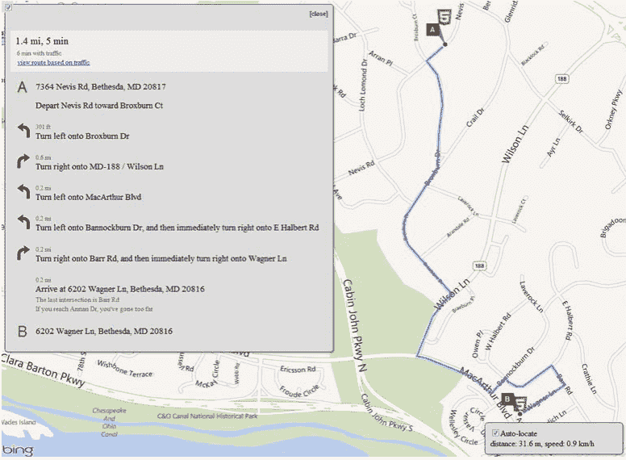

### 图6.10 完成的应用程序，显示路线信息和用户当前位置

如果发生错误，`directionsError`将会触发。

# Web Workers 与拖放

**本章内容涵盖**

- 在桌面浏览器中实现拖放功能
- 在拖动用户界面元素时处理数据
- 构建多线程Web应用
- 将高成本的CPU操作转移到后台线程

本章旨在化繁为简。在任何具有大量用户交互的HTML应用中，你都会遇到相互冲突的需求，例如需要在保持界面响应的同时上传文件或编辑图像。本章将向你展示如何通过两种新的HTML5 API——Web Workers和拖放——来平衡响应式用户界面（UI）与执行复杂、处理器密集型任务的需求。

根据主机系统的内存和处理器性能，进行任何繁重的处理都可能导致屏幕暂时挂起。你甚至可能遇到浏览器提示信息，声称其认为存在失控进程。

### 浏览器支持

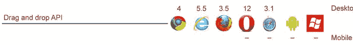

### 第7章 地图

拖放功能是指能够为页面上任何已渲染的元素添加功能，使其可以被拾取、拖动（连同附加数据）到页面上的其他位置并放下。拖放可以通过触摸或鼠标事件触发。拖放序列的每个阶段都会触发JavaScript事件，开发者可以利用这些事件来执行相应的工作。

我们将在以下部分介绍拖放主题：

- 拖放事件模型：第191页
- 实现拖放事件处理程序：第191页
- `dataTransfer`对象：第193页
- 使用带有数据的放置事件：第194页

Web Workers是JavaScript中的对象，它们从单独的JavaScript文件加载，并在后台线程中执行工作。Web Workers可以从宿主线程接收消息，并可以向创建它们的线程发送消息。

我们将在以下部分介绍Web Workers：

- Web Workers处理模型：第198页
- 向另一个线程发送工作：第199页
- 响应来自另一个线程的更新：第203页

Web Worker API为这个问题提供了一个很好的解决方案，允许你创建后台工作线程，它们可以在不同的线程中执行工作，从而释放UI线程来重绘页面或执行其他交互逻辑。

在UI方面，我们将讨论用户拾取界面的一部分并将其放置到其他位置的能力。在早期版本的HTML中也可以实现这一点，但过程非常繁琐，且生成的应用程序在不同浏览器平台之间不兼容。HTML5拖放API通过一套简单易懂且易于集成的功能集解决了这个问题。传统上，拖放对于浏览器执行来说是一项资源密集型操作，因此能够在后台执行繁重JavaScript任务的同时流畅地实现拖放，应该是对处理器能力的良好测试。

在本章中，我们将向你展示如何在一个示例——一个图形处理应用——中同时使用这两种新API。我们将首先快速预览最终应用，并为构建它奠定基础。然后，你将完成这两项主要任务：

- 在JavaScript中实现拖放，包括使用`dataTransfer`对象和构建工作单元对象
- 实现Web Workers，包括向另一个线程发送工作以及将Web Workers集成到JavaScript库中

让我们立即开始，先对应用程序进行高层概览，然后你就可以开始构建了。

## 7.1 入门：构建集成拖放和Web Workers的应用

该示例应用程序由ASP.NET MVC项目中的一个页面组成。页面顶部将展示三张图片，用户可以从原始位置拖动它们，并放置到一组`<canvas>`元素上。当放置发生时，你的JavaScript库将从放置的图像中提取图像数据，并将其传递给Web Worker。

Web Worker反过来会修改图像数据，并将其发送回主库以更新`<canvas>`。Web Worker执行的进程将对发送给它的图像进行增量更改，并将这些更改发送回主应用程序库。这将允许用户非常快速地将图像拖放到`<canvas>`元素上，而处理器无需等待可用周期。

完成的DragWorker项目如图7.1所示。

### 为拖放/Web Workers应用奠定基础

既然你已经知道我们的目标，你将创建解决方案，添加新页面和图像，设置样式，并创建视图：

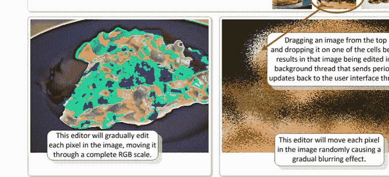

**图7.1** 完成后，DragWorker应用程序将允许用户从顶部栏拖动图像并将其放置到其中一个框中进行处理。图像数据的处理使用HTML5 Web Workers在后台线程上完成。

创建一个新的ASP.NET MVC Web应用程序，并将其命名为DragWorker。

将其设置为Internet应用程序，并在Visual Studio中加载后，通过导航到工具 > 库包管理器 > 管理解决方案的NuGet包来更新所有NuGet包。

在左侧找到“更新”选项卡，当中间内容加载后，点击每个包上的“更新”按钮。

打开`Views\Shared`文件夹中的`_Layout.cshtml`，并将脚本标签更新为你`Scripts`文件夹中当前存在的版本。

### 创建页面

现在创建将包含HTML5应用程序的新页面：

打开`Controllers`文件夹中的`HomeController.cs`文件，并将以下代码添加到类的底部。此代码创建了网站的端点，当在站点URL中输入`/DragWorker`时，将响应MVC视图。

```csharp
public ActionResult DragWorker()
{
    return View();
}
```

返回`_Layout.cshtml`主页面，并将以下行项添加到网站顶部的菜单中：

```html
<li>@Html.ActionLink("Drag Worker", "DragWorker", "Home")</li>
```

### 添加图像

接下来，你需要添加将要使用的图像。你的示例使用三张图像（图7.2），你可以在GitHub上找到它们：`github.com/axshon/HTML-5-Ellipse-Tours/tree/master/demos/drag-workers/Images`。将这些图像放置在项目的`Content`文件夹中。

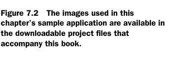

图7.2 本章示例应用程序中使用的图像可在本书附带的可下载项目文件中找到。

> **注意** 你也可以使用自己的图像。如果这样做，你需要找到解决方案中引用图像的位置，并将它们更改为指向你自己的图像文件名。

### 创建样式表

你将使用一个单独的样式表，而不是默认的`site.css`，因为你的某些样式将覆盖ASP.NET MVC模板中的样式。因此，你需要在`Content`文件夹中创建一个名为`drag.css`的新样式表。你可以参考本章末尾的完整代码清单获取该文件的内容。

这些样式并无特别之处，除了用户选择样式属性（`user-select`），当设置为`none`时，将不允许``元素在用户开始拖动时显示为选中状态。这有助于在拖放过程中保持元素样式的一致性。

## 构建视图

现在是为 DragWorker 构建视图的时候了：

1. 导航回`HomeController`中的`DragWorker`端点，并在其上点击右键。
2. 从弹出菜单中选择“添加视图”。
3. 在创建的 MVC 视图中，添加以下代码清单中的标记。这就是包含图 7.3 截图中所有 HTML 元素的 UI。

### 代码清单 7.1 DragWorker MVC 视图的完整标记

```html
@{ Layout = null; }
<!DOCTYPE html>
<html>
<head>
    <title>Drag & Drop and Web Workers</title>
    <meta name="viewport" content="user-scalable=no,
        initial-scale=1.0, minimum-scale=1.0,
        maximum-scale=1.0" />
    <script src="@Url.Content("~/Scripts/jquery-1.7.2.js")"
        type="text/javascript"></script>
    <script src="@Url.Content("~/Scripts/modernizr-2.5.3.js")"
        type="text/javascript"></script>
    <link href="@Url.Content("~/Content/drag.css")"
        rel="stylesheet" type="text/css" />
</head>
<body>
    <header class="box-round box-shadow">
        
        
        
        Drag an image from this page or from your
        desktop into one of the boxes below. You
        also can drag from box to box.
    </header>
    <section id="content">
        <div id="unit1" class="unit box-round box-shadow"
            draggable="true">
            <canvas />
        </div>
        <div id="unit2" class="unit box-round box-shadow"
            draggable="true">
            <canvas />
        </div>
    </section>
    <script src="@Url.Content("~/Scripts/main.js")"
        type="text/javascript"></script>
</body>
</html>
```

将布局设置为`null`以防止母版页被加载。

``元素默认是可拖动的，因此不需要额外的属性。

`<div>`元素不可拖动，因此需要为它们添加`draggable`属性。

每个`<div>`包含一个`canvas`，你将在其中展示图像。

将图像从此页面或你的桌面拖到下面的其中一个框中。你也可以从一个框拖到另一个框。


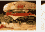


图 7.3 DragWorker 的页面结构已准备就绪，但没有 UI 元素被启用，因为源拖放库尚未工作。

代码清单 7.1 中的`draggable`属性是 HTML5 中的新特性，它允许页面设计者指定哪些元素是可拖动的。大多数浏览器默认允许拖动图像，并且基本的实现已经到位。对于其他元素，你需要将该属性设置为`true`，然后实现你想要执行拖放操作的任何逻辑。

如果你引入了本章末尾列出的`drag.css`中的所有样式，你现在应该能够运行应用程序并看到带有图像在右上角的基本布局，如图 7.3 所示。

尽管看起来不错，但在你构建出`main.js`文件之前，任何功能都不会起作用。这是下一步。

## 7.2 在 JavaScript 中实现拖放

DragWorker 应用程序的客户端库存在于两个文件中。第一个是`main.js`，它包含检测支持、实现拖放操作以及在 Web Worker 后台进程和承载页面之间处理来回消息的所有逻辑。第二个文件是`worker.js`，你将在第 7.3 节中构建后台 Web Worker 任务。

`main.js`的基本结构如下代码清单所示。

### 代码清单 7.2 main.js 文件的轮廓

```javascript
$(document).ready(function () {
  DragMain.init();
});

window.DragMain = {
  init: function () {
    var self = this;
    if (!Modernizr.draganddrop) {
      alert("Drag and drop not supported.");
      return;
    }
    if (!Modernizr.webworkers) {
        alert("Web workers not supported. ");
        return;
    }

    new Unit($("#unit1"), "cycle");
    new Unit($("#unit2"), "diffuse");
}
};

window.Unit = function ($container, type) {
};

Unit.prototype = {
    useImage: function (url) {
    }
};
```

`DragMain`对象的代码是完整的，但`main.js`库还有很多工作要做。`DragMain`唯一的功能是创建两个`Unit`对象，向每个对象发送`Unit`所需的 jQuery 选择器，以便：

- 查找页面元素
- 连接拖放事件

此应用程序中的`Unit`只是一个容器，你将用它来封装拖放功能，以及传递给 Web Worker 的内容。下一步是深入研究这个对象，使其能够实现 HTML5 拖放。

不过，首先你需要了解这个 API 的确切外观及其工作原理。

### 7.2.1 HTML5 拖放 API

HTML5 中的拖放实现完全依赖于事件模型。在拖放操作期间，有七个事件在不同时间触发。这些事件要么在被拖动的项目上触发，要么在拖动项目所拦截的项目上触发。这些事件（在`dragStart`之后）几乎可以按任何顺序发生。

图 7.4 显示了整个拖放事件模型的简单视图。

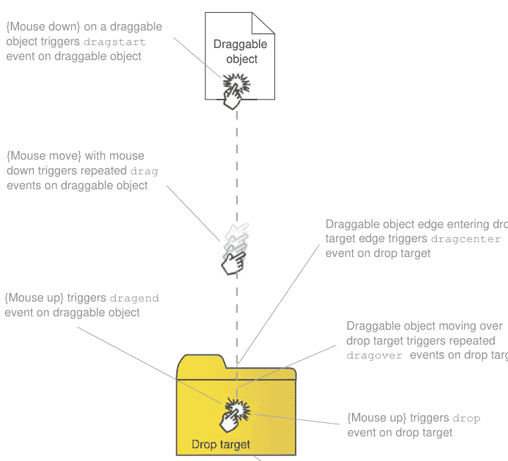

**图 7.4** 拖放事件模型在可拖动对象和放置目标对象之间执行。当按下鼠标按钮、移动鼠标和释放鼠标按钮时，各种事件会在两个对象上触发。

拖放的整体模型非常简单，消除了在代码中跟踪拖放操作的任何需求。通过使用各种事件和触发每个事件的对象，你可以让用户清楚地了解将要发生什么以及何时发生。

> **警告** 当我们讨论拖放时，我们通常指的是桌面浏览器。虽然在触摸界面中拖动元素是可能的，但这可能导致难以管理的事件链和用户难以预测或取消的交互。在 iPad、iPhone 和平板电脑等设备上，最好使用触摸和手势编程模型，而不是其底层事件。你可以搜索 iOS 手势事件以查找 iPhone 和 iPad 设备的参考资料，并搜索指针事件以查找 Windows 8 兼容的事件模型。与触摸的深度集成超出了本书的范围。

除了事件和触发它们的对象之外，某些事件还附带属性，你可以使用这些属性来提供更多功能。其中最重要的是附加到`dragStart`和`drop`事件的`dataTransfer`对象。让我们更仔细地看看这个对象。

### 7.2.2 使用 dataTransfer 对象在拖放事件中传递数据

**核心 API**

当拖动操作发生时，你可以轻松地将操作的源和其最终目标对象作为目标。这是通过跟踪触发每个事件的元素来完成的。但是，当元素代表业务对象，并且你需要对底层数据执行某种操作时会发生什么？例如，如果你试图将联系人从列表拖到聊天屏幕元素中，会发生什么？在拖动时携带所有联系信息会很有帮助。此外，当你希望拖动操作表示某个特定动作（如将图像扔进垃圾桶）时，会发生什么？你可以跟踪标识符并在操作触发时查找它们，但原生拖放规范为你提供了一个更好的选项：`dataTransfer`对象，作为拖放事件的属性，提供了一些有趣的功能。这个对象在`dragStart`（你想要分配要拖动的数据的过程点）时是可写的，而在`drop`（你将读回数据的位置）时是只读的。为了将数据分配给`dataTransfer`对象，你可以使用`setData`函数，传入内容类型和实际的数据对象作为参数。此函数只能在`dragStart`事件期间调用，因为在其他时间它都是只读的。`getData`函数在`drop`事件上运行，并以其内容类型作为参数。调用时，它返回在`setData`中分配的对象。例如，以下代码片段显示了你即将编写的拖放实现中的相关部分。此代码将 canvas 元素的数据分配给拖动事件，然后在放置事件中取回它：

```javascript
// 在 dragStart 时分配 dataTransfer
this.$container.bind("dragStart", function (e) {
    var url = self.$canvas[0].toDataURL();
    e.originalEvent.dataTransfer.setData("text/uri-list", url);
});

// 在 drop 时从 dataTransfer 检索数据
this.$container.bind("drop", function(e) {
    var url = e.originalEvent.dataTransfer.getData("URL");
});
```

请注意，当你启动拖动操作时，你获取被拖动图像的 URL 并将其保存到`dataTransfer`对象中。然后，当放置操作发生时，你获取该 URL 并将其发送到`Unit`对象中的`useImage`函数进行处理。图像数据不会被传输，只传输 URL。`dataTransfer`对象还能够通过在元素触发`dragenter`或`dragover`事件时更改拖动图标来影响 UI。这最常用于将拖动图标更改为放置图标，或更改为拖动拳头的鼠标光标。`dropEffect`属性设置为`copy`、`move`、`link`或`none`，允许你指定当 drop 触发时将执行特定类型的操作。

与`dropEffect`紧密相关的是`effectAllowed`。此属性只能在源对象的`dragStart`事件，以及目标对象的`dragenter`和`dragover`事件中被赋值。它允许你指定这些操作期间可能发生哪些效果。

### 7.2.3 构建拖放过程中用于传输数据的对象

在掌握了拖放的基础知识后，让我们回到`Unit`对象。清单7.3展示了它的基本结构。

你首先需要为外部容器设置一些本地的jQuery包装集合，在本例中，容器内包含一个`<div>`和一个`<canvas>`元素。然后，你为Web Workers构建一些结构代码。你很快就会完善并填充这些代码。最后，本讨论的重要代码是你附加到前面提到的包装集合（`<div>`容器元素）上的拖放事件绑定器。

### 创建用于控制发送给Web Worker的工作类型的Unit对象

下面清单中的代码应放置在`main.js`文件中`window.DragMain`对象的闭合花括号之后。你应该已经从前面的代码清单中在那里有了存根函数。

### 清单 7.3 Unit对象的基本结构

```javascript
window.Unit = function ($container, type) {
    if (!(this instanceof arguments.callee))
        throw new Error("Don't forget to use 'new'!");

    var self = this;
    this.$container = $container;
    this.$canvas = $container.find("canvas");
    this.context = this.$canvas[0].getContext("2d");

    //this.worker = new Worker("/Scripts/worker.js");
    //this.worker.onmessage = function (event) { };
    //this.worker.postMessage({ });

    // 可拖动对象
    this.$container
        .bind("dragStart", function (event) {
        });

    // 放置目标
    this.$container
        .bind("dragover", function(event) {
        })
        .bind("dragleave", function(event) {
        })
        .bind("drop", function(event) {
        });
};
```

检查并确保对象是使用`new`关键字调用的，以确保获得原型。

设置容器元素引用，并获取canvas绘图上下文的引用。

为后续设置Web Worker实现。

绑定`dragStart`事件，使得一个canvas中的元素可以拖放到另一个canvas上。

将其余的拖放事件绑定到容器上以实现放置操作。

### 在Unit对象中实现拖放事件处理器

前面清单中的几行代码被注释掉了。这些与Web Worker以及我们将在下一节讨论的后台处理有关。我们在清单7.3中的重点是你所绑定的拖放事件。

HTML中的``元素会自动实现`dragStart`函数，但如果你想让用户能够将图片从一个canvas拖放到另一个canvas，你需要手动连接该事件。此外，当`dragover`和`dragleave`事件触发时，你只需添加和移除CSS类属性，以向用户提供适当的反馈，而不执行任何实际工作。`dragend`是真正发生魔法的地方。在`drop`发生时，你在那里获取`dataTransfer`对象并将图像绘制到canvas上。

下面的清单展示了这一切如何在`Unit`对象代码中工作。这段代码填充了`main.js`中`window.Unit`对象中的函数。

### 清单 7.4 在Unit对象中实现拖放事件处理器

```javascript
// 可拖动对象
this.$container
    .bind("dragStart", function (event) {
        var url = self.$canvas[0].toDataURL();
        event.originalEvent
            .dataTransfer.setData("text/uri-list", url);
    });

// 放置目标
this.$container
    .bind("dragover", function(event) {
        self.$container.addClass("drag-over");
        event.preventDefault();
        event.stopPropagation();
    })
    .bind("dragleave", function(event) {
        self.$container.removeClass("drag-over");
    })
    .bind("drop", function(event) {
        self.$container.removeClass("drag-over");

        var data = event.originalEvent.dataTransfer;
        if (!data) return;

        event.preventDefault();
        event.stopPropagation();

        var url = data.getData("URL");
        if (url && url.indexOf("file://") != 0) {
            self.useImage(url);
        } else {
            alert("Cannot drag that image into here");
        }
    });
```

当`dragStart`发生时，使用`toDataURL`函数获取canvas元素中当前像素的Base64编码字符串。

将图像字符串数据赋值为拖拽事件的内容。

当目标元素被通知有另一个元素进入其边界时，更改框的样式。

当元素被拖出容器时，反转样式。

当`drop`事件触发时，获取`dataTransfer`对象的引用。

从传输对象中检索图像数据字符串。

将图像绘制到canvas元素上。

样式表表明，当应用`drag-over`样式类时，边框应设置为2像素：`border: 2px solid #99f`。因此，当被拖动的元素进入`<div>`的边界时，它应显示如图7.5所示，并在元素被放置或离开目标元素边界时恢复正常。

### 放置事件：在canvas元素上按比例绘制图像

当一个图像被放置到`<div>`上时，你目前的代码将获取`drop`事件的图像内容，并在跟踪事件的当前`Unit`对象上调用`useImage`。以下是逻辑的核心：

```javascript
.bind("drop", function(event) {
    self.$container.removeClass("drag-over");

    var data = event.originalEvent.dataTransfer;

    var url = data.getData("URL");
    self.useImage(url);
});
```

此函数是`Unit`原型的一部分，允许你提高代码重用性。使用此方法，任何被放置的、可以转换为图像数据的对象都可以调用此函数将该图像绘制到`<canvas>`上。

下面的清单完成了这一点；将其放置在`main.js`文件的末尾。

### 清单 7.5 useImage函数在canvas元素上按比例绘制图像

```javascript
Unit.prototype = {
    useImage: function (url) {
        var self = this;
        var $image = $("")
            .load(function () {
                var img = $image[0];
                var w = img.width;
                var h = img.height;
                var cw = self.$container.width();
                var ch = self.$container.height();
                var scale = cw / w;
                if (h * scale > ch)
                    scale = ch / h;
                w *= scale;
                h *= scale;
                self.$canvas
                    .attr("width", w)
                    .attr("height", h)
                    .width(w)
                    .height(h);
                self.context
                    .drawImage($image[0], 0, 0, w, h);
                try {
                    var imageData =
                        self.context
                            .getImageData(0, 0, w, h);
                    //self.worker.postMessage({
                    //    method: "setImageData",
                    //    imageData: imageData
                    //});
                }
                catch (e) {
                    alert("Cannot use images from other sites");
                }
            })
            .error(function () {
                alert("Unable to load " + url);
            })
            .attr("src", url);
    }
};
```

在内存中创建新的图像包装集合。

将事件处理器附加到`load`事件上。

根据父容器的尺寸分配高度和宽度属性。

找到高度和宽度缩放比例，以保持纵横比。

根据新的调整后的尺寸设置canvas对象的高度和宽度属性。

从先前赋值的变量中将图像绘制到canvas上。

向Web Worker发送包含图像数据的新消息，告知其开始处理。

将`src`属性赋值给图像，这将在数据设置好后触发`load`事件。

我们很快会回到前面代码清单中Web Worker的部分。目前，这个`useImage`函数的重要部分是：你在内存中创建一个``元素，将其`load`事件附加一个处理器，然后设置源值。

**注意** 从头构建``元素时，操作顺序很重要。在绑定`load`事件之前分配`src`属性，对于加载较慢的较大图像可能有效，但对于加载非常快的较小图像，它几乎肯定会失败。在这种情况下，较小的图像可能在事件处理器连接完成之前就被加载到DOM中，导致事件未被捕获。在前面的清单中，有几行代码调用了`self.worker.postMessage`。这些是特定于Web Worker的，代码被注释掉以便你可以对应用程序进行快速测试。

**试一试！** 启用拖放功能后，你应该能够启动你的应用程序，并将一个图像从顶部栏拖动到屏幕底部的方框中。你还应该能够将图像从一个底部方框拖动到另一个方框，并看到它被绘制在那里。图7.6展示了你的页面应该如何显示。

## 7.3 HTML5 Web Workers

将一张图片从本页面或您的桌面拖入下面的任一框中。您也可以将图片在不同框之间拖动。


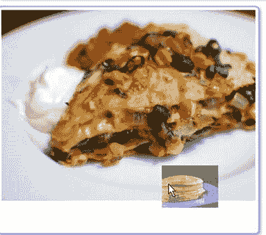


至此，您已拥有一个在 ASP.NET MVC 站点内运行的自定义单页应用程序解决方案。该页面允许用户从图片的原始位置将图片拖动到目标区域并放下。放下的图片随即被显示出来。

下一步是让拖放目标（在本例中为`Unit`对象）实现相关逻辑，将图片数据发送到后台线程进行处理。在该线程中，您将通过循环操作来处理各个像素，模拟一个处理器密集型任务。您还必须让该后台线程在更新完成后能与`Unit`通信。这就引入了 Web Worker 的世界。

假设您正在编写一个图像编辑工具，用于在浏览器中对上传的照片进行红眼检测。通常情况下，您会创建一个函数来检测图像中与红眼相关的条件，然后在收到照片时调用该函数。然而，当用户希望一次上传多张图片，或希望在照片处理时编辑其元数据时，这就带来了一个问题。Web Worker 通过允许您将构成照片的字节数据发送到后台线程进行处理来解决这个问题。当工作完成后，后台线程会回调宿主线程，并更新界面。

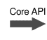

Web Worker 是一组非常简单的接口，允许您在一个由浏览器拥有但与用于更新界面的线程不同的线程中启动工作。这对 JavaScript 开发者而言意味着真正的异步编程。现代浏览器的 JavaScript 引擎异步任务执行速度极快，但它们并不提供真正的并发处理（即两个任务同时工作）。

传统的异步任务通常采用回调形式，对于简单应用来说是可行的。随着 JavaScript 引擎速度的提升，它甚至能用于许多复杂应用——为了从传统 JavaScript 应用中榨取每一滴性能，已经进行了大量的研究和开发。但 Web Worker 更进一步，允许您将整个任务卸载到另一个线程，仅当该线程有更新需要反馈给调用者时才进行响应。

> **提示** 关于如何充分利用 JavaScript 单线程的见解，请参阅 Nicholas Zakas 的《高性能 JavaScript》（O'Reilly, 2010）。

单线程的问题，您可能已经意识到，那就是如果您使用`<canvas>`来构建图像，或调用服务器来传输一个大的数据包，那么您做的任何事情都不可避免地会拖慢您的界面、您的复杂任务，或者两者兼有。随着 Web 应用客户端越来越复杂，您会发现单线程已不再够用。图 7.7 对比了当前的同步 UI 线程模型与 HTML5 Web Worker 的新世界。

Web Worker 的生命周期仅与其当前页面在浏览器中的存在时间一样长。如果您刷新页面或导航到不同的页面，该 worker 对象将丢失，如果需要再次访问它，则必须从头开始重新启动。

### 7.3.1 基础知识：将工作发送到另一个线程

Web Worker 不是一个像地理位置 API 那样始终可用的静态对象。相反，它是一个您通过变量创建和引用的对象。

您可以通过调用`Worker`对象的`new`方法并传入一个脚本文件来实现这一点。该文件应通过完整 URL 或相对于您网站中当前页面位置的路径来引用：

```javascript
var myWorker = new Worker('WorkerProceses.js');
```

同样值得注意的是，Web Worker 不一定必须由 UI 线程托管。Web Worker 可以像 UI 线程一样轻松地生成另一个 Web Worker。我们大部分时候将使用的术语是 *宿主* 和 *工作者*，其中 *宿主* 是生成新 Web Worker 的线程，而 *工作者* 是执行生成的脚本的线程。

一旦创建，worker 不会超时或停止工作，除非通过`worker.terminate`函数被告知这样做。因为 JavaScript 在脚本文件加载时会立即执行到内存中，worker 可以立即开始执行工作，例如调用地理位置 API 或发起 Ajax 请求获取数据。它也可以立即开始向其父线程发送消息。

宿主的`worker`对象有一个`postMessage(string)`方法，宿主使用它来传递字符串或 JSON 数据。`worker`也会触发一个`message`事件，可以使用宿主中的`addEventListener`函数或将函数绑定到`onmessage`事件来监听。同样，在`worker`对象内部，您可以调用`postMessage`并将一个函数附加到`message`事件。Worker 还有一个可由宿主调用的`worker.terminate`函数，用于停止`worker`内部执行的所有工作。一旦调用了`terminate`，`worker`对象将不会发送或接收任何额外的消息。图 7.8 应该能让您更好地理解基本方法论。

## 宿主脚本如何与 Web Worker 脚本协同工作？

这里需要举一个例子。接下来的两个代码清单并非本章项目的一部分，但它们是宿主脚本和 Web Worker 脚本如何协同工作的简单示例。

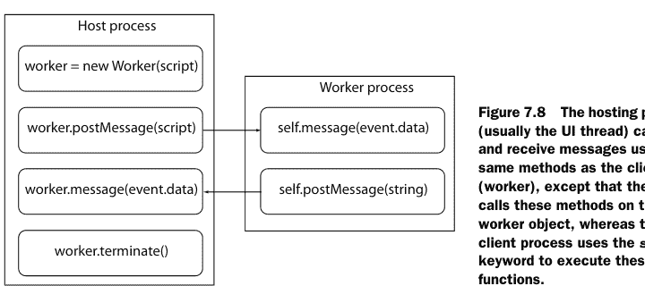

**图 7.8** 宿主进程（通常是 UI 线程）可以使用与客户端（worker）相同的方法发送和接收消息，不同之处在于宿主在 worker 对象上调用这些方法，而客户端进程使用`self`关键字来执行这些函数。

## Web Worker 规则

由于 Web Worker 与宿主浏览器的线程是隔离的，在将它们用于您的网站之前，您需要理解一些规则：

- Web Worker 将在浏览器内的其自己的线程中执行。它可以访问服务器资源以及从宿主线程传递给它的任何数据。它还能启动自己的 worker（称为子 worker），并成为那些 worker 的宿主线程。Web Worker 还可以访问`navigator`对象，这意味着它可以与地理位置 API 通信。它可以发起自己的 Ajax 请求并访问`location`对象。
- Web Worker 无法访问 UI 的任何部分。这意味着`window`对象内的任何内容以及`document`对象都是禁止访问的。在 JavaScript 应用程序中，声明的任何变量都自动位于全局作用域中，即它们附加在`window`上，因此您的 Web Worker 将无法访问任何应用程序变量或函数，也无法响应应用程序其余部分的任何事件或回调。
- Web Worker 使用单个 JavaScript 文件执行，并且在该脚本中，它可以在启动时引入其他文件。这开启了将整个应用程序逻辑置于与 UI 线程分离的线程上的可能性，但这超出了本章的范围。在示例应用程序中，您只卸载了图像处理工作，而将拖放功能留给了 UI 线程。

规范指出，Web Worker 设计上并非用于短期执行，不应指望它们在启动后仍然可用。这意味着您发送给 Web Worker 的工作结果不应依赖于 UI。Web Worker 有用但开销较大，因此尽量避免用大锤子去砸小钉子。

## 什么是宿主，什么是工作者？

在 Web Worker 的世界中，就像在大多数多线程场景中一样，术语可能有点令人困惑。为什么不直接称宿主为 UI 线程，新线程为后台线程呢？答案是，一个宿主进程本身很可能就是一个工作者。

> 假设有一个大型业务应用，在工作线程中管理业务逻辑，并将规则传递给UI线程。如果在某个时刻需要进行一些图形处理或密集计算，工作线程可以启动自己的工作线程。这个工作线程成为宿主，同时保持其作为UI宿主线程的工作线程地位。

正因为这种能力，我们保持术语的一致性，使用“宿主”和“工作线程”，其中宿主是新线程的创建者，而工作线程是被创建的线程。

请阅读以下代码清单。它假设一个空白网页上有一个ID为`test-Workers`的按钮。

### 代码清单 7.6 创建一个工作线程并向其发送消息

```javascript
$(document).ready(function () {
    workerTest.init();
});
window.workerTest = {
    myWorker: null,
    init: function () {
        self = this;
        self.myWorker = new Worker("/Scripts/myWorker.js");
        $("#testWorkers").click(
            function () {
                self.myWorker.postMessage("Test");
            }
        );
        self.myWorker.addEventListener("message",
            function (event) {
                alert(event.data);
            },
            false);
    }
};
```

正如你所见，宿主应用和Web Worker之间的整体接口非常简单。主要区别在于，宿主在其工作线程变量上调用函数，而客户端在`self`上调用相同的函数。

下一个清单展示了`myWorker.js`文件中的代码。

### 代码清单 7.7 一个简单的Web Worker脚本示例

```javascript
count = 0;
init = function () {
    self.count++;
    self.postMessage("start count: " + count);
}
self.addEventListener("message", function (event) {
    self.count++;
    setTimeout(function () {
        self.postMessage("Last Msg: " + event.data + ", count: " + count);
    }, 1000);
}, false);
init();
```

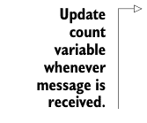


了解了这个基本示例之后，是时候回到你的示例项目，看看如何让Web Worker为你的应用执行任务了。

### 7.3.2 将 Web Worker 集成到 JavaScript 库中

在本节中，你将完成`main.js`文件，通过构建与Web Worker的集成，然后构建`worker.js`文件，这是将在后台线程中执行的代码。示例应用在`main.js`中有两个位置，你放置了被故意注释掉的代码：在`Unit`对象中，以及在`Unit`对象的原型`useImage`函数中。

你将首先构建客户端的核心`Unit`对象；每当从Web Worker接收到消息时，它会将图像数据放置在当前的绘图上下文中。打开`main.js`文件，找到以`this.worker`开头的代码。使用以下清单中的代码更新该部分。

### 代码清单 7.8 创建一个Web Worker对象并分配任务

```javascript
this.worker = new Worker("/Scripts/worker.js");
this.worker.onmessage = function (event) {
    self.context.putImageData(event.data, 0, 0);
    setTimeout(function () {
        self.worker.postMessage({
            method: "nextFrame"
        });
    }, 30);
};

this.worker.postMessage({
    method: "setType",
    type: type
});
```

你并没有测试从工作线程接收到的数据是否真的是图像，因为你在控制`worker`对象。由于工作线程不能从另一个域的脚本启动，所以在小型项目中这些检查是不必要的。

当一个图像被拖放时，会发生以下事情：

- 创建一个新的`Unit`对象。
- 使用一组初始化变量实例化worker对象。
- `Unit`对象准备通过立即绘制到绘图上下文来响应来自worker的更新图像。

现在，消息已经从宿主发送到工作线程，我们需要切换视角，看看工作线程将如何响应。

## 响应来自主进程的消息

在宿主进程中唯一剩下的事情就是将初始数据发送给Web Worker。这在原型中处理，但你需要先充实Web Worker。

`DragWorker`的操作很简单：

1. 当调用`setType`时，确定要执行哪种图像处理。这在`Unit`对象首次实例化时完成；它要么执行像素化效果，要么执行图像颜色的渐变变化。
2. 从UI线程的绘图上下文中获取`imageData`数组。
3. 立即对`imageData`执行第一帧操作。
4. 使用`postMessage`将包含更新数据的消息发送回宿主线程。
5. 等待下一帧调用以获取更新的`imageData`，并执行图像修改。
6. 使用`postMessage`将包含更新数据的消息发送回宿主线程。

如果你还没有完成，请在`Scripts`文件夹中创建`worker.js`对象并打开它。将以下清单中的代码添加到该文件中。

```javascript
addEventListener("message", function (event) {
    var method = event.data.method;
    if (typeof method === "string" && method in DragWorker)
        DragWorker[method].call(DragWorker, event.data);
}, false);
```

前面代码中最值得注意的部分是能够使用字符串在对象上调用`call`函数，并传入两个参数。通过使用附加到JavaScript函数原型上的内置`call`和`apply`函数，你可以使用任意名称执行函数。

`call`和`apply`执行相同的任务，主要区别在于它们的签名。`call`只接受一个对象和一个参数列表，而`apply`接受对象和一个参数数组。在这种情况下，区别并不重要，因为你只想执行一个带单个参数（即`event.data`属性）的函数。

## 创建图像编辑逻辑

你在事件监听器中引用了`DragWorker`对象，因此在`worker.js`中需要创建它。以下清单提供了你需要修改的函数签名，用于在图像中修改单个像素并将其传输回宿主线程。

```javascript
var DragWorker = {
    type: null,
    imageData: null,
    directions: [
        [-1, -1],
        [0, -1],
        [1, -1],
        [1, 0],
        [1, 1],
        [0, 1],
        [-1, 1],
        [-1, 0]
    ],
    setType: function (data) {
        this.type = data.type;
    },
    setImageData: function (data) {
        this.imageData = data.imageData;
        this.nextFrame();
    },
    nextFrame: function () {
    },
    getPixelIndex: function (x, y) {
    },
    getPixel: function (x, y) {
    },
    setPixel: function (x, y, pixel) {
    }
};
```

`Directions`属性是我们扩散方法的坐标映射。

`Type`属性在调用`setType`时被赋值，它将描述图像处理的类型。

`setImageData`函数将数据赋给`imageData`，但也会执行第一帧操作。

`nextFrame`函数执行图像操作，是唯一将消息发布回宿主线程的代码。

这些函数帮助我们操作图像数据中的单个像素。

在你的应用中，`setImageData`看起来像这样：

```javascript
setImageData: function (data) {
    this.imageData = data.imageData;
    this.nextFrame();
},
```

在这个代码片段中，你从`data`对象分配一个本地属性，并调用`nextFrame`函数，该函数逐像素执行清单7.11中描述的编辑。我们不加解释地列出它们，因为图形算法不是我们这里想要展示的核心逻辑。只需知道，图像中的像素数据由一组四个值串联而成，排列为：

```
Red,Green,Blue,Alpha;
Red,Green,Blue,Alpha;
Red,Green,Blue,Alpha;
等等。
```

这种RGBA值的组合与第2章讨论的CSS RGBA颜色值完全相同。以下清单展示了放入`worker.js`的像素编辑函数。

### 清单 7.11 像素函数允许你对像素而非数据数组进行操作

```javascript
getPixelIndex: function (x, y) {
    if (x < 0 || y < 0 || x >= this.imageData.width || y >= this.imageData.height)
        return -1;
    return (x + y * this.imageData.width) * 4;
},
getPixel: function (x, y) {
    var index = this.getPixelIndex(x, y);
    if (index == -1)
        return null;
    return {
        r: this.imageData.data[index],
        g: this.imageData.data[index + 1],
        b: this.imageData.data[index + 2],
        a: this.imageData.data[index + 3]
    };
},
setPixel: function (x, y, pixel) {
    var index = this.getPixelIndex(x, y);
    if (index == -1)
        return;
    this.imageData.data[index] = pixel.r;
    this.imageData.data[index + 1] = pixel.g;
    this.imageData.data[index + 2] = pixel.b;
    this.imageData.data[index + 3] = pixel.a;
}
```

`getPixelIndex`函数将x和y坐标转换为图像数据数组中的索引。

`getPixel`函数返回一个包含RGBA值的对象。

`setPixel`函数将像素对象中的值写回图像数据数组。


```javascript
getPixelIndex: function (x, y) {
    if (x < 0 || x >= this.imageData.width ||
        y < 0 || y >= this.imageData.height)
        return -1;

    return (y * this.imageData.width * 4) + (x * 4);
},

getPixel: function (x, y) {
    var index = this.getPixelIndex(x, y);
    if (index == -1)
        return null;
    return {
        r: this.imageData.data[index],
        g: this.imageData.data[index + 1],
        b: this.imageData.data[index + 2],
        a: this.imageData.data[index + 3]
    };
},

setPixel: function (x, y, pixel) {
    var index = this.getPixelIndex(x, y);
    if (index == -1)
        return null;
    this.imageData.data[index] = pixel.r;
    this.imageData.data[index + 1] = pixel.g;
    this.imageData.data[index + 2] = pixel.b;
    this.imageData.data[index + 3] = pixel.a;
}
```

## 在 Web Worker 中编辑图像并将其发送回宿主线程

终于，你触及了 Web Worker 的核心：在后台线程中编辑图像，然后将该图像发送回宿主线程。

`worker.js` 中的 `nextFrame` 函数显示在下面的清单中，包含一个 `switch` 语句，用于确定要执行的操作类型。你可以轻松地向此函数添加更多处理或更多类型的操作，例如 alpha 淡入淡出或图像旋转。

### 清单 7.12 `nextFrame` 将编辑图像并将其发送回宿主机

```javascript
nextFrame: function () {
    switch (this.type) {
        case "cycle":
            var a;
            for (i = 0; i < this.imageData.data.length; i++) {
                if (i % 4 != 3) {
                    var value = this.imageData.data[i] + 1;
                    if (value > 255)
                        value = 0;
                    this.imageData.data[i] = value;
                }
            }
            break;

        case "diffuse":
            var x;
            var y;
            for (y = 0; y < this.imageData.height; y++) {
                for (x = 0; x < this.imageData.width; x++) {
                    var direction =
                        this.directions[
                            Math.floor(Math.random() *
                            this.directions.length)];
                    var x1 = x + direction[0];
                    var y1 = y + direction[1];
                    var pixel = this.getPixel(x, y);
                    var pixel1 = this.getPixel(x1, y1);
                    if (pixel1) {
                        this.setPixel(x, y, pixel1);
                        this.setPixel(x1, y1, pixel);
                    }
                }
            }
            break;
    }
    postMessage(this.imageData);
}
```

循环功能处理每个像素中所有非 alpha 的颜色分量。

将像素值递增 1，直到达到 255；然后返回到 0。

将新数据放回原始数组中。

试一试！

现在运行你的应用程序，你应该能够将图像拖动到屏幕的左右窗格，看到 Web Worker 正在执行它们的工作并修改图像，如图 7.9 所示。


图 7.9 完成的应用程序。拖放事件仍然会触发，允许用户将任何图像放入任一框中。一旦发生放置，Web Worker 将接管并编辑图像数据，将更新发送回宿主线程，在那里图像被重绘在页面上。

更新后的图像上出现的强对比度，发生在任何 RGB 值达到 255 并返回到 0 重新开始时。如果你等待足够长的时间，该图像应在其原始状态停留约 30 毫秒。

在右侧，图像将始终保持相同数量的像素，并且这些像素永远不会改变颜色。然而，它们会改变位置，并开始使屏幕模糊和像素化，直到无法再分辨出原始图像。

## 7.4 总结

在本章中，你通过使用 Web Worker 开发一个拖放接口来修改来自 `<canvas>` 元素的图像，完成了整个流程。在此过程中，你了解了在拖动操作期间将数据与 UI 元素一起移动的方法，以及如何在宿主线程和工作线程之间来回编组数据和对象。

拖放是桌面界面的一个功能，在过去，如果没有主要的代码分支来适应不同的浏览器，很难复制。HTML5 API 让所有人都处于平等的地位，以减少代码并提高可靠性。虽然拖放 API 仅限于桌面浏览器，但你可以用 Web Worker 做的事情限制要少得多。随着移动设备获得更多的处理器，桌面变得更快，使用 Web Worker API 通过将工作从主 UI 线程转移到后台线程来加速应用程序处理将变得更加重要。

我们将在下一章继续这个使用 Web 应用程序提高性能的主题，深入探讨网页和服务器之间的实时通信世界，即 Websockets。

## 7.5 完整的代码清单

### 清单 7.13 `main.js` 的完整代码

```javascript
$(document).ready(function () {
    DragMain.init();
});

window.DragMain = {
    init: function () {
        var self = this;

        if (!Modernizr.draganddrop) {
            alert("This browser does not support drag and drop");
            return;
        }

        if (!Modernizr.webworkers) {
            alert("This browser does not support web workers");
            return;
        }

        new Unit($("#unit1"), "cycle");
        new Unit($("#unit2"), "diffuse");
    }
};

window.Unit = function ($container, type) {
    if (!(this instanceof arguments.callee))
        throw new Error("Don't forget to use 'new'!");

    var self = this;
    this.$container = $container;
    this.$canvas = $container.find("canvas");
    this.context = this.$canvas[0].getContext("2d");

    this.worker = new Worker("/Scripts/worker.js");
    this.worker.onmessage = function (event) {
        self.context.putImageData(event.data, 0, 0);
        setTimeout(function () {
            self.worker.postMessage({
                method: "nextFrame"
            });
        }, 30);
    };

    this.worker.postMessage({
        method: "setType",
        type: type
    });

    // Draggable
    this.$container
        .bind("dragStart", function (event) {
            var url = self.$canvas[0].toDataURL();
            event.originalEvent.dataTransfer.setData("text/uri-list", url);
        });

    // Drop target
    this.$container
        .bind("dragover", function(event) {
            self.$container.addClass("drag-over");
            event.preventDefault();
            event.stopPropagation();
        })
        .bind("dragleave", function(event) {
            self.$container.removeClass("drag-over");
        })
        .bind("drop", function(event) {
            self.$container.removeClass("drag-over");

            var data = event.originalEvent.dataTransfer;
            if (!data)
                return;

            event.preventDefault();
            event.stopPropagation();

            var url = data.getData("URL");
            if (url && url.indexOf("file://") != 0) {
                self.useImage(url);
            } else if ("FileReader" in window) {
                var files = data.files;
                var found = false;
                var a;
                for (i = 0; i < files.length; i++) {
                    var file = files[i];
                    if (!file.type.match("image.*"))
                        continue;
                    var reader = new FileReader();
                    reader.onload = function(loadEvent) {
                        self.useImage(loadEvent.target.result);
                    };
                    reader.readAsDataURL(file);
                    found = true;
                    break;
                }
                if (!found)
                    alert("no image files dropped");
            } else {
                alert("This browser does not support dragging from desktop");
            }
        });
};

Unit.prototype = {
    useImage: function (url) {
        var self = this;
        var $image = $("")
            .load(function () {
                var img = $image[0];
                var w = img.width;
                var h = img.height;
                var cw = self.$container.width();
                var ch = self.$container.height();
                var scale = cw / w;
                if (h * scale > ch)
                    scale = ch / h;
                w *= scale;
                h *= scale;
                self.$canvas
                    .attr("width", w)
                    .attr("height", h)
                    .width(w)
                    .height(h);
                self.context.drawImage($image[0], 0, 0, w, h);
                try {
                    var imageData =
                        self.context.getImageData(0, 0, w, h);
                    self.worker.postMessage({
                        method: "setImageData",
                        imageData: imageData
                    });
                }
                catch (e) {
                    alert("Cannot use images from other sites");
                }
            })
```

完整的代码清单 211

```
.error(function () {
    alert("Unable to load " + url);
})
.attr("src", url);
}
};
```

### 清单 7.14 `worker.js` 的完整代码

```javascript
addEventListener("message", function (event) {
    var method = event.data.method;
    if (typeof method == "string" && method in DragWorker)
        DragWorker[method].call(DragWorker, event.data);
}, false);

var DragWorker = {
    type: null,
    imageData: null,
    directions: [
        [-1, -1],
        [0, -1],
        [1, -1],
        [1, 0],
        [1, 1],
        [0, 1],
        [-1, 1],
        [-1, 0]
    ],

    setType: function (data) {
        this.type = data.type;
    },

    setImageData: function (data) {
        this.imageData = data.imageData;
        this.nextFrame();
    },

    nextFrame: function () {
        switch (this.type) {
            case "cycle":
                var a;
                for (i = 0; i < this.imageData.data.length; i++) {
                    if (i % 4 != 3) {
                        var value = this.imageData.data[i] + 1;
                        if (value > 255)
                            value = 0;
                        this.imageData.data[i] = value;
                    }
                }
                break;
            case "diffuse":
                var x;
                var y;
                for (y = 0; y < this.imageData.height; y++) {
                    for (x = 0; x < this.imageData.width; x++) {
                        var direction =
                            this.directions[
                                Math.floor(Math.random() *
                                    this.directions.length)];
                        var x1 = x + direction[0];
                        var y1 = y + direction[1];
                        var pixel = this.getPixel(x, y);
                        var pixel1 = this.getPixel(x1, y1);
                        if (pixel1) {
                            this.setPixel(x, y, pixel1);
                            this.setPixel(x1, y1, pixel);
                        }
                    }
                }
                break;
        }
        postMessage(this.imageData);
    },

    getPixelIndex: function (x, y) {
        if (x < 0 || x >= this.imageData.width ||
            y < 0 || y >= this.imageData.height)
            return -1;

        return (y * this.imageData.width * 4) + (x * 4);
    },

    getPixel: function (x, y) {
        var index = this.getPixelIndex(x, y);
        if (index == -1)
            return null;
        return {
            r: this.imageData.data[index],
            g: this.imageData.data[index + 1],
            b: this.imageData.data[index + 2],
            a: this.imageData.data[index + 3]
        };
    },

    setPixel: function (x, y, pixel) {
        var index = this.getPixelIndex(x, y);
        if (index == -1)
            return null;
        this.imageData.data[index] = pixel.r;
        this.imageData.data[index + 1] = pixel.g;
        this.imageData.data[index + 2] = pixel.b;
        this.imageData.data[index + 3] = pixel.a;
    }
};
```

### 清单 7.15 `drag.css` 的完整代码

```css
* { margin: 0; padding: 0; }

html, body {
    position: absolute;
    left: 0; top: 0; right: 0; bottom: 0;
}

header {
    position: absolute;
    left: 10px; top: 10px; right: 10px; height: 60px;
    padding: 4px; border: 1px solid #ccc;
}

header span { float: left; }

header img {
    float: right; height: 100%;
    padding-left: 10px;
    -webkit-user-select: none;
    -khtml-user-select: none;
    -moz-user-select: none;
    -o-user-select: none;
    user-select: none;
}

#content {
    position: absolute;
    left: 10px; top: 90px; right: 10px; bottom: 10px;
}

.unit {
    position: absolute;
    padding: 4px; border: 2px solid #ccc;
}

.unit.drag-over {
    border: 2px solid #99f;
}

#unit1 {
    left: 0; top: 0; right: 51%; bottom: 0;
}

#unit2 {
    left: 51%; top: 0; right: 0; bottom: 0;
}

.box-round {
    -webkit-border-radius: 6px;
    -moz-border-radius: 6px;
    border-radius: 6px;
    -moz-background-clip: padding;
    -webkit-background-clip: padding-box;
    background-clip: padding-box;
}

.box-shadow {
    -webkit-box-shadow: 2px 2px 4px rgba(0, 0, 0, 0.3);
    -moz-box-shadow: 2px 2px 4px rgba(0, 0, 0, 0.3);
    box-shadow: 2px 2px 4px rgba(0, 0, 0, 0.3);
}
```

# 第 8 章 Websockets

214

**本章内容**

- 理解 HTTP 和 TCP 流量的基本区别

- 使用 Websockets 和 JavaScript 在网络上实时通信

- 安装 Node.js 并构建一个简单的 TCP 服务器

Websockets 规范是 HTML5 技术栈中最有趣且最具范式转移性的 API 之一。当在一个 Web 平台上实现时，你的应用程序可以从发送请求并等待响应，转变为与服务器或其他客户端进行实时对话。

例如，使用 Websockets，你可以在平板设备上构建一个 Web 应用程序，能够与成千上万的玩家实时对战。MMOG（大型多人在线游戏）已经非常流行，而基于 HTML5 的版本正变得越来越普遍。一个允许你启动网站、出去跑步，并与地球另一端的人比赛的网站怎么样？将 Websockets 与地理位置服务集成，你实际上在各个方面都已上路。或者考虑一场音乐会的直播流，你可以与观众甚至乐队互动。这完全是可能的，而且可能很快就会变得司空见惯。

使用 Websockets，你的 HTML 应用程序获得了与服务器和其他用户实时通信的能力。你成为了一个更大网络中的实时节点，能够同时推送和拉取数据，而没有 HTTP 流量的格式限制。

在本章中，你将构建一个简单的聊天应用程序，它使用 ASP.NET MVC 应用程序中的一个页面，与使用 Node.js 构建的服务器进行通信。这比你想象的要容易，而且比你预期的要快。在阅读本章时，你可以期待这些亮点：

- 构建聊天网页

- 创建一个绑定到 Websockets API 事件的库

- 安装 Node.js 并构建一个简单的 TCP 聊天服务器

- 将客户端库连接到服务器，并区分自定义事件类型

首先，作为一个 .NET 开发者，你可能不熟悉 HTTP 和 TCP 的来龙去脉，所以我们将从一些关于它们是什么以及如何执行各自任务的背景知识开始。

215

### 浏览器支持


## 第 8 章地图

Websockets 允许浏览器通过 TCP 与服务器进行通信。TCP 通信比普通的 HTTP 通信更轻量、更快速，它们是持久化的，并且是双向的。持久连接允许服务器将数据推送给客户端，而无需浏览器请求，这是 HTTP 无法实现的功能。双向通信允许客户端和服务器同时发送和接收消息。

`WebSocket` 对象 第 8.2.2 节

`send` 函数 第 8.2.2 节

`onmessage` 事件 第 8.2.2 节

`readyState` 属性 第 8.2.2 节

其他连接事件 第 8.2.2 节

`close` 函数 第 8.2.2 节

使用 Websockets 打开服务器连接 第 8.2.3 节


## 8.1 HTTP 和 TCP——快速入门

全世界几乎所有进出网络浏览器的流量都是通过超文本传输协议（HTTP）进行的。这不是传输文本、数据或图像最快的方式，但它是可靠的。传输控制协议（TCP）是 HTTP 之下的一层，它在实际应用中操作规则较少。由于缺乏限制，TCP 通常比 HTTP 更快。

直到最近，TCP 对于原生浏览器窗口还不可用，只能通过插件（如 Silverlight 或 Flash）或作为原生桌面应用程序来实现。将 Websockets 协议引入 HTML5 规范正在改变这种情况，尽管相当缓慢。

在本节中，我们将介绍 HTTP 流量及其局限性的基础知识，然后将其与 TCP 流量进行对比。这两种技术都不是所有场景的最佳选择，因此本节将帮助你理解各自的适用之处，抛开当前围绕 Websockets 的炒作。

### 8.1.1 HTTP 概述

HTTP 是围绕请求/响应模式设计的。客户端向服务器发出请求。当服务器收到该请求时，它会检查请求的资源是否可用，并以状态码、称为头部的文本集合进行响应，如果可用，还会返回实际请求的内容。内容可以是任何东西，从简单的 HTML 页面到脚本再到图像。图 8.1 展示了 HTTP 通信的本质。

当客户端耐心地等待响应时，许多事情发生了，这些事情使得 HTTP 一直位居互联网食物链的顶端：

- 托管服务器可以根据原始内容源响应请求的内容。

- 源服务器可以响应缓存版本的内容。

- 源服务器可以返回异常消息及内容。

- 中间服务器可以代表源服务器，用缓存的内容版本进行响应。

- 中间代理服务器可以将请求重新路由到不同的服务器，或通过安全防火墙转发。

托管服务器是响应特定 IP 地址并有权访问所请求内容原始版本的网络节点。托管端点可能是一个外观，其内部将流量重定向到一组互联网服务器以进一步提高可扩展性，但即便如此，从客户端的角度来看，返回所请求内容的仍然是单个 IP 地址。

像 IIS 这样的服务器可以处理数千个并发连接，并且可以按照它认为合适的任何顺序通过这些连接响应请求。Web 服务器可以在发送前动态压缩内容，并且通常会在尝试获取原始版本之前尝试获取缓存内容。

当请求正在传输到其最终 IP 地址时，中间服务器会收到它并根据情况进行转发。这些服务器还有权根据请求的类型，用自己的缓存内容版本进行响应。这意味着从亚洲发往美国服务器的请求可能无需环绕整个地球就能完成其使命。

所有这些构成了一个极具可扩展性和稳定性的平台，用于构建应用程序和交付内容。然而，它并不能解决所有类型的通信问题。使用 HTTP 进行通信始终是单向的（客户端请求/服务器响应），即使在其最快时也绝非实时。此外，客户端感兴趣的资源可能不在该服务器上，而是位于另一个客户端上。托管服务器无法主动向任何客户端发起请求，更不用说特定的客户端了，以检索该内容来满足原始客户端的请求。使用 HTTP 根本不可能实现这一点。既然这是一个问题，解决方案就是 TCP。

### 8.1.2 TCP 通信简述

传输控制协议 (TCP) 是使 HTTP 得以工作的基础的一部分。可以将 HTTP 视为通过 TCP 进行通信的一种非常特定的格式。TCP 在服务器上“更接近底层硬件”，负责处理服务器之间以及网络客户端和服务器之间的多种通信类型。它使用简单的消息进行通信，不像 HTTP 那样强制要求每个请求和响应都携带大量头信息。这使得 TCP 能够发送几乎任何类型的数据。

赋予其可靠性的特性称为*有序传递*。有序传递是一种机制，通过该机制，从一个服务器传递到另一个服务器的消息将以其发送时的相同顺序被传递，否则将被请求者拒绝并重试，直到收到确认。例如，通过 TCP 发送的大型图像将被分成更小的数据包进行传输，如果数据包未按顺序到达，它将被拒绝并重试。此机制非常适合双工消息传递能力，因为它轻量、快速，并且可以同时“双向对话”。

任何使用过 CB 电台或对讲机的人，即使不知道这些术语，也理解半双工和全双工通信的本质。在此上下文中，双工是指通信链路中有双方参与。半双工，如图 8.2 所示，意味着一次只有一方可以发言；另一方只能在原始发言方结束时才能回应。HTTP 是一种半双工通信模式。即使客户端可以非常快速地发送多个请求，服务器在完全接收单个请求之前无法对其进行响应。

另一方面，TCP 是一种全双工通信模式，类似于手机通话，双方可以同时说话和倾听。青少年似乎特别擅长这种沟通方式。即使请求不完整或仍在进行中，一方也完全有能力对请求作出回应。图 8.3 显示了双方同时进行通信的情况。

基于 Web 的场景中的 TCP 为有趣的新领域打开了大门，但它有一个显著的缺点，即系统中的每个客户端都可能占用一个连接。反过来，每个连接都需要服务器处理器时间来创建、使用和销毁，即使它只被使用了很短的时间。例如，即时消息服务器在常规一天中可能会经历许多高峰时段。尽管如此，一个服务器端可以主动向一个或多个客户端推送未请求数据的 Web 应用程序概念，非常值得花时间去学习。实时游戏、实时地理定位以及任何类型的竞技体育都可能是这项技术的绝佳新领域。

这就是 Websockets HTML5 API 的用武之地。它是一种打开到服务器的基于 TCP 的通信链路，然后通过该连接以字符串（或 JSON 对象）的形式发送和接收消息的手段。

考虑到这一点，当你开始构建一个聊天应用程序时，是时候学习 Websockets 了。

## 8.2 构建 Websockets 聊天应用程序

如前所述，本章的示例应用程序将是一个聊天服务。你将使用 JavaScript 构建客户端和服务器。这里有很多内容需要涵盖，因此我们将只讨论与应用程序整体功能相关的代码。如果你发现自己对某些 JavaScript 语法不太确定，我们建议你查看附录 A，其中提供了 JavaScript 概述。

你构建的客户端将能够

- 从 ASP.NET MVC 应用程序内部连接

- 查看所有其他已连接的用户

- 在任何其他用户发送消息时实时收到通知

- 立即将消息推送给所有其他用户

你将使用 Node.js 构建服务器。Node.js 是一种开源服务器技术，它运行 V8 JavaScript 引擎，使用 JavaScript 作为其原生语言来处理请求和响应。你的解决方案将包括一个免费的第三方 JavaScript 库（封装了所有 TCP 通信函数）和一个你将在本地编写和执行的自定义库。服务器将能够

- 跟踪用户进出应用程序的情况

- 将用户的任何消息传递给应用程序中的所有其他用户

图 8.4 显示了应用程序完成后的样子。你将从命令窗口运行聊天服务器，并根据需要打开任意数量的浏览器窗口来连接它。

### 设置客户端页面的基本结构

首先，请按照以下步骤操作：

1. 打开 Visual Studio 并创建一个新的 ASP.NET MVC 应用程序。将其命名为 `SocketChat`。

2. 当新解决方案打开时，按照常规流程使用所有默认包的最新版本更新 NuGet 包。（导航菜单到“工具” > “库包管理器” > “管理解决方案的 NuGet 包”。单击左侧的“更新”选项卡，当中间内容加载后，单击每个包上的“更新”按钮。）

3. 导航到 `Controllers` 文件夹，打开 `HomeController`，并添加一个新方法，如下所示：

```csharp
public ActionResult Chat()
{
    return View();
}
```

现在你有了一个端点，因此使用 `/Home/Chat` 运行你的应用程序将导致该代码被处理，但不会返回任何视图。默认情况下，此视图的名称是 `Chat.cshtml`，但它还不存在。你现在可以创建它：

1. 在控制器中右键单击 `View` 一词。

2. 选择添加视图。

3. 取消选中“使用布局或母版页”复选框。

4. 单击“添加”按钮。

你的视图不会基于常规母版页，因此以下代码清单中的代码在放置到 `Chat.cshtml` 页面时设置了 `Layout = null`。

```html
@{
    Layout = null;
}
<!DOCTYPE html>
<html>
<head>
    <title>Websockets</title>
    <script
        src="@Url.Content("~/Scripts/jquery-1.7.2.js")"
        type="text/javascript"></script>
    <script
        src="@Url.Content("~/Scripts/modernizr-2.5.3.js")"
        type="text/javascript"></script>
    <link href="@Url.Content("~/Content/chat.css")"
          rel="stylesheet" type="text/css" />
</head>
<body>
    <form id="login" class="box-round box-shadow">
        <p>选择一个名称并回车：</p>
        <input id="name" type="text" />
        <div id="login-status"></div>
    </form>
    <section id="chat">
        <aside id="members"></aside>
        <div id="log"></div>
        <div id="input">
            <input id="entry" type="text" />
        </div>
    </section>
    <script
        src="@Url.Content("~/Scripts/socketserver.js")"
        type="text/javascript"></script>
    <script
        src="@Url.Content("~/Scripts/main.js")"
        type="text/javascript"></script>
</body>
</html>
```


## 连接菜单系统

基本 HTML 结构中唯一剩下的部分是将 `/Chat` 连接到菜单系统。要将新的“聊天”菜单项添加到你的应用程序，请打开文件 `Views\Shared\_Layout.cshtml`，并在菜单结构中放置以下代码行：

```html
<li>@Html.ActionLink("Chat", "Chat", "Home")</li>
```

## 添加样式

除了样式表之外，用户界面 (UI) 的部分就完成了，这里无需详细说明其内容。完整的 CSS 列出了本章末尾，如果你正在边读边构建应用程序。

关于样式，你应该知道的主要事情是如何区分当前用户的消息和聊天室中其他人的消息。在你的应用程序中，你将使用以下样式声明来实现，如果元素应用了 `local-member` 样式类，则使文本变为粗体：

```css
.local-member {
    font-weight: bold;
}
```

所以现在，当你看到这行 jQuery 时，你就会知道它的作用：

```javascript
$("element").toggleClass("local-member", userIsLocal || false);
```

这个 JavaScript 使用了 jQuery 的 `toggleClass` 函数，该函数采用类设置，并使用一个可选的切换值（该值应返回 `true` 或 `false`）将其打开或关闭。如果值 `userIsLocal` 为 `true`，则会移除类赋值；否则，它将被添加到正在操作的包装集中。

> 注意 将 `chat.css` 文件添加到项目时，请务必将其放在 `Content` 文件夹中。

样式设置完成后，聊天页面的基本结构就到位了。现在让我们将注意力转向 JavaScript 逻辑。你将分两部分构建聊天客户端，以便将 Websockets API 调用与 UI 操作和数据逻辑分开。继续阅读以了解原因。

### 8.2.1 将接口逻辑与 Websockets 通信分离

当前对 Websockets 的支持在两个方面相当低。首先，许多浏览器不支持该规范。其次，传统的 Web 程序员可以有效处理 TCP 流量的服务器解决方案很少。第二个原因可能影响了第一个原因，但这只是我们的推测。

事实是，如果你构建聊天应用程序，你可能必须同时实现 TCP 解决方案和 HTTP 解决方案。HTTP 聊天可能意味着构建一个长轮询服务器，这将在本章后面的侧栏中描述，但对本示例应用程序更直接的影响是，服务器通信库需要与 UI 逻辑松散耦合。你将通过构建两个单独的 JavaScript 库来实现这一点：一个用于与用户和页面交互，第二个用于通过 Websockets 与服务器通信。这将允许你确定当前浏览器中是否可用 Websockets API，并在不可用时回退到不同的解决方案。你不会在这里实现该逻辑，因为它超出了本章的范围，但我们会告诉你该逻辑应该放在哪里。

图 8.5 展示了检测 Websockets 支持并在不支持 Websockets 时回退到长轮询通信库的应用程序的基本前提。这种方法更简单，但与 Microsoft SignalR 处理通信的方式类似。


图 8.5 由于 Websockets 在现代浏览器中的支持有些有限，大多数 Web 应用程序仍然需要回退功能来处理与服务器的“实时”通信。

## 创建关键 JavaScript 文件

首先在项目的 `Scripts` 文件夹中创建两个 JavaScript 文件：`main.js` 和 `socketserver.js`。第一个文件将包含 UI 逻辑，并调用第二个文件来执行服务器调用。这是 JavaScript 应用程序中的常见模式，不像正常的 .NET 应用程序那样严格，后者要求对象必须是强类型或使用特定的继承链。在 JavaScript 中，唯一的限制是必须在页面上加载 JavaScript 文件之后才能调用其上的任何方法。这似乎很明显，但当你开始异步加载文件时，这个限制就变得非常重要了。

清单 8.2 中的代码是你的 `main.js` 文件的框架。它有一个 jQuery `ready` 处理程序和一个带有 `init` 函数和几个其他实用函数的 `Main` 对象。除了检查 Modernizr 的兼容性之外，这里不进行任何 Websockets 工作。还要注意你的 `init` 函数包含几个其他事件处理程序和一个本地接收函数。

### 清单 8.2 `main.js` 文件中设置应用程序功能的代码

```javascript
$(document).ready(function() {
    Main.init();
});

window.Main = {
    user: null,
    members: [],

    init: function () {
        var self = this;

        if (!Modernizr.websockets) {
            alert("Websockets not supported.");
            return;
        }

        if (!window.JSON) {
            alert("JSON not supported.");
            return;
        }

        function receive(method, data) {

        }

        this.$output = $("#log");
        this.$members = $("#members");
        this.$name = $("#name").focus();

        $("#login").submit(function (event) {

        });

        this.$entry = $("#entry").keypress(function(event) {

        });
    },

    addMember: function (data) {

    },

    removeMember: function (data) {

    },

    addMessage: function (data) {

    }
};
```

> 存储本地用户。

> 存储当前房间中所有用户的列表。

> 本地函数在从服务器接收到数据时做出响应。

> 为页面元素存储本地变量，这样就不必再次查询 DOM。

> 登录按钮会将当前用户添加到聊天室。

> 按键事件会将消息发送到房间。

> 从 UI 和本地属性中添加和删除成员是通过单独的函数完成的。

> 当房间中的任何人发送消息时，将消息添加到屏幕。

# 第 8 章 Websockets

### 8.2.2 在 JavaScript 中实现 Websockets

在应用程序的这一点上，你已经有了 UI 层的基本框架。接下来，将注意力转向通信层：`socketserver.js`。该库将处理与服务器和客户端层之间的所有通信。此文件的基本布局是创建一个新的 `SocketServer` 对象，然后向其原型附加你需要的功能。看看下一个代码清单，即 `socketserver.js` 的基础代码，然后我们将讨论细节。

### 清单 8.3 `socketserver.js` 的设置代码

```javascript
window.SocketServer = function(callback) {
    this.callback = callback;
    this.connection = null;
};

SocketServer.prototype = {
    send: function (method, data, complete) {
        var self = this;
        if (method == "connect") {
            var Socket =
                window.WebSocket || window.MozWebSocket;
            if (Socket) {
                var url = "";
                this.connection = new Socket(url);

                this.connection.onopen = function () {
                };

                this.connection.onmessage =
                    function (event) {
                };
                this.connection.onclose = function (event) {
                };
            }
            else {
                data.code = "failure";
                complete(data);
            }
        }
        else if (method === "message") {
        }
    }
};
```

> 创建新的 `SocketServer` 对象并传入回调函数。

> 创建一个将包含连接对象的空属性。

> 将回调函数分配给 `SocketServer` 对象的新属性。

> `send` 函数响应所有通信，包含方法、数据包和回调。

> 将 `connection` 属性分配给新的 HTML5 `WebSocket` 对象或 Mozilla `WebSocket` 对象（如果 HTML5 版本不存在）。

> 当连接对象最初打开时，此函数将被执行。

> 当在连接上收到消息时，此函数被执行。

> 当连接关闭时，执行该函数。

> 当从本地客户端发送消息时，此代码将执行。

在你的 Websockets 库中，`connection` 属性对应于一个 `WebSocket` 对象。此 API 包含以下特性：

- `WebSocket` 对象

- `send` 函数

- `onmessage` 事件

- `readyState` 属性

- 非消息连接事件

- `close` 函数

这些都在规范 http://www.w3.org/TR/websockets 中定义，我们将在以下各小节中简要讨论它们。

## `WebSocket` 对象

`WebSocket` 对象处理所有通信。它使用 `new` 关键字实例化，并且至少必须有一个连接字符串 `url` 参数。你也可以使用可选的 `protocols` 参数来指定要使用的安全类型和通信端口。你也可以将这些值作为 URL 的一部分提供：

```javascript
var mySocket = new WebSocket('connection string');
```

一旦你有了 `WebSocket` 对象的实例，你就可以绑定到它的各种事件并监控其状态。

## `send` 函数

将信息从客户端推送到服务器的唯一可用方法是 `send`。此函数接受一个单独的 `data` 参数，该参数可以是以下三种类型之一：

```javascript
mySocket.send(DOMString);
mySocket.send(Blob);
mySocket.send(ArrayBuffer);
```

`DOMString` 参数正是如此；一个转义的字符串值（意味着没有特殊字符），可以是序列化的 JSON 对象或任何其他字符串化的数据。`blob` 参数用于表示非原生 JavaScript 对象——通常是文件，尽管并不限于此。最后，`ArrayBuffer` 是一个字节数组数据，用于传输不容易转换为字符串的信息。一个经典的例子是来自 `<canvas>` 2d 上下文对象的 `ImageData` 数组。使用这三种方法签名，你可以通过线路向服务器发送几乎任何内容。

## `onmessage` 事件

当服务器向客户端 `WebSocket` 发送消息时，会调用 `onmessage` JavaScript 函数。传递的事件对象包含一个 `data` 属性，该属性是从服务器发送的实际消息对象：

```javascript
mySocket.onmessage = function (event) {
    var message = event.data;
    console.log('The server said: ' + message);
};
```

> **提示** 这是一个提及的好时机：在当前的 `WebSocket` 实现中，浏览器只能与服务器通信。在此版本的规范中，不同机器上的浏览器之间直接通信是不可能的。使用 Node.js，你可以将数据直接传递给任何特定的客户端，但这是当前客户端到客户端功能的范围。

## `readyState` 属性

当创建新的 `WebSocket` 对象时，它将有一个 `readyState` 属性，该属性对调用 JavaScript 是只读的，但会根据连接状态的变化而更改为可编辑。

虽然规范规定创建时将其设置为空值，但现实情况是它将立即开始尝试连接到传入构造函数的服务器。因此，它将始终具有对应于以下常量之一的值：

- `CONNECTING`（值：0）— 一旦 `WebSocket` 尝试连接到其指定的服务器即分配

- `OPEN`（值：1）— 当与服务器的连接建立时分配

- `CLOSING`（值：2）— 当调用 `close()` 函数但连接仍然打开时分配

- `CLOSED`（值：3）— 当连接已关闭时分配。

在正常操作期间，将检查此属性以确保可以发送或接收消息，并且经常用于更改向用户显示的状态值。你可以通过两种方式之一检查此值：使用数值或使用 `WebSocket` 对象本身实现的常量：

```javascript
if (mySocket.readyState === 1) {
  // .. open connection ..
}
if (mySocket.readyState === WebSocket.CLOSED) {
  // .. closed connection ..
}
```

## 非消息连接事件

还有更多事件可用于打开和关闭连接，或在发生错误时触发。

`onopen` 事件在连接建立后触发，而 `onclose` 在连接完全关闭后触发。这些事件对于设置和拆卸操作很有帮助。

当发生任何意外情况时，例如连接失败或安全异常，会发生 `onerror` 事件。返回的错误对象是标准的 JavaScript 异常。

## `close` 函数

`close()` 函数允许传递最多两个可选参数：一个数字和一个字符串。数字是状态码，字符串是人类可读的值。通常调用 `close` 时不带参数：

```javascript
mySocket.close();
```

你的应用程序现在已将响应与 Websockets 相关的事件和操作的各种代码块就位，但这些操作尚未有实际实现。接下来，你将填写 `main.js` 和 `socketserver.js` 中的代码，以登录聊天室、发送和接收消息以及注销。

### 8.2.3 打开 Websockets 服务器连接

开发的这一阶段将使当前用户登录到聊天服务器，从而进入聊天室。清单 8.4 展示了如何在 `main.js` 中实现这一点。

首先，你需要创建一个新的 `SocketServer` 对象，然后立即用它发送一条消息。`SocketServer` 在 `socketserver.js` 文件中定义，是你的应用程序中实现 Websockets 的唯一位置。在生产场景中，如果当前浏览器中没有 Websockets，这将允许你选择性地实现其他类型的通信。

你应该已经在 `main.js` 文件中有了登录按钮的提交事件的桩代码。在该区域填写以下代码。

# 第 8 章 Websockets

### 清单 8.4 通过登录提交函数登录用户

```javascript
$("#login").submit(function (event) {
    event.preventDefault();
    var name = self.$name.val();
    if (name) {
        var $status = $("#login-status").text("Connecting...");
        self.server = new SocketServer(receive);
        self.server.send(
            "connect",
            { From: name },
            function (result) {
                if (result && result.code == "success") {
                    result.local = true;
                    self.user = self.addMember(result);
                    $("#login").hide();
                    $("#chat").show();
                    self.$entry.focus();
                }
                else {
                    $status.text("Failed to connect.");
                }
            }
        );
    }
});
```

获取用户尝试登录时使用的名称。

创建在 `socketserver.js` 文件中定义的新 `SocketServer` 对象。

将用户的名称作为 JSON 对象传入。

将 `connect` 字符串传递给对象以声明要执行的操作类型。

你发送给 `SocketServer` 的回调将在登录完成时执行。它将通过向聊天成员列表添加名称来更新 UI。

**核心 API** 请记住，向 `socketserver.js` 中定义的对象发送消息 `"connect"` 将创建一个新的 HTML5 `WebSocket` 对象实例并连接其各种事件。如果你错过了这一点，更完整的代码在清单 8.3 中，但这里是关键部分：

```javascript
send: function (method, data, complete) {
    var self = this;
    if (method == "connect") {
        var Socket = window.WebSocket || window.MozWebSocket;
        if (Socket) {
            var url = "";
            this.connection = new Socket(url);

            this.connection.onopen = function () {
            };
        ...
    }
}
```

接下来，你将通过通知服务器当前用户已成功打开与服务器的连接来完成登录体验。这是通过 `SocketServer` 自定义对象首先向服务器发送一条消息，然后执行你传入的包含用户数据对象（包含用户名）的回调来完成的。

发送到服务器的方法名称是 `"memberEnter"`。这在以下清单中描述，你应该使用它来更新 `socketserver.js` 的 `connection.onopen` 代码区域。

### 清单 8.5 在 `socketserver.js` 中响应新打开的 Websockets 连接

```javascript
this.connection.onopen = function () {
    self.connection.send(JSON.stringify({
        method: "memberEnter",
        data: data
    }));
    data.code = "success";
    complete(data);
};
```

由于你只是来回发送文本，但在代码逻辑中操作的是对象，因此你将其格式化为 JSON 对象，并在每次调用时设置一个 `method` 属性。这允许服务器解析消息并根据 `method` 切换以执行不同的任务，这是最透明的方式，因为你发送的字符串可以轻松读取和调试，但这并不是唯一的方式。你也可以传入要执行的函数名称，甚至是一个完整的函数体。这些方法安全性较低，并且会在服务器端暴露比我们（很可能也包括你）希望的更多的功能，因此我们决定坚持使用 `method` 名称方法论。

接下来，你将花一些时间来实现与服务器之间的消息收发。

> **用于伪实时 Web 的长轮询**

我们一直讨论 TCP 作为实时通信的唯一手段，但我们追求的功能实际上已经存在一段时间了，尽管形式上不那么有吸引力。这个解决方案叫做 *长轮询*。

在 ASP.NET MVC 应用程序中，长轮询由客户端请求的一个控制器动作组成，但该动作在服务器上被保持，直到有实际数据可供发送。客户端等待响应，或者在向服务器发送新数据或特定超时到期时，放弃请求并发送新请求。

这是一个聊天场景的示例：

**客户端：**

向服务器发送聊天请求（附带消息）。

等待响应。

**服务器：**

接收来自客户端的消息。

将消息发送给所有其他客户端。

保持客户端请求，直到有消息准备好发送。

**客户端：**

放弃原始请求。

向服务器发送新的聊天请求（附带新消息）。

等待响应。

**服务器：**

接收来自客户端的消息。

发送给所有其他客户端。

保持请求，直到有消息准备好发送给原始客户端。

**服务器：**

接收来自不同客户端的消息。

向第一个客户端发送带有消息的响应。

**客户端：**

接收来自服务器的响应。

用新消息更新应用程序。

立即向服务器发送不带消息的请求。

等待响应。

使用长轮询，你可以模拟实时 Web 应用程序，但你并没有真正的双向通信。一切都以真正的 HTTP 方式由客户端发起。然而，作为一种后备方案，这是一种很好的方式，可以让 Websockets 兼容的客户端与不符合标准的浏览器在同一个环境中工作。

本章解决方案中的 `main.js` 文件提供了一个松耦合的示例，允许你构建一个长轮询库，该库可以与 Websockets 通信库热交换。

### 8.2.4 发送消息

发送消息包括获取用户在 `entry` 文本框元素中输入的数据，并将其发送到 `SocketServer` 对象。该对象已经通过 Websockets 与服务器保持着一个打开的 TCP 连接，它将添加一个 `method` 属性并将其转发到服务器。服务器只会将消息发送给其他所有人；它不会将刚刚收到的消息发回给原始发送者。因此，在发送原始消息的客户端上，你只需通过调用 `addMessage` 将消息添加到屏幕上即可。

以下清单显示了当在输入文本框上按下回车键时，客户端（`main.js`）将如何响应。此代码放在 `init` 函数内部。

### 清单 8.6 在 `main.js` 中从页面发送消息

```javascript
this.$entry = $("#entry").keypress(function (event) {
    if (event.which == 13) {
        // 仅在按下回车键时执行。
        var message = self.$entry.val();
        if (message) {
            self.$entry.val("");
            var data = {
                From: self.user.name,
                Message: message
            };
            self.server.send("message", data);
            self.addMessage(data);
        }
    }
});
```

消息已发送到 `SocketServer` 对象，该对象现在必须将其转发到聊天服务器。清单 8.7 展示了这是如何发生的。首先向对象添加一个方法名称，将其打包为 JSON，并使用 `WebSocket` 对象（`connection` 变量）发送出去。此代码放在 `SocketServer.prototype` 的 `send` 函数末尾。

### 清单 8.7 在 `socketserver.js` 中向服务器发送消息

```javascript
else if (method == "message") {
    if (this.connection.readyState != 1)
        return;
    this.connection.send(JSON.stringify({
        method: method,
        data: data
    }));
}
```

到目前为止，这是一个相当简单的解决方案。你打开了一个到服务器的连接，发送的第一条消息将是让当前用户登录到聊天室。当用户发送消息时，它从 UI 推送到主对象，主对象再传递给 `SocketServer`。然后 `SocketServer` 使用其 `WebSocket` 连接将消息发送到服务器，服务器再将其传递给房间内所有其他用户。

图 8.6 展示了出站消息操作的两个阶段：登录和发送消息。

注意，你使用了多么少的代码来执行所有这些功能。完成后，你整个 node 服务器代码文件将少于 90 行 JavaScript。这使得系统非常有针对性，只包含你真正需要的功能。它保持快速和轻量，正如 JavaScript 所设计的那样！

### 8.2.5 接收消息

你需要处理的下一个操作是从服务器接收消息。当接收到任何消息时，它都会有一个 `method` 属性和一个 `data` 对象属性。`method` 将告诉应用程序是用户进入了聊天室，还是离开了，或者发布了消息。


**图 8.6** 每条发送的消息都包含一个 `method` 字符串参数，告诉 `SocketServer` 对象如何处理该消息。登录传递 `"connect"` 方法，而发送和接收的消息则获得 `"message"` 方法，`Main` 对象知道应使用该方法将消息添加到聊天室中。

Websockets 实现不需要知道除了属性名称之外的任何信息，因此在 `socketserver.js` 中处理消息接收的代码非常简单：

```javascript
this.connection.onmessage = function (event) {
    var envelope = JSON.parse(event.data);
    self.callback(envelope.method, envelope.data);
};
```

这段代码只是解析从服务器接收到的对象，并使用你最初设置的回调函数将其转发。

处理消息的逻辑位于 `main.js` 的 `init` 函数中的 `receive` 函数中。以下清单显示了该函数的完整内容。

### 清单 8.8 在 `main.js` 中接收来自服务器的消息

```javascript
function receive(method, data) {
    if (method == "memberEnter") {
        self.addMember(data);
    }
    else if (method == "memberExit") {
        self.removeMember(data);
    }
    else if (method == "message") {
        self.addMessage(data);
    }
}
```

> 响应新成员进入聊天室。

> 响应成员退出。

> 响应聊天室成员的新消息。

应用程序的这部分根据从服务器接收到的任何类型的消息，将其转发到 `Main` 对象中的三个本地函数之一。在 `SocketServer` 对象中唯一剩下的代码是响应本地连接关闭时的代码。这是前面提到的 `onclose` 事件。

### 响应关闭的连接

在 `socketserver.js` 文件中，找到 `onclose` 函数调用并添加以下代码：

```javascript
this.connection.onclose = function (event) {
    data.code = "failure";
    complete(data);
};
```

这将执行带有失败消息的回调并停止处理。它不会尝试重新打开连接或确定问题所在。在实时通信机制中，这并不少见，因为正常操作是清除并从头重新启动连接过程，而不是重复连接测试逻辑。

### 更新 UI

你几乎完成了聊天客户端。在前面的代码中，你响应了成员进入、离开聊天室和向聊天室发送消息。清单 8.9 显示了当这些事件发生时更新 UI 的函数。

注意这里，`init` 函数中分配的本地变量，以美元符号（`$`）为前缀，现在正在被使用。这种方法允许你在不重新查询 DOM 的情况下更新页面——这是一个很好的技巧，当你需要从浏览器中榨取每一毫秒的性能时，可以派上用场。此代码完善了你之前添加到 `main.js` 的函数。

### 清单 8.9 在 `main.js` 中响应成员的添加和移除

```javascript
addMember: function (data) {
    var member = { name: data.From };
    member.$element = $("<p>" + member.name + "</p>")
        .toggleClass("local-member", data.local || false)
        .appendTo(this.$members);
    this.members.push(member);
    return member;
},

removeMember: function (data) {
    var i;
    for (i = 0; i < this.members.length; i++) {
        var member = this.members[i];
        if (member.name == data.From) {
            member.$element.remove();
            this.members.splice(i, 1);
            break;
        }
    }
},

addMessage: function (data) {
    $("<p>" + data.From + ": " + data.Message + "</p>")
        .toggleClass("local-member",
            data.From == this.user.name)
        .appendTo(this.$output);
}
```

> 当成员进入聊天室时，将他们添加到成员列表中，并根据是否是本地用户分配 CSS 类。

> 将新成员推送到本地用户数组中。

恭喜！你刚刚实现了一个基于 Websockets 的聊天客户端，但它目前什么也做不了。我的意思是，在你搭建起能够通过 TCP 传输数据的聊天服务器之前，它确实什么都做不了。这就是 Node.js 登场的地方。

## 8.3 使用 Node.js 作为 TCP 服务器

除非你过去两年一直与世隔绝，否则你大概已经听说过 Node.js。软件开发领域的许多顶尖人物都在因其速度和多功能性而大力宣传它。到目前为止，它在生产环境中的使用还不多，但一个重大突破的基础正在奠定，这个突破就在 web 服务器技术领域。但 Node.js 到底是什么？

Node.js 的主页 (nodejs.org) 是这样描述它的：

> Node.js 是一个基于 Chrome 的 JavaScript 运行时构建的平台，用于轻松构建快速、可扩展的网络应用程序。Node.js 使用事件驱动、非阻塞 I/O 模型，使其轻量级且高效，非常适合在分布式设备上运行的数据密集型实时应用。

你明白了吗？这是一个运行 JavaScript 的 web 服务器！这多酷啊？如果读到我们这本书的这个部分，你还没有爱上（或者至少非常喜欢上）JavaScript，那么你可能需要看看微软提供的一些解决方案，比如使用 WCF（Windows通信基础）来处理 TCP 连接，或者考虑 Windows 8 平台。就我们而言，我们忍不住想测试一下 Node.js 在与 Windows 电脑和 HTML5 聊天客户端对抗时的表现。

### 安装 Node.js

首先，你需要下载并安装 Node.js。点击 http://nodejs.org 的下载链接并运行安装程序即可。你应该会看到一个类似图 8.7 所示的简单向导式安装界面。

按照屏幕上的指示操作，直到向导完成。安装完成后，你可以在任何命令行中通过输入 `node` 命令来运行 Node.js。这会将你带入一个 JavaScript 工作环境，你可以在此使用任何有效的 JavaScript 语言结构来执行代码。

## 为什么选择 Node.js 来构建 TCP 聊天？

你可能会想，为什么我们不使用 .NET 服务器技术来实现服务器端的 TCP 套接字代码。原因在于，在 .NET 技术栈上，还没有生产就绪的 TCP 服务实现能够满足我们对清晰度的需求，并且希望尽可能少地引入其他主题。

我们研究了 SignalR、原生 WCF 等技术，但它们都有这样或那样的问题：要么需要包含大量的代码和设置，使本章变得过长和复杂；要么过度抽象了 WebSockets 的核心功能，将代码过多地集中在为 Flash 和长轮询提供的 polyfills 和补丁上。简单来说，polyfills 是 JavaScript 补丁，允许代码像特定浏览器功能是平台原生部分一样运行。

最终，围绕 Node.js 的热议，以及我们只需几个简单步骤和寥寥几行 JavaScript 代码就能实现整个服务器解决方案的事实，使它成为一个轻松的选择。

例如，图 8.8 声明了一个变量，进行了数字相加，并打印出值。然后它向屏幕打印了 `"hello world"` 字样。一个简单的开始。

然而，你可以做得更多。使用 Node.js，你可以构建库、包含第三方工具，并将整个程序作为运行中的服务器来执行。

你将要构建的聊天服务器将是你解决方案文件夹中的一个 JavaScript 文件。它将使用一个免费的第三方 Web 服务工具来与你的 Web 客户端进行 TCP 流量的发送和接收。让我们开始吧。

## 准备构建聊天服务器

你需要做的第一件事是创建一个新文件夹并安装 Node 包管理器 (npm)：

1. 在你的 Visual Studio 解决方案中，为主项目创建一个名为 `NodeServer` 的新文件夹。这个文件夹不需要位于你的解决方案内部，但将其放在内部会使示例更简单一些，并且能让你使用 Visual Studio 内置的 JavaScript 智能感知功能。

2. 文件夹创建后，添加一个名为 `package.json` 的新文本文件。这是 Node.js 应用程序的标准名称，它将允许 npm（随 Node.js 安装的实用程序）查找并安装第三方库。

3. 将以下文本放入 `package.json`：

    ```json
    {
        "name": "manning-socket-demo",
        "author": "iangilman",
        "version": "0.0.1",
        "dependencies": ["ws"]
    }
    ```

    `name` 对应你的应用程序名称，`author` 是你。`version` 是你自己的应用程序版本号，`dependencies` 是一个库数组，这些库将被下载并本地安装在当前文件夹下的一个特殊位置。

4. 保存此文件后，打开命令提示符，将目录更改为 `NodeServer`。

5. 运行以下命令：

    ```bash
    npm install
    ```

    这应该会产生类似图 8.9 的结果，其中 npm 工具已经安装了 `ws` 库。

当你查看此文件夹时，你会看到一个名为 `node_modules` 的新子文件夹。此文件夹是安装过程自动创建并填充的。你在此 node 服务器上安装的任何外部模块，默认情况下都会进入此文件夹。

## 构建聊天服务器

现在你准备好开始构建实际的聊天服务器了。回到 Visual Studio，在应用程序的 `NodeServer` 文件夹中创建一个名为 `server.js` 的新 JavaScript 文件，并将下一个代码清单中的代码添加到该文件中。

### 清单 8.10 使用 `server.js` 文件开始构建 Node.js 聊天服务器

```javascript
var ws = require("ws");
var port = 16433;
var socketServer = new ws.Server({ port: port });
socketServer.on("connection", function (socket) {
    chatServer.addUser(socket);
});

var chatServer = {
    users: [],
    addUser: function (socket) {
    },
    removeUser: function (user) {
    },
    sendToAllBut: function (userException, message) {
    },
    sendMembersTo: function (recipient) {
    }
};
console.log("Server started. " +
"Connect via ws://localhost:" + port);
```

清单 8.10 中的代码执行了多个操作，需要进一步解释。首先是 `require` 关键字：

```javascript
var ws = require("ws");
```

这是一个 Node.js 特有的关键字，应该放在每个有外部依赖的库的开头。调用 `require` 会告诉 Node.js 引擎将该库加载到内存中，以便其结构和内容在当前作用域中可用。这类似于在网页中添加一个 `script` 标签。

接下来，你创建一个 `ws.Server` 对象，并传入一个端口号：

```javascript
var socketServer = new ws.Server({ port: port });
```

这里的 `ws` 是你之前安装的 `ws` 库，作为开发者，你应该知道它做了什么，因为你之前要求 Node.js 加载了它。这里没有智能感知，你得靠自己了！

这个库中的其余代码只是普通的 JavaScript——没有什么特殊之处需要理解或加载。

基本结构现在已经完成；你只需要填充所有内容并运行你的应用程序。清单 8.11 中的 `addUser` 函数将把一个用户添加到本地数组，然后连接 `message` 和 `close` 事件。这段代码放入 `server.js` 中定义的主 `chatServer` 对象中。请记住，在服务器库的上下文中，`user` 对象是一个与另一端唯一用户连接的开放套接字。

### 清单 8.11 将用户添加到聊天室并开始监听消息

```javascript
addUser: function (socket) {
  var self = this;

  var user = { socket: socket };
  this.users.push(user);

  socket.on("message", function (message) {
    var envelope = JSON.parse(message);
    if (envelope.method == "memberEnter") {
      user.name = envelope.data.From;
      self.sendMembersTo(user);
    }
    self.sendToAllBut(user, message);
  });

  socket.on("close", function () {
    self.sendToAllBut(user, JSON.stringify({
      method: "memberExit",
      data: {
        From: user.name
      }
    }));
    self.removeUser(user);
  });
},
```

> 注意：你使用的 `socket.on(string, callback)` 事件*不是* Websockets 规范的一部分。它是在 `ws` 库内部定义和执行的。我们决定使用这个库，因为它简单易用且体积小；它不尝试为 TCP 通信以外的解决方案提供任何 polyfills。其他工具如 Sockets.IO 和 SignalR 提供了带有回退和 polyfills 的端到端解决方案，但在单章中围绕它们定义和构建解决方案会占用太多空间。

接下来，填充 `removeUser` 函数，该函数简单地找到离开聊天室的用户，并从本地用户数组中删除该用户：

```javascript
removeUser: function (user) {
  for (var i = 0; i < this.users.length; i++) {
    if (this.users[i] == user) {
      this.users.splice(i, 1);
      break;
    }
  }
},
```

# 第8章 Websockets

### 代码清单 8.12 向用户分发消息

```javascript
sendToAllBut: function (userException, message) {
    for (var i = 0; i < this.users.length; i++) {
        var user = this.users[i];
        if (user != userException)
            user.socket.send(message);
    }
},
```

> 如果数组中的当前用户与发送消息的用户不同，则发送消息。

代码清单 8.12 中的代码将被放入 `server.js` 中的 `chatServer` 对象。回顾一下，在之前设置原始 `connection` 事件时，你将一个 `socket` 对象作为参数传递给了 `addUser` 函数。这个 `socket` 是在 `ws` 库中创建的、与客户端的开放连接，并作为 `connection` 参数传递。它不是对单个应用程序级别连接的引用。

你应用程序的最后一步是向每个新连接的用户发送一条消息，其中包含一个数据对象，代表当前连接的每个成员。`sendMembersTo` 函数如下所示，同样放入 `server.js`。

### 代码清单 8.13 告知用户聊天室中的其他用户

```javascript
sendMembersTo: function (recipient) {
    for (var i = 0; i < this.users.length; i++) {
        var user = this.users[i];
        if (user != recipient) {
            recipient.socket.send(
                JSON.stringify({
                    method: "memberEnter",
                    data: {
                        From: user.name
                    }
                }));
        }
    }
}
```

> 获取当前用户列表中的每个用户，并过滤掉当前用户。

> 使用每个用户自己的连接执行消息传递。

> 浏览器中大多数非 DOM 相关的命令在 Node.js 中也可用，包括 `JSON.stringify`。这就是为什么你只需要在浏览器中检查 JSON 兼容性。

现在你需要保存 `server.js` 文件，打开命令窗口，并导航到 `NodeServer` 文件夹。输入以下命令：

```bash
node server.js
```

这应该会给你一个包含类似图 8.10 所示消息的窗口。

```text
node server.js
Server started. Connect via ws://localhost:16433
```

**图 8.10** Node.js 服务器正在运行并等待连接。

在尝试聊天应用程序之前，你需要做的最后一件事是编辑 `socketserver.js` 文件，使其使用的连接 URL 与服务器提供的 URL 匹配：

```javascript
if (Socket) {
    var url = "ws://localhost:16433";
    ...
}
```

一旦进行了此更改，你就可以执行你的 MVC 应用程序了。

**动手试试吧！**

导航到聊天页面，并使用相同的 URL 打开另一个窗口。你应该能够在窗口之间通过 Node.js 服务器进行聊天。你应该看到类似图 8.11 的内容——一个使用 Websockets 和 TCP 执行实时更新的、可工作的聊天应用程序！


**图 8.11** 可工作的聊天应用程序将仅在本地可用，但客户端 URL 是可编辑的，因此部署 Node.js 服务器应该只是购买服务器并部署你的 `server.js` 文件的简单事情。

## 8.4 总结

就在最近，应用程序之间的直接 TCP 通信还是一个非常困难的命题，但随着 Node.js 和 Websockets 在浏览器中的日益普及，预计它将变得更受欢迎，甚至更加完善。

将 TCP 通信集成到现有的 ASP.NET MVC 应用程序中是直接了当的，因为所需的 MVC 交互性很少。作为实时通信的基础，本章中的代码应该非常适合你。我们希望阅读本书的有创造力的读者们已经开始思考如何将地理定位、协同绘图或任何其他 HTML5 API 集成到实时 Web 场景中。

在下一章中，我们将了解 HTML5 中的 LocalStorage API。此功能在现代浏览器中得到了相当好的支持，并使你能够下载或在客户端构建内容，然后将其保存以供以后会话使用。

## 8.5 完整的代码清单

以下代码清单提供了本章示例应用程序的完整代码。

### 代码清单 8.14 完整的 `chat.css` 样式表

```css
* {
    margin: 0;
    padding: 0;
}

html,
body {
    position: absolute;
    left: 0;
    top: 0;
    right: 0;
    bottom: 0;
    overflow: hidden;
}

#login {
    position: absolute;
    width: 200px;
    height: 74px;
    left: 50%;
    top: 50%;
    margin-left: -100px;
    margin-top: -37px;
    border: 1px solid #999;
    padding: 10px;
}

#login p {
    margin-bottom: 0.5em;
}

#login-status {
    margin-top: 0.4em;
}

#chat {
    display: none;
}

#members {
    position: absolute;
    left: 0;
    top: 0;
    width: 100px;
    bottom: 0;
    border-right: 1px solid black;
    padding: 10px;
}

.local-member {
    font-weight: bold;
}

#log {
    position: absolute;
    left: 121px;
    top: 0;
    right: 0;
    bottom: 21px;
    padding: 10px;
}

#input {
    position: absolute;
    left: 121px;
    height: 20px;
    right: 0;
    bottom: 0;
}

#entry {
    width: 100%;
}

.box-round {
    -webkit-border-radius: 6px;
    -moz-border-radius: 6px;
    border-radius: 6px;
    -moz-background-clip: padding;
    -webkit-background-clip: padding-box;
    background-clip: padding-box;
}

.box-shadow {
    -webkit-box-shadow: 2px 2px 4px rgba(0, 0, 0, 0.3);
    -moz-box-shadow: 2px 2px 4px rgba(0, 0, 0, 0.3);
    box-shadow: 2px 2px 4px rgba(0, 0, 0, 0.3);
}
```

### 代码清单 8.15 完整的 `main.js` 文件

```javascript
// ----------
$(document).ready(function () {
    Main.init();
});

// -----------
window.Main = {
    user: null,
    members: [],

    // -----------
    init: function() {
        var self = this;

        if (!Modernizr.websockets) {
            alert("Your browser doesn't support WebSockets.");
            return;
        }

        function receive(method, data) {
            if (method == "memberEnter")
                self.addMember(data);
            else if (method == "memberExit")
                self.removeMember(data);
            else if (method == "message")
                self.addMessage(data);
        }

        this.$output = $("#log");
        this.$members = $("#members");
        this.$name = $("#name")
            .focus();

        $("#login")
            .submit(function(event) {
                event.preventDefault();
                var name = self.$name.val();
                if (name) {
                    var $status = $("#login-status")
                        .text("Connecting...");
                    self.server = new SocketServer(receive);
                    self.server.send("connect", {
                        From: name
                    }, function(result) {
                        if (result && result.code == "success") {
                            result.local = true;
                            self.user = self.addMember(result);
                            $("#login").hide();
                            $("#chat").show();
                            self.$entry.focus();
                        } else {
                            $status.text("Failed to connect.");
                        }
                    });
                }
            });

        this.$entry = $("#entry")
            .keypress(function(event) {
                if (event.which == 13) { // return key
                    var message = self.$entry.val();
                    if (message) {
                        self.$entry.val("");
                        var data = {
                            From: self.user.name,
                            Message: message
                        };
                        self.server.send("message", data);
                        self.addMessage(data);
                    }
                }
            });
    },

    // -----------
    addMember: function(data) {
        var member = {
            name: data.From
        };
        member.$element = $("<p>" + member.name + "</p>")
            .toggleClass("local-member", data.local || false)
            .appendTo(this.$members);
        this.members.push(member);
        return member;
    },

    // -----------
    removeMember: function(data) {
        var i;
        for (i = 0; i < this.members.length; i++) {
            var member = this.members[i];
            if (member.name == data.From) {
                member.$element.remove();
                this.members.splice(i, 1);
                break;
            }
        }
    },

    // -----------
    addMessage: function(data) {
        $("<p>" + data.From + ": " + data.Message + "</p>")
            .toggleClass("local-member", data.From == this.user.name)
            .appendTo(this.$output);
    }
};
```

### 代码清单 8.16 完整的 `socketserver.js` 文件

```javascript
// -----------
window.SocketServer = function(callback) {
    this.callback = callback;
    this.connection = null;
};

SocketServer.prototype = {
    send: function(method, data, complete) {
        var self = this;
        if (method === "connect") {
            var Socket = window.WebSocket || window.MozWebSocket;
            if (Socket) {
                var url = "ws://manning-socket-demo.nodester.com";
                this.connection = new Socket(url);

                this.connection.onopen = function() {
                    self.connection.send(JSON.stringify({
                        method: "memberEnter",
                        data: data
                    }));
                    data.code = "success";
                    complete(data);
                };

                this.connection.onmessage = function(event) {
                    var envelope = JSON.parse(event.data);
                    self.callback(envelope.method, envelope.data);
                };

                this.connection.onclose = function(event) {
                    data.code = "failure";
                    complete(data);
                };
            } else {
                data.code = "failure";
                complete(data);
            }
        } else if (method === "message") {
            if (this.connection.readyState != 1)
                return;
            this.connection.send(JSON.stringify({
                method: method,
                data: data
            }));
        }
    }
};
```

### 清单 8.17 完整的 `server.js`（node）

```javascript
// ==========
// socket server
var ws = require("ws");
var port = 16433; // or whatever port your server is set up for
var socketServer = new ws.Server({port: port});
socketServer.on("connection", function(socket) {
  chatServer.addUser(socket);
});

// ==========
// chat server
var chatServer = {
    users: [],

    addUser: function(socket) {
        var self = this;
        var user = {
            socket: socket
        };
        this.users.push(user);

        socket.on("message", function(message) {
            var envelope = JSON.parse(message);
            if (envelope.method == "memberEnter") {
                user.name = envelope.data.From;
                self.sendMembersTo(user);
            }
            self.sendToAllBut(user, message);
        });

        socket.on("close", function() {
            self.sendToAllBut(user, JSON.stringify({
                method: "memberExit",
                data: {
                    From: user.name
                }
            }));
            self.removeUser(user);
        });
    },

    removeUser: function(user) {
        for (var i = 0; i < this.users.length; i++) {
            if (this.users[i] == user) {
                this.users.splice(i, 1);
                break;
            }
        }
    },

    sendToAllBut: function(userException, message) {
        for (var i = 0; i < this.users.length; i++) {
            var user = this.users[i];
            if (user != userException)
                user.socket.send(message);
        }
    },

    sendMembersTo: function(recipient) {
        for (var i = 0; i < this.users.length; i++) {
            var user = this.users[i];
            if (user.name != recipient.name) {
                recipient.socket.send(JSON.stringify({
                    method: "memberEnter",
                    data: {
                        From: user.name
                    }
                }));
            }
        }
    }
};

// ==========
// web server
var http = require("http");
var fs = require("fs");
var server = http.createServer(function(request, response) {
    fs.readFile("." + request.url, function(err, data) {
        if (err) {
            response.writeHead(404);
            response.end("Not found");
            return;
        }
        response.writeHead(200);
        response.end(data);
    });
});

// ==========
// websocket server
var WebSocketServer = require("ws").WebSocketServer;
var wss = new WebSocketServer({server: server});
wss.on("connection", function(socket) {
    chatServer.addUser(socket);
});

console.log("Listening on port 8888");
server.listen(8888);

// ============
console.log("Server started. Connect via ws://localhost:" + port);
```

# 本地存储和状态管理

**本章涵盖**

- 在浏览器中本地存储数据
- 检索存储的数据并恢复应用程序状态
- 使用 LocalStorage 管理对象和属性

任何处理大量用户交互和自定义的应用程序，都将受益于存储有状态信息的能力，而无需通过发送给服务器以及用户返回站点时再检索的繁琐事务支持。考虑一个游戏站点，用户希望保留最后五个最高分。只有最高分会发送到服务器进行显示；其余的都根据用户的意愿存储在本地客户端上。这减少了服务器上的流量和存储负载，同时保持了用户对数据的可访问性。

以前版本的 HTML 有几个存储此类数据的选项，但 HTML5 更进一步，为您提供了跟踪服务器解决方案不关心的信息的合理简单且稳定的方法。

可能存储在本地的典型值类型包括用户对列表排序的偏好或先前的搜索词，但这当然不是全部。

LocalStorage API 允许浏览器在浏览器缓存内存储持久数据，而无需使用隐藏的 HTML 字段或 cookie。数据可以完全无需服务器通信地在本地创建、存储和检索。

| 主题 | 页码 |
|---|---|
| 添加和移除项目 | 257 和 258 |
| 将数据从 LocalStorage 移动到页面 | 259 |
| 从 LocalStorage 删除项目 | 260 |
| 清除 LocalStorage | 260 |
| 使用 LocalStorage 事件 | 261 |

您还可以使用本地存储来减少带宽需求并加速应用程序初始化时间。这是通过仅请求一次静态数据，然后将其放置在本地存储中以便下次访问站点时重用来实现的。

在本章中，您将学习如何在构建一个带有可拖动方框的简单界面时使用 LocalStorage，这些方框的背景颜色可以编辑。这些方框的位置和颜色都保存在本地，并在稍后重新访问页面时恢复。随着本章的进展，您将

- 预览示例应用程序并为其奠定基础
- 构建一个用于维护状态的 JavaScript 库
- 使用 LocalStorage API 进行创建、读取、更新和删除（CRUD）操作
- 使用本地存储保存的数据来操作用户界面
- 了解 LocalStorage 的其他用途

让我们首先更仔细地了解本章的示例应用程序。

## 第9章 地图

## 9.1 一个 LocalStorage 示例应用程序

本章的示例很简单，但它说明了您如何将数据保存在 LocalStorage 中，然后在下次返回站点或重置值回初始设置时使用它。在这个过程中，您将在集成 jQuery UI 和 touch 时，对一些可能对您来说是新的 jQuery 语法进行一些侧目查看。jQuery UI 是一个 JavaScript UI 库，旨在帮助您更快地构建漂亮的界面。集成是通过一个非常简单的 jQuery 插件实现的，核心 LocalStorage 应用程序页面内置在一个 ASP.NET MVC 应用程序中。

**提示** 您将在本章中使用 LocalStorage API，但它不是在客户端本地管理数据的唯一方式。Cookie、IndexedDB、像 SQLite 这样的客户端数据库以及像隐藏的 `<input>` 字段这样的纯 HTML 方法都很有用且效果良好。然而，LocalStorage 在现代浏览器中的兼容性、代码入门门槛低以及正常 HTTP 请求/响应操作期间的低流量量方面具有最佳组合。

随着应用程序的运行，用户将能够创建多个方框，重新定位它们在屏幕上的位置，并更改它们的背景颜色。一旦颜色更改或对象移动，查看同一页面的同一浏览器中的其他选项卡将通过 LocalStorage 事件监听器反映这些更改。此外，如果您关闭页面并重新打开它，元素将被着色并放置在之前的位置，直到屏幕被重置或浏览器缓存被用户手动清除。图9.1给您预览了运行页面的外观。

**图9.1** 完成后，本章的示例应用程序将允许页面上的元素被重新定位并更改其背景颜色。对屏幕的编辑将存储在 LocalStorage 中，以便下次加载页面时检索。

### 构建页面的结构

要开始，请按照以下步骤操作：

1. 打开 Visual Studio 并创建一个新的 ASP.NET MVC 应用程序，名为 `LocalStorageApp`。
2. 加载后，通过正常流程使用所有默认包的最新版本更新 NuGet 包。（通过菜单导航到工具 > 库包管理器 > 管理解决方案的 NuGet 包。点击左侧的“更新”选项卡，当中心内容加载时，点击每个包上的“更新”按钮。）
3. 在解决方案的 `Views/Shared` 文件夹中打开 `_Layout.cshtml` 文件，并更新到脚本文件夹中列出的 Modernizr 和 jQuery 版本的链接。
4. 在您的应用程序中，打开 `HomeController.cs` 文件并添加一个新的控制器操作：

```csharp
public ActionResult Storage()
{
    return View();
}
```

## 获取开源 JavaScript 库

你已通过 NuGet 更新了应用程序中所有现有的 JavaScript 库，但 HTML `<script>` 标签中未列出 `jquery.ui.touch-punch.js` 文件。这是一个由 David Furfero 编写的可免费下载的库。该库的项目位于 GitHub：https://github.com/furf/jquery-ui-touch-punch/。

你可以通过复制粘贴 JavaScript 代码来获取此库，但我们希望让你了解一下如何使用 Git（当今最流行的源代码控制和共享工具之一）来完成此操作：

1. 从 http://code.google.com/p/msysgit/downloads/list 下载并运行最新的 Git for Windows 可执行安装程序。
2. 在本地驱动器上创建一个名为 `MyGitProjects` 的文件夹，并包含一个名为 `Touch-Punch` 的子文件夹。
3. 找到并运行作为 Git 安装一部分的 Git Bash 程序。输入以下命令，如图 9.2 所示：

```bash
cd C:\MyGitProjects
cd Touch-Punch
git init
git pull https://github.com/furf/jquery-ui-touch-punch
```

你的 Git Bash 窗口应类似图 9.2。假设你将 `MyGitProjects` 文件夹放在 C: 驱动器上，你应该能够导航到 `C:\MyGitProjects\Touch-Punch`，并将 `jquery.ui.touch-punch.js` 文件复制到你的解决方案文件夹中。


**图 9.2** 从 GitHub 拉取库需要将文件夹初始化为仓库，然后通过项目 URL 从原始源拉取到该文件夹。

touch-punch 库必须在页面中 jQuery UI 之后加载，但一旦完成，任何 jQuery UI 小部件都将支持触摸。

> **警告** 使用来自公共仓库的开源库可以为你节省时间、金钱和麻烦，但你*必须*仔细阅读每个你打算使用的库的许可信息，以确保你符合原作者的愿望或要求。这是成为开源社区良好公民的一部分。

我们将 jQuery UI 包含在此应用程序中的主要目的是以一种不会分散本章核心内容焦点的方式为你提供精致的水平滑块。我们包含的主题也是任意的——你可以使用任何可用的主题或你自己创建的自定义主题。我们还将使用 jQuery `draggable` 交互来展示一种替代方案，以替代你自己实现的 HTML5 拖放功能。

你将使用的样式（jQuery 主题样式之外）在此应用程序中仅在 `box` 绝对定位于主对象中时才重要。这意味着其样式设置为 `position:absolute`。这允许你将其放置在页面上的任何位置。

除此之外，你仅提供足够的样式来使页面看起来干净宜人。本章的真正工作，再一次，是一个 JavaScript 库。让我们看看它的结构和功能。

## 9.2 构建可维护状态的 JavaScript 库

你将在本章的剩余时间里深入 JavaScript 代码。你正在构建的应用程序必须创建、区分、显示、存储和重置多个共享许多相同特征且彼此之间仅有微小差异的对象。对象创建逻辑还必须尝试使每个元素与其他元素略有不同，以便用户可以分辨哪个是哪个。

首先，你将构建 `main.js` 文件的基本结构，然后你将看到如何在代码中创建单个元素。这两者都需要更仔细地了解 LocalStorage API。

### 9.2.1 创建支持对象本地存储的应用程序大纲

你的 JavaScript 应用程序结构必须支持在屏幕上定位和样式化元素以及在 LocalStorage 中持久化它们所需的所有操作。你通过六个步骤来完成：

1. 创建一个具有属性和事件的对象。
2. 将该对象添加到页面和 LocalStorage 中。
3. 允许用户更改对象的位置和其他属性。
4. 当做出任何更改时，更新 LocalStorage 中的对象。
5. 当用户返回页面时，从 LocalStorage 加载所有先前的对象并将其显示在页面上。
6. 允许用户从 LocalStorage 中移除所有对象。

为了使你的应用程序能够执行这些步骤，创建一个名为 `main.js` 的新 JavaScript 文件，并将其放置在解决方案中的 `Scripts` 文件夹中。这是本章的主要应用程序库；它在主 MVC 视图的 `<body>` 元素底部列出。

以下清单显示了该库的基本大纲。

### 清单 9.2 连接 `document.ready` 并构建 `Main` 对象

```javascript
$(document).ready(function () {
    Main.init();
});

window.Main = {
    nextBoxIndex: 0,
    offset: 0,
    $slider: null,
    $selectedBox: null,

    init: function () {
        var self = this;

        if (!Modernizr.localstorage) {
            alert("Local storage not supported.");
            return;
        }

        if (!Modernizr.hsla) {
            alert("hsl colors not supported.");
            return;
        }

        if (!window.JSON) {
            alert("JSON not supported.");
            return;
        }
    },

    createBox: function (key) { },
    saveBox: function ($box) { },
    clearAll: function () { },
    loadAll: function () { },
    removeBox: function ($box) { },
    startDialogFor: function ($box) { },
    setHue: function ($box, hue) { },
    initDialog: function () { }
};
```

阅读代码，你应该能很好地理解此应用程序正在解决的问题范围。你在 `document` 的 `ready` 函数中初始化 `Main` 对象，然后检查与所有将使用的 API 的兼容性。你有创建对象的函数（`createBox`），也有操作页面元素（如对话框和滑块控件）的函数。在此过程中，密切关注 `saveBox` 和 `loadAll` 函数，因为它们是使用 LocalStorage 的关键。

随着进展，你将在必要时更新 `init` 函数以响应页面事件，然后填充执行工作单元的函数调用。

### 9.2.2 构建可在本地存储的 UI 元素

你需要编写的第一个功能代码是针对创建新 `box` 对象的按钮。你将连接此按钮，使其通过创建新的 `box` 对象并将其保存到 LocalStorage 中来做出响应。

将以下代码片段放入 `init` 函数：

```javascript
$("#new")
    .button()
    .click(function () {
        var $box = self.createBox();
        self.saveBox($box);
    });
```

你创建 `box` 并立即将其保存，这是一种在像浏览器这样的单用户环境中完全可接受的简单模式。应用程序中的单个 `box` 对象实际上是一个具有可重现接口、唯一标识符和附加了一些事件（允许其被拖动并更改其背景颜色）的 jQuery 包装集。

以下清单显示了 `main.js` 中的 `createBox` 函数应该是什么样子。这将创建一个框，给它一个 `id` 值，为其设置样式，然后将其放在页面上。

### 清单 9.3 `createBox` 函数可以创建具有特定 `id` 或全新框的对象

```javascript
createBox: function (key) {
    var self = this;
    var index;

    if (key) {
        var parts = key.split("-");
        index = parseInt(parts[1], 10);
        this.nextBoxIndex =
            Math.max(index, this.nextBoxIndex) + 1;
    }
    else {
        index = this.nextBoxIndex;
        key = "box-" + index;
        this.nextBoxIndex++;
        this.offset += 20;
    }

    var html = "<div class='box box-shadow box-round'>"
        + "Drag Me<br>"
        + "or <button class='change-color'>"
        + "Change color</button><br>"
        + "or <button class='remove'>"
        + "remove</button>"
        + "</div>";

    var $box = $(html)
        .attr("id", key)
        .css({
            left: this.offset,
            top: this.offset,
            "z-index": index
        })
        .appendTo("body")
        .draggable({
            stop: function (event, ui) {
                self.saveBox($box);
            }
        });

    this.setHue($box, this.offset);

    $box.find(".change-color")
        .button()
        .click(function () {
            self.startDialogFor($box);
        });

    $box.find(".remove")
        .button()
        .click(function () {
            self.removeBox($box);
        });

    return $box;
}
```

当你完成 `createBox` 函数时，你所创建的方框对象就已准备就绪。你已将其添加到界面中，设置了样式，并为它的各个子元素绑定了相应的事件处理程序。

请注意，你还对你的方框调用了一个名为 `draggable` 的函数。这是一个 jQuery UI 函数，它会向方框注入相应的行为，使其能够响应拖拽事件，而无需大量的不必要标志和 x,y 坐标计算。

由于你还包含了 `touch-punch` 插件，触摸事件也会自动连接以响应拖拽事件。

图9.3展示了方框及其色调选择器对话框在运行时的样子。


图9.3 你在 `createBox` 中构建的方框对象的所有事件都已预先连接，对话框也已准备好运行。

## 9.3 使用 LocalStorage API

现在我们进入本章的核心内容，你将深入研究 LocalStorage API，了解数据如何在客户端进行存储、读取和删除。在本节中，你将具体学习如何执行以下操作：

- 以不那么简便的方式向 `localStorage` 对象添加和删除项目
- 以简便的方式添加和删除项目
- 将数据从 `localStorage` 移动到页面
- 从 `localStorage` 中删除项目
- 清除 `localStorage` 中的所有项目
- 使用 `localStorage` 事件

首先，我们将向你展示如何以不那么简便的方式向 `localStorage` 对象添加项目和删除它们，以便你知道如何操作。这在 JavaScript 中很有用，当你需要在代码中构建函数调用并使用 `call` 或 `apply` JavaScript 关键字执行它时。我们将不详细讨论这些实现，因为它们不会显著增加对 LocalStorage 的讨论。

### 9.3.1 以不那么简便的方式向 LocalStorage 添加和删除项目


假设你正在编写我们在本章开头简要提到的游戏应用程序。你想为当前用户存储最近五次的最高分，在每次新游戏完成时更新列表，然后检索它们以显示在用户的主屏幕上。`localStorage.getItem(key)` 函数可用于根据一个唯一的用户定义键字符串（在本例中是用户完成游戏时的日期和时间字符串）从存储中检索单个分数作为字符串。如果返回的字符串实际上是一个 JSON 对象，则必须将其解析回该对象。检索到的数值将使用正常的 JavaScript 解析方法进行强制转换，或者可以通过直接强制转换为其合法类型。如果传入 `getItem` 的键不存在，则不会创建该项，也不会抛出异常，但会返回 `null`：

```javascript
var t = localStorage.getItem("lastKey");
```

`localStorage.setItem(key, value)` 将根据提供的键在存储中创建或覆盖单个项目。如果键不存在，则该项将在 LocalStorage 中创建。如果键确实存在，则 LocalStorage 中该项的值将被新值完全覆盖。如果在设置值时调用任一存储对象抛出异常，几乎总是 `QuotaExceededError`，应特别跟踪。此异常意味着当前存储对象无法写入数据，因为该值添加到当前已使用的存储中时，将超过浏览器分配的配额。`setItem` 函数不返回值：

```javascript
localStorage.setItem("lastKey", 2);
```

这些在 LocalStorage 中获取和设置数据项的方法非常适合你正在处理的元素的键是生成或连接值的情况。接下来描述的第二种获取和设置值的方式在相同的情况下也能工作，但 `getItem` 和 `setItem` 让你的代码更具特异性。最终，你决定以哪种方式设置和检索 LocalStorage 项是个人选择。

### 9.3.2 以简便的方式添加和删除项目

既然你知道了获取和设置 LocalStorage 中项目的 API 调用，现在让我们来看看添加和删除项目的简便方法。该过程与使用 `getItem` 和 `setItem` 完全相同，但编写更快，阅读也更容易。

LocalStorage API 允许你使用标准的 setter 和 getter 将值直接分配为属性。这意味着，只要你想使用的键值是有效的字符串且没有特殊字符，你就可以使用以下代码来设置和获取值：

```javascript
localStorage.box = "myBox"; // 设置值
var t = localStorage.box;   // 获取值
```

这将创建并读取 LocalStorage 中键为 `box`、值为 `"myBox"` 的条目。

如果你的值包含像破折号（解释为减号）或其他特殊字符，你可以使用以下代码强制使键恰好是你需要的：

```javascript
localStorage["box-0"] = "myBox"; // 设置值
var t = localStorage["box-0"];   // 获取值
```

这两段代码在功能上是等效的。

因为本章的应用程序允许用户创建任意数量的方框，你需要分配一个包含递增数字的 ID 值。为此，你可以使用第二种语法将 `box` 对象添加到 LocalStorage，如以下代码清单所示。

`saveBox` 函数应该已经在 `main.js` 中被预留出来。以下代码完成了它。

### 清单 9.4 使用属性设置器将项目保存到 LocalStorage

```javascript
saveBox: function ($box) {
    var position = $box.position();
    localStorage[$box.attr("id")] = 
        JSON.stringify({
            left: position.left,
            top: position.top,
            hue: $box.data("hue")
        });
},
```

## LocalStorage 中的事务性数据

清单9.4中的保存操作引出了 LocalStorage 的一个重要特性。浏览器本质上是在单用户环境中运行的，因此本地数据操作很少需要完全的事务支持。但即使是最简单的操作也必须具备一些大型数据库引擎视为理所当然的功能。

LocalStorage 确保存储写入和读取的数据是原子的、一致的和隔离的。*原子性*意味着数据被保证是完全写入或根本不写入。如果在写入 LocalStorage 时抛出异常，你不需要事后清理并去寻找数据。失败意味着完全失败，成功意味着完全成功。*一致性*确保你读取的数据与你写入存储时的状态完全相同，并且任何写入的内容都不会被浏览器引擎更改。*隔离*要求不能读取一半写入的数据。数据记录在写入完成前是锁定的。

正常数据库事务的最后一个特性是*持久性*，这实际上不在 LocalStorage 的范围内。

### 9.3.3 将数据从 LocalStorage 移动到页面

既然一个或多个方框已保存到 LocalStorage，你就可以将它们读取出来。因为对方框的任何更改都会立即更新到 LocalStorage，所以你不需要担心在点击 `new` 按钮时添加单个项目。相反，等待一个事件告诉代码 LocalStorage 中发生了某些事情，然后只需读出你保存的所有内容并将其放置在屏幕上。

这就是 `main.js` 中 `loadAll` 函数的目的，如以下代码清单所示。你借助 LocalStorage 的 `length` 属性来实现这一点，该属性返回一个整数，对应于当前保存的独立项目的数量。

### 清单 9.5 `loadAll` 从 LocalStorage 中取出所有内容并转储到页面

```javascript
loadAll: function () {
    var ids = [];

    for (var i = 0; i < localStorage.length; i++) {
        var key = localStorage.key(i);
        if (key.indexOf("box-") !== 0)
            continue;

        var data = localStorage[key];
        var box = JSON.parse(data);
        var id = "#" + key;
        ids.push(id);

        var $box = $(id);
        if (!$box.length)
            $box = this.createBox(key);

        $box
            .css({
                left: box.left,
                top: box.top
            });

        this.setHue($box, box.hue);
    }

    var found = ids.join(", ");
    $(".box").not(found).remove();
},
```

> 根据其索引从 LocalStorage 获取键。

> 根据键名获取值，并从数据创建方框对象。

> 根据 LocalStorage 键名分配方框对象的 `id`。

> 如果方框尚不存在则创建它。

> 将方框移动到其上次保存的位置。

你需要记住 `loadAll` 函数中隐含的一个假设：即存储的 `box` 对象数量足够少，使得读写操作能够快速完成。即使是当今的移动浏览器中，JavaScript 引擎的速度也快得惊人，因此这是一个相当合理的假设。

### 9.3.4 从 LocalStorage 中删除项目

你的库现在可以成功地从 LocalStorage 加载单个 `box` 对象或所有已保存的 `box` 对象。接下来需要补全在 `createBox` 函数中设置的删除功能。该功能会在点击任何 `box` 的 `remove` 按钮时触发。以下代码片段展示了执行此操作所需的简单代码：

```javascript
removeBox: function ($box) {
    $box.remove();
    localStorage.removeItem($box.attr("id"));
},
```

如你所见，你可以直接使用 setter 和 getter 来添加和更新 LocalStorage 属性，但要完全删除一条存储的记录，则需要使用 `removeItem` API 函数。此函数会遍历当前存储对象中的所有项目，并移除键名与输入参数匹配的项目。如果键名不存在，不会抛出异常，也不会执行任何操作。`removeItem` 函数不返回任何值。

### 9.3.5 清除 LocalStorage 中的所有项目

接下来需要查看的 LocalStorage API 功能是清除当前浏览器 LocalStorage 数据中的所有内容。你可以使用 `clear` 函数来实现这一点，它会移除存储中的所有项目，而不考虑它们的内容或数量。请明智地（并节制地）使用此函数。

你的页面上已经有一个 `clear` 按钮，因此你只需将其 `click` 事件连接起来。在 `init` 函数中按如下方式操作：

```javascript
$("#clear")
    .button()
    .click(function () {
        self.clearAll();
    });
```

然后在你的 `Main` 对象中实现 `clearAll` 函数，如下所示：

```javascript
clearAll: function () {
  $(".box").remove();
  localStorage.clear();
},
```

使用这段代码，你会将所有带有 `.box` 类的元素从页面中移除，并完全清除存储对象。清除项目是不可逆的，也没有确认提示，因此如果你在应用程序的其他部分向 LocalStorage 保存了其他内容，它们将被永久删除。

### 9.3.6 使用 LocalStorage 的 `storage` 事件检测变更

LocalStorage 的最后一部分是确保每当 `localStorage` 对象发生变更时，当前应用程序中的所有其他代码都能相应地更新。每当 `localStorage` 中有任何内容被保存、更新或移除时，`storage` 事件就会触发。

在 `init` 函数内部（末尾）放置以下代码片段，开始监听 `storage` 事件。当事件触发时，你重新加载当前存储的每个 `box`：

```javascript
$(window)
  .bind("storage", function () {
    self.loadAll();
  });

this.initDialog();
this.loadAll();
```

请注意，只有对存储数据的更改才会触发 `storage` 事件，读取操作不会。将值更新为相同的值也会触发 `storage` 事件，因为从技术上讲，这是一次更新。

> **LocalStorage 和 SessionStorage**
>
> HTML5 规范中提供了两种存储类型：LocalStorage 和 SessionStorage。SessionStorage 不如 LocalStorage 持久，不会在页面刷新后保留数据。它也不会被同一客户端机器上打开同一域的其他标签页或浏览器窗口访问。
>
> SessionStorage 的一个良好用途可能是单页调查网站，用户被提问但答案不需要在页面加载之间保存。在这种情况下，网站能够自动“清理”自身的能力会很有帮助。
>
> 请注意，尽管 `storage` 事件规范文档指出存储对象（Session 或 Local）会作为 `storage` 事件的一部分传递，但测试表明，这在任何浏览器中都尚未实现。

## 9.4 添加 UI 元素以完成应用程序

示例应用程序即将完成。你正在从 LocalStorage 读取、编辑和删除数据，现在你必须让你的代码实现用户界面行为，以进行实际的数据编辑。我们将引导你创建一个 jQuery UI `slider` 对象，让用户可以向左或向右拖动滑块来更改方框的背景色。就像可拖拽和对话框函数一样，`slider` 函数将接管一个指定的元素（在本例中是 `#hue` 元素）并将其设置为一个滑块。

### 创建一个 jQuery UI `slider`

`slider` 接受的参数包括最小值（最左侧）、最大值（最右侧）和一系列事件。在本例中，你将只使用 `slide` 和 `change` 事件。当 `slider` 元素移动时，`slide` 事件会触发；当滑块移动停止时，`change` 事件会触发。

这看起来可能是多余的，但它很重要，因为如果以编程方式更改 `slider` 的值，这些更改不会在 `slide` 事件中冒泡，只会在 `change` 事件中触发。另一方面，如果用户正在拖动滑块，他们可能希望立即在 UI 元素中看到更改的结果。对于这种情况，`change` 事件的响应速度不够快。同时连接这两个事件可以让你两全其美。

下面的代码清单展示了详细信息。这段代码应该填充 `main.js` 中的 `initDialog` 函数。

### 代码清单 9.6 初始化一个附带事件管理器的 jQuery UI `slider`

```javascript
initDialog: function () {
  var self = this;

  this.$slider = $("#hue")
    .slider({
      min: 0,
      max: 360,
      slide: function (event, ui) {
        self.setHue(self.$selectedBox, ui.value);
        self.saveBox(self.$selectedBox);
      },
      change: function (event, ui) {
        self.setHue(self.$selectedBox, ui.value);
        self.saveBox(self.$selectedBox);
      }
    });
}
```

> 在 UI 元素上调用 `.slider` 将创建一个 jQuery UI `slider` 控件。

> 最小值和最大值对应于色轮上的度数。

> 当每个事件触发时，为方框分配背景色并保存它。

### 使用 `setHue`

这引出了 `setHue` 函数，它需要稍微多解释一下。首先，看下面代码片段中的函数：

```javascript
setHue: function ($box, hue) {
  $box.data("hue", hue);
  $box.css({
    "background-color": "hsl(" + hue + ", 100%, 75%)"
  });
}
```

此函数调用 jQuery 的 `css` 函数，将一个拼接后的字符串作为 `background-color` 的值传入。拼接后的完整 `hsl` 值看起来类似于 `hsl(80, 100%, 75%)`。该函数接受 `box` 对象和一个 `hue` 值作为参数。

这个简单的函数在代码中被多处调用，用于为每个 `box` 元素分配背景色。回想第 2 章，HSL 使用三个值和一个色轮来赋值。色轮（如图 9.4 所示）显示红色在顶部（0 度），绿色在 4 点钟方向（120 度），蓝色在 8 点钟方向（240 度）。

`hsl` 的第一个参数是用于选择基色的度数值。第二个值以百分比形式描述颜色应离圆心多远（在 0 到 100 之间），最后一个值描述颜色的亮暗程度。

考虑到这一点，`setHue` 函数拼接一个适合的 `hsl` 函数的字符串，并将其赋值给背景色。

### 在 jQuery UI 对话框中显示滑块

最后一个待完成的函数是 `startDialogFor`。此函数接受一个 `box` 对象作为输入参数，并找到 `change-color` 按钮。利用该按钮的位置，在它上方绘制一个对话框，并插入你之前创建的滑块对象。这使你可以为整个应用程序复用一个滑块，节省内存并略微提升应用程序的速度。

下面的代码清单展示了 `startDialogFor` 的工作方式。你应该在 `main.js` 中有一个 `startDialogFor` 的桩函数。这段代码将它补充完整。

### 清单 9.7 `startDialogFor` 函数在 jQuery UI 对话框中显示滑块

```javascript
startDialogFor: function ($box) {
    var $dialog = $("#dialog")
        .dialog({
            resizable: false
        });

    var $colorButton = $box.find(".change-color");
    var buttonPosition = $colorButton.offset();

    $dialog.dialog(
        "option",
        "position",
        [
            buttonPosition.left +
                (($colorButton.outerWidth() - $dialog.outerWidth())
                / 2),
            buttonPosition.top +
                ($colorButton.outerHeight() * 1.5)
        ]);

    this.$selectedBox = $box;
    this.$slider.slider("value",
        this.$selectedBox.data("hue"));
},
```

> 创建固定大小的 jQuery UI 对话框对象。

> 查找“更改颜色”按钮并获取其位置。

> 根据颜色更改按钮计算出的位置值更新对话框。

> 将滑块添加到对话框中。

此时，你应该能够运行该应用程序，在界面上拖动方块，更改方块的颜色，并且整个页面应该会在另一个标签页中以与当前页面完全相同的值重新加载。如果你关闭浏览器并重新打开，你应该会看到一个与关闭前完全相同的页面。

你还应该能够检查 LocalStorage 中的值。目前最简单的方法是在 Chrome 浏览器中进行：

1. 在 Chrome 中打开你的页面，并在页面上任意位置右键单击。
2. 选择“检查元素”。
3. 在检查器中，选择“资源”选项卡。
4. 展开“本地存储”树节点。

你应该会看到类似图 9.5 的内容，其中显示了页面上每个方块的 JSON 文本条目。

## 9.5 LocalStorage 的其他用途

到目前为止，你所看到的是如何在 HTML5 应用程序中使用本地存储的一个例子——但这仅仅是个开始。你可能还希望将 LocalStorage 用作服务器数据的代理，或者保存图像，从而为你的网站带来额外的功能和增强。

### 9.5.1 将 LocalStorage 用作服务器数据的代理

假设你正在编写一个天气应用程序。你希望你的程序对用户响应尽可能快，因此你决定使用 LocalStorage 来存储用户当前位置的最新天气读数。当应用程序启动时，你立即从 LocalStorage 中读取该值并显示出来，同时向服务器请求更新。用户会看到一个响应非常快（虽然有点过时）的应用程序，并在片刻之后更新为最新的读数。


**图 9.5** LocalStorage 的值可以在 Chrome 开发者工具中查看。选择“资源”选项卡和“本地存储”树节点。更重要的是，这些值在测试时是可编辑的！所有其他浏览器的开发工具包都包含类似的功能。

使用 LocalStorage 的这种方式是 Ext JS 框架中 `data.Store` 功能的一部分，但你也可以用很少的努力来构建自己的版本。解决方案的核心是在 LocalStorage 之上构建一个自定义的 JavaScript 层，该层仅在数据之前未在本地保存时，才会向服务器请求你需要的数据。这些数据可能是静态的，跨多个页面使用，或者数据量可能很大，以至于你更希望每次页面加载时不必重新下载。通过使用 LocalStorage 作为代理，你只需下载一次数据，它就可以在缓存生命周期或页面生命周期内，当你需要时无缝地提供数据。

这种解决方案的主要风险在于，如果数据并非完全静态，你应该有一种机制来使本地数据过期。你还需要为你的数据键命名，使其不会被应用程序的任何其他部分覆盖。不过，如果你能把握住这两个问题，你就可以显著提高应用程序的速度并减少服务器流量。以下清单展示了一个这样的例子。

```javascript
function getMyData() {
  if (localStorage.myData) {
    return localStorage.myData;
  }
  else {
    $.ajax({
      url: 'http://mysite.com/getData',
      success: function(data) {
        localStorage.myData = data;
        return localStorage.myData;
      }
    });
  }
}
```

### 9.5.2 使用 LocalStorage 保存图像

在移动平台上查看图像可能非常痛苦。iOS 尤其臭名昭著地限制了网站缓存图像的总大小，之后就不会再请求任何额外的图像。

解决这个问题的一个方案是在服务器上将图像转换为 base64 编码的字符串，这使你可以在任何 GET 调用中将字符串传递给客户端，并将数据保存到 LocalStorage。然后，你将选定图像的源值设置为该字符串值，你的图像就会出现在页面中。在这种情况下，LocalStorage 允许你减少网站上的流量。尽管 base64 编码的图像比其普通图像副本略大，但你只需要请求这些图像一次。它们会占用你 LocalStorage 配额的一部分，但不会占用 iOS 设备上的图像大小配额。

下一个清单展示了如何使用 C# 代码从图像构建 base64 字符串。

```csharp
// Server C#
var img = Image.FromFile(filePath);
using (var mem = new MemoryStream())
{
  img.Save(mem, ImageFormat.Jpeg);
  return "data:image/jpeg;base64," +
    Convert.ToBase64String(mem.ToArray());
}
```

```javascript
// Client JavaScript
localStorage.myImage = stringFromServer;
$("#image").attr("src", localStorage.myImage);
```

客户端在本地存储字符串，这样就不必每次都调用服务器。

客户端将图像对象的 `src` 属性设置为 base64 图像字符串。

## 9.6 总结

LocalStorage 就像锤子或螺丝刀一样，是那些简单工具中的一员。你会希望在所有应用程序中将其作为首选方案，用于减少服务器流量或维护不需要存储在服务器上的跨会话本地数据。凭借其广泛的支持和快速的访问速度，你越关注它，就会发现越多的用途。

其缺点是缺乏基于项目年龄自动清除项目的支持，也无法阻止用户手动清除缓存项目。尽管如此，作为一种本地数据存储，很难想象有什么比 LocalStorage 更简单或更易用的解决方案了。

在下一章中，我们将探讨另一个 HTML5 API，它本身很有用，同时也与 LocalStorage API 非常互补：离线 API。该 API 允许你的用户即使在设备断开互联网连接的情况下，也能使用你的应用程序！

## 9.7 完整的代码清单

以下清单旨在帮助你检查你的工作，或者如果你在阅读时没有构建解决方案，则可以从头开始构建解决方案。

### 清单 9.10 `main.js` 的完整内容

```javascript
$(document).ready(function () {
  Main.init();
});

window.Main = {
  nextBoxIndex: 0,
  offset: 0,
  $slider: null,
  $selectedBox: null,

  // -----------
  init: function () {
    var self = this;

    if (!Modernizr.localstorage) {
      alert("Local storage not supported.");
      return;
    }

    if (!Modernizr.hsla) {
      alert("hsl colors not supported.");
      return;
    }

    if (!window.JSON) {
      alert("JSON not supported.");
      return;
    }

    $("#new")
        .button()
        .click(function () {
            var $box = self.createBox();
            self.saveBox($box);
        });

    $("#clear")
        .button()
        .click(function () {
            self.clearAll();
        });

    $(window)
        .bind("storage", function () {
            self.loadAll();
        });

    this.initDialog();
    this.loadAll();
  },

  // -----------
  createBox: function (key) {
    var self = this;
    var index;

    if (key) {
        var parts = key.split("-");
        index = parseInt(parts[1], 10);
        this.nextBoxIndex = Math.max(index, this.nextBoxIndex) + 1;
    } else {
        index = this.nextBoxIndex;
        key = "box-" + index;
        this.nextBoxIndex++;
        this.offset += 20;
    }

    var html = "<div class='box box-shadow box-round'>"
        + "Drag Me<br>"
        + "or <button class='change-color'>Change color</button><br>"
        + "or <button class='remove'>remove</button>"
        + "</div>";

    var $box = $(html)
        .attr("id", key)
        .css({
            left: this.offset,
            top: this.offset,
            "z-index": index
        })
        .appendTo("body")
        .draggable({
            stop: function (event, ui) {
                self.saveBox($box);
            }
        });

    this.setHue($box, this.offset);

    $box.find(".change-color")
        .button()
        .click(function () {
            self.startDialogFor($box);
        });

    $box.find(".remove")
        .button()
        .click(function () {
            self.removeBox($box);
        });

    return $box;
  },

  // -----------
  saveBox: function ($box) {
    var position = $box.position();
    localStorage[$box.attr("id")] = JSON.stringify({
        left: position.left,
        top: position.top,
        hue: $box.data("hue")
    });
  },

  // -----------
  clearAll: function () {
    $(".box").remove();
    localStorage.clear();
  },

  // -----------
  loadAll: function () {
    var ids = [];

    for (var a = 0; a < localStorage.length; a++) {
        var key = localStorage.key(a);
        if (key.indexOf("box-") !== 0)
            continue;

        var data = localStorage[key];
        var box = JSON.parse(data);
        var id = "#" + key;
        ids.push(id);

        var $box = $(id);
        if (!$box.length)
            $box = this.createBox(key);

        $box
            .css({
                left: box.left,
                top: box.top
            });

        this.setHue($box, box.hue);
    }

    var found = ids.join(", ");
    $(".box").not(found).remove();
  },

  // ----------
  removeBox: function ($box) {
    $box.remove();
    localStorage.removeItem($box.attr("id"));
  },

  // ----------
  startDialogFor: function ($box) {
    var $dialog = $("#dialog")
      .dialog({
        resizable: false
      });

    var $colorButton = $box.find(".change-color");
    var buttonPosition = $colorButton.offset();

    $dialog.dialog("option", "position", [
      buttonPosition.left + (($colorButton.outerWidth() -
        $dialog.outerWidth()) / 2),
      buttonPosition.top + ($colorButton.outerHeight() * 1.5)
    ]);

    this.$selectedBox = $box;
    this.$slider.slider("value", this.$selectedBox.data("hue"));
  },

  // ----------
  setHue: function ($box, hue) {
    $box.data("hue", hue);
    $box.css({
      "background-color": "hsl(" + hue + ", 100%, 75%)"
    });
  },

  // ----------
  initDialog: function () {
    var self = this;

    this.$slider = $("#hue")
      .slider({
        min: 0,
        max: 360,
        slide: function (event, ui) {
          self.setHue(self.$selectedBox, ui.value);
          self.saveBox(self.$selectedBox);
        },
        change: function (event, ui) {
          self.setHue(self.$selectedBox, ui.value);
          self.saveBox(self.$selectedBox);
        }
      });
  }
};
```

### 清单 9.11 `storage.css` 的完整内容

```css
* {
  margin: 0;
  padding: 0;
}

html,
body {
  position: absolute;
  left: 0;
  top: 0;
  right: 0;
  bottom: 0;
  overflow: hidden;
  font-family: sans-serif;
}

.box {
  position: absolute;
  left: 10px;
  top: 10px;
  width: 180px;
  height: 140px;
  padding: 20px;
  font-size: 20px;
  line-height: 2em;
}

.box button {
  font-size: 16px;
}

#dialog {
  display: none;
}

#new {
  position: absolute;
  right: 10px;
  top: 10px;
}

#clear {
  position: absolute;
  right: 10px;
  top: 60px;
}

#info {
  position: absolute;
  right: 10px;
  bottom: 10px;
  max-width: 500px;
  color: #999;
  font-size: 14px;
}

p {
  margin-bottom: 1em;
}

a,
a:hover,
a:active,
a:visited {
  color: #666;
}

a,
a:visited {
  text-decoration: none;
}

.box-round {
  -webkit-border-radius: 6px;
    -moz-border-radius: 6px;
          border-radius: 6px;
  -moz-background-clip: padding;
  -webkit-background-clip: padding-box;
  background-clip: padding-box;
}

.box-shadow {
  -webkit-box-shadow: 2px 2px 4px rgba(0, 0, 0, 0.3);
    -moz-box-shadow: 2px 2px 4px rgba(0, 0, 0, 0.3);
          box-shadow: 2px 2px 4px rgba(0, 0, 0, 0.3);
}
```

# 离线 Web 应用程序

## 本章涵盖
- 构建稳定的离线 Web 应用程序
- 在偶尔连接的应用程序中与服务器同步
- 了解构建离线 Web 应用程序的限制

最近一次探亲旅行中，我，吉姆·杰克逊，有机会观看我的侄子在他的 iPod 上玩游戏和浏览网页。我和他简单聊了聊现代网页设计，并向他展示了一些具有有趣新功能的网站。后来，在车里时，我让他回到我们之前一起访问过的一个网站。令他惊讶的是，该网站仍然可以正常工作！

由于没有软件开发背景，他对 HTML5 离线应用程序的反应相当典型。**你可以在在线时浏览一个应用程序，然后在离线时返回它以继续阅读或工作**，这个概念与大多数人对互联网工作方式的认知背道而驰。但这种离线能力概念正在获得势头，并且逐渐为用户所熟悉。

在本章中，你将学习在简单购物清单应用程序的上下文中构建离线应用程序，该应用程序可以在在线和离线状态下进行编辑。构建将通过以下步骤完成，每个步骤都建立在之前工作的基础上：

### 浏览器支持


* Windows Phone 目前预装的是不包含离线 API 支持的 IE 9 移动版。尚未公布下一版本的兼容性。

## 第10章 地图
离线 HTML5 应用程序从服务器加载，并由浏览器在本地缓存。它们可以在之后使用，无需互联网连接，并且可以编程使得仅在在线时可用的资源不会干扰离线执行。

| 清单文件是什么以及如何构建它 | 第280页 |
| 清单部分是什么以及它们如何工作 | 第281页 |
| `CACHE` 部分——缓存供离线使用的文件 | 第281页 |
| `NETWORK` 部分——仅在在线时访问的文件 | 第281页 |
| `FALLBACK` 部分——在线/离线使用的文件替代品 | 第281页 |
| `ApplicationCache`——检查离线文件可用性 | 第287页 |
| 检测离线缓存何时就绪 | 第290页 |

1. 创建基本的 HTML 和 CSS 结构。
2. 使用 jQuery 开发 JavaScript 接口。
3. 使用应用程序清单来告诉浏览器在离线时如何处理内容。
4. 编写离线 JavaScript 逻辑以有效操作离线 HTML5 API。
5. 构建服务器组件，以便在在线时向客户端发送和接收数据。

除了所有 JavaScript 和 jQuery 的优点之外，我们将涵盖图 10.1 中详述的当前离线 API 规范的所有方面。与前几章一样，我们将构建标记和样式表，然后分阶段深入研究应用程序库，以突出 HTML5 API 和各种 jQuery 函数。构建的完整清单在本章末尾提供，完整的 JavaScript 文件内容也在其中。戴上你的编程帽，让我们开始工作吧！

## 10.1 构建离线 HTML5 应用程序

假设你的伴侣因为你在杂货店似乎总是忘记购买所需物品而生气。你知道这个批评是合理的，并且你已经承诺再也不会忘记。为此，你将设计和构建一个简单的购物清单应用程序，可以在在线或离线状态下进行编辑。这样，你的伴侣可以将东西添加到列表中，即使你在杂货店也可以访问它。图 10.2 显示了你将要创建的简单、易用的界面。

离线 Web 应用程序的基本前提是，通过在标记中包含特定指令和仔细的站点准备，即使没有连接到网络，你也可以随身携带你的应用程序。不过，这一特性也带来了一些独特的挑战和重要的设计决策。

## 构建离线 HTML5 应用程序


**图 10.1** 离线 API 涉及浏览器操作的多个领域，从标记中的标签到窗口和 `applicationCache` 事件，再到新的文件类型。

## 第10章 离线Web应用

**图10.2** 完整的应用将允许用户添加和删除购物项目，无论他们当前是否连接到网络。

要使你当前的网站或HTML应用能够在离线时可用，你必须首先清点当前使用的所有资源。你网站中包含的每个文件都需要根据以下标准进行评估：

- 该资源是静态的还是动态调用的？
- 如果资源是静态的，它是否应该在应用离线时可用？
- 如果离线时不可用，是否应该提供替代资源？
- 如果资源是动态的，当没有网络连接时，应用将如何处理对它的请求？

让我们首先考虑购物清单应用的设计。该应用必须在用户连接或断开连接时给出提示。屏幕上一个简单的提示会有所帮助。然后你必须决定如何存储本地生成的数据，以便它可以与服务器进行双向同步。本章的示例应用将使用 LocalStorage 和一个 MVC 控制器来处理存储和同步。最后，从用户的角度来看，客户端逻辑无论连接与否都必须以相同的方式工作，并且它应该在内部优雅地处理连接状态的变化。这正是离线 HTML5 API 和平滑的 jQuery 操作发挥作用的地方。

在“考虑”了这些设计考量之后，你现在将创建基本的网站结构，然后是离线 JavaScript 库。

## 离线化 vs 离线状态

在构建离线网站时，你必须考虑两种场景。第一种是当用户在线时突然失去连接。这可能是因为他们使用的是便携式 Wi-Fi 设备并且走出了信号范围，或者因为切换到了“飞行模式”。无论原因为何，重要的是页面没有被重新加载，浏览器也没有被关闭并重新打开，但网络连接突然变得不可用。在这种场景下，你需要从页面内部跟踪当前的连接状态。本章的示例应用将向你展示一种实现方法。第二种场景是用户访问一个可离线访问的页面，然后关闭了浏览器。当用户重新打开浏览器并导航回该页面时，没有连接，因此无法从服务器加载任何内容。在那个阶段，之前保存到缓存的所有内容都会被加载。这两种场景都意味着页面能够突然恢复在线。当这种情况发生时，页面应该得到通知，并且任何与连接相关的功能都应该被触发。这就引出了数据同步的问题，这个话题超出了本书的范围。

## 在离线 HTML5 应用中使用 ASP.NET MVC

这个应用将构建在 MVC（模型-视图-控制器）平台上，使用一个简单的 JSON 控制器进行数据同步，并使用一个单例对象来模拟数据存储服务器。但是，我们将要访问的页面不会是一个 MVC 视图。相反，我们将使用一个简单的 HTML 页面。我们必须这样做，因为离线 Web 应用需要一个物理页面作为离线缓存的起始点。相比之下，标准的 MVC 应用只提供一个 URL 端点，而不是一个物理文件。所以，明确一点，你必须有一个物理 HTML 文件，ASP.NET MVC 才能支持离线场景。

### 10.1.1 创建基本网站结构

首先打开 Visual Studio 并创建一个新的 ASP.NET MVC Web 应用，将其命名为 `ShoppingList`。在“新建项目”对话框中，请确保选择使用 Razor 引擎和 HTML5 语义标记的 Internet 应用程序。使用 MVC 允许你创建一个控制器，通过 Ajax 向客户端提供数据并接收数据，但请记住，它不允许你为离线应用使用 Razor 视图。在新解决方案内，你首先需要创建你的离线页面。请按照以下步骤操作：

1. 右键单击解决方案节点，然后选择“添加” > “新建项” > “HTML页”。
2. 将新页面命名为 `Shopping.htm`，之后你的页面应该出现在应用程序的根文件夹中。
3. 在新页面内，添加完整的标记（在本章末尾的代码清单部分提供）。

下一个清单展示了 `Shopping.htm` 页面的完整 HTML 标记。关于初始标记，我们希望你注意的一点是 `<html>` 开始标签中的 `manifest` 属性，它指向一个名为 `app.manifest` 的文件。

### 清单 10.1 `Shopping.htm` 页面

```html
<!DOCTYPE html>
<html manifest="app.manifest">
<head>
    <title>Offline Web Apps</title>
    <meta name="apple-mobile-web-app-capable" content="yes" />
    <meta name="viewport"
          content="user-scalable=no, initial-scale=1.0,
          minimum-scale=1.0, maximum-scale=1.0" />
    <script
        src="http://ajax.aspnetcdn.com/ajax/
        jquery/jquery-1.7.2.js"
        type="text/javascript"></script>
    <script
        src="http://ajax.aspnetcdn.com/ajax/
        modernizr/modernizr-2.0.6-development-only.js"
        type="text/javascript"></script>
    <link href="Content/offline.css"
          rel="stylesheet" type="text/css" />
</head>
<body>
    <section id="content">
        <h1>Shopping List</h1>
        <span id="status"></span>
        <p>Enter an item and hit return.</p>
        <input id="input" type="text" />
        <div id="items"></div>
    </section>
    <script src="Scripts/main.js"
            type="text/javascript"></script>
</body>
</html>
```

`app.manifest` 文件的存在本身就告诉浏览器，这个页面应该可以在离线时访问。稍后会详细介绍该文件的内容。

接下来是应用程序的样式。在解决方案资源管理器中，执行以下操作：

1. 右键单击 `Content` 文件夹，然后选择“添加” > “新建项” > “样式表”。
2. 将新的样式表命名为 `offline.css`。
3. 从本章末尾的清单 10.10 中获取标记，并将其添加到样式表中。

你将为这个离线应用创建一套全新的样式，因为没有必要复制应用程序其他部分中常见的选项卡式界面。这将给用户一个提示，表明这个页面有所不同，并允许你保持界面尽可能简洁。由于大部分内容都比较普通，并且与本章介绍的 API 无关，因此我们不在这里讨论它。

### 告诉用户网站可离线访问

构建 CSS 文件提供了一个很好的机会来思考如何让你的用户知道他们正在访问的网站可以在离线时使用。每个应用都不同，因此在这一点上，理解问题的范围和性质比专注于具体的解决方案建议更重要。

问题的第一部分是以流畅的方式告诉用户，他们正在访问的网站将来即使没有连接也可以访问。用户知道没有连接时，很不自然地会考虑打开设备上的浏览器，那么网站上有哪些指标可以提供这种提示？此外，你可能只会为离线使用构建网站功能的一部分子集，那么如何向用户指示这一点呢？

其次，当用户正在使用网站时，偶尔失去连接是合理的预期。你的应用如何告诉用户发生了什么，并表明不必担心，因为他们的工作正在本地保存？

离线网页还非常新，几乎没有研究出标准的方法来向用户标识这些情况。这为几乎任何解决方案敞开了大门，唯一的限制是你的创造力。例如，如果系统当前不在线，Chrome 会将其主页更改为单色图标。这是一个非常直观的指标，但你可能会选择在浏览器窗口的角落包含一个图标或字形来显示当前的连接状态。即使是临时出现在你网站上的横幅也不是闻所未闻的，尽管有些人可能认为这过于强硬。

你的最终解决方案应该让任何访问网站的人都清楚什么是可能的，以及当前的连接状态是什么。任何低于此标准的方案都可能导致混淆，或者更糟，导致网站无人使用。

### 10.1.2 创建离线 JavaScript 库

现在 CSS 已经加载，是时候处理 JavaScript 接口了，以帮助理清在执行期间哪些功能负责哪些任务。离线 HTML 应用将使用本地存储来包含两种数据：

- 当前的购物项目列表
- 一个所需操作的列表，用于更新服务器以反映客户端状态

你还将添加函数来管理页面状态并减少代码重复。你还没有在网站的 `Scripts` 文件夹中创建 `main.js` 文件，所以现在就创建它。打开它并添加清单 10.2 中的代码来勾勒出整个 API 的轮廓。这段代码创建了你将在我们深入探讨离线应用时填充的框架。（记住，如果你对特定代码在 `main.js` 文件中的位置有任何疑问，完整清单在本章末尾。）

## 第10章 离线Web应用

### 清单 10.2 离线 Web 应用的 JavaScript API

```javascript
$(document).ready(function () {
    Main.init();
});

window.Main = {
    $status: null,
    $input: null,
    shoppingItems: [],
    itemActions: [],

    init: function () {
    },

    updateForNetStatus: function (connected) {
    },

    newItem: function (title) {
    },

    loadState: function () {
    },

    saveState: function () {
    },

    syncWithServer: function () {
    }
};
```

> `ShoppingList` 对象将包含状态和输入元素的占位符，以避免每次都需要重新查询 DOM。

> 维护当前购物项列表。

> 维护所有必须与服务器同步的项的列表。

> 初始化对象。

> 开始监听当前在线状态。

> `newItem` 函数使用新元素更新界面，并将元素的删除键分配给匿名函数。

> `loadState` 函数在初始化屏幕时被调用，并从 LocalStorage 中拉取数据，对每个值调用 `newItem`。

> `saveState` 获取本地 `shoppingItems` 数组中的所有项，并使用相同的数据更新 LocalStorage。

> `syncWithServer` 获取所有为服务器更新而缓存的项，并将它们发送出去。

这个 JavaScript 文件是你在开始使网站离线可用的流程之前所需的最后一个客户端文件。我们将很快填充逻辑，但现在，是时候将注意力转向离线 HTML5 应用独有的文件：应用清单。

## 10.2 清单文件

清单是一个简单的文本文件，位于您网站的某个位置，并链接到页面 `<html>` 元素的属性。当浏览器遇到清单时，它将立即读取它并逐行处理，以确定当前页面的哪些部分应该被保存。您希望离线可用的每个页面都应该像这样链接一个清单指令：

**核心 API**

```html
<html manifest="app.manifest">
```

清单属性可以是相对于当前页面 URL 的，也可以是绝对位置，只要该位置与当前页面在同一个域上。清单内部具有相对 URL 的元素将相对于清单位置而不是当前页面位置进行加载。

例如，要从 `scripts` 子文件夹加载脚本文件，您可以使用相对路径：

```text
/scripts/jquery.js
```

这是绝对路径：

```text
http://mysite.com/scripts/jquery.js
```

此外，当浏览器请求清单文件时，它将使用 `text/cache-manifest` 的内容类型。您需要确保您的 Web 服务器支持此内容类型和 `.manifest` 文件扩展名。

> **提示** `.manifest` 文件扩展名是约定俗成的，但您可以选择使用任何您喜欢的扩展名，只要您的服务器能以适当的内容类型提供它。

在本节中，您将为示例应用添加一个缓存清单，然后深入了解清单的各个部分以及如何使用这些部分。

### 10.2.1 将应用清单添加到示例项目

Visual Studio 中没有内置的清单模板，所以您只需格式化一个简单的文本文件：

1. 右键单击 `ShoppingList` 项目节点，然后选择“添加” > “新建项”。
2. 从对话框中，选择“文本文件”并将文件命名为 `app.manifest`。这应该会将文件放在您应用程序的根文件夹中，以便其他应用程序可以访问。
3. 打开新的 `app.manifest` 文件并添加以下代码，该代码告诉浏览器下载并保留 jQuery 和 Modernizr 的 CDN（内容分发网络）版本以及 `main.js` 和 `site.css` 文件的副本：

```text
CACHE MANIFEST
# v11

http://ajax.aspnetcdn.com/ajax/jquery/jquery-1.7.2.min.js
http://ajax.aspnetcdn.com/ajax/modernizr/modernizr-2.5.3.js

Scripts/main.js
Content/offline.css
```

请注意，您不需要列出当前页面；它包含清单指令，因此它将自动被缓存。另请注意，文件必须始终以 `CACHE MANIFEST` 开头，否则浏览器将抛出异常。

> **提示** `# v11` 注释行表示文件的任意版本。这不是规范的一部分，但它很方便，因为它将充当缓存破坏器，以在发生更改时告诉浏览器，或强制所有客户端更新。

### 10.2.2 探索清单部分

**核心 API** 此项目的清单非常简单，仅列出了一组应可离线访问的静态资源，但 HTML5 规范允许更复杂的组织（如果您需要的话）。解析时会忽略空格，因此可以随意使用它来帮助组织文件内容。

清单也可以通过在文本中放置特殊的单行指令来分成几个部分，以定义特定的离线行为。指令定义文件中的一个部分，每种类型的部分可以定义多次，并且可以按任何顺序放置。当浏览器读取文件时，它会在遇到这些指令时将每个部分作为一个单元处理。一个完整的缓存清单文件可能看起来像下面的片段：

```text
CACHE MANIFEST

CACHE:
site.css
/scripts/header.jpg
appcode.js

NETWORK:
signup.html
signup.js

FALLBACK:
twitterfeed.js hidetwitter.js
```

> 清单文件的顶行始终相同。

> `CACHE` 部分告诉浏览器哪些元素应存储在本地以供以后使用。

> `NETWORK` 部分是仅在连接时才会访问的文件列表。

> `FALLBACK` 部分指定断开连接时应替换哪些文件。

## `CACHE` 部分

如果清单中没有其他指令在前，则 `CACHE` 指令是可选的。如果必须维护条目的顺序（例如使用多个 `CACHE` 部分），此指令将发出信号，表示浏览器将下载并缓存以供离线使用的文件列表的开始。

请记住，清单中指定的*确切*指令必须是您的应用程序引用的内容。大小写或相对位置的任何更改都会导致从缓存中检索失败。

在此示例应用程序中，我们没有使用 `CACHE` 指令，因为清单文件中没有其他部分，因此浏览器将默认将清单文件内容作为 `CACHE` 部分处理。

## `NETWORK` 部分

清单的此部分描述了必须始终从网络请求的文件。如果应用程序不在线，并且遇到对这些资源的请求，该请求将不会被处理，不会执行任何请求，也不会抛出异常。

请注意，此仅在连接时使用的资源列表通常不包括 Ajax 调用。这些调用通常会被包装在 `navigator.onLine` 检查中。相反，`NETWORK` 部分用于由服务器或服务器处理资源动态构建的页面，例如 `.cgi` URL。

以下清单表示 `update.cgi` 资源仅在在线时调用，并指定应缓存该样式表：

```text
CACHE MANIFEST

NETWORK:
/update.cgi

CACHE:
/styles.css
/main.js
/logo.png
```

注意前面代码中元素的顺序。清单文件从上到下读取，当遇到节标题时，浏览器将更改操作模式以考虑该部分中的列表。

在简单场景中，这没有太大区别，但随着离线应用程序变得越来越复杂，在处理其他项目之前将项目声明为仅网络可能变得更加重要。例如，在 MVC 应用程序中，从 Razor 视图动态创建清单文件并不少见。当您以这种方式构建时，可能会在应用程序中多次列出一个资源。此处适用后进规则，因此只有清单文件中最后列出的资源才会被处理。

## `FALLBACK` 部分

`FALLBACK` 部分用于告诉浏览器，每当请求某个特定资源时，需要用其他东西来替换该资源。这可以非常简单：

```text
FALLBACK:
/login.htm /offline.htm
```

此 `FALLBACK` 部分指出，当在离线页面中请求 `login.htm` 文件时，应返回 `offline.htm` 文件代替。

虽然其他部分只是通过 URL 列出资源，但 `FALLBACK` 条目有两部分：请求的资源和替换资源。它变得有点复杂，因为请求的资源可以是具体的，也可以是称为回退命名空间的东西。回退命名空间实际上是特定于 URL 的简化模式匹配。它们可以以完整的或相对的 URL 开始，并且不需要特定的文件名。考虑以下示例：

```text
FALLBACK:
/Images/OnlineOnly /Images/ImageNotFound.jpg
```

以下列表指出，当离线浏览时，从相对路径 `/Images/OnlineOnly/...` 请求的任何图像都应替换为 `ImageNotFound.jpg` 文件。与其它部分一样，请求的资源必须在大小写和相对 URL 方面与回退命名空间完全匹配。

```text
CACHE MANIFEST
# v4.34.5

CACHE:
style.css
require.js
myApp.js
main.js

FALLBACK:
online.json offline.json
```

> 当处于离线状态时，系统将使用 `offline.json` 文件；在线时则使用 `online.json` 文件。

> `FALLBACK` 部分指定了离线时使用的替代资源。

此清单文件将缓存样式表和一些 JavaScript 文件，此后每当调用从 `online.json` 加载数据时，系统会用 `offline.json` 文件替代，且不会抛出任何异常。

> **清单文件的面包屑路径**
>
> 每个需要离线可用的页面都应在清单文件中列出，但浏览器目前不会追踪包含不同清单文件列表的页面路径。因此，如果 `PageA` 引用了 `ManifestA`，而 `ManifestA` 指明 `PageB` 可离线使用，浏览器会下载并缓存 `PageB`。但如果 `PageB` 包含对 `ManifestB` 的引用，该清单文件及其列表内容将不会被下载或缓存。
>
> 更合适的解决方案是为整个网站创建一个单一的清单文件，列出所有应包含的元素，以实现所需的离线功能。

## 离线应用的空间约束

构建清单文件时，请记住每个浏览器都会对离线应用施加某种空间约束。这种限制可能源于浏览器的应用缓存被限制为特定大小（例如当前 iOS Mobile Safari 的 5 MB 限制），也可能是浏览器可用磁盘或存储空间的自然限制，或者是开发者基于下载清单中全部内容所需时间而设定的限制。

一个最佳实践是将离线应用限制在每域名（包括子域名）约 5 MB 以内，但您应自行研究，因为设备性能日益提升，浏览器厂商也正认识到离线 Web 应用提供的可能性。

> **离线应用中的重复下载问题**
>
> 早期 HTML5 离线 API 的实现会下载网站的所有常规内容并单独请求离线内容，从而消耗大量额外带宽。测试表明，当前主流桌面和移动设备浏览器只会下载一次内容，因此如果某个资源既需要在线也需要离线使用，它只会被下载一次。
>
> 清单文件中列出的、当前页面非必需的附加内容也会在页面加载时下载。
>
> 此信息未由浏览器厂商发布，而是通过在所有可用浏览器中加载各种应用并监控流量而确定的。

清单文件的整体布局应逻辑清晰，如同一个故事。如果您主要离线使用应用，希望离线可用的元素在逻辑上可放在开头。但如果您构建的是抵押贷款计算网站，那些应仅在联网时可用的服务和服务器数据点（在 `NETWORK` 部分）在逻辑上可放在前面。此时，`CACHE` 指令则位于文件更靠后的位置。

重复使用分节标题的功能也允许您将应用中的整个功能区域作为一个单元进行描述，并用注释将其包围。应用清单文件可以根据需要简单或复杂，以满足您的需求。

## 10.3 离线功能检测与事件绑定

回到购物清单应用，您现在已经有了清单文件，并准备好在浏览器访问网站时处理内容的自动下载。

现在让我们关注 JavaScript 对象的初始化函数，如代码清单 10.4 所示。此函数放置在 `main.js` 的 `init` 函数中，提供以下功能：

- 检测功能特性
- 通过捕获回车键处理向购物清单添加新条目
- 捕获页面内从连接到断开再恢复的状态变化
- 当页面重新打开时，从保存的状态加载应用

### 代码清单 10.4 用于分配局部变量和绑定事件的 `init` 函数

```javascript
init: function () {
    var self = this;
    var msg = "This browser does not support ";

    if (!Modernizr.applicationcache) {
        alert( msg + "offline apps");
        return;
    }

    if (!Modernizr.localstorage) {
        alert(msg + "local storage");
        return;
    }

    if (!window.JSON) {
        alert(msg + "JSON");
        return;
    }

    this.$status = $("#status");
    this.$input = $("#input")
        .keypress(function (event) {
            if (event.which == 13) {
                var value = self.$input.val();
                if (value) {
                    var item = self.newItem(value);
                    self.itemActions.push({
                        type: "add",
                        title: item.title
                    });
                    self.saveState();
                    self.$input.val("");
                    if (navigator.onLine)
                        self.syncWithServer();
                }
            }
        })
        .focus();

    $(window)
        .bind("online", function () {
            self.updateForNetStatus(true);
        })
        .bind("offline", function () {
            self.updateForNetStatus(false);
        });

    this.loadState();
    this.updateForNetStatus(navigator.onLine);
}
```

> 使用 Modernizr 和 `window` 对象验证离线、本地存储和 JSON 功能。

> 描述应用的在线/离线状态。

> 监听回车键以启动界面更新逻辑。

> 使用 `itemActions` 数组与服务器同步。

> 当按下回车键时，调用 `newItem` 将用户输入的条目添加到界面和购物项目数组属性中。

> 每当按下回车键时，如果处于连接状态，会尝试与服务器同步。

> 当连接状态变化时，同时触发 `online` 和 `offline` 事件。

> 事件绑定完成并分配局部变量后，从先前保存的状态加载界面，并在界面中更新连接状态。

`init()` 函数首次揭示了 JavaScript 处理间歇性连接 Web 应用的方式。您必须调用 Modernizr 来检查 `applicationcache` 特性，并且还需要根据 `navigator` 对象的 `online` 布尔属性执行一些工作。然后，您绑定两个由 `window` 对象触发的事件，以响应连接丢失和连接恢复。这两个事件均没有参数。

## jQuery 链式调用与 `self` 关键字的使用

作为关于 jQuery 的简短题外话，请注意您在 `$input` 变量上使用了链式调用，在一个语句中通过选择器找到元素、绑定 `keypress` 事件处理器并设置焦点。为了可读性，我们将这类链式调用拆分成了多行，但其执行速度仍然远快于对 DOM 执行多次相同选择器以执行不同任务。

另外请注意，虽然您在 `init` 函数顶部声明了一个 `self` 变量，但您只在事件处理器内部使用它。在此代码的所有其他地方，您都使用 `this` 关键字来赋值和读取值。这是为了区分代码中被闭包包裹的部分和未被包裹的部分。这不一定是行业最佳实践，但它确实为编写 JavaScript 时的训练和 `self` 意识提供了良好的机会。（您看出我们在那句话里做什么了吗？）

## 10.4 `ApplicationCache` 对象

既然您的应用可以处理用户输入、知道是否处于连接状态，并且会自动下载离线内容，下一个需要介绍的对象就是 `ApplicationCache`。这个 JavaScript 对象由浏览器提供；它功能非常有限，只有少数几个属性和一小部分事件。所有这些 `ApplicationCache` 组件用于向您的库解释浏览器当前如何处理可离线访问内容的下载和存储。

`ApplicationCache` 并不提供直接访问或修改缓存内容的方式。相反，浏览器在内部处理所有事情，并在请求内容时执行一些“戏法”。您可以将其视为网络的内部代理：当连接时，资源将从清单中的资源列表加载；当未连接时，资源将从上次页面在线时加载并保存的本地缓存版本中提取。

随着应用规模和复杂性的增长，与 `ApplicationCache` 对象集成的需求也在增长。通过允许您监听缓存状态的变化，`ApplicationCache` 对象确保您的代码可以等到所有必要资源下载完成后，再尝试使用仅限离线的内容。

> **注意** 尽管您在本章构建的示例应用并不复杂或庞大到需要集成 `ApplicationCache` 对象，但我们认为通过一些代码片段来展示其操作细节非常重要。

`ApplicationCache` 为应用中每个离线资源回答的基本问题是：“我现在可以访问它吗？”答案将基于应用是否在线、资源是否在清单中被指定为离线可用、以及浏览器是否正在下载该资源。

浏览器首次访问标记为可离线访问的页面（在开 `<html>` 标签中包含 `manifest` 指令）时，它会加载清单文件，然后尝试缓存其中列出的所有元素。

浏览器下次导航到同一页面时，将执行一系列检查：

- 浏览器当前是否离线？
- 如果离线，是否列出了清单？
- 如果有清单，离线访问列出的文件是否存在于缓存中？

这些问题的答案将决定浏览器如何响应页面。请注意，页面可能已被缓存并包含 `manifest` 属性，但仍可能没有标记所需的全部元素。在这种情况下，对资源的请求通常会从 `window` 对象抛出 `INVALID_STATE_ERR` 异常。

只要缓存保持最新，就不会抛出任何异常。浏览器在连接状态下会正常响应请求，而在断开连接时会将请求重定向到应用缓存。图 10.3 展示了 `ApplicationCache` 如何根据连接状态来确定资源的查找位置。

## `ApplicationCache` 事件

图 10.4 概述的 `ApplicationCache` 事件来源于 W3C 文档。图 10.4 同时也向你展示了在正常操作期间，这些事件是如何相互对应的。`checking`、`downloading`、`progress`、`cached`、`updateready` 和 `noupdate` 事件都会在不同时间触发，具体取决于浏览器和托管服务器上当前缓存的状态。

当你的代码从 `ApplicationCache` 对象接收到 `updateready` 事件时，你应该通过调用 `ApplicationCache.swapCache()` 函数来做出响应。此函数将移除当前缓存的元素，并用新下载的项目替换它们。

在正常的缓存过程中，你也可以检查 `ApplicationCache.status` 属性。这是一个存在于 `ApplicationCache` 对象内部的枚举，可以通过该对象或每个状态的数值来引用。以下是各种状态值：

- `applicationCache.UNCACHED` = 0
- `applicationCache.IDLE` = 1
- `applicationCache.CHECKING` = 2
- `applicationCache.DOWNLOADING` = 3
- `applicationCache.UPDATEREADY` = 4
- `applicationCache.OBSOLETE` = 5

> 浏览器正在检查更新或首次尝试下载清单。这始终是事件序列中的第一个事件。

> 浏览器已发现更新并正在获取它，或首次下载清单中列出的资源。

> 浏览器正在下载清单中列出的资源。

> 清单中列出的资源已下载完成，应用程序现已缓存。

> 清单中列出的资源已被重新下载，脚本可以使用 `swapCache()` 切换到新缓存。

> 清单未更改。

**图 10.4** `ApplicationCache` 事件模型。请注意，检查清单是否更改以及当前下载状态由浏览器厂商自行决定，规范中未详细定义。

你可以绑定到任何列出的事件，并在代码中的任何时候通过简单的 `addEventListener` 调用来检查应用程序缓存的状态。对于 `progress` 事件，加载进度条可能会很有帮助；而对于 `cached` 事件，则适合添加确认一切准备就绪的提示。

唯一需要你做出超出简单用户通知响应的事件是 `updateready` 事件。如图所示，当缓存更新下载完成时，此事件将触发。届时，你的代码需要将当前缓存切换为新版本，如下所示：

```javascript
window.applicationCache.addEventListener("updateready", function() {
    // The new cache has been downloaded
    appCache.swapCache();
    if (confirm("A new version of this site is available. Load it?"))
        window.location.reload();
}, false);
```

请注意，在调用 `swapCache` 之后，你必须调用 `window.location.reload`。这是因为，尽管新内容已下载并放入缓存，但在刷新窗口之前，用户无法访问此新缓存。根据 HTML5 规范，原因是新缓存被存储起来，但在刷新后才与当前缓存文档关联。虽然这有点烦人，但在你的代码中很容易处理。

## 10.5 添加状态管理并显示连接状态

解决了关于应用缓存的重要事项后，你现在非常接近一个功能性的离线 HTML5 应用程序了。你的网站可以下载相应的内容并检查功能。它还能响应在线和离线事件，以及输入到输入框中的新条目。剩余的逻辑将填充 JavaScript 库中的各个函数。

### 添加在线或离线状态文本

你的第一站是使用“在线”或“离线”状态文本更新界面。通过填充 `updateForNetStatus` 函数来完成此操作。此函数只需获取当前状态并相应地更新 UI：

```javascript
updateForNetStatus: function (connected) {
    if (connected) {
        this.$status.text("(online)");
        this.syncWithServer();
    }
    else {
        this.$status.text("(offline)");
    }
}
```

> 提示：当使用 Visual Studio 内置的 Web 服务器（称为 Cassini）运行此项目时，你的网站可能不会触发在线和离线事件，清单文件也可能不会以正确的内容类型发送。为了补救这一点，你可以使用 IIS Express 获得完整的体验，而无需深入了解部署的互联网应用程序的正常设置过程。此设置在附录 C 中描述。

### 接受用户的新项目

完成客户端逻辑的下一步是 `newItem` 函数。你之前在 `init` 内的一个匿名处理程序中调用此函数，该处理程序在按下回车键时响应。

`newItem` 将接受用户输入的一行文本，并将其添加到页面上的一个 `<div>` 元素中，旁边还有一个关闭按钮。相同的项目也将被添加到本地项目数组中，以便在连接时同步到服务器。你将为新元素分配样式类，将其添加到 DOM（文档对象模型），然后连接关闭按钮的事件处理程序。

根据以下代码清单填充 `newItem` 函数的存根。

### 清单 10.5 `newItem` 函数更新页面并绑定到移除按钮

```javascript
newItem: function (title) {
  var self = this;
  var item = {
    title: title
  };

  var html =
    "<div class='item box-round box-shadow'>"
    + title
    + "<button class='close'>x</button></div>";

  item.$element = $(html)
    .prependTo("#items");

  item.$element.find(".close")
    .click(function () {
      var index =
        $.inArray(item, self.shoppingItems);
      if (index != -1)
        self.shoppingItems.splice(index, 1);

      item.$element.remove();

      self.itemActions.push({
        type: "delete",
        title: item.title
      });

      self.saveState();

      if (navigator.online)
        self.syncWithServer();
    });

  this.shoppingItems.push(item);

  return item;
}
```

> 创建新对象以包含文本以及你将添加到页面的元素。

> 通过连接字符串创建新的 `<div>` 和 `<button>` 元素。

> 创建新元素，将其分配给你的属性，并将其添加到项目列表的顶部。

> 使用新元素引用通过类名查找关闭按钮。

> 将匿名处理程序绑定到新按钮的点击事件。

> 检查新项目是否存在于当前的 `shoppingItems` 数组属性中。

> 如果项目存在，则从数组属性和 UI 中移除它。

> 你仍然持有对项目对象的引用，因此将其添加到 `itemActions` 数组中以进行服务器移除。

> 将新项目添加到本地购物项目列表中。

> 将所有项目保存回 LocalStorage。

> 如果在线则与服务器同步。如果不在线，同步将在稍后发生。

> 将新项目返回给调用者（在这种情况下，是来自输入元素的回车键）。

这个函数中发生了很多事情，但它展示了使用 jQuery 开发的一些有趣方面。例如，字符串的连接以及随后包装集的创建是当今大多数客户端模板引擎内部的基本逻辑。

`prependTo` 函数用于在项目 `<div>` 的开头插入一个项目，它与 `prepend` jQuery 函数不同，只是一个函数是另一个的反转版本。如果你想使用 `prepend` 实现相同的结果，可以使用以下代码：

```javascript
item.$element = $(html);
$("#items").prepend(item.$element);
```

`jQuery.inArray` 工具函数是围绕基本 JavaScript 功能的辅助函数之一，与 DOM 元素的包装集没有直接关联。使用此函数，你可以快速测试对象或属性是否存在于数组中，如果存在则获取其索引。

### 从保存的值加载当前对象

从 LocalStorage 中保存的值加载当前对象是直接了当的，同样，将状态保存回 LocalStorage 也是如此。（有关 LocalStorage 的完整讨论，请参阅第 9 章。）

在你的库中找到 `loadState` 和 `saveState` 函数存根，并根据以下代码清单填充代码。

### 清单 10.6 使用 LocalStorage 和 JSON 加载和保存状态

```javascript
loadState: function () {
    if (localStorage.itemActions)
        this.itemActions =
            JSON.parse(localStorage.itemActions);

    var data = localStorage.shoppingItems;
    if (!data)
        return false;

    var items = JSON.parse(data);
    var i;

    for (i = 0; i < items.length; i++)
        this.newItem(items[i]);

    return true;
},

saveState: function () {
    localStorage.itemActions =
        JSON.stringify(this.itemActions);

    var items = [];
    var i;

    for (i = 0; i < this.shoppingItems.length; i++)
        items.push(this.shoppingItems[i].title);

    localStorage.shoppingItems = JSON.stringify(items);
}
```

> 如果存在，则从 LocalStorage 解析 `itemActions`。

> 购物项目必须存在，然后你才能加载任何状态值。

> 保存状态时，将当前的 `itemActions` 序列化为 JSON 字符串并保存到 LocalStorage。

> 将 `shoppingItems` 列表中的每个项目推入一个新数组。

> 然后将该新数组序列化并赋值给 LocalStorage。

借助 JSON 对象，你可以将 JavaScript 对象序列化为字符串进行存储，并可根据需要随时进行反序列化。当前主流的浏览器 JavaScript 引擎执行这些任务的速度非常快，但字符串操作本质上是任何语言中较慢的部分之一，因此在设计应用库时请牢记这一点。

> **同步离线生成的数据**

能够创建一个页面，在用户离线时显示静态内容，在某些情况下是很好且很有帮助的，但在 HTML5 的世界里可以实现更多。通过确定当前连接状态为离线，HTML 应用可以将数据存储在 LocalStorage 或 IndexedDB 中，或使用 cookies。然后，当连接恢复时，数据可以自动同步回服务器。

离线存储和同步过程的具体实现方式将取决于你作为网站开发者的设计，因为 HTML5 规范中没有对此作出任何规定。然而，这并非新问题，因此找到一个可靠的解决方案应该不难。本章的示例应用程序描述了一个数据同步的基础解决方案，该方案会清除本地数据，并使用 ASP.NET MVC 控制器调用服务器。

客户端代码已基本完成。当用户输入文本并按回车键时，新项目将被保存并准备好进行服务器同步。界面会清晰地指示应用程序何时已连接，必须在离线时可用的内容已在清单文件中指定。

## 连接到服务器

你需要处理的最后一步是连接到服务器。清单 10.7 中的 `syncWithServer` 函数是客户端库中最后一段未处理的代码，它的功能正如其名所示。完成这一步后，你将开始构建 MVC 控制器和单例存储对象，但预先放置此调用将有助于你理解在服务器端需要实现的目标。

这段代码将填充 `main.js` 中先前预留的 `syncWithServer` 函数。

### 清单 10.7 `syncWithServer` 函数

```javascript
syncWithServer: function () {
    var self = this;

    $.ajax({
        url: "/ShoppingList/SyncShoppingList",
        type: "POST",
        dataType: "json",
        contentType: "application/json; charset=utf-8",
        data: JSON.stringify({
            itemActions: this.itemActions
        }),
        success: function (data, textStatus, jqXHR) {
            if (!data || !("length" in data)) {
                alert("Unable to sync with server");
                return;
            }

            var i;
            for (i = 0; i < self.shoppingItems.length; i++)
                self.shoppingItems[i].$element.remove();

            self.shoppingItems = [];

            for (i = 0; i < data.length; i++)
                self.newItem(data[i]);

            self.itemActions = [];
            self.saveState();
        },
        error: function (jqXHR, textStatus, errorThrown) {
            alert("Unable to sync with server: " + errorThrown);
        }
    });
}
```

你将构建的 MVC 框架控制器会自动将你发送的 `itemActions` 对象强制转换为强类型对象的泛型列表，只要你的数据负载名称与控制器上的入参名称一致即可。这被称为 MVC 模型绑定，它避免了你传递参数数组的麻烦。

我们已经多次讨论过减少界面重绘（称为回流）的必要性，但在这种情况下，我们决定在控制器操作返回数据时移除并重新创建所有列表项。这样做是为了简化代码并防止项目标识符冲突。与服务器同步可能相当混乱，因为理论上客户端和服务器可能同时添加、编辑或删除单个项目。为了简化，我们将服务器版本指定为记录数据，并让客户端的结果顺其自然。这允许你维护一个购物项没有唯一标识符的列表，并消除了对冲突消除代码的需求。由于你的购物项没有唯一标识符，你就没有值可以分配给屏幕上 HTML 元素的 `id`，这意味着你需要在每次屏幕刷新时删除并创建所有项目。

应用程序的客户端现在已完成，但应用程序无法运行，因为还没有服务器端功能。你的下一步是构建在服务器上维护购物列表所需的组件。

## 10.6 构建离线应用程序的服务器端

回想一下，本章示例应用程序的基本结构是一个位于 MVC 应用程序内的 HTML 页面，它调用一个具有两个操作的自定义控制器：一个用于获取所有当前的购物列表项，一个用于将客户端列表与服务器上的列表进行同步。你还需要创建两个对象：一个简单的 POCO（普通旧 CLR 对象）和一个作为服务器的单例。单例将包含一个购物项的泛型列表，当项目被添加或删除时，它会锁定线程来执行活动。这将使事情保持简单但具有合理的可扩展性。

POCO 和单例对象都应放置在你的 MVC 解决方案的 `Models` 文件夹中。POCO 对象以 JSON 格式在客户端和服务器之间来回传输，应如下所示：

```csharp
public class ShoppingItemAction {
    public string type { get; set; }
    public string title { get; set; }
}
```

这个 POCO 对象有一个 `type` 属性，描述该项目是应从列表中添加还是移除，它还有一个 `title` 属性，将存储在单例的列表中。

### 单例服务器

你的单例对象将充当数据服务器。它包含一个由字符串组成的购物列表泛型列表和一个称为 `ReaderWriterLockSlim` 的对象。该对象旨在为你提供一种非常轻量级但可扩展的方式来锁定当前线程。它能够执行读取、写入或可升级锁，该锁可以从读取转换为写入。它增加了一点代码行数，但使线程锁定逻辑易于阅读和跟踪。与旧版 .NET 程序中常见的对象锁定方法相比，这是一种更新的处理线程锁定的方法。

下一个清单展示了你完成的 `ShoppingServer` 对象应该是什么样子。

### 清单 10.8 `ShoppingServer` 单例对象

```csharp
public class ShoppingServer {
    private static ReaderWriterLockSlim locker =
        new ReaderWriterLockSlim();

    private static List<string> CurrentShoppingList =
        new List<string>();

    static ShoppingServer() { }

    public static List<string>
        Update(List<ShoppingItemAction> itemActions) {
        foreach (var item in itemActions)
        {
            switch (item.type)
            {
                case "add":
                    Add(item.title);
                    break;
                case "delete":
                    Delete(item.title);
                    break;
            }
        }
        if (ItemCount() > 100)
        {
            Clear();
            Add("Too many items. List cleared.");
        }
        return GetAll();
    }

    public static void Add(string item) {
        try {
            locker.EnterUpgradeableReadLock();
            if (!CurrentShoppingList.Contains(item))
            {
                try {
                    locker.EnterWriteLock();
                    CurrentShoppingList.Add(item);
                }
                finally {
                    locker.ExitWriteLock();
                }
            }
        }
        finally {
            locker.ExitUpgradeableReadLock();
        }
    }

    public static void Delete(string item) {
        try {
            locker.EnterUpgradeableReadLock();
            if (CurrentShoppingList.Contains(item))
            {
                try {
                    locker.EnterWriteLock();
                    CurrentShoppingList.Remove(item);
                }
                finally {
                    locker.ExitWriteLock();
                }
            }
        }
        finally {
            locker.ExitUpgradeableReadLock();
        }
    }

    public static void Clear() {
        try {
            locker.EnterWriteLock();
            CurrentShoppingList.Clear();
        }
        finally {
            locker.ExitWriteLock();
        }
    }

    public static int ItemCount() {
        try {
            locker.EnterReadLock();
            return CurrentShoppingList.Count;
        }
        finally {
            locker.ExitReadLock();
        }
    }

    public static List<string> GetAll() {
        try {
            locker.EnterReadLock();
            return CurrentShoppingList;
        }
        finally {
            locker.ExitReadLock();
        }
    }
}
```

> `ReaderWriterLockSlim` 将用于为读写操作锁定当前线程。

> `CurrentShoppingList` 是内部数据存储。每当访问它时，都必须锁定线程以避免冲突。

> 静态构造函数确保你的对象在应用程序中只会被实例化一次。

> `Update` 函数将评估每个传入的项目，并根据 `itemAction` 对象的 `type` 属性调用 `Add` 或 `Delete`。

> 作为一种安全机制，如果列表中的购物项超过 100 个，整个列表将被清空。

> `ReaderWriterLockSlim` 对象使用书挡式格式。每次调用执行锁都必须伴随相应的释放锁调用。

> `GetAll` 函数返回当前列表中的所有内容，而不做任何更改。

`ShoppingServer` 对象对于生产环境来说不够健壮，但作为一个模式，它展示了一个简单、可扩展、线程安全的单例模式。因为它有一个静态构造函数，所以无论有多少请求修改购物清单项，它都只会在服务器上实例化一次。

## MVC 控制器

接下来，你需要创建 `ShoppingList` 控制器。在你的 Visual Studio 解决方案中，执行以下操作：

1. 右键单击 `Controllers` 文件夹。

2. 选择 添加 > 控制器。

3. 将新控制器命名为 `ShoppingListController`。

4. 保持控制器模板分配为空控制器。

5. 打开控制器后，移除 `Index` `ActionResult` 方法。

控制器现在应该几乎是空的。在原来 `Index` `ActionResult` 的位置，添加以下代码清单中的代码。

### 清单 10.9 `ShoppingList` 控制器

```csharp
public class ShoppingListController : Controller
{
    [HttpPost]
    public ActionResult SyncShoppingList(
        List<ShoppingItemAction> itemActions) {
        var ret = new List<string>();
        if (itemActions != null)
            ret = ShoppingServer.Update(itemActions);
        else
            ret = ShoppingServer.GetAll();
        return Json(ret);
    }
}
```

请注意，这个控制器使用单个 `POST` 方法来同时更新现有列表并返回所有项目，即使不需要任何操作。这允许你的 JavaScript 客户端中的代码减少其代码量，并以更传统的函数式方式运行。

## 向服务器添加清单内容类型

在运行应用程序之前，你需要做的最后一件事是向服务器添加清单内容类型。你可以使用 IIS Express 来完成此操作（如图 10.5 所示）：


**图10.5** 设置清单作为有效内容类型需要在 IIS 或 IIS Express 内运行解决方案。

1. 右键单击解决方案的项目节点并选择 属性。

2. 选择 Web 选项卡。

3. 找到并选择 Servers 节点。

4. 打开 Use Local IIS Web Server 单选按钮。

5. 勾选 Use IIS Express 复选框。

6. 保持默认的项目 URL 不变。

7. 单击 Create Virtual Directory 按钮。

如果你没有安装 IIS Express，可以在附录 C 中找到有关如何下载和安装它的说明。现在，当你运行你的解决方案时，你将使用本地的 IIS Express 实例，而不是 Visual Studio 默认的 Cassini 服务器。应用程序现在可以运行了，但当你断开连接时它将无法工作，因为服务器不识别应用程序清单内容类型。下一步是向本地服务器添加此内容类型。

以本地管理员身份运行命令提示符，导航到 IIS Express 文件夹。该文件夹名为 IIS Express，位于 `Program Files` 或 `Program Files (x86)` 内。进入该文件夹后，执行以下命令：

```bash
appcmd set config /section:staticContent
/-[fileExtension='.manifest',mimeType='application/x-ms-manifest']

appcmd set config /section:staticContent /
+[fileExtension='.manifest',mimeType='text/cacheManifest']
```

命令应完成执行，并看起来类似于图 10.6。

现在你可以安全地运行你的应用程序了！启动后，你可以导航到 `/Shopping.htm`，查看你的离线应用程序页面。根据你的计算机是否连接到网络，你将在标题区域看到在线或离线指示器。如果你未连接，你将能够继续工作，并在重新建立连接时同步到服务器。请注意图 10.7 页面顶部的指示器。

图10.6 将清单文件设置为有效内容类型需要你重置一个 Microsoft 默认设置，并使用位于 IIS Express 文件夹中的 `appcmd.exe` 添加新类型。


尝试在购物清单中添加几个项目，然后断开网络连接。再添加几个项目并删除一两个，然后重新连接。在客户端 JavaScript 和服务器端都设置断点，以查看何时发出调用以及每次调用的内容。现在完全关闭浏览器并重新打开，导航到购物清单页面。你应该看到你所有的项目仍然在那里，即使你在重新打开浏览器之前断开了连接。这就是离线 Web 应用程序的美妙和强大之处！

图10.7 完成的应用程序应该在线和离线都能工作。


## 10.7 总结

离线 Web 应用程序可以在大多数现代浏览器中做到健壮和响应迅速，而仅支持 Wi-Fi 的基于平板设备的普及应会增加它们的受欢迎程度。最大的缺点仍然是用户不习惯在未连接时使用网站。然而，一旦克服了这个障碍，离线应用程序中适当的设计和对细节的关注将产生丰富的体验，并使网站在许多传统 Web 开发不可能的情况下可用。

在本章中，你学习了如何绑定到告诉应用程序是否已连接的浏览器事件，以及一些使用 jQuery 向用户显示连接状态已更改的有趣方式。我们研究了应用程序清单文件，这是离线应用程序的核心，它描述了哪些资源在离线时可用，哪些应该忽略，以及在断开连接时应提供哪些替代资源。我们还仔细研究了 `ApplicationCache` 对象，并了解了它如何让你监视当前应用程序的缓存状态。最后，我们通过使用更多的 jQuery、JavaScript 和 ASP.NET MVC 服务器项目来存储和返回用户的购物清单项目，将所有内容结合在一起。你现在拥有一个完整的 HTML5 应用程序，它可以在各种浏览器中在线和离线工作。

我们希望你喜欢这本书，尤其是作为一名 .NET 开发者，你能够为 Web 的未来（无论是商业还是消费应用）带来影响的所有绝佳方式。这本书并非设计成一本完整的参考手册，而是为你提供开始专业 JavaScript 编码实践所需的工具，并达到利用 HTML5 为 Web 带来的巨大优势所需的知识水平。去构建令人惊叹的 HTML 应用程序吧！

## 10.8 完整的代码清单

以下清单提供了本章示例应用程序的完整代码。

### 清单 10.10 对齐和设置购物清单项目样式所需的 CSS

```css
#content {
  width: 100%;
  max-width: 300px;
  margin: 10px auto;
}

h1 {
  display: inline;
}

#input {
  width: 100%;
}

#items {
}

.item {
  margin: 10px 0px;
  padding: 10px;
}

.item .close {
  float: right;
}

.box-round {
  -webkit-border-radius: 6px;
  -moz-border-radius: 6px;
  border-radius: 6px;
  -moz-background-clip: padding;
  -webkit-background-clip: padding-box;
  background-clip: padding-box;
}

.box-shadow {
  -webkit-box-shadow: 2px 2px 4px rgba(0, 0, 0, 0.3);
  -moz-box-shadow: 2px 2px 4px rgba(0, 0, 0, 0.3);
  box-shadow: 2px 2px 4px rgba(0, 0, 0, 0.3);
}
```

**浏览器支持说明：**

- `border-radius`：Safari 3 和 4，iOS 3.0 及更早版本，Android 1.6 及更早版本

- `box-shadow`：Opera 10.0，IE 9，Safari 5，Firefox 4，iOS 4，Android 2.1 及更高版本，以及所有版本的 Chrome

- `-moz-background-clip`：Firefox 3.6 及更早版本

- `background-clip`：用于在圆角处遮罩背景颜色

- `-webkit-background-clip`：Safari 3 和 4，iOS 4.0.2 到 4.2，以及 Android 2.3 及更高版本

- `-moz-border-radius`：Firefox 3.5 和 3.6

- 标准属性：Opera 10.5，IE 9，Firefox 4 及更高版本，Chrome 6 及更高版本，以及 iOS 5

### 清单 10.11 完整的 `main.js` JavaScript 文件

```javascript
$(document).ready(function () {
    Main.init();
});

window.Main = {
    $status: null,
    $input: null,
    shoppingItems: [],
    itemActions: [],

    init: function () {
        var self = this;
        var msg = "This browser does not support ";

        if (!Modernizr.applicationcache) {
            alert( msg + "offline apps");
            return;
        }

        if (!Modernizr.localstorage) {
            alert(msg + "local storage");
            return;
        }

        if (!window.JSON) {
            alert(msg + "JSON");
            return;
        }

        this.$status = $("#status");
        this.$input = $("#input")
            .keypress(function (event) {
                if (event.which == 13) {
                    var value = self.$input.val();
                    if (value) {
                        var item = self.newItem(value);
                        self.itemActions.push({
                            type: "add",
                            title: item.title
                        });
                        self.saveState();
                        self.$input.val("");
                        if (navigator.onLine)
                            self.syncWithServer();
                    }
                }
            })
            .focus();

        $(window)
            .bind("online", function () {
                self.updateForNetStatus(true);
            })
            .bind("offline", function () {
                self.updateForNetStatus(false);
            });

        this.loadState();
        this.updateForNetStatus(navigator.onLine);
    },

    updateForNetStatus: function (connected) {
        if (connected) {
            this.$status.text("(online)");
            this.syncWithServer();
        }
        else {
            this.$status.text("(offline)");
        }
    },

    newItem: function (title) {
        var self = this;
        var item = {
            title: title
        };

        var html =
            "<div class='item box-round box-shadow'>"
            + title
            + "<button class='close'>x</button></div>";

        item.$element = $(html)
            .prependTo("#items");

        item.$element.find(".close")
            .click(function () {
                var index =
                    $.inArray(item, self.shoppingItems);
                if (index != -1)
                    self.shoppingItems.splice(index, 1);

                item.$element.remove();

                self.itemActions.push({
                    type: "delete",
                    title: item.title
                });

                self.saveState();

                if (navigator.online)
                    self.syncWithServer();
            });

        this.shoppingItems.push(item);

        return item;
    },

    loadState: function () {
        if (localStorage.itemActions)
            this.itemActions =
                JSON.parse(localStorage.itemActions);

        var data = localStorage.shoppingItems;
        if (!data)
            return false;

        var items = JSON.parse(data);
        var i;

        for (i = 0; i < items.length; i++)
            this.newItem(items[i]);

        return true;
    },

    saveState: function () {
        localStorage.itemActions =
            JSON.stringify(this.itemActions);

        var items = [];
        var i;

        for (i = 0; i < this.shoppingItems.length; i++)
            items.push(this.shoppingItems[i].title);

        localStorage.shoppingItems = JSON.stringify(items);
    },

    syncWithServer: function () {
        var self = this;

        $.ajax({
            url: "/ShoppingList/SyncShoppingList",
            type: "POST",
            dataType: "json",
            contentType: "application/json; charset=utf-8",
            data: JSON.stringify({
                itemActions: this.itemActions
            }),
            success: function (data, textStatus, jqXHR) {
                if (!data || !("length" in data)) {
                    alert("Unable to sync with server");
                    return;
                }

                var i;
                for (i = 0; i < self.shoppingItems.length; i++)
                    self.shoppingItems[i].$element.remove();

                self.shoppingItems = [];

                for (i = 0; i < data.length; i++)
                    self.newItem(data[i]);

                self.itemActions = [];
                self.saveState();
            },
            error: function (jqXHR, textStatus, errorThrown) {
                alert("Unable to sync with server: " + errorThrown);
            }
        });
    }
};
```


```
/// <reference path="http://ajax.aspnetcdn.com/ajax/jquery/jquery-1.7.1.js" />
/// <reference path="http://ajax.aspnetcdn.com/ajax/jquery/jquery-1.7.1-vsdoc.js" />

$(document).ready(function () {
    Main.init();
});

window.Main = {
    $status: null,
    $input: null,
    shoppingItems: [],
    itemActions: [],

    init: function () {
        var self = this;
        var msg = "This browser does not support ";
        if (!Modernizr.applicationcache) {
            alert(msg + "offline apps");
            return;
        }

        if (!Modernizr.localstorage) {
            alert(msg + "local storage");
            return;
        }

        if (!window.JSON) {
            alert(msg + "JSON");
            return;
        }

    },

    // ... (代码继续)
```

## 第10章 离线Web应用

```javascript
this.$status = $("#status");

this.$input = $("#input")
  .keypress(function (event) {
    if (event.which == 13) {
      var value = self.$input.val();
      if (value) {
        var item = self.newItem(value);
        self.itemActions.push({
          type: "add",
          title: item.title
        });
        self.saveState();
        self.$input.val("");
        if (navigator.onLine)
          self.syncWithServer();
      }
    }
  })
  .focus();

$(window)
  .bind("online", function () {
    self.updateForNetStatus(true);
  })
  .bind("offline", function () {
    self.updateForNetStatus(false);
  });

this.loadState();
this.updateForNetStatus(navigator.onLine);
},

updateForNetStatus: function (connected) {
  if (connected) {
    this.$status.text("(在线)");
    this.syncWithServer();
  }
  else {
    this.$status.text("(离线)");
  }
},

newItem: function (title) {
  var self = this;
  var item = {
    title: title
  };

  var html = "<div class='item box-round box-shadow'>"
    + title
    + "<button class='close'>x</button></div>";

  item.$element = $(html)
    .prependTo("#items");

  item.$element.find(".close")
    .click(function () {
      var index =
        $.inArray(item, self.shoppingItems);
      if (index != -1)
        self.shoppingItems.splice(index, 1);

      item.$element.remove();

      self.itemActions.push({
        type: "delete",
        title: item.title
      });

      self.saveState();

      if (navigator.onLine)
        self.syncWithServer();
    });

  this.shoppingItems.push(item);
  return item;
},

loadState: function () {
  if (localStorage.itemActions)
    this.itemActions =
      JSON.parse(localStorage.itemActions);

  var data = localStorage.shoppingItems;
  if (!data)
    return false;

  var items = JSON.parse(data);
  var a;
  for (a = 0; a < items.length; a++)
    this.newItem(items[a]);

  return true;
},

saveState: function () {
  localStorage.itemActions =
    JSON.stringify(this.itemActions);

  var items = [];
  var a;
  for (a = 0; a < this.shoppingItems.length; a++)
    items.push(
      this.shoppingItems[a].title);

  localStorage.shoppingItems = JSON.stringify(items);
},

syncWithServer: function () {
  var self = this;

  if (this.itemActions.length) {
    $.ajax({
      url: "/ShoppingList/SyncShoppingList",
      type: "POST",
      dataType: "json",
      contentType: "application/json; charset=utf-8",
      data: JSON.stringify({
        itemActions: this.itemActions
      }),
      success: function (data, textStatus, jqXHR) {
        if (!data || !("length" in data)) {
          alert("无法与服务器同步");
          return;
        }

        var a;
        for (a = 0; a < self.shoppingItems.length; a++)
          self.shoppingItems[a].$element.remove();

        self.shoppingItems = [];

        for (a = 0; a < data.length; a++)
          self.newItem(data[a]);

        self.itemActions = [];
        self.saveState();
      },
      error: function (jqXHR, textStatus, errorThrown) {
        alert("无法与服务器同步：" + errorThrown);
      }
    });
  }
  else {
    $.getJSON(
      "/ShoppingList/GetShoppingList",
      function (data) {
        alert(data);
      });
  }
};
```

## 代码清单 10.12 ShoppingServer 单例对象

```csharp
public class ShoppingServer {
    private static ReaderWriterLockSlim locker = new ReaderWriterLockSlim();
    private static List<string> CurrentShoppingList = new List<string>();
    static ShoppingServer() { }
    public static List<string> Update(List<ShoppingItemAction> itemActions)
    {
        foreach (var item in itemActions)
        {
            switch (item.type)
            {
                case "add":
                    Add(item.title);
                    break;
                case "delete":
                    Delete(item.title);
                    break;
            }
        }
        if (ItemCount() > 100)
        {
            Clear();
            Add("Too many items. List cleared.");
        }
        return GetAll();
    }

    public static void Add(string item) {
        try {
            locker.EnterUpgradeableReadLock();
            if (!CurrentShoppingList.Contains(item))
            {
                try {
                    locker.EnterWriteLock();
                    CurrentShoppingList.Add(item);
                }
                finally {
                    locker.ExitWriteLock();
                }
            }
        }
        finally {
            locker.ExitUpgradeableReadLock();
        }
    }

    public static void Delete(string item) {
        try {
            locker.EnterUpgradeableReadLock();
            if (CurrentShoppingList.Contains(item))
            {
                try {
                    locker.EnterWriteLock();
                    CurrentShoppingList.Remove(item);
                }
                finally {
                    locker.ExitWriteLock();
                }
            }
        }
        finally {
            locker.ExitUpgradeableReadLock();
        }
    }

    public static void Clear() {
        try {
            locker.EnterWriteLock();
            CurrentShoppingList.Clear();
        }
        finally {
            locker.ExitWriteLock();
        }
    }

    public static int ItemCount() {
        try {
            locker.EnterReadLock();
            return CurrentShoppingList.Count();
        }
        finally {
            locker.ExitReadLock();
        }
    }

    public static List<string> GetAll() {
        try {
            locker.EnterReadLock();
            return CurrentShoppingList;
        }
        finally {
            locker.ExitReadLock();
        }
    }
}
```

# 附录 A

## A JavaScript 概览

JavaScript 是你在编写 HTML5 应用程序时将使用的主要客户端编程语言。使用 JavaScript，你可以选择渲染页面上的任何内容，在内存中保存和处理数据，以及与服务器进行异步通信。使用额外的框架（如 jQuery），你可以加速开发任务，同时减少交付代码的体积。

你可能对 JavaScript 的基础知识有些熟悉，但这个附录可能仍然有助于你解决在正常操作中不太明显的一些细节。诸如非侵入式 JavaScript 和方法链之类的东西，如果没有扎实的语言基础，可能是一个真正的挑战。

### A.1 JavaScript 核心语言

JavaScript 是一种函数式语言，以未编译的形式部署在文本文件中。可以将 JavaScript 用作面向对象的语言，但如果你试图以使用 C# 的方式来使用它，那你就错了。JavaScript 在结构上与 C# 非常相似，但它们是完全不同的语言，提供非常不同的开发体验。

首先，我们将看看构成 JavaScript 代码的各种构造语法：

- 变量

- 运算符

- 流程控制

- 字符串和日期

- 声明和使用函数

- 计时器

- 数组

- 检查 `null`、`undefined` 和 `NaN`

- JavaScript 中的注释

#### A.1.1 变量

JavaScript 中的变量是无类型的，使用 `var` 关键字声明。当我们说无类型时，我们的意思是它既可以是简单的值类型，也可以是对象或函数：

```javascript
var myName = "Jim Jackson II";
```

变量在其定义的函数内的任何位置都可以访问。如果变量定义在任何函数之外，或者如果省略了 `var` 关键字，变量将存在于全局作用域中，可以在任何地方访问。然而，你应该尽量减少全局变量，因为它们很容易引起混淆，并且可能与浏览器定义的现有全局变量（如 `window`、`document`、`navigator` 等）发生冲突。尽管 JavaScript 允许你省略 `var` 关键字，但始终包含它是一个最佳实践。

如果你正在编写一个执行工作的函数，并且需要一个你想要调用 `navigator` 的地理位置对象，你可能会在应用程序的其余部分埋下一颗严重的定时炸弹。这段代码，

```javascript
navigator = "Current location is North of Main Street";
```

会创建一个 `navigator` 变量，显式地覆盖浏览器的 `navigator` 对象。然而，以下代码在函数内部时，会在本地隐藏 `navigator` 对象，但不会覆盖全局对象：

```javascript
var navigator = "Current location is North of Main Street";
```

> **userAgent**

`navigator.userAgent` 变量在所有浏览器中用于告诉托管服务器其在浏览器供应商、版本和若干其他元素方面的身份。当功能检测不起作用时，`userAgent` 是确定应用程序兼容性级别的一个很好的后备方案。它应该被视为只读的，但正如你可以从 `var` 讨论中看到的，JavaScript 中的任何内容都可以被覆盖。

#### A.1.2 运算符

JavaScript 中的运算符通常与任何其他语言中的相同——只是在某些情况下略有不同。在 JavaScript 和 C# 之间来回切换时，有一些小细节需要注意，但这些都很容易弄清楚。Visual Basic 开发人员的学习曲线可能会稍微陡峭一些。

在本节中，我们将介绍五种类型的运算符：

- 数学运算符

- 比较运算符

- 赋值运算符

- 逻辑运算符

- 条件运算符

首先是数学运算符。

## 数学运算符

表 A.1 列出了 JavaScript 中的数学运算符。它们用于在变量之间执行简单的数学运算。

**表 A.1** JavaScript 中的数学运算符

| 运算符 | 描述 | 用法 | 结果 |

|---|---|---|---|

| `+` | 加法 | `var t = 5 + 5;` | 10 |

| `+` | 字符串连接 | `var t = "a" + 5;` | a5 |

| `-` | 减法 | `var t = 13 - 4;` | 9 |

| `*` | 乘法 | `var t = 4 * 4;` | 16 |

| `/` | 除法 | `var t = 16 / 4;` | 4 |

| `%` | 取模（求余） | `var t = 15 % 4;` | 3 |

## 比较运算符

下一组运算符用于比较一个值与另一个值。执行时，表 A.2 中的比较运算符将返回 `true` 或 `false`。

**表 A.2** JavaScript 中的比较运算符

| 运算符 | 描述 | 用法 | 结果 |

|---|---|---|---|

| `==` | 相等 | `5 == 6` | false |

| `===` | 严格相等 | `5 === "6"` | false |

| `!=` | 不等于 | `5 != 10` | true |

| `>` | 大于 | `100 > 50` | true |

| `<` | 小于 | `100 < 50` | false |

| `>=` | 大于或等于 | `100 >= 100` | true |

| `<=` | 小于或等于 | `100 <= 120` | true |

在表 A.2 的示例中，`===` 比较运算符值得进一步讨论。使用严格相等运算符是为了避免值被赋为字符串但作为数字检查，或反之的情况。虽然你无法为使用的任何变量明确指定类型，但 JavaScript 会推断每个变量的类型。我们将在本附录后续部分讨论更多各种类型，但可以这么说，存在“相等”和“真正、绝对相等”。尽可能使用严格比较运算符，以避免在检查值时产生意外结果。

**真值（Truthy）和假值（Falsy）**

双等号运算符（`==`）是 JavaScript 表达式返回*真值*或*假值*结果的方式之一。这些术语指任何可被计算为布尔值但本身并非布尔型的表达式。因此，值 0 是假值，即使它技术上不是 `false`；任何非零值是真值。同样，空字符串是假值，包含任何值的字符串是真值。这也有助于判断值是否存在，因为你可以简单地问“它有值吗？”并返回一个布尔值。

## 赋值运算符

赋值运算符用于将一个变量的值设置为另一个变量的值。它们列在表 A.3 中。

**表 A.3** JavaScript 中的赋值运算符

| 运算符 | 描述 | 用法 | 结果 |

| :--- | :--- | :--- | :--- |

| `=` | 赋值 | `t = 5` | `t` 的值为 5 |

| `++` | 自增 | `var t = 5; t++;` | `t` 的值为 6 |

| `--` | 自减 | `var t = 5; t--;` | `t` 的值为 4 |

| `+=` | 加赋值（第一个加上第二个） | `var t = 5; t += 6;` | `t` 的值为 11 |

| `-=` | 减赋值（第一个减去第二个） | `var t = 5; t -= 3;` | `t` 的值为 2 |

| `/=` | 除赋值（第一个除以第二个） | `var t = 15; t /= 5;` | `t` 的值为 3 |

| `*=` | 乘赋值（第一个乘以第二个） | `var t = 5; t *= 3;` | `t` 的值为 15 |

| `%=` | 取模赋值（第一个变量赋值为第一个参数除以第二个参数的余数） | `var t = 15; t %= 4;` | `t` 的值为 3 |

## 逻辑运算符

第四组运算符虽然较少，但同样重要。表 A.4 列出的逻辑运算符提供了一种比较多个 `true` 或 `false` 语句的方法。

注意逻辑运算符周围的括号。根据你的代码性质，这些括号可能不是完全必需的，但它们为运算符提供了作用域，因此是推荐使用的。

**表 A.4** JavaScript 中的逻辑运算符

| 运算符 | 描述 | 用法 | 结果 |

| :---: | :--- | :--- | :--- |

| `&&` | 与运算 | `(5 > 10 && 6 < 20)` | true—5 大于 10 且 6 小于 20 |

| `\|\|` | 或运算 | `(4 > 5 \|\| 6 < 20)` | false—4 不大于 5，即使 6 小于 20 |

| `!` | 非运算 | `!(5 > 5)` | true—5 不大于 5 |

## 条件运算符

最后一个运算符是条件运算符，它更像是一个表达式而非运算符。它用于提供你在 Visual Basic 或 Excel 中可能称之为“立即 If”语句的功能。它表明，如果比较运算符的结果为 `true`，则返回表达式的第一个参数；否则返回第二个参数。

它使用问号 (`?`) 分隔测试条件，使用冒号 (`:`) 分隔 `true` 和 `false` 的值：

```javascript
var rpm = 6850;
var minutes = 5;
var engine = (rpm >= 6000 && minutes > 3) ? "Boom" : "Vroom Vroom";
```

运算符介绍完毕，现在让我们看看程序流在代码内部是如何被控制的。这可以通过各种流程控制结构来实现。

#### A.1.3 流程控制

为了使任何程序能够响应不同的条件，它必须能够根据不断变化的情况对其逻辑进行分支和循环。JavaScript 语言中的流程控制结构是最小化的，但它们提供了几乎所有普通应用场景中所需的一切。

在本节中，我们将介绍五种流程控制结构：

- `if`

- `switch`

- `for`

- `while`

- `do..while`

第一个是 `if` 语句。

### IF 语句

JavaScript 中的 `if` 结构有一些不同的选项，可以根据条件允许的灵活度使其更简洁或更详细。`if` 在括号中调用一个 `true`/`false` 条件，如果条件返回 `true`，则执行下一个代码块。如果条件返回 `false`，则忽略下一段代码，如果存在 `else` 块，则执行 `else` 块。要执行的代码块可以是花括号 (`{ ... }`) 内的多行代码，也可以是单行代码。

以下清单展示了 `if` 块的不同选项。

**清单 A.1** JavaScript 中 `if` 语句的变体

```javascript
var x, y;
if (1 == 1) {
    x = "condition returned true";
}
y = "this code always executes";

if (1 == 1)
    x = "condition returned true";
y = "this code always executes";

if (1 == 0) {
    x = "condition returned true";
}
else {
    x = "condition returned false";
}
var = "this code always executes";

if (1 == 0)
    x = "condition returned true";
else
    x = "condition returned false";
y = "this code always executes";
```

> 计算 `true`/`false`，如果为 `true`，则执行块的内容。

如果不使用花括号，则在返回正常流程之前只执行一条语句。

如果计算结果为 `false`，则执行 `else` 块。

同样的花括号规则适用于 `else` 块。

### SWITCH 语句

`switch` 语句的执行方式与 C# 中的 `switch` 语句相同。首先在括号内计算一个初始表达式，然后从上到下逐个比较一系列 `switch` 语句。

例如，当满足 `case` 后的条件时，以下清单中的代码（直到 `break` 关键字）将被执行。

**清单 A.2** `switch` 语句根据表达式从上到下进行计算

```javascript
var t;
switch (favoriteAuthor) {
    case "Beck":
        t = "Politics is so in";
        break;
    case "Rand":
        t = "Distopian future";
        break;
    case "Alinsky":
        t = "Community organization";
        break;
    default:
        t = "Author not found";
}
```

> `switch` 表达式始终在括号中。

每个 `switch` 语句按顺序计算。

`default` 语句应始终为“未找到”情况提供备用方案。

### FOR 语句

`for` 语句是一种计算列表中多个值或计算特定次数条件的方法。与 `if` 语句一样，它可以在有或没有花括号的情况下使用，但如果未提供花括号，则只有 `for` 语句行之后紧随的单行代码会被执行：

```javascript
var max = 10;
var myValue = 1;
for (var count = 1; count <= max; count++) {
    myValue *= count;
}
return myValue;
```

当 `count` 变量小于或等于 `max` 变量时，每次迭代加 1。

在代码块内部执行。此处的结果将是 3,628,800。

### WHILE 和 WHILE...IN 语句

接下来允许你控制代码流程的结构是 `while` 和 `while...in` 语句。它们用于计算一个条件并在其为 `true` 时继续执行。`while` 和 `for` 之间的区别在于，`while` 循环不会改变迭代器的值，因此存在无限循环的可能性。大多数当前的 JavaScript 引擎会检测到这一点并警告用户应停止执行，但良好的软件永远不应引入这种可能性：

```javascript
var now = new Date();
var i = now.getSeconds();
var count = 0;
while (i < 20) {
    now = new Date();
    i = now.getSeconds();
    count++;
};
```

获取当前秒数值。

迭代检查值。

递增 `count` 值，直到秒数大于 20。预期值将达到数百万。

### DO...WHILE 循环结构

`do...while` 循环结构是 `while` 循环的修改版，条件语句放在末尾。而前面的清单可能根本不会执行，使计数器保持为 0，但下面清单中的 `do...while` 至少会执行一次。因此，无论其他条件如何，可以保证完全相同的序列具有大于 0 的计数器值。

**清单 A.3** `do...while` 结构保证至少执行一次迭代

```javascript
var now = new Date();
var i = now.getSeconds();
var count = 0;
do {
    now = new Date();
    i = now.getSeconds();
    count++;
} while ( i < 20);
```

#### A.1.4 字符串

在本节中，我们将介绍基本的字符串操作、解析和分割字符串，以及在另一个字符串中查找字符串。

JavaScript 中的字符串操作表面上看起来非常简单，但与许多其他编程语言一样，外表可能具有欺骗性。在 JavaScript 中处理字符串

应尽可能高效地完成此操作，以减少代码中的性能损耗。一次性做好也能让代码在后续更易于阅读和维护。

JavaScript内置了许多字符串操作函数，同样值得学习。

## 基本字符串操作

基本的字符串拼接主要有两种方式。

可以使用 `+` 运算符将一个字符串追加到另一个字符串：

```
var nm = "Statue" + " of " + "Liberty";
```

也可以使用 `+=` 运算符进行累加追加：

```
var nm = "Statue";
nm += " of ";
nm += "Liberty";
```

在处理更大或更累积的任务时，可以使用JavaScript的一些内置字符串操作函数。这些函数让你能更精确地控制文本在目标字符串中的插入位置，还能将字符串拆分成特定的部分。

`length` 属性可用于任何字符串以确定其中的字符数，或用于数组以确定其包含的元素数量。如果调用 `length` 的字符串是 `undefined`，该函数将抛出异常：

```
var t = "alphanumeric";
var tlen = t.length;                 // 12
var nlen = "AnotherString".length;    // 13
```

## 拆分字符串

接下来是 `split` 函数。它将根据你传入的分隔符拆分字符串。一个可选参数还可以指定仅拆分传入字符串特定的次数，然后停止处理。结果将是一个字符串值数组。注意，你传入的分隔符将从输出数组中移除。此搜索区分大小写：

```
var t = "Peter Piper Picked a Peck of Pickled Peppers";
var outPut = str.split("P");
```

上述代码中的 `outPut` 将如下所示：

```
["eter ","iper ","icked a ","eck of ","ickled ","eppers"]
```

接下来的两个字符串函数是 `substr()` 和 `substring()`，它们允许你查找并返回另一个字符串的特定部分。两者的区别在于，`substr()` 的参数是基于零的起始索引和要返回的字符串长度，而 `substring()` 的参数是基于零的起始索引和基于零的结束索引（停止位置）：

```
var t = "Peter Piper Picked a Peck of Pickled Peppers";
var u = t.substr(29, 7);             // Pickled
var v = t.substring(29, 36);         // Pickled
```

上述代码中变量 `u` 和 `v` 的值完全相同。

## 在一个字符串中查找另一个字符串

接下来的函数提供了获取单个字符或一个字符串在另一个字符串中位置的能力。

`indexOf()` 函数在字符串中执行区分大小写的搜索，查找另一个字符串是否存在，并返回找到值的起始位置的基于零的索引。如果未找到该值，`indexOf()` 将返回 -1。

`charAt()` 函数将返回指定索引位置的单个字符，或者如果指定索引处没有字符，则返回一个空字符串：

```
var t = "Peter Piper Picked a Peck of Pickled Peppers";
var chr = t.charAt(29);           // P
var iof = t.indexOf("Pepper");     // 37
```

在上述代码中，`chr` 是 "P"，而 `iof` 是 37。`replace()` 函数接受一个正则表达式或子字符串，并将其替换为新的字符串值参数，执行区分大小写的搜索。`replace()` 操作不会改变原始字符串值：

```
var t = "Crossbows were used by the Romans";
var rep = t.replace("Crossbows", "Longbows");
```

在上述代码中，`t` 保持不变，而 `rep` 的值中的 "Crossbows" 被替换为 "Longbows"。

最后两个函数是 `toLowerCase()` 和 `toUpperCase()`。它们不接受参数，主要用于规避其他函数的大小写敏感性。调用方式为 `"myString".toLowerCase()` 或 `myVar.toUpperCase()`。

> **正则表达式和模式匹配**

JavaScript 原生支持使用正则表达式进行模式匹配。`RegExp` 对象用于处理正则表达式匹配。

正则表达式本身就是一种微型语言，正确使用时功能非常强大，但也极难调试。我建议先浏览 w3schools 网站 (http://www.w3schools.com/jsref/jsref_obj_regexp.asp) 对该主题进行非常简要的了解，然后再学习更深入的内容，比如 Jan Goyvaerts 和 Steven Levithan 所著的 *《正则表达式精粹》* (Regular Expressions Cookbook) (O'Reilly, 2009)。

#### A.1.5 日期

JavaScript 中的日期处理可能有点麻烦，尤其是对 .NET 开发者而言。尽管在 JavaScript 中有很多方法获取当前日期或从头创建一个日期，但从服务器端代码传下来或传回去的日期通常需要一些处理，因为不同语言格式化日期的方式存在差异。

附录 A：JavaScript 概述

获取当前日期和时间相当简单：

```
var dt = new Date();
```

打印 `dt` 的结果类似于："Mon Sep 1 06:38:18 EDT 2014"，这当然可读，但无法直接格式化为 .NET 中的 `DateTime` 数据类型。

你需要做的是将此日期重新格式化为服务器能接受的字符串，并将服务器传回的值转换为有效的 JavaScript 日期值。

在本例中，你需要对目标日期做三件事：

1. 获取 .NET 日期并将其转换为 JavaScript 可读的日期字符串。

2. 获取 JavaScript 可读的日期字符串并从中创建日期对象。

3. 获取 JavaScript 日期对象并将其转换为 .NET 可读的日期字符串。

使用以下简单技术，你仍然需要在工作中来回转换日期，但传递的数据应该在两个方向上都易于阅读和转换。相关代码如下：

```
// JavaScript
var dtInput = new Date("Fri Nov 02 2012 21:23:58");
var dtOut = dtIn.toDateString() +
    " " + dtIn.toLocaleTimeString();
//
var dt = DateTime.Parse("Nov 2 2011 21:23:58");
var dtOut = dt.ToShortDateString() +
    " " + dt.ToLongTimeString();
```

虽然不如一些 JavaScript 日期/时间处理库健壮，但此代码的优点是日期在两种框架中以及来回传输时都完全可读。缺点是默认情况下用户本地时间设置被忽略，因此时区信息丢失。

一旦你在 JavaScript 中获得了日期值，就可以将其作为实际日期进行操作，进行比较并编辑其值。

#### A.1.6 基本函数声明

到目前为止，我们已经介绍了如何在 JavaScript 中处理各种类型的数据。现在是时候深入探讨如何创建可重用的功能模块了。在 JavaScript 中，这是通过函数实现的。函数是使用 `function` 关键字声明的对象，并且有多种形式。

我们将讨论三种：

- 匿名函数

- 具名函数

- 自调用函数

我们将从匿名函数开始。

## 类型强制和转换

JavaScript 中的类型强制转换是 Douglas Crockford 在其著作 *《JavaScript 语言精粹》* (JavaScript: The Good Parts) (O'Reilly, 2008) 中提到的“糟糕部分”之一。

当使用 `==` 或 `!=` 运算符比较两个不同类型的值时，就会发生 JavaScript 中的值强制转换。JavaScript 会尝试将这些值强制转换为相同类型，然后进行比较。这是不好的，因为字符串值 "1" 与数字值 1 并不相同。如果你不同意，那么试试这段简单的代码：

```
var numA = "1";
var numB = 1;
var test1 = numA == numB;
var test2 = numA === numB;
var result = numA + numB;
```

如果你期望的结果是 11，那么忽略这点继续下一节。如果你的世界里 1+1=2，那么你应该清楚地理解什么是类型强制转换。

上述代码中，`test1` 的值是 `true`，而 `test2` 的值是 `false`。`false` 是正确答案，因为如果你想将两个数字相加，但其中一个是字符串，JavaScript 会自动将公式中的所有值转换为字符串并连接它们，而不是进行数学运算。

在上述代码中执行转换的正确方式是使用 `parseInt(numA, 10)` 函数将 `numA` 转换为整数。`parseInt` 中的第二个值（基数）将结果指定为十进制数。

另外值得注意的是，加号 (`+`) 运算符在变量前使用时会尝试自动将值转换为数字。以下代码会将变量 `b` 从字符串 "1" 转换为数字 1。

```
var a = "1";
var b = +a;
```

## 匿名函数

匿名函数没有名称，但它们是完整的函数，可以使用 `return` 语句返回值。它们通常作为另一个函数的回调参数内联使用。格式如下：

```
function() { ... }
```

当对服务器发起 Ajax 调用时，通常会有一个成功回调函数。如果在应用上下文中合理，并且成功处理程序不会在其他地方使用，你可以在 Ajax 函数调用内部直接使用匿名函数来处理返回的结果。以下代码片段展示了如何在 jQuery 调用中实现这一点。（使用 `XMLHttpRequest` 的更长形式会分散此处的讨论重点。）

```
$.ajax({
    url: "myRequest.html",
    success: function(data){
```

> 匿名函数赋值给 Ajax 请求的 `success` 参数。

## 附录 A JavaScript 概述

```javascript
... } });
```

当成功返回时执行函数体。

在任何其他代码执行前关闭匿名函数。

## 命名函数

命名函数同样用花括号包裹，但它们还有一个可供引用的名称。它们也可以使用 `return` 语句返回值。

这是一个命名函数：

```javascript
function execAddValues(firstNum, secondNum) {
    ...
    return (firstNum + secondNum);
}
```

## 自调用函数

当函数的整个声明被包裹在圆括号中，并且其后紧跟另一组圆括号时，该函数就是自调用的。包裹函数的圆括号用于将整个函数封装为一个可立即执行的代码块。末尾的空括号则立即执行整个代码块。

函数完成后，使用另一组括号来调用它。

此代码片段展示了这种函数的写法：

```javascript
(function helloWorld() {
    alert("I am here!");
})();
```

函数正常声明，但在括号块内。

自调用函数的主体与任何其他函数相同。

自调用函数也可以接受参数，并且正如我们在讨论面向对象 JavaScript 时将看到的，它们具有公共和私有属性。

自调用函数对于 jQuery 和 jQuery UI 框架的插件模型至关重要，因此您应该熟悉它们的结构。一旦被调用，它们就在内存中可用，并且可以从应用程序中的任何其他代码访问。

以下是所有有效的函数包装器：

```javascript
function() {}
function foo() {}
var bar = function() {};
var bar = function foo() {};
```

#### A.1.7 函数作为参数

我们之前提到过，Ajax 调用中的回调可以是匿名函数，也可以是命名函数。以下代码展示了如何仅用几行代码实现这一点。这很有用，因为如果 `successCallback` 函数（在此例中被赋值为 `dataReturned`）对其他 Ajax 调用也有用，那么它就不必在每个实例中重复编写：

```javascript
var dataReturned = function(data) {
    alert("found " + data.length + " items");
};

$.getJSON(
    "http://www.mySite.com/getData",
    dataReturned
);
```

声明命名函数。

函数与回调具有相同的签名。

当数据返回时，执行命名函数。

这段代码只是触及了使用回调可能性的皮毛。我们不会在本文讨论 jQuery 中的延迟函数和承诺（Promises），但您可以参阅 Bear Bibeault 和 Yehuda Katz 的最新版《jQuery实战》（Manning, 2008）来深入了解这些功能强大的特性。

#### A.1.8 定时器

在 JavaScript 中，有两个内置函数允许你基于时间间隔执行操作，另外还有两个方法用于清除这些定时事件。

#### setTimeout 函数

第一个函数是 `setTimeout()`，它用于在特定毫秒数（1,000 毫秒等于 1 秒）过去后执行一个回调函数。它返回一个对该定时器唯一的整数 ID。此定时器 ID 值可以传递给 `clearTimeout()` 函数，以便随时停止其执行。

`setTimeout()` 只执行一次，除非它被放置在某些其他循环内部。与 JavaScript 中的任何其他回调一样，被调用的函数可以是命名的，也可以是匿名的。

以下清单显示了一个非常基础的定时事件。

```javascript
// 清单 A.4 使用 setTimeout() 和 clearTimeout() 方法

var timerID = null;
var timerID = null;
function toggleTimeout() {
    if (timerID) {
        clearTimeout(timerID);
        console.log("cancelled");
        timerID = null;
    } else {
        timerID = setTimeout(function() {
            console.log("expired");
            timerID = null;
        }, 3000);
        console.log("started");
    }
}
toggleTimeout();
toggleTimeout();
toggleTimeout();
```

定时器是否存在？

取消、记录日志并销毁它。

创建一个新定时器，记录消息并重置。

定时器将每 3 秒执行一次。

记录定时已开始。

日志显示 "started"。

日志显示 "cancelled"。

日志显示 "started"，3 秒后显示 "expired"。

#### setInterval 函数

下一个定时事件函数是 `setInterval()`。它的运行方式与 `setTimeout()` 几乎相同，不同之处在于它会持续执行直到停止，每当间隔时间到达时就触发其回调。以下清单显示了一个简单的间隔定时器。

| 清单 A.5 | `setInterval()` 的行为类似 `setTimeout()`，但会持续执行 |

| --- | --- |

```javascript
var intervalCount = 0;
var intervalID = setInterval(function() {
    intervalCount++;
    console.log("Count: " + intervalCount);
    if(intervalCount == 10) {
        clearInterval(intervalID);
        intervalID = null;
    }
}, 2000);
```

`setInterval()` 函数在 JavaScript 中用于用户界面操作的情况并不常见，因为它很容易陷入循环状态——一堆间隔方法都在等待某些用户交互。而且，无法确定用户与界面交互的速度，以防止定时消息的堆积。`setInterval()` 更适合用于后台操作，这些操作需要在其他工作发生时持续处理。

> **定时器作为 DoEvents()**

> 关于 JavaScript 中的定时器和间隔，有几点需要注意。根据 Nicholas Zakas 在他的《高性能 JavaScript》（O'Reilly, 2010）一书中的说法，`setTimeout()` 可以非常有效地用于让浏览器在您的 JavaScript 代码执行时完成其他任务。这是通过在非常短的定时器（250 毫秒或更短）内执行代码来实现的。不过，请确保不要将定时器间隔设置得小于 25 毫秒，因为操作系统可能不够精细，无法检测到超时，它可能只是立即执行回调。

#### A.1.9 数组

我们应该探索的 JavaScript 语言的下一个元素是数组。数组就是元素的列表，并且它们会被自动强制转换为数组中每个值所代表的类型。这意味着单个数组可以同时包含字符串和整数，并且它们都可以作为其基本值类型进行操作。

要创建数组，您只需将一个变量声明为数组，然后开始根据索引位置向其添加元素：

```javascript
var myStuff = [];
myStuff[0] = "toy truck";
myStuff[1] = "book";
```

您也可以通过直接向变量提供数据来内联实例化一个数组：

```javascript
var otherStuff = ["uniform", "bicycle", "hat"];
```

一旦元素进入数组，您就可以使用简单的 `for` 循环和数组的 `length` 属性来遍历它们：

```javascript
for(var i = 0; i < arr.length; i++) {
    var item = arr[i];
}
```

数组也可以排序和反转。在前面的代码中，`otherStuff.sort()` 将返回一个包含 “bicycle”、“hat”、“uniform” 的数组。同样，在更新后的数组上调用 `otherStuff.reverse()` 会得到 “uniform”、“hat”、“bicycle”。您还可以使用 `join()` 或 `concat()` 函数将两个数组组合在一起。`join()` 函数将输出一个包含数组所有元素的字符串（默认用逗号分隔），而 `concat()` 将基于两个数组的内容返回一个新数组。

要将数组用作队列来保存待处理的项目，您可以选择先进先出（FIFO）或后进先出（FILO）的方法来移除它们。`shift()` 函数将移除数组中的第一个元素并将其返回给调用者，而 `pop()` 函数则移除数组中的最后一个元素并将其返回。

要将元素放入数组，您可以使用 `push()` 函数在数组末尾添加元素，或使用 `unshift()` 函数在数组开头添加元素。

#### A.1.10 null、undefined 和 NaN

在构建软件时，您偶尔会遇到变量是 `undefined` 的情况。或者，有时变量是 `null`。理解这两者之间的区别非常重要。

一个 `undefined` 的变量是已声明但未赋值的：

```javascript
var myVariable;
```

在此代码中，`myVariable` 等于 `undefined`，因为它没有被赋予值。除了未赋值的变量外，任何对完全未声明的变量的引用也将返回 `undefined`。

另一方面，变量中的 `null` 值表示代码采取的积极操作，而不是 JavaScript 引擎的操作。`null` 是一个对象，表示包含它的变量中“没有值”。

`null` 可用于清除变量的内容以便重用，但 `null` 值不能被连接或强制转换为字符串。在计算时，`null` 的值为 0：

```javascript
var a = null;
var b = null;
var c = 10;
var d = a + b;
var e = a + c;
var f = a.toString()
```

非数字（又名 `NaN`）是 JavaScript 中内置的另一个值，用于说明在过程中某处发生了错误。它可以在您的代码中被赋值以指示诸如超出范围的值等情况，也可以被自动赋值。

#### A.1.11 JavaScript注释

JavaScript中的注释可以通过双斜杠（或称双井号）来标记

```
// This is a comment
```

这会告知JavaScript，该行剩余部分为注释，或者将多行内容包裹在斜杠/星号（或井号/星号）标签之间：

```
/* This is a comment on multiple
lines of JavaScript code. */
```

注释内的所有内容都会被JavaScript运行时编译器忽略，但若格式和放置得当，Visual Studio集成开发环境（IDE）会使用这些注释。清单A.6展示了一个函数如何添加注释，以便在构建项目时能够显示智能感知（IntelliSense）。参数标签与C#中可用的标签相同，但不会对参数类型进行类型检查，且可用标签的数量也相对有限。

### 清单A.6 使用Visual Studio的JavaScript代码注释

```
/// <summary>First paragraph of the function summary
/// <para>Second paragraph of function summary</para>
/// </summary>
/// <param name="start" type="integer">Starting year</param>
/// <param name="showall" type="boolean">
///Show all timelines (true) or just highlights (false)
///</param>
```

Visual Studio提供的另一个注释辅助功能，是能够将其他脚本动态导入并后台编译到当前文件中，从而也能为这些对象和函数提供智能感知。具体方法如下：

```
/// <reference path="/Scripts/MyLibrary.js" />
```

此注释将从相对于当前文件的位置导入`MyLibrary.js`文件，在开发环境中进行编译，并在您工作时提供智能感知功能。

### A.2 DOM

文档对象模型（DOM）是JavaScript访问页面内容的应用程序接口（API）。浏览器会构建这个由元素和对象组成的DOM树，并保持其与浏览器窗口中实际图形表示的同步。

您的目标是使用HTML和JavaScript编写优秀的软件，因此，在了解了语言基础之后，现在是时候深入研究如何使用JavaScript获取DOM各部分的引用了。

本节将介绍基本的HTML渲染元素引用和事件。

> **警告** 在构建JavaScript应用程序时，理解以下这一点很重要：代码中的所有操作都必须在浏览器用于执行更新和接收Ajax回调的同一线程中执行。这意味着您应尽量减少任何循环操作，并尽可能将对布局属性的编辑进行批处理。我们将在后面详细讨论UI更新的批处理。唯一的替代方案是使用HTML5 Web Workers API的后台线程，这将在第7章中讨论。

#### A.2.1 元素

首先，您需要理解JavaScript如何访问DOM中的元素，然后才能开始操作它们。这可以通过多种方式使用内置函数来处理。

所有浏览器中都有三个主要函数，它们都附加在`document`对象上：

- `document.getElementById("searchId")` 接受传入的`searchId`，并从当前文档中返回一个匹配的元素（如果存在）。请记住，一个元素的ID在页面中应该是唯一的，因此此函数返回一个单一的值：要么是目标元素，如果ID未找到则返回`null`。

- `document.getElementsByName("searchName")` 接受`searchName`值，并返回文档中所有具有该名称的元素数组。

- `document.getElementsByTagName("searchTag")` 接受`searchTag`值，并返回页面中所有该类型元素的数组。

一旦您获得了一个元素或元素数组的引用，每个对象上都有一些您可能希望跟踪或编辑的属性。其中一些是只读的，但许多可以在应用程序运行时进行编辑。一些可能重要的属性是`innerHTML`和`innerText`。它们分别返回元素内的全部HTML标记和纯文本。`children`属性将返回当前元素的子元素集合（如果存在）。

您还可以使用HTML元素的`attribute`属性来读取属性，并根据属性在元素中的序数位置或其`name`来设置每个属性的`value`。没有示例可能有点难以理解，因此下面的清单从一个现有页面的顶级`body`元素开始，然后遍历整个DOM树，沿途收集每个元素的一些属性。这也为您提供了一个练习新学函数知识的机会。

### 清单A.7 遍历DOM树并存储属性

```
function walkDOMTree() {
    var elements = document.getElementsByTagName("body");
    var properties = [];
    iterateProps(elements, properties);
    console.dir(properties);
}
function iterateProps(elements, properties) {
    for (var i = 0; i < elements.length; i++) {
        var element = elements[i];
        properties.push({
            id: element.id,
            height: element.clientHeight,
            tag: element.tagName
        });
        if (element.children.length)
            iterateProps(elements.children, properties);
    }
}
walkDOMTree();
```

#### A.2.2 DOM事件

当用户执行您的应用程序时，有许多事件可以被捕获或触发。您的JavaScript代码可以为这些事件分配函数，并在它们发生时做出响应。这些事件也可以触发其他事件，如此循环。事件还会自行传播，这意味着当事件被触发时，它们会根据注册方式在DOM树中传入和传出。这一点值得进一步解释。

浏览器中的每个事件都有两个阶段：捕获阶段和冒泡阶段。捕获阶段从文档的最高层开始，将事件传递给最终的目标。冒泡阶段发生在事件在目标处被处理之后，并将事件从子元素向上冒泡回父元素，一直到达顶层。虽然大多数浏览器在后台处理这些操作，但您会发现有时当一个事件触发下一个事件，而下一个事件又触发第一个事件时，您的代码会表现出意外行为。

避免此问题的方法，除了良好的编码习惯和记录完善的需求之外，就是确保在连接事件处理程序时保持一致。现代浏览器中都可用的JavaScript `addEventListener` 函数，用于将函数附加到DOM事件（尽管在Internet Explorer 9之前的版本中不可用）。`addEventListener` 具有以下签名：

```
element.addEventListener(eventName, callbackHandler, useCapture);
```

第一个参数是事件名称，如`click`或`blur`。第二个参数是事件触发时要执行的函数，最后一个参数是可选的，用于指定是在事件的捕获阶段还是冒泡阶段触发该函数。

> **提示** jQuery通常使用冒泡阶段进行事件绑定，因此如果需要在jQuery之外添加事件监听器，通常将`useCapture`设置为`false`会更安全。但这不是一成不变的规则，所以在您的场景中选择最有意义的做法。

### A.3 JavaScript环境

现代浏览器中代码运行的环境为您提供了某些优势。您不仅可以使用完整的JavaScript语言，还有许多其他工具可用于帮助调试和控制正在进行的工作。

在本节中，我们将讨论JavaScript语言的一些更高级的部分，以及一些内置的工具，以帮助您的项目顺利进行。具体来说，本节涵盖：

- 浏览器JavaScript引擎

- JavaScript环境全局作用域

- 内置JavaScript对象

- JavaScript调试工具

#### A.3.1 浏览器JavaScript引擎

就在几年前，浏览器JavaScript引擎还远非技术界的焦点。性能剖析和基准测试虽然存在，但通常被大多数开发者忽视。当前的浏览器市场则情况大不相同。竞争已经全面展开，所有主要参与者都达到了可与编译后的Java和.NET库相媲美的性能水平。

其原因主要在于一些供应商认识到，仅仅因为您的免费电子邮件账户完全基于浏览器运行，并不意味着它必须缓慢而笨拙。谷歌的Gmail软件开辟了新的市场领域，证明了在浏览器中有效使用JavaScript可以产生丰富、有吸引力且直观的体验。在过去的几年里，市场上的其他浏览器也领悟到了这一点，定期改进和替换JavaScript引擎。

表A.5列出了当今可用的主要引擎。

### 表A.5 浏览器及其JavaScript引擎

| 浏览器 | JavaScript引擎 |

| --- | --- |

| Microsoft Internet Explorer | Chakra（在IE9中引入） |

| Google Chrome | V8 |

| Apple Safari | Nitro |

| Mozilla Firefox | TraceMonkey，以及最近的JaegerMonkey |

| Opera | Karakan（或Carakan） |

这些是需要牢记的名称，因为连同布局引擎一起，它们将是导致你项目中浏览器兼容性问题的最可能原因。除了这些桌面浏览器引擎外，你遇到的每个移动浏览器也会有自己的 JavaScript 引擎。不幸的是，网络设备市场发展如此之快，以至于我们记录的任何信息在你读到时几乎肯定已经过时。查找最新浏览器信息最便捷的地方是 www.caniuse.com。

#### A.3.2 全局作用域

JavaScript 中的所有变量和函数都有特定的作用域。这个作用域可以也应当被限制在一个命名空间或函数内，但并非必须如此。JavaScript 中的全局作用域是 `document` 对象和所有内置 JavaScript 引擎特性所在的地方。

回想一下我们之前所做的测试，我们在浏览器中重写了 `navigator` 对象。你同样可以轻松地在你的应用程序中将任何其他对象赋值给一个变量。即使在你的函数内部，如果你声明变量的方式不正确，它也可能被放入全局作用域。

最佳实践表明，你应该将所有变量放入你自己的命名空间，而不是全局作用域，但具体如何操作呢？以下代码清单展示了进行声明以及声明变量和函数的正确和错误方式。

### 清单 A.8 在命名空间中赋值变量，而非全局作用域

```
window._app = {
    mode: "clean",
    setupInfo: {
        startUpTasks: {},
        cacheInfo: {}
    }
};

_app.theme = {
    color: "blue"
};

currentUser = {
    userName: "Earnest"
};
```

整个在单个命名空间内工作的 JavaScript 应用程序可以被分解为适合该应用程序的任意多个子区域。这导致了一种架构，其可导航性类似于大多数 .NET 应用程序，并执行相同的逻辑划分功能。

#### A.3.3 内置对象

有一些对象是随你浏览器的 JavaScript 引擎打包而来的。其中一些是用户界面容器，另一些是辅助对象，可以放心地在跨平台时以相同方式工作。

### NAVIGATOR 对象

`navigator` 对象最常用于其 `userAgent` 字符串，或者在 HTML5 中用于 `geolocation` 对象。不过，它还有其他重要部分，比如 `mimeTypes`，它给你一个数组，列出当前浏览器可以处理的可接受媒体类型。你还可以查看 `language` 变量并检查 `cookieEnabled`。此外，还有特定的 `vendor` 和 `version` 属性，但这些通常是从 `userAgent` 字符串中获取的。

> **关于 `navigator.userAgent` 的更多信息**

`userAgent` 字符串是浏览器检测的基础，也是你应用程序中直接特性检测的对立面。两种方法都用于确定当前正在提供你应用程序的浏览器是哪个，进而确定哪些特性应该被启用或禁用。

在决定在你的应用程序中启用哪些特性时，使用 `userAgent` 字符串进行浏览器检测应该是你的第二选择，这是由于其庞大的可能变体数量。`userAgent` 字符串对于市场上每个浏览器的每个版本都是不同的。虽然你可以解析出单个值，但不能保证你上个版本中查找的标志在新版本中会有任何相似之处。这导致了大量的分支逻辑。尽管如此，某些特性和已知错误无法通过特性检测找到，必须通过在 `userAgent` 字符串中搜索已知值来发现。

### MATH 对象

`Math` 对象提供了你在其他软件开发语言中所期望的所有功能。使用 `Math`，你可以对数字进行四舍五入、计算几何形状以及求平方根。如果你从事任何与地理位置相关的工作，你会发现 `Math` 对象非常有价值。

### WINDOW 对象

`window` 变量引用一个 `DOMWindow` 对象，它是顶层浏览器窗口。这是你在渲染应用程序时主要操作的区域。你可以测量应用程序可用的区域以及浏览器窗口占用的整个空间。`window` 也引用全局命名空间，因此 `window.myApp` 和 `myApp` 都引用同一个对象。

### SCREEN 对象

`screen` 对象引用浏览器所在的操作系统屏幕。如果浏览器占据多个显示器，`screen` 通常会使用可用的最大屏幕尺寸，但这并不能保证。

### DOCUMENT 对象

`document` 对象是从 URL 位置加载到浏览器中的 HTML 标记。它是你整个 HTML 文档的对象表示，周围包裹着一个 API。它具有 `head`、`body`、`scripts` 和 `stylesheets` 的属性，以及你可以在应用程序中连接的事件处理程序。

`window` 对象和 `document` 对象的区别在于，`window` 对象由 JavaScript 环境提供，而 `document` 是你渲染页面的 DOM 表示，包括你在应用程序中进行的任何更改。`document` 是 `window` 的一个属性。

正如你在前面的示例中看到的，`document` 对象是在当前页面中查找元素的起点。它也是你可以查看 `body` 元素并确定当前页面整体尺寸（无论浏览器窗口大小如何）的地方。使用 `window` 和 `body` 的尺寸，你可以调整以将元素隐藏在屏幕外并平滑地将其带入视图。你还可以快速了解页面中有多少部分当前不可见。

### LOCATION 对象

`location` 包含用于操作当前窗口 URL 的属性和方法。这很简单明了，但值得一个简短的例子，因为你会经常使用 `location`。以下是一个播放视频的简单 URL：

http://www.youtube.com/watch?v=h9ThvOyrPCw

从这个 URL 中，你可以从 `location` 对象中获取以下信息：

```
location.protocol = http:
location.host = www.youtube.com
location.pathname = /watch
location.href = http://www.youtube.com/watch?v=h9ThvOyrPCw
location.search = ?v=h9ThvOyrPCw
```

#### A.3.4 调试工具

在 JavaScript 应用程序运行时对其进行调试曾经非常困难，但过去几年增加了许多工具来帮助你即时调查系统。现代浏览器附带的开发者工具包提供了一系列检查器和调试器，几乎可以在任何场景下帮助你理解应用程序的几乎所有方面。然而，最底层的两个调试工具是 `alert` 和 `console`。

JavaScript 提供的 `alert()` 函数是所有 JavaScript 开发者都使用过的，直到他们不小心将其放入一个循环一千次的迭代器中。JavaScript 警告框只是浏览器发布的一个消息框，必须由用户响应。通常，警告出现时后台进程会停止，但有些情况下，如果计时器和 CSS 过渡在警告触发前已经启动，它们会继续运行。

语法非常简单：

```
alert("hello world");
```

警告的问题在于你必须明确地响应它们；它们不能排队等待你稍后调查。这就是 `console` 帮助你的地方。

JavaScript 环境中的 `console` 对象现在已成为每个现代浏览器的一部分。你通过将一系列函数调用直接放入代码中来使用它。当代码执行时，结果将出现在浏览器附带的开发者工具中。

最常见的语句是 `console.log("message");`，它可以在 JavaScript 代码中的任何可执行位置使用。`console` 中可用的其他方法是 `warn` 和 `error`。这些将在控制台区域显示不同的图标，以帮助你更快地找到执行代码中的问题。

> **警告** 有些浏览器不支持 `console`，因此在生产代码中应谨慎使用或根本不使用。有许多针对 `console` 的垫片和 JavaScript 库可以添加到你的应用程序中，以提供日志记录同时保持向后兼容性。其中一个特别有用且稳定的是 Ben Alman 的调试库：http://benalman.com/projects/javascript-debug-console-log。

另一个值得注意的特性是 `console.assert()` 方法。它被用作一种内联单元测试仪。当提供一个表达式作为第一个参数时，如果值计算结果为 `true`，它将不做任何事情，否则它将打印第二个参数的字符串内容。例如，这个语句：

```
console.assert((Math.PI === 3.15), "No, that is not PI")
```

将在你的应用程序执行到这段代码时打印消息：

```
"No, that is not PI"
```

虽然它不是一个真正的单元测试框架，但这在开发环境中肯定对你有帮助。

> **警告** `console` 仅在你处于开发阶段时可用。当你将代码投入生产时，其中仍然存在的 `console` 调用会抛出异常。这意味着如果你的用户没有在他们选择的浏览器中安装开发工具（他们为什么会安装呢？），他们就会遇到这些异常。

### A.4 面向对象

JavaScript 是一种松散类型的函数式语言，包含许多面向对象特性。你在 JavaScript 中使用的对象不像你在 .NET 中构建的那些。它们是无类的，意味着它们没有特定的对象定义或预定义的继承层次结构。作为一种基于原型的语言，它通过属性集合和原型来实现其面向对象特性。一些构建对象的例子应该能让这些概念非常清晰。

在本节中，我们将涵盖以下内容：

- 对象声明和命名空间

- 动态属性和属性迭代

- 函数

- 原型

- `this` 与作用域

- 一种简单的对象模式

- 闭包

- 异常处理

#### A.4.1 对象声明与命名空间

我们已经介绍了将应用逻辑与全局命名空间隔离的命名空间概念。当你实例化一个新的命名空间时，实际上是在创建一个新对象，你所有的代码都可以在这个对象中运行，安全地避免被插件或其他库（如jQuery）可能创建的其他命名空间干扰。通常，你通过一个空对象声明来实例化命名空间：

```javascript
var myApp = {};
```

一旦浏览器读取完这行代码，`myApp`对象就可以使用了。虽然你在这个命名空间上声明额外功能的方式与.NET代码不同，但其用法非常相似，正如你很快会看到的。要向此命名空间添加本身是其他对象的新属性，你可以重用之前的技术，使用点号表示法分隔层次结构中的对象：

```javascript
myApp.Initializer = {};
```

#### A.4.2 动态属性与迭代

JavaScript对象上的属性可以在首次使用时或对象实例化时进行实例化和赋值，并且它们总是区分大小写的。先分配属性然后立即使用的表示法很简单；可以使用方括号（`[]`）或点号表示法并提供分配的值。你也可以定义属性而不赋值，这种情况下属性会存在但其值为`undefined`。这一点在以下代码清单中有所展示。

```
清单 A.9 在JavaScript对象上实例化属性

var myObj = {};
myObj["firstName"] = "Rick";
myObj.age = 31;
myObj.weight;
alert(myObject.firstName + " is " + myObject.age + " and weighs " + myObject.weight);
```

声明属性的下一种方法是在对象实例化时执行。不使用空花括号来实例化新对象，而是在对象主体中填充你将要使用的属性。命名约定仍然适用，未设置的属性仍将被设置为`undefined`。在对象声明中，冒号将属性名与其值分隔开，如果它们包含关键字、特殊字符或空格，则两者都必须用引号括起来。每个属性声明之间用逗号分隔。各个属性也可以使用花括号表示法声明为对象：

```javascript
var roadster = {
    year: 1965,
    make: "Ford",
    model: "Shelby 427 SC",
    "top speed": "186 mph",
    engine: {
        displacement: "427 ci",
        horsepower: "500+",
        "red line rpm": 6800
    }
};
```

#### A.4.3 函数

函数的实例化方式与属性类似，只是它们在声明中包含关键字`function`，并且包含一个可执行的定义。函数非常有趣，因为它们也可以作为属性传递，并且可以作为变量进行赋值和重新赋值。这使得一种非常强大的构造成为可能，可以用很少的代码完成大量工作：

```javascript
var bike = {
    chainRing: 32,
    cog: 12,
    gearRatio: function() {
        return (this.chainRing / this.cog);
    }
};
alert("Gear ratio: " + bike.gearRatio());
```

函数声明与属性类似，只是使用了`function`关键字。在对象内执行函数时，`this`关键字指的是包含该函数的对象。

#### A.4.4 原型

JavaScript中的每个对象都有一个原型，它从原型继承属性和函数。从具有自定义原型的对象创建的新对象将自动接收方法和属性的更改，只要这些值在新对象中没有被覆盖。没有例子很难理解这一点，所以以下代码清单应有助于阐明这个概念。

```
清单 A.10 理解JavaScript中的原型

function Truck() {
}
Truck.prototype.wheels = 4;

var ford = new Truck();
console.log(ford.wheels); // 4
```

声明`truck`函数。给`truck`的原型赋予一个值为4的`wheels`属性。创建新的`truck`实例。

```javascript
var chevy = new Truck();
chevy.wheels = 6;
console.log(chevy.wheels);    // 6
console.log(ford.wheels);     // 4

Truck.prototype.wheels = 8;
console.log(ford.wheels);     // 8
console.log(chevy.wheels);    // 6
```

#### A.4.5 'this'与作用域

如果你有孩子或兄弟姐妹，“是谁先开始的？”这个问题你可能很熟悉。在JavaScript中，`this`关键字的使用完全取决于对这个问题的回答。`this`在JavaScript中总是可用的，但`this`具体指代什么则取决于作用域。`this`主要是处理对象的一种方式，无论是JavaScript对象还是HTML元素。如果一个HTML元素直接执行了一段代码，那么该元素启动了执行，`this`将是对该起源元素的引用。如果随后调用的函数又触发了第二个函数，`this`将恢复为默认所有者，即`window`或全局命名空间：

```javascript
var el = document.getElementById("myElement");
el.addEventListener("click", elementClicked, false);
function elementClicked() {
  alert(this);
  secondLevelFunction();
}
function secondLevelFunction() {
  alert(this);
}
```

该语言的第二个特性，也是使用非侵入式JavaScript的重要原因，在尝试将事件直接连接到页面元素时变得明显：

```html
<div id="myDiv" onclick="elementClicked()">Click Here</div>
```

在前面的代码中，`this`将指代全局命名空间，而不是`myDiv`元素。为什么？原因与赋值方式有关。当使用`onclick="elementClicked()"`方法进行赋值时，赋值只是对原始函数的引用。另一方面，当使用JavaScript进行赋值时，例如`el.addEventListener("click", elementClicked)`，事件处理程序被分配给一个实际的对象，即`elementClicked`函数。处理程序现在拥有的是原始函数的内存*副本*，而不是对它的引用。推而广之，如果对原始函数进行了更改，这些更改在复制的函数中将不可用。显然，你会想要使用第二种事件赋值方法，其中`this`具有可用的值，而JavaScript社区的当前趋势正是提供了这种解决方案。非侵入式JavaScript是一种开发应用程序的方式，其中事件和数据的绑定与实际标记分离执行。虽然对于范式新手来说这常常意味着即时的头痛，但在标记之外将函数分配给元素的结果是`this`总是指代起源元素。这样你总能知道是谁先开始的！

#### A.4.6 一种简单的对象模式

在JavaScript中构建对象有多种模式。Stoyan Stefanov的著作*JavaScript Patterns*（O'Reilly，2010）全面介绍了各种对象模式。理解所有这些模式在某种程度上很重要，但一个简单的对象示例将帮助你理解对象是如何实例化的，以及该语言的一些其他特性，比如闭包。还要注意，在下一个代码清单中使用了`this`关键字。

```
清单 A.11 一个简单的JavaScript对象

function Counter() {
    this.count = 0;
    var self = this;
    setInterval(function() {
        self.increment();
    }, 1000);
}
Counter.prototype = {
    increment: function() {
        this.count++;
    }
};
var counter = new Counter();
```

定义`counter`函数。赋值变量以存储对自身的引用。创建时启动一个每秒递增的计时器。原型包含`increment`函数。当新的`counter`对象被实例化时，计时器将启动。

#### A.4.7 闭包

JavaScript中的闭包，既受到语言新手诟病，又在开发者开始理解其强大功能后备受喜爱。闭包是那种很难解释的概念之一，但随着你看到和使用示例，它会变得容易理解。它始于这样一个概念：在JavaScript中，你可以在其他函数内部声明函数。这在事件处理程序和回调中通常很方便。这些嵌套函数的一个有趣特性是，内部函数可以直接访问外层函数中声明的所有变量，即使外层函数已不再运行。这个特性被称为'闭包'，它非常有用。这里有一个例子：

```javascript
function outer() {
    var count = 1;
```

#### A.4.8 异常处理

JavaScript 中的异常处理使用与 C# 相同的结构，与 Visual Basic.NET 也无太大差异，因此本节内容对您来说应该是一次快速的回顾。

异常处理块包含三个部分：`try`、`catch` 和 `finally`。它们的工作方式与您预期的几乎完全相同，只是在 JavaScript 中 `catch` 和 `finally` 块都是可选的，而在 C# 中只能省略 `finally` 块。

以下代码清单展示了一些基本选项。

### 代码清单 A.12 各种可选的 try/catch/finally 异常管理块

```
try {
    // do work and ignore all exceptions
}
```

不包含异常处理的 `try` 块将忽略所有错误。

```
try {
    // do work
}
catch (ex) {
    alert(ex.name + " " + ex.message);
}
```

普通的 `try/catch` 块，在异常发生后无需进行额外处理。

```
try {
    // do work
}
catch (ex) {
    alert(ex.name + " " + ex.message);
}
finally {
    // finish up
}
```

完整的 `try/catch/finally` 块，使用了所有可选区域。

您的 JavaScript 应用程序还可以通过使用 `throw` 关键字来抛出新异常：

```
throw new Error("An error was thrown.");
```

所有异常至少具有 `name` 和 `message` 属性，但您可以添加更多属性，并且某些浏览器还会添加更多信息，例如异常抛出的行号。不过，请谨慎依赖这些扩展的异常特性，因为它们在不同浏览器厂商之间存在差异。

> **选择性捕获**

> 也可以捕获多种不同类型的异常，但这种情况下您需要使用 `instanceof` 运算符来检查每种错误的类型：

```
catch (ex) {
    if (ex instanceof TypeError) {
        // Handle TypeError exception
    }
    else {
        // Handle other exceptions
    }
}
```

以下特定错误类型可在 `catch` 块中使用：`Error`、`RangeError`、`ReferenceError`、`SyntaxError`、`TypeError` 和 `URIError`。

### A.5 通信

JavaScript 可以使用 Ajax 向服务器发出异步请求，也可以直接从 URL 加载数据和文件。这些功能使您能够构建极其流畅且轻量级的界面。

在本节中，我们将涵盖以下主题：

- `XmlHttpRequest` 对象

- 向服务器发送数据

- JSON 和 JSONP

- 基本的 JSON 语法

- 复杂的 JSON 语法

#### A.5.1 XmlHttpRequest

关于 JavaScript 异步通信，您首先需要理解的是 `XmlHttpRequest` 对象。这也就是所谓的 Ajax。

此对象需要四个操作才能使其工作：

1. 声明一个 `XMLHttpRequest` 对象。

2. 分配一个 `OnReadyStateChange` 处理函数。

3. 打开请求对象。

4. 发送请求。

以下代码清单展示了请求一个与当前 HTML 页面位于同一位置的文件所需的最低要求。当然，这假设有一个服务器可用于处理请求和响应。

```
var req = new XMLHttpRequest();
req.onreadystatechange = function() {
    if (this.status === 200 && this.readyState === 4) {
        alert("Response: " + this.response);
    }
}
req.open("GET", "test2.html");
req.send();
```

#### A.5.2 发送数据

也可以使用 `XMLHttpRequest` 对象发送数据。为此，您需要在 `send` 函数调用中传递数据包，并分配一个请求头内容类型参数。

发送的数据格式应基于您分配的内容类型：

```
var req = new XMLHttpRequest();
var data = "fname=Abraham&lname=Lincoln";
req.open("POST", "postValues.html");
req.setRequestHeader("Content-Type", "application/x-www-form-urlencoded");
req.send(data);
```

#### A.5.3 JSON 和 JSONP

除了 HTML 之外，您通常使用的三种数据类型是 XML、JSON 和 JSONP。我们这里将专注于 JSON 和 JSONP，因为它们在 JavaScript 社区中被广泛接受，语法易于遵循，并且有效载荷大小相对较小。

例如，以下内容展示了以 XML 和 JSON 两种格式表示的相同 `person` 对象之间的区别。XML 数据需要被解析，而 JSON 数据除了小得多之外，还可以用于直接填充一个新的 JavaScript 对象：

```
<person>
    <firstname>John</firstname>
    <lastname>Hancock</lastname>
    <birthdate>Jan 23 1737</birthdate>
</person>
```

```
{
    "firstname":"John",
    "lastname":"Hancock",
    "birthdate":"Jan 23 1737"
}
```

JSON 代表 JavaScript 对象表示法，用于通过 HTTP 在两点之间传输基于文本的数据。它已经被用于许多其他目的，但其根源在于 Web。JSON 使用特定字符将文本包装成序列化字段，只需极少的工作量和开销。它快速、可读性强，并且得到广泛支持。

JSONP 代表“带填充的 JSON”，用于从远程站点获取 JSON 数据。如果数据是常规 JSON，它将破坏 JavaScript 内置的同源策略，因此，会在数据周围放置一个函数包装器，并将整个包作为脚本发送。因为脚本可以从任何源加载，所以脚本返回的函数会被求值并作为数据读入内存，即使从技术上讲它是一个脚本而不是一个 JSON 数据岛。

#### A.5.4 JSON 语法

JSON 语法极其简单。值的类型是隐含的，而不是指定的，对象无需遵循特定的模式，对象数组可以包含任何内容。解析时，JSON 数据岛将包含一个对象或一个对象数组，其中只包含名称/值对。

以下是基本规则：

- 花括号 `{}` 包装每个对象实例。

- 对象中的每个属性都有一个名称和一个值，由冒号分隔。

- 对象中的每个属性由逗号与下一个属性分隔。

- 作为字符串的属性名称和属性值需要用引号括起来。

- 方括号 `[]` 包装每个数组实例。

- 数组中的对象用逗号分隔。

- 对象属性可以是其他对象或数组。

- 任何元素之间都允许有空白字符。

这是一个简单的 JSON 对象：

```
{"fname":"George","lname":"Washington"}
```

此代码将直接创建一个具有两个属性的 JavaScript 对象，每个属性都有一个值。

#### A.5.5 复杂的 JSON 对象

一些项目需要向客户端发送大量数据，JSON 完全有能力做到这一点。此 JSON 代码包含一个由两个对象组成的数组，每个对象都包含一个时间线，可以立即解析并在 JavaScript 中使用。

```
[{
  "Timeline": "1800s",
  "StartYear": 1800,
  "EndYear": 1899,
  "Events": [
    {"Date": 1803, "Event": "Louisiana Purchase"},
    {"Date": 1808, "Event": "Napoleon Occupies Spain"},
    {"Date": 1821, "Event": "Missouri Admitted"},
    {"Date": 1828, "Event": "Greece Wins Independence"},
    {"Date": 1845, "Event": "Texas Admitted"},
    {"Date": 1848, "Event": "California Gold Rush"},
    {"Date": 1896, "Event": "Utah Admitted"}
  ]
},
{
  "Timeline": "1900s",
  "StartYear": 1900,
  "EndYear": 1999,
  "Events": [
    {"Date": 1917, "Event": "US Declares War"},
    {"Date": 1920, "Event": "Prohibition"},
    {"Date": 1933, "Event": "TVA"},
    {"Date": 1941, "Event": "US Declares War"},
    {"Date": 1959, "Event": "Alaska Admitted"},
    {"Date": 1963, "Event": "Kennedy Assassinated"},
    {"Date": 1983, "Event": "Star Wars"},
    {"Date": 1991, "Event": "Desert Storm"}
  ]
}]
```

在整本书中，我们使用常规的 JSON 调用来发送大部分数据。WCF Web API 和 MVC 3 都原生支持 JSON 数据，因此您应该将其视为数据策略的核心部分。

### A.6 结构化库

JavaScript 中的库指的是在应用程序内部一起部署和运行的单个文件或一组文件。术语 *结构化库* 通常指一个自主运行的库，它可以是一个独立的功能单元，也可以是更大应用程序的基础。这实际上不是一个技术术语，而是一种描述特定库应如何部署和使用的方式。

在本节中，您将找到以下主题的相关信息：

- 库

- 脚本位置

- 非阻塞脚本

#### A.6.1 库

通过HTML页面中的`script`标签加载或异步加载的单个库，通常会立即执行其所有代码。这并不意味着它会触发所有事件并执行所有工作，而是指所有结构元素和全局元素将被立即创建并加载到内存中。这使得`script`标签在页面中的顺序变得非常重要。

请记住，当JavaScript遇到尚未实例化的变量时，它会尝试创建该变量。如果一段代码期望一个默认值却遇到了`undefined`，通常会抛出异常。同样，嵌套在未实例化对象中的属性也会抛出异常。

#### A.6.2 脚本位置

`script`标签可以放在页面的任何位置，无论是`<head>`还是`<body>`标签内，但有两个主要位置最为有效。

第一个位置是`<head>`元素中，这是你预期的位置。只有当脚本包含会动态改变页面布局的代码时，才应将文件放在这里。虽然你的大部分布局应来自CSS，但在某些情况下，可能需要根据浏览器的条件进行调整。`<head>`元素中的脚本会阻塞页面执行，因此请谨慎使用并控制其大小。

第二个位置经过Yahoo用户界面团队（负责YUI库）的广泛性能测试，应作为你设置脚本引用的主要位置。这个位置是在`<body>`元素的末尾，就在闭合标签之前。将脚本放在这里允许它们在页面渲染完成后加载，并且在现代浏览器中，允许浏览器在渲染完成之前就开始下载脚本。完整讨论请访问http://developer.yahoo.com/performance/。

#### A.6.3 非阻塞脚本

当JavaScript文件加载时，它会阻塞浏览器中的渲染，无论脚本加载在何处。虽然将脚本放在`<body>`标签末尾有所帮助，但如果你正在加载许多文件或大型库，你的应用程序中的某些启动任务仍可能因加载一个后续才需要的库而被阻塞。

`<script>`标签有一个`defer`属性，可以在Firefox和Internet Explorer中提供帮助，但它几乎不是跨浏览器软件的可行解决方案，并且它只导致脚本等到浏览器确定文档就绪后才执行。你真正需要的是能够在代码中决定何时加载脚本的能力。

这就是下一个代码清单中`addScript`函数的目的。这段代码将在需要时动态下载脚本，并为其分配一个ID，以防止在页面上重复加载。

## 附录A JavaScript概述

```javascript
function addScript(url) {
    var id = url.replace(/[^\w]/gi, "");
    var element = document.getElementById(id);
    if (!element) {
        element = document.createElement("script");
        element.type = "text/javascript";
        element.src = url;
        element.id = id;
        document.getElementsByTagName("head")[0]
            .appendChild(element);
    }
}
```

此代码将只加载一次脚本，并在首次加载后执行它。如果你的程序对库进行了结构或数据更改，这些更改不会受到任何重新加载脚本尝试的影响。

#### A.6.4 立即执行函数与立即对象初始化

保持全局命名空间更干净的方法之一是使用JavaScript的立即执行语法。当一个脚本被包装后立即执行时，它是在其自身的函数空间内操作，与应用程序的其他区域隔离。立即执行有两种形式：立即执行函数和立即对象初始化。

立即执行函数用括号括起来，然后后面有括号以提供“现在运行此函数”的提示。

```javascript
(function () { ... })();
```

你也可以通过从立即执行函数内部返回值并将其赋给变量来返回值：

```javascript
var x = (function () { return 10; })();
```

最后，你可以向立即执行函数传递变量：

```javascript
var greet = (function (fname, lastname) {
    return "Hello " + fname + " " + lname;
}("Ian", "Gilman"));
```

立即对象初始化使用类似的语法，只是它使用对象表示法而不是函数包装。以下代码清单描述了一个在初始化时设置操作环境的对象。该对象用括号括起来，然后立即调用其启动方法。一旦解析并执行，此对象即可立即使用。

**结构化库** 341

### 代码清单A.15 立即对象初始化

```javascript
({
    start: function() {
        // 在此处执行启动任务。
    }
}).start();
```

#### A.6.5 JavaScript文件

假设你正在疯狂地开发你的项目，构建HTML应用程序中的“下一个大事件”，你发现你的应用程序开始变慢了。进一步调查发现，你每个页面加载了23个JavaScript文件，代码量达到一万行。该怎么办？

嗯，你有很多选择，所有这些都可以共同构成一个良好的解决方案。Visual Studio将为你的JavaScript文件执行以下任务，但目前理解它们的含义会很有用。这些性能增强中的每一个都可以与Visual Studio一起用作预部署脚本或开发环境中的构建后命令。

### 压缩

JavaScript文件的压缩是指删除文件中的空白和注释。如果你在关闭了自动换行的文本编辑器中打开一个压缩后的文件，它通常会显示为一行连续的长文本。一些压缩工具还会将长的变量和函数名重命名为更短的版本。

压缩可以节省JavaScript文件中的大量空间，大多数浏览器开发工具都可以在调试时动态地“美化”JavaScript。如果你缩短了名称，这个缩进和回车版本将不如原始版本易读，但压缩是JavaScript应用程序最常见的性能改进，几乎所有开源库都提供开发版和压缩版。

### 合并

因为每个下载的JavaScript文件都需要与服务器建立新的连接（如果之前没有缓存），有时将多个JavaScript文件合并为一个文件进行部署是合理的。如果有大量文件需要处理，这不会影响执行，并会加快应用程序的加载速度。

### 压缩

文件压缩比普通的压缩程序更进一步。它需要稍长的执行时间，并且有时会因为压缩过程而将错误引入生成的库中。JavaScript压缩器将使用现有的JavaScript，并使用各种算法将其缩减为最小的功能代码块，然后压缩该代码。代码中的大多数名称都会被更改，函数可以被完全重写或在代码中重新定位。不要期望在对代码执行压缩后还能轻松调试。

## 了解生产应用程序的JavaScript许可证

大多数开源项目都附带某种许可证，允许你在你的项目中使用它们。这些许可证几乎总是要求通过注释在代码中注明原始作者，并且还包含许可证模型。在应用程序中对JavaScript进行压缩和合并可能会导致删除这些注释，从而破坏最初允许你使用该代码的许可协议。

如果你需要自己对开源库进行压缩，并且无法在事后重新插入注释，你最好的选择是联系原始作者，看看是否可以在项目的某个地方放置一个全局许可证文本文档，并在代码中使用变量引用它：

```javascript
var OpenSourceLicense = "http://ellipsetours.com/licenses.html";
```

请记住，代码属于原始作者，他们有权获得署名。

### A.7 jQuery

现在你已经为理解JavaScript语言打下了基础，是时候将我们的讨论提升到下一个层次了。jQuery是John Resig的创作，在短短几年内彻底改变了Web和JavaScript开发。许多Microsoft产品经理和传道者喜欢说许多开发者不再编写JavaScript，而是用jQuery编写。

开始使用jQuery所需的基本构件是库本身。你可以从http://jquery.com免费获取它。在应用程序中通过`script`标签将其作为本地文件或基于CDN的引用包含进来，你的应用程序将立即可以使用`$`符号。`$`符号是一个别名，类似于你在前面示例中设置的`_app`别名。使用`$`，你可以查找元素并执行jQuery函数。

我们在本书中涵盖了jQuery的许多示例。这种对命名法以及如何在你的应用程序中启动和运行jQuery引擎的基本理解，将对你在此处以及你的个人和专业项目中有所帮助。

在本节中，你将了解以下内容：

- jQuery选择器

- 包装集

- 链式调用

- 事件处理

- 动画和效果

- Ajax

- jQuery辅助工具

- 使用插件扩展jQuery

- 在项目中包含jQuery

#### A.7.1 选择器

理解 CSS 选择器是 JavaScript 开发中最重要的技能之一，因为 jQuery 的大多数 DOM 操作都是通过选择器来处理的。使用选择器，你可以通过 ID、类名、标签类型、在 DOM 中的位置或特定属性的存在来选择一个或多个元素。例如，要查找页面上所有 `<div>` 元素，你会使用 `$("div")`，然后你可以将这些元素作为一个整体来处理，或者遍历它们进行单独操作。

正确使用选择器是使用 jQuery 仅凭少量代码就能完成大量工作的关键。

#### A.7.2 包装集

jQuery 中的选择器会返回一个包装集。包装集可以包含零个、单个或多个对象。要确定选择器返回了多少个对象，你可以调用包装集的 `length` 属性：

```
$("div").length;
```

请记住，当你执行选择器时，返回的是一个包装集，因此需要非常小心。将样式应用到页面上所有 `<div>` 元素通常不是一个好主意，但实现它的代码却简单得具有欺骗性。

#### A.7.3 链式调用

一旦你有了一个包装集，就可以开始在其上执行函数了。在 jQuery 中，每个函数都返回其执行操作的结果，所以如果你想移除页面上所有类名为 `highlight` 的 `<div>` 元素，可以这样做：

```
$("div.highlight").remove();
```

`remove()` 函数返回的是刚刚从 DOM 中移除的元素组成的包装集。然后你可以使用 `appendTo()` 函数将这些元素重新插入页面上的另一个位置，依此类推。

#### A.7.4 事件处理

jQuery 允许你通过使用 `bind()` 函数、`click()` 函数或任何其他各种内置的事件处理函数，直接将函数绑定到 DOM 中的事件处理程序上。结合选择器，你可以快速而可靠地为表单或页面设置事件处理程序。

#### A.7.5 动画和效果

jQuery 提供了许多可以应用于元素 CSS 属性的动画，例如基于用户交互使元素淡入淡出或在页面上滑动。你可以使用延迟计时器为这些动画应用各种效果，将效果串联起来，正如你将在下一节关于 jQuery UI 中看到的，还有一套额外的功能从基础 jQuery 库结束的地方开始。

#### A.7.6 Ajax

jQuery 内置支持 Ajax 请求，可以获取 JSON 数据、向服务器 POST 数据以及执行你喜欢的任何其他异步任务。最新版本的 jQuery 有一个全新的 Ajax 实现，承诺提供更简单的实现方式。

#### A.7.7 jQuery 辅助工具

jQuery 库还包含许多实用函数，可以帮助你解析 JSON、构建和操作数组以及创建现有对象的副本。我们将在本书的各个示例中遇到它们时逐一处理。

#### A.7.8 使用插件扩展 jQuery

jQuery 最好的特性之一就是能够通过插件来扩展它。实际上有成千上万的免费插件可供使用，几乎可以完成你想要的任何类型的工作。有些插件仅有助于学习特定功能，而其他插件则提供 URL 操作等方面的支持。无论你想执行什么可重复的任务，很可能已经有一个插件可以做到。唯一的问题是你是否想将插件添加到你的项目中，或者利用从其代码中学到的东西来构建你自己的实现。

#### A.7.9 引入 jQuery

我们简要提到过，你只需要在页面中包含一个作为脚本标签的 jQuery 库就可以开始使用它。这可以采取多种形式。最简单的方法是去 jQuery 网站下载最新的调试和压缩版本，并将它们包含在你的项目中。不过还有其他选择。

最好的方法是使用内容分发网络 (CDN)，它将使用边缘缓存服务器来提供文件，通常比你自己的服务器更快。使用 Microsoft 或 Google 托管的 jQuery CDN 版本也很有帮助，因为你的浏览器会缓存来自该位置的文件，并且如果另一个站点发出相同的请求，也能使用它。当你使用 CDN 时，所有使用 jQuery 的项目的整体性能都会得到提升。

Microsoft CDN 在 http://www.asp.net/ajaxlibrary/cdn.ashx 有一个页面，链接到所有最新的库，包括内置 Visual Studio 注释的调试版本！仅此一点就应该使学习 jQuery 的旅程快得多。

Google CDN 位于 http://code.google.com/apis/libraries/ ，包含链接到多个版本的 jQuery 和 jQuery UI 以及许多其他库的各种页面的链接。

### A.8 jQuery UI

尽管我们在本书中使用 jQuery 作为 DOM 操作和应用程序框架来处理应用程序逻辑和页面操作，但我们还将依赖另一个库来提供额外的呈现帮助：jQuery UI。

jQuery UI 与 jQuery 可从相同的 CDN 位置获取，它为你的应用程序提供三个基本功能：

- 小部件

- 效果

- 主题

以下是每个功能的 15 秒简要说明。

> **提示** jQuery UI 是一个独立于 jQuery 主体的项目和开发团队。这意味着发布时间表不同，版本号也不协调。然而，团队之间有很多沟通，因此你可以预期任何版本之间的不兼容性都会被充分记录。

#### A.8.1 小部件

小部件是 jQuery UI 为你创建的一个用户界面元素，它封装了特定的功能。通过在你的项目中包含 jQuery UI，你不再需要构建自己的自定义日期选择器控件或标签页界面。小部件可以在你通常必须自己创建的代码中声明。每个小部件都自带一组属性和事件。

#### A.8.2 效果

jQuery UI 中的效果是对 jQuery 基本效果的扩展。你可以向动画添加自定义或预构建的贝塞尔函数并动画化颜色，还有用于显示和隐藏内容的更复杂的效果。

#### A.8.3 主题

jQuery UI 中的主题通常使用 ThemeRoller 构建，这是一个在 Firefox 中运行的工具，可以帮助你构建自定义主题。主题本身由样式表和 JavaScript 文件组成，当将它们包含在你的项目中时，将赋予其非常精致的外观和感觉。主题是一组具有非常特定名称的样式，jQuery UI 组件将使用它们在事件触发时自动更改用户界面属性和状态。

我们将在本书中讨论 jQuery UI 中的一些操作和功能，但如果你想更深入地了解，你应该考虑 Bear Bibeault 和 Yehuda Katz 合著的最新版 *jQuery in Action*（Manning，2008）。这本书有一整个部分关于 jQuery UI，将帮助你获得更完整的理解。

#### A.8.4 组件包含

由于 jQuery UI 有如此多不同的组件，开发团队采取了不同于默认 jQuery 库 CDN 分发模型的方法。当你导航到 http://jqueryui.com/download 时，你会看到一组选项，允许你决定应用程序中需要哪些特定选项，并且只下载这些。这使得你的应用程序中的库更轻量级。如果你后来决定需要其他功能，只需重新构建你的自定义下载即可！

# 附录 B：使用 ASP.NET MVC

作为构建 HTML 应用程序的 .NET 开发人员，你需要做出许多决定，其中最重要的之一就是使用哪个服务器端框架和工具集。业界有很多选择，即使在 .NET 开发范围内也有很多。

我们将在此重点介绍 ASP.NET MVC，这是一个具有丰富 Visual Studio 模板的 Web 框架，非常适合构建 HTML5 应用程序。MVC 是 Microsoft 技术栈中更大的 Web 编程拓扑的一部分，其中包括经典 ASP.NET 和 ASP.NET Web API。

最近对这一系列工具的处理方式是将它们都视为“Web 应用程序”，而不做过多区分。如果你是一个对每个工具的优缺点和模式有清晰理解的开发人员，这没问题，但如果你是 HTML 应用程序的新手，这并不能帮助你理解每个应用程序的适用位置。本附录将教你 ASP.NET MVC 应用程序的基础知识，以便你足够熟悉模板，从而构建本书其余部分的示例应用程序。

## B.1 使用 MVC

MVC 代表 Model-View-Controller（模型-视图-控制器），是一种开发模式，有助于在开发网站时清晰地分离关注点（见图 B.1）。该模式中的模型维护业务逻辑，而视图提供呈现。控制器响应来自视图的操作，并可以通过将客户端重定向到不同的视图、以某种方式操作模型数据或两者兼而有之来做出反应。

对于 HTML 应用程序开发人员来说，MVC 的美妙之处在于你可以创建的标记的清晰性以及创建它的速度。其他框架更偏向于拖放式，例如传统的 ASP.NET Web Forms 和非 Microsoft 工具如 Dreamweaver；相比之下，MVC 要求你理解

### B.2 启动新的 MVC 应用程序

本附录中的示例应用程序将是一组用于电子邮件通讯的简单注册页面。它将使用 Visual Studio 2012 构建，但我们会酌情添加注释，以说明此版本与之前 Visual Studio 版本之间的差异。注册页面将在客户端和服务器端应用字段级规则，并能够向服务器查询所有当前订阅者的列表。让我们开始吧。

#### B.2.1 获取（或更新）ASP.NET MVC

要在 Visual Studio 2012 中使用 MVC 框架，必须安装适当的模板和 Visual Studio 插件。这些模板在 Visual Studio 2012 中是默认安装的，并且适用于所有版本的 Visual Studio 网络开发工具，包括免费的 Express 版本。

如果你的版本没有安装 ASP.NET MVC 模板，请访问 http://www.microsoft.com/web/downloads，你将看到下载 Web 平台安装程序的选项（图 B.2）。

Web 平台安装程序将检查你的系统，并显示一个界面，告知你系统中已安装和未安装的内容。如果你尚未在“产品”菜单下安装任何工具更新的 ASP.NET MVC，请单击“添加”按钮，然后单击“安装”按钮来获取它们（图 B.3）。

# Microsoft Web Platform Installer

> 提示 务必选择最新版本的 ASP.NET MVC，因为它与常规的 Visual Studio 和 .NET Framework 版本分开发布。这意味着它比核心框架和开发工具更新得更频繁。本附录中使用的版本是 ASP.NET MVC 4。

**图 B.4 安装 ASP.NET MVC**

接受使用条款并开始安装（图 B.4）。安装完成后，在出现的窗口中确认安装，然后退出 Web 平台安装程序。就是这样！你已准备好开始构建 ASP.NET MVC Web 应用程序。

#### B.2.2 构建新应用程序的步骤

现在你已经有了用于开发环境的最新工具，是时候开始构建了。打开 Visual Studio，从菜单中选择“文件” > “新建” > “项目”。在出现的对话框中（图 B.5），找到最新版本的 ASP.NET MVC Web 应用程序模板。将其命名为 MVCNewsletter，然后单击“确定”。选择模板并命名后，你将看到另一个对话框（图 B.6），允许你决定默认在新应用程序中构建哪些基础结构（如果有的话）。

> **提示** 仅仅因为你选择了空应用程序模板，并不意味着你无法利用增强开发体验的 Visual Studio MVC 插件。相反，所有功能仍然可用，但你将不会获得其他模板附带的任何基本安全结构或样式入门内容。

对于此示例，你将构建一个使用 Razor 引擎的 Internet 应用程序。默认情况下，这将为你的页面提供 HTML5 语义化标记。现在，保持

# 附录 B 使用 ASP.NET MVC

图 B.5 新的 ASP.NET MVC Web 应用程序模板

图 B.6 MVC 站点模板选择器

“创建单元测试项目”复选框为未选中状态。此应用程序将不包含单元测试。单击“确定”构建你的基础项目。

完成后，你的解决方案结构应类似于图 B.7。注意各种文件夹的名称以及整个结构中文件的位置。我们将在本附录的其余部分中反复参考文件夹结构。

信不信由你，你现在拥有一个可运行的 MVC Web 应用程序了！按 F5 运行你的应用程序，你应该会看到类似于图 B.8 的内容。

你已经构建了一个 MVC 应用程序，但你对其工作原理的了解并不比开始时多。查看模板中生成的代码将是一个有用的练习，所以我们接下来要做的就是这个。

## B.3 漫步 MVC 应用程序

查看基础应用程序中各个部分的工作方式将帮助你理解 MVC 的一般概念。更具体地说，它将向你展示如何将标记和数据放入浏览器，从而开始真正的乐趣！

> **注意** 关于 MVC 值得一提的是，该模式是存储无关的。这意味着模式中没有任何规定你应如何存储或检索有状态数据。这很好，因为存储技术和机制可能大相径庭，并且通常取决于部署环境的基础设施，开发者无法选择。使用 MVC 时，Web 应用程序开发者可以更专注于业务规则和用户体验，而不是数据持久性。

### B.3.1 模型

MVC 模式中的模型是处理业务规则和结构化数据的部分。它可以被称为“业务对象”，但这样定义过于局限。实际上，模型应模拟数据在应用程序中的使用方式，这可能比传统业务对象所需的要多一些或少一些。

以清单 B.1 为例；`LogInModel` 对象（位于 `Models\AccountModels.cs` 文件中）只有三个属性：`UserName`、`Password` 和 `RememberMe`。这些属性使用与业务规则相对应的数据特性进行注释。

# 附录 B 使用 ASP.NET MVC

图 B.8 一个没有添加任何内容的初始 MVC 站点

更复杂的模型可以包含方法和自定义规则，但这些规则通常仅限于执行特定于模型的任务所需的内容。当只需要这三个信息片段就能将用户登录到系统时，就无需构建一个包含完整对象图的整个用户对象。

```csharp
public class LogInModel
{
    [Required]
    [Display(Name = "User name")]
    public string UserName { get; set; }

    [Required]
    [DataType(DataType.Password)]
    [Display(Name = "Password")]
    public string Password { get; set; }

    [Display(Name = "Remember me?")]
    public bool RememberMe { get; set; }
}
```

查看你用于构建项目的默认模板中包含的 `AccountModels.cs` 文件中的其他模型对象。`RegisterModel` 包含一些与 `LogInModel` 共享的信息和一些额外的属性，但它缺少 `RememberMe` 字段，因为用户在网站上注册时不需要此字段。效率和对数据最终用途的关注是开发模型的关键。

说到效率，在应用程序的简单区域中，有时不需要模型，而是通过推断得出。如果你的应用程序需要从服务器检索一些数据，模型并不作为一组独立的对象存在，而是作为调用存储或从存储调用的结果。模式仍然适合这种情况，但模型在代码中不那么具体。

这种具有相似属性集且都对应于同一个现实世界实体的多个对象的使用称为领域建模。领域模型试图一次性查看整个系统，包括它所涉及的所有业务问题。一个完整的领域模型将拥有对象、函数以及这些对象的组合，以尽可能高效地解决所有业务问题，没有冗余。

在查看 MVC 中的模型时，你应该关注你正在处理的具体问题，并使用最能解决它的对象或基础类型。例如，要检查用户账户是否被暂停，你可以向服务器发出服务调用并返回一个布尔值。在这种情况下，布尔值就是模型。

### B.3.2 控制器

模式的下一部分是控制器。控制器处理用户交互，并使用模型数据和业务规则验证进行响应。然后，控制器负责确定将哪个视图返回给客户端。我们稍后将讨论视图。

在 ASP.NET MVC 中，控制器通过操作方法响应客户端请求，MVC 应用程序路由用于确定应使用哪个控制器的哪个操作方法。控制器可以包含一个或多个操作方法，每个方法响应不同的 URL 和参数签名组合。在 MVC 应用程序中，控制器应被视为你的主要应用程序组织工具。

下面的清单展示了一个处理多个操作方法调用的好控制器示例。

```csharp
public ActionResult Register()
{
    return View();
}

[HttpPost]
public ActionResult Register(RegisterModel model)
```

清单 B.2 MVC 3 模板中的示例 AccountController 方法

1 默认调用 `/Account/Register` URL 会将一个空模型传递给 `Register` 视图对象。这显示了一个空的表单，准备好接收用户输入。

2 POST 方法使用模型绑定将传入的值解析为 `RegisterModel` 对象。GET 方法也使用模型绑定。

## 附录B 使用ASP.NET MVC

```
{
    if (ModelState.IsValid)
    {
        // Attempt to register the user
        MembershipCreateStatus createStatus;
        Membership.CreateUser(
            model.UserName,
            model.Password,
            model.Email,
            null, null, true, null,
            out createStatus);
        if (createStatus == MembershipCreateStatus.Success)
        {
            FormsAuthentication
                .SetAuthCookie(model.UserName, false);
            return RedirectToAction("Index", "Home");
        }
        else
        {
            ModelState.AddModelError(
                "", ErrorCodeToString(createStatus));
        }
    }
    // If we got this far, something failed, redisplay form
    return View(model);
}
```

模型的属性会被验证，并检查`ModelState.IsValid`布尔值。

一旦对象有效，其属性将被处理到数据存储中以正式注册用户。

如果注册处理得当，用户即被注册，你可以使用`Home`控制器的`Index`方法调用`RedirectToAction`方法。

如果出现错误，将向用户返回视图，`ModelState`将包含遇到的异常。

你会注意到调用`Register()`几乎是空的❶。它只返回`View()`。这意味着什么？嗯，在MVC的约定优于配置方法论中，这将导致框架去寻找一个名为`Register`的`View`对象，最好在应用程序的`Account`文件夹内（因为你正在使用`Account`控制器）。

约定优于配置意味着应用程序将根据对象的名称执行任务。当你调用`http://mysite.com/Account`时，MVC将寻找一个带有`Index`方法的`AccountController`对象。无需编写任何自定义代码来实现这一点；这只是一个约定，即HTTP URL操作的名称对应于控制器的名称，默认视图总是命名为`Index`。

接下来，请注意`Register()`的第二个重载实例，它被分配了`HttpPost`属性❷。它接受一个`RegisterModel`对象作为参数。这种属性和属性的组合意味着，当视图向`/Account/Register` URL进行表单`POST`时，此方法将尝试将传入的参数解析为`RegisterModel`对象，然后使用该对象来注册当前用户。完成后，控制器将响应包含用户对模型所做的更新的`RegisterView`。这种将传入参数转换为模型对象的过程称为模型绑定，清单B.2显示了这两个方法。

在`AccountController`对象内部确实发生了很多事情。作为MVC应用程序中的主要组织对象，控制器是其他一切围绕的枢纽。如前所述，哪个控制器的哪个方法响应来自客户端的特定URL调用，是基于在应用程序中分配的路由。这是我们MVC之旅的下一站。

### B.3.3 路由基础

路由是处理来自客户端的传入URL请求，并通过可能的路由模式表确定应用程序中哪个控制器应该响应请求的过程。

当MVC应用程序启动时，它会构建一个称为`RouteTable`的路由列表。检测到传入请求后，将按顺序搜索`RouteTable`中的路由，以查找与该方案匹配的第一个路由。然后调用该路由中列出的控制器，并将来自传入请求的所有上下文信息传递给它。路由是MVC应用程序中的主要阶段之一，如图B.9所示。

你应该在正在构建的示例应用程序中已经分配了一个默认路由。打开`Global.asax.cs`文件并找到`RegisterRoutes`方法。这将包含以下清单中的代码，该代码创建一个新路由并将其映射到特定控制器和该控制器上的特定操作。

**图B.9 整个MVC请求/响应路径中的路由**

清单B.3 向MVC RouteTable添加默认路由

```
routes.MapRoute(
    "Default",
    "{controller}/{action}/{id}",
    new {
        controller = "Home",
        action = "Index",
        id = UrlParameter.Optional
    }
);
```

- 路由名称

- 匹配传入请求时使用的URL模式；下一个参数中的属性名称必须与URL模式中的参数化值匹配

- 路由匹配时使用的控制器

- 路由中`id`值（如果存在）的处理规范

- 路由在控制器上使用的默认方法名

在清单B.3中，你应该能够看出路由不过是传入URL上的模式匹配。如果路由添加的顺序错误，或者一个路由错误地捕获了一个请求而不是让它传递到下一个路由，有时会有点混乱，但一旦你了解了基础知识，其余的就会随经验而来。

### B.3.4 视图和Razor

视图是MVC拼图的最后一块，它负责表示。它还包括脚本标签，以包含MVC中内置的所有JavaScript功能。

你可能认为视图听起来像一个普通的HTML页面，从浏览器的角度来看，它确实是。普通HTML页面和MVC视图之间的区别在于构建它所需的重复工作量。MVC视图使用Razor视图引擎来自动化许多通常需要大量输入和测试的任务。

看看清单B.4。注意整个标记中的所有`@`符号。这些符号告诉Razor接下来会有一段代码。Razor足够智能，可以确定代码在哪里停止，普通标记在哪里再次开始。使用Razor，你可以在视图中的任何地方将手写的HTML与生成的HTML交织在一起，执行循环操作来遍历集合，并检查应用程序的其他部分以获取要包含在最终页面中的额外信息。这是一种在服务器上构建语义化HTML页面的集成方法。

清单B.4 MVC应用程序中的模板化登录视图

```
@model MVCNewsletter.Models.LoginModel

@{
    ViewBag.Title = "Log in";
}

<hgroup class="title">
    <h1>@ViewBag.Title.</h1>
    <h2>Use this form to enter your user name and password.</h2>
</hgroup>

@using (Html.BeginForm(new { ReturnUrl = ViewBag.ReturnUrl })) {
```

- 模型声明通常开始MVC视图，但这不是必需的。

- `ViewBag`是动态对象，可以从控制器向视图传递信息。

- 普通标记可以放置在视图代码中的任何位置。

- `BeginForm`将`using`语句中的所有内容包装在一个HTML表单中，该表单将被发回给控制器。

遍历MVC应用程序

```
@Html.ValidationSummary(true, "Log in was unsuccessful. Please correct the errors and try again.")

<fieldset>
    <legend>Log in Form</legend>
    <ol>
        <li>
            @Html.LabelFor(m => m.UserName)
            @Html.TextBoxFor(m => m.UserName)
        </li>
        <li>
            @Html.LabelFor(m => m.Password)
            @Html.PasswordFor(m => m.Password)
        </li>
        <li>
            @Html.CheckBoxFor(m => m.RememberMe)
            @Html.LabelFor(m => m.RememberMe,
                new { @class = "checkbox" })
        </li>
    </ol>
    <input type="submit" value="Log in" />
</fieldset>
<p>
    @Html.ActionLink("Register", "Register")
        if you don't have an account.
</p>
}

@section Scripts {
    @Scripts.Render("~/bundles/jqueryval")
}
```

- 回发将使用表单的`name`属性作为回发值。

- Razor HTML辅助方法可用于构建元素并直接绑定到属性。

- `TextBoxFor`提供类型为“text”的输入。

- `PasswordFor`创建类型为“password”的输入。

- `CheckBoxFor`构建复选框元素并绑定到布尔值。

- 关闭`using`块告诉Razor插入结束表单标签。

- 客户端JavaScript可以使用常规HTML `script`标签或MVC脚本捆绑包含。

### B.3.5 控制视图

我们注意到控制器是MVC应用程序中的主要组织元素，单个控制器可以根据检测到的条件返回不同的视图。控制器有多种方式可以做到这一点。所有方法都很直接，但值得稍加关注，以确保你可以将浏览器中呈现的视图追溯到服务器上发送它们的代码。

要将控制器的输出重定向到视图，你可以返回视图本身，或者重定向到另一个控制器，然后由该控制器负责返回视图：

```
return View();
return View(viewName);
return RedirectToAction(actionResult, controller);
```

`View`和`RedirectToAction`方法都有多个重载，包括接受模型对象的版本。

你可以通过从基于控制器名称的默认值开始，然后随着代码中提供额外参数而变得更加具体，来确定控制器调用的结果。图B.10展示了`HomeController`的调用如何可能导致应用程序中不同元素的输出的一些示例。

**图 B.10** 控制器可以使用命名约定或通过指定确切的对象和方法，连接到多个视图和其他控制器。每个方法还有重载，用于传递模型对象。

其他将控制器输出定向到浏览器的方法包括重载 `View` 和 `RedirectToAction` 方法，但这里描述的方法将最常使用。

### B.3.6 组合视图以构建呈现

您可能已经注意到，在前面的视图代码中，没有用于描述 `<html>`、`<head>` 或 `<body>` 元素的标记。如果运行项目并查看输出，您会注意到存在许多并非来自视图的标记。

MVC 并没有神奇地生成这些标记；它来自应用程序的母版布局页。事实上，由于视图中没有明确定义 `layout` 属性，MVC 使用了模板中内置的默认视图。这是根据约定从 Views 文件夹顶层的 `_ViewStart.cshtml` 文件中提取的。它只包含以下这行代码：

```
@{ Layout = "~/Views/Shared/_Layout.cshtml"; }
```

这表示要使用的布局位于 `/Views/Shared/_Layout.cshtml` 文件中。

`_ViewStart.cshtml` 文件起初很简单，但它是全局逻辑或附加标记的绝佳基础。这是基础，您可以根据特定应用程序的需要，在此处自由创建尽可能多的支持内容、脚本包含和样式指令。

而 `_Layout.cshtml` 文件则用作母版页，为未使用 `@{ Layout = "" }` 指令覆盖它的任何视图提供语义组织。

关于 `_Layout.cshtml` 文件，有一些有趣的地方需要注意，如下所示。注意标记是完整的，包括对各种资源、脚本的引用，以及指向项目中其他应渲染到页面的元素的 Razor 指令。

深入 MVC 应用程序 359

清单 B.5  模板化的 _Layout 共享视图

```
<!DOCTYPE html>
<html lang="en">
<head>
    <meta charset="utf-8" />
    <title>@ViewBag.Title - My ASP.NET MVC Application</title>
    <link href="~/favicon.ico" rel="shortcut icon" type="image/x-icon" />
    <meta name="viewport" content="width=device-width" />
    @Styles.Render("~/Content/themes/base/css", "~/Content/css")
    @Scripts.Render("~/bundles/modernizr")
</head>
<body>
    <header>
        <div class="content-wrapper">
            <div class="float-left">
                <p class="site-title">
                    @Html.ActionLink("Your logo here", "Index", "Home")</p>
            </div>
            <div class="float-right">
                <section id="login">
                    @Html.Partial("_LoginPartial")
                </section>
                <nav>
                    <ul id="menu">
                        <li>@Html.ActionLink("Home", "Index", "Home")</li>
                        <li>@Html.ActionLink("About", "About", "Home")</li>
                        <li>@Html.ActionLink("Contact", "Contact", "Home")</li>
                    </ul>
                </nav>
            </div>
        </div>
    </header>
    <div id="body">
        @RenderSection("featured", required: false)
        <section class="content-wrapper main-content clear-fix">
            @RenderBody()
        </section>
    </div>
    <footer>
        <div class="content-wrapper">
            <div class="float-left">
                <p>&copy; @DateTime.Now.Year - My ASP.NET MVC Application</p>
            </div>
```

默认文档类型声明 HTML5 页面。

包含 Razor 语法以显示来自 `ViewBag` 的数据。

也可以包含外部资源，如脚本和样式表。

完整的 HTML 部分构建出页面的结构。

`Html.ActionLink` 将使用控制器名称和操作方法名称来构建链接。

`RenderBody` 填充最终物理 Razor 视图的剩余内容。

```
<div class="float-right">
    <ul id="social">
        <li><a href=http://facebook.com
            class="facebook">Facebook</a></li>
        <li><a href=http://twitter.com
            class="twitter">Twitter</a></li>
    </ul>
</div>
</div>
</footer>

@Scripts.Render("~/bundles/jquery")
@RenderSection("scripts", required: false)
</body>
</html>
```

您可以包含部分视图或常规视图。再次说明，这里没有魔法，只有约定和标记与 Razor 语法交织在一起，以控制什么输出将被发送到浏览器。下面的清单显示了应用程序中的一个部分视图，它根据用户是否登录来构建链接。

清单 B.6 _LogOnPartial 部分视图

```
@if (Request.IsAuthenticated) {
    <p>Hello, @Html.ActionLink(User.Identity.Name,
        "ChangePassword", "Account",
        routeValues: null, htmlAttributes:
            new { @class = "username", title = "Change password" })!
        @Html.ActionLink("Log off", "LogOff", "Account")
    </p>
} else {
    <ul>
        <li>@Html.ActionLink("Register", "Register", "Account",
            routeValues: null, htmlAttributes:
            new { id = "registerLink" })</li>
        <li>@Html.ActionLink("Log in", "Login", "Account",
            routeValues: null, htmlAttributes: new { id = "loginLink" })</li>
    </ul>
}
```

现在您已经了解了在 MVC 应用程序中何处发生了什么，让我们更深入一些，使用 MVCNewsletter 示例应用程序构建一个真实的应用程序。

## B.4 MVC 应用程序实战

这个示例新闻通讯应用程序将向您展示 MVC 框架中一些对 HTML 应用程序构建者很重要的功能：

- 将表单数据发布到特定的控制器操作

- 使用 MVC 进行客户端和服务器端业务规则验证

- 将控制器重定向到不同的视图

要开始项目的这一部分，您将构建一个包含 HTML 表单的数据输入页面。

### B.4.1 构建数据输入表单

任何 Web 应用程序中最简单的数据输入方式是将 HTML 表单发布到 Web 服务器上的某个位置，并使用发布的数据将数据输入到存储中。在示例应用程序中，您将发布用户的姓名、电子邮件地址和对虚构条款与条件的同意。托管您的表单的页面将自动从服务器业务对象包含其业务规则，并且规则将在两个位置强制执行。

呈现给用户适当屏幕的表单如下所示。打开 `Views\Home` 文件夹中现有的 `Index.cshtml` 页面，并更新它以与此代码匹配。

清单 B.7  Home\Index.cshtml 视图中的新闻通讯注册表单

```
@model MVCNewsletter.Models.Subscriber
@{
    ViewBag.Title = "Home Page";
}
@section featured {
    <section class="featured">
        <div class="content-wrapper">
            <hgroup class="title">
                <h1>@ViewBag.Title.</h1>
            </hgroup>
            @using (Html.BeginForm(
                "SignupNow",
                "Home",
                FormMethod.Post,
                new { id = "signup" }))
            {
                <p class="myForm">
                    @Html.LabelFor(m => m.FirstName)
                    @Html.TextBoxFor(m => m.FirstName)
                    @Html.ValidationMessageFor(m => m.FirstName)
                    <br />
                    @Html.LabelFor(m => m.LastName)
                    @Html.TextBoxFor(m => m.LastName)
                    @Html.ValidationMessageFor(m => m.LastName)
                    <br />
                    @Html.LabelFor(m => m.Email)
                    @Html.TextBoxFor(m => m.Email)
                    @Html.ValidationMessageFor(m => m.Email)
                    <br />
                    @Html.CheckBoxFor(m => m.TermsAccepted)
                    @Html.LabelFor(m => m.TermsAccepted, new { id = "chkLabel" })
                    @Html.ValidationMessageFor(m => m.TermsAccepted)
                </p>
                <input type="submit" value="Submit" id="submit" />
            }
        </div>
    </section>
}
```

此视图的模型是订阅者对象，稍后在附录中创建。

指令是 MVC 4 的一个功能，允许在放置于母版页时自动填充命名的内容部分。

使用 Razor 语法创建一个表单，将提交定向到 `Home` 控制器的 `SignupNow` 方法。

您还可以将 HTML 属性作为匿名对象传递给表单。

标签、文本框和错误验证消息是使用 Razor 语法根据模型的注解字段级规则创建的。

使用常规 HTML 提交按钮发布表单。

## 元素标识符与表单属性

当您的表单在服务器上呈现时，它将具有一个指向 `/Home/SignupNow` 的 `action` 属性，一个 ID 为 `signup`，以及一个 `post` 方法。

每个输入对象都有一个 `name` 属性，该属性将与文本框中的值一起发布到服务器。使用 `CheckBoxFor` 添加的复选框将返回一个自动转换为布尔值（Boolean）的值。

元素的名称非常重要，因为这些名称将被自动解析为与控制器方法相同的参数名称。如果名称不匹配，参数值将自动使用空值（`null`），您的数据将会丢失。

不过，由于您正在使用模型对象，所有这些都由 MVC 的模型绑定为您处理。您只需声明您的控制器将把一个 `Subscriber` 对象发布到 `Home` 控制器的 `SignupNow` 方法。

## 使用控制器处理发布的表单数据

MVC 控制器中的普通 `ActionResult` 方法将处理没有特定属性的 post 操作。不过，如果您有重载方法，可以使用属性来指定 get 和 post 方法。您在附录前面的 `Register` 方法中看到了一个这种重载的示例。如果控制器方法的名称是唯一的，MVC 会自动将发布的数据路由到它，而无需在控制器上添加额外的属性。

### B.4.2 在服务器上验证发布的数据

此时，您将使用普通的 MVC 模式，通过在模型对象内部验证业务规则来工作。您将创建一个业务对象和一个自定义属性来验证 `TermsAccepted` 规则。

为此，请右键单击项目的 Models 文件夹，然后选择“添加”>“类”。将新类命名为“Subscriber”，当文件打开时，将下一个清单中的代码添加到该对象中。

```
清单 B.8 UserModel 对象用于存储和验证用户信息

public class Subscriber
{
    [Required(ErrorMessage = "*")]
    [StringLength(80, MinimumLength = 3,
        ErrorMessage = "First name must be 3 to 80 characters")]
    [DisplayName("First Name")]
    public string FirstName { get; set; }

    [Required(ErrorMessage = "*")]
    [StringLength(80, MinimumLength = 3,
        ErrorMessage = "Last name must be 3 to 80 characters")]
    [DisplayName("Last Name")]
    public string LastName { get; set; }

    [Required(ErrorMessage = "*")]
    [RegularExpression(@"^[a-zA-Z][\w\.-]*[a-zA-Z0-9]@[a-zA-Z0-9][\w\.-]*[a-zA-Z0-9]\.[a-zA-Z][a-zA-Z\.]*[a-zA-Z]$",
        ErrorMessage = "Invalid email address")]
    public string Email { get; set; }

    [IsTrue(ErrorMessage = "You must accept terms and conditions before proceeding.")]
    [DisplayName("I agree to all terms and conditions")]
    public bool TermsAccepted { get; set; }
}
```

> 使用 .NET 数据注解可以快速添加简单的属性验证。

>

> 当在 Razor 视图中调用 `LabelFor` 时，`DisplayName` 属性将被显示。

>

> 正则表达式也可使用；此处用于验证电子邮件格式。

>

> `IsTrue` 属性不是 .NET 的一部分，但将在下一节中添加。

## 如何让 MVC 使用不同的视图

接下来，您将在 `HomeController` 中构建一个名为 `SignupNow` 的新方法。此方法运用您所学的知识，在验证业务规则后重定向到不同的视图，将用户添加到存储库中，然后返回一个名为 `Confirmation` 的视图。此方法将您的 `Subscriber` 对象作为参数。使用 MVC 模型绑定，来自发布表单的命名值将自动转换为一个新对象。在验证业务规则后，您将把用户添加到您的缓存中（稍后描述），然后返回一个包含操作布尔结果的确认页面。以下清单中的代码将直接放入 `HomeController.cs` 文件中。在 `Models` 文件夹中，添加另一个新类并将其命名为 `IsTrueAttribute`。以下清单显示了您应使用的代码。

> 清单 B.9 IsTrueAttribute 应用于业务对象的布尔属性

```
using System;
using System.ComponentModel.DataAnnotations;

namespace MVCNewsletter.Models
{
    [AttributeUsage(AttributeTargets.Property,
        AllowMultiple = false, Inherited = false)]
    public class IsTrueAttribute : ValidationAttribute
    {
        public override bool IsValid(object value)
        {
            return value != null && value is bool && (bool)value;
        }
    }
}
```

> 指定 `AttributeUsage` 确保您只能将此属性分配给属性。

>

> `ValidationAttribute` 是 `IsTrueAttribute` 的基类。

>

> 简单的空值/布尔值检查将返回属性是否通过验证。

这涵盖了您将在本示例中实现的所有业务规则验证。这里可以添加更复杂的属性和业务规则，但基本思路现在对您来说应该已经清晰了。接下来，我们将把注意力转向控制器，以便您之前在 `Index.cshtml` 视图中实现的表单在发布时有地方可去。

以下清单显示了需要添加到 `Controllers\HomeController.cs` 文件的新方法。请注意，您在此代码中引用了一个 `CacheRepo` 对象。该代码很快就会出现。

**清单 B.10 使用基于约定的路由处理发布表单的 ActionResult**

```
public ActionResult SignupNow(Subscriber sub)
{
    if (this.ModelState.IsValid)
    {
        var msg = CacheRepo.AddUser(HttpContext.Cache, sub);
        if (msg == "Email already exists")
            return View("Index", sub);
        else
            return View("Confirmation", sub);
    }
    else
    {
        return View("Index", sub);
    }
}
```

> - 从表单传入的参数将使用模型绑定自动解析为对象。

> - `ModelState` 属性由 .NET Framework 设置，因为应用了早期的属性。

> - 如果存储库发现电子邮件已存在，将返回 `Index` 视图进行更新。

> - 如果电子邮件不存在且 `ModelState` 有效，则加载确认屏幕。

> - 如果 `ModelState` 无效，则返回原始的 `Index` 视图。

请注意，在此场景中，您没有返回任何关于业务规则失败的信息。这是因为虽然您期望您的表单是唯一会向此控制器发布内容的东西，但您无法保证这一点。如果您想在服务器上更优雅地处理业务规则，可以返回更多信息或包含异常信息的 JSON 对象。然而，在当前的方法中，由于数据注解与 MVC `Html.ValidationMessageFor` 方法的集成，您在客户端和服务器端都获得了验证。

### 添加视图

控制器正在执行所有业务规则验证，并将必要信息发送到即将构建的存储库进行存储，但成功提交的结果——`Confirmation` 视图——尚不存在，无法响应 `Home` 控制器中 `SignupNow` 的 `View` 请求。要构建此视图，请右键单击 `Views\Home` 文件夹，然后选择“添加”>“视图”。按照图 B.11 所示进行设置，您的新视图就应该准备就绪了。

生成的视图中几乎没有任何内容，因此您可以使用 HTML 和 Razor 稍加构建，根据模型的值提供不同的消息。您还可以添加一点脚本，这对于以后调用您的 Web 服务会很有用。以下清单显示了 `Confirmation.cshtml` 页面的完整内容。

**清单 B.11 基于布尔模型的确认视图**

```
@model MVCNewsletter.Models.Subscriber
@{
    ViewBag.Title = "Confirmation";
}
```

> 此视图的模型是 `Subscriber`。

## 确认

感谢注册，@Model.FirstName

您的订阅将发送至 @Model.Email

**因为您返回的模型包含有效数据，所以您可以使用其中的任何属性。**

<button id="getAll">获取所有订阅者</button>

<div id="subList"></div>

@section scripts {

<script type="text/javascript">

</script>

}

**`getAll`按钮将很快用于向服务器发起Ajax回调。**

不久之后，我们将回到确认视图，查看底部的`<script>`标签内容，但现在您需要返回服务器，添加我们已经两次提及的`CacheRepo`仓库对象。

### B.4.3 添加用于存储数据的仓库

本例中的缓存仓库对象是一个简单的工具，用于在服务器的内存中存储数据。不过，通常来说，仓库是应用程序中的一个对象或层，它在业务数据和数据存储之间提供抽象。它可以非常简单，也可以非常复杂。我们在这里使用它，是为了确保保存提交数据的表单和检索数据的服务之间，不需要重复编写任何数据存储代码。

以下代码清单展示了一个简单的仓库，用于存储`Subscriber`对象，并从ASP.NET提供给Web应用程序的内存缓存中检索`Subscribers`列表。在Models文件夹中创建一个名为`CacheRepo.cs`的新类文件来存放此对象。

**图 B.11 向SignupNow控制器操作添加确认视图**

## 编辑样式表以美化页面

值得快速浏览一下我们用来增强页面的样式。这些样式应添加到解决方案中已存在的`Content\Site.css`文件的末尾：

```css
div.showName {
    background-color: Gray;
    color: White;
    margin-left: 20px;
    padding: 5px;
}
p.myForm label {
    width: 100px;
    display: inline-block;
}
#chkLabel {
    width: 250px;
}
```

## 代码清单 B.12 一个用于缓存服务器数据的简单对象

```csharp
using System;
using System.Collections;
using System.Collections.Generic;
using System.Web.Caching;

namespace MVCNewsletter.Models
{
    public class CacheRepo
    {
        public static bool EmailExists(Cache cache, string email)
        {
            return (cache.Get(email.ToLower()) != null);
        }

        public static string AddUser(Cache cache, UserModel user)
        {
            var email = user.Email.ToLower();
            if (EmailExists(cache, email))
            {
                return "Email already exists";
            }
            else
            {
                cache.Add(email, user,
                    null, Cache.NoAbsoluteExpiration,
                    new TimeSpan(0, 10, 0),
                    CacheItemPriority.Normal, null);
                return "Added";
            }
        }

        public static UserModel GetUser(Cache cache, string email)
        {
            email = email.ToLower();
            if (EmailExists(cache, email))
                return cache[email] as UserModel;
            else
                return null;
        }

        public static List<UserModel> GetAllUsers(Cache cache)
        {
            var ret = new List<UserModel>();
            foreach (var itm in cache)
            {
                if (itm is DictionaryEntry &&
                    ((DictionaryEntry)itm).Value is UserModel)
                    ret.Add(GetUser(cache,
                        ((DictionaryEntry)itm).Key.ToString()));
            }
            return ret;
        }
    }
}
```

> 仓库首先对特定邮箱地址在缓存中进行布尔检查。

> 如果用户根据邮箱地址不存在，则将其添加到缓存。

> 如果用户已存在，则告知调用者。

> 如果用户尚未存在于内存缓存对象中，则将其添加到该对象。

> 获取单个用户时，确保将其转换回`UserModel`对象。

> 如果未找到用户，则返回`null`。

> 遍历缓存中的所有对象，检查其类型，如果它们是`UserModel`类型则返回。

## MVC应用程序运行效果

现在仓库对象已完成，用于为您的虚拟简报注册订阅者的客户端和服务器逻辑也已完成。在Visual Studio中按F5运行应用程序，您应该会看到一个类似于图B.12的数据输入界面。

尝试输入只有两个字符的短名称或格式不正确的电子邮件地址。您应该会看到错误消息，并且没有数据被`CacheRepo`对象保存。修复所有数据输入错误，然后再次单击“提交”按钮。您应该会看到如图B.13所示的确认屏幕。

您可以就此止步，拥有一个像样的应用程序，但您会错过MVC故事的另一半。故事的另一半是客户端发起的、不需要表单提交的服务器调用。这就是Ajax的功能，也是构建此示例应用程序的最后一步。

> 图 B.12 MVC应用程序的工作数据输入界面将在单击“提交”按钮时验证表单中的业务规则，并在执行成功提交后转到确认页面。

> 图 B.13 确认屏幕将显示模型中的一些信息，以便您可以看到对仓库对象的成功提交。

## B.5 从服务器异步获取数据

到目前为止，您已经在客户端和服务器上实现了业务规则，并将订阅者存储在`HomeController`的`SignupNow`方法内部一个名为`CacheRepo`的对象中。接下来，您将为“获取所有订阅者”按钮填充功能。这将调用服务器来获取当前缓存的所有订阅者。在实际应用程序中，这种调用可以请求筛选后的数据或请求关于所有订阅者的信息汇总。

### B.5.1 使用jQuery的click函数连接事件

您将使用确认页面中的`getAll`按钮来调用位于相对位置`/Home/GetAllUsers`的服务。代码清单B.13展示了如何调用专门用于获取JSON数据的jQuery Ajax函数。`$.getJSON()`有多种参数变体，包括用于处理失败的重载，但本示例使用最基本的版本。这段代码直接放入您放在`Confirmation.cshtml`文件末尾的`<script>`标签中。

**代码清单 B.13 绑定按钮单击并使用jQuery发起Ajax调用**

```javascript
$("#getAllUsers").click(function () {
    var url = location.protocol + "//" +
        location.host + "/Home/GetAllUsers";
    $.getJSON(
        url,
        function (data) {
        }
    );
});
```

> `$.getJSON`实现了向特定URL的GET请求，并将返回基于JSON的数据作为返回值。

这里的匿名函数没有对数据进行任何处理，因此您接下来需要实现它。

### B.5.2 使用jQuery将新数据追加到文档

jQuery中另一个便捷的方法是`$.each`循环迭代器。该函数接受输入数据对象和一个必须以索引器和值对象作为参数的函数。在数据对象集合的每次迭代中（如果存在集合），索引会随着相应的数组索引递增，而值对象包含数组中的实际项目。

将以下代码清单中的代码放入您刚刚添加到`Confirmation.cshtml`中的匿名回调中（见代码清单B.13）。

**代码清单 B.14 使用jQuery $.each函数遍历JSON对象并构建HTML**

```javascript
$.each(data, function (index, value) {
    var htm = "<div class='showName'>" +
        value.Email + ", Name: " +
            value.FirstName + " " + value.LastName +
            "</div>";
    $(htm).appendTo($("#subList"));
});
```

代码清单B.14中的代码获取每个值的`Email`、`FirstName`和`LastName`属性，并将它们放入一个字符串中，该字符串被追加到当前的HTML文档。在实际应用程序中，这将是您处理每个项目、编辑界面部分或填充应用程序中其他变量数组的地方。

### B.5.3 构建仅数据的控制器方法

接下来，您将回到`Home`控制器并添加新的数据端点。下一个清单展示了`getJson` jQuery函数调用的方法。

**代码清单 B.15 HomeController中的GetAllUsers从仓库获取数据**

```csharp
public JsonResult GetAllUsers()
{
    var users = CacheRepo.GetAllUsers(HttpContext.Cache);
    return Json(users, JsonRequestBehavior.AllowGet);
}
```

就是这样！您已经在`CacheRepo`对象中构建了功能，因此只需要调用它并以JSON格式返回数据。再次运行应用程序并添加几个订阅者。然后，在确认屏幕中，单击“获取所有订阅者”按钮，您应该会看到如图B.14所示的结果。

## B.6 完整的代码清单

## 清单 B.16 完整的 HomeController 代码

```csharp
using System;
using System.Collections.Generic;
using System.Linq;
using System.Web;
using System.Web.Mvc;
using MVCNewsletter.Models;

namespace MVCNewsletter.Controllers
{
    public class HomeController : Controller
    {
        public ActionResult Index()
        {
            ViewBag.Message = "Modify this template to kick-start your ASP.NET MVC application.";

            return View();
        }

        public ActionResult About()
        {
            ViewBag.Message = "Your app description page.";

            return View();
        }

        public ActionResult Contact()
        {
            ViewBag.Message = "Your contact page.";

            return View();
        }

        public ActionResult SignupNow(Subscriber sub)
        {
            if (this.ModelState.IsValid)
            {
                var msg = CacheRepo.AddUser(HttpContext.Cache, sub);
                if (msg == "Email already exists")
                    return View("Index", sub);
                else
                    return View("Confirmation", sub);
            }
            else
            {
                return View("Index", sub);
            }
        }

        public JsonResult GetAllUsers()
        {
            var users = CacheRepo.GetAllUsers(HttpContext.Cache);
            return Json(users, JsonRequestBehavior.AllowGet);
        }
    }
}
```

## 清单 B.17 完整的 Home/Confirmation.cshtml 代码

```csharp
@model MVCNewsletter.Models.Subscriber
@{
    ViewBag.Title = "Confirmation";
}
<h2>Confirmation</h2>
Thanks for registering, @Model.FirstName!<br />
Your subscription will be sent to @Model.Email<br />

<button id="getAll">Get All Subscribers</button>
<div id="subList"></div>
@section scripts {
<script type="text/javascript">
    $("#getAll").click(function () {
        var url = location.protocol + "//" +
            location.host + "/Home/GetAllUsers";
        $.getJSON(
            url,
            function (data) {
                $.each(data, function (index, value) {
                    var htm = "<div class='showName'>" +
                        value.Email + ", Name: " +
                        value.FirstName + " " +
                        value.LastName + "</div>";
                    $(htm).appendTo($("#subList"));
                });
            }
        );
    });
</script>
}
```

# 附录 C 安装 IIS Express 7.5

在本书的许多地方，我们使用 Internet Information Services (IIS) Express 在 localhost 环境外运行项目。许多版本的 Visual Studio 已经预装了 IIS Express 7.5 版。这个服务器平台也包含在 Microsoft WebMatrix 中。然而，如果你使用的 Visual Studio 安装没有 IIS Express，或者你没有安装它，又或者你在一台没有 Visual Studio 的机器上进行测试，那么你需要按照以下步骤来使其工作并可用。

## C.1 安装 Web 平台安装程序

安装 IIS Express 的最快方法是使用 Web 平台安装程序。打开浏览器，访问 http://www.microsoft.com/web/，找到图 C.1 中显示的 Microsoft Web 平台安装程序部分。

点击 "立即下载" 按钮，当文件下载窗口出现时，点击 "运行"，如图 C.2 所示。

安装完成后，通过 Windows 菜单导航到 Microsoft Web Platform Installer，如图 C.3 所示。

**图 C.1** Microsoft Web 平台安装程序

## C.2 查找 IIS Express 7.5

Web 平台安装程序启动后，找到左上角的搜索文本框。输入 "IIS Express 7.5" 并按 Enter 键。你应该会看到类似图 C.4 的屏幕。

现在点击 "安装" 按钮，并按照各种提示和确认操作，直到到达图 C.5 所示的安装阶段。在此安装过程中，你可能会被要求重新启动计算机。

安装完成后，你应该会看到图 C.6 所示的确认屏幕。

安装完成后，你可以在 Visual Studio 2010 SP1 或更高版本中指定一个网站使用 IIS Express 运行。

**图 C.2** 安装 Web 平台安装程序。

**图 C.3** 运行 Web 平台安装程序。

**图 C.4** 查找 IIS Express 7.5 并点击 "添加" 按钮。

**图 C.5** 安装 IIS Express 7.5

**图 C.6** IIS Express 7.5 安装完成。

# 索引

## 符号

- `_Layout.cshtml` 文件 358

- `_ViewStart.cshtml` 文件 358

- `:` 字符 64

- `:after` 伪类 65

- `:before` 伪类 65

- `:first-letter` 伪类 65

- `:first-line` 伪类 65

- `:focus` 伪类 65

- `:target` 伪类 65

- `!DOCTYPE` 元素 38

- `.` 符号 56

- `.ogg` 格式 70, 85

- `.ogv` 格式 70, 85

- `@` 规则 61

- `@` 符号 356

- `@font-face` CSS 指令 57

- `@import` 语句 61

- `@media` 语句 61

- `/>` 字符 37

- `#` 符号 56–57, 142

- `#hue` 元素 262

- `<` 符号 4

- `>` 符号 4

- `$.ajax()` 函数 140

- `$.getJSON()` 函数 368

- `$(selector)` 函数 98

- `$controls` 79

- `$imageContext` 变量 106

- `$media` 79

- `$play` 79

- `$time` 79

## 数字

- 2d context 对象，用于 canvas 元素 96

## A

- alpha 值，在 CSS3 中 58

- altitude 属性 152, 162

- altitudeAccuracy 属性 162

- 动画，canvas 元素 108–111

- 动画，在 jQuery 中 343

- 匿名函数，在 JavaScript 中 317

- API 接口 66

- APIs（应用程序编程接口），用于 JavaScript 9–11

    - audio 11

    - canvas 9

    - 拖放 10

    - 地理定位 9

    - history 9

    - 本地存储 10–11

    - 离线访问 11

    - video 11

    - web workers 9–10

    - websockets 10

- `appCache.swapCache()` 方法 290

- `appcmd` 可执行文件 84

- `appendTo()` 方法 98, 343

- `<applet>` 标签 38

- 应用程序编程接口。参见 APIs

- 应用程序标题，修改 142

- `ApplicationCache` 对象 287–290, 300

- `ApplicationCache.status` 属性 288

- `ApplicationCache.swapCache()` 方法 288

- `<a>` 标签 128

- `AccountController` 对象 30, 354

- `AccountModels.cs` 文件 351, 353

- accuracy 属性 161

- `<acronym>` 标签 38

- action 属性 43

- `ActionLink` 方法 128

- `ActionResult` 方法 297, 362

- `addEventListener` 函数 200

- `addHandler` 函数 163

- `addMessage` 函数 230

- address 对象 161, 173

- `addressResponse.ToString()` 方法 174

- `addThrottledHandler` 函数 163

- `addUser` 函数 238–239

- Ajax 调用，在 ASP.NET MVC 中 368–369

    - 使用 jQuery 将数据附加到文档 369

    - 为其构建控制器方法 369

    - 使用 jQuery 点击函数 368–369

- Ajax 控件 163, 169

- Ajax，与 jQuery 一起 344

- `apply` 函数 204

- `arc` 函数，用于 canvas 元素 111–112

- `arcTo` 103

- `Array()` 方法 320

- `ArrayBuffer` 数组 226

- 数组，在 JavaScript 中 320–321

- article 元素 47–48

- `<article>` 标签 34

- `<aside>` 元素 132, 156

- ASP.NET MVC 346–370

    - 其中的 Ajax 调用 368–369

        - 使用 jQuery 将数据附加到文档 369

        - 为其构建控制器方法 369

        - 使用 jQuery 点击函数 368–369

    - 控制器 353–355

    - 窗体 361–362

    - 模型 351–353

    - 概述 346–347

    - 路由 355–356

    - 存储数据 365–368

    - 模板 347–351

        - 安装 347–349

        - 选择 349–351

    - 在服务器上验证提交的数据 362–365

    - 视图 356–360

        - 控制 357–358

        - 概述 356

        - 部分视图 358–360

        - Razor 引擎 356

- ASP.NET MVC 模板 93

- ASP.NET MVC Web 应用程序模板 349–350

- 宽高比 62

- 赋值运算符，在 JavaScript 中 310

- 原子性 259

- `attr` 函数 106

- audio 元素 11, 53, 73–74

- 音频播放器 72

- 音频/视频 66–88

    - audio 元素 73–74

    - 为其构建站点 68–70

    - 使用 JavaScript 控制 76–83

        - 使用自定义控件 76–77

        - 库结构 78

        - 媒体播放器对象 79–80

        - 音量控件 80–83

    - 不使用 JavaScript 控制 72–73

    - 实现方法 71–72

    - 提供开源内容类型 83–86

    - video 元素 74–75

- `<audio>` 标签 66

- `AudioVideo` 应用程序 69

- `AudioVideo` 项目节点 84

- auto 值 73

- autoplay 属性 67, 73, 75

## B

- Backbone.js 8

- `BackgroundProcess.js` 10

- base64 图像 266

- `<basefont>` 标签 38

- `beginPath` 函数 102

- `bezierCurveTo` 103

- 双向通信 230

- `<big>` 标签 38

- `bike.gearRatio()` 方法 331

- `bind()` 方法 343

- Bing Maps Ajax 控件 163–164, 169, 178

- Bing Maps JavaScript API 148, 157–159

- Bing Maps REST 服务 171, 173–174

- 位图图像，缩放 63

- blob 参数 226

- 块级元素 40–41

- body 元素 40

- `<body>` 标签 39

- 布尔属性 82, 286, 363

- 盒模型 59–60

- box 对象 256

- 浏览器引擎，用于 JavaScript 325–326

- 业务逻辑，用于 HTML5 应用程序 16–17

- `<button>` 标签 77

## C

- C# 文件 123

- CACHE 部分，清单文件 282

- `CacheRepo` 对象 364, 367–369

- `calculateDirections` 函数 176

- `call` 函数 204

- `CamelCasePropertyNamesContractResolver()` 方法 174

- canvas 元素 51, 90–117

    - 其 2d context 对象 96

    - 动画 108–111

    - 绘制过程 98–100

    - 图像 103–105

        - `restore` 函数 105

        - `rotate` 函数 104

        - `save` 函数 105

        - `translate` 函数 104

    - JavaScript API 9

    - 线条 101–103

    - 操作像素 105–107

    - 形状 100–101

        - 创建矩形 101

        - `fillRect` 函数 101

        - `fillStyle` 属性 100

    - 大小 94–95

    - 特效 111–114

        - `arc` 函数 111–112

        - `clip` 函数 112–113

        - 在屏幕调整大小期间管理属性 113–114

    - 文本 107–108

- `canvas.height` 属性 94

- `canvas.width` 属性 94

- `<canvas>` 2d context 对象 226

- `<canvas>` 元素 51, 90, 96, 100, 108, 187

- `CanvasTest` 项目 93

- 级联效果 55

- 级联样式表版本 3。参见 CSS3

- `<center>` 标签 38

- 链式调用，在 jQuery 中 343

- 对 LocalStorage API 的更改，检测 261

- `charAt()` 方法 315

- 聊天应用程序 220

- 聊天服务器，使用 node.js 237–240

- `Chat.cshtml` 221

- `chat.css` 文件 222

- `chat.css` 样式表 241

- `Chat()` 方法 220

- `chatServer` 对象 237–239

- `CheckBoxFor` 357, 361–362

- 选择色相对话框 251

- Chrome 开发者工具 265

- 经典 HTML，与语义 HTML 相比 34–35

- 清除按钮 260

# 索引

`Clear()` 方法 296, 305

`clearDirections` 函数 175

`clearPlaces` 函数 175

`clearTimeout()` 方法 319

`clearWatch` 方法 148, 161, 166, 183

click 事件 163

`click()` 方法 343

`clip` 函数，用于 canvas 元素 112–113

`close` 函数 215, 225, 227

`close()` 方法 227

`CLOSED` 常量 227

`closePath` 函数 112

`CLOSING` 常量 227

闭合标签 4, 39

闭包，在 JavaScript 中 333–334

折叠边距 60

冒号字符 64

颜色类型 44

色轮 58, 262–263

颜色，在 CSS3 中 57–58

十六进制颜色 57

HSL 颜色 58

RBG 颜色 57–58

带 alpha 值 58

列布局，使用 CSS3 60–61

组合 JavaScript 库 341

command 元素 51

注释，在 JavaScript 中 322

通信

双向 230

全双工 219

半双工 218

在 JavaScript 中 335–338

JSON 对象 336–338

JSONP 对象 336–337

发送数据 336

`XmlHttpRequest` 对象 336

实时 223

与服务器 18

比较运算符，在 JavaScript 中 309

组件，HTML5 应用程序的 3–4

压缩，JavaScript 库的 341–342

`computeDistance` 函数 152, 169–170, 183

`concat()` 方法 321

条件运算符，在 JavaScript 中 311

config 对象 158

`config.js` 文件 158

确认视图 363–365

`Confirmation.cshtml` 文件 364, 368

`CONNECTING` 常量 226

connection 事件 239

connection 属性 225

connection 变量 231

`connection.onopen` 代码 228

一致性 259

`console.assert()` 方法 329

`Contact()` 方法 370

content 属性 39

Content 文件夹 156

context 对象 96

`context.arc` 91

`context.beginPath()` 方法 102, 112, 115–116

`context.clip()` 方法 112–113, 116

`context.closePath()` 方法 116

`context.fillText` 函数 108

`context.restore()` 方法 91, 101, 104, 112, 116–117

`context.save()` 方法 104, 112, 115–116

`context.stroke()` 方法 102–103, 116

控制器

用于 MVC 模式，和 history API 122–125

在 ASP.NET MVC 中 353–355

Controllers 文件夹 69, 220

controls 属性 54, 67, 72–73, 75

coordinates 对象，用于地理定位 API 161–162

坐标，与已知位置相比 150

coords 对象属性 161

`Counter` 对象 334

`Counter()` 方法 333

创建单元测试项目复选框 351

创建单元测试复选框 69

创建单元测试项目项 21

创建、读取、更新和删除。*参见* CRUD

`createBox` 函数 255, 260

创建对象 26

CRUD (创建、读取、更新和删除) 数据 249

CSS 类 140, 142, 195, 233

CSS 文件 279

CSS 属性 57–58, 60

CSS3 (层叠样式表版本 3) 54–65

其盒模型 59–60

其颜色 57–58

十六进制颜色 57

HSL 颜色 58

RBG 颜色 57–58

带 alpha 值 58

使用其列布局 60–61

其字体 56–57

其媒体查询 61–62

概述 11–12

其伪类 64–65

其伪元素 64–65

其选择器 55–56

后代选择器 55–56

类型选择器 55–56

通配符选择器 55

其语法 54–55

使用其变换 62–64

实现 63–64

`rotate` 方法 62–63

`scale` 方法 63

`skew` 方法 62

`translate` 方法 63

`ctx.fill()` 方法 99

`ctx.restore()` 方法 100, 105

`ctx.save()` 方法 100, 105

花括号 28

`CurrentShoppingList.Clear()` 方法 305

`CurrentShoppingList.Count()` 方法 306

自定义字体 57

**D**

数据层，HTML5 应用程序的 18–19

数据模型，MVC 模式的 129–130

`data.Store` 功能 265

datalist 元素 52

`dataTransfer` 对象 186–187, 192–193, 195

`Date` 对象 316

日期选择器 32

日期类型 43

`Date()` 方法 161, 313, 316

日期，在 JavaScript 中 315–316

`DateTime` 数据类型 316

`DateTime` 属性 30

`DateTime.Now.ToShortDateString()` 方法 30

datetime 类型 43

datetime-local 类型 43

调试工具，JavaScript 的 328–329

默认音频播放器 72

默认视频播放器 76

删除项目，在 LocalStorage API 中 260

已弃用标签 38

后代选择器，CSS3 的 55–56

details 元素 48–49

设备电池寿命，和地理定位 167

设备宽高比 62

设备高度 62

设备，HTML5 应用程序的 5–6

设备宽度 62

`dialog` 函数 262

`<dir>` 标签 38

方向，地图上的路线 176–177

`directionsError` 177, 182

`directionsManager` 对象 175–176

`Dish` 参数 122

`DishDescription` 文本 130

`DishName` 值 129

`displayResult` 函数 25, 27

距离，使用半正矢公式计算 169–171

`<div class='header'>` 属性 34

`<div>` 标签 34, 37, 56, 159

`do...while` 循环，在 JavaScript 中 313

`DOCTYPE` 元素 37

文档对象模型。*参见* DOM

`document` 对象，在 JavaScript 中 201, 328

`document.location` 136

`document.ready` 事件处理程序 97, 254

`DoEvents()` 方法 320

DOM (文档对象模型)，在 JavaScript 中 323–324

元素 323–324

事件 324

领域建模 353

`DOMString` 参数 226

`DOMWindow` 对象 327

点表示法 26

点符号 56

立即下载按钮 372

拖放 API 190–198

构建对象以传输数据 194–198

drop 事件 196–197

事件处理程序 194–196

构建站点 187–190

样式表 188–189

视图 189–190

JavaScript API 10

概述 191–192

使用 `dataTransfer` 对象传递数据 193–194

`drag.css` 文件夹 188, 212

dragenter 事件 10, 193

draggable 属性 189–190

`draggable` 函数 256, 262

dragleave 事件 195

`DragMain` 对象 190–191, 194

`DragMain.init()` 方法 190

dragover 事件 10, 193, 195

拖放图标 198

`dragStart` 函数 191, 193, 195

`DragWorker` MVC 视图 189

`DragWorker` 对象 204

`DragWorker` 项目 187

`DragWorker()` 方法 188

`drawImage` 方法 104–105

在 canvas 元素上绘图 98–100

drop 事件，拖放 API 的 196–197

拖放目标 198

`dropEffect` 属性 193

`dt.ToLongDateString()` 方法 30

`dt.ToLongTimeString()` 方法 316

`dt.ToShortDateString()` 方法 316

`dtIn.toDateString()` 方法 316

`dtIn.toLocaleTimeString()` 方法 316

持久性 259

动态内容 15

元素，名称 362

`<em>` 标签 50

email 类型 43

`email.ToLower()` 方法 366–367

空控制器模板 122, 130

`enableHighAccuracy` 属性 162

封装 81

`endPath` 102

引擎性能，JavaScript 7

entities 属性 164

错误处理回调，地理定位 API 的 162

错误，报告 28

Esri 157

事件处理程序，拖放 API 的 194–196

事件处理，jQuery 中的 343

`event.data` 属性 204

`event.getX()` 方法 163

`event.getY()` 方法 163, 180

`event.preventDefault()`

方法 138, 145, 195, 209, 228, 243

`event.stopPropagation()`

方法 138, 145, 195, 209

`Events` 对象 163

事件，`ApplicationCache` 对象的 288–290

异常处理，JavaScript 中的 334–335

## F

FALLBACK 部分，清单文件的 283–284

`figcaption` 元素 49

`figure` 元素 49

文件下载窗口 372

文件格式，转换 70

`FileReader()` 方法 210

`fill` 函数 99

`fillcolor` 99

`fillRect` 函数，用于 canvas 元素 101

`fillStyle` 属性 99–100, 102, 105, 108

`fillText` 函数 108

翻书式动画 110

`float:left` 14

`float:right` 14

浮动元素 13

流程控制，在 JavaScript 中 311–313

`do...while` 循环 313

`for` 语句 313

`if` 语句 311

`switch` 语句 312

`while` 语句 313

字体分配 56

Font Squirrel 57

`<font>` 标签 38

`font-family` 值 57

字体

自定义 57

在 CSS3 中 56–57

`foo()` 方法 318

`footer` 元素 47

`for` 语句，在 JavaScript 中 313

form 元素，input 类型

用于 43–44

表单，在 ASP.NET MVC 中 361–362

`frame` 函数 97, 101, 104, 106, 109, 111–113

`<frame>` 标签 38

`<frameset>` 标签 38

全双工通信 219

`func1` 函数 26

函数，在 JavaScript 中 316–319, 331

匿名函数 317

作为参数 318–319

命名函数 318

自调用函数 318

Furfero, David 252

## G

`GeoAddress` 类 171–174

`GeoDataController.cs` 文件 173

地理坐标，

多个 151

地理信息系统。*参见* GISs

地理定位 API 147–184

应用使用 153–159

向菜单栏添加链接 156–157

地图页面 155

样式表 156

使用 Bing Maps JavaScript API 157–159

构建查找地址的服务 171–178

显示坐标间的路线 174–178

在 .NET 中建模地球上的点 171–174

`Coordinates` 对象 161–162

错误处理回调 162

地理位置 149–152

GISs 152

纬度和

经度 150–152

集成地理定位和地图 165–167

使用地理定位数据导航地图 167–171

使用坐标执行地理空间计算 168–169

使用半正矢公式计算距离 169–171

options 对象 162–163

在地图上绘制点 163–165

向地图添加对象数组 164–165

创建 Pushpins 164

`Position` 对象 161

地理定位，JavaScript API 9

`geolocation.getcurrentPosition()` 方法 9

`GeoMapping` 项目 154

`GeoObjects` 文件 171

`GeoPoint` 类 171–174

获取所有订阅者按钮 369

GET 方法 173

`GetAddress` 174

`GetAll()` 方法 296, 305–306

`GetAllUsers()` 方法 369, 371

`getCurrentLocation` 162

`getCurrentPosition` 方法 148, 161–162, 167

`getData` 函数 193

`getImageData` 函数 91, 107

`GetLocation` 操作 127

`getMyData()` 方法 266

`getRoute()` 方法 176, 181–182

`getX` 函数 164

`getY` 函数 164

gis 对象 158, 163, 166–167, 170, 175–176

`gis.init()` 方法 158, 179

GISs (地理信息系统) 152

Git Bash 程序 252

GitHub 70, 188

全局作用域，JavaScript 中的 326

`Global.asax` 文件 126

`Global.asax.cs` 文件 355

Google Maps 157

优雅降级 128

分组元素 42

## H

`<h1>` 标签 23, 47

`<h2>` 标签 123

半双工

通信 218

`handleClick` 函数 163, 174

井号 56–57, 142

`hasHandler` 163

半正矢公式，计算

距离 169–171

`<head>` 元素 38–39, 54

`<header>` 标签 44

`heading` 属性 162

`height` 属性 75

`height` 属性 94–95

Hello World 示例 19–32

其 JavaScript 库 24–28

应用程序的服务端 28–32

其模板 20–22

`helloWorld()` 方法 318

十六进制颜色，CSS3 中的 57

`hgroup` 元素 49

history API 118–146

和页面 URL 139

更改应用程序标题 142

更改 CSS 样式 142–144

用于 MVC 模式 120–133

和 MVC 路由 126–128

其控制器 122–125

其数据模型 129–130

使用部分视图 130–133

其视图 122–125

更新页面 140–142

加载部分视图 140–142

`updateState` 函数 140

使用 JavaScript 135–139

`onpopstate` 事件 136–137

`pushState` 函数 136–139

`replaceState` 函数 136–139

历史记录，JavaScript API 9

`history.length` 属性 137

`history.pushState()` 方法 9

`history.replaceState()`

方法 9, 140

# 索引

`history.state` 属性 137

Home 子文件夹 93

`HomeController` 30, 154–155, 220, 357

`HomeController.cs` 文件 188, 250, 363–364

宿主脚本，用于 Web Workers API 200–203

宿主线程

在 Web Worker 中编辑图像并传回 206

响应来自...的消息 204

托管服务器 216

`href` 属性 37, 128

HSL 色轮 58, 263

`hsl` 值 263

HTML 应用程序 5

HTML 文件 28, 277

`Html.ActionLink()` 方法 127–128

`Html.Raw` 方法 131

`Html.RouteLink()` 方法 128

`Html.ValidationMessageFor` 方法 364

`<html>` 标签 11, 38

HTML5 应用程序 5, 12–19

业务逻辑 16

组件 3–4

数据层 18–19

面向设备 5–6

导航 15–16

页面内容 14–15

页面结构 13–14

服务器通信 17

HTML5 History API 16

`HTMLMediaElement` 接口 71, 79–80

HTTP（超文本传输协议） 216–217

`http-equiv` 属性 39

`HttpWebRequest` 173

超文本传输协议。参见 HTTP

`ImageData.data` 属性 107

`ImageNotFound.jpg` 文件 283

图像

在 canvas 元素中 103–105

恢复函数 105

旋转函数 104

保存函数 105

平移函数 104

使用 LocalStorage API 保存 266–267

`` 元素 188, 197

`imgData.data` 属性 107

立即函数，用于 JavaScript 340–341

立即对象初始化，在 JavaScript 中 340–341

实现方法，用于音视频 71–72

Index 控制器 122

Index 方法 127

`Index.cshtml` 文件 22, 123

`Index.cshtml` 视图 93, 131, 361, 363

`Index()` 方法 123, 131, 172, 354, 370

IndexedDB 18

IndexedDB HTML5 规范 11

`indexOf()` 方法 315

`init()` 方法 203, 208, 286

`initDialog` 函数 262

`initMedia` 函数 78–80

内联元素 41, 95

`inner()` 方法 334

`<input type='date' />` 标签 31

input 类型，用于表单元素 43–44

`<input>` 字段 250

Installed Packages 选项卡 69

安装

ASP.NET MVC 347–349

IIS Express 7.5 372–373

node.js 234–235

中间服务器 217

Internet Explorer 10 7

iPad 191

iPhone 191

`<isindex>` 标签 38

隔离 259

`IsTrueAttribute` 类 363

`ItemCount()` 方法 296, 305–306

项目，在 LocalStorage API 中

添加 257–258

清除所有 260–261

删除 260

检索 259–260

## JavaScript 307–345

API 9–11

音频 11

canvas 9

拖放 10

地理定位 9

历史记录 9

本地存储 10–11

离线访问 11

视频 11

Web Workers 9–10

WebSockets 10

数组 320–321

浏览器引擎 325–326

内置对象 327–328

`document` 对象 328

`location` 对象 328

`Math` 对象 327

`navigator` 对象 327

`screen` 对象 327

`window` 对象 327

注释 322

通信 335–338

JSON 对象 336–338

JSONP 对象 336–337

发送数据 336

`XmlHttpRequest` 对象 336

用...控制音频/视频 76–83

用...创建自定义控件 76–77

库结构 78

媒体播放器对象 79–80

音量控制 80–83

日期 315–316

调试工具 328–329

DOM 323–324

元素 323–324

事件 324

流程控制 311–313

`do...while` 循环 313

`for` 语句 313

`if` 语句 311

`switch` 语句 312

`while` 语句 313

用于 History API 135–139

`onpopstate` 事件 136–137

`pushState` 函数 136–139

`replaceState` 函数 136–139

函数 316–319

匿名函数 317

作为参数 318–319

命名函数 318

自调用函数 318

全局作用域 326

库 6–9

`NaN` 值 321–322

`null` 值 321–322

面向对象特性 329–335

闭包 333–334

异常处理 334–335

函数 331

命名空间 330

对象模式 333

对象属性 330–331

原型 331

`this` 关键字 332–333

运算符 308–311

赋值运算符 310

比较运算符 309

条件运算符 311

逻辑运算符 310

算术运算符 309

性能提升 6

字符串 313–315

分割 314–315

查找子串 315

操作 314

结构化库 338–342

组合 341

压缩 341–342

立即函数 340–341

立即对象初始化 340–341

加载 339

位置 339

最小化 341

非阻塞脚本 339–340

定时器 319–320

`setInterval` 函数 319–320

`setTimeout` 函数 319

`undefined` 值 321–322

变量 308

JavaScript 错误 28

JavaScript 接口 274, 279

JavaScript 库 154

JavaScript 对象表示法。参见 JSON

`join()` 方法 321

## jQuery 8, 342–344

使用 jQuery 的 Ajax 344

动画 343

使用 jQuery 向文档追加数据 369

链式调用 343

jQuery 的点击函数 368–369

事件处理 343

使用插件扩展 344

实用工具 344

在页面中包含 344

选择器 343

包装集 343

## jQuery UI 344–345

效果 345

在页面中包含 345

主题 345

小部件 345

jQuery UI 滑块 262

jQuery.address 插件 118

JScript 文件 25

## JSON（JavaScript 对象表示法） 28

`Json` 方法 172

JSON 对象，在 JavaScript 中 336–338

`Json()` 方法 172

`json2.js` 库 29

JSONP 对象，在 JavaScript 中 336–337

`JsonResult` 对象 30, 172

`JsonSerializerSettings()` 方法 174

## K

`Key` 属性 129

`Key` 字符串 129

`keygen` 元素 52

keypress 事件 224

`kilometerConversion` 变量 170

knockout.js 8

已知位置，与坐标的区别 150

## L

后进先出。参见 LIFO

纬度和经度 150–152

`latitude` 属性 161, 173

Lawson, Bruce 46

`Layout.cshtml` 文件 23, 135, 155, 251, 358

`length` 属性 98, 259

`<li>` 标签 142

库，JavaScript 库 6–9, 338–342

组合 341

压缩 341–342

立即函数 340–341

立即对象初始化 340–341

加载 339

位置 339

最小化 341

非阻塞脚本 339–340

LIFO（后进先出） 138

线条，在 canvas 元素中 101–103

`lineTo` 函数 103

link 元素 39, 61

`list` 属性 52

`List` 对象 122, 129

实时通信 223

load 事件 106

`loadAll` 函数 255, 259–260

加载 JavaScript 库 339

本地数据，存储 19

本地存储，JavaScript API 10–11

## LocalStorage API 248–272

添加项目 257–258

作为服务器数据的代理 264–266

为...构建站点 249–253, 262–265

对话框 263–265

JavaScript 库 252–253

使用 jQuery UI 滑块 262

使用 `setHue` 262–263

清除所有项目 260–261

删除项目 260

检测更改 261

维护状态的 JavaScript 库 253–256

检索数据 259–260

保存图像 266–267

`localStorage.clear()` 方法 261, 269

`localStorage.getItem(key)` 函数 257

`localStorage.setItem(key, value)` 函数 257

`location` 对象 164, 168, 328

Location 路由 127

`location.href` 值 142

`LocationRect` 对象 168

位置

JavaScript 库的位置 339

用户的位置 150

`locker.EnterReadLock()` 方法 297, 306

`locker.EnterUpgradeableReadLock()` 方法 296, 305

`locker.EnterWriteLock()` 方法 296, 305

`locker.ExitReadLock()` 方法 297, 306

`locker.ExitUpgradeableReadLock()` 方法 296, 305

`locker.ExitWriteLock()` 方法 296, 305

逻辑运算符，在 JavaScript 中 310

登录提交函数 228

`LogInModel` 对象 351–352

长轮询 229–230, 235

`longitude` 属性 161, 173

`loop` 属性 67, 73, 75

`Main` 对象 78

`main.css` 95

`Main.init()` 方法 78, 87, 223, 243, 254, 267, 280, 301

`main.js` 代码 87

`main.js` 文件 93, 96–97, 103, 108, 113, 135, 190

`main.js` JavaScript 文件 179

`main.js` 库 78, 144

`makeRequest` 按钮 25

`makeRequest` 点击事件处理程序 26

管理解决方案的 NuGet 包 154

管理 NuGet 包窗口 21

清单文件，用于 Offline API 280–285

添加到项目 281

CACHE 部分 282

FALLBACK 部分 283–284

NETWORK 部分 282–283

`Mapcontrol` 脚本 156

`MapRoute` 126

## 地图

在地图上显示坐标间的路线 174–178

将地理定位与地图集成 165–167

使用地理定位数据导航 167–171

使用坐标进行地理空间计算 168–169

使用半正矢公式计算距离 169–171

在地图上绘制点 163–165

向地图添加对象数组 164–165

创建 Pushpins 164

Maps 菜单项 156

Maps 方法 155

地图，付费服务 158

`Maps.cshtml` 155, 158

`maps.css` 156, 178

`Maps()` 方法 155

边距，折叠 60

`mark` 元素 50

大型多人在线游戏。参见 MMOG

`Math` 对象，在 JavaScript 中 327

`Math.floor(Math.random())` 方法 207, 212

`Math.random()` 方法 101, 115

算术运算符，在 JavaScript 中 309

`max` 属性 52

`maximumAge` 选项 167

`maximumAge` 属性 162

`Meal` 参数 122

`mealList.First()` 方法 124

media 元素 79

媒体查询，用于 CSS3 61–62

`mediagroup` 属性 54

`mem.ToArray()` 方法 266

`member.$element.remove()` 方法 234, 244

`MemoryStream()` 方法 266

`Menu` 类 122, 129, 144

Menu Index.cshtml 页面 124, 132

`Menu()` 方法 129, 131

`<menu>` 元素 51

`MenuController` 122, 128

`MenuHistory` 项目 121

`MenuItem` 对象 122

`MenuItem()` 方法 129

Menus MVC 路由 126

消息，用于 WebSockets API

接收 231–234

发送 230–231

meta 元素 38–39

`metadata` 属性 75

`metadata` 值 73

`meter` 元素 52

`method` 属性 229, 231

Meyer, Eric 12

微数据 3–5

Microsoft SignalR 223

`Microsoft.Maps` 对象 163

`Microsoft.Maps.Directions` 模块 176

`Microsoft.Maps.Point.event.getX()` 方法 180

最小化，JavaScript 库的 341

Miro Video Converter 70

MMOG（大型多人在线游戏） 214

Models 文件夹 29

模型，在 ASP.NET MVC 中 351–353

`Models.Menu()` 方法 122

`ModelState` 属性 364

模型-视图-控制器。参见 MVC

模型-视图-视图模型。参见 MVVM

Modernizr 32, 135

`month` 类型 43

`moveTo` 函数 103

多个地理坐标 151

静音/取消静音功能 76

## MVC（模型-视图-控制器）模式 8

历史记录 API 120–133

与 MVC 路由 126–128

控制器 122–125

数据模型 129–130

使用部分视图 130–133

视图 122–125

概述 12

MVC 控制器，用于 Offline API 297

MVC 项目模板 20

MVC 站点模板选择器 350

MVCNewsletter 349, 356, 361, 363–364, 366, 370–371

MVVM（模型-视图-视图模型） 8

`myApp` 对象 24–25

# 索引

## N

- 名称值 39

- JavaScript 中的命名函数 318

- JavaScript 中的命名空间 330

- JavaScript 中的 `NaN` 值 321–322

- `nav` 元素 50

- HTML5 应用程序的导航 15–16

- JavaScript 中的 `navigator` 对象 327

- NET 对象 29

- 清单文件的 NETWORK 部分 282–283

- `new` 关键字 225

- `nextFrame` 函数 205–206

- Node 包管理器。参见 npm

- node.js 214–215, 219–220, 226, 234–237, 239–241

  - 使用 node.js 的聊天服务器 237–240

  - 安装 node.js 234–235

- `NodeServer` 文件夹 236

- `<noframe>` 标签 38

- JavaScript 的非阻塞脚本 339–340

- `none` 值 73

- NoSQL 11

- npm（Node 包管理器） 235

- NuGet 21

- JavaScript 中的 `null` 值 321–322

- 数字类型 43–44

- 数值 257

## O

- JavaScript 中的对象模式 333

- 创建对象 26

- JavaScript 的离线访问 API 11

- Offline API 273–306

  - `ApplicationCache` 对象 287–290

    - 为站点构建 274–280

    - 检测离线状态 285–286

  - Offline API 的清单文件 280–285

    - 添加到项目 281

    - CACHE 部分 282

    - FALLBACK 部分 283–284

    - NETWORK 部分 282–283

  - 离线应用程序的服务器端 295–300

    - 向服务器添加清单内容类型 297–300

    - MVC 控制器 297

    - 单例服务器 295–297

    - 空间限制 284–285

    - 状态管理 290–295

      - 接受新项目 291–292

      - 连接到服务器 293–295

      - 加载保存的值 292–293

    - 状态文本 290

- `onclose` 事件 233

- `onerror` 事件 227

- `onhashchange` 事件 142

- `onmessage` 事件 200, 203, 215, 225–226

- `onopen` 事件 227

- `onpopstate` 事件 136–137

- `open` 属性 48–49

- `OPEN` 常量 226

- 开始标签 4, 39

- OpenStreetMaps 157–158

- JavaScript 中的运算符 308–311

  - 赋值运算符 310

  - 比较运算符 309

  - 条件运算符 311

  - 逻辑运算符 310

  - 算术运算符 309

- options 对象 148, 161, 164

- 有序传递 217

- 源服务器 216

- `otherStuff.reverse()` 方法 321

- `otherStuff.sort()` 方法 321

- `outer()` 方法 333–334

- `outputSection` 元素 27

## P

- `<p>` 标签 41

- `package.json` 文件 236

- HTML5 应用程序的页面内容 14–15

- 页面元素 36

- HTML5 应用程序的页面结构 13–14

- 段落元素 41

- JavaScript 中的参数 318–319

- 部分视图 120, 125

  - 用于 MVC 模式和历史 API 130–133

  - 在 ASP.NET MVC 中 358–360

  - 加载 140–142

- JavaScript 的性能 6

- canvas 元素中的像素 105–107

- 播放/暂停功能 76

- `Players.cshtml` 代码 86

- `Players.cshtml` 文件 69

- `Players()` 方法 69

- 插件项目 8

- jQuery 的插件 344

- POCO 对象 295

- `point.Latitude.ToString()` 方法 173

- `point.Longitude.ToString()` 方法 173

- Polyfills 235

- `Polyline` 168–169, 183

- 多态 81

- `pop()` 方法 292, 321

- `position` 对象 148, 162, 167–168

- 零位置 152

- `position:absolute` 样式 253

- 确定位置 150

- POST 方法 173, 297, 353

- POST 操作 15

- 验证提交的数据 362–365

- `poster` 属性 75

- `postMessage` 事件 200, 202, 204

- `postMessage(string)` 方法 199

- `preload` 属性 67, 73

- `PreviewController` 130

- `PreviewController.cs` 文件 131

- `processResult` 函数 25, 27

- `progress` 元素 52

- `prop` 属性 26

- `prop2` 属性 26

- JavaScript 中的属性 330–331

- `protocols` 参数 225

- JavaScript 中的原型 331

- 服务器数据的代理 264–266

- CSS3 中的伪类 64–65

- CSS3 中的伪元素 64–65

- `push()` 方法 292, 321

- `Pushpin` 对象 164

- `PushpinOptions` 对象 164

- 地图上的 Pushpins 164

- `pushState` 函数 119, 136–139, 146

- `putImageData` 函数 91, 107

## Q

- `quadraticCurveTo` 103

- querystring 142

- QUnit 8

- `QuotaExceededError` 257

## R

- `radians` 变量 104

- `range` 类型 44

- ASP.NET MVC 的 Razor 引擎 356

- Razor 概述 12

- CSS3 中的 RBG 颜色 57–58

- `rdr.ReadToEnd()` 方法 173

- `ReaderWriterLockSlim()` 方法 296, 304

- `ready` 事件 25

- `ready` 函数 136, 138, 255

- `ready` 处理程序 20

- `readyState` 属性 215, 225–226

- 实时聊天 220

- `receive` 函数 223, 232

- 使用 websockets API 接收消息 231–234

- `rect` 函数 101

- `RedirectToAction` 方法 354, 357–358

- `RegExp` 对象 315

- `Register()` 方法 353–354

- `RegisterModel` 对象 353–354

- `RegisterRoutes` 方法 126, 355

- `rel` 属性 39

- `reload()` 方法 139

- `RememberMe` 字段 353

- `remove()` 方法 260–261, 269–270, 291, 294, 303–304

- `removeHandler` 163

- `removeItem` 函数 260

- `removePlace` 函数 175

- `removeUser` 函数 238

- `RenderAction` 132

- `replace()` 方法 315

- `replaceState` 函数 119, 136–140

- `req.GetResponse()` 方法 173

- `req.send()` 方法 336

- `reqDate` 框 25

- Resig, John 8

- `resize` 函数 97, 112–113

- `resp.GetResponseStream()` 方法 173

- Bing REST 服务 171, 173

- `restore` 函数 105

- `result` 变量 80

- `result.media.pause()` 方法 79, 88

- `result.media.play()` 方法 79–80, 88

- `return View(menu)` 方法 123

- `ReverseGeocode` 函数 172–173

- `rgb` 函数 57

- `rgba` 函数 101

- CSS3 中的 `rotate` 方法 62–63

- `RouteCollection` 对象 126

- `RouteLink` 128

- `RouteTable` 126, 355–356

- 路由框架 120

- ASP.NET MVC 的路由 355–356

## S

- `<s>` 标签 38

- SAAS（软件即服务） 17

- canvas 元素的保存函数 105

- 保存操作 100

- `saveBox` 函数 255

- 可缩放矢量图形。参见 SVG

- CSS3 中的 `scale` 方法 63

- `scheme` 属性 39

- JavaScript 中的 `screen` 对象 327

- `script` 元素 39–40

- `</script>` 标签 39

- `<script>` 标签 365, 368

- `search` 类型 44

- `secondLevelFunction()` 方法 332

- `section` 元素 46

- `<section>` 标签 34, 132, 154

- 安全性 17, 173

- `SelectedMeal` 属性 144

- 选择器

  - CSS3 的选择器 55–56

  - 后代选择器 55–56

  - 类型选择器 55–56

  - 通用选择器 55

  - jQuery 中的选择器 343

- `self` 关键字 201

- `self.map` 164

- `self.worker.postMessage` 197

- JavaScript 中的自调用函数 318

- 语义化 HTML 46–54

  - `article` 元素 47–48

  - `aside` 元素 48

  - `audio` 元素 53

  - `canvas` 元素 51

  - `command` 元素 51

  - 使用语义化标签构建页面 50–51

  - `datalist` 元素 52

  - `details` 元素 48

  - `figcaption` 元素 49

  - `figure` 元素 49

  - `footer` 元素 47

  - `header` 元素 47

  - `hgroup` 元素 49

  - `keygen` 元素 52

  - `mark` 元素 50

  - `meter` 元素 52

  - `nav` 元素 50

  - `progress` 元素 52

  - `section` 元素 46

  - `source` 元素 53

  - `summary` 元素 49

  - `time` 元素 52

  - `video` 元素 53–54

  - 与经典 HTML 的对比 34–35

- 语义化标记 46

- 语义化标签 13, 77

- 分号 54

- `send` 函数 215, 224–225, 231, 239

- JavaScript 中的数据发送 336

- 使用 websockets API 发送消息 230–231

- `sendMembersTo` 函数 239

- HTML5 应用程序的服务器通信 17

- Offline API 的服务器 295–300

  - 向服务器添加清单内容类型 297–300

  - MVC 控制器 297

  - 单例服务器 295–297

- `server.js` (node) 245

- `server.js` 文件 239

- `SessionStorage` 261

- `setAutoLocate` 函数 166

- `setData` 函数 193

- `setHue` 函数 262–263

- JavaScript 中的 `setInterval` 函数 319–320

- `setRequestOptions` 函数 176

- JavaScript 中的 `setTimeout` 函数 319

- `setView` 函数 168

- canvas 元素中的形状 100–101

  - 创建矩形 101

  - `fillRect` 函数 101

  - `fillStyle` 属性 100

- `shift()` 方法 292, 321

- `ShoppingList` 对象 280

- `ShoppingServer` 对象 295, 297

- `ShoppingServer.GetAll()` 方法 297

- `ShoppingServer()` 方法 296, 304

- `showVolume` 函数 82

- Microsoft 的 SignalR 223, 235, 238

- `SignUpNow` 方法 361–362, 368

- 单页应用。*参见* SPA

- Offline API 的单例服务器 295–297

- `site.css` 文件 143, 366

- `site.css` 样式 88

- `site.css` 样式表 23

- canvas 元素的尺寸 94–95

- CSS3 中的 `skew` 方法 62

- 斜杠-星号包裹符 54

- `slider` 函数 262

- `socket.on(string, callback)` 事件 238

- Sockets.IO 238

- `SocketServer` 对象 224, 227–228, 230–233

- `socketserver.js` 文件 223–224, 227–229, 231–233

- `SocketServer.prototype` 231

- 软件即服务。*参见* SAAS

- `source` 元素 53

- `<source>` 标签 71

- SPA（单页应用） 77

- Offline API 的空间限制 284–285

- `<span>` 标签 41, 56, 77

- canvas 元素的特殊效果 111–114

  - `arc` 函数 111–112

  - `clip` 函数 112–113

  - 屏幕调整大小时管理属性 113–114

- `speed` 属性 162

- `splice()` 方法 292

- 方括号 28

- `src` 属性 39, 53

- `startDialogFor` 函数 254, 256, 263–264, 269–270

- Offline API 的状态管理 290–295

  - 接受新项目 291–292

  - 连接到服务器 293–295

  - 加载保存的值 292–293

  - 状态文本 290

- `state` 对象 140

- `state` 值 136

- `stateFromPath` 函数 138–140

- 有状态数据 351

- 静态内容 15


- Offline API 的状态 285–286

- step 值 44

- storage 事件 261

- `Storage.cshtml`页面 251

- `storage.css` 271

- `Storage()`方法 250

- 存储无关模式 351

- `<strike>`标签 38

- 字符串表示法 26

- stringify 方法 29

- JavaScript 中的字符串 313–315

  - 分割 314–315

  - 查找子串 315

  - 操作 314

- `stroke`函数 102

- `strokeStyle` 100–102, 116

- `style`属性 37

- `style`元素 40

- 样式表 4, 14

- 子路径 102–103

- `Subscriber`对象 362, 365

- `substring()`方法 314

- JavaScript 中的子字符串 315

- 子工作者 201

- `summary`元素 49

- `<summary>`标签 49

- SVG（可缩放矢量图形） 51

- JavaScript 中的`switch`语句 206, 312

- 语法

  - CSS3 语法 54–55

  - HTML5 语法 35–38

## T

- `table`元素 42

- `<table>`标签 42

- 表格数据 42

- 标签属性 37

- 标签格式 37

- `</tag>`标记 4

- 标签结构 54

- 已弃用的标签 38

- `target`属性 164

- TCP（传输控制协议） 217–219

- ASP.NET MVC 的模板

  - 安装 347–349

  - 选择 349–351

- `TermsAccepted`规则 362

- `testWorkers` 202

- 文本字符串 37

- `canvas`元素中的文本 107–108

- jQuery UI 的主题 345

- JavaScript 中的`this`关键字 332–333

- `this.worker` 203

- `throttleInterval`参数 163

- `time`元素 52

- `time`类型 43

- `timeout`属性 162

- JavaScript 中的计时器 319–320

  - `setInterval`函数 319–320

  - `setTimeout`函数 319

- `timestamp`属性 161

- `title`属性 40

- `title`元素 38

- `toggleClass`函数 222

- `toggleTimeout()`方法 319

- `toLowerCase()`方法 315

- `Touch-Punch`文件夹 252

- `touch-punch`插件 251, 256

- `toUpperCase()`方法 315

- `<tr>`标签 42

- 事务性数据 259

- CSS3 的变换 62–64

  - 实现 63–64

  - `rotate`方法 62–63

  - `scale`方法 63

  - `skew`方法 62

  - `translate`方法 63

- CSS3 中的`translate`方法 63

## 面向 .NET 开发者的 HTML5

Jackson • Gilman


微软开发者们正处在一个转变之中——为了构建Web应用程序，你需要将HTML5的特性（如基于Canvas的图形和新的JavaScript驱动API）与你熟悉的技术（如ASP.NET MVC和WCF）进行整合。本书正是为你而设计。

**《面向 .NET 开发者的 HTML5》** 教你如何将HTML5与你当前的.NET工具和实践相融合。你将从对新HTML5特性及语义化标记模型的快速概览开始。接着，你将系统地学习JavaScript API，并在此过程中学习如何构建外观和功能都与桌面应用无异的单页Web应用。在此过程中，你将获得各种提示和技巧，这些将帮助你为Windows 8和WP 8构建“Metro风格”应用做好准备。

> “直接切中了.NET开发者的兴趣和关切。”

——斯科特·汉塞尔曼（Scott Hanselman，微软）为本书所作的前言

## 本书内容

> “深入HTML5内部，教授的远不止是漂亮的页面。”

——Joseph M. Morgan，Amerigroup公司

- 从.NET视角看HTML5

- 本地存储、多线程和WebSockets

- 使用支持JSON的Web服务

- 面向HTML5的WCF服务

- 如何构建单页Web应用

本书假定你已熟悉HTML，并专注于新HTML5特性与微软特定技术的交叉点。

> “为希望进军HTML5的.NET开发者提供了一套全面的入门指南。”

——Peter O’Hanlon，Lifestyle Computing Ltd

**Jim Jackson** 是一位专注于HTML5驱动媒体的软件顾问和项目负责人。**Ian Gilman** 是一位热爱开放技术和生动用户界面的专业开发者。

> “一本极好的HTML5和API学习资源！”

——Stan Bice，Applied Information Sciences公司

要下载免费的PDF、ePub和Kindle格式的电子书，请访问 manning.com/HTML5for.NETDevelopers


MANNING $44.99 / Can $47.99 [包含电子书]
