# HTML5 基础秘籍

## 关于作者

**MATT WEST** 是一位开发者和企业家，对探索技术简化生活的新方式充满热情。现居英格兰北安普顿郊外，马特在业余时间参与了多个开源项目后，误打误撞进入了网络开发领域。

Matt 目前经营着 Developer City，这是一家小型网络开发机构，专注于为全球客户创建创新的网络应用程序。

Matt 撰写了一个名为 Coding Skyscrapers (http://codingskyscrapers.com) 的博客，可以在 Twitter 上以 @MattAntWest 的身份找到。

## 出版商致谢

以下是一些帮助本书推向市场的人：

### 编辑与制作

消费者与技术出版副总裁：Michelle Leete

图书内容管理副主任：Martin Tribe

副出版商：Chris Webb

助理编辑：Ellie Scott

开发编辑：Sara Shlaer

文字编辑：Debbye Butler

技术编辑：Nick Elliott

编辑经理：Jodi Jensen

高级项目编辑：Sara Shlaer

编辑助理：Leslie Saxman

### 市场营销

市场营销副主任：Louise Breinholt

市场营销经理：Lorna Mein

高级市场营销执行官：Kate Parrett

### 排版服务

排版商：Indianapolis Composition Services

校对员：Wordsmith Editorial

索引员：BIM Indexing & Proofreading Services

*献给我的父亲。*


## 致谢

这本书的封面上可能只有一个名字，但如果过去六个月教会了我什么，那就是写一本书确实是一个团队的努力。我永远感激在这个过程中给予我如此多支持和指导的人们。

感谢 Sara Shlaer，她提供了扎实的反馈、耐心和敏锐的编辑技巧。

感谢 Nick Elliott，他始终如一的惊人细节关注力和诚实的反馈。

感谢 Debbye Butler，指导我过渡到美式英语（并纠正了我在此过程中犯下的许多错误。）

感谢 Ellie Scott，她帮助让法律部门满意，并在整个过程中给予了一般性的支持。

感谢 Chris Webb，他帮助构思了本书的方向，并给了我写作的机会。

感谢 Wiley（及其他）的所有人，我没有荣幸与他们个人合作，但我知道他们为使本书成为现实付出了辛勤努力。

感谢 Ryan Carson，他信任一个陌生人，并创建了一家正在改变全世界人们生活的公司。

感谢 Treehouse 团队——特别是 Jim Hoskins、Nick Pettit 和 Michael Poley——在需要时提供了支持。

感谢网络行业中分享他们的思想、知识和想法的所有人；他们的灵感在整个过程中都是无价的。

感谢我的家人和朋友，在过去六个月里让我保持相当理智。

谢谢。


## 第一章：HTML5入门

那么，你迫不及待地想开始构建网站了？在本章结束时，你将完成这个目标！

你首先要为计算机做好构建网站的准备。这意味着你将安装一个文本编辑器和大量网页浏览器。我会带你简要浏览一些最受欢迎的文本编辑器、网页浏览器和开发者工具，以便你决定要使用哪些。

一旦你的计算机设置好用于构建网站，你将学习HTML元素和属性。这些是构成网页的基本构建块。

所有优秀的网页开发者都应该知道一些事情。话虽如此，在本章末尾，你将学习如何验证你一直在编写的HTML代码。你还将了解到，你的网站有时会因为查看所用的浏览器不同而表现各异。

### 什么是HTML？

*超文本标记语言*，即**HTML**，是构成万维网上每个网站基础的基本代码。HTML用于标记文本和其他页面内容，以及定义网页的结构。

一个网页由大量内容组成——文本、图片甚至视频。每一块内容都使用HTML语法（计算机程序可以理解的一组词语和符号）进行标记。HTML还用于描述页面的结构，定义页面可能具有的不同部分（例如页头、内容区域和页脚）。

HTML用于定义页面内容及其结构方式，但它*不*负责页面的实际外观——元素的颜色、边框和定位。那是级联样式表（CSS）的工作，你将在本书后面简要了解。构建网站时还常用另一种语言。*JavaScript*是一种编程语言，它与HTML和CSS结合使用，为网页构建交互功能。在本书后面，你将使用JavaScript为视频构建自定义播放控件。

HTML一直在发展。HTML的最新版本是HTML5，也就是本书的主题。HTML5的官方规范概述了大量新功能，使网页开发者能够构建比使用旧版HTML更快、更智能的网站。这些新功能包括LocalStorage（允许开发者在用户计算机上存储数据）和HTML5 Video（允许在网页浏览器中播放视频，无需像Flash这样的插件），以及新的交互元素，如日期选择器和滑块。

*HTML5*这个术语近年来已成为流行语，客户、老板和开发者都用它来描述网页技术的下一步发展。尽管这种用法很常见，但并不完全准确。HTML5只是大量标准中的一部分，这些标准统称为"新奇网页技术"（NEWT）。除了HTML5，NEWT还包括诸如WebGL（浏览器中的3D图形）和GeoLocation（查找用户位置）等内容。尽管GeoLocation严格来说不是HTML5的一部分，但你将在本书后面学习它，因为它太酷了，我实在无法舍弃。

### 设置你的工具

在开始构建自己的网页之前，你首先需要设置一些工具。你的计算机上可能已经安装了至少一个浏览器，或许还有一个文本编辑器，但你会想要扩大浏览器的范围，并且还需要添加一些专业的开发者工具。

### 浏览器

有多种不同的网页浏览器可供选择，为了确保你的网站看起来和运行起来如你所愿，必须在所有最流行的浏览器中进行测试。我建议安装以下五种浏览器的最新版本（如果它们适用于你的操作系统）：

#### Google Chrome

谷歌的网页浏览器Chrome以其速度快和安全性高而闻名。它还出色地支持最新的HTML5和CSS3技术。Chrome有一些很棒的开发者工具，你将在本书后面使用它们来与创建的网页进行交互。Google Chrome还会在新版本可用时自动更新。你可以在 http://www.google.com/chrome 下载最新版本的Chrome。


#### Mozilla Firefox

Firefox最大的优势之一是其庞大的扩展库，其中包含许多出色的工具，包括非常流行的Firebug开发者工具，可以帮助你构建网站。该浏览器也出色地支持大多数HTML5技术。Firefox也具有自动更新功能，类似于Google Chrome。在 http://www.mozilla.org/en-US/firefox/new/ 下载最新版本。


#### Apple Safari

苹果的Safari浏览器在Mac和Windows用户中都很受欢迎。在尝试诊断网页问题时，内置的开发者工具也很有用。像Google Chrome一样，Safari也出色地支持一些最新的HTML5技术。你可以从 http://www.apple.com/safari/ 获取最新版本的Safari。


#### Microsoft Internet Explorer

Internet Explorer（IE）仍然是当今最常用的浏览器之一。微软多年来发布了多个版本的IE，值得注意的是，并非所有Windows操作系统都支持最新版本的IE。例如，Windows XP不支持IE8之后的任何版本。这意味着Windows XP用户如果不安装额外的插件或不同的浏览器，将永远无法获得最新的HTML5功能。一些旧版本的浏览器因漏洞百出而备受诟病，这导致开发者不得不花费数小时的额外时间来让他们的网页正确显示。幸运的是，微软在最新的IE版本（9和10）上做得很好，并且还成功整合了一些最新的HTML5技术。最新版本的IE通常会在你执行Windows更新时下载；否则你可以在 http://windows.microsoft.com/en-GB/internet-explorer/products/ie/home 获取。


#### Opera

Opera近年来越来越受欢迎，部分归功于其移动浏览器的成功。Opera软件是HTML5规范发展的推动力量，并在其浏览器的最新版本中实现了许多HTML5技术。像Chrome一样，Opera也有自动更新功能。你可以在 http://www.opera.com/browser 下载最新版本的Opera。


### 文本编辑器

你的文本编辑器是你忠实的助手。你将用它来编写所有的HTML、CSS和JavaScript代码。一个优秀的文本编辑器实际上能让你更高效，并帮助你快速发现编码过程中可能出现的错误。在本节中，我列出了适用于Mac、Windows和Linux的四款最受欢迎的文本编辑器，当然还有很多其他选择。

- **Sublime Text 2** 因其灵活性和强大的功能集，在开发者中迅速流行起来。它在最新的Treehouse视频中使用，并提供了丰富的功能，包括主题、代码补全和代码片段。Sublime Text 2不是免费的，但许多开发者认为购买它是一项很好的投资，因为它有助于提高你的生产力。目前有适用于Mac、Linux和Windows的版本。你可以在http://www.sublimetext.com/2下载Sublime Text 2。图1-1展示了Sublime Text 2的实际使用。

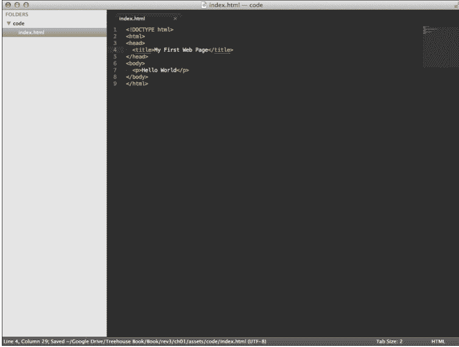

图1-1 使用Sublime Text 2编辑HTML文档。

- **TextWrangler** 是一款优秀的通用文本编辑器，适用于Mac。与Sublime Text 2不同，TextWrangler是免费的。你可以从http://www.barebones.com/products/TextWrangler/下载它。

- **Notepad++** 是Windows开发者中流行的文本编辑器，而且最棒的是它完全免费（免费如啤酒）。它支持多种编程语言，包括你将在本书中使用的那些。在http://notepad-plus-plus.org/download/v6.1.html下载Notepad++。

- **gedit** 是一款简单的文本编辑器，适用于所有使用GNOME桌面环境的Linux发行版（如Ubuntu）。它支持主题和语法高亮，你也可以在线找到大量优秀的插件。和Notepad++一样，gedit是免费的。你可以在http://gedit.en.softonic.com/download下载gedit。

你需要一个文本编辑器来开始创建你的网站，所以如果你的机器上还没有，现在就下载一个并安装它。

### 开发者工具

有时，在构建网站时，你可能想要快速调整页面样式或测试一些JavaScript，而无需回到文本编辑器进行修改。这就是开发者工具的用武之地。所有最受欢迎的网络浏览器要么内置了开发者工具，要么提供了能提供类似功能的扩展。你会发现你最习惯使用你所选浏览器中的工具；然而，了解如何访问和使用其他浏览器的开发者工具也很有用，以便在测试网站时需要调查兼容性问题。

在本节中，你将学习如何访问（在某些情况下安装）Chrome、Firefox、Safari、Opera和Internet Explorer的开发者工具。

- **Chrome开发者工具** —— 要从Chrome浏览器访问Chrome开发者工具，请点击地址栏右侧的小扳手图标，然后从"工具"菜单中选择"开发者工具"选项。或者，你可以右键点击屏幕上的元素，并从上下文菜单中选择"检查元素"。图1-2展示了使用Chrome开发者工具检查Google英国主页的情景。

  Chrome开发者工具包含许多功能，帮助你与网页交互并进行监控。在本书的示例中，你将最常使用的工具可以在开发者工具窗口的"Elements"、"Scripts"和"Console"标签页中找到。我在本书中全程使用Chrome开发者工具。

- **Firefox的Firebug** —— Firebug并非随Firefox全新安装捆绑提供，因此在打开Firefox后，你需要从http://getfirebug.com下载最新版本。Firebug免费使用。

  安装Firebug扩展后，你可以通过选择"工具" ➝ "Web Developer" ➝ "Firebug" ➝ "Open Firebug"来访问它。与Chrome开发者工具一样，你也可以通过右键点击页面上的元素并从上下文菜单中选择"Inspect Element with Firebug"来访问Firebug。

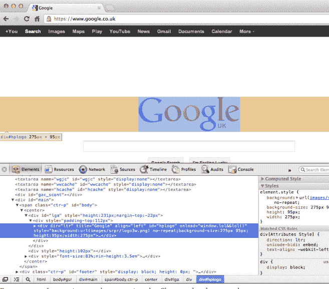

**图1-2** 使用Chrome开发者工具检查网页。

你可以通过点击左上角的Firebug图标并从Firebug UI Location菜单中选择一个选项来更改Firebug工具面板的位置。

- **Opera的Dragonfly** —— Opera的Dragonfly开发者工具直接内置在浏览器中，因此无需安装扩展。你可以通过进入"Tools" ➜ "Advanced"并选择"Opera Dragonfly"来访问Dragonfly。

- **Safari的Web Inspector** —— Safari的Web Inspector开发者工具与Google Chrome中的开发者工具类似。这是因为它们都是基于WebKit中的Web Inspector工具构建的。

Dragonfly拥有现代浏览器中你所期望的许多标准开发者工具。在构建本书的示例时，"Documents"和"Scripts"标签页将特别有用。请注意，当新版本发布时，开发者工具会自动更新。

在你可以访问Safari中的开发者工具之前，你需要启用它们。为此，请按Windows上的Ctrl加逗号键或Mac上的Command加逗号键打开"Preferences"窗格。在"Preferences"窗格中，点击"Advanced"标签页，并选中标记为"Show Develop Menu in Menu Bar"的复选框。现在你应该能在屏幕顶部的菜单栏中看到"Develop"菜单。如果你在Windows上使用Safari，可能需要通过点击右上角的齿轮图标并选择"Show menu bar"来显示菜单栏。你可以从"Developer"下拉菜单中访问Safari的所有开发者工具，包括Web Inspector。

Safari还有其他一些开发者工具，使你能够轻松关闭缓存、图像、样式和JavaScript。在测试网站在功能较弱的浏览器中的外观和行为时，这些工具非常有用。

- **IE开发者工具** —— Internet Explorer有一套内置的开发者工具，可以通过"Tools"菜单或按键盘上的F12键访问。

IE开发者工具包含了你期望的所有功能，包括元素、CSS和JavaScript检查器以及控制台。还有一些工具可以帮助你测试网站在旧版本IE上的表现。这些工具很有用，因为一些旧版本的Internet Explorer存在bug，可能会影响网页在用户面前的显示方式。还有一个"Validate"菜单，其中包含使用W3C验证器轻松验证当前查看页面的链接。你将在本章稍后了解网页验证。

### 构建你的第一个HTML5网页

你还在这里，并且已经设置好了你的工具。太好了！现在是时候开始编写一些真正的标记了。在本节中，你将仅用三个简单步骤使用HTML构建你的第一个网页。

> 本书中所有练习的下载代码文件可从本书网站http://www.wiley.com/go/treehouse/html5foundations获取，并按章节分组到文件夹中。本练习的代码可以在第1章的文件夹中找到，文件夹1。


1. 首先，使用你选择的文本编辑器创建一个名为`index.html`的新文件，并将其保存在桌面上。网页文件以`.html`文件扩展名保存。此扩展名告诉网络浏览器它应该将内容作为HTML读取，构建相关的页面元素，并应用你提供的样式。如果你将文件保存为`.txt`文件，例如，浏览器将不会识别它是HTML文件，而只会将文件内容显示为纯文本（即用户会看到代码）。

> 你网站的主页应始终命名为`index.html`，因为这是当有人访问你的网站根目录时网络服务器将返回的文件。例如，如果访问者访问http://example.org，网络服务器将在网站的根目录（即http://example.org/index.html）中查找索引文件。`root`目录是你网络空间中的顶级文件夹。


### 构建元素

HTML 网页由许多元素组成；可以将这些元素视为网页的组成部分。每个元素都有特定的用途；它可能包含一些文本内容、一个标题、一张图片，或者一些浏览器要使用的信息。你的示例代码中包含了三个主要元素：一个 `<html>` 元素、一个 `<head>` 元素和一个 `<body>` 元素。

这些元素又包含其他一些元素，比如 `<title>` 和 `<p>`（段落）元素。你很快就会了解到更多关于这些元素的信息。

在大多数情况下，一个元素由两个标签组成：一个开始标签和一个结束标签。你可以在这些标签之间放置一些将在网页上显示的内容——比如文本，甚至更多的元素。每个标签以小于号（<）开始，以大于号（>）结束。结束标签在小于号后还有一个正斜杠（/），以便浏览器能够将它们与开始标签区分开来，并识别出元素的结尾。以下是你刚刚创建的页面中的 `<title>` 元素：

```
<title>My First Web Page</title>
```

注意开始和结束标签（这里加粗显示），中间是一些文本内容。

> 有些元素没有结束标签。这些被称为*空*元素。空元素不应包含任何内容，因此没有结束标签。我会在本书后续内容中指出这些元素。

### `<html>` 元素

再次在文本编辑器中打开你的 `index.html` 文件（如果已关闭），查看代码的第二行和最后一行：

```
<html>
...
</html>
```

这些行表示 `<html>` 元素的开始和结束。`<html>` 元素是 HTML 文档的根元素。这意味着它应该包含你所有的 HTML 代码。唯一不应放置在此元素内的代码是 DOCTYPE 声明（见侧边栏）。你可以看到，在你的代码中，所有其他元素（`<head>` 和 `<body>`）都嵌套在 `<html>` 元素内。

### DOCTYPE 声明

看看代码的第一行：

```
<!DOCTYPE html>
```

DOCTYPE 是一小段代码，应放置在每个网页的开头，以指示相应页面遵循的标准。本例中的 DOCTYPE 表明代码符合 HTML5 标准。

当你在浏览器中打开一个网页时，浏览器会查找 DOCTYPE 声明。它会检查 DOCTYPE，以确定该页面是使用现代 Web 标准（如 HTML5），还是为在较旧的浏览器中运行而设计的。然后，浏览器使用此信息来确定如何解释代码并将其显示在屏幕上。

### 属性

开始标签还可以通过使用*属性*来包含附加信息。这些属性包含一个*值*（或一组值），并在标签以 > 符号关闭之前列出。这里有一个例子，`` 元素。`` 元素用于向你的网页添加图像。请注意，这是一个空元素，因此没有结束标签。

```

```

此图像元素有四个不同的属性：`src`、`width`、`height` 和 `alt`。每个属性都被赋予一个值，该值传递一些信息给浏览器。该值放在引号内。此示例使用 `src`（源）属性告诉浏览器你想要显示的图像是 `image.jpg` 文件。你使用 `width` 属性，其值为 300，告诉浏览器你的图像应显示为 300 像素宽，并使用 `height` 属性，其值为 100，使其高度为 100 像素。`alt` 属性的值在这里提供了一些文本，如果图像无法加载，浏览器可能会显示这些文本。你将在第 4 章中了解更多关于 `` 元素以及其他许多内容元素的信息。

`<html>` 元素通常用于定义文档中内容的语言。这通过在开始标签中添加一个 `lang` 属性来实现，该属性的值是一个双字符语言代码。（这仅适用于实际页面内容，不适用于标签名称；标签名称应始终用英文书写。）以下示例通过添加 `lang` 属性并将其值设置为 "en" 来将内容语言定义为英语。（我通过在每个新示例中突出显示代码的新部分来帮助你轻松识别它。）

```
<html lang="en">
```

准备好再次修改你的代码了吗？让我们为你的网页定义内容语言。

此练习的代码可在文件夹 2 中找到。

1. 在文本编辑器中打开你的 `index.html` 文件。

2. 现在将 lang 属性添加到 `<html>` 开始标签并将其值设置为 en。

   ```
   <html lang="en">
   ```

3. 保存 `index.html` 文件。

你可以在以下网页的 "ISO 639-1 Code" 列下找到双字符语言代码的完整列表：http://www.loc.gov/standards/iso639-2/php/code_list.php。

### `<head>` 元素

包含在 `<html>` 元素内的第一个元素应该是 `<head>` 元素。此元素包含有关页面的信息，例如标题。以下是示例代码中的 `<head>` 元素：

```
<head>
    <title>My First Web Page</title>
</head>
```

回顾完整的代码示例。注意 `<head>` 包含在 `<html>` 元素内，位于开始和结束标签之间。

`<head>` 中最重要的元素之一是 `<title>` 元素。此元素的内容用于在浏览器中设置页面的标题，并将出现在浏览器窗口的顶部或选项卡上，如图 1-3 所示。在你的网页中，你将页面标题定义为 `My First Web Page`。

尝试更新你的网页标题：

此练习的代码可在文件夹 3 中找到。

1. 在文本编辑器中打开 `index.html` 文件。

2. 将 `<title>` 标签之间的文本更新为 `My Updated Page Title`。

3. 保存文件。

现在，如果你在网页浏览器中打开 index.html 文件，你应该会看到页面标题已经更改。这会显示在浏览器顶部或浏览器选项卡中，具体取决于你使用的浏览器。

### `<body>` 元素

在 `<head>` 元素之后是一个新元素——`<body>`。在此元素中，你放置所有将在浏览器窗口中显示的内容。以下代码显示了你的网页中的 `<body>` 元素。

```
<body>
    <p>Hello World</p>
</body>
```

> 一个页面中只能有一个 `<body>` 元素。

这里的 Hello World 文本被放置在一个 `<p>`（段落）元素中。此元素用于文本块。你将在第 4 章中更详细地了解此元素。

尝试向你的网页添加一些新内容：

> 此练习的代码可在文件夹 4 中找到。

1. 在网页浏览器中打开 index.html 文件。

2. 在现有的 `<p>` 元素下方添加以下代码。

   ```
   <p>HTML5 Rocks!</p>
   ```

3. 保存文件。

现在在网页浏览器中打开 index.html 文件。你应该会看到新文本显示在页面上，如图 1-4 所示。很简单，对吧？

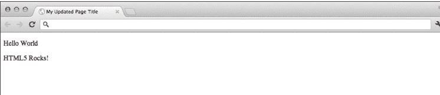

**图 1-4** 你刚刚添加了新文本的网页。

在本节中，你学习了如何创建网页的基本结构；然而，这些元素中没有一个真正控制页面的物理布局。在第 2 章中，你将学习用于创建网页可视化部分的元素。

> 你可以在附录 A 中查看 HTML5 元素的完整列表。

### 嵌套元素

将一个元素放置在另一个元素内部的做法称为*嵌套*。把嵌套想象成一个大型树状图。你从一个元素（`<body>`）开始；这个元素内部嵌套了许多其他元素（在你的网页中，是 `<p>` 元素）。这些元素内部又嵌套了其他元素，以此类推。这就创建了一个包含多个不同层级的庞大元素树。

每个元素在代码中的位置都很重要。请确保元素的开始标签和结束标签都嵌套在同一个元素内。例如，你绝不应该在 `<body>` 元素内部放置开始标签，而在其外部放置结束标签。这样的代码是无效的，但更重要的是，它有时会导致你的网页在网页浏览器中显示不正确。

将嵌套在其他元素内的元素进行缩进（就像你在网页中对 `<p>` 元素所做的那样）有助于快速识别 HTML 代码的结构。

### 验证你的网页

验证你的网页可以确保你的代码是*符合标准的*。这意味着你编写的代码遵循了相关*网络标准*中概述的最佳实践和指南。

#### 为什么要进行验证？

虽然验证不是强制性的，但它是开发过程中的一个重要部分。你应该出于以下原因验证你的代码：

- **调试代码**——验证是发现代码中可能导致网页在浏览器中显示问题的错误的一种有用方式。例如，很容易在代码中漏掉一个结束标签，从而导致浏览器显示页面布局时出现问题。使用验证器可以帮助你找到结束标签缺失或放置不正确的位置，为你节省大量逐行检查代码以确认正确使用标签的时间。

- **让你的代码面向未来**——仅仅因为你的代码在今天的浏览器中有效，并不意味着它在未来也会有效。浏览器制造商通常根据相关规范中定义的技术来实现功能，而这些规范旨在确保技术与旧版本保持向后兼容。这意味着如果你今天遵循网络标准，你的代码在未来更有可能正常工作，因为浏览器制造商能更好地理解你的代码结构和意图。

#### 什么是网络标准？

网络标准是由 W3C（万维网联盟）和 WHATWG（网页超文本应用技术工作组）等组织制定的规范——开发者们确实喜欢他们的首字母缩写！这些规范概述了浏览器制造商应如何在浏览器中实现新技术，以及开发者应如何使用这些技术。

实际的规范通常非常长，读起来相当枯燥。幸运的是，有为开发者提供的简洁版 HTML5 规范，去掉了那些针对浏览器制造商的、更无聊的内容。你可以在 http://developers.whatwg.org/ 找到 WHATWG 的 HTML5 规范网页开发者版本，在 http://dev.w3.org/html5/html-author/ 找到 W3C 版本。

为了让事情更复杂一点，W3C 和 WHATWG 都维护着独立的 HTML5 规范版本。这些版本大部分是相同的，但我发现 WHATWG 比 W3C 更倾向于更快地采纳新技术。

- **最佳实践**——有效的代码遵循一套由工作组设计的最佳实践，因此学习编写有效的代码也是在学习构建网页的最佳实践。这对于刚接触网页开发的人来说尤其重要，因为浏览器通常会自动纠正你代码中的错误，而不会告知你。这可能会让你误以为自己编写了良好的有效代码，而实际上你犯了很多错误。

- **更易于维护的网页**——编写符合广泛接受的标准集的代码，使得多人协作完成一个项目变得更加容易。不可避免的是，每个人都有自己略微不同的编程风格；通过在编写代码时遵循网络标准，你可以确保你的标记保持一致，并且易于其他人理解。

- **更专业**——如果你致力于创建高质量的网站，编写良好有效的代码会向人们展示你懂得如何去做。如果你从事客户服务工作，这也是向客户展示你致力于构建面向未来、易于维护且符合标准的网站的好方法。（**专业提示：** 客户喜欢这些词；把它们写进你的项目提案中。）

#### 使用 validator.w3.org

有几种代码验证器可用，但本书的练习使用的是 `http://validator.w3.org`。

Validator.w3.org 是由 W3C 维护的一项免费服务，你可以用它来根据各种网络标准验证你的 HTML 和 CSS 代码。你可以通过多种方式将代码提交给验证器。

- 提供一个网页上的链接。

- 从你的计算机上传一个文件。

- 将代码直接复制粘贴到浏览器中。

验证器将通过查看页面顶部的 DOCTYPE 声明来尝试识别页面所使用的 HTML 版本。（参见本章前面的关于 DOCTYPE 的旁注。）这使得验证器能够根据相关的一组网络标准来运行你的代码。你也可以通过在验证器主页"更多选项"部分的"文档类型"下拉菜单中选择一个标准，来明确告诉验证器你想测试哪个标准。

是时候测试你之前创建的网页，看看它是否通过验证了。

1. 打开 `http://validator.w3.org`。

2. 选择"直接输入验证"方法。

3. 将你的代码复制粘贴到文本框中。

4. 点击"检查"。

你现在应该看到你的代码通过了 HTML5 验证（见图 1-5）。恭喜！

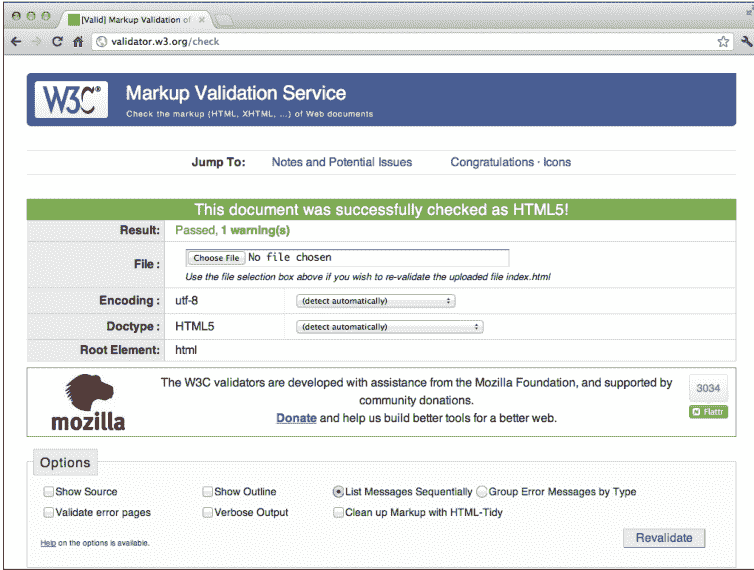

**图 1-5** 你的网页通过了 HTML5 验证。

#### 你的代码是否总是必须通过验证？

验证对网页开发者来说是一个很好的工具，但它也仅仅是一个工具。有时，生成通过验证的页面是不现实的。有时你必须编写一些小的*变通方法*才能让某些浏览器（指：IE）正常运行，这些变通方法在你验证页面时会显示为错误。理想情况下，你希望你的页面错误尽可能少，但即使是一些最知名的网站也无法通过验证。（尝试将 http://google.com 或 http://yahoo.com 提交给 W3C 验证器。）

请记住：网络标准不是严格的规则。它们更像是指南。验证是一个帮助你制作更好网站的工具；它永远不应该限制你。

#### 并非所有浏览器都是生来平等的

在理想的世界里，你可以编写一个网站，并让它在所有网页浏览器中的表现都相同。遗憾的是，现实并非如此。跨浏览器兼容性是所有网页开发者都必须定期处理的问题，而且通常这可能是一件非常令人头疼的事情，导致你花费数小时试图绕过浏览器中存在的一个漏洞。

为了说明这一点，请看一下图 1-6 和图 1-7。这些图显示了同一个 HTML 网页在 Google Chrome 和 Internet Explorer（使用 IE7 兼容模式）中的显示效果。注意导航链接在 Google Chrome 中是内联的，但在 Internet Explorer 中却以列表形式出现。

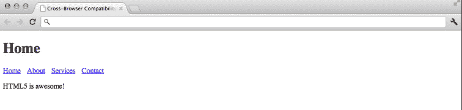

**图 1-6** 在 Google Chrome 中显示的一个简单 HTML 网页。

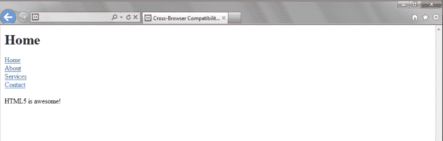

**图 1-7** 在 Internet Explorer（使用 IE7 兼容模式）中显示的同一个 HTML 网页。

需要记住的是，HTML5 仍然很新，因此并非所有浏览器都支持你将在这本书中学到的技术。此外，你的用户并不总是运行最新版本的网页浏览器。你会惊讶于有多少人仍在使用 IE6（于 2001 年发布！）。商业用户尤其以使用过时的浏览器而闻名，这通常是因为 IT 部门设置的限制。我相信在接下来的几年里，用户运行过时浏览器的问题将随着许多现代网页浏览器中自动更新功能的引入而基本解决。

即使你的部分用户可能无法使用HTML5的最新功能，你也不必因此害怕在网站中使用它们。只要你网站的核心功能能在旧版浏览器中正常运行，你就可以放心使用。

随着你逐步学习本书中的示例，我将指导你掌握解决常见跨兼容性问题所需的技术。

### 总结

恭喜！你正式踏上了成为优秀HTML5开发者的道路！

在本章开始时，我曾承诺你将在此刻构建你的第一个网页，而你已经做到了。它可能并不花哨，但你现在已经掌握了一些HTML的核心基础知识。

现代Web开发者拥有海量的浏览器和开发工具可用，你也了解了其中一些最受欢迎的工具。我鼓励你尝试使用每一个工具，找到最适合你的组合。浏览器也是如此。Mozilla Firefox和Google Chrome通常是首批支持新Web技术的浏览器，但请找到你最喜欢的那个。你可能会发现它拥有最好的开发者工具。确保你安装了所有主流浏览器，因为你需要用它们来测试你的网页是否具备跨浏览器兼容性，并尽可能让更多用户访问。

在第2章中，你将更深入地学习如何构建网页结构，以及每个结构元素的功能。你还将认识乔·巴洛基奥（Joe Balochio）以及他的披萨连锁店。在整本书中，你将为乔的业务创建一个全新的网站——一个运用了许多HTML5出色新技术的网站。

## 第二章：构建网页

第1章讲解了如何使用元素和属性来创建一个简单的网页。随着你深入本章的学习，你将了解用于创建网页布局的多种元素，包括 `<header>`、`<footer>` 和 `<section>` 元素。

你还将开始着手本书后续章节中会持续开发的示例网站，从规划网站页面开始，然后为页面布局创建线框图。本章的目标是将这些线框图转换为网页模板，使用一系列新的HTML5元素。在第3章和第4章中，你将使用这些页面模板来创建网站的所有页面。

### 创建布局模板

在本节中，你将开始为乔的披萨公司（Joe's Pizza Co.）构建一个网站。老板乔·巴洛基奥希望有一个全新的网站来推广他的披萨连锁店。他告诉你，他希望网站看起来时尚，并融入一些受他意大利血统启发的设计元素。他想要一个菜单，以及关于他所有不同餐厅位置的信息。乔还非常希望有一个新闻页面，以便让他的客户了解公司所做的所有出色事情。

既然你已经学会了如何添加第1章中的页面元素（`<html>`、`<head>` 和 `<body>`），现在是时候考虑构成页面可见布局的各个部分了。当你创建页面布局时，你需要一个类似于以下列表中描述的逻辑结构。（注意，它并不一定需要*完全*像这样。）

1. 一个页眉

2. 一些导航

3. 一些页面内容

4. 一个页脚

图2-1展示了Treehouse网站的一个页面截图。你能找出每个布局部分吗？

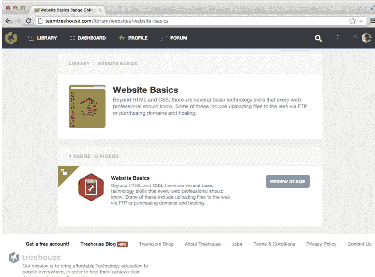

**图 2-1** Treehouse网站的一个页面。

HTML5包含一系列新元素，你可以用它们来定义每个部分。其中一些元素具有语义意义，这有助于使你的代码更易于理解，并帮助计算机程序识别每个元素内内容的目的。在你学习本书的过程中，我将指出这些语义元素。

#### 规划站点地图

开始一个新网站项目时要完成的第一个任务是创建一个*站点地图*。它定义了你的网站将有多少个页面以及这些页面分别是什么。根据乔的要求，以下是你将要构建的网站的站点地图：

1. 首页

2. 关于

3. 新闻

4. 菜单

5. 位置

6. 站点地图

这里的站点地图页面包含指向网站所有其他页面的链接列表。

> 对于这个特定的网站，站点地图并不是那么重要，因为你的页面数量很少；然而，对于拥有大量页面的网站来说，它是一个宝贵的资源，因此将其包含在示例中对你来说将是一个很好的实践。

大多数网站都基于几个不同的*模板*，这些模板用于创建每个页面。这些模板提供了一个空壳，你可以向其中添加内容以创建新页面。使用模板可以让你在整个网站中保持所有页面风格一致。你将为你的网站创建两个模板：一个用于*首页*，一个用于*内容页*。内容页主要包含文本，因此它们需要与首页稍有不同的布局。

#### 规划页面布局

在开始编码之前，最好先创建一个页面外观的大致模型。这些模型通常被称为*线框图*，它们使用方框来指示关键元素的位置，如导航、内容和标志。在本节中，你将为首页和内容页模板快速创建一些线框图。

你所有的网页都将有五个共同元素：一个页眉、标志、导航、主要内容区域和页脚。你可以使用这些关键元素为你的页面创建快速线框图。

让我们从首页模板开始。图2-2展示了我整理的一个布局的大致线框图。

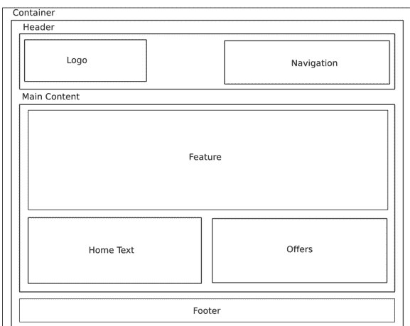

**图 2-2** 首页布局的线框图。

这个线框图显示了所有主要页面部分的位置：包含标志和导航的页眉；主要内容区域；以及页脚。首页将有三个包含页面内容的部分：一个吸引观众注意力的主特色区，一个用于公司初步信息的文本框，以及一个显示特别优惠的区域。

对于内容页模板，你将使用类似的布局，只更改主要内容区域，将三个内容部分替换为一个用于页面文本的区域。图2-3展示了内容页的大致线框图。

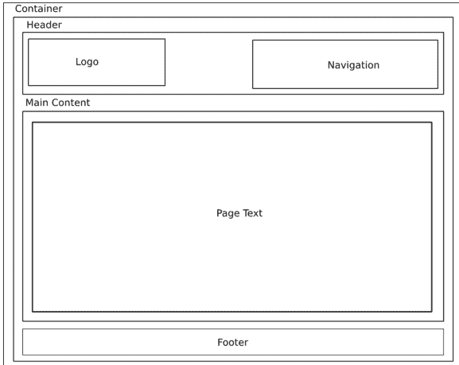

**图 2-3** 内容页布局的线框图。

#### 创建模板文件

现在你已经有了页面外观的大致规划，是时候创建模板文件了。记住，你的网站需要两个模板：一个首页模板和一个内容页模板。在本节中，你将为每个模板创建新文件。稍后在本章中，你将把这些布局添加到这些文件中。

#### 创建首页模板

首先，你将创建首页模板。按照以下步骤创建此模板。

> 如果你不喜欢打字，或者想避免可能导致代码出错的拼写错误，可以从本书网站下载此处使用的代码，并将其复制粘贴到你的文件中。你可以在第2章下载代码的文件夹1中找到index.html文件中的代码。示例网站中使用的所有代码均可在 http://www.wiley.com/go/treehouse/html5foundations 获取。

1. 创建一个名为 joes-pizza 的新文件夹。

2. 在此文件夹中，创建一个名为 index.html 的新文件。

3. 将以下代码添加到此文件中。

```html
<!DOCTYPE html>
<html lang="en">
<head>
    <title>Joe's Pizza Co. - New York's Best Pizza</title>
</head>
<body>

</body>
</html>
```

4. 保存文件。

#### 创建内容页模板

你现在已经创建了首页的基础模板。接下来，你需要为内容页创建一个模板文件。按照以下步骤操作：

1. 在 joes-pizza 文件夹中创建一个名为 about.html 的新文件。

2. 将以下代码添加到此文件中。

```html
<!DOCTYPE html>
<html lang="en">
<head>
    <title>About - Joe's Pizza Co.</title>
</head>
<body>

</body>
</html>
```

3. 保存文件。

你现在已经创建了首页和内容页模板的初始模板文件。随着你继续本章剩余部分的学习，你将了解用于添加可见页面布局的元素，并在学习过程中逐步完善你的模板。

> 注意，这里你实际上已经开始创建"关于"页面了。因为这个页面将与你网站上其他所有页面（首页除外）具有相同的布局，所以你将使用它作为你的内容页模板。你需要更新使用此模板创建的任何页面的文件名和标题。别担心，我会提醒你。

### 向每个模板添加 `<div>` 元素

`<div>` 元素（document divisions 的缩写）在历史上一直是定义 HTML 文档部分最常用的元素，但在 HTML5 中，它不再扮演如此重要的角色。最佳实践是尽可能使用新的 HTML5 语义化元素（你很快就会看到这些），例如 `<header>`、`<footer>`、`<nav>`、`<section>` 和 `<article>`，但有时你只需要一个元素将其他多个元素组合在一起。这就是 `<div>` 元素的用武之地。该元素本身是通用的；它没有特殊的语义含义。

你将使用 `<div>` 元素为所有页面内容创建一个容器。这将使你能够在本章后面使用层叠样式表 (CSS) 来居中显示所有这些内容。

> 本练习的代码可在文件夹 2 中找到。

1. 在你最喜欢的文本编辑器中打开 `index.html` 和 `about.html` 模板文件。

2. 将以下代码添加到每个文件的 `<body>` 元素中。

3. 保存 `index.html` 和 `about.html` 文件。

```html
<body>
    <!-- Page Container -->
    <div id="container">

    </div>
</body>
```

> 我用粗体突出显示新元素，以便你更容易在代码摘录中识别它。不用担心尝试在文本编辑器中使此文本加粗。

然后你创建了一个 `<div>` 元素，并为这个元素赋予了 ID `container`。这个标识符将使你能够使用 CSS 定位这个特定元素。在你继续本节其余部分时，请将所有新元素放在这个容器内。

现在在浏览器中打开你的 `index.html` 文件，查看你刚刚添加的部分。什么，你没看到它们？！这是因为大多数 HTML 布局元素默认是"不可见"的。在你向其中添加一些内容（或如本章后面所学，使用 CSS 为其设置样式）之前，你无法在浏览器中看到这些部分。

为了确保你的新 `<div>` 元素确实正确显示，你可以使用浏览器的开发者工具。

1. 在你喜欢使用的开发者工具的 Web 浏览器中打开 `index.html` 文件。（如果你没有最喜欢的，我推荐 Chrome。）

2. 现在打开你的开发者工具。你可能会发现更容易的方法是右键单击页面并从上下文菜单中选择"检查元素"（如果你的开发者工具提供了此选项）。

3. 确保你正在查看显示页面元素的选项卡。根据你使用的浏览器，这可能被命名为"Elements"、"HTML"或"Documents"。

4. 在开发者工具的主窗口中，你应该会看到页面中 HTML 元素的列表，缩进以匹配你页面的结构（如图 2-4 所示）。如果你的 `<div>` 显示在这里，那么一切正常。如果没有，你需要回头对照本书中的内容检查你的代码。

5. 关闭你的开发者工具。

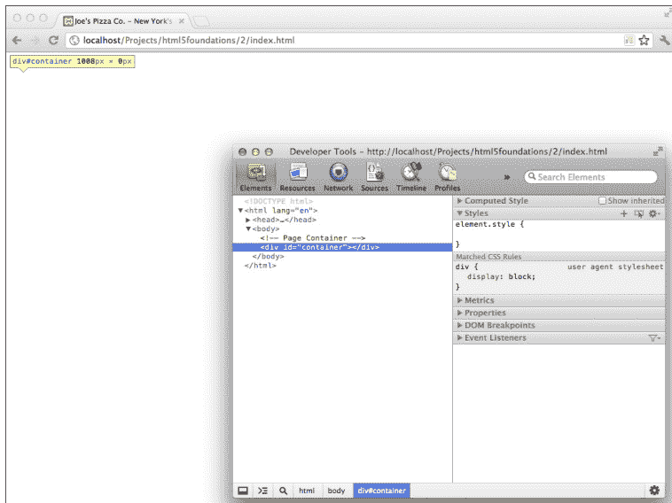

**图 2-4** 使用 Chrome 开发者工具检查页面元素。

前面代码示例中的第一行粗体文本是 *代码注释* 的一个例子。要开始一个代码注释，你使用语法 `<!--`，要结束注释，你使用 `-->`。代码注释不会被浏览器显示，但对你作为开发者来说可能很有用。你应该使用注释来记录代码的某些部分，作为给自己或阅读你代码的人的笔记。我也喜欢用它们来标记新布局部分的开始，就像前面代码示例中的例子一样：

```html
<!-- Page Container -->
```

### 向每个模板添加 `<header>` 元素

几乎所有网页都有某种形式的页眉部分。此部分通常包含公司徽标、口号和网站导航链接等信息。HTML5 引入了一个新的 `<header>` 元素，你可以用它来定义页面布局的这个部分。你可以在一个页面上多次使用 `<header>` 元素，就像你很快在学习 `<article>` 元素时将看到的那样。

本练习的代码可在文件夹 3 中找到。

1. 在你的文本编辑器中打开 `index.html` 和 `about.html` 文件。

2. 向你的两个页面模板都添加一个 `<header>` 元素。这应该放在你刚刚创建的容器内。

3. 保存文件。

4. 在你的 Web 浏览器中打开文件。

5. 使用开发者工具检查页面，确保新的 `<header>` 显示在容器 `<div>` 内（如图 2-5 所示）。

```html
<div id="container">
    <!-- Header -->
    <header>
    </header>
</div>
```

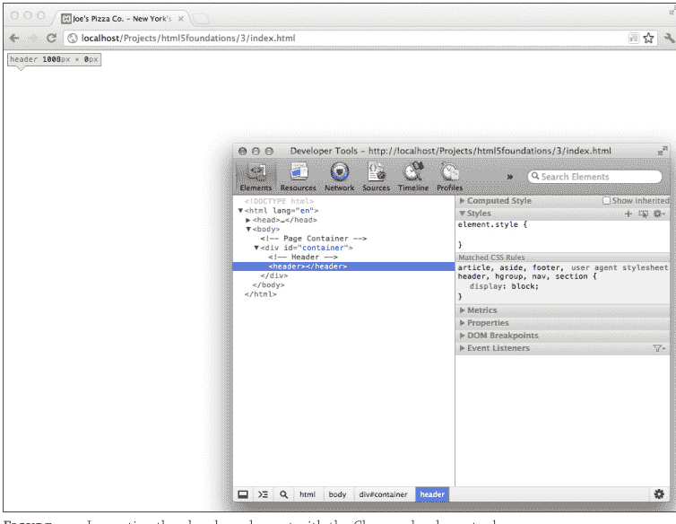

**图 2-5** 使用 Chrome 开发者工具检查 `<header>` 元素。

在你的线框图中，你的页眉包含两个其他元素：一个徽标和一些导航。你将稍后添加导航，但首先让我们专注于徽标。对于徽标，你将使用一个带有 ID `logo` 的 `<div>` 元素。


> 本练习的代码可在文件夹 4 中找到。

1. 在你的文本编辑器中打开 `index.html` 和 `about.html` 文件。

2. 向每个模板添加一个新的 `<div>` 元素用于徽标。这应该放在你刚刚添加的 `<header>` 元素内。

```html
<div id="container">
    <!-- Header -->
    <header>
        <!-- Logo -->
        <div id="logo">The Logo Goes Here</div>
    </header>
</div>
```

3. 保存文件。

我添加了一些虚拟文本，以便在浏览器中查看模板时更容易识别该元素。图 2-6 显示了带有新徽标 `<div>` 的渲染后的 `index.html` 文件。


**图 2-6** 在 Google Chrome 中显示的带有新徽标 `<div>` 元素的 `index.html` 文件。

页眉部分几乎完成了；剩下要做的就是添加一些导航。HTML5 也引入了一个新的语义化元素来实现这一点。

### 向每个模板添加 `<nav>` 元素

所有网站都需要导航链接，使用户能够在不同页面之间轻松移动。HTML5 引入了新的 `<nav>` 元素，使你能够向计算机程序准确指出页面上可以找到这些导航链接的位置。这可能对依赖屏幕阅读软件的用户很有用，例如，因为该软件可以更准确地定位页面导航。这种能力转化为用户能够更快地浏览你的网站。

你可以在一个页面上有多个 `<nav>` 元素。任何有主要导航链接块的地方都是使用 `<nav>` 元素的候选位置。你也可以向 `<nav>` 元素添加其他内容，例如标题或文本段落。但是，这些内容应与链接有某种关联。

> 你将在第 3 章才创建实际的导航链接；现在你只是在页面上为它们创建空间。

> 本练习的代码可在文件夹 5 中找到。

1. 在你的文本编辑器中打开 `index.html` 和 `about.html` 文件。

2. 如以下代码所示，在徽标下方添加一个新的 `<nav>` 元素。

```html
<div id="container">
  <!-- Header -->
  <header>
    <!-- Logo -->
    <div id="logo">Logo</div>
    <!-- Navigation -->
    <nav>
      The Navigation Links Go Here
    </nav>
  </header>
</div>
```

3. 保存文件。

4. 在你的 Web 浏览器中打开文件。

5. 使用开发者工具检查页面，确保新的 `<nav>` 元素列在徽标下方。

同样，我添加了一些虚拟文本以使此元素更可见。在浏览器中查看模板。图 2-7 显示了在 Google Chrome 中显示的主页。

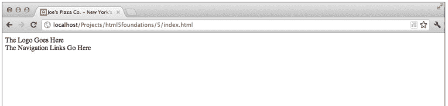

### 添加 `<section>` 元素

`<section>` 元素应用于表示网页的一个通用部分。例如，你可以用它来表示文档中的各个章节或主页的不同部分（如简介、新闻或联系信息）。Section 元素通常包含一个标题作为其第一个内容。

对于你正在构建的模板，你将使用多个 `<section>` 元素来定义主要内容的不同部分。然而，在你开始添加这些元素之前，你首先需要创建一个新的 `<div>` 元素，该元素将用于将主要内容部分组合在一起。

> 本练习的代码可在文件夹6中找到。

1. 在你的文本编辑器中打开 `index.html` 和 `about.html` 文件。

2. 在你的模板中，于 `<header>` 下方创建一个新的 `<div>` 元素。

3. 保存文件。

4. 在你的网页浏览器中打开这些文件。

5. 使用你的开发者工具检查页面，确保这个新的 `<div>` 出现在 `<header>` 元素下方（如图2-8所示）。

```
<div id="container">
    <!-- Header -->
    <header>...</header>

    <!-- Main Content -->
    <div></div>
</div>
```

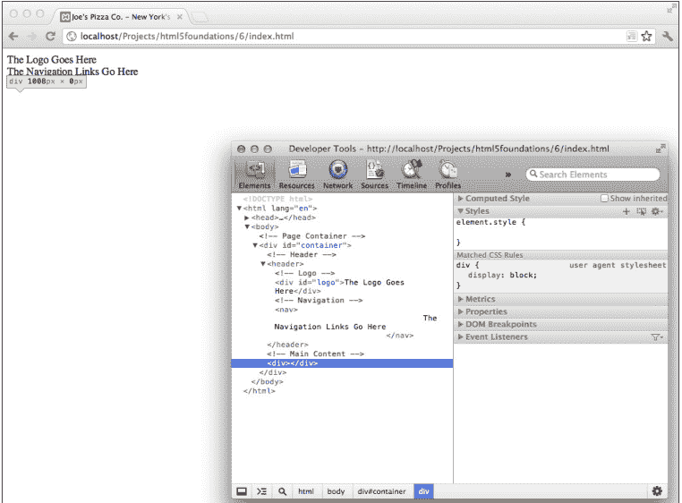

**图2-8** 使用Chrome开发者工具检查主要内容 `<div>`。

> `<header>` 元素中的省略号用于表示该元素内部有内容。我希望保持这些代码片段尽可能简洁，因此使用此方法可以避免在后续每个示例中重复整个代码。

到目前为止，主页和内容页模板几乎完全相同。但是，如果你回顾本章前面创建的原始线框图，你会看到模板的主要内容区域是不同的，因此你需要在两个模板文件中为这部分添加不同的代码。

内容页模板仅包含一个用于页面文本的大空间。为此，你将使用一个单独的 `<section>` 元素。

> 本练习的代码可在文件夹7中找到。

1. 在你的文本编辑器中打开 about.html 文件。

2. 在你刚刚在内容页模板中创建的 `<div>` 内添加一个新的 `<section>` 元素。你应该给这个新元素一个 ID，即 page-text。

```
<div id="container">
  <!-- Header -->
  <header>...</header>
  <!-- Main Content -->
  <div>
    <!-- Page Text -->
    <section id="page-text">
      The good stuff goes here!
    </section>
  </div>
</div>
```

3. 保存文件。

4. 在你的网页浏览器中打开 about.html 文件。

5. 使用你的开发者工具检查页面，确保这个新的 `<section>` 出现在主要内容 `<div>` 内。

在你的网页浏览器中打开内容页模板。你应该会看到页面文本部分现在已经显示出来，如图2-9所示。

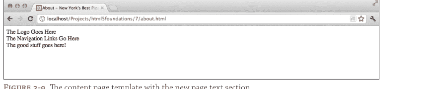

**图2-9** 包含新页面文本部分的内容页模板。

### 向主页模板添加 `<section>` 元素

主页布局稍微复杂一些，因为它有三个独立的内容部分：一个用于主特色横幅，一个用于一些公司信息，一个用于特别优惠。你将为每个部分使用一个 `<section>` 元素。

> 本练习的代码可在文件夹8中找到。

1. 在你的文本编辑器中打开 `index.html` 文件。

2. 在主要内容 `<div>` 内添加一个 `<section>` 元素，并将其 ID 设为 feature。

3. 现在在那下面再添加另一个 `<section>` 元素，这次将其 ID 设为 home-text。

```
<!-- Main Content -->
<div>
  <!-- Feature -->
  <section id="feature">
    The Main Feature Banner Goes Here
  </section>
</div>
```

```
<!-- Main Content -->
<div>
  <!-- Feature -->
  <section id="feature">...</section>

  <!-- Home Text -->
  <section id="home-text">
    The Company Information Goes Here
  </section>
</div>
```

4. 最后，添加第三个 `<section>` 元素，其 ID 为 offers。

```
<!-- Main Content -->
<div>
  <!-- Feature -->
  <section id="feature">...</section>

  <!-- Home Text -->
  <section id="home-text">...</section>

  <!-- Special Offers -->
  <section id="offers">
    The Special Offers Go Here
  </section>
</div>
```

5. 保存文件。

6. 在你的网页浏览器中打开 index.html 文件。

7. 使用你的开发者工具检查页面，确保这些 `<section>` 元素按以下顺序显示：feature、home text、special offers。图2-10显示了页面应有的样子。

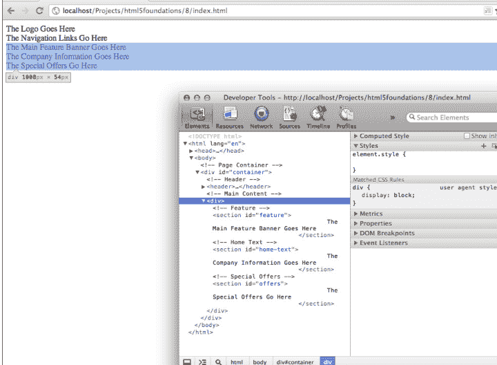

**图2-10** 包含新内容部分的主页模板，使用Chrome开发者工具显示。

在这里，你为每个新元素分配了一个 ID，以便可以轻松地选择它们来应用 CSS 样式。

### 向每个模板添加 `<footer>` 元素

HTML5 的另一个新元素是 `<footer>` 元素。此元素通常包含网页底部出现的版权信息和链接等内容。与 `<header>` 和 `<nav>` 元素一样，你可以在一个页面上使用多个 `<footer>` 元素。


本练习的代码可在文件夹9中找到。

1. 在你的文本编辑器中打开 index.html 和 about.html 文件。

2. 在每个页面模板中添加一个 `<footer>` 元素。你应该将其放置在主要内容 `<div>` 下方。

3. 保存文件。

```
<div id="container">
    <!-- Header -->
    <header>...</header>

    <!-- Main Content -->
    <div>...</div>

    <!-- Footer -->
    <footer>
        The Boring Legal Stuff Goes Here
    </footer>
</div>
```

成功！现在你已经为主页和内容页模板创建了主布局。图2-11和图2-12显示了你的模板现在的样子。

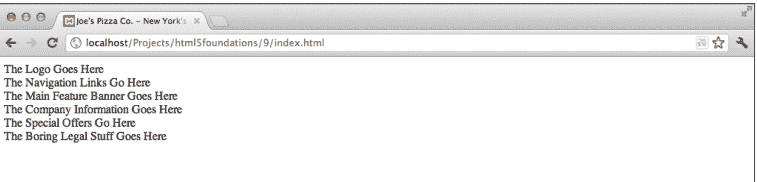

**图2-11** 主页模板。

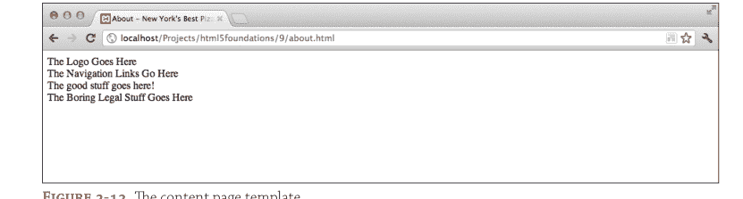

你将要查看的最后一个元素是 `<article>` 元素。你会在你的网站中使用它——但不是现在。

### 使用 `<article>` 元素

新的 `<article>` 元素用于表示网页的一个独立的部分。一个很好的例子是博客文章。例如，你可以使用 `<article>` 元素来包裹显示在博客主页上的每篇单独的文章。`<article>` 元素背后的理念是，即使你移除页面上的所有其他内容，该元素内的内容仍然可以独立存在且有意义。

`<article>` 元素内部也可以嵌套 `<header>` 和 `<footer>` 元素。在下面的示例中，文章标题放置在 `<header>` 元素内，作者姓名放置在 `<footer>` 元素内。

```
<article>
    <header>
        An Example Article
    </header>
    <div>
        Some text content that makes up the body of the article.
    </div>
    <footer>
        By Joe Balochio.
    </footer>
</article>
```

`<section>` 和 `<article>` 元素非常相似，很容易混淆何时使用哪一个。一个简单的规则是，如果内容适合在 RSS 源等地方进行联合发布，则应使用 `<article>` 元素。如果你的内容不符合此规则，请改用 `<section>` 元素。

> *RSS 源* 是一种标准化的格式，用于分发经常更新的内容，如博客文章或新闻标题。像 Google Reader 或流行的 Reeder 应用这样的计算机程序可以读取这些源，使这些程序的用户能够随时了解最新内容。

到目前为止，在本章中，你一直在构建用户实际能看到的页面模板部分。在下一节中，你将学习如何在模板中嵌入仅供网页浏览器和其他计算机程序使用的信息——即幕后信息。

### 使用元数据扩展 `<head>`

第1章解释了 `<head>` 元素及其如何用于指定关于页面的信息，例如页面标题。你可以在 `<head>` 中使用 `<meta>` 元素向计算机程序提供很多其他信息。在本节中，你将学习 `<meta>` 元素的一些用途，并在过程中向你的页面模板添加元数据。

### 使用 `<meta>` 元素

`<meta>` 元素用于定义元数据，例如页面描述、关键词或页面作者。以下是一个示例：

```
<meta name="description" content="This is a description about the page">
```

要定义此信息，你需要使用上面示例中显示的两个属性：`name` 属性和 `content` 属性。`content` 属性用于提供有关页面的信息（例如，简短描述）。然后，你使用 `name` 属性来告诉计算机程序此信息的目的。例如，如果内容是页面的描述，你将 `name` 属性的值设置为 `description`。

`<meta>` 元素是 `void` 元素的一个例子，因此没有结束标签。

在这个代码练习中，你将在页面模板的 `<head>` 中添加元数据，这些元数据将向计算机程序提供页面的描述、相关关键词以及作者姓名。

> 本练习的代码可在文件夹10中找到。

1. 在文本编辑器中打开 `index.html` 文件。

2. 在 `<head>` 中添加以下 `<meta>` 元素。它们应放置在 `<title>` 元素下方。

```
<head>
    <title>...</title>

    <meta name="description"
          content="Joe's Pizza is the home of the best pizzas in
                   all of New York City.">
    <meta name="keywords"
          content="pizzas,joes pizza,garlic bread,pepperoni">
    <meta name="author" content="YOUR NAME">
</head>
```

3. 保存 `index.html` 文件。

4. 在你的网页浏览器中打开 `index.html` 文件。

5. 使用开发者工具检查这些新的 `<meta>` 元素，确保它们都正确显示。你可能需要展开 `<head>` 元素（通过点击开始标签旁边的小三角形）来查看其中的元素。

6. 现在将这三个相同的 `<meta>` 元素添加到你的 `about.html` 文件中。请确保更新 `content` 属性的值以反映页面的内容。

7. 保存 `about.html` 文件。

请注意，当页面现在在浏览器中查看时，与之前的版本相比没有任何变化。同样，元数据不显示为内容，而只是供计算机程序使用的信息。

### 元数据与搜索引擎优化

搜索引擎有时会使用元数据中的描述作为搜索结果中显示在页面链接下方的文本。过去，一些搜索引擎在对网页进行排名时也会使用关键词，但发现许多人会滥用这种做法，将大量关键词塞入 `<meta>` 元素以帮助其页面在某些搜索中排名更高。因此，大多数搜索引擎不再认为此信息可靠，因此不将其用于排名目的。尽管如此，定义关键词仍然被视为一种良好的实践。

确保你的元描述和关键词内容与每个单独页面相关。避免为所有页面使用相同的内容。这是搜索引擎优化（SEO）的最佳实践。

> 注意关键词是如何用逗号分隔的，但逗号后面没有空格。

### 定义字符编码

`<meta>` 元素的一个主要用途是定义页面的字符编码。与 DOCTYPE 一样，该元素在 HTML5 中得到了极大的简化：

```
<meta charset="utf-8">
```

此 `<meta>` 元素上的 `charset` 属性告诉浏览器应如何解释文档中的字符。除非你有非常特殊的用例，否则应在此处使用 UTF-8。在接下来的练习中，你将在页面模板中定义字符编码。

> 此练习的代码可在文件夹 11 中找到。

1. 在文本编辑器中打开 index.html 和 about.html 文件。

2. 通过将以下 `<meta>` 元素添加到 `<head>` 中来定义字符编码。字符编码应始终是 `<head>` 中的第一个元素。

3. 保存文件。

```
<head>
    <meta charset="utf-8">
    <title>...</title>
    ...
</head>
```

这样就完成了你的页面模板！在第 4 章中，你将使用这些模板在你的网站上创建每个页面。

### 用 CSS 为页面设置样式

*层叠样式表*（CSS）是一种语言，用于描述网页浏览器应如何呈现 HTML 元素及其内容。你可以使用 CSS 来控制网页的视觉方面，包括元素位置、背景颜色和图像、边框、字体以及许多其他设计方面。以下示例显示了 CSS 代码的简短摘录。

```
section {
    font-size: 14px;
    color: #CC0000;
}
```

此代码是一个 CSS 样式规则的示例，它将所有 `<section>` 元素内的文本大小设置为 14 像素，并将其颜色设置为红色。CSS 规则的第一部分选择应应用样式的元素，而花括号内的代码描述样式。

CSS 中的颜色使用十六进制或 RGB 表示法定义，该表示法定义了应使用多少红色、绿色和蓝色以产生所需的颜色。#CC0000 是红色的代码。

HTML 和 CSS 一直紧密耦合。大多数了解 HTML 的开发人员也了解 CSS，反之亦然。如果你希望建立专业的网页，我强烈建议你学习 CSS。

本书的目的是教你 HTML5。CSS 同样是一个庞大的主题，但本书并未涵盖它。然而，关于这个主题有很多优秀的书籍，特别是最新标准 CSS3。我强烈推荐你购买一本 **CSS3 Foundations**（Ian Lunn 著，John Wiley & Sons，2013），它也是 Treehouse 系列的一部分。Treehouse 网站上也有许多优秀的 CSS 视频。尝试从 **CSS Foundations** 的视频开始；你可以在 http://teamtreehouse.com/library/websites/css-foundations 找到它们。

### 将 CSS 链接到你的 HTML

具有复杂设计的网页通常有数百行 CSS 代码，过一段时间后可能会变得难以管理。幸运的是，你可以创建单独的样式表文件来帮助拆分 CSS 代码，使其更易于管理。例如，一些开发人员发现将负责页面布局的代码和负责品牌和颜色的代码拆分到单独的文件中更容易。

要创建外部样式表，你只需在文本编辑器中创建一个使用 .css 文件扩展名的文件即可。

一旦你将 CSS 代码放入自己的样式表文件中，就需要将其链接到你的网页，以便浏览器知道如何找到它。你使用 `<link>` 元素执行此操作。

```
<link rel="stylesheet" href="style.css">
```

link 元素使用两个属性将浏览器指向你的单独资源，例如样式表：`rel` 和 `href` 属性。`rel` 属性描述你正在链接的文件的关系。`href` 属性告诉浏览器可以在哪里找到样式表文件。在前面的示例中，资源是一个样式表，因此 `rel` 属性的值为 `stylesheet`，`href` 属性指向名为 `style.css` 的文件。

现在你对 CSS 的作用有了基本的了解，你需要将样式表链接到你的页面模板，使它们在视觉上更易于接受。

> 此练习的代码可在文件夹 12 中找到。

1. 在项目目录中创建一个名为 `css` 的新文件夹。从书籍网站（文件夹 12）下载 `style.css` 文件并将其放入 `css` 文件夹。

2. 在项目目录中创建一个名为 `img` 的新文件夹。从书籍网站（文件夹 12，`img` 文件夹）下载图像文件并将它们放入你的新 `img` 文件夹。应有两个文件：`bodyBg.png` 和 `featureBg.png`。这些文件在 CSS 代码中被引用。

3. 在文本编辑器中打开 `index.html` 和 `about.html` 文件。

4. 将以下 `<link>` 元素添加到页面模板的 `<head>` 中。

```
<head>
    <meta charset="utf-8">
    <title>...</title>
    
    <link rel="stylesheet" href="css/style.css">
    ...
</head>
```

5. 保存文件。

现在在网页浏览器中打开页面模板；你应该看到已经发生了相当大的变化。这就像变魔术一样！

图 2-13 和 2-14 显示了你的页面模板在新的 CSS 样式下的外观。

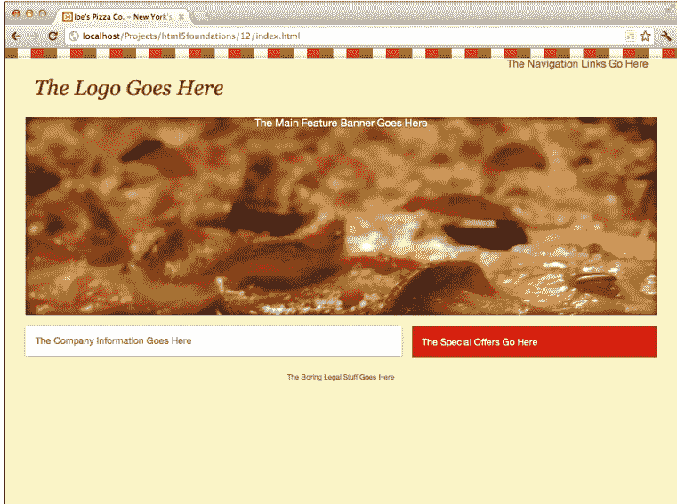

**图 2-13** 带有 CSS 的主页模板。

*披萨图片经 William Rogers 许可复制*

你可以使用多个 `<link>` 元素来引用多个样式表。但是，将网页所需的外部文件数量最小化被视为一种良好的实践。原因是什么？外部文件越多，页面加载所需的时间就越长。

### 相对路径和绝对路径

随着你构建 HTML 页面，你需要引用外部文件，例如 CSS 样式表、图像、JavaScript 文件，甚至网站内的其他页面。你使用*相对*路径和*绝对*路径来告诉浏览器在哪里可以找到这些文件。图 2-15 显示了一个示例目录结构，我将在解释这些不同类型的路径如何工作时使用它。

### 图2-14 内容页模板与CSS。

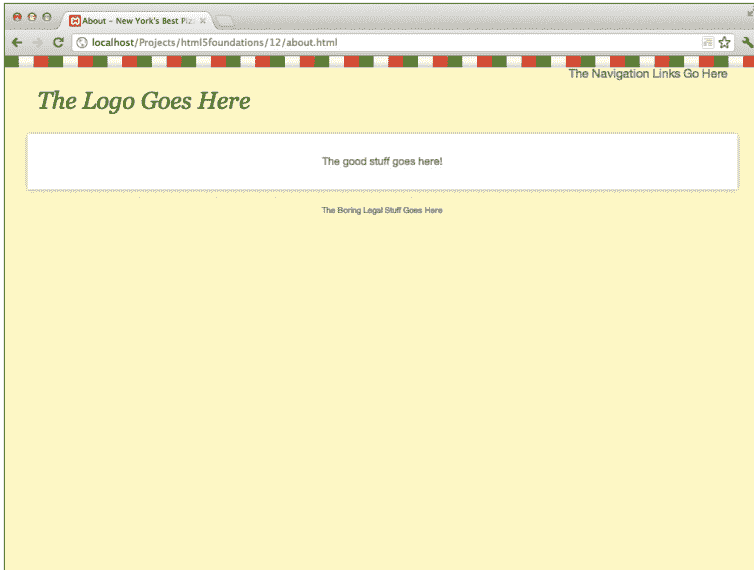

### 图2-15 示例目录结构。

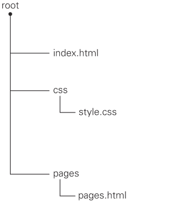

相对路径是指所需文件相对于当前页面的位置。例如，如果你的样式表位于一个名为 `css` 的文件夹中，而该文件夹与当前 HTML 文档在同一目录下，你可以使用以下路径来链接该文件：

```
href="css/style.css"
```

在这个路径中，你指定了 CSS 文件位于 `css` 文件夹中，且文件名为 `style.css`。

参考图2-15所示的文件结构。假设你当前的文件是 `page.html`，并且你想显示指向同一样式表的路径。你可以使用双点号来遍历文件夹，如下例所示：

```
href="../css/style.css"
```

此示例引用的是当前文件 `page.html` 上一级 `css` 文件夹中的 `style.css` 文件。你从 `page.html` 文件开始，向上移动一级文件夹（使用 `../`），进入 `css` 文件夹，最后选择 `style.css` 文件。

绝对路径是指从根目录开始的文件具体位置。对于网页链接，根目录是顶级目录，例如：

```
http://example.com/
```

你可以使用以下任一绝对路径来引用你的样式表：

```
href="/css/style.css"
```

或

```
href="http://example.com/css/style.css"
```

两个路径都指向同一个文件。

### 总结

你学习了许多 HTML 元素，包括一些在 HTML5 中全新的元素。这些新的 HTML5 元素大多具有语义含义，应用于某些场合，而不用于其他场合。这可能会让人困惑，但在本章中，你已经正确地使用它们来构建页面模板的布局。

HTML 文档包含许多不直接呈现给用户的信息。你学习了如何使用 `<meta>` 元素在网页中嵌入信息，这些信息可被网络浏览器、搜索引擎和其他计算机程序使用。

最后，你了解了 CSS 如何用于描述元素可以如何被网络浏览器设置样式。你甚至将一个样式表连接到示例网站，使其视觉效果更加赏心悦目。

在第3章中，你将学习用于在网页中标记内容的 HTML 元素。你将了解标题的工作原理，以及列表、表格、图片和标题。你将继续为 Joe's Pizza Co. 的网站工作。这次你将为每个页面添加内容，并创建一些导航，以便访问者可以轻松浏览整个网站。


# 第三章 创建页面模板

在本章中，你将继续处理在第1章和第2章中创建的页面模板。你将学习几个新的 HTML 元素，例如标题元素、链接和列表。一旦你熟悉了这些新元素，你将使用它们来完成你的页面模板，为添加内容做好准备，这将在第4章中进行。

### 添加徽标

在本节中，你将了解 HTML 标题元素以及它们如何与网页中的标准文本不同。一旦掌握了标题的概念，你将使用它来为页面模板创建徽标。

### 理解标题

正如你在书中使用不同级别的标题来帮助你理解内容结构一样，在 HTML 中，你可以使用 `<h1>`、`<h2>`、`<h3>`、`<h4>`、`<h5>` 和 `<h6>` 元素来标记标题并表示它们在页面上的相对重要性。元素名称中的数字代表标题元素的等级，1 为最高等级，6 为最低等级。具有相同标签的标题元素具有相等的等级。例如，你可以按以下方式标记一本书的标题：

```
<h1>Venture Deals</h1>
<h2>Be Smarter Than Your Lawyer and Venture Capitalist</h2>
```

你使用 `<h1>` 元素作为书的主标题，使用 `<h2>` 元素作为副标题，以表示它们各自的重要性。

标题还为内容创建隐含的子章节，就像你在写文章时使用子标题来表示一个新章节的开始一样。在 HTML 中，标题之后的所有内容都被解释为与该标题相关。这创建了一个内容层次结构（有时称为 *文档大纲*）。以下代码是一个使用标题定义章节的简短文本示例。

```
<h1>HTML5 Rocks</h1>
<p>
    HTML5 is the latest version of the Hypertext Markup Language.
    It includes loads of cool stuff like Video and Audio elements.
</p>
<h2>The Video Element</h2>
<p>
    The video element allows developers to embed videos within web
    pages without the need for third-party plug-ins like Flash.
</p>
<h2>The Audio Element</h2>
<p>
    Similar to the video element, the audio element also allows
    developers to embed audio without the need for third-party
    plug-ins.
</p>
```

> 回想一下第1章的内容，`<p>` 元素用于文本块，类似于文本文档中的段落。你将在第4章中进一步了解如何使用 `<p>` 元素。

此内容的隐含层次结构是一个顶层部分 *HTML5 Rocks*，其下有两个二级部分：*The Video Element* 和 *The Audio Element*。这两个 `<h2>` 元素具有相等的等级，因此它们都作为 `<h1>` 元素的"子级"出现。图3-1显示了该文本在浏览器中的呈现方式。请注意两个 `<h2>` 元素的显示文本比 `<h1>` 元素小，表明它们的相对重要性。

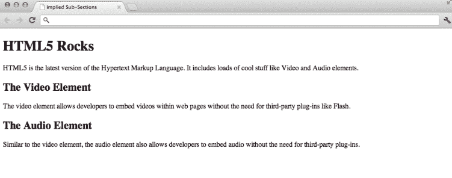

图3-1 页面层次结构。

> 告诉浏览器为 `<h1>` 元素使用较大字体、为 `<h2>` 元素使用较小字体的代码在哪里？它在层叠样式表（CSS）中！网络浏览器在 *用户代理样式表* 中包含了一套默认的基础样式。

> 要快速回顾 HTML 标题元素，请查看 Nick Pettit 在 Treehouse 的视频：http://teamtreehouse.com/library/websites/html/text/paragraphs-and-headlines。

### 使用标题作为徽标

Joe's Pizza Co. 的徽标非常简单——只有文本——所以你只需使用一个包含公司名称的 `<h1>` 元素。这段文本随后将由你在第2章末尾包含的 CSS 进行样式化。

> 本章练习的代码可以从书籍网站下载：http://wiley.com/go/treehouse/html5foundations。此代码位于第3章下载代码的文件夹1中。

按照以下步骤创建徽标：

1. 在文本编辑器中打开你项目文件夹中的 index.html 文件。

2. 找到 ID 为 logo 的 `<div>` 元素。这个 `<div>` 元素位于页面布局的头部。它看起来像这样：

    `<div id="logo">The Logo Goes Here</div>`

3. 用一个包含文本 **Joe's Pizza Co.**（包括句点）的新 `<h1>` 标题元素替换 `<div>` 中的虚拟文本。你的徽标 `<div>` 现在应该看起来像下面这样：

```
<div id="logo">
    <h1>Joe's Pizza Co.</h1>
</div>
```

4. 保存 index.html 文件。

5. 对你的内容页模板重复此过程，该模板存储在 about.html 文件中。

在浏览器中打开主页。图3-2显示了你的主页在添加新徽标后的样子。

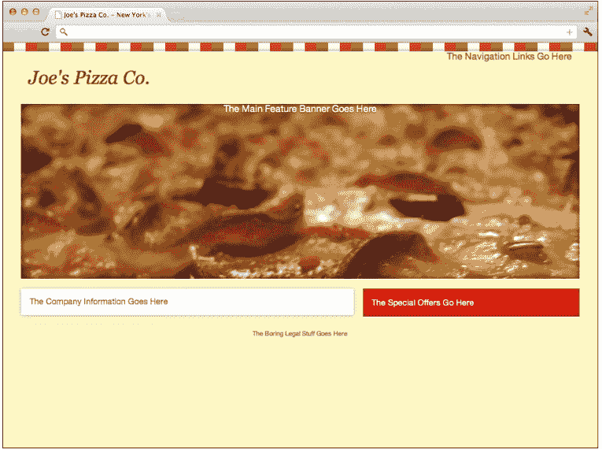

**图3-2** 带有新徽标的主页。Pizza 图像经 William Rogers 许可转载。

> 请记住，顶部边框和披萨图像是由 CSS 应用的！

### 添加导航

好了，太棒了，现在你已经搞定了徽标。是时候创建导航了，这样用户就可以轻松地在网站的不同页面之间流动。没有好的导航，你的用户就不会超过主页。

在构建此导航之前，你首先需要了解 HTML 链接和列表的工作原理。本节的前两部分重点解释这些内容。

### 链接

超链接可以说是最重要的 HTML 元素之一。它们代表网络上两个文档之间的连接，或连接到同一文档的另一部分。通过链接到网络上的其他内容，你是在表示你认为这些内容可能对阅读你网页的人感兴趣。以下部分介绍了你可以在网页中包含链接的元素。

> 在本书中，我将 *超链接* 和 *链接* 这两个术语互换使用。*链接* 这个术语更常用。

#### `<a>` 元素

HTML 中的超链接是使用 `<a>` 元素创建的。除了链接到网络上的其他页面，你还可以使用 `<a>` 元素链接到当前页面的部分内容。

让我们首先看看如何使用 `<a>` 元素创建指向网络上其他页面的链接。要链接到其他页面，你必须使用 href 属性指定目标页面的路径。此路径可以是绝对路径或相对路径（有关路径的更多信息，请参见第2章）。考虑以下示例：

```
<a href="http://google.com">Google</a>
```

这里我们使用绝对路径定义了一个指向 Google 主页的超链接，以及一些锚文本。锚文本是实际显示给用户的文本。这使你能够将冗长难看的 URL 替换为更用户友好的内容。`<a>` 元素上还有许多其他可用属性；你将在下一节中了解这些内容。

除了使用 `<a>` 元素链接到其他网页外，你还可以使用它链接到同一网页内的内容。当用户单击链接时，她将被带到页面上的相关元素。当你有非常大的网页时，使用这种链接方式很有用；它允许用户快速到达他们感兴趣的章节，而无需滚动很长时间才能到达。要创建这些链接，你需要在元素上放置一个 ID

即你想要链接到的元素，然后将相同的 ID（以 `#` 号作为前缀）放在链接的 `href` 属性中，如下例所示。

```html
<h1 id="hello">Hello World</h1>
<p>
    ...
</p>
<h2>Goodbye World</h2>
<p>
    ...
</p>
<a href="#hello">Back to Hello World</a>
```

在这个例子中，你定义了一个 ID 为 `hello` 的 `<h1>` 元素；这就是你想要链接到的页面部分。你定义的 `<a>` 元素是指向该元素在文档中位置的链接。请注意，`href` 属性的内容以 `#` 开头，后面是你要链接到的元素的 ID。

#### 链接属性

`<a>` 元素有多个可用属性。以下各节将对它们进行描述。

#### href 属性

每个 `<a>` 元素通常至少包含一个属性——通常是 `href` 属性。`href` 属性应包含一个指向你所链接文件的有效 URL。如果文件位于同一域名，这可以是一个相对路径（`about.html`），也可以是一个绝对路径（`http://example.com/about.html`）。

如果你要链接到文档内的特定元素，也可以使用以井号（#）为前缀的该元素 ID，如前面的代码示例所示。

#### title 属性

`title` 属性用于提供链接的描述。如果你将鼠标悬停在链接上，标题文本将显示在工具提示中。

```html
<a href="http://google.com" title="The Google search engine">Google</a>
```

使用 `title` 属性也能使你的网页对依赖屏幕阅读器等辅助技术的用户更加友好。这些程序可以大声朗读 `title` 属性的内容，为用户提供关于你所链接页面的更多信息。

#### rel 属性

`rel` 属性用于定义当前页面与所链接页面之间的关系。例如，`rel="author"` 表示链接的页面包含有关当前页面作者的信息。你将在接下来的"链接类型"部分更详细地了解不同的链接类型。

#### target 属性

`target` 属性用于指示浏览器*如何*跟踪链接。如果你希望浏览器在新窗口/标签页中打开链接，请使用 `_blank` 作为目标值。

```html
<a href="http://google.com" target="_blank">Google</a>
```

点击此链接将在新标签页中打开谷歌主页。使用 `_self` 将指示浏览器在当前窗口中打开链接。除非另有指定，大多数浏览器默认会在当前窗口中打开链接。

#### download 属性

你可以使用 `download` 属性来告诉浏览器应提示用户下载文件，而不是在浏览器窗口中显示该文件。当你想提供通常由浏览器显示的 HTML、CSS 或 JavaScript 文件的下载链接时，这尤其有用。`download` 属性是 HTML5 中新增的，因此目前浏览器的支持有限。

你不需要为 `download` 属性指定任何内容；它的存在就足以触发下载。以下示例展示了如何使用此属性为 JavaScript 文件提供下载链接。

```html
<a href="script.js" download>Download my JavaScript file</a>
```

默认情况下，浏览器将使用与网络服务器上相同的文件名保存文件。但是，你可以通过在 `download` 属性的内容中定义不同的文件名来更改此行为：

```html
<a href="script.js" download="myscript.js">Download my JavaScript file</a>
```

这里我将下载文件的文件名设置为 `myscript.js`。

#### ping 属性

`ping` 属性用于定义一个 URL（或一组由空格分隔的 URL），当用户跟踪链接时应通知该 URL。这对于访问者跟踪和分析等应用非常有用。

```html
<a href="http://google.com" ping="http://example.com/click/google">
  Google
</a>
```

`ping` 属性也是 HTML5 中新增的，因此目前浏览器对该属性的支持有限。

#### 链接类型

你可以使用多种不同的链接类型来指定当前页面与你所链接页面之间的关系。你使用 `rel` 属性来指定这种关系。你创建的大多数链接可能不会指定类型，但你应该尝试在适当的情况下使用它们。

表 3-1 显示了超链接可用的最常用链接类型及其含义。完整的链接类型列表，请查看 `http://microformats.org/wiki/existing-rel-values`。

表 3-1 链接类型

| 链接类型 | 用途 |

| :--- | :--- |

| `alternate` | 链接到文档的替代表示。例如，使用 `alternate` 链接到不同语言版本的页面副本。 |

| `author` | 链接到关于文档或文章作者的页面。 |

| `bookmark` | 指定指向最近章节的永久链接（permalink）。此类型可用于链接到博客中的文章。 |

| `help` | 链接到包含与当前页面内容相关的帮助信息的页面。 |

| `license` | 链接到包含与当前页面内容相关的版权许可的页面。 |

| `next` | 链接到页面系列中的下一个页面。 |

| `nofollow` | 用于表示当前页面的作者不认可被链接的页面。大型网站（如新闻机构）在新闻报道中链接到小型网站时通常使用此类型。指定这种关系也会阻止搜索引擎爬虫跟踪链接，因此得名 `nofollow`。 |

| `prefetch` | 指示浏览器，用户很可能会点击此链接，因此应该提前获取页面以帮助加快浏览速度。 |

| `prev` | 链接到页面系列中的上一个页面。 |

| `search` | 链接到可用于搜索当前页面或相关页面的资源。 |

| `tag` | 指定与当前文档内容相关的标签。这通常在博客中使用，文章可能会用某些关键词进行标记。 |

超链接可以有多个链接类型，用空格分隔。

以下是几个使用其中一些链接类型的 `<a>` 元素示例。

```html
<a href="http://myblog.example.com" rel="nofollow">Ben's Blog</a>
<a href="help.html" rel="help">Help Documentation</a>
<a href="author.html" rel="author">About the author</a>
```

> 关于如何创建链接的快速回顾，请查看这个 Treehouse 视频：

> http://teamtreehouse.com/library/websites/html/links/anchors。

### 列表

在编写网页内容时，你可能会发现使用列表很有用。HTML 有几个可用于创建列表和列表项的元素。在本节中，你将重点关注两种主要的项目符号列表：无序列表和有序列表。稍后，你将使用无序列表来创建导航结构。

#### 无序列表

顾名思义，在无序列表中，列表项的顺序并不重要。如果你更改列表项的顺序，这将完全不影响列表的含义。一个例子是食谱所需配料的购物清单。你可以更改购物清单中配料的顺序，但这并不会改变你仍然需要购买所有配料的事实。

无序列表使用 `<ul>` 元素定义，如下例代码所示。

```html
<ul>
  <li>Plain flour</li>
  <li>Salt</li>
  <li>Eggs</li>
  <li>Milk</li>
  <li>Butter</li>
</ul>
```

这里我们为制作煎饼所需的每种配料使用了一个单独的 `<li>`（列表项）元素。

大多数浏览器将使用项目符号显示无序列表，如图 3-3 所示。此样式可以使用 CSS 进行更改。

#### 有序列表

与无序列表不同，有序列表要求其列表项按特定顺序显示。修改顺序可能会极大地改变列表的含义。例如，食谱中的步骤应遵循一定的顺序；否则，你的烹饪可能会走向歧途。

有序列表使用 `<ol>` 元素定义，并包含一个或多个 `<li>` 元素。

```
<ol>
  <li>
    Sift the flour into a mixing bowl.
  </li>
  <li>
    Make a well into the center of the flour and break the eggs into it.
  </li>
  <li>
    Whisk the flour and eggs.
  </li>
  <li>
    Gradually add the milk and water whilst whisking until you have a smooth batter.
  </li>
  <li>
    Melt the butter into a frying pan.
  </li>
  <li>
    Add a small amount of batter into the pan, just enough to cover the base of the pan.
  </li>
  <li>
    Cook for about a minute.
  </li>
  <li>
    Flip the pancake over and cook the other side for about 10 seconds.
  </li>
  <li>
    Serve the pancake with sugar and lemon.
  </li>
</ol>
```

此示例展示了制作煎饼的步骤。由于这些步骤需要按顺序完成，最好使用 `<ol>` 元素。你不必为每个列表项手动添加编号；浏览器会为你完成这项工作，如图 3-4 所示。

**图 3-4** 一个有序列表。

> 要快速回顾无序列表和有序列表，请查看 Nick Pettit 在 Treehouse 上的视频：http://teamtreehouse.com/library/websites/html/lists/html-lists-ordered-and-unordered。

### 构建导航

既然你已经知道如何使用链接和列表，现在是时候创建一些导航了，它将使用户能够轻松地在网站的不同页面之间流动。

> 本练习的代码可在文件夹 2 中找到。

请按照以下说明创建站点导航。

1. 打开 index.html 文件。

2. 定位你在第 2 章创建的 `<nav>` 元素。

3. 在此 `<nav>` 元素内，创建一个新的 `<ul>` 元素：

```
<nav>
    <ul>

    </ul>
</nav>
```

4. 接下来，你需要为网站中的每个页面添加链接。首先在 `<ul>` 元素内为每个页面（站点地图除外）创建一个新的 `<li>` 元素。（你应该有五个。）

5. 在每个列表项中使用 `<a>` 元素创建一个新链接。

6. 将这些链接的锚文本设置为你网站的页面名称：主页、关于、新闻、菜单和位置。这是主页链接的示例。

```
<li><a href=" ">Home</a></li>
```

7. 将这些链接的 href 属性设置为指向你网站中的页面：index.html、about.html、news.html、menu.html 和 locations.html。

```
<li><a href="index.html">Home</a></li>
```

8. 现在为每个 `<a>` 元素添加一个 title 属性，并为其提供一些描述你所链接页面的内容。我提供了一些示例：

    - Joe's Pizza Co.

    - 了解更多关于 Joe's Pizza Co. 的信息。

    - Joe's Pizza Co. 的最新新闻。

    - Joe's Pizza Co. 的餐厅菜单。

    - Joe's Pizza Co. 餐厅位置。

9. 用户在查看导航时能够快速识别他们当前所在的页面是很好的。为了让他们能够做到这一点，你需要为指向当前页面的链接添加一个 class 属性，并将此属性的值设置为 active。

```
<li><a href="index.html" title="..."
class="active">Home</a></li>
```

> 你在第 2 章添加的样式表包含一些代码，这些代码会使活动链接的样式略有不同，使其突出显示。

10. 保存 index.html 文件。

11. 将你刚刚创建的导航复制到你的 about.html 中。

12. 将应用活动样式的 class 属性移动到关于链接上。

13. 保存 about.html 文件。

以下是你 index.html 文件中导航应有的样子。如果遇到问题，请尝试从书籍网站可下载的 index.html 文件中复制此代码。

```
<nav>
  <ul>
    <li>
      <a href="index.html" title="Joe's Pizza Co." class="active">
        Home
      </a>
    </li>
    <li>
      <a href="about.html"
         title="Find out more about Joe's Pizza Co.">
        About
      </a>
    </li>
    <li>
      <a href="news.html"
         title="Latest News about Joe's Pizza Co.">
        News
      </a>
    </li>
    <li>
      <a href="menu.html"
         title="The restaurant menu for Joe's Pizza Co.">
        Menu
      </a>
    </li>
    <li>
      <a href="locations.html"
         title="Joe's Pizza Co. restaurant locations.">
        Locations
      </a>
    </li>
  </ul>
</nav>
```

图 3-5 展示了你的新导航在浏览器中的样子，链接位于页面的右上角。注意主页链接与其他链接颜色不同，因为它应用了 active 类。

**图 3-5** 导航链接。*披萨图片经 William Rogers 许可复制*

> 注意，站点地图链接不在导航列表中。你将把该链接放在页面的页脚。

### 添加页脚内容

你的页面模板即将完成！你现在要做的就是添加页脚内容。在这里，你将接触到一个新元素 `<small>`，用于标记法律文本。你还将添加指向站点地图页面的链接。

#### `<small>` 印刷

`<small>` 元素在 HTML5 中的用途已改变。以前，该元素用于呈现目的（使文本变小）；然而，现在它用于定义简短的旁注，如法律免责声明和版权，如下方示例代码所示。

```
<small>Copyright 2012 Joe's Pizza Co.</small>
```

`<small>` 元素应仅用于简短的文本段落。例如，你不应该用它来包裹构成网站隐私政策的所有文本。在这种情况下，文本是页面的主要内容，而不是旁注。

#### 向页脚添加链接和法律信息

你可能已经注意到，在导航中你跳过了一个页面，即站点地图。与其在导航中放置指向此页面的链接，通常最好将其包含在页面的页脚中。为什么？因为它不需要与其他页面相同的曝光度。

页面页脚还应包含页面版权信息。在这种情况下，我们将把版权文本放在 `<small>` 元素内，以赋予其更强的语义含义。

> 本练习的代码可在文件夹 3 中找到。

要为页面创建页脚部分，请按照以下说明操作。

1. 打开 `index.html` 文件。

2. 定位你在第 2 章创建的 `<footer>` 元素。

3. 在 `<footer>` 内创建一个新的 `<small>` 元素，使用以下代码摘录中的文本。

    `<small>&copy; 2012 Joe's Pizza Co. All Rights Reserved</small>`

4. 现在使用 `<a>` 元素创建一个指向 `sitemap.html` 文件的新链接。

    `<a href="sitemap.html">Sitemap</a>`

5. 为此新链接添加一个 title 属性，内容为：指向本网站所有页面的链接。

6. 在 `<small>` 和 `<a>` 元素之间添加一个连字符，并在连字符的左右各留一个空格。这只是因为它看起来美观。

7. 保存 index.html。

8. 将 `<footer>` 元素的内容复制到 about.html 文件中。

9. 保存 about.html 文件。

以下代码展示了你的 `<footer>` 元素现在的样子。

```
<footer>
    <small>&copy; 2012 Joe's Pizza Co. All Rights Reserved</small>
    -
    <a href="sitemap.html"
        title="Links to all the pages on this website">Sitemap</a>
</footer>
```

图 3-6 展示了你的主页添加新页脚后的样子。

**图 3-6** 带有新页脚内容的主页。

*披萨图片经 William Rogers 许可复制*

#### HTML 代码

请注意前面代码中版权行里使用的 `&copy;`。这组字符将在您的页面上显示为版权符号。像 £、© 和 ™ 这样的特殊字符必须使用特殊的 HTML 代码来编写。目前有超过一百种可用的 HTML 代码，允许您为网页添加符号。这些代码的完整列表可以在 http://ascii.cl/htmlcodes.htm 找到。

### 全局属性

除了到目前为止您已经了解过的专用属性之外，每个 HTML 元素都有一组可以应用于它的属性。这些被称为 *全局* 属性。

在本节中，您将了解在创建网页时最有用的全局属性。您在本章前面的示例以及前两章的示例中已经见过其中一些属性。

#### id 属性

`id` 属性可用于为元素分配一个唯一的 ID。这使得使用 CSS 或 JavaScript 选择元素变得更加容易。

ID 最短可以只有一个字符，并且应仅用于页面上的一个元素。您应始终尽量使您的 ID 具有描述性，因为这将使您的代码更容易被他人理解。如果需要在多个元素上放置相同的标识符，则应使用 class（在下一节中描述）。

```
<section id="bio">...</section>
```

此示例代码将创建一个具有 ID `bio` 的新 `<section>` 元素。然后您可以通过使用此 ID 来定位此元素并对其进行样式设置。

#### class 属性

`class` 属性与 `id` 属性类似，因为它可用于在元素上放置标识符，以便您可以使用 CSS 或 JavaScript 轻松选择它。区别在于，您可以在多个元素上使用相同的类。例如，如果您希望能够定位一组列表项或多个段落元素，这将非常有用。

```
<ol>
  <li>one</li>
  <li class="even">two</li>
  <li>three</li>
  <li class="even">four</li>
  <li>five</li>
</ol>
```

在此示例中，您为交替的列表项添加了类 `even`。这意味着您可以在 CSS 中仅定位这些列表项，以创建漂亮的交替背景图案，帮助用户区分各行。

#### hidden 属性

`hidden` 属性可用于指示浏览器不显示与页面当前状态无关的元素。

例如，您可能希望向未登录的用户隐藏一些页面内容。您可以使用 JavaScript（将在第 11 章介绍）来监控用户是否已成功登录，并相应地显示/隐藏内容。要隐藏元素，请将该属性设置为 true；要显示它，则应设置为 false。

```
<p hidden="true">Only signed in users can see this content.</p>
```

请注意，`hidden` 属性是 HTML5 中的新功能，因此目前浏览器对此属性的支持有限。

#### title 属性

您在学习链接时已经遇到过 `title` 属性，但我想更详细地介绍它。`title` 属性可用于提供元素内容的描述。如果指定了 `title` 属性，当用户将鼠标悬停在元素上几秒钟时，其内容将显示出来。

```
<a href="http://google.com" title="The Google Search Engine">Google</a>
```

在此示例中，当用户将鼠标悬停在链接上时，他们会在工具提示中看到 `title` 属性的值。如图 3-7 所示。

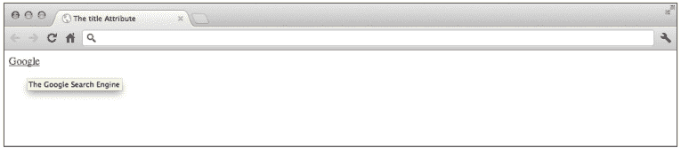

图 3-7 显示 title 属性值的工具提示。

> 这听起来可能很显然，但请记住，这些工具提示在移动设备上将不起作用。

#### lang 属性

您在第 1 章中遇到过 `lang` 属性，当时您在 `<html>` 元素上使用它来将整个页面的语言设置为英语。`lang` 属性可以应用于任何元素，以指定其内容的语言。以下示例将页面的语言设置为英语，但也包含一段德语文本（"de" 代表德语）。

```
<!DOCTYPE html>
<html lang="en">
<head>
    <meta charset="utf-8">
    <title>Language Test</title>
</head>
<body>
    <p>HTML5 is awesome.</p>
    <p lang="de">HTML5 ist super.</p>
</body>
</html>
```

### 总结

太棒了！您的页面模板现在完成了。

在本章中，您学习了许多新的 HTML 元素。这包括学习如何使用标题元素为页面内容创建层次结构。

超链接构成了网络的支柱。在本章中，您学习了如何向网页添加链接，这些链接可以导航到外部网页以及当前网页内的部分。

您还了解了 HTML 列表，并学习了无序列表和有序列表之间的区别。正如您在为页面模板构建导航部分时所发现的那样，这些列表元素对于构建导航结构非常有用。

最后，您运用了本章所学的所有知识来完成您的页面模板。在第 4 章中，您将使用这些页面模板来创建网站中的每个页面。

## 第四章：创建网页

在第 3 章中，您专注于完成页面模板。现在，您将开始使用这些页面模板来为您的网站创建每个页面。

在本章的学习过程中，您将了解几个新的 HTML 元素。您将在第 3 章所学的标题元素基础上继续学习，并学习如何正确地将多个标题元素组合在一起。

文本内容将构成您网站"关于"页面的大部分内容。您将学习一些可用于标记文本的新元素（如 `<abbr>` 和 `<blockquote>`），并更深入地了解段落元素。（附录 A 包含了我在本章中无法涵盖的许多其他文本元素。）

在本章结束时，您将创建网站的所有页面并向每个页面添加内容。在本书的后续内容中，您将使用 HTML5 优化这些页面。

### 为首页添加内容

首页是大多数人访问您的网站时首先看到的页面，因此让我们从这里开始。在本节中，您将学习一个名为 `<hgroup>` 的 HTML 元素；这是 HTML5 中的新功能。

#### 使用标题和 `<hgroup>` 完成主功能区

`<hgroup>` 元素用于需要将多个级别的标题元素组合在一起的情况。您可以使用 `<hgroup>` 元素将书籍的主标题和副标题组合在一起。

```
<hgroup>
    <h1>Venture Deals</h1>
    <h2>Be Smarter Than Your Lawyer and Venture Capitalist</h2>
</hgroup>
```

> 当 `<hgroup>` 元素内有两个或多个标题元素时，搜索引擎和其他基于算法的程序在检查文档大纲时，只会考虑优先级最高的标题。（所有标题元素仍将由您的 Web 浏览器显示在屏幕上。）

现在让我们使用 `<hgroup>` 元素和两个标题元素来完成首页的主功能区部分。

> 此练习的代码可在第 4 章下载代码的文件夹 1 中找到。

请按照以下步骤操作：

1. 打开 `index.html` 文件。

2. 在代码中找到具有 ID `feature` 的 `<section>` 元素。

3. 删除您在第 2 章中添加到此元素的占位文本（"主功能区横幅放在这里"）。

4. 在 `<section>` 元素内创建一个新的 `<hgroup>` 元素。

5. 在 `<hgroup>` 元素内创建一个新的 `<h1>` 元素。

6. 将以下文本添加到这个新的 `<h1>` 元素：`New York's Best Pizza`

7. 在刚刚创建的 `<h1>` 下方创建一个新的 `<h2>` 元素。

8. 将以下文本添加到这个新的 `<h2>` 元素：`joe's pepperoni special`

9. 保存 `index.html` 文件。

#### 添加主页文本

现在主要特色部分已经完成，让我们继续处理主页文本。大多数网站的主页都有一段文字，向用户简要介绍业务内容。为此，您需要另一个标题和几个段落元素。

##### 段落

您在第1章中已经简单了解了`<p>`元素。段落元素用于组织文本，其作用类似于普通写作中的段落。大多数浏览器会对`<p>`元素应用一些默认样式，在文本上下方添加边距。以下是使用`<p>`元素标记一段文本的示例。

```
<h1>Treehouse</h1>
<p>Our mission is to bring affordable Technology education to people everywhere, in order to help them achieve their dreams and change the world.<p>
```

只有在没有更具体的元素（如标题元素）可用于标记内容时，才应使用`<p>`元素。

##### 向主页添加文本

现在是时候向主页添加更多内容了。您可以在本书的配套网站上查看此练习的代码，但我建议您先尝试通过以下步骤练习编码技能，然后再查看文件。

> 此练习的代码可以在文件夹2中找到。

1. 打开项目文件夹中的`index.html`。

2. 在代码中找到ID为`home-text`的`<section>`元素。

3. 删除您在第3章中添加到此元素的占位文本。

4. 在此`<section>`元素内创建一个新的`<h1>`元素。

5. 将以下文本添加到这个新的`<h1>`元素中：Welcome to Joe's Pizza Co.

6. 在新的`<h1>`元素下方添加以下文本。注意此处`<p>`元素的使用以及第二个段落中的链接。

```
<p>
    We pride ourselves on serving up the best pizzas in New York City. Come and visit one of our family-friendly restaurants and take a look at our wide range of authentic Italian pizzas. We can also deliver direct to your door with our speedy takeaway service.
</p>
<p>
    Please take a look at the <a href="locations.html">Locations</a> page for more information about where you can find our fantastic restaurants.
</p>
```

7. 保存`index.html`文件。

您为首页文本部分编写的代码现在应该如下所示：

```
<!-- Home Text -->
<section id="home-text">
    <h1>Welcome to Joe's Pizza Co.</h1>
    <p>
        We pride ourselves on serving up the best pizzas in New York City. Come and visit one of our family-friendly restaurants and take a look at our wide range of authentic Italian pizzas. We can also deliver direct to your door with our speedy takeaway service.
    </p>
    <p>
        Please take a look at the <a href="locations.html">Locations</a> page for more information about where you can find our fantastic restaurants.
    </p>
</section>
```

图4-2展示了在此阶段主页在浏览器中的显示效果。哇，它真的开始成型了！

您在第2章末尾添加到页面的CSS样式表已经为"主要特色"和"首页文本"部分的标题元素应用了单独的样式。这就是为什么尽管它们使用相同的元素，但看起来却不同。

首页还有一个部分需要完成，即特别优惠。接下来我将向您展示如何操作。

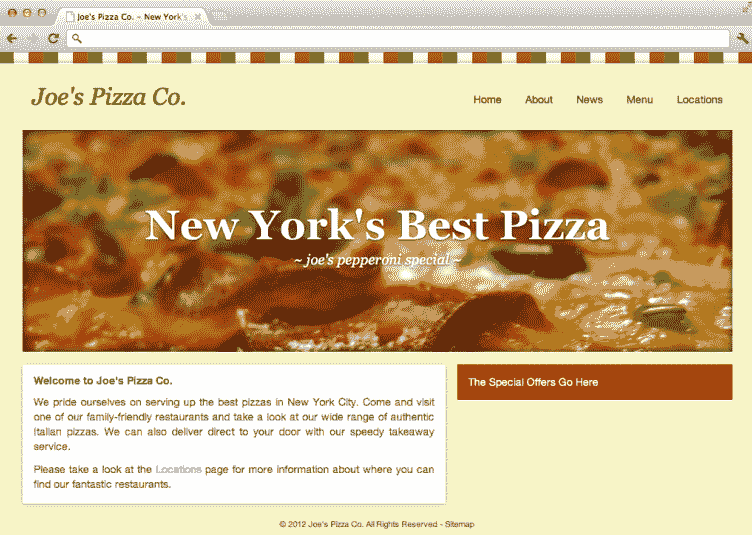

**图 4-2** 包含新文本内容的主页。

披萨图片经William Rogers许可复制使用

##### 添加特别优惠

首页的最后一个部分是特别优惠。在此部分中，您将运用在第3章学到的HTML列表知识，创建一个特别优惠列表。

> 此练习的代码可以在文件夹3中找到。

请按照以下说明将此部分添加到主页。

1. 打开`index.html`文件。

2. 找到ID为`offers`的`<section>`元素。

3. 在标题下方创建一个包含优惠列表的新`<ul>`元素。

4. 为第一个优惠创建一个`<li>`元素，并添加优惠文本：`10% Off All Pizzas When You Eat In!`

5. 为第二个优惠创建一个`<li>`元素，并添加优惠文本：20% Off Joe's Pepperoni Special with the promo code `NYBESTPIZZA`。

6. 保存`index.html`文件。

您的代码应如下所示：

```
<!-- Special Offers -->
<section id="offers">
  <h1>Special Offers</h1>
  <ul>
    <li>10% Off All Pizzas When You Eat In!</li>
    <li>20% Off Joe's Pepperoni Special with the promo code NYBESTPIZZA</li>
  </ul>
</section>
```

至此，首页的内容全部完成。在浏览器中查看页面；您应该会看到类似图4-3的效果。它开始看起来像一个真正的网站了！

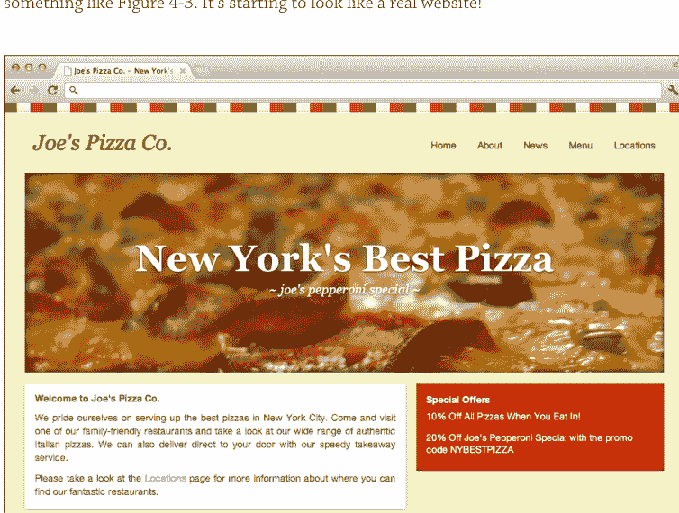

**图 4-3** 包含特别优惠部分的主页。

披萨图片经William Rogers许可复制使用

#### 向关于页面添加内容

"关于"页面将主要包含文本内容，但即使是文本，也可以使用特殊的HTML元素进行标记，以便为计算机程序提供更丰富的语义信息。在本节中，您将首先学习如何标记文本中的引文和缩写。然后，您将通过向"关于"页面添加一些文本来运用这些新技能。

##### 引用

`<blockquote>`元素用于引用来自其他来源的文本块。该元素有一个可选的`cite`属性，可用于添加引文来源的URL。如果您选择使用`cite`属性，其内容必须是有效的URL。

```
<blockquote cite="http://example.com/quotes">
    To cite, or not to cite, that is the question.
</blockquote>
```

`cite`属性的内容不会显示给用户，但可供计算机程序使用。为了让用户更容易找到来源，您可以使用在第3章学过的`<a>`元素链接到它。

您还可以使用`<q>`元素在文本块中标记内联引用。一个很好的例子是，如果您正在撰写一篇新闻文章并想引用某个人的话，如以下示例所示。

```
In reaction to the proposed budget cuts, Sam Dawson said
<q>This is crazy, they simply cannot turn off the Internet</q>.
Personally, I agree with Sam's comment.
```


> 要快速回顾如何在HTML代码中标记引用，请查看Treehouse上的这个视频：http://teamtreehouse.com/library/websites/html/text/quotes。

##### 缩写

HTML提供了多个元素来标记文本内容中的关键术语、缩写和定义。使用这些元素还允许您使用CSS为这些文本部分应用自定义样式，这对于指示重要术语或缩写非常有用。在本节中，您将重点介绍`<abbr>`元素；但是，请查看附录A了解有关如何标记术语和定义的信息。

`<abbr>`元素可用于识别文本内容中的缩写。您还可以选择使用`title`属性来定义缩写的完整文本形式。如果用户将鼠标悬停在缩写上几秒钟，大多数浏览器将向她显示此完整文本形式。

```
<p>The <abbr title="World Wide Web Consortium">W3C</abbr> is responsible for developing web standards.</p>
```

使用`<abbr>`元素使计算机程序能够轻松识别您文本中的缩写并理解其含义。这有助于构建更智能的Web。

##### 添加关于页面文本

"关于"页面上的文本将包括引文和缩写，非常适合您刚学过的HTML新元素。

对于这个页面，您将基于已在`about.html`文件中创建的内容页面模板进行构建。

> 此练习的代码可以在文件夹4中找到。

请按照以下说明向您的"关于"页面添加文本内容：

1. 打开`about.html`文件。

2. 找到ID为`page-text`的`<section>`元素。

3. 在此`<section>`元素内创建一个新的`<h1>`元素。将以下文本添加到这个新的`<h1>`元素中：About Joe's Pizza Co.（包括句号）。

4. 在刚创建的`<h1>`元素下方创建一个新的`<p>`元素，并将以下文本添加到您的新`<p>`元素中：

 Joe's Pizza Co. 成立于1984年，以其供应具有纽约风味的正宗意大利披萨而自豪。自开设位于西38街310号的第一家餐厅以来，Joe's Pizza Co. 已在纽约各处扩展至另外两家餐厅。

5. 现在在上一个`<p>`元素下方创建另一个`<p>`元素，并添加以下文本。注意`<q>`元素用于标记文本中的引用。

我们的创始人乔·巴洛基奥常说："一个好披萨始于从本地供应商那里挑选优质、新鲜的食材。"这一理念体现在公司中，您在我们餐厅享用的披萨将永远不会包含任何劣质或廉价的食材。我们为披萨的品质感到无比自豪。

6. 最后，添加第三个包含以下文本的`<p>`元素。这次，你将使用`<abbr>`元素来标记缩写。

    Joe's Pizza Co.是美国国家餐饮协会（<abbr title="National Restaurant Association">NRA</abbr>）的成员。

7. 保存about.html文件。

    你的页面文本部分的代码现在应该如下所示：

    ```html
    <!-- Page Text -->
    <section id="page-text">
      <h1>About Joe's Pizza Co.</h1>
      <p>
        Established in 1984, Joe's Pizza Co. prides itself on serving
        up authentic Italian pizzas with a New York twist. Since opening
        their first restaurant at 310 West 38th Street, Joe's has
        expanded into two more restaurants distributed throughout New
        York.
      </p>
      <p>
        Our founder Joe Balochio has always said <q>"A great pizza
        starts with selecting quality, fresh ingredients from local
        suppliers."</q> This belief is embodied in the company and the
        pizzas that you will eat in our restaurants will never contain
        any poor quality or cheap ingredients. We take great pride in the
        quality of our pizzas.
      </p>
      <p>
        Joe's Pizza Co. is a member of the National Restaurant
        Association (<abbr title="National Restaurant Association">NRA</abbr>).
      </p>
    </section>
    ```

    图4-4展示了"关于"页面在你的网页浏览器中应有的样子。

    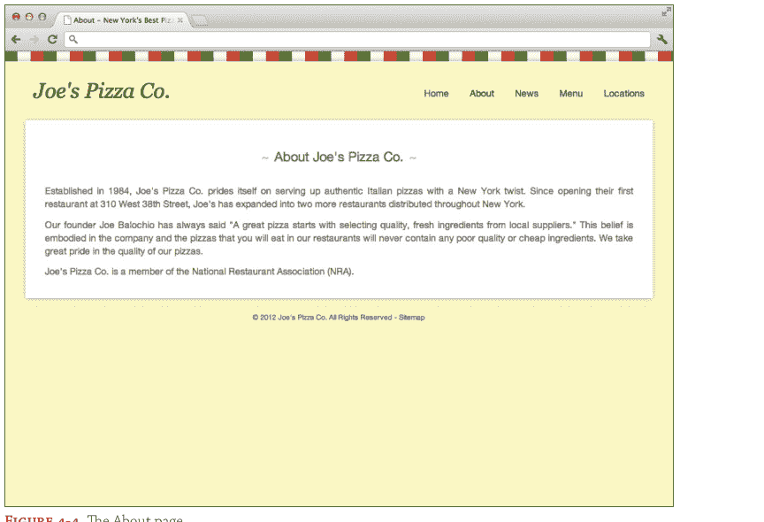

### 创建"地点"页面

Joe's Pizza Co.在纽约有三家餐厅。"地点"页面将包含每家餐厅的地址、电话号码、营业时间以及地图。所有这些信息都将包含在单独的`<section>`元素中，一个地点对应一个`<section>`。

你已经了解了创建"地点"页面所需的大部分知识。剩下的就是学习如何向你的网页添加图像，以便你可以添加地图。

### 向网页添加图像

到目前为止，你只学习了如何在网页中使用文本。``元素让事情变得生动了一些，因为它使你能够嵌入图像。

``元素必须同时具有`src`属性和`alt`属性。`src`属性应包含你想要嵌入页面的图像文件的路径。`alt`属性用于在图像无法加载时提供一些备用文本。该文本应描述图像的内容。这是一个例子。

```html

```

这里我们定义了一个``元素，其中包含一个图像文件的路径和图像的文本描述。图4-5展示了该图像在网页浏览器中的显示效果。

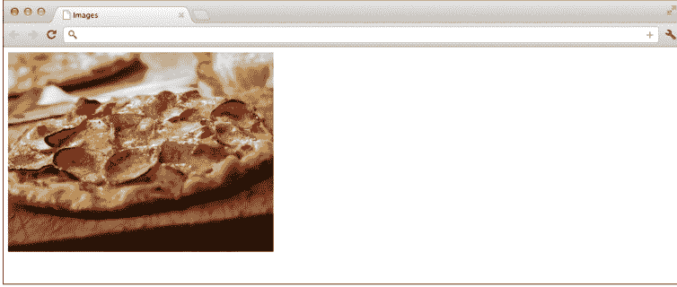

**图4-5** 在Google Chrome中显示的简单图像。

*披萨图片经iStockphoto.com/Lauri Patterson许可转载*

> 注意``元素没有结束标签。这是因为``是一个*空*元素。

你还可以使用`width`和`height`属性来定义图像应显示的宽度和高度。这些属性应包含一个表示像素维度的整数。如果需要，浏览器会自动调整图像大小以适应指定的尺寸；但是，最好提供一张已经调整为合适尺寸的图像。这将有助于减少页面加载所需的时间。

以下示例使用了一个明确指定了`width`和`height`属性的``元素。这里的图像文件已经为240像素宽和280像素高，因此浏览器不会调整其大小。你仍然应该显式定义图像尺寸，因为这有助于稍微加快页面加载时间。

```html

```

### 向"地点"页面添加内容

好的，现在你知道如何使用HTML添加图像了。接下来，让我们开始为"地点"页面添加内容。

> 此练习的代码可在文件夹5中找到。

按照以下说明操作：

1. 首先，下载你在本节中将使用的以下地图图像：map1.png、map2.png和map3.png。这些文件可以在文件夹5的img文件夹中找到。将它们放置在项目目录的img文件夹中。

2. 在你的项目文件夹中创建一个新的locations.html文件。

3. 打开about.html文件，并将其内容复制到你新的locations.html文件中。

4. 更新`<title>`和`<meta>`元素以反映新的"地点"页面的内容。我提供了一些示例：

5. 从导航中的"关于"链接中移除class属性，并将其移动到"地点"链接上。

6. 找到ID为page-text的`<section>`元素，并删除该元素中的所有内容。

7. 在此元素中创建一个新的`<h1>`元素，并赋予其文本"地点"。

8. 在此`<h1>`元素下方添加以下代码。这提供了关于第一个餐厅地点的信息。此处的id和class属性用于样式设置。此处使用的`<br>`元素在文本中创建了一个换行。你可以在附录A中找到更多关于`<br>`元素的信息。

    ```html
    <title>Locations - Joe's Pizza Co.</title>
    <meta name="description" content="Locations of Joe's Pizza Co. restaurants in New York City.">
    <meta name="keywords" content="new york pizza,pizza restaurants,joe's pizza,joe's new york">
    ```

    ```html
    <section id="location1">
      <h1>310 West 38th Street, NY</h1>
      
      <p class="location-phone">212 012 3456</p>
      <h2>Opening Hours:</h2>
      <p>
        Mon-Fri: 12:00 - 22:00<br>
        Sat-Sun: 11:00 - 23:00
      </p>
    </section>
    ```

9. 在其下方，添加以下用于第二个餐厅地点的代码。

    ```html
    <section id="location2">
      <h1>2450 Broadway, NY</h1>
      
      <p class="location-phone">212 012 3457</p>
      <h2>Opening Hours:</h2>
      <p>
        Mon-Fri: 12:00 - 22:00<br>
        Sat-Sun: 11:00 - 23:00
      </p>
    </section>
    ```

10. 最后，添加第三个餐厅地点的代码。

    ```html
    <section id="location3">
      <h1>200 West 44th Street, NY</h1>
      
      <p class="location-phone">212 012 3458</p>
      <h2>Opening Hours:</h2>
      <p>
        Mon-Fri: 12:00 - 22:00<br>
        Sat-Sun: 11:00 - 23:00
      </p>
    </section>
    ```

11. 保存你的`locations.html`文件。

图4-6展示了新的"地点"页面在浏览器中应有的样子。

### 创建"网站地图"页面

"网站地图"页面应仅包含一个标题和一个包含你网站上所有其他页面的列表。

> 此练习的代码可在文件夹6中找到。

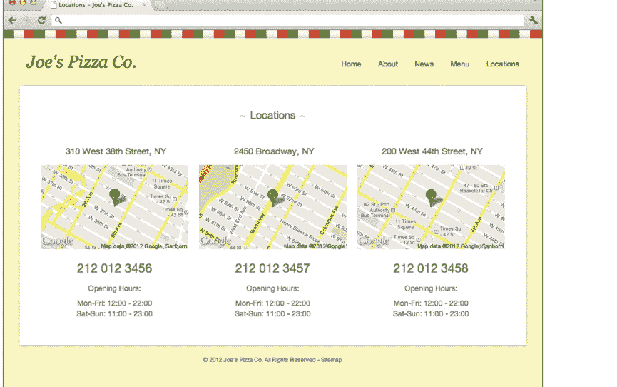

**图4-6** "地点"页面。

地图数据 2012 © Google

按照以下说明创建"网站地图"页面：

1. 首先，在你的项目文件夹中创建一个新的sitemap.html文件。

2. 打开about.html文件，并将其内容复制到你新的sitemap.html文件中。

3. 更新`<head>`元素内的`<title>`和`<meta>`元素，以反映新的"网站地图"页面的内容。

4. 从导航中的"关于"链接中移除`class`属性。

5. 找到ID为`page-text`的`<section>`元素，并删除该元素中的所有内容。

6. 在此元素中创建一个新的`<h1>`元素，并赋予其文本"网站地图"。

7. 在此`<h1>`下方创建一个新的`<ul>`元素，并赋予其ID `sitemap`。

8. 为你网站中的每个页面（你应该有六个）创建新的`<li>`元素。

9. 在每个`<li>`元素中创建一个新的`<a>`元素，链接到你网站的每个页面。

10. 将这些链接的锚文本设置为页面名称：首页、关于、新闻、菜单、地点和网站地图。

11. 将这些链接的href属性设置为指向相关的HTML文件：index.html、about.html、news.html、menu.html、locations.html和sitemap.html。

12. 这些链接的title属性应包含指向页面的描述。你可以使用在第3章构建导航时用过的相同描述。

13. 保存sitemap.html文件。

你的代码现在应该看起来像这样。你也可以在文件夹6的locations.html文件中找到这段代码。

```
<section id="page-text">
  <h1>Sitemap</h1>
  <ul id="sitemap">
    <li>
      <a href="index.html" title="Joe's Pizza Co.">
        Home
      </a>
    </li>
    <li>
      <a href="about.html"
        title="Find out more about Joe's Pizza Co.">
        About
      </a>
    </li>
    <li>
      <a href="news.html"
        title="Latest News about Joe's Pizza Co.">
        News
      </a>
    </li>
    <li>
      <a href="menu.html"
        title="The restaurant menu for Joe's Pizza Co.">
        Menu
      </a>
    </li>
    <li>
      <a href="locations.html"
        title="Joe's Pizza Co. restaurant locations.">
        Locations
      </a>
    </li>
    <li>
      <a href="sitemap.html"
        title="Links to all the pages on this website ">
        Sitemap
      </a>
    </li>
  </ul>
</section>
```

图4-7展示了网站地图页面在你的Web浏览器中应有的样子。

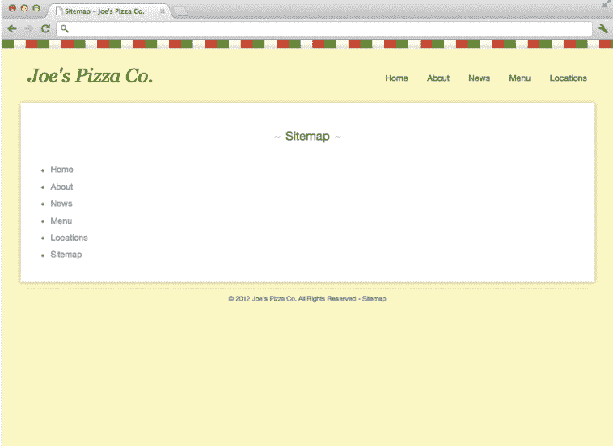

图4-7 网站地图页面。

### 创建菜单页面

菜单页面将会展示，嗯，菜单。你还会添加一些菜品图片来增添一点趣味。（你不想要枯燥的页面，对吧？）有趣的是，这次你将把这些图片制作成图形，并使用两个新的HTML5元素`<figure>`和`<figcaption>`为其添加标题。

这将是你第一次接触HTML表格。表格是一个相当大的主题，请在接下来的几页中保持耐心。你确实需要了解这些内容！

### 表格介绍

如果你有大量表格数据需要展示给用户，可以使用HTML `<table>`元素。表格行可以使用`<tr>`元素定义，单元格则使用`<td>`元素定义。列标题使用`<th>`元素而非`<td>`元素来定义。

以下示例创建了一个简单的表格，展示了三名学生在数学考试中取得的成绩。

```
<table border="1">
    <tr>
        <th>Pupil</th>
        <th>Result</th>
    </tr>
    <tr>
        <td>James</td>
        <td>85</td>
    </tr>
    <tr>
        <td>Alicia</td>
        <td>97</td>
    </tr>
    <tr>
        <td>Tom</td>
        <td>76</td>
    </tr>
</table>
```

`<table>`标签的`border`属性为表格添加了1像素的边框，这样我们就能清楚地看到行和列。第一行包含两个`<th>`元素，它们构成了列标题；浏览器通常默认以粗体显示这些内容。然后我们通过创建三个独立的行来定义记录，每行包含两个`<td>`元素（表格单元格），一个用于学生姓名，另一个用于他或她的考试成绩。图4-8展示了该表格在浏览器中的显示效果。


**图4-8** 一个考试成绩表格。

### 表格单元格属性

`<td>`和`<th>`元素都有许多可用于帮助格式化的属性。一个例子是colspan（列合并）属性。当你需要一个特定的表格单元格跨越多列时，可以使用colspan属性。以下示例使用colspan属性创建了一个跨越整个表格的单元格。

```
<table border="1">
  <tr>
    <th colspan="2">Class 2B</th>
  </tr>
  <tr>
    <th>Pupil</th>
    <th>Result</th>
  </tr>
  <tr>
    <td>James</td>
    <td>85</td>
  </tr>
  <tr>
    <td>Alicia</td>
    <td>97</td>
  </tr>
  <tr>
    <td>Tom</td>
    <td>76</td>
  </tr>
  <tr>
    <th colspan="2">Class 3A</th>
  </tr>
  <tr>
    <th>Pupil</th>
    <th>Result</th>
  </tr>
  <tr>
    <td>Ben</td>
    <td>82</td>
  </tr>
  <tr>
    <td>Louise</td>
    <td>92</td>
  </tr>
</table>
```

当这个示例在浏览器中显示时，`<th>`元素将跨越表格的整个宽度，如图4-9所示。

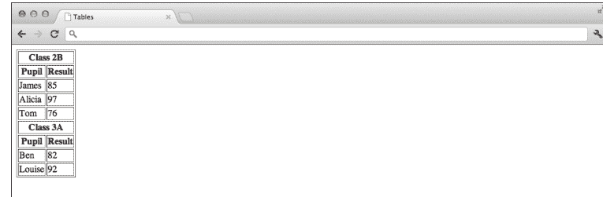

**图4-9** 一个使用了`colspan`属性的`<th>`元素的表格。

除了colspan属性，你还可以指定rowspan属性。这实际上与colspan的作用相同，但它是跨行合并单元格，而不是跨列合并。

### 表格标题、主体和页脚

处理表格时，你可以使用`<thead>`、`<tbody>`和`<tfoot>`元素来为表格赋予更强的语义含义。

**`<thead>` 元素**

`<thead>`元素可用于包裹包含表格标题的行。这使得计算机程序和搜索引擎能够轻松找到列标题。在编写CSS时，使用`<thead>`元素也很方便，因为你可能希望CSS规则仅针对`<thead>`内的元素。

**`<tfoot>` 元素**

`<tfoot>`元素应包含表格中每一列的汇总信息。虽然它是一个页脚元素，但最好将`<tfoot>`元素放在表格中`<thead>`的下方。Web浏览器会自动将此内容移动到表格底部，但将其放在`<thead>`下方，如果你有一个包含很多行的表格，查找起来会更容易。请参阅下面的代码摘录，了解如何使用`<tfoot>`元素的示例。

**`<tbody>` 元素**

`<tbody>`元素用于定义表格中展示的数据行。它应包含一个或多个`<tr>`元素。

下面是一个使用了`<thead>`、`<tbody>`和`<tfoot>`元素的表格示例。

```
<table>
  <thead>
    <tr>
      <th>Pupil</th>
      <th>Result</th>
    </tr>
  </thead>
  <tfoot>
    <tr>
      <td>Average</td>
      <td>86</td>
    </tr>
  </tfoot>
  <tbody>
    <tr>
      <td>James</td>
      <td>85</td>
    </tr>
    <tr>
      <td>Alicia</td>
      <td>97</td>
    </tr>
    <tr>
      <td>Tom</td>
      <td>76</td>
    </tr>
  </tbody>
</table>
```

在浏览器中查看此内容，你应该会看到如图4-10所示的表格。

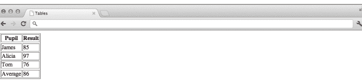

**图4-10** 一个使用了`<thead>`、`<tbody>`和`<tfoot>`元素的表格。

> 关于HTML表格的快速回顾，请查看Treehouse网站上的这些视频。

- **表格行和单元格：** http://teamtreehouse.com/library/websites/html/tables/rows-and-cells

- **表格页眉和页脚：** http://teamtreehouse.com/library/websites/html/tables/headers-and-footers

### 添加菜单表格

每个优秀的餐厅网站都应该包含一个带价格的完整菜单。Joe的菜单分为三个主要部分：披萨、蒜香面包和配菜。你将使用`<section>`元素来明确定义每个部分，然后使用`<table>`元素来显示菜单数据。

此练习的代码可以在文件夹7中找到。

请按照以下说明创建菜单页面：

1. 首先，在你的项目文件夹中创建一个新的`menu.html`文件。

2. 打开`about.html`文件，将其内容复制到你的新`menu.html`文件中。

3. 更新`<head>`元素中的`<title>`和`<meta>`元素，以反映新菜单页面的内容。

4. 更新导航，使菜单链接具有`active`类。

5. 找到ID为`page-text`的`<section>`元素，删除此元素中的任何内容。

6. 在此部分中创建一个新的`<h1>`元素，并将其文本设置为Menu。

7. 在此`<h1>`元素下方，创建一个新的`<div>`元素，其ID为`menu-tables`。这将用于将所有菜单表格组合在一起以便进行样式设计。

8. 在这个新的`<div>`中，创建三个空的`<section>`元素。这些将用于容纳菜单的三个部分。

9. 在第一个`<section>`元素中，创建一个新的`<h1>`，文本为Pizzas。

10. 将下面的`<table>`复制到此标题下方。此表格使用三列。一列用于菜名，一列用于菜品描述，一列用于价格。每道菜单独一行。

```
<table id="pizzas">
  <thead>
    <tr>
      <th>Menu Item</th>
      <th>Description</th>
      <th>Price</th>
    </tr>
  </thead>
  <tbody>
    <tr>
```

### 图片与图注

在印刷世界中，大多数图片、图表和示意图都包含图注，用以解释它们所表示的内容。HTML5引入了两个新元素：`<figure>`和`<figcaption>`，它们允许您为网页中使用的图片添加图注。这有助于向计算机程序提供更多关于图片内容的信息。

`<figure>`和`<figcaption>`元素不被旧版本的Internet Explorer和Mozilla Firefox支持。

#### `<figure>` 元素

此元素应包含您的内容元素，并且可以选择性地包含一个`<figcaption>`元素。以下是之前的图片示例，这次包含在`<figure>`元素中。

```html
<figure>
    
</figure>
```

大多数浏览器会在您的figure元素周围添加边距；您可以使用CSS来覆盖此设置。

#### `<figcaption>` 元素

通常，当您使用`<figure>`元素时，您会想要添加一个简短的图注来描述图片的内容。HTML5引入了新的`<figcaption>`元素，允许您执行此操作。

`<figcaption>`元素应仅在`<figure>`元素内使用，并且可以放置在图片内容的上方或下方。

再次来看这个图片示例，这次带有图注。

```html
<figure>
    
    <figcaption>Joe's Special Pepperoni Pizza</figcaption>
</figure>
```

在您的浏览器中，此示例应类似图4-12所示。

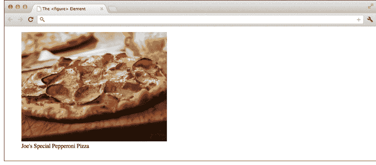

**图 4-12** 带有`<figcaption>`的`<figure>`元素。

_披萨图片经iStockphoto.com/Lauri Patterson许可转载_

由于图注是呈现给用户的，因此通常当您使用图片时，您会希望`<figcaption>`元素的内容与您的alt文本不同。

### 添加产品图片

为了让菜单页面看起来更诱人，您现在将在页面的右侧添加三张产品图片。我提供的CSS样式表将负责将图片定位到一侧。

您将使用多个`<figure>`、``和`<figcaption>`元素来展示这些产品图片。

> 本练习的代码可在文件夹8中找到。


让我们开始吧！

1. 首先，您需要从本书的网站下载新的图片文件。这些文件可以在文件夹8的`img`文件夹中找到。获取这些图片后，将它们放入项目目录的`img`文件夹中。您需要的文件是：`margherita-pizza.jpeg`、`pepperoni-pizza.jpeg`和`pollo-pizza.jpeg`。

2. 在文本编辑器中打开`menu.html`文件。

3. 找到您在上一个练习中创建的`<div>`元素。它包含所有菜单表格，并具有合适的ID `menu-tables`。

4. 在此`<div>`下方，创建一个带有ID `menu-images`的新`<div>`元素。

5. 接下来，您将为每张产品图片创建三个新的`<figure>`元素。以下是第一个figure的代码。将此代码添加到新的`<div>`元素中。

```html
<figure>
  
  <figcaption>
    Joe's Pepperoni Special
  </figcaption>
</figure>
```

6. 现在，在第一个figure下方添加第二个。

```html
<figure>
  
  <figcaption>
    Margherita - Mozzarella and Oregano
  </figcaption>
</figure>
```

7. 最后，添加最后一个。

```html
<figure>
    
    <figcaption>
        Pollo - Chicken with Roast Peppers
    </figcaption>
</figure>
```

8. 现在保存menu.html文件。

注意每张图片的alt文本如何描述图片中显示的内容，而图注则将图片与菜单上的相应项目相关联。您还使用width和height属性明确地定义了图片的尺寸。

在您的网页浏览器中查看更新后的menu.html文件。添加图片后看起来好多了！图4-13显示了您的菜单页面应有的样子。

### 创建新闻页面

新闻页面是Joe's Pizza Co.向其客户通报公司最新动态以及通知他们任何当前特价优惠的一种方式。

要创建新闻页面，您将使用与之前相同的内容页面模板。然后，每篇单独的文章都将有自己的`<article>`元素（您在第2章中已了解此元素）。

在本节中，您还将学习一个有点专业的新HTML5元素。这就是`<time>`元素。它对于标记诸如新闻发布日期之类的内容非常方便。

#### 日期和时间

计算机程序在网页中查找和理解日期可能非常困难。HTML5旨在通过引入新的`<time>`元素来解决此问题。此元素允许您以两种方式指定日期：一种供人阅读，一种供计算机阅读。您可以通过将人类可读的日期放在`<time>`元素的内容中，将机器可读的版本放在特殊属性`datetime`中来实现。

### 机器可读的日期格式

为了帮助计算机程序更好地理解日期，HTML5规范概述了一些您应该使用的有效日期和时间格式。日期和时间通常以YYYY-MM-DD HH:MM:SS的格式定义。

表4-1显示了您在datetime属性中指定日期和时间时应使用的有效格式。

#### 表 4-1 日期/时间格式

| 日期/时间字符串 | 人类可读版本 |

|---|---|

| 2013 | 2013 |

| 2013-11 | 2013年11月 |

| 2013-11-01 | 2013年11月1日 |

| 16:20 | 下午4点20分 |

| 16:20:32 | 下午4点20分32秒 |

| 2013-11-01 16:20 | 2013年11月1日下午4点20分 |

| 2013-11-01 16:20+0100 | 2013年11月1日下午4点20分（显示与UTC的时差） |

### `<time>` 元素

使用`<time>`元素可以让您编写用户友好的日期，而不必担心计算机是否能理解它们。这是一个例子。

```html
<time datetime="2013-11-06">Next Tuesday</time>
```

在这里，我们给用户一个易于阅读的日期，同时也指定了一个有效的、计算机可读的日期，可供计算机程序使用。

### 向新闻页面添加文章

新闻页面将包含多篇文章。这是利用您学过的`<article>`和`<time>`元素的绝佳机会。

> 本练习的代码可在文件夹9中找到。

要创建新闻页面，请按照以下说明操作：

1. 首先，在项目文件夹中创建一个news.html文件。

2. 打开about.html文件，并将其内容复制到新的news.html文件中。

3. 更新 `<head>` 元素中的 `<title>` 和 `<meta>` 元素，以反映新闻页面的内容。

4. 从导航中的"关于"链接中移除 `class` 属性，并将其放置在"新闻"链接上。

5. 找到 ID 为 `page-text` 的 `<section>` 元素，并删除该元素中的任何内容。

6. 在此部分中创建一个新的 `<h1>` 元素，并为其设置文本"最新新闻"。

7. 在此标题下方创建一个 `<article>` 元素。此元素将用于存放你的第一篇新闻文章。

8. 在此 `<article>` 元素内，创建一个新的 `<header>` 元素，用于存放文章标题和元数据。

9. 使用 `<h1>` 元素作为文章标题。第一篇文章是"新餐厅开业！"（包括感叹号）。

10. 现在，在此 `<h1>` 下方创建一个 `<p>` 元素，用于包含文章的发布日期。

11. 你可以使用 `<time>` 元素来标记发布日期。将以下代码添加到你的新 `<p>` 元素中。注意 `datetime` 属性的使用。

发布于

<time datetime="2013-11-01">2013年11月1日</time>。

12. 在 `<header>` 元素下方创建一个新的 `<div>` 元素，用于存放文章的主要内容。

13. 将以下内容添加到此 `<div>` 中。在这里，你使用 `<p>` 元素来标记每段文本。

```html
<p>
    We've just opened a brand new restaurant at 200 West 44th Street.
</p>
<p>
    To celebrate this new opening we're giving all of our customers the chance to get 10% off their next order. Just mention this post when placing your order.
</p>
```

14. 现在，在你刚刚添加的文章下方再创建两篇文章。我在这里提供了两个你可能想使用的示例，或者你也可以自己构思。

```html
<article>
    <header>
        <h1>Joe's Pepperoni Special Named New York's Best Pizza</h1>
        <p>
            Posted on
            <time datetime="2013-10-18">18th October 2013</time>.
        </p>
    </header>
    <div>
        <p>
            We are very happy to announce that one of our pizzas has been voted the best pizza in New York. Our Joe's Pepperoni Special is a favorite amongst our customers and we would like to thank everybody that voted for us.
        </p>
        <p>
            As an extra thank-you we are giving everybody 20% off a Joe's Pepperoni Special pizza for the next 2 weeks. Just quote the promo code NYBESTPIZZA when placing your order.
        </p>
    </div>
</article>

<article>
    <header>
        <h1>Joe's Wins Annual Basketball Game</h1>
    </header>
</article>
```

```html
<p>
    Posted on
    <time datetime="2013-10-12">12th October 2013</time>.
</p>
</header>
<div>
    <p>
        On Saturday we geared up for our annual basketball game
        with local rivals, Antonio's Pasta. It was a close game but
        we just managed to clinch it at the end with a basket from
        none other than Joe Balochio himself. The game ended 94-89.
    </p>
</div>
</article>
```

15. 保存你的 `news.html` 文件。

如果你愿意，可以添加更多新闻文章。只需遵循你在本节中使用的相同模板。

图 4-14 显示了新闻页面在浏览器中的显示效果。

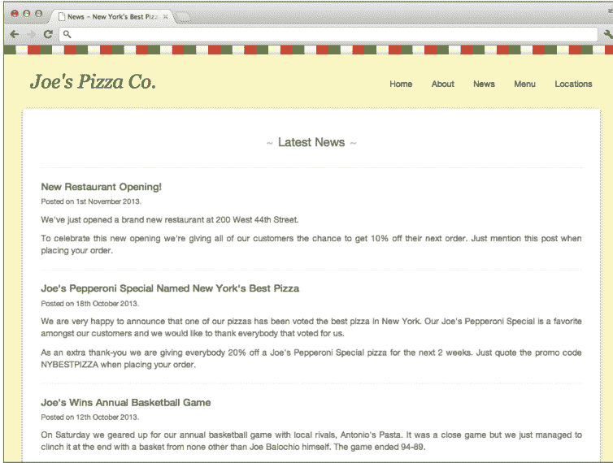

图 4-14 新闻页面。

### 总结

在本章中，你完成了大量工作。你运用了之前章节创建的模板来为你的网站创建所有页面。然后，你运用不断增长的 HTML 元素知识为每个页面添加了内容。

随着本章的深入，你学习了一些非常重要的 HTML 元素，包括表格和大量用于标记文本的元素。附录 A 还包含一些可用于赋予文本更丰富语义的额外元素信息。虽然我在本章中无法完全涵盖它们，但现在是阅读该附录的好时机。尽管在你正在构建的示例网站中不会使用这些元素，但了解它们很有好处，并且可能在未来的实际项目中派上用场。

在第五章，你将开始学习如何使用 HTML 表单从用户那里收集数据。正如我在本书前面提到的，HTML5 实际上是为改进网页表单而演进出来的。下一章将介绍大量新的 HTML5 特性。

## 第二部分

## 处理数据

- **第五章** 使用表单

- **第六章** 使用 HTML5 增强你的网页表单

- **第七章** 使用 HTML5 验证表单数据

- **第八章** 使用微数据

- **第九章** 确保可访问性


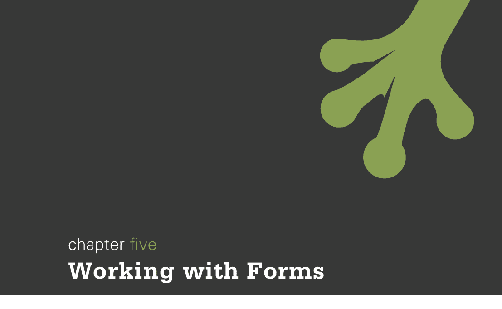

## 第五章

## 使用表单

万维网是有史以来发明的最伟大的信息收集工具。这归功于网络表单。我们每天都在使用它们，无论是在线购物、使用我们喜欢的搜索引擎进行研究，还是登录我们的电子邮件。网络表单已经成为我们日常浏览体验中不可或缺的一部分；事实上，没有它们，互联网将是一个相当乏味的地方（是的，真的）。

Joe 的网站需要一个网络表单，以便客户可以直接通过网站预订餐桌。本章将教你如何创建一个简单的网络表单并将其嵌入到你的网页中。首先，你将创建一个带有基础表单的新"预订"页面。一旦你设置好了页面，你将开始使用一系列 HTML 元素（如 `<input>`、`<label>`、`<select>` 和 `<textarea>`）为其添加各种不同的表单字段。最后，你将更新网站导航和站点地图，以包含新的"预订"页面。

在本章中，你将专注于使用 HTML4 中已存在的元素来创建一个基本表单。一旦你设置好了这个表单，第六章和第七章将教你如何使用新的 HTML5 特性来增强你的网络表单。这些新特性包括使用户更易于输入数据的专用输入类型，以及用于验证用户输入数据的工具。图 5-1 显示了你将在这三章中构建的已完成的"预订"页面。

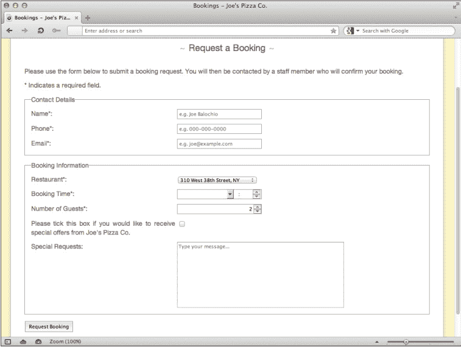

**图 5-1** 已完成的"预订"页面，在 Opera 中显示。

### 使用 `<form>` 元素设置预订页面

在本章中，你将致力于为 Joe's Pizza Co. 网站构建一个预订表单，使用户能够通过网站请求预订。在本节中，你将了解 `<form>` 元素并创建新的"预订"页面。

要创建网络表单，请使用 `<form>` 元素。此元素将包含你所有的表单字段、标签和按钮。

`<form>` 元素需要两个属性：`action` 和 `method`，如下例所示：

```html
<form action="search.php" method="GET">
    <div class="field">
        <label for="query">Query:</label>
        <input type="text" name="query" id="query">
    </div>
    <div class="field">
        <input type="submit" value="Search">
    </div>
</form>
```

目前，这就是你开始构建预订表单所需了解的关于 `<form>` 元素的全部信息。你将在本章后面深入探讨表单和输入，但首先让我们设置"预订"页面。

> 和往常一样，这些代码可以从本书网站 http://www.wiley.com/go/treehouse/html5foundations 下载。本练习的代码可在第5章的代码文件夹1中找到。

按照以下说明创建新的"预订"页面。

1. 在你最喜欢的文本编辑器中创建一个名为 `bookings.html` 的新文件，并将其保存在你的项目文件夹的根目录中。

2. 打开 `about.html` 文件，并将其内容复制到你的新 `bookings.html` 文件中。不要忘记更新 `<title>` 和 `<meta>` 元素，并从此新文件中的"主页"链接中移除 `active` 类。

3. 清空 ID 为 `page-text` 的 `<section>` 元素的内容。

4. 在此 `<section>` 元素内，创建一个新的 `<h1>` 元素，文本为 `Request a Booking`。

5. 在此标题下方，使用 `<p>` 元素添加以下文字段落。

	`<p>Please use the form below to submit a booking request. You will then be contacted by a staff member who will confirm your booking.</p>`

6. 在此段落下方，创建一个新的 `<form>` 元素。

	`<form></form>`

7. 将此 `<form>` 元素的 `action` 属性设置为 `bookings.php`。

	`<form action="bookings.php"></form>`

8. 将此 `<form>` 元素的 `method` 属性设置为 `POST`。

	`<form action="bookings.php" method="POST"></form>`

9. 保存你的 `bookings.html` 文件。

图 5-2 显示了此时你的"预订"页面应呈现的外观。

#### `action` 属性

`action` 属性用于指定表单数据应发送到的文件位置。这应该是一个绝对路径或相对路径。`action` 属性引用的文件随后会执行一个`操作`，例如将数据保存到数据库或检查用户的登录详情。

> 有关绝对路径和相对路径的更多信息，请查看第2章中的"相对路径和绝对路径"部分。

查看你刚刚添加到预订页面的表单，可以看到`action`属性引用了一个`bookings.php`文件。

```
<form action="bookings.php" method="POST">
```

你在这里使用了相对路径，这意味着`bookings.php`文件必须与`bookings.html`文件位于同一文件夹中。

> 不必担心你的项目文件夹中实际上没有`bookings.php`文件。我们只是假设它存在，并且当表单提交时，它会创建一个新的预订记录。

为了能够处理数据，你需要使用PHP、Ruby或Python等编程语言编写程序，这超出了本书的范围。如果你有兴趣了解更多关于服务器端编程的知识，请查看Jim Hoskins和Jason Seifer在Treehouse上的这门课程：http://teamtreehouse.com/library/programming-2/build-a-simple-version-of-facebook。

#### `method` 属性

`method` 属性用于指定你希望如何将表单数据发送到服务器。发送表单数据有两种方式：GET请求和POST请求。如果你在表单上忘记指定`method`属性，默认会使用GET方法。

#### GET 方法

GET方法将你的表单数据包含在URL中发送。这种方法通常用于只需要从Web服务器获取现有数据的任务，例如电子商务网站上的搜索或产品筛选。当用户提交表单时，浏览器将开始创建一个新的URL来将用户导向该地址。这个URL看起来会像下面这样。

```
http://www.html5foundations.com/bookings.php?name=Joe%20Balochio&restaurant=310%20West%2038th%20Street,%20NY
```

这个URL由几个不同的部分组成。让我们更详细地看看它们。

##### 域名

生成的URL的第一部分由协议（http://）和完全限定域名（www.html5foundations.com）组成。

如果你使用的是绝对URL，你肯定已经在`action`属性中明确定义了这个域名。

如果你在`action`属性中使用相对URL，浏览器会自动从提交表单的页面获取域名。例如，如果你的表单位于www.html5foundations.com/bookings.html页面，浏览器将使用www.html5foundations.com作为域名。

##### 路径

URL的路径部分代表处理表单数据的文件的路径。我已经在下面的示例URL中用粗体高亮显示了路径部分。

```
http://www.html5foundations.com/bookings.php?name=Joe%20Balochio&restaurant=310%20West%2038th%20Street,%20NY
```

##### URL 参数

URL的最后一部分是参数。这是你的表单数据被传输的地方。

浏览器首先会在路径后添加一个问号字符（?），以表示URL中该点之后的所有内容都是数据。

```
http://www.html5foundations.com/bookings.php?name=Joe%20Balochio&restaurant=310%20West%2038th%20Street,%20NY
```

然后，每个表单字段都作为一个键值对添加到URL中。键取自表单控件的`name`属性（稍后会详细介绍），值则是表单提交时该表单控件的值。在下面的例子中，第一个数据的键是`name`，值是**Joe%20Balochio**。每个键值对都使用与号（**&**）分隔；这在以下示例中用粗体高亮显示。

```
http://www.html5foundations.com/bookings.php?name=Joe%20Balochio **&** restaurant=310%20West%2038th%20Street,%20NY
```

一旦浏览器完成URL的构造，它就会在当前浏览器窗口中加载新的URL。

浏览器确实对URL的长度有限制，因此也限制了使用GET方法可以提交的数据量。这个限制因浏览器而异，但通常限制为2,000个字符。如果你有一个相当大的表单或使用`<textarea>`元素，你应该改用POST方法。

使用GET方法的一个优点是，表单提交时生成的URL可以被书签保存。例如，如果你在搜索表单上使用GET方法，用户可以将结果页面加入书签，因为包含搜索词的表单数据存在于页面URL中。如果你使用POST方法，他们就无法这样做，因为数据是在"幕后"传递的。

#### 表单数据编码

你可能已经注意到示例URL中出现了一些奇怪的字符（这些字符在下面用粗体标出）：

```
name=Joe**%20**Balochio&restaurant=310**%20**West**%20**38th**%20**Street,**%20**NY
```

当然，这些不是人类写的吧？

没错。URL不能包含空格或特殊字符，因此浏览器会自动将数据中的任何空格或特殊字符编码为十六进制ASCII码。你不必太担心这个；只需注意浏览器会为你编码数据。

#### POST 方法

当执行任何涉及将数据保存到数据库的操作时，应该使用POST方法。虽然从技术上讲，使用GET方法也可以保存数据，但对这些操作使用POST被认为是安全最佳实践。

使用POST方法的表单的URL构造方式大致相同。区别在于，表单数据不会作为参数添加到URL中（但仍然会被编码）。相反，数据实际上是在后台发送的，并且完全隐藏在URL之外。数据仍然可以被服务器获取和处理。

POST方法有一些安全优势。例如，你不会希望在登录表单中使用GET方法，因为用户的登录详情（包括他或她的密码！）会在URL中可见。此外，由于数据是在URL中传递的，用户没有任何阻碍，只需在地址栏编辑URL就可以轻松修改这些数据。如果你的应用程序没有采取适当的措施来处理不正确的数据，这有时会破坏你的应用程序。但重要的是要注意，使用POST方法并不能解决所有这些问题，也不足以使你的表单完全安全（但它有帮助）。

### 使用 `<input>` 和 `<label>` 元素将表单字段添加到预订页面

你将在Web表单中使用的主要表单控件元素是 `<input>` 元素。这个元素是个全能选手，因为它可用于从用户那里收集各种数据。你可以使用 `type` 属性指定要收集的数据类型；在大多数浏览器中，这也会改变元素的显示方式。默认情况下，所有 `<input>` 元素都具有 `text` 类型。你将在本章后面和第6章中了解可以使用的不同输入类型。

除非用户知道每个框中应该输入什么，否则表单字段是没用的。`<label>` 元素使你能够将文本标签与表单字段关联起来。以下示例显示了一个带有关联 `<label>` 元素的 `<input>` 元素。

```
<label for="firstName">First Name:</label>
<input name="firstName" type="text" id="firstName">
```

图5-3显示了此示例在浏览器中的显示方式。

当你创建一个 `<input>` 元素时，你还应该创建一个 `<label>` 元素并与输入关联起来。为此，你需要给 `<input>` 元素一个ID，然后在 `<label>` 元素上指定一个 `for` 属性，其值设置为输入的ID，如前面的示例所示。

为 `<input>` 元素创建标签很重要，原因有几个。辅助技术（如屏幕阅读器）将依赖这些标签来理解你的表单并帮助用户填写。正确关联标签和输入还会使标签本身成为输入字段的扩展点击目标。这意味着当用户点击标签时，关联的 `<input>` 元素将在浏览器中获得焦点。这对于复选框或单选按钮（稍后将详细介绍）等项目尤其有用，这些项目本身对于用户点击来说是相当小的目标。

首先，预订表单将包含七个字段：姓名、电话、电子邮件、餐厅、预订时间、客人人数和市场推广。在这里，你将为每个字段创建 `<input>` 和 `<label>` 元素。

> 此练习的代码可以在文件夹2中找到。

按照以下步骤将每个输入字段添加到你的表单中：

1. 在你喜爱的文本编辑器中打开你的 `bookings.html` 文件。

2. 在 `<form>` 元素内创建一个新的 `<div>` 元素，并将其类设置为 `field`。这个类将仅用于样式目的。（你需要为你添加的每个 `<input>` 元素创建一个像这样的新 `<div>` 元素。）

3. 在这个第一个 `<div>` 元素内，创建一个新的 `<input>` 元素，类型为text。

4. 将此输入的name和id属性都设置为 `name`。设置这两个属性的原因是多个元素可能具有相同的name值。这在处理诸如单选按钮之类的输入组时会发生。然而，id值应该始终是唯一的。这意味着如果你想用CSS或JavaScript针对这个单独的 `<input>` 元素，你需要使用ID。

```
<div class="field"></div>
```

```
<div class="field">
    <input type="text">
</div>
```

```
<div class="field">
    <input type="text" name="name" id="name">
</div>
```

5. 创建一个 `<label>` 元素，并使用 `for` 属性将其关联到此 `<input>` 元素。

```html
<div class="field">
    <label for="name">Name:</label>
    <input type="text" name="name" id="name">
</div>
```

6. 在此 `<div>` 元素下方，创建一个新的 `<div>`（同样使用 `field` 类），其中包含一个类型为 `text`、名称和 ID 为 `phone` 的 `<input>` 元素。然后为此输入创建一个标签。

```html
<div class="field">
    <label for="phone">Phone:</label>
    <input type="text" name="phone" id="phone">
</div>
```

7. 现在创建一个新的 `<div>` 元素，其中包含一个类型为 `text`、名称和 ID 为 `email` 的 `<input>` 元素。为此输入创建一个标签。

```html
<div class="field">
    <label for="email">Email:</label>
    <input type="text" name="email" id="email">
</div>
```

8. 创建一个新的 `<div>` 元素，其中包含一个类型为 `text`、名称和 ID 为 `restaurant` 的 `<input>` 元素。你也应该为此输入创建一个标签。

```html
<div class="field">
    <label for="restaurant">Restaurant:</label>
    <input type="text" name="restaurant" id="restaurant">
</div>
```

9. 创建另一个新的 `<div>` 元素，其中包含一个类型为 `text`、名称和 ID 为 `bookingTime` 的 `<input>` 元素。别忘了标签！

```html
<div class="field">
    <label for="bookingTime">Booking Time:</label>
    <input type="text" name="bookingTime" id="bookingTime">
</div>
```

10. 创建一个 `<div>` 元素，其中包含一个类型为 `text`、名称和 ID 为 `guests` 的 `<input>` 元素。为此输入添加一个标签。

```html
<div class="field">
    <label for="guests">Number of Guests:</label>
    <input type="text" name="guests" id="guests">
</div>
```

11. 创建最后一个 `<div>` 元素，其中包含一个 `<input>` 元素。这次将类型设置为 checkbox，名称和 ID 设置为 marketing。将 value 属性设置为 1。然后为此元素创建一个标签，文本如下所示。

```html
<div class="field">
  <label for="marketing">Please tick this box if you would like
to receive special offers from Joe's Pizza Co.</label>
  <input type="checkbox" name="marketing" id="marketing"
value="1">
</div>
```

12. 保存 bookings.html 文件。

你的 `<form>` 元素现在应该看起来像这样：

```html
<form action="bookings.php" method="POST">
  <div class="field">
    <label for="name">Name:</label>
    <input type="text" name="name" id="name">
  </div>
  <div class="field">
    <label for="phone">Phone:</label>
    <input type="text" name="phone" id="phone">
  </div>
  <div class="field">
    <label for="email">Email:</label>
    <input type="text" name="email" id="email">
  </div>
  <div class="field">
    <label for="restaurant">Restaurant:</label>
    <input type="text" name="restaurant" id="restaurant">
  </div>
  <div class="field">
    <label for="bookingTime">Booking Time:</label>
    <input type="text" name="bookingTime" id="bookingTime">
  </div>
  <div class="field">
    <label for="guests">Number of Guests:</label>
    <input type="text" name="guests" id="guests">
  </div>
  <div class="field">
    <label for="marketing">Please tick this box if you would like
to receive special offers from Joe's Pizza Co.</label>
    <input type="checkbox" name="marketing" id="marketing"
value="1">
  </div>
</form>
```

图 5-4 展示了预订页面在添加这些新输入字段后应有的外观。

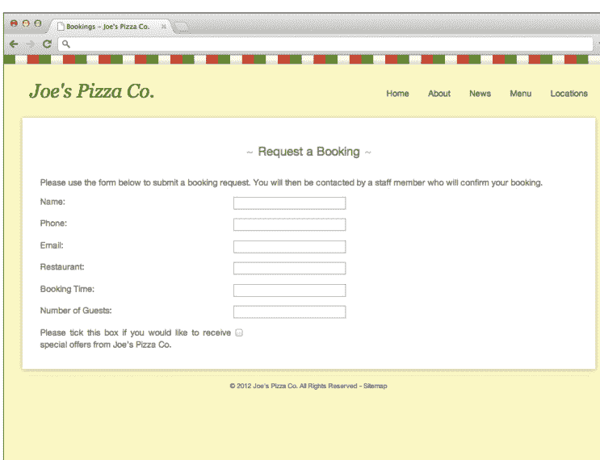

**图 5-4** 更新后的预订页面。

在接下来的章节中，你将学习可以使用不同类型输入以及可以应用于 `<input>` 元素的各种不同属性。这里你将只介绍 HTML4 中广泛支持的类型和属性。在第 6 章，你将了解 HTML5 中引入的新输入类型和属性。

#### 输入属性

除了你在第 3 章学过的标准全局属性外，`<input>` 元素还有许多专用属性，其中一些你已经在预订页面中使用过。

##### 命名输入

虽然不是严格要求，但你所有的输入元素*应该*都有一个 name 属性。如果你打算将数据发送到服务器，你需要指定一个 name 属性。否则，浏览器将不会发送你的数据。

```html
<label for="name">Name:</label>
<input type="text" name="name" id="name">
```

正如我在本章前面提到的，name 属性的值将在输入数据发送到服务器时，形成与之关联的键。

##### 设置默认值

你可以使用 `value` 属性为输入元素设置默认值。当浏览器加载页面时，它会自动将 `value` 属性的值放入输入框，或将专用控件设置为此值。

以下是设置客人数量输入默认值为 2 的示例。

```html
<input type="text" name="guests" id="guests" value="2">
```

##### 禁用字段

你有两种方法可以禁用表单字段，使其无法更改其值。第一种是使用 `disabled` 属性；或者，你可以使用 `readonly` 属性。

```html
<input type="text" name="name" disabled>
<input type="text" name="name" readonly>
```

这两个属性的区别在于，带有 `readonly` 属性的 `<input>` 元素的值仍会发送到服务器，而带有 `disabled` 属性的 `<input>` 元素则不会发送任何数据。如果输入类型是 `hidden`，则 `disabled` 属性会被忽略。

##### 尺寸

`size` 属性用于指定在任何给定时间应向用户显示的字符数量，从而改变 `<input>` 元素的实际大小。默认大小为 20。

`size` 属性不限制用户在字段中输入的字符数；为此，你需要使用 `maxlength` 属性，这将在第 7 章中介绍。

```html
<label for="name">Name:</label>
<input type="text" name="name" id="name" size="65">
```

#### 输入类型

有许多不同的输入类型可用于让用户更容易地填写你的网络表单。在本节中，你将学习网络浏览器广泛支持的输入类型。在第 6 章，你将了解 HTML5 中引入的新输入类型。

##### 文本

`text` 输入类型传统上是在 `<input>` 元素上最常用的类型。顾名思义，`text` 输入类型用于需要从用户那里收集一些文本的情况。这也是 `<input>` 元素的默认类型，因此如果你忘记指定 `type` 属性或使用了用户浏览器不支持的类型，浏览器将只显示一个文本字段。

你表单中的姓名输入使用了 `text` 类型。

```html
<label for="name">Name:</label>
<input type="text" name="name" id="name" autofocus>
```

##### 密码

`password` 类型可用于指示输入期望一个密码。浏览器不会以明文形式显示输入到密码字段中的内容；这可以防止那些狡猾的家伙从你的肩膀上方瞥见你的密码。相反，密码输入会将字符显示为黑点或星号，如图 5-5 所示。

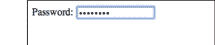

**图 5-5** 密码输入字段。

以下是类型为 `password` 的 `<input>` 元素示例。

```html
<label for="pass">Password:</label>
<input type="password" name="pass" id="pass">
```

##### 复选框

当你需要从用户那里收集真或假的答案时，`checkbox` 类型很有用。默认情况下，复选框将显示为未勾选；但是，你可以通过向 `<input>` 元素添加 `checked` 属性来更改此设置。

类型为 `checkbox` 的输入也应指定一个 `value` 属性；如果表单提交时复选框被选中，这将是发送到服务器的数据。

以下是类型为 `checkbox` 的 `<input>` 元素示例，设置为默认显示为已勾选。`value` 被设置为 1，因为这是真答案的通用约定。对于假，使用 0。

```html
<label for="contact">Receive updates from Joe's Pizza Co?</label>
<input type="checkbox" name="contact" id="contact" value="1"
checked>
```

复选框元素如图5-6所示。

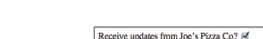

**图5-6** 一个简单的复选框。

##### 单选按钮

`radio`类型用于显示单选按钮。当你需要向用户提供多个不同选项，但只希望他们从中选择一个时，这非常有用。

使用多个单选按钮作为选项时，每个`<input>`元素应具有相同的`name`属性。与某个选项关联的数据应存储在`value`属性中。

与复选框一样，你也可以使用`checked`属性为单选输入设置默认值。

下面是一个示例，展示如何使用多个带有`radio`类型的`<input>`元素来收集用户喜欢的颜色。

```html
<p>
  What is your favorite color?
</p>
<div>
  <label for="green">Green</label>
  <input name="favColor" id="green" type="radio" value="green">
  <label for="red">Red</label>
  <input name="favColor" id="red" type="radio" value="red" checked>
  <label for="orange">Orange</label>
  <input name="favColor" id="orange" type="radio" value="orange">
  <label for="blue">Blue</label>
  <input name="favColor" id="blue" type="radio" value="blue">
</div>
```

请注意，在此示例中，所有`<input>`元素都具有相同的`name`属性。我们还使用`checked`属性指定了红色为默认选项。

图5-7显示了此示例在网页浏览器中的显示效果。

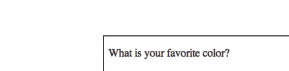

**图5-7** 多个具有radio类型的input元素。

##### 提交按钮

`submit`类型可用于为你的表单定义提交按钮。按钮的文本应在`value`属性中设置。

这是一个提交按钮的示例。

```html
<input type="submit" value="Send">
```

你也可以使用本章稍后介绍的`<button>`元素来创建提交按钮。

##### 隐藏字段

有时你可能希望将数据发送到服务器，但又不希望用户看到这些数据。`hidden`类型就是为此设计的。

使用`hidden`类型时，你应该为`<input>`元素指定一个`name`属性，并将`value`属性设置为要随表单一起发送的数据。

这是一个隐藏的`<input>`元素示例，用于向服务器发送用户ID。

```html
<input type="hidden" name="id" value="123">
```

> 到目前为止，本节已经涵盖了很多内容。要快速回顾，请查看Nick Pettit在Treehouse上关于输入的视频：http://teamtreehouse.com/library/websites/html/forms/inputs。

### 使用`<textarea>`元素添加消息框

除了已经添加到表单中的字段之外，有一个文本框让用户可以留下关于他们预订的评论会很不错。输入元素很好，但在输入大量文本时，尤其是当文本需要跨多行时，它们的用户友好性就不够了。相反，你可以在表单中添加`<textarea>`元素用于文本量较大的输入字段。

`<textarea>`元素与`<input>`元素共享许多相同的属性，例如`autofocus`、`name`和`placeholder`；但是，它还有`cols`和`rows`属性。`cols`属性可用于指定文本区域内单行应容纳多少个字符，`rows`属性指定应向用户显示多少行。使用这两个属性，理论上你可以设置`<textarea>`的高度和宽度（尽管你可能更愿意使用CSS来实现）。

这是一个使用`cols`和`rows`属性指定其大小的`<textarea>`元素示例。

```html
<textarea name="message" cols="50" rows="10"></textarea>
```

请注意，`<textarea>`元素有一个结束标签。与`<input>`元素不同，`<textarea>`不是一个空元素。你放置在开始和结束标签之间的任何文本内容都将显示在文本区域中。


此练习的代码可在文件夹3中找到。

按照以下步骤操作：

1. 打开bookings.html文件。

2. 在现有的表单字段下方，创建一个class为field的新`<div>`元素。

3. 在此`<div>`元素内，创建一个新的`<textarea>`元素。

4. 将此`<textarea>`的id和name属性都设置为message。

5. 将此`<textarea>`的cols属性设置为50。

6. 将rows属性设置为10。

7. 在此`<textarea>`元素上方，创建一个新的`<label>`元素。

8. 将此`<label>`的for属性设置为message。

9. 在`<label>`元素内添加以下文本：Special Requests:。

10. 保存bookings.html文件。

你现在已经向表单添加了一个`<textarea>`，访问者可以使用它提供关于他们预订请求的额外评论。你的新代码应如下所示。

```html
<div class="field">
  <label for="message">Special Requests:</label>
  <textarea name="message" id="message" cols="50" rows="10"></textarea>
</div>
```

图5-8显示了你的预订表单在浏览器中的显示效果。

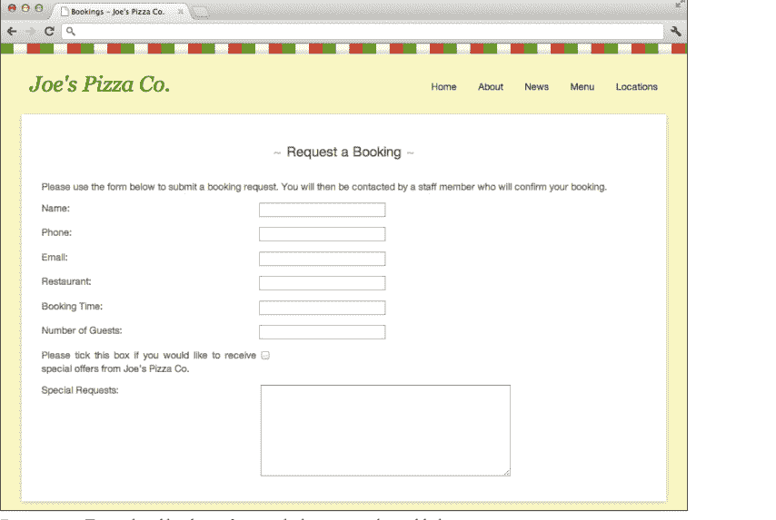

**图5-8** 添加了消息框的更新后的预订表单。

### 向预订页面添加提交按钮

你的预订表单几乎完成了，但缺少一个重要的组件——一个提交按钮，用户可以点击它发送他们的预订请求。`<button>`元素具有多种功能，可以通过其`type`属性定义。对于你的预订页面，你将使用`submit`类型，但你也可以使用`reset`或`button`类型实现其他功能，稍后将予以描述。如果你忘记指定`type`，默认将使用`submit`。

要创建一个提交表单的按钮，你需要使用`submit`类型，如以下示例所示：

```html
<button type="submit">Submit Form</button>
```

`button`元素内的文本将显示在按钮上。

> 此练习的代码可在文件夹4中找到。

按照以下步骤向表单添加提交按钮：

1. 打开bookings.html文件。

2. 在`<form>`元素的结束标签之前，创建一个新的`<div>`元素，并赋予它class为field。

3. 在此`<div>`元素内，创建一个新的`<button>`元素。

4. 将此`<button>`的type属性设置为submit。

5. 在`<button>`元素的标签之间添加以下文本：Request Booking。

6. 保存bookings.html文件。

你这部分代码应如下所示：

```html
<div class="field">
    <button type="submit">Request Booking</button>
</div>
```

现在，你应该在表单末尾有一个提交按钮，这样访问者就可以请求预订了。图5-9显示了你更新后的预订表单在浏览器中的显示效果。

> 使用`<button>`元素，你可以创建一个类似于使用`<input type="submit">`创建的按钮。区别在于，你可以在`<button>`元素内放置其他HTML元素；例如，你可以在按钮内放置一个``元素。

#### 重置按钮

通过将`<button>`元素的type属性设置为reset，你可以创建一个重置表单中所有字段的按钮。以下是如何为表单创建重置按钮的示例。

```html
<button type="reset">Reset Form</button>
```

#### 普通按钮

`<button>`元素上还有另一种可用类型——button。我喜欢称这些按钮为普通按钮，因为它们实际上不执行任何操作。为了让这些按钮"智能"起来，你需要使用JavaScript来告诉浏览器在按钮被按下时执行一些JavaScript代码。然后，这段JavaScript代码可以执行一个操作，例如开始或停止视频的播放。你将在第11章学习如何做到这一点。

这是一个普通按钮的示例。

```html
<button type="button">Do Something</button>
```

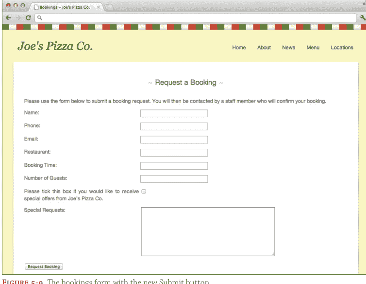

### 向预订页面添加下拉菜单

你已经学习了如何使用单选按钮为用户创建多个选项供其选择。在本节中，你将学习如何使用`<select>`和`<option>`元素创建下拉菜单。然后，你将使用这些元素为预订页面上的餐厅字段创建一个下拉菜单，从而消除用户输入餐厅位置的需要。

#### `<select>` 和 `<option>` 元素

要创建一个下拉菜单，你需要使用 `<select>` 元素。这个元素的作用与 `<input>` 元素类似，用于设置表单控件的名称以及其他属性，例如其 class 和 id。

`<select>` 元素还负责将选项组合在一起，并且应该包含一个或多个 `<option>` 元素，如下例所示。

```
<select name="color" id="color">
    <option>Green</option>
    <option>Red</option>
    <option>Blue</option>
</select>
```

每个 `<option>` 元素代表表单控件的一个可能值（此处元素内包含的文本用作值）。这个概念类似于多个单选按钮的工作原理。以下是如果使用单选按钮实现该示例的外观。

```
<label for="green">Green</label>
<input type="radio" name="color" id="green" value="Green">
<label for="red">Red</label>
<input type="radio" name="color" id="red" value="Red">
<label for="blue">Blue</label>
<input type="radio" name="color" id="blue" value="Blue">
```

主要区别在于，使用单选按钮时所有选项会一次性显示出来，而 `<select>` 元素会将选项分组并显示在下拉菜单中。如果你有大量选项可供选择，这一点尤其有用，因为下拉菜单所占的屏幕空间不会随着你添加更多选项而增加。图 5-10 展示了这两个示例的区别。

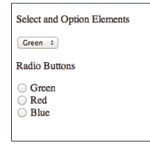

#### 将餐厅下拉菜单添加到你的页面

你预订表单中的"餐厅"字段用于告知预订协调员顾客希望在哪个餐厅预订。目前，这个字段只使用了普通的文本输入；然而，这是一种不好的做法，因为它依赖于顾客在位置字段中输入准确的地址。一个更好的解决方案是创建一个下拉菜单，其中已经包含了三个餐厅的位置，这样顾客就可以选择他们想要的餐厅，而不必输入位置。

> 本练习的代码可以在文件夹 5 中找到。


按照以下步骤修改预订页面上的餐厅字段。

1. 打开 bookings.html 文件。

2. 找到当前用于餐厅字段的 `<input>` 元素并将其移除。

```
<div class="field">
    <label for="restaurant">Restaurant:</label>
    <s><input type="text" id="restaurant" name="restaurant"></s>
</div>
```

3. 在其位置创建一个新的 `<select>` 元素。

```
<div class="field">
    <label for="restaurant">Restaurant:</label>
    <select></select>
</div>
```

4. 在此 `<select>` 元素上设置 name 和 id 属性为 restaurant。

```
<select name="restaurant" id="restaurant"></select>
```

5. 在此 `<select>` 元素内，创建一个新的 `<option>` 元素，文本为 "310 West 38th Street, NY"。

```
<option>310 West 38th Street, NY</option>
```

6. 在其下方创建另一个 `<option>` 元素，文本为 "2450 Broadway, NY"。

```
<option>2450 Broadway, NY</option>
```

7. 最后，再创建一个 `<option>` 元素，文本为 "200 West 44th Street, NY"。

```
<option>200 West 44th Street, NY</option>
```

8. 保存 bookings.html 文件。

你的餐厅字段现在应该看起来像下面这样。

```
<div class="field">
  <label for="restaurant">Restaurant:</label>
  <select id="restaurant" name="restaurant">
    <option>310 West 38th Street, NY</option>
    <option>2450 Broadway, NY</option>
    <option>200 West 44th Street, NY</option>
  </select>
</div>
```

图 5-11 展示了这个新的下拉菜单在你的网络浏览器中应有的外观。

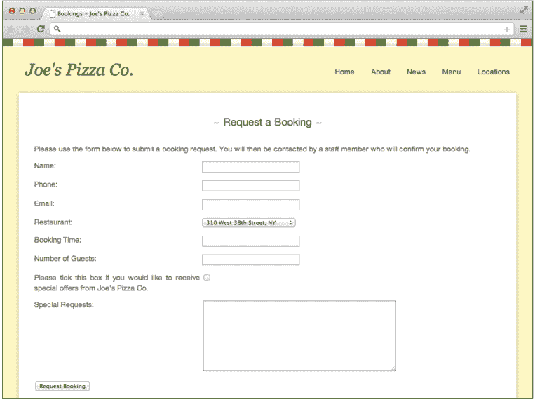

**图 5-11** 更新后的带有下拉菜单的餐厅字段。

#### 关于使用选项的更多信息

到目前为止，在本节中，你已经学习了如何使用 `<select>` 和 `<option>` 元素创建基本的下拉菜单。现在你将学习一些稍微高级一点的技术，这些技术使你能够执行诸如设置默认选项、添加与选项文本不同的值，以及如何在下拉菜单中将选项分组到子组中等操作。

##### 设置默认选项

要在下拉菜单中设置默认选项，你只需将 `selected` 属性应用于所需的 `<option>` 元素。

```
<select name="color" id="color">
  <option>Green</option>
  <option selected>Red</option>
  <option>Blue</option>
</select>
```

在此示例中，红色选项将默认被选中。

##### 使用 `<option>` 元素的 value 属性

有时，`<option>` 元素内的文本需要与表单提交时发送的值不同。

一个例子是，如果你需要收集用户 ID。管理员用户不太可能记住系统上每个用户的数字用户 ID，因此你希望在下拉菜单中显示用户的姓名，但在表单中发送他们的 ID。你可以通过向 `<option>` 元素添加 `value` 属性来做到这一点。

```
<option value="23">Joe Balochio</option>
```

当表单提交时，将使用 `value` 而不是 `<option>` 标签之间的文本。

##### 允许多选

你可以允许你的用户选择多个选项。在 `<select>` 元素上指定 `multiple` 属性将使你能够做到这一点。然后用户必须按住 CTRL 键（或 Mac 上的 CMD 键）才能从列表中选择多个选项。

#### 选项分组

当你有一个包含多个选项的 `<select>` 元素时，你可能想使用 `<optgroup>` 元素来帮助用户更容易地找到他们想要的内容。`<optgroup>` 元素应放置在 `<select>` 元素内，并应包含所有与该组相关的 `<option>` 元素。你可以使用其 `title` 属性为选项组指定一个名称。

此示例代码展示了如何创建一个包含多个选项组的下拉菜单。

```
<select name="food" id="food">
    <optgroup title="Dairy">
        <option>Milk</option>
        <option>Egg</option>
        <option>Cheese</option>
    </optgroup>
    <optgroup title="Bakery">
        <option>Bread</option>
        <option>Rolls</option>
        <option>Baguette</option>
    </optgroup>
</select>
```

图 5-12 展示了此示例在网页浏览器中的显示效果。

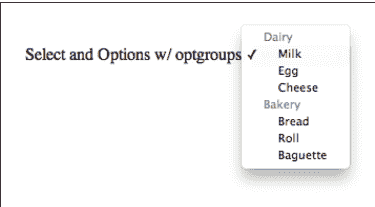

**图 5-12** 一个包含多个 `<option>` 和 `<optgroup>` 元素的 `<select>` 元素，在 Google Chrome 中的显示效果。

### 处理文件

到目前为止，你已经学习了如何从用户那里收集文本，以及如何创建下拉菜单和单选按钮来限制输入值。现在是时候看看如何让用户上传文件了。为此，你使用了 `<input>` 元素的另一种类型：`file`。

#### 文件输入类型

`file` 输入类型显示一个按钮，该按钮可启动文件浏览器，以便用户可以从他们的硬盘中选择一个文件上传到你的网站。一个最简单的 `file` 输入示例如以下代码所示。

```
<input name="avatar" type="file">
```

图 5-13 展示了在 Mac OS X 中显示的文件浏览器。

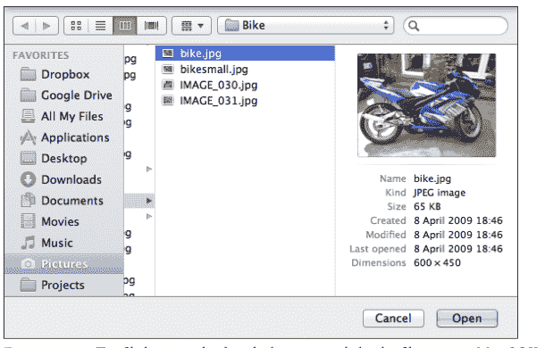

#### 选择多个文件

在 HTML5 出现之前，你唯一能可靠处理多文件上传的方法是使用 Adobe 的 Flash 技术。这给那些只想要一个简单多文件上传解决方案的开发者带来了一些麻烦。HTML5 再次拯救了局面，通过简单地使用 `multiple` 属性来允许多文件上传。

以下示例展示了如何允许用户使用单个 `<input>` 元素选择多个文件。

```
<label id="pictures">Upload Pictures:</label>
<input name="pictures" id="pictures" type="file" multiple>
```

这是 HTML5 中的一个新功能。较旧的网络浏览器不支持 `multiple` 属性。

#### 指定接受的文件类型

如果你希望用户上传一张他自己的照片，用作其在你社交网站上的头像，你需要确保他不会试图上传一个电子表格。`accept` 属性允许你指定你期望的文件类型，这样浏览器就能启动一个只允许用户选择这些类型文件的文件浏览器。

`accept` 属性的一些可能值包括：`image/*`、`audio/*` 和 `video/*`。你可以在以下链接找到这些值（也称为 MIME 类型）的完整列表：http://www.webmaster-toolkit.com/mime-types.shtml。

这是一个只接受图片文件的文件 `<input>` 示例。

```
<label id="photos">Upload Photos:</label>
<input name="photos" id="photos" type="file" accept="image/*"
    multiple>
```

`accept` 属性是 HTML5 中新增的，因此在旧版的网页浏览器中将无法使用。

### 使用 `<fieldset>` 和 `<legend>` 对预订页面中的输入字段进行分组

在创建较大的网页表单时，你经常会发现将相关的表单字段分组在一起很有用。你可以使用 `<fieldset>` 和 `<legend>` 元素来实现这一点。

`<fieldset>` 元素用于定义一组输入控件，并且应包含该组所有相关的表单元素。`<legend>` 元素用于为 fieldset 组指定一个名称，并且应放置在 `<fieldset>` 元素的开始标签之后，如以下示例所示。

```
<fieldset>
    <legend>Contact Details</legend>
    <div class="field">
        <label for="name">Name:</label>
        <input type="text" name="name" id="name">
    </div>
    <div class="field">
        <label for="email">Email:</label>
        <input type="text" name="email" id="email">
    </div>
</fieldset>
```

你还可以在 `<fieldset>` 元素上设置 `disabled` 属性。这将禁用 fieldset 内的所有字段，使用户无法编辑它们。

> 观看这个 Treehouse 视频，其中 Nick Pettit 讲解了 fieldsets、legends 和 labels：http://teamtreehouse.com/library/websites/html/forms/fieldsets-and-labels。

现在，你将为你的预订表单添加最后的修饰，创建两组输入字段：一组用于客户的联系信息，另一组用于预订详情。

本练习的代码可以在文件夹 6 中找到。

按照以下步骤创建你的两个 `<fieldset>` 元素。

1. 打开你的 `bookings.html` 文件。

2. 在表单顶部、`<form>` 元素的开始标签下方，创建一个新的 `<fieldset>` 元素。

3. 在此 `<fieldset>` 内，创建一个包含文本"联系详情"的 `<legend>` 元素。

4. 现在将姓名、电话和电子邮件输入字段移动到此 `<fieldset>` 元素中，直接放在 `<legend>` 元素下方。

5. 在此 `<fieldset>` 下方，创建另一个 `<fieldset>` 元素。

6. 在此 `<fieldset>` 中创建一个新的 `<legend>`，文本为"预订信息"。

7. 将餐厅、预订时间、客人、营销和留言表单字段移动到此 `<fieldset>` 元素中，将按钮留在其外部。

8. 保存 `bookings.html` 文件。

你现在应该有两组表单字段，如以下代码所示。

```
<form action="bookings.php" method="POST">
  <fieldset>
    <legend>Contact Details</legend>
    <div class="field">
      <label for="name">Name:</label>
      <input type="text" name="name" id="name">
    </div>
    <div class="field">
      <label for="phone">Phone:</label>
      <input type="text" name="phone" id="phone">
    </div>
    <div class="field">
      <label for="email">Email:</label>
      <input type="text" name="email" id="email">
    </div>
  </fieldset>
  <fieldset>
    <legend>Booking Information</legend>
    <div class="field">
      <label for="restaurant">Restaurant:</label>
      <select name="restaurant" id="restaurant">
        <option>310 West 38th Street, NY</option>
        <option>2450 Broadway, NY</option>
        <option>200 West 44th Street, NY</option>
      </select>
    </div>
    <div class="field">
      <label for="bookingTime">Booking Time:</label>
      <input type="text" name="bookingTime" id="bookingTime">
    </div>
    <div class="field">
      <label for="guests">Number of Guests:</label>
      <input type="number" name="guests" id="guests">
    </div>
    <div class="field">
      <label for="marketing">Please tick this box if you would like to receive special offers from Joe's Pizza Co.</label>
      <input type="checkbox" name="marketing" id="marketing" value="1">
    </div>
    <div class="field">
      <label for="message">Special Requests:</label>
      <textarea id="message" name="message" cols="50" rows="10"></textarea>
    </div>
  </fieldset>
  <div class="field">
    <button type="submit">Request Booking</button>
  </div>
</form>
```

大多数浏览器通常会在 `<fieldset>` 元素周围添加边框，以使表单控件组更加醒目。

恭喜！你现在已经完成了预订表单（暂时）。提交此表单实际上不会执行任何操作，因为你没有一个用于处理数据的 `bookings.php` 文件。图 5-14 显示了你的预订页面的完成效果。在接下来的两章中，你将学习如何使用 HTML5 让这个网页表单变得更加有趣。

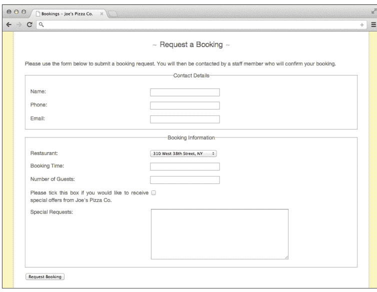

**图 5-14** 完成的预订页面。

### 更新网站导航和站点地图

随着你的网站不断成熟，你会发现自己需要添加新页面。每次这样做时，你都需要更新每个页面上的网站导航，并更新站点地图页面上的页面列表。

既然你已经创建了你的预订页面，你需要更新网站导航和站点地图，以包含指向这个新页面的链接。

> 本练习的代码可以在文件夹 7 中找到。

按照以下步骤操作：

1. 打开 sitemap.html 文件。

2. 在页面头部找到 `<nav>` 元素。

3. 在导航列表的末尾，创建一个新的 `<li>` 元素。

4. 在此 `<li>` 元素内，使用 `<a>` 元素创建一个新链接：

5. 保存此文件，并为网站中的每个页面重复步骤 1 到 4。你可能会发现，直接复制并粘贴新的 `<li>` 元素到每个文件的导航部分更容易。在将链接添加到预订页面时，不要忘记为链接添加 `active` 类。

6. 返回 sitemap.html，并找到构成站点地图的链接列表。这个 `<ul>` 元素的 ID 是 sitemap。

7. 使用步骤 4 中的代码，向站点地图添加一个新链接。

8. 保存 sitemap.html 文件。

```
<li>
  <a href="bookings.html" title="Make a booking">Bookings</a>
</li>
```

图 5-15 显示了更新后的站点地图页面在你的网页浏览器中应有的样子。

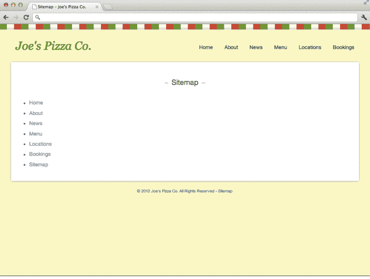

**图 5-15** 更新后的站点地图页面。

### 总结

又是一个漫长的章节，你已经涵盖了很多内容，所以让我们快速回顾一下。从现在开始章节会变短。真的。

在本章中，你学习了 `<form>` 元素以及可用于定义表单字段的不同元素，包括 `<input>`、`<select>` 和 `<textarea>`。你还学习了许多广泛支持的输入类型，这些类型使得从用户那里收集数据变得更加容易。

在第 6 章中，你将学习如何使用 HTML5 来增强你的网页表单。你将接触到客户端验证（*客户端*意味着验证发生在用户的计算机上，而不是网络服务器上）、数据列表以及许多新的 HTML5 输入类型。下一章见！

## 第六章：使用 HTML5 增强你的网页表单

在第 5 章中，你学习了如何使用 `<form>`、`<input>`、`<select>` 和 `<option>` 等元素来创建网页表单。在本章中，你将学习如何通过利用 HTML5 中引入的新输入类型和属性范围，使你的表单对用户更加友好。

例如，新的 `datetime` 输入类型使你能够在需要收集日期时向用户显示一个小日历。这使用户操作起来容易得多，因为她可以简单地点击日历中的一个日期，而无需手动将日期输入到文本字段中。新的 `<datalist>` 元素使你能够轻松创建自动完成列表，类似于你在 Google 搜索框中输入查询时看到的那些。这大大简化了用户操作，因为它减少了他们需要输入的内容。在本章中，你将学习如何使用这两种新功能以及许多其他出色的 HTML5 新增功能。

需要特别注意的是，你将在本章中学习的输入类型和属性尚未得到广泛支持。如果浏览器不支持某种输入类型，则会使用 `text` 类型。如果某个属性不受支持，则会被忽略。

### Web 表单与 HTML5

HTML5 实际上始于 Web 表单。当万维网联盟 (W3C) 决定不再继续开发 HTML 时，正是 Opera 的一个小团队接手了他们的工作，并开发了 Web Forms 2.0 规范，重新点燃了人们对 HTML 的热情。Web Forms 2.0 规范此后成为官方 HTML5 规范的一部分。

### 将 HTML5 添加到你的预订表单中

让我们直接开始在你的预订表单中使用 HTML5。你将使用一些以前未曾接触过的输入类型和属性。别担心，我将在本章后续部分详细解释这些内容。

你将为输入字段添加占位符文本，以向用户提示他们应该在表单字段中输入何种数据；同时使用像 `email` 和 `tel` 这样的专用输入类型，让网络浏览器了解到你试图收集的数据类型。

请按照以下步骤，用 HTML5 增强你的预订表单。

> 此练习的代码可在第6章下载文件夹的 folder 1 中找到。

1. 在你选择的文本编辑器中打开 bookings.html 文件。

2. 为 name 输入添加一个 `autofocus` 属性。这将告诉浏览器，该输入元素应在页面加载时自动获得焦点。这是一个布尔属性，因此你无需设置其值。

```html
<input type="text" name="name" id="name" autofocus>
```

3. 现在，为同一个 `<input>` 元素添加一个 `placeholder` 属性，并将其值设置为例如 "Joe Balochio"。此占位符文本将为用户提供提示，告诉他们应在输入字段中输入什么内容。

```html
<input type="text" name="name" id="name" placeholder="e.g Joe Balochio" autofocus>
```

4. 将电话号码 `<input>` 元素的 `type` 设置为 `tel`，并为该元素添加一个 `placeholder` 属性，值为 "000-000-0000"。

```html
<input type="tel" name="phone" id="phone" placeholder="e.g. 000-000-0000">
```

5. 将电子邮件 `<input>` 元素的 `type` 更改为 `email`，并添加一个 `placeholder` 元素，其值为 "e.g. joe@example.com"。

```html
<input type="email" name="email" id="email" placeholder="e.g. joe@example.com">
```

6. 对于预订时间 (`Booking Time`) `<input>` 元素，将输入类型更改为 `datetime-local`。这将提示支持此输入类型的浏览器显示一个日期/时间选择器，以帮助用户填写此表单字段。

```html
<input type="datetime-local" name="bookingTime" id="bookingTime">
```

7. 同时，为预订时间字段添加一个 `placeholder` 属性，值为 "e.g. 2012-09-06 12:14"。此占位符文本仅在浏览器不支持 `datetime-local` 输入类型时显示，它将帮助用户以正确的格式提供日期/时间组合。这并非理想方案，但总比没有任何提示要好。

```html
<input type="datetime-local" name="bookingTime" id="bookingTime" placeholder="e.g. 2012-09-06 12:14">
```

8. 将宾客人数 (`Number of Guests`) `<input>` 元素的 `type` 更改为 `number`，并使用 `value` 属性设置默认值为 2。

```html
<input type="number" name="guests" id="guests" value="2">
```

9. 最后，为 `<textarea>` 元素添加一个 `placeholder` 属性，并将其值设置为 "Type your message...."。

```html
<textarea id="message" name="message" cols="50" rows="10" placeholder="Type your message..."></textarea>
```

10. 保存 bookings.html 文件。

恭喜！你现在已经将预订表单升级为使用 HTML5！在第7章中，你将通过添加验证功能使其更进一步。图 6-1 显示了你的表单在此阶段的外观。

在本章剩余部分，你将更深入地了解刚刚添加到预订表单中的输入类型和属性，以及一些你尚未遇到的类型。

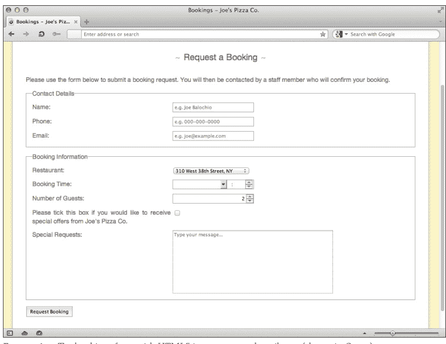

**图 6-1** 使用 HTML5 输入类型和属性的预订表单（在 Opera 中显示）。

### HTML5 输入类型

HTML4 包含多种用于创建基本表单控件的输入类型。然而，随着现代网络用户需求的增长，有必要扩展这些类型，为开发者提供更广泛的表单控件。HTML5 引入了一系列新的输入类型，通过提供易于使用的表单控件，使用户能够更轻松地填写表单。

许多最新的移动设备（如智能手机和平板电脑）使用软件键盘，这些键盘能够根据所收集数据的类型改变其布局。HTML5 引入的新输入类型向移动浏览器提供了信号，使其能够显示定制化的键盘，从而让用户更容易地输入数据。

#### 电话号码

HTML5 引入了新的 `tel` 输入类型用于收集电话号码。通过指定这种特殊的输入类型，使用软件键盘的设备（如触摸设备）可以显示一个略有不同的键盘，使用户更容易输入数据。例如，iOS 将显示一个带有数字而非字母的键盘，如图 6-2 所示。

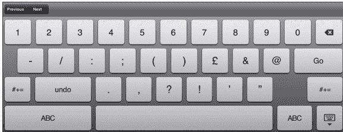

**图 6-2** 为类型为 `tel` 的输入元素显示的 iOS 键盘。

> 图 6-2 中所示设备使用英国键盘布局，因此显示的是英镑符号 (£) 而非美元符号 ($)。

你在预订表单的电话字段中使用了 `tel` 输入类型：

```html
<input type="tel" name="phone" id="phone" placeholder="000-000-0000">
```

#### 电子邮件地址

`email` 类型是 HTML5 引入的另一个新成员，它带来了定制键盘和浏览器验证（关于验证将在第7章详述）的双重好处。图 6-3 显示了 iOS 为 `email` 输入元素显示的键盘。

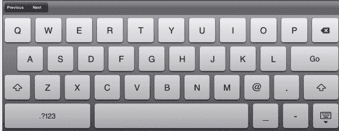

**图 6-3** 为类型为 `email` 的输入元素显示的 iOS 键盘。

乍一看，这里变化不大，但你可能会注意到键盘右下角的常规按键已被 `@`、下划线 (`_`) 和减号 (`-`) 符号所取代。

内置验证支持的浏览器将检查提供的电子邮件地址是否格式有效，如果存在问题则会提示用户。

你已经在预订表单的电子邮件字段中使用了 `email` 类型。

```html
<input type="email" name="email" id="email" placeholder="e.g. joe@example.com">
```

#### 数字

如果你正在收集一个数值，例如数量或年龄，可以使用 `number` 输入类型。默认情况下，`number` 类型期望一个整数值，支持验证的浏览器会拒绝用户可能尝试提供的任何非整数值。你可以通过将 `step` 属性设置为一个十进制数来更改此行为。

支持 `number` 类型的浏览器可能会在输入字段中显示向上和向下箭头。图 6-4 显示了 `number` 字段在 Google Chrome 中的显示效果。


**图 6-4** 类型为 number 的输入元素，在 Google Chrome 中显示。

`number` 类型还会触发使用软件键盘的设备显示数字键盘。关于此键盘在 iOS 中的外观，请参考图 6-2。

在你的预订表单中，你在宾客人数字段使用了 `number` 类型。

```html
<input type="number" name="guests" id="guests" value="2">
```

#### URL

输入类型 `url` 在 HTML5 中也是新增的，它使你能够指定期望的输入是一个网页地址。同样，使用软件键盘的设备可能会向用户呈现一个定制的键盘。图 6-5 显示了 iOS 中呈现的键盘。这次，空格键被 URL 中常用的特殊字符所取代。


**图 6-5** 为类型为 `url` 的输入元素显示的 iOS 键盘。

支持表单验证的浏览器在表单提交时也会验证 `url` 输入的内容。这是为了检查用户提供的 URL 格式是否有效。

这里有一个简短的代码片段，展示了如何创建一个类型为 `url` 的 `<input>` 元素。

```html
<input type="url" name="website" id="website">
```

#### Search

`search` 类型与 `text` 输入类型非常相似，唯一的真正区别在于该字段在浏览器中的显示方式。具有 `search` 类型的输入元素将继承操作系统对搜索字段的自然样式。这有助于用户快速识别你网页上的搜索表单，因为搜索表单的样式是用户所熟悉的。图 6-6 显示了以下搜索输入在 Mac OS X 上的 Google Chrome 中的显示效果。

```html
<input type="search" name="term" id="term">
```


**图 6-6** 类型为 search 的输入元素，在 Mac OS X 的 Google Chrome 中显示。

#### 范围值

`range` 类型用于从用户那里收集一个介于最小值和最大值之间的数值；浏览器将显示一个滑块以帮助用户输入此值。在 HTML5 引入 `range` 类型之前，创建滑块以从用户那里收集值需要编写一些相当花哨的 JavaScript 代码，这往往有点麻烦。

> ### 专家提示：显示最近搜索

> 如果你为 `search` 输入元素添加一个 `results` 属性，基于 WebKit 的浏览器（Google Chrome 和 Safari）将在输入框中显示一个小的放大镜图标。如果用户点击此图标，将显示她最近的搜索记录。你在 `results` 属性中设置的值告诉浏览器要显示多少条最近的搜索记录。

```html
<input type="search" results="5">
```

`results` 属性并非 HTML5 规范的官方部分，但它是一个例子，说明了浏览器供应商如何实现一项可能在未来被添加到规范中的新功能。

默认范围刻度在0到100之间；不过，你可以通过`max`、`min`和`step`属性来更改它。

图6-7展示了显示给用户的交互式滑块。


**图6-7** 一个类型为`range`的`input`元素，在Google Chrome中显示。

这是一个基本的`<input>`元素示例，其类型为`range`，指定了从0到1的默认范围，步长为0.01（值之间的最小增量）。

```
<input type="range" min="0" max="1" step="0.01">
```

默认状态下的范围滑块的问题在于，用户实际上无法看到他们选择的值。然而，范围滑块对于创建诸如进度条和音量控制等功能非常有用。在第11章中，你将在为视频创建自定义控件时使用范围滑块。

#### 颜色

计算机使用的颜色由十六进制颜色代码表示，这些代码定义了创建所需颜色所需的红色、绿色和蓝色的数量。这对计算机来说很棒，但人类记住这些颜色代码的可能性非常小。过去，要让用户能够直观地选择颜色，需要复杂的JavaScript解决方案，这对开发者并不友好。

幸运的是，HTML5通过`<input>`元素的`color`类型拯救了这一困境。使用此类型将触发浏览器显示一个按钮，该按钮可用于启动可视化的颜色选择器。然后，用户可以使用它来选择他们想要的颜色，而无需处理颜色代码。这真是太棒了！

图6-8展示了在Mac OS X上的Google Chrome中显示的按钮和颜色选择器。


**图6-8** 一个类型为`color`的`input`元素，在Mac OS X上的Google Chrome中显示。

这是一个基本的`<input>`元素示例，其类型为`color`。

```
<input type="color" name="favColor" id="favColor">
```

#### 日期和时间

`datetime`类型可用于从用户收集日期和时间。这个日期/时间组合应该是一个有效的协调世界时（UTC）字符串。UTC时间是计算机使用的标准化时间。

幸运的是，指定`datetime`类型将指示浏览器显示一个日期选择器，以帮助用户以正确的格式输入日期。这通常呈现为一个小日历的形式。时间部分则通过一个带有辅助控件的文本字段输入，类似于数字字段显示的控件。图6-9展示了显示了日期选择器的`datetime`字段示例。


**图6-9** 一个类型为`datetime`的`input`元素，在Opera中显示。

这是一个类型为`datetime`的`<input>`元素示例。

```
<input type="datetime" name="eventStart" id="eventStart">
```

##### 日期


## 使用 HTML5 输入类型收集日期和时间

有些时候你只想从用户那里收集日期；例如，你可能想收集他们的出生日期。`date`类型对此类场合非常有用。

正如你可能已经猜到的，`date`类型与`datetime`完全相同，只是没有时间部分。支持`date`类型的浏览器仍然会显示一个日期选择器，以帮助用户轻松选择日期。

这是一个类型为`date`的`<input>`元素示例。

```
<input type="date" name="dob" id="dob">
```

### 时间

既然有`date`类型，那一定也有`time`类型。同样，这仍将提示浏览器显示一些辅助控件。图6-10展示了在Opera中显示的控件。


**图6-10** 一个类型为`time`的`input`元素，在Opera中显示。

这是一个时间输入示例。

```
<input type="time" name="startTime" id="startTime">
```

> 在撰写本书时，只有Opera和移动版Safari完全支持新的`date`和`time`类型。Google Chrome有部分支持（仅支持`date`类型），但其他浏览器只会显示标准的文本输入。

### 周和月

除了收集完整的日期，你还可以通过`week`和`month`类型来指定你只需要周或月。

使用`week`类型将提示浏览器显示一个选择器，帮助用户选择一年中的某一周。然后该值将被转换为格式化的字符串。例如：`2012-W29`。

`month`类型也将提示浏览器显示一个日期选择器，这次只是用于选择月份。

图6-11和图6-12展示了带有`week`和`month`类型的`<input>`元素。请注意浏览器如何仅高亮显示周/月以供选择。


**图6-11** 一个类型为`week`的`input`元素，在Opera中显示。


**图6-12** 一个类型为`month`的`input`元素，在Opera中显示。

这是两个简单的`<input>`元素，分别使用`week`和`month`类型。

```
<input type="week" name="week" id="week">
<input type="month" name="month" id="month">
```

### 本地日期和时间

`datetime-local`类型用于从用户收集与其本地时区一致的日期和时间。通常最好使用此类型从用户收集日期/时间组合；否则，用户将不得不自己进行时间转换（这很麻烦，并可能导致数据错误）。

这是一个类型为`datetime-local`的`<input>`元素示例。

```
<input type="datetime-local" name="localDT" id="localDT">
```

## HTML5输入属性


除了新的输入类型，HTML5还引入了许多新属性，可用于使用户更容易填写你的网页表单。在本节中，你将学习如何使用这些属性来改进你的表单。

### 自动完成

许多网络浏览器有一个名为自动完成功能，它会根据你过去使用的值（如用户名、密码、姓名和电话）为你填写常见的表单字段。`autocomplete`属性使你能够控制浏览器是否应为某个字段使用其自动完成功能。该属性有三个可能的值：`on`、`off`和`default`。

将`autocomplete`值设置为`default`将继承浏览器的自动完成设置。这很重要，因为有些用户喜欢关闭此功能。通常，这可以在网络浏览器的设置菜单中完成。

有时明确关闭自动完成可能很有用。例如，你可能希望强制用户在登录表单中输入密码，而不是让浏览器为他们填写此字段。

这是一个如何使用`autocomplete`属性关闭表单中电话输入的自动完成示例。

```
<input type="tel" name="phone" id="phone" placeholder="e.g. 000-000-0000" autocomplete="off">
```

### 自动聚焦

`autofocus`属性可以使用户更容易开始填写表单，因为它会在页面加载时将光标置于`<input>`元素中。这省去了用户用鼠标选择元素的需要。这看起来像是一个小小的优化，但它可以对使你的网页更易于使用产生重大影响。

你应该只将`autofocus`属性应用于页面上的一个元素。如果将其应用于多个元素，浏览器将自动聚焦于HTML中最后一个具有该属性的元素。

你在表单中的姓名输入上使用了`autofocus`属性。

```
<input type="text" name="name" id="name" placeholder="e.g. Joe Balochio" autofocus>
```

### 最小值和最大值

`min`和`max`属性可用于限制`<input>`元素的有效输入范围。你不必同时使用这两个属性；你可以指定`min`而不指定`max`，反之亦然。

```
<input type="number" name="guests" id="guests" value="2" min="1" max="12">
```

这些属性应仅用于`number`或`datetime`类型的`<input>`元素。

### 步长

`step`属性用于指定你收集数据的精确度。它通常用于收集数字数据或时间的输入。

例如，如果你想获取一个物品的价格，你可能希望提交的值最多不超过两位小数。这可以通过将`step`属性设置为`0.01`来实现。你基本上是将步长设置为一分钱（或者说，对我们英国朋友来说是便士）。

```
<input type="number" name="price" id="price" step="0.01">
```

设置`step`属性也会影响`number`和`range` `<input>`元素显示的辅助控件。

### 占位符

`placeholder`属性可用于在`<input>`元素内临时显示提示。当`<input>`元素获得焦点时，此文本将消失。在HTML5引入`placeholder`元素之前，这种功能只能通过JavaScript实现，如果你有很多需要占位符的输入，设置起来有点麻烦。

你在预订表单中使用了`placeholder`属性向用户显示提示。

```
<input type="email" name="email" id="email" placeholder="e.g. joe@example.com">
```

### 数据列表

你可能已经注意到，有时当你在表单字段中开始输入时，浏览器会提供建议以帮助你更快地完成输入。直到最近，这种功能是通过 JavaScript 和巧妙的 CSS 定位来实现的。然而，HTML5 使开发者可以使用 `<datalist>` 元素更轻松地添加这些建议。

`<datalist>` 元素允许开发者指定用户可能在输入字段中输入的多个不同选项。每个选项都使用 `<option>` 元素定义。要将这个可能的选项列表链接到你的 `<input>` 元素，你首先需要使用其 `id` 属性为 `<datalist>` 元素提供一个唯一的 ID。然后，你可以通过将 `list` 属性设置为 `<datalist>` 的 ID，将此 `<datalist>` 链接到你的 `<input>` 元素，如以下示例代码所示。

```
<input type="text" name="coffee" list="coffees">

<datalist id="coffees">
    <option value="Americano">
    <option value="Cappuccino">
    <option value="Flat White">
    <option value="Latte">
</datalist>
```

当用户开始输入时，浏览器将显示与用户输入匹配的选项列表，如图 6-13 所示。


**图 6-13** 一个链接到 `<datalist>` 的 `<option>` 元素，在 Opera 中的显示效果。

> 浏览器对 `<datalist>` 元素的支持正在增加，但在撰写本书时，大多数移动 Web 浏览器和 Safari 桌面浏览器尚不支持。

如有疑问，请查看此处的兼容性表：`http://caniuse.com/#search=datalist`。

## 总结

HTML5 引入了许多关于如何创建 Web 表单的变化。在本章中，你学习了如何使用新的输入类型，如 `number`、`search` 和 `datetime-local` 来创建表单控件，使用户更容易填写你的 Web 表单。

本章还介绍了许多新的输入属性，可用于改善填写 Web 表单的整体用户体验。你已经学习了如何使用 `autocomplete` 和 `autofocus` 等属性来控制 Web 浏览器的行为，以及如何使用 `placeholder` 属性为用户提供提示。

在第 7 章中，你将开始探索浏览器验证的世界，这是 HTML5 的另一个新特性。你将学习如何要求用户输入，以及更复杂的验证，例如创建模式来验证数据格式。


## 第七章：使用 HTML5 验证表单数据

**从用户那里收集数据**是一回事；确保这些数据是你想要的则是另一回事。如果你询问某人的出生日期，你不会想要他猫的名字。这听起来可能很傻，但你会惊讶于有些人会决定在你的 Web 表单中输入什么。

HTML5 引入了许多新功能，你可以用来验证数据。现在你可以*要求*输入以确保用户提供了可供处理的内容。你可以执行*模式*（或*格式*）验证，以检查用户提供的数据是否以有效格式提供（想想电子邮件地址和 URL）。你还可以限制输入的*长度*（这在 HTML4 中是可行的）或限制可以提交的*可能值*。所有这些验证方法都可以在处理数据时帮助你简化工作。

### 为你的预订表单添加验证

你的预订表单目前利用了 HTML5 引入的内置模式验证，即使用 `email` 输入类型；然而，你可以做得更多。在本节中，你将使用以下属性为你的预订表单应用多项验证：`required`、`maxlength`、`min` 和 `max`。你将在本节后面更详细地了解每个这些属性。

在开始编写代码之前，请查看表 7-1，它显示了每个字段将具有的验证。以这种方式规划验证有助于确保你不会遗漏任何内容。

#### 表 7-1：输入验证

| 输入字段 | 验证规则 |
| :--- | :--- |
| 姓名 | 必填<br>最大长度为 65 个字符。 |
| 电话 | 必填<br>必须采用以下格式：000-000-0000 |
| 电子邮件 | 必填<br>必须是有效的电子邮件地址。 |
| 餐厅 | 必填 |
| 预订时间 | 必填 |
| 宾客 | 必填<br>最大宾客数为 12。<br>最小宾客数为 1。 |
| 留言 | 最大长度为 250 个字符。 |

表 7-1 显示，除留言外，所有表单字段都是必填的。其中一些表单字段还对其长度进行了验证。


> 本练习的代码可在第 7 章的下载文件中的文件夹 1 中找到。

以下是为表单字段添加验证的步骤。

1. 打开预订 `.html` 文件。

2. 找到姓名 `<input>` 元素并添加 `required` 属性。添加 `maxlength` 属性并将其值设置为 `65`。

3. 找到电话 `<input>` 元素并添加 `required` 属性。同时添加一个 `pattern` 属性，其值为：`[0–9]{3}[-][0–9]{3}[-][0–9]{4}`（稍后将详细解释）。由于你在这里使用模式验证，你还应该向用户提供提示，告诉他们如何格式化数据。你可以使用 `title` 属性来完成此操作。

```
<input type="text" name="name" id="name" placeholder="e.g. Joe Balochio" autofocus required maxlength="65">
```

```
<input type="tel" name="phone" id="phone" placeholder="e.g. 000-000-0000"
pattern="[0-9]{3}[-][0-9]{3}[-][0-9]{4}" required
title="Please provide your phone number in the following format: 000-000-0000">
```

4. 找到电子邮件 `<input>` 元素并添加 `required` 属性。由于你使用了输入类型 `email`，浏览器将负责检查电子邮件地址是否有效。

```
<input type="email" name="email" id="email" placeholder="e.g. joe@example.com" required>
```

5. 找到餐厅 `<select>` 元素并添加 `required` 属性。

```
<select name="restaurant" id="restaurant" required>
```

6. 找到预订时间 `<input>` 元素并添加 `required` 属性。

```
<input type="datetime-local" name="bookingTime"
id="bookingTime" placeholder="e.g. 2012-09-06 12:14" required>
```

7. 找到宾客 `<input>` 元素并添加 `required` 属性。为此元素添加 `max` 属性并将其值设置为 `12`。添加 `min` 属性并将值设置为 `1`。

```
<input type="number" name="guests" id="guests" value="2"
required min="1" max="12">
```

8. 找到留言 `<textarea>` 元素。为此元素添加 `maxlength` 属性并将其值设置为 `250`。

```
<textarea id="message" name="message" cols="50" rows="10"
placeholder="Type your message..." maxlength="250">
```

9. 现在，在每个必填表单字段的文本标签旁添加一个星号，遵循以下示例：

```
<label for="email">Email*:</label>
<input type="email" name="email" id="email" required>
```

10. 在表单顶部创建一个新的 `<p>` 元素。

11. 为此 `<p>` 元素添加 `class` 属性并将其值设置为 `validation-tip`。这将用于样式设置。

12. 现在将以下文本添加到此 `<p>` 元素中。

```
<p class="validation-tip">
* Indicates a required field.
</p>
```

13. 保存 `bookings.html` 文件。

你现在已将验证应用于所有表单字段！

如果你在 Web 浏览器中查看更新后的预订表单，你应该会看到只有文本标签和验证提示发生了变化，如图 7-1 所示。


### 要求用户提供数据

要求用户提供数据相对容易。这只需在你希望用户填写的表单字段上包含新的 `required` 属性即可，正如你在预订表单的多个字段上所做的那样。

```
<input type="email" id="email" name="email" placeholder="e.g. joe@example.com" required>
```

如果用户未能填写必填的表单字段，浏览器将阻止表单提交并向用户显示提示，如图 7-2 所示。

### 限制长度

有时限制用户提供的数据长度会很有用。对于这类情况，你可以在 `<input>` 或 `<textarea>` 元素上使用 `maxlength` 属性，并传入用户可提供的最大字符数。当用户达到字符限制时，浏览器将不再允许用户在该字段中添加任何内容。

在你的预订表单中，你使用了 `maxlength` 属性将消息长度限制为 250 个字符。

```
<textarea id="message" name="message" cols="50" rows="10" placeholder="Type your message..." maxlength="250"></textarea>
```

> `maxlength` 属性在 HTML4 中就已存在，因此你可以放心使用，它会得到浏览器的支持。

### 限制范围

在你的预订表单中，你在“客人”输入框上使用了 `min` 和 `max` 属性，以将输入范围限制在 1 到 12 之间。这两个属性也可用于限制日期输入。

例如，假设你正在为一家啤酒厂网站构建一个表单，用于收集潜在客户的数据。假设这家啤酒厂对收集 21 岁以下人群的数据不感兴趣，因为他们尚未达到购买其产品的法定年龄。在这里，你可以使用 `max` 属性来指定一个 21 年前的日期，从而阻止任何 21 岁以下的人完成表单（在不撒谎的情况下）。

以下是 `<input>` 元素的示例。

```
<input type="date" max="1991-04-24">
```

这将把输入限制为 1991 年 4 月 24 日或之前的日期。

### 计算机时间

我知道你在想什么。为什么用 `max`？对于*最低*年龄来说，难道不应该用 `min` 吗？

当计算机遇到日期时，会将其转换为一个称为 *Unix 时间戳* 的整数。这是通过计算日期与 1970 年 1 月 1 日（*Unix 纪元*）之间的秒数得出的。因此，未来的日期将具有更大的时间戳，因为该日期与 Unix 纪元之间的间隔更大。

如果你想设置最低年龄，你需要使用 `max` 属性，因为 Unix 时间戳会随着人的年龄减小而变大。这是因为他们的出生日期距离 Unix 纪元更远。

### 匹配模式

HTML5 为 `<input>` 元素引入了另一个新属性——`pattern` 属性。此属性可用于检查用户输入的数据是否符合特定的格式或模式。`pattern` 属性只能用于类型为 `text`、`search`、`tel`、`url` 或 `email` 的 `<input>` 元素。

`pattern` 属性应包含一个*正则表达式*（有时写作 *RegExp*）。这有点像一种代码，定义了可以使用哪些字符和符号，使用多少数量，以及使用什么顺序。然后将用户的输入与此*代码*进行比较，以查看是否匹配。你很快就会学习正则表达式的基础知识，但这里有一个使用 `pattern` 属性的 `<input>` 元素快速示例。

```
<input name="initials" type="text" pattern="[A-Z]+" title="Your initials should be supplied in uppercase with no spaces.">
```

此示例将输入限制为仅限 A 到 Z 之间的大写字符。例如，`MW` 是有效的，但 `Mw` 无效。这是因为 `Mw` 包含一个小写字符。此模式也不允许空格、数字或特殊字符。

使用 `pattern` 属性时，你应该指定一个 `title` 属性，描述用户应遵守的规则。如果匹配失败，浏览器*可能*会将此信息呈现给用户。图 7-3 显示了在你的预订表单中输入错误电话号码时显示的验证提示。注意 `title` 属性的值是如何显示在提示中的。


**图 7-3** 在 Google Chrome 中，当输入与验证模式不匹配时显示的验证提示。

#### 正则表达式基础

正则表达式有时可能有点令人生畏；人们为此写过整本书（真的很可怕——指的是书，不是人！）。你可以创建成千上万种不同的模式，但在本节中，我将带你了解基础知识，并向你展示在构建 Web 表单时可能需要使用的一些最常见模式。

##### 验证字符

你可以通过在模式中指定字符来限制可以使用的字符。为此，你首先创建一组方括号 `[ ]`，并在其中放置有效的字符。例如，如果你想将输入限制为不允许空格或特殊字符的字母数字字符串，可以使用以下代码。

```
[A-Za-z0-9]+
```

此示例接受从 0 到 9 以及从 A 到 Z 的字符，包括大写和小写。模式区分大小写，因此你需要同时包含大写和小写字符才能使功能正常工作。这里的 `+` 号表示此规则可以发生一次或多次，因此不能有零个字符。

##### 验证长度

通常，如果你想限制整个输入的长度，应该使用 `maxlength` 属性，但有时你可能想指定输入中某一部分的长度。你可以在花括号 `{}` 中指定某一部分的精确长度。

```
[A-Za-z0-9]{3}
```

此模式验证一个长度为三个字符的字母数字字符串。你也可以使用两个数字指定一个范围。

```
[A-Za-z0-9]{3,5}
```

此模式验证一个长度在三个到五个字符之间的字母数字字符串。

##### 验证格式

现在你已经掌握了基础知识，让我们来看一个如何使用正则表达式验证某些文本格式的示例。

以下模式可用于匹配美国电话号码。它将验证电话号码是否以三位区号开头，后跟一个破折号，然后是电话号码的前三位数字，再跟一个破折号，最后是电话号码的后四位数字；例如 `000-000-0000`。

```
[0-9]{3}[-][0-9]{3}[-][0-9]{4}
```

HTML5 规范概述了浏览器供应商应该为使用 `url` 或 `email` 等专用类型的 `<input>` 元素实现模式验证。这很棒，因为这意味着你不必担心处理更复杂的正则表达式。但如果你真的想认真构建网站，对正则表达式有扎实的理解会让你受益匪浅。它们是极其有用的工具。

> 你可以在 `http://html5pattern.com/` 找到一个非常方便的常见正则表达式列表，用于你的 `pattern` 属性。

## 总结

数据验证很重要，但在截止日期临近、项目时间迅速耗尽时，它往往也是最先被抛弃的东西之一。

验证不应是可选的附加项。它应该是一项要求。验证对你的用户和你作为开发者都有益，因为它帮助他们正确填写你的表单并避免日后出现问题。虽然 HTML5 浏览器验证是一件美妙的事情，我相信每个人都应该使用它，但并非所有网络浏览器目前都支持此新功能。这意味着有很大一部分用户无法使用浏览器验证。这就是为什么不能仅仅依赖 HTML5 浏览器验证如此重要。如果你正在构建一个将与数据库交互或根据用户提供的数据执行其他操作的网站，你需要确保在*服务器端*应用程序代码中验证这些数据。不这样做可能会使你的网站容易受到黑客攻击。

第 8 章重点介绍如何使用*微数据*使你的网页对计算机程序更有用。这涉及使用特殊的标记语法和元素属性，为你的内容提供更丰富的语义含义。

## 第八章：使用微数据

本章将重点介绍如何使用高级标记语法来帮助计算机程序理解你网页中呈现的数据。网络上充斥着结构化数据——本地商家的详情、电子商务网站上售卖商品的属性，或是社交网络站点上的个人资料信息。所有这些例子都遵循一种结构化数据模型。问题在于，当这些数据显示在网页上时，计算机程序很难理解其含义。长期以来，一直缺乏一套关于数据应如何呈现，或者如何使用标记来帮助网页对计算机程序更有意义的规范。微数据改变了这一切。

微数据旨在将结构化数据模型引入我们的网页，它使开发者能够定义、使用和共享模式，这些模式概述了他们数据的结构。可以将这些模式想象为项目的模板。它们定义了项目可能拥有的所有属性。例如，一个人的简单模式可能包含身高、体重、眼睛颜色、发色和年龄等属性。

使计算机程序能够从你的网页中提取数据，为开发者开启了全新的可能性领域。它允许开发者构建可以相互交互的Web应用程序，而不必知道另一个应用程序的具体构建方式。例如，谷歌在抓取网页时已经开始寻找微数据，如果它认为这些数据可能与用户的搜索相关，通常会在搜索结果中将这些数据与网站一起显示。谷歌目前正对本地商家、产品和评论进行此操作，并计划在未来扩展这一应用。

微数据仍处于起步阶段，因此这项技术的许多可能应用甚至尚未被构想出来。在本章中，你将学习如何使用微数据来标记本地商家、事件、人物和产品，使它们对搜索引擎更加可见。

### 关于 Schema.org

只有当你在定义项目时使用的模式保持一致，微数据才能真正成功地帮助计算机程序理解你网页中的数据。这个问题已被世界上一些最大的搜索引擎所认识到，其中许多已经在使用微数据，以便向其用户展示更好的结果。Schema.org 是必应、雅虎、谷歌和Yandex之间的一项协作计划，旨在推出一套一致的模式，开发者可以使用这些模式来标记他们的结构化数据。

Schema.org 项目的贡献者已经开发了许多模式。在本章中，你将学习最常使用的模式：`LocalBusiness`（本地商家）、`Event`（事件）、`Person`（人物）和`Product`（产品）。

> 你可以在 schema.org 网站上找到完整的模式列表：`http://schema.org/docs/full.html`。

### 使用微数据

你使用一系列新的HTML属性为网页添加微数据。这些属性是 `itemscope`、`itemprop`、`itemtype`、`itemid` 和 `itemref`。为了教你这些属性，你将学习如何标记一个关于 Joe's Pizza Co. 餐厅的 `LocalBusiness` 项目。

以下是你网站中一个餐厅地点的原始HTML代码。在接下来的几节中，你将学习如何将这些新的微数据属性应用到这段HTML代码中。

```
<section id="location1">
    <h1>310 West 38th Street, NY</h1>
    
    <p class="location-phone">212 012 3456</p>
    <h2>Opening Hours:</h2>
    <p>
        Mon-Fri: 12:00 - 22:00<br>
        Sat-Sun: 11:00 - 23:00
    </p>
</section>
```

#### itemscope 属性

`itemscope` 属性用于定义项目的范围。它告诉浏览器，在此元素内定义的所有属性都属于一个单一项目。

```
<section id="location1" itemscope>
  <h1>310 West 38th Street, NY</h1>
  
  <p class="location-phone">212 012 3456</p>
  <h2>Opening Hours:</h2>
  <p>
    Mon-Fri: 12:00 - 22:00<br>
    Sat-Sun: 11:00 - 23:00
  </p>
</section>
```

在我们的餐厅地点示例中，`itemscope` 属性将放在 `<section>` 元素上。因为此元素包含了与该特定地点相关的所有数据。

#### itemtype 属性

`itemtype` 属性用于指示项目*是*什么——例如，它可能是一个人、一家企业或一个事件。该属性应包含一个指向概述项目模式的网页的URL（该模板定义了项目可能拥有的所有属性）。计算机程序可以使用此模式来识别应在项目中查找哪些属性。

```
<section id="location1" itemscope
         itemtype="http://schema.org/LocalBusiness">
  <h1>310 West 38th Street, NY</h1>
  
  <p class="location-phone">212 012 3456</p>
  <h2>Opening Hours:</h2>
  <p>
    Mon-Fri: 12:00 - 22:00<br>
    Sat-Sun: 11:00 - 23:00
  </p>
</section>
```

#### itemprop 属性

`itemprop` 属性用于定义项目的每个属性。此属性的值应设置为所选模式中的属性名称。

```
<section id="location1" itemscope itemtype="http://schema.org/LocalBusiness">
  ...
  
  <p class="location-phone" itemprop="phone">
    212 012 3456
  </p>
  ...
</section>
```

如果你查看 `LocalBusiness` 模式 (`http://schema.org/LocalBusiness`)，你会注意到该项目拥有的两个属性是 `image` 和 `phone`。这里我已经将 `itemprop` 属性添加到了 `` 元素和包含电话号码的 `<p>` 元素上，并将这些属性的值设置为 `image` 和 `phone`。

通常，项目属性的值将是元素内包含的文本内容；但是，如果在 ``、`<video>` 或 `<audio>` 元素上使用 `itemprop` 属性，它将使用 `src` 属性的值。当在 `<a>` 元素上使用 `itemprop` 时，它将使用 `href` 属性的值。

`LocalBusiness` 项目还有一个名为 `openingHours` 的属性。商家的营业时间可能每周每天都不同。你可以通过拥有同一属性的多个实例来适应这种情况。

```
<section id="location1" itemscope itemtype="http://schema.org/LocalBusiness">
  <h1>310 West 38th Street, NY</h1>
  
  <p class="location-phone" itemprop="phone">
    212 012 3456
  </p>
  <h2>Opening Hours:</h2>
  <p>
    <time itemprop="openingHours" datetime="Mo-Fr 12:00-22:00">
      Mon-Fri: 12:00 - 22:00
    </time><br>
    <time itemprop="openingHours" datetime="Sa,Su 11:00-23:00">
      Sat-Sun: 11:00 - 23:00
    </time>
  </p>
</section>
```

注意在这个例子中 `openingHours` 属性是如何被使用了两次。

> 暂时忽略这个例子现在使用了多个带有 `datetime` 属性的 `<time>` 元素的情况。你将在本章稍后学习为什么需要这样做。

#### itemid 属性

`itemid` 属性可用于为项目指定一个唯一ID。然后计算机程序可以使用此ID来确定两个微数据项是否实际上指的是同一个对象。这个属性并不真正适用于我们一直在处理的餐厅地点示例，因为餐厅没有唯一的ID，所以我现在将使用另一个例子。

如果我在我的网站上使用微数据标记关于这本书的信息，而亚马逊在它的商店中使用微数据标记关于这本书的信息，并且我们都使用了值相同的 `itemid` 属性，那么计算机程序就能理解我们指的都是同一个对象。`itemid` 应该是一个唯一标识符，例如URL或书籍的ISBN。

```
<div itemscope itemtype="http://schema.org/Book"
     itemid="urn:isbn:978-1-907828-03-4">
  <span itemprop="name">HTML5 Foundations</span> by
  <span itemprop="author">Matt West</span>.
</div>
```

> `itemid` 属性中的 `urn` 是统一资源名称。它类似于URL，但只指定一个用于识别目的的名称，而不是资源的位置。

#### itemref 属性

有时，你定义的项目的某个属性可能位于定义了 `itemscope` 的元素之外。在这些情况下，`itemref` 属性会非常有用。`itemref` 属性可用于通过使用HTML元素的ID（以空格分隔的列表）将属性链接到你的项目。

回到我们的餐厅地点示例，每个 `LocalBusiness` 项目都应该有一个 `name` 属性来定义公司名称。这可能会带来一个潜在问题，因为我们在同一页面上显示三个地点。与其在每个地点单独添加公司名称，我们可以在页面上添加一次公司名称，然后在每个 `LocalBusiness` 项目上使用 `itemref` 属性引用那个单一的HTML元素。它看起来会像这样：

这里有一个定义项目名称属性的单一元素。该元素随后通过元素的ID和`itemref`属性与三个`LocalBusiness`项目关联起来。

> 注意这里使用了`<meta>`元素来定义`name`属性。这个元素远不止用于元关键词、描述和字符集。由于该元素不会向用户显示任何内容，当你想要添加一些仅为计算机程序提供数据的页面数据时，它就非常方便。当使用`<meta>`元素定义微数据时，项目属性的值将取自`content`属性。

### 常用模式

Schema.org项目的贡献者开发了许多模式。以下部分描述了你将最常用的几种模式：`LocalBusiness`、`Event`、`Person`和`Product`。

#### LocalBusiness

标记关于本地企业及其位置的数据，对于向用户显示位置感知结果的搜索引擎非常有用。通过为此应用使用微数据，你可以为搜索引擎提供更多信息，从而增加它们在搜索结果中你的列表旁边显示这些额外信息的机会。

> 关于谷歌如何在其搜索结果中使用微数据的更多信息，请查看站长工具网站上的这个页面：`http://support.google.com/webmasters/bin/answer.py?hl=en&answer=99170`。

你可以使用指向schema.org上模式的URL来定义一个`LocalBusiness`项目。

```
<div itemscope itemtype="http://schema.org/LocalBusiness"></div>
```

你已经查看了`LocalBusiness`项目可以拥有的一些属性；然而，还有更多。我不会用那些你可能永远用不到的晦涩属性来烦你，但下面的列表显示了更常用的属性。你可以在`http://schema.org/LocalBusiness`找到完整的模式。

- `name`—这仅仅是本地企业的名称。

- `description`—此属性应包含企业的简要描述。

- `image`—`image`属性可以包含企业的照片或企业的徽标。在前面显示的`LocalBusiness`项目示例中，我们使用了地图图像作为`image`属性。

- `url`—如果企业有网站，你可以使用`url`属性指定网址。

- `address`—要为你的`LocalBusiness`定义地址，请使用`address`属性。Schema.org提供了一个单独的模式来标记邮政地址，即`PostalAddress`。

```
<span itemprop="name">Joe's Pizza Co.</span>
```

```
<p itemprop="description">
    Joe's Pizza Co. offers a fantastic selection of pizzas
    made using traditional techniques.
</p>
```

```

```

由于`itemprop`属性已被用于``元素，计算机程序将使用`src`属性的内容。

```
<a itemprop="url" href="http://example.com">
    Joe's Pizza Co.</a>
```

在这里，计算机程序将使用`href`属性中找到的绝对URL。

```
<div itemprop="address" itemscope
     itemtype="http://schema.org/PostalAddress">
  <span itemprop="streetAddress">123 Fake Street</span>
  <span itemprop="addressLocality">Town</span>,
  <span itemprop="addressRegion">State</span>
  <span itemprop="postalCode">POST CODE</span>
</div>
```

这里我们创建了一个嵌套的`PostalAddress`项目，它构成了你主`LocalBusiness`项目的`address`属性。在其他项目内嵌套微数据项目是完全没问题的。

- `map`—`map`属性应包含指向位置地图的URL。这可以是例如指向谷歌地图的链接。

```
<a itemprop="map" href="http://maps.google.com">See map</a>
```

- `telephone`—顾名思义，此属性用于电话号码。

```
<span itemprop="telephone">01234 123123</span>
```

- `faxNumber`—这有点老派，但有人告诉我仍然有人使用传真机。

```
<span itemprop="faxNumber">01234 123124</span>
```

- `email`—你可以使用`<span>`元素来定义电子邮件，或者也可以使用`<a>`元素将其链接起来。以下两个示例都可以。

```
<a itemprop="email" href="mailto:joe@example.com">Email Joe</a>
```

```
<span itemprop="email">joe@example.com</span>
```

- `openingHours`—定义营业时间可能有点棘手。程序将从`<time>`元素的`datetime`属性中获取数据作为`openingHours`属性的值。指定此属性时，你应首先使用两个字母表示法（`Mo`, `Tu`, `We`, `Th`, `Fr`, `Sa`, `Su`）定义日期，然后指定时间。

这是一个周一至周五上午9点到下午5点营业时间的例子。

```
<time itemprop="openingHours" datetime="Mo-Fr 09:00-17:00">Monday to Friday 9am-5pm</time>
```

这是一个使用相同营业时间但周三关闭的例子。

```
<time itemprop="openingHours" datetime="Mo,Tu,Th,Fr 09:00-17:00">9am-5pm Weekdays (closed Wednesdays)</time>
```


> Schema.org规定你应该使用两个字母来表示日期，但请注意这将导致你的标记验证失败。这是实现100%验证不可能的一个例子。

#### 在你的餐厅网站中使用微数据

既然你已经了解了微数据及其使用方法，请再次查看你正在为Joe's Pizza构建的网站。你的“地点”页面目前包含Joe's Pizza Co.经营的所有三家餐厅的信息。

在这个例子中，你将使用`LocalBusiness`项目来标记每个餐厅位置。为此，请遵循以下说明。

此练习的代码可以在第8章的下载代码文件夹1中找到。


1. 在你的文本编辑器中打开`locations.html`文件。

2. 在页面文本中`<h1>`元素的下方创建一个新的`<meta>`元素。这将用于指定公司名称。

3. 为此`<meta>`元素添加一个`id`属性，并将其值设置为`company-name`。

4. 现在添加一个`itemprop`属性，并将其值设置为`name`。

5. 最后添加一个`content`属性，并将其值设置为`Joe's Pizza Co.`（包括句点）。新行应如下所示：

```
<meta id="company-name">
```

```
<meta id="company-name" itemprop="name">
```

```
<meta id="company-name" itemprop="name" content="Joe's Pizza Co.">
```

6. 找到具有以下ID的`<section>`元素：`location1`、`location2`和`location3`。

7. 为每个这些元素添加`itemscope`属性。请记住，你不需要为此属性赋予一个值。

8. 现在为每个这些`<section>`元素添加一个`itemtype`属性，并将值设置为`http://schema.org/LocalBusiness`。

9. 最后，你需要为每个`<section>`元素添加一个`itemref`属性，并将其值设置为`company-name`。这将把你之前创建的`<meta>`元素链接到每个这些`LocalBusiness`项目，从而无需三个单独的元素即可设置公司名称。以下是`location1`的新代码：

```
<section id="location1" itemscope>...</section>
```

```
<section id="location1" itemscope itemtype="http://schema.org/LocalBusiness">...</section>
```

```
<section id="location1" itemscope
    itemtype="http://schema.org/LocalBusiness"
    itemref="company-name">
```

10. 找到你在第6步中找到的第一个`<section>`元素内的`<h1>`元素。

11. 为此元素添加`itemprop`属性，并将其值设置为`address`。

```
<h1 itemprop="address">310 West 38th Street, NY</h1>
```

12. 为此元素添加`itemscope`属性。

```
<h1 itemprop="address" itemscope>310 West 38th Street, NY</h1>
```

13. 为此元素添加`itemtype`属性，并将其值设置为`http://schema.org/PostalAddress`。这会在你原始的`LocalBusiness`项目内创建一个新的`PostalAddress`项目。

```
<h1 itemprop="address" itemscope
    itemtype="http://schema.org/PostalAddress">
  310 West 38th Street, NY
</h1>
```

14. 你现在需要标记这个`<h1>`元素内的地址。在逗号前的文本（`310 West 38th Street`）周围创建一个新的`<span>`元素。

```
<h1 itemprop="address" itemscope
    itemtype="http://schema.org/PostalAddress">
  <span>310 West 38th Street</span>, NY
</h1>
```

15. 为此`<span>`元素添加一个`itemprop`属性，并将其值设置为`streetAddress`。

```
<h1 itemprop="address" itemscope
    itemtype="http://schema.org/PostalAddress">
  <span itemprop="streetAddress">310 West 38th Street</span>,
  NY
</h1>
```

16. 在州文本（`NY`）周围创建一个新的`<span>`元素。

```
<h1 itemprop="address" itemscope
    itemtype="http://schema.org/PostalAddress">
  <span itemprop="streetAddress">310 West 38th Street</span>,
  <span>NY</span>
</h1>
```

17. 为这个 `<span>` 元素添加一个 `itemprop` 属性，并将其值设置为 `addressRegion`。

```
<h1 itemprop="address" itemscope
    itemtype="http://schema.org/PostalAddress">
  <span itemprop="streetAddress">310 West 38th Street</span>,
  <span itemprop="addressRegion">NY</span>
</h1>
```

18. 现在，找到 `` 元素，并为其添加一个 `itemprop` 属性。将该属性的值设置为 `image`。

```

```

19. 找到包含地点电话号码的 `<p>` 元素，并为其添加一个 `itemprop` 属性。将该属性的值设置为 `telephone`。

```
<p class="location-phone" itemprop="telephone">212 012 3456</p>
```

20. 你现在需要标记营业时间。为此，你需要为指定营业时间的每一行创建一个新的 `<time>` 元素。创建一个新的 `<time>` 元素，并将周一至周五营业时间的人类可读文本放置在元素标签之间。

```
<time>Mon-Fri: 12:00 - 22:00</time>
```

21. 为这个 `<time>` 元素添加一个 `itemprop` 属性，并将其值设置为 `openingHours`。

```
<time itemprop="openingHours">Mon-Fri: 12:00 - 22:00</time>
```

22. 为该元素添加一个 `datetime` 属性，并设置其值以反映营业时间；在这种情况下，值为：`Mo-Fr 12:00-22:00`。（有关计算 `datetime` 属性值的帮助，请参阅本章前面的“营业时间”部分。）

```
<time itemprop="openingHours" datetime="Mo-Fr 12:00-22:00">
Mon-Fri: 12:00 - 22:00</time>
```

23. 对 `openingHours` 部分的每一行重复步骤 20 到 22。完成后，此部分应如下所示。

```
<h2>Opening Hours:</h2>
<p>
  <time itemprop="openingHours" datetime="Mo-Fr 12:00-22:00">
  Mon-Fri: 12:00 - 22:00</time><br>
  <time itemprop="openingHours" datetime="Sa,Su 11:00-23:00">
  Sat-Sun: 11:00 - 23:00</time>
</p>
```

24. 你的第一个条目现在应该完成了。对你代码中的每个地点重复步骤 10 到 23。

25. 保存 `locations.html` 文件。

如果一切顺利，当在浏览器中查看“地点”页面时，你应该不会看到任何视觉上的差异，但一个检查你网站的计算机程序现在将能够轻松地从页面中提取关于三个餐厅地点的数据。要进行测试，请访问 `https://www.google.com/webmasters/tools/richsnippets` 并将你“地点”页面的代码复制到文本区域。如果你点击预览按钮，你应该会看到该工具从你的 HTML 中提取了三个 `LocalBusiness` 项目和三个 `PostalAddress` 项目，如图 8-1 所示。


**图 8-1** 使用 Google 富摘要工具从“地点”页面提取微数据。

以下是你更新后的 HTML 代码应有的样子。

```
<section id="page-text">
    <h1>Locations</h1>
    <meta id="company-name" itemprop="name" content="Joe's Pizza Co.">
```

```
<section id="location1" itemscope
    itemtype="http://schema.org/LocalBusiness"
    itemref="company-name">
  <h1 itemprop="address" itemscope
    itemtype="http://schema.org/PostalAddress">
    <span itemprop="streetAddress">310 West 38th Street</span>,
    <span itemprop="addressRegion">NY</span>
  </h1>
  
  <p class="location-phone" itemprop="telephone">212 012 3456</p>
  <h2>Opening Hours:</h2>
  <p>
    <time itemprop="openingHours" datetime="Mo-Fr 12:00-22:00">
    Mon-Fri: 12:00 - 22:00</time><br>
    <time itemprop="openingHours" datetime="Sa,Su 11:00-23:00">
    Sat-Sun: 11:00 - 23:00</time>
  </p>
</section>

<section id="location2" itemscope
    itemtype="http://schema.org/LocalBusiness"
    itemref="company-name">
  <h1 itemprop="address" itemscope
    itemtype="http://schema.org/PostalAddress">
    <span itemprop="streetAddress">2450 Broadway</span>,
    <span itemprop="addressRegion">NY</span>
  </h1>
  
  <p class="location-phone" itemprop="telephone">212 012 3457</p>
  <h2>Opening Hours:</h2>
  <p>
    <time itemprop="openingHours" datetime="Mo-Fr 12:00-22:00">
    Mon-Fri: 12:00 - 22:00</time><br>
    <time itemprop="openingHours" datetime="Sa,Su 11:00-23:00">
    Sat-Sun: 11:00 - 23:00</time>
  </p>
</section>

<section id="location3" itemscope
    itemtype="http://schema.org/LocalBusiness"
    itemref="company-name">
  <h1 itemprop="address" itemscope
    itemtype="http://schema.org/PostalAddress">
    <span itemprop="streetAddress">200 West 44th Street</span>,
    <span itemprop="addressRegion">NY</span>
  </h1>
  
  <p class="location-phone" itemprop="telephone">212 012 3458</p>
  <h2>Opening Hours:</h2>
  <p>
    <time itemprop="openingHours" datetime="Mo-Fr 12:00-22:00">
    Mon-Fri: 12:00 - 22:00</time><br>
    <time itemprop="openingHours" datetime="Sa,Su 11:00-23:00">
    Sat-Sun: 11:00 - 23:00</time>
  </p>
</section>
</section>
```

既然你已经完成了“地点”页面，那就来看看网站上的其他页面吧。你认为还有哪些其他内容区域可以受益于微数据的使用？尝试为这些区域添加微数据（你可能需要先阅读本章的其余部分）。

#### 活动

标记你的活动数据使计算机程序能够将此数据用于多种可能的应用程序。例如，想象一下，当你在网上搜索一个活动时，关于该活动的重要详细信息直接出现在搜索结果中，这样你就不必在结果中找到正确的链接，然后浏览网页以查找活动的详细信息。这可能会非常有用。

谷歌已经在做类似的事情。如果你搜索你最喜欢的运动队，谷歌会在普通搜索结果显示之前，向你展示最近比赛结果和未来比赛的摘要。

每年十月，Joe's Pizza Co. 都会举办一些特别活动，以庆祝全国意大利裔美国人传统月。在本节中，你将学习如何使用微数据来标记这些活动之一。

你可以使用 `Event` schema 来定义一个事件。

```
<div itemscope itemtype="http://schema.org/Event"></div>
```

事件具有所有 schema.org 项目都有的相同的四个基本属性：`name`、`description`、`image` 和 `url`，以及下面列表中概述的属性。

- **startDate** — 你的 `startDate` 应以机器可读的格式提供。在使用微数据指定日期和时间时，通常最好使用 `<time>` 元素。计算机程序将使用 `datetime` 属性的内容。Joe's Pizza Co. 的活动将于 10 月 5 日星期六上午 9 点开始。

    ```
    <time itemprop="startDate" datetime="2013-10-05T09:00">
      Saturday 5th October at 9am
    </time>
    ```

    > 有关机器可读的 datetime 格式的更多信息，请参阅第 4 章的“日期和时间”部分。

- **endDate** — `endDate` 应遵循与 `startDate` 相同的规则。Joe's Pizza Co. 的活动是一个为期一天的活动，于下午 5:30 结束。

    ```
    <time itemprop="endDate" datetime="2013-10-05T17:30">
      Saturday 5th October at 5:30pm
    </time>
    ```

- **duration** — 持续时间也应使用机器可读的时间来指定。

    ```
    <time itemprop="duration" datetime="T8H30M">
      8 Hours and 30 Minutes
    </time>
    ```

    这里的 `datetime` 属性使用 `T` 来指定这是一个时间，后跟小时数和一个 `H` 字符（表示小时），最后是分钟数后跟一个 `M` 字符（表示分钟）。

- **location** — `location` 属性应为 `PostalAddress` 或 `Place` 项。Joe's Pizza Co. 的活动将在百老汇的餐厅举行。

    ```
    <div itemprop="location" itemscope
         itemtype="http://schema.org/PostalAddress">
      <span itemprop="streetAddress">2450 Broadway</span>,
      <span itemprop="addressRegion">NY</span>
    </div>
    ```

- **performer** — 你还可以包含将要参加活动的表演者列表。例如，这些可以是音乐家、演讲者或演员。这些应使用 `Person` 或 `Organization` 项进行标记。对于我们这个活动，一些厨师将参加极限披萨抛掷表演，因此我们可以将他们作为表演者添加到活动中。

    ```
    <ul>
      <li itemprop="performer" itemscope
           itemtype="http://schema.org/Person">
        <span itemprop="name">Giorgio Giove</span>
      </li>
    ```

#### 一个示例事件

现在，是时候将所有这些整合成一个完整的示例了。这就是Joe's Pizza Co.活动的全貌。

```
<div itemscope itemtype="http://schema.org/Event">
  <h1 itemprop="name">Joe's Pizza Co. 家庭欢乐日</h1>
  
  <p itemprop="description">
    为庆祝美国-意大利传统月，
    Joe's Pizza Co.将在其百老汇餐厅举办家庭欢乐日。
    敬请莅临，参与包括极限抛饼在内的精彩活动！
  </p>
  <p>
    开始：<time itemprop="startDate" datetime="2013-10-05T09:00">10月5日星期六上午9点</time><br>
    结束：<time itemprop="endDate" datetime="2013-10-05T17:30">10月5日星期六下午5:30</time><br>
    持续时间：<time itemprop="duration" datetime="T8H30M">8小时30分钟</time>
  </p>

  <h2>活动安排</h2>
  <div itemprop="subEvent" itemscope itemtype="http://schema.org/Event">
    <span itemprop="name">Joe的欢迎致辞</span><br>
    开始 <time itemprop="startDate" datetime="2013-10-05T09:00">星期六上午9点</time>
  </div>
  <div itemprop="subEvent" itemscope itemtype="http://schema.org/Event">
    <span itemprop="name">意大利美食品尝</span><br>
    开始 <time itemprop="startDate" datetime="2013-10-05T09:30">星期六上午9:30</time>
  </div>
  <div itemprop="subEvent" itemscope itemtype="http://schema.org/Event">
    <span itemprop="name">极限抛饼</span><br>
    开始 <time itemprop="startDate" datetime="2013-10-05T12:00">星期六中午12点</time>
  </div>

  <h2>表演者</h2>
  <ul>
    <li itemprop="performer" itemscope itemtype="http://schema.org/Person">
      <span itemprop="name">Giorgio Giove</span>
    </li>
    <li itemprop="performer" itemscope itemtype="http://schema.org/Person">
      <span itemprop="name">Joe Balochio</span>
    </li>
  </ul>

  <h2>与会者</h2>
  <ul>
    <li itemprop="attendee" itemscope itemtype="http://schema.org/Person">
      <span itemprop="name">Matt West</span><br>
      <a itemprop="url" href="http://twitter.com/MattAntWest">@MattAntWest</a>
    </li>
    <li itemprop="attendee" itemscope itemtype="http://schema.org/Person">
      <span itemprop="name">Tom Meier</span><br>
      <a itemprop="url" href="http://twitter.com/pommytom">@pommytom</a>
    </li>
  </ul>
</div>
```

这里我们定义了一个包含子活动、表演者和与会者的完整事件。

#### 人物（Person）

Schema.org为人物项目提供了一个特定的模式。同样，我已省略了一些较为晦涩的属性，但您可以在 `http://schema.org/Person` 查看所有属性。

- **givenName（名）**—在定义人名时，您可以使用比通用的`name`属性更具体的属性。`givenName`（或名）就是其中之一。

  `<span itemprop="givenName">Joe</span>`

- **additionalName（中间名）**—`additionalName`属性可用于表示人的中间名。

  `<span itemprop="additionalName">Antonio</span>`

- **familyName（姓）**—最后，有一个用于姓氏的属性。

  `<span itemprop="familyName">Balocho</span>`

- **gender（性别）**—您还可以指定一个人的性别。

  `<span itemprop="gender">Male</span>`

- **birthDate（出生日期）**—出生日期可以是很有用的数据。根据出生日期，您可以计算出某人的年龄和生日。

  `<time itemprop="birthDate" datetime="1966-10-06">1966年10月6日</time>`

- **deathDate（死亡日期）**—如果您正在创建一个历史网站，可能会发现`deathDate`属性很有用。

  `<time itemprop="deathDate" datetime="1920-01-23">1920年1月23日</time>`

人物项目还有用于定义联系方式的属性：`telephone`（电话）、`faxNumber`（传真号）和`email`（电子邮件）。您可以在`LocalBusiness`项目的示例中了解如何使用这些属性。

#### 人物示例

这是一个使用我们朋友Joe Balocho详细信息的`Person`项目示例。

```
<div itemscope itemtype="http://schema.org/Person">
  <h1 itemprop="name">
    <span itemprop="givenName">Joe</span>
    <span itemprop="additionalName">Antonio</span>
    <span itemprop="familyName">Balocho</span>
  </h1>
  <p>
    出生：<time itemprop="birthDate" datetime="1966-10-06">1966年10月6日</time><br>
    性别：<span itemprop="gender">男性</span>
  </p>
  <h2>联系方式</h2>
  <p>
    电话：<span itemprop="telephone">01234 123123</span><br>
    传真号码：<span itemprop="faxNumber">01234 123124</span><br>
    电子邮件：<a itemprop="email" href="mailto:joe@example.com">joe@example.com</a>
  </p>
</div>
```

在这个示例中，我将`givenName`、`additionalName`和`familyName`属性放置在一个定义更通用`name`属性的`<h1>`元素内。

以下是计算机程序看到此示例的样子。

```
name: Joe Antonio Balochio
givenName: Joe
additionalName: Antonio
familyName: Balochio
birthDate: 1966-10-06
gender: Male
telephone: 01234 123123
faxNumber: 01234 123124
email: joe@example.com
```

#### 产品（Product）

您将要查看的最后一个项目类型是`Product`（产品）。与所有其他项目一样，`Product`模式具有相同的基本属性：`name`（名称）、`description`（描述）、`image`（图片）和`url`（网址），以及一些更具体的属性。

您将使用schema.org提供的`Product`模式：

```
<div itemscope itemtype="http://schema.org/Product"></div>
```

- **productID（产品ID）**—`productID`属性可用于定义产品的唯一ID，例如ISBN。

  `<meta itemprop="productID" content="isbn:978-1118356555">`

  在这个示例中，我使用了`<meta>`元素来定义产品ID。正如我之前提到的，这不会向用户显示任何内容，但对计算机程序很有用。

- **attendee（与会者）**—像lanyrd.com这样的网站会保存所有预订了活动的人员列表，这样您就可以查看是否有您认识的人参加。这已经成为一个相当流行的功能，尤其是在网络行业。

使用`attendee`属性，您可以标记所有这些数据，使其对计算机程序也有用。以下是我们为活动添加与会者的方法：

```
<ul>
  <li itemprop="attendee" itemscope itemtype="http://schema.org/Person">
    <span itemprop="name">Matt West</span><br>
    <a itemprop="url" href="http://twitter.com/MattAntWest">@MattAntWest</a>
  </li>
  <li itemprop="attendee" itemscope itemtype="http://schema.org/Person">
    <span itemprop="name">Tom Meier</span><br>
    <a itemprop="url" href="http://twitter.com/pommytom">@pommytom</a>
  </li>
</ul>
```

这里我们定义了两个与会者，并附有指向他们Twitter个人资料的链接。此链接也充当`Person`项目的`url`属性。

- **subEvent（子活动）**—如果您正在策划一个大型活动，例如音乐节，可能会在主要活动期间举办一些较小的活动。您可以使用microdata通过`subEvent`属性嵌套`Event`对象来定义这些活动。

我们也可以使用`subEvent`来标记Joe's Pizza Co.活动期间将进行的不同活动。

```
<div itemprop="subEvent" itemscope itemtype="http://schema.org/Event">
  <span itemprop="name">极限抛饼</span><br>
  开始 <time itemprop="startDate" datetime="2013-10-05T12:00">星期六中午12点</time>
</div>
```

这里，我们为极限抛饼演示定义了一个子活动。

- **superEvent（父活动）**—父活动与子活动相反（但您已经想明白了）。如果我们有一个专门介绍极限抛饼演示的网页，我们可以通过使用`superEvent`属性定义父活动，将此子活动链接到主活动。

```
<div itemprop="superEvent" itemscope itemtype="http://schema.org/Event">
  <span itemprop="name">Joe's Pizza Co. 家庭欢乐日</span>
</div>
```

- **brand（品牌）**—`brand` 属性应包含一个 `Organization` 项目（`http://schema.org/Organization`）。

```
<div itemprop="brand" itemscope itemtype="http://schema.org/Organization">
    <span itemprop="name">Joe's Pizza Co.</span>
</div>
```

- **model（型号）**—`model` 属性应只包含一些文本。这可以是产品的型号，或者是产品系列中某个特定型号的名称。

```
Model Number: <span itemprop="model">147JFK932</span>
```

- **manufacturer（制造商）**—`manufacturer` 属性应包含一个 `Organization` 项目（`http://schema.org/Organization`）。

```
<div itemprop="manufacturer" itemscope itemtype="http://schema.org/Organization">
    <span itemprop="name">ACME Co.</span>
</div>
```

#### 示例产品

这是一个 `Product` 项目的示例（更准确地说，是我桌上的一盏台灯）。

```html
<div itemscope itemtype="http://schema.org/Product">
    <h1 itemprop="name">Anglepoise Desk Lamp</h1>
    <figure>
        
    </figure>
    <p itemprop="description">
        A desk lamp designed by Kenneth Grange, a leading British
        industrial designer.
    </p>
    <h2>Product Specifications</h2>
    <p>
        Brand: <span itemprop="brand manufacturer" itemscope
        itemtype="http://schema.org/Organization">
        <span itemprop="name">Anglepoise</span>
        </span><br>
        Model: <span itemprop="model">Type 75</span>
    </p>
</div>
```

这里的 `brand` 和 `manufacturer` 属性是相同的，因此我们可以使用单个 `itemprop` 属性来同时定义它们。

## 总结

微数据（Microdata）有望减轻那些试图创建能从网页中挖掘数据的程序的开发者的头痛问题。向更语义化的网络发展无疑是件好事，但使用微数据并不能真正根除这种头痛：它只是重新分配了它。

原来的问题存在于相对少数的开发者构建高度复杂的算法以理解隐藏在网页中的数据这一领域，而现在，它被分散到了所有创建网站的开发者身上。使用微数据增加了开发的时间和复杂度开销。我是微数据的坚定支持者，但我担心它可能会因为这些开销问题而走向消亡。

事实是，我们必须在创建易于计算机理解的页面和创建易于维护的页面之间找到一个健康的平衡。你使用微数据越多，你的代码就越复杂，这会使维护变得更加困难。因此，我建议你只使用微数据来标记那些重要的结构化数据，例如联系信息或产品规格。不要用微数据代码来膨胀你的页面，除非你确信它会带来积极、高效的影响。

在第 9 章中，你将学习如何让你的网页对残障用户更具可访问性。你将了解这些用户为了浏览网站所使用的工具——以及如何让你的网站能与这些工具良好配合。


## 确保可访问性

**乔希望**确保所有访问他新网站的访客都能查看菜单、找到特价优惠并在线预订。有时，我们很容易忘记，并非所有用户都能像我们浏览网站时那样享受同样丰富的体验。对于有视觉或运动障碍的用户来说，浏览网页实际上可能是一项相当困难的任务。我们需要确保在“乔的披萨公司”网站中内置可访问性功能，以便这些用户能够轻松阅读内容并浏览页面。

可访问性既受你的标记语言影响，也受你的视觉设计影响。在本章中，你将重点关注这个问题的标记语言方面。你将学习如何编写标记语言，使你的网站对屏幕阅读器等辅助技术更具可访问性。如果你无法测试这些原则，那么了解它们就毫无意义，因此本章还涵盖了各种工具，你可以用它们来测试你的网站标记语言和视觉设计。

### 为什么可访问性很重要？

创建可访问的网站对于维护一个任何人都能使用的网络至关重要，无论他或她是否有残疾。本节阐述了你应该确保网站可访问的三个主要原因。

#### 原因 #1：这是正确的事情

让你的网站具有可访问性就是正确的事情。作为网络开发者，你应该仔细考虑你的所有受众，而不仅仅是典型用户，而是全部范围。如果你的用户是盲人呢？她将如何访问你的内容？

想想另一个极端的“超级用户”，他们可能每天多次使用你的网络应用程序，并且会需要键盘快捷键等功能，以便他们可以快速完成任务。这种功能对于可能无法使用鼠标的运动障碍人士也很有用。

#### 原因 #2：它导向最佳实践和更好的代码

创建可访问的网站意味着你将遵循公认的网络标准。这意味着你将掌握编码最佳实践，这些实践将使你的网页更具可访问性，并提高你整体的编码能力。每个人都是赢家！

网络开发工作的一个重要部分是考虑所有可能的情况，并创建能够处理所有这些边缘情况的应用程序。整合可访问性功能以服务你的所有受众，这是一项宝贵的技能，将在你学习更多网络技术知识时对你大有裨益。

#### 原因 #3：它满足法律要求

免责声明：我不是律师，因此这些内容不应被视为法律建议。

许多国家有法律要求特定组织使其网络应用程序和网站对残障用户具有可访问性。1998年，美国国会通过了《康复法案》的第508条修正案，要求联邦机构使其电子信息对所有人可访问。英国有一个英国标准（BS8878），它关于如何使网络应用程序具有可访问性提供了非技术性的建议。然而，与美国不同，这只是一个标准，而不是法律。

这些法律和标准大多基于万维网联盟（W3C）发布的《网络内容可访问性指南》（WCAG）。该规范概述了网络开发者应遵循的原则，以创建可访问的网站。


你可以在 W3C 网站 `http://www.w3.org/WAI/intro/wcag.php` 上查看完整的 WCAG（2.0 版）规范。

### 屏幕阅读器

对于有视觉障碍的用户来说，浏览网页可能是一项具有挑战性的体验。根据障碍的程度，这些用户可能会使用一种名为屏幕阅读器的计算机程序来导航页面和获取内容。屏幕阅读器会朗读页面内容，并允许用户仅使用键盘进行浏览。这意味着开发者有责任创建能够被屏幕阅读器轻松理解的网站。

看看以下列表中一些最受欢迎的屏幕阅读器。我建议你下载或激活适合你操作系统的工具，以便在为网站添加可访问性功能时测试你的代码。

- **Apple Voice Over**—苹果的 Mac OS X 操作系统内置了一个名为 VoiceOver（`http://www.apple.com/accessibility/voiceover/`）的屏幕阅读器。这个程序使用户能够使用多种键盘快捷键来导航他们的笔记本电脑或台式机。你可以使用键盘快捷键 `Cmd + F5` 来激活 VoiceOver。

- **Linux 的 Orca**—在 Linux 用户中最受欢迎的屏幕阅读器是 Orca（`http://projects.gnome.org/orca/`）。Orca 是一款免费的开源屏幕阅读软件，最初由 Sun Microsystems 开发，旨在让残障用户能够访问计算机上的各种程序（而不仅仅是网站）。使用 GNOME 桌面环境的 Linux 发行版，如 Ubuntu，通常会预装 Orca。你可以从主菜单或最新版本 Ubuntu 中的 unity 启动器访问该程序。

- **Windows 的 NVDA**—对于 Windows 用户，有一个名为 NVDA（Non-Visual Desktop Access）的免费开源屏幕阅读器。你可以从项目的网站 `http://www.nvda-project.org` 下载 NVDA。

图 9-1 展示了 VoiceOver 运行时的界面。注意该程序如何通过在其周围放置一个粗黑框来突出显示当前正在朗读的文本。此屏幕截图底部的半透明黑色方框显示了屏幕阅读器朗读过的文本。

### HTML5 语义化标记

为了让屏幕阅读器有效运作，它们需要能够识别页面上的关键区域，例如导航或主要内容部分。HTML5 通过引入新的语义化标记，旨在让这项任务变得更加容易。

新的 HTML5 元素，如 `<header>`、`<nav>` 和 `<article>`，可以帮助计算机程序识别网页上关键内容的位置。由于 HTML5 规范明确定义了这些元素内应包含何种内容，计算机程序可以有根据地推断，例如，页面上的 `<nav>` 元素包含的是导航链接。

理论上，这个概念运作良好，但实际上许多屏幕阅读器尚未充分利用这些新语义元素的全部潜力。相反，许多屏幕阅读器依赖于一种称为 WAI-ARIA 地标角色的东西。WAI-ARIA 是在 HTML5 出现之前开发的一项无障碍标准。该规范中定义的地标角色，其作用与新的 HTML5 语义元素基本相同；然而，它们不使用特殊的元素标签，而是在标准 HTML 元素上使用 `role` 属性。本书将重点放在使用纯 HTML5 来定义页面上的关键区域。（你之前在使用 HTML5 元素创建页面模板时就已经这样做了。）一些屏幕阅读器对纯 HTML5 方法的支持还不尽如人意，但情况正在改善。

如果你想了解更多关于 WAI-ARIA 地标角色的信息，请查阅 Opera 的指南：`http://dev.opera.com/articles/view/introduction-to-wai-aria/#landmarks`。

### 使网页表单可访问

对于依赖屏幕阅读器的用户来说，网页表单可能是个问题。如果你的表单不可访问，用户可能会很难在表单字段间导航或实际输入数据。本节将向你展示两种方法，让你的网页表单对残障用户更加友好。

#### 使用标签

让你的网页表单更易访问的最佳方法之一，是确保你为所有的表单控件都使用了标签。第 5 章会更深入地探讨标签，但这里先快速回顾一下。

你使用 `<label>` 元素的 `for` 属性，通过该 `<input>` 元素的 ID 来关联一个 `<input>` 元素，如下所示：

```
<label for="name">Name:</label>
<input type="text" name="name" id="name">
```

使用标签有两个无障碍好处。首先，虽然视力受损的用户可能无法看清屏幕，但如果你包含了标签，屏幕阅读器可以通过大声读出标签来告诉用户在表单字段中输入什么。另一个主要好处是对于运动障碍的用户，他们可能无法精确控制鼠标。当你为一个输入框分配一个标签时，该标签就成为表单字段的可点击目标。因此，如果用户点击标签，浏览器就会聚焦或选中关联的 `<input>` 元素。这对于复选框和单选按钮尤其有用，因为这些表单控件对于用户来说点击目标很小。

这是你“预订”页面表单的一个摘录。注意你已经为每个 `<input>` 元素分配了一个 `<label>`：

```
<form action="bookings.php" method="POST">
  <fieldset>
    <legend>Contact Details</legend>
    <div class="field">
      <label for="name">Name*:</label>
      <input type="text" name="name" id="name"
             placeholder="e.g. Joe Balochio" autofocus required
             maxlength="65">
    </div>
    <div class="field">
      <label for="phone">Phone*:</label>
      <input type="tel" name="phone" id="phone"
             placeholder="e.g. 000-000-0000"
             pattern="[0-9]{3}[-][0-9]{3}[-][0-9]{4}" required
             title="Please provide your phone number in the
             following format: 000-000-0000">
    </div>
    <div class="field">
      <label for="email">Email*:</label>
      <input type="email" name="email" id="email"
             placeholder="e.g. joe@example.com" required>
    </div>
  </fieldset>
  ...
</form>
```

在你的网页浏览器中查看预订页面，并尝试点击其中一个文本标签。你应该会看到输入框获得了焦点。

#### tabindex 属性

用户可以使用 Tab 键在表单字段间移动，从而导航你的网页表单。这个功能在高级用户中很受欢迎，但对于残障用户也非常有用。

这些表单字段获得焦点的顺序由代码中 HTML 元素的顺序决定。默认顺序通常没问题；但有时你可能需要更改此制表符顺序，而不重新排列代码中的元素。你可以使用 `tabindex` 属性来做到这一点。

每个元素的 `tabindex` 属性应包含一个数字，表示该特定元素在制表顺序中的位置，第一个元素从 1 开始。

为了说明这一点，你将把 `tabindex` 属性添加到预订表单的表单字段中。

> 你可以从本书的网站 `http://wiley.com/go/treehouse/html5foundations` 下载本书中使用的代码。此练习的代码可在第 9 章文件夹 1 的下载代码中找到。

请遵循以下步骤：

1. 在你的文本编辑器中打开 `bookings.html` 文件。

2. 像我下面代码摘录中那样，为每个表单字段添加 `tabindex` 属性。注意 `tabindex` 值不是按顺序排列的。

```
<form action="bookings.php" method="POST">
  <p class="validation-tip">
    * indicates a required field.
  </p>
  <fieldset>
    <legend>Contact Details</legend>
    <div class="field">
      <label for="name">Name*:</label>
      <input type="text" name="name" id="name"
             placeholder="e.g. Joe Balochio" autofocus required
             maxlength="65" tabindex="1">
    </div>
    <div class="field">
      <label for="phone">Phone*:</label>
      <input type="tel" name="phone" id="phone"
             placeholder="e.g. 000-000-0000"
             pattern="[0-9]{3}[-][0-9]{3}[-][0-9]{4}" required
             title="Please provide your phone number in the following format: 000-000-0000" tabindex="2">
    </div>
    <div class="field">
      <label for="email">Email*:</label>
      <input type="email" name="email" id="email"
             placeholder="e.g. joe@example.com" required
             tabindex="3">
    </div>
  </fieldset>
  <fieldset>
    <legend>Booking Information</legend>
    <div class="field">
      <label for="restaurant">Restaurant*:</label>
      <select name="restaurant" id="restaurant" required
              tabindex="8">
        <option>310 West 38th Street, NY</option>
        <option>2450 Broadway, NY</option>
        <option>200 West 44th Street, NY</option>
      </select>
    </div>
    <div class="field">
      <label for="bookingTime">Booking Time*:</label>
      <input type="datetime-local" name="bookingTime"
             id="bookingTime" tabindex="7"
             placeholder="e.g. 2012-09-06 12:14" required>
    </div>
    <div class="field">
      <label for="guests">Number of Guests*:</label>
      <input type="number" name="guests" id="guests" value="2"
             required min="1" max="12" tabindex="6">
    </div>
    <div class="field">
      <label for="marketing">Please tick this box if you
      would like to receive special offers from Joe's
      Pizza Co.</label>
      <input type="checkbox" name="marketing" id="marketing"
             value="1" tabindex="5">
    </div>
    <div class="field">
      <label for="message">Special Requests:</label>
      <textarea name="message" id="message" cols="50" rows="10"
                placeholder="Type your message..."
                maxlength="250" tabindex="4"></textarea>
    </div>
  </fieldset>
  <div class="field">
    <button type="submit" tabindex="9">Request Booking</button>
  </div>
</form>
```

### 让表格易于访问

除了使您的网页表单易于访问外，还应确保您的表格也易于访问。屏幕阅读器等辅助技术应该能够处理您的表格，但通常情况下，除非您先说明表格显示的内容，否则表格数据可能难以理解。

您可以通过多种方式增强表格的可访问性，如本节所示。

#### caption 元素

您可以将 `<caption>` 元素放置在表格的开头，用于描述该表格显示的内容。屏幕阅读器会在读取表格数据之前朗读此文本，以便用户在屏幕阅读器处理数据之前就能了解表格显示的内容。

目前，“菜单”页面上使用的表格都没有标题。让我们改变这一点。

本练习的代码可在文件夹 2 中找到。

请按照以下步骤操作：

1. 在您的文本编辑器中打开 `menu.html` 文件。

2. 找到 ID 为 `pizzas` 的 `<table>` 元素。

3. 在该表格的顶部创建一个新的 `<caption>` 元素，如下所示：

```html
<table id="pizzas">
  <caption>
    我们在这里展示的精彩披萨系列在过去两年中为我们赢得了6项大奖。
  </caption>
  ...
</table>
```

4. 找到 ID 为 `garlic-bread` 的 `<table>` 元素。

5. 在该表格的顶部创建一个新的 `<caption>` 元素：

```html
<table id="garlic-bread">
  <caption>
    这些手工制作的蒜香面包是您在纽约任何地方能找到的最好的。
  </caption>
  ...
</table>
```

6. 找到 ID 为 `sides` 的 `<table>` 元素。

7. 在该表格的顶部创建一个新的 `<caption>` 元素：

```html
<table id="sides">
  <caption>
    在用餐时，要不要试试这些美味的配菜之一？
  </caption>
  ...
</table>
```

8. 保存您的 `menu.html` 文件。

现在，您的每个菜单表格都应包含一个 `<caption>` 元素，其中包含描述表格内容的文本。如果您在浏览器中查看菜单页面，还应该看到这些标题会显示给用户，如图 9-2 所示。

现在让您的屏幕阅读器朗读页面内容。屏幕阅读器应该在表格数据之前朗读标题，从而为用户提供更多关于表格中数据所代表信息的内容。

**图 9-2** 带有标题的菜单表格。

披萨图片经 iStockphoto.com/Lauri Patterson 许可复制

#### 带范围的表头

使用表头（`<th>` 元素）使屏幕阅读器更容易识别行和列标题，这非常棒，但您甚至可以更进一步。您可以使用 `scope` 属性来指示表头是指引用同一列还是同一行的内容。

首先，您需要为每个菜单表格中的列标题添加范围。

> 本练习的代码可在文件夹 3 中找到。

以下是步骤：

1. 在您的文本编辑器中打开 `menu.html` 文件。

2. 找到 ID 为 `pizzas` 的 `<table>` 元素。

3. 将 `scope` 属性应用于 `<thead>` 中的每个 `<th>` 元素，并将其值设置为 `col`。

```html
<table id="pizzas">
  <caption>...</caption>
  <thead>
    <tr>
      <th scope="col">菜单项</th>
      <th scope="col">描述</th>
      <th scope="col">价格</th>
    </tr>
  </thead>
  <tbody>...</tbody>
</table>
```

4. 现在，对蒜香面包和配菜菜单表格重复步骤 3。

```html
<table id="garlic-bread">
  <caption>...</caption>
  <thead>
    <tr>
      <th scope="col">菜单项</th>
      <th scope="col">价格</th>
    </tr>
  </thead>
  <tbody>...</tbody>
</table>
```

```html
<table id="sides">
  <caption>...</caption>
  <thead>
    <tr>
      <th scope="col">菜单项</th>
      <th scope="col">价格</th>
    </tr>
  </thead>
  <tbody>...</tbody>
</table>
```

5. 保存 `menu.html` 文件。

如果您在浏览器中查看 `menu.html` 文件，不会看到任何可见的差异，但屏幕阅读器现在可以更好地理解您的表格。

尝试使用屏幕阅读器朗读表格。闭上眼睛，当屏幕阅读器读取各个表格单元格时，尝试在脑海中想象表格。您是否明白使用表头和标题如何帮助您构建更完整的表格图像？

除了为表格应用带范围的列标题外，您还可以更进一步，将每行的第一个单元格标记为表头。这是因为该行其余单元格中的所有数据都与第一个单元格中命名的项目相关。进行此更改可以帮助计算机程序识别数据是相关的。要指定一个表头与该行中的数据相关，您需要将 `scope` 属性的值设置为 `row`。

> 本练习的代码可在文件夹 4 中找到。

以下是步骤：

1. 再次在文本编辑器中打开 `menu.html` 文件。

2. 找到披萨表格 `<tbody>` 元素中的第一行。

3. 将此行中的第一个 `<td>` 元素更改为 `<th>` 元素。

4. 现在为此元素添加一个 `scope` 属性，并将其值设置为 `row`。您的更新行代码应如下所示：

```html
<tr>
    <th scope="row">乔的意式香肠特色披萨</th>
    <td>
        精选意式香肠搭配我们招牌的辣味番茄酱
    </td>
    <td>13.00</td>
</tr>
```

5. 现在，对所有菜单表格中的每一行重复步骤 3 和 4。

6. 保存 `menu.html` 文件。

我提供的样式表未对这些 `<th>` 元素应用任何额外的样式，因此您应该仍然看到图 9-2 中所示的内容。但是，您的表格行现在对屏幕阅读器来说更加易于访问。

在本节中，您实施了多种技术来使您的菜单页面更易于访问。这包括使用 `<caption>` 元素和带范围的表头。有时添加这些内容似乎需要做很多额外的工作。但现在您可以放心，知道您的网站对所有希望浏览它的用户都是可访问的。

### 让图像易于访问

让图像易于访问很简单。您只需确保在每个 `` 元素的 `alt` 属性中包含对图像的良好描述。当屏幕阅读器遇到 `` 元素时，它们会向用户朗读 `alt` 属性的内容。但是，如果您将此属性留空或不包含它，屏幕阅读器会跳过该图像。如果图像是您内容的重要组成部分，这可能会使用户感到困惑。

以下代码是您在菜单页面上使用的一个 `` 元素。请注意，`alt` 属性的值提供了图像的详细描述。

```html

```

在您的 Web 浏览器中加载 `menus.html` 文件，并让屏幕阅读器朗读页面内容。请注意，当屏幕阅读器遇到图像时，它如何朗读 `alt` 属性中包含的文本。

### 让链接易于访问

您可以通过两种方式让依赖辅助技术的用户更容易访问您的超链接。应尽可能同时使用这两种方法。

使链接易于访问的第一种方法是使用一些好的锚文本；这是 `<a>` 元素标签之间包含的文本。锚文本即使脱离页面上下文也应该有意义。这意味着恐怕不能使用“点击这里”和“阅读更多”。当屏幕阅读器遇到链接时，它会朗读锚文本。

第二种方法是在 `<a>` 元素上使用 `title` 属性，为您链接到的页面提供描述。屏幕阅读器不一定会使用此文本，但如果用户将鼠标悬停在链接上，它会显示在工具提示中。这对于向用户提供有关链接另一端页面的更多信息很有用。

这里有一个示例，展示如何使用这两种方法使你的超链接更易于访问：

```
<a href="about.html"
    title="Discover more information about Joe's Pizza Co.">
    Find out more about Joe's Pizza Co.
</a>
```

这个示例在锚文本和 `title` 属性中都使用了描述性文本。请注意，即使我们没有任何页面内容，这个链接仍然有意义。而一个简单的“更多信息”链接则不会有太大用处。

尝试使用屏幕阅读器导航到乔的披萨公司主页。注意，每当遇到一个链接时，屏幕阅读器会说“链接”或“已访问链接”，以告知你即将读取的文本属于一个链接。这种行为可能会因你使用的屏幕阅读器不同而略有差异。

### 测试可访问性

了解这些构建可访问网站的设计原则固然重要，但你如何实际测试你的代码呢？本节将向你展示几种测试网页可访问性的不同方法。

#### 使用屏幕阅读器进行测试

测试你网页的最佳方式是使用你的用户将要使用的实际辅助技术。如果你的电脑上尚未安装至少一个屏幕阅读器，现在就是时候了。确保你已经阅读了帮助文档，以便了解如何使用该软件。你可以在本章开头找到一份流行屏幕阅读器的列表以及用户指南的链接。

尝试使用屏幕阅读器导航你的页面，特别关注它如何处理表单、表格、链接和图像。如果你遇到任何难以导航的地方，请思考如何根据你在本章学到的知识重构代码，以使体验更容易。

#### 使用 WAVE 测试标记

Web 可访问性评估工具（WAVE）是 WebAIM 提供的一个免费工具，可用于测试你的网页是否存在潜在的可访问性问题。你可以通过 `http://wave.webaim.org` 访问 WAVE。

该工具类似于 W3C 验证器，因为它允许你以三种不同的方式检查你的页面。你可以提供一个在线页面的 URL、从计算机上传文件，或者直接将 HTML 粘贴到文本区域中。

图 9-3 展示了一个使用 WAVE 测试过的不可访问网页。建议和错误显示在相应元素旁边的黄色和红色框中。如你所见，这个测试页面存在许多错误，包括缺少表格标题、表单标签和页面结构。


**图 9-3** 使用 WAVE 测试可访问性。

#### 使用 Spur 测试视觉设计

测试网页的另一个很棒的工具是 Spur (`http://spurapp.com`)。该工具使你能够通过应用模糊、灰度和对比度等效果来检查网页的视觉设计。这可以帮助你更好地理解视力低下或色盲的用户如何看待你的页面。

图 9-4 展示了使用 Spur 转换为灰度的谷歌主页图像。请注意这如何影响了标志中颜色之间的对比度。


**图 9-4** 使用 Spur 转换为灰度的谷歌主页。

2012 © Google

## 总结

创建可访问的网站对于确保网络保持为一个每个人都能舒适使用的开放平台至关重要。在本章中，你了解了许多可用于使网站更易于访问的不同技术和方法。

图像、链接、表格和表单对于依赖屏幕阅读器浏览网页的用户来说都可能带来潜在问题。你学习了如何利用 HTML 元素及其属性为这些程序提供更多信息，从而使用户更容易与你的网页交互。

除了了解编写更易于访问的标记的不同方法外，你还学习了如何使用 Spur 和 WAVE 等工具来测试你的页面，并识别可以改进可访问性的地方。

在第 10 章，你将学习 JavaScript 的基础知识，这是一种用于编写与网页交互的脚本的编程语言。你将学习如何编写简单的 JavaScript 程序，以及如何操作网页的内容。你还将了解 jQuery，一个使编写脚本变得轻而易举的 JavaScript 库。


## 第 3 部分：使用 HTML5 和 JavaScript 增强网页

- 第十章：JavaScript 简介

- 第十一章：添加视频和音频

- 第十二章：存储数据


## 第十章：JavaScript 简介

**到目前为止**，在本书中，你专注于如何使用 HTML 创建网页。在接下来的章节中，你将使用 JavaScript 和 HTML5 为你的乔的披萨公司网站创建交互功能。但首先，你需要快速掌握 JavaScript 编程语言。

JavaScript 编程语言是一个非常庞大的主题，甚至可能比 HTML 和 CSS 的总和还要大。在本章中，我将向你介绍 JavaScript 的基本概念，以便你为未来增强 JavaScript 知识打下基础。你将暂时离开乔的披萨公司网站，转而专注于构建一些小型 JavaScript 程序。随着你逐步完成这些练习，你将学习编程的关键概念。在接下来的章节中，你将回到乔的披萨公司网站，并运用你的新知识。

你将首先学习如何将 JavaScript 添加到网页中，方法是将代码内联到现有的 HTML 中或放在单独的 JavaScript 文件中。你将学习如何用 JavaScript 编写自己的程序、JavaScript 程序是如何构建的，以及作为开发人员可用的各种工具。这些工具包括控制结构和循环结构，以及如何选择和操作页面中的元素。

你还将了解文档对象模型（DOM），它是什么，它是如何创建的，以及为什么它很重要。你还将了解 DOM 节点以及它们之间的关系。

最后，你将了解一个名为 jQuery 的 JavaScript 库，以及如何利用它使编写 JavaScript 程序变得更加容易。

> Treehouse 提供了一个很棒的 JavaScript 基础课程，我建议你结合本章一起学习。你可以在 `http://teamtreehouse.com/library/websites/javascript-foundations` 找到它。

### 什么是 JavaScript？

*JavaScript* 是一种通用编程语言，用于创建动态和交互式的网站。Brendan Eich 最初于 1995 年在开发 Netscape 浏览器时设计了该语言；他现在是 Mozilla（一家非营利组织，开发了 Firefox 网络浏览器等）的首席技术官。

那么什么是*动态网站*呢？JavaScript 允许开发人员编写程序，这些程序可以在网站加载到用户浏览器后改变其外观和行为。这意味着你可以更新页面中的一些内容而无需重新加载页面。你甚至可以从 Web 服务器请求新内容并将其显示在页面上，而无需*刷新*它。这被称为*异步 JavaScript 和 XML*，或 AJAX。许多流行的网络应用程序，如 Gmail 和 Facebook，大量使用 AJAX 来创建快速的界面。

JavaScript 对于监听鼠标点击和键盘按键等事件也非常有用。通过使用所谓的*事件监听器*，JavaScript 开发人员可以指定当事件发生时应执行的一些代码。还记得你在第 5 章中查看 `<button>` 元素时，我说要使“笨拙”的按钮变得聪明，你必须使用 JavaScript 吗？嗯，这就是实现的方法。

JavaScript 相对于其他语言的一个优势是它直接在用户的网络浏览器中运行。这意味着代码通常执行得非常快。这也有助于减轻 Web 服务器的负担，因为它已经需要处理来自其他用户的页面请求。

以下是一些现在使用 JavaScript 和 HTML5 可以实现的示例。看看它们——享受吧：

> 这些示例利用了一些非常先进的 HTML5 技术，这些技术尚未在所有浏览器中都得到支持。我建议你在 Google Chrome 中查看这些示例，以确保它们能够正常工作。

- 由谷歌创作的《荒野之都》—`http://www.thewildernessdowntown.com/`

- 由 OutsideOfSociety 创作的《水/海洋》—`http://oos.moxiecode.com/js_webgl/water_noise/`

- 由谷歌创作的《罗马》—`http://www.ro.me/`

### JavaScript 术语

在本章中，你可能会遇到一些陌生的术语。为了帮助你理解，以下列出了一些关键术语。

- **变量**—变量允许你存储数据片段，以便在程序中使用。本章稍后将更详细地介绍变量。以下示例创建了一个名为 `age` 的变量，并将整数值 20 存入其中。

```
var age = 20;
```

- **函数**—函数由一段 JavaScript 代码块组成，当函数被*调用*时，该代码块会被执行。通过在代码中想要执行函数内代码的位置添加函数名，即可调用函数。以下示例展示了一个名为 `printName` 的简单函数。本章稍后将更详细地介绍函数。

```
function printName() {
    document.write("Matt West");
}
```

- **对象**—JavaScript *对象*由属性和函数的集合组成。这些属性中的每一个都存储关于对象的一些数据。例如，一个 `person` 对象可能具有诸如 `name`、`height`、`age` 和 `weight` 之类的属性。这个概念类似于第 8 章描述的*微数据项*概念。JavaScript 对象也可以附加函数。每个 Web 浏览器都有一个 `document` 对象，该对象具有多个包含页面信息的属性。这个 `document` 对象还附加了多个函数。这些函数使用 `object.function()` 语法在对象上调用。将函数附加到对象的好处是，函数能够访问对象的所有属性，而如果函数没有附加到对象，则需要通过参数将所需的属性传递给函数。

- **事件**—当满足特定条件时会触发事件。例如，当页面加载时会触发 `onload` 事件。还有用于鼠标点击、按键和表单提交等操作的事件。你可以使用*事件监听器*将函数附加到事件，以便在事件触发时执行函数。

很棒，不是吗？如果你对现在可能实现的事情没有感到无比兴奋，别担心，你很快就会有的。

到现在为止，你应该对 JavaScript 的目的及其在 Web 生态系统中的位置有了大致的了解。现在是时候开始学习如何使用 JavaScript 了，这样有一天你就能创建像那些演示一样令人惊叹的网站。

### `<script>` 元素

在开始编写 JavaScript 代码之前，你需要了解一些准备工作。首先就是将 JavaScript 代码放在哪里。你有两个选择：可以将其内联（嵌入 HTML 文件中），也可以将其放在一个完全独立的文件中，并在 HTML 中链接到该文件。后一种方法通常被认为是更好的方法，这也是你将为 Joe's Pizza Co. 网站添加 JavaScript 的方式。但是，有时需要内联脚本，因此本节将涵盖这两种方法。无论你在项目中最终使用哪种方法，你都需要使用 `<script>` 元素来让浏览器知道你的 JavaScript 代码位于何处。

#### 内联脚本

直接嵌入到 HTML 页面中的 JavaScript 代码称为*内联*脚本。如果你只有一小段 JavaScript 代码，内联脚本是最佳选择；否则，从长远来看，将代码放在其专用文件中会更容易维护。

要将 JavaScript 代码嵌入 HTML 文件，你需要将其放在 `<script>` 元素内。请遵循以下步骤：

> 本章使用的示例代码可从下载代码文件的第 10 章文件夹中获取。

1. 在桌面上创建一个名为 `javascript-examples` 的新文件夹。

2. 现在在你的文本编辑器中创建一个新文件。

3. 将此文件保存在 `javascript-examples` 文件夹中，命名为 `example10-1.html`。

4. 将以下代码复制到 `example10-1.html` 文件中。

```
<!DOCTYPE html>
<html>
<head>
    <meta charset="utf-8">
    <title>内联脚本</title>
</head>
<body>

<script>
    window.onload = function() {
        document.write('Hello World!');
    };
</script>
</body>
</html>
```

5. 保存文件。

现在在你的 Web 浏览器中查看此文件。你应该会看到页面上显示了 `Hello World!`。让我们稍微分析一下这段代码。

只有当你告诉浏览器执行它时，JavaScript 代码才会被执行。在这种情况下，你希望代码在页面加载后立即运行，因此你需要告诉浏览器这一点。代码的第一行就实现了这一点。

JavaScript 使用对象来跟踪浏览器窗口、文档和 HTML 元素等事物。当页面完成加载时，`window` 对象会触发一个名为 `onload` 的事件。要在页面加载时执行代码，你需要将此代码附加到 `onload` 事件上。在前面步骤 4 的代码中，你通过使用 `=`（等号）运算符将一个新函数赋值给 `window.onload` 事件来实现这一点。现在，你放置在此函数内的所有代码都将在 `onload` 事件触发时执行：

```
window.onload = function() {
    document.write('Hello World!');
}
```

为了确保一切正常工作，你包含了一行代码，将文本 `Hello World!` 写入屏幕。为此，你获取了 `document` 对象并使用了其内置的 `write` 函数。你想要显示的文本被放置在 `write` 函数的括号内。本章稍后将更详细地介绍 JavaScript 函数。

内联脚本就讲到这里——非常简单。如你所见，如果一个页面中有大量 HTML 和 JavaScript 代码，维护起来可能会有些麻烦，更不用说如果你想在多个页面上使用此代码，就必须将其复制并粘贴到每个页面中。然后，如果你想做出更改，就必须在众多不同的文件中进行更新。事情很快就会变得一团糟。这就是为什么通常最好将你的 JavaScript 代码放入外部文件。

#### 链接外部 JavaScript 文件

专用的 JavaScript 文件应使用 `.js` 文件扩展名。确保你的文本编辑器具有 JavaScript 的语法高亮功能，因为这有助于捕获代码中的任何错误（或缺陷）。

与外部样式表一样，你需要将 JavaScript 文件链接到你的 HTML 文件。你可以通过 `<script>` 元素来实现。

你可以使用 `<script>` 元素的 `src` 属性来指定 JavaScript 文件的绝对或相对路径，就像处理图像一样。

> 与 `` 元素不同，`<script>` 不是空元素，因此你始终必须指定开始和结束标签。

以下步骤展示了如何修改 `example10-1` 以使用外部 JavaScript 文件而不是内联脚本：

1. 在你的文本编辑器中创建一个新文件。

2. 将此文件保存在你的 `javascript-examples` 文件夹中，命名为 `example10-2.js`。

3. 将 `<script>` 元素中的代码移动到新的 JavaScript 文件中。不要包含 `<script>` 元素本身。

4. 保存 `example10-2.js` 文件。

5. 现在为 `<script>` 元素添加一个 `src` 属性，并将其值设置为 `example10-2.js`。

    `<script src="example10-2.js"></script>`

6. 将此文件保存为 `example10-2.html`。

在浏览器中加载 HTML 文件；你应该会看到 `Hello World!` 文本仍然显示在屏幕上。尝试在 JavaScript 文件中更改此文本，以确保一切正常工作。

> 为确保你的网页加载速度快，最好始终将 `<script>` 元素放在 HTML 文件的末尾，就在 `</body>` 标签之前。

现在你知道如何在网页中运行 JavaScript 代码了，接下来你将学习 JavaScript 编程的基础知识。

### JavaScript 基础知识

本节涵盖 JavaScript 编程语言的基础知识。我将解释如何使用变量、函数、事件监听器、控制结构和循环来创建程序。这些是关键的编程概念，将为你提供开始使用 JavaScript 与 HTML5 所需的知识。如前所述，这不是对 JavaScript 的完整介绍，但它将为你提供完成本书其余练习和构建自己的小型 JavaScript 程序所需的核心技能。

#### 一个简单的程序

你已经见过标准的 `Hello World!` 程序，所以我们直接来看一个更具交互性的例子。下面的程序会询问用户的名字，然后将输入显示在屏幕上：

1. 在你的文本编辑器中创建一个名为 `example10-3.js` 的新文件。

2. 将以下代码复制到这个新文件中。

```javascript
window.onload = function() {
    var name = prompt('Your name please');

    document.write('Hello ' + name + '!');
};
```

3. 保存 `example10-3.js` 文件。

4. 在你的文本编辑器中创建一个新的 `example10-3.html` 文件。

5. 将以下代码复制到这个 HTML 文件中。

```html
<!DOCTYPE html>
<html>
<head>
    <meta charset="utf-8">
    <title>Say Hello</title>
</head>
<body>
    <script src="example10-3.js"></script>
</body>
</html>
```

6. 保存 `example10-3.html` 文件。

现在在浏览器中打开 `example10-3.html` 文件。你应该会被提示输入你的名字。在文本框中输入名字并点击确定（或按回车键）。屏幕上应该会显示一条问候消息。

这个小程序涵盖了 JavaScript 的几个不同概念。首先，你声明了一个变量（`name`）来存储一些数据（稍后会详细介绍变量），然后你让浏览器提示用户输入她的名字，并传入一些要在弹出窗口中显示的文本。接着，你将收集到的名字与其他一些文本组合起来，并将它们全部打印到屏幕上。

这看起来可能是一个相当无用的小程序，但在这里你已经涵盖了输入和输出的关键编程概念。接下来：深入了解变量。

#### 变量

变量用于存储数据，以便你可以在程序中操作它们。在 JavaScript 中声明变量非常简单；与某些其他编程语言不同，你不需要指定变量将保存的数据类型（例如，数字或文本）。像 JavaScript 这样的编程语言被称为*动态*类型语言。

要声明一个变量，你首先使用 JavaScript 关键字 `var`。这告诉浏览器你正在创建一个新变量。然后你添加你的变量名。变量名不应包含空格，并且你应该使用*驼峰命名法*将多个单词连接在一起。例如，“guitar stand” 变成 `guitarStand`。注意第二个单词的首字母大写：这就是驼峰命名法得名的原因——就像骆驼背上的驼峰。

一旦你声明了变量名，你就可以为它分配一个初始值。这被称为*初始化*一个变量。为此，你使用等号（`=`）后跟你的数据。下面的语句展示了一个变量 `leafColor`，它被初始化为值 `green`。

```javascript
var leafColor = "green";
```

在 JavaScript 中，你在每行末尾添加一个分号，以表示该语句已结束。*语句*是一个命令，例如调用函数或创建变量。

在你构建本书剩余部分的 JavaScript 程序时，你将广泛使用变量。例如，在第 11 章中，你将使用变量来存储对网页上按钮的引用，以便为视频构建自定义播放控件。

#### 保留字

有些词是为 JavaScript 语言*保留*的；你不应该将它们用作变量名。如果你尝试这样做，你的程序很可能无法正确执行。

以下是 JavaScript 所有保留字的列表。快速浏览一下，以便熟悉它们。

`break`, `case`, `catch`, `continue`, `debugger`, `default`, `delete`, `do`, `else`, `finally`, `for`, `function`, `if`, `in`, `instanceof`, `new`, `return`, `switch`, `this`, `throw`, `try`, `typeof`, `var`, `void`, `while`, `with`

#### Null 和 Undefined

当你声明一个变量时，你不必用一个值来初始化它。你可以简单地声明一个变量，如下所示：

```javascript
var age;
```

已声明但未初始化的变量被称为 *undefined*。因为没有值与之关联，浏览器无法为它们指定类型（例如，字符串或数字）。

变量也可以是 `null`。这类似于 `undefined`，但它们确实有一个类型。`null` 变量只是没有值。它是空的，但它确实有一个由其过去值确定的隐含类型。

让我们写一个小程序来测试 `undefined` 变量和 `null` 变量之间的区别。以下是步骤：

1. 在你的文本编辑器中创建一个新文件。

2. 将此文件保存为 `example10-4.js`。

3. 将以下代码复制到此文件中：

```javascript
window.onload = function() {
    // Undefined variable
    var foo;
    document.write('The foo variable is ' + foo + '<br>');

    // Null variable
    var bar = "Hello";
    bar = null;
    document.write('The bar variable is ' + bar);
};
```

4. 保存 `example10-4.js` 文件。

5. 创建一个新的 HTML 文件，名为 `example10-4.html`。

6. 将以下代码添加到这个新的 HTML 文件中：

```html
<!DOCTYPE html>
<html>
<head>
    <meta charset="utf-8">
    <title>Undefined vs Null</title>
</head>
<body>
    <script src="example10-4.js"></script>
</body>
</html>
```

7. 保存 `example10-4.html` 文件。

现在在浏览器中打开这个文件。你应该看到以下输出：

```
The foo variable is undefined
The bar variable is null
```

因为 `foo` 变量已声明但未初始化，所以它实际上从未存在过。因此，它是 `undefined`。另一方面，`bar` 变量是用文本 `Hello` 初始化的。然而，当你使用 `null` 关键字将 `bar` 变量设置为空时，它失去了值但仍然继续存在。因此，当它被写入屏幕时，浏览器看到它存在但没有值，所以显示 `null`。

> 许多开发者难以理解 `undefined` 和 `null` 之间的区别。可以看看 Jim 在 Treehouse 网站上的视频，他在那里更详细地解释了这一点：`http://teamtreehouse.com/library/websites/javascript-foundations/variables/null-and-undefined`。

#### 函数

*函数*（有时称为*方法*）是你可以在脚本中多次使用的代码结构，用于存储可能需要多次运行的代码。你不必多次编写这段代码，而是可以创建一个函数，然后在需要运行代码的地方调用该函数。这使你的代码更易于维护。在第 13 章中，你将创建一个使用 `GeoLocation` API 来查找离用户最近的 Joe's Pizza Co. 餐厅的函数。

你可以使用参数向函数传递输入。这些参数放在函数名后的括号内。

来看一个简单的函数，它将接收一个名字并向屏幕写入一条问候消息。

```javascript
function sayHello(name) {
    document.write("Hello " + name);
}
```

这里你定义了一个名为 `name` 的参数。当函数被调用时，浏览器将创建一个变量 `name` 并用你传递给函数的内容初始化它，如下所示：

```javascript
sayHello("Joe");
```

如果一切顺利，这将在屏幕上输出以下内容：

```
Hello Joe
```

让我们写一个利用 `sayHello()` 函数的小程序。这里你将向四个不同的人写一条问候消息。

1. 在你的文本编辑器中创建一个名为 `example10-5.js` 的新文件。

2. 将以下代码复制到这个新文件中。

```javascript
window.onload = function() {
    sayHello('Joe');
    sayHello('Beth');
    sayHello('Steve');
    sayHello('James');
};

// Print out a hello message.
function sayHello(name) {
    document.write('Hello ' + name + '<br>');
}
```

3. 保存 `example10-5.js` 文件。

4. 创建一个新的 `example10-5.html` 文件。

5. 将以下 HTML 代码复制到此文件中。

```html
<!DOCTYPE html>
<html>
<head>
    <meta charset="utf-8">
    <title>Say Hello</title>
</head>
<body>
    <script src="example10-5.js"></script>
</body>
</html>
```

6. 保存 `example10-5.html` 文件。

在浏览器中打开 `example10-5.html` 文件。你应该在屏幕上看到以下输出：

```
Hello Joe
Hello Beth
Hello Steve
Hello James
```

在这个例子中，你使用了你创建的 `sayHello()` 函数来向 Joe 及其朋友们输出问候消息。

函数对于创建可维护的代码非常有用。尽可能多地创建函数；随着你的程序规模增长，它们将使你的生活变得轻松许多。

#### 事件监听器

你在本章中已经多次遇到事件监听器了。事件监听器用于将函数附加到特定事件，例如页面加载、鼠标点击或按键。

创建事件监听器有两种方法。第一种是使用以下语法将函数附加到发生在 JavaScript 对象上的事件。这对你来说应该看起来有些熟悉。

```
window.onload = function() {
    // 做一些事情。
}
```

这里一个空函数块被附加到 `window` 对象的 `onload` 事件上。这个 `onload` 事件在页面加载时被调用。你不一定非要在这里使用空函数块。如果你在 JavaScript 代码中定义了一个函数，你也可以使用它。

```
window.onload = sayHello("Joe");
```

创建事件监听器的第二种方法是使用 `addEventListener()` 函数。此函数有两个参数。第一个是应触发事件监听器的事件，第二个是在事件触发时应执行的函数。`addEventListener()` 函数应在对象上调用，如以下示例所示。

```
document.getElementById("btn").addEventListener("click",
    function(event){
        alert("Boo!");
    });
```

在此示例中，当用户点击 ID 为 `btn` 的按钮时，会向用户显示一个警告对话框。

> 注意传递到前面示例中函数块的 `event` 参数。当事件触发时，事件的详细信息将通过此参数传递给函数块。你不必为事件数据定义一个参数；这是可选的。

你将在本书剩余章节中多次使用事件监听器，特别是在第 11 章和第 12 章中，你将使用它们来监听按钮点击和表单提交。

让我们写一个使用你在这里学到的内容的小程序。

1. 在你的文本编辑器中创建一个新文件。

2. 将此文件保存为 `example10-6.js`。

3. 将以下 JavaScript 代码添加到此文件中。

```
window.onload = function() {
    var button = document.getElementById("btn");

    button.addEventListener("click", function() {
        alert("Boo!");
    });
}
```

4. 保存 `example10-6.js` 文件。

5. 现在创建一个名为 `example10-6.html` 的新 HTML 文件。

6. 将以下 HTML 代码复制到此文件中。

```
<!DOCTYPE html>
<html>
<head>
    <meta charset="utf-8">
    <title>事件监听器</title>
</head>
<body>
    <button id="btn">点击我！</button>
    <script src="example10-6.js"></script>
</body>
</html>
```

7. 保存此文件。

现在在你的网页浏览器中打开 `example10-6.html` 文件。如果你点击按钮，你应该会看到一个包含文本 `Boo!` 的警告对话框。

#### 做出决定

编写程序时，你会遇到需要在执行代码之前做出决定的场景。也许你想检查用户是否提供了有效数据，或者某个数字是否在特定范围内。你可以在代码中使用 `if` 和 `else` 语句来做出这些决定。

`if` 语句应包含一个评估为 `true` 或 `false` 的条件。如果条件评估为 `true`，则执行块内的代码；如果为 `false`，则跳过代码。以下是一个简单 `if` 语句的示例：

```
if(a < b) {
    document.write("a 小于 b！");
}
```

在此示例中，如果 `a` 变量的值小于 `b` 变量的值，则条件将评估为 `true`。这意味着代码将执行，并且文本将输出到屏幕上。

> 你可以在 `https://developer.mozilla.org/en-US/docs/JavaScript/Guide/Expressions_and_Operators#Comparison_operators` 找到可以在条件中使用的 JavaScript 运算符的综合列表。

你还可以定义当条件评估为 `false` 时应运行的代码。这是通过在 `if` 语句的右花括号之后放置 `else` 关键字，然后将代码放在两个新的花括号内来完成的。这在下面的示例中显示。

```
if(a < b) {
    document.write("a 小于 b！");
} else {
    document.write("a 不小于 b！");
}
```

这种控制结构在任何编程语言编写计算机程序时都很有用。在后面的章节中，你将使用 `if` 和 `else` 语句来检查用户的网页浏览器是否支持新技术，如地理位置、本地存储和画布。

#### 循环

编写代码时，你会发现需要多次重复一个任务。一个用例示例是，如果你有关于 100 个用户的结构化数据集合。任务是在页面上显示这些数据，每个用户显示一次。现在你肯定不想将相同的代码写 100 次。这就是循环结构派上用场的地方。使用它们来将一个动作重复设定次数可以大大减少你必须编写的代码量。

有两种类型的循环结构，`for` 循环和 `while` 循环。在本节中，你将学习如何在程序中使用这些循环以及何时应该使用一种而不是另一种。

##### For 循环

当你有设定次数要执行一些代码时，使用 `for` 循环。`for` 循环有三个参数。

`初始化` 参数首先出现。这通常用于创建一个计数器变量，该变量可以跟踪 `for` 循环已执行的次数。

接下来是 `条件`。这将在循环的每次迭代之前进行评估，并且应评估为 `true` 或 `false`，就像 `if` 语句中的条件一样。它通常用于检查计数器是否在所需范围内。

最后一个参数是 *final-expression*。此表达式在循环的每次迭代后执行。这通常用于将计数器变量的值增加一。

让我们写一个使用 `for` 循环的小程序：

1. 在你的文本编辑器中创建一个新文件。

2. 将此文件保存为 `example10-7.js`。

3. 将以下代码添加到此文件中。

```
window.onload = function() {
    for( var i = 0; i < 5; i++ ) {
        document.write(i + '<br>');
    }
}
```

4. 保存 `example10-7.js` 文件。

5. 创建一个名为 `example10-7.html` 的新 HTML 文件。

6. 将以下代码复制到此文件中。

```
<!DOCTYPE html>
<html>
<head>
    <meta charset="utf-8">
    <title>For 循环</title>
</head>
<body>
    <script src="example10-7.js"></script>
</body>
</html>
```

7. 保存此文件。

在这里，你首先初始化了一个计数器变量 `i` 并赋予它值 0。

然后条件规定，只要计数器变量 `i` 小于 5，此循环就应继续执行。

最后，你声明在此循环的每次迭代后，计数器变量应增加一。这里的 `++` 语法只是 `i=i+1` 的简写方式。

如果你在浏览器中运行此示例，你应该看到以下内容：

```
0
1
2
3
4
```

注意输出从 0 开始。这是因为你将计数器变量初始化为 0。在编程中，你几乎总是从 0 开始计数。这有时会导致臭名昭著的 *差一* 错误，因此如果你的输出略有偏差，请小心检查你的数字。

##### While 循环

`while` 循环与 `for` 循环类似；但是，当你不知道你希望循环迭代多少次时，可以使用 `while` 循环。`while` 循环只接受一个参数，即条件。它将持续迭代，直到此条件评估为 `true`。你需要确保它在某个时刻会评估为 `true`；否则，它将一直迭代到时间尽头，或者你的电脑死亡，以先发生者为准。这被称为 *无限* 循环。

让我们用 `while` 循环玩得更开心一些。是时候创建一个猜数字小游戏了。和往常一样，下面的代码可以在本书网站的第 10 章文件夹中找到。

1. 在你的文本编辑器中创建一个名为 `example10-8.js` 的新文件。

2. 将以下代码添加到这个新文件中：

```
window.onload = function() {
    // 生成 0 到 10 之间的随机数。
    var randomNumber = Math.floor(Math.random()*10);

    // 初始化一个用于猜测的变量。
    var guess;

    // 持续要求用户猜测，直到他猜对数字。
    while(guess != randomNumber) {
        guess = prompt('你的猜测是什么？');
    }

    // 让用户知道他猜对了。
    alert('恭喜！你猜对了。这个数字是 ' + randomNumber + '。');
}
```

3. 保存 `example10-8.js` 文件。

4. 创建一个名为 `example10-8.html` 的新文件。

5. 将以下代码复制到这个新文件中：

```
<!DOCTYPE html>
<html>
<head>
    <meta charset="utf-8">
    <title>While 循环</title>
</head>
<body>
  <h1>The Guessing Game</h1>
  <p>
    Guess a number between 0 and 10.
  </p>
  <script src="example10-8.js"></script>
</body>
</html>
```

6. 保存 `example10-8.html` 文件。

在浏览器中打开这个示例，试试这个游戏吧。

这段代码比你之前看过的JavaScript代码稍微复杂一些，所以我将带你逐个部分地讲解。以 `//` 开头的行是注释。

这个游戏的目标是让用户猜一个由程序生成的随机数。这个数字会在0到10之间。

首先你需要生成这个随机数。为此，你需要初始化一个新变量 `randomNumber`。你使用JavaScript内置的数学库来帮助生成这个数字。让我们仔细看看这段代码。

```javascript
Math.floor(Math.random()*10)
```

这里你首先使用数学库的 `random` 函数来生成一个0到1之间的小数。但是，你的程序需要一个0到10之间的数，所以你将这个随机数乘以10使其变大。最后，你只想要这个随机数的整数部分，所以你可以使用 `floor` 函数将小数四舍五入到最接近的整数。下面的示例展示了随机数是如何计算的：

```
Math.random() = 0.4382
Math.random()*10 = 4.382
Math.floor(Math.random()*10) = 4
```

好吧，关于数学课就讲到这里，实在避免不了。我们继续...

现在你有了 `randomNumber`，你创建另一个变量 `guess` 来存储用户最新的游戏尝试。

下一步是创建一个 `while` 循环，用来检查用户的猜测是否正确，如果不正确则提示她再次猜测。

```javascript
while (guess != randomNumber) {
  guess = prompt('What is your guess?');
}
```

`while`循环的条件使用不等于运算符 (`!=`) 将 `guess` 变量与 `randomNumber` 变量进行比较。如果猜测正确，它将继续执行JavaScript代码的其余部分。然而，如果猜测不正确，那么你将提示用户再次猜测，并将这次新的尝试存储在 `guess` 变量中。下一次`while`循环条件求值时，它将根据新的猜测进行检查。

你可能注意到，在用户还没有进行任何猜测之前，你就已经进入了`while`循环。因为你已经声明了 `guess` 变量但还没有用值初始化它，所以它的值将是 `undefined`。这意味着当`while`循环将其与 `randomNumber` 比较时，结果将是 `false`，然后用户会被提示进行猜测。这消除了在`while`循环外部重复编写提示代码的需要。

一旦用户猜对了，其余的代码就会被执行，因此你添加了一条小小的祝贺信息让用户知道她赢了。

```javascript
alert('Congratulations! You guessed correctly. The number was ' + randomNumber + '.');
```

这里你使用了 `alert` 函数。这将显示一个类似于 `prompt` 函数显示的文本弹出窗口。

关于循环就讲到这里。希望你现在明白了如何使用 `for` 和 `while` 循环，通过减少需要编写的代码量，使你的代码更易于维护。

### 文档对象模型 (DOM)

文档对象模型（简称DOM）是网页的结构化表示。DOM是通过将你所有的HTML代码和CSS代码组合在一起，创建页面的主蓝图（即DOM）而生成的。然后由浏览器将其呈现在屏幕上。作为开发者，你可以使用JavaScript来操作DOM（从而操作显示的页面）。

#### DOM树

DOM树由你在HTML代码中定义的所有元素组成。这些元素被转换为所谓的节点。每个节点代表一个对象，而这些对象就是你将在JavaScript程序中进行交互的内容。还记得你放在HTML元素上的那些属性吗？现在它们已经成为新的DOM对象的属性了。

DOM树遵循与HTML文档相同的结构，因此在标记中嵌套的元素将在DOM中显示为其父元素的子节点。

这种父子关系对于DOM树的工作方式很重要。让我们看一个例子。

以下代码示例显示了一个 `<div>` 元素，其中包含一个无序列表，而该无序列表又包含多个列表项。

```html
<div>
    <ul id="fruits">
        <li>Apples</li>
        <li>Oranges</li>
        <li>Bananas</li>
    </ul>
</div>
```

当DOM生成时，它首先为 `<div>` 元素创建一个元素节点。由于无序列表嵌套在这个元素内，它将成为 `<div>` 元素节点的子节点。这个 `<ul>` 元素还有一个 `id` 属性。这将成为无序列表节点的一个属性。然后每个列表项都成为无序列表节点的子节点。图10-1展示了这部分DOM树的可视化表示（不包括属性）。


如图所示，节点类型不止一种。你需要关注的两种主要类型是元素节点和文本节点。顾名思义，*元素节点*是为HTML元素创建的，而*文本节点*是为HTML元素内包含的文本创建的。

#### 选择页面元素

在本节中，你将学习如何使用JavaScript选择DOM中的元素。你可以使用多种不同的函数来选择元素。这里你将了解四种主要的方法。你在这里学到的内容将在第11章构建视频自定义播放控制时以及在第12章存储从网页表单中输入的数据时使用。

到目前为止，你并没有充分利用你在本书开头安装的开发者工具。这将会改变。你可以在JavaScript文件中完成这项工作，就像你之前做的一样，但我希望你习惯使用开发者工具附带的JavaScript控制台。你在这里学到的技能在未来调试JavaScript程序时会非常有用。

> **调试**指的是检查你的代码以找到并纠正导致程序行为异常的错误（或***缺陷***）的过程。

以下示例使用Google Chrome附带的开发者工具，但如果你更熟悉其他工具，也请随意使用。

在开始之前，你需要设置一个测试页面，以便你可以从中选择元素。使用以下代码创建一个新文件，或者你可以使用 *example10-9.html*，这个文件可以在可下载代码资源的第10章文件夹中找到。

```html
<!DOCTYPE html>
<html>
<head>
  <meta charset="utf-8">
  <title>Selectors Test Page</title>
</head>
<body>
  <header>
    <h1>This is a test page</h1>
  </header>

  <section id="text">
    <h1>A Text Section</h1>
    <p id="firstParagraph" class="paragraph">
      This text is within the first paragraph element.
    </p>
    <p class="paragraph">
        This text is in the second p element.
    </p>
</section>

<section id="form">
    <h1>A Web Form</h1>
    <form id="webForm" action="#" method="post">
        <p>
            <label for="name">Name</label>
            <input type="text" id="name" name="name">
        </p>
        <p>
            <label for="email">Email</label>
            <input type="email" id="email" name="email">
        </p>
        <p>
            <button type="submit">Submit</button>
        </p>
    </form>
</section>
</body>
</html>
```

在你的网页浏览器中加载此页面并启动开发者工具。不确定如何操作？它们通常可以在浏览器的“工具”菜单中找到。或者，快速查看一下第1章，我在其中介绍了最受欢迎的开发者工具。一旦它们打开，你需要启动控制台视图。在Chrome中，通过选择“Console”标签页来完成此操作。

准备好了吗？太棒了。

##### getElementById()

你要了解的第一个选择器函数是 `getElementById()`（注意 `Id` 中的 `d` 是小写）。此函数接受元素的ID，并返回DOM中该元素的对象。你在 `document` 对象上调用此函数。

让我们使用此函数来选择ID为 `text` 的 `<section>` 元素。在你的控制台中，输入以下内容然后按回车键：

```javascript
document.getElementById("text");
```

图10-2显示了你的控制台窗口中应该显示的内容。

##### getElementsByClassName()

`getElementsByClassName()` 函数可用于根据分配给元素的类名同时选择多个元素。此函数将返回一个元素对象数组。数组非常类似于列表，其中每项由逗号分隔。数组用方括号括起来，如以下示例所示：

```
[ "red", "green", "blue"]
```

尝试使用 `getElementsByClassName()` 函数选择所有具有 `paragraph` 类的元素。

```
document.getElementsByClassName("paragraph");
```

这应返回一个包含两个元素对象的数组。这些是文本部分中的段落。图 10-3 显示了控制台窗口中的输出。

**图 10-3** 使用 `getElementsByClassName()` 选择元素。

> 请注意，Internet Explorer 6 到 8 不支持 `getElementsByClassName()` 函数。

##### getElementsByTagName()

有时，您可能希望通过标签名选择多个元素。对于这种场合，您可以使用 `getElementsByTagName()` 函数。

尝试选择页面上的所有段落元素：

```
document.getElementsByTagName("p");
```

图 10-4 显示了此选择的预期输出。在此图中，我展开了最后三个元素，以便您可以通过单击输出中元素旁边的小灰色三角形来查看其内容。

**图 10-4** 使用 `getElementsByTagName()` 选择元素。

##### getElementsByName()

还记得您在表单字段上指定的那些 `name` 属性吗？您也可以基于这些属性选择元素。`getElementsByName()` 函数接收一个名称，并返回所有具有该名称的元素的数组。

尝试使用 `getElementsByName()` 选择电子邮件字段：

```
document.getElementsByName("email");
```

这应返回一个包含一个对象的数组，即电子邮件字段的 `<input>` 元素，如图 10-5 所示。

**图 10-5** 使用 `getElementsByName()` 选择元素。

#### 与页面元素交互

现在您已经了解了如何使用 JavaScript 选择元素，接下来让我们看看如何操作它们的内容和属性。

##### 操作文本内容

首先尝试更改第一个 `<p>` 元素的文本。为此，请选择该元素并将其 `innerHTML` 属性更新为 `This text was changed using JavaScript`。

```
document.getElementById("firstParagraph").innerHTML = "This text was changed using JavaScript";
```

在控制台中执行此操作。您现在应该看到页面上的文本发生了变化。

如果您只想在现有文本之后添加更多文本呢？为此，您可以简单地使用 `+=` 运算符代替 `=`。这是一个例子：

```
document.getElementById("firstParagraph").innerHTML += " This text was added to the end of the current text.";
```

##### 操作属性和属性

要检查元素具有的所有属性，您可以使用开发者工具控制台中的 `dir()` 函数。这将向您显示元素所有属性的列表及其子元素。

通过使用 `getElementById` 选择 `email` 输入来查看其属性。

```
dir(document.getElementById("email"));
```

这应该会显示一个非常长的属性列表。在此阶段，您可以忽略其中大部分，但关键属性是那些链接到元素属性的属性，例如 `id`、`class`、`placeholder` 和 `value`。

让我们更新此字段的值。为此，选择 `<input>` 元素，指定要更改的属性，然后为其赋值。哦，顺便问一下：我提到过可以在控制台中创建变量吗？我们也可以创建一个变量来存储 `email` 字段，这样您就不必每次键入选取代码了。

```
var emailField = document.getElementById("email");
emailField.value = "test@example.com";
```

您现在应该会看到 `email` 字段的值已更新为您指定的电子邮件地址。

在本书的其余部分，您将编写大量 JavaScript 代码，这些代码与页面元素交互，根据用户输入和事件更新内容和属性。

### JavaScript 库

JavaScript 库是代码集合，您可以通过编写更少的代码来使用它们使编写 JavaScript 程序变得更容易。其中一些库解决了跨浏览器兼容性问题，而另一些则为您提供了为页面创建交互式小部件的简便方法。有些甚至两者兼而有之。

要使用 JavaScript 库，您只需使用 `<script>` 元素在 HTML 文件中包含库脚本即可。确保在 JavaScript 文件之前包含此脚本，因为浏览器将按照发现它们的顺序加载脚本。您需要先看到库，以便使用其提供的函数。

在本节中，您将学习一些关于名为 jQuery 的流行 JavaScript 库的基础知识。您将了解 jQuery 简化编写 JavaScript 程序的一些方式，以及它与编写纯 JavaScript 程序有何不同。

> 我强烈建议您在深入使用 jQuery 等库之前先学习纯 JavaScript。这样您就能更好地理解 JavaScript 本身负责什么以及库正在做什么来帮助您。

#### jQuery 基础

在使用 jQuery 之前，您需要下载该库并将其包含在 HTML 文件中。让我们设置另一个测试文件，以便您可以熟悉 jQuery。请按照以下步骤操作：

1. 从 jQuery 网站 (`http://jquery.com`) 下载最新版本。在撰写本文时，最新版本是 1.8.1。

2. 将此文件放在您的 `javascript-examples` 文件夹中。

3. 在文本编辑器中创建一个新文件。

4. 将此文件另存为 `example10-10.html`。

5. 将以下代码添加到此文件中：

```
<!DOCTYPE html>
<html>
<head>
    <meta charset="utf-8">
    <title>jQuery Test Page</title>
</head>
<body>
<header>
  <h1>This is a test page</h1>
</header>
<section id="text">
  <h1>A Text Section</h1>
  <p id="firstParagraph" class="paragraph">
    This text is within the first paragraph element.
  </p>
  <p class="paragraph">
    This text is in the second p element.
  </p>
</section>
<section id="form">
  <h1>A Web Form</h1>
  <form id="webForm" action="#" method="post">
    <p>
      <label for="name">Name</label>
      <input type="text" id="name" name="name">
    </p>
    <p>
      <label for="email">Email</label>
      <input type="email" id="email" name="email">
    </p>
    <p>
      <button type="submit">Submit</button>
    </p>
  </form>
</section>
<script src="jquery-1.8.1.js"></script>
</body>
</html>
```

6. 保存文件。

现在您已经设置好了测试页面，让我们来看看使用 jQuery 可以使编写 JavaScript 程序变得更容易的一些方式。

##### 页面加载时执行代码

在纯 JavaScript 中，您可以通过将函数附加到 `window.onload` 事件来告诉浏览器在页面加载时执行一些代码。以下代码显示了如何完成此操作：

```
window.onload = function() {
    // Do something here.
}
```

jQuery 提供了一种替代方法，如下所示：

```
$(function() {
    // Do something here.
});
```

此代码开头的美元符号 (`$`) 代表 jQuery 对象。该对象提供了许多辅助函数，可以处理常见任务，例如选择元素和更新这些元素的内容。

许多开发人员（包括我）更喜欢使用 jQuery 方法在页面加载时执行代码，即使语法本身对人类来说没有太大意义。

##### 选择元素

jQuery 库提供了一种更简单的方法来选择页面元素，这在开发人员中非常流行。您可以简单地将选择器传递给 jQuery 对象，而不是使用 `getElementsBy...` 函数，它将返回页面元素或页面元素数组。如果您熟悉 CSS，jQuery 使用与 CSS 选择器相同的语法来引用 ID 和类。让我向您展示一些将纯 JavaScript 选择器与 jQuery 选择器进行比较的示例。加载您的新测试页面，并在开发者工具控制台中尝试这些操作。

要在 jQuery 中按 ID 选择元素，您可以使用 `#` 符号后跟 ID：

```
// Select an element by its ID.
document.getElementById("text"); // Pure JavaScript
$("#text"); // jQuery
```

使用 jQuery，您可以通过在类名前放置一个句点来选择某个类中的所有元素：

```
// Select all elements with a class.
document.getElementsByClassName("paragraph"); // Pure JavaScript
$(".paragraph"); // jQuery
```

要按标签名选择元素，只需使用标签名称。不需要特殊字符：

```
// Select elements by their tag name.
document.getElementsByTagName("p"); // Pure JavaScript
$("p"); // jQuery
```

jQuery 还有许多其他好用的选择器可供使用。你可以在 jQuery 官网上找到完整的列表：`http://api.jquery.com/category/selectors/`。

#### 使用 jQuery 的其他好处

除了提供便捷的选择元素方式外，jQuery 还提供了许多其他有用的函数。这些函数可以轻松更新元素的属性和内容，以及操作 CSS 样式。甚至还有函数可以帮助你为网页添加淡入淡出、动画等效果。jQuery 库还提供了一系列函数，使设置事件监听器变得更加简单。

使用 jQuery 最大的好处之一是，该库处理了浏览器之间的不一致性，这样你就无需操心了。正如本书前面所解释的，一些浏览器厂商在实现技术时略有不同，无论是特定函数的命名方式不同，还是浏览器厂商决定是否包含某个函数。这意味着通常需要编写同一代码的多个变体，以确保其能在所有网页浏览器中运行。jQuery 库为你处理了许多这类不一致性，因此你只需专注于编写程序即可。

关于 jQuery 的简短介绍就到这里。如果你喜欢 jQuery 更简洁的语法，请查阅 jQuery 官网 (`http://jquery.com`) 上的文档。

## 总结

恭喜！你刚刚学习了一种新编程语言的基础知识。

JavaScript 是创建现代 Web 应用程序最重要的语言之一，尤其如果你想利用 HTML5 引入的令人惊叹的新特性。

在本章中，你学习了 JavaScript 的基础知识，并创建了多个复杂程度不同的程序。你还了解了 DOM 的工作原理，以及浏览器处理你的 HTML 和 CSS 代码时会发生什么。本章介绍了一些关键的编程概念，但要真正掌握 JavaScript 所提供的一切，需要数月（甚至数年）的时间。既然你已经打好了基础，我建议你通过阅读相关书籍或完成 Treehouse 上的 JavaScript 课程来进一步探索 JavaScript。你可以从 `http://teamtreehouse.com/library/websites/javascript-foundations` 上的 JavaScript 基础课程开始。

在下一章中，你将深入探讨一些更高级的 HTML5 特性，从原生视频和音频开始。你将学习如何将视频和音频片段嵌入到网页中，以及如何利用你在本章学到的新技能来创建自定义控件以管理播放。

## 第十一章：添加视频和音频

**你一直在为** Joe's Pizza Co. 构建的网站看起来已经相当不错了，但如果能加入一段视频，效果会更好。在本章中，你将更新“关于”页面，添加一段带有你自己构建的自定义播放控件的短片。视频就位后，你将学习如何通过为多媒体内容添加字幕，使视频和音频内容更易于访问。

直到最近，在网页中嵌入视频和音频还需要使用第三方插件，例如 Adobe Flash 或 Microsoft Silverlight。这导致了一个需要用户安装、管理和升级的插件生态系统，常常让技术知识较少的人感到困惑。这种方法还意味着开发者对其视频内容的控制力较弱。

创建自定义播放控件或特效需要使用专有软件，例如 Adobe Flash Professional。即使开发者下定决心购买了这个相当昂贵的软件，他们仍然必须学习一门全新的编程语言——ActionScript，才能实现他们的目标。

幸运的是，HTML5 引入了将视频和音频嵌入网页的新方式。使用新的 `<video>` 和 `<audio>` 元素，开发者现在可以像添加图片或文本一样轻松地向其网站添加多媒体内容。太棒了！

### 转换视频和音频文件

在开始向网页添加视频和音频之前，你首先需要确保浏览器能够播放你的多媒体文件。在本节中，你将了解现代网页浏览器原生支持的各种视频和音频格式。*(原生支持意味着无需插件。)* 你还将创建将在 Joe's Pizza Co. 网站中使用的视频文件。

#### 视频文件格式

HTML5 视频主要使用三种格式：WebM、MP4 和 OGV。不幸的是，浏览器厂商对哪种格式应成为标准各有看法；因此，没有一种格式是所有现代浏览器都支持的。这意味着你必须将视频文件转换为所有这三种格式，以确保每个人都能观看。我将在本章后面介绍如何检测浏览器是否支持某种视频格式。

表 11-1 显示了三种主要视频格式的浏览器支持情况。请注意，通过使用 WebM 和 MP4 格式，你可以覆盖所有现代浏览器。然而，MP4 文件通常很大，因此提供 OGV 文件通常也很有用，因为 OGV 文件要小得多，下载时间也更短。

#### 表 11-1 现代浏览器中的视频编解码器支持

| 浏览器 | WebM (VP8 编解码器) | MP4 (H.264 编解码器) | OGV (Ogg Theora 编解码器) |
|---|---|---|---|
| Chrome | 是 | 是 | 是 |
| Firefox | 是 | 否 | 是 |
| Opera | 是 | 否 | 是 |
| Safari | 否 | 是 | 否 |
| IE9 + | 是 | 是 | 否 |

> 要让 WebM 在 IE 和 Safari 中工作，用户必须手动安装 WebM 编解码器。你可以在此处下载安装程序：`https://tools.google.com/dlpage/webmmf`。

浏览器对这些编解码器的支持可能会随时间变化。你可以使用以下链接检查这些编解码器的最新浏览器支持情况：

- **WebM** - `http://caniuse.com/#feat=webm`

- **MP4** - `http://caniuse.com/#feat=mpeg4`

- **OGV** - `http://caniuse.com/#feat=ogv`

#### 音频文件格式

与视频格式一样，没有一种音频格式是所有浏览器都支持的。这意味着，再次强调，你必须将音频文件转换为多种不同格式，以确保每个人都能享受。

表 11-2 列出了四种主要音频格式。要覆盖所有现代浏览器，最好的方式是以 MP3、M4A (AAC) 和 WAV 格式提供你的音频。

#### 表 11-2 现代浏览器中的音频编解码器支持

| 浏览器 | OGG (Vorbis 编解码器) | MP3 | M4A (AAC 编解码器) | WAV |
|---|---|---|---|---|
| Chrome | 是 | 是 | 否 | 是 |
| Firefox | 是 | 否 | 否 | 是 |
| Opera | 是 | 否 | 否 | 是 |
| Safari | 否 | 是 | 是 | 是 |
| IE 9+ | 否 | 是 | 是 | 否 |

#### 转换视频文件

既然你已经了解了现代网页浏览器支持的各种音频和视频格式，是时候为 Joe's Pizza Co. 网站准备视频文件了。在本节中，你将使用一个名为 Firefogg 的免费工具将 MP4 文件转换为 OGV 和 WebM。

> 如果你在转换这些视频文件时遇到问题，可以在第 11 章下载代码的 `videos` 子文件夹中找到转换后的文件副本。

为了免去你下载多个视频文件副本（每个代码文件夹一套）的麻烦，我将视频放在了下载文件的文件夹 1 中。如果你需要从其他任何代码文件夹中查看“关于”页面，请将视频文件从文件夹 1 复制到所需的代码文件夹中；否则视频将无法加载。

另外，我必须坦白一件事。你将使用的视频实际上是涉及 TeamTreehouse.com 吉祥物青蛙迈克的一个短片。理想情况下，当你为更广泛世界中的企业创建网站时，你会使用更相关的视频。不过，这个视频对于教你所有关于 HTML5 视频的知识来说已经足够好了。

以下是转换 MP4 文件的步骤：

1. 在你的项目目录中创建一个新文件夹，并将其命名为 `videos`。

2. 从本书网站 `http://wiley.com/go/treehouse/html5foundations` 下载 `mikethefrog.mp4` 文件（视频由 © Treehouse Island, Inc. 提供）。你可以在下载文件的 `chapter11/1/videos` 文件夹中找到该文件。

3. 将 `mikethefrog.mp4` 文件放入您在项目目录中创建的 `videos` 文件夹。

4. Fireogg 转换器要求您使用 Firefox 浏览器。如果您尚未安装 Firefox，可以从 `http://www.mozilla.org/en-US/firefox/new/` 下载。

5. 打开 Firefox 并访问 `http://fireogg.org`。

6. 点击写有 "Install Fireogg" 的按钮。这将安装一个 Firefox 扩展。在出现的对话框中点击 "Allow" 和 "Install Now"。安装完成后，您可能需要重启 Firefox。

7. 使用 Firefox 浏览器访问 `http://fireogg.org/make/index.html`。

8. 点击 "Select File"，然后从您的 `videos` 文件夹中选择 `mikethefrog.mp4` 文件。

9. 在加载的页面上，确保在格式下拉菜单中选中了 WebM (VP8/Vorbis)。从预设下拉菜单中选择 1080p 选项。

10. 点击 "Encode" 按钮，并将视频文件保存在 `videos` 文件夹中，命名为 `mikethefrog.webm`。Fireogg 可能需要一些时间来编码新文件。一旦 Fireogg 完成编码，您应该会看到视频；该应用程序还会在您的 `videos` 文件夹中保存一份新视频的副本。

11. 重复步骤 7 到 10，这次从格式下拉菜单中选择 Ogg (Theora/Vorbis) 选项。

12. 检查两个新视频文件（`mikethefrog.webm` 和 `mikethefrog.ogv`）是否在您的 `videos` 文件夹中；然后关闭 Firefox。

现在，您已拥有本章后续部分所需的所有视频文件。在下一节中，您将把这些视频文件嵌入到您的 "About" 页面。

### 使用 `<video>` 元素向 "About" 页面添加视频

新的 HTML5 `<video>` 元素最近变得非常流行，许多公司都在其网站中实现了对 HTML5 视频的支持。在撰写本文时，YouTube 正在运行一个试验，您可以选择加入以观看 HTML5 视频（您可以在 `http://youtube.com/html5` 注册）。Vimeo 也有类似的计划。Treehouse 也在其网站上使用 HTML5 视频来展示课程。

`<video>` 元素最简单的形式与 `` 元素类似，因为它使用 `src` 属性来指定视频的路径。

```
<video src="videos/mikethefrog.webm"></video>
```

另请注意，`<video>` 元素具有一对完整的开始和结束标签。您可以在这两个标签之间放置一些内容，如果浏览器不支持 HTML5 视频，这些内容将会显示（更多内容将在稍后的“确保兼容性”部分介绍）。

> 在本章中，您主要使用 `<video>` 元素；然而，`<audio>` 元素几乎完全相同。您在本章中学到的内容在嵌入音频内容时可以转移到 `<audio>` 元素。

#### 添加 `<video>` 元素

在本节中，您将向您的 "About" 页面添加一个基本的 `<video>` 元素。首先，您只使用一个视频文件，即 WebM 文件。因此，最好使用支持此格式的浏览器（如 Google Chrome）。在下一节中，您将学习如何提供多种格式的视频，以确保每个人都能观看。

> 本练习的代码可在文件夹 2 中找到。

请按照以下步骤添加 `<video>` 元素：

1. 在您喜欢的文本编辑器中打开 `about.html` 文件。

2. 在主页面标题（`<h1>`）和页面文本之间，添加一个新的 `div` 元素，其 ID 为 `video`。此元素将包含您的 `<video>` 元素以及您将在本章稍后构建的控件。

```
<div id="video"></div>
```

3. 现在向这个新的 `div` 中添加一个 `<video>` 元素。

```
<video></video>
```

4. 将 `<video>` 元素的 `src` 属性设置为指向您 `videos` 文件夹中的 `mikethefrog.webm` 文件。

```
<video src="videos/mikethefrog.webm"></video>
```

5. 将 `width` 属性设置为 `400`，`height` 属性设置为 `225`。

```
<video src="videos/mikethefrog.webm" width="400" height="225"></video>
```

6. 为 `<video>` 元素添加一个 `id` 属性，并将其值设置为 `myVideo`。

```
<video src="videos/mikethefrog.webm" id="myVideo"
       width="400" height="225">
</video>
```

7. 现在为 `<video>` 元素添加一个 `controls` 属性。这会提示浏览器显示其默认的视频控件。在本章后面，您将用自定义控件替换它们。

```
<video src="videos/mikethefrog.webm" id="myVideo" width="400"
       height="225" controls>
</video>
```

8. 保存 `about.html` 文件。

如果您在 Web 浏览器中加载 "About" 页面，您应该会看到视频出现在页面文本的左侧，如图 11-1 所示。点击播放按钮以确保视频开始播放。

**图 11-1** 带视频的 About 页面。

> 默认浏览器控件的样式尚未标准化，因此这些控件在不同浏览器中查看视频时可能看起来略有不同。

#### 确保兼容性

正如我在本章前面提到的，没有单一通用的视频格式。如果您在不支持 WebM 格式的浏览器（如 Safari）中打开 "About" 页面，您会看到视频从未加载。您可以通过为浏览器提供多个视频文件来解决这个问题。浏览器会选择它可以播放的文件并忽略其他文件。

您可以使用 `<source>` 元素提供多种文件格式。这些元素放在 `<video>` 元素内部，并应具有 `src` 和 `type` 属性。

```
<video id="myVideo" width="400" height="225" controls>
    <source src="videos/mikethefrog.webm" type="video/webm">
    <source src="videos/mikethefrog.ogv" type="video/ogv">
    <source src="videos/mikethefrog.mp4" type="video/mp4">
    <p>
        Your browser doesn't support HTML5 video.
        <a href="videos/mikethefrog.mp4">Download</a> the video
        instead.
    </p>
</video>
```

您还可以在 `<video>` 元素中添加一些后备内容，如果浏览器不支持 HTML5 视频，这些内容将会显示（如前面示例中的 `<p>` 元素）。此后备内容通常应包含一个链接，供用户直接下载视频文件。

> Internet Explorer 8 及更早版本不支持 `<video>` 元素。您可以在此处检查此元素的跨浏览器支持情况：`http://caniuse.com/#feat=video`。

现在是时候修改您的 "About" 页面，并添加您在本章前面创建的其他视频文件了。您还需要添加一些后备内容。

> 本练习的代码可在文件夹 3 中找到。

以下是修改 "About" 页面以添加其他视频文件的步骤：

1. 在文本编辑器中打开 `about.html` 文件。

2. 从 `<video>` 元素中移除 `src` 属性。

3. 在 `<video>` 元素内为 WebM 文件添加一个 `<source>` 元素。

```
<source src="videos/mikethefrog.webm" type="video/webm">
```

4. 现在为 OGV 文件添加一个 `<source>` 元素。

```
<source src="videos/mikethefrog.ogv" type="video/ogv">
```

5. 最后，为 MP4 文件添加一个 `<source>` 元素。

```
<source src="videos/mikethefrog.mp4" type="video/mp4">
```

6. 现在添加一些后备内容。

```
<p>
  Your browser doesn't support HTML5 video.
  <a href="videos/mikethefrog.mp4">Download</a> the video instead.
</p>
```

7. 保存 `about.html` 文件。

现在，如果您在 Safari 中打开 "About" 页面，您会看到视频播放完美。这是因为浏览器会从您提供的 `source` 选项中选择一个它可以播放的文件。

您还添加了一些后备内容，以防用户的浏览器不支持 HTML5 视频。图 11-2 显示了如果显示后备内容而不是视频，页面会是什么样子。

#### 添加海报图片

根据您的浏览器，您可能已经注意到，当页面首次加载时，视频显示为一个纯黑色的方块（参考图 11-1）。这在所有浏览器中可能并不相同，但有一种方法可以确保这个黑框不会出现。

`<video>` 元素有一个 `poster` 属性，可用于指定一个图像文件的路径，该图像将在用户点击播放按钮之前显示在视频的位置。

#### 其他 `<video>` 属性

除了 `poster` 属性，你还可以在 `<video>` 元素上使用一些其他属性。在示例网站中你不会用到以下属性，但了解它们是有用的。

`autoplay` 属性告诉浏览器在页面加载完成后立即开始播放视频。这是一个*布尔*属性；它没有值，因为它的存在本身足以提示浏览器执行操作。

```
<video src="." width="." height="." autoplay></video>
```

请谨慎使用 `autoplay` 属性。如果视频自动播放，可能会让用户感到烦恼。如果你打算使用 `autoplay` 属性，也可以考虑使用 `muted` 属性。`muted` 属性只是静音视频的音轨。这同样是一个布尔属性。

```
<video src="." width="." height="." muted></video>
```

> Safari 和 IE9（及更早版本）不支持 `muted` 属性。

`loop` 属性会导致视频或音频片段在播放结束后重复播放。当应用于 `<audio>` 元素时，此属性特别有用。

```
<audio src="." width="." height="." loop></audio>
```

### 使用 JavaScript 创建自定义控件

到目前为止，在本章中，你一直依赖浏览器的默认控件来控制播放。在本节中，你将摆脱这些默认控件，并构建自己的自定义控件，允许用户播放、暂停、跳转和静音视频，以及控制音量。

`<video>` 和 `<audio>` 元素都具有相同的底层接口 `HTMLMediaElement`。此接口允许你使用 JavaScript 与页面中的视频和音频内容进行交互。随着本章的深入，你将学习可用于控制媒体内容的各种方法和属性。同样，在本节中，你专注于视频——但你在这里学到的一切也适用于音频。

在开始构建自定义播放控件之前，你首先需要向项目中添加一个 JavaScript 文件。此文件包含所有控制视频的 JavaScript 代码。

本练习的代码可在文件夹 5 中找到。

以下是添加 JavaScript 文件的步骤：

1. 在你的项目文件夹根目录下创建一个名为 `js` 的文件夹。

2. 在这个新的 `js` 文件夹中，创建一个名为 `video.js` 的新文件。

3. 在文本编辑器中打开 `video.js` 文件。

4. 将以下代码复制到此文件中。这里你创建了一个变量 (`video`)，它包含对页面上 `<video>` 元素的引用。

```
window.onload = function() {
  // Get the video.
  var video = document.getElementById("myVideo");
}
```

5. 保存 `video.js` 文件。

6. 在文本编辑器中打开 `about.html` 文件。

7. 在 `</body>` 标签之前添加以下 `<script>` 元素。这告诉浏览器将 `video.js` 文件加载到“关于”页面中。

```
<script src="js/video.js"></script>
```

8. 从 `<video>` 元素中移除 `controls` 属性。

9. 保存 `about.html` 文件。

就是这样！一切都已设置好，你准备好开始构建那些自定义控件了。让我们开始吧。

#### 调试你的 JavaScript 代码

如果你在本章构建控件时遇到任何问题，尝试使用浏览器的开发者工具来帮助你查找代码中可能存在的错误。

大多数现代网络浏览器在其开发者工具中都有一个 JavaScript 控制台。如果浏览器在尝试执行你的 JavaScript 代码时遇到错误，它会将错误消息打印到此控制台。要访问 JavaScript 控制台，请在开发者工具中单击 Console 标签页。

当某些功能没有按你的预期工作时，请检查此控制台是否有任何错误。这些错误可以帮助你准确定位代码中的问题。通常，问题很简单，比如方法名拼写错误或行尾缺少分号。

#### 创建播放按钮

要开始播放视频，你可以通过 JavaScript 在 `<video>` 元素上调用 `play()` 方法。

播放按钮使用一个 `<button>` 元素，该元素连接到你的 JavaScript 代码中的事件监听器。当按钮被单击时，事件监听器会在你的 `<video>` 元素上调用 `play()` 方法。

> 本练习的代码可在文件夹 6 中找到。

首先将新的播放按钮添加到你的 HTML 代码中。请按照以下步骤操作：

1. 在文本编辑器中打开 `about.html` 文件。

2. 在 `<video>` 元素下方，创建一个新的 ID 为 `video-controls` 的 `<div>`。

```
<video id="myVideo" width="400" height="225"
       poster="img/poster.png" preload="none">
    ...
</video>
<div id="video-controls"></div>
```

3. 在这个新的 `<div>` 元素内，创建一个 `<button>` 元素。将类型设置为 `button`，ID 设置为 `playBtn`。

```
<div id="video-controls">
  <button type="button" id="playBtn">Play</button>
</div>
```

4. 保存 `about.html` 文件。

接下来，你需要设置一个事件监听器，以便在单击播放按钮时触发：

1. 在文本编辑器中打开 `video.js` 文件。

2. 创建一个名为 `playBtn` 的新变量，并通过获取 HTML 中的播放按钮来初始化它。

```
window.onload = function() {
  // Get the video.
  var video = document.getElementById("myVideo");

  // Get the buttons.
  var playBtn = document.getElementById("playBtn");
}
```

3. 现在在播放按钮上创建一个事件监听器，当发生单击事件时触发。

```
window.onload = function() {
  ...
  // Add an event listener for the play button.
  playBtn.addEventListener("click", function(e) {

  });
}
```

4. 在此事件监听器的函数块内，添加一个语句，该语句在 `video` 变量上调用 `play()` 方法。

```
// Add an event listener for the play button.
playBtn.addEventListener("click", function(e) {
  // Play the video.
  video.play();
});
```

5. 保存 `video.js` 文件。

在你的网络浏览器中打开“关于”页面。如果一切按计划进行，视频下方应该会出现一个播放按钮，如图 11-4 所示。单击该按钮，视频应该开始播放。成功！

> 如果单击播放按钮无法启动你的视频，请对照下载代码中的文件夹 6 检查你的代码。很可能某处有拼写错误或缺少分号。

有一个问题：你还没有办法停止视频。让我们来解决这个问题。

#### 创建暂停按钮

`<video>` 和 `<audio>` 元素有一个你可以调用的方法，它会使播放暂停。这就是 `pause()` 方法。

在本节中，你将遵循与创建播放按钮时类似的过程。

> 本练习的代码可在文件夹 7 中找到。

首先，在你的HTML代码中添加新的暂停按钮：

1. 在文本编辑器中打开`about.html`文件。

2. 在播放按钮下方创建一个新的`<button>`元素。将其类型设置为`button`，ID设置为`pauseBtn`。

```
<div id="video-controls">
    <button type="button" id="playBtn">Play</button>
    <button type="button" id="pauseBtn">Pause</button>
</div>
```

3. 保存`about.html`文件。

现在，你需要设置一个事件监听器，以便在点击暂停按钮时触发：

1. 在文本编辑器中打开`video.js`文件。

2. 创建一个名为`pauseBtn`的新变量，并通过获取HTML中的暂停按钮来初始化它。

```
window.onload = function() {
    ...
    // 获取按钮。
    var playBtn = document.getElementById("playBtn");
    var pauseBtn = document.getElementById("pauseBtn");
}
```

3. 为暂停按钮创建一个事件监听器，当发生`click`（点击）事件时触发。你应该将其添加到为播放按钮创建的事件监听器下方。

```
window.onload = function() {
    ...
    // 为暂停按钮添加事件监听器。
    pauseBtn.addEventListener("click", function(e) {

    });
}
```

4. 在此事件监听器的函数块内，添加一个语句来调用`video`变量的`pause()`方法。

```
// 为暂停按钮添加事件监听器。
pauseBtn.addEventListener("click", function(e) {
    // 暂停视频。
    video.pause();
});
```

5. 保存`video.js`文件。

打开关于页面。你应该能看到你新的暂停按钮，如图11-5所示。尝试播放视频，然后使用暂停按钮暂停播放。如果暂停按钮不工作，可以尝试使用浏览器的开发者工具来诊断问题所在。


**图11-5** 新的暂停按钮。

#### 使用滑块进行搜索（跳转）

你现在可以控制视频的基本播放，但如果能实现视频的跳转会更酷。为此，你需要创建一个搜索条，它使用一个连接到事件监听器的范围滑块（range slider）。每次用户移动搜索条时，该操作都会操纵视频的`currentTime`（当前时间）属性，从而将播放移动到所需的时间点。

本练习的代码可在文件夹8中找到。

首先，将范围滑块添加到你的HTML中：

1. 在文本编辑器中打开`about.html`文件。

2. 在暂停按钮下方创建一个新的`<input>`元素。将其类型设置为`range`（范围），ID设置为`seekBar`，值设置为`0`。

```
<input type="range" id="seekBar" value="0">
```

3. 保存`about.html`文件。

接下来，你需要使用事件监听器将这个范围滑块连接到视频：

1. 打开`video.js`文件。

2. 创建一个名为`seekBar`的新变量，并通过获取你刚刚创建的`<input>`元素来初始化它。

```
window.onload = function() {
  ...
  var pauseBtn = document.getElementById("pauseBtn");
  var seekBar = document.getElementById("seekBar");
  ...
}
```

3. 在`seekBar`上创建一个新的事件监听器，监听`change`事件。

```
window.onload = function() {
  ...
  // 为搜索条添加事件监听器。
  seekBar.addEventListener("change", function(e) {

  });
}
```

4. 在此事件监听器的函数块内，你首先需要计算视频必须移动到的时间。你可以通过将视频的持续时间乘以搜索条的值除以100来得到。你可以访问视频的`duration`（持续时间）属性来获取视频时长。

```
// 为搜索条添加事件监听器。
seekBar.addEventListener("change", function(e) {
  // 计算视频中应
  // 移动到的时间。
  var time = video.duration * ( seekBar.value / 100 );
});
```

5. 现在你已经计算出了`time`变量，你需要更新视频的`currentTime`（当前时间）属性。

```
// 为搜索条添加事件监听器。
seekBar.addEventListener("change", function(e) {
    // 计算视频中应
    // 移动到的时间。
    var time = video.duration * ( seekBar.value / 100 );

    // 更新视频中的当前时间。
    video.currentTime = time;
});
```

6. 保存`video.js`文件。

现在，如果你打开关于页面并播放视频，你可以使用新的搜索条跳转到视频的不同部分。到目前为止干得不错！然而，仍然有一些小问题。当你拖动滑块时，视频会继续尝试播放，导致播放卡顿。滑块手柄的位置也不会随着视频播放而在滑块上移动。

稍后，我们将解决播放卡顿的问题。首先，让我们修复搜索条，使滑块手柄的位置随视频播放而更新：

1. 在`video.js`文件中，为`video`变量创建一个新的事件监听器（是的，视频也会触发事件！），监听`timeupdate`（时间更新）事件。当视频播放时，此事件会重复触发。

```
window.onload = function() {
    ...
    // 在视频播放时更新搜索条。
    video.addEventListener("timeupdate", function(e) {

    });
}
```

2. 计算滑块手柄相对于视频播放的正确位置。为此，将视频持续时间除以100，然后将结果乘以视频中的当前时间。

```
// 在视频播放时更新搜索条。
video.addEventListener("timeupdate", function(e) {
    // 计算滑块的值。
    var value = ( 100 / video.duration ) *
        video.currentTime;
});
```

3. 使用你刚刚创建的`value`变量更新滑块的值。这会移动滑块手柄。

```
// 在视频播放时更新搜索条。
video.addEventListener("timeupdate", function(e) {
    // 计算滑块的值。
    var value = ( 100 / video.duration ) *
        video.currentTime;

    // 更新滑块的值。
    seekBar.value = value;
});
```

4. 保存`video.js`文件。

再次打开关于页面并点击播放按钮。你现在应该能看到滑块手柄随着视频播放而沿着滑块移动了。太棒了！

让我们来修复在搜索视频时出现的播放卡顿问题。

为了解决这个问题，你需要使用两个事件监听器。第一个事件监听器在用户点击滑块手柄时暂停视频；第二个事件监听器在用户释放鼠标按钮时播放视频。这可以防止用户在移动滑块手柄时视频尝试播放。请按照以下步骤操作：

1. 在`seekBar`上创建一个新的事件监听器，监听`mousedown`（鼠标按下）事件，并在其函数块中放置一个暂停视频的语句。

```
window.onload = function() {
    ...
    // 当用户开始搜索时暂停播放。
    seekBar.addEventListener("mousedown", function(e) {
        video.pause();
    });
}
```

2. 创建另一个事件监听器，当用户释放鼠标按钮时（`mouseup`事件）再次开始播放视频。

```
window.onload = function() {
    ...
    // 当用户停止搜索时继续播放。
    seekBar.addEventListener("mouseup", function(e) {
        video.play();
    });
}
```

3. 保存`video.js`文件。

就这样！搜索条的工作全部完成了。

打开关于页面并稍微操作一下搜索条。你应该会看到，当你开始拖动滑块手柄时视频会暂停，然后当你释放它时视频又会重新播放。当你拖动手柄时，视频中显示的帧仍然会改变，以显示你正移动到视频的哪个位置。图11-6展示了你的页面在拥有新搜索条后应有的样子。


**图11-6** 新的搜索条。

接下来，你将处理音量控制。

#### 创建音量控制

音量控制也使用滑块。这次它连接到一个事件监听器，该监听器操纵视频的`volume`（音量）属性。`volume`属性的值应该是介于0和1之间的数字。

本练习的代码可在文件夹9中找到。

#### 创建静音按钮

你刚刚创建的音量滑块效果很好，但有时拥有一个静音按钮也很有用。你可以通过将 `muted` 属性设置为 `true` 来静音视频的音频。

你应该始终使用 `muted` 属性，而不是简单地将音量设置为 0。这样，你就无需编写在静音前记住音量级别并在取消静音时检索该值的代码。

> 本练习的代码可在文件夹 10 中找到。

创建静音按钮的步骤如下：

1. 在你的文本编辑器中打开 `about.html` 文件。

2. 在音量滑块下方创建一个新的 `<button>` 元素，并为其指定 ID `muteBtn`。

```html
<button type="button" id="muteBtn">Mute</button>
```

3. 保存 `about.html` 文件。

4. 在你的文本编辑器中打开 `video.js` 文件。

5. 为静音按钮添加一个名为 `muteBtn` 的变量。

```javascript
window.onload = function() {
    ...
    var volumeControl = document.getElementById("volume");
    var muteBtn = document.getElementById("muteBtn");
    ...
}
```

6. 为 `muteBtn` 创建一个新的事件监听器，监听 `click` 事件。

```javascript
window.onload = function() {
    ...
    // Add an event listener for the mute button.
    muteBtn.addEventListener("click", function(e) {

    });
}
```

7. 在此事件监听器的函数块中，你使用 `if/else` 语句检查视频当前是否已静音。如果是，你将 `muted` 属性设置为 `false` 并将按钮文本更新为 `Mute`；否则，将 `muted` 属性设置为 `true` 并将按钮文本设置为 `Unmute`。

```javascript
// Add an event listener for the mute button.
muteBtn.addEventListener("click", function(e) {
    // Toggle the muted value.
    if (video.muted == true) {
        video.muted = false;
        muteBtn.textContent = "Mute";
    } else {
        video.muted = true;
        muteBtn.textContent = "Unmute";
    }
});
```

8. 保存 `video.js` 文件。

在你的网页浏览器中打开关于页面。如果你开始播放视频，然后点击静音按钮，音频将被静音。再次点击该按钮，音频将恢复。图 11-8 显示了静音按钮在浏览器中的外观。

现在，你已经创建了所有自定义的视频控件。你在第 2 章添加的 CSS 样式表负责适当地设置它们的样式。接下来，你将了解如何通过添加字幕使你的视频更易于访问。

### 使你的视频易于访问

重要的是要记住，并非每个人都能幸运地体验到网络提供的丰富媒体。HTML5 在设计时就考虑到了这一点。有许多可用的技术，你可以利用它们来确保残障人士能够享受你的多媒体内容。在本节中，你将了解不同类型的字幕，以及如何使用 HTML5 `<track>` 元素为你的视频和音频内容添加字幕。

你可以通过两种方式将字幕与视频打包在一起。第一种方法，*带内*字幕，涉及将字幕文件嵌入视频文件本身。例如，MP4 文件格式是 H.263 视频组件和 AAC 音频组件的容器。此格式还允许你在其中存储更多元数据文件（包括字幕文件）。字幕文件嵌入文件后，仍由媒体播放器（即浏览器）来查找并使用它。

你可以用来为视频添加字幕的第二种方法是*带外*字幕。这些字幕不直接打包在媒体文件中；相反，它们作为单独的 `.VTT` 文件提供。新的 `<track>` 元素可用于将这些文件与视频关联起来。

在本节的后面，你将使用 HTML5 `<track>` 元素为视频添加字幕。不过，首先，让我们快速看一下 `<track>` 元素的一些属性：

- **src**—此属性提供指向字幕文件的路径。

- **kind**—此属性描述 `src` 属性中引用的文件包含何种类型的内容。我们将使用 `subtitles`，但其他可能的值包括 `captions`、`descriptions`、`chapters` 和 `metadata`。

- **label**—此属性应用于提供轨道的标题。如果你有多个 `<track>` 元素，浏览器可能会为用户提供一个可供选择的字幕列表；此标签将出现在该列表中。

- **srclang**—此属性指定字幕文件的内容语言。浏览器可能会尝试根据此属性的值和用户的偏好选择正确的字幕文件。

- **default**—此属性将当前轨道设置为默认使用，除非用户的浏览器偏好设置另有指定。

我认为你现在对 `<track>` 元素已经了解得足够多了。让我们为你的视频添加一些字幕吧。

> 本练习的代码可在文件夹 11 中找到。

按照以下步骤添加字幕：

1. 从本书网站下载字幕文件 (`subtitles_en.vtt`) 并将其放入你的 `videos` 文件夹中。你可以在 `chapter11/11/videos` 文件夹中找到它。

2. 在你的文本编辑器中打开 `about.html` 文件。

3. 在最后一个 `<source>` 元素下方，添加以下 `<track>` 元素。

```html
<video id="myVideo" width="400" height="225"
       poster="img/poster.png" preload="none">
    <source src="videos/mikethefrog.webm" type="video/webm">
    <source src="videos/mikethefrog.ogv" type="video/ogv">
    <source src="videos/mikethefrog.mp4" type="video/mp4">
    <track kind="subtitles" label="English subtitles"
           src="videos/subtitles_en.vtt" srclang="en"
           default>
    <p>
        Your browser doesn't support HTML5 video.
        <a href="videos/mikethefrog.mp4">Download</a> the
        video instead.
    </p>
</video>
```

4. 保存 `about.html` 文件。

要测试字幕，你需要在你的计算机上安装一个本地开发服务器。如果你对此感到不适应，可以跳过本节的剩余部分，并相信我所说的字幕将会生效。图 11-9 显示了启用字幕时页面的外观。

**图 11-9** 带有视频字幕的关于页面。

浏览器对 `<track>` 元素的支持仍然有些欠缺，因此我建议你在 Google Chrome 中测试你的关于页面。要在 Chrome 中启用对 `<track>` 元素的支持，请在地址栏中输入 `chrome://flags` 并按 Enter 键；然后启用 `Enable <track> Element` 选项。

在撰写本文时，除非网站位于 Web 服务器上，否则 `<track>` 元素仍然无法工作。到目前为止，在本书中，你一直使用 `file://` 协议直接从硬盘访问网页。（看看你浏览器中的地址栏；它就在那里。）如果你想测试字幕，你需要使用 XAMPP (`http://www.apachefriends.org/en/xampp.html`) 等工具安装本地开发服务器。安装本地开发服务器后，确保你的项目文件位于 Web 服务器可访问的文件夹中（如果在 Mac 上使用 XAMPP，则为 `xampp/htdocs` 文件夹），然后打开关于页面以测试你的字幕。

## 总结

原生视频和音频是 HTML5 一些最好的新功能。在本章中，你学习了如何转换和嵌入视频文件到你的网页中。你还了解了可用的文件格式以及哪些浏览器支持它们。

在本章中，你检验了你的 JavaScript 技能，为控制嵌入在 Joe's Pizza Co. 网站关于页面上的视频播放创建了自定义控件——在此过程中全面了解了 `HTMLMediaElement` 接口。

最后，你采取了通过使用新的 `<track>` 元素添加字幕来使视频更易于访问的措施。这个元素可以帮助人们理解视频，即使他们听力受损或不使用你网站所使用的语言。

在第 12 章中，你将学习如何使用 HTML5 引入的新客户端存储 API 在用户的计算机上存储数据。

## 第十二章：存储数据

**几乎所有应用**都涉及存储某种数据。这些数据可以是关于用户、产品、视频，甚至是页面访问的。如果使用得当，这些数据可以成为决策过程中的强大工具。这就是为什么像谷歌和脸书这样的公司会尽可能多地收集关于其用户和他们行为的数据。

传统上，处理大量数据的Web应用程序使用数据库进行存储。这些数据库存储在服务器上，而服务器通常距离用户数百甚至数千英里（因此有了*服务器端存储*这个术语）。另一个选择是*客户端存储*。在客户端存储数据意味着数据存储在用户的计算机或设备上——即*客户端*——而不是存储在Web服务器上。在本章中，你将了解使用客户端存储的优势和劣势。你将探索HTML5引入的两项用于在客户端存储数据的新技术，并了解这些技术如何在现代Web应用程序和网站中使用，以提高性能并使网站能够离线运行。

> 关于使用客户端存储的更多优缺点将在本章最后部分讨论。

### 为什么使用客户端存储？

你可能想要在客户端存储数据的原因有很多。在本节中，我将探讨一些最重要的原因，例如：

- **性能**——对于传统网站，每次应用程序想要获取一些数据时，它必须向服务器发送请求，等待响应，然后下载响应。这整个过程都需要时间，可能会减慢用户的浏览体验。如果你将数据存储在客户端，访问速度会快得多，因为无需进行冗长的HTTP请求。需要澄清的是：我说的冗长是指200到400毫秒（在移动设备上更长）。这听起来可能不多，但累积起来就不可忽视了。

- **离线访问**——能够离线访问你的数据是许多开发者倾向于将数据保存在客户端的另一个原因。这对于为手机构建的Web应用程序来说尤其明智；这些设备在一天中的某个时刻更有可能没有稳定的互联网连接。如果数据存储在设备上，则无需与Web服务器通信即可访问。

- **无Cookie**——在HTML5出现之前，大多数客户端数据都是使用*Cookie*（存储在浏览器中的小段数据）存储的。Cookie存在一些问题，使其不适合存储相对大量的数据。第一个问题是Cookie的大小有限——具体来说，是4096字节。这对于存储数据来说空间不大。另一个主要缺点是，无论是否需要，Cookie都会随你的浏览器向Web服务器发出的每个请求一起发送。这会增加每个请求完成所需的时间，从而影响你的应用程序的性能。

HTML5引入了两个新的API，你可以用它们在客户端存储数据：`LocalStorage`和`SessionStorage`。在接下来的几节中，你将学习如何使用`LocalStorage`和`SessionStorage`在客户端存储数据。

> 请注意，当我在本章中提到客户端存储时，我指的是`LocalStorage`和`SessionStorage`，而不是`IndexedDB`，后者虽然也被归类为客户端存储API，但对于本书来说稍微高级了一些。

### LocalStorage

`LocalStorage`是一种使用键值对存储数据的简单方法。`LocalStorage` API由一个对象组成，该对象提供了几个函数，用于在客户端存储、访问和删除数据。你使用JavaScript来访问该API。

你的Web应用程序存储的所有数据都放置在一个仅可通过你的应用程序访问的数据存储中。这意味着你的应用程序保存的数据无法被其他应用程序访问，反之亦然。应用程序由其域名标识。如果你有子域名，例如`a.example.com`和`b.example.com`，它们将被视为独立的应用程序，并各自拥有自己的数据存储。

#### 使用键值对

键值对的概念在第5章中有解释，该章探讨了如何通过URL中的参数传递表单数据。

如果你想存储一个简单的数据片段，例如用户名，你会创建一个描述数据的键（在这种情况下是`name`），然后使用数据（即特定的用户名）作为该键的值。这种机制适合存储简单的非结构化数据；但是，如果你想一次存储多个用户的数据，你最好使用支持结构化数据的系统，例如数据库。

> 将数据存储分配给特定域名的专业术语是*沙箱化*。

要开始使用`LocalStorage`，你首先需要熟悉`localStorage`对象及其相关函数。打开你的开发者工具控制台；在本节中你会用到它。在你完成了接下来几页的示例后，你将运用所学知识，为Joe's Pizza Co.网站上的预订表单添加`LocalStorage`功能。

##### setItem(key, value)

`setItem()`函数有两个参数。第一个参数`key`用于分配访问数据时使用的名称。第二个参数`value`是你想要保存的数据。

尝试保存一些数据。首先，在浏览器中打开一个空白HTML文件，并将其命名为`test.html`。接下来，打开开发者工具中的控制台，并输入以下代码：

```
localStorage.setItem("name", "Joe Balochio");
```

如果一切顺利，这些数据现在应该存储在浏览器为你的域创建的数据存储中了。

接下来让我们检索你的数据。

##### getItem(key)

`getItem()`函数只有一个参数，即用于在数据存储中标识你的数据的键。

尝试检索你在前面示例中保存的数据。在控制台中输入以下代码：

```
localStorage.getItem("name");
```

你应该会看到，你存储的数据会显示在控制台窗口中，如图12-1所示。


**图 12-1** 使用 `getItem()` 函数从 `localStorage` 检索数据。

你存储在`LocalStorage`中的数据是*持久的*。这意味着如果你关闭浏览器窗口然后重新打开它，数据仍然在那里。尝试关闭浏览器，然后重新加载同一个HTML文件。你还能访问数据吗？

##### removeItem(key)

自然，你需要能够移除放在`LocalStorage`中的数据。这通过`removeItem()`函数完成，传入你想要移除的数据的键。

尝试移除你在上一个示例中保存的数据，然后尝试再次获取它。如果一切顺利，它应该消失了。

```
localStorage.removeItem("name");
localStorage.getItem("name");
```

你应该会看到，当你尝试获取数据时，控制台返回`null`。如图12-2所示。


**图 12-2** 使用 `removeItem()` 函数删除数据。

##### key(index)

`localStorage`对象还有一个函数，你可以用它来从数据存储中检索键的名称。这个函数叫做`key()`，它接受一个整数，表示键在键索引中的位置。键在此索引中的存储顺序在不同浏览器之间有所不同。这意味着你不能真正依赖这个函数来查找特定的键，但在尝试检索`LocalStorage`中的所有数据时，它确实很方便；正如你在下一个示例中将看到的。

尝试存储几个键值对，然后检索`LocalStorage`中的所有键。将下面代码清单中的每一行输入到你的控制台中。你需要将整个`for`循环在一行内输入到控制台。

```
// 存储一些数据。
localStorage.setItem("name", "Joe Balochio");
localStorage.setItem("phone", "012-345-6789");
localStorage.setItem("email", "joe@example.com");

// 检索你的数据的键。
for (var i = 0; i < localStorage.length; i++) {
    console.log(localStorage.key(i));
}
```

此示例中的`for`循环将遍历存储在`LocalStorage`中的每个数据片段，并将键打印到控制台，如图12-3所示。


**图 12-3** 使用 `key()` 函数查找键名。

##### clear()

要清除应用程序数据存储中存储的所有数据，你可以使用`clear()`函数。这会删除与你的应用程序关联的每个键值对。

尝试删除到目前为止存储的所有数据。在控制台窗口中输入以下内容：

```
localStorage.clear();
```

#### 长度

你可以通过访问 `localStorage` 对象的 `length` 属性来了解存储了多少个键值对。

存储一些键值对，然后在控制台中访问 `length`。

```
localStorage.length;
```

请注意，这是一个属性，而不是函数，因此没有括号或参数。

### 从预订表单中保存客户数据

一个特别适合 `LocalStorage` 的用例是保存用户通常输入到网页表单中的数据。在本节中，你将使用 `LocalStorage` API 来存储 Joe's Pizza Co. 网站预订表单的数据。然后，你将添加一些 JavaScript 代码，试图在页面加载时用这些存储的数据预填充表单。具体来说，你存储的是表单中的姓名、电话和电子邮件字段的数据。

> 本练习的代码可以在第 12 章的下载代码文件夹 1 中找到。

以下是保存用户数据的步骤：

1. 在你的文本编辑器中打开 `bookings.html` 文件。

2. 通过在 `<body>` 元素的结束标签之前添加一个新的 `<script>` 元素，将 `storage.js` 文件（你稍后将创建此文件）加载到预订页面中。

```
<script src="js/storage.js"></script>
</body>
```

3. 找到 `<form>` 元素，并为其添加一个 `id` 属性，值为 `bookingsForm`。

4. 保存并关闭 `bookings.html` 文件。

5. 在你的文本编辑器中创建一个名为 `storage.js` 的新文件，并将其保存在 `js` 文件夹中。

6. 将一个空函数附加到 `window` 的 `onload` 事件上，就像你在第 11 章为 `video.js` 文件所做的那样。

```
window.onload = function() {

}
```

7. 检查用户的网络浏览器是否支持 `LocalStorage`。为此，创建一个 `if` 语句来检测 `localStorage` 对象的存在。记住，以 `//` 开头的行是注释。

```
window.onload = function() {
  // 检查是否支持 LocalStorage。
  if (localStorage) {

  }
}
```

8. 创建一个名为 `form` 的新变量，并通过使用其 `ID` 从预订页面获取 `<form>` 元素来初始化它。

```
window.onload = function() {
  // 检查是否支持 LocalStorage。
  if (localStorage) {
    // 获取表单
    var form = document.getElementById("bookingsForm");
  }
}
```

9. 在表单上设置一个事件监听器，该监听器在表单提交（或触发提交事件）时执行。

```
// 获取表单
var form = document.getElementById("bookingsForm");

// 预订表单提交时的事件监听器。
form.addEventListener("submit", function(e) {

});
```

10. 在这个事件监听器的函数块内，添加一个对 `saveData(form)` 的调用。你将在下一步中创建此函数。

```
form.addEventListener("submit", function(e) {
  saveData(form);
});
```

11. 在 `storage.js` 文件的底部，创建一个名为 `saveData()` 的新函数。

```
window.onload = function() {
  ...
}

// 在 LocalStorage 中保存表单数据。
function saveData() {

}
```

12. 你现在需要从姓名、电话和电子邮件 `<input>` 元素中获取值。在 `saveData()` 函数内，创建三个新变量（`name`、`phone` 和 `email`），并通过使用其 ID 获取 `<input>` 元素来初始化它们。

```
function saveData() {
  // 获取输入元素。
  var name = document.getElementById("name");
  var phone = document.getElementById("phone");
  var email = document.getElementById("email");
}
```

13. 既然你已经有了对 `<input>` 元素的引用，就可以获取它们的值并将其存储在 `LocalStorage` 中。使用 `setItem()` 函数来存储这些值。

```
function saveData() {
  // 获取输入元素。
  var name = document.getElementById("name");
  var phone = document.getElementById("phone");
  var email = document.getElementById("email");

  // 存储这些值。
  localStorage.setItem("name", name.value);
  localStorage.setItem("phone", phone.value);
  localStorage.setItem("email", email.value);
}
```

14. 你现在已经添加了在表单提交时存储用户联系信息所需的所有代码。保存 `storage.js` 文件，并尝试使用预订表单提交一些数据。如果你返回到预订页面，可以使用开发者工具控制台检查数据是否被正确存储。使用本章前面学到的 `localStorage.getItem(key)` 函数来检索数据。

15. 编写代码，在页面加载时用 `LocalStorage` 中的数据填充表单字段。在 `saveData()` 函数下方创建一个名为 `populateForm()` 的新函数：

```
// 尝试使用存储在 LocalStorage 中的数据
// 填充表单。
function populateForm() {

}
```

16. 将你在 `saveData()` 函数中用于获取表单字段的代码复制到新的 `populateForm()` 函数中。

```
// 尝试使用存储在 LocalStorage 中的数据
// 填充表单。
function populateForm() {
    // 获取输入元素。
    var name = document.getElementById("name");
    var phone = document.getElementById("phone");
    var email = document.getElementById("email");
}
```

17. 使用存储在 `LocalStorage` 中的数据设置这三个输入的 `value` 属性。你可以使用 `getItem(key)` 函数从数据存储中检索数据。如果尚未保存任何联系人数据，`getItem()` 函数将返回 `null`。大多数浏览器会识别 `null` 不是所需值，并且不会更新输入的值。但是，Internet Explorer 会用字符串 `null` 填充这些字段。这意味着你需要在更新输入值之前，先检查 `getItem()` 的结果不是 `null`。使用多个 `if` 语句来完成此操作。

```
// 尝试使用存储在 LocalStorage 中的数据
// 填充表单。
function populateForm() {
    // 获取输入元素。
    var name = document.getElementById("name");
    var phone = document.getElementById("phone");
    var email = document.getElementById("email");

    // 检索已保存的数据并更新表单字段的值。
    if (localStorage.getItem("name") != null) {
        name.value = localStorage.getItem("name");
    }

    if (localStorage.getItem("phone") != null) {
        phone.value = localStorage.getItem("phone");
    }

    if (localStorage.getItem("email") != null) {
        email.value = localStorage.getItem("email");
    }
}
```

18. 最后，在 `window.onload` 事件监听器的顶部添加一个对 `populateForm()` 函数的调用。

```
window.onload = function() {
    // 检查是否支持 LocalStorage
    if (localStorage) {
        // 填充表单字段
        populateForm(form);
        ...
    }
}
```

19. 保存 `storage.js` 文件。

就这样！你现在已经成功地将 `LocalStorage` 实现到了你的网站中。

尝试打开预订页面，并在表单中输入一些数据。当你点击“请求预订”按钮时，联系信息将被保存。返回到预订页面，你应该会看到在页面加载时，姓名、电话和电子邮件字段已经填充好了。图 12-5 显示了在你的网络浏览器中的样子。

以这种方式使用 `LocalStorage` API 来增强你的网页表单，对用户来说可能是有益的。在下一节中，你将学习如何在 `LocalStorage` 中存储更复杂的数据，例如 JavaScript 对象和数组。

### 存储对象和数组

到目前为止，你只研究了如何使用 `LocalStorage` 存储文本和数字。在本节中，让我们看看如何存储更复杂的数据，例如对象和数组。

存储这些类型数据的一个关键组件是使用一种名为 JSON 的数据交换格式。

### JSON 简介

JavaScript 对象表示法（JSON）是一种轻量级的数据交换格式，用于通过网络传输数据。它使用人类可读的、标准化的语法来定义数据对象，这些对象可以被许多计算机程序解析。

下面是在 JSON 中定义一个简单 JavaScript 对象的示例。

```
{
    "name": "Joe Balochio",
    "age": "28",
    "gender": "male"
}
```

使用花括号 `{}` 定义一个新的 JSON 对象，然后使用键值对来定义对象的属性。冒号用于分隔键与其对应的值，而逗号则用于分隔对象中的各个属性。

JSON 对象可以很容易地被许多编程语言中现成的库序列化和解析。*序列化*是将代码中的对象转换为 JSON 对象（如上例所示）的过程。*解析*则相反；它将 JSON 对象转换为可在 JavaScript 代码中使用的对象。

#### JSON 对象

许多编程语言都内置了支持 JSON 的库。在 JavaScript 中，你可以使用 `JSON` 对象来利用大多数浏览器（IE7 及更低版本除外）中提供的 JSON 库。这个对象有几个可用的函数，可以帮助你处理 JSON 数据。

##### stringify(object)

我们要看的第一个函数是 `stringify()`。这个函数将一个对象（或多个对象）转换为 JSON 对象，然后将该 JSON 作为字符串返回。让我们来测试一下。

打开你的控制台，输入以下语句创建一个新的 JavaScript 对象：

```
var person = {};
person.name = "Joe Balochio";
person.age = 28;
person.gender = "male";
```

现在你已经创建了一个 JavaScript 对象，使用 `stringify()` 函数将其转换为 JSON。

```
var jsonPerson = JSON.stringify(person);
```

这会将 `person` 对象转换为 JSON，并将结果保存到 `jsonPerson` 变量中。你可以通过检查控制台中的 `jsonPerson` 变量来输出 JSON（只需输入 `jsonPerson` 并按回车键）。图 12-6 显示了这个示例的预期输出。


##### parse(json)

现在你知道了如何将 JavaScript 对象转换为 JSON，让我们看看如何将 JSON 转换回 JavaScript 对象。这可以使用 `parse()` 函数来完成。只需将你的 JSON 传递给这个函数，它就会返回你的对象。

尝试将你存储在 `jsonPerson` 变量中的 JSON 转换回 JavaScript 对象。在控制台中输入以下内容。

```
JSON.parse(jsonPerson);
```

这会将一个对象输出到控制台。如果你愿意，你也可以初始化一个新变量来保存这个对象。图 12-7 显示了从 JSON 解析出的 JavaScript 对象。


### LocalStorage 中的对象

更复杂的数据类型，如 JavaScript 对象，不能像文本和数字那样存储。如果你尝试存储一个普通的 JavaScript 对象，它会被转换为一个字符串并保存。问题在于，一旦保存，你就很难将这个数据恢复为对象。这就是 JSON 的用武之地。使用 JSON，你可以将 JavaScript 对象转换为 JSON 字符串，然后保存该字符串。当你想检索你的对象时，只需检索 JSON 并对其进行解析即可。

#### 存储对象

使用 JSON 存储对象相当简单。下面的例子展示了如何操作。打开你的控制台试试看。

```
// 创建一个对象。
var myObject = {};
myObject.name = "book";
myObject.color = "green";
myObject.pages = 292;

// 将对象转换为 JSON。
var json = JSON.stringify(myObject);

// 使用 localStorage 存储 JSON。
localStorage.setItem("myObject", json);
```

在这个例子中，你创建了一个新的 JavaScript 对象，将其转换为 JSON，然后使用 `LocalStorage` 将其保存在客户端。

#### 检索对象

这很棒：你已经将你的 JavaScript 对象转换为 JSON 并安全地存储在 `LocalStorage` 中了。但如果你想检索那个对象呢？这就是 `JSON.parse()` 函数派上用场的地方。

下面的示例展示了如何通过从数据存储中检索 JSON 并将其转换为 JavaScript 对象来检索你的对象。

```
// 从数据存储中获取 JSON。
var retrievedJson = localStorage.getItem("myObject");

// 将 JSON 转换为 JavaScript 对象。
var myNewObject = JSON.parse(retrievedJson);
```

现在，如果你在控制台中检查 `myNewObject` 变量，你应该会看到你的 JavaScript 对象回来了！如图 12-8 所示。


### LocalStorage 中的数组

数组可以像对象一样存储。首先你必须将数组转换为 JSON，然后将其作为字符串存储。要检索你的数组，只需解析已存储的 JSON 即可。以下示例代码展示了如何使用 `LocalStorage` 存储和检索数组：

```
// 创建一个数组。
var myArray = ["Mike", "Jim", "Becky", "Jo", "Steph"];

// 将数组转换为 JSON。
var myJsonArray = JSON.stringify(myArray);

// 存储 JSON。
localStorage.setItem("myArray", myJsonArray);
```

然后检索数组：

```
// 检索 JSON。
var retrievedJson = localStorage.getItem("myArray");

// 解析 JSON。
var myNewArray = JSON.parse(retrievedJson);
```


# 使用客户端存储

使用 JSON 可以在使用 LocalStorage 等简单数据存储时保持数据结构。然而，你应该考虑你是否正确使用了此功能。LocalStorage 仅设计用于保存简单数据。如果你想存储多个具有相同结构的对象，最好使用数据库。

> HTML5 确实引入了通过 IndexedDB API 维护客户端数据库的方法，本书未涵盖此内容。如果你感兴趣，我鼓励你研究一下。你可以在 HTML5Rocks 上找到关于如何使用 IndexedDB 的优秀教程：http://www.html5rocks.com/en/tutorials/indexeddb/todo/.

## SessionStorage

正如我在本章前面提到的，LocalStorage 是持久性的。你保存的数据在关闭浏览器后仍然存在。这正是大多数应用程序想要的；但在某些情况下，你可能想要临时存储一些数据，例如会话 ID（应用程序用来标识不同用户）。当用户离开你的页面并结束会话时，记住要从 LocalStorage 中移除所有这些数据可能会很麻烦。

开发 SessionStorage 就是为了解决这个问题。这个 API 与 LocalStorage 具有完全相同的函数（在底层，它使用相同的基本 Storage 对象），但你保存在 SessionStorage 中的数据会在用户关闭窗口并结束其在你网站上的会话时被浏览器清除。

要使用 SessionStorage，你只需在 `sessionStorage` 对象上调用函数，而不是在 `localStorage` 上，如下例所示：

```
sessionStorage.setItem("name", "Joe Balochio");
sessionStorage.getItem("name");
sessionStorage.key(0);
sessionStorage.removeItem("name");
sessionStorage.clear();
```

## 使用客户端存储的其他注意事项

HTML5 引入的新客户端存储 API 确实非常棒，但你应该仔细考虑使用它们是否能为你的 Web 应用程序增值。对于某些应用程序，使用客户端存储是理所当然的；而对于其他应用程序，你最好像过去几十年那样将数据存储在 Web 服务器上。客户端存储的目的是增强用户体验。注意不要过于热衷于使用它，最终反而降低了体验。

浏览器厂商已经做了大量工作来帮助确保客户端存储的安全；然而，重要的是你要理解哪些方面已经为你处理好了，哪些没有，这样你才能构建安全的应用程序。在接下来的章节中，你将探讨在应用程序中使用客户端存储时需要考虑的一些因素。

### 存储限制

你的应用程序将需要多少数据？使用客户端存储时，所有这些数据都将占用用户硬盘上的宝贵空间，你肯定不希望网站存储数 GB 的数据并填满用户的硬盘。

为了防止这个问题，浏览器厂商对每个应用程序可以使用的存储空间量施加了限制。官方规范规定 5 MB 是一个可接受的存储空间水平；然而，最终由浏览器厂商决定提供多少存储空间。实际上，目前浏览器允许存储 2.5 到 5 MB 的数据。在这类场景下你必须考虑最坏的情况，这意味着你只能依赖 2.5 MB 的可用空间。设计你的应用程序时请牢记这一点。

你可以使用 Web Storage Support Test 工具来跟踪各种浏览器中可用的存储量，以及测试你正在使用的浏览器中的可用量。你可以在 http://dev-test.nemikor.com/web-storage/support-test/ 找到这个工具。

### 用户跟踪

*用户跟踪*是指跟踪用户在网站上执行的操作（例如，该用户查看的页面和产品）的做法。这些数据通常由第三方用于进行有针对性的广告宣传。这种做法在今天很普遍，它通过在 cookie 中放置一个唯一标识符来实现，该标识符可以用来跟踪用户在浏览网站时的行为。

然而，这种活动引发了一些隐私方面的担忧。也可以使用 LocalStorage API 进行用户跟踪。吸取过去的教训，标准组织已经开始思考如何以更尊重用户隐私的方式处理这种使用场景。

W3C 发布的 WebStorage 规范提出了浏览器厂商应遵循的建议，以帮助保护其用户的隐私。这些包括使用户更容易删除已存储在客户端的数据，并允许他们将不想让其访问客户端存储的网站列入黑名单。W3C 还在考虑将这些黑名单合并的建议，以便所有浏览器厂商都能看到哪些网站滥用了客户端存储，并采取必要的预防措施来保护他们的用户。

### 敏感数据

客户端存储对于需要离线工作并提高性能的 Web 应用程序来说是一个巨大的优势。然而，许多此类应用程序存储有关用户的个人信息，因此你应该仔细考虑这些数据在客户端的安全性。

### 跨目录攻击

数据保存后的安全工作更多落在浏览器厂商的责任范围内，因为作为开发者，你实际上对底层机制的控制力有限。浏览器厂商能做的，而且在大多数情况下也正在做的，就是确保当你从本地存储中删除数据时，这些数据也能从底层系统存储（如硬盘）中被及时清除。

将数据存储分配给各个域名能有效阻止网站相互访问彼此的数据。然而，像已关闭的 geocities.com 这样允许用户创建自定义页面的网站，这种机制就失效了。所有这些页面都位于同一个域名下，因此在客户端会共享同一个数据存储。这意味着每个人都可以访问、修改或删除其他页面存储的数据。这就是所谓的跨目录攻击。目前尚无有效的防护措施。如果你正在构建一个允许用户在同一域名下创建自定义网页的应用程序，建议不要使用客户端存储。

## 总结

随着 HTML5 的成熟和更多公司的加入，我们将看到越来越多的网络应用利用新的存储 API 所带来的性能提升和离线能力。例如，谷歌已经利用这些 API 构建了可以离线工作的 Gmail 版本。

在本章中，你学习了如何使用新的存储 API 将数据保存在客户端，而不是将其发送到服务器的数据库中存储。你更新了 Joe's Pizza Co. 网站，添加了一些 JavaScript 代码，这些代码在用户首次提交预订表单时保存他们的联系信息，并在他们将来使用表单时自动填充姓名、电话和电子邮件字段。

你还探讨了围绕客户端存储的一些隐私和安全问题，并了解了浏览器厂商为使客户端存储更安全所做的工作。

第 13 章将介绍地理位置 API。虽然它并非 HTML5 的严格组成部分，但它非常有趣——因此我将其包含在本书中。你将学习如何使用该 API 来精确定位用户的位置，以及如何利用这些信息来个性化你的网站。

# 高级 HTML5 技术

- 第十三章：使用地理位置
- 第十四章：使用 Canvas 创建在线广告

# 第十三章：使用地理位置

**多年来**，手机等设备一直内置 GPS 定位器，允许原生应用程序随时获取设备的地理位置。现在，你的 Web 应用程序也可以使用新的地理位置 API 来访问此功能。虽然此 API 并非 HTML5 的严格组成部分，但它非常有趣，因此我将其包含在本书中。

在本章中，你将学习如何使用地理位置 API 请求用户的位置信息。你将修改“位置”页面，使其突出显示离用户最近的餐厅位置。为此，你将使用地理位置 API 和我提供的一个小型 JavaScript 库。图 13-1 展示了完成本章后你的“位置”页面将呈现的样子。


*图 13-1 使用地理位置 API 在“位置”页面上突出显示最近的餐厅。地图数据 2012 © Google*

## 获取用户位置

地理位置 API 的使用非常简单。支持地理位置功能的浏览器会暴露一个地理位置接口，该接口包含多个方法（类似于你对 `document` 对象调用 `getElementById()` 的方式）。

你将在本章中使用的主要方法是 `getCurrentPosition()`。它将返回一个 `GeoPosition` 对象，该对象包含多个属性，其中包括 `coords`。`coords` 属性包含用户位置的纬度和经度等数据。在本章稍后，你将使用这些经纬度坐标来计算用户与每家 Joe's Pizza 餐厅之间的距离。然后你将编写一些代码来比较结果，找到最近的餐厅。

### 设置你的 JavaScript 文件

在深入编写与地理位置 API 交互的代码之前，你需要先向项目中添加两个新的 JavaScript 文件。第一个文件包含一个小型 JavaScript 库，用于帮助你计算距离；第二个文件将用于存放你即将编写的所有代码。

> 此练习的代码可在第 13 章的下载文件中找到，位于文件夹 1。

以下是步骤：

1. 从本书网站下载 `geo.js` 文件，并将其放置在项目目录的 `js` 文件夹中。`geo.js` 文件可在以下路径找到：`chapter13/1/js`。
2. 在你的 `js` 文件夹中创建一个新文件，并将其命名为 `geolocation.js`。
3. 在你的文本编辑器中打开 `locations.html` 文件。
4. 在 `<body>` 的结束标签之前，添加以下两个新的 `<script>` 元素，每个 JavaScript 文件对应一个。确保 `geo.js` 文件排在第一位。
5. 保存 `locations.html` 文件。

```html
<script src="js/geo.js"></script>
<script src="js/geolocation.js"></script>
</body>
```

### 请求用户位置

现在准备工作已经完成，是时候开始使用地理位置 API 了。在本节中，你将学习如何请求用户的位置。

首先，你需要编写一些代码来检测用户的浏览器是否支持地理位置 API。为此，你可以使用一个 `if` 语句来检查地理位置接口是否可用。代码如下所示：

```javascript
if (navigator.geolocation) {
  // geolocation is supported.
}
```

> `navigator` 对象包含有关浏览器的信息，例如其版本号和浏览器厂商。支持地理位置 API 的浏览器将具有此 `navigator` 对象上的 `geolocation` 属性。

如果你愿意，也可以在这里添加一个 `else` 语句，向用户显示一条消息，告知其浏览器不支持地理位置功能，因此你的应用程序可能无法正常运行。然而，对于“位置”页面，你将坚持使用简单的 `if` 语句。使用不支持地理位置功能的浏览器的用户仍然可以使用该页面；他们只需自己找出最近的餐厅即可。

一旦确定用户的浏览器支持地理位置功能，你就可以使用 `getCurrentPosition()` 函数来请求他的位置。

```javascript
navigator.geolocation.getCurrentPosition(function(position) {
    // Do something with the location data
});
```

如你所见，`getCurrentPosition()` 接受一个函数作为参数（这与事件监听器的工作方式类似）。在示例中，一个 `GeoPosition` 对象将通过 `position` 变量传递给你创建的函数。然后你可以通过检查这个 `GeoPosition` 对象来获取用户的纬度和经度坐标。

要获取纬度坐标，你需要先选择 `coords` 属性，然后选择 `latitude` 属性，就像我在这里所做的那样：

```javascript
position.coords.latitude;
```

获取经度坐标的方法相同：

```javascript
position.coords.longitude;
```

现在让我们把所有这些结合起来。是时候添加一些 JavaScript 代码来获取用户的位置了。

> 此练习的代码可在文件夹 2 中找到。

以下是步骤：

1. 在文本编辑器中打开 `geolocation.js` 文件。
2. 添加一个空函数块，该函数将在 `window.onload` 事件触发时执行。

```javascript
window.onload = function() {
}
```

3. 在此函数块内，创建一个 `if` 语句，用于检查用户的浏览器是否支持地理位置 API。

```javascript
window.onload = function() {
    // Check to see if the user's browser supports GeoLocation.
    if (navigator.geolocation) {
```

### 地理位置如何工作？

从开发者的角度看，地理定位 API 有点像一个黑盒子。你可以轻松地使用 `getCurrentPosition()` 方法请求用户的位置，但设备是如何知道它在哪里的呢？

对于像手机这样的设备，答案相当直观。如果设备有 GPS，浏览器可以从 GPS 接收器获取位置数据。然而，并非所有设备都内置 GPS。

像台式机和笔记本电脑这样的设备可以利用网络信息，例如 Wi-Fi 三角定位，来猜测它们在物理世界中的位置。这不如使用 GPS 获得的数据准确，但它通常会返回一个相当准确的位置。当设备处于难以获得良好 GPS 信号的区域（例如室内或建筑物密集的区域）时，使用网络信息也是一个很好的后备方案。设备的 IP 地址也可能被用来确定其位置，但这众所周知不准确，并且通常只返回最近的城市。

你不必过于担心地理定位 API 获取你将使用的数据的具体方式。只需注意，此数据的准确性可能会因所使用的设备类型而异。

> 要测试地理定位，你需要从本地开发环境（或 Web 服务器）访问该页面。有关如何设置本地开发环境的更多信息，请回顾第 11 章的“使你的视频可访问”部分。

现在在你的网页浏览器中打开“地点”页面。我建议使用 Google Chrome 测试地理定位。你应该会在屏幕顶部、URL 栏下方看到一个权限对话框，如图 13-2 所示。这个重要的隐私功能允许用户选择允许或阻止你的网站使用他或她的位置数据，因此无法被覆盖。


图 13-2 Google Chrome 中的位置权限。

地图数据 2012 © Google

一旦你允许页面使用你的位置数据，你应该会看到一个警报对话框，其中包含你当前位置的纬度和经度坐标，如图 13-3 所示。这个警报对话框是由你在步骤 5 中添加的代码生成的。


**图 13-3** 一个显示我当前位置的警报对话框。

*地图数据 2012 © Google*

## 计算两组 GPS 坐标之间的距离

既然你已经能够成功捕获用户的位置数据，是时候编写代码来计算用户与每个餐厅位置之间的距离了。

要计算两组 GPS 坐标之间的距离，你需要使用 Haversine 公式。这个公式计算地球表面上两点之间的距离，同时考虑了地球的曲率（这对于相距很远的两点会产生很大影响）。你之前在本章包含的 `geo.js` 文件包含一个使用 Haversine 公式实现的距离计算函数。这个函数接受四个参数：两个位置的纬度和经度值。

```
haversine(lat1, lon1, lat2, lon2);
```

这个函数返回以英里为单位的距离，四舍五入到两位小数。

> Haversine 公式通常返回以公里为单位的距离，但为了本书的目的，我将其修改为返回以英里为单位的距离。这一切都在 `geo.js` 文件中处理。

你将使用这个函数来计算用户与每个餐厅位置之间的距离。一旦你有了这些距离，你将更新“地点”页面，在每个地点下方添加一个距离标签。

## 更新“地点”页面

首先，你需要使用以下步骤添加一个元素来保存每个地点的距离标签。

> 本练习的代码可以在文件夹 3 中找到。

1. 在文本编辑器中打开 `locations.html` 文件。
2. 在地点 1 的营业时间下方，创建一个新的 `<div>` 元素，ID 为 `location1distance`。
3. 现在为地点 2 做同样的操作，这次使用 ID `location2distance`。
4. 最后，为地点 3 添加一个 ID 为 `location3distance` 的 `<div>` 元素。
5. 保存 `locations.html` 文件。

```html
<h2>营业时间:</h2>
<p>
  <time itemprop="openingHours" datetime="Mo-Fr 12:00-22:00">
    周一至周五: 12:00 - 22:00
  </time><br>
  <time itemprop="openingHours" datetime="Sa,Su 11:00-23:00">
    周六至周日: 11:00 - 23:00
  </time>
</p>
<div id="location1distance"></div>
</section>
...
<div id="location2distance"></div>
...
<div id="location3distance"></div>
```

你的 HTML 现在包含了三个 `<div>` 元素，你将使用 JavaScript 向其中添加内容。

### 计算每个地点的距离

在本节中，你将创建一个名为 `findNearest` 的新函数，该函数将接收用户的纬度和经度坐标，并计算每个餐厅位置的距离。然后，该函数将这些距离添加到你之前添加的 `<div>` 元素中。在本章后面，你将向此函数添加更多代码来处理查找最近位置。

本练习的代码可以在文件夹 4 中找到。

首先，你需要计算距离。以下步骤展示了如何执行此操作。

1. 打开 `geolocation.js` 文件。
2. 在文件底部，创建一个新函数 `findNearest()`。它应该有两个参数：`lat` 和 `lon`。这些参数将用于将用户的位置详情传递给函数。

```javascript
// 查找离用户位置最近的餐厅。
function findNearest(lat, lon) {

}
```

3. 在这个新函数中，使用 `haversine()` 函数计算用户与第一个位置之间的距离。使用结果初始化一个名为 `d1` 的新变量。

```javascript
function findNearest(lat, lon) {
    // 计算距离。
    var d1 = haversine(lat, lon, 40.755018, -73.992556); // 310 West 38th Street
}
```

4. 现在为地点 2 做同样的操作，这次创建一个名为 `d2` 的新变量。注意 `haversine()` 调用中的最后两个参数已更改。这是因为这些是餐厅位置的坐标。

```javascript
function findNearest(lat, lon) {
    // 计算距离。
    var d1 = haversine(lat, lon, 40.755018, -73.992556); // 310 West 38th Street
    var d2 = haversine(lat, lon, 40.791121, -73.973971); // 2450 Broadway
}
```

5. 最后，创建一个变量 `d3`，并使用第三个位置的 `haversine()` 调用结果对其进行初始化。

```javascript
function findNearest(lat, lon) {
    // 计算距离。
    var d1 = haversine(lat, lon, 40.755018, -73.992556); // 310 West 38th Street
    var d2 = haversine(lat, lon, 40.791121, -73.973971); // 2450 Broadway
    var d3 = haversine(lat, lon, 40.757498, -73.986654); // 200 West 44th Street
}
```

现在你有了所有三个距离，你需要更新之前添加到“地点”页面的 `<div>` 元素。

6. 通过使用其 ID（`location1distance`）获取元素，然后将其 `textContent` 属性设置为“距离：n 英里”（其中 n 是距离值），来更新第一个地点的距离 `<div>`。

```javascript
function findNearest(lat, lon) {
    ...
    // 向距离标签添加文本。
    document.getElementById("location1distance").textContent =
    "Distance: " + d1 + " miles";
}
```

7. 现在为地点 2 和 3 做同样的操作。不要忘记更新所使用的元素的 ID 以及用于距离值的变量。

```javascript
function findNearest(lat, lon) {
    ...
    // 向距离标签添加文本。
    document.getElementById("location1distance").textContent =
    "Distance: " + d1 + " miles";
    document.getElementById("location2distance").textContent =
    "Distance: " + d2 + " miles";
    document.getElementById("location3distance").textContent =
    "Distance: " + d3 + " miles";
}
```

这样就完成了 `findNearest()` 函数。剩下的就是当你获取用户位置时调用此函数。

8. 移除你在之前的代码练习中添加的对 `alert()` 函数的调用。（它可以在你的 `getCurrentPosition()` 调用的函数块中找到）。

```javascript
navigator.geolocation.getCurrentPosition(function(position) {
    alert("Latitude: " + position.coords.latitude + " - " +
    "Longitude: " + position.coords.longitude);
});
```

9. 在原始 `alert()` 调用的位置，添加一个对 `findNearest()` 函数的调用，传入从 `GeoPosition` 对象获得的纬度和经度坐标。

```javascript
navigator.geolocation.getCurrentPosition(function(position) {
    findNearest(position.coords.latitude, position.coords.longitude);
});
```

```javascript
navigator.geolocation.getCurrentPosition(function(position) {

  // 将位置数据传递给 findNearest 方法。

  findNearest(position.coords.latitude,

              position.coords.longitude);

});
```

10. 保存 `geolocation.js` 文件。

在你的网页浏览器中加载“地点”页面。现在，你应该能在每个地点的营业时间下方看到一些文本显示，如图13-4所示。这会告诉用户餐厅距离有多远。请记住：这仅在你使用本地开发服务器时有效。如果你没有使用本地服务器，你将不会看到任何距离标签（但也不会有任何地方出错，这总是好的）。


图13-4 带有距离标签的地点页面。

地图数据 2012 © Google

### 寻找最近的餐厅

在本节中，你将编写一个算法来找到离用户最近的餐厅位置。然后，你将为相关的地点 `<section>` 元素应用一个类，使其样式与其他元素略有不同，从而突出显示离用户最近的地点。

此练习的代码可在文件夹5中找到。

以下是步骤：

1. 确保你的文本编辑器中已打开 `geolocation.js` 文件。
2. 在你的 `findNearest()` 函数底部创建一个 `if` 语句，并将条件设置为：`d1 <= d2 && d1 <= d3`。其目的是确定到地点1的距离是否是三个距离中最小的。此条件首先检查 `d1`（地点1）的值是否小于或等于 `d2`（地点2）的值。如果是，它还会检查 `d1` 的值是否小于或等于 `d3`（地点3）的值。两个条件都需要满足，整个语句才会评估为 `true`。

```
function findNearest(lat, lon) {
  ...
  // Find the smallest distance.
  if (d1 <= d2 && d1 <= d3) {

  }
}
```

3. 在这个 `if` 代码块内，添加代码，将 `nearest` 类添加到 ID 为 `location1` 的 `<section>` 元素。

```
function findNearest(lat, lon) {
  ...
  // Find the smallest distance.
  if (d1 <= d2 && d1 <= d3) {
    // Location 1
    document.getElementById("location1").className = "nearest";
  }
}
```

4. 现在，为 `if` 语句添加一个 `else if` 条件。这次，你要检查地点2是否是最近的，因此你想使用以下条件：`d2 <= d1 && d2 <= d3`。

```
function findNearest(lat, lon) {
  ...
  // Find the smallest distance.
  if (d1 <= d2 && d1 <= d3) {
    // Location 1
    document.getElementById("location1").className = "nearest";
  } else if (d2 <= d1 && d2 <= d3) {
}
}
```

5. 在这个新的代码块中添加代码，将 `nearest` 类添加到 ID 为 `location2` 的 `<section>` 元素。

```
function findNearest(lat, lon) {
    ...
    // Find the smallest distance.
    if (d1 <= d2 && d1 <= d3) {
        // Location 1
        document.getElementById("location1").className = "nearest";
    } else if (d2 <= d1 && d2 <= d3) {
        // Location 2
        document.getElementById("location2").className = "nearest";
    }
}
```

6. 最后，在 `if` 语句末尾添加一个 `else` 子句，其中包含一些代码，将 `nearest` 类添加到 ID 为 `location3` 的 `<section>` 元素。如果 `d1` 和 `d2` 都不是最小的，你可以假设 `d3`（地点3）是胜出者，因此这里不需要另一个条件。

```
function findNearest(lat, lon) {
    ...
    // Find the smallest distance.
    if (d1 <= d2 && d1 <= d3) {
        // Location 1
        document.getElementById("location1").className = "nearest";
    } else if (d2 <= d1 && d2 <= d3) {
        // Location 2
        document.getElementById("location2").className = "nearest";
    } else {
        // Location 3
        document.getElementById("location3").className = "nearest";
    }
}
```

7. 保存 `geolocation.js` 文件。

就是这样！你的“地点”页面现在完成了。在你的网页浏览器中打开并查看它。样式表将负责为最近的地点添加一些样式，如图13-5所示。


地图数据 2012 © Google

## 总结

新的 GeoLocation API 正在帮助弥合本地应用程序和 Web 应用程序之间的差距。在本章中，你学习了如何利用这个新 API 来增强 Joe's Pizza Co. 网站上的“地点”页面。

此外，你学习了如何获取用户的位置，以及设备如何收集这些信息。借助外部 JavaScript 库的一点帮助，你编写了可以找到离用户最近的餐厅位置的代码。然后，你的程序会突出显示这个位置，使其对用户更加可见，同时在“地点”页面上为每个餐厅位置添加距离标签。

在第14章，你将学习新的 `<canvas>` 元素。结合一些 JavaScript，Canvas API 使你能够直接在浏览器中绘制图形。

# 第十四章：使用 Canvas 创建在线广告

HTML5 最重要的新特性之一是新的 Canvas API（应用程序编程接口）。Canvas API 允许你使用 JavaScript 以编程方式绘制图形。你可以使用 Canvas API 来完成许多任务，包括创建图表、图形、动画、广告和交互式绘图应用程序。使用 Canvas 而不是常规图像也可以帮助减少网页加载所需的时间。为什么？你可能会问。因为浏览器不必发出 HTTP 请求来获取图像文件，然后再下载这些文件。

在本章中，你将使用 Canvas API 为 Joe's Pizza Co. 创建一个在线广告（见图14-1）。这个广告将被放置在其他网站上，以帮助提高 Joe's Pizza Co. 品牌的知名度，并希望鼓励更多顾客在 Joe's 就餐。


## 设置你的 Canvas

要创建一个画布，你需要使用 `<canvas>` 元素。画布的默认大小是宽300像素，高150像素。然而，你可以通过向 `<canvas>` 元素添加 `height` 和 `width` 属性来更改这些默认尺寸，如下所示：

```
<canvas width="600" height="150" id="adCanvas"></canvas>
```

你的 `<canvas>` 元素还应该有一个 `id` 属性。你在此处设置的 ID 将用于在 JavaScript 代码中获取对画布的引用。

你将创建的广告与你现有的 Joe's Pizza Co. 网站是分开的，因此你将需要为这个迷你项目中的文件创建一个新文件夹。

> 此练习的代码可在第14章下载文件的文件夹1中找到。

以下是设置画布的步骤：

1. 在你的计算机上创建一个名为 `canvas-ad` 的新文件夹。这是你将放置所有与 Joe's Pizza 广告相关的文件的地方。
2. 打开你的文本编辑器，创建一个名为 `advert.html` 的新文件。确保将其保存在你的 `ad-canvas` 文件夹中。
3. 将以下 HTML 代码添加到你的 `advert.html` 文件中。
4. 保存 `advert.html` 文件。
5. 现在创建一个名为 `adscript.js` 的文件，并在你的文本编辑器中打开它。这是你编写所有在画布上绘图的代码的地方。

```
<!DOCTYPE html>
<html lang="en">
<head>
    <meta charset="utf-8">
    <title>Joe's Pizza Co. Advert</title>
</head>
<body>
    <script src="adscript.js"></script>
</body>
</html>
```

6. 将一个空函数附加到 `window.onload` 事件。

```
window.onload = function() {
}
```

7. 保存 `adscript.js` 文件。

现在你已经设置好了文件结构，是时候将 `<canvas>` 元素添加到你的 HTML 中了。

Canvas 还未在所有浏览器中得到支持，因此在使用它时提供一些后备内容是个好主意。与 `<video>` 元素一样，如果浏览器不支持 Canvas API，则会显示你放置在 `<canvas>` 元素标签之间的任何内容。在这个例子中，你将添加一张图片，如果 Canvas 不受支持，该图片将会显示。

> 此练习的代码可在文件夹2中找到。


请遵循以下步骤：

1. 在你的文本编辑器中打开 `advert.html` 文件。
2. 在 `<script>` 元素上方创建一个宽600像素、高150像素的 `<canvas>` 元素。给这个元素设置 ID 为 `adCanvas`。

```
<canvas id="adCanvas" width="600" height="150"></canvas>
<script src="adscript.js"></script>
```

3. 从本书的网站下载 `fallback.png` 文件，并将其放入你的 `canvas-ad` 文件夹中。你可以在文件夹2中找到此文件。
4. 在 `<canvas>` 元素内创建一个新的 `` 元素作为后备图像。

```
<canvas id="adCanvas" width="600" height="150">
  
</canvas>
```

5. 保存 `advert.html` 文件。

这涵盖了你在本章将编写的所有 HTML 代码。现在你需要在 JavaScript 代码中获取对画布的引用，请遵循以下步骤。

本练习的代码可以在文件夹3中找到。

1. 在你的文本编辑器中打开 `adscript.js` 文件。
2. 在之前创建的空函数块内，创建一个名为 `adCanvas` 的新变量，并通过从 HTML 中获取 canvas 元素来初始化它。
3. 现在你需要检查用户的浏览器是否支持 Canvas API。为此，创建一个 `if` 语句来检查你的新变量 `adCanvas` 是否拥有 `getContext` 方法。这与你在第13章中检查地理位置支持的方式类似。
4. 最后，你需要获取一个 2D 绘图上下文。你将使用它来在 canvas 上绘图。创建一个名为 `ctx` 的新变量，并通过在你的 `adCanvas` 变量上调用 `getContext("2d")` 来初始化它。注意 `d` 必须是小写，此函数才能正确工作。你将在此上下文上调用方法，以便在 canvas 上绘图。
5. 保存 `adscript.js` 文件。

```javascript
window.onload = function() {
  var adCanvas = document.getElementById("adCanvas");
}
window.onload = function() {
  var adCanvas = document.getElementById("adCanvas");

  if (adCanvas.getContext) {

  }
}
window.onload = function() {
  var adCanvas = document.getElementById("adCanvas");

  if (adCanvas.getContext) {
    // Initialize a 2d drawing context.
    var ctx = adCanvas.getContext("2d");
  }
}
```

恭喜！你的 canvas 已经设置完毕，可以开始在上面绘图了。

*上下文* 包含了关于你的 canvas 的所有信息，例如你将要绘制的对象以及你可能添加的任何样式。它还提供了你在 canvas 上绘制和着色所需的功能。传递给 `getContext()` 函数的 `2d` 值表示你想要使用 2D 绘图 API。

### 创建背景

在本节中，你将向 canvas 添加一个矩形，该矩形将构成广告的背景。然而，在此之前，你需要了解一些关于 Canvas 工作原理的知识。

可以将 canvas 想象成一个大的网格，其中每个方块代表屏幕上的一个像素。当你使用 Canvas API 绘图时，你需要指定对象在 canvas 上的绘制位置。这是通过使用相对于网格原点的 x 和 y 坐标来实现的。原点 `(0, 0)` 位于 canvas 的左上角（参见图14-2）。虽然可以更改此原点，但在本项目中不需要这样做。


每次在 canvas 上绘制时，你都会创建一个新的图层。这意味着如果你需要某个东西显示在所有其他内容之上，它应该是你在 canvas 上绘制的最后一个对象。

现在你已经了解了 Canvas API 工作原理的一些理论，可以开始在 canvas 上绘图了。

你要绘制的第一个对象是一个矩形。为此，你需要使用 `fillRect()` 函数：

```javascript
fillRect(x, y, width, height)
```

`fillRect()` 函数有四个参数。`x` 和 `y` 参数指定矩形在 canvas 网格上的位置，这些将是矩形左上角的坐标（参见图14-2）。`width` 和 `height` 参数指定矩形的大小。

要设置矩形的填充颜色，你需要将上下文的 `fillStyle` 属性设置为所需的颜色。此颜色应使用标准颜色格式指定，例如十六进制、`rgb`（红、绿、蓝）或 `rgba`（红、绿、蓝、alpha）颜色代码。你也可以使用颜色关键字，如 `red`、`blue` 和 `green`。

```javascript
ctx.fillStyle = "rgba(0,0,0,0.4)";
```

这里，填充颜色被设置为半透明的黑色。alpha 值控制不透明度。将 alpha 值设置为 1 会使颜色不透明，而将其设置为 0 则会使颜色完全透明。

> 本练习的代码可以在文件夹4中找到。

绘制矩形的步骤如下：

1. 在你的文本编辑器中打开 `adscript.js` 文件。
2. 在检查 Canvas 支持的 `if` 语句下方，创建一个名为 `drawAdvert()` 的新函数。所有绘制 canvas 的代码都将写在这里。将代码放在自己的函数中的原因将在本章末尾变得清晰。

```javascript
window.onload = function() {
    var adCanvas = document.getElementById("adCanvas");

    if (adCanvas.getContext) {
        // Initialize a 2d drawing context.
        var ctx = adCanvas.getContext("2d");
    }
}
```

```javascript
function drawAdvert() {

}
```

3. 在初始化 `ctx` 变量后，调用此 `drawAdvert()` 函数。

```javascript
if (adCanvas.getContext) {
  // Initialize a 2d drawing context.
  var ctx = adCanvas.getContext("2d");

  drawAdvert();
}
```

4. 在 `drawAdvert()` 函数内，将 `fillStyle` 设置为使用颜色：`rgba(0,0,0,0.4)`。

```javascript
function drawAdvert() {
  // Create the Background Rectangle
  ctx.fillStyle = "rgba(0,0,0,0.4)";
}
```

5. 现在使用 `fillRect()` 函数在 canvas 上绘制矩形。你希望矩形填充整个 canvas，因此将 x 和 y 参数设置为 0，宽度设置为 600，高度设置为 150。

```javascript
function drawAdvert() {
  // Create the Background Rectangle
  ctx.fillStyle = "rgba(0,0,0,0.4)";
  ctx.fillRect(0,0,600,150);
}
```

6. 保存 `adscript.js` 文件。

现在，如果你在 Web 浏览器中打开 `advert.html` 文件，你应该会看到一个类似图14-3所示的矩形。

在本章后面，你将利用 Canvas 图层在此矩形下面添加一张图片——这就是它需要半透明的原因。


图14-3 带有半透明黑色矩形的 canvas。

### 绘制矩形的其他函数

除了 `fillRect()` 函数外，还有两个函数可用于绘制矩形：`strokeRect()` 和 `clearRect()`。

`strokeRect(x, y, width, height)` 函数用于绘制矩形的轮廓。其效果类似于使用 CSS 为 HTML 元素添加边框。

`clearRect(x, y, width, height)` 函数清除 canvas 上的一个矩形区域。任何已经绘制在 canvas 上且位于此新矩形区域内的内容都将被有效地删除。

### 添加文本

接下来要完成的工作是向 canvas 添加文本。在本节中，你将专注于添加图14-1中显示的“New York's Best Pizza”和“Joe's Pizza Co.”文本。

你可以使用 `fillText()` 函数在 canvas 上绘制文本：

```javascript
fillText(text, x, y);
```

此函数有三个参数：要绘制的 `text` 文本，以及指定放置该文本位置的 `x` 和 `y` 坐标。

你可以使用上下文的 `font` 属性来指定字体、字体样式和大小：

```javascript
ctx.font = "Bold 32px Georgia";
```

可以使用 `textAlign` 属性设置文本对齐方式：

```javascript
ctx.textAlign = "center";
```

对于文本颜色，请使用本章前面学过的 `fillStyle` 属性。

现在你已经了解了如何向 canvas 添加文本的基础知识，让我们编写更多代码。


本练习的代码可以在文件夹5中找到。

按照以下步骤添加文本：

1. 在你的文本编辑器中打开 `adscript.js`。
2. 将字体设置为 Bold 32px Georgia。

```javascript
function drawAdvert() {
  ...

  // Add the text styling
  ctx.font = "Bold 32px Georgia";
}
```

3. 将文本对齐方式设置为居中。

```javascript
function drawAdvert() {
  ...

  // Add the text styling
  ctx.font = "Bold 32px Georgia";
  ctx.textAlign = "center";
}
```

4. 将文本颜色设置为 `#FFFFFF`（白色）。

```javascript
function drawAdvert() {
  ...

  // Add the text styling
  ctx.font = "Bold 32px Georgia";
  ctx.textAlign = "center";
  ctx.fillStyle = "#FFFFFF";
}
```

5. 现在你需要计算文本的 x 和 y 坐标。对于 x 坐标，将 canvas 宽度除以 2 以获取中心点，然后减去 80，使所有内容稍微向左移动。用结果初始化一个名为 `textX` 的新变量：

```javascript
function drawAdvert() {
  ...

  // Add the text styling
  ctx.font = "Bold 32px Georgia";
  ctx.textAlign = "center";
  ctx.fillStyle = "#FFFFFF";

  // Calculate the positions for the text
  var textX = (adCanvas.width / 2) - 80;
}
```

6. 要计算 y 坐标，将画布高度除以 2。创建一个名为 `textY` 的变量，并用结果初始化它：

```javascript
function drawAdvert() {
  ...
  // 添加文本样式
  ctx.font = "Bold 32px Georgia";
  ctx.textAlign = "center";
  ctx.fillStyle = "#FFFFFF";

  // 计算文本位置
  var textX = (adCanvas.width / 2) - 80;
  var textY = (adCanvas.height / 2);
}
```

7. 现在使用 `fillText()` 函数添加“New York's Best Pizza”文本。你需要文本略高于画布中心，因此从 `textY` 变量中减去 10 以获得 y 参数的值：

```javascript
function drawAdvert() {
  ...
  // 添加文本样式
  ctx.font = "Bold 32px Georgia";
  ctx.textAlign = "center";
  ctx.fillStyle = "#FFFFFF";

  // 计算文本位置
  var textX = (adCanvas.width / 2) - 80;
  var textY = (adCanvas.height / 2);

  // 添加 "New York's Best Pizza" 文本
  ctx.fillText("New York's Best Pizza", textX, textY - 10);
}
```

8. 将字体属性更改为 Italic 22px Georgia。

```javascript
function drawAdvert() {
  ...
  // 添加文本样式
  ctx.font = "Bold 32px Georgia";
  ctx.textAlign = "center";
  ctx.fillStyle = "#FFFFFF";

  // 计算文本位置
  var textX = (adCanvas.width / 2) - 80;
  var textY = (adCanvas.height / 2);

  // 添加 "New York's Best Pizza" 文本
  ctx.fillText("New York's Best Pizza", textX, textY - 10);

  // 更新字体并添加 "Joe's Pizza Co." 文本
  ctx.font = "Italic 22px Georgia";
}
```

9. 使用 `fillText()` 函数添加“Joe's Pizza Co.”文本。这次你希望文本绘制在中心下方，因此将 `textY` 变量加上 25。

```javascript
function drawAdvert() {
    ...
    // 添加文本样式
    ctx.font = "Bold 32px Georgia";
    ctx.textAlign = "center";
    ctx.fillStyle = "#FFFFFF";

    // 计算文本位置
    var textX = (adCanvas.width / 2) - 80;
    var textY = (adCanvas.height / 2);

    // 添加 "New York's Best Pizza" 文本
    ctx.fillText("New York's Best Pizza", textX, textY - 10);

    // 更新字体并添加 "Joe's Pizza Co." 文本
    ctx.font = "Italic 22px Georgia";
    ctx.fillText("Joe's Pizza Co.", textX, textY + 25);
}
```

10. 保存 `adscript.js` 文件。

现在在你的网页浏览器中打开 `advert.html` 文件。你应该会看到文本位于画布中心点的左侧，如图14-4所示。


### 绘制线条

你需要在画布上绘制的下一个元素是两行文本之间的分隔线（参考图14-1）。

使用 Canvas API 时，你可以通过创建路径来绘制线条。要创建一条路径，首先使用 `beginPath()` 函数。一条路径由任意数量的点组成。这些点使用 `moveTo()` 和 `lineTo()` 函数添加。

`moveTo(x, y)` 函数实际上不会在画布上绘制任何内容，而是将光标移动到另一个位置。可以把它想象成将铅笔从纸上提起，然后移动到纸上的另一个位置。x 和 y 参数指定了新起点的坐标。

`lineTo(x, y)` 函数与 `moveTo()` 类似，但这个函数会在画布上绘制。x 和 y 参数指定了线段终点的坐标。起点是路径中添加的最后一个点。

> 如果你的路径包含多个点，并且你希望路径形成一个封闭形状，那么在添加完所有点后，你需要调用 `closePath()` 函数。这将尝试通过在你指定的最后一个点和路径起点之间绘制一条直线来闭合路径。

一旦创建了路径，你可以使用 `fill()` 函数填充路径轮廓所围成的区域，或者使用 `stroke()` 函数沿着使用 `lineTo()` 函数绘制的路径部分画线。

需要注意的是，与绘制矩形不同，在你调用 `fill()` 或 `stroke()` 函数之前，你的路径不会显示在画布上。这种“先绘制，后渲染”的过程是 Canvas API 工作原理的关键。

要设置线条颜色，可以使用 `strokeStyle` 属性：

```javascript
ctx.strokeStyle = "rgba(255,255,255,0.4)";
```

线条宽度可以使用 `lineWidth` 属性设置：

```javascript
ctx.lineWidth = 1.0;
```

现在你已经了解了如何创建路径和绘制线条，你可以使用以下步骤将线条添加到你的画布中。

> 本练习的代码可在文件夹6中找到。

1. 在文本编辑器中打开 `adscript.js` 文件。
2. 首先你需要创建一些变量，以便更容易计算路径的位置。创建一个名为 `lineLength` 的变量，并用值 360 初始化它。

```javascript
function drawAdvert() {
    ...
    // 添加分隔线
    var lineLength = 360;
}
```

3. 现在你需要计算线条的垂直位置。为此，将画布高度除以 2，然后加上 0.5。用结果初始化一个名为 `lineY` 的新变量。

```javascript
function drawAdvert() {
    ...
    // 添加分隔线
    var lineLength = 360;
    var lineY = (adCanvas.height / 2) + 0.5;
}
```

> 这里加上 0.5 将确保线条清晰。如果你的线条看起来模糊，可能是因为像素只被部分绘制。这是由线条在画布上的绘制方式引起的。

关于如何解决此问题，请查看 Mozilla 的 Canvas 文档：`https://developer.mozilla.org/en-US/docs/Canvas_tutorial/Applying_styles_and_colors#Line_styles`。

4. 现在调用 `beginPath()` 函数创建一个新的空路径。

```javascript
function drawAdvert() {
  ...
  // 添加分隔线
  var lineLength = 360;
  var lineY = (adCanvas.height / 2) + 0.5;

  ctx.beginPath();
}
```

5. 使用 `moveTo()` 函数设置线条的起点。x 参数应为 40，y 参数应使用 `lineY` 变量的值。

```javascript
function drawAdvert() {
  ...
  // 添加分隔线
  var lineLength = 360;
  var lineY = (adCanvas.height / 2) + 0.5;

  ctx.beginPath();
  ctx.moveTo(40, lineY);
}
```

6. 使用 `lineTo()` 函数绘制线条。x 参数应为 `lineLength` 的值加上 40（因为线条的起点距离画布左侧 40 像素）。y 参数应为 `lineY` 变量的值。

```javascript
function drawAdvert() {
  ...
  // 添加分隔线
  var lineLength = 360;
  var lineY = (adCanvas.height / 2) + 0.5;

  ctx.beginPath();
  ctx.moveTo(40, lineY);
  ctx.lineTo((lineLength + 40), lineY);
}
```

7. 现在将线条宽度设置为 1.0。

```javascript
function drawAdvert() {
  ...
  // 添加分隔线
  var lineLength = 360;
  var lineY = (adCanvas.height / 2) + 0.5;

  ctx.beginPath();
  ctx.moveTo(40, lineY);
  ctx.lineTo((lineLength + 40), lineY);
  ctx.lineWidth = 1.0;
}
```

8. 将线条颜色设置为 `rgba(255,255,255,0.4)`，这是半透明的白色：

```javascript
function drawAdvert() {
    ...
    // 添加分隔线
    var lineLength = 360;
    var lineY = (adCanvas.height / 2) + 0.5;

    ctx.beginPath();
    ctx.moveTo(40, lineY);
    ctx.lineTo((lineLength + 40), lineY);
    ctx.lineWidth = 1.0;
    ctx.strokeStyle = "rgba(255,255,255,0.4)";
}
```

9. 最后，使用 `stroke()` 函数描边路径。

```javascript
function drawAdvert() {
    ...
    // 添加分隔线
    var lineLength = 360;
    var lineY = (adCanvas.height / 2) + 0.5;

    ctx.beginPath();
    ctx.moveTo(40, lineY);
    ctx.lineTo((lineLength + 40), lineY);
    ctx.lineWidth = 1.0;
    ctx.strokeStyle = "rgba(255,255,255,0.4)";
    ctx.stroke();
}
```

10. 保存 `adscript.js` 文件。

现在，如果你在网页浏览器中打开 `advert.html` 文件，你应该会看到两行文本之间有一条线，如图14-5所示。


**图14-5** 在画布上绘制线条。

### 绘制圆形

Canvas API 仅提供了创建矩形的原生函数。要创建圆形，你实际上需要创建一个圆形路径，然后根据需求对其进行描边和/或填充。要创建圆形路径，请使用 `arc()` 函数：

```
arc(x, y, radius, startAngle, endAngle, anticlockwise);
```

`arc()` 函数接受五个参数。`x` 和 `y` 参数指定圆心的位置。`radius` 参数的含义不言自明。`startAngle` 和 `endAngle` 参数用于指定圆弧的起点和终点。这些值应以弧度而非度数给出。`anticlockwise` 参数接受一个布尔值，用于指定圆弧是逆时针（`true`）还是顺时针（`false`）绘制。

> 要在 JavaScript 中将度数转换为弧度，请使用以下语句：

`var radians = (Math.PI / 180) * degrees;`

由于你正在创建路径，因此需要确保在绘制圆弧之前调用 `beginPath()` 函数。以下是一个小例子，展示如何使用 `arc()` 函数绘制圆形（假设你已经设置了画布和 2D 绘图上下文）：

```
ctx.beginPath();
ctx.arc(50, 50, 50, 0, Math.PI*2, true);
ctx.fill();
```

此代码将绘制一个类似于图 14-6 所示的圆形。

> 这里我使用了 `Math.PI*2` 作为 `endAngle` 参数。这实际上等同于编写 `(Math.PI/180) *360`，但所需输入更少。


你还可以绘制圆的一部分弧段。

```
ctx.beginPath();
ctx.arc(50, 50, 50, 0, Math.PI*1.5, true);
ctx.fill();
```

图 14-7 展示了此代码的运行结果。


**图 14-7** 绘制圆的一部分弧段。

这里 `arc()` 函数在起点和终点之间绘制了一条曲线路径。当调用 `fill()` 函数时，路径的起点和终点会被连接起来，从而形成一个弧段。

要绘制扇形（即圆形的扇形部分），你需要在创建圆弧后绘制一条到圆心的直线。以下示例展示了如何实现这一点。

```
ctx.beginPath();
ctx.arc(50, 50, 50, Math.PI*1.75, Math.PI*1.5, true);
ctx.lineTo(50, 50);
ctx.fill();
```

图 14-8 展示了此代码将生成的扇形。


**图 14-8** 绘制圆形的扇形。

既然你已经理解了如何在画布上绘制圆弧和圆形，你可以按照以下步骤继续制作你的广告：


此练习中的代码可以在文件夹 7 中找到。

1. 在你的文本编辑器中打开 `adscript.js` 文件。
2. 在你的 `drawAdvert()` 函数末尾使用 `beginPath()` 函数创建一个新路径。

```
function drawAdvert() {
  ...
  // 绘制优惠圆形
  ctx.beginPath();
}
```

3. 现在使用 `arc()` 函数绘制圆形。该圆应位于画布的右侧，因此将 x 参数设置为 525，y 参数设置为 75。你希望圆比画布稍大，以便整个圆形不完全显示（参考图 14-1）。为此，将半径设置为 80。这将是一个完整的圆形，因此将 `startAngle` 设置为 0，`endAngle` 设置为 `Math.PI*2`。将 `anticlockwise` 参数设置为 `true`；不过，由于你正在绘制一个完整的圆形，这实际上并不重要。

```
function drawAdvert() {
  ...
  // 绘制优惠圆形
  ctx.beginPath();
  ctx.arc(525, 75, 80, 0, Math.PI*2, true);
}
```

4. 将填充样式设置为 `#009A00`。

```
function drawAdvert() {
  ...
  // 绘制优惠圆形
  ctx.beginPath();
  ctx.arc(525, 75, 80, 0, Math.PI*2, true);
  ctx.fillStyle = "#009A00";
}
```

5. 填充圆形。

```
function drawAdvert() {
  ...
  // 绘制优惠圆形
  ctx.beginPath();
  ctx.arc(525, 75, 80, 0, Math.PI*2, true);
  ctx.fillStyle = "#009A00";
  ctx.fill();
}
```

6. 保存 `adscript.js` 文件。

现在，你应该会在画布右侧看到一个绿色的圆形，如图 14-9 所示。注意圆形的边缘是如何超出画布边界的。


图 14-9 在你的画布上绘制一个圆形。

### 创建渐变

你刚刚绘制到画布上的圆形看起来不错，但如果它使用渐变填充而不仅仅是纯色，效果会更好。在本节中，你将学习如何创建线性渐变。为此，请使用 `createLinearGradient()` 函数：

```
createLinearGradient(x1, y1, x2, y2);
```

此函数将返回一个 `canvasGradient` 对象，并包含四个参数。它们是渐变的起点（`x1` 和 `y1`）和终点（`x2` 和 `y2`）。

创建 `canvasGradient` 对象并将其存储在变量中后，你需要向渐变中添加颜色。你可以使用 `addColorStop()` 函数来完成此操作：

```
myGradient.addColorStop(position, color);
```

此函数有两个参数：颜色在渐变中的位置（这应该是一个介于 0 和 1 之间的值）和颜色。

添加所有颜色停止点后，你需要通过将 `fillStyle` 属性设置为你的渐变变量，将渐变应用于画布上的对象。以下示例代码展示了如何创建一个简单的渐变并将其应用于矩形。

```
var linGrad = ctx.createLinearGradient(0,0,0,160);
linGrad.addColorStop(0, "#009A00");
linGrad.addColorStop(1, "#085A00");

ctx.rect(0,0,200, 160)
ctx.fillStyle = linGrad;
ctx.fill();
```

此代码将在画布上绘制一个矩形，并用图 14-10 所示的渐变填充它。


图 14-10 一个简单的画布渐变。

> 此示例中使用的 `rect()` 函数与你之前在本章中遇到的 `fillRect()` 函数非常相似。区别在于 `rect()` 函数会绘制矩形但不会启动填充。

既然你已经理解了 Canvas 渐变的工作原理，让我们为上一节中创建的圆形添加渐变。

> 此练习中的代码可以在文件夹 8 中找到。

以下是步骤：

1. 打开 `adscript.js` 文件。
2. 在你的 `drawAdvert()` 函数中创建一个名为 `linGrad` 的新变量，并使用 `createLinearGradient()` 函数创建一个新的 `canvasGradient` 对象来初始化它。将 `x1`、`y1` 和 `x2` 参数设置为 0，将 `y2` 参数设置为 160。这是因为你的圆形高度为 160 像素。将此代码放在你编写的绘制圆形代码之前。

```
function drawAdvert() {
  ...

  // 为圆形创建线性渐变
  var linGrad = ctx.createLinearGradient(0,0,0,160);

  // 绘制优惠圆形
  ...
}
```

3. 在位置 0 添加一个颜色停止点，使用颜色 `#009A00`。

```
function drawAdvert() {
  ...

  // 为圆形创建线性渐变
  var linGrad = ctx.createLinearGradient(0,0,0,160);
  linGrad.addColorStop(0, "#009A00");

  // 绘制优惠圆形
  ...
}
```

4. 在位置 1 添加另一个颜色停止点，使用颜色 `#085A00`。

```
function drawAdvert() {
  ...

  // 为圆形创建线性渐变
  var linGrad = ctx.createLinearGradient(0,0,0,160);
  linGrad.addColorStop(0, "#009A00");
  linGrad.addColorStop(1, "#085A00");

  // 绘制优惠圆形
  ...
}
```

5. 更改圆形的 `fillStyle` 属性以使用你的渐变。

```
function drawAdvert() {
  ...

  // 为圆形创建线性渐变
  var linGrad = ctx.createLinearGradient(0,0,0,160);
  linGrad.addColorStop(0, "#009A00");
  linGrad.addColorStop(1, "#085A00");

  // 绘制优惠圆形
  ctx.beginPath();
  ctx.arc(525, 75, 80, 0, Math.PI*2, true);
  ctx.fillStyle = linGrad;
  ctx.fill();

}
```

6. 保存 `adscript.js` 文件。

现在，在你的 Web 浏览器中打开 `advert.html` 文件，欣赏你可爱的新渐变吧。它应该看起来像图 14-11 中的那样。


**图 14-11** 为你的画布添加渐变。

### 添加阴影

还有一项样式添加会让那个圆形看起来更好：阴影。

你可以通过在上下文上设置 `shadowOffsetX`、`shadowOffsetY`、`shadowBlur` 和 `shadowColor` 属性来为画布上的对象添加阴影。

使用 `shadowOffsetX` 和 `shadowOffsetY` 属性来定位阴影。默认情况下，阴影将直接位于设置阴影属性后绘制在画布上的任何对象的下方。`shadowOffsetX` 属性允许你左右移动阴影（使用负值向左移动），而 `shadowOffsetY` 属性允许你上下移动阴影（使用负值向上移动）。

```
ctx.shadowOffsetX = 10;
ctx.shadowOffsetY = 10;
```

`shadowBlur` 属性指定模糊效果的大小：

```
ctx.shadowBlur = 15;
```

如果将此值设置为 0（默认值），则不会产生任何模糊效果。

最后，`shadowColor` 属性允许你设置阴影的颜色：

```
ctx.shadowColor = "rgba(0,0,0,0.8)";
```

以下是如何为一个简单矩形创建阴影的示例：

```
ctx.shadowOffsetX = 10;
ctx.shadowOffsetY = 10;
ctx.shadowBlur = 15;
ctx.shadowColor = "rgba(0,0,0,0.8)";

ctx.fillStyle = "#CC0000";
ctx.fillRect(15,15,100,100);
```

这段代码将创建如图14-12所示的阴影。请注意阴影如何位于矩形的右下方。


**图14-12** 一个简单的阴影。

现在你已经了解了如何为在画布上绘制的对象添加阴影，让我们来更新你的广告。

> 本练习的代码可在文件夹9中找到。

1. 在文本编辑器中打开 `adscript.js` 文件。
2. 将 `shadowOffsetX` 和 `shadowOffsetY` 属性设置为 0。这将使阴影直接位于矩形后面，从而只显示模糊的边缘。将此代码放在创建渐变的代码下方。

```
function drawAdvert() {
  ...

  // 设置阴影
  ctx.shadowOffsetX = 0;
  ctx.shadowOffsetY = 0;

  // 绘制优惠圆圈
  ...
}
```

3. 将 `shadowBlur` 属性设置为 10。

```
function drawAdvert() {
  ...

  // 设置阴影
  ctx.shadowOffsetX = 0;
  ctx.shadowOffsetY = 0;
  ctx.shadowBlur = 10;

  // 绘制优惠圆圈
  ...
}
```

4. 将 `shadowColor` 属性设置为 `rgba(0,0,0,0.8)`。

```
function drawAdvert() {
  ...

  // 设置阴影
  ctx.shadowOffsetX = 0;
  ctx.shadowOffsetY = 0;
  ctx.shadowBlur = 10;
  ctx.shadowColor = "rgba(0,0,0,0.8)";

  // 绘制优惠圆圈
  ...
}
```

5. 保存 `adscript.js` 文件。

这应该已经为你的圆圈添加了阴影。在文本编辑器中打开 `advert.html` 文件并检查。你应该能看到圆圈周围有微妙的阴影，如图14-13所示。


图14-13 为你的画布添加阴影。

### 添加优惠文本

如果你回顾图14-1，你会看到圆圈内有三行文本。不幸的是，使用 Canvas API 没有简单的方法将文本自动换行到多行，因此你需要将每一行文本分别添加到画布上。

你已经学会了如何在画布上添加文本，所以让我们直接开始。

> 本练习的代码可在文件夹10中找到。

1. 打开 `adscript.js` 文件。
2. 创建一个名为 `offerTextX` 的新变量，并用语句 `(adCanvas.width - 75)` 初始化它。创建一个变量来存储这个值，可以避免你将此语句编写三次，从而减少在代码中引入错误的机会。将此代码放在 `drawAdvert()` 函数的末尾。
3. 将 `fillStyle` 属性设置为 `#FFFFFF`（白色）。

```
function drawAdvert() {
  ...

  // 添加优惠文本
  var offerTextX = (adCanvas.width - 75);
}
```

```
function drawAdvert() {
  ...

  // 添加优惠文本
  var offerTextX = (adCanvas.width - 75);
  ctx.fillStyle = "#FFFFFF";
}
```

4. 将 `font` 属性设置为 24px Georgia。

```
function drawAdvert() {
  ...

  // 添加优惠文本
  var offerTextX = (adCanvas.width - 75);
  ctx.fillStyle = "#FFFFFF";
  ctx.font = "24px Georgia";
}
```

5. 使用 `fillText()` 函数绘制第一行文本。将 `offerTextX` 变量用于 x 参数，并将 y 参数设置为 55。

```
function drawAdvert() {
  ...

  // 添加优惠文本
  var offerTextX = (adCanvas.width - 75);
  ctx.fillStyle = "#FFFFFF";
  ctx.font = "24px Georgia";
  ctx.fillText("10% OFF", offerTextX, 55);
}
```

6. 绘制下一行文本。同样，将 `offerTextX` 变量用于 x 参数，但将 y 参数设置为 84。

```
function drawAdvert() {
  ...

  // 添加优惠文本
  var offerTextX = (adCanvas.width - 75);
  ctx.fillStyle = "#FFFFFF";
  ctx.font = "24px Georgia";
  ctx.fillText("10% OFF", offerTextX, 55);
  ctx.fillText("your first", offerTextX, 84);
}
```

7. 绘制最后一行文本。再次使用 `offerTextX` 变量，但将 y 参数设置为 113。

```
function drawAdvert() {
  ...

  // 添加优惠文本
  var offerTextX = (adCanvas.width - 75);
  ctx.fillStyle = "#FFFFFF";
  ctx.font = "24px Georgia";
  ctx.fillText("10% OFF", offerTextX, 55);
```

```
ctx.fillText("your first", offerTextX, 84);
ctx.fillText("meal", offerTextX, 113);
}
```

8. 保存 `adscript.js` 文件。

现在，如果你打开 `advert.html` 文件，你应该会看到文本显示在圆圈内，如图14-14所示。


**图14-14** 在你的画布上绘制优惠文本。

然而，这里有一个问题。因为你已经在上下文上设置了阴影参数，所以文本和圆圈上都有微妙的阴影。文本在没有阴影的情况下会看起来更好。你将在下一节中修复这个问题。

### 保存和恢复状态

你设置阴影是为了圆圈，但并不真正打算在文本上添加阴影。要取消阴影，你可以重置所有阴影属性使阴影不可见，但这需要编写大量代码——而且如果你的绘图更复杂，这也可能带来麻烦。幸运的是，有一个更简单的解决方案。

你可以随时使用 `save()` 函数保存上下文的状态。这将创建并保存所有样式的快照。然后你可以自由地操作样式。当你想恢复原始样式时，只需调用 `restore()` 函数：所有保存的快照中的样式都会被恢复。

以下是展示其工作原理的示例代码：

```
ctx.fillStyle = "red";
ctx.fillRect(0, 0, 50, 50);

ctx.save();

ctx.fillStyle = "blue";
ctx.fillRect(60,0,50,50);

ctx.restore();

// 再次变回红色。
ctx.fillRect(120,0,50,50);
```

在这个例子中，你将 `fillStyle` 设置为红色并绘制了第一个正方形。然后你调用 `save()` 函数，它会对当前样式进行快照并将其保存在内存中。接着你将 `fillStyle` 更改为蓝色并绘制了另一个正方形。然后你调用 `restore()` 函数，它检索了你保存的样式（将 `fillStyle` 设置回红色）。为了证明一切正常工作，你绘制了另一个应该是红色的正方形。图14-15展示了这在画布上的样子。


**图14-15** 保存和恢复状态。

你可以使用 `save()` 和 `restore()` 函数来解决文本阴影问题。如果你在设置阴影样式之前调用 `save()` 函数，然后在绘制优惠文本之前调用 `restore()` 函数，文本将没有阴影。

> 本练习的代码可在文件夹11中找到。

以下是步骤：

1. 打开 `adscript.js` 文件。
2. 在设置阴影样式之前添加对 `save()` 函数的调用。

```
function drawAdvert() {
    ...

    // 保存上下文
    ctx.save();

    // 设置阴影
    ...
}
```

3. 现在，在绘制优惠文本之前添加对 `restore()` 函数的调用。
4. 保存 `adscript.js` 文件。

```
function drawAdvert() {
    ...

    // 恢复保存的上下文
    ctx.restore();

    // 添加优惠文本
    ...
}
```

问题解决了！现在打开你的 `advert.html` 文件；你应该会看到文本不再有阴影，如图14-16所示。`save()` 和 `restore()` 函数在使用 Canvas API 时非常有用，尤其是在你继续创建更复杂的绘图时。


**图14-16** 使用 `save()` 和 `restore()` 函数移除文本阴影。

### 添加图像

你需要添加到画布上的最后一件东西是背景图像。有多种方法可以将图像绘制到画布上，但我只向你展示最流行（也是最简单！）的方法。

你使用 `drawImage()` 函数将图像绘制到画布上：

```
drawImage(image, x, y);
```

此函数接受三个参数。`image` 参数应为一个 Image 对象，而不仅仅是图像路径（稍后详述），`x` 和 `y` 参数用于在画布上定位图像。虽然可以在画布上调整图像大小，但默认情况下图像将按其原始尺寸绘制。

要创建传递给 `drawImage()` 函数的 Image 对象，可以使用以下语句：

```javascript
var img = new Image();
```

创建新的 Image 对象后，可以通过设置对象的 `src` 属性来加载图像文件，如下所示：

```javascript
img.src = "myImage.png";
```

在将图像绘制到画布上时有一个注意事项。你编写的绘制画布的 JavaScript 代码很可能在图像加载完成之前执行。如果在图像仍在加载时调用 `drawImage()` 函数，将不会发生任何操作，因此你的图像不会出现在画布上。为了解决这个问题，你需要为 Image 对象的 `onload` 事件附加一个函数，并在那里调用 `drawImage()` 函数。以下是示例：

```javascript
var img = new Image();
img.onload = function() {
    ctx.drawImage(img, 0, 0);
}
img.src = "myImage.png";
```

对于你的广告，你需要先绘制图像，以便所有其他对象显示在其上方。然而，正如我之前提到的，你先前编写的绘制对象的 JavaScript 代码会在图像加载完成之前执行，导致图像绘制在所有内容的顶部，而不是下面。你需要某种方式告诉浏览器仅在图像加载完成后才开始绘制画布。你刚刚学会了如何通过为 Image 对象的 `onload` 事件附加函数来做到这一点。现在你只需要一种方式在图像绘制完成后调用其余的绘制代码。幸运的是，你将所有绘制代码放入了 `drawAdvert()` 函数中，不是吗？

> 你可以将所有绘制代码复制到事件监听器内部，但使用函数可以使代码管理更加方便，从长远来看。

按照以下步骤将背景图像添加到你的画布：

> 本练习中的代码可在文件夹12中找到。


1. 在文本编辑器中打开 `adscript.js` 文件。
2. 从本书网站下载 `background.png` 文件并将其放入你的 `canvas-ad` 文件夹中。你可以在文件夹12中找到此图像。
3. 转到 `adscript.js` 文件顶部，删除在初始化 `ctx` 变量下方对 `drawAdvert()` 函数的调用。

```javascript
if (adCanvas.getContext) {
  // Initialize a 2d drawing context.
  var ctx = adCanvas.getContext("2d");

  drawAdvert();
}
```

4. 在其位置，创建一个名为 `img` 的新变量，并通过创建一个新的空 Image 对象来初始化它。

```javascript
if (adCanvas.getContext) {
  // Initialize a 2d drawing context.
  var ctx = adCanvas.getContext("2d");

  // Draw on the Canvas
  var img = new Image();
}
```

5. 为 Image 对象的 `onload` 事件附加一个函数。

```javascript
if (adCanvas.getContext) {
  // Initialize a 2d drawing context.
  var ctx = adCanvas.getContext("2d");

  // Draw on the Canvas
  var img = new Image();
  img.onload = function() {

  }
}
```

6. 在此函数内部，编写对 `drawImage()` 函数的调用，以将图像添加到画布。

```javascript
if (adCanvas.getContext) {
  // Initialize a 2d drawing context.
  var ctx = adCanvas.getContext("2d");

  // Draw on the Canvas
  var img = new Image();
  img.onload = function() {
    ctx.drawImage(img,0,0);
  }
}
```

7. 在 `drawImage()` 下方，添加对 `drawAdvert()` 函数的调用。

```javascript
if (adCanvas.getContext) {
  // Initialize a 2d drawing context.
  var ctx = adCanvas.getContext("2d");

  // Draw on the Canvas
  var img = new Image();
  img.onload = function() {
    ctx.drawImage(img,0,0);
    drawAdvert();
  }
}
```

8. 在事件监听器之后，将 Image 对象的 `src` 属性设置为 `background.png`。

```javascript
if (adCanvas.getContext) {
  // Initialize a 2d drawing context.
  var ctx = adCanvas.getContext("2d");

  // Draw on the Canvas
  var img = new Image();
  img.onload = function() {
    ctx.drawImage(img,0,0);
    drawAdvert();
  }
  img.src = "background.png";
}
```

9. 保存 `adscript.js` 文件。

现在到了关键时刻。在 Web 浏览器中打开你的 `advert.html` 文件，查看完成的广告。如果一切顺利，它应该看起来像图14-17中的那个。


图14-17 完成的 HTML5 Canvas 广告。

*披萨图片经 iStockphoto.com/Lauri Patterson 许可转载*

要将广告分发到合作伙伴网站，你需要将 JavaScript 文件（`adscript.js`）和两个图像文件（`fallback.png` 和 `background.png`）发送给网站的开发者。另一端的开发者需要将 `<canvas>` 元素添加到他们希望广告出现的网站上。如果你想提供真正的帮助，你可以创建一个名为 README 的文本文件，其中包含供其他网站开发者遵循的一些说明。

## 总结

在本章中，你学习了 HTML5 中最大的新功能之一——Canvas API。你使用了这个 API，仅通过 JavaScript 和几张图片就生成了在线广告。能够在浏览器中使用 JavaScript 绘图的美妙之处在于，你可以动态创建图形，甚至可以使用其他一些新 API（如 GeoLocation）的实时数据来个性化这些图形。

Canvas API 非常庞大，本章无法涵盖所有内容，包括动画等很酷的功能。如果你想了解更多关于 Canvas API 的知识，我建议你查看 Mozilla 开发者网络上的开发者文档（https://developer.mozilla.org/en-US/docs/HTML/Canvas）。该网站提供了大量优秀的信息和教程，深入探讨了 Canvas API 的内部工作原理。

本章的结束也标志着“乔的披萨公司”项目的完成。在短短几百页内，你已经能够使用许多专业网站设计师才刚刚开始理解的技术来构建网站。通过本书的学习，你已经掌握了两种新语言：HTML 标记语言和编程语言 JavaScript。结合 CSS，这三种语言构成了现代 Web 前端开发的支柱。无论你是想自由职业、加入工作室，还是将设计网站作为爱好，你现在都已经有了构建一些真正出色网站所需的基础。

每一天，我醒来都感到很幸运，能在这样一个真正让世界变得更美好的行业工作。网络行业是当今最令人兴奋的工作场所之一。许多事物都在不断演变，完全有可能每天都面临新的挑战。这个行业还拥有世界上最好的社区（我可能有偏见，但我真的相信这是真的）。当你将新技能付诸实践时，总会有人乐于支持你应对不可避免遇到的挑战——这包括我（Twitter 上的 @MattAntWest）。

Web 在不断发展，Web 所基于的技术也是如此。这个行业的创新步伐如此之快，以至于有时感觉光是跟上步伐就像一份全职工作。放松下来，让好奇心指引你。没有一个人知道关于 Web 开发的一切。就像生活中一样，你将永远学习——而这正是应有的方式。

# 附录A：文本的额外HTML标记

**通读全书**，你已经学习了可用于布局和内容标记的几种 HTML 元素。在本附录中，我将介绍一些可用于标记文本内容的额外 HTML 元素。

## 表示重要性

`<strong>` 元素用于表示一段文本是重要的，应该被注意。浏览器通常会将内容显示为粗体文本；然而，重要的是要理解，将文本放在 `<strong>` 元素中也会改变其语义含义。你不应该纯粹为了样式目的而使用它。（在这些情况下，你应该使用 `<span>` 元素和 CSS，如本附录后面所述。）

```html
<p>
  <strong>Do not cross the bridge</strong>, as the support
  structure has been weakened.
</p>
```

在前面的示例中，我使用 `<strong>` 元素表示指令比解释更重要。

## 强调文本

`<em>` 元素用于强调特定的单词或短语。此元素可用于改变句子的含义，并指示内容阅读时应根据内容采用不同的情感或语气。以下示例表达了某人对 HTML5 的极大热情。

```
<p>HTML5 <em>rocks</em>!</p>
```

在大多数浏览器中，这将显示为“HTML5 *rocks*！”

浏览器通常会将 `<em>` 元素内的文本设置为斜体样式，但同样，它不应仅用于样式目的。使用带有 CSS 的 `<span>` 元素会更合适。

## 删除线

`<s>` 元素用于标识不再相关但仍在显示的文本。以下行示例了如何使用 `<s>` 元素来标记网页维护者已更新。

```
<p>This page is maintained by <s>Joe Balochio</s> Matt West.</p>
```

浏览器通常会为 `<s>` 元素的内容应用删除线样式。图A-1显示了此示例的显示方式。


**图A-1** `<s>` 元素在 Google Chrome 中的显示效果。

## 插入内容

除了标记不再相关的文本外，您还可以使用 `<ins>` 元素标记已添加到页面的文本。

基于前面的示例，以下是使用 `<ins>` 元素标记新内容的方法。

```
<p>This page is maintained by <s>Joe Balochio</s> <ins>Matt West</ins>.</p>
```

浏览器通常会为 `<ins>` 元素内的文本内容添加下划线。当然，这可以使用 CSS 进行覆盖。图A-2显示了此示例在 Google Chrome 中的显示方式。


## `<span>` 元素

`<span>` 元素本身没有含义，但可用于将属性（如 `class` 或 `id`）应用于文本的特定部分。然后，该元素可用于对文本部分应用样式，该部分没有任何语义含义，因此不应使用 `<em>`、`<strong>`、`<s>` 或 `<ins>` 元素。以下是显示 `<span>` 元素用法的示例。

```
<span class="big-text">Style me!</span>
```

## `<address>` 元素

`<address>` 元素用于标记与特定文章或整个网页相关的联系信息。（除非该信息直接相关，否则不应使用它来标记邮政地址；最佳实践是使用 `<p>` 元素用于该用例。）以下是使用 `<address>` 元素在新闻稿中标记联系信息的示例。

```
<article>
    <h1>Press Release</h1>
    <p>...</p>
    <address>
        For more information, contact
        <a href="mailto:joe@example.com">Joe Balochio</a>.
    </address>
</article>
```

## 定义术语

您可能希望在首次介绍文本中的新术语时对其进行定义。

您可以使用 `<dfn>` 元素来识别正在定义的术语。`<dfn>` 元素应包含正在定义的词或短语，或一个 `<abbr>` 元素。以下示例显示了在定义术语 *Internet* 时如何使用 `<dfn>` 元素。

```
<p>The <dfn>Internet</dfn> is a vast computer network linking smaller computer networks worldwide.</p>
```

在定义首字母缩写词时，您也可以一起使用 `<dfn>` 和 `<abbr>` 元素：

```
<p>The <dfn><abbr title="World Wide Web Consortium">W3C</abbr>
</dfn> is the main standards body for the World Wide Web.</p>
```

大多数浏览器会将 `<dfn>` 元素内的文本设置为斜体字体样式。但是，这没有标准化，因此可能因浏览器而异。

## 换行

您可能需要使用换行来格式化内容。一个很好的例子是地址，其中地址的每一行都需要在浏览器中显示在新的一行上。您可以使用 `<br>` 元素实现这一点。以下是使用 `<br>` 元素分隔每一行的地址示例。

```
<p>
    B. Obama<br>
    The White House<br>
    1600 Pennsylvania Avenue NW<br>
    Washington, DC 20500
</p>
```

为什么不为每一行使用 `<p>` 元素并使它们成为单独的段落？我将此地址放在单个 `<p>` 元素中，因为所有文本内容都是相关的。为地址的每一行使用单独的 `<p>` 元素将意味着文本内容不是直接相关的。

您必须仅在换行实际上是内容的一部分时才使用 `<br>` 元素——例如，在诗歌和地址中。您永远不应使用 `<br>` 元素在元素之间创建额外的空间，或用于其他样式目的；那是 CSS 的工作。

## `<meter>` 元素

HTML5 中的新元素 `<meter>` 对于显示相对于刻度的数据非常有用，例如温度读数。

您可以在 `<meter>` 元素上使用六个属性：`min`、`max`、`low`、`high`、`optimum` 和 `value`。您**必须**指定的唯一属性是 `value`；其余都是可选的。

`min` 属性指定刻度上的最小值。如果您未指定此属性，则将使用值 0。`max` 属性用于指定刻度上的最大值。此属性的默认值为 1。

`low` 属性用于标记刻度的 *低* 部分的上边界。如果您使用 `<meter>` 元素来表示房间中的温度，则此 `low` 属性可以设置为人体感觉舒适的最低温度。`high` 属性与 `low` 相反。它定义了刻度上 *高* 部分的下边界。再次使用温度类比，这将是人体感觉舒适工作的最高温度。

您猜对了！`optimum` 属性将用于定义人体工作的最佳温度。不太热也不太冷。

`value` 属性用于设置您的实际测量值。

以下是显示如何标记温度示例的代码片段。

```
<meter min="-20" low="5" max="30" high="20" optimum="15"
value="-10"></meter>
```

支持 `<meter>` 元素的浏览器将显示一个条形图，该图表示您在刻度中的值，如图A-3所示。


**图A-3** `<meter>` 元素在 Google Chrome 中的显示效果。

某些浏览器甚至会根据值在您设置的刻度上的位置更改条形的颜色。例如，Google Chrome 将显示黄色条形，如果 `value` 高于高点或低于低点，如果它在这两个点之间，则显示绿色条形。如果您查看图A-4，您可以看到这种颜色变化。


**图A-4** 一系列 `<meter>` 元素，显示颜色状态的变化。

## 进度条

HTML5 中的另一个新元素 `<progress>` 与 `<meter>` 元素类似；但是，此元素应用于表示正在变化的值，而不是已经测量过的值。此元素通常用于应用程序中，例如文件上传表单，您希望让用户跟踪上传进度。

`<progress>` 元素只有两个属性：`max` 和 `value`。

`max` 属性用于指定任务总共需要完成多少工作。对于文件上传表单，这可能是文件大小（以千字节为单位）。

然后，`value` 属性用于指定已完成多少工作。在我们的文件上传示例中，这可能是已上传的千字节数。

浏览器将自动计算已完成任务的百分比，并使用条形图显示该百分比，如图A-5所示。


**图A-5** `<progress>` 元素在 Google Chrome 中的显示效果。

以下是创建 `<progress>` 元素的示例。

```
<progress max="1145" value="203"></progress>
```

# 附录B HTML元素索引

**本附录包含**最常用 HTML 元素的列表，以及每个元素的定义和示例。请注意，我在此仅涵盖每个元素的基本属性。有关元素及其属性的详尽列表，请查看此处的 HTML5 规范：

- WHATWG 规范 - http://developers.whatwg.org/
- W3C 规范 - http://www.w3.org/TR/html5/

| 元素 | 定义 |
| :--- | :--- |
| `<a>` | `<a>` 元素用于创建指向网页上其他页面或当前页面中某个部分的超链接。目标页面的位置在 `href` 属性中指定。标签之间的锚文本将显示给用户。`<a href="http://html5foundations.com">HTML5 Foundations</a>` |
| `<abbr>` | `<abbr>` 元素用于标记缩写或首字母缩写词。可选的 `title` 属性可用于指定缩写的扩展。`<abbr title="World Wide Web Consortium">W3C</abbr>` |

## 元素定义

- **`<address>`**：`<address>` 元素应包含某个部分或页面的联系信息。

    ```
    <address>
        <a href="mailto:matt.west@developercity.co.uk">
            给 Matt 发邮件
        </a>
    </address>
    ```

- **`<article>`**：`<article>` 元素用于定义页面中一个独立的、完整的内容片段，例如一篇博客文章或新闻报道。

    ```
    <article>
        <h1>博客文章标题</h1>
        <p>博客文章内容……</p>
    </article>
    ```

- **`<aside>`**：如果 `<aside>` 元素用在 `<article>` 元素内部，它应包含与文章相关但也可以被视为独立的内容。在这种情况下，`<aside>` 元素类似于印刷书籍或杂志文章中侧边栏的用途。如果 `<aside>` 元素没有用在 `<article>` 元素内部，它应包含与页面相关但同样可以被视为独立的内容。例如，这可能是一个包含相关网站链接的侧边栏。

    ```
    <article>
        <h1>HTML5 元素</h1>
        <p>此处放置一些内容……</p>
        <aside>
            <h1>侧边栏标题</h1>
            <p>与文章相关的内容。</p>
        </aside>
    </article>
    ```

- **`<audio>`**：`<audio>` 元素用于在网页中嵌入音频内容。可以通过 `src` 属性或使用 `<source>` 元素来指定音频文件的路径。多个 `<source>` 元素可用于提供音频文件的其他版本。如果用户的浏览器不支持 HTML5 音频，则会显示放置在此元素起始和结束标签之间的内容。

    ```
    <audio src="path/to/audio/file.mp3">
        <p>您的浏览器不支持 HTML5 音频 :(</p>
    </audio>
    ```

- **`<base>`**：`<base>` 元素允许开发者指定一个基础 URL，所有相对 URL 都将基于此 URL 进行解析。例如，使用基础 URL `http://html5foundations.com/test/` 意味着相对 URL `img/photo.png` 将解析为 `http://html5foundations.com/test/img/photo.png`。此元素应放置在文档的 `<head>` 部分。

    ```
    <base href="http://html5foundations.com/test/">
    ```

- **`<blockquote>`**：`<blockquote>` 元素应包含从其他来源引用的内容。

    ```
    <blockquote>生存还是毁灭。</blockquote>
    ```

- **`<body>`**：`<body>` 元素应包含文档的主要内容。

    ```html
    <!DOCTYPE html>
    <html lang="en">
    <head>
        <meta charset="utf8">
        <title>文档标题</title>
    </head>
    <body>
        此处放置内容...
    </body>
    </html>
    ```

- **`<br>`**：`<br>` 元素表示换行符。此元素仅应在换行是内容的自然组成部分时使用（例如邮政地址），而不应出于样式目的使用。

    ```
    白宫<br>
    宾夕法尼亚大道西北1600号<br>
    华盛顿特区 20500
    ```

- **`<button>`**：`<button>` 元素表示一个可点击的按钮。按钮可用于提交（或重置）表单。

    ```html
    <button type="submit">提交表单</button>
    ```

- **`<canvas>`**：`<canvas>` 元素用于创建一个位图画布，可用于动态渲染图形。如果用户的浏览器不支持 Canvas API，则会显示放置在 `<canvas>` 元素标签之间的内容。

    ```html
    <canvas width="500" height="500" id="myCanvas">
        <p>您的浏览器不支持 canvas :(</p>
    </canvas>
    ```

- **`<caption>`**：`<caption>` 元素用于定义 `<table>` 元素的标题。

    ```html
    <table>
        <caption>考试成绩</caption>
        ...
    </table>
    ```

- **`<cite>`**：`<cite>` 元素用于标记一部作品（例如书籍、歌曲、诗歌、文章或雕塑）的标题。

    我最近读了 Matt West 的 `<cite>《HTML5 基础》</cite>`。

- **`<code>`**：`<code>` 元素用于标记一段将在页面内容中显示的计算机代码。这可以是一个计算机程序，甚至是一个文件名。

    ```javascript
    function boo() {
        alert("Boo");
    }
    ```

- **`<datalist>`**：`<datalist>` 元素用于定义一个选项列表，这些选项可以映射到一个 `<input>` 元素。当用户开始在输入字段中键入时，浏览器会尝试将文本输入与数据列表中的选项匹配，并在 `<input>` 元素下方显示所有匹配项的下拉菜单。

    ```html
    <input type="text" list="drinks">
    <datalist id="drinks">
        <option>咖啡</option>
        <option>茶</option>
        <option>橙汁</option>
    </datalist>
    ```

- **`<dd>`**：`<dd>` 元素用于标记描述列表中的一个定义（或值）。此元素应与 `<dt>` 元素结合使用。

    ```html
    <dl>
        <dt>饮品</dt>
        <dd>咖啡</dd>
        <dd>茶</dd>
        <dd>橙汁</dd>
    </dl>
    ```

- **`<del>`**：`<del>` 元素用于标记已从文档中移除的内容。

    ```html
    <h1>即将到来的活动</h1>
    <ul>
        <li><del>新探险 - 诺丁汉</del></li>
        <li>构建大会 - 贝尔法斯特</li>
    </ul>
    ```

- **`<dfn>`**：`<dfn>` 元素用于标记正在被定义的术语。

    ```html
    <p><dfn>互联网</dfn>是一个庞大的计算机网络，连接着全球较小的计算机网络。</p>
    ```

- **`<div>`**：`<div>` 元素是一个通用元素，用于将其他元素组合在一起以进行布局或样式设置。

    ```html
    <div>
        <p>第一段……</p>
        <p>第二段……</p>
    </div>
    ```

- **`<dl>`**：`<dl>` 元素用于标记一个描述列表。

    ```html
    <dl>
        <dt>作者</dt>
        <dd>Matt West</dd>
        <dt>技术编辑</dt>
        <dd>Nick Elliot</dd>
    </dl>
    ```

- **`<!DOCTYPE>`**：DOCTYPE 是一个必需的元素，应出现在 HTML 的第一行。DOCTYPE 声明用于指定文档符合哪个 Web 标准。HTML5 的 DOCTYPE 是：

    ```html
    <!DOCTYPE html>
    ```

- **`<dt>`**：`<dt>` 元素用于标记描述列表中的一个术语。

    ```html
    <dl>
        <dt>作者</dt>
        <dd>Matt West</dd>
    </dl>
    ```

- **`<em>`**：`<em>` 元素用于对单词或短语进行强调。`<em>` 元素中的文本通常会由浏览器以斜体渲染。

    HTML5 `<em>真棒</em>`！

- **`<embed>`**：`<embed>` 元素用于将外部应用程序集成到您的网页中。此元素最常用于嵌入 Flash 应用程序。

    ```html
    <embed src="flashapp.swf">
    ```

- **`<fieldset>`**：`<fieldset>` 元素用于将一个或多个表单字段组合在一起。

    ```html
    <form method="post" action="#">
        <fieldset>
            <legend>联系信息</legend>
            <p>
                <label for="name">姓名：</label>
                <input type="text" name="name" id="name">
            </p>
            <p>
                <label for="email">电子邮件：</label>
                <input type="email" name="email" id="email">
            </p>
        </fieldset>
    </form>
    ```

- **`<figcaption>`**：`<figcaption>` 元素用于为 `<figure>` 元素添加标题。

    ```html
    <figure>
        
        <figcaption>
            这是我的图表。
        </figcaption>
    </figure>
    ```

- **`<figure>`**：`<figure>` 元素用于标记从页面主要内容中引用的独立内容片段。这些图表通常是图像、图表、表格或代码清单。`<figcaption>` 元素的使用是可选的。

    ```html
    <figure>
        <code>
            function boo() {
                alert("boo!");
            }
        </code>
        <figcaption>一个简单的 JavaScript 函数，向用户显示包含文本 "boo!" 的警报。</figcaption>
    </figure>
    ```

- **`<footer>`**：`<footer>` 元素用于标记文档的页脚部分（或 `<section>` 或 `<article>` 的页脚）。此元素通常包含其父级部分或页面的元数据，例如版权信息。

    ```html
    <section>
        <h1>部分标题</h1>
        <p>此处放置一些内容....</p>
        <footer>
            版权所有 Joe's Pizza Co. 2012
        </footer>
    </section>
    ```

- **`<form>`**：`<form>` 元素用于标记一个可以提交到服务器的表单字段元素集合。`action` 属性指定一个文件的路径，该文件将处理表单数据，`method` 属性指定数据应如何发送。

    ```html
    <form action="process.php" method="POST">
        <p>
            <label for="name">姓名：</label>
            <input type="text" name="name" id="name">
        </p>
        <p>
            <input type="submit" value="发送">
        </p>
    </form>
    ```

## 元素定义

| 元素 | 定义 |
| :--- | :--- |
| `<h1>` - `<h6>` | 元素 `<h1>`、`<h2>`、`<h3>`、`<h4>`、`<h5>` 和 `<h6>` 用于标记页面中的标题。元素名称中的数字代表标题的重要性，其中 1 表示最重要，6 表示最不重要。 |
| `<head>` | `<head>` 元素应包含页面的元数据集合，例如页面标题、样式表引用以及页面关键词和描述。 |
| `<header>` | `<header>` 元素用于标记文档或节的头部。头部通常包含一个标题元素（`<h1>` - `<h6>`）和关于该节的元数据。 |
| `<hgroup>` | `<hgroup>` 元素用于将两个或多个标题元素组合在一起。当 HTML5 大纲算法检查页面层次结构时，只会使用 `<hgroup>` 内最重要标题的元素。 |

```html
<h1>Main Page Title</h1>
<p>Some text content...</p>
<h2>Subtitle</h2>
<p>Some more text content...</p>
```

```html
<!DOCTYPE html>
<html>
<head>
  <meta charset="utf-8">
  <title>HTML5 Foundations</title>
  <link rel="stylesheet" href="css/style.css">
</head>
<body></body>
</html>
```

```html
<article>
  <header>
    <h1>About HTML5 Foundations</h1>
    <p>Posted on 20 August 2012</p>
  </header>
  <p>
    The section content...
  </p>
</article>
```

```html
<hgroup>
  <h1>Venture Deals</h1>
  <h2>Be Smarter Than Your Lawyer and Venture Capitalist</h2>
</hgroup>
```

续表

| 元素 | 定义 |
| :--- | :--- |
| `<html>` | `<html>` 元素表示 HTML 文档的根。除 DOCTYPE 声明外的所有内容都应包含在 `<html>` 元素内。 |
| `<iframe>` | `<iframe>` 元素用于在一个网页中嵌套另一个网页。`src` 属性指定应加载到 iframe 中的资源的路径。 |
| `` | `` 元素用于在网页中嵌入图像。`src` 属性指定图像文件的路径，`alt` 属性指定如果图像无法加载时可能显示的文本。 |
| `<input>` | `<input>` 元素用于创建通常可由用户编辑的表单控件。`type` 属性指定应创建的 `<input>` 元素的类型。可能的类型包括：text、email、tel、datetime 和 submit（仅举几例）。 |
| `<ins>` | `<ins>` 元素用于标记对文档的增补内容。 |
| `<label>` | `<label>` 元素用于标记表单控件的标签。`for` 属性应包含要与该标签关联的表单控件的 ID。 |
| `<legend>` | `<legend>` 元素用于为 `<fieldset>` 元素创建标题。 |

| 元素 | 定义 |
| :--- | :--- |
| `<li>` | `<li>` 元素用于标记列表项。 |
| `<link>` | `<link>` 元素用于将其他资源（如样式表）链接到文档。`href` 属性指定资源的路径。`rel` 属性指定资源的类型。 |
| `<meta>` | `<meta>` 元素用于为文档指定元数据，例如字符编码、关键词或页面描述。 |
| `<meter>` | `<meter>` 元素用于显示相对于比例尺的数据。您可以使用 `min`、`max`、`low`、`high`、`optimum` 和 `value` 属性来指定比例尺上的数据点。 |
| `<nav>` | `<nav>` 元素用于定义页面上包含指向其他页面或同一文档内其他部分链接的区域。`<nav>` 元素应仅用于主要导航链接，如主导航。 |
| `<noscript>` | `<noscript>` 元素用于指定如果用户的 Web 浏览器不支持 JavaScript 时应显示的一些内容。 |

```html
<ul>
  <li>Item One</li>
  <li>Item Two</li>
  <li>Item Three</li>
</ul>
```

```html
<link rel="stylesheet" href="style.css">
```

```html
<head>
  <meta charset="utf-8">
  <title>HTML5 Foundations</title>
  <meta name="keywords" content="html5,web design,treehouse">
  <meta name="description" content="A book to help you get started with website design.">
</head>
```

```html
<meter min="-20" low="5" max="30" high="20" optimum="15" value="-10"></meter>
```

```html
<nav>
  <ul>
    <li><a href="about.html">About</a></li>
    <li><a href="services.html">Services</a></li>
    <li><a href="contact.html">Contact</a></li>
  </ul>
</nav>
```

```html
<noscript>Please enable JavaScript to use this website.</noscript>
```

| 元素 | 定义 |
| :--- | :--- |
| `<object>` | `<object>` 元素表示可由插件处理的外部资源。许多开发者将 `<object>` 元素与 `<embed>` 结合使用，将 Flash 应用程序或视频嵌入到网页中。 |
| `<ol>` | `<ol>` 元素用于标记有序列表。此列表可能包含零个或多个 `<li>` 元素（列表项）。Web 浏览器默认会在每个列表项旁边显示数字，但可以使用 CSS 更改此行为。 |
| `<optgroup>` | `<optgroup>` 元素用于标记具有共同标签的 `<option>` 元素组。当选项显示在选择菜单中时，它们将被归组到共同标签下。 |
| `<option>` | `<option>` 元素用于标记要在 `<select>` 或 `<datalist>` 中显示的选项。默认情况下，选项值是元素标签之间的文本；但是，您可以通过使用 `value` 属性显式指定值来更改此设置。 |

| 元素 | 定义 |
| :--- | :--- |
| `<output>` | `<output>` 元素用于显示计算结果。 |
| `<p>` | `<p>` 元素用于标记一个文本段落。 |
| `<param>` | `<param>` 元素用于为插件定义参数，并应包含在 `<object>` 元素内。此元素使用 `name` 和 `value` 属性来建立供插件使用的键值对。 |
| `<pre>` | `<pre>` 元素用于标记一个预格式化文本块。 |
| `<progress>` | `<progress>` 元素用于直观地显示随时间变化的值，例如已下载文件的百分比。 |
| `<q>` | `<q>` 元素用于标记在行内文本中使用的引文。 |
| `<s>` | `<s>` 元素用于标记不再准确或相关的内容。放在 `<s>` 元素内的内容通常会以删除线渲染。 |

| 元素 | 定义 |
| :--- | :--- |
| `<script>` | `<script>` 元素用于向网页添加 JavaScript 代码。您也可以使用可选的 `src` 属性从外部文件加载 JavaScript。 |
| `<section>` | `<section>` 元素用于标记一个相关的内容块，例如书中的章节。每个 `<section>` 可以选择性地包含 `<header>` 和 `<footer>` 元素。 |
| `<select>` | `<select>` 元素用于创建由一组在下拉菜单中显示的选项组成的表单控件。 |
| `<small>` | `<small>` 元素用于标记“细则”。这是诸如法律免责声明和版权信息之类的内容。此元素不应用于标记整个页面的内容（如隐私政策）。 |
| `<source>` | `<source>` 元素用于为媒体元素（如 `<video>` 和 `<audio>`）指定媒体资源。开发者可以为单个媒体元素指定多个 `<source>` 元素。 |

| 元素 | 定义 |
| :--- | :--- |
| `<span>` | `<span>` 元素可用于对一段文本进行分组，以便能够使用 CSS 或 JavaScript 针对它。该元素本身没有语义含义。 |
| `<strong>` | `<strong>` 元素用于标记重要文本。默认情况下，此文本通常会以粗体呈现。 |
| `<table>` | `<table>` 元素用于标记表格数据。表格绝不应用于创建页面布局。 |

```
Mike The Frog is highly skilled in <span class="nonsense">HTMLJavaPress</span>.
```

```
<p>
  <strong>Do not cross the bridge</strong>, as the support
  structure has been weakened.
</p>
```

```
<table>
  <tr>
    <th>Subject</th>
    <th>Result</th>
  </tr>
  <tr>
    <td>English</td>
    <td>B</td>
  </tr>
  <tr>
    <td>Math</td>
    <td>A</td>
  </tr>
  <tr>
    <td>Science</td>
    <td>C</td>
  </tr>
</table>
```

续表

| 元素 | 定义 |
| --- | --- |
| `<tbody>` | `<tbody>` 元素应包含呈现表格数据的行。 |
| `<td>` | `<td>` 元素用于标记表格行中的数据单元格。 |
| `<textarea>` | `<textarea>` 元素用于创建一个支持多行文本输入的表单控件。 |

```
<table>
  <thead>
    <tr>
      <th>Subject</th>
      <th>Result</th>
    </tr>
  </thead>
  <tbody>
    <tr>
      <td>English</td>
      <td>B</td>
    </tr>
    <tr>
      <td>Math</td>
      <td>A</td>
    </tr>
    <tr>
      <td>Science</td>
      <td>C</td>
    </tr>
  </tbody>
</table>
```

```
<td>This is a table cell.</td>
```

```
<label for="message">
<textarea name="message" id="message" rows="50" cols="50">
</textarea>
```

| 元素 | 定义 |
| :--- | :--- |
| `<tfoot>` | `<tfoot>` 元素应包含一组由列摘要组成的行。你应该将 `<tfoot>` 元素放在 `<thead>` 和 `<tbody>` 元素之间。 |
| `<th>` | `<th>` 元素用于定义表头。此表头可以指代列或行。 |
| `<thead>` | `<thead>` 元素用于对一组包含表头的行进行分组。 |
| `<time>` | `<time>` 元素允许你编写人类可读的日期，这些日期将显示给用户，同时也提供机器可读的日期以供计算机程序使用。机器可读的日期使用 `datetime` 属性指定。 |

```
<table>
  <thead>
    <tr>
      <th>Subject</th>
      <th>Result</th>
    </tr>
  </thead>
  <tfoot>
    <tr>
      <td>Footer 1</td>
      <td>Footer 2</td>
    </tr>
  </tfoot>
  <tbody>
    ...
  </tbody>
</table>
```

```
<thead>
  <tr>
    <th>Subject</th>
    <th>Result</th>
  </tr>
</thead>
```

```
<thead>
  <tr>
    <th>Subject</th>
    <th>Result</th>
  </tr>
</thead>
```

```
<time datetime="2012-08-28">Next Tuesday</time>
```

| 元素 | 定义 |
| :--- | :--- |
| `<title>` | `<title>` 元素用于设置网页的标题。这将显示在浏览器窗口的最顶部和/或浏览器标签页中。 |
| `<tr>` | `<tr>` 元素用于标记表格中的一行。 |
| `<track>` | `<track>` 元素用于将字幕文件链接到媒体元素，例如 `<video>` 或 `<audio>`。 |
| `<ul>` | `<ul>` 元素用于创建一个包含 0 个或多个 `<li>` 元素的无序列表。无序列表中项目的顺序并不重要。 |
| `<video>` | `<video>` 元素用于在网页中嵌入视频文件。可以使用 `src` 属性或 `<source>` 元素来指定视频文件的路径。可以使用多个 `<source>` 元素来提供视频文件的其他版本。 |
| `<wbr>` | `<wbr>` (word break) 元素用于指示可能发生换行的位置。当遇到没有空格的长字符串时，这一点特别有用；它让你能够控制浏览器在内容无法在单行上显示时在哪里创建换行。 |

```
<title>HTML5 Foundations</title>
```

```
<table>
  <tr>
    <td>This is row number one</td>
  </tr>
  <tr>
    <td>This is row number two</td>
  </tr>
</table>
```

```
<video src="mikethefrog.webm">
  <track src="subtitles.vtt" kind="subtitles" srclang="en"
  label="English">
</video>
```

```
<ul>
  <li>A List Item</li>
  <li>Another List Item</li>
</ul>
```

```
<video src="mikethefrog.webm"></video>
```

```
supercalifragilistic<b><wbr></b>expialidocious
```


# 附录 C：接下来做什么

**既然你**已经读完本书，你可能渴望走出去，了解更多关于 Web 开发的知识。在这个附录中，我列出了一些书籍和在线资源，它们可能对你提升 Web 开发知识有所帮助。

## 书籍

以下是我个人认为有用的四本书。

- ***Hardboiled Web Design***，作者 Andy Clarke (Five Simple Steps, 2010; ISBN: 978-1-907828-00-3)

    Andy Clarke 是业界一位颇具影响力（有时颇具争议）的人物。在他的著作 *Hardboiled Web Design* 中，Andy 探讨了 HTML5 引入的一些新特性，并深入研究了如何使用 CSS3 来增强你的网站。Andy 还讨论了设计师和开发人员在创建网站时面临的一些日常挑战，并提出了他对如何应对这些挑战的看法。本书中的插图非常精美，所以，即使没有其他理由，你也应该买一本来赏心悦目。

- ***Introducing HTML5 (Second Edition)***，作者 Bruce Lawson 和 Remy Sharp (New Riders, 2012; ISBN: 978-0-321-78442-1)

    在 *Introducing HTML5* 中，Bruce Lawson 和 Remy Sharp 带你全面探索了 HTML5 所提供的一切。这本书非常适合那些想了解 HTML5 中引入的一些更高级技术的人，例如 WebSockets、拖放和 Web Workers。友好的写作风格以及 Bruce 和 Remy 之间偶尔的玩笑使本书读起来非常愉快。

- ***HTML and CSS: Design and Build Websites***，作者 Jon Duckett (John Wiley & Sons, Inc., 2011; ISBN: 978-1-118-00818-8)

    在 *HTML and CSS: Design and Build Websites* 中，Jon Duckett 做得非常出色地将 HTML 和 CSS 结合在一起。每页的设计和布局将内容分解成易于消化、没有行话的小块，适合所有人。

- ***CSS3 Foundations***，作者 Ian Lunn (John Wiley & Sons, Inc., 2013; ISBN: 978-1-118-35654-8)

    在 *CSS3 Foundations* 中，Ian Lunn 使用实用、项目驱动的方法来教读者如何使用 CSS3 的精彩新功能来创建令人惊叹的网站。你将学到从 CSS 的基础知识（如如何设置文本样式和创建基本页面布局）到更高级的 CSS3 技术（如如何为元素添加动画）的一切。*CSS3 Foundations* 也是新的 Treehouse 系列的一部分，旨在巩固你在本书中所学的技能。

## 网站和博客

网络上有很多 Web 开发网站和博客。有些比其他的更有用。以下是我最喜欢的列表（不分先后）。

- **A List Apart** (http://www.alistapart.com)—— A List Apart (ALA) 发表来自业界一些最知名人士的文章。你在 ALA 上找到的文章与其他地方的不同。这里是探索和分享新想法的地方。
- **Treehouse Blog** (http://blog.teamtreehouse.com/)——Treehouse 博客是查找新技巧和诀窍的好地方，你可以利用它们来提升作为 Web 开发者的技能。
- **Mozilla Developer Network** (https://developer.mozilla.org)——Mozilla Developer Network (MDN) 是围绕 HTML5、CSS3 和 JavaScript 的开发者文档的最佳在线资源之一。
- **HTML5Rocks** (http://html5rocks.com)——HTML5Rocks 网站/博客有许多很棒的教程，你可以用来学习更高级的 HTML5 和 CSS3 功能，例如 IndexedDB 和 WebSockets。
- **HTML5 Doctor** (http://html5doctor.com)——HTML5 Doctor 博客包含大量与 HTML5 各个方面相关的文章。“Ask the HTML5 Doctor”部分在你真正遇到困难时也可能很有用。
- **.net** (http://www.netmagazine.com)——.net 网站非常适合了解业界的最新动态。我还建议你订阅该杂志。它总是充满了精彩的文章和教程，将帮助你提升作为 Web 开发者的技能。

你也可以在 http://codingskyscrapers.com 找到我的个人博客。

# 索引

**符号与数字**

`#` (井号) 符号, 58, 235

`$` (美元) 符号, 235

`&` (和号) 字符, 114

`()` (圆括号), 218

`*` (星号) 字符, 161

`..` (双点号) 符号, 50

`.` (点号) 符号, 235

`.css` 文件扩展名, 46

`.html` 文件扩展名, 13

`.js` 文件扩展名, 213

`.net` 网站, 356

`:` (冒号) 符号, 276

`;` (分号) 符号, 216

`?` (问号) 字符, 114

`[]` (方括号), 164

`{}` (花括号), 164, 222, 276

`+=` 运算符, 232

`<` (小于) 符号, 15

`=` (等号) 运算符, 213, 216

`>` (大于) 符号, 15

`©` (版权) 符号, 69

`,` (逗号), 276

2D 绘图 API, 302

**A**

`<a>` 元素, 57–58, 80, 202–203, 339

AAC 编解码器 (M4A) 格式, 239

`<abbr>` 元素, 80–81, 335–336, 339

缩写, 80–81

关于页面, 80–83, 240–247, 263–264

绝对路径, 48–50

无障碍性

    图片, 202

    重要性, 189–190

    链接, 202–203

    概述, 189

    屏幕阅读器, 191–193

    表格, 197–202

    测试, 203–205

    视频, 261–264

    网页表单, 193–197

`action` 属性, 110, 112–113, 344

`active` 类, 62, 64

`adCanvas` 变量, 302

`addColorStop()` 函数, 317

`addEventListener()` 函数, 220

`additionalName` 属性, 185

`address` 属性, 173–174

`<address>` 元素, 340

广告

    背景, 303–306

    `<canvas>` 元素, 300–302

    绘图, 310–317

    渐变, 317–320

    图片, 327–331

    概述, 299

    保存和恢复状态, 325–327

    阴影, 320–323

    总结, 331–332

    文本, 306–309, 323–325

AJAX (异步 JavaScript 和 XML), 210

ALA (A List Apart), 356

`alert()` 函数, 226, 289–291

对齐文本, 306

alpha 值, 304

`alt` 属性, 16, 83, 202, 346

`alternate` 链接类型, 60

和号 (`&`) 字符, 114

锚文本, 57, 202–203, 339

逆时针参数, 314, 316

Apple Safari

    音频格式, 239

    一般讨论, 9

    视频格式, 238

    Web Inspector 开发者工具, 12–13

Apple Voice Over 屏幕阅读器, 191–192

应用程序, 域名, 266

`arc()` 函数, 314–316

数组, 230, 275–280

`<article>` 元素, 42–43, 340

文章, 在新闻页面上, 102–105

`<aside>` 元素, 340

星号 (`*`) 字符, 161

异步 JavaScript 和 XML (AJAX), 210

`attendee` 属性, 182

属性, 16–17, 232–233

音频文件格式, 239

`<audio>` 元素, 170, 241, 340

**B**

`author` 链接类型, 60

`autocomplete` 属性, 152

`autofocus` 属性, 142, 152–153

`autoplay` 属性, 247

背景, 303–306, 328

条形图, 337–338

`bar` 变量, 218

Bare Bones Software TextWrangler, 10

基础 URL (统一资源定位符), 340

`<base>` 元素, 340

`beginPath()` 函数, 310, 312, 314

`birthDate` 属性, 185

黑色方块, 阻止显示, 244–246

`_blank` 目标属性, 59

`<blockquote>` 元素, 80, 340

博客, 推荐资源, 356

表格主体, 92–93

`<body>` 元素, 14–15, 18–19, 341

预订表单, 142–144, 157–160, 270–275

预订页面

    下拉菜单, 127–132

    `<form>` 元素, 110–115

    一般讨论, 109–110

    使用 `<fieldset>` 和 `<legend>` 元素对输入字段进行分组, 134–137

    `<input>` 和 `<label>` 元素, 115–123

    提交按钮, 125–127

`bookings.php` 文件, 112–113

`bookmark` 链接类型, 60

书籍, 推荐资源, 355–356

布尔属性, 247

`border` 属性, 90

`<br>` 元素, 336, 341

花括号 (`{}`), 222, 276

方括号 (`[]`), 164

`brand` 属性, 187

英国标准 (BS8878), 190

浏览器, 文件, 133

浏览器, 网络. 参见网络浏览器

缺陷, 213, 224, 228–229, 246, 249

项目符号, 60–61

`button` 属性, 126–127

`button type` 属性, 126–127

`<button>` 元素, 125–127, 249, 341

**C**

调用函数, 211

驼峰命名法, 213

Canvas API

    背景, 303–306

    `<canvas>` 元素, 300–302

    绘图, 310–317

    渐变, 317–320

    图片, 327–331

    概述, 299

    保存和恢复状态, 325–327

    阴影, 320–323

    文本, 306–309, 323–325

`<canvas>` 元素, 300–302, 341

`canvasGradient` 对象, 317–318

`<caption>` 元素, 197–199, 341

标题, 97–98

层叠样式表. 参见 CSS

单元格, 表格中, 90–92

字符, 45, 164–165

`charset` 属性, 45

`checkbox` 输入类型, 121–122

`checked` 属性, 121–122

Chrome, Google. 参见 Google Chrome

Chrome 开发者工具, 11–12, 32–34, 37

`cite` 属性, 80

`<cite>` 元素, 341

Clarke, Andy, 355

`class` 属性, 69–70

类, 通过类选择元素, 230

`clear()` 函数, 269–270

`clearRect()` 函数, 306

点击事件, 250, 252

点击目标, 116, 194

客户端, 265

客户端存储, 265–266, 280–282

`closePath()` 函数, 310

代码, 在页面加载时执行, 234–235

`<code>` 元素, 342

codingskyscrapers.com, 356

冒号 (`:`) 符号, 276

`color` 输入类型, 148–149

颜色停止点, 317–319

`cols` 属性, 123–124

`colspan` 属性, 91

逗号 (`,`), 276

兼容性, 23–24, 243–244

控制台, JavaScript, 249

联系信息, 标记, 335

容器元素, 31

`content` 属性, 43

内容层次结构, 54–55

内容页面, 27–30, 36–37, 41–42

上下文, 302

控件, 自定义

    静音按钮, 259–261

    概述, 247–249

    暂停按钮, 251–253

    播放按钮, 249–251

    使用滑块跳转, 253–257

    音量控制, 257–259

`controls` 属性, 242–243

Cookie, 266

协调世界时 (UTC), 149

`coords` 属性, 286, 288

版权符号 (`©`), 69

版权文本, 67, 350

`createLinearGradient()` 函数, 317–318

跨浏览器兼容性, 23–24

跨目录攻击, 282

CSS (层叠样式表), 8, 45–50, 55

CSS3 Foundations, 46, 356

花括号 (`{ }`), 222, 276

`currentTime` 属性, 253–255

客户数据, 保存, 270–275

**D**

`drawAdvert()` 函数, 304–305

`drawImage()` 函数, 327–330

绘图, 302–306, 310–317, 327–331

下拉菜单, 127, 129–132

`<dt>` 元素, 343

Duckett, Jon, 356

哑按钮, 126–127

`duration` 属性, 181, 254

动态网站, 210

动态类型语言, 216

`<datalist>` 元素, 154, 342

`date` 输入类型, 150

日期, 101–102, 152, 353

`datetime` 属性, 101–102, 353

`datetime` 输入类型, 149–150, 153

`datetime-local` 输入类型, 143, 152

`<dd>` 元素, 342

`deathDate` 属性, 185

调试代码, 20, 228–229, 249

条件判断, 221–222

声明变量, 216–217

`default` 属性, 262

默认选项, 131

默认值, 120

定义术语, 335–336

`<del>` 元素, 342

`description` 属性, LocalBusiness 模式, 173

开发者工具, 11–13, 32–34, 37, 228–229

`<dfn>` 元素, 335–336, 342

`dir()` 函数, 232

目录结构, 48–49

残疾. 参见无障碍性

`disabled` 属性, 120, 135

禁用字段, 120

距离标签, 295

距离, GPS 坐标集之间, 291–295

`<div>` 元素

    添加到模板, 31–33

    在 DOM 树中, 227

    一般讨论, 342

    将内容部分分组在一起, 36–37

    输入字段和, 116–118

    标志, 34–35

    更新位置页面, 292–294

`<dl>` 元素, 343

DOCTYPE 声明, 15, 343

美元 (`$`) 符号, 235

DOM (文档对象模型), 226–233

域名, 113, 266

双点号 (`..`) 符号, 50

`download` 属性, 59

Dragonfly 开发者工具, 12

**E**

Eich, Brendan, 210

元素节点, 227–228

元素

    属性, 16–17

    `<body>`, 18–19

    显示内容, 70

    `getElementById()` 函数, 229–230

    `getElementsByClassName()` 函数, 230

    `getElementsByName()` 函数, 231

    `getElementsByTagName()` 函数, 231

    `<head>`, 17–18

    `<html>`, 15–16

    操作, 232–233

    概述, 14–15, 228–229

    在 jQuery 库中选择, 235–236

省略号, 38

`else` 子句, 297

`else if` 条件, 296

`else` 语句, 221–222

`<em>` 元素, 333–334, 343

电子邮件地址, 145–146

`email` 输入类型, 145

`email` 属性, LocalBusiness 模式, 174

`<embed>` 元素, 343

嵌入, 83–84, 212–213

强调文本, 333–334

编码数据, 114

结束标签, 15, 241

`endAngle` 参数, 314, 316

`endDate` 属性, 181

等号 (`=`) 运算符, 213, 216

错误, 代码验证中, 22

`even` 类, 70

事件监听器

    一般讨论, 210–211, 220–221

    用于静音按钮, 260

    用于暂停按钮, 252

    用于播放按钮, 250

    用于范围滑块, 254

    用于跳转条, 255

    预订页面的提交, 272

    用于音量控制, 258

`event` 参数, 220

事件模式，180–184

事件，211

**F**

回退内容，243–244, 246, 301

`familyName` 属性，185

`faxNumber` 属性，174

特性部分，39–40

字段，120, 123, 134–137

`<fieldset>` 元素，134–137, 343

`<figcaption>` 元素，97–100, 344

`<figure>` 元素，97–100, 344

图片，97–98

文件浏览器，133

`file` 输入类型，133

定义文件名，59

文件

    转换，238–240

    JavaScript，213–214

    上传，132–134

填充颜色，304, 317–320

`fill()` 函数，310, 315

`fillRect()` 函数，304–305, 317

`fillStyle` 属性，304–305, 317, 319, 326

`fillText()` 函数，306–309

最终表达式参数，223

`findNearest` 函数，293–294, 296

Firefox 的 Firebug，11–12

Firefogg 转换器，239–240

Firefox (Mozilla)。参见 Mozilla Firefox

`font` 属性，306

`foo` 变量，218

`<footer>` 元素，41–42, 344

页脚，26, 66–69, 92–93

`for` 属性，193–194, 346

`for` 循环，222–224, 269

表单数据编码，114

`<form>` 元素

    `action` 属性，112–113

    一般讨论，344

    `method` 属性，113–115

    概述，110–112

格式化，157, 165, 238–239

表单

    无障碍性，193–197

    添加 HTML5，142–144

    使用 `<textarea>` 元素添加消息框，123–125

    属性，152–153

    `<datalist>` 元素，154

    下拉菜单，127–132

    `<form>` 元素，110–115

    使用 `<fieldset>` 和 `<legend>` 元素分组输入字段，134–137

    输入类型，144–152

    `<input>` 和 `<label>` 元素，115–123

    概述，109–110, 141–142

    保存客户数据，270–275

    提交按钮，125–127

    更新网站导航和站点地图页面，137–139

    上传文件，132–134

    验证数据，157–166

函数，211, 218–220

代码的面向未来性，20

**G**

游戏，224–225

gedit，11

`gender` 属性，185

Geolocation API

    计算两组 GPS 坐标之间的距离，291–295

    查找最近的餐厅，295–298

    概述，285–286

    用户位置，286–291

地理定位接口，286

`geolocation` 属性，287

`GeoPosition` 对象，286, 288

GET 方法，113–115

`getContext` 方法，302

`getCurrentPosition()` 函数，286, 288

`getElementById()` 函数，229–230, 232

`getElementsByClassName()` 函数，230

`getElementsByTagName()` 函数，231

getfirebug.com，12

`getItem()` 函数，267–268, 273

`givenName` 属性，185

全局属性，69–71

GNOME 桌面环境，191

Google

    标记事件数据，180

    搜索结果中的微数据，172

    Rich Snippets 工具，178

    Rome 演示，211

    The Wilderness Downtown 演示，211

Google Chrome

    音频格式，239

    与 Microsoft IE 的兼容性，23

    使用开发者工具调试代码，228–229

    一般讨论，9

    测试关于页面，263–264

    视频格式，238

GPS 坐标，计算距离，291–295

渐变，317–320

灰度，204–205

大于号 (`>`)，15

内容分组

    使用 `<header>` 元素，103

    输入字段，134–137

`<option>` 元素，348

选项，132

`<span>` 元素，351

`<thead>` 元素，353

`guess` 变量，225–226

猜谜游戏，224–225

**H**

`<h1>` 元素，53–55

`<h2>` 元素，53–55

`<h3>` 元素，53–54

`<h4>` 元素，53–54

`<h5>` 元素，53–54

`<h6>` 元素，53–54

技巧，22

*《精雕细琢的网页设计》*，355

Haversine 公式，291–293

`haversine()` 函数，293

`<head>` 元素，14–15, 17–18, 43–45, 345

`<header>` 元素，33–35, 42, 103, 345

页眉，26, 92–93, 199–202

标题元素，53–55, 345

标题，53–56, 74–75

`height` 属性，16, 84, 300

`height` 参数，304–305

Hello World! 程序，212–213

`help` 链接类型，60

`<hgroup>` 元素，74–75, 345

`hidden` 属性，70

`hidden` 输入类型，123

`high` 属性，336–337

使用 `placeholder` 属性显示提示，153

主页

    标题和 `<hgroup>` 元素，74–75

    主要特性部分，74–75

    命名，13

    概述，73

    特别优惠，78–79

    模板，27–28, 29–30

    文本，75–78

主页文本部分，39–40

Hoskins, Jim，113

`href` 属性，47, 57–58, 170, 347

*《HTML与CSS：设计与构建网站》*，356

HTML 代码，69

`<html>` 元素，14–16, 346

HTML5 (超文本标记语言 5)

    跨浏览器兼容性，23–24

    元素，14–19

    一般讨论，7–8

    概述，7

    工具，8–13

    网页，13–14, 20–22

HTML5 Doctor，356

HTML5Rocks，280, 356

HTMLMediaElement 接口，247

人类可读的日期，353

超链接。参见链接

**I**

`id` 属性，69, 116, 300

通过 ID 选择元素，229–230

IE。参见 Microsoft IE

IE7 兼容性模式，23

`if` 语句，221–222, 273–274, 296

`if/else` 语句，260, 287

`<iframe>` 元素，346

Image 对象，328–329

`image` 参数，328

`image` 属性，170, 173

图像

    无障碍性，202

    Canvas API，327–331

    在位置页面中嵌入，83–84

    地图，85, 87

    海报，244–246

    产品，99–100

`` 元素

    添加产品图像，99–100

    属性，16

    在 `alt` 属性中描述图像以实现无障碍性，202

    嵌入图像，82–83

    一般讨论，346

    LocalBusiness 模式，170

带内字幕，261

`index` 参数，269

IndexedDB API，280

无限循环，224

初始化参数，222

初始化变量，216

内联脚本，212–213

`innerHTML` 属性，232

输入字段，134–137

输入类型，144–152

`<input>` 元素

    分配标签，193–194

    属性，119–120

    与 `<datalist>` 元素，342

    一般讨论，346

    输入类型，120–123

    概述，115–119

    从预订页面保存用户数据，272

    选择多个文件，133

    更新字段值，232

`<ins>` 元素，334–335, 346

插入，文本，334

Internet Explorer。参见 Microsoft IE

*《走进HTML5》*，355–356

iOS 键盘，144–146

`itemid` 属性，171

`itemprop` 属性，169–171

`itemref` 属性，171–172

`itemscope` 属性，169

`itemtype` 属性，169

**J**

JavaScript

    决策制定，221–222

    DOM，226–233

    事件监听器，220–221

    函数，218–219

    一般讨论，210–212

    库，233–236

    循环结构，222–226

    概述，209

    `<script>` 元素，212–214

    简单程序，215

    用户位置，286–287

    变量，216–218

JavaScript 基础课程，210, 236

播放卡顿，256

jQuery 库

    在页面加载时执行代码，234–235

    概述，233–234

    选择元素，235–236

jQuery 对象，235

JSON (JavaScript 对象表示法)，275–276

JSON 对象

    概述，276

    `parse()` 函数，277

    `stringify()` 函数，276–277

`JSON.parse()` 函数，277

`jsonPerson` 变量，276–277

**K**

`key()` 函数，269

`key` 参数，267–268

定制软件键盘，144–146

键/值对，114, 266–270

关键字，44–45

`kind` 属性，262

**L**

`label` 属性，262

`<label>` 元素

    一般讨论，193–194, 346

    输入类型，120–123

    `<input>` 元素属性，119–120

    概述，115–119

地标角色，WAI-ARIA，193

`lang` 属性，16–17, 71

语言代码，16–17

`lat` 参数，293

`latitude` 属性，286, 288

Lawson, Bruce，355–356

图层，303

布局模板

    `<article>` 元素，42–43

    内容页面，30

    `<div>` 元素，31–33

    `<footer>` 元素，41–42

    `<header>` 元素，33–35

    主页，29–30

    `<nav>` 元素，35–36

    概述，25–27, 29

    页面模板，27–29

    `<section>` 元素，36–41

    站点地图，27

法律声明，67–69, 350

法律要求，无障碍性，190

`<legend>` 元素，134–137, 346

长度

    限制，162

    验证，157, 165

`length` 属性，270

小于号 (`<`)，15

`<li>` 元素，347, 348, 354

JavaScript 库，233–236

`license` 链接类型，60

换行，336, 341, 354

`lineLength` 变量，311

`lineTo()` 函数，310, 312

`lineWidth` 属性，310

`lineY` 变量，311–312

`<link>` 元素，47, 347

链接

    `<a>` 元素，57–58

    无障碍性，202–203

    属性，58–60

    法律信息，67–69

    概述，57

    类型，60–61

    更新网站导航和站点地图，138

Linux 的 Orca 屏幕阅读器，191–192

A List Apart (ALA)，356

列表项，347–348

监听事件。参见事件监听器

列表

    有序列表，62–63, 348

    概述，61

    无序列表，61–62, 354

本地开发服务器，263–264

LocalBusiness 模式

    标记商业位置，175

    `name` 属性，171–172

    概述，170, 172–174

    在餐厅网站中使用微数据，175–180

本地存储 API

    存入数组，279–280

    `clear()` 函数，269–270

    `getItem()` 函数，267–268

    `key()` 函数，269

    `length` 属性，270

    存入对象，278–279

    概述，266–267

    `removeItem()` 函数，268

    从预订页面保存用户数据，270–275

会话存储 API 对比，280

`setItem()` 函数，267

存储对象和数组，275–280

`localStorage` 对象，267–271

`location` 属性，事件模式，181

位置

    计算两组 GPS 坐标之间的距离，293–295

    下拉菜单，129–130

    查找最近的，295–298

    用户位置，286–291

位置页面

    完整页面，297–298

    内容，84–86

    显示距离标签，295

    嵌入图像，83–84

    标记位置，175–180

    修改以突出显示离用户最近的位置，285–286

    概述，83

    权限，290

    更新，292

标志，34–35，53–57

`lon` 参数，293

`longitude` 属性，286，288

`loop` 属性，247

循环结构，222–226

`low` 属性，336–337

Lunn, Ian，46

进度条，338

`<span>` 元素，335

删除线样式，334

文本插入，335

标记

    语义化，193

    测试可访问性，203–204

匹配模式，163–164

数学库，JavaScript，225

`max` 属性，153，157–159，336，338

`maxlength` 属性，157–159

MDN（Mozilla 开发者网络），356

媒体

    转换文件，238–240

    静音按钮，259–261

    概述，237–239，247–249

    暂停按钮，251–253

    播放按钮，249–251

    使用滑块搜索，253–257

    视频，240–247，261–264

    音量控制，257–259

菜单页面

    图片和图注，97–98

    概述，89

    产品图像，99–100

    表格，90–97

下拉菜单

    `<option>` 元素，128，131–132

    概述，127

    餐厅位置，129–130

消息框，123–125

`<meta>` 元素，43–45，172，186，347

元数据，43–45，103，347

`<meter>` 元素，336–337，347

`method` 属性

    `<form>` 元素及其，110，344

    GET 方法，113–114

    概述，113

    POST 方法，115

方法。参见 函数

微数据

    事件模式，180–184

    `itemid` 属性，171

    `itemprop` 属性，169–171

    `itemref` 属性，171–172

    `itemscope` 属性，169

    `itemtype` 属性，169

    本地业务模式，172–180

    概述，168

    人物模式，184–186

    产品模式，186–187

    schema.org，168

Microsoft IE（Internet Explorer）

    音频格式，239

    阻止使用海报图像的错误，246

    与 Google Chrome 的兼容性，23

    开发者工具，13

    总体讨论，9

    IE7 兼容模式，23

    视频格式，238

Microsoft NVDA 屏幕阅读器（Windows），191–192

MIME 类型，134

`min` 属性，153，157–159，336

`model` 属性，186

`month` 输入类型，150–151

`mousedown` 事件，256

`mouseup` 事件，256

`moveTo()` 函数，310，312

Mozilla，210

Mozilla 开发者网络（MDN），356

Mozilla Firefox

    音频格式，239

    Canvas API 文档，311

    Canvas API 开发者文档，331

    Fireogg 转换器，239–240

    总体讨论，9

    视频格式，238

MP3 格式，239

MP4 格式，238–240

多媒体。*参见* 媒体

`multiple` 属性，131，133

静音按钮，259–261

`muteBtn` 变量，260

`muted` 属性，247，259–260

`name` 属性，43，119–120，231

`name` 参数，216

`name` 属性，171–173，186

原生支持，238

`<nav>` 元素，35–36，347

导航

    链接，57–61

    列表，61–63

    概述，57

    页面布局，26

    站点，137–139

`navigator` 对象，287

`nearest` 类，296–297

嵌套元素，19

网络信息，289

新兴奋网络技术（NEWT），8

新闻页面，100–105

`next` 链接类型，60

节点，226–228

`nofollow` 链接类型，60

`<noscript>` 元素，347

Notepad++，11

空值，273–274

空变量，216–218

`number` 输入类型，146，153

NVDA 屏幕阅读器（Windows，Microsoft），191–192

**O**

`<object>` 元素，348

对象，211，275–280

差一错误，224

`offer` 文本，323–325

`offerTextX` 变量，323–324

离线访问，266

OGG（Vorbis 编解码器）格式，239

OGV 格式，238–240

`<ol>` 元素，61–62，348

在线广告。*参见* 广告

`onload` 事件，213，328–330

`openingHours` 属性，170–171，174

Opera

    音频格式，239

    浏览器，9

    Dragonfly 开发者工具，12

    总体讨论，9

    WAI-ARIA 地标角色指南，193

    视频格式，238

    Web 表单 2.0 规范及其，142

运算符，222

`<optgroup>` 元素，132，348

`optimum` 属性，336–337

`<option>` 元素

    允许多选，131

    总体讨论，348

    分组选项，132

    链接到 `<datalist>` 元素，154

    概述，131

    `<select>` 元素及其，128

    设置默认选项，131

    `value` 属性，131

Orca 屏幕阅读器（Linux），191–192

有序列表，62–63，348

组织项目，187

原点，303

带外字幕，262

`<output>` 元素，349

Outside of Society，211

**P**

`<p>` 元素，18–19，170，336，349

页面。*另见* 布局模板；模板

    关于，80–83

    内容，26

    显示元素，32–34，37

    加载时执行代码，234–235

    使用元数据扩展 `<head>` 元素，43–45

    层级结构，54–55

    首页，73–79

    位置，83–86

    菜单，图片和图注，97–98

    菜单，概述，89

    菜单，产品图像，99–100

    菜单，表格，90–97

    新建，13–14

    新闻，100–105

    概述，25，73

    选择元素，228–233

    站点地图，86–89

    使用 CSS 设置样式，45–50

    文本部分，38–39

    验证，20–22

段落，76，349

`<param>` 元素，349

参数，218，222–223

父子关系，226–227

括号 (`()`)，218

`parse()` 函数，277

解析，276–278

`password` 输入类型，121

路径，48–50，113，310

`pattern` 属性，163–164

模式验证，157

暂停按钮，251–253

`pause()` 方法，251–252

`performer` 属性，181–182

句点 (`.`) 符号，235

双句点符号 (`..`)，50

权限，用于位置页面，290

持久数据，268

人物项目，181–182

人物模式，184–186

Pettit, Nick，55，62，123

`phone` 属性，170

`ping` 属性，59–60

`placeholder` 属性，142，153

播放按钮，249–251

`play()` 方法，249

播放，卡顿，256

插件，349

`+=` 运算符，232

`populateForm()` 函数，272–274

可能值验证，157

POST 方法，114–115

邮政地址模式，173–174

`poster` 属性，244–246

海报图像，244–246

井号 (`#`) 符号，235

`<pre>` 元素，349

`prefetch` 链接类型，60

`prev` 链接类型，60

隐私，281–282

产品图像，99–100

产品模式，186–187

`productID` 属性，186

进度条，338

`<progress>` 元素，338，349

属性

    元素的，232–233

    对象的，211

**Q**

`<q>` 元素，80，349

问号 (`?`) 字符，114

引号，80，341，349

**R**

单选按钮，122，128

`radio` 输入类型，122

`radius` 参数，314，316

`random` 函数，JavaScript，225

`randomNumber` 变量，225–226

`range` 输入类型，147–148

范围，162–163，254

`readonly` 属性，120

`rect()` 函数，317

矩形，绘制，303–306

正则表达式

    概述，164

    `pattern` 属性及其，163

    验证，164–165

1973 年康复法案，190

`rel` 属性，47，59，347

相对路径，48–50

相对 URL（统一资源定位符），340

`removeItem()` 函数，268

`required` 属性，157–159

保留字，216

资源

    书籍，355–356

    概述，355

    网站和博客，356

餐厅

    位置下拉菜单，129–130

    查找最近的，295–298

    在网站中使用微数据，175–180

`restore()` 函数，325–327

`results` 属性，147

Rich Snippets 工具（Google），178

`role` 属性，193

Rome 演示（Google），211

根目录，13，50

`rows` 属性，123–124

`rowspan` 属性，92

RSS 源，43

**S**

`<s>` 元素，334，349

Safari, Apple。*参见* Apple Safari

沙箱，267

`save()` 函数，325–327

`sayHello()` 函数，218–219

schema.org，168，173–174

schema

    Event，180–184

    LocalBusiness，172–180

    概述，172

    Person，184–186

    Product，186–187

`scope` 属性，199–202

屏幕阅读器，191–193，197–203

`<script>` 元素

    综合讨论，350

    内联脚本，212–213

    与 JavaScript 库，233

    链接外部 JavaScript 文件，213–214

    概述，212

搜索引擎优化（SEO），44

`search` 输入类型，147

`search` 链接类型，60

`<section>` 元素

    与 `<article>` 元素比较，42

    添加到模板，36–41

    查找最近的位置，296–297

    综合讨论，350

    菜单表格，94–96

    使用 `getElementById()` 函数选择，229–230

扇形，圆形的，315

安全性，281–282

Seek bars，253–257

`seekBar` 变量，254

seeking，使用滑块，253–257

线段，圆形的，315

Seifer, Jason，113

`<select>` 元素，128，350

`selected` 属性，131

选择，允许多选，131，133

选择器，jQuery 库，236

`_self` 目标属性，59

语义标记，193

分号（`;`）符号，216

敏感数据，281–282

SEO（搜索引擎优化），44

序列化，276

服务器端编程，113

服务器端存储，265

SessionStorage API，280

`sessionStorage` 对象，280

`setItem()` 函数，267，272–273

`shadowBlur` 属性，320–322

`shadowColor` 属性，321–322

`shadowOffsetX` 属性，320–321

`shadowOffsetY` 属性，320–321

阴影，320–323，325–327

Sharp, Remy，355–356

网站导航，137–139

网站地图页面，27，86–89，137–139

`size` 属性，120

滑块，147–148，253–259

`<small>` 元素，67，350

`<source>` 元素，243，350，354

`<span>` 元素，335，351

特价优惠部分，39–40，78–79

Spur，204–205

方括号（`[]`），164

`src` 属性

    `<track>` 元素，262

    综合讨论，16

    `<iframe>` 元素，346

    `` 元素和，83，346

    `itemprop` 属性和，170

    `<script>` 元素和，214，350

    `<video>` 元素，354

`src` 属性，328，330

`srclang` 属性，262

符合标准的代码，20

开始标签，15，241

`startAngle` 参数，314，316

`startDate` 属性，181

状态，保存和恢复，325–327

语句，216

`step` 属性，153

存储

    客户端，266，280–282

    LocalStorage API，266–270

    对象和数组，275–280

    概述，265

    从预订表单保存客户数据，270–275

    SessionStorage API，280

删除线样式，334，349

`stringify()` 函数，276–277

`stroke()` 函数，310，313

`strokeRect()` 函数，306

`strokeStyle` 属性，310

`<strong>` 元素，333，351

样式，45–50

`subEvent` 属性，182–183

Sublime Text 2，10

提交按钮，123，125–127

`submit` 输入类型，123

标题，74–75，261–264

`superEvent` 属性，183

**T**

Tab 键，194–197

`tabindex` 属性，194–197

`<table>` 元素，94–96，351

表格，90–93，197–202，351–354

`tag` 链接类型，60

标签名，231，235

标签，15，53–54

`target` 属性，59

`<tbody>` 元素，92–93，352

`<td>` 元素，90–91，352

teamtreehouse.com

    CSS，46

    HTML 标题元素，55

    input 元素，123

    指引，3

    JavaScript 基础课程，210，236

    链接，61

    使网页表单可访问，197

    标记引用，80

    屏幕阅读器，192

    服务器端编程，113

    表格，93

    Treehouse 博客，356

    undefined 和 null 变量，218

    无序和有序列表，62

`tel` 输入类型，144–145

电话号码，144–145

`telephone` 属性，LocalBusiness schema，174

模板

    `<article>` 元素，42–43

    内容页面，30

    `<div>` 元素，31–33

    `<footer>` 元素，41–42

    页脚，66–69

    全局属性，69–71

    `<header>` 元素，33–35

    首页，29–30

    链接样式表到，47–48

    标志，53–57

    `<nav>` 元素，35–36

    导航，57–66

    概述，25–27，29，53

    页面用，27–29

    `<section>` 元素，36–41

    网站地图，27

测试可访问性，203–205

文本

    关于页面，81–83

    Canvas API，306–309

    首页，75–78

    操作内容，232

    标记，333–338

    优惠，323–325

    移除阴影，325–327

文本编辑器，10–11

`text` 输入类型，121

文本节点，227–228

`text` 参数，306

`textAlign` 属性，306

`<textarea>` 元素，123–125，352

TextWrangler（Bare Bones Software），10

`textX` 变量，307

`textY` 变量，308

`<tfoot>` 元素，92，353

`<th>` 元素，90–92，199–202，353

`<thead>` 元素，92，353

`time` 输入类型，150

`<time>` 元素，101–102，353

时间

    日期和，101–102

    `datetime` 输入类型，149–150

    本地时间，152

提示，向用户显示，160–161，163–164

`title` 属性

    链接的可访问性，202–203

    定义缩写的完整文本版本，81

    综合讨论，70–71，339

    链接，58

    `pattern` 属性和，163–164

`<title>` 元素，15，17–18，354

标题，用于定义的元素，341

工具，8–13

工具提示，71

`<tr>` 元素，90，92–93，354

`<track>` 元素，261–264，354

Treehouse，3–4

Treehouse 博客，356

2D 绘图 API，302

`type` 属性，125，346

**U**

`<ul>` 元素，61，227，354

未定义变量，216–218

统一资源名称，171

Unix 纪元，162

Unix 时间戳，162

无序列表，61–62，227，354

上传文件，132–134

`url` 输入类型，146–147

`url` 属性，LocalBusiness schema，173

URL（统一资源定位符）

    基础，340

    参数，114

    `ping` 属性，59–60

    相对，340

    指定 `method` 属性和，113–115

用户代理样式表，55

用户。另见可访问性

    位置，286–291

    要求用户提供数据，160–161

    从预订表单保存客户数据，270–275

    跟踪，281

UTC（协调世界时），149

**V**

验证代码，20–22

验证数据

    预订表单，157–160

    匹配模式，163–164

    概述，157

    正则表达式，164–165

    要求用户提供数据，160–161

    限制，162–163

validator.w3.org，21–22

`value` 属性，120–123，131，336–338

`value` 参数，267

`value` 属性，273

值，16

`var` 关键字，216

变量，232

    综合讨论，211

    null 和 undefined，216–218

视频

    可访问性，261–264

    使用 `<video>` 元素添加到关于页面，240–247

    控件，242–243

    转换文件，239–240

    文件格式，238

    在线，3–4

`<video>` 元素，170，240–247，354

视觉设计，204–205

Voice Over 屏幕阅读器（Apple），191–192

空元素，15

音量控制，257–259

`volume` 属性，257–259

`volumeControl` 变量，258

Vorbis 编解码器（OGG）格式，239

**W**

W3C（万维网联盟），20，142，190，281，339

WAI-ARIA 地标角色，193

Water/Ocean 演示（Outside of Society），211

WAV 格式，239

WAVE（Web 可访问性评估工具），203–204

`<wbr>` 元素，354

Web 浏览器

    Apple Safari，9

    检查 LocalStorage API 支持，271

    跨浏览器兼容性，23–24

    检测 GeoLocation API 支持，287

    Google Chrome，9

    使用 jQuery 库处理不一致，236

    Microsoft Internet Explorer，9

    Mozilla Firefox，9

    Opera，9

    概述，8

    存储限制，281

    视频格式，238

Web 内容可访问性指南（WCAG），190

网页表单。*参见表单*

Web Forms 2.0 规范，142

Web Inspector 开发者工具，12–13

网页模板。*参见模板*

网页。*参见页面*

Web 标准，20

Web Storage 支持测试工具，281

WebAIM，203

WebM 格式，238–240

网站，210，356

WebStorage 规范，281

`week` 输入类型，150–151

WHATWG（Web 超文本应用技术工作组），20，339

`while` 循环，224–226

`width` 属性，16，84，300

`width` 参数，304–305

The Wilderness Downtown 演示（Google），211

`window.onload` 事件，213，233–234

线框图，27–28

换行，354

单词，保留字，216

万维网联盟（W3C），20，142，190，281，339

**X**

x 坐标，Canvas API，303–305

XAMPP，264

**Y**

y 坐标，Canvas API，303–305

YouTube，240
