# HTML5 游戏实战：运用 HTML5、CSS3 和 WebGL 创造乐趣


<!DOCTYPE HTML>
<html lang="zh-CN">
<head>
	<title>HTML5游戏</title>
	<meta charset="UTF-8">
	<meta name="viewport" content="width=device-width, user-scalable=no">
	<meta name="apple-mobile-web-app-capable" content="yes" />
	<script src="game.js"></script>
	<script>
		window.onload = Game.start;
	</script>
	<link rel="stylesheet" href="game.css" />
	<link rel="stylesheet" href="mobile.css" media="screen and (max-width: ...)">
</head>
<body>
	<header>HTML5游戏</header>
	<div id="game">
		<canvas class="output" ...>
		<progress max="100"></progress>
	</div>
	<footer>作者：雅各布·塞德林</footer>
</body>
</html>


# 关于作者

**雅各布·塞德林**是一名拥有15年经验的自由网络开发者，涉及后端编程、图形设计和前端技术。在为客户工作之余，他喜欢JavaScript和HTML5、网页游戏开发，并且通常致力于推动浏览器功能的极限。他网络开发的成果可以在他的网站 http://www.nihilogic.dk/ 上看到。

# 致谢

我要感谢一些在本书制作过程中提供帮助的人。我要感谢我的编辑Sydney Argenta和Melba Hopper，以及Wiley团队的其他成员。特别感谢我的技术编辑Andrew Wooldridge，他对技术细节的敏锐眼光让我保持警觉。与你们所有人合作非常愉快。同样感谢参与第一版制作的人员：Linda Morris、Brian Herrmann和Charles Hutchinson。

我还要向整个网络开发社区表示感谢，感谢他们持续不断的灵感和动力。同样感谢W3C、Khronos和其他组织的辛勤工作，他们试图通过开放标准使网络变得更好。请继续为正义而战。

最后，感谢我美丽的Ulla的无限支持和耐心。谢谢你一直以来的信任。

## 简介

“**顺便说一句，这一切都是**用HTML5完成的！”当史蒂夫·乔布斯在iPhone OS 4.0主题演讲中向观众介绍全新的HTML5驱动的广告系统时，这位苹果成功故事的核心与门面如此宣称道，收获了欢呼、笑声和掌声。近年来，开放、基于标准的网页技术正在以前所未有的速度推动网络的发展，而苹果对HTML5的拥抱——包括在所有iOS设备上屏蔽Flash——正是这场运动力量的又一个象征。尽管苹果对HTML5的喜爱可能部分源于商业动机，但显而易见的是，开放的网络正在不断前行，令人兴奋的事情几乎每天都在发生，这使得当下对于网络开发者和游戏开发者而言都是一个激动人心的时刻。

然而，网页与游戏开发的世界并非一直如此激动人心。为浏览器构建游戏可能是一种令人沮丧的体验，传统上意味着必须在功能丰富的插件技术和更低调的方法之间做出选择——试图将HTML和JavaScript这些方形的钉子硬塞进游戏开发这个圆孔里。各种标准之间存在分歧甚至彻底不兼容的实现，反而使得像Flash这样一致且可预测的环境更具吸引力。

通过选择像Flash这样的插件，开发者和游戏设计师获得了适用于高级游戏开发的框架，支持动态图形、声音甚至3D效果，但这样做也将游戏与周围的技术隔离开来。尽管Flash、Java和Silverlight等技术都有与页面其他部分通信的方式，但它们仍然是孤立的对象，与周围内容混合的能力有限。

相比之下，使用HTML、JavaScript和CSS——网页的原生构建块——意味着你的游戏将自然地融入网页环境，但随之而来的也有其他妥协，其中最不重要的就是缺乏合适的元素和API。在20世纪90年代中期HTML标准的早期版本发布时，很少有人会想到富互联网应用程序，而HTML以文档为中心的本质意味着它更适合标记文本和图像页面，而不是应用程序和游戏开发。即使随着JavaScript和文档对象模型（DOM）的演进，这些页面逐渐变得更具交互性，图形也仍然局限于静态图像和带样式的HTML元素，音频更是几乎不存在。直到最近，HTML5、CSS3及其他相关标准的规范才发展到

实际应用的发展方向，使开发者能够构建更接近桌面应用程序而非传统基于页面网站的体验。当然，这些发展也适用于网页游戏，最近的许多进步都非常适合游戏和其他交互式娱乐应用。

## 本书适合谁

HTML、JavaScript 和 CSS 不再局限于构建网站；Web 应用可以部署在网络上、作为桌面小部件、在移动设备以及许多其他地方。如果你对为这些目标平台开发游戏有任何兴趣，并希望利用现有的网页开发技能来实现，那么这本书就是为你而写的。

你可能已经对网页开发有了相当多的了解，并且之前使用过 HTML、CSS 和 JavaScript。*HTML5 游戏* 并非 HTML5 的通用指南，它不教你如何构建网站，因此本书通篇假设你具有传统 HTML 的一些基本经验，并且至少听说过新的元素和 API。本书也不涵盖 HTML5 的所有方面，仅仅是因为它们与游戏不太相关。你不需要成为专业的程序员，但你应该有一些 JavaScript 的经验。当然，本书会介绍和解释随 HTML5 引入的新 JavaScript API，但其他方面则期望你对这门语言本身有很好的掌握。

*HTML5 游戏* 也不是一本关于游戏设计的书。市面上有许多优秀的书籍，比本书能为你提供的更深入地探讨了游戏开发中所有可想象的方面。试图涵盖诸如人工智能、物理模拟和高级图形编程等多样化的主题，并给予它们足够的详细描述，将几乎没有空间来讨论 HTML5 和网页开发。话虽如此，使用本书不需要任何游戏开发的先前经验，也不需要你是数学家或伟大的艺术家。*HTML5 游戏* 在游戏开发理论方面停留在浅显的层面，所使用的任何非平凡的数学和编程概念都会在介绍时进行解释。对游戏和网页开发的兴趣、一点高中数学知识以及创建非常基础图形的能力，应该足以让你顺利读完本书。

## 本书关于什么

*HTML5 游戏* 是关于将你的网页开发技能应用于游戏开发。无论你是想进入游戏开发领域的网页开发者、对新型开放 Web 技术感兴趣的 Flash 游戏开发者，还是拥有完全不同的目标，*HTML5 游戏* 都会向你展示如何利用你已知的工具来弥合传统网站和有趣的游戏体验之间的鸿沟。

# 引言

在本书的过程中，你将经历一个完整网页游戏的开发，从最初的空白页面到最终产品，准备好在浏览器以及你的 iPhone 或 Android 设备上玩。你将看到如何利用 canvas 和 audio 等新元素来制作自然地融入 Web 环境的游戏，而无需依赖插件或丑陋的黑客手段。你将学习如何使用 Web Sockets 和 Node.js 添加多人游戏功能，如何使用 Web Storage 在客户端存储游戏数据，以及如何使用 canvas 操作像素级别的图形。你还将看到如何轻松地将游戏移植到移动设备上，利用触摸输入。此外，你将看到如何通过新的应用程序缓存让你的应用程序在离线状态下可用。最后，《HTML5 游戏》探讨了部署和分发完成游戏的可用选项。当你读完本书时，你将能够将这些经验应用到你自己的项目中，创建出充分利用当今开放 Web 技术的出色网页游戏。

你在本书中遇到的大部分代码都可以从本书的配套网站 www.wiley.com/go/html5games.com 获取。从那里，你可以下载一个包含示例游戏所有代码以及许多较小、独立示例的存档。在存档中，你会发现本书每一章的一个文件夹。这些文件夹包含每一章结束时示例游戏的状态。如果给定章节有任何与游戏无关的示例，你会在一个名为 examples 的子文件夹中找到它们。

在你阅读本书的过程中，我鼓励你尝试从头开始构建游戏，但如果你更喜欢只查看示例代码，那也完全没问题。无论如何，我希望你能享受其中的乐趣。

现在，让我们开始吧。游戏开始。


# 第一部分

## HTML5 游戏入门

- **第 1 章**    网页游戏
- **第 2 章**    迈出第一步
- **第 3 章**    走向移动

# 第 1 章
网页游戏

## 本章内容

- 了解 HTML5 是什么及其起源
- 在游戏背景下审视 HTML5
- 探讨重要的新特性
- 实现特性检测并处理旧版浏览器

**在我深入探讨代码之前**，我想先确立我们所使用技术的背景。在第一章中，我将讨论 HTML5 是什么，以及导致 HTML5 规范产生的一些历史。

HTML5 最有趣的方面之一是游戏开发者如何能从其众多新特性中受益。在本章中，我将向你介绍其中一些特性，并给你一些如何快速使用它们的示例。我将讨论 canvas 元素和 WebGL，以及它们在创建动态图形方面的巨大改进。我还将介绍 audio 元素以及 WebSocket 规范创造的新增多人游戏可能性。

每个人都喜欢新玩具，但请记住，在现实世界中，过时的旧版浏览器使许多用户无法利用这些尖端特性。在本章中，我将讨论一些工具，这些工具可以帮助你检测哪些特性可以安全使用，以及如何使用这些特性测试在必要时加载适当的后备解决方案。

最后，我将简要介绍贯穿本书其余部分用于带你完成整个 HTML5 游戏创作过程的益智游戏。

## 追溯 HTML5 的历史

网页语言 HTML 自 20 世纪 90 年代初发明以来，经历了多次修订。在千禧之交左右，可扩展标记语言（XML）风靡一时，大量工作致力于将 HTML 转换为符合 XML 的语言。然而，缺乏采用、浏览器支持和向后兼容性使网络陷入了混乱，没有明确的方向，一些人认为标准制定机构脱离了网络的现实。

当 W3C 最终放弃 XHTML 项目时，一个独立小组已经成立，旨在使网络更适合你今天所看到的这类 Web 应用程序。Web 超文本应用技术工作组（WHATWG）没有仅仅基于最后一个规范进行构建，而是开始记录现有的开发模式和实际使用中的非标准浏览器特性。最终，W3C 与 WHATWG 合作。两个小组现在共同努力将新的、令人兴奋的特性引入 HTML5 规范。因为这个新规范更紧密地反映了网页开发者已经使用网络的方式，所以切换到 HTML5 也很容易。与以前的修订不同，HTML5 不强制执行一套严格的语法规则。更新页面通常就像更改文档类型声明一样简单。

但 HTML5 是什么？最初，它指的是 HTML 标准的最新修订版。如今，更难定义了；这个词已经沦为流行语地狱，现在被用来描述许多不属于 HTML5 规范的技术。即使是 W3C 也陷入了 HTML5 的包罗万象之中。有一段时间，他们将其定义为包括例如层叠样式表（CSS）和可缩放矢量图形（SVG）。这只会增加混乱。幸运的是，W3C 放弃了这种立场，回归到更严格的原始定义，仅指实际的 HTML5 规范。在某种程度上更大胆的举动是，WHATWG 简单地去掉了数字 5，将其重命名为 HTML。这实际上更接近现实，因为像 HTML 这样的规范总是在演进，并且从未被任何浏览器完全支持。在本书中，我主要使用 HTML 这个术语。你可以假设任何提到 HTML5 的地方，指的都是名为 HTML5 的实际 W3C 规范。

## 将 HTML5 用于游戏

HTML5 规范中的许多特性在游戏开发中都有应用，但最早获得广泛流行的特性之一是 canvas 元素。视觉


### Canvas

爱好者游戏开发者也是最早拥抱HTML5的群体之一，这自有其道理。`canvas`元素为网页游戏开发者提供了创建动态图形的能力，使他们有了静态图像和动画GIF之外的一个受欢迎的替代方案。

当然，在缺乏更好的动态图形创作工具时，人们也或多或少地创造了巧妙的（或疯狂的）解决方案。有些完整的绘图库完全依赖彩色的`div`元素——这也许很巧妙，但这种方法除了绘制一些简单图形外，并不适合做更多事情。

例如，统一资源标识符（URI）方案允许你通过将base64编码的数据字符串直接放在HTML中，或者通过JavaScript设置`src`或`href`属性，来为`img`元素分配源文件。数据URI方案的一种巧妙用法是动态生成图像，从而提供动态动画图像，但这对于除了小型简单图像之外的任何事物来说都不是一个完美的解决方案。

《Wolf 5K》——2002年The 5K竞赛（该竞赛要求开发者仅用五千字节创建一个网站）的获奖作品——使用了一种有些类似的技术。这款小型3D迷宫游戏在运行时生成黑白图像，并将它们持续地注入到图像的`src`属性中，这利用了`img`元素也可以接受JavaScript表达式来替代实际URL这一特性。

绘制在`canvas`画布上的图形不能用HTML标记来声明；相反，它们必须使用一个简单的应用程序编程接口（API）通过JavaScript来绘制。清单1-1展示了一个绘制几个简单图形的基本示例。请注意，完整的API提供的功能远比本例中展示的这一小部分多得多。

```
Listing 1-1 Drawing shapes with the canvas API
<canvas id="mycanvas"></canvas>
<script>
    var canvas = document.getElementById("mycanvas"),
        ctx = canvas.getContext("2d");

    canvas.width = canvas.height = 200;

    // draw two blue circles
    ctx.fillStyle = "blue";
    ctx.beginPath();
    ctx.arc(50, 50, 25, 0, Math.PI * 2, true);
    ctx.arc(150, 50, 25, 0, Math.PI * 2, true);
    ctx.fill();

    // draw a red triangle
    ctx.fillStyle = "red";
    ctx.beginPath();
    ctx.moveTo(100, 75);
    ctx.lineTo(75, 125);
    ctx.lineTo(125, 125);
    ctx.fill();

    // draw a green semi-circle
    ctx.strokeStyle = "green";
    ctx.beginPath();
    ctx.scale(1, 0.5);
    ctx.arc(100, 300, 75, Math.PI, 0, true);
    ctx.closePath();
    ctx.stroke();
</script>
```

此代码生成了图1-1所示的绘图。

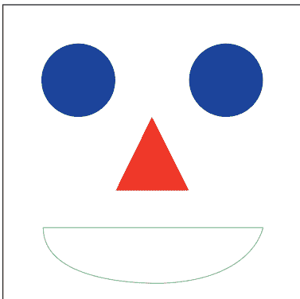

我将在第6章重新探讨`canvas`元素，并在使用它创建游戏图形和特效时进行详细探索。

### Audio

新的`audio`元素与`canvas`元素一样，是网页开发者工具箱中受欢迎的成员。浏览器终于内置了音频能力，无需依赖插件。不久之前，如果一个网站有音频功能，总会涉及某种形式的Flash。像SoundManager 2项目（www.schillmania.com/projects/soundmanager2）这样的库，提供了对Flash大多数音频功能的完整JavaScript访问。但即使这样的桥接允许你自己的代码保持在JavaScript层面，你的用户仍然需要安装插件。HTML5的`audio`元素解决了这个问题，使得只需使用普通的HTML和JavaScript，就能在开箱即用的浏览器中访问音频。

然而，`audio`元素仍有一些未解决的问题。所有主要的浏览器厂商似乎都认同该元素的重要性，并已采纳了该规范，但到目前为止，他们尚未就应支持哪些音频编码器达成一致。因此，虽然`audio`元素的理论很好，但现实却让开发者别无选择，只能提供多种格式的音频文件以满足所有浏览器厂商的要求。

`audio`元素可以在标记中定义，也可以用JavaScript动态创建。（后一种选项对于作为应用和游戏开发者的你来说更有趣。）清单1-2展示了一个基本的音乐播放器，包含多个源文件、原生用户界面（UI）控件，以及几个使用JavaScript API的键盘快捷键。

```
Listing 1-2 A simple music player with HTML5 audio
<audio controls id="myaudio">
    <source src="Prelude In E Minor, Op. 28.ogg"/>
    <source src="Prelude In E Minor, Op. 28.mp3"/>
</audio>
<script>
    var audio = document.getElementById("myaudio");
    document.onkeydown = function(e) {
        if (e.keyCode == 83) {
            audio.pause(); // Key pressed was S
        } else if (e.keyCode == 80) {
            audio.play(); // Key pressed was P
        }
    };
</script>
```

> **提示：** W3C目前正在通过Web Audio API扩展HTML5，该API支持高级音频合成和处理。由于该API仍处于实验阶段，我在本书开发游戏中不会使用它，尽管在第10章深入探讨HTML5音频时，我会简要审视它提供的可能性。

### WebSockets

在21世纪初Web 2.0大潮中，Ajax及其核心的XMLHttpRequest对象为网络注入了新的活力。然而，尽管它促成了许多伟大的事情，其局限性仍然令人痛苦。受限于HTTP协议，其操作是相当单向的，因为客户端必须主动向服务器请求信息。除非浏览器发起新的请求，否则Web服务器无法通知浏览器某些事情已经发生了变化。典型的解决方案是反复轮询服务器请求更新，或者保持请求打开直到有内容可报告。这些技术有时被统称为Comet（http://en.wikipedia.org/wiki/Comet_(programming)）。在许多情况下，这已经足够好了，但这些解决方案相当简单，常常缺乏多人游戏所需的灵活性和性能。

WebSockets应运而生。有了WebSockets，你在实现高效游戏开发所需的控制水平上迈进了一大步。虽然它不是一个完全原始的套接字连接，但WebSocket连接确实允许你创建和维持一个双向通信的连接，使得实现实时多人游戏变得容易得多。如清单1-3所示，连接服务器和交换消息的接口相当简单。

```
Listing 1-3 Interacting with the server with WebSockets

// Create a new WebSocket object
var socket = new WebSocket("ws://mygameserver.com:4200/");

// Send an initial message to the server
socket.onopen = function () {
    socket.send("Hello server!");
};

// Listen for any data sent to us by the server
socket.onmessage = function(msg) {
    alert("Server says: " + msg);
};
```

当然，使用WebSockets要求你还必须实现一个与WebSockets协议兼容并能响应你发送的消息的服务器应用程序。然而，正如我在第13章向你展示的，当你使用WebSockets和Node.js构建一个简单的聊天应用程序时，这并不一定是一项复杂的任务。

### Web Storage

当Web应用程序需要在客户端存储数据时，Cookie通常是默认选择。撇开它们作为间谍软件追踪设备的恶名不谈，Cookie也为开发者提供了一个急需的地方来存储用户设置，并为Web服务器提供了一种识别回访客户端的方式，这是许多Web应用程序的必要功能，因为HTTP协议是无状态的。

Web Storage最初是HTML5的一部分，后来被提升为自己的规范，它可以看作是Cookie的改进版，在很多情况下可以直接替代Cookie，作为键值类型数据的更大存储设备。然而，Web Storage的意义远不止于此。Cookie仅绑定到域名，而Web Storage有一个类似于Cookie的本地存储，以及一个绑定到活动窗口和页面的会话存储，允许在不同标签页或窗口中存在同一应用程序的多个实例。与Cookie不同，Web Storage仅存在于客户端，不会随每个HTTP请求传输，允许拥有兆字节级别而非千字节级别的存储空间。

当你需要存储任何复杂数据时，能够访问持久存储（可容纳至少几兆字节数据）就非常方便了。Web Storage只能存储字符串，但如果你将其与JavaScript对象表示法（JSON）编码器/解码器（如今大多数浏览器都原生支持）结合使用，你就可以轻松地绕过这个限制，存储更复杂的结构。在你于本书学习过程中开发的游戏中，你将使用本地Web Storage来实现保存游戏功能，并存储本地高分数据。

清单1-4展示了存储的简单直观接口。

```
Listing 1-4 Saving local data with Web Storage
// save highscore data
localStorage.setItem("highscore", "152400");

// data can later be retrieved, even on other pages
var highscore = localStorage.getItem("highscore");

alert(highscore); // alerts 152400
```


### WebGL

WebGL 是 Web 上的 OpenGL，基于 OpenGL ES 2.0。这个目前最广泛使用的图形 API 现在对 Web 开发者开放，可用于创建在线 3D 图形内容。当然，这对我们现在能实现的网页游戏类型有着重大影响。作为其重要性的证明，Google 开发者在 2010 年 4 月 1 日发布了传奇第一人称射击游戏“Quake II”的 WebGL 移植版，由于精心选择的发布日期和成就本身，当时普遍令人难以置信。

> **记住** 使用 WebGL 需要你非常清楚计划支持的目标平台。目前 Android 和 iOS 都不支持 WebGL，这将你限制在桌面浏览器中。此外，IE 11 之前的 Internet Explorer 仅支持 2D canvas 上下文。在本书中，我将向你展示如何使用 WebGL 和 2D canvas 创建游戏图形。

### HTML5 和 Flash

自从 canvas 元素和改进的 JavaScript 引擎出现以来，互联网上就一直存在关于新标准是否会取代 Flash 成为 Web 上多媒体应用主要交付方式的讨论和激烈的争论。Flash 长期以来一直是在线视频、音乐和游戏开发的首选。尽管像微软 Silverlight 这样的竞争技术试图击败它，但它们只在 Flash 市场份额上造成了轻微的影响。HTML5 及其相关开放技术现在看起来终于成为争夺该榜首位置的有力竞争者。

Flash 背后的公司 Adobe 也将其优先事项转向了 HTML5，并且最近发布了 Adobe Edge (http://html.adobe.com/edge)，这是一个与 Flash 非常相似但完全基于 HTML5、CSS3 和 JavaScript 的开发环境。再加上 Adobe Flash Professional CS6 引入了直接发布为 HTML5 的选项，看起来专有的 Flash 格式将逐步淘汰并被 HTML5 和开放 Web 所取代几乎是必然的。

> **记住** HTML5 并不能直接替代 Flash。你必须知道新标准在哪些方面存在不足，以及像 Flash 这样的替代解决方案可能在哪些时候更为合适。Flash 在确保与旧浏览器的向后兼容性方面仍然非常方便，我将在接下来讨论这一点。

### 创建向后兼容性

与大多数其他新技术一样，在使用 HTML5 时，向后兼容性问题不可避免地会出现。HTML5 并不是一个庞大、单一的东西：浏览器支持的是功能，而不是整个规范。目前没有浏览器可以声称 100% 支持所有 HTML5 功能集，而目前仍是最广泛使用的浏览器 Internet Explorer 最近才在 WebGL 等功能上赶上其他浏览器。

然而，即使当前的浏览器完全支持 HTML5 及其相关标准，你仍然必须考虑旧版浏览器。由于像 Internet Explorer 8 这样的浏览器至今仍被广泛使用，你不能安全地假设你的应用和游戏用户在未来许多年内都能利用 HTML5 的所有功能。我建议使用 CanIUse 网站 (http://caniuse.com/)，它跟踪大多数功能及其过去、现在和未来的浏览器支持情况。类似的网站 Mobile HTML5 (http://mobilehtml5.org/) 则专注于移动浏览器中的功能支持。

### 使用功能检测

没有人说你今天构建的应用和游戏必须支持所有曾经发布过的浏览器——这样做只会导致痛苦和抓狂。然而，你不应该完全忘记这些用户。你至少可以做的是尝试判断用户是否能够玩游戏或使用某个功能，然后处理你检测到的问题。浏览器嗅探——即通过检查用户的代理字符串来检测用户使用的浏览器——几乎已经过时了。如今，功能检测的概念已经取代了它的位置。测试可用的属性、对象和函数是比依赖用户可以更改的字符串并假设一组支持的功能要明智得多的策略。

由于各种实现之间存在如此多的差异，以及一些难以检测的功能，充分的功能检测绝非易事。幸运的是，你通常不需要重新发明轮子，因为许多用于检测功能支持的巧妙技巧已经被开发出来并汇集在各种库中。其中一个集合可以在 Modernizr 库 (www.modernizr.com) 中找到。Modernizr 提供了一种易于使用的方法来测试某个功能是否可用。你可以检测从 canvas 元素和 WebGL 到 Web 字体以及一系列 CSS 功能的所有内容，使你能够在不支持功能的地方提供后备解决方案，并让你的应用优雅地降级。

### 用 Polyfills 填补空白

从 2000 年代初开始，一个流行的趋势是在向网站添加新功能时倾向于所谓的*渐进增强*。这种策略要求网站以支持的功能的最低公分母为目标。任何不是普遍支持的技术都只应用于为网站添加增强功能，而不是关键功能。这确保了每个人都可以访问和使用该网站。如果用户拥有现代浏览器，他只是拥有更好的体验。

渐进增强在许多情况下是一种合理的策略，但有时你 simply 需要使用某个功能。如果某些浏览器没有对该功能的原生支持，那么这个漏洞必须被填补，即使这意味着使用不那么理想甚至可以说是变通的后备解决方案。这些后备方案有时被称为 *polyfills*，以填缝剂 Polyfilla 命名，因为它们的功能有些相似。当你的代码在实际浏览器中运行时，它们填补了受支持功能集中的裂缝，弥合了规范与处理不完美浏览器现实之间的差距。例如，Internet Explorer 在 IE9 之前不支持 `canvas`，但存在多个 polyfills 为旧版浏览器提供不同程度的 `canvas` 功能。

来自 Google 的 ExplorerCanvas 项目 (`http://code.google.com/p/explorercanvas/`) 是这些 polyfills 中最早的一个。它使用矢量标记语言 (VML)，一种微软开发的旧的基于 XML 的语言，来模拟 `canvas` 元素。因为它提供了足够的 2D 绘图功能，所以它已成功用于许多项目。然而，一些功能缺失了，因为 VML 并不完全与 `canvas` 规范重叠，并且缺乏对图案和剪裁路径等支持。

其他 polyfills 使用 Flash 或 Silverlight 来更接近完整的 `canvas` API，让你能够使用图像数据访问和合成效果等高级功能。有了所有这些不同的选择，选择正确的后备解决方案并非易事。根据目标平台，有时甚至 polyfills 也需要后备方案。

### 构建游戏

从第 2 章开始并在本书的其余部分，我将引导你从零开始开发 HTML5 网页游戏的过程。我将向你展示如何创建一款类似 Bejeweled 或 Puzzle Quest 风格的三消宝石交换游戏，这类休闲游戏在过去十年中在许多平台上都非常受欢迎。这类游戏拥有经过验证的游戏机制，让你能够专注于在游戏开发背景下使用 Web 技术。此外，这些游戏在桌面浏览器和智能手机、平板电脑等移动设备上都能很好地运行，所有这些都为你提供了探索跨平台网页游戏开发的机会。


# 第 1 章 Web 上的游戏

你将开发的游戏利用了 HTML5 规范中的几个功能，还使用了 Web 字体和 CSS3 等相关技术来构建 UI。虽然这个游戏可能不是革命性的，但它让我能够涵盖开放 Web 技术中的许多最新进展。其中，我使用 canvas 元素生成一些游戏图形，并向你展示如何使用 HTML5 音频添加音效。完成的游戏将可以在桌面浏览器上玩，我还会向你展示如何确保它在移动设备甚至离线时也能同样良好地运行。我将向你展示如何使用 Web Storage 保存高分数据并允许玩家在上次停止的地方继续游戏。

canvas 元素让你可以创建有趣的动态图形，但它并不总是适合创建用户界面。不过，你实际上不需要为此部分使用任何新工具，因为传统的 HTML 和 CSS 就能为你构建出色的 UI 提供所需的一切。随着 CSS 规范的最新添加，你可以添加动画、变换和其他功能，为 UI 体验带来活力。在第 6 章和第 7 章，我将向你展示如何使用 canvas 元素构建显示模块。稍后，在第 11 章，我将引导你更进一步，向你展示如何使用 WebGL 为游戏添加 3D 图形。

在第 13 章，我将向你展示如何使用 WebSockets 创建一个简单的聊天应用程序。为此，我还向你展示如何使用 Node.js 框架 (http://nodejs.org) 开发一个小型服务器应用程序。大多数现代浏览器都支持 WebSockets，一个显著的例外是 Android 浏览器，截至 Android 4.3，它仍然不支持此功能。

## 总结

这是一条颠簸的道路，但 HTML 和整个 Web 看起来终于再次走上了正轨。WHATWG 为标准制定过程带来了一些新的视角，Web 开发者现在开始享受这一努力带来的成果，即大量新工具和一个更符合当今 Web 使用方式的 HTML 标准。一如既往，使用新特性需要处理旧浏览器，但许多可用于确保跨浏览器兼容性的 polyfills 已经可用。

许多新特性对游戏开发者特别感兴趣，因为基于 Flash 的网页游戏现在有了真正的替代品。Canvas 和 WebGL 带来了动态图形和硬件加速图形；audio 元素终于实现了原生声音；而通过 WebSockets，现在可以创建更接近桌面游戏的多人游戏体验，而这在几年前是不可能的。其他相关领域的进步，如 CSS 和对 Web 字体日益增长的支持，让你能够使用开放、标准化的工具创建更丰富的 UI 体验。


# 第二章
## 踏出第一步

## 本章内容

- 规定游戏的规则和机制
- 识别游戏的不同阶段
- 设置基本的 HTML 结构
- 创建第一个 JavaScript 模块
- 使用网络字体制作启动画面

**有了上一章**的背景和技术铺垫，现在是时候动手实践了。然而，在开始编写代码和标记之前，理解项目本身至关重要。在本章的第一部分，我将描述游戏的规则、目标和机制。同时，我也会定义游戏的关键阶段，并识别构成应用程序的各个界面。

明确了游戏内容后，你终于可以开始编写代码了。从基础开始，我将展示如何设置一个带有简单结构的 HTML 页面以支持游戏运行。在此基础上，我会添加一些初步的 CSS，并演示如何使用 JavaScript 来控制额外脚本的动态加载。同时，我还会介绍最初的两个 JavaScript 模块：主应用模块，以及一个用于简化文档对象模型（DOM）操作的辅助模块。

最后，我会着手处理游戏的第一个阶段，使用网络字体创建一个带有精美游戏标志的启动界面。

## 理解游戏

我将在本书中引导你构建的是一款三消益智游戏。这种游戏类型主要由休闲游戏开发商 PopCap Games 的《宝石迷阵》系列而广为人知。我将这款游戏命名为“宝石勇士”；当然，你完全可以在这个过程中挑选一个更具创意和更好的名字。

在真正开始构建游戏之前，你需要探索游戏的组成部分和流程——即游戏的核心机制和规则，以及游戏的不同阶段。从应用程序的初始启动，到玩家退出游戏，用户会看到应用程序的不同阶段，每个阶段的呈现方式都不同。我们将先关注实际游戏的核心机制，而将菜单和加载界面等其他关键阶段留待后续处理。

# 交换宝石

游戏的核心围绕着一个 8x8 的网格展开，网格中填满了各种形状和颜色的宝石。游戏开始时，64 个单元格中的每一个都随机放置了一种宝石。游戏的目标是通过将三个或更多相同种类的宝石匹配来得分。玩家可以通过依次选择两个相邻的宝石来交换它们的位置。

### 三消匹配

只有当交换能够产生三个或更多相同颜色宝石的匹配时，该交换才是合法的；任何非法的交换都会自动撤销。当玩家完成一次有效的交换时，匹配组中的所有宝石都会被移除。如果上方有宝石，它们会掉落下来，新的、随机挑选的宝石会从顶部进入游戏区域。最简单的匹配是三个相同的宝石，但也可以形成四个或五个宝石的匹配链。玩家在单行或单列中匹配的宝石越多，获得的分数就越高。

触发连锁反应会为玩家带来额外的积分奖励。在一次有效的交换后，掉落的宝石可能会产生更多的匹配组，这些匹配组会受到额外的分数加成。通过仔细观察棋盘，玩家甚至可以有意触发这些连锁反应来获得额外分数。

在游戏过程中，玩家也可能面临无有效步数可走的情况。如果没有任何交换能产生至少三个相同的宝石组，游戏棋盘就必须重新洗牌。棋盘上的所有宝石会被清除，然后使用最初设置棋盘时相同的随机填充程序引入新的宝石。

### 关卡推进

为了营造一种紧迫感，我引入了一个缓慢倒计时的计时器。如果计时器归零，游戏结束。玩家可以在计时器结束前达到指定分数以进入下一关。这会触发宝石棋盘的重新填充、计时器的重置，并提高进入下一关所需的分数。这可能会让玩家时刻保持警惕，但如果不做修改，技术娴熟的玩家可以无限期地玩下去。为了使游戏随着时间的推移变得越来越难，每次玩家升级时，关卡之间的分数差距都会增加。最终，即使是最厉害的玩家也无法在规定时间内收集到足够的分数。

## 识别游戏阶段

到目前为止，应用程序的游戏阶段是所有阶段中最复杂的，也是玩家将花费大部分时间的地方。然而，你确实需要几个额外的阶段，因为你不应该让玩家一上来就直接进入游戏。

### 启动画面

玩家看到的第一件事就是启动画面。这个界面有两个目的：首先，它通过在中心位置展示游戏标志来向玩家介绍游戏。其次，通过添加一个进度条，它在幕后预加载游戏资源时提供了一个良好的等待区域。并非所有资源都需要立即预加载，但如果下一阶段的所有图形资源在该阶段激活时就能立即可用，会给玩家留下更好的印象。图 2-1 展示了启动画面的效果草图。

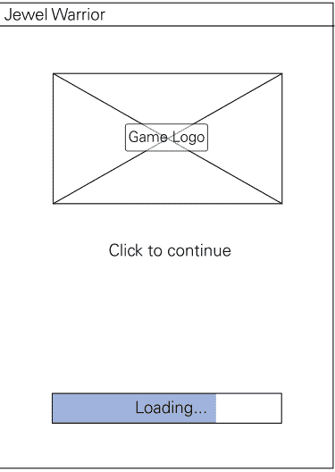

**图 2-1：** 这个模型展示了带有预加载器的启动画面。

### 主菜单

玩家点击跳过启动画面后，会进入主菜单。这是一个只有几个选项的简单菜单。最重要的是，菜单提供了进入实际游戏的入口，同时也包含用于显示高分、更多游戏信息以及退出游戏选项的按钮。如果玩家选择新游戏或继续之前的游戏，游戏将立即开始。图 2-2 展示了主菜单的效果草图。

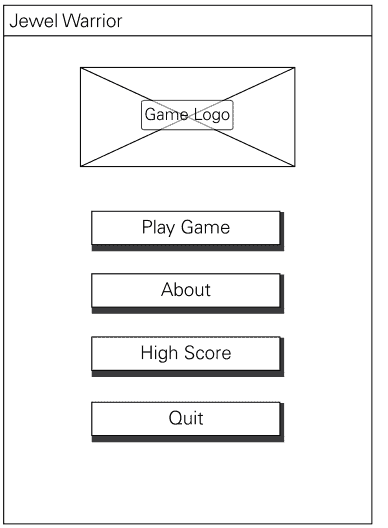

**图 2-2：** 主菜单允许用户访问游戏相关信息。

### 游戏进行

当实际游戏开始时，游戏元素——宝石棋盘、玩家名称和当前分数——占据了屏幕的大部分，但玩家需要能够退出回到主菜单。我通过使用屏幕的一小部分作为状态栏或工具栏来实现这一点。请参见图 2-3 中的游戏区域草图。

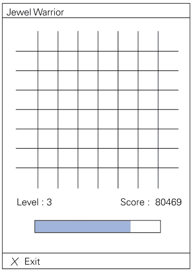

**图 2-3：** 游戏屏幕草图包含一个网格和工具栏空间。

### 高分榜

当游戏结束时，应用程序会切换到高分榜，显示最高分以及玩家名称。如果玩家获得了足够高的分数，系统会要求他输入名字，然后分数将被记录到榜单中。此界面提供返回主菜单的选项。游戏使用基于 WebStorage 的本地存储高分榜。图 2-4 中的草图展示了高分榜的基本布局。

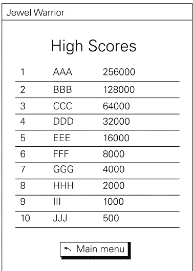

**图 2-4：** 这个草图展示了一个典型的高分榜。

## 创建应用程序骨架

你不需要特殊的工具或应用程序来跟随游戏的开发过程。当你进行到第 13 章的 WebSocket 讨论时，确实需要安装 Node.js 并在 Web 服务器上进行设置。然而，对于其他所有内容，你喜爱的文本编辑器和一个简单的图像编辑器就足够了。

许多 Web 开发者使用 jQuery 和 Prototype 等库，这样他们就不必处理 Web 开发中琐碎的部分，例如选择和操作 DOM 元素。通常，你会发现这些库包含许多你并不使用的功能。有时，问问自己是否真的需要一个 50-100K 的库，或者一个更简单、更小的库是否足够，这是一个好主意，尤其是在为移动平台开发时，因为无法保证拥有快速的网络连接。

为了更好地展示核心基础知识，我在本书中通常不使用第三方库。你可以自由使用其他库来简化你自己项目中的工作，但要注意你实际需要哪些功能，以免为项目增加不必要的臃肿。MicroJS 网站（http://microjs.com）收集了一系列微型库，这些库专注于特定领域，而非庞大的框架。


好的，现在开始。为游戏项目创建一个空文件夹，并创建两个子文件夹：`scripts` 和 `styles`。在后续过程中，还会添加一些额外的文件夹，但目前这两个就足够了。

### 设置 HTML

游戏的基础只是一个普通的 HTML 文档。新建一个文件，将其命名为 `index.html`，并放入项目文件夹。清单 2-1 显示了 `index.html` 的初始内容。

**清单 2-1** **空的 HTML 文档**

```
<!DOCTYPE HTML>
<html lang="en-US">
<head>
    <meta charset="UTF-8">
    <title>Jewel Warrior</title>
</head>
<body>
    <div id="game">
        <!-- game goes here -->
    </div>
</body>
</html>
```

请注意这个极其简单的文档类型声明。与例如 HTML 4.01 Strict DOCTYPE 比较一下：

```
<!DOCTYPE HTML PUBLIC "-//W3C//DTD HTML 4.01//EN"
    "http://www.w3.org/TR/html4/strict.dtd">
```

昔日的庞大复杂已不复存在。DOCTYPE 现在简单到你实际上可以记住它。用于声明字符编码的 `meta` 标签也得到了类似的简化处理。为保持简单而欢呼！

回到 HTML 文档。body 中的 `div` 标签是整个游戏的容器。其余的游戏标记都放在这个标签内。下一级的标记包含了前面章节中列出的各种游戏屏幕。一个 CSS 类为 `screen` 的 `div` 容器表示一个游戏屏幕，每个屏幕都有一个唯一的 `id`，用于引用该特定游戏屏幕。清单 2-2 显示了添加到游戏容器中的前几个屏幕。

清单 2-2 向游戏容器添加屏幕元素

```
<div id="game">
    <div class="screen" id="splash-screen"></div>
    <div class="screen" id="main-menu"></div>
    <div class="screen" id="game-screen"></div>
    <div class="screen" id="high-scores"></div>
</div>
```

我将在本章后面介绍启动屏幕，但现在，你已经有了足够的基础结构，可以开始添加一些 CSS 了。

### 添加一点样式

你将在本书中看到一些不同的样式表。第一个样式表 main.css 包含用于设置游戏应用程序整体结构的规则。清单 2-3 显示了添加到 head 元素中的样式表。

清单 2-3 添加主样式表

```
<head>
    <meta charset="UTF-8">
    <title>Jewel Warrior</title>
    <link rel="stylesheet" href="styles/main.css" />
</head>
```

> **记住** HTML5 在 rel 属性设置为 stylesheet 时，为 type 属性定义了默认值 text/css。这意味着你不再需要显式地设置 type 属性。

目前，这个样式表针对的是桌面浏览器。在第 3 章中，我将讨论如何处理移动浏览器，并展示如何使用 CSS 媒体查询为不同的设备和分辨率加载不同的样式表。最初，你只需要在主样式表中添加一些简单的规则。清单 2-4 显示了 main.css 中的 CSS 规则。

#### 清单 2-4 主样式表的初始内容

```
body {
    margin : 0;
    overflow : hidden;
}

#game {
    position : absolute;
    left : 0;
    top : 0;
    width : 320px;
    height : 480px;
    background-color : rgb(30,30,30);
}

#game .screen {
    position : absolute;
    width : 100%;
    height : 100%;
    display : none;
    z-index : 10;
}

#game .screen.active {
    display : block;
}
```

body 规则简单地取消了浏览器为 body 元素添加的任何默认边距。#game 规则为容器 div 设置了深灰色背景，并使其填充一个 320x480 的矩形，这个尺寸对于此类游戏来说很合适，例如在 iPhone 上也能很好地运行。所有 screen div 元素的 display 属性都设置为 none。这确保了屏幕默认隐藏，仅在需要时显示。屏幕 div 元素上的 active CSS 类会将 display 属性切换为 block。

### 加载脚本

近年来，随着高效加载脚本问题受到越来越多的关注，脚本加载本身已成为一门艺术。在这个项目中，我将向你展示动态脚本加载的基础知识，但如果你想要更高级的方案，我建议查看 Microjs 网站，那里你会找到几个脚本加载器。一个例子是 Yepnope 库，它也被整合到了 Modernizr 中。通过使用 Modernizr 的功能检测和 Yepnope 的条件加载，可以轻松地只加载正确的脚本和后备方案。

你稍后将创建 jewel.js 脚本。清单 2-5 显示了在 index.html 的 head 元素中添加的内容。

```
清单 2-5 添加主脚本
...
<head>
    ...
    <script src="scripts/jewel.js"></script>
</head>
...
```

> **记住** 就像 link 元素和样式表一样，你不再需要在 script 标签上显式设置脚本类型。如果省略 type 属性，则默认使用 text/javascript。

主脚本 jewel.js 创建了一个 jewel 命名空间对象，所有游戏模块都将驻留其中。它还（除其他功能外）提供了加载任何其他需要加载的脚本所必需的功能。首先，添加空的 load() 和 setup() 函数。load() 函数将负责加载额外的脚本文件，并在每个脚本完成时调用回调函数。清单 2-6 显示了初始脚本。

```
清单 2-6 jewel.js 的初始内容
var jewel = (function() {
    function load(src, callback) {
    }
    function setup() {
    }
    return {
        load: load,
        setup: setup
    };
})();
```

所有游戏模块都是 `jewel` 命名空间的属性，基本上就是具有一些公共方法的对象。如果你曾在自己的代码中使用过所谓的模块模式，你就会熟悉这种方法。所有功能都在一个匿名函数内定义，该函数返回一个对象字面量，其中包含应暴露给外部世界的函数的引用。该匿名函数被立即调用，其返回值被分配给 `jewel` 命名空间对象的一个属性。

这种模块化方法是防止应用程序代码污染全局作用域的简便方法，从而使与第三方脚本的集成更加困难。匿名函数中的封装有效地隐藏了（无论好坏）模块内声明的所有变量和函数，除非它们被显式公开。

`load()` 函数应加载 `src` 参数中指定的文件，并将其放入一个按照先进先出原则操作的执行队列中。这确保了脚本按正确的顺序执行。因为所有脚本都是并行加载的，所以无法保证它们完成加载的顺序与添加的顺序一致。清单 2-7 显示了 `load()` 函数。

#### 清单 2-7 jewel.load() 函数

```
var jewel = (function() {
    var scriptQueue = [],
        numResourcesLoaded = 0,
        numResources = 0,
        executeRunning = false;

    function executeScriptQueue() {
    }

    function load(src, callback) {
        var image, queueEntry;
        numResources++;

        // add this resource to the execution queue
        queueEntry = {
            src: src,
            callback: callback,
            loaded: false
        };
        scriptQueue.push(queueEntry);

        image = new Image();
        image.onload = image.onerror = function() {
            numResourcesLoaded++;
            queueEntry.loaded = true;
            if (!executeRunning) {
                executeScriptQueue();
            }
        };
        image.src = src;
    }
    ...
})();
```

首先，load() 函数将脚本添加到 scriptQueue 数组中。它不仅存储了文件名，还存储了回调函数和一个指示其是否已完成加载的布尔标志。之后，文件被加载，但不是像你可能预期的那样通过 script 元素，而是作为 Image 来加载。现在，JavaScript 文件显然不是有效的图像，但浏览器同样会加载该文件，并在完成加载时触发 onerror 事件。这允许你加载脚本而不实际执行它，就像使用 script 元素那样。如果你在控制台中看到与 MIME 类型相关的警告，请不要惊慌。这些通知是无害的。

当文件加载完成后，onerror/onload 处理程序会更改 loaded 标志并调用清单 2-8 中所示的 executeScriptQueue() 函数。

#### 清单 2-8 执行队列中的脚本

```
var jewel = (function() {
    var scriptQueue = [],
        numResourcesLoaded = 0,
        numResources = 0,
        executeRunning = false;

    function executeScriptQueue() {
        var next = scriptQueue[0],
            first, script;
        if (next && next.loaded) {
            executeRunning = true;
            // remove the first element in the queue
            scriptQueue.shift();
            first = document.getElementsByTagName("script")[0];
            script = document.createElement("script");
            script.onload = function() {
                if (next.callback) {
                    next.callback();
                }
                // try to execute more scripts
```


executeScriptQueue();
};
script.src = next.src;
first.parentNode.insertBefore(script, first);
} else {
    executeRunning = false;
}
}
...
})();
```

`executeScriptQueue()` 函数会检查队列中的第一个脚本是否已加载完毕。如果已加载，它会将该脚本从队列中移除，并通过创建一个 `<script>` 元素并将其插入到页面上第一个 `<script>` 元素之前，从而将其添加到页面中。你也可以将其添加到 `<head>` 元素中。然而，这种方案不够稳健，因为一个文档不一定有 `<head>`，而你至少知道它有一个 `<script>` 元素——即当前正在执行的那一个。`executeRunning` 标志被设为 `true` 以阻止图像 `onload` 处理程序再次调用 `executeScriptQueue()`。

你可以通过在 `<script>` 元素上添加一个 `onload` 事件的处理程序来知道脚本何时执行完毕。此处理程序必须调用回调函数（如果提供了的话），并且也应该再次调用 `executeScriptQueue()` 以尝试执行队列中的下一个脚本。

如果队列中的第一个脚本尚未加载完毕，`executeScriptQueue()` 只会将 `executeRunning` 设为 `false`。这将允许来自清单 2-7 的图像 `onload` 处理程序在下一个脚本加载完毕后再次启动脚本执行。

### 创建一个 DOM 辅助模块

为了简化使用 DOM 的任务，你通常可以创建一些辅助函数来操作 DOM 元素。这正是 `dom.js` 模块所提供的。清单 2-9 展示了 `dom.js` 模块及其首批辅助函数。

**清单 2-9：DOM 辅助模块**

```javascript
jewel.dom = (function() {

function $(path, parent) {
    parent = parent || document;
    return parent.querySelectorAll(path);
}

function hasClass(el, clsName) {
    var regex = new RegExp("(^|\\s)" + clsName + "(\\s|$)");
    return regex.test(el.className);
}

function addClass(el, clsName) {
    if (!hasClass(el, clsName)) {
        el.className += " " + clsName;
    }
}

function removeClass(el, clsName) {
    var regex = new RegExp("(^|\\s)" + clsName + "(\\s|$)");
    el.className = el.className.replace(regex, " ");
}

return {
    $ : $,
    hasClass : hasClass,
    addClass : addClass,
    removeClass : removeClass
};
})();
```

`jewel.dom` 模块最初只有一些用于操作 CSS 类的函数。该模块还暴露了一个 `$()` 函数，它只是 `querySelectorAll()` 函数的一个封装。此函数让你能够使用 CSS 选择器轻松地选择 DOM 元素，类似于 jQuery 中的 `$()` 函数。

`hasClass()` 函数检查给定元素上的 `className` 属性，如果找到指定的类则返回 `true`。它使用一个包含三部分的正则表达式来完成此操作。第一部分 `(^|\\s)` 匹配字符串的开头或空白，第二部分是类名，第三部分 `(\\s|$)` 匹配字符串的结尾或空白。`addClass()` 和 `removeClass()` 函数的功能如其名：它们为元素添加或移除指定的 CSS 类。

最后，在 `index.html` 中使用 `jewel.load()` 来加载这个新模块，如清单 2-10 所示。

**清单 2-10：加载 jewel.dom 模块**

```html
<head>
    ...
    <script src="scripts/jewel.js"></script>
    <script>
        window.addEventListener("load", function() {
            jewel.load("scripts/dom.js", jewel.setup);
        });
    </script>
</head>
...
```

将 `setup()` 函数作为回调参数传递，以便在 DOM 模块加载并执行后调用该函数。如果你现在在浏览器中加载 `index.html`，你应该能看到游戏的深灰色背景。如果你想测试文件是否加载正确，尝试在 `jewel.js` 的 `setup()` 函数中添加一个 `alert()` 或 `console.log()` 调用：

```javascript
var jewel = (function() {
    ...
    function setup() {
        console.log("Success!");
    }
    ...
})();
```

### 调试 Web 应用程序

我假设你对现代浏览器中可用的调试工具比较熟悉。Firefox、Chrome 和 Internet Explorer 9+ 都有非常好的控制台和检查工具，通常可以通过按 F12 打开。如今大多数浏览器都支持现在几乎是标准的控制台输出 API，允许你通过添加类似以下代码行将调试消息输出到控制台：

```javascript
console.log("Your log message here");
console.warn("Your warning here");
console.error("Your error here");
```

这比 web 开发者多年前不得不使用的 `alert()` 调试要不那么突兀。本书不会特别强调在代码中添加调试机制或错误处理，而是专注于了解当今可用的新功能和技术。然而，我鼓励你在代码中根据需要添加尽可能多的调试消息。

### 向主模块添加功能

现在是时候向前推进，向主模块添加一些基本的应用程序逻辑了，例如在游戏状态之间切换。清单 2-11 展示了添加到 `jewel.js` 中的 `showScreen()` 函数。

**清单 2-11：切换屏幕**

```javascript
jewel = (function() {
    ...
    // 隐藏活动屏幕（如果有）并显示具有指定id的屏幕
    function showScreen(screenId) {
        var dom = jewel.dom,
            $ = dom.$,
            activeScreen = $("#game .screen.active")[0],
            screen = $("#" + screenId)[0];
        if (activeScreen) {
            dom.removeClass(activeScreen, "active");
        }
        dom.addClass(screen, "active");
    }
    // 暴露公共方法
    return {
        ...
        showScreen : showScreen
    };
})();
```

`showScreen()` 函数通过给指定 ID 的屏幕元素添加 `active` CSS 类来简单地显示该屏幕。如果另一个屏幕已经处于活动状态并可见，它会在新屏幕显示之前被自动隐藏。

> **记住：** `querySelectorAll()` 函数总是返回一个元素列表，即使只存在一个或根本没有元素。因此，当你只想选择一个元素时，你需要使用这个数组的第一个元素而不是数组本身。或者，你可以使用 `querySelector()` 函数。

即使 Jewel Warrior 没有使用非常深的命名空间层次结构，每次使用函数都必须输入完整的模块路径也可能很烦人。为了节省输入，你可以轻松地为模块创建快捷引用，如清单 2-11 所示，其中的 `showScreen()` 函数对 `jewel.dom` 模块及其 `$()` 函数有更短的本地引用。这样的本地引用甚至可以提高 JavaScript 性能，因为 JavaScript 引擎不需要每次都遍历命名空间对象结构来获取变量。

### 激活启动屏幕

既然你能够在游戏屏幕之间切换了，现在可以修改 `jewel.setup()` 函数来显示启动屏幕，如清单 2-12 所示。

**清单 2-12：切换启动屏幕**

```javascript
var jewel = (function() {
    ...
    function setup() {
        jewel.showScreen("splash-screen");
    }
    ...
})();
```

这解决了切换启动屏幕元素可见性的问题，但你的屏幕当然还没有内容。在下一部分，我将向你展示如何使用 Web 字体在启动屏幕上放置一个漂亮的游戏标志。

### 创建启动屏幕

启动屏幕是一个简单的屏幕，显示游戏标志和告诉用户点击继续的文本。Jewel Warrior 标志只是游戏名称，使用一种有趣的字体设置。嵌入式 Web 字体现在使得仅使用 HTML 和 CSS 就可以轻松创建这样的标志。清单 2-13 展示了添加到启动屏幕 `div` 中的标记。

**清单 2-13：添加启动屏幕标记**

```html
<div id="game">
    <div class="screen" id="splash-screen">
        <h1 class="logo">Jewel <br/>Warrior</h1>
        <span class="continue">Click to continue</span>
    </div>
    ...
</div>
```

### 使用 Web 字体

直到最近，你可以安全地在 Web 上使用的字体列表还短到足以记住。现在，将更好的字体带到 Web 上的努力已经汇聚成一个共同标准。通过使用 CSS `@font-face` 规则，你可以以适用于大多数浏览器的方式嵌入字体。W3C 最近发布了一种新的、标准化的字体格式——Web Open Font Format (WOFF)，所有现代桌面浏览器都已经支持它。但是，如果你想要最高级别的浏览器兼容性，你必须以几种不同的格式提供字体。虽然像 iPhone 和 iPad 这样的 Apple 设备在运行 iOS 5 或更高版本时都支持 WOFF 格式，但 Android 设备在任何早于最近发布的 Android 4.4 的版本中都不支持 WOFF。

> WOFF Web 字体格式不是 HTML5 的一部分，但它有自己的规范，该规范在 2012 年 12 月达到了最终推荐状态。

我为 Jewel Warrior 选择了两种字体：Sideshow 的 Slackey Regular 和 Ben Weiner 的 Geo Regular。这两种字体都可以在 Google Fonts 目录（www.google.com/fonts）中找到，并且是免费许可的。在 Google Fonts 网站上，选择你想要使用的字体，然后选择“Add to Collection”。完成之后，点击右下角的“Use”按钮，你将被引导到一个页面，在那里你可以下载一个包含所选 TTF 文件的 ZIP 压缩包。如果你想要直接从 Google 服务器嵌入字体，你也可以找到 CSS 链接，但请注意，你的游戏将需要访问互联网才能使用字体文件。

如果你想在这个或其他 Web 项目中使用不同的字体，我建议你直接在网上浏览。Google Fonts 网站只是众多专门针对 Web 字体的字体集合中的一个。在 FontSquirrel（www.fontsquirrel.com/）上，你可以找到许多免费字体，这些字体被打包在包含所有必要字体文件和 CSS 的套件中。他们甚至有一个易于使用的在线生成器，允许你上传例如一个 TTF 文件，然后为你生成一个 `@font-face` 套件。我使用此功能将 Google Fonts 的 TTF 文件转换为 WOFF 文件。


### 为启动屏幕设置样式

将第2章代码档案中的字体文件复制并放置在项目文件夹中一个名为 `fonts` 的新文件夹中。CSS字体声明则放在 `styles` 文件夹中的一个新CSS文件 `fontfaces.css` 里。清单2-14展示了这个样式表的内容。

```
清单 2-14  自定义的 @font-face 规则

@font-face {
    font-family: "Slackey";
    font-weight: normal;
    font-style: normal;
    src: url("../fonts/slackey.woff") format("woff"),
         url("../fonts/slackey.ttf") format("truetype");
}
@font-face {
    font-family: "Geo";
    font-weight: normal;
    font-style: normal;
    src: url("../fonts/geo.woff") format("woff"),
         url("../fonts/geo.ttf") format("truetype");
}
```

设置 @font-face 规则相当简单。`font-family` 的值是你在CSS的其他部分中引用该字体时使用的名字。`font-weight` 和 `font-style` 属性允许你为不同的字重和样式（粗体、斜体等）嵌入字体文件。我只包含了常规字体。当浏览器遇到 @font-face 规则时，它会读取源文件列表并下载它支持的第一种格式。由于Android设备尚不支持WOFF文件，它们会简单地忽略该条目，转而下载TrueType文件。

> **技术知识**
> WOFF和TTF字体文件足以获得最新版本的Chrome、Opera、Firefox、Safari以及Internet Explorer 9+的支持。如果你想支持更旧的浏览器，则需要更多的格式，并且@font-face声明会变得稍微复杂一些。为了一个可靠的跨浏览器解决方案，我推荐阅读Paul Irish的经典文章《防弹的@font-face语法》，地址为 http://paulirish.com/2009/bulletproof-font-face-implementation-syntax。

在整个游戏中，我使用Geo作为主字体，因此请在 `main.css` 中为游戏容器设置此字体。这样，所有屏幕元素都会自动继承这些值。清单2-15展示了应用了新字体属性的游戏容器规则。

```
清单 2-15  添加对嵌入字体的引用
#game {
    ...
    font-family : Geo;
    color : rgb(200,200,100);
}
```

记得还要在 `index.html` 的 `head` 元素中添加对 `fontfaces.css` 的链接引用：

```
<head>
    ...
    <link rel="stylesheet" href="styles/fontfaces.css" />
</head>
```

现在，你可以使用嵌入字体来美化启动屏幕。启动屏幕上的文本已经继承了Geo字体，但在这个项目中，我希望Logo使用Slackey字体。清单2-16展示了添加到 `main.css` 中的CSS规则。

```
清单 2-16  为启动屏幕设置样式
#splash-screen {
    text-align : center;
    padding-top : 100px;
}
#splash-screen .continue {
    cursor : pointer;
    font-size : 30px;
}
.logo {
    font-family : Slackey;
    font-size : 60px;
    line-height : 60px;
    margin : 0;
    text-align : center;
    color : rgb(70,120,20);
    text-shadow : 1px 1px 2px rgb(255,255,0),
                  -1px -1px 2px rgb(255,255,0),
                  5px 8px 8px rgb(0,0,0);
}
```

现在，Logo已设置为Slackey字体，文本被染成绿色，并且所有内容都居中放置。`text-shadow` 声明有两个用途。通过两个相反方向的细阴影添加了一个亮黄色的轮廓。第三个阴影为文本添加了柔和的投影。

最后，使用CSS图案来点缀单调的灰色背景，但要将这个效果添加到主 `#game` 规则中，使其适用于所有屏幕。清单2-17展示了添加到 `main.css` 中的内容。

请注意，CSS渐变的语法可能会因你所针对的浏览器而略有不同，并且为了支持旧版浏览器，需要使用带浏览器前缀的版本。为了简洁起见，清单2-17只展示了不带前缀的版本。你可以在本章的示例代码中找到WebKit、Firefox和IE的特定版本。

```
清单 2-17  添加背景图案
#game {
    ...
    background-color: rgb(60,60,40);
    background-size: 10px 10px;
    background-image:
        linear-gradient(
            45deg, transparent 0%, rgb(20,20,20) 25%,
            transparent 50%, rgb(20,20,20) 75%, transparent 100%
        ),
        linear-gradient(
            -45deg, transparent 0%, rgb(20,20,20) 25%,
            transparent 50%, rgb(20,20,20) 75%, transparent 100%
        );
}
```

这为背景添加了两个线性渐变，当它们组合时，就创造出了交叉影线效果。

就在几年前，背景图案还需要使用重复的图像文件，但今天可用的CSS特性为你创建有趣的图案和背景提供了充足的选择。我强烈推荐查看Lea Verou的CSS3图案画廊（http://lea.verou.me/css3patterns）以获取灵感。

现在，在浏览器中打开 `index.html`。页面加载后，加载脚本应自动切换到启动屏幕。图2-5展示了启动屏幕。

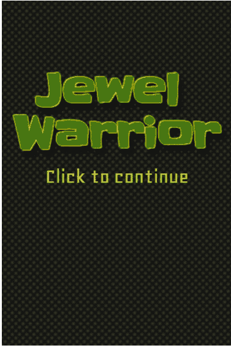

图 2-5：这是当前状态下的启动屏幕。

## 本章小结

在本章中，我阐述了Jewel Warrior游戏的概念。我讨论了游戏规则、宝石交换机制以及玩家如何通过匹配相同的宝石集来得分。然后，我描述了游戏的各个阶段，从游戏首次加载时显示的启动屏幕，到菜单，再到实际游戏，以及游戏结束时显示的高分榜。

接着，我向你展示了如何使用一个简单的HTML骨架和一点CSS来搭建游戏的基础。你了解了如何添加动态脚本加载，并且我介绍了一个用于设置游戏阶段和在各个游戏屏幕之间切换的基本框架。

在本章接近尾声时，你了解了网页字体和CSS `@font-face` 声明如何启用嵌入字体，并使用它们为启动屏幕创建了一个游戏Logo。

# 第 3 章
## 走向移动化

## 本章内容

- 为移动设备设计
- 支持不同的屏幕分辨率
- 创建主菜单
- 为iOS创建Web应用程序

**本章涵盖**了将你的Web应用程序迁移到移动平台时面临的一些优势和挑战。它简要讨论了移动设备上的用户交互与桌面端交互的不同之处，然后解释了视口的概念以及如何让游戏在小屏幕上正确缩放。

本章接着介绍了CSS媒体查询，并展示了如何使用它们来创建适应并适应高分辨率和低分辨率设备（无论其方向如何）的游戏视图。

在本章中，你还将了解如何通过切换iOS Web应用程序模式和禁用一些默认的浏览器行为，让你的应用程序和游戏感觉像原生应用程序。

最后，你将发现一些可以帮助你调试iOS和Android Web应用程序的技巧。

## 开发移动Web应用程序

如今，数以亿计的设备、智能手机和平板电脑运行在诸如苹果iOS和谷歌支持的Android系统等软件上。这些设备可以运行大多数用HTML5构建的先进应用程序和游戏。

游戏在iOS和Android等平台上尤其成功。如果你浏览最受欢迎的iPhone和Android应用程序列表，你肯定会发现几款游戏，其中一些位于榜首。自从诺基亚手机上的贪吃蛇游戏以来，在手机上玩游戏已经变得越来越普遍。随着最近几代高分辨率、支持触摸的智能手机和平板电脑的出现，游戏体验得到了极大的提升。

然而，并非所有游戏都天然适合小屏幕。例如，复杂的策略游戏和快节奏的第一人称射击游戏依赖于大显示屏和丰富的控制选项。移动平台上确实存在类似的游戏。然而，真正成功的游戏似乎是那些利用小屏幕和触摸功能、迎合移动用户更随意、即拿即玩心态的游戏。如果用户只是想在公交车上消磨几分钟，他们不想花很长时间看一段冗长的介绍。像Jewel Warrior这样的三消游戏非常适合这种描述。游戏玩法足够简单，大多数人几乎无需指导就能上手玩，并且游戏时长可长可短。游戏控制也足够简单，因此缺少键盘和鼠标不成问题。游戏的宝石交换机制非常适合小触摸屏，因为用户只需在屏幕上点击即可选择和交换宝石。

### 一次编写，处处运行

使用HTML、CSS和JavaScript开发移动应用程序和游戏的最大优势之一在于，如果你构建得当，你的应用程序可以在许多不同的平台和设备上运行，只需很少或无需修改。考虑到原生应用程序开发者面临的挑战，这对Web应用程序来说是一个巨大的胜利。例如，为了将原生的iPhone游戏移植到Android，你需要了解iOS设备上使用的Objective-C语言和Android上使用的Java语言，以及它们各自的软件开发工具包（SDK）。而通过使用开放的Web技术，无论你针对什么平台或设备进行开发，工具和代码都保持不变。这节省了开发阶段以及发布后维护的时间。

Web应用程序的另一个优点是，它们可以绕过像苹果App Store这样的分发渠道的严格规则。让你的应用被App Store接受意味着要经过一个封闭且有些晦涩的审批过程。Web应用程序则没有这个问题。你可以在任何你想的地方托管和分发你的应用程序。


### 移动平台面临的挑战

使用网页技术开发应用程序或游戏会带来诸多挑战。不受限于单一发行渠道可能成为一个缺点。从App Store或Android Market获取新应用非常便捷，许多用户除了熟悉的应用内分发系统外，很少会尝试其他途径，这意味着让你的潜在用户知晓你的应用程序可能会成为一个问题。幸运的是，越来越多的替代渠道正在涌现，使你的应用更容易触达用户。

### 在移动设备上处理用户输入

为智能手机和平板电脑开发应用同样涉及技术挑战。最明显的挑战之一是用户与应用程序之间的交互方式发生了变化。在台式机或笔记本电脑上，用户习惯于同时使用键盘和鼠标。智能手机和平板电脑主要依赖触摸屏，这虽然非常直观，但也相当受限。

一些设备，如iPhone和许多Android设备，提供了几种额外的交互方式。摄像头和麦克风早已是手机的标配，而当今的智能手机还配备了加速度计和陀螺仪等硬件传感器。这些都是非常有趣的工具，可用于创造创新的游戏体验。基于动作的输入方式已经取得了相当大的成功。多款热门移动游戏完全依赖于在正确的时间倾斜设备来操控，目标多样，例如驾驶车辆（《史瑞克卡丁车》）、在云朵上跳跃（《涂鸦跳跃》）以及引导球体穿越迷宫（《迷宫》）。在许多现代浏览器中，现在可以通过JavaScript访问这些基于动作的功能。

## 键盘输入

为移动设备而非台式机开发时，用户输入方面最大的损失可能是键盘。许多类型的游戏如果没有键盘提供的精细控制，就无法良好运行。一些移动游戏选择在屏幕上显示虚拟按钮，在某些情况下这能奏效。但在其他情况下，缺少实体按键会使游戏难以控制。对于快节奏的游戏尤其如此，玩家通常依赖按键的物理触感来快速切换功能。许多设备以振动形式提供触觉反馈，但如果不直接看着按键，仍然很难准确触摸到正确的按键。

Android和iOS设备都有在需要时向上滑出的虚拟键盘。由于键盘仅在允许文本输入的元素上触发，因此很难将其用于其预期目的之外的用途。此外，在大多数标准尺寸的智能手机和iPod touch设备上，它会占用屏幕的很大一部分（见图3-1）。

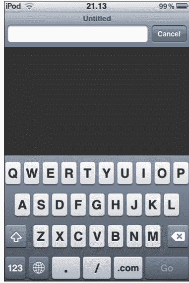

**图 3-1：** iPod touch和iPhone上的虚拟键盘允许用户输入数据。

#### 鼠标与触摸

当然，移动设备也缺少鼠标，但至少触摸屏的功能在某种程度上与计算机鼠标类似。轻触屏幕与点击鼠标的作用相同，因此在许多情况下，你可以使用触摸屏代替鼠标，反之亦然。你甚至可以提供双击来模拟鼠标的双击。然而，相似之处大概也仅止于此。

计算机很少有超过一个鼠标，但大多数人有十个手指。不利用它们将是件憾事，因此最新的触摸设备提供了所谓的多点触控事件。这开启了一个全新的可能性世界。你可能已经知道移动浏览器和地图应用中无处不在的捏合缩放功能，但多点触控功能也用于在同一屏幕上实现多人游戏。

触摸屏也有其局限性。例如，鼠标指针悬停在元素上方的概念在触摸世界中没有对应物。在你实际触摸之前，屏幕无法知道你的手指位置，而当你触摸时，它就不再是悬停状态了。计算机鼠标通常至少有两个按钮，并且大多数人习惯使用右键单击作为上下文菜单或其他替代操作的快捷方式。在触摸屏上，很难区分触摸类型。我们只有一种类型的手指。最常用的变通方法是区分短按和长按，长按会调出上下文菜单或你分配给鼠标右键的任何其他操作。

所有这些精细的控制机制都缺失，你可能会认为移动游戏市场的多样性会受到影响。然而，限制常常激发创造力。诚然，App Store和Android Market确实存在重复的模仿应用和游戏问题，但其中许多游戏使用了独特的游戏玩法和机制。像《水果忍者》和《割绳子》这样的游戏表明，简单、时机恰当的屏幕上滑动可以提供完美的休闲游戏体验。以前毫无意义的游戏类型现在成为了畅销作品。

### 适应小屏幕分辨率

切换到手持设备时，最明显的差异可能是与全尺寸电脑相比的小巧外形。较小的屏幕通常分辨率较低，且往往具有不同的纵横比。如果你希望你的游戏能在大多数设备上良好运行，你需要确保它能处理各种显示尺寸。表3-1展示了一些智能手机及其分辨率。你可以在MyDevice网站（http://www.mydevice.io/devices/）上找到更多类似数据。

设备的显示分辨率差异很大。你需要特别注意设备分辨率。显示分辨率是显示屏上的物理像素数，而设备分辨率则代表在例如CSS中使用的逻辑分辨率。因此，尽管iPhone 4的显示分辨率是iPhone 3的两倍，但网站在两种显示屏上看起来是一样的。iPhone 4只是以更清晰的细节渲染页面。由于设备分辨率彼此更加接近，因此针对这些显示屏进行适配相当容易，你将在本章后面看到我如何向你展示使用媒体查询的方法。

表 3-1 智能手机显示屏

| 设备 | 显示分辨率 | 设备分辨率 | 像素比 | 纵横比 |
| :--- | :--- | :--- | :--- | :--- |
| iPhone 3 | 480x320 | 480x320 | 1.0 | 3:2 |
| Nokia Lumia | 800x480 | 480x320 | 1.5 | 15:9 |
| iPhone 4 | 960x640 | 480x320 | 2.0 | 3:2 |
| iPhone 5 | 1136x640 | 568x320 | 2.0 | 16:9 |
| Samsung Galaxy S3 | 1280x720 | 640x360 | 2.0 | 16:9 |
| Google Nexus 4 | 1280x768 | 640x360 | 2.0 | 15:9 |
| Samsung Galaxy S4 | 1920x1080 | 640x360 | 3.0 | 16:9 |
| Sony Xperia Z | 1920x1080 | 640x360 | 3.0 | 16:9 |
| HTC One | 1920x1080 | 640x360 | 3.0 | 16:9 |

平板电脑显示屏也是如此。一些平板电脑的显示分辨率与智能手机相似，而另一些则可以与台式机显示器相媲美。尽管如此，设备分辨率是相似的。表3-2展示了一些不同平板电脑的显示分辨率。

表 3-2 平板电脑显示屏

| 设备 | 显示分辨率 | 设备分辨率 | 像素比 | 纵横比 |
| :--- | :--- | :--- | :--- | :--- |
| iPad 2 | 1024x768 | 1024x768 | 1.0 | 4:3 |
| iPad Mini | 1024x768 | 1024x768 | 1.0 | 4:3 |
| Samsung Galaxy Tab 2 7" | 1024x600 | 1024x600 | 1.0 | 4:3 |
| Samsung Galaxy Tab 2 10" | 1280x800 | 1280x800 | 1.0 | 16:10 |
| iPad 4 | 2048x1536 | 1024x768 | 2.0 | 4:3 |
| Google Nexus 10 | 2560x1600 | 1280x800 | 2.0 | 16:10 |

> 请记住，考虑到所有这些不同的显示尺寸和分辨率，让游戏的布局和图形能够为尽可能多的设备进行适当缩放的挑战绝非易事。

#### 创建可缩放的布局

你可以通过使用基于相对单位而非绝对值的弹性布局来解决由多种显示分辨率引起的许多问题。CSS支持几种不同的单位，可用于设置位置、尺寸、边距等，它们各有优缺点。其中一些单位是绝对的且尺寸固定。例如，使用`px`值设置`width`和`height`属性会使该元素无论放在哪里以及有多少可用空间，都使用相同数量的像素。

其他单位相对于其他值。这些单位包括`em`和百分比（`%`）单位。百分比值相对容易理解；将`width`属性设置为`25%`会使元素使用其父元素提供的宽度的25%。如果你让父元素变大，子元素会自动调整自身，使其仍然使用空间的25%。这使得百分比值比固定尺寸的像素值更适合多设备开发。

`em`单位是创建可缩放布局的另一个强大工具。它起源于传统排版，其中1个`em`等于所使用的字体和大小中大写字母M的宽度。因为当你更改字体或点大小时，1个`em`的实际大小会变化，所以该单位是一个相对单位。`em`单位已转移到数字世界和网络排版，尽管有一个轻微的修改，即1个`em`现在等于字体的高度。


## 第3章 移动端适配

这样，计算机就能安全地使用字距调整来优化字母间距，提升可读性。这也使得em单位能够用于其他不含字母M的字母系统。

> 你还可以用em单位来定义一些特殊字符。全角破折号（—）的宽度等于一个em，其近亲全角空格也是如此。HTML通过实体符`&mdash;`和`&emsp;`提供了这两种特殊字符。

使用em和百分比等单位，能使应用布局更适应不同的显示尺寸。所有内容继承的主字体大小在`main.css`的`#game`元素上定义。选择基础字体大小可能有些棘手，但通常能找到一个能将页面划分为美观网格的尺寸。Jewel Warrior游戏使用8x8的棋盘，游戏宽度设置为320像素。如果游戏占满全部宽度，40像素的字体大小值意味着棋盘上的每个单元格都是一个1x1 em的块。

代码清单3-1展示了`main.css`中修改后的`#game`元素CSS。

```
#game {
    ...
    font-size : 40px;
    width : 8em;
    height : 12em;
    ...
}
```

#### 设置基础字体大小

`#game`元素的宽度和高度也是使用em单位定义的。这些绝对尺寸仅在桌面浏览器中运行游戏时使用。在下一节中，我将向你展示如何使游戏适配移动设备上的任何可用空间。

> 在最新的浏览器版本中，甚至有比em更好的单位可用。`vw`和`vh`单位相对于视口的大小，这使得在不同显示尺寸上实现内容优雅缩放变得更加容易。这些单位经过缩放，使得`1 vw`等于视口宽度的1%，`1 vh`等于视口高度的1%。相关的`vmin`和`vmax`单位分别等于视口最小和最大维度的1%。遗憾的是，Android仅在最近发布的Android 4.4版本中才支持这些单位，因此我在本书中未使用这些单位。同样，Internet Explorer也只在IE11中支持这些单位。

既然`#game`元素设置了基础大小，你就可以使用em单位来缩放其余内容。在代码清单3-2中，你可以看到对logo样式的更改。

```
代码清单3-2  在logo样式中使用相对单位
.logo {
    font-size : 1.5em;
    line-height : 0.9em;
    text-shadow : 0.03em 0.03em 0.03em rgb(255,255,0),
                 -0.03em -0.03em 0.03em rgb(255,255,0),
                 0.10em 0.15em 0.15em rgb(0,0,0);
    ...
}
```

请注意，由于`.logo`类有自己的`font-size`值，因此其他以em为单位指定的值现在都相对于该字体大小值。代码清单3-3展示了对启动画面样式的更改。

```
代码清单3-3  在启动画面样式中使用相对单位
#splash-screen {
    ...
    padding-top : 2.5em;
}
#splash-screen .continue {
    cursor : pointer;
    font-size : 0.75em;
}
```

现在，启动画面上的所有内容都基于游戏元素CSS规则中指定的单一`font-size`值。更改该值，其他所有内容也会随之改变。

#### 控制视口

要真正理解移动设备如何显示网页内容，你需要了解什么是视口以及它与页面的关系。你可以将视口视为浏览器渲染页面的区域。你可能认为这仅仅是浏览器窗口的区域。在某些情况下，这是正确的。然而，视口的尺寸与查看页面的“窗口”尺寸并非同一回事。在桌面浏览器中，视口的宽度通常等于浏览器窗口的宽度，但在移动设备上，情况不一定如此。例如，第三代iPhone上的移动Safari浏览器，默认视口宽度为980像素，即使实际显示宽度只有320像素。可以通过`meta`标签控制视口。

```
<meta name="viewport" content="...">
```

`content`属性接受多个可选参数来描述视口。表3-3列出了`viewport` meta标签的所有有效参数。

### 表3-3 Viewport meta标签参数

| 指令 | 描述 |
| :--- | :--- |
| **width** | 以像素为单位的数值，指定设备用于显示页面的视口宽度。特殊值`device-width`将宽度设置为设备宽度。 |
| **height** | 以像素为单位的数值，指定设备用于显示页面的视口高度。特殊值`device-height`将高度设置为设备高度。 |
| **user-scalable** | 此参数的可选值为`yes`和`no`。如果设置为`no`，则禁用原生的捏合缩放功能。默认值为`yes`。 |
| **initial-scale** | 确定页面初始加载时应用的缩放级别。 |
| **maximum-scale** | 一个数值，确定用户可以应用的最大缩放级别。如果`user-scalable`设置为`no`，则此参数无效。 |
| **minimum-scale** | 一个数值，确定用户可以应用的最小缩放级别。如果`user-scalable`设置为`no`，则此参数无效。 |

这些指令的默认值取决于设备和浏览器。通常，你希望使用特殊的`device-width`和`device-height`值，而不是常量值。这样，设备就可以自动缩放内容以填满屏幕。viewport meta标签放在HTML页面的`head`部分。代码清单3-4展示了添加到`index.html`的meta标签。

## 代码清单3-4 设置视口

```
<head>
    ...
    <meta name="viewport" content="width=device-width">
    ...
</head>
```

#### 禁用用户缩放

在大多数情况下，游戏中启用原生的用户缩放功能是个坏主意。如果你保留它启用，就有用户意外缩放的风险，这会破坏游戏体验。将`user-scalable`参数设置为`no`。浏览器应显示内容而无需进一步缩放，因此`initial-scale`值应设置为`1.0`。但是，由于`width`被设置为`device-width`，浏览器会自动推断`initial-scale`的值为`1.0`，因此你甚至不需要显式设置缩放。反之亦然；`initial-scale`值为`1.0`会自动推断`width`等于`device-width`，除非你显式为`width`参数设置了另一个值。由于用户缩放被禁用，`maximum-scale`和`minimum-scale`参数变得无关紧要。代码清单3-5展示了修改后的`viewport` meta标签。

```
代码清单3-5 禁用用户缩放
<head>
    ...
    <meta name="viewport"
          content="width=device-width, user-scalable=no">
    ...
</head>
```

现在，例如在iPad上加载游戏，游戏区域不会填满整个屏幕，但你会注意到，无论用户如何捏合屏幕，都无法意外缩放而搞乱游戏的渲染。

### 创建不同的视图

当用户点击启动画面时，会被带到主菜单。为确保菜单在小屏和大屏上都能正常显示，本节将向你展示如何根据屏幕大小加载不同的样式表，以及如何区分纵向和横向模式。不过，首先你需要构建菜单。

#### 创建主菜单

菜单是一个简单的无序按钮列表。每个按钮都有一个`name`属性，指示点击该按钮时应加载哪个屏幕。菜单还包含一个缩小版的游戏logo，位于菜单项上方。代码清单3-6展示了添加到`index.html`的主菜单标记。

```
代码清单3-6 添加菜单HTML
<div id="game">
    ...
    <div class="screen" id="main-menu">
        <h2 class="logo">Jewel <br/>Warrior</h2>
        <ul class="menu">
            <li><button name="game-screen">Play</button></li>
            <li><button name="high-scores">Highscore</button></li>
            <li><button name="about">About</button></li>
            <li><button name="exit-screen">Exit</button></li>
        </ul>
    </div>
</div>
```

现在向`main.css`样式表添加一些CSS规则。代码清单3-7展示了所有与菜单相关的规则。


##### 清单 3-7 添加菜单 CSS 规则

```
/* 主菜单样式 */
#main-menu {
    padding-top : 1em;
}

ul.menu {
    text-align : center;
    padding : 0;
    margin : 0;
    list-style : none;
}
ul.menu li {
    margin : 0.8em 0;
}
ul.menu li button {
    font-family : Slackey, sans-serif;
    font-size : 0.6em;
    color : rgb(100,120,0);
    width : 10em;
    height : 1.5em;
    background : rgb(10,20,0);
    border : 0.1em solid rgb(255,255,0);
    border-radius : 0.5em;
    -webkit-box-shadow : 0.2em 0.2em 0.3em rgb(0,0,0);
    -moz-box-shadow : 0.2em 0.2em 0.3em rgb(0,0,0);
    box-shadow : 0.2em 0.2em 0.3em rgb(0,0,0);
}
ul.menu li button:hover {
    background : rgb(30,40,0);
}
ul.menu li button:active {
    color : rgb(255,255,0);
    background : rgb(30,40,0);
}
```

请注意按钮样式中额外的 `box-shadow` 声明。许多 CSS3 特性并未在所有浏览器中得到完全支持，而且许多特性只能通过特定于供应商的前缀来使用，例如用于 WebKit 浏览器的 `-webkit` 和用于 Firefox 的 `-moz`。

请记住，以 `em` 为单位指定的值是相对于元素的 `font-size` 的。因为按钮元素有自己的 `font-size` 值，所以按钮元素的所有其他 CSS 值现在都相对于这个 `font-size`。此外，这个 `font-size` 本身也是用 `em` 单位指定的，因此按钮的计算后的实际 `font-size` 值等于继承的 `font-size` 值乘以其自身的 `font-size` 值。

#### 添加屏幕模块

大多数游戏屏幕包含某种形式的活动或用户交互。我使用离散的模块来封装这些功能。你需要的第一个屏幕模块是启动屏幕模块。与其将屏幕模块直接放在顶层 `jewel` 命名空间上，不如通过添加另一个命名空间层级将它们放在一起。按照如下方式修改 `jewel.js` 中的主 `jewel` 模块，为屏幕模块添加一个容器对象：

```
var jewel = (function() {
    ...
    return {
        ...
        screens: {}
    };
})();
```

启动屏幕模块应监听 `click` 事件，当用户点击或轻触屏幕任何位置时，切换到主菜单屏幕。屏幕模块的构建方式与游戏的其他模块相同。目前，你需要暴露一个方法来设置任何初始行为。清单 3-8 显示了启动屏幕模块。将代码放在 `scripts` 文件夹中的一个新文件 `screen.splash.js` 中。

##### 清单 3-8 启动屏幕模块
```
jewel.screens["splash-screen"] = (function() {
    var firstRun = true;

    function setup() {
        jewel.dom.bind("#splash-screen", "click", function() {
            jewel.showScreen("main-menu");
        });
    }

    function run() {
        if (firstRun) {
            setup();
            firstRun = false;
        }
    }

    return {
        run : run
    };
})();
```

第一次调用时，公共 `run()` 方法会调用 `setup()` 函数。此函数在屏幕元素上设置一个事件处理程序，当用户点击或轻触屏幕时切换屏幕。如清单 3-8 所示，`setup()` 函数使用了来自 dom 模块的一个新的辅助函数。`dom.bind()` 函数接受一个选择器字符串，找到元素，并将处理函数附加到指定的事件上。清单 3-9 显示了添加到 `dom.js` 中的 `dom` 模块中的 `bind()` 函数。

##### 清单 3-9 添加事件绑定辅助函数
```
jewel.dom = (function() {
    ...
    function bind(element, event, handler) {
        if (typeof element == "string") {
            element = $(element)[0];
        }
        element.addEventListener(event, handler, false);
    }
    return {
        ...
        bind : bind
    };
})();
```

在附加事件监听器之前，`dom.bind()` 函数会检查 `element` 参数的类型。如果传入的是字符串，则将其用作选择器字符串；否则，假定 `element` 是一个实际的 DOM 元素。

现在你只需要确保在显示屏幕时调用 `run()` 函数。按照清单 3-10 所示，修改 `jewel.js` 中的 `showScreen()` 函数。我还添加了一个有用的 `alert()`，用于在屏幕模块不存在时通知你。

##### 清单 3-10 调用 run 方法
```
jewel = (function() {
    ...
    function showScreen(screenId) {
        var dom = jewel.dom,
            $ = dom.$,
            activeScreen = $("#game .screen.active")[0],
            screen = $("#" + screenId)[0];
        if (!jewel.screens[screenId]) {
            alert("This module is not implemented yet!");
            return;
        }
        if (activeScreen) {
            dom.removeClass(activeScreen, "active");
        }
        dom.addClass(screen, "active");
        // 运行屏幕模块
        jewel.screens[screenId].run();
    }
    ...
})();
```

当启动屏幕首次显示时，一个点击事件处理程序会附加到屏幕上，这样点击或轻触就会将用户带到主菜单。当然，你还没有创建主菜单模块。主菜单模块的功能主要是处理用户点击或轻触菜单项时发生的情况。清单 3-11 显示了该模块。将代码放在 `scripts` 文件夹中一个名为 `screen.main-menu.js` 的文件中。

##### 清单 3-11 主菜单模块
```
jewel.screens["main-menu"] = (function() {
    var dom = jewel.dom,
        firstRun = true;

    function setup() {
        dom.bind("#main-menu ul.menu", "click", function(e) {
            if (e.target.nodeName.toLowerCase() === "button") {
                var action = e.target.getAttribute("name");
                jewel.showScreen(action);
            }
        });
    }

    function run() {
        if (firstRun) {
            setup();
            firstRun = false;
        }
    }

    return {
        run : run
    };
})();
```

主菜单首次显示时，事件处理被设置，这样点击菜单项就会将用户带到相应的屏幕。我使用了事件委托，而不是将事件处理程序附加到每一个菜单按钮上。一个单一的点击事件处理程序被添加到菜单 `ul` 元素上。当事件触发时，处理函数会检查目标元素，并确定点击事件是否来自一个按钮元素。如果是，事件处理程序会使用按钮元素上的 `name` 属性将游戏切换到正确的屏幕。事件委托不仅能为你省去一些重复的输入，还有一个很酷的额外好处：父级事件处理程序会自动涵盖任何通过 JavaScript 动态添加的新项目。

主菜单目前使用 `click` 事件来处理菜单交互。在支持触摸的设备上，你也可以使用触摸事件，这些事件有时更适合这些设备。然而，因为在屏幕上轻触也会被转换为点击事件，所以一个传统的 `click` 事件处理程序通常就能解决问题。在第 8 章中，我将深入探讨事件处理、用户输入和基于触摸的交互。

最后，将新文件加载到 `index.html`：

```
window.addEventListener("load", function() {
    jewel.load("scripts/dom.js");
    jewel.load("scripts/screen.splash.js");
    jewel.load("scripts/screen.main-menu.js", jewel.setup);
});
```

你现在可以点击启动屏幕进入主菜单了。菜单上的事件处理程序已就位，但在后续过程中添加更多屏幕之前，菜单项不会指向任何地方。图 3-2 显示了菜单。

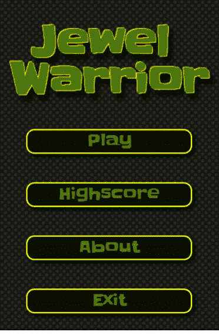

图 3-2：主菜单为用户提供了一系列游戏选项。

#### 使用 CSS 媒体查询

无论你如何努力，有时你就是无法让一组 CSS 规则在所有设备和分辨率上都正常工作。有时，最好的解决方案是为不同的显示尺寸制作单独的样式表，并在需要时加载适当的样式表。CSS3 媒体查询为此问题提供了一个很好的解决方案。媒体查询扩展了 CSS2 的媒体类型功能，增加了额外的条件。CSS2 允许你根据媒体类型（打印、屏幕、手持设备等）使用不同的样式表，而媒体查询则根据媒体的特性设置条件。分辨率、显示尺寸和方向等数据现在可用于选择适当的样式。此代码片段显示了带有媒体查询的样式表示例：

```
<link rel="stylesheet"
      media="print and resolution > 150dpi"
      href="print150.css">
```

此查询仅在打印到分辨率高于 150 点每英寸 (dpi) 的设备时，才将 `print150.css` 样式表应用于内容。


你也可以在实际的 CSS 中使用媒体查询：

```
@media screen and (min-width: 480px) {
    body {
        font-size: 150%;
    }
}
```

此示例将字体大小缩放至 150%，但仅在内容显示在屏幕上且显示宽度至少为 480 像素时才生效。通过使用此类查询，你可以轻松针对不同的分辨率和屏幕尺寸进行适配，确保游戏布局在不同设备上查看时都能良好呈现。表 3-4 列出了 CSS3 中定义的所有媒体特性。

##### 表 3-4 媒体特性

| 特性 | 值 | 描述 |
| :--- | :--- | :--- |
| **width** | 非负长度，例如 980px | 描述视口的宽度。 |
| **height** | 非负长度，例如 800px | 描述视口的高度。 |
| **device-width** | 非负长度，例如 320px | 描述输出设备的宽度。 |
| **device-height** | 非负长度，例如 480px | 描述输出设备的高度。 |
| **orientation** | landscape 或 portrait | 描述输出设备的方向。如果高度大于宽度，方向特性的值为 portrait；否则为 landscape。 |
| **aspect-ratio** | 正比例，例如 16/9 | 宽度值与高度值的比率。 |
| **device-aspect-ratio** | 正比例，例如 16/9 | 设备宽度值与设备高度值的比率。 |
| **color** | 非负值，例如 8 | 描述输出设备中使用的每颜色分量（红、绿、蓝）的位数。 |
| **color-index** | 非负值，例如 64 | 描述输出设备颜色索引中的条目数。如果显示未索引，值为 0。 |
| **monochrome** | 非负值，例如 2 | 描述单色输出设备中使用的每像素位数。对于非单色显示，值为 0。 |
| **resolution** | 正分辨率，例如 300dpi | 描述输出设备的分辨率。 |
| **scan** | progressive 或 interlace | 仅适用于 tv 媒体类型。 |
| **grid** | 0 或 1 | 表示基于网格的输出设备，例如计算机终端。 |

除了 orientation、scan 和 grid 之外的所有媒体特性也可以与 min- 和 max- 前缀一起使用。

#### 检测设备方向

你可以将大多数智能手机和平板电脑置于纵向或横向模式使用，设备会自动旋转并调整图像。这种能力对应用开发者来说是一个有趣的挑战，因为你需要确保应用或游戏能够处理这种变化。三个基本选择是：

-   什么也不做。让设备旋转显示并祈祷一切顺利。
-   不旋转显示，使其仅在一个方向上可用。
-   调整应用程序使其在两种方向上都看起来不错。

对于大多数网站，让设备自行决定如何正确显示网站通常没问题。只要你设置了视口，一切通常都能正常工作。而游戏通常以非常受控的方式使用屏幕空间。将其交给设备重新安排可能会破坏体验和可用性。有些应用程序选择将显示固定在一个方向。如果应用程序或游戏的布局无法轻松适应两种方向，这种修复很容易。然而，对于 Web 应用程序来说，这不是最实用的解决方案，因为你无法禁用原生的显示重新定向。因此，你必须使用例如 CSS 变换将整个页面旋转回来。这就只剩下第三个选项了：确保游戏能够处理两种方向。

借助媒体查询，为不同方向应用特殊的 CSS 相对容易。方向媒体特性使得将规则专门应用于例如横向模式的设备变得轻而易举：

```
@media screen and (orientation: portrait) {
    #sidebar {
        display: none;
    }
}
@media screen and (orientation: landscape) {
    #sidebar {
        display: block;
    }
}
```

此示例仅在页面以横向模式显示时显示 #sidebar 元素。

#### 添加横向样式表

现在来看看如何使用媒体查询为移动设备添加特殊样式表。该查询应匹配移动样式表可能处理的最大设备。iPad 的分辨率为 768x1024，因此这将是媒体查询的上限。由于设备宽度会随方向变化，你需要两个查询来检测纵向和横向模式。你可以通过逗号分隔将多个查询组合到同一个样式表。清单 3-12 显示了加载移动样式表的 link 元素。

##### 清单 3-12 加载移动样式表

```
<head>
    ...
    <link rel="stylesheet"
          href="styles/mobile.css"
          media="screen and (max-device-width: 768px)
                 and (orientation: portrait),
                 screen and (max-device-width: 1024px)
                 and (orientation: landscape)" />
    ...
</head>
```

该媒体查询指定 mobile.css 样式表仅应用于在纵向模式下宽度不超过 768 像素、在横向模式下宽度不超过 1024 像素的屏幕设备。

在 mobile.css 样式表中，你首先让游戏填满整个显示。在 main.css 中，你给 game 元素设置了 320x480 像素的固定大小。这对于将游戏放置在网页上并在计算机显示器上显示效果很好。像 Jewel Warrior 这样的游戏不需要笔记本电脑或台式计算机上可用的巨大屏幕空间。在移动设备上，你希望尽可能多地占用空间。清单 3-13 显示了添加到 mobile.css 中的第一条规则。

##### 清单 3-13 填充整个屏幕

```
#game {
    width: 100%;
    height: 100%;
}
```

这一小改动足以让当前应用程序在 iPhone 等中等设备或高分辨率 Android 智能手机上看起来不错。请记住，你可以简单地通过更改 game 元素上的 font-size 值来缩放所有内容。你可以将字体大小缩放与媒体查询一起使用，例如，在 iPad 等大屏幕设备上放大内容。清单 3-14 显示了 mobile.css 中针对性的 CSS 规则。

##### 清单 3-14 为大显示屏缩放内容

```
/* 为小屏幕使用较小的基础尺寸 */
@media (max-device-width: 480px) and (orientation: portrait),
@media (max-device-width: 640px) and (orientation: landscape) {
    #game {
        font-size: 32px;
    }
}
/* 为iPad和平板电脑使用较大的基础尺寸 */
@media (min-device-width: 768px) and (orientation: portrait),
@media (min-device-width: 1024px) and (orientation: landscape) {
    #game {
        font-size: 64px;
    }
}
```

ul.menu 规则将整个菜单结构缩放了一点，以便无论宽高比如何都能适配。还要注意用于针对 iPad 的两个查询，每个方向一个。

横向模式是一个更麻烦的问题。在横向模式下将高高的菜单挤入有限的垂直空间会导致按钮非常小。更好的解决方案是，如果空间允许，让它们自动调整为 2x2 网格。清单 3-15 中的样式适用于横向模式下各种尺寸的设备。


##### 清单 3-15 添加横向样式

```
/* 智能手机横向 */
@media (orientation: landscape) {
    #splash-screen,
    #main-menu {
        font-size: 1.0em;
        padding-top: 0.75em;
    }
    ul.menu li {
        display: inline-block;
        margin: 0;
    }
    ul.menu li button {
        margin: 0.5em;
        font-size: 0.5em;
    }
}
/* 小屏幕横向 */
@media (orientation: landscape) and (max-device-width: 480px) {
    ul.menu li button {
        font-size: 0.4em;
    }
}

/* 平板电脑横向 */
@media (orientation: landscape) and (min-device-width: 768px) {
    #splash-screen,
    #main-menu {
        padding-top: 1.5em;
    }
}
```

在菜单项上设置 display: inline-block 会将它们并排放置，仅在空间不足时换行。图 3-3 显示了在 HTC Desire 上渲染的横向模式菜单。

所有应用程序都有不同的布局，没有万能的解决方案能让所有设备看起来都很好。最终，这归结于尝试——试图找到在尽可能多的设备上看起来不错的解决方案，而不需要在 CSS 中添加太多特殊情况。


### 针对 iOS 和 Android 设备进行开发

苹果在手持设备市场占据重要地位：这已是众所周知的事实。Android 设备的市场份额正在增长，但所有运行相同严密控制软件的 iPod、iPhone 和 iPad 设备的无处不在，使它们成为移动网络开发者的良好目标。苹果的移动 Safari 浏览器和 iOS 系统为 Web 应用开发者提供了一些额外的功能。你可以利用其中一些功能来更好地控制应用程序的呈现方式，并使其与设备上的原生应用程序相融合。

#### 将 Web 应用程序放置在主屏幕上

当你在移动 Safari 浏览器中运行 Web 应用程序时，由于周围的 Safari 界面（图标、地址栏等）的存在，可用的屏幕空间会减少。对于像 iPad 这样通常有大量屏幕空间可用的设备来说，这不是什么大问题。然而，对于像 iPod Touch 或 iPhone 这样的小屏幕设备来说，这很快就会成为一个问题。例如，iPod Touch 3G 的分辨率为 320x480 像素，但由于状态栏和 Safari 界面元素占用了其中很大一部分空间，你的应用程序实际可用的区域只有 320x360 像素。

在 Safari 浏览器中，用户可以通过点击书签图标，选择将应用程序或网站的链接放置在主屏幕上。这会在主屏幕上添加一个图标，该图标充当该网址的快捷方式。然而，该应用程序仍然在 Safari 浏览器内部运行，其行为与普通网站完全相同，因此它实际上只是一个书签。幸运的是，有一个简单的解决方法可以让你在很大程度上获得原生应用程序的感觉。通过在 index.html 中添加一个特殊的 meta 标签（如清单 3-16 所示），你可以表明该页面是一个 Web 应用程序，不应被视为一个简单的链接。

##### 清单 3-16 启用 Web 应用程序模式

```
<head>
    . . .
    <meta name="apple-mobile-web-app-capable" content="yes" />
    . . .
</head>
```

将 `apple-mobile-web-app-capable` 设置为 **yes** 后，iOS 就知道当该页面被添加书签并随后从主屏幕启动时，必须在全屏模式下运行，而不显示通常的 Safari 用户界面。当然，如果用户不知道这个功能，它的价值就不大了。在下一节中，我将展示如何向拥有此选项的用户显示一条消息。

> 在 iOS 系统的早期版本中，书签图标使用加号（+）符号，但从 iOS 4.2 开始，图标变成了弯曲的箭头。在 iOS 7 中，图标再次更改以适应此版本的整体 UI 重新设计。**注意**

将游戏放置在主屏幕上的一个重要动机是，它能让游戏在用户记忆中保持新鲜感。如果游戏只能通过 Safari 浏览器访问，最好情况下也就是一个书签，那么用户下次需要消磨时间时很可能会忘记它。如果你把它放在主屏幕上，用户就能不断看到提醒，知道游戏就在那里，等待着被玩。

#### iOS 7 的问题

在撰写本文时，iOS 7 刚刚向公众发布，与 Web 应用程序相关存在一些不幸的问题，希望这些问题能在未来的更新中得到解决。

如果在主屏幕上安装超过四个 Web 应用程序，可能会发生一些奇怪的事情，例如应用程序被替换或克隆。从主屏幕启动的 Web 应用程序中，无法使用 `alert()` 和其他标准的 JavaScript 消息框，也无法在例如 Safari 浏览器或 App Store 中打开外部网页。在 cookies 和应用程序缓存方面也存在问题。我希望这些问题都能在 iOS 更新中得到修复。

#### 检测独立运行的应用程序

Safari 提供了一种简单的方法来确定页面是以 Web 应用程序的形式查看，还是以普通网页的形式查看。使用 JavaScript，你可以检查 `window.navigator` 对象中一个名为 `standalone` 的属性。如果此属性存在且为 true，则表明页面是以 Web 应用程序模式从主屏幕启动的。清单 3-17 展示了一个如何检测应用程序是作为独立应用程序运行还是在浏览器中运行的基本示例。

##### 清单 3-17 测试 standalone 属性

```
if (window.navigator.standalone) {
    alert("You are running the standalone app!");
} else if (window.navigator.standalone === false) {
    alert("You are using app in mobile Safari!");
} else {
    alert("You are using the app in another browser!");
}
```

该测试有三种情况：一种针对独立的 iOS Web 应用程序，一种针对在移动 Safari 浏览器中运行的网页，最后一种是针对其他所有情况的兜底处理。注意，检测代码显式地将 `standalone` 属性与布尔值 `false` 进行测试——以区分该值是 `false` 还是该属性不存在。只有 iOS 设备支持 `standalone` 属性；对于其他浏览器，此属性是未定义的，因此这些浏览器只匹配第三种情况。

利用这个知识点，在 jewel.js 中的 jewel 模块中添加一个 `isStandalone()` 函数，并在适当的时候使用它来切换显示安装界面，而不是正常的启动画面。清单 3-18 展示了这个新函数和修改后的 `setup()` 函数。

##### 清单 3-18 添加 isStandalone() 函数

```
var jewel = (function() {
    ...
    function isStandalone() {
        return (window.navigator.standalone !== false);
    }

    function setup() {
        if (isStandalone()) {
            showScreen("splash-screen");
        } else {
            showScreen("install-screen");
        }
    }

    return {
        ...
        isStandalone: isStandalone
    };
})();
```

新的测试判断是否启用了独立模式。由于这个问题在非 iOS 设备上没有意义，所以我们将不存在的 `standalone` 属性视为在独立模式下运行。此外，我们真正感兴趣的是能够判断用户何时有安装应用程序的选项但尚未使用该选项。

#### 制作一个特殊的启动画面

现在修改 index.html 中的加载序列，以便在非独立模式下加载不同的启动画面。清单 3-19 展示了修改后的函数。

##### 清单 3-19 加载正确的启动画面

```
...
window.addEventListener("load", function() {
    jewel.load("scripts/dom.js");
    if (jewel.isStandalone()) {
        jewel.load("scripts/screen.splash.js");
        jewel.load("scripts/screen.main-menu.js", jewel.setup);
    } else {
        jewel.load("scripts/screen.install.js", jewel.setup);
    }
});
...
```

这个位于 screen.splash-install.js 中的安装屏幕模块只是一个没有实际功能的空模块。它的功能仅仅是显示一条非交互式消息。清单 3-20 展示了这个模块。

##### 清单 3-20 安装屏幕模块

```
jewel.screens["install-screen"] = (function() {
    return {
        run : function() {}
    };
})();
```

安装屏幕的标记与启动屏幕类似，因此要创建安装屏幕，请复制启动屏幕元素并将其 id 属性更改为 install-screen。此屏幕上显示的消息应要求用户通过书签按钮将游戏安装到主屏幕上。清单 3-21 展示了添加到 index.html 中的新屏幕元素。

##### 清单 3-21 添加安装屏幕标记

```
<div id="game">
    ...
    <div class="screen" id="install-screen">
        <h1 class="logo">Jewel <br/>Warrior</h1>
        <span>
            Click the 
            button to install the game to your home screen.
        </span>
    </div>
</div>
```

安装屏幕的 CSS 也与启动屏幕非常相似。唯一的区别是安装屏幕顶部的内边距更小。你可以在本章代码归档的 images 文件夹中找到 install-icon.png 图像文件。请记住，移动 Safari 浏览器会占用大量可用空间。清单 3-22 展示了添加到 main.css 中的安装屏幕样式。

##### 清单 3-22 为安装屏幕设置样式

```
/* Install screen for iOS devices */
#install-screen {
    padding-top : 0.5em;
    text-align : center;
}
#install-screen span {
    font-size : 0.75em;
    display : inline-block;
    padding : 0 0.5em;
}
```

当游戏在移动 Safari 浏览器中加载时，用户现在会看到安装通知，而不是正常的启动画面。如果你想在桌面浏览器中测试它，只需修改 `isStandalone()` 函数使其始终返回 `false` 即可。图 3-4 展示了安装屏幕。

#### 添加应用程序图标

默认情况下，iOS 在生成应用程序图标时会使用应用程序的小截图。自然，这并不总是能产生好的效果。通过使用一个特殊的 link 元素，你可以指定要使用的图标文件来代替截图。

```
<link rel="apple-touch-icon" href="icon.png"/>
```


图 3-4：游戏加载时显示的移动版 Safari 安装界面。

在运行 iOS 6 或更早版本的设备上，图标会以一种添加光泽效果的方式进行处理。通过使用 `apple-touch-icon-precomposed` 而不是 `apple-touch-icon`，你可以告诉 iOS 保持图标原样：

```html
<link rel="apple-touch-icon-precomposed"
      href="images/ios-icon.png"/>
```

你可以提供不同尺寸的图标，以匹配各种 iOS 设备的显示屏。iOS 7 上的图标比早期版本稍大。早期的 iPod Touch 和 iPhone 设备在主屏幕上使用 57x57 图标，且无法运行 iOS 7。iPhone 4 及更新设备的 Retina 显示屏拥有前代设备两倍的分辨率，因此可以利用更精细的 114x114 图标（iOS 7 为 120x120）。非 Retina 的 iPad 使用 72x72 图标（iOS 7 为 76x76），而较新的 iPad 平板电脑可以使用 144x144 图标（iOS 7 为 152x152）。如果你没有提供所有尺寸，设备会选择最合适的尺寸。

如果你创建了这些不同尺寸的图标，可以通过在 `link` 元素中添加 `sizes` 参数，并为每个要支持的分辨率添加额外的 `link` 元素，来在 HTML 中指向它们。代码清单 3-23 显示了添加到 `index.html` 中 `head` 元素的额外元素。

##### 代码清单 3-23 使用多分辨率图标

```html
<head>
    . . .
    <link rel="apple-touch-icon-precomposed"
           href="images/ios-icon.png"/>
    <link rel="apple-touch-icon-precomposed" sizes="72x72"
           href="images/ios-icon-ipad.png"/>
    <link rel="apple-touch-icon-precomposed" sizes="114x114"
           href="images/ios-icon-iphone-retina.png"/>
    <link rel="apple-touch-icon-precomposed" sizes="144x144"
           href="images/ios-icon-ipad-retina.png"/>
    . . .
</head>
```

设备会自动选择最合适的尺寸图标。如果其分辨率所需的确切尺寸不可用，它会选择比理想尺寸稍大的最小图标，或比理想尺寸稍小的最大图标。如果找不到合适的图标，它会回退使用未指定尺寸的默认图标。图 3-5 显示了 iPod 主屏幕上的游戏图标。


你也可以通过省略 link 元素并将图标图像放在网站的根目录中，来为整个网站使用一套图标。然后，iOS 系统会在根目录中搜索合适的图标，使用预定义的文件名列表，格式为 `apple-touch-icon[-<w>x<h>] [-precomposed] .png`。预组合图标优先于普通图标，具有特定尺寸的图标优先于默认图标。使用 57x57 图标的设备会查找以下文件名列表：

- apple-touch-icon-57x57-precomposed.png
- apple-touch-icon-57x57.png
- apple-touch-icon-precomposed.png
- apple-touch-icon.png

如果你想提供所有三种图标尺寸并使用预组合图标，必须将以下文件放在网站的根目录中：

- apple-touch-icon-114x114-precomposed.png
- apple-touch-icon-72x72-precomposed.png
- apple-touch-icon-precomposed.png

在这种情况下，文件名中未指定尺寸的文件应该是 57x57 图标，这样它既可以作为旧 iPhone 的正确图标，也可以作为未来具有不同分辨率设备的默认后备图标。

> 在许多情况下，最好使用 link 元素显式指向图标。将应用程序图标放在根目录中，意味着在该域名上运行的每个应用程序都使用相同的图标。如果你将来想从该网站提供其他应用程序或游戏，这可能会导致问题。

#### 添加启动图像

当用户在独立模式下启动游戏并稍后退出游戏时，iOS 会保存游戏当前状态的屏幕截图。下次启动应用程序时，在页面加载完成之前会显示此图像。仅显示游戏的最后状态并不总是合适的。游戏不会恰好从上次中断的地方继续，因此旧图像会短暂闪现。幸运的是，指定自己的图像很容易。一个简单的修复方法是使用纯色图像来消除过去的闪现。一个好的选择是游戏背景使用的相同颜色。

所有 iOS 设备都需要一张占据全屏的图像，减去顶部 20 像素保留给原生状态栏的部分。这意味着 iPhone 和 iPod Touch 的图像尺寸为 320x460，iPad 为 768x1004。在 iPad 上，你可以为横屏模式添加额外的启动图像。此图像的尺寸必须为 748x1024，这意味着内容需要旋转 90 度。我创建了三个启动图像，仅显示图像尺寸，以便你可以看到每个图像何时加载。你可以在本章代码存档的 **images** 文件夹中找到这些图像。代码清单 3-24 显示了添加到 `index.html` 中 `head` 元素的额外 link 标签。

##### 代码清单 3-24 指定启动图像

```html
<head>
    ...
    <link rel="apple-touch-startup-image"
          href="images/ios-startup-748x1024.png"
          media="screen and (min-device-width: 768px)
                         and (orientation:landscape)" />
    <link rel="apple-touch-startup-image"
          href="images/ios-startup-768x1004.png"
          media="screen and (min-device-width: 768px)
                         and (orientation:portrait)" />
    <link rel="apple-touch-startup-image"
          href="images/ios-startup-320x460.png"
          media="screen and (max-device-width:320px)"/>
</head>
```

如果你添加了多个 link 元素，除非你指定媒体查询来定位特定设备，否则最后一个元素会覆盖所有其他元素。在代码清单 3-24 中，前两个 link 元素仅针对 iPad，而第三个元素针对 iPhone 和 iPod Touch 的较小屏幕。

#### 设置状态栏样式

所有移动 iOS 设备都在屏幕顶部使用标准的 20 像素状态栏。即使 Web 应用程序在全屏模式下运行，此状态栏仍然可见。因此，实际可用的屏幕空间，例如 iPad 在竖屏模式下是 768x1004，而不是完整的 768x1024。遗憾的是，你无法完全隐藏状态栏，但 iOS 确实让你可以控制其外观。通过向页面添加特殊的 meta 标签，你可以选择几种不同的样式。代码清单 3-25 显示了在 `index.html` 中将状态栏设置为纯黑色背景所需的 meta 标签。

##### 代码清单 3-25 将状态栏设置为黑色

```html
<head>
    ...
    <meta name="apple-mobile-web-app-status-bar-style"
          content="black" />
    ...
</head>
```

`content` 属性的值必须是 `default`、`black` 和 `black-translucent` 之一。遗憾的是，此功能在 iOS 7 中目前存在故障，正如前面提到的许多其他功能一样。iOS 7 没有使用你提供的值，而是使用 `body` 元素的背景色为状态栏着色。

#### 让浏览器消失

Web 浏览器给你的应用程序施加了许多额外的行为。虽然其中一些可能受欢迎，但其他功能只会降低体验。理想情况下，作为 Web 应用程序运行的游戏和原生形式的同一游戏应该没有明显区别。在接下来的几节中，我将向你展示一些可以禁用原生浏览器行为的方法。

#### 禁用过度滚动

当你在 Android 浏览器或移动版 Safari 中滚动网页时，你会注意到你可以滚动到页面末尾之外。当你松开手时，页面会弹回到末尾位置。最好游戏根本不滚动，因为屏幕上没有任何内容在可见区域之外。你只需禁用触摸滚动即可禁用此过度滚动功能。方法是在文档元素上监听 `touchmove` 事件并调用 `event.preventDefault()` 方法。你可以在 `jewel.js` 的 `jewel.setup()` 函数中执行此操作，如代码清单 3-26 所示。

```javascript
var jewel = (function() {
    ...
    function setup() {
        // disable native touchmove behavior to
        // prevent overscroll
        jewel.dom.bind(document, "touchmove", function(event) {
            event.preventDefault();
        });
        ...
    }
    ...
});
```

如果你在移动浏览器中加载游戏，你就无法再滚动到游戏区域之外。

#### 隐藏地址栏

Android 浏览器没有移动版 Safari 提供的 `apple-mobile-web-app-capable` meta 标签功能。你无法让 Android 将页面作为应用程序加载；


你能在主屏幕上放置一个快捷方式，用标准浏览器应用打开。不过，Android浏览器比Safari提供了更多的可用空间，唯一保留的区域是顶部的状态栏。当页面在Android浏览器中加载时，通常显示方式会保留URL地址栏的可见性。借助清单3-28中展示的一小段JavaScript代码，你可以让地址栏消失——或者至少让它不碍事。

这个问题在iPod Touch和iPhone上也存在，但在那些设备上影响不大，因为你只需请用户将游戏安装到主屏幕。由于你禁用了触摸滚动，在iOS上隐藏地址栏也可能导致问题，因为用户没有其他方式离开页面。如果用户从主屏幕图标启动游戏，地址栏问题就消失了。

隐藏地址栏的技巧是强制浏览器滚动到页面顶部。如果有足够的内容，它会自动将地址栏推到视野之外。因为高度设置为100%，游戏会尽可能占据空间，所以滚动到顶部没有效果。你可以通过增加html元素的高度（比如设置为200%）来确保页面足够长。清单3-27展示了针对Android的修改，涉及jewel.js中的jewel.setup()函数。

```
清单3-27  隐藏地址栏
var jewel = (function() {
    ...
    function setup() {
        // 在Android设备上隐藏地址栏
        if (/Android/.test(navigator.userAgent)) {
            $("html")[0].style.height = "200%";
            setTimeout(function() {
                window.scrollTo(0, 1);
            }, 0);
        }
        ...
    }
    ...
});
```

#### 禁用默认浏览器行为

移动Safari和Android浏览器有一些行为，尽管它们合理且通常改善普通网页的用户体验，但对于游戏来说最好禁用。

例如，当你在图片或链接上按住手指一两秒时，会出现一个小提示框，为你提供跟踪链接、保存图片等选项。

这个功能在游戏里没有用武之地。用户应该能够点击和按压任何东西，而不受原生浏览器行为的干扰。以下CSS属性可以禁用该提示框：

```
-webkit-touch-callout: none;
```

同样，可以使用以下CSS属性禁用选择文本和图片的功能：

```
-webkit-user-select: none;
```

Android浏览器在点击可点击元素时会高亮显示它们。再次强调，这在网页链接的上下文中更有意义。通过将其颜色设置为透明来移除高亮：

```
-webkit-tap-highlight-color: rgba(0,0,0,0);
```

在某些情况下，比如屏幕方向变化时，浏览器有时会自动调整文本大小以适应可用大小的变化。最好尽可能保持对外观的控制，因此使用以下规则禁用自动调整：

```
-webkit-text-size-adjust: none;
```

这四个属性必须应用于游戏中的所有内容，因此应该放在某个最顶层的元素上。清单3-28展示了添加到main.css中body元素的额外CSS规则。

```
清单3-28 修改移动浏览器行为

body {
    ...
    -webkit-touch-callout: none;
    -webkit-tap-highlight-color: rgba(0,0,0,0);
    -webkit-text-size-adjust: none;
    -webkit-user-select: none;
}
```

## 调试移动Web应用程序

在移动设备上调试Web应用程序可能有点麻烦。如果你习惯了Firebug或WebKit开发者工具，你会发现调试移动设备上的Web应用程序是完全不同的体验。你无法检查HTML，没有控制台来测试JavaScript，并且当事情没有按预期进行时，你常常发现自己不得不求助于alert()调试。虽然移动浏览器不如桌面版功能丰富，但它们确实有一些在调试JavaScript时很方便的选项。

首先，如果你在Mac OS X电脑上使用Safari，你可以将你的iPad或iPhone连接到电脑，并使用桌面Web检查器来调试你的iOS Web应用程序。有关如何设置使用Safari进行iOS调试的说明，请参阅Apple网站上的指南 (http://bitly.com/ioswebinspector)。

### 启用Safari调试器

如果你没有Mac OS X电脑，苹果的移动Safari浏览器有一个内置的调试控制台，默认是禁用的。要开启它，请前往iOS设置并找到Safari选项。滚动到底部并选择开发者菜单项（图3-6）。在开发者屏幕上，你可以开启和关闭调试控制台（图3-7）。

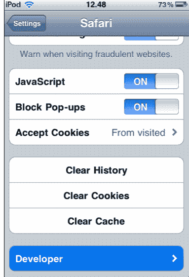

图3-6：移动Safari设置使你能够访问调试功能。


图3-7：使用移动Safari开发者设置进行调试。

当控制台启用后，你会在Safari的URL栏下方看到一个错误栏。该错误栏报告页面上的错误数量。如果发生任何HTML、CSS或JavaScript错误，你可以点击错误栏获取详细信息。错误详情示例如图3-8所示。

你也可以通过一个类似于大多数桌面浏览器中控制台的API编写自己的调试信息。

```
console.log("Hello World") // 在日志中打印一条消息
```

你也可以使用相关的console.error()、console.warn()和console.info()函数，以及标准控制台API的其余部分（参见 https://developer.mozilla.org/en-US/docs/Web/API/console）。

Safari可能没有像桌面浏览器那样广泛的检查功能，但它拥有的功能总比没有好。不过，有一个略微烦人的注意事项。调试控制台仅在完整的Safari浏览器中运行时有效。当应用程序从主屏幕以独立模式启动时，启用调试控制台没有效果。


图3-8：启用后，调试器在移动Safari中为你提供详细的错误信息。

### 在Android上调试

在Android 4.0及更高版本中，内置浏览器也带有一个内置控制台。只需在地址栏中输入 **about:debug** 即可启用控制台。你可能不会收到任何反馈告诉你发生了什么，但如果你的页面产生错误或向控制台写入任何内容，顶部会出现一个黑色的“显示JavaScript控制台”栏。点击这个栏，它会展开，显示任何错误和控制台输出，并允许你计算JavaScript表达式。设置菜单中还有许多与调试相关的额外选项。

Android版的Google Chrome没有内置调试工具，但可以通过桌面Chrome浏览器的扩展进行远程调试。有关安装必要驱动程序并为Android调试设置Chrome环境的说明，请参阅 https://developers.google.com/chrome-developer-tools/docs/remote-debugging 。

> > 提示
> 与一些桌面版的对应功能不同，Android和iOS中的JavaScript控制台函数只接受一个参数。你可以提供多个参数给例如 `console.log()`，但日志消息中只使用第一个参数。

## 构建原生Web应用程序

能够使用你已经熟悉的工具和技术来开发iOS和Android应用程序很棒，但这样做会错过一些只有原生应用程序开发者才能获得的机会。两个关键要素——访问原生API和通过App Store及Android Market发布的机会——仅对原生应用程序可用。幸运的是，你可以做一些事情，至少让你部分实现这些目标。

#### PhoneGap

一个解决方案是Adobe的PhoneGap (www.phonegap.com)。PhoneGap旨在通过将你的Web应用程序包装在一个原生应用程序中来弥合原生应用和Web应用之间的差距。它通过使用原生web视图控件来渲染你的游戏或应用程序，这意味着你的游戏或应用程序渲染起来就像在移动浏览器中运行一样，只是没有浏览器的UI。实际上，根本没有原生UI。你必须使用HTML和CSS在应用程序中创建所有需要的界面控件。

PhoneGap除了Android和iOS，还可以为多个移动平台构建应用程序。以下是完整支持的系统列表：

- iOS
- Android
- WebOS
- BlackBerry OS
- Symbian
- Bada
- Windows Phone 7 + 8

根据你想使用的平台，你需要做一些工作来设置你的开发环境。要构建Android应用程序，你需要Android SDK (http://developer.android.com/sdk) 和 Eclipse Classic (www.eclipse.org)。Eclipse可在Windows、Linux和Mac OS X上运行。如果你想要


### 为移动设备构建

要构建你的游戏以适用于iOS，你需要一台运行Mac OS X操作系统的机器以及Xcode开发套件（http://developer.apple.com/xcode）。要将你的游戏安装到实际设备上并通过App Store分发，你还必须注册iOS开发者计划（http://developer.apple.com/programs/ios）。注册很简单，但需要每年支付99美元。

PhoneGap是免费且开源的。Adobe已将代码捐赠给Apache软件基金会，并采用Apache许可证。有关设置PhoneGap的文档，请参阅http://phonegap.com。

当你的Web应用通过PhoneGap执行时，你可以完成在标准移动浏览器中能做的大部分事情。然而，PhoneGap相对于常规Web应用有一个优势，即它通过JavaScript接口暴露了多个原生API。暴露的功能包括：

- 媒体API
- 加速计和指南针
- 摄像头和音视频捕获
- Wi-Fi和蜂窝网络连接
- 地理定位和指南针
- 原生通知
- 文件系统访问

你甚至可以从PhoneGap GitHub仓库（http://github.com/phonegap/phonegap-plugins）可用的插件中找到更多功能。

不过，并非所有平台都支持所有API。请查阅文档（http://phonegap.com/about/feature）以了解每个功能受支持的情况。要使用这些原生功能，你需要在项目中包含PhoneGap JavaScript文件。当然，这些函数只有在应用运行在实际设备上时才能正确工作。清单3-29展示了一个如何使用PhoneGap摄像头API拍照的基本示例。此示例的代码可以在示例文件夹的01-phonegap.html文件中找到。

### 清单3-29 使用PhoneGap拍照

```html
<!DOCTYPE HTML>
<html lang="en-US">
<head>
    <meta charset="UTF-8">
    <script src="phonegap.js"></script>
</head>
<body>
    <button id="snap">Take a picture!</button>
    <script>
        var button = document.getElementById("snap");
        button.addEventListener("click", function() {
            navigator.camera.getPicture(
                function(data) {
                    var img = new Image();
                    img.src = "data:image/jpeg;base64," + data;
                    document.body.appendChild(img);
                }, function(errMessage) {
                    alert("Camera error: " + errMessage);
                }, {
                    quality : 70
                }
            );
        }, false);
    </script>
</body>
</html>
```

尽管PhoneGap本身已经很棒，但在我看来，真正让它脱颖而出的是PhoneGap Build服务（https://build.phonegap.com）。通过PhoneGap Build，你可以上传一个包含所有项目文件的归档文件，然后PhoneGap Build会自动构建Android和iOS应用程序，随时可以下载。你也可以设置一个Git仓库——例如，在GitHub上——让PhoneGap Build从那里拉取文件。这使得创建原生应用程序的整个过程非常顺畅。

在本地为iOS和Android开发应用程序需要你设置必要的工具，并且对于iOS，你必须使用Mac OS X。PhoneGap Build让你可以以最少的麻烦构建原生iOS和Android应用程序，代价是牺牲一些灵活性。如果你想完全控制构建过程，你必须自己安装开发工具。

你上传到PhoneGap Build的归档文件可以包含一个XML配置文件，用于指定应用程序的元数据。清单3-30展示了一个此类文件的示例。

### 清单3-30 示例config.xml文件

```xml
<?xml version="1.0" encoding="UTF-8"?>
<widget xmlns = "http://www.w3.org/ns/widgets"
        xmlns:gap = "http://phonegap.com/ns/1.0"
        id = "com.phonegap.jewelwarrior"
        version = "1.0.0">
    <name>Jewel Warrior</name>
    <description>
        A game of jewel swapping
    </description>
    <author href="http://nihilogic.dk"
            email="jseidelin@nihilogic.dk">
        Jacob Seidelin
    </author>
    <icon src="favicon128.png" gap:role="default" />
    <gap:platforms>
        <gap:platform name="android" minVersion="2.1" />
    </gap:platforms>
    <feature name="http://api.phonegap.com/1.0/media"/>
</widget>
```

你可以在文件05-config.xml中找到此示例。你可以向配置文件中添加更多元素和设置，但这些是其中最重要的一些。平台节点指定你想要构建的目标平台。请注意，如果你的应用程序仅在较新版本上运行，你可以指定目标操作系统的最低版本。功能节点列出了你的游戏运行所需的所有额外权限。在此示例中，应用程序仅请求访问媒体API。然而，并非所有PhoneGap API都可通过Build服务使用。有关支持的API的最新列表，请参阅PhoneGap Build网站上的帮助页面。

即使你不利用PhoneGap API提供的额外功能，Build服务也非常有用且易于使用。

> 提示：作为PhoneGap的替代方案，我推荐查看Ludei的CocoonJS（www.ludei.com）。与PhoneGap类似，CocoonJS为你提供了一个JavaScript API，使Web应用能够使用许多通常不可用的功能。他们的基于云的编译器然后将所有内容打包成原生应用，即可上架Apple App Store、Android Market和其他分发渠道。

### 未来的移动平台

目前，Android和iOS占据了移动市场的大部分份额，但新的平台不断涌现，其中一些对Web开发非常有前景。

Mozilla正在全力开发Firefox OS（www.mozilla.org/en-US/firefox/os），这是一个基于Linux和Firefox的移动操作系统。Firefox OS仍在大力开发中，但它承诺提供一个以HTML5和开放Web技术为核心的移动系统。目前还没有消费设备运行Firefox OS，尽管LG最近宣布了其首款Firefox OS手机。为了促进对该平台的兴趣和开发，Mozilla发布了一个Firefox OS模拟器，作为其桌面浏览器的扩展。

Tizen（www.tizen.org）是另一个基于Linux的系统，也值得关注。这是三星、英特尔和Linux基金会的共同努力，该系统源于几个其他项目，尤其是三星的Bada，该项目已于2013年初停止开发。与Firefox OS类似，Tizen也将HTML5及其相关技术与原生应用置于同等地位。首批运行Tizen的设备预计将于2014年上市。

## 总结

在本章中，你了解了如何结合使用可伸缩布局、viewport meta标签和CSS媒体查询，使你的游戏在不同分辨率的多种设备上表现出色。你还看到了如何使用媒体查询来处理横屏与竖屏方向的问题。

我向你展示了如何使用iOS的Web应用独立模式，在主屏幕上放置一个游戏图标，该图标以全屏模式启动游戏。你使用了条件加载来加载安装屏幕而不是常规的启动屏幕。通过引入更多设置，你学会了如何控制iOS状态栏的外观以及如何添加启动图像。

为了帮助你在iOS和Android设备上改善体验，我向你展示了如何消除一些不需要的浏览器行为，例如过度滚动、地址栏以及长按图片和链接时出现的提示菜单。

最后，我展示了像PhoneGap这样的第三方工具如何帮助你将基于HTML5的Web应用转变为多个移动平台上的原生应用。


        if (hadChains) {
            ...

            // 如果没有更多可用移动则重新填充
            if (!hasMoves()) {
                fillBoard();
                events.push({
                    type: "refill",
                    data: getBoard()
                });
            }
            return check(events);
        } else {
            return events;
        }
    }
})();
```

除了调用 `fillBoard()` 外，此代码清单还向 `events` 数组添加了一个 `refill` 事件。此事件携带一份宝石棋盘的副本，由代码清单 4-21 所示的 `getBoard()` 函数创建。

## 代码清单 4-21 复制棋盘数据

```javascript
jewel.board = (function() {
    ...

    // 创建宝石棋盘的副本
    function getBoard() {
        var copy = [],
            x;
        for (x = 0; x < cols; x++) {
            copy[x] = jewels[x].slice(0);
        }
        return copy;
    }

    return {
        ...
        getBoard : getBoard
    };
})();
```

不过，简单地调用 `fillBoard()` 并不能保证新棋盘有可用的移动。随机挑选的宝石有可能产生另一个被锁定的棋盘。因此，被锁定的棋盘应触发另一次静默的重新填充，而无需玩家知晓。进行此检查的最佳位置是在 `fillBoard()` 函数本身中。调用 `hasMoves()` 可以确定棋盘是否可用，如果不可用，则 `fillBoard()` 在返回前递归调用自身。这样，棋盘会持续重新填充，直到至少有一对可移动的宝石。代码清单 4-22 展示了添加到 `fillBoard()` 函数中的重新填充检查。

## 代码清单 4-22 递归重新填充棋盘

```javascript
jewel.board = (function() {
    ...
    function fillBoard() {
        ...
        // 如果新棋盘没有可用移动则重试
        if (!hasMoves()) {
            fillBoard();
        }
    }
    ...
})();
```

此重新填充检查也处理了初始棋盘没有宝石可以交换以形成连锁反应的特殊情况。正如概率决定的那样，初始棋盘有时一开始就有连锁反应，当然也可能没有任何可用的移动。递归调用解决了这个问题。

# 交换宝石

所有控制棋盘状态的函数现在都已就位。唯一缺少的是一个实际交换宝石的函数。这个任务相对简单。你已经有了 `canSwap()` 函数来判断玩家是否被允许交换给定的一对宝石，以及 `check()` 函数来处理交换后的所有棋盘修改。代码清单 4-23 展示了 `swap()` 函数。

## 代码清单 4-23 交换函数

```javascript
jewel.board = (function() {
    ...
    // 如果可能，交换 (x1,y1) 和 (x2,y2)，
    // 并使用棋盘事件列表调用回调函数
    function swap(x1, y1, x2, y2, callback) {
        var tmp,
            events;

        if (canSwap(x1, y1, x2, y2)) {

            // 交换宝石
            tmp = getJewel(x1, y1);
            jewels[x1][y1] = getJewel(x2, y2);
            jewels[x2][y2] = tmp;

            // 检查棋盘并获取事件列表
            events = check();

            callback(events);
        } else {
            callback(false);
        }
    }

    return {
        ...
        swap : swap
    };
})();
```

因为 `swap()` 函数需要暴露给游戏的其余部分，并且它可能修改棋盘，所以它必须与 `initialize()` 函数以相同的异步方式工作。除了两组坐标，`swap()` 还接受一个回调函数作为其第五个参数。根据交换是否成功，此回调函数会收到交换后发生的事件列表，或者在交换无效的情况下收到 `false`。代码清单 4-24 展示了现在通过棋盘模块暴露的函数。

## 代码清单 4-24 棋盘模块 API

```javascript
jewel.board = (function() {
    ...

    return {
        initialize : initialize,
        swap : swap,
        canSwap : canSwap,
        getBoard : getBoard,
        print : print
    };
})();
```

就是这样。随着这些函数被暴露，更改游戏状态的唯一方式是设置一个全新的棋盘或调用 `swap()` 方法。所有的游戏规则都由 `swap()` 方法强制执行，因此棋盘的完整性得到了保证。此外，访问宝石数据的唯一入口点是通过 `getBoard()` 函数，该函数不允许对数据进行写访问，最大限度地减少了其余代码意外“破坏”棋盘的风险。

你可以通过从 JavaScript 控制台直接调用 `swap()` 函数来测试它。通过输入以下命令初始化棋盘模块：

`jewel.board.initialize(function(){})`

使用 `jewel.board.print()` 找到合适的位置，然后输入，例如：

`jewel.board.swap(4,3,4,2, function(e){console.log(e)})`

请记住，`swap()` 函数需要一个回调函数。只需给它一个将事件数组输出到控制台的函数即可。

## 总结

本章向你展示了如何实现游戏机制的核心。你了解了关于宝石交换、连锁反应和宝石下落的所有基本游戏规则的实现。游戏棋盘现在被整齐地封装在一个隔离的模块中。


通过仅允许少数几个访问点来访问数据，确保所有修改都按照游戏规则进行。

本章还向你展示了如何通过塑造模块，为未来的多人游戏功能做好准备，使得游戏能够同时使用单机本地游戏逻辑和基于服务器的多人游戏模块。对某些关键方法使用回调函数，允许两个模块共享相同的接口，使得在后续时间更容易添加异步的、基于服务器的棋盘模块。

## 第5章 将任务委派给Web Workers

## 本章内容

- 介绍Web Workers
- 描述主要的API功能
- 查看示例
- 创建基于worker的棋盘模块

**在本章中，**我将向你展示如何使用Web Workers，这是Web超文本应用技术工作组（WHATWG）推出的一个很酷的功能（*参见*第1章了解更多关于该工作组的信息）。我首先描述worker能做什么、它们的局限性以及可供它们使用的函数和对象。

然后，我介绍几个简单的示例，并向你展示如何将CPU密集型任务移至worker，以保持浏览器对用户交互的响应性。

最后，我将向你展示如何使用Web Workers创建你在第4章中实现的棋盘模块的worker版本。

### 使用Web Workers

JavaScript在设计上是单线程的。你无法并行运行多个脚本；浏览器以串行方式处理你发送的任何请求。当你使用`setTimeout()`和`setInterval()`等函数时，你可能认为你在生成独立于主JavaScript线程运行的单独线程，但实际上，它们调用的函数被推送到主线程使用的同一个事件循环上。一个缺点是，你不能有一个阻塞执行的函数，并期望浏览器正常工作。例如，Ajax中使用的`XMLHttpRequest`对象具有同步和异步两种模式。到目前为止，异步模式使用得最多，因为同步请求会占用线程，阻止任何进一步的执行，直到请求完成。这包括与页面的任何交互，这看起来几乎完全冻结了。

Web Workers通过引入类似线程的功能，在很大程度上解决了这个问题。使用Web Workers，你可以加载脚本并让它们在后台运行，独立于主线程。在worker中运行的脚本不会影响或锁住主线程，这意味着你现在可以进行CPU密集型处理，同时仍允许用户继续使用游戏或应用程序。

> **注意** 在本书中，我经常提到*worker线程*。Web Workers规范将worker的功能定义为“线程式的”，因为实现不一定必须使用实际的操作系统级线程。Web Workers的实现取决于浏览器供应商。

尽管它们经常与其他HTML5功能在同一句话中被提及，但Web Workers并非HTML5规范的一部分，而是有自己的规范。完整的Web Workers规范可在WHATWG网站获取：`www.whatwg.org/specs/web-workers/current-work`。

### worker的局限性

你需要了解worker能做什么的一些重要限制。然而，在许多情况下，只要你的代码封装良好并且数据隔离得当，这些限制就不会带来问题。

#### 没有共享状态

首先需要注意的问题之一是状态和数据的分离。无法从worker线程访问来自父线程的数据，反之亦然。对任一线程的数据的所有更改都必须通过消息传递API进行。尽管这个限制最初可能看起来很麻烦，但它对于避免棘手的并发问题有巨大帮助。如果worker可以自由操作父线程中的变量，那么遇到死锁和竞争条件等问题的风险将使使用worker变得复杂得多。考虑到Web开发领域相对较低的入门门槛，为了简单性和安全性而限制灵活性的决定是有道理的。

#### 无法访问DOM

正如你可能猜到的那样，worker和父线程的分离也意味着worker无法访问DOM。`window`和`document`对象在worker的作用域中根本不存在，任何尝试访问它们的尝试只会导致错误。

这种缺乏DOM访问权限并不意味着worker无法向主线程发送消息，然后用于更改DOM。消息传递API不限制你定义自己的消息协议来更新某些DOM元素或交换文档中元素的信息。但是，如果你计划进行大量的DOM操作，或许重新考虑该功能是否真的属于worker会更好。

由于微软在Internet Explorer 10中增加了对Web Workers的支持，Web Workers现在在所有现代桌面浏览器中都可用。早期版本Android的原生浏览器不支持Web Workers，但从Android 4.4开始，原生浏览器将基于Android版Chrome，其中包含支持。iOS 5.0+中的移动版Safari和Windows Phone 8中的IE Mobile也支持Web Workers。

### worker能做什么

总的来说，你可以用worker做任何你原本会用JavaScript做的事情。创建worker只是加载一个脚本并在后台线程中执行它。你不受JavaScript能力的限制。除了纯JavaScript之外，你还可以访问一些不错的额外功能。

首先，有一个名为`importScripts()`的新函数。你向此函数提供一个指向要加载的脚本的路径列表。该函数是可变参数的，这意味着你必须将路径指定为单独的参数：

```javascript
importScripts("script1.js", "script2.js", "script3.js", ...);
```

因为文件是同步加载的，所以`importScripts()`在所有脚本加载完成之前不会返回。每个脚本加载完成后，它会在调用worker的同一作用域内执行，这意味着该脚本可以使用worker中声明的所有变量和函数，并且worker随后可以使用导入脚本引入的所有变量和函数。总的来说，这种方法使你能够轻松地将worker代码分离成离散的模块。

创建worker的脚本可以在不再需要worker时终止它，但worker本身也可以选择退出。worker可以通过调用全局的`close()`函数来自我终止。

### 超时和间隔

你从window对象中了解的计时器函数在worker线程中都可用，这意味着你可以自由使用以下函数：

- `setTimeout()`
- `clearTimeout()`
- `setInterval()`
- `clearInterval()`

如果worker被终止，所有计时器都会自动清除。

### WebSockets和Ajax worker

你还可以使用`XMLHttpRequest`对象来创建和处理后台Ajax请求。`XMLHttpRequest`很有用，例如，如果你需要一个后台worker持续向服务器发送更新请求，然后通过消息传递API将更新中继到主线程。因为worker线程中的阻塞不会影响主UI线程，你甚至可以执行同步请求——这在非worker代码中通常是个坏主意。

WebSockets在worker线程中的支持有点模糊。例如，Chrome支持这种组合，而Firefox只允许你在主JavaScript线程中使用WebSockets，从而限制了能从中受益的用户数量。因此，目前最好将WebSockets代码留在主线程中。

### 使用Workers

要创建worker线程，你需要使用`Worker()`构造函数：

```javascript
var worker = new Worker("myworker.js");
```

你只能从与创建脚本具有相同来源的脚本创建worker，这意味着你无法引用其他域上的脚本。该脚本还必须使用相同的协议加载。也就是说，如果HTML页面使用`http:`协议，脚本就不能使用`https:`，等等。此外，你无法从在`file://` URL下运行的脚本创建worker。

当你使用完worker后，请确保调用`terminate()`方法以释放内存并避免遗留旧的、悬空的worker：

```javascript
worker.terminate();
```


你可以创建多个工作者线程。甚至可以创建多个使用相同脚本的工作者。某些任务非常适合并行化，随着计算机拥有越来越多的CPU核心，将密集型任务分配给几个工作者，理论上可以显著提升性能。然而，不要因为设置过程的开销成本而创建大量工作者。相反，应尽量将工作者数量控制在一两个。

#### 发送消息

工作者与其父线程通过共享的消息API进行通信。数据以字符串形式来回传递，但这并不意味着你只能发送字符串消息。如果发送复杂结构（如数组或对象），它会自动转换为JSON格式。因此，你可以构建相当高级的消息，但请注意某些内容（如DOM元素）无法转换为JSON。

在创建线程中，调用工作者对象的`postMessage()`方法并附带要发送的数据。以下是几个示例：

```
// 发送字符串
worker.postMessage("Hello worker!");

// 发送数组
worker.postMessage([0, 1, 2, 3]);

// 发送对象字面量
worker.postMessage({
    command: "pollServer",
    timeout: 1000
});
```

同样，只需调用`postMessage()`即可从工作者线程向主线程发送消息：

```
// 向主线程发送字符串
postMessage("Hello, I'm ready to work!");
```

#### 接收消息

可以通过监听message事件来拦截消息。在父线程中，事件在工作者对象上触发；而在工作者对象中，事件在全局对象上触发。

要监听来自工作者的消息，请为`message`事件添加处理程序：

```
worker.addEventListener("message", function(event) {
    // 接收来自工作者线程的消息
}, false);
```

类似地，在工作者线程中，监听全局对象上的`message`事件：

```
addEventListener("message", function(event) {
    // 接收来自主线程的消息
}, false);
```

在这两种情况下，你都可以在`event`对象的`data`属性中找到消息数据。它会自动从JSON解码，因此数据结构保持完整。

## 捕获错误

如果工作者线程发生错误，你可能希望在主线程中得知，以便显示消息、创建日志条目等。除了`message`事件外，工作者对象还会触发`error`事件，当工作者线程中未捕获的错误发生时触发。当事件触发时，再处理错误为时已晚。工作者已经停止了它正在做的任何事情，但至少你得知了错误的发生。

```
worker.addEventListener("error", function(error) {
    alert("Worker error: " + error);
}, false);
```

## 共享工作者

我刚才描述的工作者类型称为*专用工作者*。Web Workers规范还定义了另一种类型：*共享工作者*。共享工作者与专用工作者的不同之处在于它们可以有多个连接。它们不绑定到一个HTML页面。如果你在同一个浏览器中有多个来自相同源的HTML页面在运行，这些页面都可以访问由其中一个页面创建的共享工作者。

要创建共享工作者，请使用`SharedWorker()`构造函数。除了脚本路径外，此构造函数还接受第二个可选参数`name`。如果未提供`name`参数，则使用空字符串作为名称。如果你尝试创建一个共享工作者，而具有相同脚本和名称的工作者已经存在，则会创建一个与该工作者的新连接，而不是创建一个全新的工作者。

我在此不会深入探讨共享工作者，并且它们不用于Jewel Warrior游戏。让我给你一个简短的示例，展示多个页面如何连接到同一个工作者并与之通信。清单5-1显示了创建共享工作者的测试HTML页面。

> 虽然Chrome和Safari支持这两种工作者，但Firefox 25和Internet Explorer 11仅支持专用工作者。Android版Chrome和iOS版Safari目前都不支持共享工作者，尽管它们曾在一些移动Safari的测试版中可用，因此很可能在未来iOS更新中重新启用此功能。

```
清单5-1   共享工作者测试页面
<!DOCTYPE HTML>
<html>
<textarea cols=80 rows=20 id="output"></textarea>
<script>
    var worker = new SharedWorker("shared-worker.js","worker");
    worker.port.addEventListener("message", function(event) {
        document.getElementById("output").value +=
            event.data + "\r\n";
    }, false);
    worker.port.start();
    worker.port.postMessage("Hello");
</script>
</html>
```

每当页面从工作者收到消息时，该消息就会打印在输出textarea中。连接建立时，工作者会收到"Hello"问候。清单5-2显示了工作者脚本。

```
清单5-2   shared-worker.js脚本
var c = 0;
addEventListener("connect", function(event) {
    var id = c++,
        port = event.ports[0];
    port.postMessage("You are now connected as #" + id);
    port.addEventListener("message", function(event) {
        if (event.data == "Hello") {
            port.postMessage("And hello to you, #" + id);
        }
    }, false);
    port.start();
}, false);
```

共享工作者不像专用工作者那样具有全局的message事件。相反，它们必须监听connect事件，每当新页面与工作者建立连接时就会触发。工作者与连接线程之间的通信通过port对象进行，这些对象触发message事件并暴露`postMessage()`方法。还要注意`port.start()`函数，在接收任何消息之前必须调用它。

当清单5-1中的HTML页面加载时，它会连接到一个工作者。如果你打开另一个具有相同或类似页面的标签页，它会连接到同一个工作者，你会看到连接计数器在增加。

## 一个素数示例

让我们继续另一个稍有用处的示例。这里，我使用专用工作者进行一些CPU密集型处理，从而释放主线程。

考虑判断一个数字是否为素数的问题。素数是只有两个（自然数）因子的数字：1和它本身。例如，9不是素数，因为它可以被3整除。另一方面，7不能被任何其他数字整除，因此是素数。

清单5-3显示了prime.js，一个简单的暴力算法，它返回一个布尔值，指示数字n是否为素数。

```
清单5-3  素数检查算法
function isPrime(n) {
    if (n < 2) return false;
    for (var i=2,m=Math.sqrt(n);i<=m;i++) {
        if (n % i === 0) {
            return false;
        }
    }
    return true;
}
```

最小的素数是2，所以对于小于2的任何数，`isPrime()`返回false。如果存在一对因子，其中一个因子必须小于或等于n的平方根，因此你只需要测试[2, sqrt(n)]范围内的数字来确定n的素性。因此，对于从2到sqrt(n)的每个数字i，你使用取余运算符(%)测试i是否能整除n。如果能，n不是素数，`isPrime()`返回false。如果循环退出时没有找到因子，则n是素数，函数返回true。

### 创建测试页面

因为如果n是素数，循环必须运行到底，所以任何足够大的素数都会使`isPrime()`占用CPU一段时间，有效地锁定该页面的主UI线程。

为了验证这一点，请创建如清单5-4所示的prime-no-worker.html测试页面。

```
清单5-4  非工作者测试页面
<!DOCTYPE HTML>
<html lang="en-US">
<head>
    <meta charset="UTF-8">
    <title>Prime Number</title>
    <script src="prime.js"></script>
</head>
<body>

Number (n): <input id="number" value="1125899839733759">

<button id="check">Is n prime?</button><br/><br/>
<button id="click-test">Try to click me!</button>

<script>
    var button = document.getElementById("check");
    button.addEventListener("click", function() {
        var input = document.getElementById("number"),
        n = parseInt(input.value, 10),
        res = isPrime(n);
        if (res) {
            alert(n + " is a prime number");
        } else {
            alert(n + " is NOT a prime number");
        }
    }, false);

    var buttonHello = document.getElementById("click-test");
    buttonHello.addEventListener("click", function() {
        alert("Hello!");
    }, false);
</script>

</body>
</html>
```


### 将任务转移到工作线程

如果你改为将 isPrime() 函数转移到工作线程，那么主 UI 线程就能保持空闲，UI 的响应速度也能一如既往。清单 5-5 展示了 prime-worker.js 脚本。

```
importScripts("prime.js");

addEventListener("message", function(event) {
    var res = isPrime(event.data);
    postMessage(res);
}, false);
```

注意 prime.js 文件是如何通过 importScripts() 函数被导入以实现重用的。消息事件处理器只是将接收到的数据传递给 isPrime()，并在完成后将结果发送回主线程。工作线程可能很忙，但主线程不是。现在，按照清单 5-6 所示，更改 HTML 页面中的点击事件处理器。

```
button.addEventListener("click", function() {
    var input = document.getElementById("number"),
        n = parseInt(input.value, 10),
        worker = new Worker("prime-worker.js");

    worker.addEventListener("message", function(event) {
        if (event.data) {
            alert(n + " 是一个质数");
        } else {
            alert(n + " 不是质数");
        }
    });

    worker.postMessage(n);
});
```

当点击检查按钮时，会从 `prime-worker.js` 脚本创建一个新的工作线程。数字输入框的值被转换为一个数字，并通过 `postMessage()` 方法发送给工作线程。消息事件处理器等待来自工作线程的响应，并弹出一个显示结果的消息框。

现在，如果你尝试点击测试按钮，你会看到 UI 仍然在响应，并且一旦点击，“Hello!” 提示框就会立即出现。所有密集的处理都在后台独立进行，不会影响页面。

### 在游戏中使用 Web Workers

你已经看到了一些关于如何使用 Web Workers 的基本示例，但它们与游戏有什么关系？在决定将哪些元素委托给工作线程时，你必须问自己几个问题。

首先，你需要将游戏元素移动到单独的工作线程吗？该游戏元素是否有任何操作可以从独立运行中受益？

其次，该游戏元素是否依赖于访问 DOM？请记住，工作线程无法访问文档，因此依赖 DOM 的任务必须在主线程中完成。

适合使用工作线程的元素包括人工智能（AI）等。许多游戏中存在玩家不直接控制的实体，而是对玩家的动作或一般环境做出反应。处理敌人和其他实体的行为可能是一个相当密集的任务。此任务不需要操作页面，因此可以作为工作线程的候选任务。物理模拟是另一个例子。与 AI 一样，物理模拟可能对 CPU 要求很高，并且只要数据保持同步，它就不一定需要在同一个线程中运行。

#### 创建工作线程模块

就 Jewel Warrior 而言，将任何东西转移到 Web Worker 都很难找到充分的理由。由于游戏棋盘相对较小（8x8），负责游戏逻辑的 board 模块在处理需求方面相当轻量。不过，它完全可以运行在单独的工作线程中。由于该模块在设计时考虑了多人游戏支持，它已经具有一个异步接口，这使得它很容易适应工作线程消息传递的异步特性。它是纯粹的逻辑；它只操作自己的内部数据，不需要访问 DOM。清单 5-7 展示了 `board.worker.js` 脚本的开头部分。

##### 清单 5-7 导入 board 模块

```
var jewel = {};

importScripts("board.js");
```

board 工作线程导入常规的 board 模块，这允许你重用 board 模块中已有的功能。因为模块是在 `jewel` 命名空间中创建的，所以在导入脚本之前创建了一个空的 `jewel` 对象。如果在脚本导入和执行时该对象不存在，你会得到一个运行时错误。

当 board 工作线程*从游戏接收*到一条消息时，它需要在导入的 board 模块上调用相应的方法，并将结果发送回去。从游戏发送到工作线程的消息使用由以下对象字面量描述的自定义消息格式：

```
{
    id : <number>,
    command : <string>,
    data : <any>
}
```

这里的 `id` 属性是一个唯一标识此消息的 ID 号。`command` 属性是一个字符串，决定了工作线程应该做什么，而 `data` 属性包含执行该任务所需的任何数据。所有发送给工作线程的消息都会触发一个具有以下格式的响应消息：

```
{
    id : <number>,
    data : <any>,
    jewels : <array>
}
```

`id` 属性是原始消息的 ID 号；`data` 是响应数据（如果有的话）。`jewels` 属性包含一个二维数组，表示宝石棋盘的当前状态。棋盘数据总是附加在响应中，这样主线程就可以保留一份数据的本地副本，以便于访问。清单 5-8 展示了 board.worker.js 脚本中的消息事件处理器。

##### 清单 5-8 消息处理器

```
addEventListener("message", function(event) {
    var board = jewel.board,
        message = event.data;

    switch (message.command) {
        case "initialize" :
            jewel.settings = message.data;
            board.initialize(callback);
            break;
        case "swap" :
            board.swap(
                message.data.x1,
                message.data.y1,
                message.data.x2,
                message.data.y2,
                callback
            );
            break;
    }

    function callback(data) {
        postMessage({
            id : message.id,
            data : data,
            jewels : board.getBoard()
        });
    }

}, false);
```

工作线程支持两个命令：initialize 和 swap，它们被映射到 board 模块上的相应方法。当工作线程接收到 initialize 命令时，data 必须包含来自父级 jewel 命名空间的 settings 对象。

请记住，board.initialize() 函数接受一个回调函数作为其第一个也是唯一的参数。在工作线程中定义了一个特殊的回调函数，并传递给 board.initialize() 和任何其他异步的 board 方法。当回调函数被调用时，data 参数作为消息发送到主线程，然后由主线程来处理这个回调消息。

#### 保持相同的接口

现在你可以使用这个新的工作线程模块了。游戏应该能够在有或没有工作线程支持的情况下运行，因此理想情况下，你需要一个基于工作线程的新 board 模块，它与非工作线程的 board.js 模块具有相同的接口。board 模块中暴露的任何函数也必须以相同的签名存在于工作线程 board 模块中——具体来说，就是 initialize()、swap() 和 getBoard() 函数。其理念是，如果这些函数存在并遵循相同的逻辑，你就可以用一个模块替换另一个模块，而游戏的其余部分不会受到影响。清单 5-9 展示了带有 initialize() 函数的初始基于工作线程的 board 模块。将代码放入一个名为 board.worker-interface.js 的新文件中。

##### 清单 5-9 工作线程 board 模块

```
jewel.board = (function() {
    var worker;

    function initialize(callback) {
        worker = new Worker("scripts/board.worker.js");
    }

})();
```

目前，initialize() 只是从工作线程脚本设置一个新的 worker 对象。注意 initialize() 没有调用回调函数。在工作线程完成任务并发送响应消息回 board 模块之前，绝不能调用回调函数。

#### 发送消息

必须告诉工作线程在真正的 board 模块上调用 initialize() 方法。为此，你必须向清单 5-8 中的消息事件处理器发送消息。board.worker-interface.js 中用于向消息事件处理器发送消息的 post() 函数如清单 5-10 所示。

##### 清单 5-10 向工作线程发送消息

```
jewel.board = (function() {
    var worker;
```


messageCount，callbacks；

function initialize(callback) {
    messageCount = 0;
    callbacks = [];
    worker = new Worker("scripts/board.worker.js");
}

function post(command, data, callback) {
    callbacks[messageCount] = callback;
    worker.postMessage({
        id : messageCount,
        command : command,
        data : data
    });
    messageCount++;
}
})();

`post()` 函数接受三个参数——一个命令、命令所需的数据以及一个回调函数——该函数必须在收到响应时被调用。为了处理回调，你需要跟踪发送给 worker 的消息。每条消息都被分配一个唯一的 id；在这个例子中，我选择了一个简单的递增计数器。每当向 worker 发送一条消息时，回调函数就会以消息 id 为索引保存在 `callbacks` 数组中。

你现在可以使用这个 `post()` 函数来创建 `swap()` 函数。当 `swap()` 被调用时，它必须向 worker 发送一条 "swap" 消息，提供四个坐标。清单 5-11 展示了在 board.worker-interface.js 中基于 worker 的 `swap()` 函数。

##### 清单 5-11 swap 消息

```javascript
jewel.board = (function() {
    ...

    function swap(x1, y1, x2, y2, callback) {
        post("swap", {
            x1 : x1,
            y1 : y1,
            x2 : x2,
            y2 : y2
        }, callback);
    }
})();
```

#### 处理响应

当回调函数被传递给 `post()` 时，它会被录入 `callbacks` 数组，以便在 worker 向主线程发送响应时能够被获取。board 模块通过在 `initialize()` 中附加一个消息事件处理器来监听响应，如清单 5-12 所示。

##### 清单 5-12 消息处理器

```javascript
jewel.board = (function() {
    ...
    function messageHandler(event) {
        // 取消注释以记录 worker 消息
        // console.log(event.data);

        var message = event.data;
        jewels = message.jewels;

        if (callbacks[message.id]) {
            callbacks[message.id](message.data);
            delete callbacks[message.id];
        }
    }

    function initialize(callback) {
        rows = jewel.settings.rows;
        cols = jewel.settings.cols;
        messageCount = 0;
        callbacks = [];
        worker = new Worker("scripts/board.worker.js");
        jewel.dom.bind(worker, "message", messageHandler);
        post("initialize", jewel.settings, callback);
    }
})();
```

在附加事件处理器之后，"initialize" 消息被发送给 worker。当 worker 完成棋盘的设置后，它会调用自己的回调函数，该函数向 board 模块发回一条消息，模块随后调用最初传递给 `initialize()` 的回调函数。

现在唯一缺少的函数是 `getBoard()`，你可以将其从 board.js 模块原样复制到基于 worker 的模块 board.worker-interface.js 中。如果你想检查棋盘数据，也可以复制 `print()` 和 `getJewel()` 函数。最后一步是在模块末尾暴露这些方法，如清单 5-13 所示。

##### 清单 5-13 暴露公共方法

```javascript
jewel.board = (function() {
    ...
    return {
        initialize : initialize,
        swap : swap,
        getBoard : getBoard,
        print : print
    };
})();
```

#### 加载正确的模块

现在你有两个 board 模块：一个是来自第 4 章的模块，另一个是将工作委托给 worker 线程的新模块。由于只有某些浏览器支持 workers，因此新的 board 模块必须仅在 workers 可用时加载。如果不可用，游戏必须回退到常规的 board 模块。清单 5-14 展示了对 index.html 中加载序列的修改。

##### 清单 5-14 加载基于 worker 的 board 模块

```javascript
window.addEventListener("load", function() {
    jewel.load("scripts/dom.js");
    if (jewel.isStandalone()) {
        jewel.load("scripts/screen.splash.js");
        jewel.load("scripts/screen.main-menu.js");
        if (jewel.hasWebWorkers()) {
            jewel.load("scripts/board.worker-interface.js",
                       jewel.setup);
        } else {
            jewel.load("scripts/board.js", jewel.setup);
        }
    } else {
        jewel.load("scripts/screen.install.js", jewel.setup);
    }
});
```

现在你正在使用功能检测来加载正确的 board 模块，允许使用现代浏览器的用户利用 Web Workers，同时自动为使用旧版浏览器的用户回退到非 worker 的解决方案。实际上，检测对 workers 的支持很简单，只需测试 `Worker()` 构造函数是否存在于 window 对象上即可。将 `hasWebWorkers()` 函数添加到 `jewel.js` 中，如清单 5-15 所示。

##### 清单 5-15 检测 Web Workers 支持

```javascript
jewel = (function() {
    ...
    function hasWebWorkers() {
        return ("Worker" in window);
    }
    return {
        hasWebWorkers: hasWebWorkers,
        ...
    };
})();
```

#### 预加载 worker 模块

当你使用 `Worker()` 构造函数创建新的 worker 时，`board.worker.js` 脚本会自动从服务器拉取。如果文件已经在缓存中，这样用户就不必在游戏开始前等待额外的 HTTP 请求，那就太好了。你可以使用 `jewel.load()` 函数，但这样做也会执行脚本，这可能会导致问题，因为该脚本旨在仅在 worker 上下文中运行。相反，在 `jewel.js` 中添加一个 `preload()` 函数，该函数仅使用 `Image` 对象技巧加载脚本，而不做其他任何事情。这种方法将加载的脚本放入缓存而不执行，因此不会干扰或减慢其他脚本的执行。清单 5-16 展示了这个新函数。

##### 清单 5-16 不执行脚本进行预加载

```javascript
var jewel = (function() {
    ...
    function preload(src) {
        var image = new Image();
        image.src = src;
    }
    return {
        preload: preload,
        ...
    }
})();
```

现在只需在加载 `board.worker-interface.js` 脚本时预加载 `board.worker.js`。清单 5-17 展示了在 `index.html` 的加载序列中添加的 worker 脚本。

##### 清单 5-17 预加载 worker 模块

```javascript
window.addEventListener("load", function() {
    jewel.load("scripts/dom.js");
    if (jewel.isStandalone()) {
        jewel.load("scripts/screen.splash.js");
        jewel.load("scripts/screen.main-menu.js");
        if (jewel.hasWebWorkers()) {
            jewel.preload("scripts/board.worker.js");
            jewel.load("scripts/board.worker-interface.js",
                    jewel.setup);
        } else {
            jewel.load("scripts/board.js", jewel.setup);
        }
    } else {
        jewel.load("scripts/screen.install.js", jewel.setup);
    }
});
```

## 总结

在本章中，你了解了如何通过将任何 CPU 密集型任务委托给在后台运行的 workers 来使用 Web Workers 释放主线程 UI。你学习了如何创建 worker 对象以及如何使用消息 API 在 worker 和父脚本之间来回发送消息。

你还利用这些知识实现了一个基于 worker 的 board 模块，它使用了现有的棋盘逻辑，但在一个独立的 worker 线程中运行。我希望你更好地理解了 Web Workers 所蕴含的可能性，以及它们如何可能改变编写 Web 应用程序的方式以及你可以在浏览器中进行的处理量。

# 第 6 章 使用 Canvas 创建图形

## 本章内容

- 使用 canvas 与其他方法
- 使用 canvas 元素绘图
- 绘制路径和形状
- 对 canvas 应用变换
- 修改图像数据

本章向你展示如何使用 canvas 元素创建动态图形。它首先概述了在 Web 上显示图形和图像的方式，然后再深入讲解 canvas 绘图 API。

本章的核心全部关于如何使用 canvas API。首先，你将学习绘制简单形状和路径的基础知识，并将各种样式应用于内容。你将学习如何利用 canvas 状态栈的优势，并了解如何在画布上混合图像、文本内容和图形。

然后你将学习如何使用变换来修改绘制事物的方式，以及如何应用不同的合成操作。最后，本章通过探讨如何使用低级像素访问来创建一些真正有趣的效果，结束了对 canvas 的探索。


## 在网页上显示图形的方法

在过去，网页上的所有图形都必须以位图图像的形式呈现，例如 GIF 或 JPEG 格式。如今，网页上显示图形有了更多选择。

### 位图图像

位图是由像素网格定义的矩形图像。网页上传统使用的格式——JPEG、PNG 和 GIF——都是位图格式。位图在许多场景下完全适用。在某些情况下，例如显示照片，它们是唯一合理的选择。`img` 标签自诞生以来就存在，并且在所有浏览器中都得到完全支持。

位图图像的主要缺点是它们缩放效果不佳，并且内容是静态、非交互式的。当然，动画图像格式存在，但你无法动态改变图像内容。位图图像在交互性方面也乏善可陈。你可以为图像附加事件处理程序，但内容是静态的，因此不会对用户操作产生视觉反馈。

如果将位图图像放大到比原始尺寸更大的大小，图像质量不可避免地会发生一定程度的退化。你只有这么多像素可用，计算机无法智能地决定应该用什么来填充空白。计算机在调整图像缩放时通常采用两种基本策略之一。一种是最近邻策略，它速度快但会使图像看起来有像素感。另一种是使用插值算法，例如双线性或双三次算法。这是所有现代浏览器的默认重采样方法，它具有平滑化的效果。

### SVG 图形

可缩放矢量图形 (SVG) 是位图图形的一种替代方案，适用于显示基于矢量的艺术作品。因为这种格式基于 XML，所以你可以手动编辑文件，尽管许多图形应用程序也直接导出为 SVG 格式。SVG 文件的内容看起来像这样：

```
<svg xmlns="http://www.w3.org/2000/svg" viewBox="0 0 512 512">
  <path fill="#E34F26" d="M71,460 L30,0 481,0 440,460 255,512"/>
  <path fill="#EF652A" d="M256,472 L405,431 440,37 256,37"/>
</svg>
```

你还可以向 SVG 文件添加图像、文本和各种形状，但必须以这种 XML 格式声明所有内容。除了图形元素，你还可以声明基本动画和事件处理程序。

SVG 格式并非全新技术；SVG 规范的开发始于 1999 年。然而，直到最近，所有主要的浏览器厂商才为其添加了原生支持。尽管你可以使用 DOM 函数修改 SVG 内容，但并没有像 canvas 元素提供的那种友好 API。这就引出了本章的主要话题：canvas 元素。

## canvas 元素

HTML5 规范的早期重要特性之一就是 canvas 元素。网页开发者长期以来一直在寻找创建动态图形的方法，而 canvas 最终解决了这个问题。canvas 元素提供了一个二维绘图表面，以及丰富的 JavaScript API，可用于在该表面上绘制各种形状、路径和对象。实际上，这个 API 功能非常齐全，以至于像 canvg (http://code.google.com/p/canvg) 这样的项目能够提供近乎完整的基于 canvas 的 SVG 渲染器。

canvas 和 SVG 的一个主要区别在于，canvas API 执行的是所谓的*立即模式*渲染，而 SVG 是*保留模式*。立即模式意味着绘制在画布上的任何内容都会立即被栅格化并渲染到表面。canvas 不维护任何已绘制的形状和路径的内部结构。一旦你告诉 canvas 绘制一个正方形，它就会完成绘制，然后完全忘记那些像素代表什么。另一方面，SVG 图像始终有一个 XML 结构，精确描述组成图像的元素。

另一个真正将 canvas 与 SVG 区分开来的特性是对像素数据的底层访问。因为你可以访问和修改单个像素，所以使用 canvas 元素真的没有限制。这一点可以通过光线追踪器、图像处理应用程序以及众多受演示场景 (http://en.wikipedia.org/wiki/Demoscene) 启发、展示惊人效果的实验的存在得到证明。

## 何时选择 canvas

何时使用 canvas，何时选择其他技术，有时并不明确。在许多情况下，也没有绝对正确的答案。普通的位图图像仍然相关，如果内容不依赖任何动态数据并且是静态的，你通常最好还是使用传统的图像。

如果内容可以由足够简单的元素来描述，SVG 可能是一个很好的替代方案。基于矢量的格式使其成为需要缩放不同尺寸的图形的良好选择。能够为元素附加事件和简单动画的额外好处，使得 SVG 成为 UI 和游戏图形的不错选择。然而，如果内容变得过于复杂，有太多元素被持续添加、修改和移除，性能可能会成为问题。

当你需要对输出进行精细控制时，canvas 元素真正大放异彩。通过像素级的数据访问，你可以用其他任何技术都无法实现的方式进行创作。使用 canvas 的一个缺点是，即使它的许多绘制函数是基于矢量的，输出仍然是位图，与普通图像面临同样的缩放问题。如果你使用 CSS 增大元素尺寸，内容仍然会显得有像素感。然而，因为所有基于 canvas 的图形都是通过程序创建的，你可以在运行时选择以最佳分辨率创建它们。

拥有基于位图的输出的一个优点是，你不必担心向 canvas 元素添加内容的次数。无论你添加多少形状和图像，最终的 canvas 始终只是一个位图。你不需要担心用太多内容填满 canvas 元素导致性能下降。

## 使用 canvas 绘图

让我们开始使用 canvas 元素。你可以像创建任何其他 DOM 元素一样用 JavaScript 创建一个新的 canvas 元素：

```
var canvas = document.createElement("canvas");
document.body.appendChild(canvas);
```

或者，你也可以使用相应的 HTML 标签在标记中声明它：

```
<canvas id="mycanvas"></canvas>
```

这种方法创建了一个默认尺寸为 300x150 像素的 canvas 元素。创建时，画布是完全透明的。你可以通过将其作为 canvas 元素的子元素来添加备选的后备内容：

```
<canvas id="mycanvas">
    <h3>抱歉，此页面需要现代浏览器！</h3>
</canvas>
```

如果浏览器不支持 canvas，它只会渲染你放在 canvas 标签内的内容，这与 `noscript` 标签的内容仅在 JavaScript 禁用时显示的方式非常相似。这是一种显示有用信息的简便方法，或者如果可能的话，显示静态图像来替代原本交互式或动画的 canvas 内容。

# 第6章 使用 Canvas 创建图形

使用 **canvas** 时需要理解的一个重要概念是上下文对象。**canvas** 元素本身并不提供图形功能。它只是定义了一个二维表面，并暴露了几个用于设置尺寸的属性：

```
canvas.width = 400;
canvas.height = 300; // 画布现在是 400x300 像素
```

> 画布的尺寸不一定等于其 CSS 尺寸。你可以使用 CSS 将 **canvas** 元素缩放到任意宽度和高度，而不会影响画布的实际尺寸。内容只是被拉伸。在这方面，画布的行为与位图图像非常相似。

当你想向这个表面添加图形时，必须通过使用 **canvas** 元素上的 `getContext()` 方法创建的上下文对象来进行：

```
var ctx = canvas.getContext("2d"); // 创建一个2D上下文对象
```

请注意传递给 `getContext()` 方法的参数。**canvas** 元素允许使用具有不同接口的任意数量的上下文类型在画布表面创建图形。目前，唯一的其他上下文是 WebGL 上下文，你可以用它来创建 3D 图形。我将在第 9 章向你展示更多关于 WebGL 的内容。在本章中，你只使用 2D 上下文，这也是 canvas 规范中唯一记录的上下文。规范始终在演进，因此请参考 W3C 规范 (www.w3.org/TR/2dcontext) 以获取最新信息。

## 绘制形状和路径

许多 canvas 绘图函数使用相同的路径 API 来定义构成你想要绘制的形状的点的路径。你通过在上下文对象上调用 `ctx.beginPath()` 方法来开始一条新路径。调用此方法也会清除任何先前添加的路径数据。

有几种不同的函数可用于添加路径段。最基本的路径函数只是添加一条线段。清单 6-1 展示了如何开始一条新路径并创建一个矩形的示例。


### 清单 6-1 添加一个矩形路径

```
ctx.beginPath();
ctx.moveTo(150, 200);
ctx.lineTo(250, 200);
ctx.lineTo(250, 230);
ctx.lineTo(150, 230);
ctx.closePath();
```

一个路径总是由多个子路径组成。清单 6-1 中调用的第一个路径函数是 `ctx.moveTo()`，它会创建一个新的子路径，其中包含一个位于指定坐标的点。`ctx.lineTo()` 方法会移动位置，添加一个新点，并用一条直线将其与之前的位置连接起来。

> 注意 如果你没有调用 `moveTo()` 来创建子路径，那么在例如调用 `lineTo()` 时，子路径会被自动创建。然而，由于没有定义起始位置，那个 `lineTo()` 调用只是移动了位置，并没有实际添加一条直线。

当你完成向路径添加线段后，可以使用上下文对象的 `ctx.closePath()` 方法来关闭路径。添加此方法会从当前位置到第一个点的位置创建一条最终的线段。清单 6-1 中的例子使用了这个特性来添加矩形的第四条也是最后一条边。`ctx.closePath()` 调用是可选的，因为你可能并不总是想关闭路径。

你不应该使用 `ctx.beginPath()` 方法来创建额外的子路径，因为该函数在创建新路径之前会清除所有路径数据。如果你想向当前路径添加更多子路径，可以通过调用 `ctx.moveTo()` 方法来实现。

#### 填充与描边

现在路径已经定义好了，你可以将其绘制到画布表面上。画布路径 API 提供了两种不同的方法将路径转换为图形：`ctx.fill()` 和 `ctx.stroke()`。正如你可能猜测的那样，`ctx.fill()` 用颜色填充路径内部，而 `ctx.stroke()` 只绘制边缘。这两种方法使用的颜色是通过上下文对象的 `ctx.fillStyle` 和 `ctx.strokeStyle` 属性设置的：

```
ctx.fillStyle = "#aaeeaa"; // 浅绿色填充色
ctx.strokeStyle = "#111155"; // 深蓝色描边色
```

你可以使用任何有效的 CSS 颜色来指定颜色，这意味着十六进制格式、颜色关键字、`rgb(...)`、`hsl(...)` 等都是可接受的。除了颜色，你还可以使用 `ctx.lineWidth` 属性来设置描边的宽度：

```
ctx.lineWidth = 5.0; // 更粗的描边
```

当你设置好路径并定义了填充和描边样式后，通过调用 `ctx.fill()` 和/或 `ctx.stroke()` 来完成绘制工作。清单 6-2 展示了一个基本示例。

```
清单 6-2 绘制一个三角形
<canvas id="canvas" width="250" height="250"></canvas>
<script>
    var canvas = document.getElementById("canvas"),
        ctx = canvas.getContext("2d");
    ctx.beginPath();
    ctx.moveTo(125, 50);
    ctx.lineTo(200, 200);
    ctx.lineTo(50, 125);
    ctx.closePath();

    ctx.fillStyle = "rgba(255,150,50,0.5)";
    ctx.fill();

    ctx.strokeStyle = "red";
    ctx.lineWidth = 2.0;
    ctx.stroke();
</script>
```

生成的三角形如图 6-1 所示。你可以在文件 `01-triangle.html` 中找到这个示例。

如果你在同一个路径上同时使用 `ctx.stroke()` 和 `ctx.fill()` 方法，请注意透明度问题。当你对路径进行描边时，线条是以路径为中心绘制的。这意味着一半的描边绘制在内部，另一半绘制在外部。如果填充色或描边色不是不透明的，通常的做法是先绘制透明部分，以避免边缘附近出现不需要的混合效果。在清单 6-2 的例子中，`ctx.stroke()` 方法在 `ctx.fill()` 之后被调用，正是为了避免这个陷阱。

关于水平和垂直线段，有一个小陷阱。因为描边是以路径为中心绘制的，一条 1 像素宽的垂直线在左边会有半像素，右边也会有半像素。然而，这行不通，因为不存在半像素。结果是，一条半透明的 2 像素宽的线条会被使用。这个结果可能符合也可能不符合你的预期，但一个简单的修复方法是给点的 x 和 y 坐标都加上 0.5，从而使线条以像素的中心为中心。

### 矩形

只使用 `ctx.moveTo()` 和 `ctx.lineTo()` 调用来绘制像矩形这样的东西相当容易，但每次需要绘制这种简单的东西时都经历一遍这个过程会有点繁琐。幸运的是，使用 `ctx.rect()` 方法可以用更少的输入完成同样的工作：

```
ctx.beginPath();
ctx.rect(150, 200, 100, 30);
ctx.fillStyle = "rgba(255,150,50,0.5)";
ctx.fill();
```

矩形非常常见，如果你只想绘制一个矩形，还有一个更简单的方法。`ctx.fillRect()` 方法接受四个参数，定义了一个应使用当前 `ctx.fillStyle` 进行填充的矩形：

```
ctx.fillStyle = "rgba(255,150,50,0.5)";
ctx.fillRect(150, 200, 100, 30);
```

对于描边矩形，存在一个类似的快捷方式：

```
ctx.strokeStyle = "red";
ctx.strokeRect(150, 200, 100, 30);
```

矩形函数的第三种变体 `ctx.clearRect()` 接受相同的四个参数，但它不是绘制，而是清除该区域。指定矩形内的所有像素都被设置为黑色，alpha 通道设置为 0——即完全透明：

```
ctx.clearRect(150, 200, 100, 30);
```

如果你想清除整个画布，只需设置 canvas 元素的 `width` 或 `height` 属性即可。即使将值设置为其自身也会触发画布重置：

```
canvas.width = canvas.width; // 画布现在被清除了
```

任何时候你写入这些属性之一，画布的内容都会被清除回初始的透明状态。但要小心。以这种方式重置画布也会清除填充和描边样式，以及变换和裁剪路径（你稍后会听到更多关于这些的内容）。

请注意，`ctx.fillRect()`、`ctx.strokeRect()` 和 `ctx.clearRect()` 独立于路径 API，使用它们之前无需设置路径。它们也不会干扰任何当前的路径数据，因此可以在设置和绘制其他路径时安全地调用它们。

### 圆弧与圆形

直线和矩形的作用有限。你还可以使用命名恰当的 `arc()` 函数来添加圆弧段：

```
ctx.arc(x, y, radius, startAngle, endAngle, ccw)
```

此函数向当前子路径添加一个圆弧段。它通过使用一个指定半径和中心点在 `(x, y)` 的假想圆来实现这一点。然后，该圆周的一段弧线被添加到子路径中。`startAngle` 和 `endAngle` 参数定义要添加的圆周弧段。最后一个参数 `ccw` 是一个布尔值，指示光栅化器应该沿着假想圆的哪个方向从 `startAngle` 移动到 `endAngle`。如果设置为 `true`，则使用逆时针方向；否则，使用顺时针方向。

> 注意：`startAngle` 和 `endAngle` 都是以弧度为单位测量的。一个完整圆的弧度数等于 2π。如果你更习惯使用度数，可以通过乘以 180 除以 π 将度数转换为弧度。

清单 6-3 展示了如何绘制圆弧段的示例。

```
清单 6-3 绘制圆弧
<canvas id="canvas" width="400" height="400"></canvas>
<script>
    var canvas = document.getElementById("canvas"),
        ctx = canvas.getContext("2d");

    ctx.fillStyle = "rgba(100,150,200,0.5)";
    ctx.beginPath();
    ctx.arc(180, 240, 80, 0.25 * Math.PI,
            1.25 * Math.PI, false);
    ctx.arc(220, 160, 80, 0.25 * Math.PI,
            1.25 * Math.PI, true);
    ctx.closePath();
    ctx.fill();

    ctx.lineWidth = 32;
    ctx.strokeStyle = "#664422";
    ctx.stroke();
</script>
```

向现有子路径添加圆弧段时，你必须再次注意最后使用点的位置。除非你将位置移动到圆弧的起点，否则圆弧将通过一条直线与最后一点相连。

要绘制一个完整的圆，只需将 `startAngle` 设置为 0，将 `endAngle` 设置为 `(2 * Math.PI)`。在这种情况下，`ccw` 参数是无关紧要的，因为两个方向都会得到相同的结果。清单 6-4 展示了绘制完整圆的示例。

```
清单 6-4 绘制一个完整的圆
<canvas id="canvas" width="400" height="400"></canvas>
<script>
    var canvas = document.getElementById("canvas"),
        ctx = canvas.getContext("2d");
```


## 第六章 使用 Canvas 创建图形

```javascript
ctx.beginPath();
ctx.arc(200, 200, 160, 0, 2 * Math.PI, false);
ctx.moveTo(200 + 180, 200);
ctx.arc(200, 200, 180, 0, 2 * Math.PI, false);

ctx.lineWidth = 2;
ctx.strokeStyle = "black";
ctx.stroke();
</script>
```

图 6-2 展示了弧线和圆形。你可以在文件 `02-arcs.html` 中找到这些示例。

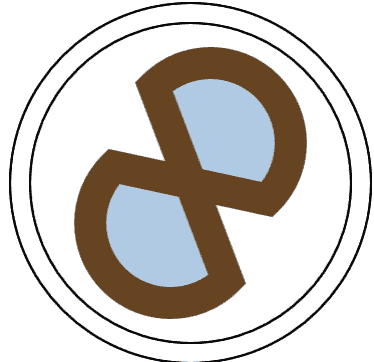

**图 6-2：** 绘制弧线和圆形。

## 贝塞尔曲线

弧线很棒，但它们只是你可以绘制的众多曲线路径中的一种。画布上下文提供了两种绘制贝塞尔曲线的方法。你可能在 Adobe Illustrator 和 Photoshop 等图形应用程序的路径工具中了解过这些曲线。贝塞尔曲线是一种强大的工具，可以推广到更高维度形成贝塞尔曲面，既能用于工程领域，也能用于先进的 3D 计算机图形学。我在这里不深入探讨贝塞尔曲线背后的数学原理；你只需要知道它们是一种参数化曲线，使用多个控制点来描述从一个点到另一个点的弯曲路径。

第一种方法是 `ctx.quadraticCurveTo()`，用于添加二次贝塞尔曲线。除了终点，这种曲线还使用一个控制点：

`ctx.quadraticCurveTo(cx, cy, x, y);`

此示例从当前位置添加一条二次贝塞尔曲线到 (x, y)，使用控制点 (cx, cy)。清单 6-5 展示了一个绘制二次曲线的简单示例。你也可以在文件 `03-quadraticCurve.html` 中找到这个示例。

### 清单 6-5 绘制二次曲线

```html
<canvas id="canvas" width="500" height="300"></canvas>
<script>
    var canvas = document.getElementById("canvas"),
        ctx = canvas.getContext("2d");
    // 绘制二次贝塞尔曲线
    ctx.beginPath();
    ctx.moveTo(50, 200);
    ctx.quadraticCurveTo(425, 25, 450, 200);
    ctx.fillStyle = "rgba(150, 50, 100, 0.5)";
    ctx.fill();
    ctx.stroke();

    // 绘制控制点
    ctx.strokeStyle = ctx.fillStyle = "rgba(0, 0, 0, 0.5)";
    ctx.beginPath();
    ctx.moveTo(450, 200);
    ctx.lineTo(425, 25);
    ctx.lineTo(50, 200);
    ctx.stroke();
    ctx.fillRect(450 - 2, 25 - 2, 4, 4);
</script>
```

图 6-3 展示了绘制结果。我绘制这个示例是为了帮助你理解该方法如何影响曲线。

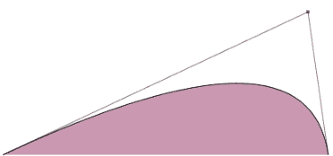

**图 6-3：** 在这个二次贝塞尔曲线中，控制点就像是将曲线拉向了自己。

第二种曲线方法是 `ctx.bezierCurveTo()`。这个方法本可以叫做 `ctx.cubicCurveTo()`，因为它创建的是三次贝塞尔曲线。三次曲线使用两个控制点。清单 6-6 展示了这样一个曲线的示例。

### 清单 6-6 绘制三次曲线

```html
<canvas id="canvas" width="450" height="400"></canvas>
<script>
var canvas = document.getElementById("canvas"),
    ctx = canvas.getContext("2d");

// 绘制三次贝塞尔曲线
ctx.beginPath();
ctx.moveTo(50,200);
ctx.bezierCurveTo(150,25,350,350,400,200);
ctx.fillStyle = "rgba(150,50,100,0.5)";
ctx.fill();
ctx.stroke();

// 绘制控制点
ctx.strokeStyle = ctx.fillStyle = "rgba(0,0,0,0.5)";
ctx.beginPath();
ctx.moveTo(50,200);
ctx.lineTo(150,25);
ctx.lineTo(350,350);
ctx.lineTo(400,200);
ctx.stroke();
ctx.fillRect(150-2,25-2,4,4);
ctx.fillRect(350-2,350-2,4,4);
</script>
```

图 6-4 展示了绘制结果。同样，我为这幅图画出了控制点。正如你可能想象的，三次曲线为你提供了更大的灵活性，甚至可以创建自相交的曲线。这个示例可以在文件 `04-cubicCurve.html` 中找到。

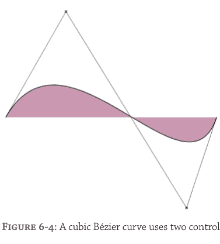

**图 6-4：** 三次贝塞尔曲线使用两个控制点。

三次贝塞尔曲线的一个优点是你可以轻松地将一个接一个地连接起来，形成更长、更细致的曲线。只需将下一个曲线段的第一个控制点放在前一段最后一个控制点的相反方向。这样，曲线段之间就能平滑连接，没有任何突兀的中断。

## 裁剪路径

除了填充和描边，你还可以用路径做另一件事。你可以使用 `ctx.clip()` 方法将路径用作裁剪路径。这会使当前路径充当一个遮罩，应用于所有后续的绘图函数。只要裁剪路径处于活动状态，就只有该区域内的部分会被修改。清单 6-7 展示了一个裁剪路径的简单示例。

### 清单 6-7 绘制裁剪路径

```html
<canvas id="canvas" width="400" height="400"></canvas>
<script>
    var canvas = document.getElementById("canvas"),
        ctx = canvas.getContext("2d");

    function makeClippingPath() {
        // 创建一个星形的裁剪路径
        ctx.beginPath();
        ctx.moveTo(270,200);
        for (var i=0;i<=20;i++) {
            ctx.lineTo(
                200 + Math.cos(i/10 * Math.PI) * 70 * (i%2 + 1),
                200 + Math.sin(i/10 * Math.PI) * 70 * (i%2 + 1)
            );
        }
        ctx.clip();

        // 填充整个画布
        canvas.fillStyle = "sienna";
        ctx.fillRect(0,0,400,400);

        makeClippingPath();

        // 尝试再次填充画布
        canvas.fillStyle = "lightsalmon";
        ctx.fillRect(0,0,400,400);
    }
</script>
```

绘制结果如图 6-5 所示。这个示例可以在文件 `05-clipping-path.html` 中找到。

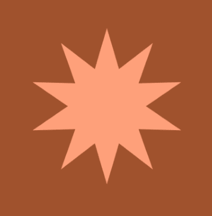

**图 6-5：** 在这个裁剪路径示例中，尽管第二个 `ctx.fillRect()` 填充了整个画布，但只有由裁剪路径定义的星形区域被实际修改了。

如果你想重置裁剪路径，需要使用 `ctx.save()` 和 `ctx.restore()` 方法。这些方法将在本章后面介绍。规范中已经添加了一个 `resetClip()` 函数，但目前还没有任何浏览器实现它。

## 路径对象

2D 上下文规范最近新增了所谓的路径对象。路径对象旨在封装可重用的路径，意味着你可以在上下文对象上反复使用它们，而无需每次都重新定义路径。这个功能尚未在任何官方浏览器版本中实现，但可以在 Chrome Canary（www.google.com/intl/en/chrome/browser/canary.html）——面向开发者的 Chrome 前沿版本中启用。在地址栏输入 **chrome://flags** 并启用 Experimental Canvas Features 选项。

由于此功能处于实验阶段，未来可能会改变或被完全废弃，因此我不会详细介绍如何使用这些对象。然而，就其当前状态而言，它们非常易于使用。你可以使用 `Path()` 构造函数创建一个路径对象：

```javascript
var path = new Path();
```

路径对象实现了与上下文对象上类似的方法，例如 `moveTo()`、`lineTo()`、`rect()`、`arc()` 等等。要绘制该路径，你需要将路径对象作为参数传递给，例如，`ctx.fill()` 或 `ctx.stroke()` 方法。

## 使用高级描边和填充样式

到目前为止，你已经了解了如何控制描边颜色和线条宽度。你可以使用一些额外的参数来控制描边的外观。

### 线端帽

首先是 `ctx.lineCap` 属性。该属性控制开放路径末端的外观。有三个值：

- `butt`：默认值 `butt`，看起来像是在描边末端进行了一次干净、垂直的切割。路径的最后一个点位于线端帽的中心。
- `round`：`round` 值通过绘制一个以最后一个点为中心的半圆形来圆化描边的末端。
- `square`：最后，`square` 值看起来有点像 `butt` 线端帽，但它不是正好在最后一点处切断，而是延伸线条，使最后一个点位于一个边长等于线宽的正方形的中心。

图 6-6 展示了三种不同的 `ctx.lineCap` 值如何改变描边的末端。

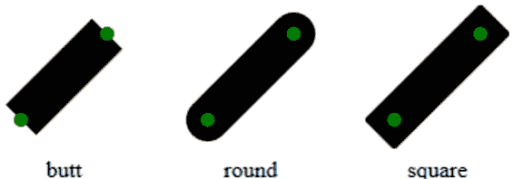

### 线连接

`ctx.lineJoin` 属性类似于 `ctx.lineCap`，但描述的是当两个连续的路径段共享同一个点时应如何处理。与 `ctx.lineCap` 一样，该属性也有三个可能的值：

- `bevel`
- `round`
- `miter`

这三个值都使用相同的基本起始条件。考虑两条在路径中共享一个点的线。想象这些线使用 `ctx.lineCap` 属性中的 `butt` 方法在点处终止。那么，这些线的描边各自会有两条边，一条内边和一条外边。这些外边与垂直的线末端一起，定义了连接处的两个外角。

`bevel` 值是三种连接类型中最基本的。这种连接类型只是填充由相交点和两个外角定义的三角形。

`round` 连接建立在 `bevel` 的基础上，通过渲染一条连接两个外角的圆弧来平滑连接处。

第三个值 `miter` 是默认值，稍微复杂一些。该值在相交点创建一个斜接连接。这种连接类型用于，例如，画框，其中四条边的末端被切割成一定角度，连接时形成画框的角。在现实世界中，这些连接通常用于形成 90 度角，但在画布的上下文中，任何角度都适用。


将外边缘延伸至交点之外，直到外边缘相交。填充由此斜接点与两个角点定义的三角形。现在，正如您可能想象的那样，以非常锐角相交的路径段可能会导致斜接点远远伸出交点之外。您可以使用 `ctx.miterLimit` 属性来控制此问题。斜接限制决定了从交点到斜接点所允许的最大距离。`ctx.miterLimit` 属性的值以半线宽的倍数指定。例如，如果 `lineWidth` 为 3.0，那么 `ctx.miterLimit` 值为 5.0 相当于 7.5。这很好，因为您可以更改线宽而无需担心同时调整斜接限制。如果到斜接点的距离大于限制，则连接将回退到使用斜切方法。初始时，`ctx.miterLimit` 设置为 10。图 6-7 展示了不同连接值的外观示例。

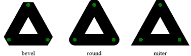

**图 6-7**：连接线条有三种选项。

### **虚线和点线**

Canvas 规范的早期版本仅指定了实线，因此如果您想绘制虚线，只能通过将每条短划线作为单独的线条来绘制。幸运的是，规范中现在已添加了虚线功能。Chrome、Opera 和 Internet Explorer 11 已支持这些新功能，Firefox 和 Safari 预计也将很快跟进。

新的 `ctx.setLineDash()` 方法接受一个段长度数组，用于描边路径时使用。

```javascript
ctx.setLineDash([16, 8]);
```

任何后续的 `ctx.stroke()` 调用都将使用 16 像素的短划线和 8 像素的间隔来绘制线条。您可以提供超过两个值来创建更有趣的虚线图案，例如长短划线交替出现。

相关的 `ctx.getLineDash()` 方法返回当前的段列表。

## 使用渐变

填充和描边样式不必是纯色、实色。Canvas 支持线性和径向渐变。要使用渐变，您需要创建一个渐变对象：

```javascript
var gradient = ctx.createLinearGradient(
    50, 50, 250, 400
);
```

此示例创建了一个从点 (50, 50) 到 (250, 400) 的线性渐变。您也可以创建径向渐变：

```javascript
var gradient = ctx.createRadialGradient(
    100, 100, 10,
    100, 100, 175
);
```

此示例创建了一个径向渐变，其内圆以 (100, 100) 为中心，半径为 10，外圆位于同一位置但半径为 175。两个渐变对象都暴露了一个 `addColorStop()` 方法，您可以使用它为渐变分配颜色：

```javascript
gradient.addColorStop(0, "red");
gradient.addColorStop(0.5, "green");
gradient.addColorStop(1, "blue");
```

此示例在渐变上设置了三种颜色：起始为红色，中间为绿色，结束为蓝色。要使用渐变，您需要将其分配给 `ctx.fillStyle` 或 `ctx.strokeStyle` 属性。完整的渐变使用示例见清单 6-8。

### 清单 6-8 使用渐变

```html
<canvas id="canvas" width="400" height="400"></canvas>
<script>
    var canvas = document.getElementById("canvas"),
        ctx = canvas.getContext("2d");

    var linGrad = ctx.createLinearGradient(
        50, 0, 250, 400
    );
    linGrad.addColorStop(0, "aquamarine");
    linGrad.addColorStop(1, "darkolivegreen");
    ctx.fillStyle = linGrad;
    ctx.fillRect(0, 0, 400, 400);

    var radGrad = ctx.createRadialGradient(
        200, 200, 25, 200, 200, 150
    );
    radGrad.addColorStop(0, "white");
    radGrad.addColorStop(0.7, "yellow");
    radGrad.addColorStop(1, "orange");
    ctx.fillStyle = radGrad;
    ctx.beginPath();
    ctx.arc(230, 230, 150, 0, Math.PI * 2, false);
    ctx.fill();
</script>
```

示例可在文件 06-gradient.html 中找到。结果请参见图 6-8。

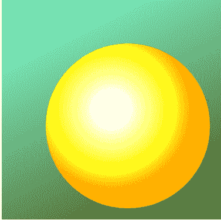

**图 6-8**：使用渐变可以为您的绘图对象增添一些深度。

> **提示** 如果您在分配渐变后更改了渐变，无需重新分配。所有使用该渐变的填充样式或描边样式都会自动更新。

## 使用图案

我讨论的最后一种填充和描边样式是图案。您可以使用现有图像来代替纯色或渐变。该图像可以是常规图像、canvas 元素或 video 元素。首先创建一个图案对象：

```javascript
var gradient = ctx.createPattern(
    document.getElementById("myImage"),
    "repeat"
);
```

第二个参数指定图案应如何重复。可能的值有：

- repeat
- repeat-x
- repeat-y
- no-repeat

默认值是 `repeat`，它使图案在两个方向上重复。`repeat-x` 和 `repeat-y` 值使图案仅在一个方向上重复，如果选择 `no-repeat`，则完全不进行重复。图案锚定在坐标空间的原点，不受您使用位置的影响。这意味着，例如，使用没有重复的小图像创建的图案可能在画布的右下角不可见。

`ctx.createPattern()` 方法返回一个没有属性或方法的图案对象。只需将其分配给 `ctx.strokeStyle` 或 `ctx.fillStyle`，就完成了。

## 使用变换

当您创建一个新的 `canvas` 元素时，用于在其上绘制内容的坐标空间对应于该 `canvas` 元素的尺寸。也就是说，画布左上角的像素位于位置 (0, 0)，右下角的像素位于位置 (w - 1, h - 1)，其中 w 和 h 是元素的宽度和高度。您可以对这个坐标空间应用许多不同的变换，如缩放和旋转，以使某些操作更容易。

### 理解变换矩阵

这些变换的核心是一个变换矩阵。画布使用的每个点在用于渲染之前都会乘以这个矩阵。如果您对线性代数有点生疏，请不要担心；我不会花太多时间深入数学细节。

最初，矩阵被设置为单位矩阵：

```
1 0 0
0 1 0
0 0 1
```

如果您熟悉矩阵，可以直接使用 `ctx.transform()` 方法修改变换矩阵：

```javascript
ctx.transform(a, b, c, d, e, f);
```

此方法将当前矩阵与以下矩阵相乘：

```
a c e
b d f
0 0 1
```

您也可以使用 `ctx.setTransform()` 方法完全覆盖当前矩阵：

```javascript
ctx.setTransform(a, b, c, d, e, f);
```

此方法本质上将变换矩阵重置为单位矩阵，然后使用指定的矩阵参数调用 `ctx.transform()`。

如果您想重置变换，必须将其手动设置为单位矩阵。最近在 2D 上下文规范中添加了一个更简单的 `ctx.resetTransform()` 方法，以及 `ctx.currentTransform` 属性，该属性允许以 SVGMatrix 对象的形式访问当前的变换矩阵。目前，这两个功能都尚未在任何官方浏览器版本中实现，尽管两者都已在 Chrome Canary 中可用。

### 平移

上下文对象的 `ctx.translate()` 方法向变换中添加一个平移矩阵：

```javascript
ctx.translate(x, y);
```

此方法基本上将 x 和 y 值添加到您绘制的任何点的坐标中。这意味着

```javascript
ctx.translate(50, 100);
ctx.fillRect(120, 130, 200, 200);
```

实际上绘制的矩形的左上角位于画布上的 (170, 230) 位置。

### 缩放

您还可以使用 `ctx.scale()` 方法缩放坐标空间。此方法接受两个参数，分别用于每个轴。这些值用于缩放画布上绘制的点。例如，通过以下方式更改缩放比例：

```javascript
ctx.scale(2, 0.5);
```

会将后续任何绘制拉伸为宽度的两倍和高度的一半。通过应用此变换可以达到相同的效果：

```javascript
ctx.transform(
    2, 0,
    0, 0.5,
    0, 0
);
```

我有时使用的一个巧妙技巧是缩放坐标空间，使整个画布表面位于坐标空间的 1 个单位内。您可以通过使用画布的尺寸缩放坐标来实现：

```javascript
ctx.scale(1 / canvas.width, 1 / canvas.height);
```

现在所有坐标都相对于尺寸，并且画布上所有可见点都位于两个轴上的 0 到 1 之间。现在绘制一个填充右上角四分之一的矩形变得非常简单：

```javascript
ctx.fillRect(0.5, 0, 0.5, 0.5);
```

### 旋转

`ctx.rotate()` 方法向变换矩阵添加旋转操作。角度以弧度为单位测量，并且是顺时针旋转：

```javascript
ctx.rotate(t);
```


使用此方法本质上等同于应用以下变换：

```
ctx.transform(
    Math.cos(t), Math.sin(t),
    -Math.sin(t), Math.cos(t),
    0, 0
);
```

需要注意的一点是，旋转始终围绕原点进行。如果你想围绕某个特定点旋转，应该首先平移坐标空间，使该点位于原点。然后你可以执行旋转，并在必要时反向平移。

通常，在组合变换时需要谨慎。应用变换的顺序有时会改变结果。例如，先平移再旋转产生的结果与顺序相反时不同。

## 绘制椭圆

目前，常见的桌面浏览器都不提供在画布上绘制椭圆的方法。然而，画布规范的一个近期修订在 2D 上下文中添加了一个 `ellipse()` 方法，最终将在浏览器制造商实现新更改后可用。在此之前，你可以使用一些变换和 `arc()` 函数来自己实现该功能。清单 6-9 展示了添加到 CanvasRenderingContext2D 原型上的 `ellipse()` 方法。

### 清单 6-9 为椭圆函数添加 polyfill

```
if (!CanvasRenderingContext2D.prototype.ellipse) {
    CanvasRenderingContext2D.prototype.ellipse =
        function(x, y, radiusX, radiusY, rotation,
                 startAngle, endAngle, anticlockwise) {
            this.translate(x, y);
            this.rotate(rotation);
            this.scale(radiusX, radiusY);
            this.arc(
                0, 0, 1, startAngle, endAngle, anticlockwise
            );
            this.scale(1/radiusX, 1/radiusY);
            this.rotate(-rotation);
            this.translate(-x, -y);
        };
}
```

`ellipse()` 方法类似于 `arc()` 方法，但它接受一个半径参数用于 x 轴和 y 轴，以及一个旋转参数。在调用 `arc()` 之前，坐标系被平移到椭圆的中心 (x, y) 并旋转。下一步按半径参数缩放坐标系，有效地压缩坐标，使生成的弧线呈椭圆而非圆形。剩下的就是绘制一个半径为 1 的弧线，并且当然要还原变换以避免干扰后续的绘图。你可以在文件 07-ellipse.html 中找到此函数的使用示例。

## 添加文本、图像和阴影

除了形状和路径，你还可以向画布添加文本和图像。你可以使用上下文上的 `ctx.drawImage()` 方法将图像绘制到画布：

```
ctx.drawImage(image, dx, dy, dw, dh);
```

此方法将一个 img 元素 `image` 绘制到画布。参数 `dx`、`dy`、`dw` 和 `dh` 定义了图像应该放置的矩形。左上角位于 (`dx`, `dy`)，右下角位于 (`dx + dw`, `dy + dh`)。`dw` 和 `dh` 参数是可选的，如果省略，默认使用图像的尺寸。`ctx.drawImage()` 方法还可以同时接受源矩形和目标矩形：

```
ctx.drawImage(image, sx, sy, sw, sh, dx, dy, dw, dh);
```

你可以使用这种参数模式仅将图像的子区域绘制到画布。由 `sx`、`sy`、`sw` 和 `sh` 定义的矩形从源图像中取出，并绘制到目标画布上由 `dx`、`dy`、`dw` 和 `dh` 定义的矩形中。如果两个区域的尺寸不匹配，复制的区域将被拉伸和缩放以适应目标。

`image` 参数不必是 img 元素。canvas 元素和 video 元素都是有效的源。如果使用 video 元素，则当前帧将被绘制到画布。

绘制图像之前，请确保图像已完全加载。尝试绘制未准备好的图像会触发错误。你可以通过检查图像对象上的 `complete` 属性，或仅在设置 `src` 属性后从附加到图像的加载事件处理程序中绘制，来确保图像已加载。

### 添加文本

canvas 元素还允许你向画布添加文本内容。但是，你应该始终确保使用画布渲染文本实际上是合适的。因为 canvas 元素本质上就像页面上的图像，所以你可以将大部分适用于图像中文本的逻辑应用于画布上的文本。如果使用 CSS 可以获得相同或类似的结果，也许你应该重新考虑是否采用基于画布的方法。例如，常规的 HTML 和 CSS 通常更适合诸如标题和按钮之类的元素。

与路径一样，你可以用两种方式绘制文本：一种用于填充文本，另一种用于绘制文本的轮廓或描边。但是，首先你应该指定要用于绘制文本的字体。你可以通过设置上下文上的 `ctx.font` 属性来完成。该值可以是任何你从 CSS 中了解的字体值。例如：

```
ctx.font = "italic 12px Arial, sans-serif";
```

这行代码指定了一个 12px 的斜体 Arial 字体。如果不存在 Arial，则使用默认的无衬线字体。

> **注意** 如果使用嵌入字体，请确保在尝试将其用于画布文本之前，字体文件已完全加载。如果字体文件未准备好，画布将使用默认字体。

你现在可以使用以下两种方法之一绘制文本：

```
ctx.fillText("Hello World!", 100, 50);
ctx.strokeText("Hello World!", 100, 50);
```

`ctx.fillText()` 方法使用当前的 `ctx.fillStyle` 值填充指定的文本，`ctx.strokeText()` 使用当前的 `ctx.strokeStyle` 值描绘文本的轮廓。第二个和第三个参数指定你希望文本放置的 x 和 y 坐标。你可以使用 `ctx.textAlign` 属性更改文本对齐方式：

```
ctx.textAlign = "center";
```

`ctx.textAlign` 的可能值为：

-   start
-   end
-   left
-   center
-   right

`left`、`center` 和 `right` 的含义是显而易见的。`start` 和 `end` 的值取决于当前区域设置的标准文本方向。对于从左到右的区域设置，`start` 与 `left` 相同，`end` 与 `right` 相同。对于从右到左的区域设置，情况相反。`ctx.textAlign` 的默认值是 `start`，因此如果你不希望文本自动适应区域设置，应手动设置对齐方式。

文本的垂直位置由 `ctx.fillText()` 和 `ctx.strokeText()` 中的 `y` 坐标决定，但它也受文本基线的影响。你可以通过设置上下文上的 `ctx.textBaseline` 属性来控制基线：

```
ctx.textBaseline = "middle";
```

`ctx.textBaseline` 的可能值为：

-   top
-   middle
-   bottom
-   hanging
-   alphabetic
-   ideographic

目前只有 `top`、`middle`、`bottom` 和 `alphabetic` 值在当今的浏览器中得到完全支持。有关这些值如何影响文本位置的说明，请参见图 6-9。

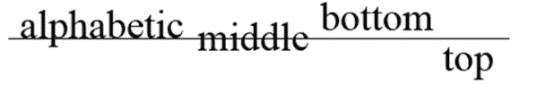

**图 6-9：** 在这些基线示例中，水平线绘制在与文本相同的 y 坐标处。

`ctx.fillText()` 和 `ctx.strokeText()` 方法都有一个可选的第四个参数 `maxWidth`——一个数值，如果指定，会将文本限制在最大宽度内。如果渲染的文本在指定字体下会超出该宽度，浏览器会自动缩小文本以使其适应。具体是使用更紧凑的字体还是水平缩放文本以适应，则取决于浏览器。

上下文中还存在最后一个与文本相关的方法。`ctx.measureText()` 方法接受一个参数，一个字符串，并返回一个文本度量对象。该对象有一个属性 `width`，即如果使用当前字体值在画布上绘制文本时的宽度。

```
var textWidth = ctx.measureText("Hello World!").width;
```

`ctx.measureText()` 方法可能非常有用，例如，如果你有其他内容依赖于文本的大小，或者你需要缩放 `canvas` 元素以适应渲染的文本。

在画布上绘制的文本与网页上的常规文本相比有一些缺点。浏览器不知道像素代表文本，因此用户无法直接用鼠标选择文本。但是，你可以为画布提供文本作为备用内容。这使得屏幕阅读器等可以获取文本。如果画布内容以某种方式交互，你甚至可以在备用内容中放置链接。这些链接在用键盘导航页面时可以获得焦点：

```
<canvas id="intro" width=400 height=400>
    This is a fancy intro image.
    <a href="page2.html">Click to go to page 2</a>
</canvas>
```

不幸的是，使用这种方法确实意味着你需要同时在画布代码和备用内容中维护文本内容。画布的可访问性仍在积极改进中，因此我希望将来能更好地处理这个问题。

### 使用阴影效果

你可以使用阴影效果为图像创造深度感。上下文对象有四个与阴影相关的属性。首先是阴影颜色：

```
ctx.shadowColor = "rgb(100,120,30)";
```

颜色值可以是任何有效的 CSS 颜色。阴影的偏移由两个属性控制，每个轴一个：

```
ctx.shadowOffsetX = 8;
ctx.shadowOffsetY = 8;
```


此示例将阴影置于内容的下方和右侧。请注意，这些是坐标空间单位，因此所有变换也会应用于这些值。最后，你可以通过 `ctx.shadowBlur` 属性来控制阴影的柔和度：

```javascript
ctx.shadowBlur = 10;
```

如果将模糊值设置为 0，你将得到清晰、锐利的边框，而不是柔和的阴影。清单 6-10 展示了阴影使用的一个示例。你可以在文件 `08-shadows.html` 中找到此示例。

#### 清单 6-10：应用阴影效果

```javascript
<canvas id="canvas" width="400" height="350"></canvas>
<script>
    var canvas = document.getElementById("canvas"),
        ctx = canvas.getContext("2d");

    ctx.shadowColor = "black";
    ctx.shadowOffsetX = 15;
    ctx.shadowOffsetY = 15;
    ctx.shadowBlur = 8;

    ctx.lineWidth = 6;
    ctx.strokeStyle = "darkorange";
    ctx.fillStyle = "sienna";
    ctx.fillRect(100,50,200,250);
    ctx.strokeRect(100, 50, 200, 250);

    ctx.fillStyle = "aquamarine";
    ctx.fillRect(50, 100, 150, 100);
    ctx.shadowColor = "transparent";
    ctx.strokeRect(50, 100, 150, 100);
</script>
```

最终绘制的图形如图 6-10 所示。正如你在赤褐色矩形上所看到的，如果对同一路径同时使用描边和填充，阴影可能会带来一些麻烦。一个解决方案是在描边时禁用阴影，例如，将阴影颜色设置为透明。

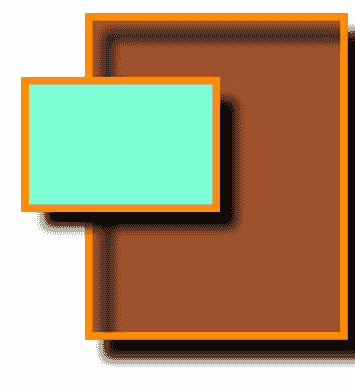

图 6-10：应用阴影效果可以创建三维图像。

## 管理状态栈

由于有如此多不同的属性和值影响着内容在画布上的渲染方式，如果你需要在执行某些任务后恢复到先前的状态，要记住旧的值可能会很困难。幸运的是，画布有一个内置的状态栈，可以轻松保存所有当前值，进行一些绘制，然后恢复到之前的值。

几乎所有属性，如填充颜色和文本属性，都是画布状态的一部分，因此只要你保存状态并在完成后恢复它，就无需担心覆盖旧值。构成画布状态的组件包括：

- 变换矩阵
- 裁剪路径
- strokeStyle, fillStyle
- lineWidth, lineCap, lineJoin, miterLimit
- globalAlpha, globalCompositeOperation
- shadowOffsetX, shadowOffsetY, shadowColor, shadowBlur
- font, textAlign, textBaseline

当前状态通过调用上下文对象的 `ctx.save()` 方法来保存：

```javascript
ctx.fillStyle = "black";
...
ctx.save(); // 保存带有填充样式的状态
```

此示例将当前状态压入栈中，允许你安全地修改前面提到的任何属性。当你完成对画布状态的操作后，可以通过调用 `ctx.restore()` 方法恢复到之前的状态：

```javascript
...
ctx.fillStyle = "white";
...
ctx.restore(); // 恢复状态，填充样式再次变为黑色
```

`ctx.restore()` 方法将当前状态替换为最后保存的状态，并将其从栈中移除。当你不知道所有属性的当前值时，此功能非常有用。例如，在编写需要更改一个或多个属性的子程序时，你只需在函数开始处调用 `ctx.save()`，并在返回前调用 `ctx.restore()`，从而保持画布状态的完整性。

## 绘制 HTML5 标志

在本节中，我将向你展示一个更完整的示例，说明如何使用 canvas 元素进行绘制。本练习的目标是绘制 HTML5 标志。在开始之前，请看一下图 6-11，以了解你将在本节中创建的内容。你可以在文件 `09-html5logo.html` 中找到完整的示例。

首先，制作一个漂亮的背景。清单 6-11 展示了背景函数。

### 清单 6-11：绘制背景

```javascript
function drawBackground(canvas) {
    var ctx = canvas.getContext("2d"),
        grad,
        i;

    ctx.save();
    // 将坐标缩放为单位
    ctx.scale(canvas.width, canvas.height);

    grad = ctx.createRadialGradient(
        0.5, 0.5, 0.125, 0.5, 0.5, 0.75
    );
    grad.addColorStop(0.1, "rgb(170,180,190)");
    grad.addColorStop(0.9, "rgb(50,60,70)");
    ctx.fillStyle = grad;
    ctx.fillRect(0,0,1,1);

    // 通过添加水平线并在旋转坐标空间时绘制星形
    ctx.beginPath();
    ctx.translate(0.5,0.5);
    for (i=0;i<60;i++) {
        ctx.rotate(1 / 60 * Math.PI * 2);
        ctx.lineTo(i % 2 ? 0.15 : 0.75, 0);
    }
    ctx.fillStyle = "rgba(255,255,255,0.1)";
    ctx.fill();
    ctx.restore();
}
```

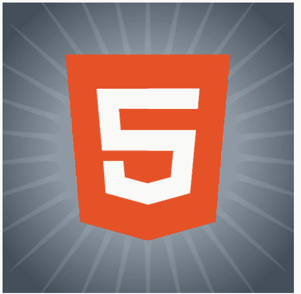

图 6-11：本节创建的 HTML5 标志。

请注意状态是如何在开始时保存并在结束时恢复的。无论你在函数的其余部分对状态做了什么，状态都会恢复到其原始形式。还要注意，坐标空间是使用画布的完整尺寸进行缩放的。左上角仍然是 (0, 0)，但右下角现在是 (1, 1)。这使得处理坐标变得容易得多，无需知道实际尺寸。

接下来看看实际的标志。该标志由许多不同的形状定义。清单 6-12 中的 `drawLogo()` 函数在开头将这些形状声明为点列表。

### 清单 6-12：标志绘制函数的路径数据

```javascript
function drawLogo(canvas) {
    var logo = [
        [40,460], [0,0], [450,0], [410,460], [225,512]
    ],
    five0 = [
        [225,208], [225,265], [295,265], [288,338],
        [225,355], [225,414], [341,382], [357,208]
    ],
    five1 = [
        [225,94], [225,150], [362,150], [367,94],
    ],
    five2 = [
        [225,208], [151,208], [146,150], [225,150],
        [225,94], [84,94], [85,109], [99,265], [225,265]
    ],
    five3 = [
        [225,355], [162,338], [158,293], [128,293],
        [102,293], [109,382], [225,414]
    ];
}
```

在这种有许多不同路径的情况下，拥有一个或两个辅助函数来节省输入会很不错。清单 6-13 展示了一个辅助函数，你可以用它来将点列表添加到路径中。

### 清单 6-13：通用路径函数

```javascript
function makePath(ctx, points) {
    ctx.moveTo(points[0][0], points[0][1]);
    for (var i=1,len=points.length;i<len;i++) {
        ctx.lineTo(points[i][0], points[i][1]);
    }
}
```

`makePath()` 函数只是将位置移动到第一个点，然后遍历列表的其余部分，沿途添加线段。它不开始或关闭任何路径，因此你可以在同一路径中创建多个子路径。现在你可以使用该函数和路径数据来绘制标志。清单 6-14 展示了标志函数。

### 清单 6-14：绘制标志

```javascript
function drawLogo(ctx) {
    ...
    // 保存原始状态
    ctx.save();

    // 将坐标空间平移到标志中心
    ctx.translate(-225,-256);
    // 填充标志背景
    ctx.beginPath();
    makePath(ctx, logo);
    ctx.fillStyle = "#e34c26";
    ctx.fill();

    // 在标志中心添加缩小效果
    ctx.save();
    ctx.translate(225,256);
    ctx.scale(0.8, 0.8);
    ctx.translate(-225,-256);
    // 裁剪标志的右半部分
    ctx.beginPath();
    ctx.rect(225,0,225,512);
    ctx.clip();
    // 在右半部分绘制一个颜色更浅、缩小的标志
    ctx.beginPath();
    makePath(ctx, logo);
    ctx.fillStyle = "#f06529";
    ctx.fill();

    // 恢复缩放和裁剪区域
    ctx.restore();

    // 恢复原始状态
    ctx.restore();
}
```

`drawLogo()` 函数首先平移坐标，将原点置于标志的中心。该点是通过检查路径数据找到的。最右边的点在 x = 450，最底部的点在 y = 512，这使得中心位于 (225, 256)。然后使用 `makePath()` 函数绘制 HTML5 标志的橙色背景部分。

标志的内部是颜色稍浅的橙色，仅填充右半部分，并略微缩小。你可以通过缩放坐标空间并应用裁剪区域来复用第一部分的路径。为了正确缩放坐标，代码在应用缩放之前将坐标平移回去。在裁剪覆盖整个画布右半部分的路径之前，坐标空间再次被平移到标志的中心。当用较浅的颜色再次填充标志路径时，实际上只绘制了右半部分，从而创造出所需的效果。可以说，定义额外的路径数据并直接绘制会更简单。这样做可以演示变换、裁剪区域以及如何使用状态栈。

标志中间的白色 5 部分仍然缺失。绘制该部分只需填充相关的路径即可。清单 6-15 展示了添加的路径。

```javascript
function drawLogo(canvas) {
    ...
    // 恢复缩放和裁剪区域
    ctx.restore();

    // 填充 "5" 的白色部分
    ctx.beginPath();
    makePath(ctx, five0);
    makePath(ctx, five1);
    ctx.fillStyle = "#ffffff";
    ctx.fill();
```


## 代码清单 6-15（续）

```javascript
// 填充 "5" 的浅灰色部分
ctx.beginPath();
makePath(ctx, five2);
makePath(ctx, five3);
ctx.fillStyle = "#ebebeb";
ctx.fill();
// 恢复原始状态
ctx.restore();
}
```

你现在可以将所有这些片段组合起来，在 canvas 元素上绘制完整的标志了。代码清单 6-16 展示了如何做。

## 代码清单 6-16：组合所有片段

```html
<canvas id="canvas" width="400" height="400"></canvas>
<script>
    function makePath(ctx, points) {...}

    function drawBackground(canvas) {...}

    function drawLogo(canvas) {...}

    var canvas = document.getElementById("canvas"),
        ctx = canvas.getContext("2d");

    drawBackground(canvas);

    ctx.translate(200, 200);
    ctx.scale(0.5, 0.5);

    drawLogo(canvas);
</script>
```

请注意，在调用 `drawLogo()` 之前，坐标空间被进行了缩放和平移。原因是 `drawLogo()` 不知道应该在画布的哪个位置绘制标志，也不知道它应该有多大。通过在函数外部执行这些变换，你可以控制函数放置标志的方式和位置。你甚至可以旋转它，或者在同一画布上绘制一大堆标志。代码清单 6-17 展示了如何绘制多个标志实例的示例。

## 代码清单 6-17：绘制多个标志

```html
<canvas id="canvas" width="400" height="400"></canvas>
<script>
    var canvas = document.getElementById("canvas"),
        ctx = canvas.getContext("2d");

    drawBackground(canvas);

    // 绘制 20 个标志
    for (var i = 0; i < 20; i++) {
        ctx.save();

        // 计算随机的旋转和缩放
        var x = Math.random() * canvas.width,
            y = Math.random() * canvas.height,
            angle = (Math.random() - 0.5) * Math.PI,
            scale = 0.05 + Math.random() * 0.1;

        // 变换坐标空间
        ctx.translate(x, y);
        ctx.scale(scale, scale);
        ctx.rotate(angle);

        drawLogo(ctx);

        ctx.restore();
    }
</script>
```

此示例在画布上的随机位置绘制了 20 个 HTML5 标志实例。每个标志都有自己的缩放和旋转。由于在循环的每次迭代中状态都被保存和恢复，所以所有实例都是独立绘制的。图 6-12 展示了得到的绘图。

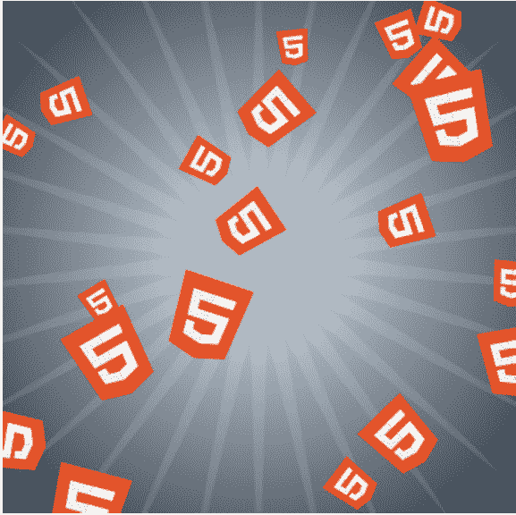

**图 6-12：** HTML5 标志出现在随机位置。

# 合成

你已经了解了如何使用路径来定义裁剪区域，以遮罩你在画布上绘制的任何内容。这并不是你控制如何向画布添加内容的唯一方式。

例如，你可以使用 `ctx.globalAlpha` 属性来设置全局 alpha 通道值。你在画布上绘制的任何内容，其自身的透明度值都会乘以 `ctx.globalAlpha` 的值。例如，将 `ctx.globalAlpha` 设置为 0.5，然后用颜色 `rgba(20, 85, 45, 0.7)` 填充路径，最终的组合 alpha 值就是 0.35。当你想要绘制形状和图像，并使它们无论其自身的 alpha 通道如何都呈现半透明效果时，`ctx.globalAlpha` 设置会很有用。

除了 `ctx.globalAlpha`，你还可以使用 `ctx.globalCompositeOperation` 属性。此属性提供了多种不同的操作，这些操作会改变新源内容与现有目标画布的组合方式。表 6-1 列出了 `ctx.globalCompositeOperation` 的可能值。在描述中，A 指的是源内容，B 指的是目标。

## 表 6-1：合成操作

| 值 | 描述 |
|---|---|
| source-atop | 在 B 之上渲染 A，但仅在 B 不透明的地方渲染。 |
| source-in | 仅渲染 A，且仅在 B 不透明的地方渲染。 |
| source-out | 仅渲染 A，且仅在 B 透明的地方渲染。 |
| source-over | 在 A 不透明的地方，在 B 之上渲染 A。 |
| destination-atop | 在 A 之上渲染 B，但仅在 A 不透明的地方渲染。 |
| destination-in | 仅渲染 B，且仅在 A 不透明的地方渲染。 |
| destination-out | 仅渲染 B，且仅在 A 透明的地方渲染。 |
| destination-over | 在 A 不透明的地方，在 A 之上渲染 B。 |
| lighter | 渲染 A 和 B 的和。 |
| copy | 忽略 B，仅渲染 A。 |
| xor | 在 B 透明的地方渲染 A，在 A 透明的地方渲染 B。在 A 和 B 都不透明的地方渲染透明。 |

> 如果你熟悉计算机图形学和图像处理，你可能会认出其中大部分是 Porter-Duff 操作。除了简单的 copy 操作外，Porter 和 Duff 在他们 1984 年的论文《Compositing Digital Images》（可在 http://keithp.com/~keithp/porterduff/p253-porter.pdf 获取）中描述了所有的合成操作符。

默认操作是 `source-over`，它将源内容绘制在旧内容之上，只在新的内容的透明部分显示目标。如果源内容有半透明的部分，某些操作的结果有时可能难以想象。例如，`destination-in` 操作在源的不透明部分渲染目标，但它也使用源内容的 alpha 值。这意味着，用完全透明的颜色填充一个跨越整个画布的矩形将基本上清除画布。有关所有合成操作应呈现的样子，请参见图 6-13。

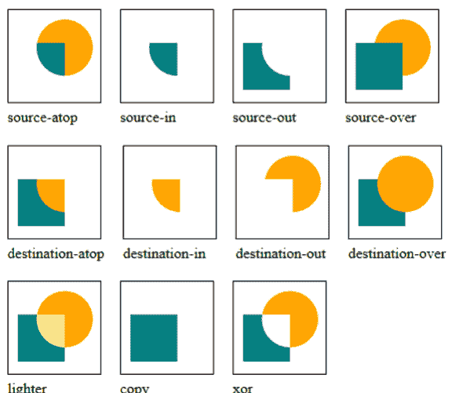

**图 6-13：** 你使用透明度设置来创建合成操作。

除了这些基本的合成操作，你还可以将 `ctx.globalCompositeOperation` 设置为以下混合模式之一：

- normal
- multiply
- screen
- overlay
- lighten
- color-dodge
- color-burn
- hard-light
- soft-light
- difference
- exclusion
- hue
- saturation
- color
- luminosity

如果你曾经使用过 Adobe Photoshop 或类似的图像编辑应用程序，你可能已经从这类应用程序的图层合成功能中了解了部分或全部这些混合模式。混合模式是最近添加的功能，因此只有一部分浏览器实现了它们。在撰写本文时，Chrome、Firefox、Opera 和 Safari 的最新版本都支持新的模式。Internet Explorer 11 只支持表 6-1 中的基本合成操作。

虽然 canvas 规范涵盖了 Porter-Duff 操作，但已创建了一个单独的 W3C 规范，名为“Compositing and Blending”（http://dev.w3.org/fxtf/compositing-1/），以足够详细地涵盖 Porter-Duff 操作和新的混合模式。

# 访问图像数据

Canvas 元素最强大的功能或许是能够访问和修改画布上的原始 RGBA 像素值。这种低级数据访问让你能够以其他方式很难甚至不可能实现的方式来修改图像。

## 检索像素值

2D 上下文对象提供了一个名为 `ctx.getImageData()` 的方法。你可以使用此方法来检索图像的一个矩形区域的数据：

```javascript
var imageData = ctx.getImageData(50, 75, 100, 200);
```

此示例从一个左上角位于 (50, 75) 的 100x200 矩形区域提取像素数据。`ctx.getImageData()` 方法返回一个图像数据对象，该对象具有以下属性：

- width
- height
- data

width 和 height 属性指定了 data 对象中包含的数据的尺寸。这些值可能与在 `ctx.getImageData()` 调用中指定的区域的尺寸不同。根据设备和显示方式，幕后使用的实际像素数可能与元素尺寸所显示的有所不同。

data 属性是 RGBA 颜色数据的数组。数组的长度取决于数据的尺寸。因为每个像素需要四个值——红色、绿色和蓝色通道各一个，alpha 通道一个——所以 data 数组的长度等于 (width * height * 4)。每个 RGBA 值都是一个范围在 [0,255] 之间的整数。

在遍历图像数据时，你应该使用图像数据对象的 width 和 height 属性，而不是 canvas 元素的属性。否则，由于设备像素和 CSS 像素之间的差异，你无法确定你是否真的修改了所有数据。

## 更新像素值

修改像素数据并将其保存回画布很容易。`ctx.putImageData()` 方法接受一个图像数据对象和一组坐标，指示数据应放置的位置。通常，你只想将数据保存回它来的地方，在这种情况下，坐标应该是用于 `ctx.getImageData()` 调用的矩形区域的左上角。代码清单 6-18 展示了一个如何修改像素数据的基本示例。

## 代码清单 6-18：创建基于像素的图案

```html
<canvas id="canvas" width="400" height="400"></canvas>
<script>
var canvas = document.getElementById("canvas"),
    ctx = canvas.getContext("2d"),
    imageData = ctx.getImageData(0, 0, canvas.width, canvas.height),
    w = imageData.width, h = imageData.height,
    x, y, index;

for (y = 0; y < h; y++) {
    for (x = 0; x < w; x++) {
        index = (y * w + x) * 4;
        var r = x / w * 255,
            g = y / h * 255,
            b = 128,
            block = (56 * (1 - x * y / w / h));
```


imageData.data[index] = r - r % block;
imageData.data[index+1] = g - g % block;
imageData.data[index+2] = b - b % block;
imageData.data[index+3] = 255;
}
}
ctx.putImageData(imageData, 0, 0);
</script>

你可以在文件 10-imageData.html 中找到这个示例。图 6-14 展示了生成的 canvas 模式。

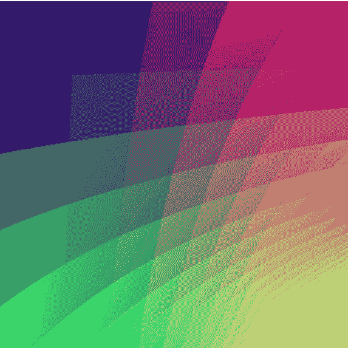

**图 6-14：** 使用简单的基于像素的 canvas 效果创建的这种迭代模式。

模式算法本身并不十分有趣，只是一个例子。但请注意，Alpha 通道（index+3）被设置为常量值 255。当你创建一个新的 canvas 元素时，它最初是透明的黑色。这意味着所有像素值都为 0。如果你不改变 Alpha 值，那么通过 `ctx.putImageData()` 放回画布上的内容也会是透明的，这可能不是你想要的效果。

> 图像数据方法不受任何合成、裁剪或变换设置的影响。像素被直接访问和更新，独立于 canvas 的状态。

## 导出图像文件数据

有时你可能需要将 canvas 元素上的图形转换为真实的位图图像。一种方法是获取所有像素数据，并编写自己的函数将其转换为文件数据。一些图像格式，如 BMP 文件，相对容易实现，但其他格式，如 JPEG 和 PNG，则更为复杂。`canvas` 元素有一个名为 `canvas.toDataURL()` 的方法，它实际上以 base64 编码字符串的形式将整个 canvas 作为 PNG 文件提供给你。字符串内容如下所示：

```
data:image/png;base64,...图像数据在这里...
```

该字符串被格式化为 `data:` URI，因此你可以将其用作普通图像元素的来源：

```
var data = canvas.toDataURL();
document.getElementById("myImage").src = data;
```

其他可能的用例包括将数据发布到服务器端脚本进行进一步处理，或使用 Web Storage 在本地存储。

`canvas.toDataURL()` 方法接受一个可选参数，用于指定应返回的图像类型。此参数的默认值为 `image/png`。规范只要求支持 PNG 格式，但某些浏览器也支持，例如，JPEG 图像。特定编码器的任何相关参数在图像类型之后传递：

```
var jpeg = canvas.toDataURL("image/jpeg", 0.7);
```

在支持导出 JPEG 文件的浏览器中，此行代码将创建一个使用 0.7 质量级别的 JPEG 数据字符串。实际上，你只能期望 PNG 文件有效。测试给定格式是否受支持的唯一方法是尝试调用 `canvas.toDataURL()` 并检查字符串的开头是否包含你预期的图像类型。

## 理解安全限制

当涉及图像数据和像素级访问时，`canvas` 元素附带了一些与安全相关的限制。就像 `XMLHttpRequest` 对象无法访问其他服务器上的文档一样，如果 canvas 元素包含的数据源自文档所在位置以外的位置，canvas 元素也不允许你读取像素值。`ctx.drawImage()` 方法不会阻止你绘制外部图像，但从那一刻起，canvas 就被标记为“已污染”。这意味着图像数据变为仅可写，并且任何使用 `ctx.getImageData()` 访问数据的尝试都将抛出安全异常。使用外部数据的 pattern 与使用来自其他源的字体一样，会触发相同的情况。

这些限制适用于任何可能泄露外部源信息的方法。受影响的方法包括：如果使用外部字体，则 `ctx.measureText()` 受影响；如果画布上绘制了任何外部内容，则 `canvas.toDataURL()` 和 `ctx.getImageData()` 受影响。

如果你想控制托管要使用的图像的服务器，你可以设置服务器使用 **跨源资源共享（CORS）** 来提供文件，使这些文件对 JavaScript 可用，就像它们托管在同一域上一样。在 `http://enable-cors.org` 阅读更多关于 CORS 的信息。

> **提示：** 如果你绝对需要使用来自其他域的内容，你可以通过用你最喜欢的服务器端语言编写一个小代理脚本来绕过这个限制。如果你能让服务器下载文件并将其转发给浏览器，那么对于 **canvas** 元素来说，该文件就好像来自它自己的源。缺点是这种方法会增加 Web 服务器的负载。

你也无法访问用户自己本地文件的数据。即使你本地打开文档也是如此，因此当从 `file://` URI 运行时，你无法使用这些功能。

## 创建基于像素的效果

让我们看看另一个使用图像数据方法的效果。这次，我使用图像数据在图像文件上创建了一个“旋转”效果。该图像是本章前面创建的 HTML5 徽标的位图版本。清单 6-19 显示了该效果的代码。

### 清单 6-19 旋转效果

```
<canvas id="canvas" width="400" height="400"></canvas>
<script>
    var canvas = document.getElementById("canvas"),
        ctx = canvas.getContext("2d"),
        image = new Image();

        image.addEventListener("load", function() {
            ctx.drawImage(this, 0, 0);
            var cw = canvas.width, ch = canvas.height,
                imgData = ctx.getImageData(0,0,cw,ch),
                newData = ctx.getImageData(0,0,cw,ch),
                w = imgData.width, h = imgData.height,
                x, y, sx, sy,
                dist, angle,
                idx1, idx2,
                amount = 20;

            for (y = 0; y < h; y++) {
                for (x = 0; x < w; x++) {
                    sx = x - w / 2;
                    sy = y - h / 2;
                    dist = Math.sqrt(sx * sx + sy * sy);
                    angle = Math.atan2(sy, sx) + dist / w * amount;
                    sx = Math.cos(angle) * dist;
                    sy = Math.sin(angle) * dist;
                    sx = Math.floor(sx + w / 2);
                    sy = Math.floor(sy + h / 2);
                    sx = Math.min(w-1, Math.max(0, sx));
                    sy = Math.min(h-1, Math.max(0, sy));

                    idx1 = (x + y * w) * 4;
                    idx2 = (sx + sy * w) * 4;

                    newData.data[idx1] = imgData.data[idx2];
                    newData.data[idx1+1] = imgData.data[idx2+1];
                    newData.data[idx1+2] = imgData.data[idx2+2];
                }
            }
            ctx.putImageData(newData, 0, 0);
        }, false);

        // 加载图像
        image.src = "html5.png";
</script>
```

首先，创建一个图像元素，并将 canvas 绘图函数附加到其 load 事件上。当图像准备就绪时，它会立即绘制到 canvas 上，以便可以访问图像数据。在这个例子中，你创建了两个独立的图像数据对象，每个都包含整个 canvas 的数据。更改一个图像数据对象中的数据不会影响任何其他对象，即使它们是从同一个 canvas 创建的。newData 对象保存修改后的内容。imgData 对象根本没有被修改，仅用于读取数据。嵌套循环访问 newData 数据中的每个像素，并使用一些数学运算来计算应该从 imgData 的哪个位置获取像素值。使用两个图像数据对象可以防止你意外覆盖算法后续可能需要的像素值。你可以在文件 10-twirl.html 中找到这个示例。图 6-15 显示了结果。


**图 6-15：** 将旋转效果应用于 HTML5 徽标。

> **请记住**
为了使此示例正常工作，你需要从 Web 服务器加载文件。从本地文件绘制图像会使 canvas 变为仅可写。由于同源限制，图像文件也必须与脚本位于同一域上。

## 总结

在本章中，你全面了解了 canvas 元素。你几乎看到了 2D 绘图 API 提供的所有功能，从绘制简单的路径、形状和曲线，到创建高级填充和描边。

你还看到了图像数据方法如何让你单独访问像素，以及如何使用这些数据创建复杂效果和有趣模式的例子，还有如何使用它来修改位图图像的数据。


# 第七章 创建游戏显示

## 本章内容

- 为启动画面添加进度条
- 创建游戏显示模块
- 使用Canvas绘制宝石棋盘

**既然你已经**熟悉了canvas元素，是时候将这些知识付诸实践了。游戏目前非常缺乏视觉元素，你现在可以开始在屏幕上展示内容了。

本章创建的图形并不复杂。相反，我专注于如何让基本的宝石棋盘运行起来。不过在开始之前，我将向你展示如何修改加载器以预加载游戏资源。你将使用该功能，通过进度条和新的背景来刷新启动画面。

我还将向你展示创建宝石棋盘图形的两种不同方法中的第一种。在本章中，你将使用2D canvas上下文创建游戏图形；在第11章中，你将了解如何使用WebGL创建具有3D图形的类似显示模块。

## 跟踪加载进度

随着游戏的演进，添加的模块越来越多，因此在资源加载过程中向用户提供反馈是个好主意。目前，在所有脚本加载并执行完毕之前什么都不会发生。只有那时才会调用`jewel.setup()`函数并显示启动画面。如果你在启动画面加载后立即调用`jewel.setup()`，进度条将指示已加载的进度。清单7-1展示了`index.html`中加载序列的更改。

```
清单7-1  在加载过程中更早调用setup
window.addEventListener("load", function() {
    jewel.load("scripts/dom.js");
    if (jewel.isStandalone()) {
        jewel.load("scripts/screen.splash.js", jewel.setup);
        jewel.load("scripts/screen.main-menu.js");
        if (jewel.hasWebWorkers()) {
            jewel.preload("scripts/board.worker.js");
            jewel.load("scripts/board.worker-interface.js");
        } else {
            jewel.load("scripts/board.js");
        }
    } else {
        jewel.load("scripts/screen.install.js", jewel.setup);
    }
});
```

`jewel.setup()`函数现在在启动画面可以显示时立即调用，同时其余脚本继续加载。

你还需要一种方法来确定在任何给定时间已加载的进度，因此在`jewel.js`中添加一个`getLoadProgress()`函数，如清单7-2所示。

```
清单7-2  计算加载进度
var jewel = (function() {
    ...
    function getLoadProgress() {
        return numResourcesLoaded / numResources;
    }

    return {
        getLoadProgress: getLoadProgress,
        ...
    };
})();
```

此函数返回当前加载进度，值在0到1之间。

## 添加进度条

现在启动画面可以访问进度值，你也可以在启动画面上添加一个视觉提示，让用户了解情况。一个简单的进度条对用户有很大帮助。首先，在`index.html`的启动画面HTML中添加一些div元素。清单7-3展示了新标签。

```
清单7-3  带有进度条的启动画面HTML
<div id="game">
    ...
    <div class="screen" id="splash-screen">
        <h1 class="logo">Jewel <br/>Warrior</h1>
        <div class="progress">
            <div class="indicator"></div>
        </div>
        <span class="continue">Click to continue</span>
    </div>
    ...
</div>
```

HTML5实际上引入了一个新的`progress`标签，但其支持尚未普及。大多数桌面浏览器支持它，但只有非常新版本的Android和iOS才包含对此新元素的支持。如果你改用此元素，HTML可能如下所示：

```
<progress class="loader" value="0" max="100" />
```

更改value属性也会自动更改`progress`元素的外观。不过，你可以轻松制作自己的进度条。创建两个嵌套元素，如清单7-3所示，让外部元素定义进度条的整体尺寸和边框。然后，你可以简单地将内部元素的CSS `width`从0%逐步扩展到100%以指示进度。清单7-4展示了`main.css`中的新CSS规则。

```
清单7-4  为进度条添加样式
#splash-screen .continue {
    cursor : pointer;
    font-size : 0.75em;
    display : none;
}
...
/* Progress bar */
.progress {
    margin : 0 auto;
    width : 6em;
    height : 0.5em;
    border-radius : 0.5em;
    overflow : hidden;
    border : 1px solid rgb(200,200,100);
}

.progress .indicator {
    background-color : rgb(200,200,100);
    height : 100%;
    width : 0%;
}
```

清单7-4中的CSS修改也隐藏了“继续”文本。在启动画面确定可以继续之前，它不应该是可见的。.progress样式只是将进度条居中，并赋予其一些圆角以及与游戏文本相同的颜色。如果你现在加载启动画面，空的进度条将显示在游戏徽标下方。你可以通过手动设置.indicator元素的宽度来测试进度条。你可以在浏览器的JavaScript控制台中输入以下命令来实现，例如：

```
jewel.dom.$(".progress .indicator")[0].style.width = "25%";
```

接下来，转到启动画面模块并修改它，使其检查加载进度并更新进度条。清单7-5展示了修改后的screen.splash.js。

```
清单7-5  更新进度条
jewel.screens["splash-screen"] = (function() {
    var firstRun = true;

    function checkProgress() {
        var $ = jewel.dom.$,
            p = jewel.getLoadProgress() * 100;
        $("#splash-screen .indicator")[0].style.width = p + "%";
        if (p == 100) {
            setup();
        } else {
            setTimeout(checkProgress, 30);
        }
    }

    function setup() {
        var dom = jewel.dom,
            $ = dom.$,
            screen = $("#splash-screen")[0];
        $(".continue", screen)[0].style.display = "block";
        dom.bind(screen, "click", function() {
            jewel.showScreen("main-menu");
        });
    }

    function run() {
        if (firstRun) {
            checkProgress();
            firstRun = false;
        }
    }

    return {
        run: run
    };
})();
```

`run()`方法现在调用`checkProgress()`而不是`setup()`。`checkProgress()`函数查询你刚刚添加的`jewel.getLoadProgress()`函数，并相应地调整进度条内部div的宽度。如果进度达到100%，它会调用`setup()`；否则，它使用`setTimeout()`安排在30毫秒后再次检查。这样，“点击继续”链接在所有内容加载完成之前不会显示。

现在尝试加载游戏。你应该会看到启动画面上的进度条随着文件的加载而填充。如果文件在本地驱动器上，加载可能会非常快，以至于你几乎看不到它。至少应该有短暂的闪烁。

## 构建游戏屏幕

最后，你到达了实际的游戏屏幕。首先将游戏屏幕元素添加到index.html，如清单7-6所示。

```
清单7-6  游戏屏幕HTML
<div id="game">
  ...
  <div class="screen" id="game-screen">
    <div class="game-board ">
    </div>
  </div>
</div>
```

目前游戏屏幕上只出现一个元素，即game-board元素，它只是实际宝石棋盘的容器。在main.css中为该元素赋予正确的尺寸，如清单7-7所示。

```
清单7-7  游戏棋盘CSS
#game-screen .game-board {
  position : relative;
  width : 8em;
  height : 8em;
}
```

现在你可以为游戏屏幕创建一个新的屏幕模块。清单7-8展示了screen.game.js中的初始代码。

```
清单7-8  游戏屏幕模块
jewel.screens["game-screen"] = (function() {
  var firstRun = true;

  function startGame() {
    var board = jewel.board,
        display = jewel.display;
    board.initialize(function() {
      display.initialize(function() {
        // start the game
      });
    });
  }
```


```javascript
});

function setup() {
    // 目前暂不执行任何操作
}

function run() {
    if (firstRun) {
        setup();
        firstRun = false;
    }
    startGame();
}

return {
    run : run
};

})();
```

游戏屏幕模块首次运行时，它将调用 `setup()` 函数，该函数目前尚未执行任何操作。`startGame()` 函数使用了前几章中 `board` 模块上的异步 `initialize()` 函数。回调函数尝试初始化显示模块，但由于该模块尚不存在而失败。请记得在 `index.html` 中加载新文件，以确保其在启动画面之后加载。

## 使用 Canvas 绘制棋盘

现在你可以快速进入显示模块了。我将向你展示两种不同的方法，用于创建这个游戏的第一轮图形。第一种方法基于在 `canvas` 元素上绘制 2D 图形。清单 7-9 显示了初始的 canvas 显示模块 `display.canvas.js`。

### 清单 7-9 Canvas 显示模块

```javascript
jewel.display = (function() {
    var canvas, ctx,
        cols, rows,
        jewelSize,
        firstRun = true;

    function setup() {
        var $ = jewel.dom.$,
            boardElement = $("#game-screen .game-board")[0];

        cols = jewel.settings.cols;
        rows = jewel.settings.rows;

        canvas = document.createElement("canvas");
        ctx = canvas.getContext("2d");
        jewel.dom.addClass(canvas, "board");

        var rect = boardElement.getBoundingClientRect();
        canvas.width = rect.width;
        canvas.height = rect.height;
        jewelSize = rect.width / cols;

        boardElement.appendChild(canvas);
    }

    function initialize(callback) {
        if (firstRun) {
            setup();
            firstRun = false;
        }
        callback();
    }

    return {
        initialize : initialize
    };
})();
```

模块首次初始化时，会调用 `setup()` 函数。该函数创建一个 `canvas` 元素并将其添加到游戏棋盘元素中。棋盘 `div` 元素的尺寸由 `.game-board` CSS 类决定，并取决于设备的屏幕分辨率。新创建的 `canvas` 元素具有默认尺寸 300x150，因此你需要为 `canvas` 元素设置正确的宽度和高度。使用 `getBoundingClientRect()` 来获取棋盘 `div` 元素的 CSS 尺寸。该函数返回一个描述元素位置和尺寸的对象。这些信息还可以让你通过将宽度除以 `jewel.settings` 对象中指定的列数来计算 `jewelSize`（宝石尺寸）。宝石尺寸以及列数和行数会保存起来供后续使用，因为它们将在整个模块中反复用到。

将文件添加到 `index.html` 的加载序列中，如清单 7-10 所示。

### 清单 7-10 加载 Canvas 显示模块

```javascript
window.addEventListener("load", function() {
    jewel.load("scripts/dom.js");
    if (jewel.isStandalone()) {
        jewel.load("scripts/screen.splash.js", jewel.setup);
        jewel.load("scripts/screen.main-menu.js");
        if (jewel.hasWebWorkers()) {
            jewel.preload("scripts/board.worker.js");
            jewel.load("scripts/board.worker-interface.js");
        } else {
            jewel.load("scripts/board.js");
        }
        jewel.load("scripts/screen.game.js");
        jewel.load("scripts/display.canvas.js");
    } else {
        jewel.load("scripts/screen.install.js", jewel.setup);
    }
});
```

《宝石战士》有七种不同类型的宝石。每种类型都有不同的形状和颜色。我为这些宝石类型创建了一套图片；你可以在本章的项目存档中找到它们。宝石精灵图的大小取决于设备的分辨率和方向，虽然你可以让浏览器动态调整图片大小，但通常通过提供匹配分辨率的图片能获得最佳的视觉质量。我在本章的存档中包含了四套图片。你可以在 `images` 文件夹中找到这些文件。每个文件命名为 `jewelsNN.png`，其中 `NN` 可以是 32、40、64 或 80，指的是每颗宝石的宽度和高度。图 7-1 展示了宝石精灵图。

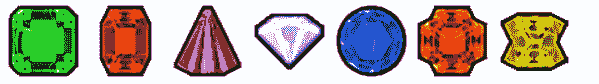

**图 7-1：** 《宝石战士》拥有多种宝石精灵图。

你需要在显示模块初始化时加载宝石精灵图，并确保在图片加载完成并准备好绘制到画布上之前，回调函数不会被调用。如果你在图片尚未加载时，就在 `canvas` 上下文上调用 `drawImage()` 方法，你会得到一个错误。清单 7-11 显示了对 `display.canvas.js` 中 `initialize()` 函数的修改。

### 清单 7-11 加载宝石精灵图

```javascript
jewel.display = (function() {
    var jewelSprite,
    ...
    function initialize(callback) {
        if (firstRun) {
            setup();
            jewelSprite = new Image();
            jewelSprite.addEventListener(
                "load", callback, false);
            jewelSprite.src =
                "images/jewels" + jewelSize + ".png";
            firstRun = false;
        } else {
            callback();
        }
    }
    ...
})();
```

如你所见，宝石精灵图仅在 `initialize()` 函数首次被调用时加载。如果用户再玩一轮游戏，可以直接复用该图片。

## 创建棋盘背景

在绘制宝石之前，先在棋盘背景上添加一个半透明的棋盘格图案。只要前景内容（在此例中即宝石）不需要与背景交互，你就可以为两层使用单独的 `canvas` 元素。当修改前景内容时，总需要确保背景保持良好，这可能会影响性能和代码复杂性。在清单 7-12 中，你将看到如何创建第二个 `canvas` 元素，并在前景内容之前将其添加到文档中。将新的 `createBackground()` 函数添加到 `display.canvas.js` 中。

### 清单 7-12 添加背景图案

```javascript
jewel.display = (function() {
    ...

    function createBackground() {
        var background = document.createElement("canvas"),
            bgctx = background.getContext("2d");

        jewel.dom.addClass(background, "background");
        background.width = cols * jewelSize;
        background.height = rows * jewelSize;

        bgctx.fillStyle = "rgba(225,235,255,0.15)";
        for (var x=0;x<cols;x++) {
            for (var y=0;y<rows;y++) {
                if ((x+y) % 2) {
                    bgctx.fillRect(
                        x * jewelSize, y * jewelSize,
                        jewelSize, jewelSize
                    );
                }
            }
        }
        return background;
    }

    function setup() {
        ...
        boardElement.appendChild(createBackground());
        boardElement.appendChild(canvas);
    }

    ...
})();
```

图案本身并不复杂。嵌套循环遍历整个棋盘，并在每隔一个单元格中填充半透明的正方形。现在将清单 7-13 中所示的 CSS 规则添加到 `main.css` 中。

### 清单 7-13 添加游戏棋盘 CSS 规则

```css
#game-screen .game-board .board-bg,
#game-screen .game-board .board {
    position : absolute;
    left: 0;
    top: 0;
    width : 100%;
    height : 100%;
}

#game-screen .game-board .board {
    z-index : 10;
}

#game-screen .game-board .board-bg {
    z-index : 0;
}
```

背景画布和棋盘画布都使用 `absolute` 定位，这使它们彼此重叠。图 7-2 显示了带有棋盘格棋盘背景的游戏屏幕。

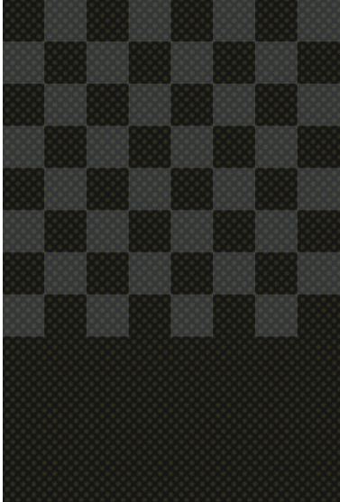

**图 7-2：** 游戏棋盘背景是棋盘格状的。

## 用宝石填充棋盘

是时候绘制一些宝石了！显示模块需要一个函数，该函数只需根据棋盘数据绘制整个棋盘。清单 7-14 显示了添加到 `display.canvas.js` 模块的新函数。

### 清单 7-14 显示重绘函数

```javascript
jewel.display = (function() {
    var jewels,
        ...

    function drawJewel(type, x, y) {
        ctx.drawImage(jewelSprite,
            type * jewelSize, 0, jewelSize, jewelSize,
            x * jewelSize, y * jewelSize,
            jewelSize, jewelSize
        );
    }

    function redraw(newJewels, callback) {
        var x, y;
        jewels = newJewels;
        ctx.clearRect(0,0,canvas.width,canvas.height);
        for (x = 0; x < cols; x++) {
            for (y = 0; y < rows; y++) {
                drawJewel(jewels[x][y], x, y);
            }
        }
        callback();
    }

    return {
        initialize : initialize,
        redraw : redraw
    };
})();
```

`redraw()` 函数首先清除整个画布，然后遍历所有棋盘位置，在每个单元格中绘制一个宝石图像。一个 `drawJewel()` 辅助函数负责实际的绘制工作。请注意，`redraw()` 函数从调用者那里获取宝石数据。显示模块与 `board` 模块没有连接，除了被告知要绘制的内容外，它对游戏状态一无所知。
```


## 触发初始重绘

现在你只需要调用 `initialize()` 函数，完成后再调用第一次 `redraw()`。清单 7-15 展示了在 `screen.game.js` 模块中添加的内容。

```
清单 7-15   触发初始重绘
jewel.screens["game-screen"] = (function() {
    ...
    function startGame() {
        var board = jewel.board,
            display = jewel.display;
        board.initialize(function() {
            display.initialize(function() {
                display.redraw(board.getBoard(), function() {
                    // 现在暂时什么都不做
                });
            });
        });
    }
    ...
})();
```

现在你可以开始游戏了，应该会看到类似图 7-3 所示的内容。加载游戏并点击主菜单上的“Play”按钮。

## 退出游戏

你目前对显示模块的工作已经完成，但玩家应该有权选择退出当前游戏并返回主菜单，或者暂时暂停游戏。清单 7-16 展示了在 `index.html` 的游戏屏幕中添加的包含退出和暂停按钮的页脚元素。

```
清单 7-16   为游戏屏幕添加页脚
...
<div id="game">
    ...
    <div class="screen" id="game-screen">
        ...
        <footer>
            <button class="exit">退出</button>
            <button class="pause">暂停</button>
        </footer>
    </div>
</div>
...
```

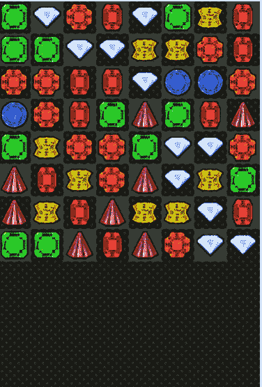

**图 7-3：** 游戏屏幕加载了宝石。

清单 7-17 中来自 main.css 的 CSS 规则将页脚定位在屏幕底部，并为按钮设置样式，使其与游戏其余部分风格一致。

### 清单 7-17 为页脚设置样式

```
.screen footer {
    display : block;
    position : absolute;
    bottom : 0;
    height : 1.0em;
    width : 100%;
}

.screen footer button {
    margin-left : 0.25em;
    margin-right : 0.25em;
    padding : 0 0.75em;
    font-family : Geo, sans-serif;
    font-size : 0.5em;
    color : rgba(200,200,100,0.5);
    background : rgb(10,20,0);
    border : 1px solid rgba(200,200,100,0.5);
    border-radius : 0.2em;
}
```

清单 7-18 展示了在 screen.game.js 的 `setup()` 函数中绑定的事件处理程序。如果玩家确认要返回菜单，游戏只需切换到主菜单屏幕。

### 清单 7-18 响应退出按钮

```
jewel.screens["game-screen"] = (function() {
    var firstRun = true;

    function exitGame() {
        pauseGame();
        var confirmed = window.confirm(
            "你想要返回主菜单吗？"
        );
        if (confirmed) {
            jewel.showScreen("main-menu");
        } else {
            resumeGame();
        }
    }

    function setup() {
        var dom = jewel.dom;
        dom.bind("footer button.exit", "click", exitGame);
    }

    ...
})();
```

清单 7-18 中的代码引入了两个新函数：`pauseGame()` 和 `resumeGame()`。你现在需要添加这些函数以及页脚中的暂停按钮。

## 暂停游戏

`pauseGame()` 和 `resumeGame()` 函数只是简单地更改一个 `paused` 变量的值，如清单 7-19 所示。记得在开始新游戏时重置 `paused` 的值。

```
清单 7-19   添加暂停和恢复功能
jewel.screens["game-screen"] = (function() {
    var paused,
    ...
    function startGame() {
        ...
        paused = false;
    }

    function pauseGame() {
        if (paused) {
            return; // 如果已经暂停，则不做任何操作
        }
        paused = true;
    }

    function resumeGame() {
        paused = false;
    }
    ...
})();
```

你可以通过在游戏屏幕上覆盖一个深灰色、半透明的 `div` 元素来添加一个变暗的效果。清单 7-20 展示了添加到 `index.html` 的新 `div` 元素。

```
清单 7-20   添加变暗覆盖层
<div id="game">
    ...
    <div class="screen" id="game-screen">
        <div class="game-board"></div>
        <footer>
            <button class="exit">退出</button>
            <button class="pause">暂停</button>
        </footer>
        <div class="pause-overlay">
            <div class="pause-text">暂停</div>
        </div>
    </div>
</div>
```

清单 7-21 中的 CSS 规则将覆盖层置于其他内容之前，使其占据整个游戏屏幕并设置背景颜色。“暂停”文本在屏幕上居中显示，并设置与 logo 相同的样式。

```
清单 7-21   为覆盖层设置样式
/* 游戏屏幕暂停覆盖层 */
#game-screen .pause-overlay {
    display : none;
    position : absolute;
    left : 0;
    top : 0;
    width : 100%;
    height : 100%;
    z-index : 100;
    background : rgba(20,20,20,0.5);
}
#game-screen .pause-overlay .pause-text {
    width: 100%;
    text-align : center;
    margin-top : 50%;
    font-family : Slackey;
    font-size : 1.0em;
    text-shadow : 0.03em  0.03em  0.03em rgb(255,255,0),
                -0.03em -0.03em  0.03em rgb(255,255,0),
                 0.10em  0.15em  0.15em rgb(0,0,0);
    color : rgb(70,120,20);
}
```

现在将暂停按钮的点击事件绑定到 `pauseGame()` 函数，将暂停覆盖层的点击事件绑定到 `resumeGame()` 函数，以便用户可以恢复游戏。你还应该修改 `startGame()`、`pauseGame()` 和 `resumeGame()` 函数，使它们能显示和隐藏暂停覆盖层。清单 7-22 展示了具体做法。

### 清单 7-22   绑定暂停事件处理程序

```
jewel.screens["game-screen"] = (function() {
    ...
    function startGame() {
        ...
        paused = false;
        var dom = jewel.dom,
            overlay = $("#game-screen .pause-overlay")[0];
        overlay.style.display = "none";
    }

    function pauseGame() {
        if (paused) {
            return; // 如果已经暂停，则不做任何操作
        }
        var dom = jewel.dom,
            overlay = $("#game-screen .pause-overlay")[0];
        overlay.style.display = "block";
        paused = true;
    }

    function resumeGame() {
        var dom = jewel.dom,
            overlay = $("#game-screen .pause-overlay")[0];
        overlay.style.display = "none";
        paused = false;
    }

    function setup() {
        var dom = jewel.dom;
        dom.bind("footer button.exit", "click", exitGame);
        dom.bind("footer button.pause", "click", pauseGame);
        dom.bind(".pause-overlay", "click", resumeGame);
    }
    ...
})();
```

在后面的章节中，你将扩展暂停和退出功能，使游戏真正暂停，并在用户退出游戏时自动保存游戏状态。图 7-4 展示了暂停覆盖层的效果。

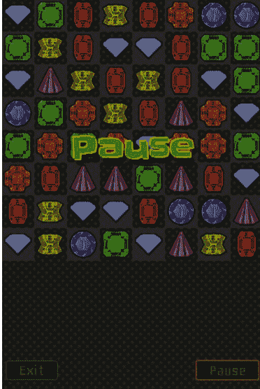

**图 7-4：** 用户暂停游戏时，屏幕变暗。

## 总结

本章从游戏显示开始，现在渲染游戏棋盘的基本显示例程已经就位。你使用 `canvas` 元素在屏幕上放置了一些宝石。在本章开头，你还通过添加一个跟踪加载进度的进度条增强了启动屏幕。

在下一章中，你将通过添加用户交互来加强显示和棋盘逻辑之间的耦合。然后，你将利用这些交互来扩展显示模块的功能。

## 第8章 与游戏交互

## 本章内容

- 捕获用户输入
- 处理触摸事件
- 将输入绑定到动作
- 为动作添加视觉反馈

**在上一章**中，你实现了游戏显示的第一部分。到目前为止，显示只是宝石棋盘的静态渲染，游戏对任何用户输入都没有反应。在本章中，你将学习如何实现一个捕获用户输入的新模块，并使显示和游戏的其余部分能够响应这些输入。

首先，你将了解浏览器中可用的不同类型的输入，特别关注智能手机和平板电脑等移动设备中基于触摸的输入。利用这些知识，你将回到游戏中，构建一个封装原生输入事件的系统，使你能够将这些事件转化为游戏动作。

实现用户输入后，你将学习如何将游戏动作附加到显示模块，以允许玩家选择和交换宝石。


## 捕获用户输入

我确信你对桌面浏览器中的基本键盘和鼠标事件已经非常熟悉，因此这里我将重点讨论一个更有趣的话题：这些事件在配备触摸屏的移动设备上是如何表现的。

## 触摸设备上的鼠标事件

像智能手机和平板电脑这样的触摸设备很少配备鼠标。相反，它们完全依赖与触摸屏的交互来导航应用程序和网站。当然，网络在构建时并未考虑此类设备；不过，大多数设备通过在用户点击屏幕时自动触发 `mousedown`、`click` 和 `mouseup` 事件，透明地解决了这个问题。如果一个网站使用鼠标可以工作，那么它在触摸设备上很可能也能正常工作。

然而，有一点不太容易移植到触摸屏上，那就是悬停状态。使用鼠标时，将指针悬停在UI元素上是常见操作，通常可以提供额外信息，例如工具提示形式的提示或仅仅是视觉效果。有些设计甚至依赖 `mouseover` 事件来触发动作，如展开菜单、显示额外按钮等。

这种“接近但未完全接触”的状态在触摸设备上根本不存在。你要么触摸屏幕，要么没有触摸。无法模拟 `mouseover` 事件，因为在手指实际触摸屏幕之前，无法知道它在哪里。这也影响了CSS，因为 `:hover` 伪类不再有意义。

> 提示：一些现代触摸屏设备，例如索尼Xperia sola，实际上可以检测到手指靠近屏幕但并未实际触摸。然而，这些功能远未普及，因此不要假设支持常规触摸事件之外的任何功能。

## 虚拟键盘

Android和iOS都具有虚拟键盘，当用户需要输入文本时，它会自动出现。例如，点击输入字段或文本区域会自动弹出键盘。

像 `keypress`、`keydown` 和 `keyup` 这样的键盘事件确实会传递给JavaScript，因此可以将某些功能映射到虚拟键盘上的键。然而，事件只有在你释放按键时才会触发，因此你实际上无法知道按键何时被按下，只知道它何时被释放。事件也只触发一次，不像桌面浏览器中按键被按住时会连续触发。

你无法过多控制这个键盘。没有简单的方法来禁用它，也无法强制它弹出。如果你确实需要能够手动切换键盘，可以将一个输入字段放置在视图之外，然后使用 `blur()` 和 `focus()` 方法来切换键盘。示例见清单8-1。你可以在文件 `01-virtualkeyboard.html` 中找到代码。

### 清单8-1 切换虚拟键盘

```html
<button id="toggleButton">Toggle Keyboard</button><br/>
<span id="output"></span>
<script>

function toggleKeyboard() {
    var kbToggle = document.getElementById("kbToggle");
    // create element if it doesn't exist
    if (!kbToggle) {
        kbToggle = document.createElement("input");
        kbToggle.id = "kbToggle";
        kbToggle.style.position = "absolute";
        kbToggle.style.left = "-1000px";
        document.body.appendChild(kbToggle);
        // keep the focus
        kbToggle.addEventListener("blur", function() {
            kbToggle.focus();
        }, false);
    }
    // switch classes and focus
    if (kbToggle.className == "on") {
        kbToggle.className = "off";
        kbToggle.blur();
    } else {
        kbToggle.className = "on";
        kbToggle.focus();
    }
}

// output pressed key
document.addEventListener("keypress", function(e) {
    document.getElementById("output").innerHTML
        = "You pressed: " + String.fromCharCode(e.charCode);
}, false);
</script>
```

续

```html
// toggle keyboard on click
document.getElementById("toggleButton").addEventListener(
    "click", toggleKeyboard, false);
</script>
```

总的来说，我建议不要将键盘用于文本输入以外的任何功能。它的功能有限，而且会占用屏幕的重要部分。

## 触摸事件

除了常规鼠标事件外，你还可以在支持它们的平台上使用触摸事件。触摸事件在W3C触摸事件规范（www.w3.org/TR/touch-events）中标准化，该规范于2013年10月达到推荐状态。iOS和Android设备从早期版本开始就在浏览器中公开了触摸事件，因此可以安全地假设支持这些事件。当然，如果你也针对桌面浏览器，则必须检查支持。你可以通过检查例如 `window` 对象上是否存在 `ontouchstart` 属性来检测浏览器是否支持触摸事件：

```javascript
if ("ontouchstart" in window) {
    // touch events are supported
}
```

当用户将手指放在屏幕上时，会触发 `touchstart` 事件。你需要了解的另外两个触摸事件是 `touchmove` 和 `touchend`。当用户的手指在屏幕上移动时，触发 `touchmove` 事件；当用户移开手指时，触发 `touchend` 事件。这三个触摸事件的行为类似于 `mousedown`、`mousemove` 和 `mouseup` 事件。

总的来说，触摸事件对象与其他事件对象类似，只是它们有一些额外的属性。来自鼠标事件的事件对象携带有关鼠标位置的信息，例如通过 `clientX` 和 `clientY` 属性：

```javascript
document.addEventListener("click", function(e) {
    alert(e.clientX + ", " + e.clientY);
}, false);
```

触摸事件具有类似的触摸位置数据，但它们不直接在事件对象上提供，而是有一个名为 `touches` 的属性。`touches` 属性是屏幕上所有当前活动触摸的列表。要获取有关触摸事件的信息，你必须从 `touches` 列表中获取第一个触摸对象。触摸对象具有常规鼠标事件对象中使用的相同坐标属性——即 `clientX/Y`、`screenX/Y` 等。清单8-2中的示例展示了如何获取触摸事件的坐标。你可以在文件 `02-touch.html` 中找到该示例。

### 清单8-2 使用触摸事件

```html
Touch X: <input id="touchx"><br/>
Touch Y: <input id="touchy">
<script>
    var touchx = document.getElementById("touchx"),
        touchy = document.getElementById("touchy");

    document.addEventListener("touchmove", function(e) {
        touchx.value = e.touches[0].clientX;
        touchy.value = e.touches[0].clientY;
        e.preventDefault();
    }, false);
</script>
```

这个简单的示例在你手指在屏幕上移动时，只是将x和y坐标打印在相应的 `input` 元素中。请注意，因为它只访问 `touches` 列表的第一个元素，所以此事件仅适用于第一个触摸屏幕的手指。然而，正如你将在下一节中看到的，处理多个触摸对象也很容易。

## 多点触摸

`touches` 数组列出了所有活动的触摸，如果不止一个手指触摸屏幕，你不知道哪一个是相关的触摸对象。事件对象提供了两个额外的列表，你可以用来解决这个问题：`targetTouches` 和 `changedTouches`。`targetTouches` 列表仅包含在目标元素上活动的触摸对象。因此，如果一个 `touchstart` 事件在某个元素（例如一个 `div`）上触发，`targetTouches` 列表仅列出该特定 `div` 上的触摸对象，而 `touches` 列表可能包含其他不相关的触摸对象。`changedTouches` 列表增加了进一步的限制，仅列出参与该特定事件的触摸对象。因此，如果你有两个手指在 `div` 上并且只移动一个，`touchmove` 事件中的 `targetTouches` 列表包含两个触摸对象，但 `changedTouches` 只给你移动的那个。

第一个示例是一个支持多点触摸的功能，允许你同时拖动多个元素。清单8-3显示了代码，你也可以在文件 `03-multidrag.html` 中找到它。该文件还包括一些CSS来设置两个可拖动元素的样式。


### 清单 8-3 多点触控拖动

```
<div id="dragme1"></div>
<div id="dragme2"></div>
<script>
    var el1 = document.getElementById("dragme1"),
        el2 = document.getElementById("dragme2");

    el1.addEventListener("touchstart", startDrag, false);
    el2.addEventListener("touchstart", startDrag, false);

    function startDrag(e) {
        var touch = e.targetTouches[0],
            x = touch.clientX,
            y = touch.clientY,
            rect = this.getBoundingClientRect();

        function drag(e) {
            var touch = e.targetTouches[0],
                newX = touch.clientX,
                newY = touch.clientY;
            this.style.left = (rect.left + newX - x) + "px";
            this.style.top = (rect.top + newY - y) + "px";
            e.preventDefault();
        }

        function endDrag() {
            this.removeEventListener("touchmove", drag);
            this.removeEventListener("touchend", endDrag);
        }

        this.addEventListener("touchmove", drag, false);
        this.addEventListener("touchend", endDrag, false);
    };
</script>
```

`startDrag()` 函数首先从 `targetTouches` 列表中抓取一个触摸对象，并保存其原始位置。忽略同一元素上的任何额外手指，因此选择 `targetTouches` 的第一个元素即可。接着，`startDrag()` 函数为 `touchmove` 事件附加一个处理程序，该程序使用新旧坐标之间的差值来移动 div 元素。如果 `startDrag()` 函数使用的是 `touches` 而非 `targetTouches`，你就无法确保该触摸对象确实是最初接触该元素的那个。

移动应用中的另一个常见特性是双指捏合缩放手势。当两根手指触摸屏幕并相互靠近或远离时，你可以将距离的相对变化用作缩放因子。你可以将此因子应用于任何你想要的东西，无论是整个页面还是单个元素。清单 8-4 展示了如何创建这种捏合缩放功能的示例。你可以在文件 `04-pinchzoom.html` 中找到完整代码。

### 清单 8-4 多点触控捏合缩放效果

```
<div id="zoomer"></div>
<script>
    var zoomer = document.getElementById("zoomer");
    zoomer.addEventListener("touchstart", startZoom, false);

    function startZoom(e) {
        if (e.targetTouches.length != 2) {
            return;
        }

        var touch1 = e.targetTouches[0],
            touch2 = e.targetTouches[1],
            dX = touch1.clientX - touch2.clientX,
            dY = touch1.clientY - touch2.clientY,
            startDist = Math.sqrt(dX * dX + dY * dY),
            scale = +this.getAttribute("data-scale") || 1;

        function zoom(e) {
            if (e.targetTouches.length != 2) {
                return;
            }
            var touch1 = e.targetTouches[0],
                touch2 = e.targetTouches[1],
                dX = touch1.clientX - touch2.clientX,
                dY = touch1.clientY - touch2.clientY,
                newDist = Math.sqrt(dX * dX + dY * dY),
                newScale = scale * newDist / startDist;
            this.style.webkitTransform = "scale("+newScale+")";
            this.setAttribute("data-scale", newScale);
            e.preventDefault();
        }

        function endZoom() {
            this.removeEventListener("touchmove", zoom);
            this.removeEventListener("touchend", endZoom);
        }

        this.addEventListener("touchmove", zoom, false);
        this.addEventListener("touchend", endZoom, false);
    }
</script>
```

当用户触摸该元素时，`startZoom()` 函数会检查是否有恰好两根手指触摸该元素——即 `targetTouches` 的长度是否等于 2。函数会存储两个触摸事件之间的初始距离，以便在后续的 `touchmove` 事件中进行比较以计算新的缩放因子。缩放因子也会作为属性存储在元素上。然后，`startZoom()` 函数添加执行实际缩放操作的 `touchmove` 事件处理程序。当 `zoom()` 被触发时，至少有一个触摸对象的坐标发生了变化。在设置 CSS 缩放变换时，新距离与旧距离的比率被用作缩放因子。最后，`touchend` 事件处理程序通过移除 `touchmove` 和 `touchend` 处理函数来进行清理。

## 手势

除了 `touch*` 系列事件外，iOS 设备还支持一套手势事件。这些事件对于创建诸如清单 8-4 所示的捏合缩放效果等功能非常有用。这三个手势事件是：

- gesturestart
- gesturechange
- gestureend

手势事件建立在触摸事件之上，不提供那么多底层信息。相反，它们携带的信息在处理多点触控事件时可能很有用。没有哪个手势事件会对单点触摸输入做出反应；`gesturestart` 事件仅在第二根手指触摸屏幕时触发。每当一个触摸点移动时，`gesturechange` 事件就会触发。该事件发送的事件对象具有一些很酷的属性。最有趣的可能是通过 `scale` 和 `rotation` 属性暴露的缩放和旋转值。`scale` 值表示自 `gesturestart` 事件以来触摸点之间距离的相对变化。因此，如果 `scale` 等于 2.0，表示距离自开始以来已加倍。类似地，`rotation` 值表示触摸点围绕它们的共同中心旋转的度数。清单 8-5 展示了如何使用这些属性来创建，例如，支持触摸的缩放和旋转功能。你可以在文件 `05-gesture.html` 中找到该示例。

### 清单 8-5 基于手势的缩放和旋转

```
<div id="mydiv"></div>
<script>
    var el = document.getElementById("mydiv");
    el.addEventListener("gesturestart", gestureStart, false);

    function gestureStart(e) {
        var rot = +this.getAttribute("data-rot") || 0,
            scale = +this.getAttribute("data-scale") || 1;

        function change(e) {
            this.style.webkitTransform =
                "rotate(" + (rot + e.rotation) + ") " +
                "scale(" + (scale * e.scale) + ")";
            e.preventDefault();
        }
        function end(e) {
            this.setAttribute("data-rot", rot + e.rotation);
            this.setAttribute("data-scale", scale * e.scale);
            this.removeEventListener("gesturechange", change);
            this.removeEventListener("gestureend", end);
        }
        this.addEventListener("gesturechange", change, false);
        this.addEventListener("gestureend", end, false);
    }
</script>
```

这些事件确实简化了这类功能的代码，但请记住它们是 iOS 特有的。只有像 iPhone 和 iPad 这样的设备才支持手势事件，而且没有迹象表明其他浏览器厂商计划采用它们。

## 模拟触摸事件

有时，即使是在不支持触摸的桌面 PC 上，能够使用和测试触摸事件也很有用。Vodori 的 Phantom Limb 是一个很好的工具，它拦截鼠标事件并将其转换为触摸事件。它是一个小型的 JavaScript 库，你需要将其包含在你的页面中。你可以在 www.vodori.com/blog/phantom-limb.html 找到该脚本。

Phantom Limb 甚至在用户按住 Alt/Option 键时支持多点触控。我在本章的示例代码中包含了这个小型库；你可以在 02-touch.html、03-multidrag.html 和 04-pinchzoom.html 示例中找到它。

如果你使用 Chrome，模拟触摸事件会更容易。点击右下角的“齿轮”图标打开 DevTools 设置。在“Overrides”部分，你可以启用触摸事件模拟等功能。现在鼠标指针就像一个触摸点，并触发相关的触摸事件。

## 输入事件与画布

处理用户输入和画布可能有点棘手。因为画布元素的行为类似于位图图像，绘制内容的结构不会被保留，所以你实际上无法将事件处理程序附加到画布元素以外的任何东西上。你可能非常清楚像素的含义，但浏览器不清楚，因此你无法直接将事件处理程序附加到游戏精灵或你在画布上绘制的任何其他图形上。

## 使用路径进行命中检测

如果你想为画布添加鼠标或触摸交互，你必须跟踪对象的位置。这样，你就可以在画布元素上附加一个事件处理程序，然后搜索对象列表以查看是否有任何对象应该做出反应。如果画布上绘制的元素都是由路径描述的，你可以保存路径数据并使用 `ctx.isPointInPath()` 方法来测试触摸或鼠标事件是否在某个路径内。清单 8-6 展示了这种方法的示例。你可以在文件 `06-canvaspath.html` 中找到此示例的代码。

### 清单 8-6 在画布上检测鼠标事件

```
<canvas id="canvas" width="400" height="300"></canvas>
<script>
    var canvas = document.getElementById("canvas"),
        ctx = canvas.getContext("2d");

    ctx.beginPath();
    ctx.moveTo(100, 50);
    ctx.lineTo(250, 200);
    ctx.lineTo(150, 250);
    ctx.lineTo(200, 300);
    ctx.lineTo(50, 250);
    ctx.lineTo(150, 150);

    ctx.fillStyle = "teal";
    ctx.fill();

    canvas.addEventListener("touchmove", function(e) {
        hitTest(e.targetTouches[0]);
    });
```


e.preventDefault();
}, false);
canvas.addEventListener("mousemove", hitTest, false);

function hitTest(e) {
    var rect = canvas.getBoundingClientRect(),
        x = e.clientX - rect.left,
        y = e.clientY - rect.top,
        inPath = ctx.isPointInPath(x, y);
    ctx.fillStyle = inPath ? "orange" : "teal";
    ctx.fill();
}

</script>
```

清单 8-6 中的示例在画布上声明了一个路径，然后在 mousemove 和 touchmove 事件处理程序中使用 `ctx.isPointInPath()` 方法来决定用哪种颜色填充该路径。此示例展示了你可以如何使用该方法将行为附加到画布的特定区域。当然，你确实需要跟踪构成路径的点，并在必要时在每次测试中重新设置路径。这种方法并非总是理想，也无法解决所有问题，但根据手头的任务，它可能行之有效。更复杂的问题有时可以通过，例如，使用画布图像数据方法来测试非透明像素值来解决。

你可以将 `ctx.isPointInPath()` 方法用于用户输入之外的目的。考虑一个例子：一个游戏中，一个抛射物射向一个目标。如果目标的轮廓可以用路径描述，那么 `ctx.isPointInPath()` 方法就能轻松判断抛射物是否击中了目标。

## 使用命中区域

画布规范最近扩展了命中区域功能，旨在使向画布元素添加用户输入和交互更加容易。目前还没有浏览器实现命中区域，但大多数浏览器应该很快就会跟上。

要指定一个命中区域，你需要在画布上下文对象上使用 `addHitRegion()` 方法。此函数接受一个参数，即描述该区域的选项对象：

```
ctx.addHitRegion({
    path: aPathObject,
    id: "myregion",
    cursor: "pointer"
});
```

`path` 属性是一个路径对象，是可选的。如果没有给出路径对象，则使用当前路径。当命中区域被添加后，你可以简单地为例如 click 事件附加一个监听器，如果用户点击了某个命中区域内部，相关的区域 ID 将在事件对象的 `region` 属性中可用：

```
canvas.addEventListener("click", function(e) {
    if (e.region) {
        alert("You clicked the region: " + e.region);
    }
}, false);
```

## 使用游戏手柄和控制器

HTML5 最近增加的功能之一是使用游戏手柄。此功能的 API 仍在开发中（参见 [www.w3.org/TR/gamepad](http://www.w3.org/TR/gamepad)），但 Firefox 和 Chrome 都已至少支持该规范的一部分。要在 Firefox 中启用游戏手柄支持，请转到 `about:config` 并启用 `dom.gamepad.enabled` 标志。

### 访问游戏手柄数据

根据 W3C 规范，连接到计算机的游戏手柄可以通过 `navigator` 对象上的 `gamepads` 对象访问。但是，Chrome 和 Firefox 目前都没有实现这个对象。相反，你可以在 Firefox 中使用 `navigator.getGamepads()` 函数，在 Chrome 中使用 `navigator.webkitGetGamepads()` 函数来访问游戏手柄：

```
function getGamepads() {
    if (navigator.gamepads) {
        return navigator.gamepads;
    } else if (navigator.getGamepads) {
        return navigator.getGamepads();
    } else if (navigator.webkitGetGamepads) {
        return navigator.webkitGetGamepads();
    }
}
```

你会发现这些函数的工作方式有几个小差异。在 Firefox 中，`navigator.getGamepads()` 返回一个包含已连接游戏手柄对象的常规数组。在 Chrome 中，`navigator.webkitGetGamepads()` 返回一个 `GamepadList` 对象，它类似于数组，但长度始终为 4，即使没有连接游戏手柄。这意味着你需要检查所有四个元素，以查看是否有实际对象，或者该元素是否为 null 或 undefined。两种列表中的游戏手柄对象都相对简单，具有以下属性：

- id
- index
- timestamp
- connected
- mapping
- axes
- buttons

id 属性是一个标识游戏手柄的字符串，例如 “45e-2a1-Controller (XBOX 360 For Windows)”。index 属性是游戏手柄的索引——即，第一个连接的游戏手柄索引为 0，第二个为 1，依此类推。如果索引为 0 的游戏手柄断开连接，其余游戏手柄将保持其索引，下一个连接的游戏手柄将重用索引 0。timestamp 属性指示控制器的状态最后何时更新，但 Firefox 尚不支持此属性。connected 属性是一个布尔值，指示游戏手柄是否已连接。目前只有 Firefox 使用此属性。

buttons 属性是一个按钮状态数组，数组中的每个元素对应游戏手柄上的一个按钮。按钮值为 0 或 1（对于模拟按钮可能是介于两者之间的某个值），其中 1 表示完全按下。可用按钮的数量取决于控制器，按钮索引到实际按钮的映射也取决于控制器。更复杂的是，Firefox 和 Chrome 使用不同的按钮和轴映射。mapping 属性是一个字符串，指示游戏手柄的布局。此属性目前仅在 Firefox 中实现，且只是部分实现。然而，最终此属性将使支持不同类型控制器变得更加容易。表 8-1 显示了 Xbox 360 控制器的按钮布局。

#### 表 8-1 Xbox 360 游戏手柄按钮

| 按钮索引 | 按钮 (Chrome) | 按钮 (Firefox) |
|---|---|---|
| **0** | A 按钮（绿色） | A 按钮（绿色） |
| **1** | B 按钮（红色） | B 按钮（红色） |
| **2** | X 按钮（蓝色） | X 按钮（蓝色） |
| **3** | Y 按钮（黄色） | Y 按钮（黄色） |
| **4** | 左肩键 | 左肩键 |
| **5** | 右肩键 | 右肩键 |
| **6** | 左扳机键 | Back 键 |
| **7** | 右扳机键 | Start 键 |
| **8** | Back 键 | 左摇杆 |
| **9** | Start 键 | 右摇杆 |
| **10** | 左摇杆 | |
| **11** | 右摇杆 | |
| **12** | 方向键 上 | |
| **13** | 方向键 下 | |
| **14** | 方向键 左 | |
| **15** | 方向键 右 | |

如你所见，Firefox 没有映射扳机键和方向键的按钮。这些被视为轴。axes 属性是一个包含游戏手柄上摇杆值的数组。每个摇杆的每个轴的值范围为 [-1.0 .. 1.0]。对于水平轴，-1.0 表示左，1.0 表示右。对于垂直轴，-1.0 表示上，1.0 表示下。表 8-2 显示了 Xbox 360 控制器的轴索引。

#### 表 8-2 游戏手柄轴

| 轴索引 | 轴 (Chrome) | 轴 (Firefox) |
| :--- | :--- | :--- |
| **0** | 左摇杆水平 | 左摇杆水平 |
| **1** | 左摇杆垂直 | 左摇杆垂直 |
| **2** | 右摇杆水平 | 左右扳机键 |
| **3** | 右摇杆垂直 | 右摇杆水平 |
| **4** | | 右摇杆垂直 |
| **5** | | 方向键 左/右 |
| **6** | | 方向键 上/下 |

尽管按钮和轴映射有一些差异，但重叠部分足够多，你可以使用彩色按钮和左摇杆，而无需为每种浏览器编写代码。W3C 规范还建议按钮和轴按重要性递减的顺序索引，因此使用按钮 0 以及轴 0 和 1 进行主要操作应该是相对安全的。

### 游戏手柄事件

官方规范还规定了一种基于事件的方法，通过 `gamepadconnected` 和 `gamepaddisconnected` 事件来检测已连接的游戏手柄。相关的游戏手柄对象通过事件对象上的 gamepad 属性传递给事件处理程序。不幸的是，目前只有 Firefox 支持这些事件。

```
window.addEventListener("gamepadconnected", function(e) {
    alert("You connected a gamepad: " + e.gamepad.id);
}, false);
window.addEventListener("gamepaddisconnected", function(e) {
    alert("You disconnected a gamepad: " + e.gamepad.id);
}, false);
```

此外，Firefox 还支持其他几个非标准事件，例如 gamepadbuttondown、gamepadbuttonup 和 gamepadaxismove。这些事件或类似的事件可能会也可能不会在未来的某个时候被纳入 W3C 标准。

Firefox 25（在撰写本文时是最新版本）有一个错误，该错误会阻止浏览器注册任何游戏手柄，除非你为 gamepadconnected 事件添加事件监听器。幸运的是，这很容易修复，只需附加一个空的事件处理程序即可：

```
window.addEventListener("gamepadconnected", function(){}, false);
```

### 检测游戏手柄状态变化

目前，记录状态变化（如按钮按下）的最佳方法是持续轮询游戏手柄对象并检查是否有任何变化。在游戏手柄甚至出现在游戏手柄列表中之前，你通常必须在读取游戏手柄列表*的同时*按下按钮或移动摇杆，所以如果在开始轮询之前没有在列表中看到游戏手柄，不要惊讶。清单 8-7 展示了一个轮询函数的示例。

```
**清单 8-7 轮询已连接的游戏手柄**
var gpStates = [];

function pollGamepads() {
    var gamepads = getGamepads(),
        i, gamepad, idx;
    for (i=0;i<gamepads.length;i++) {
        if (gamepads[i]) {
            gamepad = gamepads[i];
            idx = gamepad.index;
            if (gpStates[idx]) {
                if (gpStates[idx].gamepad != gamepad) {
                    gamepadDisconnected(gpStates[idx]);
```

清单 8-7 续

```javascript
gamepadConnected(gamepad);
}
} else {
    gamepadConnected(gamepad);
}
updateGamepadState(gamepad);
}
}
}
```

此函数可以使用 `setInterval()` 等方式反复调用。`gpStates` 数组存储了当前已知手柄的状态。`pollGamepads()` 函数从 `getGamepads()` 获取当前手柄列表，并检查 `gpStates` 列表中是否已存在具有该索引的手柄。如果没有该手柄，`pollGamepads()` 函数会调用 `gamepadConnected()` 函数，将手柄添加到列表中。如果该索引已存在一个手柄，且不是同一个手柄，`pollGamepads()` 会在添加新手柄前移除旧的。清单 8-8 展示了 `gamepadConnected()` 和 `gamepadDisconnected()` 函数。

## 清单 8-8 添加已连接的手柄

```javascript
function gamepadConnected(gamepad) {
    gpStates[gamepad.index] = {
        gamepad: gamepad,
        buttons: gamepad.buttons,
        axes: gamepad.axes
    };
    console.log("Gamepad[" + gamepad.index + "] connected");
}

function gamepadDisconnected(gamepad) {
    console.log("Gamepad[" + gamepad.index + "] disconnected");
    delete gpStates[gamepad.index];
}
```

`gamepadConnected()` 函数将手柄状态添加到 `gpStates` 数组中，存储手柄对象以及当前的按钮和轴状态。`gamepadDisconnected()` 函数则简单地从列表中删除该状态对象。

`pollGamepads()` 函数还调用 `updateGamepadState()`，该函数为每个按钮和轴比较新旧状态并记录变化。当所有浏览器都实现了手柄对象上的时间戳属性时，你可以用它来判断是否需要更新状态。在此之前，你每次都需要更新。清单 8-9 展示了此函数。

## 清单 8-9 更新按钮和轴状态

```javascript
function updateGamepadState(gamepad) {
    var state = gpStates[gamepad.index],
        i;
    for (i=0;i<gamepad.buttons.length;i++) {
        if (gamepad.buttons[i] != state.buttons[i]) {
            console.log("Gamepad[" + gamepad.index + "] button "
                        + i + " = " + gamepad.buttons[i]);
            state.buttons[i] = gamepad.buttons[i];
        }
    }
    for (i=0;i<gamepad.axes.length;i++) {
        if (gamepad.axes[i] != state.axes[i]) {
            console.log("Gamepad[" + gamepad.index + "] axis "
                        + i + " = " + gamepad.axes[i]);
            state.axes[i] = gamepad.axes[i];
        }
    }
}
```

你可以在本章归档文件中的 `07-gamepad.html` 文件里找到使用这些函数的完整示例。

## 构建输入模块

输入模块负责捕获键盘、鼠标和触摸事件形式的用户输入，并将这些事件转换为一组游戏事件。例如，使用鼠标点击游戏棋盘会触发游戏中的“选择宝石”事件。在移动设备上触摸屏幕会触发相同的事件。其他模块，如游戏屏幕模块，可以将处理函数绑定到这些事件上，以便在用户与游戏交互时执行适当的操作。

开始构建输入模块时，首先创建一个新模块并将其放置在文件 `input.js` 中。清单 8-10 显示了此模块的初始内容。

### 清单 8-10 输入模块

```javascript
jewel.input = (function() {
    var inputHandlers;

    function initialize() {
        inputHandlers = {};
    }

    function bind(action, handler) {
        // 将处理函数绑定到游戏动作
    }

    function trigger(action) {
        // 触发游戏动作
    }

    return {
        initialize : initialize,
        bind: bind
    };
})();
```

在 `index.html` 中加载新文件：

```javascript
window.addEventListener("load", function() {
    jewel.load("scripts/dom.js");
    if (jewel.isStandalone()) {
        ...
        jewel.load("scripts/input.js");
    } else {
        ...
    }
});
```

在 `screen.game.js` 的游戏屏幕模块中调用 `initialize()` 函数：

```javascript
jewel.screens["game-screen"] = (function() {
    ...
    function setup() {
        ...
        jewel.input.initialize();
    }
    ...
})();
```

# 第 8 章 与游戏交互

要创建输入事件和游戏动作之间的控制绑定，你为每个输入指定一个关键字。例如，鼠标点击有输入关键字 CLICK，按下回车键有关键字 KEY_ENTER，等等。controls 结构存储在 `index.html` 的游戏设置中，如清单 8-11 所示。

### 清单 8-11 定义控制绑定

```javascript
var jewel = (function() {
    var settings = {
        ...
        controls : {
            // 键盘
            KEY_UP : "moveUp",
            KEY_LEFT : "moveLeft",
            KEY_DOWN : "moveDown",
            KEY_RIGHT : "moveRight",
            KEY_ENTER : "selectJewel",
            KEY_SPACE : "selectJewel",
            // 鼠标和触摸
            CLICK : "selectJewel",
            TOUCH : "selectJewel",
            // 手柄
            BUTTON_A: "selectJewel",
            LEFT_STICK_UP: "moveUp",
            LEFT_STICK_DOWN: "moveDown",
            LEFT_STICK_LEFT: "moveLeft",
            LEFT_STICK_RIGHT: "moveRight"
        }
    }
    ...
})();
```

通过这种方式使用关键字，你可以在不修改游戏代码的情况下更改游戏控件。你甚至可以启用用户自定义的控件，并选择性地将其保存在本地浏览器存储中。

你使用稍后讨论的 `bind()` 函数将处理函数附加到游戏动作上。例如，一个游戏动作可能使用关键字 `selectJewel`。每当输入模块检测到应触发该动作的用户输入时，所有处理函数都会被依次调用。

`inputHandlers` 对象跟踪输入事件与游戏动作之间的绑定关系。对于每个游戏动作，`inputHandlers` 对象上的一个属性是一个包含与该动作相关的所有处理函数的数组。例如，`inputHandlers["selectJewel"]` 保存了在 `selectJewel` 动作发生时需要调用的所有函数。

另一个空函数 `trigger()` 负责调用函数。你将在本章稍后实现此函数。它简单地接受一个动作名称作为参数，并调用 `inputHandlers` 中相应数组中的任何函数。如果 `trigger()` 被调用时带有任何额外参数，这些参数将被传递给处理函数。这样，处理函数就可以访问诸如鼠标事件中的坐标等信息。

## 处理输入事件

宝石战士支持四种输入类型：鼠标、键盘、触摸和手柄。鼠标和键盘事件仅在桌面电脑上有意义，而触摸事件，至少大部分情况下，仅与移动设备相关，这意味着对这些输入事件的反应存在一些重叠。因为这个游戏的输入机制非常简单，用户应该能够只使用一种输入类型来玩游戏。

## 鼠标输入

对于宝石战士，你需要考虑的唯一鼠标输入类型是点击，因此你唯一需要处理的鼠标事件是 `mousedown` 事件。你也可以监听 `click` 事件，但由于它只在鼠标按钮释放时触发，使用 `mousedown` 事件可以使游戏看起来响应更快一点。当用户点击宝石棋盘并且游戏动作绑定到 CLICK 事件时，必须调用该动作的处理函数。清单 8-12 展示了添加到 `input.js` 的 `initialize()` 函数中的 DOM 事件处理程序。

### 清单 8-12 捕获鼠标点击

```javascript
jewel.input = (function() {
    ...
    function initialize() {
        var dom = jewel.dom,
            $ = dom.$,
            controls = jewel.settings.controls,
            board = $("#game-screen .game-board")[0];

        inputHandlers = {};
        dom.bind(board, "mousedown", function(event) {
            handleClick(event, "CLICK", event);
        });
    }
    ...
})();
```


DOM 事件对象会与游戏动作的名称一同传递给第二个函数 `handleClick()`。这样做的目的是为了可以将同一逻辑复用于触摸事件。`handleClick()` 函数会计算点击的相对坐标，进而得出宝石的坐标。最后，触发相应的动作，并将宝石坐标作为参数传入。清单 8-13 展示了 `handleClick()` 函数。

```
清单 8-13 处理点击事件
jewel.input = (function() {
    ...
    function handleClick(event, control, click) {
        // 此输入控件是否绑定了任何动作？
        var settings = jewel.settings,
            action = settings.controls[control];
        if (!action) {
            return;
        }

        var board = jewel.dom.$("#game-screen .game-board")[0],
            rect = board.getBoundingClientRect(),
            relX, relY,
            jewelX, jewelY;

        // 相对于游戏板的点击位置
        relX = click.clientX - rect.left;
        relY = click.clientY - rect.top;
        // 宝石坐标
        jewelX = Math.floor(relX / rect.width * settings.cols);
        jewelY = Math.floor(relY / rect.height * settings.rows);
        // 触发绑定到动作的函数
        trigger(action, jewelX, jewelY);
        // 阻止默认的点击行为
        event.preventDefault();
    }
    ...
})();
```

## 触摸输入

触摸事件的功能与鼠标事件处理几乎相同。你不再监听 `mousedown` 事件，而是监听 `touchstart` 事件，并使用输入关键字 `TOUCH`。不再将事件对象作为第三个参数传递给 `handleClick()`，而是传递相关的触摸对象 `event.targetTouches[0]`。清单 8-14 展示了具体做法。

### 清单 8-14 捕获触摸输入

```
jewel.input = (function() {
    ...
    function initialize() {
        var dom = jewel.dom,
            $ = dom.$,
            board = $("#game-screen .game-board")[0];

        inputHandlers = {};
        dom.bind(board, "mousedown", function(event) {
            handleClick(event, "CLICK", event);
        });
        dom.bind(board, "touchstart", function(event) {
            handleClick(event, "TOUCH", event.targetTouches[0]);
        });
    }
    ...
})();
```

因为事件对象和触摸对象都将其坐标存储在 `clientX` 和 `clientY` 属性中，而 `handleClick()` 中只使用了这些属性，所以传递这两种对象是安全的。

## 键盘输入

你可以使用几种不同的事件来检测按键。`keydown`、`keyup` 和 `keypress` 事件都会触发，但不同的浏览器对 `keypress` 事件的处理方式并不总是统一的。`keyup` 和 `keydown` 事件都是可靠的，但 `keydown` 通常响应更好，因为它在按下按键时立即触发。此事件创建的事件对象具有 `keyCode` 属性，该属性保存被按键的数字代码。例如，以下代码片段在你按下任何键时会显示按键代码：

```
element.addEventListener("keydown", function(event) {
    alert("You pressed: " + event.keyCode);
}, false);
```

使用数字代码可能会有点混乱，而且记住哪个键对应哪个代码也很困难。为了让代码更容易使用，你可以使用一个将代码映射到键名的结构。清单 8-15 展示了一个实现了此功能的 `keys` 对象。

### 清单 8-15 添加按键代码

```
jewel.input = (function() {
    var keys = {
        37 : "KEY_LEFT",
        38 : "KEY_UP",
        39 : "KEY_RIGHT",
        40 : "KEY_DOWN",
        13 : "KEY_ENTER",
        32 : "KEY_SPACE",
        65 : "KEY_A",
        66 : "KEY_B",
        67 : "KEY_C",
        /* ... 字母键 68 - 87 ... */
        88 : "KEY_X",
        89 : "KEY_Y",
        90 : "KEY_Z"
    };
    ...
})();
```

字母 A-Z 键具有连续的代码，从 A 键的 65 开始，到 Z 键的 90 结束。我定义了这些键以及一些特殊键，例如方向键、Enter 键和空格键。

现在，你可以将这些键名作为输入关键字，与已经实现的 `CLICK` 和 `TOUCH` 事件一起使用。现在，你只需监听 `keydown` 事件并触发相应的动作，如清单 8-16 所示。

### 清单 8-16 捕获键盘输入

```
jewel.input = (function() {
    ...
    function initialize() {
        var controls = jewel.settings.controls,
        ...
        dom.bind(document, "keydown", function(event) {
            var keyName = keys[event.keyCode];
            if (keyName && controls[keyName]) {
                event.preventDefault();
                trigger(controls[keyName]);
            }
        });
    }
    ...
})();
```

## 游戏手柄输入

你可以使用本章前面讨论的轮询技术为输入模块添加游戏手柄支持。首先，你需要检测浏览器是否支持游戏手柄；如果支持，则开始轮询变化。清单 8-17 展示了对 `input.js` 的修改。

### 清单 8-17 检测游戏手柄支持

```
jewel.input = (function() {
    var gpStates,
        gpPoller,
        ...

    function initialize() {
        ...
        if (getGamepads()) {
            gpStates = [];
            if (!gpPoller) {
                gpPoller = setInterval(pollGamepads, 1000/60);
                // 用于让 Firefox 注册游戏手柄的变通方法
                window.addEventListener("gamepadconnected",
                                        function(){}, false);
            }
        }
    }

    function getGamepads() {
        if (navigator.gamepads) {
            return navigator.gamepads;
        } else if (navigator.getGamepads) {
            return navigator.getGamepads();
        } else if (navigator.webkitGetGamepads) {
            return navigator.webkitGetGamepads();
        }
    }

    function pollGamepads() {}

    function gamepadConnected() {}

    function gamepadDisconnected() {}

    ...
})();
```

`initialize()` 函数只是使用 `getGamepads()` 函数进行功能检测。如果 `getGamepads()` 返回任何内容，你就可以假设支持游戏手柄，并使用 `setInterval()` 开始持续调用 `pollGamepads()`。你可以直接复制本章前面示例中的 `pollGamepads()` 以及 `gamepadConnected()` 和 `gamepadDisconnected()` 函数。`updateGamepadState()` 函数有所不同，如清单 8-18 所示。

### 清单 8-18 检测按钮和轴变化

```
jewel.input = (function() {
    ...
    function updateGamepadState(gamepad) {
        var state = gpStates[gamepad.index];
        for (var i=0;i<gamepad.buttons.length;i++) {
            if (gamepad.buttons[i] != state.buttons[i]) {
                state.buttons[i] = gamepad.buttons[i];
                if (state.buttons[i]) {
                    gamepadButtonDown(gamepad, i);
                }
            }
        }
        for (var i=0;i<gamepad.axes.length;i++) {
            if (gamepad.axes[i] != state.axes[i]) {
                state.axes[i] = gamepad.axes[i];
                gamepadAxisChange(gamepad, i, state.axes[i]);
            }
        }
    }
    ...
})();
```

对于值从 0 变为 1 的按钮（即被按下），会调用 `gamepadButtonDown()` 函数。对于任何方式发生变化的所有轴，都会调用 `gamepadAxisChange()` 函数。清单 8-19 展示了这两个函数。

### 清单 8-19 触发游戏手柄动作

```
jewel.input = (function() {
    ...
    function gamepadButtonDown(gamepad, buttonIndex) {
        var gpButtons = {
            0: "BUTTON_A"
        },
        controls = jewel.settings.controls,
        button = gpButtons[buttonIndex];
        if (button && controls[button]) {
            trigger(controls[button]);
        }
    }

    function gamepadAxisChange(gamepad, axisIndex, axisValue) {
        var controls = jewel.settings.controls,
            controlName;
        if (axisIndex === 0 && axisValue === -1) {
            controlName = "LEFT_STICK_LEFT";
        } else if (axisIndex === 0 && axisValue === 1) {
            controlName = "LEFT_STICK_RIGHT";
        } else if (axisIndex === 1 && axisValue === -1) {
            controlName = "LEFT_STICK_UP";
        } else if (axisIndex === 1 && axisValue === 1) {
            controlName = "LEFT_STICK_DOWN";
        }
        if (controlName && controls[controlName]) {
            trigger(controls[controlName]);
        }
    }
    ...
})();
```

`gamepadButtonDown()` 函数会查找按钮索引，以查看是否有任何游戏动作绑定到了对应的按钮名称。类似地，`gamepadAxisChange()` 根据轴索引和轴值来确定控制名称，并使用该信息触发所有绑定到摇杆方向的动作。

## 实现游戏动作

现在是时候重新审视 `screen.game.js` 中的游戏屏幕模块，并开始为输入事件实现动作处理程序了。

你需要向游戏屏幕模块添加一条新信息。当用户点击宝石板时，该位置的宝石会被激活。你可以使用一个简单的对象来保存关于光标位置以及该位置宝石是否处于活动状态的信息。清单 8-20 展示了光标对象及其初始化。


## 第八章 与游戏交互

```
清单 8-20 初始化光标
jewel.screens["game-screen"] = (function() {
    var firstRun = true,
        paused,
        cursor;

    function startGame() {
        var board = jewel.board,
            display = jewel.display;
        board.initialize(function() {
            display.initialize(function() {
                cursor = {
                    x : 0,
                    y : 0,
                    selected : false
                };
                display.redraw(board.getBoard(), function() {
                    // 暂时不做任何事
                });
            });
        });
    }
    ...
})();
```

光标对象有三个属性。`x` 和 `y` 属性是宝石的坐标，`selected` 属性是一个布尔值，表示该宝石是否被选中，或者光标只是被动地停留在那个位置。如果宝石被选中，游戏会尝试与下一个被激活的宝石交换。

你还需要一种简单的方法来更新这些光标值。清单 8-21 展示了一个 `setCursor()` 函数，它用于设置光标值并告诉游戏显示更新光标的渲染。

```
清单 8-21 设置光标属性
jewel.screens["game-screen"] = (function() {
    ...
    function setCursor(x, y, select) {
        cursor.x = x;
        cursor.y = y;
        cursor.selected = select;
    }
    ...
})();
```

## 选择宝石

输入模块可以触发以下动作：

- selectJewel（选择宝石）
- moveLeft（左移）
- moveRight（右移）
- moveUp（上移）
- moveDown（下移）

`selectJewel` 动作用于选择棋盘上的一个宝石，或者，如果另一个宝石已被选中，则交换两个宝石。`move*` 动作用于在棋盘上移动光标。

玩家可以通过多种方式选择棋盘上的宝石。例如，在触摸屏上轻点宝石或用鼠标点击，都会触发 `selectJewel` 游戏动作。这个动作应该调用一个 `selectJewel()` 函数来确定适当的操作。清单 8-22 展示了该函数的代码。

```
清单 8-22 选择宝石
jewel.screens["game-screen"] = (function() {
    ...
    function selectJewel(x, y) {
        if (arguments.length === 0) {
            selectJewel(cursor.x, cursor.y);
            return;
        }
        if (cursor.selected) {
            var dx = Math.abs(x - cursor.x),
                dy = Math.abs(y - cursor.y),
                dist = dx + dy;

            if (dist === 0) {
                // 取消选中已选的宝石
                setCursor(x, y, false);
            } else if (dist == 1) {
                // 选中了相邻的宝石
                jewel.board.swap(cursor.x, cursor.y,
                    x, y, playBoardEvents);
                setCursor(x, y, false);
            } else {
                // 选中了另一个不同的宝石
                setCursor(x, y, true);
            }
        } else {
            setCursor(x, y, true);
        }
    }
    ...
})();
```

如果另一个宝石已被选中，你可以使用两个宝石之间的距离来确定适当的操作。如前所述在棋盘模块中，距离为 1 表示两个位置相邻，距离为 0 表示再次选中了同一个宝石，任何其他距离表示选中了其他宝石。如果玩家两次选择同一个宝石，则通过调用 `setCursor()` 函数并将 `selected` 参数设置为 `false` 来取消选中该宝石。如果选中的宝石是已选位置的邻居，你通过调用 `board.swap()` 函数尝试交换两个宝石。`swap()` 方法的第五个参数是回调函数。这里传递了一个名为 `playBoardEvents()` 的函数。（我稍后会介绍这个函数。）最后一种情况，即选中了另一个非常不同的宝石，你只需将光标移动到该位置并启用 `selected` 参数。

传递给 `board.swap()` 的 `playBoardEvents()` 函数在棋盘模块完成移动宝石和更新棋盘数据后被调用。`swap()` 函数使用一个参数调用其回调函数，该参数是一个数组，包含棋盘新旧状态之间发生的所有事件。你现在可以使用这些事件，例如，来制作显示动画。稍后，你也会看到如何为这些棋盘事件添加音效，但现在，请看清单 8-23 中的函数。

### 清单 8-23 将棋盘更改发送到显示

```
jewel.screens["game-screen"] = (function() {

    ...
    function playBoardEvents(events) {
        var display = jewel.display;
        if (events.length > 0) {
            var boardEvent = events.shift(),
                next = function() {
                    playBoardEvents(events);
                };
            switch (boardEvent.type) {
                case "move" :
                    display.moveJewels(boardEvent.data, next);
                    break;
                case "remove" :
                    display.removeJewels(boardEvent.data, next);
                    break;
                case "refill" :
                    display.refill(boardEvent.data, next);
                    break;
                default :
                    next();
                    break;
            }
        } else {
            display.redraw(jewel.board.getBoard(), function() {
                // 现在可以再次进行了
            });
        }
    }
    ...
})();
```

如果 `events` 数组包含元素，则第一个事件从数组中移除并存储在 `boardEvent` 变量中。`next()` 函数是一个小的辅助函数，它对剩余的事件递归调用 `playBoardEvents()`。`events` 数组中的事件对象都具有一个 `type` 属性，指示事件类型，以及一个 `data` 属性，包含与该特定事件相关的数据。每种类型的事件都会在显示模块上触发不同的函数。这些函数尚不存在，但它们都是你用来制作显示动画的异步函数。`next()` 函数作为回调函数传递，以确保在动画完成后处理其余事件。

## 移动光标

现在，请关注 `moveLeft`、`moveRight`、`moveUp` 和 `moveDown` 函数。顾名思义，它们将光标向四个方向之一移动一步。

为此，使用一个通用的 `moveCursor()` 函数，它接受两个参数：一个 x 值和一个 y 值，并将光标沿任一轴移动指定的步数。与 `selectJewel()` 的情况一样，此函数有两种不同的行为，具体取决于当前是否已选中宝石。如果玩家已经选中了一个宝石，`moveCursor()` 会改为选择新宝石，而不是移动光标。因为你已经有了 `selectJewel()` 函数，所以只需将新坐标传递给该函数。如果没有宝石被选中，则通过调用 `setCursor()` 来改变光标的位置。清单 8-24 显示了 `moveCursor()` 的代码。

```
清单 8-24 移动光标
jewel.screens["game-screen"] = (function() {
    ...
    function moveCursor(x, y) {
        var settings = jewel.settings;
        if (cursor.selected) {
            x += cursor.x;
            y += cursor.y;
            if (x >= 0 && x < settings.cols &&
                y >= 0 && y < settings.rows) {
                selectJewel(x, y);
            }
        } else {
            x = (cursor.x + x + settings.cols) % settings.cols;
            y = (cursor.y + y + settings.rows) % settings.rows;
            setCursor(x, y, false);
        }
    }
    ...
})();
```

现在通用的 `moveCursor()` 函数已经实现，你可以轻松地添加方向移动函数，将光标向四个方向之一移动。根据方向，这些函数只需将光标坐标之一加 1 或减 1，如清单 8-25 所示。

```
清单 8-25 方向移动函数
jewel.screens["game-screen"] = (function() {
    ...
    function moveUp() {
        moveCursor(0, -1);
    }

    function moveDown() {
        moveCursor(0, 1);
    }

    function moveLeft() {
        moveCursor(-1, 0);
    }
```


## 将输入绑定到游戏功能

定义了游戏功能和输入事件后，你可以返回到 input.js 中的输入模块，并在 inputHandlers 对象中将这两组内容绑定在一起。首先，实现本章前面介绍的 bind() 函数。该函数接受两个参数：一个游戏动作的名称，以及一个应附加到该动作的函数。你可以在清单 8-26 中看到该函数。

```
// Listing 8-26 The bind function
jewel.input = (function() {
    ...
    function bind(action, handler) {
        if (!inputHandlers[action]) {
            inputHandlers[action] = [];
        }
        inputHandlers[action].push(handler);
    }
    ...
})();
```

## 响应输入

接下来是 trigger() 函数，它也在本章前面提到过。这是你在 DOM 事件处理器中用来触发游戏动作的函数。清单 8-27 所示的 trigger() 函数接受一个参数，即游戏动作的名称，并调用所有绑定到该动作的处理器函数。

```
// Listing 8-27 Triggering game functions
jewel.input = (function() {
    ...
    function trigger(action) {
        var handlers = inputHandlers[action],
            args = Array.prototype.slice.call(arguments, 1);
        console.log("Game action: " + action);
        if (handlers) {
            for (var i=0;i<handlers.length;i++) {
                handlers[i].apply(null, args);
            }
        }
    }
    ...
})();
```

如果处理器绑定到了指定的动作——即 `inputHandlers` 对象上存在该名称的属性——所有处理器函数都会被调用。传递给 `trigger()` 的、超出命名动作参数的其他参数，通过借用 `Array` 的 `slice()` 方法提取出来。得到的参数值数组随后用于通过 `apply()` 调用处理器函数。

> 在此 `trigger()` 实现中，你需要谨慎处理错误，尤其是在制作你无法控制处理器函数的游戏或框架时。如果其中一个绑定的处理器失败并抛出错误，循环会被中断，其他处理器将不会被调用。这是否构成问题取决于具体项目，但值得注意。为确保单个失败的处理器不会阻止其他处理器执行，你可以将 `apply()` 调用包装在一个 **try-catch** 语句中。但这确实会给过程增加额外开销。

### 初始化输入模块

现在，你只需要将游戏屏幕模块中的函数附加到输入模块的动作名称上，这就是 `input.bind()` 方法的用武之地。在 `screen.game.js` 中初始化输入模块后，使用 `bind()` 将函数绑定到相关动作，如清单 8-28 所示。

```
// Listing 8-28 Binding inputs to game actions
jewel.screens["game-screen"] = (function() {
...
    function setup() {
        ...
        var input = jewel.input;
        input.initialize();
        input.bind("selectJewel", selectJewel);
        input.bind("moveUp", moveUp);
        input.bind("moveDown", moveDown);
        input.bind("moveLeft", moveLeft);
        input.bind("moveRight", moveRight);
    }
...
})();
```

你现在可以与游戏互动了，但点击宝石没有视觉反馈，尝试交换宝石可能会产生错误。是时候让棋盘显示对你的输入做出反应了。

### 渲染光标

输入模块现在已正确链接到游戏机制，但显示模块也应指示当前选中的宝石。显示模块需要以与游戏屏幕模块大致相同的方式跟踪光标位置。你通过在 `display.canvas.js` 中为显示模块添加一个 `cursor` 对象来模仿这一点。

你可以通过清单 8-29 所示的 `setCursor()` 函数访问光标。如果调用此函数时不带参数，则通过将光标设置为 `null` 来清除光标；否则，它会更新坐标。

```
// Listing 8-29 Adding the cursor to the display module
jewel.display = (function() {
    var cursor,
    ...

    function clearCursor() {
        if (cursor) {
            var x = cursor.x,
                y = cursor.y;
            clearJewel(x, y);
            drawJewel(jewels[x][y], x, y);
        }
    }

    function setCursor(x, y, selected) {
        clearCursor();
        if (arguments.length > 0) {
            cursor = {
                x : x,
                y : y,
                selected : selected
            };
        } else {
            cursor = null;
        }
        renderCursor();
    }

    return {
        initialize : initialize,
        redraw : redraw,
        setCursor : setCursor
    };
})();
```

`clearCursor()` 函数清除光标位置的宝石并重新绘制该宝石。清单 8-30 显示了简单的 `clearJewel()` 辅助函数。此函数只是清除画布上指定坐标处的一个正方形。

```
// Listing 8-30 Clearing a jewel position
jewel.display = (function() {
    ...
    function clearJewel(x, y) {
        ctx.clearRect(
            x * jewelSize, y * jewelSize, jewelSize, jewelSize
        );
    }
    ...
})();
```

现在你准备好渲染光标了。你可以用多种方式指示光标位置。我选择简单地通过使用 `lighter` 复合操作再次绘制宝石来添加高亮效果。清单 8-31 展示了光标渲染。

```
// Listing 8-31 The cursor rendering function
jewel.display = (function() {
    ...
    function redraw(newJewels, callback) {
        ...
        renderCursor();
    }

    function renderCursor() {
        if (!cursor) {
            return;
        }
        var x = cursor.x,
            y = cursor.y;

        clearCursor();

        if (cursor.selected) {
            ctx.save();
            ctx.globalCompositeOperation = "lighter";
            ctx.globalAlpha = 0.8;
            drawJewel(jewels[x][y], x, y);
            ctx.restore();
        }
        ctx.save();
        ctx.lineWidth = 0.05 * jewelSize;
        ctx.strokeStyle = "rgba(250,250,150,0.8)";
        ctx.strokeRect(
            (x + 0.05) * jewelSize, (y + 0.05) * jewelSize,
            0.9 * jewelSize, 0.9 * jewelSize
        );
        ctx.restore();
    }

    ...
})();
```

现在你只需要将游戏屏幕模块中的 setCursor() 函数链接到显示模块中的相应函数。清单 8-32 展示了对 screen.game.js 的必要补充。

```
// Listing 8-32 Updating the displayed cursor
jewel.screens["game-screen"] = (function() {
    ...
    function setCursor(x, y, select) {
        cursor.x = x;
        cursor.y = y;
        cursor.selected = select;
        jewel.display.setCursor(x, y, select);
    }
    ...
})();
```

当用户移动光标或选择宝石时，光标现在会自动更新和渲染。图 8-1 展示了光标的样子。

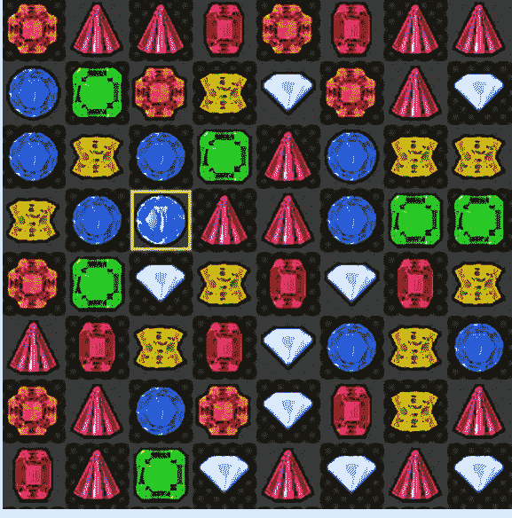

### 响应游戏动作

玩家现在可以在宝石棋盘上选择宝石了，但当玩家尝试交换两个宝石时游戏会失败，因为 `playBoardEvents()` 函数调用了一些尚未实现的显示函数。在下一章中，你将了解如何创建对棋盘事件的动画响应，但目前你可以添加更简单的版本，只是即时更新棋盘。

`display.canvas.js` 中缺失的函数是 `moveJewels()`、`removeJewels()` 和 `refill()`。清单 8-33 展示了这些临时函数。

```
// Listing 8-33 Temporary display functions
jewel.display = (function() {
    ...
    function moveJewels(movedJewels, callback) {
        var n = movedJewels.length,
            mover, i;
        for (i=0;i<n;i++) {
            mover = movedJewels[i];
            clearJewel(mover.fromX, mover.fromY);
        }
        for (i=0;i<n;i++) {
            mover = movedJewels[i];
            drawJewel(mover.type, mover.toX, mover.toY);
        }
        callback();
    }

    function removeJewels(removedJewels, callback) {
        var n = removedJewels.length;
        for (var i=0;i<n;i++) {
            clearJewel(removedJewels[i].x, removedJewels[i].y);
        }
        callback();
    }

    return {
        ...
        moveJewels : moveJewels,
        removeJewels : removeJewels,
        refill : redraw
    };
})();
```

`moveJewels()` 函数在两个独立的循环中遍历所有指定的宝石，首先清除旧位置，然后在新位置绘制宝石。分两步遍历很重要；否则，你会意外清除刚刚绘制的宝石。`removeJewels()` 函数更简单，因为它只是清除所有指定的位置。目前，`refill()` 函数是 `redraw()` 的别名。你将在第 9 章实现一个带动画的 `refill()` 函数。


尝试加载游戏。你现在可以使用鼠标、触摸和键盘输入来选择宝石并交换它们以形成链条。你可能会发现很难跟上棋盘的反应，因为变化是瞬间发生的，但你将在下一章实现游戏动画时解决这个问题。

你在本章创建的输入模块只管理实际游戏棋盘上的输入。如果你想启用，例如，在主菜单上使用键盘导航，你将不得不扩展输入模块以覆盖不仅仅是游戏屏幕。我将把这个作为额外的挑战留给你。

## 总结

在本章中，你学习了如何拦截来自浏览器的原生输入事件，并将它们转化为游戏动作。你了解了桌面浏览器以及支持触摸的移动设备上的用户输入。通过几个简单的例子，你看到了如何使用像iPhone这样的设备中的多点触摸功能，轻松创建基于触摸的手势，如缩放和旋转。然后你了解了新的游戏手柄API，并看到了如何轻松地为你的游戏添加基本的游戏手柄支持，尽管这些功能尚未完全开发。

你还在Jewel Warriors游戏中实现了一个光标对象，并启用了通过键盘、鼠标、触摸和游戏手柄来选择和交换宝石。游戏终于初具规模，现在有了实际的游戏玩法。在下一章中，你将了解如何通过将动画和效果与你刚刚实现的游戏动作关联起来，使游戏变得更加有趣。

# 第9章
## 动画游戏图形

## 本章内容
- 创建动画循环
- 为游戏动作制作动画
- 添加分数和关卡UI元素
- 动画化游戏计时器

**你的游戏已经**开发到玩家可以选择并交换宝石的程度。不过，它仍然需要大量的润色，在本章中，我将向你展示如何用一些动画效果来美化游戏显示。首先，你将了解如何使用动画计时API及其`requestAnimationFrame()`函数创建基本的动画循环。

掌握了基础知识后，你将看到如何在画布显示模块中实现动画，包括移动和移除宝石以及重新填充宝石棋盘的动画。

在本章的后半部分，你将实现游戏缺失的一些部分——即分数和游戏计时器。这些添加使你能够创建升级和游戏结束事件及其动画。

## 让游戏做出反应

到目前为止，你只处理了玩家的动作。此外，游戏必须对玩家的行为做出反应。最重要的是，显示需要更新，以便玩家进行下一步操作。虽然你能够让所有变化瞬间发生，但如果变化是动画化的，使宝石在棋盘上平滑移动，游戏在视觉上会更令人愉悦。

## 动画计时

创建基于JavaScript的动画的基本思路是设置一个函数，使其被重复且足够快地调用，以使移动看起来平滑。在JavaScript中，最简单的方法是使用`setInterval()`函数：

```
function updateAnimation() {
    // update graphic elements
    ...
}
setInterval(updateAnimation, 1000 / 30);
```

这个函数大约每秒调用`updateAnimation()`函数30次。或者，你可以使用`setTimeout()`函数达到相同的效果：

```
function updateAnimation() {
    // update graphic elements
    ...
    setTimeout(updateAnimation, 1000 / 30);
}
setTimeout(updateAnimation, 1000 / 30);
```

`setTimeout()`函数只调用指定函数一次，因此`updateAnimation()`函数需要为下一个动画帧设置一个新的定时器。

第三个选项目前正在由W3C开发。因为这些定时器不仅用于动画，还有许多其他用途，你很快就能使用专门为动画设计的计时函数。新的动画计时API规范可在www.w3.org/TR/animation-timing获取。

这个新API在所有当前版本的常用桌面浏览器以及移动版Safari（从iOS 6开始）和Android（从Android 4.4开始）中都受到支持。最重要的函数是`requestAnimationFrame()`函数，其语法如下：

```
function updateAnimation(time) {
    // update graphic elements
    ...
    requestAnimationFrame(updateAnimation);
}
requestAnimationFrame(updateAnimation);
```

这个函数看起来很像`setTimeout()`的例子，但请注意它没有用于指定何时需要调用更新函数的时间参数。相反，更新函数是用一个`time`参数调用的，该参数包含下一次重绘计划的时间（以毫秒为单位）。这个时间是相对于页面加载的时间。

`requestAnimationFrame()`函数告诉浏览器在它认为最佳的时候调用指定函数。因此，浏览器可以使用自己的内部动画循环，甚至可以确保CSS和JavaScript动画同步。因为浏览器现在可以在页面不可见时自由地延迟渲染，使用此函数也会影响资源使用。如果用户正在查看另一个标签页，就没有必要花费宝贵的处理时间来更新动画。在移动设备上，处理能力和电池时间都有限，不更新动画可能非常重要。

当然，这样做也意味着你无法确保更新函数实际被调用，因此不要让`requestAnimationFrame()`调用处理关键逻辑。传统的`setTimeout()`和`setInterval()`定时器仍然是那些需要在特定时间发生的具有副作用的任务的最佳选择。

如前所述，`requestAnimationFrame()`在大多数现代浏览器中完全支持，但一些旧版本使用带供应商前缀的函数，因此目前，你不能假设Android支持新的计时API。幸运的是，对于缺乏支持的浏览器，使用常规的`setTimeout()`函数模拟行为相对容易。

清单9-1显示了一个polyfill，如果`window`对象上没有`requestAnimationFrame()`方法，则创建它。如果没有可用的实现，则使用常规的`setTimeout()`调用来模拟该功能。

## 清单9-1 requestAnimationFrame()的polyfill

```
window.requestAnimationFrame = (function() {
    var startTime = Date.now();
    return window.requestAnimationFrame ||
           window.webkitRequestAnimationFrame ||
           window.mozRequestAnimationFrame ||
           function(callback) {
               return window.setTimeout(
                   function() {
                       callback(Date.now() - startTime);
                   }, 1000 / 60
               );
           };
})();
```

`setTimeout()`和`setInterval()`函数返回可用于通过`clearTimeout()`和`clearInterval()`移除定时器的整数句柄。新的动画计时API借鉴了这一行为，并提供了一个用于取消请求的函数，恰当地命名为`cancelRequestAnimationFrame()`。清单9-2中显示的此函数的polyfill同样简单直接，最终会回退到`clearTimeout()`。

## 清单9-2 cancelRequestAnimationFrame()的polyfill

```
window.cancelRequestAnimationFrame = (function() {
    return window.cancelRequestAnimationFrame ||
           window.webkitCancelRequestAnimationFrame ||
           window.mozCancelRequestAnimationFrame ||
           window.clearTimeout;
})();
```

你也可以在本章的代码存档文件`requestAnimationFrame.js`中找到这些polyfill。要使用它，只需在`index.html`中与其他脚本一起加载即可。

## 使用requestAnimationFrame()

本节展示了几个示例，演示如何使用`requestAnimationFrame()`创建动画。第一个示例（如清单9-3所示）使用常规的`setTimeout()`函数反复调用`animate()`函数。


### 清单 9-3 使用 setTimeout() 的简单动画
```javascript
function animate() {
    var element = document.getElementById("anim"),
        time = Date.now();

    // element is assumed to have position:absolute
    element.style.left = (50 + Math.cos(time / 500) * 25) + "%";
    element.style.top = (50 + Math.sin(time / 500) * 25) + "%";

    setTimeout(animate, 1000 / 30);
}
animate();
```

你可以在文件 01-settimeout.html 中找到生成的动画，它展示了一个简单的 div 在圆形路径上移动。现在看一下清单 9-4 中的例子。这里，定时器被替换成了 `requestAnimationFrame()`。

### 清单 9-4 使用 requestAnimationFrame() 的简单动画
```javascript
function animate(time) {
    var element = document.getElementById("anim");

    // element is assumed to have position:absolute
    element.style.left = (50 + Math.cos(time / 500) * 25) + "%";
    element.style.top = (50 + Math.sin(time / 500) * 25) + "%";

    requestAnimationFrame(animate);
}
requestAnimationFrame(animate);
```

这个例子展示了替换旧的 `setTimeout()` 调用是多么容易。修改后的例子位于文件 02-requestanimationframe.html 中。

Mozilla 对 `requestAnimationFrame()` 函数的实现提供了另一种使用方式。你无需提供回调函数，而是不带参数调用 `requestAnimationFrame()`。然后，当原本应调用回调函数时，Firefox 会在 window 对象上触发一个特殊的 `MozBeforePaint` 事件。`requestAnimationFrame()` 现在不再将当前时间作为参数传递给处理函数，而是通过事件对象的 `timeStamp` 属性使其可用。清单 9-5 展示了使用 Mozilla 事件重写的例子。

### 清单 9-5 使用 Mozilla 事件的简单动画
```javascript
function animate(event) {
    var element = document.getElementById("anim"),
        time = event.timeStamp;

    element.style.left = (50 + Math.cos(time / 500) * 25) + "%";
    element.style.top = (50 + Math.sin(time / 500) * 25) + "%";

    requestAnimationFrame();
}

window.addEventListener("MozBeforePaint", animate);

requestAnimationFrame();
```

这种方法在某些情况下可能有用，但由于它仅限于 Firefox 且不属于草案规范，因此坚持使用回调函数更安全。

## 创建动画循环

既然你知道如何使用定时器 API，就可以用它在显示模块中创建一个简单的循环。清单 9-6 展示了新的 `cycle()` 函数以及对 `setup()` 函数的必要修改。

### 清单 9-6 动画循环
```javascript
jewel.display = (function() {
    var previousCycle,
        ...

    function setup() {
        ...
        previousCycle = Date.now();
        requestAnimationFrame(cycle);
    }

    function cycle() {
        var time = Date.now();
        previousCycle = time;
        requestAnimationFrame(cycle);
    }

    ...
})();
```

创建一个动画循环就是这么简单。`cycle()` 函数目前还没有做任何有趣的事情；它只是安排下一次循环。`setup()` 中的初始调用启动了循环。注意，它还跟踪了上一次循环的时间。跟踪时间很重要，因为你需要知道自上次动画更新以来过去了多少时间。

## 动画化光标

你在第 8 章中实现的光标只是围绕选定位置的一个静态边框。一个小动画可以使其在视觉上更具吸引力。它不必是任何高级的东西；简单的动画就足够了。在这里，我将向你展示如何用脉动效果增强发光外观。清单 9-7 展示了新的 `renderCursor()` 函数。

```javascript
jewel.display = (function() {
    ...
    function renderCursor(time) {
        if (!cursor) {
            return;
        }
        var x = cursor.x,
            y = cursor.y,
            t1 = (Math.sin(time / 200) + 1) / 2,
            t2 = (Math.sin(time / 400) + 1) / 2;

        clearCursor();

        if (cursor.selected) {
            ctx.save();
            ctx.globalCompositeOperation = "lighter";
            ctx.globalAlpha = 0.8 * t1;
            drawJewel(jewels[x][y], x, y);
            ctx.restore();
        }
        ctx.save();
        ctx.lineWidth = 0.05 * jewelSize;
        ctx.strokeStyle =
            "rgba(250,250,150," + (0.5 + 0.5 * t2) + ")";
        ctx.strokeRect(
            (x + 0.05) * jewelSize, (y + 0.05) * jewelSize,
            0.9 * jewelSize, 0.9 * jewelSize
        );
        ctx.restore();
    }
    ...
})();
```

注意 `Math.sin()` 创建了 t1 和 t2 因子。你可以使用正弦和余弦在动画中做很多事情。这里，`Math.sin()` 函数提供了一种简单的方法来创建随时间变化的值，平滑地从 -1 到 +1 再返回，如图 9-1 所示。如果你像 `renderCursor()` 那样将值加 1 然后除以 2，范围就被修改为 [0, 1]。你在合成宝石和绘制边框矩形时将这些因子应用于 alpha 值。你可以通过更改传递给 `Math.sin()` 调用的参数来改变脉动的周期。

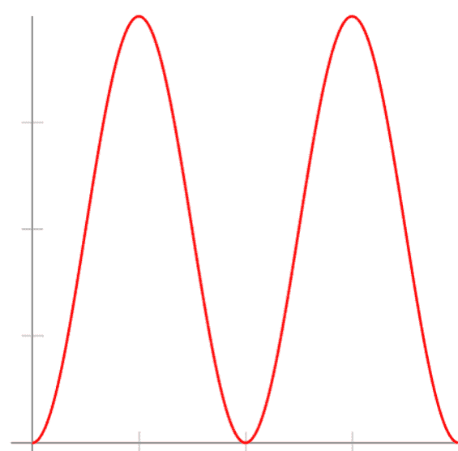

**图 9-1：** 此视觉显示代表了光标脉动。

现在你只需要将 `renderCursor()` 函数添加到动画循环中：

```javascript
function cycle() {
    var time = Date.now();
    renderCursor(time);
    previousCycle = time;
    requestAnimationFrame(cycle);
}
```

光标现在在每个循环中自动更新。另外，请记住从 `setCursor()` 和 `redraw()` 函数中删除旧的 `renderCursor()` 调用。

## 动画化游戏动作

接下来，你必须处理五种不同的游戏动画：

-   移动宝石
-   移除宝石
-   重新填充棋盘
-   进入下一关
-   游戏结束

由于你还没有实现游戏计时器，因此游戏没有 `game over` 状态。此外，你没有跟踪分数，因此无法进入下一关。然而，你可以立即实现其他三种动画。

显示模块需要跟踪所有当前正在运行的动画，以便在每个动画循环中渲染它们。为此，你使用一个名为 `animations` 的数组。动画循环不需要了解每个动画的具体细节；它只需要一个可以在每一帧调用的函数引用。它还需要知道动画所需的时间。这样，完成的动画就可以自动从列表中移除。你使用清单 9-8 所示的 `addAnimation()` 函数添加动画。

### 清单 9-8 添加动画
```javascript
jewel.display = (function() {
    var animations = [],
    ...

    function addAnimation(runTime, fncs) {
        var anim = {
            runTime : runTime,
            startTime : Date.now(),
            pos : 0,
            fncs : fncs
        };
        animations.push(anim);
    }

    ...
})();
```

每个动画都作为一个简单的对象结构添加到列表中，该结构描述了开始时间、完成所需时间以及 `fncs` 属性，该属性持有三个函数的引用：`fncs.before()`、`fncs.render()` 和 `fncs.done()`。这些函数在动画渲染时的不同时刻被调用。`pos` 属性是一个范围在 [0, 1] 内的值，表示动画的当前位置，其中 0 是开始，1 是动画完成。清单 9-9 中的渲染函数处理对 `fncs` 函数的调用。

### 清单 9-9 渲染动画
```javascript
jewel.display = (function() {
    ...
    function renderAnimations(time, lastTime) {
        var anims = animations.slice(0), // copy list
            n = anims.length,
            animTime,
            anim,
            i;

        // call before() function
        for (i=0;i<n;i++) {
            anim = anims[i];
            if (anim.fncs.before) {
                anim.fncs.before(anim.pos);
            }
            anim.lastPos = anim.pos;
            animTime = (lastTime - anim.startTime);
            anim.pos = animTime / anim.runTime;
            anim.pos = Math.max(0, Math.min(1, anim.pos));
        }

        animations = []; // reset animation list

        for (i=0;i<n;i++) {
            anim = anims[i];
            anim.fncs.render(anim.pos, anim.pos - anim.lastPos);
            if (anim.pos == 1) {
                if (anim.fncs.done) {
                    anim.fncs.done();
                }
            } else {
                animations.push(anim);
            }
        }
    }
}
```


function cycle() {
    var time = Date.now();
    // 动画期间隐藏光标
    if (animations.length === 0) {
        renderCursor(time);
    }
    renderAnimations(time, previousCycle);
    previousCycle = time;
    requestAnimationFrame(cycle);
}
...
})();
```

每个动画对象至少包含一个`render()`函数，以及一个可选的`before()`函数。`before()`函数会在每一帧的`render()`函数之前被调用。这样设计的目的是让`before()`函数为下一帧做好准备，并在必要时清理上一帧的内容。至关重要的是，所有动画的`before()`函数都必须在任何`render()`调用之前执行完毕。否则，一个动画的`before()`函数可能会干扰另一个动画的`render()`函数。

每当动画定时器调用`renderAnimations()`时，`animations`数组都会在渲染循环中被清空并重建。这使得只添加尚未完成的动画变得非常容易。如果一个动画完成——即它的位置值至少等于1——则会调用其`done()`函数；否则，它会被重新添加到列表中。

## 移动宝石

当用户交换宝石并更新棋盘时，棋盘模块会为每个事件生成游戏事件，例如移动宝石、宝石消失等。这些事件由你在本章前面添加到游戏屏幕模块中的`playBoardEvents()`函数处理。`screen.js`中处理移动事件的代码大致如下：

```
function playBoardEvents(events) {
    ...
    switch (boardEvent.type) {
        case "move" :
            display.moveJewels(boardEvent.data, next);
            break;
    }
    ...
}
```

但是，如果尝试的交换无效，棋盘不会生成移动事件。当交换无效时，如果宝石先交换位置，然后再移回原位，视觉反馈会得到改善。

现在，扩展`board.js`中的`swap()`函数，使其生成这些额外的事件。清单9-10展示了`board.js`中新的`swap()`函数。

### 清单 9-10 为无效交换生成移动事件

```
jewel.board = (function() {
    ...
    function swap(x1, y1, x2, y2, callback) {
        var tmp, swap1, swap2,
            events = [];
        swap1 = {
            type : "move",
            data : [{
                type : getJewel(x1, y1),
                fromX : x1, fromY : y1, toX : x2, toY : y2
            },{
                type : getJewel(x2, y2),
                fromX : x2, fromY : y2, toX : x1, toY : y1
            }]
        };
        swap2 = {
            type : "move",
            data : [{
                type : getJewel(x2, y2),
                fromX : x1, fromY : y1, toX : x2, toY : y2
            },{
                type : getJewel(x1, y1),
                fromX : x2, fromY : y2, toX : x1, toY : y1
            }]
        };
        if (isAdjacent(x1, y1, x2, y2)) {
            events.push(swap1);
            if (canSwap(x1, y1, x2, y2)) {
                tmp = getJewel(x1, y1);
                jewels[x1][y1] = getJewel(x2, y2);
                jewels[x2][y2] = tmp;
                events = events.concat(check());
            } else {
                events.push(swap2, {type : "badswap"});
            }
            callback(events);
        }
    }
    ...
})();
```

`swap()`函数现在向初始事件数组中添加了一个移动事件，以便宝石交换位置。如果`canSwap()`测试失败，则会添加第二个事件，将宝石移回原位。

`moveJewels()`函数接收一个宝石对象数组，描述了需要移动的宝石。每个宝石对象具有以下属性：

-   type（类型）
-   fromX（起始X坐标）
-   fromY（起始Y坐标）
-   toX（目标X坐标）
-   toY（目标Y坐标）

这些属性描述了宝石的类型以及起始和结束位置。现在，将清单9-11中的`moveJewels()`函数添加到`display.canvas.js`的显示模块中。

### 清单 9-11 为移动宝石添加动画

```
jewel.display = (function() {
    ...
    function moveJewels(movedJewels, callback) {
        var n = movedJewels.length,
            oldCursor = cursor;
        cursor = null;
        movedJewels.forEach(function(e) {
            var x = e.fromX, y = e.fromY,
                dx = e.toX - e.fromX,
                dy = e.toY - e.fromY,
                dist = Math.abs(dx) + Math.abs(dy);
            addAnimation(200 * dist, {
                before : function(pos) {
                    pos = Math.sin(pos * Math.PI / 2);
                    clearJewel(x + dx * pos, y + dy * pos);
                },
                render : function(pos) {
                    pos = Math.sin(pos * Math.PI / 2);
                    drawJewel(
                        e.type,
                        x + dx * pos, y + dy * pos
                    );
                },
                done : function() {
                    if (--n === 0) {
                        cursor = oldCursor;
                        callback();
                    }
                }
            });
        });
    }
    ...
})();
```

`moveJewels()`代码的主要部分遍历所有指定的宝石，并为每个宝石设置动画。`before`方法清除上一帧中宝石所在区域的绘制内容。移动系数使用了与光标渲染中相同的`Math.sin()`技巧进行计算。传递给`before`和`render`方法的`pos`值范围是[0, 1]，因此最终的运动在结束时会平滑地减速。图9-2中的图表展示了该运动因子的可视化表示。

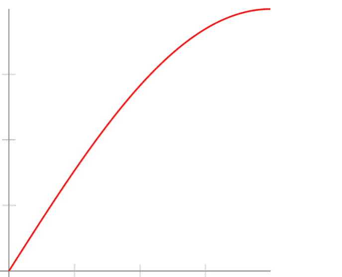

图 9-2：宝石的运动在动画结束时平滑减速。

## 移除宝石

移除宝石的过程与`moveJewels()`中的过程类似。`removeJewels()`函数接收一个对象列表，描述了需要消失的宝石。每个对象具有以下属性：

-   type（类型）
-   x（X坐标）
-   y（Y坐标）

动画的设置方式是在每一帧前清除宝石，然后使用画布变换方法以缩小和旋转的版本重新绘制它。完整的`removeJewels()`函数请参见清单9-12。

### 清单 9-12 移除宝石

```
jewel.display = (function() {
    ...
    function removeJewels(removedJewels, callback) {
        var n = removedJewels.length;
        removedJewels.forEach(function(e) {
            addAnimation(400, {
                before : function() {
                    clearJewel(e.x, e.y);
                },
                render : function(pos) {
                    ctx.save();
                    ctx.globalAlpha = 1 - pos;
                    drawJewel(
                        e.type, e.x, e.y,
                        1 - pos, pos * Math.PI * 2
                    );
                    ctx.restore();
                },
                done : function() {
                    if (--n === 0) {
                        callback();
                    }
                }
            });
        });
    }
    ...
})();
```

如你所见，`render()`中的`drawJewel()`调用现在有了新的第四和第五个参数。这些参数是你在绘制宝石前要应用的缩放和旋转值。清单9-13展示了`display.canvas.js`中`drawJewel()`函数的更改。

### 清单 9-13 为drawJewel()添加缩放和旋转

```
jewel.display = (function() {
    ...
    function drawJewel(type, x, y, scale, rot) {
        ctx.save();
        if (typeof scale !== "undefined" && scale > 0) {
            ctx.beginPath();
            ctx.translate(
                (x + 0.5) * jewelSize,
                (y + 0.5) * jewelSize
            );
            ctx.scale(scale, scale);
            if (rot) {
                ctx.rotate(rot);
            }
            ctx.translate(
                -(x + 0.5) * jewelSize,
                -(y + 0.5) * jewelSize
            );
        }
        ctx.drawImage(jewelSprite,
            type * jewelSize, 0, jewelSize, jewelSize,
            x * jewelSize, y * jewelSize,
            jewelSize, jewelSize
        );
        ctx.restore();
    }
    ...
})();
```

在第6章中，你学习了如何使用画布及其各种变换方法。因此，如果你已经学习了那一章，那么理解这些新增的变换应该没有问题。在`removeJewels()`中，scale参数被传递为`(1 - pos)`，这使得该值在动画进行过程中从1变为0。`pos`值也用于`rot`参数，只是它乘以了2π以获得完整的360度旋转。


既然在绘制宝石时可以添加缩放系数，不妨在**renderCursor()**函数中尝试添加一个大约1.1的缩放值。这样会使光标看起来更闪亮。

## 重新填充棋盘

当棋盘模块检测到没有有效的移动时，它会发送一个`refill`事件。与事件一起发送的参数包含构成新棋盘的宝石。对于填充动画，我使用了canvas动画和CSS 3D变换的混合方式。请查看清单9-14中的`refill()`函数。与`moveJewels()`和`removeJewels()`函数一样，这个示例使用`addAnimation()`来设置动画。`render()`函数做两件事：用新的宝石替换所有旧宝石，并绕x轴旋转棋盘。

**清单9-14 用新宝石重新填充棋盘**

```
jewel.display = (function() {
    ...
    function refill(newJewels, callback) {
        var lastJewel = 0;
        addAnimation(1000, {
            render : function(pos) {
                var thisJewel = Math.floor(pos * cols * rows),
                    i, x, y;
                for (i = lastJewel; i < thisJewel; i++) {
                    x = i % cols;
                    y = Math.floor(i / cols);
                    clearJewel(x, y);
                    drawJewel(newJewels[x][y], x, y);
                }
                lastJewel = thisJewel;
                jewel.dom.transform(canvas,
                    "rotateX(" + (360 * pos) + "deg)");
            },
            done : function() {
                canvas.style.webkitTransform = "";
                callback();
            }
        });
    }
    ...
    return {
        ...
        refill : refill
    }
})();
```

旋转是通过3D CSS变换完成的。CSS的`rotateX()`、`rotateY()`和`rotateZ()`变换都可以让元素绕各自轴旋转指定的度数。`jewel.dom.transform()`函数只是一个针对浏览器厂商特定版本的快捷方法。将此函数添加到`dom.js`中：

```
jewel.dom = (function() {
    ...
    function transform(element, value) {
        if ("transform" in element.style) {
            element.style.transform = value;
        } else if ("webkitTransform" in element.style) {
            element.style.webkitTransform = value;
        } else if ("mozTransform" in element.style) {
            element.style.mozTransform = value;
        } else if ("msTransform" in element.style) {
            element.style.msTransform = value;
        }
    }
    return {
        ...
        transform : transform
    };
})();
```

然而，为了获得正确的3D效果，你必须为旋转增加一些深度，这可以通过在父元素上设置`perspective`属性来实现。只需在`main.css`的`.game-board`规则中添加以下内容：

```
/* 游戏画面 */
#game-screen .game-board {
    ...
    perspective : 16em;
    -webkit-perspective : 16em;
    -moz-perspective : 16em;
    -ms-perspective : 16em;
}
```

你可以尝试调整这个值来改变3D效果的外观。较小的值使其看起来更平坦，而较高的值则会增强效果。填充动画在`done()`方法中结束，该方法会重置CSS变换并调用回调函数，通知调用者动画已完成。图9-3展示了填充动画的一帧。

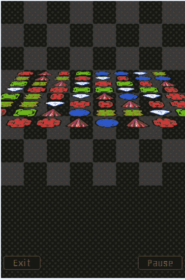

**图9-3：这个动画翻转了棋盘。**

要测试填充动画而无需玩到自动触发填充，你可以通过在JavaScript控制台中输入以下命令来手动触发动画：

```
jewel.display.refill(jewel.board.getBoard(), function(){})
```

它不会用新宝石替换旧宝石，但你可以看到CSS旋转效果。

## 添加计分和计时

现在玩家可以交换宝石，棋盘显示也能很好地响应。然而，游戏还没有真正的目标。你还需要实现一个倒计时器，它会威胁着提前结束游戏，并且你需要给玩家奖励分数，让他在升级到更高关卡时有进步的感觉。所有这些游戏数据都应该对玩家可见并持续更新。实际的值在游戏画面模块的一个简单对象中维护，该对象包含当前关卡和分数，以及一些用于跟踪游戏计时器的属性。每次新游戏开始时，这些值都需要重置，这在清单9-15所示的`startGame()`函数中完成。

**清单9-15 初始化游戏信息并开始游戏**

```
jewel.screens["game-screen"] = (function() {
    var gameState,
        ...
    function startGame() {
        var board = jewel.board,
            display = jewel.display;
        gameState = {
            level : 0,
            score : 0,
            timer : 0, // setTimeout 引用
            startTime : 0, // 关卡开始时间
            endTime : 0 // 游戏结束时间
        };
        board.initialize(function() {
            display.initialize(function() {
                cursor = {
                    x : 0,
                    y : 0,
                    selected : false
                };
                display.redraw(board.getBoard(), function() {});
            });
        });
    }
        ...
})();
```

## 创建UI元素

在开始使用游戏状态对象之前，你需要在游戏屏幕上添加更多的DOM元素。清单9-16显示了index.html中游戏屏幕的修改后的HTML代码。新元素包括当前关卡和分数的标签，以及一个用于游戏计时器的进度条。

**清单9-16 在游戏屏幕上添加新的界面元素**

```
<div id="game">
    ...
    <div class="screen" id="game-screen">
        <div class="game-board"></div>
        <div class="game-info">
            <label class="level">关卡: <span></span></label>
            <label class="score">得分: <span></span></label>
        </div>
        <div class="time"><div class="indicator"></div></div>
        ...
    </div>
</div>
```

未来，当新的HTML5元素被更普遍地支持时，你将能够使用更具语义性的`output`元素来代替标签中的`span`。你还将获得`progress`元素，这将简化各种进度条的实现。与新标记一起使用的CSS放在main.css中，如清单9-17所示。

**清单9-17 为游戏信息元素设置样式**

```
/* 游戏画面 - 游戏状态 */
#game-screen .game-info {
    width : 100%;
    float : left;
}

#game-screen .game-info label {
    display : inline-block;
    height : 1.5em;
    float : left;
    font-size : 0.6em;
    padding : 0.25em;
}

#game-screen .game-info .score {
    float : right;
}

#game-screen .time {
    height : 0.25em;
    border-radius : 0.5em;
}

#game-screen .time .indicator {
    width : 100%;
}
```

新的CSS规则并不是特别有趣。它们只是将元素排列在棋盘下方，并将时间条的样式设置得有点像启动画面上的进度条。图9-4展示了新元素。

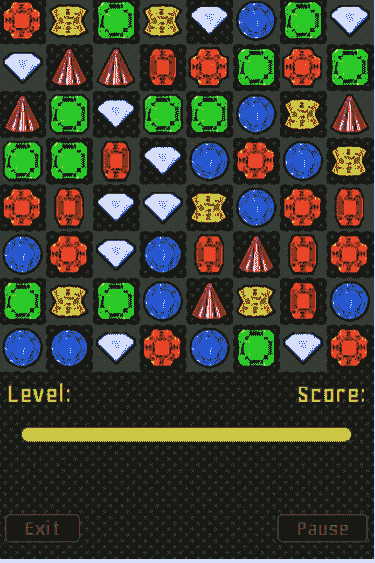

这种布局在桌面浏览器或在移动设备上以竖屏模式查看游戏时效果很好。然而，如果你将设备旋转到横屏模式，布局就不理想了。你可以使用CSS媒体查询来仅针对横屏模式。将清单9-18中的规则添加到mobile.css中，以改善横屏模式下的外观。

### 清单9-18 为大屏幕调整UI

```
@media (orientation: landscape) {
    #game-screen .game-board {
        float : left;
    }

    #game-screen .game-info {
        width : auto;
        height : 2em;
        white-space : nowrap;
    }

    #game-screen .game-info label {
        font-size : 0.5em;
    }

    #game-screen .game-info .score {
        float : left;
        clear : both;
    }

    #game-screen .time {
        margin : 0;
        position: absolute;
        top : 2.0em;
        left: 8.7em;
        width: 5em;
        /* 浏览器厂商特定变换 */
        -webkit-transform : rotate(-90deg) translate(-2.5em, -2.5em);
        -moz-transform : rotate(-90deg) translate(-2.5em, -2.5em);
        -ms-transform : rotate(-90deg) translate(-2.5em, -2.5em);
        /* 标准变换 */
        transform : rotate(-90deg) translate(-2.5em, -2.5em);
    }

    #game-screen footer button.exit {
        float: right;
    }
}
```

现在，关卡和分数标签会自动移动到右上角，以利用横屏模式下的额外水平空间。计时器条得到了特殊处理，因为它被旋转了90度，即使被移动到棋盘旁边的狭窄空间，也能保持其完整大小。图9-5展示了在智能手机上横屏模式下的结果。


## 第九章 游戏图形动画化

你现在可以用当前值更新这些元素了。首先，它们应该在游戏开始时更新，因此创建一个 `updateGameInfo()` 函数来更新分数和等级元素，如清单9-19所示。

### 清单 9-19 更新游戏信息

```
jewel.screens["game-screen"] = (function() {
    ...
    function startGame() {
        ...
        updateGameInfo();
        board.initialize(function() {
            ...
        });
    }

    function updateGameInfo() {
        var $ = jewel.dom.$;
        $("#game-screen .score span")[0].innerHTML =
            gameState.score;
        $("#game-screen .level span")[0].innerHTML =
            gameState.level;
    }
    ...
})();
```

`startGame()` 中的 `updateGameInfo()` 调用会在新游戏开始时将显示重置为初始值。

## 创建游戏计时器

现在你可以继续处理游戏计时器了。当游戏开始时，计时器必须缓慢倒数，当时间耗尽时，游戏结束。在视觉上，这种动画表现为计时器进度条从满到空。玩家存活的唯一方式是获得足够分数以进入下一关，从而使计时器重置。为了使游戏越来越难，你需要随着游戏进程加快计时器速度。首先，在 `jewel.js` 的游戏设置中添加一个基础时间：

```
var jewel = (function() {
    var settings = {
        ...,
        baseLevelTimer : 60000
    }
    ...
})();
```

这个值是以毫秒为单位的第一关时间。随着等级数字增加，时间量减少，但它仍然基于这个基础数字。

当你需要更新计时器进度条时，计时器值必须转换为一个相对值。然后你可以使用这个相对值通过百分比来调整内部元素的宽度。清单9-20展示了 `screen.game.js` 中的计时器更新函数。

### 清单 9-20 检查并更新游戏计时器

```
jewel.screens["game-screen"] = (function() {
    ...
    function setLevelTimer(reset) {
        var $ = jewel.dom.$;
        if (gameState.timer) {
            clearTimeout(gameState.timer);
            gameState.timer = 0;
        }
        if (reset) {
            gameState.startTime = Date.now();
            gameState.endTime =
                settings.baseLevelTimer *
                Math.pow(gameState.level,
                        -0.05 * gameState.level);
        }
        var delta = gameState.startTime +
                      gameState.endTime - Date.now(),
              percent = (delta / gameState.endTime) * 100,
              progress = $("#game-screen .time .indicator")[0];
          if (delta < 0) {
              gameOver();
          } else {
              progress.style.width = percent + "%";
              gameState.timer = setTimeout(setLevelTimer, 30);
          }
    }

    function startGame() {
      ...
      updateGameInfo();
      setLevelTimer(true);
      ...
    }
    ...
})();
```

如果使用重置标志调用 `setLevelTimer()`，它会根据当前等级重置计时器。`startTime` 值就是当前时间，保存它是为了后续调用可以计算已经过去了多少时间。`endTime` 值表示玩家在特定等级被给予的时间量。由于负指数，`Math.pow()` 表达式的值随着等级数字增加而减小。

无论是否有重置标志，该函数随后会计算自计时器设置以来过去了多少时间。将这个数字除以本关的总时间，会得到一个0到1的数字，然后你可以用它来设置计时器进度条内部元素的CSS宽度。如果过去的时间超过了允许的时间，计时器函数就会调用 `gameOver()` 函数来结束游戏。我将在本章后面展示游戏结束函数的实现。如果玩家还活着，新的 `setTimeout()` 调用会设置下一次计时器检查。

这里不使用 `requestAnimationFrame()` 而使用 `setTimeout()` 的原因是，计时器功能比动画更关键。请记住，如果浏览器资源被其他地方需要，它可能不会更新任何动画。

## 暂停游戏

暂停按钮实际上还没有暂时停止游戏。它需要同时暂停游戏计时器和可能正在播放的任何动画。如果你简单地选择在游戏暂停时不更新动画和计时器，那么在恢复游戏时你也需要考虑损失的时间。因为游戏计时器和动画都依赖于它们的开始时间，你需要在游戏恢复时偏移这个时间，这样动画不会瞬间完成，游戏也不会仅仅因为玩家暂停了一点时间就突然结束。

一种方法是计算游戏暂停的时间，然后在恢复时将其添加到开始时间。你还希望在游戏暂停时禁止任何游戏动作，如移动光标或选择宝石。清单9-21展示了 `screen.game.js` 的更改。

### 清单 9-21 暂停游戏计时器

```
jewel.screens["game-screen"] = (function() {
    var paused,
        pauseStart,
        ...

    function pauseGame() {
        ...
        paused = true;
        pauseStart = Date.now();
        clearTimeout(gameState.timer);
        jewel.display.pause();
    }

    function resumeGame() {
        ...
        var pauseTime = Date.now() - pauseStart;
        gameState.startTime += pauseTime;
        setLevelTimer();
        jewel.display.resume(pauseTime);
    }

    function selectJewel(x, y) {
        if (paused) {
            return;
        }
        ...
    }

    function moveCursor(x, y) {
        if (paused) {
            return;
        }
        ...
    }
    ...
})();
```

为了暂停动画，你向显示模块添加暂停和恢复函数。这些函数不需要跟踪时间，因为它们可以简单地使用游戏屏幕模块计算的 `pauseTime` 值。当游戏显示恢复时，它会遍历所有活动的动画，并将暂停时间添加到动画对象的 `startTime` 值上。清单9-22展示了 `display.canvas.js` 的更改。

### 清单 9-22 在显示模块中暂停动画

```
jewel.display = (function() {
    var paused,
        ...

    function initialize(callback) {
        paused = false;
        ...
    }

    function cycle() {
        var now = Date.now();
        if (!paused) {
            // hide cursor while animating
            if (animations.length === 0) {
                renderCursor(now);
            }
            renderAnimations(now, previousCycle);
        }

        previousCycle = now;
        requestAnimationFrame(cycle);
    }

    function pause() {
        paused = true;
    }

    function resume(pauseTime) {
        paused = false;
        for (var i=0;i<animations.length;i++) {
            animations[i].startTime += pauseTime;
        }
    }

    return {
        ...
        pause : pause,
        resume : resume
    }
})();
```

`cycle()` 函数也被修改了，这样在游戏暂停时它不会调用 `renderCursor()` 和 `renderAnimations()` 函数。如果你在动画中间暂停游戏，动画会停止，并在你恢复游戏时从中断处继续。

## 奖励分数

在第四章中，当你实现宝石交换逻辑时，你让它注册了与宝石相关的事件和奖励的分数。`playBoardEvents()` 函数处理分数事件，因此也添加一个处理该事件的 case，如清单9-23所示。

### 清单 9-23 奖励分数

```
jewel.screens["game-screen"] = (function() {
    ...
    function playBoardEvents(events) {
        var display = jewel.display;
        if (events.length > 0) {
            var boardEvent = events.shift(),
                next = function() {
                    playBoardEvents(events);
                };
            switch (boardEvent.type) {
                case "move" :
                    display.moveJewels(boardEvent.data, next);
                    break;
                case "remove" :
                    display.removeJewels(boardEvent.data, next);
                    break;
```


更新UI得分元素很简单，如代码清单9-24所示。

```
代码清单9-24 更新分数
jewel.screens["game-screen"] = (function() {
    ...
    function addScore(points) {
        gameState.score += points;
        updateGameInfo();
    }
    ...
})();
```

## 升级

当玩家达到特定分数时，应进入下一关。为此，你需要在 `addScore()` 函数中增加更多功能。按代码清单9-25所示修改该函数。

```
代码清单9-25 检查分数
jewel.screens["game-screen"] = (function() {
    ...
    function addScore(points) {
        var settings = jewel.settings,
            nextLevelAt = Math.pow(
                settings.baseLevelScore,
                Math.pow(settings.baseLevelExp,
                         gameState.level-1)
            );
        gameState.score += points;
        if (gameState.score >= nextLevelAt) {
            advanceLevel();
        }
        updateGameInfo();
    }
    ...
})();
```

修改后的 `addScore()` 函数使用了两个新值，你需要将它们添加到 `jewel.js` 的设置中：

```
var jewel = (function() {
    var settings = {
        baseLevelScore : 1500,
        baseLevelExp : 1.05,
        ...
    }
    ...
})();
```

你使用这些值来计算升级到下一级所需的分数。当你将 `baseLevelScore` 的基数提高到一个随每一级递增的指数时，各级之间的差距会变得越来越大，从而进一步增加游戏的难度。我选择的值为前五级设定了1500、2162、3174、4750和7254分的限制。如果你想尝试不同的分布，可以随意调整这些设置。

`addScore()` 函数调用了一个 `advanceLevel()` 函数，该函数会递增等级值并设置新的游戏计时器。将代码清单9-26所示的 `advanceLevel()` 函数添加到 `screen.game.js` 中，从 `startGame()` 中移除 `setLevelTimer()` 调用，并在显示初始化时调用 `advanceLevel()`。

```
代码清单9-26 升到下一级
jewel.screens["game-screen"] = (function() {
    ...

    function startGame() {
        ...
        updateGameInfo();
        board.initialize(function() {
            display.initialize(function() {
                display.redraw(board.getBoard(), function() {
                    cursor = {
                        x : 0,
                        y : 0,
                        selected : false
                    };
                    advanceLevel();
                });
            });
        });
    }

    function advanceLevel() {
        gameState.level++;
        updateGameInfo();
        gameState.startTime = Date.now();
        gameState.endTime = jewel.settings.baseLevelTimer *
            Math.pow(gameState.level, -0.05 * gameState.level);
        setLevelTimer(true);
    }
});
```

`gameInfo` 对象上的等级值在游戏开始时为0。玩家应立即升到第1级，因此你还需要在 `startGame()` 函数中添加一个初始的 `advanceLevel()` 调用，如代码清单9-26所示。然后你可以移除对 `setLevelTime()` 的初始调用，因为 `advanceLevel()` 已经处理了这件事。

`advanceLevel()` 函数递增等级值并更新UI元素。当然，升到下一级应该触发一些视觉反馈。代码清单9-27展示了在 `display.canvas.js` 的显示模块中添加的新动画。

**第9章 游戏图形动画** 267

### 代码清单9-27 等级变化时添加视觉效果

```
jewel.display = (function() {
    ...
    function levelUp(callback) {
        addAnimation(1000, {
            before : function(pos) {
                var j = Math.floor(pos * rows * 2),
                    x, y;
                for (y=0,x=j;y<rows;y++,x--) {
                    if (x >= 0 && x < cols) { // 边界检查
                        clearJewel(x, y);
                        drawJewel(jewels[x][y], x, y);
                    }
                }
            },
            render : function(pos) {
                var j = Math.floor(pos * rows * 2),
                    x, y;
                ctx.save(); // 记得保存状态
                ctx.globalCompositeOperation = "lighter";
                for (y=0,x=j;y<rows;y++,x--) {
                    if (x >= 0 && x < cols) { // 边界检查
                        drawJewel(jewels[x][y], x, y, 1.1);
                    }
                }
                ctx.restore();
            },
            done : callback
        });
    }

    return {
        ...,
        levelUp : levelUp
    };
})();
```

仔细看看在 `before` 和 `render` 函数中都出现的循环：

```
var j = Math.floor(pos * rows * 2),
    x, y;
for (y=0,x=j;y<rows;y++,x--) {
    ...
}
```

因为 `pos` 从0到1，所以 `j` 是一个从0开始、结束于 `(2 * rows)` 的整数值。循环从 `y=0` 和 `x=j` 开始。然后它沿着棋盘向下移动，并且在每一行，x位置向左移动一步。结果是匹配的宝石形成一条对角线，在动画过程中沿着棋盘向下或向右移动。`before` 函数只是清除并重绘之前的宝石，而 `render` 函数通过使用 `lighter` 合成操作在顶部绘制副本，来高亮显示当前活动的宝石。

在 `screen.game.js` 的 `advanceLevel()` 中添加对 `jewel.display.levelUp()` 函数的调用：

```
function advanceLevel() {
    ...
    display.levelUp();
}
```

## 公布游戏事件

让玩家知道他已经进入新一关可能是个好主意。游戏信息标签不够大，无法确保玩家注意到变化。在游戏屏幕上添加一个新的div元素用于公告，并为其指定类名 `announcement`。代码清单9-28展示了对 `index.html` 的修改。

```
代码清单9-28 添加公告容器
<div id="game">
    ...
    <div class="screen" id="game-screen">
        <div class="game-board">
            <div class="announcement"></div>
        </div>
        ...
    </div>
</div>
```

现在你可以在那个div中添加文本，并让它出现在游戏棋盘的中间，这样玩家就不会错过它。将代码清单9-29中的CSS添加到 `main.css` 中，以设置公告的样式。

```
代码清单9-29 设置公告样式
/* 游戏屏幕 - 公告 */
#game-screen .announcement {
    position : absolute;
    left: 0;
    top : 50%;
    margin-top : -0.5em;
    width : 100%;

    font-family : Slackey, sans-serif;
    color : rgb(150,150,75);
    text-shadow : 0.03em 0.03em 0.03em rgb(255,255,0),
                  -0.03em -0.03em 0.03em rgb(255,255,0),
                  0.1em 0.15em 0.15em rgb(0,0,0);
    text-align : center;
    white-space : nowrap;

    z-index : 20; /* 位于所有元素之上 */
    opacity : 0; /* 开始时透明 */
    cursor : default;
}
```

这段代码让公告看起来很漂亮，但你还可以做得更好，使用一点CSS添加缩放和淡出动画。代码清单9-30展示了如何做。

```
代码清单9-30 创建缩放和淡出CSS动画
/* 公告动画 */
/* WebKit 的关键帧 */
@-webkit-keyframes zoomfade {
    0%   { opacity : 1; -webkit-transform : scale(0.5); }
    25%  { opacity : 1; }
    100% { opacity : 0; -webkit-transform : scale(1.5); }
}
/* Firefox 的关键帧 */
@-moz-keyframes zoomfade {
    0%   { opacity : 1; -moz-transform : scale(0.5); }
    25%  { opacity : 1; }
    100% { opacity : 0; -moz-transform : scale(1.5); }
}
/* 符合 W3C 标准浏览器的关键帧 */
@keyframes zoomfade {
    0%   { opacity : 1; transform : scale(0.5); }
    25%  { opacity : 1; }
    100% { opacity : 0; transform : scale(1.5); }
}
```


### 清单 9-30 续

```css
/* zoom-fade 动画类 */
.zoomfade {
    animation-name: zoomfade;
    animation-duration: 2s;
    -webkit-animation-name: zoomfade;
    -webkit-animation-duration: 2s;
    -moz-animation-name: zoomfade;
    -moz-animation-duration: 2s;
}
```

这些规则声明了一个名为 `zoomfade` 的 CSS 动画，它在 0%、25% 和 100% 处有三个关键帧。在整个动画过程中，元素从 0.5 缩放到 1.5。透明度也发生了变化，但只在 25% 关键帧之后，这给了用户更好的机会在文本消失之前真正阅读它。最后，CSS 将动画分配给一个名为 `zoomfade` 的类，并将其持续时间设为两秒。现在你需要将 `zoom-fade` 类附加到 `screen.game.js` 中的公告元素上，如清单 9-31 所示。为了让动画在下次需要时再次播放，只需移除该类并再次添加即可。请务必使用 `setTimeout()` 来添加该类，以便浏览器有时间注册该类已被移除。

### 清单 9-31 通知重要事件

```javascript
jewel.screens["game-screen"] = (function() {
    ...
    function announce(str) {
        var dom = jewel.dom,
            $ = dom.$,
            element = $("#game-screen .announcement")[0];
        element.innerHTML = str;
        dom.removeClass(element, "zoomfade");
        setTimeout(function() {
            dom.addClass(element, "zoomfade");
        }, 1);
    }
    ...
})();
```

现在，在 `screen.game.js` 的 `advanceLevel()` 函数中添加一个公告，让玩家知道他已经升级了。清单 9-32 显示了添加调用的位置。

### 清单 9-32 通知下一个等级

```javascript
jewel.screens["game-screen"] = (function() {
    ...
    function advanceLevel() {
        gameInfo.level++;
        announce("Level " + gameState.level);
        ...
    }
    ...
}
```

图 9-6 显示了等级公告。

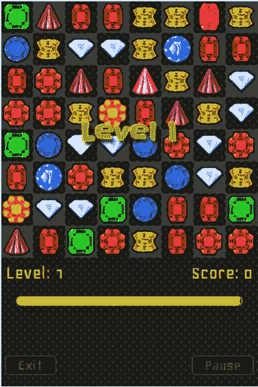

与此同时，当游戏棋盘被重新填充时，添加一个公告。你可以在 `playBoardEvents()` 中添加 `announce()` 调用，如清单 9-33 所示。

### 清单 9-33 通知重新填充事件

```javascript
jewel.screens["game-screen"] = (function() {
    ...
    function playBoardEvents(events) {
        ...
        switch (boardEvent.type) {
            ...
            case "refill" :
                announce("No moves!");
                display.refill(boardEvent.data, next);
                break;
            ...
        }
    }
    ...
})();
```

### 游戏结束

当游戏结束时，也应该有一个漂亮的动画。为此，让珠宝棋盘开始摇晃，并让珠宝看起来爆炸开来。首先，将缺失的 `gameOver()` 函数添加到 `screen.game.js`：

```javascript
jewel.screens["game-screen"] = (function() {
    ...
    function gameOver() {
        jewel.display.gameOver(function() {
            announce("Game over");
        });
    }
    ...
})();
```

这个函数告诉显示模块播放游戏动画，然后在动画完成时显示一个公告。清单 9-34 显示了 `display.canvas.js` 中的 `gameOver()` 函数。

### 清单 9-34 游戏结束动画

```javascript
jewel.display = (function() {
    ...
    function gameOver(callback) {
        addAnimation(1000, {
            render : function(pos) {
                canvas.style.left =
                    0.2 * pos * (Math.random() - 0.5) + "em";
                canvas.style.top =
                    0.2 * pos * (Math.random() - 0.5) + "em";
            },
            done : function() {
                canvas.style.left = "0";
                canvas.style.top = "0";
                explode(callback);
            }
        });
    }
    ...
    return {
        ...
        gameOver : gameOver
    }
})();
```

这个动画中的 `render()` 函数通过一个很小的随机量来调整珠宝棋盘画布的位置。当你使用动画位置作为乘数时，随着动画的进行，效果的强度会增加。当动画结束时，它将回调函数传递给 `explode()` 函数，该函数设置类似爆炸的行为。

通过让所有珠宝向随机方向炸开来创建爆炸效果。为此，你需要一个代表碎片的对象列表。每个碎片应包含关于其当前位置、旋转速度和当前速度的信息。位置由简单的 x 和 y 坐标表示，并从珠宝在棋盘上的原始位置开始。旋转速度是一个随机选取的数字，表示珠宝在动画期间应旋转的弧度数。速度是碎片移动的方向和移动的速度。这也由一对 x 和 y 值表示。`explode()` 函数如清单 9-35 所示。

### 清单 9-35 设置爆炸

```javascript
jewel.display = (function() {
    ...
    function explode(callback) {
        var pieces = [],
            piece,
            x, y;
        for (x=0;x<cols;x++) {
            for (y=0;y<rows;y++) {
                piece = {
                    type : jewels[x][y],
                    pos : {
                        x : x + 0.5,
                        y : y + 0.5
                    },
                    vel : {
                        x : (Math.random() - 0.5) * 20,
                        y : -Math.random() * 10
                    },
                    rot : (Math.random() - 0.5) * 3
                }
                pieces.push(piece);
            }
        }

        addAnimation(2000, {
            before : function(pos) {
                ctx.clearRect(0,0,canvas.width,canvas.height);
            },
            render : function(pos, delta) {
                explodePieces(pieces, pos, delta);
            },
            done : callback
        });
    }
    ...
})();
```

`explode()` 函数遍历整个棋盘，并为所有珠宝创建一个碎片列表。它保存珠宝类型，然后设置初始位置、旋转和速度值。请注意，`vel.y` 值被迫为负数，而 `vel.x` 可以是正数也可以是负数。这是为了让所有碎片最初都向上移动。渲染函数调用 `explodePieces()` 函数，该函数移动所有碎片，同时也对碎片施加重力效果，迫使它们落下来。`explodePieces()` 函数需要 `pos` 和 `delta` 值才能将碎片移动到合适的位置。动画的 `before()` 函数清除整个画布，以便为下一帧做好准备。清单 9-36 显示了 `explodePieces()` 函数。

### 清单 9-36 动画化下落的珠宝

```javascript
jewel.display = (function() {
    ...
    function explodePieces(pieces, pos, delta) {
        var piece, i;
        for (i=0;i<pieces.length;i++) {
            piece = pieces[i];

            piece.vel.y += 50 * delta;
            piece.pos.y += piece.vel.y * delta;
            piece.pos.x += piece.vel.x * delta;

            if (piece.pos.x < 0 || piece.pos.x > cols) {
                piece.pos.x = Math.max(0, piece.pos.x);
                piece.pos.x = Math.min(cols, piece.pos.x);
                piece.vel.x *= -1;
            }

            ctx.save();
            ctx.globalCompositeOperation = "lighter";
            ctx.translate(piece.pos.x * jewelSize,
                          piece.pos.y * jewelSize);
            ctx.rotate(piece.rot * pos * Math.PI * 4);
            ctx.translate(-piece.pos.x * jewelSize,
                         -piece.pos.y * jewelSize);
            drawJewel(piece.type,
                      piece.pos.x - 0.5,
                      piece.pos.y - 0.5
            );
            ctx.restore();
        }
    }
    ...
})();
```

`explodePieces()` 函数做两件事。首先，它改变所有珠宝碎片的位置和速度。然后它在现在空白的画布上渲染每一个碎片。

速度通过添加一个常数乘以 `delta` 来改变。这种速度变化模拟了重力效果。例如，在地球上，下落的物体每秒钟会向地心增加大约 9.8 米/秒的速度（如果你忽略空气阻力的话）。调整这个常数以增加或减少重力。然后，通过添加速度乘以 `delta` 来改变位置。如果位置的 `x` 值为负数，或者超过了 `cols` 的值，则碎片已到达棋盘的左边缘或右边缘。你可以选择让它继续移出视野，也可以翻转速度的 `x` 分量让它反弹回来，这是我选择的选项。

现在很容易在正确的位置渲染珠宝碎片。旋转以通常的方式进行：平移到珠宝的位置，旋转，然后平移回来。请注意，在 `drawJewel()` 调用中使用的坐标减去了 0.5。原因是 `pos.x` 和 `pos.y` 值代表珠宝的中心，但 `drawJewel()` 需要左上角。`lighter` 合成操作在珠宝相互移动时赋予它们半透明的外观。图 9-7 显示了最终动画中的一张静态图像。

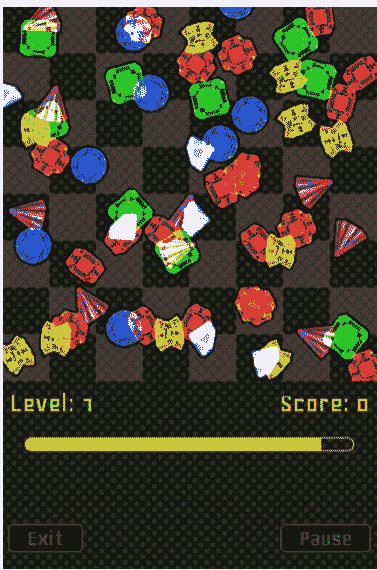

图 9-7：在游戏结束动画中，珠宝翻滚着。


## 总结

在适当的位置使用一些动画效果，极大地提升了《宝石战士》的游戏体验。在本章中，你学习了如何使用新的动画计时 API 设置动画循环，并利用它为 Canvas 显示创建了一个简单的动画框架。

你了解了如何为各种游戏动作制作动画，例如交换宝石和添加游戏结束动画。此外，你还为游戏添加了一些关键元素，即游戏计时器，以及计分和升级的能力。

# 第三部分
添加 3D 和音效

**第 10 章** 为游戏创建音频

**第 11 章** 使用 WebGL 创建 3D 图形

# 第 10 章 为游戏创建音频

## 本章内容

- 介绍 HTML5 音频
- 处理音频格式
- 使用 Web Audio API
- 实现音频模块
- 为游戏添加音效

**现在**游戏的视觉方面已经处理完毕，你可以开始添加音频了。本章将向你介绍新的 HTML5 音频元素，它旨在解决为 Web 应用程序添加声音这一长期存在的问题。

首先，你将探索音频元素的基础知识，涵盖 HTML5 规范中描述的大部分细节和 API 函数。你还将看到一个示例，了解新的 Web Audio API 如何实现更酷的功能，例如位置音频和高级音频处理。

最后，你将使用 HTML5 音频元素为《宝石战士》实现一个音频模块。你还将了解如何将音效绑定到游戏事件，从而为游戏体验增添另一个维度。

## HTML5 音频

在 Web 的早期，没有办法在网页上播放声音，也没有这个需求，因为 Web 主要只是展示文档的一种方式。然而，随着当今游戏和应用程序的产生，添加音频突然成为一个有意义的功能。

微软在 Internet Explorer 中引入了一个 `bgsound` 元素，允许作者将单个音频文件附加到页面并在后台播放。然而，这种用法并不受欢迎，因为用户无法关闭声音，因此它不仅没有增强页面效果，反而令人分心和恼火。

随着时间的推移，各种替代方案被用于音频。使用 `embed` 标签将声音文件嵌入网页相对简单；然而，这样做依赖于插件，并且对音频的控制也差强人意。最终，Flash 接管并主导了网络上的音频和视频领域。至少到目前为止是这样。

HTML5 规范引入了新的媒体元素，使你可以无需使用插件即可处理音频和视频。这两个新的 HTML 元素——`audio` 和 `video`——非常易于使用，在其基本形式中，只需要一行 HTML 代码。例如，嵌入一个自动播放的声音可以像这样简单：

```
<audio src="mysound.mp3" autoplay></audio>
```

同样，一个带有 UI 控件的视频播放器可以通过以下方式嵌入：

```
<video src="myvideo.avi" controls></video>
```

`audio` 和 `video` 元素都实现了 HTML5 `MediaElement` 接口，因此它们共享大部分 API。因此，尽管我没有直接讨论 `video` 元素，你仍然可以将本章中学到的一些内容应用到 `video` 元素上。你可以在 https://developer.mozilla.org/en-US/docs/Web/API/HTMLMediaElement 上阅读更多关于 `MediaElement` 接口的信息。

### 检测音频支持

判断浏览器是否支持音频元素的一种方法是使用 `document.createElement()` 创建一个音频元素，并测试该元素是否存在音频特定的方法。其中一个方法是 `canPlayType()` 方法，你稍后会再次看到它：

```
var audio = document.createElement("audio");
if (typeof audio.canPlayType == "function") {
    // 支持 HTML5 音频
} else {
    // 加载回退代码
}
```

如果你需要一个良好的回退解决方案，我推荐 Scott Schiller 出色的 Sound Manager 2，可访问 www.schillmania.com/projects/soundmanager2。这个库使得在 HTML5 和 JavaScript 中使用音频变得容易。如果浏览器不支持 HTML5 音频，它将无缝地回退到基于 Flash 的音频播放器。

### 理解音频格式之战

然而，仅仅知道音频元素可用是不够的。你还需要确保浏览器能够播放你使用的音频类型，无论是 MP3、Ogg Vorbis 还是其他音频格式。

HTML5 规范详细描述了音频元素的功能，但它并未指定标准的音频格式，甚至没有暗示浏览器应该支持哪些格式。这完全取决于浏览器厂商，由他们决定包含哪些他们认为合适的格式。现在，你可能认为像 Mozilla、Google 和 Microsoft 这样具有创新精神的公司和组织会很快达成某种协议，确定一种通用格式。不幸的是，这尚未发生。

显然，每个浏览器厂商对于什么构成好的音频格式，以及哪些格式与自己的战略和目标不符，都有自己的看法。MP3、Ogg Vorbis、AAC 和 Google 的 WebM 等格式各有优缺点，软件理念和专利问题等争议也减缓了标准化进程。作为 Web 开发者，你面对的是一个碎片化的音频支持格局，实际上不可能找到一种在所有浏览器中都受支持的单一音频格式。表 10-1 显示了主要浏览器支持的格式。

表 10-1 音频格式支持
| 浏览器 | WAV | MP3 | Ogg Vorbis | AAC (MP4) | WebM |
|---|---|---|---|---|---|
| Internet Explorer 11 | | x | | x | (x) |
| Chrome 31 | x | x | x | x | x |
| Firefox 25 | x | (x) | x | (x) | x |
| Safari 7 | x | x | | x | |
| Opera 18 | x | | x | | x |
| iOS 7 | x | x | | x | |
| Android 4.4 | | x | | | |

如表 10-1 所示，没有一种格式是被普遍支持的。Firefox 可以播放 MP3 和 AAC 音频，但依赖于操作系统支持，这意味着目前仅在 Windows Vista/7+ 和 Android 上可用。Internet Explorer 仅通过插件支持 WebM。为了使音频在尽可能多的浏览器中可靠地工作，你至少需要所有音频文件的两个版本，例如 Ogg Vorbis 和 MP3。

### 检测支持的格式

因为 HTML5 音频并非针对某一种特定的音频格式，所以 API 提供了一种检测浏览器能否播放给定类型音频的方法。这个函数当然是 `audio.canPlayType()`，它在前面用于检测音频支持。

`audio.canPlayType()` 方法接受一个参数，即一个包含你要测试格式的 MIME 类型的字符串。例如，以下代码测试是否支持 Ogg Vorbis 音频：

```
var canPlayOGG = audio.canPlayType(
    "audio/ogg; codecs='vorbis'");
```

注意 MIME 类型中的 `codecs` 参数。某些 MIME 类型允许使用这个可选参数来指定不仅是格式（在这种情况下是 Ogg 容器），还有编解码器（这里是 Vorbis）。

MP3 音频的等效测试是

```
var canPlayMP3 = audio.canPlayType("audio/mpeg");
```

现在，你可能认为 `audio.canPlayType()` 方法返回 `true` 或 `false`，但情况稍微复杂一些。返回值是一个字符串，有三种可能的值：

- probably
- maybe
- 一个空字符串

值 `probably` 表示浏览器相当确定它可以播放此类型的音频文件。如果浏览器不确定它能否播放指定类型，但也不确定不能播放，则会返回值 `maybe`。当浏览器知道它根本无法播放该类型的音频时，会返回空字符串。根据你希望应用程序有多乐观，你可以选择只接受 `probably` 值，或者同时接受 `probably` 和 `maybe`：


### 寻找音效

并非所有人都具备创作出色音效和背景音乐的天赋，对于业余开发者而言，预算问题也常常阻碍了他们许可现成音频或雇佣外部人才。幸运的是，有许多网站提供音效和音乐，且对使用方式的限制很少甚至没有。

Freesound 项目 (www.freesound.org) 是一个寻找各类采样和音效的绝佳网站。其所有声音文件均采用知识共享采样加 (Creative Commons Sampling Plus) 许可证授权，这意味着你可以在自己的项目中自由使用它们，只要正确署名原作者即可。

如果你需要完整的音乐曲目来为游戏增添氛围，SoundClick (www.soundclick.com) 提供了数千首音乐曲目，其中许多都采用了各种知识共享许可证授权。

你可以在知识共享网站 http://wiki.creativecommons.org/Content_Directories 上找到更多提供知识共享授权内容的网站。

通常，你找到的音频在完美适用于游戏之前，需要进行一些调整。为此，我推荐免费开源的音频编辑器 Audacity (http://audacity.sourceforge.net)。它拥有的功能可能超乎你所需，并且可以让你轻松修改音频、添加效果，并在各种格式之间转换。

### 使用 audio 元素

你可以通过将 `audio` 元素添加到 HTML 标记中，或通过 JavaScript 创建它来创建音频元素。向 HTML 中添加音频元素就像使用下面的代码一样简单：

```html
<audio src="mysound.mp3" />
```

就像 `canvas` 元素一样，`audio` 元素允许你在标签内放置任意内容，这些内容仅在 HTML5 音频不受支持时才会渲染。你可以利用此功能，例如，包含一个基于 Flash 的备选方案，或简单地显示一条有帮助的消息：

```html
<audio src="mysound.mp3">
    抱歉，您的浏览器不支持 HTML5 音频！
</audio>
```

在上面的代码片段中，任何支持 `audio` 元素的浏览器都会忽略该消息。

你也可以使用 JavaScript 创建音频元素：

```javascript
var myaudio = new Audio("mysound.mp3");
```

如果你没有在 `Audio()` 构造函数中指定源文件，可以稍后通过设置 `audio` 元素的 `src` 属性来指定。

### 添加用户控件

`audio` 元素自带内置的用户界面控件。你可以通过向元素添加 `controls` 属性来启用这些控件：

```html
<audio src="mysound.mp3" controls />
```

这行代码告诉浏览器使用其自身的控件渲染该元素。规范并未规定必须提供哪些控件或它们应是什么样子；它只建议浏览器提供标准行为的控件，例如播放、暂停、定位、调整音量等。图 10-1 展示了在 Firefox、Chrome 和 Internet Explorer 中渲染的带有控件的音频元素。

图 10-1：这些音频元素在 Firefox（顶部）、Chrome（中部）和 Internet Explorer（底部）中以原生控件渲染。

如你所见，整体外观是相同的，尽管默认尺寸略有不同。如有必要，你可以使用 CSS 更改元素的宽度，例如。

> **controls** 属性是一个*布尔属性*，这意味着只要存在该属性就能启用该功能。布尔属性唯一允许的值是属性本身的名称，即 **controls="controls"**。该值是可选的；然而，大多数情况下，你只想使用缩写形式。

如果 **controls** 属性不存在，则不会渲染 `audio` 元素，也不会影响页面其余部分的内容。不过，你仍然可以使用 JavaScript API 来播放声音。

### 预加载音频

在某些情况下，在使用音频之前预先加载它是有意义的。你可以通过将 **audio** 元素的 **preload** 属性设置为以下三个值之一来告诉浏览器预加载音频文件：

-   none
-   metadata
-   auto

请注意，**preload** 属性只是给浏览器的一个提示。浏览器可以出于任何原因（例如可用资源或用户偏好）完全忽略该属性。

值 **none** 提示浏览器根本不预加载任何数据，仅在播放开始后才开始加载数据。例如，以下代码提示根本不预加载任何数据：

```html
<audio src="mysound.mp3" preload="none" />
```

`metadata` 值使浏览器仅加载足够的数据以了解音频文件的时长。如果 `preload` 属性设置为 `auto` 或者该属性不存在，浏览器会自行决定如何提供最佳用户体验。这可能包括加载整个文件。

你也可以通过元素上的属性在 JavaScript 中控制预加载：

```javascript
audio.preload = "metadata"; // 仅加载元数据
```

虽然让文件准备好立即播放很好，但你应始终权衡这一优势与它所需的额外网络流量。只预加载你相当确定会被使用的文件。

### 指定多个源文件

我已经提到过，没有单一格式在所有浏览器中都得到支持，这迫使你要么提供多种格式的源文件，要么放弃对一个或多个浏览器的支持。

幸运的是，你可以轻松指定一个浏览器应尝试播放的音频文件列表。`audio` 元素可以有一个或多个 `source` 子元素。这些 `source` 元素必须各自指向一个音频文件。当解析音频标签时，浏览器会遍历 `source` 元素列表，并在找到第一个可播放的元素时停止。`source` 元素仅作为音频（或视频）元素的子元素才有意义；你不能单独使用它做任何事。

```html
<audio controls>
    <source src="mysound.mp3" type="audio/mpeg">
    <source src="mysound.ogg" type="audio/ogg; codecs='vorbis'">
</audio>
```

前面的示例让浏览器首先测试 MP3 支持，然后测试 Ogg Vorbis，选择第一个可用的格式。`type` 属性指定音频文件的 MIME 类型，可选地附带一个编解码器值。当使用 `src` 属性在 `audio` 元素上直接指定音频源时，你也可以使用此属性。`type` 属性不是必需的，但你应该尽可能包含它。没有 MIME 类型，浏览器将被迫下载音频文件以确定是否能播放该文件。如果你让浏览器知道音频类型，它可以跳过资源获取，直接使用与 `canPlayType()` 方法相同的机制。

> Firefox 对 MIME 类型字符串的格式有点挑剔，要求你在 `codecs` 值周围使用双引号，因此请务必在 `type` 值周围使用单引号。

如果你同时在 `audio` 元素上指定了 `src` 属性并添加了 `source` 子元素，则 `src` 属性具有优先级。仅考虑由 `src` 属性指定的音频源；即使 `src` 属性指定的文件不可播放，也会忽略 `source` 元素。

如果你需要知道最终选择了哪个文件，可以从 `audio` 元素的 `currentSrc` 属性中读取值：

```javascript
alert("选择了文件: " + audio.currentSrc);
```

如果没有指定的音频源可播放，则 `currentSrc` 属性将被设置为空字符串。

### 控制播放

音频元素 API 在元素上暴露了一些方法，最重要的是 `play()` 方法，用于开始播放：

```javascript
audio.play();
```

此方法开始播放声音。如果音频已经播放到末尾，则会从头重新开始播放。如果你想让声音尽快自动开始播放，可以使用 `autoplay` 属性：

```html
<audio src="mysound.mp3" autoplay />
```

音频元素上的另一个方法是 `pause()` 方法：

```javascript
audio.pause();
```

此方法暂停播放，并将 `audio` 元素的 `paused` 属性设置为 `true`。多次调用 `pause()` 没有效果；要恢复播放，必须再次调用 `play()`。使用这两个方法和 `paused` 属性，你可以轻松创建一个切换暂停状态的函数：

```javascript
function togglePause(audio) {
    if (audio.paused) {
        audio.play();
    } else {
        audio.pause();
    }
}
```


一种常见的使用模式是让音频循环播放，即在到达末尾后重新回到开头继续播放。要使音频片段循环播放，只需为 `audio` 元素添加布尔属性 `loop`：

```
<audio src="mysound.mp3" loop />
```

你也可以在元素创建后通过 JavaScript 设置 `loop` 属性：

```
audio.loop = true; // 音频现在开始循环播放
```

> 根据浏览器和平台的不同，在音频重新开始播放前可能会出现短暂的停顿。遗憾的是，目前还没有简单的解决方法。希望未来 HTML5 音频的实现能够改进，从而消除这一问题。

如果你需要更精确地控制播放位置，可以通过 `audio.currentTime` 属性来实现：

```
audio.currentTime = 60 * 1000; // 跳转到音频的1分钟处
```

音频规范并未定义 `stop()` 方法，但你可以轻松地自己实现一个。只需将 `currentTime` 重置为 0 并暂停播放即可：

```
function stopAudio(audio) {
    audio.pause(); // 暂停播放
    audio.currentTime = 0; // 移动到开头
}
```

### 控制音量

你可以通过设置音频元素的 `volume` 属性来调整音频片段的音量。`volume` 属性的值是一个介于 0 到 1 之间的数字，其中 0 表示完全静音，1 表示最大音量：

```
audio.volume = 0.75; // 将音量设置为75%
```

你也可以通过将 `muted` 属性设置为 `true` 来静音。此属性将有效音量设为 0，但不会改变 `volume` 的值，因此当你将 `muted` 设置为 `false` 取消静音时，原始音量会恢复：

```
audio.volume = 0.75; // 有效音量 = 0.75;
audio.muted = true;   // 有效音量 = 0.0;
...
audio.muted = false; // 有效音量 = 0.75;
```

因为 `muted` 是一个布尔值，所以在两种状态之间切换只需将其设置为相反值即可：

```
function toggleMute(audio) {
    audio.muted = !audio.muted;
}
```

### 使用音频事件

你可以使用多种事件来检测音频元素上发生的各种事件。表 10-2 显示了部分事件。

**表 10-2 音频事件**

| 事件名称 | 描述 |
|---|---|
| loadstart | 当浏览器开始加载音频资源时触发。 |
| abort | 当加载因错误以外的原因被中止时触发。 |
| error | 当尝试加载音频时发生错误时触发。 |
| loadedmetadata | 当浏览器已加载足够数据以了解声音时长时触发。 |
| canplay | 当浏览器可以从当前位置开始播放时触发。 |
| canplaythrough | 当浏览器估计可以从当前位置开始播放并持续播放而不会耗尽数据时触发。 |
| ended | 当音频到达末尾时触发。 |
| durationchange | 当音频片段的时长发生变化时触发。 |
| timeupdate | 播放过程中每次位置变化时触发。 |
| play | 当音频开始播放时触发。 |
| pause | 当音频暂停时触发。 |
| volumechange | 当音频音量发生变化时触发。 |

表 10-2 中的事件列表并非详尽无遗，但它显示了大多数用例所需的重要事件。你可以在 W3C 规范 (http://www.w3.org/TR/html5/embedded-content-0.html#mediaevents) 中找到完整的事件列表。

### 创建自定义 UI 控件

有时，你可能想提供自己的自定义 UI 元素来控制音频播放。可能原生控件的样式与你的应用程序不匹配；或者你只是想更严格地控制它们的行为。正如你可能已经想到的，你可以轻松使用上述方法和事件来创建你的控件，下面的示例就展示了这一点。清单 10-1 显示了 HTML 元素。

**清单 10-1 用于音频控制的自定义元素**
```
<audio id="myaudio" loop>
    <source src="beat.mp3" type="audio/mpeg" />
    <source src="beat.ogg" type='audio/ogg; codecs="vorbis"' />
</audio>
<section id="controls">
    <header><h3>播放器控件</h3></header>
    <div class="progress"><div class="value"></div></div>
    <button class="play">播放</button>
    <button class="pause">暂停</button>
    <button class="stop">停止</button>
    <button class="mute">静音</button>
</section>
```

你可以在文件 `01-customcontrols.html` 中找到这个示例。我还添加了一些 CSS 规则来设置进度条的样式。播放、暂停、停止和静音按钮很容易实现。清单 10-2 显示了附加到按钮的点击事件处理程序。

**清单 10-2 将点击事件绑定到音频操作**
```
function $(str) {
    return document.querySelectorAll(str);
};
var audio = $("#myaudio")[0];

$("button.play")[0].addEventListener("click", function() {
    audio.play();
}, false);

$("button.pause")[0].addEventListener("click", function() {
    audio.pause();
}, false);

$("button.stop")[0].addEventListener("click", function() {
    audio.pause();
    audio.currentTime = 0;
}, false);

$("button.mute")[0].addEventListener("click", function() {
    audio.muted = !audio.muted;
}, false);
```

音频元素在播放时也应自动更新进度条。你可以使用 `timeupdate` 事件读取 `currentTime` 值，并相应地更新进度条元素。清单 10-3 展示了如何实现。

**清单 10-3 更新自定义进度条**
```
function updateProgress() {
    var prog = $(".progress .value")[0],
        pos = audio.currentTime / audio.duration * 100;
    prog.style.width = pos + "%";
}
audio.addEventListener("timeupdate", updateProgress, false);
```

最后，进度条应该能够通过鼠标点击来改变音频播放位置。这个问题也很容易解决，因为你只需根据点击的相对位置更新 `currentTime` 值即可。清单 10-4 显示了进度条的 `click` 事件处理程序。

**清单 10-4 更新播放位置**
```
$(".progress")[0].addEventListener("click", function(e) {
    var rect = this.getBoundingClientRect(),
        pos = (e.clientX - rect.left) / rect.width;
    audio.currentTime = audio.duration * pos;
}, false);
```

这就是使用 DOM 元素控制音频播放的全部过程。

### 在移动设备上使用音频

那么移动设备呢？情况正在改善，但仍然存在一些需要解决的问题。当前版本的 iOS（从 3.0 开始）和 Android（从 2.3 开始）都支持 HTML5 音频。早期版本的 Android 具有部分和损坏的音频支持，但直到 2.3 版本才真正可以通过 HTML5 音频播放声音。

其中一个问题是音量控制。正如你现在已经了解到的，音频元素有自己的音量值，你可以用来控制该特定音频片段的音量。在 iOS 设备上，音频元素始终以最大音量播放，你无法更改音量值。音量完全由用户掌控，任何通过 JavaScript 修改它的尝试都会被忽略。除了音量控制的限制外，iOS 还有一个缺陷，即任何时候只允许播放一个音频流。开始播放新声音会暂停任何正在播放的声音。这意味着你无法叠加音效，或者在播放与游戏事件相关的小片段的同时播放背景音乐。

Android 允许多个音频片段同时播放，但具有与 iOS 相同的音量限制。它在开始播放时也存在一些严重的延迟问题，使得难以获得响应迅速的音效。

### 处理音频数据

HTML5 音频的规范远未完成，甚至今天仍在努力扩展音频元素的功能，例如直接、采样级别的音频数据访问，以允许高级音频分析和音频生成与过滤。由于这些功能远未成熟，你无法在 Jewel Warrior 游戏中使用它们，但我将讨论一下这些 API 并向你展示几个例子。

直到最近，还有两种不同的 API 用于处理音频数据。Mozilla 的人员正在开发 Audio Data API (https://wiki.mozilla.org/Audio_Data_API)，而 Chromium 项目则催生了 Web Audio API，W3C 音频工作组最终选择了它 (www.w3.org/TR/webaudio)。Mozilla 后来弃用了自己的 API 并添加了对 Web Audio API 的支持。除 Internet Explorer 外，所有主要桌面浏览器都支持该 API，尽管 Safari 7 和 Opera 18 使用了带前缀的实现。有关浏览器支持的最新信息，请参见 CanIUse 网站 (http://caniuse.com/#feat=audio-api)。有关 W3C 规范的最新进展，请参考最新的“编辑草案” http://webaudio.github.io/web-audio-api。

> 与 canvas 元素上的图像数据方法类似，音频数据 API 也受到同源策略的限制。这意味着你只能访问与你的应用程序托管在同一域上的文件中的音频数据。你还需要从网络服务器运行代码，因为访问本地文件（即 `file://`）同样受到限制。


## 使用 Web Audio API

Web Audio API 的基本概念围绕音频上下文和音频节点展开。你可以使用多种不同类型的音频节点。有些节点同时具备输入和输出，并以特定方式转换数据——例如调整音量或通过滤波器——而另一些则作为源节点，只有输出。

Web Audio API 相当复杂，要完整讲解它超出了本书的范围。在本章中，我将展示足够的基础知识，让你能够开始使用这项令人兴奋的新技术。

### 音频上下文

首先你需要一个音频上下文对象，可以通过 `AudioContext()` 构造函数创建。目前只有 Firefox 无需厂商前缀即可实现该 API；Chrome、Safari 和 Opera 都使用 `webkit` 前缀。为了兼容这两种情况，你可以使用如下函数：

```
function createAudioContext() {
    if (window.AudioContext) {
        return new window.AudioContext()
    } else if (window.webkitAudioContext) {
        return new window.webkitAudioContext()
    }
}
```

音频上下文本质上是一组音频节点的集合，这些节点相互路由音频，最终传入一个目标节点，也就是用户将听到的声音。你可以把它想象成一个有向图，每个音频节点将其输出连接到另一个节点的输入，最后终止于目标节点。

### 音频节点

音频节点是实际产生和转换音频的对象。它们可以是音频源、处理节点或目标节点。源节点只有输出，通过编程方式或从音频源生成音频。只有目标节点有输入。处理节点位于中间，既有输入也有输出。你可以使用这些节点在音频到达用户之前对其进行某种方式的修改。源节点和处理节点都是通过音频上下文对象上的方法创建的——例如：

```
// 创建一个 OscillatorNode 节点，生成 440hz 音调
var source = context.createOscillator();
source.frequency.value = 440;

// 创建一个 GainNode，将增益/音量降低到 0.8
var gain = context.createGain();
gain.gain.value = 0.8;
```

音频节点使用 `connect()` 函数相互连接：

```
source.connect(gain);
```

当音频经过所有你想要的节点后，将最后一个节点的输出连接到音频上下文上的目标节点，并启动源节点：

```
gain.connect(context.destination);

source.start(0.5); // 在 0.5 秒后播放
```

### 定位音频

现在来看一个如何使用 Web Audio API 创建定位音频的小例子，这只是众多应用之一。游戏中音频的一个常见问题是，如何根据声音的来源动态改变环境中声音的音量和方向。Web Audio API 提供了一个音频节点，让你可以相当容易地做到这一点。`PannerNode` 可以根据位置、方向甚至速度（如果你还想要多普勒效应）来转换音频。只需将源节点连接到声像节点，再将声像节点连接到音频上下文上的目标节点即可。

本例将两个音频源连接到音频上下文，并在 canvas 画布上绘制它们的位置。然后添加鼠标事件，使这两个声音可以重新定位。你可以在本章归档文件中的 `02-webaudio.html` 文件找到完成的示例。请注意，目前 Firefox 25 中存在一个错误，导致此示例无法工作。建议使用 Chrome 或 Opera 来运行此示例，因为它们似乎实现了最少的错误功能。首先，先看一点 HTML 代码。清单 10-5 展示了 canvas 元素和两个 audio 元素。

#### 清单 10-5 设置 HTML 元素

```
<canvas id="canvas" width="512" height="512"></canvas>
<br/>
<audio id="beat" autoplay loop>
    <source src="beat.mp3" type="audio/mpeg" />
    <source src="beat.ogg" type="audio/ogg; codecs='vorbis'" />
</audio>
<audio id="footsteps" autoplay loop>
    <source src="steps.mp3" type="audio/mpeg" />
    <source src="steps.ogg" type="audio/ogg; codecs='vorbis'" />
</audio>
```

Canvas 用于绘制声音相对于监听者的位置。对于 JavaScript 部分，首先创建音频上下文和必要的音频节点，如清单 10-6 所示。

#### 清单 10-6 创建并连接音频节点

```
var context = createAudioContext(),
    audio1 = document.getElementById("beat"),
    audio2 = document.getElementById("footsteps"),
    mediaNode1 = context.createMediaElementSource(audio1),
    mediaNode2 = context.createMediaElementSource(audio2),
    pannerNode1 = context.createPanner(),
    pannerNode2 = context.createPanner();

mediaNode1.connect(pannerNode1);
pannerNode1.connect(context.destination);
pannerNode1.refDistance = 50;

mediaNode2.connect(pannerNode2);
pannerNode2.connect(context.destination);
pannerNode2.refDistance = 50;
```

清单 10-6 为每个声音使用 `context.createMediaElementSource()` 方法创建源节点。此方法接受一个 audio（或 video）元素，并返回一个表示该音频源的音频节点。`context.createPanner()` 方法返回一个 `PannerNode` 音频节点，用于在 3D 空间中定位音频源。这些节点具有设置声音位置、方向和速度的方法，以及几个描述声音参数的属性，如声音锥形区域、最大距离等。这些计算中使用的坐标系独立于任何单位（如米或英尺），因此要控制声音在给定距离的响度，你可以使用 `refDistance` 属性，它指定了一个参考距离。

接下来，初始化声音以及监听者的位置，如清单 10-7 所示。本例中的“世界”只是画布的 512x512 二维表面，因此只需要 x 和 y 坐标。

#### 清单 10-7 初始化并更新位置

```
var soundPos1 = [Math.random() * 512, Math.random() * 512],
    soundPos2 = [Math.random() * 512, Math.random() * 512],
    listenPos = [256, 256];

function updatePositions() {
    context.listener.setPosition(listenPos[0], listenPos[1], 0);
    pannerNode1.setPosition(soundPos1[0], soundPos1[1], 0);
    pannerNode2.setPosition(soundPos2[0], soundPos2[1], 0);
    updateCanvas();
}

function updateCanvas() {
}

updatePositions();
```

音频上下文上的 `listener` 属性是一个 `AudioListener` 对象，代表监听者。与声像节点一样，你可以设置监听者的位置、方向和速度。在这个简单的例子中，我只使用了位置，并将监听者放在画布中心，但在更复杂的游戏场景中，你可以使用方向和速度来增加声音的真实感。`updateCanvas()` 函数目前为空。

现在添加交互性。向 canvas 添加鼠标事件，这样你就可以用鼠标定位两个音频源。清单 10-8 展示了如何做。

#### 清单 10-8 用鼠标重新定位声音

```
var canvas = document.getElementById("canvas"),
    ctx = canvas.getContext("2d"),
    mouseIsDown = false;

function update(e) {
    var rect = canvas.getBoundingClientRect(),
        x = e.clientX - rect.left,
        y = e.clientY - rect.top;

    if (e.shiftKey) {
        soundPos2 = [x, y];
    } else {
        soundPos1 = [x, y];
    }
    updatePositions();
}

canvas.addEventListener("mousedown", function(e) {
    mouseIsDown = true;
    update(e);
    e.preventDefault();
}, false);

canvas.addEventListener("mouseup", function(e) {
    mouseIsDown = false;
}, false);

canvas.addEventListener("mousemove", function(e) {
    if (mouseIsDown) {
        update(e);
    }
}, false);
```

`mousedown` 和 `mouseup` 事件处理器切换 `mouseIsDown` 标志，然后在 `mousemove` 处理器中检查该标志，再调用 `update()` 函数。这样，`update()` 只在鼠标按下时才被调用。

`update()` 函数首先计算鼠标事件在画布上的位置，然后根据是否按下了 shift 键来改变第一个或第二个声音的位置。这样，你就可以用鼠标移动两个声音。最后，从 `updatePositions()` 调用的 `updateCanvas()` 方法如清单 10-9 所示。

#### 清单 10-9 更新 canvas 显示

```
function updateCanvas() {
    ctx.clearRect(0, 0, canvas.width, canvas.height);

    ctx.beginPath();
    ctx.arc(listenPos[0], listenPos[1], 10, 0, 2 * Math.PI);
    ctx.stroke();

    ctx.beginPath();
    ctx.fillStyle = "red";
    ctx.arc(soundPos1[0], soundPos1[1], 5, 0, 2 * Math.PI);
    ctx.fill();

    ctx.beginPath();
    ctx.fillStyle = "blue";
    ctx.arc(soundPos2[0], soundPos2[1], 5, 0, 2 * Math.PI);
    ctx.fill();
}
```


### 构建音频模块

既然你已经了解了使用 HTML5 音频是多么简单，你可以将这些知识付诸实践，为 Jewel Warrior 添加一个音频模块。在一个全新的 `audio.js` 文件中创建一个新的音频模块，并从如清单 10-10 所示的基本模块结构开始。

清单 10-10 **音频模块**

```
jewel.audio = (function() {

    function initialize() {
    }

    return {
        initialize : initialize
    };

})();
```

### 为音频播放做准备

首要任务是确定音频模块将使用哪种音频格式。在本章的代码归档中，我包含了所有要实现的音效的 MP3 和 Ogg Vorbis 版本。这些音效已发布到公共领域，因此请随意在自己的项目中使用它们。清单 10-11 展示了一个 `formatTest()` 函数，该函数返回最合适的音频格式的文件扩展名。

清单 10-11 **确定合适的格式和文件扩展名**

```
jewel.audio = (function() {
    var extension;

    function initialize() {
        extension = formatTest();
        if (!extension) {
            return;
        }
    }

    function formatTest() {
        var audio = new Audio(),
            types = [
                ["ogg", "audio/ogg; codecs='vorbis'"],
                ["mp3", "audio/mpeg"]
            ];
        for (var i=0;i<types.length;i++) {
            if (audio.canPlayType(types[i][1]) == "probably") {
                return types[i][0];
            }
        }
        for (i=0;i<types.length;i++) {
            if (audio.canPlayType(types[i][1]) == "maybe") {
                return types[i][0];
            }
        }
    }
    ...
})();
```

测试方法是通过遍历音频格式列表，返回 `canPlayType()` 函数返回值为 **probably** 的第一个格式。如果找不到这样的格式，第二个循环会寻找置信度较低的 **maybe** 值。此测试确保，例如，即使 WAV 文件通常是 Web 应用程序不太理想的格式，也可以选择其 **probably** 值，而不是 Ogg Vorbis 的 **maybe** 值。

### 播放音效

音频模块最重要的功能是播放声音。播放的每个音效都需要自己的音频元素。清单 10-12 展示了负责创建这些元素的 `createAudio()` 函数。

清单 10-12 **创建音频元素**

```
jewel.audio = (function() {
    var extension,
        sounds;

    function initialize() {
        extension = formatTest();
        if (!extension) {
            return;
        }
        sounds = {};
    }

    function createAudio(name) {
        var el = new Audio("sounds/" + name + "." + extension);

        sounds[name] = sounds[name] || [];

        sounds[name].push(el);
        return el;
    }
    ...
})();
```

`createAudio()` 函数有一个参数，即不带扩展名的音效文件名，该扩展名在音频模块初始化时已确定。然而，它不仅仅是返回该元素；它还在 `sounds` 对象中保留了对该元素的引用。该对象为每个音效包含一个数组，其中存放了到目前为止为该特定声音创建的所有音频元素。因此，可以重用已播放完毕的元素。你可以在清单 10-13 中的 `getAudioElement()` 函数中看到这一点的用法。

清单 10-13 **获取音频元素**

```
jewel.audio = (function() {
    ...
    function getAudioElement(name) {
        if (sounds[name]) {
            for (var i=0, n=sounds[name].length; i<n; i++) {
                if (sounds[name][i].ended) {
                    return sounds[name][i];
                }
            }
        }
        return createAudio(name);
    }
    ...
})();
```

`getAudioElement()` 函数检查是否已有可用的音频元素。只有在没有可用元素（要么是因为尚未创建任何元素，要么是因为它们都在播放中）时，才会创建新元素。现在你可以轻松创建一个 `play()` 函数来播放给定的音效。清单 10-14 展示了这个新函数。

清单 10-14 **播放函数**

```
jewel.audio = (function() {
    var extension,
        sounds,
        activeSounds;

    function initialize() {
        extension = formatTest();
        if (!extension) {
            return;
        }
        sounds = {};
        activeSounds = [];
    }

    function play(name) {
        var audio = getAudioElement(name);
        audio.play();
        activeSounds.push(audio);
    }

    return {
        initialize : initialize,
        play : play
    };
})();
```

当 `play()` 函数播放一个声音时，它也会在 `activeSounds` 数组中存储该声音的引用。你将使用此数组来解决下一个问题：停止声音。

### 停止声音

停止当前播放的声音很容易。只需遍历 `activeSounds` 数组，对所有音频元素调用 `audio.stop()` 方法，然后清空数组即可。清单 10-15 展示了添加到 `audio.js` 中的 `stop()` 函数。

清单 10-15 **停止函数**

```
jewel.audio = (function() {
    ...
    function stop() {
        for (var i=activeSounds.length-1;i>=0;i--) {
            activeSounds[i].stop();
        }
        activeSounds.length = 0;
    }
    return {
        initialize : initialize,
        play : play,
        stop : stop
    };
})();
```

### 清理

你还有一件事要做。当一个声音开始时，它会被添加到 `activeSounds` 数组。你需要确保在播放结束后再次移除该声音。为了解决这个问题，你可以利用当声音结束时触发的 `ended` 事件。每当创建一个新的音频元素时，就为 `ended` 事件附加一个事件处理程序，该处理程序将音频元素从 `activeSounds` 数组中移除。清单 10-16 展示了新的事件处理程序。

清单 10-16 **维护活跃声音列表**

```
jewel.audio = (function() {
    function createAudio(name) {
        var el = new Audio("sounds/" + name + "." + extension);
        jewel.dom.bind(el, "ended", cleanActive);
        ...
    }
    function cleanActive() {
        for (var i=0; i<activeSounds.length; i++) {
            if (activeSounds[i].ended) {
                activeSounds.splice(i, 1);
            }
        }
    }
    ...
})();
```

由于你没有跟踪音频元素在 `activeSounds` 数组中的位置，最简单的方法是批量移除任何已结束的音频元素。元素通过使用 `splice()` 方法移除，该方法通过从给定索引开始移除指定数量的元素来修改数组。这样做当然会改变数组的长度，这就是为什么循环条件不断将 `i` 与当前长度进行比较很重要，而不是像通常的最佳实践那样，与之前缓存的值进行比较。

最后，记得在 `index.html` 中与其他脚本模块一起加载 `audio.js` 文件。

### 向游戏添加音效

现在音频模块已完成，你可以开始向游戏添加音效了。在本章的代码归档中，我在 `sounds` 文件夹中包含了一套音效。包含的音效将用于以下游戏事件：

- 成功匹配宝石
- 执行无效的宝石交换
- 进入下一关
- 表示游戏结束

### 从游戏屏幕播放音频

是时候回到游戏屏幕模块 `screen.game.js` 了。第一件事是确保音频模块在游戏开始时初始化——即在游戏屏幕模块中的 `startGame()` 函数被调用时。清单 10-17 展示了修改内容。

清单 10-17 **初始化音频模块**

```
jewel.screens["game-screen"] = (function() {
    ...
    function startGame() {
        ...
        jewel.audio.initialize();
        board.initialize(function() {
            ...
        });
    }
    ...
})();
```


播放音效现在变得非常简单，只需在需要的地方添加 `audio.play()` 调用即可，如清单 10-18 所示。

**清单 10-18** 添加音效

```
jewel.screens["game-screen"] = (function() {
    ...
    function advanceLevel() {
        jewel.audio.play("levelup");
        ...
    }

    function gameOver() {
        jewel.audio.play("gameover");
        ...
    }

    function playBoardEvents(events) {
        if (events.length > 0) {
            ...
            switch (boardEvent.type) {
                ...
                case "remove" :
                    jewel.audio.play("match");
                    ...
                case "badswap" :
                    jewel.audio.play("badswap");
                    next();
                    break;
                ...
            }
        }
    }
    ...
})();
```

至此，你就完成了。游戏现在会在最重要的事件上播放音效。

## 总结

在本章中，你学习了如何使用新的音频元素为游戏和应用程序添加声音，而无需依赖 Flash 或其他基于插件的技术。但这并非完美无缺，因为存在音频格式冲突和移动设备上的问题。

尽管如此，现代桌面浏览器的支持水平已经达到了你可以放心使用 HTML5 音频的程度。本章最后一部分向你展示了如何创建一个音频模块，并用它为《宝石勇士》添加音效。

你还初步了解了某些浏览器中可用的一些更高级功能，例如 Web Audio API。虽然它仍在开发中且缺乏广泛支持，但很容易看出这些功能最终将极大地增强浏览器的音频能力。

# 第 11 章：使用 WebGL 创建 3D 图形

## 本章内容

-   介绍 WebGL
-   使用 OpenGL 着色语言
-   使用 Collada 模型
-   为 3D 对象添加纹理和光照
-   创建一个 WebGL 显示模块

**你已经**熟悉使用 canvas 元素绘制 2D 图形。在本章中，你将向前迈进，使用 3D 图形和 WebGL 上下文。你将了解到足够的 WebGL API 知识，以渲染带有光照和纹理对象的简单 3D 场景。

本章的第一部分将重点介绍 OpenGL 着色语言（GLSL），这是一种专门用于通过 OpenGL 渲染图形的语言。然后你将系统地学习渲染简单 3D 对象的过程。你还将了解如何将常用的 Collada 模型格式导入你的 WebGL 应用程序。

在结束之前，你将学习如何将本章中的各项技术综合运用，创建《宝石勇士》游戏界面的 WebGL 版本。

## Web 上的 3D

canvas 元素的设计使得实际功能与元素本身分离。所谓的上下文提供了所有图形功能。在第 6 章中，你使用 2D 上下文提供的基于路径的 API 在 canvas 上绘制图形。WebGL 为 canvas 元素扩展了一个 3D 上下文。

WebGL 基于 OpenGL ES 2.0 图形 API，这是面向嵌入式系统和移动设备的 OpenGL 变体。这也是你在例如 iPhone 和 Android 设备上开发原生应用程序时所使用的 OpenGL 版本。Khronos Group 负责管理 WebGL 规范并监督各种 OpenGL 规范。WebGL 规范的大部分内容是 OpenGL ES 功能的直接映射，这意味着已经存在指南、书籍和示例代码可供你参考。即使上下文与 Web 无关，其他语言（如 C）的 OpenGL ES 代码示例仍然很有价值。你还可以找到大量可以直接插入 WebGL 应用程序的 GLSL 代码。

WebGL 非常受欢迎，以至于 Khronos 已经在制定 WebGL 2 的规范，这个更新将使其与 OpenGL ES 3.0 API 保持一致，并添加许多很酷的功能，例如 3D 纹理和新的压缩格式。WebGL 2 将向后兼容 WebGL，因此你今天用 WebGL 制作的应用程序和游戏在未来也能运行。

## 在哪里可以使用 WebGL

Firefox 从 4.0 版本开始支持 WebGL，Chrome 从 9 版本开始，Safari（OS X）从 5.1 版本开始。Safari 的 WebGL 默认是禁用的，但你可以在开发者菜单中启用它，该菜单在高级设置中启用。WebGL 也即将登陆 Opera，但目前仅在特殊测试版中可用。起初，微软对 WebGL 表示担忧，声称其设计固有的安全问题使得 WebGL 无法达到其标准。最终，他们改变了这一立场，Internet Explorer 11 成为第一个包含 WebGL 的 IE 版本。

移动设备对 WebGL 的支持相当有限。当前可用的标准 Android 浏览器不支持 WebGL。适用于 Android 的 Firefox 支持 WebGL，适用于 Android 的 Chrome 也支持，但后者需要在 chrome://flags 页面启用它。Apple 从 iOS 5 开始在 iOS 中包含了 WebGL，但到目前为止，它仅限于 iAds 框架。我希望我们很快就能看到这个功能出现在移动 Safari 浏览器中。

## WebGL 入门

大多数当前的 3D 图形，包括你在本章中看到的图形，都是由小三角形（也称为面）组成的对象构成的。即使是看似具有光滑表面的非常精细的 3D 模型，在足够放大时也会显示出其多边形的本质。每个三角形由三个点描述，每个点（也称为顶点）是一个三维向量。将两个三角形组合在一起形成一个矩形，将六个正方形组合在一起就形成了一个立方体，以此类推。

WebGL 将此 3D 几何图形存储在缓冲区中，这些缓冲区被上传到图形处理单元（GPU）。然后，几何图形被渲染到屏幕上，首先通过顶点着色器，然后通过片段着色器。顶点着色器根据对象的旋转和位置以及期望的 2D 投影来变换 3D 点的坐标。最后，片段着色器计算用于填充屏幕上投影三角形的颜色值。着色器是我在这个介绍性部分之后讨论的第一个主题，因为它们是创建 WebGL 应用程序的基础。

> WebGL 和 OpenGL ES 太过复杂，无法在单个章节中全面详细地介绍。如果你对 WebGL 开发和 OpenGL 是认真的，我建议花时间在像 Learning WebGL (http://learningwebgl.com) 这样的网站上，那里你可以找到许多教程和 WebGL 相关的文章。

因为 WebGL 基于 canvas，使用 WebGL 的第一步是创建一个 canvas 元素并获取一个 WebGL 上下文对象：

```
var canvas = document.createElement("canvas"),
    gl = canvas.getContext("webgl");
```

目前只有 Firefox 和 Chrome 支持 webgl 上下文。Opera、Internet Explorer 11 和 Safari 都使用名称 experimental-webgl，但随着这些实现的成熟，这很可能会更改为 webgl。为了兼顾这两种情况，你可以使用 experimental-webgl（因为 Firefox 和 Chrome 也允许这个名称）或使用类似这样的函数：

```
function createContext(canvas) {
    var gl = canvas.getContext("webgl") ||
             canvas.getContext("experimental-webgl");
    return gl;
}
```

上下文对象 `gl` 通过各种方法和常量实现了 WebGL 的所有功能。

## 调试 WebGL

调试 WebGL 应用程序可能有点棘手，因为大多数 WebGL 错误不会触发 JavaScript 错误。相反，你必须使用 `gl.getError()` 函数来检查是否发生了错误。此函数在没有错误时返回值 0，或者返回指示错误类型的 WebGL 错误代码：

```
var error = gl.getError();
if (error != 0) {
    alert("An error occurred: " + error);
}
```

在每次 WebGL 函数调用后都放置这样的代码会导致代码臃肿和大量额外工作。为了使调试更简单、更轻松，Chromium 团队制作了一个小型辅助库，允许你在 WebGL 上下文对象上启用特殊的调试模式：

```
var gl = canvas.getContext("webgl");
gl = WebGLDebugUtils.makeDebugContext(gl);
```

当你使用这个调试上下文时，每次调用 WebGL 函数时都会自动调用 `gl.getError()` 函数。如果发生错误，`gl.getError()` 会将错误代码转换为更有意义的文本并抛出一个真正的 JavaScript 错误。这使得捕获那些可能被忽视的错误变得更加容易。

调试辅助工具可在所有支持 WebGL 的浏览器中使用，也可在 https://www.khronos.org/registry/webgl/sdk/debug/webgl-debug.js 获取。我还将该脚本包含在了本章的代码存档中。

> **警告：** 启用调试模式会向所有 WebGL 函数添加额外的函数调用，这可能会对你的应用程序或游戏的性能产生负面影响。请确保仅在开发期间使用调试模式，并在生产环境中切换回普通的 WebGL 上下文。

## 创建辅助模块

为了简化《勇士宝石》WebGL 显示的实现，你可以将一些更通用的 WebGL 功能放入一个单独的模块中。在 webgl.js 中创建一个新模块，首先添加模块定义，如清单 11-1 所示。

```
清单 11-1：空的 WebGL 辅助模块
jewel.webgl = (function() {

    function createContext(canvas) {
        var gl = canvas.getContext("webgl") ||
                 canvas.getContext("experimental-webgl");
```


## 使用着色器

你需要了解两种着色器：*顶点着色器*和*片元着色器*。你可以将着色器视为小程序，用于指示GPU如何将缓冲区中的数据转换为你在屏幕上看到的渲染内容。例如，你使用着色器将点从3D空间投影到2D屏幕，计算光照效果，以及应用纹理等。

着色器使用一种名为OpenGL着色语言（GLSL）的特殊语言。顾名思义，这种语言是专门为OpenGL着色器编程设计的。其他图形框架使用类似的语言，例如DirectX及其高级着色语言（HLSL）。GLSL使用类似C的语法，类似于JavaScript，因此即使你会遇到一些新概念，理解其工作原理也不会太困难。

大多数情况下，你在语法上不会遇到问题，但如果你主要习惯于JavaScript，则有一些陷阱。一个例子是缺少JavaScript的自动分号插入。在GLSL中，分号不是可选的，在代码行末尾不添加分号会导致错误。

### 变量和数据类型

变量声明与JavaScript中的类似，但使用数据类型代替`var`关键字：

```
data_type variable_name;
```

与JavaScript中一样，你也可以赋初值：

```
data_type variable_name = init_value;
```

GLSL引入了几种JavaScript中不可用的数据类型。一种在JavaScript和GLSL中行为相同的数据类型是名为`bool`的布尔类型：

```
bool mybool = true;
```

除了`bool`，GLSL还有几种数值类型以及几种向量和矩阵类型。

### 数值类型

与JavaScript不同，GLSL有两种数值数据类型。虽然JavaScript中的所有数字都使用`number`类型，但GLSL使用数据类型`float`和`int`分别区分浮点值和整数值。

你可以用十进制、八进制和十六进制形式编写字面整数值：

```
int mydec = 461; // decimal 461
int myoct = 0715; // octal 461
int myhex = 0x1CD; // hexadecimal 461
```

字面浮点值必须包含小数点或指数部分：

```
float myfloat = 165.843;
float myfloatexp = 43e-6; // 0.000043
```

GLSL不能将整数值转换为浮点数，因此请注意记住字面浮点值中的小数点，即使对于像`0.0`和`7.0`这样的值也是如此。

### 向量

向量类型在着色器中有许多用途。从位置、法线到颜色的一切都是用向量描述的。在GLSL中，向量类型有三种：`vec2`、`vec3`和`vec4`，其中数字表示向量的维度。你可以如下创建向量：

```
vec2 pos2d = vec2(3.42, 109.45);
vec3 pos3d = vec3(3.42, 109.45, 45.15);
```

你也可以使用其他向量代替分量来创建向量：

```
vec2 myXY = vec2(1.0, 2.0); // new two-dimensional vector
vec3 myXYZ = vec3(myXY, 3.0); // extend with a third dimension
```

此示例将`vec2`的x和y分量与z值3.0组合以创建新的`vec3`向量。你可以将此功能用于许多事情——例如，将RGB颜色值转换为RGBA：

```
vec3 myColor = vec3(1.0, 0.0, 0.0); // red
float alpha = 0.5; // semi-transparent
vec4 myRGBA = vec4(myColor, alpha);
```

到目前为止，所有向量都是浮点向量。`vec2`、`vec3`和`vec4`类型只允许浮点值。如果你需要包含整数值的向量，可以使用`ivec2`、`ivec3`和`ivec4`类型。类似地，`bvec2`、`bvec3`和`bvec4`允许包含布尔值的向量。在大多数情况下，你只使用浮点向量。

> 如果数学不是你的强项，理解向量、矩阵和线性代数可能有点令人生畏。我建议访问可汗学院（https://www.khanacademy.org/math/linear-algebra），在那里你会找到一系列优秀的视频，它们比我解释得更好。

### 向量数学

你像处理`float`和`int`值一样加减向量。加法是逐分量执行的：

```
vec2 v0 = vec2(0.5, 1.0);
vec2 v1 = vec2(1.5, 2.5);
vec2 v2 = v0 + v1; // = vec2(2.0, 3.5)
```

你也可以向向量加上或减去单个值：

```
float f = 7.0;
vec2 v0 = vec2(1.5, 2.5);
vec2 v1 = v0 + f; // = vec2(8.5, 9.5)
```

你将浮点值加到向量的每个分量上。乘法和除法同样适用：

```
float f = 4.0;
vec2 v0 = vec2(3.0, 1.5);
vec2 v1 = v0 * f; // = vec2(12.0, 6.0)
```

如果你对两个向量使用乘法运算符，结果是向量的逐分量乘积：

```
vec2 v0 = vec2(3.5, 4.0);
vec2 v1 = vec2(2.0, 0.5);
vec2 v2 = v0 * v1; // = vec2(3.5 * 2.0, 4.0 * 0.5)
// = vec2(7.0, 2.0)
```

点积可以用`dot()`函数计算：

```
float d = dot(v0, v1); // = 3.5 * 2.0 + 4.0 * 0.5 = 9.0
```

`dot()`函数只是在使用向量时使生活更轻松的函数之一。另一个例子是`length()`函数，它计算向量的长度：

```
vec2 v0 = vec2(3.4, 5.2);
float len = length(v0); // = sqrt(3.4 * 3.4 + 5.2 * 5.2) = 6.21
```

### 访问向量分量

向量的分量可以通过向量上的属性`x`、`y`、`z`和`w`访问：

```
vec2 v = vec2(1.2, 7.3);
float x = v.x; // = 1.2
float y = v.y; // = 7.3
```

属性`r`、`g`、`b`和`a`是`x`、`y`、`z`和`w`的别名：

```
vec3 v = vec3(1.3, 2.4, 4.2);
float r = v.r; // = 1.3
float g = v.g; // = 2.4
float b = v.b; // = 4.2
```

第三种选择是将这些分量视为一个小数组，并使用数组下标访问它们：

```
vec2 v = vec2(1.2, 7.3);
float x = v[0]; // = 1.2
float y = v[1]; // = 7.3
```

### 混洗

GLSL向量类型的一个巧妙特性是*混洗*。此功能使你能够提取向量的多个分量，并将它们作为新向量返回。假设你有一个三维向量，而你想要一个仅包含`x`和`y`值的二维向量。考虑以下代码：

```
vec3 myVec3 = vec3(1.0, 2.0, 3.0);
float x = myVec3.x; // = 1.0
float y = myVec3.y; // = 2.0
vec2 myVec2 = vec2(x, y);
```

此代码片段只是将`vec3`的`x`和`y`分量提取到几个浮点变量中，然后你可以使用这些变量，例如，创建一个新的二维向量。这种方法效果很好，但以下示例实现了相同的效果：

```
vec3 myVec3 = vec3(1.0, 2.0, 3.0);
vec2 myVec2 = myVec3.xy; // = vec2(1.0, 2.0)
```

你可以组合任何分量来创建新的向量，而不是访问向量的`x`和`y`属性。

```
vec3 myVec3 = vec3(1.0, 2.0, 3.0);
myVec3.xy = vec2(9.5, 4.7); // myVec3 = vec3(9.5, 4.7, 3.0);
vec2 myVec2 = myVec3.zx; // = vec2(3.0, 9.5)
```

你甚至可以在同一个混洗表达式中多次使用相同的分量：

```
vec3 myVec3 = vec3(1.0, 2.0, 3.0);
vec2 myVec2 = myVec3.xx; // = vec2(1.0, 1.0)
```

向量的维度限制了你可以使用的分量。尝试访问例如`vec2`的`z`分量是无效的。


也可以进行维度匹配的矩阵和向量乘法，生成新的向量：

```
vec2 v0 = vec2(2.5, 4.0);
mat2 m = mat2(
    3.5, 7.0,
    2.0, 5.0
);
vec v1 = v0 * m; // = vec2(
                //     m[0].x * v0.x + m[1].x * v0.y,
                //     m[0].y * v0.x + m[1].y * v0.y,
                // )
                // = vec2(36.75, 25.0)
```

## 在WebGL中使用着色器

如前所述，着色器分为两种类型：顶点着色器和片段着色器。渲染一个3D对象需要各一个。顶点着色器和片段着色器具有相同的基本结构：

```
declarations

void main(void) {
    calculations
    output_variable = output_value;
}
```

声明部分声明着色器所需的变量——包括局部变量和来自（例如）顶点数据的输入变量。此部分还可以声明着色器使用的任何辅助函数。GLSL中的函数声明如下所示：

```
return_type function_name(parameters) {
    ...
}
```

这意味着前面示例中的函数名为`main`，没有返回值，也不接受任何参数。`main()`函数是必需的，并且在着色器执行时会自动调用。着色器以向输出变量写入一个值结束。顶点着色器将变换后的顶点位置写入名为`gl_Position`的变量，片段着色器将像素颜色写入`gl_FragColor`。

### 顶点着色器

顶点着色器对其缓冲区中的每个顶点运行其代码。清单11-2展示了一个简单的顶点着色器。

### 清单11-2 一个基本的顶点着色器

```
attribute vec3 aVertex;

void main(void) {
    gl_Position = vec4(aVertex, 1.0);
}
```

这个简单的着色器声明了一个名为`aVertex`的*attribute*变量，数据类型为vec3，这是一个具有三个分量的向量类型。attribute指向从WebGL应用程序传递的数据——在本例中，是顶点缓冲区数据。在此示例中，顶点被转换为四维向量并赋值（否则保持不变）给输出变量`gl_Position`。稍后，你将看到如何使用视图和投影矩阵来变换3D几何图形并添加透视效果。

### 片段着色器

片段着色器，也称为*像素着色器*，与顶点着色器类似，但不是操作顶点，而是操作屏幕上的像素。顶点着色器处理三角形中的三个点并将其变换到屏幕坐标后，片段着色器为该区域内的像素着色。清单11-3展示了一个简单的片段着色器。

### 清单11-3 一个基本的片段着色器

```
#ifdef GL_ES
    precision mediump float;
#endif

void main(void) {
    gl_FragColor = vec4(1.0, 0.0, 0.0, 1.0);
}
```

片段着色器中的输出变量是一个名为`gl_FragColor`的vec4。此示例将片段颜色设置为不透明的红色。

> 注意：术语*片段*指的是如果通过深度测试和其他要求，最终可能成为像素的一块数据。片段的大小不一定与像素相同。例如，边缘处的片段可能比完整的像素小。尽管存在这些差异，但术语*片段*和*像素*，以及*片段着色器*和*像素着色器*通常可以互换使用。

你可能想知道清单11-3中的前三行。OpenGL ES版本的GLSL要求片段着色器指定浮点值的精度。有三种可用的精度：lowp、mediump和highp。你可以通过在声明前加上一个精度限定符来给每个浮点变量指定精度：

```
mediump float myfloatvariable;
```

你还可以通过在着色器代码顶部添加精度语句来指定默认精度：

```
precision mediump float;
```

然而，桌面版OpenGL的早期版本不支持`precision`关键字，使用它可能会出错。但是，GLSL支持许多预处理器语句，例如`#if`、`#ifdef`和`#endif`。你可以使用这些语句来确保一段代码仅在特定条件下被编译：

```
#ifdef GL_ES
    precision highp float;
#endif
```

此示例使得精度代码在未定义`GL_ES`时被忽略——它仅在GLSL ES中定义。

## 在JavaScript中包含着色器代码

将GLSL源代码引入你的WebGL应用程序可能有点棘手。浏览器不理解GLSL，但你仍然可以直接在HTML的`script`元素中包含代码。只需给它一个自定义的脚本类型，这样浏览器就不会尝试将其作为JavaScript解释：

```
<script id="fragment" type="x-shader/x-fragment">
    ... // GLSL source code
</script>
```

然后你可以使用标准的DOM脚本来提取`script`元素的内容。但要注意，你不能通过在`script`元素中添加`src`属性来引用外部GLSL文件，因为浏览器不会下载它无法执行的脚本。

另一个选项是将GLSL打包在一个字符串字面量中，并嵌入JavaScript代码：

```
var fsource =
    "#ifdef GL_ES\r\n" +
    "precision highp float;\r\n" +
    "#endif\r\n" +
    "void main(void) {\r\n" +
    "    gl_FragColor = vec4(0.7, 1.0, 0.8, 1.0); \r\n" +
    "}\r\n";
```

你可以在每行末尾添加`\r\n`以在源代码中包含换行符。否则，源代码会连接成单行，使得调试更困难，因为着色器错误消息包含行号。这是我选择在本章代码存档中包含的示例中使用的方法。它可能不是最优雅的解决方案，但它完成了任务。为了可读性，本章其余部分的代码清单中显示的GLSL代码没有引号和换行字符。

第三个选项是通过Ajax从单独的文件加载着色器代码。尽管这种方法增加了额外的HTTP请求，但它具有直接存储GLSL并鼓励着色器文件重用的优势。

### 创建着色器对象

着色器源代码需要加载到着色器对象中并编译后才能使用。使用`gl.createShader()`方法创建着色器对象：

```
var shader = gl.createShader(shaderType);
```

着色器类型可以是`gl.VERTEX_SHADER`或`gl.FRAGMENT_SHADER`。无论着色器类型如何，创建着色器对象的其余过程都是相同的。

你使用`gl.shaderSource()`方法为着色器对象指定GLSL源代码。源代码加载后，你可以使用`gl.compileShader()`方法编译它：

```
gl.shaderSource(shader, source);
gl.compileShader(shader);
```

如果由于GLSL代码错误导致编译器失败，你不会收到JavaScript错误，但你可以通过检查`gl.COMPILE_STATUS`参数的值来检查编译器错误：

```
if (!gl.getShaderParameter(shader, gl.COMPILE_STATUS)) {
    throw gl.getShaderInfoLog(shader);
}
```

如果没有发生编译器错误，`gl.COMPILE_STATUS`的值为true。如果有错误，你可以使用`gl.getShaderInfoLog()`方法获取相关的错误消息。要测试此错误捕获检查，只需在你的着色器源代码中添加无效的GLSL代码即可。

清单11-4展示了这些调用组合形成WebGL辅助模块的第一个函数。

### 清单11-4 创建着色器对象

```
jewel.webgl = (function() {
    ...
    function createShaderObject(gl, shaderType, source) {
        var shader = gl.createShader(shaderType);
        gl.shaderSource(shader, source);
        gl.compileShader(shader);
        if (!gl.getShaderParameter(shader, gl.COMPILE_STATUS)) {
            throw gl.getShaderInfoLog(shader);
        }
        return shader;
    }

    return {
        createShaderObject : createShaderObject,
        ...
    };
})();
```

### 创建程序对象

两个着色器编译后，必须将它们附加到程序对象。程序对象将顶点着色器和片段着色器连接起来，形成一个可在GPU上运行的可执行文件。使用`gl.createProgram()`方法创建新的程序对象：

```
var program = gl.createProgram();
```

现在附加两个着色器对象：

```
gl.attachShader(program, vshader);
gl.attachShader(program, fshader);
```

最后，必须链接程序：

```
gl.linkProgram(program);
```

与着色器编译器一样，你需要手动检查链接器错误。检查程序对象上的`gl.LINK_STATUS`参数，如果必要则抛出JavaScript错误：

```
if (!gl.getProgramParameter(program, gl.LINK_STATUS)) {
```


#### 清单 11-5 创建程序对象

```javascript
jewel.webgl = (function() {
    ...
    function createProgramObject(gl, vs, fs) {
        var program = gl.createProgram();
        gl.attachShader(program, vs);
        gl.attachShader(program, fs);
        gl.linkProgram(program);
        if (!gl.getProgramParameter(program, gl.LINK_STATUS)) {
            throw gl.getProgramInfoLog(program);
        }
        return program;
    }

    return {
        createProgramObject : createProgramObject,
        ...
    }
})();
```

着色器和程序对象现在已准备好使用：

```javascript
gl.useProgram(program);
```

程序现已启用并被设置为活动着色器程序。如果你使用多个程序来渲染不同的对象，请确保调用 `gl.useProgram()` 来告知 WebGL 切换程序。

你必须先在顶点着色器中启用属性变量，然后才能使用它们。在 WebGL 的 JavaScript 端，你通过属性的位置（location）来引用它，可以使用 `gl.getAttribLocation()` 函数获取：

```javascript
var aVertex = gl.getAttribLocation(program, "aVertex");
```

现在你可以启用该属性了：

```javascript
gl.enableVertexAttribArray(aVertex);
```

### Uniform 变量

如果你需要设置全局于当前正在渲染的所有顶点或像素组的值，可以使用 uniform 变量。uniform 变量的值通过 JavaScript 设置，并且在你赋予新值之前不会改变。清单 11-6 展示了一个带有 uniform 值的片段着色器。

#### 清单 11-6 带有 uniform 变量的片段着色器

```glsl
#ifdef GL_ES
    precision highp float;
#endif

uniform vec4 uColor;

void main(void) {
    gl_FragColor = uColor;
}
```

只需在变量声明中添加 `uniform` 关键字即可使其成为 uniform 变量。由于值是在 WebGL 的 JavaScript 端设置的，你无法从着色器内部写入这些变量。

uniform 变量的引用方式与属性变量类似，都是通过它们的位置。使用 `gl.getUniformLocation()` 函数来获取位置：

```javascript
var location = gl.getUniformLocation(program, "uColor");
```

你需要调用哪个函数来更新 uniform 变量，取决于该变量的数据类型。更新 uniform 变量的函数不少于 19 种，因此一开始选择正确的函数可能看起来有点令人畏惧。

要更新单个 float 或向量变量，可以使用形式为 `uniform[1234]f()` 的函数。例如，如果 `loc` 是一个 uniform vec2 的位置，以下代码将其值更新为 vec2(2.4, 3.2)：

```javascript
gl.uniform2f(location, 2.4, 3.2);
```

对于数组，可以使用形式为 `uniform[1234]fv()` 的函数。例如，以下代码更新一个包含三个 vec2 值的数组：

```javascript
gl.uniform2fv(location, [
    2.4, 3.6,
    1.6, 2.0, 9.2, 3.4]);
```

`uniform[1234]i()` 和 `uniform[1234]fv()` 形式允许你更新整数值。

矩阵值使用形式为 `uniformMatrix[234]fv()` 的函数设置：

```javascript
gl.uniformMatrix3fv(location, false, [
    4.3, 6.5, 1.2,
    2.3, 7.4, 0.9,
    5.5, 4.2, 3.0
]);
```

第二个参数指定矩阵值是否应该转置。然而，此功能不受支持，该参数必须始终设置为 `false`。你可以将矩阵值作为常规 JavaScript 数组或 `Float32Array` 类型化数组对象传递。

回到片段颜色，`uColor` uniform 值是 `vec4`，因此你可以使用 `gl.uniform4f()` 或 `gl.uniform4fv()` 来设置此值：

```javascript
gl.uniform4f(location, 0.5, 0.5, 0.5, 1.0); // 50% 灰色
gl.uniform4fv(location, [1.0, 0.0, 1.0, 1.0]); // 品红色
```

### Varying 变量

除了 uniform 变量和局部变量，你还可以有从顶点着色器传递到片段着色器的 varying 变量。考虑三维空间中的一个三角形。顶点着色器在三角形的所有三个顶点上完成其工作，然后片段着色器接管并处理构成三角形的像素。当片段着色器读取 varying 变量时，其值根据像素在三角形上的位置而变化。清单 11-7 展示了在顶点着色器中使用 varying 变量的示例。

#### 清单 11-7 带有 varying 变量的顶点着色器

```glsl
attribute vec3 aVertex;
varying vec4 vColor;
void main(void) {
    gl_Position = vec4(aVertex, 1.0);
    vColor = vec4(aVertex.xyz / 2.0 + 0.5, 1.0);
}
```

在清单 11-7 的示例中，顶点的位置决定了分配给 `vColor` 变量的颜色值。该变量被声明为 varying，使其在片段着色器中可访问，如清单 11-8 所示。

#### 清单 11-8 带有 varying 变量的片段着色器

```glsl
#ifdef GL_ES
    precision highp float;
#endif

varying vec4 vColor;

void main(void) {
    gl_FragColor = vColor;
}
```

由于为顶点分配了不同的颜色，结果是三角形上平滑的渐变。

> 在 varying 变量方面，并非所有数据类型都是平等的。只有 float 以及浮点向量和矩阵类型可以声明为 varying。

## 渲染三维对象

既然你已经了解了 WebGL 中着色器工作的一些基础知识，是时候继续构建和渲染一些简单的三维对象了。大多数应用程序都有一些设置代码和一个持续更新渲染图像的渲染循环。

设置代码的数量完全取决于应用程序的性质以及三维几何体和着色器的数量。不过，通常需要处理几件事。一个例子是清除颜色，即每当画布被清除时重置为的颜色。你可以使用 `gl.clearColor()` 方法设置此颜色：

```javascript
gl.clearColor(0.15, 0.15, 0.15, 1.0);
```

`gl.clearColor()` 方法接受四个参数，分别对应红色、绿色、蓝色和 alpha 通道。WebGL 总是使用从 0 到 1 的颜色值。通常，你还应该启用深度测试：

```javascript
gl.enable(gl.DEPTH_TEST);
```

此方法使 WebGL 比较对象与视点之间的距离，这样距离较远的元素就不会出现在较近对象的前面。传递给 `gl.enable()` 的参数 `gl.DEPTH_TEST` 是一个常量数值。WebGL 有很多这样的常量，但在本章中你只会看到其中一小部分。有些常量是你可以通过 `gl.enable()` 和 `gl.disable()` 方法切换开/关的功能，而有些是你可以通过函数 `gl.getParameter()` 查询的参数。例如，你可以使用 `COLOR_CLEAR_VALUE` 参数查询清除颜色：

```javascript
var color = gl.getParameter(gl.COLOR_CLEAR_VALUE);
```

返回值的类型取决于参数；对于 `gl.COLOR_CLEAR_VALUE`，返回值是一个包含四个数值元素的 `Float32Array`，对应于清除颜色的 RGBA 值。

### 使用顶点缓冲区

WebGL 使用缓冲区对象来存储顶点数据。你用值填充缓冲区，当你告诉 WebGL 渲染三维内容时，数据就会被加载到 GPU。任何你想更改顶点数据的时候，你都必须将新值加载到缓冲区中。你可以使用 `gl.createBuffer()` 函数创建缓冲区对象：

```javascript
var buffer = gl.createBuffer();
gl.bindBuffer(gl.ARRAY_BUFFER, buffer);
```

`gl.bindBuffer()` 函数将缓冲区对象绑定到 `gl.ARRAY_BUFFER` 目标，告诉 WebGL 将该缓冲区用作顶点缓冲区。

```javascript
gl.bufferData(
    gl.ARRAY_BUFFER, data, gl.STATIC_DRAW
);
```

注意，缓冲区对象并没有传递给 `gl.bufferData()` 函数。相反，该函数作用于当前绑定到第一个参数指定的目标的缓冲区。

第三个参数指定了缓冲区的使用方式，即数据更新和访问的频率。可用的三个值是 `gl.STATIC_DRAW`、`gl.DYNAMIC_DRAW` 和 `gl.STREAM_DRAW`。`gl.STATIC_DRAW` 值适用于加载一次并多次绘制的数据，`gl.DYNAMIC_DRAW` 用于重复更新和访问，而 `gl.STREAM_DRAW` 用于加载一次但只绘制几次的数据。


### 使用索引缓冲区

数据以 `Float32Array` 类型化数组对象的形式传递给 `gl.bufferData()`。这个过程非常通用，你可以将其添加到 `webgl.js` 辅助模块中。清单 11-9 展示了 `gl.createFloatBuffer()` 函数。

#### 清单 11-9 创建浮点缓冲区

```javascript
jewel.webgl = (function() {
    ...
    function createFloatBuffer(gl, data) {
        var buffer = gl.createBuffer();
        gl.bindBuffer(gl.ARRAY_BUFFER, buffer);
        gl.bufferData(gl.ARRAY_BUFFER,
            new Float32Array(data), gl.STATIC_DRAW
        );
        return buffer;
    }

    return {
        createFloatBuffer: createFloatBuffer,
        ...
    }
})();
```

然后你可以使用该函数从坐标数组创建缓冲区对象：

```javascript
var vbo = webgl.createFloatBuffer(gl, [
    -0.5, -0.5, 0.0, // 三角形 1，顶点 1
     0.5, -0.5, 0.0, // 三角形 1，顶点 2
     0.5,  0.5, 0.0, // 三角形 1，顶点 3
    -0.5, -0.5, 0.0, // 三角形 2，顶点 1
     0.5,  0.5, 0.0, // 三角形 2，顶点 2
    -0.5,  0.5, 0.0  // 三角形 2，顶点 3
]);
```

这段代码片段创建了渲染一个二维正方形所需的顶点数据。

如果你查看前面示例中的顶点，你会看到其中一些顶点是重复的。当构成一个正方形实际只需要四个顶点时，顶点缓冲区却使用了六个顶点来创建。

```javascript
var vbo = webgl.createFloatBuffer(gl, [
    -0.5, -0.5, 0.0,
     0.5, -0.5, 0.0,
     0.5,  0.5, 0.0,
    -0.5,  0.5, 0.0
]);
```

接下来你需要声明这些顶点如何用于构成三角形。这需要使用*索引缓冲区*，它是一个指向顶点列表的索引列表，用于描述哪些顶点属于同一个三角形。索引缓冲区中的每三个条目构成一个三角形。索引缓冲区的创建方式与顶点缓冲区类似，如清单 11-10 所示。

#### 清单 11-10 创建索引缓冲区

```javascript
jewel.webgl = (function() {
    ...
    function createIndexBuffer(gl, data) {
        var buffer = gl.createBuffer();
        gl.bindBuffer(gl.ELEMENT_ARRAY_BUFFER, buffer);
        gl.bufferData(
            gl.ELEMENT_ARRAY_BUFFER,
            new Uint16Array(data), gl.STATIC_DRAW
        );
        return buffer;
    }

    return {
        createIndexBuffer : createIndexBuffer,
        ...
    }
})();
```

这里的重要区别在于缓冲区使用 `gl.ELEMENT_ARRAY_BUFFER` 类型进行初始化，并且缓冲区使用整数数据而非浮点值。现在你可以为这四个顶点创建索引缓冲区，如下所示：

```javascript
var ibo = webgl.createIndexBuffer(gl, [
    0, 1, 2,
    0, 2, 3
]);
```

### 使用模型、视图和投影

仅仅定义模型数据不足以以任何有意义的方式渲染它。你还需要变换顶点，使对象以所需的旋转状态渲染在世界中的所需位置。顶点数据中的坐标都是相对于对象自身中心的，所以如果你想将对象定位在 (x, z) 平面上方 5 个单位处，你需要给所有顶点的 y 分量加上 5。如果观察者位于 (0,0,0) 以外的任何位置，该位置也必须从顶点位置中减去。观察者和对象本身的所有旋转也必须考虑在内。

但是，如果这些值发生变化怎么办？你可以重新变换顶点数据并再次发送到 GPU，但从 JavaScript 向 GPU 传输顶点数据在资源方面相对昂贵，并且可能会减慢应用程序的速度。因此，在每个渲染周期中，更新顶点缓冲区的任务通常委托给顶点着色器完成。为了将顶点变换到屏幕坐标，你需要构造两个矩阵：模型-视图矩阵和投影矩阵。模型-视图矩阵描述了将顶点变换到相对于观察者的正确位置所需的转换。投影矩阵描述了如何将变换后的点投影到 2D 屏幕上。这些矩阵可以在着色器中声明为 uniform 变量，因此你只需在每个周期更新它们即可。

在 JavaScript 中处理向量和矩阵并不简单，因为 JavaScript 没有内置支持。然而，可用的库提供了最常见的操作，这意味着你不必处理矩阵操作和线性代数的所有细节。这样一个库是 glMatrix，它是专门为 WebGL 开发的，并且用开发者的话说，“快得离谱”。你可以在 http://glmatrix.net 了解更多关于 glMatrix 的信息。

#### 模型-视图矩阵

要设置模型-视图矩阵，首先你需要一些处理矩阵的辅助函数。你在 WebGL 中使用的大多数矩阵是 4x4 矩阵。这样的矩阵可以表示为一个包含 16 个值的数组，每行 4 个值。首先添加 `createIdentityMat4()` 函数，该函数创建一个新的单位矩阵。清单 11-11 展示了这个函数。

##### 清单 11-11 创建新矩阵

```javascript
jewel.webgl = (function() {
    ...
    function createIdentityMat4() {
        return [
            1, 0, 0, 0,
            0, 1, 0, 0,
            0, 0, 1, 0,
            0, 0, 0, 1
        ];
    }
    ...
})();
```

单位矩阵全是零，主对角线为一，它将是模型-视图矩阵的起点。

```javascript
var mvMatrix = createIdentityMat4();
```

同样，如果你对矩阵和向量不熟悉，我建议你去 Khan Academy 的线性代数部分看看（https://www.khanacademy.org/math/linear-algebra）。

你还需要几个函数来对此矩阵应用变换。第一个变换是平移，如清单 11-12 所示。

##### 清单 11-12 矩阵平移

```javascript
jewel.webgl = (function() {
    ...
    function translateMat4(M, V) {
        var x = V[0], y = V[1], z = V[2];
        M[12] = M[0] * x + M[4] * y + M[8] * z + M[12];
        M[13] = M[1] * x + M[5] * y + M[9] * z + M[13];
        M[14] = M[2] * x + M[6] * y + M[10] * z + M[14];
        M[15] = M[3] * x + M[7] * y + M[11] * z + M[15];
    }
    ...
})();
```

该函数接受一个矩阵 `M` 并通过三维向量 `V` 添加平移。因此，当你用结果矩阵乘以一个点时，向量 `V` 会被添加到该点的位置。

```javascript
translateMat4(mvMatrix, [1.5, 0, 7.3]);
```

你使用这个来添加要渲染的对象的位置，以及虚拟相机的位置。注意向量也只是一般的 JavaScript 数组。

接下来是旋转，这稍微复杂一些。清单 11-13 展示了将旋转变换添加到矩阵的 `rotateMat4()` 函数。

##### 清单 11-13 矩阵旋转

```javascript
jewel.webgl = (function() {
    ...
    function rotateMat4(M, A, axis) {
        var x = axis[0], y = axis[1], z = axis[2],
            axisLength = Math.sqrt(x*x + y*y + z*z),
            sA = Math.sin(A),
            cA = Math.cos(A),
            t = 1 - cA;

        // 将轴归一化为单位向量
        x /= axisLength;
        y /= axisLength;
        z /= axisLength;

        // 复制值
        var M00 = M[0], M01 = M[1], M02 = M[2],  M03 = M[3],
            M10 = M[4], M11 = M[5], M12 = M[6],  M13 = M[7],
            M20 = M[8], M21 = M[9], M22 = M[10], M23 = M[11];

        // 旋转矩阵
        var R00 = x*x*t+cA, R01 = y*x*t+z*sA, R02 = z*x*t-y*sA,
            R10 = x*y*t-z*sA, R11 = y*y*t+cA, R12 = z*y*t+x*sA,
            R20 = x*z*t+y*sA, R21 = y*z*t-x*sA, R22 = z*z*t+cA;

        // 矩阵相乘
        M[0]  = M00 * R00 + M10 * R01 + M20 * R02;
        M[1]  = M01 * R00 + M11 * R01 + M21 * R02;
        M[2]  = M02 * R00 + M12 * R01 + M22 * R02;
        M[3]  = M03 * R00 + M13 * R01 + M23 * R02;
        M[4]  = M00 * R10 + M10 * R11 + M20 * R12;
        M[5]  = M01 * R10 + M11 * R11 + M21 * R12;
        M[6]  = M02 * R10 + M12 * R11 + M22 * R12;
        M[7]  = M03 * R10 + M13 * R11 + M23 * R12;
        M[8]  = M00 * R20 + M10 * R21 + M20 * R22;
        M[9]  = M01 * R20 + M11 * R21 + M21 * R22;
        M[10] = M02 * R20 + M12 * R21 + M22 * R22;
        M[11] = M03 * R20 + M13 * R21 + M23 * R22;
    }
    ...
})();
```


`rotateMat4()` 函数通过使用指定角度 A 和轴来设置旋转矩阵，然后将该矩阵与矩阵 M 相乘，从而添加旋转变换。角度必须以弧度而非度数给出。

```javascript
rotateMat4(mvMatrix, Math.PI / 4, [0, 1, 0]);
```

你可以将这些操作组合到一个用于 webgl.js 辅助模块的 `setModelView()` 函数中，如代码清单 11-14 所示。

##### 代码清单 11-14：设置模型视图矩阵

```javascript
jewel.webgl = (function() {
    ...
    function setModelView(gl, program, pos, rot, axis) {
        var mvMatrix = createIdentityMat4();
        translateMat4(mvMatrix, pos);
        rotateMat4(mvMatrix, rot, axis);

        gl.uniformMatrix4fv(
            gl.getUniformLocation(program, "uModelView"),
            false,
            mvMatrix
        );
        return mvMatrix;
    }
    return {
        setModelView : setModelView,
        ...
    };
})();
```

在将平移和旋转应用于模型视图矩阵后，该矩阵会通过 `gl.uniformMatrix4fv()` 函数在着色器中更新。模型视图函数假定着色器中的 uniform 变量名为 `uModelView`。

#### 投影矩阵

将三维点投影到二维平面上有不止一种方法。一种常用的方法是透视投影，其中远处的物体比近处的物体显得更小，模拟人眼所见。这种方法需要一个投影矩阵，该矩阵必须与模型视图矩阵相乘。代码清单 11-15 展示了如何创建此矩阵。

##### 代码清单 11-15：投影矩阵辅助函数

```javascript
jewel.webgl = (function() {
    ...
    function createPerspectiveMat4(fov, aspect, near, far) {
        var f = 1.0 / Math.tan(fov * Math.PI / 360),
            nf = 1 / (near - far);
        return [
            f/aspect,   0,     0,                    0,
            0,          f,     0,                    0,
            0,          0,     (far+near)*nf,       -1,
            0,          0,     (2*far*near) *nf,     0
        ];
    }

    function setProjection(gl, pgm, fov, aspect, near, far) {
        var projMatrix = createPerspectiveMat4(
                                fov, aspect, near, far);
        gl.uniformMatrix4fv(
            gl.getUniformLocation(pgm, "uProjection"),
            false,
            projMatrix
        );
        return projMatrix;
    }

    return {
        setProjection : setProjection,
        ...
    };
})();
```

`fov` 参数是视场角（FOV）值，是一个角度度量，表示观察者能看到的范围。该值以度数给出，并指定 FOV 的垂直范围。人类通常的垂直视场角约为 100 度，但游戏通常使用较低的值。45 到 90 度之间的值是常用值，但完美值是主观的，取决于游戏的需求。

`aspect` 参数是输出表面的宽高比。在大多数情况下，你需要使用输出画布的宽度与高度之比。`near` 和 `far` 参数指定了可视区域的边界。比 `near` 更近或比 `far` 更远的任何物体都不会被渲染。

#### 顶点着色器中的矩阵

要在顶点着色器中使用这两个矩阵，你可以添加 `uModelView` 和 `uProjection` 的 uniform 声明：

```glsl
uniform mat4 uModelView;
uniform mat4 uProjection;
```

要变换顶点位置，需要将其乘以这两个矩阵。因为它们是 4x4 矩阵，所以在相乘之前需要将顶点转换为 `vec4`。代码清单 11-16 展示了完整的顶点着色器。

##### 代码清单 11-16：变换顶点位置

```glsl
attribute vec3 aVertex;

uniform mat4 uModelView;
uniform mat4 uProjection;
varying vec4 vColor;

void main(void) {
    gl_Position = uProjection * uModelView * vec4(aVertex, 1.0);
    vColor = vec4((aVertex.xyz + 1.0) / 2.0, 1.0);
}
```

### 渲染

通常，仅仅在应用程序开始时设置一次模型视图和投影矩阵是不够的。如果物体是动画的——例如，它在移动或旋转——模型视图必须持续更新。在第 9 章中，我向你展示了如何使用 `requestAnimationFrame()` 计时函数制作简单的动画循环。你可以使用相同的技术为 WebGL 创建渲染循环。一个循环函数的示例如代码清单 11-17 所示。

#### 代码清单 11-17：渲染循环

```javascript
function cycle() {
    var rotation = Date.now() / 1000,
        axis = [0, 1, 0.5],
        position = [0, 0, -5];
    webgl.setModelView(gl, program, position, rotation, axis);
    draw();
    requestAnimationFrame(cycle);
}
```

在此示例中，模型视图矩阵在每一帧都更新以调整旋转。应用于矩阵的旋转基于当前时间，因此无论循环运行频率如何，物体都会以恒定速度旋转。更新模型视图后，`draw()` 函数或类似函数可以处理物体的渲染。初始的 `cycle()` 调用启动整个过程。

#### 清空画布

代码清单 11-17 中的 `cycle()` 函数调用 `draw()` 函数进行实际渲染。在渲染任何内容之前，此函数需要清空画布。你可以通过 `gl.clear()` 函数实现：

```javascript
gl.clear(mask);
```

此函数接受一个参数，指定要清空的内容。你可以使用的可能值包括常量 `gl.COLOR_BUFFER_BIT`、`gl.DEPTH_BUFFER_BIT` 和 `gl.STENCIL_BUFFER_BIT`。这些值指代现代图形编程中已成标准的三种缓冲区（颜色、深度和模板）。颜色缓冲区包含实际渲染到画布的像素。深度缓冲区在绘制距离视点不同距离的重叠元素时，跟踪每个像素的深度。第三个缓冲区，模板缓冲区，本质上是应用于渲染内容的遮罩——例如用于阴影效果。

`mask` 参数是一个*位掩码*。位掩码提供了一种资源高效的方式来在单个数值中指定多个开/关值。每个 `gl.*_BUFFER_BIT` 值对应于数字中的不同位。这样，你可以通过使用按位或（管道）运算符组合值来向函数传递多个值：

```javascript
gl.clear(gl.COLOR_BUFFER_BIT | gl.DEPTH_BUFFER_BIT);
```

此函数同时清空颜色缓冲区和深度缓冲区。画布的颜色被重置为通过本章开头所示的 `gl.clearColor()` 函数设置的颜色。

接下来，你需要声明视口，即画布中放置渲染内容的矩形区域：

```javascript
gl.viewport(0, 0, canvas.width, canvas.height);
```

实际上，你不需要在每个渲染周期中设置视口，但如果在设置视口后 `canvas` 元素的尺寸发生变化，它不会自动更新。在每个周期中设置视口可确保视口在渲染任何内容之前被设置为完整的画布区域。

#### 绘制顶点数据

现在你准备好绘制一些形状了。在顶点数据通过 `aVertex` 属性提供给顶点着色器之前，必须激活顶点缓冲区。首先，确保顶点缓冲区绑定到 `gl.ARRAY_BUFFER` 目标：

```javascript
gl.bindBuffer(gl.ARRAY_BUFFER, vbo);
```

现在你可以使用 `gl.vertexAttribPointer()` 函数将缓冲区数据分配给属性值：

```javascript
gl.vertexAttribPointer(aVertex, 3, gl.FLOAT, false, 0, 0);
```

此函数将当前绑定的缓冲区分配给由 `aVertex` 标识的属性变量，该变量是通过 `gl.getAttribLocation()` 获取的属性位置。其余五个参数如下：属性大小、数据类型、是否归一化、步长和偏移量。属性大小是每个向量的分量数；在这种情况下，每个顶点有三个分量。数据类型指的是顶点分量的数据类型。但请注意，无论数据类型如何，值都会被转换为 `float`。`normalized` 参数仅用于整数数据。如果设置为 `true`，则分量会被归一化为有符号值的范围 [-1,1] 或无符号值的范围 [0,1]。步长是从一个顶点的开始到下一个顶点的开始的字节数。如果你指定步长值为 0，WebGL 会假定顶点是紧密排列的，数据中没有间隙。最后一个参数指定第一个顶点的位置。

顶点部分就到这里——接下来是索引缓冲区，它只需要绑定到 `gl.ELEMENT_ARRAY_BUFFER` 目标：

```javascript
gl.bindBuffer(gl.ELEMENT_ARRAY_BUFFER, ibo);
```

这告诉 WebGL 使用该缓冲区作为索引而非顶点数据。现在你可以使用 `gl.drawElements()` 函数绘制三角形：

```javascript
gl.drawElements(gl.TRIANGLES, num, gl.UNSIGNED_SHORT, 0);
```

`gl.drawElements()` 函数接受四个参数：渲染模式、元素数量、值的数据类型和起始偏移量。`gl.TRIANGLES` 模式告诉 WebGL 每三个索引值开始一个新的三角形。数据类型对应于用于创建缓冲区数据的值的类型。索引缓冲区是从 `Uint16Array()` 类型化数组创建的，这对应于 WebGL 中的 `gl.UNSIGNED_SHORT` 值。除非你只渲染三角形的子集，否则将偏移参数设置为零。


##### 清单 11-18 绘制对象

```javascript
function draw() {
    gl.clear(gl.COLOR_BUFFER_BIT | gl.DEPTH_BUFFER_BIT);
    gl.viewport(0, 0, canvas.width, canvas.height);

    gl.bindBuffer(gl.ARRAY_BUFFER, geometry.vbo);
    gl.vertexAttribPointer(aVertex, 3, gl.FLOAT, false, 0, 0);
    gl.bindBuffer(gl.ELEMENT_ARRAY_BUFFER, geometry.ibo);
    gl.drawElements(
        gl.TRIANGLES, geometry.num, gl.UNSIGNED_SHORT, 0
    );
}
```

在文件 `01-cube.html` 中，你可以找到一个示例，展示了如何使用此处展示的技术来渲染一个彩色的旋转立方体，如图 11-1 所示。

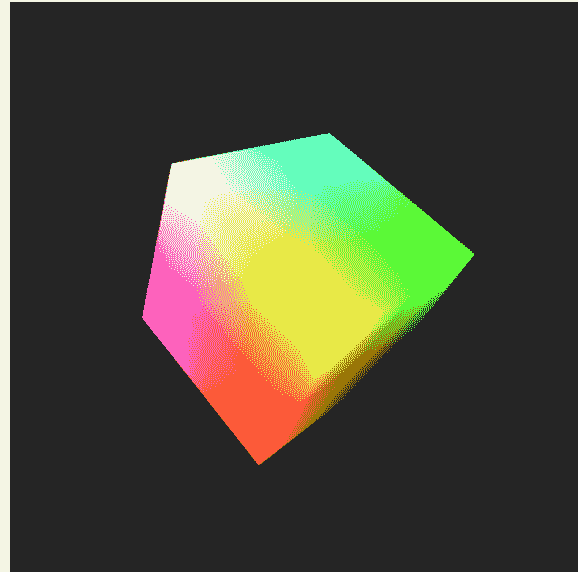

**图 11-1：** 此处的流程可用于渲染这个彩色立方体。

#### 其他渲染模式

除了 `gl.TRIANGLES` 之外，还有其他可用的渲染模式。WebGL 也可以渲染点和线，并且有以不同方式解释顶点数据的模式。可用的渲染模式包括：

- TRIANGLES（三角形）
- TRIANGLE_STRIP（三角形条带）
- TRIANGLE_FAN（三角形扇）
- POINTS（点）
- LINES（线）
- LINE_LOOP（线循环）
- LINE_STRIP（线条带）

我不会在这里详细介绍所有这些模式，但我鼓励你尝试使用它们。像 `gl.TRIANGLE_STRIP` 这样的模式尤其有用，因为如果你对三角形进行排序，使下一个三角形从前一个三角形结束的地方开始，它就能减少所需的索引数量。其他有趣的模式有 `gl.POINTS`，非常适合粒子效果等应用，以及 `gl.LINES` 模式，你可以用它来渲染线和线框式对象。

在前面的例子中，WebGL 需要一个索引列表才能从顶点构建三角形。如果顶点数据打包得当，使得顶点可以从头到尾被读取，那么你就不需要索引数据；相反，可以使用 `gl.drawArrays()` 函数来渲染几何体：

```javascript
var vbo = createFloatBuffer([
    -0.5, -0.5, 0.0, // tri 1 ver 1
     0.5, -0.5, 0.0, // tri 1 ver 2
     0.5,  0.5, 0.0, // tri 1 ver 3 / tri 2 ver 1
    -0.5,  0.5, 0.0, // tri 2 ver 2
    -0.5, -0.5, 0.0  // tri 2 ver 3
]);
gl.drawArrays(gl.TRIANGLE_STRIP, 0, 5);
```

这个例子设置好了以三角形条带方式渲染一个正方形所需的顶点。注意，第三个顶点既用作第一个三角形的第三个顶点，又用作第二个三角形的第一个顶点。

### 加载 Collada 模型

手动指定所有顶点和索引值仅适用于简单形状，如立方体、平面或其他基本形状。最好从外部文件导入需要大量三角形的复杂对象。请注意，3D 模型格式五花八门，但只有少数几种能被 JavaScript 轻松解析。理想的解决方案是基于 JSON 的格式，但我还没有遇到过主流图形应用程序支持这样的格式。

然而，XML 在 JavaScript 中也很容易使用，因为你可以使用内置的 DOM API 来解析它。Collada 是一种基于 XML 的模型格式，由负责 WebGL 的 Khronos Group 维护。近年来，这种格式日益流行，许多 3D 建模应用程序都可以将其模型导出为 Collada 文件。

如果你是 3D 建模新手，并且不想为 3D 图形应用程序花费数百甚至数千美元，可以尝试使用 Blender（www.blender.org），这是一个免费且开源的 3D 图形软件包。它支持多个平台，包括 Windows、Mac OSX 和 Linux，其功能集可与许多商业应用程序相媲美。它还支持导出和导入多种文件格式，包括 Collada。

#### 获取模型文件

首先，你需要加载模型数据，但你可以轻松地通过一点 Ajax 来处理。清单 11-19 中的 `webgl.loadModel()` 函数展示了加载模型文件所需的标准 Ajax 代码。

```
清单 11-19 加载 XML 文件
jewel.webgl = (function() {
    ...
    function loadModel(gl, file, callback) {
        var xhr = new XMLHttpRequest();
        xhr.open("GET", file, true);
        // 重写 MIME 类型以确保它被作为 XML 加载
        xhr.overrideMimeType("text/xml");
        xhr.onreadystatechange = function() {
            if (xhr.readyState == 4) {
                if (xhr.status == 200 && xhr.responseXML) {
                    callback(parseCollada(gl, xhr.responseXML));
                }
            }
        };
        xhr.send(null);
    }
```

```
清单 11-19 续

return {
    loadModel : loadModel,
    ...
};
})();
```

当文件加载完成时，XML 文档可通过 `xhr` 的 `responseXML` 属性获取。该文档被传递给一个 `webgl.parseCollada()` 函数，该函数必须解析 XML 文档并创建必要的缓冲区对象。

#### 解析 XML 数据

`parseCollada()` 函数可以使用 Sizzle 来提取相关节点，然后，根据这些节点构建数组。我不深入介绍 Collada XML 格式和 `parseCollada()` 函数的细节。不过，你可以在 www.khronos.org/collada 找到更多关于 Collada 规范的信息。完整的解析函数可以在本章代码归档的 webgl.js 模块中找到，但请注意，它只实现了该格式非常小的一个子集，以便加载测试模型。清单 11-20 展示了解析函数的返回值。

```
清单 11-20 解析 Collada XML 数据

jewel.webgl = (function() {
    ...
    function parseCollada(gl, xml) {
        ...
        // XML 解析
        return {
            vbo : createFloatBuffer(gl, vertices),
            nbo : createFloatBuffer(gl, normals),
            ibo : createIndexBuffer(gl, indices),
            num : indices.length
        };
    }
    ...
})();
```

`webgl.parseCollada()` 的返回值是一个小对象，包含三个缓冲区对象 `vbo`、`nbo` 和 `ibo`，以及一个表示索引数量的数字。`vbo` 和 `ibo` 缓冲区包含顶点和索引数据；第三个缓冲区 `nbo` 包含法线向量。在下一节中，当你看到我如何使用纹理和光照效果增强渲染时，你就会明白这些法线向量是如何被使用的。文件 `02-collada.html` 中的示例使用了 Collada 加载代码来加载和渲染一个球体模型。结果图像如图 11-2 所示。

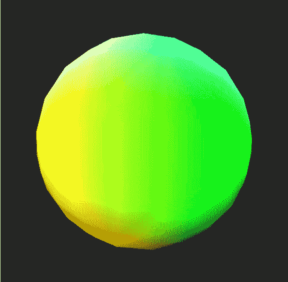

**图 11-2：** 这个球体模型是从一个 Collada 文件加载的。

> 你无法通过 Ajax 请求访问本地文件。这个示例需要从 Web 服务器运行才能正常工作。

## 使用纹理和光照

到目前为止，你看到的两个示例都显得有些平淡和单调。要真正呈现出图像的三维感，场景需要光照。表面的颜色方案也不够有趣。在许多情况下，表面应该覆盖一个纹理图像来模拟某种材质。不过，首先看看光照问题。

### 添加光照

你可以使用许多不同的方法为 3D 场景添加光照，从相对简单的近似到逼真但复杂的数学模型。我将坚持使用一个叫做 *Phong 光照* 的简单解决方案，这是一种常见的表面光反射近似方法。

Phong 模型使用三个不同的分量——环境光、漫反射光和镜面光——来为表面上的点添加光照。环境光模拟来自周围环境的散射光，即不是从光源直接照射到该点，而是从附近其他物体反弹过来的光。漫反射光是当来自光源的光直接照射到表面时，出现在表面的柔和的高光。这个光照分量模拟的是漫反射，即表面将入射光向许多不同方向反射。镜面光取决于观察者的位置，模拟当光从表面直接反射到眼睛时出现的小而强烈的高光。因此，表面点的颜色由表面颜色乘以三个光照分量的总和决定：

```
gl_FragColor = color * (ambient + diffuse + specular);
```

环境光分量最容易实现，因为它只是一个常数。然而，漫反射和镜面光分量需要一些三角函数。

#### 角度与法线

漫反射光分量使用照射到物体表面的光线与表面法线之间的夹角。表面上某一点的法线是垂直于该点表面的向量。例如，一个与地面平行的表面的法线向量是直向上的。法线向量是归一化的，所以向量的模（即长度）恰好为 1：

```
length = sqrt(v.x * v.x + v.y * v.y + v.z * v.z) = 1.0
```

这也被称为 *单位长度*，一个具有单位长度的向量——例如法线向量——被称为 *单位向量*。

因为 3D 几何体是由三角形和顶点组成的，而不是平滑的曲面，所以法线实际上是顶点法线，意思是每个顶点都有一个垂直于该顶点位置切平面的法线。前面展示的 Collada 加载函数已经根据模型文件中找到的法线数据创建了一个法线缓冲区对象。


#### 逐顶点光照

在顶点着色器中，你通过一个属性变量来访问顶点法线，就像访问顶点本身一样：

```
attribute vec3 aNormal;
```

你也可以用与激活顶点缓冲区相同的方式来激活并启用法线缓冲区：

```
var aNormal = gl.getAttribLocation(program, "aNormal");
gl.enableVertexAttribArray(aNormal);
```

将缓冲区数据绑定到 `aNormal` 属性的代码也不会让你感到意外：

```
gl.bindBuffer(gl.ARRAY_BUFFER, nbo);
gl.vertexAttribPointer(aNormal, 3, gl.FLOAT, false, 0, 0);
```

当顶点数据被模型视图矩阵变换时，你也需要对法线进行变换。如果你没有对模型视图矩阵应用任何缩放（这里展示的例子都没有这样做），你可以直接使用模型视图矩阵的左上角 3x3 部分。如果模型视图矩阵已经被缩放，你需要使用模型视图矩阵的*逆转置*矩阵。代码清单 11-21 展示了辅助模块的 `setNormalMatrix()` 函数。

##### 代码清单 11-21 设置法线矩阵

```
jewel.webgl = (function() {
    ...
    function toMat3(M) {
        return [
            M[0], M[1], M[2],
            M[4], M[5], M[6],
            M[8], M[9], M[10],
        ];
    }

    function setNormalMatrix(gl, program, mv) {
        var normalMatrix = toMat3(mv);
        gl.uniformMatrix3fv(
            gl.getUniformLocation(program, "uNormalMatrix"),
            false,
            normalMatrix
        );
        return normalMatrix;
    }

    return {
        setNormalMatrix : setNormalMatrix,
        ...
    };
})();
```

既然在顶点着色器中可以访问法线向量，你就可以用它来计算照射到给定顶点的光照量。首先，我将展示如何在顶点着色器中实现 Phong 光照的漫反射部分。我接下来展示的例子使用了一个单一的静态光源。光源位置被指定为一个 uniform 变量 `uLightPosition`。最终的漫反射光照值通过一个 varying 变量 `vDiffuse` 传递给片段着色器。

首先通过将法线与法线矩阵相乘来变换法线。确保你在乘法之后重新归一化它：

```
vec3 normal = normalize(uNormalMatrix * aNormal);
```

光线的方向很容易确定，只需用变换后的顶点位置减去光源位置：

```
vec3 lightDir = normalize(uLightPosition - position.xyz);
```

现在，使用这两个向量的点积来计算该顶点处的漫反射光照量：

```
vDiffuse = max(dot(normal, lightDir), 0.0);
```

如果光线方向与表面平行，法线和光线方向向量是正交的，导致点积为零。这两个向量越接近平行，漫反射值就越接近 1。结果就是，当光线垂直照射到表面时，光照会更强烈。代码清单 11-22 展示了完整的顶点着色器。

##### 代码清单 11-22 计算逐顶点漫反射光照

```
attribute vec3 aVertex;
attribute vec3 aNormal;

uniform mat4 uModelView;
uniform mat4 uProjection;
uniform mat3 uNormalMatrix;
uniform vec3 uLightPosition;

varying float vDiffuse;
varying vec3 vColor;

void main(void) {
    vec4 position = uModelView * vec4(aVertex, 1.0);
    vec3 normal = normalize(uNormalMatrix * aNormal);
    vec3 lightDir = normalize(uLightPosition - position.xyz);
    vDiffuse = max(dot(normal, lightDir), 0.0);
    vColor = aVertex.xyz * 0.5 + 0.5;
    gl_Position = uProjection * position;
}
```

在片段着色器（代码清单 11-23）中，应用光照只需将像素颜色乘以环境光和漫反射分量之和即可。

##### 代码清单 11-23 片段着色器中的光照

```
#ifdef GL_ES
precision mediump float;
#endif

uniform float uAmbient;
varying float vDiffuse;
varying vec3 vColor;

void main(void) {
    gl_FragColor = vec4(vColor * (uAmbient + vDiffuse), 1.0);
}
```

你可以在文件 `03-lighting-vertex.html` 中找到这个例子。它产生了如图 11-3 所示的结果。

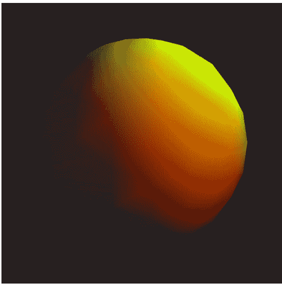

**图 11-3：** 这个球体具有逐顶点光照。

#### 添加逐像素光照

正如你在图 11-3 中所看到的，在从光照到阴影过渡的区域，很容易辨认出三角形。解决这个问题的一个方案是将计算移到片段着色器中。这被称为 *per-fragment* 或 *per-pixel* 光照，因为光照是逐像素而不是逐顶点计算的。在片段着色器中进行计算通常可以产生更好的结果，但这样做会消耗额外的资源。虽然顶点着色器只需要三次计算来覆盖一个三角形，但片段着色器必须为屏幕上的每个像素进行计算。

##### 漫反射光照

片段必须能够访问顶点法线。代码清单 11-24 展示了修改后的顶点着色器，其中计算被移除，法线被导出到一个 varying 变量中。

##### 代码清单 11-24 用于逐像素光照的顶点着色器

```
attribute vec3 aVertex;
attribute vec3 aNormal;

uniform mat4 uModelView;
uniform mat4 uProjection;
uniform mat3 uNormalMatrix;

varying vec4 vPosition;
varying vec3 vNormal;
varying vec3 vColor;

void main(void) {
    vPosition = uModelView * vec4(aVertex, 1.0);
    vColor = aVertex.xyz * 0.5 + 0.5;
    vNormal = uNormalMatrix * aNormal;
    gl_Position = uProjection * vPosition;
}
```

片段着色器中的计算（代码清单 11-25）与代码清单 11-22 中顶点着色器的计算几乎相同。

##### 代码清单 11-25 片段着色器中的漫反射光照

```
#ifdef GL_ES
precision mediump float;
#endif

uniform vec3 uLightPosition;
uniform float uAmbient;

varying vec4 vPosition;
varying vec3 vNormal;
varying vec3 vColor;

void main(void) {
    vec3 normal = normalize(vNormal);
    vec3 lightDir = normalize(uLightPosition - vPosition.xyz);
    float diffuse = max(dot(normal, lightDir), 0.0);
    vec3 color = vColor * (uAmbient + diffuse);
    gl_FragColor = vec4(color, 1.0);
}
```

既然你已经移到了片段着色器，你还可以添加镜面反射分量来获得闪亮的高光。

##### 镜面反射光照

要计算强烈的镜面反射分量，你需要两个新的向量：*观察方向*和*反射方向*。观察方向是一个从观察位置指向表面上某点的向量。如果 `vPosition` 是相对于眼睛的位置，那么方向就是 `-vPosition`，归一化为单位长度：

```
vec3 viewDir = normalize(-vPosition.xyz);
```

反射方向是光线从表面反射出去的方向。如果你知道表面法线和入射光的方向，GLSL 提供了一个 `reflect()` 函数来计算反射向量：

```
vec3 reflectDir = reflect(-lightDir, normal);
```

需要添加到表面点的镜面反射光量取决于这两个向量之间的夹角。与漫反射光一样，你可以使用向量的点积作为镜面反射值：

```
float specular = max(dot(reflectDir, viewDir), 0.0);
```

你可以通过将镜面反射值提高到某个幂次来控制表面的光泽度：

```
specular = pow(specular, 20.0);
```

最后，将镜面反射分量加到光照总和中。代码清单 11-26 展示了在片段着色器中的添加内容。

##### 代码清单 11-26 片段着色器中的镜面反射光照

```
...
void main(void) {
    ...
    vec3 viewDir = normalize(-vPosition.xyz);
    vec3 reflectDir = reflect(-lightDir, normal);
    float specular = max(dot(reflectDir, viewDir), 0.0);
    specular = pow(specular, 20.0);
    vec3 color = vColor * (uAmbient + diffuse + specular);
    gl_FragColor = vec4(color, 1.0);
}
```

结果如图 11-4 所示。将光照计算移到片段着色器使得不同色调之间的过渡更加平滑，而添加镜面反射分量则为表面增添了一层漂亮的闪亮外观。此示例的代码位于文件 `04-lighting-fragment.html` 中。

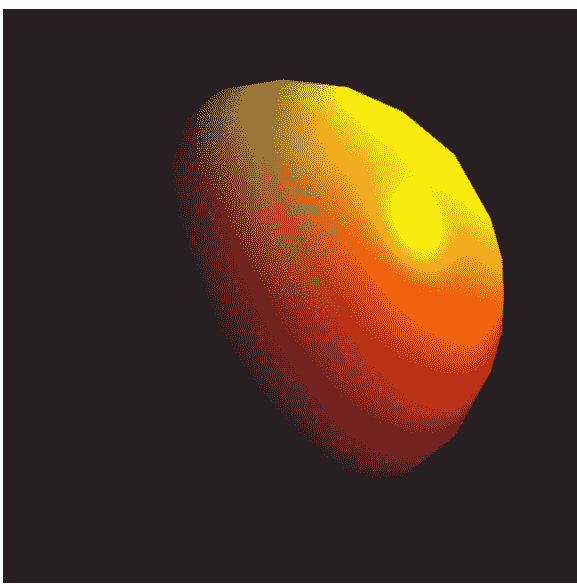

**图 11-4：** 这个具有逐像素光照的球体过渡更加平滑。

### 创建纹理

是时候摆脱球体上那单调的颜色渐变，贴上一些更有趣的东西了。要使用纹理图像，首先创建一个纹理对象：

```
var texture = gl.createTexture();
```


#### 加载图像数据

纹理对象需要被绑定到一个目标上，以便让 WebGL 知道你打算如何使用它。你需要的目标是 `gl.TEXTURE_2D`：

```
gl.bindTexture(gl.TEXTURE_2D, texture);
```

函数 `gl.texParameteri()` 和 `gl.texParameterf()` 使你能够设置控制纹理使用方式的参数。例如，你可以指定当纹理图像在不同距离下查看时，WebGL 应如何缩放它。参数 `gl.TEXTURE_MIN_FILTER` 和 `gl.TEXTURE_MAG_FILTER` 分别指定用于缩小和放大时使用的缩放方法：

```
gl.texParameteri(
    gl.TEXTURE_2D, gl.TEXTURE_MIN_FILTER, gl.LINEAR
);
gl.texParameteri(
    gl.TEXTURE_2D, gl.TEXTURE_MAG_FILTER, gl.LINEAR
);
```

值 `gl.NEAREST` 启用快速的最近邻方法，而 `gl.LINEAR` 则选择更平滑的线性过滤。

你可能会不时遇到一个术语 *mipmaps*（多级渐远纹理）。Mipmaps 是预先计算的、缩小版本的纹理图像，你可以用它们来提高性能。你可以通过调用 `gl.generateMipmaps()` 函数让 WebGL 自动生成 mipmaps：

```
gl.generateMipmaps(gl.TEXTURE_2D);
```

然后，你可以将缩小参数设置为以下值之一：

- `gl.NEAREST_MIPMAP_NEAREST`
- `gl.LINEAR_MIPMAP_NEAREST`
- `gl.NEAREST_MIPMAP_LINEAR`
- `gl.LINEAR_MIPMAP_LINEAR`

> **注意** 如果你确实使用 mipmapping，你的纹理尺寸必须是二的幂，例如 512x512、256x256 或 2048x1024。Mipmap 图像被输入到 mipmap 级别中，每个级别包含一个缩放到 1/2ⁿ 的版本，其中 *n* 是级别编号。

#### 加载图像数据

现在你已经准备好将一些像素加载到纹理对象中了。你可以使用 texImage2D() 函数来完成这个操作：

```
gl.texImage2D(
    gl.TEXTURE_2D, 0, gl.RGBA, gl.RGBA, gl.UNSIGNED_BYTE, image
);
```

第二个参数指定此数据应加载到的 mipmap 级别。因为你这里没有使用 mipmaps，所以数据应加载到级别 0。第三个参数是纹理内部使用的像素格式，第四个参数是图像数据中使用的像素格式。实际上在加载数据时无法在格式之间转换，因此这两个参数必须匹配。有效的格式包括 gl.RGBA、gl.RGB、gl.ALPHA、gl.LUMINANCE 和 gl.LUMINANCE_ALPHA。第五个参数指定像素值的数据类型，通常是 gl.UNSIGNED_BYTE。有关像素格式和类型的详细信息，请查阅附录 B 或 WebGL 规范。最后一个参数 image 是图像数据的来源，可以是一个 img 元素、一个 canvas 元素或一个 video 元素。

你也可以使用 gl.texImage2D() 从数组加载像素值。在这种情况下，该函数使用几个额外的参数来指定纹理数据的尺寸：

```
// 创建一个可以容纳 200x100 像素 RGBA 图像的数组
var image = new Uint8Array(200 * 100 * 4);
// 用值填充数组
...
// 并将数据加载到纹理中
gl.texImage2D(
    gl.TEXTURE_2D, 0, gl.RGBA,
    200, 100, 0, // 宽度、高度、边框
    gl.RGBA, gl.UNSIGNED_BYTE, image
);
```

传递给 gl.texImage2D() 的数组类型必须与调用中指定的数据类型匹配。例如，gl.UNSIGNED_BYTE 需要 Uint8Array。清单 11-27 展示了在辅助模块中将纹理创建组合在一个函数里。

##### 清单 11-27 创建纹理对象

```
jewel.webgl = (function() {
    ...
    function createTextureObject(gl, image) {
        var texture = gl.createTexture();
        gl.bindTexture(gl.TEXTURE_2D, texture);
        gl.texParameteri(
            gl.TEXTURE_2D, gl.TEXTURE_MIN_FILTER, gl.LINEAR);
        gl.texParameteri(
            gl.TEXTURE_2D, gl.TEXTURE_MAG_FILTER, gl.LINEAR);
        gl.texImage2D(gl.TEXTURE_2D, 0,
            gl.RGBA, gl.RGBA, gl.UNSIGNED_BYTE, image);
        gl.bindTexture(gl.TEXTURE_2D, null);
        return texture;
    }

    return {
        createTextureObject : createTextureObject,
        ...
    }
})();
```

当你从 img 元素加载数据时，必须在调用 gl.texImage2D() 之前完全加载图像。只需等待 img 元素的 load 事件触发后再创建纹理：

```
var image = new Image();
image.addEventListener("load", function() {
    // 创建并加载纹理数据...
}, false);
image.src = "earthmap.jpg";
```

如果你想捕获加载错误，也可以在 img 元素上添加 error 事件的监听器。

在本章的代码存档中，你可以找到地球表面的纹理，这是我从 NASA 的 Visible Earth 网站 (http://visibleearth.nasa.gov) 下载的。你在那里找到的图像通常没有版权，你可以自由地在自己的项目中使用它们。图 11-5 展示了纹理贴图。在接下来的例子中，我将向你展示如何将这个纹理贴图应用到球体上，制作一个旋转的行星。

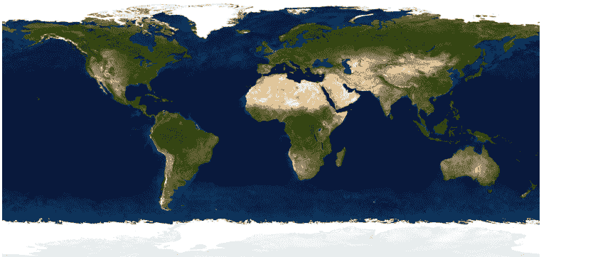

**图 11-5：** 你可以将这个地球纹理贴图应用到球体上。

#### 在着色器中使用纹理

纹理在片段着色器中使用一个具有特殊数据类型的 uniform 变量来引用。`sampler2D` 类型是一个指向纹理数据的句柄，可以与一个名为 `texture2D()` 的函数一起使用，从纹理图像中采样颜色值。

```
uniform sampler2D uTexture;
gl_FragColor = texture2D(uTexture, vTexCoord);
```

`texture2D()` 的第二个参数是一个 `vec2`，其 x 和 y 值在 0 到 1 之间，指定了应被采样的纹理图像上的点。左上角表示为 (0.0, 0.0)，右下角表示为 (1.0, 1.0)。纹理坐标通常作为缓冲区创建，并在顶点着色器中与顶点一起访问。你可以使用一个 varying 变量将坐标传递并插值到片段着色器，以在三角形表面上创建连续的纹理映射。例如，要将图像映射到一个平坦的矩形，你需要在左上顶点指定纹理坐标 (0.0, 0.0)，在右上顶点指定 (1.0, 0.0)，依此类推。

#### 计算纹理坐标

对于复杂的 3D 对象，建模师或纹理艺术家通常在建模应用程序中分配纹理坐标，然后将其与模型数据的其他部分一起导出。几乎所有的模型格式，包括 Collada，都能够将纹理坐标附加到顶点上。然而，由于我在这个例子中处理的是一个简单的球体，我将展示如何在着色器中手动计算这些坐标。

你在片段着色器中进行计算，但首先你需要从顶点着色器获取一些信息。球体上的纹理坐标取决于给定点的位置。对于计算球面坐标，表面法线同样适用，因此顶点着色器应将法线导出到一个 varying 向量中。法线必须是原始的、未经修改的法线。清单 11-28 展示了顶点着色器中新的 varying 变量。

##### 清单 11-28 将法线传递给片段着色器

```
...
varying vec3 vOrgNormal;

void main(void) {
    ...
    vOrgNormal = aNormal;
}
```

片段着色器从法线计算球面坐标，并将它们用作纹理坐标。在球面坐标系中，一个点由径向距离和两个角度描述，通常用希腊字母 θ 和 φ 表示。笛卡尔坐标 (x,y,z) 和球面坐标之间的关系如下：

```
radius = sqrt(x*x + y*y + z*z)
theta = acos(y / radius)
phi = atan(z / x)
```

球体表面上的所有点到中心的距离相同，所以只有两个角度是重要的。因为你使用的是法线而不是顶点位置，你知道半径等于 1，所以转换简化为

```
theta = acos(y)
phi = atan(z / x)
```

如果你在片段着色器中将这些方程应用于法线向量，你可以将 theta 和 phi 用作纹理坐标，如清单 11-29 所示。

##### 清单 11-29 带有球面纹理的片段着色器

```
...
varying vec3 vOrgNormal;
uniform sampler2D uTexture;
```


## 创建 WebGL 显示模块

至此，我们完成了 WebGL API 的讲解，你已经对如何使用 WebGL 为游戏和应用创建 3D 图形有了基本了解。下一节将向你展示如何使用 WebGL 为 Jewel Warrior 添加一个新的显示模块。

你已经了解了 WebGL 的基础知识，是时候动手实践了。新的显示模块如清单 11-30 所示，它位于文件 `display.webgl.js` 中。它使用与 canvas 显示模块相同的函数，因此两者可以互换使用。

```javascript
清单 11-30  WebGL 显示模块
jewel.display = (function() {
    var animations = [],
        previousCycle,
        firstRun = true,
        jewels, cursor,
        paused;

    function initialize(callback) {
        paused = false;
        if (firstRun) {
            setup();
            firstRun = false;
        }
        jewels = [];
        requestAnimationFrame(cycle);
        callback();
    }

    function cycle() { }
    function setup() { }

    function setCursor() { }
    function levelUp() { }
    function gameOver() { }
    function redraw() { }
    function moveJewels() { }
    function removeJewels() { }

    return {
        initialize : initialize,
        redraw : redraw,
        setCursor : setCursor,
        moveJewels : moveJewels,
        removeJewels : removeJewels,
        refill : redraw,
        levelUp : levelUp,
        gameOver : gameOver
    };
})();
```

WebGL 显示模块可以借用 canvas 模块的 `addAnimation()` 和 `renderAnimations()` 函数，因此它们可以直接从 `display.canvas.js` 复制过来而无需修改。如果你发现自己经常复制类似的功能，可以考虑将其移动到一个单独的模块中。不过在此例中，我只是复制了动画函数。

### 加载 WebGL 文件

现在你有了两个不同的显示模块，需要在 `index.html` 中修改加载顺序，以便根据浏览器是否支持 WebGL 来加载正确的模块。首先，在 `jewel.js` 中添加一个特性检测方法，如清单 11-31 所示。

```javascript
清单 11-31  检测 WebGL 支持
var jewel = (function() {
    ...
    function hasWebGL() {
        var canvas = document.createElement("canvas"),
            gl = canvas.getContext("webgl") ||
                canvas.getContext("experimental-webgl");
        return !!gl;
    }

    return {
        hasWebGL: hasWebGL,
        ...
    };
})();
```

你可以使用这个测试来决定在 `index.html` 中加载哪个显示模块。清单 11-32 展示了相应的修改。

```javascript
清单 11-32  加载 WebGL 显示模块
window.addEventListener("load", function() {
    jewel.load("scripts/dom.js");
    if (jewel.isStandalone()) {
        ...
        if (jewel.hasWebGL()) {
            jewel.load("scripts/webgl.js");
            jewel.load("scripts/display.webgl.js");
        } else {
            jewel.load("scripts/display.canvas.js");
        }
        ...
    } else {
        ...
    }
});
```

现在，游戏会自动检测：如果浏览器支持 WebGL，就加载 WebGL 显示模块；如果不支持，则回退到 2D canvas 模块。

### 创建宝石对象

WebGL 显示模块中的宝石列表与 canvas 模块中的不同。它不再是二维数组结构，`jewels` 现在只是一个宝石对象的数组。清单 11-33 中的 `createJewel()` 函数负责向列表中添加新的宝石。

```javascript
清单 11-33  创建新宝石
jewel.display = (function() {
    ...
    function createJewel(x, y, type) {
        var jewel = {
            x : x,
            y : y,
            type : type,
            rnd : Math.random() * 2 - 1,
            scale : 1
        };
        jewels.push(jewel);
        return jewel;
    }

    function getJewel(x, y) {
        return jewels.filter(function(j){
            return j.x == x && j.y == y;
        })[0];
    }
    ...
})();
```

你可以使用宝石对象的 `rnd` 属性来增加宝石的多样性，使它们看起来不完全相同——例如，让每个宝石的旋转角度略有不同。`getJewel()` 函数是一个辅助函数，用于在列表中搜索与给定坐标匹配的宝石。这两个函数都在 `redraw()` 函数中使用，如清单 11-34 所示。

#### 清单 11-34 重绘游戏板

```javascript
jewel.display = (function() {
    ...
    function redraw(newJewels, callback) {
        var x, y,
            jewel, type;
        for (x = 0; x < cols; x++) {
            for (y = 0; y < rows; y++) {
                type = newJewels[x][y];
                jewel = getJewel(x, y);
                if (jewel) {
                    jewel.type = type;
                } else {
                    createJewel(x, y, type);
                }
            }
        }
        callback();
    }

    function setCursor(x, y, selected) {
        cursor = null;
        if (arguments.length > 0) {
            cursor = {
                x : x,
                y : y,
                selected : selected
            };
        }
    }
    ...
})();
```

`redraw()` 函数遍历游戏板上的所有位置。如果该位置已存在宝石对象，则更改其类型；否则，创建一个新的宝石对象。清单 11-34 还展示了 `setCursor()` 函数，它与 2D canvas 显示模块中的版本几乎完全相同。

### 设置 WebGL

既然创建宝石数据的基本功能已就位，接下来可以着手设置 WebGL 环境了。设置 WebGL 显示的第一步是添加一个新的 canvas 元素，并获取该 canvas 的 WebGL 上下文对象。这是通过 `setup()` 函数完成的，如清单 11-35 所示。

```javascript
清单 11-35  设置 WebGL 显示
jewel.display = (function() {
    var canvas, gl, cols, rows,
        ...

    function setup() {
        var $ = jewel.dom.$,
            boardElement = $("#game-screen .game-board")[0];

        cols = jewel.settings.cols;
        rows = jewel.settings.rows;

        canvas = document.createElement("canvas");
        gl = jewel.webgl.createContext(canvas);

        jewel.dom.addClass(canvas, "board");
        boardElement.appendChild(canvas);

        var rect = canvas.getBoundingClientRect();
        canvas.width = rect.width;
        canvas.height = rect.height;

        setupGL();
    }

    ...
})();
```

`setup()` 函数最后调用 `setupGL()` 函数。这个函数如清单 11-36 所示，负责设置 WebGL 上下文，使其准备好渲染游戏画面。

#### 清单 11-36 初始化 WebGL 上下文

```javascript
jewel.display = (function() {
    var program,
        geometry,
        aVertex, aNormal,
        uScale, uColor,
        ...

    function setupGL() {
        var webgl = jewel.webgl;
        gl.enable(gl.DEPTH_TEST);
        gl.enable(gl.CULL_FACE);
        gl.enable(gl.BLEND);
        gl.blendFunc(gl.SRC_ALPHA, gl.ONE);

        program = setupShaders();
        setupTexture();
        gl.useProgram(program);

        aVertex = gl.getAttribLocation(program, "aVertex");
        aNormal = gl.getAttribLocation(program, "aNormal");
        uScale = gl.getUniformLocation(program, "uScale");
        uColor = gl.getUniformLocation(program, "uColor");

        gl.enableVertexAttribArray(aVertex);
        gl.enableVertexAttribArray(aNormal);

        gl.uniform1f(
            gl.getUniformLocation(program, "uAmbient"),
            0.12
        );
        gl.uniform3f(
            gl.getUniformLocation(program, "uLightPosition"),
            20, 15, -10
        );

        webgl.loadModel(gl, "models/jewel.dae", function(geom) {
            geometry = geom;
        });
        webgl.setProjection(
            gl, program, 60, cols/rows, 0.1, 100
        );
    }

    ...
})();
```


### 渲染宝石

请注意，一些 uniform 位置和 attribute 位置会被存储起来以供后续使用。你将它们存储起来，这样就不必在每个渲染周期都进行查询。这些位置不会改变，因此你无需多次查询它们。

图 11-7 展示了 WebGL 显示所使用的宝石模型。你可以在文件 `06-jewel.html` 中找到这个独立的宝石渲染器。

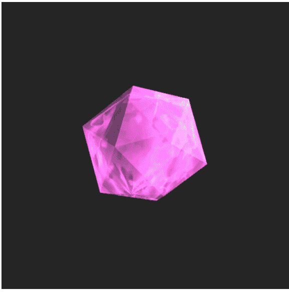

#### 混合与透明度

在 `setupGL()` 函数中，注意启用了两个新设置：`gl.BLEND` 和 `gl.CULL_FACE`。两者都用于赋予宝石半透明的外观。

启用 `gl.BLEND` 允许你设置片段着色器输出的颜色如何与片段下方的颜色值进行混合的规则。你通过 `gl.blendFunc()` 函数设置混合规则。此函数接受两个参数：源因子和目标因子，它们描述了两种颜色如何计算。目标颜色是现有颜色，源颜色是绘制在顶部的新颜色。将源因子设置为 `gl.SRC_ALPHA` 意味着片段颜色中的 RGB 值将乘以 alpha 值；将目标因子设置为 `gl.ONE` 意味着现有颜色乘以 1。你可以在附录 C 中找到完整的混合列表，该附录是本书配套网站在线奖励内容的一部分。

`gl.CULL_FACE` 设置启用了面剔除，这本质上会移除背向视点的三角形。三角形面向的方向取决于它在屏幕上是顺时针还是逆时针绘制。默认模式是逆时针绘制的三角形面向观察者，而顺时针三角形则背向观察者。启用剔除后，你可以使用 `gl.cullFace()` 函数在剔除正面三角形和背面三角形之间切换。此函数接受一个参数，可以是 `gl.FRONT` 或 `gl.BACK`。如果你剔除正面三角形，则只能看到物体的内部表面。如果你随后在启用混合并剔除背面三角形的情况下再次渲染，效果就是一个半透明物体，其背面可以通过模型看到。

#### 绘制宝石

渲染周期与画布显示的周期类似，但它只在模型文件加载完成且 `geometry` 对象准备就绪后调用 `draw()` 函数。清单 11-37 展示了 `cycle()` 函数。

**清单 11-37 渲染周期**

```javascript
jewel.display = (function() {
    var paused = false,
        ...

    function cycle() {
        var now = Date.now();
        if (!paused) {
            renderAnimations(now, previousCycle);
            if (geometry) {
                draw();
            }
        }
        previousCycle = now;
        requestAnimationFrame(cycle);
    }

    function pause() {
        paused = true;
    }
    function resume(pauseTime) {
        paused = false;
        for (var i=0;i<animations.length;i++) {
            animations[i].startTime += pauseTime;
        }
    }

    return {
        pause : pause,
        resume : resume,
        ...
    };
})();
```

尽管名为 `draw()`，该函数实际上并不执行任何绘制操作。它的任务是清除画布并绑定缓冲区。清单 11-38 展示了该函数。

**清单 11-38 为下一帧做准备**

```javascript
jewel.display = (function() {
    ...
    function draw() {
        gl.clear(gl.COLOR_BUFFER_BIT | gl.DEPTH_BUFFER_BIT);
        gl.viewport(0, 0, canvas.width, canvas.height);

        gl.bindBuffer(gl.ARRAY_BUFFER, geometry.vbo);
        gl.vertexAttribPointer(
            aVertex, 3, gl.FLOAT, false, 0, 0);

        gl.bindBuffer(gl.ARRAY_BUFFER, geometry.nbo);
        gl.vertexAttribPointer(
            aNormal, 3, gl.FLOAT, false, 0, 0);

        gl.bindBuffer(gl.ELEMENT_ARRAY_BUFFER, geometry.ibo);

        jewels.forEach(drawJewel);
    }
    ...
})();
```

所有宝石使用相同的几何体，因此你只需要绑定一次缓冲区。之后你可以根据需要绘制任意多次模型。`draw()` 函数通过在所有宝石上调用 `drawJewel()` 来结束。该函数如清单 11-39 所示。

**清单 11-39 绘制单个宝石**

```javascript
jewel.display = (function() {
    ...
    var colors = [
        [0.1, 0.8, 0.1],
        [0.9, 0.1, 0.1],
        [0.9, 0.3, 0.8],
        [0.8, 1.0, 1.0],
        [0.2, 0.4, 1.0],
        [1.0, 0.4, 0.1],
        [1.0, 0.9, 0.1]
    ];

    function drawJewel(jwl) {
        var webgl = jewel.webgl,
            x = jwl.x - cols / 2 + 0.5,  // 使位置
            y = -jwl.y + rows / 2 - 0.5, // 相对于中心
            scale = jwl.scale,
            n = geometry.num;

        var mv = webgl.setModelView(gl, program,
                [x * 4.4, y * 4.4, -32], // 缩放并后移
                Date.now() / 1500 + jwl.rnd * 100, // 旋转
                [0, 1, 0.1] // 旋转轴
        );
        webgl.setNormalMatrix(gl, program, mv);

        // 为选中的宝石添加效果
        if (cursor && jwl.x==cursor.x && jwl.y==cursor.y) {
            scale *= 1.0 + Math.sin(Date.now() / 100) * 0.1;
        }

        gl.uniform1f(uScale, scale);
        gl.uniform3fv(uColor, colors[jwl.type]);

        gl.cullFace(gl.FRONT);
        gl.drawElements(gl.TRIANGLES, n, gl.UNSIGNED_SHORT, 0);

        gl.cullFace(gl.BACK);
        gl.drawElements(gl.TRIANGLES, n, gl.UNSIGNED_SHORT, 0);
    }
    ...
})();
```

首先，更新模型视图和法线矩阵以匹配当前宝石的位置。宝石位置也经过缩放和后移，以使完整的 8x8 宝石网格适应画布的限制范围。宝石的旋转是当前时间的函数。将宝石自身的 `rnd` 数加到旋转值中，可以避免所有宝石同步旋转。

如果宝石恰好被选中——即其位置与光标匹配——宝石的缩放会乘以一个正弦函数以产生脉动效果。统一的缩放因子在顶点着色器中应用。通过将 `aVertex` 属性的顶点位置乘以 `uScale` 变量，你可以控制渲染宝石的大小：

```glsl
vPosition = uModelView * vec4(aVertex * uScale, 1.0);
```

当矩阵和 uniform 更新后，就可以开始绘制了。渲染分为两次进行。第一次绘制宝石的背面，第二次绘制宝石的正面。

#### 创建宝石表面

着色器在 `setupShaders()` 函数中创建，并基于你在光照和纹理示例中已经见过的着色器构建。然而，宝石的平坦表面不需要高分辨率的逐像素光照，因此光照是逐顶点进行的。这种光照类型在这种特定场景下也能产生更好的高光效果。着色器代码太长，无法在此包含，但你可以在本章代码档案中的 `display.webgl.js` 文件中找到 `setupShaders()` 的完整代码。片段着色器使用纯色和纹理的混合来为宝石着色，如图 11-8 所示。纹理为宝石提供了噪声，模拟了宝石中的一些结构。

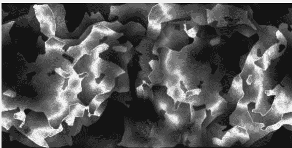

**图 11-8：为宝石添加结构的噪点纹理。**

该纹理在清单 11-40 所示的 `setupTexture()` 函数中创建。

**清单 11-40 设置宝石纹理**

```javascript
jewel.display = (function() {
    ...
    function setupShaders() {
        var vsource = "... 顶点着色器源代码 ...";
        var fsource = "... 片段着色器源代码 ...";

        var webgl = jewel.webgl,
            vshader = webgl.createShaderObject(
                        gl, gl.VERTEX_SHADER, vsource),
            fshader = webgl.createShaderObject(
                        gl, gl.FRAGMENT_SHADER, fsource);

        return webgl.createProgramObject(gl, vshader, fshader);
    }

    function setupTexture() {
        var webgl = jewel.webgl,
            image = new Image();
        image.addEventListener("load", function() {
            var texture = webgl.createTextureObject(gl, image);
            gl.uniform1i(
                gl.getUniformLocation(program, "uTexture"),
                "uTexture", 0
            );
            gl.activeTexture(gl.TEXTURE0);
```


##### 清单 11-40 续

```javascript
gl.bindTexture(gl.TEXTURE_2D, texture);
}, false);
image.src = "images/jewelpattern.jpg";
}
...
})();
```

与宝石纹理混合的纯色来自由 `drawJewel()` 函数设置的 uniform 变量：

```glsl
uniform vec3 uColor;
```

着色器使用你之前看到的球坐标从纹理图像中获取采样。重要的是纹理的亮度，由于纹理是灰度的，你只需要 RGB 通道中的一个：

```glsl
float texColor = texture2D(uTexture, texCoord).r;
```

纹理颜色充当一个额外的光分量，直接加到光照总和中：

```glsl
float light = uAmbient + vDiffuse + vSpecular + texColor;
```

最后，将光照应用到宝石颜色上，并将结果赋值给片元：

```glsl
gl_FragColor = vec4(uColor * light, 0.7);
```

片元颜色中 0.7 的 alpha 值使颜色半透明，这样宝石的背面就能透出来。图 11-9 展示了使用 WebGL 显示渲染的游戏面板。

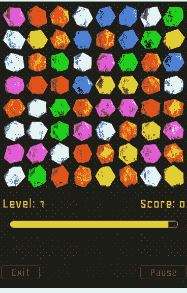

图 11-9：WebGL 渲染的宝石面板。

### 为宝石添加动画

最后一步是为各种游戏动作实现动画。

#### 移动和交换宝石

`moveJewels()` 函数（如清单 11-41 所示）与其 canvas 版本类似。它为每个移动的宝石添加一个新的动画，在 `render()` 函数中将宝石移向其目标位置。

```javascript
// 清单 11-41 移动宝石
jewel.display = (function() {
    ...
    function moveJewels(movedJewels, callback) {
        var n = movedJewels.length;
        movedJewels.forEach(function(mover) {
            var jwl = getJewel(mover.fromX, mover.fromY),
            ...
        });
    }
})();
```

```javascript
dx = mover.toX - mover.fromX,
dy = mover.toY - mover.fromY,
dist = Math.abs(dx) + Math.abs(dy);

if (!jwl) { // 从顶部进入的新宝石
    jwl = createJewel(mover.fromX, mover.fromY,
                       mover.type);
}
addAnimation(200 * dist, {
    render : function(pos) {
        pos = Math.sin(pos * Math.PI / 2);
        jwl.x = mover.fromX + dx * pos;
        jwl.y = mover.fromY + dy * pos;
    },
    done : function() {
        jwl.x = mover.toX;
        jwl.y = mover.toY;
        if (-n === 0) { // 最后一个调用回调函数
            callback();
        }
    }
});
});
}
...
})();
```

当你在移动宝石的列表中迭代时，相关宝石对象是通过 `getJewel()` 函数从宝石列表中获取的。如果搜索失败，`getJewel()` 函数返回 undefined；在这种情况下，会创建一个新的宝石。这处理了从屏幕顶部移入新宝石的情况。

#### 移除匹配的宝石

在 canvas 显示模块中，移除宝石会导致宝石产生旋转和缩小的效果。清单 11-42 中的 `removeJewels()` 函数为 WebGL 显示添加了该效果的一个变体。

**清单 11-42 移除宝石**

```javascript
jewel.display = (function() {
    ...
    function removeJewels(removedJewels, callback) {
        var n = removedJewels.length;
        removedJewels.forEach(function(removed) {
            var jwl = getJewel(removed.x, removed.y),
                y = jwl.y, // 原始坐标
                x = jwl.x;
            addAnimation(400, {
                render : function(pos) {
                    jwl.x = x + jwl.rnd * pos * 2;
                    jwl.y = y + pos * pos * 2;
                    jwl.scale = 1 - pos;
                },
                done : function() {
                    jewels.splice(jewels.indexOf(jwl), 1);
                    if (-n === 0) { // 最后一个调用回调函数
                        callback();
                    }
                }
            });
        });
        ...
    }
})();
```

`removeJewels()` 函数添加的动画使宝石在缩小的同时向下方掉落。`pos` 值在动画过程中从 0 变化到 1，因此从宝石的缩放比例中减去它会导致宝石缩小直至消失。垂直运动使用 `pos` 因子的平方来模拟由于重力产生的向下加速度：

```javascript
jewel.y = y + pos * pos * 2;
```

除了垂直运动，你还可以使用随机的 `rnd` 值添加一点水平运动，这样宝石就不会笔直下落：

```javascript
jewel.x = x + jewel.rnd * pos * 2;
```

你可以增加或减少当前设置为 2 的两个因子，以加快任一方向的运动。

当动画结束并调用 `done()` 函数时，使用 `splice()` 数组方法将宝石从宝石列表中移除。

#### 升级和游戏结束

还剩下三个函数：`refill()`、`gameOver()` 和 `levelUp()`。填充动画可以有很多可能性。我把这个留给你作为练习。当前的实现只是简单地将调用重定向到 `redraw()` 函数：

```javascript
function refill(newJewels, callback) {
    redraw(newJewels, callback);
}
```

这个函数工作正常，但当然不是很令人兴奋。

你可以使用 `removeJewels()` 函数中的动画来实现 `gameOver()` 函数，如清单 11-43 所示。只需对整个宝石列表调用 `removeJewels()`，使整个面板碎裂。

**清单 11-43 移除所有宝石**

```javascript
jewel.display = (function() {
    ...
    function gameOver(callback) {
        removeJewels(jewels, callback);
    }
    ...
})();
```

剩下的是 `levelUp()` 函数。现在通过增加环境光分量为所有宝石添加高亮效果。这会使所有宝石短暂地亮起来。清单 11-44 展示了该动画。

**清单 11-44 升级动画**

```javascript
jewel.display = (function() {
    ...
    function levelUp(callback) {
        addAnimation(500, {
            render : function(pos) {
                gl.uniform1f(
                    gl.getUniformLocation(program, "uAmbient"),
                    0.12 + Math.sin(pos * Math.PI) * 0.5
                );
            },
            done : callback
        });
    }
    ...
})();
```

这就是 WebGL 显示模块的全部内容。你现在有两种不同的选项来显示游戏图形。

### 使用第三方 WebGL 引擎

随着 WebGL 越来越受关注，针对这项特定技术的中间件也正在涌现。考虑到 WebGL 相对较新，基于它的 3D 引擎和库的数量令人惊讶。一个例子是里卡多·卡贝洛（Ricardo Cabello，又名 Mr. Doob (http://www.mrdoob.com/)）的 Three.js (http://threejs.org/)。Three.js 大大简化了使用 WebGL 的复杂性，从空白页面到基本 3D 场景的路程可以非常短。清单 11-45 展示了渲染一个旋转球体所需的代码。你可以在文件 `07-threejs.html` 中找到这个示例。

**清单 11-45 一个基本的 Three.js 示例**

```javascript
var canvas = document.getElementById("scene"),
    ratio = canvas.width / canvas.height,
    camera = new THREE.PerspectiveCamera(60, ratio, 1, 10000),
    scene = new THREE.Scene(),
    renderer = new THREE.WebGLRenderer({ canvas : canvas }),
    geometry = new THREE.SphereGeometry(300, 40, 20),
    material = new THREE.MeshPhongMaterial({
        color: 0x00dddd,
        shading : THREE.FlatShading
    }),
    mesh = new THREE.Mesh(geometry, material),
    light = new THREE.DirectionalLight(0xffffff, 1.2);

camera.position.set(0, 0, 1000);
light.position.set(500, 500, 1000);
scene.add(mesh);
scene.add(light);

function render() {
    requestAnimationFrame(render);
    mesh.rotation.set(0.3, Date.now() / 800, 0);
    renderer.render( scene, camera );
}

render();
```

这段代码与你本章中看到的复杂代码截然不同。Three.js 负责设置缓冲区对象和着色器，为你提供一个更简单的接口。尽管渲染流程简化了，Three.js 已被用于一些非常复杂的项目——例如，为 Danger Mouse (www.ro.me)、Arcade Fire (http://thewildernessdowntown.com) 和 Ellie Goulding (http://lights.elliegoulding.com) 等艺术家制作的互动音乐体验。Three.js 是免费的，其代码在 MIT 许可证下授权。

Three.js 包含许多你可以生成的内置图元，例如立方体、球体和圆柱体。除了其自定义的 JSON 格式外，它没有加载外部模型文件的功能，但有一些 3D 图形应用程序（如 Blender 和 3ds Max）的导出器可用。或者，有一个转换器可以将 OBJ 文件转换为 JSON，然后直接加载到 Three.js 中。

然而，Three.js 并不只局限于纯图形。在示例中，你还会发现可以放置在 3D 环境中的声音发射器等东西。Three.js 然后根据玩家的位置自动调整音量和平衡，使用你在第 10 章中找到的 Web Audio API。

有一点不足之处是文档。Three.js 文档网站 (http://threejs.org/docs) 只有一个非常简短的示例和一个简洁的 API 参考。然而，从 GitHub 项目页面可用的项目存档包含超过一百个示例，从非常简单到相当高级。在项目页面上，你可以找到更多用户贡献的示例，展示了高级功能，如反射材质、法线贴图和粒子效果。Learning Three.js (http://learningthreejs.com) 是另一个有趣的网站，定期发布简短的视频，演示如何使用 Three.js 创建不同的东西。

## 总结

你现在已准备好在你的应用程序和游戏中开始使用 WebGL。本章向你介绍了 WebGL API 的基础知识、着色器中使用的 GLSL 语言，以及一些可用于为渲染对象添加纹理、光照和混合效果的技术。它还展示了如何使用 WebGL 为 Jewel Warrior 游戏创建一个更高级的显示模块。

随着 Internet Explorer 11 将 WebGL 添加到其功能集中，所有主要的桌面浏览器最终都支持 WebGL。移动平台也正在慢慢跟上，尽管在智能手机和平板电脑上可以放心地依赖 WebGL 支持还需要一段时间。


# 第四部分

## 本地存储与多人游戏

### 第12章 本地存储与缓存
### 第13章 使用WebSockets上线

## 第12章 本地存储与缓存

## 本章内容

- 介绍Web存储
- 对比Cookie存储与本地存储
- 为游戏添加持久化数据
- 制作高分列表
- 通过应用缓存实现离线游玩

**传统上，HTTP COOKIE** 用于解决浏览器数据存储问题。本章将介绍如何使用Web Storage——这项同样诞生于HTML5运动的技术——来实现部分相同功能。你还将学会如何利用Web Storage让游戏记住玩家进度，以及如何添加高分列表。

本章最后将讨论HTML5引入的应用缓存（Application Cache），以及如何利用它让你的游戏在没有网络连接时也能运行。

### 使用Web存储保存数据

Web存储常被归类于HTML5技术体系下的其他技术，尽管它现已拥有独立规范（www.w3.org/TR/webstorage），并与HTML5分开发展。

与Cookie不同，存储在Web Storage中的数据始终保留在客户端，永远不会传输到服务器。而Cookie则会在每次HTTP请求时在浏览器和服务器之间来回传输。这限制了你能存储的Cookie数据量，且如果服务器不需要这些数据，传输Cookie所用的带宽就浪费了。浏览器对Cookie的数量和大小有严格限制。为稳妥起见，每个域名存储的Cookie不应超过50个，大小不超过4K。

使用Web存储可以同时解决这两个问题。首先，数据永远不会离开浏览器。其次，它允许存储更大容量的数据。W3C目前建议的限制是5MB，但浏览器在需要更多空间时可以请求用户许可。当前浏览器至少允许2MB的Web Storage数据。

存储技术还有其他进展。文件API（www.w3.org/TR/FileAPI）是另一项旨在成为W3C推荐标准的规范。文件API提供了一组对象，使处理文件和二进制数据变得简便。再加上IndexedDB API（www.w3.org/TR/IndexedDB），你甚至可以创建一个虚拟文件系统，方便地在客户端存储文件。IndexedDB API不仅提供了存储海量数据所需的功能，还能对数据进行快速搜索。所有主流桌面浏览器都支持文件API，除Safari外都支持IndexedDB API。

但如果你只存储少量数据，Web Storage通常就足够了，并且它在所有当前版本的桌面浏览器以及Android和iOS上都可用。

### 使用存储接口

Web存储规范描述了两个存储对象——本地存储（local storage）和会话存储（session storage），可通过全局对象`localStorage`和`sessionStorage`访问。这两个存储对象使用相同的接口，这意味着你可以对`localStorage`执行的操作，同样可以对`sessionStorage`执行，反之亦然。

### 使用存储API

存储对象本质上是通往浏览器维护的不同数据容器的入口。`localStorage`对象与域名绑定，存储的数据会一直保留，直到你手动删除。

存储API仅包含几个函数。要更改值或添加新值，请使用`localStorage.setItem()`方法：

```
localStorage.setItem("myData", "This is my data")
```

第一个参数是标识数据的唯一键，第二个参数是要存储的数据。现在你可以用`localStorage.getItem()`方法检索数据：

```
var data = localStorage.getItem("myData");
```

即使你关闭浏览器、刷新页面或从另一个页面（同一域名下）调用`localStorage.getItem()`，数据仍然存在。

或者，你也可以使用方括号表示法访问数据。所有存储的值都可作为存储对象的属性使用：

```
var data = localStorage["myData"];
localStorage["myData"] = "This is my data";
```

当然，你也可以使用点表示法：

```
var data = localStorage.myData;
localStorage.myData = "This is my data";
```

如果需要从存储对象中删除某个值，可以使用`localStorage.removeItem()`方法：

```
localStorage.removeItem("myData");
```

如需清除存储对象中的所有数据，请使用`localStorage.clear()`方法：

```
localStorage.clear(); // remove all stored data
```

### 编码复杂数据类型

Web存储仅限于字符串值，因此如果不转换为字符串表示形式，就无法存储其他数据类型。你可以通过将数据编码为JSON轻松克服这一限制：

```
var data = {
    key1 : "string",
    key2 : true,
    key3 : [1,2,3]
};
localStorage.setItem("myData", JSON.stringify(data));
```

读取数据时，记得解码JSON字符串：

```
var data = JSON.parse(localStorage.getItem("myData"));
```

### 遍历存储值

存储对象的`length`属性等于你已保存的键值对数量：

```
var numValues = localStorage.length;
```

`localStorage.key()`方法接受一个参数（0到length-1之间的索引），并返回该位置的键名：

```
var data = localStorage.key(0); // name of key at index 0
```

不能保证键的顺序与添加顺序一致，但该方法在需要遍历所有存储值时仍然很有用：

```
for (var i=0,key,value;i<localStorage.length;i++) {
    key = localStorage.key(i);
    value = localStorage.getItem(key);
    console.log(key, value);
}
```

> 浏览器决定键值对的顺序，并且在添加或删除项目时可能会改变。只要你只读取或写入现有键，顺序就不会受到影响。

### 创建简单文本编辑器

现在来看一个快速示例。清单12-1展示了一个粗糙文本编辑器的代码，它能记住输入到文本区域中的内容。此示例位于文件`01-localStorage.html`中。

**清单12-1** 在本地存储中保存数据

```
<textarea id="input"></textarea>

<script>

var input = document.getElementById("input");

input.value = localStorage.getItem("mytext") || "";

input.addEventListener("keyup", function() {
    localStorage.setItem("mytext", input.value);
}, false);

</script>
```

加载页面时，文本从本地存储对象加载到textarea元素中。`keyup`事件处理程序会在你输入时更新存储的值。由于数据持续保存在`localStorage`中，你可以随时关闭窗口，再次打开页面时继续编写。

你甚至可以从另一个页面读取相同的数据。清单12-2展示了一个只读版本，每50毫秒加载一次文本。此示例代码位于文件`02-localStorageReader.html`中。

**清单12-2** 从另一个页面读取数据

```
<textarea id="input" disabled></textarea>

<script>

var input = document.getElementById("input");

setInterval(function() {
    input.value = localStorage.getItem("mytext") || "";
}, 50);

</script>
```

如果将两个页面加载到不同窗口并并排放置，你会看到当在第一个窗口中输入时，第二个窗口会自动更新。

## 使用会话存储

会话存储通过`sessionStorage`对象提供，其接口与`localStorage`相同。会话存储与本地存储的区别在于数据的生命周期和作用域。本地存储中的数据可供所有查看该域名页面的浏览器窗口和标签页使用，即使用户关闭并重新打开浏览器窗口后也是如此。而会话存储则与浏览器会话绑定，在浏览器会话结束时清除，这通常发生在窗口关闭时。

会话存储适用于需要临时存储但又希望在用户浏览不同页面时能访问的数据。一个常见用例是跨页面视图保持但用户关闭浏览器窗口时清空的购物车。

访问会话存储的方式与访问本地存储相同。清单12-3展示了清单12-1修改为使用会话存储的示例。此示例可在文件`03-sessionStorage.html`中找到。


## 12.3 使用会话存储

```html
<textarea id="input"></textarea>

<script>
var input = document.getElementById("input");
input.value = sessionStorage.getItem("mytext") || "";
input.addEventListener("keyup", function() {
    sessionStorage.setItem("mytext", input.value);
}, false);
</script>
```

当你输入文本后，即使刷新页面，文本仍然会保留。但是，如果你关闭浏览器或标签页，文本就会被清除。

## 构建存储模块

为了实现高分榜，你需要一个存储模块。这个模块非常简单，本质上是对`localStorage`对象的封装。你可以通过将值编码为JSON字符串来绕过字符串值的限制。这种方法允许你存储对象和数组等复杂类型。但是要注意DOM元素等宿主对象；这些对象没有有意义的JSON表示。清单12-4展示了存储模块`storage.js`。

### 清单12-4 存储模块

```javascript
jewel.storage = (function() {
    var db = window.localStorage;

    function set(key, value) {
        value = JSON.stringify(value);
        db.setItem(key, value);
    }

    function get(key) {
        var value = db.getItem(key);
        try {
            return JSON.parse(value);
        } catch(e) {
            return;
        }
    }

    return {
        set : set,
        get : get
    };
})();
```

在`index.html`中，像清单12-5那样将存储模块与其他脚本一起加载。

### 清单12-5 加载存储模块

```javascript
window.addEventListener("load", function() {
    jewel.load("scripts/dom.js");
    if (jewel.isStandalone()) {
        ...
        jewel.load("scripts/storage.js");
    } else {
        ...
    }
});
```

## 使游戏状态持久化

目前，当玩家离开或刷新页面时，游戏会忘记所有内容。如果游戏能记住当前游戏的状态，让玩家可以停止游戏、退出，稍后再回来继续玩，那就太好了。在本节中，你将实现一个功能，用于存储游戏状态，并询问用户是否想要继续之前的游戏。

### 保存游戏数据

`screen.game.js`中的`saveGameData()`函数（如清单12-6所示）存储了下次玩家加载游戏时恢复游戏状态所需的值。该函数在返回菜单之前的`exitGame()`函数中被调用。你还应该在`gameOver()`函数中清除数据。

### 清单12-6 保存游戏

```javascript
jewel.screens["game-screen"] = (function() {
    ...
    function saveGameData() {
        jewel.storage.set("activeGameData", {
            level : gameState.level,
            score : gameState.score,
            time : Date.now() - gameState.startTime,
            endTime : gameState.endTime,
            jewels : jewel.board.getBoard()
        });
    }

    function exitGame() {
        ...
        if (confirmed) {
            saveGameData();
            jewel.showScreen("main-menu");
        }
    }

    function gameOver() {
        ...
        jewel.storage.set("activeGameData", null);
    }
    ...
})();
```

这四个值是你恢复游戏状态所需的全部，它们都是不言自明的。当新游戏开始时，`startGame()`函数必须检查玩家是否有可以继续的上一局游戏。你无法确定玩家是否真的想这样做，所以最好询问一下。如果玩家选择继续游戏，使用存储的值来设置游戏。清单12-7展示了对`startGame()`函数的修改。新代码放在`updateGameInfo()`调用之前。

### 清单12-7 从上一局游戏加载状态

```javascript
jewel.screens["game-screen"] = (function() {
    ...
    function startGame() {
        ...
        var activeGame = storage.get("activeGameData"),
            useActiveGame,
            startJewels;

        if (activeGame) {
            useActiveGame = window.confirm(
                "Do you want to continue your previous game?"
            );
            if (useActiveGame) {
                var now = Date.now();
                gameState.level = activeGame.level;
                gameState.score = activeGame.score;
                gameState.startTime = now - activeGame.time;
                gameState.endTime = activeGame.endTime;
                startJewels = activeGame.jewels;
            }
        }

        updateGameInfo();
        jewel.audio.initialize();
        board.initialize(startJewels, function() {
            display.initialize(function() {
                cursor = { x : 0, y : 0, selected : false };
                display.redraw(board.getBoard(), function() {
                    if (useActiveGame) {
                        setLevelTimer();
                    } else {
                        advanceLevel();
                    }
                });
            });
        });
    }
    ...
})();
```

如果玩家确认她想继续上一局游戏，等级、分数和计时器值将被恢复。只有在玩家开始新游戏时，才应进行初始的`advanceLevel()`调用。如果是上一局游戏，只需调用`setLevelTimer()`来启动计时器。你还应该恢复棋盘上的宝石，但这有点棘手，因为目前没有方法用给定的宝石集合来初始化棋盘模块。棋盘模块只能以其自身随机生成的棋盘开始。然而，如清单12-8所示，修改`board.js`中的棋盘模块以允许初始宝石集是很容易的。

### 清单12-8 将初始宝石传递给棋盘模块

```javascript
jewel.board = (function() {
    ...
    function initialize(startJewels, callback) {
        settings = jewel.settings;
        numJewelTypes = settings.numJewelTypes;
        baseScore = settings.baseScore;
        cols = settings.cols;
        rows = settings.rows;
        if (startJewels) {
            jewels = startJewels;
        } else {
            fillBoard();
        }
        callback();
    }
    ...
})();
```

`initialize()`函数现在接受一个额外的参数，如果你传递了一组宝石，它将用这些宝石代替随机填充的棋盘。

棋盘模块也可以作为Web Worker运行，因此与Worker交互的`board.worker-interface.js`脚本也需要进行轻微修改，如清单12-9所示。

### 清单12-9 将初始宝石发送给Worker

```javascript
jewel.board = (function() {
    ...
    function initialize(startJewels, callback) {
        ...
        var data = {
            settings : jewel.settings,
            startJewels : startJewels
        };
        post("initialize", data, callback);
    }
    ...
})();
```

Worker中的`initialize()`函数之前只接收一个settings参数，现在它接收一个包含settings和startJewels值的对象。`board.worker.js`中的Worker脚本如清单12-10所示进行了修改。

### 清单12-10 在Worker中使用初始宝石

```javascript
...
addEventListener("message", function(event) {
    var board = jewel.board,
        message = event.data;

    switch (message.command) {
        case "initialize" :
            jewel.settings = message.data.settings;
            board.initialize(
                message.data.startJewels, callback
            );
            break;
        ...
    }
    ...
}, false);
```

游戏现在在玩家退出到主菜单时保存状态，允许她返回时继续游戏。

> 你可能还需要考虑玩家直接关闭窗口或浏览器的情况。那样，所有进度都会丢失。如果你想持续保存游戏，可以在相关地方添加`saveGameData()`调用，例如在`setLevelTimer()`和`playBoardEvents()`中。

## 创建高分榜

当计时器到期导致游戏结束时，游戏必须自动切换到高分屏幕，并传递最终得分。高分模块会根据存储的分数列表检查该分数，如果分数足够高能上榜，玩家将被要求输入她的名字。高分模块将该分数连同玩家名字一起输入列表，并显示前10名分数。

### 构建高分屏幕

高分屏幕由一个标题、一个有序列表和一个带有返回主菜单按钮的页脚组成。清单12-11展示了`index.html`中的新屏幕。


#### 代码清单 12-11 添加高分标记

```html
<div id="game">

    ...

    <div class="screen" id="high-scores">
        <h2 class="logo">High score</h2>
        <ol class="score-list">
        </ol>
        <footer>
            <button name="back">Back</button>
        </footer>
    </div>

</div>
</div>
```

现在你可以在高分模块中用列表项来填充 `ol` 元素。将代码清单 12-12 所示的 CSS 规则添加到 `main.css` 中，以设置列表的样式。

#### 代码清单 12-12 设置高分列表的样式

```css
/* High score */
#high-scores h2 {
    margin-top : 0.25em;
    font-size : 1.25em;
}
#high-scores ol.score-list {
    font-size : 0.65em;
    width : 75%;
    margin : 0 10%;
}
#high-scores ol.score-list li {
    width : 100%;
}
#high-scores ol.score-list li span:nth-child(1) {
    display : inline-block;
    width : 70%;
}
#high-scores ol.score-list li span:nth-child(2) {
    display : inline-block;
    width : 30%;
    text-align : center;
}
#high-scores footer button.back {
    float: left;
}
```

稍后添加列表项时，它们都将包含两个子 `span` 元素：一个用于玩家姓名，另一个用于分数。和之前一样，你可以自己为横屏模式进行必要的调整。

### 切换到高分界面

首先，你需要实际地从游戏界面切换到高分界面。返回到 `screen.game.js` 脚本，并如代码清单 12-13 所示更改 `gameOver()` 函数。

#### 代码清单 12-13 切换到高分界面

```javascript
jewel.screens["game-screen"] = (function() {
    ...
    function gameOver() {
        jewel.audio.play("gameover");
        jewel.storage.set("activeGameData", null);
        jewel.storage.set("lastScore", gameState.score);
        jewel.display.gameOver(function() {
            announce("Game over");
            setTimeout(function() {
                jewel.showScreen("high-scores");
            }, 2500);
        });
    }
    ...
})();
```

在 `announce()` 函数显示“Game over”文本之后，游戏界面会自动切换到高分列表。最终分数也会被存储到存储模块中，以便从高分界面访问。

### 添加新模块

代码清单 12-14 展示了高分界面模块 `screen.high-scores.js`。其基本结构你应该已经熟悉。

#### 代码清单 12-14 高分界面模块

```javascript
jewel.screens["high-scores"] = (function() {
    var firstRun = true;

    function setup() {
        var $ = jewel.dom.$,
            backButton = $("#high-scores button[name=back]")[0];
        jewel.dom.bind(backButton, "click", function() {
            jewel.showScreen("main-menu");
        });
    }

    function run() {
        if (firstRun) {
            setup();
            firstRun = false;
        }
        populateList();
        var score = jewel.storage.get("lastScore");
        if (score) {
            checkScores(score);
            jewel.storage.set("lastScore", null);
        }
    }

    return {
        run : run
    };
})();
```

高分界面需要支持两种模式查看：一种是玩家输入姓名时，另一种是从主菜单只查看分数时。`run()` 函数会检查存储模块，如果存在分数值，该函数会调用 `checkScores()`，后者负责将新分数添加到高分列表中。

记得在 `index.html` 中加载新的界面模块。

### 存储高分数据

现在你可以实现 `enterScore()` 函数了。代码清单 12-15 展示了该函数。

#### 代码清单 12-15 输入新的高分条目

```javascript
jewel.screens["high-scores"] = (function() {
    var numScores = 10,
        ...

    function getScores() {
        return jewel.storage.get("scores") || [];
    }

    function addScore(score, position) {
        var scores = getScores(),
            name, entry;

        name = prompt("Please enter your name:");
        entry = {
            name : name,
            score : score
        };
        scores.splice(position, 0, entry);
        jewel.storage.set(
            "scores", scores.slice(0, numScores)
        );
        populateList();
    }

    function checkScores(score) {
        var scores = getScores();
        for (var i=0;i<scores.length;i++) {
            if (score > scores[i].score) {
                addScore(score, i);
                return;
            }
        }
        if (scores.length < numScores) {
            addScore(score, scores.length);
        }
    }
    ...
})();
```

你使用 `getScores()` 函数从存储模块获取高分列表。如果还没有存储任何分数，`getScores()` 会简单地返回一个空数组。

`checkScores()` 函数遍历已保存的分数列表，直到遇到一个比玩家分数小的分数，然后通过调用 `addScore()` 添加该分数。如果没有找到更小的分数，它会检查列表末尾是否有空位。

在 `addScore()` 中，系统会提示玩家输入姓名。然后使用 `splice()` 方法将姓名和分数插入到指定位置。该函数接着使用 `slice()` 获取前 10 个元素并存储到存储模块中。最后，它调用 `populateList()` 函数来更新屏幕上的列表。

### 显示高分数据

现在你只需要渲染分数列表了。这在 `populateList()` 中完成，如代码清单 12-16 所示。

#### 代码清单 12-16 填充高分列表

```javascript
jewel.screens["high-scores"] = (function() {
    ...
    function populateList() {
        var scores = getScores(),
            list = jewel.dom.$("#high-scores ol.score-list")[0],
            item, nameEl, scoreEl, i;

        // make sure the list is full
        for (i=scores.length; i<numScores; i++) {
            scores.push({
                name  : "&#x2014;",
                score : 0
            });
        }

        list.innerHTML = "";
        for (i=0; i<scores.length; i++) {
            item = document.createElement("li");

            nameEl = document.createElement("span");
            nameEl.innerHTML = scores[i].name;

            scoreEl = document.createElement("span");
            scoreEl.innerHTML = scores[i].score;

            item.appendChild(nameEl);
            item.appendChild(scoreEl);
            list.appendChild(item);
        }
    }
    ...
})();
```

在 `populateList()` 从存储模块获取分数之后，它会确保列表中有 `numScores` 条记录。这样，高分列表看起来就像是预先用 0 分的记录填充好了。列表元素本身只是简单地填充了列表项，每个列表项包含两个 `span` 元素。图 12-1 展示了最终的高分界面。

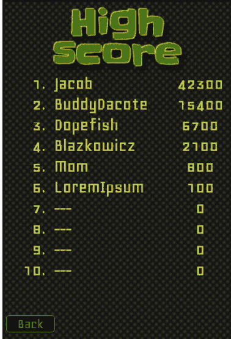

**图 12-1：** 当游戏结束时，高分列表会更新。

## 应用缓存

本章的最后一节讨论了另一种形式的本地数据——*应用缓存*。应用缓存是一种让你指定浏览器可以本地缓存哪些资源，以及必须始终从服务器获取哪些资源的方式。能够在本地缓存文件的明显优势是减少后续访问的网络流量，但它也允许应用程序在完全没有网络连接的情况下运行。

HTML5 规范的相关部分可在 W3C 网站 www.w3.org/TR/2011/WD-html5-20110525/offline.html 上找到。

### 缓存清单

应用缓存和离线 Web 应用使用缓存清单来控制哪些资源被缓存，哪些不被缓存。清单是一个具有简单语法的基本文本文件。代码清单 12-17 展示了清单格式的基础。

#### 代码清单 12-17 Jewel Warrior 的缓存清单

```
CACHE MANIFEST
# Jewel Warrior cache manifest

CACHE:
images/jewels32.png
images/jewels40.png
images/jewels64.png
...

NETWORK:
...

FALLBACK:
...
```

你可以在文件 `manifest.appcache` 中找到 Jewel Warrior 的完整清单。清单的第一行是必需的，必须是 `CACHE MANIFEST`。任何以 `#` 开头的行都被视为注释并被忽略。清单的其余部分分为三个部分——`CACHE`、`NETWORK` 和 `FALLBACK`，每个部分都以部分名称后跟冒号开头。`CACHE` 部分列出了浏览器必须下载并存储在缓存中的资源。`NETWORK` 部分列出了应在线访问的资源，`FALLBACK` 部分指定了当应用程序需要在线访问但没有网络连接可用时加载的页面。

## 将清单添加到 HTML 页面

当你有一个有效的清单时，必须在主页的 `html` 元素中添加对其的引用。只需添加一个名为 `manifest` 的属性，其值为清单文件的路径：

```html
<html manifest="manifest.appcache">
```


## 第12章 本地存储与缓存

目前，命名清单文件时无需使用官方扩展名。部分网站使用`.manifest`，另一些则使用`.appcache`。但我建议采用后一种，因为一项不相关的微软技术同样使用了`.manifest`扩展名。

更重要的是，Web服务器需以MIME类型`text/cache-manifest`发送清单文件。否则可能引发错误，导致应用无法加载。若Web服务器发送了错误的MIME类型，请查阅文档或联系服务器管理员。对于Apache、Nginx等Web服务器，可在`mime.types`配置文件中添加以下行：

```
text/cache-manifest appcache
```

指向缓存清单的页面（例如`index.html`）会自动被缓存，因此无需将其添加到CACHE部分。

## 处理在线资源

使用缓存清单从根本上改变了浏览器加载资源的方式。

无需缓存应用缓存中的所有文件。例如，若始终需要最新数据，可能不希望缓存动态生成的页面。你需要将这些资源添加到白名单，以便浏览器知悉必须从网络获取这些资源。此类资源需放入清单的NETWORK部分。以下代码片段展示了将计数器脚本添加至在线白名单，以便浏览器在在线时能访问它：

```
NETWORK:
# 仅允许在线访问此文件
counter.php
```

你也可以使用通配符，表示允许访问所有未在缓存中找到的在线URL：

```
NETWORK:
# 允许在线访问所有URL
*
```

那么，如果浏览器需要访问未被缓存且无网络连接的资源呢？虽然无法凭空创建资源，但你可以对浏览器的反应方式进行一定控制。清单的可选FALLBACK部分指定了当在线资源无法访问时显示的页面。请参阅以下来自HTML5规范的示例：

```
CACHE MANIFEST
FALLBACK:
/ /offline.html
NETWORK:
*
```

此清单使浏览器在用户访问时将页面和文件添加至应用缓存。用户每次访问新页面时，该页面都会被添加至缓存。当用户离线时，只有这些已访问过的页面保持可访问。若用户尝试访问站点上的其他页面，则会看到`offline.html`页面，其中可显示有用的提示信息。

一方面，此功能免除了在清单中指定每个文件并强制浏览器下载全部内容的需求。另一方面，用户仅能离线访问其已浏览过的内容。对于拥有大量页面的网站而言，有限的离线可用性可能很实用，因为用户未必需要离线访问所有内容。若想确保所需资源离线可用，最好在清单的`CACHE`部分中显式声明它们。

> 无规则规定清单中各部分的排列顺序。你可以随意混合顺序，甚至创建多个`CACHE`部分。此外，可省略`CACHE:`标题，直接在`CACHE MANIFEST`行下方列出缓存资源。

## 强制更新缓存

仅仅修改清单中列出的文件内容，并不意味着浏览器会自动获取更改。清单本身也必须改变。当未修改文件名时，这或许有违直觉。然而，清单必须更改才能使浏览器重新检查缓存文件。即使仅修改注释中的一个字符也足以触发检查，因此一种解决方案是在文件顶部维护版本号，并在每次修改清单中列出的文件时递增该版本号。示例请参见代码清单12-18。

### 代码清单12-18 带版本号的缓存清单

```
CACHE MANIFEST
# Jewel Warrior缓存清单，版本47
CACHE:
images/jewels32.png
images/jewels40.png
...
```

触发缓存更新会使浏览器检查清单中列出的所有文件。自上次缓存后发生更改的文件将被下载，其余文件则被跳过。这些检查通过常规的缓存相关HTTP头（如`If-Modified-Since`）进行。

由于除非修改清单，否则缓存文件不会自动更新，因此启用应用缓存进行开发可能颇具挑战。若此过程带来困扰，只需在开发游戏时禁用它——例如通过移除`html`元素的`manifest`属性。

## 总结

本章介绍了Web存储规范如何让你存储跨浏览器会话持久的客户端数据。你学习了如何使用本地存储保存数据（数据会保留直至被主动移除），以及相关的会话存储如何仅将数据保留至当前浏览器会话结束。

此外，你学习了如何使用这些功能添加持久的本地高分榜，以及如何保存游戏状态以便游戏记住玩家的进度。最后，本章涵盖了应用缓存，以及如何利用它使游戏在用户离线时仍可玩。

# 第13章 通过WebSockets实现在线功能

## 本章内容

- 使用WebSockets进行在线通信
- Node.js与服务器端JavaScript简介
- 创建简单的聊天应用程序

**本章中，**我将向你介绍WebSockets和Node这两项相对较新的技术，它们使创建网络应用和服务器端脚本的体验比以往更为出色。

本章前半部分，我将带你了解WebSocket API，展示如何建立与管理到服务器的连接，以及如何通过发送和接收数据与服务器通信。

随后，我将展示如何使用Node创建服务器端JavaScript应用程序。在本章结束时，你将掌握如何使用Node和WebSockets创建聊天服务器与客户端。

## 使用WebSockets

传统上，当需要常规Ajax请求之外的网络通信时，解决方案要么基于插件，要么通过现有XmlHttpRequest技术变通实现，可能涉及等待服务器响应的长连接。HTTP并非为轮询设计，HTTP请求和响应携带大量开销数据。当HTTP头、Cookie和其他请求数据结合时，一个HTTP请求的开销数据很容易达到1K。如果只需发送简短的状态更新，这开销就太大了。

WebSockets应运而生，专门提供针对持久连接和低延迟通信的替代方案。WebSockets保持连接活跃，每条消息仅使用两字节开销，大幅减少了数据量。WebSockets的另一优点是支持双向通信。客户端和服务器可通过同一连接同时互相发送消息。HTTP协议限制你只能发送请求并获取响应。

> **提示** WebSockets支持服务器与客户端之间的低延迟连接，但不允许客户端之间直接通信。为此，你可以借助WebRTC——W3C正在起草的一项新规范。WebRTC是一个提供浏览器间实时通信的API，支持视频聊天、点对点文件共享等功能。更多关于WebRTC的信息请访问www.webrtc.org/。

通过WebSocket连接进行通信的协议正由互联网工程任务组（IETF）标准化。该协议的完整规范可在http://tools.ietf.org/html/rfc6455找到。这是后台使用的数据协议。你通常无需直接处理它，而是通过JavaScript WebSocket API进行操作。

WebSockets在所有主流桌面浏览器以及iOS版Safari中可用。Android 4.4之前的版本未内置支持WebSockets，但可通过安装Android版Chrome或Firefox在这些设备上获得WebSockets支持。在Android 4.4+中，默认浏览器基于Chrome，因此也支持WebSockets。一如既往，请参考CanIUse (http://caniuse.com/#feat=websockets)获取最新信息。

### 连接服务器

在浏览器中，WebSockets通过标准化API提供。W3C开发并维护了WebSocket API。最新版本可访问www.w3.org/TR/websockets。服务器应用没有统一的API。服务器开发者可自由实现WebSockets，只要遵循IETF协议即可。

#### 建立连接

设置WebSocket连接很简单。只需创建一个新的`WebSocket`对象，并将服务器URL作为第一个参数传入：

```
var ws = new WebSocket("ws://www.myserver.com:9999/");
```


这会创建一个新的 WebSocket 对象，并尝试在端口 9999 上与 www.myserver.com 建立连接。WebSocket 构造函数接受一个可选的第二个参数，该参数指定了一个子协议列表。

WebSocket 可以在安全和非安全两种模式下运行。URL 中的 `ws://` 前缀表示非安全连接。使用 `wss://` 来建立安全连接。这与用于 HTTP 连接的 `http://` 和 `https://` 协议类似。请注意，安全连接需要服务器的支持。

如果你使用过 Ajax 和 XMLHttpRequest 对象，你可能熟悉就绪状态的概念。就绪状态是一个数字值，指示连接的当前状态，可以从 `ws.readyState` 属性中读取。表 13-1 列出了 WebSocket API 定义的四个就绪状态。

| 状态码 | 数值 | 描述 |
|---|---|---|
| CONNECTING | 0 | 客户端正在建立连接。 |
| OPEN | 1 | 连接已打开，你可以使用 `send()` 方法和消息事件与服务器通信。 |
| CLOSING | 2 | 连接正在关闭过程中。 |
| CLOSED | 3 | 连接已关闭，你无法再与服务器通信。 |

当你首次创建一个新的 WebSocket 对象时，其就绪状态被设置为 `CONNECTING`。当与服务器的连接建立后，就绪状态切换到 `OPEN`，你就可以开始与服务器通信了。你可以使用以下代码片段来检查连接是打开还是关闭：

```javascript
if (ws.readyState === 1) {
    // 连接已打开
}
```

或者，你可以使用 WebSocket 对象上可用的状态码属性：

```javascript
if (ws.readyState === ws.OPEN) {
    // 连接已打开
}
```

#### 关闭连接

当你想要关闭连接时，只需调用 `ws.close()` 方法：

```javascript
ws.close();
```

调用 `ws.close()` 方法会将就绪状态切换为 `CLOSING`，直到连接完全关闭，之后就绪状态变为 `CLOSED`。仅在连接打开后才调用 `ws.close()` 方法；否则，你会得到一个错误。

当连接因调用 `ws.close()` 方法或其他事件（例如，服务器关闭连接或连接失败）而关闭时，WebSocket 对象会触发一个 `close` 事件：

```javascript
ws.addEventListener("close", function() {
    console.log("连接已关闭");
}, false);
```

连接可能因许多不同原因突然关闭，因此了解连接是因为正常关闭还是因为错误被迫关闭可能会很有用。为此，WebSocket 协议定义了许多用于指示连接关闭原因的状态码。表 13-2 显示了当前定义的状态码。

**表 13-2 关闭事件的状态码**

| 状态码 | 描述 |
| :--- | :--- |
| 1000 | 连接正常关闭——即不是由于问题而关闭。 |
| 1001 | 端点正在离开。对于服务器，这可能是服务器关闭；对于客户端，可能是因为用户正在导航到新页面。 |
| 1002 | 连接因协议错误而关闭。 |
| 1003 | 端点接收到不支持的数据——例如，当它只接受文本时接收到二进制数据。 |
| 1004 | 保留供将来使用。 |
| 1005 | 此状态码保留用于未收到预期状态码的情况。 |
| 1006 | 此状态码保留用于连接在未发送关闭帧的情况下关闭的情况。 |
| 1007 | 连接因端点接收到无效的 UTF-8 文本数据而关闭。 |
| 1008 | 当没有其他状态码合适时，或者需要隐藏真实原因时，可以使用此状态码。 |
| 1009 | 连接因端点接收到的消息过大而无法处理而关闭。 |
| 1010 | 连接因服务器未协商一个或多个预期的扩展而关闭。 |
| 1011 | 连接因发生意外事件导致服务器无法处理请求而关闭。 |
| 1015 | 连接因执行 TLS 握手失败而关闭，例如服务器证书无法验证。 |

你可以使用这些代码和 `e.wasClean` 属性来确定连接是否正常关闭以及关闭的原因。如有必要，你可以采取适当的措施：

```javascript
ws.addEventListener("close", function(e) {
  if (!e.wasClean) {
    console.log(e.code + " " + e.reason);
  }
}, false);
```

你也可以定义和使用自己的状态码。4000–4999 范围保留供私人使用，因此如果你想为你的应用程序实现自定义状态码，请随意使用该范围内的代码。`ws.close()` 方法接受两个可选参数：状态码和原因。请注意，原因字符串不得超过 123 个字符。

```javascript
ws.close(4100, "玩家已断开连接");
```

当然，你需要在服务器端拦截关闭事件并检查这些代码。由于没有为 WebSocket 服务器定义标准 API，因此在服务器上的具体工作方式取决于你使用的框架和库。

### 使用 WebSocket 进行通信

由于 WebSocket 是全双工、双向连接，你只需要建立一个连接就可以发送和接收数据。相比之下，例如，使用 HTTP 连接进行长轮询时，你需要一个连接来等待服务器的消息，而另一个连接用于向服务器发送消息。

#### 发送消息

当连接打开时，你可以使用 `ws.send()` 方法向服务器发送数据。此函数接受一个参数，该参数可以是 UTF-8 字符串、`ArrayBuffer` 或二进制 `Blob` 对象：

```javascript
ws.send("你好，服务器！"); // 向服务器发送字符串
```

如果字符串不够用，你想发送更复杂的数据类型，当然，你总是可以将你的 JavaScript 对象编码为 JSON，并在服务器端解码。以下函数接受你在 data 参数中传递的任何内容，并将其作为 JSON 发送：

```javascript
function sendData(ws, data) {
    var jsonData = JSON.stringify(data);
    ws.send(jsonData)
}
```

以下代码片段发送一个假设游戏的更新数据结构。更新数据包含当前移动方向以及玩家角色是否正在开火的信息：

```javascript
sendData(ws, {
    move : {x : 0.79, y : -0.79},
    firing : true,
    weapon : 7
});
```

除了字符串数据，你还可以使用 `ArrayBuffer` 对象或 `Blob` 对象发送二进制数据。这两种数据类型通常与 File API 一起使用，但可以用来发送任何类型的数据。在本章中，你只使用字符串。

每当你使用 `ws.send()` 方法发送消息时，数据都会被放入缓冲区。`WebSocket` 对象会尽可能快地从缓冲区中取出数据并发送到网络连接，但在你发送下一段数据时，缓冲区可能尚未清空。如果你尝试发送数据而缓冲区已满，不仅数据不会被发送，而且连接也会关闭。`ws.bufferedAmount` 属性告诉你当前缓冲区中存储了多少数据。此值的一种可能用途是限制消息发送的速率。例如，如果你的游戏以固定间隔向服务器发送更新，那么在发送数据前检查缓冲区是否为空，可以帮助你避免因发送过多数据而导致连接拥塞：

```javascript
setInterval(function() {
    if (ws.bufferedAmount == 0) {
        var data = getUpdate();
        ws.send(data);
    }
}, 100);
```

尽管间隔设置为 100 毫秒，但前面的示例仅在缓冲区为空时才发送更新数据，从而避免了潜在的拥堵。

#### 接收消息

当服务器发送消息时，WebSocket 对象上会触发一个 `message` 事件。传递给任何处理程序的事件对象有一个 `data` 属性，其中包含来自服务器的消息。将事件处理程序附加到 `message` 事件，并以任何你想要的方式处理数据：

```javascript
ws.addEventListener("message", function(e) {
    console.log("接收到数据: " + e.data);
}, false);
```

## 在服务器上使用 Node

如果没有可以连接的服务器，WebSocket 并没有太大用处。目前已有许多针对各种平台和编程语言的服务器库和框架可用。Node（http://nodejs.org），或称 Node.js，是一个基于 JavaScript 的服务器框架，非常适合这个目的，尤其是因为它允许你在客户端和服务器端使用相同的语言进行编码。

Node 强调异步模式，这对于任何习惯于为浏览器开发的 JavaScript 程序员来说应该很熟悉。在浏览器中，例如 Ajax 和 DOM 事件都是异步工作的。对于许多（如果不是大多数）Web 开发人员来说，附加事件处理程序和传递回调函数的过程是第二天性。在 Node 的服务器端环境中，这意味着每当你请求访问某个 I/O 资源（如磁盘上的文件、数据库或网络连接）时，你都会将回调函数传递给给定的函数。该函数会立即返回，并在任务完成时调用代码清单 13-1 说明了如何使用 Node 从文件中读取数据。


### 清单 13-1 使用 node 从文件中读取数据

```javascript
var fs = require("fs");

fs.readFile("./myfiles/mystuff.txt", function(err, data) {
    if (err) {
        // 发生了错误
    } else {
        // 处理文件数据
    }
});
```

大多数异步内置函数都遵循这种在参数列表末尾添加回调函数的模式。同样，回调函数通常将错误值作为第一个参数，后跟在该特定上下文中有意义的其他参数。

`require()` 函数用于导入模块。在清单 13-1 中，文件系统模块通过变量 `fs` 变得可用。Node 自带了许多内置模块；你可以在 API 文档中查看完整列表并阅读更多关于它们提供功能的介绍：[http://nodejs.org/docs/latest/api/index.html](http://nodejs.org/docs/latest/api/index.html)。

### 安装 Node

你需要一台服务器才能使用 Node，最好是你可以拥有足够访问权限以便安装新程序的服务器。安装 Node 的具体方式取决于服务器平台。Node 可用于 Windows、OS X 和 Linux。你可以在 Node 网站 ([http://nodejs.org/download/](http://nodejs.org/download/)) 上找到所有平台的安装程序。我在创建本章中的示例时使用的是 Node 0.10.20。

在服务器上安装 Node 后，你可以通过在命令提示符下输入 `node` 立即尝试它。此命令会给你一个 Node 控制台，你可以在其中输入任何想要执行的 JavaScript 代码。

### 使用第三方模块

如前所述，Node 拥有很多内置功能，你可以利用开箱即用的功能取得很大进展。然而，内置函数都相对底层；例如，没有内置数据库功能。相反，Node 包含了构建附加模块所需的所有构建块，这些模块提供了诸如数据库集成、Web 服务器等功能。Node 还附带了 Node 包管理器 (npm)，这是一个有用的工具，可以让你轻松管理模块。你可以在项目网站 ([http://npmjs.org](http://npmjs.org)) 上阅读更多关于 npm 的信息，也可以在那里搜索其庞大的模块注册表。

打开一个控制台/终端窗口，使用 `npm install` 命令安装模块。例如，要安装本章后面将使用的 WebSocket 模块，请输入以下命令：

```
npm install websocket
```

同样，你可以使用 `npm remove` 命令删除任何你想要卸载的模块：

```
npm remove websocket
```

`npm list` 命令会给你一份所有已安装模块的完整列表。你可以在 [http://search.npmjs.org](http://search.npmjs.org) 浏览所有通过 npm 可用的模块。

### Node 托管

如果你没有所需的服务器访问权限，也没有 Linux 机器可以进行实验，请不要绝望。如果你只是想尝试一下 Node，有一些可用的选择。

Nodejitsu ([www.nodejitsu.com](http://www.nodejitsu.com)) 是一个 Node 平台即服务 (PaaS) 提供商，可以以合理的价格托管你的 Node 应用程序。最低档套餐每月 9 美元，但你可以获得一个免费的 30 天试用版，这应该足够让你看看它是否是正确的选择。如果你的游戏或应用程序是开源软件，Nodejitsu 甚至会免费托管它。这项服务类似于 Node 背后的公司 Joyent 曾经提供的 Node SmartMachines 服务，直到他们最近关闭了该服务。

如果你更愿意在 Linux 服务器上进行实验，可以使用亚马逊的弹性计算云 (EC2) 服务。通过 EC2，你可以在需要时启动一个称为 *实例* 的虚拟服务器，并在完成后将其关闭，这样就不会浪费服务器资源。亚马逊提供了一个免费套餐，允许你免费使用 EC2 微型实例一年。在 [http://aws.amazon.com/free](http://aws.amazon.com/free) 了解更多相关信息。

按照亚马逊网站上的说明设置一个 EC2 实例。你可以从多种不同的亚马逊机器映像 (AMI) 中进行选择，有些是亚马逊创建的，有些是社区创建的。Ubuntu 在 [http://cloud-images.ubuntu.com/locator/ec2](http://cloud-images.ubuntu.com/locator/ec2) 提供用于亚马逊 EC2 的映像。点击 AMI ID 链接将直接带你进入 AWS 控制台并启动 AMI 启动过程。

如果你选择 Ubuntu 映像，你可以使用两个简单的命令安装 Node 和 websocket 模块：

```
sudo apt-get install nodejs
npm install websocket
```

如果 npm 报错说本机代码编译失败，请不要惊慌，模块会正常工作。现在你可以开始第一个示例了。在继续创建 WebSocket 应用程序之前，我将向你展示如何创建一个总是响应相同消息的基本 HTTP 服务器，这是一个简单但可能有用的示例。

> **提示** 有许多托管 Node 应用程序的选项。Joyent 在 Github 上整理了一个页面，列出并比较了许多这些托管选项：[https://github.com/joyent/node/wiki/node-hosting](https://github.com/joyent/node/wiki/node-hosting)。

## 使用 Node 创建 HTTP 服务器

Node 提供了一个名为 `net` 的网络模块。这个模块提供了底层的套接字功能，允许你创建网络客户端和服务器应用程序。Node 还包括一个在 `net` 模块之上实现的 HTTP 模块。你可以使用这个模块来创建实现 HTTP 协议的服务器。然而，这个模块提供的服务器功能仅限于管理连接。如何解释请求则取决于你。

使用 `require()` 方法导入 HTTP 模块，并使用其 `createServer()` 方法创建一个新的 HTTP 服务器对象：

```javascript
var server = require("http").createServer();
```

使用 `server.listen()` 方法开始接受连接。此方法接受三个参数：一个端口号、一个可选的主机名和一个可选的回调函数。如果省略主机名，服务器将在所有可用的 IP 地址上监听：

```javascript
server.listen(9999); // listen on port 9999 on all interfaces
```

每当客户端连接到服务器时，服务器对象就会触发一个 `connection` 事件。Node 允许你通过在目标对象上使用 `on()` 方法来附加事件处理程序。例如，要向服务器对象的 `connection` 事件附加处理程序，请使用以下代码：

```javascript
server.on("connection", function(socket) {
    console.log("Connection from: ", socket.address().address);
});
```

当服务器收到有效的 HTTP 请求时，它会触发一个 `request` 事件，并将一个 `request` 对象和一个 `response` 对象传递给事件处理程序。`request` 对象使你能够访问有关 HTTP 请求的信息，例如请求路径、HTTP 头等。`response` 对象用于向客户端套接字写入 HTTP 响应。`response` 对象有三个重要的方法：`response.writeHead()`、`response.write()` 和 `response.end()`。

`response.writeHead()` 方法将 HTTP 头写入套接字。该函数接受两个参数：一个 HTTP 状态码（例如，成功请求为 200，“文件未找到”错误为 404）和一个包含响应头的 JavaScript 对象。

```javascript
response.writeHead(200, {
    "Content-Type" : "text/plain"
});
```

`response.write()` 方法写入实际的响应数据：

```javascript
response.write("It Works!");
```

最后，`response.end()` 方法关闭连接。清单 13-2 展示了 HTTP 服务器的完整代码。你可以在文件 `01-httpserver.js` 中找到这个示例。

### 清单 13-2 一个基本的 HTTP 服务器

```javascript
var server = require("http").createServer();

server.on("connection", function(socket) {
    console.log("Connection from: ", socket.address().address);
});

server.on("request", function(request, response) {
    console.log("Request:", request.method, request.url);

    response.writeHead(
        200,
        {
            "Content-Type" : "text/plain"
        }
    );

    response.write("It Works!");

    response.end();
});

server.listen(9999); // listen on port 9999
```

通过执行以下命令运行服务器：

```
node 01-httpserver.js
```

如果你在本地机器上运行服务器，现在你可以通过将浏览器指向 [http://127.0.0.1:9999/](http://127.0.0.1:9999/) 来连接到服务器。当你连接到服务器时，无论你请求什么文件或路径，都应该会看到文本 “It Works!”。

## 创建 WebSocket 聊天室

在第二个示例中，我将向你展示如何使用 Node 和 WebSockets 创建一个简单的聊天应用程序。如果还没有安装 websocket 模块，请确保在应用程序所在的文件夹中执行以下命令来安装它：

```
npm install websocket
```

你也可以使用 `-g` 选项全局安装模块，这样就不必为每个新项目都安装它：

```
npm -g install websocket
```

现在你可以将 websocket 模块导入到你的 Node 应用程序中：

```javascript
var WebSocketServer = require("websocket").server,
    WebSocketClient = require("websocket").client,
    WebSocketFrame = require("websocket").frame,
    WebSocketRouter = require("websocket").router;
```

在这个示例中你只需要使用 `WebSocketServer` 构造函数，但其他构造函数在其他场景中也很有用——例如，如果你需要使用 Node 作为客户端连接到第三方服务器。

### 创建服务器

首先，使用 `WebSocketServer` 构造函数创建一个新的 WebSocket 服务器对象。你还需要一个 HTTP 服务器：

```javascript
var ws = new WebSocketServer(),
    server = require("http").createServer();
```


接下来，你需要在 WebSocket 服务器和 HTTP 服务器之间建立连接。WebSocket 服务器本质上是附加到 HTTP 服务器上，并处理它接收到的所有请求。要在服务器之间建立连接，你需要`挂载`一个服务器配置对象：

```
ws.mount(serverConfig);
```

`serverConfig`是一个简单的 JavaScript 对象，它指定了 WebSocket 服务器的许多选项和参数，其中最重要的是对 HTTP 服务器的引用：

```
var serverConfig = {
    httpServer : server,
    autoAcceptConnections : true
};
```

将`autoAcceptConnections`设置为`true`意味着服务器将接受所有连接，无论它们使用什么子协议版本。在真实的生产环境中，你应该考虑采用更严格的方法以避免问题。对于本示例，采取宽容的态度是可以接受的。

如果你需要停止接受新的 WebSocket 连接，可以使用`ws.unmount()`方法卸载服务器。此函数会断开与服务器配置的链接，因此无法再建立新的连接。任何现有连接将不受影响。如果你还想关闭现有连接，可以使用`ws.closeAllConnections()`方法。最后，`ws.shutDown()`会一次性执行这两个任务。

作为使用`ws.mount()`方法的替代方法，你可以将服务器配置对象直接传递给`WebSocketServer`构造函数。清单 13-3 显示了设置聊天服务器以接受端口 9999 上连接所需的代码。如果你正在运行防火墙，请确保使用开放端口。你可以在文件`02-websocketserver.js`中找到此示例的完整代码。

## 清单 13-3  设置服务器

```
var WebSocketServer = require("websocket").server;

// 创建一个 HTTP 服务器
var server = require("http").createServer();

// 以及一个 WebSocket 服务器
var ws = new WebSocketServer({
    httpServer : server,
    autoAcceptConnections : true
});

console.log("Chat server listening on port 9999!");

server.listen(9999);
```

当新的客户端连接到服务器时，会在 WebSocketServer 对象上触发一个连接事件。此事件携带一个连接对象，你必须使用它来与该客户端进行通信。清单 13-4 显示了此事件的连接处理程序。

## 清单 13-4  处理新连接

```
// 创建初始为空的客户端列表
var clients = [];

ws.on("connect", connectHandler);

function connectHandler(conn) {
    // 将初始昵称设置为客户端 IP
    conn.nickname = conn.remoteAddress;

    conn.on("message", messageHandler);
    conn.on("close", closeHandler);

    // 将连接添加到客户端列表
    clients.push(conn);

    // 向所有客户端发送消息
    broadcast(conn.nickname + " entered the chat");
}
```

connectHandler() 函数首先为客户端分配一个昵称。这是你在向其他客户端发送消息时使用的名称。最初，它被设置为客户端的 IP 地址，该地址在 conn.remoteAddress 属性中可用。我稍后会回到 message 和 close 事件的处理程序。connectHandler() 函数以将连接对象添加到 clients 数组并向所有客户端广播一条新用户进入聊天室的消息而结束。清单 13-5 显示了 broadcast() 函数。

## 清单 13-5  向所有客户端广播消息

```
function broadcast(data) {
    clients.forEach(function(client) {
        client.sendUTF(data);
    });
}
```

此函数只是遍历所有已连接的客户端并发送消息。请注意，用于发送数据的方法叫做`client.sendUTF()`；如果你发送的是二进制数据，则必须使用`client.sendBinary()`方法，该方法接受一个 Node Buffer 对象。

所有客户端在连接时都添加到`clients`数组中，因此当连接关闭时也必须将它们移除。清单 13-6 显示了清单 13-4 中附加的`close`事件的事件处理程序。

## 清单 13-6  移除断开连接的客户端

```
function closeHandler() {
    var index = clients.indexOf(this);
    if (index > -1) {
        clients.splice(index, 1);
    }
    broadcast(this.nickname + " left the chat");
}
```

从`clients`数组中移除客户端连接后，`closeHandler()`向剩余客户端发送一条消息，说明该用户已离开聊天室。

当客户端向 WebSocket 服务器发送数据时，会在客户端连接对象上触发一个 message 事件。清单 13-7 显示了作为此事件处理程序附加的`messageHandler()`函数。

## 清单 13-7  处理客户端消息

```
function messageHandler(message) {
    var data = message.utf8Data;
    broadcast(this.nickname + " says: " + data);
}
```

事件处理程序接收一个参数，即包含消息的对象。字符串消息将数据保存在`message.utf8Data`属性中，而包含二进制内容的消息则将数据保存为可在`message.binaryData`属性中使用的 Node Buffer 对象。

清单 13-7 中的`messageHandler()`函数只是将消息广播给所有客户端，并在前面加上发送者的昵称。为了让事情更有趣一点，可以引入客户端可以发出的几个命令。具体来说，添加以下两个命令：

```
/nick newnickname
/shutdown
```

`/nick`命令将客户端的昵称更改为*newnickname*。`/shutdown`命令只是关闭聊天服务器。如果这是一个真实的应用程序，你可能会限制对此类命令的访问。修改后的`messageHandler()`函数如清单 13-8 所示。

## 清单 13-8  拦截命令

```
function messageHandler(message) {
    var data = message.utf8Data.toString(),
        firstWord = data.toLowerCase().split(" ")[0];
    // 这是命令吗？
    if (data[0] == "/") {
        // 如果是，它是哪个命令？
        switch (firstWord) {
            case "/nick" :
                // 新昵称是第二个词
                var newname = data.split(" ")[1];
                if (newname != "") {
                    broadcast(this.nickname
                        + " changed name to " + newname);
                    this.nickname = newname; // 设置新昵称
                }
                break;
            case "/shutdown" :
                broadcast("Server shutting down. Bye!");
                ws.shutDown(); // 关闭 WebSocket 服务器
                server.close(); // 以及 HTTP 服务器
                break;
            default:
                this.sendUTF("Unknown command: " + firstWord);
        }
    } else {
        broadcast(this.nickname + " says: " + data);
    }
}
```

你可以在文件`02-websocketserver.js`中找到完整的 Node 服务器脚本。

## 创建 WebSocket 客户端

是时候创建聊天客户端了，从清单 13-9 所示的 HTML 开始。HTML 位于文件`03-websocketclient.html`中。

## 清单 13-9  聊天客户端标记

```
<!DOCTYPE HTML>
<html lang="en-US">
<head>
    <meta charset="UTF-8">
    <meta name="viewport"
          content="width=device-width,user-scalable=0">
    <title>Chapter 13: WebSocket Chat</title>
    <link rel="stylesheet" href="03-websocketclient.css">
    <script src="03-websocketclient.js"></script>
</head>
<body>
    <h1>Very Simple Chat</h1>
    <input id="input" placeholder="Enter message..."/>

    <textarea id="response" disabled></textarea>
</body>
</html>
```

HTML 只是一个基本的输入字段，用户可以在其中输入消息，以及一个用于显示输出的 textarea 元素。清单 13-10 显示了 CSS 文件`03-websocketclient.css`的内容。

## 清单 13-10  设置聊天客户端样式

```
#input, #response {
    border : 1px solid black;
    padding : 2px;
    display : block;
    width : 600px;
}

#response {
    height : 300px;
}
```

JavaScript 文件 03-websocketclient.js 包含设置聊天客户端所需的所有代码。当页面加载完成时，清单 13-11 中所示的 setupChat() 函数将创建 WebSocket 连接并附加相关的事件处理程序。请记住在必要时更改传递给 WebSocket() 构造函数的 URL。

## 清单 13-11  设置客户端代码

```
function setupChat() {
    var ws = new WebSocket("ws://127.0.0.1:9999/");

    setupInput(ws);

    write("Welcome to Very Simple Chat!");

    ws.addEventListener("open", function () {
        write("Opened connection");
    }, false);

    ws.addEventListener("message", function(e) {
        write(e.data);
    }, false);

    ws.addEventListener("close", function() {
        write("Connection closed");
    }, false);
}

window.addEventListener("load", setupChat, false);
```


`setupInput()` 函数将一个函数附加到输入字段的 `keydown` 事件上。每当用户按下回车键（其键码为 13），输入字段中的文本就会被发送到服务器，并且字段会被清空。清单 13-12 展示了该函数。

```
清单 13-12 设置输入字段
function setupInput(ws) {
    var input = document.getElementById("input");

    input.addEventListener("keydown", function(e) {
        if (e.keyCode == 13) {
            ws.send(this.value);
            this.value = "";
        }
    });
}
```

清单 13-13 展示了最后一个函数 `write()`，它只是向输出文本区域写入一行文本，并在字符串前加上时间戳。

```
清单 13-13 编写输出消息
function write(str) {
    var response = document.getElementById("response"),
        time = (new Date()).toLocaleTimeString();
    response.value += time + " - " + str + "\r\n";
}
```

现在你可以尝试在服务器运行时在浏览器中打开 `03-websocketclient.html`。使用以下命令启动服务器：

`node 02-websocketserver.js`

如果一切顺利，你应该会看到欢迎消息，接着是一条通知连接已建立的消息。在输入字段中，你可以键入消息，然后发送到服务器。如果你打开第二个浏览器（可能在另一台计算机上）运行聊天客户端，你会看到消息实际上被发送到了所有已连接的客户端，并且基本的聊天系统工作正常。

## 本章小结

在本章中，你学习了服务端 JavaScript 环境 Node 以及 WebSocket API，它使你能够创建比传统基于 HTTP 的解决方案更好的网络化 Web 应用。

本章向你展示了如何使用 WebSocket 创建到服务器的连接，以及如何发送和接收数据。你还了解到，与过去需要持久连接时使用的方法相比，WebSocket 如何提供更好的体验。

在介绍 Node 时，本章向你展示了如何仅用几行代码创建一个简单的 HTTP 服务器。最后，通过创建一个基本的聊天应用，你发现了 Node 和 WebSocket 如何协同工作，以高效的、低延迟的网络通信来创建强大的 Web 应用。

# 索引

## 数字

- 3D CSS 变换, 251–252
- 3D 图形, 使用 WebGL 创建
    - 概述, 309–310
    - 显示, 358–375
    - 渲染, 327–343
    - 着色器, 313–327
    - 纹理和光照, 343–358

## A

- abort 事件, 291
- 访问
    - Android 日志, 77
    - 游戏手柄数据, 206–208
    - 图像数据, 167–173
- 激活启动画面, 35
- 活动声音列表, 维护, 304
- 适配
    - 分辨率到小屏幕, 45–50
    - 到小屏幕分辨率, 45–50
- `addAnimation()` 函数, 243
- `addClass()` 函数, 32
- `addColorStop()` 方法, 145–146
- `addHitRegion()` 方法, 205–206
- 添加
    - 动画, 243
    - 公告容器, 268
    - 背景图案, 39, 185
    - 缓存清单到页面, 396–397
    - CSS 规则, 185–186
    - 光标到显示模块, 228–229
    - 光标到模块显示, 228–229
    - 功能到主模块, 34–35
    - 图像, 151–156
    - 键码, 216–217
    - Loader 脚本, 28
    - 主样式表, 26
    - 移动端样式表, 59–62
    - 模块, 391–392
    - 分数, 253–276
    - 进度条, 177–181
    - 对嵌入字体的引用, 38
    - 屏幕元素到游戏容器, 26
    - 屏幕模块, 52–56
    - `setup()` 函数到游戏模块, 71
    - 音效, 305–306
    - 启动画面标记, 36
    - 样式, 26–27
    - 文本, 151–156
    - 时间, 253–276
    - 用户控件, 286–287
- 地址栏, 隐藏, 71–72
- `addScore()` 函数, 264–265, 394
- 相邻性, 测试, 95
- 调整 UI 以适应大屏幕, 256–257
- Adobe Edge, 14
- Adobe PhoneGap, 77–80
- `advanceLevel()` 函数, 265–266, 270–271
- AI（人工智能）, 117
- Ajax, 12, 110
- 环境光, 344
- AMI（亚马逊机器镜像）, 409
- Android, 62–73, 76–77, 283
- Android SDK（网站）, 77
- 角度, 344–346
- 动画循环, 创建, 240–241
- 动画
    - 添加, 243
    - 添加分数和时间, 253–276
    - 光标, 241–243
    - 宝石, 371–375
    - 使游戏响应, 236–253
    - 暂停游戏, 261–263
    - 渲染, 244–245
    - 计时, 236–241
- `announce()` 函数, 270–272, 391
- 公告容器, 添加, 268
- 公告, 样式, 268–269
- 宣告
    - 游戏事件, 268–272
    - 重要事件, 270
- Apache 软件基金会, 78
- Apple（网站）, 74
- 应用缓存, 395–399
- 应用图标, 66–69
- 应用程序, Web
    - 构建原生应用, 77–80
    - 调试, 33–34, 73–77
    - 放置在主屏幕, 62–71
- `apply()` 方法, 227
- `arc()` 函数, 135–137, 150–151
- Arcade Fire, 376
- 弧线, 绘制, 135–137
- 人工智能（AI）, 117
- `aspect` 参数, 335
- 宽高比（智能手机和平板电脑）, 45–46
- `aspect-ratio`, 57
- 异步函数, 89–90
- 属性变量, 320
- 属性
    - 布尔型, 287
    - 控件, 287
    - 高度, 49, 57
    - 循环, 290
    - 预加载, 287–288
    - src, 289
    - 宽度, 49, 57
- Audacity, 285
- 音频
    - 添加音效, 305–306
    - 音频元素, 11, 286–294
    - 构建音频模块, 300–306
    - 数据, 294–300
    - 检测支持, 282–283
    - 事件, 291
    - HTML5, 282–294
    - 从游戏屏幕播放, 305–306
    - 位置音频, 296–300
    - 预加载, 287–288
    - 为播放做准备, 300–301
    - 处理数据, 294–300
- `audio` 元素, 11, 286–294
- 音频模块, 300–306
- 音频节点, 295–296, 297
- `audio.canPlayType()` 方法, 284
- `AudioContext()`, 295
- `audio.play()` 方法, 306
- `audio.stop()` 方法, 303–304
- 奖励
    - 分数, 98–100, 263–272
    - 链式匹配的分数, 98–100
- `axes` 属性, 207–208

## B

- 背景
    - 添加图案, 39, 185
    - 绘制, 157–158
- 向后兼容性, 15–16
- 基准字体大小, 设置, 47
- `before()` 函数, 244, 245
- `bevel` 值, 143–144
- 贝塞尔曲线, 绘制, 137–140
- `bind()` 函数, 53, 213, 226
- 绑定
    - 点击事件到音频操作, 292–293
    - 输入到游戏功能, 226–233
- 位图图像, 128
- Blender（网站）, 341
- 混合, 365
- `blur()` 方法, 197–198
- 游戏板
    - 添加 CSS 规则, 185–186
    - 背景, 184–186
    - 递归检查, 99–100
    - 复制数据, 102–103
    - 创建模块, 85–93
    - 使用 `canvas` 绘制, 181–188
    - 填充, 90–93, 187
    - 初始化, 87–89
    - 重绘, 361–362
    - 重新填充, 102–103, 251–253
    - 发送更改到显示模块, 223–224
- 游戏板模块
    - 填充整个游戏板, 90–93
    - 实现规则, 93–105
    - 导入, 118
    - 初始化游戏状态, 87–90
    - 加载, 86
- `board.initialize()` 函数, 119
- `board.swap()` 函数, 223
- 书签图标, 63
- 布尔型属性, 287
- 向客户端广播消息, 414–415
- 浏览器, 71–73
- 构建
    - 音频模块, 300–306
    - 游戏, 16–17
    - 游戏屏幕, 180–194
    - 高分数据屏幕, 389–392
    - 输入模块, 211–233
    - 原生 Web 应用, 77–80
    - 存储模块, 384–385
- "Bulletproof @font-face Syntax" (Irish), 37
- `butt` 值, 142
- `buttons` 属性, 207

## C

- Cabello, Ricardo（软件开发者）, 375
- 缓存清单, 396–399
- 强制更新缓存, 398–399
- 缓存和数据存储
    - 应用缓存, 395–399
    - 创建高分列表, 389–395
    - 使游戏状态持久化, 385–389
    - 使用 Web 存储, 379–384
- 计算纹理坐标, 355–358
- `callback()` 函数, 122
- 从加载器调用 `setup()` 函数, 71
- `cancelRequestAnimationFrame()` 函数, 238
- CanIUse（网站）, 15, 294, 402
- `canJewelMove()` 函数, 101
- `canplay` 事件, 291
- `canplaythrough` 事件, 291
- `canPlayType()` 方法, 282, 284–285, 288
- `canSwap()` 函数, 94, 95, 101, 104, 247
- canvas, 181–188, 204–206, 336
- Canvas API, 使用其绘制形状, 9–10
- Canvas 显示模块, 181–183
- canvas 元素
    - 概述, 9–11, 129
    - 使用其创建图形, 127–173
    - 何时选择, 129–130
- `canvas.toDataURL()` 方法, 170, 171–172
- canvg（网站）, 129
- 捕获
    - 鼠标点击, 214
    - 用户输入, 195–211
- 层叠样式表（CSS）
    - 尺寸, 131
    - 游戏板, 180
    - 媒体查询, 56–58
    - 精灵图, 183
- 捕获错误, 112
- 链式匹配
    - 为链式匹配奖励分数, 98–100
    - 检查链式匹配, 93–94
    - 检测链式匹配, 95–100
    - 处理链式匹配, 96–97
    - 移除链式匹配, 96–97
    - 在游戏板中搜索链式匹配, 95–96
- 聊天客户端, 样式, 417–418
- 聊天室（WebSocket）, 412–419
- `check()` 函数, 96–100
- `checkChain()` 函数, 93–95, 96
- 检查
    - 链式匹配, 93–94
    - 游戏计时器, 259–260
    - 分数, 265
    - 递归检查, 99–100
- `checkProgress()`, 179
- `checkScores()` 函数, 394
- Chrome, 109, 110, 113, 144, 167, 204, 206–208, 283, 286, 295, 296, 310, 311, 402
- Chrome Canary（网站）, 142
- 圆形, 绘制, 135–137
- `clearCursor()` 函数, 229
- `clearInterval()` 函数, 110, 238
- `clearJewel()` 函数, 229
- `clearTimeout()` 函数, 110, 238
- 点击事件, 192
- 点击事件处理器, 54–55
- 点击事件
    - 绑定到音频操作, 292–293
    - 处理, 215
- 客户端代码, 设置, 418
- 客户端消息, 处理, 415
- `client.sendBinary()` 方法, 415
- 裁剪路径, 140–142
- 关闭事件, 状态码, 404–405
- 关闭 WebSocket 连接, 404–405
- CocoonJS（网站）, 80
- Collada 模型, 加载, 341–343
- 颜色, 57
- `color-index`, 57

www.it-ebooks.info


## HTML5 游戏

- 彗星，12
- 命令，拦截，416–417
- 通信，通过 WebSockets，405–407
- 复杂数据类型，编码，381
- 合成，164–167
- `connected` 属性，207
- `connectHandler()` 函数，414
- 连接
    - 处理，414
    - 连接到服务器，402–405
- `conn.remoteAddress` 属性，414
- `console.log()`，77
- 内容，为大屏幕缩放，60
- 控制
    - 活动声音列表，304
    - 视口，48–49
    - 音量，290–291
- `controls` 属性，287
- cookies，13，379–380
- 复制，165
- 复制数据，102–103
- CORS（网站），171
- `createAudio()` 函数，301–302
- `createBackground()` 函数，184–185
- `createServer()` 方法，410–412
- 创建
    - 使用 WebGL 创建 3D 图形，309–310，313–375
    - 动画循环，240–241
    - 棋盘模块，85–93
    - 不同的视图，50–62
    - 游戏计时器，259–260
    - 使用 canvas 元素创建图形，127–173
    - 高分数据列表，389–395
    - 使用 Node 创建 HTTP 服务器，410–412
    - 宝石表面，368–371
    - Jewel Warrior 游戏。*请参阅特定的宝石游戏条目*
    - 宝石，98，360–362
    - 主菜单，50–52
    - 基于像素的效果，171–173
    - 可扩展的布局，46–48
    - 服务器，412–417
    - 启动屏幕，35–40
    - 测试页面，115–116
    - UI 控件，292–293
    - UI 元素，254–259
    - WebSockets 聊天室，412–419
- WebSockets 客户端，417–419
- 使用 Node 的 WebSockets HTTP 服务器，410–412
- 工作线程模块，117–120
- 创作共用，285
- CSS（层叠样式表）
    - 尺寸，131
    - 游戏棋盘，180
    - 媒体查询，56–58
    - 精灵图，183
- CSS3 Patterns（网站），39
- `ctx.beginPath()` 方法，131，132
- `ctx.bezierCurveTo()` 方法，139
- `ctx.clearRect()` 方法，135
- `ctx.clip()` 方法，140–142
- `ctx.closePath()` 方法，132
- `ctx.createPattern()` 方法，147
- `ctx.drawImage()` 方法，151
- `ctx.fill()` 方法，132–134
- `ctx.fillRect()` 方法，134
- `ctx.fillStyle()` 方法，132，134
- `ctx.fillText()` 方法，152–153，153–154
- `ctx.font` 属性，152
- `ctx.getImageData()` 方法，167–168，168–170，171
- `ctx.globalAlpha` 属性，164
- `ctx.isPointInPath()` 方法，204–205
- `ctx.lineCap` 属性，142–143
- `ctx.lineJoin` 属性，143–144
- `ctx.lineTo()` 方法，132，134
- `ctx.measureText()` 方法，154，171
- `ctx.miterLimit` 属性，144
- `ctx.moveTo()` 方法，132，134
- `ctx.putImageData()` 方法，168–170
- `ctx.quadraticCurveTo()` 方法，138
- `ctx.restore()` 方法，157
- `ctx.rotate()` 方法，149–150
- `ctx.save()` 方法，156–157
- `ctx.scale()` 方法，149
- `ctx.setLineDash()` 方法，144
- `ctx.setTransform()` 方法，148
- `ctx.shadowBlur` 属性，155
- `ctx.stroke()` 方法，132–134
- `ctx.strokeText()` 方法，152–153，153–154
- `ctx.textAlign` 属性，152
- `ctx.translate()` 方法，148–149
- 三次曲线，绘制，139–140
- 光标
    - 添加到显示模块，228–229
    - 动画，241–243
    - 初始化，221
    - 移动，224–226
    - 渲染，228–231
    - 设置属性，221
    - 更新，230
- 光标对象，220
- `cycle()` 函数，240–241，263，336–337，365–366

- 设备方向，检测，58–59
- device-aspect-ratio，57
- device-height，57
- device-width，57
- 漫射光，344，348–350
- 尺寸（canvas），131
- 调光覆盖层，191–192
- 调光覆盖层，191–192
- 禁用
    - 默认浏览器行为，72–73
    - 过度滚动，71
- 断开连接的客户端，移除，415
- 显示
    - 将光标添加到模块，228–229
    - 构建游戏屏幕，180–194
    - 高分数据，394–395
- 显示模块，暂停动画，262–263
- `document.createElement()`，282
- DOM，访问，109
- DOM 辅助模块，31–35
- `dom.bind()` 函数，53，54
- `done()` 函数，252，373
- `dot()` 函数，316
- 虚线，144
- `draw()` 函数，337，338–339，365–366，365–368
- 绘制
    - 圆弧，135–137
    - 背景，157–158
    - 贝塞尔曲线，137–140
    - 使用 canvas 绘制棋盘，181–188
    - 圆形，135–137
    - 三次曲线，139–140
    - 椭圆，150–151
    - HTML5 标志，157–164
    - 宝石，365–368
    - 二次曲线，138–139
    - 矩形，134–135
    - 形状，9–10，131–142
    - 使用 Canvas API 绘制形状，9–10
    - 三角形，133
    - 顶点数据，338–339
- `drawJewel()` 函数，187，250，276，367，370
- `drawLogo()` 函数，159，161，162–163
- `durationchange` 事件，291

## D

- Danger Mouse（网站），376
- 虚线，144
- 数据存储与缓存
    - 应用缓存，395–399
    - 创建高分列表，389–395
    - 使游戏状态持久化，385–389
    - 使用 Web 存储，379–384
- 数据类型，313–319。*另请参见* 图像数据
- 调试
    - 访问 Android 日志，77
    - 启用 Safari 调试器，74–77
    - 移动 Web 应用程序，73–77
    - Web 应用程序，33–34，73–77
    - WebGL，311–312
- 默认浏览器行为，禁用，72–73
- destination-atop，165
- destination-in，165
- destination-out，165
- destination-over，165
- 检测
    - 音频支持，282–283
    - 链，95–100
    - 状态变更，209–211
    - 设备方向，58–59
    - HTML5 音频支持，282–283
    - canvas 上的鼠标事件，204–205
    - 声音支持，282–283
    - 独立应用程序，63–65
- 开发
    - 针对 Android 设备，62–73
    - 针对 iOS，62–73
    - 移动 Web 应用程序，42–43

www.it-ebooks.info

## HTML5 游戏

## E

- Eclipse Classic（网站），77
- Edge（Adobe），14
- Elastic Compute Cloud (EC2) 服务（网站），409
- `ellipse()` 方法，150–151
- 椭圆，绘制，150–151
- em 单位，46–47
- 嵌入字体，38，152
- 空 HTML 文档，25
- 启用 Safari 调试器，74–77
- 编码复杂数据类型，381
- `endAngle`，136
- `ended` 事件，291
- `enterScore()` 函数，392–394
- `error` 事件，291
- 错误处理，112，227
- 建立 WebSockets 连接，402–403
- 事件
    - abort，291
    - audio，291
    - canplay，291
    - canplaythrough，291
    - click，54–55，192
    - close，404–405
    - durationchange，291
    - ended，291
    - error，291
    - game，268–272
    - gamepads，208–209
    - input，204–206，214–220
    - loadedmetadata，291
    - loadstart，291
    - mouse，196，204–205
    - multi-touch，44
    - significant，270
    - timeupdate，291，293
    - touch，198–204
    - volumechange，291
- `executeScriptQueue()` 函数，30–31
- 退出按钮，响应，190
- 退出游戏，188–191
- `explode()` 函数，273–274
- `explodePieces()` 函数，274–275，276
- ExploreCanvas 项目（Google），16
- 爆炸效果，设置，273–274
- 导出图像数据，170
- 暴露公共方法，122–123
- 可扩展标记语言 (XML)，8，341–343

## F

- fade CSS 动画，269–270
- 特性检测，15
- 视场 (FOV) 值，335
- FileSystem API（网站），380
- 填充样式（高级），142–147
- `fillBoard()` 函数，90–93，102–103
- 填充
    - 棋盘，90–93，187
    - 棋盘模块，90–93
    - 屏幕，60
- 填充，132–134，142–147
- 寻找 HTML5 音频音效，285
- Firefox，113，283，310
- Firefox OS (Mozilla)，81
- Flash，14
- 浮点缓冲区，329
- `focus()` 方法，197–198
- `font-family` 值，37
- `@font-face`，36–37
- `font-size`，47–48，52，57，60
- FontSquirrel，36
- 页脚，188–191
- 强制更新缓存，398–399
- 格式（HTML5 音频），283–285
- `formatTest()` 函数，300–301
- FOV（视场）值，335
- 片段着色器
    - 关于，311，320–321
    - 漫射光，349
    - 光照，347
    - 传递法线，356
    - 镜面高光，350–351
    - 使用球面纹理，356–357
    - 使用 varying 变量，327
- Freesound Project，285
- 函数
    - `addAnimation()`，243
    - `addClass()`，32
    - `addScore()`，264–265，394
    - `advanceLevel()`，265–266，270–271
    - `announce()`，270–272，391
    - `arc()`，135–137，150–151
    - 异步，89–90
    - `before()`，244，245
    - `bind()`，53，213，226
    - `board.initialize()`，119
    - `board.swap()`，223
    - `callback()`，122
    - `cancelRequestAnimationFrame()`，238
    - `canJewelMove()`，101
    - `canSwap()`，94，95，101，104，247
    - `check()`，96–100
    - `checkChain()`，93–95，96
    - `checkScores()`，394
    - `clearCursor()`，229
    - `clearInterval()`，110，238
    - `clearJewel()`，229
    - `clearTimeout()`，110，238
    - `connectHandler()`，414
    - `createAudio()`，301–302
    - `createBackground()`，184–185
    - `cycle()`，240–241，263，336–337，365–366
    - `dom.bind()`，53，54
    - `done()`，252，373
    - `dot()`，316
    - `draw()`，337，338–339，365–366，365–368
    - `drawJewel()`，187，250，276，367，370
    - `drawLogo()`，159，161，162–163
    - `enterScore()`，392–394
    - `executeScriptQueue()`，30–31
    - `explode()`，273–274
    - `explodePieces()`，274–275，276
    - `fillBoard()`，90–93，92，102–103
    - `formatTest()`，300–301
    - `gameOver()`，272–273，374，385–386，391
    - `gamepadAxisChange()`，219–220
    - `gamepadButtonDown()`，219–220
    - `gamepadConnected()`，210
    - `gamepadDisconnected()`，210
    - `getAudioElement()`，302
    - `getBoard()`，105，120，122–123
    - `getChains()`，96
    - `getJewel()`，92，122–123，361，372
    - `getLoadProgress()`，176
    - `getScores()`，394
    - `gl.blendFunc()`，365
    - `gl.bufferData()`，329
    - `gl.clear()`，337
    - `gl.createBuffer()`，329
    - `gl.createFloatBuffer()`，329
    - `gl.cullFace()`，365
    - `gl.drawArrays()`，340
    - `gl.drawElements()`，338–339
    - `gl.generateMipmaps()`，352
    - `gl.getAttribLocation()`，338
    - `gl.getError()`，311–312
    - `gl.getUniformLocation()`，325–326
    - `handleClick()`，215
    - `hasClass()`，32
    - `hasMoves()`，102
    - `importScripts()`，109，116–117
    - `initialize()`，87–89，89–90，104–105，119–121，122–123，187–188，219，387–388
    - `isAdjacent()`，95
    - `isPrime()`，114–117
    - `jewel.load()`，29
    - `jewel.setup()`，176
    - `length()`，316
    - `levelUp()`，374
    - `load()`，29–30
    - `makePath()`，160，161
    - `matrixCompMult()`，318–319
    - `messageHandler()`，415，416–417
    - `moveCursor()`，224–226
    - `moveJewels()`，231–232，247，371–372
    - `navigator.getGamepads()`，206
    - `navigator.webkitGetGamepads()`，206
    - `next()`，224
    - `parseCollada()`，342–343
    - `pauseGame()`，191，192–193
    - `play()`，289–290，291，303
    - `playBoardEvents()`，223，231，245，263–264，272，389
    - `pollGamepads()`，210
    - `populateList()`，394–395
    - `port.start()`，114
    - `post()`，120–121
    - `print()`，89，95，122
    - `querySelectorAll()`，34
    - `randomJewel()`，91
    - `redraw()`，187–188，361–362，374
    - `refill()`，231–232，251，374
    - `reflect()`，350


HTML5 游戏

## 函数（续）

## G

- **removeClass()**, 32
- **removeJewels()**, 231, 249-250, 251, 372-373
- **render()**, 245, 250, 273-274, 371-372
- **renderAnimations()**, 263
- **renderCursor()**, 241-243, 242-243, 251, 263
- **requestAnimationFrame()**, 237-238, 260, 336
- **require()**, 408
- **resumeGame()**, 191, 192-193
- **run()**, 53, 54
- **saveGameData()**, 385-386
- **selectJewel()**, 222
- **setCursor()**, 221, 223, 224, 228, 230, 243
- **setInterval()**, 107-108, 110, 236-238
- **setModelView()**, 334
- **setNormalMatrix()**, 345-346
- **setTimeout()**, 107-108, 110, 236-238, 239, 260, 270
- **setup()**, 33, 53, 71, 179, 181-182, 190, 362-364
- **setupChat()**, 418
- **setupGL()**, 362-364
- **setupInput()**, 419
- **setupShaders()**, 368-371
- **showScreen()**, 34-35, 53-54
- **slice()**, 227, 394
- **startDrag()**, 200
- **startGame()**, 192-193, 253-254, 265-266, 305, 386
- **startZoom()**, 202
- **stop()**, 303-304
- **swap()**, 104-105, 120-121, 223, 246-247
- **texImage2D()**, 353-354
- **texture2D()**, 355
- **trigger()**, 214, 226-227
- **update()**, 299
- **updateAnimation()**, 236-238
- **updateCanvas()**, 298, 299
- **updateGameInfo()**, 258-259
- **updateGamepadState()**, 210
- **webgl.loadModel()**, 341
- **webgl.parseCollada()**, 342-343
- **write()**, 419
- **zoom()**, 202

### 游戏

- 基础, 20-21
- 构建, 16-17
- 构建屏幕, 180-194
- 退出, 188-191
- 识别阶段, 21-24
- 暂停, 190-194, 261-263
- 保存数据, 385-389
- 开始, 253-254
- 使用 HTML5 开发, 8-14

### 游戏动作

- 动画, 243-253
- 实现, 220-226
- 响应, 231-233

### 游戏棋盘

- 添加 CSS 规则, 185-186
- 背景, 184-186
- 递归检查, 99-100
- 复制数据, 102-103
- 创建模块, 85-93
- 使用 canvas 绘制, 181-188
- 填充, 90-93, 187
- 初始化, 87-89
- 重绘, 361-362
- 重新填充, 102-103, 251-253
- 将更改发送到显示层, 223-224

### 游戏容器，向其添加屏幕元素

26

### 游戏事件，发布

268-272

### 游戏信息

- 初始化, 254
- 样式化元素, 255-256
- 更新, 258-259

### 游戏模块，向其添加 setup() 函数

71

### 游戏结束

272-276

### 游戏状态，初始化

87-90

### 游戏计时器

259-260

### gameOver() 函数

272-273, 374, 385-386, 391

### gamepadAxisChange() 函数

219-220

### gamepadButtonDown() 函数

219-220

### gamepadConnected() 函数

210

### gamepadDisconnected() 函数

210

# 索引

## 游戏手柄

- 访问数据, 206-208
- 检测状态变化, 209-211
- 事件, 208-209
- 输入, 218-220

通用路径函数, 160

Geo Regular 字体（Ben Weiner）, 36

手势, 202-203

getAudioElement() 函数, 302

getBoard() 函数, 105, 120, 122-123

getBoundingClientRect() 方法, 182

getChains() 函数, 96

getContext() 方法, 131

getJewel() 函数, 92, 122-123, 361, 372

getLoadProgress() 函数, 176

getScores() 函数, 394

Github 项目页面, 376

gl.blendFunc() 函数, 365

gl.bufferData() 函数, 329

gl.clear() 函数, 337

gl.clearColor() 方法, 327

gl.createBuffer() 函数, 329

gl.createFloatBuffer() 函数, 329

gl.createProgram() 方法, 323-324

gl.createShader() 方法, 322-323

gl.cullFace() 函数, 365

gl.drawArrays() 函数, 340

gl.drawElements() 函数, 338-339

gl.generateMipmaps() 函数, 352

gl.getAttribLocation() 函数, 338

gl.getError() 函数, 311-312

gl.getShaderInfoLog() 方法, 322-323

gl.getUniformLocation() 函数, 325-326

glMatrix（网站）, 331

Google Chrome for Android, 76

Google ExploreCanvas 项目, 16

Google Fonts 目录, 36

渐变, 145-146

图形，使用 canvas 元素创建, 127-173

图形，Web

- 位图图像, 128
- canvas 元素, 129
- SVG 图形, 128-129

网格, 58

网格，重新填充, 100-103

## H

handleClick() 函数, 215

处理

- 点击事件, 215
- 客户端消息, 415
- 连接, 414
- 错误, 112, 227
- 输入事件, 214-220
- 响应, 122-123
- 移动设备上的用户输入, 43-45

hasClass() 函数, 32

hasMoves() 函数, 102

高度属性, 49, 57

辅助模块, 312-313

隐藏地址栏, 71-72

高分数据

- 构建屏幕, 389-392
- 创建列表, 389-395
- 显示, 394-395
- 存储, 392-394
- 样式化列表, 390-391
- 过渡到屏幕, 391

HTML5 历史, 8

点击区域, 205-206

主屏幕，将 Web 应用程序放置到, 62-71

托管 Node, 409-410

HTML（超文本标记语言）

- 向页面添加缓存清单, 396-397
- 设置, 25-26

HTML5。另见特定主题

- 关于, 1-2
- 历史, 8
- 用于游戏, 8-14

HTML5 音频

- 关于, 281-282
- 检测音频支持, 282-283
- 查找音效, 285
- 格式, 283-285

HTML5 徽标，绘制, 157-164

HTTP 服务器，使用 Node 创建, 410-412

超文本标记语言。参见 HTML（超文本标记语言）

## I

图标，用于多种分辨率, 68

id 属性, 207

识别游戏阶段, 21-24

IETF（互联网工程任务组）, 402

图像数据

- 访问, 167-173
- 创建基于像素的效果, 171-173
- 导出, 170
- 加载, 353-355
- 检索像素值, 167-168
- 安全限制, 171
- 更新像素值, 168-170

图像

- 添加, 151-156
- 位图, 128

**imgData** 对象, 173

实现

- 棋盘模块规则, 93-105
- 游戏动作, 220-226

导入棋盘模块, 118

**importScripts()** 函数, 109, 116-117

索引缓冲区, 329-330

**index** 属性, 207

IndexedDB API（网站）, 380

**initialize()** 函数, 87-89, 89-90, 104-105, 119-121, 122-123, 187-188, 219, 387-388

初始化

- 棋盘, 87-89
- 棋盘模块游戏状态, 87-90
- 光标, 221
- 游戏信息, 254
- 游戏状态, 87-90
- 输入模块, 227-228
- WebGL 内容, 362-364

**initial-scale**, 49

输入事件, 204-206, 214-220

输入字段，设置, 419

输入模块

- 将输入绑定到游戏功能, 226-233
- 构建, 211-233
- 处理输入事件, 214-220
- 实现游戏动作, 220-226
- 初始化, 227-228

**input.bind()** 方法, 227-228

**inputHandlers** 对象, 213-214

输入

- 绑定到游戏功能, 226-233
- 响应, 226-227

安装屏幕，样式, 66

安装屏幕标记, 65-66

安装

- Node, 408-410
- 屏幕模块, 65-66

交互

- 构建输入模块, 211-233
- 捕获用户输入, 195-211
- 游戏手柄和控制器, 206-211
- 使用 WebSocket 与服务器交互, 12

拦截命令, 416-417

界面, 120-125, 254-255

互联网工程任务组（IETF）, 402

Internet Explorer, 14, 283, 310

逆转置, 345

iOS

- 关于, 283
- 针对 iOS 开发, 62-73

iOS 7 问题, 63

iOS 开发者计划（网站）, 78

iPad, 分辨率, 59

Paul Irish（作者）

- "Bulletproof @font-face Syntax", 37

**isAdjacent()** 函数, 95

**isPrime()** 函数, 114-117

迭代存储值, 382

## J

JavaScript，在其中包含着色器代码, 321-322

JavaScript 对象表示法（JSON）, 13

宝石精灵, 183

Jewel Warrior 游戏，创建。另见特定宝石游戏条目

- 关于, 20
- 创建应用框架, 24-35
- 创建启动屏幕, 35-40
- 游戏基础, 20-21
- 识别游戏阶段, 21-24

**jewel.js**, 28

**jewel.load()** 函数, 29

宝石

- 动画, 371-375
- 创建, 98, 360-362
- 创建表面, 368-371
- 绘制, 365-368
- 移动, 245-248, 371-372
- 传递给棋盘模块, 387-388
- 移除, 249-250, 372-373, 374
- 渲染, 364-371
- 选择, 222-224
- 发送到 Worker, 388
- 交换, 104-105, 371-372
- 在 Worker 中使用, 388-389

jewel.setup() 函数, 176

Joyent, 410

JSON（JavaScript 对象表示法）, 13

## K

键码，添加, 216-217

键盘输入, 43-44, 196-198, 216-217

keydown, 196

keypress, 196

keyup, 196

可汗学院（网站）, 315

## L

横屏样式, 61

Learning WebGL（网站）, 311

length() 函数, 316

levelUp() 函数, 374

lighter, 165

光照和纹理

- 添加光照, 344-348
- 添加逐像素光照, 348-351
- 创建纹理, 351-358

线帽, 142-143

线连接, 143-144

lineTo(), 132

link 元素, 69, 70

load() 函数, 29-30

loadedmetadata 事件, 291

加载器，从中调用 setup() 函数, 71

加载器脚本

- 添加, 28
- 从其中切换启动屏幕, 35

加载

- 棋盘模块, 86
- Collada 模型, 341-343
- 图像数据, 353-355
- 模块, 385
- 脚本, 27-31
- 启动屏幕, 65
- WebGL 文件, 359-360

加载进度，跟踪, 176-179

loadstart 事件, 291

本地数据，使用 Web 存储保存, 13

localStorage.clear() 方法, 381

localStorage.getItem() 方法, 380

localStorage.key() 方法, 382

localStorage.removeItem() 方法, 381

localStorage.setItem() 方法, 380

徽标样式，使用相对单位, 48

loop 属性, 290

## M

Mac OS X, 74

主菜单

- 关于, 22
- 创建, 50-52
- 模块, 54-55

主模块，向其添加功能, 34-35

主样式表

- 添加, 26
- 初始内容, 27

维护

- 活动声音列表, 304
- 视口, 48-49
- 音量, 290-291

makePath() 函数, 160, 161

管理

- 活动声音列表, 304
- 视口, 48-49
- 音量, 290-291

mapping 属性, 207

Math.sin(), 242

矩阵, 318-319, 331-336

matrixCompMult() 函数, 318-319

maximum-scale, 49

MediaElement 接口（网站）, 282

菜单 CSS 规则, 50-52

菜单 HTML, 50

消息处理器, 119, 416-417

messageHandler() 函数, 415, 416-417

消息

- 广播给客户端, 414-415
- 发布给 Worker, 120-121
- 接收, 111-112, 407
- 发送, 111, 120-121, 406-407


## 432 HTML5 游戏

meta 标签参数，48-49

## 方法

- addColorStop()，145-146
- addHitRegion()，205-206
- apply()，227
- audio.canPlayType()，284
- audio.play()，306
- audio.stop()，303-304
- blur()，197-198
- canPlayType()，282，284-285，288
- canvas.toDataURL()，170，171-172
- client.sendBinary()，415
- createServer()，410-412
- ctx.beginPath()，131，132
- ctx.bezierCurveTo()，139
- ctx.clearRect()，135
- ctx.clip()，140-142
- ctx.closePath()，132
- ctx.createPattern()，147
- ctx.drawImage()，151
- ctx.fill()，132-134
- ctx.fillRect()，134
- ctx.fillStyle()，132，134
- ctx.fillText()，152-153，153-154
- ctx.getImageData()，167-168，168-170，171
- ctx.isPointInPath()，204-205
- ctx.lineTo()，132，134
- ctx.measureText()，154，171
- ctx.moveTo()，132，134
- ctx.putImageData()，168-170
- ctx.quadraticCurveTo()，138
- ctx.restore()，157
- ctx.rotate()，149-150
- ctx.save()，156-157
- ctx.scale()，149
- ctx.setLineDash()，144
- ctx.setTransform()，148
- ctx.stroke()，132-134
- ctx.strokeText()，152-153，153-154
- ctx.translate()，148-149
- ellipse()，150-151
- focus()，197-198
- getBoundingClientRect()，182
- getContext()，131
- gl.clearColor()，327
- gl.createProgram()，323-324
- gl.createShader()，322-323
- gl.getShaderInfoLog()，322-323
- input.bind()，227-228
- localStorage.clear()，381
- localStorage.getItem()，380
- localStorage.key()，382
- localStorage.removeItem()，381
- localStorage.setItem()，380
- on()，410
- pause()，291
- postMessage()，111，114
- public，105，122-123
- response.end()，411
- response.write()，411
- response.writeHead()，411
- server.listen()，410
- splice()，305，373，394
- terminate()，110
- ws.close()，404
- ws.closeAllConnections()，413
- ws.mount()，413
- ws.send()，406-407
- ws.unmount()，413

MicroJS（网站），24
Microsoft Internet Explorer，14，283，310
Microsoft Silverlight，14
中间件，375
MIME 类型字符串，288
minimum-scale，49
Mipmaps，352
斜接值，143-144

### 移动设备

- PhoneGap，77-80
- 在移动设备上使用音频，293-294

Mobile HTML5（网站），15

### 移动平台

- 适应小屏幕分辨率，45-50
- 浏览器，71-73
- 构建原生 Web 应用，77-80
- 挑战，43
- 创建不同视图，50-62
- 调试移动 Web 应用，73-77
- 为 iOS 和 Android 设备开发，62-73
- 开发移动 Web 应用，42-43
- 未来，81
- 处理移动设备上的用户输入，43-45
- 鼠标与触摸对比，44-45
- 移动样式表，59-62
- 开发移动 Web 应用，42-43

# 索引

433

- 模型文件，341-342
- 模型，331-336
- 模型-视图矩阵，331-334
- Modernizr 库，15
- 渲染模式，340

### 模块

- 添加模块，391-392
- 音频模块，300-306
- 游戏板模块，86-105，118
- Canvas 显示模块，181-183
- 显示模块，262-263
- DOM 辅助模块，31-35
- 游戏模块，71
- 辅助模块，312-313
- 输入模块，211-233
- 加载模块，385
- 主模块，34-35
- 主菜单模块，54-55
- 屏幕模块，52-56，65-66
- 启动画面模块，53-54
- 存储模块，384-385
- 第三方模块，408-409
- Worker 游戏板模块，117-120

- 单色，58

### 鼠标

- 与触摸对比，44-45
- 使用鼠标重新定位声音，298-299

- 捕获鼠标点击，214

### 鼠标事件

- 在 Canvas 上检测，204-205
- 在触摸设备上，196

- 鼠标输入，214-215
- moveCursor() 函数，224-226
- moveJewels() 函数，231-232，247，371-372
- moveTo()，132

### 移动

- 光标，224-226
- 宝石，245-248，371-372

- Mozilla Audio Data API（网站），294
- Mozilla Firefox，113，283，310
- Mozilla Firefox OX（网站），81
- mp3，283
- Mr. Doob（网站），375
- 多点触控，199-202
- 多点触控事件，44
- 使用 HTML5 音频的音乐播放器（代码清单），11
- MyDevice（网站），45

## N

- NASA（网站），354
- navigator.getGamepads() 函数，206
- navigator.webkitGetGamepads() 函数，206
- newData 对象，173
- next() 函数，224

### Node

- 使用 Node 创建 HTTP 服务器，410-412
- 托管 Node，409-410
- 安装 Node，408-410
- 在服务器上使用 Node，407-419
- 网站，407

- Node 包管理器 (npm)，08
- Node SmartMachines（网站），409
- Nodejitsu（网站），409
- 法线，344-346
- 数字类型，314

## O

- Objective-C，42
- ogg，283-284
- on() 方法，410
- 在线资源，397-398
- OpenGL ES 2.0 图形 API。参见使用 WebGL 创建 3D 图形
- Opera，283
- 屏幕方向，57
- 输出消息，419

### 覆盖层

- 变暗，191-192
- 设置样式，192

- 禁用过度滚动，71

## P

- parseCollada() 函数，342-343

### 传递

- 将宝石传递给游戏板模块，387-388
- 将法线传递给片段着色器，356

- 路径对象，142
- 路径，131-142
- 模式，147
- pause() 方法，291
- pauseGame() 函数，191，192-193

### 暂停

- 显示模块中的动画，262-263
- 游戏，190-194，261-263

- 百分比 (%) 单位，46-47
- 逐像素光照，348-351
- 透视投影，334
- 逐顶点光照，346-348
- Phantom Limb，203
- PhoneGap，77-80
- PhoneGap GitHub 仓库（网站），78
- Phong 光照，344
- 使用 PhoneGap 拍照，78-79
- 捏合缩放，44
- 像素值，168-170
- 基于像素的效果，171-173
- 基于像素的模式，171-173
- 将 Web 应用放在主屏幕上，62-71

### 平台，移动平台

- 适应小屏幕分辨率，45-50
- 浏览器，71-73
- 构建原生 Web 应用，77-80
- 挑战，43
- 创建不同视图，50-62
- 调试移动 Web 应用，73-77
- 为 iOS 和 Android 设备开发，62-73
- 开发移动 Web 应用，42-43
- 未来，81
- 处理移动设备上的用户输入，43-45
- 鼠标与触摸对比，44-45

- play() 函数，289-290，291，303
- 播放，289-293
- playBoardEvents() 函数，223，231，245，263-264，272，389

### 播放

- 从游戏屏幕播放音频，305-306
- 播放音效，301-303
- 从游戏屏幕播放声音，305-306

- 加号 (+) 符号，63

### 得分

- 添加得分，253-276
- 奖励得分，98-100，263-272
- 检查得分，265

- pollGamepads() 函数，210
- 轮询，检查连接的游戏手柄，209-210

### 补丁 (polyfills)

- 关于，17，150-151
- 用于 cancelRequestAnimationFrame()，238
- 用于 requestAnimationFrame()，238

- populateList() 函数，394-395
- Porter-Duff 操作，165
- port.start() 函数，114
- 位置音频，296-300
- post() 函数，120-121
- 向 Worker 发送消息，120-121
- postMessage() 方法，111，114
- preload 属性，287-288

### 预加载

- 音频，287-288
- 声音，287-288

### 准备

- 准备音频以供播放，300-301
- 准备声音以供播放，300-301

- 质数检查算法，114
- print() 函数，89，95，122
- 处理链，96-97
- 程序对象，323-324

### 进度条

- 添加进度条，177-181
- 设置进度条样式，177-178
- 更新进度条，178-179，293

- 渐进式增强，16
- 投影矩阵，334-335
- 投影，331-336
- Promise 对象，89

### 属性

- axes，207-208
- buttons，207
- connected，207
- conn.remoteAddress，414
- ctx.font，152
- ctx.globalAlpha，164
- ctx.lineCap，142-143
- ctx.lineJoin，143-144
- ctx.miterLimit，144
- ctx.shadowBlur，155
- ctx.textAlign，152
- id，207
- index，207
- mapping，207
- timestamp，207，211

### 公共方法

- 暴露公共方法，122-123
- 返回公共方法，105

- 使用鼠标重新定位声音，298-299
- requestAnimationFrame() 函数，237-238，260，336
- require() 函数，408

### 分辨率

- 关于，58
- 适应小屏幕，45-50
- iPad，59
- 智能手机和平板电脑，45-46
- 为多种分辨率使用图标，68

### 资源

- 中间件，375
- 在线服务，397-398

### 响应

- 响应退出按钮，190
- 响应输入，226-227

- response.end() 方法，411
- 处理响应，122-123
- response.write() 方法，411
- response.writeHead() 方法，411
- resumeGame() 函数，191，192-193
- 检索像素值，167-168
- 返回公共方法，105
- 旋转，149-150，250
- 圆角值，142，143-144

### 规则实现

- 检测链条，95-100
- 重新填充网格，100-103
- 交换宝石，104-105
- 验证交换，93-95

- run() 函数，53，54

## Q

- 绘制二次曲线，138-139
- querySelectorAll() 函数，34

## R

- randomJewel() 函数，91
- 对游戏动作做出反应，231-233
- 接收消息，111-112，407
- 矩形路径，131-132
- 绘制矩形，134-135
- redraw() 函数，187-188，361-362，374
- 重绘游戏板，361-362
- 为嵌入式字体添加引用，38
- refill() 函数，231-232，251，374

### 重新填充

- 关于，272
- 游戏板，102-103，251-253
- 网格，100-103

- reflect() 函数，350
- 相对单位，48
- removeClass() 函数，32
- removeJewels() 函数，231，249-250，251，372-373

### 移除

- 链条，96-97
- 断开连接的客户端，415
- 宝石，249-250，372-373，374

- render() 函数，245，250，273-274，371-372
- renderAnimations() 函数，263
- renderCursor() 函数，241-243，242-243，251，263

### 渲染

- 动画，244-245
- 光标，228-231
- 光标函数，229-231
- 宝石，364-371
- 模式，340

- 重复值，147

## S

- Safari，63，74-77，113，283，310
- saveGameData() 函数，385-386

### 保存

- 游戏数据，385-389
- 使用 Web Storage 保存本地数据，13

- 可缩放布局，46-48
- 缩放，60，149，250
- 扫描，58
- Schiller, Scott（软件开发者），283
- 更新分数，264

### 屏幕。另见启动画面

- 向游戏容器添加元素，26
- 填充屏幕，60

www.it-ebooks.info


## 屏幕模块
- 添加，52–56
- 安装，65–66
屏幕切换，34
脚本加载，27–31
SDK（软件开发工具包），42
在棋盘中搜索链，95–96
安全限制，171
选择宝石，222–224
**selectJewel()** 函数，222
发送
- 变更到显示，223–224
- 宝石到工作者，388
- 消息，111，120–121，406–407
**server.listen()** 方法，410
服务器
- 连接到，402–405
- 创建，412–417
- 与WebSockets交互，12
- 设置，413–414
会话存储，383–384
**setCursor()** 函数，221，223，224，228，230，243
**setInterval()** 函数，107–108，110，236–238
**setLevelTimer()**，260，265–266，387–388，389
**setModelView()** 函数，334
**setNormalMatrix()** 函数，345–346
**setTimeout()** 函数，107–108，110，236–238，239，260，270
设置
- 基础字体大小，47
- 光标属性，221
设置
- 客户端代码，418
- 爆炸，273–274
- HTML（超文本标记语言），25–26
- 输入字段，419
- 服务器，413–414
- WebGL，362–364
**setup()** 函数，33，53，71，179，181–182，190，362–364
**setupChat()** 函数，418
**setupGL()** 函数，362–364
**setupInput()** 函数，419
**setupShaders()** 函数，368–371

## 着色器代码，321–322
着色器对象，322–323
着色器
- uniform变量，324–326
- 在其中使用纹理，355
- 与WebGL一起使用，319–324
- 变量和数据类型，313–319
- varying变量，326–327
阴影效果，154–156
阴影，151–156
绘制形状，9–10，131–142
共享状态，108
共享工作者，112–114
**showScreen()** 函数，34–35，53–54
宣布重大事件，270
Silverlight（微软），14
模拟触摸事件，203–204
Slackey Regular字体（Sideshow），36
**slice()** 函数，227，394
小屏幕分辨率
- 关于，45–50
- 适应，45–50
- 控制视口，48–49
- 创建可扩展布局，46–48
智能手机，45
软件开发工具包（SDK），42
声音
- 添加音效，305–306
- **audio** 元素，11，286–294
- 构建音频模块，300–306
- 数据，294–300
- 检测支持，282–283
- 事件，291
- HTML5，282–294
- 从游戏屏幕播放，305–306
- 位置音效，296–300
- 预加载，287–288
- 准备播放，300–301
- 处理数据，294–300
音效
- 关于，285
- 添加，305–306
- 播放，301–303
声音管理器，11，283
SoundClick，285
停止声音，303–304。*另见* 音频
指定源文件，288–289

# 索引
**source-atop**，165
**source-in**，165
**source-out**，165
**source-over**，165
指定源文件，288–289
镜面光，344，350–351
启动屏幕。*另见* 屏幕
- 关于，21
- 激活，35
- 添加标记，36
- 创建，35–40
- 带有进度条的HTML，177
- 加载，65
- 制作，65–66
- 模块，53–54
- 样式，48
- 添加样式，37–40
- 从加载器脚本切换，35
**splice()** 方法，305，373，394
**square** 值，142
**src** 属性，289
独立应用程序，检测，63–65
**startAngle**，136
**startDrag()** 函数，200
**startGame()** 函数，192–193，253–254，
265–266，305，386
启动游戏，253–254
启动图像，69–70
**startZoom()** 函数，202
状态栈，156–157
状态栏样式，70–71
**stop()** 函数，303–304
停止声音，303–304
Web存储
- 关于，13
- 构建存储模块，384–385
- 存储接口，380–384
存储API，380–381
存储模块，384–385
迭代存储的值，382
存储高分数据，392–394
描边，132–134，142–147
添加样式，26–27
添加样式
- 公告，268–269
- 聊天客户端，417–418
- 游戏信息元素，255–256
- 高分数据列表，390–391
- 安装屏幕，66
- 覆盖层，192
- 进度条，177–178
- 启动屏幕，37–40
- 状态栏，70–71
- SVG图形，128–129
**swap()** 函数，104–105，120–121，223，
246–247
交换宝石，104–105，371–372
验证交换，93–95
切换屏幕，34
重排（Swizzling），317
## T
平板电脑，46
**terminate()** 方法，110
创建测试页面，115–116
测试邻接性，95
**texImage2D()** 函数，353–354
添加文本，151–156
文本编辑器，382–383
计算纹理坐标，355–358
纹理对象，353–354
**texture2D()** 函数，355
纹理与光照
- 添加光照，344–348
- 添加逐像素光照，348–351
- 创建纹理，351–358
第三方模块，408–409
3D CSS变换，251–252
使用WebGL创建3D图形
- 关于，309–310
- 显示，358–375
- 渲染，327–343
- 着色器，313–327
- 纹理与光照，343–358
Three.js（网站），375，376
添加时间，253–276
**timestamp** 属性，207，211
**timeupdate** 事件，291，293
动画计时，236–241
Tizen（网站），81
从加载器脚本切换启动屏幕，35
触摸与鼠标对比，44–45
触摸设备，196

触摸事件
- 关于，198–199
- 手势，202–203
- 多点触控，199–202
- 模拟，203–204

触摸输入，215–216

跟踪加载进度，176–179

变换，147–151

变换顶点位置，336

高分数据过渡到屏幕，391

平移，148–149

透明度，365

绘制三角形，133

trigger() 函数，214，226–227

TTF（TrueType字体），37

漩涡效果，171–172

## U
Ubuntu（网站），409

UI
- 为大屏幕调整，256–257
- 创建控件，292–295
- 创建元素，254–259

统一资源标识符（URI）方案，9

uniform变量，325–326

单位长度，344

单位向量，344

update() 函数，299

updateAnimation() 函数，236–238

updateCanvas() 函数，298，299

updateGameInfo() 函数，258–259

updateGamepadState() 函数，210

updatePositions()，299

更新
- 光标，230
- 游戏信息，258–259
- 游戏计时器，259–260
- 像素值，168–170
- 进度条，178–179，293
- 分数，264

URI（统一资源标识符）方案，9

添加用户控件，286–287

用户输入
- 在移动设备上处理，43–45
- 输入事件与画布，204–206
- 触摸设备上的鼠标事件，196
- 触摸事件，198–204

用户缩放，49–50

用户可缩放，49

## V
验证交换，93–95

变量
- 关于，313–319
- varying，326–327

varying变量，326–327

向量分量，316

向量标记语言（VML），16

向量数学，315–316

向量，314–315

验证
- 链，93–94
- 游戏计时器，259–260
- 分数，265
- 递归地，99–100

Lea Verou（图案开发者），39

顶点缓冲区，328–329

绘制顶点数据，338–339

变换顶点位置，336

顶点着色器
- 关于，320
- 其中的矩阵，336
- 用于逐像素光照，349
- 带有varying变量，326

视频元素，147

控制视口，48–49

视图
- 关于，331
- 添加移动样式表，59–62
- 添加屏幕模块，52–56
- 创建不同视图，50–62
- 创建主菜单，50–52
- 检测设备方向，58–59
- 使用CSS媒体查询，56–58

虚拟键盘，43–44，196–198

视觉效果，267

VML（向量标记语言），16

控制音量，290–291

volumechange 事件，291

## W
W3规范（网站），131

W3C（网站），396

W3C音频工作组（网站），294

# 索引
W3C触摸事件规范（网站），198
wav，283
Web应用程序模式，63
Web应用程序
- 构建原生应用，77–80
- 调试，33–34，73–77
- 放置在主屏幕上，62–71
Web Audio API，12，295–300
Web字体，36–37
Web图形
- 位图图像，128
- canvas元素，129
- SVG图形，128–129
Web超文本应用技术工作组（WHATWG），8，107，108
Web开放字体格式（WOFF），36–37
Web存储
- 关于，13
- 构建存储模块，384–385
- 存储接口，380–384
Web Workers
- 关于，107
- 捕获错误，112
- 创建工作者模块，117–120
- 接口，120–125
- 限制，108–109
- 接收消息，111–112
- 发送消息，111
- 共享工作者，112–114
- 用途，10–125
WebGL
- 关于，14
- 调试，311–312
- 显示，358–359
- 显示模块，358–359
- 入门，310–311
- 初始化内容，362–364
- 加载文件，359–360
- 设置，362–364
- 第三方引擎，375–376
- 与着色器一起使用，319–324
webgl.loadModel() 函数，341
webgl.parseCollada() 函数，342–343
WebRTC（网站），402
网站
- Android SDK，77
- Apple，74
- Blender，341
- CanIUse，15，294，402
- canvg，129
- Chrome Canary，142
- CocoonJS，80
- CORS，171
- CSS3 Patterns，39
- Danger Mouse，376
- Eclipse Classic，77
- Elastic Compute Cloud (EC2) Service，409
- FileSystem API，380
- glMatrix，331
- IndexedDB API，380
- iOS Developer Program，78
- Khan Academy，315
- Learning WebGL，311
- MediaElement interface，282
- MicroJS，24
- Mobile HTML5，15
- Mozilla Audio Data API，294
- Mozilla Firefox OX，81
- Mr. Doob，375
- MyDevice，45
- NASA，354
- Node，407
- Node SmartMachines，409
- Nodejitsu，409
- PhoneGap GitHub repository，78
- Three.js，375，376
- Tizen，81
- Ubuntu，409
- W3 specifications，131
- W3C，396
- W3C Audio Working Group，294
- W3C Touch Events specification，198
- WebRTC，402
- WebSocket API，402
- Xcode development suite，78
WebSocket API（网站），402
WebSockets
- 关于，12–13，110，401–402
- 关闭连接，404–405
- 通信，405–407
- 连接到服务器，402–405
- 创建聊天室，412–419
- 创建客户端，417–419
- 使用Node创建HTTP服务器，410–412
- 建立连接，402–403
- 安装Node，408–410
- 在服务器上使用Node，407–419


WHATWG（Web超文本应用技术工作组），8, 107, 108

width 属性，49, 57

window 对象，110

WOFF（Web开放字体格式），36-37

Worker Board Module，117-120

Worker () 构造函数，110, 124

'worker threads.' 见 Web Workers

write () 函数，419

ws.close () 方法，404

ws.closeAllConnections () 方法，413

ws.mount () 方法，413

ws.send () 方法，406-407

ws.shutDown ()，413

ws.unmount () 方法，413

## X

Xbox 360, 207-208

Xcode 开发套件（网站），78

XML（可扩展标记语言），8, 341-343

XMLHttpRequest 对象，12, 108, 110

xor, 165

## Y

Yepnope, 28

## Z

zoom CSS 动画，269-278

zoom () 函数，202
