# HTML5 游戏：用 HTML5、CSS3 和 WebGL 创造乐趣


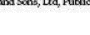

## 关于作者

雅各布·塞德林（哥本哈根）是一位拥有 10 年经验的自由网络开发者，曾从事后端编程、图形设计和前端技术工作。不与客户共事时，他喜欢 JavaScript 和 HTML5、网页游戏开发，并致力于突破浏览器的可能性极限。他在网络开发中的探索成果可在其网站 [http://www.nihilogic.dk/](http://www.nihilogic.dk/) 上见证。

## 致谢

我要感谢一些为本书制作提供帮助的人。首先，我要感谢 Wiley 的 Chris Webb 主动发起并使本书成为可能。感谢我的编辑 Linda Morris、Brian Hermann 和 Charles Hutchinson 改进了文本的各个方面，以及我的技术编辑 Andrew Wooldridge，他对技术细节的敏锐洞察力让我时刻保持警觉。与你们所有人合作是愉快的。

我还要向整个网络开发者社区致以诚挚的感谢，感谢他们无尽的灵感和动力。同样感谢 W3C、Khronos 和其他通过开放标准努力使网络变得更美好的组织中辛勤工作的人们。继续为正义而战吧。

最后，感谢我美丽的 Ulla 无尽的支持和耐心。感谢你的信任。

## 出版商致谢

帮助本书上市的一些人员包括：

**消费者与技术出版副总裁**
Michelle Leete

**图书内容管理副主任**
Martin Tribe

**副出版人**
Chris Webb

**助理编辑**
Ellie Scott

**开发编辑**
Brian Herrmann

**文案编辑**
Charles Hutchinson

**技术编辑**
Andrew Woolridge

**编辑经理**
Jodi Jensen

**高级项目编辑**
Sara Shlaer

**编辑助理**
Leslie Saxman

 **市场营销副主任**
Louise Breinholt

 **市场营销执行官**
Kate Parrett

**高级项目协调员**
Kristie Rees

### 图形与生产专家

Noah Hart

Andrea Hornberger

Jennifer Mayberry

### 质量控制技术员

Melissa Cossell

### 校对与索引

The Well-Chosen Word

Potomac Indexing, LLC

## 引言

"**顺便说一句，这一切都是用 HTML5 完成的！**" 苹果成功故事的核心与代言人史蒂夫·乔布斯在 iPhone OS 4.0 主题演讲中向观众介绍新的 HTML5 广告系统时说道，随之而来的是欢呼、笑声和掌声。基于开放标准的网络技术的最新发展正以前所未有的速度推动网络向前发展，而苹果对 HTML5 的拥抱，包括在所有 i 设备上屏蔽 Flash，只是这场运动力量的又一个象征。尽管苹果对 HTML5 的热爱可能部分源于商业动机，但很明显，开放网络正在行动，几乎每天都有令人兴奋的事情发生，这使得网络和游戏开发者都感到兴奋。

然而，网络和游戏开发的世界并非一直如此令人兴奋。为浏览器构建游戏可能是一种令人沮丧的体验，传统上意味着必须在功能丰富的基于插件的技术和更传统的技术方法之间做出选择，试图将 HTML 和 JavaScript 这个方钉子强行塞入游戏开发这个圆孔中。对各种标准的不同意甚至完全错误的实现，只使得例如 Flash 这种一致且可预测的环境更具吸引力。

通过选择像 Flash 这样的插件，开发者和游戏设计师获得了适合高级游戏开发的框架，具有动态图形、声音甚至 3D 功能，但这样做也将游戏与其周围的技术隔离开了。尽管 Flash、Java 和 Silverlight 等技术都有与页面其余部分通信的方式，但它们仍然是孤立的对象，与周围内容混合的能力有限。

相比之下，使用 HTML、JavaScript 和 CSS——网络的原生构建块——意味着你的游戏将自然地融入网页的上下文之中，但随之而来的是其他妥协，其中最重要的是缺乏合适的元素和 API。当 HTML 标准的最初版本在 1990 年代中期发布时，几乎没有人会想到丰富的互联网应用，HTML 以文档为中心的特性意味着它更适合标记文本和图像页面，而不是应用程序和游戏开发。即使这些页面随着 JavaScript 和文档对象模型 (DOM) 的发展而逐渐变得越来越交互，图形仍然局限于静态图像和样式化的 HTML 元素，音频几乎不存在。直到最近，HTML5、CSS3 和其他相关标准的规范才朝着实际应用的方向发展，使开发者能够构建更类似于桌面应用程序而非传统基于页面的网站体验。当然，这些发展也适用于网络游戏，最近的许多进步都非常适合游戏和其他交互式娱乐应用。

### 目标读者

HTML、JavaScript 和 CSS 不再局限于构建网站；网络应用可以部署在网络上、作为桌面小部件、在移动设备上和许多其他地方。如果你对开发这些平台的游戏有任何兴趣，并希望利用现有的网络开发技能来实现，那么本书就是为你而写的。

你可能已经对网络开发有了很多了解，并且之前使用过 HTML、CSS 和 JavaScript。*HTML5 游戏* 并非 HTML5 的通用指南，也不教你如何构建网站，因此全书通常假设你具备一些传统 HTML 的基本经验，并且至少听说过新的元素和 API。HTML5 的所有方面也未被涵盖，仅仅因为它们与游戏关系不大。你无需...


你可能不是专家级程序员，但应该对 JavaScript 有一定经验。本书当然会涵盖和解释 HTML5 引入的新 JavaScript API，但除此之外，要求读者对这门语言本身有良好的掌握。

《HTML5 游戏开发》也不是一本关于游戏设计的书。市面上有许多优秀书籍，其对游戏开发各方面的探讨比本书所能提供的更为深入。如果试图涵盖人工智能、物理模拟和高级图形编程等多样化的主题，并给予足够详尽的讲解，那么留给 HTML5 和 Web 开发的空间就寥寥无几了。话虽如此，你无需任何游戏开发经验，也不是必须成为数学家或伟大的艺术家才能使用本书。本书在游戏开发理论方面停留在浅显层面，所使用的任何非简单的数学和编程概念都会在引入时进行解释。对游戏和 Web 开发的兴趣、一些高中数学知识，以及画火柴人的能力，应该就足以让你顺利读完本书。

## 本书内容

《HTML5 游戏开发》讲述的是如何将你的 Web 开发技能应用于游戏开发。无论你是希望进入游戏开发领域的 Web 开发者，还是对新的开放 Web 技术感兴趣的 Flash 游戏开发者，抑或是抱着完全不同的目标，*HTML5 游戏开发*都将向你展示如何运用你已掌握的工具，弥合传统网站与趣味游戏体验之间的鸿沟。

在本书的学习过程中，你将经历一个完整 Web 游戏的开发过程，从最初的空白页面到最终产品，准备好在浏览器以及你的 iPhone 或 Android 设备上运行。你将看到如何利用 `canvas` 和 `audio` 等新元素制作游戏，使其自然地融入 Web 语境，而无需依赖插件或笨拙的变通方法。你将学习如何使用 Web Sockets 和 *Node.js* 添加多人游戏功能，如何使用 Web Storage 在客户端存储游戏数据，以及如何使用 `canvas` 操纵像素级的图形。你还将看到游戏如何轻松迁移到移动设备，并利用触控输入。此外，你将了解如何利用新的应用缓存使你的应用能够离线可用。最后，*HTML5 游戏开发*审视了部署和分发完成游戏的可选方案。读完本书后，你将能够将这些知识应用于自己的项目，创建出充分利用当今开放 Web 技术的精彩 Web 游戏。

你在本书中遇到的大部分代码都可以从本书的配套网站 [www.wiley.com/go/html5games.com](http://www.wiley.com/go/html5games.com) 获取。在那里，你可以下载一个包含示例游戏所有代码以及许多较小、独立示例的归档文件。在归档文件中，你会找到本书每一章对应的文件夹。这些文件夹包含了该章结束时的示例网页游戏。如果给定章节有任何与游戏无关的示例，你会在名为 *examples* 的子文件夹中找到它们。

在学习本书的过程中，我鼓励你尝试从零开始构建游戏，但如果你更喜欢直接查看示例代码，那也完全没问题。无论如何，希望你能享受其中的乐趣。

现在，让我们开始吧。游戏开始。

## 第 1 部分

## HTML5 游戏开发入门

**第 1 章** 网页游戏

**第 2 章** 迈出第一步

**第 3 章** 迈向移动端

### 第 1 章

#### 网页游戏

- 了解 HTML5 是什么及其由来
- 在游戏语境中看待 HTML5
- 探究重要的新功能
- 实现功能检测并处理旧版浏览器

**在深入代码之前**，我想先确立我们使用的技术背景。在本章中，我将讨论 HTML5 是什么，以及一些导致 HTML5 规范产生的历史。

HTML5 最有趣的方面之一是游戏开发者如何能从许多新特性中获益。在本章中，我将介绍其中一些特性，并快速给出几个它们如何使用的例子。我将讨论 canvas 元素和 WebGL，以及这些新增内容在创建动态图形能力方面带来的巨大改进。我还将介绍 `audio` 元素以及 WebSockets 规范带来的新增多人游戏可能性。

大家都喜欢新玩意，但我们不能忘记在现实世界中，老旧过时的浏览器使许多用户无法使用这些前沿特性。在本章中，我将展示一些有用的工具，用于检测哪些特性可以安全使用，以及如何在必要时利用这些功能测试加载合适的备选方案。

最后，我将简要介绍贯穿本书其余部分、用于带你完成一个完整 HTML5 游戏开发的拼图游戏。

#### 追溯 HTML5 的历史

Web 的语言 HTML 自 1990 年代初发明以来，经历了多次修订。在千禧年之际，可扩展标记语言（XML）风靡一时，人们付出了大量努力将 HTML 转变为符合 XML 的语言。然而，缺乏采用、浏览器支持不足以及向后兼容性问题，将 Web 陷入混乱，没有明确的方向，一些人认为标准制定机构已脱离 Web 的现实。

当 W3C 最终放弃 XHTML 项目时，一个独立的小组早已成立，旨在使 Web 更适合我们今天看到的这类 Web 应用程序。Web 超文本应用技术工作组（WHATWG）没有仅仅基于上一个规范进行构建，而是开始记录现有的开发模式和实际使用中的非标准浏览器特性。最终，W3C 与 WHATWG 联手。这两个小组现在共同致力于为 HTML5 规范带来新的、令人兴奋的特性。因为这个新规范更贴近 Web 开发者如何使用 Web 的现实，所以切换到 HTML5 也很容易。与以前的修订不同，HTML5 并不强制执行一套严格的语法规则。更新页面通常只需简单地更改文档类型声明即可。

但 HTML5 到底是什么？最初，它仅仅指 HTML 标准的最新修订版。如今，它更难定义，因为这个术语已经沦为流行语，并被用来描述许多并非 HTML5 规范一部分的技术。即使是 W3C 也一度被 HTML5 的无所不包所吸引。在短暂的一段时间里，他们将其定义为包括层叠样式表（CSS）和可缩放矢量图形（SVG）等。这只会加剧混淆。幸运的是，W3C 后来放弃了这种立场，回归到最初更严格的定义，仅指实际的 HTML5 规范。WHATWG 则采取了一个稍微大胆的举动，直接去掉了数字 5，将其重新命名为 *HTML*。这实际上使其更贴近现实，因为像 HTML 这样的规范总是在不断演进，并且从未被任何浏览器完全支持。在本书中，我大部分情况下只使用 *HTML* 这个术语。你可以假定任何对 HTML5 的提及都指的是 W3C 称为 HTML5 的实际规范。

#### 将 HTML5 用于游戏

HTML5 规范中的许多特性在游戏开发中都有应用，但最早获得广泛普及的特性之一是 `canvas` 元素。这个元素的视觉特性无疑有助于其在最初的交互式动画和图形效果出现时迅速传播。更高级的项目很快随之而来，为这个新标准带来了一波良好的宣传，并预示着一个更动态、视觉更有趣的 Web 的未来。

##### Canvas


###### 绘图

业余游戏开发者也是最早拥抱 HTML5 的群体之一，这并非没有道理。`canvas` 元素为网页游戏开发者提供了创建动态图形的能力，为他们提供了一个受欢迎的替代方案，取代了静态图像和 GIF 动图。当然，人们为了创建动态图形，已经创造了各种或多或少巧妙（和/或疯狂）的解决方案，以替代更好的工具。整个绘图库仅依赖于彩色的 `div` 元素——这可能很巧妙，但对于绘制几个简单形状以外的任务来说，效率并不高。存在统一资源标识符（URI）方案，允许你将源文件分配给 `img` 元素，例如，使用 base64 编码的数据字符串，可以直接在 HTML 中，也可以通过 JavaScript 设置 `src` 或 `href` 属性来实现。这种 `data:` URI 方案的巧妙用途之一是动态生成图像，从而提供动态动画图像，但这对于小型和简单图像以外的任何内容都不是一个很好的解决方案。2002 年 The 5K 竞赛的获奖作品 Wolf 5K——该竞赛挑战开发者仅用 5 千字节创建一个网站——使用了一种有些类似的技术。这款小型 3D 迷宫游戏在运行时生成黑白图像，并将其持续馈送到图像 `src` 属性，这依赖于 `img` 元素也可以接受 JavaScript 表达式代替实际 URL 的事实。

绘制在 canvas 表面上的图形不能用 HTML 标记声明，而是必须使用 JavaScript 通过一个简单的应用程序编程接口（API）来绘制。列表 1.1 展示了如何绘制一些简单形状的基本示例。请注意，完整的 API 提供的功能远多于此示例中展示的一小部分。

### 列表 1.1 使用 Canvas API 绘制形状

```
<canvas id="mycanvas"></canvas>
<script>
var canvas =
document.getElementById("mycanvas"),
    ctx = canvas.getContext("2d");
    canvas.width = canvas.height = 200;
    // 绘制两个蓝色圆圈
    ctx.fillStyle = "blue";
    ctx.beginPath();
    ctx.arc(50, 50, 25, 0, Math.PI * 2, true);
    ctx.arc(150, 50, 25, 0, Math.PI * 2, true);
    ctx.fill();
    // 绘制一个红色三角形
    ctx.fillStyle = "red";
    ctx.beginPath();
    ctx.moveTo(100, 75);
    ctx.lineTo(75, 125);
    ctx.lineTo(125, 125);
    ctx.fill();
    // 绘制一个绿色半圆
    ctx.strokeStyle = "green";
    ctx.beginPath();
    ctx.scale(1, 0.5);
    ctx.arc(100, 300, 75, Math.PI, 0, true);
    ctx.closePath();
    ctx.stroke();
</script>
```

该代码生成了如图 1-1 所示的简单绘图。

### 图 1-1：一个简单的 canvas 绘图

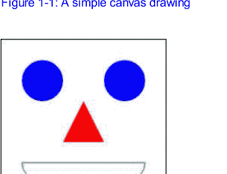

我将在第 6 章重新审视 `canvas` 元素，并在我用它来创建游戏图形和特效时进行详细探讨。

##### 音频

正如 `canvas` 元素一样，新的 `audio` 元素也是网页开发者工具箱中受欢迎的一员。终于，我们无需借助插件，就能在浏览器中获得原生音频功能。几年前，你几乎可以肯定，如果一个网站有音频，那里面肯定涉及某种形式的 Flash。像 SoundManager 2 项目 (www.schillmania.com/projects/soundmanager2/) 这样的库提供了对 Flash 大部分音频功能的完整 JavaScript 访问。但即使这样的桥接让你的代码能留在 JavaScript 一侧，你的用户仍然需要安装插件。HTML5 的 `audio` 元素解决了这个问题，使得通过普通的 HTML 和 JavaScript 就能在开箱即用的浏览器中访问音频。

然而，`audio` 元素仍有一些问题需要解决。主要的浏览器厂商似乎都认同该元素的重要性，并且都采用了该规范，但到目前为止，他们尚未就应支持哪些音频编解码器达成一致。因此，虽然 `audio` 元素的理论很好，但现实情况是，开发者别无选择，只能提供多种格式的音频文件以满足所有浏览器的需求。

`<audio>` 元素既可以在标记中定义，也可以使用 JavaScript 动态创建。（对于作为应用和游戏开发者的我们来说，后一种选择更令人感兴趣。）列表 1.2 展示了一个基本的音乐播放器，包含多个源文件、原生用户界面（UI）控件以及一些使用 JavaScript API 的键盘快捷键。

### 列表 1.2 一个使用 HTML5 音频的简单音乐播放器

```
<audio controls id="myaudio">
<source src="Prelude In E Minor, Op. 28.ogg"/>
<source src="Prelude In E Minor, Op. 28.mp3"/>
</audio>
<script>
var audio = document.getElementById("myaudio");
document.onkeydown = function(e) {
  if (e.keyCode == 83) {
    audio.pause(); // 按下的键是 S
  } else if (e.keyCode == 80) {
    audio.play(); // 按下的键是 P
  }
}
</script>
```

> **注意**

Mozilla 和 WebKit 阵营都在开发最终将允许动态生成音效和音频滤镜的音频数据 API。由于这些 API 仍处于非常早期的开发阶段，我将不会在本书中的游戏中使用它们，尽管我在第 10 章深入探讨 HTML5 音频时，会简要审视它们呈现的可能性。

##### WebSockets

Ajax 及其核心的 `XMLHttpRequest` 对象在 2000 年代初的 Web 2.0 爆发中为 Web 带来了新的生命。然而，尽管它促成了许多伟大的事情，但它仍然极其有限。受限于 HTTP 协议，这种行为相当单向，因为客户端必须主动向服务器请求信息。除非浏览器发起新请求，否则 Web 服务器无法告知浏览器某些内容已更改。典型的解决方案是反复轮询服务器以请求更新，或者保持请求打开直到有内容可以报告。一个总括性术语 Comet ([en.wikipedia.org/wiki/Comet_(programming)](https://en.wikipedia.org/wiki/Comet_(programming))) 有时被用来指代这些技术。在许多情况下，这已经足够好了，但这些解决方案相当简单，往往缺乏多人游戏所需的灵活性和性能。

WebSockets 来了。有了 WebSockets，我们在实现高效游戏开发所需的控制水平上迈进了一大步。虽然它不是完全的原始套接字连接，但 WebSocket 连接确实允许我们创建并维持一个双向通信的连接，这使得特别是实时多人游戏的实现变得容易得多。在列表 1.3 中，你可以看到连接到服务器和交换消息的接口非常简单。

### 列表 1.3 使用 WebSockets 与服务器交互

```
// 创建一个新的 WebSocket 对象
var socket = new WebSocket("ws://mygameserver.com:4200/");
// 发送一条初始消息给服务器
socket.onopen = function () {
    socket.send("Hello server!");
};
// 监听服务器发送的任何数据
socket.onmessage = function(msg) {
    alert("Server says: " + msg);
}
```

当然，使用 WebSockets 还要求我们实现一个与 WebSockets 协议兼容并能够响应我们发送的消息的服务器应用程序。然而，这不一定是一项复杂的任务，正如我在第 13 章在服务器端使用 Node.js 实现多人游戏功能时向你展示的那样。

##### Web Storage

当 Web 应用程序需要在客户端存储数据时，Cookie 是通常的选择。撇开其作为间谍软件跟踪设备的不良声誉不谈，Cookie 也给了开发者一个急需的地方来存储用户设置，并为 Web 服务器提供了一种识别返回客户端的方法，由于 HTTP 协议的无状态特性，这是许多 Web 应用程序的必要功能。

Web Storage 最初是 HTML5 的一部分，但后来被提升为自己的规范，可以看作是对 Cookie 的改进，并且在许多情况下，可以直接替代 Cookie 作为键值类型数据的更大存储设备。然而，Web Storage 的意义远不止于此。Cookie 只绑定到域名，而 Web Storage 既有类似于 Cookie 的本地存储（local storage），也有绑定到活动窗口和页面的会话存储（session storage），这允许在不同标签页或窗口中存在同一应用程序的多个实例。与 Cookie 不同，Web Storage 只存在于客户端，并且不会随每个 HTTP 请求传输，这使得存储空间可以达到兆字节而不是千字节。


拥有能够存储至少几兆字节数据的持久化存储空间，在您需要存储任何复杂数据时都会非常方便。Web Storage 只能存储字符串，但如果您将其与 JavaScript 对象表示法（JSON）编码器/解码器（目前大多数浏览器都原生支持）结合使用，就可以轻松绕过这一限制来存储更复杂的数据结构。在我在本书课程中开发的游戏中，我使用本地 Web Storage 实现了“保存游戏”功能，并存储本地高分数据。

清单 1.4 展示了非常简单直观的存储接口。

## 清单 1.4 使用 Web Storage 保存本地数据

```
// 保存高分数据
localStorage.setItem("highscore",
"152400");
// 数据之后可以被检索，甚至在
// 其他页面上
var highscore =
localStorage.getItem("highscore");
alert(highscore); // 显示 154200
```

##### WebGL

WebGL 是面向 Web 的 OpenGL。现在，Web 开发人员可以使用这种最广泛采用的图形 API 来创建在线 3D 图形内容。当然，这对网络游戏中可能出现的内容类型产生了重大影响。作为其重要性的证明，Google 开发人员于 2010 年 4 月 1 日发布了经典第一人称射击游戏《雷神之锤 II》的 WebGL 移植版，由于精心选择的发布日期和其本身的成就，这一消息让许多人难以置信。

> 请记住

创建完整的 3D 游戏是一项相当复杂的任务，超出了本书的范围。使用 WebGL 还要求开发人员非常清楚他们计划针对的平台，因为例如 Internet Explorer 完全不支持它，而且这个问题无法通过 polyfill 来解决。本书中并未大量使用 WebGL，因为它在 iOS 或 Android 等移动平台上尚不支持，尽管未来会支持。不过，对于那些启用了 WebGL 的浏览器，我确实使用了一点 WebGL 来创建一个有趣的介绍屏幕。

##### HTML5 是（或不是）Flash 的终结者

自从 canvas 元素和改进的 JavaScript 引擎出现以来，互联网上就一直在讨论，甚至引发了一场老套的论战：新标准是否会取代 Flash，成为网络上多媒体应用的主要交付方式？长期以来，Flash 一直是在线视频、音乐和游戏开发的首选。尽管微软的 Silverlight 等竞争技术曾试图击败它，但它们只对 Flash 的市场份额造成了轻微打击。HTML5 及其相关开放技术现在看起来终于有实力争夺这一头把交椅。

Adobe 似乎也认识到了 HTML5 的强大，因为他们目前正在准备推出 Adobe Edge（http://labs.adobe.com/technologies/edge/），这是一个与 Flash 非常相似但完全基于 HTML5、CSS3 和 JavaScript 的开发环境。Adobe 的立场似乎是，HTML5 和 Flash 在现阶段可以共存，但这或许表明，从长远来看，Flash 将逐渐被淘汰，取而代之的是 HTML5 和开放的 Web。

> 请记住

**这并不是说 HTML5 可以完全替代 Flash。** 您必须了解新标准的不足之处，以及像 Flash 这样的替代解决方案可能更合适的场合。Flash 仍然非常有用的一个领域是确保与旧浏览器的向后兼容性，我将在下一部分讨论。

##### 创建向后兼容性

与大多数其他新技术一样，使用 HTML5 时不可避免地会出现向后兼容性问题。HTML5 不是一个巨大的整体：浏览器支持的是*功能*，而不是整个规范。目前没有任何浏览器可以声称 100% 支持所有 HTML5 功能集，而仍然是使用最广泛的浏览器 Internet Explorer 也只在其最新版本 9 中才开始支持 HTML5。有些功能如 WebGL 根本没有实现，微软迄今也未表现出任何兴趣。然而，即使当前的浏览器完全支持 HTML5 及相关标准，您仍然需要考虑旧版浏览器。在 2001 年发布十年后的今天，Internet Explorer 6 仍然被大量使用，因此您不能安全地假设您的应用程序和游戏的用户在很多年内都能利用 HTML5 的所有功能。

##### 功能检测

没有人说我们今天构建的应用程序和游戏必须支持所有曾经发布过的浏览器——这样做只会导致痛苦和抓狂。但我们也不应该完全忘记这些用户。我们至少可以尝试判断用户是否能够玩游戏或使用某个功能，然后处理我们检测到的任何问题。浏览器嗅探——即通过检查用户的代理字符串来检测用户使用的浏览器——几乎已经过时了。如今，功能检测的概念已经取而代之。测试可用的属性、对象和函数，比仅仅依赖一个用户可以更改的字符串并假设一组受支持的功能要明智得多。

##### 使用 Modernizr 库

由于各种实现和功能之间存在许多差异，并且有些功能检测起来很棘手，因此进行充分的功能检测并非易事。幸运的是，您通常不需要重新发明轮子，因为许多用于检测功能支持的巧妙技巧已经被开发出来并汇集到各个库中。Modernizr 库（[www.modernizr.com/](http://www.modernizr.com/)）就提供了一个这样的检测器集合。Modernizr 提供了一种易于使用的方法来测试某个功能是否可用。您可以检测从 `canvas` 元素和 WebGL 到 Web 字体以及一系列 CSS 功能的所有内容，从而在功能不受支持时提供备用方案，并优雅地降级您的应用程序。

使用 Modernizr 库非常简单。只需包含一个小的 JavaScript 文件，您就可以通过评估 Modernizr 对象上的属性来开始测试功能，如清单 1.5 所示。

## 清单 1.5 使用 Modernizr 检测功能

```
if (Modernizr.localstorage) {
  // 支持本地存储，继续。
} else {
  // 不支持本地存储，使用备用解决方案。
}
```

Modernizr 还会在 `html` 元素上添加 CSS 类，指示哪些功能受支持，哪些不受支持。由于所有其他元素都是 `html` 元素的子元素，这使您可以根据支持的功能轻松地为您的标记设置适当的样式。例如，如果您想使用 rgba() 颜色创建半透明背景，并在 rgba() 颜色不受支持时回退到不透明背景，您可以创建如清单 1.6 所示的样式。

## 清单 1.6 基于支持的功能应用 CSS

```
/* 支持 rgba() 颜色 */
.rgba .some_element {
  background-color : rgba(255,255,255,0.75);
}
/* 不支持 rgba() 颜色 */
.no-rgba .some_element {
  background-color : rgb(220,220,220);
}
```

> **请记住**
> **Modernizr 只能告诉您某项功能是否受支持；作为开发人员，您需要确保在所需功能不可用时采取适当的措施。在下一节中，我将探讨处理缺失功能的一些选项。**

##### 使用 Polyfill 填补空白

从 2000 年代初期开始，一种流行的趋势是在为网站添加新功能时倾向于所谓的*渐进增强*。这种策略要求网站以受支持功能的最低公分母为目标。任何未被普遍支持的技术应仅用于增强网站，绝不用于关键功能。这确保了每个人都可以访问和使用该网站。如果用户拥有现代浏览器，他们只是会获得更好的体验。

渐进增强在许多情况下是一种合理的策略，但有时您确实需要使用某个特定功能。如果某些浏览器不原生支持该功能，则必须填补这一空白，即使这意味着使用不理想甚至有些取巧的备用解决方案。这些备用方案有时被称为 *polyfills*，其名称来源于腻子填充剂 Polyfilla，因为它们的功能有些相似。它们填补了在真实浏览器中运行代码时功能支持集合中的空白，弥合了规范与处理不完美浏览器的现实之间的差距。

举个例子，Internet Explorer 在 IE9 之前不支持 `canvas`，但已经存在一些 polyfills，为旧版浏览器提供不同程度的 `canvas` 功能。其中最早的 polyfills 之一是 Google 的 ExplorerCanvas 项目。


它提供了足够的 2D 绘图功能，因此已在许多项目中成功应用。然而，由于 VML 并未完全覆盖 canvas 规范，且缺乏对诸如图案和裁剪路径等特性的支持，因此缺少一些功能。其他 polyfill 使用 Flash 或 Silverlight，能够更接近完整的 canvas API，让你能够使用诸如图像数据访问和合成效果等高级特性。面对所有这些不同的选项，选择合适的回退方案并非易事。根据目标平台的不同，有时甚至 polyfill 本身也需要回退方案。

为了简化操作，你可以借助 Modernizr 内置的脚本加载器。该加载器基于一个名为 yepnope.js（http://yepnopejs.com/）的小型库，它将动态脚本加载技术与 Modernizr 这样的功能检测器相结合。这种组合允许你根据可用功能执行自动化的、有条件的脚本加载。清单 1.7 展示了如何根据对某项功能的支持情况加载不同的脚本。

## 清单 1.7 使用 Modernizr 有条件地加载脚本

```javascript
Modernizr.load([
{
test : Modernizr.localstorage,
yep : "localstorage-data.js",
nope : "cookiebased-hack-data.js"
}
]);
```

`Modernizr.load()` 函数接受一个对象列表，每个对象描述一个功能测试，该测试决定了应该加载哪些脚本。如果支持该功能，则加载由 `yep` 属性指定的脚本；如果不支持，则加载 `nope` 脚本。yepnope.js 的功能还包括许多其他酷炫特性，可以帮助你优化加载阶段，允许你根据功能支持、浏览器类型和版本，甚至完全不同的条件来加载 JavaScript 和 CSS 文件。

##### 构建游戏

从第 2 章开始，并在本书的后续部分，我将带你从零开始开发一款 HTML5 网页游戏。我将展示如何创建一款类似于《宝石迷阵》或《拼写争霸》风格的三消宝石交换游戏，这类休闲游戏在过去十年中在许多平台上都非常受欢迎。这种类型的游戏具有经过验证的游戏机制，使我们能够专注于在游戏开发背景下使用网络技术。此外，这类游戏在桌面浏览器以及智能手机和平板电脑等移动设备上都能良好运行，这为我们探索跨平台网页游戏开发提供了机会。

这款游戏利用了 HTML5 规范的几项特性，但也使用了相关技术，例如用于构建用户界面的 Web 字体和 CSS3。虽然游戏本身可能并非革命性的，但它使我能够涵盖开放网络技术的许多最新进展。其中，我使用 `canvas` 元素生成一些游戏图形，并向你展示如何使用 HTML5 音频添加音效。最终完成的游戏可以在普通浏览器中运行，但我还将展示如何确保它在移动设备甚至离线时也能同样良好地运行。我将展示如何使用 Web Storage 保存高分数据，并允许玩家从上次中断的地方继续游戏。

`canvas` 元素让我们能够创建有趣的动态图形，但它并不总是适合创建用户界面。对于那部分，你实际上不需要任何新工具，因为传统的 HTML 和 CSS 就能提供构建出色 UI 所需的一切。随着 CSS 规范的最新补充，你可以添加动画、变换和其他功能，为 UI 体验带来活力。在第 6 章和第 7 章中，我将展示如何使用 canvas 元素构建显示模块。稍后，在第 11 章，我将进一步带你了解如何使用 WebGL 为游戏添加 3D 图形。

在第 13 章中，我将展示如何使用 WebSockets 创建一个简单的聊天应用程序。为此目的，我还将展示如何使用 Node.js 框架（[http://nodejs.org/](http://nodejs.org/)）开发一个小型服务器应用程序。然而，你应该注意到，WebSockets 目前仅在少数浏览器中得到支持，可能还需要一段时间才能广泛应用于实际生产环境。

#### 总结

这条路走来并不平坦，但最终 HTML 和整个网络领域似乎又重回正轨。WHATWG 为标准制定过程带来了一些新的视角，网络开发者现在开始享受这一努力带来的成果——大量新工具以及一个更符合当今网络使用方式的 HTML 标准。一如既往，使用新特性需要处理旧版浏览器的问题，但许多 polyfill 已经可用，你可以利用它们来确保跨浏览器兼容性。使用像 Modernizr 这样的辅助工具可以进一步减轻这项任务的负担。

许多新特性对游戏开发者尤其具有吸引力，因为现在出现了基于 Flash 的网页游戏的真正替代方案。Canvas 和 WebGL 带来了动态且经硬件加速的图形，`audio` 元素终于实现了原生音频支持，而借助 WebSockets，现在可以创建比几年前可能实现的更接近桌面游戏的多人体验。其他相关领域的进展，如 CSS 和对 Web 字体日益增长的支持，让我们能够使用开放的、标准化的工具创建更丰富的 UI 体验。

### 第 2 章

#### 迈出第一步

- 设定游戏的规则和机制
- 确定游戏的各个阶段
- 设置基本的 HTML 结构
- 创建第一个 JavaScript 模块
- 使用 Web 字体制作启动画面

**在前一章**介绍了背景和技术背景之后，现在是时候动手实践了。然而，在你开始编写代码和标记之前，理解项目是很重要的。在本章的第一部分，我将描述游戏的规则、目标和机制。我还将定义游戏的关键阶段，并识别构成应用程序的各个屏幕。

明确了游戏之后，你最终可以开始编写一些代码了。从基础开始，我将展示如何设置一个带有简单结构的 HTML 页面来支持游戏。在此基础上，我添加一些初步的 CSS，并展示如何使用 Modernizr 的脚本加载器加载 JavaScript 文件。我还将介绍前两个 JavaScript 模块：一个用于在游戏阶段之间切换的非常简单的框架，以及一个简化文档对象模型操作的辅助模块。

最后，我将转向游戏的第一阶段，并使用 Web 字体创建一个具有特殊效果的启动画面

##### 理解游戏

我在本书中引导你构建的游戏是一款三消拼图游戏，这种游戏类型主要由休闲游戏开发商 PopCap Games 的《宝石迷阵》游戏系列而广受欢迎。我将这款游戏命名为《宝石勇士》；你可以自由选择一个更好、更有创意的名字。

在开始实际构建游戏之前，我将讨论游戏的组成部分和流程。游戏的核心机制和规则是什么？游戏的不同阶段有哪些？从应用程序的初始启动到玩家退出游戏，用户会看到应用程序的不同阶段，每个阶段的行为都不同。先关注实际游戏的机制，将菜单和加载屏幕等其他关键阶段留到后面讨论。

##### 交换宝石

游戏的核心围绕着一个 8×8 的网格展开，网格中填满了各种形状和颜色的宝石。游戏开始时，64 个单元格中的每一个都持有一个随机的宝石类型。游戏的目标是通过将三个或更多相同类型的宝石匹配成组来得分。玩家可以通过先选择一个宝石再选择另一个来交换两个相邻的宝石。

###### 三消匹配

只有当交换产生三个或更多相同颜色宝石的匹配时，交换才是合法的；任何非法的交换都会自动逆转。当玩家执行有效的交换时，匹配集合中包含的所有宝石都会被移除。如果还有任何宝石

在形成空隙的上方，这些宝石会掉落下来，新的、随机挑选的宝石则从顶部进入游戏区域。最简单的匹配是三个相同的宝石，但也可以形成由四个或五个匹配宝石组成的链条。玩家在单行或单列中匹配的宝石越多，获得的分数就越高。

触发连锁反应会为玩家带来额外分数。在一次有效的交换后，掉落的宝石可能会产生更多组匹配的宝石，这些组随后会享受分数加成奖励。通过仔细观察棋盘，玩家甚至可以故意触发这些连锁反应来获得额外分数。

在游戏过程中，玩家也可能遇到没有可用操作的情况。如果无法通过交换产生至少三个相同宝石的组合，则游戏棋盘必须重新洗牌。棋盘上的宝石被清空，然后使用与初始设置时相同的随机填充程序引入新的宝石。

###### 关卡推进

为了营造一种紧迫感，我引入了一个缓慢倒数的计时器。如果计时器归零，游戏结束。玩家可以通过在计时器耗尽前达到指定分数来进入下一关。这将触发宝石棋盘的重新填充，重置计时器，并提高进入下一关所需的分数。这可能会让玩家保持警惕，但如果没有改动，熟练的玩家可以无限期地玩下去。为了让游戏随着时间推移变得越来越难，每次玩家升级时，关卡之间的分数差距都会增加。最终，即使是最厉害的宝石交换者也无法在规定时间内收集到足够的分数。

##### 识别游戏阶段

应用程序的游戏阶段是迄今为止最复杂的阶段，也是玩家将花费大部分时间的地方。不过，你确实需要一些额外的阶段，因为你不应该让玩家直接进入游戏。

###### 启动画面

玩家看到的第一个画面是启动画面。这个画面有两个主要目的：首先，通过将游戏标志醒目地放在中央，向玩家介绍游戏。其次，通过添加一个进度条，在游戏资源在后台预加载时提供一个良好的等待区域。并非所有资源都需要立即预加载，但可以说，如果下一阶段的所有图形在激活时都立即可用，会留下更好的印象。图2-1展示了启动画面的草图。

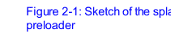

##### Jewel Warrior

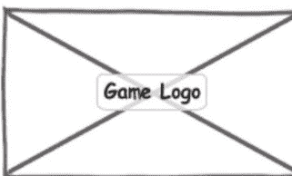

点击继续

加载中...

###### 主菜单

玩家点击通过启动画面后，会被带到主菜单。这是一个简单的菜单，只有几个项目。最重要的是，菜单提供了进入实际游戏的入口，同时也包含用于显示高分榜、游戏更多信息以及退出游戏选项的按钮。如果玩家选择新游戏或继续上次的游戏，游戏会立即开始。图2-2展示了主菜单的草图。

###### 游戏进行中

当实际游戏开始时，游戏元素——宝石棋盘、玩家名称和当前分数——占据屏幕的大部分，但玩家需要能够退出回到主菜单。我通过使用屏幕的一小部分区域作为状态栏或工具栏来实现这一点。游戏区域的草图请参见图2-3。

图2-2：主菜单草图

##### Jewel Warrior

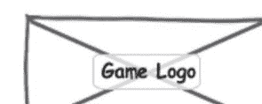

开始游戏

关于

高分榜

退出

图2-3：游戏界面草图

##### Jewel Warrior

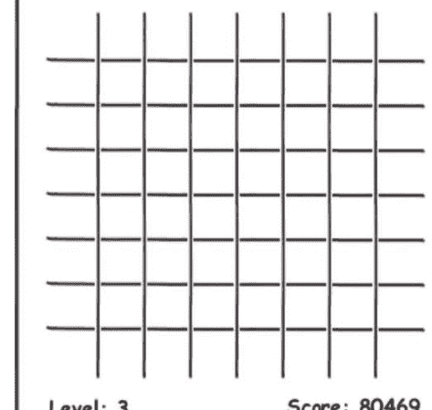

关卡：3

分数：80469


###### 高分榜

游戏结束时，应用程序会切换到高分榜，显示最高分数及玩家姓名。如果玩家获得了足够高的分数，会被要求输入姓名，之后分数将被列入榜单。此界面有一个返回主菜单的选项。游戏使用基于WebStorage的本地存储高分榜。图2-4的草图展示了高分榜的基本布局。


Jewel Warrior

###### 高分榜

| 排名 | 姓名 | 分数 |
| --- | --- | --- |
| 1 | AAA | 256000 |
| 2 | BBB | 128000 |
| 3 | CCC | 64000 |
| 4 | DDD | 32000 |
| 5 | EEE | 16000 |
| 6 | FFF | 8000 |
| 7 | GGG | 4000 |
| 8 | HHH | 2000 |
| 9 | III | 1000 |
| 10 | JJJ | 500 |

再玩一次

主菜单

##### 创建应用程序骨架

你不需要任何特殊工具或应用程序来跟进游戏开发。当我讲到第13章的WebSocket讨论时，你确实需要安装Node.js并在你的Web服务器上进行设置。然而，对于其他所有内容，你喜欢的文本编辑器和一个简单的图像编辑器就足够了。

许多Web开发人员使用jQuery和Prototype等库，这样他们就不必处理Web开发中那些琐碎的部分，比如选择和操作DOM元素。通常，你会发现这些库包含了很多你不会用到的功能。有时，问问自己是否真的需要一个50-100 KB的库，或者更简单、更小的东西是否就足够了，这是一个好主意。

我尽量做到对库保持中立，但我确实自由地使用了一些小型但有用的库来让事情变得简单一些。Modernizr库，它帮助你检测功能支持和动态加载JavaScript文件，之前已经讨论过了。假设你已经熟悉DOM操作。为了最小化琐碎的DOM遍历代码量，我使用Sizzle，这是一个非常快的CSS选择器引擎，它也为jQuery和Prototype等库提供支持。Sizzle使得处理DOM变得容易得多。例如，要选择ID为#gameboard的div中所有类为jewel的元素，你可以使用简单的代码，如

```
var jewels = Sizzle("div#gameboard .jewel");
```

如果你习惯使用像jQuery或Prototype这样的库，这种使用CSS选择器选择DOM元素的方法对你来说应该很熟悉。

请查看网站[http://microjs.com/](http://microjs.com/)，了解其他专注于Web开发特定领域的小型库集合。

Modernizr和Sizzle都是在宽松的MIT和BSD开源许可证下提供的，因此你可以非常自由地在你自己的游戏项目中使用它们，限制很少。这两个库都包含在本章的代码存档中，但你也可以从它们的网站获取最新版本，[www.modernizr.com/](http://www.modernizr.com/) 和 [http://sizzlejs.com/](http://sizzlejs.com/)。

好了，是时候开始了。为游戏项目创建一个空文件夹，并创建两个子文件夹：`scripts` 和 `styles`。在后续过程中会添加一些额外的文件夹，但现在这两个就足够了。将 `modernizr.js` 和 `sizzle.js` JavaScript 文件放入 `scripts` 文件夹。你可以从本章的代码存档中复制它们，或者如果你下载了最新版本，则从下载的压缩包中提取它们。

###### 设置 HTML

游戏的基础只是一个普通的HTML文档。创建一个新文件，命名为 `index.html`，并将其放在项目文件夹中。清单2.1显示了 `index.html` 的初始内容。

### 清单2.1 空白的HTML文档

```
<!DOCTYPE HTML>
<html lang="en-US">
<head>
<meta charset="UTF-8">
<title>Jewel Warrior</title>
</head>
<body>
<div id="game">
<!-- 游戏内容放在这里 -->
</div>
</body>
</html>
```

注意这个极其简单的文档类型声明。与例如HTML 4.01 Strict DOCTYPE相比：

```
<!DOCTYPE HTML PUBLIC "-//W3C//DTD HTML 4.01//EN"
"http://www.w3.org/TR/html4/strict.dtd">
```

昔日那些庞然大物般的声明已经消失了。现在的DOCTYPE如此简单，你实际上可以记住它。用于声明字符编码的meta标签也得到了类似的简化处理。为保持事物简单而欢呼！

回到HTML文档。body中的div标签是整个游戏的容器。游戏的其余标记都在这个标签内部。下一级标记包含我之前在本章中列出的各个游戏屏幕。一个带有CSS类screen的div容器代表一个游戏屏幕，每个屏幕都有一个唯一的id，用于引用该特定游戏屏幕。清单2.2显示了添加到游戏容器中的前几个屏幕。

### 清单2.2 向游戏容器添加屏幕元素

```
<div id="game">
    <div class="screen" id="splash-screen"></div>
    <div class="screen" id="main-menu"></div>
    <div class="screen" id="game-screen"></div>
    <div class="screen" id="high-scores"></div>
</div>
```

我将在本章后面讨论启动屏幕，但现在，你已经有了足够的结构，可以开始添加一些CSS了。


##### 添加一些样式

我在本书中会介绍几种不同的样式表。第一个样式表 `main.css` 包含了用于设置游戏应用整体结构样式的规则。代码清单 2.3 展示了添加到 `head` 元素中的样式表。

**代码清单 2.3 添加主样式表**

```
<head>
<meta charset="UTF-8">
<title>Jewel Warrior</title>
<link rel="stylesheet" href="styles/main.css" />
</head>
```

> **记住**
HTML5 在 `rel` 属性设置为 `stylesheet` 时，为 `type` 属性定义了一个默认值 `text/css`。这意味着你不再需要显式地设置 `type` 属性。

目前，该样式表主要针对桌面浏览器。在第 3 章中，我将讨论如何处理移动浏览器，并展示如何使用 CSS 媒体查询为不同的设备和分辨率加载不同的样式表。最初，你只需要在主样式表中添加几条简单的规则。代码清单 2.4 展示了 `main.css` 中的 CSS 规则。

**代码清单 2.4 主样式表的初始内容**

```
body {
  margin : 0;
}
#game {
  position : absolute;
  left : 0;
  top : 0;
  width : 320px;
  height : 480px;
  background-color : rgb(30,30,30);
}
#game .screen {
  position : absolute;
  width : 100%;
  height : 100%;
  display : none;
  z-index : 10;
}
#game .screen.active {
  display : block;
}
```

`body` 规则简单地取消了浏览器为 `body` 元素添加的任何默认边距。`#game` 规则为包含游戏的 `div` 元素设置了深灰色背景，并使其填充一个 320x480 的矩形区域，这对于像本例这样的游戏来说是一个不错的尺寸，在例如 iPhone 上也能良好运行。在第 7 章中，我将向你展示如何使用 `canvas` 创建更漂亮的背景。屏幕 `div` 元素的 `display` 属性都被设置为 `none`，这确保了屏幕默认情况下是隐藏的，只有在需要时才会显示。在屏幕 `div` 元素上添加一个 `active` CSS 类，可以将 `display` 属性切换为 `block`。

##### 加载脚本

近年来，脚本加载本身已经成为一门艺术，因为如何高效加载脚本的问题受到了越来越多的关注。Modernizr 中的 yepnope 功能让你可以对这个重要阶段进行充分的控制。唯一需要使用传统的 `<script>` 标签加载的脚本是 Modernizr 库和一个用于设置加载顺序并启动动态加载的加载器脚本。你稍后将创建 `loader.js` 脚本。代码清单 2.5 展示了添加到 `head` 元素中的内容。

**代码清单 2.5 添加 Modernizr 和加载器脚本**

```
<head>
    ...
    <script src="scripts/modernizr.js"></script>
    <script src="scripts/loader.js"></script>
</head>
```

如果你想获取最新版本的 Modernizr，你需要使用 [www.modernizr.com/download/](http://www.modernizr.com/download/) 上的下载工具进行自定义构建。在这里，你可以为你的项目选择需要的各个功能测试，确保不会包含不必要的代码。就本书项目而言，只需选择所有测试，并确保包含了 `Modernizr.load()` 和 `Modernizr.addTest()` 功能。生成的文件可能具有类似 `modernizr.custom.12345.js` 的文件名，因此请确保将文件重命名以匹配 `<script>` 元素中的引用。

**记住**

就像 `<link>` 元素和样式表一样，你不再需要在 `<script>` 标签上显式设置 `type` 属性。如果 `type` 属性缺失，将使用默认值 `text/javascript`。

加载器脚本负责调用 `Modernizr.load()` 来加载任何其他需要加载的脚本。首先，告诉它加载 Sizzle 选择器引擎和两个新脚本 `game.js` 和 `dom.js`。加载器脚本还会创建一个 `jewel` 命名空间对象，所有游戏模块都将位于其中。代码清单 2.6 展示了初始的加载器脚本。

**代码清单 2.6 loader.js 的初始内容**

```
var jewel = {};
// wait until main document is loaded
window.addEventListener("load", function()
{
    // start dynamic loading
    Modernizr.load([
        {
        // these files are always loaded
        load : [
        "scripts/sizzle.js",
        "scripts/dom.js",
        "scripts/game.js"
        ],
        // called when all files have finished loading
        // and executing
        complete : function() {
            // console.log("All files loaded!");
        }
        }
    ], false);
```

一旦页面完成了初始脚本的加载，Modernizr 就会介入并加载剩余的脚本。当所有脚本都加载完成并执行后，Modernizr 会自动调用 `complete()` 函数，这使其成为启动应用逻辑的好地方。

##### 调试 Web 应用

假设你对现代浏览器中可用的调试工具有一定的了解。Firefox、Chrome 和 Internet Explorer 9 都提供了非常出色的控制台和检查工具，通常可以通过按 F12 键打开。如今大多数浏览器都支持现在几乎成为标准的控制台输出 API，允许你通过添加类似下面的行将调试消息输出到控制台：

```
console.log("Your log message here");
console.warn("Your warning here");
console.error("Your error here");
```

这比多年前 Web 开发者不得不使用的 `alert()` 调试方式要好得多，也更不干扰用户。本书不会过多地强调在代码中添加调试机制或错误处理，而是专注于让我们了解今天可用的新功能和技术。不过，我们鼓励你在代码中根据需要添加尽可能多的调试消息。

##### 创建 DOM 辅助模块

你可以从本章的代码归档中获取 `sizzle.js` 文件，也可以从 Sizzle 网站 (http://sizzlejs.com/) 下载。Sizzle 使得在 DOM 中搜索元素变得轻而易举，但你总是可以额外添加一些辅助函数来操作 DOM 元素。这就是 `dom.js` 模块提供的功能。代码清单 2.7 展示了 `dom.js` 模块及其首批辅助函数。

**代码清单 2.7 DOM 辅助模块**

```
jewel.dom = (function() {
    var $ = Sizzle;
    function hasClass(el, clsName) {
        var regex = new RegExp("(^\\s)" + clsName + "(\\s|$)");
        return regex.test(el.className);
    }
    function addClass(el, clsName) {
        if (!hasClass(el, clsName)) {
            el.className += " " + clsName;
        }
    }
    function removeClass(el, clsName) {
        var regex = new RegExp("(^\\s)" + clsName + "(\\s|$)");
        el.className = el.className.replace(regex, " ");
    }
    return {
        $ : $,
        hasClass : hasClass,
        addClass : addClass,
        removeClass : removeClass
    }
})();
```

所有游戏模块都是 `jewel` 命名空间的属性，基本上只是具有一些公共方法的对象。如果你曾经在自己的代码中使用过所谓的模块模式，这种方法对你来说应该很熟悉。所有功能都定义在一个匿名函数内部，该函数返回一个对象字面量，其中包含应暴露给外部世界的函数的引用。这个匿名函数会被立即调用，返回值被赋值给 `jewel` 命名空间对象的一个属性。

这种模块化方法是防止应用代码污染全局作用域的一种简单方式，从而避免与第三方脚本集成变得困难。匿名函数中的封装有效地隐藏了（无论好坏）模块内声明的所有变量和函数，除非它们被显式地设为公共。

`jewel.dom` 模块最初只包含一些用于操作 CSS 类的函数。该模块还暴露了一个 `$()` 函数，它只是 `Sizzle()` 函数的引用。`hasClass()` 函数检查给定元素上的 `className` 属性，如果找到指定的类则返回 `true`。`addClass()` 和 `removeClass()` 函数的功能正如其名；即，它们向元素添加或移除指定的 CSS 类。

##### 创建游戏模块

`game.js` 脚本定义了下一个模块 `jewel.game`，它提供了基本的应用逻辑，例如在游戏状态之间切换。代码清单 2.8 展示了 `game.js` 中游戏模块的内容。

**代码清单 2.8 初始游戏模块**

```
jewel.game = (function() {
```


var dom = jewel.dom,
    $ = dom.$;
// 隐藏当前活动的屏幕（如果有的话）
// 并显示指定ID的屏幕
function showScreen(screenId) {
    var activeScreen = $("#game.screen.active")[0];
    screen = $("#" + screenId)[0];
    if (activeScreen) {
        dom.removeClass(screen, "active");
    }
    dom.addClass(screen, "active");
    // 暴露公共方法
    return {
        showScreen : showScreen
    };
})();

> **请记住**

Sizzle选择器引擎总是返回一个元素数组，即使只有一个或根本没有元素存在。因此，当你选择单个元素时，需要使用这个数组的第一个元素，而不是数组本身。

`jewel.game`模块目前只提供了一个函数。这个函数，`showScreen()`，简单地显示指定ID的屏幕元素。如果另一个屏幕已经激活并可见，它将在显示新屏幕之前自动隐藏。

如果你现在在浏览器中加载`index.html`，你应该会看到游戏的深灰色背景。如果你想测试文件是否正确加载，可以尝试在`loader.js`的complete函数中添加`alert()`或`console.log()`调用：

Modernizr.load([ {
    complete : function() {
      alert("Success!");
    }
}]);

即使Jewel Warrior没有使用非常深的命名空间层次结构，要输入完整的模块路径来获取一个函数仍然可能很烦人。为了节省输入，你可以轻松地为模块创建快捷引用，如代码清单2.7所示，其中jewel.game模块在顶部附近声明了对jewel.dom模块及其$()函数的更短的本地引用。这样的本地引用甚至可以提高JavaScript性能，因为JavaScript引擎不需要每次需要时都遍历命名空间对象结构来获取变量。

##### 激活启动屏幕

既然你能够在游戏屏幕之间切换，回到loader.js脚本，在必要脚本加载完成后让它显示启动屏幕。在complete回调函数中，添加对游戏模块的showScreen()调用，如代码清单2.9所示。

### 代码清单2.9 从加载器脚本切换启动屏幕

```
Modernizr.load([
  {
    ...
    complete : function() {
      // 显示第一个屏幕
      jewel.game.showScreen("splash-screen");
    }
  }
]);
```

这处理了切换启动屏幕元素可见性的问题，但你的屏幕还没有内容。在下一部分，我将向你展示如何使用网络字体在启动屏幕上放置一个漂亮的游戏标志。

##### 创建启动屏幕

启动屏幕是一个简单的屏幕，显示游戏标志和告诉用户点击继续的文本。Jewel Warrior标志只是游戏的名称，使用有趣的字体设置。嵌入式网络字体现在使得仅使用HTML和CSS就可以轻松创建这样的标志。代码清单2.10显示了添加到启动屏幕`div`的标记。

### 代码清单2.10 添加启动屏幕标记

```
<div id="game">
    <div class="screen" id="splash-screen">
        <h1 class="logo">Jewel <br>Warrior</h1>
        <span>Click to continue</span>
    </div>
    ...
</div>
```

##### 使用网络字体

过去，你可以在网络上安全使用的字体列表很短，容易记住。直到最近，将更好的字体引入网络的努力才汇聚成一个通用标准。通过使用CSS `@font-face`规则，你可以以一种在大多数浏览器中工作的方式嵌入字体。W3C目前正在开发一种新的标准化字体格式——Web开放字体格式（WOFF），所有现代桌面浏览器都已支持它。然而，如果你想获得最高级别的浏览器兼容性，需要字体以多种不同格式提供。例如，像iPhone和iPad这样的苹果设备目前还不支持新的WOFF格式，尽管iOS 4.2中添加了对嵌入式TrueType字体（TTF）的支持。

WOFF网络字体格式不是HTML5的一部分，但它有自己的规范。W3C的网络字体工作组仍在制定该规范，但应在2011年某个时候达到最终推荐状态。

我为Jewel Warrior选择了两种字体：Sideshow的Slacks Regular和Ben Weiner的Geo Regular。两者都可以从Google Web Fonts目录（http://www.google.com/webfonts）获得免费许可。在Google Web Fonts网站上，只需选择你希望使用的字体，并使用“添加到集合”功能。完成后，点击右上角的“下载你的集合”链接，下载包含所选TTF文件的ZIP存档。

如果你想在此或其他网络项目中使用不同的字体，我建议在网上浏览。Google Web Fonts网站只是众多专门针对网络字体的字体集合之一。在FontSquirrel（www.fontsquirrel.com），你可以找到许多免费字体，它们被打包在包含所有必要字体文件和CSS的套件中。他们甚至有一个易于使用的在线生成器，让你上传例如TTF文件，并为你生成一个@font-face套件。我使用此功能将Google Web Fonts中的TTF文件转换为WOFF文件。

从第2章代码存档中复制字体文件，并将它们放在项目文件夹中一个名为fonts的新文件夹中。CSS字体声明放在styles文件夹中的新CSS文件fontfaces.css中。代码清单2.11显示了此样式表的内容。

### 代码清单2.11 自定义@font-face规则

```
@font-face {
    font-family: "Slackey";
    font-weight: normal;
    font-style: normal;
    src: url("../fonts/slackey.woff")
    format("woff"),
    url("../fonts/slackey.ttf")
    format("truetype");
}

@font-face {
    font-family: "Geo";
    font-weight: normal;
    font-style: normal;
    src: url("../fonts/geo.woff")
    format("woff"),
    url("../fonts/geo.ttf")
    format("truetype");
}
```

设置@font-face规则非常简单。font-family值是在CSS中使用字体时引用字体的名称。font-weight和font-style属性允许你嵌入不同字重和样式（粗体、斜体等）的字体文件。我只包含了常规字体。当浏览器遇到@font-face规则时，它会读取源文件列表并下载它支持的第一种格式。由于苹果iOS设备尚不支持WOFF文件，它们会忽略该条目，而是下载TrueType文件。

> 提示
WOFF和TTF字体文件足以获得最新版本的Chrome、Opera、Firefox、Safari以及Internet Explorer 9的支持。如果你想支持更旧的浏览器，你需要更多格式，@font-face声明会变得有点复杂。为了获得可靠的跨浏览器解决方案，我建议阅读Paul Irish在http://paulirish.com/2009/bulletproof-font-face-implementation-syntax/上发表的优秀文章《防弹@font-face语法》。

##### 设置启动屏幕样式

在整个游戏中，我使用Geo作为主字体，因此请在`main.css`中设置游戏容器的字体。这样，所有屏幕元素都会自动继承这些值。代码清单2.12显示了带有新字体属性的游戏容器规则。

### 代码清单2.12 添加对嵌入字体的引用

```
#game {
    ...
    font-family : Geo;
    color : rgb(200,200,100);
}
```

记住也要在`index.html`的head元素中添加对`fontfaces.css`的链接引用：

```
<head>
    ...
    <link rel="stylesheet"
    href="styles/fontfaces.css" />
</head>
```

现在你可以使用嵌入式字体使启动屏幕看起来更漂亮。启动屏幕上的文本已经继承了Geo字体，但在这个项目中，我希望标志使用Slackey。代码清单2.13显示了添加到`main.css`的CSS规则。

### 代码清单2.13 设置启动屏幕样式

```
#splash-screen {
    text-align : center;
    padding-top : 100px;
}
#splash-screen .continue {
    cursor : pointer;
```


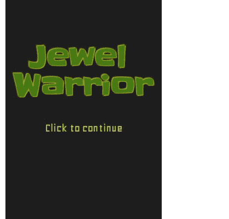

#### 总结

在本章中，我介绍了宝石勇士游戏的概念。我讨论了游戏规则、宝石交换机制，以及玩家如何通过匹配相同宝石的组合来得分。然后，我描述了游戏的各个阶段，从游戏首次加载时显示的启动画面，经过菜单进入实际游戏，再到游戏结束时显示的高分列表。

接着，我向你展示了如何使用一个简单的HTML骨架和一点CSS来搭建游戏的基础。你看到了Modernizr中的yepnope.js集成如何轻松地动态加载脚本文件。我还介绍了一个用于设置游戏阶段和在各个游戏界面之间切换的基本框架。

在本章接近尾声时，你学习了网络字体和CSS `@font-face` 声明如何实现嵌入式字体，并使用它们为启动画面创建了游戏标志。

# 第3章

#### 移动端开发

-   为移动设备设计
-   支持不同的屏幕分辨率
-   创建主菜单
-   为Apple iDevices制作网络应用

**本章讨论了**将你的网络应用移植到移动平台时会面临的一些优势和挑战。它简要介绍了移动设备上的用户交互与桌面端的不同之处，然后解释了视口（viewport）的概念以及如何让游戏在小屏幕上正确缩放。

接下来，本章转向CSS媒体查询，并展示如何使用它们来创建游戏视图，使其在不同分辨率的设备上（无论其方向如何）都能自适应并呈现良好效果。在本章中，你还将学习如何通过切换iOS应用模式和禁用一些默认的浏览器行为，让你的应用和游戏感觉像原生应用。

最后，你将学到一些技巧，帮助调试你的iOS和Android网络应用。

##### 开发移动网络应用

2011年3月，苹果公司宣布iPhone总销量已达1亿部。再加上迄今为止售出的超过5000万台iPod touch和iPad设备，你就能得到超过1.5亿台运行苹果iOS软件的手持设备，该软件使这些设备能够运行先进的网络应用。iPhone的主要竞争对手——谷歌支持的Android系统——也占据了移动市场的很大份额，每周售出超过一百万台基于Android的设备。这是一个巨大的数字。忽视针对这些设备开发应用和游戏将是一个错误。

游戏在像iOS和Android这样的平台上尤其成功。如果你查看最受欢迎的iPhone和Android应用下载列表，你肯定会找到几款游戏，其中一些还名列前茅。从诺基亚手机上的贪吃蛇时代开始，在手机上玩游戏已经变得越来越普遍。随着最近几代高分辨率、支持触摸的智能手机和平板电脑的出现，游戏体验得到了极大的提升。

然而，并非所有游戏都天然适合小屏幕。例如，复杂的策略游戏和快节奏的第一人称射击游戏依赖于大屏幕和丰富的控制选项。移动平台上当然也存在类似的游戏，但真正成功的那些游戏似乎是那些充分利用小触摸屏、并迎合移动用户更随意的“拿起就玩”心态的游戏。如果用户只是想在公交车上消磨几分钟时间，他们不想花很长时间去看一个冗长的开场介绍。像宝石勇士这样的三消游戏就非常符合这个特点。游戏玩法足够简单，大多数人无需或只需很少指导就能上手，而且游戏时长可长可短。游戏操作也足够简单，没有键盘和鼠标不成问题。游戏中的宝石交换机制非常适合小触摸屏，因为用户只需在屏幕上轻点即可选择和交换宝石。

##### 一次编写，随处运行

使用HTML、CSS和JavaScript开发移动应用和游戏的最大优势之一在于，如果构建得当，你的应用可以在许多不同的平台和设备上运行，几乎无需或完全无需修改。考虑到原生应用开发者面临的挑战，这对网络应用来说是一个巨大的胜利。例如，要将一款原生iPhone游戏移植到Android，你需要掌握iOS设备上使用的Objective-C语言和Android使用的Java语言，以及它们各自的软件开发工具包（SDK）。通过使用开放的Web技术，无论你为哪个平台或设备开发，工具和代码都保持不变。这既节省了开发阶段的时间，也节省了后期发布后维护的时间。

网络应用的另一个好处是，它们绕过了像苹果应用商店这样分发渠道的严格规则。让你的应用通过应用商店的审核意味着要接受一个封闭且有些不透明的审批流程。网络应用则不存在这个问题。你可以将应用托管和分发在任何你想要的地方。

##### 移动平台的挑战

然而，使用网络技术开发应用或游戏并非全是优势，它也带来了挑战。不局限于单一的分发渠道也可能是一个缺点。从应用商店或Android Market获取新应用很容易，许多用户也从未尝试过他们熟悉的内置应用分发系统之外的途径。这意味着让你的潜在用户知晓你的应用可能是一个问题。

幸运的是，越来越多的替代渠道正在涌现，使你的应用更容易推广出去。在第14章中，我将更深入地探讨如何分发你的网络应用和游戏。

##### 处理移动设备上的用户输入

为智能手机和平板电脑开发也带来了技术挑战。最明显的挑战之一是用户与应用之间的交互方式发生了变化。在桌面电脑或笔记本电脑上，用户已经习惯了同时拥有键盘和鼠标。智能手机和平板电脑主要使用支持触摸的屏幕，这非常直观但也相当有限。

一些设备，如iPhone和许多Android设备，还提供了一些与用户及其环境交互的额外方式。摄像头和麦克风在手机上已经存在很长时间了，但今天的智能手机还配备了加速度计和陀螺仪等硬件传感器。这些都是开发者可以用来创造创新游戏体验的有趣工具。基于运动的输入已经相当成功。几款热门移动游戏完全依赖于在正确的时间以正确的方式倾斜设备，其目标多种多样，如驾驶车辆（史莱克卡丁车）、在云上跳跃（涂鸦跳跃）以及引导球通过迷宫（迷宫）。不幸的是，这些额外功能目前还不为网络开发者所用。在HTML和JavaScript能够利用这些硬件功能之前，你可以使用像PhoneGap这样的工具在原生世界和网络世界之间架起桥梁。我将在第14章讨论这些选项。

##### 键盘输入

当为移动端而非桌面端开发时，


###### 适应小屏幕分辨率

切换到手持设备时，最明显的差异或许是与全尺寸电脑相比，其小巧的机身。较小的屏幕通常分辨率较低，且长宽比也常常不同。如果你想让你的游戏在大多数设备上都能良好运行，就需要确保它能适应各种各样的显示尺寸。

在用户输入方面，最大的损失可能就是键盘。许多类型的游戏如果没有键盘带来的精确控制，就无法很好地运行。一些移动游戏选择在屏幕上显示虚拟按钮，在某些情况下，这完全可行。但在其他情况下，缺乏实体按键可能使游戏难以控制。对于快节奏的游戏尤其如此，玩家经常依赖按键的物理触感来快速切换功能。许多设备提供振动形式的触觉反馈，但如果不直接看着按键，仍然很难选对要触摸的按键。

无论是安卓设备还是苹果设备，都有一个需要时滑出的虚拟键盘。由于键盘仅在允许文本输入的元素上触发，因此很难将其用于超出预期目的的其他用途。此外，在大多数常规尺寸的智能手机和iPod touch设备上，它会占据屏幕的很大一部分（见图3-1）。

图3-1：iPod touch和iPhone上的虚拟键盘

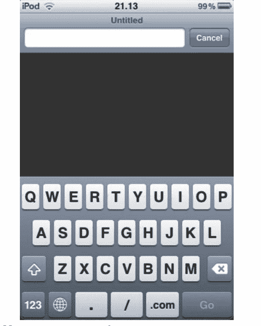

###### 鼠标与触摸

当然，移动设备也缺少鼠标，但至少触摸屏的功能与电脑鼠标有些相似。点击屏幕与点击鼠标的作用相同，因此在许多情况下，你可以用触摸屏代替鼠标，反之亦然。你甚至可以双击来模拟鼠标的双击。不过，相似之处也就到此为止了。

电脑很少有多个鼠标，但大多数人有十根手指。不利用这一点就太可惜了，因此最新的触摸设备引入了所谓的多点触控事件。这开启了一个全新的可能性世界。你可能已经知道移动浏览器和地图应用中普遍存在的捏合缩放功能，但多点触控功能也已成功用于在同一屏幕上实现多人游戏。

触摸屏也有局限性。例如，将鼠标指针悬停在某个元素上的概念在触摸世界里没有对应物。屏幕无法知道你的手指在哪里，直到你实际触摸它，而当你触摸时，它就不再是悬停状态了。电脑鼠标通常至少有两个按钮，大多数人习惯将鼠标右键作为上下文菜单或其他替代操作的快捷方式。在触摸屏上，很难区分不同类型的触摸。我们只有一种手指。最常用的解决方法是区分短按和长按，长按会调出上下文菜单或你分配给鼠标右键的其他操作。

所有这些精细的控制机制都缺失了，你可能会认为移动游戏市场的多样性会受损。然而，限制往往会激发创造力。当然，应用商店和安卓市场确实存在重复抄袭的应用和游戏问题，但许多这些游戏使用了独特的游戏玩法和游戏机制。

像《水果忍者》和《割绳子》这样的游戏已经证明，在屏幕上进行简单、时机精准的滑动可以提供完美的休闲游戏体验。以前毫无意义的游戏类型现在成了热门大作。

### 表3-1 智能手机分辨率和长宽比

| 设备 | 分辨率（竖屏） | 长宽比 |
|---|---|---|
| 索尼爱立信 X10 | | |
| HTC Wildfire | 240x320 | 3:4 |
| HTC Tattoo | | |
| 摩托罗拉 DROID X | 480x854 | ~9:16 |
| 索尼爱立信 X10 | | |
| iPod touch（第三代） | 320x480 | 2:3 |
| iPhone 3GS | | |
| HTC Legend | | |
| Nexus One | 480x800 | 9:15 |
| HTC Desire | | |
| HTC Evo 4G | | |
| iPhone 4 | 640x960 | 2:3 |
| iPod touch（第四代） | | |

表3-1显示，分辨率范围从较小的240x320像素显示屏到像素数是其四倍的显示屏，而由此产生的长宽比也差异很大。像HTC Wildfire这样的小尺寸手机拥有几乎正方形的低分辨率显示屏，而例如HTC Desire则配备了高度几乎是宽度两倍的高分辨率显示屏。

当你把平板电脑包括进来时，显示分辨率的数量甚至更多。一些平板电脑的分辨率接近高端智能手机，但另一些则拥有高清晰度显示屏，几乎可以与笔记本电脑和台式机上的显示屏相媲美。

### 表3-2 平板电脑分辨率和长宽比

| 设备 | 分辨率（竖屏） | 长宽比 |
| :--- | :---: | :---: |
| iPad, iPad 2 | 768x1024 | 3:4 |
| ARCHOS 70, ViewSonic ViewPad 7 | 480x800 | 9:15 |
| Samsung Galaxy Tab, ViewSonic gTablet | 600x1024 | ~7:12 |
| Motorola Xoom | 800x1200 | 10:16 |

> **记住**
> 面对所有这些不同的可能显示尺寸和分辨率，使游戏布局和图形能够适应尽可能多设备的挑战绝非易事。

##### 创建可伸缩的布局

你可以通过使用基于相对单位而非绝对值的弹性布局来解决由多种显示分辨率引起的许多问题。CSS支持几种不同的单位，你可以在设置位置、尺寸、边距等时使用它们，它们各有优缺点。其中一些单位是绝对和固定大小的。例如，使用`px`值设置`width`和`height`属性会使该元素无论放置在哪里以及有多少可用空间，都使用相同数量的像素。

其他单位是相对于其他值的。这些单位包括`em`和`百分比（%）`单位。百分比值相对容易理解；将`width`属性设置为25%会使元素使用其父元素提供的可用宽度的25%。如果你让父元素变大，子元素会自动调整自身，使其仍然使用空间的25%。这使得百分比值比固定大小的像素值更适合多设备开发。

`em`单位是创建可伸缩布局的另一个强大工具。它起源于传统排版，在那里，一个em等于所使用的字体和字号中大写字母M的宽度。因为当你更改字体或字号时，一个em的实际大小会发生变化，所以它是一个相对单位。em单位已经转移到了数字世界和网络排版中，尽管有轻微的修改，即一个em现在等于字体的高度。这样，计算机可以安全地使用字距调整来调整字母之间的间距以提高可读性。它还允许em单位用于没有字母M的其他字母表。

> **注意**
> `em`单位也用于定义一些特殊字符。`em破折号`（—）的宽度等于一个em，其近亲`em空格`的宽度也是如此。HTML通过实体`&mdash;`和`&emsp;`为你提供了这两个特殊字符。

使用em和百分比等单位使应用程序的布局更适合不同的显示尺寸。所有内容继承的主要`font-size`定义在`main.css`中的`#game`元素上。选择基础`font-size`可能很棘手，但你通常可以找到一个能很好地将页面划分成网格的尺寸。Jewel Warrior游戏中使用一个8x8的棋盘，游戏宽度设置为320像素。如果游戏占据全部宽度，那么40像素的`font-size`值意味着棋盘上的每个单元格是一个1x1 em的块。清单3.1显示了`main.css`中更改后的`#game`元素CSS。

```
#game {
    /*
    font-size: 40px;
    width: 8em;
    height: 12em;
    ...
    }
```

`#game`元素的`width`和`height`也是使用em单位定义的。这些绝对尺寸仅在桌面浏览器中运行游戏时使用。在下一节中，我将向你展示如何使游戏适应移动设备上的任何可用空间。

既然`#game`元素设置了基础大小，你就可以使用`em`单位来缩放其余内容。在清单3.2中，你可以看到对logo样式的更改。

```
.logo {
    font-size: 1.5em;
    line-height: 0.9em;
    text-shadow: 0.03em 0.03em 0.03em rgb(255,255,0),
                -0.03em -0.03em 0.03em rgb(255, 255,0),
                0.10em 0.15em 0.15em rgb(0,0,0);
```


请注意，由于 `.logo` 类拥有自己的 `font-size` 值，其余以 `em` 为单位指定的值现在都相对于该 `font-size` 值。清单 3.3 展示了启动画面样式的修改。

## 清单 3.3 在启动画面样式中使用相对单位

```css
#splash-screen {
  padding-top: 2.5em;
}
#splash-screen .continue-text {
  cursor: pointer;
  font-size: 0.75em;
}
```

现在，启动画面上的所有内容都基于游戏元素 CSS 规则中指定的单一 `font-size` 值。修改该值，其他所有内容也会随之改变。

##### 控制视口

要真正理解移动设备如何显示网页内容，你需要了解什么是视口以及它与页面的关系。你可以将视口视为浏览器渲染页面的区域。你可能认为这仅仅是浏览器窗口的区域。在某些情况下，这是正确的。然而，视口的尺寸与用于查看页面的“窗口”尺寸并非一回事。在桌面浏览器中，视口的宽度通常等于浏览器窗口的宽度，但在移动设备上，情况并非总是如此。例如，第三代 iPhone 上的移动 Safari 浏览器，默认视口宽度为 980 像素，即使实际显示宽度仅为 320 像素。可以通过一个 meta 标签来控制视口。

```html
<meta name="viewport" content="...">
```

`content` 属性接受许多可选参数来描述视口。表 3-3 列出了视口 `meta` 标签的所有有效参数。

## 表 3-3 视口 meta 标签参数

| 指令 | 描述 |
| --- | --- |
| width | 一个以像素为单位的数值，指定设备用于显示页面的视口宽度。特殊值 `device-width` 将宽度设置为设备显示宽度。 |
| height | 一个以像素为单位的数值，指定设备用于显示页面的视口高度。特殊值 `device-height` 将高度设置为设备显示高度。 |
| user-scalable | 此参数的可选值为 `yes` 和 `no`。如果设置为 `no`，则禁用原生的捏合缩放功能。默认值为 `yes`。 |
| initial-scale | 确定页面初始加载时应用的缩放级别。 |
| maximum-scale | 一个数值，确定用户可以应用的最大缩放级别。如果 `user-scalable` 设置为 `no`，则此参数无效。 |

大多数这些指令的默认值取决于设备和浏览器。通常，你想使用特殊的 `device-width` 和 `device-height` 值，而不是固定值。这样，设备就可以自动缩放内容以填满屏幕。`viewport` `meta` 标签放在 HTML 页面的 `head` 部分。清单 3.4 展示了添加到 `index.html` 中的 `meta` 标签。

## 清单 3.4 设置视口

```html
<head>
  ...
  <meta name="viewport"
  content="width=device-width">
  ...
</head>
```

##### 禁用用户缩放

在大多数情况下，在游戏中启用原生的用户缩放功能是个坏主意。如果你保持启用状态，就有用户意外缩放的风险，这可能会破坏游戏体验。将 `user-scalable` 参数设置为 `no`。浏览器应无需进一步缩放即可显示内容，因此 `initial-scale` 值应设置为 `1.0`。然而，由于 `width` 设置为 `device-width`，浏览器会自动推断 `initial-scale` 的值为 `1.0`，因此你甚至不需要显式设置缩放级别。反之亦然；`initial-scale` 值为 `1.0` 会自动推断 `width` 等于 `device-width`，除非你显式地为 `width` 参数设置了另一个值。由于用户缩放已被禁用，`maximum-scale` 和 `minimum-scale` 参数无关紧要。清单 3.5 展示了修改后的 `viewport` `meta` 标签。

## 清单 3.5 禁用用户缩放

```html
<head>
<meta name="viewport"
content="width=device-width, user-scalable=no">
...
</head>
```

如果你现在在例如 iPad 上加载游戏，游戏区域不会填满整个屏幕，但你会注意到，无论用户如何捏合屏幕，他们都不会意外缩放而搞乱游戏的渲染。

##### 创建不同视图

当用户点击启动画面时，他们会被带到主菜单。为确保菜单在大小屏幕上都显示正常，在本节中，我将向你展示如何根据屏幕大小加载不同的样式表，以及如何区分竖屏和横屏模式。首先，你需要构建菜单。

##### 创建主菜单

菜单是一个简单的无序按钮列表。每个按钮都有一个 `name` 属性，表示点击按钮时应加载哪个屏幕。菜单还包含一个位于菜单项上方的较小版本的游戏标志。清单 3.6 展示了添加到 `index.html` 中的主菜单标记。

## 清单 3.6 添加菜单 HTML

```html
<div id="game">
<!-- -->
<div class="screen" id="main-menu">
<h2 class="logo">Jewel <br>Warrior</h2>
<ul class="menu">
<li><button name="game-screen">Play</button></li>
<li><button name="hiscore">Highscore</button></li>
<li><button name="about">About</button></li>
<li><button name="exit-screen">Exit</button></li>
</ul>
</div>
</div>
```

现在向 `main.css` 样式表添加一些 CSS 规则。清单 3.7 展示了所有与菜单相关的规则。

## 清单 3.7 添加菜单 CSS 规则

```css
/* Main menu styles */
#main-menu {
    padding-top: 1em;
}

ul.menu {
    text-align: center;
    padding: 0;
    margin: 0;
    list-style: none;
}

ul.menu li {
    margin: 0.8em 0;
}

ul.menu li button {
    font-family: Slackey, sans-serif;
    font-size: 0.6em;
    color: rgb(100, 120, 0);
    width: 10em;
    height: 1.5em;
    background: rgb(10, 20, 0);
    border: 0.1em solid rgb(255, 255, 0);
    border-radius: 0.5em;
    -webkit-box-shadow: 0.2em 0.2em 0.3em rgb(0, 0, 0);
    -moz-box-shadow: 0.2em 0.2em 0.3em rgb(0, 0, 0);
    box-shadow: 0.2em 0.2em 0.3em rgb(0, 0, 0);
}

ul.menu li button:hover {
    background: rgb(30, 40, 0);
}

ul.menu li button:active {
    color: rgb(255, 255, 0);
    background: rgb(30, 40, 0);
}
```

注意按钮样式中额外的 `box-shadow` 声明。远非所有 CSS3 特性都在所有浏览器中得到完全支持，许多特性只能通过特定于浏览器的前缀使用，例如用于 WebKit 浏览器的 `-webkit` 和用于 Firefox 的 `-moz`。

请记住，以 `em` 为单位指定的值是相对于元素的 `font-size` 的。由于按钮元素有自己的 `font-size` 值，这意味着按钮元素的所有其他 CSS 值现在都相对于此 `font-size`。此外，此 `font-size` 本身是以 `em` 为单位指定的，因此按钮的实际计算出的 `font-size` 值等于继承的 `font-size` 值乘以其自身的 `font-size` 值。

##### 添加屏幕模块

大多数游戏屏幕都包含某种形式的活动或用户交互。我使用离散模块来封装此功能。你需要的第一个屏幕模块是启动屏幕模块。为了保持它们在一起，你可以通过为 `jewel` 命名空间添加另一个级别来组织屏幕模块，而不是将它们直接放在顶层 `jewel` 命名空间上。修改 `loader.js` 中的 `jewel` 声明，如下所示：

```javascript
var jewel = {
    screens: {}
};
```

启动屏幕模块应监听 `click` 事件，当用户点击或轻触屏幕任何位置时，切换到主菜单屏幕。屏幕模块的构建方式与游戏其他模块相同。目前，你需要公开一个设置任何初始行为的方法。清单 3.8 展示了启动屏幕模块。将代码放在 `scripts` 文件夹中一个名为 `screen.splash.js` 的新文件中。

## 清单 3.8 启动屏幕模块


## 清单 3.9 添加事件绑定辅助函数

```javascript
jewel.dom = (function() {
    ...
    function bind(element, event, handler) {
        if (typeof element == "string") {
            element = $(element)[0];
        }
        element.addEventListener(event, handler, false);
    }
    return {
        ...
        bind : bind
    };
})();
```

在附加事件监听器之前，`dom.bind()` 函数会检查 `element` 参数的类型。如果传入的是字符串，则将其用作 Sizzle 选择器字符串；否则，就假定 `element` 是一个实际的 DOM 元素。

现在，你只需要确保每当屏幕显示时都会调用 `run()` 函数。按照清单 3.10 所示，修改 `game.js` 中的 `showScreen()` 函数。

## 清单 3.10 调用 Run 方法

```javascript
jewel.game = (function() {
    ...
    function showScreen(screenId) {
        ...
        // 运行屏幕模块
        jewel.screens[screenId].run();
        // 显示屏幕 HTML
        dom.addClass(screen, "active");
        ...
    }
})();
```

当启动画面首次显示时，会向该屏幕附加一个点击事件处理程序，以便用户点击或轻触即可进入主菜单。当然，你还没有创建主菜单模块。主菜单模块的主要功能是处理用户点击或轻触菜单项时发生的情况。清单 3.11 展示了这个模块。将代码放入 `scripts` 文件夹中一个名为 `screen.main-menu.js` 的文件。

## 清单 3.11 主菜单模块

```javascript
jewel.screens["main-menu"] = (function() {
    var dom = jewel.dom,
        game = jewel.game,
        firstRun = true;

    function setup() {
        dom.bind("#main-menu ul.menu", "click",
            function(e) {
                if (e.target.nodeName.toLowerCase() === "button") {
                    var action = e.target.getAttribute("name");
                    game.showScreen(action);
                }
            });
    }

    function run() {
        if (firstRun) {
            setup();
            firstRun = false;
        }
    }

    return {
        run : run
    };
})();
```

主菜单首次显示时，会设置事件处理，以便点击菜单项可以导航到相应的屏幕。我使用了事件委托，而不是为每个菜单按钮都附加事件处理程序。只需在菜单的 `ul` 元素上添加一个点击事件处理程序。当事件触发时，处理函数会检查目标元素，并确定点击事件是否来自一个 `button` 元素。如果是，事件处理程序就会使用 `button` 元素的 `name` 属性将游戏切换到正确的屏幕。事件委托通常不仅节省了一些重复的输入，还带来一个酷炫的好处：父事件处理程序会自动覆盖任何通过 JavaScript 动态添加的项目。

> **提示**
>
> 主菜单目前使用 `click` 事件来处理菜单交互。在支持触摸的设备上，你也可以使用触摸事件，这些事件有时更适合这些设备。然而，因为屏幕上的轻触也会被转换成 `click` 事件，所以传统的 `click` 事件处理程序通常就能解决问题。在第 8 章，我将更深入地探讨事件处理、用户输入和基于触摸的交互。

最后，将新文件添加到 `loader.js` 中的加载器：

```javascript
Modernizr.load({
    {
        load : [
            ...,
            "scripts/screen/splash.js",
            "scripts/screen/main-menu.js"
        ],
        complete : ...
    }
});
```

你现在可以点击启动画面进入主菜单了。菜单上的事件处理程序已就位，但在后续流程中添加更多屏幕之前，菜单项不会导向任何地方。图 3-2 显示了该菜单。

图 3-2：主菜单

# # Jewel Warrior

1.  Play
2.  Highscore
3.  About
4.  Exit

##### 使用 CSS 媒体查询

无论你如何努力，有时你就是无法让一套 CSS 规则在所有设备和分辨率下都能正常工作。有时，最好的解决方案是为不同的显示尺寸创建单独的样式表，并在需要时加载相应的样式表。CSS3 媒体查询为这个问题提供了一个很好的解决方案。媒体查询扩展了 CSS2 的媒体类型功能，增加了额外的条件。CSS2 允许你根据媒体类型（打印、屏幕、手持设备等）使用不同的样式表，而媒体查询则基于媒体的特性设置条件。现在可以使用分辨率、显示尺寸和方向等数据来选择适当的样式。以下代码片段展示了一个带有媒体查询的样式表示例：

```html
<link rel="stylesheet"
      media="print and resolution > 150dpi"
      href="print150.css">
```

此查询仅在分辨率高于每英寸 150 点（dpi）的设备上打印时，才将 `print150.css` 样式表应用于内容。

你也可以在实际的 CSS 中使用媒体查询：

```css
@media screen and (min-width: 480px) {
    body {
        font-size: 150%;
    }
}
```

此示例将 `font-size` 缩放至 150%，但仅当内容显示在屏幕上且显示宽度至少为 480 像素时才会生效。通过使用此类查询，你可以轻松地针对不同的分辨率和屏幕尺寸，以确保游戏布局在不同设备上查看时表现良好。表 3-4 列出了 CSS3 中定义的所有媒体特性。

## 表 3-4 媒体特性

| 特性 | 值 | 描述 |
| :--- | :--- | :--- |
| width | 非负长度，例如，980px | 描述视口的宽度。 |
| height | 非负长度，例如，800px | 描述视口的高度。 |
| device-width | 非负长度，例如，320px | 描述输出设备的宽度。 |
| device-height | 非负长度，例如，480px | 描述输出设备的高度。 |
| orientation | landscape 或 portrait | 描述输出设备的方向；如果高度大于宽度，则 `orientation` 特性的值为 `portrait`；否则为 `landscape`。 |
| aspect-ratio | 正比例，例如，3/4 | 宽度值与高度值的比率。 |
| device-aspect-ratio | 正比例，例如，3/4 | `device-width` 值与 `device-height` 值的比率。 |
| color | 非负值，例如，8 | 描述输出设备中每个颜色分量（红、绿、蓝）使用的位数。 |
| monochrome | 非负值，例如，0 | 描述单色输出设备中每个像素的位数。 |
| color-index | 非负值，例如，64 | 描述输出设备颜色索引中的条目数。如果显示不是索引的，则值为 0。 |
| resolution | 正分辨率，例如，300dpi | 描述输出设备的分辨率。 |
| scan | progressive 或 interlace | 仅适用于 `tv` 媒体类型。 |
| grid | 0 或 1 | 表示基于网格的输出设备，例如计算机终端。 |

除了 `orientation`、`scan` 和 `grid` 之外，所有媒体特性都可以与 `min-` 和 `max-` 前缀一起使用。

##### 检测设备方向

大多数智能手机和平板电脑都可以在纵向和横向模式下使用，设备会自动旋转并调整图像。这为应用程序开发人员带来了一个有趣的挑战，因为他们需要确保应用程序或游戏能够处理这种变化。有三个基本选择：

1.  不做任何处理。让设备旋转显示


对于大多数网站，通常让设备自行决定如何正确显示页面即可。只要设置好视口(viewport)，一切通常都能正常工作。然而，游戏往往需要以非常精确的方式使用屏幕空间。若交由设备重新排布内容，可能会破坏游戏体验和可用性。某些应用选择将显示固定在特定方向。如果应用或游戏的布局无法轻松适应横竖两种方向，这倒是个简单的解决办法。但对于网页应用而言，这并非最实用的解决方案，因为你无法禁用原生的显示方向切换功能。这意味着你必须使用CSS变换等方法将整个页面旋转回去。因此，只剩下第三个选项：确保游戏能够处理两种方向。

借助媒体查询(media queries)，为不同方向应用特殊的CSS相对容易。`orientation`媒体特性使得针对特定模式（例如横屏模式）应用规则变得轻而易举：

```
@media screen and (orientation: portrait) {
  #sidebar {
    display : none;
  }
}
@media screen and (orientation: landscape) {
  #sidebar {
    display : block;
  }
}
```

此示例仅在页面以横屏模式显示时才显示 `#sidebar` 元素。

##### 添加移动端样式表

现在来看看如何使用媒体查询为移动设备添加特殊样式表。该查询应匹配移动样式表能处理的最大设备。iPad的分辨率为768x1024，因此这将成为媒体查询的上限。由于设备宽度会随方向改变，你需要两个查询来检测竖屏和横屏模式。你可以通过逗号分隔，将多个查询组合到同一个样式表中。清单3.12展示了加载移动样式表的 `link` 元素。

### 清单 3.12 加载移动样式表

```
<head>
  <!--
  <link rel="stylesheet"
  href="styles/mobile.css"
  media="screen and (max-device-width:
  768px)
  and (orientation: portrait),
  screen and (max-device-width: 1024px)
  and (orientation: landscape)"/>
  ...
  -->
</head>
```

该媒体查询指定了 `mobile.css` 样式表应仅应用于满足以下条件的屏幕设备：竖屏模式下最大宽度为768像素，横屏模式下最大宽度为1024像素。

`mobile.css` 样式表中要做的第一件事就是让游戏充满整个显示屏。在 `main.css` 中，你为游戏元素设定了320x480像素的固定尺寸。这对于将游戏放置在网页上并在电脑显示器上显示是可行的。像“宝石战士”这样的游戏并不需要笔记本或台式电脑那样巨大的屏幕空间。在移动设备上，你应该尽可能多地占用空间。清单3.13展示了第一个更改。

### 清单 3.13 填满整个屏幕

```
#game {
  width: 100%;
  height: 100%;
}
```

这个小小的改动足以使当前应用程序在iPhone或高分辨率Android智能手机等中型设备上看起来不错。记住，你可以通过简单地更改游戏元素上的 `font-size` 值来缩放所有内容。你可以结合媒体查询使用它，例如在iPad等大屏幕设备上放大内容。清单3.14展示了 `mobile.css` 中针对特定设备的CSS规则。

### 清单 3.14 为大显示屏缩放内容

```
/* 小屏幕使用较小的基础尺寸 */
@media (max-device-width: 480px) {
  #game {
    font-size: 32px;
  }
}
/* iPad和平板电脑使用较大的基础尺寸 */
@media (min-device-width: 768px) {
  #game {
    font-size: 64px;
  }
}
```

`ul.menu` 规则稍微缩放了整个菜单结构，使其能够适应不同的宽高比。请注意用于针对iPad的两个查询，每种方向一个。

横屏模式是一个更棘手的问题。将高大的菜单塞入横屏模式下有限的垂直空间会导致按钮变得非常小。一个更好的解决方案是，如果空间允许，让它们自动调整自身排列成2x2网格。清单3.15中的样式适用于横屏模式下各种尺寸的设备。

### 清单 3.15 添加横屏样式

```
/* 智能手机横屏 */
@media (orientation: landscape) {
  #splash-screen,
  #main-menu {
    font-size : 1.0em;
    padding-top : 0.75em;
  }
  ul.menu li {
    display : inline-block;
    margin : 0;
  }
  ul.menu li button {
    margin : 0.5em;
    font-size : 0.5em;
  }
}
/* 小屏幕横屏 */
@media (orientation: landscape) and (max-
device-width : 480px) {
  ul.menu li button {
    font-size : 0.4em;
  }
}
/* 平板电脑横屏 */
@media (orientation: landscape) and (min-
device-width : 768px) {
  #splash-screen,
  #main-menu {
    padding-top : 1.5em;
  }
}
```

将 `display` 设置为 `inline-block` 会使菜单项并排排列，仅在空间不足时才会换行。图3-3展示了在HTC Desire上渲染的横屏模式菜单。

### 图 3-3：横屏模式下的主菜单

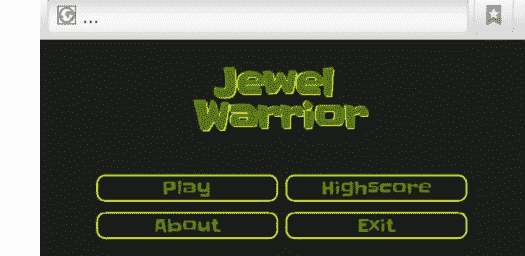

所有应用都有不同的布局，没有银弹能让所有应用在所有设备上都看起来完美。最终，这归结于实验——试图找到能在尽可能多的设备上看起来不错的解决方案，同时避免在CSS中处理太多特殊情况。

##### 为iOS和Android设备开发

苹果在手持设备市场占据主导地位：这已不是秘密。Android设备正在获得市场份额，但无处不在的iPod、iPhone和iPad设备都运行着相同的严格控制的软件，这使它们成为移动网络开发者的良好目标。苹果的移动Safari和iOS系统为网络应用开发者提供了一些额外的好处。你可以使用其中一些功能来更好地控制应用的显示方式，使其与设备上的原生应用融为一体。

###### 主屏幕

当你在移动Safari中运行网页应用时，由于周围的Safari界面（图标、地址栏等），可用的屏幕空间会减少。对于iPad等通常拥有大量屏幕空间的设备来说，这并非大问题。然而，对于像iPod touch或iPhone这样的小屏幕设备，这很快就成了问题。例如，iPod touch 3G的分辨率为320x480像素，但由于状态栏和Safari界面元素占据了相当大的一部分空间，你只能使用320x360的区域来放置你的应用。

在Safari中，用户可以通过点击书签图标，选择将指向应用程序或网站的链接放在主屏幕上。这会在主屏幕上添加一个图标，作为网页地址的快捷方式。然而，应用程序仍然在Safari内运行，其行为与普通网站完全相同，所以它实际上只是一个书签。幸运的是，有一个简单的解决方法可以大大提升原生应用的体验。通过在 `index.html` 中添加一个特殊的 `meta` 标签，如清单3.16所示，你可以表明该页面是一个网页应用，不应被视为一个简单的链接。

### 清单 3.16 启用网页应用模式

```
<head>
...
<meta name="apple-mobile-web-app-capable" content="yes" />
...
</head>
```

将 `apple-mobile-web-app-capable` 设置为 `yes` 后，iOS就知道当这个页面被书签添加后随后从主屏幕启动时，它必须以全屏模式运行，不显示通常的Safari用户界面。当然，如果用户不知道这个功能，它就没什么价值。在下一节中，我将展示如何向拥有该选项的用户显示一条消息。

**注意**

在较早版本的iOS系统中，书签图标使用加号 (+) 符号，但从iOS 4.2开始，图标已更改为弯曲的箭头。

将游戏放在主屏幕上的一个重要动机是，它能不断提醒用户它的存在。如果游戏只存在于Safari中，最多只是一个书签，用户下次需要消磨时间时可能就会忘记它。如果你把它放在主屏幕上，用户就会看到一个持续的提醒：游戏就在那里，等着被玩。

##### 检测独立运行的应用

Safari提供了一种简单的方法来确定页面是作为网页应用还是普通网页被查看。使用JavaScript，你可以检查 `window.navigator` 对象是否有一个名为 `standalone` 的属性。如果这个属性存在且为true，则表明该页面是从主屏幕以网页应用模式启动的。清单3.17展示了一个基本示例，说明如何检测应用程序是作为独立应用运行还是在浏览器中运行。

### 清单 3.17 测试 standalone 属性

```
if (window.navigator.standalone) {
    alert("You are running the standalone app!");
} else if (window.navigator.standalone == false) {
    alert("You are using app in mobile Safari!");
} else {
    alert("You are using the app in another browser!");
}
```


测试包含三个用例：一个针对独立的iOS Web应用程序，一个针对在移动Safari浏览器中运行的网页，以及最后针对所有其他情况的通用用例。请注意，检测代码会显式测试`standalone`属性是否为布尔值`false`。这是为了区分该属性值是`false`还是该属性根本不存在。只有iOS设备支持`standalone`属性；对于其他浏览器，该属性是`undefined`，因此这些浏览器只匹配第三个用例。

##### 扩展Modernizr

在了解如何检测独立Web应用程序模式后，你可以据此相应地修改应用程序。目前没有内置的CSS检测方法，但如果你希望为独立应用程序添加特殊的CSS规则，这将非常有用。Modernizr通过向`html`元素添加CSS类来指示支持哪些功能。例如，如果`html`元素具有`websockets`类，则表示浏览器支持WebSockets；如果`html`元素具有`no-websockets`类，则表示不支持。这种模式简单明了，提供了一种基于可用功能添加CSS规则的简便方法。扩展Modernizr以支持测试Web应用程序功能同样很简单。清单3.18展示了对`loader.js`脚本的补充。

### 清单3.18 扩展Modernizr

```javascript
Modernizr.addTest("standalone", function()
{
    return (window.navigator.standalone != false);
});
Modernizr.load([
    ...
]);
```

这个新测试用于确定是否启用了独立模式。由于在非iOS设备上此问题没有意义，我们将不存在的`standalone`属性视为正在独立模式下运行。此外，我们真正关心的是能够判断用户是否有安装应用程序的选项但尚未使用该选项。

##### 制作特殊的启动屏幕

现在修改加载器，以便在非独立模式下加载不同的启动屏幕。使用Modernizr中的条件加载功能可以轻松实现。清单3.19展示了在loader.js中修改后的加载顺序。

### 清单3.19 加载正确的启动屏幕

```javascript
// 加载阶段1
Modernizr.load([
{
    load : [
        "scripts/sizzle.js",
        "scripts/dom.js",
        "scripts/game.js"
    ]
},
{
    test : Modernizr.standalone,
    yep : "scripts/screen.splash.js",
    nope : "scripts/screen.install.js",
    complete : function() {
        if (Modernizr.standalone) {
            jewel.game.showScreen("splash-screen");
        } else {
            jewel.game.showScreen("install-screen");
        }
    }
}
]);

// 加载阶段2
if (Modernizr.standalone) {
    Modernizr.load([
    {
        load : ["scripts/screen.main-menu.js"]
    }
    ]);
}
```

请注意，加载现在也分成了两个阶段。第二阶段仅在游戏以独立模式运行时激活，确保你不会浪费带宽加载不需要的资源。

**提示**

**虽然你将加载分成了两个阶段，但这并不意味着Modernizr无法利用其并行加载技术。所有必要的文件仍然会被高效加载，只有脚本的执行受到影响。**

`screen.install.js`中的这个安装屏幕模块只是一个空模块，没有实际功能。它的作用仅仅是显示一个非交互式的消息。清单3.20展示了这个模块。

### 清单3.20 安装屏幕模块

```javascript
jewel.screens["install-screen"] =
(function() {
    return {
        run : function() {}
    };
})();
```

安装屏幕的标记与启动屏幕类似，因此要创建安装屏幕，只需复制启动屏幕元素并将`id`属性更改为`install-screen`。此屏幕上显示的消息应提示用户通过书签按钮将游戏安装到主屏幕。清单3.21展示了添加到`index.html`的新屏幕元素。

### 清单3.21 添加安装屏幕标记

```html
<div id="game">
    ...
    <div class="screen" id="install-screen">
        <h1 class="logo">Jewel<br>Warrior</h1>
        <span>
            点击 
            按钮将游戏安装到您的主屏幕。
        </span>
    </div>
</div>
```

安装屏幕的CSS与启动屏幕也非常相似。唯一的区别是安装屏幕顶部的内边距较小。你可以在本章的代码归档中的images文件夹找到install-icon.png图像文件。请记住，移动Safari浏览器会占用大量可用空间。清单3.22展示了添加到main.css的安装屏幕样式。

### 清单3.22 为安装屏幕添加样式

```css
/* iOS设备的安装屏幕 */
#install-screen {
padding-top : 0.5em;
text-align : center;
}
#install-screen span {
font-size : 0.75em;
display : inline-block;
padding : 0 0.5em;
}
```

现在，当游戏在移动Safari浏览器中加载时，用户将看到安装通知而非正常的启动屏幕。图3-4显示了此屏幕。

### 图3-4：移动Safari安装屏幕

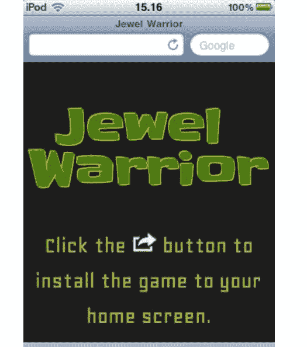

##### 添加应用程序图标

默认情况下，iOS在生成图标时会使用应用程序的微小截图。自然，这并不总能产生好效果。通过特殊的`link`元素，你可以指定要使用的图标文件来替代截图。

```html
<link rel="apple-touch-icon" href="icon.png"/>
```

iOS会以添加额外效果的方式处理该图标。通过使用`apple-touch-icon-precomposed`代替`apple-touch-icon`，你可以告诉iOS保留图标原样使用：

```html
<link rel="apple-touch-icon-precomposed" href="images/ios-icon.png"/>
```

由于iDevices具有不同的分辨率，iOS还支持不同尺寸的应用程序图标。早期的iPod touch和iPhone设备分辨率相对较低，在主屏幕上使用57x57的图标。iPhone 4的显示屏分辨率是前代产品的两倍，因此可以利用更详细的114x114图标。第一代和第二代iPad平板电脑的分辨率介于两者之间——它们需要72x72的图标。如果你创建了这些不同尺寸的图标，可以在HTML中通过向`link`元素添加`sizes`参数并为每个想要支持的分辨率添加额外的`link`元素来指向它们。清单3.23展示了添加到index.html中`head`元素的额外元素。

### 清单3.23 使用多种分辨率的图标

```html
<head>
...
<link rel="apple-touch-icon-precomposed" href="images/ios-icon.png"/>
<link rel="apple-touch-icon-precomposed" sizes="72x72"
  href="images/ios-icon-ipad.png"/>
<link rel="apple-touch-icon-precomposed" sizes="114x114"
  href="images/ios-icon-iphone4.png"/>
</head>
```

设备会自动选择最合适的尺寸图标。如果找不到其分辨率所需的精确尺寸，它会选择大于理想尺寸的最小图标或小于理想尺寸的最大图标。如果找不到合适的图标，它会回退使用未指定尺寸的默认图标。图3-5显示了iPod主屏幕上的游戏图标。

### 图3-5：主屏幕上的Jewel Warrior图标

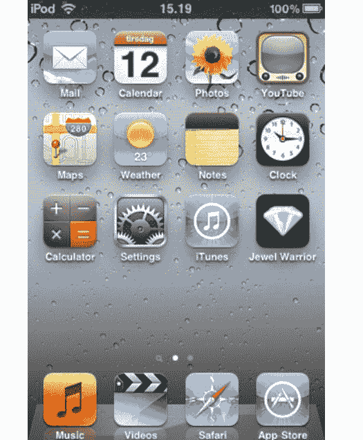

你也可以为整个网站使用一套图标，方法是省略`link`元素，而是将图标图像放置在网站的根目录中。然后iOS系统会使用预定义的文件名列表在根目录中搜索合适的图标，格式为`apple-touch-icon-[<宽>x<高>][-precomposed].png`。预组合图标优先于普通图标，具有该分辨率所需特定尺寸的图标优先于默认图标。使用57x57图标的设备会搜索以下文件名列表：

- apple-touch-icon-57x57-precomposed.png
- apple-touch-icon-57x57.png
- apple-touch-icon-precomposed.png
- apple-touch-icon.png

如果你想提供所有三种尺寸的图标并使用预组合图标，你需要在网站的根目录中放置以下文件：

- apple-touch-icon-114x114-precomposed.png
- apple-touch-icon-72x72-precomposed.png
- apple-touch-icon-precomposed.png

在这种情况下，文件名中未指定尺寸的文件应该是57x57图标，以便它既能作为旧款iPhone的正确图标，也能作为任何未来不同分辨率设备的默认回退图标。

> **记住**
> 在许多情况下，最好使用`link`元素明确指向图标。将应用程序图标放在根目录中意味着该域上运行的每个应用程序都使用相同的图标。如果你希望从该网站提供其他应用程序或游戏，这可能会导致问题。

##### 添加启动图像

当用户以独立模式启动游戏并随后退出游戏时，iOS会保存一张


##### 指定启动图像

所有 iOS 设备都需要一张全屏图像，但顶部需预留 20 像素用于原生状态栏。这意味着 iPhone 和 iPod touch 的图像尺寸为 320x460，iPad 的尺寸为 768x1004。在 iPad 上，你可以为横屏模式添加一个额外的启动图像。该图像的尺寸必须是 748x1024，这意味着内容需要旋转 90 度。我创建了三个启动图像，仅显示图像的尺寸，以便你可以查看每个图像加载的时机。你可以在本章代码归档的 images 文件夹中找到这些图像。代码清单 3.24 显示了添加到 index.html 中 `head` 元素的额外链接标签。

**代码清单 3.24 指定启动图像**

```
<head>
...
<link rel="apple-touch-startup-image"
href="images/ios-startup-748x1024.png"
media="screen and (min-device-width: 768px)"
or (orientation:landscape)" />
<link rel="apple-touch-startup-image"
href="images/ios-startup-768x1004.png"
media="screen and (min-device-width: 768px)"
or (orientation:portrait)" />
<link rel="apple-touch-startup-image"
href="images/ios-startup-320x460.png"
media="screen and (max-device-width: 320px)"/>
```

如果你添加多个 `link` 元素，最后一个元素会覆盖所有之前的元素，除非你指定媒体查询来针对特定设备。在代码清单 3.24 中，前两个 `link` 元素仅针对 iPad，而第三个元素则针对 iPhone 和 iPod touch 的较小屏幕。

##### 设置状态栏样式

所有移动 iDevice 设备都在屏幕顶部使用一个标准的 20 像素状态栏。即使 Web 应用程序在全屏模式下运行，这个状态栏仍然可见。这意味着，例如 iPad 上实际可用的屏幕空间在竖屏模式下是 768x1004，而不是完整的 768x1024。不幸的是，你无法完全隐藏状态栏，但 iOS 确实提供了一些控制其外观的能力。通过在页面中添加一个特殊的 `meta` 标签，你可以选择几种不同的样式。代码清单 3.25 显示了在 index.html 中将状态栏设为纯黑色背景所需的 `meta` 标签。

**代码清单 3.25 将状态栏设为黑色**

```
<head>
    <meta name="apple-mobile-web-app-status-bar-style"
    content="black" />
    ...
</head>
```

`content` 属性的值必须是 `default`、`black` 或 `black-translucent` 之一。

##### 避开浏览器干扰

Web 浏览器会对你的应用程序施加许多额外的行为。虽然其中一些可能是受欢迎的，但其他功能只会削弱用户体验。理想情况下，以 Web 应用程序形式运行的游戏与其原生版本不应有明显差异。在接下来的几节中，我将向你展示一些可以禁用部分原生浏览器行为的方法。

###### 禁用过度滚动

当你在 Android 浏览器或 Mobile Safari 中滚动网页时，你会注意到你可以滚动到页面末尾之后。当你松开时，页面会弹回到末尾位置。最好让游戏完全不滚动，因为屏幕上可见区域外永远没有任何内容。你可以通过完全禁用触摸滚动来禁用这个过度滚动功能。通过在 `document` 元素上监听 `touchmove` 事件并调用 `event.preventDefault()` 方法来实现。目前没有任何设置函数处理此类初始化操作，因此在游戏模块中添加一个。代码清单 3.26 显示了这个新函数。

**代码清单 3.26 在游戏模块中添加设置函数**

```
jewel.game = (function() {
...
function setup() {
    // 禁用原生触摸移动行为以
    // 防止过度滚动
    dom.bind(document, "touchmove",
        function(event) {
            event.preventDefault();
        }
    );
...
return {
    ...
    setup : setup
    }
});
```

`setup()` 函数应在显示第一个屏幕之前调用一次。在加载器脚本中，在切换启动画面或安装界面之前添加调用。代码清单 3.27 显示了 loader.js 中的正确位置。

**代码清单 3.27 在加载器中调用设置函数**

```
// 加载阶段 1
Modernizr.load({
    ...
    complete : function() {
        jewel.game.setup();
        if (Modernizr.standalone) {
            jewel.game.showScreen("splash-screen");
        } else {
            jewel.game.showScreen("install-screen");
        }
    }
});
```

如果你在移动浏览器中加载游戏，你会看到你无法再滚动到游戏区域之外了。

###### 隐藏地址栏

Android 浏览器没有 Mobile Safari 提供的 `apple-mobile-web-app-capable` 元标签那样的功能。你无法让 Android 以应用程序形式加载页面；你能做的最好的办法就是在主屏幕上放置一个快捷方式，然后在标准浏览器应用程序中打开。然而，Android 浏览器比 Safari 提供了更多的工作空间，唯一保留的空间是顶部的状态栏。当页面在 Android 浏览器中加载时，它通常以 URL 地址栏仍然可见的方式显示。通过一点 JavaScript（如代码清单 3.28 所示），你可以让地址栏消失——或者至少将其移出视线。

这个问题在 iPod touch 和 iPhone 上也存在，但在那些设备上没那么重要，因为我们只是要求用户将游戏安装到主屏幕。因为我们已经禁用了触摸滚动，隐藏地址栏也可能在 iOS 上引起问题，因为用户没有其他方式离开页面。如果用户从主屏幕图标启动游戏，地址栏问题就消失了。

隐藏地址栏的技巧是强制浏览器滚动到页面顶部。如果有足够的内容，它会自动将地址栏推到视线之外。由于高度设置为 100%，游戏只占据尽可能多的空间，因此滚动到顶部没有效果。你可以通过将 html 元素的高度增加到 200% 来确保页面足够长。代码清单 3.28 显示了对 game.js 中 `setup()` 函数针对 Android 的修改。

**代码清单 3.28 隐藏地址栏**

```
jewel.game = (function() {
...
function setup() {
...
// 在 Android 设备上隐藏地址栏
if (/Android/.test(navigator.userAgent)) {
$("html")[0].style.height = "200%";
setTimeout(function() {
window.scrollTo(0, 1);
}, 0);
}
}
...
```

###### 禁用默认浏览器行为

Mobile Safari 和 Android 浏览器有一些行为，尽管它们有道理并且通常能改善常规网页上的用户体验，但对于游戏来说最好禁用它们。

当你在，例如图像或链接上保持手指按下一两秒钟时，会出现一个小气泡提示，为你提供跟踪链接、保存图像等选项。这个功能在游戏中没有位置。用户应该能够点击和按压任何内容，而不会受到原生浏览器行为的干扰。以下 CSS 属性可以禁用气泡提示。

```
-webkit-touch-callout: none;
```

同样，选择文本和图像的能力可以使用以下 CSS 属性禁用：

```
-webkit-user-select : none;
```

Android 浏览器在你点击可点击元素时会高亮显示它们。同样，这在网页链接的上下文中更有意义。通过将其颜色设置为透明来移除高亮：

```
-webkit-tap-highlight-color: rgba(0,0,0,0);
```

在某些情况下，例如方向改变时，浏览器有时会自动调整文本大小以适应可用大小的变化。最好尽可能多地控制外观，因此使用以下规则禁用自动调整：

```
-webkit-text-size-adjust: none;
```

这四个属性必须应用于游戏中的所有内容，因此应该放在最顶层的元素之一上。代码清单 3.29 显示了添加到 main.css 中 body 元素的额外 CSS 规则。

**代码清单 3.29 修改移动浏览器行为**

```
body {
    -webkit-touch-callout: none;
    -webkit-tap-highlight-color: rgba(0,0,0,0);
}
```


##### 调试移动 Web 应用程序

在移动设备上调试 Web 应用程序可能会有点麻烦。如果你习惯了 Firebug 或 WebKit 开发者工具等优秀工具，你会发现调试移动设备上的 Web 应用程序是一种完全不同的体验。你无法检查 HTML，没有控制台来测试 JavaScript，并且当事情没有按预期进行时，你经常会发现自己不得不借助 `alert()` 进行调试。尽管移动浏览器的功能不如桌面浏览器丰富，但它们确实有一些对于调试 JavaScript 有帮助的选项。

##### 启用 Safari 调试器

Apple 的移动 Safari 浏览器有一个调试控制台，默认是禁用的。要启用它，请转到 iOS 设置并找到 Safari 窗格。滚动到底部并选择“开发者”菜单项（图 3-6）。在开发者屏幕上，你可以打开和关闭调试控制台（图 3-7）。

图 3-6：移动 Safari 设置

-   访问欺诈网站时发出警告。
-   JavaScript 开启
-   拦截弹出式窗口 开启
-   接受已访问网站的 Cookie >
-   清除历史记录
-   清除 Cookie
-   清除缓存
-   开发者 >

图 3-7：移动 Safari 开发者设置

-   调试控制台 开启
-   调试控制台将自动出现以帮助解决网页错误。

调试控制台出现在 Safari 的 URL 栏正下方。错误栏会报告页面上的错误数量。如果发生任何 HTML、CSS 或 JavaScript 错误，你可以单击错误栏获取详细信息。有关错误详情的示例，请参见图 3-8。

你也可以使用类似于大多数桌面浏览器的 `console` API 编写自己的调试消息。

```
console.log("Hello World") // 在日志中打印一条消息
```

你也可以使用相关的 `console.error()`、`console.warn()` 和 `console.info()` 函数。

Safari 可能不像你从桌面浏览器了解到的那样提供任何广泛的检查功能，但它拥有的功能肯定比没有好。不过，有一个稍微令人烦恼的地方。调试控制台仅在完整的 Safari 浏览器中运行时有效。当应用程序从主屏幕以独立模式启动时，启用调试控制台没有效果。

**图 3-8：移动 Safari 中的详细错误信息**

##### 访问 Android 日志

Android 浏览器没有内置的控制台。相反，错误和控制台消息会发送到 Android 日志系统。如果你熟悉 Android 调试桥 (ADB)，你可以使用 ADB 命令查看日志消息。

```
adb logcat
```

Android Market 上有几种日志查看应用程序可用。一个例子是 aLogcat，它是免费的，允许你通过输入关键词过滤日志输出。日志接收来自许多不同来源的消息，因此过滤输出使查找相关消息变得更容易。可以通过过滤关键词 `browser` 来区分来自浏览器的消息。

> 与某些桌面浏览器上的对应功能不同，Android 和 iOS 上的 JavaScript 控制台函数只接受一个参数。你可以向 console.log() 等函数提供多个参数，但只有第一个参数会用于日志消息。

#### 总结

在本章中，你学习了如何结合使用可伸缩布局、`viewport` meta 标签和 CSS 媒体查询，使你的游戏在不同分辨率的多种设备上表现良好。你还看到了如何使用媒体查询来解决横向与纵向方向的问题。

我向你展示了如何使用 iOS 的 Web 应用程序独立模式，将游戏图标放在主屏幕上，从而以全屏模式启动游戏。你使用了条件加载来加载一个安装屏幕而不是常规的启动屏幕。通过引入更多设置，你学习了如何控制 iOS 状态栏的外观以及如何添加启动图像。

在本章的最后部分，你学习了如何摆脱一些不必要的浏览器行为，例如过度滚动、地址栏以及长按图片和链接时的提示框。

## 第 2 部分：创建基本游戏

**第 4 章** 构建游戏
**第 5 章** 将任务委托给 Web Workers
**第 6 章** 使用 Canvas 创建图形
**第 7 章** 创建游戏显示
**第 8 章** 与游戏交互
**第 9 章** 游戏图形动画

### 第 4 章：构建游戏

-   为游戏面板创建模块
-   封装游戏状态
-   设置宝石面板
-   实现游戏规则
-   响应宝石交换

**在本章中，** 我将向你展示如何实现控制宝石面板的规则和游戏机制。我将引导你了解所有必要的游戏逻辑，并创建一个游戏面板的表示，以便应用程序的其余部分可以与之交互。我将向你展示如何将面板的状态封装在一个隔离的模块中，该模块仅在遵循所有游戏规则时才允许修改面板。此外，我还将向你展示如何确保面板自动响应交换并相应地重新排列剩余的宝石。

我还讨论了当游戏必须能够使用两个不同的源来控制面板时出现的一些问题。单人游戏体验依赖于本章描述的本地客户端游戏逻辑，但游戏也必须与相同规则的服务器端实现一起工作。

#### 创建游戏面板模块

游戏机制的核心与游戏的显示和输入元素是分离的。我在本章中介绍的面板模块是游戏状态的数据模型，特别是宝石的当前布局。该模块公开了其他模块（主要是游戏屏幕）可以用来与游戏状态交互的方法。由于面板将作为游戏显示的后端，因此本章中的代码不会为游戏添加任何视觉元素。

简而言之，面板模块只是宝石面板的一个表示。它向外部世界公开的唯一真正的功能是一个用于访问面板上宝石的查询函数和一个用于交换宝石的函数。交换函数仅尝试交换一对宝石，因为只有在满足某些条件时宝石才可交换。交换宝石也会带来后果：宝石被移除，新的宝石落下等等。面板模块会自动处理所有这些条件和反应。该模块位于 `scripts` 文件夹中的 JavaScript 文件 `board.js` 中。清单 4.1 显示了初始模块。

##### 清单 4.1：面板模块

```javascript
jewel.board = (function() {
  /* 游戏函数放在这里 */
  return {
    /* 公开的函数放在这里 */
  };
})();
```

将 `board.js` 文件添加到 `loader.js` 的第二阶段加载器中，如清单 4.2 所示。

##### 清单 4.2：加载面板模块

```javascript
// 加载阶段 2
if (Modernizr.standalone) {
  Modernizr.load([
    {
      load : [
        "scripts/screen.main-menu.js",
        "scripts/board.js"
      ]
    }
  ]);
}
```

到目前为止，这个简陋的面板模块完全没有功能。让我们进入第一个方法，并开始充实该模块。

#### 初始化游戏状态

面板逻辑需要定义一些设置，例如行数和列数、不同宝石类型的数量等。诸如此类的设置最好与实际的游戏代码分开保存，这样可以轻松更改值而无需遍历所有代码。清单 4.3 显示了在 `loader.js` 中 `jewel` 命名空间添加的新 `settings` 对象。

##### 清单 4.3：添加设置对象

```javascript
var jewel = {
  screens : {},
  settings : {
    rows : 8,
    cols : 8,
    baseScore : 100,
    numJewelTypes : 7
  }
};
```

`rows` 和 `cols` 设置以行和列的形式定义了面板的大小。Jewel Warrior 使用 8x8 网格，这种尺寸在小屏幕上运行良好。`baseScore` 设置决定了参与连锁的每个宝石获得的分数。正如你稍后将看到的，对于涉及超过三个宝石的连锁，分数会进一步乘以基数。基本分数设置为每个宝石 100 分，但如果你想提高或降低分数，可以更改此数字。最后一个新设置 `numJewelTypes` 表示不同宝石类型的数量。该数字也对应于宝石精灵图的数量。

新的设置现在可供游戏的其余部分访问，最重要的是（至少目前）可供面板模块访问。

#### 初始化面板

要充实该模块，你首先需要一个用于设置和初始化游戏面板的函数。游戏开始时，面板已经填充了随机的宝石。清单 4.4 显示了添加到 `board.js` 的 `initialize()` 函数。

##### 清单 4.4：初始化函数

```javascript
jewel.board = (function() {
```


变量声明：
```javascript
var settings,
jewels,
cols,
rows,
baseScore,
numJewelTypes;
```
函数`initialize()`：
```javascript
function initialize() {
  settings = jewel.settings;
  numJewelTypes = settings.numJewelTypes;
  baseScore = settings.baseScore;
  cols = settings.cols;
  rows = settings.rows;
  fillBoard();
}
```
函数`print()`：
```javascript
function print() {
  var str = "";
  for (var y = 0; y < rows; y++) {
    for (var x = 0; x < cols; x++) {
      str += getJewel(x, y) + " ";
    }
    str += "\r\n";
  }
  console.log(str);
}
```
返回对象：
```javascript
return {
  initialize : initialize,
  print : print
};
})();
```

在代码清单4.4中，你首先看到的是一组变量声明。第一个变量只是为了导入设置模块，因为你稍后需要访问设置。第二个变量* jewels *是一个数组的数组，本质上是一个表示宝石板当前状态的二维数组。在` jewels `数组中，每个宝石由一个整数值表示，该值指示宝石的类型。使用这种数组结构，可以轻松地通过坐标访问单个宝石。例如，以下代码片段检索位于板上位置（x=3, y=2）的宝石类型：
```javascript
var type = jewels[3][2];
```

该代码清单还包含一些变量，其值来自设置模块。这些值将在下一节中描述。`print()`函数将板数据输出到JavaScript控制台，仅用于帮助你进行调试。你可以通过在控制台中输入以下内容来初始化板模块：
```javascript
jewel.board.initialize()
```

在本章中，无论何时你想检查板数据，只需输入以下命令即可将数据打印到控制台：
```javascript
jewel.board.print()
```

#### 使用异步函数

在进入下一个函数之前，我想分享一个对`initialize()`函数的小修改，以便为未来做准备。

第5章将向你展示如何使用Web Workers通过创建一个基于Web Worker的板模块（该模块暴露与本章创建的相同方法）将板逻辑移动到单独的线程。Web Workers通过异步消息传递API与应用程序的其余部分通信，这意味着板模块暴露的所有方法都必须能够异步工作。

同样，如果你要添加一个使用服务器端后端来验证和验证板数据的板模块，你也需要向服务器发送异步Ajax请求。每个修改游戏状态的函数都需要往返服务器，然后才能将响应返回给调用者。换句话说，函数调用返回并不意味着结果已经准备好。

你可以通过多种方式解决这种延迟响应的问题，包括使用功能齐全的自定义事件分发系统或`promise`对象的概念（例如，从CommonJS和Node.js中了解）。然而，最简单的解决方案是提供一个回调函数作为相关方法的参数，并在该方法完成时调用该回调函数。你可能已经从JavaScript函数（如`window.setTimeout()`或DOM元素上的`addEventListener()`方法）中了解了这种模式。这些函数都接受另一个函数作为参数之一，并在未来的某个时刻调用该函数。代码清单4.5显示了修改后的`board.js`中的`initialize()`函数。

##### 代码清单4.5 使用回调函数进行初始化

```javascript
jewel.board = (function() {
    ...
    function initialize(callback) {
        numJewelTypes = settings.numJewelTypes;
        baseScore = settings.baseScore;
        cols = settings.cols;
        rows = settings.rows;
        fillBoard();
        callback();
    }
    ...
})();
```

如果你想通过JavaScript控制台初始化板，可以传递一个空函数：
```javascript
jewel.board.initialize(function(){})
```

现在，`initialize()`函数中的所有操作都会立即发生，因此结果与没有回调函数时基本相同。主要区别在于，当你添加Web Worker模块时，它可以使用相同的函数签名，使该模块的集成变得容易得多。

#### 填充初始板

代码清单4.5中使用的`fillBoard()`函数必须初始化一个`cols` x `rows`的网格，并用随机宝石填充它。代码清单4.6显示了添加到`board.js`中的此函数。

##### 代码清单4.6 填充宝石板

```javascript
jewel.board = (function() {
  ...
  function fillBoard() {
    var x, y;
    jewels = [];
    for (x = 0; x < cols; x++) {
      jewels[x] = [];
      for (y = 0; y < rows; y++) {
        jewels[x][y] = randomJewel();
      }
    }
  }
  ...
})();
```

宝石类型是使用辅助函数`randomJewel()`选择的，该函数简单地返回一个介于0和（numJewelTypes - 1）之间的整数值。代码清单4.7显示了`randomJewel()`函数。

##### 代码清单4.7 创建随机宝石

```javascript
jewel.board = (function() {
    ...
    function randomJewel() {
        return Math.floor(Math.random() *
            numJewelTypes);
    }
    ...
})();
```

随机填充板的基本算法现在已经就位。然而，当前的解决方案有点简单，并不能保证生成的板是好的。由于宝石是随机选择的，很有可能板上已经有一两个链条。游戏的初始状态不应该有任何链条，因为那会导致玩家在不动手指的情况下立即得分。为确保这种情况永远不会发生，`fillBoard()`函数必须以不形成超过两个相同宝石链的方式选择宝石。

填充算法从左上角开始填充板，直到右下角结束。这意味着在当前填充位置的上方和左侧将只有宝石。一个链条至少需要三个相同的宝石，这意味着要形成链条，随机选择的宝石必须与左侧的两个宝石或上方的两个宝石类型相同。对于像《宝石战士》使用的这种相对较小的板，简单的暴力解决方案就足够了。代码清单4.8显示了填充程序的更改。

##### 代码清单4.8 移除初始链条

```javascript
jewel.board = (function() {
    ...
    function fillBoard() {
        var x, y, type;
        jewels = [];
        for (x = 0; x < cols; x++) {
            jewels[x] = [];
            for (y = 0; y < rows; y++) {
                type = randomJewel();
                while ((type === getJewel(x-1, y) && type === getJewel(x-2, y)) ||
                       (type === getJewel(x, y-1) && type === getJewel(x, y-2))) {
                    type = randomJewel();
                }
                jewels[x][y] = type;
            }
        }
    }
    ...
})();
```

该算法现在包含一个循环，该循环不断选择随机宝石类型，直到链条条件不满足。在大多数情况下，随机选择的宝石根本无法形成链条，在少数情况下形成链条时，会很快找到替代品。

但是，如果没有某种形式的边界检查，像代码清单4.8中的循环会尝试访问板外的位置，导致错误。`fillBoard()`程序不是直接访问jewels数组，而是使用一个辅助函数`getJewel()`来防止这些越界错误。代码清单4.9显示了此函数。

##### 代码清单4.9 根据坐标获取宝石类型

```javascript
jewel.board = (function() {
    ...
    function getJewel(x, y) {
        if (x < 0 || x > cols-1 || y < 0 || y > rows-1) {
            return -1;
        } else {
            return jewels[x][y];
        }
    }
    ...
})();
```

`getJewel()`函数在任一坐标越界时返回-1，即如果`x`或`y`分别为负数或大于（`cols - 1`）或（`rows - 1`）。因为有效的宝石类型在`[0, numTypes - 1]`范围内，这确保了返回值永远不会等于真实的宝石类型，因此不能参与链条。

#### 实现规则

现在初始板已经准备就绪，你可以将注意力转向宝石交换。该模块暴露了一个`swap()`方法，该方法接受两组坐标并尝试交换这些位置的宝石。只允许有效的交换，不满足要求的交换将被拒绝。你可以从实现验证机制开始。

##### 验证交换

只有当交换导致至少一个三个或更多相同宝石的链条时，交换才有效。要执行此检查，你可以使用一个函数`checkChain()`，该函数测试指定位置的宝石是否是链条的一部分。它通过记下指定位置的宝石类型，然后向左和向右查看并计算宝石数量来确定结果

## 清单 4.10 检查连锁反应

```
jewel.board = (function() {
    ...
    // 返回包含 (x,y) 的最长连锁中宝石的数量
    function checkChain(x, y) {
        var type = getJewel(x, y),
        left = 0, right = 0,
        down = 0, up = 0;
        // 向右看
        while (type === getJewel(x + right + 1, y)) {
            right++;
        }
        // 向左看
        while (type === getJewel(x - left - 1, y)) {
            left++;
        }
        // 向上看
        while (type === getJewel(x, y + up + 1)) {
            up++;
        }
        // 向下看
        while (type === getJewel(x, y - down - 1)) {
            down++;
        }
        return Math.max(left + 1 + right, up + 1 + down);
    }
    ...
})();
```

请注意，`checkChain()` 返回的不是布尔值，而是找到的最长连锁中的宝石数量。这个结果提供了关于该宝石的额外信息，你可以在后续计算分数时使用。既然你已经可以在给定位置检测连锁反应，那么判断交换是否有效就相对容易了。第一个条件是两个位置必须相邻。只有相邻的宝石才能交换。如果它们是相邻的，假设交换有效并交换宝石类型。现在，如果交换实际上是好的，`checkChain()` 对其中一个位置的调用应该返回一个大于 2 的数。然后换回宝石，并返回 `checkChain()` 调用的结果。清单 4.11 展示了在 `board.js` 中实现此验证的 `canSwap()` 函数。

## 清单 4.11 验证交换

```
jewel.board = (function() {
    ...
    // 如果 (x1,y1) 可以与 (x2,y2) 交换以形成新的匹配，则返回 true
    function canSwap(x1, y1, x2, y2) {
        var type1 = getJewel(x1,y1),
            type2 = getJewel(x2,y2),
            chain;
        if (!isAdjacent(x1, y1, x2, y2)) {
            return false;
        }
        // 临时交换宝石
        jewels[x1][y1] = type2;
        jewels[x2][y2] = type1;
        chain = (checkChain(x2, y2) > 2
            || checkChain(x1, y1) > 2);
        // 换回宝石
        jewels[x1][y1] = type1;
        jewels[x2][y2] = type2;
        return chain;
    }
    return {
        canSwap : canSwap,
        ...
    }
})();
```

另一个辅助函数 `isAdjacent()` 被引入到 `canSwap()` 验证函数中。如果两组坐标是相邻的，该函数返回 `true`，否则返回 `false`。该函数通过查看两个位置在两个轴上的距离（也称为曼哈顿距离）来轻松判断它们是否相邻。如果两个位置是相邻的，这两个距离之和必须恰好为 1。清单 4.12 展示了 `board.js` 中的 `isAdjacent()` 函数。

## 清单 4.12 测试邻接性

```
jewel.board = (function() {
  ...
  // 如果 (x1,y1) 与 (x2,y2) 相邻，则返回 true
  function isAdjacent(x1, y1, x2, y2) {
    var dx = Math.abs(x1 - x2),
        dy = Math.abs(y1 - y2);
    return (dx + dy === 1);
  }
  ...
})();
```

在初始化棋盘模块后，你可以在 JavaScript 控制台中测试 `canSwap()` 函数。使用 `print()` 函数检查棋盘数据，然后通过输入例如 `jewel.board.canSwap(4,3,4,2)` 来测试不同的位置。

##### 检测连锁反应

执行交换后，游戏必须搜索棋盘以寻找可消除的宝石连锁。交换后立即，只有涉及两个被交换宝石的连锁才是候选。然而，当这些宝石被移除后，其他宝石会下落，并且更多宝石会从顶部进入棋盘。这意味着必须再次检查棋盘，而现在情况不再那么简单了。要确保检测到所有连锁的唯一方法就是彻底搜索整个棋盘。当你使用 `checkChain()` 函数时，这个任务并不那么复杂。清单 4.13 展示了循环遍历棋盘以寻找连锁的 `getChains()` 函数。

## 清单 4.13 搜索棋盘中的连锁反应

```
jewel.board = (function() {
  ...
  // 返回一个包含连锁长度的二维映射
  function getChains() {
    var x, y,
    chains = [];
    for (x = 0; x < cols; x++) {
      chains[x] = [];
      for (y = 0; y < rows; y++) {
        chains[x][y] = checkChain(x, y);
      }
    }
    return chains;
  }
  ...
})();
```

`getChains()` 末尾返回的变量 `chains` 是一个棋盘的二维映射。该映射不包含宝石类型，而是包含宝石所参与的连锁的信息。通过调用 `checkChain()` 来检查棋盘上的每个位置，并将 `chains` 映射中对应位置的值设为返回值。

##### 移除连锁的宝石

然而，仅仅识别连锁是不够的。游戏必须根据这些信息采取行动。具体来说，必须移除连锁，并且上方的宝石应该下落。在清单 4.14 所示的 `check()` 函数中处理连锁映射。

## 清单 4.14 处理连锁反应

```
jewel.board = (function() {
  ...
  function check() {
    var chains = getChains(),
        hadChains = false, score = 0,
        removed = [], moved = [], gaps = [];
    for (var x = 0; x < cols; x++) {
      gaps[x] = 0;
      for (var y = rows-1; y >= 0; y--) {
        if (chains[x][y] > 2) {
          hadChains = true;
          gaps[x]++;
          removed.push({
            x : x, y : y,
            type : getJewel(x, y)
          });
        } else if (gaps[x] > 0) {
          moved.push({
            toX : x, toY : y + gaps[x],
            fromX : x, fromY : y,
            type : getJewel(x, y)
          });
          jewels[x][y + gaps[x]] = getJewel(x, y);
        }
      }
    }
  }
  ...
})();
```

这个函数从棋盘上移除宝石，并在必要时在空缺处放入新宝石。除了修改游戏棋盘，`check()` 函数还通过两个数组 `removed` 和 `moved` 收集所有被移除和重新定位的宝石的信息。这些数据很重要，因为例如稍后你需要它们来制作屏幕上的动画。

`check()` 函数使用两个嵌套循环访问棋盘上的每个位置。如果连锁映射中标记该位置的值大于 2，则使用一个简单的对象字面量将位置和宝石类型的信息记录到数组 `removed` 中。因为下落的宝石稍后会覆盖这个位置，所以你还不需要修改实际的 `jewels` 数组。

请注意，内层循环是从下往上检查行，而不是通常的从上到下的方法。这种方法让你可以立即开始将其他宝石向下移动。该算法还维护一个 `gaps` 数组，该数组包含每列的计数器。在算法处理一列之前，它会将该列的计数器设置为零。每次移除一个宝石，计数器就增加一次。每当一个宝石被允许保留时，间隔计数器决定该宝石是否应该向下移动。如果计数器为正，则必须将该宝石向下移动相应的行数。此信息使用类似的对象字面量记录在第二个数组 `moved` 中，但这次同时记录起始和结束位置。你还需要现在更新 `jewels` 数组，因为这个位置不会再被处理。

##### 创建新宝石

`check()` 函数尚未完成；它还有一些收尾工作。通过将现有宝石向下移动，你填补了下方的空缺，但在棋盘顶部留下了新的空缺。因此，在处理完一列中的所有宝石后，你需要创建新宝石并让它们从顶部落下。清单 4.15 展示了此修改。

## 代码清单 4.15 添加新宝石

```javascript
jewel.board = (function() {
  ...
  function check() {
    ...
    for (var x = 0; x < cols; x++) {
      gaps[x] = 0;
      for (var y = rows-1; y >= 0; y--) {
        ...
      }
      // 从顶部填充
      for (y = 0; y < gaps[x]; y++) {
        jewels[x][y] = randomJewel();
        moved.push({
          toX : x, toY : y,
          fromX : x, fromY : y - gaps[x],
          type : jewels[x][y]
        });
      }
    }
  }
  ...
})();
```

你需要在一个列中创建的新宝石数量等于在该列中发现的空隙数量。它们需要占据的位置很容易计算，因为新宝石总是从顶部进入棋盘。新宝石的信息也会与任何可能向下移动的现有宝石一起被添加到 `moved` 数组中。由于新宝石没有实际的起始位置，因此会虚构一个棋盘外的想象位置，就好像宝石已经在那里，等待着掉入棋盘一样。

##### 计分

在 `initialize()` 函数中，我引入了一个用于计算给定分数数量的 `baseScore` 值。使用该值来计算整个棋盘奖励的总分。代码清单 4.16 显示了添加到 `check()` 函数中的计分逻辑。

## 代码清单 4.16 为链式消除计分

```javascript
jewel.board = (function() {
    ...
    function check() {
        ...
        for (var x = 0; x < cols; x++) {
            gaps[x] = 0;
            for (var y = rows-1; y >= 0; y--) {
                if (chains[x][y] > 2) {
                    hadChains = true;
                    gaps[x]++;
                    removed.push({
                        x : x, y : y,
                        type : getJewel(x, y)
                    });
                    // 将分数加到得分上
                    score += baseScore
                    * Math.pow(2, (chains[x][y] - 3));
                } else if (gaps[x] > 0) {
                    ...
                }
            }
        }
    }
    ...
})();
```

对于链中的每一颗宝石，都会有一定数量的分数添加到 `score` 中。分数数量取决于链的长度。链中每多一颗宝石，乘数就翻倍。

**请记住**
`score` 变量不是玩家的总分；它只是在这次 `check()` 调用期间累积的分数。棋盘模块没有玩家的概念；它只是计算应该为特定交换奖励多少分数。

链现在消失了，空隙被新宝石填满。然而，新宝石有可能创建新的链，所以你还没有完成。`check()` 函数必须递归地再次调用自身，直到没有链剩下。该函数还应该返回记录的更改。代码清单 4.17 显示了 `check()` 函数的更改。

## 代码清单 4.17 递归检查棋盘

```javascript
jewel.board = (function() {
    ...
    function check(events) {
        ...
        events = events || [];
        if (hadChains) {
            events.push({
                type: "remove",
                data: removed
            }, {
                type: "score",
                data: score
            }, {
                type: "move",
                data: moved
            });
            return check(events);
        } else {
            return events;
        }
    }
    ...
}
```

你需要将 `removed`、`moved` 和 `score` 中收集的数据与递归调用收集的任何数据连接起来。为此，请向 `check()` 函数添加一个可选的 `events` 参数。此参数仅在递归调用中使用。如果此参数未传入值，则将 `events` 初始化为空数组。处理完棋盘后，使用代码清单 4.16 中所示的简单事件对象格式，将累积的分数和棋盘更改添加到 `events` 数组中。每个事件对象只有一个 `type` 和一个 `data` 属性。如果未发现链，则棋盘未被修改，你不需要再次调用 `check()`。只需返回事件数组，该数组将冒泡到第一个调用并返回给调用者。这样，调用者就能获得从上次交换到最后棋盘状态之间发生的所有更改的完整列表。

##### 重新填充网格

如果游戏持续足够长的时间，玩家不可避免地会面对一个无步可走的棋盘。游戏需要注册这一事实，以便可以用新的宝石重新填充棋盘，游戏可以继续进行。为此，你需要一个函数来判断是否有任何可用的移动。代码清单 4.18 显示了 `hasMoves()` 函数。

## 代码清单 4.18 检查可用的移动

```javascript
jewel.board = (function() {
    ...
    // 如果至少能形成一次匹配，则返回 true
    function hasMoves() {
        for (var x = 0; x < cols; x++) {
            for (var y = 0; y < rows; y++) {
                if (canJewelMove(x, y)) {
                    return true;
                }
            }
        }
        return false;
    }
    ...
})();
```

`hasMoves()` 函数在至少有一颗宝石可以移动形成链时返回 `true`；否则，它返回 `false`。执行实际检查位置是否有移动的辅助函数 `canJewelMove()` 如代码清单 4.19 所示。

## 代码清单 4.19 检查宝石是否可以移动

```javascript
jewel.board = (function() {
    ...
    // 如果 (x,y) 是一个有效位置，
    // 并且 (x,y) 处的宝石可以与其邻居交换，则返回 true
    function canJewelMove(x, y) {
        return ((x > 0 && canSwap(x, y, x-1, y)) ||
                (x < cols-1 && canSwap(x, y, x+1, y)) ||
                (y > 0 && canSwap(x, y, x, y-1)) ||
                (y < rows-1 && canSwap(x, y, x, y+1)));
    }
    ...
```

要检查给定宝石是否可以移动形成新的链，`canJewelMove()` 函数使用 `canSwap()` 来测试该宝石是否可以与其四个邻居之一交换。每次 `canSwap()` 调用仅在邻居位于棋盘边界内时执行；也就是说，`canSwap()` 仅在宝石的 *x* 坐标至少为 1 且小于 (*cols* - 1) 时才尝试与左邻居交换，依此类推。

如果到了玩家无法交换任何宝石，因此 `hasMoves()` 返回 *false* 的时候，棋盘必须自动重新填充。重新填充在 `check()` 函数中触发。在检查棋盘是否有链、移除宝石并引入新宝石之后，添加对 `hasMoves()` 函数的调用，以测试新的棋盘是否允许进一步交换，并在必要时重新填充棋盘。代码清单 4.20 显示了这些更改。

## 代码清单 4.20 触发重新填充

```javascript
jewel.board = (function() {
    ...
    function check(events) {
        ...
        if (hadChains) {
            ...
            // 如果没有更多可移动的步数，则重新填充
            if (!hasMoves()) {
                fillBoard();
                events.push({
                    type: "refill",
                    data: getBoard()
                });
            }
            return check(events);
        } else {
            return events;
        }
    }
    ...
})();
```

除了调用 `fillBoard()` 外，此清单还向 `events` 数组添加了一个 `refill` 事件。该事件携带一份由代码清单 4.21 中所示的 `getBoard()` 函数创建的宝石棋盘副本。

## 代码清单 4.21 复制棋盘数据

```javascript
jewel.board = (function() {
    // ... 创建宝石棋盘的副本
    function getBoard() {
        var copy = [],
            x;
        for (x = 0; x < cols; x++) {
            copy[x] = jewels[x].slice(0);
        }
        return copy;
    }
    return {
        ...
        getBoard : getBoard
    };
})();
```

然而，简单地调用 `fillBoard()` 并不能保证新棋盘有可用的移动。有很小的几率随机选择的宝石会产生另一个锁死的棋盘。因此，锁死的棋盘应该触发另一次静默的重新填充，而不让玩家知道。进行此检查的最佳位置是在 `fillBoard()` 函数本身。调用 `hasMoves()` 可以确定棋盘是否可用，如果不可用，`fillBoard()` 会在返回前递归地调用自身。这样，棋盘会持续重新填充，直到至少有一对可移动的宝石。代码清单 4.22 显示了添加到 `fillBoard()` 函数中的重新填充检查。

## 代码清单 4.22 递归地重新填充棋盘

```javascript
jewel.board = (function() {
    ...
    function fillBoard() {
        ...
        // 如果新棋盘没有可用的移动，则递归填充
        if (!hasMoves()) {
            fillBoard();
        }
    }
    ...
})();
```


此次补充检查也处理了初始棋盘上没有可交换以形成链条的宝石这一特殊情况。正如概率所决定的，初始棋盘有时一开始就有链条，当然，也可能完全没有可执行的移动。递归调用解决了这个问题。

##### 交换宝石

现在所有用于管理棋盘状态的函数都已就绪。唯一缺少的是一个实际交换宝石的函数。这个任务相对简单直接。你已经有了`canSwap()`函数来判断玩家是否被允许交换一对给定的宝石，并且你还有`check()`函数来处理交换后所有的棋盘修改。清单4.23展示了`swap()`函数。

### 清单4.23 交换函数

```javascript
jewel.board = (function() {
    ...
    // 如果可能，交换 (x1,y1) 和 (x2,y2)
    // 并将事件列表传递给回调函数
    function swap(x1, y1, x2, y2, callback) {
        var tmp,
            events;
        if (canSwap(x1, y1, x2, y2)) {
            // 交换宝石
            tmp = getJewel(x1, y1);
            jewels[x1][y1] = getJewel(x2, y2);
            jewels[x2][y2] = tmp;
            // 检查棋盘并获取事件列表
            events = check();
            callback(events);
        } else {
            callback(false);
        }
        return {
            ...
            swap : swap
        };
    };
})();
```

因为`swap()`函数需要暴露给游戏的其他部分，并且它可能会修改棋盘，所以它必须以与`initialize()`函数相同的异步方式工作。除了两组坐标外，`swap()`还接受一个回调函数作为其第五个参数。根据交换是否成功，这个回调函数会被传递交换后发生的事件列表，或者在交换无效的情况下传递`false`。清单4.24展示了现在通过`board`模块暴露的函数。

### 清单4.24 返回公共方法

```javascript
jewel.board = (function() {
    ...
    return {
        initialize : initialize,
        swap : swap,
        canSwap : canSwap,
        getBoard : getBoard,
        print : print
    };
})();
```

就是这样。暴露了这些函数后，改变游戏状态的唯一方式就是设置一个全新的棋盘或调用swap()方法。所有的游戏规则都由swap()方法强制执行，因此棋盘的完整性得到了保证。此外，访问宝石数据的唯一入口是通过getBoard()函数，它不允许对数据进行写入访问，最大限度地降低了代码其他部分意外“破坏”棋盘的风险。

你可以通过从JavaScript控制台直接调用来测试swap()函数。输入以下内容初始化棋盘模块：

```javascript
jewel.board.initialize(function(){})
```

使用jewel.board.print()来找到合适的位置，然后输入，例如：

```javascript
jewel.board.swap(4, 3, 4, 2, function(e) { console.log(e) })
```

请记住swap()函数需要一个回调函数。只需给它一个将事件数组输出到控制台的函数即可。

#### 本章总结

本章向你展示了如何实现游戏机制的核心部分。你通览了所有关于宝石交换、链条和宝石下落的基本游戏规则的实现。游戏棋盘现在被整洁地封装在一个独立的模块中，只允许通过少数几个访问点来访问数据，确保所有修改都按照游戏规则进行。

本章还向你展示了如何通过塑造模块来为未来的多人游戏功能做准备，使得游戏可以使用单人本地游戏逻辑以及服务器端的多人模块。对一些关键方法使用回调函数，使得两个模块可以共享相同的接口，从而更容易在后续添加一个异步的、基于服务器的棋盘模块。

## 第5章

#### 将任务委托给Web Workers

- 介绍Web Workers
- 描述主要的API函数
- 查看使用示例
- 创建一个基于worker的棋盘模块

**在本章中，**我将向你展示如何使用Web Workers，这是WHATWG推出的另一个很酷的功能。我将首先描述worker能做什么和不能做什么，它们的限制，以及可用的函数和对象。

然后，我将介绍几个简单的例子，并向你展示如何将一个CPU密集型的任务转移到worker中，以保持浏览器对用户交互的响应。

最后，我将向你展示如何使用Web Workers来创建第4章中实现的棋盘模块的worker版本。

##### 使用Web Workers

JavaScript在设计上是单线程的。你不能并行运行多个脚本；你要求浏览器做的任何事情都是以串行方式处理的。当你使用`setTimeout()`和`setInterval()`等函数时，你可能感觉好像生成了独立于主JavaScript线程运行的单独线程，但实际上，它们调用的函数被推送到主线程使用的同一个事件循环上。其中一个缺点是，你不能有任何阻塞执行的函数，并期望浏览器正常工作。例如，Ajax中使用的`XMLHttpRequest`对象具有同步和异步两种模式。异步模式是目前最常用的，因为同步请求会占用线程，阻塞任何进一步的执行，直到请求完成。这包括与页面的任何交互，这会显得页面几乎冻结。

Web Workers通过引入类似线程的功能，在很大程度上解决了这个问题。使用Web Workers，你可以加载脚本并让它们在后台独立于主线程运行。在worker中运行的脚本无法影响或锁定主线程，这意味着你现在可以进行CPU密集型处理，同时仍然允许用户继续使用游戏或应用程序。

> **注意**

在本书中，我经常提到“worker线程”。Web Workers规范将worker的功能定义为“类线程的”，因为实现不一定必须使用实际的操作系统级线程。Web Workers的实现取决于浏览器供应商。

尽管它们经常与其他HTML5功能在同一句话中被提及，但Web Workers不是HTML5规范的一部分，而是有自己的规范。完整的Web Workers规范可在WHATWG网站获取：[www.whatwg.org/specs/web-workers/current-work/](http://www.whatwg.org/specs/web-workers/current-work/)

##### Worker的限制

你需要意识到worker能做的一些重要限制。然而，在许多情况下，只要你的代码封装良好并且关注点分离得当，这些限制不会造成任何问题。

###### 没有共享状态

首先要意识到的问题之一是状态和数据的分离。无法从worker线程访问来自父线程的数据，反之亦然。任何对任一线程数据的更改都必须通过消息传递API进行。虽然这种限制最初可能看起来是个麻烦，但它也极大地帮助避免了棘手的并发问题。如果worker可以自由操作父线程中的变量，那么遇到死锁和竞态条件等问题的风险将使使用worker变得复杂得多。考虑到Web开发领域的入门门槛相对较低，为了简单性和安全性而限制灵活性的决定是有道理的。

###### 无法访问DOM

正如你可能猜到的，worker和父线程的这种分离也意味着worker无法访问DOM。`window`和`document`对象在worker的作用域中根本不存在，任何访问它们的尝试只会导致错误。

这种DOM访问的缺失并不意味着worker不能向主线程发送消息，然后用这些消息来改变DOM。消息传递API不会限制你定义自己的消息协议来更新特定的DOM元素或交换关于文档元素的信息。但是，如果你计划进行大量的DOM操作，也许最好重新考虑该功能是否真的应该放在worker中。

##### 在哪里可以使用worker？

遗憾的是，对Web Workers的支持还不够普及。虽然Firefox、Safari、Chrome和Opera在桌面上都支持它们，但微软在Internet Explorer中尚未实现它们。我们只能希望仍在开发中的Internet Explorer 10在发布时会包含Web Workers。

在移动平台上，缺乏支持的情况更糟。Android 2.3和iOS 4.3都不支持Web Workers，目前尚不清楚它们何时或是否会包含此功能。

使用polyfill（垫片）也没有太大意义。任何后备解决方案都必须模拟并发处理，因此不会带来任何收益。考虑到这些信息，你应该意识到处理这种情况的最佳方式是让你的

##### 工人能做什么

现在，让我们看看你实际上能用工人做什么。一般来说，你可以做任何原本用 JavaScript 能做的事情。创建工人只是加载一个脚本并在后台线程中执行它。你在 JavaScript 功能方面没有限制。除了纯粹的 JavaScript，你还可以访问一些额外的功能，这些功能很实用。

首先，有一个名为 `importScripts()` 的新函数。你需要向此函数提供一个指向你想加载的脚本路径的列表。该函数是可变参数的，这意味着你必须将路径作为单独的参数指定：

```
importScripts("script1.js", "script2.js",
"script3.js", ...);
```

由于文件是同步加载的，`importScripts()` 在所有脚本加载完成之前不会返回。每个脚本加载完成后，它会在与调用工人相同的作用域内执行。这意味着脚本可以使用工人中声明的任何变量和函数，而工人随后也可以使用导入脚本引入的任何变量和函数。总的来说，这使你能够轻松地将工人代码分离成独立的模块。

创建工人的脚本可以在不再需要工人时终止它，但工人本身也可以选择退出。工人可以通过调用全局 `close()` 函数来自我终止。

##### 超时和间隔

你在 `window` 对象中知道的定时器函数在工人线程中都可用，这意味着你可以自由使用以下函数：

- `setTimeout()`
- `clearTimeout()`
- `setInterval()`
- `clearInterval()`

如果工人被终止，所有定时器会自动清除。

##### WebSocket 和 Ajax 工人

你也可以使用 `XMLHttpRequest` 对象来创建和处理后台 Ajax 请求。`XMLHttpRequest` 很有用，例如，如果你需要一个后台工人持续向服务器发送更新请求，然后通过消息 API 将更新中继到主线程。因为工人线程中的阻塞不会影响主 UI 线程，你甚至可以做同步请求——这在非工人代码中通常是个坏主意。

工人线程中的 WebSocket 支持有点模糊。例如，Chrome 支持这种组合，而 Firefox 只允许你在主 JavaScript 线程中使用 WebSocket，从而限制了受益于此的用户数量。因此，目前最好将任何 WebSocket 代码留在主线程中。

##### 使用工人

要创建工人线程，你需要使用 `Worker()` 构造函数：

```
var worker = new Worker("myworker.js");
```

你只能从与创建脚本同源的脚本创建工人。这意味着你不能引用其他域名上的脚本。脚本还必须使用相同的方案加载。也就是说，如果 HTML 页面使用 `http:` 方案，脚本就不能使用 `https:`，依此类推。此外，你无法从本地运行的脚本创建工人。

当你使用完工人后，请确保调用 `terminate()` 方法以释放内存并避免旧的、残留的工人：

```
worker.terminate();
```

你可以创建多个工人线程。你甚至可以创建多个使用相同脚本的工人。有些任务非常适合并行化，随着计算机拥有越来越多的 CPU 核心，将密集型任务分配给几个工人可能会带来不错的性能提升。然而，由于设置过程的开销成本，工人并不适合大量创建，因此请尽量将工人数量控制在一两个左右。

###### 发送消息

工人及其父线程通过通用的消息 API 进行通信。数据以字符串形式来回传递，但这并不意味着你只能发送字符串消息。如果你发送任何复杂结构，如数组或对象，它会自动转换为 JSON 格式。因此，你可以构建相当高级的消息，但请注意有些东西，如 DOM 元素，无法转换为 JSON。

在创建线程中，调用工人上的 `postMessage()` 方法并传递你想发送的数据。以下是一些示例：

```
// 发送一个字符串
worker.postMessage("Hello worker!");
// 发送一个数组
worker.postMessage([0, 1, 2, 3]);
// 发送一个对象字面量
worker.postMessage({
    command : "pollServer",
    timeout : 1000
});
```

同样，只需调用 `postMessage()` 即可将消息从工人线程发送到主线程：

```
// 发送字符串到主线程
postMessage("Hello, I'm ready to work!");
```

###### 接收消息

可以通过监听 `message` 事件来拦截消息。在父线程中，该事件在 worker 对象上触发；而在 worker 对象中，它在全局对象上触发。

要监听来自工人的消息，请将处理程序附加到 `message` 事件：

```
worker.addEventListener("message",
function(event) {
    // 从工人线程收到的消息
}, false);
```

同样，在工人线程中，监听全局对象上的 `message` 事件：

```
addEventListener("message",
function(event) {
    // 从主线程收到的消息
}, false);
```

在这两种情况下，你都可以在 `event` 对象的 `data` 属性中找到消息数据。它会自动从 JSON 解码，因此数据结构保持不变。

##### 捕获错误

如果工人线程中发生错误，你可能想在主线程中知道它，以便显示消息、创建日志条目等。除了 `message` 事件外，worker 对象还会触发一个 `error` 事件，该事件在工人线程中未捕获的错误发生时触发。当事件触发时，为时已晚，无法对错误做任何处理。工人已经停止了它正在做的任何事情，但至少你可以得知错误已发生。

```
worker.addEventListener("error",
function(error) {
    alert("Worker error: " + error);
}, false);
```

##### 共享工人

我刚才描述的工人类型称为专用工人。Web Workers 规范还定义了另一种类型：共享工人。共享工人与专用工人的不同之处在于它们可以有多个连接。它们不绑定到一个 HTML 页面。如果你有多个来自同一来源的 HTML 页面在同一个浏览器中运行，这些页面都可以访问由其中一个页面创建的任何共享工人。

要创建共享工人，请使用 `SharedWorker()` 构造函数。除了脚本路径外，此构造函数还接受第二个可选的 `name` 参数。如果未给出 `name` 参数，则使用空字符串作为 `name`。如果你尝试创建一个共享工人，并且已经使用相同的脚本和名称创建了一个，那么会创建到该工人的新连接，而不是一个全新的工人。

我不会在这里深入探讨共享工人，它们也没有在 Jewel Warrior 游戏中使用。让我给你一个简短的例子，展示多个页面如何连接到同一个工人并与之通信。清单 5.1 显示了创建共享工人的测试 HTML 页面。

> **Chrome 和 Safari 支持这两种类型的工人，但 Firefox 尚不支持共享工人。**

### 清单 5.1 共享工人测试页面

```
<!DOCTYPE HTML>
<html>
<textarea cols=80 rows=20
id="output"></textarea>
<script>
var worker = new SharedWorker("shared-
worker.js","worker");
worker.port.addEventListener("message",
function(event) {
document.getElementById("output").value +=
event.data + "\r\n";
}, false);
worker.port.start();
worker.port.postMessage("Hello");
</script>
</html>
```

每当页面从工人接收到消息时，该消息就会在输出文本区域中打印出来。连接建立时，会向工人发送 "Hello" 表示问候。清单 5.2 显示了工人脚本。

### 清单 5.2 shared-worker.js 脚本

```
var c = 0;
addEventListener("connect",
function(event) {
  var id = c++,
      port = event.ports[0];
  port.postMessage("You are now connected as
#" + id);
  port.addEventListener("message",
  function(event) {
    if (event.data == "Hello") {
      port.postMessage("And hello to you, #" +
      id);
    }
  }, false);
  port.start();
}, false);
```

共享工人没有像专用工人那样的全局 `message` 事件。相反，它们必须监听 `connect` 事件，该事件在每当一个新页面创建与工人的连接时触发。工人与连接线程之间的通信通过端口对象进行，这些对象触发 `message` 事件并暴露 `postMessage()` 方法。还要注意 `port.start()` 函数，在接收任何消息之前必须调用它。

当清单 5.1 中的 HTML 页面加载时，它

连接到一个 worker。如果你用相同或类似的页面打开另一个标签页，它会连接到同一个 worker，并且你会看到连接计数器在增加。

##### 一个主要的例子

让我们转向另一个稍有用些的例子。在这里，我使用一个专用 worker 来进行一些 CPU 密集型处理，从而释放主线程。

考虑判断一个数是否为质数的问题。质数是指只有两个（自然数）因数的数字，即 1 和它本身。例如，9 不是质数，因为它可以被 3 整除。另一方面，7 不能被任何其他数整除，因此是质数。

代码清单 5.3 展示了 `prime.js`，一个简单的暴力算法，返回一个布尔值，指示数字 `n` 是否为质数。

### 代码清单 5.3 质数检查算法

```javascript
function isPrime(n) {
  if (n < 2) return false;
  for (var i=2,m=Math.sqrt(n);i<=m;i++) {
    if (n % i === 0) {
        return false;
    }
}
return true;
}
```

最小的质数是 2，因此对于任何小于 2 的数，`isPrime()` 返回 `false`。如果存在一对因数，其中一个因数必须小于或等于 `n` 的平方根，因此你只需要测试范围 `[2, sqrt(n)]` 内的数字来确定 `n` 的质数性质。所以，对于从 2 到 `sqrt(n)` 的每个数字 `i`，你使用取余运算符（`%`）测试 `i` 是否能整除 `n`。如果可以，`n` 不是质数，`isPrime()` 返回 `false`。如果循环在未找到因数的情况下退出，那么 `n` 是质数，函数返回 `true`。

##### 创建测试页面

因为如果 `n` 是质数，循环必须运行到最后，所以任何足够大的质数都会使 `isPrime()` 独占 CPU 一段时间，实际上锁定了该页面的主 UI 线程。

要验证这确实是这样，请创建如代码清单 5.4 所示的 `prime.html` 测试页面。

### 代码清单 5.4 非 Worker 测试页面

```html
<!DOCTYPE HTML>
<html lang="en-US">
<head>
<meta charset="UTF-8">
<title>Prime Number</title>
<script src="sizzle.js"></script>
<script src="prime.js"></script>
</head>
<body>
Number (n): <input id="number" value="1125899839733759">
<button id="check">Is n prime?</button><br/><br/>
<button id="click-test">Try to click me!</button>
<script>
var $ = Sizzle;
$("#check")[0].addEventListener("click", function() {
    var n = parseInt($("#number")[0].value, 10),
    res = isPrime(n);
    if (res) {
        alert(n + " is a prime number");
    } else {
        alert(n + " is NOT a prime number");
    }
}, false);
$("#click-test")[0].addEventListener("click", function() {
    alert("Hello!");
}, false);
</script>
</body>
</html>
```

这个简单的测试页面包含一个输入框和一个按钮。当你点击 `check` 按钮时，`number` 字段的值被传递给 `isPrime()`，结果显示在消息框中。我在输入框中指定的默认数字是一个质数，检查它应该需要一段时间。

第二个按钮 `click-test` 用于测试 UI 是否响应。尝试在 `isPrime()` 运行期间点击此按钮。在 `isPrime()` 调用完成并显示结果之前，什么都不会发生。

##### 将任务移至 Worker

如果你将 `isPrime()` 函数移到 worker 线程，主 UI 线程将保持空闲，UI 将保持一如既往的响应性。代码清单 5.5 展示了 `prime-worker.js` 脚本。

### 代码清单 5.5 Worker 脚本

```javascript
importScripts("prime.js");
addEventListener("message",
function(event) {
    var res = isPrime(event.data);
    postMessage(res);
}, false);
```

注意 `prime.js` 文件是如何通过 `importScripts()` 函数导入而被重用的。`message` 事件处理程序简单地将接收到的任何数据传递给 `isPrime()`，并在完成后将结果发布回主线程。worker 线程可能很忙，但主线程没有。现在，按照代码清单 5.6 所示更改 HTML 页面中的 `click` 事件处理程序。

### 代码清单 5.6 与 Worker 通信

```javascript
  $("#check")[0].addEventListener("click",
    function() {
        var n = parseInt($("#number")[0].value,
            10);
        worker = new Worker("prime-worker.js");
        worker.addEventListener("message",
        function(event) {
            if (event.data) {
                alert(n + " is a prime number");
            } else {
                alert(n + " is NOT a prime number");
            }
        }, false);
        worker.postMessage(n);
    }, false);
```

当 `check` 按钮被点击时，会从 `prime-worker.js` 脚本创建一个新的 worker。`number` 输入框的值被转换为数字，并使用 `postMessage()` 方法发送给 worker。`message` 事件处理程序等待来自 worker 的响应，并弹出一个带有结果的消息框。

如果你现在尝试点击测试按钮，你会看到 UI 仍然会响应，并且一旦你点击，`"Hello!"` 警报就会出现。所有密集的处理都在后台独立进行，不影响页面。

##### 在游戏中使用 Web Workers

你已经看到了一些如何使用 Web Workers 的基本示例，但它们与游戏有什么关系呢？在决定将哪些元素委托给 worker 线程时，你必须问自己几个问题。

首先，你需要将游戏元素移动到单独的 worker 线程吗？该游戏元素是否有任何可以从独立运行中受益的操作？

其次，该游戏元素是否依赖于访问 DOM？请记住，worker 线程无法访问文档，因此任何依赖于 DOM 的任务都必须在主线程中完成。

适合用作 worker 的元素包括人工智能（AI）等。许多游戏中有玩家无法控制的实体，它们对玩家的动作或一般环境做出反应。处理敌人和其他实体的行为可能是一项相当密集的任务。这项任务不需要操作页面，因此可以作为 worker 线程的候选任务。物理模拟是另一个例子。与 AI 一样，物理模拟可能对 CPU 要求很高，并且只要数据保持同步，就不一定需要与游戏在同一线程中运行。

##### 创建 worker 模块

在《珠宝勇士》的案例中，将任何东西移动到 web worker 都很难证明是合理的。由于棋盘相对较小（8x8），负责游戏逻辑的棋盘模块在处理需求方面相当轻量。不过，它很容易在单独的 worker 线程中运行，所以我们试试看。由于该模块在设计时就考虑了多人游戏支持，它已经有一个异步接口，这使其很容易适应 worker 消息传递的异步性质。它是纯粹的逻辑；它只操作自己的内部数据，不需要访问 DOM。代码清单 5.7 展示了 `board.worker.js` 脚本的开头部分。

### 代码清单 5.7 导入棋盘模块

```javascript
var jewel = {};
importScripts("board.js");
```

棋盘 worker 导入了常规的棋盘模块。这让你可以重用棋盘模块中已有的功能。因为该模块是在 `jewel` 命名空间中创建的，所以在导入脚本之前需要创建一个空的 `jewel` 对象。如果在脚本导入和执行时该对象不存在，你会得到一个运行时错误。

当棋盘 worker 从游戏收到消息时，它需要在导入的棋盘模块上调用适当的方法，并将结果发回。从游戏发送给 worker 的消息使用以下对象字面量描述的自定义消息格式：

```javascript
{
    id : <number>,
    command : <string>,
    data : <any>
}
```

这里，`id` 属性是一个唯一标识此消息的 ID 号。`command` 属性是一个字符串，决定 worker 应该做什么，而 `data` 属性包含执行该任务所需的任何数据。所有发送给 worker 的消息都会触发一个具有以下格式的响应消息：

```javascript
{
id: <number>,
data: <any>,
jewels: <array>
}
```

`id` 属性是原始消息的 ID 号；`data` 是响应数据（如果有的话）。`jewels` 属性包含一个表示珠宝棋盘当前状态的二维数组。棋盘数据始终附加其中，因此主线程可以维护一份本地副本以便于访问。代码清单 5.8 展示了 `board.worker.js` 脚本中的 `message` 事件处理程序。

### 代码清单 5.8 消息处理程序

```javascript
addEventListener("message",
function(event) {
    var board = jewel.board,
        message = event.data;
    switch (message.command) {
    case "initialize" :
        jewel.settings = message.data;
        board.initialize(callback);
        break;
```


```
case "swap" :
    board.swap(
        message.data.x1,
        message.data.y1,
        message.data.x2,
        message.data.y2,
        callback
    );
    break;
}
function callback(data) {
    postMessage({
        id : message.id,
        data : data,
        jewels : board.getBoard()
    });
}, false);
```

该 Worker 支持两个命令：`initialize` 和 `swap`，它们分别映射到 `board` 模块上的对应方法。当 Worker 收到 `initialize` 命令时，`data` 必须包含来自父线程中 `jewel` 命名空间的 `settings` 对象。

请记住，`board.initialize()` 函数接受一个回调函数作为其第一个也是唯一的参数。在 Worker 中定义了一个特殊的回调函数，并将其传递给 `board.initialize()` 和其他任何异步的 board 方法。当这个回调函数被调用时，`data` 参数会作为消息发送回主线程，然后由主线程来处理这个回调消息。

##### 保持相同的接口

现在，你可以开始使用这个新的 Worker 模块了。游戏需要能够在支持和不支持 Worker 的情况下运行，因此，理想情况下，你需要一个基于 Worker 的新 board 模块，它必须与非 Worker 的 `board.js` 模块具有完全相同的接口。任何在 board 模块中公开的函数，也必须在 Worker board 模块中存在，并且函数签名完全一致；具体来说，就是 `initialize()`、`swap()` 和 `getBoard()` 这几个函数。其思想是，只要这些函数存在并遵循相同的逻辑，你就可以用一个模块替换另一个模块，而游戏的其余部分将毫无察觉。清单 5.9 展示了包含 `initialize()` 函数的初始基于 Worker 的 board 模块。将代码放入一个名为 `board.worker-interface.js` 的新文件中。

**清单 5.9 Worker Board 模块**

```
jewel.board = (function() {
var dom = jewel.dom,
    settings,
    worker;
function initialize(callback) {
    settings = jewel.settings;
    rows = settings.rows;
    cols = settings.cols;
    worker = new
Worker("scripts/board.worker.js");
    }
}) ();
```

目前，`initialize()` 只是从 Worker 脚本创建了一个新的 Worker 对象。请注意，`initialize()` 并没有调用回调函数。回调函数必须在 Worker 完成其工作并将响应消息发送回 board 模块之后才能被调用。

###### 发送消息

必须通知 Worker 线程去调用真实 board 模块上的 `initialize()` 方法。为此，你必须向清单 5.8 中的 `message` 事件处理程序发送消息。清单 5.10 展示了 `board.worker-interface.js` 中向 `message` 事件处理程序发送消息的 `post()` 函数。

**清单 5.10 向 Worker 发送消息**

```
jewel.board = (function() {
    var dom = jewel.dom,
        settings,
        worker,
        messageCount,
        callbacks;

function initialize(callback) {
  settings = jewel.settings;
  rows = settings.rows;
  cols = settings.cols;
  messageCount = 0;
  callbacks = [];
  worker = new Worker("scripts/board.worker.js");
}

function post(command, data, callback) {
  callbacks[messageCount] = callback;
  worker.postMessage({
    id : messageCount,
    command : command,
    data : data
  });
  messageCount++;
})();
```

`post()` 函数接受三个参数：一个命令、命令的数据以及一个回调函数（必须在收到响应后调用）。为了处理回调，你需要跟踪发送给 Worker 的消息。每条消息都有一个唯一的 `id`；在这个例子中，我选择了一个简单的递增计数器。每当向 Worker 发送一条消息时，回调函数就会使用消息 `id` 作为索引保存到 `callbacks` 数组中。

现在你可以使用这个 `post()` 函数来创建 `swap()` 函数。当 `swap()` 被调用时，它必须向 Worker 发送一条 "swap" 消息，并提供四个坐标。清单 5.11 展示了 `board.worker-interface.js` 中基于 Worker 的 `swap()` 函数。

**清单 5.11 交换消息**

```
jewel.board = (function() {
  ...
  function swap(x1, y1, x2, y2, callback) {
    post("swap", {
      x1 : x1,
      y1 : y1,
      x2 : x2,
      y2 : y2
    }, callback);
  }
})();
```

##### 处理响应

当 `callback` 函数被传递给 `post()` 时，它会被存入 `callbacks` 数组，以便在 Worker 发送响应回主线程时能够被获取。Board 模块通过在 `initialize()` 中附加一个 `message` 事件处理程序来监听响应，如清单 5.12 所示。

**清单 5.12 消息处理程序**

```
jewel.board = (function() {
  ...
function messageHandler(event) {
  // uncomment to log worker messages
  // console.log(event.data);
  var message = event.data;
  jewels = message.jewels;
  if (callbacks[message.id]) {
    callbacks[message.id](message.data);
    delete callbacks[message.id];
  }
}

function initialize(callback) {
  ...
  dom.bind(worker, "message", messageHandler);
  post("initialize", settings, callback);
}
})();
```

附加事件处理程序后，"initialize" 消息被发送给 Worker。当 Worker 完成棋盘的设置后，它会调用自己的回调函数，该函数向 board 模块发送一条消息，然后 board 模块调用最初传递给 `initialize()` 的回调函数。

现在唯一缺少的函数是 `getBoard()`，你可以直接从 `board.js` 模块中复制过来。如果你希望检查棋盘数据，也可以复制 `print()` 和 `getJewel()` 函数。最后一步是在模块末尾公开这些方法，如清单 5.13 所示。

**清单 5.13 公开公共方法**

```
jewel.board = (function() {
    ...
    return {
        initialize : initialize,
        swap : swap,
        getBoard : getBoard,
        print : print
    };
})();
```

##### 加载正确的模块

现在你有两个 board 模块：第四章的模块和将工作委托给 Worker 线程的新模块。由于只有部分浏览器支持 Worker，因此新的 board 模块必须仅在 Worker 可用时才加载。如果不支持 Worker，则游戏必须回退到常规的 board 模块。清单 5.14 展示了对加载器的修改。

**清单 5.14 加载基于 Worker 的 Board 模块**

```
// loading stage 2
if (Modernizr.standalone) {
    Modernizr.load([
        {
            load : [
                "scripts/screen.main-menu.js"
            ]
        }, {
  test : Modernizr.webworkers,
  yep  : "scripts/board.worker-interface.js",
  nope : "scripts/board.js"
}
]);
```

在 standalone 测试之后，向加载器添加一个新的测试组。新测试使用 Modernizr 的 Web Worker 检测功能来测试 Web Worker 支持情况，并加载相应的模块。如果你想禁用 Web Worker 模块，只需在 Modernizr 开始加载文件之前设置 `Modernizr.webworkers = false` 即可。

##### 预加载 Worker 模块

当你使用 `Worker()` 构造函数创建一个新的 Worker 时，脚本会自动从服务器拉取。如果该文件已经存在于缓存中，这样用户就不必在游戏开始前等待额外的 HTTP 请求，那就太好了。

你可以轻松地将脚本添加到加载器脚本中的 `Modernizr.load()` 调用中。然而，因为 Worker 脚本使用了在 Worker 外部不可用的函数，最著名的是 `importScripts()` 函数，所以会发生错误。一个简单的修复方法是检测该函数的存在性，仅在它存在时才执行其余代码。一个可以说更优雅的方法是确保脚本只是被加载而不被执行。Yepnope，Modernizr 内置的脚本加载器，提供了一些易于使用的扩展机制，你可以用于此类目的。其可下载包（来自 http://yepnopejs.com/）中包含了一些示例，其中一个实际上就是一个预加载扩展。

前缀是 yepnope 的一个巧妙功能。它们使你能够定义一个前缀，如果在脚本路径中找到该前缀，就会触发一些额外的功能。清单 5.15 展示了添加到加载器脚本中的 yepnope 预加载扩展。

**清单 5.15 扩展 yepnope**

```
...
// extend yepnope with preloading
yepnope.addPrefix("preload",
function(resource) {
    resource.noexec = true;
    return resource;
});
// loading stage 1
Modernizr.load([
...
]);
```


这个前缀允许你在传递给 `Modernizr.load()` 的文件路径中添加 "preload!"。如果文件带有此前缀，脚本将不会执行。清单 5.16 展示了将 worker 脚本添加到加载器中，并使用了 preload 前缀。

## 清单 5.16 预加载 Worker 模块

```
// 加载阶段 2
if (Modernizr.standalone) {
Modernizr.load([
{
load : [
"scripts/screen.main-menu.js"
]
},{
test : Modernizr.webworkers,
yep : [
"scripts/board.worker-interface.js",
"preload!scripts/board.worker.js"
],
nope : "scripts/board.js"
}
]);
}
```

`yep` 分支被更改为一个脚本数组，其中 worker 脚本添加了新的 preload 前缀。由于有了 preload 前缀，该文件只会被加载，而不会执行。因此，worker 相关的代码不会引起问题。

#### 总结

在本章中，你学习了如何使用 Web Workers 来释放主线程，通过将任何 CPU 密集型任务委托给在后台运行的 worker 来实现。你学习了如何创建 worker 对象以及如何使用消息 API 在 worker 和父脚本之间来回发送消息。

你还运用这些知识实现了一个基于 worker 的棋盘模块，该模块使用了现有的棋盘逻辑，但在一个单独的 worker 线程中运行。希望你对 Web Workers 的可能性有了更深入的了解，以及它们如何可能改变编写 Web 应用程序的方式，以及可以在浏览器中进行的处理量。

# 第6章：使用 Canvas 创建图形

-   使用 Canvas 与其他方法的对比
-   使用 Canvas 元素绘图
-   绘制路径和形状
-   对 Canvas 应用变换
-   修改图像数据

**本章向你展示**如何使用 `canvas` 元素创建动态图形。在深入探讨 Canvas 绘图 API 之前，本章首先概述了在 Web 上显示图形的各种方式。

本章的核心内容全部围绕如何使用 Canvas API。首先，你将学习绘制简单形状和路径的基础知识，以及如何为内容应用各种样式。你将学习如何利用 Canvas 状态栈，并了解如何在 Canvas 上将图像和文本内容与图形混合使用。

你还将学习如何使用变换来修改绘制内容的方式，以及如何应用不同的合成操作。最后，通过介绍如何使用底层像素访问来创建一些真正有趣的效果，本章对 Canvas 的探索画上句号。

#### Web 上的图形

过去，Web 上的所有图形都必须使用位图图像来表示，格式如 GIF 或 JPEG。如今有了更多选择，所以让我们首先看看在 Web 上显示图形的可用选项。

##### 位图图像

位图是由像素矩形网格定义的图像。Web 上使用的传统格式——JPEG、PNG 和 GIF——都是位图格式。位图对于许多用途来说完全足够。在某些使用场景中，例如显示照片，它们是唯一明智的选择。`img` 标签从很久以前就存在了，并且在所有浏览器中都得到完全支持。

位图图像的主要缺点是图像不能很好地缩放，并且内容是静态且非交互式的。当然，动画图像格式确实存在，但你不能动态改变图像的内容。位图图像在交互性方面也没有太多功能。你可以为图像附加事件处理程序，但内容是静态的，因此无法对用户操作做出视觉响应。

如果你将位图图像缩放到比原始尺寸更大的大小，图像质量不可避免地会下降。你只有有限的像素可供使用，计算机无法智能地决定应该用什么来填充空缺。在图像缩放方面，计算机通常采用两种基本策略之一。一种是最近邻策略，它速度快但会使图像看起来像素化。另一种是使用插值，例如双线性或双三次算法。这是所有现代浏览器的默认重采样方法，它具有柔化效果。

##### SVG 图形

SVG 是位图图形的一种替代方案，适用于显示基于矢量的艺术作品。因为这种格式基于 XML，你可以手动编辑文件，尽管许多图形应用程序也可以直接导出为 SVG 格式。SVG 文件的内部结构大致如下：

```
<svg xmlns="http://www.w3.org/2000/svg"
viewBox="0 0 512 512">
<path fill="#E34F26" d="M71,460 L30,0
481,0 440,460 255,512"/>
<path fill="#EF652A" d="M256,472 L405,431
440,0 256,37"/>
</svg>
```

你也可以向 SVG 文件中添加图像、文本和各种形状，但你必须以这种 XML 格式声明所有内容。除了图形元素之外，你还可以声明基本动画和事件处理程序。

SVG 格式并非全新；SVG 规范的开发始于1999年。然而，直到最近，所有主要的浏览器供应商才为其添加了原生支持。虽然你可以使用 DOM 函数来修改 SVG 内容，但没有像 `canvas` 元素提供的那种完善的 API。这就引出了本章的主题：`canvas` 元素。

##### Canvas

HTML5 规范的早期主要特性之一就是 `canvas` 元素。Web 开发者长期以来一直在寻找创建动态图形的方法，而 Canvas 终于解决了这个问题。`canvas` 元素提供了一个二维绘图平面，并附带了一个丰富的 JavaScript API，用于在该平面上绘制各种形状、路径和对象。实际上，这个 API 功能非常完善，以至于像 canvg ([http://code.google.com/p/canvg/](http://code.google.com/p/canvg/)) 这样的项目能够提供一个近乎完整的、基于 Canvas 的 SVG 渲染器。

Canvas 和 SVG 的一个主要区别在于，Canvas API 进行的是所谓的 *即时模式* 渲染，而 SVG 采用的是 *保留模式*。即时模式意味着在 Canvas 上绘制的任何内容都会立即被光栅化并渲染到平面上。Canvas 不保留已绘制形状和路径的任何内部结构。一旦你告诉 Canvas 绘制，例如，一个正方形，它就会完成工作，然后完全忘记那些像素代表什么。另一方面，SVG 图像始终具有 XML 结构，该结构精确描述了构成图像的元素。

真正使 Canvas 区别于 SVG（例如）的另一个特性是能够进行像素数据的底层访问。因为你可以访问和修改单个像素，所以使用 Canvas 元素可以实现的功能几乎没有限制。光线追踪器、成像应用程序以及众多展示受 demo-scene 启发的惊人效果的实验的存在，都证明了这一点。

##### 何时选择 Canvas

何时使用 Canvas 以及何时选择其他技术并不总是清晰的。在许多情况下，也没有正确答案。常规的位图图像仍然很重要，如果内容不依赖任何动态数据并且本身是静态的，通常使用传统的图像会更好。

如果内容可以通过足够简单的元素来描述，SVG 可能是一个不错的选择。基于矢量的格式使其成为需要缩放到不同大小的图形的理想选择。能够附加事件和简单动画的额外优势使得 SVG 成为 UI 和游戏图形的一个不错选择。然而，如果内容变得过于复杂，包含太多不断添加、修改和删除的元素，性能可能会成为问题。

Canvas 真正闪耀的地方在于你需要对输出进行精细控制时。凭借像素级的数据访问，你可以做任何其他技术都无法做到的事情。使用 Canvas 的一个缺点是，即使它的许多绘图函数是基于矢量的，输出也是位图，因此存在与普通图像相同的缩放问题。如果你使用 CSS 增大元素尺寸，内容仍然会显得像素化。然而，因为所有基于 Canvas 的图形都是通过程序创建的，你可以在运行时以最佳分辨率创建它们。

基于位图的输出有一个优点，就是你不必担心向 `canvas` 元素添加内容的次数。无论你添加多少形状和图像，最终的 Canvas 始终只是一个位图。你不必担心用太多内容填充 `canvas` 元素会导致速度变慢。

#### 使用 Canvas 绘图

让我们从 `canvas` 元素开始。你可以像创建任何其他 DOM 元素一样，使用 JavaScript 创建一个新的 `canvas` 元素：

```javascript
var canvas =
    document.createElement("canvas");
    document.body.appendChild(canvas);
```

或者，你可以在标记中使用相应的 HTML 标签来声明它：

```html
<canvas id="mycanvas"></canvas>
```

这种方法创建了一个默认尺寸为 300x150 像素的 `canvas` 元素。创建时，Canvas 是完全透明的。你可以通过将其作为 `canvas` 元素的子元素来添加备用内容：


##### 绘制形状与路径

许多 Canvas 绘图函数都使用同一套路径 API 来定义构成你想要绘制的形状的点的路径。你可以通过调用上下文对象的 `ctx.beginPath()` 方法来开启一条新路径。调用此方法还会清除任何先前添加的路径数据。

你有多种不同的函数可用于添加路径段。最基本路径函数仅添加一条直线段。清单 6.1 展示了如何开始一条新路径并创建一个矩形的示例。

### 清单 6.1 添加矩形路径

```javascript
ctx.beginPath();
ctx.moveTo(150, 200);
ctx.lineTo(250, 200);
ctx.lineTo(250, 230);
ctx.lineTo(150, 230);
ctx.closePath();
```

一条路径总是由若干子路径组成。清单 6.1 中调用的第一个路径函数是 `ctx.moveTo()`，它创建一个新的子路径，其中包含一个位于指定坐标的点。`ctx.lineTo()` 方法会移动当前位置，添加一个新点，并用一条直线将其连接到上一个位置。

> 如果你不调用 `moveTo()` 来创建子路径，它会在例如调用 `lineTo()` 时自动创建。然而，由于

当你完成向路径添加线段后，可以使用上下文对象的 `ctx.closePath()` 方法来闭合路径。添加此方法会从当前位置到第一个点的位置创建一条最终的直线段。清单 6.1 中的示例利用了这一特性来添加矩形的第四条也是最后一条边。`ctx.closePath()` 调用是可选的，因为你可能并不总是想闭合路径。

你不应该使用 `ctx.beginPath()` 方法来创建额外的子路径，因为该函数在创建新路径之前会清除所有路径数据。如果你想向当前路径添加更多子路径，可以通过调用 `ctx.moveTo()` 方法来实现。

##### 填充与描边

路径定义好之后，你就可以将其绘制到 Canvas 画布上了。Canvas 路径 API 提供了两种不同的方法将路径转换为图形：`ctx.fill()` 和 `ctx.stroke()`。正如你可能猜到的，`ctx.fill()` 用颜色填充路径内部，而 `ctx.stroke()` 只绘制边缘。这两种方法使用的颜色通过上下文对象的 `ctx.fillStyle` 和 `ctx.strokeStyle` 属性来设置：

```javascript
ctx.fillStyle = '#aaeeaa'; // 浅绿色填充颜色
ctx.strokeStyle = '#111155'; // 深蓝色描边颜色
```

颜色可以使用任何有效的 CSS 颜色值指定，这意味着十六进制格式、颜色关键字、`rgb(...)`、`hsl(...)` 等都被接受。除了颜色，你还可以使用 `ctx.lineWidth` 属性设置描边的宽度。

```javascript
ctx.lineWidth = 5.0; // 更粗的描边
```

当你设置好路径并定义了填充和描边样式后，通过调用 `ctx.fill()` 和/或 `ctx.stroke()` 来完成绘制。清单 6.2 展示了一个基本示例。

### 清单 6.2 绘制三角形

```html
<canvas id="canvas" width="250" height="250"></canvas>
<script>
var canvas =
    document.getElementById("canvas"),
    ctx = canvas.getContext("2d");
ctx.beginPath();
ctx.moveTo(125, 50);
ctx.lineTo(200, 200);
ctx.lineTo(50, 125);
ctx.closePath();
ctx.fillStyle = "rgba(255,150,50,0.5)";
ctx.fill();
ctx.strokeStyle = "red";
ctx.lineWidth = 2.0;
ctx.stroke();
</script>
```

生成的三角形如图 6-1 所示。你可以在文件 `01-triangle.html` 中找到这个示例。


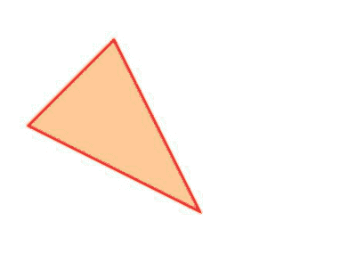

如果你在同一条路径上同时使用 `ctx.stroke()` 和 `ctx.fill()` 方法，请注意透明度问题。当你描边路径时，线条是沿着路径居中绘制的。这意味着一半的描边绘制在内部，另一半绘制在外部。如果填充或描边颜色不是完全不透明的，通常最好先绘制透明部分，以避免在边缘附近产生不必要的混合。在清单 6.2 的示例中，`ctx.stroke()` 方法在 `ctx.fill()` 之后调用，正是为了避免这个问题。

关于水平和垂直线段，有一个小陷阱。由于描边是沿着路径居中绘制的，一条 1 像素宽的垂直线在左侧会有半像素，右侧也有半像素。这行不通，因为没有半像素这样的东西。结果是，系统会改用一条 2 像素宽的半透明线。这个结果可能符合也可能不符合你的预期，但一个简单的解决方法是将点的 x 和 y 坐标都增加 0.5，从而使路径沿着像素的中心绘制。

使线条居中于像素中心。

##### 矩形

绘制像矩形这样的图形，仅使用 `ctx.moveTo()` 和 `ctx.lineTo()` 调用是相当容易的，但每次需要画这样一个简单的东西时都走一遍那个流程会有点繁琐。幸运的是，`ctx.rect()` 方法可以用更少的代码完成同样的工作：

```javascript
ctx.beginPath();
ctx.rect(150, 200, 100, 30);
ctx.fillStyle = "rgba(255,150,50,0.5)";
ctx.fill();
```

矩形非常常见，如果你只想绘制一个单独的矩形，有更简单的方法。`ctx.fillRect()` 方法接受四个参数，定义一个应使用当前 `ctx.fillStyle` 填充的矩形：

```javascript
ctx.fillStyle = "rgba(255,150,50,0.5)";
ctx.fillRect(150, 200, 100, 30);
```

绘制矩形描边也有类似的快捷方法：

```javascript
ctx.strokeStyle = "red";
ctx.strokeRect(150, 200, 100, 30);
```

矩形函数的第三个变体是 `ctx.clearRect()`，它接受相同的四个参数，但不是绘制，而是清除该区域。指定矩形内的所有像素都被设置为黑色且 alpha 通道为 0，即完全透明：

```javascript
ctx.clearRect(150, 200, 100, 30);
```

如果你想清除整个画布，你可以只设置 canvas 元素的 `width` 或 `height` 属性。即使将值设置为自身也会触发画布重置：

```javascript
canvas.width = canvas.width; // 画布现在已清空
```

任何时候你写入这些属性之一，画布的内容都会被清除回初始的透明状态。不过要小心。以这种方式重置画布也会清除填充和描边样式，以及变换和裁剪路径，你稍后会了解更多关于这些内容的信息。

请注意，`ctx.fillRect()`、`ctx.strokeRect()` 和 `ctx.clearRect()` 与路径 API 是独立的，不需要你先设置路径才能使用它们。它们也不会干扰任何当前的路径数据，因此在设置和绘制其他路径时调用它们是安全的。

##### 圆弧与圆形

直线和矩形只能让你走到这一步。你也可以使用恰如其名的 `arc()` 函数添加圆弧段：

```javascript
ctx.arc(x, y, radius, startAngle, endAngle, ccw)
```

此函数向当前子路径添加一个圆弧段。它通过使用一个具有指定半径且中心在点 (x, y) 的虚拟圆来实现。该圆周的一段随后被添加到子路径中。`startAngle` 和 `endAngle` 参数定义要添加圆周的哪一段。最后一个参数 `ccw` 是一个布尔值，指示光栅化器应该沿着虚拟圆的哪个方向从 `startAngle` 行进到 `endAngle`。如果设置为 `true`，则使用逆时针方向；否则，它顺时针行进。

> startAngle 和 endAngle 都以弧度为单位。一个完整圆的弧度数等于 2π。如果你更习惯使用度数，可以通过乘以 180 除以 π 来将度数转换为弧度。


清单6.3展示了如何绘制弧线段的一个示例。

## 清单6.3 绘制弧线

```
<canvas id="canvas" width="250"
height="300"></canvas>
    <script>
    var canvas =
document.getElementById("canvas");
    ctx = canvas.getContext("2d");
    ctx.fillStyle = "rgba(100,150,200,0.5)";
ctx.beginPath();
ctx.arc(180, 240, 80, 0.25 * Math.PI,
1.25 * Math.PI, false);
ctx.arc(220, 160, 80, 0.25 * Math.PI,
1.25 * Math.PI, true);
    ctx.closePath();
    ctx.fill();
    ctx.lineWidth = 32;
    ctx.strokeStyle = "#664422";
    ctx.stroke();
    </script>
```

向现有子路径添加弧线段时，你必须再次留意最后使用点的位置。除非你将位置移动到弧线的起点，否则弧线将通过一条直线连接到最后一个点。

要绘制一个完整的圆，只需将 `startAngle` 设置为0，将 `endAngle` 设置为 (2 * `Math.PI`)。在这种情况下，`ccw` 参数无关紧要，因为两个方向都会产生相同的结果。清单6.4展示了一个完整圆的示例。

## 清单6.4 绘制一个完整的圆

```
<canvas id="canvas" width="250"
height="300"></canvas>
    <script>
    var canvas =
document.getElementById("canvas");
    ctx = canvas.getContext("2d");
    ctx.beginPath();
ctx.arc(200, 200, 160, 0, 2 * Math.PI, false);
ctx.moveTo(200 + 180, 200);
ctx.arc(200, 200, 180, 0, 2 * Math.PI, false);
ctx.lineWidth = 2;
ctx.strokeStyle = "black";
ctx.stroke();
</script>
```

图6-2展示了这些弧线和圆。你可以在文件 `02-arcs.html` 中找到这些示例。


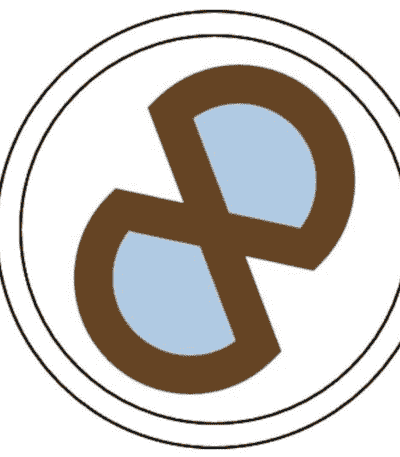

##### 贝塞尔曲线

弧线很棒，但它们只是你可以绘制的曲线路径的一种类型。Canvas 上下文提供了两种绘制贝塞尔曲线的方法。你可能从 Adobe Illustrator 和 Photoshop 等图形应用程序的路径工具中了解这些曲线。贝塞尔曲线是一种强大的工具，可以推广到更高维度以形成贝塞尔曲面，并用于工程和高级3D计算机图形学。我在这里不深入探讨贝塞尔曲线背后的数学原理；你只需要知道它们是一种参数曲线，使用若干控制点来描述从一个点到另一个点的弯曲路径。

第一种方法是 `ctx.quadraticCurveTo()`，它添加一条二次贝塞尔曲线。除了终点外，这种曲线还使用一个控制点：

```
ctx.quadraticCurveTo(cx, cy, x, y);
```

此示例添加了一条从当前位置到 $(x, y)$ 的二次贝塞尔曲线，使用控制点 $(cx, cy)$。清单6.5展示了一个绘制二次曲线的简单示例。你也可以在文件 `03-quadraticCurve.html` 中找到此示例。

## 清单6.5 绘制二次曲线

```
<canvas id="canvas" width="500" height="300"></canvas>
<script>
var canvas = document.getElementById("canvas"),
ctx = canvas.getContext("2d");
// 绘制二次贝塞尔曲线
ctx.beginPath();
ctx.moveTo(50,200);
ctx.quadraticCurveTo(425,25,450,200);
ctx.fillStyle = "rgba(150,100,100,0.5)";
ctx.fill();
ctx.stroke();
// 绘制控制点
ctx.strokeStyle = ctx.fillStyle = "rgba(0,0,0,0.5)";
ctx.beginPath();
ctx.moveTo(450,200);
ctx.lineTo(425,25);
ctx.lineTo(50,200);
ctx.stroke();
ctx.fillRect(450-2,25-2,4,4);
</script>
```

图6-3展示了最终生成的图形。我绘制这个示例是为了帮助你理解该方法如何影响曲线。如你所见，就像控制点将曲线拉向它一样。

## 图6-3：一条二次贝塞尔曲线及其控制点

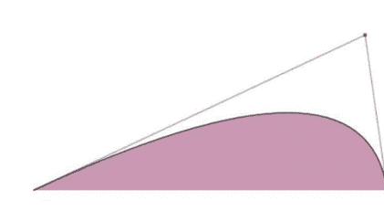

第二种曲线方法是 `ctx.bezierCurveTo()`。这个方法也可以命名为 `ctx.cubicCurveTo()`，因为它创建的是一条三次贝塞尔曲线。三次曲线使用两个控制点。清单6.6展示了这样一个曲线的示例。

## 清单6.6 绘制三次曲线

```
<canvas id="canvas" width="450" height="400"></canvas>
<script>
var canvas =
document.getElementById("canvas"),
ctx = canvas.getContext("2d"),
// 绘制三次贝塞尔曲线
ctx.beginPath();
ctx.moveTo(100, 200);
ctx.bezierCurveTo(150,25,350,400,200);
ctx.fillStyle = "rgba(150,50,100,0.5)";
ctx.fill();
ctx.stroke();
// 绘制控制点
ctx.strokeStyle = ctx.fillStyle =
"rgba(0,0,0,0.5)";
ctx.beginPath();
ctx.moveTo(50,200);
ctx.lineTo(150,25);
ctx.lineTo(250,250);
ctx.lineTo(400,200);
ctx.stroke();
ctx.fillRect(150-2, 25-2, 4, 4);
ctx.fillRect(350-2, 350-2, 4, 4);
</script>
```

图6-4展示了最终生成的图形。我再次为这幅图绘制了控制点。正如你可能想象的，三次曲线提供了更大的灵活性，甚至可以创建自相交的曲线。此示例可在文件 `04-cubicCurve.html` 中找到。

## 图6-4：一条三次贝塞尔曲线及其控制点

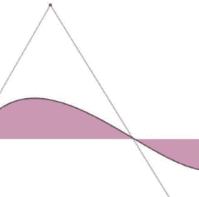

三次贝塞尔曲线的一个优点是，你可以轻松地将一条接一条地连接起来，形成更长、更详细的曲线。只需将下一个曲线段的第一个控制点放在上一个段的最后一个控制点的相反方向上。这样曲线段就能平滑地连接，没有任何突兀的断点。

##### 裁剪路径

除了填充和描边，你还可以用路径做另一件事。你可以使用 `ctx.clip()` 方法将路径用作裁剪路径。这使得当前路径充当一个蒙版，应用于所有后续的绘制函数。只要裁剪路径处于活动状态，就只有该区域内的部分会被修改。清单6.7展示了一个裁剪路径的简单示例。

## 清单6.7 应用裁剪路径

```
<canvas id="canvas" width=400 height=400></canvas>
<script>
  var canvas =
    document.getElementById("canvas"),
      ctx = canvas.getContext("2d"),
    function makeClippingPath() {
      // 创建一个星形的裁剪路径
      ctx.beginPath();
      ctx.moveTo(270,200);
      for (var i=0;i<=20;i++) {
        ctx.lineTo(
          200 + Math.cos(i/10 * Math.PI) * 70 * (i%2 + 1),
          200 + Math.sin(i/10 * Math.PI) * 70 * (i%2 + 1)
        );
      }
      ctx.clip();
    }
    // 填充整个画布
    ctx.fillStyle = "sienna";
    ctx.fillRect(0,0,400,400);
    makeClippingPath();
    // 尝试再次填充画布
    ctx.fillStyle = "lightsalmon";
    ctx.fillRect(0,0,400,400);
</script>
```

最终生成的图形如图6-5所示。请注意，尽管第二个 `ctx.fillRect()` 也是填充整个画布，但实际上只有由裁剪路径定义的星形区域被修改了。此示例可在文件 `05-clippingPath.html` 中找到。

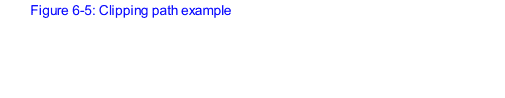

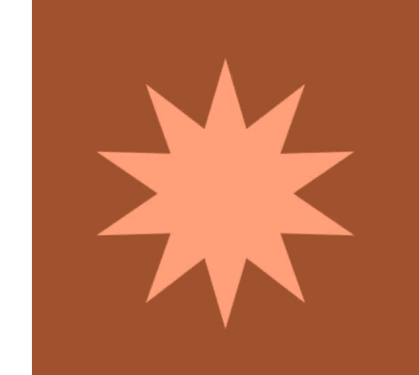

#### 使用高级描边和填充样式

到目前为止，你已经了解了如何控制描边颜色和线宽。你可以使用一些额外的参数来控制描边的外观。

##### 线帽

首先是 `ctx.lineCap` 属性。此属性控制开放路径的端点如何显示。有三个值：

-   * 平头
-   圆头
-   方头

默认值 `butt` 看起来像是在描边末端有一个干净、垂直的切口。路径中的最后一个点位于线帽的中心。`round` 值通过绘制一个半圆来圆化描边的末端，其中心位于最后一个点。最后，`square` 值看起来有点像 `butt` 线帽，但它不是在最后一个点处截断，而是延伸线条，使最后一个点位于一个正方形的中心，该正方形的边长等于线宽。图6-6展示了三种不同的 `ctx.lineCap` 值如何改变描边的末端。

## 图6-6：线帽

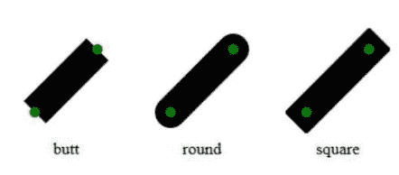

##### 线连接

`ctx.lineJoin` 属性类似于 `ctx.lineCap`，但它描述了当两个连续的路径段共享同一个点时应该如何处理。与 `ctx.lineCap` 一样，此属性也有三个可能的值：

-   * 斜接
-   圆接
-   尖接


#### 使用渐变

填充和描边样式不必是纯色、实色。Canvas 支持线性渐变和径向渐变。要使用渐变，你需要创建一个渐变对象：

```
var gradient = ctx.createLinearGradient(
  50, 50, 250, 400
);
```

此示例创建了一个沿着从 (50, 50) 到 (250, 400) 直线的线性渐变。你也可以创建径向渐变：

```
var gradient = ctx.createRadialGradient(
  100, 100, 10,
  100, 100, 175
);
```

此示例创建了一个径向渐变，其内圆圆心位于 (100, 100)，半径为 10，外圆位于相同位置但半径为 175。两个渐变对象都提供了一个 `addColorStop()` 方法，你可以用它来为渐变指定颜色：

```
gradient.addColorStop(0, "red");
gradient.addColorStop(0.5, "green");
gradient.addColorStop(1, "blue");
```

此示例在渐变上设置了三种颜色：起始为红色，中间为绿色，结束为蓝色。要使用渐变，你需要将其赋值给 `ctx.fillStyle` 或 `ctx.strokeStyle` 属性。使用渐变的完整示例如代码清单 6.8 所示。

### 代码清单 6.8 使用渐变

```
<canvas id="canvas" width="400"
height="400"></canvas>
<script>
var canvas =
document.getElementById("canvas"),
ctx = canvas.getContext("2d");
var linGrad = ctx.createLinearGradient(
50, 0, 250, 400
);
linGrad.addColorStop(0, "aquamarine");
linGrad.addColorStop(1, "darkolivegreen");
ctx.fillStyle = linGrad;
ctx.fillRect(0, 0, 400, 400);
var radGrad = ctx.createRadialGradient(
230, 200, 25, 208, 200, 150
);
radGrad.addColorStop(0, "white");
radGrad.addColorStop(0.7, "yellow");
radGrad.addColorStop(1, "orange");
ctx.fillStyle = radGrad;
ctx.beginPath();
ctx.arc(230, 230, 150, 0, Math.PI * 2,
false);
ctx.fill();
</script>
```

此示例可在文件 06-gradient.html 中找到。结果请参见图 6-8。

**提示**

如果你在赋值渐变后更改了它，无需重新赋值。任何使用该渐变的填充样式或描边样式都会自动更新。

#### 使用图案

我讨论的最后一种填充和描边样式是图案。你可以使用现有图像代替纯色或渐变。图像可以是普通图像、`canvas` 元素或 `video` 元素。首先创建一个图案对象：

```
var pattern = ctx.createPattern(
document.getElementById("myImage"),
"repeat"
);
```

第二个参数指定图案应如何重复。可能的值有：

-   repeat
-   repeat-x
-   repeat-y
-   no-repeat

默认值是 `repeat`，它使图案在两个方向上重复。`repeat-x` 和 `repeat-y` 值使图案仅在一个方向上重复，如果你选择 `no-repeat`，则完全不重复。图案锚定在坐标空间的原点，不受使用位置的影响。这意味着，例如，从小图像创建的无重复图案可能在画布的右下角不可见。

`ctx.createPattern()` 方法返回一个没有属性或方法的图案对象。只需将其赋值给 `ctx.strokeStyle` 或 `ctx.fillStyle`，就完成了。

#### 使用变换

当你创建一个新的 `canvas` 元素时，用于在其上绘制内容的坐标空间对应于 `canvas` 元素的尺寸。也就是说，画布左上角的像素位置是 (0, 0)，右下角的像素位于位置 (w - 1, h - 1)，其中 w 和 h 是元素的宽度和高度。你可以对这个坐标空间应用多种不同的变换，如缩放和旋转，以使某些操作更简单。

##### 理解变换矩阵

这些变换的核心是一个变换矩阵。画布使用的每个点在用于渲染之前都会乘以这个矩阵。别担心，如果你的线性代数有点生疏；我不会花太多时间深入探讨数学。

最初，矩阵被设置为单位矩阵：

```
1 0 0
0 1 0
0 0 1
```

如果你熟悉矩阵，可以直接使用 `ctx.transform()` 方法修改变换矩阵：

```
ctx.transform(a, b, c, d, e, f);
```

此方法将当前矩阵与以下矩阵相乘：

```
a c e
b d f
0 0 1
```

你也可以使用 `ctx.setTransform()` 方法完全覆盖当前矩阵：

```
ctx.setTransform(a, b, c, d, e, f);
```

此方法本质上将变换矩阵重置为单位矩阵，然后使用指定的矩阵参数调用 `ctx.transform()`。

##### 平移

上下文对象的 `ctx.translate()` 方法向变换添加一个平移矩阵：

```
ctx.translate(x, y);
```

此方法基本上将 x 和 y 值添加到你绘制的任何点的坐标中。这意味着：

```
ctx.translate(50, 100);
ctx.fillRect(120, 130, 200, 200);
```

实际上绘制的矩形其左上角位于画布上的位置 (170, 230)。

##### 缩放

你也可以使用 `ctx.scale()` 方法缩放坐标空间。此方法接受两个参数，每个轴一个。这些值用于缩放画布上绘制的点。例如，通过以下方式更改缩放：

```
ctx.scale(2, 0.5);
```

会使后续绘制的任何内容宽度加倍，高度减半。你可以通过应用此变换达到相同效果：

```
ctx.transform(
2, 0,
0, 0.5,
0, 0
);
```

我有时使用的一个巧妙技巧是缩放坐标空间，使整个画布表面位于坐标空间的 1 个单位内。你可以通过使用画布的尺寸缩放坐标来实现：

```
ctx.scale(1 / canvas.width, 1 /
canvas.height);
```

现在所有坐标都相对于尺寸，并且画布上所有可见点都位于两个轴的 0 到 1 之间。绘制，例如，一个填充右上四分之一的矩形现在就变得很简单：

```
ctx.fillRect(0.5, 0, 0.5, 0.5);
```

##### 旋转


#### 添加文本、图像和阴影

除了形状和路径，你还可以在画布上添加文本和图像。你可以使用上下文上的 `ctx.drawImage()` 方法将图像绘制到画布上：

```
ctx.drawImage(image, dx, dy, dw, dh);
```

此方法将一个 `img` 元素 `image` 绘制到画布上。`dx`、`dy`、`dw` 和 `dh` 参数定义了图像应放置的矩形区域。左上角位于 (`dx`, `dy`)，右下角位于 (`dx + dw`, `dy + dh`)。`dw` 和 `dh` 参数是可选的，如果省略，则默认为图像的原始尺寸。`ctx.drawImage()` 方法还可以同时接受源矩形和目标矩形：

```
ctx.drawImage(image, sx, sy, sw, sh, dx, dy, dw, dh);
```

你可以使用这种参数模式，仅将图像的某个子区域绘制到画布上。由 `sx`、`sy`、`sw` 和 `sh` 定义的矩形从源图像中取出，并绘制到目标画布上由 `dx`、`dy`、`dw` 和 `dh` 定义的矩形区域中。如果两个区域的尺寸不匹配，复制的区域会被拉伸和缩放以适应目标区域。

`image` 参数不一定必须是 `img` 元素。`canvas` 元素和 `video` 元素都是有效的来源。如果你使用 `video` 元素，当前帧会被绘制到画布上。

在绘制图像之前，你应该确保图像已完全加载。尝试绘制一个尚未就绪的图像会触发错误。你可以通过检查图像对象的 `complete` 属性，或者仅在设置 `src` 属性之前，从附加到图像的 `load` 事件处理程序中进行绘制，来确保图像已加载。

##### 添加文本

`canvas` 元素也允许你向画布添加文本内容。然而，你应该始终确保使用画布来渲染文本实际上是合适的。因为 canvas 元素本质上表现得像页面上的一个图像，所以你可以将处理图像中文本的许多相同逻辑应用于画布上的文本。如果使用 CSS 可以达到相同或相似的效果，或许你应该重新考虑是否采用基于 canvas 的方法。例如，普通的 HTML 和 CSS 通常更适合标题等元素。

与路径类似，你可以用两种方式绘制文本：一种用于填充文本，另一种用于绘制文本的轮廓或描边。但首先，你应该指定要用来绘制文本的字体。你可以通过设置上下文上的 `ctx.font` 属性来实现。该值可以是任何你从 CSS 中了解的字体值。例如：

```
ctx.font = "italic 12px Arial, sans-serif";
```

这一行指定了一个 12px 的 Arial 斜体字体。如果 Arial 字体不存在，则使用默认的无衬线字体。

> **注意**
> 如果你使用嵌入字体，请确保在尝试将它们用于 canvas 文本之前，字体文件已完全加载。如果字体文件尚未就绪，canvas 将使用默认字体。

你现在可以使用以下两种方法之一来绘制文本：

```
ctx.fillText("Hello World!", 100, 50);
ctx.strokeText("Hello World!", 100, 50);
```

`ctx.fillText()` 方法使用当前激活的 `ctx.fillStyle` 值填充指定的文本，而 `ctx.strokeText()` 方法使用当前激活的 `ctx.strokeStyle` 值勾勒文本的轮廓。第二个和第三个参数指定了文本应放置的 x 和 y 坐标。你可以使用 `ctx.textAlign` 属性来更改文本对齐方式：

```
ctx.textAlign = "center";
```

`ctx.textAlign` 的可能值有：

- start
- end
- left
- center
- right

`left`、`center` 和 `right` 的含义很直观。`start` 和 `end` 的含义则取决于当前区域设置的标准文本方向。对于从左到右的区域设置，`start` 等同于 `left`，`end` 等同于 `right`。对于从右到左的区域设置，情况则相反。`ctx.textAlign` 的默认值是 `start`，因此如果你不希望文本自动适应区域设置，应该手动设置对齐方式。

文本的垂直位置由 `ctx.fillText()` 和 `ctx.strokeText()` 中的 y 坐标决定，但它也受文本基线的影响。你可以通过设置上下文上的 `ctx.textBaseline` 属性来控制基线：

```
ctx.textBaseline = "middle";
```

`ctx.textBaseline` 的可能值有：

- top
- middle
- bottom
- hanging
- alphabetic
- ideographic

在当今的浏览器中，只有 `top`、`middle`、`bottom` 和 `alphabetic` 值得到完全支持。参见图 6-9，了解这些值如何影响文本的位置。水平线绘制在与文本相同的 y 坐标处。

图 6-9：文本基线示例

alphabetic bottom middle top

`ctx.fillText()` 和 `ctx.strokeText()` 方法都有一个可选的第四个参数 `maxWidth`。这是一个数值，如果指定，会将文本限制在最大宽度内。如果在指定字体下渲染的文本会超出该宽度，浏览器会自动缩小文本以使其适应。浏览器会判断是否有更紧凑的字体可用，或者文本是否可以水平缩放以适应。

关于文本，上下文上还有一个最终方法。`ctx.measureText()` 方法接受一个字符串参数，并返回一个文本度量对象。该对象有一个属性 `width`，表示如果使用当前 `font` 值在画布上绘制该文本时的宽度。

```
var textWidth = ctx.measureText("Hello World!").width;
```

例如，如果你有其他内容依赖于文本的大小，或者你需要缩放 `canvas` 元素以适应渲染的文本，那么 `ctx.measureText()` 方法会非常有用。

在画布上绘制的文本与网页上的常规文本相比有一些缺点。浏览器不知道这些像素代表文本，因此用户无法直接用鼠标选择文本。但是，你可以将文本作为 canvas 的替代内容提供。例如，这使得屏幕阅读器能够获取文本。如果画布内容在某种程度上是交互式的，你甚至可以在替代内容中放置链接。这些链接随后是：

```html
<canvas id="intro" width=400 height=400>
This is a fancy intro image.
<a href="page2.html">Click to go to page 2</a>
</canvas>
```

不幸的是，使用这种方法确实意味着你需要在 canvas 代码和替代内容中都维护文本内容。Canvas 的可访问性仍在积极开发中，因此我希望将来能更好地处理这个问题。

**注意**
**在撰写本文时，只有 Internet Explorer 9 实现了 canvas 元素的可聚焦替代内容。**

##### 使用阴影效果

你可以使用阴影效果为图像创造深度感。上下文对象有四个与阴影相关的属性。首先是阴影颜色：

```
ctx.shadowColor = "rgb(100,120,30)";
```

颜色值可以是任何有效的 CSS 颜色。阴影的偏移由两个属性控制，每个轴一个：

```
ctx.shadowOffsetX = 8;
ctx.shadowOffsetY = 8;
```

此示例将阴影置于内容的下方和右侧。请注意，这些是坐标空间单位，因此任何变换也会应用于这些值。最后，你可以使用 `ctx.shadowBlur` 属性控制阴影的柔和度：

```
ctx.shadowBlur = 10;
```


## 清单 6.9 应用阴影效果

如果你将模糊值设置为 0，你会得到一个清晰、锐利的边框，而不是柔和的阴影。清单 6.9 展示了一个阴影使用示例。你可以在文件 `07-shadows.html` 中找到这个示例。

```html
<canvas id="canvas" width=400 height=350></canvas>
<script>
var canvas = document.getElementById("canvas"),
    ctx = canvas.getContext("2d");
ctx.shadowColor = "black";
ctx.shadowOffsetX = 15;
ctx.shadowOffsetY = 15;
ctx.shadowBlur = 8;
ctx.lineWidth = 5;
ctx.strokeStyle = "darkorange";
ctx.fillStyle = "sienna";
ctx.fillRect(100,50,200,250);
ctx.strokeRect(100, 50, 200, 250);
ctx.fillStyle = "aquamarine";
ctx.fillRect(50, 100, 100, 100);
ctx.shadowColor = "transparent";
ctx.strokeRect(50, 100, 150, 100);
</script>
```

得到的绘图如图 6-10 所示。正如你所看到的，在赭石色矩形上，如果你在同一路径上同时使用描边和填充，阴影可能会引起一些麻烦。一个解决方案是在描边时禁用阴影，例如，通过将阴影颜色设置为 `transparent`。


#### 管理状态栈

由于有如此多不同的属性和值影响着画布上内容的呈现方式，在你需要在执行某些任务后恢复到先前状态时，跟踪旧值可能很困难。幸运的是，画布有一个内置的状态栈，可以轻松保存所有当前值，进行一些绘制，然后恢复到之前的值。

几乎所有属性，如填充颜色和文本属性，都是画布状态的一部分，因此只要你保存状态并在完成后恢复它，就不必担心会覆盖旧值。构成画布状态的组件包括：

-   变换矩阵
-   裁剪路径
-   strokeStyle, fillStyle
-   lineWidth, lineCap, lineJoin, miterLimit
-   globalAlpha, globalCompositeOperation
-   shadowOffsetX, shadowOffsetY, shadowColor, shadowBlur
-   font, textAlign, textBaseline

通过在上下文对象上调用 `ctx.save()` 方法来保存当前状态：

```javascript
ctx.fillStyle = "black";
...
ctx.save(); // save state with fill style
```

此示例将当前状态压入栈中，允许你安全地修改前面提到的任何属性。当你完成对画布状态的操作后，可以通过调用 `ctx.restore()` 方法回到之前的样子：

```javascript
...
ctx.fillStyle = "white";
...
ctx.restore(); // restore state, fill style is black again
```

`ctx.restore()` 方法用最后保存的状态替换当前状态，并将该状态从栈中移除。当你不知道所有属性的当前值时，此功能会非常有用。例如，在编写需要更改一个或多个属性的子程序时，你只需在函数开始时调用 `ctx.save()`，并在返回前调用 `ctx.restore()`，从而保持画布状态的完整性。

#### 绘制 HTML5 徽标

在本节中，我将向你展示一个更完整的示例，说明如何使用 `canvas` 元素进行绘制。本练习的目标是绘制 HTML5 徽标。在开始之前，请查看图 6-11，以了解你将在本节中创建的内容。你可以在文件 `08-html5logo.html` 中找到完整示例。

图 6-11：HTML5 徽标


首先，制作一个漂亮的背景。清单 6.10 展示了背景函数。

## 清单 6.10 绘制背景

```javascript
function drawBackground(canvas) {
    var ctx = canvas.getContext("2d"),
    grad,
    i;
    ctx.save();
    // scale coordinates to unit
    ctx.scale(canvas.width, canvas.height);
    grad = ctx.createRadialGradient(0.5, 0.5, 0.125, 0.5, 0.5, 0.75);
    grad.addColorStop(0.1, "rgb(170,180,190)");
    grad.addColorStop(0.9, "rgb(50,60,70)");
    ctx.fillStyle = grad;
    ctx.fillRect(0,0,1,1);
    // draw a star shape by adding horizontal
    // while rotating the coordinate space
    ctx.beginPath();
    ctx.translate(0.5,0.5);
    for (i=0; i<10; i++) {
    ctx.rotate(i * 60 * Math.PI * .2);
    ctx.lineTo(i % 2 ? 0.15 : 0.75, 0);
    }
    ctx.fillStyle = "rgba(255,255,255,0.1)";
    ctx.fill();
    ctx.restore();
}
```

注意状态是如何在开头保存并在结尾恢复的。无论你在函数的其余部分对状态做了什么，状态都会恢复到原样。还要注意，坐标空间是使用画布的完整尺寸进行缩放的。左上角仍然是 (0, 0)，但右下角现在是 (1, 1)。这样就不必知道实际尺寸，使用坐标就容易多了。

接下来是实际的徽标。该徽标由许多不同的形状定义。清单 6.11 中的 `drawLogo()` 函数在开头将这些形状声明为点列表。

## 清单 6.11 徽标绘制的路径数据

##### 函数

```javascript
function drawLogo(canvas) {
  var logo = [
    [40,460], [0,0], [450,0], [410,460],
    [225,512]
  ],
  five0 = [
    [225,208], [225,265], [295,265],
    [288,338],
    [225,355], [225,414], [341,382], [357,208]
  ],
  five1 = [
    [225,94], [225,150], [362,150], [367,94],
  ],
  five2 = [
    [225,208], [151,208], [146,150],
    [225,150],
    [225,94], [84,94], [85,109], [99,265],
    [225,265]
  ],
  five3 = [
    [225,355], [162,338], [158,293],
    [128,293],
    [102,293], [109,382], [225,414]
  ];
```

在像这样的情况下，你有许多不同的路径，拥有一两个辅助函数来节省打字时间会很好。清单 6.12 展示了一个辅助函数，你可以用它来将点列表添加到路径中。

### 清单 6.12 通用路径函数

```javascript
function makePath(ctx, points) {
    ctx.moveTo(points[0][0], points[0][1]);
    for (var i=1,len=points.length;i<len;i++) {
        ctx.lineTo(points[i][0], points[i][1]);
    }
}
```

*makePath()* 函数只是将位置移动到第一个点，然后遍历列表的其余部分，在途中添加线段。它不开始或关闭任何路径，因此你可以在同一路径中创建多个子路径。现在你可以使用该函数和路径数据来绘制徽标。清单 6.13 展示了徽标函数。

## 清单 6.13 绘制徽标

```javascript
function drawLogo(ctx) {
    // save original state
    ctx.save();
    // translate the coordinate space to center of logo
    ctx.translate(-225,-256);
    // fill background of logo
    ctx.beginPath();
    makePath(ctx, logo);
    ctx.fillStyle = "#e34c26";
    ctx.fill()
    // add down-scaling at the center of the logo:
    ctx.save();
    ctx.translate(225,256);
    ctx.scale(0.8, 0.8);
    ctx.translate(-225,-256);
    // clip the right half of the logo
    ctx.beginPath();
    ctx.rect(225,0,225,512);
    ctx.clip();
    // paint a lighter, down-scaled logo on the right half
    ctx.beginPath();
    makePath(ctx, logo);
    ctx.fillStyle = "#f06529";
    ctx.fill();
    // restore scaling and clipping region
    ctx.restore();
    // restore original state
    ctx.restore();
}
```

`drawLogo()` 函数首先平移坐标，将原点放置在徽标的中心。通过检查路径数据可以找到此点。最右边的点位于 x = 450，最底部的点位于 y = 512，因此中心位于 (225, 256)。然后使用 `makePath()` 函数绘制 HTML5 徽标的橙色背景部分。

徽标的内部部分是较浅的橙色，仅填充右半部分，略微缩小。你可以通过缩放坐标空间并应用裁剪区域到画布来重复使用第一部分的路径。为了正确缩放坐标，代码在应用缩放之前将坐标平移回去。在裁剪横跨整个画布右半部分的路径之前，坐标空间再次平移到徽标的中心。当徽标路径再次用较浅的颜色填充时，实际上只绘制了右半部分，从而创建出所需的效果。可以说，定义额外的路径数据并直接绘制会更简单。但这样做演示了变换、裁剪区域以及如何使用状态栈。

徽标中间的白色 5 仍然缺失。绘制那部分只是填充相关路径的问题。清单 6.14 展示了添加的路径。

## 清单 6.14 绘制徽标的其余部分

```javascript
function drawLogo(canvas) {
    ...
    // restore scaling and clipping region
    ctx.restore();

    // fill white part of "5"
    ctx.beginPath();
    makePath(ctx, five0);
    makePath(ctx, five1);
    ctx.fillStyle = "#ffffff";
    ctx.fill();

    // fill light grey part of "5"
    ctx.beginPath();
    makePath(ctx, five2);
    makePath(ctx, five3);
    ctx.fillStyle = "#ebebeb";
    ctx.fill();

    // restore original state
    ctx.restore();
}
```

你现在可以将所有这些部分组合起来，并在 `<canvas>` 元素上绘制完整的徽标。清单 6.15 展示了


## 清单 6.15 整合各部分

```html
<canvas id="canvas" width="400" height="400"></canvas>
<script>
function makePath(ctx, points) { ... }
function drawBackground(canvas) { ... }
function drawLogo(canvas) { ... }
</script>
var canvas =
document.getElementById("canvas"),
ctx = canvas.getContext("2d"),
drawBackground(canvas);
ctx.translate(200, 200);
ctx.scale(0.5, 0.5);
drawLogo(canvas);
</script>
```

请注意，在调用 `drawLogo()` 之前，坐标空间已经进行了缩放和平移。原因是 `drawLogo()` 不知道应该在画布的哪个位置绘制标志，也不知道它应该有多大。通过在函数外部执行这些变换，你可以控制函数如何以及在何处放置标志。你甚至可以对其进行旋转，或者在同一画布上绘制一大堆标志。清单 6.16 展示了如何绘制多个标志实例的示例。

## 清单 6.16 绘制多个标志

```html
<canvas id="canvas" width=400 height=400></canvas>
<script>
var canvas =
document.getElementById("canvas"),
ctx = canvas.getContext("2d"),
drawBackground(canvas);
// draw 20 logos
for (var i=0;i<20;i++) {
ctx.save();
// calculate random rotation and scale
var x = Math.random() * canvas.width,
y = Math.random() * canvas.height,
angle = (Math.random() - 0.5) * Math.PI.
scale = 0.05 + Math.random() * 0.1;
// transform the coordinate space
ctx.translate(x, y);
ctx.scale(scale, scale);
drawRotate(angle);
drawLogo(ctx);
ctx.restore();
}
</script>
```

这个示例在画布的随机位置绘制了 20 个 HTML5 标志实例。每个标志都有自己的缩放和旋转。因为状态在循环的每次迭代中都进行了保存和恢复，所以所有实例都是独立绘制的。图 6-12 展示了最终绘制的图形。

## 图 6-12：随机绘制 HTML5 标志

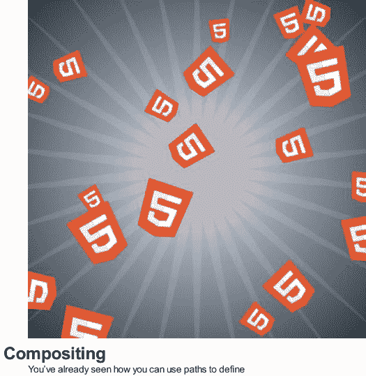

#### 合成

你已经了解了如何使用路径来定义裁剪区域，以遮罩你在画布上绘制的任何内容。但这并不是你控制内容添加到画布上的唯一方式。

例如，你可以使用 `ctx.globalAlpha` 属性来设置全局 alpha 通道值。你在画布上绘制的任何内容，其自身的透明度值都会乘以 `ctx.globalAlpha` 的值。例如，将 `ctx.globalAlpha` 设置为 0.5，然后用颜色 `rgba(20, 85, 45, 0.7)` 填充路径，将导致组合后的 alpha 值为 0.35。当你想要绘制形状和图像，并使其无论自身 alpha 通道如何都呈现半透明效果时，`ctx.globalAlpha` 设置会很有用。

除了 `ctx.globalAlpha`，你还可以使用 `ctx.globalCompositeOperation` 属性。此属性提供了许多不同的操作，用于改变新源内容与现有目标画布的组合方式。表 6-1 列出了 `ctx.globalCompositeOperation` 的所有可能值。在描述中，A 指的是源内容，B 指的是目标内容。

### 表 6-1 合成操作

| 值 | 描述 |
|---|---|
| source-atop | 在 B 的上方渲染 A，但仅限于 B 不透明的部分。 |
| source-in | 仅渲染 A，且仅限于 B 不透明的部分。 |
| source-out | 仅渲染 A，且仅限于 B 透明的部分。 |
| source-over | 在 B 的上方渲染 A，其中 A 不透明的部分。 |
| destination-atop | 在 A 的上方渲染 B，但仅限于 B 不透明的部分。 |
| destination-in | 仅渲染 B，且仅限于 A 不透明的部分。 |
| destination-out | 仅渲染 B，且仅限于 A 透明的部分。 |
| destination-over | 在 A 的上方渲染 B，其中 A 不透明的部分。 |
| lighter | 渲染 A 和 B 的和。 |
| copy | 忽略 B，仅渲染 A。 |
| xor | 在 B 透明的地方渲染 A，在 A 透明的地方渲染 B。在 A 和 B 都不透明的地方渲染为透明。 |

> **注意**
> 如果你熟悉计算机图形学和图像处理，你可能会认出这些操作大部分是 Porter-Duff 操作。除了简单的 copy 操作外，Porter 和 Duff 在他们 1984 年的论文《Compositing Digital Images》中描述了所有这些合成操作，该论文可在 [http://keithp.com/~keithp/porterduff/p253-porter.pdf](http://keithp.com/~keithp/porterduff/p253-porter.pdf) 获取。

默认操作是 source-over，它将源内容绘制在旧内容之上，仅在新的透明部分保留目标内容。如果源具有半透明的部分，某些操作的结果有时可能难以想象。例如，`destination-in` 操作在源的非透明部分渲染目标，但它也使用源内容的 alpha 值。这意味着，用完全透明的颜色填充一个跨越整个画布的矩形，实际上会清除画布。

不幸的是，你不能期望所有操作都得到支持。目前，只有 Firefox 4 和 Internet Explorer 9 正确实现了所有操作。WebKit 浏览器（如 Chrome 12 和 Safari 5）仅支持以下子集：

- `source-atop`
- `source-over`
- `destination-out`
- `destination-over`
- `lighter`
- `xor`

在所有浏览器符合规范之前，你只能安全地使用这个较短的操作列表。所有合成操作的预期效果示例，请参见图 6-13。

## 图 6-13：合成操作

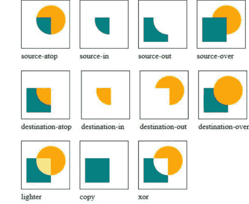

#### 访问图像数据

或许 `<canvas>` 元素最强大的功能是能够访问和修改画布上的原始 RGBA 像素值。这种底层数据访问使你能够以其他方式非常困难甚至不可能实现的方式来修改图像。

##### 获取像素值

2D 上下文对象提供了一个名为 `ctx.getImageData()` 的方法。你可以使用此方法来检索图像矩形区域的数据：

```javascript
var imageData = ctx.getImageData(50, 75,
    100, 200);
```

此示例从左上角位于 (50, 75) 位置的 100x200 矩形区域中提取像素数据。`ctx.getImageData()` 方法返回一个图像数据对象，该对象具有以下属性：

- `width`
- `height`
- `data`

`width` 和 `height` 属性指定数据对象中包含的数据的尺寸。这些值可能与 `ctx.getImageData()` 调用中指定的区域尺寸不同。根据设备和显示的不同，幕后实际使用的像素数量可能与元素尺寸所显示的不同。

`data` 属性是一个 RGBA 颜色数据数组。数组的长度取决于数据的尺寸。因为每个像素需要四个值——分别对应红色、绿色、蓝色通道和一个 alpha 通道——所以数据数组的长度等于 (`width * height * 4`)。每个 RGBA 值都是一个范围在 [0,255] 之间的整数。

在迭代图像数据时，你应该使用图像数据对象的 `width` 和 `height` 属性，而不是 `canvas` 元素的属性。否则，由于设备像素和 CSS 像素之间的差异，你无法确定你是否真的修改了所有数据。

##### 更新像素值

修改像素数据并将其保存回画布同样简单。`ctx.putImageData()` 方法接受一个图像数据对象和一组坐标，指示数据应放置的位置。通常，你只想将数据保存回原来的位置，在这种情况下，坐标应该是 `ctx.getImageData()` 调用中使用的矩形区域的左上角。清单 6.17 展示了一个如何修改像素数据的基础示例。

## 清单 6.17 创建基于像素的图案

```html
<canvas id="canvas" width=400 height=400></canvas>
<script>
var canvas = document.getElementById("canvas");
    ctx = canvas.getContext("2d");
    imageData = ctx.getImageData(
        0, 0, canvas.width, canvas.height);
    w = imageData.width, h = imageData.height,
    x, y, index;
    for (y = 0; y < h; y++) {
      for (x = 0; x < w; x++) {
        index = (y * w + x) * 4;
        r = 0xFF / 255;
        g = y / h * 255;
        b = 128;
        block = (56 + (1 - x*y/w/h));
        imageData.data[index] = r * r % block;
        imageData.data[index+1] = g + g % block;
        imageData.data[index+2] = b + b % block;
        imageData.data[index+3] = 255;
      }
    }
    ctx.putImageData(imageData, 0, 0);
</script>
```

你可以在文件 09-imageData.html 中找到这个示例。图 6-14 展示了生成的画布图案。

图案算法本身并不那么有趣，只是一个例子。然而，请注意 alpha 通道 (`index+3`) 被设置为常数值 255。当你创建一个新的 `canvas` 元素时，它最初是透明的黑色。这意味着所有像素值的值都为 0。如果你不使用

`ctx.putImageData()` 同样是透明的，这可能并非你想要的效果。

> 注意
> 图像数据方法不受任何合成、裁剪或变换设置的影响。像素的访问和更新是直接进行的，独立于画布状态。

图6-14：一个简单的基于像素的画布效果

#### 导出图像文件数据

有时你可能需要将 `canvas` 元素上的图形转换为真实的位图图像。一种方法是抓取所有像素数据，并编写自己的函数将其转换为文件数据。某些图像格式，如BMP文件，相对容易实现，但其他格式，如JPEG和PNG，则更为复杂。`canvas` 元素有一个名为 `canvas.toDataURL()` 的方法，它实际上可以将整个画布以base64编码字符串的形式，作为PNG文件返回给你。该字符串的内容大致如下：

```
data:image/png;base64,...,image data here...
```

该字符串的格式是 `data:` URI，因此你可以将其用作普通图像元素的源：

```javascript
var data = canvas.toDataURL();
document.getElementById("myImage").src = data;
```

其他可能的用例包括将数据发送到服务器端脚本进行进一步处理，或使用Web Storage在本地存储。

`canvas.toDataURL()` 方法接受一个可选参数，用于指定应返回的图像类型。此参数的默认值为 `image/png`。PNG是规范中唯一要求的格式，但某些浏览器也支持例如JPEG图像。特定编码器的任何相关参数都在图像类型之后传递：

```javascript
var jpeg = canvas.toDataURL("image/jpeg", 0.7);
```

在支持导出JPEG文件的浏览器中，这行代码将创建一个包含JPEG数据的字符串，质量等级为0.7。实际上，你只能期望PNG文件正常工作。测试给定格式是否支持的唯一方法是尝试调用 `canvas.toDataURL()` 并检查字符串开头是否包含你期望的图像类型。

##### 理解安全限制

在涉及图像数据和像素级访问时，`canvas` 元素带有一些与安全相关的限制。正如 `XMLHttpRequest` 对象不能访问其他服务器上的文档一样，如果 `canvas` 包含来自文档所在位置以外位置的数据，`canvas` 元素也不允许你读取像素值。`ctx.drawImage()` 方法不会阻止你绘制外部图像，但从那一刻起，画布就被标记为“被污染”。这意味着图像数据变为只读，任何尝试使用 `ctx.getImageData()` 访问数据的操作都会抛出安全异常。使用包含外部数据的图案与使用来自其他源的字体一样，会触发相同的情况。

这些限制适用于任何可能从外部源泄露信息的方法。受影响的方法包括：如果使用了外部字体，则 `ctx.measureText()`；如果画布上绘制了任何外部内容，则 `canvas.toDataURL()` 和 `ctx.getImageData()`。

你也不能访问用户自身本地文件中的任何数据。即使你本地打开文档也是如此，因此在从 `file://` URI 运行时，你无法使用这些功能。

> 提示
> 如果你绝对需要使用来自其他域的内容，你可以通过使用你熟悉的服务器端语言编写一个小的代理脚本来绕过此限制。如果你能让服务器下载文件并将其转发给浏览器，那么对于canvas元素来说，该文件就好像来自其自身源一样。缺点是它会增加Web服务器的负载。

#### 创建基于像素的效果

让我们看看另一个使用图像数据方法的效果。这次，我使用图像数据在图像文件上创建了一个旋涡效果。该图像是你在本章前面创建的HTML5徽标的位图版本。清单6.18展示了该效果的代码。

### 清单6.18 旋涡效果

```html
<canvas id="canvas" width="400" height="400"></canvas>
<script>
var canvas =
document.getElementById("canvas"),
ctx = canvas.getContext("2d"),
image = new Image();
image.addEventListener("load", function()
{
ctx.drawImage(this, 0, 0);
cw = canvas.width, ch = canvas.height,
imgData = ctx.getImageData(0,0,cw,ch),
newData = ctx.getImageData(0,0,cw,ch),
w = imgData.width, h = imgData.height,
x, y, sx, sy,
dist, angle,
idx1, idx2,
amount = 20;
for (y = 0; y < h; y++) {
for (x = 0; x < w; x++) {
sx = x - w / 2;
sy = y - h / 2;
dist = Math.sqrt(sx * sx + sy * sy);
angle = Math.atan2(sy, sx) + dist / w * amount;
sx = Math.cos(angle) * dist;
sy = Math.sin(angle) * dist;
sx = Math.floor(sx + w / 2);
sy = Math.floor(sy + h / 2);
sx = Math.min(w-1, Math.max(0, sx));
sy = Math.min(h-1, Math.max(0, sy));
idx1 = (x + y * w) * 4;
idx2 = (sx + sy * w) * 4;
newData.data[idx1] = imgData.data[idx2];
newData.data[idx1+1] = imgData.data[idx2+1];
newData.data[idx1+2] = imgData.data[idx2+2];
}
}
ctx.putImageData(newData, 0, 0);
}, false);
// 加载图像
image.src = "html5.png";
</script>
```

首先，创建一个图像元素，并将画布绘图函数附加到其加载事件。当图像准备好后，它会立即绘制到画布上，以便可以访问图像数据。在此示例中，你创建了两个独立的图像数据对象，每个对象包含整个画布的数据。更改一个图像数据对象中的数据不会影响任何其他对象，即使它们是从同一个画布创建的。`newData` 对象保存修改后的内容。`imgData` 对象根本没有被修改，仅用于读取数据。嵌套循环访问 `newData` 中的每个像素，并使用一些数学运算来计算应该从 `imgData` 的哪个位置获取像素值。使用两个图像数据对象可以防止你意外覆盖算法后面可能需要的像素值。你可以在文件 `10-twirl.html` 中找到此示例。图6-15展示了结果。

图6-15：旋涡状的HTML5徽标

> 记住
> 为了使此示例正常工作，你需要从Web服务器加载文件。从本地文件绘制图像会使画布变为只读。由于同源限制，图像文件还必须与脚本位于同一域。

#### 总结

在本章中，你全面了解了canvas元素。你几乎看到了2D绘图API提供的所有功能，从绘制简单的路径、形状和曲线，到创建高级填充和描边。

你还了解了图像数据方法如何让你逐个访问像素，并看到了如何使用这些数据创建复杂效果和有趣图案的示例，以及如何使用它来修改位图图像中的数据。

# 第7章

#### 创建游戏显示

- 预加载游戏文件
- 创建更漂亮的背景
- 使用canvas创建游戏显示
- 使用CSS精灵图

既然你已经熟悉了 `canvas` 元素，是时候将这些知识付诸实践了。这个游戏非常缺乏视觉效果，你现在可以开始在屏幕上放置元素了。

你在本章中创建的图形并不复杂。相反，我专注于向你展示如何让基本的珠宝板运行起来。不过，在开始之前，我向你展示如何修改加载器以预加载游戏资源。你将使用该功能，通过进度条和新的背景来更新启动画面。

我还向你展示了两种创建珠宝板图形的不同方法。一种基于 `canvas` 元素，并使用你刚刚学到的一些技术。另一种使用传统的DOM和CSS来创建类似的结果。

##### 预加载游戏文件

游戏图像，如精灵图和其他游戏美术，是预加载的主要目标，特别是当你需要将这些图像用于canvas相关目的时。因为 `canvas` 元素允许你绘制图像

只有在它们加载完成后，才能在需要时使用这些图像，这可以大大简化你的画布代码。

Jewel Warrior 有七种不同类型的宝石。每种类型都有不同的形状和颜色。我为这些宝石类型创建了一组图像；你可以在这个章节的项目归档文件中找到它们。宝石精灵图的大小取决于设备的分辨率和方向，因此你需要不同大小的精灵图。我在本章的归档文件中包含了四组图像。你可以在 images 文件夹中找到这些文件。每个文件命名为 jewelNN.png，其中 NN 是 24、32、40、64 或 80，指的是每个宝石的宽度和高度。图 7-1 展示了宝石精灵图。

## 图 7-1：宝石精灵图

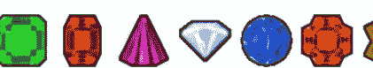

现在，向 jewel 命名空间添加一个空的 images 容器对象。这个对象的目的是存储任何已加载并准备使用的图像元素。清单 7.1 展示了 loader.js 中的更改。

## 清单 7.1 添加图像容器

```
var jewel = {
    ...
    images : {},
    ...
}
```

现在你可以预加载宝石精灵图，并将它们存储在 jewel.images 中以备后用。

###### 检测宝石大小

你如何确定使用哪种大小的宝石？JavaScript 代码不知道游戏屏幕的尺寸；只有 CSS 规则是分辨率感知的。直接将这些信息从 CSS 传递给 JavaScript 实际上是不可能的，但你可以为一个 HTML 元素设置样式，然后用 JavaScript 获取其尺寸。清单 7.2 展示了添加到 index.html 中的这样一个元素。

**清单 7.2 向 HTML 中添加宝石原型元素**

```
<div id="game">
  ...
  <div id="jewel-proto" class="jewel-size"></div>
</div>
```

这个 jewel-proto 元素的唯一功能是充当 CSS 和 JavaScript 之间的连接。jewel-size 类使用 CSS 控制宝石的尺寸。清单 7.3 展示了添加到 main.css 中的规则。

**清单 7.3 为宝石原型添加 CSS**

```
.jewel-size {
  font-size: 40px;
}
#jewel-proto {
  position: absolute;
  width: 1em;
  height: 1em;
  left: -1000px;
}
```

CSS 将 jewel-proto 元素放置在视图之外很远的地方，并赋予它 1em 的宽度和高度。现在你可以让 jewel-size 类来确定元素的实际大小。你稍后会再次使用这个类来控制游戏棋盘的大小。

现在，用 JavaScript 读取宝石大小就相当简单了。`getBoundingClientRect()` 方法返回元素的位置和尺寸。只需在 `loader.js` 脚本中使用它来添加一个新的 `jewelSize` 设置，如清单 7.4 所示。

## 清单 7.4 获取宝石大小

```
var jewel = {
  ...
  window.addEventListener("load", function()
  {
    // determine jewel size
    var jewelProto =
      document.getElementById("jewel-proto"),
        rect = jewelProto.getBoundingClientRect();
        jewel.settings.jewelSize = rect.width;
    ...
    Modernizr.load({
      ...
    });
  }, false);
```

###### 修改加载器脚本

现在你知道要加载哪个精灵图文件了，你可以在加载器脚本中预加载它。我在本书前面提到过，启动画面也将用作加载屏幕。目前，无论其他文件是否加载完成，用户都可以立即点击进入主菜单。如果你能跟踪其余脚本和图像文件的进度，你就能知道何时可以允许用户进入菜单。你可以使用另一个自定义 yepnope 前缀来跟踪已完成加载的文件数量。清单 7.5 展示了添加到 `loader.js` 中的新 `loader` 前缀。

## 清单 7.5 跟踪加载进度

```
var numPreload = 0,
    numLoaded = 0;
yepnope.addPrefix("loader",
function(resource) {
    // console.log("Loading: " + resource.url)
    var isImage =
    /.+\.(jpg|png|gif)$/i.test(resource.url);
    numPreload++;
    resource.autoCallback = function(e) {
        // console.log("Finished loading: " +
        resource.url)
        numLoaded++;
        if (isImage) {
            var image = new Image();
            image.src = resource.url;
            jewel.images[resource.url] = image;
        }
    };
    return resource;
});
// loading stage 1
...
```

这个前缀的目的是让你跟踪两件事：有多少文件正在加载，以及其中有多少文件已经加载完成。

当你向 yepnope 添加一个前缀时，对于每个带有该前缀的文件，关联的函数都会被调用一次。此调用发生在文件开始加载之前。`loader!` 前缀首先使用一个简单的正则表达式来确定资源是否是图像文件，如果是，它会阻止 yepnope 尝试将其作为脚本执行。然后，计数器递增，这样在实际加载开始后，`numPreload` 将等于要加载的文件数量。

前缀函数还允许你将一个函数附加到资源对象的 `autoCallback` 属性上。当文件加载完成时，这个函数会被调用。在这里，你用它来递增 `numLoaded` 计数器，并将所有图像存储在 `jewel.images` 容器中。现在将新的前缀添加到第二加载阶段的文件中，如清单 7.6 所示。

## 清单 7.6 第二加载阶段

```
// loading stage 2
if (Modernizr.standalone) {
    Modernizr.load({
        test : Modernizr.webworkers,
        yep : [
            "loader!scripts/board.worker-interface.js",
            "preload!scripts/board.worker.js"
        ],
        load : "loader!scripts/board.js"
    }, {
        load : ["loader!scripts/screen.main-menu.js",
            "loader!images/jewels" + jewel.settings.jewelSize + ".png"
        ]
    });
}
```

> 注意

board.worker.js 脚本上的 preload! 前缀保持不变。让这个文件在后台加载是安全的。Worker() 构造函数不需要文件被加载，所以即使游戏在 worker 脚本完成预加载之前开始这种不太可能发生的情况，一切也能正常进行。

启动屏幕需要能够跟踪这个进度，以显示进度条，并确定何时可以安全地让用户继续前进。清单 7.7 展示了一个函数 getLoadProgress()，它返回一个介于 0 和 1 之间的值，表示加载进展的程度。

## 清单 7.7 获取当前加载进度

```
...
function getLoadProgress() {
    if (numPreload > 0) {
        return numLoaded / numPreload;
    } else {
        return 0;
    }
}
```

当然，启动屏幕无法访问 `getLoadProgress()`。一个解决方案是修改游戏模块中的 `showScreen()`，使其接受参数并将它们传递给激活的屏幕模块。这在其他场景中也可能很有用，例如在游戏结束后将玩家分数传递给高分屏幕。清单 7.8 展示了修改后可以接受额外参数的 `game.js` 中的 `showScreen()` 函数。

## 清单 7.8 向屏幕模块添加参数

```
jewel.game = (function() {
    ...
    // hide the active screen (if any) and
    // show the
    // screen with the specified id
    function showScreen(screenId) {
        var activeScreen = $("#game .screen.active")[0],
            screen = $("#" + screenId)[0];
        if (activeScreen) {
            dom.removeClass(activeScreen, "active");
        }
        // extract screen parameters from
        // arguments
        var args =
        Array.prototype.slice.call(arguments, 1);
        // run the screen module
        jewel.screens[screenId].run.apply(
            jewel.screens[screenId], args
        );
        // display the screen html
        dom.addClass(screen, "active");
    }
})();
```

`showScreen()` 函数应该支持任意数量的参数，这些参数必须传递给相关的屏幕模块。它通过调用屏幕模块的 `run()` 方法（通过其 `apply()` 方法）并传递调用 `showScreen()` 时使用的剩余参数来实现这一点。

如果你不熟悉这个过程，让我解释一下 `showScreen()` 中发生的事情。当一个函数被调用时，所有参数都可以通过一个名为 `arguments` 的对象访问，即使它们没有像 `screenId` 那样被命名。`arguments` 对象就是所谓的类数组对象；也就是说，它在某种程度上表现得像一个数组。像数组一样，`arguments` 是一个元素列表，并且有一个 `length` 属性，表示它有多少个元素（即参数）。`screenId` 参数对应 `arguments[0]`，所以任何剩余的元素都应该传递给屏幕模块。

尽管 `arguments` 看起来像数组，但它没有像 `slice()` 这样的数组函数，而 `slice()` 本来可以用来切分 `arguments` 对象的剩余元素。不过，你可以做的是在 `arguments` 对象上使用 `Array.prototype` 的 `slice()` 函数。在 JavaScript 中，函数像其他所有东西一样也是对象。所有函数都有一个 `call()` 方法，它可以用来调用函数，就像它是在另一个对象上调用一样。你只需将这个另一个对象作为第一个参数传递给 `call()`。如果函数接受任何参数，它们应该在对象之后传递。数组函数不要求调用它们的对象是真正的数组；任何类数组对象都可以。如果 `arguments` 有自己的 `slice()` 方法，表达式

```
Array.prototype.slice.call(arguments, 1)
```

将等同于

```
arguments.slice(1)
```

函数还有一个名为 `apply()` 的方法。此方法类似于 `call()`，但它不是直接将函数参数作为 `call()` 的参数提供，而是将一个值数组作为第二个参数提供。`showScreen()` 函数使用了这一点。


## 清单 7.9 将进度追踪器传递给启动屏幕

```
// loading stage 1
Modernizr.load({
    load: [
        "scripts/sizzle.js",
        "scripts/dom.js",
        "scripts/game.js"
    ],
    { test: Modernizr.standalone,
      yep : "scripts/screen.splash.js",
      nope: "scripts/screen.install.js",
      complete : function() {
          jewel.game.setup();
          if (Modernizr.standalone) {
              jewel.game.showScreen("splash-screen",
              getLoadProgress);
          } else {
              jewel.game.showScreen("install-screen");
          }
      }
    }
});
```

进度函数现在被传递给启动屏幕，以便它可以使用该函数来追踪加载进度。你可以在其他情况下使用相同的模式，例如，将分数值传递给高分屏幕。

##### 添加进度条

既然启动屏幕可以访问进度值，你也可以在启动屏幕上添加一个视觉提示，告知用户当前状态。一个简单的进度条就能起到很好的作用。首先，在 `index.html` 的启动屏幕 HTML 中添加几个 `div` 元素。清单 7.10 展示了新的标签。

**清单 7.10 带有进度条的启动屏幕 HTML**

```
<div id="game">
...
<div class="screen" id="splash-screen">
  <h1 class="logo">Jewel <br/>Warrior</h1>
  <div class="progress">
    <div class="indicator"></div>
  </div>
  <span class="continue">Click to continue</span>
</div>
...
</div>
```

HTML5 实际上引入了一个新的 `<progress>` 标签，你本可以使用它，但目前它还没有得到广泛支持。如果它得到了全面支持，它的 HTML 可能看起来像下面这样：

```
<progress class="loader" value="0"
max="100" />
```

更改 `value` 属性会自动改变元素的外观。不过，你可以轻松地制作自己的进度条。创建两个嵌套的元素，如清单 7.10 中所示，让外部元素定义进度条的整体尺寸和边框。然后，你可以简单地将内部元素的 CSS 宽度从 0% 逐步缩放到 100% 来表示进度。清单 7.11 展示了 main.css 中的新 CSS 规则。

## 清单 7.11 为进度条设置样式

```
#splash-screen .continue {
  cursor: pointer;
  font-size: 0.75em;
  display: none;
}

/* Progress bar */
.progress {
  margin: 0 auto;
  width: 6em;
  height: 0.5em;
  border-radius: 0.5em;
  overflow: hidden;
  border: 1px solid rgb(200,200,100);
}

.progress .indicator {
  background-color: rgb(200,200,100);
  height: 100%;
  width: 0%;
}
```

清单 7.11 中的 CSS 修改也隐藏了继续文本。在启动屏幕确定可以安全继续之前，它不应该是可见的。.progress 样式只是将进度条居中，并赋予它一些圆角和与游戏文本相同的颜色。如果你现在加载启动屏幕，你会在游戏 logo 下方看到一个空的进度条。你可以通过手动设置 .indicator 元素的宽度来测试进度条。你可以在浏览器的 JavaScript 控制台中输入以下内容来实现，例如：

```
Sizzle(".progress .indicator")[0].style.width = "25%";
```

让我们转到启动屏幕模块，修改它以检查加载进度并更新进度条。清单 7.12 展示了修订后的 screen.splash.js。

## 清单 7.12 更新进度条

```
jewel.screens["splash-screen"] =
(function() {
  var game = jewel.game,
      dom = jewel.dom,
      $ = dom.$,
      firstRun = true;
  function setup(getLoadProgress) {
      var scr = $("#splash-screen")[0];
      function checkProgress() {
          var p = getLoadProgress() * 100;
          $(".indicator",scr)[0].style.width = p + "%";
          if (p == 100) {
              $(".continue",scr)[0].style.display =
              "block";
              dom.bind(scr, "click", function() {
                  jewel.game.showScreen("main-menu");
              });
          } else {
              setTimeout(checkProgress, 30);
          }
      }
      checkProgress();
  }
  function run(getLoadProgress) {
      if (firstRun) {
          setup(getLoadProgress);
          firstRun = false;
      }
  }
  return {
      run : run
  }
})();
```

由于你在清单 7.8 和 7.9 的加载器中实施的更改，run() 方法现在接受 getLoadProgress() 函数作为参数。它只是将该参数传递给 setup() 函数，后者则更有趣一些。setup() 函数开始一个循环，持续调用 checkProgress()，直到 getLoadProgress() 返回 1。indicator HTML 元素根据进度值按比例缩放，一旦进度值达到 1，继续文本就会显示，并附加点击事件处理程序，允许用户继续操作。

现在尝试加载游戏。你应该会在启动屏幕上看到进度条随着文件加载而填充。如果文件在本地驱动器上，加载可能非常快，你几乎看不到它。至少，应该有一个短暂的闪烁。

##### 改进背景

在本书前面，我提到你会稍微改进一下单调的背景。目前，它只是一个单调的纯灰色。你可以给它增加一点风格。首先，在 index.html 的游戏容器中添加一个新的背景 div 元素，如清单 7.13 所示。

清单 7.13 添加背景标记

```
<div id="game">
    <div class="background"></div>
    ...
</div>
```

确保你在任何屏幕元素之前添加它，这样背景总是显示在其他所有内容之下。清单 7.14 展示了添加到 main.css 中的新 CSS 规则。

清单 7.14 背景画布样式

```
#game .background {
    position: absolute;
    left: 0;
    top: 0;
    width: 100%;
    height: 100%;
    z-index: 0;
}
#game .background canvas {
    width: 100%;
    height: 100%;
}
```

你应该相对较早地创建背景，因此在 `game` 模块的 `setup()` 函数中执行此操作。清单 7.15 展示了修改后的 `game.js`，其中包含了新的 `createBackground()` 函数。

## 清单 7.15 创建背景画布

```
jewel.game = (function() {
  ...
  // create background pattern
  function createBackground() {
    if (!Modernizr.canvas) return;

    var canvas = document.createElement("canvas"),
        ctx = canvas.getContext("2d"),
        background = $("#game .background")[0],
        rect = background.getBoundingClientRect(),
        gradient, i;

    canvas.width = rect.width;
    canvas.height = rect.height;
    ctx.scale(rect.width, rect.height);
    gradient = ctx.createRadialGradient(
        0.25, 0.15, 0.5,
        0.25, 0.15, 1
    );
    gradient.addColorStop(0, "rgb(55,65,50)");
    gradient.addColorStop(1, "rgb(0,0,0)");
    ctx.fillStyle = gradient;
    ctx.fillRect(0, 0, 1, 1);
    ctx.strokeStyle = "rgba(255,255,255,0.02)";
    ctx.strokeStyle = "rgba(0,0,0,0.2)";
    ctx.lineWidth = 0.008;
    ctx.beginPath();
    for (i=0; i<2; i+=0.020) {
      ctx.moveTo(i, 0);
      ctx.lineTo(i - 1, 1);
    }
    ctx.stroke();
    background.appendChild(canvas);
  }

  function setup() {
    ...
    createBackground();
```

Modernizr 还允许测试 `canvas` 功能，此处正是利用此功能在 `canvas` 元素不受支持时立即退出。如果 `canvas` 元素受支持，Modernizr 会创建一个新的 `canvas` 元素。`canvas` 元素的尺寸通过在背景上使用 `getBoundingClientRect()` DOM 方法自动确定。由于 CSS 尺寸设置为 100%，这使得画布填满整个游戏屏幕。当你使用上下文上的 `ctx.scale()` 方法缩放画布坐标时，画布的其余代码便可以使用单位空间，而无需考虑画布的实际尺寸。

背景纹理相对简单，由两个元素组成。首先，有一个从灰色渐变到黑色的径向渐变。在这个渐变之上，我添加了一个较浅颜色的对角条纹图案。这样一个简单的背景就足以让所有内容在视觉上更具吸引力。它不依赖于特定分辨率或纵横比的事实，也使其易于在不同设备和屏幕上使用。图 7-2 展示了带有新背景的启动画面。

## 图 7-2：新背景

#### 宝石战士

点击继续

##### 构建游戏屏幕

终于，我们到达了实际的游戏屏幕。首先将游戏屏幕元素添加到 index.html，如清单 7.16 所示。

### 清单 7.16 游戏屏幕 HTML

```html
<div id="game">
    ...
    <div class="screen" id="game-screen">
        <div class="game-board jewel-size">
        </div>
    </div>
</div>
```

目前游戏屏幕上只显示一个元素，即 `game-board` 元素，它只是实际宝石棋盘的容器。请注意，`game-board` 元素也使用了你之前定义的 `jewel-size` 类。`jewel-size` 类通过设置 `font-size` 值来指定单个宝石的大小。然后，你可以使用 `em` 单位来缩放棋盘。在 main.css 中为元素设置正确的尺寸，如清单 7.17 所示。

### 清单 7.17 游戏棋盘 CSS

```css
#game-screen .game-board {
    position: relative;
    width: 8em;
    height: 8em;
}
```

现在你可以为游戏屏幕创建一个新的屏幕模块。清单 7.18 展示了 screen.game.js 中的初始代码。

### 清单 7.18 游戏屏幕模块

```javascript
jewel.screens["game-screen"] = (function() {
    var board = jewel.board,
        display = jewel.display;

    function run() {
        board.initialize(function() {
            display.initialize(function() {
                // start the game
            });
        });
    }
    return {
        run : run
    };
})();
```

游戏屏幕模块的 `run()` 方法使用了来自前几章的棋盘模块的异步 `initialize()` 函数。回调函数尝试初始化显示模块，但当然会失败，因为它还不存在。记得将新文件添加到 `loader.js` 脚本中。将其放在 `screen.main-menu.js` 之后的第二加载阶段。

##### 用 canvas 绘制棋盘

现在你可以快速进入显示模块了，我将向你展示两种不同的方式来为这个游戏创建第一轮图形。第一种方法基于 `canvas` 元素。清单 7.19 展示了初始的 canvas 显示模块 `display.canvas.js`。

### 清单 7.19 Canvas 显示模块

```javascript
jewel.display = (function() {
    var dom = jewel.dom,
    $ = jewel.$,
    canvas, ctx,
    cols, rows,
    jewelSize,
    firstRun = true;
    function setup() {
        var boardElement = $("#game-screen .game-board");
        cols = jewel.settings.cols;
        rows = jewel.settings.rows;
        jewelSize = jewel.settings.jewelSize;
        canvas = document.createElement("canvas");
        ctx = canvas.getContext("2d");
        dom.addClass(canvas, "board");
        canvas.width = cols * jewelSize;
        canvas.height = rows * jewelSize;
        boardElement.appendChild(canvas);
    }

    function initialize(callback) {
        if (firstRun) {
            setup();
            firstRun = false;
        }
        callback();
    }

    return {
        initialize : initialize
    }
})();
```

第一次初始化模块时，会调用 `setup()` 函数。此函数创建一个 `canvas` 元素，根据宝石大小设置其尺寸，并将其添加到游戏棋盘容器中。将文件添加到 `loader.js` 的第二阶段加载中，如清单 7.20 所示。

### 清单 7.20 加载 Canvas 显示模块

```javascript
// loading stage 2
if (Modernizr.standalone) {
    Modernizr.load({
        test : Modernizr.webworkers,
        yep : [
            "loader!scripts/board.worker-interface.js",
            "preload!scripts/board.worker.js"
        ],
        nope : "loader!scripts/board.js",
        },
        load : [
            "loader!scripts/display.canvas.js",
            "loader!scripts/screen.main-menu.js",
            "loader!scripts/screen.game.js",
            "loader!images/jewels" + jewel.settings.jewelSize + ".png"
        ]
    });
}
```

##### 创建棋盘背景

在绘制宝石之前，在棋盘背景上添加一个半透明的棋盘格图案。只要前景内容——在这里是宝石——不需要与背景交互，你就可以为这两层使用单独的 canvas 元素。在修改前景内容时，总是需要确保背景保持良好，这可能会影响性能和代码的复杂性。在清单 7.21 中，你将看到如何创建第二个 canvas 元素并将其添加到文档中，位于前景内容之前。

### 清单 7.21 添加背景图案

```javascript
jewel.display = (function() {
    ...
    function createBackground() {
        var background,
            bgctx, background = document.createElement("canvas"),
            dom.addClass(background, "background");
            background.width = cols * jewelSize;
            background.height = rows * jewelSize;
            bgctx = background.getContext("2d");
            bgctx.fillStyle = "rgba(225,235,255,0.15)";
            for (var x=0;x<cols;x++) {
                for (var y=0;y<cols;y++) {
                    if ((x+y) % 2) {
                        bgctx.fillRect(
                            x * jewelSize, y * jewelSize,
                            jewelSize, jewelSize
                        );
                    }
                }
            }
            return background;
    }
    function setup() {
        ...
        boardElement.appendChild(createBackground());
        boardElement.appendChild(canvas);
    }
    ...
})();
```

图案本身并不那么有趣。嵌套循环遍历整个棋盘，并在每个其他单元格中填充半透明的正方形。现在将清单 7.22 中显示的 CSS 规则添加到 main.css。

### 清单 7.22 添加游戏棋盘 CSS 规则

```css
#game-screen .game-board .board-bg,
#game-screen .game-board .board {
  position : absolute;
  width : 100%;
  height : 100%;
}
#game-screen .game-board .board {
  z-index : 10;
}
#game-screen .game-board .board-bg {
  z-index : 0;
}
```

背景 canvas 和棋盘 canvas 都设置为绝对定位，以便将它们彼此叠加放置。图 7-3 展示了带有棋盘格背景的游戏屏幕。

现在，宝石大小仅在 main.css 中设置。在可能需要不同大小的移动设备上，这并不好。清单 7.23 展示了 mobile.css 中针对小屏幕的修改规则。

### 清单 7.23 针对小屏幕调整宝石大小

```css
/* smartphones landscape */
@media (orientation: landscape) {
  ...
  .jewel-size {
    font-size : 32px;
  }
}
/* small screens landscape */
@media (orientation: landscape) and (max-device-width: 480px) {
  ...
  .jewel-size {
    font-size : 24px;
  }
}
```

## 图 7-3：游戏棋盘背景

类似地，像 iPad 这样的大屏幕设备在纵向和横向模式下需要不同的宝石大小。清单 7.24 展示了 `mobile.css` 中的变化。

### 清单 7.24 针对 iPad 和平板电脑调整宝石大小

```css
/* use a bigger base size for tablets */
@media (min-device-width: 768px) {
  ...
  #game-screen .game-board {
    margin : 0.75em;
  }
  .jewel-size {
    font-size : 80px;
  }
}
...
/* tablets landscape */
@media (orientation: landscape) and (min-device-width: 768px) {
  ...
  #game-screen .game-board {
    margin : 0.25em;
  }
  .jewel-size {
    font-size : 64px;
  }
}
```

##### 用宝石填充棋盘

是时候绘制一些宝石了！显示模块需要一个简单的函数，根据棋盘数据绘制整个棋盘。清单 7.25 展示了添加到 `display.canvas.js` 模块中的新函数。

### 清单 7.25 显示重绘函数

```javascript
jewel.display = (function() {
  var jewels,
  ...
  function drawJewel(type, x, y) {
    var image = jewel.images["images/jewels" + jewelSize + ".png"];
    ctx.drawImage(image,
      type * jewelSize, 0, jewelSize, jewelSize,
      x * jewelSize, y * jewelSize, jewelSize, jewelSize
    );
  }
```

##### 触发初始重绘

现在你只需调用 `initialize()` 函数，待其完成后，调用首次 `redraw()`。清单 7.26 展示了对 `screen.game.js` 模块的补充内容。

> 清单 7.26 触发初始重绘

```
jewel.screens["game-screen"] = (function() {
    ...
    function run() {
        board.initialize(function() {
            display.initialize(function() {
                display.redraw(board.getBoard(),
                function() {
                    // 现在暂不处理
                });
            });
        });
    }
    ...
})();
```

现在你可以启动游戏了，你将看到类似图 7-4 的画面。加载游戏，并点击主菜单上的“开始游戏”按钮。

图 7-4：带有宝石的游戏界面

目前，你在 Canvas 显示方面的工作已经完成。你还没有实现任何游戏的用户交互，因此无法移动宝石。

##### 使用 CSS 和图像绘制棋盘

在本章结束之前，你将学习如何使用常规的 DOM 脚本和 CSS 来实现与 Canvas 大致相同的效果。你可以用这种方法创建一个后备方案，以防 Canvas 不被支持。由于《宝石勇士》是一款 HTML5 游戏，它并不真正针对不支持 Canvas 的浏览器，但了解在必要和可能时如何针对旧版浏览器进行调整是值得的。

或者，你可以使用现有的 Canvas 填充工具（polyfills），例如 FlashCanvas (http://flashcanvas.net/) 或 explorercanvas (http://code.google.com/p/explorercanvas/)。不过，当前的游戏显示并没有使用太多 Canvas 绘图 API，而且正如你在下一节所看到的，用 DOM 复制它相对容易。

##### 创建 DOM 显示模块

首先在 `display.dom.js` 中创建一个新的显示模块。它应该暴露与 Canvas 模块相同的方法，以便两者可以透明地互换。清单 7.27 展示了初始模块。

> 清单 7.27 DOM 显示模块

```
jewel.display = (function() {
    var dom = jewel.dom,
        $,
        cols, rows,
        jewelSize,
        isInitialized = true,
        jewelSprites;
    function initialize(callback) {
        // 初始化棋盘
    }
    function redraw(jewels, callback) {
        // 重绘棋盘
    }
    return {
        initialize : initialize,
        redraw : redraw
    };
})();
```

##### 使用 CSS 精灵图

对于 DOM 显示，你使用一种称为 CSS 精灵图的技术。如果你有多个小图片可以组合成一个更大的精灵图，这项技术就非常有用。其原理是将该较大的图像用作容器元素的 CSS 背景。如果元素的尺寸等于单个精灵的尺寸，那么一次就只会显示一个图像。然后，你可以使用 CSS 的背景位置（background position）来切换精灵图中的各种精灵。图 7-5 展示了基本原理。

图 7-5：CSS 精灵图

你可以通过代码轻松地管理和修改 CSS 精灵图，并且由于减少了 HTTP 请求数量，它们能显著减少加载时间。你在基于 Canvas 的显示中使用的宝石图像已经组合在单个图像中，因此无需进一步修改即可用作 CSS 精灵图。

##### 创建宝石精灵图

首次初始化显示时，你需要设置一些内容并创建一些元素。清单 7.28 展示了 `display.dom.js` 中新的 `setup()` 例程：

> 清单 7.28 初始化宝石棋盘

```
jewel.display = (function() {
    ...
    function setup() {
        var boardElement = $("#game-screen .game-board")[0],
            container = document.createElement("div"),
            sprite,
            x, y,
            cols = jewel.settings.cols,
            rows = jewel.settings.rows,
            jewelSize = jewel.settings.jewelSize;
        jewelSprites = [];
        for (x=0;x<cols;x++) {
            jewelSprites[x] = [];
            for (y=0;y<rows;y++) {
                sprite = document.createElement("div");
                dom.addClass(sprite, "jewel");
                sprite.style.left = x + "em";
                sprite.style.top = y + "em";
                sprite.style.backgroundImage =
                    "url(images/jewels" + jewelSize + ".png)";
                sprite.style.backgroundSize =
                    (jewel.settings.numJewelTypes * 100) +
                    "%";
                jewelSprites[x][y] = sprite;
                container.appendChild(sprite);
            }
        }
        dom.addClass(container, "dom-container");
        boardElement.appendChild(container);
    }
    function initialize(callback) {
        if (firstRun) {
            setup();
            firstRun = false;
        }
        callback();
    }
    ...
})();
```

`setup()` 函数创建一个容器 div 元素来容纳宝石精灵。嵌套循环为棋盘上的每个位置创建一个精灵 div 元素。在将宝石 div 添加到容器之前，会使用宝石尺寸来分配相应的宝石背景图像。精灵 div 元素也存储在一个二维数组中，以便你之后可以轻松引用它们。

由于棋盘的大小可能会在用户切换设备方向时发生变化，所选的宝石背景最终可能变得太小或太大。解决此问题的一种方法是在检测到方向变化时检查背景图像。另一种更简单的修复方法是确保背景随棋盘缩放。通过将 `backgroundSize` 属性设置为 `numJewelTypes * 100%`，你可以确保单个宝石始终适配其 `div` 元素的大小。清单 7.29 展示了添加到 `main.css` 的新 CSS 规则。

> 清单 7.29 DOM 宝石棋盘 CSS

```
#game-screen .game-board .dom-container {
    position: absolute;
    width: 100%;
    height: 100%;
}
#game-screen .game-board .dom-container .jewel {
    position: absolute;
    width: 1em;
    height: 1em;
    overflow: hidden;
}
```

绘制宝石唯一缺少的是 `redraw()` 函数。将清单 7.30 中的代码添加到 `display.dom.js`。

> 清单 7.30 绘制宝石

```
jewel.display = (function() {
    ...
    function drawJewel(type, x, y) {
        var sprite = jewelSprites[x][y];
        sprite.style.backgroundPosition = type + "em 0em";
        sprite.style.display = "block";
    }
    function redraw(jewels, callback) {
        var x, y;
        for (x = 0; x < cols; x++) {
            for (y = 0; y < rows; y++) {
                drawJewel(jewels[x][y], x, y, 0, 0);
            }
        }
        callback();
    }
    ...
})();
```

与基于 Canvas 的显示模块中的 `redraw()` 函数不同，这个函数与其说是绘制宝石，不如说是改变它们。带有背景图像的 `div` 元素已经存在；你只需要调整它们的背景位置。因为棋盘的 `font-size` 是专门设置为匹配宝石尺寸的，所以你需要偏移背景的 em 单位数就等于宝石类型。

##### 创建棋盘背景

现在，来看看如何制作背景。创建棋盘格图案的一种方法是使用纯 CSS。随着 CSS3 中渐变的加入，你现在只需一点 CSS 就可以创造出非常酷炫有趣的图案。清单 7.31 展示了为游戏棋盘创建棋盘格图案所需的 CSS。

> 清单 7.31 使用渐变创建 CSS 图案

```
#game-screen .game-board .board-bg {
    background-image:
    -webkit-linear-gradient(
        45deg, rgba(255,255,255,0.15) 25%,
        transparent 25%, transparent 75%,
        rgba(255,255,255,0.15) 75%,
        rgba(255,255,255,0.15)
    ),
    -webkit-linear-gradient(
        45deg, rgba(255,255,255,0.15) 25%,
        transparent 25%, transparent 75%,
        rgba(255,255,255,0.15) 75%,
        rgba(255,255,255,0.15) 75%).
```


rgba(255,255,255,0.15)
);
background-size : 2em 2em;
background-position:0 0, 1em 1em;
}

这个代码清单仅展示了 WebKit 特定的版本；渐变目前仍处于标准尚未完全确定的阶段，你需要使用特定于厂商的属性。除了为不同浏览器编写多条规则带来的麻烦外，不幸的是，这种方法并不总能很好地工作，例如在 Android 或 iDevices 上。

> **提示**
你可以在 Lea Verou 创建的 CSS3 Patterns 网站上找到许多其他完全用 CSS 创建的漂亮图案：
http://leaverou.me/css3patterns/

或者，你可以为每个需要设置为白色背景的单元格创建一个 `div` 元素。这种方法支持良好且可靠。清单 7.32 展示了添加到 `display.dom.js` 模块中的背景创建代码。

## 清单 7.32 创建棋盘格背景图案

```javascript
jewel.display = (function() {
  ...
  function setup() {
    ...
    boardElement.appendChild(createBackground());
  }
  function createBackground() {
    var x, y, cell,
    background =
    document.createElement("div");
    for (x=0;x<cols;x++) {
      for (y=0;y<rows;y++) {
        if ((x+y) % 2) {
          cell = document.createElement("div");
          cell.style.left = x + "em";
          cell.style.top = y + "em";
          background.appendChild(cell);
        }
      }
    }
    dom.addClass(background, "board-bg");
    return background;
  }
  ...
})();
```

这种方法与 canvas 显示方式处理背景类似。在每个隔一个的单元格位置添加一个小的 div 元素。现在，将清单 7.33 中的 CSS 规则添加到 main.css 中，为这些 div 元素设置半透明白色。

## 清单 7.33 添加 DOM 背景 CSS 规则

```css
#game-screen .game-board .board-bg div {
  position : absolute;
  width : 1em;
  height : 1em;
  background-color : rgba(225,235,255,0.15);
}
```

至此，显示模块的 DOM 版本完成了——至少目前是这样。修改加载阶段，在浏览器不支持 canvas 时切换到 DOM 显示。清单 7.34 展示了在 loader.js 中修改后的加载器。

## 清单 7.34 加载 DOM 显示模块

```javascript
// 加载阶段 2
if (Modernizr.standalone) {
  Modernizr.load([
    {
      test : Modernizr.canvas,
      yep : "loader!scripts/display.canvas.js",
      nope : "loader!scripts/display.dom.js"
    },
    {
      test : Modernizr.webworkers,
      yep : [
        "loader!scripts/board.worker-interface.js",
        "preload!scripts/board.worker.js"
      ],
      nope: "loader!scripts/board.js"
    },
    load: [
      "loader!scripts/screen.main-menu.js",
      "loader!scripts/screen.game.js",
      "loader!images/jewels"
        + jewel.settings.jewelSize + ".png"
    ]
  });
}
```

你可以通过在加载开始前将 `Modernizr.canvas` 设置为 `false` 来模拟缺少 canvas 支持的情况，从而触发 DOM 显示。这样做会覆盖 Modernizr 在其功能检测中决定的任何值，进而切换到 DOM 回退显示。

> **注意**
如果你真的想支持像早期版本 Internet Explorer 这样的旧浏览器，你需要对代码进行更多更改——例如，在 dom.js 中基于标准的事件绑定代码。

#### 总结

本章让你开始了解游戏显示，并且用于渲染游戏棋盘的基本显示程序现在已就位。你使用 `canvas` 元素最终在屏幕上放置了一些宝石，并且也看到了如何使用常规 DOM 脚本和 CSS 来创建类似效果。

在本章开始时，你对加载器脚本进行了大量修改，使其现在支持脚本和图像文件的预加载。此修改允许你在启动画面上放置进度条以跟踪加载进度。

在下一章中，你将通过添加用户交互，在显示和棋盘逻辑之间建立更多连接。然后你将使用这些交互来扩展显示模块的功能。

## 第 8 章 与游戏交互

- 捕获用户输入
- 处理触摸事件
- 将输入绑定到操作
- 为操作添加视觉反馈

**在上一章**中，你实现了游戏显示的最初部分。到目前为止，它只是宝石棋盘的静态渲染，游戏完全没有对任何用户输入做出反应。在本章中，你将发现如何实现一个捕获用户输入的新模块，并让显示和游戏的其余部分对这些输入做出反应。

然而，在此之前，你将梳理浏览器中可用的不同类型的输入，特别关注移动设备（如智能手机和平板电脑）上的触摸输入。利用这些知识，然后你可以回到游戏中，构建一个封装原生输入事件并让你将其转换为游戏动作的系统。

在你学会了如何实现用户输入之后，你将看到如何将游戏操作附加到显示模块，以允许玩家选择和交换宝石。

#### 捕获用户输入

你可能已经知道如何在桌面浏览器中使用基本的键盘和鼠标事件，因此我不在这里花费太多时间。更有趣的是这些事件在带有触摸屏的移动设备上的行为方式。

##### 触摸设备上的鼠标事件

像智能手机和平板电脑这样的触摸设备很少配备鼠标。相反，它们完全依赖与触摸屏的交互来浏览应用程序和网站。正如你稍后将看到的，当针对这些设备时，你会使用一组基于触摸的事件，但当大多数网站构建时并未考虑触摸屏时，使用这些事件帮助不大。别担心，大多数设备通过自动触发 `mousedown`、`click` 和 `mouseup` 事件来透明地解决这个问题。如果网站使用鼠标工作正常，那么它在基于触摸的设备上也很可能工作正常。

然而，有一件事不容易在触摸屏上实现，那就是悬停状态。使用真实的鼠标，将指针悬停在 UI 元素上是自然的，并且通常会以工具提示等形式提供额外信息，或者只是一些视觉效果。有些设计甚至依赖于 `mouseover` 事件来触发诸如展开菜单、显示额外按钮等操作。

这种“几乎但不完全”的状态在触摸设备上根本不存在。你要么触摸屏幕，要么没有。无法模拟 `mouseover` 事件，因为在手指实际触摸屏幕之前，无法知道它在什么位置。这也对 CSS 产生影响，因为 `:hover` 伪类不再有意义。

##### 虚拟键盘

Android 和 iOS 都具有虚拟键盘，当用户需要输入文本时会自动出现。例如，点击输入框或文本区域会自动弹出键盘。

键盘事件如 `keypress`、`keydown` 和 `keyup` 确实会传递到 JavaScript，因此可以将某些功能映射到虚拟键盘上的键。然而，这些事件在你释放键时才会触发，所以你实际上无法知道键何时被按下，只能知道它何时被释放。与桌面浏览器中按键持续时事件会连续触发不同，这些事件也只触发一次。

你对这个键盘没有太多控制权。没有一种简单易用的方法来禁用它，也无法强制它弹出。如果你确实需要能够手动切换键盘，可以将一个输入框放在不可见的位置，并使用 `blur()` 和 `focus()` 方法来切换键盘。参见清单 8.1 的示例。你可以在文件 01-virtual-keyboard.html 中找到代码。

## 清单 8.1 切换虚拟键盘

```html
<button id="toggleButton">Toggle Keyboard</button><br/>
<span id="output"></span>
<script>
function toggleKeyboard() {
    var kbToggle =
        document.getElementById("kbToggle");
        // 如果元素不存在则创建
        if (!kbToggle) {
            kbToggle =
                document.createElement("input");
                kbToggle.id = "kbToggle";
                kbToggle.style.position = "absolute";
                kbToggle.style.left = "-100px";
                document.body.appendChild(kbToggle);
                // 保持焦点
                kbToggle.addEventListener("blur",
                function() {
                    kbToggle.focus();
                }, false);
                // 切换类并聚焦
```


```javascript
if (kbToggle.className == "on") {
    kbToggle.className = "off";
    kbToggle.blur();
} else {
    kbToggle.className = "on";
    kbToggle.focus();
}
}

// 输出按下的键
document.addEventListener("keypress",
function(e) {
    document.getElementById("output").innerHTML
    = "你按下了：" +
    String.fromCharCode(e.charCode);
}, false);

// 点击时切换键盘
document.getElementById("ToggleButton").addEventListener(
"click", toggleKeyboard, false);
```

总的来说，我建议不要将键盘用于文本输入以外的任何功能。它的功能不仅有限，还会占用相当大一部分屏幕空间。

##### 触摸事件

自早期版本以来，iOS 和 Android 设备都在浏览器中提供了触摸事件。你可以使用 Modernizr 来检测浏览器是否支持触摸事件：

```
if (Modernizr.touch) {
    // 触摸事件受支持
}
```

或者，你可以测试例如某个元素上是否存在 `ontouchstart` 属性：

```
if ("ontouchstart" in
document.createElement("div")) {
    // 触摸事件受支持
}
```

每当用户手指触摸屏幕时，`touchstart` 事件就会被触发。你需要了解的另外两个触摸事件是 `touchmove` 和 `touchend`。当手指在屏幕上移动时，`touchmove` 事件会触发；当手指离开屏幕时，`touchend` 事件会触发。在大多数方面，触摸事件对象与其他任何事件对象一样，但它们有几个你需要了解和理解的额外属性。例如，来自鼠标事件的事件对象携带有关鼠标位置的信息，通过 `clientX` 和 `clientY` 属性：

```
document.body.addEventListener("click",
function (e) {
    alert(e.clientX + ", " + e.clientY);
}, false);
```

触摸事件有类似的关于触摸位置的数据，但它不是直接在事件对象上提供，而是有一个名为 `touches` 的属性。`touches` 属性是当前屏幕上所有活动触摸的列表。要获取触摸事件的信息，你必须从 `touches` 列表中获取第一个触摸对象。触摸对象具有你熟悉的常规鼠标事件对象的相同坐标属性，即 `clientX/Y`、`screenX/Y` 等。清单 8.2 中的示例展示了如何检索触摸事件的坐标。该示例位于文件 `02-touch.html` 中。

### 清单 8.2 使用触摸事件

```
Touch X: <input id="touchx"/>
Touch Y: <input id="touchy">
<script>
var touchx =
document.getElementById("touchx"),
touchy =
document.getElementById("touchy");
document.addEventListener("touchmove",
function (e) {
    touchx.value = e.touches[0].clientX;
    touchy.value = e.touches[0].clientY;
    e.preventDefault();
}, false);
</script>
```

这个简短的示例只是在相应的输入元素中打印 x 和 y 坐标。请注意，因为它只访问 `touches` 列表的第一个元素，所以此事件仅对第一个触摸屏幕的手指有效。然而，正如你将在下一节中看到的，处理多个触摸对象也很容易。

##### 多点触控

`touches` 数组列出了所有活动的触摸，如果有多根手指触摸屏幕，你不知道哪个是相关的触摸对象。事件对象提供了两个额外的列表，你可以使用它们来解决这个问题：`targetTouches` 和 `changedTouches`。`targetTouches` 列表仅包含在目标元素上活动的触摸对象。因此，如果 `touchstart` 事件在（比如说）一个 `div` 元素上触发，`targetTouches` 列表仅包含该特定 `div` 上的触摸对象，而 `touches` 列表可能包含其他不相关的触摸对象。`changedTouches` 列表增加了进一步的限制，仅列出涉及该特定事件的触摸对象。因此，如果你在 `div` 上有两个手指并只移动一个，`touchmove` 事件中的 `targetTouches` 列表包含两个触摸对象，但 `changedTouches` 只给你移动的那个。

> 注意

在展示如何使用多点触控的示例之前，快速说明一下多点触控支持。在 Android 2.3 及更早版本中，你无法在浏览器中利用多点触控事件。即使设备本身支持多点触控，额外触摸的事件也根本不会触发。touches、targetTouches 和 changedTouches 数组的元素永远不会超过一个。Android 3.0 主要针对平板电脑开发，在 Motorola Xoom 等设备的浏览器中提供了一些有限的多点触控支持。但至少在一段时间内，iOS 仍在这一领域占据主导地位。

第一个示例是一个支持多点触控的功能，允许你同时拖动多个元素。清单 8.3 显示了代码，你也可以在文件 `03-multidrag.html` 中找到它。

### 清单 8.3 多点触控拖动

```
<div id="dragme1"></div>
<div id="dragme2"></div>
<script>
var el1 =
document.getElementById("dragme1"),
el2 = document.getElementById("dragme2");
    el1.addEventListener("touchstart", drag,
    false);
    el2.addEventListener("touchstart", drag,
    false);
    function drag(e) {
    var touch = e.targetTouches[0];
    x = touch.clientX; // 保存原始位置
    y = touch.clientY;
    rect = this.getBoundingClientRect();
    e.preventDefault();
    function move() {
    var newX = touch.clientX,
    newY = touch.clientY;
    this.style.left = (rect.left + newX - x) +
    "px";
    this.style.top = (rect.top + newY - y) +
    "px";
    }
    this.addEventListener("touchmove", move,
    false);
    this.addEventListener("touchend",
    function() {
    this.removeEventListener("touchmove",
    move);
    },
    false);
    };
</script>
```

`drag()` 函数首先从 `targetTouches` 列表中获取一个触摸对象并保存原始位置。忽略同一元素上的任何额外手指，因此选择 `targetTouches` 的第一个元素就可以了。然后，`drag()` 函数为 `touchmove` 事件附加一个处理程序，该处理程序使用新旧坐标之间的差异来移动 `div` 元素。如果 `drag()` 函数使用 `touches` 而不是 `targetTouches`，你就无法确保该触摸对象确实是位于该元素上的那个。

> 提示

如清单 8.3 所示，你只需要在 `touchstart` 事件中检索一次触摸对象。当稍后 `touchmove` 事件触发时，触摸对象的属性会自动更新。

移动应用程序中的另一个常见功能是双指捏合缩放手势。当两根手指触摸屏幕并相互靠近或远离移动时，你可以将距离的相对变化用作缩放因子。你可以将此因子应用于你想要的任何东西，无论是整个页面还是单个元素。清单 8.4 展示了如何创建这种捏合缩放功能的示例。代码位于文件 `04-pinchzoom.html` 中。

### 清单 8.4 多点触控捏合缩放效果

```
var el = document.getElementById("mydiv");
el.addEventListener("touchstart",
startZoom, false);

function startZoom(e) {
e.preventDefault();
if (e.targetTouches.length != 2) {
return;
}
var touch1 = e.targetTouches[0],
touch2 = e.targetTouches[1],
dX = touch2.clientX - touch1.clientX,
dY = touch2.clientY - touch1.clientY,
startDist = Math.sqrt(dX * dX + dY * dY);
scale = +this.getAttribute("data-scale")
|| 1;
this.addEventListener("touchmove", zoom,
false);
this.addEventListener("touchend", end, false);

    function zoom() {
        var dX = touch2.clientX - touch1.clientX,
            dY = touch2.clientY - touch1.clientY,
            newDist = Math.sqrt(dX * dX + dY * dY),
            newScale = scale * newDist / startDist;
        this.style.webkitTransform = "scale(" + newScale + ")";
        this.setAttribute("data-scale", newScale);
    }

    function end() {
        this.removeEventListener("touchmove",
            zoom);
        this.removeEventListener("touchend", end);
    }
```

当用户触摸元素时，`startZoom()` 函数在恰好只有两根手指触摸该元素时才起作用，也就是说，当 `targetTouches` 的长度等于 2 时。两个触摸事件之间的初始距离被存储起来，以便在后续的 `touchmove` 事件中进行比较以计算新的缩放因子。缩放因子也作为属性存储在元素上。然后，`startZoom()` 函数添加执行实际缩放的 `touchmove` 事件处理程序。当 `zoom()` 被触发时，至少有一个触摸对象的坐标发生了变化。新距离与旧距离的比率在设置 CSS 缩放变换时被用作缩放因子。最后，`touchend` 事件处理程序通过移除 `touchmove` 和 `touchend` 处理函数来进行清理。

##### 手势

除了 `touch*` 系列事件外，iOS 设备还支持一套手势事件。这些事件对于创建功能非常有用，例如我在清单 8.4 中向你展示的捏合缩放效果。这三个手势事件是

-   gesturestart
-   gesturechange
-   gestureend

手势事件构建在触摸事件之上，并不暴露太多底层信息。相反，它们携带了在处理多点触摸事件时可能有用的信息。没有手势事件会对单点触摸输入做出反应；只有当第二根手指触摸屏幕时，`gesturestart` 事件才会触发。每当一个触摸点移动时，`gesturechange` 事件就会触发。该事件发送的事件对象具有一些很酷的属性。最有趣的也许是通过 `scale` 和 `rotation` 属性暴露的缩放和旋转值。`scale` 值表示自 `gesturestart` 事件以来触摸点之间距离的相对变化。因此，如果 `scale` 等于 2.0，意味着距离自开始以来已经翻倍。类似地，`rotation` 值表示触摸点围绕其共同中心旋转的度数。清单 8.5 展示了如何使用这些属性来创建，例如，支持触摸的缩放和旋转功能。你可以在文件 `05-gesture.html` 中找到该示例。

## 清单 8.5 基于手势的缩放与旋转

```javascript
var el = document.getElementById("mydiv");
el.addEventListener("gesturestart", gestureStart, false);
function gestureStart(e) {
    var rot = +this.getAttribute("data-rot") || 0;
    scale = +this.getAttribute("data-scale") || 1;
    function change(e) {
        this.style.webkitTransform =
            "rotate(" + e.rotation + "deg) " +
            "scale(" + (scale * e.scale) + ")";
        e.preventDefault();
    }
    function end(e) {
        this.setAttribute("data-rot", rot + e.rotation);
        this.setAttribute("data-scale", scale * e.scale);
        this.removeEventListener("gesturechange", change);
        this.removeEventListener("gestureend",
            end);

        this.addEventListener("gesturechange",
            change, false);
        this.addEventListener("gestureend", end,
            false);
    }
}
```

这些事件确实简化了这类功能的代码，但请记住它们是 iOS 特有的。只有像 iPhone 和 iPad 这样的设备才支持手势事件，并且没有迹象表明其他浏览器厂商计划采用它们。

##### 模拟触摸事件

有时，即使你使用的是例如不支持触摸的桌面 PC，能够使用和测试触摸事件也很有用。Vodori 的 Phantom Limb 是一个不错的工具，它拦截鼠标事件并将其转换为触摸事件。它是一个小型的 JavaScript 库，需要包含在你的页面中。你可以在 [http://www.vodori.com/blog/phantom-limb.html](http://www.vodori.com/blog/phantom-limb.html) 找到该脚本。

不过，Phantom Limb 只实现了一些基本功能。例如，只创建了 `touches` 列表，而忽略了 `changedTouches` 和 `targetTouches`。即便如此，如果你需要在桌面上测试纯触摸界面，它确实提供了一种简单的解决方案。

##### 触摸的未来

触摸事件仍在标准化过程中。W3C 正在制定新的触摸事件规范。该规范修改了一些已在实际中工作的触摸功能，并引入了一些尚未在任何浏览器中实现的新事件和行为。一些有趣的新增功能包括 `touchenter`、`touchleave` 和 `touchcancel` 事件。当触摸点进入或离开元素时，`touchenter` 和 `touchleave` 事件会触发。这模拟了 `mouseenter` 和 `mouseleave` 事件的行为。当用户正在触摸屏幕但被例如移出文档或原生 UI 干扰时，`touchcancel` 事件会被触发。

其他值得注意的未来计划包括关于施加在屏幕上的压力大小的信息以及多点触摸事件的旋转角度。

##### 输入事件与 canvas

处理用户输入和 canvas 可能会有点棘手。因为 canvas 元素的行为类似于位图图像，并且绘制内容的结构不会被保留，所以你确实无法将事件处理程序附加到 canvas 元素本身以外的任何东西上。你可能非常清楚像素的含义，但浏览器并不清楚，因此你无法将事件处理程序直接附加到游戏精灵或你在 canvas 上绘制的任何其他图形上。

如果你想为 canvas 添加鼠标或触摸交互，你需要自己跟踪对象的位置。这样，你可以在 canvas 元素上附加一个事件处理程序，然后搜索对象列表以查看是否有任何对象应该做出反应。如果绘制在 canvas 上的元素都是由路径描述的，你可以保存路径数据并使用 `ctx.isPointInPath()` 方法来测试触摸或鼠标事件是否位于某个路径内部。清单 8.6 展示了这种方法的一个示例。此示例的代码位于文件 `06-canvaspath.html` 中。

## 清单 8.6 在 Canvas 上检测鼠标事件

```html
<canvas id="canvas" width="400" height="300"></canvas>
<script>
    var canvas =
        document.getElementById("canvas"),
    ctx = canvas.getContext("2d");
    ctx.beginPath();
    ctx.moveTo(100, 50);
    ctx.lineTo(200, 100);
    ctx.lineTo(250, 200);
    ctx.lineTo(100, 250);
    ctx.lineTo(200, 300);
    ctx.lineTo(50, 250);
    ctx.lineTo(150, 150);
    ctx.closePath();
    ctx.fillStyle = "teal";
    ctx.fill();
    canvas.addEventListener("touchmove",
    function(e) {
        hitTest(e.targetTouches[0]);
        e.preventDefault();
    }, false);
    canvas.addEventListener("mousemove",
    hitTest, false);
    function hitTest(e) {
        var rect = canvas.getBoundingClientRect(),
        x = e.clientX - rect.left,
        y = e.clientY - rect.top;
        inPath = ctx.isPointInPath(x, y);
        ctx.fillStyle = inPath ? "orange" :
    "teal";
        ctx.fill();
    }
</script>
```

清单 8.6 中的示例在 canvas 上声明了一个路径，然后在 `mousemove` 和 `touchmove` 事件处理程序中使用 `ctx.isPointInPath()` 方法来决定用哪种颜色填充路径。这展示了你可以如何使用该方法将行为附加到 canvas 的特定区域。当然，只要你能用路径描述区域，这种方法就很有用。你还需要跟踪构成路径的点，并在必要时在每次测试中重新设置它。这种方法并不总是理想的，也无法解决所有问题，但根据手头的任务，它可能有效。更复杂的问题有时可以通过例如使用 canvas 图像数据方法测试非透明像素值来解决。

`ctx.isPointInPath()` 方法的用途不限于用户输入。例如，考虑一个向目标发射投射物的游戏。如果目标的轮廓可以用路径描述，那么 `ctx.isPointInPath()` 方法可以轻松确定投射物是否击中了目标。

#### 构建输入模块

输入模块负责捕获键盘、鼠标和触摸事件形式的用户输入，并将这些事件转换为一系列游戏事件。一个例子是，在游戏板上点击鼠标应触发游戏中的“选择宝石”事件。在移动设备上触摸屏幕也应触发相同的事件。其他模块，例如游戏屏幕模块，随后可以将处理函数绑定到这些事件，以便在用户与游戏交互时采取适当的行动。首先创建一个新的模块来处理用户输入，并将其放在文件 `input.js` 中。清单 8.7 展示了此模块的初始内容。

### 清单 8.7 输入模块

```javascript
jewel.input = (function () {
  var dom = jewel.dom,
      $ = dom.$,
      settings = jewel.settings,
      inputHandlers;
  function initialize() {
    inputHandlers = {};
  }
  function bind(action, handler) {
    // bind a handler function to a game action
  }
  function trigger(action) {
    // trigger a game action
  }
  return {
    initialize : initialize
  };
})();
```

为了在输入事件和游戏动作之间创建控制绑定，你给每个输入分配一个关键词。对

例如，鼠标点击的输入关键字是 `CLICK`，按下回车键的关键字是 `KEY_ENTER`，依此类推。控件结构以如下格式存储在游戏设置文件 `loader.js` 中：

```javascript
var jewel = {
    ...
    settings : {
        ...
        controls : {
            KEY_UP : "moveUp",
            KEY_LEFT : "moveLeft",
            KEY_DOWN : "moveDown",
            KEY_RIGHT : "moveRight",
            KEY_ENTER : "selectJewel",
            KEY_SPACE : "selectJewel",
            CLICK : "selectJewel",
            TOUCH : "selectJewel"
        }
    }
};
```

以这种方式使用关键字可以轻松更改游戏控件，而无需修改游戏代码。你甚至可以启用用户自定义控件，并可选择将其保存在本地浏览器存储中。

稍后将讨论的 `bind()` 函数用于将处理程序函数附加到游戏操作。例如，一个游戏操作可能使用关键字 `selectJewel`。每当输入模块检测到应触发该操作的某种用户输入时，所有处理程序函数就会被逐一调用。

`inputHandlers` 对象跟踪输入事件与游戏操作之间的绑定。对于每个游戏操作，`inputHandlers` 对象上的一个属性是与该操作相关的所有处理程序函数的数组。因此，例如，`inputHandlers("selectJewel")` 保存了在 `selectJewel` 操作发生时需要调用的所有函数。

它只是简单地接受一个操作名称作为参数，并调用 `inputHandlers` 中相应数组中的任何函数。如果 `trigger()` 被调用时带有任何附加参数，它们将被传递给处理程序函数。这样，处理程序函数就可以访问诸如鼠标事件情况下的坐标等信息。

#### 处理输入事件

宝石勇士支持三种输入类型：鼠标、键盘和触摸。鼠标和键盘事件仅在桌面端有意义，而触摸事件至少在大部分情况下仅与移动设备相关。这意味着在响应这些输入事件方面存在一些重叠。由于此游戏中的输入机制非常简单，用户应该能够仅使用一种输入类型来玩游戏。

##### 鼠标输入

对于宝石勇士，你需要考虑的唯一鼠标输入类型是点击，因此你唯一需要处理的鼠标事件是 `mousedown` 事件。你也可以监听 `click` 事件，但由于它仅在鼠标按钮释放时触发，使用 `mousedown` 事件可以使游戏响应速度看起来稍快一些。当用户点击宝石板并且游戏操作绑定到 `click` 事件时，该操作的处理程序函数必须被调用。代码清单 8.8 显示了添加到 `input.js` 中 `initialize()` 函数的 DOM 事件处理程序。

### 代码清单 8.8 捕获鼠标点击

```javascript
jewel.input = (function () {
    "use strict";
    function initialize() {
        inputHandlers = {};
        var board = $("#game-screen .game-board")[0];
        dom.bind(board, "mousedown",
        function(event) {
            // ...
            handleClick(event, "CLICK", event);
        });
    }
    ...
})();
```

DOM 事件对象与游戏操作名称一起传递给第二个函数 `handleClick()`。这种行为是为了使相同的逻辑可以重用于触摸事件。`handleClick()` 函数计算点击的相对坐标，并由此计算宝石坐标。最后，触发操作，将宝石坐标作为参数发送。代码清单 8.9 显示了 `handleClick()` 函数。

### 代码清单 8.9 处理点击事件

```javascript
jewel.input = (function () {
  ...
  function handleClick(event, control, click) {
    // is any action bound to this input control?
    var action = settings.controls[control];
    if (!action) {
      return;
    }
    var board = $("#game-screen .game-board")[0],
      rect = board.getBoundingClientRect(),
      relX,
      relY,
      jewelX,
      jewelY;
    // click position relative to board
    relX = click.clientX - rect.left;
    relY = click.clientY - rect.top;
    // jewel coordinates
    jewelX = Math.floor(relX / rect.width * settings.cols);
    jewelY = Math.floor(relY / rect.height * settings.rows);
    // trigger functions bound to action
    trigger(action, jewelX, jewelY);
    // prevent default click behavior
    event.preventDefault();
  }
  ...
})();
```

##### 触摸输入

触摸事件功能与鼠标事件处理几乎相同。你不再监听 `mousedown` 事件，而是监听 `touchstart` 事件并使用输入关键字 `TOUCH`。现在，你必须传递相关的触摸对象，即 `event.targetTouches[0]`，而不是将事件对象作为第三个参数传递给 `handleClick()`。代码清单 8.10 展示了如何操作。

### 代码清单 8.10 捕获触摸输入

```javascript
jewel.input = (function() {
    ...
    function initialize() {
        inputHandlers = {};
        var board = $("#game-screen .game-board")[0];
        dom.bind(board, "mousedown",
        function(event) {
            handleClick(event, "CLICK", event);
        });
        dom.bind(board, "touchstart",
        function(event) {
            handleClick(event, "TOUCH",
            event.targetTouches[0]);
        });
        ...
    }
})();
```

因为事件对象和触摸对象都将它们的坐标存储在 `clientX` 和 `clientY` 属性中，而这些是 `handleClick()` 中唯一使用的属性，所以传递这两种对象都是安全的。

##### 键盘输入

最后是键盘。你可以使用几种不同的事件来检测按键。`keydown`、`keyup` 和 `keypress` 事件都会触发，但各种浏览器在如何处理 `keypress` 事件上并不总是达成一致，而 `keyup` 事件感觉上不太合适。因此只剩下 `keydown` 事件，它在应用程序的响应性方面表现非常好，因为它在按键被按下时立即触发。此事件创建的事件对象有一个 `keyCode` 属性，该属性保存被按键的数字代码。例如，以下代码片段在按下任何键时会弹出按键代码：

```javascript
element.addEventListener("keydown",
function(event) {
    alert("You pressed: " + event.keyCode);
}, false);
```

处理数字代码可能会有点混乱，并且记住哪个键对应哪个代码很困难。为了使这段代码更容易使用，你可以使用某种结构来将代码映射到键名。代码清单 8.11 展示了一个执行此操作的 `keys` 对象。

### 代码清单 8.11 添加按键代码

```javascript
jewel.input = (function() {
    var keys = {
        37 : "KEY_LEFT",
        38 : "KEY_UP",
        39 : "KEY_RIGHT",
        40 : "KEY_DOWN",
        13 : "KEY_ENTER",
        32 : "KEY_SPACE",
        65 : "KEY_A",
        66 : "KEY_B",
        67 : "KEY_C",
        ... // alpha keys 68 - 87
        88 : "KEY_X",
        89 : "KEY_Y",
        90 : "KEY_Z"
    };
    ...
})();
```

字母 A–Z 键具有连续的代码，从 A 键的 65 开始，到 Z 键的 90 结束。我只定义了这些以及一些特殊键，例如方向键、回车键和空格键。

现在，你可以将这些键名用作输入关键字，与你已经实现的 `click` 和 `touch` 事件一起使用。现在只需监听 `keydown` 事件并触发相应的操作，如代码清单 8.12 所示。

### 代码清单 8.12 捕获键盘输入

```javascript
jewel.input = (function() {
    ...
    function initialize() {
        ...
        dom.bind(document, "keydown", function(event) {
            var keyName = keys[event.keyCode];
            if (keyName && settings.controls[keyName]) {
                event.preventDefault();
                trigger(settings.controls[keyName]);
            }
        });
        ...
    }
})();
```

##### 实现游戏操作

现在让我们重新访问 `screen.game.js` 中的游戏屏幕模块，并开始为输入事件实现操作处理程序。

我们需要向游戏屏幕模块添加一条新信息。当用户点击宝石板时，该位置的宝石将被激活。你可以使用一个简单的对象来保存有关光标位置以及该位置的宝石是否处于活动状态的信息。代码清单 8.13 展示了光标对象及其初始化。

### 代码清单 8.13 初始化光标

```javascript
jewel.screens["game-screen"] = (function() {
    var board = jewel.board,
        display = jewel.display,
        cursor;
    function run() {
        board.initialize(function() {
            display.initialize(function() {
                cursor = {
```


##### 选择宝石

输入模块可以触发以下操作：
- selectJewel
- moveLeft
- moveRight
- moveUp
- moveDown

`selectJewel`操作会选择棋盘上的一颗宝石，或者如果已经选中了另一颗宝石，则在可能的情况下交换两颗宝石。`move*`操作则移动光标在棋盘上移动。

玩家可以通过多种方式选择棋盘上的宝石。例如，在触摸屏上点击宝石和用鼠标点击宝石都会触发`selectJewel`游戏操作。这个操作应该调用一个`selectJewel()`函数，由它来确定适当的动作。清单8.15展示了该函数的代码。

### 清单 8.15 选择宝石

```javascript
jewel.screens["game-screen"] = (function() {
  ...
  function selectJewel(x, y) {
    if (arguments.length == 0) {
      selectJewel(cursor.x, cursor.y);
      return;
    }
    if (cursor.selected) {
      var dx = Math.abs(x - cursor.x),
          dy = Math.abs(y - cursor.y),
          dist = dx + dy;
      if (dist == 0) {
        // 取消选中已选中的宝石
        setCursor(x, y, false);
      } else if (dist == 1) {
        // 选中了相邻的宝石
        board.swap(cursor.x, cursor.y,
                   x, y, playBoardEvents);
        setCursor(x, y, false);
      } else {
        // 选中了另一颗不同的宝石
        setCursor(x, y, true);
      }
    } else {
      setCursor(x, y, true);
    }
  }
  ...
})();
```

如果已经选中了另一颗宝石，你可以利用两颗宝石之间的距离来确定适当的行动。你可能还记得棋盘模块的知识：距离为1表示两个位置相邻，距离为0表示再次选中了同一颗宝石，而其他任何距离则表示选中了其他某颗宝石。如果玩家两次选择同一颗宝石，则通过调用`setCursor()`函数并将`selected`参数的值设置为`false`来取消选中该宝石。如果选中的宝石是已选中位置的相邻宝石，则通过调用`board.swap()`函数尝试交换这两颗宝石。`swap()`方法的第五个参数是回调函数；这里传递了一个名为`playBoardEvents()`的函数。我们稍后会讲到这个函数。最后一种情况，即选中了一个完全不同的宝石，则只需将光标移动到该位置并启用`selected`参数来处理。

传递给`board.swap()`的`playBoardEvents()`函数会在棋盘模块完成宝石移动和更新棋盘数据后被调用。`swap()`函数调用它的回调函数时会传递一个参数，这个参数是一个数组，包含了棋盘在旧状态和新状态之间发生的所有事件。你现在可以利用这些事件，例如，来制作显示动画。稍后，你还将看到如何为这些棋盘事件添加音效，但现在，先看看清单8.16中的函数。

### 清单 8.16 将棋盘变化发送到显示层

```javascript
jewel.screens["game-screen"] = (function() {
    ...
    function playBoardEvents(events) {
        if (events.length > 0) {
            var boardEvent = events.shift(),
                next = function() {
                    playBoardEvents(events);
                };
            switch (boardEvent.type) {
                case "move":
                    display.moveJewels(boardEvent.data, next);
                    break;
                case "remove":
                    display.removeJewels(boardEvent.data, next);
                    break;
                case "refill":
                    display.refill(boardEvent.data, next);
                    break;
                default:
                    next();
                    break;
            }
        } else {
            display.redraw(board.getBoard(), function() {
                // 可以重新开始了
            });
        }
    }
})();
```

如果`events`数组包含任何元素，则从数组中移除第一个事件并存储在`boardEvent`变量中。`next()`函数是一个小帮手，它在剩余的事件上递归调用`playBoardEvents()`。`events`数组中的事件对象都有一个`type`属性，表示事件类型，以及一个`data`属性，保存与该特定事件相关的所有数据。每种类型的事件都会在显示模块上触发一个不同的函数。这些函数尚不存在，但都是你用于制作显示动画的异步函数。将`next()`作为回调函数传递，是为了确保动画完成后处理剩余的事件。

##### 移动光标

现在让我们关注`moveLeft`、`moveRight`、`moveUp`和`moveDown`这些函数。顾名思义，它们必须将光标向四个方向之一移动一步。

为此，可以使用一个通用的`moveCursor()`函数，它接受两个参数：一个x值和一个y值，并将光标沿任一轴移动指定的步数。与`selectJewel()`的情况类似，这个函数根据当前是否选中了宝石而有不同的行为。如果玩家已经选中了一颗宝石，`moveCursor()`应该选择新宝石，而不是仅仅移动光标。因为你已经有了`selectJewel()`函数，所以可以直接将新坐标传递给它。如果没有选中任何宝石，则通过调用`setCursor()`来改变光标的位置。清单8.17展示了`moveCursor()`的代码。

### 清单 8.17 移动光标

```javascript
jewel.screens["game-screen"] = (function() {
    var settings = jewel.settings,
        ...
    function moveCursor(x, y) {
        if (cursor.selected) {
            x += cursor.x;
            y += cursor.y;
            if (x >= 0 && x < settings.cols
                && y >= 0 && y < settings.rows) {
                selectJewel(x, y);
            }
        } else {
            x = (cursor.x + x + settings.cols) % settings.cols;
            y = (cursor.y + y + settings.rows) % settings.rows;
            setCursor(x, y, false);
        }
    },
    ...
})();
```

既然通用的`moveCursor()`函数已经实现，你就可以轻松地添加方向移动函数，将光标向四个方向之一移动。根据方向的不同，这些函数只需将光标坐标之一加1或减1即可，如清单8.18所示。

### 清单 8.18 方向移动函数

```javascript
jewel.screens["game-screen"] = (function() {
    ...
    function moveUp() {
        moveCursor(0, -1);
    }
    function moveDown() {
        moveCursor(0, 1);
    }
    function moveLeft() {
        moveCursor(-1, 0);
    }
    function moveRight() {
        moveCursor(1, 0);
    }
    ...
})();
```

##### 将输入绑定到游戏函数

有了游戏函数和输入事件，你就可以返回到`input.js`中的输入模块，并在`inputHandlers`对象中将这两组绑定在一起。首先，实现本章前面介绍的`bind()`函数。这个函数接受两个参数：一个游戏操作的名称和一个应该附加到该操作的函数。你可以在清单8.19中看到这个函数。

### 清单 8.19 Bind函数

```javascript
jewel.input = (function () {
    ...
    function bind(action, handler) {
        if (!inputHandlers[action]) {
            inputHandlers[action] = [];
        }
        inputHandlers[action].push(handler);
    }
    return {
        initialize: initialize,
        bind: bind
    };
})();
```


`bind()` 函数也对外暴露，以便其他游戏模块可以使用它。

##### 响应输入

接下来是之前也提到过的 `trigger()` 函数。这就是你在 DOM 事件处理程序中用来触发游戏操作的函数。清单 8.20 中显示的 `trigger()` 函数接受一个参数，即操作名称，并调用任何已绑定到该操作的处理函数。

### 清单 8.20 触发游戏函数

```javascript
jewel.input = (function() {
    ...
    function trigger(action) {
        var handlers = inputHandlers[action],
            args = Array.prototype.slice.call(arguments, 1);
        if (handlers) {
            for (var i=0; i<handlers.length; i++) {
                handlers[i].apply(null, args);
            }
        }
    }
    ...
})();
```

如果任何处理程序绑定到了指定的操作——也就是说，如果 `inputHandlers` 对象上存在一个具有该名称的属性——所有处理函数都会被调用。传递给 `trigger()` 的、除了命名的 `action` 参数之外的任何参数，都是通过借用 `Array` 的 `slice()` 方法提取出来的。然后，得到的参数值数组在通过 `apply()` 调用处理函数时使用。

> 注意
你需要在 `trigger()` 的这种实现中注意错误处理，特别是当你制作一个无法控制处理函数的游戏或框架时。如果其中一个绑定的处理程序失败并抛出错误，循环就会中断，其他处理程序就不会被调用。这是否是一个问题取决于具体的项目，但这是需要记住的一点。为了确保单个处理程序不会破坏所有功能，你可以将 `apply()` 调用包装在一个 try-catch 语句中。不过，这确实会给该过程增加一点额外的开销。

##### 初始化输入模块

你只需要将游戏屏幕模块中的函数附加到输入模块的操作名称上。这就是 `input.bind()` 方法的用武之地。在 screen.game.js 中初始化输入模块后，只需使用 `bind()` 将函数绑定到相关操作，如清单 8.21 所示。绑定应该只进行一次，因此请确保添加 `firstRun` 测试以避免多次绑定。

### 清单 8.21 将输入绑定到游戏操作

```javascript
jewel.screens["game-screen"] = (function()
{
    var board = jewel.board,
        display = jewel.display,
        input = jewel.input,
        cursor,
        firstRun = true;
        function run() {
            if (firstRun) {
            setup();
            firstRun = false;
        }
        ...
    }
    function setup() {
        input.initialize();
        input.bind("selectJewel", selectJewel);
        input.bind("moveUp", moveUp);
        input.bind("moveDown", moveDown);
        input.bind("moveLeft", moveLeft);
```

记得将新的 input.js 脚本添加到 loader.js 的第二阶段。你可以将其添加在屏幕模块之前，以确保游戏屏幕可以使用它：

```javascript
// loading stage 2
if (Modernizr.standalone) {
  Modernizr.load({
    ...],
    load : [
      "loader!scripts/input.js",
      "loader!scripts/screen.main-menu.js",
      "loader!scripts/screen.game.js",
      "loader!images/jewels"
      + jewel.settings.jewelSize + ".png"
    ]
  });
}
```

你现在可以与游戏交互了，但点击宝石没有视觉反馈，尝试交换宝石很可能只会产生错误。是时候让棋盘显示对你的输入做出反应了。

##### 渲染光标

输入模块现在已正确连接到游戏机制，但显示模块也应指示当前选中的宝石。显示模块需要以与游戏屏幕模块大致相同的方式跟踪光标位置。你通过在 display.canvas.js 中的显示模块添加一个光标对象来模拟这一点。

> 注意
本书的剩余部分侧重于 canvas 显示中的图形。如果你想进一步尝试基于 DOM 的显示。

光标的访问通过清单 8.22 中所示的 `setCursor()` 函数暴露。如果在没有任何参数的情况下调用此函数，它会通过将其设置为 null 来清除光标；否则，它会更新坐标。

### 清单 8.22 将光标添加到显示模块

```javascript
jewel.display = (function() {
    var cursor,
        ...
    function clearCursor() {
        if (cursor) {
            var x = cursor.x,
                y = cursor.y;
            clearJewel(x, y);
            drawJewel(jewels[x][y], x, y);
        }
    }

    function setCursor(x, y, selected) {
        clearCursor();
        if (arguments.length > 0) {
            cursor = {
                x : x,
                y : y,
                selected : selected
            };
        } else {
            cursor = null;
        }
        renderCursor();
    }
    return {
        initialize : initialize,
        redraw : redraw,
        setCursor : setCursor
    };
})();
```

`clearCursor()` 函数清除光标位置的宝石并重新绘制该宝石。清单 8.23 显示了简单的 `clearJewel()` 辅助函数。此函数只是清除画布上指定坐标处的一个方块。

### 清单 8.23 清除宝石位置

```javascript
jewel.display = (function() {
...
function clearJewel(x, y) {
ctx.clearRect(
x * jewelSize, y * jewelSize, jewelSize,
jewelSize
);
}
...
})();
```

现在你可以开始渲染光标了。你可以用多种方式指示光标的位置；我选择通过使用 `lighter` 合成操作绘制一次额外的宝石来简单地添加高亮效果。清单 8.24 显示了光标渲染。

### 清单 8.24 光标渲染函数

```javascript
jewel.display = (function() {
...
function redraw(newJewels, callback) {
...
renderCursor();
}
function renderCursor() {
if (!cursor) {
return;
}
var x = cursor.x,
y = cursor.y;
clearCursor();
if (cursor.selected) {
ctx.save();
ctx.globalCompositeOperation = "lighter";
ctx.globalAlpha = 0.8;
drawJewel(jewels[x][y], x, y);
ctx.restore();
}
ctx.save();
ctx.lineWidth = 0.05 * jewelSize;
ctx.strokeStyle = "rgba(250,250,150,0.8)";
ctx.strokeRect(
(x + 0.05) * jewelSize, (y + 0.05) *
jewelSize,
0.9 * jewelSize, 0.9 * jewelSize
);
    ctx.restore();
  }
  ...
})();
```

现在你只需要将游戏屏幕模块中的 `setCursor()` 函数链接到显示模块中的相应函数。清单 8.25 显示了对 screen.game.js 的必要添加。

### 清单 8.25 更新显示的光标

```javascript
jewel.screens["game-screen"] = (function()
{
  ...
  function setCursor(x, y, select) {
    cursor.x = x;
    cursor.y = y;
    cursor.selected = select;
    display.setCursor(x, y, select);
  }
  ...
})();
```

现在，当用户移动光标或选择宝石时，光标会自动更新和渲染。图 8-1 显示了光标的样子。


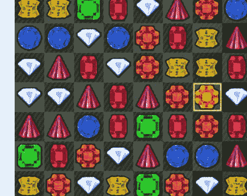

##### 响应游戏操作

玩家现在可以在宝石棋盘上选择宝石，但当玩家尝试交换两个宝石时，游戏会失败，因为 `playBoardEvents()` 函数调用了一些尚未实现的显示函数。

在下一章中，你将学习如何创建对棋盘事件的动画响应，但目前，你可以添加更简单的版本，只是立即更新棋盘。

`display.canvas.js` 中缺失的函数是 `moveJewels()`、`removeJewels()` 和 `refill()`。

### 清单 8.26 临时显示函数

```javascript
jewel.display = (function() {
...
function moveJewels(movedJewels, callback) {
    var n = movedJewels.length,
        mover, i;
    for (i=0; i<n; i++) {
        mover = movedJewels[i];
        clearJewel(mover.fromX, mover.fromY);
    }
    for (i=0; i<n; i++) {
        mover = movedJewels[i];
        drawJewel(mover.type, mover.toX, mover.toY);
    }
    callback();
}
function removeJewels(removedJewels, callback) {
    var n = removedJewels.length;
    for (var i=0; i<n; i++) {
        clearJewel(removedJewels[i].x, removedJewels[i].y);
    }
    callback();
}
return {
    ...
    moveJewels : moveJewels,
    removeJewels : removeJewels,
    refill : redraw
};
...})();
```

`moveJewels()` 函数在两个独立的循环中遍历所有指定的宝石，首先清除旧位置，然后在新位置绘制宝石。分两步进行遍历很重要，以免意外清除刚刚绘制的宝石。`removeJewels()` 函数更简单，因为它只是清除所有指定的位置。目前，`refill()` 函数只是 `redraw()` 的别名。

现在试试加载游戏。你现在可以通过鼠标、触摸和键盘输入来选择宝石并交换它们形成链条。因为变化是瞬间发生的，所以可能很难看清棋盘的反应，但这将在下一章实现游戏动画时解决。

#### 本章小结

在本章中，你学习了如何拦截来自浏览器的原生输入事件，并将它们转化为游戏动作。你了解了桌面浏览器以及支持触摸的移动设备上的用户输入。通过几个简单的例子，你看到了如何利用iPhone等设备的多点触摸功能，轻松创建基于触摸的手势，如缩放和旋转。

你还在“宝石战士”游戏中实现了一个光标对象，并通过键盘、鼠标和触摸启用了宝石选择和交换功能。游戏终于初具雏形，现在已经有实际的游戏玩法了。在下一章中，你将学习如何通过将动画和特效与你刚刚实现的游戏动作关联起来，让游戏变得更有趣。

## 第九章：游戏图形动画

- 创建动画循环
- 为游戏动作制作动画
- 添加分数和关卡界面元素
- 为游戏计时器制作动画

现在游戏已经可以玩了，玩家可以选择和交换宝石。不过，它仍然需要大量的美化。在本章中，我将向你展示如何用一些动画效果来提升游戏画面。首先，你将学习如何使用动画定时API及其`requestAnimationFrame()`函数创建基本的动画循环。

在掌握了基础知识之后，我将向你展示如何在canvas显示模块中实现动画。除了其他内容，你将看到移动和移除宝石以及重新填充宝石棋盘的动画。

在本章的后半部分，我将向你展示如何实现游戏中缺失的部分，例如添加积分和游戏计时器。这允许你创建升级和游戏结束事件及其动画。

#### 让游戏做出反应

到目前为止，我们只处理了玩家的动作。当然，游戏也必须对玩家的行为做出反应。最重要的是，显示需要更新，以便玩家可以进行下一步操作。

尽管你能够让所有更改瞬间完成，但如果将更改制作成动画，使宝石在棋盘上平滑移动，游戏在视觉上会更加令人愉悦。

不过首先，你可以通过缩放坐标空间来简化在canvas上的绘制任务。如果坐标在每个轴上都按`jewelSize`进行缩放，那么棋盘上的一个单元格尺寸就是1x1，整个棋盘的宽度为`cols`单位，高度为`rows`单位。清单9.1显示了在`display.canvas.js`的`setup()`函数中添加的缩放，以及对`drawJewel()`和`clearJewel()`函数所做的必要更改。

### 清单9.1 简化Canvas坐标空间

```
jewel.display = (function() {
...
function setup() {
...
canvas.width = cols * jewelSize;
canvas.height = rows * jewelSize;
ctx.scale(jewelSize, jewelSize);
...
}
function drawJewel(type, x, y) {
var image = jewel.images["images/jewels" +
jewelSize + ".png"];
ctx.drawImage(image,
type * jewelSize, 0, jewelSize, jewelSize,
x, y, 1, 1
);
}
function clearJewel(x, y) {
ctx.clearRect(x, y, 1, 1);
}
...
})();
```

现在使用canvas大大简化了，因为你不必将所有东西都乘以`jewelSize`变量。

##### 动画定时

创建基于JavaScript的动画的基本思路是设置一个函数，以足够快的速率重复调用该函数，使得运动看起来平滑。在JavaScript中，最简单的方法是使用`setInterval()`函数：

```
function updateAnimation() {
  // 更新图形元素
  ...
}
setInterval(updateAnimation, 1000 / 30);
```

这个函数大约每秒调用`updateAnimation()`函数30次。或者，你可以使用`setTimeout()`函数来达到相同的效果：

```
function updateAnimation() {
  // 更新图形元素
  ...
  setTimeout(updateAnimation, 1000 / 30);
}
```

`setTimeout()`函数只调用指定的函数一次，因此`updateAnimation()`函数需要为下一帧动画设置一个新的定时器。

第三种选择目前正由W3C开发。因为这些定时器除了动画之外还用于许多其他目的，你很快就能访问专门为动画设计的定时函数。新的动画定时API规范可在www.w3.org/TR/animation-timing/获取。

该API已在少数桌面浏览器（WebKit和Firefox）中部分支持，并且应该很快也会出现在移动设备上。最重要的函数是`requestAnimationFrame()`函数，其语法如下：

```
function updateAnimation(time) {
  // 更新图形元素
  ...
  requestAnimationFrame(updateAnimation);
}
requestAnimationFrame(updateAnimation);
```

这看起来很像`setTimeout()`示例，但请注意它没有指定何时需要调用更新函数的时间参数。相反，更新函数是通过一个包含当前时间的参数被调用的。`requestAnimationFrame()`函数告诉浏览器在它认为最佳的时机调用指定的函数。这意味着浏览器可以使用其自己的内部动画循环，甚至可以确保CSS和JavaScript动画同步。使用此函数在资源使用方面也有影响，因为如果页面不可见，浏览器现在可以自由地暂停渲染。如果用户正在查看另一个标签页，则无需花费宝贵的处理时间来更新动画。在处理能力和电池时间都有限的移动设备上，不更新动画可能意味着很多。当然，这也意味着你无法确保更新函数实际被调用，因此你不应该让任何关键逻辑依赖于`requestAnimationFrame()`调用。传统的`setTimeout()`和`setInterval()`定时器仍然是需要在特定时间发生副作用的任务的最佳选择。

如前所述，`requestAnimationFrame()`尚未在所有浏览器中得到完全支持。WebKit和Firefox有它们自己的带前缀的实现，在桌面端可用，但如果该规范获得支持，Opera和Microsoft的实现很可能会跟进。在此之前，对于缺乏支持的浏览器，用常规的`setTimeout()`函数模拟其行为相对简单。清单9.2展示了一个polyfill，如果window对象上不存在`requestAnimationFrame()`方法，则创建该方法。如果根本没有任何可用实现，则使用常规的setTimeout()调用模拟该功能。

### 清单9.2 requestAnimationFrame()的Polyfill

```
window.requestAnimationFrame = (function() {
  return window.requestAnimationFrame
      || window.webkitRequestAnimationFrame
      || window.mozRequestAnimationFrame
      || window.oRequestAnimationFrame
      || window.msRequestAnimationFrame
      || function(callback, element) {
        return window.setTimeout(
          function() {
            callback(Date.now());
          }, 1000 / 60
        );
      };
})();
```

`setTimeout()`和`setInterval()`函数返回可以使用`clearTimeout()`和`clearInterval()`移除定时器的整数句柄。新的动画定时API借鉴了这一行为，并提供了一个用于取消请求的函数，恰如其分地命名为`cancelRequestAnimationFrame()`。清单9.3展示了该函数的polyfill，它同样简单明了，并最终回退到`clearTimeout()`。

### 清单9.3 cancelRequestAnimationFrame()的Polyfill

```
window.cancelRequestAnimationFrame = (function() {
  return window.cancelRequestAnimationFrame
      || window.webkitCancelRequestAnimationFrame
      || window.mozCancelRequestAnimationFrame
      || window.oCancelRequestAnimationFrame
      || window.msCancelRequestAnimationFrame
      || window.clearTimeout;
})();
```


你也可以在章节代码存档的文件 `requestAnimationFrame.js` 中找到这些垫片。在第一批文件中，将该文件添加到 `loader.js` 中：

```
// loading stage 1
Modernizr.load([
    {
        load : [
            "scripts/sizzle.js",
            "scripts/dom.js",
            "scripts/requestAnimationFrame.js",
            "scripts/game.js"
        ],
        ...
    }
])
```

#### 使用 requestAnimationFrame()

让我们看几个展示如何使用 `requestAnimationFrame()` 创建动画的例子。第一个例子（如清单 9.4 所示）使用常规的 `setTimeout()` 函数反复调用 `animate()` 函数。

### 清单 9.4 使用 setTimeout() 的简单动画

```
function animate() {
    var element = document.getElementById("anim"),
        time = Date.now();
    // 元素假定具有 position:absolute
    element.style.left = (50 + Math.cos(time /
        500) * 25) + "%";
    element.style.top = (50 + Math.sin(time /
        500) * 25) + "%";
    setTimeout(animate, 1000 / 30);
}
animate();
```

你可以在文件 01-settimeout.html 中找到生成的动画，它显示了一个简单的 div 在圆形移动。现在看清单 9.5 中的例子。这里，定时器被 `requestAnimationFrame()` 替换。

### 清单 9.5 使用 requestAnimationFrame() 的简单动画

```
function animate(time) {
    var element = document.getElementById("anim");
    // 元素假定具有 position:absolute
    element.style.left = (50 + Math.cos(time / 500) * 25) + "%";
    element.style.top = (50 + Math.sin(time / 500) * 25) + "%";
    requestAnimationFrame(animate);
}
requestAnimationFrame(animate);
```

这个例子展示了替换旧的 `setTimeout()` 调用是多么容易。你甚至可以免费获得当前时间作为 `animate()` 函数的第一个参数。修改后的示例位于文件 02-requestanimationframe.html 中。

Mozilla 对 `requestAnimationFrame()` 函数的实现提供了另一种使用方式。你可以不提供回调函数，而是不带任何参数调用 `requestAnimationFrame()`。然后，当回调函数本应被调用时（如果提供了的话），Firefox 会在 window 对象上触发一个特殊的 `MozBeforePaint` 事件。现在，`requestAnimationFrame()` 不再将当前时间作为参数传递给处理函数，而是通过事件对象上的 `timeStamp` 属性使其可用。清单 9.6 展示了重新编写以使用 Mozilla 事件的示例。

### 清单 9.6 使用 Mozilla 事件的简单动画

```
function animate(event) {
    var element = document.getElementById("anim"),
        time = event.timeStamp;
    element.style.left = (50 + Math.cos(time / 500) * 25) + "%";
    element.style.top = (50 + Math.sin(time / 500) * 25) + "%";
    requestAnimationFrame();
}
window.addEventListener("MozBeforePaint", animate);
requestAnimationFrame();
```

这种方法在某些情况下可能很有用，但由于它仅限于 Firefox，并且不是草案规范的一部分，因此坚持使用回调函数会更安全。

#### 创建动画循环

既然你知道了如何使用计时 API，你就可以用它来在显示模块中创建一个简单的循环。清单 9.7 展示了新的 `cycle()` 函数以及对 `setup()` 的必要更改。

**清单 9.7 动画循环**

```
jewel.display = (function() {
    var previousCycle,
    ...
    function setup() {
        ...
        previousCycle = Date.now();
        requestAnimationFrame(cycle);
    }
    function cycle(time) {
        previousCycle = time;
        requestAnimationFrame(cycle);
    }
    ...
})();
```

创建动画循环就是如此简单。`cycle()` 函数目前还没做什么有趣的事情；它只是安排另一个循环。`setup()` 中的初始调用启动了循环。注意，它还跟踪了上一次循环的时间。跟踪时间很重要，因为你需要知道自上次更新动画以来已经过去了多少时间。

#### 动画化光标

你在第 8 章实现的光标只是围绕选定位置的一个静态边框。一个小小的动画可以使其更具视觉吸引力。它不必是任何高级的东西；简单的东西就足够了。在这里，我将向你展示如何通过脉动效果来增强其发光外观。清单 9.8 展示了新的 `renderCursor()` 函数。

**清单 9.8 修改后的光标渲染函数**

```
jewel.display = (function() {
...
function renderCursor(time) {
if (!cursor) {
return;
}
var x = cursor.x,
y = cursor.y,
t1 = (Math.sin(time / 200) + 1) / 2,
t2 = (Math.sin(time / 400) + 1) / 2;
clearCursor();
if (cursor.selected) {
ctx.save();
ctx.globalCompositeOperation = "lighter";
ctx.globalAlpha = 0.8 * t1;
drawJewel(jewels[x][y], x, y);
ctx.restore();
}
ctx.save();
ctx.lineWidth = 0.05;
ctx.strokeStyle = "rgba(250,250,150," + (0.5 + 0.5 * t2) + ")";
ctx.strokeRect(x+0.05,y+0.05,0.9,0.9);
ctx.restore();
...
})();
```

注意这里使用了 `Math.sin()` 来创建 `t1` 和 `t2` 因子。正弦和余弦在动画方面有很多用途。这里，`Math.sin()` 函数被用作一种简单的方法来创建随时间变化的值，平滑地从 -1 到 +1 再返回，如图 9-1 所示。如果你像 `renderCursor()` 那样将值加 1 再除以 2，范围就变成了 [0, 1]。这些因子在合成宝石和绘制边框矩形时应用于 alpha 值。你可以通过更改传递给 `Math.sin()` 调用的参数来改变脉动的周期。

图 9-1：光标脉动

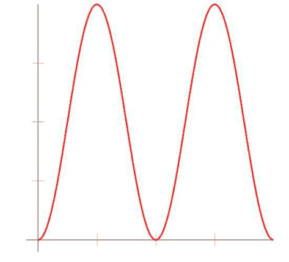

现在你只需要将 `renderCursor()` 函数添加到动画循环中：

```
function cycle(time) {
    renderCursor(time);
    previousCycle = time;
    requestAnimationFrame(cycle);
}
```

现在光标会在每个周期自动更新。记得也要从 `setCursor()` 函数中移除旧的 `renderCursor()` 调用。

#### 动画化游戏动作

接下来，你必须处理五种不同的游戏动画：

- 移动宝石
- 移除宝石
- 补充棋盘
- 前进到下一关
- 游戏结束

因为你还没有实现游戏计时器，所以游戏还没有“游戏结束”状态。此外，你还没有跟踪分数，所以也没有办法前进到下一关。然而，你可以立即实现其他三种动画。

显示模块需要跟踪所有当前正在运行的动画，以便在每个动画周期中渲染它们。为此，你使用一个名为 `animations` 的数组。动画周期实际上不需要知道每个动画的具体细节；它只需要一个可以在每帧调用的函数的引用。它还需要知道动画所需的时间。这样，完成的动画就可以自动从列表中移除。动画通过清单 9.9 所示的 `addAnimation()` 函数添加。

**清单 9.9 添加动画**

```
jewel.display = (function() {
  var animations = [],
  ...
  function addAnimation(runTime, fncs) {
    var anim = {
      runTime : runTime,
      startTime : Date.now(),
      pos : 0,
      fncs : fncs
    };
    animations.push(anim);
  }
  ...
})();
```

每个动画作为一个简单的对象结构添加到列表中，描述了开始时间、完成所需时间以及 `fncs` 属性，该属性持有对三个函数的引用：`fncs.before()`、`fncs.render()` 和 `fncs.done()`。这些函数在渲染动画的各个时间点被调用。`pos` 属性是一个范围在 [0, 1] 内的值，表示动画的当前位置，其中 0 是开始，1 是动画完成时。清单 9.10 中的渲染函数处理对 `fncs` 函数的调用。

### 清单 9.10 渲染动画

```
jewel.display = (function () {
    ...
    function renderAnimations(time, lastTime) {
        var anims = animations.slice(0), // 复制列表
        n = anims.length,
        animTime,
        anim,
        i;
        // 调用 before() 函数
        for (i=0;i<n;i++) {
            anim = anims[i];
            if (anim.fncs.before) {
                anim.fncs.before(anim.pos);
            }

            anim.lastPos = anim.pos;
            animTime = (lastTime - anim.startTime);
            anim.pos = animTime / anim.runTime;
            anim.pos = Math.max(0, Math.min(1, anim.pos));
        }

        animations = []; // 重置动画列表
        for (i=0;i<n;i++) {
            anim = anims[i];
            anim.fncs.render(anim.pos, anim.pos - anim.lastPos);
            if (anim.pos == 1) {
                if (anim.fncs.done) {
                    anim.fncs.done();
                }
            } else {
                animations.push(anim);
            }
        }
```


function cycle(time) {
    renderCursor(time);
    renderAnimations(time, previousCycle);
    previousCycle = time;
    requestAnimationFrame(cycle);
}
...();

每个动画对象至少有一个 `render()` 函数，还可以有一个可选的 `before()` 函数。`before()` 函数在每个循环周期中都会在 `render()` 函数之前被调用。其设计理念是，`before()` 函数可用于为下一帧做准备，并在必要时清理上一帧的遗留内容。重要的是，所有动画的 `before()` 函数必须在任何 `render()` 调用之前被调用。否则，一个动画的 `before()` 函数可能会干扰另一个动画的 `render()` 函数。

每次动画计时器调用 `renderAnimations()` 时，`animations` 数组都会在渲染循环中被清空并重建。这使得只添加那些尚未完成的动画变得非常容易。如果一个动画已完成——即其进度至少达到 1——则会调用其 `done()` 函数；否则，它会被重新添加回列表中。

##### 移动宝石

当用户交换宝石并更新棋盘时，棋盘模块会为每个事件生成游戏事件，例如移动宝石、宝石消失等。这些事件由您在本章前面添加到游戏界面模块的 `playBoardEvents()` 函数处理。`screen.game.js` 中用于处理移动事件的代码大致如下所示：

```
function playBoardEvents(events) {
    ...
    switch (boardEvent.type) {
        case "move":
            display.moveJewels(boardEvent.data, next);
            break;
        ...
    }
}
```

但是，如果尝试的交换无效，棋盘不会生成移动事件。如果能实现在交换无效时宝石先交换位置然后再移回原位，将会改善视觉反馈。让我们扩展 `board.js` 中的 `swap()` 函数，使其生成这些额外的事件。清单 9.11 展示了 `board.js` 中新的 `swap()` 函数。

### 清单 9.11 为无效交换生成移动事件

```
jewel.board = (function() {
    ...
    function swap(x1, y1, x2, y2, callback) {
        var tmp, swap1, swap2,
            events = [];
        swap1 = {
            type: "move",
            data: [{
                type: getJewel(x1, y1),
                fromX: x1, fromY: y1, toX: x2, toY: y2
            }, {
                type: getJewel(x2, y2),
                fromX: x2, fromY: y2, toX: x1, toY: y1
            }]
        };
        swap2 = {
            type: "move",
            data: [{
                type: getJewel(x2, y2),
                fromX: x1, fromY: y1, toX: x2, toY: y2
            }, {
                type: getJewel(x1, y1),
                fromX: x2, fromY: y2, toX: x1, toY: y1
            }]
        };
        if (isAdjacent(x1, y1, x2, y2)) {
            events.push(swap1);
            if (canSwap(x1, y1, x2, y2)) {
                tmp = getJewel(x1, y1);
                jewels[x1][y1] = getJewel(x2, y2);
                jewels[x2][y2] = tmp;
                events = events.concat(check());
                events.push(swap2, { type : "badswap" });
            }
            callback(events);
        }
    }
    ...
})();
```

`swap()` 函数现在将一个移动事件添加到初始的 `events` 数组中，以便宝石互换位置。如果 `canSwap()` 测试失败，则会添加第二个事件将宝石移回。

`moveJewels()` 函数接收一个宝石对象数组，描述了需要移动的宝石。每个宝石对象具有以下属性：

- `type`
- `fromX`
- `fromY`
- `toX`
- `toY`

这些属性描述了宝石的类型以及起始和结束位置。现在，将清单 9.12 中的 `moveJewels()` 函数添加到 `display.canvas.js` 的显示模块中。

### 清单 9.12 为移动宝石添加动画

```
jewel.display = (function() {
    ...
    function moveJewels(movedJewels, callback)
    {
        var n = movedJewels.length,
            oldCursor = cursor;
        cursor = null;
        movedJewels.forEach(function(e) {
            var x = e.fromX, y = e.fromY,
                dx = e.toX - e.fromX,
                dy = e.toY - e.fromY,
                dist = Math.abs(dx) + Math.abs(dy);
            addAnimation(200 * dist, {
                before : function(pos) {
                    pos = Math.sin(pos * Math.PI / 2);
                    clearJewel(x + dx * pos, y + dy * pos);
                },
                render: function(pos) {
                    var e = Math.sin(pos * Math.PI / 2);
                    drawJewel({
                        e: type,
                        x + dx * pos, y + dy * pos
                    });
                },
                done: function() {
                    if (--n === 0) {
                        cursor = oldCursor;
                        callback();
                    }
                }
            });
        });
    }
    ...
})();
```

`moveJewels()` 代码的主要部分遍历所有指定的宝石，并为每个宝石设置动画。`before` 方法清除宝石在上一帧中所在的位置。移动因子使用了与光标渲染中相同的 `Math.sin()` 技巧进行计算。传递给 `before` 和 `render` 方法的 `pos` 值范围是 [0, 1]，因此最终的运动在结束时会平滑地减速。图 9-2 中的图表展示了该运动因子的可视化表示。

##### 移除宝石

移除宝石的过程与 `moveJewels()` 中的类似。`removeJewels()` 函数接收一个对象列表，描述了需要消失的宝石。每个对象具有以下属性：

- `type`
- `x`
- `y`

图 9-2：宝石的运动

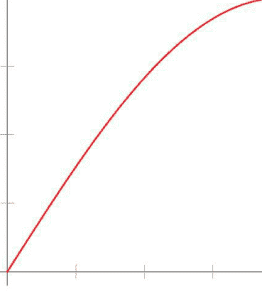

动画的设置使得宝石在每帧之前被清除，然后使用 canvas 变换方法重绘一个缩小并旋转的版本。完整的 `removeJewels()` 函数见清单 9.13。

### 清单 9.13 移除宝石

```
jewel.display = (function() {
    ...
    function removeJewels(removedJewels,
        callback) {
        var n = removedJewels.length;
        removedJewels.forEach(function(e) {
            addAnimation(400, {
                before : function() {
                    clearJewel(e.x, e.y);
                },
                render : function(pos) {
                    ctx.save();
                    ctx.globalAlpha = 1 - pos;
                    drawJewel(
                        e.type, e.x, e.y,
                        1 - pos, pos * Math.PI * 2
                    );
                    ctx.restore();
                },
                done : function() {
                    if (--n == 0) {
                        callback();
                    }
                }
            });
        });
        ...
    }
    ...
})();
```

如您所见，`render()` 中的 `drawJewel()` 调用现在有了新的第四个和第五个参数。这些是在绘制宝石前要应用的缩放和旋转。清单 9.14 展示了 `display.canvas.js` 中 `drawJewel()` 函数的更改。

### 清单 9.14 为 drawJewel() 添加缩放和旋转

```
jewel.display = (function() {
    ...
    function drawJewel(type, x, y, scale, rot) {
        var image = jewel.images["images/jewels" + jewelSize + ".png"];
        ctx.save();
        if (typeof scale !== "undefined" && scale > 0) {
            ctx.beginPath();
            ctx.rect(x, y, 1, 1);
            ctx.clip();
            ctx.translate(x + 0.5, y + 0.5);
            ctx.scale(scale, scale);
            if (rot) {
                ctx.rotate(rot);
            }
            ctx.translate(-x - 0.5, -y - 0.5);
        }
        ctx.drawImage(image,
            type * jewelSize, 0, jewelSize, jewelSize,
            x, y, 1, 1
        );
        ctx.restore();
    }
    ...
})();
```

如果您在第 6 章中仔细阅读了，那么这些添加的变换应该不会让您感到意外。在 `removeJewels()` 的情况下，缩放参数以 `(1 - pos)` 的形式传入，这使得该值在动画进行过程中从 1 变为 0。`pos` 值也用于 `rot` 参数，只是乘以 2π 以获得完整的 360 度旋转。

> **提示**
> 既然您可以在绘制宝石时轻松添加缩放因子，那么尝试在 `renderCursor()` 函数中添加一个约 1.1 的缩放值。结果将呈现出更发光的外观。

##### 重新填充棋盘

当棋盘模块检测到没有有效的移动时，它会发送一个 `refill` 事件。随事件传递的参数包含组成新棋盘的宝石。对于填充动画，我混合使用了 canvas 动画和 CSS 3D 变换。查看清单 9.15 中的 `refill()` 函数。与 `moveJewels()` 和 `removeJewels()` 函数一样，此示例使用 `addAnimation()` 设置动画。`render()` 函数执行两项操作：用新的宝石替换所有旧的宝石，并绕 x 轴旋转棋盘。

### 清单 9.15 用新宝石重新填充棋盘

```
jewel.display = (function() {
    ...
    function refill(newJewels, callback) {
        var lastJewel = 0;
        addAnimation(1000, {
            render : function(pos) {
                var thisJewel = Math.floor(pos * cols *
                    rows),
                    i, x, y;
                for (i = lastJewel; i < thisJewel; i++) {
                    x = i % cols;
                    y = Math.floor(i / cols);
                    clearJewel(x, y);
                    drawJewel(newJewels[x][y], x, y);
                }
                lastJewel = thisJewel;
                canvas.style.webkitTransform =
                    "rotateX(" + (360 * pos) + "deg)";
            },
            done : function() {
                canvas.style.webkitTransform = "";
                callback();
            }
        });
    }
    ...
    return {
        ...
        refill : refill
    }
})();
```

请注意，`scale()` 变换对 y 轴使用了负值。这实际上将坐标空间上下翻转了。随后的平移操作将其移回原位，但保持坐标翻转。这意味着原点现在位于左下角，正的 y 值向上增长。当循环中绘制新宝石时，它们是倒着绘制的，但随着画布绕 x 轴旋转 180 度，这个方向会自行修正。您也可以选择进行完整的 360 度旋转并跳过翻转变换。

旋转是通过 3D CSS 变换实现的。CSS 的 `rotateX()`、`rotateY()` 和 `rotateZ()` 变换都会将元素绕其轴旋转一定的度数。为了获得正确的 3D 效果，


然而，你需要为旋转增添一些深度。这可以通过在父元素上设置 `-webkit-perspective` 属性来实现。只需将以下内容添加到 `main.css` 中的 `.game-board` 规则中：

```css
/* 游戏屏幕 */
#game-screen .game-board {
    ...
    -webkit-perspective: 16em;
}
```

你可以调整这个值来改变3D效果的外观。较小的值使其看起来更平坦，而较大的值则会增强该效果。

CSS 转换的顺序很重要。在这种情况下，你需要在旋转画布之前应用透视效果。否则，旋转将在没有透视的情况下进行，从而失去预期效果。

补充动画在 `done()` 方法中完成，该方法会重置 CSS 转换并调用回调函数，以通知调用者动画已完成。图 9-3 展示了补充动画中的一帧。

**图 9-3：翻转棋盘**

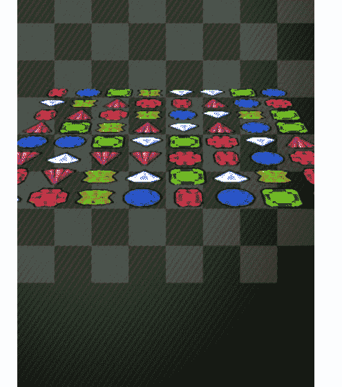

如果你想测试补充动画而无需一直玩到自动触发补充，可以通过在 JavaScript 控制台中输入以下内容来手动触发该动画：

```javascript
jewel.display.refill(jewel.board.getBoard(), function() {})
```

它不会用新的宝石替换旧的，但你可以看到 CSS 旋转效果。

#### 添加积分与计时

玩家现在可以交换宝石，棋盘显示也做出了良好的响应。然而，游戏还没有真正的目标。你仍然需要实现一个倒计时计时器，它会威胁着提前结束游戏。同时，玩家也应该获得积分，以便在升级到更高等级时获得进展感。所有这些游戏数据都应该对玩家可见并持续更新。实际数值在 `screen.js` 文件中的游戏屏幕模块中维护：

```javascript
jewel.screens["game-screen"] = (function() {
    var gameState = {
        // 游戏状态变量
    }, ...;
})();
```

这个简单的对象包含了当前等级和分数，以及一些用于跟踪游戏计时器的属性。每次开始新游戏时都需要重置这些值，因此请在游戏屏幕模块中添加一个 `startGame()` 函数，并在 `setup()` 和 `run()` 函数中调用它。`startGame()` 函数还应负责重置光标并初始化 `board` 和 `display` 模块。清单 9.16 展示了该函数。

**清单 9.16 初始化游戏信息并启动游戏**

```javascript
jewel.screens["game-screen"] = (function()
{
    var gameState,
    firstRun = true;
    function startGame() {
        gameState = {
            level: 0,
            score: 0,
            timer: 0, // setTimeout 引用
            startTime: 0, // 等级开始时间
            endtime: 0 // 游戏结束时间
        };
        cursor = {
            x: 0,
            y: 0,
            selected: false
        };
        board.initialize(function() {
            display.initialize(function() {
                display.redraw(board.getBoard(),
                function() {});
            });
        });
    }
    function run() {
        if (firstRun) {
            setup();
            firstRun = false;
        }
        startGame();
    }
    ...
})();
```

##### 创建 UI 元素

在开始使用游戏信息对象之前，你还需要在游戏屏幕上添加更多的 DOM 元素。清单 9.17 展示了 `index.html` 中游戏屏幕修改后的 HTML 代码。新元素包括当前等级和分数的标签，以及一个用于游戏计时器的进度条。

**清单 9.17 在游戏屏幕上添加新的界面元素**

```html
<div id="game">
    ...
    <div class="screen" id="game-screen">
        <div class="game-info">
            <label class="level">Level:
                <span></span>
            </label>
            <label class="score">Score:
                <span></span>
            </label>
        </div>
        <div class="time">
            <div class="indicator"></div>
        </div>
    </div>
</div>
```

未来，当新的 HTML5 元素得到更广泛的支持时，你将能够在 `label` 元素中使用更具语义的 `output` 元素来代替 `span`。你还将获得 `progress` 元素，它简化了各种进度条的实现。与新标记配套的 CSS 放在 `main.css` 中，如清单 9.18 所示。

**清单 9.18 设置游戏信息元素的样式**

```css
/* 游戏屏幕 - 游戏状态 */
#game-screen .game-info {
    width: 100%;
    float: left;
}

#game-screen .game-info label {
    display: inline-block;
    height: 1.5em;
    float: left;
    font-size: 0.6em;
    padding: 0.25em;
}

#game-screen .game-info .score {
    float: right;
}

#game-screen .time {
    height: 0.25em;
    border-radius: 0.5em;
}

#game-screen .time .indicator {
    width: 100%;
}
```

新的 CSS 规则并不特别复杂。它们只是将元素排列在棋盘下方，并将时间条的样式设置得与启动屏幕上的进度条相似。图 9-4 展示了这些新元素。

**图 9-4：新的 UI 元素**

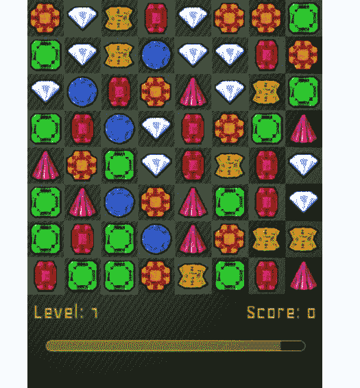

这种布局在桌面浏览器或在移动设备上以竖屏模式查看游戏时效果很好。但是，如果你将设备旋转到横屏模式，布局就不理想了。你可以使用 CSS 媒体查询来专门针对横屏模式。将清单 9.19 中的规则添加到 `mobile.css` 中，以改善横屏模式的外观。

**清单 9.19 为大屏幕调整 UI**

```css
@media (orientation: landscape) {
    #game-screen .game-board {
        float: left;
    }
    #game-screen .game-info {
        width: auto;
        height: 2em;
        white-space: nowrap;
    }
    #game-screen .game-info label {
        font-size: 0.5em;
    }
    #game-screen .game-info .score {
        float: left;
        clear: both;
    }
    #game-screen .time {
        font-size: 0.5em;
        margin: 0;
        float: left;
        width: 6.5em;
        /* 厂商特定的转换 */
        -webkit-transform: rotate(-90deg) translate(3em, -1.75em);
        -moz-transform: rotate(-90deg) translate(3em, -1.75em);
        -ms-transform: rotate(-90deg) translate(3em, -1.75em);
        /* 标准转换 */
        transform: rotate(-90deg) translate(3em, -1.75em);
    }
}
```

等级和分数标签现在会自动移动到右上角，以利用横屏模式下的额外水平空间。计时器条经过了特殊处理，因为它被旋转了90度。这使得它即使被移到棋盘旁边的狭窄空间时，也能保持其完整尺寸。图 9-5 展示了 iPod Touch 上横屏模式下的结果。

**图 9-5：横屏模式下的游戏 UI 元素**

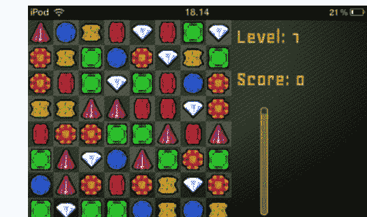

你现在可以用当前的数值来更新这些元素了。首先，它们应该在游戏开始时更新，因此创建一个 `updateGameInfo()` 函数来更新分数和等级元素，如清单 9.20 所示。

**清单 9.20 更新游戏信息**

```javascript
jewel.screens["game-screen"] = (function()
{
    var dom = jewel.dom,
        $ = dom.$,
        ...
        function startGame() {
            ...
            updateGameInfo();
            board.initialize(function() {
                display.initialize(function() {
                    display.redraw(board.getBoard(),
                    function() {});
                });
            });
        }

        function updateGameInfo() {
            $("#game-screen .score span")[0].innerHTML
                = gameState.score;
            $("#game-screen .level span")[0].innerHTML
                = gameState.level;
        }
    ...
})();
```

`startGame()` 中的 `updateGameInfo()` 调用会在新游戏开始时将显示重置为初始值。

##### 创建游戏计时器

现在你可以继续处理游戏计时器了。当游戏开始时，计时器必须缓慢倒计时，当它到达终点时，游戏结束。在视觉上，这个动画表现为计时器进度条从满到空的变化。玩家生存的唯一方法就是获得足够的分数以进入下一关，并使计时器重置。

为了使游戏越来越难，你需要随着游戏的进展加快计时器的速度。首先，在 `loader.js` 中的游戏设置里添加一个基础时间：

```javascript
var jewel = {
    screens: {},
    settings: {
        ...,
        baseLevelTimer: 60000
    },
    images: {}
}
```

这个值是第一关的时间，以毫秒为单位。随着等级数的增加，时间量会减少，但它仍然是基于这一个基础数字的。

当你需要更新计时器进度条时，计时器值必须转换为相对值。然后你可以使用这个相对值，通过百分比来调整内部元素的宽度。清单 9.21 显示了 `screen.game.js` 中的计时器更新函数。

## 清单 9.21 检查和更新游戏计时器

```javascript
jewel.screens["game-screen"] = (function()
{
    ...
    function setLevelTimer(reset) {
        if (gameState.timer) {
            clearTimeout(gameState.timer);
            gameState.timer = 0;
        }
        if (reset) {
            gameState.startTime = Date.now();
            gameState.endTime =
                settings.baseLevelTimer *
                Math.pow(gameState.level,
                -0.05 * gameState.level);
        }
        var delta = gameState.startTime +
            gameState.endTime - Date.now(),
            percent = (delta / gameState.endTime) *
                100,
            progress = $("#game-screen .time").
                indicator()[0];
        if (delta < 0) {
            gameOver();
        } else {
            progress.style.width = percent + "%";
            gameState.timer =
                setTimeout(setLevelTimer, 30);
        }
    }
    function startGame() {
        ...
        updateGameInfo();
        setLevelTimer(true);
        ...
    }
    ...
})();
```

如果 `setLevelTimer()` 被调用时带有重置标志，它会根据当前关卡重置计时器。`startTime` 的值就是当前时间，保存下来以便后续调用可以计算已经过去了多少时间。`endTime` 的值代表玩家在这一关被给予的时间。由于负指数的存在，`Math.pow()` 表达式的值随着关卡数的增加而减小。

无论是否带有重置标志，该函数都会计算自计时器设置以来已经过去了多少时间。将这个数字除以这一关的总时间，你会得到一个 0 到 1 之间的数字，然后你可以用它来设置计时器进度条内部元素的 CSS 宽度。如果过去的时间超过了允许的时间，计时器函数会调用一个 `gameOver()` 函数来结束游戏。我将在本章后面展示游戏结束函数的实现。如果玩家仍然存活，一个新的 `setTimeout()` 调用将设置下一次计时器检查。

这里不使用 `requestAnimationFrame()` 而使用 `setTimeout()` 的原因是，计时器功能比动画更为关键。请记住，浏览器可以自由决定不更新任何动画，如果它决定将资源用于其他地方。

##### 奖励分数

在第 4 章实现宝石交换逻辑时，你让它注册了与宝石相关的事件以及奖励的分数。分数事件需要由 `playBoardEvents()` 函数处理，因此也为此事件添加一个 case，如清单 9.22 所示。

### 清单 9.22 奖励分数

```javascript
jewel.screens["game-screen"] = (function() {
    ...
    function playBoardEvents(events) {
        if (events.length > 0) {
            var boardEvent = events.shift(),
            next = function() {
                playBoardEvents(events);
            };
            switch (boardEvent.type) {
                case "move" :
                    display.moveJewels(boardEvent.data, next);
                    break;
                case "remove" :
                    display.removeJewels(boardEvent.data, next);
                    break;
                case "refill" :
                    display.refill(boardEvent.data, next);
                    break;
                case "score" : // new score event
                    addScore(boardEvent.data);
                    next();
                    break;
                default :
                    next();
                    break;
            }
        } else {
            display.redraw(board.getBoard(), function() {
                // good to go again
            });
        }
    }
    ...
})();
```

更新 UI 分数元素很简单，如清单 9.23 所示。

### 清单 9.23 更新分数

```javascript
jewel.screens["game-screen"] = (function() {
    ...
    function addScore(points) {
        gameState.score += points;
        updateGameInfo();
    }
    ...
})();
```

##### 升级

当玩家达到一定的分数时，应该进入下一关。为此，你需要在 `addScore()` 函数中添加更多功能。如清单 9.24 所示修改该函数。

### 清单 9.24 检查分数数量

```javascript
jewel.screens["game-screen"] = (function() {
    ...
    function addScore(points) {
        var nextLevelAt = Math.pow(
            settings.baseLevelScore,
            Math.pow(settings.baseLevelExp,
            gameState.level-1)
        );
        gameState.score += points;
        if (gameState.score >= nextLevelAt) {
            advanceLevel();
        }
        updateGameInfo();
    }
    ...
})();
```

修改后的 `addScore()` 函数利用了两个新值，你必须在 `loader.js` 的设置中添加它们：

```javascript
var jewel = {
    settings : {
        ...
        baseLevelScore : 1500,
        baseLevelExp : 1.05
    }
};
```

这些值用于计算升级到下一关所需的分数。当你将基础分数 `baseLevelScore` 提升到一个随每个关卡增加的指数时，关卡之间的差距变得越来越大，进一步增加了游戏的难度。我选择的值为前五关提供了 1000、1413、2030、2971 和 4431 分的限制。如果你想要其他分布，可以调整设置。

`addScore()` 函数调用一个 `advanceLevel()` 函数，该函数必须负责增加关卡值并设置新的游戏计时器。将清单 9.25 所示的 `advanceLevel()` 函数添加到 `screen.game.js` 中，从 `startGame()` 中移除 `setLevelTimer()` 调用，并在显示初始化后调用 `advanceLevel()`。

### 清单 9.25 升级到下一关

```javascript
jewel.screens["game-screen"] = (function() {
  ...
  function startGame() {
    ...
    updateGameInfo();
    board.initialize(function() {
      display.initialize(function() {
        display.redraw(board.getBoard(), function() {
          advanceLevel();
        });
      });
    });
  }

  function advanceLevel() {
    gameState.level++;
    updateGameInfo();
    gameState.startTime = Date.now();
    gameState.boardTime = settings.baseLevelTimer *
      Math.pow(gameState.level, -0.05 * gameState.level);
    setLevelTimer(true);
  }
  ...
```

gameInfo 对象上的 level 值在游戏开始时为 0。玩家应该立即升级到第 1 关，因此你也应该在 `startGame()` 函数中添加一个初始的 `advanceLevel()` 调用，如清单 9.25 所示。这也负责启动计时器功能。

`advanceLevel()` 函数增加关卡值并更新 UI 元素。当然，升级到下一关也应该触发一些视觉反馈。清单 9.26 显示了在 `display.canvas.js` 中添加到显示模块的新动画。

## 清单 9.26 升级时添加视觉效果

```javascript
jewel.display = (function() {
...
function levelUp(callback) {
addAnimation(1000, {
before : function(pos) {
var j = Math.floor(pos * rows * 2),
x, y;
for (y=0,x=j;y<rows;y++,x--) {
if (x >= 0 && x < cols) { // boundary check
clearJewel(x, y);
drawJewel(jewels[x][y], x, y);
}
}
},
render : function(pos) {
var j = Math.floor(pos * rows * 2),
x, y;
ctx.save(); // remember to save state
ctx.globalCompositeOperation = "lighter";
for (y=0,x=j;y<rows;y++,x--) {
if (x >= 0 && x < cols) { // boundary check
drawJewel(jewels[x][y], x, y, 1.1);
}
}
ctx.restore();
},
done : callback
});
return {
...
levelUp : levelUp
};
})();
```

仔细看看在 `before` 和 `render` 函数中都出现的循环：

```javascript
var j = Math.floor(pos * rows * 2),
x, y;
for (y=0, x=j; y<rows; y++, x--) {
...
}
```

因为 `pos` 从 0 到 1，`j` 是一个从 0 开始，到 `(2 * rows)` 结束的整数值。循环从 `y=0` 和 `x=j` 开始。然后它向下移动棋盘，并在每一行将 `x` 位置向左移动一步。结果是，匹配的宝石形成一条对角线，在动画期间向下/横穿棋盘移动。`before` 函数只是清除并重绘之前的宝石，而 `render` 函数通过使用 `lighter` 合成操作在顶部绘制副本，来高亮显示当前活跃的宝石。

在 `screen.game.js` 的 `advanceLevel()` 中添加对 `display.levelUp()` 函数的调用：

```javascript
function advanceLevel() {
    ...
    display.levelUp();
}
```

#### 公告游戏事件

让玩家知道他已进入新关卡可能是个好主意。游戏信息标签不够大，无法确保玩家注意到变化。为公告向游戏屏幕添加一个新的 `div` 元素，并赋予它 `announcement` 类。清单 9.27 显示了对 `index.html` 的修改。

### 清单 9.27 添加公告容器

```html
<div id="game">
    ...
    <div class="screen" id="game-screen">
        <div class="game-board jewel-size">
            <div class="announcement"></div>
        </div>
        ...
    </div>
</div>
```


现在你可以在那个 `div` 中添加文本，使其出现在游戏板的中央，这样玩家就不会错过它。将清单 9.28 中的 CSS 添加到 `main.css` 以设置公告的样式。

## 清单 9.28 设置公告样式

```css
/* 游戏屏幕 - 公告 */
#game-screen .announcement {
    position: absolute;
    left: 0;
    top: 50%;
    margin-top: -0.5em;
    width: 100%;
    font-family: Slackey, sans-serif;
    color: rgb(150,150,75);
    text-shadow: 0.03em 0.03em 0.03em rgb(255,255,0),
                 -0.03em -0.03em 0.03em rgb(255,255,0),
                 0.15em 0.15em 0.15em rgb(0,0,0);
    text-align: center;
    white-space: nowrap;
    z-index: 20; /* 位于所有元素之上 */
    opacity: 0; /* 开始时透明 */
    cursor: default;
}

.no-textshadow #game-screen .announcement {
    filter: glow(color=#ffff00,strength=1),
            dropshadow(color=#000000,offX=3,offY=3);
}
```

这段代码让公告看起来不错，但你可以做得更好，使用一点 CSS 添加缩放和淡出动画。清单 9.29 展示了如何实现。

## 清单 9.29 创建缩放和淡出 CSS 动画

```css
/* 公告动画 */
/* Webkit 关键帧 */
@-webkit-keyframes zoomfade {
    0% {
        opacity: 1;
        -webkit-transform: scale(0.5);
    }
    25% { /* 保持完全不透明一段时间 */
        opacity: 1;
    }
    100% { /* 然后淡出到 0 */
        opacity: 0;
        -webkit-transform: scale(1.5);
    }
}
/* Firefox 关键帧 */
@-moz-keyframes zoomfade {
    0% {
        opacity: 1;
        -moz-transform: scale(0.5);
    }
    25% { /* 保持完全不透明一段时间 */
        opacity: 1;
    }
    100% { /* 然后淡出到 0 */
        opacity: 0;
        -moz-transform: scale(1.5);
    }
}
/* 缩放-淡出动画类 */
.zoomfade {
    -webkit-animation-name: zoomfade;
    -webkit-animation-duration: 2s;
    -moz-animation-name: zoomfade;
    -moz-animation-duration: 2s;
}
```

这些规则声明了一个名为 `zoomfade` 的 CSS 动画，包含三个关键帧，分别位于 0%、25% 和 100%。在整个动画过程中，元素从 0.5 缩放到 1.5。透明度也在变化，但仅在 25% 关键帧之后。这样用户就有更好的机会在文本淡出之前真正阅读它。最后，CSS 将动画分配给一个名为 `zoomfade` 的类，并设置其持续时间为两秒。现在你需要按照清单 9.30 所示，将 `zoomfade` 类附加到 `screen.game.js` 中的公告元素。为了在下次需要时再次播放动画，你只需移除该类并重新添加即可。务必使用 `setTimeout()` 来添加该类，以便浏览器有时间识别它已被移除。

## 清单 9.30 宣布重大事件

```javascript
jewel.screens["game-screen"] = (function()
{
    ...
    function announce(str) {
        var element = $("#game-screen .announcement")[0];
        element.innerHTML = str;
        if (Modernizr.cssanimations) {
            dom.removeClass(element, "zoomfade");
            setTimeout(function() {
                dom.addClass(element, "zoomfade");
            }, 10);
        } else {
            dom.addClass(element, "active");
            setTimeout(function() {
                dom.removeClass(element, "active");
            }, 1000);
        }
    }
    ...
})();
```

Modernizr 可以告诉你是否支持 CSS 动画，或者你是否必须回退到替代方案。清单 9.31 中的 `announce()` 函数在 CSS 动画不支持时使用 `active` 类。`setTimeout()` 函数在一秒钟后再次移除该类。`active` 类的 CSS 规则如清单 9.31 所示。回退 CSS 只是切换元素的可见性。

## 清单 9.31 公告的回退效果

```css
/* 没有 CSS 动画的浏览器的回退 */
.no-cssanimations #game-screen .announcement {
    display: none;
}
.no-cssanimations #game-screen .announcement.active {
    opacity: 1;
    display: block;
}
```

现在，在 `screen.game.js` 的 `advanceLevel()` 函数中添加一个公告，让玩家知道他已经升级了。清单 9.32 显示了添加调用的位置。

## 清单 9.32 宣布下一关

```javascript
jewel.screens["game-screen"] = (function()
{
    ...
    function advanceLevel() {
        gameInfo.level++;
        announce("Level " + gameState.level);
    }
    ...
})();
```

图 9-6 显示了关卡公告。

图 9-6：宣布下一关

Level 1

Level: 1 Score: 0

顺便在游戏板被重新填充时添加一个公告。你可以在 `playBoardEvents()` 中添加 `announce()` 调用，如清单 9.33 所示。

## 清单 9.33 宣布重新填充事件

```javascript
jewel.screens["game-screen"] = (function()
{
    ...
    function playBoardEvents(events) {
        ...
        switch (boardEvent.type) {
            ...
            case "refill" :
                announce("No moves!");
                display.refill(boardEvent.data, next);
                break;
            ...
        }
    }
    ...
})();
```

#### 游戏结束

当游戏结束时，也应该有一个漂亮的动画。为此，让宝石板开始摇晃，宝石像爆炸一样四散飞溅。首先，在 `screen.game.js` 中添加缺失的 `gameOver()` 函数：

```javascript
jewel.screens["game-screen"] = (function()
{
    ...
    function gameOver() {
        display.gameOver(function() {
            announce("Game over");
        });
    }
    ...
})();
```

此函数告诉显示模块播放游戏动画，然后在动画完成后显示公告。清单 9.34 显示了 `display.canvas.js` 中的 `gameOver()` 函数。

## 清单 9.34 游戏结束动画

```javascript
jewel.display = (function() {
    ...
    function gameOver(callback) {
        addAnimation(1000, {
            render: function(pos) {
                canvas.style.left =
                    0.2 * pos * (Math.random() - 0.5) + "em";
                canvas.style.top =
                    0.2 * pos * (Math.random() - 0.5) + "em";
            },
            done: function() {
                canvas.style.left = "0";
                canvas.style.top = "0";
                explode(callback);
            }
        });
    }
    ...
    return {
        ...
        gameOver: gameOver
    }
})();
```

此动画中的 `render()` 函数通过一个小的随机量调整宝石板画布的位置。当你将动画位置用作乘数时，效果强度会随着动画的进行而增加。当动画结束时，它将回调函数传递给一个 `explode()` 函数，该函数设置爆炸行为。

通过让所有宝石向随机方向飞散来创建爆炸效果。为此，你需要一个表示碎片的对象列表。每个碎片应包含其当前位置、旋转速度和当前速度的信息。位置由简单的 x 和 y 坐标表示，并从宝石在板上的原始位置开始。旋转速度是一个随机选择的数字，表示宝石在动画期间应旋转的弧度数。速度是碎片移动的方向和速度。这也由一对 x 和 y 值表示。`explode()` 函数如清单 9.35 所示。

## 清单 9.35 设置爆炸

```javascript
jewel.display = (function() {
    ...
    function explode(callback) {
        var pieces = [],
            piece,
            x, y;
        for (x=0;x<cols;x++) {
            for (y=0;y<rows;y++) {
                piece = {
                    type: jewels[x][y],
                    pos: {
                        x: x + 0.5,
                        y: y + 0.5
                    },
                    vel: {
                        x: (Math.random() - 0.5) * 20,
                        y: -Math.random() * 10
                    },
                    rot: (Math.random() - 0.5) * 3
                };
                pieces.push(piece);
            }
        }
        addAnimation(2000, {
            before: function(pos) {
                ctx.clearRect(0,0,cols,rows);
            },
            render: function(pos, delta) {
                explodePieces(pieces, pos, delta);
            },
            done: callback
        });
    }
    ...
})();
```

`explode()` 函数遍历整个棋盘，并从所有宝石创建一个碎片列表。它保存宝石类型，然后设置初始位置、旋转和速度值。注意 `vel.y` 的值强制为负，而 `vel.x` 可以是正或负。这是为了让所有碎片最初都向上移动。渲染函数调用 `explodePieces()` 函数，该函数移动所有碎片并同时对碎片应用重力效果，迫使它们下降。

`explodePieces()`函数需要同时使用`pos`和`delta`值，才能将碎片移动到恰到好处的位置。动画的`before()`函数会清空整个画布，为下一帧做好准备。代码清单9.36展示了`explodePieces()`函数。

## 代码清单 9.36 钻石下落动画

```
jewel.display = (function() {
    ...
    function explodePieces(pieces, pos, delta) {
        var piece, i;
        for (i=0; i<pieces.length; i++) {
            piece = pieces[i];
            piece.vel.y += 50 * delta;
            piece.pos.y += piece.vel.y * delta;
            piece.pos.x += piece.vel.x * delta;
            if (piece.pos.x < 0 || piece.pos.x > cols) {
                piece.pos.x = Math.max(0, piece.pos.x);
                piece.pos.x = Math.min(cols, piece.pos.x);
                piece.vel.x *= -1;
            }
            ctx.save();
            ctx.globalCompositeOperation = "lighter";
            ctx.translate(piece.pos.x, piece.pos.y);
            ctx.rotate(piece.rot * pos * Math.PI * 4);
            ctx.translate(-piece.pos.x, -piece.pos.y);
            drawJewel(piece.type,
                      piece.pos.x - 0.5,
                      piece.pos.y - 0.5
            );
            ctx.restore();
        }
    }
    ...
})();
```

`explodePieces()`函数完成两项工作。首先，它改变所有钻石碎片的位置和速度。然后，在当前为空的画布上渲染每一个碎片。

速度通过加上一个常量乘以`delta`的值来改变。这种速度变化模拟了重力的效果。例如，在地球上，一个下落的物体每秒钟向地表方向的速度大约增加9.8米（至少在忽略空气阻力的情况下是这样）。你可以调整这个常量来增减重力。然后，位置通过加上速度乘以`delta`的值来改变。如果位置的x值为负，或者超过了`cols`的值，说明碎片已经到达了棋盘的左边缘或右边缘。你可以选择让它继续移出视野，也可以选择翻转速度的x分量使其反弹回来，我选择的是后者。

现在，可以轻松地在正确的位置渲染钻石碎片了。旋转采用通常的方式：平移到钻石的位置，旋转，然后平移回去。请注意，在`drawJewel()`调用中使用的坐标减去了0.5。原因是`pos.x`和`pos.y`的值代表钻石的中心，但`drawJewel()`函数需要的是左上角的坐标。较亮的合成操作使得钻石在彼此重叠移动时呈现半透明的外观。图9-7展示了最终动画的静态画面。

图9-7：游戏结束动画

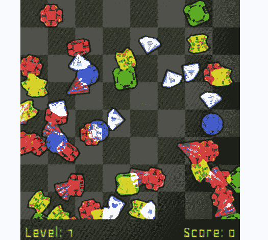

等级：1

得分：0

#### 总结

在关键位置加入一些动画效果，极大地提升了《钻石武士》的游戏体验。在本章中，你学习了如何使用新的动画时间API设置动画循环，并利用它为Canvas显示创建了一个简单的动画框架。

我向你展示了如何为各种游戏动作制作动画，例如交换钻石和添加游戏结束动画。此外，你为游戏添加了一些关键元素，即游戏计时器，以及计分和升级的能力。

# 第三部分
## 添加3D与声音

**第10章** 为游戏创建音频

**第11章** 使用WebGL创建3D图形

## 第10章
#### 为游戏创建音频

- 介绍HTML5音频
- 处理音频格式
- 使用音频数据API
- 实现音频模块
- 为游戏添加音效

**既然游戏的**视觉部分已经处理完毕，你可以转向添加音频了。本章将向你介绍新的HTML5音频元素，它旨在解决为Web应用程序添加声音这一长期存在的难题。

首先，你将探索音频元素的基础知识，涵盖HTML5规范中描述的大部分细节和API函数。你还将看到一些关于音频数据API等进行中功能的例子，它们很快将实现更酷的功能，如音频分析和动态音频生成。

最后，你将使用HTML5音频元素为《钻石武士》实现一个音频模块，并了解如何轻松地将音效绑定到游戏事件上，从而为游戏体验增添一个新的维度。

##### HTML5音频

在Web的早期，无法在网页上添加声音。当时也没有这个必要，因为Web主要被用作展示文档的工具。然而，随着当今游戏和应用程序的出现，它突然成为一项有意义的功能。

微软为Internet Explorer引入了一个**bgsound**元素，允许作者为页面附加一个音频文件，然后在后台播放。然而，它的使用并不受推荐，因为用户无法关闭声音，而且它非但没有增强页面，反而常常损害体验并惹恼用户。

此后，每当需要音频时，人们使用了各种替代解决方案。使用**embed**标签在网页中嵌入声音文件相对简单，但它依赖插件，并且在控制音频方面不尽如人意。最终，Flash接管了这一切，并从此在Web音频和视频领域占据主导地位。至少在现在之前是这样。

HTML5规范引入了新的媒体元素，让你无需使用任何插件即可处理音频和视频。这两个新的HTML元素——**audio**和**video**——非常易于使用，其基本形式只需一行HTML代码。例如，嵌入一个自动播放的声音可以简单到：

```
<audio src="mysound.mp3" autoplay></audio>
```

类似地，一个带有UI控件的视频播放器可以通过以下方式嵌入：

```
<video src="myvideo.avi" controls></video>
```

**audio**和**video**元素都实现了HTML5 MediaElement接口，因此共享大部分API。这意味着，尽管我没有直接讨论**video**元素，你仍然可以将本章学到的一些内容应用到video元素上。

###### 检测音频支持

确定浏览器是否支持`audio`元素的一种方法是简单地使用`document.createElement()`创建一个，然后测试创建的元素上是否存在音频特有的方法之一。其中一种方法是`canPlayType()`方法，你稍后会再次见到：

```
var audio = document.createElement("audio");
if (typeof audio.canPlayType == "function") {
    // 支持HTML5音频
} else {
    // 加载备用代码
}
```

Modernizr已经内置了此测试，因此你可以跳过前面的检测代码，只需检查`Modernizr.audio`属性：

```
if (Modernizr.audio) {
    // 支持HTML5音频
} else {
    // 加载备用代码
}
```

如果你需要一个好的备用解决方案，我推荐Scott Schiller出色的Sound Manager 2，可在www.schillmania.com/projects/soundmanager2/获取。这个库使得使用HTML5和JavaScript处理音频变得很容易。如果浏览器不支持HTML5音频，它会无缝回退到基于Flash的音频播放器。

###### 理解音频格式之战

然而，仅仅知道`audio`元素可用是不够的。你还需要确保浏览器能够播放你所使用的音频类型，无论是MP3、Ogg Vorbis还是其他音频格式。

HTML5规范详细描述了`audio`元素的功能，但它没有指定标准的音频格式，甚至没有暗示浏览器应该支持哪些格式。完全由浏览器厂商自行选择他们认为适合包含的格式。现在，你可能认为像Mozilla、Google和Microsoft这样的创新型公司和组织会迅速达成某种协议，确定一种通用格式。不幸的是，这尚未实现。

显然，每家浏览器厂商对于什么是好的音频格式，以及哪些格式与其自身战略和议程不符，都有自己的想法。MP3、Ogg Vorbis、AAC和Google的WebM等格式各有优缺点，软件理念和专利问题等事项减缓了标准化进程。作为Web开发者，我们所面对的是一个音频支持碎片化的局面，实际上不可能找到一种在所有平台上都支持的单一音频格式。表10-1显示了主要浏览器支持的格式。

| | WAV | MP3 | Ogg Vorbis | AAC | WebM |
|---|---|---|---|---|---|
| Internet Explorer 9 | | x | | x | |
| Chrome 14 | x | x | x | x | x |
| Firefox 5 | x | | x | | x |
| Safari 5 | x | x | | x | |
| Opera 11.5 | x | | x | x | x |
| iOS 4.3 | x | x | | x | |
| Android 2.3 | | x | | | |

如表10-1所示，没有一种格式是普遍支持的。为了使音频能在所有浏览器中工作，你需要至少两个版本的音频文件，例如Ogg Vorbis和MP3。


##### 检测支持的格式

由于 HTML5 音频并非为某一特定音频格式而设，该 API 提供了一种检测浏览器能否播放给定音频类型的方法。这个函数自然是 `audio.canPlayType()`，它之前已用于检测音频支持情况。`audio.canPlayType()` 方法接受一个参数，即一个包含你要测试的格式的 MIME 类型的字符串。例如，以下代码测试是否支持 Ogg Vorbis 音频：

```
var canPlayOGG = audio.canPlayType("audio/ogg codecs='vorbis'");
```

注意 MIME 类型中的 `codecs` 参数。某些 MIME 类型允许此可选参数，以不仅指定格式（在此例中是 Ogg 容器），还指定编解码器（此处是 Vorbis）。

MP3 音频的等效测试是：

```
var canPlayMP3 = audio.canPlayType("audio/mpeg");
```

现在，你可能认为 `audio.canPlayType()` 方法返回 `true` 或 `false`，但实际情况稍微复杂一些。返回值是一个字符串，有以下三种可能值之一：

-   `probably`
-   `maybe`
-   空字符串

值 `probably` 表示浏览器相当确定它可以播放此类型的音频文件。如果浏览器不确定能否播放指定类型，但也不确定不能，你会得到值 `maybe`。当浏览器知道它无法播放该类型的音频时，返回空字符串。根据你希望应用程序持乐观态度的程度，你可以选择只接受 `probably` 值，或同时接受 `probably` 和 `maybe`：

```
if (canPlayMP3 == "probably") {
    ... // 浏览器确信它可以播放 MP3
}

if (canPlayMP3 == "probably" || canPlayMP3 == "maybe") {
    ... // 有可能可以播放 MP3
}
```

请注意，因为空字符串在强制转换为布尔值时会被求值为 `false`，你可以将最后一个测试简化为：

```
if (canPlayMP3) {
    ... // 有可能可以播放 MP3
}
```

##### 使用 Modernizr 的格式检测

Modernizr 不仅告诉你是否支持音频元素，还通过存储许多常用格式的 `canPlayType()` 返回值，简化了对单个格式的测试。

```
if (Modernizr.audio.mp3 == "probably") {
    ...
}
```

`Modernizr.audio` 上可用的格式属性有：

-   mp3
-   ogg
-   wav
-   m4a

##### 寻找音效

并非每个人都具备创建出色音效和背景音乐所需的才能，而且对于业余开发者来说，预算问题常常会阻碍许可现成的音频或雇佣外部人才。幸运的是，许多网站提供音效和音乐，且对其使用方式几乎没有或没有任何限制。

Freesound 项目 (http://www.freesound.org/) 是一个寻找各种样本和音效的好网站。声音文件均根据知识共享 (CC) 采样加 (Sampling Plus) 许可证授权，这意味着你可以在项目中自由使用它们，只要正确署名音频片段的作者。

如果你需要完整的音乐曲目来为游戏增添一点氛围，SoundClick (http://www.soundclick.com/) 提供了数千条音乐曲目，其中许多都根据各种 CC 许可证授权。

你可以在知识共享网站 http://wiki.creativecommons.org/Content_Directories 上找到更多提供 CC 授权内容的网站。

通常，你找到的声音需要进行一些调整才能完美适合你的游戏。为此，我推荐免费、开源的音频编辑器 Audacity (http://audacity.sourceforge.net/)，它拥有比你可能需要的更多功能，并且让你可以轻松修改音频、添加效果并在各种格式之间转换。

##### 使用 audio 元素

你可以通过将 `<audio>` 元素添加到 HTML 标记中或使用 JavaScript 创建它们来创建 `<audio>` 元素。将 `<audio>` 元素添加到 HTML 中就像使用以下代码一样简单：

```
<audio src="mysound.mp3" />
```

就像 `canvas` 元素一样，`audio` 元素允许你在标签内放置任意内容，这些内容仅在 HTML5 音频不受支持时才会被渲染。你可以利用此功能，例如，包含基于 Flash 的后备解决方案或简单地显示一条有用信息：

```
<audio src="mysound.mp3">
  抱歉，您的浏览器不支持 HTML5 音频！
</audio>
```

在上面的代码片段中，任何支持音频元素的浏览器都会忽略该消息。

你也可以用 JavaScript 创建音频元素：

```
var myaudio = new Audio("mysound.mp3");
```

如果未在 `Audio()` 构造函数中指定源文件，你可以稍后通过设置 `audio` 元素的 `src` 属性来指定它。

##### 添加用户控件

`audio` 元素带有内置的 UI 控件。你可以通过将 `controls` 属性添加到元素来启用这些控件：

```
<audio src="mysound.mp3" controls />
```

这行代码告诉浏览器使用浏览器自身的控件渲染该元素。规范并未规定必须提供哪些控件或它们应是什么样子；它只建议浏览器提供用于标准行为（如播放、暂停、跳转、更改音量等）的控件。图 10-1 展示了 Firefox、Chrome 和 Internet Explorer 中渲染的带有控件的音频元素。

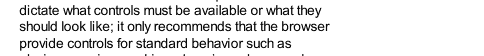


如你所见，整体外观相同，尽管默认尺寸略有不同。如有必要，你可以使用 CSS 更改元素的宽度，例如。

注意：`controls` 属性是一个布尔属性，这意味着它的存在本身就会启用该功能。布尔属性唯一允许的值就是属性本身的名称，即 `controls="controls"`。但这是可选的；通常，你可能只想使用简写形式。

如果缺少 `controls` 属性，`audio` 元素将不会被渲染，也不会影响页面其余内容。不过，你仍然可以使用 JavaScript API 播放声音。

##### 预加载音频

在某些情况下，在你要使用音频之前加载它是有意义的。你可以通过将 `audio` 元素的 `preload` 属性设置为以下三个值之一来告诉浏览器预加载音频文件：

-   `none`
-   `metadata`
-   `auto`

请注意，`preload` 属性只是给浏览器的一个提示。浏览器可以出于任何原因（如可用资源或用户偏好）完全忽略该属性。

值 `none` 提示浏览器根本不应该预加载任何数据，只在播放开始后才开始加载数据。例如，以下代码提示根本不应预加载任何数据：

```
<audio src="mysound.mp3" preload="none" />
```

`metadata` 值使浏览器仅加载足够的数据以了解音频文件的持续时间。如果 `preload` 属性设置为 `auto` 或者该属性缺失，浏览器会自行决定什么能提供最佳用户体验。这包括可能加载整个文件。

你也可以通过元素上的属性在 JavaScript 中控制预加载：

```
audio.preload = "metadata"; // 只加载元数据
```

尽管文件准备好可以立即播放是件好事，但你应始终权衡这一优势与由此产生的额外网络流量。只预加载你相当确定实际会使用的文件。

##### 指定多个源文件

我已经提到，没有一种格式在所有浏览器中都得到支持，这迫使你要么提供多种格式的源文件，要么放弃对一个或多个浏览器的支持。

幸运的是，你可以轻松指定浏览器应尝试播放的音频文件列表。`audio` 元素可以有一个或多个 `source` 子元素。这些 `source` 元素必须各自指向一个音频文件。当 `<audio>` 标签被解析时，浏览器会遍历 `source` 元素列表，并在找到它能播放的第一个时停止。`source` 元素仅作为 `audio`（或 `video`）元素的子元素时才相关；你不能单独使用它做任何事情。

```
<audio controls>
  <source src="mysound.mp3" type="audio/mpeg">
  <source src="mysound.ogg" type="audio/ogg; codecs='vorbis'">
</audio>
```

前面的示例使浏览器首先测试 MP3 支持，然后测试 Ogg Vorbis，选择第一个可用的格式。`type` 属性指定音频文件的 MIME 类型，可选地包含编解码器值。你也可以在直接使用 `src` 属性在 `audio` 元素上指定音频源时使用此属性。`type` 属性不是必需的，但你应该在可能的时候包含它。没有 MIME 类型，浏览器将被迫下载音频文件以确定它是否可以播放该文件。如果你让浏览器知道音频类型，它就可以跳过资源获取，只使用与 `canPlayType()` 方法相同的机制。

> Firefox 对 MIME 类型字符串的格式有点挑剔，要求你在 `codecs` 值周围使用双引号，因此请确保在 `type` 值周围使用单引号。

如果你在 `audio` 元素上指定了 `src` 属性并添加了 `source` 子元素，`src` 属性将优先。仅考虑由 `src` 属性指定的音频源；`source` 元素将被忽略，即使文件


##### 控制播放

`audio` 元素 API 在元素上暴露了几个方法，最重要的是 `play()` 方法，用于开始播放：

```
audio.play();
```

此方法开始播放音频。如果音频已经播放到末尾，则播放将从头重新开始。如果你想让音频尽快自动开始播放，可以使用 `autoplay` 属性：

```
<audio src="mysound.mpg" autoplay />
```

`audio` 元素的另一个方法是 `pause()` 方法：

```
audio.pause();
```

此方法暂停播放，并将 `audio` 元素的 `paused` 属性设置为 `true`。多次调用 `pause()` 没有效果；要恢复播放，必须再次调用 `play()`。使用这两个方法和 `paused` 属性，你可以轻松创建一个切换暂停状态的函数：

```
function togglePause(audio) {
  if (audio.paused) {
    audio.play();
  } else {
    audio.pause();
  }
}
```

一个常见的使用模式是让音频在到达末尾时循环回到开头并继续播放。要使音频片段循环播放，只需在 `audio` 元素上添加布尔值 `loop` 属性即可：

```
<audio src="mysound.mpg" loop />
```

你也可以在元素创建后使用 JavaScript 设置 `loop` 属性：

```
audio.loop = true; // 音频现在正在循环播放
```

**注意**

根据浏览器和平台的不同，当音频返回开头时，你可能会在开始播放前经历一个短暂的停顿。不幸的是，这个问题没有简单的解决方法。希望 HTML5 音频的实现会随着时间推移而改进，从而消除这个问题。

如果你需要更细致地控制播放位置，可以通过 `audio.currentTime` 属性来实现：

```
audio.currentTime = 60 * 1000; // 跳转到片段的 1 分钟处
```

音频规范没有描述 `stop()` 方法，但自己构建一个很简单。只需将 `currentTime` 重置为 0 并暂停播放即可：

```
function stopAudio(audio) {
  audio.pause(); // 暂停播放
  audio.currentTime = 0; // 回到开头
}
```

##### 控制音量

你可以通过设置 `audio` 元素的 `volume` 属性来调整音频片段的音量。`volume` 属性的值是一个介于 0 和 1 之间的数字，其中 0 表示完全静音，1 表示最大输出：

```
audio.volume = 0.75; // 将音量设置为 75%
```

你也可以通过将 `muted` 属性设置为 `true` 来静音音频。此属性将有效音量设置为 0，但不会更改 `volume` 值，因此当你通过将 `muted` 设置为 `false` 来取消静音时，原始音量会恢复：

```
audio.volume = 0.75; // 有效音量 = 0.75;
audio.muted = true; // 有效音量 = 0.0;
...
audio.muted = false; // 有效音量 = 0.75;
```

因为 `muted` 是一个布尔值，所以在这两种状态之间切换就像将其设置为否定值一样简单：

```
function toggleMute(audio) {
  audio.muted = !audio.muted;
}
```

##### 使用音频事件

你可以使用多个事件来检测音频元素上何时发生各种事件。表 10-2 显示了部分事件。

### 表 10-2 音频事件

| 事件名称 | 描述 |
| --- | --- |
| loadstart | 当浏览器开始加载音频资源时触发 |
| abort | 当加载因错误以外的原因被中止时触发 |
| error | 当尝试加载音频时发生错误触发 |
| loadedmetadata | 当浏览器加载了足够多以知道音频持续时间时触发 |
| canplay | 当浏览器可以开始从当前位置播放时触发 |
| canplaythrough | 当浏览器估计它可以开始从当前位置播放并能持续播放而不会耗尽数据时触发 |
| ended | 当音频到达末尾时触发 |
| durationchange | 当音频片段的持续时间发生变化时触发 |
| timeupdate | 在播放期间每次位置发生变化时触发 |
| play | 当音频开始播放时触发 |
| pause | 当音频暂停时触发 |
| volumechange | 当音频的音量发生变化时触发 |

表 10-2 中的事件列表并不详尽，但展示了大多数用例所需的重要事件。

##### 创建自定义 UI 控件

有时你可能希望提供自己的自定义 UI 元素来控制音频播放。也许是原生控件的样式不适合你的应用程序；也许你只是想更多地控制它们的行为。正如你可能已经弄清楚的那样，你可以轻松地使用上述方法和事件来创建你的控件，这就是下面示例所示的内容。清单 10.1 显示了 HTML 元素。

### 清单 10.1 用于音频控制的自定义元素

```
<audio id="myaudio" loop>
  <source src="beat.mp3" type="audio/mpeg" />
  <source src="beat.ogg" type="audio/ogg; codecs='vorbis'" />
</audio>
<section>
  <header><h3>播放器控制</h3></header>
  <div id="progress"><div class="value"></div></div>
  <button id="btn-play">播放</button>
  <button id="btn-pause">暂停</button>
  <button id="btn-stop">停止</button>
  <button id="btn-mute">静音</button>
</section>
```

你可以在文件 01-customcontrols.html 中找到此示例。我还添加了一些 CSS 规则来设置进度条的样式。播放、暂停、停止和静音按钮的实现非常简单。清单 10.2 显示了附加到按钮的点击事件处理程序。

### 清单 10.2 将点击事件绑定到音频操作

```
var audio = $("#myaudio")[0];
$("#btn-play")[0].addEventListener("click",
  function() {
    audio.play();
  }, false);
$("#btn-pause")[0].addEventListener("click",
  function() {
    audio.pause();
  }, false);
$("#btn-stop")[0].addEventListener("click",
  function() {
    audio.pause();
    audio.currentTime = 0;
  }, false);
$("#btn-mute")[0].addEventListener("click",
  function() {
    audio.muted = !audio.muted;
  }, false);
```

音频元素在播放时还应自动更新进度条。你可以使用 timeupdate 事件读取 currentTime 值并相应地更新进度条元素。清单 10.3 展示了如何操作。

### 清单 10.3 更新自定义进度条

```
function updateProgress() {
  var prog = $("#progress .value")[0],
      pos = audio.currentTime / audio.duration * 100;
  prog.style.width = pos + "%";
}
audio.addEventListener("timeupdate", updateProgress, false);
```

最后，进度条应该通过鼠标点击来响应并更改音频的播放位置。这个问题也很容易解决，因为你只需要根据点击的相对位置更新 currentTime 值。清单 10.4 显示了进度条的点击事件处理程序。

### 清单 10.4 更新播放位置

```
$("#progress")[0].addEventListener("click",
function(e) {
    var rect = this.getBoundingClientRect(),
        pos = (e.clientX - rect.left) /
              rect.width;
    audio.currentTime = audio.duration * pos;
}, false);
```

这就是使用你的 DOM 元素控制音频播放所需的全部内容。

##### 在移动设备上使用音频

但是移动设备呢？情况正在进展，但仍有一些问题需要解决。当前版本的 iOS（从 3.0 开始）和 Android（从 2.3 开始）都支持 HTML5 音频。一些早期版本的 Android 具有部分且有问题的音频支持，但直到 2.3 版本才真正能够通过 HTML5 音频播放声音。

其中一个问题涉及音量控制。正如你现在所了解的，音频元素有自己的音量值，你可以用它来控制该特定音频片段的音量。在 iOS 设备上，音频元素始终以最大音量播放，你无法更改音量值。声音音量完全由用户掌控，任何通过 JavaScript 修改它的尝试都会被忽略。除了音量控制的限制外，iOS 还因一次只允许播放一个音频流而进一步受限。开始一个新声音会暂停任何正在播放的声音。这意味着你无法拥有重叠的音效，或者例如，在播放与游戏事件相关的小片段的同时播放背景音乐。

Android 允许多个音频片段同时播放。


##### 处理音频数据

HTML5 音频的规范远未完成，至今仍在扩展音频元素的功能，例如提供对音频数据的直接、采样级访问，以实现高级音频分析、音频生成和滤波。由于这些功能远未成熟，在《宝石战士》游戏中无法使用它们，但我会稍作讨论这些 API 并为你展示几个示例。

目前，有两种不同的 API 用于处理音频数据。Mozilla 的团队在开发其中一种，另一种则来自 Chromium 项目。这两种 API 差异很大，但 W3C 音频工作组已成立，旨在寻找共同点并制定标准。请参阅以下链接获取最新信息：

- Mozilla 音频数据 API：https://wiki.mozilla.org/Audio_Data_API
- Web Audio API 提案：https://dvcs.w3.org/hg/audio/raw-file/tip/webaudio/specification.html
- W3C 音频工作组：www.w3.org/2011/audio/

Mozilla 音频数据 API 在 Firefox 5 中可用，使用起来非常简单，因此我在下一节中使用它来展示几个示例。

**注意**

与 canvas 元素上的图像数据方法类似，音频数据 API 也受同源策略限制。这意味着你只能访问与应用程序托管在同一域上的文件中的音频数据。你还需要从网络服务器运行代码，因为访问本地文件（即 `file:///`）同样受到限制。

##### 使用 Mozilla 音频数据 API

Mozilla 音频数据 API 通过额外的事件、属性和方法扩展了 `audio` 元素。让我们先看几个新属性。第一个属性是 `audio.mozChannels`，它允许你读取音频中的声道数：

```javascript
var channels = audio.mozChannels;
```

对于立体声音频剪辑，`channels` 现在将等于 2。你也可以从 `mozSampleRate` 属性读取采样率：

```javascript
var sampleRate = audio.mozSampleRate;
```

该速率通常是 44100 或 22050 等数字，表示用于描述 1 秒音频的数据值（或采样）数量。采样率通常以 Hz（赫兹）为单位表示。

##### 读取音频数据

实际的音频数据通过新事件 `MozAudioAvailable` 提供。为此事件附加一个处理程序，并使用它从 `event` 对象的 `frameBuffer` 属性读取数据：

```javascript
audio.addEventListener("MozAudioAvailable",
function(event) {
var data = event.frameBuffer,
time = event.time;
// 处理音频数据
}, false
);
```

`time` 属性以秒为单位给出从音频剪辑开始的时间。`frameBuffer` 数据本质上是描述事件触发时声音的采样数组。每个值是一个介于 -1.0 和 1.0 之间的浮点值。当你播放多声道音频时，音频不是为每个声道准备数组，而是交替混合声道值。例如，立体声音频数据按如下方式排列：

```javascript
[
    sample_000_left,
    sample_000_right,
    sample_001_left,
    sample_001_right,
    ...
]
```

帧缓冲区的大小也可以在 `MozAudioAvailable` 事件处理程序之外通过 `audio.mozFrameBufferLength` 属性获取。

```javascript
var fbLength = audio.mozFrameBufferLength;
```

> **注意**
>
> 帧缓冲区数组不是常规的 JavaScript 数组，而是 `Float32Array`，它是 Khronos（也负责 WebGL，类型化数组起源于此）目前正在制定的类型化数组规范的一部分。类型化数组只允许一种数据类型，而常规 JavaScript 数组可以接受任何内容。对于 `Float32Array`，数据类型是 32 位浮点值。这种限制的好处在于，当需要处理大量相同类型的值时（例如在图像和音频处理中），它能提供更好的性能。

##### 写入音频数据

向 `audio` 元素写入数据同样简单。

创建一个新的 `audio` 元素并使用 `audio.mozSetup()` 初始化它。`audio.mozSetup()` 方法接受两个参数，第一个是声道数，第二个是所需的采样率：

```javascript
var audio = new Audio();
audio.mozSetup(2, 44100);
```

此方法将 `audio` 元素设置为两个声道，采样率为每秒 44100 个样本。然后你可以使用 `audio.mozWriteAudio()` 方法将样本写入 `audio` 元素：

```javascript
audio.mozWriteAudio(data);
```

`data` 参数是一个交错采样数据数组，类似于 `MozAudioAvailable` 事件处理程序中的 `event.frameBuffer`。这意味着要写入 1 秒 44100Hz 立体声音频数据，你必须向音频元素的缓冲区写入 44100 * 2 = 88200 个样本值。只要缓冲区中有数据，音频元素就会播放。然而，缓冲区不是无限的，一次只能写入有限数量的样本。对于非常小的音频剪辑，有时你可以一次性写入所有需要的数据，但对于较大的剪辑——以及任何类型的连续音频流——你必须写入小块数据，并定期向缓冲区写入新数据以确保其填充。如果你传递给 `mozWriteAudio()` 的数据超过其容量，剩余的值将被忽略。返回值指示实际写入的值数量，这样你就知道还有多少数据需要写入。

##### 几个示例

你现在已经了解了 Mozilla 音频数据 API 的基础知识，所以让我为你展示几个简单的示例，说明如何使用它。

###### 可视化音频

你最喜欢的音乐播放器很可能有某种可视化功能，可以渲染响应音乐的图形。音频数据 API 的一个可能用途是创建可视化器。我向你展示的第一个示例是一个简单的可视化器，它将采样数据绘制在 canvas 元素上。清单 10.5 显示了必要的 HTML。

### 清单 10.5：音频可视化的 HTML

```html
<div>
  <canvas id="output" width="512" height="256"></canvas>
</div>
<audio id="myaudio" controls>
  <source src="beat.mp3" type="audio/mpeg" />
  <source src="beat.ogg" type="audio/ogg; codecs=vorbis" /> 
</audio>
```

只是一个 canvas 元素和一个带有 UI 控件的音频元素，这样你就可以启动和停止音频。此示例的完整代码位于本章代码归档中的 `02-audiodata-visualizer.html` 文件中。两个音频文件也包含在归档中。

可视化是通过将函数附加到 `MozAudioAvailable` 事件来完成的。然后你可以使用 `event.frameBuffer` 中的采样值在 canvas 元素上绘制点。清单 10.6 显示了渲染代码。

### 清单 10.6：可视化音频数据

```javascript
var canvas = document.getElementById("output"),
    ctx = canvas.getContext("2d"),
    audio = document.getElementById("myaudio");
audio.addEventListener("MozAudioAvailable",
                      render, false);
function render(event) {
var channels = audio.mozChannels,
    ch = canvas.height / channels, // 每个声道的像素数
    fb = event.frameBuffer,
    sample, i, j, x, y;
// 渐变为白色
ctx.fillStyle = "rgba(255,255,255,0.2)";
ctx.fillRect(0, 0, canvas.width, canvas.height);
// 绘制音频采样数据
ctx.fillStyle = "black";
for (i=0; i < channels; i++) {
    for (j=0; j < fb.length; j += channels) {
        sample = fb[j + i];
        x = j / fb.length * canvas.width;
        y = ch + (i + 0.5) + sample * ch;
        ctx.fillRect(x, y, 2, 4);
    }
}
}
```

有趣的部分在于两个嵌套循环。内循环为音频数据中的每个声道运行一次。此循环遍历所有数据，但只查看当前声道的值。它通过在帧缓冲区数组中查找采样时添加索引 `i` 来实现。x 位置只是采样在帧缓冲区中的相对位置映射到 canvas 的宽度。y 位置使用采样值，但添加偏移量，以便每个声道在其自己的水平带中绘制。最终的可视化效果为每个声道呈现一个波形，如图 10-2 所示。

**图 10-2：在 Firefox 5 中渲染的音频可视化器**


更复杂的分析通常是必需的，而这个简单的例子只是冰山一角。尽管音频分析和可视化是引人入胜的主题，但它们超出了本书的范围。如果你有兴趣在HTML5音频的背景下进一步探索这个主题，可以查看Mozilla维基上的音频数据页面：[https://wiki.mozilla.org/Audio_Data_API](https://wiki.mozilla.org/Audio_Data_API)。

在那里，你不仅能找到关于Mozilla API的优秀教程，还能找到许多示例、演示和库的链接，例如快速傅里叶变换（FFT）和各种实时音频效果。

###### 制作音调发生器

接下来是一个如何动态生成音频数据的例子。清单10.7中的`generateTone()`函数接受一个频率和采样率，并返回一个采样值数组，如果将其写入`audio`元素，就能生成指定频率的音调。

### 清单10.7 生成音调数据

```javascript
function generateTone(freq, sampleRate) {
    var samples = Math.round(sampleRate / freq);
    data = new Float32Array(samples * 2);
    sample, i;
    for (i = 0; i < samples; i++) {
        sample = Math.sin(Math.PI * 2 * i / samples);
        data[i * 2] = sample;
        data[i * 2 + 1] = sample;
    }
    return data;
}
```

声音可以被描述为正弦波，其中波长（因此频率）决定了声音的音高。例如，A音的频率是440Hz，这意味着波每秒振荡440次。因为`sampleRate`是每秒的采样数，所以我们需要（`sampleRate` / `freq`）来描述一个完整的声音波。

数据数组的长度创建为`samples * 2`，以便为左右声道留出空间。最后，计算单个采样值并存储在数据数组中。循环从`0`到（`samples` – 1），但在每次迭代中写入两个值：首先是左声道，然后是右声道。

让我们稍微扩展清单10.7中的代码，将其变成一个简单的交互式音调发生器。我使用的输入机制是一个512x512的`div`元素，用于捕获鼠标事件：

```html
<div id="input"
style="width:512px;height:512px;"></div>
```

其思想是在`div`上按住鼠标按钮会产生一个音调，其频率和左右平衡由鼠标坐标决定。清单10.8中显示的鼠标事件处理程序计算正确的值。

### 清单10.8 将频率和平衡映射到鼠标位置

```javascript
var input =
    document.getElementById("input"),
    minFreq = 100,
    maxFreq = 1200,
    balance = 0,
    freq = 0,
    input.addEventListener("mousedown",
    function(e) {
        var rect = this.getBoundingClientRect();
        function update(e) {
            var x = (e.clientX - rect.left) /
            rect.width,
            y = (e.clientY - rect.top) / rect.height;
            balance = (x - 0.5);
            freq = minFreq + (maxFreq - minFreq) * (1
            - y);
            e.preventDefault();
        }
        input.addEventListener("mousemove",
        update, false);
        input.addEventListener("mouseup",
        function(e) {
            freq = 0;
            input.removeEventListener("mousemove",
            update, false);
            input.removeEventListener("mouseup",
            update, false);
        }),
        update(e);
    }),
```

当你在`div`上点击鼠标时，`update()`函数被附加为`mousemove`事件的处理程序。现在，每次你移动鼠标，`freq`和`balance`的值都会重新计算。频率范围在[`minFreq`, `maxFreq`]内，并使用相对`y`坐标以线性方式计算。`balance`值使用相对`x`坐标，范围从−0.5到+0.5，其中−0.5表示声音完全转向左声道，+0.5表示完全转向右声道。

向`generateTone()`函数添加平衡值很容易。清单10.9展示了修改后的函数。

### 清单10.9 生成带有左右平衡的音调

```javascript
function generateTone(freq, balance, sampleRate) {
    var samples = Math.round(sampleRate / freq),
        data = new Float32Array(samples * 2),
        sample, i;
    for (i = 0; i < samples; i++) {
        sample = Math.sin(Math.PI * 2 * i / samples);
        data[i * 2] = sample * (0.5 - balance);
        data[i * 2 + 1] = sample * (0.5 + balance);
    }
    return data;
}
```

当`balance`为负时，将常量0.5减去`balance`值会增加左声道的值。类似地，当`balance`为正时，将`balance`值加到0.5上会增加右声道的值。这创造了预期的效果：根据`balance`值是负还是正，写入左声道和右声道的值会相应增加或减少。

现在到了有趣的部分，将音调数据写入`audio`元素。清单10.10展示了写入数据的代码。

### 清单10.10 写入音调音频数据

```javascript
var audio = new Audio(),
    sampleRate = 44100,
    totalSamples = 0,
    minSamples = sampleRate * 0.25 * 2;
audio.mozSetup(2, sampleRate);
function updateAudio() {
    if (!freq) {
        return;
    }
    var sampleOffset =
audio.mozCurrentSampleOffset(),
    toneData = generateTone(
        sampleOffset, balance, audio.mozSampleRate);
while (totalSamples - sampleOffset <
minSamples) {
    totalSamples +=
audio.mozWriteAudio(toneData);
    }
setInterval(updateAudio, 10);
```

首先，创建一个新的`audio`元素，并用两个声道和44100Hz的采样率进行初始化。因为只要鼠标按钮被按住且频率设置为正值，声音就应该持续播放，所以需要不断写入音频，以便音频总是有可用的数据。`minSamples`值决定了`updateAudio()`函数应确保缓冲区中存在多少个最小采样值。我选择了至少0.25秒的音频。

`audio.mozCurrentSampleOffset()`方法返回到目前为止已播放的采样数。在此示例中，`totalSamples`值用于跟踪总共写入了多少个采样。因此，`totalSamples`与采样偏移量之间的差值等于仍可用的采样数。创建一个音调数据实例并将其写入音频元素，直到满足`minSamples`要求。请注意，这种方法在切换到新音调时会产生轻微的延迟，因为缓冲区中还有一点旧音调的音频数据。

在这个示例的更健壮版本中，你可能需要检查`audio.mozWriteAudio()`的返回值，看看是否所有采样都已写入，如果没有，则将它们保存以供下次更新。另一个需要注意的问题是`updateAudio()`函数是否能跟上指定采样率和间隔时间的音频播放。如果它滞后了，你可以尝试使用较低的采样率。

##### 构建音频模块

你现在已经看到使用HTML5音频是多么容易。现在你可以通过向Jewel Warrior添加音频模块来运用这些知识。在一个新的`audio.js`文件中创建一个新的`audio`模块，并从清单10.11所示的基本模块结构开始。

### 清单10.11 音频模块

```javascript
jewel.audio = (function() {
    function initialize() {
    }
    return {
        initialize : initialize
    };
})();
```

##### 准备音频播放

第一个任务是确定音频模块将使用哪种音频格式。在本章的代码档案中，我包含了所有要实现的声音效果的MP3和Ogg Vorbis版本。清单10.12展示了一个`formatTest()`函数，它返回最合适的音频格式的文件扩展名。

### 清单10.12 确定合适的格式和文件扩展名

```javascript
jewel.audio = (function() {
    var extension;
    function initialize() {
        extension = formatTest();
        if (!extension) {
            return;
        }
    }
    function formatTest() {
        var exts = ["ogg", "mp3"],
            i;
        for (i=0; i<exts.length; i++) {
```


```javascript
if (Modernizr.audio[exts[i]] == "probably") {
    return exts[i];
}

for (i=0;i<exts.length;i++) {
    if (Modernizr.audio[exts[i]] == "maybe") {
        return exts[i];
    }
}

...
})();
```

该测试通过遍历一系列音频格式列表，并返回第一个在Modernizr特性测试中返回`probably`的格式来实现。如果没有找到这样的格式，第二个循环会寻找置信度较低的`maybe`值。这个测试确保了，例如，即使WAV文件通常是网络应用中不太理想的格式，也会选择WAV文件的`probably`值，而不是Ogg Vorbis的`maybe`值。

##### 播放音效

音频模块最重要的功能是播放声音。每个被播放的音效都需要自己的`audio`元素。清单10.13展示了负责创建这些元素的`createAudio()`函数。

### 清单 10.13 创建音频元素

```javascript
jewel.audio = (function() {
    var extension,
        sounds;
    function initialize() {
        extension = formatTest();
        if (!extension) {
            return;
        }
        sounds = {};
    }
    function createAudio(name) {
        var el = new Audio("sounds/" + name + "." + extension);
        sounds[name] = sounds[name] || [];
        sounds[name].push(el);
        return el;
    }
    ...
})();
```

`createAudio()`函数有一个参数，即不含扩展名的声音文件名，该扩展名在音频模块初始化时已经确定。然而，它不仅仅返回该元素；它还会在`sounds`对象中保留对该元素的引用。该对象为每个音效包含一个数组，其中包含了迄今为止为该特定声音创建的所有`audio`元素。这使得重用已播放完毕的元素成为可能。你可以在清单10.14的`getAudioElement()`函数中看到这一点的应用。

### 清单 10.14 获取音频元素

```javascript
jewel.audio = (function() {
...
function getAudioElement(name) {
    if (sounds[name]) {
        for (var i=0, n=sounds[name].length; i<n; i++) {
            if (sounds[name][i].ended) {
                return sounds[name][i];
            }
        }
    }
    return createAudio(name);
}
...
})();
```

`getAudioElement()`函数检查是否已有可用的`audio`元素。只有在没有可用元素时——要么是因为尚未创建任何元素，要么是因为它们都在播放中——才会创建新元素。现在你可以轻松创建一个`play()`函数来播放给定的音效。清单10.15展示了这个新函数。

### 清单 10.15 播放函数

```javascript
jewel.audio = (function() {
    var extension,
        sounds,
        activeSounds;
    function initialize() {
        extension = formatTest();
        if (!extension) {
            return;
        }
        sounds = {};
        activeSounds = [];
    }
    function play(name) {
        var audio = getAudioElement(name);
        audio.play();
        activeSounds.push(audio);
    }
    return {
        initialize : initialize,
        play : play
    };
})();
```

当`play()`函数播放声音时，它还会在`activeSounds`数组中存储对该声音的引用。我们使用这个数组来解决下一个问题：停止声音。

##### 停止声音

停止任何当前播放的声音很容易。只需遍历`activeSounds`数组，对所有`audio`元素调用`audio.stop()`方法，并清空数组。清单10.16展示了添加到`audio.js`的`stop()`函数。

### 清单 10.16 停止函数

```javascript
jewel.audio = (function() {
    ...
    function stop() {
        for (var i=activeSounds.length-1;i>=0;i--){
            activeSounds[i].stop();
        }
        activeSounds = [];
    }
    return {
        initialize : initialize,
        play : play,
        stop : stop
    };
})();
```

##### 清理

你还有一件事要做。当声音开始时，它会被添加到`activeSounds`数组中。你需要确保在播放结束后将其再次移除。为了解决这个问题，你可以利用声音结束时触发的`ended`事件。每当创建新的`audio`元素时，就为`ended`事件附加一个事件处理程序，该处理程序将`audio`元素从`activeSounds`数组中移除。清单10.17展示了这个新的事件处理程序。

### 清单 10.17 维护活动声音列表

```javascript
jewel.audio = (function() {
    var dom = jewel.dom,
    ...
    function createAudio(name) {
        var el = new Audio("sounds/" + name + "." + extension);
        dom.bind(el, "ended", cleanActive);
        ...
    }
    function cleanActive() {
        for (var i=0;i<activeSounds.length;i++) {
            if (activeSounds[i].ended) {
                activeSounds.splice(i,1);
            }
        }
    }
    ...
})();
```

由于你没有跟踪`audio`元素在`activeSounds`数组中的位置，最简单的方法是直接批量移除任何已结束的`audio`元素。元素通过使用`splice()`方法移除，该方法通过从给定索引开始移除指定数量的元素来修改数组。这当然会改变数组的长度，这就是为什么循环条件持续与当前长度进行比较（而不是像通常的最佳实践那样，与先前缓存的值进行比较）很重要的原因。

请记得将`audio.js`文件添加到加载器模块中。在二级加载器中最后一批文件中添加它：

```javascript
// loading stage 2
if (Modernizr.standalone) {
    Modernizr.load({
        {
        },
        load: [
            "loader!scripts/audio.js",
            "loader!scripts/input.js",
            "loader!scripts/screen.main-menu.js",
            "loader!scripts/screen.game.js",
            "loader!images/jewels" + jewel.settings.jewelSize + ".png"
        ]
    });
}
```

##### 为游戏添加音效

现在音频模块已完成，你可以开始为游戏添加音效了。我在本章的代码档案的`sounds`文件夹中包含了一组音效。包含的音效将用于以下游戏事件：

- 成功匹配宝石
- 执行无效的宝石交换
- 进入下一关
- 指示游戏结束

##### 从游戏屏幕播放音频

是时候回到游戏屏幕模块`screen.game.js`了。首先要做的是确保在游戏开始时初始化音频模块，即在游戏屏幕模块的`startGame()`函数被调用时。清单10.18展示了修改内容。

### 清单 10.18 初始化音频模块

```javascript
jewel.screens["game-screen"] = (function()
{
    var audio = jewel.audio,
    ...
    function startGame() {
        ...
        board.initialize(function() {
            display.initialize(function() {
                display.redraw(board.getBoard(),
                function() {
                    audio.initialize();
                    advanceLevel();
                });
            });
        });
        ...
    }
})();
```

确保在调用`advanceLevel()`之前初始化音频模块。现在播放音效就像在需要的地方添加`audio.play()`调用一样简单，如清单10.19所示。

### 清单 10.19 添加音效

```javascript
jewel.screens["game-screen"] = (function()
{
    ...
    function advanceLevel() {
        audio.play("levelup");
        ...
    }
    function gameOver() {
        audio.play("gameover");
        ...
    }
    function playBoardEvents(events) {
        if (events.length > 0) {
            ...
            switch (boardEvent.type) {
                ...
                case "remove":
                    audio.play("match");
                    ...
                case "badswap":
                    audio.play("badswap");
                    ...
            }
            ...
        }
    }
})();
```

就是这样。游戏现在会为最重要的事件播放音效。

#### 总结

在本章中，你学习了如何使用新的音频元素为你的游戏和应用程序添加声音，而无需Flash或其他基于插件的技术。然而，由于音频格式冲突和移动设备上的问题，这并非全是坦途。

尽管如此，现代桌面浏览器中的支持水平已经达到了你可以自信地使用HTML5音频的程度。本章的最后一部分向你展示了如何创建一个音频模块并使用它为宝石勇士添加音效。

你还通过音频数据API的早期形态窥见了未来。它们仍处于开发的早期阶段，有许多问题需要解决，其中最重要的事实是，参与开发的各方尚未就单一规范达成一致。不过，在不久的将来，这绝对是一个值得关注的领域。


## 第11章

#### 使用WebGL创建3D图形

*   介绍WebGL
*   使用OpenGL着色语言
*   使用Collada模型
*   为3D对象添加纹理和光照
*   创建WebGL显示模块

你已经熟悉如何使用canvas元素绘制2D图形。在本章中，你将通过3D图形和WebGL上下文来扩展这一知识。我将带你了解足够多的WebGL API，使你能够渲染带有光照和纹理对象的简单3D场景。

在本章的第一部分，我将向你介绍OpenGL着色语言（GLSL），这是一种专门为使用OpenGL渲染图形而设计的语言。然后，我将逐步向你展示如何渲染简单的3D对象。你还将了解如何将常用的Collada模型格式导入到你的WebGL应用中。

在结束之前，我将演示如何将本章所学的技术结合起来，创建一个“宝石勇士”游戏显示的WebGL版本。

##### 为Web而生的3D

canvas元素被设计为实际功能与元素本身分离。所有图形功能都由所谓的“上下文”提供。在第6章中，你学习了如何使用2D上下文提供的基于路径的API在canvas上绘制图形。WebGL为canvas元素扩展了一个3D上下文。

WebGL基于OpenGL ES 2.0图形API，这是OpenGL针对嵌入式系统和移动设备的一个变体。这也是用于在例如iPhone和Android设备上开发原生应用程序所使用的OpenGL版本。WebGL规范由Khronos Group管理，该组织也负责监督各种OpenGL规范。WebGL规范的大部分内容是OpenGL ES功能的直接映射。这样做的一个巨大优势是，已经存在许多指南、书籍和示例代码可以供你参考。即使上下文与Web无关，用其他语言（如C）编写的OpenGL ES代码示例仍然很有价值。你也可以找到大量可以直接插入WebGL应用的GLSL代码。

Firefox从4.0版本开始支持WebGL，Chrome从9.0版本开始，Safari（OS X）从5.1版本开始。Safari的WebGL默认是禁用的，但可以在开发者菜单中启用，该菜单在偏好设置的“高级”部分中启用。WebGL也即将登陆Opera，但目前仅在特殊的测试版本中可用。不幸的是，微软对WebGL表示担忧，声称其设计中固有的安全问题使其无法达到标准。结果是，Internet Explorer在不久的将来不太可能支持WebGL。然而，一个名为IWebGL的独立项目旨在通过为Internet Explorer提供插件来支持WebGL。该插件目前处于Beta测试阶段，你可以在网站http://iewebgl.com/上了解更多信息。

移动设备上的WebGL支持相当有限。标准的Android浏览器在目前可用的任何版本中都支持WebGL，尽管Mozilla在其移动版Firefox for Android中启用了WebGL。苹果正通过发布iOS 5将WebGL引入iOS，但到目前为止，它仅在其iAds框架中可用。Web开发者在这方面被冷落了。我们只能希望iOS的后续版本能将此功能扩展到移动版Safari浏览器。

##### WebGL入门

当今大多数3D图形，包括你在本章看到的，都是由小三角形（也称为面）组成的对象构成的。即使是非常精细的、表面看似光滑的3D模型，当你放大到足够近时，也会暴露出其多边形的本质。每个三角形由三个点描述，每个点（也称为顶点）是一个三维向量。将两个三角形组合在一起形成一个矩形，将六个正方形组合在一起就形成了一个立方体，以此类推。

WebGL将这些3D几何数据存储在缓冲区中，然后上传到图形处理单元（GPU）。然后，几何数据被渲染到屏幕上，首先通过一个顶点着色器，然后通过一个片段着色器。顶点着色器根据物体的旋转和位置以及期望的2D投影来转换3D点的坐标。最后，片段着色器计算用于填充屏幕上投影三角形的颜色值。着色器是我在本节介绍之后讨论的第一个主题，因为它们是创建WebGL应用的基础。

> **注意**
> WebGL和OpenGL ES非常复杂，无法在单一章节中完全详细涵盖。如果你认真进行WebGL开发和OpenGL，我建议你花时间在诸如Learning WebGL (http://learningwebgl.com/) 这样的网站上，那里你可以找到许多教程和与WebGL相关的文章。

由于WebGL基于canvas，使用WebGL的第一步是创建一个canvas元素并获取一个WebGL上下文对象：

```
var canvas =
    document.createElement("canvas"),
    gl = canvas.getContext("experimental-webgl");
```

在当前的实现中，上下文的名称是`experimental-webgl`，但随着实现的成熟，它很可能会在未来某个时候更改为`webgl`。上下文对象`gl`通过各种方法和常量实现了WebGL的所有功能。

##### 调试WebGL

调试WebGL应用可能有点棘手，因为大多数WebGL错误不会触发JavaScript错误。相反，你必须使用`gl.getError()`函数来检查是否发生了错误。如果没有错误，此函数返回值0，或者返回一个指示错误类型的WebGL错误代码：

```
var error = gl.getError();
if (error != 0) {
    alert("发生了一个错误: " + error);
}
```

在每个WebGL函数调用之后放置这样的代码会导致代码臃肿和大量额外的工作。为了使调试更容易、更轻松，Chromium团队构建了一个小型辅助库，允许你为WebGL上下文对象启用特殊的调试模式：

```
var gl = canvas.getContext("webgl");
gl = WebGLDebugUtils.makeDebugContext(gl);
```

当你使用此调试上下文时，每次调用WebGL函数时，`gl.getError()`函数都会自动被调用。如果发生错误，`gl.getError()`会将错误代码转换为更有意义的文本，并抛出一个真正的JavaScript错误。这使得捕获那些可能被忽略的错误变得容易得多。

调试辅助程序包含在本章的代码存档中，也可以在[https://cvs.khronos.org/svn/repos/registry/trunk/public/webgl/sdk/debug/webgl-debug.js](https://cvs.khronos.org/svn/repos/registry/trunk/public/webgl/sdk/debug/webgl-debug.js)获取。

启用调试模式会为所有WebGL函数添加额外的函数调用，这可能会对你的应用或游戏的性能产生负面影响。确保仅在开发期间使用调试模式，并在生产环境中切换回普通的WebGL上下文。

##### 创建辅助模块

为了简化“宝石勇士”WebGL显示的实现，你可以将一些更通用的WebGL功能放入一个单独的模块中。这是一个好主意。现在，在webgl.js中创建一个新模块，并首先添加如清单11.1所示的模块定义。

清单11.1 空的WebGL辅助模块

```
jewel.webgl = (function () {
    return {
    };
})();
```

随着本章内容的深入，你将向模块中添加越来越多的函数。

> **注意** 我没有列出示例和WebGL显示模块的完整代码。这样做会涉及大量的重复，并且详细讲解每个细节会偏离重点。你可以在本章的存档中找到完整的示例和代码。

##### 着色器

你需要了解两种着色器：顶点着色器和片段着色器。你可以将着色器视为小程序，用于指导GPU如何将缓冲区中的数据转换为你在屏幕上看到的渲染结果。着色器用于，例如，将3D空间中的点投影到2D屏幕、计算光照效果、应用纹理，以及


###### 变量与数据类型

变量声明与 JavaScript 中的类似，但使用数据类型代替 `var` 关键字：
`data_type variable_name;`
与 JavaScript 一样，你也可以赋予初始值：
`data_type variable_name = init_value;`
GLSL 引入了 JavaScript 中没有的几种数据类型。在 JavaScript 和 GLSL 中行为相同的数据类型是布尔类型，称为 `bool`：
`bool mybool = true;`
除了 `bool` 之外，GLSL 还有一些数值类型以及若干向量和矩阵类型。

###### 数值类型

与 JavaScript 不同，GLSL 有两种数值数据类型。JavaScript 中所有数字都使用 `number` 类型，而 GLSL 则分别使用 `float` 和 `int` 数据类型来区分浮点数和整数。

字面整数值可以用十进制、八进制和十六进制形式编写：

```
int mydec = 461; // 十进制 461
int myoct = 0715; // 八进制 461
int myhex = 0x1CD; // 十六进制 461
```

字面浮点值必须包含小数点或指数部分：

```
float myfloat = 165.843;
float myfloatexp = 43e-6; // 0.000043
```

GLSL 无法将整数值转换为浮点数，因此即使是像 0.0 和 7.0 这样的值，也要注意在字面浮点值中保留小数点。

###### 向量

向量类型在着色器中用途广泛。从位置、法线到颜色的一切都通过向量来描述。在 GLSL 中，向量类型有三种形式：`vec2`、`vec3` 和 `vec4`，其中的数字表示向量的维度。你可以如下创建向量：

```
vec2 pos2d = vec2(3.42, 109.45);
vec3 pos3d = vec3(3.42, 109.45, 45.15);
```

你也可以使用其他向量代替分量来创建向量：

```
vec2 myXY = vec2(1.0, 2.0); // 新的二维向量
vec3 myXYZ = vec3(myXY, 3.0); // 用第三维度扩展
```

此示例将 `vec2` 的 `x` 和 `y` 分量与一个值为 3.0 的 `z` 分量组合，创建了一个新的 `vec3` 向量。这种能力在许多情况下都很有用，例如将 RGB 颜色值转换为 RGBA：

```
vec3 myColor = vec3(1.0, 0.0, 0.0); // 红色
float alpha = 0.5; // 半透明
vec4 myRGBA = vec4(myColor, alpha);
```

到目前为止，所有的向量都是浮点向量。`vec2`、`vec3` 和 `vec4` 类型只允许浮点值。如果你需要整数值的向量，可以使用 `ivec2`、`ivec3` 和 `ivec4` 类型。类似地，`bvec2`、`bvec3` 和 `bvec4` 允许布尔值的向量。在大多数情况下，你只使用浮点向量。

###### 向量运算

你可以像处理 `float` 和 `int` 值一样对向量进行加减运算。加法是按分量进行的：

```
vec2 v0 = vec2(0.5, 1.0);
vec2 v1 = vec2(1.5, 2.5);
vec2 v2 = v0 + v1; // = vec2(2.0, 3.5)
```

你也可以将单个值与向量相加或相减：

```
float f = 7.0;
vec2 v0 = vec2(1.5, 2.5);
vec2 v1 = v0 + f; // = vec2(8.5, 9.5)
```

`float` 值被简单地加到向量的每个分量上。乘法和除法同样适用：

```
float f = 4.0;
vec2 v0 = vec2(3.0, 1.5);
vec2 v1 = v0 * f; // = vec2(12.0, 6.0)
```

如果你对两个向量使用乘法运算符，结果是这两个向量的点积：

```
vec2 v0 = vec2(3.5, 4.0);
vec2 v1 = vec2(2.0, 0.5);
vec2 v2 = v0 * v1; // = vec2(3.5 * 2.0,
4.0 * 0.5)
// = vec2(7.0, 2.0)
```

点积也可以用 `dot()` 函数计算：

```
float v2 = dot(v0, v1); // = 7.0 * 2.0 + 4.0 * 0.5 = 16.0
```

`dot()` 函数只是在处理向量时让生活更轻松的众多函数之一。另一个有用的例子是 `length()` 函数，它计算向量的长度。

###### 访问向量分量

向量的分量可以通过向量上的 x、y、z 和 w 属性来访问：

```
vec2 v = vec2(1.2, 7.3);
float x = v.x; // = 1.2
float y = v.y; // = 7.3
```

属性 r、g、b 和 a 是 x、y、z 和 w 的别名：

```
vec3 v = vec3(1.3, 2.4, 4.2);
float r = v.r; // = 1.3
float g = v.g; // = 2.4
float b = v.b; // = 4.2
```

第三种方法是将这些分量视为一个小数组，并使用数组下标来访问它们：

```
vec2 v = vec2(1.2, 7.3);
float x = v[0]; // = 1.2
float y = v[1]; // = 7.3
```

###### 混洗（Swizzling）

GLSL 向量类型的一个巧妙特性是混洗。此功能使你能够提取向量的多个分量，并将它们作为新向量返回。假设你有一个三维向量，而你想要一个只包含 x 和 y 值的二维向量。考虑以下代码：

```
vec3 myVec3 = vec3(1.0, 2.0, 3.0);
float x = myVec3.x; // = 1.0
float y = myVec3.y; // = 2.0
vec2 myVec2 = vec2(x, y);
```

此代码片段只是将 vec3 的 x 和 y 分量提取到几个 float 变量中，然后你可以使用这些变量来，例如，创建一个新的二维向量。这种方法完全可行，但下面的例子可以达到相同的效果：

```
vec3 myVec3 = vec3(1.0, 2.0, 3.0);
vec2 myVec2 = myVec3.xy; // = vec2(1.0, 2.0)
```

你不仅可以访问向量的 x 和 y 属性，还可以组合任意分量来创建新向量。

```
vec3 myVec3 = vec3(1.0, 2.0, 3.0);
myVec3.xy = vec2(9.5, 4.7); // myVec3 = vec3(9.5, 4.7, 3.0)
vec2 myVec2 = myVec3.zx; // = vec2(3.0, 9.5)
```

你甚至可以在同一个混洗表达式中多次使用同一个分量：

```
vec3 myVec3 = vec3(1.0, 2.0, 3.0);
vec2 myVec2 = myVec3.xx; // = vec2(1.0, 1.0)
```

向量的维度限制了你可以使用的分量。例如，尝试访问 vec2 的 x 分量会导致错误。

你可以使用 xyzw 和 rgba 两种方式来混洗向量分量：

```
vec4 myRGBA = vec4(1.0, 0.0, 0.0, 1.0);
vec3 myRGB = myRGBA.rgb; // = vec3(1.0, 0.0, 0.0)
```

然而，你不能混合使用这两组。例如，myRGBA.xyga 是无效的，会导致错误。

###### 矩阵

矩阵也有自己的类型，mat2、mat3 和 mat4，它们允许你处理 2x2、3x3 和 4x4 矩阵。只支持方阵。
矩阵的初始化方式与向量类似，通过向构造函数传递初始值：

```
mat2 myMat2 = mat2(
    1.0, 2.0,
    3.0, 4.0
);
mat3 myMat3 = mat3(
    1.0, 2.0, 3.0,
    4.0, 5.0, 6.0,
    7.0, 8.0, 9.0
);
```

矩阵的列可以通过类似于数组下标的语法作为向量来访问：

此语法继而允许你使用如下语法访问单个分量

```
float m12 = myMat3[1][2]; // = 8.0
```

矩阵可以像向量和数字一样进行加法和减法运算：

```
mat2 m0 = mat2(
    1.0, 5.7,
    3.6, 2.1
);
mat2 m1 = mat2(
    3.5, 2.0,
    2.9, 4.0
);
mat2 m2 = m0 + m1; // = mat2(4.5, 7.7, 5.9, 6.1)
mat2 m3 = m0 - m1; // = mat2(-2.5, 3.7, 1.3, -1.9)
```

你也可以将两个矩阵相乘。此操作不是按分量进行的，而是执行真正的矩阵乘法。如果你需要按分量的矩阵乘法，可以使用 `matrixCompMult()` 函数。

也可以将矩阵与维度匹配的向量相乘，生成一个新的向量：

```
vec2 v0 = vec2(2.5, 4.0);
mat2 m = mat2(
    3.5, 7.0,
    2.0, 5.0
);
vec2 v1 = v0 * m; // = vec2(
    // m[0].x * v0.x + m[1].x * v0.y,
    // m[0].y * v0.x + m[1].y * v0.y
    // )
    // = vec2(36.75, 25.0)
```

##### 将着色器与 WebGL 一起使用

如前所述，两种类型的着色器是顶点着色器和片段着色器。你需要各一个来渲染一个 3D 对象。顶点着色器和片段着色器具有相同的基本结构：

```
declarations
void main(void) {
    calculations
```


声明部分声明了着色器需要的任何变量——包括局部变量和从顶点数据等来源传入的输入变量。此部分还可以声明着色器使用的任何辅助函数。GLSL中的函数声明如下所示：

```
return_type function_name(parameters) {
    ...
}
```

这意味着前面示例中的函数名为`main()`，无返回值，且不接受任何参数。`main()`函数是必需的，并且在着色器执行时会自动调用。着色器通过向输出变量写入一个值来结束。顶点着色器将变换后的顶点位置写入名为`gl_Position`的变量，而片元着色器则将像素颜色写入`gl_FragColor`。

###### 顶点着色器

顶点着色器对缓冲区中的每个顶点运行其代码。清单11.2展示了一个简单的顶点着色器。

### 清单11.2 基本顶点着色器

```
attribute vec3 aVertex;
void main(void) {
    gl_Position = vec4(aVertex, 1.0);
}
```

这个简单的着色器声明了一个名为`aVertex`的attribute变量，其数据类型为`vec3`，这是一个包含三个分量的向量类型。Attribute变量指向从WebGL应用程序传递过来的数据——在本例中，是顶点缓冲区数据。在此示例中，顶点被转换为一个四维向量，并在未经其他修改的情况下赋值给输出变量`gl_Position`。稍后，你将看到如何使用视图矩阵和投影矩阵来变换3D几何图形并添加透视效果。

###### 片元着色器

片元着色器，也称为像素着色器，与顶点着色器类似，但操作对象不是顶点，而是屏幕上的像素。在顶点着色器处理三角形中的三个点并将其变换到屏幕坐标后，片元着色器为该区域内的像素着色。清单11.3展示了一个简单的片元着色器。

### 清单11.3 基本片元着色器

```
#ifdef GL_ES
precision mediump float;
#endif
void main(void) {
    gl_FragColor = vec4(1.0, 0.0, 0.0, 1.0);
}
```

片元着色器中的输出变量是一个名为`gl_FragColor`的`vec4`。本示例只是将片元颜色设置为不透明的红色。

> **注意**
> 片元这个术语指的是如果通过深度测试和其他要求，最终可能成为像素的那部分数据。一个片元不一定是一个像素的大小。例如，边缘上的片元可能比完整的像素小。尽管存在这些差异，但片元和像素，以及片元着色器和像素着色器这些术语经常可以互换使用。

你可能对清单11.3中的前三行感到好奇。OpenGL ES版本的GLSL要求片元着色器指定`float`值的精度。有三种精度可选：`lowp`、`mediump`和`highp`。你可以通过将精度限定符放在声明前为每个`float`变量指定精度：

```
mediump float myfloatvariable;
```

你也可以通过在着色器代码顶部添加精度语句来指定默认精度：

```
precision mediump float;
```

但是，早期版本的桌面OpenGL不支持`precision`关键字，使用它可能导致错误。不过，GLSL支持许多预处理器语句，如`#if`、`#ifdef`和`#endif`。你可以使用这些语句确保某段代码仅在特定条件下被编译：

```
#ifdef GL_ES
precision highp float;
#endif
```

此示例使得在未定义`GL_ES`（该宏仅在GLSL ES中定义）时，精度代码被忽略。

##### 在JavaScript中包含着色器代码

将GLSL源代码引入你的WebGL应用程序可能有点棘手。浏览器不理解GLSL，但你仍然可以直接在HTML中将代码包含在`script`元素里。只需为其指定一个自定义的脚本类型，这样浏览器就不会尝试将其作为JavaScript来解释：

```
<script id="fragment" type="x-shader/x-fragment">
// GLSL source code
</script>
```

然后，你可以使用标准的DOM脚本提取`script`元素的内容。但请注意，你不能通过在`script`元素上添加`src`属性来引用外部的GLSL文件，因为浏览器不会下载它无法执行的脚本。

另一种选择是将GLSL打包在字符串字面量中，并嵌入到JavaScript代码里：

```
var fsource =
"#ifdef GL_ES\r\n" +
"precision highp float;\r\n" +
"#endif\r\n" +
"void main(void) {\r\n" +
"  gl_FragColor = vec4(0.7, 1.0, 0.8, 1.0);\r\n" +
"}\r\n";
```

你可以在每一行末尾添加`\r\n`以在源代码中包含换行符。否则，源代码将被连接成单行，使得调试更加困难，因为着色器错误信息会包含行号。这是我在本章代码档案中的示例中选择使用的方法。它可能不是最漂亮的解决方案，但能完成任务。为了可读性，本章其余部分的代码清单中显示的GLSL代码没有引号和换行符。

第三个选项是通过Ajax从单独的文件加载着色器代码。虽然这种方法会增加额外的HTTP请求，但其优点在于可以原样存储GLSL，并鼓励着色器文件的重用。

##### 创建着色器对象

着色器源代码需要被加载到一个着色器对象中并进行编译，然后才能使用。使用`gl.createShader()`方法来创建着色器对象：

```
var shader = gl.createShader(shaderType);
```

着色器类型可以是`gl.VERTEX_SHADER`或`gl.FRAGMENT_SHADER`。无论着色器类型如何，创建着色器对象的其余过程都是相同的。

你可以使用`gl.shaderSource()`方法为着色器对象指定GLSL源代码。源代码加载后，可以使用`gl.compileShader()`方法进行编译：

```
gl.shaderSource(shader, source);
gl.compileShader(shader);
```

如果编译器因GLSL代码错误而失败，你不会收到任何JavaScript错误，但你可以通过检查`gl.COMPILE_STATUS`参数的值来检查编译器错误：

```
if (!gl.getShaderParameter(shader,
                      gl.COMPILE_STATUS)) {
```

如果没有发生编译器错误，`gl.COMPILE_STATUS`的值为`true`。如果有错误，你可以使用`gl.getShaderInfoLog()`方法获取相关的错误信息。如果你想测试这个错误捕获检查，只需在你的着色器源代码中添加一些无效的GLSL代码即可。

清单11.4展示了这些调用如何组合形成WebGL辅助模块的第一个函数。

### 清单11.4 创建着色器对象

```
jewel.webgl = (function() {
    function createShaderObject(gl, shaderType, source) {
        var shader = gl.createShader(shaderType);
        gl.shaderSource(shader, source);
        gl.compileShader(shader);
        if (!gl.getShaderParameter(shader, gl.COMPILE_STATUS)) {
            throw gl.getShaderInfoLog(shader);
        }
        return shader;
    }
    return {
        createShaderObject : createShaderObject
    }
})();
```

##### 创建程序对象

两个着色器都编译完成后，它们必须附加到一个程序对象上。程序对象将顶点着色器和片元着色器连接起来，形成一个可在GPU上运行的可执行文件。使用`gl.createProgram()`方法创建一个新的程序对象：

```
var program = gl.createProgram();
```

现在附加两个着色器对象：

```
gl.attachShader(program, vshader);
gl.attachShader(program, fshader);
```

最后，必须链接程序：

```
gl.linkProgram(program);
```

与着色器编译器一样，你需要手动检查链接器错误。检查程序对象上的`gl.LINK_STATUS`参数，并在必要时抛出JavaScript错误：

```
if (!gl.getProgramParameter(
    gl.LINK_STATUS)) {
    throw gl.getProgramInfoLog(program);
}
```

清单11.5展示了这些函数调用如何组合形成WebGL辅助模块的`createProgramObject()`函数。

### 清单11.5 创建程序对象

```
jewel.webgl = (function() {
    ...
    function createProgramObject(gl, vs, fs) {
        var program = gl.createProgram();
        gl.attachShader(program, vs);
        gl.attachShader(program, fs);
        gl.linkProgram(program);
        if (!gl.getProgramParameter(program,
            gl.LINK_STATUS)) {
            throw gl.getProgramInfoLog(program);
        }
        return program;
    }
    return {
        createProgramObject: createProgramObject,
        ...
    };
})();
```

着色器和程序对象现已准备就绪：

```
gl.useProgram(program);
```

程序现已启用并设置为活动的着色器程序。如果你使用多个程序来渲染不同的对象，请确保调用`gl.useProgram()`来告诉WebGL切换程序。

顶点着色器中的任何attribute变量在使用前都必须被启用。在WebGL的JavaScript端，你通过attribute变量的位置来引用它，可以使用`gl.getAttribLocation()`函数获取该位置：


##### Uniform 变量

如果你需要设置对当前正在渲染的所有顶点或像素全局有效的值，可以使用 *uniform 变量*。uniform 变量的值通过 JavaScript 设置，并且在你赋予新值之前不会改变。清单 11.6 展示了一个包含 uniform 值的片段着色器。

**清单 11.6 包含 Uniform 变量的片段着色器**

```
#ifdef GL_ES
precision highp float;
#endif
uniform vec4 uColor;
void main(void) {
    gl_FragColor = uColor;
}
```

只需在变量声明中添加 `uniform` 关键字，即可将其变为 uniform 变量。由于其值是在 WebGL 的 JavaScript 端设置的，你无法从着色器内部对这些变量进行写入。

Uniform 变量通过其位置被引用，方式与 attribute 变量相同。使用 `gl.getUniformLocation()` 函数来获取位置：

```
var location =
gl.getUniformLocation(program, "uColor");
```

更新 uniform 变量所需的函数取决于该变量的数据类型。存在多达 19 个用于更新 uniform 变量的函数，因此最初选择正确的函数可能看起来有些令人生畏。

要更新单个浮点数或向量变量，你可以使用 `uniform[1234]f()` 形式的函数。例如，如果 `loc` 是一个 uniform vec2 的位置，以下代码将其值更新为 vec2(2.4, 3.2)：

```
gl.uniform2f(location, 2.4, 3.2);
```

对于数组，你可以使用 `uniform[1234]fv()` 形式的函数。例如，以下代码更新一个包含三个 `vec2` 值的数组：

```
gl.uniform2fv(location, [
  2.4, 3.6,
  1.6, 2.0,
  9.6, 3.4
]);
```

`uniform[1234]i()` 和 `uniform[1234]fv()` 形式允许你更新整数值。

矩阵值通过 `uniformMatrix[234]fv()` 形式的函数设置：

```
gl.uniformMatrix3fv(location, false, [
  4.3, 6.5, 1.2,
  2.3, 7.4, 0.9,
  5.5, 4.2, 3.0
]);
```

第二个参数指定矩阵值是否应该被转置。但是，此功能不受支持，该参数必须始终设置为 `false`。你可以将矩阵值作为普通的 JavaScript 数组或 `Float32Array` 类型化数组对象传递。

回到片段颜色，`uColor` uniform 值是 vec4 类型，因此你可以使用 `gl.uniform4f()` 或 `gl.uniform4fv()` 来设置此值：

```
gl.uniform4f(location, 0.5, 0.5, 0.5, 1.0); // 50% 灰色
gl.uniform4fv(location, [1.0, 0.0, 1.0, 1.0]); // 品红色
```

##### Varying 变量

除了 uniform 变量和局部变量外，你还可以拥有从顶点着色器传递到片段着色器的 *varying 变量*。考虑一个三维空间中的三角形。顶点着色器在片段着色器接管并处理构成三角形的像素之前，对其三个顶点进行处理。当在片段着色器中读取 varying 变量时，其值会根据像素在三角形上的位置而变化。清单 11.7 展示了在顶点着色器中使用的 varying 变量示例。

### 清单 11.7 包含 Varying 变量的顶点着色器

```
attribute vec3 aVertex;
varying vec4 vColor;
void main(void) {
    gl_Position = vec4(aVertex, 1.0);
    vColor = vec4(aVertex.xyz / 2.0 + 0.5, 1.0);
}
```

在清单 11.7 的示例中，顶点的位置决定了分配给 `vColor` 变量的颜色值。该变量被声明为 `varying`，使其在片段着色器中可访问，如清单 11.8 所示。

### 清单 11.8 包含 Varying 变量的片段着色器

```
#ifdef GL_ES
precision highp float;
#endif
varying vec4 vColor;
void main(void) {
    gl_FragColor = vColor;
}
```

因为顶点被分配了不同的颜色，结果是在三角形上呈现出平滑的渐变效果。

> 在 varying 变量方面，并非所有数据类型都是平等的。只有浮点数以及浮点向量和矩阵类型可以被声明为 varying。

##### 渲染 3D 对象

现在你已经了解了 WebGL 中着色器工作的一些基础知识，是时候继续构建和渲染一些简单的 3D 对象了。大多数应用程序都有一些设置代码和一个持续更新渲染图像的渲染循环。

设置代码的多少完全取决于应用程序的性质以及 3D 几何体和着色器的数量。然而，有几件事几乎总是需要处理。例如，清除颜色，这是每当画布被清除时重置为的颜色。你可以使用 `gl.clearColor()` 方法设置此颜色：

```
gl.clearColor(0.15, 0.15, 0.15, 1.0);
```

`gl.clearColor()` 方法接受四个参数，分别对应红色、绿色、蓝色和 alpha 通道。WebGL 始终使用 0 到 1 之间的颜色值。通常，你还应该启用深度测试：

```
gl.enable(gl.DEPTH_TEST);
```

此方法使 WebGL 比较对象与视点之间的距离，以便离得更远的元素不会出现在较近对象的前面。传递给 `gl.enable()` 以启用深度测试的参数是一个常量数值。WebGL 有许多这样的常量，但在本章中你只会使用其中一小部分。其中一些常量是你可以通过 `gl.enable()` 和 `gl.disable()` 方法切换的功能，而另一些是你可以通过函数 `gl.getParameter()` 查询的参数。例如，你可以使用 `COLOR_CLEAR_VALUE` 参数查询清除颜色：

```
var color =
gl.getParameter(gl.COLOR_CLEAR_VALUE);
```

返回值的类型取决于参数；对于 `gl.COLOR_CLEAR_VALUE`，返回值是一个包含四个数值元素的 `Float32Array`，对应于清除颜色的 RGBA 值。

###### 使用顶点缓冲区

WebGL 使用缓冲区对象来存储顶点数据。你向缓冲区加载值，当你告诉 WebGL 渲染 3D 内容时，数据会被加载到 GPU。任何时候你想改变顶点数据，你都必须将新值加载到缓冲区中。你可以使用 `gl.createBuffer()` 函数创建缓冲区对象：

```
var buffer = gl.createBuffer();
gl.bindBuffer(gl.ARRAY_BUFFER, buffer);
```

`gl.bindBuffer()` 函数将缓冲区对象绑定到 `gl.ARRAY_BUFFER` 目标，告诉 WebGL 将缓冲区用作顶点缓冲区。

```
gl.bufferData(
  gl.ARRAY_BUFFER, data, gl.STATIC_DRAW
);
```

请注意，缓冲区对象并未传递给 `gl.bufferData()` 函数。相反，该函数作用于当前绑定到第一个参数指定目标的缓冲区。

第三个参数指定了缓冲区的使用方式，涉及数据更新和访问的频率。三个可用值是 `gl.STATIC_DRAW`、`gl.DYNAMIC_DRAW` 和 `gl.STREAM_DRAW`。`gl.STATIC_DRAW` 值适用于加载一次但绘制多次的数据，`gl.DYNAMIC_DRAW` 用于重复更新和访问，而 `gl.STREAM_DRAW` 应在数据只加载一次且仅绘制几次时使用。

数据应作为 `Float32Array` 类型化数组对象传递给 `gl.bufferData()`。此过程足够通用，你可以将其添加到 webgl.js 辅助模块中。清单 11.9 展示了 `gl.createFloatBuffer()` 函数。

### 清单 11.9 创建浮点缓冲区

```javascript
webgl.webgl = (function() {
  function createFloatBuffer(gl, data) {
    var buffer = gl.createBuffer();
    gl.bindBuffer(gl.ARRAY_BUFFER, buffer);
    gl.bufferData(gl.ARRAY_BUFFER,
      new Float32Array(data), gl.STATIC_DRAW
    );
    return buffer;
  }
  return {
    createFloatBuffer : createFloatBuffer,
    ...
  };
}());
```

然后你可以使用此函数从坐标数组创建缓冲区对象：

```
var vbo = webgl.createFloatBuffer(gl, [
  -0.5, -0.5, 0.0, // 三角形 1, 顶点 1
  0.5, -0.5, 0.0, // 三角形 1, 顶点 2
  0.5, 0.5, 0.0, // 三角形 1, 顶点 3
  -0.5, -0.5, 0.0, // 三角形 2, 顶点 1
  0.5, 0.5, 0.0, // 三角形 2, 顶点 2
  -0.5, 0.5, 0.0 // 三角形 2, 顶点 3
]);
```

此代码片段创建了渲染一个二维正方形所需的顶点数据。

###### 使用索引缓冲区

如果你查看前面示例中的顶点，你会发现一些顶点是重复的。顶点缓冲区创建时使用了六个顶点，而实际上只需要四个顶点就能构成一个正方形。

```
var vbo = webgl.createFloatBuffer(gl, [
  -0.5, -0.5, 0.0,
  0.5, -0.5, 0.0,
  0.5, 0.5, 0.0,
  -0.5, 0.5, 0.0
]);
```

然后你需要声明这些顶点如何用于创建三角形。你通过一个索引缓冲区来实现，它本质上是一个顶点列表的索引列表，描述了哪些顶点属于一组。索引缓冲区中的每三个条目构成一个三角形。索引缓冲区的创建方式类似于顶点缓冲区，如清单 11.10 所示。


## 清单 11.10 创建索引缓冲区

```
jewel.webgl = (function() {
  ...
  function createIndexBuffer(gl, data) {
    var buffer = gl.createBuffer();
    gl.bindBuffer(gl.ELEMENT_ARRAY_BUFFER, buffer);
    gl.bufferData(
      gl.ELEMENT_ARRAY_BUFFER,
      new Uint16Array(data), gl.STATIC_DRAW
    );
    return {
      return buffer;
    }
  }
  return {
    createIndexBuffer : createIndexBuffer,
    ...
  }
})();
```

这里的重要区别在于，缓冲区是以 `gl.ELEMENT_ARRAY_BUFFER` 类型初始化的，并且缓冲区使用的是整数数据而非浮点数。四个顶点的索引缓冲区现在可以如下创建：

```
var ibo = webgl.createIndexBuffer(gl, [
  0, 1, 2,
  0, 2, 3
]);
```

##### 使用模型、视图和投影

仅仅定义模型数据不足以以任何有意义的方式进行渲染。你还需要变换顶点，以便对象能以期望的旋转状态渲染在世界中的期望位置。顶点数据中的坐标都是相对于对象自身中心的，因此如果你想将对象定位在沿 x 轴 5 个单位处，那么你就必须将所有顶点的 x 坐标加上 5。如果观察者位于 (0,0,0) 以外的位置，这个位置也必须从顶点位置中减去。观察者和对象自身的任何旋转也都必须考虑在内。

但是，如果这些值发生变化呢？你可以重新变换顶点数据并再次发送给 GPU，但将顶点数据从 JavaScript 传输到 GPU 在资源方面代价相对较高，并且可能会拖慢你的应用程序。为了在每个渲染周期都更新顶点缓冲区，变换任务通常被委托给顶点着色器。要将顶点变换到屏幕坐标，你需要构造两个矩阵：模型-视图矩阵和投影矩阵。模型-视图矩阵描述了将模型带到相对于观察者的正确位置所需的变换。投影矩阵描述了如何将变换后的点投影到 2D 屏幕上。矩阵可以在着色器中声明为 uniform 变量，因此你只需要在每个周期更新它们即可。

在 JavaScript 中处理向量和矩阵并非易事，因为 JavaScript 本身没有内置支持。然而，可用的库提供了最常见的操作，并让你免于处理矩阵操作和线性代数的所有细节。我选择使用的矩阵库是 glMatrix，这是一个专门为 WebGL 开发的库，并且用开发者的话说，它“快得惊人”。你可以在 http://code.google.com/p/glmatrix/ 上了解更多关于 glMatrix 的信息。我也在本章的代码档案中包含了这个库。

###### 模型-视图矩阵

让我们从模型-视图矩阵开始。glMatrix 库通过三个对象 `vec3`、`mat3` 和 `mat4` 上的静态方法来提供其功能。创建一个 4x4 矩阵非常简单：

```
var mvMatrix = mat4.create();
```

使用 `mat4.identity()` 方法将矩阵设置为单位矩阵（对角线为 1，其余为零）。

```
mat4.identity(mvMatrix);
// 1 0 0 0
// 0 1 0 0
// 0 0 1 0
// 0 0 0 1
```

要移动位置，请使用 mat4.translate() 方法：

```
mat4.translate(mvMatrix, [0, 0, -5]);
```

mat4.translate() 方法的第二个参数是将被加到对象位置上的向量。你可以做两次平移——一次用于对象位置，一次用于视图位置——或者将它们结合起来，这取决于你。注意向量只是普通的 JavaScript 数组；矩阵也是如此。glMatrix 高效的部分原因在于它保持了简单性，没有创建大量自定义对象。

mat4.rotate() 方法添加围绕指定轴的旋转：

```
mat4.rotate(mvMatrix, Math.PI / 4, [0, 1, 0]);
```

第二个参数是旋转量，以弧度为单位。第三个参数是对象将围绕其旋转的轴。任何向量在这里都可以胜任。

你可以将这些操作组合成一个用于 webgl.js 辅助模块的 setModelView() 函数，如清单 11.11 所示。

## 清单 11.11 设置模型-视图矩阵

```
jewel.webgl = (function () {
    ...
    function setModelView(gl, prgm, pos, rot, axis) {
        var mvMatrix = mat4.identity(mat4.create());
        mat4.translate(mvMatrix, pos);
        mat4.rotate(mvMatrix, rot, axis);
        gl.uniformMatrix4fv(
            gl.getUniformLocation(prgm, "uModelView"),
            false, mvMatrix
        );
        return mvMatrix;
    }
    ...
})();
```

在将平移和旋转应用于模型-视图矩阵之后，矩阵会通过 `gl.uniformMatrix4fv()` 函数在着色器中更新。模型-视图函数假设着色器中的 uniform 变量名为 `uModelView`。

###### 投影矩阵

将 3D 点投影到 2D 表面有多种方法。一种常用的方法是透视投影，其中远处的物体看起来比近处的物体小，模拟人眼所见。glMatrix 库实际上有一个创建透视投影矩阵的函数：

```
var projMatrix = mat4.create();
mat4.perspective(fov, aspect, near, far, projMatrix);
```

`fov` 参数是视场（FOV）值，一个衡量观察者能看到多少范围的角测量值。该值以度为单位，并指定视场的垂直范围。人类通常的垂直视场约为 100 度，但游戏通常使用比这更低的数字。45 到 90 度之间的值是常用的，但完美的值是主观的，取决于游戏的需求。

`aspect` 参数是输出表面的纵横比。在大多数情况下，你应该使用输出画布的宽高比。`near` 和 `far` 参数指定视区的边界。任何比 `near` 更靠近观察者或比 `far` 更远的物体都不会被渲染。

投影矩阵的辅助函数如清单 11.12 所示。

## 清单 11.12 投影矩阵辅助函数

```
jewel.webgl = (function() {
    ...
    function setProjection(gl, prgm, fov,
        aspect, near, far) {
        var projMatrix = mat4.create();
        mat4.perspective(
            fov, aspect,
            near, far,
            projMatrix
        );

        gl.uniformMatrix4fv(
            gl.getUniformLocation(prgm, "uProjection"),
            false, projMatrix
        );

        return projMatrix;
    }
    ...
})();
```

##### 顶点着色器中的矩阵

要在顶点着色器中使用这两个矩阵，你可以为 uModelView 和 uProjection 添加 uniform 声明：

```
uniform mat4 uModelView;
uniform mat4 uProjection;
```

要变换顶点位置，只需将其与两个矩阵相乘即可。因为它们是 4x4 矩阵，你需要在相乘之前将顶点转换为 vec4。清单 11.13 展示了完整的顶点着色器。

## 清单 11.13 变换顶点位置

```
attribute vec3 aVertex;
uniform mat4 uModelView;
uniform mat4 uProjection;
varying vec4 vColor;
void main(void) {
    gl_Position = uProjection * uModelView *
        vec4(aVertex, 1.0);
    vColor = vec4((aVertex.xyz + 1.0) / 2.0,
        1.0);
}
```

##### 渲染

通常，仅在应用程序开始时设置一次模型-视图和投影矩阵是不够的。如果对象是动画的——例如，它正在移动或旋转——模型-视图矩阵必须持续更新。在第 9 章中，我向你展示了如何使用 requestAnimationFrame() 计时函数制作简单的动画循环。你可以使用相同的技术为 WebGL 创建一个渲染循环。一个循环函数的示例如清单 11.14 所示。

## 清单 11.14 渲染循环

```
function cycle() {
    var rotation = Date.now() / 1000,
        axis = [0, 1, 0.5],
        position = [0, 0, -2.5];
    webgl.setModelView(gl, program, position,
        rotation, axis);
    draw();
    requestAnimationFrame(cycle);
}
```

在此示例中，模型-视图矩阵每帧都会更新以调整旋转。应用于矩阵的旋转基于当前时间，因此对象将以均匀的速度旋转，无论循环运行多频繁。在更新模型-视图之后，一个 `draw()` 函数或类似的函数可以负责渲染对象。一个初始的 `cycle()` 调用会使一切运转起来。

###### 清除画布

清单 11.14 中的 `cycle()` 函数调用一个 `draw()` 函数来进行实际的渲染。这个函数在渲染任何东西之前应该做的第一件事就是清除画布。你可以使用 `gl.clear()` 函数来完成此操作：

```
gl.clear(mask);
```

此函数接受一个参数，指定它应该清除什么。你可以使用的可能值是常量 `gl.COLOR_BUFFER_BIT`、`gl.DEPTH_BUFFER_BIT` 和 `gl.STENCIL_BUFFER_BIT`。这些值指的是现代图形编程中已成为标准的三个缓冲区（颜色、深度和模板）。颜色缓冲区包含渲染到画布上的实际像素，也就是你在屏幕上看到的内容。深度缓冲区用于在绘制距离视点不同距离的重叠元素时跟踪每个像素的深度。第三个缓冲区，模板缓冲区，本质上是一个应用于渲染内容的掩码。例如，它对于阴影效果可能很有用。

`mask` 参数是一个**位掩码**。位掩码提供

一种资源高效的方式是在单个数值中指定多个开/关值。每个 `gl.*_BUFFER_BIT` 值对应于数字中的不同位。这样，你可以通过使用按位或（管道）运算符组合值，将多个值传递给函数：

```
gl.clear(gl.COLOR_BUFFER_BIT | gl.DEPTH_BUFFER_BIT);
```

此函数会清除颜色缓冲区和深度缓冲区。画布的颜色会被重置为使用 `gl.clearColor()` 函数设置的颜色，正如我在本章开头所示。

接下来，你需要声明视口，即画布上放置渲染内容的矩形区域：

```
gl.viewport(0, 0, canvas.width, canvas.height);
```

实际上，你并不需要在每个渲染周期都设置此值，但如果你在设置视口后更改了画布元素的尺寸，视口不会自动更新。在每个周期设置视口可确保在渲染任何内容之前，视口被设置为整个画布区域。

###### 绘制顶点数据

现在我们准备好绘制一些形状了。在顶点数据通过 `aVertex` 属性提供给顶点着色器之前，你必须激活顶点缓冲区。首先，确保顶点缓冲区绑定到 `gl.ARRAY_BUFFER` 目标：

```
gl.bindBuffer(gl.ARRAY_BUFFER, vbo);
```

现在你可以使用 `gl.vertexAttribPointer()` 函数将缓冲区数据分配给属性值：

```
gl.vertexAttribPointer(aVertex, 3, gl.FLOAT, false, 0, 0);
```

此函数将当前绑定的缓冲区分配给由 `aVertex` 标识的属性变量，`aVertex` 是通过 `gl.getAttribLocation()` 获取的属性位置。其余五个参数如下：属性大小、数据类型、归一化、步幅和偏移量。属性大小是每个向量的分量数；在本例中，每个顶点有三个分量。数据类型指的是顶点分量的数据类型。但请注意，无论数据类型如何，这些值都会被转换为 `float`。`normalized` 参数仅用于整数数据。如果设置为 `true`，则分量会被归一化到有符号值的范围 [-1,1] 或无符号值的范围 [0,1]。步幅是从一个顶点的起始位置到下一个顶点起始位置的字节数。如果你指定步幅值为 0，WebGL 会假定顶点是紧密打包的，数据中没有间隙。最后一个参数指定第一个顶点的位置。

顶点部分到此结束——接下来是索引缓冲区，它只需要绑定到 `gl.ELEMENT_ARRAY_BUFFER` 目标：

```
gl.bindBuffer(gl.ELEMENT_ARRAY_BUFFER, ibo);
```

这告诉 WebGL 将缓冲区用作索引，而不是顶点数据。现在你可以使用 `gl.drawElements()` 函数绘制三角形：

```
gl.drawElements(gl.TRIANGLES, num, gl.UNSIGNED_SHORT, 0);
```

`gl.drawElements()` 函数接受四个参数：渲染模式、元素数量、值的数据类型以及起始偏移量。`gl.TRIANGLES` 模式告诉 WebGL，每三个索引值之后开始一个新的三角形。数据类型对应于用于创建缓冲区数据的值的类型。索引缓冲区是从 `Uint16Array()` 类型化数组创建的，这对应于 WebGL 中的 `gl.UNSIGNED_SHORT` 值。除非你只渲染部分三角形，否则偏移参数应设置为零。

将这些调用组合起来，你会得到一个类似清单 11.15 中所示的 `draw()` 函数。

### 清单 11.15 绘制对象

```
function draw() {
    gl.clear(gl.COLOR_BUFFER_BIT | gl.DEPTH_BUFFER_BIT);
    gl.viewport(0, 0, canvas.width, canvas.height);
    gl.bindBuffer(gl.ARRAY_BUFFER, geometry.vbo);
    gl.vertexAttribPointer(aVertex, 3,
        gl.FLOAT, false, 0, 0);
    gl.bindBuffer(gl.ELEMENT_ARRAY_BUFFER, geometry.ibo);
    gl.drawElements(
        gl.TRIANGLES, geometry.num,
        gl.UNSIGNED_SHORT, 0
    );
}
```

在文件 `01-cube.html` 中，你可以找到如何使用此处展示的技术来渲染一个彩色旋转立方体的示例，如图 11-1 所示。

### 图 11-1：渲染彩色立方体

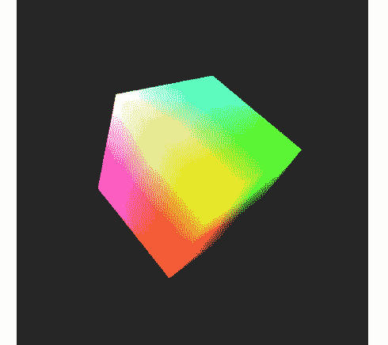

##### 其他渲染模式

除了 `gl.TRIANGLES` 之外，还有其他渲染模式可用。WebGL 也可以渲染点和线，并且有以不同方式解释顶点数据的模式。可用的渲染模式有：

- `TRIANGLES`
- `TRIANGLE_STRIP`
- `TRIANGLE_FAN`
- `POINTS`
- `LINES`
- `LINE_LOOP`
- `LINE_STRIP`

我这里不详细介绍所有这些模式，但我鼓励你尝试它们。像 `gl.TRIANGLE_STRIP` 这样的模式特别有用，因为它允许你通过排序三角形（使下一个三角形从前一个三角形结束的地方开始）来减少所需的索引数量。另一个有趣的模式是 `gl.POINTS`，它非常适合粒子效果等场景，以及 `gl.LINES` 模式，你可以用它来渲染线条和线框式对象。

在前面的例子中，WebGL 需要一个索引列表才能从顶点构造三角形。如果顶点数据被打包，使得顶点可以从头到尾读取，你就不需要索引数据，而是可以使用 `gl.drawArrays()` 函数来渲染几何体：

```
var vbo = createFloatBuffer([
    -0.5, -0.5, 0.0, // tri 1 ver 1
     0.5, -0.5, 0.0, // tri 1 ver 2
     0.5,  0.5, 0.0, // tri 1 ver 3 / tri 2 ver 1
    -0.5,  0.5, 0.0, // tri 2 ver 2
    -0.5, -0.5, 0.0  // tri 2 ver 3
]);
gl.drawArrays(gl.TRIANGLE_STRIP, 0, 5);
```

此示例设置以三角形带形式渲染正方形所需的顶点。注意，第三个顶点既用作第一个三角形的第三个顶点，也用作第二个三角形的第一个顶点。

##### 加载 Collada 模型

手动指定所有顶点和索引值仅对简单形状（如立方体、平面或其他基本图元）是可行的。任何需要大量三角形的复杂对象最好从外部文件导入。请注意，3D 模型格式数不胜数，但只有少数几种能被 JavaScript 轻松解析。理想的解决方案是基于 JSON 的格式，但我尚未遇到主要图形应用程序支持的此类格式。

然而，XML 在 JavaScript 中也相当容易使用，因为它可以使用内置的 DOM API 进行解析。Collada 是一种基于 XML 的模型格式，由 Khronos Group（与 WebGL 相关的同一组织）维护。该格式近年来获得了广泛欢迎，许多 3D 建模应用程序都可以将其模型导出为 Collada 文件。

如果你是 3D 建模新手，并且不想花费数百甚至数千美元购买 3D 图形应用程序，我建议你尝试 Blender (www.blender.org)，一个免费且开源的 3D 图形软件包。它支持多个平台，包括 Windows、Mac OSX 和 Linux，并且其功能集可与许多商业应用程序相媲美。它还支持导出和导入多种文件格式，包括 Collada。

###### 获取模型文件

首先，你需要加载模型数据，但你可以轻松地用一点 Ajax 来完成。清单 11.16 中的 `webgl.loadModel()` 函数展示了加载模型文件所需的标准 Ajax 代码。

```
清单 11.16 加载 XML 文件

jewel.webgl = (function() {
...
function loadModel(gl, file, callback) {
  var xhr = new XMLHttpRequest();
  xhr.open('GET', file, true);
  // 覆盖 MIME 类型以确保它被加载为 XML
  xhr.overrideMimeType("text/xml");
  xhr.onreadystatechange = function() {
    if (xhr.readyState == 4) {
      if (xhr.status == 200 && xhr.responseXML) {
        callback(parseCollada(gl,
          xhr.responseXML));
      }
    }
  };
  xhr.send(null);
}
return {
  ...
  loadModel : loadModel
};
})();
```

当文件加载完成时，XML 文档可在 `xhr` 的 `responseXML` 属性中获取。此

文档被传递给一个`webgl.parseCollada()`函数，该函数必须解析XML文档并创建必要的缓冲对象。

##### 解析XML数据

`parseCollada()`函数可以使用Sizzle来提取相关节点，然后，就是构建包含值的数组的问题。我不会详细介绍Collada XML格式和`parseCollada()`函数，而是建议你参考可在 [www.khronos.org/collada/](http://www.khronos.org/collada/) 获取的Collada规范。你可以在本章代码存档的`webgl.js`模块中找到完整的解析函数，但请注意，它只实现了该格式的一个非常小的子集，以加载测试模型。清单11.17展示了解析函数的返回值。

### 清单11.17 解析Collada XML数据

```javascript
jewel.webgl = (function() {
  ...
  function parseCollada(xml) {
    ... // XML parsing
    return {
      vbo : createFloatBuffer(gl, vertices),
      nbo : createFloatBuffer(gl, normals),
      ibo : createIndexBuffer(gl, indices),
      num : indices.length
    };
  }
  ...
})();
```

`webgl.parseCollada()`的返回值是一个小对象，包含三个缓冲对象`vbo`、`nbo`和`ibo`，以及一个表示索引数量的数字。`vbo`和`ibo`缓冲区包含顶点和索引数据；第三个缓冲区`nbo`包含*法线*向量。你将在下一节中看到如何使用这些法线向量来增强带有纹理和光照效果的渲染。文件`02-collada.html`中的示例使用Collada加载代码来加载并渲染一个球体模型。生成的图像如图11-2所示。

图11-2：渲染Collada球体模型

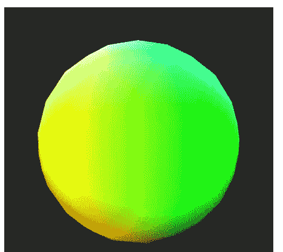

记住

你无法使用Ajax请求访问本地文件。此示例需要从Web服务器运行才能正常工作。

##### 使用纹理和光照

到目前为止，你看到的两个示例有点平淡和单调。为了真正凸显图像中的三维感，场景需要光照。表面的配色方案也不是很有趣。在许多情况下，表面应该覆盖纹理图像以模拟某种材料。然而，首先，让我们看看光照问题。

###### 添加光源

你可以使用许多不同的方法为3D场景应用光照，从相对简单的近似到逼真但复杂的数学模型。我坚持使用一种叫做Phong光照的简单解决方案，这是一种常见的表面光反射近似。

Phong模型通过使用三个不同的组成部分——环境光、漫反射光和高光——将光照应用于表面上的一个点。环境光模拟来自周围环境的光散射——即，不是直接从光源照射到该点，而是从附近其他物体反射的光。漫反射光是当来自光源的光直接照射到表面时，出现在表面上的大而柔和的高光。这个光分量模拟了当表面将入射光向许多不同方向反射时发生的漫反射。高光取决于观察者的位置，模拟当光从表面直接反射到眼睛时出现的小而强的高光。然后，一个表面点的颜色由该表面颜色乘以三个光照分量的总和来确定：

```glsl
gl_FragColor = color * (ambient + diffuse + specular);
```

环境光分量是最容易实现的，因为它只是一个常量。然而，漫反射和高光分量需要一些三角学知识。

###### 角度和法线

漫反射光分量使用照射到物体表面的光线与表面法线之间的夹角。表面上某一点的法线是垂直于该点表面的向量。例如，与地面平行的表面具有的法线向量是直向上的。

法线向量是归一化的，因此向量的模或长度正好是1：

```glsl
length = sqrt(v.x * v.x + v.y * v.y + v.z * v.z) = 1.0
```

这也称为*单位长度*，具有单位长度的向量——例如，法线向量——称为*单位向量*。

因为3D几何体由三角形和顶点组成，而不是平滑弯曲的表面，所以法线实际上是顶点法线，即每个顶点都有一条法线垂直于该顶点位置的切平面。前面显示的Collada加载函数已经创建了一个法线缓冲对象，其中包含了从模型文件中找到的法线数据。

在顶点着色器中，你通过一个属性变量访问顶点法线，就像你访问顶点本身一样：

```glsl
attribute vec3 aNormal;
```

法线缓冲区的激活和启用方式与顶点缓冲区相同：

```javascript
var aNormal = gl.getAttribLocation(program, "aNormal");
gl.enableVertexAttribArray(aNormal);
```

将缓冲区数据绑定并分配给`aNormal`属性的代码也不应该感到惊讶：

```javascript
gl.bindBuffer(gl.ARRAY_BUFFER, nbo);
gl.vertexAttribPointer(aNormal, 3, gl.FLOAT, false, 0, 0);
```

当顶点数据由模型视图矩阵变换时，你还需要变换法线。如果你没有对模型视图矩阵应用任何缩放（此处显示的示例没有这样做），你可以直接使用模型视图矩阵的左上角3X3部分。如果模型视图矩阵已被缩放，你需要使用模型视图矩阵的*逆转置*矩阵。清单11.18展示了辅助模块的`setNormalMatrix()`函数。

### 清单11.18 设置法线矩阵

```javascript
jewel.webgl = (function() {
    ...
    function setNormalMatrix(gl, program, mv) {
        // use this instead if model-view has been scaled
        // var normalMatrix =
        // mat4.toInverseMat3(mv);
        // mat3.transpose(normalMatrix);
        var normalMatrix = mat4.toMat3(mv);
        gl.uniformMatrix3fv(
            gl.getUniformLocation(program, "uNormalMatrix"),
            false, normalMatrix);
        return normalMatrix;
    }
})();
```

###### 逐顶点光照

在顶点着色器中可以访问法线向量后，你可以使用它来计算照射到给定顶点的光量。首先，我将展示如何在顶点着色器中实现Phong光照的漫反射部分。我接下来展示的示例使用单个静态光源。光源位置被指定为一个uniform变量`uLightPosition`。最终的漫反射光值通过一个varying变量`vDiffuse`传递给片段着色器。

首先通过将法线乘以法线矩阵来变换法线。确保在乘法之后重新归一化它：

```glsl
vec3 normal = normalize(uNormalMatrix * aNormal);
```

光线的方向很容易确定，只需从光线位置减去变换后的顶点位置：

```glsl
vec3 lightDir = normalize(uLightPosition - position.xyz);
```

现在使用这两个向量的点积来计算此顶点的漫反射光量：

```glsl
vDiffuse = max(dot(normal, lightDir), 0.0);
```

如果光线方向与表面平行，法线和光线方向向量是正交的，导致点积为零。这两个向量越接近平行，漫反射值就越接近1。结果是当光线垂直照射表面时，光照更强烈。清单11.19展示了完整的顶点着色器。

### 清单11.19 计算逐顶点漫反射光

```glsl
attribute vec3 aVertex;
attribute vec3 aNormal;
uniform mat4 uModelView;
uniform mat4 uProjection;
uniform mat3 uNormalMatrix;
uniform vec3 uLightPosition;
varying float vDiffuse;
varying vec3 vColor;
void main(void) {
    vec4 position = uModelView * vec4(aVertex, 1.0);
    vec3 normal = normalize(uNormalMatrix * aNormal);
    vec3 lightDir = normalize(uLightPosition - position.xyz);
    vDiffuse = max(dot(normal, lightDir), 0.0);
    vColor = aVertex.xyz * 0.5 + 0.5;
    gl_Position = uProjection * position;
}
```

在片段着色器中（如清单11.20所示），应用光照只需将像素颜色乘以环境光和漫反射分量的总和即可。

### 清单11.20 片段着色器中的光照

```glsl
#ifdef GL_ES
precision mediump float;
#endif
uniform float uAmbient;
varying float vDiffuse;
varying vec3 vColor;
void main(void) {
    gl_FragColor = vec4(vColor * (uAmbient + vDiffuse), 1.0);
}
```


你可以在文件 03-lighting-vertex.html 中找到这个示例。它产生了图 11-3 所示的结果。

##### 添加逐像素光照

如图 11-3 所示，在明暗过渡的区域中，三角形很容易被分辨出来。解决此问题的一个方法是将计算移至片元着色器。这被称为逐片元或逐像素光照，因为光照是按像素而非顶点进行计算的。在片元着色器中进行计算通常可以产生更好的效果，但代价是需要使用额外的资源。虽然顶点着色器只需要三次计算就能覆盖一个三角形，但片元着色器必须为屏幕上绘制的每个像素进行计算。

*图 11-3：使用逐顶点光照的球体*

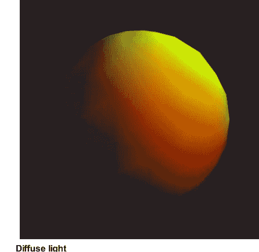

###### 漫反射光

片元需要能够访问顶点法线。清单 11.21 展示了修改后的顶点着色器，其中计算已被移除，并将法线导出到一个 varying 变量。

### 清单 11.21 用于逐像素光照的顶点着色器

```glsl
attribute vec3 aVertex;
attribute vec3 aNormal;
uniform mat4 uModelView;
uniform mat4 uProjection;
uniform mat3 uNormalMatrix;
varying vec4 vPosition;
varying vec3 vNormal;
varying vec3 vColor;
void main(void) {
    vPosition = uModelView * vec4(aVertex, 1.0);
    vColor = aVertex.xyz * 0.5 + 0.5;
    vNormal = uNormalMatrix * aNormal;
    gl_Position = uProjection * vPosition;
}
```

清单 11.22 所示的片元着色器中的计算与清单 11.19 中顶点着色器的计算几乎相同，无需进一步解释。

### 清单 11.22 片元着色器中的漫反射光

```glsl
#ifdef GL_ES
precision mediump float;
#endif
uniform vec3 uLightPosition;
uniform float uAmbient;
varying vec4 vPosition;
varying vec3 vNormal;
varying vec3 vColor;
void main(void) {
    vec3 normal = normalize(vNormal);
    vec3 lightDir = normalize(uLightPosition - vPosition.xyz);
    float diffuse = max(dot(normal, lightDir), 0.0);
    vec3 color = vColor * (uAmbient + diffuse);
    gl_FragColor = vec4(color, 1.0);
}
```

现在我们已经转移到片元着色器，我们还可以添加高光分量以获得闪亮的高光。

###### 镜面高光

要计算强烈的镜面高光分量，你需要两个新的向量：视线方向和反射方向。视线方向是从观察点指向表面某点的向量。如果 `vPosition` 是相对于眼睛的位置，那么方向就是 -vPosition，归一化为单位长度：

```glsl
vec3 viewDir = normalize(-vPosition.xyz);
```

反射方向是光从表面反射的方向。如果你知道表面法线和入射光方向，GLSL 提供了一个 `reflect()` 函数来计算反射向量：

```glsl
vec3 reflectDir = reflect(-lightDir, normal);
```

需要添加到表面点的镜面高光量取决于这两个向量之间的夹角。与漫反射光一样，你可以使用向量的点积作为镜面高光值：

```glsl
float specular = max(dot(reflectDir, viewDir), 0.0);
```

你可以通过将高光值提升到某个幂次来控制表面的光泽度：

```glsl
specular = pow(specular, 20.0);
```

最后，将高光分量添加到光照总和中。清单 11.23 展示了在片元着色器中添加的内容。

### 清单 11.23 片元着色器中的镜面高光

```glsl
...
void main(void) {
    ...
    vec3 viewDir = normalize(-vPosition.xyz);
    vec3 reflectDir = reflect(-lightDir, normal);
    float specular = max(dot(reflectDir, viewDir), 0.0);
    specular = pow(specular, 20.0);
    vec3 color = vColor * (uAmbient + diffuse + specular);
    gl_FragColor = vec4(color, 1.0);
}
```

结果如图 11-4 所示。将光照计算移至片元着色器使得不同明暗之间的过渡更加平滑，并且添加高光分量为表面增添了漂亮的光泽效果。此示例的代码位于文件 04-lighting-fragment.html 中。

### 图 11-4：使用逐像素光照的球体

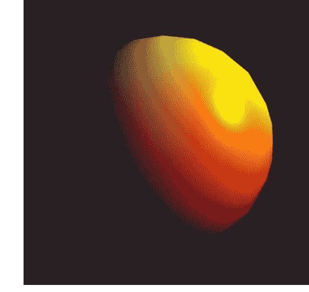

##### 创建纹理

是时候摆脱球体上那乏味的颜色渐变，贴上一些更有趣的东西了。要使用纹理图像，首先需要创建一个纹理对象：

```javascript
var texture = gl.createTexture();
```

纹理对象需要绑定到一个目标，以便让 WebGL 知道你打算如何使用它。你需要的目标是 `gl.TEXTURE_2D`。

```javascript
gl.bindTexture(gl.TEXTURE_2D, texture);
```

函数 gl.texParameteri() 和 gl.texParameterf() 使你能够设置控制纹理使用方式的参数。例如，你可以指定当纹理图像在不同距离观看时，WebGL 应该如何缩放它。参数 gl.TEXTURE_MIN_FILTER 和 gl.TEXTURE_MAG_FILTER 分别指定用于缩小和放大的缩放方法：

```javascript
gl.texParameteri(
    gl.TEXTURE_2D, gl.TEXTURE_MIN_FILTER,
    gl.LINEAR
);
gl.texParameteri(
    gl.TEXTURE_2D, gl.TEXTURE_MAG_FILTER,
    gl.LINEAR
);
```

值 gl.NEAREST 切换到快速最近邻方法，而 gl.LINEAR 选择更平滑的线性过滤。

你可能偶尔会遇到的一个术语是 **mipmaps**。Mipmaps 是预先计算好的、缩小版本的纹理图像，可用于提高性能。你可以通过调用 gl.generateMipmaps() 函数让 WebGL 自动生成 mipmaps：

```javascript
gl.generateMipmaps(gl.TEXTURE_2D);
```

然后你可以将缩小过滤参数设置为以下值之一：

- gl.NEAREST_MIPMAP_NEAREST
- gl.LINEAR_MIPMAP_NEAREST
- gl.NEAREST_MIPMAP_LINEAR
- gl.LINEAR_MIPMAP_LINEAR

> **注意**
> 如果你使用 mipmapping，纹理的尺寸必须是 2 的幂次方，例如 512x512、256x256 或 2048x1024。Mipmap 图像被输入到 mipmap 级别中，其中每个级别包含一个缩放到 1/2^n 的版本，n 是级别编号。

###### 加载图像数据

现在你已经准备好将一些像素加载到纹理对象中。你可以使用 `texImage2D()` 函数来完成此操作：

```javascript
gl.texImage2D(
  gl.TEXTURE_2D, 0, gl.RGBA, gl.RGBA,
  gl.UNSIGNED_BYTE, image
);
```

第二个参数指定此数据应加载到的 mipmap 级别。因为这里没有使用 mipmaps，所以数据应加载到级别 0。第三个参数是纹理内部使用的像素格式，第四个参数是图像数据中使用的像素格式。在加载数据时实际上无法在格式之间进行转换，因此这两个参数必须匹配。有效的格式是 gl.RGBA、gl.RGB、gl.ALPHA、gl.LUMINANCE 和 gl.LUMINANCE_ALPHA。第五个参数指定像素值的数据类型，通常是 gl.UNSIGNED_BYTE。有关像素格式和类型的详细信息，请查阅 WebGL 规范的附录 B。最后一个参数 image 是图像数据的源，可以是 img 元素、canvas 元素或 video 元素。

你也可以使用 gl.texImage2D() 从数组加载像素值。在这种情况下，函数使用几个附加参数来指定纹理数据的尺寸：

```javascript
// 创建一个可以容纳 200x100 像素 RGBA 图像的数组
var image = new Uint8Array(200 * 100 * 4);
// 用值填充数组
// ...
// 并将数据加载到纹理中
gl.texImage2D(
    gl.TEXTURE_2D, 0, gl.RGBA,
    200, 100, 0, // 宽度，高度，边框
    gl.RGBA, gl.UNSIGNED_BYTE, image
);
```

传递给 `gl.texImage2D()` 的数组类型必须与调用中指定的数据类型匹配。例如，`gl.UNSIGNED_BYTE` 需要一个 `Uint8Array`。清单 11.24 展示了在辅助模块中组合纹理创建的函数。

### 清单 11.24 创建纹理对象

```javascript
jewel.webgl = (function () {
    ...
    function createTextureObject(gl, image) {
        var texture = gl.createTexture();
        gl.bindTexture(gl.TEXTURE_2D, texture);
        gl.texParameteri(
            gl.TEXTURE_2D, gl.TEXTURE_MIN_FILTER,
            gl.LINEAR);
        gl.texParameteri(
            gl.TEXTURE_2D, gl.TEXTURE_MAG_FILTER,
            gl.LINEAR);
        gl.texImage2D(gl.TEXTURE_2D, 0,
            gl.RGBA, gl.RGBA, gl.UNSIGNED_BYTE,
            image);
        gl.bindTexture(gl.TEXTURE_2D, null);
        return texture;
    }
    ...
})();
```

当你从 `img` 元素加载数据时，图像必须在调用 `gl.texImage2D()` 之前完全加载。只需等待 `img` 元素触发 `load` 事件，然后再创建纹理：

```javascript
var image = new Image();
image.addEventListener("load", function() {
    // 创建并加载纹理数据...
}, false);
image.src = "earthmap.jpg";
```

如果你想捕获加载错误，也可以为 `img` 元素添加 `error` 事件监听器。


在本章的代码档案中，我包含了从NASA网站下载的地球表面纹理：http://visibleearth.nasa.gov/view_rec.php?viewId=11612。图11-5展示了纹理贴图。在接下来的示例中，我将向你展示如何将此纹理贴图应用到球体上，以制作一个旋转的行星。

##### 在着色器中使用纹理

纹理在片段着色器中通过具有特殊数据类型的统一变量进行引用。`sampler2D`类型是指向纹理数据的句柄，可以与名为`texture2D()`的函数一起使用，从纹理图像中采样颜色值。

```glsl
uniform sampler2D uTexture;
gl_FragColor = texture2D(uTexture, vTexCoord);
```

图11-5：地球纹理贴图

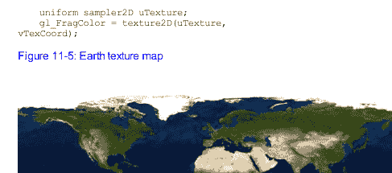

`texture2D()`的第二个参数是一个`vec2`，其x和y值在0到1之间，指定纹理图像上应被采样的点。左上角指定为(0.0, 0.0)，右下角指定为(1.0, 1.0)。纹理坐标通常被创建为缓冲区，并在顶点着色器中与顶点一起访问。你可以使用一个可变变量将坐标传递并插值到片段着色器中，以在三角形表面创建连续的纹理映射。例如，要将图像映射到一个平坦的矩形上，你需要在左上顶点指定纹理坐标(0.0, 0.0)，在右上顶点指定(1.0, 0.0)，依此类推。

###### 计算纹理坐标

对于复杂的3D对象，建模师或纹理艺术家通常在建模应用程序中分配纹理坐标，然后将其与其他模型数据一起导出。几乎所有的模型格式，包括Collada，都能够将纹理坐标附加到顶点上。然而，由于我们在本例中处理的是一个简单的球体，我将改为展示如何在着色器中手动计算这些坐标。

我们在片段着色器中进行计算，但首先我们需要从顶点着色器获取一些信息。球体上的纹理坐标取决于给定点的位置。出于计算球面坐标的目的，表面法线同样适用，因此顶点着色器应将法线导出到一个可变向量中。法线必须是未经修改的、变换前的法线。清单11.25展示了顶点着色器中的新可变变量。

### 清单11.25 将法线传递给片段着色器

```glsl
...
varying vec3 vOrgNormal;
void main(void) {
    ...
    vOrgNormal = aNormal;
}
```

片段着色器从法线计算球面坐标，并将其用作纹理坐标。在球面坐标系中，一个点由一个径向距离和两个角度描述，通常用希腊字母θ（西塔）和φ（斐）表示。笛卡尔坐标（x,y,z）与球面坐标的关系如下：

```math
radius = sqrt(x*x + y*y + z*z)
theta = acos(y / radius)
phi = atan(z / x)
```

球面上所有点到中心的距离相同，所以只有两个角度是重要的。因为我们使用的是法线而不是顶点位置，我们知道半径等于1，所以转换简化为：

```math
theta = acos(y)
phi = atan(z / x)
```

如果你在片段着色器中对法线向量应用这些方程，你可以使用*theta*和*phi*作为纹理坐标，如清单11.26所示。

### 清单11.26 带球面纹理的片段着色器

```glsl
...
varying vec3 vOrgNormal;
uniform sampler2D uTexture;
void main(void) {
    ...
    float theta = acos(vOrgNormal.y);
    float phi = atan(vOrgNormal.z, vOrgNormal.x);
    vec2 texCoord = vec2(-phi / 2.0, theta) / 3.14159;
    vec4 texColor = texture2D(uTexture, texCoord);
    vec3 color = texColor.rgb * (uAmbient + diffuse + specular);
    gl_FragColor = vec4(color, 1.0);
}
```

纹理坐标的范围是0到1，但`theta`和`phi`角度以弧度给出。`theta`角从零到π，`phi`角从零到2π。为了适应这一点，两个坐标都除以π，`phi`进一步除以2。然后使用`texture2D()`函数和新计算的纹理坐标从纹理图像中获取像素值。文件`05-texture.html`包含了渲染如图11-6所示的纹理球体的完整示例代码。


至此，WebGL API的讲解就结束了，你现在应该对如何使用WebGL为你的游戏和应用程序创建3D图形有了基本的了解。下一节将向你展示如何使用WebGL为“宝石勇士”添加一个新的显示模块。

##### 创建WebGL显示

你现在了解了WebGL的基础知识，是时候开始工作了。新的显示模块，如清单11.27所示，位于文件`display.webgl.js`中。它应该暴露与canvas显示模块相同的功能，以便两者可以互换使用。

### 清单11.27 WebGL显示模块

```javascript
jewel.display = (function() {
    var animations = [],
        previousCycle,
        firstRun = true,
        jewels;
    function initialize(callback) {
        if (firstRun) {
            setup();
            firstRun = false;
        }
        requestAnimationFrame(cycle);
        callback();
    }
    function setup() { }
    function setCursor() { }
    function levelUp() { }
    function gameOver() { }
    function redraw() { }
    function moveJewels() { }
    function removeJewels() { }
    return {
        initialize : initialize,
        redraw : redraw,
        setCursor : setCursor,
        moveJewels : moveJewels,
        removeJewels : removeJewels,
        refill : redraw,
        levelUp : levelUp,
        gameOver : gameOver
    };
})();
```

WebGL显示模块可以从canvas模块借用`addAnimation()`和`renderAnimations()`函数，因此它们可以直接从`display.canvas.js`复制过来，无需任何修改。

##### 加载WebGL文件

增加一个额外的显示模块使得加载顺序变得有些复杂。WebGL显示应是第一优先级，canvas其次，DOM显示作为最后的选择。清单11.28展示了对loader.js脚本第二阶段的修改。注意，Modernizr的WebGL检测在某些iOS设备上可能会报告假阳性。清单11.28中的自定义测试仅在实际可以创建WebGL上下文时才返回true。

### 清单11.28 加载WebGL显示模块

```javascript
Modernizr.addTest("webgl2", function() {
    try {
        var canvas = document.createElement("canvas"),
            ctx = canvas.getContext("experimental-webgl");
        return !!ctx;
    } catch(e) {
        return false;
    }
});

// loading stage 2
if (Modernizr.standalone) {
    Modernizr.load({
        test : Modernizr.webgl2,
        yep : [
            "loader!scripts/webgl.js",
            "loader!scripts/webgl-debug.js",
            "loader!scripts/glMatrix-0.9.5.min.js",
            "loader!scripts/display.webgl.js",
            "loader!images/jewelpattern.jpg"
        ],
        nope: {
            test : Modernizr.canvas && !Modernizr.webgl2,
            yep : "loader!scripts/display.canvas.js"
        },{
            test : !Modernizr.canvas,
            yep : "loader!scripts/display.dom.js"
        }
    });
}
```

Modernizr的脚本加载器不支持嵌套测试，因此你需要三个独立的测试来处理三种加载情况。第一个测试在支持WebGL时加载WebGL显示。第二个测试在支持canvas但不支持WebGL时加载canvas显示。第三个测试仅在canvas（以及由此推断的WebGL）不可用时才加载DOM显示。

##### 设置WebGL

设置WebGL显示的第一步是添加一个新的canvas元素并获取该canvas的WebGL上下文对象。你通过使用`setup()`函数来完成此操作，如清单11.29所示。

### 清单11.29 设置WebGL显示

```javascript
jewel.display = (function() {
    var dom = jewel.dom,
        webgl = jewel.webgl,
        $ = dom.$,
        canvas, gl,
        cursor,
        cols, rows,
        // ...
        function setup() {
            var boardElement = $("#game-screen .game-board")[0];
            cols = jewel.settings.cols;
            rows = jewel.settings.rows;
            jewels = [];
            canvas = document.createElement("canvas");
            gl = canvas.getContext("experimental-webgl");
            dom.addClass(canvas, "board");
            canvas.width = cols * jewel.settings.jewelSize;
            canvas.height = rows * jewel.settings.jewelSize;
            boardElement.appendChild(canvas);
            setupGL();
        }
        function setCursor(x, y, selected) {
            cursor = null;
            if (arguments.length > 0) {
                cursor = {
                    x : x,
                    y : y,
                    selected : selected
                };
```


`setup()`函数通过调用`setupGL()`函数结束。该函数如清单11.30所示，负责设置WebGL上下文，使其准备好渲染游戏画面。

## 清单11.30 初始化WebGL上下文

```
jewel.display = (function() {
    var program,
        geometry,
        aVertex, aNormal,
        uScale, uColor,
        uLight;
    function setupGL() {
        gl.enable(gl.DEPTH_TEST);
        gl.enable(gl.CULL_FACE);
        gl.enable(gl.BLEND);
        gl.blendFunc(gl.SRC_ALPHA, gl.ONE);
        program = setupShaders();
        setupTexture();
        gl.useProgram(program);
        aVertex = gl.getAttribLocation(program,
            "aVertex");
        aNormal = gl.getAttribLocation(program,
            "aNormal");
        uScale = gl.getUniformLocation(program,
            "uScale");
        uColor = gl.getUniformLocation(program,
            "uColor");
        gl.enableVertexAttribArray(aVertex);
        gl.enableVertexAttribArray(aNormal);
        gl.uniform1f(
            gl.getUniformLocation(program,
                "uAmbient"),
            0.12
        );
        gl.uniform3f(
            gl.getUniformLocation(program,
                "uLightPosition"),
            20, 15, -10
        );
        webgl.loadModel(gl, "models/jewel.dae",
            function(geom) {
                geometry = geom;
            });
        webgl.setProjection(
            gl, program, 60, cols/rows, 0.1, 100
        );
    }
    ...
})();
```

请注意，一些uniform位置以及attribute位置被存储起来以备后用。存储它们的原因是为了避免在每个渲染周期中都去查询它们。这些位置不会改变，因此你不需要多次查询它们。

WebGL显示中的**宝石**列表与canvas显示中的不同。**jewels**不再是二维数组结构，现在只是一个宝石对象的数组。清单11.31中的**createJewel()**函数将新宝石添加到列表中。

## 清单11.31 创建新宝石

```
jewel.display = (function() {
    ...
    function createJewel(x, y, type) {
        var jewel = {
            x : x,
            y : y,
            type : type,
            rnd : Math.random() * 2 - 1,
            scale : 1
        };
        jewels.push(jewel);
        return jewel;
    }

    function getJewel(x, y) {
        return jewels.filter(function(j) {
            return j.x == x && j.y == y
        })[0];
    }
    ...
})();
```

宝石对象上的**rnd**属性可用于为宝石添加变化，使它们看起来不完全相同。**getJewel()**是一个辅助函数，用于在列表中搜索与给定坐标集匹配的宝石。这两个函数都在`redraw()`函数中使用，如清单11.32所示。

## 清单11.32 重绘面板

```
jewel.display = (function() {
    ...
    function redraw(newJewels, callback) {
        var x, y,
            jewel, type;
        for (x = 0; x < cols; x++) {
            for (y = 0; y < rows; y++) {
                type = newJewels[x][y];
                jewel = getJewel(x, y);
                if (jewel) {
                    jewel.type = type;
                } else {
                    createJewel(x, y, type);
                }
            }
        }
        callback();
    }
    ...
})();
```

`redraw()`函数遍历面板上的所有位置。如果给定位置存在宝石对象，则切换其类型；否则，创建一个新的宝石对象。

##### 渲染宝石

图11-7展示了WebGL显示使用的宝石模型。你可以在文件`06-jewel.html`中找到这个独立的宝石渲染器。

###### 混合与透明度

在`setup()`函数中，请注意启用了两个新设置：`gl.BLEND`和`gl.CULL_FACE`。两者都用于赋予宝石半透明的外观。

启用`gl.BLEND`允许你设置如何将片段着色器的颜色输出与片段下方的颜色值混合的规则。你可以使用`gl.blendFunc()`函数设置混合规则。该函数接受两个参数：一个源因子和一个目标因子，描述如何计算这两种颜色。目标是现有颜色，源是在其上绘制的新颜色。将源因子设置为`GL_SRC_ALPHA`意味着片段颜色中的RGB值乘以alpha值；将目标因子设置为`GL_ONE`意味着现有颜色乘以1。你可以在附录C中找到完整的混合列表，该附录是本书配套网站在线奖励内容的一部分。

**图11-7：** 宝石模型

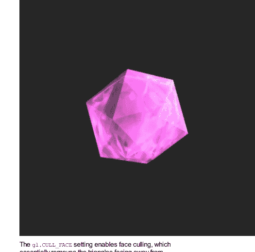

`gl.CULL_FACE`设置启用面剔除，这本质上是移除背向视点的三角形。三角形朝向的方向取决于它是顺时针还是逆时针在屏幕上绘制。默认模式是逆时针绘制的三角形面向观察者，而顺时针的三角形则背向观察者。当剔除启用时，你可以使用`gl.cullFace()`函数在剔除前面和背面三角形之间切换。该函数接受一个参数，可以是`gl.FRONT`或`gl.BACK`。如果你剔除前面三角形，则只有对象的内部表面可见。如果你然后在那之上用启用混合和剔除背面三角形再次渲染，效果就是模型背面可见的半透明对象。

###### 绘制宝石

渲染周期类似于canvas显示的周期，但它只在模型文件加载完成后调用`draw()`函数。清单11.33展示了`cycle()`函数。

## 清单11.33 渲染周期

```
jewel.display = (function() {
...
function cycle(time) {
  renderAnimations(time, previousCycle);
  if (geometry) {
    draw();
  }
  previousCycle = time;
  requestAnimationFrame(cycle);
}
...
})();
```

尽管名为`draw()`，但该函数实际上并不进行任何绘制。它的任务是清除画布并绑定缓冲区。清单11.34展示了该函数。

## 清单11.34 为下一帧做准备

```
jewel.display = (function() {
...
function draw() {
  gl.clear(gl.COLOR_BUFFER_BIT |
    gl.DEPTH_BUFFER_BIT);
  gl.viewport(0, 0, canvas.width,
    canvas.height);
  gl.bindBuffer(gl.ARRAY_BUFFER,
    geometry.vbo);
  gl.vertexAttribPointer(
    aVertex, 3, gl.FLOAT, false, 0, 0);
  gl.bindBuffer(gl.ARRAY_BUFFER,
    geometry.nbo);
  gl.vertexAttribPointer(
    aNormal, 3, gl.FLOAT, false, 0, 0);
  gl.bindBuffer(gl.ELEMENT_ARRAY_BUFFER,
    geometry.ibo);
  jewels.forEach(drawJewel);
}
...
})();
```

所有宝石使用相同的几何体，因此你只需绑定一次缓冲区。然后你可以根据需要绘制模型任意多次。draw()函数通过调用所有宝石的drawJewel()来结束。该函数如清单11.35所示。

## 清单11.35 绘制单个宝石

```
jewel.display = (function() {
...
var colors = [
[0.1, 0.8, 0.1],
[0.9, 0.1, 0.1],
[0.9, 0.3, 0.8],
[0.8, 1.0, 1.0],
[1.0, 0.7, 0.4],
[1.0, 0.4, 0.1],
[1.0, 0.9, 0.1]
];
function drawJewel(jewel) {
var x = jewel.x - cols / 2 + 0.5; // 使位置
y = -jewel.y + rows / 2 - 0.5; // 相对于中心
scale = jewel.scale,
n = geometry.num;
var mv = webgl.setModelView(gl, program,
[x * 4.4, y * 4.4, -32], // 缩放并后移
Date.now() / 1500 + jewel.rnd * 100, // 旋转
[0, 1, 0.1] // 旋转轴
);
webgl.setNormalMatrix(gl, program, mv);
// 为选中的宝石添加效果
if (cursor && jewel.x==cursor.x &&
jewel.y==cursor.y) {
scale *= 1.0 + Math.sin(Date.now() / 100) * 0.1;
}
gl.uniform1f(uScale, scale);
gl.uniform3fv(uColor, colors[jewel.type]);
gl.cullFace(gl.FRONT);
gl.drawElements(gl.TRIANGLES, n, gl.UNSIGNED_SHORT, 0);
gl.cullFace(gl.BACK);
gl.drawElements(gl.TRIANGLES, n, gl.UNSIGNED_SHORT, 0);
}
...
})();
```

首先，模型视图和法线矩阵被更新以匹配当前宝石的位置。宝石位置也被缩放和后移，以使完整的8x8宝石网格适应画布的范围。宝石的旋转是当前时间的函数。将宝石自身的`rnd`数字添加到旋转中，可以避免所有宝石同步旋转。

如果宝石恰好被选中——即，如果其位置与光标匹配——宝石缩放会乘以一个正弦函数以产生脉动效果。统一缩放在顶点着色器中应用。通过将`aVertex`属性中的顶点位置乘以`uScale`变量，你可以控制渲染宝石的大小：

```
vPosition = uModelView * vec4(aVertex * uScale, 1.0);
```

当矩阵和uniform更新后，绘制就可以开始了。渲染分为两个通道。第一个通道渲染宝石的背面，第二个通道渲染宝石的正面。

##### 创建宝石表面

着色器在`setupShaders()`函数中创建，基于你在光照和纹理示例中已经看到的着色器。然而，宝石的平坦表面不需要高分辨率的逐像素光照，因此光照是逐顶点进行的。这种类型的光照在此特定场景下也能提供更好的镜面反射光。着色器代码太大


##### 宝石动画

###### 移动与交换宝石

如代码清单 11.37 所示的 `moveJewels()` 函数与其在 Canvas 版本中的对应函数类似。它为每个移动的宝石添加一个新的动画，在 `render()` 函数中将宝石移向其目标位置。

#### 代码清单 11.37 移动宝石

```
jewel.display = (function () {
    ...
    function moveJewels(movedJewels, callback) {
        var n = movedJewels.length;
        movedJewels.forEach(function (mover) {
            var jewel = getJewel(mover.fromX,
                mover.fromY),
                dx = mover.toX - mover.fromX,
                dy = mover.toY - mover.fromY,
                dist = Math.abs(dx) + Math.abs(dy);
            if (!jewel) { // new jewel entering from the top
                jewel = createJewel(mover.fromX,
                    mover.fromY,
                    mover.type);
            }
            addAnimation(200 * dist, {
                render : function (pos) {
                    pos = Math.sin(pos * Math.PI / 2);
                    jewel.x = mover.fromX + dx * pos;
                    jewel.y = mover.fromY + dy * pos;
                },
                done : function () {
                    jewel.x = mover.toX;
                    jewel.y = mover.toY;
                    if (--n === 0) { // last one calls callback
                        callback();
                    }
                }
            });
        });
    }
    ...
})();
```

在遍历正在移动的宝石列表时，相关的宝石对象是使用 `getJewel()` 函数从宝石列表中获取的。`getJewel()` 函数在搜索失败时返回 `undefined`；在这种情况下，会创建一个新宝石。这处理了新宝石从屏幕顶部移入的情况。

###### 移除匹配的宝石

在 Canvas 显示模块中，移除宝石会导致宝石产生旋转和缩小的效果。代码清单 11.38 中的 `removeJewels()` 函数将这一效果的变体添加到 WebGL 显示中。

#### 代码清单 11.38 移除宝石

```
jewel.display = (function() {
  ...
  function removeJewels(removedJewels,
                        callback) {
    var n = removedJewels.length;
    removedJewels.forEach(function(removed) {
      var jewel = getJewel(removed.x,
                           removed.y);
      y = jewel.y; // original coordinates
      x = jewel.x;
      addAnimation(400, {
        render : function(pos) {
          jewel.x = x + jewel.rnd * pos * 2;
          jewel.y = y + pos * pos * 2;
          jewel.scale = 1 - pos;
        },
        done : function() {
          jewels.splice(jewels.indexOf(jewel), 1);
          if (--n == 0) { // last one calls callback
            callback();
          }
        }
      });
    });
  }
  ...
})();
```

`removeJewels()` 函数添加的动画使宝石在缩小的同时向底部下落。`pos` 值在动画过程中从 0 变化到 1，因此从宝石比例中减去它会导致宝石缩小直至消失。垂直运动使用 `pos` 因子的平方来模拟由于重力引起的向下加速：

```
jewel.y = y + pos * pos * 2;
```

除了垂直运动之外，使用随机 `rnd` 值会添加一点水平运动，使其不会垂直下落：

```
jewel.x = x + jewel.rnd * pos * 2;
```

你可以增加或减少当前设置为 2 的两个因子，以加快任一方向上的运动。

当动画结束并调用 `done()` 函数时，使用 `splice()` 数组方法从宝石列表中移除该宝石。

###### 升级和结束游戏

还剩下三个函数：`refill()`、`gameOver()` 和 `levelUp()`。填充动画可以是什么样子，有无限的可能性。我将其留给你作为练习。当前的实现只是简单地将调用重定向到 `redraw()` 函数：

```
function refill(newJewels, callback) {
    redraw(newJewels, callback);
}
```

这个函数工作正常，但当然，不是很令人兴奋。

来自 `removeJewels()` 函数的动画可以重复使用来实现 `gameOver()` 函数，如代码清单 11.39 所示。只需对整个宝石列表调用 `removeJewels()` 即可让整个棋盘散开。

#### 代码清单 11.39 移除所有宝石

剩下的就是 `levelUp()` 函数。让我们通过增加环境光分量为所有宝石添加高亮效果。这将使所有宝石短暂地亮起来。代码清单 11.40 展示了该动画。

#### 代码清单 11.40 升级动画

```
jewel.display = (function() {
    ...
    function levelUp(callback) {
        addAnimation(500, {
            render : function(pos) {
                gl.uniformf(
                    gl.getUniformLocation(program,
                    "uAmbient"),
                    0.12 + Math.sin(pos * Math.PI) * 0.5
                );
            },
            done : callback
        });
    }
    ...
})();
```

这就是 WebGL 显示模块的全部内容。你现在有三种不同的选项来显示游戏图形。

#### 总结

你现在已准备好开始在你的应用程序和游戏中使用 WebGL。本章向你介绍了 WebGL API 的基础知识；着色器中使用的 GLSL 语言；以及你可以用来向渲染对象添加纹理、光照和混合效果的一些技术。它还展示了如何使用 WebGL 为 Jewel Warrior 游戏创建更高级的显示模块。

尽管 WebGL 尚不成熟，但每天都有新的实验和项目的消息传来。一些基于 WebGL 的 3D 引擎已经出现，简化了构建复杂 3D 应用程序的任务。目前最大的障碍可能是 Internet Explorer 的问题。由于看不到对 WebGL 的支持，大量用户将无法体验 WebGL 内容。也就是说，替代解决方案，包括第三方插件，正在开发中。我希望未来能让每个人都参与这些网页图形的伟大进步中。


## 第四部分

### 本地存储与多人游戏

**第12章** 本地存储与缓存

**第13章** 通过 WebSocket 实现在线功能

**第14章** 资源

# 第12章
#### 本地存储与缓存

-   介绍 Web Storage
-   存储数据：Cookie 与 Local Storage
-   为游戏添加持久化数据
-   制作高分排行榜
-   通过应用缓存实现离线游戏

在浏览器中存储数据的传统方法是使用 HTTP Cookie。在本章中，你将学习如何使用 Web Storage（HTML5 运动催生的另一项技术）来实现部分相同的功能。你还将了解如何使用 Web Storage 让游戏记住玩家的进度，以及如何添加高分排行榜。

本章最后一节讨论了 HTML5 引入的应用缓存，以及它如何帮助你在没有网络连接的情况下依然能够访问游戏。

##### 使用 Web Storage 存储数据

Web Storage 通常与其他技术一同被归入 HTML5 的大旗下，尽管它现在已经转移到了自己的规范 ([http://dev.w3.org/html5/webstorage/](http://dev.w3.org/html5/webstorage/))，并且正独立于 HTML5 进行开发。

与 Cookie 不同，存储在 Web Storage 中的数据保留在客户端，永远不会传输到服务器。相比之下，Cookie 会在每个 HTTP 请求中随浏览器与服务器之间的通信往返传输。这限制了可以作为 Cookie 存储的数据量，而且如果服务器并不需要这些数据，用于传输 Cookie 的带宽就浪费了。浏览器对 Cookie 的数量和大小施加了严格限制；为保险起见，每个域名应存储不超过 50 个 Cookie，且总大小不超过 4 KB。

使用 Web Storage 解决了这两个问题。首先，数据永远不会离开浏览器。其次，它允许你存储更大量的数据。W3C 目前建议的限制是 5 MB，但如果需要更多空间，浏览器可以提示用户获得许可。当前浏览器允许至少 2 MB 的 Web Storage 数据。

存储领域还有其他相关发展。文件系统 API ([www.w3.org/TR/file-system-api/](www.w3.org/TR/file-system-api/)) 是另一项旨在成为 W3C 推荐标准的提案规范。通过文件系统 API，Web 应用可以访问一个沙盒化的文件系统，并拥有一个优秀的 API 来读写文件数据，包括二进制和文本。目前只有 Chrome 浏览器对文件系统 API 提供了部分支持。

如果你对数据库更感兴趣，那么可以期待 IndexedDB API ([www.w3.org/TR/IndexedDB/](www.w3.org/TR/IndexedDB/))。此 API 提供了存储大量数据所需的功能，以及对这些数据执行快速搜索的能力。Firefox 和 Chrome 都支持 IndexedDB，Internet Explorer 也预计将在即将到来的 Internet Explorer 10 版本中加入支持。

###### 使用存储接口

Web Storage 规范描述了两个存储对象：本地存储和会话存储，可通过全局对象 `localStorage` 和 `sessionStorage` 访问。这两个存储对象使用相同的接口，这意味着你可以用 `localStorage` 做的任何事情，同样也可以用 `sessionStorage` 做，反之亦然。

###### 使用存储 API

存储对象本质上是浏览器维护的不同数据容器的入口。`localStorage` 对象绑定到域名，存储的数据会一直存在，直到你将其移除。

存储 API 仅由几个函数组成。要更改值或添加新值，请使用 `localStorage.setItem()` 方法：

```
localStorage.setItem("myData", "This is my data")
```

第一个参数是标识数据的唯一键，第二个参数是你要存储的数据。现在你可以使用 `localStorage.getItem()` 方法检索数据：

```
var data = localStorage.getItem("myData");
```

即使你关闭浏览器、重新加载页面，或从另一个页面（在同一域名下）调用 `localStorage.getItem()`，数据仍然存在。

或者，你也可以使用方括号表示法访问数据。所有存储的值都作为属性暴露在存储对象上：

```
var data = localStorage["myData"];
localStorage["myData"] = "This is my data";
```

当然，你也可以使用点表示法：

```
var data = localStorage.myData;
localStorage.myData = "This is my data";
```

如果需要从存储对象中移除一个已存储的值，可以使用 `localStorage.removeItem()` 方法：

```
localStorage.removeItem("myData");
```

如果需要清空存储对象中的所有内容，请使用 `localStorage.clear()` 方法：

```
localStorage.clear(); // 移除所有存储的数据
```

###### 编码复杂数据类型

Web Storage 仅限于字符串值，因此你不能存储其他数据类型，除非将它们转换为字符串表示。如果你将数据编码为 JSON，就可以轻松绕过这个限制：

```
var data = {
  key1: "string",
  key2: true,
  key3: [1, 2, 3]
};
localStorage.setItem("myData", JSON.stringify(data));
```

```
var data = JSON.parse(localStorage.getItem("myData"));
```

###### 遍历存储值

存储对象的 `length` 属性等于你已保存的键/值对的数量：

```
var numValues = localStorage.length;
```

`localStorage.key()` 方法接受一个参数，即 0 到 length-1 之间的索引，并返回该位置键的名称：

```
var data = localStorage.key(0); // 索引 0 处的键名
```

不能保证键的顺序与添加时相同，但该方法仍然很有用，例如，当你需要遍历所有存储的值时：

```
for (var i = 0, key, value; i < localStorage.length; i++) {
  key = localStorage.key(i);
  value = localStorage.getItem(key);
  console.log(key, value);
}
```

> 注意
> 键/值对的顺序由浏览器决定，并且在添加或删除项目时可能会更改。只要你只是读取或写入现有的键，顺序就不会改变。

###### 创建一个简单的文本编辑器

现在来看一个快速示例。清单 12.1 展示了一个简陋的文本编辑器代码，它能记住输入到 textarea 中的文本。此示例位于文件 01-localStorage.html 中。

## 清单 12.1 在本地存储中保存数据

```
<textarea id="input"></textarea>
<script>
var input = document.getElementById("input");
input.value = localStorage.getItem("mytext") || "";
input.addEventListener("keyup", function() {
  localStorage.setItem("mytext", input.value);
}, false);
</script>
```

加载页面时，文本会从 `localStorage` 对象加载到 `textarea` 元素中。当你在输入框中键入时，`keyup` 事件处理程序会更新存储的值。由于数据持续保存在 `localStorage` 中，你可以随时关闭窗口，再次打开页面时继续编写。

你甚至可以从另一个页面读取相同的数据。清单 12.2 展示了一个只读版本，每 50 毫秒加载一次文本。此示例的代码位于文件 02-localStorageReader.html 中。

## 清单 12.2 从另一个页面读取数据

```
<textarea id="input" disabled></textarea>
<script>
var input = document.getElementById("input");
setInterval(function() {
  input.value = localStorage.getItem("mytext") || "";
}, 50);
</script>
```

如果你在两个独立的窗口中加载这两个页面并排排列，你会看到当你在第一个窗口中键入时，第二个窗口会自动更新。

##### 使用会话存储

会话存储通过 `sessionStorage` 对象访问，其接口与 `localStorage` 相同。会话存储和本地存储的区别在于数据的生命周期和作用域。本地存储中的数据可被所有查看该给定域名页面的浏览器窗口和标签页访问，即使用户关闭并重新打开浏览器窗口也是如此。相比之下，会话存储绑定到浏览器会话，并在浏览器会话结束时（通常发生在窗口关闭时）被清除。

会话存储对于需要临时存储但又希望用户点击不同页面时仍能访问的数据很有用。一个常见的用例是，购物车在页面浏览期间保持存在，但在用户关闭浏览器窗口时清空。

你访问会话存储的方式与访问本地存储相同。清单 12.3 展示了清单 12.1 的示例，修改为使用会话存储。你可以在文件 `03-sessionStorage.html` 中找到此示例。

## 清单 12.3 使用会话存储


##### 构建存储模块

要实现高分榜，你需要一个存储模块。这个模块非常简单，本质上是`localStorage`对象的封装器。通过在保存前将值编码为JSON字符串，你可以绕过字符串值的限制。这种方法允许你存储对象和数组等复杂类型。但需注意DOM元素等宿主对象；这些对象没有有意义的JSON表示。清单12.4展示了存储模块`storage.js`。

**清单12.4 存储模块**

```javascript
jewel.storage = (function() {
  var db = window.localStorage;
  function set(key, value) {
    value = JSON.stringify(value);
    db.setItem(key, value);
  }
  function get(key) {
    var value = db.getItem(key);
    try {
      return JSON.parse(value);
    } catch(e) {
      return;
    }
  }
  return {
    set : set,
    get : get
  };
})();
```

##### 回退到Cookies

如果你希望为不支持本地存储的浏览器提供回退方案，可以在注意大小限制的前提下使用cookies。清单12.5展示了基于cookie的存储模块，你可以在文件`storage.cookie.js`中找到它。

### 清单12.5 基于Cookie的存储模块

```javascript
jewel.storage = (function() {
  var cookieKey = "JewelData";
  function load() {
    var re = new RegExp("(?:^|; )\\s*" + cookieKey
      + "=(.*?)(?:;|$)", "i");
    match = document.cookie.match(re);
    data = match ? unescape(match[1]) : "{}";
    return JSON.parse(data);
  }
  function set(key, data) {
    var db = load();
    db[key] = data;
    document.cookie = cookieKey + "="
      + escape(JSON.stringify(db)) + "; path=/";
  }
  function get(key) {
    var db = load();
    value = db[key];
    return (value !== undefined ? value : null);
  }
  return {
    set : set,
    get : get
  };
})();
```

我在此不深入讲解cookie实现的细节。如果你有兴趣进一步探索此主题，Mozilla开发者网络提供了关于cookie格式的详细解释以及一个更健壮的cookie读取器：[https://developer.mozilla.org/en/DOM/document.cookie](https://developer.mozilla.org/en/DOM/document.cookie)。

##### 加载模块

存储模块应在`loader.js`脚本的早期加载。你可以使用`Modernizr.localstorage`属性来测试`localStorage`支持，并在必要时回退到基于cookie的模块。清单12.6展示了将存储模块放置在第一个加载器阶段开始位置的代码。

**清单12.6 加载存储模块**

```javascript
// loading stage 1
Modernizr.load([
  {
    test : Modernizr.localstorage,
    yep : "scripts/storage.js",
    nope : "scripts/storage.cookie.js"
  },{
    load : [
      "scripts/sizzle.js",
      "scripts/dom.js",
      "scripts/requestAnimationFrame.js",
      "scripts/game.js"
    ]
  },{
    ...
  }
]);
```

##### 使游戏状态持久化

在当前状态下，游戏在玩家离开或重新加载页面时会忘记所有信息。如果游戏能记住活跃游戏的状态，让玩家可以停止玩游戏、退出游戏，稍后回来继续玩，那就太好了。在本节中，你将实现一个功能来存储游戏状态，并询问用户是否想继续之前的游戏。

###### 退出游戏

你尚未处理退出游戏。玩家应该有一个选项来退出当前游戏并返回主菜单。清单12.7展示了在`index.html`的游戏屏幕中添加了一个带有退出按钮的页脚元素。

### 清单12.7 为游戏屏幕添加页脚

```html
...
<div id="game">
    ...
    <div class="screen" id="game-screen">
        ...
        <footer>
            <button name="exit">Exit</button>
        </footer>
    </div>
</div>
...
```

清单12.8中来自`main.css`的CSS规则将页脚定位在屏幕底部，并样式化按钮使其与游戏其余部分匹配。

### 清单12.8 样式化页脚

```css
/* Game screen footer */
#game-screen footer {
    display : block;
    position : absolute;
    bottom : 0;
    height : 1.25em;
    width : 100%;
}

.screen footer button {
    margin-left : 0.25em;
    padding : 0 0.75em;
    font-family : Geo, sans-serif;
    font-size : 0.5em;
    color : rgba(200,200,100,0.5);
    background : rgb(10,20,0);
    border : 1px solid rgba(200,200,100,0.5);
    border-radius : 0.2em;
}
```

调整移动设备和横向模式下的布局是你的任务。

清单12.9展示了在`screen.game.js`的setup()函数中附加的事件处理器。如果玩家确认要返回菜单，游戏状态将被保存，游戏计时器将停止，游戏将切换到主菜单屏幕。

### 清单12.9 响应退出按钮

```javascript
jewel.screens["game-screen"] = (function()
{
    ...
    function setup() {
        ...
        dom.bind("#game-screen button[name=exit]",
        "click",
        function() {
            togglePause(true);
            var exitGame = window.confirm(
                "Do you want to return to the main menu?"
            );
            togglePause(false);
            if (exitGame) {
                saveGameData();
                stopGame();
                jewel.game.showScreen("main-menu")
            }
        });
    }
}
function stopGame() {
    clearTimeout(gameState.timer);
}
...
})();
```

清单12.9中的代码引入了两个新函数：`togglePause()`和`saveGameData()`。让我们从暂停功能开始。

###### 暂停游戏

`togglePause()`函数接受一个布尔参数，指定是启用还是禁用暂停模式。如果启用暂停模式，`togglePause()`必须停止游戏计时器，并在退出对话框激活时使屏幕变暗。你可以通过在游戏屏幕上放置一个深灰色、半透明的`div`元素来添加变暗效果。清单12.10展示了添加到`index.html`的新`div`元素。

### 清单12.10 添加变暗覆盖层

```html
<div id="game">
...
<div class="screen" id="game-screen">
...
<div class="pause-overlay"></div>
```

清单12.11中的CSS规则将其置于其他内容之前，使其占据整个游戏屏幕，并设置背景颜色。

### 清单12.11 样式化覆盖层

```css
/* Game screen pause overlay */
#game-screen .pause-overlay {
  display : none;
  position : absolute;
  left : 0;
  top : 0;
  width : 100%;
  height : 100%;
  z-index : 100;
  background : rgba(40,40,40,0.5);
}
```

除了显示覆盖层div，`togglePause()`函数还需要做两件事来停止游戏计时器。首先，必须使用`clearTimeout()`函数清除活动超时。`togglePause()`方法还应记录当前时间，以便在计时器恢复时调整游戏计时器。清单12.12展示了`togglePause()`函数。

### 清单12.12 暂停游戏

```javascript
jewel.screens["game-screen"] = (function()
{
    var ...,
        paused = false,
        pauseTime;
    ...
    function togglePause(enable) {
        if (enable == paused) return; // no change
        var overlay = $("#game-screen .pause-overlay");
        paused = enable;
        overlay.style.display = paused ? "block" : "none";
        if (paused) {
            clearTimeout(gameState.timer);
            gameState.timer = 0;
            pauseTime = Date.now();
        } else {
            gameState.startTime += Date.now() - pauseTime;
        }
        setLevelTimer(false);
    }
}
...
})();
```

如果`enable`值等于当前的`paused`值，函数将直接退出。除非暂停状态确实发生变化，否则你不需要做任何事情。当暂停模式关闭时，你通过添加游戏暂停以来经过的时间来修改`gameInfo.startTime`值，实际上是在倒转时间，使计时器看起来没有移动。

##### 保存游戏数据

接下来是清单12.13所示的`saveGameData()`函数。此函数存储下次玩家加载游戏时恢复游戏状态所需的值。

**清单12.13 保存游戏**

```javascript
jewel.screens["game-screen"] = (function()
{
    var storage = jewel.storage,
    ...
    function saveGameData() {
        storage.set("activeGameData", {
            level : gameState.level,
```


这四个值就是恢复游戏状态所需的全部信息，它们应该都是不言自明的。当新游戏开始时，`startGame()`函数现在必须检查是否有玩家可以恢复的先前游戏。你不能确定玩家是否真的想这样做，因此最好先询问。如果玩家选择恢复游戏，则使用存储的值来设置游戏。清单12.14展示了对`startGame()`函数的修改。

## 清单12.14 从先前的游戏加载状态

```javascript
jewel.screens["game-screen"] = (function()
{
  ...
  function startGame() {
    ...
    var activeGame =
      storage.get("activeGameData"),
      useActiveGame,
      startJewels;
    if (activeGame) {
      useActiveGame = window.confirm(
        "Do you want to continue your previous game?"
      );
      if (useActiveGame) {
        gameState.level = activeGame.level;
        gameState.score = activeGame.score;
        startJewels = activeGame.jewels;
      }
    }
    board.initialize(startJewels, function() {
      display.initialize(function() {
        display.redraw(board.getBoard(),
        function() {
          audio.initialize();
          if (useActiveGame) {
            setLevelTimer(true, activeGame.time);
            updateGameInfo();
          } else {
            advanceLevel();
          }
        });
      });
    });
  }
  ...
})();
```

如果玩家确认要恢复先前的游戏，关卡和分数值将被恢复。宝石的恢复稍微复杂一些，因为目前没有方法用一组给定的宝石来初始化棋盘模块。棋盘模块只能以自己随机生成的棋盘开始。然而，如清单12.15所示，修改`board.js`中的棋盘模块以允许传入初始宝石集合是很容易的。

## 清单12.15 将初始宝石传递给棋盘模块

```javascript
jewel.board = (function() {
  ...
  function initialize(startJewels, callback)
  {
    settings = jewel.settings;
    numJewelTypes = settings.numJewelTypes;
    baseScore = settings.baseScore;
    cols = settings.cols;
    rows = settings.rows;
    if (startJewels) {
      jewels = startJewels;
    } else {
      fillBoard();
    }
    callback();
  }
  ...
})();
```

`initialize()`函数现在接受一个额外的参数，如果你传递一组宝石，它将使用这些宝石来代替随机填充的棋盘。

棋盘模块也可以作为Web Worker运行，因此与Worker交互的`board.worker-interface.js`脚本也需要进行轻微修改，如清单12.16所示。

## 清单12.16 将初始宝石发送给Worker

```javascript
jewel.board = (function() {
  ...
  function initialize(startJewels, callback)
  {
    ...
    var data = {
      settings : settings,
      startJewels : startJewels
    };
    post("initialize", data, callback);
  }
})();
```

Worker中的`initialize()`函数之前只接收一个`settings`参数，现在它接收一个同时包含`settings`和`startJewels`值的对象。Worker脚本本身`board.worker.js`的修改如清单12.17所示。

## 清单12.17 在Worker中使用初始宝石

```javascript
...
addEventListener("message",
function(event) {
    var board = jewel.board,
        message = event.data;
    switch (message.command) {
        case "initialize" :
            jewel.settings = message.data.settings;
            board.initialize(
                message.data.startJewels, callback
            );
            break;
        ...
        },
        false);
```

现在，当玩家退出到主菜单时，游戏会保存状态，允许她在返回时恢复游戏。

> **提示**

你可能还需要考虑玩家只是关闭窗口或浏览器的情况。在这种情况下，任何进度都会丢失。如果你想持续保存游戏，可以在相关位置（如`setLevelTimer()`和`playBoardEvents()`）添加**saveGameData()**调用。

##### 创建高分列表

当游戏因计时器到期而结束时，游戏必须自动切换到高分屏幕，并传递最终得分。高分模块会将得分与存储的分数列表进行比较，如果分数足够高，可以进入列表，系统将要求玩家输入她的名字。高分模块将分数与玩家姓名一起输入到列表中，并显示前10名分数。

###### 构建高分屏幕

高分屏幕包含一个标题、一个有序列表和一个页脚，页脚有一个返回主菜单的按钮。清单12.18展示了`index.html`中的新屏幕。

## 清单12.18 添加高分标记

```html
<div id="game">
    ...
    <div class="screen" id="hiscore">
        <h2 class="logo">High score</h2>
        <ol class="score-list">
        </ol>
        <footer>
            <button name="back">Back</button>
        </footer>
    </div>
</div>
```

现在你可以在高分模块中用列表项填充`ol`元素。在清单12.19中添加CSS规则来设置列表样式。

## 清单12.19 设置高分列表样式

```css
/* High score */
#hiscore h2 {
    margin-top: 0.25em;
    font-size: 1.25em;
}
#hiscore ol.score-list {
    font-size: 0.65em;
    width: 75%;
    margin: 0 10%;
}
#hiscore ol.score-list li {
    width: 100%;
}
#hiscore ol.score-list li span:nth-child(1) {
    display: inline-block;
    width: 70%;
}
#hiscore ol.score-list li span:nth-child(2) {
    display: inline-block;
    width: 30%;
    text-align: center;
}
```

当稍后添加列表项时，它们都包含两个子span元素：一个用于玩家姓名，一个用于分数。再一次，你可以自行对横向屏幕方向进行必要的调整。

###### 添加新模块

高分屏幕模块`screen.hiscore.js`如清单12.20所示。基本结构应该很熟悉。

## 清单12.20 高分屏幕模块

```javascript
jewel.screens["hiscore"] = (function() {
    var dom = jewel.dom,
        $ = dom.$,
        game = jewel.game,
        storage = jewel.storage,
        numScores = 10,
        firstRun = true,
        function setup() {
            var backButton =
                $("#hiscore footer button[name=back]")[0];
            dom.bind(backButton, "click", function(e) {
                game.showScreen("main-menu");
            });
        }
        function run(score) {
            if (firstRun) {
                setup();
                firstRun = false;
            }
            populateList();
            if (typeof score != "undefined") {
                enterScore(score);
            }
        }
        function populateList() {
        }
        function enterScore(score) {
        }
        return {
            run : run
        };
})();
```

记得将新屏幕模块添加到第二个加载阶段：

```javascript
// loading stage 2
if (Modernizr.standalone) {
    Modernizr.load([
        {
            ...
        }, {
            load : [
                "loader!scripts/audio.js",
                "loader!scripts/input.js",
                "loader!scripts/screen.hiscore.js",
                "loader!scripts/screen.main-menu.js",
                "loader!scripts/screen.game.js",
                "loader!images/jewels"
                + jewel.settings.jewelSize + ".png"
            ]
        }
    ]);
}
```

###### 过渡到高分屏幕

在我解释`populateList()`和`enterScore()`函数之前，你需要实际从游戏屏幕切换到高分屏幕。返回到`screen.game.js`脚本，并按清单12.21所示修改`gameOver()`函数。

## 清单12.21 过渡到高分屏幕

```javascript
jewel.screens["game-screen"] = (function()
{
    ...
    function gameOver() {
        audio.play("gameover");
        stopGame();
        storage.set("activeGameData", null);
        display.gameOver(function() {
            setTimeout(function() {
                jewel.game.showScreen(
                    "hiscore", gameState.score);
            }, 2500);
        });
    }
    ...
})();
```

在`announce()`函数显示“游戏结束”文本后，游戏屏幕会自动切换到高分列表，并传递玩家的分数。

###### 存储高分数据

现在你可以返回到高分屏幕并实现`enterScore()`函数。清单12.22展示了该函数。

## 清单12.22 输入新的高分条目

```javascript
jewel.screens["hiscore"] = (function() {
    ...
    function getScores() {
        return storage.get("hiscore") || [];
    }
    function enterScore(score) {
        var scores = getScores(),
```


###### 显示高分数据

现在你只需渲染分数列表。这将在 `populateList()` 函数中完成，如代码清单 12.23 所示。

### 代码清单 12.23 填充高分列表

```
name, i, entry;
for (i = 0; i <= scores.length; i++) {
    if (i === scores.length || score >
    scores[i].score) {
        name = prompt("Please enter your name:");
        entry = {
            name: name,
            score: score
        };
        scores.splice(i, 0, entry);
        storage.set(
            "hiscore", scores.slice(0, numScores)
        );
        populateList();
        return;
    }
}
... })();
```

```
jewel.screens["hiscore"] = (function() {
    ...
function populateList() {
  var scores = getScores(),
      list = $("#hiscore ol.score-list")[0],
      item, nameEl, scoreEl, i;
  // 确保列表是满的
  for (var i=scores.length;i<numScores;i++)
  {
    scores.push({
      name : "---",
      score : 0
    });
  }
  list.innerHTML = "";
  for (i=0;i<scores.length;i++) {
    item = document.createElement("li");
    nameEl = document.createElement("span");
    nameEl.innerHTML = scores[i].name;
    scoreElement = document.createElement("span");
    scoreElement.innerHTML = scores[i].score;
    item.appendChild(nameEl);
    item.appendChild(scoreElement);
    list.appendChild(item);
  }
})();
```

`enterScore()` 函数会遍历已保存的分数列表，直到到达列表末尾，或者遇到一个比玩家分数小的分数。在提示玩家输入名字后，它使用 `splice()` 方法将玩家的分数和名字插入到当前位置。然后，该函数使用 `slice()` 获取前 10 个元素，并将它们存储在 storage 模块中。最后，在返回之前，它调用 `populateList()` 函数。

在 `populateList()` 从 storage 模块检索到分数后，它确保列表中显示 `numScores` 条记录。这样，高分列表看起来就像是预先填充了分数为 0 的记录。`list` 元素本身只是被填充了列表项，每个列表项包含两个 `span` 元素。图 12-1 展示了生成后的高分界面。

##### 应用程序缓存

本章的最后一节将讨论另一种形式的本地数据——应用程序缓存。应用程序缓存是你指定浏览器可以在本地缓存哪些资源，以及哪些资源必须始终从源获取的一种方式。能够在本地缓存文件的一个明显优势是减少了后续访问的网络流量，但它也允许应用程序在完全没有网络连接的情况下运行。

HTML5 规范的相关部分可从 W3C 在 [www.w3.org/TR/html5/offline.html](http://www.w3.org/TR/html5/offline.html) 获取。

###### 缓存清单

应用程序缓存和离线 Web 应用程序使用缓存清单来控制哪些资源被缓存，哪些不被缓存。清单是一个具有简单语法的纯文本文件。代码清单 12.24 展示了清单格式的基本结构。

图 12-1：高分列表

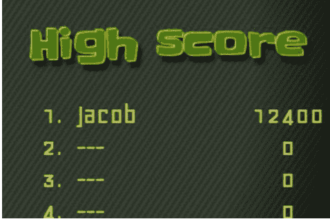

### 代码清单 12.24 Jewel Warrior 的缓存清单

```
CACHE MANIFEST
# Jewel Warrior cache manifest
CACHE:
images/jewels32.png
images/jewels40.png
images/jewels64.png
...
NETWORK:
...
FALLBACK:
...
```

你可以在 `manifest.appcache` 文件中找到 Jewel Warrior 的完整清单。清单的第一行是必需的，必须是 `CACHE MANIFEST`。任何以 `#` 开头的行都被视为注释并被忽略。清单的其余部分分为三个部分——CACHE、NETWORK 和 FALLBACK——每个部分都以部分名称后跟冒号开始。CACHE 部分列出了浏览器必须下载并存储在缓存中的资源。NETWORK 部分列出了应该在线访问的资源，FALLBACK 部分指定了当应用程序需要在线访问但没有可用网络连接时要加载的页面。

###### 将清单添加到 HTML 页面

当你有一个有效的清单时，必须在主页面的 `<html>` 元素中添加对它的引用。只需添加一个名为 `manifest` 的属性，并让其值为清单文件的路径：

```
<html manifest="manifest.appcache">
```

目前还没有关于命名清单文件应使用何种官方扩展名的统一规定。一些网站使用 `.manifest`，而其他网站则使用 `.appcache`。然而，WHATWG 建议使用后者，因为微软的一项无关技术也使用了 `.manifest` 扩展名。

重要的是，Web 服务器必须以 MIME 类型 `text/cache-manifest` 发送清单文件。否则，你可能会遇到导致应用程序无法加载的错误。请查阅你的 Web 服务器文档或联系服务器管理员，如果你的 Web 服务器发送了错误的 MIME 类型。对于像 Apache 和 Nginx 这样的 Web 服务器，你可以在 `mime.types` 配置文件中添加以下行：

```
text/cache-manifest appcache
```

指向缓存清单的页面——例如 `index.html`——会被自动缓存，因此你不需要将该文件添加到 `CACHE` 部分。

###### 处理在线资源

使用缓存清单从根本上改变了浏览器加载资源的方式。

并非所有文件都应必然在应用程序缓存中缓存。例如，如果你始终需要最新数据，你可能不想缓存动态生成的页面。你需要将这些资源添加到白名单中，以便浏览器知道它必须从网络检索该资源。这些资源放在清单的 `NETWORK` 部分。以下代码片段显示了一个添加到在线白名单中的计数器脚本，以便浏览器在线时可以访问它：

```
NETWORK:
# 仅允许在线访问此文件
counter.php
```

你还可以使用通配符来表明你希望允许访问所有在线 URL（如果它们在缓存中未找到）：

```
NETWORK:
# 允许在线访问所有 URL
*
```

但是，如果浏览器需要访问一个未缓存的资源并且没有可用的网络连接怎么办？嗯，你无法凭空创建该资源，但你确实可以控制浏览器的反应。清单的可选 `FALLBACK` 部分指定了当在线资源不可达时显示的页面。考虑以下来自 HTML5 规范的示例：

```
CACHE MANIFEST
FALLBACK:
/offline.html
NETWORK:
*
```

这个清单使得浏览器在用户访问页面时将它们添加到应用程序缓存中。每次用户访问一个新页面，它就会被添加到缓存中。当用户离线时，只有那些已访问的页面保持可访问。如果用户尝试访问网站上的任何其他页面，他会看到 `offline.html` 页面，该页面可以显示有帮助的消息。

一方面，此功能使你免于在清单中指定每一个文件并强制浏览器下载所有内容。另一方面，用户只能离线访问他已经看过的内容。有限的离线可用性对于页面众多的网站可能很有用，用户不一定需要离线访问所有内容。如果你想确保所需资源在离线时可用，最好在清单的 `CACHE` 部分中明确声明它们。

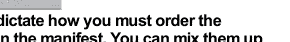

**没有规则规定你必须如何排序清单中的部分。你可以任意混合它们，甚至可以创建多个 CACHE 部分。此外，你可以省略 `CACHE:` 标题，只需在 `CACHE MANIFEST` 行下列出缓存资源。**

###### 强制更新缓存

仅仅因为你更改了清单中列出的文件内容，并不意味着浏览器会自动检测到这一更改。缓存清单本身也必须更改。当你没有更改相关文件的文件名时，这似乎违反直觉。然而，清单需要更改，浏览器才会重新检查缓存的文件。即使只更改注释中的一个字符也足以触发检查，因此一个解决方案是在文件顶部附近保留一个版本号，每当你修改清单中列出的文件时就递增它。示例见代码清单 12.25。

### 代码清单 12.25 带版本号的缓存清单

```
CACHE MANIFEST
# Jewel Warrior cache manifest, rev 47
CACHE:
images/jewels32.png
images/jewels40.png
...
```

触发缓存更新会使浏览器检查清单中列出的所有文件。自上次缓存以来已更改的文件会被下载，而其他文件则会被跳过。这些检查使用常规的与缓存相关的 HTTP 标头（例如 `If-Modified-Since`）来完成。

因为除非你修改清单，否则缓存文件不会在缓存中自动更新，所以在开启应用程序缓存的情况下进行开发可能具有挑战性。如果它给你带来麻烦，我建议你在开发游戏时简单地禁用它，例如，通过移除 `manifest`。


`<html>` 元素的属性。

#### 本章小结

在本章中，你了解了 Web Storage 规范如何让你存储跨浏览器会话持久化的客户端数据。你学习了如何使用本地存储来保存数据，这些数据会一直存在直到被主动删除；你还学习了相关的会话存储如何使数据仅在当前浏览器会话结束前保持有效。

此外，你还学习了如何使用这些功能来添加一个持久的、本地的最高分界面，以及如何保存游戏状态以便游戏记住玩家离开的位置。最后，本章讨论了应用程序缓存，以及如何使用它来让你的游戏在用户离线时仍可玩。

### 第 13 章

#### 使用 WebSocket 连接网络

- 使用 WebSocket 进行在线通信
- Node.js 和服务器端 JavaScript 简介
- 创建一个简单的聊天应用程序

在本章中，我将向你介绍 WebSocket 和 Node 这两项相对较新的技术，它们使创建网络应用和服务器端脚本比过去好得多。

在本章的前半部分，我将带你了解 WebSocket API，向你展示如何建立和管理与服务器的连接，以及如何通过发送和接收数据与服务器进行通信。

然后，我将向你展示如何使用 Node 创建服务器端 JavaScript 应用程序。在本章结束时，你将看到如何使用 Node 和 WebSocket 创建一个聊天服务器和客户端。

##### 使用 WebSocket

传统上，当需要常规 Ajax 请求之外的网络通信时，解决方案要么基于插件，要么使用现有的 `XmlHttpRequest` 技术变通，可能涉及等待服务器响应的长连接。HTTP 并非真正为轮询而设计，HTTP 请求和响应携带大量开销。当所有的 HTTP 头、cookie 和其他请求数据组合在一起时，一个 HTTP 请求很容易就有 1 KB 的开销数据。如果你只想发送一个简短的状态更新，这就很多了。

WebSocket 的创建旨在提供一种专门针对持久连接和低延迟通信的替代方案。WebSocket 保持连接活跃，并且每条消息仅使用 2 字节的开销，这是一个巨大的减少。WebSocket 另一个非常酷的特性是它们允许双向通信。客户端和服务器都可以通过同一连接同时相互通信。HTTP 协议将你限制为发送请求并获得响应。

通过 WebSocket 连接进行通信的协议正在由互联网工程任务组（IETF）标准化。在撰写本文时，最新的子协议是版本 12，你可以在 [http://tools.ietf.org/html/draft-ietf-hybi-thewebsocketprotocol-12](http://tools.ietf.org/html/draft-ietf-hybi-thewebsocketprotocol-12) 访问它。

目前 Firefox 和 Chrome 的测试版以及 iOS 设备都支持 WebSocket。然而，WebSocket 的开发进展非常快，最好保持警惕并关注规范和浏览器支持的变化。微软目前正在他们的 HTML5 Labs 站点（[http://html5labs.interoperabilitybridges.com/](http://html5labs.interoperabilitybridges.com/)）上试验 WebSocket，在那里你也可以找到具有初步 WebSocket 支持的 Internet Explorer 原型版本。

###### 连接到服务器

在浏览器中，WebSocket 可以通过标准化的 API 使用。WebSocket API 由 W3C 维护和开发。你可以在 [http://dev.w3.org/html5/websockets/](http://dev.w3.org/html5/websockets/) 访问最新版本。服务器应用程序没有 API。服务器开发者可以自由地以任何他们选择的方式实现 WebSocket，只要他们遵循 IETF 协议。

###### 建立连接

设置一个 WebSocket 连接非常简单。只需创建一个新的 `WebSocket` 对象，并将服务器的 URL 作为第一个参数传递：

```
var ws = new WebSocket("ws://www.myserver.com:9999/");
```

这将创建一个新的 `WebSocket` 对象并尝试连接到端口 9999 上的 `www.myserver.com`。`WebSocket` 构造函数接受一个可选的第二个参数，用于指定子协议列表。

至少在 Mozilla Firefox 版本 6 之前，出于 `MozWebSocket` 的考虑，`WebSocket` 构造函数是禁用的。你可以在应用程序开始时进行一个简单的测试，以确定哪个可用，如果需要，可以让 `WebSocket` 指向 `MozWebSocket`：

```
window.WebSocket = window.WebSocket || window.MozWebSocket;
```

WebSocket 可以在安全和非安全两种模式下运行。URL 中的 `ws://` 前缀表示非安全连接。使用 `wss://` 来建立安全连接。这类似于用于 HTTP 连接的 `http://` 和 `https://` 协议。

请注意，安全连接需要服务器支持。

如果你使用过 Ajax 和 `XmlHttpRequest` 对象，你可能熟悉就绪状态的概念。就绪状态可以从 `ws.readyState` 属性读取，是一个表示连接当前状态的数值。表 13-1 列出了 WebSocket API 定义的四个就绪状态。

**表 13-1 WebSocket 就绪状态**

| 状态码 | 数值 | 描述 |
| :--- | :--- | :--- |
| CONNECTING | 0 | 客户端正在建立连接。 |
| OPEN | 1 | 连接已打开，你可以使用 send() 方法和 message 事件与服务器通信。 |
| CLOSING | 2 | 连接正在关闭过程中。 |
| CLOSED | 3 | 连接已关闭，你无法再与服务器通信。 |

当你第一次创建一个新的 WebSocket 对象时，其就绪状态设置为 CONNECTING。当与服务器的连接建立后，就绪状态切换到 OPEN，你就可以开始与服务器通信了。你可以使用以下代码片段来检查连接是打开还是关闭：

```
if (ws.readyState === 1) {
  // connection is open
}
```

或者，你可以使用 WebSocket 对象上可用的状态码属性：

```
if (ws.readyState === ws.OPEN) {
  // connection is open
}
```

###### 关闭连接

当你想要关闭连接时，只需调用 `ws.close()` 方法：

```
ws.close();
```

调用 `ws.close()` 方法会将就绪状态切换到 `CLOSING`，直到连接完全关闭，之后就绪状态变为 `CLOSED`。仅在连接打开后调用 `ws.close()` 方法；否则，你会得到一个错误。

当连接通过调用 `ws.close()` 方法或某些其他事件关闭时——例如，如果服务器关闭连接或连接失败——`WebSocket` 对象会发出一个 `close` 事件：

```
ws.addEventListener("close", function() {
  console.log("Connection closed");
}, false);
```

连接可能因多种不同原因突然关闭，因此了解连接是因为应该关闭还是因为某些错误被迫关闭会很有用。为此，WebSocket 协议定义了许多状态码来指示连接关闭的原因。表 13-2 显示了当前定义的状态码。

**表 13-2 关闭事件的状态码**

| 状态码 | 描述 |
| :--- | :--- |
| 1000 | 连接正常关闭，即不是由于问题而关闭。 |
| 1001 | 端点正在离开。对于服务器，这可能是服务器关闭；对于客户端，可能是由于用户导航到新页面。 |
| 1002 | 连接因协议错误而关闭。 |
| 1003 | 端点收到不支持的数据——例如，仅接受文本时收到二进制数据。 |
| 1004 | 连接因端点收到的数据帧过大而关闭。 |
| 1005 | 此状态码保留用于未收到状态码但期望收到的情况。 |
| 1006 | 此状态码保留用于连接在未发送关闭帧的情况下关闭的情况。 |
| 1007 | 连接因端点收到无效的 UTF-8 文本数据而关闭。 |

你可以使用这些代码和 `e.wasClean` 属性来确定连接是否正常关闭以及连接为何关闭。如果需要，你可以采取适当的行动：

```
ws.addEventListener("close", function(e) {
    if (!e.wasClean) {
        console.log(e.code + " " + e.reason);
    }
}, false);
```


##### 注意

**Firefox 6 仅支持 `e.wasClean` 属性。`e.code` 和 `e.reason` 属性未被公开。**

你也可以定义和使用自己的状态码。4000 – 4999 的范围是保留供私人使用的，所以如果你想为你的应用程序实现一个自定义状态码，可以随意使用该范围内的代码。`ws.close()` 方法接受两个可选参数：状态码和原因字符串。请注意，原因字符串的长度不能超过 123 个字符。

```
ws.close(4100, "Player disconnected");
```

当然，你需要自己负责在服务器端拦截关闭事件并检查这些代码。因为没有为 WebSocket 服务器定义标准 API，所以在服务器上具体如何实现取决于你使用的框架和库。

##### 使用 WebSocket 进行通信

因为 WebSocket 是全双工、双向连接的，你只需要创建一个连接就能发送和接收数据。相比之下，例如使用 HTTP 连接的长轮询，你需要一个连接来等待来自服务器的消息，而另一个连接则用于向服务器发送消息。

###### 发送消息

当连接打开时，你可以使用 `ws.send()` 方法向服务器发送数据。此函数接受一个参数，可以是 UTF-8 字符串、`ArrayBuffer` 或二进制 `Blob` 对象：

```
ws.send("Hello Server!"); // 向服务器发送一个字符串
```

如果字符串不够用，你想发送更复杂的数据类型，当然，你总是可以将 JavaScript 对象编码为 JSON，并在服务器端解码。以下函数将你传入 data 参数的任何内容作为 JSON 发送：

```
function sendData(ws, data) {
    var jsonData = JSON.stringify(data);
    ws.send(jsonData)
}
```

以下代码片段发送一个假设游戏的更新数据结构。更新数据包含当前的移动方向以及玩家角色是否正在开火的信息：

```
sendData(ws, {
  move : {x : 0.79, y : -0.79},
  firing : true,
  weapon : 7
});
```

目前仅支持字符串数据，但在未来，你将能够使用 `ArrayBuffer` 对象或 `Blob` 对象发送二进制数据。Chrome 已经对这些数据类型提供了一些支持，但 Firefox 目前仅允许字符串。

每当你使用 `ws.send()` 方法发送消息时，数据都会被放入缓冲区。`WebSocket` 对象会尽可能快地将数据从此缓冲区馈送到网络连接，但在你发送下一条数据时，缓冲区有可能不为空。如果你尝试发送数据而缓冲区已满，不仅数据不会发送，连接也会被关闭。`ws.bufferedAmount` 属性告诉你缓冲区中当前存储了多少数据。此值的一个可能用途是限制发送消息的速率。例如，如果你的游戏以特定间隔向服务器发送更新，在发送数据之前检查缓冲区是否为空可以帮助你避免发送超出连接处理能力的数据而导致连接堵塞：

```
setInterval(function() {
  if (ws.bufferedAmount == 0) {
    var data = getUpdate();
    ws.send(data);
  }
}, 100);
```

尽管间隔设置为 100 毫秒，但前面的示例仅在缓冲区为空时才发送更新数据，从而避免了潜在的拥塞。

###### 接收消息

当服务器发送消息时，`WebSocket` 对象上会触发一个 `message` 事件。传递给任何处理程序的事件对象都有一个 `data` 属性，其中包含来自服务器的消息。只需将一个事件处理程序附加到 `message` 事件，并按照你想要的方式处理数据：

```
ws.addEventListener("message", function(e)
{
    console.log("Received data: " + e.data);
}, false);
```

##### 在服务器端使用 Node

没有可以连接的服务器，WebSocket 就没有太大用处。目前已经有许多适用于各种平台和编程语言的服务器库和框架。Node（http://nodejs.org/），或称 Node.js，是一个基于 JavaScript 的服务器框架，非常适合这个目的，尤其是因为它让你可以在客户端和服务器端使用相同的语言进行编码。

Node 强调异步模式，这对于任何习惯于为浏览器开发的 JavaScript 程序员来说都应该很熟悉。在浏览器中，Ajax 和 DOM 事件等都是异步运行的。附加事件处理程序和传递回调函数的过程对许多（如果不是大多数）web 开发者来说是第二天性。在 Node 的服务器端环境中，这意味着每当你请求访问某些 I/O 资源（如磁盘上的文件、数据库或网络连接）时，你将一个回调函数传递给给定的函数。该函数立即返回，并在任务完成时调用回调函数。清单 13.1 展示了如何使用 Node 从文件读取数据。

### 清单 13.1 使用 Node 从文件读取数据

```
var fs = require("fs");
fs.readFile("./myfiles/mystuff.txt",
function(err, data) {
    if (err) {
        // 发生了错误
    } else {
        // 处理文件数据
    }
}
);
```

大多数异步内置函数都遵循这种在参数列表末尾添加回调函数的模式。同样，回调函数几乎总是将错误值作为第一个参数，后跟在该特定上下文中有意义的其他参数。

`require()` 函数导入一个模块。在清单 13.1 中，文件系统模块通过变量 `fs` 变得可用。Node 带有许多内置模块；你可以在 API 文档中查看完整列表并阅读更多关于它们提供的功能：[http://nodejs.org/docs/latest/api/index.html](http://nodejs.org/docs/latest/api/index.html)。

##### 安装 Node

你需要一台服务器才能使用 Node，最好是你有足够权限可以安装新程序的服务器。安装 Node 的具体方式取决于服务器平台。尽管你可以在 Node 网站上找到预构建的 Windows 二进制文件，但我建议你使用基于 Linux 的系统，因为 Windows 版本仍然不稳定，且没有得到太多关注。

以下命令下载并解压最新的 Node 源代码：

```
curl http://nodejs.org/dist/node-latest.tar.gz | tar xzv
```

你现在应该有一个包含 Node 源代码的新文件夹。

```
cd node-vX.X.X
```

以下三个命令配置、构建并安装 Node：

```
./configure
make
sudo make install
```

如果这种方法不适合你的情况，你可以在 Node wiki 中找到各种场景的说明：
https://github.com/joyent/node/wiki/Installation

在服务器上安装 Node 后，你可以立即通过在命令提示符下输入 `node` 来尝试它。此命令会给你一个 Node 控制台，你可以在其中键入任何你想执行的 JavaScript 行。

##### 使用第三方模块

如前所述，Node 具有许多内置功能，你可以用现成的功能走得很远。然而，内置函数都是相对底层的，例如，没有内置的数据库功能。相反，Node 包含了构建附加模块所需的所有构建块，这些模块提供诸如数据库集成、Web 服务器等功能。你可以在 Node wiki 中找到此类模块的广泛列表：[https://github.com/joyent/node/wiki/modules](https://github.com/joyent/node/wiki/modules)。

Node 包管理器 (npm) 是一个有用的工具，可以让你轻松管理模块。你可以在项目网站上阅读更多关于 npm 的信息：[http://npmjs.org/](http://npmjs.org/)。安装 npm 可以像下面这个单行命令一样简单，它会下载 npm 安装程序并立即执行：

```
curl http://npmjs.org/install.sh | sudo sh
```

npm 安装后，你可以使用 `npm install` 命令安装模块。例如，要安装我们稍后使用的 WebSocket 模块，请使用以下命令：

```
npm install websocket
```

同样，你可以使用 `npm remove` 命令移除你想要卸载的任何模块：

```
npm remove websocket
```

`npm list` 命令会给你一个所有已安装模块的完整列表。你可以浏览所有模块

可通过npm在[http://search.npmjs.org/](http://search.npmjs.org/)获取。

如果你使用的是Mac OSX，可以从[https://sites.google.com/site/nodeismacosx/](https://sites.google.com/site/nodeismacosx/)下载Node和npm的安装包。使用这些安装包可能比手动安装更容易。

##### Node托管

如果你没有服务器所需的访问权限，也没有Linux机器可以进行实验，不要绝望。如果你只是想尝试Node，有一些可用的选项。

管理Node的公司Joyent目前正在推出一项名为Node SmartMachines（[https://no.de/](https://no.de/)）的服务。这些SmartMachines基本上是虚拟服务器，允许你运行Node应用程序。该服务目前处于测试阶段。注册是免费的，但需要等待一段时间。我也在第14章进一步讨论了这项服务。Nodester（[http://nodester.com/](http://nodester.com/)）是另一个类似于Node SmartMachines的免费Node托管服务。

如果你更愿意在Linux服务器上进行实验，可以使用亚马逊的弹性计算云（EC2）服务。通过EC2，你可以在需要时随时启动一个称为*实例*的虚拟服务器，并在完成后关闭它，从而避免浪费服务器资源。亚马逊提供了一个免费套餐，允许你免费使用EC2微型实例一年。有关更多信息，请访问[http://aws.amazon.com/free/](http://aws.amazon.com/free/)。

请按照亚马逊AWS网站上的说明来设置EC2实例。你可以从各种不同的亚马逊机器映像（AMI）中选择，其中一些由亚马逊创建，另一些由社区创建。Ubuntu为亚马逊EC2提供了映像，地址为[http://cloud.ubuntu.com/ami/](http://cloud.ubuntu.com/ami/)。点击AMI ID链接会直接带你到AWS控制台并启动AMI创建过程。

如果你选择Ubuntu映像，可以通过三个简单的命令安装Node和`websocket`模块：

```
sudo apt-get install nodejs
curl http://npmjs.org/install.sh | sudo sh
npm install websocket
```

现在我们可以开始第一个示例了。为了创建一个简单但可能有用的示例，我们创建一个基本的HTTP服务器，它始终响应相同的消息。

##### 使用Node创建HTTP服务器

Node提供了一个名为`net`的网络模块。该模块提供了底层的套接字功能，使你可以创建网络客户端以及服务器应用程序。Node还包括一个在`net`模块之上实现的HTTP模块。你可以使用此模块来创建实现HTTP协议的服务器。但是，此模块提供的服务器功能仅限于管理连接。如何解释请求则由你决定。

使用`require()`方法导入HTTP模块，并使用其`createServer()`方法创建一个新的HTTP服务器对象：

```
var server =
require("http").createServer();
```

使用`server.listen()`方法开始接受连接。此方法接受三个参数：端口号、可选的主机名和可选的回调函数。如果省略主机名，服务器将在所有可用的IP地址上监听：

```
server.listen(9999); // listen on port
9999 on all interfaces
```

每当客户端连接到服务器时，服务器对象就会触发一个`connection`事件。Node允许你通过在目标对象上使用`on()`方法来附加事件处理程序。例如，要将处理程序附加到服务器对象的`connection`事件，请使用以下代码：

```
server.on("connection", function(socket) {
  socket.on("data", function(data) {
    console.log(data.toString());
  });
});
```

事件处理程序接收一个`socket`对象，你可以用它来发送和接收数据。每次接收到数据时，`socket`对象都会发出数据事件。在这个例子中，数据只是被写入控制台。

当服务器收到有效的HTTP请求时，它会触发一个`request`事件，并将`request`对象和`response`对象传递给事件处理程序。`request`对象使你可以访问有关HTTP请求的信息，例如请求路径、HTTP头等。`response`对象用于将HTTP响应写入客户端套接字。`response`对象有三个重要方法：`response.writeHead()`、`response.write()`和`response.end()`。

`response.writeHead()`方法将HTTP头写入套接字。该函数接受两个参数：HTTP状态码（例如200表示请求成功，404表示"文件未找到"错误）和包含响应头的JavaScript对象。

```
response.writeHead(200, {
  "Content-Type" : "text/plain"
});
```

response.write()方法写入实际的响应数据：

```
response.write("It Works!");
```

最后，response.end()方法关闭连接。清单13.2展示了HTTP服务器的完整代码。你可以在文件01-httpserver.js中找到此示例。

### 清单13.2 一个基本的HTTP服务器

```
var server =
require("http").createServer(),
    util = require("util");
server.on("connection", function(socket) {
    socket.on("data", function(data) {
        console.log(data.toString());
    });
});
server.on("request", function(request,
response) {
    response.writeHead(200, {
        "Content-Type" : "text/plain"
    });
    response.write("It Works!");
    response.end();
});
// output a message to the console
util.puts("Server running on port 9999!");
server.listen(9999); // listen on port 9999
```

通过执行以下命令运行服务器：

```
node 01-httpserver.js
```

当你从浏览器连接到服务器时，无论你请求什么文件或路径，都应该看到显示文本"It Works!"。

##### 创建一个WebSocket聊天室

在第二个示例中，我将向你展示如何使用Node和WebSockets创建一个简单的聊天应用程序。如果你还没有这样做，请确保通过在命令提示符下执行以下命令安装了`websocket`模块：

```
npm install websocket
```

现在，你可以将`websocket`模块导入到你的Node应用程序中：

```
var WebSocketServer =
require("websocket").server,
    WebSocketClient =
require("websocket").client,
    WebSocketFrame =
require("websocket").frame,
    WebSocketRouter =
require("websocket").router;
```

在这个示例中，你只使用WebSocketServer构造函数，但其他构造函数在其他场景中可能很有用——例如，如果你需要使用Node作为客户端连接到第三方服务器。

> **由于WebSocket API和协议有时变化迅速，Node模块支持的协议版本与浏览器支持的版本之间可能存在一些差距。有关当前支持级别的详细信息，请查看Node websocket模块的网站（[https://github.com/Worlize/WebSocket-Node](https://github.com/Worlize/WebSocket-Node)）。**

###### 创建服务器

首先，使用WebSocketServer构造函数创建一个新的WebSocket服务器对象。你还需要一个HTTP服务器。

```
var ws = new WebSocketServer(),
    server = require("http").createServer();
```

接下来，你需要在WebSocket服务器和HTTP服务器之间建立连接。WebSocket服务器本质上附加到HTTP服务器并处理它收到的任何请求。要在服务器之间建立连接，你需要*挂载*一个服务器配置对象：

```
ws.mount(serverConfig);
```

`serverConfig`是一个简单的JavaScript对象，它指定了WebSocket服务器的多个选项和参数，其中最重要的是对HTTP服务器的引用：

```
var serverConfig = {
    httpServer : server,
    autoAcceptConnections : true
};
```

将`autoAcceptConnections`设置为`true`意味着服务器将接受所有连接，无论它们使用什么子协议版本。在真实的生产环境中，你应该考虑更严格的方法以避免问题。对于这个示例，宽容的设置是可以接受的。

如果你需要停止接受新的WebSocket连接，可以使用`ws.unmount()`方法卸载服务器。此函数会断开与服务器配置的连接，从而无法建立新的连接。


## 清单 13.3 设置服务器

```
var WebSocketServer = require("websocket").server,
    util = require("util");
    // 创建一个 HTTP 服务器
    var server =
require("http").createServer(),
    // 并创建一个 WebSocket 服务器
    var ws = new WebSocketServer({
        httpServer : server,
        autoAcceptConnections : true
    });
    util.puts("聊天服务器正在监听端口 9999！");
    server.listen(9999);
```

除了使用 `ws.mount()` 方法，你也可以将服务器配置对象直接传递给 WebSocketServer 构造函数。清单 13.3 展示了设置聊天服务器以在端口 9999 上接受连接所需的代码。如果你运行了防火墙，请确保使用一个开放的端口。你可以在文件 `02-websocketserver.js` 中找到此示例的完整代码。

当新客户端连接到服务器时，`WebSocketServer` 对象上会触发一个 `connect` 事件。该事件携带一个连接对象，你必须使用它来与该客户端通信。清单 13.4 展示了此事件的连接处理器。

## 清单 13.4 处理新连接

```
// 创建初始为空的客户端列表
var clients = [];
ws.on("connect", connectHandler);
function connectHandler(conn) {
    // 将初始昵称设置为客户端 IP
    conn.nickname = conn.remoteAddress;
    conn.on("message", messageHandler);
    conn.on("close", closeHandler);
    // 将连接添加到客户端列表
    clients.push(conn);
    // 向所有客户端发送消息
    broadcast(conn.nickname + " 进入了聊天室");
}
```

`connectHandler()` 函数首先为客户端分配一个昵称。这是你在向其他客户端发送消息时使用的名称。最初，它被设置为客户端的 IP 地址，该地址在 `conn.remoteAddress` 属性中可用。我稍后会回到 `message` 和 `close` 事件的处理器。`connectHandler()` 函数最后将连接对象添加到 `clients` 数组，并向所有客户端广播一条消息，通知有人已进入聊天室。清单 13.5 展示了 `broadcast()` 函数。

## 清单 13.5 向所有客户端广播消息

```
function broadcast(data) {
  clients.forEach(function(client) {
    client.sendUTF(data);
  });
}
```

此函数遍历所有已连接的客户端并发送消息。请注意，用于发送数据的方法称为 `client.sendUTF()`；如果你发送二进制数据，则必须使用 `client.sendBinary()` 方法，该方法接受一个 `Node Buffer` 对象。

所有客户端在连接时都被添加到 `clients` 数组中，因此当连接关闭时，它们也必须被移除。清单 13.6 展示了在清单 13.4 中附加的 `close` 事件的事件处理器。

## 清单 13.6 移除已断开连接的客户端

```
function closeHandler() {
  var index = clients.indexOf(this);
  if (index > -1) {
    clients.splice(index, 1);
  }
  broadcast(this.nickname + " 离开了聊天室");
}
```

在将客户端连接从 `clients` 数组中移除后，`closeHandler()` 向剩余客户端发送一条消息，通知该人已离开聊天室。

当客户端向 WebSocket 服务器发送数据时，它会在客户端连接对象上触发一个 `message` 事件。清单 13.7 展示了作为此事件处理器附加的 `messageHandler()` 函数。

## 清单 13.7 处理客户端消息

```
function messageHandler(message) {
    var data = message.utf8Data;
    broadcast(this.nickname + " 说: " + data);
}
```

该事件处理器接收一个参数，一个包含消息的对象。字符串消息将数据保存在 `message.utf8Data` 属性中，而二进制内容的消息则将数据作为 Node `Buffer` 对象保存在 `message.binaryData` 属性中。

该函数将消息广播给所有客户端，并在前面加上发送者的昵称。让我们来点更有趣的，引入几个客户端可以发出的命令。具体来说，让我们添加以下两个命令：

```
/nick newnickname
/shutdown
```

`/nick` 命令将客户端的昵称更改为 `newnickname`。`/shutdown` 命令则简单地关闭聊天服务器。如果这是一个真实的应用程序，你可能应该限制对此类命令的访问。修改后的 `messageHandler()` 函数如清单 13.8 所示。

## 清单 13.8 拦截命令

```
function messageHandler(message) {
  var data = message.utf8Data.toString(),
      firstWord = data.toLowerCase().split(" ")[0];
  // 这是一个命令吗？
  if (data[0] == "/") {
    // 如果是，是哪个命令？
    switch (firstWord) {
      case "/nick" :
        // 新昵称是第二个单词
        var newname = data.split(" ")[1];
        if (newname != "") {
          broadcast(this.nickname
            + " 将名字更改为 " + newname);
          this.nickname = newname; // 设置新昵称
        }
        break;
      case "/shutdown" :
        broadcast("服务器正在关闭。再见！");
        ws.shutDown(); // 关闭 WebSocket 服务器
        server.close(); // 并关闭 HTTP 服务器
        break;
      default :
        this.sendUTF("未知命令: " + firstWord);
    }
  } else {
    broadcast(this.nickname + " 说: " + data);
  }
}
```

你可以在文件 `02-websocketserver.js` 中找到完整的 Node 服务器脚本。

##### 创建 WebSocket 客户端

是时候创建聊天客户端了，从清单 13.9 所示的 HTML 开始。HTML 位于文件 `03-websocketclient.html` 中。

## 清单 13.9 聊天客户端标记

```
<!DOCTYPE HTML>
<html lang="en-US">
<head>
<meta charset="UTF-8">
<title>第 13 章：WebSocket 聊天</title>
<link rel="stylesheet" href="05-websocketclient.css">
<script src="05-websocketclient.js"></script>
</head>
<body>
<h1>非常简单的聊天</h1>
<input id="input" placeholder="输入消息..."/>
<textarea id="response" disabled></textarea>
</body>
</html>
```

HTML 只是一个基本的 `input` 字段，用户在此输入消息，以及一个用于显示输出的 `textarea` 元素。清单 13.10 展示了 CSS 文件 `03-websocketclient.css` 的内容。

## 清单 13.10 为聊天客户端添加样式

```
#input, #response {
  border: 1px solid black;
  padding: 2px;
  display: block;
  width: 600px;
}
#response {
  height: 300px;
}
```

JavaScript 文件 `03-websocketclient.js` 包含设置聊天客户端所需的所有代码。当页面加载完成时，清单 13.11 所示的 `setupChat()` 函数会创建 WebSocket 连接并附加相关的事件处理器。如果需要，请记得更改传递给 `WebSocket()` 构造函数的 URL。

## 清单 13.11 设置客户端代码

```
function setupChat() {
    var ws = new WebSocket("ws://127.0.0.1:9999/");
    setupInput(ws);
    write("欢迎来到非常简单的聊天！");
    ws.addEventListener("open", function () {
        write("连接已打开");
    }, false);
    ws.addEventListener("message", function(e) {
        write(e.data);
    }, false);
    ws.addEventListener("close", function() {
        write("连接已关闭");
    }, false);
}
window.addEventListener("load", setupChat, false);
```

`setupInput()` 函数将一个函数附加到 `input` 字段的 `keydown` 事件上。每当用户按下回车键（键码为 13）时，字段中的文本就会被发送到服务器，并且字段会被清空。清单 13.12 展示了此函数。

## 清单 13.12 设置输入字段

```
function setupInput(ws) {
  var input =
    document.getElementById("input");
  input.addEventListener("keydown",
    function(e) {
      if (e.keyCode == 13) {
        ws.send(this.value);
        this.value = "";
      }
    });
}
```

清单 13.13 展示了最后一个函数 `write()`，它简单地将一行文本写入输出 `textarea`，并在字符串前加上时间戳。

## 清单 13.13 写入输出消息

```
function write(str) {
  var response =
    document.getElementById("response"),
    time = (new Date()).toLocaleTimeString();
  response.value += time + " - " + str +
    "\r\n";
}
```

现在，你可以在服务器运行时尝试在浏览器中打开客户端。使用以下命令启动服务器：

```
node 02-websocketserver.js
```


如果一切顺利，你应该会看到欢迎消息，随后是提示连接已建立的消息。在输入框中，你可以键入消息并发送到服务器。如果你打开第二个浏览器（可能是在另一台电脑上）访问聊天客户端，你会发现消息实际上已发送给所有已连接的客户端，基本的聊天系统运作正常。

#### 总结

在本章中，你学习了服务器端 JavaScript 环境 Node 和 WebSocket API，它们使你能够创建比传统基于 HTTP 的解决方案更优的网络化 Web 应用。

本章向你展示了如何使用 WebSocket 创建到服务器的连接，以及如何发送和接收数据。你还了解了当需要持久连接时，WebSocket 如何提供比过去使用的方法更好的体验。

在介绍 Node 时，本章展示了如何用寥寥数行代码创建一个简单的 HTTP 服务器。最后，你通过创建一个基本的聊天应用，学习了 Node 和 WebSocket 如何协同工作，构建出具有高效、低延迟网络通信功能的强大 Web 应用。

## 第 14 章资源

-   使用游戏引擎及其他中间件
-   在移动设备上部署
-   分发你的游戏
-   通过在线服务增强你的游戏
-   进行宣传推广

在本书中，我主要展示了底层方面，阐述了如何使用 HTML5 创建游戏。理解你所用技术的底层机制很重要，但同样重要的是知道何时不应重复造轮子。本章的第一部分讨论了中间件解决方案，它们可以在实现物理模拟、WebGL 图形以及通用游戏时让你的工作更轻松。

你还有多种选择来分发完成的游戏，而无需自己处理物流事务。移动平台，如 Android 和 iOS，拥有成熟的分发渠道，例如 Apple 的 App Store 和 Google 的 Android Market。不过，这些渠道仅适用于原生应用，但也有变通的方法。在本章中，我还将向你介绍一些服务和工具，你可以用它们将游戏打包为原生应用，或者利用你的 Web 开发技能来开发真正的原生应用。

我还会向你介绍一些你可以用来托管游戏并通过以下方式增强它们的服务

#### 使用中间件

从头开始创建游戏可能是一项艰巨的任务，尤其对于独立开发者而言。如果你热衷于钻研技术的细枝末节，那么构建基础的过程可能与在其上实现游戏本身一样充满成就感。如果你更关心构建实际游戏而非基础构件，那么一点帮助就能使过程更易于管理。在本节中，我将向你介绍一些中间件项目，它们可以替你处理底层细节，让你专注于游戏创作，从而助你一臂之力。

##### Box2D

并非所有游戏都需要物理模拟。有时物理在游戏中根本不发挥作用。有时，实现所需的物理效果微不足道。然而，当游戏确实需要更高级的物理模拟时，像优秀的物理引擎这样的中间件可以为你节省大量时间。

Box2D 旨在提供经典力学的稳定模拟，包括力、冲量、摩擦力、关节和约束。它还支持先进的碰撞检测，并具有稳定的堆叠效果。该引擎已在多个平台的众多游戏中使用。著名的例子包括热门游戏《愤怒的小鸟》和《蜡笔物理学豪华版》。

最初的 Box2D (www.box2d.org/) 是用 C++ 编写的，但后来已被移植到许多其他语言，包括几个 JavaScript 移植版。第一个 JavaScript 移植版是 Box2DJS 项目 (http://box2d-js.sourceforge.net/)，它基于 Flash 移植版 Box2DFlashAS3。

清单 14.1 中的代码展示了一个简单的示例，说明如何使用 box2d-js 在 canvas 元素上设置一个 2D 世界，当用户点击鼠标时会生成下落的圆圈。你可以在本章代码档案的文件 01-box2d.html 中找到此示例。

### 清单 14.1 使用 box2d-js 创建下落的小球

```javascript
var canvas =
  document.getElementById("canvas"),
  ctx = canvas.getContext("2d"),
  rect = canvas.getBoundingClientRect(),
  lastTime = Date.now(),
  worldAABB = new b2AABB(),
  world = new b2World(worldAABB, new
    b2Vec2(0, 9.8*10), true);
  worldAABB.upperBound.Set(1000, 1000);
  canvas.addEventListener("click",
  function(e) {
    var shape = new b2CircleDef();
    body = world.CreateBody(new b2BodyDef());
      shape.radius = 10;
      shape.restitution = 0.5;
      shape.density = 1.0;
      shape.friction = 0.95;
      body.CreateShape(shape);
      body.SetMassFromShapes();
      body.SetLinearVelocity(
        new b2Vec2((Math.random()-0.5) * 100, 0)
      );
      body.SetXForm(new b2Vec2(
        e.clientX - rect.left,
        e.clientY - rect.top
      ), 0);
  }, false);
function cycle(time) {
  requestAnimationFrame(cycle);
    world.Step((time - lastTime) / 1000, 10);
    lastTime = time;
    ctx.clearRect(0, 0, canvas.width, canvas.height);
    var b = world.GetBodyList(); b = b
    b.GetNext();
        if (b.IsStatic() || b.IsFrozen())
        continue;
        ctx.beginPath();
        ctx.arc(b.GetPosition().x,
        b.GetPosition().y,
        10, 0, Math.PI * 2, true
        );
        ctx.fill();
        }
        }
        requestAnimationFrame(cycle);
```

顾名思义，Box2D 专为二维物理设计。如果你正在制作 3D 游戏，则需要考虑其他选择。确实存在一些 3D 物理引擎，但它们似乎不如 Box2D 成熟。若要了解一个更有前途的项目，请查看 [http://brokatz.com/jiglibjs2/](http://brokatz.com/jiglibjs2/) 的 JigLibJS2。

##### Impact

由 Dominic Szablewski 开发的 Impact 游戏引擎 ([http://impactjs.com/](http://impactjs.com/))，可能是我目前见过的最有前途的 JavaScript 游戏引擎，至少在创建 2D 游戏方面是如此。Dominic 使用该引擎创建了他的游戏 *BioLab Disaster* ([http://playbiolab.com/](http://playbiolab.com/))，这是一款令人印象深刻的 2D 平台游戏，展示了引擎的许多方面。该引擎还出现在 2011 年 5 月的《Game Developer》杂志中，进一步强调了 Impact 的质量以及 HTML5 作为游戏开发平台的光明前景。使用 Impact 构建的游戏可在桌面浏览器、Android 设备以及 iPhone 和 iPad 等 iOS 设备上运行。

该引擎的使用费用为 99 美元，考虑到没有试用版，这可能会让一些人望而却步。许可证按开发者计费，但由于它可用于无限数量的游戏，因此你只需支付一次此费用。

Impact 附带了一些简单的演示游戏和视频教程，演示了如何使用关卡编辑器以及如何创建类似 Pong 的游戏。你可以在网站上找到引擎文档，它内容详尽，包括针对几个关键主题的实用示例和 API 参考。为了进一步帮助你进行开发，Impact 有一个集成的调试面板，可以显示游戏实体和性能分析。你可以轻松地切换调试模式的开启和关闭，以便面板仅在你开发游戏时可见。

Impact 引擎包含一个名为 Weltmeister 的关卡编辑器，你可以用它为游戏构建 2D 关卡。该关卡编辑器使用 HTML 和 JavaScript 构建，但使用基于 PHP 的后端，因此你需要一个支持 PHP 的服务器才能使用此工具。用于将所有内容构建为单个 JavaScript 文件的附带脚本也是如此。除了运行 PHP 的 Web 服务器外，你不需要任何额外的工具即可开始使用 Impact 进行开发。

一旦掌握诀窍，使用 Impact 进行开发是直接且直观的。该引擎是模块化的，你添加的大多数模块都是扩展现有类。清单 14.2 展示了一个玩家角色模块可能的样子。你可以在文件 02-impact.js 中找到此代码。

### 清单 14.2 定义玩家角色实体

```javascript
ig.module(
    "game.entities.player"
)
.requires(
```


"impact.entity"
)
.defines(function(){
EntityPlayer = ig.Entity.extend({
    // 使用32x32像素的精灵图加载精灵表
    animSheet: new ig.AnimationSheet(
        "images/player.png", 32, 32
    ),
    // 启用被动碰撞
    collides: ig.Entity.COLLIDES.PASSIVE,
    // 添加几个动画，每帧0.5秒
    init: function(x, y, settings) {
        this.parent(x, y, settings);
        this.addAnim("idle", 0.5, [0]);
        this.addAnim("moveleft", 0.5, [1,2]);
        this.addAnim("moveright", 0.5, [3,4]);
    },
    // 如果按下左或右键，移动角色
    update: function() {
        if (ig.input.state("left")) {
            this.currentAnim = this.anims["moveleft"];
            this.vel.x = -50;
        } else if (ig.input.state("right")) {
            this.currentAnim = this.anims["moveright"];
            this.vel.x = 50;
        } else {
            this.currentAnim = this.anims["idle"];
            this.vel.x = 0
        }
    }
});
});
```

这就是为玩家角色设置水平移动所需的全部逻辑。这个 *EntityPlayer* 继承的 *Entity* 类是Impact中最重要的类之一。游戏世界中存在的所有对象都继承自 *Entity*。*init()* 函数设置了几个从动画表生成的动画。动画表本质上是一个长图像文件，其中包含了所有相邻放置的动画帧。

你可以轻松地将Box2D与Impact集成，为游戏添加物理效果。虽然Impact没有开箱即用的Box2D功能，但你可以在网站的下载部分找到使用Box2D的示例。请注意，下载部分仅对拥有许可证密钥的用户开放。如果你还没有购买许可证，仍然可以在 http://impactjs.com/demos/physics/ 尝试物理演示。

##### Three.js

随着WebGL受到越来越多的关注，针对这项特定技术的中间件也自然而然地涌现出来。考虑到WebGL相对年轻的历史，令人惊讶的是有相当多的3D引擎和库都基于WebGL构建。其中之一就是由Ricardo Cabello（又名Mr. Doob）创建的Three.js。Three.js大大简化了使用WebGL的复杂性，从空白页面到基本3D场景的道路可以非常短。清单14.3展示了渲染一个旋转球体所需的代码。你可以在文件03-threejs.html中找到这个示例。

## 清单14.3 基本Three.js示例

```
var canvas = document.getElementById("scene"),
    camera = new THREE.Camera(
        60, canvas.width / canvas.height, 1, 10000
    ),
    scene = new THREE.Scene(),
    renderer = new THREE.WebGLRenderer({
        canvas : canvas
    }),
    mesh = new THREE.Mesh(
        new THREE.SphereGeometry(300, 20, 10),
        new THREE.MeshPhongMaterial({
            color: 0x00dddd, shading: THREE.FlatShading
        })
    ),
    light = new THREE.DirectionalLight(0xffffff, 1.2);
    camera.position.set(0, 0, 1000);
    light.position.set(500, 500, 1000);
    scene.addObject(mesh);
    scene.addLight(light);
    renderer.render(scene, camera);
    requestAnimationFrame(render);
    mesh.rotation.set(0.3, Date.now() / 800, 0);
    renderer.render( scene, camera );
}
render();
```

这与第11章中复杂的代码截然不同。Three.js负责设置缓冲对象和着色器，为你留下了更简单的接口来工作。尽管渲染流程被简化，Three.js已被用于一些非常复杂的项目；例如，为Danger Mouse (www.ro.me/) 和 Arcade Fire (http://thewildernessdowntown.com/) 等艺术家制作的互动音乐体验。

Three.js包含许多你可以生成的内置图元，例如立方体、球体和圆柱体。它没有加载外部模型文件的功能，但你可以通过一些技巧来绕过这个限制。如果你将模型从3D图形软件包导出为Wavefront OBJ格式，你可以使用Three.js包中包含的一个小工具将它们转换为自定义的JavaScript格式。OBJ是一种常见的3D文件格式，受到许多流行3D图形应用程序（如Blender）的支持。转换器是用Python编写的，因此你需要安装Python才能导入这些模型。你可以将转换器生成的JavaScript文件直接加载到Three.js中。

然而，Three.js不仅仅局限于纯图形。你还可以在3D环境中放置声音发射器并让它们播放声音。Three.js随后会根据玩家的位置自动调整音量和左右声道平衡。

除了WebGL，Three.js还可以将3D内容渲染到普通的2D canvas元素或svg元素。这要求你降低场景的复杂性，因为在没有WebGL的情况下，性能和功能都会受到限制。

有一点不足之处是文档。Github项目页面 [https://github.com/mrdoob/three.js](https://github.com/mrdoob/three.js) 只有一个非常简要的例子、一个简洁的API参考，以及一个第三方指南链接 [http://www.aerotwist.com/lab/getting-started-with-three-js/](http://www.aerotwist.com/lab/getting-started-with-three-js/) ，如果你想更轻松地入门这个引擎的话。然而，从Github项目页面可以获得的项目档案包含了一百多个示例，从非常简单到相当高级都有，你可以从中学习。在项目页面上，你还可以找到更多用户贡献的示例，展示了反射材质、法线贴图和粒子效果等高级功能。Learning Three.js [http://learningthreejs.com](http://learningthreejs.com) 是另一个有趣的网站，虽然还比较新，但看起来非常有前途。

Three.js是免费的，代码采用MIT许可证。

#### 在移动设备上部署

能够使用你已经熟悉的工具和技术来开发iOS和Android应用程序固然很好，但你也错过了一些只有原生应用程序开发人员才能获得的机会。只有原生应用程序才能获得的两个关键要素是访问原生API的机会以及通过App Store和Android Market发布的机会。幸运的是，你可以做一些事情至少让你部分达成目标。本节描述了两个解决方案，用于解决如何让你的Web应用程序表现得像原生移动应用程序的问题。

##### PhoneGap

第一个解决方案是Nitobi公司的PhoneGap [http://www.phonegap.com/](http://www.phonegap.com/)。PhoneGap旨在通过将你的Web应用程序包装在原生应用程序中来弥合原生应用和Web应用之间的鸿沟。它通过使用原生的Web视图控件来渲染你的游戏或应用程序来实现这一点，这意味着你的游戏或应用程序的渲染方式与在移动浏览器中运行时完全相同，只是没有浏览器的UI。实际上，根本没有任何原生UI。你在应用程序中需要的任何界面控件，都必须用HTML和CSS来创建。

除了Android和iOS，PhoneGap还可以为多个移动平台构建应用程序。支持的系统完整列表如下：

- iOS
- Android
- WebOS
- BlackBerry WebWorks
- Symbian
- Bada
- Windows Phone 7

根据你想使用的平台，你需要做一些工作来设置你的开发环境。要构建Android应用程序，你需要Android SDK (http://developer.android.com/sdk/) 和Eclipse Classic (www.eclipse.org/)。Eclipse可以在Windows、Linux和Mac OS X上运行。如果你想为iOS构建游戏，你不会获得同样的自由，因为你需要一台运行Mac OS X的机器和Xcode开发套件 (http://developer.apple.com/xcode/)。你还需要注册iOS开发者计划 (http://developer.apple.com/programs/ios/)，才能在实际设备上安装你的游戏并通过App Store分发。注册很简单，但每年需要99美元。

然后你可以下载PhoneGap包，其中包含每个目标平台的文件夹，里面有必要的文件。你可以在以下地址找到如何设置Eclipse和Xcode项目的完整说明


PhoneGap 网站。

当你的 Web 应用程序通过 PhoneGap 执行时，你可以做大多数在正规移动浏览器中能做的事情。然而，存在一些限制，有些功能仍在开发中。例如，当前版本 1.0 不支持 WebSockets 或 `<audio>` 元素，尽管两者都计划在未来版本中实现。在符合标准的媒体元素实现之前，PhoneGap 提供了它自己的媒体 API 供你使用。

媒体 API 远非你可用的唯一额外 API。PhoneGap 相较于普通 Web 应用程序的一个巨大优势是，它通过 JavaScript 接口暴露了多个原生 API。暴露的功能包括：

- 加速度计
- 相机和音视频采集
- Wi-Fi 和蜂窝网络连接
- 地理位置和指南针
- 原生通知
- 文件系统访问

你可以在 PhoneGap Github 仓库（[http://github.com/phonegap/phonegap-plugins](http://github.com/phonegap/phonegap-plugins)）提供的插件中找到更多功能。

不过，并非所有平台都支持所有 API。请查阅文档（[http://docs.phonegap.com](http://docs.phonegap.com)）以了解每个功能在何处受支持。要使用这些原生功能，你只需将 PhoneGap JavaScript 文件包含在你的项目中。当然，在实际设备上运行应用程序之前，这些函数无法正常工作。清单 14.4 展示了如何使用 PhoneGap 相机 API 拍照的一个基本示例。此示例的代码可在文件 `04-phonegap.html` 中找到。

### 清单 14.4 使用 PhoneGap 拍照

```
<!DOCTYPE html>
<html lang="en-US">
<head>
<meta charset="UTF-8">
<script src="phonegap.js"></script>
</head>
<body>
<button id="snap">Take a picture!</button>
<script>
var button =
document.getElementById("snap");
button.addEventListener("click",
function() {
navigator.camera.getPicture(
function(data) {
var img = new Image();
img.src = "data:image/jpeg;base64," +
data;
document.body.appendChild(img);
}, function(errMessage) {
alert("Camera error: " + errMessage);
},
quality : 70
}
);
}, false);
</script>
</body>
</html>
```

PhoneGap 是免费的，其代码采用 MIT 和 BSD 许可双重许可。双重许可意味着你可以自由选择遵守其中任何一个许可。两者都是宽松的，几乎不限制你的操作。

虽然 Nitobi 创建了 PhoneGap，但它也收到了来自第三方的许多贡献，包括像 IBM 这样的大公司。Adobe 也表示了兴趣，并一直在向移动设备，特别是 iOS 方向推进，这或许是对苹果拒绝在 iOS 上添加 Flash 支持的回应。Adobe Flash Professional 和 AIR 现在都可以导出到 iOS，而 Dreamweaver 则利用 PhoneGap 在 iOS 和 Android 上交付 Web 应用程序。

虽然 PhoneGap 本身就很好，但在我看来，真正让它脱颖而出的是 PhoneGap Build 服务（https://build.phonegap.com/）。通过 PhoneGap Build，你可以上传一个包含所有项目文件的归档文件，然后 PhoneGap Build 会自动构建 Android 和 iOS 应用程序，可供下载。你也可以设置一个 Git 仓库——例如在 Github 上——并让 PhoneGap Build 从中拉取文件。这使得创建原生应用程序的整个过程非常顺畅。

本地为 iOS 和 Android 开发应用程序需要你设置必要的工具，并且对于 iOS，你必须使用 Mac OS X。PhoneGap Build 让你能够以尽可能少的麻烦构建原生 iOS 和 Android 应用程序，代价是牺牲一些灵活性。如果你想完全控制构建过程，必须自己安装开发工具。

你上传到 PhoneGap Build 的归档文件可以包含一个指定应用程序元数据的 XML 配置文件。清单 14.5 展示了这样一个文件的示例。

### 清单 15.5 示例 config.xml 文件

```
<?xml version="1.0" encoding="UTF-8"?>
<widget xmlns="http://www.w3.org/ns/widgets"
    xmlns:gap="http://phonegap.com/ns/1.0"
    id="com.phonegap.jewelwarrior"
    version="1.0.0">
    <name>Jewel Warrior</name>
    <description>
        A game of jewel swapping
    </description>
    <author href="http://nihilogic.dk"
        email="jseidelin@nihilogic.dk"
        >Jens Seidelin</author>
    <icon src="favicon128.png"
        gap:role="default" />
    <gap:platforms>
        <gap:platform name="android" minVersion="2.1" />
    </gap:platforms>
    <access origin="http://api.phonegap.com/1.0/media"/>
</widget>
```

此示例可在文件 `05-config.xml` 中找到。你可以向配置文件添加更多元素和设置，但这些是最重要的部分。`platform` 节点指定你想要为哪些平台构建。请注意，如果你的应用程序仅适用于较新版本，你可以指定目标操作系统所需的最小版本。`feature` 节点列出了你的游戏运行所需的所有额外权限。在此示例中，应用程序仅请求访问媒体 API。然而，并非所有 PhoneGap API 都可通过 Build 服务使用。请参阅 PhoneGap Build 网站上的帮助页面，获取支持的 API 的最新列表。

在我的测试中，我发现 Jewel Warrior 文件的 ZIP 归档构建没有问题，Android 应用程序开箱即用。即使你不利用 PhoneGap API 提供的额外功能，Build 服务也非常有用且易于使用。当然，构建 iOS 应用程序仍然需要 iOS 开发者许可证，你需要在 PhoneGap Build 中设置签名密钥，才能构建 iOS 应用程序。

##### Appcelerator Titanium

Appcelerator 的 Titanium 是另一个项目，它让你能够利用现有的 Web 开发技能为 Android、iOS 和其他移动平台构建原生应用程序。该项目最初类似于 PhoneGap，应用程序完全使用 HTML、CSS 和 JavaScript 构建。此后，它将重点转向更面向原生的方向，但仍保留了一些 Web 的根基。

Titanium 让你能够在完全集成的开发环境（IDE）中，使用 JavaScript 作为主要语言来构建原生应用程序和游戏。Titanium 不再依赖 HTML 和 CSS，而是提供了一个详细的 API 供你使用。因为你很可能已经掌握了 JavaScript，所以 Titanium 使开发原生应用程序变得更容易，因为它不再需要 Java 或 Objective-C 技能。

Appcelerator 提供的 IDE Titanium Studio，基于 Aptana Studio，这是一个基于 Eclipse 的 Web 开发 IDE。该软件可在 Windows、Linux 和 Mac OS X 上使用。你的应用程序和游戏可以为多个移动平台构建，包括 iOS、Android 和 Blackberry（目前处于测试阶段）。不过，你需要为各种平台安装开发套件。这意味着对于 Android 应用程序，需要 Java 开发工具包和 Android SDK（http://developer.android.com/sdk/），对于 iOS 构建，需要 Xcode 和 iOS SDK。与 PhoneGap 一样，你还需要一个 Android Market 发布者帐户（https://market.android.com/publish/）和一个 iOS 开发者许可证（http://developer.apple.com/devcenter/ios/）才能在设备上部署最终产品。

能够将你的 Web 应用程序转化为原生应用程序是很好的，但如果没有原生 UI 控件，很难完全摆脱 Web 的感觉。大多数用户期望界面以特定的方式运行，并且对体验上的细微差异非常敏感。除此之外，基于 Web 的用户界面与原生界面相比，常常显得有些迟钝。相比之下，Titanium 使用原生 UI 控件，并通过 JavaScript API 暴露它们。这意味着你的应用程序将同时拥有原生应用程序的外观和感觉以及性能。这当然是件好事，但从 HTML 和 CSS 转向基于代码的 Titanium 方式可能有点难以


#### 发布你的游戏

无论你是创建原生应用还是坚持使用纯网页格式，你都需要将游戏推广出去。本节将讨论在将游戏分发给潜在用户时，你可以选择的一些方式。

##### Chrome 网上应用店

Chrome 网上应用店 (https://chrome.google.com/webstore/) 是谷歌为网络应用创建在线分发渠道的尝试。顾名思义，Chrome 网上应用店主要面向 Chrome 用户。如果你用其他浏览器访问该商店，系统会提示你下载并安装 Chrome。考虑到商店的内容，这是合理的，因为所有应用都可以作为 Chrome 网络应用安装，并显示在用户的启动页面上。商店还提供 Chrome 扩展程序和主题。

你需要一个 Google 帐户才能在 Chrome 网上应用店发布你的应用或游戏。发布第一个应用时，你还需要支付一次性的 5 美元注册费。之后，使用该服务则无需付费。

注册后，你就可以开始上传应用了。项目文件必须打包成 ZIP 压缩文件上传，其中需包含项目目录。你还需要创建一个 *manifest* 文件和一组图标，并将它们包含在压缩包中。将你的游戏打包为 Chrome 网络应用会带来一些额外的好处，因为这些应用享有与 Chrome 扩展程序相同的权限。这意味着你的应用可以执行跨域 XMLHttpRequests，访问书签和浏览器历史记录，管理标签页和窗口，以及执行其他多项任务。

manifest 是一个相对简单的 JSON 文件，它声明了应用名称、描述和版本等信息。manifest 必须放在项目目录的根目录下，并命名为 *manifest.json*。清单 14.6 展示了一个 manifest 示例。你可以在文件 06-manifest.json 中找到该示例。

### 清单 14.6 Chrome 应用的示例清单

```
{
  "name": "Jewel Warrior",
  "description": "Swap jewels for great justice!",
  "version": "1.0",
  "app": {
    "launch": {
      "local_path": "index.html"
    }
  },
  "icons": {
    "16": "icon_16.png",
    "48": "icon_48.png",
    "128": "icon_128.png"
  },
  "permissions": [
    "tabs",
    "http://*.nihilogic.dk/",
    "unlimitedStorage"
  ]
}
```

manifest 中的大多数设置应该是不言自明的。`permissions` 属性是应用所需的特殊权限列表。在此示例中，应用需要访问标签页和窗口，需要无限存储空间，并且必须能够向 nihilogic.dk 域名发起跨域 HTTP 请求。你可以在开发者指南 (http://code.google.com/chrome/apps/docs/) 中找到有关 manifest 和打包应用的更多信息。

##### Zeewe

Zeewe (http://www.zeewe.com/) 是一个相对较新的服务，它让你能够向移动用户推广你的应用。它希望成为网络应用领域的 App Store 和 Android Market。Zeewe 仅针对 iPhone/iPod touch、iPad 和 Android 设备。你无法通过桌面浏览器访问这些应用。

商店本身也是一个网络应用，这并不奇怪。其界面基于 jQuery Mobile 构建，感觉非常流畅，是使用 HTML5 在移动设备上提供原生体验的一个好例子。在 iOS 设备上，该商店可以安装在主屏幕上，因此可以像任何原生应用一样启动。在 Android 上，商店直接在浏览器中呈现。

要将你的应用或游戏在 Zeewe 商店中发布，你只需通过一个简单的表单 (www.zeewe.com/zeewe/web/developers) 提交详细信息。你可以选择游戏在哪些平台（Android 和/或 iOS）上可用，还可以上传截图并输入描述和其他元数据。Zeewe 不提供应用托管服务，因此你需要自己的网络主机才能使用该商店。不过，Zeewe 确实提供了一些可用于增强游戏的服务。这些服务通过 JSON API 提供，包括高分榜、日志记录、通知，以及一个可用于在游戏中实现应用内购买的支付系统。

我目前使用 Zeewe 的体验是它还有些粗糙，仍需改进。标志上的“测试版”标签也表明团队仍在积极开发该服务。然而，它看起来非常有前景，随着其成熟，绝对是一个值得关注的网站。

##### Android Market

Android Market (https://market.android.com/) 是分发 Android 设备应用最流行的渠道。如果你制作了一款适合手持设备的游戏，你绝对应该考虑通过 Android Market 发布，以便普通 Android 用户更容易找到它。Android Market 仅适用于使用 Android SDK 构建的原生 Android 应用，但如果你使用 PhoneGap 或 Appcelerator Titanium 创建 Android Package (APK) 文件，并且遵守 Android 内容指南，你的应用应该能被接受。

你在 Android Market 发布者网站 (https://market.android.com/publish/) 上发布你的应用和游戏。如果你还没有，你需要注册一个免费的 Google 帐户，然后才能注册成为 Android 发布者。虽然 Google 帐户是免费的，但你需要通过 Google Checkout 支付 25 美元的注册费才能访问 Android Market 发布者网站。如果你想销售游戏，你还需要一个 Google Checkout 商家帐户以便接收付款。如果你只打算发布免费应用，普通帐户就可以了。

当你拥有一个正确签名的 APK 文件时，发布应用就相当简单了。你可以在开发者指南 (https://developer.android.com/guide/) 中找到有关如何签名应用的信息。

##### App Store

App Store 对于苹果设备，就如同 Android Market 对于 Android 设备。App Store 严格用于原生 iOS 应用，只允许注册开发者发布他们的应用和游戏。

要开发 iOS 应用，你需要注册一个 iOS 开发者帐户 (http://developer.apple.com/devcenter/ios/)。在通过 App Store 销售应用之前，你还必须注册 iOS 开发者计划。该计划每年收取 99 美元费用，让你能够访问测试版软件、大量指南和其他资源，以及签名应用所需的密钥。激活帐户可能需要长达 24 小时。

最初，由于苹果关于 iOS 开发方式和地点的严格政策，使用 PhoneGap 等工具制作的 iOS 应用引起了一些困惑。最终，苹果做出了回应并开了绿灯，因此 PhoneGap 和 Titanium 的应用应该不会被拒绝。

然而，你确实需要了解苹果常常受到批评且有时晦涩难懂的审核标准。所有提交的应用都要经过审核流程，许多应用因为看似武断的理由而被拒绝。为苹果辩护的话，该公司已采取措施使流程更加透明。你可以在 http://developer.apple.com/appstore/resources/approval/guidelines.html 找到审核指南。

#### 使用在线服务

本章第一部分讨论的中间件都需要你下载并在本地集成为游戏的一部分。我现在将介绍一些仅在线存在的服务，这些服务让你无需维护服务器和编写服务器端代码即可添加功能。

##### TapJS

如果你需要一个托管游戏的地方，你应该看看 TapJS (http://tapjs.com/)，它专门托管网页游戏。TapJS 只接受使用 HTML、CSS 和 JavaScript 制作的游戏，并将你的游戏提供给桌面、iOS 和 Android 设备。

上传游戏后，你可以通过你选择的 *.tapjs.com 子域名访问它；或者，你可以使用自己的域名，并将其指向在你的 TapJS 控制面板中提供的 IP 地址。除了托管游戏，TapJS 还可以为游戏添加高分榜和评论功能。徽章是另一个很酷的游戏增强功能。玩家通过完成游戏中的特定任务获得徽章，类似于例如游戏机上已知的成就和奖杯。

TapJS 还集成了几个外部服务。如果你使用 Google Analytics，你可以将托管在 TapJS 上的游戏连接到你的 Analytics 帐户，以利用 Google 的高级指标。如果你想接触到使用


##### Playtomic

Playtomic (http://playtomic.com/) 是一项有趣的服务，旨在帮助你更深入地了解玩家如何游玩你的游戏，并添加诸如排行榜和关卡分享等功能。注册并将你的游戏添加到账户后，你需要下载一个 JavaScript API 并将其包含在你的项目中。这个 API 提供了让游戏与 Playtomic 服务器通信所需的所有功能。

Playtomic 提供了几项不同的服务，其中许多与数据分析和指标相关。一些最明显的功能包括显示游戏游玩次数和花费时间的图表，以及传统的网络指标。热力图为你提供游戏界面最繁忙区域的可视化地图。关卡指标是一项有趣的服务，可以帮助你识别有问题的关卡。

如果 Playtomic 提供的指标不够，你也可以选择使用自定义变量创建自定义指标。你甚至可以设置自定义数据库来创建自己的游戏功能，例如保存游戏或消息系统。这项功能的另一个用途是高分列表和排行榜，但 Playtomic 实际上提供了一个排行榜功能，你可以用来对玩家进行排名。

注册是免费的，添加你的游戏只需几分钟。API 脚本以原样提供，你可以根据需要自由修改它，以便添加新功能或修改现有代码。API 文档 (http://playtomic.com/api/html5) 非常可靠，提供了函数的详细描述。

开始使用 Playtomic 很容易。首先，包含托管在 Playtomic 服务器上的 API 脚本：

```
<script src="http://api.playtomic.com/js/playtomic.v1.7.min.js"></script>
```

该脚本让你能够访问 Playtomic API，然后你需要使用将游戏添加到账户时收到的凭据来初始化它：

```
Playtomic.Log.View(gameid, guid, apikey, document.location);
```

就是这样——你现在可以在游戏中使用所有 Playtomic 函数。以下代码片段使用地理定位服务来识别玩家的国家：

```
Playtomic.GeoIP.Lookup(function(country, response) {
  if (response.Success) {
    alert("Hi! You are from " + country.Name);
  } else {
    // something went wrong
  }
});
```

Playtomic 服务也适用于 Flash 和 Unity 游戏以及原生 iOS 游戏。

##### JoyentCloud Node

过去一两年中，最受热议的 JavaScript 相关项目之一是 Node.js (http://nodejs.org/)，一个相对新颖的、基于 JavaScript 的服务器环境。Node.js 基于 V8 JavaScript 引擎，该引擎也为 Chrome 浏览器提供动力。Node.js 并非使用 JavaScript 进行客户端脚本编写，而是利用 JavaScript 及其固有的、基于异步事件的特性来创建一个编写服务器代码的高效环境。如果你考虑添加服务器端功能，甚至可能是多人游戏功能，那么仔细研究一下 Node.js 是个好主意。Node.js 带有许多内置模块，世界各地的用户和开发者还提供了更多模块，使得只需几行代码就能实现 WebSockets 等功能。

如果你确实使用 Node.js 为游戏添加多人游戏和其他服务器端功能，你当然需要一个能够运行 Node 的托管解决方案。如果你没有自己的服务器，并且当前的托管服务不提供 Node，那么 Joyent 提供的 Node SmartMachines (https://no.de/) 是一个绝佳的替代方案。

SmartMachines 可以通过公共 IP 地址和自选的 *.no.de 子域名访问。在访问机器之前，你必须设置 SSH 密钥以建立安全连接。如果你不熟悉 SSH 密钥，请不要担心；你可以在 JoyentCloud 网站 (http://wiki.joyent.com/display/node/Node.js+Home) 的帮助部分阅读更多关于密钥以及如何创建它们的信息。Joyent 的工作人员也非常友好，如果服务给你带来麻烦，他们很乐意提供帮助。

#### 总结

这最后一章介绍了一些项目、工具和服务，你可以在未来的基于 HTML5 的游戏开发工作中使用。你看到了 Box2D、Impact 和 Three.js 等引擎如何通过处理底层细节使游戏开发变得更容易。你还了解到，你能够将你的应用程序和游戏作为原生应用程序部署到 iOS 和 Android 设备上，同时仍使用你现有的技能集，避免使用 Java 和 Objective C。

最后，你了解了一些可以帮助你增强游戏的服务，它们提供游戏托管、添加在线功能（如排行榜和成就），以及使用基于 JavaScript 的 Node.js 添加你自己的在线功能。

我希望你现在感觉装备齐全，可以开始你在 HTML5 游戏开发领域的探索了。虽然 HTML5、CSS 和其他网络技术与成熟的语言和框架（如 Java、C++、OpenGL 和 DirectX）相比仍处于初级阶段，但我希望你能和我有同样的感受：网络正在转变为新的事物，对于那些拥抱它的人来说，美好的时光就在前方。在这个快速发展的领域工作最棒的事情是，明天总会有新的东西去发现、去尝试、去应用到更令人兴奋的项目中。祝你好运——我期待着玩到你的游戏！

```html
<!DOCTYPE HTML>
<html>
<head>
	<title>HTML5 Games</title>
	<meta charset="UTF-8">
	<meta name="viewport" content="width=device-width, user-scalable=no">
	<meta name="apple-mobile-web-app-capable" content="yes" />
	<script>
		window.onload = Game.start;
	</script>
	<link rel="stylesheet" href="game.css" />
	<link rel="stylesheet" href="mobile.css" />
	<link media="screen and (max-device-width: 768px) and (orientation: portrait)" />
</head>
<body>
	<header><h1>HTML5 Games</h1></header>
	<div id="game">
		<canvas id="output" width="400" height="600">
		<progress max="100" value="0"></progress>
		</canvas>
	</div>
	<footer>By Jacob Seidelin</footer>
</body>
</html>
```


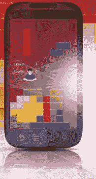

# HTML5 游戏

用 HTML5 CSS3 和 WebGL 创造乐趣
