# HTML5、JavaScript 与 jQuery 24 小时训练指南


由互联网档案馆数字化
于2022年，由
Kahle/Austin基金会资助


## 关于作者

**DANE CAMERON** 是一位居住在新西兰惠灵顿的作家和软件工程师。他多年来一直从事软件工程师工作，开发大型企业系统，在过去五年中专注于 HTML5 Web 应用程序的开发。

Dane 在奥塔哥大学获得了计算机科学和英国文学的双学位。职业前景的维恩图迅速将技术写作确定为一个可能的选择，并且他围绕开发有趣的软件和通过书籍将所学传授给他人建立了自己的职业生涯。

Dane 目前在新西兰惠灵顿的 Fronde Systems Group 工作，并日常使用本书中概述的技术。

Dane 喜欢阅读、徒步旅行，并与妻子一起在美国进行公路旅行。

## 关于技术编辑

**ROHAN HART** 是一位居住在新西兰惠灵顿的软件工程师。他在各种语言和技术方面拥有广泛的背景，并在过去几年中参与了多个大型 HTML5 和 Java 项目。

Rohan 拥有怀卡托大学的计算与数学科学学士学位和计算机科学硕士学位。当不沉迷于代码和编程理论时，他会玩策略游戏，在荒野中跋涉，并努力跟上两个儿子的脚步。

## 贡献者

**项目编辑**
Adaobi Obi Tulton

**业务经理**
Amy Knies

**技术编辑**
Rohan Hart
Bede Bignell

**副出版商**
Jim Minatel

**制作编辑**
Dassi Zeidel

**项目协调员，封面**
Patrick Redmond

**文案编辑**
Nancy Rapoport

**校对**
Josh Chase, Word One New York

**内容开发与汇编经理**
Mary Beth Wakefield

**索引编制**
John Sleeva

**营销总监**
David Mayhew

**封面设计师**
Wiley

**营销经理**
Carrie Sherrill

**封面图片**
©iStock.com/Visiofutura

**专业技术与战略总监**
Barry Pruett

## 致谢

我要感谢 Wiley 的 Bob Elliott，他最初联系我撰写本书，并与我一起制定了原始大纲。这些早期反馈非常宝贵，使写作过程变得容易得多。

我还要感谢整个 Wiley 编辑团队，特别是 Adaobi Obi Tulton 和 Nancy Rapoport，他们不知疲倦地整理材料，并提供了出色的反馈和见解。我还要感谢 Wiley 团队的其他成员，包括 Mary Beth Wakefield 和 Jim Minatel。整个团队使本书的交付过程显得简单。

此外，我要感谢 Rohan Hart 同意担任本书的技术编辑。我与 Rohan 合作了大约 10 年，在所有这段时间里，他从未错过发现我的错误并加以纠正。

我还要感谢 Bede Bignell 提供最终的技术校对，并捕捉任何最终问题。

我还要感谢 Fronde 的所有开发者，特别是那些在过去五年中与我共事的人，我们共同研究如何最好地利用 HTML5 提供的功能为客户提供高质量系统。

最后，我要感谢我的妻子和家人，在我完成本书期间（即使我本应度假时）的耐心和支持，并同意在我制作屏幕录像时不要制造太多噪音。

## 致谢

特别感谢 Doyan 博士，他一直鼓励我的工作。他教会了我很多，不仅关于我工作的主题，还关于成为一名科学家意味着什么。我还要感谢实验室的同事们给予我的帮助和支持。特别是，我要感谢 Smith 博士对手稿提出的深刻见解。


## 引言

网络背后的基础技术如今已有近四分之一个世纪的历史。HTML 可以追溯到 1993 年，也就是第一款流行的网络浏览器 Mosaic 登场的那一年。

因此，你可能认为网络背后的技术已经进入了舒适的中年期——也许仍在某些方面有所改进——但已不再像早期那样以令人兴奋的节奏创新。

事实上，事实远非如此。过去十年是网络历史上最令人兴奋和最具创新性的十年之一，而且这种变革的步伐还在持续加速。因此，网络不再是简单“网站”的专属领域。它已成为“网络应用程序”的王国：功能丰富的应用程序，只是恰好在浏览器中运行。

一类全新的计算设备加剧了这种变革的步伐。网络浏览器不再是台式机和笔记本电脑的专属：它们现在出现在从智能手机到智能电视的无数设备上。网络浏览器是这些不同设备中普遍存在的功能，这一事实增强了基于浏览器的网络应用程序的吸引力：你只需编写一次网络应用程序，用户就可以从他们选择的任何设备上使用它。

过去十年的这种创新并非偶然。多年来，各种标准委员会一直在努力制定一套标准，这些标准已被归入“HTML5”的范畴。这些标准现在已经进入所有主流网络浏览器。

如果你熟悉 HTML，术语 HTML5 可能仅仅意味着 HTML 标记语言的新版本——这可能很有趣——但并不具有革命性。事实上，HTML5 远不止是一种标记语言；它是一套编程 API，由浏览器实现，允许网页执行以前从未可能完成的任务。

例如，现在一个 HTML 页面可以在你的浏览器中存储大量数据，在没有网络连接的情况下运行，在需要时向网络服务器请求更多信息，并在后台执行复杂计算而不干扰你的浏览体验。

本书的目标是教你如何编写网络应用程序。为此，你需要理解的不仅仅是 HTML5。你需要理解一系列相关技术。但更重要的是，你需要理解这些技术如何协同工作。

例如，HTML5 与 JavaScript 紧密相连。在许多情况下，如果你想使用 HTML5，你需要通过 JavaScript API 来实现。因此，如果不掌握 JavaScript，就无法掌握 HTML5。

JavaScript 也正步入中年，但它也继续与 HTML5 一起演进。历史上，JavaScript 被视为某种异类，如今已发展成为一门丰富而富有表现力的编程语言，其能力远超多年来被指派的简单任务（如表单验证）。

JavaScript 的巨大吸引力很大程度上源于用这种语言编写的大量极其有用、免费可用的库。其中最重要的是 jQuery，这是一个 JavaScript 库，它已自成一体，并重新定义了程序员为网页添加动态功能的方式。你可以不学 jQuery 就编写网络应用程序，但你的代码将缺乏 jQuery 库所提供的简洁表达。

最后，为了制作视觉上吸引人的网络应用程序，你需要学习层叠样式表。与其他所有网络技术一样，CSS 也在不断发展和演进，而最新版本的 CSS（称为 CSS3）意味着网页可以实现令人眼花缭乱的视觉效果。

## 本书面向的读者

本书面向任何想要学习如何使用基于标准的技术构建动态网站和网络应用程序的人。

你可能有 HTML4 的经验，但这不是必需的，因为早期课程会深入介绍所有最重要的 HTML 功能。另一方面，经验更丰富的读者可以选择跳过这些课程。

本书包含许多基于 JavaScript 的代码示例。预期你在阅读本书之前有一些编程经验，尽管不一定是 JavaScript。如果你没有编程经验，你可能需要在开始之前通过一些在线教程和练习进行准备。

最后，本书面向希望通过实践学习的程序员。

## 本书涵盖的内容

HTML5 是一个“无版本”的标准。HTML5 背后的规范在不断增长和演进，但这种演进与“官方”或版本化发布并不匹配。

因此，本书不专注于 HTML5 的特定版本；相反，它专注于在所有最常见浏览器中已获得广泛采用的 HTML5 方面。

JavaScript 语言确实包含版本化发布，但与大多数编程语言不同，你无法控制用户选择的版本，因为这是他们选择的浏览器的副产品。因此，本书不会专注于特定版本的 JavaScript：它将专注于在所有主要浏览器中普遍可用的功能。

本书将使用一些 JavaScript 库，这些库可能会随时间变化。每当使用某个库时，都会指定一个特定版本。在许多情况下，使用更新版本的库也能正常工作，尽管代码仅保证与指定版本兼容。

本书旨在作为一本实践指南。每节课都包含你可以跟随的代码和练习，甚至可以根据你的选择进行扩展。重要的是你要跟随这些练习，因为正是这个过程巩固了你对这些技术实际工作方式的理解。

## 本书的结构

本书分为五个部分。前两个部分建议按顺序阅读，因为它们为你添加更复杂功能提供了必要的基础知识。其余三个部分可以按你选择的任何顺序阅读。

本书的第一部分介绍了 HTML 和 CSS，并探讨了如何使用这些技术构建静态网页。在本课结束时，你将拥有一个坚实的基础，在此基础上可以开始添加更复杂的功能。

在第二部分，你将注意力转向 JavaScript 和 jQuery，并探讨如何将静态网页转换为动态网络应用程序。

本书的第三部分探讨了网络浏览器的多媒体功能，以及如何通过 Canvas API 和 CSS3 等技术来利用这些功能。

一旦你理解了 JavaScript，你就可以将注意力转向 HTML5 API，这些 API 允许你在浏览器内部存储数据、从网络服务器访问数据以及在后台进程中执行任务。正是这些功能真正将你的网站转变为功能丰富的网络应用程序。

在本书的最后一部分，你将注意力转向移动设备，并解决如何将你的网络应用程序转换为可在用户可能选择的任何移动设备上运行的移动网络应用程序的问题。

本书的大部分内容围绕示例网络应用程序的开发构建。因此，如果你选择跳过某一课，在开始下一课之前，你需要下载该课的已完成版本的网络应用程序。

## 使用本书所需条件

为了完成本书中的大多数练习，你只需要一个文本编辑器和 Chrome 网络浏览器。

如果你有喜欢的文本编辑器，你可以继续在本书中使用它。如果你没有安装文本编辑器，Notepad++ (http://notepad-plus-plus.org) 是 Windows 的一个不错的选择，Text Wrangler (http://www.barebones.com/products/textwrangler) 是 Mac 的不错选择，Emacs 是 Linux 的不错选择。你也可以选择使用集成开发环境（IDE），如 Eclipse。

选择 Chrome 网络浏览器并非主要因为浏览器本身的功能，而是因为它附带的开发人员工具。如果你愿意，可以选择使用其他网络浏览器，但示例将侧重于 Chrome。


## 引言

Chrome 网页浏览器会频繁更新，我们假定您将使用最新版本的浏览器。

在本书后续章节中，您还需要一个 Web 服务器。本书提供了相关课程，将指导您完成安装和配置 Web 服务器的过程。

示例的源代码可从 Wrox 网站下载，地址为：
www.wrox.com/go/html5jsjquery24hr

## 约定

为了帮助您从本书中获得最大收益并跟踪学习进度，我们在全书中使用了一些约定。

> **警告** 警告包含重要的、不应遗忘的信息，这些信息与周围文本直接相关。

> **注意** 注释则用于说明、提示、技巧、窍门，或与当前讨论相关的旁白。

关于文本中的样式：

- 我们在介绍新术语和重要词汇时会*突出显示*它们。
- 我们这样展示按键操作：Ctrl+A。
- 我们在文本中这样展示文件名、URL 和代码：persistence.properties。
- 我们通过两种不同的方式呈现代码：

对于大多数代码示例，我们使用无高亮的等宽字体。

**我们使用粗体来强调在当前上下文中特别重要的代码，或展示与之前代码片段相比的变化。**

## 源代码

在学习本书示例的过程中，您可以选择手动输入所有代码，也可以使用随书附带的源代码文件。本书中使用的所有源代码均可在 www.wrox.com 下载。本书的代码下载位于以下网址的“Download Code”标签页：
www.wrox.com/go/html5jsjquery24hr

您也可以通过 ISBN 在 www.wrox.com 搜索本书（本书的 ISBN 是 978-1-1190-0116-4）来找到代码。所有当前 Wrox 书籍的完整代码下载列表可在 www.wrox.com/dynamic/books/download.aspx 获取。

www.wrox.com 上的大多数代码都以 .ZIP 或 .RAR 压缩包形式提供，或使用适合该平台的类似存档格式。下载代码后，只需使用相应的解压工具解压即可。

## 勘误

我们已尽一切努力确保文本或代码中没有错误。但人无完人，错误在所难免。如果您在我们的某本书中发现错误，例如拼写错误或代码片段有误，我们将非常感谢您的反馈。提交勘误表，您可能会为其他读者节省数小时的挫败感，同时，您也在帮助我们提供更高质量的内容。

要查找本书的勘误页面，请访问 www.wrox.com/go/html5jsjquery24hr 并点击“Errata”链接。在该页面上，您可以查看为本书提交的所有勘误信息，这些信息由 Wrox 的编辑人员发布。

如果在“Book Errata”页面上没有发现“您的”错误，请访问 www.wrox.com/contact/techsupport.shtml 并填写表格，向我们发送您发现的错误。我们会核实信息，如果确认无误，将在本书的勘误页面发布信息，并在后续版本中修正该问题。

## P2P.WROX.COM

欲进行作者和同行讨论，请加入 P2P 论坛，网址为 http://p2p.wrox.com。这些论坛是一个基于 Web 的系统，您可以在其中发布与 Wrox 书籍及相关技术相关的消息，并与其他读者和技术用户互动。论坛提供订阅功能，当有新帖子发布时，系统会将您选择的感兴趣主题通过电子邮件发送给您。Wrox 作者、编辑、其他行业专家以及您的读者同侪都活跃在这些论坛上。

在 http://p2p.wrox.com，您会找到许多不同的论坛，它们不仅会在您阅读本书时提供帮助，也会在您开发自己的应用程序时助您一臂之力。要加入论坛，只需按照以下步骤操作：

1.  前往 http://p2p.wrox.com 并点击“Register”链接。
2.  阅读使用条款并点击“Agree”。
3.  完成加入所需的信息，以及您希望提供的任何可选信息，然后点击“Submit”。
4.  您将收到一封电子邮件，其中包含有关如何验证您的帐户并完成加入过程的说明。

> **注意** 您可以在不加入 P2P 的情况下阅读论坛中的消息，但要发布自己的消息，您必须先加入。

加入后，您可以发布新消息并回复其他用户发布的消息。您可以随时在网上阅读消息。如果您希望将特定论坛的新消息通过电子邮件发送给您，请点击论坛列表中论坛名称旁边的“Subscribe to this Forum”图标。

有关如何使用 Wrox P2P 的更多信息，请务必阅读 P2P 常见问题解答，其中包含有关论坛软件如何运作的答案，以及许多针对 P2P 和 Wrox 书籍的常见问题。要阅读常见问题解答，请点击任何 P2P 页面上的“FAQ”链接。

# 第一部分
## HTML 和 CSS

-   第1课：HTML5 简介
-   第2课：基础 HTML
-   第3课：列表和表格
-   第4课：CSS 简介
-   第5课：使用 CSS 构建页面结构
-   第6课：HTML 表单
-   第7课：语义化标签
-   第8课：HTML5 验证
-   第9课：拖放
-   第10课：动态元素

# 1
## HTML5 简介

本课是 HTML5 标记语言的入门介绍。HTML5 标记语言是一种用于以 Web 浏览器能够一致解释的方式来构建和表达网页内容的语言。

如果您已经熟悉 HTML，那么本章的大部分内容对您来说将显得非常熟悉。尽管如此，通读本课仍然很重要，因为 HTML5 中有许多重要的变化，其中许多是非常细微的。

如果您不熟悉 HTML，或者只是略有了解，本课将为您提供理解 HTML 网页基础知识所需的背景知识。不过，本课只是一个引言；本课中的内容将在本节的剩余部分中得到扩展和深化。

## 什么是标记语言？

标记语言是一种使用一组标签为文档添加注释的语言。这些标签用于为文档的文本提供额外的含义和结构，或者提供有关应如何向读者显示文本的说明。

例如，一个标签可能声明文本的某一部分是标题，而另一部分是一个段落。考虑以下文档片段：

```
<h1>这是一个标题</h1>
<p>这是一个段落</p>
```

在这个例子中，标签可以通过尖括号与文档内容明显区分开来。以下代码代表一个标题的开始：

```
<h1>
```

而以下代码代表标题的结束：

```
</h1>
```

注意 HTML 定义了从 h1 到 h6 六个级别的标题。数字越小，标题越重要。

整个 h1 结构——包括开始标签、结束标签及其文本内容——被称为一个元素。

HTML5 标记语言规定了可以在 HTML 文档中使用的标签、应如何使用它们，以及它们可以包含哪些附加信息（称为属性）。

在 HTML 早期，标记语言中的许多标签用于指示浏览器如何呈现信息。例如，曾使用标签来规定字体大小和颜色。

HTML 标记语言不再负责规定文档的呈现方式，在 HTML5 中，大多数剩余的呈现标签已被移除。呈现现在完全由另一种称为*层叠样式表*的技术控制，我们将在本节稍后学习它。

相反，HTML5 标记语言负责传达文档各个组件的含义以及它们如何与其他组件交互。

注意 浏览器仍然可以为标签提供自己的默认样式，这就是为什么 h1 元素会以大号粗体文本显示。

然而，HTML5 大大增强了早期版本 HTML 的表达能力，并允许将文档的某些部分标记为页眉、页脚和旁注等。

HTML 的早期版本基于一种名为 SGML（一种用于表达标记语言的语言）的技术。从 HTML5 开始，HTML 标记语言不再基于任何其他技术。这消除了该语言的一些限制；因此，如果您熟悉 HTML，您将在后续章节中注意到许多旧规则不再适用。

## 最简单的 HTML 页面

在学习任何技术时，从最简单的实现开始总是一个好主意。在 HTML5 中，您可以编写的最简单的页面如下：

```
<!DOCTYPE html>
hello world!!!
```

打开您最喜欢的文本编辑器，输入此文本，并将文档保存为 hello.html。

现在，打开 Chrome 浏览器，在 Windows 上按 Ctrl-O 或在 Mac 上按 ⌘-O，导航到您刚刚保存的文件，然后选择“打开”。在 Web 浏览器中加载时，它应该看起来像图 1-1。

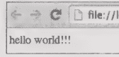


这看起来可能不像是一个网页；毕竟，页面上除了文档第一行那个看起来奇怪的标签外，没有其他标签。

在 Chrome 中打开页面后，现在选择打开开发者工具：

- 在 OS X 上按 Command+Option+I
- 在 Windows 上按 F12 或 Ctrl+Shift+I

这应该会打开如图 1-2 所示的位于网页下方的窗口。

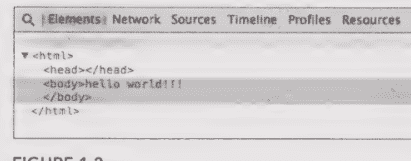

**图 1-2**

这是网页浏览器对网页的内部表示。如你所见，它规范化了文档的结构，并确实提供了一组相互嵌套的标签。最外层是 html 元素，其内部有两个元素：head 和 body。body 元素的内容就是你在文本编辑器中编写的文本。

文档已被规范化以符合文档对象模型的规则。文档对象模型在整个本书中都将极其重要，因为现代网页的大部分功能都来自于其在页面加载后操纵文档对象模型的能力。

自 HTML 首次出现以来，如何从 HTML 页面构建文档对象模型一直是一个有争议的问题。历史上，不同的浏览器会为相同的 HTML 生成不同的模型，这使得编写跨浏览器的网页变得非常困难。

为了应对跨浏览器问题，负责制定 HTML 等网络标准的万维网联盟决定推荐一套标准，将责任放在网页开发者身上。这些标准被称为 HTML Strict 和 XHTML，它们强制网页开发者创建规范化的网页，从而使网络浏览器能够轻松地一致渲染页面。

这种方法效果并不理想。HTML 背后的真正力量并非来自标准机构，而是来自浏览器厂商，因为他们最终决定了什么是一个有效的网页。他们不想对网页强制执行这种严格性，因为无法加载网页只会让他们的浏览器看起来有缺陷。

随着 W3C 继续推行其严格标准，一个名为 WHATWG 的竞争团体开始开发一个最终成为 HTML5 的竞争标准。该团体的成员主要来自主要的浏览器厂商，他们的目标更加务实。该团体并非创建一整套新标准，而是首先研究浏览器已经在做什么，并尽可能以此为基础制定标准。

W3C 最终放弃了对严格性的努力，并加入了 WHATWG 的工作，两个组织各自发布了一个版本的 HTML5 标准。

HTML5 标准的很大一部分描述了浏览器厂商应如何从一个非规范化的 HTML 文档创建规范化的文档对象模型。这就是为什么 Chrome 在前面的例子中创建了它所创建的文档对象模型，也是为什么 Firefox、IE 和 Safari 会创建完全相同结构的原因。

## 一个 HTML 模板

在上一节中，你编写了你能编写的最简单的网页。在本节中，你将按照一个基本模板编写一个网页，该模板旨在代表你应该编写的最简单的 HTML 结构。

我将首先呈现模板，然后逐行向你讲解。在文本编辑器中打开一个新文档，并将以下内容保存为 template.html：

```
<!DOCTYPE html>
<html lang="en">
<head>
    <meta charset="utf-8">
</head>
<body>
    This is the body of the document.
</body>
</html>
```

如果在 Chrome 中打开此文件，然后在开发者工具中查看文档对象模型，它看起来将如图 1-3 中的示例。

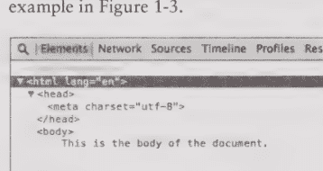

如你所见，在这种情况下，你在 HTML 文件中提供的内容与浏览器生成的规范化结构之间有着更紧密的对应关系。

现在让我们逐一讲解文档中的每一行，并探讨其目的。

文档的第一行如下：

```
<!DOCTYPE html>
```

此行定义了页面的文档类型。因为多年来存在许多不同的 HTML 标准，浏览器使用此行来理解页面使用的是这些标准中的哪一个，然后使用适用于该标准的规则来解释页面内容并相应地进行渲染。

这是 HTML5 文档类型定义，对于可能习惯于复制粘贴如下 DOCTYPE 声明的开发者来说，这是一个令人愉悦的惊喜：

```
<!DOCTYPE HTML PUBLIC "-//W3C//DTD HTML 4.01//EN" "http://www.w3.org/TR/html4/strict.dtd">
```

关于此文档类型定义的另一个主要惊喜是，它不包含版本号：文档类型只是 `html`。

尽管规范被称为 HTML5，但它定义了一个“活动标准”，该标准将随着浏览器厂商实施并就新功能达成一致而进行增量更改。换句话说，HTML 永远不会有另一个版本，但 HTML 将始终持续演进。

下一行包含开始的 `html` 标签，它封装了文档的其余部分：

```
<html lang="en">
```

此标签包含一个名为 `lang` 的属性，其值为 `en`。属性为标签提供额外含义提供了一种机制。这个特定的属性声明文档的语言是英语。

> **注意** *ISO 标准 639-1 定义了可用于语言的两字母代码集。这些代码也可以与国家代码配对，例如 en-US。国家代码在 ISO 标准 3166 中定义。*

与 HTML5 的许多方面一样，尽管规范定义了属性及其期望值，但如何使用这些信息由浏览器决定。浏览器可能会使用此信息向非英语使用者建议翻译，也可能对此信息完全不做任何处理。

文档中的下一个元素是 `head` 元素。这是文档中你可以提供有关文档的重要元数据以及文档所需其他文件链接的部分。`head` 部分从不包含网页的任何可视化组件。在这个特定的例子中，`head` 包含一个重要的元数据：

```
<meta charset="utf-8" />
```

这指定了文档的字符编码是 UTF-8。本节将不涵盖字符编码，但规范建议设置此项。

还有一个通常添加到 `head` 元素中的元素：`title` 元素。这是网页加载时浏览器将在标题栏中显示的文本。因此，在 `head` 部分内添加以下内容：

```
<title>Basic template</title>
```

然后在 Chrome 中查看页面；标签页标题将显示如下：


接下来你将遇到 `body` 元素。页面的所有可视化元素都将在此处描述。在这个特定的例子中，`body` 由一个文本字符串组成，但正是文档的这一区域，你将在接下来的章节中进行增强，以创建有趣的网页。

## 理解元素和属性

尽管你创建的示例非常简单，但你已经可以看到元素可以相互嵌套，从而创建树状结构。

每个 HTML 文档都有一个顶层元素，它总是 `html` 元素（文档类型元素本身不属于文档的一部分）。

此外，文档中的每个元素都可以有零个或多个子元素。`html` 元素有两个子元素：`head` 和 `body`。`head` 元素本身又有一个子元素：`meta` 元素。

文档中的每个元素（`html` 元素除外）都有一个（且只有一个）父元素。`head` 元素的父元素是 `html` 元素。`meta` 元素的父元素是 `head` 元素。

正如你将看到的，页面的结构将变得相当复杂，嵌套程度将大幅增加。然而，无论页面变得多么复杂，所有元素都将遵循这些简单的规则。

你已经研究了元素如何由开始标签和结束标签组成；例如，head 标签的开始是 `<head>`，而结束是一个同名但前面带有正斜杠的标签 `</head>`。

某些元素不需要任何内容：标签及其属性提供了所需的所有信息。在这种情况下，开始标签和结束标签可以合并为以下结构：

```
<meta charset="utf-8" />
```

标签结束前的正斜杠表示标签正在关闭。这等同于以下内容：

```
<meta charset="utf-8"></meta>
```

你应该始终确保所有标签都按其打开的相反顺序关闭。例如，你永远不应像下面这样编写标记：

```
<p><strong>Hello</p></strong>
```

在这种情况下，`strong` 元素应该是 `p` 元素的子元素，但 `p` 元素在 `strong` 元素结束之前就结束了。

> 注意 *strong 标签用于表示一段文本很重要。虽然这经常与现已弃用的加粗标签混淆，但它实际上仍然是一个有效的 HTML5 标签。此标签不被视为呈现标签，因为它表示文本很重要，而不是文本应该如何样式化。你可能决定将 strong 元素设置为红色而不是加粗字体。*


## 尝试一下

### 课程要求

你需要一个文本编辑器和一个网页浏览器。

### 分步指南

1.  打开你的文本编辑器并创建一个新文档。
2.  在文档中添加HTML5文档类型声明。
3.  在文档类型下方添加一个html元素（包括开始和结束标签）。
4.  使用html标签上的一个属性来指明文档的语言。
5.  在html元素内部添加一个head元素。你需要同时添加开始标签和结束标签。
6.  在head元素内部添加一个title元素，并为文档命名。请记住，这必须是head元素的子元素。
7.  在html元素内部，紧接在结束的head标签之后，添加一个body元素。
8.  在head中添加一个meta元素，指明字符集为UTF-8。
9.  在文档的body中添加任何你喜欢的文本。当你在Chrome中打开网页时，你添加的任何文本都应会显示出来。
10. 将文档保存为.html扩展名。
11. 在Chrome中打开该文档，并在开发者工具中检查文档对象模型。

当你在Chrome中打开此文件，然后打开开发者工具检查元素时，标记应如图1-6所示。

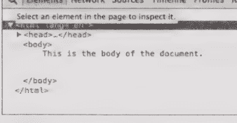

#### 图 1-6

在本书网站的第1课文件夹中，还有一个完整的示例，名为tryit.html。

> **参考** 请在线选择第1课的视频，网址为www.wrox.com/go/html5jsjquery24hr。你也可以从该网站下载本课的代码和资源。

## 基本HTML

本课程提供了对最常见的HTML标签的基本介绍。如果你已经熟悉HTML，并且主要是为了学习HTML5而阅读本书，你可以选择跳过接下来的两课，尽管每一课都确实包含了特定于HTML5的内容。

在上一课中，你创建了一个HTML模板。在本课中，你将开始使用一些最常见的HTML标签向此模板的body中添加内容。

## 构建文本结构

你将从研究在网页中构建文本结构的方法开始。HTML最初是作为一种分享研究论文的手段而诞生的；因此，文本格式化一直是HTML的重要组成部分。

首先，打开上一章创建的`template.html`文件。按以下标记替换网页的`body`：

```
<!DOCTYPE html>
<html lang="en">
<head>
    <meta charset="utf-8">
</head>
<body>
    <h1>This is a top level heading</h1>
    <h2>This is a second level heading</h2>
    <h3>This is a third level heading</h3>
</body>
</html>
```

`body`现在包含了三个独立的header元素。如果你在Chrome中打开它，应该如图2-1所示。

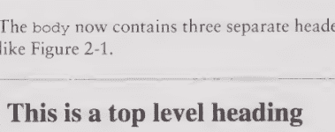

注意，`h1`元素的文本显示的字体比`h2`元素的更大。事实上，这与HTML规范无关；这仅仅是网页浏览器提供的默认样式，就像字体是浏览器的默认字体一样。在第4课中，你将看到如何使用层叠样式表（CSS）覆盖这一点。

你还会注意到每个标题都显示在新行上。这不是因为元素在HTML文件中放置在新行上；事实上，HTML中的空白符大多会被忽略。为了证明这一点，按如下方式更改`h1`标签：

```
<h1>This is       a       top
                level heading</h1>

    <h2>This is a second level heading</h2>
```

如果你重新加载网页，你会看到这种更改对标题的显示方式没有影响。虽然单个空白符字符会显示为元素内的一个空格，但一串空白符字符（即使包含换行符）也会被折叠成一个空白符字符。

HTML确实提供了一个特殊的字符序列`&nbsp;`，用于添加额外的空白符字符，但换行符应使用稍后介绍的标签来创建。

> **注意** *&符号后跟一系列字符并以分号结尾，表示这是一个特殊字符序列。*
>
> *HTML中有许多特殊字符序列。也许你会遇到的最常见的两个是`&lt;`和`&gt;`，它们分别用于小于号（<）和大于号（>）字符。之所以需要它们，是因为<和>字符在HTML中具有特殊含义。如果你好奇，`nbsp`代表“不换行空格”（non-breaking space）。*

那么，是什么在每个标题后产生了换行呢？这些换行出现是因为`h1`到`h6`元素是`块级`元素。所有可视HTML元素都有一个显示类型，其中最常见的就是`块级`和`内联`。每当一个`块级`元素结束时，下一个元素会自动从新行开始。

接下来，你可以继续向**body**添加一些段落：

```
<p>This is the first paragraph</p>
<p>This is the second paragraph</p>
```

如果你刷新网页，它会如图2-2所示。

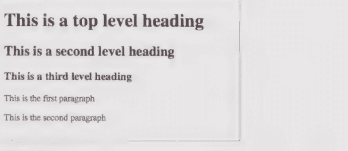

#### 图 2-2

每个段落都出现在新行上，并且每个段落之间有一个空格。

实际上，可以省略p标签的结束标签。事实上，在很多情况下都可以省略结束标签，因为文档中的下一个标签隐含了它的存在。在这些情况下，我通常觉得添加结束标签更容易，但规范使其完全可选。你将在整个示例中看到，我有时会省略结束标签，有时则包含它。

> **那么XHTML呢？**
>
> 如果你已经熟悉HTML，你可能知道XHTML，它是基于XML的HTML版本。HTML5扩展并取代了XHTML以及HTML。为了将HTML5页面序列化为XML，所有标签都必须闭合，并且整个文档必须是格式良好的。此外，html标签应声明如下：
>
> `<html xmlns="http://www.w3.org/1999/xhtml">`
>
> 并且在向浏览器提供文档时，其内容类型应设置为`application/xhtml+xml`而不是`text/html`。
>
> 如果你还不熟悉XHTML，在本书的剩余部分中可以忽略它：通常只有在你需要使用XML解析器和工具处理HTML页面时才会用到它。

如果段落中的文本达到了浏览器的最右边，它会自动换行。此外，如果用户调整浏览器大小，文本会自动调整：这个过程被称为浏览器回流。


有时浏览器会在不方便的位置断开段落，尤其是在段落中包含很长的单词时。为了让你能更灵活地控制换行位置，HTML5 引入了一个名为 `wbr` 的标签，它可以添加在段落内的任何位置，向浏览器暗示这是一个适合换行的位置。

如果你想在段落中手动换行，可以使用 `br` 标签。这也是一个自闭合标签，使用方法如下：

```
<p>This is a paragraph<br>that spans two lines</p>
```

HTML 支持多种用于包裹文本块的标签。本节最后将要介绍的是 `blockquote` 元素，它可用于包裹引用文本，并可选择性地包含来源引用：

```
<blockquote>Tell me and I forget. Teach me and I remember. Involve me and I learn.
  <cite>Benjamin Franklin</cite>
</blockquote>
```

这个结构稍微复杂一些：`blockquote` 标签包含引用内容，而 `cite` 作为可选的子标签，则用于标注引用来源。图 2-3 展示了该标签在 Chrome 浏览器中的示例。

告诉我，我会忘记。教导我，我会记得。让我参与，我才会学习。*本杰明·富兰克林*

## 图 2-3

请注意，`blockquote` 标签有缩进，而 `cite` 元素以斜体显示。同样，这些是浏览器的默认样式，并非 HTML5 规范的一部分。

最后，随着网页变得越来越复杂，你可能会希望添加注释来提醒自己标记的含义。可以按如下方式添加注释，用户不会看到它们：

```
<!-- This is a comment -->
```

## 链接与图片

网页自然不仅仅包含文本。本节将介绍大多数网页中最基本的两种标签：超链接和图片。

我假设你知道什么是超链接：它们是一种引用其他 HTML 文档的机制，用户点击后可以导航到该文档。

首先，在你上一节开发的页面所在文件夹中创建一个新页面，并将其命名为 `page2.html`。为此页面添加一些内容，以便在加载时能够区分它。

现在，在原始的 HTML 文件中，添加以下段落：

```
<p>Please click <a href="page2.html">here</a> to view page 2</p>
```

如果你重新加载页面，这段 HTML 将生成图 2-4 中所示的文本。

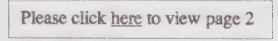

## 图 2-4

请注意，显示给用户的文本来自 `a` 标签的内容，而点击链接时加载的页面则在其 `href` 属性中指定。

这个特定的 URL 被称为相对 URL，因为它不以斜杠或域名开头。浏览器会尝试在相对于当前显示页面的位置查找 `page2.html`。

如果你将 `page2.html` 创建在一个名为 `sub` 的子文件夹中，则 URL 应如下表示：

```
<p>Please click <a href="sub/page2.html">here</a> to view page 2</p>
```

在 Web 服务器中运行网站时，也可以使用绝对 URL。它们以一个前导 `/` 开头，需要指定文件的完整路径。

同样可以添加指向其他网站的 URL。例如：

```
<a href="http://www.google.com">Link to Google</a>
```

你还会注意到，`a` 标签不会在文档中产生隐式的换行。这是因为，与你之前研究的大多数标签不同，它的显示类型是 `inline`（内联）。

超链接可以非常复杂。随着你深入学习本书，你将看到超链接更多有趣的功能，例如它们如何编码参数，但目前只需基本理解即可。

图片可以通过 `img` 标签插入到 HTML 页面中。我现在很少使用 `img` 标签了：我通常使用 CSS 将图片作为其他标签的背景来嵌入，因为这样可以提供更大的图片定位控制，但理解此标签的工作原理很重要。

你可以找一张你想使用的图片，或者从本书网站的第 2 课文件中下载 `photo1.jpg`。

现在，将以下内容添加到 HTML 页面：

```
<p>This is a photo I took in Cambridge
</p>
```

如果你在 Chrome 中查看，它的显示方式将与你在图 2-5 中看到的非常相似。


## 图 2-5

这是你首次遇到具有多个属性的标签。

- `src` 属性用于指定文件的位置。与超链接一样，这可以是绝对或相对 URL，甚至可以引用另一个网站上的图片。
- `title` 属性用于指定工具提示，当读者将鼠标悬停在图片上时会显示该提示，并用于向屏幕阅读器描述图片。
- `width` 属性用于以像素为单位指定图片的宽度。也可以指定高度，但如果只指定 `width` 或 `height`，图片将被适当缩放。

浏览器支持多种不同的图片类型，但目前最常见的是 PNG、GIF 和 JPEG 图片。`img` 标签以前还支持许多其他面向表现的属性。这些属性在 HTML5 中已弃用，应使用 CSS 属性代替。

> **注意** *当一项功能被弃用时，它仍然可用，可能也仍然有效，但强烈建议你寻找替代方案，因为未来可能会完全停止对其的支持。*

## 动手试试

这个“动手试试”的机会是为了让你实践本课中讨论的标签。你不一定需要完全遵循本课的步骤；只需尝试用已介绍的标签创建一个有趣的网页。

### 课程要求

你需要第 1 课的 `template.html` 文件、一个文本编辑器和一个网络浏览器。

### 分步指南

1.  在你的文本编辑器中打开 `template.html` 页面。
2.  在页面中添加一个 `h1` 元素，并包含一些标题文本。
3.  使用 `p` 标签向网页添加一些段落，并使用 `br` 标签将某些段落分成多行。
4.  使用 `blockquote` 和 `cite` 标签，向页面添加一个引用及其出处。
5.  找一张你想包含在页面中的图片，并将其添加到页面底部。为图片设置固定宽度，并允许浏览器确定正确的高度。
6.  在你的页面中添加一个超链接，指向当前页面子文件夹中的另一个页面。
7.  添加一个指向外部网站（如 Google）的超链接。
8.  尽管我还没有讲到，但尝试将图片变成一个超链接，使其在点击时加载另一个页面。提示：图片需要是超链接的子元素。

我的示例可以在第 2 课的 `tryit.html` 资源中找到。

> **参考资料** *请在线选择第 2 课的视频，访问 www.wrox.com/go/html5jsjquery24hr。你也可以从网站下载本课的代码和资源。*

# 3 列表与表格

在本课中，你将了解网页内容结构化的两种重要方式：列表和表格。

## 列表

列表对于任何使用过文字处理工具（如 Microsoft Word）的人来说都很常见：它们是用于记录一系列要点的项目符号和编号列表。HTML 列表与这些列表非常相似。在本节中，我将介绍 HTML 提供的三种列表类型。

### 无序列表

无序列表用于创建在 Word 文档中常见的项目符号列表。要创建无序列表，需将一组 `li` 元素放置在 `ul` 元素内。`li` 代表“列表项”，而 `ul` 代表“无序列表”。

以下是一个示例：

```
<!DOCTYPE html>
<html lang="en">
    <head>
        <meta charset="utf-8">
    </head>
    <body>
        <ul>
            <li>This is the first point</li>
            <li>This is the second point</li>
            <li>This is the third point</li>
        </ul>
    </body>
</html>
```


如果你将这段代码保存为 HTML 文件并在 Chrome 浏览器中打开，它的显示效果将如图 3-1 所示。

`li` 标签是自闭合的，所以我省略了结束标签。显然，即使包含结束标签，也不会影响列表的显示效果。

虽然无序列表很简单，但一旦与 CSS 结合使用，它们就能变得非常强大。当你在网页顶部看到水平排列的导航链接时，它们很可能就是由无序列表创建的。

### 有序列表

有序列表与无序列表完全相同，只是它们使用 `ol` 标签而不是 `ul` 标签。两者唯一的视觉区别在于有序列表是带编号的：

```
<ol>
    <li>这是第一点
    <li>这是第二点
    <li>这是第三点
</ol>
```

任何元素都可以作为 `li` 标签的内容；因此，可以在列表中嵌套列表。以下示例展示了一个在有序列表中包含无序列表的例子：

```
<ol>
    <li>第一点
        <ul>
            <li>子点 1</li>
            <li>子点 2</li>
        </ul>
    </li>
    <li>第二点
        <ul>
            <li>子点 1</li>
            <li>子点 2</li>
        </ul>
    </li>
    <li>没有子点的点</li>
</ol>
```

其结果可以在图 3-3 中看到。

### 描述列表

描述列表可能是最不常用的列表类型。它们是一种每个条目都捕获一个“名称-值”组的列表类型。每个组又由一个或多个名称，后跟一个或多个定义组成。考虑以下列表，它记录了某咖啡馆供应的饮品信息：

```
<dl>
    <dt>咖啡</dt>
    <dd>卡布奇诺</dd>
    <dd>浓缩咖啡</dd>
    <dd>摩卡</dd>
    <dt>茶</dt>
    <dd>伯爵红茶</dd>
    <dd>绿茶</dd>
    <dd>印度香料茶</dd>
</dl>
```

这个列表包含两组：咖啡和茶。每组又由与该组相关的一系列饮品组成。你可以在图 3-4 中看到其结果。

定义列表最初完全是针对术语和定义进行规范的。HTML5 标准拓宽了定义列表的建议用途，鼓励你从具有名称和值的组的角度来思考。

## 表格

表格是比列表更复杂的结构，支持我们熟悉的行和列的概念。在本书的课程中，你将从头开始编写一个 Web 应用程序，这个 Web 应用程序将使用一个表格。该 Web 应用程序将执行基本的客户关系管理（CRM）功能；具体来说，它将跟踪一组联系人以及他们最近一次被联系的日期。

为了启动这个 Web 应用程序，请在你的文件系统中某个位置创建一个名为 CRM 的文件夹。这将存放 Web 应用程序所需的所有文件。

接下来，在此文件夹中添加一个名为 `contacts.html` 的文件，并使用第 1 课概述的基本 HTML5 模板填充它。

现在，你将在网页的 `body` 中创建一个表格，用于捕获以下信息：

- 联系人姓名
- 电话号码
- 电子邮件地址
- 联系人所在公司
- 最近联系日期

首先，从在网页的 `body` 中创建开始和结束的 `table` 标签开始：

```
<table>
</table>
```

HTML 表格是面向行的：你使用 `tr`（表格行）元素一次添加一行，并为所有相关列提供值。行可以添加到表格的表头、主体或页脚。在 `table` 元素内添加以下内容：

```
<thead>
    <tr>
        <th>联系人姓名</th>
        <th>电话号码</th>
        <th>电子邮件地址</th>
        <th>公司名称</th>
        <th>最近联系日期</th>
    </tr>
</thead>
```

`<thead>` 元素中的行包含五个子元素：这些 `th`（表格标题）元素是表格行中的各个单元格。

接下来，你将向表格主体添加两行。表格主体封装在 `<tbody>` 元素中。主体中的各个单元格使用 `td`（表格数据）元素，而不是 `th` 元素。在 `<thead>` 元素结束后添加以下内容：

```
<tbody>
  <tr>
    <td>威廉·史密斯</td>
    <td>555-642-7371</td>
    <td>william@testing.com</td>
    <td>ACME 工业公司</td>
    <td>2014-10-21</td>
  </tr>
  <tr>
    <td>鲍勃·莫里斯</td>
    <td>555-999-2991</td>
    <td>bob@testing.com</td>
    <td>ABC 公司</td>
    <td>2014-09-12</td>
  </tr>
</tbody>
```

接下来，你将为表格添加一个页脚行。页脚将简单地说明表格中有多少行；因此，它只需要占据一个单元格。这就产生了一个困境，因为你希望表格中的所有行都具有相同数量的列。解决方案是使用 `td` 元素的 `colspan` 属性，来指定单个 `td` 跨越多列。在 `<tbody>` 元素结束后添加以下内容：

```
<tfoot>
  <tr>
    <td colspan="5">显示 2 个联系人</td>
  </tr>
</tfoot>
```

最后，你将为表格添加一个标题。只要它是 `<table>` 元素本身的直接子元素，它可以添加到表格中的任何位置：

```
<caption>销售线索</caption>
```

完整的网页现在应如下所示：

```
<table>
  <thead>
    <tr>
      <th>联系人姓名</th>
      <th>电话号码</th>
      <th>电子邮件地址</th>
      <th>公司名称</th>
      <th>最近联系日期</th>
    </tr>
  </thead>
  <tbody>
    <tr>
      <td>威廉·史密斯</td>
      <td>555-642-7371</td>
      <td>william@testing.com</td>
      <td>ACME 工业公司</td>
      <td>2014-10-21</td>
    </tr>
    <tr>
      <td>鲍勃·莫里斯</td>
      <td>555-999-2991</td>
      <td>bob@testing.com</td>
      <td>ABC 公司</td>
      <td>2014-09-12</td>
    </tr>
  </tbody>
  <tfoot>
    <tr>
      <td colspan="5">显示 2 个联系人</td>
    </tr>
  </tfoot>
  <caption>销售线索</caption>
</table>
```

如果在 Chrome 中打开该页面，它应该如图 3-5 所示显示。

| 销售线索 | | | | |
| :--- | :--- | :--- | :--- | :--- |
| **联系人姓名** | **电话号码** | **电子邮件地址** | **公司名称** | **最近联系日期** |
| 威廉·史密斯 | 555-642-7371 | william@testing.com | ACME 工业公司 | 2014-10-21 |
| 鲍勃·莫里斯 | 555-999-2991 | bob@testing.com | ABC 公司 | 2014-09-12 |
| 显示 2 个联系人 | | | | |

**图 3-5**

你会注意到表格中的列根据添加到其中的数据自动调整了大小，但表格的最后一行跨越了列边界。

从技术上讲，你可以避免使用 `thead`、`tbody` 和 `tfoot` 标签，而只需将每一行直接包装在 `table` 元素内的 `tr` 元素中。然而，有许多理由说明值得添加这些标签所提供的额外结构：

- 它将帮助你为表格的不同部分设置不同的样式。通常，页眉和页脚行的样式将与表格主体中的行不同。
- 你可以为表格添加额外的功能，如排序和筛选。在这种情况下，你将不希望对页眉和页脚行进行排序或筛选。

在 HTML5 之前，`table` 标签支持许多属性来控制表格的呈现，例如边框大小、表格宽度、表格背景颜色以及每个单元格周围的内边距。这些在 HTML5 中都已被移除，你不应该使用它们。

> 注意 *在网站开发的早期，使用表格作为布局机制是很常见的。现在，这强烈不被鼓励，因为 CSS 本身已经提供了足够的能力来布局复杂的网页。表格应该只用于需要以列和行的形式存储数据的数据。*

## 动手试一试

在这个动手试一试环节，你将尝试使用列表和表格。与上一课一样，你不需要严格遵循本课内容，最重要的是尝试使用这些标签，并自己探索它们如何组合以创建有趣的网页。

### 课程要求

你将需要第 1 课的 `template.html` 文件、一个文本编辑器和一个 Web 浏览器。

### 逐步操作

1. 在你的文本编辑器中打开 `template.html` 页面。
2. 首先创建一个简单的编号列表，列出你在本课中学到的所有标签——例如 `table`、`tfoot` 和 `thead`。
3. 现在，假设你想根据它们是否与表格或列表相关来对它们进行分类。尝试将编号列表转换为描述列表。每个类别应该被包含在 `dt` 元素中，而标签名称应该放在 `dd` 元素中。目标是创建一个看起来像图 3-6 的结构。

图 3-6


## 4

## CSS 入门

本书前三课向您介绍了大量标签，但到目前为止，这些标签在屏幕上显示时，其样式呈现一直无法被定制。如前所述，HTML5 已移除了大多数剩余的基于呈现的标签和属性，呈现和样式现在由另一项称为级联样式表（CSS）的技术负责。

其主要原因是基于一个被称为“关注点分离”的概念。HTML 标记语言负责提供页面内容，而 CSS 则负责这些内容的呈现和样式。这意味着可以更改其中任何一个而不影响另一个。

例如，通常可以完全重新设计现有网页的样式，而无需更改 HTML。此外，也可以更改网页内容，而完全无需更改 CSS。

本课将介绍 CSS 的基础知识，并主要关注单个元素的样式设置方式。在下一课中，您将巩固这些知识，并了解元素之间相互作用时 CSS 的行为方式。

HTML5 规范包含一个配套规范，称为 CSS3——级联样式表的第三个版本——它极大地增强了 CSS 的能力。您将在本书的后面部分深入探讨 CSS3，但在接下来的两课中，我们将专注于 CSS 的基础知识。

> **注意** *CSS 的功能确实令人惊叹，因此本课不会向您介绍 CSS 的所有功能。本课的目标是为您提供对基础知识的扎实理解：一旦理解了这些基础知识，就能轻松找到有关特定功能的信息。*

4. 现在，您将向网页添加一个表格，以相同的方式呈现相同的信息。创建一个包含以下列的表格：
- 标签名
- 类别（例如，列表、表格）
- 描述

确保表格利用了 `thead` 和 `tbody` 元素。
为表格提供一个标题。
表格的前几行可能类似于图 3-7。

| 标签名 | 类别 | 描述 |
| --- | --- | --- |
| `ul` | 列表 | 创建无序列表 |
| `ol` | 列表 | 创建有序列表 |
| `li` | 列表 | 创建列表项 |
| `dl` | 列表 | 创建描述列表 |

*标题：第 3 课中的标签*

图 3-7

> 参考 请在线访问 www.wrox.com/go/html5jquery24hr 选择第 3 课的视频。您也可以从该网站下载本课的代码和资源。

## CSS 选择器

在本节中，您将开始使用 CSS，为第 2 课中开发的网页设置样式。该页面利用标题和段落元素来格式化文本，并包含图像和超链接。请确保您准备好以下 HTML 代码以便在本节中使用：

```
<!DOCTYPE html>
<html lang="en">
<head>
    <meta charset="utf-8">
</head>
<body>
    <h1>This is a top level heading</h1>
    <h2>This is a second level heading</h2>
    <h3>This is a third level heading</h3>
    <p>This is the first paragraph</p>
    <p>This is the second paragraph</p>
    <blockquote>
        Tell me and I forget. Teach me and I remember. Involve me and I learn.
        <cite>Benjamin Franklin</cite>
    </blockquote>
    <p>Please click <a href="page2.html">here</a> to view page 2</p>
    <p>This is a photo I took in Cambridge
    </p>
</body>
</html>
```

如您所见，可以通过三种不同的方式将 CSS 包含在网页中。本节将专注于一种方法：在网页 `head` 部分的 `style` 元素内添加 CSS。

为了对元素应用样式，您首先需要一种方法来选择希望设置样式的元素。CSS 提供了四种关键的选择机制，其中最简单的是基于标签名来选择元素。例如，如果您想选择文档中所有的 `h1` 元素并以红色字体显示它们，可以在 `head` 部分添加以下内容：

```
<style>
    h1 {
        color: red;
    }
</style>
```

如果刷新网页，顶级标题将显示为红色。

> 注意 许多颜色可以直接通过名称引用，但更常见的是将颜色表示为像 #FF0000 这样的字符串。这是一个哈希值，后跟三组十六进制数字，分别指定红、绿、蓝的比例。网上有许多使用这种格式查找颜色的资源，您将在本书中看到许多示例。

这个简单的示例演示了您需要了解的大部分 CSS 语法。首先，指定选择器：在本例中是 `h1`。接下来，在花括号之间放置一组样式属性，每个样式属性都是名称/值对的形式。在本例中，属性的名称是 `color`（技术上说是前景色），而值是 `red`。冒号分隔名称和值，整个结构以分号结束。我将把这整个结构称为一条 CSS 规则。

可以为同一选择添加多个样式属性。以下规则还指定了 `font-family` 以及文本应带下划线。

```
<style>
    h1 {
        color: red;
        text-decoration:underline;
        font-family: Arial, Helvetica, sans-serif;
    }
</style>
```

图 4-1 显示了结果。


图 4-1

`font-family` 属性的值比 `color` 更有趣。许多字体是专有的；因此，您无法确定用户的浏览器会提供哪些字体。因此，该属性的值包含一个按优先顺序排列的字体列表。在本例中，值说明：

- 如果可用，尝试使用 Arial。
- 如果不可用，则使用 Helvetica。
- 如果不可用，则使用任何无衬线字体。

现在想象一下，您希望此样式应用于网页中的所有标题。显然，您可以在三个独立的规则中复制此规则三次，并分别选择 `h1`、`h2` 和 `h3`。但您总是希望尽可能避免重复，因为这会导致维护问题。

实际上，有两种方法可以在不重复的情况下实现这一点。第一种是用逗号分隔指定三个不同的标签：

```
h1, h2, h3 {
    color: red;
    text-decoration:underline;
    font: Arial, Helvetica, sans-serif;
}
```

然而，更优雅的解决方案是使用类。任何元素都可以通过 `class` 属性分配一个或多个类。类只是您选择的任意名称，通常描述一组元素共有的某些方面。例如：

```
<h1 class="redHeader">This is a top level heading</h1>
<h2 class="redHeader">This is a second level heading</h2>
<h3 class="redHeader">This is a third level heading</h3>
```

在本例中，`redHeader` 是类名。然后可以使用以下选择器为所有具有此特定类的元素设置样式：

```
.redHeader {
    color: red;
    text-decoration: underline;
    font: Arial, Helvetica, sans-serif;
}
```

注意选择器开头的点：这始终表示您正在按类选择元素。如果重新显示网页，所有三个标题都将使用指定的属性显示。

如果您想为一个元素分配两个类，则类名之间用空格分隔。例如：

```
<h1 class="redHeader pageHeading">This is a top level heading</h1>
```

然后您可以基于其中任何一个类来选择元素。

另一种选择元素的常见方式是通过其 ID。任何元素都可以被赋予一个 ID，但与类不同，ID 在文档中必须是唯一的。以下是带 ID 的段落示例：

```
<p id="firstParagraph">This is the first paragraph</p>
```

然后可以创建如下 CSS 规则来选择此元素：

```
#firstParagraph {
    font-weight: bold;
}
```

注意选择器以 # 开头，表示它基于 ID。这个特定示例将以粗体显示具有匹配 ID 的段落。

选择元素的最后一种常见方式是通过伪类。这些伪类允许您基于其他选择器无法表达的特征来选择元素，例如表格中的每个偶数行。

如果您考虑 firstParagraph 示例，您可能会注意到这里潜伏着一个潜在问题。如果在当前第一个段落之前添加了一个新段落，您需要记住将 ID 切换到该元素上——这很容易忘记。更好的选择是声明您希望第一个段落加粗，而不指定哪个段落是文档中的第一个段落。这可以如下实现：

```
p:first-of-type {
    font-weight: bold;
}
```

此选择器首先选择所有 `p` 元素，然后将选择范围限制为仅找到的第一个同类型元素。由于所有返回的元素都具有 `p` 类型，因此 `first-of-type` 选择器将返回文档中的第一个 `p` 元素。伪类选择器总是以单冒号或双冒号开头。

伪类对于根据元素的状态提供样式也很有用。例如，如果您希望链接在用户悬停时变为绿色，可以使用以下选择器：

```
a:hover {
    color: green;
}
```

没有伪类就无法实现这种选择。

> **注意** *CSS实际上支持两种相关但技术上有区别的机制：伪类和伪元素。从技术上讲，你所了解的选择器都是伪类，因为它们选择了你无法通过其他选择器选择的元素。CSS也支持伪元素：这些选择器允许选择元素的一部分，例如段落中的第一个字母或段落中的第一行。*

*伪元素选择器本应使用双冒号而非单冒号，但某些浏览器不支持双冒号语法，因此单冒号语法通常被用于这两种类型的选择器。*

当选择文档中的第一个段落时，你实际上组合了两种类型的选择器：一个元素选择器和一个伪类选择器。事实证明，你可以以多种有趣的方式组合选择器。

例如，如果我想选择所有具有`redParagraph`类的h1元素，我可以使用以下选择器：

```
h1.redHeader {
    text-align: center;
}
```

注意元素选择器和类选择器之间没有空格。或者，如果我想选择同时具有`redHeader`和`pageHeader`类的所有h1元素，我可以使用以下选择器：

```
h1.redHeader.pageHeader {
    text-align: center;
}
```

或者，你可以仅在元素是其他选择器返回的元素的子元素时选择它们。例如，你可以指定`cite`元素应大写，但仅当它是`blockquote`元素的子元素时（实际上它总是如此）：

```
blockquote cite {
    text-transform: uppercase;
}
```

注意在这种情况下，两个选择器之间有一个空格。这将匹配作为`blockquote`元素后代的`cite`元素，即使`blockquote`不是它们的直接父元素。另一种思考方式是两个不同的选择。CSS首先选择所有`blockquote`元素，然后搜索任何作为后代的`cite`元素。

使用`>`运算符，可以指定仅当元素是第一个选择器的直接子元素时才进行选择：

```
blockquote > cite {
    text-transform: uppercase;
}
```

## CSS文件和内联样式

到目前为止，你已经使用`style`元素将CSS添加到网页中。虽然这是添加CSS的一种简单方法，但缺点是不能在多个页面上使用相同的CSS。

因此，更常见的做法是将所有CSS放在一个扩展名为`.css`的文件中，并将其链接到需要使用它的每个网页。为了试用此方法，将到目前为止添加的样式保存在一个名为`examples.css`的文件中。将其放在与HTML页面相同的文件夹中，但不要包含`style`元素。

现在，从文档的`head`中删除整个`style`元素，并替换为以下内容：

```
<link rel="stylesheet" type="text/css" href="examples.css">
```

同样，`href`属性使用相对URL加载样式表，但它也可以使用绝对URL。如果重新加载网页，它应该显示与之前相同的内容。

指定CSS属性的另一种方法是通过各个元素的`style`属性。虽然通常不鼓励这种方法，但当样式仅适用于单个元素时，它可能很有用。你也会看到，这些样式具有更高的优先级，因此它可以是覆盖全局样式的一种有用方法。以下是一个示例：

```
<blockquote style="color: #888888;font-size:12px;">
```

注意内联样式使用相同的基本语法：冒号分隔名称和属性，分号分隔样式。显然，它们不包含选择器，因为它们应用于声明它们的元素。

## 特异性

同一个元素可能匹配多个CSS规则。发生这种情况时，所有规则中定义的所有属性都会应用于该元素。你已经看到过一个`h1`元素的例子。

然而，想象一下，如果你的样式表中有以下内容：

```
h1 {
    color: blue;
}

h1.redHeader {
    color: green;
}

.redHeader {
    color: pink;
}
```

这三种样式都匹配文档中的第一个标题；因此，应该为其分配什么颜色？答案在于一个称为*特异性*的概念。为了确定使用哪种样式，CSS根据选择器为匹配元素的每个规则分配点数：

- 如果选择器匹配元素或伪元素，则分配1点。
- 如果匹配类或伪类，则分配10点。
- 如果基于`id`匹配，则分配100点。
- 如果样式包含在元素的`style`属性中，则分配1,000点——这通常确保它自动获胜。

因此，你可以确定这三条规则中哪条应该被使用：

- 规则1匹配元素，因此获得1点。
- 规则2匹配元素和类，因此获得11点。
- 规则3匹配类，因此获得10点。

因此，标题的颜色应该是绿色。

当然，两个样式可能具有相同的特异性。在这种情况下，最后定义的规则将具有优先级。如果两个规则在同一个外部样式表中，则最接近末尾的规则将获胜。如果它们在不同的样式表中，则网页中声明的最后一个样式表将获胜。

这条规则有一个重要的例外。如果某个样式非常重要，以至于你永远不想被具有更高特性的规则覆盖，你可以为其分配一个名为`important`的标签。例如，如果定义了以下两条规则：

```
h1 {
    color: blue;
    text-align: center !important;
}

h1.redHeader {
    color: green;
    text-align: left;
}
```

颜色将是绿色，因为特异性，但文本将居中对齐，因为它被标记为`important`。最好不要过度使用这种方法，但在紧急情况下它效果很好。

## 继承

显然，需要为每个元素设置样式是令人恼火的。在许多情况下，你希望许多元素共享相同的样式，因此指定样式应用于一个元素及其所有后代会很方便。这个概念称为*继承*，因为样式是从父元素继承的。

CSS支持许多（但不是所有）样式的这个概念。例如，你可能希望文档中的所有文本使用相同的字体系列。因此你可以指定以下内容：

```
body {
    font-family: Arial, Helvetica, sans-serif;
}
```

因为文档中的所有视觉元素都以body元素为父元素（即使不是直接父元素），所以文档中的所有元素都将继承此样式。同样，如果你指定以下内容：

```
blockquote {
    text-decoration: underline;
}
```

blockquote和cite元素的文本都将带下划线。

然而，继承并不总是有意义的。想象一下，你使用border属性为blockquote添加1像素的实心黑色边框。

```
blockquote {
    border: 1px solid black;
}
```

是否应该在cite元素周围绘制单独的边框？我想你可能同意边框不应该被继承，实际上它们也没有被继承。

如果你想继承非继承的样式，可以使用以下语法：

```
cite {
    border: inherit;
}
```

## 浏览器默认值

所有浏览器都有一套默认样式应用于元素。这些默认值包括字体类型和大小、行与段落之间的间距以及表头字体的粗细。仅在未提供自己的样式时才使用浏览器默认值。

浏览器默认值的一个问题是它们在不同浏览器供应商之间可能有所不同。这可能意味着你的网页在Chrome中看起来完美，但在IE中看起来很糟糕，因为它采用了默认值。

由于这些问题，通常完全移除浏览器默认值。这通常使用名为reset.css的单独样式表执行（你可以在网上找到示例），然后它是每个页面上加载的第一个样式表。

## Chrome开发者工具

使用CSS时，修改样式表、保存更改并重新加载网页可能会很麻烦。幸运的是，Chrome使你可以直接在浏览器中轻松地试验样式。为了演示这一点，请右键单击第一个h1元素并选择"检查元素"。


在控制台的左侧，你将看到如图4-2所示的控件。

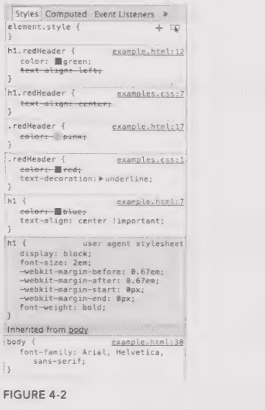

## 图 4-2

这里列出了所有匹配该元素的规则，从最具体（顶部）到最不具体（底部）。任何时候，如果某个样式因优先级问题而未被使用，它会被划上删除线。

在此面板底部，你可以看到从浏览器默认值（称为“用户代理样式表”）继承的样式，以及从其他元素（例如 `body`）继承的样式。

这对于确定某些样式为何被使用非常有用。例如，请查看图4-2中的示例，并判断是哪条规则提供了 `text-align` 属性，以及为什么。

你也可以更改样式，或为这些规则中的任何一条添加样式：这些更改将实时反映在网页上。你还可以通过将鼠标悬停在样式上时出现的复选框取消勾选，来禁用任何你想要的样式。

此外，如果你点击名为 `element.style` 的第一条规则，你可以仅为该元素添加新规则。例如，你可以通过添加如图4-3所示的属性，将页眉的颜色设置为蓝色。


## 图 4-3

## 动手试一试

在这个练习中，你将为第4课中创建的用于保存联系信息的表格设置样式。

### 课程要求

你需要第4课中的 `contacts.html` 文件、一个文本编辑器和一个网页浏览器。

### 分步指南

1.  首先，在与 `contacts.html` 相同的文件夹中创建一个名为 `contacts.css` 的文件。
2.  按照本课前面的说明，在 `contacts.html` 的 `head` 部分添加一个指向该 CSS 文件的链接。
3.  将整个文档的字体系列设置为使用 Arial, Helvetica, sans-serif。记住，你需要一条匹配 `body` 元素的规则。
4.  为 `table`、`th` 和 `td` 元素添加1像素实心黑色边框。你可以在本课前面找到边框样式的示例。
5.  在 Chrome 中加载该页面。你会注意到单元格周围有双线边框（见图4-4），因为每个单元格都有自己的边框，并且这些边框之间有间隙。要解决这个问题，请为此规则添加一个新样式，属性为 `border-collapse`，值为 `collapse`。这将把重复的边框合并为一条边框。

**标题：销售线索**

| 联系人姓名 | 电话号码 | 电子邮件地址 | 公司名称 | 最近联系日期 |
|---|---|---|---|---|
| William Smith | 555-642-7371 | william@testing.com | ACME Industries | 2014-10-21 |
| Bob Morris | 555-999-2991 | bob@testing.com | ABC Corp | 2014-09-12 |
| 显示了 2 个联系人 | | | | |

6.  在每个单元格（`td` 元素）的内容和边框之间添加一些间距。添加一个名为 `padding` 的属性，并将其设置为 `5px`。
7.  为 `thead` 元素添加一个样式。将背景设置为颜色 `#3056A0`，并将颜色设置为白色。
8.  将表格的标题（`caption`）设置为粗体显示，但确保仅当 `caption` 是 `table` 元素的子元素时才应用此样式。
9.  将 `tfoot` 元素的字体大小设置为其他地方使用字体大小的四分之三。提示：将字体设置为 `2em` 会使字体大小加倍（你将在下一课中进一步研究此设置）。此外，将文本对齐设置为表格的右侧。
10. 表格主体（`tbody`）的每隔一行应设置背景颜色为 `#EEEEEE`。为了选择每隔一行，请使用伪类选择器 `tr:nth-child(even)`，但确保这仅应用于 `tbody` 的子元素，因为 `thead` 和 `tbody` 也包含 `tr` 元素。完成后，表格应如图4-5的截图所示。

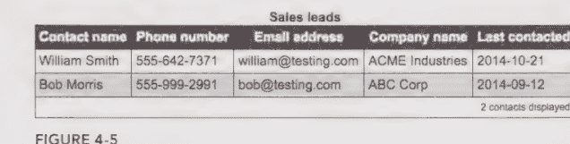

> 参考 请在线选择第4课的视频，网址为 www.wrox.com/go/html5jsjquery24hr。你也可以从该网站下载本课的代码和资源。

# 5

## 用 CSS 构建页面结构

在上一课中，你学习了如何使用 CSS 为单个元素设置样式。本课在此基础上，进一步探讨元素如何占据屏幕上的位置、如何操作这种位置，以及这如何影响周围的其他元素。

## 盒模型

盒模型是 CSS 最重要的概念之一，它决定了每个元素在屏幕上将占据的宽度和高度。盒模型始于一个观察：文档中的所有元素都占据矩形框，但计算其高度和宽度的规则并不像你想象的那么简单直接。

首先，一个元素占据的高度和宽度大于其内容所需的高度和宽度，原因有几个。例如，元素可能有占用额外空间的边框。在上一课中，你创建了大小为1像素的边框。因此，这些边框为元素所需的高度和宽度各增加了2像素。

内容与边框之间也可能添加内边距，就像上一课中的表格单元格一样。最后，还可能需要在元素与其相邻元素之间添加额外的外边距。

因此，元素框占据的总空间可以如图5-1所示。


为了实际查看这一点，请创建如下网页：

```
<!DOCTYPE html>
<html lang="en">
    <head>
        <meta charset="utf-8">
        <style>
            h1 {
                width:400px;
                height:30px;
                padding:10px;
                border:2px solid #999999;
                background:#dddddd;
                margin: 10px 20px 20px 10px;
            }
        </style>
    </head>
    <body>
        <h1>This is a header</h1>
    </body>
</html>
```

这段代码声明了一个 `h1` 元素，具有以下尺寸（从框内部到外部计算）：

-   宽度为400像素，高度为30像素。如果省略这些，元素将具有根据其内容计算的默认高度和宽度。
-   内容与边框之间有10像素的内边距。当指定单个值时，该值会自动应用于框的顶部、右侧、左侧和右侧。
-   2像素的边框。
-   元素与其相邻元素之间的外边距，但每边有不同的值。因此，提供了四个值。你可以通过首字母缩略词 TRouBLe（Top, Right, Bottom, Left - 上、右、下、左）来记住这些值分别应用于哪一边。例如，在这个例子中，左边距是10像素。

也可以通过使用诸如 `margin-left`、`border-top` 和 `padding-right` 之类的属性来单独指定任何一边的边框、内边距或外边距。

打开这个网页并在 Chrome 中查看。右键点击 `h1` 元素，然后选择“检查元素”。确保在“元素”标签页中选中该元素，然后查看控制台的右下角。它应该显示一个类似图5-2的方框，这是该元素盒模型的可视化表示。

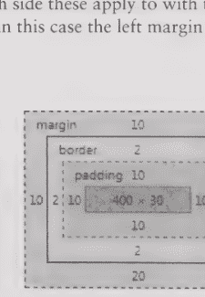

因此，你可以用此来确定元素在屏幕上需要多少高度和宽度：

-   宽度将需要 10 + 2 + 10 + 400 + 10 + 2 + 20 = 454 像素。
-   高度将需要 10 + 2 + 10 + 30 + 10 + 2 + 20 = 74 像素。

关于盒模型，你可能注意到的另一个有趣方面是背景颜色的范围。背景颜色填充内容和内边距，但不填充外边距或边框。

如果你在文档中再添加两个 `h1` 元素，然后刷新网页，你会注意到元素之间存在外边距，如图5-3所示。

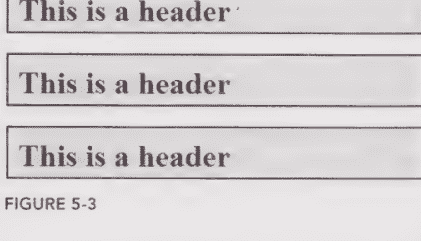

然而，你可能注意到一些不寻常的地方。每个页眉都有10像素的上外边距和20像素的下外边距。因此，你可能预期每个元素之间会有30像素的间距。

然而，如果你在 Chrome 中选择顶部的元素，你会注意到下外边距只有20像素（由元素占据的空间延伸到下一个元素的顶部这一事实证明）。你可以在图5-4中看到这一点。第二个页眉的上外边距被忽略了。

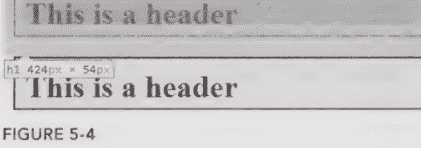

这被称为*外边距折叠*。块级元素的顶部和底部外边距会折叠成一个单一的外边距，计算为顶部和底部外边距中的最大值：在这个例子中是20像素。解决外边距折叠问题可能很令人头疼；因此，通常最好只依赖顶部或底部外边距，而不是两者都用。

## 显示类型

我在本书中已经多次提及显示类型，但现在是时候更深入地探讨这个属性了。每个元素都有一个显示类型，并且最初默认为每个标签的适当类型。显示类型有很多，但你实际上只需要理解其中的四种。


默认情况下，`h1` 元素具有 `block` 显示类型。如前所述，块级元素会在文档中插入换行，意味着下一个元素将出现在前一个元素下方。可以像我们在上一节看到的那样，同时控制块级元素的高度和宽度。

下一种最广泛使用的块类型是 `inline`。将以下规则添加到样式部分并刷新网页：

```
h1 {
    display: inline;
}
```

现在它将如图 5-5 所示进行显示。如你所见，内联元素彼此相邻排列。如果它们超出页面宽度，则会自动换行到新行。虽然可以控制内联元素的宽度，但无法控制它们的高度：高度是自动计算的。


图 5-5

此外，只能为元素的左右添加外边距和内边距，而不能为上下添加。如你所见，这些元素位于网页的最顶部，标题和地址栏之间没有任何外边距。

显示类型的第三个主要类别是 `inline-block`。当元素被分配这种显示类型时，它们会像内联元素一样彼此相邻排列，但可以指定它们的高度，并为所有四个方向添加外边距和内边距。

最后需要理解的显示类型是 `none`。当元素被分配此显示类型时，该元素对查看者隐藏，但仍保留在文档中。按如下方式更改第二个标题，然后刷新网页：

```
<h1 style="display:none">This is a header that is hidden</h1>
```

如果你重新加载页面，你将看不到此元素的任何痕迹：它甚至没有为可见时应占的位置留下空白空间。通常使用 JavaScript 动态隐藏和显示内容，方法是操作显示类型，正如你将在本书后面看到的那样。

## 定位元素

既然你已经理解了盒模型，就可以开始研究不同元素如何相互作用了。

假设你想创建一个分为五个部分的网页：

*   一个高 100 像素、跨越整个页面宽度的页眉
*   一个高 50 像素、跨越整个页面宽度的页脚
*   一个内容区域，分为三个部分：
    *   一个可以放置菜单的左侧区域：应占据宽度的 20%，最小高度为 500 像素。
    *   一个用于广告材料的右侧区域：也应占据宽度的 20%，高度为 500 像素。
    *   中间的主要内容区域，占据其所需的所有剩余空间。

因此，屏幕由图 5-6 中所示的五个框组成。你可能想问自己的第一个问题是：这些框各自是什么类型的元素？本质上，它们只是其他元素的容器，你可能想在每个容器内封装许多不同的元素。

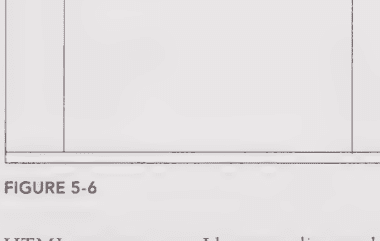

HTML 支持一个我之前未讨论过的标签，称为 `div`。这可能是 HTML 中使用最广泛的标签：它是一个本身没有默认样式的块级元素；它仅用作容器将其他元素组合在一起。

HTML 还支持第二个相关标签，称为 `span`（可能是 HTML 中使用第二广泛的标签）。它与 `div` 相同，不同之处在于它是一个内联元素而非块级元素。

你将首先创建一个名为 `structure.html` 的页面，其 `body` 如下：

```
<body>
    <div id="header">This is the header</div>
    <div id="sidebar">This is the sidebar</div>
    <div id="content">This is the main content</div>
    <div id="advertising">These are adverts</div>
    <div id="footer">This is the footer</div>
</body>
```

因为它们是块级元素，你会注意到目前这五个元素只是简单地堆叠在一起。我已为元素添加了 `id` 属性，以便可以在 CSS 中为它们单独设置样式。

为了设置页眉元素的样式，添加一个具有以下值的 `style` 元素：

```
#header {
    height:100px;
    background:pink;
}
```

当我布局网页时，我发现一开始为每个元素赋予独特的背景色很方便——这样我可以准确地看到为每个元素分配了多少空间。

如果你在 Chrome 中查看此网页，你会看到页眉周围有白色边距。这是从 `body` 元素继承的样式的结果；因此，你还应将以下内容添加到样式部分以移除此边距：

```
body {
    margin: 0;
}
```

现在，为 `#sidebar` 元素添加以下内容：

```
#sidebar {
    width:20%;
    background:orange;
    height:500px;
    float:left;
}
```

注意 `width` 属性使用百分比而非像素作为单位：这意味着它将使用其可能可用空间的 20%，对于像这样的顶级元素，这个可用空间就是整个屏幕的宽度。尺寸也常用以下格式表示：

- mm：毫米
- in：英寸
- em：1 em 等于当前字体的大小；因此此度量允许元素相对于标准字体大小进行调整。

此元素还声明了 `height`。此属性确保元素占据 500 像素的垂直空间。

然而，这里最有趣的属性是 `float` 属性。因为你需要三个 `block` 元素彼此相邻放置，所以你需要控制它们在水平方向上如何相互作用。`float` 属性可用于将块级元素定位到其可用区域的左侧或右侧，此外，它还会抑制通常在从左到右的流中伴随块级元素的换行。

尽管使用 `float` 属性类似于将显示类型声明为 `inline-block`，但它还有一个额外的好处，即可以将元素定位到其可用空间的左侧或右侧。相比之下，`inline-block` 元素总是浮动到可用空间的左侧。

接下来，你将为 `#content` 元素添加样式。你将不为其设置任何样式，只是指定它应浮动到其可用空间的左侧，这将使该元素直接定位在 `#sidebar` 元素的右侧。将以下内容添加到样式中：

```
#content {
    float:left;
}
```

有了这个设置，你希望将 `id` 为 `advertising` 的元素放置在屏幕的右侧。因此，该元素的样式与 `#sidebar` 几乎相同，只是你会请求它向 `right` 浮动：

```
#advertising {
    width: 20%;
    background: blue;
    height: 500px;
    float: right;
}
```

注意它并没有紧贴着内容元素；相反，它被直接定位在屏幕的右侧。

最后，你来到了页脚。看起来你可以简单地添加以下内容：

```
#footer {
    height: 50px;
    background: pink;
}
```

然而，如果你尝试加载此页面，你会看到页脚 `div` 位于内容 `div` 的旁边。你需要使用以下属性请求该元素下降到其前面的浮动元素下方：

```
clear: both;
```

在这种情况下，`both` 指的是该元素应下降到所有左右浮动元素的下方。

如果你加载该页面，你会看到它看起来完全符合预期（见图 5-7）。一旦页面结构就位，你就可以开始向每个 `div` 添加内容。


## 控制位置

到目前为止，放置在屏幕上的元素的位置是元素在 DOM 中的顺序以及元素自身属性的结果。元素只是按照它们在网页中出现的顺序进行布局，并占据它们所需的空间。这随后会影响它们之后在 DOM 中出现的元素的位置。

这在技术上称为静态定位，但它只是几种元素定位方式之一。本节将简要介绍其他三种元素定位方式。

为了演示定位，首先创建以下网页，它由三个框组成。这三个框足以演示各种定位方法：

```
<!DOCTYPE html>
<html lang="en">
<head>
    <meta charset="utf-8">
    <style>
        .box {
            height:200px;
            width:200px;
            display:inline-block
        }
    </style>
</head>
<body>
    <div class="box" style="background:red"></div>
    <div id="middleBox" class="box" style="background:green"></div>
    <div id="lastBox" class="box" style="background:blue"></div>
</body>
</html>
```

如果你查看该网页，你会看到它由三个彼此相邻的框组成（见图 5-8）。

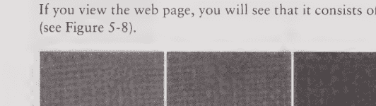

图 5-8

想象一下，我们想将第二个框（id 为 `middleBox`）向右移动 50 像素，向下移动 50 像素，而不影响第三个框。使用静态定位无法实现这一点，因为将第二个元素的宽度增加 50 像素会将第三个元素向右推 50 像素。


为了实现这一点，请在 `style` 部分添加以下规则：

```
#middleBox {
    position: relative;
    top: 50px;
    left: 50px;
}
```

这首先将 `middleBox` 元素的 `position` 设置为 `relative`。这意味着你想根据它在页面上的默认位置来设置它的位置。

一旦设置了 `position` 属性，你就可以开始使用 `left`、`right`、`top` 和 `bottom` 属性来将元素移动到屏幕上的不同位置。在这种情况下，你指定了在 `left` 和 `top` 方向各增加 50 像素的空间。如果你查看这个效果，你会看到如图 5-9 所示的屏幕显示。


**图 5-9**

请注意，元素现在相互重叠了：第三个框只是被放置在如果你没有移动第二个元素时它原本会所在的位置。

也可以使用 `absolute` 的 `position` 值来相对于父元素定位一个元素。尝试将前面的样式修改如下：

```
#middleBox {
    position: absolute;
    top: 150px;
    left: 150px;
}
```


因为 `middleBox` 的父元素是 `body` 元素本身，所以你实际上是相对于浏览器窗口来定位该元素。如果你现在查看页面，它应该看起来像图 5-10 所示的样子。

使用绝对定位会将元素从页面的正常流中移除，因此第三个框的位置也会受到影响。

你还可以控制哪些元素位于前景，哪些元素被置于背景。这是由一个名为 `z-index` 的 CSS 属性控制的。

**图 5-10**

具有最高 `z-index` 的元素将被放置在前景。因此，如果你将以下内容添加到 `middleBox` 的样式中，它将被置于背景：

`z-index: -1;`

最后一种主要的定位类型是 `fixed`。这类似于 `absolute` 定位，但元素是相对于浏览器窗口定位的。在前面的例子中，`fixed` 和 `absolute` 定位将产生相同的结果。

## 动手试试

在这个分步教程中，你将延续上一课的 CRM 应用，并为整个网页添加更多结构。这将包括添加一个页眉、一个页脚以及一个用于添加新联系人的区域（尽管我们直到下一课才会填充内容）。

### 课程要求

你需要第 4 课结束时的 CRM 应用。你还需要一个文本编辑器和 Chrome 网页浏览器。

### 分步指南

1.  打开 `contacts.html` 页面，并在开始的 `body` 标签之后立即添加一个 `div`。在该标签的主体中输入 **Contacts**。为该标签分配 `id` 为 `header`。
2.  用一个 `div` 标签将表格包裹起来，并给它分配 `id` 为 `contactList`。开始标签应紧接在 `table` 开始标签之前，而结束标签应紧接在 `table` 结束标签之后。
3.  在结束 `body` 标签之前立即添加另一个 `div`，并给它分配 `id` 为 `footer`。在此 `div` 中添加版权声明。
4.  在页眉 `div` 之后立即添加最后一个 `div`，并给它分配 `id` 为 `contactDetails`。这将是你最终放置用于添加联系人新表单的地方。向此 `div` 中添加一个 `h2` 元素，文本为 **Contact Details**。
5.  打开 `contacts.css`。首先，向 `body` 规则添加 `margin: 0` 属性，以确保去除页眉周围的空白。
6.  为 `id` 为 `header` 的 `div` 创建一个规则。这应指定 `background` 和 `color` 与上一课中 `thead` 元素规则相同。此外，添加一个 `text-align` 属性，值为 `center`，以及一个 `line-height` 属性，值为 `70px`。

    `line-height` 类似于 `height`，但它将确保文本垂直居中。如果你只是指定了 `height`，文本将位于 `div` 的顶部附近。同时添加一个 `font-size` 为 `3em`：是标准字体的三倍大。
7.  `contactDetails` 和 `contactList` 需要共享许多属性，因此创建一个匹配这两个元素的规则。添加一个 `border`，宽度为 `1px`，样式为 `solid`，颜色为 `#999999`。同时为所有边添加 `margin` 和 `padding`，值为 `15px`。
8.  为页脚 `div` 添加一个样式。这应与页眉相同，但 `line-height` 应为 40，`font-size` 应为 `0.8em`。
9.  黑色字体可能过于突出，因此将 `body` 的 `color` 属性设置为 `color: #333333`，这是一种非常深的灰色。

如果你打开页面，它应该看起来像图 5-11 中的示例。如果需要帮助，完成版本可以从第 5 课资源中下载，或者你可以在线观看屏幕录像。

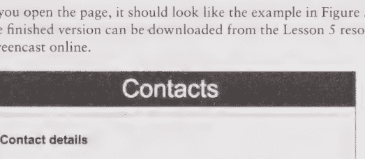

**图 5-11**

> **参考** 请在线选择第 5 课的视频，网址为 www.wrox.com/go/html5jsjquery24hr。你也可以从该网站下载本课的代码和资源。

# 6 HTML 表单

到目前为止，我们所研究的所有 HTML 标签都用于向用户显示内容。本课将探讨 HTML 表单，它允许用户将数据提交回 Web 服务器。无论何时你在文本字段中输入数据，或从下拉列表中选择值，你都在使用 HTML 表单。

本课将介绍 HTML 表单，同时也会探讨 HTML5 中表单发生的一些有趣变化。这些变化最初被称为 Web Forms 2.0，但后来已集成到 HTML5 标准中。因此，即使你熟悉 HTML 表单，也建议学习本课。

## 什么是表单？

表单是一组输入字段，组合在一个元素内部，目的是从用户那里获取一组信息。历史上，表单主要包含以下字段：

-   文本字段
-   选择列表
-   文本框（多行文本字段）
-   复选框
-   单选按钮
-   密码字段

你稍后会看到，这个列表在 HTML5 中得到了极大的扩展。
此外，字段包含一个提交按钮，该按钮会将其内容发送到服务器上的指定 URL。然后服务器可以根据需要处理这些数据，并返回一个新的网页作为结果。

# 52 | 第 6 章 HTML 表单

在本书中，你将广泛使用表单，但不会将它们的内容提交到服务器。相反，你将使用 JavaScript 提取和处理其数据。在本章中，我将更传统地介绍表单，但不会提供处理表单信息的服务端代码，因为这需要我引入一套全新的技术。

本课的这一部分介绍了一个非常简单的表单，并检查了它的组成部分。然后，你将为“通讯录”网页创建一个更复杂的表单。

创建一个名为 `simpleform.html` 的新页面，并为其添加以下 `body`：

```
<body>
    <form action="submit.html" method="post">
        <label for="firstName">First Name</label>:
        <input id="firstName" name="firstName" type="text"/>
        <p>
        <label for="lastName">Last Name</label>:
        <input id="lastName" name="lastName" type="text"/>
        <p>
        <input type="submit" value="Submit">
    </form>
</body>
```

如果你在 Chrome 中打开它，它将看起来像图 6-1。

请注意，所有输入字段都嵌套在 `form` 元素内。表单中的所有输入字段应代表一组相关数据，这些数据将一起被处理。

`form` 元素包含两个重要属性。`action` 属性是当表单提交时，其内容将被发送到的 Web 服务器上的地址。我们假设该地址能够处理表单的内容并将用户重定向到新的网页。

`method` 属性是指将用于将数据发送到服务器的 HTTP 方法。当你只是在浏览器地址栏中输入一个地址时，你正在使用一种称为 GET 的 HTTP 方法。这是一种请求网页的简单机制，尽管如果需要，它也可以包含数据。

当你将表单数据发送到服务器时，你通常需要发送大量数据；因此，你使用 HTTP POST 方法。使用此方法，所有输入字段及其值都包含在 HTTP 请求的主体中，而不是编码在 URL 中。你不需要理解 HTTP 方法就能继续学习本书，尽管在介绍 AJAX 时，你会更详细地了解它们。

在这个特定情况下，表单由两个标签和两个输入字段组成。

显然，标签不允许用户提供输入；因此，你可能想知道为什么需要使用它们，而不是仅仅向表单添加文本。标签具有以下好处：

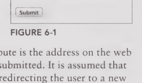

-   点击标签会将光标焦点置于输入字段中。这依赖于 `for` 属性的值是其关联输入字段的 `id` 这一事实。
-   标签为文档提供了更多结构，因为它们清楚地表明标签与特定输入字段相关联。


HTML 使用一种称为 `input` 的元素来处理多种（但非全部）输入字段。因此，需要为该元素添加一个属性，以指定它接受的 `type`（类型）输入。在此特定情况下，你已将类型指定为 `text`（这是默认类型）。

最后，向表单添加了一个按钮，允许提交表单。请注意，这也是一个 `input` 元素，但由于其 `type` 被设置为 `submit`，因此它显示为按钮而非输入字段。

当点击提交按钮时，字段将被序列化为一个由名称/值对组成的文本字符串。每个输入字段的 `name` 属性用作名称，字段的当前值用作值。然后，该文本字符串被放入 HTTP 请求的主体中，并发送到服务器。

如果我在两个字段中输入 "Dane" 和 "Cameron"，然后点击提交按钮，它将向服务器发送一个 HTTP 请求，如图 6-2 所示（这是在 Chrome 开发者工具的 Network 选项卡中，先点击了 Preserve Log 选项后捕获的）。

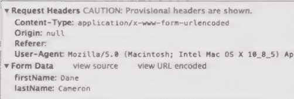

## 向表单添加字段

在本节中，你将创建一个表单，用于在你的联系人 Web 应用中捕获人员信息。

要完成本节内容，请打开第 5 课结束时的 `contacts.html` 文件，或从本书网站下载它。

首先，将以下内容添加到 `contactDetails` div 中：

```html
<div id="contactDetails"><h2>Contact details</h2>
    <form method="post">
        <div class="formRow">
            <label for="contactName">Contact name</label>
            <input name="contactName" id="contactName" type="text"/>
        </div>
    </form>
</div>
```

这添加了一个包含单个输入字段的 `form`（表单）。`label` 和 `input` 元素被放置在一个 class 为 `formRow` 的 `div` 中，这确保了每一对元素将占据独立的一行。

由于你希望所有标签和字段具有一致的大小，请将以下内容添加到 contacts.css 中：

```css
label {
    width:150px;
    display: inline-block;
    vertical-align: top;
}

input {
    width:200px;
}
```

注意，你需要更改 label 的显示类型才能设置其宽度。现在，你可以为电子邮件地址和电话号码字段添加输入字段：

```html
<div class="formRow">
    <label for="phoneNumber">Phone number</label>
    <input name="phoneNumber" id="phoneNumber" type="text"/>
</div>
<div class="formRow">
    <label for="emailAddress">Email address</label>
    <input name="emailAddress" id="emailAddress" type="text"/>
</div>
```

由于你还希望在每行之间留出一些间距，请将以下内容添加到样式表中。图 6-3 展示了表单应有的样式。

```css
.formRow {
    margin-bottom:10px;
}
```

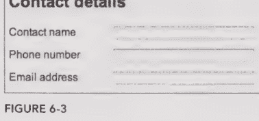

接下来，你将添加一个字段，用于捕获联系人的公司信息。在这种情况下，你可能希望用户从系统中已添加的公司列表中进行选择。这可以通过一种称为选择列表（select list）的不同输入类型来实现。首先，在表单中添加以下内容：

```html
<div class="formRow">
    <label for="companyName">Company name</label>
    <select name="companyName" id="companyName">
        <option value="-1">Please select</option>
        <option value="1">ABC Incorporated</option>
        <option value="2">XZY Ltd</option>
        <option value="3">ACME International</option>
    </select>
</div>
```

注意，选择列表被封装在一个名为 `select` 的元素中。在该元素内部，有一系列 `option` 元素提供各种可能性。每个 `option` 包含两个值：开闭 `option` 标签之间的文本是将呈现给用户的文本。同时，每个 `option` 标签还有一个 `value` 属性，这是在表单提交时将分配给字段的值。

`text` 和 `value` 可以携带相同的值，但它们不同的情况也很常见。例如，在这种情况下，`value` 可能代表由会计系统分配给每个公司的唯一代码。

默认情况下，选择列表会选中第一个选项，尽管也可以向任何其他选项添加 `selected` 属性以使其成为默认选项。这是一个布尔属性；因此，它不需要值。例如：

```html
<option value="3" selected>ACME International</option>
```

现在，你将再添加一个字段，用于捕获关于联系人的备注。这与其他基于文本的字段略有不同，因为你希望提供空间来捕获大量文本。你会注意到，到目前为止使用的输入字段甚至不允许换行，因此它们不适合捕获大量文本。

因此，你想添加一种称为 `textarea`（文本区域）的不同输入类型：

```html
<div class="formRow">
    <label for="notes">Notes</label>
    <textarea cols="40" rows="6" name="notes" ></textarea>
</div>
```

注意，文本区域允许你指定 `textarea` 包含的列数和行数。虽然这些属性决定了元素的大小，因此具有一定的呈现性，但它们在 HTML5 中仍然是有效属性。

设置好这些后，表单现在应该如图 6-4 所示。

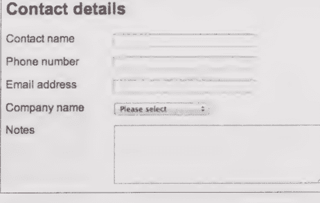

最后，在表单底部添加一个提交按钮。由于你希望它比其他输入字段小，你将使用内联样式。

```html
<div class="formRow">
    <input style="width:70px" type="submit" value="Save"/>
</div>
```

## HTML5 输入字段

还有一个最终字段需要添加：你想捕获联系人上次被员工电话或邮件联系的日期。用户通常期望通过从日历中选择一个日期来提供此信息。

在 HTML5 发布之前，你需要借助 JavaScript 库才能实现这一点。HTML5 的一项重大增强是引入了一系列新的输入类型，包括日期输入类型。这允许浏览器为选择日期提供原生支持。

为了看到实际效果，请在提交按钮所在行之前，将以下行添加到表单中：

```html
<div class="formRow">
    <label for="lastContacted">Last contacted</label>
    <input name="lastContacted" id="lastContacted" type="date"/>
</div>
```

注意，这与其他输入字段的唯一区别是指定了类型为 date。然而，如果你在 Chrome 中打开它，你会看到为你提供了一个日期选择器，如图 6-5 所示。

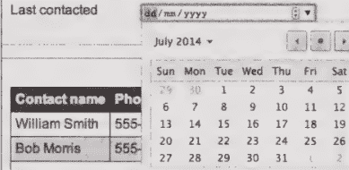

日历原生支持的妙处在于，不同的浏览器可以以它们认为最合适的方式实现它们。例如，如果你在 iPad 上查看此页面，日期选择器将如图 6-6 所示。


如你所见，这已经针对基于触摸的操作系统进行了优化。

日期输入类型的主要问题是并非所有浏览器都支持它。这意味着，目前你可能需要依赖一种称为 polyfill（垫片）的技术，如第 10 课后续概述。

HTML5 实际上指定了许多额外的输入类型。与日期输入类型一样，规范并未告诉浏览器应如何实现每种类型，事实上，许多类型并未被广泛支持，但以下是一些已包含在规范中的输入类型：

- email：允许用户捕获电子邮件地址。
- color：允许用户捕获颜色，大概是从颜色选择器中获取。
- number：限制用户在输入字段中只能输入数字，并允许用户按步长增加或减少值。
- range：允许用户从可能的数字范围中指定一个数字。这也将在第 10 课中介绍。
- tel：允许用户捕获电话号码。
- url：允许用户捕获 URL。
- datetime：类似于 date，但允许用户选择时间和日期信息。
- time：也类似于 date，但将选择限制在一天中的时间。

为了了解这些元素的作用，请将电子邮件地址和电话号码字段分别更改为使用 `email` 和 `tel`。现在如果你重新加载页面，你可能不会注意到任何差异。

正如你将在第 8 课中看到的，这并非完全正确；HTML5 根据字段类型提供了原生验证支持。此外，虽然桌面上的 Chrome 浏览器对待这些类型与 `text` 字段并无二致，但其他浏览器可能并非如此。

例如，如果你在手机或平板电脑浏览器中点击这些字段中的任何一个，你可以想象基于软件的键盘会改变以反映该输入类型所需的按键。如果输入类型设置为 `number`，情况也是如此。

值得重申的是，HTML5 规范的一个关键优势在于，它并未预先猜测浏览器应如何实现功能。因此，手机上的浏览器如果判断这对用户有用，可能会尝试根据用户的电话簿自动完成电话号码。

## Datalist 元素

HTML5 还包含一种称为 `datalist` 的新输入类型。它类似于 `select` 列表，但它不限制用户只能使用列表中的值：它允许用户在需要时输入自己的值。以下是一个示例：

```html
<input list="companies" name="companyName">
<datalist id="companies">
    <option value="ABC Incorporated">
    <option value="XZY Ltd">
    <option value="ACME International">
</datalist>
```


正如你所见，这个元素由两个不同的标签组成。第一个是输入字段，由于其类型未指定，默认是一个`text`输入字段。这个标签指定了一个名为`list`的特殊属性。

下一个元素是一个`datalist`，它与输入字段上指定的`list`具有相同的`id`。这为用户提供了一个默认的选项列表供选择，并且允许在用户输入时自动完成值。

虽然你不会在通讯录网页中使用它，但如果你添加它，它将显示为图6-7所示的样子。

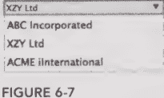

## 表单属性

除了新的输入类型，HTML5还为现有的输入类型提供了许多新属性。你将在第8课学习HTML5验证时了解其中几个，但在本课中值得一提的是以下几个。

`placeholder`属性允许你为用户提供提示，以帮助他们输入值。例如，如果你将电话输入字段更改如下：

```
<input placeholder="Include area code" name="phoneNumber" type="tel"/>
```

该字段将显示为图6-8所示。注意字段中的灰色文本。一旦用户开始在字段中输入，它就会消失。

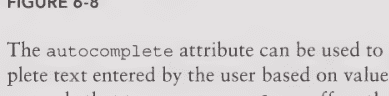

`autocomplete`属性可用于指定浏览器是否应根据用户之前提供的值，尝试自动补全用户输入的文本。以下是一个在联系人姓名字段上关闭`autocomplete`的示例：

```
<input autocomplete="off" name="contactName" type="text"/>
```

`autocomplete`属性也可以在整个表单上使用。

`autofocus`属性用于在页面加载时自动将光标设置在特定字段中。过去通过JavaScript实现这一点一直可行，但这个属性使其变得简单得多。例如，如果你将以下代码添加到联系人姓名字段，你会注意到页面加载时光标就在该字段中：

```
<input autofocus autocomplete="off" name="contactName" type="text"/>
```

最后，`form`属性可用于指定一个输入字段是表单的一部分，即使它没有嵌套在表单内部。如果此属性的值对应于某个表单的`id`，那么无论该字段在页面中的位置如何，当表单提交时，它都将被包含在发送到服务器的数据中。

如果你有一个字段位于屏幕上与其他字段完全不同的区域，这会很有用。

### 试一试

在这个“试一试”环节，你将尝试本课介绍的各种表单元素和输入字段。这个环节也涵盖了本课目前为止尚未涉及的少数几个表单元素。

鼓励你在这里进行尝试；目标是理解表单元素的工作原理。如果你遇到困难，我的版本可以在本书网站上名为`tryit.html`的文件中找到，或者你可以在线观看屏幕录像。

### 课程要求

你还需要一个文本编辑器和一个网页浏览器。

### 分步指南

+   1. 首先创建一个简单的HTML5网页，你将用它来添加本课中概述的元素。
    2. 首先向网页添加一个`form`元素，并为此添加一个`method`为`post`。因为你不会提交这个表单，所以不需要添加`action`。
    3. 首先添加一个简单的文本输入字段，名称为`fullName`。使用`placeholder`属性向用户提供提示，并请求该字段在页面加载时获得焦点。
    4. 为该字段添加一个`label`，并使用`for`属性指定该标签关联的字段的`id`。
    5. 你想添加单选按钮来指定人员是男性还是女性。向网页添加以下标记：
    6. 在表单中添加一个复选框，询问用户是否想订阅你的通讯简报。复选框与单选按钮相同，但输入字段的`type`是`checkbox`。此外，你不需要为复选框指定值：该字段的值将设置为`on`或`off`。

```
<label for="male">Male</label>
<input checked type="radio" name="gender" id="male" value="male">
<label for="female">Female</label>
<input type="radio" name="gender" id="female" value="female">
```

请注意此示例中两个输入类型被赋予了相同的名称。这就是浏览器知道这两个单选按钮相关联的方式，并确保只能选择一个。当表单提交时，该字段将被赋予当前选定的单选按钮的`value`。

+   7. 添加一个文本区域用于捕获备注。其大小应设置为捕获5行30列。
    8. 添加一个“出生日期”输入字段，该字段使用`date`输入类型。
    9. 在表单中添加一个薪资字段。将其指定为`number`类型，并定义一个`step`属性，其值为500。
    10. 在表单底部添加一个提交按钮，以允许提交内容。
    11. 确保你已在每个标签前添加了`<br>`，以确保输入框位于单独的行上。

最终结果应类似于图6-9中的截图，但鼓励你进行尝试，并尝试本课中概述的其他功能。

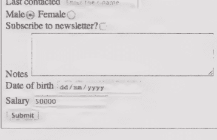

你应该注意到这个表单上的一个新功能：如果你在薪资字段中输入一个值，Chrome会提供上下箭头来按步长量增加或减少该值。这还确保该值被舍入为步长量的倍数。

> **参考** 请在线访问 www.wrox.com/go/html5jsjquery24hr 选择第6课的视频。你还可以从网站下载本课的代码和资源。

# 7

## 语义化标签

到目前为止，你遇到的大多数标签对于任何使用过早期版本HTML的人来说都会很熟悉。在本课中，你将探索HTML5中定义的一组称为*语义化标签*的新标签。

如果你考虑一下迄今为止所学的课程，得益于CSS的强大功能，即使复杂的网页主体也完全可以用*span*和*div*标签来创建。事实上，许多网页正是这样创建的。

页面上出现的每个元素——从页眉横幅到表格单元格再到图像——都负责为屏幕上的矩形区域提供呈现，因此*div*或*span*可以完成这个角色。

虽然这种方法从呈现的角度是可行的，但各个标签不包含关于它们在网页中目的的任何含义：因此它们被认为缺乏语义意义。不仅如此，从标记中推断每个元素在网页中扮演的角色将非常困难。

> **注意** “语义网”这个术语是由万维网的发明者蒂姆·伯纳斯-李创造的。他设想了一个既能由机器处理也能由人处理的数据网络。尽管蒂姆的愿景在很大程度上仍未实现，但你将在本章中研究的标签是实现这一目标过程中的一环。

让我们看一个具体的例子。网页的页眉部分可以定义如下：

```
<div class="header">This is the header</div>
```

你会注意到类名确实描述了*div*的目的，但它只是一个任意的名称：我同样可以将这个类命名为*headSection*或*head*。

在许多方面，如果有一个名为*header*的语义化标签，并且每个人都使用它来表示页面的页眉，那将会更好。

语义化标签的基本原理源于这样的观察：如果浏览器知道这是一个页眉，它可能能够基于这一事实为读者提供额外的服务或功能：

-   它可能决定在不同设备上以不同方式呈现信息。例如，在像手机这样的小屏幕设备上，它可能只在用户点击页面顶部附近时才显示页眉。
-   它可能支持不同的模式。例如，用户可能表示他或她希望阅读页面内容而没有任何干扰（类似于Safari中的阅读器模式）；因此，页眉可以暂时移除。
-   它可能为替代浏览器提供支持，例如为视障人士提供的屏幕阅读器。例如，它可以帮助屏幕阅读器理解这是页面的标题部分，应该首先阅读。

除了这些好处之外，对网页开发者也有明显的好处。由大量嵌套div标签组成的页面可能变得非常难以维护。不仅容易遗漏结束标签，而且难以确定哪个标签需要应用哪个样式。

为了支持这些好处，需要有一种明确标记元素为页眉的方法。因此，HTML5规范定义了一组语义化标签，包括以下内容：

```
<header>This is the header</header>
```

本课将引导你了解最重要的语义化标签，并探讨如何使用这些标签来构建网页。

事实上，目前很少有这些标签真正提供上述任何潜在好处。尽管如此，我建议你利用这些标签，因为它们会使你的代码更易于阅读和理解，并且未来可能提供优势。

## 对内容进行分组和分区

许多语义化标签用于构建网页的核心结构——例如，页眉、页脚、内容部分和附注栏。下面的示例包含多个语义化标签：首先通读这个示例。然后你将了解每个标签的含义：

```
<body>
    <header>This is the header</header>
    <main>
        <aside>This is where the advertising goes</aside>
        <section>This is the first section in the page</section>
        <section>This is the second section in the page</section>
    </main>
    <footer>This is the footer</footer>
</body>
```

正如你所见，这个示例利用了一些你迄今为止尚未遇到的标签。下一节将描述这些标签并解释它们应在何处使用。它还将涵盖此示例中未找到的一些其他标签。


## 页眉

`header` 标签用于将介绍性信息分组，例如页面的标题和任何相关的页眉图像。`header` 还应包含页面的主导航链接。

事实上，一个页面上可以有多个 `header`：每个 `section` 可以拥有自己的 `header` 元素，而整个页面本身也可能拥有自己的 `header` 元素。

## 页脚

`footer` 标签用于将应该出现在网页或区块底部的信息分组。例如，这可能包含版权信息或联系信息。

与页眉一样，一个页面中可以有多个 `footer`，并且 `footer` 不需要与页眉配对。

## 主体内容

`main` 标签应围绕构成网页核心功能或内容的部分。一个页面上应该只有一个 `main` 标签，并且它不能嵌套在其他元素内部，例如 `header`、`section` 或 `footer`。

我没有将 `header` 和 `footer` 放在 `main` 元素内部，但这是我做出的一个选择。HTML5 规范在如何以及何处使用这些标签，以及它们如何与其他标签交互方面，给予你广泛的自由裁量权。因此，将 `header` 和 `footer` 嵌套在 `main` 元素内部也是完全有效的。

## 区块

`Section` 用于捕获文档的独立细分部分。例如，在你一直开发的网页中，屏幕的可编辑部分可能被视为一个 `section`，而联系人列表可能被视为另一个 `section`。

为了确定网页的某一部分是否是一个 `section`，请考虑你是否可以将这个整个页面区域拾起并重新放置在网页内的其他位置。如果是这样，它就很适合被标记为 `section`。

## 侧边栏

`Aside` 用于与其周围内容松散相关但可被视为独立的内容。它也可用于广告材料或其他不相关信息。`aside` 通常会通过边框或字体与周围内容在视觉上分隔开。

## 文章

`article` 与 `section` 类似，因为它包含独立的信息，但它通常用于分隔文本内容，例如博客文章或评论，而不仅仅是文档的通用部分。

有些人更倾向于不将 `article` 标签视为杂志文章，而是像一件衣服：它独立存在，但可以与其他物品混合搭配。

我个人更倾向于仅将 `article` 用于可以从一个网页提取并嵌入到另一个网页的自包含文本块。因此，`article` 不适用于联系人网页，因为该页面不包含自包含的文本块。

## 导航栏

`nav` 元素为页面上的主导航链接提供了一个容器。这使得替代浏览器（如屏幕阅读器）能够定位它们。

这是一个容易被过度使用的元素：规范并不要求所有导航链接都封装在 `nav` 元素中，只有页面的主要导航选项才需要。

## 地址

`address` 标签一点也不新，但它确实符合其他语义标签，并且是 HTML5 规范的一部分。此元素用于定义页面维护者的地址或联系方式。

## 使用 CSS 为语义标签添加样式

如果将上一节的标记保存到名为 `semantic.html` 的文件中，然后在 Chrome 中打开，你可能会对结果感到失望（见图 7-1）。

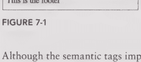

尽管语义标签的名称暗示了呈现信息，但浏览器通常不会将它们与常规 `div` 元素区别对待：它们只是简单的块级组件。例如，`header` 标签告诉浏览器该元素的内容包含页眉信息；但它并不告诉浏览器如何处理这些内容。

语义元素需要像常规元素一样用 CSS 来设置样式。此外，你可以随心所欲地为这些标签设置样式——除了常识，没有任何东西阻止你将页脚放在页面顶部，而将页眉放在底部。

为了给这些标签添加样式，请在页面的 `head` 部分中的 `style` 区域放置以下内容：

```css
header, footer {
    padding: 30px 0 30px 0;
    width:100%;
    background:#B3B2CF;
    text-align:center;
}

header {
    font-size:22px;
}

section {
    float: left;
    padding: 10px;
    margin:20px;
    width:70%;
    border: 1px solid black;
}

aside {
    position:relative;
    float:right;
    padding: 10px;
    margin:20px;
    width:150px;
    height:200px;
    border: 1px solid black;
}

footer {
    clear: both;
    margin-top: 50px;
    font-size:18px;
}
```

如果你现在刷新页面，各个元素将显示与其名称相匹配的适当样式。

## 微格式

到目前为止，你已经研究了语义标签如何用于封装页面的一部分，并根据其在页面中的角色进行标记。然而，语义标签也可以存在于微观层面。

考虑联系人网页中显示日期信息的元素。目前，它们被放置在 `td` 元素中，但 HTML5 提供了一个名为 `time` 的新元素，以更有意义的方式封装日期和时间信息。此元素允许日期和时间信息同时以人类可读和机器可读的方式提供。例如：

`<time datetime="2014-08-20">20th August 2014</time>`

这也可以写成：

`<time datetime="2014-08-20">August 2014</time>`

注意，在每种情况下，相同的信息都提供了两次。日期的第一个版本以属性形式呈现，并符合日期（以及需要时的日期和时间）的 ISO 标准。第二个版本出现在标签之间，是将显示给用户的版本。

尽管日期和时间以其无数种格式非常容易被人类阅读和理解，但它们可能众所周知地难以被计算机处理。通过允许标签始终提供符合 ISO 标准的日期版本，计算机处理元素并理解其含义突然变得轻而易举。

此类特性被称为 *微格式*，在计算领域被广泛使用，旨在为搜索引擎和其他自动化客户端提供语义意义，同时为人类提供人类友好的相同数据版本。

微格式目前尚未正式纳入 HTML5 规范，尽管 `time` 元素是微格式的一个例子。有几种额外的微格式标准，HTML5 很可能会在未来扩展以支持这些标准。

## 总结

认为语义标签将彻底改变你网页开发的方式，未免过于乐观了。在许多方面，它们是 HTML5 中最无趣的特性之一，因为它们不提供任何无法用 HTML4 实现的视觉或功能能力。

然而，它们在增强代码可读性方面确实发挥着重要作用，并且一旦浏览器开始集成依赖于语义标签的功能，未来可能提供其他好处。在许多方面，只有当网页开发者开始一致且大规模地使用这些标签时，浏览器供应商才会开始为它们提供功能支持。

最后一点，同样重要的是不要过度使用语义标签。使用 `div` 和 `span` 元素来构建页面区块仍然没有错：请将语义标签留给网页的主要构建块。

## 动手试试

在这个“动手试试”环节，你将把第 6 课的 Web 应用程序拿出来，并在适当的位置添加语义标签。

### 课程要求

你需要第 6 课结束时的文件、一个文本编辑器和一个 Web 浏览器。

### 分步指南

1. 在文本编辑器中打开 `contacts.html` 页面。
2. 找到类名为 `header` 的 `div`，将其转换为不带类的 `header` 元素。
3. 找到类名为 `footer` 的 `div`，将其转换为不带类的 `footer` 元素。
4. 将 `id="contactDetails"` 的 `div` 转换为 `section`。
5. 将 `id="contactList"` 的 `div` 转换为 `section`。
6. 用一个 `main` 元素包裹这两个 `section`，并给它一个属性 `id="contactScreen"`。
7. 找到包含日期的 `td` 元素，将它们转换为同时包含人类可读和机器可读形式的 `time` 元素。


## HTML5 验证

当用户提交表单时，通常会在浏览器中对用户输入的数据进行验证。这样可以在将表单发送到服务器之前解决任何问题，例如数据缺失，通常能提供更好的用户体验。

表单验证传统上是通过 JavaScript 完成的：事实上，直到最近，这仍然是网页中 JavaScript 最常见的用途。HTML5 提供了内置的表单验证功能，并允许根据直接添加到字段本身的属性来验证字段。本课将介绍如何启用在第 6 课中创建的表单的验证。

HTML5 表单验证规范并不完美——它缺少一些在完整验证框架中您可能期望的规则。然而，它的优势在于是一个原生解决方案，并且非常易于使用。因此，在项目开始时有必要决定 HTML5 验证是否足够，或者您是否会使用众多可用的 JavaScript 库之一——例如，jQuery validation。

## 添加验证规则

本节将为第 7 课结束时的 `contacts.html` 网页添加表单验证。如果您想跟随操作，请立即打开此文件，或从本书网站下载。

最常见的验证形式是指定字段为必填项。您只需向字段添加 `required` 属性，即可指示用户必须为该字段提供一个值。这是一个布尔属性，因此不需要值：

```
<input required autofocus autocomplete="off"
name="contactName" id="contactName" type="text" />
```

如果在 Chrome 中打开此页面，您最初不会注意到任何差异。但是，如果现在在“联系人姓名”字段中按 Enter 键，而未先提供值，您将收到如图 8-1 所示的消息。

70 | 第 8 章 HTML5 验证

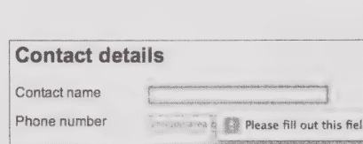

图 8-1

不幸的是，只有当您在该字段中按 Enter 键，或在未为该字段提供值的情况下按“提交”按钮时，才会收到此错误。仅通过 Tab 键移出字段不足以触发验证消息。

对于字段验证，通常最好在字段无效时立即向用户反馈。当用户提交表单时被告知多个字段无效，因为他们需要单独找到每个字段并提供值，这会让他们感到沮丧。

向用户提供立即反馈的一种方式是通过一对称为 `valid` 和 `invalid` 的 CSS 伪类。为了演示这些，请将以下内容添加到 `contacts.css`：

```
.validated:invalid {
    background: #FAC3C9;
}

.validated:valid {
    background: #BDF0A8;
}
```

这些规则会将无效元素的背景色设为粉红色调，将有效元素的背景色设为绿色调。

请注意，您指定了这些规则仅适用于带有 `validated` 类的元素。从技术上讲，所有输入字段都可以是有效或无效的，即使是没有应用规则的字段，例如提交按钮。与其让它们显示为绿色，您将在需要元素使用这些样式时显式添加一个类。因此，将 `validated` 类添加到输入字段：

```
<input required autofocus autocomplete="off"
    name="contactName" id="contactName" class="validated" type="text" />
```

如果重新加载网页，它最初应该显示为粉红色背景，如图 8-2 所示。

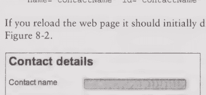

图 8-2

如果现在在该字段中输入一些文本，您会注意到它立即变为绿色。另一个常见的字段验证规则涉及它可以包含的字符数。通常为字段指定最小和最大字符数。HTML5 规范指定了两个新属性，称为 `min` 和 `max`，在这方面看起来很有前景。不幸的是，这些仅用于验证数字是否在最小值和最大值之间；对于文本数据完全无用。

规范确实提供了一个名为 `maxlength` 的属性，可用于控制可以添加到字段的最大字符数。它的工作原理是，当达到此限制时，从物理上阻止用户在字段中输入。然而，执行最小长度验证的唯一方法是使用 `pattern` 属性。这接受一个正则表达式。例如：

```
<input required autofocus autocomplete="off" name="contactName" type="text" class="validated" id="contactName" pattern=".{5,100}"/>
```

> **注意** *正则表达式是一种用于表达文本模式并检查字符串是否与此模式匹配的形式语言。在本例中，“.”匹配任何单个字符，而花括号中的两个数字指定此必须发生 5 到 100 次。本书不会更详细地解释正则表达式，但有许多在线资源可供进一步学习。*

如果重新加载网页并开始输入，您会注意到在输入第五个字符之前，背景不会变为绿色。此外，如果输入超过 100 个字符，它将再次变为粉红色。

您可以为电话号码字段添加类似的验证：

```
<input required pattern="[0-9()]{5,15}" placeholder="Include area code" name="phoneNumber" type="tel" id="phoneNumber" class="validated"/>
```

在这种情况下，您确保字符数在 5 到 15 之间，并且将字段接受的字符限制为数字、括号和空格。

当您处理电子邮件地址字段时，事情变得稍微有趣一些。如果只是添加 `required` 属性，您可能会对产生的行为感到惊喜：

```
<input required name="emailAddress" id="emailAddress" type="email" class="validated" />
```

如果您开始在该字段中输入，您会注意到直到输入 @ 符号，它才会变为绿色。因为 `type` 已指定为 `email`，浏览器会自动检查值是否遵守电子邮件地址的规则。

对于选择框，您还需要确保用户选择一个真实的值，而不是列表中的第一个条目。您可以按如下方式实现：

```
<select required name="companyName" id="companyName" class="validated">
    <option value="">请选择</option>
    <option value="1">ABC 公司</option>
    <option value="2">XZY 有限公司</option>
    <option value="3">ACME 国际</option>
</select>
```

请注意，除了将选择框设置为 `required` 外，您还指定了第一个选项的值为空字符串。这不算作一个值；因此，只有当用户从选项列表中选择另一个值时，`select` 才会变为绿色。

最后，对于 `notes` 字段，您只需指定可以输入的最大字符数，因为此字段不是必填的。

```
<textarea cols="40" rows="6" name="notes" id="notes" class="validated" maxlength="1000"></textarea>
```

这意味着当屏幕首次加载时，该字段将显示为绿色，因为空值也是有效的。

> **注意** `textarea` 元素不支持 `pattern` 属性。这意味着没有直接的方法来确保 textarea 包含最小数量的文本。

您不需要向“最后联系日期”字段添加任何信息。此字段不是必填的，并且 Chrome 已提供输入掩码以确保用户不能输入无效日期。

## 自定义验证

到目前为止显示的所有验证消息都是由浏览器本身生成的。这带来了一些好处；例如，消息会根据用户的位置和操作系统设置自动本地化。

然而，如果您查看当联系人姓名少于五个字符时生成的错误，它将如图 8-3 中的示例所示。

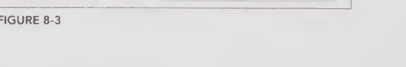


这并未告诉用户模式应该是什么；因此，用户不太可能知道如何解决该问题。

虽然可以控制显示给用户的验证消息，但不幸的是，这并不像您可能预期的那样简单直接，需要使用 JavaScript 来实现。

> 注意 下一个示例包含相对简单的 JavaScript。不过，您可能会决定在阅读第 11 课后再回到本示例。

为了自定义联系人名称消息，请在结束的 `html` 标签之前立即添加以下代码。

```html
<script>
    var contactName = document.getElementById('contactName');
    contactName.oninvalid = function(e) {
        e.target.setCustomValidity("");
        if (!e.target.validity.valid) {
            if (e.target.value.length == 0) {
                e.target.setCustomValidity("Contact name is required.");
            } else if (e.target.value.length < 5) {
                e.target.setCustomValidity("Contact name must be at least 5 characters.");
            }
        }
    };
</script>
```

> 注意 这需要放在页面底部，因为它在执行时尝试访问 `contactName` 字段。如果将其添加到 `head` 标签中，当此代码执行时，该字段将不存在。尽管将 JavaScript 放在页面末尾是解决此问题的可接受方案，但您稍后将在本书中看到更优雅的解决方案。

如果您在该字段中输入四个字符，现在应该会显示您指定的消息（参见图 8-4）。

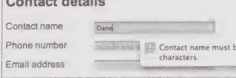

在此代码中，您在使用原生 DOM API 获取 `contactName` 字段后，为其添加了一个事件监听器。然后，您请求浏览器在其有效性状态每次更改时发送一个事件。当您收到该事件时，您首先通过访问字段本身的 `validity` 属性来确定该字段是否无效。

如果字段无效，您可以确定字段的当前值，从而确定违反了哪条验证规则，并创建相应的消息。

一旦确定了要显示给用户的消息，您就可以在该字段上调用 `setCustomValidity` 函数来设置此值。

## 禁用验证

HTML5 提供了许多用于控制验证的附加属性。

可以在表单中添加 `novalidate` 属性以禁用验证。如果添加此属性，字段仍会标记为有效或无效，因此您为网页添加的 CSS 样式仍然有效，但错误消息不会显示给用户，并且用户即使在表单无效的情况下也可以提交网页。

由于 HTML5 验证默认启用，此选项有时很有用。例如，每当一个字段被标记为 `email` 类型时，即使您不希望这样，验证也会自动添加。

也可以使用 `formnovalidate` 属性标记单个字段以禁用验证。通常在满足特定条件时动态地将此属性添加到字段：例如，如果表单中其他位置输入了特定数据，则某些字段无需验证。这是一种跨字段验证。

这也可以用于禁用字段上的默认验证——例如，允许 `email` 字段包含无效的电子邮件地址。

## 动手试一试

在本次“动手试一试”中，您将为在第 6 课的“动手试一试”中创建的表单添加验证。您可以从本书网站下载此内容，或使用您在第 6 课中创建的版本。

本书网站上以 `tryit.html` 为名提供了此练习的完整版本。如果需要额外帮助，您也可以查看屏幕录制视频。

### 课程要求

您将需要第 6 课的 `tryit.html`、一个文本编辑器和一个浏览器。

### 分步指南

1. 在文本编辑器中打开 `tryit.html` 文件。
2. 为 `fullName` 字段添加属性，使其成为必填字段，最小长度为 7 个字符，最大长度为 50 个字符。
3. 对于 `notes` 字段，使其成为必填字段，并添加一个模式，确保该字段包含不超过 500 个字符的文本。
4. 更改薪资字段以定义最低工资为 20000，最高工资为 200000。虽然这在课程中未展示，但可以使用 `min` 和 `max` 属性来实现，但请确保数字中不包含逗号或美元符号。
5. 为网页添加一个样式，使任何无效的 `input` 字段或 `textarea` 都显示红色边框。尽管看起来可能不像，但 `input` 字段或 `textarea` 周围的线条只是一个简单的边框，因此可以用 CSS 修改。

当验证错误发生时，完成的表单应显示为图 8-5 所示的样子。

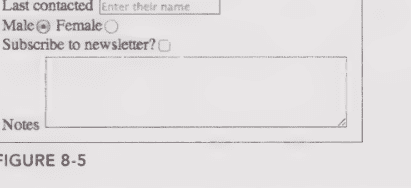

> **参考** 请在线选择第 8 课的视频，网址为 www.wrox.com/go/html5jsjquery24hr。您还可以从网站下载本课的代码和资源。

## 拖放

拖放是用户界面设计中几十年来一直很常见的范式。鲜为人知的是，拖放功能已被网络浏览器支持了十多年，最早出现在 1999 年的 IE5 中。

HTML5 中标准化的拖放实现与 IE5 中的版本大致相同。在可能的情况下，HTML5 标准是基于现有实现的。这既是 HTML5 的优势，也是其弱点。从头开始开发的拖放标准将显著改进和简化本课中概述的 API，但浏览器采用该标准将需要更长时间。

拖放是一种技术，允许元素从其在屏幕上的原始位置被拖动，并放置到屏幕的不同区域。拖放遵循以下过程：

- 拖动过程以鼠标按下事件开始。这将选择将成为事件源的元素。
- 按住鼠标按钮时，用户可以使用鼠标在屏幕上移动该元素。
- 当用户释放鼠标按钮时，该过程结束。此时鼠标所在的元素将成为拖放事件的目标。

因此，拖放可以被视为一种连接两个以某种方式相关的不同元素的方法。

> 注意 在开始之前，值得一提的是，本课将使用简单的 JavaScript。如果您有一些编程经验，这应该很容易理解，但您也可以选择在阅读第 11 课后回到本课。

## 理解事件

拖放 API 严重依赖事件。DOM 中的节点在用户对其执行各种操作时会生成事件。例如：

- 点击鼠标
- 在其中输入文本
- 用鼠标悬停在其上

动态 Web 应用程序在很大程度上是基于编写 JavaScript 代码来响应这些事件并执行某些操作。这通常被称为“事件驱动编程”。

响应事件涉及以下过程：

- 将一个 JavaScript 函数注册到 DOM 中的特定事件类型的节点。
- 当事件发生时，浏览器自动调用此 JavaScript 函数，并向其传递一个 Event 对象。此对象包含有关已发生事件的上下文信息——例如，生成它的元素。
- JavaScript 函数可以根据需要以任何方式响应事件，包括操作 DOM。

在本课中，您将使用原生 DOM 事件。在下一节中，您将开始使用 jQuery 来监听事件。因此，本课不会深入探讨事件处理的工作原理。

## 拖放示例

在本节中，您将编写一个简单的拖放示例，由一个看起来像图 9-1 的屏幕组成。

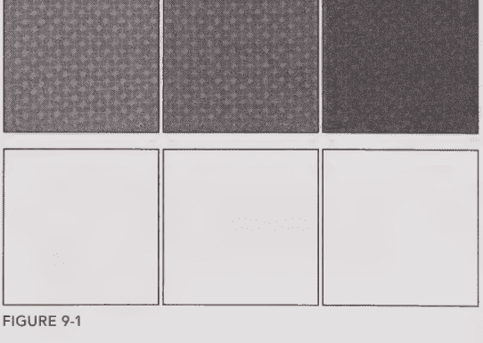


接下来，你将实现以下拖放功能：

- 用户可以将顶部一行中的任意彩色方块拖动到第二行的任意白色方块上。
- 如果用户将彩色方块放置在白色方块上，白色方块将采用该颜色。
- 当彩色方块被拖动时，其颜色应变浅以表明它是事件的源头。
- 当彩色方块悬停在白色方块上方时，白色方块的边框应被加强以表明它是拖放的目标。

虽然这个例子很简单，但它足以演示所有重要的拖放事件。首先创建一个名为 `boxes.html` 的网页，内容如下：

```html
<!DOCTYPE html>
<html lang="en">
<head>
    <meta charset="utf-8">
    <style>
        .box {
            height:200px;
            width:200px;
            display:inline-block;
            border: 2px solid black;
        }
    </style>
</head>
<body>
    <div class="box" style="background:red"></div>
    <div class="box" style="background:green"></div>
    <div class="box" style="background:blue"></div>
    <p>
    <div class="box"></div>
    <div class="box"></div>
    <div class="box"></div>
</body>
</html>
```

大多数可视元素都可以被标记为 `draggable`，使其能够成为拖放操作的源；因此，请在顶部一行的每个方块上添加以下属性：

```html
<div draggable="true" class="box" style="background:red"></div>
```

接下来，你希望浏览器在用户开始拖动方块时调用一个 JavaScript 函数。在这个函数中，你将提取被拖动元素的颜色并将其存储起来，以便在后续的拖放过程中使用。这将确保在拖放事件发生时，目标元素能够获取到该颜色。

首先，为顶部一行的每个方块添加以下内容：

```html
<div ondragstart="startDragging(event)" draggable="true" class="box" style="background:red"></div>
```

`ondragstart` 事件在鼠标点击可拖动元素时被触发。发生这种情况时，将调用 `startDragging` JavaScript 函数（你稍后将编写这个函数）。这个函数名是任意的；你可以随意命名。

当函数被调用时，你希望将有关事件的信息传递给它（提供事件的上下文）。因此，你在括号中放置 `event` 以表明它将作为参数传递给函数。事件对象将由浏览器本身创建和填充；你的代码只需要将其传递过去。

在本课中，你将直接在网页的 `head` 部分嵌入 JavaScript。JavaScript 只需包含在 `<script>` 元素中即可添加。因此，请在 `</style>` 标签结束后添加以下内容：

```html
<script>
function startDragging(evt) {
    evt.dataTransfer.setData("Color", evt.target.style.background);
    evt.target.style.opacity = 0.3;
}
</script>
```

> 注意 当事件发生时被调用的函数通常被称为“回调函数”。你需要负责实现这些函数，然后请求事件处理框架在适当的时间调用它们。

事件对象包含了关于已发生事件的各种信息，但最重要的是，它允许你通过调用 `evt.target` 来访问导致该事件的元素。

每个 DOM 节点都由一个 JavaScript 对象表示。一旦你访问了这个对象，你就可以开始检查它并与之交互。例如，你可以通过代码 `evt.target.style` 来访问元素的当前 CSS 样式。

此外，事件对象还提供了一个 `dataTransfer` 对象，使你能够在拖放操作期间存储信息。你存储了一个名为 `Color` 的任意参数，其值被赋予源元素的背景色。

在函数的第二行，你正在使用原生 DOM API 操作导致该事件的元素的样式，将其不透明度设置为 0.3。

> 注意 不透明度描述元素的透明度。如果一个元素的不透明度为 1.0，则它完全不透明。随着值趋向于 0，元素会变得更透明，在本例中，这将使颜色看起来变浅。

接下来，你希望为网页第二行的方块提供功能：这些方块将作为拖放操作的目标。

首先，你将添加功能，使得当用户在鼠标按下的情况下悬停在方块上时，方块的 `border` 被设置为 4 像素，而当用户的鼠标离开方块时，则恢复为正常大小。请记住，用户可能在不释放鼠标按钮的情况下将鼠标移过元素。

为第二行的三个方块添加以下内容：

```html
<div ondragenter="setBorderSize(event, '4px')" ondragleave="setBorderSize(event, '2px')" class="box"></div>
```

这为两个不同的事件 `ondragenter` 和 `ondragleave` 注册了同一个 JavaScript 函数，但在每种情况下传递给函数的参数不同。这只是我为了减少需要编写的函数数量而做出的设计决策。我同样可以轻松地用两个 JavaScript 函数来实现这一点。

该函数的实现如下：

```javascript
function setBorderSize(evt, size) {
    evt.currentTarget.style.border = size + " solid black";
}
```

这个实现现在看起来应该很熟悉了；唯一有趣的方面是我使用传入的 `size` 参数来设置边框的大小，但假设它仍然是 `solid` 和 `black`。

为了将源拖放到目标上，你需要添加两个额外的事件监听器：

```html
<div ondrop="drop(event)" ondragover="allowDrop(event)"
ondragenter="setBorderSize(event, '4px')"
ondragleave="setBorderSize(event, '2px')" class="box"></div>
```

首先，你需要监听 `ondragover` 事件。这个事件将被调用以确定鼠标悬停在其上的元素是否是拖放事件的有效目标。

你可能想知道为什么我没有在 `ondragover` 事件中更改边框。这个事件在鼠标每移动至少一个像素时就会被调用；因此，当鼠标悬停在元素上时，它可能被调用数百或数千次。因此，你需要确保由该事件调用的函数执行的操作尽可能少。

默认情况下，元素不是拖放事件的目标；因此，所有函数需要做的就是阻止这个默认行为。这可以通过调用事件本身的特殊函数来实现，如下所示：

```javascript
function allowDrop(evt) {
    evt.preventDefault();
}
```

接下来，你需要添加 `ondrop` 事件监听器。这是当用户在悬停于元素上方时释放鼠标按钮时发生的事件。`drop` 函数的实现如下：

```javascript
function drop(evt) {
    var color = evt.dataTransfer.getData("Color");
    evt.currentTarget.style.background = color;
    setBorderSize(evt, '2px');
}
```

在这个函数的第一行，你访问了之前设置的 `Color` 属性的值，并将其存储在一个名为 `color` 的局部变量中。

接下来，你将目标元素的 `background` 颜色设置为此颜色。请注意，此时事件的 `target` 是目标元素，而不是操作的源。

最后，由于在这种情况下 `ondragleave` 事件不会被触发，你需要通过调用 `setBorderSize` 手动将目标的 `border` 恢复为正常大小。请注意，你可以在需要时将事件对象传递给其他函数。

你还需要实现一个功能：将源元素的 `opacity` 恢复为 1.0。这可以通过为顶部一行的方块添加另一个事件监听器来实现：

```html
<div ondragend="dragEnded(event)" ondragstart="startDragging(event)"
     draggable="true" class="box" style="background:red"></div>
```

事件监听器的实现如下：

```javascript
function dragEnded(evt) {
    evt.target.style.opacity = 1.0;
}
```

事件的 `target` 是拖放操作的源，而不是目标；因此，你只需更改其 `opacity` 样式即可。

该网页的完成版本也可在本书网站上找到，名为 `boxes.html`。

虽然这是一个简单的例子，但它向你介绍了该 API 中常用的六个关键事件。在某些情况下，不必监听所有六个事件，因为例如，当鼠标离开元素时，你可能不需要执行任何操作。

你现在应该可以打开网页并试用该功能了。图 9-2 展示了一个正在进行中的拖动操作。

### 试一试

在这个“试一试”环节中，你将使用本章概述的技术来创建一个非常简单的网页。

你将创建一个带有单个放置区域的网页。当任何元素被放置到该区域上时，它将显示此元素中的文本。


本书网站上有一个该“动手试一试”的完成版，名为 `simpledraganddrop_finished.html`。


### 课程要求

你可以使用网站上第9课资源中的 `simpledraganddrop.html` 文件作为本次练习的基础。你还需要一个文本编辑器和一个网页浏览器。

如果你愿意，也可以自行创建如下网页：

```
<!DOCTYPE html>
<html lang="en">
<head>
    <meta charset="utf-8">
    <style>
        .box {
            height:200px;
            width:400px;
            display:inline-block;
            text-align:center;
            border: 2px dashed black;
            line-height: 200px;
            margin: 50px;
        }
    </style>

</head>
<body>
    <div class="box">Drag something onto me</div>
    <h1>I am a header 1 tag</h1>
    <h3>I am a header 3 tag</h3>
    <p>I am a p tag</p>
</body>
</html>
```

### 分步操作

1.  在文本编辑器中打开 simpiedraganddrop.html 文件，或者根据上一节的标记创建它。
2.  首先，为 h1、h3 和 p 元素添加 `draggable="true"` 属性。
3.  为这些事件添加一个 `ondragstart` 属性。这应该调用一个名为 `start-Dragging` 的函数，并将事件传递给该函数。
4.  在网页的 `<head>` 部分添加一个 `<script>` 块。所有 JavaScript 函数都将放在这里。
5.  在 `<script>` 块中创建一个名为 `startDragging` 的 JavaScript 函数。它应该接受一个名为 `evt` 的参数。
6.  函数体应使用本课程前面介绍的技术，在 `evt.dataTransfer` 上设置一个名为 `Text` 的属性。为了提取被拖拽元素的文本，请使用 `evt.target.textContent`。
    元素的文本实际上包含在 DOM 中该元素的子节点中，因此可以通过 `firstChild` 访问。然后可以使用 `textContent` 提取文本。
7.  确保 `div` 元素允许其他元素被拖放到它上面，方法是使用 `ondragover` 事件。这应该调用一个 JavaScript 函数来阻止事件的默认行为，如本课程前面所述。
8.  提供支持拖放操作的功能。首先，为 `div` 添加一个 `ondrop` 属性，使其调用一个名为 `drop` 的函数。
9.  在 `ondrop` 事件期间触发的 `drop` JavaScript 函数，首先需要从事件上的 `dataTransfer` 对象中提取 `Text` 属性的值。
10. 该函数还需要将此文本设置在 `div` 上。这可以通过为 `evt.target.textContent` 提供一个值来实现。
11. 现在你应该能够打开网页并开始将元素拖放到 `div` 上。每次将元素拖放到 `div` 上时，其文本都会更新以反映被拖放到其上的元素。

> 参考资料 *请在线选择第9课的视频，访问 www.wrox.com/go/html5jquery24hr。你也可以从该网站下载本课的代码和资源。*

## 10 动态元素

本课程基于 HTML5 中添加的四个提供动态组件的附加功能：一个原生进度条、一个 `meter` 元素、一个范围控件以及一组允许用户展开摘要以查看其详细信息的标签。

这些标签与你研究过的许多其他标签不同，因为浏览器的支持并不一致。因此，你还将了解一个称为 *polyfills（填充程序）* 的概念，它使你能够在功能缺失时升级浏览器的功能。

## SUMMARY 和 DETAILS 标签

我发现自己编写的最常见的 JavaScript 代码之一，就是根据用户的摘要选择，向其显示额外信息的代码。

由于这是如此常见的功能，HTML5 规范定义了两个标签组合起来，为此功能提供原生支持。为了看到实际效果，创建以下网页：

```
<!DOCTYPE html>
<html lang="en">
    <head>
        <meta charset="utf-8">
    </head>
    <body>
        <header>This page provides an example of the summary and details tags</header>
        <details>
            <summary>Table of contents</summary>
            <ul>
                <li>Lesson 1</li>
                <li>Lesson 2</li>
                <li>Lesson 3</li>
                <li>Lesson 4</li>
                <li>Lesson 5</li>
            </ul>
        </details>
    </body>
</html>
```

此页面包含一个名为 `details` 的标签，其中有一个名为 `summary` 的子元素。此外，`details` 标签本身包含附加信息：本例中是一个无序列表。如果你在 Chrome 中打开它，它将如图 10-1 所示显示。

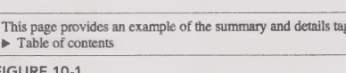

默认情况下，它只显示 `summary` 标签的内容。然后，如果你点击 `summary` 左侧的箭头，它将显示完整细节（参见图 10-2）。

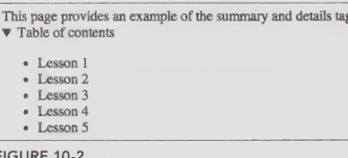

请注意，箭头自动指向下以表示正在显示详细信息。当然，可以用 CSS 为这些元素设置样式；对于这个箭头在用户看来会是什么样子，你有很大的灵活性。

虽然这些标签是 HTML 的一个伟大补充，但不幸的是，目前浏览器的支持非常有限。该功能在 Chrome 中运行良好，但如果你在 IE 或 Firefox 中打开同一个页面，你会感到失望。

如果你想了解各种浏览器是否支持某个功能，最好的网站是 www.caniuse.com。它详细列出了各种浏览器对所有 HTML5 和 CSS3 功能的支持级别。如果你查看网页 www.caniuse.com/details，你可以看到此特定标签的支持级别。

## 进度条和 METER

HTML5 还提供了一个原生进度条和一个相关的元素，称为 `meter`。

你将首先查看 `meter` 元素，因为它稍微简单一些。此元素可用于显示某个范围内的值。例如，如果你想显示一个值为目标的 60%，你可以向网页添加以下元素：

```
<meter value="6" min="0" max="10">6 out of 10</meter>
```

如果你将其添加到一个简单的模板网页中，它应该如图 10-3 所示显示：


请注意，在本例中，你指定了最小值和最大值分别为 0 和 10，然后将元素的值设置为 6。由于 `min` 和 `max` 的默认值分别为 0 和 1，因此也可以这样表示：

```
<meter value="0.6" >60%</meter>
```
标签之间的值不是必需的；我添加它只是为了清晰起见。
当你在元素中使用附加属性时，用于 `meter` 的颜色可能具有意义。例如，以下 `meter` 包含一个期望范围和一个可能的范围：

```
<meter value="1" high="8" low="3" min="0" max="10">6 our of 10</meter>
```
在本例中，你声明该值预期在 3 到 8 之间。由于该值低于期望范围，因此条形的颜色从绿色变为橙色。
或者，以下示例的值高于最大范围，显示为红色：

```
<meter low="60" high="80" max="100" value="95"></meter>
```
当然，可以使用 CSS 更改这些颜色。
进度条与 `meter` 类似，不同之处在于它预期在事件发生时更改其值。通常，你将在执行其他处理时使用 JavaScript 更新进度条。
可以如下向网页添加进度条：

```
<progress value="20" max="100" min="0" ></progress>
```
图 10-4 显示了一个静态进度条，完成了五分之一。
自然，静态进度条用处不大；因此，以下是一个每 200 毫秒更新 1% 的进度条示例。现在不用担心 JavaScript；这将在接下来的几节课中解释：

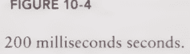

```
<!DOCTYPE html>
<html lang="en">
<head>
    <meta charset="utf-8">
    <script>
        setInterval(updateProgressBar, 200);

        function updateProgressBar() {
            var progressBar = document.getElementById("progressBar");
            progressBar.value += 1;
        }
    </script>
</head>
<body>
    <progress id="progressBar" value="0" max="100"></progress>
</body>
</html>
```


进度条最难处理的地方之一，就是通常无法确定操作完成了多少。如果你想让用户知道你不清楚还剩多少时间，可以简单地移除数值显示，这样进度条就会呈现如图10-5所示的样式。

这被称为具有不确定值的进度条。

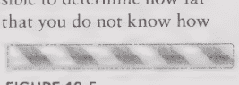

## RANGE 元素

你已经了解的 progress 和 meter 元素是一种向用户显示值的机制。range 元素类似，但它的设计目的是允许用户在一个范围内选择值。

因此，range 元素是一种表单输入类型，只是用户可以选择的值由范围的最小值和最大值控制。

例如，假设你希望用户以百分比的形式表示任务的完成度。你可以在表单中添加以下内容：

0%<input type="range" name="percentComplete" min="0" max="100" step="5" value="50">100%

请注意，这是一个简单的 input 元素，但其类型被设置为 range。

此示例指定了最小可能值为 0，最大可能值为 100，默认值为 50。它还规定了范围的任何移动都将以 5 为步长。因此，无法选择 23 这样的值——用户需要选择 20 或 25。图10-6显示了一个 range 元素的示例。


请注意，最小值和最大值的标签是手动添加的：它们不是元素的一部分。

我对 range 元素最大的批评是，浏览器实现通常不提供一种简单的方式来向用户显示他们选择的值；因此，有必要使用 JavaScript 手动完成此操作。例如，在前面的示例中，用户很难知道自己选择了 20 还是 25。

## POLYFILLS

本课程概述的特性给程序员带来了一个难题。尽管这些元素提供了有趣的功能，但并非所有浏览器都支持它们。例如，IE 10 之前的 IE 不支持 meter 和 progress 元素。

因此，如果你选择使用这些特性，一些用户可能会获得较低质量的体验。例如，当不支持 range 元素时，它只会显示为一个输入字段。随着浏览器转向使用自动更新的发布模型，这种情况正在减少，因为大多数用户拥有最新的浏览器；然而，企业环境中的许多用户仍然受限于旧版本的浏览器。

本节将介绍一种解决浏览器支持问题的方法。它允许你在支持原生 HTML5 功能的地方使用它们，但在不支持的地方提供自定义实现：这是一种被称为“polyfills”的技术。

为了支持 polyfills，你的网页需要执行两个不同的任务：

- 确定浏览器是否支持你希望使用的功能
- 如果缺少支持，则提供基于 JavaScript 的实现

Modernizr 是一个流行的 JavaScript 库，用于执行这些任务。可以从 http://modernizr.com/ 获取。

接下来的示例使用了来自第 10 课资源中的 Modernizr 版本，或者你可以下载自己的版本。Modernizr 的基本用法通常如下所示：

```html
<!DOCTYPE html>
<html lang="en">
<head>
    <meta charset="utf-8">
    <script src="modernizr.js"></script>
    <script>
        if (!Modernizr.inputtypes.range) {
            // 提供 JavaScript 实现
        }
    </script>
</head>
<body>
    0%<input type="range" name="percentComplete" min="0"
        max="100" step="5" value="50">100%
</body>
</html>
```

在 head 部分，导入了 Modernizr 脚本。导入后，就可以测试功能是否可用。在本例中，你会注意到代码：

```javascript
if (!Modernizr.inputtypes.range) {
```

这表示如果 range 元素不可用，则应执行该语句后面的 JavaScript 代码块。Modernizr 允许你使用类似的语句测试各种功能，根据功能是否支持返回 true 或 false。

在此代码块中，需要提供一个 polyfill。Modernizr 网站链接到许多 JavaScript polyfills，每个都有自己的使用说明。

## 尝试一下

这个“尝试一下”部分将允许你试验本课介绍的元素。它不会对“联系人”Web 应用程序贡献任何内容，因此如果你愿意，不一定需要完全按照说明操作。相反，这是一个实践的机会。

本书的网站包含一个名为 `tryit.html` 的文件，其中有一个完整的示例，或者如果你需要额外帮助，可以在线观看屏幕录像。

### 课程要求

你还需要一个文本编辑器和一个 Web 浏览器。

### 逐步操作

1.  首先创建一个简单的 HTML5 网页，用于添加本课概述的元素。
2.  假设你希望为医疗网站提供患者心率信息。首先创建一个 meter 标签，最大可能值为 200，最小可能值为 0。
3.  指示健康个体的可能范围：将 low 值设置为 60，high 值设置为 100。
4.  尝试使用 meter 的不同值——例如，20、70 或 120——并观察条形颜色的变化。
5.  现在，假设你不是向用户展示心率，而是希望让医生输入患者的心率。
6.  向网页添加一个 range 元素，并将最小和最大可能值分别设置为 0 和 200。此外，将 step 设置为 3，因为你的输入不需要那么精确。
7.  在页面底部添加一个 summary 和 detail 部分。其中，summary 部分应声明“心率偏高的患者列表。”
    当用户点击查看详细信息时，显示一个包含患者姓名和心率的表格。

你的最终版本应如图10-7所示。

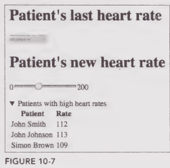

图 10-7

> **参考** *请在线访问 www.wrox.com/go/html5jsjquery24hr 选择第 10 课的视频。你还可以从网站下载本课的代码和资源。*

# 第二部分
使用 JavaScript 和 jQuery 的动态 HTML5 Web 应用程序

-   第 11 章: JavaScript
-   第 12 章: 调试
-   第 13 章: 函数
-   第 14 章: 对象
-   第 15 章: JSON
-   第 16 章: 文档对象模型
-   第 17 章: jQuery 选择
-   第 18 章: jQuery 遍历和操作
-   第 19 章: jQuery 事件
-   第 20 章: 数据属性和模板
-   第 21 章: jQuery 插件

# 11
JavaScript

JavaScript 的存在几乎和 Web 浏览器本身一样长。它于 1995 年随着 Netscape Navigator 2.0 首次出现，是唯一被所有最流行浏览器支持的编程语言。因此，如果你想构建动态网站，你需要了解 JavaScript。

长期以来，JavaScript 一直被视为一种二流语言，仅适用于实现字段验证等基本功能。在过去的五年里，JavaScript 的声誉有了显著提高。这部分是由于 JavaScript 引擎性能的巨大提升，从 Chrome 开始，并扩展到所有其他主要浏览器。然而，更重要的是，程序员开始重新评估语言本身，并学会利用其强大的功能。

尽管 JavaScript 包含其特有的怪癖，并且语言设计者做出了一些不寻常的决定，但 JavaScript 在正确使用时被证明是一种强大而灵活的语言。接下来几课的目标不仅是介绍这门语言，还要提供一些建议，指导你如何在编写大型和复杂的 Web 应用程序时使用这门语言。

本课将快速介绍 JavaScript 的数据类型和语法。这些语言方面相当常规，对于任何有其他编程语言背景的人来说都很容易掌握。

## JAVASCRIPT 控制台

在本课中，你将直接在 Chrome JavaScript 控制台中编写 JavaScript。为了使用它，请打开第 8 课的 contacts.html 网页，并使用以下方式打开开发工具：

-   OS X 上使用 Command+Option+i
-   Windows 上使用 F12 或 Ctrl+Shift+I

开发工具打开后，点击控制台（Console）选项卡。这里提供了一个用于编写 JavaScript 的命令提示符，允许你直接操作当前网页。为了演示这一点，请在命令提示符中输入算式 `1 + 1`。结果应立即显示，如图 11-1 所示。

按下回车键总会执行控制台中的语句；因此，如果你需要编写跨越多行的代码，请在按回车键时按住 Shift 键。

在接下来的章节中，我将插入一个 `>` 以表示我正在向控制台写入代码。你在编写相同代码时应省略此符号。此外，我将在下一行显示响应（如果适用）。例如：

```
> 1 + 1
2
```

## 数据类型

我们将从考察 JavaScript 用于表示数据的不同类型开始学习这门语言。

### 字符串

JavaScript 中的字符字符串可以用单引号或双引号括起来。要查看示例，请在控制台中键入以下内容：

```
> "Welcome to JavaScript"
```

这被称为字符串字面量，因为该语句的求值结果就是字符串本身。当然，也可以将字符串赋值给一个变量。例如：

```
> s1 = "Welcome to JavaScript";
```

> 注意 在 JavaScript 中，语句应以分号结束。从技术上讲，分号是可选的，但如果省略，JavaScript 会自动为你插入分号，并且在某些情况下，它会被插入到意想不到的位置，导致难以理解的错误。

变量 s1 现在引用了这个字符串，如果你在控制台中输入 s1，该字符串将被打印出来。此外，你可以询问 JavaScript 该变量的数据类型：

```
> typeof s1;
"string"
```

也可以对字符串执行操作。从技术上讲，这些操作称为方法，你将在第 14 课学习对象时看到。要查看可用的方法，只需在控制台中输入 `s1.`；自动完成功能随后会显示可用的方法（参见图 11-2）。

本书不是参考书，因此我不会带你遍历整个 API，但以下方法是字符串上最常用的方法：

- **toUpperCase**：将文本转换为大写。
- **toLowerCase**：将文本转换为小写。
- **substr**：使用起始索引和（可选的）结束索引提取字符串的一部分。例如，`s1.substr(0, 7)` 返回 `Welcome`。计数始终从 0 开始。
- **indexOf**：返回提供的字符串在字符串中的第一个索引；例如，`s1.indexOf('e')` 返回 1。JavaScript 中的计数始终从 0 开始，因此第二个字符位于位置 1。
- **length**：这是字符串的一个属性而不是方法；因此，在调用它时不需要使用括号。例如，`s1.length` 返回 21。
- **replace**：此方法用提供的新字符串替换第一个出现的字符串。例如，`s1.replace('e', 'E')` 返回 "Welcome to JavaScript"。

也可以使用 `+` 运算符将文本附加到现有字符串。如果你执行以下操作，将返回一个连接了两个字符串的新字符串：

```
> s1 + " - Let's get started";
```

然而，如果你在执行此操作后查看 s1 的值，你会发现它保留了其旧值：

```
> s1;
"Welcome to JavaScript"
```

一旦字符串被赋值，它就永远不能被修改（它是不可变的）。任何看似修改字符串的操作，实际上都会创建一个新字符串。因此，要更新 s1 的值，你需要将表达式的结果赋值给它：

```
> s1 = s1 + " - Let's get started";
```

最后，如果你需要在字符串中使用特殊字符，可以在它前面加上一个反斜杠。例如，下一个示例在一个带引号的字符串中包含了一个 ` 字符，因此我在它前面使用了反斜杠：

```
s2 = 'This is Dane\'s code';
```

当然，在这种情况下，我本可以简单地将字符串用双引号括起来，因为引号字符在这样的字符串中没有特殊含义：

```
s2 = "This is Dane's code";
```

### 数字

JavaScript 使用单一的数字类型表示所有数字，包括小数：从技术上讲，所有数字都是 64 位浮点数。

可以按照以下方式将数字值赋给变量：

```
> n1 = 200;
> n2 = 2.432432432;
```

`typeof` 运算符将确认这些是数字：

```
> typeof n1
"number"
```

JavaScript 支持所有常见的数学运算符来操作数字。例如：

```
> n1 / 2
100
> n1 * (200 + n2);
40486.486486400005
```

对于更高级的操作，JavaScript 还提供了一个名为 `Math` 的库，其模型与 Java 中的同名库相同。例如：

```
> Math.pow(3,2)
9
> Math.round(n2)
2
```

JavaScript 还支持三种特殊的数值。它们是数字，但不能表示为常规数字：

> **Number.POSITIVE_INFINITY**：当一个正数除以 0 时创建此值。虽然你可能被教导过数字不能除以 0，但由于 JavaScript 中所有数字都是浮点数，该语言假设数字 0 可能是一个微小但仍然是非零的数字，无法用 64 位内存表示。如果你将一个数字除以这样一个微小的数字，结果将趋近于无穷大。

> **Number.NEGATIVE_INFINITY**：当负数除以 0 时返回此值。

> **NaN**：这代表非数字（not-a-number），但令人困惑的是，它仍然是一个数字。当对数字的操作返回无法表示为数字的值时，会创建此值。例如：`1 / "hello"` 或 `Math.sqrt(-1)`。可以使用特殊的 JavaScript 函数来检查此值：`isNaN(Math.sqrt(-1))`。

### 布尔值

布尔值用于捕获 `true` 和 `false` 值。例如：

```
> b1 = true;
> b2 = false;
```

布尔值通常由逻辑操作返回。例如：

```
> 10 > 5
true
```

### Null

在研究 `null` 是什么之前，值得更详细地了解一下变量。当你执行如下语句时：

```
> n1 = 200;
```

变量 n1 获取了 number 数据类型。然而，变量 n1 并非固有地与数字相关联；你可以通过给它赋一个新值来改变它的类型：

```
> n1 = "Testing";
```

另一种理解方式是，变量 n1 开始时引用数字 200，然后更改为引用字符串 "Testing"。因此，你也可以改变 n1，使其不引用任何内容：

```
> n1 = null;
```

因此，null 表示值的缺失。JavaScript 对 null 值有一个小怪癖：

```
> typeof n1
"object"
```

这是语言本身的一个历史性错误：尽管如此，null 在 JavaScript 中是一个独特的数据类型。

### Undefined

如果你访问一个不存在的变量或对象的属性，会返回 undefined 的值。例如，如果你在命令行中键入以下内容，将返回 undefined 的值：

```
> typeof n3
"undefined"
```

### 数组

从技术上讲，数组不是一个独特的数据类型；它们是一种对象，但在本节中介绍它们仍然值得。

数组包含零个或多个任何数据类型的元素。你可以如下声明一个数组：

```
a1 = [];
```

数组的初始元素也可以作为逗号分隔的列表在方括号内提供：

```
a1 = [1,2,3,4];
```

你不需要声明数组的大小；你可以直接开始插入元素，它将扩展以支持它们：

```
a1[2] = 20;
a1[1] = "hello"
```

因为数组是对象，所以它们也支持方法；例如，这将在数组末尾添加一个新元素：

```
a1.push(200);
```

而这将对数组进行排序：

```
a1.sort()
```

你可以通过在方括号中指定元素的位置来访问数组中的元素：

```
> a1[1]
"hello"
```


接下来的课程将大量使用数组，并将介绍许多额外功能。

## 对象

JavaScript 中所有其他值都是对象。在接下来的几节课中，你将花大量时间研究它们，因此我这里不再讨论。

## 函数

函数是许多 JavaScript 应用程序的基本构建块。JavaScript 中的函数接受零个或多个参数，执行一系列语句，然后可选择性地返回一个值。

你可以按如下方式创建函数（在控制台中输入新行时记得按住 Shift 键；也可以从文本编辑器中复制粘贴代码）：

```
function doubleTheNumber(num) {
    var result = num * 2;
    return result;
}
```

在此示例中，你创建了一个名为 `doubleTheNumber` 的函数，并声明它接受一个名为 `num` 的参数。

在函数体内，你将 `num` 乘以 2，并将结果存储在名为 `result` 的局部变量中。最后，在函数的最后一行返回此变量。花括号表示与函数相关的代码块。

然后你可以按如下方式执行此函数：

```
> doubleTheNumber(9);
18
```

请注意，变量 `result` 是使用 `var` 关键字声明的。这意味着该变量是函数局部的，在函数结束时自动销毁。可以省略 `var` 关键字，函数仍会正常工作。为证明这一点，请按如下方式修改函数：

```
function doubleTheNumber(num) {
    result = num * 2;
    return result;
}
```

如果执行此操作，它仍会按预期工作：

```
> doubleTheNumber(10);
20
```

然而，整体结果并不相同。变量 `result` 已创建为全局变量，即使在函数执行结束后仍然存在。你可以通过执行以下操作看到这一点：

```
> result;
20
```

使用全局变量是危险的，应尽量减少，因为始终存在两个独立的代码块意外使用相同变量名的可能性。你将在第 13 课中更详细地研究函数。

## 控制结构

JavaScript 包含一组用于循环和分支的标准控制结构。对于任何有编程背景的人来说，这些都很熟悉，因为它们与 Java、C# 和 Python（以及其他语言）中的基本语法相同。

可以使用 `for` 循环或 `while` 循环进行循环。以下示例使用 `for` 循环将数组的内容相加：

```
> al = [3,6,4,1,4,9]
> var result = 0;
> for (var i = 0; i < al.length; i++) {
    result = result + al[i];
  }
> result
27
```

`for` 循环由三个不同的部分组成：

- 声明一个名为 `i` 的变量作为计数器；初始值设置为 0。
- 声明当 `i` 的值小于数组长度（6）时继续循环。
- 声明每次循环完成一个周期时，变量 `i` 的值应增加 1（`i++`）。

循环还使用花括号表示其作用域，因此每次循环执行时，都将执行以下语句：

```
result = result + al[i];
```

因为数组的第一个索引是 0，所以第一次迭代会将 `result` 变量设置为 3，依此类推，直到评估完数组中的所有元素。

如果你想在循环执行时看到更多细节，可以添加 `console.log` 语句将日志信息打印到控制台。例如：

```
for (var i = 0; i < al.length; i++) {
  console.log('The value of i is ' + i);
  console.log('The value in the array is ' + al[i]);
  result = result + al[i];
}
```

第二个主要的循环变体是 `while` 循环。`while` 循环在每次迭代时评估一个表达式。当条件为真时，它们继续循环；如果条件为假，循环就会停止。

例如：

```
var result = 0;
var counter = 0;
while (counter < a1.length) {
    result = result + a1[counter];
    counter++;
}
result;
```

你会注意到，这仍然将计数器变量初始化为 0，并在每次迭代时递增其值，但这些操作分别在循环开始前和循环内完成，而不是在循环声明中。

JavaScript 支持 `break` 和 `continue` 语句来控制循环执行。我将在下一个主题（控制结构）中介绍这些内容。以下函数接受两个参数：一个正数数组和一个数字。然后将数组中的所有偶数相加，如果总和大于传递给第二个参数的数字，则返回 `true`：

```
function checkCountEven(a1, n1) {
    var result = false;
    var count = 0;
    for (var i = 0; i < a1.length; i++) {
        var number = a1[i];
        if (number % 2 != 0) {
            continue;
        }
        count = count + number;
        if (count > n1) {
            result = true;
            break;
        }
    }
    return result;
}
```

你可以按如下方式调用它：

```
> a1 = [3, 6, 4, 1, 4, 9]
> checkCountEven(a1, 20)
false
```

此函数首先声明两个局部变量，然后使用 `for` 循环开始遍历数组。

在 `for` 循环内，你首先从当前数组位置提取数字。然后使用表达式 `number % 2 != 0` 检查它是否为奇数。此表达式字面意思是“如果数字除以 2 的余数不为 0，则返回 true”。如果为真，则执行 `if` 块。

如果语句返回 `true`，你不想计算该数字，因此使用 `continue` 关键字立即跳到下一次循环迭代。

如果数字是偶数，你将其加到结果中，然后使用另一个 `if` 语句检查运行总计是否大于传入的数字。如果计算结果为 `true`，你知道总体结果必须为 `true`，因此不需要在循环中检查更多数字。因此，你使用 `break` 关键字立即跳出循环，函数简单地返回其 `result`。

条件表达式也可以支持 `if else` 和 `else` 语句。例如：

```
function describeNumber(num) {
    if (num >= 0 && num % 2 == 0) {
        console.log(num + ' is a positive even number');
    } else if (num >= 0 && num % 2 == 1) {
        console.log(num + ' is a positive odd number');
    } else if (num < 0 && num % 2 == 0) {
        console.log(num + ' is a negative even number');
    } else {
        console.log(num + ' is a negative odd number');
    }
}
```

请注意，在此示例中，你使用与（`&&`）运算符组合了多个布尔表达式。使用时，只有当两个子表达式都为 `true` 时，整个表达式才返回 `true`。

> **注意** *此示例使用 `==` 来确定两个值是否相等。通常应避免这样做，因为即使数据类型不同，它仍然返回 `true`。例如，字符串 "1" 等于数字 1。通常，应使用 `===` 运算符来确定值是否相等，使用 `!==` 运算符来确定值是否不相等，因为这还会检查数据类型是否相同。*

JavaScript 还支持 `switch` 语句和三元运算符来执行条件逻辑。虽然这里不会介绍它们，但它们的工作方式对于在其他语言中使用过它们的人来说应该很熟悉。

## 真值和假值

JavaScript 的一个独特方面是每个值和每个表达式都评估为 `true` 或 `false`。要看到这一点，创建以下函数：

```
function whatAmI(v1) {
    if (v1) {
        console.log('I am true');
    } else {
        console.log('I am false');
    }
}
```

请注意，因为值评估为 `true` 或 `false`，所以你可以简单地声明 `if (v1)` 来确定传入的参数是否为 `true`。你现在可以用多种值来调用它：

```
> whatAmI("hello")
I am true
> whatAmI("")
I am false
```


## 动态类型

JavaScript 是一门动态类型语言。这意味着变量的类型只在运行时确定。尽管动态类型语言在许多方面非常灵活，但当类型不符合预期时，也很容易产生错误。考虑如下函数：

```javascript
function add(n1, n2) {
  return n1 + n2;
}
```

当使用两个数字调用此函数时，它会按预期运行，但如果你这样调用会发生什么？

```javascript
> add(1, '0')
```

在这种情况下，结果是字符串值 "10"。这可能符合也可能不符合你的预期。
在静态类型语言中，你会声明 `n1` 和 `n2` 是数字，并且不允许使用字符串来调用它。这在 JavaScript 中是不可能的。

由于 JavaScript 非常宽容，情况可能会变得更糟。考虑以下示例：

```javascript
> add(1, [])
"1"
> add(1, true)
2
```

JavaScript 确实有其内部逻辑来解释这些结果，但它们很少是直观或预期的。为了规避此类问题，通常编写函数时会让它们在传入意外的数据类型时生成错误。例如：

```javascript
function add(v1, v2) {
  if (typeof v1 === "number"
  && typeof v2 === "number") {
    return v1 + v2;
  } else {
    throw "both arguments must be numbers";
  }
}
```

注意此示例中的 `throw` 语句：这将向调用者生成一个错误，如图 11-3 所示。

这仍然不如编译时错误那样明确，但至少可以确保如果程序失败，失败的原因是显而易见的。

## 动手尝试

在本次“动手尝试”中，你将使用本课学到的技巧来编写两个实用函数。如果你在这些示例中遇到困难，你可能想观看视频教程，它将逐步讲解这两个示例。这两个函数的完整版本可在本书网站上找到。

### 课程要求

你将使用 Chrome 控制台进行这些示例。但是，建议你在文本编辑器中编写代码，然后将完成的版本复制到 Chrome 控制台中。

### 分步指南

你将创建的第一个实用函数将接受一个参数（应该是一个字符串），并返回该字符串的反转：如果传入 "Hello"，它将返回 "olleH"。

```javascript
> whatAmI(22)
I am true
> whatAmI(null)
I am false
> whatAmI(8 + 9)
I am true
```

这里有一些令人惊讶的结果。以下值为假：
-   `false`
-   `0`（零）
-   `""`（空字符串）
-   `null`
-   `undefined`
-   `NaN`（此值既非真也非假，这就是为什么需要 `isNaN` 函数来检测它）

所有其他值都被评估为真。

实际上，你可以将此函数简化为一行，如下所示：

```javascript
function whatAmI(v1) {
  console.log('I am ' + !!v1);
}
```

`!` 是非运算符，因此如果将其应用于任何变量，它会返回其布尔值的相反值。然后你可以使用另一个 `!` 运算符来否定它，从而返回其实际的真值。

JavaScript 代码广泛使用值在 `if` 语句中为真或假的特性。例如，如果你只想在 `s1` 有值的情况下打印其包含的字符串，可以使用以下代码：

```javascript
if (s1) {
  console.log(s1);
}
```

5.  在每次迭代中，你需要提取位置为“字符串长度 – 当前计数 - 1”的字符。这将确保你在第一次迭代中提取字符串的最后一个字符，第二次迭代中提取倒数第二个字符，依此类推。例如，如果字符串有七个字符，你将在第一次迭代中提取位置为 6 的字符（记住计数从 0 开始，因此具有七个字符的字符串的最后一个位置是 6）。你可以使用 `charAt` 方法提取给定位置的字符。
6.  一旦提取了字符，你需要使用 `+` 运算符将其附加到 `result` 变量。
7.  循环完成后，你需要返回结果。

函数完成后，你应该可以这样调用它：

```javascript
> reverse("Hello");
"olleH"
```

第二个实用函数将接受一个数字数组，并在所有正数的总和大于所有负数的绝对值总和时返回 `true`。

-   1. 首先创建一个名为 `calculateSums` 的函数，并声明它接受一个参数（在这种情况下是一个数组）。
-   2. 创建两个变量来分别保存正数和负数的计算结果。它们应初始化为 0。
-   3. 在此示例中，你将使用 `while` 循环，因此还需要创建一个计数器变量并将其初始化为 0。
-   4. 创建一个 `while` 循环，并为它的代码块添加花括号。`while` 循环应测试计数器是否小于数组的长度。
-   5. 在代码块内，你需要添加一个 if-else 块来判断数字是否大于 0。
-   6. 如果数字大于或等于 0，只需将其加到正数的总和中。如果小于 0，你需要使用 `Math.abs()` 计算其绝对值，并将结果加到负数的总和中。
-   7. 你还需记住在循环内将计数器变量增加 1。如果你省略此操作，`while` 循环将永远运行：这被称为无限循环。
-   8. 循环结束后，你可以简单地返回正数的总和是否大于或等于负数的总和。

应该可以这样调用该函数：

```javascript
> calculateSums([-1, 2])
true
> calculateSums([-1, 2, -3])
false
```

> **参考** 请访问本书网站 www.wrox.com/go/html5jsjquery24hr 查看第 11 课的视频，以及下载本课的代码和资源。

## 12 调试

既然你已经有了一些可运行的代码，那么值得退一步，看看 Chrome 提供的用于分析基于 JavaScript 的 Web 应用程序的开发工具。

对于开发目的来说，最重要的工具可能是调试器。调试器允许你在应用程序运行时对其进行检查，从而诊断任何问题或错误的原因。

所有主要的浏览器供应商都已在其浏览器中引入了开发工具，例如调试器。例如，Firefox 使用 Firebug 插件支持与你将在此处看到的工具类似的工具。

本课是一门非常实用的课程。它将包含两个“动手尝试”部分，我们鼓励你跟着示例操作。

两个“动手尝试”部分将使用同一个网页来演示调试器的各种功能。该页面可从本书网站的第 12 课文件夹中以 tryit.html 的名称获取，但你也可以选择自己编写：

```html
<!DOCTYPE html>
<html lang="en">
<head>
    <meta charset="utf-8">
    <script>
    function calculateAbsoluteSumOfArray(a) {
        var result = 0;
        for (var i = 0; i < a.length; i++) {
            var num = a[i];
            result = result + Math.absolute(num);
        }
        return result;
    }

    function calculateSumOfArray(a) {
        var result = 0;
        for (var i = 0; i < a.length; i++) {
            var num = a[i];
            result = result + num;
        }
        return result;
    }

    function findHighestSum(arrays) {
        var result = Number.NEGATIVE_INFINITY;
        for (var i = 0; i < arrays.length; i++) {
            var a = arrays[i];
            var sum = calculateSumOfArray(a);
            if (sum > result) {
                result = sum;
            }
        }
        console.log('The largest sum is ' + result);
    }

    var arrays = [[1,2,3,4,5],[6,4,2],[1,9]];
    </script>
</head>
<body>
    This page is for trying out the debugger
    <p>
    <button onclick="findHighestSum(arrays)">Click me to sum arrays</button>
    <p>
    <button onclick="calculateAbsoluteSumOfArray(arrays[0])">Click me cause an error</button>
</body>
</html>
```

## 动手尝试

在第一个“动手尝试”中，你将调试两个负责处理如下定义的二维数组的函数：

```javascript
var arrays = [[1,2,3,4,5],[6,4,2],[1,9]];
```

> **注意** 二维数组只是一个常规数组，其中每个元素本身就是一个数组。

第一个函数名为 `findHighestSum`，它将遍历提供的数组中的所有内部数组，并将每个数组依次传递给另一个名为 `calculateSumOfArray` 的函数，该函数将计算数组中数字的总和。`findHighestSum` 的任务是确定哪个内部数组的总和最高。


### 课程要求

要完成本课程，你需要使用 Chrome 浏览器以及之前提到的 `tryit.html` 网页。

### 分步操作

1.  为了启动调试器，首先在 Chrome 中打开 `tryit.html` 页面。然后使用以下方式之一打开开发者工具：
    -   在 OSX 上使用 Command+Option+i
    -   在 Windows 上使用 F12 或 Ctrl+Shift+i
2.  开发者工具打开后，点击“Sources”选项卡。进入该选项卡后，你会注意到 `tryit.html` 页面出现在左侧面板中：双击它，即可在中间面板中打开（参见图 12-1）。

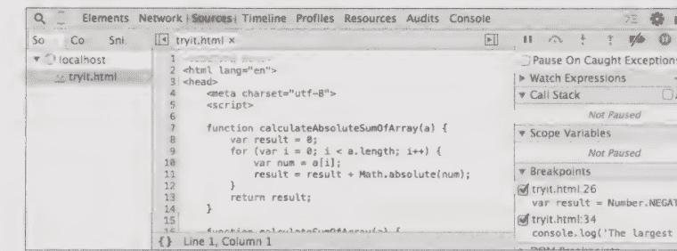

3.  调试代码的第一步是设置断点。断点是程序处理过程中的一个点，你希望程序在此处暂停，以便逐行检查。找到 `findHighestSum` 函数的第一行，然后在其行号显示的空白区域单击一下——对我来说是第 26 行。空白区域应该出现一个蓝色标记，如图 12-2 所示。

```
24    function findHighestSum(arrays) {
25      var result = Number.NEGATIVE_INFINITY;
26      for (var i = 0; i < arrays.length; i++) {
27        var a = arrays[i];
28        var sum = calculateSumOfArray(a);
29        ...
30    }
```

4.  点击“Click Me to Sum Arrays”按钮。一旦点击，程序应显示一条消息“Paused in debugger”，调试器的各个面板将填充信息。此外，程序当前暂停所在的行将以蓝色阴影显示，如图 12-3 所示。

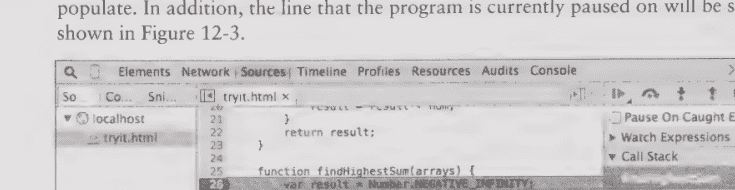

图 12-3

5.  现在程序已暂停，你可以开始与它交互了。调试器最常见的用途之一就是逐行单步执行程序。你可以通过调试器右上角的一组按钮来实现这一点，如图 12-4 所示。

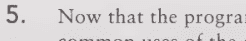

图 12-4

6.  如果你将鼠标悬停在这些按钮上，其工具提示会告诉你它们的用途。你将从使用左起第二个按钮开始，其工具提示应为“Step over next function call”（单步跳过下一个函数调用）。如果按下此按钮，执行将跳转到函数中的下一行。再按两次，使蓝色阴影行位于第 29 行，如图 12-3 所示。
7.  当函数执行代码时，一些局部变量已被赋值。例如，`arrays` 变量包含二维数组，`a` 变量包含你即将求和的数组，而 `i` 变量包含 `for` 循环的当前计数器值。你可以在控制台的右侧查看这些变量的值，如图 12-5 所示。要查看任何数组中的值，只需点击它们旁边的箭头即可。

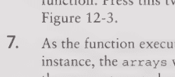

图 12-5

8.  也可以在程序执行时与其交互。例如，如果你切换到“Console”选项卡，你可以编写使用当前作用域中变量的代码，甚至可以修改它们的值（参见图 12-6）。

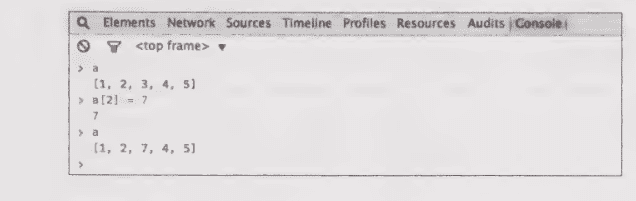

这是在将代码添加到网页之前进行尝试的好方法，因为你可以从控制台获得即时反馈。

“Sources”选项卡底部还有一个迷你控制台，可用于相同的目的，这意味着你无需在选项卡之间来回切换。

9.  切换回“Source”选项卡。现在你将单步进入一个函数调用，而不是跳过它，因此点击工具提示为“Step into next function call”（单步进入下一个函数调用）的按钮。当你这样做时，执行应跳入 `calculateSumOfArray` 函数，你现在可以单步执行此函数。单步执行此函数直到它完成，并观察局部变量在执行过程中的更新。
10. 当 `calculateSumOfArray` 执行完毕后，调试器将立即返回到 `findHighestSum` 函数中断的地方。你可能不想单步执行剩余的执行过程，而是想立即跳转到向控制台打印信息的行。为此，通过点击空白区域为此行添加一个断点，然后点击“Resume Script Execution”（恢复脚本执行）按钮。当你这样做时，调试器应暂停在相应的行上，局部变量将已更新以反映已发生的处理。
11. 要结束调试会话，只需再次点击“Resume Script Execution”（恢复脚本执行）按钮。

## 查找错误

调试器是理解程序执行时行为的绝佳方式，但它们最常用于诊断问题。编程错误在 JavaScript 代码中可能很难发现，因为如果发生问题，JavaScript 会立即停止执行。

网页用户甚至可能没有意识到发生了错误；她只会注意到某个功能没有按预期工作。

因此，本节将引导你了解一个包含错误的程序示例，并探讨如何识别和解决问题。

## 动手试一试

在这个动手环节中，我们将点击一个按钮来调用一个有缺陷的 JavaScript 函数。这使用了与之前动手环节相同的网页，因此请确保你已在 Chrome 中打开了该网页。

### 课程要求

要完成本课程，你需要使用 Chrome 浏览器以及之前提到的 `tryit.html` 示例。

### 分步操作

1.  为了启动调试器，首先在 Chrome 中打开 `tryit.html` 页面。然后使用以下方式之一打开开发者工具：
    -   在 OSX 上使用 Command+Option+i
    -   在 Windows 上使用 F12 或 Ctrl+Shift+i
2.  识别图 12-7 中所示的工具栏，并按下暂停按钮（位于工具栏右侧，工具提示为“Pause on Exceptions”）。当你点击此按钮时，它应变为蓝色，并应出现一个额外的复选框。对于本示例，是否选择此复选框并不重要。
3.  要运行有缺陷的代码，点击标签为“Click Me to Cause an Error”的按钮。一旦点击，调试器应暂停在出错的行上，尽管你没有在此行设置断点。这如图 12-8 所示。
4.  为了确定此行为何有缺陷，使用键盘快捷键从编辑器中复制它。然后打开“Console”选项卡，将其粘贴进去，然后按 Enter。错误原因将被显示，如图 12-9 所示：


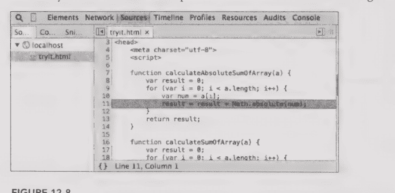

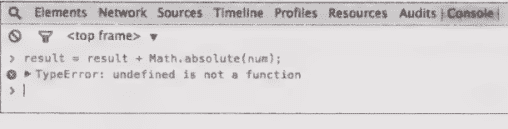

图 12-9

5.  这表明你正在调用一个不存在的函数。函数名被指定为 `absolute` 而不是 `abs`；你可以通过执行更正了函数名的此代码的替代版本来确认这一点，如图 12-10 所示。

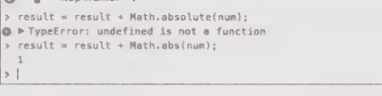

图 12-10

6.  一旦问题被识别出来，你就可以修复源代码并再次尝试。

> **参考** 请访问书籍网站 www.wrox.com/go/html5jsjquery24hr 查看第 12 课的视频，以及下载本课的代码和资源。

## 13

## 函数

函数在 JavaScript 中看似简单，但这种简单性背后蕴藏着巨大的力量。理解这种力量是掌握 JavaScript 语言的关键之一。

在第 11 课中，你创建了简单的函数并从控制台调用它们。例如：

```
function isPositive(num) {
    return num >= 0;
}
```

在 JavaScript 中，函数是对象，因此可以将它们赋值给变量：

```
f1 = function isPositive(num) {
    return num >= 0;
}
```

如果你询问 JavaScript `f1` 的类型，它将如下响应：

```
> typeof f1
"function"
```

这是 JavaScript 略显不诚实的另一个例子。函数不是一种独立的数据类型；它们是对象，因此支持你将在下一课中学到的所有特性，例如在它们上调用方法的能力。

一旦将函数赋值给变量，你可以通过附加括号和参数，通过其变量名来调用它：

```
> f1(9)
true
```

事实上，你可以在 JavaScript 中可以使用任何其他变量的任何地方使用此变量；例如，你可以将其作为参数传递给另一个函数。


假设你想编写一个函数来统计数组中有多少个正数。借助函数的强大功能，你可以这样编写一个通用算法：

```
function countForArray(array, condition) {
    var result = 0;
    for (var i = 0; i < array.length; i++) {
        var element = array[i];
        if (condition(element)) {
            result++;
        }
    }
    return result;
}
```

这个算法接受一个数组和一个函数。它遍历数组中的每个元素，并将其传递给提供的函数。如果函数返回 true，计数就加一。你可以这样调用它：

```
> a = [1,2,-3,2,-5]
> countForArray(a, f1)
3
```

请注意，你传递的是之前定义的函数的引用。在这个例子中，你可能没有看到太多好处；毕竟，`countForArray` 方法本可以很容易地在不使用传入函数的情况下检查数字是否为正数。

然而，`countForArray` 的妙处在于它是一个通用函数，可以很容易地使其表现得不同。例如，如果你想统计负数的个数，可以使用以下代码：

```
> countForArray(a, function(num) {
    return num < 0;
})
2
```

请注意，在这种情况下，你甚至没有预先创建函数；你只是在调用 `countForArray` 时声明了它。你创建的函数甚至没有名字；因此它被称为匿名函数。它的作用域仅限于这次函数调用期间。

一旦你有了像 `countForArray` 这样的函数，你就可以将其用于各种各样的任务，这些任务甚至可能是你最初编写时未曾想到的。

传递给其他函数的函数通常被称为回调函数，因为它们允许另一个函数在适当的时候“回调”它们。

JavaScript 数组原生支持许多可用于执行常用操作的函数。例如，对数组执行的最常见操作之一是过滤掉不符合一组条件的元素集。例如，你可能想从数组中过滤掉所有负数，只留下正数。

JavaScript 数组提供了一个用于执行此操作的 `filter` 方法。与 `countForArray` 一样，它依次将数组中的每个元素传递给提供的函数，并保留那些返回 `true` 的元素：

```
> a.filter(f1)
[1, 2, 2]
```

同样，你可以用以下代码过滤掉正数：

```
> a.filter(function(num) {
    return num < 0;
})
[-3, -5]
```

你可能已经注意到，`filter` 函数实际上并没有修改底层数组；相反，它返回一个新数组，其中包含了过滤后的相关元素。

另一个对数组执行的常见操作是以某种方式转换每个元素。对于这个特定的数组，你可能想转换元素，使所有数字都为正数；这可以通过 `map` 函数来实现。

`map` 函数的工作方式完全相同：你向它传递一个函数，`map` 函数会用数组中的每个元素调用它。你提供的函数负责以某种方式修改元素，并将修改后的版本作为结果返回。

以下代码返回一个元素数组，其中每个数字都已转换为正值：

```
> a.map(function(num) {
    return Math.abs(num);
})
[1, 2, 3, 2, 5]
```

因为像 `map` 和 `filter` 这样的函数都操作数组并返回数组，所以可以将一系列函数调用链接在一起。假设你想返回数组中所有偶数的绝对值。可以这样实现：

```
> a1 = [-2, 1, -3, 5, 6]
> a.filter(function(num) {
    return num%2==0;
  }).map(function(num) {
    return Math.abs(num);
  });
[2, 2, 6]
```

这个例子有点难懂，所以先分解一下它的组成部分。它首先执行 `filter` 操作：

```
> a1.filter(function(num) {
    return num%2==0;
  })
[-2, -2, 6]
```

然后对结果执行 map 操作：你可以这样模拟：

```
> [-2, -2, 6].map(function(num) {
    return Math.abs(num);
})
[2, 2, 6]
```

编写 JavaScript 代码时，一个好习惯是以执行单一任务的简单函数来思考，并且不存储或修改任何全局状态。然后可以将这些函数组合在一起以创建更高级的功能。以这种方式构建软件通常更简单，因为非常容易理解、开发和测试每个独立的函数。

## 闭包

闭包可能是一个难以解释的概念，所以我将通过例子来解释它们。

想象一个场景，你想编写一个函数，该函数可以产生唯一的、递增的数字，供你的 Web 应用程序中的其他代码使用。此功能的唯一条件是，如果最后一次调用该函数返回了 10，则下一次调用必须返回 11。

可以使用全局变量来编写此功能：

```
> count = 0;
> function getNextCount() {
    return count++;
}
> getNextCount()
0
> getNextCount()
1
```

然而，正如已经提到的，应该避免使用全局变量，因为任何其他代码都可以修改它们。例如，任何其他代码都可能重置 `count` 变量：

```
count = -1;
```

或者将其设置为一个无意义的值：

```
count = 'hello';
```

这些可能看起来像是刻意设计的例子，但随着 Web 应用程序规模的扩大，这样的全局变量会成为难以发现的 bug 的根源。闭包提供了一种替代方案。

在查看解决方案之前，请考虑一下函数执行完毕后其内部局部变量会发生什么。下面的函数声明了一个名为 `myCount` 的局部变量。

```
function counter() {
    var myCount = 0;
    return myCount++;
}
```

如果你执行此操作然后尝试访问 `myCount` 变量，你会发现它不存在：

```
> counter()
0
> myCount;
ReferenceError: myCount is not defined
```

每次调用函数时，都会在函数内部创建该变量，并在函数完成时自动销毁。这就是为什么 `counter` 函数总是返回 0：

```
> counter()
0
> counter()
0
```

现在，考虑一下前面函数的这个轻微变体：

```
function getCounter() {
    var myCount = 0;
    return function() {
        return myCount++;
    }
}
```

这个函数返回的不是数字，而是另一个函数。它返回的函数体如下：

```
function() {
    return myCount++;
}
```

现在你可以将一个变量分配给这个函数：

```
counter = getCounter();
```

然而，这个函数有些奇怪：它引用的是在 `getCounter` 函数内部定义的局部变量 `myCount`。根据我之前的解释，当 `getCounter` 调用结束时，这个变量应该已经被销毁了。因此，你可能会预期，如果你调用 `getCounter` 返回的函数，它将会失败。

它不仅没有失败，还给出了你想要的精确行为：

```
> counter();
0
> counter();
1
```

在 `getCounter` 内部创建的匿名函数被称为闭包。当它被创建时，它“闭合”了当时作用域中的所有变量，并获得了对它们的引用。因此，当 `getCounter` 调用结束时，JavaScript 识别出匿名函数可能仍然需要使用 `myCount` 变量，并且没有销毁它。

虽然匿名函数可以继续使用 `myCount` 变量，但它对所有其他代码完全隐藏。这意味着任何其他代码都不可能干扰这个变量的值：

```
> myCount = 10;
10
> counter()
2
```

前面的代码创建了一个名为 `myCount` 的全局变量，但这对你的计数器没有任何影响，计数器继续使用同名的局部变量。

此外，如果你创建第二个计数器，它将有自己的局部 `myCount` 变量，这不会影响你原来的计数器。相反，新计数器也将从 0 开始计数。

这个解决方案的妙处在于你创建了私有数据。执行计数的函数使用了一个只有它能访问的变量。这是 JavaScript 中的一个重要技术，因为它不支持其他语言中用于创建私有数据的许多机制。

## 变量提升与块作用域

JavaScript 中一个有趣的特性是函数内部变量的作用域。在大多数编程语言中，可以在子块（例如循环）内声明变量，并将其作用域限制在此块内。考虑以下示例：

```
function iterate(array) {
    var count = 0;
    for (var i = 0; i < array.length; i++) {
        var count = 10;
    }
    return count;
}
```

如果你使用一个数组调用此函数，它将始终返回 10，因为在 `for` 循环内部声明的 `count` 变量覆盖了在循环之前声明的 `count` 变量。

JavaScript 这样运作的部分原因是一个称为*变量提升*的概念。虽然可以在函数中的任何地方声明变量，但当 JavaScript 执行函数时，它首先查找其中的所有局部变量，并将它们的声明移动到函数顶部。然而，在函数体中显式赋值之前，它们是未定义的。为了演示这一点，创建以下函数：

```
function testHoisting() {
    var num = num1 + num2;
    var num1 = 10;
    var num2 = 10;
    return num;
}
```


如果你调用这个函数，你会注意到它并没有失败，即使它在变量定义之前就使用了这些局部变量：

```
> testHoisting()
NaN
```

然而，如果你尝试使用全局变量做同样的事情，代码将会失败，因为全局变量不会被提升：

```
> function testHoisting() {
    var num = num1 + num2;
    num1 = 10;
    num2 = 10;
    return num;
}

> testHoisting()
ReferenceError: num1 is not defined
```

## 参数

正如多次讨论过的，JavaScript函数可以接受参数。但是，当你调用一个函数时，你传递的参数数量并不需要受到定义的参数数量的限制。

例如，你可以向一个接受两个参数的函数传递一个参数。在这种情况下，第二个参数的值将是`undefined`。

同样，你可以向一个接受两个参数的函数传递三个参数。这听起来可能没什么用，但事实上，JavaScript会将这些参数放在一个名为`arguments`的特殊数组中供你使用。

考虑一个你想编写一个函数来将任意一组数字相加的情况。显然，你可以将一个数组传递给该函数，但你也可以这样编写：

```
function add() {
    var result = 0;
    for (var i = 0; i < arguments.length; i++) {
        result = result + arguments[i];
    }
    return result;
}
```

请注意，这个函数没有声明任何参数：相反，它使用`arguments`数组来提取传递给它的参数。现在可以用任意数量的参数来调用这个函数了：

```
> add(3,7,8,10)
28
```

## BIND

由于JavaScript函数实际上是对象，因此可以调用它们的方法。本节将介绍一种广泛使用的方法，称为`bind`。

你已经了解了函数在创建时如何“闭合”作用域内的所有变量。这组变量可以被视为函数执行的环境。

JavaScript比这更强大：可以以对象的形式向函数提供环境，从而使函数能够使用一组完全不同的变量。

想象一下，你想创建一个计数器，它能够从任何数字开始，而不仅仅是0。一种实现方法如下所示：

```
function getCount() {
    return this.myCount++;
}
```

请注意，在这种情况下，你没有为`myCount`提供起始值，并且你使用`this`来访问该变量（`this.myCount`），而不是直接使用`myCount`。你将在下一课中了解`this`的含义。

如果你创建一个计数器函数，它将无法工作，因为`myCount`没有值。相反，你可以通过提供一组名称/值对来将此函数绑定到新环境：

```
> var counter2 = getCount.bind({myCount:100});
undefined
> counter2()
100
> counter2()
101
```

> **注意** 花括号内的名称/值对实际上是一个对象：你将在下一课中更详细地了解如何构造对象。

如你所见，`bind`函数返回函数的一个新版本，该版本永久绑定到新环境。然后你可以调用此函数并获取与其绑定环境相应的结果。

## 动手实践

在这个动手实践环节，你将首先编写一个利用你在本课中学到的技术的函数。这个函数将实现一个独立的`map`方法。

接下来，你将了解数组提供的另一个名为`reduce`的方法。这可用于聚合数组中的值——例如，将它们求和。

### 课程要求

为了完成本课，你需要Chrome网络浏览器。不过，你可能想在文本编辑器中完成这些练习，然后将结果复制到控制台。

### 逐步操作

1.  打开Chrome开发工具，选择Console（控制台）标签页。
2.  定义一个名为`map`的函数，它接受两个参数：一个数组和一个用于执行map操作的函数。
3.  在函数体中，你首先需要构造一个空数组来保存函数的结果。
4.  使用`for`循环遍历数组中的所有元素。记住使用一个计数器变量，并声明当该计数器小于数组长度时循环应继续。
5.  在`for`循环体中，提取位于计数器位置的元素。将其存储在一个局部变量中。
6.  将该元素传递给第二个参数中提供的函数，并将结果存储在另一个变量中。
7.  使用`push`方法将映射后的变量添加到结果数组中——例如，`result.push(value)`。
8.  为了执行此函数，首先创建一个包含奇数和偶数的混合数组。
9.  创建一个接受单个参数的函数。如果该参数是偶数（记住，你可以使用取模运算符：`%`），则直接返回它；如果是奇数，则将该数字加1并返回。因此，此函数将所有数字转换为偶数。
10. 将该函数赋值给一个变量。
11. 使用你之前创建的数组和引用将数字转换为偶数的函数来调用`map`函数。结果应该是一个偶数数组。

在这个动手实践的第二部分，你将了解`reduce`函数。这与`map`和`filter`类似，但稍微复杂一些。此函数用于将数组中的数据聚合为单个值，例如总和或平均值（如果需要，单个值也可以是对象或数组）。这个函数更复杂，因为它在执行时需要跟踪一个累计总和。

1.  创建一个数字数组，这些数字可以相加。
2.  创建一个可用于将数字相加的函数。该函数应命名为`addToTotal`，并接受两个参数：当前总和和一个要添加到此总和的新值。
3.  在函数体中，返回两个数字的和。
4.  在`addToTotal`中添加日志记录，以便你可以看到发生了什么：将两个参数打印到控制台。
5.  你现在要在数组上调用`reduce`方法。它接受两个参数：一个函数和一个聚合的初始值：因此传入`addToTotal`和`0`。
    记住，你是传递函数本身而不是调用它。因此，当你传递`addToTotal`时，应该只包含它的名字；你不应该用一组参数来调用它。
    当我运行这个时，它产生以下输出：

```
[6, 2, 3].reduce( addToTotal, 0);
Current total: 
Value: 6
-----------------
Current total: 
Value: 2
-----------------
Current total: 
Value: 3
-----------------
11
```

> 参考 请访问本书网站 www.wrox.com/go/html5jsjquery24hr 观看第13课的视频，以及下载本课的代码和资源。

# 14 对象

到目前为止，你所接触的大部分JavaScript数据类型都保存着简单的原子值，如字符串或数字。本课将介绍对象：对象封装了多个数据属性，以及一组能够操作这些属性的方法。

对于从其他语言迁移过来的程序员来说，对象可能是JavaScript中最难掌握的部分，因为JavaScript中的对象工作方式与大多数其他语言根本不同。正如你将看到的，这并不是一件坏事，但如果你不理解这些根本差异，你将难以编写复杂的Web应用程序。

## 对象字面量

在JavaScript中，可以通过将一组属性和方法括在一对花括号内来创建对象。以下是包含两个属性和一个方法的对象的示例：

```
> o = {
    firstName: 'Dane',
    lastName: 'Cameron',
    getFullName: function() {
        return this.firstName + ' ' + this.lastName;
    }
}
```

在这个例子中，两个属性是`firstName`和`lastName`。这些属性都是字符串，但它们可以是任何数据类型：数字、布尔值、数组或其他对象。

请注意，属性名与其值之间用冒号分隔，属性之间用逗号分隔。

有两种不同的方式可以访问这些属性：

```
> o.firstName
"Dane"
> o['firstName']
"Dane"
```

这两种机制并不完全等同。第二种机制（使用方括号）总是有效的，而第一种机制仅在属性名遵循特定规则时才有效：

-   属性名以字母、下划线或美元符号开头。
-   属性名仅包含这些字符或数字。

例如，可以像下面这样创建一个对象：

```
> o = {
    'first name':'Dane',
    'last name':'Cameron'
}
```

然而，由于属性名包含空格，它们必须用引号括起来声明，并且访问这些属性的唯一方式是使用方括号表示法：

```
o['first name']
"Dane"
```

该对象上的方法是 `getFullName`。你会注意到它使用了关键字 `this` 来访问对象上的属性。在方法内部，`this` 指向对象本身，因此 `this.firstName` 意味着你想要访问对象的 `firstName` 属性，而不是名为 `firstName` 的变量（该变量的值将是 `undefined`）。可以这样调用该方法：

```
> o.getFullName()
"Dane Cameron"
```

因此，方法可以被视为以不同方式使用特殊值 `this` 的函数。

对象构建后，仍然可以向其添加额外的属性或方法，或者重新定义任何现有的属性或方法。例如：

```
> o.profession = "Software Developer";
> o.getFullName = function() {
    return this.firstName + " " + this.lastName + " (" + this.profession + ")";
}
> o.getFullName();
"Dane Cameron (Software Developer)"
```

请注意，即使对象是在重新定义发生时创建的，对 `getFullName` 的调用也会使用重新定义的实现。

两个变量可以引用同一个对象，但在这种情况下，对对象的任何更改都会反映到这两个变量上。例如，我可以创建一个名为 `o2` 的新变量并将其设置为 `o`；调用 `getFullName` 将返回与在 `o` 上调用该方法相同的值：

```
> o2 = o;
> o2.getFullName();
"Dane Cameron (Software Developer)"
```

因为 `o` 和 `o2` 引用的是完全相同的对象。

## 原型

编程语言使用对象概念的主要原因之一是为了允许代码重用。通常会有许多对象共享相同的属性和方法，但具有不同的属性值。

例如，上一节中的示例可能表示员工管理系统中的一名员工；因此你可能会创建许多类似的对象，它们都具有相同的属性名和方法，但每个对象的属性中包含不同的数据。因此，所有这些对象可以共享相同的方法。显然，你可以将相关方法添加到你创建的每个对象中，但这会变得非常繁琐。

如果你使用过像 Java 或 C# 这样的语言，你可能会认为类是实现这种重用的机制。类是对象的模板，许多语言坚持要求你先构建类，然后从这些类创建对象。因此，类包含了将出现在对象中的方法和属性名，但每个对象都有自己的属性值。

正如你很快会看到的，JavaScript 确实支持以这种方式创建对象的语法，但它不是 JavaScript 中代码重用的核心机制。相反，JavaScript 是围绕原型的概念设计的。

事实证明，JavaScript 中的每个对象都有一个它基于的原型，并从该原型派生属性和方法。为了说服自己，可以在控制台中输入以下内容：

```
> o = {};
> o.toString()
"[object Object]"
```

在这个例子中，你创建了一个空对象，没有任何属性或方法，然后在其上调用了一个名为 `toString` 的方法。`toString` 方法来自新对象的原型，该原型恰好被称为 `Object`。

原型本身只是一个普通的对象。当在对象上访问属性或方法时，JavaScript 首先尝试在对象本身上访问它。如果那里没有找到，它会尝试在对象的原型上访问它。事实上，正如你很快会看到的，对象的原型可能也有它自己的原型；因此，可能存在一个完整的原型链。如果在搜索原型后仍然找不到属性或方法，则返回 `undefined` 的值。

因为许多对象共享相同的原型，所以向原型添加功能提供了一种代码重用的机制。

考虑 JavaScript 中数组的情况。在 JavaScript 中构造的每个数组都有一个名为 `Array` 的原型对象：这是定义诸如 `pop`、`map` 和 `reduce` 等方法的地方。`Array` 本身有一个原型 `Object`，这提供了额外的方法。

由于原型只是一个普通的对象，你可以向其添加额外的方法。这些方法将自动对所有数组可用，甚至在添加方法之前创建的数组也可以使用。

例如，你可能希望数组支持一个名为 `contains` 的方法。该方法将接受一个参数，如果该参数作为数组中的元素存在，则返回 `true`。你可以这样定义：

```
> Array.prototype.contains = function (val) {
    for (var i = 0; i < this.length; i++) {
        if (this[i] === val) {
            return true;
        }
    }
    return false;
}
```

在这种情况下，`Array` 是一个构造函数（你很快就会看到这些），而 `Array.prototype` 允许你访问作为所有数组原型的对象。请注意，在你添加的方法内部，你可以使用 `this` 来引用数组本身。

然后你可以编写如下代码：

```
> a1 = [1,5,3,8,10]
[1, 5, 3, 8, 10]
> a1.contains(8)
true
> a1.contains(9)
false
```

原型也可以解决前面讨论的员工对象的代码重用问题。你可以构建一个单一的对象作为所有员工对象的原型，然后将其设置为任何你构建的员工对象的原型。

你将首先定义一个带有方法的对象作为原型：

```
staffPrototype = {
    increasePay : function(percentage) {
        this.salary = this.salary + ((this.salary * percentage) / 100);
    },

    getFullName : function() {
        return this.firstName + " " + this.lastName + " (" + this.profession + ")";
    }
}
```

请注意，它访问了四个属性：`firstName`、`lastName`、`salary` 和 `profession`。这些属性都没有在对象本身上定义；因此无法调用这些函数并获得有意义的结果。尽管如此，对象定义仍然被认为 JavaScript 是有效的。

现在你需要一个机制来将这个对象设置为其他对象的原型。最好的方法是使用以下函数：

```
> function extend(obj) {
    function T(){};
    T.prototype = obj;
    return new T();
}
```

你将首先使用这个函数，然后回来看看它是如何工作的。首先通过以下调用创建一个新对象：

```
> s1 = extend(staffPrototype);
```

现在向 `s1` 添加相关属性：

```
> s1.firstName = 'Morgan';
> s1.lastName = 'Thomas';
> s1.salary = 50000;
> s1.profession = 'Graphic Designer';
```

现在，你应该能够使用添加到原型的方法，并且这些方法可以使用你新构建对象中的属性：

```
> s1.getFullName()
"Morgan Thomas (Graphic Designer)"
> s1.increasePay(10)
> s1.salary
55000
```

你可以从同一个原型构建任意数量的对象：

```
> s2 = extend(staffPrototype);
> s2.firstName = 'Sam';
> s2.lastName = 'Donaldson';
> s2.salary = 60000;
> s2.profession = 'HR Manager';
```

所有这些对象都将使用你在原型上定义的方法，但每个属性都有其各自不同的值。

虽然这显然有效，但 `extend` 函数相当神秘。该函数的第一行定义了另一个名为 `T` 的函数。尽管这是一个普通函数，但正如你将看到的，它将被用作构造函数，就像 `Array` 一样。

构造函数是普通函数，但旨在使用 `new` 关键字调用。你将在下一节深入探讨这些。当使用 `new` 关键字调用时（如第三行所示），它们会隐式地返回一个新对象。

然而，函数的第二行是所有魔法发生的地方：在这一行上，传递给函数的对象（在这种情况下是 `staffPrototype`）被设置为构造函数的原型。这意味着从此函数构造的任何对象都将拥有此对象作为其原型。

最后，重要的是要理解原型是只读的。例如，以下代码可能会在某个对象上执行以重新定义 `getFullName` 方法：


## 构造函数

上一节简要介绍了构造函数。这是 JavaScript 中最接近类的东西，因为它提供了一种在单一步骤中构建新对象并初始化其属性的机制。

例如，以下是用于初始化具有上一节中使用的四个属性的对象的构造函数：

```
function Staff(firstName, lastName, salary, profession) {
    this.firstName = firstName;
    this.lastName = lastName;
    this.salary = salary;
    this.profession = profession;
}
```

这个函数实际上没有什么特别之处，除了以下几点：

-   它以大写字母开头，而你编写的所有其他函数和方法都以小写字母开头。这是一个约定，用来提醒你这个函数是一个构造函数：你很快就会明白为什么这个约定很重要。
-   构造函数的函数体使用 `this` 来引用多个属性。正如你将看到的，构造函数隐式返回一个新对象，并且可以使用 `this` 在新对象上设置属性。

现在可以使用这个构造函数来构建一个对象，如下所示：

```
s3 = new Staff('Brian', 'Downing', 40000, 'Software Tester');
```

这将创建一个新对象，并根据传递给函数的参数设置其属性。

这只会构造和初始化一个对象，因为它是使用 `new` 关键字调用的。如果省略 `new`，函数仍然会成功执行，但它不会构造一个新对象：

```
> s4 = Staff('Brian', 'Downing', 40000, 'Software Tester');
undefined
```

如你所见，该函数现在返回 `undefined` 的值。你可能想知道函数内部的调用（如 `this.salary`）发生了什么。如果一个函数在没有 `new` 关键字的情况下被调用，`this` 指的是 JavaScript 的全局命名空间，也就是 `window` 对象。因此，传递给函数的值已被创建为全局变量，并在此过程中覆盖了任何其他同名的全局变量：

```
> firstName
"Brian"
> salary
40000
```

> **注意** 可以使用以下声明来使用更严格的 JavaScript 模式：`"use strict";` 在严格模式下，函数内部的 `this` 是 `undefined`，忘记 `new` 关键字将导致错误。严格模式也解决了我们看到的许多其他 JavaScript 的怪癖。

这就是为什么用大写字母开头命名构造函数很重要：提醒自己它们是构造函数，并确保在它们前面加上 `new` 关键字。

> **注意** 如果你在计数，你可能已经注意到 `this` 有四种不同的含义，具体取决于它使用的上下文。

-   在常规函数内部，`this` 指的是全局命名空间，在浏览器中是 `window` 对象。
-   在方法内部，`this` 指的是定义该方法的对象。
-   在构造函数内部，`this` 指的是隐式构造的对象，但仅在函数使用 `new` 关键字调用时。
-   当使用 `bind` 时，`this` 指的是作为参数传递的对象。

在这些上下文中误解 `this` 的含义是 JavaScript 代码中常见的错误来源。

## 模块

大多数支持对象的编程语言都支持一种控制数据访问方式的机制。例如，考虑上一节中对象的 `salary` 属性。任何有权访问对象的代码都可以将其设置为任何想要的值，如下所示：

```
s1.salary = 100000000;
```

在实际应用中，你可能希望控制 `salary` 可以设置的值。例如：

```
> s1.updateSalary = function(newSalary) {
    if (newSalary > 0 && newSalary < 200000) {
        this.salary = newSalary;
    } else {
        throw 'The salary must be between 0 and 200000';
    }
}
```

虽然可以暴露这样的方法，但这并不能阻止代码直接访问对象的属性。

这听起来可能不是一个重要的问题，因为你完全控制着代码库，因此可以检查是否有人直接更新了 salary 属性。然而，随着代码库的增长以及引入越来越多的关于如何访问和更新属性的规则，这变得越来越困难。

幸运的是，这个问题有一个解决方案，它依赖于闭包。以下是一个示例：

```
function createStaffMember(initialSalary, firstName, lastName) {
    var salary = null;
    o = {
        setSalary : function() {
            if (initialSalary > 0 && initialSalary < 200000) {
                salary = initialSalary;
            } else {
                throw 'The salary must be between 0 and 200000';
            }
        },
        getSalary : function() {
            return salary;
        },
        firstName : firstName,
        lastName : lastName
    };
    o.setSalary(initialSalary);
    return o;
}
```

请注意，此函数声明了一个名为 salary 的局部变量，然后构造了一个使用该局部变量的对象。当对象在函数末尾被返回时，它保留了对 salary 变量的引用，因此不会被销毁。尽管如此，任何其他代码都无法在不使用 setSalary 方法的情况下设置此变量，这确保了值始终在可接受的范围内。

可以按照以下方式从该函数构建一个对象：

```
> s5 = createStaffMember(50000, 'Tom', 'Braithwaite');
```

salary 属性似乎可以按照以下方式设置：

```
> s5.salary = 10000000000;
```

但是，如果你调用 getSalary 方法，你会发现实际的 salary 并未被修改：

```
> s5.getSalary();
50000
```

你还会注意到对象的方法没有使用 `this` 关键字访问 salary 变量。这是因为 salary 不是对象的属性；它是对象引用的一个局部变量。另请注意，你需要提供一个方法（`getSalary`）来返回 salary 的当前值，因为对象外部的代码没有其他方式可以访问此值。

本节概述的方法是一种*设计模式*，它是针对已知问题的可重用解决方案。这种设计模式被称为*模块设计模式*，在 JavaScript 编程中被广泛使用。

### 试一试

在这个“试一试”环节中，你将在 CRM Web 应用程序中使用模块设计模式。虽然此时它不会做太多事情，但它将提供一个结构良好的基础，在接下来的几课中，你可以在此基础上添加额外的功能。

### 课程要求

要完成本课程，你需要 Lesson 8 结束时的 CRM Web 应用程序。如果你尚未完成 Lesson 8，可以从本书的网站下载。你还需要一个文本编辑器和 Chrome 浏览器。

### 分步指南

1.  首先创建一个名为 `contacts.js` 的独立 JavaScript 文件。它应该放在与 `contacts.html` 文件相同的文件夹中。
2.  在其中，首先创建一个名为 `contactsScreen` 的函数。它应该接受一个名为 `mainID` 的单个参数，并返回一个空对象。
3.  在函数内部定义一个局部变量（不是在返回的对象内部），名为 `appScreen`，并将其设置为传递给函数的参数。当你最终调用该函数时，你将把 `contacts.html` 页面的主元素传递给此函数。
4.  创建另一个名为 `initialized` 的局部变量，并将其设置为 `false`。
5.  在返回的对象内部创建一个名为 `init` 的方法。添加此方法，并为它声明一个空的代码块。这是你放置网页首次加载时需要执行的任何逻辑的地方。
6.  你希望确保只初始化屏幕一次。因此，在 `init` 方法的顶部，检查 `initialized` 是否为 true：如果是，只需调用 `return`。
7.  将 `contacts.js` 中的 JavaScript 代码（减去 `script` 标签：保留它们）复制并添加到 `init` 方法的主体中。此外，在 `init` 方法的末尾将 `initialized` 设置为 `true`。
8.  你现在需要将 JavaScript 文件链接到 HTML 页面，以确保网页加载时它也会加载。为此，请将以下内容添加到 `head` 元素的主体中：

```
<script src="contacts.js"></script>
```


## 15

## JSON

JSON（通常读作杰森）代表 JavaScript 对象表示法。它是一种数据格式，用于将 JavaScript 对象的属性表示为字符串。

在计算中，经常需要将数据从一种格式转换为另一种格式。例如，如果你有一个 JavaScript 对象，你可能希望将其转换为字符串，这样：
- 你可以通过网络将其发送到另一台计算机。
- 你可以将其存储在文件中。
- 你可以将其与其他只支持字符串的 JavaScript API 一起使用。

反过来，你最终可能希望将此字符串转换回对象，以便在 JavaScript 应用程序中使用。

将对象转换为字符串的过程称为*序列化*，而将其转换回来的过程称为*反序列化*。

为了将对象转换为字符串，你需要一种指定对象应如何映射到字符串的数据格式——例如，你如何表示对象的属性和值，以及如何编码各种数据类型，如数字和数组？

历史上，大多数数据格式都是二进制的：这意味着人类无法读取格式化的数据并理解其底层结构或含义。通常，数据使用专有算法在二进制格式之间转换。

近年来，人们开始转向纯文本数据格式。最著名的例子是 XML，它使用与 HTML 类似的结构和语法来区分属性及其值。

使用 XML 来序列化 JavaScript 对象本身并没有错，许多 Web 应用程序确实使用 XML。例如，以下是一个联系人可能的 XML 表示：

```xml
<?xml version="1.0" encoding="UTF-8"?>
<contact>
    <contactName>William Jones</contactName>
    <phoneNumber>555-2941</phoneNumber>
    <emailAddress>william@testing.com</emailAddress>
    <company>
        <code>123</code>
        <name>ABC Incorporated</name>
    </company>
    <notes></notes>
    <lastContacted>2014-09-25</lastContacted>
</contact>
```

XML 有三个主要缺点：
- XML 中标签与内容的比率相当高：在前面的示例中，超过一半的消息由标签组成。
- 需要在 JavaScript 对象和 XML 之间转换的 JavaScript 库，因为 JavaScript 本身并不原生支持 XML。
- 尽管 XML 原则上很简单，但围绕它产生了许多技术，例如命名空间和模式，它们会使 XML 变得相当复杂。

JSON 缓解了所有这些问题。JSON 的主要优点是它直接映射到 JavaScript。如果你按照 JavaScript 声明对象的相同语法在纸上写出 JavaScript 对象的结构，它可能与 JSON 完全相同。

JSON 在最新版本的 JavaScript 中也得到原生支持；因此你不需要任何库来使用 JSON。

最后，JSON 非常简单。它在以下网站上仅用几百字描述：http://www.json.org。

联系人的 JSON 表示可能如下所示：

```json
{
    "contactName": "William Jones",
    "phoneNumber": "555-2941",
    "emailAddress": "william@testing.com",
    "company": {
        "code": 123,
        "name": "ABC Incorporated"
    },
    "notes": null,
    "lastContacted": "2014-06-30T05:50:46.659Z"
}
```

注意这看起来与声明 JavaScript 对象的字面量表示法多么相似？

可以使用实用函数 `JSON.stringify` 将 JavaScript 对象转换为字符串。为了演示这一点，首先使用对象字面量表示法创建一个联系人对象：

```javascript
> c1 = {
    contactName: "William Jones",
    phoneNumber: "555-2941",
    emailAddress: "william@testing.com",
    company: {
        code: 123,
        name: "ABC Incorporated"
    },
    notes: null,
    lastContacted: new Date()
}
```

接下来，执行以下操作将其作为字符串存储在变量 `contactString` 中：

```javascript
> contactString = JSON.stringify(c1)
"{\"contactName\":\"William Jones\",\"phoneNumber\":\"555-2941\",\"emailAddress\":\"william@
testing.com\",\"company\":{\"code\":123,\"name\":\"ABC Incorporated\"},\"notes\":null,\"lastCon
tacted\":\"2014-06-30T06:06:56.306Z\"}"
```

注意属性和值都保留了，但属性名称都自动嵌入双引号中。

JSON 允许所有 JavaScript 数据类型在序列化版本中表示。这确保了当字符串最终转换回对象时，各种属性保留其原始数据类型。
- 字符串总是出现在双引号内。在此示例中可以看到多个例子——例如 "William Jones"。
- 数字以字面形式出现，不需要加引号；例如，`code` 属性的值为 123。
- 尽管此示例中未显示，布尔值用未加引号的关键字 `true` 和 `false` 表示。
- 未加引号的关键字 `null` 用于表示空值，正如你在 `notes` 属性中看到的那样。
- 对象可以封装子对象，正如 `company` 属性所演示的。这种嵌套可以根据需要进行任意多级。
- 数组可用作任何属性的值。这些使用熟悉的方括号表示数组的开始和结束，元素之间用逗号分隔。

你可以使用 `JSON.parse` 函数将字符串转换回对象。图 15-1 中的示例展示了这一点，并演示了你可以访问反序列化对象的属性：

```javascript
> contact = JSON.parse(contactString);
▶ Object {contactName: "William Jones", phoneNumber: "555-2941", emailAddress: "william@testing.com", company: Object,
    notes: null,}
> typeof contact
"object"
> contact.contactName
"William Jones"
```

### 图 15-1

虽然 JSON 格式非常适合序列化属性，但它不能用于序列化方法：当调用 `JSON.stringify` 时，对象上存在的任何方法都将被忽略。

## 替换和恢复

尽管 JavaScript 非常适合处理大多数 JavaScript 数据类型，但它确实有某些局限性。最难处理的数据类型之一是 `Date` 对象。

序列化日期有许多不同的方式。例如，你可以使用它们的毫秒时间：

```javascript
new Date().getTime()
1404088573560
```

毫秒时间是一个数字，表示自 1970 年 1 月 1 日午夜以来经过的毫秒数。这不是表示日期的理想方式；除其他原因外，它不包含时区信息。

你也可以在 `Date` 对象上使用 `toString` 方法：

```javascript
new Date().toString()
"Mon Jun 30 2014 12:36:01 GMT+1200 (New Zealand Standard Time)"
```

这更好，因为它确实包含时区信息。然而，它也包含不必要的信息：星期几由日期隐含。

最终，你选择什么格式并不重要，只要它存储了你需要的所有信息。最重要的是每个人都同意相同的格式，从而允许你的 Web 应用程序反序列化任何序列化的对象。

因此，JavaScript `Date` 对象现在支持一个名为 `toJSON` 的方法，正如你在以下示例中看到的：

```javascript
new Date().toJSON();
"2014-06-30T00:37:09.348Z"
```

这会生成一个 UTC 时区（本质上与格林威治标准时间相同）的日期，无论计算机本身的时区如何。时区由日期格式末尾的 `Z` 表示。整个日期/时间字符串按照 ISO 标准格式化，该标准在计算中被广泛使用。

如果你查看本课前面的 JSON 示例，你会看到日期被转换为符合此标准的字符串。

你可能在我们的示例中注意到了一个问题。当使用 `JSON.parse` 将字符串转换回对象时，`lastContacted` 属性被保留为字符串，而不是转换回 `Date` 对象。

这不是期望的行为：你总是希望序列化过程完全可由反序列化过程逆转。幸运的是，有办法解决这个问题。

`JSON.parse` 函数支持一个可选的第二个参数，称为“reviver”。这可用于在将值转换回对象时转换它们。此参数期望传递一个函数，该函数将在每个属性被解析时传递给它。在适当的情况下，reviver 可以在属性设置到对象上之前决定修改该属性的值。


为了使用恢复函数解析日期，你需要执行两项任务：

-   识别一个值是否为日期。最常用的方法是使用正则表达式。
-   将其从字符串转换为日期对象。日期对象有一个支持 ISO 格式的构造函数；因此，这是一个简单的过程。

你之前在本书中验证表单字段时已经见过正则表达式。JavaScript 支持使用字面量表示法来定义正则表达式：任何以正斜杠开头且未加引号的字符串都被视为正则表达式。

下面的正则表达式相当复杂，因此你并不需要完全理解它，但你应该理解其方法：

```
dateReviver = function(name, value) {
    var regExp = /^(\d{4})-(\d{2})-(\d{2})T(\d{2}):(\d{2}):(\d{2}(?:\.\d*)?)Z$/
    if (value && typeof value === 'string' && value.match(regExp)) {
        return new Date(value);
    } else {
        return value;
    }
}
```

这段代码首先定义了一个正则表达式，它描述了你期望在日期字段中找到的字符模式。

接下来，if 语句检查传入的值是否存在，并且该值的数据类型是否为字符串。最后，if 语句检查该值是否与正则表达式匹配：如果匹配，match 方法将返回一个非空值。

如果该值被确定为日期的序列化形式，则直接将其传递给 Date 构造函数，并返回生成的对象。如果不是日期，则简单地返回未更改的值。

现在，你可以使用此函数将联系人反序列化到一个新变量中：

```
contact2 = JSON.parse(contactString, dateReviver);
```

如果你现在检查 lastContacted 属性，可以确认它是一个 Date 对象：

```
> typeof contact2.lastContacted
"object"
> contact2.lastContacted.toString()
"Mon Jun 30 2014 18:06:56 GMT+1200 (NZST)"
```

请注意，即使序列化版本使用了 UTC 时区，反序列化后的版本也已转换回我的本地时区。

正如 JSON.parse 函数支持恢复函数一样，JSON.stringify 函数也支持一个可选的替换函数。这与恢复函数相同，不同之处在于它允许你在值被序列化时对其进行转换。

## 动手试试

在这个动手试试环节，我们将试验 JSON 数据格式。如你所见，JSON 是一种极其简单的数据格式，因此我们将将其用于一个略有不同的目的：克隆对象。克隆对象就是制作它的副本：我们将看看如何通过 JSON 来实现这一点。

### 课程要求

要完成本课程，你需要 Chrome 网页浏览器。不过，你可能希望在文本编辑器中完成这些练习，然后将结果复制到控制台。

### 分步指南

1.  首先创建一个可供克隆的示例对象。确保它包含子对象和数组。我的对象如下所示：
2.  创建一个克隆函数；它应该声明一个参数，即要克隆的对象。
3.  在函数内部，对传入的对象调用 JSON.stringify，并将结果存储在一个新变量中。
4.  使用 JSON.parse 解析步骤 3 中存储的字符串，并将结果存储在一个新变量中。
5.  从函数返回新创建的对象。
6.  确认你可以更改新创建对象中属性的值，并且这些更改不会反映在原始对象中。

```
o = {
    studentName: 'William Jones',
    school: 'Middletown High School',
    grades: [
        {subject: 'English',
        grade: 'A'},
        {subject: 'Algebra',
        grade: 'B+'},
        {subject: 'Geometry',
        grade: 'C'},
    ]
}
```

> 参考资料 请访问本书网站 www.wrox.com/go/html5jsjquery24hr 查看第 15 课的视频，以及下载本课的代码和资源。

## 16 文档对象模型

文档对象模型和 DOM API 本书中已被多次提及，但现在是时候退后一步，深入了解一下它们了。

正如你将在接下来的几课中看到的，如果你使用 jQuery，你基本上可以避免深入理解 DOM API。jQuery 本质上是 DOM 的一个封装；它提供所有相同的基本功能，但拥有更直观的 API。

然而，在开始使用 jQuery 之前，至少对底层 DOM 技术的工作原理有一个基本的了解是明智的，因为这能将其置于更广阔的背景中，并帮助你理解 jQuery 试图实现的目标。

### 节点和对象

文档对象模型是网页在内存中的浏览器表示。当浏览器加载一个网页时，它会解析所有 HTML 标签及其内容，并生成一个用于在浏览器中显示的模型。

正如你已经看到的，DOM 模型可能与原始 HTML 在几个方面有所不同。例如：

-   它会关闭任何未关闭的标签，例如自闭合标签。
-   它会将属性名称转换为小写。
-   它会按照 HTML5 规范中的规则，重新排列以错误顺序关闭的标签。
-   它会添加某些可能缺失的标签，例如 `body` 标签。

你也看到了 DOM 如何通过 Chrome 开发者工具中的 Elements 标签页表示为树状结构。

实际上，DOM 比 Elements 标签页所暗示的更为复杂。为了理解 DOM，你需要从节点的角度来思考，而不是元素：DOM 是节点的层次结构。

在本节中，你将理解为以下网页构建的 DOM：

```
<!DOCTYPE html>
<html lang="en">
<head>
    <meta charset="utf-8">
</head>
<body>
    <h1>This is the header</h1>
</body>
</html>
```

此 HTML 的 DOM 将如图 16-1 所示进行建模。此图中的每个方框都称为 DOM 树中的一个节点。如你所见，有许多节点并非文档中的简单元素。

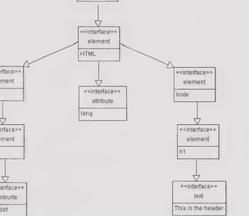

图 16-1 还列出了每个节点的接口或对象类型。DOM 将每个节点表示为一个对象（在这种情况下是 JavaScript 对象），该对象公开了一个由一组属性和方法组成的接口。

你可以看到顶级节点称为 `document`，而 `html` 元素是其子节点。除了 `element` 节点，你还可以在树中看到 `text` 和 `attr` 节点的示例，因为 DOM 将它们建模为独立的对象。

以下是最常见的对象类型：

1.  **document**：文档对象表示整个文档。可以在浏览器中使用全局变量 `document` 来访问它。当你稍后开始使用 DOM API 时，你将始终从 `document` 的上下文中进行操作。
2.  **element**：此对象用于表示文档中的元素或标签。每个标签——例如 `td`、`head` 或 `h1`——都由该对象的一个实例表示，但它们的内容和属性被建模为独立的对象。
3.  **attr**：`attr` 对象类型表示属性。每个元素可以有零个到多个 `attr` 对象作为其子节点。
4.  **text**：当元素的主体包含文本时，这由一个单独的对象表示，称为 `text` 对象。在某些情况下，一个元素可以有多个文本节点。例如，对于以下 HTML 片段 `<p>Left side<em>inner</em>right side</p>`，`p` 标签有两个文本节点，分别对应 `em` 标签两侧的文本，而 `em` 标签也有一个文本节点。

你可能想知道为什么需要所有这些不同的对象类型。主要原因是你想对文档中的不同节点执行不同的操作。例如，`document` 公开的 API 可能包含确定 `doctype` 的功能，而 `attr` 对象公开的 API 可能包含更改属性值的功能。或者，`element` 对象允许你导航、添加、删除和更改其子节点，而 `text` 节点则无法做到这一点。

用于与所有这些类型的节点进行交互和操作的 API 称为 DOM API。浏览器在 JavaScript 中实现了 DOM API，但 DOM API 可以用任何语言编写，并且可以存在于 Web 浏览器之外。

DOM API 的主要目的是允许在网页加载后操作 DOM。这使你能够在网页中实现动态功能，而无需刷新页面。DOM API 有四个基本方面允许这种操作：

1.  从 DOM 中选择节点——例如，查找所有具有特定类的节点
2.  从选定的节点遍历到另一组节点——例如，查找特定节点的子节点
3.  操作 DOM 中的节点——例如，添加、替换或删除节点
4.  响应节点生成的事件——例如，响应用户点击元素

接下来的文本将简要讨论这四个方面。在开始之前，值得提的是 DOM API 非常庞大，我只会触及它所能做之事的表面。目的是让你接触到广泛的主题，而不是理解 API 的每一个方面。

接下来的示例将使用以下网页：

```
<!DOCTYPE html>
<html lang="en">
<head>
    <meta charset="utf-8">
</head>
```


你可以从书籍的网站下载这个文件（它被称为`domexample.html`），或者自己编写。

这个网页包含一个标题和一个有序列表形式的星期列表。你将通过Chrome控制台与这个网页进行交互，但这些代码也可以被添加到页面本身的`<script>`代码块中。

## 选择元素

你使用与CSS相同的基本标准来从DOM中选择元素：具体来说，你可以通过元素的类型、类名或ID来选择它们。

要通过ID选择元素，你可以在`document`对象上使用以下方法：

```
> document.getElementById('daysOfWeek');
```

这会返回单个对象，因此确保网页上ID永不重复非常重要。

每当从DOM中选择一个对象时，你都可以使用`nodeType`属性来确定其类型。例如：

```
> document.getElementById('daysOfWeek').nodeType;
1
```

DOM API使用数字来表示各种类型的节点：1表示元素节点，2表示属性节点，3表示文本节点，以此类推。

或者，你可以确定元素的名称：

```
> document.getElementById('daysOfWeek').nodeName;
"OL"
```

也可以通过类名选择节点：

```
> document.getElementsByClassName('mainHeader');
```

或者标签名：

```
> document.getElementsByTagName('li')
```

这两种方法都返回一个对象数组，而不是单个对象。因此，如果你知道只会返回一个对象，你仍然需要在使用它之前从数组的第一个索引中访问它：

```
> document.getElementsByTagName('ol')[0].nodeName
"OL"
```

## 遍历DOM

一旦节点被选中，通常会从这些节点导航到其他节点。下面的示例演示了如何从节点导航到其子节点，以及从子节点导航到父节点：

```
// 获取对daysOfWeek节点的引用
o = document.getElementById('daysOfWeek');
// 查找该节点的所有子节点（即li元素）
o.childNodes
// 查找该节点的父节点，即body元素
o.parentNode
// 查找该节点的第一个子元素
o.firstElementChild
```

DOM API还支持许多从一个节点遍历到另一个节点的快捷方式。例如，你可以按如下方式从文档节点遍历到body节点：

```
> document.body
```

## 操作DOM

选择和遍历操作用于选择一组节点；然后可以操作这些节点，以在网页加载到浏览器后动态更改其外观。

例如，你可能想添加一个新的值为“Saturday”的`li`元素。这是一个两步过程：首先，你需要构建代表新`li`元素的节点，然后你需要将其插入到DOM中的适当位置。

首先，你将创建`li`节点，并将其分配给变量`newLi`。此时创建的节点还不是DOM的一部分；它是一个独立的DOM对象，通常称为文档片段。

```
> newLi = document.createElement('li');
```

接下来，你将创建一个新的文本节点，同样使用`document`本身的方法。与`li`节点一样，它将不是DOM的一部分：

```
> saturday = document.createTextNode("Saturday");
```

接下来，你将把文本节点设置为新`li`节点的第一个子节点：

```
> newLi.appendChild(saturday);
```

最后，你可以将`li`节点添加到DOM中的适当位置。有许多方法可用于控制节点相对于其他节点的插入位置，但你将使用`appendChild`方法；这简单地将节点作为现有节点的最后一个子节点添加：

```
> document.getElementById('daysOfWeek').appendChild(newLi);
```

一旦你调用这最后一行，一个新的`li`元素就会出现在网页中。此外，如果你查看开发者工具中的“Elements”选项卡，你可以看到DOM已经更新（参见图16-2）。

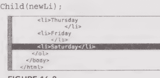

如你所见，使用DOM API有些繁琐：一旦引入jQuery，这段代码将得到显著简化。

## 响应事件

你需要理解的DOM API的最后一个方面是事件。事实上，你在第9课编写基于拖放的网页时已经见过它们了。

每种类型的DOM对象都支持各种各样的事件。这些主要分为：

- 键盘事件，例如`keyup`和`keydown`
- 鼠标事件，例如`onclick`和`onmousedown`
- 文档事件，例如`onload`和`onresize`
- 表单事件，例如`onchange`和`onselect`

在本节中，你将利用两个鼠标事件。你将添加功能，使得当用户将鼠标悬停在标题上时（`mouseenter`事件），列表将被显示（其`display`属性将被设置为`block`）。当鼠标移开标题时（`mouseleave`事件），列表将再次隐藏。

你将通过向`<head>`元素添加以下内容来更改网页，使星期列表最初隐藏：

```
<style>
ol {
    display:none;
}
</style>
```

接下来，你将在关闭`<body>`标签之前的`<script>`代码块中添加相应的事件监听器。

```
<script>
document.getElementsByClassName('mainHeader')[0]
    .addEventListener("mouseenter", function(event) {
        document.getElementById('daysOfWeek').style.display = 'block';
    });

document.getElementsByClassName('mainHeader')[0]
    .addEventListener("mouseleave", function(event) {
        document.getElementById('daysOfWeek').style.display = 'none';
    });
</script>
```

在这个例子中，你向`h1`元素添加了两个事件监听器。一个在鼠标进入标题元素的框时触发；另一个在鼠标离开框时触发。

在每个事件监听器中，你只需定位`ol`节点，并根据需要将其隐藏或显示。这是通过将其`display`样式更新为`block`或`none`来实现的。

## 尝试一下

在这个“尝试一下”练习中，你将把第14课的CRM Web应用程序拿出来，并为其添加两个动态功能：

- 你将更改联系人详情表单，使其最初隐藏，并且仅在用户单击添加新联系人的链接时显示。
- 你将创建一个悬停效果来显示备注：如果用户将鼠标悬停在“最后联系时间”上，你将在弹出框中向用户显示备注。

### 课程要求

为了完成本课，你需要Chrome浏览器和第14课的CRM项目文件。

### 分步指南

这个分步指南将分为两个不同的部分。依次完成每个部分，在继续之前确保功能按预期工作。

### 动态显示表单

1.  首先，你需要在HTML中隐藏`id`为`contactDetails`的部分。这可以通过在元素本身上设置内联样式来实现，将其`display`属性设置为`none`。
2.  在`contactList`部分的底部（在`</table>`标签之后）添加一个超链接，用户可以单击该链接来添加新联系人。此链接的`href`应仅为`#`，因为你将不使用基于浏览器的导航（你将在JavaScript中响应用户的单击）。你还需要确保该超链接有一个`id`，以便你可以从DOM中选择它。你可以自行决定其外观，但我添加了以下内容：

```
<div class="controls">
    <a href="#" id="addContact">Add a new contact</a>
</div>
```

我还向`contacts.css`中添加了以下内容以改善其外观：

```
.controls {
    padding:15px;
}
```
3.  在`contacts.js`的`init`方法中，使用`document.getElementById`通过`id`选择超链接，并使用`addEventListener`向返回的对象添加事件监听器。`addEventListener`的第一个参数是你正在监听的事件类型，在本例中为`click`。第二个参数是一个接受单个名为`event`的参数的函数。将其创建为匿名函数。
4.  在函数内，你首先需要禁止单击超链接从服务器请求新页面的默认行为。这可以通过在事件对象本身上调用`preventDefault()`方法来实现。


## 5. 通过 id 选中 `contactDetails` 元素，并将其 `style.display` 属性设置为 block。

6. 如果你重新加载页面并点击超链接，联系人详情部分应立即显示。

## 显示备注

现在你将修改时间字段，以便当用户将鼠标悬停在其上时显示备注，如图 16-3 所示。

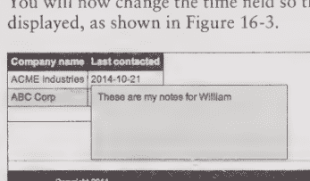

1. 为了显示备注，你首先需要确保它们在页面加载时存在于 DOM 中，但是是隐藏的。识别任何包含 `time` 元素的表格单元格，并修改它们，使其包含一个带有备注信息的附加元素。例如：

```
<td>
    <time datetime="2014-09-12">2014-09-12</time>
    <div class="overlay">These are my notes for William</div>
</td>
```

注意，我还为 `div` 添加了一个名为 `overlay` 的类。

2. 你现在需要为 `overlay` 类添加一条 CSS 规则。请尝试根据以下规范自行添加：

- 将 `div` 的 `height` 设置为 100px。
- 将 `div` 的 `width` 设置为 300px。
- 为 `div` 添加一个 1px 实线 `border`，颜色为 `#333333`。
- 将背景色设置为 `#eeeeee`。
- 在内容和边框之间添加 10px 的内边距。
- 将初始 `display` 设置为 none。
- 使用 `position` 元素将该元素从页面流中移除，并确保当它显示时，它不会影响 DOM 中任何其他元素的位置。思考哪种 `position` 值最能满足这些需求。
- 设置 `z-index`，以便当 `div` 显示时，它出现在表格的上方。

我的 CSS 看起来像这样：

```
.overlay {
    position: fixed;
    height: 100px;
    width: 300px;
    border: 1px solid #333333;
    background: #eeeeee;
    display: none;
    z-index: 1;
    padding: 10px;
}
```

3. 你需要为每个 `time` 元素添加事件监听器。使用 `document.getElementsByTagName` 选中所有 `time` 元素。一旦找到并将它们存储在局部变量中，就使用 `for` 循环遍历它们。

4. 在 `for` 循环中，你需要添加两个不同的事件监听器，一个用于 `mouseenter`，一个用于 `mouseleave`。为每个事件创建骨架实现，并确保作为它们第二个参数传递的匿名函数接受参数 `event`。

5. 在传递给每个事件监听器的函数中，你需要找到离鼠标悬停的 `time` 元素最近的备注 `div`。你可以先使用 `event.target` 找到它们悬停的 `time` 元素。然后你可以使用 `nextElementSibling` 找到该元素的下一个兄弟元素，并根据你是隐藏还是显示 `div`，将 `display` 属性设置为 `block` 或 `none`。

下一个兄弟元素允许你找到与指定元素具有相同父元素的 DOM 中的下一个元素。对于 `time` 元素，那就是包含备注的 `div` 元素。

6. 如果你重新加载页面并将鼠标悬停在 `time` 元素上，备注应该会显示，如果你移开鼠标，备注会立即消失。

> 参考 请访问本书网站 `www.wrox.com/go/html5jsj-query24hr` 查看第 16 课的视频，以及下载本课的代码和资源。

## 17 jQuery 选择

在本课中，你将开始了解 jQuery 以及它如何简化与 DOM 的交互。

jQuery 是一个完全用 JavaScript 编写的开源库。虽然它旨在简化与 DOM 的交互，但它并没有做任何无法用 DOM API 实现的事情。事实上，它使用 DOM API 来执行其操作。

以下是 jQuery 在许多 Web 应用程序中被使用的主要原因：

- 它提供了一个直观且易于学习的 API 来执行网站开发中最常见的任务。例如，你将在本课中使用的选择器 API 基于 CSS 选择器。
- 它提供真正的跨浏览器支持，并隐藏了某些浏览器 DOM API 实现中存在的一些怪癖（最著名的是旧版本的 IE）。
- 编写插件以增强 jQuery 的功能非常容易，并且互联网上有大量免费可用的插件库。
- jQuery 网站包含非常好的文档，如果你遇到问题，互联网上也有各种各样的帮助。

jQuery 并不是唯一旨在协助 DOM 交互的库，但它已成为*事实上的*标准，并且其市场份额高于所有竞争对手的总和。因此，如果你要学习一个 JavaScript 库，学习 jQuery 是有意义的。

### 加载 jQuery

在使用 jQuery 之前，你需要将其导入到你的网页中。有两种方法可以做到：

- 你可以下载相关版本的 jQuery，将其存储在你的服务器上，并通过 `source` 标签中的相对 URL 链接到它。这通常是在开发 Web 应用程序时的最佳方法。
- 链接到由第三方托管的版本。许多内容分发网络（CDN），如 Google，提供流行 JavaScript 库的托管版本，包括 jQuery。这通常是生产网站的最佳选择，因为 CDN 交付往往更快。

在本节中，你将了解如何使用这两种方法。

本书中使用的 jQuery 库可从本书网站获取，但这些说明向你展示如何下载自己的库版本。为了下载 jQuery 的版本，首先导航到 www.jquery.com。在主页上找到 Download 链接并单击它。

在本书中，你将使用 jQuery 的 2.x 版本。它不支持一些较旧的浏览器，例如 IE8。因此，如果你正在开发必须支持较旧浏览器的网站，你可以使用 jQuery 的 1.x 版本，它提供了大部分相同的功能。

单击下载最新 2.x 版本的 jQuery 开发版。本书中使用的版本是 2.1.1，但可以使用最新的 2.x 版本。jQuery 提供生产版和开发版。两者之间的唯一区别是生产版是“最小化的”，这本质上意味着代码已被压缩。然而，两个版本的代码在功能上是等效的；只是最小化的版本非常难以调试。

下载完成后，将其与 `contacts.html` 一起存储在 CRM 目录中。

现在，只需在文档的 head 部分使用 source 标签将其导入网页：

```
<script src="jquery-2.1.1.js"></script>
```

如果你现在加载页面，可以测试 jQuery 是否已安装。为了确认这一点，在控制台中输入 `jQuery`。它应该产生如图 17-1 所示的输出。

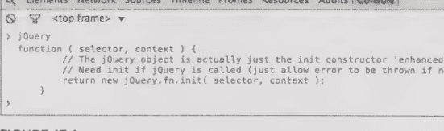

图 17-1

如果你选择通过 CDN 加载 jQuery，则无需下载 jQuery；只需将以下 source 标签添加到网页的 head 部分即可：

```
<script src="http://ajax.googleapis.com/ajax/libs/jquery/2.1.1/jquery.min.js"></script>
```

如果你现在加载页面，可以测试 jQuery 是否已安装。为了确认这一点，在控制台中输入 `jQuery`。它应该产生如图 17-2 所示的输出（请注意，这是库的最小化版本，因此输出有所不同）：

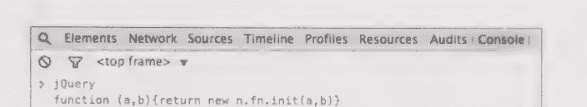

## 选择元素

你现在准备好开始使用 jQuery 选择元素了。选择元素本身没有固有价值；它只是一系列操作中的第一步。通常，一旦你选择了一组元素，你就会以某种方式操作它们，但这是未来课程的主题。

在本课中，你将使用 Chrome 控制台从 `contacts.html` 网页中选择元素。

如果你还记得关于 DOM API 的课程，元素是使用 `document` 对象上的方法选择的。使用 jQuery，你通过将选择字符串放在以下结构中来选择元素：

```
$('selection string')
```

美元符号是 jQuery 函数的别名，旨在节省输入。也可以使用以下构造：

```
jQuery('selection string')
```

jQuery 中选择字符串的伟大之处在于它们大多使用与 CSS 相同的语法。因此，要从文档中选择所有 `td` 元素，只需输入以下内容：

```
> $('td');
```

这是一个元素选择器，与所有 jQuery 选择一样，它将返回一个 jQuery 对象，提供对所选基础元素的访问。

也可以使用元素的 ID 选择元素，如本例所示：

```
> $('#contactList');
```

以及按类名选择，如以下示例所示：

```
> $('.controls');
```

注意在所有这些情况下，选择语法与 CSS 中使用的语法完全相同。

我对 CSS 选择器的讨论跳过了一种额外类型的选择：基于属性选择元素。要选择所有具有特定属性的元素，只需在方括号之间添加属性名：

```
> $('[datetime]');
```

也可以通过在选择前添加元素类型来指定属性相关的元素；当多种不同的元素类型共享相同的属性时，这很有用：

```
> $('time[datetime]');
```


可以通过指定属性应具有的特定值来筛选：

```
$('time[datetime="2014-10-21"]');
```

或者不等于某个值：

```
$('time[datetime!="2014-10-21"]');
```

请注意，在这两种情况下，值都是用双引号提供的。因为你在字符串内部提供了字符串，所以需要混合使用双引号和单引号字符串。你也可以使用以下语法：

```
$("time[datetime!='2014-10-21']");
```

## 伪选择器

你也可以像使用 CSS 伪类一样使用伪选择器来选取元素。这个特定的例子会选取 `tbody` 元素中所有偶数编号的 `tr` 元素：

```
$('tbody tr:even');
```

伪选择器总是以冒号开头。

还要注意，`tbody` 和 `tr` 之间的空格意味着 `tr` 元素必须是 `tbody` 元素的子元素，这与 CSS 中的用法一致。

以下是一些最有用的伪选择器：

- `:even` 在选择集中找到所有偶数编号的元素。
- `:odd` 在选择集中找到所有奇数编号的元素。
- `:not(selection)` 找到所有不匹配选择条件的元素。
- `:gt(selection)` 找到所有索引大于提供数字的元素。
- `:checked` 找到被选中的单选按钮或复选框。
- `:selected` 找到在选择框中被选中的选项。
- `:contains(text)` 找到包含给定文本的元素。
- `:empty` 找到所有没有子元素的元素。
- `:focus` 找到当前获得焦点的元素。
- `:first` 找到集合中的第一个元素。
- `:last` 找到集合中的最后一个元素。

例如，以下代码找到网页中的第一个 `section`：

```
$('section:first');
```

而这个找到页面中除第一个之外的所有 `tr` 元素：

```
$('tr:gt(0)');
```

伪选择器与 CSS 中的伪类并不完全相同，在许多情况下，它们被用作可以通过常规选择器执行的选择的简写。例如，这个选择返回所有表单输入字段，包括不使用 input 元素的字段，如 select 和 textarea：

```
$(':input');
```

相同的选择也可以如下执行：

```
$('input,select,textarea');
```

jQuery 伪选择器的另一个很棒之处在于你可以编写自己的伪选择器。例如，你可能会发现自己经常编写以下选择器来查找输入字段：

```
$('input[type="email"]');
```

因此，你可以将以下代码添加到你的网页中（确保在执行此代码之前 jQuery 已加载），以添加你自己的名为 email 的特殊伪选择器：

```
$.expr[':'].email = function(elem) {
    return $(elem).is("input") && $(elem).attr("type") === "email";
  }
```

不要太担心这个示例的第一行；它只是用于向 jQuery 添加新伪选择器的机制。一旦加载，它就可以如下使用：

```
$(':email');
```

并且可以与其他选择器结合使用：

```
$('form :email');
```

jQuery 会自动将伪选择器传递给网页中的每个元素（除非被选择字符串中的其他选择器过滤掉），然后伪选择器会检查：

- 元素是否是输入字段的一种？`$(elem).is("input")`
- 它是否具有名为 email 的属性？`$(elem).attr("type") === "email";`

如果满足这些条件，选择器返回 true。

## 在上下文中进行选择

你已经了解了如何选取作为其他元素子元素的元素。例如，以下代码找到所有作为 tbody 元素子元素的 tr 元素：

```
$('tbody tr:even');
```

在 DOM 的特定子树上下文中选取元素非常常见。例如，在你的 CRM Web 应用程序中，你可能希望始终在页面主标签的上下文中选取元素。这将确保即使你的联系人网页嵌入在一个更大的 Web 应用程序中，它也只会选取与它相关的元素。

注意：编写单页 Web 应用程序非常普遍。在单页 Web 应用程序中，整个 Web 应用程序作为单个页面加载，尽管它包含许多逻辑页面。当用户在应用程序中导航时，他们似乎是从服务器加载新页面，但实际上 DOM 正在被实时操作以隐藏和显示相关的部分。单页 Web 应用程序往往为用户提供更快的体验，因为传统导航在每次导航事件发生时都需要从服务器检索一整套资源。

因为在其他元素的上下文中选取元素如此常见，jQuery 提供了两种额外的机制来实现它。第一种机制使用 `find` 方法：

```
$('#contactScreen').find('tr');
```

这将首先找到 ID 为 `contactScreen` 的元素，然后在结果中查找任何 `tr` 元素。

另一种实现完全相同结果的方法是在选择字符串之后使用可选的第二个参数传递给 jQuery：

```
$('tr', '#contactScreen')
```

第二个参数提供了选择应在其中发生的上下文。

## 包装对象

如果你再次考虑以下 jQuery 代码行：

```
$('#contactScreen').find('tr');
```

你会看到 jQuery 不仅仅是返回一个 DOM 对象，因为 DOM 对象不支持 `find` 方法。

在这个特定情况下，jQuery 返回了其自身类型的对象，包装在 DOM 对象之上，`find` 就是针对这个 jQuery 对象执行的。

事实上，每个 jQuery 选择都返回一个特定于 jQuery 的对象，而不是底层的 DOM 对象。然而，返回的对象能够伪装成数组，访问特定索引会返回原生的 DOM 对象。

以下代码将一个原生 DOM 对象赋值给 `domObject` 变量：

```
var domObject = $('td')[0];
```

通过将其嵌入选择结构中，始终可以将原生 DOM 对象转换为 jQuery 对象：

```
$(domObject);
```

这使你可以访问 jQuery 提供的所有附加功能。例如，以下代码返回元素的文本：

```
$(domObject).text()
```

而这个调用查询元素的文本是否包含单词 "contacts"：

```
$(domObject).is(':contains("contacts")');
```

在本书的剩余部分，你通常会使用 jQuery 对象而不是原生 DOM 对象，但如果你需要将原生 DOM 对象转换为 jQuery 对象，你始终可以使用这种技术。

### 试一试

在这个动手练习中，你将尝试本课中讨论的几种选择技术。如果你愿意，可以在 screencast 中跟随这些示例操作。

### 课程要求

你需要 CRM Web 应用程序，并且需要使用本课前面概述的一种技术加载 jQuery 库。网页加载后，你可以使用 Chrome 控制台对网页执行 jQuery 选择。

### 逐步操作

1. 从网页中选择所有具有 `overlay` 类的元素。
2. 选择所有具有 `name` 属性的 `input` 元素。这需要先使用元素选择器选取 `input` 元素，然后用属性选择器进行限制。
3. 在 `form` 中找到 `name` 属性值为 `companyName` 的元素。将结果赋值给一个名为 `companySelector` 的变量。
4. 在 `companySelector` 上调用 `find` 方法，并让它返回其中的所有 `option` 元素，除了第一个。你可以使用本课前面讨论的 `gt` 伪选择器来实现。
5. 找到 `phoneNumber` 字段的 `label`（使用带有值的属性选择器），并打印出其文本。
6. 在 `tbody` 或 `tfoot` 元素（但不是 `thead`）中找到奇数编号的 `tr` 元素。

**参考**：请访问书籍网站 www.wrox.com/go/html5js-jquery24hr 查看第 17 课的视频，以及下载本课的代码和资源。


## 18
### jQuery 遍历与操作

在上一课中，你学习了如何使用 jQuery 从 DOM 中选择元素。本课将在该知识基础上，教你如何：

- 从这些元素遍历到另一组相关元素。
- 操作 DOM 中的节点——这包括添加新节点、修改现有节点以及从 DOM 中移除节点。

## 遍历

当你执行 jQuery 选择时，结果是一个封装了一组元素的 jQuery 对象。遍历操作允许你从最初选择的元素遍历到一组新的元素。因此，遍历的结果也是一个封装了一组元素的 jQuery 对象。

你已经见过一个遍历操作的例子：上一课中的 `find` 方法就是一个遍历操作，因为它首先找到一个元素（或一组元素），然后找到这些元素的子元素。

也可以从元素遍历到它们的父元素。例如，以下代码首先找到所有 `time` 元素，然后找到它们的父元素，即 `td` 元素：

```javascript
> $("time").parent();
```

这将返回两个 `td` 元素。

`parent` 函数返回直接父元素；如果你想找到间接父元素，可以使用 `parents` 函数。它返回任何作为所选元素祖先的元素，但可以为该函数提供一个选择作为参数。例如，你可能想返回作为所有输入字段父元素的 `form`。可以这样实现：

```javascript
> $(":input").parents("form");
```

这仅返回唯一结果；因此，此选择会返回一个单独的 `form` 元素。

也可以创建一个包含原始元素和新选择元素的结果集。例如，以下代码使用 `andSelf` 函数在一个选择列表中选择所有输入字段和 `form` 元素：

```javascript
> $(':input').parents('form').andSelf();
```

另一个常见的遍历是选择作为其他元素兄弟的元素（如果元素具有相同的父元素，则它们是兄弟）。例如，你可能想选择所有作为输入字段兄弟的标签，但仅当它们包含 `required` 属性时。在本课后面的“操作”部分，你将修改这些标签的显示方式：

```javascript
> $(':input[required]').siblings('label');
```

对于大多数遍历函数，你可以选择添加选择过滤器（此例中为 "label"），或省略该参数以获取所有兄弟元素。

还有其他一些查找特定兄弟的遍历函数：

- `last`：查找最后一个（可选地）满足特定条件的兄弟。
- `first`：查找第一个（可选地）满足特定条件的兄弟。
- `next`：查找下一个（可选地）满足特定条件的兄弟。
- `prev`：查找上一个（可选地）满足特定条件的兄弟。

在继续之前，你还需要知道另外几个重要的遍历函数：

- `add`：此函数提供了一种将两个不同选择连接在一起的机制。例如，以下代码可用于创建一个包含所有输入字段和所有标签的选择列表。

```javascript
> $(':input').add('label')
```

- `closest`：`closest` 函数查找元素最近的祖先，该祖先满足特定条件，但与 `parents` 选择器不同，它考虑原始元素。假设你想选择包含文本 "Bob" 的任何元素最近的 `td` 元素。你可以使用以下代码：

```javascript
> $(':contains("Bob")').closest('td')
```

如果包含文本的元素是 `td` 元素，则它会被添加到结果集中。否则，jQuery 会沿着元素的父元素向上查找，搜索第一个 `td` 元素。

- `eq`：equals 运算符可用于返回特定索引处的元素——例如，以下代码返回文档中的第二个 `section`：

```javascript
> $('section').eq(1)
```

## 链式调用

遍历函数也凸显了 jQuery 的另一个强大优势：

- 遍历函数在 jQuery 元素的选择上执行。
- 遍历函数返回 jQuery 元素的选择。

换句话说，遍历函数的输入与输出是相同的数据类型。这意味着可以在一个语句中链式调用一整套遍历函数。考虑以下调用：

```javascript
> $('time').siblings('.overlay').parents('tr').last();
```

此代码执行以下操作：

- ► 选择所有 `time` 元素
- ► 选择这些元素中任何具有 `overlay` 类的兄弟元素
- ► 选择这些元素父元素的 `tr` 元素
- ► 选择列表中返回的最后一个元素

实际上，此代码选择的是最后一个包含带有 overlay 的 `time` 元素的行。这种链式调用几乎可以无限持续下去。

## 操作

现在你已经编写了查找元素的代码，就可以进入 jQuery 的有趣部分：操作 DOM 为用户提供动态行为。

考虑之前找到所有具有 `required` 属性的输入字段标签的选择：

```javascript
> $(':input[required]').siblings('label');
```

你可能决定要将此类标签的文本更改为红色显示。可以通过以下方式实现：

```javascript
> $(':input[required]').siblings('label').css('color', 'red');
```

运行这行代码就足以将所有标签变成红色。

红色标签可能过于醒目，因此你将改为在每个标签旁边添加一个红色星号。你的目标是创建以下结构：

```html
<label for="contactName" style="color: red;">
    Contact name<span class="requiredMarker">*</span>
</label>
```

你将首先在 `contacts.css` 中添加一个类以匹配 `requiredMarker` 类：

```css
.requiredMarker {
    color: red;
    padding-left: 7px;
}
```

第一个任务是创建一个要添加到每个标签的新元素：

```javascript
$('<span>').text('*').addClass('requiredMarker');
```

这执行了以下操作：

- 创建一个新的 `span` 节点，可以添加到 DOM 中
- 将 * 作为其文本
- 将 `requiredMarker` 类添加到 `span`
- 返回新的 `span` 元素作为结果

接下来，你选择所有要添加 `span` 的标签，并使用 `append` 函数将这一个 `span` 插入所有标签中：

```javascript
$(':input[required]').siblings('label').append($('<span>').text('*').addClass('requiredMarker'));
```

注意这个复杂的操作如何在单个语句中表达。如果你运行此代码并选择创建一个联系人，相关标签将如你所见的图 18-1 所示。


**图 18-1**

一旦在控制台中测试了这行代码，你就可以将其添加到 `contacts.js` 中的 `init` 方法中，以确保它在页面加载时始终运行。

当然，你可以手动将星号添加到标签中，但这种方法的优点在于你直接从数据中派生此内容：如果将新字段标记为必填，则无需记住在标签中添加星号。正是这种功能有助于在 Web 应用程序规模增长时保持一致性。

在向现有元素添加新元素时，有四个位置可以插入新节点。例如，考虑图 18-2 中选择的 `h2` 元素：

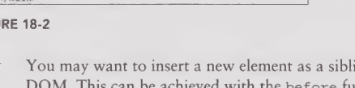

**图 18-2**

- 你可能想在 DOM 中 `h2` 元素之前插入一个新元素作为其兄弟。这可以通过 `before` 函数实现。例如：

```javascript
$('h2').before('<span>before</span>')
```

- 作为 `h2` 元素的兄弟，但在 DOM 中其之后。这可以通过 `after` 函数实现。
- 作为 `h2` 元素的第一个子元素。这可以通过 `prepend` 函数实现。
- 作为 `h2` 元素的最后一个子元素。如前所示，这可以通过 `append` 函数实现。

这些函数中的任何一个都可以传递 HTML 标记字符串或 DOM 对象。


图18-3展示了使用每个函数时`span`元素将被插入的位置。

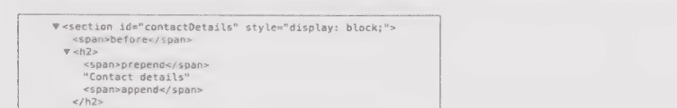

**图 18-3**

除了向DOM添加新节点，使用`remove`函数从DOM中移除节点也很简单。这在以下示例中可见：

```
> $('.requiredMarker').remove();
```

此函数会返回所有已被移除的元素。

## 修改元素

到目前为止，你所了解的操作技巧旨在向DOM添加或移除节点。jQuery也提供了修改现有元素的能力。

例如，你可以如下直接操作元素的`text`：

```
> $('#contactDetails h2').text('CONTACT DETAILS');
```

或者你可以如下修改其HTML：

```
> $('#contactDetails h2').html('<span>Contact Details</span>');
```

这行代码将文本置于`span`元素内。jQuery是一个非常灵活的库，因此完成同一任务通常有多种不同的方法。例如，以下代码也在h2元素的文本周围添加了一个`span`元素：

```
> $('#contactDetails h2').wrapInner('<span>');
```

也可以使用`val`函数设置表单输入的值。例如：

```
> $('[name="contactName"]').val('testing 123');
```

这些函数都可以在没有参数的情况下使用以获取当前值。以下显示了`contactName`字段的当前值：

```
> $('[name="contactName"]').val();
```

以这种模式使用时，只会返回单个值，因此如果你在一组元素上调用这些函数，只会返回第一个元素的值。此外，由于这些函数不返回jQuery对象，因此无法在其结果上链式调用其他jQuery函数。

在本课程前面，你了解了如何使用`css`函数设置单个CSS属性，以及如何使用`addClass`向元素添加类。也可以使用`removeClass`移除类。例如，这将移除你添加到所有包含星号的`span`元素上的类：

```
> $('label span').removeClass('requiredMarker');
```

另一个有用的函数是`toggleClass`。如果元素尚无该类，它会添加该类；如果已有，则会移除它。在你查看jQuery事件时，会再次用到这个函数。

最后，也可以访问和修改元素的属性。例如，以下返回表单中`textarea`的`maxlength`：

```
> $("textarea").attr("maxlength");
```

而以下修改属性的值（或在属性不存在时添加该属性）：

```
> $("textarea").attr("maxlength", 200);
```

或者，可以如下移除一个属性：

```
> $("textarea").removeAttr("maxlength");
```

## 迭代

一旦选中了一组元素，一个常见的需求是遍历每个元素并对其执行操作。由于jQuery选择的结果类似于数组，因此可以使用`for`循环来遍历它。

一种更简单的迭代方法是使用一个名为`each`的jQuery辅助函数。jQuery包含许多可以直接调用而不是在jQuery选择上调用的辅助函数。

在本节中，你将编写一个函数，遍历表单中的所有输入字段，提取它们的名称和值，并构建一个由这些名称/值对组成的对象。本质上，这个函数是将表单序列化为对象：然后你可以在你的Web应用程序中使用这个对象。

首先，在`contactsScreen`函数返回的对象上创建一个新方法。这应该紧跟在`init`函数之后，并用逗号与之分隔：

```
function contactsScreen(mainID) {
    var screen = mainID;
    var initialized = false;
    return {
        init: function() {
            // body omitted
        },
        serializeForm: function() {

        }
    };
}
```

函数首先要做的是获取对`form`上输入字段的引用。你还需要创建一个空对象，作为函数的结果返回：

```
var inputFields = $(screen).find("form :input");
var result = {};
```

请记住，你总是要在`screen`元素（已设置为`main`元素）的上下文中选择元素。

接下来，你想使用`each`遍历所有输入字段。`each`函数接受两个参数：一个jQuery选择，以及一个应接收选择中每个元素的索引和值的函数：

```
$.each(inputFields, function(index, value) {

});
```

请注意，对`each`的调用前缀是`$.`而不仅仅是`$`。这表示`each`是一个辅助函数，而不是jQuery选择。

你现在需要编写函数本身的实现。它应该首先检查输入字段是否具有`name`属性。（这让你可以省略像`submit`按钮这样的输入字段。）如果它有，则应使用`name`属性作为属性名，输入字段的值作为值，向对象写入一个属性。最终版本将如下所示：

```
serializeForm: function() {
    var inputFields = $(screen).find('form :input');
    var result = {};
    $.each(inputFields, function(index, value) {
        if ($(value).attr('name')) {
            result[$(value).attr('name')] = $(value).val();
        }
    });
    return result;
}
```

请注意，每次访问值时，都使用以下语法将其转换为jQuery对象：`$(value)`。这允许你调用方法，如`val`和`attr`。

你现在可以从控制台调用此函数：

```
> appScreen.serializeForm();
```

图18-4显示了在输入字段中给定一组值后调用此方法的结果。


你将在接下来的课程中更多地使用这个方法。

## 动手试一试

在本节“动手试一试”中，你将尝试本课程中讨论的一些遍历和操作技巧。如果愿意，你可以在截屏视频中跟随这些示例进行操作。

### 课程要求

你将需要CRM Web应用程序，并且需要使用本课程前面概述的技术之一加载jQuery库。网页加载后，你可以使用Chrome控制台对网页执行jQuery选择。

### 分步指南

1.  编写一个jQuery选择，首先在`contacts.html`网页中找到任何`time`元素，然后从这些元素遍历以找到每个元素的父`tr`元素。本质上，你是在找到表格中包含`time`元素的所有行。
2.  在文档中找到具有`autofocus`属性的输入字段。从这个元素遍历到其父元素，确保这是一个具有类`formRow`的`div`。现在，找到此节点的下一个兄弟节点（也应该是具有类`formRow`的`div`），并在此`div`内找到一个输入字段。你应该能够用一行jQuery代码完成整个操作。
3.  假设你想为每个具有`required`属性的输入字段添加`placeholder`文本，指定"此字段为必填项。"编写一个选择来找到所有匹配此选择的输入字段，并添加一个具有适当文本的`placeholder`属性。
4.  编写一行jQuery代码，将`companyName`选择框的值设置为2。
5.  使用`each`函数遍历所有具有`pattern`属性的输入字段。在循环内，为每个输入字段附加一个兄弟节点以显示此模式。结果应如图18-5所示显示。


**图 18-5**

> **参考** 请访问本书网站 www.wrox.com/go/html5jsjquery24hr 查看第18课的视频，并下载本课程的代码和资源。


## 19 jQuery 事件

尽管你对 jQuery 的理解已经取得了长足的进步，但只有在接触到 jQuery 事件后，你才能真正释放 jQuery 的全部力量。

jQuery 通常用于在页面加载后操作 DOM，但需要一个事件来触发此操作。这个事件可能是：

- 鼠标事件，例如用户点击某个元素
- 键盘事件，例如用户在输入框中输入
- 表单事件，例如 select 元素的值发生变化
- 屏幕事件，例如窗口被调整大小

就像可以使用原生 DOM API 监听这类事件一样，也可以使用 jQuery 来监听这些事件。事实上，jQuery 实际上为 DOM 事件提供了一个包装器，因此本课讨论的所有事件最终都基于底层的 DOM 事件。

虽然本课从技术上讲是对 jQuery 事件的介绍，但我会借此机会将你目前所学的所有 jQuery 知识整合起来。

## 注册事件监听器

注册事件监听器从选择将生成事件的元素开始。一旦选定，就会调用适当的方法来注册事件监听器，并传入一个回调函数，该函数应在事件发生时被调用。例如，可以将此代码添加到 `contacts.js` 中的 `init` 函数，以向提交按钮添加鼠标点击监听器：

```
$(screen).find('form input[type="submit"]').click(
    function(evt) {
        evt.preventDefault();
    }
);
```

此代码首先找到表单内的提交按钮，然后调用其 `click` 方法。如你所见，回调函数接受一个事件对象，该对象包含有关已发生事件的重要上下文信息。在此示例中，你正在事件对象上调用一个方法，以阻止提交按钮的默认行为（即向服务器发送表单数据）。

你现在可以增强事件监听器以执行多项其他任务：

- 根据你在第 8 课添加的规则，检查表单是否有效。
- 如果表单有效，则使用你在上一课编写的函数提取表单的序列化版本。
- 根据序列化对象中的数据创建一个新的 `tr` 元素。
- 将新的 `tr` 元素添加到表体。

该事件监听器将是你迄今为止见过的最复杂的代码块之一，所以先看一下：然后我将逐行向你讲解：

```
$(screen).find('form input[type="submit"]').click(
    function(evt) {
        evt.preventDefault();
        if ($(evt.target).parents('form')[0].checkValidity()) {
            var contact = this.serializeForm();
            var html = '<tr><td>'+contact.contactName+'</td>'+
                '<td>'+contact.phoneNumber+'</td>'+
                '<td>'+contact.emailAddress+'</td>'+
                '<td>'+contact.companyName+'</td>'+
                '<td><time datetime="'+contact.lastContacted+'">'+
                contact.lastContacted+'</time>'+
                '<div class="overlay">'+contact.notes+'</div></td></tr>';
            $(screen).find('table tbody').append(html);
        }
    }.bind(this)
);
```

你已经了解了函数第一行的目的。函数的第二行测试表单是否有效。首先，这一行找到生成事件的 jQuery 元素 `$(evt.target)`；从中你可以使用 `parents` 函数找到事件发生的表单。

一旦找到表单，你就可以使用原生 DOM 方法 `checkValidity` 来确定表单是否有效。因为这是一个原生 DOM 方法，你需要通过使用 `[0]` 访问选择中的第一个（也是唯一一个）元素，将 jQuery 选择转换为原生 DOM 对象。也可以使用 `.get(0)` 来达到同样的效果。

你只希望在表单有效时才执行此事件监听器中的其余功能，因此函数的其余部分位于一个 `if` 语句中。

确认表单有效后，你接下来使用 `serializeForm` 方法从表单中的数据创建一个对象。因为此方法位于同一个对象上，你可能会期望通过在前面加上 `this` 来调用此方法：

然而，这行代码的含义远不止表面所见。事件监听器本身是方法内部的一个函数。当一个函数放在方法内部时，它用作其环境的对象不是对象本身，正如你在下面的简单示例中看到的：

```
var obj = {
    methodA : function() {
        console.log('Outer this is '+this);
        function inner() {
            console.log('Inner this is '+this);
        }
        inner();
    }
}
obj.methodA();
```

这段代码创建了一个包含一个名为 `methodA` 的方法的对象。在此方法内部，创建了一个名为 `inner` 的函数，然后调用了它。最后，调用 `methodA`：这将导致方法和 `inner` 函数都在控制台中输出其 `this` 引用的标识。有些令人惊讶的是，它打印出以下内容：

```
Outer this is [object Object]
Inner this is [object Window]
```

因为内部函数使用 window 作为其 `this` 对象，所以它无法在实际执行它的对象上调用方法或属性。

针对此问题有两个常见的解决方案。第一个是声明一个局部变量来引用 `this`，并在函数内部使用该变量。传统上，局部变量命名为 `that`。

```
var obj = {
    methodA : function() {
        console.log('Outer this is '+this);
        var that = this;
        function inner() {
            console.log('Inner this is '+that);
        }
        inner();
    }
}
obj.methodA();
```

现在执行此代码会产生预期的结果：

```
Outer this is [object Object]
Inner this is [object Object]
```

解决此问题的另一种方法是使用我之前在书中介绍的 `bind` 方法。正如你在第 12 课所记得的，`bind` 方法允许你提供一个对象作为函数的 `this` 引用，并返回一个永久绑定到该对象的新函数。因此，你可以如下重写此功能：

```
var obj = {
    methodA : function() {
        console.log('Outer this is '+this);
        inner = function() {
            console.log('Inner this is '+this);
        }.bind(this);
        inner();
    }
}
obj.methodA();
```

注意，你现在说的是 `inner` 是一个绑定到 `methodA` 的 `this` 引用（即对象）的函数；因此，方法和函数都具有相同的 `this` 引用，并且函数产生了预期的结果：

```
Outer this is [object Object]
Inner this is [object Object]
```

这可能是一个难以理解的概念，因此你可能需要通过前面的示例来确保你完全理解它的工作原理。

如你所见，这正是你在点击事件监听器中使用的方法，因此 `this.serializeForm()` 在事件监听器内部工作，就像在事件监听器外部工作一样。

如果你需要进一步的证据来证明这里解决的问题，请在代码正常工作后移除 `.bind(this)`：没有这段代码，`this.serializeForm()` 将尝试访问 `window` 对象上名为 `serializeForm` 的函数，该函数将是 `undefined`。

一旦从表单中提取出对象，你就使用简单的字符串连接来创建一个填充了数据的 `tr` 元素。像这样的字符串连接容易出错，因此你将在下一课中找到此功能的更好解决方案。

一旦构造了 HTML，只需使用 `append` 函数将其作为 `tbody` 的最后一个子节点添加即可。

一旦你有了一个工作的示例，你将在事件监听器末尾添加两行代码，以：

- 清除表单中的所有值（从而使其准备好添加新联系人）。
- 隐藏页面的输入部分。

这可以通过以下两行实现：

```
$(screen).find('form :input[name]').val('');
$(screen).find('#contactDetails').hide();
```

注意第二行只是使用了辅助方法 `hide`，而不是将 display 属性设置为 `none`：这达到了相同的结果，但更简洁。

## 委托事件监听器

你可能已经注意到保存功能存在一些问题。首先，公司名称无法正确显示（我将在本书后面解决此问题）。其次，如果你添加备注并将鼠标悬停在“最后联系”字段上，弹出窗口不会显示，因为你为 `time` 元素添加的事件监听器是在 DOM 加载时添加的，而这个新的 `time` 元素当时并不存在。

一个解决方案是在将新元素添加到 DOM 后添加相关的事件监听器。然而，这是一种容易出错的方法。更好的解决方案是使用委托事件。


通过委托事件，你可以选择页面加载时就存在于 DOM 中的某个元素（例如 `tbody` 元素），并为其任意后代元素（例如 `time` 元素）绑定事件监听器。委托事件的一大优势在于，注册事件监听器时，后代元素不必已经存在；任何新添加的后代都会自动绑定到相关的事件监听器。

因此，你可以使用 jQuery 委托事件重写本书前面出现的那段代码：

```javascript
var timeElements = document.getElementsByTagName('time');
for (var i = 0; i < timeElements.length; i++) {
    timeElements[i].addEventListener("mouseenter", function(event) {
        event.target.nextElementSibling.style.display = 'block';
    });
    timeElements[i].addEventListener("mouseleave", function(event) {
        event.target.nextElementSibling.style.display = 'none';
    });
}
```

你可以使用 jQuery 的 `on` 方法，为 DOM 的特定子树添加委托事件监听器。`on` 方法接受以下参数：

-   一个以空格分隔的事件列表，用于监听
-   一个选择器，用于查找将生成事件的后代元素
-   事件发生时要执行的函数

用以下代码替换前面的代码：

```javascript
$("screen").find('tbody').on("mouseenter mouseleave", "td > time",
    function(evt) {
        if (evt.type === "mouseenter") {
            $(evt.target).siblings('.overlay').show();
        } else {
            $(evt.target).siblings('.overlay').hide();
        }
    }
);
```

注意，在这个例子中，你注册了一个单一的事件监听器，然后通过事件对象来确定发生了哪种类型的事件。接着，你使用 `show` 和 `hide` 方法来控制弹出框的显示或隐藏。

现在，如果你重新加载页面，首先确保弹出框功能对现有的行有效。如果你现在添加一个新的联系人，并为其保存日期和备注，当用户将鼠标悬停在其上时，弹出框将会显示，就像页面加载时表格中的行一样。

你在前两节中查看的事件都涉及基于鼠标的事件。其他可以监听的最常见的基于鼠标的事件有：

-   **dblclick**：类似于 `click`，但仅在快速连续点击同一元素两次时触发。
-   **mousedown**：当用户按下鼠标按钮时触发。
-   **mouseup**：当用户释放鼠标按钮时触发。
-   **mousemove**：在鼠标移动的任何时刻都会触发。自然地，这个事件会频繁触发，因此重要的是不要在每次触发时执行密集型处理。

## 表单事件

前面的部分重点讨论了鼠标事件。其他主要的事件类别是表单事件和键盘事件。这两类事件本质上是相关的，因为键盘事件的焦点将是表单元素。因此，你会将这两类事件归为一组。

在本节中，你将创建一个事件监听器，用于显示用户在 `textarea` 中输入了多少个字符。首先，你将在表单中的 `textarea` 旁边添加一个新的 `span` 元素：

```html
<div class="formRow">
    <label for="notes">Notes</label>
    <textarea cols="40" rows="6" name="notes" class="validated" maxlength="1000">
    </textarea>
    <span class="textCount"></span>
</div>
```

每次用户在 `textarea` 中输入一个字符，`span` 都会更新以包含字符计数。

设置好之后，可以将以下内容添加到 `contacts.js` 的 `init` 方法中：

```javascript
$(screen).find('textarea').keyup(function(evt) {
    if ($(evt.target).siblings('.textCount')) {
        var characters = $(evt.target).val().length;
        $(evt.target).siblings('.textCount').text(characters + ' characters');
    }
});
```

这段代码首先查找表单中的所有 `textarea`，然后使用 `keyup` 方法，在用户在 `textarea` 中输入时释放键盘键的任何时候添加事件监听器。当这种情况发生时，你将确定 `textarea` 是否有一个用于记录文本计数的兄弟 `span` 元素。如果有，你将确定该字段中当前输入的字符数，并相应地更新 `span` 上的文本。

如果你现在重新加载网页并开始在 `textarea` 中输入，你应该会看到一个实时更新的文本计数，如图 19-1 所示。


图 19-1

这个解决方案的妙处在于它是通用的。你可以通过为未来的任何 `textarea` 添加相关的 `span` 作为其兄弟元素来启用此功能。

其他最有用的表单和键盘事件如下：

-   **change**：每当表单字段中的值发生变化时，就会调用此事件。这可以应用于任何表单输入字段，但对于基于文本的输入字段，该事件仅在用户离开该字段后才会触发。这就是为什么在本节前面的示例中不能使用 `change` 的原因。
-   **focus**：当输入字段获得焦点时，会调用此事件。
-   **keydown**：这与 `keyup` 本质上相同，但在按键按下时立即触发。
-   **keypress**：此事件未在官方文档中记录，因此可能因浏览器而异。一般规则是，这等同于 `keydown`，但仅在按下的键会产生可见字符时才触发；例如，如果按下 Shift 键则不会触发。

## 屏幕事件

最后一类主要事件是屏幕事件。最有用的屏幕事件是 `ready`。到目前为止的 JavaScript 示例都将 JavaScript 放在网页的末尾，以确保在开始选择元素之前 DOM 已加载。

`ready` 事件提供了一种更安全的方式来确保在尝试操作 DOM 之前，DOM 已完全加载。可以通过将浏览器的 `document` 对象包装在 jQuery 选择器中并调用其 `ready` 方法来注册 `ready` 事件监听器。例如，你可以将 `contacts.html` 中的代码更改为如下所示：

```javascript
$(document).ready(function(evt) {
    var mainElement = document.getElementById('contactScreen');
    var screen = contactsScreen(mainElement);
    screen.init();
});
```

`ready` 的配套函数是 `load`。这与 `ready` 类似，但仅在所有资源（如 JavaScript 源文件、图像和 CSS 文件）加载完成后执行。

> **注意** 请注意，我也将变量名从 `appScreen` 重命名为 `screen`。你不能将全局变量命名为 `screen`，因为 JavaScript 中已经包含一个同名的全局变量，但在这种情况下是可能的，因为该变量的范围是传递给 `ready` 的函数。

另一个主要的基于浏览器的事件是 `resize` 事件。每当用户调整窗口大小时，此事件就会触发。此事件应绑定到浏览器的 `window` 对象：

```javascript
$(window).resize(function(evt) {
    // ...
});
```

## 动画

在本课前面，你了解了如何使用 `hide` 和 `show` 函数来替代更改元素的 display 类型。事实上，jQuery 还支持许多其他用于显示和隐藏元素的辅助函数，并带有动画效果。这些是让网页对用户感觉更生动的好方法。

为了看看这有多简单，将用于隐藏和显示备注弹出框的事件监听器更改为如下所示：

```javascript
if (evt.type === "mouseenter") {
    $(evt.target).siblings('.overlay').slideDown();
} else {
    $(evt.target).siblings('.overlay').slideUp();
}
```

如果你重新加载网页并将鼠标悬停在 `time` 元素上，你会注意到弹出框的显示就像是投影幕布一样被拉下来。同样，当它被隐藏时，就像是投影幕布再次被放下来一样。

可以通过向这些函数提供毫秒数作为第一个参数来控制整个效果持续的时间：默认值为 400 毫秒（0.4 秒）。也可以控制动画过程的许多其他方面。本书不会讨论这些功能，但你可以轻松地从 jQuery 网站上学到更多。

jQuery 还支持其他效果。例如，`fadeIn` 和 `fadeOut` 函数可用于在显示或隐藏元素时对其透明度进行动画处理。这类似于穿过浓雾接近物体的效果：开始时苍白模糊，最终变得完全不透明。

## 动手试一试

在这个动手试一试中，你将使用事件监听器为表格添加新功能。当用户将鼠标悬停在任何行上时，你将更改它，使背景颜色变为蓝色，前景颜色变为白色。如果用户正在拨打电话或发送电子邮件给联系人，这将帮助他们跨行阅读。当用户将鼠标悬停在表格中的行上时，最终结果将如图 19-2 所示。


### 课程要求

你将需要 CRM Web 应用程序，并且需要使用本书本节前面概述的其中一种技术加载 jQuery 库。


为了完成这个示例，你可能想先创建一个简单的事件监听器，并设置一个断点以便在事件触发时调试代码。这将允许你在事件的上下文中尝试代码。一旦代码能正常工作，你就可以将其复制到 JavaScript 文件中。

### 逐步操作

1.  与所有事件监听器一样，你需要将代码添加到 `contacts.js` 中的 `init` 方法。
2.  由于在 DOM 加载后可以向表格添加新行，事件监听器将需要是一个委派事件监听器。因此，首先选择 `tbody` 元素，并使用 `on` 方法注册事件监听器。
3.  你需要监听的两个事件是 `mouseenter` 和 `mouseleave`。将它们作为第一个参数添加到 `on` 方法中。
4.  `on` 方法的第二个参数是将要生成事件的元素。因为你想在鼠标悬停在行中的任何元素上时都能触发效果，所以将 `tr` 作为选择器添加。
5.  向 `on` 方法添加一个函数作为第三个参数，并让这个函数接受一个名为 `evt` 的参数。
6.  在事件监听器函数内部，使用作为参数传递的事件对象来确定发生了什么事件。这可以从事件的 `type` 属性中提取。
7.  如果事件是 `mouseenter` 事件，你需要更改事件目标上的两个样式。这可以通过使用事件目标的 `css` 方法来实现，就像你在本课程前面看到的：
    -   将 `color` 属性更改为 `white`。
    -   将 `background` 属性更改为 `#3056A0`。
8.  如果事件是 `mouseleave` 事件，你想要清除添加的内联样式。这可以通过使用 `removeAttr` 方法移除 `style` 属性来实现。
9.  如果你现在重新加载网页并尝试此操作，你会注意到一个问题。当用户将鼠标悬停在一个单元格上时，只有该单元格被阴影覆盖，而不是整行。
10. 为了确定此问题的原因，请在事件监听器的第一行设置一个断点。

在断点就位的情况下，将鼠标悬停在一个单元格上。一旦命中断点，切换到控制台选项卡并输入 `evt.target`。这将确认事件的实际目标是一个 `td` 元素，而不是注册事件监听器的 `tr` 元素。这是因为 `td` 元素是用户在事件发生时悬停在其上的特定元素。

11. 为了解决这个问题，你可以使用 `closest` 遍历操作来找到离触发事件的元素最近的 `tr` 元素，并修改此元素的样式。

此解决方案还有一个剩余问题。由于 CSS 继承，叠加层中文本的颜色现在也是白色的，这意味着无法清晰地阅读。这是使用 CSS 的 `!important` 属性的绝佳机会，因此请在 `contacts.css` 中的 `.overlay` 规则添加以下内容：

`color: #333333 !important;`

你完成的代码版本应该如下所示：

```javascript
$(screen).find('tbody').on("mouseenter mouseleave", "tr", function(evt) {
    if (evt.type === "mouseenter") {
        $(evt.target).closest('tr').css('color', 'white');
        $(evt.target).closest('tr').css('background', '#3056A0');
    } else {
        $(evt.target).closest('tr').removeAttr('style');
    }
});
```

> **参考** *请访问本书网站 www.wrox.com/go/html5jsjquery24hr 查看第19课的视频，并下载本课的代码和资源。*

## 20 数据属性和模板

在本课中，你将了解两个额外的 HTML5 特性：

-   **数据属性：** 这些属性允许你在任何元素上定义自己的属性，从而直接将数据绑定到元素上。这有很多有用的用途，你很快就会看到。
-   **模板：** 模板是一个相对较新的 HTML5 特性。它们允许创建与 DOM 本身独立的文档片段。然后可以以编程方式用数据填充该文档片段并将其添加到 DOM 中。这将为上一课中使用的复杂字符串连接提供一种替代方法。

尽管本课将这两项技术一起介绍，但它们之间没有根本联系。

### TEMPLATE 标签

在上一课中，你使用字符串连接在联系人表格中创建了新行。正如当时所提到的，这种方法是有问题的，因为在字符串连接时很容易出错。

比字符串连接更好的方法是使用常规标签定义 HTML 的结构，但为实际数据留出占位符。当你需要创建一行时，只需向此结构添加数据并将其添加到 DOM 即可。`template` 标签已添加到 HTML5 中以支持这种方法。

> 注意 `template` 标签目前在 Internet Explorer 中不受支持；因此，最好在使用前确认相关浏览器的支持情况。不过，还有许多其他 JavaScript 模板库可用，其中许多具有比本课介绍的 `template` 标签更高级的功能。

要开始使用 `template` 标签，只需将其添加到 HTML 中的任何位置，并在其中包含相关的 HTML 结构。通常还会为模板提供一个 `id` 以便定位它。因此，首先将以下内容添加到 `main` 标签的闭合标签之前：

```html
<template id="contactRow">
    <td></td>
    <td></td>
    <td></td>
    <td></td>
    <td><time></time></td>
    <td><div class="overlay"></div></td>
</template>
```

如果你重新加载网页，你会注意到此 HTML 在浏览器中不会显示。此外，虽然可以使用 DOM 和 jQuery 选择器选择模板元素，但无法选择其子元素。例如：

```javascript
$('#contactRow td')
[]
```

使用模板时，你需要用适当的数据填充它。显然，你可以简单地在第一个子元素中设置联系人姓名，在第二个子元素中设置电话号码，依此类推。

在可能的情况下，最好为常见问题找到通用的解决方案。因此，你将编写一个算法，该算法可以接受任何模板和任何对象，并根据一组约定用对象中的数据填充模板。

为了实现这一点，你将使用另一种称为*数据属性*的技术。

### 数据属性

为了创建上一节提到的通用算法，你需要某种方式来标记模板中的标签，这些标签应使用对象中用于填充它们的属性名。

有几种方法可以做到这一点。例如，如果 `td` 元素应该用 `contactName` 属性中的数据填充，你可以按如下方式指定 `td`：

```html
<td id="contactName"></td>
```

这种方法的一个明显问题是，ID 在文档中必须是唯一的，因此你需要确保对象中的属性名永远不会与文档中元素的 ID 冲突。

另一种方法是将属性名指定为类：

```html
<td class="contactName"></td>
```

将类名用于非 CSS 目的本身没有错；然而，此解决方案的一个明显问题是，你的 CSS 可能包含与某个属性匹配的类。

历史上使用的另一种方法是使用规范支持但浏览器未使用的属性。为此最常用的属性是 `rel`：

```html
<td rel="contactName"></td>
```

这种方法的问题是，尽管浏览器不使用此属性，但 `rel` 属性确实有含义，并且在用于 `a` 标签时被搜索引擎使用。

如你所见，历史上没有一种好的方法将特定于程序的数据链接到元素。HTML5 提供了更好的方法来解决这个问题。可以为任何元素指定你自己的属性，只要它们以 `data-` 为前缀即可。你可以在以下示例中看到这一点：

```html
<template id="contactRow">
    <td data-property-name="contactName"></td>
    <td data-property-name="phoneNumber"></td>
    <td data-property-name="emailAddress"></td>
    <td data-property-name="companyName"></td>
    <td><time data-property-name="lastContacted"></time></td>
    <td data-property-name="notes" class="overlay"></td>
</template>
```

数据属性应遵循此处所示的命名约定，具体来说：

-   它们必须以 `data-` 开头。
-   它们应只包含小写字符。
-   它们应使用连字符分隔逻辑词。

你很快就会了解为什么这些约定很重要。

就像任何属性一样，数据属性可以被赋值。在这种情况下，值被定义为对象中用于填充元素文本的属性名。

一旦元素在逻辑上与属性名关联，你就可以编写一个函数将对象中的属性值绑定到文档片段。将以下内容作为全局函数添加到 `contacts.js` 中：

```javascript
function bind(template, obj) {
    $.each(template.find('[data-property-name]'), function(indx, val) {
        var field = $(val).data().propertyName;
        if (obj[field]) {
            $(val).text(obj[field]);
        }
    });
    return template;
}
```

这可能看起来很复杂，但如果你逐行理解，它相当直接。你首先使用 jQuery 的 `each` 辅助函数遍历每个具有 `data-property-name` 属性的元素。

如前面的课程所示，你向 `each` 提供一个回调函数。因为这会将每个元素的索引和值传递给提供的函数，所以参数 `val` 将代表具有 `data-property-name` 属性的元素。


接下来一行，你提取了 `data-property-name` 属性的值。你可能会预期这一行代码读作：

```
var field = $(val).attr('data-property-name');
```

这样写是有效的，但正如你所见，在元素上调用 `data` 方法，可以访问作为对象属性的所有数据属性。这还会自动将属性使用的命名约定转换为属性名使用的约定，因此：

```
data-property-name
```

变成了：

```
propertyName
```

在接下来的一行中，你检查传入的对象是否具有此名称的属性：

```
if (obj[field]) {
```

注意这里你使用了方括号表示法来访问属性。如果该属性确实存在，你只需将其值设置为元素的文本；如果不存在，则不做任何操作。

这段代码的优点在于，它不需要知道关于文档片段或传入对象的任何信息；它只需要知道你正在使用的约定。对象中的属性名与元素上的数据属性匹配。这被称为“约定优于配置编程”，是一种编写通用、可重用代码的高效机制。

## 使用模板

现在你有了一个模板，以及一个将数据绑定到模板的函数，你需要将它们整合起来。首先在 `contacts.js` 返回的对象中添加一个名为 `save` 的新方法。将其放置在 `init` 和 `serializeForm` 方法之间：

```
save: function(evt) {
    if ($(evt.target).parents('form')[0].checkValidity()) {
        var fragment = $(screen).find('#contactRow')[0].content.cloneNode(true);
        var row = $('<tr>').append(fragment);
        var contact = this.serializeForm();
        row = bind(row, contact);
        $(screen).find('table tbody').append(row);
        $(screen).find('form :input').val('');
        $(screen).find('#contactDetails').hide();
    }
},
```

这个方法将取代提交按钮点击监听器中的功能；因此，你首先检查表单的有效性。接下来，你找到 ID 为 `contactRow` 的 `template` 元素。找到后，通过访问其作为数组返回的第一个元素，将其转换为原生 DOM 对象。

如果你直接在 DOM 中访问模板的 `content`，你会注意到返回的值是一个文档片段，正如你在图 20-1 中看到的那样。

```
> document.getElementById('contactRow').content
#document-fragment
  <td data-property-name="contactName"></td>
  <td data-property-name="phoneNumber"></td>
  <td data-property-name="emailAddress"></td>
  <td data-property-name="companyName"></td>
  <td>...</td>
> |
```

**图 20-1**

与 DOM 中的其他节点不同，文档片段没有父节点，因此它不是 DOM 的一部分。

你的目标是创建一个包含模板所代表元素的 DOM 节点；因此，你使用模板的 `content` 属性访问其内容，并使用 `cloneNode` 方法进行克隆（创建副本）。传递给 `cloneNode` 方法的 `true` 值表示你也希望克隆任何子元素。

一旦你有了文档片段的副本，你就将其附加到一个 `tr` 元素上。理想情况下，你会直接使用文档片段，但除非你将其添加到另一个节点，否则文档片段的内容无法被 jQuery 查询。

> **注意** *当你编写诸如* `$(' <tr>')` *这样的代码时，你正在创建 jQuery 特定的文档片段（它没有父节点，也不是 DOM 的一部分）。因此，请将上述方法视为将 HTML5 文档片段添加到 jQuery 文档片段中。*

一旦获得了对象和模板，你只需调用 `bind` 函数来填充模板：

```
row = bind(row, contact);
```

你现在可以将提交按钮的点击事件监听器更改为如下形式：

```
$(screen).find('form input[type="submit"]').click(
    function(evt) {
        evt.preventDefault();
        this.save(evt);
    }.bind(this)
);
```

注意你是如何将保存操作的功能分解为几个不同的组件，每个组件都有其通用且可重用的实现：

- 从表单数据中序列化对象
- 为表格中的新行提供模板
- 将对象绑定到模板

编写大型、可维护的 Web 应用程序的关键之一是编写自包含的函数或方法，每个函数执行特定任务，但以通用的方式进行。

一旦你有了自包含的函数，你就可以随时间改进它们。例如，当前的 `bind` 实现没有向 `time` 元素添加 `datetime` 属性；你可以轻松地通过以下方式纠正这一点：

```
function bind(template, obj) {
    $.each(template.find('[data-property-name]'), function(indx, val) {
        var field = $(val).data().propertyName;
        if (obj[field]) {
            $(val).text(obj[field]);
            if ($(val).is('time')) {
                $(val).attr('datetime', obj[field]);
            }
        }
    });
    return template;
}
```

## 动手尝试

在这个动手尝试中，你将了解如何修改本课中创建的模板，以便能够从表格中删除行。表格中的每一行都将有一个删除按钮，点击此按钮将从表格中移除该行。

### 课程要求

你需要第 19 课中的 CRM Web 应用程序。本课可以在文本编辑器中完成，并在 Chrome 中进行测试。

### 分步操作

1. 首先从 contacts.html 的 tbody 中移除 tr 元素。从现在开始，屏幕初始加载时将没有任何行。在本书后面，你将保存联系人，但现在每次加载屏幕时都需要创建联系人。
2. 在 thead 元素中添加一个额外的 th 列，文本为“Actions”，并将 tfoot 中的 td 元素设置为跨越六列。表格现在应该如下所示：

```
<table>
    <thead>
        <th>Contact name</th>
        <th>Phone number</th>
        <th>Email address</th>
        <th>Company name</th>
        <th>Last contacted</th>
        <th>Actions</th>
    </thead>
    <tfoot>
        <tr>
            <td colspan="6">2 contacts displayed</td>
        </tr>
    </tfoot>
    <tbody>
    </tbody>
    <caption>Sales leads</caption>
</table>
```

3. 更改 `template`，在末尾包含一个新的 `td` 元素。这个 `td` 元素将包含一个用于从表格中删除行的超链接。这个超链接本身将包含一个描述其作用的数据属性：

`<td><a href="#" data-delete-button>Delete</a></td>`

4. 在 `init` 方法中添加一个事件监听器，当用户点击带有 `data-delete-button` 属性的元素时触发。因为这些元素在屏幕加载时不会在 DOM 中，所以你需要使用 `on` 方法，如上一课所述。我的版本可以在本节末尾找到。
5. 在事件监听器中，首先阻止超链接的默认行为（加载新页面）。事件监听器应调用对象上的一个名为 `delete`（你将在下一步编写）的方法，并将事件传递给它。
6. 在 `contacts.js` 的主对象中添加一个名为 `delete` 的新方法。它应接受一个名为 `evt` 的参数，即事件对象。
7. 使用事件的目标，找到其最近的作为 `tr` 元素的父元素。找到后，使用 `remove` 方法将其从 DOM 中移除。
8. 向对象添加一个名为 `updateTableCount` 的新方法。此方法应检查表格中有多少行，然后更新 `tfoot` 单元格以显示计数，例如“3 contacts displayed”。编写完成后，应在 `save` 或 `remove` 方法完成后调用它。

我的事件监听器如下所示：

```
$(screen).on("click", "[data-delete-button]",
    function(evt) {
        evt.preventDefault();
        this.delete(evt);
    }.bind(this)
);
```

我的 delete 方法如下所示：

```
delete: function(evt) {
    $(evt.target).parents('tr').remove();
},
```

我的 `updateTableCount` 方法如下所示：

```
updateTableCount: function(evt) {
    var rows = $(screen).find('table tbody tr');
    $(screen).find('table tfoot td').text(rows.length + ' contacts displayed');
},
```

> **参考** *请访问本书网站 www.wrox.com/go/html5jsjquery24hr 观看第 20 课的视频，并下载本课的代码和资源。*


# 21

## jQuery 插件

在本节迄今为止涵盖的课程中，你已经学习了开始编写动态 Web 应用程序所需的大部分知识。本节课将涵盖最后一个可以增强动态 Web 应用程序的主题：jQuery 插件。

jQuery 之所以如此流行，原因之一在于它非常易于通过插件进行扩展。因此，大量 jQuery 插件可以免费获取，并且这些插件通常可以作为编写自己的代码的替代方案。

在本节课中，你将简要了解最受欢迎的 jQuery 插件之一，名为 jQuery UI。该插件提供了一组用户界面组件，例如日期选择器和对话框，并被广泛使用，包括在一些互联网上最受欢迎的网站上。

编写自己的 jQuery 插件也是可能的。一个典型的 jQuery 插件使用 jQuery 选择器来标识一组元素，然后对这些元素执行操作，并返回修改后的元素作为结果。

虽然显然可以在不将代码封装在 jQuery 插件中的情况下修改元素，但编写插件提供了一种便捷的代码打包机制。

## jQuery UI

jQuery UI 可能是使用最广泛的 jQuery 插件。该插件提供了多种用户界面组件，所有这些组件在所有最常见的浏览器中都能无缝工作。因此，jQuery UI 可用于为原生 HTML5 组件（如日期选择器和进度条）提供 polyfills。

jQuery UI 可以从 http://jqueryui.com 下载。该网站还包含插件中包含的所有组件的实时演示，以及所有组件的全面文档。

jQuery UI 提供的许多 UI 组件与 HTML5 中的等效组件相对应，包括以下内容：

-   一个**日期选择器**组件
-   一个**进度条**：实现了与 HTML5 进度条相同的基本功能，但在所有现代浏览器中都能工作。
-   一个**滑块**：实现了与 HTML5 范围输入字段相同的基本功能，尽管同样是跨浏览器的方式，并且具有额外的配置选项。
-   一个**微调器组件**：实现了在 Chrome 中数字输入字段上看到的相同功能。
-   **拖放组件**：这些包括 HTML5 不支持的更高级功能，例如调整组件大小的能力，以及无需将元素专门放置在其他元素上即可重新定位屏幕上元素的能力。

jQuery UI 还包含目前在 HTML5 中尚未找到的更高级小部件，包括以下内容：

-   一个**选项卡组件**：允许界面为用户提供一组选项卡。
-   一个**对话框小部件**：提供了所有常见类型对话框的实现，例如确认、警告和错误对话框。
-   一个**手风琴组件**：允许面板展开和折叠。这与本书前面看到的 summary/detail 标签有一些相似之处，但允许多个 summary/detail 块协同工作，并假设一个 detail 块将始终展开。该组件因其与手风琴乐器的相似性而得名。

本书网站的第 21 课资源中包含了一个版本的 jQuery UI。由于 jQuery UI 是一个大型库，因此可以根据需要的特定组件来定制下载，并且还可以在下载库时自定义组件的主题（如颜色和字体）。提供的版本包含所有组件和默认主题。

jQuery UI 资源包括以下内容：

-   `jquery-ui.js`：包含实现各种组件的所有 JavaScript 代码。
-   `jquery-ui.css`：包含用于样式化组件的 CSS。
-   一个**images**文件夹：包含组件所需的所有图像。例如，日期选择器使用箭头在月份之间移动：这些由图像表示。

将所有这些资源复制到包含 `contacts.html` 的文件夹中。

在本节中，你将把 `contacts.html` 中的日期输入字段更改为使用 jQuery UI 实现，而不是原生 HTML5 实现。

首先，必须将 jQuery UI 的 JavaScript 文件和 CSS 文件导入到网页的 head 中。将 JavaScript 文件导入到主 jQuery 文件之后至关重要，因为 jQuery UI 扩展了 jQuery 的功能：

```html
<link rel="stylesheet" type="text/css" href="jquery-ui.css">
<script src="jquery-ui.js"></script>
```

接下来，将 `lastContacted` 输入字段从基于日期的字段更改为基于文本的字段：

```html
<input name="lastContacted" type="text" class="validated"/>
```

一旦完成，要在此字段上启用 jQuery UI 日期选择器，只需执行以下代码：

```javascript
$('[name="lastContacted"]').datepicker();
```

请注意，这首先使用常规 jQuery 选择器选择一个元素，然后在结果上调用 `datepicker` 方法。`datepicker` 方法由 jQuery UI 库提供，但请注意它可用于常规 jQuery 选择。

将此代码添加到 `contacts.html` 底部的 `script` 块中。

如果你现在打开网页并点击 `lastContacted` 字段，将显示一个日期选择器，如图 21-1 所示。


所有 jQuery UI 组件都遵循相同的模式：从 DOM 中选择一个元素（或一组元素），并使用 jQuery UI 提供的方法将其转换为动态组件。

jQuery UI 组件接受各种配置参数，并且在许多方面比其 HTML5 对应物更灵活。由于潜在参数数量众多（日期选择器本身支持超过 50 个不同的配置参数），并且所有这些参数都是可选的，因此任何必需的参数都在一个对象中提供，该对象的属性表示所需的选项。

例如，以下代码将日期选择器接受的最大日期设置为今天（0 表示距今天零天），最小日期设置为 6 个月前（-6m）：

```javascript
$('[name="lastContacted"]').datepicker({
    minDate: "-6m",
    maxDate: 0
});
```

设置这些参数后，此范围之外的任何日期都将被禁用。

jQuery UI 网站包含有关此组件的所有可用选项以及 jQuery UI 支持的所有其他组件的优秀文档。

## 编写插件

现在你将从使用其他程序员开发的插件转向编写自己的插件。jQuery 插件的基本前提是传入一组元素；然后对这些元素执行操作并（通常）返回修改后的元素。

在本节中，你将编写一个插件，该插件接受带有 `datetime` 属性的 `time` 元素，并将元素的内容更改为包含更易读的日期表示。一旦实现，你将能够选择 `time` 元素并将它们转换为如图 21-2 所示的日期显示方式。


由于插件应该可在网站之间重复使用，我建议你将它们添加到一个新 JavaScript 文件中。首先创建一个名为 `jquery-time.js` 的空 JavaScript 文件。将其放在与其他项目资源相同的目录中，并将其导入到 `contacts.js` 中（确保导入发生在主 jQuery 库之后）。

```html
<script src="jquery-time.js"></script>
```

为了向 jQuery 添加插件，你需要扩展 jQuery 的功能。具体来说，你需要扩展一个可以通过 `$.fn` 访问的对象，并向其添加一个新方法。因此，向 jQuery 添加插件的样板代码如下所示：

```javascript
(function($) {
    $.fn.extend({
        setTime: function() {
            return this;
        },
    });
})(jQuery);
```

这段代码使用了一种你以前未见过的技术：它声明了一个匿名函数，该函数接受一个参数（由 `$` 表示）。然后代码立即调用此函数（在最后一行），并将 `jQuery` 函数（即你通过其 `$` 别名访问的同一函数）传递给它。

当你只想在网页加载时执行一次函数时，这是一种很好的技术：因为这是一个匿名函数，并且没有被任何变量引用，所以它永远无法再次执行。

一旦你有了 `fn` 的引用，你就调用一个名为 `extend` 的方法，并向其传递一个对象。此对象将包含你希望添加到 jQuery 的方法的定义：在这种情况下，将添加一个名为 `setTime` 的方法。

如果你重新加载网页，可以立即使用此插件。图 21-3 演示了一个示例，你从网页中选择一个 `time` 元素，然后在选择上调用 `setTime`。

如你所见，`setTime`方法返回它被传入的选择集。这是因为该方法返回了`this`。在插件内部，`this`变量可用于提取选中的元素，也可以在最后返回以实现链式调用。例如，可以编写如下代码：

```javascript
> $('time').setTime().parent()
```

有了插件骨架，你就可以开始编写插件的功能了。JavaScript本身不包含用于格式化日期的库，尽管有许多开源库可用。因此，你将编写自己的基础日期格式化代码：

```javascript
(function($) {
    $.fn.extend({
        setTime: function() {
            months = ['January', 'February', 'March', 'April', 'May', 'June',
                       'July', 'August', 'September', 'October', 'November', 'December'];
            $.each(this, function(indx, val) {
                if ($(val).attr('datetime')) {
                    var date = new Date($(val).attr('datetime'));
                    var display = months[date.getMonth()] + ' ';
                    display += date.getDate() + ', ';
                    display += date.getFullYear();
                    $(val).text(display);
                }
            });
            return this;
        }
    });
})(jQuery);
```

JavaScript用数字0-11表示一年中的月份，因此你首先创建一个数组，以便将每个月份的文本表示放在数组中相应的索引位置。

接下来，你使用jQuery的`each`方法遍历选中的元素。然后，该方法检查元素是否具有`datetime`属性：此插件将与包含`datetime`属性的元素兼容，因此如果缺少此属性，则不会执行任何操作。

因为`datetime`属性包含符合ISO标准的日期表示，所以可以使用其构造函数将其转换为JavaScript Date对象。一旦创建了Date对象，就可以通过其方法访问其组成部分（月份、日期、年份）。

此方法的其余部分使用简单的字符串连接来创建日期的文本表示，使用`months`数组查找月份的文本表示，并使用相关方法提取其他重要的日期组件。创建日期的文本表示后，使用`text`方法将其设置在元素上。

如果你加载屏幕并确保表格中包含一行带有日期，你可以通过以下调用将其转换为更易读的表示：

```javascript
> $('time').setTime();
```

也可以向插件传递参数。与jQuery UI一样，通常传递一个包含相关参数的对象，并为所有参数提供默认值。例如，你可能希望用户指定日期的短格式或长格式：短格式仅打印月份的前三个字符和年份的最后两位数字。

在下面的示例中，`params`对象可以包含一个`style`属性：如果其值为`short`，则月份和年份将被截断。

```javascript
(function($) {
    $.fn.extend({
        setTime: function(params) {
            months = ['January', 'February', 'March', 'April', 'May', 'June',
                      'July', 'August', 'September', 'October', 'November', 'December'];
            $.each(this, function(indx, val) {
                if ($(val).attr('datetime')) {
                    var date = new Date($(val).attr('datetime'));
                    var m = months[date.getMonth()];
                    if (params && params.style === 'short') {
                        m = m.substr(0, 3);
                        var display = m + ' ';
                        display += date.getDate() + ', ';
                        display += (date.getFullYear() % 100);
                    } else {
                        var display = m + ' ';
                        display += date.getDate() + ', ';
                        display += date.getFullYear();
                    }
                    $(val).text(display);
                }
            });
            return this;
        }
    });
})(jQuery);
```

然后可以如下调用以使用短格式表示：

```javascript
$('time').setTime({'style':'short'})
```

jQuery插件的伟大之处在于它们可以在其他网页上完全重用。每个插件执行其特定的操作，只要传入与其兼容的元素，它就不需要了解网页的其他任何信息。

你希望确保每当向表中添加新行时都自动调用此插件，因此更改`save`方法以按如下方式调用它（为简洁起见，此函数的其余部分已省略）：

```javascript
row = bind(row, contact);
$(row).find('time').setTime();
$(screen).find('table tbody').append(row);
```

## 动手试试

在本练习中，你将使用jQuery UI库中的另一个功能，并编写我们自己的一个新插件。

### 课程要求

你需要第20课的CRM Web应用程序，但也假设你一直在跟随本课，并且已经导入了jQuery UI资源。如果没有，你需要在继续练习之前完成此操作。然后，本课程可以在文本编辑器中完成并在Chrome中进行测试。

### 分步指南

除了提供一组组件外，jQuery UI还包含一组比jQuery本身更高级的动画效果。因此，你将在显示联系人表单时使用其中一个效果。

- 1. `contacts.js`中的`init`方法为显示表单添加了一个事件监听器，使用以下代码：
    ```javascript
    document.getElementById('contactDetails').style.display = 'block';
    ```
    这使用了原生DOM API：为了使用jQuery UI效果，请按如下方式更改：
    ```javascript
    $(screen).find('#contactDetails').toggle( "blind" );
    ```

- 2. 加载网页，然后点击添加联系人。表单应从顶部缓慢向下滑出。

- 3. 为了有效使用jQuery UI，你需要能够访问其文档。因此，在你的Web浏览器中打开`http://api.jqueryui.com/`，然后单击左侧的“Effects”类别。你应该能够找到`blind`效果的文档，并了解其各种选项。

- 4. 表单部分在`save`方法中使用以下代码隐藏：
    ```javascript
    $(screen).find('#contactDetails').hide();
    ```
    这可以替换为与步骤1中使用的完全相同的代码：因为使用了`toggle`方法，可见元素将自动隐藏。

你现在将更改填充表格页脚联系人计数的代码，使其作为jQuery插件运行。

- 1. 首先创建一个名为`jquery-tables.js`的新插件，并将与`jquery-time.js`相同的样板代码添加到其中。

- 2. 将新插件导入`contacts.html`。

- 3. 向插件添加一个名为`updateFooter`的方法。这应接受一个名为`params`的参数。

- 4. 此插件将操作包含`tfoot`和`tbody`子元素的表格。因此，使用`each`方法遍历提供给插件的选择集，并在进一步处理元素之前检查每个元素是否具有这些子元素。

- 5. 在`if`语句内，首先计算`tbody`中有多少个`tr`元素。请记住，可以使用`length`属性来确定这一点。将数字存储在局部变量中。

- 6. 更新`tfoot`中的`td`元素，使其包含文本“表格中的X行”，其中X是步骤5中检索到的计数。

你现在应该能够通过对表格调用插件来更新页脚，如图21-4所示。

- 7. 表格中显示的消息应该是可配置的。因此，如果`params`对象包含一个名为`message`的属性，请使用其值而不是“行在表中”。在编写使用此属性的代码时，请记住`params`对象和`message`属性都可能未定义。

- 8. 你现在可以更改`updateTableCount`方法以使用此插件。我使用了以下代码：

```javascript
$(screen).find('table').updateFooter({'message': ' contacts displayed'});
```

我插件的完整版本如下所示：

```javascript
(function($) {
    $.fn.extend({
        updateFooter : function(params) {
            $.each(this, function(indx, val) {
                if ($(val).find('tbody') && $(val).find('tfoot')) {
                    var count = $(val).find('tbody tr').length;
                    if (params && params.message) {
                        $(val).find('tfoot td').text(count + ' ' + params.message);
                    } else {
                        $(val).find('tfoot td').text(count + ' rows in the table');
                    }
                }
            });
            return this;
        },
    });
})(jQuery);
```

> 参考 请访问本书网站 www.wrox.com/go/html5jsjquery24hr，查看第21课的视频，以及下载本课的代码和资源。


## 第三部分

## HTML5 多媒体

-   第22章：HTML5 音频
-   第23章：HTML5 视频
-   第24章：Canvas：第一部分
-   第25章：Canvas：第二部分
-   第26章：CSS3：第一部分
-   第27章：CSS3：第二部分
-   第28章：CSS3 媒体查询

## 22

## HTML5 音频

本书的第三部分将涵盖HTML5中添加的许多多媒体增强功能，首先从HTML5的音频功能开始。

音频几乎从浏览器出现之初就已成为网络的一部分，但与浏览器原生支持的图像不同，音频支持一直由第三方插件（如QuickTime）提供。浏览器插件通过HTML的`object`标签支持，并用于支持多种媒体类型，如音频、视频、PDF文件和动画。

然而，插件存在一些问题：

-   它们通常依赖用户手动安装插件，这可能会给用户带来不便。此外，用户通常需要在浏览器的更新周期之外独立更新插件，这可能导致进一步的挫折感。
-   插件可以在运行浏览器的计算机上有效地做任何它们想做的事（或者至少，做浏览器能做的任何事）。这带来了安全漏洞，并且已被多次利用。
-   插件可能导致浏览器出现稳定性问题，因为插件中的错误可能导致浏览器崩溃。
-   插件大多不基于标准，因此它们鼓励用户锁定专有格式。

为了解决这些问题，HTML5支持一个`audio`标签（以及一个`video`标签，正如你将在下一课中看到的）。`audio`标签旨在消除对插件的需求，并已开始得到广泛采用。

## 文件格式

尽管HTML5指定了一个`audio`标签，但它并没有指定一种音频格式。事实上，它甚至没有指定一个所有浏览器都必须支持的单一默认格式。

正如你将看到的，这对音频来说并不是一个大问题，因为两种最流行的格式得到了很好的支持，但对视频来说却是一个更大的问题。

存在多种音频格式是有充分理由的。不同的格式以不同的方式压缩音频，而这又在文件质量和文件大小之间呈现了权衡。

由于原始音频文件非常大，几乎总是需要以某种方式压缩它们。这种压缩主要分为两大类：

-   **无损压缩：** 这意味着音频文件的大小被减小，但不会损失任何音频质量。这类似于压缩文本文件：文件大小减小了，但文本日后可以完全恢复。
-   **有损压缩：** 这意味着在压缩过程中会丢失一些信息，但算法会尝试丢失听者不会注意到的信息。大多数音频格式使用有损压缩。

音频格式之间的另一个主要区别与专利和许可有关：

-   一些音频格式需要许可证或支付特许权使用费才能使用该音频格式创建或流式传输文件。
-   一些音频格式受专利保护，但可以免费使用。
-   一些音频格式完全不受专利和特许权使用费的限制。

这可能会给浏览器供应商带来问题，尤其是在开源世界中，这也是Firefox历史上不支持一些最流行文件格式的原因。

> **注意** *即使在音频格式不受专利限制的情况下，专利持有人也可能在未来主张其权利。HTML5无法指定单一默认音频或视频格式的主要原因是担心一旦该格式达到临界规模，专利持有人就会主张其对该技术的权利。*

在查看各种格式之前，区分两种不同类型的格式很重要。当你开始查看视频时，这一点将变得更加重要：

-   **容器格式：** 容器格式用于存储数据，并决定文件扩展名。容器格式就像一个信封：它包含音频数据以及文件的任何其他相关信息。
-   **编解码器格式：** 编解码器格式规定了音频编码和解码的方式。

在许多情况下，一个容器格式支持许多不同的编解码器。因此，容器格式的职责之一是描述编解码器格式。

最常见的音频编解码器如下：

-   **MP3：** 这种格式在很多方面是音乐文件的实际标准，使用有损压缩。在创建MP3文件时，可以通过指定每秒比特率来指定损失程度。许多组织声称拥有MP3格式各方面的专利权，要在商业网站上流式传输MP3内容需要许可证。

技术上，MP3是一种编解码器，但它确实执行了许多容器的功能，因此不需要放在容器格式内。

-   **AAC（高级音频编码）：** 这种格式在很多方面是MP3的后继者，通常在等效比特率下实现更优越的音质。流式传输AAC内容不需要支付特许权使用费，这使其成为比MP3更具吸引力的选择。

AAC文件可以作为原始比特流存在（通常带有`.aac`扩展名），但通常打包在MPEG-4容器中，并赋予各种扩展名，如`.mp4`、`.m4p`和`.m4a`。

-   **Vorbis：** 这是一种免费的音频格式，执行有损压缩。从技术上讲，这种格式可以存储在任何容器格式中，但最常见的是存储在OGG容器格式中。它也经常与WebM容器格式结合使用。

-   **Opus：** 这是另一种由IETF标准化的免费、有损格式。与Vorbis一样，Opus也受OGG和WebM容器格式支持。正如你将在下一课中看到的，它在编码视频音频流方面正变得越来越流行。

表22-1概述了最常见浏览器对各种格式的支持情况。

表22-1：浏览器中的音频支持

| | MP3 | AAC (MP4) | Vorbis (OGG, WebM) | Opus (OGG, WebM) |
|---|---|---|---|---|
| Chrome | 是 | 是 | 是 | 是 |
| Firefox | 部分 | 部分 | 是 | 是 |
| Internet Explorer | 是 | 是 | 否 | 否 |
| Opera | 是 | 是 | 是 | 是 |
| Safari | 是 | 是 | 使用OGG容器格式时支持 | 否 |

这里的主要例外是Firefox。旧版本的Firefox不支持受特许权限制的音频格式，但新版本的Firefox确实支持这些格式，只要底层操作系统提供支持（OS X和Windows都支持）。

### AUDIO 标签

以下是`audio`标签使用的一个简单示例：

```html
<audio controls>
    <source src="test.ogg" type="audio/ogg">
    Your browser does not support the audio element.
</audio>
```

提到的test.ogg音频文件可以从本书网站下载：其中包含本书其中一个屏幕录像的音频版本，因此如果你愿意，可以随意使用自己的音频文件。此文件使用Vorbis编解码器和OGG容器格式。

如果你将其嵌入HTML页面并在Chrome中打开，它将如图22-1所示显示。


另一方面，如果你在Internet Explorer中打开它，它将如图22-2所示显示。


这不应该感到意外，因为Internet Explorer不支持OGG格式。

为了规避这个问题，可以在单个`audio`标签中指定多个音频文件。例如：

```html
<audio controls>
    <source src="test.ogg" type="audio/ogg">
    <source src="test.mp4" type="audio/mp4">
    Your browser does not support the audio element.
</audio>
```

test.mp4文件也可以从本书网站下载，包含一个在MP4容器中的AAC编码音频流。

当提供多种格式时，浏览器将使用它支持的第一个版本。

你会注意到这个示例指定了每个音频文件的MIME类型。具体来说，它包含了容器类型的信息，因为容器本身包含编解码器信息。尽管这是可选的，但建议你添加`type`属性。如果省略它，浏览器将采样每个文件，直到找到兼容格式的文件，这可能会导致延迟。

你会注意到，当文件在Chrome中显示时，它包含一组用于控制播放的组件。这是因为`controls`属性已添加到标签中。如果省略该属性，则不会显示控件。


音频标签支持的最后一个属性是`preload`。它可以设置为以下值：

-   `auto`：向浏览器提示应在页面加载时加载音频。如果您相当确定用户会播放该文件，则应使用此选项。
-   `none`：向浏览器提示在用户选择播放之前不应开始下载文件。
-   `metadata`：向浏览器提示在页面加载时只应下载元数据。

## 控制播放

可以不依赖浏览器的默认控件，而是添加自己的一组控件，并通过JavaScript与音轨进行交互。音频元素在DOM中由一个对象表示，该对象支持多种方法、属性和事件。

在本节中，你将编写自己的一组控件来创建如图22-3所示的界面。


其中包含以下控件：

-   一个进度条，用于显示播放过程中音轨的进度
-   三个用于控制播放的超链接

首先创建以下页面并将其保存为`audio.html`：

```
<!DOCTYPE html>
<html lang="en">
    <head>
        <meta charset="utf-8">
        <script src="jquery-2.1.1.js"></script>
    </head>
    <body>
        <audio id="audioTrack">
            <source src="test.ogg" type="audio/ogg">
            <source src="test.mp3" type="audio/mpeg">
            Your browser does not support the audio element.
        </audio>
        <div id="controls">
            <progress></progress>
            <div id="buttons" style="padding:5px;">
                <a href="#" id="play">Play</a>
                <a href="#" id="pause">Pause</a>
                <a href="#" id="stop">Stop</a>
            </div>
        </div>
    </body>
</html>
```

为了简化与DOM的交互，你将使用jQuery，因此请确保jQuery文件与`audio.html`位于同一目录中。

一旦确认页面看起来符合预期，就可以开始向页面添加JavaScript，因此在关闭`body`标签之前立即创建一个`script`块。

你将首先编写更新进度条的代码。这将通过`audio`元素生成的`timeupdate`事件触发。随着音轨播放，`audio`元素大约每秒生成一次此事件。

要为此事件注册事件监听器，可以使用以下代码：

```
$("audio").on('timeupdate', function(evt){
});
```

> **注意** 注意到你省略了选择器作为第二个元素。这是可选的，因此jQuery会将`timeupdate`事件绑定到`audio`标签。

默认情况下，进度条从0开始到1结束，因此你需要找出：

-   **音频文件的长度：** 这由DOM对象上的`duration`属性支持，并以秒为单位返回时间。
-   **音频已播放的长度：** 这由DOM对象上的`currentTime`属性支持，也以秒为单位返回时间。

事件的目标将是表示`audio`标签的DOM对象；因此，可以直接从此对象访问属性。一旦知道这两个属性的值，只需将当前位置除以总时长（结果将是0到1之间的值）并更新进度条的值即可。

```
$("audio").on('timeupdate', function(evt){
    var duration = evt.target.duration;
    var current = evt.target.currentTime;
    $('progress').val(current/duration);
});
```

现在你可以为三个超链接添加jQuery点击监听器，如下所示：

```
$('#play').click(function(evt) {
    evt.preventDefault();
    $("audio")[0].play();
});

$('#pause').click(function(evt) {
    evt.preventDefault();
    $("audio")[0].pause();
});

$('#stop').click(function(evt) {
    evt.preventDefault();
    $("audio")[0].currentTime = 0;
    $("audio")[0].pause();
});
```

播放功能只是调用底层DOM对象的`play`方法，暂停功能使用`pause`方法。停止功能稍微复杂一些；在这种情况下，你需要：

-   如果音频正在播放，则暂停它。
-   将当前位置设置回音频文件的开头。如你所见，`currentTime`属性是可写的。

这些控件的功能将在“动手试一试”部分得到增强，更多的API方法将在下一课中介绍，但本示例让你了解与音频文件交互是多么简单。

## 动手试一试


在这个“动手试一试”中，你将通过添加范围输入字段来增强控件。用户将能够使用此组件选择他们想要跳转到的音频文件位置。图22-4显示了音频控件的最终版本。

### 课程要求

你需要创建本课程概述的`audio.html`文件。或者，你可以从本书网站下载`audio_pre.html`以及音频文件。

### 分步指南

1.  首先添加一个`input`元素，其`type`属性设置为`range`。这应该有一个`min`属性设置为0，`max`属性设置为100。
2.  你需要添加一个事件监听器来检测输入字段的变化。这可以通过使用jQuery选择`range`输入字段并使用`change`方法来指定事件监听器来实现。
3.  首先使用jQuery的`val`方法找出`range`输入字段的值。将值存储在局部变量中。
4.  使用原生DOM对象的`duration`属性找出音频文件的时长。请记住，你需要在原生DOM对象上访问此属性，而不是jQuery包装器上。
5.  鉴于范围字段的值是0到100之间的数字，你可以将其视为百分比。因此，计算出应将音频文件设置为何种位置才能代表此百分比。例如，如果音频文件长90秒，用户使用范围控件选择了值50，则需要将位置设置为45秒。
6.  一旦确定了音频文件应设置的位置，就将`currentTime`属性设置为此值。此外，调用音频的`play`方法，以防用户与`range`输入字段交互时音频没有在播放。

我的输入字段如下所示：

```
<input type="range" min="0" max="100" value="0" id="setLocation"/>
```

我的事件监听器如下所示：

```
$('#setLocation').change(function(evt) {
    var val = $(evt.target).val();
    var duration = $("audio")[0].duration;
    var location = duration*(parseInt(val)/100);
    $("audio")[0].currentTime = location;
    $("audio")[0].play();
});
```

> **参考资料** *请访问本书网站 www.wrox.com/go/html5jsjquery24hr 查看第22课的视频，以及下载本课的代码和资源。*

# 23 HTML5视频

与音频一样，视频在浏览器中得到广泛支持已有多年，但近年来随着YouTube和Netflix等网站的出现而日益受到关注。虽然通过互联网传输视频的技术能力已经存在很久，但视频的突出地位在很大程度上是由于更快的互联网连接，因为视频往往是带宽密集型的。

与音频一样，视频最初在浏览器中是通过插件支持的。Adobe Flash目前主导着视频插件市场，这在很大程度上归功于YouTube的巨大成功，但许多其他插件也支持视频，例如QuickTime和Silverlight。

HTML5在浏览器中提供了对视频的原生支持。HTML5的视频功能与音频功能基本相同，但显然视频的格式类型与音频的格式类型有很大不同。与音频一样，HTML5标准没有指定所有浏览器都必须支持的默认视频格式。

HTML5视频比HTML5音频受到了更多关注，并在Apple拒绝在其手机和平板电脑上支持Adobe Flash，转而建议使用HTML5作为替代品时获得了额外的推动。正如你将在本课后面看到的，HTML5视频的商业化仍然存在一些障碍，但它继续获得发展势头。即使是YouTube现在也对其大部分内容支持HTML5视频。

## 文件格式

视频格式比音频格式稍微复杂一些，因为容器格式需要封装音频流和视频流。事实上，同一个视频容器可能支持多个音频流，以提供多种语言的音频。因此，一个视频文件通常由以下格式组成：

-   容器格式，如OGG、WebM或MP4
-   视频编解码器，如H.264或VP8
-   音频编解码器，如AAC或Vorbis


## 视频编解码器与容器格式

以下是主要的视频编解码器及其附带的容器和音频格式：

- **Theora：** Theora 是一种开放的、免版税的视频格式，使用有损压缩。曾经有一股力量推动将 Theora 作为 HTML5 视频的标准格式，但由于一些浏览器厂商的抵制，这些努力基本失败了。Theora 通常与 Vorbis 音频格式一起使用，并打包在 OGG 容器格式中。

- **H.264：** H.264 是一种极其常见的视频编解码器，用于从蓝光光盘、YouTube 到 iTunes 的所有内容。H.264 支持有损和无损压缩，但最常用的是有损模式。H.264 是一种受专利限制的格式，其在浏览器中的使用一直存在争议。Google 曾暗示未来可能会从 Chrome 中移除支持，而 Firefox 仅在操作系统原生支持 H.264 的地方提供支持。H.264 通常与 MP4 容器格式和 AAC 音频格式一起使用。

- **VP8：** VP8 是 H.264 的竞争对手，在相似大小的文件下能产生与 H.264 非常相似的质量。Google 收购了 VP8 背后的知识产权，但已发布了与 VP8 编解码器相关的所有专利。VP8 通常与 WebM 容器格式和 Vorbis 音频格式一起使用。

- **VP9：** VP9 是 VP8 的后续版本。它同样由 Google 开发，并且也是免版税的。与 VP8 不同，VP9 基于开放标准。由于 Google 在该项目上投入了大量资源，VP9 可能会越来越受重视。VP9 通常与 WebM 容器格式和 Opus 音频格式一起使用。

表 23-1 展示了这些格式在主流浏览器中的支持情况。

**表 23-1：浏览器中的视频支持**

| 浏览器 | Theora | H.264 | VP8 | VP9 |
|---|---|---|---|---|
| Chrome | 是 | 是 | 是 | 是 |
| Firefox | 是 | 部分支持 | 是 | 是 |
| Internet Explorer | 否 | 是 | 否 | 否 |
| Opera | 是 | 是 | 是 | 是 |
| Safari | 否 | 是 | 否 | 否 |

可以按如下方式向网页添加视频标签：

```
<video width="800" controls>
    <source src="test.m4v" type="video/mp4">
    Your browser does not support the video element.
</video>
```

引用的视频文件可在本书网站上找到，它是其中一个截屏视频的 90 秒片段。当然，您也可以使用自己的视频文件。

您会注意到此示例包含一个用于控制视频元素尺寸的 `width` 属性。与 `image` 标签一样，直接在标签上提供 `height` 和 `width` 而不是通过 CSS，即使这些属性会影响呈现方式，也被认为是可接受的。

与图像一样，通常建议只提供 `height` 或 `width`，如果省略尺寸，尺寸将基于编码视频的大小。

与音频一样，可以指定多种格式。此外，`type` 属性指定容器格式，就像 `audio` 标签一样，但也可以指定每个容器支持的编解码器。例如：

```
<video width="800" controls>
    <source src="test.ogg" type='video/ogg; codecs="theora, vorbis"'>
    <source src="test.m4v" type="video/mp4">
    Your browser does not support the video element.
</video>
```

指定编解码器可以帮助浏览器更快地判断是否支持特定文件。

视频标签支持的另一个有趣属性是 `poster`。它允许在视频开始播放之前使用静态图像代替：

```
<video width="800" controls poster="poster.png">
    <source src="test.ogg" type='video/ogg; codecs="theora, vorbis"'>
    <source src="test.m4v" type="video/mp4">
    Your browser does not support the video element.
</video>
```

`poster.png` 文件可从本书网站获取。

最后，`video` 标签还支持一个名为 `muted` 的属性。这允许视频以静音状态开始播放，当视频设置为自动播放时非常有用。用户可以随后根据需要决定增加音量。

```
<video width="800" controls muted autoplay poster="poster.png">
```

## 控制音量

正如可以使用 JavaScript 与音频文件交互一样，也可以与视频文件交互。您在上一课中研究的所有方法和属性也受视频支持。在本课中，您将了解音频和视频都支持的一些额外方法。

在本课中，您还将了解使用 jQuery 与原生 DOM 对象交互的另一种方法。到目前为止，当您需要在原生 DOM 对象上设置属性时，您是通过 jQuery 返回的元素数组来访问它们的。例如：

```
$('table')[0].nodeType
```

这允许您访问底层的 DOM 对象。jQuery 还支持无需访问原生 DOM 对象即可实现此目的的替代机制：

```
$('table').prop('nodeType');
```

`prop` 的第二个参数可用于在需要时设置属性的值。

同样，如果您想在 jQuery 选择上调用方法（或触发事件），您已经使用了以下方法：

```
$("audio")[0].play();
```

这也可以使用 jQuery 的 `trigger` 方法来编写：

```
$('audio').trigger('play');
```

同样，这允许您直接使用 jQuery 选择，而不是获取对原生 DOM 对象的引用。`trigger` 方法名也可以接受被调用方法所需的任何其他参数。

以下网页声明了一个 `video` 元素，但没有添加任何控件，尽管它设置了自动播放。然后提供了两个按钮来增加或减少音量。视频上的 `volume` 属性可以设置为 0 到 1 之间的任何值，默认值为 1。值为 0 相当于静音。

```
<!DOCTYPE html>
<html lang="en">
<head>
    <meta charset="utf-8">
    <script src="jquery-2.1.1.js"></script>
</head>
<body>
    <video width="800" autoplay poster="poster.png">
        <source src="test.ogg" type='video/ogg; codecs="theora, vorbis"'>
        <source src="test.m4v" type="video/mp4">
        Your browser does not support the video element.
    </video>
    <div id="buttons" style="padding:5px;">
        <a href="#" id="decreaseVolume">Lower volume</a>
        <a href="#" id="increaseVolume">Increase volume</a>
    </div>
    <script>
        $('#decreaseVolume').click(function(evt) {
            evt.preventDefault();
            var currentVolume = parseFloat($('video').prop('volume'));
            $('video').prop('volume', Math.max(0, currentVolume-0.1));
        });
        $('#increaseVolume').click(function(evt) {
            evt.preventDefault();
            var currentVolume = parseFloat($('video').prop('volume'));
            $('video').prop('volume', Math.min(1, currentVolume+0.1));
        });
    </script>
</body>
</html>
```

请注意，此示例通过使用内置函数 `Math.min` 和 `Math.max` 来小心地将音量保持在 0 到 1 的范围内。例如，如果音量已经是 1，用户要求增加音量，新音量将被设置为 1 和 1 + 0.1 的最小值，即 1。如果音量是 0.8，他们请求增加音量，您将把它设置为 1 和 0.8 + 0.1 的最小值，即 0.9。如果您尝试将音量设置在 0 到 1 的范围之外，将会产生错误。

还请注意，在这种情况下，我在使用 `+` 运算符之前，小心地将 `volume` 属性转换为数字。因为属性值默认是字符串，所以使用 `+` 运算符与原始属性值一起使用将执行字符串连接。

## 控制播放速度

视频的另一个常见功能（在音频中较少见）是以更快或更慢的速率播放音轨的能力。较慢的速率用于慢动作效果，而较快的速率用于允许用户直观地快进到音轨中的特定点。

JavaScript API 通过 `playbackRate` 属性提供控制播放速度的能力。它的默认值为 1，因此将其设置为 4 会使视频以四倍正常速度播放，而将其设置为 0.5 会使其以一半的正常速度播放，将其设置为 0 相当于暂停播放。

为了演示这一点，请向屏幕添加两个更多控件：

```
<a href="#" id="slowDown">Slow down</a>
<a href="#" id="speedUp">Speed up</a>
```

并添加以下 JavaScript 来修改 `playbackRate` 属性：

```
$('#slowDown').click(function(evt) {
    evt.preventDefault();
    var currentRate = parseFloat($('video').prop('playbackRate'));
    $('video').prop('playbackRate', Math.max(0, currentRate-0.1));
});
$('#speedUp').click(function(evt) {
    evt.preventDefault();
    var currentRate = parseFloat($('video').prop('playbackRate'));
    $('video').prop('playbackRate', Math.min(5, currentRate+0.1));
});
```

没有最大播放速度，但在此示例中，用户被阻止将 `playbackRate` 设置为大于 5。

## 控制视频尺寸

HTML5 规范已扩展以允许全屏视频。可以通过在 `video` 元素上调用 `requestFullScreen` 方法使视频全屏。

由于全屏 API 非常新，大多数浏览器不支持此方法。相反，浏览器支持其自己版本的方法。


浏览器为新规范提供自己的JavaScript API或CSS属性实现是很常见的。在这种情况下，浏览器家族通常会为方法或属性名称添加前缀：

- `webkit` 代表 Chrome 或 Safari
- `moz` 代表 Firefox
- `ms` 代表 Internet Explorer
- `opera` 代表 Opera

为了在 Chrome 中看到这一点，请添加以下控件：

```
<a href="#" id="fullscreen">Fullscreen</a>
```

然后添加以下 JavaScript：

```
$('#fullscreen').click(function(evt) {
    evt.preventDefault();
    $('video').trigger('webkitRequestFullScreen');
});
```

注意，调用的方法是 `webkitRequestFullScreen`。如果你在 Chrome 或 Safari 中打开这个示例，你将能够进入全屏模式。

如果你想编写一个在任何浏览器中都能工作的示例，你需要确定页面加载在哪个浏览器中，并调用正确的方法。实现此目的的典型方式如下：

```
$('#fullscreen').click(function(evt) {
    evt.preventDefault();
    var video = $('video')[0];
    if (video.requestFullscreen) {
        video.requestFullscreen();
    } else if (video.mozRequestFullScreen) {
        video.mozRequestFullScreen();
    } else if (video.webkitRequestFullScreen) {
        video.webkitRequestFullScreen();
    } else if (video.msRequestFullScreen) {
        video.msRequestFullScreen();
    }
});
```

浏览器最终将支持 `requestFullscreen` 方法；因此，代码首先尝试使用此方法。如果未提供此方法，则测试该方法是否在特定于浏览器的名称下可用。此代码依赖于一个未定义的函数返回 `undefined`（为假），而一个已定义的函数将返回函数定义（求值为真）这一事实。

不同的浏览器也可能选择为此功能增加额外的安全措施。例如，Firefox 会显示如图 23-1 所示的警告。

浏览器通常为用户提供退出全屏模式的能力；但是，


图 23-1

可以监听 `keypress` 事件并调用 `exitFullscreen` 方法（或其特定于浏览器的实现）。

## 媒体源扩展

尽管 video 标签足以在大多数网站上显示视频，但对于一些较大的视频提供商来说，它还不够。像 Netflix 和 YouTube 这样的网站的需求，尚未被目前讨论的功能所涵盖。

接下来的三个部分将简要介绍 HTML5 视频领域中正在出现的一些更高级的标准。

许多流媒体网站的一个关键要求是，如果用户的互联网连接速度变慢，能够降低视频质量。这消除了在缓冲期间完全冻结视频的需要。

此外，用户可能选择跳转到一个 90 分钟视频的第 60 分钟处。如果用户仍需要下载整个视频文件，这将是极度浪费带宽的。

媒体源 API 是对 HTML5 `audio` 和 `video` 标签的扩展，它允许对媒体源进行更细粒度的控制。它不是链接到服务器上的静态视频文件，而是允许 JavaScript 从视频的“块”中构建用于播放的流。这使得自适应流和时移等技术成为可能。

为了促进这一点，媒体源 API 允许在 JavaScript 中定义媒体流，如下所示：

```
var stream = new MediaSource();
```

其类型定义如下：

```
stream.addSourceBuffer('video/webm; codecs="vorbis,vp9"');
```

然后可以将视频块动态添加到流中：

```
stream.appendBuffer(chunkOfVideo);
```

视频块通常根据“按需”从服务器请求，并且可能仅覆盖整个视频轨道的几秒钟。这意味着在请求每个块时，可以使用适合用户连接的比特率检索视频的相应部分。

## 加密媒体扩展

许多商业网站所需的另一个主要功能是使用数字版权管理（DRM）阻止视频被盗版的能力。这一直是 HTML5 规范中一个备受争议的领域。

保护视频的主要规范是加密媒体扩展（EME）。它提供了一个使用 `video` 和 `audio` 标签对媒体流进行加密的 API。EME 定义了一个标准，用于确定 HTML5 浏览器应如何检测正在使用加密流，然后找到一个合适的内容解密模块（CDM）来验证与视频关联的许可证。它还将执行解密视频数据的任务。

因此，加密媒体扩展提供了一个 API，使 Web 应用程序能够与内容保护系统交互，以允许播放加密的音频和视频。

EME 是 HTML5 规范的一个可选扩展，因此浏览器可以选择不支持它。如果不支持，网站可能会决定不在浏览器中播放视频。

## WEB 加密

支持浏览器内视频的最后一个正在开发中的规范是 Web Cryptography API（WebCrypto）。这是一个用于执行常见加密功能的 JavaScript API，例如使用常见加密算法对数据进行编码和解码。

尽管此 API 与其他视频 API 没有直接关系，但它是支持 EME 规范所需的要素之一。

Web Cryptography API 大而复杂，大多数浏览器并未完全支持，但它是未来几年需要关注的重要标准。

### 试一试

在这个“试一试”中，你将为本课程迄今为止开发的网页添加一个简单的增强功能。如果你在整个课程中没有开发此内容，可以从本书的网站下载（它名为 `video_pre.html`）。

此增强功能将允许用户通过点击按钮在视频中前进或后退 10 秒。

### 课程要求

你需要创建 `video_pre.html` 文件及其依赖资源，如 jQuery、`poster.png` 和视频文件。这些都可以从本书网站获取。

### 逐步操作

1. 首先，向网页添加两个名为“向前跳转”和“向后跳转”的新控件。为两个元素分配适当的 ID。
2. 为向后跳转按钮添加一个事件监听器。这应该首先获取视频的 `currentTime` 属性并将其转换为数字。
3. 从 `currentTime` 属性中减去 10，并将其设置为新的 `currentTime`。使用 `Math.max` 确保这不会导致负数。
4. 为向前跳转按钮添加一个事件监听器。这基本上是相同的，但它还需要访问 `duration` 属性，并确保 `currentTime` 不被设置为大于此值的值。

我的控件如下所示：

```
<a href="#" id="jumpForward">Jump forward</a>
<a href="#" id="jumpBack">Jump back</a>
```

我的事件监听器如下所示：

```
$('#jumpBack').click(function(evt) {
    evt.preventDefault();
    var currentTime = parseFloat($('video').prop('currentTime'));
    var newTime = currentTime-10;
    $('video').prop('currentTime', Math.max(0, newTime));
});
$('#jumpForward').click(function(evt) {
    evt.preventDefault();
    var currentTime = parseFloat($('video').prop('currentTime'));
    var duration = parseFloat($('video').prop('duration'));
    var newTime = currentTime+10;
    $('video').prop('currentTime', Math.min(duration, newTime));
});
```

> **参考** 请访问本书网站 www.wrox.com/go/html5jsj-query24hr 查看第 23 课的视频，并下载本课的代码和资源。

# 24 Canvas：第一部分

HTML5 canvas 元素提供了一个用于捕获位图图像的画布。另一方面，Canvas API 允许你使用 JavaScript 与 canvas 元素进行交互。画布可用于简单的绘图，例如形状和线条，以及更高级的功能，例如动画。canvas 元素和 API 为 Adobe Flash 等插件提供了一种替代方案。

本课程涵盖 Canvas API 的基础知识；下一课程涵盖一些高级功能。虽然本课程涵盖的功能看起来相当基础，但它们仍然可以组合起来构建复杂的图像。

然而，Canvas API 是一个相当低级的 API。这具有使几乎任何事情都成为可能的优点，但也意味着有时执行相对简单的操作会很繁琐。

canvas 元素创建位图（或光栅）图像。从本质上讲，这意味着屏幕上的每个像素都由内存中的一个位置表示，该位置描述了像素的颜色。

> **注意** *最初，位图图像被称为位图，因为每个像素可以具有 0 或 1 的值来表示黑色或白色。因为画布支持多种颜色，所以它在技术上是一个像素图。*

图像的另一个主要类别是矢量图形。矢量图形将形状描述为数学公式，因此不需要存储有关每个像素的信息。然后可以为形状分配属性，例如填充颜色。当用户可能放大图像时，矢量图形工作得非常好，因为无论用户放大多少，图像质量都保持不变。

> **注意** *浏览器也原生支持矢量图形，以 SVG 的形式，但这超出了本书的范围。*


要开始使用HTML5 canvas，你需要将一个`canvas`元素添加到网页中。此外，通常的做法是为它提供一个ID以便选择它：
`<canvas width="800" height="500" id="myCanvas"></canvas>`

还需要注意，`height`和`width`都被指定了，以控制canvas在屏幕上的大小。由于高度和宽度默认值为0，这些是必需的，除非你使用CSS来控制canvas的大小。

如果你打开这个网页，你将看到一个白色屏幕。虽然canvas存在，但默认情况下每个像素都是白色的，因此你将看不到任何东西。

canvas就位后，你就可以开始使用Canvas API在canvas上绘制形状了。要绘制一个形状，你需要描述：

-   形状在canvas上的出现位置
-   你希望绘制的形状类型及其大小
-   与形状相关的任何其他属性，例如其颜色

我将在接下来的部分中逐一介绍这些需求。

## 简单绘制

Canvas API使用像素来指定大小。如果你想在canvas上绘制一个新形状，你需要指定该形状相对于canvas左上角的坐标。左上角可以被认为位置是0, 0。因此，你可以使用x和y坐标来指定形状相对于此位置的位置。

例如，如果你希望形状绘制在距离屏幕顶部200像素、距离屏幕左侧300像素的位置，那么你将使用300, 200作为形状左上角的位置。x轴始终首先指定，代表水平轴，而y轴代表垂直轴。

假设你正在绘制一个矩形：你还需要指定矩形的高度和宽度。

一旦确定了这些属性，你就可以获得canvas图形上下文的引用，并使用JavaScript API来绘制形状，在本例中是一个矩形：

```
<canvas width="800" height="500" id="myCanvas"></canvas>
<script>
  var context = $('#myCanvas')[0].getContext("2d");
  context.fillRect(300, 200, 100, 200);
</script>
```

> 注意 *如果跟随本课程中的示例，请确保代码放在HTML5页面结构内，并且jQuery库包含在head部分。*

请求canvas上下文时，必须包含参数`2d`，因为canvas元素也可以支持3D API，最著名的是WebGL。此API超出了本书的范围，并且目前支持不佳。

注意`fillRect`方法接受四个参数：

-   矩形的x位置
-   矩形的y位置
-   矩形的宽度
-   矩形的高度


此代码生成图24-1所示的形状。

默认情况下，矩形将用黑色填充，但可以通过指定canvas上下文的`fillStyle`轻松覆盖此颜色：

```
<script>
    var context = $('#myCanvas')[0].getContext("2d");
    context.fillStyle = 'red';
    context.fillRect(300, 200, 100, 200);
</script>
```

形状可以在canvas上重叠，但在这种情况下，最后绘制的形状会简单地覆盖下面形状的像素。例如，以下代码：

```
<script>
    var context = $('#myCanvas')[0].getContext("2d");
    context.fillStyle = 'lightgrey';
    context.fillRect(300, 200, 100, 200);
    context.fillStyle = 'grey';
    context.fillRect(50, 300, 400, 100);
</script>
```


生成图24-2所示的结果。请注意，浅灰色形状出现在灰色形状的后面。

也可以在不填充颜色的情况下指定矩形的边框。这可以通过使用`strokeRect`来实现，你可以在以下示例中看到：

```
<script>
    var context = $('#myCanvas')[0].getContext("2d");
    context.fillStyle = 'lightgrey';
    context.fillRect(300, 200, 100, 200);
    context.strokeStyle = 'grey';
    context.lineWidth = 3;
    context.strokeRect(50, 300, 400, 100);
</script>
```

这会产生图24-3所示的绘图。

## 绘制线条

矩形只能带你走这么远；要绘制更复杂的形状，你需要使用线条。例如，API没有提供绘制三角形的方法，但可以很容易地绘制一个，如下所示：


```
<script>
    var context = $('#myCanvas')[0].getContext("2d");
    context.beginPath();
    context.moveTo(100,20);
    context.lineTo(30,100);
    context.lineTo(170,100);
    context.fill();
</script>
```

你首先指定要开始一个路径，然后使用`moveTo`移动到要开始绘制的位置。然后，你使用`lineTo`指定要从此点绘制到另一个点。然后你可以根据需要多次调用`lineTo`，每次指定线条要结束的坐标。

在这个例子中，你只指定了三角形的三条边中的两条，但当你调用`fill`时，第三条线是隐含的，因为只能填充一个封闭形状。因此，此代码会产生图24-4所示的绘图。


也可以使用`stroke`方法绘制形状的轮廓。

```
<script>
    var context = $('#myCanvas')[0].getContext("2d");
    context.beginPath();
    context.moveTo(100,20);
    context.lineTo(30,100);
    context.lineTo(170,100);
    context.lineTo(100,20);
    context.stroke();
</script>
```

然而，在这种情况下，需要指定三角形的所有三条线；或者，可以将第三个`lineTo`调用替换为以下代码行：

```
context.closePath();
```

## 圆形和曲线

Canvas API还提供了绘制曲线和圆形等形状的方法。这可以通过`arc`方法实现，如以下示例所示：

```
<script>
var context = $('#myCanvas')[0].getContext("2d");
context.beginPath();
context.arc(70, 70, 50, 0, 2 * Math.PI, true);
context.fill();
</script>
```

`arc`方法接受以下参数：

-   圆心的x和y坐标，这里都指定为70。
-   圆的半径（像素）。
-   起始角度（弧度）——0值相当于时钟的三点钟位置。
-   结束位置（弧度）：2 * Math.PI相当于360度，而Math.PI相当于180度。
-   还接受第五个参数，指定弧线是顺时针还是逆时针绘制，默认为false，表示顺时针。如果绘制完整的圆，这无关紧要。

此示例产生图24-5所示的圆。


也可以使用`stroke`方法绘制圆的轮廓而不填充它。以下示例绘制一个从0弧度开始，到0.5 * Math.PI（相当于六点钟位置）结束的弧线。此特定示例是逆时针绘制的，意味着线条延伸270度：

```
<script>
var context = $('#myCanvas')[0].getContext("2d");
context.beginPath();
context.arc(70, 70, 50, 0, 0.5 * Math.PI, true);
context.stroke();
</script>
```


此代码产生图24-6所示的线条。

也可以使用`arcTo`方法在两点之间绘制弧线。此方法允许你指定曲线的两条切线的坐标，然后定义一个与这两条切线相切的圆的半径。这个方法稍微难以解释一些，但假设你从坐标50,50开始：

```
context.moveTo(50,50);
```

接下来，你指定第一条切线的坐标是150, 20。因此，你将在50, 50和150, 20之间绘制一条假想线。接下来，你从这一点绘制一条假想线到第二个指定的点——例如，150, 150。因此，你指定了图24-7中显示的假想线。


现在，你指定与这些切线相切的圆的半径为80像素：

```
var context = $('#myCanvas')[0].getContext("2d");
context.beginPath();
context.moveTo(50,50);
context.arcTo(150,20,150,150,80);
context.stroke();
```

这实际上创建了图24-8所示的假想圆，从而创建了图24-9所示的弧线。


## 绘制文本

本课将介绍的最后一个功能是文本。可以使用`fillText`方法将文本绘制到画布上，如下例所示：

```
<script>
    var context = $('#myCanvas')[0].getContext("2d");
    context.font="20px Courier";
    context.fillText("Hello World!",20,50);
</script>
```

请注意，首先设置了上下文的字体，然后使用相关的文本和文本起始坐标调用了`fillText`。坐标代表文本的左下角；因此，不能将y轴指定为0，否则文本将被定位在画布之上。

前面的示例产生了如图24-10所示的结果。


向画布添加文本不同于向HTML文档添加文本。如果文本到达画布的右边缘，它不会自动换行，也没有任何检查来确保文本确实显示在画布上。可以向`fillText`指定第四个参数，该参数指定文本的最大宽度，但这不会导致文本换行。

为了帮助解决文本定位问题，Canvas API确实支持`measureText`方法。这允许你根据当前字体确定任意文本字符串的宽度。例如：

```
context.measureText("Hello World");
```

Canvas API还支持`strokeText`方法。这与`fillText`相同，只是它只绘制文本的轮廓。例如，以下代码：

```
<script>
    var context = $('#myCanvas')[0].getContext("2d");
    context.font="30px Georgia";
    context.strokeText("Hello World!",20,50);
</script>
```

产生了如图24-11所示的文本。


## 动手试试

在这个动手试试中，你将创建一个“随机游走”。随机游走在经济学中常用于描述商品、股票和货币的价格波动，它源于想象一个醉汉在间歇性醒来后随机方向蹒跚前行的路径。

在这个动手试试中，你将执行10,000次随机游走，每次从给定的起始位置向上、下、左或右移动3像素。每次运行时创建的图案都会不同，但图24-12展示了我创建的一个示例。


图24-12

### 课程要求

你需要一个文本编辑器来编写代码，以及Chrome浏览器来运行代码。

### 逐步操作

1.  首先创建一个标准的HTML5网页，并包含jQuery的导入。
2.  向网页添加一个canvas元素，为其分配一个ID，并将其宽度和高度设置为800。
3.  首先找到canvas元素，并在其上调用`getContext("2d")`，将结果赋值给一个名为context的变量。
4.  在context上调用`beginPath`，然后使用`moveTo`方法移动到画布的中心。
5.  创建两个变量来记录当前的X和Y坐标。这些变量应初始化为传递给`moveTo`方法的值。
6.  创建一个迭代10,000次的for循环。步骤7-10将在此for循环内进行。
7.  首先使用`Math.random()`创建一个随机数，并将其赋值给一个变量。
8.  创建一个if-else块，根据随机数的值有四个分支：
    > 小于0.25
    > 小于0.5
    > 小于0.75
    > 小于1
9.  在这四个块中的每一个，执行这四个操作之一（确保每个操作在且仅在一个分支中执行）：
    > 从当前Y坐标中减去3。
    > 将当前Y坐标加3。
    > 从当前X坐标中减去3。
    > 将当前X坐标加3。
10. 使用`lineTo`方法移动到新的X和Y坐标。
11. for循环结束后，在context上调用`stroke`。
12. 你可以随意多次运行该网页。每次运行时，你都会惊讶于图案看起来有多么不同。

我为这个页面编写的JavaScript版本如下所示：

```
<script>
    var context = $('#myCanvas')[0].getContext('2d');
    context.beginPath();
    context.moveTo(400,400);
    var currentX = 400;
    var currentY = 400;
    for (var i = 0; i < 10000; i++) {
        var r = Math.random();
        console.log(r);
        if (r < 0.25) {
            currentX = currentX - 3;
        } else if (r < 0.5) {
            currentX = currentX + 3;
        } else if (r < 0.75) {
            currentY = currentY - 3;
        } else {
            currentY = currentY + 3;
        }
        console.log('Moving to ' + currentX + ' ' + currentY);
        context.lineTo(currentX, currentY);
    }
    context.stroke();
</script>
```

> 参考 请访问书籍网站 www.wrox.com/go/html5jsjquery24hr 查看第24课的视频，以及下载本课的代码和资源。

## 25 Canvas：第二部分

在上一课中，你学习了如何使用Canvas API创建简单的二维位图。本课将巩固你上一课所学的知识，并探讨一些更高级的画布功能，例如动画。

## 线性渐变

在上一课中，所有的线条和形状都使用了纯色。线性渐变允许你创建从一种特定颜色开始并以另一种颜色结束的颜色，并在被着色的特征区域内从一种颜色逐渐过渡到另一种颜色。

为了创建线性渐变，你首先需要使用`createLinearGradient`方法，并指定一条假想的直线的x和y坐标，颜色应沿该直线变换。例如：

```
var gradient = context.createLinearGradient(50, 0, 350, 0);
```

在这种情况下，渐变从x坐标50水平运行到x坐标350。这并没有给任何特征着色；它只是创建了一条直线，特征可以沿着这条直线用线性渐变进行着色。

接下来，你需要使用`addColorStop`方法指定线上特定点的颜色。通常，指定起始和结束颜色就足够了，但你可以根据需要指定线上任意多个点的颜色。以下代码指定了线的起点和终点的颜色：

```
gradient.addColorStop(0.0, "black");
gradient.addColorStop(1.0, "white");
```

`addColorStop`的第一个参数代表线上的位置：0代表线的起点，而1.0代表线的终点。第二个参数代表线上该位置的颜色。

一旦定义了渐变，就可以将其指定为上下文的填充样式，并且你可以使用上一课中的任何方法向画布添加特征：

```
context.fillStyle=gradient;
context.fillRect(50,50,350,350);
```

这将产生如图25-1所示的结果。

请注意，上面定义的线实际上并不穿过矩形（它在矩形上方），但它确实穿过了矩形的整个水平长度。定义的线仅仅是画布上特定点应出现什么颜色的指南，只有在边界内添加特征时才有意义。


也可以定义更复杂的渐变。例如，以下代码从红色开始，逐渐变为白色并在线长的20%内保持白色，然后逐渐变为蓝色。

```
gradient.addColorStop(0, "red");
gradient.addColorStop(0.4, "white");
gradient.addColorStop(0.6, "white");
gradient.addColorStop(1, "blue");
```

自然，也可以定义垂直渐变或以一定角度穿过画布的渐变。例如，以下代码创建了一个从画布左上角到右下角以一定角度运行的渐变：

```
var gradient = context.createLinearGradient(50,50,250,250);
gradient.addColorStop(0, "black");
gradient.addColorStop(1, "white");
context.fillStyle=gradient;
context.fillRect(50,50,200,200);
```

这产生了如图25-2所示的结果。


### 阴影

另一个基于颜色的有趣效果涉及阴影的使用。就像线性渐变一样，阴影可以应用于你到目前为止看过的任何特征，包括文本、矩形和弧线。

要开始使用阴影，你首先通过指定阴影颜色来指示画布上下文使用阴影：

```
context.shadowColor = "#ABABAB";
```

接下来，你需要指定阴影的方向。这通过指定阴影应从特征的每个点在水平和垂直方向上延伸多远来实现。例如，如果你希望阴影在特征上方和右侧各延伸10像素，你指定以下内容：

```
context.shadowOffsetX = 10;
context.shadowOffsetY = -10;
```


为了直观理解阴影的工作原理，可以想象每个像素的位置为0, 0，然后设想阴影相对于此点的结束坐标。

接着，你像往常一样添加视觉元素；例如，以下代码在画布上以50点字体添加文本：

```
context.font="50px Courier";
context.fillText("Hello World!",20,50);
```

在此示例中，会产生如图25-3所示的效果。


你会注意到，在此示例中阴影非常清晰。可以通过设置以下属性使阴影变模糊：

```
context.shadowBlur = 5;
```

默认值为0，数值越大，应用的模糊效果越强。例如，模糊级别为5时会生成如图25-4所示的图像。


一旦指定了阴影颜色，在此之后添加的所有视觉元素都会带有阴影。有几种方法可以停止阴影效果，例如将`shadowOffsetX`和`shadowOffsetY`设置为0。

然而，有一个更通用的解决方案：可以随时保存上下文的状态，然后在将来恢复到此状态。例如：

```
var context = $('#myCanvas')[0].getContext("2d");
context.fillStyle = 'red';
context.save();
context.shadowColor = "#ABABAB";
context.shadowOffsetX = 10;
context.shadowOffsetY = -10;
context.font="50px Courier";
context.fillText("Hello World!",20,50);
context.restore();
context.fillRect(100,100,200,200);
```

在此示例中，`fillStyle`设置为红色，然后保存上下文。接着设置阴影属性，并将文本绘制到画布上。然后你使用`restore`恢复到之前保存的画布状态，并绘制一个矩形。在这种情况下，矩形将具有红色填充色，但没有阴影。

在创建复杂位图时，`save`和`restore`方法被广泛使用，因为它们允许你保存一组默认属性，然后根据需要临时修改这些属性。

## 图像

除了在画布上绘制，还可以直接将现有图像加载到画布上。一旦添加了图像，就可以在图像上绘制内容；因此，通常将图像用作画布的背景非常有用。

首先，创建一个`Image`对象，并将`src`属性设置为图像的绝对或相对URL：

```
var image = new Image;
image.src = "cat.jpg";
```

指定的图像可以从本书网站下载，也可以使用你自己的图像。

将图像添加到画布的一个复杂之处在于，图像需要先从Web服务器下载，然后才能添加到画布。因此，你需要为图像添加事件监听器以监听下载完成；然后将其添加到画布：

```
image.addEventListener('load', function() {
    context.drawImage(image, 20, 20, 360, 260);
});
```

`drawImage`调用包含以下参数：

-   要绘制的图像。
-   定位图像左上角的x和y坐标。
-   图像的宽度和高度：这些参数可以省略，此时图像将不会被缩放。

前面的代码会将图像添加到画布，如图25-5所示。


**图25-5**

## 变换形状

到目前为止，每个功能都是以其自身的位置和大小添加的。在某些情况下，通过更改画布上下文缩放、定位或倾斜这些功能的方式来重复绘制相同的功能可能会更容易。

你可以通过使用`transform`方法来实现这一点。作为`transform`方法工作原理的一个简单示例，请看以下代码：

```
context.fillStyle="#444444";
context.fillRect(10, 10, 180, 180);
context.transform(0.5, 0, 0, 0.5, 30, 30);
context.fillStyle="#cccccc";
context.fillRect(10, 10, 180, 180);
```

此示例首先用深灰色绘制一个矩形。绘制完第一个矩形后，对画布上下文调用`transform`方法，并传递六个参数来控制未来任何功能的移动、倾斜或缩放。这六个参数是：

-   应用的水平缩放量，1.0为默认值：在前面的示例中，水平缩放为50%，意味着任何新功能的宽度将只有原来的一半。
-   水平倾斜量：你稍后将查看此参数，它用于将水平轴向上或向下倾斜。
-   垂直倾斜量：你稍后将查看此参数，它用于将垂直轴向左或向右变换。
-   垂直缩放量，1.0为默认值：在前面的示例中，垂直缩放为50%，意味着任何新功能的高度将只有指定高度的一半。
-   绘制时水平偏移的像素数：在此示例中，偏移量为30像素，因此任何绘制都将比原计划向右移动30像素。这可以是一个负数，以将功能向左移动。
-   绘制时垂直偏移的像素数：在此示例中，偏移量为30像素，因此任何绘制都将比原计划向下移动30像素。这可以是一个负数，以将功能向上移动。

这六个值代表画布上下文的*变换矩阵*，所有值默认为0。

> 注意 *变换矩阵是一组九个数字，排列成三行，用于通过线性代数变换位图。前面项目符号列表中提到的六个参数列为参数a–f，而矩阵的最后一行始终为值0 0 1*

```
a c e
b d f
0 0 1
```

*无需理解线性代数的工作原理，但你应该理解矩阵中每个参数的用途。*

一旦上下文被变换，你可以用更浅的灰色绘制完全相同的矩形，结果将如图25-6所示。


如果再次调用`transform`并用白色绘制另一个形状，当前上下文（已经在50%比例下绘制）将被变换。例如，在以下情况中，你将绘制一个大小为原始25%的第三个矩形。

```
context.transform(0.5, 0, 0, 0.5, 30, 30);
context.fillStyle='white';
context.fillRect(10,10, 180,180);
```

这会产生如图25-7所示的结果。注意，在此示例中，30像素的水平和垂直移动也会被缩放。


也可以使用`setTransform`而不是`transform`。此方法接受相同的参数，但在设置请求的值之前会将变换矩阵重置为其默认值。这确保你不会变换已经被修改过的变换矩阵。

此示例也可以更改为包含倾斜。以下代码将正方形水平倾斜0.3，垂直倾斜-0.3：

```
context.fillStyle='#444444';
context.fillRect(10, 10, 180, 180);
context.transform(0.5, 0.3, -0.3, 0.5, 80, 30);
context.fillStyle='#cccccc';
context.fillRect(10, 10, 180, 180);
context.transform(0.5, 0.3, -0.3, 0.5, 80, 30);
context.fillStyle='white';
context.fillRect(10, 10, 180, 180);
```

这会产生如图25-8所示的结果。


用于倾斜参数的值是正切值；因此，如果你知道希望倾斜的角度，可以使用实用方法`Math.tan`，并将角度作为参数传递。

水平倾斜0.3会抬高左下角，形成约60度的角度。垂直倾斜-0.3会将左下角向左拉，形成约60度的角度。

如果希望保持功能的形状，水平和垂直值需要互为倒数。例如，如果两个值都设置为0.3，则会产生图25-9所示的效果。


Canvas API提供了三个额外的实用方法来修改变换矩阵。如果你只需要修改垂直和水平缩放，可以使用`scale`方法并传递两个参数。

另一方面，如果你只需要修改水平和垂直偏移，可以使用`translate`方法并传递两个参数。你可以将`translate`方法视为一种修改0, 0坐标在画布上出现位置的机制。

最后，可以使用`rotate`方法将画布上下文旋转给定的弧度数。这不会旋转画布本身，而是意味着绘制到画布上的任何功能都会以偏移角度出现。你将在"试试看"部分查看此方法。


# 基础动画

本章最后介绍的主题是基础动画。至此，所有的形状、线条和文本都是静态的：它们一旦添加便不会改变。这些元素同样可以被动画化。

基础动画的工作原理是在指定的间隔时间重绘画布或画布的一部分。为了在给定的时间间隔执行任务，通常使用内置的`setInterval` JavaScript函数。该函数接受两个参数：一个要执行的函数，以及每次执行之间的毫秒时间间隔。随后，该函数将按特定间隔被无限次调用。

> **注意** 无法保证`setInterval`会完全按照指定的间隔执行。相反，`setInterval`会在适当的时间将一个事件放入队列，而JavaScript会在手头所有其他任务完成后执行该事件。

JavaScript本质上是单线程的，意味着它一次只能执行单个任务。因此，事件队列是一种控制处理发生顺序的机制。

在这个示例中，你将编写一个动画，显示一个蓝色方框从画布左上角移动到右下角。假设画布大小为400x400像素。一旦到达底部，它将改变方向并再次朝右上角移动。在本示例中，动画每30毫秒更新一次，从而创建一个相当流畅的动画。

本示例将介绍的唯一新方法是`clearRect`。这是`fillRect`的相反操作，因此本示例的工作原理是清除先前绘制的矩形并创建一个新的矩形。

```
var context = $('#myCanvas')[0].getContext("2d");
context.fillStyle='blue';
var startX = 0;
var startY = 0;
var forward = true;
setInterval(drawRectangle, 30);

function drawRectangle() {
    context.clearRect(startX,startY, 40, 40);
    if (forward && startX === 400) {
        forward = false;
    } else if (!forward && startX === 0) {
        forward = true;
    }
    if (forward) {
        startX = startX + 1;
        startY = startY + 1;
    } else {
        startX = startX - 1;
        startY = startY - 1;
    }
    context.fillRect(startX,startY, 40, 40);
};
```

如你所见，本示例中的其余代码非常直观。你使用全局变量来跟踪x坐标和y坐标，并在重绘矩形之前将它们增加或减少1。

## 动手试一试

在本实践环节中，你将创建一个动画时钟，显示秒针随时间移动。这将结合本课涵盖的技术和上一课涵盖的技术。

### 课程要求

你需要一个文本编辑器来编写代码，以及Chrome浏览器来运行代码。

### 逐步操作

- 1. 首先创建一个标准的HTML5网页，并包含jQuery的导入。
- 2. 创建一个高度和宽度都设置为400的画布。
- 3. 创建一个script块，并使用第24课中概述的方法获取对画布上下文的引用。
- 4. 首先将fillStyle设置为蓝色。
- 5. 使用圆心在200, 200的弧线创建一个圆。半径应设置为130。
- 6. 使用fill方法填充弧线。
- 7. 将lineWidth属性设置为2。你将在开始绘制秒针时使用此属性。
- 8. 使用translate方法将偏移量设置到圆心（位置200, 200）。
- 9. 创建一个名为drawSeconds的新函数，用于绘制秒针。
- 10. 此方法应首先覆盖之前绘制的秒针，因此将strokeStyle设置为蓝色。
- 11. 调用beginPath方法，然后使用moveTo方法移动到位置0, 0。（由于第8步中的平移，这是圆心。）
- 12. 调用lineTo方法，x坐标为0，y坐标为-120。这将从圆心向上绘制一条线。
- 13. 调用stroke方法。
- 14. 你现在希望将画布上下文旋转对应于1秒的角度。最简单的方法是调用rotate方法（该方法接受要旋转画布上下文的弧度数），并传递参数：`(2 * Math.PI) / 60`。记住，`2 * Math.PI`是360度；因此，将其除以60就得到1秒对应的角度数。
- 15. 将`strokeStyle`设置为白色，并使用第11-13步中概述的完全相同的操作绘制一条新线。
- 16. 调用`setInterval`方法，传递对`drawSeconds`函数的引用，并使用1000毫秒的间隔。
- 17. 加载页面并保持打开状态。结果应该是在蓝色时钟上有一个动画的白色秒针。

你的代码现在应该如下所示：

```
<script>
var context = $('#myCanvas')[0].getContext("2d");
context.fillStyle='blue';
context.arc(200, 200, 130, 0, 2 * Math.PI, true);
context.fill();
context.lineWidth = 2;
context.translate(200,200);
setInterval(drawSeconds, 1000);

function drawSeconds() {
    context.strokeStyle = 'blue';
    context.beginPath();
    context.moveTo(0,0);
    context.lineTo(0,-120);
    context.stroke();

    context.rotate((2 * Math.PI) / 60);
    context.beginPath();
    context.strokeStyle = 'white';
    context.moveTo(0,0);
    context.lineTo(0,-120);
    context.stroke();
}
</script>
```

你可能会注意到我的实现有一个问题：当白线被覆盖时，会留下淡淡的白色轮廓。尝试找出解决此问题的众多方案之一。

> 参考 请访问本书网站www.wrox.com/go/html5jsj-query24hr查看第25课的视频，以及下载本课的代码和资源。

# 26 CSS3：第一部分

就像HTML一样，CSS也在不断发展。最新版本的CSS称为CSS3，它为CSS添加了几个重要的模块，这些模块将在接下来的两节课中探讨。

CSS3在版本3中并没有改变什么根本性的东西：该语言仍然使用选择器来标识元素，并且仍然允许为这些元素定义一组样式属性。然而，CSS3很重要，因为它指定了许多新的选择器和样式属性。这些选择器和属性共同大大提高了CSS的表达能力。

与HTML不同，你可能已经注意到没有必要指定你使用的是哪个版本的CSS。CSS3是完全向后兼容的；因此，如果你想使用CSS3功能，只需将它们包含在现有的样式表中，如果浏览器不支持，它将直接忽略它们。

接下来的两节课不会全面介绍CSS3，但它们将介绍最有趣的功能，并进一步帮助巩固你对CSS的了解。

## 选择器

CSS3提供了许多新的选择器，用于根据更广泛的标准选择元素。

CSS3包含一个名为波浪号运算符的新运算符。这用于选择是指定元素的兄弟元素，并且在该元素之后的任何位置声明的元素。例如，在`contacts.css`中，如果`tfoot`元素有`thead`类型的兄弟元素，你可能希望以不同的方式设置它们的样式；这可以如下实现：

```
thead ~ tfoot {
    font-size: 0.75em;
    text-align:right;
}
```

这将仅匹配前面有thead兄弟元素的tfoot元素。此运算符类似于CSS2中引入的+运算符，但+运算符仅查找紧接在指定元素之前的元素，在此情况下并非如此。

+运算符可用于匹配在thead元素之后的tbody元素，因为tbody直接在thead之后。因此，可以在contacts.css中使用以下规则：

```
thead + tbody {
```

CSS3还大大增强了选择器与属性值交互的方式。在了解这些之前，我将简要介绍三个额外的CSS2选择器，这些选择器允许基于属性进行CSS选择。

要匹配属性名称，可以使用以下选择器：

```
[required] {
```

注意，这使用了与jQuery中相同的方括号符号。此外，为了匹配属性名称和值，可以使用以下语法：

```
[name= "emailAddress"] {
```

通常，你基于更复杂的规则匹配属性值。例如，你可能想要匹配任何name属性值以email开头的元素。这可以通过以下选择器实现：

```
[name^= "email"] {
```

或者，你可能想要匹配属性值以特定值结尾的属性。例如，以下CSS3规则将两个标签（contactName和companyName标签）标记为红色：

```
label[for$= "Name"] {
    background:red;
}
```

最后，你可能想要匹配任何属性值包含指定文本的元素。例如，以下内容将选择任何具有包含display属性覆盖的内联style属性的元素：

```
[style*= "display"] {
```


## CSS 边框

你已经见过许多使用 `border` 属性的 CSS 边框示例。虽然这些边框允许你表达边框的样式、粗细和颜色，但它们的功能有些有限。

CSS3 增加了三个重要功能，本节将逐一探讨。本节的所有示例都将应用于以下示例中显示的 `div` 元素：

```html
<!DOCTYPE html>
<html lang="en">
<head>
    <meta charset="utf-8">
    <style>
        div {
            margin: 50px;
            width: 300px;
            height: 300px;
            background: #cdcdcd;
        }
    </style>
</head>
<body>
    <div></div>
</body>
</html>
```

CSS3 允许边框设置圆角。圆角通常用作风格化手段，以柔化边框的视觉冲击。为了演示这一点，你需要确保元素已有边框，因此请在 div 规则中添加以下内容：

```css
border: 1px solid #555555;
```

然后只需添加一个额外的属性：

```css
border-radius: 20px;
```

该值指定角落应该弯曲的程度。如果你打开网页，它将看起来如图 26-1 所示。

边框的第二个增强功能是能够使用图像作为边框。这允许你创建更有趣的边框，因为你不再局限于简单的线条。假设你有图 26-2 所示的摄影图案，并希望将其用于边框。

这张图片可在本书网站上找到，文件名为 `border.png`。你可以首先指定一个所需厚度的透明边框：

```css
border: 30px solid transparent;
```

边框的宽度应为你希望摄影图像显示的厚度，在此例中为 30 像素。设置好后，你可以使用 `border-image` 属性指定应用于边框的图像：

```css
border-image: url("border.png") 30 30 30 30 stretch;
```

此属性接受以下参数：

- 应该使用的文件。
- 四个不同的值，指定如何切割图像——这些稍后将进行讨论。它们可以是百分比或像素。奇怪的是，如果是百分比，必须使用 % 号，但如果值是像素，则不能使用 px 后缀。
- 如何处理图像可能与边框大小不同的问题。在此例中，我指定图像应被拉伸。其他可能的值有：
    - **repeat：** 边框图像将根据需要重复多次。
    - **round：** 图像将重复以填充区域，并且会确保有整数次的重复，必要时会缩放图像。

这会产生如图 26-3 所示的效果。

使用的四个值（全部设置为 30 像素）有效地说明了图像的上、右、下、左部分各有多少应用于边框。我将它们指定为与边框相同的尺寸，这意味着图像无需拉伸即可适应每个位置。

> **注意** 如果你引用的是外部 CSS 样式表中的图像，请务必注意文件位置将是相对于样式表位置，而不是网页本身。

边框的第三个主要增强功能是能够为元素添加阴影，就像你在 Canvas API 中看到的那样。此功能与边框没有明确关联，因为可以为任何元素添加阴影，无论其是否有边框。

为了演示阴影的使用，请向 `div` 元素添加以下属性：

```css
box-shadow: 10px -10px 10px #888888;
```

使用的参数如下：

- **阴影的水平位置：** 因为这是一个正数，阴影将出现在 `div` 的右侧。
- **阴影的垂直位置：** 因为这是一个负数，阴影将出现在 `div` 的上方。
- **使用的模糊量：** 如果使用值 0，阴影将完全没有模糊，而在此例中，模糊延伸了 10 像素。
- **阴影的颜色。** 在上面的示例中，它被指定为灰色。

此示例会产生图 26-4 中的效果。

可以使用一个可选参数（位于颜色之前）在元素周围放置边框。它指定边框的尺寸：

```css
box-shadow: 0 0 10px 10px #888888;
```

在这种情况下，一个 10 像素的边框（带有 10 像素的模糊）会延伸到元素的所有四个边。请注意，我将前两个参数设置为 0，以表示边框没有向左、右、上或下偏移。

也可以在元素内部产生阴影。这是通过将 `inset` 指定为最后一个参数来实现的。例如：

```css
box-shadow: 0 0 10px 10px #888888 inset;
```

这会产生图 26-5 中的效果。

## 自定义字体

指定字体的一个问题是无法保证每个浏览器中哪些字体可用。这就是为什么字体被指定为如下所示：

```css
font-family: Arial, Helvetica, sans-serif;
```

这允许浏览器选择符合你要求的最可用字体。如果 Arial 或 Helvetica 可用，它们将被使用；否则，将使用浏览器的默认无衬线字体。

> **注意** 衬线是附加在字符线条末端的小线条。衬线字体通常用于印刷书籍，因为据称它们更具可读性。而网页则倾向于使用无衬线字体。

这种方法可能存在问题。由于不同字体中不同字符的大小差异，如果使用替代字体，网页的外观可能会有很大不同。为了规避这个问题，网站可以提供自己的字体，让浏览器下载它们，并在 CSS 中使用它们。

不同浏览器支持不同字体的原因之一是许多字体需要从其创建者处获得许可。在本节中，你将使用 Open Sans 字体，该字体由 Google 委托制作，并以开放许可提供使用。

> **注意** 使用自定义字体的主要缺点是用户需要下载它们，而且它们可能有几兆字节的大小。

---

表 26-1：CSS3 选择器

| 选择器 | 用途 |
| :checked | 查找被选中的单选按钮或复选框。 |
| :disabled | 查找被禁用的输入字段，因此限制用户输入。输入字段可以通过 `disabled` 属性禁用。 |
| :empty | 查找没有任何子元素的元素。 |
| :enabled | 这是 `:disabled` 的反向。 |
| :invalid | 正如你在前面的课程中看到的，这会选择验证失败的元素。 |
| :not | 选择不符合特定条件的元素。例如，以下规则选择任何不是 div 的元素：`:not(div)`。 |
| :nth-child | 选择在其兄弟元素中具有特定索引的元素。例如，以下规则在 `tbody` 元素内查找第三个元素（前提是它是 `tr` 元素）：`tbody > tr:nth-child(3)`。 |
| :nth-of-type | 这与 `:nth-child` 基本相同，不同之处在于它只查找指定类型的元素。例如，此选择器查找作为 `tbody` 元素子元素的第三个 `tr` 元素：`tbody > tr:nth-of-type(3)`。 |
| :optional | 选择任何未标记为必填的输入字段。 |
| :read-only | 选择任何用 `readonly` 属性标记的输入字段。 |
| :read-write | 选择任何未标记为 `readonly` 或 `disabled` 的输入字段。 |
| :valid | 选择所有通过验证或不需要验证的输入字段。 |


Open Sans 是网页设计的理想字体，因为它力求呈现一种中性的视觉印象，既赏心悦目又易于阅读。

要开始使用 Open Sans，您需要获取字体文件的副本。这些文件以 `.ttf` 扩展名（代表 TrueType 字体）的集合形式提供。不同的文件分别用于常规字体、粗体字体、斜体字体和粗斜体字体。您可以在本书的网站上找到这些文件。

> **注意** Open Sans 实际上提供了 10 种变体，包括轻体、半粗体和特粗体。如果您下载了这些字体并希望使用，可以通过 `font-weight` 属性来指定应使用的变体：除了像 `bold` 这样的值外，还可以为其分配一个介于 100 到 1000 之间的数字。400 等同于 `normal`，700 等同于 `bold`；因此，600 将使用半粗体字体，前提是您选择的字体支持该变体。

下载字体后，您需要在样式表或网页的样式部分中引用它们。例如：

```
@font-face {
    font-family: "Open Sans";
    src: url(OpenSans-Regular.ttf);
    font-weight: normal;
}
@font-face {
    font-family: "Open Sans";
    src: url(OpenSans-Bold.ttf);
    font-weight: bold;
}
@font-face {
    font-family: "Open Sans";
    src: url(OpenSans-BoldItalic.ttf);
    font-weight: bold;
    font-style: italic;
}
@font-face {
    font-family: "Open Sans";
    src: url(OpenSans-Italic.ttf);
    font-weight: normal;
    font-style: italic;
}
```

请注意，这些不是常规的 CSS 选择器，因为它们不会从 DOM 中选择元素。相反，这些规则定义了字体的名称和字体文件的位置。

现在您可以添加 `font-family` 样式，并确信无需提供任何后备选项：

```
body {
    font-family: "Open Sans";
}
```

最后，您可以向页面添加以下标记来使用此字体：

```
<p>This is open sans</p>
<p><strong>This is open sans bold</strong></p>
<p><em>This is open sans italic</em></p>
```

> **注意** 请记住，用于设置粗体和斜体的 `b` 和 `i` 标签已被弃用，但使用 `strong` 和 `em`（`em` 是强调的缩写）被认为是可接受的。这些标签之所以被认为是可接受的，是因为它们描述了应使用的效果，而不是该效果应如何精确实现。

这将生成如图 26-6 所示的网页。


### 试一试

在本试一试练习中，您将创建一个外观为选项卡的布局，运用本课学到的多项技术。

目标是创建一组选项卡，如图 26-7 所示。


本试一试练习只包含非常通用的提示，而不是具体的步骤。本课以及关于 CSS 的课程提供了实现此面板的所有必要信息。

### 课程要求

您需要一个文本编辑器来编写代码，以及 Chrome 浏览器来运行代码。

### 逐步操作

1.  首先，创建一个标准的 HTML5 网页。
2.  为页面上的各种元素创建布局。我使用了 `div` 和 `a` 元素：每个选项卡都是一个 `a` 元素，三个选项卡被一个 `div` 包围。我还使用了一个 `div` 作为选项卡内容，并用一个 `div` 包裹了整个结构。
3.  我使用的字体是 Open Sans，因此请将其导入样式表，并声明选项卡使用 Open Sans。
4.  我有两种不同类型的选项卡。活动选项卡使用白色字体和深色背景，而非活动选项卡则使用相反的颜色。
5.  非活动选项卡的顶部和右侧有阴影。
6.  选项卡的上边缘应有圆角。`border-radius` 属性可以接受四个尺寸，分别表示从左上角开始的所有四个角的半径。这可用于防止选项卡的底部边框出现圆角。
7.  下面的示例未实现更改选项卡的功能，但如果您愿意，可以尝试实现交互行为：每当用户点击一个选项卡时，您可以将其设置为活动选项卡并更改面板的内容。

我的版本可以在本书网站上找到，名为 `tryit.html`。

> **参考** 请访问本书网站 www.wrox.com/go/html5jsj-query24hr 以查看第 26 课的视频，并下载本课的代码和资源。

# 27
## CSS3：第二部分

本课将承接上一课的内容，继续探讨 CSS3 的特性。本课介绍的特性可能看起来有些熟悉，因为其中许多特性是在介绍 Canvas API 时引入的，例如线性渐变、变换和过渡。

引入这些特性是为了允许浏览器原生实现复杂的视觉效果，而这些效果以前只能通过图像或 DOM 操作来实现。

> **注意** 在开始本课之前，值得重申的是，CSS3 本身就是一个重要的规范；因此，本课将仅触及使用这些特性所能实现功能的皮毛。

## 线性渐变

CSS3 线性渐变与 Canvas API 中引入的线性渐变有很多共同点。可以想象一条线用于渐变，颜色沿着这条线定义。然后浏览器负责创建从一种颜色到另一种颜色的平滑过渡。

要定义线性渐变，需要使用一个名为 `linear-gradient` 的 CSS 函数。虽然我到目前为止还没有讨论过 CSS 函数，但您已经见过它们的实际应用。例如，在上一课中，URL 定义如下：

url("border.png")

CSS 函数就像 JavaScript 函数：它接受参数并返回值。在本课中，您将从 `linear-gradient` 开始使用许多有用的 CSS 函数。CSS 和 JavaScript 函数的主要区别在于您不能创建自己的 CSS 函数。

`linear-gradient` 函数的最简单形式接受以下参数：

-   渐变所通过的线条角度
-   起始颜色
-   结束颜色

例如，创建一个包含单个 `div` 元素的 HTML 页面后，添加以下样式以创建以 45 度角穿过 `div` 的线性渐变。

```
<style>
    div {
        margin: 20px;
        width: 250px;
        height: 250px;
        background: linear-gradient(45deg, white, black);
    }
</style>
```


这会产生图 27-1 中所示的效果。

除了指定度数角度外，还可以使用以下快捷方式之一：

-   `to top`：渐变从元素的底部到顶部运行。这等同于 0 度。
-   `to bottom`：渐变从元素的顶部到底部运行。这等同于 180 度。
-   `to left`：渐变从元素的右侧到左侧运行。这等同于 270 度。
-   `to right`：渐变从元素的左侧到右侧运行。这等同于 90 度。

例如，以下代码创建了一个从左到右从白色变为黑色的线性渐变：

```
background: linear-gradient(to right, white, black);
```

`linear-gradient` 函数接受任意数量的颜色，并自动创建从一种颜色到下一种颜色的线性渐变。例如：

```
background: linear-gradient(45deg, red, white, blue);
```

这些等同于 Canvas API 中看到的色标，并且与 Canvas API 一样，可以基于像素或百分比指定每种颜色停止的位置。例如：

```
background: linear-gradient(45deg, red 0%, white 20%, blue 100%);
```

## CALC 函数

CSS3 中引入的另一个有用的 CSS 函数是 `calc` 函数。它允许您将尺寸指定为计算结果，当您需要使用两种或多种度量单位的组合来设置元素大小时，这非常有用。

在布局网页时，通常有两种方法来设置元素大小：

-   作为绝对尺寸，例如以像素为单位指定 **width** 和 **height**：这种方法非常适合提供一致的用户体验，但意味着内容必须为最小的支持浏览器分辨率而调整大小。
-   作为百分比，指定每个元素应使用多少可用空间：这非常适合利用用户的整个浏览器窗口，但如果浏览器窗口过小，可能会导致问题，因为特定元素可能没有足够的空间可用。

`calc` 函数本质上提供了两全其美的方案，因为它允许您混合和匹配单位。例如，想象一个场景，您希望一个 `div` 使用可用空间的 30% 减去 20 像素。可以如下指定：

```
width:calc(30% - 20px);
```

`calc` 函数允许您使用加法、减法、除法和乘法的任意组合执行计算，还允许您指定运算符优先级。例如：

```
width:calc((30% / 2) - 20px);
```

CSS3 还指定了两个可能更有用的配套函数。考虑这样一种情况：您希望一个元素的宽度使用其可用空间的 30%，但永远不小于 200 像素。这可以通过 `min` 函数实现：

```
width:min(30%, 200px);
```

同样，可以使用 `max` 函数来指定宽度应为两个值中较大的一个。

遗憾的是，`min` 和 `max` 尚未出现在大多数浏览器中，但预计它们将在不久的将来被添加。

## 文本效果

尽管网页中包含大量的文本信息，但以前从未可能像控制 PDF 等其他格式那样控制网页中文本的呈现。

CSS3 从两个方面解决了这个问题。一个是伪元素，允许您向元素的特定部分添加类，例如段落的第一行；另一个是通过文本效果。


本节将介绍大多数浏览器已实现的文本效果。CSS3还规定了一些其他尚未被任何浏览器采用但未来可能实现的文本效果。

首先，让我们来看文本阴影。正如可以为元素提供阴影一样，也可以为文本提供阴影。例如，以下示例为网页上的任何 `h1` 元素添加了文本阴影：

```css
h1 {
    font-family: Arial, sans-serif;
    text-shadow: 3px 3px 5px #888888;
}
```

在这种情况下，阴影在文本下方延伸3像素，向右延伸3像素，并有5像素的模糊。这产生了图27-2所示的效果。


**图27-2**

介绍的其他一些文本效果涉及如何处理溢出的文本。非常长的单词可能对浏览器造成特殊问题，因为网络浏览器不知道如何断词，因此默认情况下永远不会断词。在图27-3的示例中，文本被放置在 `div` 内，但超出了其边界：


**图27-3**

现在可以指定网络浏览器通过使用以下属性来断词：

```css
word-wrap: break-word;
```

这将产生图27-4所示的结果。


**图27-4**

另一个常见的溢出问题是当文本对于其包含元素过长时发生。在使用相对尺寸时，这可能是一个特别困难的问题，因为可用尺寸取决于用户网络浏览器的分辨率。这可能导致图27-5所示的效果。


**图27-5**

你会注意到，在这种情况下，文本向右溢出而不是向下溢出。以下属性创建了此效果：

```css
white-space: nowrap;
```

`nowrap` 值意味着当文本到达元素的右侧边界时不会换行。为了防止文本溢出其边界，可以使用以下属性：

```css
overflow: hidden;
```

然而，这带来了一个问题，因为它只是截断了任何溢出元素的文本，并且不明显文本已被截断。因此，CSS3通过添加 `text-overflow` 属性支持更优雅的替代方案：

```css
text-overflow: ellipsis;
```

这产生了图27-6所示的结果。

不幸的是，此处概述的技术仅在文本溢出元素右侧时有效，而不是当它溢出元素下方时。


## 2D 变换

变换矩阵的概念在第25课中关于Canvas API时引入。这允许Canvas功能基于提供给API的值矩阵进行缩放、倾斜或偏移。如前所述，变换矩阵是变换形状的通用机制。

CSS3也引入了变换矩阵的概念，并允许以几乎与Canvas API相同的方式操作元素。CSS3引入了一个名为 `matrix` 的函数，允许为变换矩阵提供六个非常量值，但在查看这个之前，我们将看看允许你控制变换各个方面的函数。

> **注意** 许多2D变换函数仅通过特定于浏览器的前缀支持。在适当的情况下，后续示例将使用 `-webkit-` 前缀（适用于Chrome和Safari），但请记住也要在适当的情况下包含其他浏览器的前缀：Firefox的 `ms` 和Internet Explorer的 `moz`。

在添加需要前缀的CSS属性时，最佳实践也是提供该属性的无前缀版本。这将确保当属性最终被支持时，不需要更改CSS。一个典型的例子如下所示：

-   -webkit-property=value
-   -moz-property=value
-   -ms-property=value
-   property=value

本节中的所有示例都将对以下网页中定义的两个 `div` 元素进行操作：

```html
<!DOCTYPE html>
<html lang="en">
<head>
    <meta charset="utf-8">
    <style>
        div {
            height: 200px;
            width: 200px;
            border: 1px solid black;
            margin: 50px;
            background: #888888;
            float: left;
        }
        #div2 {
            background: #bcbcbc;
        }
    </style>
</head>
<body>
    <div id="div1"></div>
    <div id="div2"></div>
</body>
</html>
```

首先，你将缩放ID为 `div2` 的 `div`，使其大小为另一个 `div` 的50%。这可以通过向 `#div2` 添加以下规则来实现：

```css
transform: scale(0.5, 0.5);
```

在这些示例中，属性名称始终为 `transform`，而使用的函数名称会有所不同。在这种情况下，传递给函数的两个参数分别指宽度和高度，尽管如果你只需要缩放单个轴，可以使用 `scaleX` 或 `scaleY`。这产生了图27-7所示的结果。


还可以使用 `rotate` 函数倾斜元素。例如：

```css
-webkit-transform: rotate(45deg);
```

你也可以通过分别为X和Y轴定义一个角度来倾斜元素。例如：

```css
-webkit-transform: skew(10deg, -45deg);
```

这产生了图27-8所示的结果。


**图27-8**

最后，可以使用 `translate` 函数将元素从其原本放置的位置移动。与Canvas API一样，理解这一点的最佳方式是将其视为为每个元素偏移(0,0)坐标位置的机制。例如，以下代码将元素定位在比其原本位置向右40像素和向上40像素的地方：

```css
transform: translate(40px, -40px);
```

如果你只想偏移X轴或Y轴，可以分别使用 `translateX` 和 `translateY` 函数。

如果你希望调用多个 `translate` 函数，只需以空格分隔的方式列出它们。例如：

```css
transform: translate(40px, -40px) scale(0.5, 0.5);
```

或者，如果你要变换元素的多个方面，可以使用 `matrix` 函数。它接受以下参数：

-   X轴的缩放比例，默认值为1。
-   X轴的倾斜量。值0.45相当于45度。
-   Y轴的倾斜量。
-   Y轴的缩放比例，默认值为1。
-   X轴偏移量。偏移量以像素为单位，但必须省略 `px` 后缀。
-   Y轴偏移量。

我希望你注意到这个列表与Canvas API完全相同。

以下是使用 `matrix` 函数的一个示例：

```css
transform: matrix(0.5, 0.45, -0.45, 0.5, -300, 0);
```

这产生了图27-9所示的结果。


> 注意 本节演示的过渡是2D过渡，因为它们在两个维度上调整元素。CSS3还支持三维过渡。虽然这些超出了本书的范围，但你可能想在空闲时间探索一下。支持这一点的CSS函数是 `translate3d`、`scale3d`、`rotate3d` 和 `matrix3d`。它们本质上与本节演示的函数相同，只是它们接受表示第三维度的参数。

## 过渡

在本书前面，我用jQuery介绍了简单的动画效果。这些效果本质上控制了一个元素从一个状态转换到另一个状态的行为，通常是从隐藏到可见，反之亦然。

CSS3也引入了一种称为CSS过渡的动画形式。它们实现了许多与jQuery动画库相同的效果，因为它们是由浏览器直接实现的，所以往往能产生更平滑的效果。

CSS过渡允许你定义过渡效果何时开始、过渡将持续多久以及过渡将采取的行为（例如，以恒定速度运行、在接近完成时加速或在接近完成时减速）。

为了观察过渡的实际效果，请考虑以下网页：

```html
<!DOCTYPE html>
<html lang="en">
<head>
    <meta charset="utf-8">
    <style>
        div {
```


```css
height: 20px;
width: 200px;
margin: 50px;
background: black;
color: white;
transition: height 3s, color 2s, background 2s, border 2s;
}
div:hover {
background: white;
color: black;
border: 1px solid black;
height: 200px;
}
</style>
</head>
<body>
<div id="div1">悬停以展开</div>
</body>
</html>
```

这段代码定义了一个div元素。其中能够实现过渡效果的部分是以下CSS属性：

```
transition: height 3s, color 2s, background 2s, border 2s;
```

该属性定义了当元素的各种样式属性被更改时，浏览器从一种状态过渡到另一种状态所需的时间。时间以秒为单位，但也可以通过使用ms后缀以毫秒为单位表示。

单独使用该属性不会产生任何效果。CSS过渡依赖于某些方式对样式属性的操纵。在本例中，样式是在用户将鼠标悬停在元素上时发生改变的（因为:hover伪类会修改各种属性的值），但它们也可以通过其他方式改变，例如通过JavaScript操作DOM。

当CSS属性被更改时，浏览器会检查是否存在与该属性相关的过渡规则。如果有，则在属性更改时应用这些规则。

如果您打开此网页并将鼠标悬停在元素上，您会注意到高度从20像素变为200像素需要3秒钟。同样，您会注意到背景从黑色变为白色需要2秒钟，并且是以线性方式变化的，从深灰色开始逐渐变亮，直到最终变为白色。

在这个例子中，过渡中唯一被控制的方面是完成过渡所需的时间。也可以控制使用的过渡效果以及效果开始前的延迟时间。

例如，您可能希望指定效果在1秒后才开始，并且效果采用缓入缓出（ease-in-out）的时序函数：

```
transition-delay: 1s;
transition-timing-function: ease-in-out;
```

这些效果也可以直接在transition属性上指定，因此不同的属性可以有不同的设置。例如：

```
transition: height 3s ease-in-out, color 2s linear 1s, background 2s ease-in 2s, border 1s ease-out 3s;
```

组合不同的延迟、持续时间和效果是创建更有趣过渡效果的有用方法。

自然地，并非所有CSS属性在值改变时都能被动画化。例如，从一个字体变为另一个字体是无法进行动画化的。然而，绝大多数以任何方式改变元素大小或颜色的属性都是可以动画化的。

### 试一试

在这个“试一试”环节，您将运用本课学到的一些变换和过渡技巧。首先编写以下定义单个div元素的网页：

```
<!DOCTYPE html>
<html lang="en">
<head>
<meta charset="utf-8">
<script src="jquery-2.1.1.js"></script>
<style>
div {
height: 200px;
width: 200px;
margin: 50px;
background: green;
}
</style>
</head>
<body>
<div id="div1"></div>
</body>
</html>
```

然后您将添加一个点击监听器，使得当div被点击时，它会在四组颜色之间过渡，并在改变颜色的同时旋转90度。

### 课程要求

您需要一个文本编辑器来编写代码，以及Chrome浏览器来运行代码。

### 分步指南

1.  首先创建包含div元素的网页。请务必导入jQuery库，因为我们将使用它来添加点击监听器。
2.  需要为div CSS规则添加一个transition属性，该属性需要包含背景颜色和变换（这将是`-webkit-transform`，因为您将使用rotate函数，它使用了浏览器前缀）的变化值，因此添加两组transition规则，分别指定过渡应花费的秒数以及过渡效果。
3.  在网页中创建一个script块，并添加一个包含四种颜色的数组。例如：`var colors = ['green', 'teal', 'indigo', 'purple'];`
4.  为div元素添加点击监听器。当它被点击时，执行步骤5-7。
5.  将一个计数器变量加1，然后使用取模运算符确定当前是状态0、1、2还是3。
6.  将背景颜色更改为数组中的下一个值，当到达末尾时循环回到开始。
7.  使用rotate函数将div再额外旋转90度。最简单的方法是将90乘以0、1、2或3。

我的网页版本可以在本书网站上找到，名为tryit.html：

> 参考 请访问本书网站 www.wrox.com/go/html5js-jquery24hr 查看第27课的视频，以及下载本课的代码和资源。

## 28 CSS3 媒体查询

我们将通过初步了解CSS3媒体查询来结束本节。这是一个在您将来为手机开发Web应用程序时会再次涉及的主题，但本课将介绍在不同设备和不同环境下渲染不同Web应用程序的基础知识。

如今，Web应用程序在许多不同设备上使用已经非常普遍。例如：

-   在桌面电脑或笔记本电脑的Web浏览器中
-   输出到打印机
-   在小屏幕设备上，如智能手机
-   在替代设备上，如电视

尽管Web应用程序的基本功能在每种情况下可能相同，但可能需要为每种设备重新定位、隐藏或增强特定元素的显示。

有几种方法可以解决这个问题。从历史上看，最常见的方法是Web服务器检测访问网页的浏览器（或用户代理），并将用户定向到为此设备专门创建的页面。

任何浏览器请求网页时，它都会在HTTP头中提供各种信息。这些信息可被Web服务器用来可靠地检测浏览器和操作系统。例如，图28-1显示了在执行简单HTTP GET请求时传递给Web服务器的头部信息，包括User Agent头部。


这种方法有两个主要问题。首先，它不一定能提供用户Web浏览器的完整上下文。例如，如果用户使用的是平板电脑，它不会包含用户是使用横屏还是竖屏模式的信息。同样，它也不能用于增强打印的网页，因为打印页面不会触发向服务器请求新的网页。

第二个问题是，以这种方式维护内容可能会变得困难。不同版本的网页之间通常会有大量的重复。因此，当Web应用程序需要更改时，可能需要在许多不同的文件中进行相同的更改。

现在，CSS3提供了一种替代机制来解决这个问题，即媒体查询。这些查询允许样式表告诉浏览器在各种环境中如何表现，从而允许同一页面在不更改任何标记的情况下呈现不同的渲染效果。

通过媒体查询，浏览器本身根据一组规则来确定特定的样式表或样式表的哪些部分是相关的，并适当地渲染网页。

媒体查询允许样式表基于以下条件提供自定义规则：

-   设备类型——例如，屏幕、打印机或电视
-   浏览器或屏幕的宽度或高度
-   屏幕方向是横向还是纵向
-   设备是彩色还是单色

本课将重点讨论上述第一点，并在您未来开发移动Web应用程序的课程中重新审视其他要点。

### 添加媒体查询

假设您希望为CRM Web应用程序添加打印功能。当点击时，它将只打印表格中的联系人；即使屏幕上存在可编辑部分，也永远不会打印它，并且不会打印页眉或页脚。

实现这一点的一种方法可能是为每个您不希望打印的元素添加一个名为noprint的新类。例如：

```
<header class="noprint">联系人</header>
```


## 外部样式表

前文中概述的方法是在样式表中添加特定于设备的规则。通常，创建一个适用于所有设备类型的基础样式表，然后创建特定于设备的样式表来覆盖相关样式，这样会更方便。

这可以通过在 `link` 元素上使用 `media` 属性来实现。例如：

```html
<link rel="stylesheet" media="all" type="text/css" href="contacts.css">
```

在导入基础样式表之后，可以导入特定于设备的样式表。重要的是，这些样式表必须列在基础样式表之后，因为它们可能包含覆盖基础样式表中规则的规则。例如：

```html
<link rel="stylesheet" media="print" type="text/css" href="contacts_print.css">
```

当然，当以这种方式导入样式表时，样式表本身不需要包含媒体查询，尽管如果需要，它们仍然可以包含。

重要的是要认识到，基于媒体查询的匹配并不会比其他方式具有更高的特异性，因此有时也需要使用 `!important` 修饰符来确保使用特定于媒体的样式。

然后，向 contacts.css 添加以下规则：

```css
@media print {
    .noprint {
        display: none;
    }
}
```

请注意，该规则以 @media 标签开头。这表明该规则仅在特定上下文中适用。@media 标签后跟一个查询，允许浏览器确定该规则是否适用于特定上下文。在这种情况下，查询是 `print`，表示该规则仅在打印网页时适用。

媒体查询的其他常见值有：

- all：匹配所有设备类型。
- screen：匹配任何基于屏幕的设备，因此不包括打印机。
- tv：在电视上查看页面时匹配。
- handheld：旨在匹配小型屏幕设备（如智能手机）上的浏览器。但是，我不建议使用此选项，因为它不受可靠支持。您将在本书后面部分看到更可靠的替代方案。

接下来，向屏幕添加一个打印按钮，并确保“添加新联系人”按钮不会被打印：

```html
<div class="controls noprint">
    <a href="#" id="addContact">Add a new contact</a>
    <a onClick="window.print()" href="#">Print</a>
</div>
```

我还更新了表格，使“操作”列具有 `noprint` 类（包括 `th` 和 `td` 元素）。如果您现在选择打印该 Web 应用程序，它应该会生成一个预览，如图 28-2 所示。


您会注意到，打印预览中只包含适当的元素。但是，您可能会注意到表格标题没有按预期打印。在 Web 应用程序中，标题具有蓝色背景和白色字体。浏览器打印网页时，通常会抑制背景颜色以节省墨水。因此，它们通过将白色字体更改为有颜色来补偿。

在这种情况下，整体效果可能不是您想要的，因为字体相当难以阅读。您也可以选择移除表格周围的边框和空白。因此，您可以向媒体查询添加以下规则：

```css
@media print {
    .noprint {
        display: none !important;
    }
    th {
        color: black;
        background: white;
    }
    #contactList {
        border: none;
        margin: none;
        padding: none;
    }
}
```

这将生成图 28-3 所示的预览。

**销售线索**

| 联系人姓名 | 电话号码 | 电子邮件地址 | 公司名称 | 上次联系时间 |
|---|---|---|---|---|
| Dane Cameron | 555 322 333 | dane@testling.com | 2 | January 6, 2015 |

*显示 1 个联系人*

图 28-3

## 动手实践

在这个动手实践中，您将引入一个专门用于打印的样式表。如果您尚未完成本课程中的示例，您可能需要返回并实现之前概述的打印功能，然后再开始本实践。

### 课程要求

您需要一个文本编辑器来编写代码，以及 Chrome 浏览器来运行代码。

### 分步指南

1. 首先，在与 `contacts.css` 相同的文件夹中创建一个名为 `contacts_print.css` 的新样式表。
2. 将特定于打印的功能添加到此样式表，并移除任何媒体查询。
3. 在 `contacts.css` 样式表之后导入打印样式表，并指明它适用于打印。
4. 在 `contacts.css` 的导入中添加媒体类型，并指明它适用于所有设备类型。
5. 添加一个专门用于打印的新标题；内容应为“Printed from CRM。”
6. 向此元素添加一个名为 `print_only` 的类，然后在基础样式表和打印样式表中都添加规则。基础样式表应将 `display` 设置为 `none`。打印样式表应将 `display` 设置为 `initial`，这意味着恢复其默认值。
7. 在打印样式表中将标题样式更改为使用 16 像素的黑色字体。

> 参考 *请访问本书网站 www.wrox.com/go/html5jsj-query24hr 查看第 28 课的视频，以及下载本课的代码和资源。*

## 第四部分
HTML5 APIs

- 第 29 章：Web 服务器
- 第 30 章：Web Storage
- 第 31 章：IndexedDB
- 第 32 章：应用缓存
- 第 33 章：Web Workers
- 第 34 章：文件
- 第 35 章：AJAX
- 第 36 章：Promises

## 29 Web 服务器

到目前为止，您一直在直接从文件系统在浏览器中打开网页。显然，如果您希望其他人查看您的网页，您需要使它们可以通过网络访问。用于通过网络公开网页的软件是 Web 服务器。

术语“Web 服务器”既可以表示底层服务器的硬件，也可以表示运行在该服务器上的软件。在本课中，术语“Web 服务器”将用于表示软件，而“服务器”将用于表示运行该软件的硬件。

Web 服务器的主要目的是通过 HTTP 和 HTTPS 等协议，从支持网络的服务器的文件系统中公开一组资源。资源通常是文件，例如 HTML 页面、图像和 CSS 文件，以及视频和音频文件。

> 注意 这种观点有点过于简化，因为现实世界 Web 应用程序中的许多资源是动态生成的，因此不存在于物理文件系统上，但您在很大程度上会忽略这个复杂性。

在本课中，您将把到目前为止开发的 Web 应用程序迁移到 Web 服务器。您这样做有两个主要原因：

- 为了让您了解 Web 服务器的工作原理：您开发的任何网页或 Web 应用程序最终都将上传到 Web 服务器，因此了解它们的工作原理以及如何配置服务器会很有用。
- 本节介绍的许多 API 需要在 Web 服务器内部运行：本节包含的 API 将涵盖更高级的 JavaScript API，例如在浏览器中存储数据。因此，这些 API 需要一种机制来隔离不同网站的数据：如果没有这种隔离，任何网站都可以访问任何其他网站存储的数据，这显然会造成安全漏洞。

### URLs

在查看 Web 服务器之前，本章将快速介绍相关的 URL（统一资源定位符）主题。URL 为资源（图像、网页、CSS 文件）提供唯一的网络地址。“网络”通常是公共互联网，但 URL 也可用于定位私有网络上的资源，例如您家中的个人 WiFi 网络。

Web 服务器负责解析 URL 并确定应返回的资源。但是，URL 也被较低级别的协议用来确定如何将请求路由到网络上的相应服务器。

URL 令人惊讶地复杂，但最常见的模式如下：

```
http://testing.com:80/test1/test.html
```

此 URL 包含以下组件：

- **http**：用于访问资源的协议；其他常见协议是 https 和 ftp。
- **testing.com**：浏览器通过域名服务器（DNS）解析为 IP 地址的域名。IP 地址（例如 192.168.199.133）又映射到在网络上运行的服务器。
- **80**：Web 服务器的端口号。因为单个服务器可能公开多个服务（例如，FTP 服务器和 HTTP 服务器），端口号提供了一种在逻辑上区分它们的机制。您通常不会在 URL 中看到端口号，因为 80 是 HTTP 协议的默认端口，443 是 HTTPS 协议的默认端口，因此通常可以省略端口号。
- **test1**：Web 服务器上的目录。通常，Web 服务器会将其根目录映射到文件系统上的一个目录。在这种情况下，假设该目录包含一个名为 test1 的子目录。
- **test.html**：正在访问的资源的名称。

本节中 API 使用的两个最重要的组件是域名和端口。它们被称为资源的“源”。通常，一个资源只能与来自同一源的资源或信息交互：这被称为 *同源策略*。

### 选择 Web 服务器

有许多 Web 服务器可供选择，包括商业和开源的。选择 Web 服务器时需要考虑许多因素，但这些讨论超出了本书的范围。然而，值得一提的是，自万维网出现以来，目前最受欢迎的 Web 服务器是 Apache Web 服务器。


Apache 是一个开源的 Web 服务器，它集稳定性、功能性和高性能于一身，表现卓越。如果你使用托管服务，他们几乎肯定会为你提供 Apache Web 服务器。

在本书中，你将不会使用 Apache，主要是因为与你将要使用的 Web 服务器相比，它的安装和配置需要稍多一点努力，但如果你愿意，也可以选择使用它。可以从 http://httpd.apache.org/ 获取，并有教程指导你完成安装和配置过程。

在本书中，你将使用 Mongoose Web 服务器（免费版）。选择它的主要原因在于其简单性：它需要很少甚至不需要配置，因此非常适合在 Web 应用程序的开发阶段使用。

## 动手试试

在本次动手实践中，你将安装和配置 Mongoose Web 服务器。本实践包含两组步骤，一组适用于 Windows，另一组适用于 OS X。

> 注意 Linux 源代码也可在以下位置获取：http://code.google.com/p/mongoose/downloads/list。要运行它，最简单的选项是 `cd` 到包含 `contacts.html` 的目录并运行 `mongoose`。这会在前台运行，因此使用 `ctrl-C` 来停止。

### 课程要求

作为接下来概述的步骤的一部分，你需要从列出的网站下载 Mongoose Web 服务器。这涉及同意非商业许可协议。你还需要 Chrome 网络浏览器来测试 Web 服务器是否正常工作。

### 逐步操作（OS X）

1.  从 http://cesanta.com/downloads.html 下载免费版 OS X 安装程序。这需要你接受许可协议。
2.  下载完成后，双击 DMG 文件并将其拖到“应用程序”文件夹中，就像安装任何其他应用程序一样。
3.  打开 Finder 并导航到“应用程序”文件夹。找到 Mongoose 应用程序，然后双击图标启动 Mongoose 服务器。
4.  现在可以通过屏幕顶部任务栏中的图标来配置 Mongoose 应用程序，如图 29-1 所示。


图 29-1

5.  选择“Edit configuration”（编辑配置）选项。这将打开一个包含配置设置的浏览器窗口。找到 `document_root` 文本字段，并将目录更改为包含 `contacts.html` 文件的目录。例如 `/Users/dane/html5/CRM`。输入后，单击“Save settings to the config file”（将设置保存到配置文件）。

6.  Mongoose 服务器默认在端口 8080 上运行，而不是端口 80。因为它运行在你的本地机器上，所以你也可以使用主机名 `localhost`。因此，要打开联系人页面，请打开 Chrome 并输入 `http://localhost:8080/contacts.html`。这应该会显示主联系人网页。

### 逐步操作（Windows）

1.  从 http://cesanta.com/downloads.html 下载免费版 Windows 安装程序。这需要你接受许可协议。
2.  下载完成后，将 `.exe` 文件复制到与 `contacts.html` 相同的目录中。
3.  双击可执行文件以启动 Mongoose。
4.  现在可以通过屏幕底部任务栏中的图标来配置 Mongoose 应用程序，如图 29-2 所示（尽管在此情况下无需配置）。


图 29-2

5.  Mongoose 服务器默认在端口 8080 上运行，而不是端口 80。因为它运行在你的本地机器上，所以你也可以使用主机名 `localhost`。因此，要打开联系人页面，请打开 Chrome 并输入 `http://localhost:8080/contacts.html`。这应该会显示主联系人网页。

> **参考** 请访问本书网站 www.wrox.com/go/html5jsjquery24hr 观看第 29 课的视频，以及下载本课的代码和资源。

# 30 Web 存储

当万维网最初被构想时，它被设计为静态文档的存储库，主要是学术论文。万维网的关键区别特征是超链接，它允许一个文档提供指向另一个文档的链接，从而允许从一条信息方便地导航到另一条信息。

不久之后，网页开始提供更高级的功能，例如在线购物。这要求网页能够动态响应用户交互。正如你所看到的，像 DOM API 这样的技术促进了这一点，它允许网页在加载后进行修改。

然而，HTML 和 JavaScript 只能带你走到这一步。仍然无法创建具有通常在本地桌面应用程序中找到的功能的网页或 Web 应用程序。例如，网页缺乏以下能力：

-   与简单 `file` 输入类型之外的文件系统交互的能力。
-   在浏览器（客户端）内存储大量数据或配置信息的能力。
-   在没有网络连接的情况下运行的能力。即使页面缓存在浏览器中，通常也需要网络连接才能使用。
-   在后台线程上执行密集处理而不影响用户体验的能力。因为所有 JavaScript 处理都发生在单个线程上，任何密集处理都会导致网页“卡住”。
-   在页面加载后从服务器请求额外数据而不刷新整个网页的能力。

你可以将这些功能视为软件应用程序可以访问的服务。对于传统的桌面应用程序，操作系统提供这些服务。网页不能直接与操作系统交互；它们只能与浏览器交互。因此，除非浏览器提供这些服务，否则网页将始终受到限制，无法达到更高的复杂程度。

尽管 HTML 和 JavaScript 有历史局限性，但人们对基于浏览器的 Web 应用程序与本地应用程序相比有强烈的需求。基于浏览器的 Web 应用程序非常方便，因为同一个 Web 应用程序可以在任何设备、任何地点、任何时间被访问。随着向云计算的转变，越来越多的数据被推送到全球可用的云计算机中，这种需求只增不减。

基于浏览器的 Web 应用程序还具有无需安装的优势，并且可以自动更新，无需用户执行任何操作。

为了允许 Web 应用程序达到与本地应用程序相同的复杂程度，HTML5 规范提供了一套 JavaScript API，用于实现刚刚列出的所有功能以及其他一些功能。本节将详细讨论这些 API，首先从客户端存储开始。

## 客户端存储

用于从 Web 服务器检索资源的 HTTP 协议被设计为无状态协议。它始于浏览器建立与 Web 服务器的网络连接并请求资源。Web 服务器找到资源并将其作为响应返回给浏览器。一旦收到响应，两者之间的连接就会关闭，并且不会保留任何它们曾经通信过的链接。

> 注意 这是 HTTP 的一个略微简化的视图。由于建立连接可能很耗时，HTTP 协议很早就被扩展以支持保持活动选项。这意味着可以在同一连接上发出多个请求。然而，此功能不能用于继续与 Web 服务器的对话，因为由 Web 服务器决定连接打开多长时间。

这种模型在许多场景下显然效果不佳。如果你考虑一个购物网站，当用户从一个页面浏览到另一个页面时，服务器需要为用户保留一个购物车：显然这依赖于 Web 服务器记住每个特定的浏览器及其操作历史记录——例如，他们购买的产品。我将同一浏览器执行的所有操作称为一个会话。

为了支持这一点，引入了一种称为 Cookie 的技术。*Cookie* 只是一个键/值对，可以通过 HTTP 响应由 Web 服务器发送到浏览器。然后浏览器会在可配置的时间段内（通常作为文件系统上的小文件）存储此 Cookie 中的信息。每次浏览器将来向同一个 Web 服务器发送请求时，它都会包含所有已发送给它的 Cookie。

虽然 Cookie 可以用于存储任何文本信息，但通常它们用于存储每个浏览器的唯一会话 ID。每当 Web 服务器收到来自它以前未见过的浏览器的请求（HTTP 请求中没有 Cookie）时，Web 服务器就会生成此会话 ID，然后浏览器将其存储并在以后的请求中自动提供。然后 Web 服务器可以针对此会话 ID 存储信息，并在需要时（例如当用户决定结账时）将该信息返回给浏览器。


虽然cookie非常适合存储少量数据，但它确实存在一些限制。主要的限制在于，浏览器对每个域名仅允许保存20个cookie，且每个cookie的数据量被限制在4096字节。如果你算一下，一个域名在浏览器内可能只能存储80千字节的数据，以现代标准来看，这数据量并不大。

然而，Web应用程序想要在客户端存储更大量数据有非常好的理由，主要有两个：

- **性能：** 如果数据存储在客户端，那么在浏览器中处理和显示数据会比从Web服务器检索数据快得多。尽管网络速度有所提升，但本地访问数据的速度仍然要快上许多个数量级。
- **可用性：** 如果数据存储在客户端，即使浏览器未连接到网络，也可以访问这些数据。

HTML5新增了不止一个，而是三个不同的API来在浏览器内存储数据：

- **Web存储：** 这是本课的主题。这是最古老的存储API，并且在所有浏览器中都有出色的支持。
- **Web SQL：** 这个标准提出了一种基于关系数据库的API，但它并未得到广泛支持，并且未来不太可能在所有浏览器中都获得支持。尽管这个API有很多值得推荐的地方，但本书将忽略它，因为如果没有普遍的浏览器支持，该API不太可能被广泛采用。
- **IndexedDB：** 这是下一课的主题。这个API比Web存储API复杂得多，但它确实提供了一些重要的额外功能。

## WEB STORAGE API

Web存储API是HTML5中规定的三种数据存储API中最简单的一种，并且，如前所述，它在所有主要浏览器厂商中的支持也是最好的。

然而，Web存储API确实存在一些限制：

- 它只能用于存储文本数据（JavaScript字符串）。无法存储其他类型的数据，如JavaScript对象。
- 浏览器可能会将一个域名的存储限制为5MB。尽管与cookie相比这是一个巨大的数据量，但对于所有场景来说可能并不可行。

> **注意** 5MB的限制甚至比它听起来的还要更具约束力。这是因为JavaScript字符串中的每个字符都使用2个字节进行存储。JavaScript使用一种名为UTF-16的字符编码，它允许任何Unicode字符用2个或更多字节来表示。其他编码如UTF-8现在更为常见，并且对于最常见的Unicode字符仅使用1个字节（假设你使用的是西方字母表）。

Web存储API的使用非常简单；它依赖于简单的键/值对。为了看看它的实际应用，请使用与你的Web服务器相关的地址打开contacts.html网页（例如，localhost:8080/contacts.html），并在JavaScript控制台中输入以下代码：

```
> localStorage.setItem("test", "this is a test");
```

在这个例子中，test是键，this is a test是值。如你所见，浏览器提供的localStorage对象公开了Web存储API。

> 注意 浏览器还通过一个名为sessionStorage的配套对象公开Web存储API。通过localStorage存储的数据会无限期保留（或直到用户删除它），而通过sessionStorage存储的数据在浏览器关闭时会自动清除。你应该始终意识到，通过Web存储API存储的数据并未加密；因此，它不适合存储敏感数据。

现在，如果你打开开发者工具的Resources选项卡，并展开Local Storage选项，你会看到该键/值对已被捕获（见图30-1）。


图 30-1

请注意，此数据与源localhost:8080相关联。只有从该源提供的页面才能访问此数据。

setItem的配套方法是getItem。它允许根据键检索一个项目。例如：

```
> localStorage.getItem("test");
"this is a test"
```

此方法将始终返回一个JavaScript字符串，或者如果指定的键没有存储值，则返回undefined。API中还包含两个其他有用的方法。removeItem方法可用于根据键移除一个值。例如：

```
> localStorage.removeItem("test");
```

最后，clear方法可用于移除源存储的所有数据：

```
> localStorage.clear();
```

这些简单的方法就是使用Web存储所需的全部。

## 存储结构化数据

如前所述，Web存储API只能用于存储文本数据；它不能用于存储结构化数据，如JavaScript对象。这为你的CRM Web应用程序带来了一个问题，因为你理想情况下希望将JavaScript联系人对象存储在Web存储中，以便在页面刷新或浏览器关闭时保留它们。

> 注意 如果你指定一个JavaScript对象作为键的值，Web存储API实际上不会报错；它只会通过调用其toString方法将对象转换为字符串。这通常意味着持久化的值是[object Object]，因为这是toString的默认值。

幸运的是，有一个简单的解决方案：你可以使用JSON.stringify函数将JavaScript对象转换为JSON编码的字符串，然后将这些字符串存储在Web存储中。当你需要从Web存储中检索数据时，你可以使用JSON.parse将其转换回JavaScript对象。

例如，如果你想保存一个联系人对象，你可以在contacts.js中创建以下函数：

```
function store(contact) {
    var c = JSON.stringify(contact);
    localStorage.setItem('contacts', c);
}
```

此函数将单个联系人添加到Web存储中。

因为你需要存储多个联系人，你可能会决定创建一个数组来存放这些对象。此外，你需要在添加新联系人之前，从Web存储中检索现有的数组。因此，以下函数提供了存储多个联系人的必要功能：

```
function store(contact) {
    var contactsStored = localStorage.getItem('contacts');
    var contacts = [];
    if (contactsStored) {
        contacts = JSON.parse(contactsStored);
    }
    contacts.push(contact);
    localStorage.setItem('contacts', JSON.stringify(contacts));
}
```

这个函数的第一行从Web存储中提取现有数组。如果它存在，则将其从字符串转换为JavaScript数组。如果没有保存任何联系人，你只需创建一个空数组来存放联系人。然后你将新联系人推送到数组中，并将数组持久化到Web存储。

> 注意 也可以使用传统的点号表示法从localStorage中提取项目——例如，localStorage.contacts。为了使用这种方法，项目键必须符合JavaScript属性名标准。

setItem方法将覆盖同一键的任何现有条目；因此，每次保存新联系人时，存储在Web存储中的数组将被完全替换。

store函数应被添加到contactsScreen函数中，紧接在下面这行之后：

```
var initialized = false;
```

然后应将save方法更改为调用此函数：

```
save: function(evt) {
    if ($(evt.target).parents('form')[0].checkValidity()) {
        var fragment = $(screen).find('#contactRow')[0].content.cloneNode(true);
        var row = $('<tr>').append(fragment);
        var contact = this.serializeForm();
        store(contact);
        row = bind(row, contact);
        $(row).find('time').setTime();
        $(screen).find('table tbody').append(row);
        $(screen).find('form :input[name]').val('');
        $(screen).find('#contactDetails').toggle( "blind" );
        this.updateTableCount();
    }
}
```

你现在需要添加功能，以便在contacts.html网页加载时加载现有联系人。这可以通过将以下方法添加到contacts.js中来实现（紧接在save方法之后）：

```
loadContacts: function() {
    var contactsStored = localStorage.getItem('contacts');
    if (contactsStored) {
        contacts = JSON.parse(contactsStored);
        $.each(contacts, function(i, v) {
            var fragment = $(screen).find('#contactRow')[0].content.cloneNode(true);
            var row = $('<tr>').append(fragment);
            row = bind(row, v);
            $(row).find('time').setTime();
            $(screen).find('table tbody').append(row);
        });
    }
},
```

这个函数相对简单；它只是从Web存储中提取联系人数组，遍历各项，并使用本书前面的代码将每一项添加到屏幕上的表格中。

然后，应在init方法的末尾使用以下代码行调用此函数：

this.loadContacts();

如果你现在保存一个联系人并重新打开 contacts.html 网页，你应该会看到所有保留下来的联系人。

### 试一试

在本次“试一试”中，你将通过提供删除功能来增强本课添加的功能。目前，删除按钮会从表格中移除相关行，但并不会从网络存储中删除记录：这意味着一旦刷新页面，联系人会立即恢复。

### 课程要求

要完成本课，你需要一个用于编写代码的文本编辑器，以及一个用于运行完成后的网页的 Chrome 浏览器。同时，需要你在开始本次“试一试”之前，已经完成了课程正文中的步骤。

### 分步指南

1. 在文本编辑器中打开 contacts.js 文件。你将对保存过程进行修改：当你保存一个新联系人时，你将为其分配一个唯一的 ID。这将使你能够唯一标识要删除的联系人。你将创建的 ID 基于当前时间（以毫秒为单位）。为了实现这一点，在下面这行之后添加一个新行：
   var contact = this.serializeForm();
   这个新行应设置联系人的一个 ID 属性，其值来自 `$.now()` 函数调用。这是另一个 jQuery 辅助函数，返回当前时间（以毫秒为单位，作为一个 JavaScript 数字）。

2. 因为任何现有的联系人不会有 id 属性，所以你需要删除它们。使用命令行中的 `localStorage.clear()` 方法调用，从网络存储中删除所有数据。

3. 当在 loadContacts 中将联系人行添加到表格时，你将为 tr 元素添加一个 data 属性，指定该行联系人的 ID。删除事件监听器将使用此 ID 来确定应删除的联系人。找到下面这行代码：
   var row = $('<tr>').append(fragment);
   现在，将其修改为：创建的 tr 元素具有一个名为 data-id 的属性，其值来自 v.id。提示：我将其拆分为三行独立的代码。

4. contacts.js 文件已经有一个用于从表格中删除联系人的方法。你需要在下面这行之前添加代码，以识别与 tr 关联的 data-id：
   $(evt.target).parents('tr').remove();
   将 ID 赋值给一个名为 contactId 的变量。

5. 从网络存储中查找联系人，并使用 `JSON.parse` 将其转换回 JavaScript 数组。
6. 在数组上使用 `filter` 方法，保留所有与此 ID 不匹配的项。将新创建的数组赋值给一个名为 `newContacts` 的变量。
7. 更新网络存储中的联系人，使存储的数组是新创建的数组。记住在将数组添加到网络存储之前使用 `JSON.stringify`。

> **注意** 你可能想知道为什么需要一个 `id` 来唯一标识联系人。通常，添加这样一个键是唯一标识对象的最简单方式，因为对象的其他属性都无法保证是唯一的。在这种情况下，或许可以将电子邮件地址作为唯一键，但在现实世界中，电子邮件地址也可能被多个人共享。

> **参考** 请访问本书网站 www.wrox.com/go/html5jsjquery24hr，观看第 30 课的视频，并下载本课的代码和资源。

# 31

## IndexedDB

如前所述，HTML5 包含三个不同 API 的规范，允许在浏览器内存储数据。本课将介绍 IndexedDB API。

IndexedDB API 比网络存储 API 要高级得多。因此，如果网络存储 API 已满足你的所有需求，你可以选择跳过本课。

然而，IndexedDB API 相比网络存储 API 确实提供了以下好处：

- 它允许存储各种数据类型，而不仅仅是简单的字符串。例如，可以直接在 IndexedDB 中存储 JavaScript 对象。
- 它允许更复杂的检索机制。例如，可以根据唯一 ID 查询 IndexedDB，以获取特定记录（如单个联系人）。
- 它允许将创建、更新和删除操作包含在事务中。这意味着你可以执行一系列操作，并保证它们要么全部成功，要么全部失败。如果你熟悉关系型数据库，这将是一个熟悉的概念。
- 它能够为记录自动生成唯一键。这意味着你无需依赖诸如当前毫秒时间这样的机制，正如你在前一课中所见。
- 浏览器通常允许在 IndexedDB 中存储比网络存储多得多的数据。

> **注意** *与网络存储 API 不同，IndexedDB 规范并未规定必须为每个域名分配多少存储空间。浏览器通常要么不对 IndexedDB 设置限制（仅受硬盘容量限制），要么设置千兆字节级别的上限。*

尽管这些功能在某些 Web 应用中非常有用，但它们也使 API 变得复杂。IndexedDB API 更为复杂之处在于它严重依赖回调函数来处理几乎所有操作：你并非简单地调用一个方法并接收响应，而是需要为各种场景注册回调函数。然后，当指定事件发生时，这些回调函数将被调用。

API 依赖回调函数的主要原因是允许在必要时于后台线程执行操作。这意味着，如果你正在执行一个耗时的操作，浏览器可能能够在不影响用户体验的情况下完成它。

如你所见，使用回调函数将显著增加你需要编写的代码的复杂性，因为常常需要确保一个操作完成后才能执行下一个操作。

本课将为第 30 课添加的功能提供一个替代实现。因此，如果你想完成本课的练习，你应该从第 30 课开始时的 CRM Web 应用程序版本开始。

## 创建数据库

为了首次开始使用 IndexedDB API，你需要显式创建一个数据库，并告诉 API 你希望在此数据库中存储的数据类型。请求打开一个不存在的数据库会自动创建一个数据库。

你将向数据库添加两组不同的数据。除了联系人，你还将向数据库添加一个公司列表，以便在表格中正确显示与联系人关联的公司（目前显示的是一个数字）。

> **注意** *如你所见，IndexedDB 是通过一个名为 indexedDB 的浏览器提供的对象进行访问的。在 Firefox 中，目前必须通过 mozIndexedDB 引用它，在 IE 中则必须通过 msIndexedDB 访问。你可以很容易地创建一个适用于所有浏览器的别名，如下所示：*

`myIndexedDB = indexedDB || msIndexedDB || mozIndexedDB;`

用于创建数据库的代码如下所示。应将其放置在 `contacts.js` 中 `init` 方法的末尾，以确保每次加载页面时都会执行：

```
var request = indexedDB.open('contactsDB');
request.onsuccess = function(event) {
}
request.onupgradeneeded = function(event) {
}
```

> **注意** *暂时不要运行此代码。你需要为这些函数提供实现，否则将创建一个空数据库。*

如你所见，你指定了希望打开一个具有特定名称的数据库，在本例中为 `contactsDB`。如果该数据库已在浏览器内创建（这不是用户第一次访问该 Web 应用程序），则为 `onsuccess` 事件注册的回调函数将被调用。

如果该数据库以前未创建，或者你向 `open` 提供可选的版本号作为第二个参数，则注册在 `onupgradeneeded` 上的函数将被调用。正是在这个函数中，你可以定义数据库的结构。

在为这些回调函数提供实现之前，为了与已打开的数据库进行交互，你需要一个对它的引用。因此，创建一个名为 `database` 的私有变量，如下所示：

```
var initialized = false;
var database = null;
```

现在，为回调函数提供以下实现：

```
var request = indexedDB.open('contactsDB');
request.onsuccess = function(event) {
    database = request.result;
}
request.onupgradeneeded = function(event) {
    database = event.target.result;
    var objectStoreContacts = database.createObjectStore("contacts",
        {keyPath: "id", autoIncrement: true });

    var objectStoreCompanies = database.createObjectStore("companies",
        {keyPath: "id", autoIncrement: true });
}
```

`onsuccess` 回调函数相对简单。此函数只是记录了一个对数据库的引用，你稍后将开始使用它。

`onupgradeneeded` 回调函数更复杂。在此回调中，你首先获取数据库的引用，然后在数据库中创建两个对象存储（object store）。每个对象存储必须有一个唯一的名称，并且在每种情况下，你还指定了希望通过 `autoIncrement` 属性让 IndexedDB 为记录生成唯一 ID。

你还指定了每条记录的唯一 ID 可以从 `id` 属性获得，因此这将是在记录存储时自动生成并分配唯一 ID 的属性。

> **注意** *如果你熟悉关系型数据库，你可以将每个对象存储视为一个表。主要区别在于，你不需要指定要存储的数据的结构；你只需说明如何唯一标识每条记录即可。*

如果你现在打开 Chrome 开发者工具的“资源”选项卡，你将看到已创建一个数据库，并且它包含两个对象存储（参见图 31-1）。


## 存储数据

你将从添加存储数据的功能开始。首先在 `contacts.js` 中的 `save` 方法之后添加以下方法：

```
store: function(contact) {
    var tx = database.transaction(["contacts"], "readwrite");
    var objectStore = tx.objectStore("contacts");
    var request = objectStore.put(contact);
    request.onsuccess = function(event) {
        console.log("Added a new contact " + event.target.result);
    }
},
```

这个方法首先指示数据库你希望创建一个事务。你提供参数来指定将涉及事务的对象存储，并明确表示希望在事务中读写数据。

所有对 IndexedDB 的数据访问都需要在事务上下文中进行。一个事务可以包含一个或多个请求。在这个例子中，一个单独的请求被添加到事务中，它的作用就是将联系人添加到相应的对象存储中。

> 注意：IndexedDB 事务表现出四个重要属性，通常缩写为 ACID：

原子性：事务中的所有操作要么全部成功（提交），要么全部失败（回滚）。

一致性：在事务结束时，数据库将保持一个符合其规则的有效状态。

隔离性：事务所做的更改在成功提交之前与其他事务隔离。

持久性：一旦更改被提交，它们就会保持提交状态，即使数据库立即崩溃。

如你所见，你可以为请求注册一个 `onsuccess` 回调。这个回调只是输出分配给新存储联系人的 ID。

虽然这里没有展示，但你也可以为事务本身添加 `onsuccess` 回调，这将在事务中的所有请求完成后被调用。需要特别注意的是，添加的记录在事务（而非单个请求）成功之前，对其他事务是不可用的。

此外，始终可以注册一个 `onerror` 回调以及 `onsuccess` 回调。这为你提供了处理任何意外事件的机会。

一旦定义了 `store` 方法，你需要在 `save` 操作期间调用它，正如你在上一课中看到的那样。例如：

```
row = bind(row, contact);
this.store(contact);
```

如果你现在保存一个联系人，控制台中应该会显示以下消息：

```
Added a new contact with the ID = 1
```

此外，你应该能够在“资源”选项卡中看到保存的数据，如图 31-2 所示。

**图 31-2**

每次添加新联系人时，自动分配的 ID 会增加 1。

## 读取数据

现在你已经存储了数据，你可以添加在每次打开 Web 应用程序时读取数据的功能。此功能将执行与上一课中 `loadContacts` 方法完全相同的操作，只是它将从 IndexedDB 中读取数据。

从 IndexedDB 读取数据引入了一个称为 *游标* 的新概念。游标是一种保存一组记录的机制。然后可以遍历游标，一次处理一条记录及其内容。

首先在 `contacts.js` 中的 `store` 方法之后立即添加以下方法：

```
loadContacts: function() {
    var tx = database.transaction("contacts");
    var objectStore = tx.objectStore("contacts");
    objectStore.openCursor().onsuccess = function(event) {
        var cursor = event.target.result;
        if (cursor) {
            var contact = cursor.value;
            var fragment = $(screen).find('#contactRow')[0].content.cloneNode(true);
            var row = $('<tr>');
            row.data().id = contact.id;
            row.append(fragment);
            row = bind(row, contact);
            $(row).find('time').setTime();
            $(screen).find('table tbody').append(row);
            cursor.continue();
        }
    };
},
```

如你所见，这个方法首先指定你希望创建一个事务，但这次你没有指定需要写入数据。默认情况下，事务始终能够读取数据。

一旦创建了事务，你只需打开相关的对象存储并在该对象存储上打开一个游标。默认情况下，此游标将提供一个包含对象存储中所有记录的结果集。

然后你为游标添加一个 `onsuccess` 回调。它将自动传递游标中的第一条记录，可以通过 `cursor.value` 访问并进行处理。

当你处理完一条记录后，调用 `cursor.continue()`。这将自动导致 `onsuccess` 回调再次被调用，并处理结果集中的下一条记录。当 `cursor` 的值为 null 时，你就知道所有记录都已处理完毕。

你需要小心，只在数据库打开之后才调用 `loadContacts`。为了实现这一点，请在打开数据库的逻辑中添加以下代码。

```
var request = indexedDB.open('contactsDB');
request.onsuccess = function(event) {
    database = request.result;
    this.loadContacts();
}.bind(this);
```

请注意，你只在 IndexedDB 确认成功打开后才尝试从数据库读取数据。

如果你希望从对象存储中访问特定记录，可以在不处理游标中所有记录的情况下实现。例如，以下代码将找到 ID 为 2 的联系人：

```
var request = objectStore.get(2);
request.onsuccess = function(event) {
    var contact = event.target.result;
}
```

随着对象存储大小的增加，这将提供显著的性能提升，因为 IndexedDB 通过在 ID 上创建索引来优化此操作。

> 注意：还可以为对象的任何其他属性（如 emailAddress）建立索引，从而允许直接高效地搜索。本课不会讨论这个主题，但如果你希望使用这种方法，可以在互联网上找到相关信息。

## 删除数据

我将介绍的最后一个主题是删除数据。你将通过 ID 删除数据记录，如你所记得的，ID 通过 `tr` 元素上的 data 属性提供。

为了删除联系人，可以按如下方式扩展 `delete` 方法：

```
delete: function(evt) {
    var contactId = $(evt.target).parents('tr').data().id;
    $(evt.target).parents('tr').remove();
    this.updateTableCount();
    var tx = database.transaction("contacts", "readwrite");
    var objectStore = tx.objectStore("contacts");
    var request = objectStore.delete(contactId);
}
```

这段代码首先获取正在删除的联系人 ID 的引用。然后执行创建事务（需要是 readwrite）和访问相关对象存储的常见操作。

一旦获得了对象存储的引用，就可以调用 `delete` 方法并传递相关的 ID。

## 动手试一试

在本节的“动手试一试”中，你将通过提供存储静态公司列表的功能来增强本课添加的功能。当存储联系人时，你将获取相关公司的引用并将其存储到联系人记录中。最后，当联系人在表格中显示时，你将显示相应的公司名称。

### 课程要求

要完成本课，你需要一个用于编写代码的文本编辑器和一个用于运行完成网页的 Chrome 浏览器。同时假定在开始本节的“动手试一试”之前，你已完成了课程正文中的步骤。

### 分步指南

1.  首先，你将把一个静态的公司名称列表存储到 IndexedDB 中。你将在一个名为 `configureData` 的新方法中执行此操作，因此首先在 `contacts.js` 中的 `init` 方法之后立即添加此方法。


2. 你只需添加一次公司信息（在 Web 应用程序首次使用时），因此首先需要确定 `companies` 对象存储中是否存在任何记录。你可以通过在 `companies` 对象存储上打开一个游标，并判断在 `onsuccess` 回调中 `event.target.result` 是否为假值来确定这一点。如果游标中的第一条记录为假值，则表示该对象存储为空。

3. 如果没有公司，你需要添加三家公司。这些公司应作为具有单个名为 `name` 属性的对象进行存储。每条记录的 name 应设置为以下值：

- ABC Incorporated
- XZY Ltd
- ACME International

请记住，你可以使用单个事务并为其添加三个请求来存储这三家公司的信息。IndexedDB 会自动为这些对象添加 `id` 属性。

4. 你需要确保 `configureData` 函数仅在数据库初始化完成后才被调用，因此请在调用 `loadContacts` 之前立即调用此函数。

5. 刷新网页，确保在 `companies` 对象存储中创建了三个联系人。验证后，再次刷新页面以确保它不会创建重复的条目。

6. 现在，你需要更改 `save` 操作，使其能够找到与保存的联系人上的 `companyName` 属性匹配的公司对象。

查找相关公司的代码应放置在紧随以下行之后：

```
var contact = this.serializeForm();
```

使用 IndexedDB 的 `get` 方法查找具有相应 `id` 的公司对象，并将其设置为 `companyName`。

同时请记住使用 `parseInt` 将原始的 `companyName` 字符串转换为数字，因为 `get` 方法需要一个数字。

7. 现在有一个复杂情况：`save` 方法中的剩余代码需要在 `get` 的 `onsuccess` 回调中执行。这确保了在保存和显示之前，联系人对象上确实设置了公司信息。

8. 如果你现在创建一个新联系人，它将如图 31-3 所示在表格中显示。这是因为 `bind` 方法简单地将公司对象转换为了字符串。

| 联系人姓名 | 电话号码 | 电子邮件地址 | 公司名称 | 最近联系时间 | 操作 |
|---|---|---|---|---|---|
| Dane Cameron | 555 333 123 | dane@testing.com | [object Object] | 2015年1月6日 | 删除 |
| colspan="6" align="right" | 显示 0 个联系人 |

可以通过向 `bind` 方法添加额外逻辑来规避此问题。一种可能的方法是使用“约定编程”，假设如果一个字段的类型是“对象”，它将具有一个可以作为显示值的 name 属性：

```
if (typeof obj[field] == "object") {
    $(val).text(obj[field].name);
} else {
    $(val).text(obj[field]);
}
```

另一种方法是在公司对象上重写 `toString` 方法，使其返回 name 字段。

9. 在 `loadContacts` 将联系人添加到 `table` 后，你需要调用 `updateTableCount` 以确保 `table` 下方列出的联系人数量正确。这将涉及使用 `bind` 函数。

> 注意 虽然在此动手练习中未展示，但你也可以选择从 IndexedDB 中存储的公司来填充 `companyName` 选择框中的选项。这将确保如果你向 IndexedDB 添加新公司，它们将自动在选择框中可用。

> 参考 请访问本书网站 www.wrox.com/go/html5jsjquery24hr 查看第 31 课的视频，以及下载本课的代码和资源。

## 32
## 应用程序缓存

在前面的两课中，你学习了如何在 Web 浏览器内存储数据。虽然这种方法意味着 Web 应用程序不再依赖互联网连接来访问数据，但 Web 应用程序仍然非常依赖互联网连接来加载资源，如 HTML 页面、JavaScript 文件、图像和 CSS 文件。

例如，如果你关闭 Web 服务器并尝试运行 Web 应用程序，你将收到一条错误消息，提示网页不可用。

然而，在许多情况下，你可能希望在没有互联网连接的情况下使用 Web 应用程序。随着 Web 应用程序经常从可能在一段时间内无法访问网络的便携式设备访问，这种情况越来越普遍。

离线 Web 应用程序显然需要解决的一个功能，以便基于浏览器的 Web 应用程序成为桌面应用程序的可行替代方案；因此，HTML5 引入了一种称为 *应用程序缓存* 的技术。

应用程序缓存是一种机制，用于指定一组资源，这些资源在首次访问后应存储在浏览器内部。从此刻起，它们将直接从浏览器访问，消除对互联网连接的所有依赖。

在本课中，你将学习如何配置 Web 应用程序以使用应用程序缓存，以及通过 JavaScript API 与应用程序缓存交互的方法。

## 清单文件

理解应用程序缓存的关键是清单文件。此文件指定了应存储在浏览器中的文件，以及所需的任何其他配置信息。

为了开始使用应用程序缓存，在与 `contacts.html` 网页相同的目录中创建一个名为 `contacts.appcache` 的文件。在其中，添加以下内容：

```
CACHE MANIFEST
contacts.html
contacts_print.css
contacts.css
contacts.js
jquery-2.1.1.js
jquery-tables.js
jquery-time.js
jquery-ui.css
jquery-ui.js
images/ui-bg_highlight-soft_100_eeeeee_1x100.png

FALLBACK:

NETWORK:
*
```

应用程序缓存由三个部分组成：空行用于分隔这些部分。

第一部分以标题 `CACHE MANIFEST` 开头。此部分列出了 Web 应用程序中需要离线缓存的所有资源。如你所见，每个资源都列在新的一行上，可以由相对 URL、绝对 URL 甚至指向不同 Web 服务器上资源的 URL 组成。

> 注意 重要的是要记住包含网页所需的所有资源，而不仅仅是网页直接引用的资源。例如，列出的最后一个资源并非由 `contacts.html` 直接引用，而是由 jQuery UI 使用并在 `jquery-ui.css` 中引用。

（可选的）第二部分以标题 `FALLBACK` 开头。此部分允许你指定当资源不可用且未离线缓存时，应使用替代资源。例如，Web 应用程序可能使用图像显示应用程序的状态；因此，回退部分可能如下所示：

```
FALLBACK:
online.png offline.png
```

此配置表明浏览器应尝试使用 `online.png`，但如果由于网络连接问题而不可用，则应转而使用 `offline.png`。在这种情况下，假定 `offline.png` 已包含在应用程序缓存中，从而确保其在网络连接不可用时也可用。

最后（可选的）部分是 `NETWORK` 部分。此部分指定了如果文件未在应用程序缓存中列出，则可以从网络加载的文件。这几乎总是设置为 `*`，这意味着任何未在应用程序缓存中列出的文件都可以从网络加载。

一旦定义了清单文件，下一步就是将其链接到 HTML 页面。这将确保当 HTML 页面首次从服务器请求时，清单文件将被自动处理，并将相应的资源存储在应用程序缓存中。

可以通过 `html` 元素上的 `manifest` 属性将应用程序缓存链接到 HTML 页面。例如：

```
<html lang="en" manifest="contacts.appcache">
```

添加此属性后，打开 Chrome 浏览器控制台，并通过 URL `http://localhost:8080/contacts.html` 从 Web 服务器请求 `contacts.html` 网页。当你这样做时，你应该会看到如图 32-1 所示的输出。


### 图 32-1

> **注意** *即使 contacts.html 未包含在清单中，它仍会被缓存，因为它是清单引用的网页。*

当 Chrome 检测到清单文件时，它会执行以下操作：

- 它首先检查清单，查看是否以前下载过这些资源。此时，浏览器会生成一个“checking”事件。
- 一旦确定需要下载资源，浏览器会生成一个“downloading”事件，并开始逐个将资源下载到缓存中，每个资源缓存后会生成一个“progress”事件。
- 所有资源下载完成后，浏览器会生成一个“cached”事件。

此过程称为 `应用程序缓存生命周期`。


## 32.3 应用程序缓存

正如你稍后将看到的，可以注册回调来监听这些事件。你也可以使用 Chrome 中的一个特殊 URL 来查看任何已缓存的应用程序。要查看这一点，请浏览到 `chrome://appcache-internals`。你应该会看到与图 32-2 类似的内容：


**图 32-2**

此页面还可用于查看哪些资源已被缓存以及完全删除应用程序缓存。

你现在应该能够关闭你的 Web 服务器并尝试访问该 Web 应用程序。该 Web 应用程序的加载方式应与 Web 服务器运行时完全相同，用户在使用该 Web 应用程序时不应注意到任何不同。

关于下载过程，有两个重要点需要注意：

-   如果浏览器无法访问列表中列出的任何一个资源，它将中止整个缓存过程。这意味着，如果你删除了一个资源，你也必须从清单文件中将其移除，这一点至关重要。检查控制台以确保缓存过程按预期工作也是一个好主意。
-   当访问网页时，资源实际上会被下载两次。它们最初是为向用户显示而下载的，然后当检测到清单时，它们会再次下载。当你研究资源在修改后如何刷新时，我们将更详细地查看此功能。

## 更新资源

对于任何 Web 应用程序，资源都可能随时间而变化。这对应用程序缓存提出了一个问题，因为与传统浏览器缓存不同，浏览器永远不会检查资源是否已被修改。

资源被缓存后，即使 Web 服务器可以访问，它们也始终从应用程序缓存中提供。导致浏览器更新资源的唯一方法是更改清单文件本身的内容。如果你正在添加或移除资源，这很简单，但如果资源本身已被更新而内容未变（因此清单中没有任何更改），这就会带来问题。

通常的解决方法是在清单中添加一个注释，并在需要下载新版本的 Web 应用程序时更改此注释。例如，你可以在清单末尾添加以下内容：

```
# version 1.1
```

行首的 `#` 符号表示这是一个注释，不应由浏览器处理。尽管如此，对注释的更改仍被视为对清单的更改。

当资源已更改时，Web 浏览器的行为并不完全符合预期。行为如下：

1.  浏览器使用缓存的资源加载 Web 应用程序。
2.  清单文件从 Web 服务器下载并检查是否已更新。
3.  如果已更新，无论资源是否更改，所有资源都会被下载。

这意味着在浏览器中刷新网页之前，浏览器仍将显示旧版本的 Web 应用程序。对于单页 Web 应用程序，可能需要相当长的时间才会刷新页面，因此你稍后将研究解决此问题的方法。

> **注意** 在启用应用程序缓存的情况下开发 Web 应用程序可能会非常令人沮丧。因此，我建议你在完成本书后续课程时移除对清单的引用。

## 缓存事件

如前所述，可以注册回调来监听应用程序缓存生命周期中发生的各种事件。这对于检测 Web 应用程序的新版本可用，并可能通知用户，或自动刷新 Web 应用程序非常有用。

注册事件监听器的基本机制如下：

```javascript
applicationCache.addEventListener('updateready', function() {
  console.log('An update is ready');
});
```

`applicationCache` 对象由浏览器提供，可以通过 `addEventListener` 方法为各种事件添加事件监听器。这些事件中最常见的是：

-   `downloading`：当浏览器确定需要从 Web 服务器下载资源时触发此事件。
-   `progress`：每次下载单个资源时触发此事件。
-   `error`：如果清单文件无法下载，或者其中一个资源无法下载，则触发此事件。
-   `updateready`：当一组新的资源完成下载时触发此事件。

可以使用这些事件来确保更新版本的 Web 应用程序在下载后立即显示。

有一个通用的 JavaScript 函数可用于重新加载网页：
`location.reload();`

> **注意** `location` 对象由浏览器提供，还提供有关网页来源的信息。

这意味着可以在一组新的资源被下载并存储到应用程序缓存后，立即请求浏览器重新加载 Web 应用程序：

```javascript
applicationCache.addEventListener('updateready', function() {
    location.reload();
});
```

## 动手尝试

这个“动手尝试”将指导你完成一个在应用程序缓存中更新资源并正确检测到它们已更新的示例。这个“动手尝试”的主要目的是确保你完全理解应用程序缓存的生命周期。

### 课程要求

要完成本课，你需要一个用于编写代码的文本编辑器。同时，预期你在开始本“动手尝试”之前，已完成课程正文中的步骤。

### 分步操作

1.  移除会在 `updateready` 事件上导致应用程序缓存重新加载网页的代码行。
2.  打开“联系人”Web 应用程序，并通过浏览到 `chrome://appcache-internals` 验证应用程序缓存是否按预期工作。记录下“最后更新时间”和“最后访问时间”。
3.  单击“查看条目”链接，并验证所有资源都已下载。
4.  在浏览器中刷新 `contacts.html` 页面，然后在 `chrome://appcache-internals` 网页中验证“最后访问时间”已更新。你还应该注意到“最后更新时间”没有变化。
5.  对 `contacts.html` 页面进行明显的更改，例如更改标题中显示的文本。
6.  重新加载 Web 应用程序，并验证更改在浏览器中不可见。这表明该资源始终直接从缓存中访问。
7.  更改 `contacts.appcache` 文件中的注释，以表明版本已更改。
8.  打开控制台并刷新网页。控制台应显示正在下载新资源，但这些资源在页面上不可见。
9.  再次刷新网页。这一次，应用程序缓存应确定不需要更新，但第 8 步下载的更改最终会显示出来。
10. 浏览到 `chrome://appcache-internals` 并验证“最后更新时间”已按预期更新。

> **参考** 请访问本书网站 `www.wrox.com/go/html5jsj-query24hr` 查看第 32 课的视频，以及下载本课的代码和资源。

---

## 第33课 Web Workers

JavaScript 一直是单线程编程语言。这本质上意味着该语言一次只能执行一个操作，因此只能利用底层硬件上的一个 CPU。

这在 JavaScript 刚被创建时不是问题，因为运行浏览器的绝大多数设备只支持单个 CPU。然而，在过去的 10 年里，硬件发生了重大变化，现在绝大多数设备都支持多个 CPU。即使是智能手机通常也支持多达四个 CPU。

> **注意** “处理器”和“CPU”这两个术语本质上是可互换的，指的是执行软件提供指令的硬件。许多 CPU 支持多个核心：多核处理器本质上包含多个独立单元，可以在同一 CPU 上执行指令。因此，本课中将交替使用“核心”和“CPU”这两个术语。

如果一种编程语言能够指定多组可以并行运行的指令，则认为它是多线程的。每组指令都封装在一个线程中。

多线程编程语言重要的关键原因是性能。想象一下，一个设备有四个 CPU，它可以并行执行四组指令。然而，如果一种编程语言不是多线程的，那么在任何时间点它只能使用 25% 的整体处理能力。因此，用多线程编程语言编写的相同软件可能执行速度高达四倍。

> **注意** 多线程软件仍然可以在单 CPU 设备上执行。在这种情况下，操作系统负责为每个线程提供处理器的份额。


JavaScript 不支持多线程是有充分理由的。使用多线程编程可能会引发问题，因为两个不同的线程可能同时执行影响同一底层数据的操作。这在 DOM 操作中尤其明显：如果两个线程同时更新 DOM，浏览器将很难确定最终结果应该是什么。

## JAVASCRIPT 事件模型

为了适应硬件的不断发展，HTML5 引入了一个名为 web workers 的重要 API，可用于创建多线程 JavaScript 程序。

在了解 web workers 之前，有必要研究如何在单线程模型中编写响应性最佳的网页。这些技术很有用，因为正如你将看到的，web workers 存在一些限制；因此，它们并不总是可行的选择。

假设用户在屏幕上点击一个按钮，这导致浏览器执行一组需要 10 秒才能完成的指令。例如，该按钮可能调用以下函数，该函数尝试从十亿个可能性中找出最大的随机数：

```
function findLargest() {
    var max = 0;
    for (var i = 0; i <= 1000000000; i++) {
        max = Math.max(max, Math.random());
    }
    console.log(max);
}
```

在此处理过程中（在我的电脑上大约需要 10 秒），网页浏览器将完全无响应。如果用户点击按钮，似乎什么都不会发生：按钮甚至不会改变外观。这通常会导致用户不停地点击。如果这还不够糟糕，一旦处理完成，所有这些点击会突然触发，可能导致混乱。

当用户点击按钮时执行的代码被包装在一个事件中并放置在队列上。然后 JavaScript 引擎负责按照事件创建的顺序处理每个事件中的代码，直到前一个事件完成才处理下一个事件。

为了观察这一现象，请创建以下网页或从书籍网站下载（文件名为 longandshort.html）：

```
<!DOCTYPE html>
<html lang="en">
<body>
    <a href="#" onclick="findLargest()">Long operation</a>
    <a href="#" onclick="getDate()">Short operation</a>
</body>
<script>
    function findLargest() {
        var max = 0;
        for (var i = 0; i <= 1000000000; i++) {
            max = Math.max(max, Math.random());
        }
    }
    console.log(max);
}
function getDate() {
    console.log("The time is "+new Date());
}
</script>
</html>
```

此页面包含两个按钮——一个生成的事件运行大约 10 秒，而另一个生成的事件只需几毫秒。打开此页面并打开控制台，然后执行以下操作：

1.  点击“Long operation”链接。
2.  立即点击“Short operation”链接 12 次。

你应该会看到如图 33-1 所示的输出。


即使你在 Long operation 完成之前完成了对 Short operation 链接的点击，直到 Long operation 完成之前，所有的点击都不会被处理。

这可能会造成糟糕的用户体验。任何超过大约 200 毫秒的延迟都会被用户察觉，并影响他们对网页的印象。

如果你需要执行超过 200 毫秒的处理，并且无法使用 web workers，该怎么办？

理想的方法是利用 `setTimeout` 函数。此函数可用于创建一个在未来指定时间执行的事件。例如，在控制台中执行以下操作：

```
setTimeout(function() {
    console.log('Testing');
}, 2000);
```

这将在代码执行后 2 秒在控制台打印“Testing”。第一个参数是要执行的代码，而第二个参数是以毫秒为单位的延迟。

如果你从 JavaScript 事件模型的角度来考虑，传递给 setTimeout 的函数就变成了一个事件，并在指定时间到达时被添加到事件队列中。就像任何其他事件一样，它实际上直到到达事件队列的前端才会执行。

因此，你可以将算法拆分成独立的部分，并依次将每个部分传递给 `setTimeout`：

```
function findLargest() {
    var max = 0;
    var iterations = 0;
    function findLargestSub() {
        while(true) {
            iterations++;
            if (iterations === 100000000) {
                console.log(max);
                break;
            } else if (iterations % 10000000 === 0) {
                setTimeout(findLargestSub, 10);
                break;
            } else {
                max = Math.max(max, Math.random());
            }
        }
    }
    findLargestSub();
}
```

`findLargest` 函数现在包含一个名为 `findLargestSub` 的子函数。该子函数本质上与原始函数相同，只是它最多处理 1000 万个数字。

如果在处理完这 1000 万个数字后处理尚未完成，子函数会暂停并请求在 10 毫秒延迟后再次调用它。然而，不仅存在延迟，而且算法的下一部分将被放置在事件队列的末尾，从而允许其他已发生的事件有机会完成。

如果你进行这些更改并再次运行相同的操作，你应该会注意到，即使在后台处理 Long operation 时，按下 Short operation 按钮也会几乎立即产生响应。

然而，以这种方式编写算法可能很困难，这也是 web workers 成为吸引人选择的一个原因。

## WEB WORKERS

web worker 规范是 HTML5 的一部分，并得到主要浏览器的广泛支持。web worker API 允许你创建一个 JavaScript 文件，该文件将在与 JavaScript 事件线程完全独立的线程上执行。但是，该代码可以从 JavaScript 事件线程接收消息，并在完成时提供结果。图 33-2 显示了 web workers 使用的基本模式。


两个外层方框代表两个操作系统线程。浏览器线程负责执行页面中包含的所有 JavaScript 或导入的脚本，而 web worker 线程负责执行 web worker 文件中的代码。两个线程只能通过 web worker API 路由的消息进行通信。

> **注意** *你可能想知道 web workers 如何处理本课前面提到的潜在问题，如果 web worker 在更新 DOM 的同时，主 JavaScript 线程中的代码也在更新 DOM。web worker API 对此问题有一个便捷的答案：无法从 web worker 访问 `document` 对象。如果需要因为 web worker 的处理而更新 DOM，web worker 需要将结果传回主 JavaScript 线程，然后由该线程更新 DOM。*

web workers 实际上有许多限制。除了 `document` 对象外，它们无法访问 `localStorage` 或 `sessionStorage`。

为了看到 web workers 的好处，你需要一段运行时间较长的代码。为了模拟这一点，你将创建一个包含 100,000 个随机数的数组，对它们进行排序，并显示最小的数字：

```
var result = [];
for (var i = 0; i < 1000000; i++) {
    result.push(Math.random());
}
result.sort();
console.log(result[0]);
```

根据你的计算机速度，你可能需要增加或减少数字的数量。

现在你将创建一个 web worker，它接受一个表示要创建的随机数数量的参数，并返回最小的数字。web worker 的代码需要在单独的文件中创建，因此创建一个名为 `random.js` 的文件（与 `contacts.js` 在同一文件夹中，以便可以从网络服务器访问），并添加以下内容：

```
self.addEventListener('message', function(msg) {
    var data = msg.data;
    var result = [];
    for (var i = 0; i < data; i++) {
        result.push(Math.random());
    }
    result.sort();
    self.postMessage(result[0]);
}, false);
```

当这个 web worker 被加载时，它首先添加一个事件监听器，使其在有消息可用时得到通知。正如你将看到的，它通过调用名为 `self` 的对象上的 `addEventListener` 来实现这一点。

`self` 对象代表全局命名空间，因此相当于传统 JavaScript 代码中的 `window` 对象。实际上，如果你在控制台中输入 `self`，它将返回


## 文件

文件和文件系统一直是计算领域最重要的概念之一，因为它们为计算机软件的输入提供了一种便捷的机制，同时也用于存储其输出。

尽管如此，浏览器在与其或文件系统交互的方式上一直受到极大限制。这种交互仅限于文件输入类型，可以如下声明：

```
<input type="file" name="selectedFile"/>
```

这会创建一个允许从文件系统中选择文件的输入类型。例如，在 Chrome 中，输入字段如图 34-1 所示，而在 Firefox 中，输入类型如图 34-2 所示。


一旦选定了一个文件，其内容将在表单提交时提交到 Web 服务器：然后 Web 服务器可以访问并处理文件内容。

> **注意** *一些现代设备不支持文件输入类型，因为它们没有暴露一个允许选择文件的文件系统。例如，iPad 和 iPhone 都不支持此输入类型。*

尽管简单，但文件输入类型对 HTML 非常重要，互联网上许多最受欢迎的网站如果没有它将无法存在。任何时候你从计算机中选择一个文件并发布到网站上，你都在使用这个输入类型。

尽管如此，文件输入类型也非常受限。这些限制主要源于安全考虑。例如，想象一下如果浏览器支持以下功能：

- 向表单添加一个隐藏的文件输入字段，使用 JavaScript 以编程方式选择一个文件，并以编程方式将表单提交到服务器。

window 对象。如前所述，Web worker 无法访问 window 对象，因此当它调用 self 时，它返回自己的全局命名空间对象，该对象恰好称为 WorkerGlobalScope。

如你所见，当 Web worker 收到消息时，它可以从消息对象的 data 变量中提取信息——在本例中，data 将是一个数字。

然后 Web worker 执行任何必要的处理。它可以使用 JavaScript 语言所需的任何功能，包括像 Math 这样的内置库。

一旦 Web worker 有了结果，它可以使用 postMessage 函数将其返回给主浏览器线程。

你现在将创建一个简单的网页，允许在表单中输入一个数字。当表单提交时，该数字将传递给 Web worker，结果将添加到一个表格中。

在与 contacts.html 相同的文件夹中创建一个名为 findnumbers.html 的网页，内容如下（可在本书网站上获取）：

```
<!DOCTYPE html>
<html lang="en">
<head>
    <meta charset="utf-8">
    <title>Lowest number</title>
    <link rel="stylesheet" media="all" type="text/css" href="contacts.css">
    <script src="jquery-2.1.1.js"></script>
</head>
<body>
    <header>Find the lowest number</header>
    <form method="post" style="margin:30px">
        <div class="formRow">
            <label for="contactName">Enter a number</label>
            <input required name="theNumber" type="number"
                   class="validated" id="theNumber"/>
        </div>
        <div class="formRow">
            <input style="width:70px" type="submit"
                   title="Find" value="Find"/>
        </div>
    </form>
    <section id="numberList" style="margin:30px">
        <table>
            <thead>
                <tr>
                    <th>Number entered</th>
                    <th>Result</th>
                </tr>
            </thead>
            <tbody></tbody>
        </table>
    </section>
</body>
<script>
    $('form input[type="submit"]').click(
        function(evt) {
            evt.preventDefault();
            var number = $('#theNumber').val();
            var row = $('<tr>').append('<td>'+number+'</td>')
                              .append('<td>'+0+'</td>');
$('#numberList table tbody').append(row);
});
</script>
</html>
```

这还没有与 Web worker 集成，但如果你打开它（从 Web 服务器）并提交一些数字，它应该会如图 33-3 所示显示。


你现在将添加代码来构建一个 Web worker，传递你的数字，并监听结果。首先按如下方式更改 JavaScript 代码；然后我将逐步讲解每一行新代码：

```
$('form input[type="submit"]').click(
    function(evt) {
        evt.preventDefault();
        var number = $('#theNumber').val();
        var worker = new Worker('random.js');
        worker.addEventListener('message', function(evt) {
            var result = evt.data;
            var row = $('<tr>').append('<td>'+number+'</td>').append('<td>' +result+'</td>');
            $('#numberList table tbody').append(row);
        }, false);
        worker.postMessage(parseInt(number));
    });
```

代码首先使用以下行构造一个 Web worker：

```
var worker = new Worker('random.js');
```

注意，这里通过相对 URL 传递了之前创建的脚本的引用。还请注意，你没有在网页顶部导入 random.js 脚本：正是这里的引用导致脚本从服务器下载。

> **注意** 如果你需要 Web worker 在离线时也能工作，你还可以将 Web worker 脚本添加到应用程序缓存清单文件中。

一旦构建了 Web worker，你就注册一个事件监听器，以便在它将消息发送回主浏览器线程时能够听到。在本例中，这将在识别出最小的随机数时发生；因此，你还有处理此结果的代码。

最后一行代码是你实际向 Web worker 发送消息的地方，使其开始处理。在本例中，你传递从表单中提取的数字。

你现在应该能够在表单中提交数字，并看到它们被传递给 Web worker。当你提交越来越大的数字时，你会注意到在表格更新之前有一个延迟，尽管如此，你仍然可以在表单中提交另一个数字。

你可以尝试一次提交几个数字，然后在 Windows 上打开任务管理器或在 OS X 上打开活动监视器。例如，我在一台具有四个核心的机器上提交了四个数字，并看到了图 33-4 所示的结果。


图 33-4

右侧的四个框显示了四个 CPU 随时间的使用情况。如你所见，一旦我提交了四个数字，所有四个 CPU 都使用了 100% 的可用资源。这最终意味着任务完成的速度是不使用 Web worker 时的四倍。

你还应该注意到，如果你快速连续提交数字，它们会彼此快速连续完成，证明它们是并行处理的。

同样重要的是要认识到，即使我的机器只有四个核心，我仍然可以同时提交 10 个或 20 个数字。在这种情况下，每个数字将在单独的线程上处理，由操作系统为每个线程提供 CPU 的份额。

## 动手试一试

在这个动手试一试环节中，你将把本课前面的 `longandshort.html` 网页转换为使用 Web worker。这将确保始终可以按下“Short operation”并在控制台中收到即时反馈。

### 课程要求

要完成本课，你需要一个用于编写代码的文本浏览器和一个用于运行完成网页的 Chrome 浏览器。你还应该从本书网站下载 `longandshort.html`。

此示例需要在 Web 服务器内执行，因此提到的资源需要添加到与 `contacts.html` 相同的文件夹中，并且需要运行 Mongoose Web 服务器。

### 逐步操作

1.  在单独的文件中创建一个 Web worker，并为其添加代码以侦听发送给它的消息。我将其命名为 `find_number.js`。Web worker 不会从消息中读取任何数据，但该消息将用于向 Web worker 发出信号，表明它应该开始处理。

2.  将 `findLargest` 中的代码移动到 Web worker 中，当它完成处理后，使用 `postMessage` 将结果（最大数字）发送回主浏览器线程。

3.  更改 `findLargest` 的逻辑，使其构造一个 Web worker 并向其发送消息。处理完成后，它应该接收来自 Web worker 的响应并将其打印到控制台。

4.  确保“Long operation”的处理不会阻止“Short operation”立即执行。

> **参考** 请访问本书网站 www.wrox.com/go/html5jsjquery24hr 查看第 33 课的视频，并下载本课的代码和资源。

+   > 更改文件输入字段上按钮的外观，使其看起来像提交按钮，但按下时，从文件系统中选择一个文件，并提交表单。

显然，这些都代表了巨大的安全漏洞，因为它们允许网页在您不知情或未许可的情况下访问您设备上的文件。确保网页无法以这种方式从您的文件系统访问文件至关重要。

为了确保 `file` 输入字段不被滥用，适用以下限制：

+   > 浏览器决定了 `file` 输入类型的外观，无法通过 CSS 或 JavaScript 更改此外观。此外，现在大多数浏览器都阻止用户在文本框中输入文件名，并坚持要求用户从操作系统的文件选择器中选择文件。
> 浏览器不允许指定初始文件名，即使 `value` 属性在技术上支持这样做。这是为了防止网页建议敏感的文件名。
> 无法使用 JavaScript 与 `file` 输入字段进行交互。例如，在不将文件发送到 Web 服务器的情况下，无法读取文件内容。

> > **注意** 有一些众所周知的“技巧”可以修改文件输入字段的外观。这些通常涉及将文件输入字段放置在屏幕侧面或另一个控件下方。

本课程将研究一个重要的 API，它克服了其中一些限制，特别是允许使用 JavaScript 处理文件。

## FileReader API

使用 JavaScript 处理文件而不是简单地将其提交到服务器有许多原因：

-   > 它允许在提交文件之前对其进行验证，以确保其在类型、大小或内容方面是合适的。
-   > 它允许对文件进行预处理，并可能减少发送到服务器的数据量。
-   > 它允许在没有互联网连接的情况下处理文件，前提是应用程序是通过应用程序缓存加载的。

为了提供此功能，在 HTML5 中引入了 FileReader API。此 API 与传统的文件输入字段配合使用，但允许您监听文件被选择的事件。一旦用户选择了文件，就可以通过 JavaScript 读取其内容。

重要的是要认识到，FileReader API 不允许您以编程方式打开用户文件系统中的文件，因为这会构成一个主要的安全漏洞。只有在用户以某种方式明确选择了文件后，才可能读取文件的内容。

为了演示 FileReader API，您将向 CRM Web 应用程序添加功能，以便可以选择文件。您将假设此文件包含以 JSON 格式存储的联系人数组，然后您可以将其保存。

首先，您需要在 `contactList` 部分之后，为 `contacts.html` 添加一个用于选择文件的新部分：

```html
<section id="fileImport">
    <div class="formRow">
        <label for="importJSONFile">Import contacts</label>
        <input type="file" id="importJSONFile" name="importJSONFile">
    </div>
</section>
```

您可以按任何喜欢的方式设置样式，但我在 `contacts.css` 中添加了以下内容，结果得到了图 34-3 中看到的设计：

```css
#fileImport {
    margin: 20px;
    border: 1px solid #999999;
    border-radius: 10px;
    width: 400px;
    padding: 10px 10px 0px 10px;
    background: #DAECFF;
}
```

在现阶段，这个 `file` 输入字段没有什么特别之处：它与自 HTML4 以来就可用的 `file` 输入字段相同。

下一步是像对待任何其他输入字段一样，为 `file` 输入字段添加一个 change 事件监听器。以下代码可以添加到 `contacts.js` 中：

```javascript
$(screen).find('#importJSONFile').change(function(evt) {
    var reader = new FileReader();
    reader.onload = function(evt) {
        console.log('New file selected');
        console.log(evt.target.result);
    };
    reader.readAsText(event.target.files[0]);
});
```

事件监听器首先构造一个 `FileReader` 对象的实例。该对象包含一组支持读取已选择文件的方法。

接下来，您向 `FileReader` 注册一个 `onload` 事件监听器，该监听器将在文件被读取时触发。在此阶段，您只是收到了一个文件已被选择的通知。当请求时，API 将异步读取文件，并将内容传递给此事件监听器。

> **注意** 也可以向 `FileReader` 添加一个 `onerror` 回调，以监听读取文件时出现的任何问题。

在 `onload` 回调内，文件内容可作为 JavaScript 字符串从 `evt.target.result` 获取。稍后您将了解文件内容如何转换为字符串。在此示例中，您只需将内容写入控制台。

最后，一旦注册了回调，您就通过以下代码行请求 API 读取文件：

```javascript
reader.readAsText(event.target.files[0]);
```

这将导致文件内容被读入一个 JavaScript 字符串，然后调用 `onload` 回调函数。

如您所见，所选文件可从输入字段的 `files` 属性中获取。由于 `file` 输入字段支持选择多个文件，因此 `files` 属性包含一个文件数组。在这种情况下，我假设用户只选择了一个文件，但显然遍历数组并读取每个选定的文件将是微不足道的。

在这种情况下，我还假设文件包含文本内容，并且将其内容读入 JavaScript 字符串是有意义的。当处理二进制文件时，`FileReader` 对象还支持 `readAsArrayBuffer` 和 `readAsBinaryString` 等方法。

要使用此 API，请创建一个名为 `contacts.txt` 的文件，其中应包含三个以 JSON 格式编码的联系人。此文件可从本书网站获取，或者您可以自己创建：

```json
[{"contactName":"James Cook","phoneNumber":"55521882", "emailAddress":"james@testing.com", "companyName":"2","notes":"This is a note","lastContacted":"09/18/2014"},
{"contactName":"William Pitt","phoneNumber":"555919911", "emailAddress":"william@testing.com", "companyName":"3","notes":"Test","lastContacted":"09/01/2014"},
{"contactName":"Dane Cameron","phoneNumber":"555291111","emailAddress":"dane@testing.com", "companyName":"3","notes":"My note","lastContacted":"09/18/2014"}]
```

创建文件后，请确保您可以通过文件输入字段读取它，并且其内容被打印到控制台。

此外，如果您在读取文件的行上设置断点，则可以访问有关文件的信息，如图 34-4 所示。

```javascript
> event.target.files[0].name
< "contacts.txt"
> event.target.files[0].type
< "text/plain"
> event.target.files[0].lastModifiedDate
< Sat Sep 20 2014 12:15:28 GMT+1200 (NZST)
> event.target.files[0].size
< 476
```

**图 34-4**

在确定如何读取文件，甚至是否应该读取文件时，此元数据可能非常有用。

最后一步是使用您现有的 store 方法保存文件中的联系人。这可以按如下方式实现：

```javascript
$(screen).find('#importJSONFile').change(function(evt) {
    var reader = new FileReader();
    reader.onload = function(evt) {
        var contacts = JSON.parse(evt.target.result);
        for (var i = 0; i < contacts.length; i++) {
            this.store(contacts[i]);
        }
        location.reload();
    }.bind(this);
    reader.readAsText(event.target.files[0]);
}.bind(this));
```

关于此代码，有几点需要注意。首先，它包含一个回调中的回调。在这两种情况下，回调函数都绑定到 `this`，这意味着对 `this.store` 的调用按预期工作。

其次，请注意，在添加每个联系人时不是更新表格，而是在保存所有联系人后直接调用网页的 reload。

> **NOTE** 这种方法存在一个潜在问题：当调用 reload 时，IndexedDB 可能尚未完成存储联系人。尝试思考解决此问题的方法：您可以使用 setTimeout 延迟重新加载，或者使用回调来监听存储过程完成。

如果您加载 contacts.txt 文件，则应导致三个联系人被添加到表中。

## 其他与文件相关的 API

FileReader API 是 HTML5 中引入的文件相关 API 中支持最广泛的，但它不是处理文件和文件系统的唯一 API。


文件相关API中功能最为强大的是文件系统API。该API不仅允许读取文件，还允许创建文件，并提供了完整的文件系统功能访问权限，例如创建目录和删除文件。

这听起来可能是个非常危险的想法，因为显然你不希望网页在未经许可的情况下删除文件或创建巨大的文件。因此，文件系统API不允许网页访问操作系统的文件系统；它为域名提供了一个沙盒化的文件系统，该系统与其他域名及底层操作系统完全隔离。

正因如此，文件系统API并未提供太多本书前文介绍的其他存储API无法实现的功能，但如果你正在编写大量处理文件的Web应用，可能希望进一步研究它。

然而，文件系统API最大的问题在于其兼容性不足。目前仅Chrome和Opera浏览器支持该API。

## 动手实践

在本实践环节中，你将学习如何通过拖放方式选择文件。本节将串联两个主题：使用拖放API的能力，以及读取以此方式选择的文件内容的能力。

通过拖放方式选择文件已日益普遍，为用户提供了更直观的界面。

### 课程要求

在本课中，你将创建一个独立的网页，用于读取通过拖放方式选择的文件。该网页将基于教材网站提供的dropfile.html页面。

完成本实践需要文本编辑器和Chrome浏览器。

### 分步指南

1.  在文本编辑器中打开教材网站上的dropfile.html文件。
2.  你需要实现的是drop函数。每当文件被拖放到带虚线边框的矩形区域时，该函数将被调用。
3.  回顾第9课中访问dataTransfer对象的方法。该对象将包含一个名为files的附加属性，其中存储了所选文件的数组。将此数组的第一个元素赋值给名为file的变量。
4.  创建新的FileReader对象并添加onload回调函数。在回调函数内，使用本课前面介绍的技术提取文件内容，并将其设置为ID为fileContents的元素的文本。
5.  对`FileReader`使用`readAsText`方法，开始加载存储在`file`变量中的文件。
6.  访问文件的`name`属性，并将其设置为ID为`fileDetails`的元素的文本。

图34-5展示了将`contacts.txt`文件拖放到放置区域的效果。


**图34-5**

> **参考** 请访问教材网站www.wrox.com/go/html5jsjquery24hr查看第34课的视频，并下载本课的代码和资源。

# 35 AJAX

Web基于HTTP协议运行。如前所述，HTTP协议是简单的请求/响应协议：浏览器请求资源，接收响应并渲染显示。

这种模型非常适合以文档为中心的网站，因为可以请求文档（HTML页面）或图像，响应内容直接在浏览器中渲染。但对于动态Web应用，这种模型效果欠佳。

Web应用的常见需求是页面加载后请求额外信息。例如，浏览器端聊天应用需要持续检查新消息并通过DOM操作立即显示。若无此功能，用户必须不断刷新整个网页来查看新消息。

虽然可以定时自动刷新整个网页，但刷新过程不仅会产生明显延迟，还会中断用户当前操作。例如，若用户正在输入消息，该消息将被清除并丢失。

为支持聊天应用等Web应用，微软早在1999年就在Internet Explorer中引入了名为`XMLHttpRequest`对象的JavaScript特性。这允许网页加载后使用JavaScript执行HTTP请求，处理响应并直接整合到DOM中。

`XMLHttpRequest`最终通过逆向工程被其他浏览器支持，这种方法被称为AJAX。尽管AJAX早于HTML5出现，但其底层技术已作为HTML5标准化进程的一部分完成标准化。

> **注意** *AJAX一词直到`XMLHttpRequest`对象在Google Gmail等Web应用中广泛采用后才开始普及。*

虽然发展缓慢，但AJAX可能是推动HTML Web应用广泛采用的最重要技术，因为它最终使创建*真正*动态的Web应用成为可能。真正的动态Web应用不仅响应用户输入而变化，还能根据从外部源获取的新信息动态更新。

AJAX代表异步JavaScript与XML：

1.  它是*异步的*，因为HTTP请求不会阻塞浏览器线程；相反，HTTP响应可通过浏览器回调处理。这是极其重要的特性，意味着浏览器在HTTP请求进行中不会冻结。如果AJAX不是异步的，想象中的聊天应用用户就无法在浏览器检查新消息时继续输入消息。
2.  AJAX基于名为`XMLHttpRequest`的*JavaScript*对象。但如你所见，AJAX通常通过jQuery等库使用，因为`XMLHttpRequest`的API设计不够直观。
3.  AJAX最初主要与XML数据格式配合使用。现在更常与JSON数据格式结合。实际上，你可以将任何数据格式与AJAX配合使用。

> **注意** *AJAX相关技术存在诸多误解。它不仅与XML没有固有联系，AJAX请求也无需是异步的（尽管通常是异步的）。同样，XMLHttpRequest与XML或HTTP也没有固有联系：必要时可使用其他协议，尽管这种情况并不常见。*

本课将介绍AJAX及可用于简化服务器交互的jQuery函数。但AJAX与你此前接触的其他技术不同，因为它还假设代码将部署到Web服务器上，动态生成请求响应。

服务器端技术超出本书范围；因此你将看到的示例将基于静态JSON响应。如需了解更多创建服务器端服务以响应AJAX请求的知识，可学习PHP或Node.js等技术。

> **注意** *Node.js是基于JavaScript的服务器端技术。这意味着你可以运用通过本书获得的大部分知识。*

## AJAX请求

在本节中，你将向Web服务器请求数据，服务器将从静态文件返回响应。为实现此功能，请将上节课的`contacts.txt`文件（或从教材网站获取）重命名为`contacts.json`，并复制到与contacts.html相同的目录。完成后，请验证可通过http://localhost:8080/contacts.json访问该文件。

现在你可以编写代码，在网页加载后向服务器请求数据。本场景模拟一个Web应用：多个客户端可将联系人信息保存至中央仓库，然后按需同步中央仓库并保存返回的联系人副本。

首先在contacts.html中上节课添加的section下方新增一个区块：

```html
<section id="serverImport">
    <div class="formRow">
        <a id="importFromServer" href="#">Import from server</a>
    </div>
</section>
```

修改contacts.css中的CSS样式，使该区块与fileImport区块使用相同样式。

接下来在contacts.js的init方法中为该超链接添加事件监听器，并编写调用服务器的代码：

```javascript
$(screen).find('#importFromServer').click(function(evt) {
    $.get("contacts.json", function( data ) {
        console.log(data)
    });
});
```

代码就位后，打开控制台并点击"Import from server"。点击后控制台应立即显示如图35-1所示的结果。这表明服务器返回了包含三个联系人对象的数组。


**图35-1**

> 注意 *如需存储这些联系人，可选择使用上节课开发的离线存储功能进行存储。*


这段代码的简洁性掩盖了其后台正在执行的复杂操作：

-   一个HTTP GET请求被发送到服务器，请求名为`contacts.json`的资源。这是通过调用`$.get`触发的，该函数接受相关URL作为其第一个参数。
-   一个回调函数被注册以监听服务器的响应。它作为第二个参数提供给`$.get`。
-   jQuery库接收到一个HTTP响应。它检测到该响应符合JSON格式，并自动将其解析为联系对象的数组。
-   解析后的响应被传递给注册的回调函数。

> **注意** *只能向与基础HTML页面同源的服务请求资源。这被称为同源策略，在本书您查看的许多API中都很熟悉。如果您感兴趣，有一种称为JSONP的竞争性方法，它使用一种“技巧”来规避此限制。或者，一种称为Web Sockets的新兴技术正在出现，其设计目的就是专门消除此限制。*

诸如jQuery这样的库的妙处在于，它们将复杂功能抽象在简单的门面之后。

jQuery还支持一个名为`$.ajax`的替代函数。它为您提供对底层请求和响应的更多控制，但在大多数情况下并非必需。例如，前面的示例可以替换为以下代码：

```javascript
$.ajax({
    url: "contacts.json",
    dataType: "json",
    cache : false,
    type : "GET",
    timeout: 5000,
    success : function(data) {
        console.log(data);
    },
    error: function(jqXHR, textStatus, errorThrown ) {
        console.log(errorThrown);
    }
});
```

如您所见，此方法允许您指定：

-   请求的URL。
-   响应的数据格式。如您所见，jQuery通常可以自动确定此格式，无需指定。
-   是否应绕过浏览器缓存。通常，在从服务器请求数据时，您确实希望避免缓存，因为相同的请求可能导致不同的响应。
-   使用的HTTP方法：通常是`GET`或`POST`。
-   在请求超时之前等待响应的最长时间（以毫秒为单位）。
-   成功和错误回调函数。

在前面的示例中，响应包含JSON编码的数据。AJAX响应包含HTML编码的数据也很常见，然后可以将其直接注入到DOM中的适当位置。

为了演示这一点，在与contacts.html相同的目录中创建一个名为notifications.html的资源。向此文件添加以下HTML片段：

```html
<p style="color:red;font-weight:bold;margin-left:20px;">
The web server will be shutdown for scheduled maintenance in 5 minutes.
</p>
```

请注意，这只是一个HTML片段，并非旨在直接加载到浏览器中。

现在，向contacts.html添加以下部分：

```html
<section id="notifications">
</section>
```

这是一个空的部分，将在网页加载后填充。

现在，您可以重新加载网页并在控制台中执行以下操作：

```javascript
$('#notifications').load('notifications.html');
```

一旦执行此操作，notifications.html资源将从Web服务器加载，并填充到ID为notifications的元素中，产生如图35-2所示的效果。


您会注意到，在这种情况下，您甚至没有为加载标记注册回调函数；load方法自动假定在收到响应时，应将其直接加载到所选元素中。

顺便提一下，您还可以使用开发人员工具的“网络”选项卡来分析底层的HTTP请求和响应。例如，图35-3显示了前面示例中发送的请求。


在大多数Web应用程序中，HTML代码片段是基于特定标准自动生成的，而不是静态的HTML块。为了便于实现这一点，`load`的第二个参数可以是一个对象或字符串，该对象或字符串将与请求一起发送到服务器。例如：

```javascript
$('#notifications').load('notifications.html', {name:'dane'});
```

通常，只要浏览器需要向Web服务器发送数据，底层的HTTP方法将是POST而不是GET。如果您执行此调用，应该能够在“网络”选项卡中确认`load`方法已自动切换到POST，并自动将对象中的属性编码为表单数据。

> **注意** 如本书前面所述，GET请求可以包含作为名称值对的参数。这些参数直接嵌入在URL中。通常，一旦数据扩展到少数几个参数之外，就会使用POST方法。

jQuery还提供了一个名为`$.post`的通用方法，可用于在请求时向服务器发送数据，并以任何需要的方式处理响应。

## 动手试一试

本节探讨如何为Web应用程序创建不同的主题，以便用户可以选择适合他们的配色方案。在这种情况下，主题将作为JavaScript文件开发，并在用户选择时通过AJAX动态加载和执行。

如果一个网站支持许多主题，为用户下载所有主题将浪费带宽，因为他们很可能只使用一两个。因此，按需下载主题更有意义。

本书网站包含三个示例主题文件：

-   orange\_theme.js
-   red\_theme.js
-   purple\_theme.js

您可以使用这些文件或创建自己的文件。每个主题只是使用jQuery css方法来操作元素的背景，但如果您愿意，可以选择添加更有趣的效果。

提供的主题文件遵循以下格式，但每种情况颜色不同：

```javascript
$('header, footer').css('background', 'linear-gradient(to top, #C644FC , #5856D6)');
$('thead').css('background', 'linear-gradient(to top, #C644FC , #5856D6)');
$('#fileImport, #serverImport, #chooseTheme').css('background', '#DEDDF7');
```

### 课程要求

在本课程中，您需要一组主题文件，可以从本书网站下载。您需要文本编辑器和Chrome浏览器来完成此练习。

### 分步指南

1.  在文本编辑器中打开contacts.html、contacts.js和contacts.css。尝试创建如图35-4所示的选择主题的部分。这可以使用本书前面学到的知识技巧来创建。
    每个方块应由一个超链接元素表示。每个方块的背景应是主题的主色。每个方块还应被赋予一个指定其相关JavaScript主题文件的data属性。我的版本可以在本课结束时找到，并产生如图35-4所示的设计：

    

    图 35-4

2.  为步骤1中创建的方块添加一个点击监听器。首先从元素的data属性中提取相关的脚本文件。
    此代码应添加在contacts.js的init方法中。
3.  使用jQuery的$.getScript方法从服务器加载并执行相关的脚本。脚本的URL应作为第一个参数传递给$.getScript。
4.  使用$.getScript的可选第二个参数注册一个回调方法。在此回调中，在web storage中设置一个属性，指示用户选择的主题文件。这将使您能够在页面重新加载时记住用户的首选主题。
5.  当网页加载时，检查web storage中是否已保存了主题。如果已保存，则使用$.getScript加载此主题。此代码可以放在contacts.html的$(document).ready回调中。

以下是我为主题部分添加的HTML更改：

```html
<section id="chooseTheme">
    <div class="formRow">Choose a theme
        <a class="theme" href="#" style="background:#C644FC" data-theme-file="purple_theme.js"></a>
        <a class="theme" href="#" style="background: #FF5E3A" data-theme-file="red_theme.js"></a>
        <a class="theme" href="#" style="background:#FF9500" data-theme-file="orange_theme.js"></a>
    </div>
</section>
```

相关的CSS更改如下：

```css
#fileImport, #serverImport, #chooseTheme {
    margin: 20px;
    border: 1px solid #999999;
    border-radius: 10px;
    width: 400px;
    padding: 10px 10px 0px 10px;
    background: #DAECFF;
}

.theme {
    width: 20px;
    height: 20px;
    display: inline-block;
    border: 1px solid #999999;
    border-radius: 3px;
}
```

然后，我在contacts.js中添加了以下代码以监听用户选择主题：

```javascript
$(screen).find('.theme').click(function(evt) {
    var url = $(evt.target).data().themeFile;
    $.getScript(url, function() {
        localStorage.setItem('theme', url);
    });
});
```

最后，我在$(document).ready部分添加了以下代码：

```javascript
if (localStorage.theme) {
    $.getScript(localStorage.theme);
}
```

> **参考** 请访问本书网站 www.wrox.com/go/html5jsjquery24hr 查看第35课的视频，并下载本课的代码和资源。


# 36
Promise

在本书中，你已经广泛使用了回调函数。你使用回调函数：

-   注册在特定事件发生时触发的事件监听器
-   监听IndexedDB操作的完成，例如数据插入或数据库打开
-   使用JavaScript的`filter`、`map`和`reduce`函数处理数组时
-   监听来自Web Worker的消息时
-   等待AJAX响应时

如你所见，基于回调的编程对许多JavaScript API至关重要，如果不理解回调函数，就不可能真正掌握JavaScript。

虽然基于回调的API非常流行，但它们确实带来了一些固有问题。这些问题通常被称为“回调地狱”，主要源于以下问题：

-   通常需要将回调嵌套在其他回调内部，这种嵌套可能延伸到多个层级。随着这种情况的发生，代码可能变得难以阅读，因为并非总能清晰看出每层嵌套的结束位置。
-   由于无法用眼睛在逻辑上跟踪代码，确定应用程序的行为变得困难。
-   回调中的数据作用域可能变得复杂。这主要体现在`this`的身份以及相应需要对每个回调使用`bind`以确保设置正确的`this`实例上。

本课将探讨一种实现回调函数的替代机制，称为Promise。Promise并不能缓解上述所有问题，但它们确实有助于使回调更易于管理，并在此过程中添加其他有用的功能。

本课是可选的，因为如你至今在本书中所见，始终可以不使用Promise来编写代码。然而，建议你完成本课，因为随着越来越多的API被设计为与Promise配合使用，Promise可能会受到更多关注。

## 使用Promise

本书已经使用了几个异步API。然而，你可能注意到，异步函数调用仍然返回同步响应。例如，以下代码调用了一个异步AJAX操作：

`$.get('contacts.json')`

尽管如此，它返回的是图36-1所示的同步响应。


显然，这个响应不可能来自Web服务器，因为它不是异步接收的，所以你可能想知道这个对象是什么。

这个对象被称为“Promise”。

> 注意 并非所有异步API都被修改为生成Promise。因此，本课将重点关注jQuery AJAX库，该库已被改造为支持Promise。

Promise提供了一种与异步过程交互的机制，因为它们模拟了底层操作在其生命周期中的流程。Promise始终以pending（待定）状态开始。随后，它们会转换到另外两种状态之一：

-   resolved（已解决）：底层过程已成功完成。
-   rejected（已拒绝）：底层过程已失败。

一旦Promise进入`resolved`或`rejected`状态，它就被认为`settled`（已定），并且不会再次改变状态。

一旦你有了对Promise的引用，你就可以请求在Promise进入特定状态时得到通知。例如，考虑以下代码：

```
var promise = $.get('contacts.json');
promise.done(function(data) {
    console.log('First callback invoked');
});
promise.done(function(data) {
    console.log('Second callback invoked');
});
```

此代码请求`contacts.json`，然后注册两个回调，它们将在Promise被解决时调用。如果你运行此代码，你会注意到两个回调函数一个接一个地执行。

这段代码立即突出了Promise的一个优势：可以为每个状态注册多个回调。

同样，也可以添加多个`fail`（失败）回调：

```
var promise = $.get('unknown.json');
promise.fail(function(data) {
    console.log('First callback invoked');
});
promise.fail(function(data) {
    console.log('Second callback invoked');
});
```

此代码请求一个不存在的文件；因此，它进入`rejected`状态并调用所有失败回调。

还可以通过`then`方法创建一个应在响应上执行的显式操作管道。这很有用，因为它允许响应在流经管道时被修改。

例如，在以下场景中，第一个回调过滤响应，使其仅包含`companyName`值为`3`的联系人。然后返回此修改后的响应，该响应会自动传递给管道中的其他回调：

```
$.get('contacts.json').then(function(data) {
    console.log('First callback invoked with ' + data.length + ' contacts');
    data = data.filter(function(c) {
        return c.companyName == '3';
    });
    return data;
}).then(function(data) {
    console.log('Callback invoked with ' + data.length + ' contacts');
});
```

在这种情况下，第二个回调不知道也不关心它接收的数据是否已经被另一个回调处理过。因此，这提供了一种方便的数据预处理机制。

此代码输出以下内容：

```
First callback invoked with 3 contacts
Callback invoked with 2 contacts
```

使用Promise的最后一个好处是，可以注册在多个Promise达到特定状态时被调用的回调。为了演示这一点，请创建一个新文件`contacts2.json`，并向其中添加一组不同的联系人。

现在你可以编写代码来对这两个独立的资源执行两个单独的请求，并仅在两个请求都成功时通过`$.when`函数调用回调：

```
var promise1 = $.get('contacts.json');
var promise2 = $.get('contacts2.json');
$.when(promise1, promise2).done(function(data1, data2) {
    console.log('data1 contains ' + data1.length + ' contacts');
    console.log('data2 contains ' + data2.length + ' contacts');
});
```

如果两组数据包含相互依赖关系，这将非常有用。如果没有回调，通常需要将第二个请求放在第一个请求的成功回调中。

## 创建Promise

你不仅可以使用其他库创建的Promise，还可以编写自己的生成Promise的API。这使得这些API的客户端可以使用上一节概述的所有技术，实际上意味着你的API无需额外操作就获得了额外的能力。

对于执行异步操作（或可以异步执行）的任何API来说，Promise都是一个有用的补充。

> 注意 API的客户端是调用其函数或方法的任何代码；在许多情况下，这将是你自己的代码。另一方面，如果你正在开发库，你可能不知道谁将是你的代码的客户端。

在本节中，你将创建一个从Web服务器读取联系人的函数调用。然而，这个函数有一个特点：它只在第一次调用时调用服务器；此后，它将只返回第一次调用时收到的响应。

这种方法被称为`缓存`，通常用于提高Web应用程序的性能。

这个功能很有趣，因为它只需要在第一次调用时异步行为。在后续调用中，它将拥有可以立即返回的响应。如你所见，Promise是实现此功能的绝佳选择。

因为你的代码需要记住状态（第一次调用时从服务器读取的联系人），你将在一个名为find.contacts.js的新JavaScript文件中创建一个新模块，其基本结构如下：

```
findContacts = function() {
    var contacts = null;
    return function() {
        console.log('this is where the logic goes');
    }
}();
```

外部匿名函数在通过最后一行的`()`加载此代码时立即执行。因此，一旦加载此代码，findContacts变量就包含对一个函数的引用，该函数又可以通过闭包访问contacts变量。

现在你可以添加以下实现：

```
findContacts = function() {
    var contacts = null;
    return function() {
        var deferred = $.Deferred();
        if (contacts) {
            console.log('Returning data from the cache');
            deferred.resolve(contacts);
            return deferred.promise();
        } else {
            var promise = $.get('contacts.json');
            console.log('Returning data from the server');
            promise.done(function(data) {
                contacts = data;
                deferred.resolve(contacts);
            });
            return deferred.promise();
        }
    }
}();
```

代码总是从创建延迟对象（deferred object）的实例开始：

```
var deferred = $.Deferred();
```

正是这个对象使你不仅能创建Promise，还能通过将其从一种状态转换到另一种状态来控制这些Promise的生命周期。

前面的代码包含两个代码块。如果你已经从服务器读取了联系人列表，则执行第一个代码块。在这种情况下，任何Promise都可以立即设置为已解决状态；因此，你在延迟对象上调用resolve并传递缓存的联系人列表：

```
deferred.resolve(contacts);
```

在下一行代码中，你从延迟对象生成一个Promise，并将其从函数返回。注意，在这种情况下，Promise将已经被履行：

```
return deferred.promise();
```


第二段代码首先调用服务器并注册一个回调函数来监听响应，但此次你还从函数中返回了一个promise。与第一个代码块不同，这个promise在收到服务器响应之前一直处于未解决状态。

由于服务器响应会非常快，因此有必要模拟一个响应较慢的服务器来体会此功能的优势。所以，将AJAX响应处理修改为包含5秒延迟：

```
promise.done(function(data) {
    setTimeout(function() {
        contacts = data;
        deferred.resolve(contacts);
    }, 5000);
});
```

你现在可以使用这个函数了。首先，将JavaScript文件导入`contacts.html`，确保它在jQuery库之后导入。

```
<script src="find.contacts.js"></script>
```

现在，你可以修改`contacts.js`中与“从服务器导入”按钮关联的事件监听器，如下所示：

```
$(screen).find('#importFromServer').click(function(evt) {
    var promise = findContacts();
    promise.done(function(data) {
        console.log('Data has been retrieved');
        console.log(data);
    });
});
```

请注意，事件监听器并不知道`findContacts`函数是如何运作的；它只关心该函数是否会产生一个promise。然后，代码会为这个promise达到已解决状态时注册一个回调。

如果你现在刷新网页并打开控制台，就可以尝试此功能了。第一次按下按钮时，你应该会看到以下内容立即打印到控制台：

```
Returning data from the server
```

再过5秒后，你应该会看到：

```
Data has been retrieved
```

如果你再次按下按钮，你应该会立即看到以下几行：

```
Returning data from the cache
Data has been retrieved
```

请注意，在这种情况下，你向一个已经完成（fulfilled）的promise注册了一个回调。当你这样做时，你的回调只是立即执行。甚至可以向已完成或已拒绝（rejected）的promise注册额外的回调，它们也只会被立即调用。

## 动手试试

在这个动手试试环节，你将创建一个用于读取文件的通用函数，并使其与promise兼容。尽管`FileReader`对象是异步操作的，但它不会产生promise；因此，无法将其与`$.when`等其他实用函数一起使用。

### 课程要求

你需要一个文本编辑器和Chrome浏览器来完成这个动手试试。

### 逐步操作

- 1. 打开`contacts.js`，首先在`bind`函数下方添加一个名为`readFileWithPromise`的全局函数。它应接受一个参数，即要读取的文件。
- 2. 创建一个`$.Deferred`实例，并将其赋值给名为`deferred`的变量。
- 3. 创建一个`FileReader`实例并注册一个`onload`回调。在此回调内，你应该解决（resolve）deferred对象，并将其传递`event.target.result`的内容。
- 4. 使用`readAsText`读取指定为参数的文件。请记住，这将在读取完成时触发`onload`回调，并将文件内容作为JavaScript字符串传递。
- 5. 从函数中返回一个promise。
- 6. 修改选择文件时调用的事件监听器，使其调用`readFileWithPromise`并将结果赋值给名为`promise`的变量。
- 7. 向promise添加一个成功监听器，并接受一个参数，该参数将是文件的文本内容。
- 8. 修改回调的代码，使文本像以前一样被解析和处理。

我编写的`readFileWithPromise`函数如下：

```
function readFileWithPromise(file) {
    var deferred = $.Deferred();
    var reader = new FileReader();
    reader.onload = function(evt) {
        deferred.resolve(evt.target.result);
    }
    reader.readAsText(file);
    return deferred.promise();
}
```

我的回调监听器如下：

```
$(screen).find('#importJSONFile').change(function(evt) {
    var promise = readFileWithPromise(event.target.files[0]);
    promise.done(function(data) {
        var contacts = JSON.parse(data);
        for (var i = 0; i < contacts.length; i++) {
            this.store(contacts[i]);
        }
        location.reload();
    }.bind(this));
});
```

> **参考** *请访问本书网站 www.wrox.com/go/html5jsjquery24hr 观看第36课的视频，并下载本课的代码和资源。*

# 第五部分
## 移动开发

- 第37章：响应式Web设计
- 第38章：位置API
- 第39章：jQuery Mobile：第一部分
- 第40章：jQuery Mobile：第二部分

# 37

## 响应式Web设计

如今，网站用户期望他们访问的每个网站不仅能在台式机或笔记本电脑上使用，还能在平板电脑和手机上使用。尽管手机和平板电脑上的浏览器支持本书探讨的大部分功能，但由于屏幕分辨率存在明显差异，编写能在所有设备上提供最佳体验的HTML和CSS并不总是那么容易。

本课将研究一系列可以利用的技术和工具，以创建真正跨设备的网页。这些技术和工具通常被统称为*响应式Web设计*，简称RWD。

响应式Web设计鼓励设计师为所有设备创建一套资源，而不是为不同设备创建专门的网站。随着屏幕尺寸即使在同一类设备中也日益分化，这一点变得越来越重要。

响应式Web设计从三个角度解决屏幕分辨率问题：

- 1. 可用于构建HTML的技术，这些HTML能自动适应不同的屏幕分辨率，并创建最佳的用户体验，无论屏幕分辨率如何。这些技术无论屏幕分辨率如何，都呈现相同的信息，但内容的尺寸和在屏幕上的放置方式会根据分辨率而变化。
- 2. 使用尺寸灵活的图像和视频，考虑到屏幕的整体宽度和高度。这意味着确保资源不会占用超过设计分配的空间，确保其适当缩放，并确保其他元素随着屏幕分辨率的变化适应资源所占用的空间。
- 3. 可用于根据屏幕分辨率更改网页上显示内容的技术。例如，在小分辨率设备上可能需要隐藏特定元素。这可以通过本书前面介绍的CSS3媒体查询的某个版本来实现。

## 测试屏幕分辨率

通常可以通过简单地调整浏览器窗口大小来测试你的设计对屏幕分辨率变化的反应方式。然后，你可以使用JavaScript命令`window.innerWidth`和`window.innerHeight`来确定浏览器窗口（或视口）的分辨率。

当你改变浏览器大小时，网页会自动调整内容以适应新的屏幕分辨率。这与浏览器在DOM被操作时执行的基本过程相同，涉及计算每个元素的位置和大小。

Chrome还提供了一个模拟其他设备的实用工具。在开发者工具中选择手机图标将激活此功能。

启用后，你可以从多种设备中选择，或输入自定义屏幕分辨率，如图37-1所示。


这使你可以看到网页在各种不同屏幕分辨率下的渲染效果。

尽管有用，但不幸的是，模拟器并不总是能准确反映用户体验。这主要是因为移动浏览器已经适应了网站对移动设备不友好的事实，并使用了大量技术进行调整。相比之下，模拟器则没有这样做。

例如，在手机本身上查看时，网页的显示方式与模拟器所示有很大不同。图37-2显示，实际的Galaxy S4会调整元素大小，使它们都适合屏幕：


## 弹性网格


**图 37-2**

尽管这通常是一个有用的功能，但如果你正在构建一个真正响应式的网站，通常你希望禁用此功能。可以通过在网页的head部分添加以下meta标签来禁用此功能：

```
<meta name="viewport" content="width=device-width, initial-scale=1">
```

这会告诉浏览器，它不应该试图缩放网站；它应该直接假设网站是为浏览器视口的默认宽度而设计的。设置了这一点后，Chrome模拟器将准确地反映每个屏幕分辨率下的实际用户体验。

## 弹性网格

响应式网页设计鼓励使用弹性（或流式）网格来布局组件。在开始将Web应用程序转换为使用弹性网格之前，让我们先注释掉表格部分。这个元素对于许多设备来说天生就太宽了，所以我们将在下一节讨论媒体查询时单独处理它。要注释掉表格，请在opening table标签中添加以下内容：

```
<!--table>
```

在closing标签中添加：

```
table-->
```

这将使表格留在标记中，但它会被视为HTML注释而不会显示。

CRM网站的当前设计使用固定宽度的元素。例如：

```
input {
    width: 200px;
}

label {
    width: 150px;
    display: inline-block;
    vertical-align: top;
}
```

尽管使用固定宽度和尺寸布局组件非常容易，但这可能会使某些设备无法渲染它们。例如，在前面的代码中，label和input字段的组合宽度为350像素。一旦考虑边距、内边距和边框，label和input字段的总宽度就超过了许多设备所支持的宽度。

通常只有在针对单一屏幕分辨率时，才建议使用基于像素的尺寸，并且，如前面所述，这种做法将违背响应式网页设计的原则。

弹性网格布局能够自动适应屏幕分辨率的变化和差异。网格本身是使用弹性单位（如百分比和em单位）创建的，并避免使用像素等固定宽度单位。

> 注意 你将创建的网格系统比互联网上许多公开可用的网格系统简单得多。一如既往，我们鼓励你在自己构建之前探索公开可用的资源。

你的设计将基于占据可用宽度一半或四分之一的网格单元格：

```
.grid_quarter {
    display: inline-block;
    vertical-align: top;
    width: 23%;
    min-width: 15em;
    max-width: 25em;
}

.grid_half {
    display: inline-block;
    vertical-align: top;
    width: 47%;
    min-width: 15em;
    max-width: 50em;
}
```

同时指定了网格单元格的最小和最大尺寸。这确保了网格单元格保持在合理的范围内。

`width`属性也略微减小，以留出边距和边框的空间。这意味着四个`grid_quarter`元素应该能够并排放置——假设屏幕分辨率大于60em。

> 注意 这种模式的一个*常见变体*是随着屏幕分辨率的降低而改变单元格的总体*百分比*宽度。这可以通过下一课介绍的媒体查询来实现，并且你将在本课末尾的“试一试”中使用这种技术的*变体*。

你现在可以将input字段和label放入这些网格中，为每个元素使用最合适的网格大小：

```
<form method="post">
    <div class="formRow">
        <div class="grid_quarter">
            <label for="contactName">Contact name</label>
            <input required autofocus autocomplete="off" name="contactName" type="text" class="validated" id="contactName" pattern=".{5,100}"/>
        </div>
        <div class="grid_quarter">
            <label for="phoneNumber">Phone number</label>
            <input required pattern="[0-9( ]{5,15}" placeholder="Include area code" name="phoneNumber" type="tel" id="phoneNumber" class="validated" />
        </div>
        <div class="grid_quarter">
            <label for="emailAddress">Email address</label>
            <input required name="emailAddress" id="emailAddress" type="email" class="validated"/>
        </div>
        <div class="grid_quarter">
            <label for="companyName">Company name</label>
            <select required name="companyName" class="validated">
                <option value="">Please select</option>
                <option value="1">ABC Incorporated</option>
                <option value="2">XZY Ltd</option>
                <option value="3">ACME International</option>
            </select>
        </div>
    </div>
    <div class="formRow">
        <div class="grid_half">
            <label for="notes">Notes</label>
            <textarea cols="40" rows="6" name="notes" class="validated" maxlength="1000"></textarea>
            <div class="textCount"></div>
        </div>
        <div class="grid_quarter">
            <label for="lastContacted">Last contacted</label>
            <input name="lastContacted" type="text" class="validated"/>
        </div>
    </div>
    <div class="formRow">
        <input style="width:70px" type="submit" title="Save" value="Save"/>
    </div>
</form>
```

请注意，此设计将每对label和input字段放置在其自己的网格元素中。然后将这些网格元素放入你现有的formRow元素中。

此设计还会重新排列label和input字段彼此之间的位置方式。基于网格的设计通常建议将label放在input字段上方，以防止label和input字段之间的大小出现较大差异。为此，与这些元素相关的CSS规则已更改如下：

```
input, select, textarea {
    width:90%;
}
label {
    display: block;
}
```

有了这个设置，你可以检查网页如何适应屏幕分辨率的变化。在高分辨率显示器上，表单显示如图37-3所示。


**图 37-3**

随着分辨率的降低，网格元素自然会流向新行，如果你慢慢减小浏览器的宽度，你会看到这一点。一旦屏幕分辨率降低到典型手机的水平，它看起来如图37-4所示。


**图 37-4**

此设计利用了内联元素（网格元素）在块级元素（表单行）中流动的方式。你可以想象它们在段落中的流动方式与文本完全一样：当文本到达屏幕边缘时，它会简单地换行到下一行。

同样值得研究的是input字段上使用的百分比。它们被设置为90%，这可能听起来不寻常。百分比总是相对于分配给包含元素的总空间来指定的。因此，如果一个input被放置在grid_quarter元素中，它将使用分配给网格单元格的23%屏幕宽度的90%，即总宽度的大约20%。

我还将header和footer元素更改为使用em单位来控制其高度：

```
header {
    background: #3056A0;
    color: white;
    text-align:center;
    line-height: 2em;
    font-size: 3em;
}
footer {
    line-height:2em;
    background: #3056A0;
    color: white;
    text-align:center;
    font-size: 0.8em;
}
```

你会注意到，尽管`header`和`footer`都设置了`2em`的`line-height`，但这两个元素的高度差异很大。这种看似不一致的存在是因为`em`单位类型表示相对于元素本身字体大小的尺寸，而不是整个页面的默认字体大小。由于`header`字体是`3em`，因此`header`的高度比字体大小为`0.8em`的`footer`高出三倍多。

> 注意 `em`单位与定义它们的元素相关这一事实有时会成为一个问题。例如，如果更改了单个字体大小，这可能会被许多元素捕获，从而导致各种元素尺寸发生变化。为了应对这一点，CSS3引入了一个名为`rem`的新单位。此单位允许相对于`html`元素本身上定义的字体大小来定义尺寸。

对设计所做的大多数其他更改涉及将像素更改为`em`单位，并确保元素始终具有适当的最小宽度。例如，以下两条规则完全消除了固定尺寸：

```
#fileImport, #serverImport, #chooseTheme {
    margin: 2em;
    border: 1px solid #999999;
    border-radius: 1em;
    width: 50%;
    min-width:12em;
    padding: 1em 1em 0 1em;
    background: #DAECFF;
}
.theme {
    width: 1.5em;
    height: 1.5em;
    display: inline-block;
    border: 1px solid #999999;
    border-radius: 0.2em;
}
```

保留像素尺寸的唯一例外是边框大小。这通常被认为是可接受的，因为通常需要对边框大小进行更精细的控制以防止其变得过于突出。

如果你浏览书籍网站上的`contacts.css`，你会看到一些其他细微的变化。最终结果是，网页可以调整到低至275像素的屏幕宽度，并且可以轻松更改它以在更小的屏幕分辨率下工作。

## 媒体查询

在创建响应式设计时，使用弹性网格应该始终是你的起点，但它通常不足以满足你的所有需求。有时屏幕分辨率的变化意味着你需要对设计进行根本性的更改。


## 用于屏幕分辨率的媒体查询

本节将演示如何使用媒体查询来检测屏幕分辨率，并提供适用于该分辨率的具体规则。

开始之前，请取消注释 `contacts.html` 中的表格，因为我们将研究如何使用媒体查询来修改它，以确保它在所有屏幕设备上都能正确显示。

`contactList` 部分中的表格存在问题：六列的表格无论如何也无法在手机等小型屏幕设备上正常渲染。虽然可以添加水平滚动条，但这通常会惹恼用户。因此，我们将修改 CSS，以便在屏幕宽度缩小时动态隐藏列。

首先，向 `contacts.css` 添加三条规则：

```css
@media (max-width: 600px) {
    .medium-suppressed {
        display: none;
    }
}
@media (max-width: 450px) {
    .small-suppressed {
        display: none;
    }
}
@media (max-width: 300px) {
    .tiny-suppressed {
        display: none;
    }
}
```

这些规则定义了三个新的类：

- medium-suppressed：可用于在小于 600 像素的屏幕上隐藏元素。
- small-suppressed：可用于在小于 450 像素的屏幕上隐藏元素。
- tiny-suppressed：可用于在小于 300 像素的屏幕上隐藏元素。

然后，可以将这些类应用于表头中的单元格：

```html
<thead>
    <th>Contact name</th>
    <th class="medium-suppressed">Phone number</th>
    <th class="small-suppressed">Email address</th>
    <th class="small-suppressed">Company name</th>
    <th class="tiny-suppressed">Last contacted</th>
    <th class="noprint">Actions</th>
</thead>
```

以及在创建表格行的模板中：

```html
<template id="contactRow">
    <td data-property-name="contactName"></td>
    <td class="medium-suppressed" data-property-name="phoneNumber"></td>
    <td class="small-suppressed" data-property-name="emailAddress"></td>
    <td class="small-suppressed" data-property-name="companyName"></td>
    <td class="tiny-suppressed">
        <time data-property-name="lastContacted"></time>
        <div data-property-name="notes" class="overlay"></div>
    </td>
    <td class="noprint"><a href="#" data-delete-button>Delete</a></td>
</template>
```

现在，如果你重新加载 `contacts.html` 并逐步缩小屏幕分辨率，列将自动消失。例如，在宽度为 600 像素时，网页的显示效果如图 37-5 所示。


但是，如果用户将手机切换到横向模式（屏幕宽度为 640 像素），网页会自动调整，如图 37-6 所示。


现在，你需要一种替代方法来显示那些已被隐藏的信息。为了本例的方便，我们将利用已经显示的 notes 覆盖层。

首先，定义三个与之前创建的类相反的类：当屏幕分辨率达到最小宽度时，它们会隐藏元素。这是通过 `min-width` 属性实现的：

```css
@media (min-width: 650px) {
  .medium-displayed {
    display:none;
  }
}
@media (min-width: 450px) {
  .small-displayed {
    display:none;
  }
}
@media (min-width: 300px) {
  .tiny-displayed {
    display:none;
  }
}
```

现在，你可以重新排列覆盖层，使其包含可能被隐藏的各种列：

```html
<div class="overlay">
  <div class="medium-displayed" data-property-name="phoneNumber"></div>
  <div class="small-displayed" data-property-name="emailAddress"></div>
  <div class="small-displayed" data-property-name="companyName"></div>
  <div data-property-name="notes"></div>
</div>
```

最后，你将整理 `contacts.css` 中的 overlay 类，使其使用相对尺寸：

```css
.overlay {
    position: fixed;
    height: 60%;
    max-height:10em;
    width: 70%;
    max-width:15em;
    margin-left:-5em;
    border: 1px solid #333;
    background: #eee;
    display: none;
    z-index:1;
    padding:10px;
    color: #333333 !important;
}
```

如果你在小屏幕设备上使用覆盖层功能，它现在将显示为如图 37-7 所示。


**图 37-7**

除了 `min-width` 和 `max-width`，媒体查询还可以利用以下属性：

- min-height：与 min-width 相同，但基于屏幕分辨率的高度。
- max-height：与 max-width 相同，但基于屏幕分辨率的高度。
- orientation：接受 `portrait`（纵向）和 `landscape`（横向）两个值，并在设备使用该方向时匹配。

高度和宽度选择器有基于设备宽度的配套选择器——例如 `min-device-width`。它们匹配设备的整体分辨率，而不是浏览器（或视口）的分辨率。应该避免使用这些选择器，因为你的设计决策应始终基于浏览器的分辨率，而不是用户可用的理论分辨率。

## 动手试一试

这个动手练习旨在解决响应式设计中资源（如图片和视频）应如何设置尺寸的问题。这将涉及修改一个固定宽度的设计，使其能在各种屏幕分辨率上显示。你将从一个显示效果如图 37-8 所示的网页开始。


然后，你将以多种方式修改它：

- 使文本环绕在图片周围。
- 使图片根据屏幕大小进行调整，确保始终有一些文本环绕在其左侧，直到达到一个非常低的分辨率：此时，图片将占据 100% 的宽度。
- 确保文本每行显示的字符数不超过约 70 个，因为超过此宽度可能会变得难以阅读。

> **注意** *该网页上的文本基于一个在排版中使用了几十年的拉丁文块。*

### 课程要求

在本课程中，你需要使用 `tryit.html` 页面，可从本书网站下载，以及页面中使用的图片（photo1.jpg）。你需要一个文本编辑器和 Chrome 浏览器来完成此练习。

### 分步指南

1. 在你的文本编辑器和 Chrome 中打开 `tryit.html`。
2. 添加一个 meta 属性，指示视口不要缩放网站，而是假定它已根据设备宽度进行了调整。
3. 网页包含三个逻辑单元：一个页眉、一张图片和一段分为四个段落的文本。为了清晰地划分这些边界，请在图片周围放置一个 span，在文本周围放置另一个 span，并分别将它们命名为 `imageHolder` 和 `textHolder` 类。
4. 你总是希望图片显示在屏幕右侧；因此，为 `imageHolder` 添加一个 `float` 属性来指定这一点。
5. `img` 元素有一个 `width` 属性，指定其应使用 600 像素的水平空间。因为你不想使用绝对尺寸，请删除此属性。
6. 没有 `width` 属性，图片将扩展到其原始分辨率。但是，你希望图片最多使用可用宽度的 50%。首先，指定 `imageHolder` 的宽度为 50%。
7. 图片不会相对于其父元素的宽度进行缩放。缩放图片的最简单方法是添加一条匹配 `.imageHolder img` 的规则，并指定其 `max-width` 为 100%。这本质上是将图片的最大宽度指定为可用空间，确保其高度和宽度相应地缩放。
8. 如果行宽太短或太长，文本可能会难以阅读，因此添加一条匹配 `.textHolder p` 的规则，并指定 `max-width` 为 45em，`min-width` 为 15em。
9. 该网页的最后一个问题是，当分辨率降至某个值以下时，图片会变得太小而无法看清。为了克服这一点，添加一条当宽度最大为 450 像素时匹配的媒体查询。为此添加一条规则，指定 `imageHolder` 的宽度为 100%。

当网页显示时，对于宽度超过 450 像素的分辨率，它应显示为如图 37-9 所示。


## 38
位置 API

为移动设备开发 Web 应用程序，可能仅仅意味着利用响应式网页设计相关技术和技巧，确保无论屏幕分辨率如何，用户都能获得最佳体验。

然而，通过利用移动设备特有的功能和服务，它也能开启一整个充满可能性的世界。例如，移动设备通常提供多种可供应用程序使用的服务：

- 检测设备位置的能力
- 检测运动的能力——例如，用户将设备左右移动
- 知道设备朝向的能力
- 拍照和录像的能力
- 使用蓝牙等无线技术连接外围设备的能力
- 接收和生成通知的能力

不幸的是，目前无法通过 JavaScript 与大多数这些服务进行交互，因为它们仅通过原生 API 提供，且这些 API 因平台而异。

然而，JavaScript 中有一个可用的 API，即地理定位 API。本节课将探讨如何利用此 API 创建一个跟踪用户运动的 Web 应用程序。

地理定位 API 可通过 JavaScript 中的 `navigator.geolocation` 对象使用。此 API 在所有最常用的浏览器中均可用，无论浏览器运行在何种设备上。

尽管地理定位 API 在所有设备上都可用，但它在移动设备上有明显的用途，因为这些设备经常改变位置，并且用户更可能根据其当前位置执行操作。这些设备通常也具有更精确的定位机制，例如 GPS。

为了查看地理定位 API 的实际应用，请通过网络服务器打开 `contacts.html`，打开控制台并输入以下内容：

```
> navigator.geolocation.getCurrentPosition(function(location) {
    console.log('Latitude: ' + location.coords.latitude);
    console.log('Longitude: ' + location.coords.longitude);
    console.log('Altitude: ' + location.coords.altitude);
    console.log('Accuracy: ' + location.coords.accuracy);
});
```

当你输入此代码时，Chrome 会在屏幕顶部添加一条消息，如图 38-1 所示。


地理定位 API 规范规定，浏览器在提供用户位置访问权限之前必须获得许可。这类似于移动应用程序在安装时采用的方法，它可防止网站在违背用户意愿的情况下访问用户的位置。

浏览器采用多种方式请求此许可，大多数浏览器会记住用户做出的决定，或提供记住此决定的选项。

这种方法的一个后果是，你只能在从网络服务器下载的网页中使用地理定位 API，而不能在直接从文件系统加载的网页中使用。这是因为权限与你的来源（本例中为 `localhost:8080`）相关联，而从文件系统加载的页面没有来源。

一旦你点击“允许”，你的坐标将被打印到控制台。例如：

```
Latitude: -41.227991999999996
Longitude: 174.88613729999998
Altitude: null
Accuracy: 25
```

纬度和经度以数字表示。对于纬度，正数表示北，负数表示南，值为 0 表示赤道。数值范围始终在 -90 到 90 之间。

对于经度，正值表示东，而负值表示西。值 0 表示伦敦格林威治，而所有其他位置的值范围在 -180 到 180 之间。

地理定位 API 还提供海拔信息。通常只有在通过 GPS 或内置高度计获取位置信息时才可用，但当可用时表示设备高于海平面的米数。

最后，API 提供有关位置信息准确度的信息。正如你所看到的，在我的例子中，Chrome 能够在 25 米范围内找到我的位置。

设备有多种确定位置的机制：

- 最准确的定位形式是通过 GPS。在本课后面，你将了解如何在支持的情况下，专门请求设备通过 GPS 提供信息。
- 在没有 GPS 信息的情况下，设备通常会尝试基于范围内的 WiFi 接入点及其相对强度来计算其位置。这就是前一个例子中获取我位置的方式，并且证明相当准确。
- 当设备可以访问蜂窝网络时，它也可能尝试通过范围内蜂窝基站的信号强度来三角定位其位置。这通常仅能精确到几百米范围内。
- 在没有其他信息可用的情况下，设备可能需要仅基于 IP 地址来确定其位置。这最多只能是一种近似，并且可能有巨大的误差。

不同的设备将使用不同的方法确定位置，但需要理解的主要教训是，位置信息并不总是准确的，你在设计 Web 应用程序时必须考虑到这种不准确性。

## 监控运动

在本节中，你将使用地理定位 API 来监控用户行进的距离及其当前速度。为了实现这一点，你的 Web 应用程序将间歇性地采样用户的位置，并在每个时间点记录用户的位置。通过比较两个点的位置和时间，你可以确定用户的行进速度。

为了实现此 Web 应用程序，你需要一种确定两点之间距离的机制。尽管你可以自己编写此功能，但在可能的情况下重用现有代码是合理的。你将使用 Google 创建的一个库，该库可在本书网站上找到（google.geometry.js）。你也可以从以下 URL 下载它：

```
http://maps.google.com/maps/api/js?sensor=true&libraries=geometry
```

首先创建以下网页，并将其命名为 locate.html：

```
<!DOCTYPE html>
<html lang="en">
<head>
    <meta charset="utf-8">
    <meta name="viewport" content="width=device-width, initial-scale=1">
    <script src="google.geometry.js"></script>
```


## 加载应用程序

虽然你可以在台式机或笔记本电脑上使用此 Web 应用程序，但在移动设备上尝试会更有意义。要在移动设备上使用此应用程序，首先需要通过你的 Web 服务器使其可用。

这将产生如图 38-2 所示的输出。

该网页是根据第 37 课中概述的响应式 Web 设计原则创建的，因此将在大小屏幕上都能正常运行。

该屏幕包含一个用于启动跟踪的按钮和一个用于显示输出的区域。请注意，它还导入了 jQuery 库，你将使用它来添加动态功能。

该功能将实现为一个带有单个公共方法的模块。在脚本块中添加以下内容：

```javascript
locationModule = function locationModule() {
    var lastPosition = null;
    var totalDistance = 0;
    var id = null;
    function updateLocation(position) {
    }
    return {
        toggleState: function(evt) {
            if (lastPosition) {
                lastPosition = null;
                lastPositionTime = null;
                totalDistance = 0;
                navigator.geolocation.clearWatch(id);
                $(evt.target).text('Start');
            } else {
                startTime = $.now();
                id = navigator.geolocation.watchPosition(updateLocation,
                function(error) {console.log(error)},
                {maximumAge: 3000, timeout: 20000,
                    enableHighAccuracy: true });
                $(evt.target).text('Stop');
            }
        }
    }
}();
$('#activate').click(locationModule.toggleState);
```

将其实现为模块是因为它需要在 Web 应用程序执行期间存储状态。状态包括覆盖的总距离和记录的最后位置。使用模块允许将此状态存储为无法被其他代码操作的私有变量。

该模块公开的方法称为 `toggleState`。此方法根据其当前状态启动或停止跟踪。如果应用程序有 `lastPosition`，则视为正在运行；否则视为已停止。如你所见，当单击 ID 为 `activate` 的按钮时，将调用此方法。

此应用程序需要定期采样用户的位置。显然，你可以使用 `setInterval` 和 `getCurrentPosition` 的组合来实现这一点，但地理定位 API 提供了一个专门用于此目的的方法，称为 `watchPosition`，它接受以下参数：

1.  一个**成功回调**：与用于 `getCurrentPosition` 的回调相同。
2.  一个**可选的错误回调**：如果无法获取用户位置，则调用。
3.  一个**可选的选项集**，作为给 API 的提示：在此情况下，你指定了如果可能希望获得精确位置（使用 GPS），希望每 3 秒被告知用户位置（`maximumAge`），以及希望在调用 `watchPosition` 后不超过 20 秒通知用户位置（`timeout`）。如果设备无法根据此约定获取位置，则将调用错误回调。

这三个参数也由 `getCurrentPosition` 方法接受。

调用 `watchPosition` 返回一个数字。应用程序需要存储此数字，因为如果要取消跟踪，则需要提供它。你可以在以下代码行中看到这一点：

```javascript
navigator.geolocation.clearWatch(id);
```

你现在可以实现 `updateLocation` 回调，它目前是一个空函数：

```javascript
var lastPosition = null;
var totalDistance = 0;
var id = null;
function updateLocation(position) {
    var updateDate = new Date(position.timestamp);
    $('.message').text('Last updated at ' + updateDate.getHours() + ':' + updateDate.getMinutes() + ':' + updateDate.getSeconds());
    if (lastPosition) {
        // time in milliseconds since last reading
        var timeSinceLastReading = position.timestamp - lastPosition.timestamp;
        // distance travelled in meters
        var distance = google.maps.geometry.spherical.computeDistanceBetween
            (new google.maps.LatLng(position.coords.latitude,
                position.coords.longitude),
            new google.maps.LatLng(lastPosition.coords.latitude,
                lastPosition.coords.longitude));
        totalDistance = totalDistance + distance;
        if (timeSinceLastReading / 1000 > 0) {
            var metersPerMinute = distance / (timeSinceLastReading
                / 60 / 1000);
            $('#currentSpeed').text(Math.round(metersPerMinute) +
                ' meters per minute');
        }
    }
    lastPosition = position;
    $('#distance').text(Math.round(totalDistance) + ' meters travelled');
    if (position.coords.altitude) {
        $('#altitude').text(Math.round(position.coords.altitude) +
            ' meters above sea level');
    }
}
```

为了确定移动，你总是需要两个位置，因此第一次调用此回调时，它将只更新屏幕上的消息，说明最后一次获取读取的时间，并将 `lastPosition` 变量设置为检索到的位置。

在后续调用中，此函数将在时间和距离上将新位置与先前位置进行比较。

为了确定两次调用之间的时间，你可以使用 `timestamp` 属性。它包含用户处于此位置的确切时间戳信息（以毫秒为单位），而不是调用回调函数的时间。

为了确定两个位置之间的距离，你利用了 Google API 中的 `computeDistanceBetween` 方法。要使用此方法，你需要将接收的坐标转换为 `google.maps.LatLng` 类的实例。

一旦你知道了时间和行驶距离，就可以计算用户行驶的速度。在本练习中，你仅在两次读取具有不同的时间戳时才进行此计算；否则，你将除以零。

你需要计算每分钟行驶的米数。因此，你将行驶的总距离除以自上次读取以来的时间，然后除以 60，再除以 1000。例如，如果用户行驶了 20 米，并且读取之间的时间间隔为 10,000 毫秒，你将计算：

```
distance = 20 / (10,000 / 1000 / 60)
distance = 20 / (10 / 60)
distance = 20 / 0.16666
distance = 120
```

如果用户在 10 秒内行驶了 20 米，他很可能在 1 分钟内行驶 120 米，因此这是预期的答案。

你还将更新屏幕上的消息，显示覆盖的总距离以及当前海拔（如果可用）。


为了让移动设备连接到你的Web服务器，你需要确保端口是“开放”的，并找到要连接的合适IP地址。这些说明将解释如何在本地网络（例如，你的家庭WiFi网络）中请求网页，适用于Windows和OS X系统。

这些说明假设你的移动设备和运行Web服务器的计算机连接在同一个WiFi网络上。

## Windows说明

你需要确保计算机防火墙已关闭或配置为允许Mongoose接受入站连接。这可以通过“新建入站规则向导”进行配置，涉及打开端口8080，如图38-3和38-4所示。


然后，你需要确定托管Web服务器的计算机的IP地址。有多种方法可以做到这一点，但最简单的是打开命令提示符并输入`ipconfig`。你的IP地址将列为IPv4地址，如图38-5所示。


图38-5

现在，你应该能够使用相应的IP地址和Mongoose使用的端口从移动设备加载网页，例如，http://192.168.23.11:8080/locate.html。

## OS X说明

你需要确保计算机防火墙已关闭或配置为允许Mongoose接受传入连接。这可以通过系统偏好设置中的“安全性与隐私”菜单进行配置（参见图38-6）。


图38-6

然后，你需要确定计算机的IP地址。这可以在系统偏好设置的“网络”选项中找到，如图38-7所示。


图38-7

现在，你应该能够使用相应的IP地址和Mongoose使用的端口从移动设备加载网页，例如，http://192.168.0.10:8080/locate.html。

## 使用应用程序

一旦Web应用程序在你的手机上加载，你可以通过按Start按钮开始使用它。当你开始行走时，你应该看到屏幕更新你的移动距离。

因为网页是从你WiFi网络上的Web服务器加载的，所以一旦你超出WiFi网络范围，就无法重新加载网页。但是，你可以选择配置应用程序缓存，使此Web应用程序可以离线使用，如第32课所述。

### 试一试

在这个“试一试”中，你将增强本课中开发的Web应用程序的功能：

- 你将向用户显示他们前进的方向。
- 你将通过平均最近五次记录（假设五次记录可用）来平滑用户每分钟速度的变化。

### 课程要求

在本课中，你需要`locate.html`页面，如果你尚未创建它，可以从本书网站下载。你还需要此网页使用的两个库（jQuery和Google geometry），它们也可从本书网站下载。

### 分步指南

1. 在文本编辑器和Chrome中打开`locate.html`。
2. 首先，在摘要部分添加一个新的`div`，用于显示用户的航向或方向。这应遵循与其他标题相同的模式。
3. 用户的航向可以使用`computeHeading`方法以与计算移动距离相同的方式计算。使用当前和之前的`LatLng`对象调用此方法，并将结果存储在一个变量中。
4. 航向表示从正北方向起算的度数。将其四舍五入为整数，并在屏幕上输出。
5. 在模块中创建一个私有数组，用于存储最近五次的`metersPerMinute`计算结果。
6. 计算`metersPerMinute`后，使用`push`方法将其添加到数组中。
7. 如果数组包含超过五个成员，请使用`shift`方法移除一个。这种方法确保数组使用后进先出（LIFO）策略。
8. 创建一个私有函数来计算数组内容的平均值。尝试使用`reduce`方法计算数组成员的总和，然后将其除以数组的长度。
9. 将`currentSpeed`设置为最近五次读数的平均值。

你的最终版本将类似于图38-8。

# 追踪移动

当前速度：每分钟47米
总行驶距离：48米
海拔：海平面以上32米
航向：-45
最后更新时间：12:37:19

图38-8

> 参考 请访问本书网站 www.wrox.com/go/html5jsjquery24hr 查看第38课的视频，以及下载本课的代码和资源。

## 39 jQuery Mobile：第一部分

我通过研究如何使用与响应式网页设计相关的技术和技巧来为移动设备设计Web应用程序，开始了本书的这一部分。响应式网页设计鼓励使用单一资源集，同时确保内容动态调整以适应所有相关的屏幕分辨率。

尽管响应式网页设计越来越受欢迎，但存在另一种思想流派，认为大屏幕设备和小屏幕设备根本不同，它们各自的需求只能通过创建两个不同的Web应用程序来满足。

以下是支持移动设备专用版本Web应用程序的主要论点：

- 移动设备支持一套与传统桌面设备不同的事件。这主要源于用户将设备握在手中，这意味着可以响应基于触摸和运动的事件，例如用户滑动屏幕、点击并按住或旋转屏幕。
- 移动应用程序通常以与桌面应用程序不同的方式处理导航。它们不是提供一个包含多样化信息的单一页面，而是以小块页面的形式提供信息，并使用户能够快速从一个页面导航到另一个页面。
- 相比之下，桌面和笔记本电脑上的Web应用程序用户通常对需要过多导航的网站感到沮丧，尽管这是许多网站用来增加广告收入的流行技术。
- 移动设备通常比桌面等联网设备连接到更慢的网络，而且用户通常为其移动数据支付更多的费用。现在，一个典型的网站首页大小超过1MB，甚至可能更大，这可能对移动用户的可用性产生重大影响，无论是从时间还是金钱角度来看。

因此，移动专用Web应用程序将确保在页面加载时下载最小资源集，并根据需要加载后续资源。

接下来的两课将探讨如何使用jQuery Mobile库创建移动专用Web应用程序。这将涉及为CRM Web应用程序创建一套新的资源，同时保留大部分JavaScript代码。

> 注意 这种方法的主要缺点是需要支持两个版本的Web应用程序。这不仅增加了额外的工作量，而且很容易在两个版本的Web应用程序之间引入不一致性。因此，在开始移动专用Web应用程序之前，权衡利弊至关重要。

本课将重点介绍移动Web应用程序如何被组织成一组页面，以及用户如何在这些页面之间导航。下一课将重点介绍移动专用UI组件和移动专用事件。

### 理解jQuery Mobile

尽管名称中有jQuery，但jQuery Mobile鼓励一种与本书至此所见非常不同的编程形式。

jQuery Mobile是一个用于开发移动Web应用程序的框架。要使用jQuery Mobile，你需要负责描述每个元素的样式和行为，但jQuery Mobile（在大多数情况下）负责实现这些。

例如，考虑以下超链接，它将构成你的Web应用程序的一部分：

```
<a href="#settingsPage" data-role="button" data-icon="gear" class="ui-btn-right"
data-transition="slideup">Settings</a>
```

如你所见，此超链接包含三个数据属性和一个类，所有这些对jQuery Mobile都有特殊含义。其中一些描述了超链接的显示方式：

- 它应被设置为按钮样式。
- 它应出现在其容器的右侧。
- 它有一个由jQuery Mobile提供的名为“gear”的图标。

其他数据属性描述了此超链接被点击时的行为；例如，它使用“向上滑动”效果进行过渡。

有了这些属性和类，只需导入jQuery Mobile库和样式表就足以创建图39-1所示的按钮并提供其“点击”功能：


jQuery Mobile支持超过一百种数据属性，所有这些都有其特定的用途和值集。虽然本课仅关注其中的少数几种，但一旦你了解了基本方法，通过浏览jquerymobile.com上的演示和API，很容易发现一整个功能世界。


## 导入 jQuery Mobile

要开始构建您的移动网页应用，请在 `contacts.html` 所在的文件夹中创建一个名为 `mobile_contacts.html` 的文件。

本课程将使用 jQuery Mobile 1.4.4 版本。与大多数 JavaScript 库一样，您可以选择使用 CDN 托管的版本，或者下载并自行托管此库的副本。在本课程中，您将托管自己的库版本。

可以从 jQuery Mobile 网站 `jquerymobile.com` 或书籍网站下载 jQuery Mobile。下载包含一个 zip 文件，其中包含一组 JavaScript 文件、CSS 文件和图片。

> **注意** 使用像 jQuery Mobile 这样的框架需要思维转变。您需要准备好将更多控制权交给框架，并在一定程度上接受其约束。作为回报，与不使用框架相比，您可能需要编写的 CSS 和 JavaScript 代码量会显著减少。

> **注意** 如果您自己下载库，也可以构建一个符合您首选主题的 jQuery Mobile 版本。此过程将生成一组符合您所需配色方案的 CSS 文件。

下载后，将 zip 文件解压到包含 `mobile_contacts.html` 的文件夹中，创建一个名为 `jquery.mobile` 的子文件夹。然后，您应该在 `mobile_contacts.html` 的 head 部分导入相关资源（确保 jQuery Mobile 库在主 jQuery 库之后导入）。您的 HTML 页面应如下所示：

```
<!DOCTYPE html>
<html lang="en">
<head>
    <meta charset="utf-8">
    <meta name="viewport" content="width=device-width, initial-scale=1">
    <title>Contacts</title>
    <script src="jquery-2.1.1.js"></script>
    <script src="jquery-ui.js"></script>
    <script src="contacts.js"></script>
    <script src="jquery-time.js"></script>
    <script src="jquery-tables.js"></script>
    <script src="find.contacts.js"></script>
    <link rel="stylesheet" type="text/css" href="jquery-ui.css">
    <link rel="stylesheet" href="jquery.mobile/jquery.mobile-1.4.4.min.css" />
    <script src="jquery.mobile/jquery.mobile-1.4.4.min.js"></script>
</head>
<body>
    <main id="contactScreen">
    </main>
</body>
</html>
```

注意，您还设置了视口的宽度和初始缩放比例，并且已导入了任何其他相关文件，例如 `contacts.js`。但是，您没有导入 `contacts.css`，因为 jQuery Mobile 包含其自己的样式表，这些样式表将满足您的大部分需求。

## 移动端设计

设计 Web 应用程序的首要任务是确定将构成该 Web 应用程序的页面，以及用户在页面间导航时遵循的流程。

此 Web 应用程序将包含四个逻辑页面：

-   一个包含已保存联系人列表的页面。这将是 Web 应用程序加载时向用户呈现的默认页面。
-   一个用于输入新联系人详情的页面。用户可以通过列表页导航到此页面或从此页面导航离开。
-   一个用于查看联系人详情和任何相关备注的页面：在当前的 Web 应用程序中，此功能是作为覆盖层实现的，但在您的移动 Web 应用程序中作为页面实现更为合理。用户将从列表视图导航到此页面。
-   一个用于设置或实用工具（如文件上传和服务器下载功能）的页面。用户将从列表视图导航到此页面。

## jQuery Mobile 页面

jQuery Mobile Web 应用程序中的页面不需要由 HTML 文件来实现。相反，可以将多个移动页面组合在同一个 HTML 页面中，并使用 jQuery Mobile 在页面之间进行导航。

jQuery Mobile 通过 DOM 操作实现这一点：它简单地隐藏不可见的逻辑页面，并通过结合 DOM 操作和动画过渡来实现页面间的切换。

为了指示网页中的某个元素代表一个逻辑页面，您可以为其添加属性 `data-role="page"`，并提供一个 id 来唯一标识该页面。

虽然通常使用 div 元素作为页面的容器，但也可以使用任何块级元素，例如 section。例如，以下代码代表一个显示联系人列表的页面。请先阅读代码，然后我将逐步解释每个相关的元素和属性：

```
<section id="contactListPage" data-role="page">
    <div data-role="header">
        <h1>Contact list</h1>
        <a href="#settingsPage" data-role="button" data-icon="gear" class="ui-btn-right" data-transition="slideup">Settings</a>
    </div>
    <div data-role="content">
        <table data-role="table" data-mode="columntoggle" class="ui-responsive ui-table">
            <thead>
                <tr>
                    <th data-priority="1">Contact name</th>
                    <th data-priority="1">Phone number</th>
                    <th data-priority="1">Actions</th>
                </tr>
            </thead>
            <tfoot>
                <tr>
                    <td colspan="3">0 contacts displayed</td>
                </tr>
            </tfoot>
            <tbody>
            </tbody>
        </table>
    </div>
    <div data-role="footer" class="ui-bar" data-position="fixed">
        <a href="#contactDetailsPage" id="addContact" data-role="button" data-transition="slide" data-icon="plus">Add</a>
    </div>
</section>
```

页面本身被分为三个部分，每个部分都由一个带有 `data-role` 属性的 `div` 组成：

-   顶部的 `div` 定义了页面的页眉；在移动 Web 应用程序中，这通常用于描述网页内容，并提供指向其他页面的导航链接。
-   中间的 `div` 包含页面主要部分的内容区域。
-   底部的 `div` 包含页面的页脚。按照惯例，此区域包含用于在页面上触发操作的工具栏。

在这个特定的例子中，页脚具有属性 `data-position="fixed"`：这将确保页脚始终固定在屏幕底部，即使表格包含大量联系人并需要滚动条也是如此。

在此基本结构内，您开始添加内容。例如，屏幕的内容区域包含联系人表格。您会注意到此表格已使用以下属性定义：`data-role="table"` `data-mode="columntoggle"`。

第一个属性用于告诉 jQuery Mobile 它需要为移动设备自定义此表格，而第二个属性则告诉它为此自定义使用何种策略。

jQuery Mobile 支持两种基本的表格模式或策略。这两种模式都旨在使表格能够响应不同的屏幕分辨率，但各自以独特的方式实现。

> **注意** *正如您将在下一课中看到的，为许多元素添加数据属性不仅可以改变它们的外观，还会将它们转换为功能齐全的 UI 组件，并拥有自己的一套方法和属性。*

对于此处的示例，您将使用 `columntoggle` 模式。此模式意味着会自动在屏幕上添加一个按钮，允许用户根据需要隐藏或显示列。此外，此模式允许用 `data-priority` 属性标记 `th` 单元格：如果表格包含的列过多，无法适应屏幕分辨率，jQuery Mobile 将开始排除优先级最低（数字最大）的列。在这种特定情况下，这意味着隐藏电话号码列。这将生成如图 39-3 所示的表格。

您将继续使用模板向网页添加联系人，因此请在 `</main>` 结束标签之前将以下内容添加到网页中。无需向表格主体中的单元格添加 `data-priority` 属性：

```
<template id="contactRow">
    <td data-property-name="contactName"></td>
    <td data-property-name="phoneNumber"></td>
    <td>
        <div data-role="controlgroup" data-type="horizontal" class="ui-mini">
            <a href="#" data-role="button" data-icon="delete" data-iconpos="notext"
               style="height: 18px;" data-delete-button></a>
        </div>
    </td>
</template>
```


这本质上与 `contacts.html` 中的模板相同，只是它包含的列数更少，并且增加了一个用于显示联系人备注的按钮。

由于两个按钮要在单列中并排显示，它们被包含在一个定义了 `data-role="controlgroup"` 的 `div` 中：这个控件可用于需要将按钮分组的任何地方，例如菜单。在此示例中，你还指定了按钮应水平显示，而 `ui-mini` 类则确保使用小图标。

你还会注意到，这些按钮利用了更多的 jQuery Mobile 图标：删除和信息。jQuery Mobile 提供了大约 50 个图标，可以满足你的大部分开发需求；这些在 jQuery Mobile 网站上有详细记录。

> 注意 如果你查看本课程提供的 JavaScript，还会注意到一个变化：在动态添加行到表格后，有必要刷新表格和控件组，因为 jQuery Mobile 默认会在页面加载时将许多元素转换为 UI 组件或小部件。下一课将进一步探讨此过程。

一旦你将联系人加载到移动 Web 应用程序中，它将如图 39-4 所示进行显示。


> 注意 单个 jQuery Mobile 可以支持多达 26 个色板（标记为 a 到 z），为不同元素定义特定的调色板。jQuery Mobile 主题滚动器功能允许你指定这些，但即使是默认下载也包含五个色板。你可以通过向页眉和页脚等元素添加 `data-theme="b"` 之类的属性来尝试它们。

请注意，你没有调用单行 JavaScript，也没有定义单个 CSS 规则，但 jQuery Mobile 已经构建了一个符合移动应用程序惯例的移动网站。

## 基于表单的页面

你现在可以向 Web 应用程序添加第二个页面：这将用于捕获有关新联系人的信息。要创建此页面，请在之前创建的页面之后立即添加以下代码。

```html
<section data-role="page" id="contactDetailsPage">
    <form method="post">
        <div data-role="header">
            <h1>Enter details</h1>
            <a href="#contactListPage" data-role="button" data-icon="home"
               class="ui-btn-right">Home</a>
        </div>
        <div data-role="content">
            <div class="ui-field-contain">
                <label for="contactName">Contact name</label>
                <input required autofocus autocomplete="off"
                       name="contactName" type="text" class="validated"
                       id="contactName" pattern=".{5,100}" />
            </div>
            <div class="ui-field-contain">
                <label for="phoneNumber">Phone number</label>
                <input required pattern="[0-9(\ )]{5,15}"
                       placeholder="Include area code"
                       name="phoneNumber" type="tel"
                       id="phoneNumber" class="validated" />
            </div>
            <div class="ui-field-contain">
                <label for="emailAddress">Email address</label>
                <input required name="emailAddress" id="emailAddress"
                       type="email" class="validated" />
            </div>
            <div class="ui-field-contain">
                <label for="companyName">Company name</label>
                <select required name="companyName" class="validated">
                    <option value="">Please select</option>
                    <option value="1">ABC Incorporated</option>
                    <option value="2">XZY Ltd</option>
                    <option value="3">ACME International</option>
                </select>
            </div>
            <div class="ui-field-contain">
                <label for="notes">Notes</label>
                <textarea cols="40" rows="6" name="notes" class="validated"
                          maxlength="1000"></textarea>
                <div class="textCount"></div>
            </div>
            <div class="ui-field-contain">
                <label for="lastContacted">Last contacted</label>
                <input name="lastContacted" type="text" class="validated" />
            </div>
        </div>
        <div data-role="footer" class="ui-bar" data-position="fixed">
            <input data-role="button" class="ui-btn-right"
                   data-inline="true" data-icon="check" type="submit"
                   title="Save" value="Save" />
        </div>
    </form>
</section>
```

此页面的基本结构与联系人列表页面完全相同；它包含页眉、页脚和内容部分。然而，表单最有趣的方面在于，每个标签/表单字段对都放置在以下结构中：

```html
<div class="ui-field-contain">
```

`ui-field-contain` 类负责确定在标签旁边布局表单字段的最佳方式。如果空间允许，标签将放置在表单字段的左侧；否则，它将放置在上方。这意味着你可以简单地添加字段，而无需关心它们将如何显示。

当 jQuery Mobile Web 应用程序加载时，默认情况下将显示 HTML 中定义的第一个页面。因此，要显示“创建联系人”页面，你需要定义一个过渡。这已经在“联系人列表”页面的页脚中提供了：

```html
<a href="#contactDetailsPage" id="addContact" data-role="button" data-
    transition="slide" data-icon="plus">Add</a>
```

请注意，`href` 包含一个井号（#），然后是正在过渡到的页面的 ID？点击此链接时，它将请求资源 `mobile_contacts.html#contactDetailsPage`。井号在超链接中有特殊含义：它被称为片段标识符，表示浏览器应导航到页面内定义的特定位置——在这种情况下，是 `mobile_contacts.html` 内的特定位置。

> 注意 片段标识符很有趣，因为它是 URL 中唯一由浏览器而非 Web 服务器解释的部分。这意味着如果 URL 唯一改变的是片段标识符，则不需要从 Web 服务器重新加载页面。

这些被称为 *命名锚点*。然后可以使用相对或绝对 URL 直接链接到此位置——例如：

```html
<a href="#section2">Go to section 2</a>

or

<a href="http://page1.html#section2">Go to section 2</a>
```

使用 jQuery Mobile，你只需确保井号后的文本与页面的 ID 匹配；jQuery Mobile 会处理其余部分。

另请注意，可以使用 `data-transition` 属性定义过渡：在本例中，我们定义了从一个页面到另一个页面的“滑动”过渡。其他支持的过渡包括 slideup、slidedown、pop、fade 或 flip。也可以使用 `data-direction="reverse"` 来反转过渡方向。

> 注意 jQuery Mobile 使实现单页 Web 应用程序变得非常简单。然而，单页 Web 应用程序的一个复杂性在于如何处理浏览器的“后退”按钮。自然，你希望这能让用户返回她访问的上一个“逻辑”页面，而不是上一个“物理”页面。

幸运的是，当用户更改页面时，浏览器窗口顶部的哈希值会发生变化，这会生成一个名为 `hashchange` 的 HTML5 事件。尽管你可以自己监听这些事件并保留页面更改的历史记录，但一个名为 `window.history` 的对象正在为你跟踪这些更改。该对象提供诸如 `window.history.back()` 返回上一页和 `window.history.go(-2)` 返回两页之前等方法。

编写单页 Web 应用程序时，你可以选择使用历史 API 上的另外两个名为 `pushState` 和 `popState` 的方法自行管理此状态。这些方法允许你对页面导航进行细粒度控制，即使用户没有物理地更改页面。

尽管 jQuery Mobile CSS 文件可以满足你的大部分需求，但你还需要在此处添加少量样式，以满足 Web 应用程序所需的特定功能。这些可以简单地添加在 `head` 部分的 `style` 标签中：

```css
<style>
thead th {
    border-bottom: 1px solid #dedede;
}

.validated:invalid {
    background:#FAC3C9;
}

.validated:valid {
    background:#BDF0A8;
}
</style>
```


```markdown
.requiredMarker {
    color: red;
    padding-left: 0.3em;
}
</style>

如果你重新加载网页并点击页脚的添加按钮，你应该会看到如图 39-5 所示的页面。


## JavaScript

你需要做的最后更改是确保 `contacts.js` 中的相关代码被初始化。这会带来一个小问题，因为你不需要 `contacts.js` 中的某些功能，但你想重用 90% 的代码。

为了处理这个问题，你将向联系人控制器传递一个参数，指示这是否是一个移动网页应用；因此，你应该在网页末尾添加以下内容：

```
<script>
    $('[name="lastContacted"]').datepicker({
        minDate: "-6m",
        maxDate: 0
    });
    $(document).ready(function(evt) {
        var mainElement = document.getElementById('contactScreen');
        var screen = contactsScreen(mainElement, true);
        screen.init();
    });
</script>
```

一个实现了必要更改的 contacts.js 版本可以从本书网站下载。这个版本的代码也恢复使用了 Web Storage API，而不是 IndexedDB。这主要是因为移动浏览器对 API 的支持通常落后于桌面浏览器，而 IndexedDB 的支持还不够广泛。

## 动手试试

在这个“动手试试”环节中，你将通过添加查看联系人备注的功能来增强移动网页应用。

### 课程要求

在本课中，你需要 mobile_contacts.html 页面，如果你没有跟随本课操作，可以从本书网站下载。你还应该从本书网站下载 contacts.js。

### 分步指南

1. 在文本编辑器和 Chrome 中打开 mobile_contacts.html。
2. 首先，向网页应用添加一个新页面。这个页面的 id 应为 contactNotePage。
3. 为页面添加一个页眉，并在其中包含页面描述（例如，“联系人备注”）和一个用于返回“联系人列表”页面的主页按钮。
4. 为页面添加一个内容区域。
5. 在联系人区域内，添加一个用于联系人姓名的 h2 元素。你将使用 bind 方法来填充这个（以及你将添加的其他字段）并添加一个 data-property-name 属性，其值为 contactName。
6. 添加另外四个带有 data-property-name 属性的 div 元素，分别用于 phoneNumber、emailAddress、notes 和 lastContacted。
7. 用户点击以查看备注的按钮具有 data 属性 data-notes-button。在 contacts.js 中，为这些按钮添加点击事件监听器。
8. 点击事件监听器首先需要确定被点击的联系人，方法是找到父级 tr 元素以及其上设置的 contactId data 属性（如果需要提示，可以参考你处理删除功能时的做法）。
9. 根据在第 8 步中找到的 ID，在 localStorage 中查找相关联系人。这将涉及将联系人解析为数组并循环遍历，直到找到匹配 ID 的联系人。
10. 调用 bind 函数，传入对 contactNotePage 的引用和第 9 步中找到的联系人。这将使用相应的值填充页面中的字段。
11. 你现在需要以编程方式切换页面。为此，你首先使用 $(":mobile-pagecontainer") 查找页面容器；在我们的例子中，这将返回主元素，因为它是所有页面的父级。然后可以在该元素上调用 pagecontainer 方法，并传入三个参数：
    - "change"：指示应更改页面。
    - "#contactNotePage"：这是应显示的页面。
    - {transition: 'slide'}：此对象接受任何可选参数；对于你的目的，你只需指定过渡效果。

现在你应该能够重新加载网页应用并点击任何联系人旁边的信息按钮来显示记录的备注，如图 39-6 所示。


> 参考 请访问本书网站 www.wrox.com/go/html5jsj-query24hr 查看第 39 课的视频，并下载本课的代码和资源。

## 40

## jQuery Mobile：第二部分

在本课中，你将继续创建 jQuery Mobile 网页应用，但将重点从页面和导航转移到移动设备特定的 UI 组件和基于移动设备的事件上。如前所述，移动设备天然适合与传统桌面电脑和笔记本电脑不同的方法，这会影响所使用的 UI 组件和注册的事件监听器。

### UI 组件

iOS 和 Android 等移动手机平台各自支持一套 UI 组件工具包（通常称为小部件）。其中许多，如文本字段，与 HTML 元素非常相似。然而，另外一些则旨在解决移动设备的独特需求，并不与相应的 HTML 元素匹配。

为了解决这种差异，jQuery Mobile 库提供了各种各样的 UI 组件，与原生工具包中常见的组件相匹配。你在前一课中已经遇到过其中几个：这包括按钮、控件组、页面、表格、页眉和页眉，你将在本节继续研究其他几个。

到目前为止，你见过的组件都基于传统的 HTML 元素，如 `table` 或 `select` 元素，但 jQuery Mobile 根据它们的 data 属性和 CSS 类将它们转换为组件。

事实上，在许多情况下，你甚至在没有意识到的情况下就在使用 jQuery Mobile 组件。如果你查看“添加联系人”页面，你会注意到 `select` 元素已经专门为移动设备进行了定制，如图 40-1 所示。这看起来类似于你将在原生移动应用程序中看到的组件，并遵循相同的基本设计理念。你还会注意到，这个组件的外观与原生 Chrome


select 元素相比已经发生了显著变化，如图 40-2 所示，尽管没有提供任何 jQuery Mobile 特定的属性或类。

如果你检查网页的 HTML，你会看到 jQuery Mobile 部分通过 CSS 类实现了这一点，但更重要的是，它向 DOM 添加了一整套新的元素，如图 40-3 所示。


```
▼<div class="ui-select">
  ▼<div id="select-24-button" class="ui-btn ui-icon-carat-d ui-btn-icon-right ui-corner-all ui-shadow">
      <span class="validated">Please select</span>
      ▼<select required name="companyName" class="validated">
          <option value="">Please select</option>
          <option value="1">ABC Incorporated</option>
          <option value="2">XZY Ltd</option>
          <option value="3">ACME International</option>
        </select>
        ::after
      </div>
    </div>
    ::after
```

图 40-3 中显示的顶部两个 div 元素是由 jQuery Mobile 本身添加的，提供了一种修改其内部包含的 select 元素外观和行为的方法。

这种方法不仅允许 jQuery Mobile 创建更易于用手指交互的、对移动设备更友好的组件，而且意味着你可以在不同的移动浏览器和平台上保持一致的外观和感觉。

所有 jQuery Mobile 组件，即使是基于传统 HTML 元素的组件，都支持大量的属性和方法，因此其作用更像原生框架中功能丰富的 UI 组件。

例如，如果你打开“添加联系人”屏幕并输入以下代码：

```
$('select' ).selectmenu('disable');
```

select 组件将立即被禁用。

每个 UI 组件都与一个 jQuery Mobile 方法相关联。如你所见，选择框与 selectmenu 方法相关联，因此这行代码在 selectmenu 组件上调用了一个名为 disable 的方法。

相反，你可以通过在其上调用 destroy 将 jQuery Mobile 组件转换回传统的 HTML 组件：

```
$('select').selectmenu('destroy')
```

你也可以通过在其上调用相关方法并传入一个包含任何选项的可选对象，以编程方式构建组件：

```
$('select').selectmenu({'icon': 'star'});
```

传递的选项几乎总是也可以通过前一课研究过的 data 属性提供，但有时以编程方式构建组件是有意义的。
```


特别是在页面加载之后添加到页面时。事实上，由于联系人在 jQuery Mobile 初始化之后才加载到主表格中，因此需要使用以下代码手动初始化表格主体内的组件：

```javascript
$(screen).find('table').table("refresh");
$(screen).find('[data-role="controlgroup"]').controlgroup();
```

> 注意 各种 jQuery Mobile 组件支持的完整选项和方法列表超出了本书范围，但请务必浏览 api.jquerymobile.com 上的 jQuery Mobile 文档，以更深入地理解这些 UI 组件的强大功能和灵活性。

## 可折叠组件

让我们首先向 Web 应用程序添加最后一个页面，开始了解新组件。此页面将用于包含 Web 应用程序所需的任何设置或配置工具。此页面的代码如下：

```html
<div id="settingsPage" data-role="page">
    <div data-role="header">
        <h1>Settings</h1>
        <a href="#contactListPage" data-role="button" data-icon="home" data-transition="slidedown" class="ui-btn-right">Home</a>
    </div>
    <div data-role="content">
        <div data-role="collapsible-set">
            <div data-role="collapsible" data-collapsed="false">
                <h3>Import contacts</h3>
                <p>
                    <label for="importJSONFile">Import contacts</label>
                    <input type="file" id="importJSONFile" name="importJSONFile">
                </p>
            </div>
            <div data-role="collapsible">
                <h3>Import from server</h3>
                <p>
                    <a id="importFromServer" data-role="button" href="#">Import from server</a>
                </p>
            </div>
        </div>
    </div>
</div>
```

此页面的结构和标题应该看起来非常熟悉，但内容包含一种称为可折叠集的新类型组件。此组件的功能类似于一组垂直选项卡：集合中的每个条目都被分配一个标题（由 h3 标签指示）和一个详细信息部分（由 p 标签指示），当选择标题时，将显示其详细信息部分，如图 40-4 所示。

此组件非常适合移动 Web 应用程序，因为它允许在同一个页面上呈现各种选项，而不会让每个选项的详细信息分散用户的注意力。还要注意，jQuery Mobile 会自动为每个选项分配适当的图标：加号图标表示可以显示详细信息，而减号图标表示该选项当前已被选中。

也可以在 collapsible-set 组件之外使用可折叠组件。在这种情况下，其功能与您之前在本书中遇到的 summary 和 details 元素相同，但具有跨所有浏览器一致工作的优点。


## 弹出窗口

实现设置屏幕的另一种方式是作为弹出窗口。弹出窗口使用户保持在当前页面的上下文中，并且意味着用户在完成操作后无需导航回他们来的地方。

为了将页面实现为弹出窗口，您首先需要将 div 的 data-role 从 page 更改为 popup：

```html
<div id="settingsPage" data-role="popup">
```

还需要将页面的标记移动，使其位于 contactListPage 元素内部，最好在结束的 section 标签之前。

当设置页面以弹出窗口形式出现时，您还将从设置页面中移除页眉，并在弹出窗口的右侧用一个“关闭”按钮替换它。这可以通过用以下内容替换页眉来实现：

```html
<a href="#" data-rel="back" data-role="button" data-icon="delete" data-iconpos="notext" class="ui-btn-right">Close</a>
```

最后的更改是向打开设置页面的链接添加 data-rel="popup"，以便该页面作为弹出窗口打开：

```html
<a href="#settingsPage" data-rel="popup" data-role="button" data-icon="gear" class="ui-btn-right" data-transition="slideup">Settings</a>
```

如果您重新加载网页并按下“设置”按钮，该页面将作为弹出窗口显示在当前页面的上方。

## 选择

jQuery Mobile 还支持一种广泛使用的移动组件，称为列表。它提供了一种机制，允许用户从选项列表中选择单个选项，通常是为了查看附加信息。

此组件可以为安排“联系人列表”屏幕提供一种额外机制。例如，可以将联系人排列在列表中，如下所示：

```html
<div data-role="content">
    <ul data-role="listview">
        <li><a href="#" data-contact-id="1">Dane Cameron</a></li>
        <li><a href="#" data-contact-id="2">James Cook</a></li>
        <li><a href="#" data-contact-id="3">William Pitt</a></li>
    </ul>
</div>
```

这是一个常规的无序列表，如本书前面所述，只是 ul 元素被标记了 data-role="listview" 属性，并且每个列表项都包含一个指向相关联系人的链接。查看时，它会显示为图 40-5 所示的样子。


然后可以单击列表中的每个元素以加载联系人的详细信息和备注。因为每行只能选择一个操作，所以删除功能需要以替代方式管理，例如在“联系人备注”屏幕上使用一个按钮。

在移动 Web 应用程序中，列表通常用作表格的替代方案，因为它们往往更容易适应小分辨率。

## 翻转开关

我们要讨论的最后一个组件称为翻转开关。翻转开关用于在两种可能的状态之间进行选择，因此类似于 HTML 表单中常用的复选框。为了演示这一点，请在“添加联系人”屏幕的表单中添加以下内容：

```html
<div class="ui-field-contain">
    <label for="followUp">Follow up required</label>
    <input name="followUp" id="followUp" type="checkbox" data-role="flipswitch" />
</div>
```

此组件被建模为常规复选框，但被分配了属性 data-role="flipswitch"。这将构建如图 40-6 所示的组件。

与许多此类组件一样，翻转开关优于复选框的主要原因是它们更“触控友好”。对于手指滑动开关并看到其状态切换，感觉更直观，因为该操作反映了现实世界中的开关，例如电灯和插座开关。相比之下，在方形区域内按下手指并看到出现勾选标记，并不反映现实世界的活动。


## 事件

我们的移动 Web 应用程序现在在许多方面类似于原生移动应用程序，但还有一个核心功能需要添加：移动事件。

移动设备生成的事件与传统桌面设备在三个基本方面有根本不同：

-   用户手持设备；因此，他们可以通过移动设备来传达含义。例如，摇动支持 iOS 的设备会触发撤销操作。
-   设备（通常）支持触摸屏；因此，用户可以用手指触摸设备并使用“手势”与其交互。
-   正如您所看到的，导航在移动 Web 应用程序中通常以不同的方式实现；因此，移动设备支持一类与导航相关的事件。

不幸的是，移动 Web 应用程序无法响应第一类事件，因为 API 仅对原生 Web 应用程序可用，但下一课将介绍一种解决方法。本节讨论另外两类事件。

## 手势

jQuery Mobile 支持四种特殊类型事件的事件监听器：

-   **滑动：** `swipe` 事件涉及用户在 1 秒的时间范围内在屏幕上水平移动手指 30 像素或更多。可以监听任何滑动、向左滑动（`swipeleft`）或向右滑动（`swiperight`）。
-   **轻触：** `tap` 事件由用户用单根手指快速触摸屏幕触发。此事件类型与 `click` 事件非常相似（且经常混淆），事实上，当用户点击屏幕时，移动浏览器会生成点击事件。
-   **长按：** 当用户用一根手指点击屏幕的某个区域并将其手指在该位置持续一段时间（默认为 750 毫秒）时，会触发 `taphold` 事件。此事件类型通常用作移动应用程序中鼠标右键单击的替代方案，并且通常会生成一个弹出菜单，列出从点击上下文中的可能选项。
-   **滚动：** jQuery Mobile 支持两种基于滚动的事件：`scrollstart` 和 `scrollstop`。当用户用手指滚动页面时，这些事件会触发。

您可能想知道，当点击事件自动生成时，为什么还需要专门监听轻触事件。主要原因是性能：从生成轻触事件到生成点击事件之间通常存在显著的延迟，因此如果您想创建响应灵敏的 Web 应用程序，则需要确保注册轻触事件监听器。

当然，如果您要支持移动和非移动设备，还需要确保注册点击监听器。为了使此过程更简单，jQuery Mobile 支持一种称为 `vclick`（虚拟点击）的特殊事件类型，它确保为设备注册适当的事件监听器。

尽管此事件有其用途，但其主要缺点是用户可能不知道此事件背后的功能存在。

jQuery Mobile 事件监听器的注册方式与常规 jQuery 事件相同。例如，考虑一个情况，您希望在“添加联系人”屏幕上进行滑动操作，以使用户返回到“联系人列表”屏幕。这可以通过以下事件监听器实现：


## 生命周期事件

另一类主要事件与 jQuery Mobile 的生命周期和页面导航有关。由于用户切换页面时不会加载新的 HTML 页面，因此有时需要确保在用户首次导航到某个页面时，该页面能被适当地初始化，或者在后续导航时能够被刷新。

正如 jQuery 支持 `ready` 事件一样，jQuery Mobile 支持 `mobileinit` 事件：此方法在每次页面刷新时调用一次，表示 jQuery Mobile 已完成该页面的初始化。此事件监听器应直接注册在 `document` 上——例如：

```
$( document ).on( "mobileinit", function() {});
```

正如整个移动 Web 应用程序会被初始化一样，每个页面也会在用户首次导航到它时按需初始化一次。正是在这一时刻，jQuery Mobile 构建该页面所需的相关 UI 组件。可以注册一个事件监听器，当此过程完成时触发。例如，如果您希望在“设置”页面构建完成后执行特定代码，您可以注册以下事件监听器：

```
$(document).on('pagecreate', '#settingsPage', function(){
    console.log('Settings page is being created');
});
```

大多数其他事件与导航相关，因此特别涉及 `pagecontainer` 组件，该组件是包含所有其他页面的容器。这些事件遵循 jQuery Mobile 中页面切换完成时发生的生命周期：

- 在将要隐藏的页面上触发一个事件，但在其仍然可见时。
- 在将要显示的页面上触发一个事件，但在其可见之前。
- 在页面被隐藏之后，在该已隐藏的页面上触发一个事件。
- 在新页面可见后，在已显示的新页面上触发一个事件。

事件监听器可以如下注册到该组件：

```
$(document).on("pagecontainerbeforechange", function( event, ui ) {
    console.log('Before change event fired');
});
```

事件监听器总是接收两个对象：第一个是您在 jQuery 中熟悉的事件对象。在这种特殊情况下，由于页面切换尚未发生，您有机会通过调用 `event.preventDefault()` 来否决页面切换。

第二个对象提供有关 UI 事件的上下文。例如，它包含一个 `toPage` 属性，表示用户正要导航到的页面，以及一个 `prevPage` 属性，表示当前页面。

在页面导航生命周期中发生的其他事件（按顺序）是：

- pagecontainerbeforeshow
- pagecontainerhide
- pagecontainerload

也可以注册一个事件监听器，它仅在每次页面转换完成时触发；这可以通过为 `pagecontainertransition` 事件注册一个监听器来实现。

## 动手试试

在开发移动 Web 应用程序时，能够在修改代码和在移动设备上看到结果之间快速切换至关重要。

为了简化这一过程，通常会借助手机模拟器。正如您所看到的，Chrome 内置了一个简单的模拟器，但在本节“动手试试”中，您将安装并使用一个更复杂的模拟器，名为 Ripple。

### 课程要求

在本课中，您需要 Chrome 浏览器以及您在本课中开发的 CRM 移动 Web 应用程序的某个版本。

### 分步指南

1.  打开 Chrome 浏览器，浏览到 `chrome://apps`。从这里，点击页面底部的“Web Store”链接。
2.  将“Types”筛选器更改为“Extensions”，并搜索“Ripple”。搜索结果应返回如图 40-7 所示的应用程序。


3.  通过点击“+ FREE”按钮选择安装 Ripple 应用程序。该应用程序将自动安装，无需重启。
4.  通过您的 Web 服务器打开 `mobile_contacts.html` 页面。您会注意到工具栏右侧有一个小绿色按钮，如图 40-8 所示。点击它，然后选择“Enable”。


5.  系统会提示您选择要模拟的平台列表；选择“Mobile web (default)”。
6.  您将看到一个全屏模拟器。这不仅能让您看到移动 Web 应用程序在各种设备上的外观，还能让您手动设置诸如当前位置和手机指向角度等功能。
7.  在左上角，选择“Devices”并选择“HTC Legend”。模拟应立即改变，以显示此特定手机上的 Web 应用程序外观。
8.  选择将手机方向更改为横向模式。
9.  选择“Platforms”选项并选择“WebWorks”。按下“Change Platform”按钮。现在将向您展示您的 Web 应用程序在 BlackBerry 上的显示效果。

> **参考** 请访问本书网站 www.wrox.com/go/html5jsjquery24hr 查看第 40 课的视频，以及下载本课的代码和资源。

# 索引

| 术语 | 页码 |
| :--- | :--- |
| ! 运算符 | 104 |
| !== 运算符 | 103 |
| > 运算符 | 31 |
| # 字符 | 289, 363 |
| $ 字符 | 126, 153 |
| & 字符 | 12 |
| && 运算符 | 103 |
| + 运算符 | 97, 207, 232 |
| / 字符 | 8 |
| ; 字符 | 96 |
| == 运算符 | 103 |
| === 运算符 | 103 |
| _ 字符 | 126 |
| ~ 运算符 | 231-232 |
| 应用程序缓存 | 285–291 |
| 缓存事件 | 289–290 |
| 生命周期 | 287 |
| 清单文件 | 285–288 |
| 更新资源 | 288–289 |
| applicationCache 对象 | 289–290 |
| arc 方法 | 216–217 |
| arcTo 方法 | 217–218 |
| 参数，JavaScript | 121 |
| 数组 | 99 |
| 合并内容 | 101 |
| 聚合值 | 123–124 |
| 参数 | 121 |
| Array 对象 | 127–129 |
| 链式函数调用 | 117–118 |
| 统计正数示例 | 116 |
| 过滤元素 | 116–117 |
| 转换元素 | 117 |
| 二维数组，调试示例 | 108–111 |
| article 标签 | 63–64 |
| aside 标签 | 63 |
| attr 对象 | 142, 143 |
| 属性 | |
| 布尔型 | 9 |
| 数据属性 | 178–180 |
| 表单属性 | 58–59 |
| 音频 | |
| audio 标签 | 195, 198–199 |
| 控制音量 | 205–207 |
| 加密媒体扩展 | 209–210 |
| 文件格式 | 195–198 |
| 媒体源扩展 | 209 |
| 插件 | 195 |
| audio.html 文件 | 199–201 |
| audio_pre.html 文件 | 201–202 |
| audio 标签 | 195, 198–199 |
| autocomplete 属性 | 58 |
| autofocus 属性 | 58 |
| autoplay 属性 | 198 |
| b 标签 | 239 |
| bind 方法 | 122 |
| 位图，绘制 | 213 |
| 圆形 | 216–218 |
| 曲线 | 215–218 |
| 直线 | 216 |
| 随机行走示例 | 219–220 |
| 形状 | 214–216 |
| 文本 | 218 |
| 块级元素 | 12, 42 |
| blockquote 元素 | 14, 31 |
| body 元素 | 5, 8–9, 12, 13, 21–22 |
| 粗体标签 | 8 |
| 粗体文本 | 4, 8, 30, 239 |
| 布尔型 | |
| 属性 | 9 |
| 值 | 98 |
| border.png 文件 | 234 |
| 边框，CSS3 | 233–237 |
| 盒子模型，CSS | 39–41 |
| boxes.html 文件 | 79–82 |
| br 标签 | 14 |
| break 语句 | 102 |
| 断点，查找 | 109 |
| 中断 | |
| 换行 | 14 |
| 循环执行 | 102 |
| 断字 | 244 |
| 浏览器重排 | 13–14 |
| 基于浏览器的 Web 应用程序 | 267–268 |
| 客户端存储 | 268–269 |
| 结构化数据存储 | 271–273 |
| Web 存储 API | 269–270 |
| a 标签 | 15 |
| AAC（高级音频编码） | |
| 文件 | 197, 203, 204 |
| 绝对 | |
| 定位 | 47 |
| URL | 15 |
| 手风琴组件，jQuery UI | 186 |
| ACID（原子性、一致性、隔离性、持久性） | 278 |
| add 函数 | 160 |
| address 标签 | 64 |
| 高级音频编码（AAC） | |
| 文件 | 197, 203, 204 |
| AJAX | 311–318 |
| $.ajax 函数 | 314–315 |
| 与（&&）运算符 | 103 |
| 尖括号 | 3 |
| 动画 | 227–229 |
| Canvas API | 227–229 |
| CSS 过渡 | 248–250 |
| jQuery 事件 | 174 |
| 匿名函数 | 116 |
| Apache Web 服务器 | 262–263 |
| 缓存，应用程序 | 285–291 |
| 缓存事件 | 289–290 |
| 生命周期 | 287 |


## CACHE MANIFEST 部分 – 数字版权管理

- 清单文件，285–288
- 更新资源，288–289
- CACHE MANIFEST 部分，应用缓存，286
- 缓存，缓存事件，287

calc 函数，243

calculateSumOfArray 函数，108–111

calculateSums 函数，106

回调函数，80，116
- promises，319–326

回调地狱，319

Canvas API，213–229
- 动画，227–229
- 创建
  - 圆形，216–218
  - 曲线，216–218
  - 线性渐变，221–222
  - 线条，216
  - 阴影，222–223
  - 形状，214–216
  - 文本，218
- 加载图像，223–224
- 随机游走示例，219–220
- 变换形状，224–226

canvas 元素，213–214。另请参见 Canvas API

层叠样式表。另请参见 CSS/CSS3

CDM（内容解密模块），209

链式调用
- jQuery 元素，163–164
- 遍历函数，160–161

change 事件，173

:checked CSS 伪类选择器，154，233

检查，缓存事件，287

圆形，绘制，216–218

cite 元素，14，31

class 属性，29–30

客户端存储，268–269

closest 函数，160

闭包，118–120

编解码器格式
- 音频，196–197
- 视频，203–204

折叠边距，41

可折叠组件，jQuery Mobile，371–372

颜色
- canvas 形状，215
- HTML5 拖放，79–82
- jQuery Mobile 颜色样式集，362
- 线性渐变，221–222，241–242
- 阴影，222–223
- 设置 CSS 元素样式，28–33

color HTML5 输入类型，57

colspan 属性，22

注释，添加，14

computeDistanceBetween 方法，349

条件表达式，102–103

控制台，JavaScript，95–96
- log 语句，打印，101

构造函数，130–131

通讯录示例应用程序
- 动画效果，191–192
- 应用缓存，更新资源，290–291
- 将网页转换为使用 web workers，300–301
- 删除功能，273–274
- 添加动态功能，147–149
- 表单验证，69–75
- 创建表单，53–60
- 添加页眉/页脚，48–49
- 输入字段，59–60
- 模块设计模式，133–134
- 打印专用样式表，257
- 读取文件，325–326
- 选择元素，157
- 添加语义标签，66–67
- 存储静态列表，281–283
- 表格
  - 通过事件监听器添加功能，174–176
  - 创建，21–24
  - 删除行，182–183
  - 设置样式，36–37
- 创建主题，316–318
- 遍历技术，165–166

contacts.appcache 文件，286–288

contacts.css 文件，36–37

contacts.js 文件，133–134

contacts.json 文件，312–314，320–322

contacts2.json 文件，322

容器格式
- 音频，196–197
- 视频，203–204

:contains CSS 伪类选择器，154

内容解密模块 (CDM)，209

continue 语句，102

控制结构，JavaScript，101–103

cookies，268–269

createLinearGradient 方法，221–222

密码学，210

CSS/CSS3
- 边框，233–237
- 盒模型，39–41
- 浏览器默认值，34
- 计算，指定尺寸，243
- 自定义字体，237–239
- 显示类型，41–42
- 函数，241–242
- 继承，33–34
- 内联样式，32
- 检查元素，34–35
- 线性渐变，241–242
- 媒体查询，253–257，336–339
- 元素定位，42–49
- 选择器，28–31，231–233
- 语义标签，设置样式，64–65
- 优先级，32–33
- 文本效果，243–245
- 变换矩阵，245–248
- 过渡，248–251

CSS 过渡，248–250

曲线，绘制，216–218

data 属性，178–180

数据存储，267–268
- 客户端，268–269
- IndexedDB API，275–283
- 结构化数据，271–273
- web storage API，269–271

数据类型，JavaScript，96–101，137

datalist 输入类型，57–58

dataTransfer 对象，80，84

日期选择器，56，186–187

datetime HTML5 输入类型，57

dblclick 事件，171

反序列化，135。另请参见 JSON

调试，107–113
- 调试函数示例，108–111
- 查找断点，109
- 查找示例错误，111–113

委托事件，jQuery，170–172

已弃用的标签，16

描述列表，20–21

设计模式，133–134

details 标签，85–86

dialog 小部件组件，jQuery UI，186

数字版权管理 (DRM)，209

## :disabled CSS3 伪类选择器 - > 字符序列

:disabled CSS3 伪类选择器，233

显示类型，CSS，41–42

div 标签，43–45，48–49，61，64，66

document 对象，143，144，173，297

DOM（文档对象模型），5–6，141–149
- 操作，145–146，161–163
- 节点，141–144
- 响应事件，146
- 选择元素，144
- 遍历，145

域名，262

domexample.html 文件，144

下载缓存事件，289

拖放，77–84
- 事件，78
- 示例，79–82

绘制
- 圆形，216–218
- 曲线，216–218
- 线条，216
- 随机游走示例，219–220
- 形状，214–216
- 文本，218

drawSeconds 函数，228–229

DRM（数字版权管理），209

dropfile.html 文件，308–309

动态元素，85–91
- details，85–86
- meter，86–87
- polyfills，88–90
- progress，86–88
- range，88
- summary，85–86

动态类型，104–105

element 对象，143

元素，CSS
- 应用样式，28–34
- 盒模型，39–41
- 显示类型，41–42
- 检查，34–35
- 定位，42–49
- 选择，28–31，231–233

元素，HTML，4–10
- 超链接，14–15
- 图像，15–16
- 列表，19–21
- 表格，21–25
- 文本，11–14

else 语句，103

em 标签，239

email HTML5 输入类型，57

EME（加密媒体扩展），209–210

:empty CSS 伪类选择器，154，233

:enabled CSS3 伪类选择器，233

加密媒体扩展 (EME)，209–210

eq 函数，160

error 缓存事件，289

:even CSS 伪类选择器，154

事件驱动编程，78

事件
- 缓存事件，289–290
- DOM 事件
  - 拖放示例，78–82
  - 响应，146–147
- jQuery 事件，167–176
  - 动画，174
  - 委托事件，170–172
  - 表单事件，172–173
  - 键盘事件，172–173
  - 鼠标事件，167–172
  - 注册事件监听器，167–170
  - 屏幕事件，173
- jQuery Mobile 事件，373–376

外部样式表，256–257

fadeIn 函数，174

fadeOut 函数，174

FALLBACK 部分，应用缓存，286

false 语句，103–104

file 输入类型，303–304

FileReader API，304–307

文件
- file 输入类型，303–304
- FileReader API，304–307
- FileSystem API，307–308
- 通过拖放选择，308–309

FileSystem API，307–308

fillRect 方法，215

fillText 方法，218

find_number.js 文件，300–301

findHighestSum 函数，108–111

findLargest 函数，294

findLargestSub 函数，296

findnumbers.html 文件，298–299

Firebug 插件，107

:first CSS 伪类选择器，154

first 函数，160

固定定位，48

弹性网格，331–336

翻转开关，373

流体网格，331–336

:focus CSS 伪类选择器，154

focus 事件，173

字体
- 浏览器默认值，34
- CSS3 自定义字体，237–239
- font-family 属性，29

footer 标签，63

for 循环，101

form 属性，58–59

表单事件，jQuery，172–173

formnovalidate 属性，74

表单，HTML，51–60
- 添加字段，53–60
- 属性，58–59
- 验证，69–75
  - 添加验证规则，69–72
  - 自定义，72–74
  - 禁用，74

正斜杠 (/)，8

片段标识符，363

全屏视频，207–209

Fullscreen API，207–209

函数，100–101
- 匿名函数，116
- 参数，121
- 绑定，122
- 回调函数，80，116，319–326
- 闭包，118–120
- 构造函数，129，130–131
- 提升，120–121
- 调用其上的方法，122
- 变量作用域，120–121
- 遍历函数，160

Geolocation API，343–354

手势，jQuery Mobile，374–375

$.get 方法，314

GET 方法，52，315–316

getCurrentPosition 方法，348

$.getScript 方法，317

全局变量，100–101

google.geometry.js 文件，345

:gt CSS 伪类选择器，154

> 字符序列，12

## H.264 视频文件 – JSONP

H.264 视频文件，204

hashchange 事件，364

head 元素，5，7，8，28，80–82

header 标签，63

标题，3–4，12–13

hello.html 文件，4–5

提升，120–121

href 属性，15，32

html 元素，5，8

HTML Strict，5

HTML/HTML5
- 应用缓存，285–291
- 属性，8–9
- 音频，195–202
- data 属性，178–180
- 拖放，77–84
- 动态元素，85–91
- 元素，8–9
- FileReader API，304–307
- FileSystem API，307–308
- 表单，51–60
  - 添加字段，53–56
  - 输入字段，56–59
  - 验证，69–75
- Hello World 示例，4–5
- IndexedDB API，275–283
- 概述，3–4
- 语义标签，61–67
  - 内容分组，62–64
  - 微格式，65–66
  - 使用 CSS 设置样式，64–65
- 特殊字符序列，12
- 结构化内容
  - 超链接，14–15
  - 图像，15–16
  - 列表，19–21
  - 表格，21–25
  - 文本，11–14
- 表格，21–25
- 标签，3–4
  - 尖括号，3
  - 属性，9
  - 大小写敏感，9
  - 已弃用，16
  - Hello World 示例，4–5
  - 嵌套，5
  - 语义，61–67
- 模板示例，6–8
- 视频，203–211
- Web SQL API，269
- web storage API，269–270
- web worker API，293–301

HTTP，262
- GET/POST 方法，52，315–316
- XMLHttpRequest 对象，311，312

hx 元素，12，31

超链接，14–15
- 片段标识符，363
- jQuery Mobile，356

i 标签，239

if else 语句，103

图像
- 插入到 HTML 页面，15–17
- 加载到 canvas，223–224

img 标签，15，16

important 标签，33

IndexedDB API，275–283
- 创建数据库，276–278
- 删除数据，281
- 读取数据，279–280
- 存储数据，278–279

indexOf 方法，97

无限循环，106

继承，33–34

内联元素，12，42

内联样式，CSS，32

内联块元素，42，44

输入字段，HTML5，56–60

检查元素，34–35

:invalid CSS3 伪类选择器，233

invalid 类，70–71

斜体文本，14，239

迭代，164–165

JavaScript
- 控制台，95–96
- 控制结构，101–103
- 数据类型，96–101，137
- 调试，107–113
- 动态类型，104–105
- 事件模型，294–296
- 函数，100–101
  - 匿名函数，116
  - 参数，121
  - 绑定，122
  - 回调函数，80，116
  - 闭包，118–120
  - 构造函数，129，130–131
  - 提升，120–121
  - 调用其上的方法，122
  - 变量作用域，120–121
- 对象，125–134
  - 构造函数，129，130–131
  - 转换为 JSON 编码的字符串，271–272
  - 字面量，125–126
  - 模块，131–133
  - 原型，127–129
  - 序列化，135–140
  - 存储数据，271–273
- web workers，293–301

JavaScript 对象表示法。另请参见 JSON

jQuery
- 链式元素，163–164
- 事件，167–176
  - 动画，174
  - 委托事件，170–172
  - 表单事件，172–173
  - 注册事件监听器，167–170
  - 屏幕事件，173
- 迭代元素，164–165
- 加载，151–153
- 插件，185–192
  - jQuery UI，185–187
  - 编写，188–192
- 使用原因，151
- 选择元素，153–157
- 遍历操作，159–161
- 包装对象，156–157

jQuery Mobile，355–377。另请参见移动设备
- data 属性，356
- 事件，373–376
- 导入，357–358
- 移动设计，358
- 页面，358–366
- Theme Roller，362
- UI 组件，369–371
  - 可折叠，371–372
  - 翻转开关，373
  - 列表，372–373
  - 弹出框，372

jQuery UI，185–197

jquery-tables.js 文件，191–192

jquery-time.js 文件，188

jquery-ui.css 文件，186，286

jquery-ui.js 文件，186

JSON（JavaScript 对象表示法），135–140

JSON.parse 函数，137

JSON.stringify 函数，271–272

JSONP，314


## 键盘事件
- keydown, 146, 173
- keypress, 173
- keyup, 146

Media Source API, 209
@media 标签, 255–256
medium-suppressed 类, 337–338

none 元素, 42
:not CSS 伪类选择器, 154, 233

lang 属性, 7
:last CSS 伪类选择器, 154
last 函数, 160
length 方法, 97
li 标签, 19–20
生命周期
- 应用程序生命周期, 287
- jQuery Mobile 事件, 375–376
换行符, 14
线性渐变
- Canvas API, 221–222
- CSS3, 241–242
linear-gradient 函数, 241–242
绘制线条, 216
链接. 参见超链接
HTML 列表, 19–21
- 描述, 20–21
- 有序列表, 20
- 无序列表, 19–20
load 事件, 173
locate.html 文件, 345–347, 345–349, 353–354
打印日志语句, 101
longandshort.html 文件, 294–296, 300–301
无损压缩, 196
有损压缩, 196
小写文本, 97
&lt 字符序列, 12

meta 元素, 8
微格式, 65–66
min 属性, HTML5, 71, 75
min 函数, CSS, 243
移动设备
- Geolocation API, 343–354
- jQuery Mobile, 355–377
  - data 属性, 356
  - 事件, 373–376
  - 导入, 357–358
  - 移动设计, 358
  - 页面, 358–366
  - Theme Roller, 362
  - UI 组件, 369–373
- 响应式网页设计, 329–342
  - 弹性网格, 331–336
  - 媒体查询, 336–339
  - 测试屏幕分辨率, 330–331
mobile_contacts.html 文件, 357–358, 363, 366–367
mobileinit 事件, 375
Modernizr JavaScript 库, 89–90
模块设计模式, 133–134
模块, 131–134
安装/配置 Mongoose 网络服务器, 263–265
鼠标事件, 167–172
- mousedown, 171
- mouseenter, 146
- mouseleave, 146
- mousemove, 172
- mouseup, 172
MP3 文件, 197
多线程语言, 293–294
muted 属性, 205

not (!) 运算符, 104
非数字 (NaN), 98
notifications.html 文件, 315–316
novalidate 属性, 74
:nth-child CSS3 伪类选择器, 233
:nth-of-type CSS3 伪类选择器, 233
null 数据类型, 98–99
number HTML5 输入类型, 57
数字, 97–98

JavaScript 对象, 125–134
- 构造函数, 130–131
- 转换为 JSON 编码的字符串, 271–272
- 字面量, 125–126
- 模块, 131–133
- 原型, 127–129
- 序列化, 135–140
- 存储, 271–273
:odd CSS 伪类选择器, 154
ol 标签, 20
onchange 事件, 146
onclick 事件, 146
ondragenter 事件, 81
ondragleave 事件, 81
ondragover 事件, 81
ondragstart 事件, 80
onload 事件, 146
onmousedown 事件, 146
onresize 事件, 146
onselect 事件, 146
不透明度, 80, 82
Open Sans 字体, 237–239
运算符
- !, 104
- !==, 103
- &&, 103
- +, 97, 207, 232
- ==, 103
- ===, 103
- >, 31
优先级, 243
三元运算符, 103
:optional CSS3 伪类选择器, 233
Opus 音频文件, 197, 204
orange_theme.js 文件, 317–318
有序列表, 20
文本溢出, 244–245

main 标签, 63
清单文件, 285–288
外边距, 39–41
标记语言, 3–4
Math JavaScript 库, 98
matrix 函数, 245, 247–248
matrix3d 函数, 248
max 属性, HTML5, 71, 75
max 函数, CSS, 243
maxlength 属性, 71
媒体查询, 253–257, 336–339
- 添加, 254–256
- 外部样式表, 256–257

名称/值对, 9
命名锚点, 364
NaN (非数字), 98
nav 标签, 64
&nbsp; 字符序列, 12
NEGATIVE_INFINITY 数值, 98
嵌套标签, 5
NETWORK 部分, 应用程序缓存, 287
next 函数, 160
Node.js, 312
DOM 节点, 141–144
不换行空格, 12

p 标签 – tel HTML5 输入类型

p 标签, 13
page2.html 文件, 14–15
pagecontainer 事件, 375
pagecontainerhide 事件, 376
pagecontainerload 事件, 376
pagecontainertransition 事件, 376
pagecontainerbeforeshow 事件, 376
文本段落, 3, 13–14
效果, 243–245
带 id 的段落, 30–32
pattern 属性, 71
PHP, 312
placeholder 属性, 58
jQuery 插件, 185–192
- jQuery UI, 185–187
- 编写插件, 188–192
填充方案, 88–90
popRState 方法, 364
popState 方法, 364
jQuery Mobile 弹出窗口, 372
端口号, 262
POSITIVE_INFINITY 数值, 98
$.post 方法, 316
POST 方法, 52, 316
poster 属性, 205
poster.png 文件, 205
postMessage 函数, 298
audio 标签的 preload 属性, 199
prev 函数, 160
打印
- 为 CRM 网络应用程序添加打印功能, 254–256
- 打印日志语句, 101
- 打印专用样式表, 257
约定优于配置, 180, 283
进度条, 86–88, 186
进度, 缓存事件, 287, 289
Promise, 319–326
原型, 127–129
purple_theme.js 文件, 317–318
pushState 方法, 364
创建随机游走, 219–220
random.js 文件, 297, 299
range HTML5 输入类型, 57, 88
readFileWithPromise 函数, 325–326

:read-only CSS3 伪类选择器, 233
:read-write CSS3 伪类选择器, 233
ready 事件, 173
绘制矩形, 214–216
red_theme.js 文件, 317–318
正则表达式, 71, 139
rel 属性, 179
相对 URL, 15
replace 方法, 97
AJAX 请求, 312–316
required 属性, 69
reset.css 文件, 34
resize 事件, 173
响应式网页设计, 329–342
- 弹性网格, 331–336
- 媒体查询, 336–339
- 测试屏幕分辨率, 330–331
Ripple 模拟器, 376–377
rotate 函数, 246, 250–251
rotate3d 函数, 248
RWD. 参见响应式网页设计
同源策略, 262
scale3d 函数, 248
变量作用域, 120–121
jQuery 屏幕事件, 173
测试屏幕分辨率, 330–331
jQuery Mobile scrollstart 事件, 374
jQuery Mobile scrollstop 事件, 374
section 标签, 63
:selected CSS 伪类选择器, 154
CSS 选择器, 28–31, 231–233
语义化标签, 61–67
- 内容分组, 62–64
- 微格式, 65–66
- 使用 CSS 样式化, 64–65
语义网, 61
semantic.html 文件, 64–65
关注点分离, 27
序列化, 135. 参见 JSON
衬线字体, 237
setInterval 函数, 226–229
setTimeout 函数, 295–296
阴影, 222–223
形状
- 绘制, 214–216
- 变换, 224–226, 224–248
simpledraganddrop.html 文件, 83–84

simpledraganddrop_finished.html 文件, 83
simpleform.html 文件, 52–53
单源策略, 314
jQuery UI 滑块组件, 186
small-suppressed 类, 337–338
span 标签, 43, 61, 66, 162–163
特殊字符序列, 12
特异性, 32–33
jQuery UI 旋转器组件, 186
src 属性, 16
startDragging 函数, 80
静态定位, 46
存储, 267–274
- 客户端存储, 268–269
- 结构化数据, 271–273
- Web 存储 API, 269–271
store 函数, 271–272
严格模式, 131
字符串, 96–97
strokeRect 方法, 215
strokeText 方法, 218
strong 元素, 8, 239
structure.html 文件, 43–45
存储结构化数据, 271–273
style 属性, 32
style 元素, 28–31, 32
substr 方法, 97
summary 标签, 85–86
jQuery Mobile swipe 事件, 374
switch 语句, 103
T 函数, 129
jQuery UI 选项卡组件, 186
table 元素, 21–22
HTML 表格, 21–25
标签, 3–4
- 尖括号, 3
- 属性, 9
- 大小写敏感性, 9
- 已废弃标签, 16
- Hello World 示例, 4–5
- 嵌套, 5
- 语义化, 61–67
  - 内容分组, 62–64
  - 微格式, 65–66
  - 使用 CSS 样式化, 64–65
jQuery Mobile tap 事件, 374
jQuery Mobile taphold 事件, 374
tbody 元素, 22, 23
td 元素, 22
tel HTML5 输入类型, 57

template 标签, 177–178
template.html 文件, 6–8
- 添加列表和表格, 24–25
- 结构化文本, 11–14, 16–17
HTML5 模板, 177–183
三元运算符, 103
test.mp4 文件, 198
test.ogg 文件, 198–199
文本
- 加粗, 4, 8, 30, 239
- 绘制, 218
- 斜体, 14, 239
- 溢出, 244–245
- 在网页中结构化文本, 11–14
text 对象, 143
textarea 元素
- 添加到表单, 55
- 字符计数, 172
- maxlength 属性, 164
- pattern 属性, 72
tfoot 标签, 23
th 元素, 22
thead 元素, 22, 23
Theme Roller, 362
Theora 视频文件, 204
波浪号 (~) 运算符, 231–232
time HTML5 输入类型, 57
tiny-suppressed 类, 337–338
title 属性, 16
title 元素, 7
toggleState 方法, 348
toLowerCase 方法, 97
toUpperCase 方法, 97
tr 元素, 21–22, 23
变换矩阵
- Canvas API, 225–226
- CSS3, 245–248
CSS3 过渡, 248–251
translate 函数, 247
translate3d 函数, 248
translateX 函数, 247
translateY 函数, 247
遍历操作

- DOM API, 145
- jQuery, 159–161
绘制三角形, 216
真值语句, 103–104
调试二维数组
- 示例, 108–111
typeof 运算符, 98

## U
ul 元素, 19–20
undefined 数据类型, 99
无序列表, 19–20
updateLocation 方法,
- 348–349
updateready 缓存事件, 289
大写文本, 97
url HTML5 输入类型, 57
URL（统一资源
- 定位符）, 15, 262
用户代理样式表, 35
UTF 字符编码, 269

## V
valid 类, 70–71
:valid CSS3 伪类选择器, 233
validated 类, 70–71
验证, HTML5 表单, 69–75
- 添加验证规则, 69–72
- 自定义验证, 72–74
- 禁用验证, 74
矢量图形, 213
视频
- 加密媒体扩展 (EME), 209–210
- 文件格式, 203–205
- 全屏 API, 207–209
- Media Source API, 209
- 控制播放速度, 207
- video 标签, 204–205
- 控制音量, 205–207

Web Cryptography API, 210
video_pre.html 文件, 210–211
控制音量, 205–207
Vorbis 音频文件, 187, 197, 204,
- 205
VP8 视频文件, 204
VP9 视频文件, 204

## W
W3C（万维网联盟）, 5
watchPosition 方法,
- 348
wbr 标签, 14
Web Cryptography API, 210
Web Forms 2.0, 51
网络服务器, 261–265
Web Sockets, 314
Web SQL API, 269
Web 存储 API, 269–270
Web Workers, 293–301
WHATWG, 5
$.when 函数, 322
while 循环, 101–102
空白字符, 12
width 属性, 16, 205
window.history 对象,
- 364
万维网联盟 (W3C), 5
包装对象, 156–157

## X
XHTML, 5, 13
XMLHttpRequest 对象, 311,
- 312

## Z
z-index 属性, 47–48


# 与 Wrox 联系

**参与**
通过在我们的 P2P 论坛 @ p2p.wrox.com 上积极参与，在线发挥作用

**用户组计划**
成为会员并享受所有福利

**Wrox Blox**
下载简短的信息片段和代码，使您保持最新并避免麻烦

**Wrox 在 twitter 上**
关注 @wrox 在 Twitter 上，了解 Wrox 世界的最新消息

**加入社区**
在 newsletter.wrox.com 注册我们的免费每月通讯

**Wrox 在 facebook 上**
加入 facebook.com/wroxpress 上的 Wrox Facebook 页面，获取有关新书和出版物以及即将举行的程序员会议和用户组活动的更新

**Wrox.com**
浏览 Wrox 图书、电子书和博客的大量精选内容，找到您所需的一切

# 联系我们

我们期待您的反馈！有书籍创意？需要社区支持？请通过电子邮件 wrox-partnerwithus@wrox.com 告知我们

# 面向 Web 和移动设备的 HTML5 应用开发实践

HTML5 作为主导性的 Web 开发技术，与 CSS/CSS3、JavaScript 以及像 jQuery 这样的 JavaScript 库共享一个生态系统。要构建健壮、功能完善的 Web 应用程序，您需要理解这些技术以及它们如何协同工作。本书是您构建 Web 应用程序的逐步实践指南。

每个部分都包含一系列课程，介绍关键概念并引导您应用特定技术。屏幕录像向您展示如何逐步开发更复杂的应用程序。您将对基础技术有扎实的理解，并开发出一套充分利用 Web 开发工具功能的技能集。


HTML5、JavaScript 和 jQuery 24 小时训练

- 全面理解 HTML、HTML5、JavaScript 和 jQuery 基础
- 展示如何整合多媒体功能和 CSS3
- 解释这些技术如何协同工作以创建功能丰富、用途广泛的 Web 应用程序
- 演示如何集成离线数据存储、后台进程和其他 API
- 教您如何使 Web 应用程序适应智能手机和平板电脑
- 通过视频教学强化概念和流程

超过 6 小时的视频培训

本书中的每个课程都配有在线教学演示视频，以巩固您的学习内容。无论您的学习风格如何，现在您都可以通过这种逐步的多平台学习体验，快速掌握基础知识并扩展您的技能集。

戴恩·卡梅隆是一位专业的软件工程师，也是新西兰惠灵顿一家 IT 咨询公司的高级解决方案架构师。作为 HTML5 技术的专家，戴恩亲身参与了几个大型创新 Web 应用程序的开发。他是亚马逊畅销书《软件工程师学习 HTML5、JavaScript 和 jQuery》的作者。

Wrox 指南旨在使学习编程语言和技术比您想象的更容易。由程序员为程序员编写，它们提供结构化的教程格式，将引导您完成所有相关技术。


封面设计：Wiley
封面图片：前封面图像 © iStock.com/Visiofutura；笔记本电脑 © iStock.com/CostinT
背景：© PhotoAlto Images/Fotosearch


www.wrox.com
编程语言/HTML, SGML

$45.00 美元
$54.00 加元
