# HTML5 多媒体：开发与设计

**编辑：** Rebecca Gulick

**开发与文案编辑：** Anne Marie Walker

**技术审阅：** Chris Mills

**制作协调：** Myrna Vladic

**排版：** David Van Ness

**校对：** Patricia Pane

**索引：** Valerie Haynes-Perry

**封面设计：** Aren Howell Straiger

**封面制作：** Jaime Brenner

**内页设计：** Mimi Heft

献给 Paul Fallon 的回忆

Tá daoine a shiúlann inár saolta agus shiúlann amach astu go luath

Tá daoine a fhanann ar feadh tamaill

Agus fágann said rianta a gcos ar ár gcroithe

Agus casann ár n-anamacha port nua go deo deo

## 致谢

写书是一个耗时且困难的过程，在开始这个项目之前，我对它一无所知。许多人在书籍写作过程中帮助了我，其他人则在 HTML5 过程中帮助了我，无论他们是否知道。所有人都值得我感谢。

感谢 Rebecca Gulick 给我机会真正写下这本书，并清晰地向我解释了其中的步骤。

感谢 Anne Marie Walker 确保我的文字清晰易懂。

感谢 Chris Mills 的编辑和技术审阅技能，并在整个文本中为我提供了许多好的建议和修改。

感谢 Rich Clark 给我机会为 HTML5 Gallery (www.html5gallery.com) 进行策划，这不仅增加了我对 HTML5 的兴趣和知识，也促使我写了这本书。

感谢 Remy Sharp 最早在 .net 杂志 2009 年 10 月的一篇文章中引起了我对 HTML5 的注意。

感谢你，读者，决定购买本书以学习。我希望你发现它既有趣又有教育意义。

## 第5章 JAVASCRIPT API 与自定义控件

什么是 JavaScript？

探索 API 属性

利用 API 事件

使用 API 方法

使用自定义控件创建简易视频播放器

添加播放/暂停和停止按钮

添加音量和静音按钮

添加进度条

添加快进和快退按钮

添加搜索条

非 HTML5 浏览器

总结

## 第6章 使用 CSS 为媒体元素设置样式

简单的 CSS 样式

CSS3 的高级炫酷效果

不透明度

渐变

圆角

阴影

调整内容尺寸

WebKit 特定的 CSS3 规则

反射

遮罩

总结

## 第7章 过渡、变换与动画

- 使用过渡效果

- 为音频和视频应用过渡效果

- 使用 CSS 过渡进行样式设置

- 淡入淡出过渡效果

- 探索 2D 变换

- 缩放视频

- 旋转视频

- 倾斜视频

- 平移视频

- 尝试 3D 变换

- 使用动画

- `@keyframes`

- 动画视频封面

- 动画旋转效果

- 将动画视频封面扩展至 3D

- 总结

## 第8章 多媒体与可访问性

- 媒体与潜在的可访问性问题

- 简要介绍 SRT

- 介绍 WebVTT

- WebVTT 能做什么？

- WebVTT 文件格式

- Track 元素

- 现在就使用 WebVTT 和 Track 元素

- Playr 示例

- 媒体控件与可访问性

- 总结

## 第9章 将视频与 Canvas 结合使用

Canvas 元素

2D API

截取 HTML5 视频的屏幕截图

复制正在播放的视频

以灰度模式播放视频副本

总结

## 第10章 将视频与 SVG 结合使用

SVG 简介

浏览器支持

svg 元素

SVG 文本

SVG 圆形

SVG 椭圆

将 SVG 与 HTML5 视频结合使用

为视频添加文本遮罩

为视频添加椭圆遮罩

制作 SVG 视频遮罩动画

移动 SVG 视频遮罩

将 SVG 滤镜应用于 HTML5 视频

总结

## 第11章 未来特性

- 音频 API

  - 音频数据 API

  - Web Audio API

  - `getUserMedia` API

  - `PeerConnection` API

  - Stream API

  - `MediaStream` 对象

  - WebSocket API

  - WebSocket 接口

  - 使用 WebSockets

- 总结

## 索引

## 引言

作为一名网页开发者或网页设计师，或者仅仅是维护自己网站的人，你知道网络世界瞬息万变，用于构建网站的工具和方法也在不断发展。就像撒哈拉沙漠的沙丘一样，它们不断变换，但幸运的是，通常是朝着前进的方向。

网络技术的浪潮目前已抵达 HTML5，这是用于定义和构建网页的最新版本语言。它带来了更简便的方法为你的网页添加多媒体内容。

本书的目标是为你介绍如何向网站添加音频和视频，并让你一窥 HTML5 多媒体还能实现哪些功能。

在整本书中，你将找到关于各种 HTML5 多媒体元素的深入细节，以及如何使用它们为网站添加音频和视频的完整代码示例。你还将了解配套的 JavaScript API，它允许你创建自己的媒体控件。

此外，你将了解如何使用 CSS 为 HTML5 媒体元素设置样式，包括 CSS3 提供的一些新功能。你还将学习多媒体与可访问性，以及如何为网站视频添加字幕。

### 本书适合谁

本书面向那些刚开始接触 HTML5 并希望在其网站上添加 HTML5 音频和视频的人，以及那些已经熟悉 HTML5 多媒体但想了解更多的人。

本书假设你具备基本的 HTML 和 CSS 知识，并且后续章节至少需要了解 JavaScript 的基础知识。话虽如此，本书配套网站 www.html5multimedia.com 上的所有示例都是完整的。

## 屏幕截图与浏览器版本

在本书撰写过程中，一些浏览器厂商发布了其产品的更新版本。Firefox 现在是版本 7，Chrome 是版本 14，Safari 已升级到 5.1。本书中的屏幕截图通常标明了该截图在相关章节撰写时所使用的浏览器及版本。当然，这意味着部分截图来自旧版浏览器。但请放心，它们在最新版本中同样有效，如果无效，我们会明确标注。

## 本书网站

本书示例中使用的所有代码都可在配套网站 www.html5multimedia.com 上找到。你可以完整下载这些文件，也可以通过网站导航到各个文件并在线查看其效果。

## 联系方式

如果你想联系我，可以通过 info@html5multimedia.com。

## 开始之前

在本书的后续章节中，由于某些规范在撰写时仍在开发中，且浏览器支持不佳或尚未实现，你将读到的一些内容是实验性的。当然，当你拿到这本书时，情况可能已有所改变。本书网站会在适用之处注明支持情况的改进。

是时候开始了！让我们首先快速了解一下 HTML5，它是什么，以及它从何而来。

# HTML5简介


HTML5是对几乎用于展示互联网上所有内容的语言进行的一次重大修订。事实上，HTML5改变了你对HTML标记语言的看法。除了在规范中引入新的标记元素外，还包含了一系列JavaScript API，为开发者提供了一种更深入、更一致的方式来访问跨浏览器的原生功能。设计师和那些“技术不太精通”的人也将从中受益。他们现在能够执行复杂的任务，并轻松地为网页文档添加多媒体内容，而在过去，这些任务需要更多的技术知识才能完成。

本章将简要介绍HTML5及其由来。你还将快速浏览一些主要的HTML5结构元素。

让我们开始学习吧！

## 什么是HTML5？

HTML5是万维网核心语言的最新、最强大的版本，也是长期以来网络和网络社区发生的最令人兴奋的发展之一。HTML（超文本标记语言）自20世纪90年代初诞生以来，一直是所有网页文档的核心。

HTML5的前身是HTML 4.01，HTML 4.01和HTML5的主要区别之一是在规范中添加了许多JavaScript API（应用程序编程接口）。当然，其中一项规范与本书的主题直接相关——即允许在浏览器中与多媒体元素交互的API。除了这些新的API，HTML5还改变了某些现有HTML元素的含义，移除了一些元素，更重要的是，添加了新元素——其中一些允许你为内容提供更丰富的语义。

值得注意的是，大多数新元素实际上并没有增加任何你以前没见过的新功能。

但在深入探讨HTML5的工作原理之前，让我们先看看HTML5的由来及其演变过程。

### HTML5的发展历程

蒂姆·伯纳斯-李是HTML和当今公认的万维网之父，这是众所周知的。

无需详述HTML从1990年的初始版本到大多数人所熟知的HTML 4.01版本的漫长而详细的发展史。但回顾HTML5如何诞生并演变是值得的。

1998年，万维网联盟（W3C；www.w3.org）的成员们认为，将HTML规范扩展到HTML 4.01之外不值得他们投入精力。他们认为网络的未来在于XML（可扩展标记语言），因为其更严格的语法，这也使得处理XML网页文档变得更加容易。

让HTML 4.01成为历史后，他们开始着手制定XHTML 1.0的新规范，该规范基本上是将HTML 4.01重新构建为一个包含若干严格语法规则的XML词汇表。就个人而言，我相当喜欢这个规范，因为我喜欢它的一致性，但并非所有人都信服。因此，创建了两种风格的XHTML：XHTML过渡型（Transitional）用于帮助转化那些不相信的人，而XHTML严格型（Strict）则是为真正的信徒准备的，也是W3C希望非信徒们最终努力遵循的标准。

这种情况持续了数年，非信徒们要么回归HTML 4.01，要么满足于XHTML过渡型。随着W3C对一个更严格的XHTML世界的梦想开始消退，其成员们坚持不懈，开始着手制定XHTML 2.0规范。

这似乎是一个有点奇怪的决定，因为XHTML并没有像W3C希望的那样得到广泛支持。当时（现在仍然是，只是影响力减弱了）最广泛使用的浏览器之一Internet Explorer（IE）甚至不支持XHTML。事实上，将网页文档声明为XHTML只会导致IE尝试下载页面，而不会渲染它！此外，在XHTML 2.0上推进新规范并未反映现实世界中网络开发者的实际做法。而且，它不具备向后兼容性，正如你将了解到的，这是HTML5的另一个优势。

### HTML5与向后兼容性

> 有史以来编写的第一批HTML文档之一，“链接与锚点”（Links and Anchors，网址：www.w3.org/History/19921103-hypertext/hypertext/WWW/Link.html）几乎是有效的HTML5！

2004年2月，一个由来自Opera、Mozilla以及后来的Apple等公司的人员组成的独立团体，即WHATWG（网页超文本应用技术工作组；www.whatwg.org），发布了一份新规范草案——Web Forms 2.0，旨在扩展HTML表单。该规范在W3C中没有任何地位，事实上规范中声明：

> “本文档目前在W3C中没有任何官方地位。它是各方在晚餐时、在各种邮件列表、IRC和私人电子邮件中松散协作的结果。”

这种情况持续了一段时间，W3C继续推进XHTML 2.0，而WHATWG则走自己的路，包括开始着手另一项规范Web Applications 1.0。事实证明，Web Applications 1.0是现在被称为HTML5的前身。

2006年情况好转，W3C对XHTML改变了心意，决定不再推进它。2007年，第五届W3C HTML工作组成立，W3C还宣布将允许XHTML 2工作组的章程在2009年底到期。以WHATWG的Web Applications规范为基础，W3C和WHATWG都开始开发新的HTML规范，尽管有点奇怪的是，这并不是一个协作过程。

因此，实际上有两个不同版本的规范，尽管两者的编辑都是Google的Ian Hickson。幸运的是，两者之间没有太大差异；主要区别在于它们的维护方式。WHATWG规范是一个“持续维护的活标准”；它以逐节、细粒度的方式维护。而W3C规范则遵循更传统的分阶段发布风格。内容上它们大体相同，尽管（在撰写本文时）一个主要区别是WHATWG版本包含WebVTT文件格式和一些文本轨道API功能（将在第8章讨论），而W3C版本没有。

目前，W3C和WHATWG版本的HTML5规范都处于一个称为“最后征集意见”的阶段，这意味着W3C的内部和外部社区受邀确认该规范的技术健全性。

### HTML5规范

目前有HTML5规范的两个不同版本，但还有几个其他版本也值得一看：

1.  **W3C HTML5规范。** 最新发布版本可在 www.w3.org/TR/html5 查看。此版本是最接近最终版本的。

2.  **WHATWG HTML5规范。** 最新的活标准可在 www.whatwg.org/specs/web-apps/current-work/multipage 查看。通常，新增内容会先添加到此规范中，最后才进入W3C规范。

3.  **WHATWG HTML5规范——网页开发者版。** 网页开发者版可在 http://developers.whatwg.org 查看。这是WHATWG规范的一个简洁、易于浏览的版本，通常与活标准保持同步，但可能不是最新的。

### 何时可以使用HTML5？

事实上，你现在就可以使用HTML5。许多现有网站都是用HTML5编写的，你可能已经注意到了。虽然目前HTML5规范达到推荐状态的目标日期是2014年，但这并不意味着你现在不能使用它。

在撰写本文时，所有主流浏览器的最新版本都支持HTML5的部分（如果不是大部分）功能。即使是IE9也终于支持HTML5标记和功能。这应该有助于消除你对浏览器兼容性的任何疑虑。

你不应该担心HTML5规范还要几年才能达到推荐状态。举个例子，CSS2.1规范直到2011年6月7日才达到推荐状态。而CSS3目前正风靡一时。

考虑到这一点，让我们继续前进，看看HTML5的一些新的结构元素。

## HTML5 的主要结构元素

本书讨论的任何 HTML5 多媒体元素和 API 的使用，自然都需要编写 HTML 标记。当然，你可以使用 HTML 4.01 标记（尽管你确实需要使用本节提到的 HTML5 DOCTYPE），但由于本书是关于 HTML5 多媒体的，因此你使用 HTML5 标记是合理的。本书及网站上的所有示例都使用 HTML5 标记。

让我们首先快速浏览一下可以构成 HTML5 文档的主要结构元素。

### DOCTYPE 和 CHARSET

与任何 HTML 文档一样，你需要以 DOCTYPE 开始一个 HTML5 文档。DOCTYPE 告诉浏览器相关页面使用的是哪个版本的 HTML，浏览器反过来使用此信息来决定如何渲染页面。HTML5 的 DOCTYPE 的妙处在于其简洁性。

在 HTML 4.01 中，你可能会这样写：

```
<!DOCTYPE HTML PUBLIC "-//W3C//DTD HTML 4.01//EN"
"http://www.w3.org/TR/html4/strict.dtd">
```

但在 HTML5 中，你会这样写：

```
<!DOCTYPE html>
```

是的。就这样。没有更多了。

这个新的 DOCTYPE 是导致浏览器在标准模式（而非怪异模式）下渲染文档的最短有效字符串——你想要的是标准模式，而绝对不想要的是怪异模式（有关更多详细信息，请参见侧边栏“标准模式与怪异模式”）。

#### 标准模式与怪异模式

现代浏览器可以使用两种不同的模式来解释网页文档的 CSS：标准模式和怪异模式。

标准模式导致浏览器根据规范来渲染 CSS，这是正确的，也是你想要的方式。

而怪异模式则导致浏览器根据旧的、非规范的规则来渲染 CSS。这种模式的存在是为了向后兼容，因为较旧的浏览器没有根据规范来渲染 CSS。

如今，标准模式是你想要使用的，因为在大多数情况下，你将要支持的最旧浏览器是 IE6，它不需要怪异模式就能正确工作（尽管它可能需要一些 IE6 特定的 CSS，但你很可能已经知道了！）。

有趣的是，或者令人恼火的是，IE 版本 6 到 8 在渲染怪异模式页面时，会像 IE5.5 那样渲染网页文档。你绝对不想要这样，因为最终渲染的页面是不可预测的！

提供文档的字符编码（通常是 UTF-8）也是有用且明智的。在 HTML5 中，在你的标记中指定这一点也已大大简化。

在 HTML 4.01 中，charset 将通过这行来设置：

```
<meta http-equiv="Content-Type" content="text/html; charset=UTF-8">
```

在 HTML5 中，你会使用：

```
<meta charset="utf-8">
```

与 DOCTYPE 一样，此字符编码字符串包含网页浏览器进行解释所需的最少字符数。事实上，你可以通过去掉引号使其再缩短两个字符，但我个人选择在这里包含它们。另外，我没有关闭该元素，这再次表明我不必这样做，但如果我想的话可以。HTML5 没有那么严格。

> **提示：** 指定 charset 还可以防止 IE7 中的跨站脚本漏洞问题。

### 为新的 HTML5 元素命名

HTML5 规范中包含的一些新元素并非随意选择。

2004 年，HTML5 规范的编辑、谷歌的 Ian Hickson 利用谷歌对超过 10 亿个网页的索引进行了一次数据挖掘实验，以更好地了解网页文档内容的实际构成。他发表了一些分析报告，其中一份确定了用于 HTML 元素的最流行的 CSS 类名。你可以在 http://code.google.com/webstats/2005-12/classes.html 阅读这份分析。表 1.1 列出了前 10 个最受欢迎的 CSS 类名及其对应的 HTML5 元素。

尽管表 1.1 并未涵盖所有新增的 HTML5 元素，但它确实向你表明，在命名新的 HTML5 元素及其代表的语义内容时，背后是有过一些思考的。

#### 表 1.1 前 10 个最受欢迎的 HTML 类名及其对应的 HTML5 元素

| 排名 | 名称 | HTML5 元素 |

|---|---|---|

| 1 | footer | `<footer>` |

| 2 | menu | `<menu>` |

| 3 | title | `<header>` |

| 4 | small | `<small>` |

| 5 | text | `<article>`, `<section>`, `<aside>` |

| 6 | content | `<article>`, `<section>`, `<aside>` |

| 7 | header | `<header>` |

| 8 | nav | `<nav>` |

| 9 | copyright | n/a |

| 10 | button | n/a |

### `<HEADER>` 和 `<FOOTER>`

几乎每个 HTML 文档都有页眉和页脚。HTML5 规范认识到这一点，并包含了两个特定的元素，你可以用来语义化地标示页眉和页脚。然而，这些元素并不限于每个文档一个，而是可以用来指定文档中特定部分或文章的页眉和页脚区域。

header 元素通常至少包含一个 h 元素：

```
<header>
    <h1>The header element</h1>
    <span class="subtitle">A quick guide</span>
</header>
```

footer 元素使用起来同样简单，无需解释：

```
<footer>
    <small>Copyright &copy; 2011</small>
</footer>
```

header 元素不必出现在网页文档的顶部，就像 footer 元素不必放在底部一样。实际上，你可以将它们放在任何你想要的地方。也就是说，这样做通常是有意义的，这样文档的源代码会更容易阅读。

### `<HGROUP>`

如果一个页眉包含多个分组的 h 元素，它们可以包含在一个 hgroup 元素中，如下所示：

```
<header>
    <hgroup>
        <h1>The header element</h1>
        <h2>A quick guide</h2>
    </hgroup>
    <a href="home.html">Home</a>
</header>
```

请注意，hgroup 元素只能包含 h 元素，不能包含其他任何内容。

> **HGROUP 争议！**

在撰写本文时，hgroup 元素存在一些争议，因为在过去的几个月里，它已被从 HTML5 规范中移除又重新添加。目前正在努力再次移除它，并可能用更具语义性的内容替换它。因此，当你读到这里时，它可能已被从规范中省略，所以值得再次确认。

### `<ARTICLE>` 和 `<SECTION>`

当使用 HTML 布局网页时，你经常使用 div 元素来指示文档的特定部分。这通常效果很好，并且是所需的全部。但如果你想赋予你的部分特定的语义含义，使其不仅仅是“一个 div”呢？

这就是 article 和 section 元素的用武之地，而关于何时使用哪一个经常存在一些困惑。这种困惑源于你被迫更多地思考你正在写的内容以及呈现它的方式。

如果你只想为了样式化目的包含信息，那么 div 元素就是你要使用的。原因是 div 内的内容没有任何特定的语义含义，例如，当使用它作为“包装器”元素以帮助将一些列定位在页面中央时：

```
<div class="wrapper">
    <div class="columnOne">This is column one</div>
    <div class="columnTwo">This is column two</div>
</div>
```

如果你决定内容确实具有语义含义，你需要仔细研究这个含义是什么。W3C HTML5 规范实际上将 section 元素定义为表示

> “文档或应用程序的通用部分。在此上下文中，section 是内容的专题分组，通常带有标题。”

因此，如果你想包含的内容都很好地归在一个标题下，那么 section 元素可能是合适的选择。但在你最终决定使用 section 元素之前，让我们快速看一下 article 元素，它是一种特定类型的 section 元素。W3C 规范再次鼓励你使用 article 元素，

> “当分发该元素的内容是有意义的时候。”

但这到底是什么意思呢？

嗯，举个例子，想想报纸文章的布局。一篇报纸文章可能包含几个部分，每个部分都有自己的标题。但总体上，

### `<article>` 和 `<section>`

各个部分相互关联并组合在一起，因为它们讲述的是同一个故事。如果你的内容是这种情况，那么就应该使用 `article` 元素。

但请记住，`article` 元素与报纸文章的概念无关，仅与其布局方式有关。一个 `article` 也可以代表你衣柜里的一件衣服，因为它是一个通用术语，指代一个独立存在、可以联合发布的内容单元。但它也可以与位于其旁边的其他文章相关联。

当然，报纸文章的类比也表明，你可以在 `article` 元素内嵌套 `section` 元素，反之亦然。但与 `div` 元素一样，不要让内容过于混乱或嵌套过多！

将 `article` 和 `section` 元素结合在一起，你的内容可能看起来像这样：

```html
<article>
    <header>
        <h1>HTML5 Multimedia</h1>
        <span class="subtitle">The way forward!</span>
    </header>
    <section>
        <header>
            <h2>Video</h2>
        </header>
        <p>This section talks about video...</p>
    </section>
    <section>
        <header>
            <h2>Audio</h2>
        </header>
        <p>This section talks about audio...</p>
    </section>
    <footer>
        <small>Written by Ian Devlin 2011</small>
    </footer>
</article>
```

使用前面的示例，你可以看到如何将使用 `article` 和 `section` 元素的理念付诸实践。示例中有两个部分，一个包含有关视频的信息，另一个包含有关音频的信息。它们彼此明显分离，因此应包含在独立的 `section` 元素中。

然而，总的来说，它们是相关的，共同归属于 HTML5 多媒体标题之下。因此，它们应该集体放在同一个标题下，可以是一个包裹的 `section` 或 `article`。在这种情况下，内容可以被联合发布（例如，作为 RSS 源中的一个项目）似乎是合理的，所以 `article` 元素似乎是最合适的。

或者，如前所述，你可以在一个 `article` 内包含多个 `section` 元素，例如，在一个包含指向独立文章链接的新闻摘要页面上：

```html
<section>
    <header>
        <h1>HTML5 News</h1>
    </header>
    <article>
        <header>
            <h2>HTML5 Multimedia</h2>
        </header>
        <p>In this article you will learn all about HTML5 Multimedia.</p>
        <a href="html5-multimedia.html">Read more...</a>
    </article>
    <article>
        <header>
            <h2>HTML5 and Semantic Structure</h2>
        </header>
        <p>This article is all about HTML5 and structural semantics.</p>
        <a href="html5-structural-semantics.html">Read more…</a>
    </article>
    <footer>
        <a href="news-list.html">View all</a>
    </footer>
</section>
```

正如示例所示，如果语义上合理，`article` 和 `section` 元素也可以包含 `header` 和 `footer` 元素，就像此处所示。

### HTML5 中的 H 元素

HTML5 领域当前的一个热门讨论话题是关于 `header` 元素中的 `h` 元素，以及是否应该在整个文档中使用多个 `h1` 元素。

正如你可能在“`<article>` 和 `<section>`”一节的示例中注意到的，主标题（无论是整体的 `article` 还是 `section`）中使用了 `h1` 元素，而子部分/文章标题元素中使用了 `h2` 元素。这样做是为了向后兼容，因为浏览器（除了 Firefox 5 和 Chrome 12）对所谓的 HTML5 大纲算法支持不佳。

HTML5 大纲算法被定义为 HTML5 规范的一部分，用于使用标题、标题等确定 HTML5 文档的结构，以勾勒出文档的轮廓。你可以在 http://html5doctor.com/document-outlines 阅读有关 HTML5 文档大纲的内容。

目前建议坚持使用不同的 `h` 元素以保持与旧版浏览器的兼容性。自然，随着浏览器版本的更新，对该算法的支持会改进，但与所有事情一样，决定权最终在你。

### `<NAV>`

`nav` 元素用于包含整个网站的主要导航。因此，任何指向独立页面的链接，例如“关于”、“新闻”和你的博客，都可以包含在这里。

它还可以包含任何指向网站外部的链接——即，将用户带离你的网站的链接——例如，指向 Twitter 或 Facebook 帐户的链接，只要它们构成了网站的主要导航即可。

标记很简单，`nav` 元素通常包含一个无序列表，但当然也可以简单地包含指向相关页面的多个超链接：

```html
<nav>
    <ul>
        <li>
            <a href="index.html">Home</a>
        </li>
        <li>
            <a href="about.html">About</a>
        </li>
        <li>
            <a href="contact.html">Contact</a>
        </li>
    </ul>
</nav>
```

`nav` 元素通常包含在 `header` 中，尽管这不是必须的。它也可以包含在 `footer` 元素中，但前提是它构成网站的主要导航。因为如今的 `footer` 通常包含一组次要的网站导航链接，它们不应该包含在 `nav` 元素中。然而，如果确实有必要，在同一页面上有多个 `nav` 元素是可以的。

### `<ASIDE>`

`aside` 元素用于包含页面中与主要内容相关但并非主要内容的页面内容，即使没有它，主要内容也完全有意义。`aside` 元素的内容本身也可以有意义，尽管这不是必须的。

`aside` 元素当前的一个实际用途是侧边栏，当然，它可以包含从小组件和社交媒体源到相关链接和图像的任何内容：

```html
<aside>
    <header>
        <h1>Twitter feed</h1>
    </header>
    <ul>
        <li>#HTML5 is awesome! - 26th June 2011 @ 14:30</li>
        <li>Everyone should be using #HTML5 - 26th June 2011 @ 14:22</li>
    </ul>
    <footer>
        <a href="http://twitter.com/iandevlin">follow me!</a>
    </footer>
</aside>
```

请注意，如果合适，`aside` 元素也可以包含 `header` 和 `footer` 元素。

### `<FIGURE>` 和 `<FIGCAPTION>`

引入了两个新元素，用于将多媒体元素（图像、视频或音频）与特定的说明文字关联起来，当然，这使得包含在这些新元素中的内容更具语义性（这个词又出现了！）：`figure` 元素和 `figcaption` 元素。

`figcaption` 元素只能存在于 `figure` 元素内，尽管它不必在那里；显然，并非所有内容都会有说明文字：

```html
<figure>
    
    <figcaption>
        <strong>Figure 1 - </strong>The HTML5 logo in all its glory!
    </figcaption>
</figure>
```

通常，你会设置 `figcaption` 内容的样式，使其以小字体显示在图像上方或底部（**图 1.1**）。但当然，你不必这样做，通常可以随心所欲地处理它！

### INTERNET EXPLORER 和浏览器兼容性

在撰写本文时，所有主要浏览器的最新版本都支持几种新的 HTML5 元素，特别是本章中提到的那些。然而，IE8 及更早版本则不支持。这些浏览器完全不知道这些新元素，因此根本不会渲染它们。

不过，并非毫无希望。

你可以轻松地将 Remy Sharp 的 html5shiv 脚本 (http://code.google.com/p/html5shiv) 添加到 Web 文档的顶部：

```html
<!--[if lt IE 9]>
    <script src="//html5shiv.googlecode.com/svn/trunk/html5.js"></script>
<![endif]-->
```

这个脚本会告诉 IE 所有关于它在渲染文档时可能遇到的新元素，因此它会愉快地进行渲染。

对于这些旧版浏览器，你还需要为某些元素添加一些默认的 CSS 样式，以便浏览器知道将它们渲染为块级元素：

```html
<!--[if lt IE 9]>
    <style>
        article, aside, figure, footer, header, hgroup, menu, nav, section {
            display:block;
        }
    </style>
<![endif]-->
```

如果你打算设置元素的 innerHTML 或在旧版 IE 中使用 jQuery 与 HTML5，则需要将 innerShiv 脚本 (http://jdbartlett.com/innershiv) 添加到你的 Web 文档中。

你需要下载这个 JavaScript 文件并自行托管，然后以与添加前面提到的 innershim 文件相同的方式添加它：

```html
<!--[if lt IE 9]>
    <script src="innershiv.js"></script>
<![endif]-->
```

innershim 和 innerShiv 文件协同工作，使你能够在旧版 IE 上使用 HTML5。

请注意，每个添加都包含在条件注释中，针对的是早于版本 8 的 IE 版本。这是为了避免为不需要它们的浏览器不必要地添加和处理脚本。

### `<SCRIPT>`

`script` 元素的含义和用法在 HTML5 中完全没有改变。然而，由于本书很大一部分内容涉及 JavaScript API，因此值得指出一个新颖且有用的差异：如果你使用它来封装 JavaScript，现在不再需要指定 `type` 属性。

是的，WHATWG 和 W3C 的聪明人们决定，默认情况下 `type="text/javascript"`，这省去了你手动输入的麻烦，也让代码更加整洁：

```
<script>
    alert("I didn't have to specify the type attribute!");
</script>
```

## 总结

当前 HTML5 规范最终形成现在这个样子的过程，当然比本章中描述的要复杂得多。但这个简要解释应该能让你对这个流程有一个基本的了解。

此外，本章提到的元素仅仅是 HTML5 规范中包含的新元素的一小部分，而且对 HTML 4.01 及更早版本中存在的元素也做了一些修改。你可以在 www.w3.org/TR/html5-diff 阅读这些差异的完整列表。

然而，你在本章接触到的元素足以让你创建自己的简单 HTML5 文档。这些知识也将帮助你理解本书中提供的示例和资源。

在下一章中，你将了解浏览器中多媒体的历史，并将仔细研究与 HTML5 多媒体直接相关的 HTML5 元素。

# HTML5 多媒体元素


既然你已经掌握了 HTML5 的基本历史及其结构元素，就可以开始学习 HTML5 多媒体、其元素、属性以及它们带来的综合功能了。

HTML 4.01 没有定义向网站添加音频和视频的方法，这导致像 Flash 这样的第三方插件在提供多媒体内容方面大受欢迎。但 HTML5 提供了这种急需的结构，可以通过网页浏览器在互联网上传输音频和视频。

本章提供了浏览器中多媒体的一些历史，以及如何通过各种供应商发布的众多应用程序、播放器和插件来实现音频和视频的播放。然后你将了解新的 HTML5 元素，这些元素让你能够利用浏览器中的原生多媒体功能。

## 网页多媒体的历史

当浏览器和网页的概念在 1990 年代初首次出现时，网页上还没有任何多媒体。不久之后，图像开始被引入，但充其量只是简陋的多媒体。尽管随着动画 GIF 的出现，图像可以动起来，但它们当然是完全无法交互的。

即使音频和视频文件已经存在，互联网技术在网上传输这些多媒体的能力也受到限制。互联网连接速度慢，音频和视频文件体积大，没有人愿意等待大文件下载。一旦文件下载完成，还必须使用与网页浏览器分开的外部播放器来查看内容。这是常态，几乎没人抱怨。

互联网连接速度的惊人提升带来了在网上更快传输多媒体的能力，网页浏览器技术也不得不快速发展，当然它确实做到了，那就是引入了现在称为原生多媒体的技术。

在你深入了解原生多媒体之前，让我们快速浏览一下过去（现在仍作为桌面播放器存在）用于播放音频和视频文件的外部播放器概览。

### 媒体播放器

媒体播放器是一个标准术语，用来描述一种能够播放多媒体文件（如音频和视频）的软件，通常通过图形用户界面操作。

在 1990 年代中期，MIDI（乐器数字接口）文件格式被用于在网页文档中播放背景音乐，并且音乐通常自动播放。虽然非常烦人，但这是多媒体开始通过浏览器提供的开端。随后，来自不同供应商的一系列其他播放器被开发出来，充斥你的电脑。

RealNetworks 在 1995 年发布了其音频播放器 RealAudio，它首次引入了通过网络使用专有的 .ra 和 .ram 音频文件播放音频的想法。RealAudio 的进一步发展导致了 1997 年 RealVideo 的发布，它允许视频流媒体传输，并基于 H.263 视频格式。这两个播放器最终以 RealPlayer 的名义捆绑在一起，并作为可选工具包含在 Windows 98 中。RealPlayer 至今仍在使用（最新稳定版为版本 14），并在多个平台上可用；它能够播放多种音频和视频文件格式。

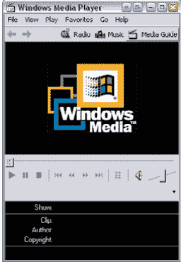

**图 2.1** 微软媒体播放器 6 随 Windows 98 一同发布。

Macromedia 在 1995 年发布了其 Shockwave 的第一版，最初是为 Netscape 网页浏览器开发的。当时，该公司允许其流行的 Director 多媒体软件用户创建交互式应用程序和动画，并将其插入网页文档中。Macromedia 还在开发另一个媒体播放器；它于 2002 年发布了 Shockwave Flash 播放器，支持视频和音频。Shockwave Flash 播放器使用 FutureWave 软件开发的 SWF 文件格式。SWF 文件格式的主要目的是创建用于显示动画的小文件，以及用于交换音频、视频和数据。Macromedia 在 2005 年被 Adobe 收购，Shockwave Flash 播放器更名为 Adobe Flash。正是这个特定的播放器成为通过浏览器提供多媒体时的首选播放器。

微软改进了其之前的产品，并于 1996 年发布了 DirectShow，后来演变为 Media Player 6.1，并作为 Windows 98 的一部分发布（**图 2.1**）。

随着 Windows 2000 的发布，微软还发布了 Windows Media Player 7.1 版本。它具有大为改进的图形界面，并整体上提供了更好的体验。这个版本带来了编解码器——一种特殊的文件协议，允许创建和回放媒体内容。

> **注意：** 你将在关于 HTML5 音频和视频的第 3 章和第 4 章中读到更多关于编解码器的内容。

在后续版本中，微软增强了其媒体播放器，并在此过程中不断改进产品。

微软还致力于开发一个应用程序框架，以与 Adobe Flash 竞争，它可以运行浏览器插件（一组小型软件组件，为其他更大的软件应用程序——在本例中是网页浏览器——添加特定功能）和其他富互联网应用程序。微软 Silverlight 最初于 2007 年发布，支持多种不同类型的音频和视频文件格式，以及动画和交互性。最初，它的采用率较低，但截至 2011 年 6 月，其市场渗透率约为 73%，而 Adobe Flash 的市场份额为 97%。

苹果公司也从早期就加入了多媒体播放器的竞争。它的第一个版本 QuickTime 于 1991 年发布，用于 System Software 6 操作系统。QuickTime 在 1999 年 4.0 版发布之前一直是 Mac 专用的软件，该版本也支持 Windows 并支持 MP3 音频播放。QuickTime 5 和 6 提供了视频和 Flash 播放功能，6 版本还支持 MP4 播放。7 版于 2005 年发布，改进了 MP4 播放，但放弃了对 Flash 内容的支持。在撰写本文时，QuickTime 的最新版本是 Mac OS 的 10 版本，不同版本的 Microsoft Windows 有更早的版本。

每个供应商都有自己提供多媒体的方式，但当然都不完美。没有标准化的方法将音频和视频嵌入到网页文档中，正是因为这个原因——为了标准化多媒体的嵌入——音频和视频元素成为了 HTML5 规范的一部分。

## 媒体播放器的问题

所有媒体播放器都有一个共同的主要问题：终端用户需要安装相应的插件才能播放所需的音频或视频。

起初，所有这些插件只是启动相应的媒体播放器来播放音频或视频。在浏览器中显示多媒体的能力是后来才出现的，尽管弹出窗口（在浏览器外部启动相应的媒体播放器）仍然很常见。如果你的系统没有所需的插件，你必须下载它，这很麻烦，因为你需要不断更新它。

此外，来自不同供应商的不同插件可能会相互冲突，导致浏览器不稳定。例如，VLC 媒体播放器与 Windows Media Player 在 Firefox 中会冲突，有时在尝试查看 WMV 文件时会导致 Firefox 崩溃。

安全也是一个问题，因为插件过去是、现在仍然是恶意软件的主要目标区域之一。2011年3月发现的一个例子表明，Flash Player 10.2 中的一个严重漏洞可能允许远程攻击者在受感染的机器上执行任意代码或导致拒绝服务攻击（参见 www.adobe.com/support/security/advisories/apsa11-01.html）。

当然，一旦检测到这些漏洞，供应商就会迅速采取行动修补它们并发布更新版本。但这再次意味着用户必须不断升级到最新版本。

所有插件中最受欢迎的 Flash 的一个主要问题是，苹果在2010年4月决定不支持在 iPhone 和 iPad 上使用 Flash。这当然使得以 Flash 格式提供的内容在这些设备上完全不可用。

现在让我们看看如何通过这些媒体播放器的插件在 HTML 中播放所需的音频或视频。

## HTML 元素

过去，要在你的网页文档中嵌入插件以启动媒体播放器，你可以使用各种 HTML 元素来实现。尽管使用这些元素是过去的做法，但你仍然需要了解这些元素以及它们的使用方式，因为不幸的是，并非所有浏览器都支持 HTML5 多媒体。你将在第3章和第4章中阅读更多关于浏览器缺乏对 HTML5 多媒体支持的内容。

实际上，可以使用三个不同的 HTML 元素：

- `applet`

- `embed`

- `object`

`applet` 元素，顾名思义，仅用于嵌入 Java 小程序，并且实际上在 HTML 4.01 中已被弃用。它允许将 Java 小程序嵌入到网页文档中放置该元素的任何位置。很可能，你永远不需要使用这个元素，因为它现在已经过时了，所以让我们继续。

`embed` 元素由 Netscape 2.0 浏览器引入，允许开发者在网页文档中嵌入任意数据对象。如果你的系统没有安装所需的插件，通常会显示一个警告和一个空框。以下是用于播放 MIDI 文件的 `embed` 代码示例：

```
<embed src="myMidiFile.mid" height="60" width="144">
```

这里，浏览器被告知将 `myMidiFile.mid` 嵌入到浏览器中指定位置，具有指定尺寸。

> 注意：`embed` 元素在 HTML5 中被正式引入，最终使其成为 HTML 规范的有效部分。尽管在 HTML5 之前大多数浏览器都支持它，但它实际上从未是一个有效的元素。

`object` 元素在 HTML 4.01 中取代了 `applet` 和 `embed` 元素（两者实际上都不在任何规范中），并且旨在使其在所包含的媒体方面更具通用性。因此，它可以用于嵌入 Java 小程序、音频和视频。`object` 元素功能非常强大，它可以接受大量参数和数据对象类型，但这反过来又使其显得相当笨拙。以下示例展示了如何使用 `object` 元素嵌入 Adobe Flash 视频文件：

```
<object type="application/x-shockwave-flash" width="512"
        height="300" wmode="transparent" data="flvplayer.swf?
        file=myFlashVideo.flv&autoStart=true">
    <param name="movie" value="flvplayer.swf?file=
        myFlashVideo.flv&autoStart=true" />
    <param name="wmode" value="transparent" />
    <param name="allowscriptaccess" value="always" />
    <param name="allowfullscreen" value="always" />
</object>
```

这里的代码通过 `type` 属性中的 MIME（多用途互联网邮件扩展）类型向浏览器表明 `object` 元素内的内容是 Flash。它还设置了 `object` 容器的宽度和高度，并使用 `wmode` 属性通知浏览器 HTML 页面的背景应该显示在 Flash 内容的透明区域。`data` 属性用于指向一个有效的 URL，该 URL 将包含容器的实际内容。

`param` 元素用于向嵌入的内容添加不同的参数。如你所见，这里的一个 `param` 元素用于设置名为 `movie` 的参数，其值与在整体 `object` 元素中设置的 `data` 属性相同！这导致了重复，但遗憾的是，这是必要的。这是一个回退机制：如果浏览器不知道如何播放 MIME 类型为 `application/x-shockwave-flash` 的对象，它将检查下一个子元素，看看是否能播放它（在这个例子中，是 `movie` 的 `param` 设置）。

`wmode` 参数也是为了那些不理解 `object` 声明中第一个设置的浏览器而再次设置的。还设置了另外两个参数：`allowscriptaccess`，允许 HTML 页面与对象进行交互（如果对象有任何可供交互的内容）；以及 `allowfullscreen`，允许对象在用户请求时全屏显示。

你可能同意，前面的代码最初看起来有点令人痛苦和困惑。幸运的是，HTML5 使嵌入多媒体对象变得容易得多，因为多媒体现在是浏览器的原生功能。

## 欢迎，原生多媒体！

有了原生多媒体，对象不再被嵌入到网页文档中，而是被浏览器视为原生对象，因此是内置的。这带来了直接的好处，例如：

- 不再需要插件。

- 速度——任何浏览器原生的东西都会比任何第三方附加组件更快。

- 由浏览器提供原生控件。

- 自动内置键盘无障碍访问功能。

HTML5 提供了四个新的标记元素，帮助你在浏览器中实现原生多媒体。让我们看看这些元素及其可能的属性。

## AUDIO 元素

`audio` 元素允许你将音频文件或音频流嵌入到网页文档中。下面是一段快速的代码，向你展示使用 `audio` 元素在网页文档中嵌入音频文件是多么容易：

```
<audio src="sayHello.mp3"></audio>
```

简单多了，不是吗？

**表 2.1** Audio 元素属性

| 属性 | 描述 |

| --- | --- |

| `src` | 提供媒体资源的地址，在本例中是音频文件或流。此属性必须包含指向音频源的有效 URL。 |

| `preload` | 用于提示浏览器如何预加载音频源（如果预加载的话）。它只是建议浏览器该怎么做，但最终浏览器会自行决定（例如，根据用户设置）。它有三个可能的设置：`none` 告诉浏览器不要预加载音频文件。用户不打算播放音频，因此无需执行任何预加载。它将在用户单击“播放”按钮时开始加载。`metadata` 告诉浏览器只预加载有关音频文件的信息（例如，尺寸、持续时间等）。用户可能希望播放音频。应预加载其元数据（例如，尺寸、持续时间）。音频的其余部分将在用户单击“播放”按钮时下载。`auto` 告诉浏览器决定是下载元数据、整个源，还是不下载任何内容。这是如果未指定 `preload` 时的默认值。对此属性的支持较差；目前只有 Firefox 5 和 Chrome 12 支持它。 |

### 表 2.1 音频元素属性（续）

| 属性 | 描述 |

|---|---|

| `autoplay` | 是一个布尔属性，用于通知浏览器在页面加载时自动开始播放音频源。请谨慎使用此属性，因为自动播放音频可能会对用户造成困扰。 |

| `controls` | 同样是一个布尔属性，如果存在，它会告诉浏览器为音频提供一套默认的控件。 |

| `muted` | 控制音频源的默认状态。通常，这对于音频源来说有点多余，因为如果你让它自动播放，你肯定希望它能被听到。目前没有浏览器支持此属性。 |

| `loop` | 另一个布尔属性，表示音频应循环播放。建议谨慎使用此属性，因为它可能会对用户造成困扰，尤其是当你没有提供任何控件让他们停止播放时！此属性在 Firefox 5 中目前不受支持。 |

| `crossorigin` | 是该规范中一个相对较新的属性，旨在允许或禁止使用 CORS（跨源资源共享）规范（您可以在 www.w3.org/TR/cors 阅读相关内容）共享音频源的跨源媒体。<br><br>基本上，它指定了音频源是否可以跨域共享。<br><br>它可以有两种设置：<br>- `anonymous`：允许匿名访问音频源。<br>- `use-credentials`：需要凭据才能访问音频源。<br><br>如果未指定任何特定设置，但 `crossorigin` 存在，则默认为 `anonymous` 设置。由于此属性对规范来说太新了，尚未在任何主要浏览器中实现。 |

| `mediagroup` | 允许多个媒体元素（在这种情况下是音频源）链接在一起。例如，这可以实现屏幕上两个不同位置的两个不同音频源的播放和同步。 |


图 2.2 Firefox 5 中的音频控件。

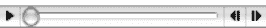

图 2.3 Safari 5.0.5 中的音频控件。


图 2.4 Chrome 12 中的音频控件。


图 2.5 Opera 11.50 中的音频控件。


图 2.6 Internet Explorer 9 中的音频控件。

如表 2.1 所示，可以与音频元素一起使用几种不同的设置，其中一些还包含多个选项。一个在网页文档中的音频声明示例可能如下所示：

```
<audio src="sayHello.ogg" controls></audio>
```

这段简单的代码通知浏览器将指定的音频文件嵌入浏览器，并使用浏览器自带的多媒体控件。不同的浏览器具有不同的默认控件，因此音频控件的外观取决于查看者使用的浏览器。您可以在 **图 2.2** 至 **2.6** 中看到这些控件在不同浏览器中渲染效果的示例。

您将在第 3 章中了解更多关于音频元素的知识。其中还提供了更深入的使用示例，以及如何组合表 2.1 中列出的大部分属性。

现在您已经快速了解了音频元素的属性，让我们来看看视频元素。

## 视频元素

视频元素允许您将视频内容嵌入网页文档，并且您可以再次指定多个属性来控制此视频内容。许多属性与音频元素指定的相同，但也有一些额外的属性，它们都列在 **表 2.2** 中。

### 表 2.2 视频元素属性

| 属性 | 描述 |

| :--- | :--- |

| `src` | 提供媒体资源的地址，在这种情况下是视频文件或流。此属性必须包含一个指向视频源的有效 URL。 |

| `preload` | 用于提示浏览器如何（如果可能的话）预加载视频源。同样，这只是对浏览器的一个提示，浏览器可能会选择用可能的用户设置来覆盖它。<br><br>它有三种可能的设置：<br>- `none`：通知浏览器用户可能不想观看视频，因此无需执行任何预加载操作。<br>- `metadata`：通知浏览器用户可能想要观看视频，因此应预加载其元数据（例如，尺寸、持续时间）。<br>- `auto`：告诉浏览器决定是下载元数据、整个源，还是不下载任何内容。如果未指定 `preload`，这是默认设置。 |

| `autoplay` | 是一个布尔属性，通知浏览器一旦可以就自动开始播放视频源。这样做不被认为是好的做法！ |

| `controls` | 同样是一个布尔属性，如果存在，它会告诉浏览器为视频提供一套默认的控件。 |

| `muted` | 控制视频源的默认状态。这意味着您可以指定自动播放的视频在开始播放时可以静音，从而防止对用户造成任何干扰。<br><br>此属性目前在任何主要浏览器中均不受支持。 |

| `loop` | 另一个布尔属性，表示视频应循环播放。<br><br>此属性在 Firefox 5 中目前不受支持。 |

| `poster` | 允许在没有可用视频数据时显示一个图像文件。<br><br>如果未指定 `poster`，浏览器将显示视频的第一帧，这当然可能不是您想要显示的图像。它必须包含一个指向相关图像的有效 URL。 |

| `width` | 以像素为单位指定视频元素的宽度。 |

| `height` | 以像素为单位指定视频元素的高度。 |

| `crossorigin` | 指示视频源是否可以跨域共享。默认情况下，源可以跨域共享。<br><br>它可以有两种设置：<br>- `anonymous`：允许匿名访问视频源。<br>- `use-credentials`：需要凭据才能访问视频源。<br><br>如果未指定任何特定设置，但 `crossorigin` 存在，则默认为 `anonymous` 设置。<br><br>由于此属性对规范来说太新了，尚未在任何浏览器中实现。 |

| `mediagroup` | 允许多个媒体元素（在这种情况下是视频源）链接在一起。例如，这可以实现屏幕上两个不同位置的两个不同视频的播放和同步。 |

> ## CORS

`crossorigin` 是 HTML5 规范中一个非常新的添加项，因此目前没有实际应用。任何主要浏览器都不支持它。它使用 CORS（跨源资源共享）规范，您可以在 www.w3.org/TR/cors 阅读相关内容。

> ## MEDIAGROUP

与 `crossorigin` 类似，`mediagroup` 也是 HTML5 规范中一个非常新的添加项，在撰写本文时尚未在任何主要浏览器中实现。一旦实现，它对可访问性将非常有用，因为它允许诸如在常规视频旁边播放手语视频并保持它们同步的场景。

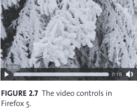

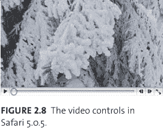

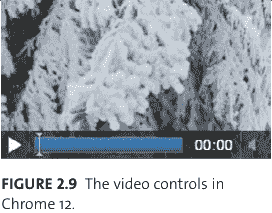

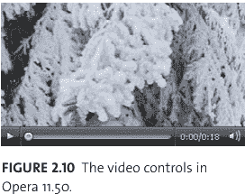

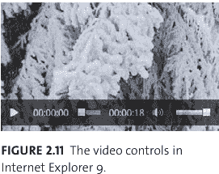

如您所见，许多音频和视频元素的属性是相同的，这当然在指定它们时更容易，因为你只需要记住一套属性。

一个使用视频元素在网页文档中显示视频（带浏览器控件）的示例可能如下所示：

```
<video src="snowy-tree.mp4" width="300" height="176" controls>
    </video>
```

这个简单的示例通知浏览器显示一个 300 像素 × 176 像素的视频播放器，其中包含 `snowy-tree.mp4` 视频文件，并带有默认的媒体控件。

与音频一样，不同的浏览器显示控件和视频的方式也不同。您可以在图 2.7 至 2.11 中看到它们在每个浏览器中的外观。

## SOURCE 元素

由于浏览器的要求不同（第3章和第4章将详细讨论），通常需要为同一个音频或视频元素指定不同的源。

正如你之前看到的，`audio` 和 `video` 元素都提供了一个 `src` 属性，用于放置音频或视频源的 URL。但该属性只允许一个源。那么，如何添加多个源呢？

这就是 `source` 元素的用武之地。在 `audio` 或 `video` 元素的声明中可以包含任意数量的 `source` 元素，并且正是通过这个元素，你可以指定多个媒体源。

`source` 元素可以包含**表 2.3** 中列出的属性。

因此，`source` 元素允许你为特定的多媒体内容指定不同的源，以下是一个示例：

```
<audio controls>
    <source src="sayHello.ogg" type="audio/ogg">
    <source src="sayHello.mp3" type="audio/mp3">
    Sorry, your browser doesn't support the audio element
</audio>
```

在此示例中，向浏览器呈现了两种不同的音频文件格式以供播放。浏览器将播放它识别的第一种格式，并忽略任何它无法识别的格式。如果它找不到可以播放的格式，它将通过显示文本“Sorry, your browser doesn't support the audio element.”来告知用户浏览器无法播放音频。

这种浏览器忽略其无法理解的内容的过程，在提供跨浏览器支持的多媒体解决方案时非常有用。如前所述，不同的浏览器支持不同的多媒体文件格式，这将在接下来的两章中详细讨论。

### 表 2.3 source 元素属性

| 属性 | 描述 |

| :--- | :--- |

| `src` | 提供媒体资源的地址，无论是音频还是视频。与 `audio` 和 `video` 元素的 `src` 属性一样，此属性必须包含指向相关源的有效 URL。 |

| `type` | 指定媒体资源的类型，以帮助浏览器确定它是否确实可以播放此源。该值必须是有效的 MIME 类型，它告诉浏览器源文件的格式。最常见的包括：<br>• `audio/ogg`<br>• `audio/mp3`<br>• `video/mp4`<br>• `video/ogg`<br>• `video/webm`<br><br>在某些情况下，可能还需要指定源文件的编码编解码器，以确保其可以播放。你将在第3章和第4章中了解更多关于 MIME 类型和编解码器的信息。 |

| `media` | 指定相关资源的预期媒体类型，因为它可能针对具有特定高度、宽度、分辨率或宽高比的特定类型的设备。<br><br>此值必须是有效的媒体查询。你可以在媒体查询规范 http://dev.w3.org/csswg/css3-mediaqueries 中阅读更多关于此属性的内容。<br><br>你将在第4章中了解更多关于媒体查询及其用途的信息。 |

## TRACK 元素

`track` 元素用于为媒体元素指定明确的外部定时文本轨道。它必须与 `audio` 或 `video` 元素结合使用，因为它本身不代表任何内容。

此元素主要用于提供对多媒体资源的可访问性，因为它允许提供字幕、描述、文字记录和副标题。这些内容可以在浏览器中与正在播放的媒体一起显示。

在大多数情况下，通过 `track` 元素提供的信息更适合视频媒体源。

与前面描述的其他元素一样，`track` 元素可以接受多个属性（**表 2.4**）。

因此，`track` 元素可用于指定媒体资源的完整文字记录，例如，这对于使资源可供听力障碍者使用非常有用。它还允许你指定不同语言的多个字幕和描述。以下是一个示例：

```
<video src="sayHello.mp4">
    <track kind="subtitles" src="hello-en.vtt" srclang="en"
           label="English">
    <track kind="subtitles" src="hello-de.vtt" srclang="de"
           label="German">
</video>
```

此示例为 `sayHello.mp4` 视频指定了两个用于不同语言（英语和德语）的不同文件。

> **注意：** HTML5 视频和字幕在第8章中详细讨论，所以不用担心！

### 表 2.4 track 元素属性

| 属性 | 描述 |

| :--- | :--- |

| `kind` | 指定此 `track` 元素实例为指定的媒体元素提供何种类型的数据。它可以具有以下任何值：<br>• `subtitles` 对话的完整文字记录，适用于音频可用但无法理解的情况。内容将显示为视频上的叠加层。<br>• `captions` 对对话、音效和其他相关音频信息的文字记录，适用于音频/音轨不可用的情况。内容叠加在视频上，并标记为对听力障碍者有用。<br>• `descriptions` 提供媒体资源视频组件的文本描述，旨在视觉组件不可用时使用。<br>• `chapters` 指定章节标题，用于导航媒体资源的内容。<br>• `metadata` 包含要通过脚本使用的信息，实际上不会以任何方式显示在浏览器中。<br><br>如果省略此属性，则默认值为 `subtitles`。 |

| `src` | 提供文本轨道数据的地址，该地址必须是有效 URL。此源提供的文件需要采用特定格式才能被理解——其中两种是 WebSRT 和 WebVTT。这两种格式都在第8章中讨论。 |

| `srclang` | 指示文本轨道数据的语言。 |

| `label` | 为轨道指定一个用户可读的标题，为用户提供更易理解的标题。对于同一资源的相同 `kind` 属性的 `track` 元素，标签必须唯一。 |

| `default` | 通知浏览器，在用户首选项未表明其他轨道更合适的情况下，应使用该 `track` 元素作为默认值。 |

## SAFARI 和 INTERNET EXPLORER 9 的一个怪癖

本章早些时候，当我提到原生多媒体是最佳选择并且不需要第三方插件时，我可能有点夸大其词了。并不是说原生多媒体不好，它确实很棒；非常出色。

但是。

为了让原生多媒体在 Safari 和 Internet Explorer 9 中工作，Apple 要求你必须安装其 QuickTime 插件，而 Microsoft 则要求你在系统上安装其 Media Player。

这些要求在一定程度上削弱了原生多媒体的理念。我不知道为什么 Apple 和 Microsoft 会选择走这条路，但这就是现状。

## 总结

你简要回顾了网络浏览器中多媒体的可用性。可以预见的是，与“仅图像”时代相比，相关技术以及可实现的结果已经取得了巨大的进步。

你现在也了解了三个新的 HTML5 标记元素——`audio`、`video` 和 `source`——你将需要使用它们将音频和视频内容嵌入到你的网页文档中。`track` 元素也被包含在内，因为它为你提供了一种强大的方法，通过允许你指定增强功能（如字幕和说明文字）来使你的媒体内容易于访问。

掌握了这些元素和属性的基础知识后，你接下来将学习如何使用这些元素将媒体带给你的用户。

话不多说，让我们进入下一章，探索如何使用 HTML5 音频。

## 使用音频

使用 HTML5 多媒体为网页文档添加原生音频再简单不过了。无论你是想与互联网用户分享声音片段、录音还是你自己的音乐，这种能力一直都可以实现。但现在你可以分享音频，而无需依赖已安装的第三方插件。

第2章向你介绍了允许你将音频添加到网页文档的 HTML5 元素和属性。现在是时候探索这实际上是如何完成的了。本章将借助示例解释如何使用这些元素和属性。

但让我们首先简要了解一下可供使用的音频文件格式，以及你可能如何将现有音频从一种格式转换为另一种格式，以便在你的网页文档中使用。

## 音频编解码器与文件格式

用于编码多媒体文件以在网页上呈现的众多不同插件和格式，可能会让人有些头疼，特别是当用户的系统中缺少特定的插件或音频编解码器时。

### 等等；什么是音频编解码器？

编解码器是一种计算机程序，它使用压缩算法来编码和/或解码（因此得名：编码器-解码器）数字数据流，使其更适合在计算机或其他设备上播放。

编解码器的目标通常是以尽可能少的比特数来保持音频信号的高音质，从而减小相关文件的大小，进而降低传输所需的带宽。

不同的音频编解码器可用于输出不同的音频文件格式——其中许多格式得到了HTML5的支持。

## OGG VORBIS

Ogg Vorbis是一种开源、无专利、免费的文件格式，由Xiph.Org基金会（www.xiph.org）创建。由于其免费，因此作为使用格式极具吸引力。

Ogg是容器格式的名称，而Vorbis是其使用的具体音频压缩标准。根据Vorbis网站（www.vorbis.com）的说明，Vorbis文件可以压缩到很小的文件大小，同时仍能保持良好的音质。这当然非常适合网络传输，因为它降低了带宽成本。

Ogg Vorbis格式在游戏社区中相当受欢迎，像Epic Games、Crystal Dynamics和EA Games等公司都用它来传递游戏音乐。

Ogg Vorbis使用`application/ogg` MIME类型和`audio/ogg`编解码器。

### 什么是MIME类型？

MIME（多用途互联网邮件扩展）是一种互联网标准，最初设计用于描述电子邮件内容。如今其应用范围已大大扩展。MIME类型用于标识特定文件包含的信息类型。

MIME类型定义通常采用以下形式：

`type/subtype`

其中`type`可以是`audio`、`application`、`video`或`image`，`subtype`可能是`jpg`、`mp3`或`zip`，具体取决于`type`的值。

有关常见MIME类型及其对应文件扩展名的列表，请参见 http://hul.harvard.edu/ois/systems/wax/wax-public-help/mimetypes.htm。

## MP3

MP3这个名称相当有误导性，因为它也被称为MPEG-1或MPEG-2音频层III。由移动图像专家组（www.mpeg.org）开发的MP3与Ogg Vorbis的不同之处在于，它受到弗劳恩霍夫研究所（www.fraunhofer.de/en）持有的专利保护，该研究所从每笔销售中获取一定百分比的费用。

MP3标准实际上并未包含如何编码MP3的精确规范，但标准确实规定了如何解码该格式。这当然导致了众多不同的MP3编码器，每种编码器生成的音频文件音质各不相同。

尽管有专利限制，MP3已被证明是最受欢迎的声音文件编码音频格式之一。

MP3使用`audio/mpeg` MIME类型和`audio/mp3`编解码器。

## WAV

WAV文件格式的正式名称是波形音频文件格式，但因其文件扩展名而被称为WAV。WAV是一种由微软和IBM于1991年首次创建的音频格式。

虽然它可以包含压缩数据，但通常不包含，这当然会导致相当大的文件大小。正是由于这个原因，它作为互联网音频传输格式的使用率有所下降。

WAV使用`audio/wav` MIME类型和`audio/wav`编解码器。

## AAC

高级音频编码（AAC）是一种由苹果公司使用的音频格式，并作为苹果iTunes商店的默认格式而广受欢迎。它被设计为MP3格式的继任者，因此通常音质优于MP3。

AAC使用`audio/aac` MIME类型和`audio/aac`编解码器。

## MP4

虽然主要用作视频文件格式（第4章有更多介绍），但MP4也可用于仅编码音频。与AAC类似，它也因苹果公司的推广而流行，苹果公司还使用它来编码一些扩展名为.m4a的音频文件。

MP4使用`audio/mp4` MIME类型和`audio/mp4`编解码器。

现在你了解了不同的音频格式，让我们看看它们在不同浏览器中的支持情况。

## 浏览器对音频格式的支持

当HTML5规范的初稿发布时，它们包含了一条建议，不，是一项要求，即所有网络浏览器必须内置对Ogg Vorbis音频格式的支持。这是有益的，因为你可以保证每个支持HTML5音频元素的浏览器至少支持Ogg Vorbis，你可以用该格式呈现你的音频文件。

然而，当苹果和诺基亚都反对这一要求时，这种普遍支持音频格式的乌托邦局面改变了。苹果只是不想对一种当时并未广泛支持的技术设置任何强制性要求（此外，苹果在MP4文件格式中有既得利益），而诺基亚则声称Ogg Vorbis格式并不像其宣称的那样开放和自由。

因此，该要求被从规范中移除。结果，不同的供应商决定支持不同的音频编解码器。**表3.1**列出了哪些供应商在其浏览器中支持特定的音频格式。

**表3.1** 音频格式与浏览器支持

| 格式 | 浏览器 |

| :--- | :--- |

| Ogg Vorbis | Firefox 3.5+ Chrome 5+ Opera 10.5+ |

| MP3 | Safari 5+ Chrome 6+ IE9+ iOS |

| WAV | Firefox 3.6+ Chrome 8+ Safari 5+ Opera 10.5+ |

| AAC | Safari 3+ Chrome 5+ IE9+ iOS 3+ Android 2+ |

| MP4 | Safari 3+ Chrome 5+ IE9+ iOS 3+ Android 2+ |

**注意：** Chrome即将放弃对MP4/H.264的支持。更多信息请参见 http://blog.chromium.org/2011/01/more-about-chrome-html-video-codec.html。

浏览器对音频格式的支持情况有些参差不齐，但你可以通过使用第2章中介绍的`audio`和`source`元素，以所需的不同格式呈现音频文件来轻松应对这一问题。

不同的浏览器支持不同的格式，你一定想知道如何从一种格式转换到另一种格式。那么，让我们快速看一下。

## 编码你的音频文件

一旦你有了音频文件，无论是你自己录制的还是从其他地方获得的，它通常只有一种格式。很可能，它是前面提到的格式之一，但也可能不是。

当然，你可以决定只支持一种音频类型。例如，你可能知道你所有的用户都将使用Firefox，因此你只需要支持Ogg Vorbis。

为了论证起见，假设你想支持所有主要浏览器，那么你需要将你的音频文件转换为其他格式。你是如何做到的呢？

嗯，许多编码器可以为你完成这项工作，而且大多数是免费的。以下是我最喜欢的两个用于在各种音频格式之间进行转换的编码器：

- **Miro视频转换器**（www.mirovideoconverter.com）允许你打开许多不同的音频文件格式，并通过简单的拖放界面将它们转换为MP3、WAV、Ogg等。它可在Windows和Mac上运行。

- **Media Converter**（www.mediaconverter.org）是一个在线转换应用程序，允许你上传音频文件或使用已在线的文件。它还允许你将音频文件转换为MP3、WAV和Ogg。

当然还有许多其他编码器可用，但我更喜欢这两个，因为一个是桌面应用程序，一个在线应用。这适合所有场合，因为当我不在联网时，桌面应用程序很有用；而当我在线并需要快速转换文件时，网络转换器当然很有用。

然而，如果你想支持不具备HTML5多媒体播放能力的浏览器，你必须面对一个特定的问题。

> **提示：** 最好在你的桌面/笔记本电脑上或在线收藏一些你最喜欢的转换器，这样当你需要时，你总能随意在不同格式之间进行转换。虽然这里只提到了两个，但你可能会发现不同的编码器更符合你的喜好。

## 旧版浏览器降级方案

眼尖的读者可能已经注意到，我至今还未提及 Internet Explorer 6 至 8。正如第2章所提到的，这些浏览器不支持任何 HTML5，需要 JavaScript 的帮助才能渲染元素。而在多媒体方面情况更糟，因为它们自然也不支持任何前述的音频文件格式。

那么解决方案是什么？你可以使用 Internet Explorer 版本能够理解的方法，这意味着 Flash、QuickTime 或其他第三方插件。或者，你可以简单地提供一个指向相关音频文件的链接，这样任何不幸的用户都可以下载该文件，并通过他们计算机上的音频播放器以传统方式播放。这可以通过使用 `audio` 和 `source` 元素来实现。

下一节将提供一个完整的示例，展示如何使用 `audio` 和 `source` 元素来实现这一点，以及如何提供 Flash 降级方案，还有更多关于如何使用 `audio` 元素的其他示例。

## 使用 AUDIO 元素的示例

到现在，你已经阅读了足够多关于 HTML5 音频的内容，渴望看到一些如何在网页文档中实际使用它的正确示例。嗯，这里你就会看到。本节代码中使用的所有元素和属性都在第2章中向你介绍过。

### 播放音频文件

如果你想简单地播放一个音频文件，你只需要使用一个 `audio` 元素的实例。例如，要允许用户播放一个 Ogg Vorbis 音频文件，你只需使用这个：

```
<audio src="sayHello.ogg" controls></audio>
```

`controls` 属性告诉浏览器向用户显示其默认控件，以允许他们控制文件的播放。然而，如果你心怀恶意，想在用户有机会做任何事情之前就播放文件，你会添加 `autoplay` 属性：

```
<audio src="sayHello.ogg" controls autoplay></audio>
```

如果你更加恶毒，你可以自动地并循环地向用户播放音频文件，像这样：

```
<audio src="sayHello.ogg" controls autoplay loop></audio>
```

如果你对用户怀有敌意并想折磨他们，你可以移除 `controls` 属性，从而使他们无法停止播放：

```
<audio src="sayHello.ogg" autoplay loop></audio>
```

**注意：** 你可以在配套网站 www.html5multimedia.com 上找到本节的所有示例（以及更多）。

请注意，我并不建议你使用 `autoplay` 或 `loop`，或者移除 `controls` 属性。这通常不是件好事，而且可能会真正惹恼你的用户。只需确保，如果你决定使用 `autoplay` 或 `loop`，你能够证明你的决定是合理的。

你也可以使用 `muted` 属性在文件首次加载时将其静音。这指定了音频的默认状态，你可能希望这样做以潜在地覆盖任何用户偏好：

```
<audio src="sayHello.ogg" controls autoplay muted></audio>
```

此外，你可以要求浏览器在启动时不预加载音频文件。前面的示例在未指定时都默认为 `preload="auto"`：

```
<audio src="sayHello.ogg" controls preload="none"></audio>
```

当然，你可以要求浏览器只加载元数据。当音频文件很长或者你知道用户可能实际上选择不听该音频文件时，这很合适：

```
<audio src="sayHello.ogg" controls preload="metadata"></audio>
```

任何对 `preload` 属性的使用都只是给浏览器的一个建议，实际上可能被浏览器本身覆盖，也许是基于用户的设置。所有前面的示例都只使用一个音频源。那么，如果你需要为不同的浏览器提供多个源怎么办？

### 使用不同源播放音频文件

假设你想提供 Ogg Vorbis 和 MP3 两种格式的音频，以支持 Firefox、Chrome、Opera、Safari 和 IE9。你可以通过将 `source` 元素与 `audio` 元素结合使用来实现。代码将如下所示：

```
<audio controls>
    <source src="sayHello.ogg" type="audio/ogg">
    <source src="sayHello.mp3" type="audio/mp3">
</audio>
```

再简单不过了！

当然，如果你愿意，你也可以添加 WAV 文件格式：

```
<audio controls>
    <source src="sayHello.ogg" type="audio/ogg">
    <source src="sayHello.mp3" type="audio/mp3">
    <source src="sayHello.wav" type="audio/wav">
</audio>
```

你也可以在此处合并前面提到的任何属性。因此，让浏览器自动选择播放哪个源，只需要这段代码：

```
<audio controls autoplay>
    <source src="sayHello.ogg" type="audio/ogg">
    <source src="sayHello.mp3" type="audio/mp3">
    <source src="sayHello.wav" type="audio/wav">
</audio>
```

为了支持不支持 HTML5 `audio` 元素的浏览器，你会遵循相同的策略，但降级方案有所不同。

### 使用不同源和旧版降级方案播放音频文件

因为像 Internet Explorer 6 到 8 这样的旧版浏览器不支持 HTML5，如果你想支持这些浏览器（你应该支持），你需要回到它们确实理解的另一种格式——比如 Flash。

那么，你需要用丑陋的 Flash 插件代码来污染你简洁、干净的 HTML5 标记吗？是的，恐怕你需要，除非你满足于仅仅提供一个音频文件的链接供用户下载。

与支持 HTML5 的浏览器处理你文档中呈现的源以找到它们可以播放的音频格式的方式非常相似，旧版浏览器将忽略所有这些音频格式，直到它们遇到一个可以播放的文件，无论是 Flash 文件还是其他什么。

有多种方法可以提供 Flash 文件播放：通过你托管在服务器上的 Flash 播放器；通过使用远程 Flash 播放器，例如 Google 的 Flash 播放器；或者通过使用 `embed` 或 `object` 元素（参见第2章）。

使用下载的播放器（这个特定的播放器就是前面提到的 Google Flash 播放器，我只是下载了它）和 `object` 元素的代码可能如下所示：

```
<audio controls>
    <source src="sayHello.ogg" type="audio/ogg">
    <source src="sayHello.mp3" type="audio/mp3">
    <object type="application/x-shockwave-flash"
        data="player.swf?audioUrl=sayHello.mp3&autoPlay=true"
        height="27" width="320">
        <param name="movie"
        value="player.swf?audioUrl=sayHello.mp3&autoPlay=true">
    </object>
</audio>
```

**提示：** 你可以从 www.longtailvideo.com/players/jw-flv-player 下载出色的 JW Player，这是 Longtail Video 的一个 Flash 播放器。尽管 JW Player 是一个完整的 HTML5 和 Flash 视频播放器解决方案，但它在下载的 ZIP 文件（`player.swf`）中确实包含一个 Flash 播放器，你可以使用。

使用 `embed` 元素的相同代码如下所示：

```
<audio controls>
    <source src="sayHello.ogg" type="audio/ogg">
    <source src="sayHello.mp3" type="audio/mp3">
    <embed type="application/x-shockwave-flash"
        wmode="transparent"
        src="player.swf?audioUrl=sayHello.mp3&autoPlay=true"
        height="27"
        width="320">
</audio>
```

而使用 Google 的 Flash 播放器和 `embed` 元素如下所示：

```
<audio controls>
    <source src="sayHello.ogg" type="audio/ogg">
    <source src="sayHello.mp3" type="audio/mp3">
    <embed type="application/x-shockwave-flash"
        wmode="transparent"
        src="http://www.google.com/reader/ui/3523697345-audio-player.swf?audioUrl=sayHello.mp3&autoPlay=true"
        height="27"
        width="320">
</audio>
```

所有前面的示例都将在支持 HTML5 音频的浏览器中工作，如 **图 3.1** 中的 Firefox 所示。

而所有这些示例都将在使用 Flash 播放器的 Internet Explorer 8 中工作，如 **图 3.2** 所示。

你可以利用 Flash 可以播放 MP3 文件这一事实，因此你不必再提供另一种音频文件格式。当然，用户必须在其系统上安装了 Flash 播放器。但如果他们没有安装呢？

那么，你可以进一步利用提供的降级方案，并提供一个简单的文件链接供用户下载：

```
<audio controls>
  <source src="sayHello.ogg" type="audio/ogg">
  <source src="sayHello.mp3" type="audio/mp3">
  <object type="application/x-shockwave-flash"
    data="player.swf?audioUrl=sayHello.mp3&autoPlay=true"
    height="27" width="320">
    <param name="movie"
      value="player.swf?audioUrl=sayHello.mp3&autoPlay=true">
  </object>
  <a href="sayHello.mp3">Download the audio file</a>
</audio>
```

## 图 3.3 Internet Explorer 8 显示 Flash 播放器以及音频文件的下载链接。

## 图 3.4 Firefox 如果无法播放任何 HTML5 音频文件，则会显示一个简陋的方框。

如果浏览器不支持 HTML5 音频，但安装了 Flash 插件，则会同时显示 Flash 播放器和链接，如图 3.3 所示。当然，这不一定是件坏事，实际上你可能总是想为用户提供下载链接。

如果你决定不支持 Flash，可以省略 Flash 嵌入元素，只提供下载文件的超链接：

```
<audio controls>
    <source src="sayHello.ogg" type="audio/ogg">
    <source src="sayHello.mp3" type="audio/mp3">
    <a href="sayHello.mp3">Download the audio file</a>
</audio>
```

你还应该为支持 HTML5 音频播放的浏览器提供相应的文件格式。如果浏览器支持 HTML5 但无法播放提供的任何源文件，它不会回退到播放你可能同时提供的任何 Flash 内容，也不会显示下载链接。相反，可能会显示一个损坏的播放器，或者如 Firefox 的情况，显示一个相当难看的黑色方框（图 3.4）。

无论你决定怎么做，都有足够的回退机制来帮助你支持大多数浏览器。

## 总结

目前，主要的网络浏览器支持不同的音频文件格式，这要求你将音频内容以不同的格式提供，以便这些浏览器能够播放它们。幸运的是，通过 HTML5 的 `audio` 和 `source` 元素可以轻松提供这些不同的文件格式。

此外，像 Internet Explorer 8 及更早版本这样的旧版浏览器，也可以像以前一样通过第三方插件（如 Flash）来支持。随着时间的推移，旧版浏览器将逐渐被淘汰，支持它们的需求也将不复存在。但你仍然可以确保这些用户能够访问你的音频。

本章中的示例涵盖了你在为网页文档添加音频时可能遇到的多种现实场景。然而，它们绝非详尽无遗。尽管示例中使用的所有代码都可以在网站上找到，但未来还会添加更多示例，所以绝对值得去看看。

原生音频是网络技术的一大进步，至少与视频相匹敌，甚至可能被视频超越，这正是下一章的焦点。

# 第 4 章 使用视频

YouTube 和 Vimeo 等视频分享网站的流行，加上使在线视频变得可行的带宽速度，导致了在网页文档中嵌入视频的巨大需求。然而，直到最近，唯一的方法是使用 Flash 和 QuickTime 等第三方插件。HTML5 为在网页文档中嵌入视频提供了缺失的标准方法。主要浏览器在其最新版本中已开始支持它，因此你可以放心，现代浏览器可以处理你的视频内容。

本章涵盖 HTML5 视频支持的文件格式和编解码器、格式之间的转换方法以及可能遇到问题的解决方案。你还将学习如何向不支持 HTML5 视频的浏览器传送视频。

## 视频编解码器和文件格式

与音频类似，由于浏览器厂商无法就一种标准达成一致，HTML5 视频有多种不同的格式可用于编码视频内容。可用的视频文件格式包括 Theora Ogg、MP4（H.264）和 WebM。让我们逐一详细探讨。

### 编解码器和容器

如第 3 章所述，编解码器是一种计算机程序，它使用压缩算法来编码和/或解码数字数据流，使其更适合播放。

容器是一种包装格式，其规范描述了容器内不同数据元素如何在计算机文件中存在和相互作用。

### Theora Ogg

Theora Ogg，你可能已经猜到，也来自 Xiph.Org 基金会 (www.xiph.org)。与其音频对应物类似，Theora Ogg 是自由和开放的，没有许可或版权费问题。

与音频一样，Ogg 是容器格式的名称，在这种情况下，Theora 指的是它使用的视频压缩格式。早期版本的 Theora 编解码器被证明不如当时的其他类似编解码器，但它已经有了很大改进，现在被认为与 YouTube 的 H.264 输出（在 YouTube 开始编码高清视频之前）相当。

Theora Ogg 使用 `application/ogg` MIME 类型和 `video/ogg` 视频属性类型。

### MP4 (H.264)

MPEG-4 第 10 部分，或 MP4，是一种压缩视频格式，与 MP3 音频格式（见第 3 章）一样，由动态图像专家组（MPEG；www.mpeg.org）定义。它旨在以小巧的包提供 DVD 质量的视频和音频。这种小巧的文件大小使得 MP4 文件非常适合便携式播放器，自然也适合网络。

H.264 被分为 17 种不同的“配置文件”；每种都提供了通常会增加文件大小的额外功能。其中一些适用于 HTML5 视频，而其他则不适用。基线（Baseline）和主（Main）配置文件通常用于 HTML5 视频。有关这些配置文件的完整列表，请参见 en.wikipedia.org/wiki/H.264#Profiles。

MP4 使用 `video/mpeg` MIME 类型和 `video/mp4` 视频属性类型。

### WebM

WebM 是一个由网络行业巨头（如 Mozilla、Opera、Adobe 和 Google）支持的项目 (www.webmproject.org)。该项目的目标是制作高质量、免版税、开放的视频格式。

视频内容使用 VP8 编解码器压缩，该编解码器由 On2 Technologies 开发（该公司于 2010 年 2 月被 Google 收购）。该编解码器通常在 WebM 容器内使用。

WebM 使用 `video/webm` MIME 类型和 `video/webm` 视频属性类型。

### 浏览器对视频格式的支持

当 HTML5 规范的第一份草案发布时，它建议浏览器应该支持 Theora Ogg 视频格式。知道所有支持 HTML5 视频的浏览器都将支持一种标准视频格式，本可以让你在提供 Theora Ogg 视频文件时保证用户能够访问你的视频内容。然而，请注意短语“本可以”的使用。不幸的是，与音频规范一样，诺基亚和苹果都反对支持 Theora Ogg 的要求，他们认为其没有被广泛支持，也不像 Xiph.Org 基金会声称的那样开放和自由。因此，该要求被取消了。结果，你又必须以多种格式提供视频内容，以保证覆盖所有支持 HTML5 视频的浏览器。

表 4.1 包含了其浏览器支持特定视频格式的厂商列表。

表 4.1 视频格式与浏览器支持

| 格式 | 浏览器 |

|---|---|

| Theora Ogg | Firefox 3.5+、Chrome 5+、Opera 10.5+ |

| MP4/H.264 | Safari 3+、Chrome 5-?、IE9+、iOS、Android 2+ |

| WebM | Firefox 4+、Chrome 6+、Opera 11+、IE9+、Android 2.3+ |

> **注意：** Chrome 目前支持 MP4/H.264，但很快将放弃对其的支持。只要安装了可以播放 WebM 的第三方插件，Internet Explorer 9 将支持 WebM。

事实上，你需要提供至少两种不同的格式，MP4 和 WebM，以支持最新版本的主要浏览器。如果你只提供少量视频，这并不是太麻烦，因为可以使用第 2 章中提到的 `video` 和 `source` 元素轻松完成。对于视频密集型网站，这可能是一个负担，因为许多文件需要以至少两种不同的格式存在，从而将所需的存储空间增加了一倍。

### 移动设备

使用 HTML5 视频的另一个充分理由是苹果公司决定在 iPhone 和 iPad 上不支持 Flash。运行在这些设备上的 iOS 操作系统支持 MP4 视频。

Android 手机也支持 MP4（以及从 2.3 版本开始支持的 WebM），Windows Phone 7 原生支持 MP4 和 WebM，而黑莓从其浏览器 7.0 版本开始支持 MP4。

由于你的视频文件将采用一种格式，提供两种格式的最简单方法就是将一种格式转换为另一种。在深入代码示例之前，让我们快速了解一下如何在不同格式之间转换你的视频内容。

### 编码你的视频文件

你可能已经拥有想在网页文档中显示的视频内容，或者可能还需要录制。让我们假设你已经拥有了内容，并且它已经是上述格式之一，尽管也很可能不是。无论哪种情况，这都不是问题，因为市场上有很多编码器，你可以用来将视频内容从一种格式转换为另一种格式。

> **提示：**明智的做法是至少支持 MP4 和 WebM，以覆盖主要浏览器的最新版本。Safari 支持 MP4；Firefox 和 Opera 支持 WebM；而 Chrome 和 Internet Explorer 9 目前同时支持 MP4 和 WebM，尽管 Chrome 将在不久的将来放弃对 MP4 的支持，而 IE9 需要插件才能支持 WebM。然而，你也可能选择支持 Theora Ogg，因为 Firefox 直到 4.0 版本才支持 WebM，并且 Firefox 完全不支持 MP4。

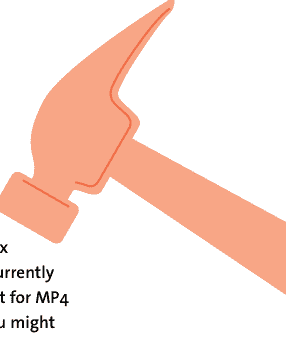

以下是我最喜欢的三个编码器：

- **Miro Video Converter** (http://www.mirovideoconverter.com)。除了在音频格式之间转换外，该转换器还支持将视频文件转换为 Theora Ogg、MP4 和 WebM 格式。它确实涵盖了你所需的一切，并且可在 Windows 和 Mac 上运行。

- **Handbrake** (http://handbrake.fr)。这款开源转换器允许你将视频文件转换为 MP4 和 Theora Ogg 格式。它可在 Windows、Mac 和 Linux 上运行。

- **Media Converter** (http://www.mediaconverter.org)。这款在线转换应用程序允许你上传文件进行转换，或者提供现有文件的 URL。它允许你将文件转换为 Theora Ogg、MP4 和 Flash FLV 等多种格式。

尽管你可以从许多其他编码器中进行选择，但这三个是你可以用来入门的可靠编码器。

#### MP4 编码与延迟播放

有时 MP4 文件的编码方式可能会导致其播放出现问题。具体来说，文件不会在完全下载后才开始播放。这是由于编码过程将文件索引——包含文件长度等所有元数据——放置在了文件末尾而不是开头。

如果你发现你的 MP4 文件存在此问题，你可以通过运行 Adobe 的 Renaun Erickson 开发的 QTIndexSwapper (http://renaun.com/blog/code/qtindexswapper) 来修复。QTIndexSwapper 只是将索引移动到文件开头。

现在你已经转换了文件，就可以开始在你的文档中使用它们了！

## 使用视频元素

让我们从在网页文档中嵌入视频文件的一些基本示例开始。你已经在第 2 章中遇到过示例中使用的所有元素和属性，因此对你来说应该没有新内容。

### 播放视频文件

其中最简单的示例是播放一个简单格式的视频文件，并使用默认的媒体控件供用户操作。

要播放 WebM 文件，你可以使用：

```
<video src="snowy-tree.webm" controls></video>
```

`control` 属性通知浏览器应在视频播放器顶部显示一组基本的视频控件。

如果你想让视频在页面加载后立即开始播放，可以简单地添加 `autoplay` 属性：

```
<video src="snowy-tree.webm" controls autoplay></video>
```

你可能还想让视频立即开始播放，然后通过 `loop` 属性持续循环播放：

```
<video src="snowy-tree.webm" controls autoplay loop></video>
```

然而，强烈建议不要这样做：这不仅令人烦恼，而且可能是一个可访问性噩梦，因为循环播放的视频文件可能会覆盖为可访问性目的而插入的额外音频。

你也可以通过使用 `muted` 属性在启动时静音视频文件。当然，如果你的视频没有声音，这没有效果：

```
<video src="snowy-tree.webm" controls autoplay muted></video>
```

> 注意：目前主要浏览器都不支持 `muted` 属性。但是，你可以通过 Media JavaScript API 来设置它，这将在第 5 章中讨论。

本节中的所有示例以及更多内容都可以在配套网站 www.html5multimedia.com 上找到。

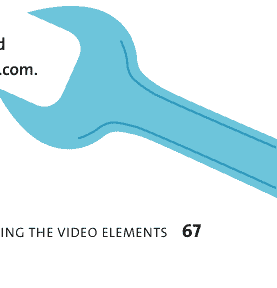

默认情况下，浏览器会在页面加载时开始加载整个视频文件。如果你希望浏览器不要这样做（也许你认为用户不太可能想观看视频，并且不想因为用户可能通过移动网络访问你的网站而浪费带宽），你可以使用 `preload` 属性并将其设置为 `none`：

```
<video src="snowy-tree.webm" controls preload="none"></video>
```

你也可以通过将 `preload` 属性设置为 `metadata` 来请求浏览器仅加载视频的元数据（例如，文件长度）：

```
<video src="snowy-tree.webm" controls preload="metadata"></video>
```

任何对 `preload` 属性的设置都只是向浏览器暗示你的意图，但最终，浏览器将决定做什么。例如，浏览器可能会由于浏览器中的用户设置而忽略你的建议。如果你想硬编码视频的宽度和高度，而不是让浏览器自动为你决定，可以通过 `width` 和 `height` 属性来实现：

```
<video src="snowy-tree.webm" controls width="300" height="210"></video>
```

你也可以通过省略 `controls` 属性来完全移除控件：

```
<video src="snowy-tree.webm"></video>
```

请注意，在大多数浏览器中，用户可以通过右键单击视频并从显示的下拉菜单中选择控件来恢复默认控件 **图 4.1**。

**提示：**如果你还指定了 `autoplay`，则 `preload` 设置将被覆盖，因为视频必须下载后才能播放！

所有前面的示例都只使用了一种视频文件格式。但是因为你需要提供多种视频文件格式以覆盖所有主要浏览器，接下来让我们看看如何做到这一点。

### 使用不同源播放视频文件

使用 `source` 元素向浏览器呈现不同的视频文件格式非常简单，你也在第 3 章的音频示例中使用过它。

这是你需要为视频播放提供两种不同来源的代码：

```
<video controls>
    <source src="snowy-tree.mp4" type="video/mp4">
    <source src="snowy-tree.webm" type="video/webm">
</video>
```

但让我们也支持 Theora Ogg，以防 Firefox 3.5 或 Opera 10.5 的用户想观看你的视频：

```
<video controls>
    <source src="snowy-tree.ogv" type="video/ogg">
    <source src="snowy-tree.mp4" type="video/mp4">
    <source src="snowy-tree.webm" type="video/webm">
</video>
```

> 注意：你可能不需要添加对 Theora Ogg 的支持，只有在你确实需要支持特定旧版本的 Firefox 时才应该费心去做。

上一节“播放视频文件”中的示例，应用了不同的属性来向你展示它们如何工作以及它们的作用，同样适用于包含多个 `source` 元素的任何视频元素。

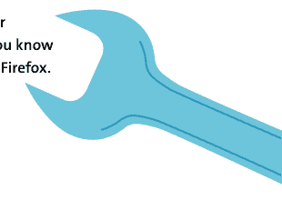

#### `type` 属性

当你在 `video` 元素内使用 `source` 元素时，你会注意到 `type` 属性从 `video` 元素移动到了 `source` 元素。原因在于，提供不同源的整个理念是因为它们使用不同的格式，而每个 `source` 元素需要通过自己的 `type` 属性来指定该源的格式。

`type` 属性也可以包含视频文件实际编码的编解码器。例如：

```
<source src="snowy-tree.ogv" type='video/ogg; codecs="theora, vorbis"'>
<source src="snowy-tree.webm" type='video/webm; codecs="vp8, vorbis"'>
<source src="snowy-tree.mp4" type='video/mp4; codecs="mp4a.40.2"'>
```

在 `type` 属性中包含编解码器可能有益，因为它有助于浏览器决定是否可以播放该文件。最好只在你确切知道使用了哪种编解码器来编码视频内容时才包含编解码器。

如果你决定包含编解码器，请非常小心并确保你正确格式化字符串，特别注意使用的引号；否则，浏览器将无法识别该源。

在前面的示例中，请注意整个字符串用单引号括起来，`type` 和 `codecs` 属性用分号分隔，而 `codecs` 的值包含在双引号中。

如果你想自动播放并循环播放视频，你会像这样将 `autoplay` 和 `loop` 属性添加到 `video` 元素：

```
<video controls autoplay loop>
  <source src="snowy-tree.mp4" type="video/mp4">
  <source src="snowy-tree.webm" type="video/webm">
</video>
```

你当然也可以像这样自动播放并移除控件：

```
<video autoplay>
  <source src="snowy-tree.mp4" type="video/mp4">
  <source src="snowy-tree.webm" type="video/webm">
</video>
```


请注意，当自动播放关闭时，视频的第一帧静止画面会作为图像显示在浏览器中。如果视频的第一帧静止画面不是你想显示的内容，你可能想使用一个不同的图像；它可能是空白的，或者根本就不是你想首先展示的画面。

如果你想使用不同的图像，你可以使用 `poster` 属性来指向一个要用作替代的图像文件：

**图 4.2** 左图显示了浏览器默认显示的视频第一帧静止画面；右图显示的是同一个视频，但使用了定义好的海报图像代替显示。

```
<video controls poster="snowy-tree-poster.gif" width="300"
→ height="210">
    <source src="snowy-tree.mp4" type="video/mp4">
    <source src="snowy-tree.webm" type="video/webm">
</video>
```

你可以在 **图 4.2** 中了解 `poster` 属性的工作原理。

既然你知道了如何播放视频文件，你可能想考虑一下旧版浏览器的回退方案。如何在旧版浏览器中显示视频？让我们来看看。

### 使用不同源和旧版回退方案播放视频文件

在本章中，我始终建议为旧版浏览器（如 Internet Explorer 6 到 8）提供回退方案，这些浏览器不支持 HTML5 和原生多媒体。这当然意味着要退回到这些浏览器能理解的旧版第三方插件，比如 Flash。

因为浏览器会忽略它们不理解的内容，旧版浏览器会忽略 `video` 和 `source` 元素，就像它们不存在一样。这当然允许你提供一个指向视频文件的简单链接，以便用户可以下载：

```
<video controls autoplay>
    <source src="snowy-tree.mp4" type="video/mp4">
    <source src="snowy-tree.webm" type="video/webm">
    <a href="snowy-tree.mp4">Download the video: snowy-tree.mp4</a>
</video>
```

你可能更愿意提供一个图像链接，而不是一个简单的文本链接：

```
<video controls autoplay>
    <source src="snowy-tree.mp4" type="video/mp4">
    <source src="snowy-tree.webm" type="video/webm">
    <figure>
        <a href="snowy-tree.mp4">
            
            <figcaption>Download the video: snowy-tree.mp4
            </figcaption>
        </a>
    </figure>
</video>
```

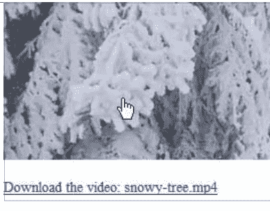

**图 4.3** 这就是图像和下载 MP4 文件的链接在 Internet Explorer 8 中可能的显示方式。

下载视频：snowy-tree.mp4

图 4.3 显示了在 Internet Explorer 中这可能是什么样子。

如果你决定支持 Flash，并允许非 HTML5 浏览器通过 Flash 播放你的视频，你当然可以使用 `embed` 或 `object` 元素来实现。然后你可以使用一个下载的 Flash 播放器（你已经上传到服务器）和 `object` 元素来播放视频。

你还可以利用 Flash 可以播放 MP4 文件这一事实，因此无需以不同格式创建另一个文件。以下代码展示了如何实现 Flash 回退：

```
<video controls autoplay>
    <source src="snowy-tree.mp4" type="video/mp4">
    <source src="snowy-tree.webm" type="video/webm">
    <object type="application/x-shockwave-flash"
        data="player.swf?videoUrl=snowy-tree.mp4&autoPlay=true"
        height="210" width="300">
        <param name="movie"
        value="player.swf?videoUrl=snowy-tree.mp4&autoPlay=true">
    </object>
</video>
```

一个非 HTML5 浏览器会忽略这两个 `source` 元素，因为它不知道如何处理它们。然后它会识别出 `object` 元素，并且只要 Flash 已安装，就会通过 Flash 播放器播放视频。

使用 `embed` 元素的相同代码如下所示：

```
<video controls autoplay>
    <source src="snowy-tree.mp4" type="video/mp4">
    <source src="snowy-tree.webm" type="video/webm">
    <embed type="application/x-shockwave-flash" wmode="transparent"
           src="player.swf?videoUrl=snowy-tree.mp4&autoPlay=true"
           height="210" width="300">
</video>
```

更好的做法是使用 `object` 而不是 `embed`，因为即使浏览器不支持 `object` 元素在 `type` 属性中指定的插件，`object` 开始和结束标签之间的任何内容也会被渲染。这允许你在需要时指定另一个回退方案。正如你可以在之前的 `object` 示例中看到的，不理解 `object` 元素中 `type` 属性指定值的浏览器也会读取 `param` 元素。

当然，你仍然需要依赖用户在他们的计算机上安装了 Flash 播放器这一事实，但情况并非总是如此。因此，你也可以添加前面提到的图像下载链接作为最终的回退方案，以防 Flash 未安装：

```
<video controls autoplay>
    <source src="snowy-tree.mp4" type="video/mp4">
    <source src="snowy-tree.webm" type="video/webm">
    <object type="application/x-shockwave-flash"
            data="player.swf?videoUrl=snowy-tree.mp4&autoPlay=true"
            height="210" width="300">
        <param name="movie"
               value="player.swf?videoUrl=snowy-tree.mp4&autoPlay=true">
    </object>
    <a href="snowy-tree.mp4">Download the video: snowy-tree.mp4</a>
</video>
```

这里的下载链接在某种意义上不是一个真正的回退方案，因为如果浏览器回退到 Flash，下载链接也会显示，但这不一定是件坏事，因为它只是提供了另一种访问文件的方式。

在决定支持哪些浏览器以及为此提供哪些回退方案时，有很多需要考虑。无论你决定如何，HTML5 多媒体都应该能让你完成这项工作。

> 让视频无处不在！

你可以阅读 Camen Design 的 Kroc Camen (http://camendesign.com) 的一篇精彩文章，了解如何在不使用 JavaScript 或浏览器嗅探的情况下让视频对所有人可用。Kroc 的网站绝对值得你在未来阅读，因为他会根据自己或其他人的任何新进展或发现及时更新内容。

你可以在 http://camendesign.com/code/video_for_everybody 找到这篇文章。

当然，如今你不仅需要考虑支持现代和旧版桌面浏览器。你还需要让你的内容可供现代手机、平板电脑和其他具有视频播放功能的替代浏览设备的用户使用。为了针对这些设备优化你的网页内容，你还需要了解媒体类型和媒体查询，这正是你接下来要学习的内容。

### 使用媒体类型和查询针对不同视频文件定向设备

假设你想根据浏览器的能力和大小提供不同的视频文件。例如，对于屏幕小且可能通过 3G 连接获取数据的手机，你可能想播放一个尺寸和文件大小都较小的视频。这可能吗？如果你结合使用媒体类型、媒体查询以及 `source` 元素中的 `media` 属性，这是可以实现的。

媒体类型是在 CSS2 (www.w3.org/TR/CSS2/media.html) 中引入的，旨在让你能够针对不同设备提供特定的样式和/或样式表。**表 4.2**（在下一页）列出了媒体类型。

#### 表 4.2 媒体类型

| 类型 | 定义 |

|---|---|

| `all` | 适用于所有设备。 |

| `braille` | 面向盲文触觉反馈设备。 |

| `embossed` | 面向分页盲文打印机。 |

| `handheld` | 用于手持设备，如手机。 |

| `print` | 针对打印材料和打印预览模式下显示的材料。 |

| `projection` | 适用于投影演示。 |

| `screen` | 适用于在彩色计算机屏幕上显示。 |

| `speech` | 用于语音合成器。 |

| `tty` | 面向具有固定字符网格的设备，如终端。 |

| `tv` | 用于电视类设备。 |

你可能以前遇到过表 4.2 中列出的一些媒体类型，尽管其中大多数可能对你来说很陌生。如果你曾经为打印内容创建过样式表，你会熟悉 `print` 媒体类型；如果你曾尝试针对手机，`handheld` 类型也会让你感到熟悉。

但随着技术的发展，正是 `handheld` 类型带来了特殊问题。最初，手机没有能够渲染 HTML 网站的浏览器，因此开发人员在很大程度上忽略了它们。当手机变得“更智能”并配备了改进的浏览器时，`handheld` 媒体类型并未在网站中被使用。厂商于是选择忽略它，转而默认使用 `screen` 媒体类型。但需要采取一些措施来应对这种情况，因为原本为全屏浏览器设计的网站配置现在在手机上渲染，导致出现许多恼人的滚动条。这就是媒体查询的用武之地。

媒体查询由 W3C 创建，并有自己的完整规范（参见 [www.w3.org/TR/css3-mediaqueries](http://www.w3.org/TR/css3-mediaqueries)）。它们是对 CSS3 媒体类型的扩展，允许你检查特定媒体特征的条件，例如宽度、高度和方向，以提供不同的内容或样式。你可以检查许多设备特征，列表见 **表 4.3**。

##### 表 4.3 媒体查询设备特性

| 特性 | MIN/MAX 前缀 | 定义 |

| :--- | :--- | :--- |

| 宽度 | 是 | 目标显示区域的宽度。 |

| 高度 | 是 | 目标显示区域的高度。 |

| 设备宽度 | 是 | 设备渲染区域的宽度。 |

| 设备高度 | 是 | 设备渲染区域的高度。 |

| 方向 | 是 | 渲染设备的方向：纵向或横向。 |

| 宽高比 | 是 | 目标宽度与高度的比率。 |

| 设备宽高比 | 是 | 设备宽度与设备高度的比率。 |

| 分辨率 | 是 | 设备中像素的密度。 |

| 色彩 | 是 | 每个颜色分量的位数。 |

| 色彩索引 | 是 | 颜色查找表中的条目数。 |

| 网格 | 否 | 测试设备是否基于网格。 |

| 单色 | 是 | 单色设备中每个像素的位数。 |

| 扫描 | 否 | 用于电视浏览：逐行扫描或隔行扫描。 |

其妙处在于，你可以结合媒体类型和媒体查询，使用 `and` 关键字来定位特定设备：

`screen and (min-device-width:300px)`

你也可以使用逻辑 `not` 操作符关键字来定位所有不匹配特定设置的设备：

`not screen and (max-width:800px)`

`only` 关键字也可用于向旧版浏览器隐藏设置：

`only screen and (max-width:800px)`

当然，这些设置本身无法工作，需要将其分配给视频容器内所需源元素的 `media` 属性：

```
<source src="myVideo.webm" media="screen and (min-device-width:300px)">
```

以下代码示例为所有最大宽度为 600 像素的媒体类型提供不同的视频。同时提供了 WebM 和 MP4 格式。任何不匹配这些特性的内容将继续使用后续的源定义：

```
<video controls>
    <source src="snowy-tree-small.mp4" type="video/mp4"
           media="all and (max-width:600px)">
    <source src="snowy-tree-small.webm" type="video/webm"
           media="all and (max-width:600px)">
    <source src="snowy-tree-medium.webm" type="video/webm">
    <source src="snowy-tree-medium.mp4" type="video/mp4">
</video>
```

如果你还想基于更大的最大显示宽度 800 像素提供中等大小的视频文件，可以这样做：

```
<video controls>
    <source src="snowy-tree-small.mp4" type="video/mp4"
           media="screen and (max-width:600px)">
    <source src="snowy-tree-small.webm" type="video/webm"
           media="screen and (max-width:600px)">
    <source src="snowy-tree-medium.webm" type="video/webm"
           media="screen and (max-width:800px)">
    <source src="snowy-tree-medium.mp4" type="video/mp4"
           media="screen and (max-width:800px)">
    <source src="snowy-tree-large.webm" type="video/webm">
    <source src="snowy-tree-large.mp4" type="video/mp4">
</video>
```

### 使用媒体类型和查询进行测试

你可能想知道，如果没有特定设备，该如何测试媒体类型和查询。

通过我提供的示例，通常只需改变浏览器窗口大小，然后刷新页面，就能达到预期效果。

你也可以使用 ProtoFluid 应用程序（http://app.protofluid.com），它允许你加载一个网站（甚至是本地服务器上运行的网站），并将视图更改为几种手机（如黑莓和 iPhone）和各种尺寸的显示器等其他设备的视图。

你可以在**图 4.4** 和 **图 4.5** 中看到“使用媒体类型和查询针对不同视频文件定位设备”一节中的代码在 ProtoFluid 中是如何工作的。

当然，没有什么比在真实设备上测试你的代码更好了，但考虑到市场上设备数量庞大，这并非总是可行的选择。

> **注意：** Firefox 完全忽略媒体查询，因此改变浏览器窗口大小不会产生任何效果。我建议使用 Opera，它完全按照预期工作。

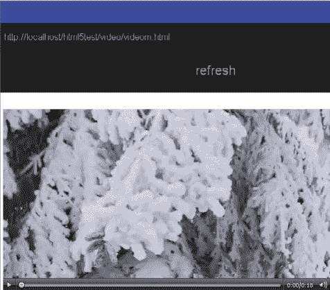

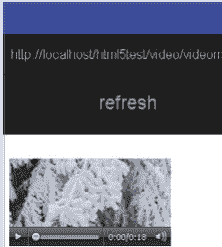

**图 4.4** 在 ProtoFluid 中选择 iPhone 尺寸会显示较小的视频文件。

**图 4.5** 在 ProtoFluid 中选择桌面 800×600 尺寸会显示中等视频文件。

同样，任何最大显示尺寸大于 600 像素或 800 像素的设备，都会忽略较小的尺寸，并播放其能够播放的 WebM 或 MP4 较大视频中的任何一个。

这些只是你在针对不同设备时可能想要实现的一些简单示例。通过结合媒体类型和查询，你可以针对任何设备以满足你的特定要求。不幸的是，前面讨论的示例在 Android 上都不起作用。

## ANDROID 和视频

Android 中 HTML5 视频的实现简直糟糕得令人震惊。因此，它值得单独成一小节，以防止你抓狂。

Android 从 2.0 版本开始支持 MP4 文件，从 2.3 版本开始支持 WebM。

在定义你希望 Android 使用的视频文件时，不应对 `video` 或 `source` 元素使用 `type` 属性。出于某种原因，这会混淆 Android，导致它忽略该源。

此外，Android 会完全忽略 `controls` 属性，你必须通过 JavaScript API 自己实现控件（这是第 5 章的主题），或者为了实现自动播放，在页面加载时通过 API 播放视频。

Android 也不会将视频的第一帧显示为图像；它会显示一个视频图标。但是，它确实能识别和理解 `poster` 属性，因此如果你使用该属性指定一张图片，它会正确显示该图片。

以下是为 Android 指定视频的代码，以及当用户按下视频图标时在 Android 上播放视频所需的 JavaScript。我现在将推迟对此 JavaScript 的解释，但将在第 5 章详细讨论：

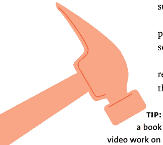

> **提示：** 网页开发者、多篇 CSS3 文章和书籍的作者 Peter Gasston 提供了一个深入教程，介绍如何使 HTML5 视频在 Android 手机上工作。如果你在 Android 手机上使用 HTML5 视频时遇到问题，请务必查看他在 www.broken-links.com/2010/07/08/making-html5-video-work-on-android-phones 上的内容。

```
<!DOCTYPE html>
<html>
<head>
    <title>Playing a Video File: Media Query Android</title>
    <script>
        function play() {
            var video = document.getElementById('video');
            video.addEventListener('click',function(){
                video.play();
            },false);
        }
    </script>
</head>
<body onload="play();">
    <video controls>
        <source src="snowy-tree-small.mp4" media="screen and
                (max-width:800px)">
        <source src="snowy-tree-large.mp4" type="video/mp4">
    </video>
</body>
</html>
```

前面提到的问题只影响 Android 自带的默认浏览器。如果用户使用其他移动浏览器，例如 Opera Mobile，则无需上述代码。Google 很有可能在未来版本中改进 Android 对 HTML5 视频的实现。到你读到本文时，它可能已经更新了。

## 总结

你现在应该意识到，使用 HTML5 原生多媒体向网站添加视频是多么容易。你可能也意识到，在这样做之前，仍有许多细节需要考虑。例如：

- 你应该支持哪些浏览器？

- 你会支持旧版浏览器吗？

- 你应该支持移动设备吗？如果是，哪些设备？

在继续之前，你可能需要问自己这些问题。

然而，一旦你做出了这些决定，利用 HTML5 多媒体的力量向用户交付视频就相对简单了。通过 HTML5 规范带来的标准化交付方法，你知道你将触及哪些观众，以及他们将获得怎样的体验。

到目前为止，你一直让浏览器提供视频（和音频）控件。而这些控件因浏览器而异。

在下一章，你将学习如何使用作为 HTML5 规范一部分的 HTML5 多媒体 JavaScript API，为音频和视频创建你自己的自定义控件。让我们开始吧！

# JAVASCRIPT API 与自定义控件

HTML5 音频和视频开箱即提供了大量功能，但不止于此。HTML5 还提供了一个非常易于使用的 Media JavaScript API，你可以用它来以其他方式扩展基本功能。

你们都见过浏览器为你的视频或音频内容添加的默认控件，有些确实相当丑陋。嗯，JavaScript API 的一个绝佳用途就是推出你自己的多媒体控件。你可以使用 CSS 以任何你喜欢的方式设置它们的样式，然后通过 API 将它们连接起来，以控制你的音频和视频。

本章描述了 JavaScript API 的属性、方法和事件，然后向你展示如何构建你自己的控件集并将其连接起来使其发挥作用。

让我们掌控一切！

## 什么是 JAVASCRIPT？

JavaScript 是一种常用的客户端脚本语言，你可以用它为网站提供额外功能。因为代码在客户端运行，它是 HTML 页面的一部分，由浏览器来决定如何处理它。因此，将 Media API 作为 HTML5 规范的一部分，确保了该 API 在不同浏览器中的实现是一致的。

此处讨论的 Media API 是一个 JavaScript API，并且假定你对这门语言有所了解。如果你不了解，我建议你访问 www.quirksmode.org/js/intro.html 上的 JavaScript 教程。它将为你提供 JavaScript 语言的良好入门知识，这将有助于你理解本章内容。

当你完成教程，或者如果你已经熟悉 JavaScript，请继续阅读！

## 探索 API 属性

了解每个多媒体元素作为 JavaScript API 的一部分可以拥有哪些属性对你来说很重要。每个属性及其描述列在 **表 5.1** 中。

有些属性仅特定于视频；这些列在 **表 5.2** 中。

对于那些在其值更改时会引发事件的属性，事件名称已给出以方便参考。有关事件列表，请参阅本章后面的“利用 API 事件”一节。

### 表 5.1 音频和视频属性

| 属性 | 描述 |

| :--- | :--- |

| `duration` | 包含音频或视频的时长。这是一个只读属性，仅在视频已预加载时才可用。<br><br>当此值可供读取时，会引发 `durationchange` 事件。 |

| `volume` | 包含音频或视频的音量设置。<br><br>0 是最小值；1.0 是最大值。<br><br>当此值更改时，会引发 `volumechanged` 事件。 |

| `paused` | 是一个布尔属性，指示音频或视频资源当前是否已暂停。<br><br>当此值更改为 true 时，会引发 `pause` 事件。<br><br>当此值更改为 false 时，会引发 `play` 事件。 |

| `playbackRate` | 指示播放音频或视频资源所需的速率。有效值范围为 -1.0 到 1.0。<br><br>负值会倒放资源；正值会快放。<br><br>值为 0 会停止播放。<br><br>当此值更改时，会引发 `ratechange` 事件。 |

| `ended` | 是一个布尔属性，指示音频或视频资源是否已播放完毕（且播放方向为正向！请参阅本表后面的 `defaultPlaybackRate` 和前面的 `playbackRate`）。 |

| `autoplay` | 是一个布尔属性，指示音频或视频是否应自动播放。 |

| `loop` | 是一个布尔属性，指示音频或视频资源是否设置为循环播放。 |

| `controls` | 是一个布尔属性，指示浏览器是否应在音频或视频上显示其默认控件集。 |

| `muted` | 是一个布尔属性，指示音频或视频是否已静音。 |

| `src` | 包含在音频或视频元素的属性中设置的媒体源 URL。 |

| `currentSrc` | 初始为空，包含音频或视频元素实际选择用于播放的媒体源 URL，通常通过子 `source` 元素设置。 |

| `startTime` | 包含音频或视频元素的开始时间值。这通常为 0，但有时可能由于各种原因（例如是直播流的一部分，或者是较大音频/视频资源的一个片段）而为正值。 |

| `crossOrigin` | 包含音频或视频元素的 `crossorigin` 属性设置。这旨在使用 CORS（跨源资源共享）规范（更多细节请参见第 2 章）来允许或禁止音频源的跨源媒体。 |

| `networkState` | 包含音频或视频元素的当前网络状态。<br><br>它可以有四种设置之一（设置名称后的括号中提供了数值）：<br><br>- `NETWORK_EMPTY` (0) 表示元素尚未初始化。设置此值时，会引发 `emptied` 事件。当设置此值时，也可能引发 `abort` 和 `error` 事件。<br>- `NETWORK_IDLE` (1) 已选择要播放的资源但当前未播放。设置此值时，会引发 `suspend` 事件。也可能引发 `abort` 和 `error` 事件。<br>- `NETWORK_LOADING` (2) 浏览器当前正在尝试下载数据。设置此值时，会引发以下事件：`loadstart`、`progress` 和 `stalled`。<br>- `NETWORK_NO_SOURCE` (3) 元素当前正在寻找要播放的资源但尚未找到。 |

| `preload` | 包含元素 `preload` 属性的值，用于向浏览器提示如何预加载媒体源（更多细节请参见第 2 章）。 |

| `buffered` | 包含浏览器当前已缓冲（如果有）的音频或视频元素的时间范围。返回一个 `TimeRange` 对象。 |

| `readyState` | 包含音频或视频元素的当前就绪状态，可以包含五种可能值之一（值名称后的括号中提供了数值）：<br><br>- `HAVE_NOTHING` (0) 当前没有关于元素的可用信息。<br>- `HAVE_METADATA` (1) 相关元素的元数据当前可用。对于视频元素，它还表示视频的尺寸可用。资源的起始位置当前未知。<br><br>设置此值时，会引发 `loadedmetadata` 事件。<br><br>- `HAVE_CURRENT_DATA` (2) 已检索到足够的数据以了解音频或视频的起始位置，但不足以实际播放。<br><br>设置此值时，会引发 `loadeddata` 事件。<br><br>- `HAVE_FUTURE_DATA` (3) 已检索到足够的数据可以播放资源。但是，现在播放资源可能意味着播放可能会追上已检索到的资源量。<br><br>设置此值时，会引发 `canplay` 事件。<br><br>- `HAVE_ENOUGH_DATA` (4) 已检索到足够的数据，可以播放资源而无需担心在资源结束之前播放会达到可用数据的末尾。<br><br>设置此值时，会引发 `canplaythrough` 事件。<br><br>你可以定期检查此属性以了解何时开始/停止显示等待图标。 |

| `seeking` | 是一个布尔属性，指示浏览器是否正在音频或视频资源中寻找不同的播放位置。例如，用户可能拖动默认控件向前跳到资源中的较后点播放。 |

#### 表 5.1 音视频属性（续）

| 属性 | 描述 |

|---|---|

| `currentTime` | 包含播放位置在音频或视频资源中已达到的当前时间（以秒为单位）。当此值更改时，将触发 `timeupdate` 事件。当此值等于媒体资源的结束时间时，将触发 `ended` 事件。 |

| `initialTime` | 包含音频或视频资源的初始播放位置。 |

| `startOffsetTime` | 包含一个 `Date` 对象，表示资源内当前时间轴偏移量（即资源中零时间对应的明确日期和时间）。 |

| `defaultPlaybackRate` | 指示音频或视频资源开始播放时所需的播放速度。有效值范围为 -1.0 到 1.0。负值会更快地倒向播放资源；正值会更快地正向播放资源。值为 0 会停止播放。正常播放速率为 0.1。当此值更改时，将触发 `ratechange` 事件。 |

| `played` | 返回一个 `TimeRanges` 对象，表示浏览器迄今为止已播放的资源的时间范围（如果有的话）。 |

| `seekable` | 返回一个 `TimeRanges` 对象，表示浏览器可以“跳转”（即预览）到的媒体资源的时间范围（如果有的话），这取决于实际已加载的资源量。 |

| `mediaGroup` | 包含资源的 `mediaGroup` 属性值（如果已设置），该值允许通过一个公共名称/组将多个媒体元素链接在一起（更多细节请参见第 2 章）。 |

| `controller` | 包含资源的当前媒体控制器（如果已设置）；否则为 `null`。 |

| `defaultMuted` | 是一个布尔值，反映资源的 `muted` 属性的值（参见第 2 章）。 |

| `audioTracks` | 包含媒体元素资源中可用的实时音频轨道列表（如果有的话）。 |

| `videoTracks` | 包含媒体元素资源中可用的实时视频轨道列表（如果有的话）。 |

| `textTracks` | 是一个只读属性，包含媒体元素资源中可用的文本轨道列表（如果有的话）。 |

#### TIMERANGE 对象

表 5.1 中提到的一些属性返回一个 `TimeRange` 对象，它本质上包含以下数据：

- `length`。对象中实际包含的范围数量。

- `start(index)`。给定索引的范围开始时间的时间戳。

- `end(index)`。给定索引的范围结束时间的时间戳。

因此，如果特定 `TimeRange` 对象的 `length` 为 1，你可以通过 `start(0)` 和 `end(0)` 分别访问该特定对象的开始和结束时间戳。

#### 表 5.2 视频属性

| 属性 | 描述 |

|---|---|

| `width` | 包含视频元素的宽度（以像素或百分比表示）。更改此值不会影响 `videoWidth` 的值。 |

| `height` | 包含视频元素的高度（以像素或百分比表示）。更改此值不会影响 `videoHeight` 的值。 |

| `videoWidth` | 是一个只读属性，包含视频媒体文件在加载时的实际宽度（以像素为单位），如果未知则为 0。 |

| `videoHeight` | 是一个只读属性，包含视频媒体文件在加载时的实际高度（以像素为单位），如果未知则为 0。 |

| `poster` | 包含视频海报图片的 URL（如果有的话）。 |

呼，属性真不少！但别担心；其中很多你可能永远用不到。我尝试按照你可能最感兴趣的顺序来排列它们。

让我们看几个快速示例，展示如何使用这些属性。例如，如果你想获取视频的当前播放时间位置，可以使用 `currentTime` 属性：

```html
<script>
    var video = document.getElementsByTagName("video")[0];
    alert(video.currentTime);
</script>
```

你使用标准的 `getElementsByTagName()` JavaScript 函数获取视频对象的引用（这里只有一个视频，并且你知道这一点，所以索引为 0），然后读取视频的 `currentTime` 属性。当然，如果视频尚未开始播放，这可能是 0，并且在视频播放过程中会持续更新。

另一个例子是检查视频是否正在循环播放，如果是，则停止循环：

```html
<script>
    var video = document.getElementsByTagName("video")[0];
    if (video.loop) video.loop = false;
</script>
```

如你所见，你可以通过检查 `loop` 属性是否为 true，如果是，则将其设置为 false 来停止视频循环。

这只是两个关于如何使用属性的简短示例。当你在本章后面开始构建自己的媒体控件时，会看到更多示例。

表 5.1 和 5.2 包含了完整的属性列表，以防将来你想尝试一个或多个属性，并对其功能感到好奇。另外，你可能已经注意到，更改其中一些属性会触发你可以捕获的事件，从而允许你对它们做出响应。

让我们更仔细地研究这些事件。

## 利用 API 事件

因为 JavaScript 为网页文档添加了交互性，当用户执行操作时，需要一种方法来检测该操作已发生。这就是事件的作用。

媒体 JavaScript API 中的许多事件可以基于值更改、方法调用和浏览器操作而触发。在为你自己的音频和视频资源控件集进行部署时，监听某些事件并对其做出响应可能是关键。

所有可能触发的事件的完整列表见表 5.3。

> **提示：** 如果你对 JavaScript 事件不熟悉，请查看 www.quirksmode.org/js/introevents.html 以获得扎实的入门介绍。

**表 5.3** 媒体 JavaScript API 中触发的事件

| 事件 | 描述 |

|---|---|

| `loadstart` | 当浏览器开始寻找要加载的媒体数据时触发。 |

| `progress` | 当浏览器正在检索媒体数据时触发。 |

| `suspend` | 当浏览器正在获取媒体数据但已暂停，并且尚未获取整个媒体资源时触发。 |

| `abort` | 当浏览器停止获取媒体数据，但不是由于错误时触发。 |

| `error` | 当浏览器在获取媒体数据时发生错误时触发。 |

| `emptied` | 当浏览器在获取媒体数据时网络连接中断，或者在已有此类方法进行时调用 `load()` 方法时触发。 |

| `stalled` | 当浏览器正在尝试获取媒体数据，但由于某种原因数据未传输时触发。 |

| `loadedmetadata` | 当浏览器已获取媒体资源的持续时间和尺寸时触发。 |

| `loadeddata` | 当浏览器知道媒体资源的起始位置时触发。 |

| `canplay` | 当浏览器可以第一次开始播放，但不能保证如果现在开始播放就不会因为需要获取更多媒体数据而暂停时触发。 |

| `canplaythrough` | 当浏览器能够从头到尾播放媒体资源，而无需暂停以获取更多媒体数据时触发。 |

| `playing` | 当媒体资源的播放在之前因媒体数据不足而暂停或延迟后，准备开始播放时触发。 |

| `waiting` | 当浏览器因可用媒体数据不足而停止播放时触发。不过，它预计所需数据会很快变得可用。 |

| `seeking` | 当媒体资源的 `seeking` 属性设置为 true 时触发。 |

| `seeked` | 当媒体资源的 `seeking` 属性设置为 false 时触发。 |

| `ended` | 当媒体资源因播放完毕而停止播放时触发。 |

| `durationchange` | 当媒体资源的 `duration` 属性已更新时触发。 |

| `timeupdate` | 当媒体资源的当前播放位置发生更改时（例如，在正常播放期间）触发。 |

| `play` | 当之前暂停的媒体资源不再暂停，并且正常播放已恢复时触发。 |

| `pause` | 在 `pause()` 方法返回并且媒体资源已暂停之后触发。 |

| `ratechange` | 当媒体资源的 `defaultPlaybackRate` 或 `playbackRate` 属性发生更改时触发。 |

| `volumechange` | 当媒体资源的 `volume` 或 `muted` 属性发生更改时触发。 |

当您需要对各种媒体资源属性和状态的变化做出反应时，事件会非常有用，即使只是为了更新屏幕上的显示。

让我们重用之前的一个简短示例。如果您想在视频播放时获取并显示当前时间，您自然希望在时间变化时进行更新。为此，您可以监听 `timechange` 事件并采取行动：

```
<div id="time">0</div>
<script>
    var video = document.getElementsByTagName("video")[0];
    video.addEventListener('timechange', function() {
        document.getElementById("time").innerHTML =
            video.currentTime;
    }, false);
</script>
```

这段代码为 `timechange` 事件添加了一个事件监听器（稍后会详细介绍）。当该事件触发时，它会用当前的视频播放时间更新时间显示。由于 `timechange` 事件是在视频的 `currentTime` 属性发生变化时触发的，因此此代码将保持显示持续更新。

在本章剩余部分的示例中（除非另有说明），您将使用视频。虽然几乎所有的属性、事件和方法都适用于音频和视频，但使用视频示例有助于更好地将它们可视化。

在视频播放时，您需要移动进度条或使其产生移动的感觉。简单地响应 `timeupdate` 事件可以简化此任务，因为您可以轻松读取 `currentTime` 属性并计算出视频已播放的百分比。本章后面您将学习如何创建进度条时，会再次接触这个话题。

但在您开始查看代码并学习如何实际使用该 API 之前，您需要了解方法。

## 使用 API 方法

方法是告诉对象（在这种情况下是音频或视频对象）该做什么的小型子程序。您不需要了解特定方法内部工作的所有细节。您只需要知道它的存在、可以被调用、它的功能以及预期的结果。

媒体 JavaScript API 包含少数几个方法，它们都命名恰当，并且确实如其名所示地工作（表 5.4）。

这肯定不是一个很长的方法列表，但足以让您创建自己的一套简单的媒体控件，并用它来操作您的音频和视频媒体。

如果您希望在点击某个按钮时播放视频（在实现自己的媒体控件时您当然会这样做！），您可以这样做：

```
<button id="play" title="play" onclick="playVideo()">play</button>
<script>
    function playVideo() {
        var video = document.getElementsByTagName("video")[0];
        video.play();
    }
</script>
```

这段代码定义了一个简单的 HTML 按钮，并指定当按钮被点击时应调用 `playVideo()` JavaScript 函数。`playVideo()` 函数只是简单地调用视频的 `play()` 方法，该方法会开始播放视频！

> 提示：您可能已经注意到没有 `stop()` 方法。嗯，停止播放与暂停播放非常相似。唯一的区别是您可能还需要将媒体资源的 `currentTime` 属性设置为媒体资源的开头，即 0。

到现在为止，您可能已经对属性、事件和方法的列表感到厌烦了。不过，尽管它们可能很有趣且有用，但我也一样。那么，让我们继续前进，看看当您创建一个带有自定义控件的简单 HTML5 视频播放器时，它们究竟能有多大的用处。

表 5.4 媒体 API 方法

| 方法 | 描述 |

| :--- | :--- |

| `load()` | 立即暂停媒体资源上的所有活动，并将相关元素重置为默认值（有关设置的默认值的完整列表，请访问 www.whatwg.org/specs/web-apps/current-work/multipage/the-video-element.html#dom-media-load）。<br>此方法会触发 `loadstart` 事件。 |

| `play()` | 通知媒体元素开始播放媒体资源。<br>如果媒体资源之前被暂停，资源的 `paused` 属性将被设置为 false，并触发 `play` 事件。 |

| `pause()` | 使媒体资源停止播放。<br>这会导致媒体元素的 `paused` 属性被设置为 true，从而触发 `pause` 事件。 |

| `canPlayType(type)` | 接受一个 MIME 类型的字符串表示（例如，`audio/ogg`, `video/mp4`）作为参数，并返回一个字符串值，表示浏览器对该特定媒体类型的播放能力判断。<br>可以返回的值包括：<br>• 空字符串 浏览器无法播放此类型的媒体资源。<br>• `"maybe"` 浏览器无法确定它是否能播放此类型的媒体资源。<br>• `"probably"` 浏览器非常确定它可以播放此类型的媒体资源。 |

| `addTextTrack(kind, [label],[language])` | 返回并添加一个文本轨道，并将其添加到媒体元素的文本轨道列表中。<br>`kind` 参数可以是以下之一：<br>• `subtitles`<br>• `captions`<br>• `descriptions`<br>• `chapters`<br>• `metadata`<br>可选的 `label` 和 `language` 参数如果未提供，则默认为空字符串。<br>您将在第 8 章阅读更多关于文本轨道的内容。 |

## 创建一个带有自定义控件的简单视频播放器

在创建自定义控件时，您将结合前面章节和本章中学到的许多元素。

首先，您将需要一个带声音的视频。之前关于雪树在风中轻轻摇曳的视频示例表明，我在选择视频方面没什么创意。因此，对于这个例子，我选择了风中摇曳的草，伴有风声和草沙沙作响的声音——令人兴奋的内容。

这个小视频设置的基本 HTML5 代码是您以前见过的，因此对您来说并不新鲜：

```
<video controls>
  <source src="grass-in-the-wind-sma.mp4" type="video/mp4">
  <source src="grass-in-the-wind-sma.webm" type="video/webm">
</video>
```

接下来，您将添加按钮用作播放/暂停和停止按钮。

> **注意：** 此简单视频播放器示例的代码可在网站 www.html5multimedia.com 上获取。

在某些情况下，可能存在更好或更快的方式来编写 JavaScript 函数。但此代码的目的是向您展示通过媒体 JavaScript API 可以实现的功能。因此，我认为通过冗长的 JavaScript 来解释它更容易理解。

**图 5.1** 一个简单的视频播放器。

### 添加播放/暂停和停止按钮

使用简单的 HTML（再次说明，这不是您不熟悉的），您将在视频元素定义下方的 div 中添加两个按钮：

```
<div id="controls">
    <button id="playpause" title="play">play</button>
    <button id="stop" title="stop">stop</button>
</div>
```

这样您就有了；两个简单但目前无用的按钮，您可以随意设置它们的样式。目前，让我们保持它们原样（图 5.1）。

> **注意：** 您当然可以使用超链接代替按钮，但我在此处选择使用按钮。

您将使用同一个按钮来播放和暂停视频，因为您只会选择其一。看看浏览器的默认媒体控件。当您点击播放时，它会变成暂停按钮。您将模拟这种行为。

请注意，我向 `video` 元素添加了一个 `controls` 属性。为什么？我只是出于安全考虑。因为您将使用 JavaScript API 添加所有自定义控件，如果用户禁用了 JavaScript，他们将没有任何控件。因此，您将保留 `controls` 属性，然后通过 JavaScript 移除它，如果用户禁用了 JavaScript，这同样不会发生。因此，该属性没有问题。

让我们添加第一段 JavaScript 并实际移除视频的默认控件：

```
<script>
    var video = document.getElementsByTagName("video")[0];
    video.controls = false;
</script>
```

您使用标准的 `getElementsByTagName()` JavaScript 函数获取视频对象的引用，然后使用该引用将布尔型 `controls` 属性设置为 false。您的视频播放器现在看起来就像 **图 5.2** 中的那个。

接下来，您将创建一个函数供按钮在实际被点击时调用。让我们先做停止按钮，因为它是最简单的。您定义 `stopVideo()` 函数并将其添加到停止按钮的 `onclick` 事件：

```
function stopVideo() {
    video.pause();
    video.currentTime = 0;
}
```

```
<button id="stop" title="stop" onclick="stopVideo()">stop</button>
```

如前所述，停止视频与暂停视频非常相似，只是您还将视频的时间重置到开头。如您所见，这些任务是通过调用视频的 `pause()` 方法，然后将 `currentTime` 属性设置为 0 来实现的。

播放和暂停按钮自然遵循类似的模式，但稍微复杂一些。你需要获取按钮对象的引用，因为你需要像这样对其进行修改：

```
var ppbutton = document.getElementById("playpause");
```

然后，你定义另一个函数——在本示例中，将其命名为 `togglePlay()`——并将其分配给播放/暂停按钮：

```
function togglePlay() {
    if (video.paused || video.ended) {
        if (video.ended) video.currentTime = 0;
        ppbutton.title = "pause";
        ppbutton.innerHTML = "pause";
        video.play();
    }
    else {
        ppbutton.title = "play";
        ppbutton.innerHTML = "play";
        video.pause();
    }
}
```

```
<button id="playpause" title="play" onclick="togglePlay()">play</button>
```

让我们更仔细地看一下这个函数。

你首先检查视频当前是否处于暂停或结束状态。如果已结束，你将 `currentTime` 重置为 0（这与你在 `stopVideo()` 中所做的非常相似）。然后，你将按钮的 `title` 属性和文本设置为 "pause"，并调用 `play()` 方法来播放视频。

如果视频既未暂停也未结束，那么显然它正在播放（而你想暂停它）。因此，你将按钮的 `title` 属性和文本更改为 "play"，然后调用 `pause()` 方法来实际暂停视频。

**图 5.3** 带有播放/暂停和停止按钮的自定义视频播放器。


目前，视频播放器在你点击播放按钮时会将其变为暂停，反之亦然（**图 5.3**）。播放/暂停和停止按钮现在完全按预期工作。

你在自定义控件方面开了个好头。但是，如果用户设法在不使用你的控件的情况下播放或暂停视频怎么办？你会问，他们怎么做到的？嗯，某些浏览器（例如 Firefox）允许你通过右键单击视频并选择“显示控件”来恢复控件。如果用户点击了你的播放按钮，然后使用这些默认控件暂停视频，你的控件看起来就会出错，因为播放/暂停按钮上显示的值与视频的实际状态不同步。这就是事件发挥作用的地方。

### 监听事件

如表 5.4 所述，当调用 `pause()` 和 `play()` 方法时，它们会分别触发 `pause` 和 `play` 事件。所以你所有的代码需要做的就是监听这些事件并相应地采取行动。

要监听事件，你需要使用 `addEventListener()` 方法（你之前简要见过）来调用视频对象。因此，要监听 `pause` 和 `play` 事件，你需要添加以下代码：

```
video.addEventListener('play', function() {
  /*...do stuff...*/
}, false);

video.addEventListener('pause', function() {
  /*...do stuff...*/
}, false);
```

在这种情况下你需要做的“事情”就是相应地更新按钮的文本，如下所示：

```
video.addEventListener('play', function() {
    ppbutton.title = "pause";
    ppbutton.innerHTML = "pause";
}, false);
video.addEventListener('pause', function() {
    ppbutton.title = "play";
    ppbutton.innerHTML = "play";
}, false);
```

现在，如果你使用浏览器的默认控件播放/暂停视频，你的自定义控件仍然会显示正确的值。

因为你现在已经将按钮值的更新添加到了事件监听器中，所以你不再需要在 `togglePlay()` 函数中做这件事；现在当事件触发时，它会自动发生。因此 `togglePlay()` 现在看起来像这样：

```
function togglePlay() {
    if (video.paused || video.ended) {
        if (video.ended) video.currentTime = 0;
        video.play();
    }
    else {
        video.pause();
    }
}
```

你还需要为 `ended` 事件添加一个事件监听器，以便在视频正常播放结束时正确更新按钮。像这样添加：

```
video.addEventListener('ended', function() { this.pause(); }, false);
```

上述代码行中的 `this` 指的是视频，调用 `pause()` 只是暂停视频，这反过来会触发 `pause` 事件。然后，通过你已经为 `pause` 事件添加的监听器，播放/暂停按钮将相应地更新。

同样的逻辑适用于你将在浏览器上看到的所有默认控件，因为你的代码也需要监听所有这些控件并相应地采取行动。在本章的后续示例中，你将不断添加事件监听器并对其采取行动。

接下来，你需要控制音量和静音。

### 添加音量和静音按钮

与播放/暂停和停止按钮一样，添加音量和静音按钮的原理是相同的：

- 添加 HTML 按钮

- 创建 JavaScript 函数，通过 API 与视频交互

- 将 JavaScript 函数添加到 HTML 按钮的 `onclick` 事件

- 添加适当的事件以捕获默认控件的行为（如果需要）

因此，你将再次添加新按钮——目前还不花哨，只是一些简单的按钮——分别用于增加和减少音量，以及静音/取消静音：

```
<button id="volumeDown" title="-">-</button>
<button id="volumeUp" title="+">+</button>
<button id="mute" title="mute">mute</button>
```

> **注意：** 你可以使用新的 HTML5 `range` 元素来控制音量，这非常适合此类功能。然而，并非所有浏览器目前都支持此元素；只有 Opera、Chrome 和 Safari 支持。因此，示例中使用的是按钮。

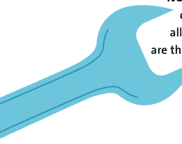

现在你需要定义这些函数，一个用于改变音量，一个用于切换静音：

```
function changeVolume(direction) {
    var volume = Math.floor(video.volume * 10) / 10;
    video.muted = false;
    if (direction == "-") {
        if (volume <= 0.1) video.volume = 0;
        else video.volume -= 0.1;
    }
    else {
        if (volume >= 0.9) video.volume = 1;
        else video.volume += 0.1;
    }
}
```

让我们先看看 `changeVolume()`。

你首先通过视频的 `volume` 属性获取视频的当前音量设置，然后使用 JavaScript 的 `Math.floor()` 函数将其向下舍入到最接近的一位小数。接下来，你将视频的 `muted` 属性设置为 "false"（你不必这样做，但如果有人在调整音量，那个人可能希望如果视频是静音的，则自动取消静音）。

然后你检查按钮调用 `changeVolume()` 时传入的 `direction` 参数，以查看音量应该是减小还是增加。"-" 表示减小，"+" 表示增加。如果是减小，你会检查当前音量是否已经小于 0.1（你以 0.1 为步长减小和增加音量），如果是，你只需将视频的 `volume` 属性设置为 0。否则，你将音量减小 0.1。对于增加音量，情况几乎相反；1 是最大值。

现在你定义一个函数 `toggleMute()` 来切换视频的静音状态：

```
function toggleMute() {
    var mute = document.getElementById("mute");
    if (video.muted) {
        mute.title = "mute";
        mute.innerHTML = "mute";
        video.muted = false;
    }
    else {
        mute.title = "unmute";
        mute.innerHTML = "unmute";
        video.muted = true;
    }
}
```

如你在前面的代码中所见，你首先需要获取对静音按钮对象的引用以便使用它，因为，与播放/暂停按钮一样，你需要更改其文本和值。

然后你检查视频的 `muted` 属性，看它是否已经静音。如果是，你将按钮的值更改为 "mute" 并将视频的 `muted` 属性设置为 "false"。否则，你将按钮的值和标题设置为 "unmute"，并将视频的 `muted` 属性设置为 "true"。

现在你需要将这些函数添加到它们对应的按钮 `onclick` 事件中：

```
<button id="volumeDown" title="-" onclick="changeVolume('-')">-</button>
<button id="volumeUp" title="+" onclick="changeVolume('+')">+</button>
<button id="mute" title="mute" onclick="toggleMute()">mute</button>
```

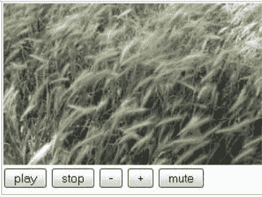

图 5.4 视频播放器现在添加了声音控制功能！

在这种情况下，除非你需要更新播放器当前控制界面的显示，否则你无需监听任何事件。如果你确实想对音量变化做出反应，可以为 `volumechange` 事件添加一个监听器，当音量或静音值发生更改时会触发该事件。

按钮已经完成了。你的播放器现在多了三个可用的按钮（图 5.4），并且它们功能齐全。

现在先暂时搁置按钮。你如何向用户展示他们观看了视频的多少内容？为此，你需要一个进度条。

### 添加进度条

要添加进度条，你首先需要为其添加 HTML：

```
<div id="progressBar"><span id="played"></span></div>
```

> 注意：理想情况下，应该使用新的 HTML5 `progress` 元素来添加进度条。不幸的是，目前它仅被 Opera 和 Chrome 支持，因此我们转而使用简单的 `div` 和 `span` 组合。

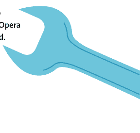

图 5.5 视频播放器显示了一个目前没有任何作用的进度条。

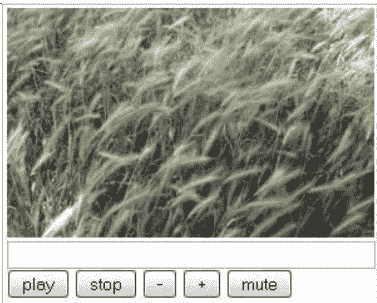

此外，你还需要用一些简单的 CSS 来为它设置样式，使其在视觉上生效：

```
#progressBar {
    border:1px solid #aaa;
    color:#fff;
    width:295px;
    height:20px;
}
#played {
    background-color:#aaa;
    height:20px;
    display:inline-block;
}
```

宽度和高度是相当随意的，但此时这并不重要，因为你可以按照自己的意愿设置进度条的样式。使用这段代码，你现在就有了一个简陋的进度条（**图 5.5**）。

基本上，你接下来要做的是在视频播放时，增加 `progressBar` div 内 `played` span 的宽度百分比。

你定义了一个名为 `updateProgress()` 的函数，你将用它来获取视频的 `currentTime` 设置，并相应地增加 `played` span 的宽度：

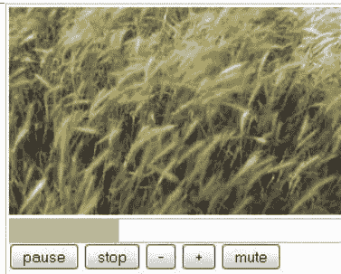

图 5.6 视频播放器及其可用的进度条。好极了！

```
function updateProgress() {
    var value = 0;
    if (video.currentTime > 0) {
        value = Math.floor((100 / video.duration) *
                           video.currentTime);
    }
    document.getElementById("played").style.width = value + "%";
}
```

该函数使用视频的完整时长与 `currentTime`（视频完整时间线内的当前位置）进行比较，计算出已播放视频的百分比。

当然，要使进度条工作，你需要监听一个事件，该事件在 `currentTime` 发生变化时通知你，以便你可以调用 `updateProgress()` 函数并实际更新进度条——在这种情况下，就是 `timeupdate` 事件：

```
video.addEventListener('timeupdate', updateProgress, false);
```

就这样。播放视频时会触发 `timeupdate` 事件，这反过来会调用 `updateProgress()` 函数，从而更新进度条。

你这个比普通视频播放器稍好一些的播放器现在有了一个可用的进度条（图 5.6）！

为了让这个简单的视频播放器更有用，为什么不添加快进和快退按钮呢？

### 添加快进和快退按钮

是的，恐怕又要回到添加按钮了。但你现在已经是添加按钮的老手了，所以在你进入 JavaScript 阶段之前，我不需要告诉你该怎么做。

让我们定义按钮，并为 `onClick` 事件加上函数名，因为你现在知道这是什么了：

```
<button id="rewind" title="reverse" onclick="changePlaybackSpeed('-');" >&laquo;</button>
<button id="ffwd" title="fast forward" onclick="changePlaybackSpeed('+');" >&raquo;</button>
```

你将使用 HTML 实体 `&laquo;` 和 `&raquo;` 来模拟此类按钮上典型的符号：`«` 和 `»`。

注意，你将要定义的函数名称是 `changePlaybackSpeed()`。你将要更改以使其工作的属性是表 5.1 中遇到的 `playbackRate` 属性。

不过有一个警告：目前，只有基于 WebKit 的浏览器（Safari 和 Chrome）支持 `playbackRate` 属性。因此，在其他浏览器上模拟预期功能的唯一方法是更改视频的 `currentTime` 属性，将其向前或向后移动：

```
function changePlaybackSpeed(direction) {
    if (video.playbackRate != undefined) {
        if (direction == "-") video.playbackRate -= 1;
        else video.playbackRate += 1;
    }
    else {
        if (direction == "-") video.currentTime -= 1;
        else video.currentTime += 1;
    }
}
```

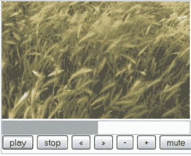

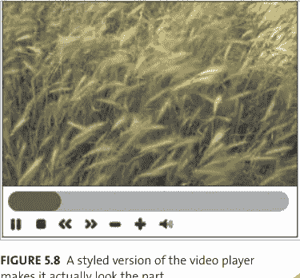

如果 `video.playbackRate` 已定义，你检查传入的 `direction` 参数——同样是“-”表示后退，“+”表示前进——并相应地减少或增加 `playbackRate`。如果 `playbackRate` 为 0，视频实际上会暂停，播放停止。否则，你将视频的 `currentTime` 向后或向前移动 1。

> **提示：** 尽管 Safari 和 Chrome 都支持 `playbackRate` 属性，但它们的工作方式不同。两者都支持通过增加参数来快进，但 Chrome 不支持快退。而 Safari 则实际上开始反向播放视频，直到开头。

你这个简单但比本章开始时更棒一些的媒体播放器，现在拥有了一整套相当灰色但功能齐全的按钮和一个可用的进度条（**图 5.7**）。

通过一些 CSS 的调整，你可以按照自己的品味设置播放器样式，达到 **图 5.8** 所见的效果，或者可能更好的效果。

就在你以为这个简单的媒体播放器已经完成时，你将进行最后一次添加，以增加它的“棒”度——进度条拖动功能。

> **注意：** 这个带样式的播放器和不带样式的播放器的代码可在网站 www.html5multimedia.com 上获取。

### 添加拖动条

进度条拖动功能允许用户点击进度条上的任何位置，将视频移动到该点。这不需要新的 HTML；添加此功能所需的一切都在 JavaScript 中。你只需要添加一个事件监听器和两个函数。

因为交互将通过鼠标进行，你需要为进度条添加 `mouseup` 事件的监听器（当用户在点击结束时释放鼠标按钮时触发）：

```
var progressBar = document.getElementById("progressBar");
progressBar.addEventListener("mouseup", function(e)
  { setPlayPosition(e.pageX); }, false);
```

这段代码表明，当 `mouseup` 被触发时，会调用 `setPlayPosition()` 函数（它接受一个参数——点击时鼠标的 x 坐标）。

将 `setPlayPosition()` 函数定义如下：

```
function setPlayPosition(x) {
    var progressBar = document.getElementById("progressBar");
    var value = (x - findPos(progressBar)).toFixed(2);
    var timeToSet = ((video.duration /
      progressBar.offsetWidth).toFixed(2) * value).toFixed(2);
    video.currentTime = timeToSet;
}
```

`setPlayPosition()` 函数是所有操作发生的地方。你定义一个指向进度条的句柄，然后根据点击时鼠标的 x 坐标（减去进度条在网页上的实际位置——通过 `findPos()` 函数获得）设置一个变量 `value`，保留两位小数：

`findPos()` 定义如下：

```
function findPos(obj) {
    var curleft = 0;
    if (obj.offsetParent) {
        do { curleft += obj.offsetLeft; } while
        → (obj = obj.offsetParent);
    }
    return curleft;
}
```

> 注意：`findPos()` 函数查找 HTML 元素的实际位置，并考虑其父元素的位置。你可以在 www.quirksmode.org/js/findpos.html 上阅读更多关于其背后的代码。

你通过 `findPos()` 函数计算 `value` 变量，以获得更准确的鼠标位置读数，因为它考虑了进度条的偏移位置。

接下来，你定义 `timeToSet` 变量，这将是视频将被设置的实际时间值。你通过将视频的完整时长除以进度条的宽度来计算此变量。所得的计算结果大致相当于每视频单位时间的像素位置，然后你将其乘以 `value`。所有结果都保留两位小数。

然后，你将视频的 `currentTime` 变量设置为这个新的时间值。

现在，当用户在进度条中点击时，视频将移动到该位置，播放将从那里继续/开始。

你刚刚创建的播放器当然是仅支持 HTML5 的，对于不支持 HTML5 的浏览器，例如 Internet Explorer 6 到 8，该播放器将无法工作。那么，你如何使其与这些浏览器兼容呢？这就是你接下来要学习的内容。

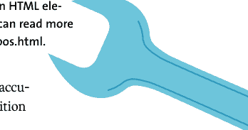

### 不支持HTML5的浏览器

要让您的播放器兼容不支持HTML5的浏览器，您首先需要为这些浏览器在视频元素中添加一个Flash资源（如第4章所述）。然后进行检查，看浏览器是否支持HTML5视频。如果是，您可以继续使用所有那些用于添加控件、事件和功能的炫酷JavaScript代码。如果浏览器不支持HTML5视频，您将隐藏自定义控件，让Flash播放器处理视频播放并提供用户控件。

您可以通过以下JavaScript代码片段来检查浏览器的视频支持情况：

```
var v = document.createElement("video");
if (v.play) {
    /* ...该浏览器支持HTML5视频...*/
}
else {
    /*...该浏览器不支持HTML5视频...*/
}
```

此代码创建一个虚拟视频元素，然后检查 `play` 函数是否存在。如果不存在，则浏览器不支持视频播放。

### MODERNIZR

您也可以使用非常有用的Modernizr（www.modernizr.com）检测库来检查浏览器的视频支持情况，它允许您简单地编写：

```
if (Modernizr.video) {
    /* ...该浏览器支持HTML5视频...*/
}
else {
    /*...该浏览器不支持HTML5视频...*/
}
```

此外，Modernizr允许您检查浏览器对许多其他HTML5元素、功能和特性的支持，以及检查对CSS3的支持。

## 总结

您现在熟悉了HTML5媒体JavaScript API的大部分属性、事件和方法，以及它们的用途。您学习了如何使用它们来构建一个带有自定义控件、也能通过事件响应来自其他源的视频播放变化的简单HTML5视频播放器。

当然，使用API和您的视频播放器还能做更多事情，尽管这个播放器目前相当简单和基础。您可以更进一步，添加一个播放列表，根据用户从列表中的选择在播放器中加载视频。但该功能超出了简单媒体播放器的范围。

您通过CSS为最终版本的极简媒体播放器（图5.8）设置了样式，这实际上只是为您用于构建控件集的标准HTML元素（`div`、`button`和`span`）添加了样式。下一章将展示如何使用CSS为实际媒体元素设置样式。

# 使用CSS为媒体元素设置样式


因为音频和视频元素是有效的HTML元素，所以您可以像处理其他元素（如`div`、`header`、`article`和`section`）一样处理它们。当然，这意味着音频和视频元素可以通过CSS来设置样式。

您不再需要获取具有正确或相似颜色的Flash播放器，以使播放器与网站的配色方案相匹配（嗯，当然，对于不支持HTML5的浏览器除外）。现在，您可以戴上您的CSS帽子，运用您的技能，让这些元素呈现出您想要的外观。

除了您熟悉的常用CSS声明外，随着CSS3（最新版本的CSS）的出现，还出现了一些新的声明。在本章中，您将学习一些最有用的CSS属性和技术，它们可以应用于媒体元素。您还将了解浏览器厂商前缀的CSS规则及其存在的原因。

## 简单的CSS样式

图6.1 一些简单的CSS样式可以使视频更具美感。

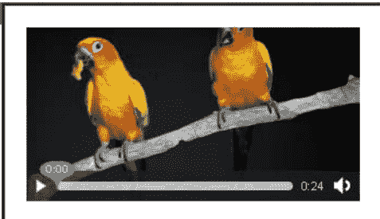

层叠样式表（CSS）是一种用于描述使用标记语言（本例中为HTML5）编写的文档呈现方式的语言。CSS基本上将文档内容与文档样式（包括颜色、背景图像、字体和定位）分离开来。

全面深入地研究CSS的语法和属性超出了本书的范围。如果您是CSS新手，请查阅您能找到的众多书籍和在线资源，以熟悉这些概念。

在深入学习更高级的样式设置之前，让我们先看几个如何使用基本CSS来设置视频元素外观的简单例子。

首先，让我们取一个视频，给它一个大的白色边框，并将其居中放置在网页文档的中间（图6.1）。

视频的代码并不新鲜：

```
<video controls preload="metadata">
    <source src="parrots-small.mp4" type="video/mp4">
    <source src="parrots-small.webm" type="video/webm">
</video>
```

用于实现此样式的基本CSS如下：

```
body {
    background-color:#262626;
    margin:0 auto;
    text-align:center;
}

video {
    margin-top:100px;
    border:20px solid #fff;
}
```

`body` 的背景色为 `#262626`（一种炭灰色），其内容居中对齐。视频元素有一个20像素厚的白色边框，并放置在距页面顶部100像素的位置。这改善了视频的整体外观。

**注意：** 如果您想将视频居中放置在不同的内容div列中，可以在视频元素上使用 `margin:0 auto;`。

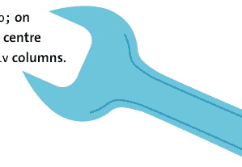

如果您想在视频上方添加标题，可以使用通常的相对定位和 `z-index` 方法来确保标题放置在您想要的位置。以下HTML定义了一个简单的容器div、一个包含标题的div和视频元素：

```
<div class="container">
    <div class="title">Parrots</div>
    <video controls preload="metadata">
        <source src="parrots-small.mp4" type="video/mp4">
        <source src="parrots-small.webm" type="video/webm">
    </video>
</div>
```

容器div仅用于将标题div和视频封装在特定宽度内：

```
.container {
    width:340px;
}
```

接下来，您为标题div设置样式，赋予其特定尺寸、应用背景色、使文本居中并将文本转换为大写。我们还给它一个相对位置，并将 `z-index` 定义为2：

```
.title {
    width: 200px;
    height: 30px;
    background-color: #aaa;
    z-index: 2;
    position: relative;
    margin: 10px auto;
    border: 1px solid #262626;
    text-transform: uppercase;
    text-align: center;
}
```

然后给视频一些尺寸、设置为相对位置，并将 `z-index` 设为1（小于标题div的 `z-index`，因此它将被放置在标题div后面）。应用负的上边距将其置于标题div下方，然后通过auto设置在容器div内水平居中：

```
video {
    margin: -35px auto;
    width: 305px;
    height: 152px;
    border: 20px solid #fff;
    position: relative;
    z-index: 1;
}
```

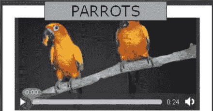

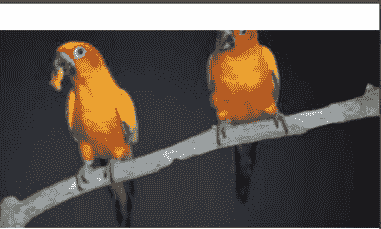

**图6.2** 一个标题div被放置在视频元素上方。

**图6.3** 带有白色背景的视频。

结果如**图6.2**所示。

如果您需要定义一个比其包含的视频更大的视频元素（例如，可能会将不同大小的视频加载到元素中），视频可能会有信箱效果。您可以为视频元素应用背景色，该背景色将填充空白区域：

```
video {
    margin:20px;
    background-color:#fff;
    width:305px;
    height:200px;
}
```

这里背景色定义为 `#fff`（白色），结果如**图6.3**所示。

前面的例子并不惊人，也相对简单。然而，它们表明您可以使用已有的CSS知识，像处理任何其他HTML元素一样操作和设置视频元素的样式。

接下来是一些CSS3特定的例子。

## 使用CSS3的高级炫酷功能


CSS3，最新版本的CSS，拥有一整套其前身CSS2.1所没有的新规则和属性。您可以使用这些新功能随心所欲地设置HTML元素的样式。

研究和列出这些规则和属性超出了本书的范围，但您可以在www.w3.org/TR/CSS查看规范。

以下章节讨论了一些更有趣、能添加新功能的属性，按照惯例，其中包含完整的示例。

> **提示：** 关于CSS3及其各种用法示例的两个绝佳资源是CSS3.info（http://www.css3.info）和Dev.Opera（http://dev.opera.com/articles/css）。

### 不透明度

如果您愿意，可以使用CSS3的 `opacity` 属性使您的视频透明。此属性接受0到1之间的值；0是不可见的，1是完全不透明的：

```
video {
    opacity:0.5;
}
```

这段CSS使视频半透明（**图6.4**）。

然后，您可以通过以下方式在悬停时使视频达到100%不透明度：

```
video:hover {
    opacity:1;
}
```

不透明度在Firefox、Opera、Internet Explorer和Safari的最新版本中有效。Chrome会渲染透明的视频控件，但视频本身不透明。

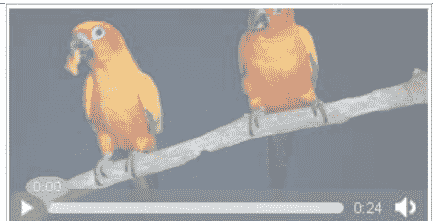

**图 6.4** 此视频在 Firefox 5 中具有 50% 的透明度。

### 渐变

CSS3 的另一项新功能是能够将渐变（从一种颜色过渡到另一种颜色）定义为元素的背景图像。指定渐变需要使用另一个 CSS3 属性：`rgba` 颜色定义。

在之前的 CSS 中，颜色可以通过常用名称（例如 white）、十六进制颜色代码（例如 `#ffffff`）或 `rgb` 颜色定义（其中你定义颜色的红、绿、蓝分量值，例如 `rgb(255,255,255)`）来定义。这些颜色定义在 CSS3 中当然仍然完全有效，但你也可以使用一个新规则：`rgba`。与 `rgb` 类似，`rgba` 也允许你定义 alpha 通道——即除了红、绿、蓝值之外，颜色的不透明度值。例如，`rgba(255, 255, 255, 0.5)` 定义了一种不透明度为 50% 的白色。渐变利用了这一点，你将在下文中看到。

你也可以将渐变与视频一起使用，但不能将其应用于实际元素，因为作为背景图像，视频会始终且正确地显示在最上层，从而隐藏大部分或全部背景。但是，你可以将渐变添加到一个 div，然后将其放置在视频元素之上，如下所示：

```
<video controls preload="metadata">
    <source src="parrots-small.mp4" type="video/mp4">
    <source src="parrots-small.webm" type="video/webm">
</video>
<div class="gradient"></div>
```

然后，为视频设置相对定位和 `z-index` 为 1。为渐变 div 设置相对定位，与视频相同的尺寸，并将 `z-index` 设置为 2（使其保持在视频元素之上），然后应用渐变：

```
.gradient {
    width:305px;
    height:152px;
    margin:-187px 30px 30px;
    position:relative;
    z-index:2;
    background-image: -webkit-linear-gradient(
        top,
        rgba(255,255,255,0),
        rgba(255,255,255,1)
    );
    background-image: -moz-linear-gradient(
        top,
        rgba(255,255,255,0),
        rgba(255,255,255,1)
    );
    background-image: -o-linear-gradient(
        top,
        rgba(255,255,255,0),
        rgba(255,255,255,1)
    );
    background-image: linear-gradient(
        top,
        rgba(255,255,255,0),
        rgba(255,255,255,1)
    );
}
```

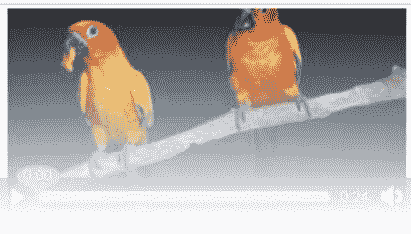

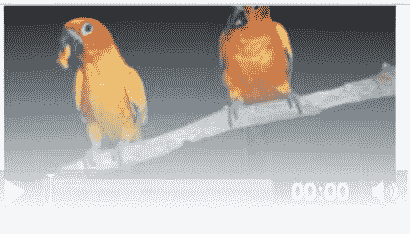

**图 6.5** 应用了渐变的视频在 Firefox 5（左）和 Chrome 13（右）中的显示效果。

渐变颜色使用了前面提到的新 CSS3 `rgba` 颜色设置规则来定义。上例中使用的颜色定义将“起始”颜色的不透明度定义为 0（透明），将“结束”颜色的不透明度定义为 1（不透明）。

请注意，渐变有四种不同的定义：一种带有 `-moz` 前缀（Mozilla Firefox 特定），一种带有 `-webkit` 前缀（WebKit 浏览器特定；Safari 和 Chrome），一种带有 `-o` 前缀（Opera），还有一种没有浏览器特定前缀，这是 CSS3 的定义，但可能尚未得到支持。

> 提示：始终提供特定于浏览器的 CSS 定义（如果存在）以及实际的规范版本，以确保所有能够使用该样式规则的浏览器都会应用它，这是一个好习惯。

定义通常采用以下格式：

`position, gradient-from-colour, gradient-to-colour`

你可以在 **图 6.5** 中看到渐变的效果。注意控件被覆盖且无法使用，因此你应该通过第 5 章所述的 JavaScript API 来实现它们。

渐变在 Firefox、Chrome 和 Safari 中有效。

> 注意：你可以使用 CSS3 线性渐变规则实现比示例中展示的更多效果，但任何进一步的解释超出了本书的范围。你可以在 http://dev.opera.com/articles/view/css3-linear-gradients 了解更多关于 CSS3 线性渐变的信息。

**图 6.6** 一个具有漂亮圆角的视频元素。

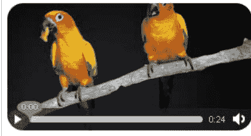

### 圆角

圆角曾经是 Web 开发者的噩梦，他们花费许多时间摆弄背景图像，只为给 HTML 元素添加圆角。CSS3 中通过添加 `border-radius` 解决了这个痛点，它允许你为任何 HTML 元素（包括多媒体元素）添加圆角：

```
video {
    -moz-border-radius:20px;
    -webkit-border-radius:20px;
    border-radius:20px;
}
```

同样，有多种特定于浏览器的定义，但每一种都为元素赋予了 20 像素的圆角半径（**图 6.6**）。

目前，媒体元素上的圆角仅在 Firefox 中有效。

### 阴影

与圆角结合，为 HTML 元素添加阴影是另一项常见的 Web 开发者任务。CSS3 再次拯救了开发者，并将其添加到了规范中。

使用以下代码，你可以为视频底部和右侧的 10 像素区域添加颜色为 `#999` 的阴影，扩展量为 5 像素：

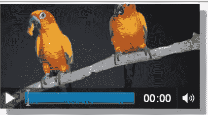

**图 6.7** 在 Chrome 13 中带有投影阴影的视频。

```
video {
    -moz-box-shadow: 10px 10px 5px #999;
    -webkit-box-shadow: 10px 10px 5px #999;
    box-shadow: 10px 10px 5px #999;
}
```

结果如 **图 6.7** 所示。

### 圆角加阴影

将圆角与阴影结合并应用于视频元素，在除 Firefox 之外的所有浏览器中都会产生奇特的效果。

Firefox 正确渲染这些属性，但其他浏览器会忽略视频元素上的圆角，转而将圆角应用于阴影（**图 6.8**）！

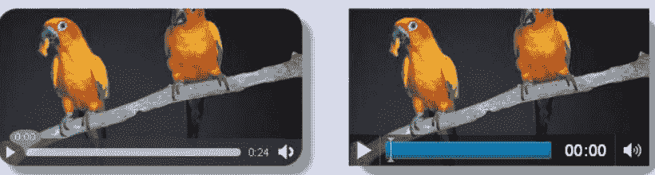

**图 6.8** 在 Firefox（左）和 Chrome（右）中渲染的带有圆角和投影阴影的视频。

**图 6.9** 在 Firefox 中显示的带有圆角和投影阴影的音频控件。

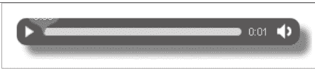

你不仅可以将投影阴影和圆角应用于视频元素，还可以将它们应用于音频元素：

```
<audio controls>
    <source src="sayHello.ogg" type="audio/ogg">
    <source src="sayHello.mp4" type="audio/mp4">
</audio>
```

这个音频元素随后被这样设置样式：

```
audio {
    border-radius: 10px;
    box-shadow: 10px 10px 5px #888;
}
```

前面的音频元素示例在 Firefox 中显示效果最佳（**图 6.9**）；其他浏览器不会将圆角应用于音频元素。

### 调整内容大小

CSS3 规范中的两个新属性允许你指定替换元素（如图像和视频）内的替换内容如何被包含。你可能希望你的视频内容占据特定尺寸的空间，但希望保持纵横比，而不是拉伸或压缩内容。同样，你可能实际上希望视频内容被压缩或拉伸！允许你定义视频内容渲染方式的两个属性是 `object-fit` 和 `object-position` 属性。

### OBJECT-FIT

`object-fit` 指定元素应如何相对于容器（使用其高度和宽度）进行缩放。`object-fit` 可以有多个值：

- `fill`：内容填充容器。

- `contain`：内容填充容器，并且保持多媒体元素的纵横比。

- `cover`：内容完全填充容器。

- `none`：内容填充整个容器，而不考虑纵横比，因此可能会发生一些拉伸。

- `scale-down`：应用 `none` 或 `contain` 中会产生较小尺寸的那一个。

不实际查看结果，很难理解每个 `object-fit` 值的含义。因此，让我们看一个使用五个视频的所有值的示例：

```
<video id="v1" width="200" height="200" preload="metadata">
  <source src="parrots-tiny.mp4" type="video/mp4">
  <source src="parrots-small.webm" type="video/webm">
</video>
<video id="v2" width="200" height="200" preload="metadata">
  <source src="parrots-small.mp4" type="video/mp4">
  <source src="parrots-small.webm" type="video/webm">
</video>
<video id="v3" width="200" height="200" preload="metadata">
  <source src="parrots-small.mp4" type="video/mp4">
  <source src="parrots-small.webm" type="video/webm">
</video>
<video id="v4" width="200" height="200" preload="metadata">
  <source src="parrots-small.mp4" type="video/mp4">
```

### OBJECT-POSITION

`object-position` 属性用于指定元素在其容器内的对齐方式。该 CSS 规则的取值方式与广为人知的 `background-position` 属性相同，并且用法也一样，用于定义元素应放置的位置。

利用前面四个视频定义，你可以按照如下方式定位它们：

```html
<video id="v1" preload="metadata">
    <source src="parrots-tiny.mp4" type="video/mp4">
    <source src="parrots-tiny.webm" type="video/webm">
</video>
<video id="v2" preload="metadata">
    <source src="parrots-tiny.mp4" type="video/mp4">
    <source src="parrots-tiny.webm" type="video/webm">
</video>
<video id="v3" preload="metadata">
    <source src="parrots-tiny.mp4" type="video/mp4">
    <source src="parrots-tiny.webm" type="video/webm">
</video>
<video id="v4" preload="metadata">
    <source src="parrots-tiny.mp4" type="video/mp4">
    <source src="parrots-tiny.webm" type="video/webm">
</video>
```

为视频设置如下样式，但为每个视频定义不同的 `-o-object-position` CSS 规则：

```css
video {
    border:1px solid #000;
    display:block;
    margin-bottom:10px;
    width:300px;
    height:180px;
    -o-object-fit:none;
}
video#v1 {
    -o-object-position:top left;
}
video#v2 {
    -o-object-position:right center;
}
video#v3 {
    -o-object-position:right bottom;
}
video#v4 {
    -o-object-position:center;
}
```

你现在已经定义了四个视频，它们都带有边框和指定尺寸，但 `object-position` 的设置各不相同。

注意：`object-position` 属性目前仅在 Opera 中受支持，需要使用浏览器特定的 `-o-object-position` 属性。

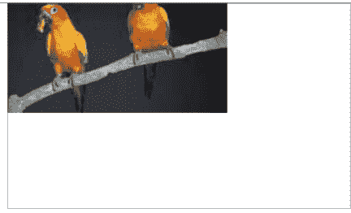

**图 6.15** 使用 `object-position:top left` 定位视频内容。

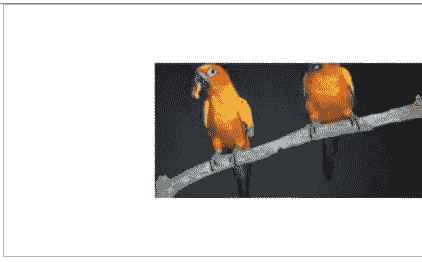

**图 6.16** 使用 `object-position:right center` 定位视频内容。

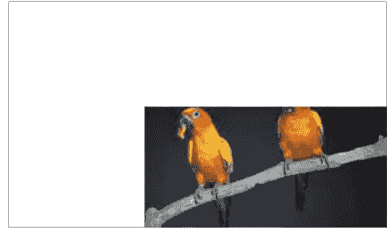

**图 6.17** 使用 `object-position:right bottom` 定位视频内容。

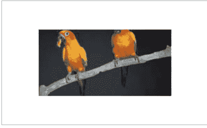

**图 6.18** 使用 `object-position:center` 定位视频内容。

图 **6.15** 到 **6.18** 展示了每个视频在 Opera 11.50 中的渲染效果。你可以将多种 CSS3 规则应用于 `video` 元素。本节讨论的这些规则只是让你初步了解可用功能。我们鼓励你自行探索其他规则。

一些 WebKit 特定的设置并非 CSS3 规范的一部分，但它们确实存在，并且能实现一些很酷的效果。接下来我们将介绍其中一些。

**提示：你可以在 http://dev.w3.org/csswg/css3-images/#object-fit 和 http://dev.w3.org/csswg/css3-images/#object-position 阅读更多关于 `object-fit` 和 `object-position` CSS3 属性的信息。**

### WEBKIT 特定的 CSS3 规则


**图 6.19** 在 Chrome 13 中自动播放的视频及其下方的倒影。

两个非常值得研究的 WebKit 特定属性是 `reflect` 和 `mask`。希望它们将来能成为更广泛规范的一部分。即使没有，你现在也可以使用它们产生的效果来让你的 WebKit 浏览器用户惊叹不已。

#### REFLECT

`-webkit-box-reflect` 属性允许你为 HTML 元素指定一个倒影。下面，我们将它应用于视频：

```css
video {
    -webkit-box-reflect:below 0px;
}
```

这段简短的代码片段在指定视频正下方定义了一个倒影（图 6.19）。视频控件已被移除，因为它们也会被包含在倒影中，这并不理想；你应该改用 Media JavaScript API 来实现它们。

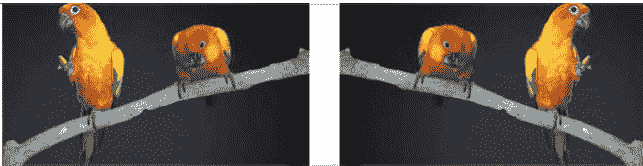

**图 6.20** 在 Chrome 13 中，视频向右倒影 30 像素。

你也可以将视频向右倒影 30 像素（图 6.20）。

```css
video {
    -webkit-box-reflect:right 30px;
}
```

#### MASK

你也可以使用 `-webkit-mask-box-image` 属性在视频上添加蒙版。为此，你需要创建一个蒙版图像，其尺寸应与视频相同。蒙版在你想要隐藏视频的地方应是透明的，在你想要视频显示的地方应是不透明的。

> 注意：Chrome 13 要求蒙版图像在你想要隐藏视频的地方是不透明的，在你想要视频显示的地方是透明的。Safari 5.0.5 也有这个要求，但在 5.1 版本中最近进行了更改。

然后，你只需将该图像的 URL 赋值给视频元素 CSS 规则集中的 `-webkit-mask-box-image` 属性，并提供一个背景颜色来填充蒙版图像的不透明区域：

```css
video {
    -webkit-mask-box-image:url('oval-mask.png');
    background-color:#262626;
}
```


**图 6.21** 在 Safari 5.1 中，视频隐藏在蒙版图像后（左）；在 Chrome 13 中使用相同的蒙版图像（中）；在 Chrome 13 中使用反转的蒙版图像（右）。

本例使用了一个简单的椭圆形蒙版图像；椭圆形区域是视频应该显示的地方（图 6.21）。

如果控件被隐藏或部分隐藏在蒙版图像后面，它们将无法访问；因此，你应该移除默认控件集，并通过 JavaScript 来实现。

如果你想让用户通过特定图像观看视频以获得额外效果——例如，通过舷窗观看海洋视频——你可以使用蒙版图像。

可惜的是，`reflect` 和 `mask` 属性是 WebKit 特有的。但谁知道呢；也许有一天它们会成为标准，并纳入下一个 CSS 规范。

> 提议：你可以在 http://designshack.co.uk/articles/css/mastering-css-reflections-in-webkit 阅读更多关于使用 `reflect` 和 `mask` 属性的信息。

## 总结

你学习了如何像创建任何其他 HTML 元素一样，在网页文档中创建 HTML5 多媒体元素，并以相同的方式设置样式和定位它们。本章仅让你初步了解在为元素设置样式时可以做些什么。请务必尝试不同的样式设置，看看你能发现什么以及能取得什么成果。

你还了解了一些最新 CSS3 属性附带的一些新功能。但 CSS3 的扩展远不止于此。第 7 章将讨论 CSS3 中的过渡、变换和动画。

# 转换、变形与动画

你可以使用 CSS 来设置多媒体元素的样式，但 CSS3 提供了一些令人兴奋的新特性。通过使用这三个新特性——转换、变形和动画——你可以无需任何花哨的 JavaScript 就能通过 CSS 创建视觉增强效果。由于这些特性被认为是呈现性的，因此它们是 CSS 的一部分是理想的。

本章简要介绍了 CSS3 转换、变形和动画的某些方面。你将学习如何使用和组合它们，为你的布局添加动态效果。

## 使用转换

字典中对“转换”的定义之一是“从一种形式、状态、样式或位置过渡到另一种”。对于 HTML 元素，尤其是样式来说也是如此。它要么是这种颜色，要么是那种颜色；要么位于这个位置，要么位于那个位置。没有中间状态；非此即彼。转换在一种样式、位置或状态与另一种之间添加了中间状态。

例如，假设你有一个 HTML 元素，你为其定义了固定尺寸，并且你希望该元素在悬停时增大尺寸。这可以通过将以下 CSS 应用于一个 HTML `img` 元素来相对简单地实现：

```css
img{
    width:183px;
    height:164px;
}

img:hover {
    width:275px;
    height:246px;
}
```

以下是应用了上述 CSS 的图像：

```html

```

**注意：** 本章使用的所有代码示例都可在 www.html5multimedia.com 在线查看。

将鼠标悬停在此图像上会导致其尺寸从 183 × 164 像素跳变为 275 × 246 像素，然后在你移开鼠标时又跳变回来。这两种状态之间的过渡是不存在的，因为图像从一个尺寸瞬时切换到另一个尺寸（**图 7.1**）。

这就是 CSS 转换发挥作用的地方。W3C 对转换的描述如下：

> “CSS 转换允许 CSS 属性值的变化在指定的持续时间内平滑地发生。”

使用前面的例子，你可以为 `img` 元素添加一条转换规则，使其逐渐增大到 275 × 246 像素，而不是从原始尺寸跳变为新的更大尺寸。

> **提示：** 所有主要浏览器都支持 CSS 转换，但你应该使用特定于浏览器的 CSS 规则以确保兼容性。

要创建此转换，你将使用表 7.1 中列出的一些转换属性。

**表 7.1** CSS3 转换属性

| 名称 | 描述 |

| :--- | :--- |

| `transition-property` | 指定要应用转换的过渡属性的名称（例如，`background`, `color`, `font-size`, `none` 或 `all`）。 |

| `transition-duration` | 定义转换实际花费的时间长度（以秒为单位）。值为 `0s` 表示转换将立即发生。 |

| `transition-timing-function` | 指定在转换期间用于计算中间值的函数。此属性有许多预定义的值：`ease`、`linear`、`ease-in`、`ease-out`、`ease-in-out` 和 `cubic-bezier()`，后者允许你自定义。 |

| `transition-delay` | 定义转换何时开始。默认设置值为 `0s`，会导致转换立即开始。 |

考虑到你应该为每个指定的转换属性添加所有不同的特定于供应商的规则，这可能会导致一个相当长的列表！仅对于 Mozilla 来说，定义一条转换规则可能需要三行代码：

```css
-moz-transition-property:all;
-moz-transition-duration:1s;
-moz-transition-timing-function:ease;
```

**提示：** 要查看可以对其应用转换的所有属性列表，请参阅 www.w3.org/TR/css3-transitions/#properties-from-css；有关转换时间函数的更多信息，请参阅 www.w3.org/TR/css3-transitions/#transition-timing-function。

为其他三个供应商和非供应商特定的规则定义添加规则，将使得仅一个转换就需要 15 行 CSS！幸运的是，你可以通过使用简写规则来避免这个问题，该规则允许你将各种属性组合在一起定义，例如：

```css
-moz-transition: all 1s ease;
```

因此，使用前面的转换规则信息并提供所有不同的特定于供应商的简写规则，你可以这样定义转换：

```css
img {
    width:183px;
    height:164px;
    -webkit-transition: all 1s ease;
    -moz-transition: all 1s ease;
    -o-transition: all 1s ease;
    -ms-transition: all 1s ease;
    transition: all 1s ease;
}
```

你将转换规则放在相关元素的正常状态上，而不是 `:hover` 状态上。原因是你可能希望转换应用于该元素的所有状态，例如 `:focus`。

现在，悬停时两种状态之间的过渡平滑得多，因为图像逐渐从一个尺寸变化到下一个尺寸（**图 7.2**）。

**图 7.2** 虽然你将不得不发挥想象力，但图像现在从一种尺寸（A）平滑地增大到另一种尺寸（C），中间有过渡状态（由 B 表示）。

### 在音频和视频中使用转换

因为你可以将转换应用于任何 HTML 元素，所以你当然可以对 `audio` 和 `video` 元素使用转换：

```css
video {
    width:146px;
    height:76px;
    -webkit-transition: all 1s ease;
    -moz-transition: all 1s ease;
    -o-transition: all 1s ease;
    -ms-transition: all 1s ease;
    transition: all 1s ease;
}
```

图 7.3 悬停时，视频从一种尺寸（A）平滑地过渡到另一种尺寸（C），中间有过渡状态（由 B 表示）。

```css
video:hover {
    width:292px;
    height:152px;
}
```

尝试想象视频如何从 146 × 76 平滑地增大到 292 × 152（图 7.3）。

### 使用 CSS 转换进行样式设置

使用 CSS 转换，你可以以不同的方式设置视频样式，从而为用户创造更好的体验。例如，假设你有一个视频，你已经用投影为其设置了样式，如下所示：

```html
<video controls preload="metadata">
    <source src="parrots-small.mp4" type="video/mp4">
    <source src="parrots-small.webm" type="video/webm">
</video>
```

```css
video {
    margin:100px;
    -moz-box-shadow: 5px 5px 5px #999;
    -webkit-box-shadow: 5px 5px 5px #999;
    box-shadow: 5px 5px 5px #999;
}
```

图 7.4 当用户将鼠标悬停在视频上时（左），投影平滑地增大（右）。

但你希望在用户将鼠标悬停在视频上时增大投影。没什么花哨的；你只是想给用户添加一个微妙的响应式反馈。你将定义视频的悬停状态，然后向视频元素的正常状态添加转换：

```css
video {
    margin:100px;
    -moz-box-shadow: 5px 5px 5px #999;
    -webkit-box-shadow: 5px 5px 5px #999;
    box-shadow: 5px 5px 5px #999;
    -webkit-transition: all 1s ease;
    -moz-transition: all 1s ease;
    -o-transition: all 1s ease;
    -ms-transition: all 1s ease;
    transition: all 1s ease;
}
video:hover {
    -moz-box-shadow: 10px 10px 5px #999;
    -webkit-box-shadow: 10px 10px 5px #999;
    box-shadow: 10px 10px 5px #999;
}
```

现在，投影在悬停状态下会略微增大，为用户创造微妙但有效的反馈（图 7.4）。

### 淡入淡出转换

你还可以使用转换在 `:hover` 和 `:focus` 时将视频的不透明度值从 0.5 淡入到 1。如果你同时在屏幕上显示多个视频列表，并且希望用户悬停并播放的视频变得不透明，你可能需要这样做：

```css
video {
    opacity:0.5;
    -webkit-transition: opacity 2s linear;
    -moz-transition: opacity 2s linear;
    -o-transition: opacity 2s linear;
    -ms-transition: opacity 2s linear;
    transition: opacity 2s linear;
}
video:hover, video:focus {
    opacity:1;
}
```

这次持续时间增加到 2 秒，并且转换仅针对不透明度值（而不是像前面的示例那样针对所有属性）（**图 7.5**）。

**注意：** Chrome 似乎在对视频元素进行不透明度转换时存在问题；它只淡入淡出控件，而不是整个元素。

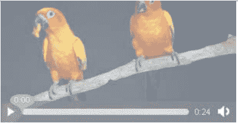

**A**

**图 7.5** 视频初始不透明度为 50%（A），在悬停时变为完全可见（C），中间有一个过渡状态（由 B 表示）。

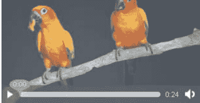

**B**

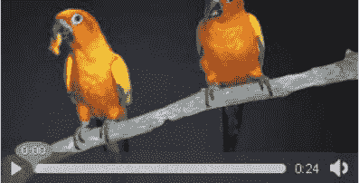

**C**

前面的示例让你对 CSS 过渡能做什么有了概念——为元素创建新的状态并平滑地过渡到这些状态。但这还不是全部。你还可以对 HTML 元素应用二维和三维变换。

**提示：** 你可以在规范 www.w3.org/TR/css3-transitions 中阅读更多关于 CSS3 过渡的内容。

### 探索 2D 变换

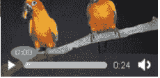

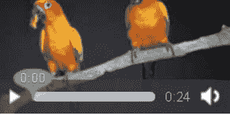

**图 7.6** 视频在悬停时按 1.5 的比例缩放，从小尺寸（左）变为更大的尺寸（右）。

变换被定义为改变某物的外观或形式。这里的“某物”当然是指 HTML 元素。HTML 元素被定位在网页文档中的某个位置，其位置通常由 CSS 中的属性和值决定。但你可能想以某种方式变换 HTML 元素，无论是位置还是外观，而 CSS 变换允许你这样做。

CSS 变换有两种类型：2D 和 3D。我们首先来看看 2D 变换。

2D 变换允许在二维空间中变换元素。通过 CSS 2D 变换，你可以在其定义的空间——即网页文档内，对 HTML 元素进行缩放、旋转、倾斜和平移。

#### 缩放视频

开始探索 2D 变换的最佳方式是通过一个简单的示例。使用这个彩色的鹦鹉视频，你将添加一个缩放变换，在视频的悬停状态下缩放其尺寸：

```
<video controls preload="metadata">
    <source src="parrots-tiny.mp4" type="video/mp4">
    <source src="parrots-tiny.webm" type="video/webm">
</video>
```

要添加变换，你需要使用 `transform` 规则，但同样需要特定于浏览器的规则以确保最佳的浏览器兼容性。

你首先需要指定要使用的变换类型。在这种情况下，你将使用 `scale` 变换，它接受一个参数，指示你希望元素变换的缩放比例。大于 1 的值会放大；小于 1 的值会缩小。这些值的工作方式类似于百分比；`scale(0.75)` 表示 75% 的比例，而 `scale(1.25)` 则表示 125% 的比例。在此示例中，你将视频放大 1.5 倍（150%）：

**注意：** 与 CSS3 过渡一样，只要你使用特定于浏览器的 CSS 规则，2D 变换在现代浏览器中都得到了很好的支持。

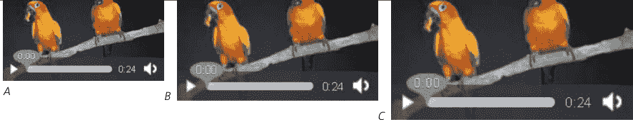

图 7.7 缩放变换现在平滑得多，看起来也更好，它从一个小尺寸（A）通过中间状态（B）过渡到一个更大的尺寸（C）。

```
video:hover {
    -webkit-transform:scale(1.5);
    -moz-transform:scale(1.5);
    -o-transform:scale(1.5);
    -ms-transform:scale(1.5);
    transform:scale(1.5);
}
```

现在当用户将鼠标悬停在视频上时，它将按 1.5 的系数向上缩放（图 7.6）。

但就像本章前面的第一个过渡示例一样，状态之间的过渡既笨拙又难看。那么，你能做什么呢？当然，添加一个过渡！

运用你已经学到的知识，你可以为视频元素的正常状态应用一个简单的过渡，使缩放变换动作更加平滑（图 7.7）：

```
video {
    -webkit-transition: all 1s ease;
    -moz-transition: all 1s ease;
    -o-transition: all 1s ease;
    -ms-transition: all 1s ease;
    transition: all 1s ease;
}
```

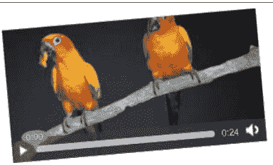

当然，缩放并非唯一的变换；你还可以旋转元素，这正是你接下来要做的。

#### 旋转视频

这次你将旋转视频的正常状态，因此不需要过渡或悬停状态规则。

使用与之前相同的 `transform` 规则，你只需指明你想要旋转元素而不是缩放它。例如，你可能在页面上有多个视频，你希望它们看起来像是随机散落在页面上，每个都以略微不同的角度倾斜。

`rotate` 变换也接受一个参数：元素要旋转的度数。正值使其顺时针旋转；负值使其逆时针旋转：

```
video {
    -webkit-transform:rotate(-5deg);
    -moz-transform:rotate(-5deg);
    -o-transform:rotate(-5deg);
    -ms-transform:rotate(-5deg);
    transform:rotate(-5deg);
}
```

这里，视频逆时针旋转了 5 度（**图 7.8**）。

好处还不止于此！你还可以倾斜视频，如果这是你想实现的效果。

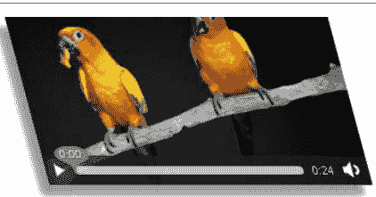

**图 7.9** 一个带有投影、向左倾斜 15 度的视频。

#### 倾斜视频

使用带有投影的视频，你可以将其向左倾斜 15 度：

```
video {
    -webkit-transform:skew(15deg);
    -moz-transform:skew(15deg);
    -o-transform:skew(15deg);
    -ms-transform:skew(15deg);
    transform:skew(15deg);
    -moz-box-shadow: -10px 10px 5px #999;
    -webkit-box-shadow: -10px 10px 5px #999;
    box-shadow: -10px 10px 5px #999;
}
```

负的倾斜值会使视频向右倾斜。**图 7.9** 显示了向左倾斜的结果。

`skew` 变换也可以接受两个参数，允许你为 X 轴和 Y 轴指定两个不同的倾斜值。

哦，还有更多！你还可以将元素从一个位置平移到另一个位置。

#### 平移视频

`translate` 变换接受两个参数：`relativeX` 和 `relativeY`。这两个参数将相对于其正常位置将元素移动到所需的位置，而不会影响周围的元素。

在此示例中，让我们在一个带有黑色边框的 div 中使用两个相邻的视频。在其悬停状态下，每个视频将从其当前位置向右和向下移动 50 像素：

```
<div class="container">
    <video controls preload="metadata">
        <source src="parrots-tiny.mp4" type="video/mp4">
        <source src="parrots-tiny.webm" type="video/webm">
    </video>
    <video controls>
        <source src="parrots-tiny.mp4" type="video/mp4">
        <source src="parrots-tiny.webm" type="video/webm">
    </video>
</div>
video:hover {
    -webkit-transform:translate(50px,50px);
    -moz-transform:translate(50px,50px);
    -o-transform:translate(50px,50px);
    -ms-transform:translate(50px,50px);
    transform:translate(50px,50px);
}
```

如果你想将视频平移到不同的位置，你可以通过为每个视频提供一个唯一的标识符，然后通过该标识符为每个视频指定不同的平移值来实现。

结合你之前学到的知识，你还可以为视频添加边框、投影和缓动过渡，使其变换过程更平滑：

```
video {
    margin-right:10px;
    border:1px solid #000;
    -moz-box-shadow: -10px 10px 5px #999;
    -webkit-box-shadow: -10px 10px 5px #999;
    box-shadow: -10px 10px 5px #999;
    -webkit-transition: all 1s ease;
    -moz-transition: all 1s ease;
    -o-transition: all 1s ease;
    -ms-transition: all 1s ease;
    transition: all 1s ease;
}
```

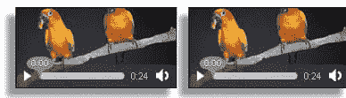

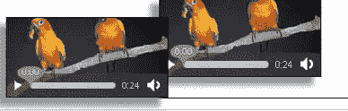

图 7.10 视频在正常状态下并排放置。

图 7.11 第一个视频的悬停状态被触发，视频移动到其新的平移位置。

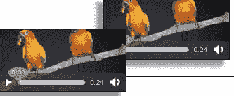

图 7.12 第一个视频稳定在其新的临时位置。注意它并未影响第二个视频的位置。

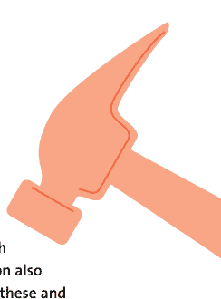

图 7.10 到 7.12 让你了解了变换是如何工作的。

**提示：** 大多数 CSS3 2D 变换函数也有 X 和 Y 等效项，例如 `scaleX()` 和 `skewY()`，它们允许你仅在一个轴上进行操作。也存在 `matrix()` 函数，但它相当复杂！你可以在 www.w3.org/TR/css3-2d-transforms 上阅读更多关于这些函数以及 2D 变换总体内容的信息。

CSS 2D 变换在实现一些巧妙效果时非常有用。但请记住，CSS 变换有两种类型。现在让我们来看看 3D 变换。

## 探索3D变换

当然，3D变换与2D变换非常相似，只是它们处理的是三个维度而非两个。遗憾的是，3D变换在浏览器中的支持情况不佳；目前只有WebKit浏览器提供了一些支持。因此，这里仅对其进行简要提及。

W3C规范提到，虽然3D变换：

> “……使用三维坐标系，但元素本身并非三维对象。相反，它们存在于二维平面（一个平坦的表面）上，没有深度。”

你可以通过 `perspective` 属性为元素添加透视效果，该属性设置了观察元素时的透视距离（以像素为单位）。这会产生一种纵深感，使得离观察者较远的元素显得更小。

**提示：** 将透视应用于元素时，效果不会作用于元素本身，而是作用于其子元素。

你还可以使用 `rotate3d(x, y, z, rotation-degree)` 函数，围绕3D平面的三个不同轴旋转元素。例如，要应用绕Y轴旋转25度，你可以使用 `rotate3d(0, 1, 0, 25deg)`。x、y和z参数各接受一个1或0，用于指示是否围绕该轴旋转。

使用前面提到的页面上分散的视频示例，你可能希望为WebKit用户添加一些纵深感。让我们看一个简单的例子，展示刚才提到的两个属性是如何工作的。

**注意：** 你可以在W3C规范（www.w3.org/TR/css3-3d-transforms）中了解更多关于3D变换的信息。

> 由于目前只有WebKit浏览器支持3D变换，因此本节中的示例仅使用WebKit特定的CSS3属性。

首先，定义一个带有"main"类的div，其中包含另一个带有"bg"类的div，后者包含了视频：

```html
<div class="main">
  <div class="bg">
    <video controls preload="metadata">
      <source src="parrots-small.mp4" type="video/mp4">
      <source src="parrots-small.webm" type="video/webm">
    </video>
  </div>
</div>
```

然后在CSS中定义这些元素的定位，并为视频添加阴影效果：

```css
div.main {
    position:absolute;
    top:50%;
    left:50%;
    margin-left:-350px;
    margin-top:-233px;
}

div.bg {
    height:246px;
    width:380px;
    background-color:#aaa;
}

video {
    width:292px;
    position:absolute;
    top:50px;
    left:50px;
    -webkit-box-shadow:-10px 10px 5px #888;
}
```

**图 7.13** 元素在Safari 5.1中的显示效果。

此时还没有应用3D变换，所以看不到任何效果（图7.13）！

外部div的原因是，你希望将透视效果应用于它，以便影响内部元素，在本例中是bg div和视频。所以，让我们应用1000像素的透视值：

```css
div.main {
    position:absolute;
    top:50%;
    left:50%;
    margin-left:-350px;
    margin-top:-233px;
    -webkit-perspective:1000;
}
```

这个透视效果本身不会对元素产生任何视觉影响，但当你添加下一条也是最后一条CSS规则时，它就会生效。为带有bg类的div添加一个绕Y轴旋转40度的变换：

```css
div.bg {
    height:246px;
    width:380px;
    background-color:#aaa;
    -webkit-transform:rotate3d(0, 1, 0, 40deg);
}
```

**图 7.14** 在Safari 5.1中，视频和背景div绕Y轴旋转40度。

**图 7.15** 相同元素绕X轴和Y轴旋转相同角度。

图7.14展示了元素绕Y轴渲染的方式，图7.15展示了相同的视频绕两个轴旋转的效果。前面的例子只展示了你可以用3D变换实现的一小部分功能，但它应该能让你对可实现的效果有个大致了解。由于浏览器支持有限，我建议目前不要使用3D变换。然而，只要你使用WebKit浏览器，它们绝对值得尝试一下，看看能用它们做些什么。随着浏览器支持的增加，你无疑会看到更多关于3D变换的内容！

> 提示：要了解更多关于变换和3D变换的信息，请参阅Safari开发者库：http://developer.apple.com/library/safari/#documentation/InternetWeb/Conceptual/SafariVisualEffectsProgGuide/Transforms/Transforms.html。

掌握了过渡和变换之后，现在是时候探索CSS3家族的另一个成员——动画了。

## 使用动画

CSS3规范引入了定义动画的概念，它允许你指定特定HTML元素的CSS属性在给定时间间隔内将要取的值。这一系列值在指定时间间隔内串联起来，会使相应的HTML元素产生动画效果。W3C规范是这样表述的：

“CSS动画允许作者随时间修改CSS属性值。”

“随时间变化的值”意味着你需要为不同的时间段定义特定的值，而这正是通过CSS动画的关键——关键帧来实现的。

### @KEYFRAMES（关键帧）

关键帧允许你在CSS中定义函数，你可以在其中为HTML元素指定开始、结束和中间状态的CSS规则。要指定这样的规则，你需要使用 `@keyframes` 关键字，后跟一个唯一的标识符或函数名。然后是一组包含在花括号中的CSS规则，这些规则指定了动画的不同帧，即动画元素在动画的不同时间点将如何移动、旋转、缩放等。例如，一个非常简单的关键帧动画函数，使元素从一侧移动到另一侧，可以定义如下：

```css
@keyframes shake {
    0% {
        left: 5px;
    }
    25% {
        left: 10px;
    }
    50% {
        left: 15px;
    }
    75% {
        left: 20px;
    }
    100% {
        left: 25px;
    }
}
```

在 `shake` 关键帧函数中，定义了五个不同的时间帧；每个帧包含不同的 `left` CSS定义。因此，在每个时间帧，元素应该已经动画到该新位置。你也可以使用 `from` 和 `to` 属性来编写，这允许你指定动画的开始和结束状态：

```css
@keyframes shake {
    from {
        left: 5px;
    }
    to {
        left: 25px;
    }
}
```

前面的定义与更早的定义效果相同，但显然更短。如果动画很简单，这会很有用；你可以让浏览器计算中间状态。要实际定义一个动画，你需要使用下一页表7.2中列出的属性组合。

#### 表 7.2 CSS3动画属性

| 属性 | 描述 |


## 动画属性

| 属性 | 描述 |
| :--- | :--- |
| `animation-name` | 标识要应用的动画名称。每个名称应该是一个已定义的关键帧动画函数。 |
| `animation-duration` | 定义动画完成一个周期所需的时间长度。 |
| `animation-timing-function` | 定义动画在其持续时间的一个周期内将如何进行。它可以是多个预定义值之一：`ease`、`linear`、`ease-in`、`ease-out`、`ease-in-out`或`cubic-bezier()`。注意，这些与表7.1中提到的`transition-timing-function`可用的值相同。 |
| `animation-iteration-count` | 指定动画要执行的迭代次数。可以设置为`infinite`，这将导致动画连续循环播放。 |
| `animation-direction` | 定义动画是否应在交替周期中反向播放。有效值为`normal`和`alternate`。`normal`是默认值。 |
| `animation-delay` | 指示动画何时开始。如果需要，可以在动画开始时添加延迟。默认值`0s`会导致动画立即开始。 |
| `animation-fill-mode` | 指示在动画执行时间之外应用哪些值。默认情况下，动画帧中包含的值在动画完成后不会保留。设置此值可以使用以下四个不同的值之一来覆盖此行为：<br>- `none`。没有值在动画之外保留。这是默认值。<br>- `backwards`。在第一帧中定义的值将在动画完成后保留。<br>- `forwards`。在最后一帧中定义的值将在动画完成后保留。<br>- `both`。在第一帧和最后一帧中定义的值都将在动画完成后保留。 |

> **注意：** 定义动画是运行还是暂停的`animation-play-state`目前也定义在CSS3动画规范中，但很可能在不久的将来会被移除（[www.w3.org/TR/css3-animations/#the-animation-play-state-property](http://www.w3.org/TR/css3-animations/#the-animation-play-state-property)）。

### 动画视频封面

通过结合使用 CSS 变换和动画，我们来构建一个简单的示例：它以一个覆盖在视频上的封面开始，当用户点击时，封面会旋转消失，露出下方的视频。

首先，你需要定义 HTML 标记：

```
<div class="container">
    <div id="cover" class="cover"></div>
    <div class="bg">
        <video poster="sintel-poster.jpg" preload="metadata" controls>
            <source src="sintel-small.mp4" type="video/mp4">
            <source src="sintel-small.webm" type="video/webm">
        </video>
    </div>
</div>
```

这个`container` div 包含一个将要被动画化的`cover` div，以及一个`bg` div，其中包含视频的定义。请注意，这里使用的视频定义了海报图片，使用浏览器默认的控件，并且还提示浏览器仅预加载视频的元数据。

> **注意：** 视频封面动画示例中使用的视频是 Blender 基金会和 Durian 开放电影项目的《*Sintel*》。你可以在 www.sintel.org 阅读更多关于它的信息。

接下来，你需要定义 CSS 并关注 HTML 元素实际的外观；稍后会添加动画和变换。给这三个 div 设置固定的尺寸和白色背景色。同时，将`cover`和`bg` div 绝对定位，并应用一个 1 像素宽的浅灰色边框。将`container` div 在页面上居中，并将其置于页面顶部向下 20% 的位置：

```
.container, .cover, .bg {
    width:311px;
    height:138px;
    background-color:#fff;
}
.container {
    margin:20% auto 0 auto;
}
.cover, .bg {
    position:absolute;
    border:1px solid #aaa;
}
```

此外，给`cover` div 设置一个背景图像，指定封面的实际样子。将光标设置为指针图形，并赋予其`z-index`值为 3，因为你希望这个 div 位于最上层：


**图 7.16** 被覆盖的视频看起来很棒。

```
.cover {
    background:#fff url('sintel-cover.jpg') no-repeat center center;
    z-index:3;
    cursor:pointer;
}
```

现在给`bg` div 设置一个`z-index`，但值较低，为 2，这样`cover` div 就会堆叠在它上面：

```
.bg {
    z-index:2;
}
```

然后简单地给视频元素设置固定尺寸和 5 像素的外边距：

```
video {
    width:301px;
    height:128px;
    margin:5px;
}
```

图 7.16 展示了视频封面的外观。

当然，你现在需要实际地对封面进行动画处理，这样当用户点击它时，它会旋转消失到视频后面，露出视频，然后就可以播放了。

要实现这个动画，你需要定义一个`Keyframes`函数，该函数将移动 div 并同时使其旋转。为此，你将使用两种不同的变换：`translate`和`rotate`。`Keyframes`函数`removecover`定义如下：

```
@-moz-keyframes removecover {
    0% {
        -moz-transform:translate(0,0) rotate(0deg);
        z-index:3;
    }
    50% {
        -moz-transform:translate(-180px,-180px) rotate(-180deg);
        z-index:3;
    }
    100% {
        -moz-transform:translate(0,0) rotate(-360deg);
        z-index:1;
    }
}
```

> **注意：** 动画封面示例仅为 Firefox 定义，使用了 `-moz` 前缀。你可以轻松地为 WebKit 浏览器复制这些规则，只需使用 `-webkit` 前缀即可。

这里只需要定义三帧，因为你希望 div 移动到某个点（X 和 Y 轴上移动 -180 像素），旋转 360 度，然后返回到相同位置，但有一个不同之处。注意，帧定义中也指定了`z-index`。因为`cover` div 在旋转消失时将保持在最上层，然后稳定在视频和`bg` div 的后面，所以在最终帧中定义的`z-index`值需要在动画完成后持续生效。你将通过使用`animation-fill-mode`属性来实现这一点。


动画定义被赋予一个`animate`类，你稍后会将这个类分配给`cover` div。动画的简写定义是：

```
div.animate {
    -moz-animation:removecover 2s 1 linear forwards;
}
```

因此，你将`Keyframes removecover`函数分配给这个`animate`类，持续时间为 2 秒，使用线性计时函数迭代一次，并将`animation-fill-mode`设置为`forwards`，这样最终动画帧中包含的规则将在动画结束后持续生效——即`z-index`为 1。

为确保动画流畅，请为`cover` div 添加一个过渡：

```
.cover {
    background:#fff url('sintel-cover.jpg') no-repeat center center;
    z-index:3;
    cursor:pointer;
    -moz-transition:all 1s ease;
    -webkit-transition:all 1s ease;
}
```

要让动画实际发生，你只需在用户点击封面时，将 CSS `animate`类添加到`cover` div。因为这无法通过 CSS 完成，所以需要一小段 JavaScript 来监听`cover` div 上的点击事件，然后添加类名：

```
var cover = document.querySelector('div.cover');
cover.addEventListener('click', function() {
    cover.className += ' animate';
}, false);
```

> **注意：** 在向元素的类名追加时，新类名前也会添加一个空格，以确保元素的类属性保持必需的空格分隔类列表，例如 “cover animate”。


**图 7.17** 请想象，封面从视频上旋转消失并落到其后。


就是这样！当用户点击封面时，它会旋转消失到视频后面，从而可以播放视频（**图 7.17**）。

现在让我们看看如何在动画中使用 3D 变换。

### 旋转动画

在前面的示例中，你结合使用了 CSS 变换和动画。当然，那是 2D 变换，但这里你将使用 3D 变换。这意味着它只适用于 WebKit 浏览器，因此代码将只针对这些浏览器。

在这个示例中，你将使用前面提到的`rotate3d()`变换。

同样，你首先需要定义一个`Keyframes`函数，它将定义动画的时间帧。运用想象力的齿轮，我们称之为`spin`：

```
@-webkit-keyframes spin {
    0% {
        -webkit-transform:rotate3d(0,0,0,0deg);
    }
    25% {
        -webkit-transform:rotate3d(0,1,0,90deg);
    }
    50% {
        -webkit-transform:rotate3d(0,1,0,180deg);
    }
    75% {
        -webkit-transform:rotate3d(0,1,0,240deg);
    }
    100% {
        -webkit-transform:rotate3d(0,1,0,360deg);
    }
}
```


同样，你定义了五个不同的时间帧，每个帧使元素绕 Y 轴以不同的角度旋转。然后你将这个函数与视频的`:hover`状态关联起来：

```
video:hover {
  -webkit-animation:spin 5s infinite linear;
}
```

瞧！它旋转了（图 7.18）！让我们将你所学应用到实践中。

**图 7.18** 通过静态图片在 Safari 5.1 中展示旋转视频的拙劣尝试。

### 将动画视频封面扩展到 3D

利用你之前看到的动画视频封面示例，你可以对 WebKit 浏览器的封面动画应用`rotate3d`变换，而不是更简单的`rotate`变换。

要实现这一点，你只需为 WebKit 定义合适的`removecover`关键帧动画函数，并将其分配给`animate` div 类即可：

```css
@-webkit-keyframes removecover {
    0% {
        -webkit-transform:translate(0,0) rotate3d(0,0,0,0deg);
        z-index:3;
    }
    50% {
        -webkit-transform:translate(-180px,-180px)
          rotate3d(1,1,1,-180deg);
        z-index:3;
    }
    100% {
        -webkit-transform:translate(0,0) rotate3d(0,0,0,0deg);
        z-index:1;
    }
}
div.animate {
    -webkit-animation:removecover 2s 1 linear forwards;
}
```


**图 7.19** 运用你那奇妙的想象力，观看封面在 3D 空间中从视频前方旋转着远离并转到后方！

请注意，3D 旋转被设定为围绕所有三个轴进行，因为在移动时能产生更好的旋转效果（**图 7.19**）。

本节提供的信息仅涉及 CSS 动画的皮毛，因为相关主题足以写成一整本书。但它确实向你展示了动画的强大功能，并且证明了你在其他元素上能用动画实现的效果，同样也能应用到音频和视频元素上。

## 总结

CSS3 变换、过渡和动画是 Web 开发者工具箱中的强大补充，了解它们的功能大有裨益。

尽管目前浏览器的支持还比较零散，但过渡和 2D 变换已得到足够好的支持，值得你进一步了解、熟悉，并在适当时应用于你的网站。关键在于适度，不要过度使用而给用户带来困扰。

很可能，3D 变换和完整动画的跨浏览器全面支持也只是时间问题，因此也要密切关注其发展动态。

接下来，你将暂时告别样式世界，转向一个完全不同的、对 HTML5 视频尤为实用的领域——视频字幕和其他无障碍访问功能。

# 8 多媒体与无障碍访问


到目前为止，你已经了解了在互联网上通过 HTML 原生方式向最终用户交付音频和视频是多么简单。多么强大的功能！但能力越大，责任越大。

你需要退一步思考你的最终用户。并非所有用户都能如你所愿访问媒体内容。有些人可能存在感官障碍；另一些人可能不理解你媒体内容所使用的语言。你能做些什么来让这些用户也能访问你想要交付的媒体内容呢？

在本章中，你将学习 HTML5 如何通过多种方式帮助你向用户呈现媒体内容。因此，你将提高媒体对具有不同需求和要求的用户的可用性，使其更具可访问性。

## 媒体与潜在的无障碍访问问题

在考虑尝试观看你媒体内容的用户时，你可能会做出一些假设：

- 用户会在台式机、笔记本电脑、平板电脑或手机上查看你的内容。

- 用户会有某种方式收听你内容的音频，无论是通过耳机还是扬声器。

- 用户能够理解你交付媒体所使用的语言。

- 用户能够成功下载并播放你的媒体。

这些都是相当合理的假设，很可能涵盖了绝大多数想要访问你内容的用户。也许你很高兴你的内容只能被这些用户访问；毕竟，少数服从多数，不是吗？

那么，我强烈建议你考虑让你的内容也能被不属于上述假设类别的用户访问。这些观众是谁？他们包括：

- 存在感官障碍，无法收听你内容音频或观看视频的用户。

- 不理解媒体交付语言的用户。

- 使用屏幕阅读器和/或键盘等设备访问网络媒体内容的用户。

- 由于所处环境或设备限制而无法成功收听或观看你内容的用户。

由于大多数媒体内容通常包含一些音频，无法听到或理解其中的音频，对于理解内容的信息和传达的消息来说，无疑是巨大的障碍。

同样，能够通过屏幕阅读器等设备访问内容，却因媒体控件设置不当（例如，键盘访问支持）而无法实际使用它，也会让任何用户感到困扰。

你将在本章后面探讨媒体控件的无障碍访问性。你还将了解 HTML5 为解决用户无法看到、听到或理解你的媒体内容这一问题带来了哪些解决方案。但首先，让我们快速了解一下是什么促使 HTML5 试图应对这个无障碍访问问题——SRT。

## 简要了解 SRT

SRT 是一种现有的包含视频字幕及其时间信息的文件格式。SRT 文件通常使用名为 SubRip（http://zuggy.wz.cz）的 Windows 程序自动生成，该程序使用光学字符识别（OCR）技术从指定的视频源获取字幕。

SubRip 文件格式是一种带有`.srt`文件扩展名的纯文本文件，遵循基本格式：

```
字幕序号
hh:mm:ss,msmsms --> hh:mm:ss,msmsms
字幕文本（一行或多行）
…
```

每个字幕集以一个唯一的字幕序号开始，接着是单独一行上字幕所代表时间段的开始和结束时间戳，然后是一行或多行字幕文本。每个后续的字幕集之间用空行分隔。时间戳格式`hh:mm:ss,msmsms`指定了时间的小时、分钟、秒和毫秒。请注意，毫秒分隔符是逗号。

以下是此类文件的一个示例：

```
1
00:00:10,500 --> 00:00:13,000
大象的梦

2
00:00:15,000 --> 00:00:18,000
在左边我们可以看到…
```

SRT 文件格式非常流行，通常是视频字幕发布的格式。这种文件格式目前并未被 HTML5 用于解决无障碍访问问题，尽管最初是这样打算的，但后来经过扩展并赋予了一个新名称：WebVTT。

## WebVTT 简介

WebVTT（Web Video Text Tracks，网络视频文本轨道）是一种用于标记外部文本轨道的文件格式。它最初是 WHATWG 和 W3C HTML5 规范的一部分，是 SRT 的一个扩展，称为 WebSRT（Web Subtitle Resource Tracks，网络字幕资源轨道）。但 W3C 希望 HTML5 能独立于任何特定的字幕格式，因此将其从规范中移除。

> **注意：** 尽管 WebSRT 中的 SRT 代表 Subtitle Resource Tracks（字幕资源轨道），但最初的缩写并没有特定含义，仅仅反映了所使用的文件扩展名。WebSRT 是一个“反向首字母缩略词”；Subtitle Resource Tracks 是后来硬套上去以赋予其实际意义的。

WebVTT 的存在是 WHATWG HTML5 规范与 W3C 规范之间目前的主要差异之一。

尽管目前没有浏览器支持 WebVTT，但主要的浏览器厂商已表示未来将实现对 WebVTT 的支持。这一承诺促使 W3C 成立了一个 WebVTT 工作组章程（www.w3.org/2011/05/google-webvtt-charter.html），其使命是：

> “从 WHATWG 的 WebVTT（Web Video Text Tracks）语言开始创建一个 W3C 规范，并通过创建 WebVTT 测试套件以及创建其他字幕格式与 WebVTT 之间的语义映射来完善它，以促进浏览器实现和市场采用。”

厂商的这一支持承诺有望最终促使 WebVTT 规范在 W3C 成为正式标准。有了浏览器和 W3C 的支持，你可以确信 WebVTT 将长久存在，并注定成为网络音频和视频内容中标记文本轨道的既定方法。

那么 WebVTT 文件格式是什么，它如何帮助你让你的内容更具可访问性？请继续阅读。

### WebVTT 能做什么？

你使用 WebVTT 文件格式来定义 WebVTT 文件。这些文件的主要用途之一是为视频内容提供字幕，尽管文件格式本身并不指示其内容的具体用途。

WebVTT 格式还允许您提供视频内容的文本描述，这些描述可以被各种辅助功能设备使用（这些设备可能会大声朗读描述），向无法观看视频的人描述视频内容。您使用 HTML 标记向浏览器通报 WebVTT 文件及其用途；在本章后面阅读关于`track`元素的内容时，您将了解具体操作方法。

让我们更详细地了解 WebVTT 文件格式。

## WEBVTT 文件格式

WebVTT 文件是一个扩展名为`.vtt`的简单文本文件，需要遵循特定的格式，我们稍后会查看。文件必须编码为 UTF-8 并标注 MIME 类型`text/vtt`。文件中的行终止符只能是`\r`（回车符）、`\n`（换行符）或`\r\n`（回车符后跟换行符）。它还必须包含 WebVTT 文件主体，该主体由以下内容组成：

```
WEBVTT

[cue]

[cue]
...
```

顶部的`WEBVTT`字符串将内容标识为 WebVTT 文件，其后必须跟至少一个空行，然后可以跟任意数量的提示，每个提示之间用空行分隔。

一个提示定义如下：

```
[idstring]
[hh:]mm:ss.msmsms --> [hh:]mm:ss.msmsms [cue settings]
TextLine1
TextLine2
...
```

`idstring`是文件中用于标识该提示的唯一标识符。它可以由一个或多个字符组成，但不能包含子字符串`-->`或之前提到的任何行终止符。

`[hh:]mm:ss.msmsms --> [hh:]mm:ss.msmsms`表示该提示所指定的视频文件中的时间戳范围。`[hh:]mm:ss.msmsms`是一个简单的时间戳；小时部分是可选的（当然，这取决于视频的长度）。

> **注意：** 毫秒分隔符是句点，而不是 SRT 格式中使用的逗号。

提示设置允许您指定文本的定位；您稍后会了解更多关于它们的内容。

`TextLineN`是提示中时间戳范围所对应的实际视频文本内容。内容可以全部在一行中，也可以呈现为任意数量的独立行。任何行都将包含在提示中，直到遇到一个空行，这表示该特定提示的结束。

让我们快速查看一个包含两个时间戳范围的 WebVTT 文件示例：

```
WEBVTT

1
00:00:10.500 --> 00:00:13.000
Elephant's Dream

2
00:00:15.000 --> 00:00:18.000
At the left we can see...
```

此示例定义了两个提示：第一个从视频的 10 秒 500 毫秒处开始，到 13 秒处结束；第二个从视频的 15 秒处开始，3 秒后结束。每个提示的字幕文本在其时间戳下方给出。

使用提示相对简单，您可以看到如何用多个提示构建文件以覆盖整个视频的长度。您还可以为每个提示指定一些设置。这些设置影响提示在相关视频上的定位。您可以有多个设置值，一个提示设置可以包含一个或多个值，每个值之间用空格分隔。各种设置列在**表 8.1**中。

**表 8.1** WebVTT 提示设置

| 含义 | 格式 | 值 | 效果 |
| :--- | :--- | :--- | :--- |
| 文本方向 | `D:value` | `vertical` | 垂直从右到左。 |
| | | `vertical-lr` | 垂直从左到右。 |
| 行位置 | `L:value` | `0–100%` | 提示相对于视频帧的百分比位置。 |
| | | `[-]number` | 要显示的行号。 |
| 文本对齐 | `A:value` | `start` | 文本与行的起始对齐。 |
| | | `middle` | 文本与行的中间对齐。 |
| | | `end` | 文本与行的末尾对齐。 |
| 文本位置 | `T:value` | `0-100%` | 提示文本相对于视频帧的百分比位置。 |
| 文本大小 | `S:value` | `0-100%` | 提示文本的大小百分比。 |

如果未指定提示设置，文本将对齐到视频帧底部的中间（**图 8.1**）。

让我们在之前的示例中添加一些这些设置：

```
WEBVTT

1
00:00:10.500 --> 00:00:13.000 A:start
Elephant's Dream

2
00:00:15.000 --> 00:00:18.000 A:end L:10%
At the left we can see...
```

第一个提示中的文本将与视频的左侧对齐（与 CSS 规则`text-align: left`的工作方式非常相似）（**图 8.2**）。

第二个提示应用了两个设置：文本将与行的末尾对齐（类似于 CSS 中的`text-align: right`），并将放置在距视频顶部 10% 的行上（**图 8.3**）。

除了指定用于控制提示文本定位和对齐的提示设置外，您还可以将一些内联样式应用于文本。它们的外观和行为与 HTML 元素相同。它们包含一个开始标签和一个结束标签，格式应用于两者之间的文本。这些标签列在表 8.2 中。

**表 8.2** WebVTT 文本标签

| 标签名 | 描述 |
| :--- | :--- |
| `c` | 定义类文本，允许将 CSS 样式类名添加到标签中，例如`<c.className>`。 |
| `i` | 使文本内容斜体化。 |
| `b` | 使文本内容加粗。 |
| `u` | 使文本内容带下划线。 |
| `v` | 定义语音内容，允许将语音名称添加到标签中，例如`<v.Speaker1>`，然后可以通过 CSS 进行样式设置。 |
| `ruby` | 定义 ruby 内容（沿基础文本运行的短文本，常用于东亚文档以指示发音或提供简短注释。更多信息请参见 www.w3.org/TR/css3-ruby）。 |
| `[hh:]mm:ss.msmsms` | 定义一个时间戳，提示文本中的某个内容在该时间戳变为活动状态。类似于卡拉 OK 风格的文本，逐步出现。注意没有结束标签；时间戳之后的文本会出现，除非遇到另一个时间戳或到达提示的末尾。 |

让我们进一步扩展示例，并使用一些文本来标签来格式化提示文本：

```
WEBVTT

1
00:00:00.000 --> 00:00:14.999
Elephant's <c.dream>Dream</c>

2
00:00:15.000 --> 00:00:18.000 A:end L:10%
At the <i>left</i> we can <b>see</b> ...

3
00:00:18.167 --> 00:00:22.000
At the right <00:00:20.000>we can see the...
```

在第一个提示中，添加了一个名为“dream”的类名，您可以在 HTML 文件中像创建任何其他 CSS 样式规则一样定义该类的样式。在**图 8.4**中，“dream” CSS 类被定义为红色文本和大写文本。

> **注意：** 您可能在 WebVTT 字幕定义中使用的任何 CSS 类名，都可以在包含的 HTML 文件或外部 CSS 文件中定义，就像您指定任何其他 CSS 类一样。

第二个提示现在包含标签，将显示单词“left”为斜体，“see”为粗体（**图 8.5**）。

此示例中添加了一个额外的提示，以展示如何使用时间戳以“卡拉 OK 风格”显示文本。当提示开始时，首先会出现单词“At the right”。然后，在适当的时间戳显示文本“we can see...”（**图 8.6**）。

> **注意：** 如果您希望字符`&`、`<`和`>`出现在视频提示文本中，您需要分别用`&amp;`、`&lt;`和`&gt;`对它们进行转义。

## WEBVTT 未来发展

值得注意的是，由于 WebVTT 文件格式在规范中相对较新，加上最近 WebVTT 工作组章程的创建，规范可能会有补充内容。

如果你想随时了解此规范的任何更改，请关注工作组章程网站 (www.w3.org/2011/05/google-webvtt-charter.html) 和 Silvia Pfeiffer 的博客 (http://blog.gingertech.net)，她目前是该工作组章程的编辑。Silvia 也定期撰写关于 HTML5 相关无障碍话题的博文。

你可以看到，视频中的完整叙述如何可以通过格式和样式添加到 WebVTT 文本文件中。

但如何将 WebVTT 文件与特定视频连接起来呢？这就是新的 HTML5 track 元素的用武之地。

## track 元素

`track`元素是新的 HTML5 元素之一。其目的是允许为媒体元素（如音频和视频）指定外部文本轨道。`track`元素本身不表示任何内容，必须与媒体元素结合使用，并作为其子元素。`track`元素具有多个属性，列于**表 8.3**。

**表 8.3** Track 元素属性

| 属性 | 描述 |
| :--- | :--- |
| `src` | 包含文本轨道数据的 URL（例如 WebVTT 文件）。 |
| `kind` | 定义轨道定义（以及在`src`中定义的源）所用于的内容类型。它可以有多个值：<br>- `subtitles`。媒体元素对话的转录或翻译；适用于音频可用但用户无法理解的情况。<br>- `captions`。类似于`subtitles`，但还包含音效、音乐提示和其他相关音频信息；适用于音轨不可用的情况。<br>- `descriptions`。媒体资源视频部分的文本描述；适用于视觉部分不可用的情况。<br>- `chapters`。用于导航媒体资源的章节标题。这可以向用户显示，以便他们从列表中选择跳转到视频中相应名称的章节。<br>- `metadata`。供脚本使用的轨道。浏览器通常不会向用户显示它们。设备可以使用这些数据来确定诸如是否可以显示之类的事情。 |
| `srclang` | 指定`src`指向的文本轨道数据的语言。如果`kind`设置为`subtitles`，则必须存在此属性。 |
| `label` | 提供轨道的用户可读标题，当要求用户在例如英文字幕或德语字幕之间进行选择时，可以向其显示。 |
| `default` | 如果存在此属性，则表示如果用户未表明偏好，则此轨道将用作默认轨道。 |

以下示例显示了如何将`track`元素与视频一起使用以提供字幕：

```
<video controls>
    <source src="video-file.mp4" type="video/mp4">
    <source src="video-file.webm" type="video/webm">
    <track src="en.vtt" kind="subtitles" srclang="en" label="English subtitles">
</video>
```

示例中的`track`元素指定`en.vtt`文件包含英文字幕（如标签所示），语言为英语（`srclang`设置为`en`），类型为`subtitles`，用于周围的视频元素。从这个例子中，你可以看到添加另一个可能包含不同语言字幕的文件是多么容易：

```
<video controls>
    <source src="video-file.mp4" type="video/mp4">
    <source src="video-file.webm" type="video/webm">
    <track src="en.vtt" kind="subtitles" srclang="en" label="English subtitles" default>
    <track src="de.vtt" kind="subtitles" srclang="de" label="German subtitles">
</video>
```

这里，添加了另一个轨道定义，指向包含德语字幕的`de.vtt`文件；`srclang`设置为`de`。注意，`default`属性已添加到英文字幕定义中，将其标记为默认字幕集，如果用户没有特别选择，则使用此字幕集。

如果你想进一步扩展示例，并添加每种语言（英语和德语）的章节列表，你可以这样做：

```
<video controls>
    <source src="video-file.mp4" type="video/mp4">
    <source src="video-file.webm" type="video/webm">
    <track src="en.vtt" kind="subtitles" srclang="en" label="English subtitles" default>
    <track src="de.vtt" kind="subtitles" srclang="de" label="German subtitles">
    <track src="ch-en.vtt" kind="chapters" srclang="en" label="English chapter listing" default>
    <track src="ch-de.vtt" kind="chapters" srclang="de" label="German chapter listing">
</video>
```

一旦创建了包含所需内容的各种 WebVTT 文件，将它们添加到相应的视频中就相当简单了。

你刚才读到的所有关于 WebVTT 的内容听起来都很有前景；然而，尽管某些浏览器在某种程度上支持`track`元素，但目前没有浏览器支持 WebVTT 文件格式。

> **注意：** 在撰写本文时，WebKit（Chrome 和 Safari 基于此）的每夜构建版本对 WebVTT 有一些支持。

不过，并非没有希望，因为有几个 JavaScript 库可供使用，使你今天就可以开始使用 WebVTT。


## 现在使用 WEBVTT 和 TRACK 元素

少数浏览器在某种程度上支持`track`元素。最新的 WebKit 浏览器（例如 Chrome 12 和 Safari 5.0.5）识别该元素但不会对其执行任何操作。当前版本的 Firefox (5) 会解析该元素但同样不会对其执行任何操作。虽然这些浏览器正在朝着正确的方向迈进，但它们现在并不能真正帮助你实现 WebVTT。

幸运的是，有几个 JavaScript 库允许你在 Web 文档中使用 WebVTT 文件定义`track`元素，这将满足你的需求：

- **Playr**。http://www.delphiki.com/html5/playr

  支持：字幕、章节、一些提示设置

  浏览器：Opera、Chrome、Safari、Firefox

- **LeanBack Player**。http://dev.mennerich.name/showroom/html5_video

  支持：字幕

  浏览器：所有主流浏览器，需要时可回退到 Flash

- **Captionator**。https://github.com/cgiffard/Captionator

  (CaptionCrunch 版本)

  支持：字幕、所有提示设置

  浏览器：Opera、Chrome、Safari、Firefox、IE9

- **MediaElementJS**。http://mediaelementjs.com

  支持：字幕（时间格式使用 SRT 格式）

  浏览器：所有主流浏览器，需要时可回退到 Flash

### SRT 支持

尽管只有少数 JavaScript 播放器支持 WebVTT，但其中许多支持 SRT 字幕文件。支持 WebVTT 的播放器（Playr、LeanBack、Captionator 和 MediaElementJS）除了以下仅提供 SRT 支持的播放器外，也支持 SRT：

- js_videosub。https://bitbucket.org/tagawa/jscaptions

- jscaptions。http://www.storiesinflight.com/js_videosub

- Kaltura。http://www.kaltura.org/project/HTML5_Video_Media_JavaScript_Library

这些库都不支持`track`元素`kind`属性的所有不同值：它们只支持`subtitles`值（Playr 也支持`chapters`值）。由于`subtitles`是最重要的值之一，这是一个好的开始。此支持还允许你现在就开始为视频添加字幕并看到它们的效果。

让我们看看如何使用 Playr JavaScript 库为视频添加字幕和章节。

### PLAYR 示例

要使用 Playr，你必须首先从 Playr 下载网站 https://github.com/delphiki/Playr 下载它。下载后，你需要在 Web 文档中包含 Playr CSS 文件和 JavaScript：

```
<link rel="stylesheet" href="playr.css" />
<script src="playr.js"></script>
```

定义视频时，只需将 CSS 类 "playr_video" 添加到视频元素，Playr 将自动用于该视频。

一个使用名为 Elephant's Dream 的短动画电影（© 版权所有 2006，Blender Foundation，荷兰新媒体艺术研究所，www.elephantsdream.org）的 Playr 示例可在本书网站 www.html5multimedia.com 上找到。

此视频使用的代码如下：

```
<video class="playr_video" preload="metadata" controls
       poster="elephants-dream.title.jpg">
    <source src="elephants-dream-medium.mp4" type="video/mp4">
    <source src="elephants-dream-medium.webm" type="video/webm">
    <track label="English subtitles" kind="subtitles" srclang="en"
           src="elephants-dream-subtitles-en.vtt" default>
    <track label="German subtitles" kind="subtitles" srclang="de"
           src="elephants-dream-subtitles-de.vtt">
    <track label="Chapters" kind="chapters" srclang="en"
           src="elephants-dream-chapters-en.vtt">
</video>
```

图 8.7 显示了 Playr 视频播放器播放《大象的梦》(Elephant's Dream) 的场景。


图 8.7 展示了该视频和轨道定义在 Playr 视频播放器中的样子。

此外，使用了三个`track`元素来指向英语和德语字幕以及英语章节。

> **注意：** Playr 目前不支持多个章节文件或`default`属性，但未来的版本中会实现。

图 8.8 至 8.11 展示了 Playr 如何显示不同的选项。Playr 是一个便捷的视频播放器，其显示字幕和章节的功能非常实用。它计划支持其他类型的轨道元素内容，因此，和其他可用的视频播放器一样，它会不断改进。

使媒体内容易于访问的另一个重要部分是控件。接下来，你将了解默认播放器的无障碍性，以及你可以采取哪些措施来使自定义控件更加无障碍。


**图 8.8** Playr 的菜单允许观众选择英语和德语字幕以及章节。


**图 8.9** 字幕被放置在距离顶部 6% 的位置（使用`L:6%`）并使用`<b>`进行加粗。

**图 8.10** 选择德语字幕的同一视频。

**图 8.11** Playr 中章节选择的示例。


## 媒体控件与无障碍性

如前所述，对于无障碍性而言，媒体控件可以通过键盘访问是非常重要的。浏览器为媒体元素提供了自己的控件集，但它们的键盘无障碍性如何呢？不幸的是，目前看来，答案是“不太好”。Opera 似乎唯一一个其默认控件集可以立即通过键盘访问的浏览器。你可以轻松地在控件之间切换标签，使用回车键切换播放/暂停按钮，并使用方向键控制进度条和音量控件。

因此，如果你想使你的媒体内容在所有现代浏览器中完全无障碍，你需要实现自己的自定义控件。在第 5 章中，你学习了如何添加自定义控件，现在你需要扩展这些自定义控件，使其更加无障碍。

### 改进自定义控件的无障碍性

你已经使用了 HTML `button`元素来实现几乎所有的控件。使用`button`元素立即提高了控件的无障碍性，因为`button`元素本身就可以通过键盘访问。这一事实使得自定义控件具备了键盘无障碍性。由于控件的顺序与播放器上的显示顺序相同，它们的标签顺序也基本上符合所需的逻辑顺序。不过，你可能想要更改进度条和播放/暂停按钮的标签顺序。很可能，用户会希望首先播放视频，因此该按钮应该是他们可以访问的第一个控件。

你可以使用`tabindex`属性指定 HTML 控件的标签顺序。浏览器会告诉键盘按照此属性指定的顺序操作。因此，你将播放/暂停按钮的`tabindex`设为 1，将进度条的`tabindex`设为 2，然后按照它们在源代码中出现的顺序依次设置后续的`tabindex`：

```
<div id="controls">
    <div id="progressBar"><span id="played" tabindex="2"></span>
    -> </div>
    <button id="playpause" alt="play" title="play" tabindex="1">
    -> play</button>
    <button id="stop" alt="stop" title="stop" tabindex="3">stop
    -> </button>
    <button id="rewind" alt="rewind" title="rewind" tabindex="4">
    -> &laquo;</button>
    <button id="ffwd" alt="fast forward" title="fast forward"
    -> tabindex="5">&raquo;</button>
    <button id="volumeDown" alt="decrease volume" title="-"
    -> tabindex="6"></button>
    <button id="volumeUp" alt="increase volume" title="+"
    -> tabindex="7">+</button>
    <button id="mute" alt="mute" title="mute" tabindex="8">mute
    -> </button>
</div>
```

> **注意：** 在此代码清单中，为简洁起见，省略了`onclick()`事件。

### RANGE 元素

在第 5 章中提到，由于 HTML5 浏览器对`range`元素的支持有限，因此在自定义媒体控件集中未使用它。

如果支持性更好，`range`元素将非常适合用作进度条，因为它也自动提供键盘无障碍性，并且进度条可以通过键盘操作（当元素获得焦点时，上下箭头键将切换进度），无需任何额外要求。

由于按钮自动提供键盘无障碍性，你现在只需要处理使用`div`和`span`构建的进度条。

正如在第 5 章中一样，你需要为`keypress`事件添加一个事件监听器，该事件在按键时触发，然后对其作出反应。你只关心进度条上的按键，因此事件仅添加到进度条上：

```
var progressBar = document.getElementById("progressBar");
progressBar.addEventListener("keypress", function(e) {
    checkKey(e.keyCode);
}, false);
```

检测到按键时调用的函数名为`checkKey()`，其参数指示按键的数字代码：

```
function checkKey(code) {
    if (code == 38) { // up arrow key
        video.currentTime += 0.5;
    }
    else if (code == 40) { // down arrow key
        video.currentTime -= 0.5;
    }
}
```

`checkKey()`函数只是检查按键代码，看它是否是向上箭头键（代码 38）或向下箭头键（代码 40）。根据按键的不同，视频的`currentTime`属性会增加或减少 0.05（一个任意的时间值，但似乎是前进或后退视频的一个合适的步长）。

就是这样。当进度条获得焦点时，现在可以通过键盘上的向上和向下箭头键访问其跳转功能。最终结果使得你的媒体自定义控件比原来更加容易访问。

## 总结

关于无障碍性，HTML5 从最初的 WebSRT 文件格式定义发展并扩展到了 WebVTT。随着浏览器厂商计划支持此格式，一个新的 W3C 工作组已经成立，旨在正式确定 WebVTT 规范以供浏览器开始支持。所以，希望浏览器的支持只是时间问题。

尽管目前原生支持参差不齐，但你现在可以使用现有的 JavaScript 库为视频添加字幕。这些库无疑将在未来增加其功能和能力。

你也可以通过键盘改进你在第 5 章中构建的自定义媒体控件的无障碍性。

总的来说，无障碍性是你在向用户提供多媒体内容时应该考虑的一个目标。能够访问你内容的用户越多越好，对吧？

下一章将脱离无障碍性，探讨 HTML5 多媒体如何与 HTML5 中更令人兴奋的功能之一——canvas 进行交互。

# 9 将视频与 CANVAS 结合使用


除了原生多媒体，HTML5 为 Web 带来的最受讨论的能力之一，就是能够通过新的`canvas`元素使用 JavaScript 绘制和操作图形。`canvas`元素定义了网页上的一个区域，你可以使用 JavaScript API 在其上绘制内容。

Canvas 及其对应的 API 用途广泛，从复制媒体和绘制简单图表，到填充颜色、直接操作像素，以及在浏览器内部创建复杂的、无需第三方插件即可运行的游戏。

你还可以将多媒体元素与 canvas 和 API 进行交互。本章简要探讨了其中一些简单的交互，并一如既往地提供了详细解释的示例。

## CANVAS 元素

前面的章节简介已经告诉你`canvas`元素的用途，并且它实际上单独使用时效果有限。然而，它使用起来非常简单，只有两个可能的属性，列在**表 9.1**中。

**表 9.1** Canvas 元素属性

| 属性 | 描述 |
| :--- | :--- |
| `width` | 定义 canvas 绘图区域的宽度。 |
| `height` | 定义 canvas 绘图区域的高度。 |

真的就这么多！当然，你也可以使用 CSS 或 JavaScript 来定义 canvas 的尺寸。就像任何其他 HTML 元素一样，`canvas`元素的位置、边框等也可以通过 CSS 来定义。

在网页文档中定义一个`canvas`元素就像这样简单：

```
<canvas width="500" height="500"></canvas>
```

> **提示：** 你应该始终使用属性、CSS 或 JavaScript 来指定你的`canvas`元素的宽度和高度。如果不这样做，元素的尺寸将默认为 300 × 150 像素。

当然，仅仅这样定义在网页上不会渲染出任何有趣的东西，所以你可能什么也看不到，因为它会呈现为空白区域。你可以在实验时通过 CSS 为其添加边框，以便实际查看它。

Canvas 是一个二维网格，因此有两个轴，X 和 Y。要定义网格内的一个位置，你需要指定两个坐标 (X,Y)。网格的左上角位置被认为是“原点”，坐标为 (0,0)。

## 浏览器支持

浏览器对`canvas`元素及其配套 API 的支持相当好——所有主流浏览器都支持它们。当然，Internet Explorer 8 及更早版本不支持，但你可以使用 Google 的 ExplorerCanvas JavaScript 库 (http://code.google.com/p/explorercanvas) 为这些浏览器带来 canvas 和 API 支持。

但要真正利用`canvas`元素做任何有用的事情，你需要调用 2D JavaScript API，这正是你接下来要做的。

## 2D API

尽管`canvas`元素是 HTML5 规范的一部分，但用于在其上绘制的 2D API 曾是、但现已不再是该规范的一部分。它已被移入 W3C (http://dev.w3.org/html5/2dcontext) 的独立规范中。

2D API 拥有大量不同的函数和功能，这超出了本章的范围。然而，你将在本章的示例中学习并使用其中一些函数。当然，我们鼓励你去查阅该主题的一本或多本书籍。

Canvas 包含一个绘图上下文，实际的绘图就在这里进行。目前只有 2D 上下文，但 HTML5 规范提到将来可能会有 3D 上下文可用（当然没有给出具体日期！）。

要使用 2D 绘图上下文，你需要获取它的句柄。但首先你需要获取`canvas`元素的句柄，这可以使用标准的 JavaScript 函数`querySelector()`或`getElementById()`轻松完成：

```
var canvas = document.querySelector('canvas');
```

要获取 2D 绘图上下文的句柄，你需要使用`getContext()`函数，它接受一个参数，并且目前只能是值`2d`。

```
var context = canvas.getContext('2d');
```

这样你就得到了上下文句柄，你可以用它在 canvas 上绘图。接下来你将使用`fillRect()`函数来完成这个操作。

`fillRect(x, y, w, h)`函数在 canvas 上绘制一个简单的矩形，它接受四个参数：矩形要放置的 X 和 Y 坐标（其左上角），以及矩形的宽度和高度。

**图 9.1** 使用`fillRect()`函数在 canvas 元素上绘制的一个简单矩形。


以下代码在 X 和 Y 坐标 (20,20) 处绘制一个黑色（默认颜色）的矩形，尺寸为 150 × 100 像素：

```
context.fillRect(20, 20, 150, 100);
```

**图 9.1** 显示了结果矩形。

`fillRect()`函数是 2D API 最基本的函数之一，你会经常用到它。其他函数允许你绘制线条和圆形，但因为接下来的主要示例中不需要用到它们，所以这里不讨论。

> **提示：** 要打好 HTML5 canvas 基础，请查看 http://dev.opera.com/articles/view/html-5-canvas-the-basics。

现在你已经理解了`canvas`元素以及对 2D API 的基本了解，让我们继续一个允许你对 HTML5 视频进行截图的示例。

## 对 HTML5 视频进行截图

例如，假设你希望允许用户在视频播放时对其进行截图，并将截图显示在其他地方，例如视频旁边的网页上。你可以使用`canvas`元素作为绘图表面来实际放置截图图像。

听起来有点复杂？其实不然。你只需要使用两个 JavaScript API 函数：`fillRect()`和另一个你马上会读到的函数。

在截图之前，你必须先设置好视频和用于截图的按钮，并完成一些其他的初始化任务。

首先，设置视频、按钮和`canvas`元素的 HTML：

```
<video controls>
    <source src="elephants-dream-medium.mp4" type="video/mp4">
    <source src="elephants-dream-medium.webm" type="video/webm">
</video>
<canvas></canvas>
<button id="snap">Take screenshot</button>
```

注意，`canvas`元素上还没有指定宽度和高度；这将在稍后通过 JavaScript 完成，所以不用担心！你还将为按钮元素的`onclick`事件添加一个函数；同样，这也会在稍后发生。

现在开始写一些 JavaScript。回顾一下，你需要获取`canvas`元素 2D 绘图上下文的句柄。你还需要获取`video`元素的句柄，因为稍后会用到：

```
var video = document.querySelector('video');
var canvas = document.querySelector('canvas');
var context = canvas.getContext('2d');
var w, h, ratio;
```

还定义了一些其他变量供以后使用：例如`w`（宽度）和`h`（高度），它们的名字清楚地表明了它们将包含的数据。

在这个示例中，你将创建比视频本身更小的截图。这表明可以处理与原始视频尺寸不同的截图。

前面提到过，如果你想覆盖默认的 300 × 150 尺寸，就需要定义`canvas`元素的尺寸，在这里你需要这样做。因此，你需要计算视频宽度与高度的比率（因此在前面的代码片段中定义了`ratio`变量）。这也只能在视频实际可用，浏览器能够检查其尺寸时进行。所以，你需要等待视频的尺寸可用。你怎么做到这一点呢？通过监听你可能在第 5 章回忆起的`loadedmetadata` API 事件：

```
video.addEventListener('loadedmetadata', function() {
    ratio = video.videoWidth / video.videoHeight;
    w = video.videoWidth - 100;
    h = parseInt(w / ratio, 10);
    canvas.width = w;
    canvas.height = h;
}, false);
```

当`loadedmetadata`事件触发时，视频的比率被计算出来。然后`w`变量被设置为（任意）比视频实际宽度小 100，`h`变量被设置为`w`值与视频比率的比值。然后`canvas`元素的`width`和`height`被设置为`w`和`h`中的计算值。

接下来你需要定义实际执行截图的函数，并将其附加到按钮的`onclick`事件上。但在此之前，让我们快速了解一下另一个你需要用到的 2D API 函数`drawImage()`。

`drawImage(image, x, y, w, h)`函数可以接受多个参数，但在这个示例中你只会用到五个。顾名思义，此函数允许你在 canvas 上绘制图像。第一个参数是要绘制的图像，接下来的四个参数与`fillRect()`中相同：绘制图像左上角的 X 和 Y 坐标，以及它的宽度和高度。

> **提示：** 有关`drawImage()`函数及其可接受的各种参数的更多信息，请参阅 www.whatwg.org/specs/web-apps/current-work/multipage/the-canvas-element.html#drawimage。

`image`参数可以是以下几种 HTML 元素之一：`img`、`canvas`或`video`。是的，`video`元素也可以传递给此函数，它会自动从相关视频的当前帧创建图像，并将其绘制到画布上。

接下来，你定义函数`snap()`来进行实际的屏幕截图并将其附加到按钮元素：

```html
<button id="snap" onclick="snap()">Take screenshot</button>
```

`snap()`的定义如下：

```javascript
function snap() {
    context.fillRect(0, 0, w, h);
    context.drawImage(video, 0, 0, w, h);
}
```

只需两行代码即可！首先定义画布中要填充的矩形——在本例中是整个画布元素——然后使用`drawImage()`从视频中绘制图像。

> **提示：** 你可以通过简单地重新定义画布的宽度和高度来清除画布中的任何内容，这实际上相当于重置它。


这就是从视频中截图所需的所有操作。当视频播放时，你可以持续点击“Take screenshot”按钮，视频在播放到任何时刻时都会被截取新的屏幕截图（**图 9.2**）。


大部分编码工作都花在了设置视频、按钮和画布元素上，而实际操作只需两行代码，这正是画布最大的优势，也相当酷。

接下来，你将扩展这个示例，在视频播放时将其完整复制到画布元素中。

## 制作播放视频的副本

在上一个示例中，你看到了在视频播放时进行截图是多么容易。但如果你想更进一步，在主视频播放时自动更新复制的图像，实际上创建一个视频的精确副本，但尺寸更小，该怎么办呢？你只需要使用上一个示例中的相同代码，并添加各种事件监听器来更新画布元素中的图像。

回想第 5 章中视频播放、暂停、停止或结束时触发的事件。正是这些事件，更具体地说是`play`、`paused`和`ended`事件，需要你来使用。

要实现视频副本，你需要使用标准的`setInterval()`函数，它允许你指定在特定间隔调用特定的 JavaScript 函数。当视频开始播放时，你监听并捕获`play`事件，然后使用`setInterval()`函数，设置你之前定义的`snap()`函数每隔 33 毫秒被调用一次：

```javascript
video.addEventListener('play', function() {
    setInterval("snap()", 33);
}, false);
```


这段代码使得`snap()`函数能够使用视频的新截图自动更新画布的绘制上下文，这使其看起来就像在实际播放一样（**图 9.3**）。

你还应该监听视频何时被暂停或结束（使用`paused`和`ended`事件），以便停止按定义的间隔调用`snap()`函数。要清除一个间隔，你需要调用标准的 JavaScript 函数`clearInterval()`：

```javascript
video.addEventListener('paused', function() {
    clearInterval();
}, false);
video.addEventListener('ended', function() {
    clearInterval();
}, false);
```


这就是全部内容。当你播放视频时，它会在播放时更新画布中的图像，即使你跳到前面（**图 9.4**）。当你暂停或结束视频时，画布图像将停止更新。

类似但稍微复杂一点的是，接下来你将使视频副本以灰度显示，而不是彩色的原始版本。为此，你需要操作视频的实际像素，这听起来可能很复杂，但实际操作并非如此。

## 以灰度播放视频副本

你可以利用画布绘制上下文中的对象做的另一件有用的事情是改变单个像素。在这个示例中，你将通过改变视频中的像素，使它们显示为灰色而不是彩色。

你将基于本章第一个示例中创建的代码进行构建。所以，你需要做的第一件事是定义第二个画布用于进行处理。这个画布用作背景画布，你将在此画布上进行处理，然后将最终结果绘制到实际的显示画布上。背景画布只存在于 JavaScript 代码中，而不是页面上的 HTML 元素，因此用户不会看到它。

为此，你只需使用标准的`createElement()` JavaScript 函数创建一个新的画布元素实例：

```javascript
var bgCanvas= document.createElement('canvas');
```

创建此实例后，你还需要一个指向其 2D 绘制上下文的句柄以便使用它：

```javascript
var bgContext = bgCanvas.getContext('2d');
```

在前面的示例中，你通过 JavaScript 设置了显示画布的宽度和高度，你还需要将背景画布设置为相同的尺寸：

```javascript
video.addEventListener('loadedmetadata', function() {
    ratio = video.videoWidth / video.videoHeight;
    w = video.videoWidth - 100;
    h = parseInt(w / ratio, 10);
    canvas.width = w;
    canvas.height = h;
    bgCanvas.width = w;
    bgCanvas.height = h;
}, false);
```

在你修改像素之前，你需要认识两个将要用到的新函数：`getImageData(x, y, w, h)`和`putImageData(imageData, x, y)`。`getImageData(x, y, w, h)`函数返回一个`ImageData`对象，对应于参数指定的矩形区域：`x`和`y`指定矩形的左上角，`w`和`h`是矩形的宽度和高度。

返回的`ImageData`对象，顾名思义，包含在`getImageData()`调用中指定的矩形区域的图像数据。此返回对象包含的信息列于**表 9.2**。

**表 9.2 ImageData 对象内容**

| 属性 | 描述 |
| :--- | :--- |
| `width` | 返回的图像数据矩形的宽度。 |
| `height` | 返回的图像数据矩形的高度。 |
| `data` | 一个二维数组，包含每个像素的实际像素信息。每个像素按顺序有四个条目；像素值分别为红色、绿色、蓝色和 alpha 通道。例如，如果第一个像素是白色，它将包含以下信息：`data[0][0] = 255 // 红色通道`，`data[0][1] = 255 // 绿色通道`，`data[0][2] = 255 // 蓝色通道`，`data[0][3] = 1 // alpha 通道（不透明度）` |

正如你可能猜到的，你将通过`data`属性来改变图像的像素信息。

另一个函数`putImageData(imageData, x, y)`将`imageData`中指定的像素数据绘制到`x`和`y`坐标指示的位置。利用这些信息，让我们把视频变成灰色！

定义函数`makeItGrey()`，它将执行所有必需的操作：

```javascript
function makeItGrey() {
    bgContext.drawImage(video, 0, 0, w, h);
    var pixelData = bgContext.getImageData(0, 0, w, h);
    for (var i = 0; i < pixelData.data.length; i += 4 ) {
        var r = pixelData.data[i];
        var g = pixelData.data[i+1];
        var b = pixelData.data[i+2];
        var averageColour = (r + g + b) / 3;
        pixelData.data[i] = averageColour;
        pixelData.data[i+1] = averageColour;
        pixelData.data[i+2] = averageColour;
    }
    context.putImageData(pixelData, 0, 0);
}
```

让我们逐步解析这段代码，从背景上下文开始：

```javascript
bgContext.drawImage(video, 0, 0, w, h);
```

与前面的示例类似，你需要获取视频的快照并将其绘制到画布上。你在这里做同样的事情，但这次你将图像绘制到背景上下文而不是显示上下文上。

然后你获取刚绘制的背景上下文图像的像素数据。你将操作`pixelData`对象中返回的数据：

```javascript
var pixelData = bgContext.getImageData(0, 0, w, h);
```

然后你需要遍历`pixelData`的`data`数组中的每一项，该数组包含每个像素的实际信息。如表 9.2 所述，`data`数组是一个二维数组，每个像素有四个数据项。因此，循环计数器被设置为每次迭代增加 4：

```javascript
for (var i = 0; i < pixelData.data.length; i += 4) {

    ...

}
```

对于每个像素，你需要提取该像素相关的红、绿、蓝信息。本示例中不需要alpha通道数据，因此可以安全地忽略它：

```javascript
var r = pixelData.data[i]; // 红色通道

var g = pixelData.data[i + 1]; // 绿色通道

var b = pixelData.data[i + 2]; // 蓝色通道
```

现在你有了这些信息，需要将其转换为灰色。有多种方法可以做到这一点，最简单的方法是计算这三个值的平均颜色：

```javascript
var averageColour = (r + g + b) / 3;
```

然后你将每个像素的红、绿、蓝值设置为这个新的平均颜色：

```javascript
pixelData.data[i] = averageColour;

pixelData.data[i + 1] = averageColour;

pixelData.data[i + 2] = averageColour;
```

最后，你需要将新处理过的图像及其数据写入实际的显示canvas上下文：

```javascript
context.putImageData(pixelData, 0, 0);
```

> **提示：** 如果你正在按照此示例创建内容，除非你通过Web服务器运行它，否则它将无法工作。本地文件将被视为“跨域”（即来自另一个网站），因此API将禁止你从该文件获取图像并操作其像素。这种跨域安全策略是为了防止一个域上的文件在没有许可的情况下访问和更改另一个域上的文件信息。


© copyright 2006, Blender Foundation / Netherlands Media Art Institute / www.elephantsdream.org

**图 9.5** 原始视频的灰度副本显示在右侧的canvas元素中。

当然，目前这段代码什么也不做：你需要确保`makeItGrey()`函数确实被调用了。模仿你在第二个示例中所做的操作，该函数可以简单地设置为在视频设置为播放时使用`setInterval()`函数以33毫秒的间隔调用：

```javascript
video.addEventListener('play', function() {

    setInterval("makeItGrey()", 33);

}, false);
```

然后，视频副本就会显示在canvas上，但这次是灰度的（**图 9.5**）。关于canvas和像素操作，你还可以做很多事情。本章仅提供了对你所能实现功能的一小部分见解。如果所读内容引起了你的兴趣，有很多优秀的在线教程（例如，www.html5rocks.com/en/tutorials/#canvas）和书籍可供你跟进，我鼓励你这样做。去试试吧！

## 总结

`canvas`元素和2D JavaScript API具有巨大的潜力，事实上，许多游戏和JavaScript库已经开始充分利用它们。

由于你可以将视频直接绘制到canvas上，这使你能够执行简单的任务，例如截屏以及保持播放的视频副本与canvas中的版本同步。你还可以通过获取图像数据然后将其重新绘制到canvas上来操作像素。

下一章也关注视频和图像，但这次是另一种在HTML5之前就存在、但似乎在HTML5变得更受欢迎后才崭露头角的格式。接下来是可缩放矢量图形（SVG）。

# 10 使用SVG与视频


可缩放矢量图形（SVG）是一种允许你在Web文档中定义二维矢量图形以进行显示的语言。它用XML编写，并得到所有主要浏览器的支持，你可以用它来描述矢量形状、文本和图像，还可以应用特定的滤镜。

SVG已经存在一段时间了，但似乎被大多数Web开发人员忽视了。随着HTML5和`svg`元素的出现，以及它现在被Internet Explorer 9支持的事实，这种情况已经改变。随着人们对canvas（你在第9章中读到的内容）及其功能越来越感兴趣，他们也开始更加关注SVG及其可能的功能。

本章简要探讨SVG以及如何使用它来实现许多与HTML5媒体元素（更具体地说是`video`元素）相关的效果。

## SVG简介

SVG规范不是HTML5的一部分，但自1999年以来一直作为开放标准与W3C一起开发。版本1.1是自2001年以来的当前推荐版本。新版本1.2是最近的工作草案，但本章主要讨论的是版本1.1。

如本章引言所述，SVG用XML编写，浏览器使用此XML定义来渲染所需的形状、文本或图像。实际上，XML文件将包含浏览器可以解释并用于渲染所需图形的绘图指令——例如，绘制线条的点的坐标、要包含的文本以及不同的曲线和形状。这当然意味着浏览器需要下载的唯一数据是用于显示相关图形的XML文本文件，而不是可能更大的图像文件。

SVG的另一个优点是生成的图形是矢量图形而不是光栅图形，因此如果需要，浏览器将在可用空间内清晰地缩放图像。

### 光栅图形和矢量图形


光栅图形图像，或位图，是一种包含图形像素信息的数据结构。因为由这些像素信息定义的图形依赖于所有可用的像素信息，所以它依赖于创建原始图像时的分辨率。因此，它不能很好地放大，因为它没有足够多的像素信息来适应新的尺寸，这会导致质量下降。光栅图形还会导致文件尺寸很大，因为它们包含图像中每个像素的信息。

另一方面，矢量图形是通过几何信息定义的，例如点、曲线、线条、形状等，所有这些都基于数学方程。绘图工具（在本例中是Web浏览器）使用这些几何信息来重新绘制图形，从而能够在给定的屏幕分辨率下构建尽可能高质量的图像。矢量图形文件比光栅图形文件更小，因为它们只包含创建所需形状的公式，而不是单个像素的信息。

图10.1展示了当图像放大时，光栅图形和矢量图形之间的区别。

你还可以将滤镜效果和裁剪路径等特征应用于SVG图形，并对其进行动画处理。稍后在本章中，你将看到其中一些附加功能的示例。

SVG规范相当庞大，全面概述其所有功能超出了本章的范围。你可以在W3C的www.w3.org/TR/SVG11查看最新规范版本1.1。这里仅描述本章示例中使用到的那些功能和元素。

让我们看看SVG在主要浏览器中的支持情况。

## 浏览器支持

由于SVG已经存在了很长时间，并且Internet Explorer最终通过版本9加入支持，SVG现在得到了主要浏览器最新版本的支持。然而，如前所述，SVG规范非常庞大，因此其不同部分受到不同浏览器的支持。

W3C SVG兴趣组联合主席Jeff Schiller在www.codedread.com/svg-support-table.html维护了一个令人惊叹的、详尽的SVG支持情况对照表（你可以在www.codedread.com/svg-support.php看到一个精简版）。总体而言，Firefox、Safari、Chrome、Opera和Internet Explorer 9及更高版本支持主要功能。

在HTML5媒体方面，这种支持有一个注意事项。广泛支持的SVG“主要功能”涉及你在Web文档中绘制图像和文本时使用的功能。对于滤镜或蒙版，或者本章将向你展示的关于SVG与HTML5视频交互的任何内容，支持并不那么广泛。目前，只有Firefox和Safari支持你将在本章中看到的SVG功能。

XML SVG定义通常包含在扩展名为`.svg`的外部XML文件中，然后通过`embed`和`object`等元素嵌入到Web文档中。HTML5通过引入`svg`元素改变了对外部文件的要求，这使你可以在HTML5 Web文档内定义SVG。

## svg元素

`svg`元素是HTML5规范的一部分，允许你在Web文档内定义SVG形状、文本和图形，而无需嵌入外部SVG文件。

## SVG 文本

SVG 文本元素允许你指定一个由文本组成的图形元素。它可以接受多种属性——完整列表可在 www.w3.org/TR/SVG11/text.html#TextElement 查阅。但这里你只会用到其中几个属性。

在本例中，让我们使用一个 SVG 文本元素来显示字母 SVG。所需的 SVG 代码如下：

```xml
<svg>
    <text x="0" y="50" font-size="50" font-family="Georgia" fill="#cd0000" stroke="black" stroke-width="1">SVG</text>
</svg>
```

这段代码使用 X 和 Y 值定义了文本的位置，并使用`fill`属性将文本颜色设置为一种红色调。字体的大小和字体族分别通过`font-size`和`font-family`属性设置。文本还通过`stroke`和`stroke-width`属性添加了宽度为 1 的黑色轮廓。

**图 10.2** 展示了生成的文本在 Firefox 和 Safari 中的渲染效果。

你还可以使用`svg`元素定义将在文档其他地方使用的 SVG 代码，用于遮罩和动画等功能。在本章后面的示例中，你会看到它以这种方式使用。

目前，除 Opera（将在第 12 版中支持）外，所有主要浏览器的最新版本都支持`svg`元素。你可以在 http://caniuse.com/svg-html5 查看关于`svg`元素支持情况的最新浏览器支持表格。

让我们快速了解一下一些可供你使用的最简单的 SVG 元素。

> **注意：** 如果你想让一个 SVG 定义在 Opera 11.50 中显示，可以将其嵌入为外部 SVG 文件，这样它就能正常工作了，就像在其他所有主要浏览器中一样。

你可以在 http://dev.w3.org/html5/spec/Overview.html#svg-o 阅读更多关于`svg`元素的内容。

## SVG 圆形

你可能想通过 SVG 绘制的最简单的形状之一就是圆形。这相对容易，因为 SVG 为了方便你提供了`circle`元素：

```xml
<svg height="200">
    <circle cx="100" cy="100" r="100" fill="#0e8c3a" />
</svg>
```

这段代码使用 X 和 Y 坐标定义了圆形的位置，但这次使用的是`cx`和`cy`属性。圆形的半径使用`r`属性设置为 100。同样，`fill`用于指定圆形的颜色，在这里是一种绿色。

**图 10.3** 展示了圆形在浏览器中的渲染效果。

**图 10.3** 在 Chrome 13（左）和 Firefox 5（右）中绘制的 SVG 圆形。

## SVG 椭圆

你还可以绘制椭圆，即一个在一个方向上拉长的圆形。要绘制一个椭圆，除了形状的 X 和 Y 位置外，你还需要指定半径的宽度和高度：

```xml
<svg height="200">
    <ellipse cx="100" cy="100" rx="100" ry="50" fill="#0276fd" />
</svg>
```

这里的填充颜色设置为一种蓝色调，半径的宽度和高度现在分别通过`rx`和`ry`属性定义。

> **注意：** 当然，你可以通过将`rx`和`ry`属性设置为相同的值，使用`ellipse`元素来绘制圆形，但显然最好使用`circle`元素，因为这正是它的用途！

你可以在**图 10.4**中看到这个简单椭圆的渲染效果。

**图 10.4** 在 Safari 5.1（左）和 Chrome 13（右）中呈现的浅蓝色椭圆。

前面的例子只展示了使用 SVG 绘制形状和文本的一小部分。SVG 还有很多功能，所以我鼓励你寻找更多信息并亲自尝试。

> **提示：** 获取一些在线 SVG 资源，请访问 http://www.learnsvg.com 和 http://my.opera.com/tagawa/blog/learning-svg。

接下来，你将运用这些基础 SVG 知识与 HTML5 视频元素进行交互。

## 在 HTML5 视频中使用 SVG

在上一节中，你了解了绘制 SVG 文本和形状的一些较简单的特性。在本节中，你将学习如何将这些简单的文本和形状定义用作遮罩，与 HTML5 视频元素结合使用，同时你还将为视频应用一些 SVG 提供的巧妙滤镜。

> **注意：** 本章列出的所有示例均可在本书的配套网站 www.html5multimedia.com 上找到。

### 为视频添加文本遮罩

在第 6 章中，你学习了如何使用`-webkit-mask-box-image` CSS 属性在 WebKit 浏览器中为视频添加遮罩。实际上，你也可以通过 SVG 为视频添加遮罩。你只需定义一个 SVG 图形作为遮罩，并将其应用于视频。

> **注意：** 目前，使用内联 SVG（即通过`svg`元素在网页文档中定义 SVG）来遮罩元素仅在 Firefox 中有效。

在第一个例子中，你将为视频添加一个文本遮罩。播放的视频将仅在文本存在的区域可见。

对于这些示例，让我们再次使用色彩丰富的鹦鹉视频：

```xml
<video autoplay controls>
    <source src="parrots-small.mp4" type="video/mp4">
    <source src="parrots-small.webm" type="video/webm">
</video>
```

要在 SVG 中定义一个遮罩，你只需将其包含在`mask`元素内。同时，为`mask`元素指定一个唯一标识符 "vmask"，因为你稍后需要引用它：

```xml
<svg>
    <mask id="vmask">
        <text x="10" y="140" font-size="200" font-family="Verdana"
              font-weight="bold" fill="#fff">H5</text>
    </mask>
</svg>
```

在前面的代码示例中，在`mask`元素内，使用文本 "H5" 定义了一个`text`元素，并设置了各种属性，其中最值得注意的是`fill`属性。当你定义遮罩时，必须为应用遮罩的元素使用白色作为`fill`颜色，这样该元素才能通过遮罩完全可见。

> **提示：** SVG 的一个巨大优势是，你在其内部定义的元素可以通过 DOM（文档对象模型）供以后在 SVG 以及 JavaScript 或 CSS 中引用和使用。

为了让代码真正起作用，你需要将遮罩应用于视频元素，这可以通过 CSS 定义中的`mask`属性实现：

```css
video {
    mask:url('#vmask');
}
```

`mask`属性的值是你之前分配给`mask`元素的唯一标识符，本例中为 "vmask"。

你可以在**图 10.5**中看到这在 Firefox 5 中的渲染效果。

**图 10.5** Firefox 5 中鹦鹉视频上的 H5 文本遮罩。

不幸的是，这个例子只在 Firefox 中有效，因为它使用了内联 SVG 来定义遮罩。但如果你将遮罩定义放在一个外部 SVG 文件中并引用它，就可以让它在 Safari 中工作。

外部文件`text.svg`的定义如下：

```xml
<?xml version="1.0" standalone="no"?>
<!DOCTYPE svg PUBLIC "-//W3C//DTD SVG 1.1//EN"
   "http://www.w3.org/Graphics/SVG/1.1/DTD/svg11.dtd">
<svg version="1.1" xmlns="http://www.w3.org/2000/svg"
     xmlns:xlink="http://www.w3.org/1999/xlink">
    <defs>
        <mask>
            <text id="text" x="10" y="140" font-size="200"
                  font-weight="bold" font-family="Verdana"
                  fill="white">H5</text>
        </mask>
    </defs>
    <use xlink:href="#text" />
</svg>
```

因为这个 SVG 文件是一个 XML 文件，所以你需要在顶部放置 XML 声明：

```xml
<?xml version="1.0" standalone="no"?>
```

`standalone`属性设置为`no`，表示 XML 文档不是独立的，依赖于外部定义的 DTD。

> **什么是 DTD？**

文档类型定义（DTD）是一组标记声明，它定义了标记文档的结构。DTD 定义了标记文档可以包含的合法元素和属性。

下一行是 SVG DOCTYPE 声明，表示文档内容遵循 SVG 1.1 DTD：

```xml
<!DOCTYPE svg PUBLIC "-//W3C//DTD SVG 1.1//EN"
    "http://www.w3.org/Graphics/SVG/1.1/DTD/svg11.dtd">
```

然后出现`svg`元素，指明版本和 XML 命名空间（本例中为 SVG），并包含对`xlink`文档定义的引用，这在 XML 文件中稍后（将会解释）的地方是必需的：

```xml
<svg version="1.1" xmlns="http://www.w3.org/2000/svg"
    xmlns:xlink="http://www.w3.org/1999/xlink">
```

`defs`元素用于包含任何不会立即在屏幕上渲染但可供后续使用的 SVG 定义。

`mask`和`text`元素定义与前面示例中的内联 SVG 定义包含相同的代码；唯一的区别是`text`元素被赋予了唯一标识符 "text"。这个标识符在文件中的下一行被使用：

```xml
<use xlink:href="#text" />
```

这一行利用了前面链接的`xlink`文档定义，通知文档在加载时使用`xlink:href`属性中指向的资源，在本例中就是`text`元素定义。

> **提示：** 使用带`xlink:href`的`use`元素还允许你在 SVG 文件内重用代码，而无需复制它。

然后你需要从原始的 HTML5 文件中引用外部的`text.svg`文件。在视频的 CSS 定义中，你使用了 WebKit 特有的属性`-webkit-mask`来指向该 SVG 文件：

```css
video {
    mask:url('#vmask');
    -webkit-mask:url('text.svg');
}
```

### 为视频添加椭圆蒙版

在本章前面部分，你已经学习了如何使用 SVG 来定义和绘制椭圆。与文本元素类似，你也可以使用椭圆元素来定义一个可以放置在 HTML5 视频上方的蒙版。

其原理当然与前面的文本蒙版示例相同。在这个示例中，你将在一个外部 SVG 文件中定义椭圆蒙版。了解如何引用此类文件，以便在 Firefox 和 Safari 中使用，这是值得学习的。

本示例中使用的视频与前面的示例相同：

```
<video autoplay controls>
    <source src="parrots-small.mp4" type="video/mp4">
    <source src="parrots-small.webm" type="video/webm">
</video>
```

你将在外部 SVG XML 文件`ellipse.svg`中定义 SVG 蒙版——其定义与文本蒙版示例非常相似——但你需要将文本元素替换为椭圆元素定义：

```
<?xml version="1.0" standalone="no"?>
<!DOCTYPE svg PUBLIC "-//W3C//DTD SVG 1.1//EN"
    "http://www.w3.org/Graphics/SVG/1.1/DTD/svg11.dtd">

<svg version="1.1" xmlns="http://www.w3.org/2000/svg"
    xmlns:xlink="http://www.w3.org/1999/xlink">
    <defs>
        <mask id="eMask">
            <ellipse id="ellipse" cx="150" cy="80" rx="150" ry="80"
                fill="white" />
        </mask>
    </defs>
    <use xlink:href="#ellipse"/>
</svg>
```

蒙版元素具有唯一标识符“eMask”，因为你需要它来进行引用。椭圆具有唯一标识符“ellipse”，并使用 X 和 Y 坐标、X 轴半径 150 和 Y 轴半径 80 来定义。填充颜色为白色，这是蒙版所要求的。

图 10.8 椭圆蒙版在 Firefox（左）和 Safari（右）中的渲染效果。

`use`元素链接到蒙版元素中包含的椭圆元素。

在调用 HTML 文件中，CSS 声明使用`-webkit-mask-box-image`属性来针对 WebKit 浏览器。对于 Firefox，你使用`mask`属性，并确保其`url`值也引用了蒙版的标识符“eMask”以及 SVG 文件：

```
video {
    mask:url('ellipse.svg#eMask');
    -webkit-mask-box-image:url('ellipse.svg');
}
```

就是这样。你可以在**图 10.8**中看到它在 Firefox 和 Safari 中的渲染效果。

可以想象，你可以在 SVG 中定义任何形状，然后将其用作 HTML5 视频的蒙版，以便只显示视频的一部分，从而达到所需的效果。

一旦定义了蒙版，你可能还希望通过动画来增强效果。

> **注意：** 对于不支持 SVG 蒙版的浏览器，视频将简单地正常显示。

### 动画 SVG 视频蒙版

SVG 还允许你为你定义的图形添加动画，而由于蒙版本质上就是图形，你也可以为它们应用动画。

> **注意：** 动画示例也可以使用内联 SVG 来定义 SVG 蒙版，但只能在 Firefox 中工作。因此，所有 SVG 定义都声明在外部文件中，以便它们在 Firefox 和 Safari 中都能工作。

本示例再次使用了与前面两个示例相同的视频声明，因此代码不会在此重复。主要关注的领域是 SVG 文件（此处称为`animate-ellipse.svg`）以及如何定义动画：

```
<?xml version="1.0" standalone="no"?>
<!DOCTYPE svg PUBLIC "-//W3C//DTD SVG 1.1//EN"
    "http://www.w3.org/Graphics/SVG/1.1/DTD/svg11.dtd">

<svg version="1.1" xmlns="http://www.w3.org/2000/svg"
    xmlns:xlink="http://www.w3.org/1999/xlink">
    <defs>
        <mask id="eMask">
            <ellipse id="ellipse" cx="150" cy="80" rx="100" ry="80"
                fill="white">
                <animate attributeName="rx" dur="3s"
                    values="100;150;100" repeatCount="5" />
            </ellipse>
        </mask>
    </defs>
    <use xlink:href="#ellipse"/>
</svg>
```

同样，所有内容都声明在蒙版元素内，椭圆元素声明与前面的示例基本相同，只是 X 轴的半径现在定义为 100。

还有一个`animate`元素，它当然定义了使用的动画：

```
<animate attributeName="rx" dur="3s" values="100;150;100" 
    repeatCount="5" />
```

在这种情况下，动画只是将椭圆的半径从 100 改为 150，然后再改回来。`animate`元素用于在给定的时间段内为单个属性或属性添加动画。

`attributeName`属性标识椭圆将要动画化的属性，在本例中是 X 轴半径，因此设置为`rx`。`dur`属性表示动画将花费的时间，即持续时间，设置为 3s（3 秒）。`values`属性是一个以分号分隔的列表，列出了动画将从和到的值，从 100 到 150，再回到 100。而`repeatCount`指的是动画将重复的次数，在本例中为 5。

> **注意：** 你可以在 www.w3.org/TR/SVG11/animate.html#AnimateElement 上阅读更多关于`animate`元素的信息。

定义了 SVG 文件后，唯一剩下的就是使用你已经用过的 CSS 属性，即`mask`和`-webkit-mask-box-image`，将其分配给视频：

```
video {
    mask:url('animate-ellipse.svg#eMask');
    -webkit-mask-box-image:url('animate-ellipse.svg');
}
```

**图 10.9** 让你大致了解这个动画在实践中可能如何工作。

让我们将这个动画更进一步，看看如何实际创建一个将蒙版从一个位置动画移动到另一个位置，而不是为静态形状添加动画。

### 移动 SVG 视频蒙版

前面的示例向你展示了如何为 SVG 蒙版的属性添加动画。你也可以为整个蒙版添加动画，使其沿着预定义路径移动，这正是本示例中要做的。

你将在本示例中使用相同的视频代码，并且它仍然只能在 Firefox 和 Safari 中工作。

本示例中的蒙版是一个小圆圈，动画将以线性运动将圆圈蒙版从第一只鹦鹉的头部移动到另一只鹦鹉的头部，依次显示每一只。

所以，同样，SVG 文件`circle-animate-motion.svg`是动作发生的地方：

```
<?xml version="1.0" standalone="no"?>
<!DOCTYPE svg PUBLIC "-//W3C//DTD SVG 1.1//EN"
    "http://www.w3.org/Graphics/SVG/1.1/DTD/svg11.dtd">
<svg version="1.1" xmlns="http://www.w3.org/2000/svg"
    xmlns:xlink="http://www.w3.org/1999/xlink">
    <defs>
        <mask id="cMask">
            <path id="path" d="M 0 0 L 130 0" />
            <circle id="circle" cx="85" cy="30" r="40" fill="white">
                <animateMotion begin="0s" dur="2s" fill="freeze">
                    <mpath xlink:href="#path" />
                </animateMotion>
            </circle>
        </mask>
    </defs>
    <use xlink:href="#circle"/>
</svg>
```

像往常一样，所有内容都包含在蒙版元素内，其标识符为“cMask”。

下一行是新的内容，一个路径元素定义。

```xml
<path id="path" d="M 0 0 L 130 0" />
```

你使用路径元素来为动画定义一个预设的路径。这个特定的路径有一个标识符 "path"，`d`属性包含了实际的路径数据。路径数据可以包含多个路径路线的定义，以 "moveto" 命令开头，该命令使用 M 来为动画建立一个新的点，就像将笔从纸上的一个位置抬起并放置到别处一样。在这个例子中，"moveto" 点被设置为 X 和 Y 坐标 0,0。

接下来，你使用 "lineto" 命令，用 L 表示，来定义从当前点到另一个点的 X 和 Y 坐标，从而绘制一条线。在这个例子中，"lineto" 命令是 130,0，因此路径实际上是在指定："从点 0,0 绘制一条线到点 130,0"。

> **注意：** 这个动画示例使用了尽可能简单的路径定义。你可以定义其他更复杂的路径，遵循贝塞尔曲线等。

你可以在 www.w3.org/TR/SVG11/paths.html#PathData 阅读更多关于路径数据的信息。

圆形在 X 轴上的初始位置是 85，Y 轴上是 30，其半径为 40。同样，填充颜色被设置为白色。

圆形元素还包含通过`animateMotion`元素定义的运动动画：

```xml
<animateMotion begin="1s" dur="4s" fill="freeze">
    <mpath xlink:href="#path" />
</animateMotion>
```

这里的`animateMotion`元素有许多属性。`begin`属性指定动画何时开始；这里设置为 1s，因此动画开始前有 1 秒的延迟。`dur`属性表示动画将持续多久，在这种情况下是 4 秒。

`fill`属性设置为`freeze`，这告诉动画在完成时停留在它最终到达的位置。

> **注意：** 你可以在 www.w3.org/TR/SVG11/animate.html#AnimateMotionElement 阅读更多关于`animateMotion`元素的信息。

**图 10.10** 动画在 Safari 中的显示效果。圆形蒙版通过一个动画状态 (B) 从一只鹦鹉 (A) 移动到另一只鹦鹉 (C)。


A


B


C

`mpath`元素告知浏览器，动画将遵循的路径是预定义的带有 "path" 标识符的路径，也就是你之前定义的那个路径。

现在剩下的就是将 SVG 赋值给视频：

```css
video {
    mask:url('circle-animate-motion.svg#cMask');
    -webkit-mask:url('circle-animate-motion.svg');
}
```

**图 10.10** 展示了在 Firefox 或 Safari 中查看时可能的外观。SVG 蒙版有很多用途，前面的示例只展示了其中一小部分可能性。以前面的示例为起点，请务必尝试 SVG 蒸版，并尝试增强你的网络视频。

在你停止思考 SVG 和 HTML5 视频之前，让我们看看 SVG 和 HTML5 视频的另一个令人兴奋的功能——滤镜。

### 将 SVG 滤镜应用于 HTML5 视频

SVG 有大量可以应用于 SVG 图形元素的滤镜。尽管 W3C 规范没有指定，但 Mozilla 更进一步，允许你也将 SVG 滤镜应用于 HTML5 媒体元素，特别是`video`元素。这可以带来一些非常酷的效果，但需要谨慎使用，因为 SVG 滤镜目前仅在 Firefox 中适用于 HTML5 媒体元素。未来可能会有所改变，但并不能保证一定会改变。

由于目前只有 Firefox 支持这些 HTML5 媒体元素的功能，因此本节中的示例使用内联 SVG，并且仅针对该浏览器。

> **注意：** 本节中提到的滤镜当然也可以应用于任何 SVG 图形元素。

让我们简要看看其中两个滤镜：`feColorMatrix`和`feGaussianBlur`。你可以在 www.w3.org/TR/SVG11/filters.html#FilterElement 查看完整列表，并了解更多关于`filter`元素的信息。

#### FECOLORMATRIX 滤镜

`feColorMatrix`滤镜允许你对相关的 SVG 图形对象应用矩阵变换。这些矩阵可能相当复杂，说实话有点超出我的能力范围，但有一些预定义的设置可以通过`type`属性应用。接下来的四个示例将依次介绍每种设置，向你展示其应用方式和效果。

每个滤镜元素定义都包含在`svg`元素内的`defs`元素中，这种布局你现在应该已经熟悉了：

```xml
<svg>
    <defs>
        <filter ....>
            . .
        </filter>
    </defs>
</svg>
```


**图 10.11** 视频上应用了一个值为 0.2 的饱和度滤镜。

**图 10.12** 视频的像素色相被旋转了 50 度。

##### 色彩饱和度

应用色彩饱和度矩阵滤镜可以让你增强视频的色彩饱和度。你可以为`values`属性提供一个值，这是一个介于 0 和 1 之间的实数，允许你调整色彩的饱和度：

```xml
<filter id="saturate">
    <feColorMatrix type="saturate" values="0.2" />
</filter>
```

这段代码应用了 0.2 的饱和度，其结果如**图 10.11**所示。

##### 色相旋转

视频会使用色谱中的某些颜色。这个色谱是按圆形排列的，通过执行色相旋转，围绕圆形色谱旋转一定角度，就可以从色谱的一部分移动到另一部分。

`hueRotate`类型允许你按照`values`属性指定的角度对视频执行色相旋转，该值必须是有效的度数：

```xml
<filter id="hueRotate">
    <feColorMatrix type="hueRotate" values="50" />
</filter>
```

这段代码应用了`hueRotate`类型，旋转角度为 50 度。你可以在**图 10.12**中看到结果。


**图 10.13** 应用了`luminanceToAlpha`颜色矩阵类型的视频（左）。大面积的白色区域是透明的，背景图像会透过它们显示出来，如右图所示，你几乎可以辨认出鹦鹉和树枝。

##### 亮度到 Alpha

应用`luminanceToAlpha`颜色矩阵类型会将视频像素的红、绿、蓝 (RGB) 通道转换为亮度值，然后根据结果设置每个像素的输出 alpha 通道（图 10.13）。这实际上根据像素的亮度或相对亮度设置了单个像素的透明度值。这种类型没有属性：

```xml
<filter id="luminanceToAlpha">
    <feColorMatrix type="luminanceToAlpha" />
</filter>
```

##### 黑白

要将视频转换为黑白，你需要通过`values`属性为`filter`元素提供实际的矩阵值：

```xml
<filter id="blackAndWhiteMatrix">
    <feColorMatrix type="matrix" values="0.3 0.3 0.3 0 0
                                        0.3 0.3 0.3 0 0
                                        0.3 0.3 0.3 0 0
                                        0   0   0   1 0" />
</filter>
```

应用这些矩阵值的结果显示在下一页的图 10.14 中。


**图 10.14** 对视频应用了一个矩阵，将像素转换为其黑白版本。

**图 10.15** 对视频应用了高斯模糊。控件也会被模糊，因此你需要移除它们并创建自己的控件，如第 5 章所述。

使用`matrix`类型，如前面黑白示例所示，允许你将自定义的矩阵变换应用于视频像素。要有效使用它，你需要理解矩阵乘法，可惜我早就把它忘光了。

> **注意：** 你可以在 www.w3.org/TR/SVG11/filters.html#feColorMatrixElement 阅读更多关于`feColorMatrix`滤镜的信息。

让我们继续快速看看另一个滤镜：`feGaussianBlur`。

#### FEGAUSSIANBLUR 滤镜

`feGaussianBlur`滤镜允许你为视频添加模糊效果。它接受一个属性`stdDeviation`，可以包含一个或两个数字。如果提供两个数字，第一个表示沿 X 轴的标准差，第二个数字提供沿 Y 轴的标准差值。单个数字则为 X 轴和 Y 轴提供相同的值：

```xml
<filter id="blur">
  <feGaussianBlur stdDeviation="2" />
</filter>
```

这段代码应用了一个标准差值为 2 的高斯模糊。结果如**图 10.15**所示。

你还可以合并滤镜并将其应用于同一个元素，当然，我们鼓励你进行实验。同样请记住，目前只有Firefox浏览器允许将这些滤镜应用于HTML5视频元素，因此在此情况改变之前，它们应被视为实验性功能。

你也可以在SVG内容中使用HTML5视频，例如在外部SVG文件中。但这严格来说是SVG内容相关，而非HTML，因此被认为超出了本书的范围。

## 总结

你现在已经对SVG有了基本的介绍。SVG已经存在了很长时间，幸运的是，人们开始意识到它可以有益于网站的快速加载，当然，也能确保简单图形的流畅渲染。

你学习了如何使用SVG与HTML5视频进行交互，将其用作遮罩或滤镜。你还需要记住，并非所有浏览器都完全支持这种交互，因此在使用SVG时应谨慎。

在下一章中，你将了解HTML5在多媒体方面的未来，以及哪些其他功能和API可能很快就能投入使用。

# 11 未来特性


虽然这是本书的最后一章，但这绝不意味着HTML5和多媒体相关内容的终结。你已经学习了许多HTML5音频和视频特性，但目前还有其他规范正在开发中，包含一些新的相关功能，一旦完成并被浏览器厂商实现，它们将大有裨益。

本章将简要讨论这些规范及其内容。尽管它们不完全是HTML5的一部分，但它们确实包含将增强现有HTML5功能的特性。这些特性是JavaScript API，将使你能够创建和操作音频、与外部设备（如网络摄像头和麦克风）交互，并促进视频会议。尽管这些特性大多尚未在浏览器中实现，但了解它们的发展方向是值得的。

## 音频API

在通读本书的过程中，你可能已经注意到，关于视频的内容比音频更多。本节旨在通过探索仅影响音频的API来恢复这种平衡（当然，这些信息也适用于视频，因为大多数视频中都包含音频！）。

目前，有两个提议的JavaScript API可用于读写原始音频数据。一个是Web Audio API，由Google创建，目前正由W3C音频工作组讨论。该工作组成立于2011年3月，其章程使命是：

> “开发一个客户端脚本API，提供比音频元素当前提供的更高级的音频能力。该API将支持高级交互式应用所需的功能，包括直接在脚本中处理和合成音频流的能力，并将扩展HTML5 `<audio>` 和 `<video>` 媒体元素。”

Mozilla也创建了一个音频API，它比Web Audio API更简单，并已随Firefox 4及更高版本发布（https://wiki.mozilla.org/Audio_Data_API）。Mozilla的Audio Data API是你在第5章中阅读过的HTML5 Media API的扩展。

正如你可能猜到的，由于这些API是由不同的浏览器厂商创建的，它们各自API中当前可用的部分仅在各自的浏览器中有效。然而，目前这并不是一个大问题，因为它们只是提议的API，尚未做出最终决定。

让我们先来看看Mozilla的Audio Data API。

### AUDIO DATA API

Mozilla的Audio Data API提供了一个扩展，用于以编程方式访问和/或创建HTML5音频和视频文件中的原始音频数据。

#### 读取音频数据

当音频正在播放（通过音频或视频元素）并被解码时，样本数据存储在帧缓冲区中。当此帧缓冲区有可用数据时，会触发`MozAudioAvailable`事件。帧缓冲区内包含的样本数据是原始音频数据，这些数据在触发`MozAudioAvailable`事件时可能已经播放过，也可能尚未播放。

回想第5章中提到的`loadedmetadata`事件，当音频或视频元素加载了有用的元数据时触发。在等待读取音频数据时，你也可以使用此事件。一旦触发，Audio Data API随后提供三个新的可访问属性，其中包含原始音频数据的重要信息：

- `mozChannels`。表示音频声道数。

- `mozSampleRate`。指定音频每秒的采样率。

- `mozFrameBufferLength`。表示帧缓冲区的默认大小。

让我们看一个显示这三个属性所提供数据的示例。你首先定义音频元素和一个简单的`div`来包含音频信息：

```html
<audio id="audio" controls>
    <source src="piano.ogg" type="audio/ogg">
</audio>
<div id="info"></div>
```

> **注意：** 本示例使用Vorbis/Ogg音频文件，因为Audio Data API仅在Firefox中有效。


当音频数据加载后，你使用API访问数据：

```javascript
var audio = document.getElementById("audio");
var info = document.getElementById("info");
audio.addEventListener("loadedmetadata", getAudioData, false);
function getAudioData() {
    var rate = audio.mozSampleRate;
    var channels = audio.mozChannels;
    var length = audio.mozFrameBufferLength;
    info.innerHTML = "rate: " + rate + "<br/>channels: " + channels + "<br>length: " + length;
}
```


图 11.1 音频文件的采样率、声道数和缓冲区长度显示在Firefox 6的屏幕上。

在这个代码示例中，获取了音频和`div`元素的引用。当`loadedmetadata`事件触发时，读取三个属性——`mozSampleRate`、`mozChannels`和`mozFrameBufferLength`中的数据，并将其显示在屏幕上的`div`中（**图11.1**）。

你可以通过`MozAudioAvailable`事件的`frameBuffer`属性访问帧缓冲区数据，这是一个包含解码后音频样本数据的浮点数格式数组。

让我们扩展示例，添加另一个`div`来显示帧缓冲区数据，然后定义一个新函数`getBufferData`，并将其附加到`MozAudioAvailable`事件。`getBufferData`函数只是将databuffer数组的第一个元素输出到屏幕：

```html
<audio id="audio" controls>
    <source src="piano.ogg" type="audio/ogg">
</audio>
<div id="info"></div>
<div id="frameinfo"></div>
```

JavaScript代码（仅显示新增部分）如下所示：

```javascript
var frameinfo = document.getElementById("frameinfo");
audio.addEventListener("MozAudioAvailable", getBufferData, false);
function getBufferData(event) {
    frameinfo.innerHTML += "[" + event.frameBuffer[0] + "]";
}
```


rate: 44100

channels: 2

length: 2048

[-0.0020826864056289196][0.03907433897256851][0.052807144820690155]

[-0.017523478716611862][0.07334524393081665][-0.1289338320493698]

[0.047963064163923264][0.09296827763319016][0.0814201831817627]

[-0.13930198550224304][-0.12914502620697021][0.11272022873163223]

[0.12237294018268585][0.06835687905550003][-0.1242295578122139]

图 11.2 音频文件播放时显示的帧缓冲区数据。

屏幕上显示的数据是音频数据的浮点数值，如**图11.2**所示。

这看起来可能现在没什么用，但你可以使用这些数据在播放时以波形或快速傅里叶变换形式可视化音频。

你还可以使用Audio Data API向音频元素写入数据。

> **注意：** 在www.html5multimedia.com网站上有一个将音频文件数据显示为波形的示例。


#### 写入音频数据

Audio Data API提供了三个方法，允许你创建自己的音频：

- `mozSetup(channels, sampleRate)`。设置一个具有指定声道数和采样率的音频元素。

- `mozWriteAudio(buffer)`。将音频缓冲区数据（一个数组）写入音频元素。

- `mozCurrentSampleOffset()`。返回当前音频流的当前位置。

你可以对音频元素调用这些方法，该元素可以是已获取引用的现有HTML元素（如前面的示例所示），也可以使用`Audio()`构造函数动态创建。

以下示例在用户单击播放按钮时生成并播放一个简单的音调：

```html
<button onclick="play()">play</button>
```

`play`函数随后被声明为：

```javascript
function play() {
    var audioOut = new Audio();
    audioOut.mozSetup(2, 44100);
    var audioSamples = new Float32Array(88200);
    for (var i=0; i<audioSamples.length; i++) {
        audioSamples[i] = Math.sin(i/60);
    }
    audioOut.mozWriteAudio(audioSamples);
}
```

此代码示例创建了一个新的音频元素，然后将其设置为具有两个声道、采样率为44100。接着定义了一个长度为采样数两倍的浮点数组，并用简单的正弦波数据填充该数组（除数60是随机选择的）。

当用户点击“播放”按钮时，会生成一个单一的长音。试图用图像向你展示这一点是没有意义的，因此你必须在Firefox中尝试该示例，或者访问www.html5multimedia.com来收听它！

尽管非常简单，但这个示例向你展示了如何使用API生成音频数据。你还可以从一个音频元素读取数据，对其进行操作（例如，你可能想改变音高或音色），然后将其写入另一个音频元素。所有这些，甚至更多，都可以通过这个简单的音频数据API实现。

> **注意：** 有关音频数据API的更多资源和更深入的演示，请访问 https://wiki.mozilla.org/Audio_Data_API#Additional_Resources。

现在让我们看看目前正由W3C审议的更复杂的Web Audio API。

## WEB AUDIO API

Web Audio API的草案规范相当庞大且复杂，定义了一系列不同的接口和方法，使你能够对音频进行大量控制。本节仅简要介绍该API，因此你不会读到该API提供的所有功能。但你可以在 https://dvcs.w3.org/hg/audio/raw-file/tip/webaudio/specification.html 阅读该规范。

Web Audio API的目标是支持以下功能：

- 处理来自音频和视频元素的媒体源

- 用于简单或复杂效果架构的模块化路由

- 音频流合成与处理

- 用于3D游戏和沉浸式环境（例如，距离衰减、声音锥和多普勒频移）的空间化音频

- 用于支持各种线性声音播放效果（如大教堂、音乐厅、洞穴和圆形剧场）的卷积引擎

这个功能列表并非详尽无遗；你可以在规范中阅读更多支持的功能。如果列表中的一些项目对你来说没有意义，也不必担心。它们对我来说意义也不大，因为我不是声音工程师，也从未处理过复杂的音频。其他一些功能你应该熟悉，例如，你可以看到创建不同空间化音频的能力对游戏开发将是多么有益。

目前测试该API相当困难，因为规范如此之新且仍处于开发阶段。只有WebKit浏览器支持其中一小部分功能。因此，本节不包含任何编码示例。

### 在CHROME中启用WEB AUDIO API

目前，只有Chrome和Safari的特殊版本支持Web Audio API的部分功能。如果你想尝试使用该API，最好使用最新版本的Chrome；但是，该API默认是关闭的。

要在Chrome中启用Web Audio API，请在地址栏中输入`about:flags`并导航到该页面。找到Web Audio条目并点击Enable链接。然后滚动到页面底部并点击Relaunch Now按钮。

Chrome重启后，Web Audio API将被启用。

与你在第9章中了解到的canvas类似，Web Audio API包含一个用于处理任何音频数据的上下文。正是需要创建这个上下文才能使用API，并通过`AudioContext()`构造函数来完成。

该API的主要特性之一是模块化路由的概念，它允许在不同的`AudioNode`对象（`AudioContext`对象的构建块）之间进行任意连接。每个`AudioNode`可以有输入和/或输出，这些可以是生成的音频数据流或音频文件。如前所述，一个`AudioNode`可以连接到任何其他`AudioNode`，你可以对不同的节点调用不同的方法，通过各种接口以不同的方式处理其中的数据。通过这些接口，你可以更改`AudioNode`的音量、将它们附加到音频或视频元素、对其应用滤镜、应用线性效果和/或对其进行空间化。事实上，处理是通过`AudioNode`进行的，而处理也是针对`AudioNode`进行的。

不可否认，Web Audio API将成为HTML5 Media API的有益补充。希望W3C音频工作组的讨论能够整合Mozilla的音频数据API和Web Audio API的最佳特性，创建一个更强大的音频API。这可能是“协同效应”这个词第一次在合适的语境中浮现在脑海中！

让我们从音频转向视频，从`getUserMedia` API开始，看看视频会议和类似功能如何得以实现。

## GETUSERMEDIA API

当HTML5规范首次发布时，一些功能被确定为“后HTML5”特性，这意味着它们是应为下一代开发而考虑的附加功能。

其中一个功能是能够访问计算机或手机（当时平板电脑并未真正普及使用，尽管现在绝对相关了！）上的外部设备，例如网络摄像头或麦克风。最初提出的想法是拥有一个HTML设备元素，可以借助API来访问设备并允许拍照和网络会议。

这一切在2011年3月发生了变化，当时设备元素被移除，取而代之的是一个新的API——`getUserMedia` API，用于启用对此类设备的访问。

> **注意：** 你可以在WHATWG查看当前的`getUserMedia` API：www.whatwg.org/specs/web-apps/current-work/multipage/video-conferencing-and-peer-to-peer-communication.html#obtaining-local-multimedia-content。

`getUserMedia` API仍处于开发阶段，因此目前实际上没有太多可展示的内容。早在2011年3月，Opera就实现了对这个新API的测试，但该测试需要Android版Opera Mobile的特殊版本（http://my.opera.com/core/blog/2011/03/23/webcam-orientation-preview）。


当需要特定设备（例如，网络摄像头）来执行某个任务时，必须明确询问用户是否允许访问该设备（浏览器将实现此功能，并使用类似带有是/否按钮的弹出窗口）。

该API目前包含一个方法——`getUserMedia`，它接受以下参数：

- `options`。一个以逗号分隔的列表，列表中的项是用空格分隔的字符串令牌，其中第一个令牌必须是以下之一：

    - `audio`。媒体需要包含音频数据。

    - `video`。媒体需要包含视频数据；此令牌后可以跟“user”或“environment”以指示首选的摄像头。规范目前尚不清楚这两种摄像头之间的区别。

- `successCallback`。此参数指定在用户接受开始使用所需设备的请求时要调用的函数，其参数类型为`LocalMediaStream`（你将在本章后面的“Stream API”部分阅读相关内容）。

- `errorCallback`。此参数是可选的，表示当用户拒绝请求时要调用的函数。

一个使用`getUserMedia`获取用户麦克风访问权限的示例如下所示：

```javascript
navigator.getUserMedia('audio', audioReceived);
function audioReceived(stream) {
    // do stuff with the audio
}
```

函数`audioReceived`被设置为在`successCallback`时调用，这发生在麦克风访问权限被授予时。

一个请求访问用户麦克风和网络摄像头以进行视频会议的示例如下所示：

```javascript
navigator.getUserMedia('audio, video user', audioAndVideoReceived);
function audioAndVideoReceived(stream) {
    // do stuff with the audio and video
}
```

在这种情况下，`audioAndVideoReceived`函数被设置为在`successCallback`时调用。

当然，这些示例基于当前的建议，该建议仍在开发中，并且未来可能会发生变化。但它们让你了解了如何使用该API。这样的API不仅对实现视频会议很有用，还对音频和网络摄像头录制以及用于网络上的实时网络摄像头流传输非常有用。

在你学习如何使用来自本地设备的数据之前，让我们快速看一下另一个提议的API——PeerConnection API。

### PEERCONNECTION API

PeerConnection API 允许在不同对等端（例如，Web浏览器）之间建立连接，从而实现连接对等端之间的音频、视频和其他数据的传输。任何对等端之间的连接都需要一个通信或信令通道，该通道用于在对等端之间发送消息，其形式为基于 XMLHttpRequest 或 WebSocket（你将在本章稍后了解更多关于 WebSockets 的信息）的通信。

然后创建一个 PeerConnection 对象，可以调用其`addStream()`方法来向连接添加任何所需的音频和/或视频流。`addStream()`方法接受一个`MediaStream`类型的参数，它代表一个媒体数据流，例如来自网络摄像头的音频和视频内容，这可能是通过调用`getUserMedia` API 的`getUserMedia()`方法而创建的。

同样，该规范尚未完善且尚未实现，但你可以在 www.whatwg.org/specs/web-apps/current-work/multipage/video-conferencing-and-peer-to-peer-communication.html#peer-to-peer-connections 上阅读相关信息。

现在你有两种可能的方法来获取包含音频和/或视频数据的`MediaStream`对象。但你实际上能用这些`MediaStream`对象做什么呢？这就需要提出中的 Stream API 了。

## STREAM API

Stream API 的目标是使你能够从媒体源（无论是本地设备，如网络摄像头或麦克风，还是流媒体 URL）流式传输音频和/或视频数据。

一旦获得媒体流数据，理论上可以将其连接到 HTML5 音频或视频元素并播放给用户。

目前，尚无现有浏览器支持 Stream API，尽管前面提到的 Opera 链接（关于`getUserMedia` API）使用了一些 API 的测试实现。

Stream API 的构建块是`MediaStream`对象，接下来你将了解它。

> **注意：** 你可以在 www.whatwg.org/specs/web-apps/current-work/multipage/video-conferencing-and-peer-to-peer-communication.html#stream-api 查看当前的 Stream API 规范。

### MEDIASTREAM 对象

早些时候，你被介绍了`LocalMediaStream`和`MediaStream`对象。`LocalMediaStream`对象派生自`MediaStream`对象，该对象定义了媒体流。它可以包含零个或多个音频和视频轨道，每个轨道又可以包含多个数据通道。对象内的每个单独轨道都可以被禁用。例如，如果用户静音视频声音，则音频轨道将被禁用。默认情况下，所有可用轨道都是启用的。

`MediaStream`对象有一个输入和一个输出。如果`MediaStream`对象是通过调用`getUserMedia` API 的`getUserMedia()`方法而创建的，那么输入将是本地设备，例如网络摄像头或麦克风。如果`MediaStream`对象是通过调用 PeerConnection API 而创建的，那么输入将是接收到的远程对等端数据。

`MediaStream`对象还有一个名为`record()`的方法，用于启动附加设备的录制。此外，`LocalMediaStream`对象有一个`stop()`方法，用于停止本地设备的流式传输和/或录制。

以下示例展示了如何将`getUserMedia` API 和 Stream API 结合使用，将网络摄像头直接流式传输到 HTML5 `video`元素：

```
<video autoplay></video>
<script>
    navigator.getUserMedia('video user', webcamReceived);
    function webcamReceived(webcamStream) {
        video.src = webcamStream;
    }
</script>
```

在前面的代码中，对`getUserMedia()`的调用返回一个`MediaStream`对象，该对象已被分配给（任意的）变量名`webcamStream`，然后被赋值给`video`元素的`src`参数。当然，这向你展示了一个简单示例可能如何工作；目前无法在任何主要浏览器上测试它。

再次强调，Stream API 在提供易于构建的音频和网络摄像头流式传输、音视频录制以及视频会议解决方案方面看起来非常有前景。因此，Stream API 可以帮助你从这些设备流式传输数据，但你首先需要建立连接，可能使用上一节中提到的 API 之一。你会记得前面提到 WebSockets 可以作为 PeerConnection API 的一种可能的连接方法。因此，接下来你将了解 WebSockets。

## WEBSOCKET API

WebSockets 提供了一种在浏览器和服务器之间建立双向通信的方法，这种通信是“始终开放”的，并且直接在 TCP 上运行，而不是使用 HTTP。以前的 HTTP 方法使用“长轮询”，浏览器会不断轮询服务器以确保连接保持开放。

严格来说，WebSocket API 并非“未来功能”。你现在就可以使用 WebSockets，尽管它们尚未完全标准化。浏览器的支持各不相同：Safari 从版本 5 开始支持，Chrome 从版本 10 开始支持，Opera 从版本 11 开始部分支持。Firefox 从 Firefox 4 开始支持专有版本（前缀为 "Moz"）。

> **注意：** WebSockets 实际上并不是 HTML5 的一部分。它们有自己的 W3C 规范，位于 http://dev.w3.org/html5/websockets。

> **提示：** Opera 11.50 中默认禁用 WebSockets，但你可以通过在地址栏中输入`about:config`并搜索 "WebSockets" 来启用它们。

浏览器和服务器之间的连接保持开放；因此，只有实际需要发送的数据才会被发送，没有任何开销。将此与 Ajax 调用进行比较，Ajax 调用为每个需要发送的数据建立一个新的 HTTP 请求和交换。

> **注意：** 这种情况下的开销是指除了实际要发送的数据之外，HTTP 在每次请求中为了进行通信而需要发送和接收的额外信息。

### WEBSOCKET 接口

WebSocket 接口使用起来真的非常简单。WebSocket 构造函数（在 Firefox 的情况下是`MozWebSocket`）可以接受两个参数：指定要连接的 WebSocket 服务器 URL 的`url`和一个可选的`protocols`参数，该参数可以是一个字符串或一个字符串数组，用于指定所需的协议。

一旦建立连接并返回 WebSocket 对象，你就可以使用许多方法和属性。**表 11.1**和**11.2**列出了这些方法和属性。

> **注意：** 规范未明确说明`WebSocket()`的`protocols`属性可以包含哪些字符串值：

```
var con = new WebSocket('wss://echo.websocket.org');
```

此代码尝试获取与 wss://echo.websocket.org WebSocket 服务器的连接。

**表 11.1** WebSocket 方法

| 方法 | 描述 |
| :--- | :--- |
| `send(data)` | 通过打开的连接发送指定的数据。数据可以是字符串、ArrayBuffer 或 Blob。 |
| `close()` | 关闭打开的连接。 |

**表 11.2** WebSocket 属性

| 属性 | 描述 |
| :--- | :--- |
| `readyState` | 包含 WebSocket 连接的当前状态，可以是以下之一（对应的整数值显示在括号中）：<br>- `CONNECTING` (0)。连接尚未建立。<br>- `OPEN` (1)。连接已建立，可以通过它进行通信。<br>- `CLOSING` (2)。连接当前正在关闭。<br>- `CLOSED` (3)。连接已关闭或无法打开。 |
| `bufferedAmount` | 包含使用`send()`方法已排入队列但尚未通过连接发送的字节数。这不包括协议使用的任何开销。 |
| `extensions` | 包含服务器选择的扩展（如果有）。 |
| `protocols` | 包含服务器选择使用的子协议（如果有）。 |

当 WebSocket 连接打开时，你可以使用`send()`方法通过连接向 WebSocket 服务器发送任何数据。当然，你需要在 WebSocket 连接打开后才能执行此操作。为此，你当然需要等待事件。规范指定了四个这样的事件，它们列在**表 11.3**中。

**表 11.3** WebSocket 事件

| 事件 | 描述 |
| :--- | :--- |
| `onopen` | 当 WebSocket 连接已成功建立到相关服务器时触发。 |
| `onmessage` | 当通过打开的 WebSocket 连接接收到消息时触发。 |
| `onclose` | 当打开的 WebSocket 连接关闭时触发。 |
| `onerror` | 当打开的 WebSocket 连接报告错误时触发。 |

WebSocket 接口就是这些了。下一节将使用一个简单的示例将其中一些方法、属性和事件组合起来。

### 使用 WEBSOCKETS

使用你在上一节刚刚阅读的内容，让我们构建一个简单的 WebSocket 示例，该示例打开一个 WebSocket 连接，并从 WebSocket 服务器发送和接收数据。

> **注意：** 设置 WebSocket 服务器不在本书的范围之内，但你可以使用 node.js 设置自己的服务器。Remy Sharp 在 http://remysharp.com/slicehost-nodejs-websockets 上详细介绍了如何操作。

在此示例中，您将使用免费可用的 wss://echo.websocket.org WebSocket 服务器，它会简单地将您发送的数据回传。

您首先需要设置一些 HTML，以便能够打开和关闭连接，并通过一些简单的按钮发送数据。您还需要一个输入字段来输入要发送的消息，然后一个简单的`div`来显示已发送和接收的数据：

```
<div>
    Connection Status: <span id="conStatus">Closed</span>
</div>
<button id="connect" onclick="connect()">connect</button>
<button id="close" onclick="closeConnection()">close</button>
<div>
    <label for="msg">Message</label>
    <input id="msg" type="text" />
    <button id="send" onclick="send()">send</button>
</div>
<div id="display"></div>
```

让我们逐步讲解所需的 JavaScript 代码。

您首先需要定义一个变量来存储 WebSocket 连接：

```
var con;
```

现在让我们看看`connect()`函数：

```
function connect() {
    con = new WebSocket('wss://echo.websocket.org');
    con.onopen = function () {
        setStatus("Open");
    };
    con.onmessage = function (e) {
        displayMsg("Server: " + e.data);
    };
    con.onclose = function (e) {
        setStatus("Closed");
    };
    con.onerror = function (error) {
        setStatus("Error " + error);
    };
}
```

您首先调用 WebSocket 构造函数来打开连接。然后，您将不同的函数分配给表 11.3 中提到的各个事件，以便在该特定事件被触发时调用。

`setStatus()`函数只是更改 HTML 中定义的`conStatus` span 中的状态消息：

```
function setStatus(status) {
    document.getElementById('conStatus').innerHTML = status;
}
```

类似地，`displayMsg()`函数只是将相关字符串附加到`display` div 中：

```
function displayMsg(msg) {
    document.getElementById('display').innerHTML += msg + "<br />";
}
```

`closeConnection()`函数检查连接是否已关闭（连接状态 3），如果没有关闭，则调用 WebSocket 对象的`close()`方法：

```
function closeConnection() {
    if (con.readyState != 3) con.close();
}
```

![img/2d0756f143bf2e90fe5ed50ec19554e5_269_0.png]

**图 11.3** 点击连接按钮并打开连接后（左），一条测试消息通过打开的 WebSocket 发送并回显到屏幕上（右）。

最后但同样重要的是，`send()`函数检查连接是否确实已打开（连接状态 1），读取在`msg`输入字段中输入的值，在屏幕上显示该值，然后通过打开的连接发送它：

```
function send() {
    if (con.readyState == 1) {
        var msg = document.getElementById("msg").value;
        displayMsg("Client: " + msg);
        con.send(msg);
    }
}
```

生成的代码虽然看起来不多，但它简洁地展示了使用 WebSocket API 与 WebSocket 服务器进行双向通信是多么容易。**图 11.3**展示了上述代码在实际运行中的样子。

> **注意：** 此示例的代码可在 www.html5multimedia.com 获取。

![img/2d0756f143bf2e90fe5ed50ec19554e5_269_1.png]

那么 WebSocket 与 HTML5 媒体有什么关系呢？嗯，这是一个好问题，因为在任何相关应用中，未来的 Stream API 将用于传输任何音频和视频数据。但在一个使用流式音频和视频的应用程序中，也很可能需要传输其他数据。例如，如前所述，PeerConnection API 可能会利用 WebSocket 在对等方之间进行通信。此外，想象一下您有一个视频聊天应用程序，并且还想为其添加文本聊天功能（以防用户想要静音）。

目前，当然有许多应用程序提供诸如视频和音频聊天之类的功能，但它们仅仅是应用程序。它们需要安装。

同样，通过浏览器，您也可以使用 Flash 提供相同的功能，但这同样需要安装额外的东西，即一个第三方插件。并且请记住，例如 iPad 不支持 Flash。

将来，将所有这些功能内置到浏览器中意味着，只要浏览器支持这些 API（最终所有主流浏览器都应该支持），就不需要其他任何东西来提供所需的功能。它将直接工作。这确实是朝着正确方向迈出的一步。

## 总结

您在本章中了解到的未来特性，让您对如果想在网站上实现除音频和视频之外更多功能可能需要学习的内容有了一些概念。

一旦完成，提议的 Audio API 将允许您在向用户播放音频之前对其进行操作，例如，利用先进的声音设置。游戏开发者也将从扩展的 API 中受益，因为它将允许他们动态创建和编辑声音。

随着即将推出的`getUserMedia`、PeerConnection 和 Stream API，创建简单的视频会议正一步步成为现实。它们应该能很好地协同工作，帮助您向用户提供流式视频和音频解决方案。

最后，WebSocket API 允许您增强使用本章讨论的其他 API 的网站和应用程序，允许数据通过 web 连接高效传输。

这最后一章支持了 HTML5 多媒体仍在变化和发展的事实。即使规范目前处于“征求意见最后阶段”（用于修改），但其他有助于增强 HTML5 的规范将继续从中发展。

永不停止学习，因为你永远无法知道得足够多或所有一切。

## 索引

### 数字

- 2D API, 199–200。另见 canvas 元素

- 2D 绘图上下文, 使用, 199

- 2D 变换。另见变换

    - `matrix()` 函数, 153

    - 旋转视频, 150

    - 缩放视频, 148–150

    - 倾斜视频, 151

    - 支持, 148

    - 平移视频, 151–153

    - X 和 Y 等效项, 153

- 3D 变换。另见变换

    - `perspective` 属性, 154, 156

    - 旋转元素, 154, 156–157

    - 使用, 154–157

    - W3C 定义, 154

- 3D 视频覆盖, 169–170

- Adobe Flash 媒体播放器, 25–26, 29

    - 在 Internet Explorer 8 中, 57–58

    - 使用`embed`元素, 56

- `all` 媒体类型, 76

- (&) 和号字符, 包含在视频提示中, 183

- Android 视频支持, 64–65, 80–81

- `animateMotion` 元素, 与 SVG 一起使用视频蒙版, 231

- 动画 SVG 视频蒙版, 228–229

- `animation-fill-mode` 属性, 使用, 164–165

- API。另见 JavaScript API

    - Audio Data, 240–244

    - `getUserMedia` API, 247–248

    - PeerConnection, 249

    - Stream, 250–251

    - Web Audio, 245–246

    - WebSocket, 252–258

- `applet` 元素, 与插件一起使用, 28

- `application/ogg` MIME 类型, 62

- `article` 元素, 10, 13–16

- `aside` 元素, 18

- 音频浏览器支持, 49–51

- 音频编解码器, 定义, 46

- 音频控件, 34

### 符号

- (&) 和号字符, 包含在视频提示中, 183

- < (左尖括号), 包含在视频提示中, 183

- > (右尖括号), 包含在视频提示中, 183

### A

- AAC (高级音频编码) 音频格式, 48

    - 浏览器支持, 49

- 无障碍访问

    - 受众, 174

    - `checkKey()` 函数, 194

    - 改善自定义控件, 192–194

    - 进度条, 194

    - SRT 文件格式, 175

    - WebVTT (Web 视频文本轨道), 176

- Audio Data API

    - 访问数据, 241

    - 帧缓冲数据, 242–243

    - JavaScript 代码, 242

    - `loadedmetadata` 事件, 241

    - `mozChannels` 属性, 241

    - `mozCurrentSampleOffset()` 方法, 243

    - `mozFrameBufferLength` 属性, 241

    - `mozSampleRate` 属性, 241

    - `mozSetup()` 方法, 243

    - `mozWriteAudio()` 方法, 243

    - `play` 函数, 244

    - 读取音频数据, 240–243

    - 写入音频数据, 243

- 音频声明, 34

- `audio` 元素

    - `autoplay` 属性, 33

    - `controls` 属性, 33, 52–53

    - `crossorigin` 属性, 33

    - `loop` 属性, 33

    - `mediagroup` 属性, 33

    - `muted` 属性, 33

    - 静音文件, 53

    - 播放音频文件, 52

    - `preload` 属性, 32, 53

    - `src` 属性, 32

    - 在原生多媒体中使用, 32–34

    - 与过渡效果一起使用, 143–144

- 音频文件

    - 编码, 50

    - 播放, 52–58

- 音频格式

    - AAC (高级音频编码), 48–49

    - 浏览器支持, 49–51

    - MP3, 47, 49

    - MP4, 48–49

    - MPEG, 47

    - Ogg Vorbis, 46, 49

    - WAV (波形音频文件格式), 48–49

### B

- 向后兼容性, 5

- Berners-Lee, Tim, 4

- 黑白滤镜, 应用, 235–236

- Blender 基金会, 162

- 模糊, 添加到视频, 236

- `braille` 媒体类型, 76

- 浏览器支持

    - 音频格式, 49–51

    - `canvas` 元素, 198

    - SVG (可缩放矢量图形), 217

    - 视频格式, 64–66, 114–115

- 浏览器

    - 兼容性, 20

    - 编码音频文件, 50

    - 旧版, 51

- `button` CSS 类名, 10

### C

- Camen, Kroc, 75

- `canvas` 元素。另见 2D API

    - 属性, 198

    - 浏览器支持, 198

    - 清空内容, 203

    - 定义, 198

    - 绘图上下文, 199

    - `fillRect()` 函数, 199–201

    - 获取句柄, 199

    - `height` 属性, 198

    - 覆盖默认尺寸, 202

    - 网站, 212

    - `width` 属性, 198

    - X 和 Y 轴, 198

- Captionator JavaScript 库, 188

- 字幕, 元素, 19

- 级联样式表 (CSS)。见 CSS (级联样式表)

- 字符编码, 提供, 9

- `charset` 元素, 9

- Chrome

    - 在其中启用 Web Audio API, Web Audio API, 246

    - 透明度考虑, 146

    - `playbackRate` 属性, 111

    - 视频支持, 64

- `circle-animate-motion.svg` 文件, 230

- 编解码器

    - 定义, 62

    - 包含在`type`属性中, 70

- 颜色饱和度矩阵滤镜, 应用, 234

- 容器, 定义, 62

### D

DirectShow 媒体播放器, 25

`div` 元素, 13

`DOCTYPE` 元素, 7–8

下载。*参见* 网站

`drawImage()` 函数, 使用, 屏幕截图, 202

投影, 为视频添加, 144–145, 155

DTD (文档类型定义), 定义, 223

榴莲开源动画项目, 162

### E

元素

- `applet`, 28

- `article`, 13–16

- `aside`, 18

- `charset`, 9

- `DOCTYPE`, 8–9

- `embed`, 28

- `figcaption`, 19

- `figure`, 19

- `footer`, 11

- `h`, 16

- `header`, 11

- `hgroup`, 12

- 命名, 10

- `nav`, 17

- `object`, 28

- `param`, 30

- 用于插件, 28

- `range`, 104

- `script`, 20

- `section`, 13–16

- `svg`, 217–218

- `wmode`, 30

大象之梦

- 提示字幕, 180–181

- Playr 视频播放器, 190

- 字幕提示, 179

- 更新`canvas`元素, 206

- video-cue 文本, 182–183

椭圆蒙版

- 为视频添加, 226–227

- `mask` 元素, 227

- `use` 元素, 227

`embed` 元素, 与插件一起使用, 28

浮雕媒体类型, 76

音频编码器

- Media Converter, 50

- Miro Video Converter, 50

英语字幕, 指定, 186

事件监听器, 为按键事件添加, 194

JavaScript API 中的事件

- `abort`, 93

- `canplay`, 93

- `canplaythrough`, 94

- `durationchange`, 94

- `emptied`, 93

- `ended`, 94

- `error`, 93

- `keypress`, 194

- 监听, 102–104

- `loadeddata`, 89, 93

- `loadedmetadata`, 93, 202

- `loadstart`, 93

- `onclick`, 106, 110

- `pause`, 94, 104

- 暂停和播放, 102–103

- `play`, 94

- `playing`, 94

- `progress`, 93

- `ratechange`, 94

- `seeked`, 94

- `seeking`, 94

- `stalled`, 93

- `suspend`, 93

- `timechange`, 95

- `timeupdate`, 94–95

- `volumechange`, 94

- `waiting`, 94

可扩展标记语言 (XML), 4

快进按钮, 添加, 110–111

`feColorMatrix` 滤镜, 233

`feGaussianBlur` 滤镜, 应用, 236

`figcaption` 元素, 19

`figure` 元素, 19

`fill` 属性, 设置为冻结, 231

`fillRect()` 函数, 与 canvas 一起使用, 199–202

`filter` 元素定义, 233–237

### Firefox

- 音频支持, 49

- 视频支持, 64

Flash 回退, 与视频文件一起使用, 73

Flash 文件播放, 提供, 55

### Flash Player, 25–26, 29

- 在 Internet Explorer 8 中, 57–58

- 使用`embed`元素, 56

### Flash Player 10.2

- 缺乏支持, 27

- 漏洞, 27

`footer` 元素, 10–11

Fraunhofer 专利, 47

### JavaScript API 中的函数

- `addEventListener()`, 102

- `addTextTrack()`, 97

- `canPlayType()`, 97

- `changePlaybackSpeed()`, 110

- `changeVolume()`, 105

- `clearInterval()` 函数, 206

- `createElement()`, 208

- `drawImage()`, 201

- `fillRect()`, 201–202

- `findPos()`, 113

- `getImageData()`, 209

- `load()`, 97

- `Math.floor()`, 105

- `pause()`, 97, 101

- `play()`, 96–97, 101

- `playVideo()`, 96

- `putImageData()`, 209

- `setInterval()` 函数, 205

- `setPlayPosition()`, 112–113

- `toggleMute()`, 106

- `togglePlay()`, 101, 103

- 使用, 96

### G

Gasston, Peter, 80

高斯模糊, 应用于视频, 236

德语字幕, 指定, 186

`getImageData()` 函数, 使用, 209

### getUserMedia API, 247–248

- `audio` 参数, 247

- `errorCallback` 参数, 248

- 麦克风访问, 248

- `options` 参数, 247

- `successCallback` 参数, 248

- `video` 参数, 247

### Google Chrome

- 在其中启用 Web Audio API, Web Audio API, 246

- 透明度考虑, 146

- `playbackRate` 属性, 111

- 视频支持, 64

### 渐变

- 在 CSS3 中使用, 123–125

- 与视频一起使用, 123–125

灰度视频, 播放, 208–212

### H

`h` 元素, 在`header`中使用, 16

H.264 (MP4) 视频格式, 63

Handbrake 视频编码器, 下载, 66

手持设备媒体类型, 76

`header` 元素, 10–11

`hgroup` 元素, 12

Hickson, Ian, 6, 10

### HTML (超文本标记语言), 4

HTML 控件, 指定制表顺序, 192

### HTML5

- 可用性, 7

- 向后兼容性, 5

- 与 HTML4.01 对比, 4

- 进化过程, 4–6

- `range` 元素, 193

- `tabindex` 属性, 192–193

- 视频支持, 65

- W3C 规范, 4–6

- WHATWG 规范, 4–6

### HTML5 元素

- `applet`, 28

- `article`, 13–16

- `aside`, 18

- `charset`, 9

- `DOCTYPE`, 7–8

- `embed`, 28

- `figcaption`, 19

- `figure`, 19

- `footer`, 11

- `h`, 16

- `header`, 11

- `hgroup`, 12

- 命名, 10

- `nav`, 17

- `object`, 28

- `param`, 30

- 用于插件, 28

- `range`, 104

- `script`, 20

- `section`, 13–16

- `svg`, 217–218

- `wmode`, 30

html5shim 脚本, 下载, 20

色相旋转滤镜, 应用, 234

图像链接, 与视频文件一起使用, 72–75

### ImageData 对象内容

- `data` 属性, 209

- `height` 属性, 209

- `width` 属性, 209

`innerHTML`, 设置, 20

innerShiv 脚本, 下载, 20

Internet Explorer 9, 原生多媒体, 42

### Internet Explorer (IE), 5

- 浏览器兼容性, 20

- 视频支持, 64

iOS 视频支持, 64

### JavaScript API。*另见* APIs；自定义控件

- 音频属性, 87–91

- `audioTracks` 属性, 90

- `autoplay` 属性, 87

- `buffered` 属性, 89

- 检查视频循环, 92

- `controller` 属性, 90

- `controls` 属性, 88

- `crossOrigin` 属性, 88

- `currentSrc` 属性, 88

- `currentTime` 属性, 90, 92, 95, 101

- `defaultMuted` 属性, 90

- `defaultPlaybackRate` 属性, 90

- `duration` 属性, 87

- `ended` 属性, 87

- `getElementsByTagName()` 函数, 92

- 获取视频对象的句柄, 92

- `height` 视频属性, 91

- `initialTime` 属性, 90

- `loop` 属性, 88

- `mediaGroup` 属性, 90

- `muted` 属性, 88

- `networkState` 属性, 88

- `paused` 属性, 87

- `playbackRate` 属性, 87

- `played` 属性, 90

- `poster` 视频属性, 91

- `preload` 属性, 89

- `readyState` 属性, 89

- `seekable` 属性, 90

- `seeking` 属性, 89

- `src` 属性, 88

- `startOffsetTime` 属性, 90

- `startTime` 属性, 88

- `textTracks` 属性, 90

- `TimeRange` 对象, 91

- `title` 属性, 101

- 教程, 86

- `video` 属性, 87–90

- `videoHeight` 视频属性, 91

- `videoTracks` 属性, 90

- `videoWidth` 视频属性, 91

- `volume` 属性, 87

- Web Audio, 240

- `width` 视频属性, 91

### JavaScript API 事件

- `abort`, 93

- `canplay`, 93

- `canplaythrough`, 94

- `durationchange`, 94

- `emptied`, 93

- `ended`, 94

- `error`, 93

- `keypress`, 194

- 监听, 102–104

- `loadeddata`, 89, 93

- `loadedmetadata`, 93, 202

- `loadstart`, 93

- `onclick`, 106, 110

- `pause`, 94, 104

- 暂停和播放, 102–103

- `play`, 94

- `playing`, 94

- `progress`, 93

- `ratechange`, 94

- `seeked`, 94

- `seeking`, 94

- `stalled`, 93

- `suspend`, 93

- `timechange`, 95

- `timeupdate`, 94–95

- `volumechange`, 94

- `waiting`, 94

### JavaScript API 方法

- `addEventListener()`, 102

- `addTextTrack()`, 97

- `canPlayType()`, 97

- `changePlaybackSpeed()`, 110

- `changeVolume()`, 105

- `clearInterval()` 函数, 206

- `createElement()`, 208

- `drawImage()`, 201

- `fillRect()`, 201–202

- `findPos()`, 113

- `getImageData()`, 209

- `load()`, 97

- `Math.floor()`, 105

- `pause()`, 97, 101

- `play()`, 96–97, 101

- `playVideo()`, 96

- `putImageData()`, 209

- `setInterval()` 函数, 205

- `setPlayPosition()`, 112–113

- `toggleMute()`, 106

- `togglePlay()`, 101, 103

- 使用, 96

### JavaScript 库

- Captionator, 188

- LeanBack Player, 188

- MediaElementJS, 188

- Playr, 188

- jQuery, 使用, 20

- js_videosub, 下载, 188

- jscaptions, 下载, 188

- JW Player, 下载, 55

### K

- Kaltura, 下载, 188

- 关键帧函数

  - `removecover`, 165, 169

  - 使用, 158–161

  - 与视频封面一起使用, 164

- `keypress` 事件, 添加事件监听器, 194

### L

- “最后通话”阶段, 6

- LeanBack Player JavaScript 库, 188

- 左尖括号 (<), 在视频提示中包含, 183

- `lineto` 命令, 与 SVG 视频蒙版一起使用, 231

- “链接和锚点”, 5

- `loadedmetadata` 事件, 使用, 202

- 亮度到 alpha 滤镜, 应用, 235

### M

- Macromedia 媒体播放器, 25

- `makeItGrey()` 函数

  - 调用, 212

  - 定义, 210

- 蒙版. 另请参阅 SVG 视频蒙版

  - 添加到视频上方, 136–137

  - 应用于`video`元素, 222–223

  - 在 SVG 中定义, 221

- Media Converter, 下载, 50, 66

- 媒体播放器. 另请参阅插件

  - Adobe Flash, 25–26

  - Adobe Flash 媒体播放器, 29

  - DirectShow, 25

  - 插件, 27

  - QuickTime, 26

  - RealAudio, 24

  - 安全问题, 27

  - Shockwave, 25

  - Windows Media Player, 25–26

- 媒体查询

  - `aspect-ratio` 设备特性, 77

  - `color` 设备特性, 77

  - `color-index` 设备特性, 77

  - 与媒体类型结合, 77

  - 设备特性, 77

  - `device-aspect-ratio` 特性, 77

  - `device-height` 特性, 77

  - `device-width` 特性, 77

  - `grid` 设备特性, 77

  - `height` 设备特性, 77

  - `monochrome` 设备特性, 77

  - `orientation` 设备特性, 77

  - `resolution` 设备特性, 77

  - `scan` 设备特性, 77

  - 规范, 76

  - 测试, 79

  - 使用, 75–78, 80

  - `width` 设备特性, 77

- 媒体类型

  - `all`, 76

  - `braille`, 76

  - 与媒体查询结合, 77

  - `embossed`, 76

  - `handheld`, 76

  - `print`, 76

  - `projection`, 76

  - `screen`, 76

  - `speech`, 76

  - 测试, 79

  - `tty`, 76

  - `tv`, 76

  - 使用, 75–78, 80

- MediaElementJS JavaScript 库, 188

- `mediagroup` 属性, 36

- `MediaStream` 对象

  - 输入和输出, 250

  - `LocalMediaStream` 对象, 251

  - 获取, 249

  - `record()` 方法, 251

  - 使用, 250–251

- `menu` CSS 类名, 10

- JavaScript API 中的方法

  - `addEventListener()`, 102

  - `addTextTrack()`, 97

  - `canPlayType()`, 97

  - `changePlaybackSpeed()`, 110

  - `changeVolume()`, 105

  - `clearInterval()` 函数, 206

  - `createElement()`, 208

  - `drawImage()`, 201

  - `fillRect()`, 201–202

  - `findPos()`, 113

  - `getImageData()`, 209

  - `load()`, 97

  - `Math.floor()`, 105

  - `pause()`, 97, 101

  - `play()`, 96–97, 101

  - `playVideo()`, 96

  - `putImageData()`, 209

  - `setInterval()` 函数, 205

  - `setPlayPosition()`, 112–113

  - `toggleMute()`, 106

  - `togglePlay()`, 101, 103

  - 使用, 96

- Microsoft 插件, 26

- MIDI（乐器数字接口）格式, 24

- MIME（多用途互联网邮件扩展）, 29, 47

  - `application/ogg` 类型, 62

  - `video/mpeg` 类型, 63

  - `video/webm` 类型, 63

- Miro Video Converter, 下载, 50, 66

- Modernizr 检测库, 下载, 115

- Mozilla Firefox

  - 音频支持, 49

  - 视频支持, 64

- Mozilla 的 Audio Data API

  - 访问数据, 241

  - 帧缓冲区数据, 242–243

  - JavaScript 代码, 242

  - `loadedmetadata` 事件, 241

  - `mozChannels` 属性, 241

  - `mozCurrentSampleOffset()` 方法, 243

  - `mozFrameBufferLength` 属性, 241

  - `mozSampleRate` 属性, 241

  - `mozSetup()` 方法, 243

  - `mozWriteAudio()` 方法, 243

  - `play` 函数, 244

  - 读取音频数据, 240–243

  - 写入音频数据, 243

- MP3 音频格式, 47, 49

- MP4 (H.264), 48

  - 浏览器支持, 49, 64–65

  - 编码延迟播放, 66

  - 视频格式, 63

- MPEG（运动图像专家组）, 47, 63

- 多媒体. 参见 媒体播放器；原生多媒体

- 静音按钮, 添加, 104–107

- `muted` 属性, 设置, 67

- 静音文件, 53

### N

- 原生多媒体

  - `audio` 元素, 32, 52

  - 优点, 31

  - 在 Internet Explorer 9 中, 42

  - 在 Safari 中, 42

  - `source` 元素, 38–39

  - `track` 元素, 40–41

  - `video` 元素, 35–37

- `nav` 元素, 10, 17

- node.js 网站, 254

### O

- `object` 元素, 与插件一起使用, 28–29

- Ogg Vorbis 音频格式, 46, 49

  - 浏览器支持, 49

  - 使用, 52

- 不透明度值

  - 淡入淡出, 146–147

  - 在 CSS3 中使用, 122

- Opera 视频支持, 64, 133

- 大纲算法, 16

### P

- `param` 元素, 与插件一起使用, 30

- `path` 元素, 与 SVG 视频蒙版一起使用, 231

- PeerConnection API, 249

- `perspective` 属性, 与 3D 变换一起使用, 154

- Pfeiffer, Silvia, 184

- `pixelData` 对象, 操作其中的数据, 210–211

- 像素, 设置透明度, 235

- 播放视频, 复制, 205–207. 另请参阅 视频复制

- 播放/暂停按钮, 添加, 98–102

- Playr JavaScript 库, 188–191

- 插件. 另请参阅 媒体播放器

  - `applet` 元素, 28

  - `embed` 元素, 28

  - `object` 元素, 28

  - `param` 元素, 30

  - 与媒体播放器一起使用, 27

  - `wmode` 元素, 30

- `print` 媒体类型, 76

- 进度条

  - 添加, 107–109

  - 为可访问性添加, 194

  - `updateProgress()` 函数, 108–109

  - 使用`range`元素作为, 193

- `projection` 媒体类型, 76

- ProtoFluid 应用程序, 下载, 79

- `putImageData()` 函数, 使用, 209

### Q

- QuickTime 多媒体播放器, 26

- 怪异模式, 9

### R

- `range` 元素, 用作进度条, 193

- 栅格图形, 216

- RealAudio 播放器, 24

- 反射, 在 HTML 元素上指定, 135–136

- 倒带按钮, 添加, 110–111

- RGB 通道, 转换, 235

- 右尖括号 (>), 在视频提示中包含, 183

- `rotate` 变换, 使用, 150, 164

- `rotate3d()` 变换, 使用, 167–168

- 圆角, 在 CSS3 中使用, 126–127

### S

- Safari

  - 音频支持, 49

  - 原生多媒体, 42

  - `playbackRate` 属性, 111

  - 视频支持, 64

- 可缩放矢量图形 (SVG)

  - 优点, 216–217, 222

  - 浏览器支持, 217

  - `circle` 元素, 219

  - `ellipse` 元素, 220

  - 用于文本颜色的`fill`属性, 218

  - `text` 元素, 218

- `scale` 变换, 使用, 148–150

- `screen` 媒体类型, 76

- 截图

  - `drawImage()` 函数, 202–203

  - `fillRect()` 函数, 201–202

  - `loadedmetadata` API 事件, 202

  - `ratio` 变量, 202

  - `snap()` 函数, 203

  - HTML5 视频截图, 201–204

- `script` 元素, 20

- `section` 元素, 13–16

- 搜索栏, 添加, 112–113

- 阴影, 在 CSS3 中使用, 126–128

- Sharp, Remy, 20, 254

- Shockwave, 25

- Sintel 视频封面动画, 162

- 网站

  - 2D API, 199

  - 2D 变换, 153

  - 3D 变换, 154, 157

  - Android 视频支持, 80

  - `animate` 元素, 229

  - `animateMotion` 元素, 231

  - `animation-play-state` 属性, 160

  - Audio Data API, 244

  - Blender Foundation, 162

  - Camen Design, 75

  - canvas 基础, 200, 212

  - Captionator JavaScript 库, 188

  - CSS2, 75

  - CSS3 线性渐变, 125

  - CSS3 规范, 122

  - CSS3 Transitions 规范, 147

  - `drawImage()` 函数, 202

  - Durian Open Movie Project, 162

  - `getUserMedia` API, 247

  - Handbrake, 66

  - HTML5 文档大纲, 16

  - html5shim 脚本, 20

  - innerShiv 脚本, 20

  - JavaScript 教程, 86

  - js_videosub, 188

  - jscaptions, 188

  - JW Player, 55

  - Kaltura, 188

  - LeanBack Player JavaScript 库, 188

  - “链接和锚点”, 5

  - `mask` 属性, 137

  - Media Converter, 50, 66

  - 媒体查询, 76

  - MediaElementJS JavaScript 库, 188

  - Miro Video Converter, 50, 66

  - Modernizr 检测库, 115

  - MPEG（运动图像专家组）, 63

  - node.js, 254

  - `object-fit` 属性, 134

  - `object-position` 属性, 134

  - PeerConnection API, 249

  - Playr JavaScript 库, 188

  - ProtoFluid 应用程序, 79

  - `reflect` 属性, 137

  - Sintel 视频封面动画, 162

  - Stream API, 250

  - SubRip 程序, 175

  - SVG 滤镜, 233

  - SVG `text` 元素属性, 218

  - Theora Ogg, 62

  - transforms, 157

  - `transition` 属性, 142

  - WebSocket API, 252

  - WebSocket 服务器, 254

  - WebVTT Working Group Charter, 176

  - Working Group Charter, 184

  - Xiph.Org Foundation, 62

- `skew` 变换, 使用, 151

- `small` CSS 类名, 10

- `snap()` 函数

  - 与截图一起使用, 203

  - 与视频复制一起使用, 205–206

- `source` 元素

  - `media` 属性, 39

  - `src` 属性, 39

  - `type` 属性, 39

- `speech` 媒体类型, 76

- `spin` 关键帧函数, 定义, 167–168

- SRT 文件格式, 175, 188

- 标准模式, 9

- 停止按钮, 添加, 98–102

- Stream API, 252

  - 目标, 250

  - `MediaStream` 对象, 250–251

- SubRip 程序, 下载, 175

- 字幕

  - 添加到视频, 189–191

  - 英语, 186

  - 德语, 186

  - 使用, 175

- SVG（可缩放矢量图形）

  - 优点, 216–217, 222

  - 浏览器支持, 217

  - `circle` 元素, 219

  - `ellipse` 元素, 220

  - 用于文本颜色的`fill`属性, 218

  - `text` 元素, 218

- SVG 和 HTML5 视频, 220. 另请参阅 视频

  - 添加椭圆蒙版, 226–227

  - 添加文本蒙版, 221–225

- `svg` 元素, 217–218, 224

- SVG 滤镜

  - 应用于 HTML5 视频, 233–237

  - 黑白, 235–236

  - 颜色饱和度矩阵, 234

  - `feColorMatrix`, 233

  - `feGaussianBlur`, 236

  - 色相旋转, 234

  - 亮度到 alpha, 235

  - 合并, 237

- SVG `text` 元素属性, 用于文本颜色的`fill`属性, 218

- SVG 视频蒙版. 另请参阅 蒙版

  - `animate` 元素, 229

  - `animateMotion` 元素, 231

  - 动画, 228–229

  - `attributeName` 属性, 229

  - `circle` 元素, 231

  - `circle-animate-motion.svg` 文件, 230

  - `defs` 元素, 224

  - `doctype` 声明, 224

  - `ellipse` 元素, 228

  - `fill` 属性, 231

  - `lineto` 命令, 231

  - 移动, 230–233

  - `mpath` 元素, 232

  - `path` 元素, 231

  - `text.svg` 文件, 224

  - `xlink` 文档定义, 224

- SWF 文件格式, 25

### T

- 制表键顺序，为控件指定，192–193

- `text` CSS类名，10

- 文本蒙版，添加到视频，221–225

- Theora Ogg视频压缩格式，62，64–65，69

- `title` CSS类名，10

- `track`元素

  - 属性，185

  - 章节列表，187

  - `default`属性，41，185–186

  - 英文字幕，186

  - `[hh:]mm:ss.msmsms`属性，185

  - `kind`属性，41，185

  - `label`属性，41，185

  - 用途，185

  - `ruby`属性，185

  - `src`属性，41，185

  - `srclang`属性，41，185

  - 与WebVTT配合使用，188–191

  - 视频字幕示例，186

- 变换。*另请参见* 2D变换；3D变换

  - 定义，148

  - 旋转，164

  - `rotate3d()`，167–168

  - 平移，164

- 过渡。*另请参见* CSS过渡

  - 创建，141–143

  - 淡入淡出，146–147

  - 属性，141

  - 与音频配合使用，143–144

  - 与视频配合使用，143–144

  - W3C定义，140

- 平移变换，使用，151–153，164

- 透明度，为像素设置，235

- `tty`媒体类型，76

- `tv`媒体类型，76

### U

- UTF-8字符编码，9

### V

- 矢量图形，216

- 版本，确定，7–8

- 视频浏览器支持，64–66，114–115

- 视频控件，37

- 视频副本。*另请参见* 播放视频

  - `clearInterval()`函数，206

  - `getImageData()`函数，209

  - `makeItGrey()`函数，210，212

  - `pixelData`对象，210–211

  - 以灰度播放，208–212

  - `setInterval()`函数，205，212

  - 设置背景画布，208

  - 设置红、绿、蓝值，211

  - `snap()`函数，205–206

- 视频封面

  - 动画化，161–166

  - divs，162–163

  - 扩展到3D，169–170

  - `Keyframes`函数，164

- 视频提示，特殊字符，183

- `video`元素

  - 为...添加`controls`属性，99

  - `autoplay`属性，35

  - `controls`属性，35

  - `crossorigin`属性，36

  - `height`属性，36

  - `loop`属性，35

  - `mediagroup`属性，36

  - `muted`属性，35

  - `poster`属性，35

  - `preload`属性，35

  - `src`属性，35

  - 在...中使用`source`元素，70

  - 与...配合使用过渡，136–144

  - `width`属性，36

  - 淡入淡出，146–147

  - 使用2D变换旋转，150

  - 使用2D变换缩放，148–150

  - 使用2D变换倾斜，151

  - 截取屏幕截图，201–204

  - 使用2D变换平移，151–153

- 视频文件

  - 应用蒙版，136–137

  - `autoplay`属性，67，70

  - 更改图像，71

  - `control`属性，67–68

  - `embed`元素，73–74

  - 编码，65–66

  - Flash回退，73

  - `height`属性，67

  - 图像下载链接，74–75

  - 图像链接，72–73

  - 旧版回退，72–75

  - `loop`属性，67，70

  - 使其可用，75

  - `object`元素，73–74

  - `object-fit`属性，129–131

  - `object-position`属性，132–134

  - 从不同来源播放，69–75

  - 播放，67–68

  - `poster`属性，71

  - `preload`属性，68

  - 移除控件，68

  - 从...中移除默认控件，100

  - 恢复默认控件，68

  - `type`属性，70

  - 与...配合使用投影，144–145

  - 与...配合使用渐变，123–125

  - `width`属性，67

- `video/webm` MIME类型，63

- 音量按钮，添加，104–107

- `.vtt`扩展名，与WebVTT配合使用，177

### W

- W3C（万维网联盟），4

- WAV（波形音频文件格式），48–49

- Web Audio API，240

  - `AudioContext()`构造函数，246

  - `AudioNode`对象，246

  - 在Chrome中启用，246

  - 目标，245

  - 模块化路由，246

- Web Forms 2.0，5

- Web超文本应用技术工作组（WHATWG），5–6

- WebKit特定的CSS3规则。*另请参见* CSS3

  - `mask-box-image`属性，136–137

  - `reflect`属性，135–136

- WebM文件，播放，67

- WebM视频格式，63–65

- 网站

  - 2D API，199

  - 2D变换，153

  - 3D变换，154，157

  - Android视频支持，80

  - `animate`元素，229

  - `animateMotion`元素，231

  - `animation-play-state`属性，160

  - Audio Data API，244

  - Blender Foundation，162

  - Camen Design，75

  - canvas基础，200，212

  - Captionator JavaScript库，188

  - CSS2，75

  - CSS3线性渐变，125

  - CSS3规范，122

  - CSS3过渡规范，147

  - `drawImage()`函数，202

  - Durian开源电影项目，162

  - `getUserMedia` API，247

  - Handbrake，66

  - HTML5文档大纲，16

  - html5shiv脚本，20

  - innerShiv脚本，20

  - JavaScript教程，86

  - js_videosub，188

  - jscaptions，188

  - JW Player，55

  - Kaltura，188

  - LeanBack Player JavaScript库，188

  - "链接和锚点"，5

  - `mask`属性，137

  - Media Converter，50，66

  - 媒体查询，76

  - MediaElementJS JavaScript库，188

  - Miro Video Converter，50，66

  - Modernizr检测库，115

  - MPEG（动态图像专家组），63

  - node.js，254

  - `object-fit`属性，134

  - `object-position`属性，134

  - PeerConnection API，249

  - Playr JavaScript库，188

  - ProtoFluid应用，79

  - `reflect`属性，137

  - Sintel视频封面动画，162

  - Stream API，250

  - SubRip程序，175

  - SVG滤镜，233

  - SVG `text`元素属性，218

  - Theora Ogg，62

  - 变换，157

  - 过渡属性，142

  - WebSocket API，252

  - WebSocket服务器，254

  - WebVTT工作组章程，176

  - 工作组章程，184

  - Xiph.Org基金会，62

- WebSocket API，252–258

  - `bufferedAmount`属性，253

  - `close()`方法，253

  - 启用WebSockets，252

  - `error`事件，254

  - `extensions`属性，253

  - `onclose`事件，254

  - `onmessage`事件，254

  - `onopen`事件，254

  - 开销，252

  - `protocols`属性，253

  - `readyState`属性，253

  - `send()`方法，253–254

- WebSocket连接，存储，255

- WebSocket构造函数

  - `protocols`参数，252

  - `url`参数，252

- WebSocket服务器

  - 设置，254

  - 使用，255

- WebSockets

  - `close()`方法，256

  - `closeConnection()`函数，256

  - `connect()`函数，255–256

  - `displayMsg()`函数，256

  - 用于数据显示的`div`，255

  - 用于连接的HTML，255

  - 输入字段，255

  - JavaScript代码，255–256

  - `send()`函数，257

  - `setStatus()`函数，256

  - 使用，254–258

- WebVTT（Web视频文本轨道），功能，176–177

- WebVTT文件格式

  - `A:值` 提示设置，179

  - `b` 文本标签，181

  - 粗体标签，181

  - `c` 文本标签，181

  - class 文本，181

  - CSS类名，182

  - 提示设置，178

  - 提示设置，179–180

  - `D:值` 提示设置，179

  - 未来发展，184

  - `[hh:]mm:ss.msmsms` 文本标签，181

  - `i` 文本标签，181

  - `idstring`，177

  - 斜体标签，181

  - 行位置提示设置，179

  - `L:值` 提示设置，179

  - `ruby` 文本标签，181

  - 特殊字符，183

  - 字幕提示，179

  - `S:值` 提示设置，179

  - 文本提示设置，179

  - 文本标签，181

  - `TextLineN`，178

  - 时间戳范围，178–179

  - 时间戳标签，181

  - `T:值` 提示设置，179

  - `u` 文本标签，181

  - 下划线标签，181

  - 与`track`元素配合使用，188–191

  - `v` 文本标签，181

  - voice 内容标签，181

  - `.vtt`扩展名，177

- WHATWG（Web超文本应用技术工作组），5–6

- Windows Media Player，25–26

- `wmode`元素，与插件配合使用，30

- 工作组章程网站，184

- 万维网联盟（W3C），4

### X

- XHTML

  - Strict，4–5

  - Transitional，4–5

- Xiph.Org基金会网站，62

- XML（可扩展标记语言），4

---

## 观看 阅读 创作

无限制在线访问所有Peachpit、Adobe Press、Apple Training和New Riders的视频和书籍，以及来自其他主要出版商的内容，包括：O'Reilly Media、Focal Press、Sams、Que、Total Training、John Wiley & Sons、Course Technology PTR、Class on Demand、VTC等等。

无需时间承诺或合同！注册一个月或一年。**每月仅需19.99美元**

## 立即注册

**peachpit.com/creativeedge**

---

## 加入**Peachpit**联盟团队！

**您喜爱我们的书籍**，并且喜欢与同事和朋友分享它们...为什么不通过分享赚取一些$$呢！

如果您有网站、博客甚至Facebook页面，您可以通过在您的页面上放置Peachpit链接来开始赚钱。

如果访问者点击该链接并在peachpit.com上购买商品，您将获得所有销售额的佣金*！

您为我们网站带来的每一笔销售都将为您带来佣金。您所要做的就是发布广告，我们将负责其余的工作。

## 申请并开始！

申请快速且简单。

要了解更多信息，请访问：

[http://www.peachpit.com/affiliates/](http://www.peachpit.com/affiliates/)

*适用于www.Peachpit.com上的所有书籍、电子书和视频销售
