# 我是 JavaScript 游戏开发者 ： 高级编程： 4 个程序构建指南


> ### 尊重版权
版权是指对某物的法律所有权。你需要考虑谁拥有你正在链接到或下载到网页的图像或声音文件。除非你试图将页面公开，否则应该不会有任何重大问题。请务必与成年人确认以确保无误。

另一种方法是寻找可免费使用的图像或声音文件：搜索图像或声音，然后在网站结果页面上查找**设置**按钮。点击**高级搜索**，然后查找使用权限。在此菜单中选择**可免费使用、共享或修改**。

## 引言

本书将向你展示如何使用 JavaScript 编写激动人心的新游戏。JavaScript 用于使网页更具交互性。它还可用于创建可在台式机和移动设备上运行的在线游戏。在本书结束时，你将学到许多很棒的技巧，让你成为终极 JavaScript 专家。

你可以使用一个简单的**文本编辑器**来创建你的代码。

```
<script>
alert('Press any key to start')
</script>
```

这可以正常工作，但可能相当繁琐，因为软件不会给你任何帮助。

对于本书中的活动，最好的工具是离线 HTML 文本编辑器。它会在你输入代码时为你提供支持，同时也给你学习实际 JavaScript 代码的机会。

你将使用两个独立的窗口。将它们排列好，以便你可以同时看到它们。

你可以使用许多不同的网页浏览器。我们建议使用 Google Chrome 来进行本书中的活动。在开始之前，请确保你的计算机上安装了最新版本。

你将在本书中学习一些 HTML 以及 JavaScript。HTML 是用于构建网页的语言。JavaScript 是赋予这些页面生命力的语言！

如果你想了解更多关于 HTML 工作原理的知识，或者需要 JavaScript 入门指南，那么可以尝试阅读 *Generation Code* 系列中的其他书籍。但是，如果你之前没有使用过 HTML 或 JavaScript，你仍然可以创建本书中的所有游戏。

那么你还在等什么？开始编程吧！

## 入门指南

你需要一个文本编辑器来开始 JavaScript 编程。你的计算机上可能已经有一个简单的文本编辑器，叫做 Notepad（如果你使用 Windows）或 TextEdit（在 Mac 上）。这足以让你入门，但如果你下载一个功能更强大的文本编辑器，创建 JavaScript 会容易得多。在本书中，我们将使用一个名为 Sublime Text 的文本编辑器。还有许多其他你可以下载的，例如 Brackets 或 Notepad++——所有这些都可以供你免费试用。

### 步骤 1 - 找到 Sublime Text 网站

- 打开你的网页浏览器并访问 www.sublimetext.com

### 步骤 2 - 开始下载

- 点击网页顶部的下载按钮。
- 选择你需要的 Sublime Text 版本。如果不确定，请让成年人帮助你找到正确的版本：如果你使用 Mac，请点击 Apple 菜单，然后点击“关于”。在 PC 上，点击“开始”菜单，选择“系统”，然后点击“关于”。
- 等待下载完成。

### 步骤 3 - 安装软件

- 一些网页浏览器随后会要求你运行安装程序。选择运行。
- 如果这没有发生，不要惊慌。安装文件应该已经下载到你的计算机上了。在你的“下载”文件夹中查找它。双击它以开始安装你的新文本编辑器。你应该会看到一个大的白色或灰色框，上面有下一步操作的说明。按照这些说明完成安装。

### 步骤 4 – 运行 Sublime Text

**在 PC 上：**
⇒ 点击 **开始** > **所有程序** > **Sublime Text**。或者，如果它出现在**最近添加**部分，只需点击 **Sublime Text**。

**在 Mac 上：**
⇒ 点击 **Finder**。
⇒ 点击 **应用程序**。
⇒ 通过将 **Sublime Text** 从 **Finder** 拖到桌面上的程序坞来创建快捷方式。
⇒ 点击 **Sublime Text** 图标。

### 步骤 5 – 开始编程！

⇒ 仔细地将此代码键入到文本编辑器的第 1、2 和 3 行。

```
<script>
alert('Start Coding!')
</script>
```

标记 JavaScript 部分的开始。
显示一个消息框，上面写着 'Start Coding!'。
标记 JavaScript 部分的结束。

### 步骤 6 – 保存你的代码

- ⇒ 点击 **文件** > **保存**。
- ⇒ 保存到你的 **文档** 文件夹。
- ⇒ 在文件名处输入 **start.html**。

### 步骤 7 – 查看你的页面

- ⇒ 打开你的 **文档** 文件夹。
- ⇒ 找到 **start.html** 文件并双击它。
- ⇒ 你的网页现在应该在你的默认网页浏览器中加载。
- ⇒ 你应该会看到一条消息，上面写着 **Start Coding!**

## JavaScript 需要 HTML

尽管我们正在使用 JavaScript 编程，但我们需要将文件放在一些 HTML 代码中才能使其工作。HTML 代表超文本标记语言，是用于构建网页的语言。

HTML 用于描述网页上显示的对象或元素。如果你正在创建一个简单的游戏，你需要使用 HTML 来添加图像和一些文本以显示分数。JavaScript 被添加进来，以便在按下不同的键或点击鼠标时告诉图像四处移动。它还可用于显示分数并使其发生变化。

我们需要同时使用 HTML 和 JavaScript 来制作更有趣的游戏。JavaScript 被设计为添加到 HTML 页面中，以使其更具交互性。

你将在本书中使用一系列 HTML 元素。每个元素都使用标签来显示其元素类型（见第 31 页）。标签包含在 < > 尖括号中。

## UFO 能量补给

在这个游戏中，玩家必须尽快移动一艘外星飞船（UFO）以获取更多能量。玩家通过按键盘上的方向键来移动 UFO。原子符号（下图为绿色）用于代表能源。在玩家完成任务五次后，游戏停止并显示所用时间。你可以和朋友比赛，看谁能以最快的时间完成游戏！游戏的完整代码列在第 11 页。

### 步骤 1 - 规划

变量用于计分、游戏运行时间以及原子和 UFO 的坐标。

- `var score`
- `var gameTime`
- `var atomX`
- `var atomY`
- `var ufoX`
- `var ufoY`

分数显示在一个 HTML 段落元素中。
计时器将计算收集五个原子所花费的时间。
每当 UFO 移动时，我们需要检查它是否到达了原子。这是通过比较它们的坐标来完成的。

当收集到五个原子时，游戏结束并显示所用时间。
按下方向键将改变 `ufoX` 和 `ufoY` 坐标，使 UFO 在屏幕上移动。
点击确定重新开始游戏。

我们只需要一张原子图片。每次它被 UFO 收集后，我们将把它移动到一个新的随机位置，并将分数增加 1。

### 步骤 2 - 寻找一些图片

- 找一张原子的图片使用，或者找另一个符号来代表你游戏中的能量。它需要保存到与 HTML 文件相同的文件夹中。
- 搜索原子剪贴画以使用。
- 右键单击一张图片。
- 点击图片另存为...
- 导航到你的“文档”文件夹，然后点击保存。
- 现在重复此步骤，但搜索 UFO 剪贴画以使用。

---

## 附录：图书馆信息

| | |
|---|---|
| 2019年9月9日 | 2018年12月8日 |

请在上述日期或之前归还本书。如需续借，请访问 www.essex.gov.uk/libraries，致电 0345 603 7628，或前往任何埃塞克斯郡图书馆。

埃塞克斯郡议会

3013021473715 6


## 平滑动画

我们将为图片添加 `transition` 属性，使其平滑移动。这意味着图片的样式属性（即它距离屏幕左侧或顶部的距离）将在特定的时间段内逐渐变化。

```css
-webkit-transition: all 0.5s;
```

所有的样式属性都会受到影响。变化将在 0.5 秒（半秒）内分散完成。

### 步骤 3 – 开始新文件

首先输入游戏的 HTML 代码，设置 `body`、图片以及用于显示分数的段落。

```html
<html>
<body style="background-color:black">
  
  
  <p id="scoreTB" style="position:absolute; color:white;">Score: 0</p>
  <p id="timeTB" style="position:absolute; right:50px; color:white;">
    Time: 0
  </p>
</body>
```

设置背景颜色。添加原子图片。确保 `src` 属性与下载文件的名称匹配。添加 UFO 图片。添加分数段落。添加时间段落。

点击 **文件 > 另存为**，并将文件命名为 **ufo.html**。确保将其保存在 **文档** 文件夹中。每隔几分钟保存一次。

### 步骤 4 – 开始编写脚本

现在我们已经定义了页面上的元素，需要开始编写 JavaScript。在游戏开始时，我们需要：

-   创建变量
-   告诉程序按下按键时运行哪个函数
-   定义一个生成随机数的函数
-   定义一些设置坐标的函数
-   告诉程序页面加载完毕并准备好时运行哪个函数。

```javascript
var score=0, gameTime=0, gameTimer, ufoX=0, ufoY=0, atomX=0, atomY=0;
onkeydown=handleKeys;
onready=startUp();
function setLeft(id,x){document.getElementById(id).style.left=x+"px";}
function setTop(id,y){document.getElementById(id).style.top=y+"px";}
function randomNumber(low,high){return(Math.floor(low+Math.
  random()*(1+high-low)));}
```

开始编写脚本部分。创建变量来存储分数、`gameTime` 和坐标。告诉程序按下按键时运行哪个函数。告诉程序页面准备好时运行哪个函数。定义设置任何元素坐标的函数。定义一个返回两个值之间随机数的函数。

### 步骤 5 - 开始游戏

一旦页面在浏览器中加载完毕，**startUp** 函数将被调用。（“调用”函数是指运行它并执行其中的所有代码。）**startUp** 函数将运行代码将原子图标移动到随机位置，并启动游戏计时器。

```javascript
function startUp(){
    moveAtom();
    gameTimer=window.setInterval(displayTime, 1000);
}
```

定义该函数。调用 `moveAtom` 函数。启动 `gameTimer`。此计时器将每 1000 毫秒（每秒）调用一次名为 `displayTime` 的函数。结束函数。

### 步骤 6 - 游戏时长？

添加 **displayTime** 变量。这将存储游戏运行了多少秒。

```javascript
function displayTime(){
    gameTime++;
    document.getElementById("timeTB").innerText="Time:"+gameTime;
}
```

定义该函数。将 `gameTime` 变量中存储的值加一。在名为 `timeTB` 的段落中显示剩余时间。结束函数。

### 定位元素

> 计算机图像由像素（picture elements）构成。像素可以用作 JavaScript 和 HTML 中的坐标单位。

可以通过设置元素的坐标来将其定位在特定位置。这是通过设置其 `left` 和 `top` 样式属性来完成的。在值的末尾添加 `px` 以使用像素作为单位。

`(0,0)` 始终是浏览器左上角的坐标。`left` 和 `top` 的最大值取决于浏览器窗口的大小。屏幕上红点的坐标是 `(100,50)`。

### 步骤 7 - 移动原子

我们需要定义一个函数，将原子移动到屏幕上的随机位置。

```javascript
function moveAtom(){
  atomX=randomNumber(2,16);
  atomY=randomNumber(2,16);
  setLeft("atom",50*atomX);
  setTop("atom",50*atomY);
}
```

定义该函数。将 `atomX` 设置为 2 到 16 之间的随机数。将 `atomY` 设置为 2 到 16 之间的随机数。通过将 `atomX` 乘以 50 和 `atomY` 乘以 50 来设置原子符号的新位置（`*` 表示乘法，在 JavaScript 中用于代替数学符号 ×）。

### 步骤 8 - 移动 UFO

当按下方向键时，我们需要将 UFO 向上、下、左或右移动——方向取决于按下了哪个键。我们需要在函数中添加一种称为参数的特殊变量，它将存储有关所按键的信息。在函数名后键入 `(e)` 以添加参数。

键盘上的每个键都链接到一个特定的代码。左箭头键的代码是 37，右箭头键的代码是 39，向上是 38，向下是 40。按下的键的代码将存储在 `e.keyCode` 中。输入此函数以触发按下键时将发生的情况：

```javascript
function handleKeys(e){
  if(e.keyCode==37){ufoX--;}
  if(e.keyCode==39){ufoX++;}
  if(e.keyCode==38){ufoY--;}
  if(e.keyCode==40){ufoY++;}
  setLeft("ufo",50*ufoX);
  setTop("ufo",50*ufoY);
  checkIfHitAtom();
}
```

定义一个名为 `handleKeys` 的函数。关于按下哪个键的信息将被放入名为 `e` 的变量中。如果发送了左箭头键的代码，则使 `ufoX` 减少 1。（`ufoX--` 表示从 `ufoX` 的值中减去 1。）如果发送了右箭头键的代码，则使 `ufoX` 增加 1。（`ufoX++` 表示向 `ufoX` 添加 1。）如果按下了向上箭头键，则从 `ufoY` 中减去 1。如果按下了向下箭头键，则向 `ufoY` 添加 1。通过将 `ufoX` 乘以 50 和 `ufoY` 乘以 50 来设置 UFO 的新位置。一旦 UFO 移动，我们将需要通过运行 `checkIfHitAtom()` 函数来检查它是否击中了原子符号。

> 请记住，事件是特殊的代码片段，它们“监听”鼠标或键盘，并在运行其他代码之前等待某些事情发生。

### 步骤 9 - 命中还是未命中？

每次 UFO 移动时，都会调用下面的函数。此函数将检查 UFO 是否击中了原子符号。我们通过比较原子和 UFO 的 x 坐标（距离左侧的距离）和 y 坐标（距离顶部的距离）来实现这一点。如果它们相等，则它们必然在同一位置。因此，UFO 击中了原子符号并补充了它的能量！

```javascript
function checkIfHitAtom(){
  if((ufoX==atomX) && (ufoY==atomY)){
    score++;
    document.getElementById("scoreTB").innerText="Score: "+score;
    moveAtom();
    if(score==5){gameOver();}
  }
}
```

如果坐标匹配，则运行下面的代码（`&&` 表示“和”）。将分数增加 1。在名为 `scoreTB` 的段落中显示分数。将原子符号移动到新的随机位置。如果分数达到 5，则玩家获胜，因此调用 `gameOver` 函数。

### 步骤 10 - 游戏结束

当玩家收集到五个原子图标时，游戏结束，并运行以下代码：

```javascript
function gameOver(){
  clearInterval(gameTimer);
  alert("Well done! Your time was: "+ gameTime);
  location.reload();
}
```

定义该函数。停止计时器运行，这样时间就不会继续增加。显示一条消息，说明玩家完成游戏所花的时间。此命令将重新加载页面并使游戏重新开始。（如果不想这样发生，请省略此行。）

### 步骤 11 - 最后几行

最后，添加这两行以显示脚本部分和 HTML 的结束。

```html
</script>
</html>
```

保存文件，重新加载浏览器，然后开始玩！

### 自定义

-   更改游戏，使玩家需要收集 10 个原子图标。
-   使用不同的图片设计你自己的收集游戏。


### 完整代码

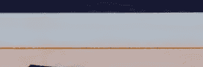

```
1   <html>
2   <body style="background-color:black">
3       
4       
5       <p id="scoreTB" style="position:absolute; color:white;">Score: 0</p>
6       <p id="timeTB" style="position:absolute; right:50px; color:white;">Time: 0</p>
7   </body>
8   <script>
9       var score=0, gameTime=0, gameTimer, ufoX=0, ufoY=0, atomX=0, atomY=0;
10      onkeydown=handleKeys;
11      onready=startUp();
12      function setLeft(id,x){document.getElementById(id).style.left=x+"px";}
13      function setTop(id,y){document.getElementById(id).style.top=y+"px";}
14      function randomNumber(low,hi){return (Math.floor(low+Math.random()*(1+hi-low)));}
15      function startUp(){
16          moveAtom();
17          gameTimer=window.setInterval(displayTime, 1000);
18      }
19      function displayTime(){
20          gameTime++;
21          document.getElementById("timeTB").innerText="Time: "+gameTime;
22      }
23      function moveAtom(){
24          atomX=randomNumber(2,16);
25          atomY=randomNumber(2,16);
26          setLeft("atom",50*atomX);
27          setTop("atom",50*atomY);
28      }
29      function handleKeys(e){
30          if(e.keyCode==37){ufoX--;}
31          if(e.keyCode==39){ufoX++;}
32          if(e.keyCode==38){ufoY--;}
33          if(e.keyCode==40){ufoY++;}
34          setLeft("ufo",50*ufoX);
35          setTop("ufo",50*ufoY);
36          checkIfHitAtom();
37      }
38      function checkIfHitAtom(){
39          if((ufoX==atomX) && (ufoY==atomY)){
40              score++;
41              document.getElementById("scoreTB").innerText="Score:"+score;
42              moveAtom();
43              if(score==5){gameOver();}
44          }
45      }
46      function gameOver(){
47          clearInterval(gameTimer);
48          alert("Well done! Your time was:"+gameTime);
49          location.reload();
50      }
51  </script>
52  </html>
```

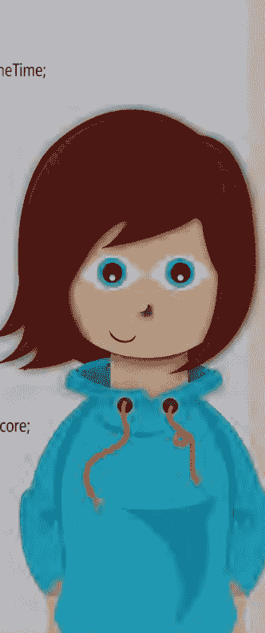

## 幽灵迷宫

在这个项目中，你将制作一个简单的迷宫游戏。玩家按下方向键时会四处移动。为了阻止玩家穿过墙壁，我们将迷宫形状存储在一个特殊的数据结构中。这个结构被称为二维数组，它是一个列表的列表，用于存储迷宫中哪些方格是墙壁，哪些不是。最后，我们将检查玩家的位置，并在他们到达迷宫出口时显示一条消息。游戏的完整代码列在第17页。

### 步骤 1 – 规划

游戏开始时，使用一个数据网格来绘制迷宫。墙壁将用黄色绘制，路径用蓝色绘制。

在玩家移动之前，我们需要检查它是否会撞到墙壁。这是通过检查 **mazeData** 来完成的。

按下方向键会改变玩家图标的坐标，使其在屏幕上移动。

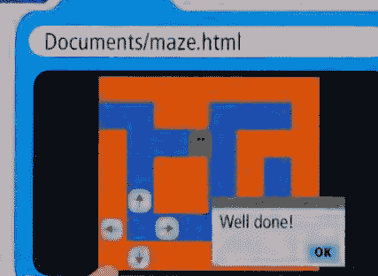

每次玩家移动时，我们需要检查它是否已到达出口。这是通过检查坐标来完成的。

var mazeData
迷宫信息以1和0存储。1表示墙壁，0表示路径。

var px var py
变量存储玩家的坐标。

在出口处显示一条消息。

### 步骤 2 – 找一张图片

- 首先，你需要找一张图片来使用。它需要放在与HTML文件相同的文件夹中。
- 上网搜索一些剪贴画来使用。
- 右键单击一张图片。
- 点击 **将图片另存为...**
- 导航到你的 **文档** 文件夹，然后点击 **保存**。

### 步骤 3 – 开始一个新文件

- 首先输入游戏的HTML代码。为主体、迷宫容器和玩家（幽灵，在我们玩游戏时会四处移动）添加代码。迷宫稍后会构建，但我们需要准备一个特殊的容器来装方块——即 **mazeHolder**。我们还将添加一个特殊的样式部分，其中包含每个迷宫方块的大小和颜色。

```
1 <html>
2 <body style="background-color:black">
3     <div id="mazeHolder" style="position:absolute; top:0; left:0;"></div>
4     
5     <style>
6         div{position:absolute; background-color:yellow; width:50px;
7         height:50px;}
8     </style>
9 </body>
```

设置背景颜色。
创建一个框来存放迷宫的所有方块。
将 src 属性与下载文件的名称相匹配。
开始样式部分。
此样式用于组成迷宫方块的 div 元素。
结束样式部分。

### 步骤 4 – 保存你的代码

- 点击 **文件 > 保存**，并输入 **maze.html** 作为文件名。
- 确保将其保存在你的 **文档** 文件夹中。每隔几分钟就保存一次。

### 迷宫数据

当开发者设计一个有迷宫或一些墙壁或平台的游戏时，他们需要找到一种方法来确保游戏中的物体在撞到硬物时停止。有很多种方法可以做到这一点，但都涉及某种数据结构，用于保存硬物位置的信息。在这个游戏中，我们将创建一个特殊的网格数据，称为二维数组，它使用1和0来表示墙壁和路径。

```
var mazeData=[
    [1, 1, 1, 1, 1, 1, 1, 1, 1],
    [0, 0, 1, 1, 0, 0, 0, 1],
    [1, 0, 0, 0, 0, 1, 1, 1],
    [1, 0, 1, 1, 0, 1, 0, 1],
    [1, 0, 1, 1, 0, 0, 0, 1],
    [1, 0, 0, 0, 0, 1, 0, 0],
    [1, 1, 1, 1, 1, 1, 1, 1]
];
```

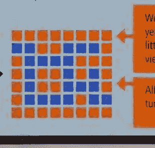

我们需要将1变成黄色的墙壁。在网页上查看时，它们可能看起来有点橙色。

所有的0都需要变成蓝色的路径。

我们选择绘制迷宫的颜色并不重要。重要的是所有的1和0。我们将使用它们来阻止玩家穿过墙壁。

### 步骤 5 - 输入迷宫数据

开始脚本部分并输入迷宫数据。创建一个名为 mazeData 的数组，将其作为二维数组存储。

```
9 <script>
10 var mazeData=[
11 [1,1,1,1,1,1,1,1],
12 [0,0,1,1,0,0,0,1],
13 [1,0,0,0,0,1,1,1],
14 [1,0,1,1,0,1,0,1],
15 [1,0,1,1,0,0,0,1],
16 [1,0,0,0,0,1,0,0],
17 [1,1,1,1,1,1,1,1]
18 ];
```

开始脚本部分。

创建 mazeData 数组。

仔细输入数据。迷宫的每一行成为数组中的一个列表。迷宫中的每个方格是0或1，并用逗号分隔。每个列表必须以方括号 [ ] 开始和结束。一旦你运行了代码，你可以尝试更改此数据以改变迷宫布局。

结束 mazeData 数组。

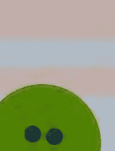

### 步骤 6 - 变量和简单函数

输入代码，告诉程序在按下键和程序启动时该做什么。创建所需的变量并定义设置坐标的函数。

```
19 onkeydown=handleKeys;
20 onready=drawMaze();
21 var px=0, py=1;
22 function setLeft(id,x){document.getElementById(id).style.left=x+"px";}
23 function setTop(id,y){document.getElementById(id).style.top=y+"px";}
```

当按下任何键时，调用名为 handleKeys 的函数。当页面加载完毕时，调用名为 drawMaze 的函数。创建坐标变量。定义函数来设置任何元素的坐标。

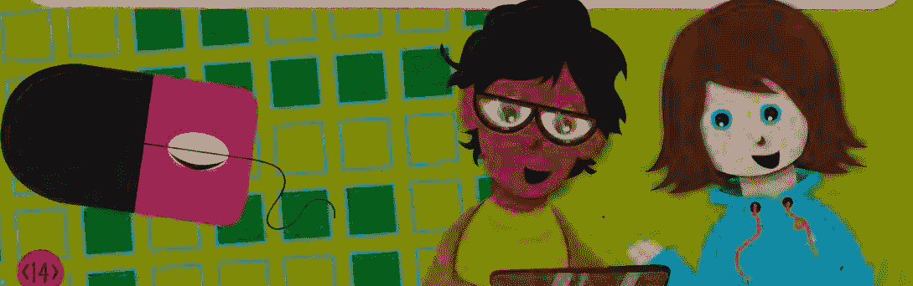

### 步骤 7 - 绘制迷宫

需要使用 mazeData 数组中的信息在页面上绘制迷宫。下面的函数将遍历数组，并为迷宫中的每个方格创建一个 div 元素。然后它会查看 mazeData 中的相关项是0还是1。如果是1，它将保持 div 为黄色；如果是0，它将将其涂成蓝色。

```
24 function drawMaze(){
25     for(var y=0; y<7; y++){
26         for(var x=0; x<8; x++){
27             var newOb=document.createElement('div');
28             document.getElementById("mazeHolder").appendChild(newOb);
29             var divId=Math.random();
30             newOb.setAttribute('id',divId);
31             setLeft(divId,50*x);
32             setTop(divId,50*y);
33             if(mazeData[y][x]==0){
34                 document.getElementById(divId).style.backgroundColor="blue";
35             }
36         }
37     }
38 }
```

遍历迷宫的每一行。
遍历迷宫的每一列。
创建一个名为 newOb 的新 div。
将其添加到 mazeHolder 中。
div 需要一个名称。编一个随机名称！
告诉 div 它的新名称。
根据其坐标将其定位在迷宫容器的正确位置。x 和 y 值乘以 (*) 50，因为每个方块是 50 x 50 像素。
如果 mazeData 中的相关项是 0，那么：
将 div 涂成蓝色，使其成为路径。
结束 IF 命令块。
结束 x 循环。
结束 y 循环。
结束函数。

### 步骤 8 - 移动玩家

当按下方向键时，我们需要将玩家向上、下、左或右移动。但是，我们还需要检查移动玩家是否会使它撞到墙壁。为此，我们需要查看玩家将要移动进入的 mazeData 项的值。如果是0，则允许玩家移动。如果是1，玩家会撞墙，因此玩家不能移动。

```
39 function handleKeys(e){
40     if((e.keyCode==37)&&mazeData[py][px-1]==0){px--;}
41     if((e.keyCode==39)&&mazeData[py][px+1]==0){px++;}
42     if((e.keyCode==38)&&mazeData[py-1][px]==0){py--;}
43     if((e.keyCode==40)&&mazeData[py+1][px]==0){py++;}
44     setLeft("player",px*50);
45     setTop("player",py*50);
46     if(px==7 && py==5){alert("Well done!");}
47 }
```

定义一个名为 handleKeys 的函数。
如果按下左箭头键且玩家左侧没有墙壁，则 px 减 1。
如果按下右箭头键且玩家右侧没有墙壁，则 px 加 1。
如果按下向上或向下箭头键，并且玩家移动不会撞墙，则以同样的方式改变 py。
通过将 px 乘以 50 和 py 乘以 50 来设置玩家的新位置。
如果 px 和 py 与出口的坐标匹配，则显示一条消息说“干得好！”。


### 第9步 – 完成游戏

最后，添加这两行代码以显示脚本部分的结束和HTML的结束。

```
48 </script>
49 </html>
```

保存你的文件，重新加载浏览器，然后测试你的迷宫！

### 图形以数据存储

游戏世界的信息不是使用背景图片，而是存储在一个二维数组中——一个列表的列表。

### 动态元素

到目前为止，我们通过输入HTML来向页面添加元素，但有时元素太多，无法用这种方式添加。我们可能想要设置细节，例如元素的颜色或程序运行的时间。当JavaScript运行时创建的元素称为动态元素。

### 自定义

- 通过更改mazeData中的一些1和0来尝试不同的迷宫布局。
- 制作一个更大的迷宫，并尝试使用不同的颜色。

1.  首先在方格纸上规划你的迷宫。确保它是可以解决的！

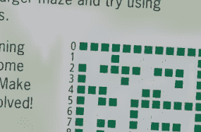

2.  将你的迷宫转换成1和0。当需要墙时使用1。用你的新数据替换原始代码的第10到18行。

```
var mazeData=[
  [1,1,1,1,1,1,1,1,1,1,1,1,1],
  [0,0,0,1,0,0,0,0,0,0,0,0,1],
  [1,0,1,1,1,1,1,0,1,1,1,0,1],
  [1,0,0,0,1,0,0,0,0,0,1,0,1],
  [1,1,1,0,0,0,1,1,0,0,0,1],
  [1,0,1,0,1,1,1,1,1,1,1,1],
  [1,0,0,0,1,0,0,0,1,0,0,1],
  [1,0,1,1,0,1,0,1,1,1,0,1],
  [1,0,1,0,0,1,0,0,0,1,0,1],
  [1,0,1,0,1,1,1,0,1,0,1],
  [1,0,1,0,0,0,0,0,1,0,0],
  [1,1,1,1,1,1,1,1,1,1,1],
];
```

3.  在drawMaze函数中，你需要更改循环运行的次数。在所示的示例中，两者都需要更改为12，因为迷宫有12列宽和12行深（坐标从0开始）。

```
for(var y=0; y<7; y++) {
  for(var x=0; x<8; x++){
```

将8更改为新迷宫中的列数。

4.  为新出口的位置设置坐标。（在示例中，这将是px==11和py==10）。

```
if(px==7 && py==5){alert("Well done!");}
```

将7更改为新迷宫中的行数。

### 完整代码

```
1  <html>
2  <body style="background-color:black">
3    <div id="mazeHolder" style="position:absolute; top:0; left:0;"></div>
4    
5    <style>
6      div{position:absolute; background-color:yellow; width:50px; height:50px;}
7    </style>
8  </body>
9  <script>
10   var mazeData=[
11     [1,1,1,1,1,1,1,1],
12     [0,0,1,1,0,0,0,1],
13     [1,0,0,0,0,1,1,1],
14     [1,0,1,1,0,1,0,1],
15     [1,0,1,1,0,0,0,1],
16     [1,0,0,0,0,1,0,0],
17     [1,1,1,1,1,1,1,1]
18   ];
19   onkeydown=handleKeys;
20   onready=drawMaze();
21   var px=0, py=1;
22   function setLeft(id,x){document.getElementById(id).style.left=x+"px";}
23   function setTop(id,y){document.getElementById(id).style.top=y+"px";}
24   function drawMaze(){
25     for(var y=0; y<7; y++){
26       for(var x=0; x<8; x++){
27         var newOb=document.createElement('div');
28         document.getElementById("mazeHolder").appendChild(newOb);
29         var divId=Math.random();
30         newOb.setAttribute('id',divId);
31         setLeft(divId,50*x);
32         setTop(divId,50*y);
33         if(mazeData[y][x]==0){
34           document.getElementById(divId).style.backgroundColor="blue";
35         }
36       }
37     }
38   }
39   function handleKeys(e){
40     if((e.keyCode==37)&&mazeData[py][px-1]==0){px--;}
41     if((e.keyCode==39)&&mazeData[py][px+1]==0){px++;}
42     if((e.keyCode==38)&&mazeData[py-1][px]==0){py--;}
43     if((e.keyCode==40)&&mazeData[py+1][px]==0){py++;}
44     setLeft("player",px*50);
45     setTop("player",py*50);
46     if(px==7 && py==5){alert("Well done!");}
47   }
48  </script>
49 </html>
```

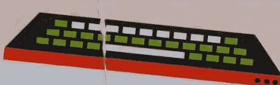

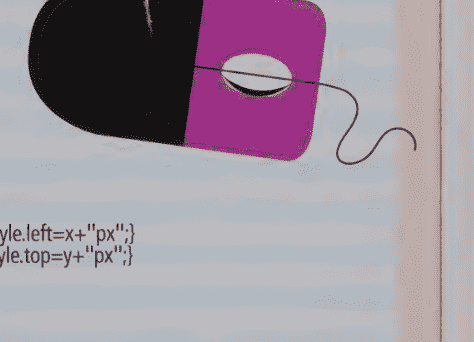

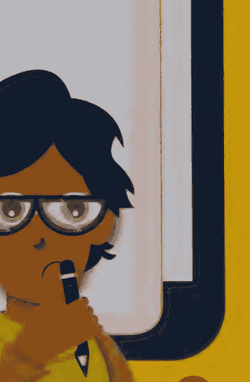

## 岩石风暴

这个游戏是一个简单的横向卷轴游戏：岩石将从屏幕右侧向玩家控制的飞船移动。按下**上**和**下**箭头可以让飞船躲避岩石。每次岩石移动时，一个函数会检查它们是否撞到了飞船。分数将存储在一个变量中，并在每次飞船躲避岩石时增加。玩游戏时，请最大化屏幕，使游戏更大，更容易躲避岩石。游戏的完整代码在第23页列出。

### 第1步 – 规划

- 分数显示在HTML段落元素`<p>`中。
- 按下**上**和**下**箭头键将使飞船在屏幕上上下移动。
- 计时器每20毫秒移动一次岩石。
- 然后通过测试它们是否重叠来检查是否有任何岩石撞到了飞船。我们将创建一个特殊函数来处理这个测试。
- 点击**确定**重新开始游戏或取消。
- 变量存储分数——飞船将向上或向下移动的距离——以及岩石的最大速度。
- 如果飞船被岩石击中，那么游戏结束。

### 第2步 – 寻找一些图片

1.  找到一张要使用的飞船图片。它需要保存到与HTML文件相同的文件夹中。
2.  在互联网上搜索要使用的飞船剪贴画。
3.  右键单击一张图片。
4.  点击**将图像另存为...**
5.  导航到你的**文档**文件夹，然后点击**保存**。
6.  现在重复此步骤，但搜索要使用的**太空岩石**剪贴画。

### 第3步 – 开始一个新文件

首先输入游戏的HTML。为主体添加代码，包含四张图片和一个用于显示分数的段落。

```
<html>
<body style="background-color:#8060AA">
    
    
    
    
    <p id="scoreTB" style="position:absolute; color:yellow; font-size:20px; font-family:Arial">Score: 0</p>
</body>
```

### 第4步 – 保存你的代码

- 点击文件 > 保存，输入rocks.html作为文件名。
- 确保将其保存在文档文件夹中。每次添加任何代码时都保存它。

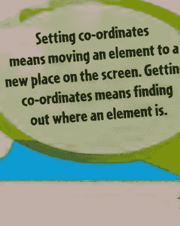

### 第5步 – 开始编写脚本

在脚本的开头，我们需要：
-   创建我们需要的变量
-   告诉程序在按键时运行哪个函数
-   告诉程序在页面加载完毕并准备就绪时运行哪个函数
-   定义一个函数来生成随机数
-   定义一些函数来获取和设置坐标。

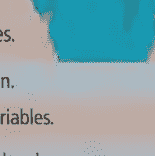

```
<script>
var score=0, yChange=3, speed=5, gameTimer;
document.onkeydown=handleKeys;
onready=startUp();
function setLeft(id,x){document.getElementById(id).style.left=x+"px";}
function setTop(id,y){document.getElementById(id).style.top=y+"px";}
function getLeft(id){return document.getElementById(id).offsetLeft;}
function getTop(id){return document.getElementById(id).offsetTop;}
function randomNumber(low,high){return(Math.floor(low+Math.random()*(1+high-low)));}
```

### 碰撞还是重叠？

在前两个游戏中，我们每次移动对象50或100像素。这使得在测试x（距离左边的距离）和y（距离顶部的距离）坐标后，很容易看出对象是否相互碰撞。在对象以较小数量移动的游戏中，它们可能相互碰撞，但坐标并不完全相同。为了测试这一点，我们需要查看两个对象是否重叠。

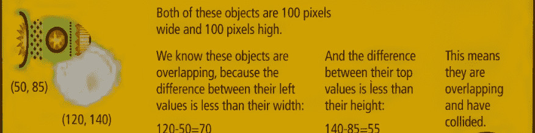

### 第6步 – 重叠测试代码

- 我们需要一个函数来测试三个岩石中是否有任何一个与飞船重叠。与其为每个岩石编写单独的代码，我们将编写一个函数来测试任意两个对象是否重叠。我们将这两个假想的对象称为ob1和ob2。当我们调用函数时，我们将告诉它我们想用哪两个对象进行重叠测试。

```
18 function isOverlapping(ob1,ob2){
19   return ((getLeft(ob1)+100>getLeft(ob2))
        && (getLeft(ob1)<getLeft(ob2)+100) &&
        (getTop(ob1)+100>getTop(ob2)) &&
        (getTop(ob1)<getTop(ob2)+100));}
```

添加在测试两个对象的坐标后返回（发回）值的代码。如果对象重叠，则返回true，否则返回false。它假定对象高100像素，宽100像素。

### 第7步 – 启动

- 页面在浏览器中加载后，startUp函数将被调用。startUp函数将设置一个计时器来移动岩石。

```
20 function startUp(){
21   gameTimer=window.setInterval(moveThings,20);
22 }
```

启动gameTimer。这个计时器将每20毫秒（每秒50次）调用名为moveThings的函数。


### 第8步 – 移动物体

⇔ 当计时器调用**moveThings**函数时，所有三块岩石都需要移动。我们可以通过编写一段代码来移动**rock1**，再写一段来移动**rock2**，最后一段来移动**rock3**来实现这一点。但这将需要大量代码，并且意味着如果想让岩石移动得更快或更慢，就需要修改每一段代码。相反，我们将使用一个循环来依次移动每块岩石，并检查它是否撞到了飞船。我们的循环将从1数到3。第一次它将移动**rock1**，然后是**rock2**，接着是**rock3**。为此，我们需要编写一个通用的代码段来移动一个假想的岩石，称为**rock n**。我们可以给**n**赋一个1到3之间的值。这将被写作 "rock" +n。

⇔ 最后，我们需要将飞船向上或向下移动。为了增加游戏难度，飞船不会保持静止。

```
23 function moveThings(){
24   for(var n=1; n<=3; n++){
25     var x=getLeft("rock"+n);
26     if(x<-100){
27       x=window.innerWidth;
28       y=randomNumber(0,window.innerHeight-100);
29       setTop("rock"+n,y);
30       score=score+10;
31       document.getElementById("scoreTB").innerText="Score: "+score;
32     }
33     setLeft("rock"+n,x-speed-n);
34     if(isOverlapping("rock"+n,"ship")){
35       gameOver();
36     }
37   }
38   var y=getTop("ship");
39   if((y<=0) || (y>window.innerHeight-100)){yChange=-yChange;}
40   setTop("ship",y+yChange);
41 }
```

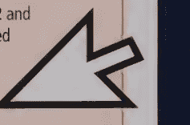

### 第9步 – 改变方向

=> 为了增加游戏难度，飞船会持续向上或向下移动。按下某个键会设定其方向，但它是在**moveThings**函数中被移动的。输入这个函数来决定当按下按键时会发生什么。

```
42 function handleKeys(e){
43   if(e.keyCode==38){yChange=-3;}
44   if(e.keyCode==40){yChange=3;}
45 }
```

### 第10步 – 碰撞

=> 如果一块岩石撞到了飞船，那么将调用以下函数：

```
46 function gameOver(){
47   clearInterval(gameTimer);
48   if(confirm("Game Over – Click OK to play again.")==true){
49     location.reload();
50   }
51 }
```

### 第11步 – 结束

=> 最后，添加这两行来显示脚本部分的结束和HTML的结束。

```
52 </script>
53 </html>
```

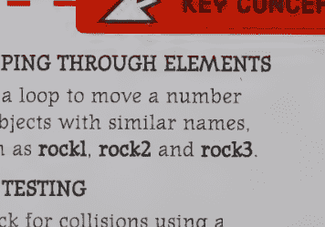

保存你的文件，重新加载**浏览器**，然后开始玩吧！

### 完整代码

```
1  <html>
2  <body style="background-color:#8060AA">
3      
4      
5      
6      
7      <p id="scoreTB" style="position:absolute; color:yellow; font-size:20px; font-family:Arial">Score: 0</p>
8  </body>
9  <script>
10     var score=0, yChange=3, speed=5, gameTimer;
11     document.onkeydown=handleKeys;
12     onready=startUp();
13     function setLeft(id,x){document.getElementById(id).style.left=x+"px";}
14     function setTop(id,y){document.getElementById(id).style.top=y+"px";}
15     function getLeft(id){return document.getElementById(id).offsetLeft;}
16     function getTop(id){return document.getElementById(id).offsetTop;}
17     function randomNumber(low,high){return (Math.floor(low+Math.random()*(1+high-low)));}
18     function isOverlapping(ob1, ob2){
19         return ((getLeft(ob1)+100>getLeft(ob2)) && (getLeft(ob1)<getLeft(ob2)+100) && (getTop(ob1)+100>getTop(ob2)) && (getTop(ob1)<getTop(ob2)+100));}
20     function startUp(){
21         gameTimer=window.setInterval(moveThings,20);
22     }
23     function moveThings(){
24         for(var n=1; n<=3; n++){
25             var x=getLeft("rock"+n);
26             if(x<-100){
27                 x=window.innerWidth;
28                 y=randomNumber(0,window.innerHeight-100);
29                 setTop("rock"+n,y);
30                 score=score+10;
31                 document.getElementById("scoreTB").innerText="Score: "+score;
32             }
33             setLeft("rock"+n,x-speed-n);
34             if(isOverlapping("rock"+n, "ship")){
35                 gameOver();
36             }
36         }
37         var y=getTop("ship");
38         if((y<=0) || (y>window.innerHeight-100)){yChange=-yChange;}
39         setTop("ship",y+yChange);
40     }
41     function handleKeys(e){
42         if(e.keyCode==38){yChange=-3;}
43         if(e.keyCode==40){yChange=3;}
44     }
45     function gameOver(){
46         clearInterval(gameTimer);
47         if(confirm("Game Over – Click OK to play again.")==true){
48             location.reload();
49         }
50     }
51 </script>
52 </html>
```

### 自定义

-   尝试通过改变岩石和飞船的速度使游戏更难。
-   添加第四块名为rock4的岩石。修改循环使其移动。
-   构建你自己的游戏，玩家需要躲避移动的物体。可以设定在水下...

## 潜艇探险

这个游戏涉及玩家引导一艘潜艇在屏幕上移动，试图抓住从沉船上掉入水中的宝藏。它使用了一种不同的移动系统，这种系统常用于驾驶游戏和横版飞行游戏中，用于转向和斜向移动。使用了一些复杂的数学方法来处理角度。游戏还包括基本的音效。游戏的完整代码在第29页列出。

### 第1步 - 规划

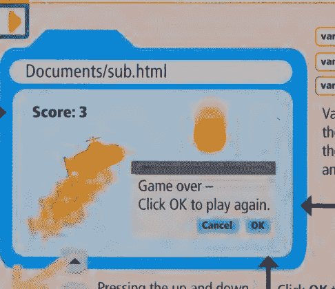

-   分数显示在HTML段落元素`<p>`中。
-   一个计时器将移动硬币和潜艇。
-   每次潜艇移动时，我们需要检查它是否抓住了硬币。这是通过使用一个函数来检测重叠来完成的。
-   如果抓到了硬币，就会播放音效。

-   `var score`, `var gameTime`, `var angle`, `var speed`, `var subX`, `var subY`
-   变量用于计算分数、潜艇的速度、它的行进角度及其坐标。
-   如果一枚硬币掉落到屏幕底部，游戏结束。
-   点击 **确定** 再次游戏或取消。
-   按下向上和向下箭头键将改变潜艇的角度，引导它在屏幕上移动。

### 第2步 - 寻找图片

-   找到一张潜艇图片来使用。它需要保存到与HTML文件相同的文件夹中。
-   在网上搜索潜艇剪贴画。
-   右键单击一张图片。
-   点击 **图片另存为...**
-   导航到你的**文档**文件夹，然后点击**保存**。
-   现在重复此步骤，但搜索**硬币剪贴画**来使用。

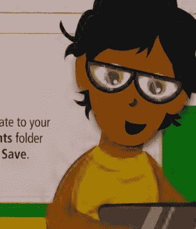

### 第3步 - 声音文件

我们需要一个音效，在潜艇抓住硬币时播放。你的电脑上可能已经有了。如果没有，请在线搜索一个声音文件下载使用。

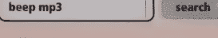

在你的搜索结果中显示的每个网站都是不同的。试着找一个允许你下载mp3文件的网站。

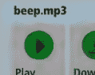

### 第4步 - 开始新文件

首先输入游戏的HTML代码。为body添加代码，包括两张图片和一个用于显示分数的段落。

```
Sublime Text
1 <html>
2 <body style="background-color:#2980b9">
3     
4     
5     <p id="scoreTB" style="position:absolute; color:white; font-size: 20px; font-family:Arial;">Score: 0</p>
6 </body>
```

设置背景颜色。确保src属性与下载的潜艇文件名匹配。确保src属性与下载的硬币文件名匹配。添加分数段落。

### 第5步 - 保存你的代码

点击 **文件** > **保存**，并输入 **sub.html** 作为文件名。

确保将其保存在你的**文档**文件夹中。每次添加新代码后都要保存它。


### 步骤 6 – 开始脚本

在脚本开头，我们需要：

-   创建所需的变量
- 告诉程序在按键时运行哪个函数
- 启动 **gameTimer** 并让它每 20 毫秒调用一次 **moveThings** 函数
- 定义一些用于获取和设置坐标以及生成随机数的函数。

```
7 <script>
8 var score=0, angle=0, speed=4, subX=0, subY=500, gameTimer;
9 onkeydown=handleKeys;
10 gameTimer=window.setInterval(moveThings,20);
11 function setLeft(id,x){document.getElementById(id).style.left=x+"px";}
12 function setTop(id,y){document.getElementById(id).style.top=y+"px";}
13 function getLeft(id){return document.getElementById(id).offsetLeft;}
14 function getTop(id){return document.getElementById(id).offsetTop;}
15 function randomNumber(low,high){return(Math.floor(low+Math.random()*(1+high-low)));}
```

开始脚本部分。

创建变量。

当按键被按下时，运行函数。

告诉计时器开始运行。

定义设置任何元素坐标的函数。

定义获取任何元素坐标的函数。

定义一个在两个值之间返回随机数的函数。

### 步骤 7 – 重叠测试代码

我们将使用第 20 页上使用的函数来测试名为 **ob1** 和 **ob2** 的对象是否重叠。

```
16 function isOverlapping(ob1, ob2){
17 return ((getLeft(ob1)+50>getLeft(ob2)) && (getLeft(ob1)<getLeft(ob2)+50) &&
(getTop(ob1)+50>getTop(ob2)) && (getTop(ob1)<getTop(ob2)+50));}
```

定义函数。

我们需要对《岩石风暴》游戏进行一些调整。这次，其中一个对象要小得多，所以我们需要将 100 改为 50。

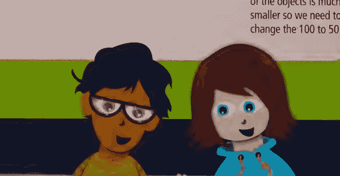

### 按角度移动

当我们用 JavaScript 编码时，让对象左右或上下移动相当简单。我们只需确保其位置属性设置为 **absolute**，然后更改 left（x 坐标）和 top（y 坐标）样式值即可。要让它按角度移动，我们需要使用一些更复杂的数学知识。如果你不完全理解也没关系，但请试着找出以下代码行中哪些部分使其移动，以便你能将其改编用于其他你制作的游戏。

如果潜艇以 30 度角向下移动，那么它的运动可以分解为向下移动多少和向右移动多少。

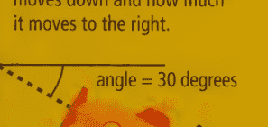

通过使用数学函数 **正弦** 和 **余弦**，我们可以将角度移动转化为水平和垂直运动的组合。在 JavaScript 中，我们将它们输入为 **Math.sin** 和 **Math.cos**：

将 **subX** 改变为 **speed** 乘以潜艇角度的余弦值。

```
subX=subX+speed*Math.cos(Math.PI*angle/180);
subY=subY+speed*Math.sin(Math.PI*angle/180);
```

将 **subY** 改变为 **speed** 乘以潜艇角度的正弦值。

### 步骤 8 - 移动对象

每次计时器调用该函数时，我们需要移动潜艇和金币。这个函数还会调用另一个函数 **checkHit**，用于测试潜艇是否抓到了金币。最后，我们检查金币是否已经到达海底底部。

```
18 function moveThings(){
19   subX=subX+speed*Math.cos(Math.PI*angle/180);
20   subY=subY+speed*Math.sin(Math.PI*angle/180);
21   if(subX<-100){subX=innerWidth;}
22   if(subX>innerWidth){subX=-100;}
23   if(subY<-100){subY=innerHeight;}
24   if(subY>innerHeight){subY=-100;}
25   setLeft("sub",subX);
26   setTop("sub",subY);
27   y=getTop("coin");
28   setTop("coin", y+1+score*0.1);
29   checkHit();
30   if(y>window.innerHeight){gameOver();}
31 }
```

根据潜艇的角度改变变量 subX 和 subY。

如果潜艇已经越过屏幕左边缘，则将其移动到右侧。

如果它太靠右，则将其全部移到左侧。

如果它太高，则将其移到底部。

如果它太低，则将其移到顶部。

现在我们已经计算出新的坐标，需要移动潜艇。

找出金币的位置并将其存储在变量 y 中。

将金币向下移动，随着分数的增加，速度也会加快。

调用将检查它们是否碰撞的函数。

如果金币已经越过屏幕底边，则添加结束游戏的代码。

### 步骤 9 – 命中了吗？

此函数通过测试它们是否重叠来检查潜艇是否抓到了金币。如果重叠，分数会增加，金币会移回顶部，并播放音效。

```
32 function checkHit(){
33   if(isOverlapping("sub","coin")){
34     score++;
35     document.getElementById("scoreTB").innerHTML="Score: "+score;
36     setTop("coin",0);
37     setLeft("coin",randomNumber(0,innerWidth-100));
38     new Audio("beep.mp3").play();
39   }
40 }
```

测试潜艇是否与金币重叠。如果是，则运行以下代码：分数加 1。将金币移回屏幕顶部。为金币设置一个新的随机左侧位置。播放音效。确保你在引号之间输入的文件名与你在步骤 3 中下载的 mp3 文件匹配。结束 IF 语句。

### 步骤 10 – 操控潜艇

输入下面的函数来处理按键事件。它会改变角度变量，同时也会旋转图像。

```
41 function handleKeys(e){
42   if(e.keyCode==38){angle=angle-10;}
43   if(e.keyCode==40){angle=angle+10;}
44   document.getElementById("sub").style.
       webkitTransform = 'rotate('+angle+'deg)';
45 }
```

如果向上箭头键的代码被发送，则将角度变量减少 10 度。如果向下箭头键的代码被发送，则将角度变量增加 10 度。更改图像显示的角度以匹配角度变量。

### 步骤 11 – 游戏结束

如果其中一个金币到达海底底部，以下函数将需要运行：

```
46 function gameOver(){
47   clearInterval(gameTimer);
48   if(confirm("Game Over - Click OK to play again.")==true){
49     location.reload();
50   }
51 }
52 </script>
53 </html>
```

停止计时器运行以停止对象移动。显示一条消息询问玩家是否想再玩一次？如果他们点击确定，则运行下一行。重新加载页面并使游戏重新开始。结束 IF 语句。结束函数。结束脚本。结束 HTML。

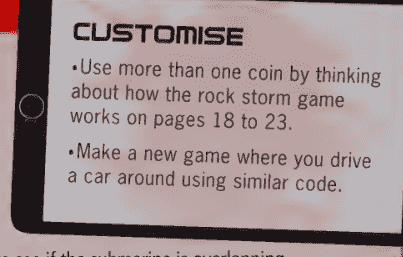

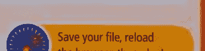

### 完整代码

```
1  <html>
2  <body style="background-color:#2980b9">
3      
4      
5      <p id="scoreTB" style="position:absolute; color:white; font-size:20px; font-family:Arial;">Score: 0</p>
6  </body>
7  <script>
8      var score=0, angle=0, speed=4, gameTimer, subX=0, subY=500;
9      onkeydown=handleKeys;
10     gameTimer=window.setInterval(moveThings, 20);
11     function setLeft(id,x){document.getElementById(id).style.left=x+"px";}
12     function setTop(id,y){document.getElementById(id).style.top=y+"px";}
13     function getLeft(id){return document.getElementById(id).offsetLeft;}
14     function getTop(id){return document.getElementById(id).offsetTop;}
15     function randomNumber(low,hi){return(Math.floor(low+Math.random()*(1+hi-low)));}
16     function isOverlapping(ob1, ob2){
17         return ((getLeft(ob1)+50>getLeft(ob2)) && (getLeft(ob1)<getLeft(ob2)+50) &&
18         (getTop(ob1)+50>getTop(ob2)) && (getTop(ob1)<getTop(ob2)+50));
19     }
20     function moveThings(){
21         subX=subX+speed*Math.cos(Math.PI*angle/180);
22         subY=subY+speed*Math.sin(Math.PI*angle/180);
23         if(subX<-100){subX=innerWidth;}
24         if(subX>innerWidth){subX=-100;}
25         if(subY<-100){subY=innerHeight;}
26         if(subY>innerHeight){subY=-100;}
27         setLeft("sub",subX);
28         setTop("sub",subY);
29         y=getTop("coin");
30         setTop("coin", y+1+score*0.1);
31         checkHit();
32         if(y>window.innerHeight){gameOver();}
33     }
34     function checkHit(){
35         if(isOverlapping("sub", "coin")){
36             score++;
37             document.getElementById("scoreTB").innerHTML="Score: "+score;
38             setTop("coin",0);
39             setLeft("coin",randomNumber(0,innerWidth-100));
40             new Audio("beep.mp3").play();
41         }
42     }
43     function handleKeys(e){
44         if(e.keyCode==38){angle=angle-10;}
45         if(e.keyCode==40){angle=angle+10;}
46         document.getElementById("sub").style.webkitTransform = 'rotate('+angle+'deg)';
47     }
48     function gameOver(){
49         clearInterval(gameTimer);
50         if(confirm("Game Over - Click OK to play again.")==true){
51             location.reload();
52         }
53     }
54 </script>
55 </html>
```

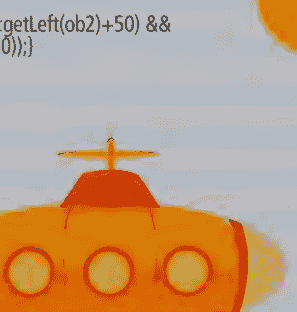

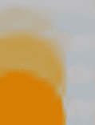

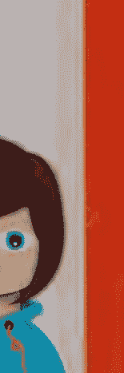

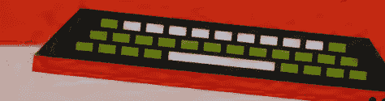


## 词汇表

**动画（ANIMATION）** 让程序中的对象移动起来。

**浏览器（BROWSER）** 用于查看网页的程序，例如 Chrome 或 Internet Explorer。

**错误（BUG）** 程序中导致其无法正常工作的错误。

**调试（DEBUG）** 从程序中移除错误（或缺陷）。

**元素（ELEMENT）** 构成网页的对象之一，例如段落或图像。

**事件（EVENT）** 程序运行期间发生的事情，例如鼠标点击或按键。

**函数（FUNCTION）** 一段可重复使用的代码，组合了多个命令。

**HTML（超文本标记语言）** 用于构建网页的语言。

**JavaScript** 一种编程语言，用于使网页具有交互性或构建简单游戏。

**重叠（OVERLAPPING）** 当对象发生碰撞但不处于完全相同的位置时。

**像素（PIXEL）** 屏幕上的一个小点，可用作度量单位。

**属性（PROPERTY）** 关于元素样式的 information，例如其颜色或大小。

**随机数（RANDOM NUMBER）** 计算机选择的一个无法预测的数字。

**标签（TAGS）** HTML 文档中的特殊单词，被尖括号 <> 包围，用于定义一个元素。

**文本编辑器（TEXT EDITOR）** 用于创建和修改代码的程序。

**计时器（TIMER）** 一个对象，在指定的延迟后或在固定的时间间隔运行一个函数。

**二维数组（TWO DIMENSIONAL ARRAY）** 一个列表的列表，用于表示网格或数据表格。

**变量（VARIABLE）** 程序中用于存储可更改信息的值。

### 错误与调试

当你发现代码不能按预期工作时，停下来，逐行检查你编写的代码。以下是一些需要检查的事项：

-   检查你是否正确拼写了命令。
-   检查你是否使用了正确的大小写（大写和小写）。
-   检查你是否遗漏了任何引号。
-   检查你是否正确关闭了标签。
-   如果图像没有显示，请检查文件名是否拼写准确。
-   如果图像没有移动，请检查你是否设置了 `position:absolute`。
-   确保你使用了正确样式的括号和其他符号。

## 命令列表

### JavaScript 命令

**`alert("Hello");`** – 在弹出框中显示 "Hello" 作为消息。
**`var score=0;`** – 定义一个名为 score 的变量。
**`var gameTimer=window.setInterval(myFunction, 1000);`** – 每秒钟运行一个名为 **myFunction** 的函数。
**`clearInterval(gameTimer);`** – 停止名为 **gameTimer** 的计时器。
**`function gameOver();`** – 定义一个名为 **gameOver()** 的函数。
**`document.getElementById("dog")`** – 选择页面上的一个元素。
**`Math.random()`** – 创建一个介于 0 和 1 之间的随机数。
**`Math.round()`** – 将一个十进制数四舍五入到最接近的整数。
**`location.reload();`** – 重新加载页面以重启 JavaScript（和游戏）。

### HTML 元素

**`<html>...</html>`** – 开始和结束 HTML 文件。
**`<script>...</script>`** – 开始和结束脚本部分。
**``** – 标记一个图像，例如照片或剪贴画。
**`<p>...</p>`** – 标记一个段落或一行文本。
**`<body>...</body>`** – 开始和结束页面的主体部分，实际上就是程序的背景。

### 事件

**`onclick`** – 鼠标已被点击。
**`onmousedown`** – 鼠标已被按下（发生在点击和鼠标抬起之前）。
**`onmouseup`** – 鼠标按钮已被释放。
**`onkeydown`** – 键盘上的一个键已被按下。

### 减少错误的技巧

-   如果你正在制作自己的网页，请在开始之前花时间进行规划。
-   练习调试！制作一个非常简单的网页，让你的朋友在你不注意时更改一行代码。你能修复它吗？
-   当一切正常工作时，花时间仔细阅读代码，以便理解每一行。要擅长调试，你需要理解代码中每一行的作用以及代码的工作原理。

### 样式属性

**`position:absolute`** – 允许通过更改 left 和 top 属性来移动元素。
**`left`** – 设置元素（如图像）距离屏幕左侧的距离。
**`top`** – 设置元素距离屏幕顶部的距离。
**`height`** – 设置元素的高度，例如图像（例如 20px 表示 20 像素高）。
**`width`** – 设置元素的宽度，例如图像。
**`-webkit-transition`** – 设置元素更改其属性的速度。

## 索引

-   **角度（angles）** 24, 27, 28
-   **动画（animation）** 7, 30
-   **方向键（arrow keys）** 6, 9, 12, 15, 18, 22, 24, 28
-   **括号（brackets）** 5, 14, 30
-   **错误（bugs）** 30, 31
-   **颜色（colour）** 7, 13, 16, 19, 25
-   **逗号（commas）** 14
-   **命令（commands）** 10, 15, 30, 31
-   **坐标（co-ordinates）** 6, 7, 8, 9, 10, 12, 14, 15, 16, 19, 20, 21, 24, 26, 27
-   **余弦（cosine）** 27
-   **调试（debugging）** 30, 31
-   **元素（elements）** 5, 7, 8, 13, 14, 16, 18, 19, 22, 24, 26, 30, 31
    -   div 13, 15
    -   动态（dynamic）16
-   **函数（functions）** 7, 8, 9, 10, 14, 15, 16, 18, 20, 21, 22, 24, 26, 27, 28, 30, 31
-   **游戏（games）** 3, 5, 6-11, 12-17, 18-23, 24-29
-   **碰撞检测（hit testing）** 20, 22, 27, 28
-   **HTML** 3, 5, 6, 7, 8, 10, 12, 13, 16, 18, 19, 22, 24, 25, 30, 31
-   **IF 语句（IF statements）** 15, 21, 22, 28
-   **图像（images）** 5, 6, 7, 8, 10, 12, 16, 18, 19, 24, 25, 28, 30, 31
-   **键盘事件（keyboard events）** 5, 6, 7, 9, 12, 14, 18, 19, 22, 24, 26, 28, 30, 31
-   **循环（loops）** 15, 16, 21, 22, 23
-   **迷宫（mazes）** 12-17
-   **鼠标事件（mouse events）** 5, 9, 30, 31
-   **段落（paragraphs）** 6, 7, 8, 10, 18, 19, 24, 25, 31
-   **参数（parameters）** 9
-   **像素（pixels）** 8, 15, 20, 30
-   **引号（quote marks）** 28, 30
-   **随机数（random numbers）** 7, 9, 19, 21, 26, 28, 30, 31
-   **计分（scoring）** 5, 6, 7, 10, 18, 19, 21, 24, 25, 27, 28, 31
-   **正弦（sine）** 27
-   **音效（sound effects）** 24, 25, 28
-   **src 属性（src properties）** 7, 13, 19, 25
-   **startUp 函数（startUp function）** 8, 20
-   **样式属性（style properties）** 7, 8, 13, 27
-   **标签（tags）** 5, 30, 31
-   **文本编辑器（text editors）** 3, 4, 5, 30
    -   Sublime Text 4, 5
-   **计时器（timer）** 6, 7, 8, 10, 18, 20, 21, 22, 24, 26, 27, 28, 30, 31
-   **过渡属性（transition properties）** 7
-   **二维数组（two-dimensional arrays）** 12, 13, 14, 15, 16, 30
-   **变量（variables）** 6, 7, 8, 9, 12, 14, 18, 19, 21, 22, 24, 26, 27, 28, 30, 31
-   **网络浏览器（web browsers）** 3, 4, 5, 8, 10, 16, 20, 22, 28, 30
-   **网页（web pages）** 2, 3, 4, 5, 31


走进代码一代的世界，成为一名计算机编程天才！

*我是 JavaScript 游戏制作人：高级编码* 一书包含了众多有趣且易于上手的项目，将一步步引导你学习 JavaScript 编程语言。

-   学习如何创建交互式网页并构建更复杂的在线游戏。
-   关键概念框以直接明了的方式解释难点，让你能够自定义并创建独特的网页。

那么你还在等什么？是时候开始编程了！

