# 我是JavaScript游戏开发者 基础篇：7个程序构建指南


本书包含的网址（URL）在付印时有效。但是，自本书出版以来，内容或地址可能已发生变化。作者或出版商均不对任何此类变化承担责任。

**电子安全**
本书中的大多数活动需要访问互联网。家长或教师应监督此过程，并与儿童讨论如何在线保持安全。


# 尊重版权

版权是指对某物的合法所有权。你需要考虑在你的应用中链接或下载的图片或声音文件的所有者是谁。除非你打算将应用向公众提供，否则应该不会有什么大问题。请向成年人确认。

另一种方法是查找可免费使用的图片或声音文件。搜索图片或声音，然后在网站结果页面上查找**设置**按钮。点击**高级搜索**，然后查找**使用权**。在该菜单中，选择**可自由使用、共享或修改，甚至可用于商业用途**。

# 引言

学习如何使用*JavaScript*编码你自己的趣味游戏。JavaScript最初是一种用于使网页更具交互性的语言。现在它被用于创建可在计算机和移动设备上运行的在线游戏。享受在本书中创建简单程序的乐趣，你将踏上成为JavaScript专家的旅程！

> 减少错误的技巧

- 如果你在制作自己的网页，请在开始之前花时间绘制图表并进行规划。如果事情不奏效，尝试更改数值，不要害怕重新开始——你会从中学习的。
- 程序错误（Bugs）是你代码中导致程序无法正常工作的错误或失误。寻找这些错误被称为*调试*！制作一个非常简单的网页，让你的朋友在你不注意时更改一行代码。你能修复它吗？
- 当事情正常运行时，停下来仔细查看你的代码，以便理解每一行。尝试更改你的代码，并尝试不同的值。要擅长调试，你需要理解代码的每一行及其工作原理。

```
mygame.html
1 <script>
2 alert('Press any key to start')
3 </script>
```

你可以使用纯文本编辑器来创建你的代码。

这可以正常工作，但可能相当敏感，因为软件不会给你任何帮助。

本书活动中最好的选择是使用离线*HTML*编辑器。这将在你输入代码时为你提供支持，同时也让你有机会学习JavaScript代码。

你将使用两个独立的窗口：

```
Sublime Text
1 <script>
2 var score=0;
3 var seconds=0;
4 function moveIt(){
5 score++;
```

用于输入JavaScript代码的文本编辑器。

```
Web Browser
SCORE: 7
```

用于查看程序的浏览器。

有许多不同的浏览器可供使用。我们建议在本书活动中使用Google Chrome。在开始之前，请确保你的计算机上安装了最新版本。

你还将学习一些HTML。HTML是用于构建网页的语言。JavaScript是使这些页面生动起来的语言！

**注意：** *斜体*单词出现在第30页的词汇表中。

# 入门

你需要一个文本编辑器来开始用JavaScript编码。你的计算机上可能已经有一个简单的文本编辑器，称为记事本（如果你使用Windows）或文本编辑（在Mac上）。这足以让你开始，但如果你下载一个更强大的文本编辑器，创建JavaScript将容易得多。在本书中，我们将使用一个名为Sublime Text的文本编辑器。你还可以下载许多其他的，例如Brackets或Notepad++。所有这些都可以供你免费试用。

## 第1步 - 查找SUBLIME TEXT网站

打开你的网络浏览器，访问 www.sublimetext.com

## 第2步 - 开始下载

点击网页顶部附近的下载按钮。
选择你需要的Sublime Text版本。如果不确定，请让成年人帮助你找到正确的版本。如果你使用Mac，请点击苹果菜单，然后点击“关于本机”。在PC上，点击“开始”菜单，选择“系统”，然后点击“关于”。

## 第3步 - 安装软件

某些网络浏览器随后会要求你运行安装程序。选择“运行”。
如果这没有发生，请不要惊慌。安装文件应该已下载到你的计算机上。在你的下载文件夹中查找它。双击它以开始安装新的文本编辑器。你应该会看到一个大的白色或灰色框，为你提供下一步操作说明。按照这些说明完成安装。


# 第四步 – 运行 Sublime Text

**在 PC 上：**
- 点击开始 > 程序 > Sublime Text。或者，如果 Sublime Text 出现在“最近添加”部分，直接点击它即可。

**在 Mac 上：**
- 点击访达。
- 点击应用程序。
- 将 Sublime Text 从访达拖放到桌面底部的程序坞上，以此创建一个快捷方式。
- 点击 Sublime Text 图标。

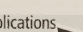


# 第五步 – 说你好

在文本编辑器的第 1、2 和 3 行仔细输入以下内容。Sublime Text 应该会自动为你缩进代码行，但如果它没有，请确保你按照所示精确缩进代码行。

```
1  <script>
2      alert("Hello")
3  </script>
```

标记 JavaScript 代码段的开始。
显示一个写有 **Hello** 的消息框。代码将自动缩进。
标记 JavaScript 代码段的结束。

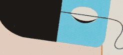

# 第六步 – 保存你的代码

- 点击 **文件 > 保存**。
- 保存到你的 **文档** 文件夹。
- 输入 **hello.html** 作为文件名。

# 第七步 – 查看你的页面

- 打开你的 **文档** 文件夹。
- 找到 **hello.html** 文件并双击它。
- 你的网页现在应该会在你的常规网页浏览器中加载。
- 你应该会看到一个写着 **Hello** 的消息。

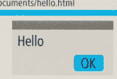

# 为什么在 HTML 代码中使用 JavaScript？

尽管我们使用 JavaScript 进行编码，但我们需要将文件放在一些 HTML 代码中才能使其工作。HTML 代表超文本标记语言，是用于构建网页的语言。

HTML 用于描述网页上显示哪些对象或*元素*。如果你正在创建一个简单的游戏，你需要使用 HTML 添加图像和一些文本来显示分数。但是，HTML 无法使图像移动或分数改变。

添加 JavaScript 是为了告诉图像在按下不同键或点击鼠标时四处移动。它也可以用于显示分数并使其改变。我们需要同时使用 HTML 和 JavaScript 才能制作一个有趣的游戏。JavaScript 被设计成可以添加到 HTML 页面中，使其更具交互性。

在本书的程序学习中，你将了解如何将 HTML 的不同元素与 JavaScript 结合使用。

# 数学测验

现在让我们来编写一个简单的数学测验程序。这将是你更好地了解 JavaScript 的一个机会。如果你以前做过一些编码，你可能会熟悉*变量*和 IF 语句的概念。我们将探讨如何在 JavaScript 中使用这些概念。

> 语法在 JavaScript 中非常重要。语法意味着确保所有命令和符号都输入正确。

# 第一步 – 启动你的文本编辑器

**在 PC 上：**
- 点击开始 > 程序 > Sublime Text。

**在 Mac 上：**
- 点击 Sublime Text 图标（如需帮助，请参见第 5 页）。

# 第二步 – 输入代码

仔细输入你的数学测验问题。对于问题 “8 x 8 等于多少？”（答案：64），将以下代码添加到你的文本编辑器的第 1 到 6 行：

```
<script>
answer=prompt("What is 8 x 8?");
if(answer==64){
    alert("Correct!");
}
</script>
```

启动 JavaScript。
提出一个问题。
如果答案是 64，那么：显示一个写着 **Correct!** 的消息框。
结束 JavaScript。

你的文本编辑器可能会自动缩进代码行。如果没有，请确保你按照示例所示缩进代码行。就像用句号结束句子一样，你应该用分号(;)结束 JavaScript 语句。

# 第三步 – 保存你的代码

- 点击文件 > 保存，并输入 **quiz.html** 作为文件名。
- 确保你将其保存在 **文档** 文件夹中。

# 第四步 – 查看你的作品

- 打开你的 **文档** 文件夹并双击 **quiz.html** 文件。你的程序应该在网页浏览器中运行。
- 通过正确回答来测试你的页面。你应该会收到 "Correct!" 消息。然后，刷新页面并给出错误答案。你不应该收到消息。

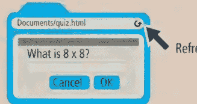

# 第五步 – 随机化！

- 按以下方式更改你的代码，以便为问题选取*随机数*：

```
var a = Math.round(Math.random() * 10);
```

```
1 <script>
2     var a=Math.round(Math.random()*10);
3     var b=Math.round(Math.random()*10);
4     answer=prompt("what is "+a+" x "+b+"?");
5     if(answer==a*b){
6         alert("Correct!")
7     }
8 </script>
```

使用上面的代码示例创建变量 a。按照第一个示例，创建一个变量 **b**。
使用 + 号将字符串 "what is" 与存储在变量 a 中的值连接起来。
检查输入的答案是否与 a 乘以 (*) b 相同。

# 第六步 – 保存并刷新

- 保存你的新代码。
- **刷新**浏览器以查看更改。每次刷新时，你都应该会得到一个新的随机问题。

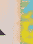

## 关键概念

## 变量

变量是程序中用于存储信息的部分。每个变量都有一个名称，该名称用于指向计算机内存中的某个部分。然后在该内存部分中存储一个值。在此测验中，变量用于存储随机数和用户的输入。

## IF 语句

通常，代码行是逐行执行的。IF 语句的工作方式不同。它在运行特定代码段之前，检查特定条件（例如正确答案）是否为真。

## 自定义

- 更改你的代码，使其使用更大的数字提出更难的问题。

# 随机颜色

在这个活动中，我们将创建一个简单的程序，随机设置屏幕颜色。

## 第一步 – 规划

- 列出四种可供选择的颜色。
- 启动一个计时器，每 1000 毫秒（即每秒）改变一次颜色。
- 要更改颜色：
  - 从 0 到 3 中随机选取一个数字。在此程序中，0 是一个数字。
  - 使用随机数字选择其中一种颜色。
  - 将背景颜色设置为所选颜色。
- 创建一个称为函数的特殊代码部分，它将按照上述步骤来更改颜色。通过给函数一个名称——changeColor()——你将创建一个新命令，每当键入 changeColor() 时，该命令将执行这些步骤。

> 括号！
方括号 ([]) 在 JavaScript 中用于表示列表的开始和结束。程序员将这种列表称为数组。如果数组包含字符串（单词或符号），则每个字符串都需要用双引号括起来。花括号 ({}) 用于表示函数的开始和结束。

## 第二步 – 启动新的 HTML 文件

- 启动你的文本编辑器，或点击文件 > 新建。

## 第三步 – 输入此代码

非常仔细地输入此代码，使用完全相同的拼写、符号和大写字母。请记住，如果 Sublime Text 没有自动缩进，你需要按照这里所示的方式缩进代码行。

```
1 <script>
2   colors=["red","green","blue","yellow"];
3   var timer=window.setInterval(changeColor, 1000);
4   function changeColor(){
5     var n=Math.round(Math.random()*4);
6     document.body.style.backgroundColor=colors[n];
7   }
8 </script>
```

创建颜色列表。
创建一个计时器，它将每秒运行一次 changeColor 函数。
定义 changeColor 函数。
创建一个名为 n 的变量，并赋予它一个 0 到 3 之间的随机值。
设置背景颜色。
结束函数。

# 第四步 – 保存你的代码

- 点击 **文件 > 保存** 并输入 **colors.html** 作为文件名。确保你将其保存在 **文档** 文件夹中。

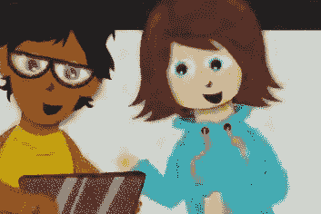

# 第五步 – 查看你的作品

- 打开你的 **文档** 文件夹。双击 **colors.html** 文件。你的程序应该在网页浏览器中运行。屏幕应该每秒改变一次颜色。

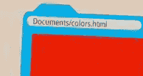

# 第六步 – 调整你的屏幕

随着你开始开发更复杂的程序，你需要同时查看代码和浏览器。许多程序员会设置他们的屏幕，使代码位于左侧，网页显示在右侧。

- 调整文本编辑器和浏览器窗口的大小，使你的屏幕看起来像这样：

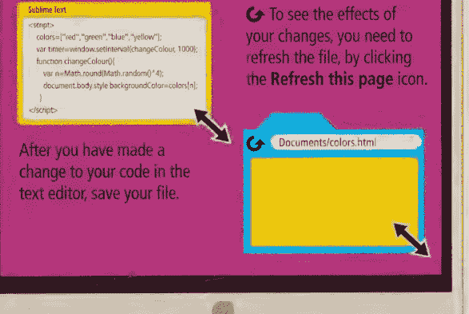

```
<script>
colors=["red", "green", "blue", "yellow"];
var timer=window.setInterval(changeColor, 1000);
function changeColor(){
  var n=Math.round(Math.random()*4);
  document.body.style.backgroundColor=colors[n];
}
</script>
```

- 向列表中添加更多颜色。确保你用双引号将每个颜色单词括起来，并用逗号分隔。
- 要从你的新列表中选择一种颜色，你需要更改所选的随机数。编辑第 5 行末尾的数字以匹配列表的长度。
- 通过编辑第 3 行末尾来更改选择新颜色的频率（选择一个非常低的值会导致颜色闪烁）。

## 自定义

## 关键概念

## 数组

数组是存储为某些数据的项目列表。列表类似于变量，但它们可以存储多个信息项。在我们的程序中，第 2 行包含一个颜色列表。

## 函数

函数是结合了许多命令的代码段。函数的名称成为一个运行整个代码段的新命令。第 4 到 7 行包含函数定义。


## 运动起来

要开始编写我们自己的游戏，我们需要使用一些新技术。首先，我们需要将图像添加到屏幕上。我们还需要能够将图像定位在特定的位置，然后让图像移动起来。为了让所有这些功能正常工作，我们将使用一些HTML代码以及JavaScript。

### 第1步 – 找一张图片

首先，你需要找一张要使用的图片。它需要与你的HTML文件放在同一个文件夹中。➔ 上网搜索一些可用的剪贴画（参见第31页）。在这个程序中，我们将使用一个幽灵图片。

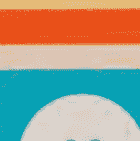

➔ 右键点击你选择的幽灵图片。请使用**png**格式的图片。
➔ 点击**图片另存为...**
➔ 将图片命名为**ghost.png**。导航到你的**文档**文件夹，然后点击**保存**。

### 第2步 – 检查！

➔ 打开你的**文档**文件夹，检查图片文件是否在那里。它的名字应该是**ghost.png**。如果不在，请返回步骤1重试，确保你选择了**文档**文件夹。

| 文件 | |
|---|---|
| 📂 桌面 | 📄 colors.html |
| 📂 文档 | 📄 hello.html |
| 📂 下载 | 📄 quiz.html |
| 📂 图片 | 🖼️ ghost.png |

➔ 找到你的图片并记住它的确切文件名。

### 第3步 – 新建一个文件

➔ 将此代码仔细输入到你的文本编辑器中。我们将使用一些HTML代码，通过**\<body\>**标签来设置背景颜色。我们将使用**\**标签添加一张图片。

```
1 <html>
2   <body style="background-color:darkblue">
3     
4   </body>
5 </html>
```

开始HTML。
使用body标签设置背景颜色。
使用第3步中图片的文件名（**ghost.png**）。
结束body标签。
结束HTML。

## HTML图像标签：

**id**是我们用来标识图像的名称。

**position:absolute**允许使用坐标来定位图像。

```

```

我们向页面添加了一张图像。

**style**属性用于设置HTML元素的大小和颜色等属性。记得添加一对双引号。

将图片的文件名输入到**src**（源）属性中。

### 第4步 - 保存你的文件

### 第5步 - 查看你的页面

⇒ 点击**文件** > **保存**，并输入**ghost.html**作为文件名。确保将其保存在你的**文档**文件夹中。

⇒ 打开你的**文档**文件夹。双击该文件，你应该会看到它出现在你的网页中。

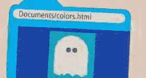

### 第6步 - 让它动起来！

⇒ 我们可以使用变色程序中的计时器技术来使图像移动。我们将改变幽灵的位置，而不是改变屏幕颜色。

⇒ 通过在原始代码的第5行插入一个`<script>`部分来添加新代码。

```
Sublime Text
1 <html>
2 <body style="background-color:darkblue">
3 
4 </body>
5 <script>
6 var timer=window.setInterval(moveGhost, 1000);
7 function moveGhost(){
8 document.getElementById("ghost").style.left=Math.random()*900+"px";
9 document.getElementById("ghost").style.top=Math.random()*600+"px";
10 }
11 </script>
12 </html>
```

开始JavaScript部分。创建一个计时器，每1000毫秒运行一次**moveGhost**函数。定义**moveGhost**函数。通过设置幽灵的left和top样式属性，将其移动到一个新的随机位置。结束**moveGhost**函数。结束JavaScript。

## 关键概念

## 坐标

通过设置元素的left和top样式属性（或坐标）来移动元素（如图像）。在值后面添加**px**，以*像素*为单位进行测量。坐标(0,0)将始终位于浏览器的左上角。最大坐标取决于浏览器窗口的大小。

## 标签

在HTML中，所有元素都有一个开始标签。标签总是以<开始，以>结束。

## 属性

属性提供有关HTML元素的额外信息，例如其大小和颜色。

## > 开始点击

所有计算机游戏都需要玩家与计算机或设备交互。为此，我们需要使用鼠标和键盘*事件*。事件是代码中的特殊部分，它们“监听”鼠标或键盘，等待某些事情发生，然后再运行其他代码。

**事件**
我们可以使用**onclick**事件，在图像被点击时运行一些代码。

程序正在监听的事件。

```

```

事件发生时要运行的函数的名称。

除了**onclick**事件，还有很多其他事件，包括：
- **onmousedown** ⇨ 在鼠标按钮被按下的那一刻触发。
- **onmousemove** ⇨ 在鼠标移动到元素上时每次都触发。
- **onmouseup** ⇨ 在鼠标按钮被释放的那一刻触发。
- **onkeydown** ⇨ 当键盘上的键被按下时触发。

### 第1步 – 新建一个文件

⇨ 将此代码仔细添加到你的文本编辑器中。

```
Sublime Text
1 <html>
2   
3   <script>
4     function hideMe(){
5       document.getElementById("ghost").style.display="none";
6     }
7   </script>
8 </html>
```

使用第10页中幽灵图片的文件名。
当它被点击时，运行名为**hideMe**的函数。

定义名为**hideMe**的函数。

当函数运行时，隐藏幽灵。

结束函数。

### 第2步 - 保存并查看你的文件

* 点击**文件** > **保存**，并输入**events.html**作为文件名。
* 确保将其保存在你的**文档**文件夹中。

打开你的**文档**文件夹。双击**events.html**文件。你应该能看到你的图像。

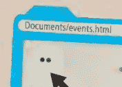

点击图像使其消失。

## 隐藏HTML元素

将元素的**style.display**属性设置为**none**可以使其消失。将其设置为**block**可以使其重新出现。

通过使用其标识（id）来选择要隐藏的元素（幽灵）。

你赋予该属性的值。

```
document.getElementById("ghost").style.display="none";
```

你想要更改的属性。

### 第3步 - 逃跑！

我们将在下一个示例中使用**onmouseenter**事件。当鼠标移动到元素上时触发此事件。它不需要等待鼠标被按下。当你将鼠标移动到幽灵上时，它将跳到一个新的随机位置。

编辑你第12页的代码。

记住要设置**position:absolute**。

```
1 <html>
2   
3   <script>
4     function runAway(){
5       document.getElementById("ghost").style.left=Math.random()*900+"px";
6       document.getElementById("ghost").style.top=Math.random()*600+"px";
7     }
8   </script>
9 </html>
```

一旦有人试图将鼠标移动到幽灵上，它就会运行名为**runAway**的函数。

定义名为runAway的函数。通过设置幽灵的left和top样式属性，将其移动到一个新的随机位置。结束函数。

> 元素是构成网页的项目，例如图像。HTML使用标签来标识元素。是图像标签的开始。

### 第4步 - 保存并刷新

* 保存你的代码，然后刷新浏览器以查看更改。

尝试将鼠标移动到幽灵上。每次你的鼠标移过它时，它都应该移动到一个新的位置。

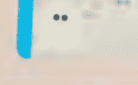

## 章鱼捕捉

在这个游戏中，玩家需要在30秒内尽可能多次地抓住章鱼奥托。计时器将使奥托每秒移动一次。将使用**onmousedown**事件来检查奥托何时被点击。变量将用于存储分数和剩余时间。游戏的完整代码列在第17页。

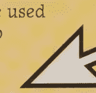

### 第1步 - 规划

分数显示在一个HTML段落元素中。
计时器将使奥托每秒移动一次。
使用**onmousedown**事件来检查奥托何时被抓住。
（**onmousedown**会在**onclick**事件之前触发。）


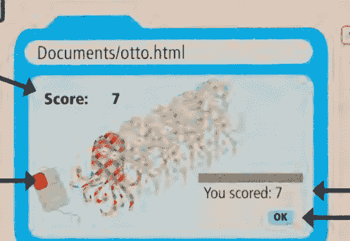

变量用于计数分数和游戏运行的时间。
30秒后，游戏结束并显示分数。
点击**确定**可以重新开始游戏。

### 第2步 - 找一张图片

1. 找一张章鱼的图片。它需要保存在与你的HTML文件相同的文件夹中。使用png格式的图片。将文件命名为**octopus.png**。
2. 搜索一些剪贴画。
3. 右键点击一张图片。
4. 点击**图片另存为...**
5. 导航到你的**文档**文件夹，然后点击**保存**。

## HTML段落标签

将元素的**style.display**属性设置为**none**可以使其消失。将其设置为**block**可以使其重新出现。
id是我们给段落起的名称。
这被称为**结束标签**。它标记段落的结束。
如果我们想更改段落的颜色，可以像处理body元素那样添加一个style属性，并设置其color属性。
我们正在向页面添加一个段落。
我们希望在段落元素中显示的文本被输入在这里：在开始标签<p>和结束标签</p>之间。

```
<p id="scoreText">Score: 0</p>
```


## 步骤 3 – 新建文件

⇒ 首先输入游戏的 HTML 代码，设置主体、图像和用于显示分数的段落。

```html
<html>
<body style="background-color:cyan">
  
  <p id="scoreText">Score: 0</p>
</body>
```

设置背景颜色。

添加第 12 页中的图片。确保 `src` 属性与下载文件的名称匹配。

使用段落来显示分数。

## 步骤 4 – 保存代码

## 关键概念

## 过渡属性

第 10 页上的幽灵移动起来一卡一卡的。我们希望这个游戏中的移动更平滑。为了实现这一点，我们将添加一个过渡属性。这意味着当 Otto 的任何属性被改变时，它们会逐渐变化，而不是瞬间改变。这是第 3 行中使用的新样式属性：

⇒ 点击 **文件 > 保存**，文件名输入 **otto.html**。

⇒ 确保将其保存在 **文档** 文件夹中。每次添加新代码后都要保存。

`-webkit-transition` 是一个用于开启渐变效果的属性。

所有样式属性都将逐渐变化。

```
-webkit-transition: all 0.5s;
```

变化将分散在 0.5 秒（半秒）内完成。

## 步骤 5 – 开始编写脚本

⇒ 我们需要创建变量并启动计时器。添加以下代码：

```javascript
var score=0;
var seconds=0;
var timer=window.setInterval(moveIt, 1000);
```

开始 JavaScript 部分。
将分数变量设置为 0。
将秒数变量设置为 0。

添加计时器，它将每秒运行一个名为 `moveIt` 的函数。虽然我们将其“声明”为变量，但它更像是一个时钟。给它命名意味着我们以后可以停止它。

## 步骤 6 – 移动它！

⇒ 接下来我们需要输入移动 Otto 的函数。这与第 11 页上的 **moveGhost** 函数类似。

```javascript
function moveIt(){
  seconds++;
  document.getElementById("otto").style.left=Math.random()*900+"px";
  document.getElementById("otto").style.top=Math.random()*700+"px";
  if(seconds>30){
    clearInterval(timer);
    alert("You scored:" + score);
    location.reload();
  }
}
```

定义函数。
计算秒数。
将 Otto 移动到一个新的随机位置。
如果时间限制到了：
停止计时器。
显示一个显示分数的消息框。
按下确定后，重新加载页面以开始新游戏。
结束 IF 语句涵盖的代码块。
结束函数。

## 步骤 7 – 抓住它！

⇒ 现在添加 **caughtIt** 函数，当点击 Otto 时会运行（或“调用”）它。

```javascript
function caughtIt(){
  score++;
  document.getElementById("scoreText").innerText="Score: "+score;
}
</script>
</html>
```

定义函数。
分数加 1。
更改分数文本。这是通过设置 **innerText** 属性来完成的。
结束脚本。
结束 HTML 文件。

## 自定义

- 改变游戏持续的时间。
- 通过更改 **-webkit-transition** 值来加快 Otto 的移动速度。
- 使用不同的图像文件并更改背景颜色，以彻底改变游戏的外观。

## 完整代码

```html
<html>
<body style="background-color:cyan">
  
  <p id="scoreText">Score: 0</p>
</body>
<script>
  var score=0;
  var seconds=0;
  var timer=window.setInterval(moveIt, 1000);
  function moveIt(){
    seconds++;
    document.getElementById("otto").style.left=Math.random()*900+"px";
    document.getElementById("otto").style.top=Math.random()*700+"px";
    if(seconds>30){
      clearInterval(timer);
      alert("You scored:" + score);
      location.reload();
    }
  }
  function caughtIt(){
    score++;
    document.getElementById("scoreText").innerText="Score: "+score;
  }
</script>
</html>
```

## 气球破坏者

这个游戏将使用函数和坐标来构建。这将使你更容易理解哪些代码行控制游戏的哪些部分。理解每一行代码将帮助你自定义游戏或在自己的游戏中重用这些函数。这个游戏中的动画将由一个快得多的计时器控制，对气球的位置进行微小的更改。游戏的完整代码列在第 23 页。

## 步骤 1 - 规划

分数显示在一个 HTML 段落元素中。如果气球到达屏幕顶部，游戏结束。使用 `onmousedown` 事件来检查气球是否被戳破。如果被戳破，分数增加，速度也会增加。

变量计算分数和气球的速度。一个计时器将每 25 毫秒移动一次气球。点击确定再次游玩。

## 步骤 2 - 找一张图片

⇒ 首先，你需要找一个要使用的气球图片。它需要放在与你的 HTML 文件相同的文件夹中。使用 png 图片，并将其保存为 **myballoon.png**。
⇒ 上网搜索合适的图片。
⇒ 右键单击一张图片。
⇒ 点击 **图片另存为...**
⇒ 导航到你的 **文档** 文件夹，然后点击 **保存**。

```html
<p style='color:yellow; font-size:20px; font-family:Arial;'>Score: 0</p>
```

### 设置段落样式
段落可以像 HTML 主体和图像元素一样进行样式设置或格式化。

## 1600 万种颜色

有超过 100 个词可以用来设置颜色。还有另一种更精确的方式来设置颜色，使用混合红、绿、蓝光的方法。颜色中红色、绿色和蓝色的数量用 0 到 255 之间的数字给出，产生超过 1600 万种组合。这被称为 *RGB* 颜色系统。

显示亮红色的代码是 255,0,0。红色值是 255，绿色是 0，蓝色是 0。RGB 值随后被转换成一个特殊的代码，称为十六进制代码，它使用字母 A 到 F 而不是 10 到 15。红色的十六进制代码写为 **#FF0000**。

| 颜色 | 红色 | 绿色 | 蓝色 | 十六进制代码 |
|---|---|---|---|---|
| 红色 | 255 | 0 | 0 | FF0000 |
| 绿色 | 0 | 255 | 0 | 00FF00 |
| 蓝色 | 0 | 0 | 255 | 0000FF |
| 黄色 | 255 | 255 | 0 | FFFF00 |
| 紫色 | 128 | 0 | 128 | 800080 |
| 白色 | 255 | 255 | 255 | FFFFFF |
| 黑色 | 0 | 0 | 0 | 000000 |
| 深红色 | 204 | 0 | 0 | CC0000 |

如果你还不理解这些，别担心，只需尝试使用这些颜色代码并进行实验！

> RGB 代码必须以井号 (#) 符号开头。它们可以是大写或小写字母。

## 步骤 3 – 新建文件

⇒ 首先输入游戏的 HTML 代码，设置主体、图像和用于显示分数的段落。

```html
<html>
<body style="background-color:#32CD32">
  
  <p id="scoreText" style="color:yellow; font-size:20px;
      font-family:Arial">Score: 0</p>
</body>
```

设置背景颜色。

添加气球的图片。`src` 属性必须与下载文件的名称匹配。

添加段落以显示分数。

## 步骤 4 – 保存并预览

⇒ 点击 **文件** 和 **保存**。文件名输入 **pop.html**。

⇒ 打开你的 **文档** 文件夹。找到 **pop.html** 文件并双击它。
现在该文件应该在你的浏览器中加载。

## 步骤 5 - 开始编写脚本

既然我们已经定义了页面上的元素，我们需要开始 JavaScript。在游戏开始时，我们需要：

- 创建所需的变量
- 定义一些用于获取和设置坐标的函数
- 定义一个生成随机数的简单函数
- 启动一个计时器。

```javascript
<script>
var score=0, speed=1;
function setLeft(id,x){document.getElementById(id).style.left=x+"px";}
function setTop(id,y){document.getElementById(id).style.top=y+"px";}
function getLeft(id){return document.getElementById(id).offsetLeft;}
function getTop(id){return document.getElementById(id).offsetTop;}
function randomNumber(low,high){return(Math.floor(low+Math.random()*(1+high-low)));}
var gameTimer=window.setInterval(floatUp, 25);
```

开始 JavaScript 部分。

创建变量来存储分数和气球速度。

定义用于设置任何元素坐标的函数。

定义用于获取任何元素坐标的函数。

定义一个返回两个值之间随机数的函数。

计时器将每 25 毫秒（每秒 40 次）运行一个名为 `floatUp` 的函数。

JavaScript 知道函数定义已经结束，因为有了右花括号 }。程序员有时会像我们在这里一样，在单行中定义这些简短、简单的函数。

### 使用 GET、SET 和 RANDOM 函数

你可以将这些函数添加到你自己的游戏中。以下是一些示例来帮助你使用它们。（注意，要使 **get** 和 **set** 函数移动元素，该元素需要将其位置样式属性设置为 **absolute**。）

```javascript
setLeft("balloon", 200); 
setTop("balloon", 350); 
getTop("balloon"); 
randomNumber(1, 6); 
randomNumber(0, 100);
```

将气球定位在距窗口左侧 200 像素的位置。

将气球定位在距窗口顶部 350 像素的位置。

返回气球与窗口顶部之间的当前距离。

返回 1 到 6 之间的随机数。

返回 0 到 100 之间的随机数。


## 第6步 – 上升

⇒ 接下来，我们需要输入使气球上升的函数。

```
function floatUp(){
  var y=getTop("balloon");
  if(y<-100){
    gameOver();
  }
  setTop("balloon",y-speed);
}
```

定义该函数。

找出气球距离窗口顶部的距离，并将其存储在名为 `y` 的变量中。

如果气球已经超出了屏幕顶部，那么 `y` 将小于 -100。如果它超出了顶部，那么：

运行名为 **gameOver** 的函数。

结束 IF 代码块。

使用 `setTop` 函数将气球向上移动。这是通过从 `y` 中减去 `speed` 值来实现的。

结束该函数。

当气球到达屏幕顶部时，游戏结束。这在第16行通过测试气球顶部是否小于 -100 来检查。

一旦气球超出屏幕顶部，**getTop** 函数将返回一个负数，-100。

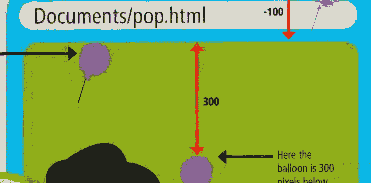

这里气球正接触窗口顶部。这意味着它在顶部下方零像素处。

这里气球在窗口顶部下方300像素处。

> 记得持续保存你的代码！

<21>

## 第7步 - 爆炸

当气球被戳破（被用户点击）时，我们需要让很多事情发生。添加此函数：

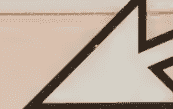

```
function popped(){
    score++;
    speed++;
    document.getElementById("scoreText").innerText="Score: "+score;
    setLeft("balloon", randomNumber(0,window.innerWidth-100));
    setTop("balloon", window.innerHeight);
}
```

定义该函数。

这意味着：使分数增加一。

通过将速度增加一，使下一个气球移动得更快。

在屏幕顶部显示分数。

设置气球距离屏幕左侧的距离为一个随机值。

将气球移动到屏幕最底部。

## 第8步 - 游戏结束

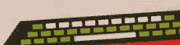

当气球到达屏幕顶部时，游戏结束。当这种情况发生时，我们需要运行以下代码：

```
function gameOver(){
    clearInterval(gameTimer);
    alert("Game Over! You scored: "+ score);
    location.reload();
}
```

定义该函数。

停止计时器运行，这样气球就不会再移动了。

显示一条消息，告诉玩家游戏结束并显示他们的分数。

此命令将重新加载页面并使游戏重新开始。（如果你不想发生这种情况，请将此行留空。）

## 第9步 - 最后几行

最后，添加这两行以结束 JavaScript 部分和 HTML。

```
</script>
</html>
```

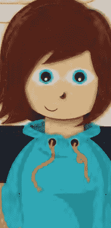

保存你的文件，刷新浏览器，然后开始玩吧！

## 完整代码

```
<html>
<body style="background-color:#32CD32">
    
    <p id="scoreText" style="color:yellow; font-size:20px; font-family:Arial;">Score: 0</p>
</body>
<script>
    var score=0, speed=1;
    function setLeft(id,x){document.getElementById(id).style.left=x+"px";}
    function setTop(id,y){document.getElementById(id).style.top=y+"px";}
    function getLeft(id){return document.getElementById(id).offsetLeft;}
    function getTop(id){return document.getElementById(id).offsetTop;}
    function randomNumber(low,high){return (Math.floor(low+ Math.random()*(1+high-low)));}
    var gameTimer=window.setInterval(floatUp, 25);
    function floatUp(){
        var y=getTop("balloon");
        if(y<-100){
            gameOver();
        }
        setTop("balloon",y-speed);
    }
    function popped(){
        score++;
        speed++;
        document.getElementById("scoreText").innerText="Score: "+score;
        setLeft("balloon", randomNumber(0,window.innerWidth-100));
        setTop("balloon", window.innerHeight);
    }
    function gameOver(){
        clearInterval(gameTimer);
        alert("Game Over! You scored: "+ score);
        location.reload();
    }
</script>
</html>
```

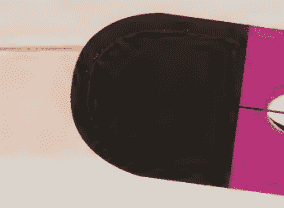

## 自定义

-   通过使气球变小来增加游戏难度。在第3行更改其 `width` 属性。
-   当气球被点击时，将其速度设置为随机值。
-   使用不同的图像和背景创建一个不同的游戏。你可以尝试让物体向下或向右移动。

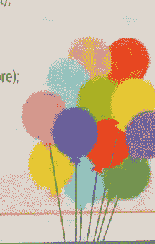

# 接骨头

在这个游戏中，玩家左右移动一只狗，以接住从屏幕上方掉落的骨头。按下方向键使狗左右移动。这个游戏使用了与前一个程序相同的函数来设置坐标和生成随机数。骨头和狗都以50像素的间隔移动。游戏的完整代码列在第29页。

## 第1步 – 规划

分数显示在一个HTML段落元素中。

一个计时器将每200毫秒移动一次骨头。

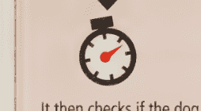

然后它检查狗和骨头的坐标是否匹配。如果匹配，这意味着狗接住了骨头，使分数增加。

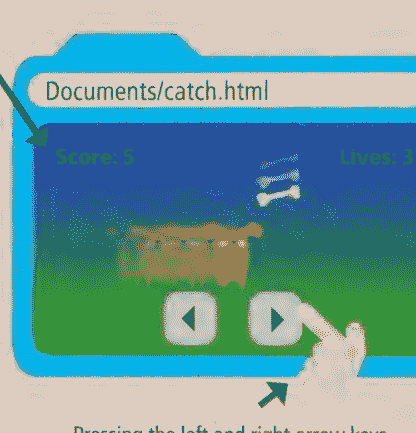

变量用于计算分数、剩余生命值以及狗和骨头的x和y坐标。

当没有剩余生命时，游戏结束。

按下左右方向键将改变狗的x坐标，从而改变狗的位置。

游戏结束！你的得分：5

点击 **确定** 重新开始游戏。

## 第2步 – 寻找图片

找一张狗的图片和一张骨头的图片来使用。将它们保存在与HTML文件相同的文件夹中，命名为 **dog.png** 和 **bone.png**。

-   上网搜索合适的图片。
-   右键单击一张图片。
-   点击 **图片另存为...**
-   导航到你的文档文件夹，然后点击 **保存**。

## 第3步 - 开始新文件

首先输入游戏的HTML，设置主体、图像和一个用于显示分数的段落。

```
<html>
<body style="background: -webkit-linear-gradient(blue, green);">


<p id="scoreTB" style="position:absolute; left:50px; color:yellow; font-size:28px; font-family:Arial;">Score: 0</p>
<p id="livesTB" style="position:absolute; right:50px; color:yellow; font-size:28px; font-family:Arial;">Lives: 3</p>
</body>
```

设置背景颜色。

添加狗和骨头的图像。在每种情况下，`src` 属性必须与下载的文件名匹配。

添加一个显示分数的段落。

显示剩余生命值。请注意，这是从右边缘设置50像素。

## 第4步 - 保存和预览

点击 **文件** 并 **保存**。输入 **catch.html** 作为文件名。

打开你的 **文档** 文件夹。找到 **catch.html** 文件并双击它。该文件现在应该在浏览器中加载。图像还不会移动（因为没有代码告诉它们移动），但页面应该看起来像这样：

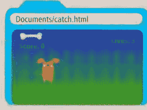

## 颜色渐变

在我们目前创建的游戏中，我们将背景设置为纯色。然而，我们可以通过使用称为颜色渐变的东西来创建一些很棒的效果。颜色渐变使用两种颜色并将它们逐渐融合在一起。尝试从第2行开始的以下代码：

```
<body style="background: -webkit-linear-gradient(blue, green);">
<body style="background: -webkit-linear-gradient(red, yellow);">
```

## 第5步 - 开始脚本

⇒ 既然我们已经定义了页面上的元素，我们需要开始编写JavaScript。在这个游戏开始时，我们需要：

-   创建所需的变量
-   定义一些函数来获取和设置坐标
-   定义一个简单的函数来生成随机数
-   启动一个计时器。

```
<script>
var score=0, lives=3, dogX=6, dogY=10, boneX=8, boneY=0;
function setLeft(id,x){document.getElementById(id).style.left=x+"px";}
function setTop(id,y){document.getElementById(id).style.top=y+"px";}
function randomNumber(low,high){return(Math.floor(low+Math.random()*(1+high-low)));}
var gameTimer=window.setInterval(moveBone, 200);
document.onkeydown=handleKeys;
```

开始Javascript部分。

创建变量来存储分数、生命值以及狗和骨头的坐标。

定义设置任何元素坐标的函数。

定义一个在两个值之间返回随机数的函数。

设置计时器，每200毫秒（每秒5次）运行一个名为 **moveBone** 的函数。

每当键盘上的一个键被按下时，运行一个名为 **handleKeys** 的函数。

## 监听键盘

在这个游戏中，当按下键盘上的方向键时，狗会移动。为此，我们需要设置一个称为事件监听器的东西，它会“监听”键盘，并在按下某个键时运行一些代码。这类似于第12页解释的 **onclick** 事件监听器。看看第14行：

```
document.onkeydown=handleKeys;
```

程序正在等待（监听）的事件。其他键盘事件包括 **onkeyup** 和 **onkeypress**。

当事件发生时要运行的函数的名称。

> 记住，星号 * 用于表示“乘以”。它的数学符号是 x。

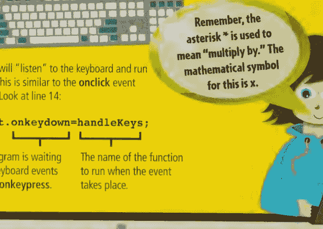


## 定位小狗和骨头

小狗的坐标存储在 **dogX** 和 **dogY** 中，骨头的坐标存储在 **boneX** 和 **boneY** 中。

为了确保小狗有机会抓住骨头，我们将让它们各自在一个不可见的网格上移动。网格中的每个方块宽50像素，高50像素。要设置小狗的左边位置，我们将 **boneX** 乘以50。要设置顶部值，我们将 **boneY** 乘以50。

如果 **dogX** 是2，**dogY** 是3，那么将会发生以下情况：

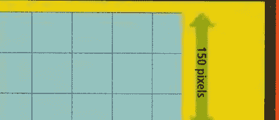

小狗距离左侧 2 * 50 = 100 像素。

小狗距离顶部 3 * 50 = 150 像素。

## 第6步 - 按下任意键

⇒ 当玩家按下一个键时，我们需要将小狗向左或向右移动。移动的方向取决于按下了哪个键。我们需要在函数中添加一种特殊类型的变量，称为**参数**。该参数将存储关于所按键的信息。在函数名后输入 **(e)** 以添加参数。键盘上的每个键都有一个特定的代码与之关联。左箭头键的代码是37，右箭头键的代码是39。按下的键的代码将存储在 **e.keyCode** 中。

```
15  function handleKeys(e){
16      if(e.keyCode==37){dogX--;}
17      if(e.keyCode==39){dogX++;}
18      setLeft("dog", dogX*50);
19      setTop("dog", dogY*50);
20  }
```

定义一个名为 **handleKeys** 的函数。关于按键事件的信息将被放入名为 **e** 的变量中。

如果左箭头键的代码被发送，则使 **dogX** 减1（**dogX--** 表示从 **dogX** 的值中减去1）。

如果右箭头键的代码被传递给函数，则使 **dogX** 加1（**dogX++** 表示给 **dogX** 加1）。

设置小狗的新位置。

## 第7步 - 移动骨头

⇒ 骨头每200毫秒被计时器移动一次。虽然这意味着它每秒只移动5次，但由于我们使用了 **-webkit-transition** 属性，它看起来会相当平滑。计时器运行此函数。

```
21  function moveBone(){
22      boneY=boneY+=1;
23      setLeft("bone", boneX*50);
24      setTop("bone", boneY*50);
25      if(boneY>dogY+5){missedBone();}
26      if((dogX==boneX) && (dogY==boneY)){caughtBone();}
27  }
```

定义该函数。

使 **boneY** 变量增加一（如果你想节省时间，可以将此代码输入为 **boneY++**！）。

设置骨头的新位置。（**boneX** 只有在骨头被抓住或错过时才会改变）。

如果骨头被错过并已落到小狗下方，则运行 **missedBone** 函数。

如果骨头被小狗抓住，并且它们具有相同的x和y坐标，则运行 **caughtBone** 函数。

## 第8步 - 错过了

如果小狗没有抓住骨头，那么玩家就失去一条生命。我们在第25行通过比较两个图像的y坐标来测试这一点。如果骨头比小狗低超过5个网格方块，那么它就错过了。当这种情况发生时，需要运行此代码：

```
function missedBone(){
    boneY=0;
    boneX=randomNumber(2,16);
    lives--;
    document.getElementById("livesTB").innerText="Lives: "+lives;
    if(lives==0){gameOver();}
}
```

定义该函数。将骨头移到顶部。将其定位在屏幕左侧的随机位置。失去一条生命。显示剩余的生命值。如果没有生命值剩余，则运行 **gameOver** 函数。

## 第9步 - 抓住了

第26行的代码检查骨头和小狗的坐标是否相等。如果它们匹配，将运行以下函数：

```
function caughtBone(){
    boneY=0;
    boneX=randomNumber(2,16);
    score++;
    document.getElementById("scoreTB").innerText="Score: "+score;
}
```

定义该函数。将骨头移到顶部。将骨头定位在屏幕左侧的随机位置。分数增加1。显示分数。

## 第10步 - 结束

## 第11步 - 闭合标签

如果小狗没有抓住骨头，并且没有剩余的生命值，游戏就结束了。输入此函数：

最后，输入一个闭合JavaScript标签和一个闭合HTML标签以结束文件。

```
function gameOver(){
    alert("Game Over! You scored: "+ score);
    location.reload();
}
```

定义该函数。显示一条消息告诉玩家游戏结束并显示他们的分数。重新加载页面并使游戏重新开始。

```
</script>
</html>
```

保存你的文件，刷新浏览器，并享受你的游戏吧！

## 完整代码

```
1 <html>
2 <body style="background: -webkit-linear-gradient(blue, green);">
3   
4   
5   <p id="scoreTB" style="position:absolute; left:50px; color:yellow;
     font-size:28px; font-family:Arial;">Score: 0</p>
6   <p id="livesTB" style="position:absolute; right:50px; color:yellow;
     font-size:28px; font-family:Arial;">Lives: 3</p>
7 </body>
8 <script>
9   var score=0, lives=3, dogX=6, dogY=10, boneX=8, boneY=0;
10   function setLeft(id,x){document.getElementById(id).style.left=x+"px";}
11   function setTop(id,y){document.getElementById(id).style.top=y+"px";}
12   function randomNumber(low,high){return(Math.floor(low+ Math.random()*(1+high-low)));}
13   var gameTimer=window.setInterval(moveBone, 200);
14   document.onkeydown=handleKeys;
15   function handleKeys(e){
16     if(e.keyCode==37){dogX--;}
17     if(e.keyCode==39){dogX++;}
18     setLeft("dog", dogX*50);
19     setTop("dog", dogY*50);
20   }
21   function moveBone(){
22     boneY=boneY+=1;
23     setLeft("bone", boneX*50);
24     setTop("bone", boneY*50);
25     if(boneY>dogY+5){missedBone();}
26     if((dogX==boneX) && (dogY==boneY)){caughtBone();}
27   }
28   function missedBone(){
29     boneY=0;
30     boneX=randomNumber(2,16);
31     lives--;
32     document.getElementById("livesTB").innerText="Lives: "+lives;
33     if(lives==0){gameOver();}
34   }
35   function caughtBone(){
36     boneY=0;
37     boneX=randomNumber(2,16);
38     score++;
39     document.getElementById("scoreTB").innerText="Score: "+score;
40   }
41   function gameOver(){
42     alert("Game Over! You scored: "+ score);
43     location.reload();
44   }
45 </script>
46 </html>
```

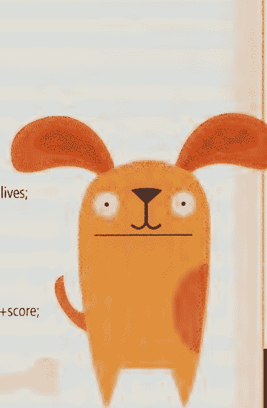

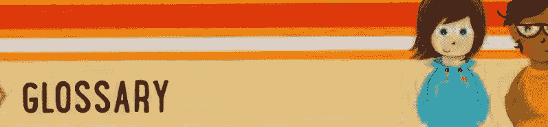

## 术语表

- **动画** 使程序中的对象四处移动
- **数组** 作为某种数据存储的项目列表
- **浏览器** 用于查看网页的程序，例如 Chrome 或 Internet Explorer
- **程序错误** 程序中阻止其正常工作的错误
- **调试** 从程序中移除错误（或缺陷）
- **元素** 构成网页的对象之一，例如段落或图像
- **事件** 程序运行时发生的事情，例如鼠标点击或按键
- **函数** 组合多个命令的可重用代码段
- **十六进制** 使用数字0到9，然后A到F的数字系统
- **HTML（超文本标记语言）** 用于构建网页的语言
- **JavaScript** 一种用于使网页交互或构建简单游戏的编程语言
- **像素** 屏幕上的一个小点。它可以用作度量单位
- **PNG图像** 一种图像格式，通常在网上找到
- **随机数** 无法预测的计算机选择的数字
- **刷新** 在浏览器中重新加载网页，以便可以看到对页面的更改
- **RGB** 用于混合红、绿、蓝光以产生任何颜色的系统
- **选择** 选择；或使用IF等命令运行程序的不同部分
- **字符串** 由有序字符列表组成的数据类型，例如 "Hello world!"
- **语法** 正确并按正确顺序使用命令、括号和其他符号
- **标签** HTML文档中被尖括号 <> 包围的特殊单词，用于定义元素
- **文本编辑器** 用于创建和更改代码的程序
- **计时器** 在指定延迟后或以固定间隔运行函数的对象
- **变量** 可以改变的值，用于在程序中存储信息

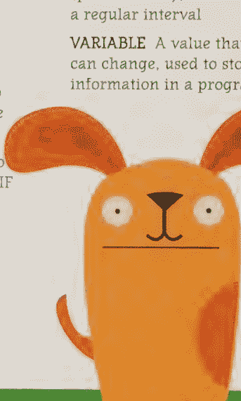


# 命令列表

## JAVASCRIPT 命令

- `alert("Hello");` – 在一个弹出框中显示"Hello"作为消息。
- `var score=0;` – 定义一个名为 score 的变量。
- `var gameTimer=window.setInterval(myFunction, 1000);` – 每秒运行一个名为 myFunction 的函数。
- `clearInterval(gameTimer);` – 停止名为 gameTimer 的定时器。
- `function gameOver():` – 定义一个名为 gameOver 的函数。
- `document.getElementById("dog")` – 选择页面上的一个元素。
- `Math.random()` – 生成一个介于 0 和 1 之间的随机数。
- `Math.round()` – 将一个小数四舍五入为最接近的整数。
- `location.reload();` – 重新加载页面以重启 JavaScript（以及游戏）。

## HTML 元素

- `<html>...</html>` – 开始和结束 HTML 文件。
- `<script>...</script>` – 开始和结束脚本部分。
- `` – 定义一个图像，例如一张照片或一张剪贴画。
- `<p>...</p>` – 开始和结束一个段落或一行文本。
- `<body>...</body>` – 开始和结束页面的主体，实质上是你的程序背景。

## 事件

- `onclick` – 鼠标按钮被点击。
- `onmousedown` – 鼠标按钮被按下（发生在点击和鼠标弹起之前）。
- `onmouseup` – 鼠标按钮被释放。
- `onkeydown` – 键盘上的一个键被按下。

## 错误与调试

当你发现你的代码没有按预期工作时，停下来，仔细检查你输入的每一行代码。思考你希望它做什么，以及它实际上告诉计算机做什么。如果你正在输入本书中的某个程序，请检查你是否遗漏了一行。以下是一些调试技巧：

- 检查你是否正确拼写了命令。
- 检查你是否使用了正确的大小写（大写或小写）。
- 检查你是否遗漏了任何引号。
- 检查你是否正确闭合了标签。
- 如果图像没有显示，请检查文件名是否输入准确。
- 如果图像没有移动，请检查你是否设置了 `position:absolute`。
- 确保你使用了正确风格的括号和其他符号。

## 样式属性

- `position:absolute:` – 允许一个元素，例如图像，通过改变 left 和 top 属性来移动。
- `left` – 设置一个元素在屏幕上的水平位置。
- `top` – 设置一个元素距离屏幕顶部的垂直位置。
- `height` – 设置一个元素的高度（例如，20px 表示 20 像素高）。
- `width` – 设置一个元素的宽度。
- `-webkit-transition` – 设置一个元素属性变化的速度。

# 索引

- **动画** 18, 30
- **数组** 8, 9, 30
- **星号** 26, 27
- **括号** 8, 20, 31
- **错误** 30
- **颜色** 8–9, 10, 11, 14, 16, 18, 19, 25
- **渐变** 25
- **命令** 6, 8, 9, 22, 31
- **逗号** 9
- **坐标** 11, 13, 18, 20, 24, 26, 27, 28
- **版权** 31
- **调试** 3, 30
- **元素** 5, 11, 13, 14, 18, 20, 24, 26, 30, 31
- **事件监听器** 26
- **字体** 18
- **函数** 8, 9, 11, 12, 13, 15, 16, 18, 20, 21, 22, 24, 26, 27, 28, 30, 31
- **游戏** 3, 5, 6, 10, 12, 14–17, 18–23, 24–29
- **井号** 19
- **十六进制数** 19, 30
- **HTML** 3, 5, 10, 11, 13, 14, 15, 18, 19, 22, 24, 25, 28, 30, 31
- **IF 语句** 6, 7, 16, 21
- **图像** 5, 10, 11, 12, 13, 14, 15, 16, 18, 19, 23, 24, 25, 28, 31
- **缩进** 6
- **键盘事件** 5, 12, 24, 26, 27, 31
- **生命数** 24, 25, 26, 28
- **鼠标事件** 5, 12, 13, 14, 18, 31
- **段落** 14, 15, 18, 19, 24, 25, 31
- **参数** 27
- **像素** 11, 18, 20, 21, 24, 25, 27, 30
- **引号** 8, 9, 11, 18
- **随机数** 7, 8, 9, 20, 23, 24, 26, 30, 31
- **RGB** 19, 30
- **计分** 5, 14, 15, 16, 18, 19, 20, 22, 24, 25, 26, 28, 31
- **分号** 6
- **速度** 16, 18, 20, 21, 22, 23
- **src 属性** 11, 15, 19, 25
- **字符串** 7, 8
- **样式属性** 11, 13, 14, 15, 18, 20, 31
- **语法** 6, 30
- **标签** 10, 11, 13, 14, 28, 30
- **文本编辑器** 3, 4, 6, 8, 9, 10, 12, 30
- **Sublime Text** 4, 5, 6
- **定时器** 8, 11, 14, 15, 16, 18, 20, 22, 24, 26, 27, 30, 31
- **过渡属性** 15, 16
- **变量** 6, 7, 8, 9, 14, 15, 20, 21, 24, 26, 27, 30, 31
- **网络浏览器** 3, 4, 5, 7, 9, 10, 11, 13, 16, 19, 25, 28, 30
- **网页** 3, 5, 9, 11, 13, 31
