# InDesign CS5 自动化指南：XML 与 JavaScript

# 第三章 条件语句、循环和函数

## If else 语句

- 使用 else if

## Switch 语句

- 使用 break 语句

## For 循环

- 使用 for 循环测试文档是否打开
- 反向循环
- Break 和 continue

## While 循环

## 函数

- 定义和调用函数
- 从函数返回值
- 向函数传递参数

## 局部和全局变量

## 使用命名空间与变量

## ExtendScript 引擎和变量

# 第四章 创建对话框

## 对话框控件

- 布局控件
- 文本控件
- 自验证文本控件
- 为用户提供选择的控件
- 自验证组合框控件
- 按钮控件

## 引用控件

## 显示对话框

### 创建静态标签和文本框

### 将对话框对象放入变量中

### canCancel 属性

### minWidth 属性

### 下拉控件

- stringList 属性
- selectedIndex 属性

## 创建单选按钮和复选框控件

- 单选按钮控件

## 教程：使用自验证控件

1. 主函数
2. 构建对话框
   - 2a. `createDialog()` 函数框架
   - 2b. 水印文本 editTextbox
   - 2c. Angle comboBox
   - 2d. Fonts 下拉列表
   - 2e. 验证用户输入
3. 向主页添加水印文本
   - 3a. 创建“水印”图层
   - 3c. 创建水印文本框
   - 3d. 格式化水印文本

# 第五章 ScriptUI 对话框

## Window 对象

- 创建窗口

## 容器对象和 add() 方法

- 选项卡面板
- 面板
- 组

## ScriptUI 编码风格

## 将容器放置在容器内

## 文本控件

- StaticText
- StaticText 创建属性
- 使用多行和滚动属性
- EditText
- EditText 创建属性

## 列表控件

- 下拉列表
- 显示图像
- 列表框
- 树视图

## 按钮

- 创建取消和确定按钮

## 事件

- 按钮事件

# 第六章 处理文件和文档

- 关于文件和文档
- 创建新文档
- 打开文档
- 让用户选择文件
- 使用过滤表达式（仅 Windows）
- 使用过滤函数（仅 Mac）
- 创建跨平台掩码
- 允许选择多个文件
- 测试文档是否已打开
- 测试文档数组是否已打开
- 保存文档
- 测试文档是否已保存
- 保存对文档的更改
- 使用 `saveDialog` 方法
- 关闭文档
- 从文本文件读取
- 测试文件是否存在
- 写入文本文件
- 创建新文件
- 处理文件夹
- 创建文件夹
- 读取文件夹中的文件

## 教程：递归导航文件夹和文件

1. 创建主函数
2. `getFolder()` 函数
3. `inputDialog()` 函数
4. `OKButtonClick()` 回调函数
5. `outputDialog()` 函数
6. 递归 `addItem()` 函数
7. `archiveItems()` 函数

# 第七章 文档布局

- 文档和默认首选项
- 视图首选项
- 文档首选项
- 页面属性
- 出血和辅助信息区
- MarginPreferences
- 页边距设置
- 列设置
- 实现文档设置

## 置入文本和图像

- 通过文档对象置入
- 将项目置入页面或跨页
- 将项目置入框架
- 将项目置入文本对象内

## 教程：自动化文档设置

1. 创建主函数
2. `getFiles()` 函数
3. `createDialog()` 函数
4. `setupEvents()` 函数
5. `buildDocument()` 函数

# 第八章 处理文本

- 理解文本对象
- 覆盖文本对象
- 插入文本
- 在对象前插入文本
- 处理字体
- 字体名称

## 教程：创建字体和样式选择对话框

1. 创建字体名称数组
2. 为字体和样式名称创建单独数组
3. 创建对话框
4. 字体下拉列表的 `onChange` 回调
5. “关闭”按钮的 `onClick` 回调
6. 显示对话框

## 查找和替换文本

## 清除查找/更改首选项

## 教程：创建清理文本脚本

1. 创建脚本框架
2. `createDialog()` 函数
   - 2a. 范围下拉列表
   - 2b. 用于选择清理操作的复选框
   - 2c. “取消”和“清理”按钮
3. `cleanUpText()` 函数
   - 3a. 函数框架
   - 3b. 检查更改/查找操作的范围
   - 3c. 执行选定的清理操作
   - 3d. 创建 `doFindChange()` 函数

## 表格

- 创建表格
- 向表格单元格添加文本
- 将值写入每个单元格
- 将数组写入行

## 教程：更新表格数据

# 第9章 处理图像

1. 变量声明与函数调用
2. `importDates()` 函数
   - 2a. 读取数据文件
   - 2b. 将数据转换为数组
   - 2c. 格式化数据以匹配出版物样式
3. 更新出版物中的表格

## InDesign 图像对象

- 图像与其容器
- 定位文档中的所有图形
- 通过 `pageItems` 集合访问图形

## 教程：重新链接图像

1. 创建对话框
2. 回调函数
3. `relinkGraphics()` 函数

## 处理链接

- 确定链接类型
- 识别海报图像
- 排除媒体文件与海报
- `FilePath` 与 `name` 属性
- 嵌入与取消嵌入链接图形

## 教程：取消嵌入未链接的图像

1. 创建主脚本
2. `findEmbedded()` 函数
3. `createDialog()` 函数
4. `exportImage()` 函数

## 图像对象

- 独立图形与锚定图形

## 教程：查找被拉伸的图像

1. 创建 `main()` 函数
2. `findStretched()` 函数
3. `createDialog()` 函数
4. `fixImages()` 函数

# 第10章 页面项与图层

## 教程：遍历文档中的所有页面项

### allPageItems 集合的层级结构

1. `main()` 函数
2. 创建窗口
3. 构建树形视图控件

### 确定页面项类型

- 使用 `constructor.name`
- 使用 `instanceof`
- 识别文本框、组和按钮
- 识别图片框
- 识别影片与声音
- 识别路径上的文本
- 识别常规图形对象

### 页面项与图层

## 教程：创建图层管理器工具

1. 创建 `main()` 函数
2. `loadPageItems()` 函数
3. 创建对话框
   - 3a. 创建窗口本身
   - 3b. 创建对象类型复选框
   - 3c. 创建多列列表框
   - 3d. 创建选择页面项下拉菜单和按钮
   - 3e. 创建移动图层下拉菜单和按钮
   - 3f. 创建删除与关闭按钮
4. 创建 `updateListbox()` 函数
5. 创建回调函数
   - 5a. 页面项列表框双击事件
   - 5b. 按类型选择按钮点击事件
   - 5c. 移动到图层按钮点击事件
   - 5d. 删除与关闭按钮点击事件
6. 测试脚本

# 第11章 错误处理与调试

- 为不同版本的 InDesign 创建脚本
- 检测 InDesign 版本
- 创建条件代码

## 使用 InDesign CS5 运行旧脚本

## 检测平台

## 基本错误处理技术

## 使用 try ... catch

### error 对象

### 抛出自定义错误

## 消除简单错误

### 为他人创建脚本

## 避免引用特定位置

- 使用 `app.activeScript`
- 使用 `Folder.current`

## 在中断模式下调试

- 逐步执行脚本
- 检查变量、对象和语句
- 使用断点

## 教程：在中断模式下工作

1. 逐步执行脚本
2. 设置断点

### 使用 alert 进行调试

### 将值写入 JavaScript 控制台

# 第12章 交互式文档

- 概览
- 设置首选项
   - 视图首选项
   - 文档首选项
   - 透明度首选项
- 添加页面过渡效果
- 自动版面调整
- 缩短文档长度
- 创建按钮
   - 按钮状态
   - 行为

## 教程：从图像创建交互式演示文稿

1. `main()` 函数
2. 检索图像文件
3. 创建对话框
4. 文档设置
5. 设置标题页
6. 添加导航按钮
7. 导入图像
8. 导出交互式 PDF

# 第13章 XML 基础

- 什么是 XML？
- XML 文档结构
   - 元素
   - 属性
   - 实体引用
   - CDATA 节
   - 注释
   - 处理指令
- XML 验证
   - 格式良好性
   - Schema 验证
   - DTD 与 XML Schema 对比
- 创建 XML
   - Microsoft Access
   - Microsoft Excel
   - FileMaker Pro

# 第14章 InDesign XML 基础

- XML 元素、标签和样式
   - 创建标签
   - 将标签映射到样式
- 导入 XML

## 教程：基础 XML 工作流程

1. 重命名根标签
2. 从 XML 文件加载标签
3. 创建段落样式
4. 将标签映射到样式
5. 导入 XML 文件
6. 将 XML 内容置入页面

# 第15章 使用 DTD

- 使用内部 DTD
- 使用外部 DTD
- 声明元素
- 声明包含其他元素的元素
   - 指定子元素出现次数
   - 限制出现次数为选择项
- 声明仅包含数据的元素
- 声明混合内容的元素
- 声明空元素
- 声明属性
- 属性数据类型

## 教程：创建 DTD 并用于验证

1. XML 文件
2. 创建 DTD

# 第16章 XSLT 基础

- 将 XML 文档链接到样式表
- XSLT 文档结构
- `stylesheet` 元素
- `template` 元素
- 使用 XPath 表达式
- XPath 表达式示例
   - 轴
   - 缩写
- 绝对位置路径
- 相对位置路径
- 定位属性
- 使用谓词
   - 谓词示例
- 使用 `<xsl:apply-templates>`
- 使用 `<xsl:copy>`
- `<xsl:value-of>` 元素
- `<xsl:copy-of>` 元素
- 使用 `<xsl:element>` 和 `<xsl:attribute>`

## 教程：在 Dreamweaver 和 InDesign 中使用 XSLT

1. 在 Dreamweaver 中创建 XSL 样式表
   - 定义新站点
   - 创建 XSLT 文件
   - 创建主（外层）模板
   - 创建内层模板
2. 在 InDesign 中应用 XSLT 样式表

# 第17章 XSLT 处理控制元素

- `<xsl:if>`
- `<xsl:choose>`、`<xsl:when>` 和 `<xsl:otherwise>`
- `<xsl:for-each>` 元素
- `<xsl:sort>` 元素

## 教程：使用 XSLT 控制元素

1. 在 Dreamweaver 中创建样式表
   - 创建输出文档根元素
   - 创建 `<xsl:for-each>` 元素
   - 创建 `<xsl:sort>` 元素
   - 创建通用元素
   - 添加 `<xsl:choose>` 语句
2. 使用占位符创建版面
   - 创建段落样式
   - 创建文本和图形占位符
3. 为占位符添加标签
4. 将 XML 导入占位符

# 第18章 处理 InDesign XML 对象

## InDesignXMLElement 对象

- 重命名元素

## xmlTag 对象

- 创建标签
- 加载标签
- 将标签映射到样式

## 导入 XML

## 在版面中置入 XML 数据

## 教程：基础 XML 导入

1. 创建新文档
2. 创建段落样式
3. 将标签映射到样式
4. 导入 XML
5. 在文档中置入 XML

## xmlAttribute 对象

- 遍历属性
- 将属性转换为元素

## 使用 XSLT 样式表

- 指定使用哪个样式表
- 向样式表参数提供值

## 教程：使用参数过滤 XML 导入

1. 创建 XSL 文件
2. 编写主脚本
3. 验证 XML 文件
4. 创建对话框
5. 导入 XML
6. 设置 InDesign 文档
7. 在文档页面上置入 XML 内容
8. 生成交互式 PDF

# 第19章 JavaScript XML 对象

## 创建 XML 对象

## 节点类型

## 访问节点

- 访问特定节点
- 按关系访问节点

## 教程：XML 浏览器工具

1. `main()` 函数
2. 创建 XML 对象
3. 创建对话框
4. `updateTreeView()` 函数
5. `addXMLToDoc()` 函数

# 第20章 导出 XML

## 难以导出为 XML 的文档

## 教程：从目录导出 XML

1. 创建主函数
2. 定义根元素
3. 遍历文档页面
4. 按距离页面顶部的距离对页面项排序
5. 遍历文本框中的所有段落
   - 创建 `<series>` 元素及其子元素
   - 创建 `range` 元素及其子元素
6. 测试已创建的代码
7. 创建产品 `<summary>` 元素
8. 创建产品 `<details>` 元素
9. 创建产品 `<image>` 元素
10. 导出 XML

# 第21章 总结

## 部署解决方案

- `app.doScript`
- 导出为二进制文件

## 教程：创建模块化解决方案

1. 创建启动文件
2. 创建包含文件

## 延伸阅读

- Adobe 文档
- InDesign 自动化相关书籍
- InDesign 自动化视频教程
- JavaScript 相关书籍
- XML 相关书籍
- XSLT 相关书籍

## 在线资源

- Adobe 资源
- 其他人的网站

# 第一章 引言

InDesign 已确立了其在印刷和出版软件中的行业标准地位。它拥有庞大的功能集和广泛的用户基础，其中许多人对该程序有着深入的了解。任何经常使用该程序的人——尤其是那些用它处理颇具挑战性任务的人——都会欢迎自动化其部分工作流的能力。然而，在 InDesign 中实现这一点并无捷径。它没有类似 Photoshop 和 Illustrator 中的“可录制动作”功能。

相反，InDesign 允许用户使用三种编程语言之一编写可执行脚本：JavaScript、AppleScript 或 Visual Basic。使用 JavaScript 作为编程语言的主要优势在于其跨平台性：脚本在 Windows 和 Macintosh 上运行同样出色。

对于在仅限 Mac 环境中工作的人来说，AppleScript 显然是首选语言。它易于与为 Macintosh 平台上其他程序编写的自动化脚本集成——例如，从 FileMaker 提取信息然后将其导入 InDesign——这一优势使其成为自然之选。

对于有兴趣在 Windows 平台上自动化 InDesign 的人来说，Visual Basic 是合乎逻辑的选择。此外，还可以使用 Visual Basic for Applications（VBA）——这是用于自动化 Microsoft Office 的 Visual Basic 变体——来控制 InDesign。对于需要自动化生成严重依赖 Microsoft Excel 电子表格的财务报告的人来说，此选项将是理想的选择。

我们并未选择编写一本涵盖所有三种可能的脚本选项的书，而是选择为每种选项各写一本。这使得讨论每种解决方案独有的、而其他脚本书写者可能不太感兴趣的主题变得更容易。

本书是关于在 Windows 或 Macintosh 平台上使用 JavaScript 自动化 InDesign。它假设用户非常熟悉 InDesign CS5。这是必要的；因为如果不深入了解这些脚本对象所代表的 InDesign 元素，就无法理解 InDesign 对象模型的许多微妙之处。

## 你将面临什么？

为了自动化 InDesign，你需要对三个要素有深入的了解：

- InDesign 本身——该程序及其所有主要功能
- 兼容的脚本语言——在本书中是 JavaScript
- InDesign 对象模型——用于表示 InDesign 本身每个角落的编程语法。

如前所述，本书假设你已具备第一个要素——你非常了解 InDesign。如果你也了解 JavaScript 并在其他环境中使用它，例如客户端 Web 开发，这些知识将对你大有裨益。然而，无论如何，学习自动化 InDesign 的主要部分在于知道如何使用 JavaScript 来控制和操作庞大而广泛的 InDesign 对象模型。

## 脚本面板

自动化 InDesign 所需的一切都随程序一同提供。首先，在 InDesign 内部，我们有脚本面板，可用于运行脚本。要使脚本面板可见，请选择 **窗口 > 实用程序 > 脚本**。脚本面板显示一个包含 Adobe 创建的示例脚本的文件夹，用于演示 JavaScript 和 VBScript 的脚本技术——如果你在 Windows 上运行 InDesign；以及 JavaScript 和 AppleScript，如果你使用的是 Mac 版本。还有一个名为“User”的空文件夹：你放置在此文件夹中的任何脚本都将在 InDesign 的脚本面板中可用。

脚本面板提供了一种在硬盘上定位这些文件夹的有用方法：只需选中其中一个，然后从脚本面板菜单中选择 **在资源管理器中显示**（Windows）或 **在 Finder 中显示**（Mac）。

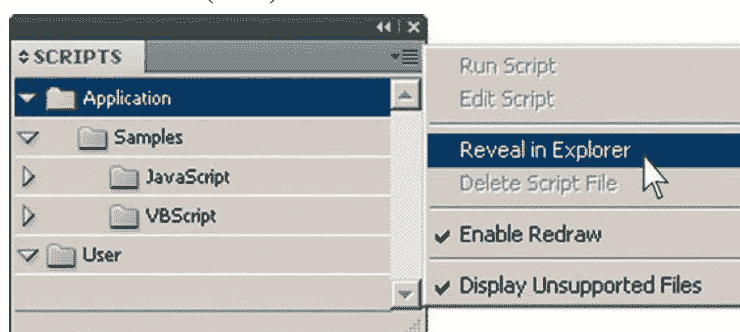

*图 1-1：定位需要保存脚本的文件夹，以便它们出现在脚本面板中*

要运行脚本面板中列出的任何脚本，你可以双击其名称，或者选中名称后从面板菜单中选择 **运行脚本**。如果你选择 **编辑脚本**，InDesign 会打开脚本并启动 ExtendScript Toolkit 应用程序（ESTK），这是 InDesign 脚本的默认编辑器。ESTK 是与 InDesign 分开的应用程序，可以通过转到 **开始 > 程序**（Windows）或在应用程序 > 实用程序 > Adobe 实用程序 - CS5（Mac）中查找来启动。

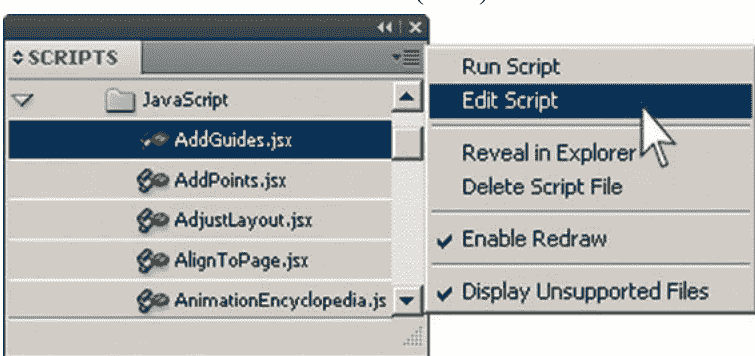

**图 1-2：** 选中脚本并从脚本面板菜单中选择编辑脚本，将启动 ExtendScript Toolkit 应用程序

## ExtendScript Toolkit

ExtendScript 是 Adobe 对 JavaScript 的实现，用于自动化 Adobe 创意套件。ESTK 是一个 ExtendScript 编辑实用程序，包含许多有用的功能；不过，你也可以使用自己喜欢的代码编辑器。ESTK 开发环境现在类似于标准的 Adobe 应用程序，所有内容都在通常的位置；这使得它相当容易上手。

面板停靠在右侧，通过从 **窗口** 菜单中选择它们的名称来隐藏或显示。折叠为图标和展开停靠的箭头与创意套件程序中的工作方式相同。

### 工作区

菜单栏右侧是一个下拉菜单，包含预设的工作区名称，选择它们后会自动将浮动面板重新排列成给定的配置。如果你设计出一种认为理想的面板排列方式，可以通过选择屏幕右上角工作区下拉菜单中的 **新建工作区** 来保存它。

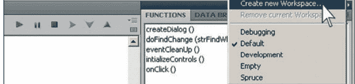

**图 1-3：** 在 Adobe ExtendScript Toolkit CS5 中保存工作区配置

### 行号

ESTK 可以显示行号——这是处理编程代码时的一个基本功能。可以通过选择 **视图 > 行号** 或使用键盘快捷键——Windows 上的 **Control-Shift-L**；Mac 上的 **Command-Shift-L** 来激活或停用此功能。

### 语法高亮显示

它还提供语法的颜色编码高亮显示，其中单词和语句的颜色确认它们在代码中的角色——例如，JavaScript 关键字显示为蓝色，固定文本字符串（在引号内）显示为深红色。

### 代码折叠

另一个有用的功能是 **代码折叠**，程序自动显示用于隐藏和显示代码块的按钮。此功能简化了较长脚本中的导航：你可以临时隐藏行，而不是经常需要滚动过去才能到达脚本的另一部分。可以通过选择 **视图 > 代码折叠** 来激活和停用此功能。

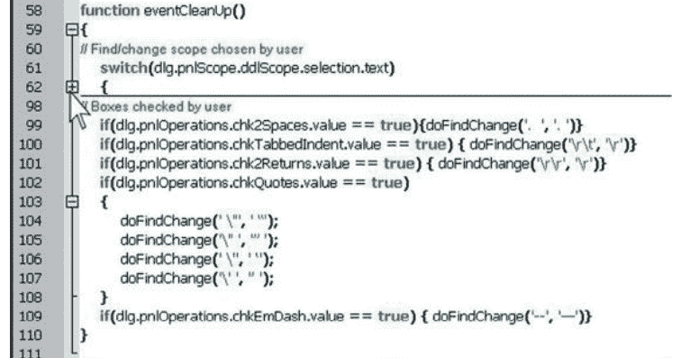

**图 1-4：** ESTK 的 **代码折叠** 功能通过允许你临时隐藏代码块来简化脚本内的导航。

程序会自动识别代码块，并在每个代码块的开头放置一个减号图标。如果你单击减号图标，整个代码块将被隐藏并替换为一条水平线。减号图标随后变为加号图标。要再次显示隐藏的代码块，请单击加号图标。

### 自动完成

如果你使用过任何 Microsoft 代码编辑工具，例如用于在 Microsoft Office 中创建宏的 Visual Basic 编辑器，你会熟悉智能感知的概念，即代码编辑器在你输入关键字时提供上下文相关的选项列表。通过从列表中选择一个选项，你可以避免语法错误，并且不需要花那么多时间查找信息。Adobe Dreamweaver 提供了一个几乎相同的功能，称为代码提示。ESTK 也具有自动完成功能。然而，它远不及 Dreamweaver 和 Microsoft 编辑器中相应的功能。

当你输入某些单词时，建议列表确实会出现；但它们与你正在输入的代码关联性不强。不过，当你在学习一门新的编程语言时，任何一点帮助都是有益的；所以为什么不试试看呢？此功能默认激活：如果你希望停用它，请选择 **编辑 > 首选项**（Windows）或 **ExtendScript Toolkit > 首选项**（Macintosh）。在首选项对话框中单击左侧的 **帮助** 类别，然后取消选中 **启用自动完成** 选项。

## 组织你的脚本

正如我们之前看到的，为了让脚本出现在 InDesign 的脚本面板中，它们必须保存在特定的位置。ESTK 在这方面提供了更大的灵活性，这使其成为启动和测试脚本的绝佳方式。脚本面板默认显示：如果不可见，请选择 **窗口 > 脚本**。面板左上角有一个下拉菜单，允许你指定要显示脚本的位置。如果你选择 **InDesign CS5**，你将看到与 InDesign 脚本面板中相同的内容。

### 收藏夹

当你选择 **收藏夹** 时，此选项的灵活性就体现出来了；因为你可以从任何位置添加收藏夹。这意味着你可以将脚本保存在任何方便的目录中，只需将它们添加到收藏夹列表中，即可让它们出现在 ESTK 的脚本面板中。

要将文件夹添加到收藏夹列表，请从脚本面板右上角的菜单中选择 **添加收藏夹**。当 **添加收藏夹** 对话框出现时，为新项目输入一个名称——这不必与你要添加的文件夹名称相同。接下来，点击文件夹图标，浏览并选择你想要添加的文件夹，然后点击 **确定**。根据需要重复此过程任意多次，以构建一个指向任意多个位置的项目列表。

**图 1-6：将文件夹添加到脚本面板的收藏夹中**

本书旨在为您提供使用 JavaScript 自动化 InDesign 的实用示例，并将尽可能多地为您提供实践机会。每章都包含以 **自己试试看！** 为标题的教程。完成所有这些教程所需的材料都在工作文件文件夹中。如果你还没有下载，你应该从以下 URL 下载该文件夹：

http://www.trainingcompany.com/downloads/indesigncs5js1.aspx

当你解压缩该文件时，你会发现其中包含一个名为 “indesigncs5js1” 的文件夹，并且在此文件夹内，你会找到本书各章对应的各个文件夹。将此文件夹保存的最佳位置是你的 InDesign 脚本文件夹。这将使你能够从 InDesign 或 ESTK 运行脚本。

## 自己试试看！

## 教程：入门

让我们开始创建我们的第一个脚本。

### 1. 安装工作文件

下载并解压缩文件 “indesigncs5js1.zip”。这里再次提供 URL：

http://www.trainingcompany.com/downloads/indesigncs5js1.aspx

在 Finder 或 Windows 资源管理器中，右键单击该文件（如果你在 Mac 上使用单键鼠标，则按住 Control 键单击）并选择 **复制**。

切换到 InDesign 并选择 **窗口** > **实用程序** > **脚本**。

在脚本面板中，选中 **用户** 文件夹，然后从面板右上角的菜单中选择 **在 Finder 中显示**（Mac）或 **在资源管理器中显示**（Windows）。

在桌面上打开的文件夹中右键单击并选择 **粘贴**。

返回 InDesign 并查看你的 **用户** 文件夹。现在，“indesigncs5js1” 文件夹及其所有内容应该可以在其中访问。

### 2. 设置 ESTK

如果你使用的是 Windows，请选择 **开始 > 所有程序 > Adobe Group > Adobe ExtendScript Toolkit CS5**，其中 **Adobe Group** 代表你通常用于访问 InDesign CS5 的程序组——例如 **Adobe Master Collection CS5**。

如果你使用的是 Mac，请转到 Finder 并打开 Applications 文件夹，然后是 Utilities，接着是 Adobe Utilities - CS5，然后是 ExtendScript Utility；你将在那里找到 ESTK 应用程序。将 ESTK 拖到你的 Dock 上，以便将来轻松访问。

与大多数文本编辑程序一样，当你启动 ESTK 时，你将看到一个空白文档。

选择 **文件 > 保存**，然后将文件保存为 “01-basic-script.jsx”，保存在 “indesigncs5js1” 文件夹的 “chapter01” 文件夹中。

（在 Windows 上，你可能会发现在选择“在资源管理器中显示”时打开的窗口中操作更容易；打开 “indesigncs5js1” 文件夹；打开 “chapter01” 文件夹并从地址栏复制文件路径；

返回 ESTK；将 URL 粘贴到文件名框中，然后添加 “\01-basic-script.jsx”。

如果你还没有使行号可见，请选择 **视图 > 行号**。

选择 **窗口 > 脚本**。

从面板右上角的菜单中选择 **添加收藏夹**。

输入名称 “InDesign CS5 JS1”，然后点击浏览图标——即文件夹图标。

导航到 “indesigncs5js1” 文件夹；打开它并点击确定。（在 Windows 上，只需粘贴你之前复制的文件路径。）

选中标记为 **递归文件夹** 的复选框。如果此项处于活动状态，所选文件夹内的子文件夹也将在脚本面板中显示。当此选项不活动时，脚本面板将仅列出在顶级文件夹中创建的脚本，忽略所有子文件夹。

脚本面板现在将显示 “indesigncs5js1” 文件夹内的子文件夹。

如果你在其他位置有脚本，你可以重复此过程以向脚本面板添加更多收藏夹。面板右上角的下拉菜单允许你在收藏夹之间切换。

### 3. 创建基本脚本

现在我们准备创建我们的第一个脚本。我不会详细介绍语法：我们将在下一章讨论。

输入下面显示的行。

```
var doc = app.documents.add();
```

选择 **文件** > **保存**，然后切换到 InDesign。

在脚本面板中，打开 **用户** > **indesigncs5js1** > **chapter01**。

右键单击 “01-basic-script.jsx” 并从菜单中选择运行脚本。

InDesign 正当地创建了一个新文档。

关闭新文档而不保存更改，然后返回 ESTK。

现在让我们向新文档的第一页添加一个文本框。

在代码中添加以下行。

```
var doc = app.documents.add();
var frm = doc.pages[0].textFrames.add();
```

让我们再次运行代码；但这次，我们将使用 ESTK。首先，我们需要将 InDesign 设置为目标应用程序。

从文档窗口左上角的目标应用程序下拉菜单中选择 **InDesign CS5**。

点击文档窗口右上角的运行按钮，或选择 **调试 > 运行**。

切换到 InDesign，你将看到再次创建了一个新文档，并且在左上角有一个小方框——我们的文本框。

关闭文档而不保存，然后返回 ESTK。

现在让我们把文本框变大——实际上，让我们让它填满整个页面——并在其中添加一些文本。

在你的脚本中添加以下几行。

```
var doc = app.documents.add();
var frm = doc.pages[0].textFrames.add();
var w = doc.documentPreferences.pageWidth;
var h = doc.documentPreferences.pageHeight;
frm.geometricBounds = [0, 0, h, w];
frm.contents = "Here we go!";
```

再次点击运行按钮，然后切换到 InDesign 查看结果。

文本框现在占据了整个页面，左上角显示着文字 “Here we go!”。

关闭文件，放弃更改，然后返回 ESTK。

最后，让我们将文本水平和垂直居中，并增大字号。

在脚本末尾添加以下三行代码。

```
var doc = app.documents.add();
var frm = doc.pages[0].textFrames.add();
var w = doc.documentPreferences.pageWidth;
var h = doc.documentPreferences.pageHeight;
frm.geometricBounds = [0, 0, h, w];
frm.contents = "Here we go!";
frm.paragraphs[0].justification = Justification.centerAlign;
frm.textFramePreferences.verticalJustification = VerticalJustification.centerAlign;
frm.paragraphs[0].pointSize = 72;
```

保存更改，然后切换到 InDesign 运行脚本。

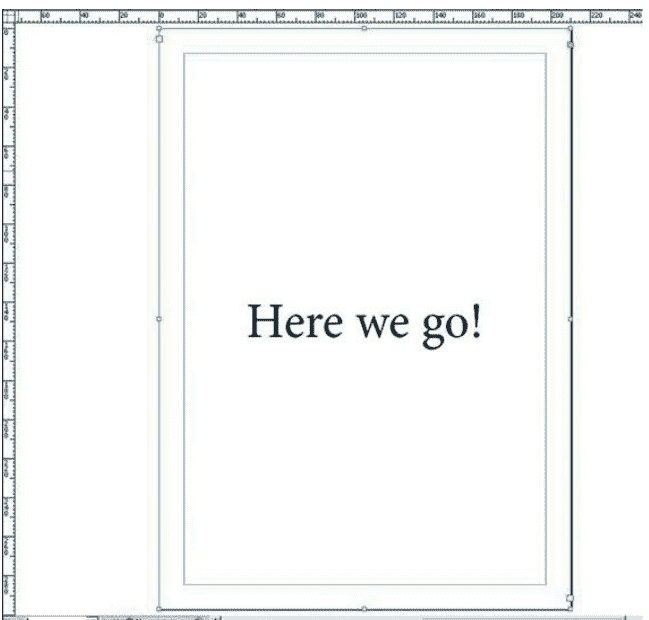

文本现在应为 72 点大小，并水平和垂直居中。

## 关于本书中的教程

教程将在本书中占据很大一部分，并且希望能够帮助强化每章涵盖的各种主题。其理念是让你习惯于从头开始创建 InDesign 脚本，并在此过程中越来越熟悉语法。虽然费力，但实际编写代码并使其运行是学习脚本语言的一种久经考验的方法。

你刚刚完成的练习纯粹是为了向你展示如何编写脚本并在 ESTK 以及 InDesign 内部进行测试；因此我们没有讨论所使用的语法。但是，在未来的教程中，我们将逐行审视遇到的新技术。

脚本编写永远无法仅仅通过死记硬背来学习：更多情况下是越来越能够识别关键模式，以及何时使用某些技术来解决特定类型的问题。你会发现，随着你对关键字、语句以及脚本操作的 InDesign 对象名称越来越熟悉，你将开始预见越来越多的代码片段和语法结构。

教程中涉及的脚本完成版本可以在相应的章节文件夹中找到，并且始终以 "_completed.jsx" 结尾。如果你发现输入代码很困难或只是太繁琐，随时可以将讨论的每个部分从完成版本复制并粘贴到你从头构建的版本中。然而，如果你的键盘速度合理，自己输入代码并学会预见和推断接下来应该是什么通常是最佳方法。

# 第 2 章 脚本编写基础

InDesign 脚本基本上是使用文件扩展名 “.jsx” 保存的文本文件。要使用 ExtendScript Toolkit (ESTK) 创建脚本，请选择 **文件** > **新建**，然后将文件保存到所需位置——通常是你指定的收藏夹文件夹之一。然后你就可以开始编写代码了。

## 注释

好消息是：即使你一生从未写过一行代码，你已经具备了编写所有脚本关键元素之一的资格。注释是为阅读代码的人（包括你自己）提供的有用解释性文本行，包含在脚本中。注释应该是你编写的每个脚本的一个特点：代码越复杂，解释的需求就越大，因此注释的需求也越大。JavaScript 识别单行和多行注释。要创建单行注释，请在行首放置两个正斜杠（`//`）。要创建多行注释，请在第一行前放置一个正斜杠后跟一个星号（`/*`），并在最后一行后放置一个星号后跟一个正斜杠，如下所示：

```
// This is a single line comment

/*
This is
a multiline
comment
*/
```

注释也可用作标题，使眼睛能够识别脚本关键部分的开始和结束。你可以使用任何你喜欢的字符来帮助突出这些标题——例如：

```
// ====== Initialization ======
```

比以下更突出：

```
// Initialization
```

你也可以在代码行的末尾放置与之相关的简短注释——例如：

```
var arrFiles = []; // list of all files to be processed
```

### 编写脚本

你放置在扩展名为 “.jsx” 的文本文件中的所有代码都构成了一个脚本。你的代码不需要放在任何特定的包含结构中，例如子程序。但是，你编写的脚本几乎总是会分成几个不同的块，称为函数。你编写的每个 JavaScript 语句都应以分号结尾。虽然这不是语法要求，但它是一个非常有用的惯例，使你能够区分两行代码和一个自动换行的长行。

### 变量

你将在代码中使用的语句将是多种多样的；然而，我们开始研究脚本的最合乎逻辑的地方之一是使用变量——你可以存储各种类型数据以及 InDesign 层次结构中各种对象（如文档、页面和文本框）引用的命名内存部分。

本质上，变量是一个代表值的名称——通常是某些有用的信息：无论你在哪里使用这个名称，都会指向特定的数据。在某种情况下，变量就像缩写或首字母缩略词：“每当我使用 `docNew` 时，我指的是我刚刚创建的新文档”。然而，变量的最大优点是它们代表的值和元素可以不断改变和操作：由你的代码、用户操作或 InDesign 环境。这一切都取决于分配给变量的值、信息或对象的性质。

**命名变量**

你编写的大多数脚本都会包含许多变量，因此你分配给变量的名称将影响最终代码的清晰度。自然，对你可用的名称有一些限制。

- 你不能使用作为 JavaScript 语法一部分的单词作为变量名。这包括一些相当常见的单词，如 `if`、`switch`、`for` 和 `final`。

- 尽管使用 InDesign 对象名称作为变量名没有这样的限制，但这是一个坏主意，因为它使你的代码更难理解。（InDesign 示例脚本使用一种惯例，将保存对象的变量命名为与对象相同的名称，并带有前缀 `my`：例如 `myTextFrame`。）

- 变量名不能包含任何空格。

- 变量的第一个字符必须是字母或下划线：你不能以数字或特殊字符开头。

- JavaScript 区分大小写；因此你应该决定关于如何在变量名中使用大小写的规则。

记住这些限制，命名变量时最好采用某种系统。

- 程序员广泛使用的一种技术是使用前缀来指示变量的性质——通常，它旨在存储的数据类型。

- 通常最好为每个变量名使用至少两个单词，并用下划线或每个单词的首字母大写来分隔它们。

- 保持大小写一致：例如，始终使用小写或首字母大写等。这样，你就不必不断滚动回去检查单个变量的大小写。

**变量数据类型**

JavaScript 不是强类型语言：它不要求你指定每个变量旨在存储的数据类型。但是，变量用于存储三种主要类型的信息：

- 字符串——字母数字字符的任何组合，无论是单词、短语、句子、段落还是故事。

- 数字——肯定由数字组成的数据，与恰好包含数字的字符串相对。因此，例如，一个人的工资是数字；他们的电话号码是字符串。

- 布尔值——数据可以是真或假，仅此而已。

除了这些基本数据类型外，变量也可用于保存对 InDesign 对象的引用。为了了解在这种情况下使用变量为何如此有用，让我们想象我们想要创建一个新文档并在其上执行一系列操作。我们可以使用这行代码来创建文档：

```
app.documents.add();
```

但是，当我们想要操作我们创建的文档时，我们如何引用它呢？我们不能保证它会保持为活动文档，我们无法预测 InDesign 会分配给它的默认名称……简单的答案是将对正在创建的文档的引用放入变量中——例如：

```
var doc = app.documents.add();
```

现在，每当我们需要引用我们创建的文档时，我们只需使用变量名 `doc`。

**声明和初始化变量**

虽然 JavaScript 没有要求，但最好总是声明一个变量，并尽可能为其分配与其旨在存储的数据类型一致的值。变量使用关键字 `var` 声明——例如：

```
var txfHeader;
```

是一个声明名为 `txfHeader` 的变量的语句。选择三字母前缀是为了表明此变量将包含对文本框的引用。也可以在声明变量时为其赋值。我们刚才看到了一个这样的例子：

```
var doc = app.documents.add();
```

在这里，我们既声明了变量 `doc`，又将一个新文档分配给它。让我们再举一个例子：

```
var intCounter = 0;
```

在这里，我们声明了一个名为 `intCounter` 的变量，并为其分配了中性或默认值零，以表示它是一个数字、整数变量。如果我们想对字符串变量做同样的事情，我们可以使用如下语句：

```
var strTitle = "";
```

在此，我们声明一个变量，该变量可用于记录给定文档是否当前处于打开状态，并为其赋初始值 false。

当变量用于存储 InDesign 对象时，通常会同时进行声明和赋值。InDesign 中的对象数量庞大，因此可能的语句不胜枚举；但我们在本书中将看到大量示例。需要记住的规则是：任何你计划再次引用的 InDesign 对象，应在首次引用时将其放入变量中。此后，当需要再次引用该对象时，只需使用变量名即可。

## 表达式和运算符

为变量赋初始值后，随着脚本的推进，通常需要更新或修改该值。为此，你需要使用表达式和运算符。表达式是语法短语的编程等价物，是产生结果的代码片段。因此，要为变量赋值，我们会使用以下格式的代码行：

```
variable = expression;
```

例如：

```
intTotalWidth = 210 + intLeftBleed + intRightBleed
```

在上面的示例中，表达式 `210 + intLeftBleed + intRightBleed` 将在运行时被求值，并返回给定值。

大多数表达式使用运算符——操纵值的符号或关键字；算术运算符便是一例。

## 算术运算符

### 二元运算符（需要两个或多个参数）

- 赋值 `=` 例如：`var int_total = 0;`
- 加法 `+`
- 减法 `-`
- 乘法 `*`
- 除法 `/`
- 取模 `%` 例如：`var intPagesOver = intPages % 4`

（将 `intPages` 除以 4 的余数放入变量 `intPagesOver`）

### 一元运算符（需要单个运算符）

- 自增 `++` 例如：`intTotal ++`（将 `intTotal` 的值增加 1）
- 自减 `--` 例如：`intTotal --`（将 `intTotal` 的值减少 1）

## 比较运算符

比较运算符用于比较两个值。

- 等于 `==` 例如：`blnMatch = strName == "newsletter1251"`

  （如果 `strName` 包含字符串 "newsletter1251"，则 `blnMatch` 将被设置为 true。）

- 严格相等 `===` 例如：`strWidth === 2`

  （等于且数据类型相同。在上面的示例中，如果 `strWidth` 是用户输入的字符串值，`strWidth === 2` 将返回 false，而 `strWidth == 2` 将返回 true，因为 JavaScript 会自动将字符串值转换为数字。）

- 不等于 `!=`
- 严格不等于 `!==`
- 大于 `>`
- 大于或等于 `>=`
- 小于 `<`
- 小于或等于 `<=`

## 逻辑运算符

逻辑运算符应用于两个或多个布尔表达式，并返回 true 或 false。

- 与 `&&` 例如：`intTotal >= 5 && intTotal <=10`
- 或 `||` 例如：`strSize == "A4" || strSize == "Letter"`
- 非 `!` 例如：`! (strSize == "A4" || strSize == "Letter")`

## InDesign 对象模型

为了自动化 InDesign，你需要使用 JavaScript 来引用你希望操作的 InDesign 元素。InDesign 中的每个元素在程序上都表示为一个对象。与 InDesign 本身一样，对象以层次结构排列，应用程序对象位于层次结构的顶端。

## 属性和方法

要理解层次结构中的任何对象，你需要检查其属性和方法。对象的属性是其特征或特性。然而，任何构成另一对象部分的对象也被视为该对象的属性。因此，在 InDesign 对象模型中，文档、书籍和库对象都是应用程序对象的属性。

方法是对象可以执行的操作，或者是用户可以对对象执行或与对象一起执行的操作。因此，应用程序对象有一个 `open` 方法，可用于打开文档、书籍或库。同样，文档对象有一个 `print` 方法，用于打印文档。

这种对象化是我们对日常物品所做的事情。因此，例如，如果我们观察汽车，我们可以将汽车对象置于层次结构的顶端，引擎、底盘和内饰既是下属对象，也是汽车对象的属性。汽车对象还具有诸如品牌和型号之类的属性，引擎则具有排量和燃油类型属性以及启动和停止方法。

## 对象模型查看器

ExtendScript Toolkit 提供了一个便捷工具，用于探索 InDesign 对象模型。在 ESTK 中，选择 **帮助 > 对象模型查看器**。当工具启动时，从右上角的 **浏览器** 下拉菜单中选择 InDesign CS5 (7.0)。在屏幕左侧，你将看到构成 InDesign 对象模型的类或对象蓝图列表。

名称左侧带有立方体图标的项目都是对象：旁边带有由点阵图案组成的图标的项目是枚举——固定选项集，用作属性的可能值。

要探索 InDesign 对象层次结构，请在类窗格中单击对象的名称。然后，该工具在查看器左下角的属性和方法窗格中显示该对象的属性和方法。属性可通过带有文本 "= X" 的蓝色图标识别，方法则由包含 "{ }" 的红色图标表示。

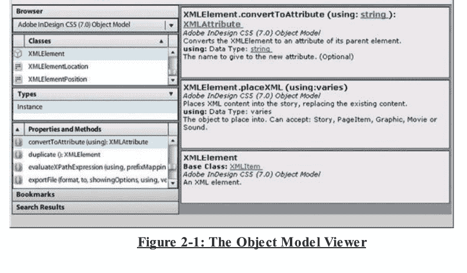

**图 2-1：对象模型查看器**

每次单击属性或方法时，有关该项目的详细信息会显示在右侧。当你单击另一个属性或方法时，一组新的详细信息会出现在之前显示的任何内容之上。这提供了一种历史记录功能，使你可以返回并查看自启动 ESTK 以来已经查阅过的任何内容。

如果你关闭对象模型查看器并在稍后重新启动它，只要你在此期间没有退出 ExtendScript Toolkit，你查阅过的项目列表仍会保留。你可以通过单击每个项目右下角的 **关闭** 按钮，从详细信息历史记录中清除单个项目。你也可以通过单击查看器右上角的 **全部关闭** 按钮，完全清除详细信息列表。

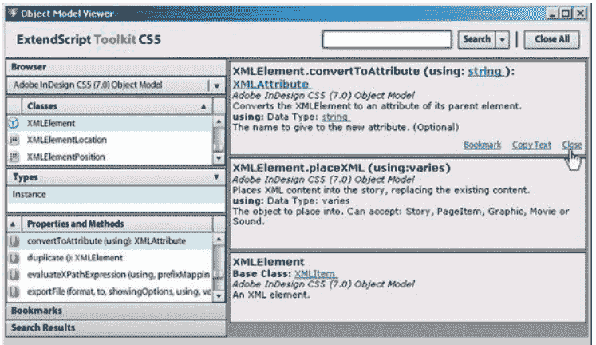

**图 2-2：从详细信息列表中移除项目**

当然，一旦你退出 ESTK，你的详细信息列表就会丢失。但是，对象模型查看器还提供了一个收藏夹功能，使你可以永久保存你查看过的任何项目。只需单击详细信息项目右下角的书签链接即可。

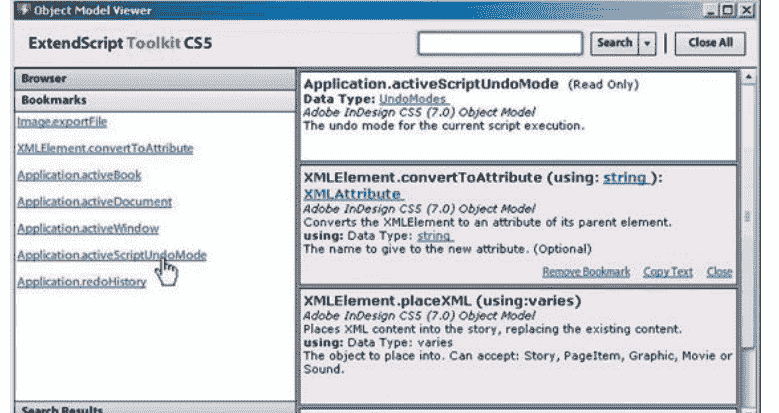

**图 2-3：在对象模型查看器中将项目添加到书签**

要查看你的书签，请单击对话框左下角的书签按钮。这会关闭浏览器面板并打开书签面板，其中包含你已添加书签的所有项目列表。列表中的每个项目也是一个链接，单击后会将该项目添加到对话框详细信息部分的顶部。在项目的右下角，有一个链接允许你将其从书签面板中移除。

## 基本对象语法

尽管 InDesign 对象模型庞大且多样，但有许多关键的语法结构，如果掌握它们，将使整个 InDesign 脚本编写过程看起来不那么令人生畏。

## 处理对象属性

测试对象的属性非常有用——例如，我们可以评估其状态或其对特定角色的适用性。

### 只读和读/写属性

所有对象属性都可以被测试或读取，许多还可以被设置。只能读取的属性称为只读属性；既可以测试又可以修改的属性称为读/写属性。因此，例如，文档对象的 `length` 属性是一个只读属性。语句：

```
app.documents.length = 5;
```

将生成一个错误，告诉我们“length 是只读的”。

### 首选项对象

简单属性直接与对象相关。例如，每个文档对象都有一个 `name` 属性——返回文档的名称，以及一个 `fullName` 属性——返回文档的完整文件路径，包括其名称。除了这些简单属性外，InDesign 对象模型通常将属性分组以形成一个单独的对象。这些被称为首选项对象。例如，如果你想要设置文档的出血宽度，你需要通过文档对象的 `documentPreferences` 对象来执行此操作。例如：

```
app.activeDocument.documentPreferences.documentBleedUniformSize = true;
app.activeDocument.documentPreferences.documentBleedTopOffset = "3 mm";
```

这与 InDesign 界面非常一致，因为如果你正在更改出血设置，同一个对话框将允许你访问诸如页面宽度和高度以及页面标记等内容。因此，将这些设置归为一组并将其作为一个对象处理是有意义的。

使用包含真正属于父对象的相关属性的首选项对象，在第二个方面也是高效的——相同的属性集可以应用于多个父对象。因此，`documentPreferences` 对象可以应用于应用程序对象——用于更改 InDesign 的默认文档设置，以及文档对象——允许我们更改特定文档的设置。

### 属性值

设置属性时，你必须提供适当类型的值。ESTK 提供的对象模型查看器将确认允许的数据类型。以下是一些要点。

当提供度量值（如宽度和高度）时，你可以输入数字或包含度量类型的字符串。因此，以下两条语句都是有效的：

```
app.activeDocument.documentPreferences.documentBleedTopOffset = 3;
app.activeDocument.documentPreferences.documentBleedTopOffset = "3 mm";
```

当使用数字时，将使用当前的度量首选项：这些首选项可能已由用户或你的脚本设置。

### 使用枚举

当你查阅对象模型查看器时，会发现某些属性需要一种特殊的值，称为枚举——即预设允许值列表中的一个元素。枚举通常按以下格式书写：

`object.propertyName = EnumerationName.VALUE`

最后一个点号后面的文字或单词可以用两种方式书写：第一种是全部大写，多个单词用下划线分隔；第二种是第一个单词全部小写，后续每个单词的首字母大写。因此，要设置文本框的垂直对齐方式，我们可以使用：

`myTextFrame.textFramePreferences.verticalJustification = VerticalJustification.CENTER_ALIGN;`

或者：

`myTextFrame.textFramePreferences.verticalJustification = VerticalJustification.centerAlign;`

以下是更多必须使用枚举作为属性值的示例。

`myTextFrame.paragraphs[0].justification = Justification.CENTER_ALIGN;`

`app.documentPreferences.pageOrientation = PageOrientation.LANDSCAPE`

`app.documentPreferences.pageOrientation = PageOrientation.PORTRAIT`

为方便起见，枚举在对象模型查看器中作为单独的项目列出，并且可以添加书签，具体说明见第20页。

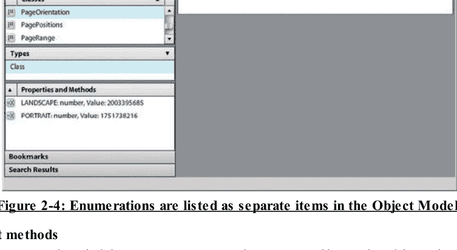

**使用对象方法**

对象方法用于启动流程并通常使操作生效。正如属性需要值一样，方法也需要参数——这些值按固定顺序放置在方法名称后的括号中。事实上，有些方法根本不需要参数——例如：`app.undo()` 和 `app.redo()`，它们是“编辑 > 撤销”和“编辑 > 重做”的脚本等效命令。然而，即使方法不需要参数，方法名称后的括号仍然是必需的。

有些参数是可选的，并且总是列在必需参数之后。例如，应用程序对象的 `open` 方法有一个必需参数和两个可选参数。（按照惯例，在所有参考资料中，可选参数用方括号表示——如下所示。当然，在实际脚本中使用这些参数时不需要方括号。）

| 语法摘要 ... | `app.open(显示窗口, 打开选项)` | 应用程序对象的方法 |

| --- | --- | --- |

| | 打开位于指定位置的文档。 | |

| | 从（From） | 指定要打开的项目（文档、书籍或库）位置的文件路径。 |

| | 显示窗口（Showing window） | 可选。一个布尔值，决定文档打开时是否可见。 |

| | 打开选项（Open option） | 可选。应用程序打开原始项目还是副本。 |

为每个参数提供的值的数据类型因方法而异，并包括枚举。例如，`app.open()` 方法的第三个参数——OpenOption 使用三种可能的枚举项之一：`OpenOptions.DEFAULT_VALUE`、`OpenOptions.OPEN_ORIGINAL` 和 `OpenOptions.OPEN_COPY`。

**使用属性记录**

每当使用相关对象集合或容器的 `add()` 方法创建新对象时，你可以选择在括号内包含最后一个项目，即所谓的属性记录。属性记录是一个以逗号分隔的属性和值列表，格式如下：

`object.add(...{property1:value1, property2:value2...})`

例如，如果你想在活动文档中创建一个新的文本框，可以使用以下语句：

`app.activeDocument.textFrames.add();`

但是，你也可以使用属性记录来指定新文本框在页面上的位置，如下所示：

`app.activeDocument.textFrames.add({geometricBounds:[20, 20, 277, 190]});`

（文本框的位置使用 `geometricBounds` 属性指定，该属性采用四个值的数组，格式为 `[y1, x1, y2, x2]`。）

## 创建新元素

在你编写的许多脚本中，你需要创建新元素：文档、书籍、段落样式、颜色等。好消息是，执行此操作的语法遵循一致的模式。

在此背景下，我想强调的第一点是，将你创建的每个新元素放入一个变量中非常重要。这使得之后操作对象变得非常容易：变量就像一种跟踪设备，引导你直接找到对象，而无需绞尽脑汁思考需要使用的语法——只需使用变量名即可直接引导你找到对象。

创建对象的通用格式如下：

| 语法摘要 ... | `变量 = 容器.集合.add()` |

| --- | --- |

| 语法模式 | 将对 InDesign 对象的引用放入变量的通用语法。 |

| 变量（Variable） | 你创建的一个名称，它引用给定对象。 |

| 容器（Container） | 在 InDesign 层次结构中直接包含你希望创建的对象的对象。 |

| 集合（Collection） | 你希望创建的对象所属的集合，例如 `documents`、`textFrames` 等。 |

| 添加（Add） | 集合的 `add()` 方法。 |

在此阶段，我们不会关注诸如在创建对象之前检查其是否存在，或者如果尝试创建对象时发生错误会发生什么等问题——这将在后面讨论。让我们看看创建一些常见 InDesign 对象的语法。

**创建新文档、书籍或库**

文档、库和书籍都包含在应用程序对象本身中：这可以从你可以转到**文件**菜单并选择**新建 > 文档**、**新建 > 库**或**新建 > 书籍**这一事实得到证明。文档构成 `documents` 集合的一部分；库构成 `libraries` 集合的一部分；书籍构成 `books` 集合的一部分。这意味着我们需要使用如下语法：

```
var docNew = app.documents.add();
var libNew = app.libraries.add();
bkNew = app.books.add();
```

由于文档是 InDesign 层次结构中最常用的对象之一，让我们深入探讨文档对象，并查看在其中创建更多对象的语法。鉴于我们已将新文档放入名为 `docNew` 的变量中，我们用于创建新对象的通用语句中的容器：

```
variable = container.collection.add()
```

现在将是 `docNew`——我们知道它引用文档对象的一个实例；而我们的集合将是我们希望创建的对象所属的任何类的集合。

**向文档添加页面**

因此，如果我们想向文档末尾添加一个页面，容器将是我们的文档，集合将是页面集合；因此，我们可以使用相同的语法模式：

```
var pgNew = docNew.pages.add();
```

**创建默认和文档颜色**

在 InDesign 中，默认颜色的容器是应用程序对象。但是，文档颜色的容器是特定的文档对象。因此，要创建默认颜色，我们可以使用：

```
var colNew = app.colors.add();
```

而要创建文档颜色，我们可以说：

```
var colNew = docNew.colors.add();
```

## 创建默认和文档段落样式

InDesign 样式（段落、字符、单元格、表格和对象）是另一个可以在应用程序级别或文档级别创建的对象示例。因此，要创建默认段落样式，我们可以使用：

```
var stlNew = app.paragraphStyles.add();
```

要创建文档段落样式，我们可以说：

```
var stlNew = docNew.paragraphStyles.add();
```

## 引用对象

虽然引用新对象的最简单方法是在创建时将其捕获到变量中，但 ExtendScript 确实提供了许多其他方便的方法来引用 InDesign 对象层次结构中的特定对象。一个非常有用的技术是引用包含对象的集合以及一个索引，索引可以是数字或文本。

### 使用数字索引

使用数字索引引用集合中对象的 JavaScript 语法是：

```
container.collection[x]
```

其中 `x` 表示项目在集合中的位置。然而，根据一个众所周知的编程惯例，集合中的第一个项目总是用索引 `[0]` 引用。因此，要引用变量 `docNew` 中引用的文档的第一页，我们可以这样说：

```
docNew.pages[0]
```

也可以使用负索引，它是从集合末尾计算的。因此，为了方便地引用文档的最后一页，我们只需说：

```
docNew.pages[-1]
```

### 使用命名索引

使用数字引用页面对象相当方便；但有时很难预测对象在其所属集合中的位置。由于 InDesign 层次结构中的许多对象都有名称，一个有用的替代方法是按名称引用对象。执行此操作的通用语法是：

```
container.collection.itemByName("nameOfObject")
```

要定位一个名为“公司蓝”的默认颜色，我们可以这样写：

```
app.colors.itemByName("Corporate blue")
```

ExtendScript 还提供了一种通用语法，可以代替 `[]` 和 `itemByName` 使用——即 `item`。因此，代替：

```
docNew.pages[-1]
```

你经常会遇到：

```
docNew.pages.item(-1)
```

而代替：

```
app.colors.itemByName("Corporate blue")
```

你可能会发现：

```
app.colors.item("Corporate blue")
```

## 使用 ID

许多 InDesign 对象还有一个 ID 属性，该属性由程序自动分配，可用于唯一标识它们。当已知一个对象的 ID 时，可以使用 `itemByID()` 方法来引用该项——例如，如果之前已将某个页面项目的 ID 捕获到一个名为 `txtID` 的变量中，我们可以用如下语句来定位该文本框：

```
app.activeDocument.pageItems.itemByID(txtID);
```

## 定位一系列对象

要定位集合中的一系列对象，请使用 `itemByRange()` 方法，该方法返回集合中的一个对象子集。例如，如果我们想处理活动文档的第 2 到 15 页，可以使用如下语句：

```
var pgStart = app.activeDocument.pages[1];
var pgEnd = app.activeDocument.pages[14];
var pgRange = app.activeDocument.pages.itemByRange(pgStart, pgEnd);
```

（请记住，`app.activeDocument.pages[0]` 指的是文档的第一页。）

| 语法摘要 ... | `myObjectCollection.itemByRange(from, to)` |

| --- | --- |

| InDesign 对象集合的标准方法 | 返回从 `myObjectCollection` 指定的集合中提取的对象数组。 |

| | From | 要提取的集合中的第一个对象。可以指定为对象、整数或字符串。 |

| | To | 要提取的集合中的最后一个对象。可以指定为对象、整数或字符串。 |

## 定位集合中的每个项目

ExtendScript 还提供了一个非常有用的 `everyItem()` 方法，用于定位集合中的每个成员——有效地将整个集合作为一个对象来处理。此外，我们可以通过引用 `everyItem()` 方法返回的对象的属性，来同时定位集合中所有成员的属性。因此，如果我们想生成运行脚本的计算机上所有字体的列表，可以这样写：

```
var allFonts = app.fonts.everyItem();
var arrFontNames = allFonts.name;
```

或者更简单地：

```
var arrFontNames = app.fonts.everyItem().name;
```

## 定位当前活动对象

有时在你的脚本中，你不需要定位特定的对象，而只是想定位当前活动或当前高亮显示的对象。

**活动文档**

要定位活动文档，ExtendScript 提供了应用程序对象的 `activeDocument` 属性：

```
app.activeDocument
```

当然，只要至少有一个文档打开，此语句总是返回一个文档对象。由于很难保证给定文档会一直保持活动状态，因此将文档引用放入一个变量中仍然是个好主意。因此，如果你有一个脚本要处理用户当前正在使用的文档，你应该做的第一件事就是将该文档捕获到一个变量中。例如：

```
var currentDoc = app.activeDocument;
```

任何时候你希望再次引用该对象，只需使用 `currentDoc` 即可。这样，如果用户在你的脚本运行期间激活了另一个文档，`currentDoc` 仍然引用脚本开始时活动的文档。

**活动窗口**

应用程序对象还有一个 `activeWindow` 属性，该属性返回一个窗口对象。

```
app.activeWindow
```

你将使用 `activeDocument` 还是 `activeWindow` 属性取决于你需要实现什么。例如，`document` 对象没有提供定位当前活动页面的方法，而 `activeWindow` 有——即 `activePage` 属性。

InDesign 中有两种类型的窗口对象：版面窗口（这是你最常用的）和故事窗口。版面窗口对象有三个返回活动对象的属性：`activePage`、`activeLayer` 和 `activeSpread`。（故事窗口没有这样的属性。）我们通常在活动窗口的上下文中引用这些属性，因此：

```
app.activeWindow.activePage
app.activeWindow.activeLayer
app.activeWindow.activeSpread
```

要查找当前页码——即如果页面上放置了自动页码时会显示的数字——我们只需说：

```
app.activeWindow.activePage.name
```

要获取活动图层的名称，我们可以说：

```
app.activeWindow.activeLayer.name
```

如果活动页面是一个母版页，我们可以通过使用以下语法来获取其名称：

```
app.activeWindow.activeSpread.name
```

如果上面语句返回的名称是零长度字符串，则活动页面不是母版页。（如果我们在活动页面是母版页时使用 `app.activeWindow.activePage.name`，我们只会检索到母版的前缀（例如“A”），而不是名称。）

## 计数对象

在编写脚本时，了解集合中有多少个元素是一个相当常见的要求。通常你需要检查集合中的每一项，而了解总数将使你能够构建一个循环。（参见第 3 章：条件语句、循环和函数。）InDesign 对象集合通常有一个 `length` 属性，返回集合中的项目数量。例如，如果以下语句的计算结果为 false，我们可以假设当前 InDesign 中没有打开任何文档：

```
app.documents.length > 0
```

要返回活动文档中的页数，我们可以说：

```
app.activeDocument.pages.length
```

为什么是“length”——嗯，`length` 属性也用于查找 JavaScript 数组中的项目数量，并且由于 InDesign 对象集合与数组非常相似，为它们提供一个 `length` 属性是完全合理的。

`length` 属性的一个替代方法是 `count()` 方法，它产生相同的结果。例如：

```
app.activeDocument.pages.count()
```

## JavaScript 对话框窗口

在编写脚本时，与用户沟通是一个相当标准的需求，而显示对话框是实现此目的的常用方法。ExtendScript 允许你构建自定义对话框，其中可以包含以多种方式响应用户操作的交互式控件。我们将在第 4 章和第 5 章中探讨如何创建此类对话框。与此同时，让我们看看 JavaScript 内置的三种对话框窗口类型，对于许多形式的用户交互，这可能就是你所需要的全部。

**alert 函数**

JavaScript 的 `alert` 函数显示一条消息，用户阅读后通过单击“确定”按钮关闭它。以下是其使用示例。

```
alert("The Pages Required field can only contain numeric values.");
```

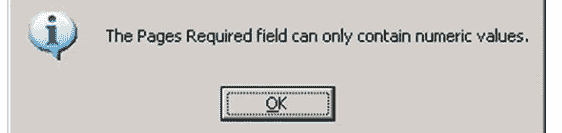

**图 2-5：JavaScript 的 alert 函数可用于为脚本用户输出消息**

| **语法摘要 ...** | `alert(message)` |

| :--- | :--- |

| **JavaScript 内置函数** | 显示一个包含指定消息的对话框。 |

| | Message | 要在窗口中显示的文本。 |

### confirm 函数

`confirm` 函数从用户那里检索一个布尔值。与 `alert` 函数类似，它显示一个带有消息的对话框。不过，这次有两个按钮：“是”和“否”。如果用户单击“是”，函数返回 true；如果单击“否”，则返回 false。为了判断哪个按钮被单击，你需要将函数的结果放入一个变量中，以便后续检查。

```
var blnContinue = confirm("Are you sure you wish to delete the selected items.");
```

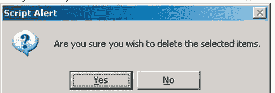

**图 2-6：confirm 函数允许用户接受或拒绝显示的陈述**

| **语法摘要 ...** | `confirm(message)` |

| :--- | :--- |

| **JavaScript 内置函数** | 显示一个包含指定消息以及“是”和“否”按钮的对话框。如果用户单击“是”返回 true，单击“否”返回 false。 |

| | Message | 要在窗口中显示的文本。 |

### prompt 函数

`prompt` 函数更进一步，允许用户在文本框中输入任意值。除了要显示的消息外，该函数还接受一个可选的默认值，该值在对话框出现时会最初显示在文本字段中。

```
var strLocation = prompt("Please enter your location", "London");
```

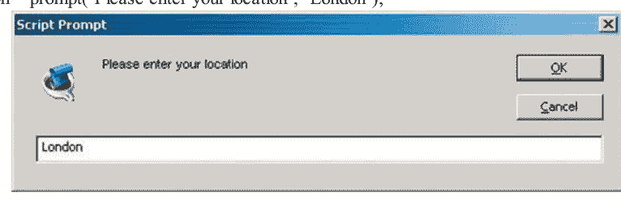

**图 2-7：prompt 函数用于从用户那里捕获输入**

通常，最好总是提供一个值，如果没有任何值适用，则使用空字符串（`""`）。这是因为在没有指定默认值的情况下，当对话框出现时，输入文本框中将包含文本“undefined”，这可能会让您的用户感到有些困惑。

| | **语法摘要** | `prompt(message [, default value])` |

|---|---|---|

| | **JavaScript 内置函数** | 显示一个包含指定消息和文本字段的对话框，供用户输入。如果用户点击确定，返回文本字段中输入的值。如果用户点击取消按钮，则返回 null。 |

| | 消息 | 要在窗口中显示的文本。 |

| | 默认值 | 可选。最初显示在输入文本字段中的文本。 |

## String 对象

由于文本是 InDesign 文档中非常重要的元素，您会发现脚本中经常需要用到 String 对象的方法。JavaScript 有一个内置机制，使得 String 对象的属性和方法可用于任何字符串值，或者更常见地，可用于任何包含字符串值的变量。

`length` 属性简单地返回给定字符串中的字符数。因此，如果我们想显示存储在名为 `txfTitle` 的变量中的文本框的字符数，我们可以使用以下语句：

```
alert(txtTitle.contents.length);
```

语句 `txtTitle.contents` 返回一个字符串，这使得我们能够使用 String 对象的 `length` 属性。

`indexOf()` 方法用于测试给定的搜索字符串是否存在于容器字符串中。如果搜索字符串存在，该方法使用从零开始的索引返回其位置。如果搜索字符串不存在于容器字符串中，由于零表示容器字符串的第一个字符，函数将返回 -1。`indexOf()` 方法在 JavaScript 中非常常用，经常与其他方法结合使用。让我们举一个简单的例子。

```
var strEmail = prompt("Please enter an email address", "");
var intAtSymbol = strEmail.indexOf("@");
alert("Position of @ symbol is " + intAtSymbol);
```

这里，我们显示一个提示框，邀请用户输入电子邮件地址。然后，我们将 @ 符号的位置（在用户输入的字符串中）放入名为 `intAtSymbol` 的变量中。最后，我们用警报语句显示 @ 符号的位置，如果用户省略了它，该位置将显示为负一。

此函数有一个有用的变体——`lastIndexOf()`，它返回指定字符串最后一次出现的位置。例如，要计算电子邮件中最后一个点的位置，我们可以这样写：

```
var strEmail = prompt("Please enter an email address", "");
var intDot = strEmail.lastIndexOf(".");
alert("Position of last dot is " + intDot);
```

| 语法摘要 | `containerString.indexOf(search string, [, start at])`<br>`containerString.lastIndexOf(search string, [, start at])` |

| --- | --- |

| | **JavaScript String 对象方法**<br>返回搜索字符串在容器字符串中的位置。<br>返回搜索字符串在容器字符串中最后一次出现的位置。 |

| | 搜索字符串 | 要在容器字符串中定位的字符串。 |

| | 起始位置 | 如果提供了这个可选的第二个参数，搜索将从该位置开始；否则，从位置零（即第一个字符）开始。 |

## charAt() 方法

`charAt()` 方法的工作方式与 `indexOf()` 相反：它返回您指定位置的字符。它接受一个参数：字符的位置或索引——零是第一个索引。

以下代码行要求用户输入一个字符串，然后使用 `charAt()` 方法提取第一个和最后一个字符。

```
var str = prompt("Please enter a string", "");
var strFirst = str.charAt(0);
var strLast = str.charAt(str.length - 1);
alert("First character " + strFirst + "\rLast character: " + strLast);
```

注意使用加号将文本字面量与变量连接起来。这称为连接，在脚本编写中经常需要。即使您是脚本编写新手，当您在 Excel 或 FileMaker 等程序中创建公式时，很可能已经遇到过这种技术，其中使用和号（`&`）来达到相同的效果。

为了定位最后一个字符，我们只需从字符串的 `length` 中减去一，因为第一个字符的索引是零而不是一。（使用 `\r` 会生成回车符，将我们的警报语句分成两行。）

| 语法摘要 | `containerString.charAt(index)` |

| --- | --- |

| | **JavaScript String 对象方法**<br>返回索引指定位置的字符。 |

| | index | 一个介于 0 和 `containerString.length - 1` 之间（含两端）的整数。 |

在需要值的位置使用语句也是脚本中非常常见的结构。基本上，如果语法上需要某种数据类型的值，您可以使用任何计算为（或返回）正确数据类型的语句。

## toUpperCase() 和 toLowerCase() 方法

这两个函数只是分别将字符串转换为大写和小写。它们通常用于在用户输入数据时提供一些便利，使他们不必使用特定的大小写。以下示例说明了它们的用法。

```
var strCapital = prompt("What is the capital of France?", "");
alert(strCapital == "Paris");
```

我们显示一个提示对话框，要求用户输入法国首都。但是，只有当用户输入“Paris”时，我们的警报消息才会显示 true——如果他们输入“paris”或“PARIS”，警报将返回 false。在确定两个字符串是否相等而不区分大小写的情况下，我们可以使用 `toUpperCase()` 或 `toLowerCase()` 来确保比较的字符串具有相同的大小写。因此，我们可以按如下方式修改上面的示例：

```
var strCapital = prompt("What is the capital of France?", "");
alert(strCapital.toUpperCase() == "PARIS");
```

这一次，我们将用户输入的字符串转换为大写，然后将其与另一个大写字符串进行比较，确保大小写不会阻止两个原本相同的字符串被视为相等。

| 语法摘要 | `myString.toUpperCase() | .toLowerCase()` |

| --- | --- |

| | **JavaScript String 对象方法**<br>分别将 `myString` 中的每个字符转换为大写或小写。可以与其他方法（如 `charAt()`、`slice()` 和 `subString()`）结合使用，以仅针对 `myString` 中的某些字符。 |

## replace() 方法

`replace()` 方法在容器字符串中用另一个子字符串替换一个子字符串。它接受两个参数：搜索字符串和替换字符串。因此，例如，如果我们想将字符串的第一个字母大写，我们可以使用下面所示的 `replace()` 方法。

```
var str = prompt("Please enter a string", "");
var strFirst = str.charAt(0);
str = str.replace(strFirst, strFirst.toUpperCase());
alert(str);
```

我们还可以使用 `replace()` 方法，使用正则表达式来更改指定子字符串的所有出现。在下面的示例中，我们使用 `replace()` 方法，从字符串创建一个有效的文件名。

```
var strName = prompt("Please enter a name for the new document", "");
strName = strName.replace(/ /g, "_");
alert("The file name " + strName + " will be used.");
```

在这个例子中，我们要求用户输入一个文件名，由于我们不希望名称中包含任何空格，然后我们使用 `replace()` 方法将所有空格更改为下划线字符。正则表达式 `/ /g` 是一个指令，用于全局定位字面字符串“ ”（空格）。

| 语法摘要 | `containerString.replace(search text, replace text)` |

| --- | --- |

| | **JavaScript String 对象方法**<br>用替换文本替换搜索文本的第一次出现。 |

| | 搜索文本 | 要被替换的文本，指定为字符串或正则表达式 (regex) |

| | 替换文本 | 取代搜索文本的文本，指定为字符串或正则表达式。 |

## substring() 和 slice() 方法

`substring()` 和 `slice()` 方法都从另一个字符串中提取一个字符串。它们是经常与 `indexOf()` 结合使用的方法示例。这两个方法都可以接受两个参数：起始位置和结束位置。第二个参数是可选的：如果省略，则结束位置成为容器字符串的最后一个字符。让我们举一个简单的例子：

```
var strName = app.activeDocument.name;
var intDot = strName.lastIndexOf(".");
var strExt = strName.substring(intDot);
alert("File extension of current document is " + strExt);
```

这里，我们将活动 InDesign 文档的名称放入名为 `strName` 的变量中。由于我们现在在 `strName` 中有一个字符串值，我们可以使用 `indexOf()` 函数将点的位置放入变量 `intDot` 中。然后，我们使用 `substring()` 函数，以 `intDot` 作为唯一参数，将文件扩展名放入 `strExt` 中。由于我们没有提供可选的最后一个参数，`substring()` 方法返回从点开始到名称结尾的所有字符。如果我们用 `slice()` 替换 `substring()` 函数，我们将获得完全相同的结果。但是，这两个方法并不完全相同：`slice()` 允许您对任一参数使用负数，并从容器字符串的末尾开始向后计算位置。假设我们知道该 InDesign 文档的文件扩展名是四个字母，我们只想提取最后五个字符——给我们“.indd”或“.indt”。我们可以使用 `slice()` 方法，如下所示：

```
var strName = app.activeDocument.name;
var strExt = strName.slice(-5);
alert("File extension of current document is " + strExt);
```

这一次，我们忽略点，通过使用 `slice()` 方法将扩展名检索到 `strExt` 中。

通过单个参数 -5 进行调用时，由于未提供第二个参数，系统将使用字符串最后一个字符的索引，从而提取容器字符串的最后五个字符。

| 语法摘要 | `containerString.substring(start at [, end at])` | `containerString.slice(start at [, end at])` |

|---|---|---|

| | JavaScript 字符串对象方法 | 从容器字符串的 **start at** 位置提取子字符串，直到 **end at** 位置。（`slice()` 方法允许使用负参数，这些参数从容器字符串末尾反向计数。） |

| | Start at | 一个整数，指示开始的位置。 |

| | End at | 可选。一个整数，指示结束的位置。如果省略，提取将进行到容器字符串的最后一个字符（包括该字符）。 |

**InDesign 文本对象与字符串**

在编写 InDesign 代码时，很容易将 InDesign 文本对象与字符串混淆——毕竟，字符、单词和段落都是文本片段。需要记住的是，出于脚本编写的目的，字符、单词和段落是包含字符串的对象：它们本身并不是字符串。希望在我们第 8 章讨论文本脚本时，这一点会变得清晰。基本上，如果你想将 InDesign 文本当作字符串处理，以便访问字符串对象的属性和方法，你需要深入 InDesign 文本对象内部，找到它包含的字符串。例如，以下语句：

```
var strNewName = myTextFrame.paragraphs[0].replace("Smith", "Jones");
```

将产生错误，因为段落对象没有 `replace()` 方法。但是，如果我们深入段落对象并针对其 `contents` 属性，我们将生成一个字符串对象的实例，该实例**将**拥有 `replace()` 方法。

```
var strNewName = myTextFrame.paragraphs[0].contents.replace("Smith", "Jones");
```

## 数组对象

JavaScript 数组对象允许你将多个——通常是相关的——值存储在单个变量中。因此，我们不必创建许多名称和作用相似的变量——例如 `strDoc1`、`strDoc2` 等，而是可以创建一个数组变量，并将所有相关值存储在其中。

**创建数组**

要声明一个数组，请使用类似以下的语句：

```
var arrDocs = [];
```

要用值填充数组，你可以针对数组中的各个槽位进行操作，使用一个写在数组名称后方括号中的索引。数组的第一个元素的索引始终为零。

```
arrDocs[0] = File("~/desktop/indesign docs/catalog.indd");
arrDocs[1] = File("~/desktop/indesign docs/newsletter.indd");
arrDocs[2] = File("~/desktop/indesign docs/leaflet.indd");
```

你也可以在单条语句中声明并填充数组——例如：

```
arrBranches = ["London", "Manchester", "Glasgow", "Leeds", "Liverpool"];
```

上述语句创建了一个名为 `arrBranches` 的数组，并在其中放置了五个字符串，省去了我们使用六条独立语句的麻烦：

```
arrBranches = [];
arrBranches[0] = "London";
arrBranches[1] = "Manchester";
arrBranches[2] = "Glasgow";
arrBranches[3] = "Leeds";
arrBranches[4] = "Liverpool";
```

当我们讨论下一章的循环语句时，我们将遇到另一种填充数组的方法：通过迭代。

## InDesign 对象与数组

InDesign 集合与数组有几个共同属性。如我们所见，集合中的项目可以使用从零开始的索引来引用。数组和 InDesign 集合都有一个 `length` 属性，该属性返回对象中的项目数量。

此外，许多 InDesign 语句返回一个对象数组。例如，ExtendScript File 对象有一个 `openDialog()` 方法，该方法显示一个对话框，允许用户选择一个或多个文件。如果关闭了多文件选择选项，该方法返回单个文件；如果将其设置为 true，则返回一个文件对象数组。因此，例如，以下语句将返回一个包含用户所选 InDesign 文件的数组。

```
var arrFiles = File.openDialog("Please select one or more file(s)", "InDesign Files:*.indd", true);
```

| 语法摘要 | `File.openDialog(prompt text [, filter, multiSelect])` |

|---|---|

| | **JavaScript File 对象方法**<br>显示一个对话框，允许用户通过操作系统生成的打开文件对话框选择一个或多个文件。 |

| | 提示文本 | 要在对话框顶部显示的警告文本。 |

| | 筛选器 | 可选语句，用于确定对话框中显示的文件类型。 |

| | 多选 | 一个布尔值，指定用户是否能够在对话框中选择多个文件。 |

一些 InDesign 对象也有使用数组作为值的属性。例如，要指定文本框在页面上的位置，`geometricBounds` 属性使用一个包含四个值的数组，顺序为 `[y1, x1, y2, x2]`。

```
myTextBox.geometricBounds = [20, 20, 277, 190];
```

类似地，一些对象方法参数必须是数组。例如，在 ScriptUI 对话框中创建下拉列表控件时（这是我们将在第 5 章讨论的主题），你可以使用创建控件的 `add()` 方法时，将控件的大小和位置以及将出现在列表中的项目指定为数组。

```
var win = new Window('dialog');
var ddl = win.add('dropdownlist', [0, 0, 100, 20], ['A4', 'A3', 'Letter', 'Legal']);
```

（第一个数组是 `bounds` 属性，用于在容器内调整控件的大小和位置；坐标按 `[左, 上, 右, 下]` 的顺序列出。）

**数组属性和方法**

## length 属性

数组与 InDesign 对象集合和 JavaScript String 对象共享 `length` 属性：`length` 仅指数组中的项目数量。

## push 和 pop 方法

`push()` 方法用于在数组末尾添加一个或多个元素。

```
var arrSizes = ['A4', 'A3', 'Letter', 'Legal'];
arrSizes.push('Ledger'); // arrSizes 现在包含 ['A4', 'A3', 'Letter', 'Legal', 'Ledger']
```

`pop()` 方法移除最后一个项目。

```
var arrSizes = ['A4', 'A3', 'Letter', 'Legal'];
arrSizes.pop(); // arrSizes 现在包含 ['A4', 'A3', 'Letter']
```

| 语法摘要 | `myArray.push(item 1 [, item 2, ... item n])` |

|---|---|

| | 数组对象方法<br>将指定的项目添加到数组的末尾。 |

| | item 1（等等） | 要添加的项目。 |

| 语法摘要 | `myArray.pop()` |

|---|---|

| | 数组对象方法<br>从数组末尾移除最后一个项目。 |

## splice() 方法

要在数组中的任何位置添加和移除项目，我们有 `splice()` 方法。在其最简单的形式中，它从指定位置开始移除项目。

```
var arrSizes = ['A4', 'A3', 'Letter', 'Legal'];
arrSizes.splice(1, 2); // arrSizes 现在包含 ['A4', 'Legal']
```

这里，第一个参数指定我们从第二项（索引 1）开始，第二个参数指定我们移除两个项目。

`splice()` 方法也可以通过提供可选的第三个参数来插入项目。（这里，第二个参数——要删除的项目数量——可以简单地设置为零。）

```
var arrSizes = ['A4', 'A3', 'Letter', 'Legal'];
arrSizes.splice(2, 0, 'A2', 'A1', 'A0'); // arrSizes 现在包含 ['A4', 'A3', 'A2', 'A1', 'A0', 'Letter', 'Legal']
```

| 语法摘要 | `myArray.splice(index position, delete count [, item1, item2 etc.])` |

|---|---|

| | 数组对象方法<br>移除指定数量的项目，并（可选地）在索引位置添加项目。 |

| | 索引位置 | 数组中执行拼接操作的位置 |

| | 删除数量 | 要删除的项目数量（可设置为零） |

| | item1 等 | 要插入到索引位置的可选元素 |

## unshift() 方法

如果你只需要在数组的开头插入元素，可以使用更简单的 `unshift()` 方法。

```
var arrSizes = ['A4', 'A3', 'Letter', 'Legal'];
arrSizes.unshift('A6', 'A5'); // arrSizes 现在包含 ['A6', 'A5', 'A4', 'A3', 'Letter', 'Legal']
```

| 语法摘要 | `myArray.unshift(item1, item2, etc.)` |

|---|---|

| | 数组对象方法<br>在一个数组的开头插入一个或多个项目，导致现有项目向下移动。 |

| | item1 等 | 要插入的元素——任何 JavaScript 元素 |

## split() 方法

`split()` 方法实际上是 JavaScript String 对象的方法：它通过使用指定的分隔符解析字符串来创建数组。例如，如果我们要处理一个名为 `strEmails` 的变量中的某些文本，其格式为：

```
"email1@xszwv.com; email2@xszwv.com; email3@xszwv.com; email4@xszwv.com"
```

由于电子邮件地址由分号分隔，我们可以使用类似以下的语句将字符串转换为电子邮件地址数组：

```
var arrEmails = strEmails.split(";");
```

| 语法摘要 | `myString.split([separator, limit])` |

|---|---|

| | 字符串对象方法<br>通过使用指定的分隔符拆分字符串来创建数组。 |

| | 分隔符 | 用于拆分操作的字符串。如果省略此可选参数，将生成一个包含原始文本的单项目数组。 |

| | 限制 | 要放入数组中的项目数量。如果省略，则返回所有项目。 |

## JavaScript Object 对象

JavaScript 语言建立在对象之上，在编写脚本时，你可以访问两种类型的对象：JavaScript 内置核心对象（如 Array 和 String）以及构成 InDesign 对象模型一部分的对象（如 `app`、`document` 和 `layer`）。此外，JavaScript 允许你创建自己的对象，这些对象拥有自己的方法和属性，你可以在代码中使用它们。

让我们看看如何像使用数组对象一样，使用自定义对象来存储数据。你首先创建一个空对象，然后为其添加属性并为每个属性赋值。例如：

```
var objHeadOffice = {};
objHeadOffice.name = "Glasgow";
objHeadOffice.manager = "Nigel McGregor";
objHeadOffice.phone = "0141 015 659";
```

也可以在一条语句中声明一个对象变量并填充其内容：

```
var objHeadOffice = {name: "Glasgow", manager: "Nigel McGregor", phone: "0141 015 659"};
```

赋给对象属性的值可以是任何数据类型，包括数组和其他对象。因此，在以下示例中，我们创建了一个名为 `objBranches` 的空对象，创建了三个属性——`names`、`manager` 和 `phone`——并为每个属性赋值。（每个被赋的值都是一个数组。）

```
var objBranches = {};
objBranches.names = ["London", "Leeds", "Manchester", "Glasgow", "Liverpool"];
objBranches.managers = ["Bill Blackwell", "Mary Howerd", "Martin Webber", "Nigel McGregor", "Kim Lowe"];
objBranches.phone = ["020 715 6599", "0113 836 599", "0161 256 810", "0141 015 659", "0151 715 642"];
```

对象的属性也可以使用方括号代替点语法来指定，并将属性名放在引号中。因此，我们的第一个对象定义也可以写成：

```
var objHeadOffice = {};
objHeadOffice["name"] = "Glasgow";
objHeadOffice["manager"] = "Nigel McGregor";
objHeadOffice["phone"] = "0141 015 659";
```

这在引用对象属性时提供了极大的灵活性：它也是我们唯一可以使用包含空格的属性名的方式。例如，你可以使用方括号表示法，将存储在变量中的字符串用作属性名，但不能使用点表示法。以下示例说明了这种灵活性：

```
var str1 = "branch"
var str2 = "id";
var objHeadOffice = {};
objHeadOffice[str1 + " " + str2] = "GL";
alert(objHeadOffice["branch id"]);
```

这里我们通过连接两个字符串和一个空格来定义属性名。生成的属性名（"branch id"）只能通过方括号表示法使用，因为它包含空格。在这个示例中，我们使用任意赋值来构建名称；更典型的做法是使用用户输入的值或从 InDesign 环境中获取的值。

# 第三章 条件语句、循环和函数

条件语句、循环和函数是每种编程语言的标准特性，在帮助程序员创建灵活、健壮和高效的代码方面发挥着重要作用。条件语句让你的代码能够应对不同的情况——如果出现一组条件，则执行代码块 1；如果存在另一组条件，则执行代码块 2，依此类推。循环允许你重复执行给定的代码块，只要或直到某个特定条件存在，或者执行特定次数。函数让你能够将代码模块化：将语句块组合在一起并赋予一个名称，然后可以用该名称来调用执行这些语句。每次调用函数时，都可以提供参数值来修改函数的工作方式及其返回的值。

## If else 语句

即使你完全没有编程经验，你可能也已经在 Excel、Access 或 FileMaker 等程序中遇到过 `if` 语句。在这些程序中，`if` 语句涉及一个测试、一个在测试为正时适用的结果，以及另一个在测试为负时适用的结果。在 JavaScript 中，if 语句的工作方式基本相同。基本语法如下：

```
if(test){
// 测试为真时执行的语句
}
else {
// 测试为假时执行的语句
}
```

让我们举个例子，使用一些我们已经遇到过的语法。让我们要求用户选择页面方向，然后创建一个新文档并应用指定的页面方向。（我们将再次使用 `prompt` 函数显示一个对话框，允许用户输入一个值。）

```
清单 3-1：If else 语句
1 var str_orientation = prompt("Enter page orientation", "Portrait");
2 var doc_new = app.documents.add();
3 if(str_orientation.toUpperCase() === "LANDSCAPE"){
4   doc_new.documentPreferences.pageOrientation = PageOrientation.LANDSCAPE;
5 }
6 else {
7   doc_new.documentPreferences.pageOrientation = PageOrientation.PORTRAIT;
8 }
```

我必须补充一点，这里的代码纯粹用于说明 `if` 语句的用法。你通常不会使用 `prompt` 来询问这类信息：你会使用带有单选按钮或下拉菜单的对话框——但我们稍后会介绍这些界面元素。就目前而言，如果用户输入 "Landscape"（使用任何大小写组合），我们将创建一个横向页面。如果他们输入任何其他字符串或留空，我们将创建一个纵向页面。

注意 JavaScript 字符串函数 `toUpperCase()` 的使用：

```
strOrientation.toUpperCase() == "LANDSCAPE"
```

这提供了一种忽略用户输入文本大小写的简便方法。它将用户输入的文本转换为大写字符，然后我们将转换后的字符串与大写文字字符串进行比较。当然，我们也可以使用 `toLowerCase()` 函数来达到同样的效果。

```
strOrientation.toLowerCase() == "landscape"
```

如果用户删除了默认值，`strOrientation` 仍然会包含一个字符串——尽管是空字符串。但是，如果用户单击取消按钮，我们的脚本会生成错误："Null is not an object"。单击取消会导致 `prompt` 函数返回 null，这导致我们在第 3 行试图对 null 值而不是字符串使用 `toUpperCase()` 函数。这种情况引导我们了解条件语句的主要用途之一：数据验证。

在尝试将 String 函数应用于 `strOrientation` 之前，我们需要确保它包含一个字符串。我们可以通过修改 if 语句来验证这一点，如下所示。

```
1 var strOrientation = prompt("Enter page orientation", "Portrait");
2 var docNew = app.documents.add();
3 if(strOrientation != null && strOrientation.toUpperCase() == "LANDSCAPE")
4 {
5 docNew.documentPreferences.pageOrientation = PageOrientation.LANDSCAPE;
6 }
7 else
8 {
9 docNew.documentPreferences.pageOrientation = PageOrientation.PORTRAIT;
10 }
```

## 使用 else if

以这种方式使用 `if` 和 `else` 允许我们处理两种情况：要处理不确定数量的结果，我们使用 `else if` 语句，每个语句后跟一个新的测试。让我们再举一个简化的、对用户不太友好的例子：这次我们将询问页面大小，并测试它是 A4、A5、Letter 还是 Executive。如果它是其中一种大小，我们将相应地更改页面大小；如果是任何其他大小，我们将保持其系统上当前设置的任何默认大小。

### 清单 3-2：使用 else if 语句

```
1 var strSize = prompt("Enter page size", "A4");
2 if(strSize != null){
3 var docNew = app.documents.add();
4 if(strSize.toUpperCase() == "A4"){
5 docNew.documentPreferences.pageSize = "A4";
6 }
7 else if(strSize.toUpperCase() == "LETTER"){
8 docNew.documentPreferences.pageSize = "Letter";
9 }
10 else if(strSize.toUpperCase() == "A5"){
11 docNew.documentPreferences.pageSize = "A5";
12 }
13 else if(strSize.toUpperCase() == "EXECUTIVE"){
14 docNew.documentPreferences.pageWidth = "7.25 in";
```

这个例子还向我们展示了嵌套 `if` 语句的用法——一个 `if` 语句嵌套在另一个内部。在第 2 行，我们使用一个 if 语句来确保用户没有单击“取消”按钮。只有未单击的情况下，脚本的其余行才会运行。

在第 5、8 和 11 行，我们使用 `documentPreferences` 对象的 `pageSize` 属性来设置宽度和高度。在第 14 和 15 行，由于没有名为 "Executive" 的内置页面大小，我们显式地设置了 `pageWidth` 和 `pageHeight` 属性。

## Switch 语句

Switch 语句允许你根据给定表达式的值，在几个不同的代码块之间进行选择。它省去了重复编写非常相似的 `else if` 语句的麻烦——就像我们在清单 3-2 中所做的那样。使用 switch，只有一个测试表达式，但它可以有多个可能的结果。

```
清单 3-3: switch 语句
1 var strSize = prompt("Enter page size", "A4");
2 if(strSize != null){
3   var docNew = app.documents.add();
4   switch(strSize.toUpperCase()){
5     case "A4":
6       docNew.documentPreferences.pageSize = "A4";
7       break;
8     case "LETTER":
9       docNew.documentPreferences.pageSize = "Letter";
10      break;
11    case "A5":
12      docNew.documentPreferences.pageSize = "A5";
13      break;
14    case "EXECUTIVE":
15      docNew.documentPreferences.pageWidth = "7.25 in";
16      docNew.documentPreferences.pageHeight = "10.5 in";
17      break;
18    default:
19      alert("Size not recognised. Default page size used.");
20      break;
21  }
22 }
```

在清单 3-3 的第 4 行，测试表达式将从用户那里获取的页面大小转换为大写。第 6、10、14 和 18 行的 case 语句则等效于 `if` ... `else` 语句：

```
if(str_size.toUpperCase() == "A4"...
else if(str_size.toUpperCase() == "LETTER"...
else if(str_size.toUpperCase() == "A5"...
else if(str_size.toUpperCase() == "EXECUTIVE"
```

然而，在这种情况下，switch 语句的效率要高得多，并且避免了重复编写 `if(strSize.toUpperCase()...` 的需要。

### 使用 break 语句

在第 7、10、13 和 17 行找到的 `break` 语句防止了 switch 语句中任何后续代码的执行。虽然严格来说，第 20 行不需要 break，因为 switch 语句中反正没有后续代码，但插入它很有用，因为它使代码更清晰，也使得更改 switch 块内项目的位置更容易。

在每个 case 语句后使用 break 并不是强制性的：可以让一个 case 后面的语句“落入”下一部分。

```
清单 3-4: 在 switch 语句中组合元素
1 var strSize = prompt("Enter page size", "A4");
2 if(strSize != null){
3   var docNew = app.documents.add();
4   switch(strSize.toUpperCase()){
5     case "A4":
6     case "A5":
7       docNew.viewPreferences.horizontalMeasurementUnits = MeasurementUnits.millimeters;
8       docNew.viewPreferences.verticalMeasurementUnits = MeasurementUnits.millimeters;
9       break;
10    case "LETTER":
11    case "EXECUTIVE":
12      docNew.viewPreferences.horizontalMeasurementUnits = MeasurementUnits.inches;
13      docNew.viewPreferences.verticalMeasurementUnits = MeasurementUnits.inches;
14      break;
15    default:
16      alert("Size not recognised. Default measurement units used.");
17      break;
18  }
19 }
```

在清单 3-4 的第 5 和第 6 行，由于两个 case 语句之间没有 break 分隔，如果其中任何一个 case 为真，第 7 和 8 行就会执行。

## For 循环

For 循环使你能够重复执行一系列步骤，并在循环内部执行的任务上进行细微的调整。for 语句最常见的用途之一是遍历数组中的项目——既包括你自己创建的数组，也包括在 InDesign 对象模型中遇到的众多对象集合和数组。`for` 循环的结构如下：

```
for(counter = startValue; limit test; increment/decrement counter){
  statements...
}
```

`for` 循环使用一个计数器变量，它有一个起始值和一个由条件语句（例如 `counter < 10`）定义的限制。块内的语句重复执行，并且每次计数器值都根据递增/递减语句进行更改。如果这个语句使得计数器永远无法达到限制测试设定的限制，我们就会得到一个无限循环。

这是一个 for 循环的简单示例：

```
for(var i = 0; i <=5; i++){
    alert("The value of counter variable i is currently: " + i);
}
```

在这里，我们的计数器变量名为 `i`（代表整数）——这是程序员传统上为此目的使用的名字，因为它像任何人能想出的名字一样简短而清晰。我们的限制测试表示，只要 `i` 小于或等于 5，循环就会继续；而我们的递增/递减语句则表示，每次循环，`i` 的值都会增加 1。

在循环内部，我们有一个简单的 alert 语句，它将 `i` 的值连接到一个字面字符串的末尾。这种使用 `i` 的值在循环内部创建变化的方式非常典型，也是使用 `for` 循环的主要好处之一。

### 使用 for 循环测试文档是否打开

现在让我们看一个更有用的例子：如何使用 for 循环检查集合中是否存在特定对象——在这种情况下，是检查 documents 集合（即当前在 InDesign 中打开的所有文档）是否包含名为 "Rep2010.indd" 的文档。

**清单 3-5: 测试给定文档是否打开**

```
1 var strName="REP_2010.INDD";
2 var blnOpen = false;
3 for(var i = 0; i < app.documents.length; i++)
4 {
5    if (app.documents[i].name.toUpperCase() == strName){
6        blnOpen = true;
7        break;
8    }
9 }
10 if(blnOpen == false){
11     alert("Sorry, the file " + strName + " is not open. Cannot continue.");
12 }
13 else{
14     alert("Here we go!");
15 }
```

在清单 3-5 的第 3 行，我们使用语句 `app.documents.length` 来设置计数器变量 `i` 的限制：循环将继续，直到 `i` 达到打开文档数量减一。这是因为 documents 集合中第一个打开的文档的索引是零而不是一。因此，要引用 documents 集合中的第一个元素，我们会说：

`app.documents[0]`

要引用最后一个文档，我们可以说

`app.documents[app.documents.length -1]` 或 `app.documents[-1]`

在第 2 行，我们声明了一个布尔变量并赋值为 false；然后在第 5 行——在 for 循环内部，我们测试 `app.document[i]` 的名称是否与我们要查找的文档名称相同。如果找到匹配项，我们将布尔变量设置为 true（第 6 行），并使用 break 语句退出 for 循环（第 7 行）。

for 循环结束后，我们测试布尔值：如果它仍然是 false，那么我们可以假定文档未打开，并显示一条错误消息（第 11 行）；否则，我们可以继续执行其余操作。

## 反向循环

大多数时候，当遍历集合时，从第一项开始循环到最后一项是合乎逻辑的。然而，有时我们需要反向循环：从最后一项开始循环到第一项。当循环执行期间集合中的项目数量发生变化时，尤其如此，例如当项目被删除时。

例如，如果我们想使用一个 for 循环来删除索引中的所有主题，并且我们从第一项循环到最后一项；假设索引中有 100 个主题：当我们到达第 51 项时，我们会得到一个错误；因为我们已经删除了 50 个项目，只剩下 50 个。因此，相反，我们应该从第 100 项开始，一直删除到第 1 项。

```
清单 3-6: 删除项目时反向循环
1 var doc = app.activeDocument;
2 for(var i = doc.indexes[0].topics.length - 1; i >= 0; i--){
3   doc.indexes[0].topics[i].remove();
4 }
```

## Break 和 continue

JavaScript 提供了两个非常有用的语句，用于在循环到达其自然结论之前中断循环：`break`，它使 for 循环完全结束；以及 `continue`，它中断当前迭代并进入下一次迭代。因此，例如，如果我们只想删除以字母 "M" 到 "Z" 开头的索引主题，我们可以使用以下代码：

```
清单 3-7: 使用 break 退出 for 循环
1 var doc = app.activeDocument;
2 for(var i = doc.indexes[0].topics.length - 1; i >= 0 ; i--){
3   if(doc.indexes[0].topics[i].name.toUpperCase() >= "M") {
4     doc.indexes[0].topics[i].remove();
5   } else {
6     break;
7   }
8 }
```

在清单 3-7 中，我们再次使用反向循环以避免在删除项目时产生错误。在第 3 行，我们测试每个主题的名称在字母顺序上是否为 "M" 或之后；如果是，我们就删除它。一旦此测试失败，我们就使用 `break`（第 6 行）退出 for 循环，不再删除更多主题。

为了说明 `continue` 的用法，假设我们现在想删除除名称中包含 "Asia" 一词之外的所有主题。

```
清单 3-8: 在 for 循环中使用 continue
1 var doc = app.activeDocument;
2 for(var i = doc.indexes[0].topics.length - 1; i >= 0 ; i--){
3   if(doc.indexes[0].topics[i].name.toUpperCase().indexOf("ASIA") > -1){
4     continue;
```

## While 循环

For 循环适用于在可数值设定的限制内工作。然而，有时你只是需要重复执行一组给定的语句，直到某个条件为真为止。对此需求的解决方案是 while 循环，它只要给定条件为真，就会执行一系列步骤。重要的是，该条件在某个时刻必须停止为真；否则你将陷入无限循环。

例如，如果我们希望为用户显示一个对话框，直到他们输入信息或取消操作为止，我们可以使用以下 `while` 循环：

**代码清单 3-9：一个 while 循环**

```
1 var str_size = "";
2 while (str_size === "" && str_size != null) {
3     str_size = prompt ("Please enter the required page size.", "", "Page Size");
4 }
```

按下取消按钮会返回 `null`；因此唯一允许的操作是输入一个值或按下取消。

## 函数

在最基本的层面上，JavaScript 函数类似于一个变量。然而，变量存储一个值，而函数可以存储无限行的代码。就像你通过使用变量名来检索其值一样，你通过使用定义函数时分配给它的名称来调用该函数。当你这样做时，函数内的所有代码都将被执行。

### 定义和调用函数

要定义一个函数，你需要使用关键字 `function`，后跟你为函数分配的描述性名称。然后，你必须添加开括号和闭括号，其中可选地包含一个或多个参数——这些变量允许你修改函数的工作方式或其产生的结果。接着，在花括号内，你添加构成函数的代码——即语句。

让我们来看一个例子。

**代码清单 3-10：定义和调用函数**

```
1 displayDialog();
2
3 function displayDialog(){
4   var arrSizes = ['A4', 'A3', 'Letter', 'Legal'];
5   var win = new Window('dialog');
6   var stxPrompt = win.add('statictext', [0, 0, 200, 20], 'Please choose a size');
7   var ddlChoice = win.add('dropdownlist', [50, 30, 150, 50], arrSizes);
8   var btnOK = win.add('button', [0, 60, 100, 80], 'OK');
9   win.show();
10  var strChoice = ddlChoice.selection.text;
11  alert(strChoice + " it is!");
12 }
```

在代码清单 3-10 的第 1 行，我们对函数 `displayDialog()` 进行了函数调用。该函数的定义随后在第 3 到 12 行给出。在定义函数之前调用它并不是问题，如果有的话，这可能是常态。函数为你的脚本提供了模块化，函数的调用类似于目录中的条目。这意味着你可以仅通过查看脚本开头的函数调用及其附带的注释来了解脚本的功能概述。要了解脚本工作的具体细节，你需要查看函数定义内部的代码行。

目前不必过于担心完全理解函数内部的代码：它显示一个简单的对话框。我们将在第 5 章详细讨论创建 ScriptUI 对话框。

在第 4 行，我们声明了一个纸张尺寸的数组。在第 5 行，我们创建了 ScriptUI Window 对象的一个实例。在第 6 行，我们向对话框添加了一个控件，称为静态文本控件——类似于 HTML 表单中的 `<label>` 元素。在第 7 行，我们向对话框添加了一个下拉列表控件——类似于 HTML 表单中的 `<select>` 元素。在第 8 行，我们添加了一个 **确定** 按钮，在第 9 行，我们显示了表单。

在第 10 行，我们从下拉列表中读取选定的值到一个名为 `strChoice` 的变量中，最后，在第 11 行，我们在一个警告语句中使用该变量中的值，该语句简单地确认用户的选择。

### 从函数返回值

除了简单地执行一段代码外，函数还可以返回一个值。调用返回值的函数时，你通常使用如下语句：

```
var variableName = functionName ([arguments]);
```

函数返回的值将被放入变量中。要返回一个值，必须在函数内部的某个地方使用 return 语句：

```
return any Javascript statement;
```

跟在 return 语句后面最常见的元素就是包含要返回值的变量名。虽然这种方式只能返回一个值，但得益于数组，你可以返回任意多条信息。只需将所有要返回的值加载到一个数组中，然后返回该数组。

让我们修改我们的代码清单，使函数返回一个值。

**代码清单 3-11：一个返回值的函数**

```
1 var arrSizes = ['A4', 'A3', 'Letter', 'Legal'];
2 var strChoice = displayDialog();
3 alert(strChoice + " it is!");
4
5 function displayDialog(){
6   var win = new Window('dialog');
7   var stxPrompt = win.add('statictext', [0, 0, 200, 20], 'Please choose a size');
8   var ddlChoice = win.add('dropdownlist', [50, 30, 150, 50], arrSizes);
9   var btnOK = win.add('button', [0, 60, 100, 80], 'OK');
10  win.show();
11  return ddlChoice.selection.text;
12 }
```

在代码清单 3-11 的第 3 行，当我们进行函数调用时，我们将返回的结果放入一个名为 `strChoice` 的变量中。在函数内部的第 11 行，我们有对应的 return 语句，它将用户从下拉列表中选择的值传回给函数调用中使用的 `strChoice` 变量。然后，在第 3 行，我们在警告语句中使用返回的值。

### 向函数传递参数

让函数返回一个值很有用：这意味着我们的函数产生了一些输出。然而，此外，我们可以在调用函数时提供一个或多个输入值：这就是括号的作用。在定义函数时，你将要分配给每个参数的名称放在函数名后的强制括号内。当你调用函数时，你提供——同样在括号内，并且顺序相同——为每个定义的参数提供的值。

在下面的代码清单 3-12 中，我们修改了函数定义和函数调用以包含两个参数。

**代码清单 3-12：向函数传递参数**

```
1 var arrOutput = ['Print', 'Interactive PDF'];
2 var arrSizes = ['A4', 'A3', 'Letter', 'Legal'];
3
4 var strOutput = displayDialog("Please specify required output.", arrOutput);
5 var strSize = displayDialog("Please specify paper size.", arrSizes);
6
7 alert("Producing " + strOutput + ", " + strSize + " document.");
8
9 function displayDialog(strPrompt, arrChoice){
10   var win = new Window('dialog');
11   var stxPrompt = win.add('statictext', [0, 0, 200, 20], strPrompt);
12   var ddlChoice = win.add('dropdownlist', [50, 30, 150, 50], arrChoice);
13   var btnOK = win.add('button', [0, 60, 100, 80], 'OK');
14   win.show();
15   return ddlChoice.selection.text;
16 }
```

在代码清单 3-12 的第 1 和第 2 行，我们定义了两个数组变量：`arrOutput` 和 `arrSizes`，它们将用于函数内部生成显示在下拉列表上的值。

在第 4 行，我们调用 `displayDialog()` 函数，并传递两个参数：固定字符串 "Please specify required output" 和数组变量 `arrOutput`。我们放置这次的结果在 `strOutput` 中进行函数调用。

在第 5 行，我们再次调用 `displayDialog()` 函数，传入两个新参数：固定字符串 "Please specify paper sizes" 和 `arrSizes` 数组变量。我们将此函数调用的结果存入 `strSizes`。

在第 7 行，我们在一个 alert 语句中使用两个函数调用返回的两个值，以确认用户做出的选择。

在第 9 行，定义函数时，我们指明它需要两个参数，这两个参数在函数内部将被称为 `strPrompt` 和 `arrChoice`。这与声明变量时使用 `var` 关键字类似。但是，这里填充 `strPrompt` 和 `arrChoice` 的值是通过函数调用提供的。这一行

```
var strOutput = displayDialog("Please specify required output.", arrOutput);
```

隐式地表明：

```
strPrompt = "Please specify required output.";
arrChoice = arrOutput;
```

因此，当函数内部的代码执行时，使用 `strPrompt` 这个名称就等同于使用固定字符串 "Please specify required output."。

在第 11 行，`strPrompt` 参数变量被用作 Window 对象的 `add()` 方法的第三个参数——它将作为 statictext 控件中显示的文本。

在第 12 行，`arrSizes` 被用作 `add()` 方法的第三个参数——这次，它指定了将出现在 dropdownlist 控件中的项目列表。

参数为我们做的是，每次调用函数时，我们都显示相同的对话框；但是 statictext 控件中的文本和列表框中的项目可以随着每次函数调用而不同。

## 局部变量和全局变量

即使只讨论了我们目前这么多代码，您现在也应该能看到变量在脚本创建中扮演着非常重要的角色。函数的使用给变量增加了一层复杂性：作用域的问题——即您的脚本中可以访问变量数据的位置。在 JavaScript 中，有两件事决定了变量的作用域：声明它的位置以及是否使用了 `var` 关键字。

如果您在所有函数之外声明一个变量，它就成为一个全局变量，其值可以在脚本中的任何地方被读取和修改。如果您在函数内部使用 `var` 关键字声明一个变量，它的值只能在该函数内部被读取和设置。但是，如果您省略了 `var`，那么您就再次声明了一个全局变量。

代码清单 3-13 展示了创建两个全局变量——`filePath` 和 `doc`——然后在函数中使用它们的示例。

```
var doc;

main(); // Call main function

function main(){
  userInput();
  otherStuff();
  outputDoc();
}

function userInput(){
  filePath = File.saveDialog("Please specify location of output file.");
  // ...
}
function otherStuff(){
  doc = app.documents.add();
  // ...
}

function outputDoc(){
  doc.save(filePath);
  // ...
}
```

该代码清单展示了脚本的典型结构：首先我们定义一个主函数来调用所有其他函数；然后我们定义这些其他函数。请注意，在第 5 行，我们有一个对主函数的函数调用：仅仅定义一个函数是不够的；每个函数必须被调用，其内部的代码才能运行。

在第 2 行和第 3 行，我们使用可选关键字 `var` 声明了两个全局变量。由于声明位于全局作用域——在所有函数之外——无论是否使用 `var`，我们声明的变量都将是全局的。但是，为了清晰起见，我建议每次声明变量时都使用 `var` 关键字。在第 14 行，在 `userInput()` 函数内部，我们通过让用户选择脚本将创建的文档的位置和名称来填充 `filePath` 全局变量，使用的是 File 对象的 `saveDialog()` 方法。在第 18 行，在 `otherStuff()` 函数内部，我们在 `doc` 全局变量中创建一个新文档。最后，在 `outputDoc()` 函数中，我们保存文档，使用 `filePath` 中的值作为其位置。

## 在变量中使用命名空间

随着您的脚本变得更长、更复杂，您使用的变量数量将会增加，并且有可能您最终会意外地在两个不同位置两次使用相同的变量名，且作用域不同。为变量添加命名空间前缀可以降低这种风险。命名空间是 XML 和一些编程环境中使用的一种机制，用于避免同一作用域中的两个同名元素产生歧义。

JavaScript 中没有对命名空间的正式支持；但是通过使用对象变量可以达到同样的效果。只需定义一个 JavaScript 对象作为应用程序中唯一的全局变量，然后为其分配属性，这些属性将保存您的数据。我们将在整本书中使用这种简单机制，为了简洁一致，我们将我们的全局变量称为 `g`。

使用这种技术，可以很容易地分辨局部变量和全局变量名。基本上，任何名称不以 `g.` 开头的变量都是局部变量。

将所有全局信息放在一个变量中提供了另一个重要优势：您只需将包含所有全局数据的全局变量的值设置为 null，就可以销毁所有全局数据。

代码清单 3-14 展示了先前脚本的另一个版本，修改为使用将全局数据放在单个对象变量中的技术。

### 代码清单 3-14：使用命名空间全局变量

```
var g = {}; // Declare global variable

main(); // Call main function

g = null; // Destroy global data

function main() {
  userInput();
  otherStuff();
  outputDoc();
}

function userInput() {
  g.filePath = File.saveDialog("Please specify location of output file.");
  // ...
}
function otherStuff() {
  g.doc = app.documents.add();
  // ...
}

function outputDoc() {
  g.doc.save(g.filePath);
  // ...
}
```

在第 1 行，我们将全局变量 `g` 声明为一个空的 JavaScript 对象；在第 3 行，我们调用主函数；然后在第 5 行，我们将全局变量设置为 null。全局变量在创建后如此之快就被置空可能看起来很奇怪；但请记住 `main()` 函数是整个脚本的间接容器。

在第 14 行，我们没有声明变量，而是将用户选择的文件放在全局对象变量的一个属性 `g.filePath` 中。类似地，在第 18 行，我们将新文档放入 `g.doc` 中。这两段数据现在都是全局的，因为它们的容器是全局的。所以，在第 23 行，我们能够在单独的函数内部访问数据来保存文件。

并且涉及操作多个文档以及存储需要从多个不同函数访问的关键数据。您将创建主要的全局命名空间对象；但然后您可能会在其中创建几个命名空间对象：`win`、`doc` 和 `data` 等。然后您将在每个子对象内创建属性，将对话框、文档和数据分别作为值添加到 `g.win`、`g.doc` 和 `g.data` 中。这在下面的代码清单 3-15 中进行了说明。

### 代码清单 3-15：使用多个命名空间对象

```
var g = {};
g.win = {};
g.doc = {};
g.data = {};

main();
g = null;

function main(){
    dialogSetup();
    docSetup();
    dataSetup()
    // ...
}

function dialogSetup(){
    g.win.wiz1 = new Window('dialog');
    g.win.wiz2 = new Window('dialog');
    g.win.wiz3 = new Window('dialog');
    // ...
}

function docSetup(){
    g.doc.input = app.activeDocument;
    g.doc.output = app.documents.add();
    // ...
}

function dataSetup(){
    g.data.filePath = File.openDialog("Please specify location of output file.");
    // ...
}
```

请注意，仍然只声明了一个全局变量：`win`、`doc` 和 `data` 是这个单一对象的属性，将在第 7 行随它一起被销毁。

## ExtendScript 引擎和变量

执行 InDesign 脚本的软件环境被称为引擎。默认情况下，脚本在主引擎中执行，主引擎在请求执行脚本时自动创建，并在脚本终止时重置，所有数据丢失。

某些脚本操作需要数据持久性。例如，如果您希望创建一个非模态对话框——一个在用户与 InDesign 交互时保持打开的对话框——您就不能在主引擎中运行脚本，因为在对话框显示之后发生的一切

要运行此类脚本，请在脚本顶部使用 `#targetengine` 指令，例如：

`#targetengine "session";`

你指定的引擎名称并不重要：ExtendScript 会使用该名称创建一个持久引擎，该引擎会持续存在，直到用户退出 InDesign。当持久引擎运行时定义的任何全局变量将继续存在，直到应用程序退出。因此，如果你在两个不同的脚本中定义了两个同名的全局变量，它们将被视为同一个变量。这显然可以为你所用。为防止意外发生，请使用前文描述的命名空间技术。

# 第四章 创建对话框

我们已经接触过 JavaScript 内置的对话框，包括 `prompt()`，它允许你请求用户输入信息。然而，这只适用于获取非常简单的数据。ExtendScript 为你提供了两种为解决方案用户创建界面的方式：对话框和 ScriptUI。

## 对话框控件

对话框对象包含多种控件，并允许与运行脚本的用户进行相当复杂的交互。控件包括以下对象：

- `Dialog`——对话框本身：所有其他控件的容器。
- **布局控件**
    - `DialogColumn`——可用于创建多列布局的容器。dialogColumn 是唯一可以直接放置在 dialog 对象内部的控件。
    - `DialogRow`——可用于创建多行布局的容器。
    - `BorderPanel`——带有可见边框的布局容器。在其中，你可以放置 dialogColumn 和 dialogRow 对象来创建多列或多行布局。
- **文本控件**
    - `StaticText`——简单的文本标签控件，用于注释其他控件。它不能用于输入用户文本。
    - `TextEditbox`——用户可以在其中输入文本字符串的文本框。
- **自验证文本控件**
    - `AngleEditbox`——仅接受数值的文本框，之后会自动插入度数符号。
    - `IntegerEditbox`——仅接受整数的文本框。非数字值会被拒绝：允许十进制值，但当用户单击“确定”或移动到另一个字段时，它们会被简单地截断。
    - `PercentEditbox`——仅接受数值的文本框，之后会自动插入百分号。
    - `RealEditbox`——仅接受包括小数在内的数值的文本框。系统接受用户输入的任意多的小数位；但随后数字会被四舍五入到三位小数。

### 为用户提供选择的控件

文本控件非常适合要求用户输入名称、度量值等；但只要可能，最好让他们从一系列预设选项中进行选择。这有助于降低错误输入的风险。有三种控件可用于为用户提供选择：

- `RadioButton`——经典的输入控件，由一系列互斥的圆形按钮组成。
- `Checkbox`——通常也按组排列的控件，但可以独立地激活和停用。
- `Dropdown`——包含一系列选项的下拉菜单，用户只能选择其中一个。由于选项仅在用户单击控件时才显示，因此它是在有限空间内提供大量选项的理想方法。

### 自验证组合框控件

我们还有内置验证功能的组合框——每个组合框都等效于我们之前看到的一个专用文本框。因此我们有 `angleCombobox`、`integerCombobox`、`percentCombobox` 和 `realCombobox`。组合框是下拉菜单和文本框的结合；因此用户可以从下拉菜单中选择一个值，也可以在文本框中输入一个值。

对于 `angleCombobox` 和 `percentCombobox` 控件，在下拉菜单和文本框中数字后面都会自动显示度数符号和百分号。

除了验证用户输入的数字外，这些控件还会验证你尝试在下拉菜单中显示的数据。任何不合适的值都会导致运行时错误。（我们很快将讨论填充下拉菜单的技术。）

### 按钮控件

在创建对话框时，没有可供你使用的按钮控件：每个对话框都会自动添加一个 **确定** 和 **取消** 按钮。但是，你确实可以在必要时选择隐藏 **取消** 按钮。

## 引用控件

用户单击确定后，你将需要检查用户输入的值。这意味着你需要有一种方法来引用每个控件。有两种可用的方法：首先，你可以在创建每个控件时将其放入一个变量中，就像我们对其他 InDesign 对象所做的那样——例如：

```
var dlg = app.dialogs.add();
```

或者，你可以在创建控件时为其分配一个名称——例如：

```
app.dialogs.add({name:"docSetup"});
```

变量方式通常更简洁：你只需使用变量名来调用控件。如果你为控件命名，之后你将使用该名称作为索引来引用它——例如：

```
app.dialogs.item("docSetup")
```

## 显示对话框

对话框是 `application` 对象的属性，因此创建对话框的代码就是：`app.dialogs.add()`。显示对话框并捕获结果的基本代码大致如下：

**清单 4-1：显示对话框**

```
1 var dlg_blank = app.dialogs.add({name:"An empty dialog"});
2 var bln_result = dlg_blank.show();
3 alert(bln_result);
4 dlg_blank.destroy();
```

结果对话框如下图 4-1 所示。

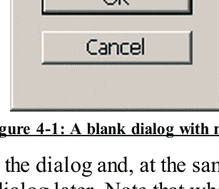

在清单 4-1 的第 1 行，我们创建对话框，同时将其放入一个变量中：这将使我们能够在以后引用该对话框。请注意，当创建任何对话框对象时，你有机会同时设置其一些属性。这是通过创建属性对象完成的：属性以一系列名称-值对的形式输入在花括号中，位于 `add()` 方法后的圆括号内。因此，在清单 4-1 的第 1 行，我们设置了正在创建的对话框的名称：该名称将显示在其标题栏中。

在第 2 行，我们显示对话框，并将用户单击按钮的值捕获到变量 `bln_result` 中。如果用户单击 **确定** 按钮，则返回 true 值；如果他们单击 **取消**，则返回 false。

在第 4 行，我们使用 `destroy()` 方法将对话框从内存中移除。

## 创建静态标签和文本框

现在让我们看看在对话框中放置一些内容以开始与用户交互。任何对话框布局中的第一个元素都是必需的：一个 dialogColumn。在其中，你可以放置更多的 dialogColumn 对象——以获得多列布局，或 dialogRows——以获得单列多行布局。要将对话框划分为清晰分隔的区域——每个区域周围都有可见的边框，请使用 borderPanel 对象。dialogColumns 和 dialogRows 都可以包含在 borderPanel 内部... 因此，如你所见，这些对象的组合方式相当灵活。

下图 4-2 显示了一个包含 staticLabel 和 textEditbox 对象的基本对话框布局：左侧是标签，右侧是控件。每个标签/控件对都包含在一个 dialogRow 元素中。

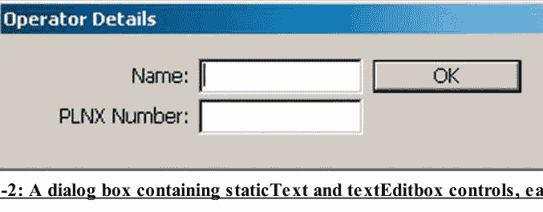

创建此基本布局的代码如下清单 4-2 所示。

**清单 4-2：创建带有 staticText 和 textEditbox 控件的对话框**

```
1 var dlg_details = app.dialogs.add({name:"Operator Details", canCancel:false});
2 var dlc_details = dlg_details.dialogColumns.add();
3 var dlr_name = dlc_details.dialogRows.add();
4 dlr_name.staticTexts.add({staticLabel:"Name:", minWidth:100});
5 var txt_name = dlr_name.textEditboxes.add({minWidth:100});
6 var dlr_num = dlc_details.dialogRows.add();
7 dlr_num.staticTexts.add({staticLabel:"PLNX Number:", minWidth:100});
8 var txt_PLNX = dlr_num.textEditboxes.add({minWidth:100})
9 dlg_details.show();
10 var str_name = txt_name.editContents;
11 var str_PLNX = txt_PLNX.editContents;
12 var str_Output = "Details received:- \rName: " + str_name;
13 str_Output += "\rPLNX Number: " + str_PLNX;
14 alert(str_Output);
15 dlg_details.destroy();
```

## 将对话框对象放入变量中

创建对话框元素后，你通常需要在代码中再次引用它们。最简单的方法之一是通过使用对象变量。当对象被创建时，对它的引用被放入一个变量中。为了将来引用该对象，我们只需使用变量名。

如果在创建控件后不需要在代码中引用它，那么将其放入变量中没有任何好处。因此，在第 4 行和第 7 行，当我们创建 staticText 控件时，没有将对所创建对象的引用放入任何变量。

相比之下，我们需要在对话框本身和两个 editTextbox 控件创建后引用它们。因此，我们在创建它们时（分别在第 1、5 和 8 行）将它们放入变量中。之后，在第 10 行和第 11 行，当我们想要捕获两个文本框的内容时，我们只需使用变量名后跟 `.editContents`（第 14 行和第 15 行）。

## canCancel 属性

在清单4-2的第1行，当我们创建对话框时，我们定义了两个属性：`name` 和 `canCancel`——后者被设置为 `false`。`canCancel` 属性决定了对话框是否具有 **取消** 按钮；将其设置为 `false` 意味着对话框将只有一个 **确定** 按钮。

当对话框只有 **确定** 按钮时，实际上没有必要将对话框的结果保存到变量中，因为我们唯一能捕获的值就是 `true`。因此，在第9行，我们直接写：`dlg_details.show()`，而不是：

```
var bln_result = dlg_details.show();
```

## minWidth 属性

控件的大小通常由其内容决定：显示12个字符的静态文本控件将比包含6个字符的控件占用更多空间。`minWidth` 属性提供了一种简单的对齐元素的方法。因此，在清单4-2中，创建的每个元素都被赋予一个 `minWidth` 值为100（像素）。这既适用于左列中的 staticText 控件，也适用于右列中的 textEditbox 控件。

## 下拉控件

下拉控件为我们提供了一种非常高效的方式，让用户从一系列选项中进行选择。该控件只占用一行；但当用户点击它时，下拉菜单会展开以显示选项。创建此元素时，你需要做的两件主要事情是：创建一个包含你希望向用户显示的选项的数组，并指定下拉菜单加载时将显示的默认值。

### stringList 属性

要设置与下拉菜单关联的选项列表，如果项目列表较短，你可以使用以下语法：

```
ddlExample.stringList = ["Portrait", "Landscape"];
```

如果选项很多，则更高效的方法是创建一个数组变量，用必要的项目列表填充它，然后将数组附加到下拉菜单。

```
arrExample = [];
// 填充数组
ddlExample.stringList = arrExample;
```

### selectedIndex 属性

`selectedIndex` 属性决定了与下拉菜单关联的 stringList 中当前选中的项。它是一个读/写属性，具有从零开始的索引：因此，将 selectedIndex 属性设置为0将导致 stringList 中的第一项显示在下拉菜单中。

```
ddlExample.stringList = ["Portrait", "Landscape"];
ddlExample.selectedIndex = 0;
```

selectedIndex 属性纯粹是数字的：下拉对象没有与其当前显示的文本相对应的 `value` 属性。但是，你可以通过组合 stringList 和 selectedIndex 属性来定位这个值——例如：

```
ddlExample.stringList[ddlExample.selectedIndex]
```

在下面的清单4-3中，我们创建了一个对话框，其中包含一个下拉控件，以及标准的 **确定** 和 **取消** 按钮。下拉菜单显示两个模板的名称：“2 column newsletter”和“3 column newsletter”——以及一个额外的选项“Unspecified"，这是对话框加载时显示的默认值，如图4-3所示。

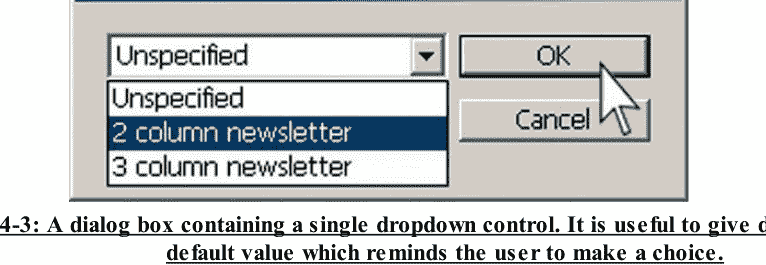

**图4-3：包含单个下拉控件的对话框。给下拉菜单一个中性的默认值以提醒用户做出选择是有用的。**

其思想是用户可以选择一个模板的名称并点击 **确定**，或者点击 **取消** 按钮以中止操作。如果他们保留默认值“Unspecified”并点击确定，将会显示一条错误消息，提醒他们选择一个模板。

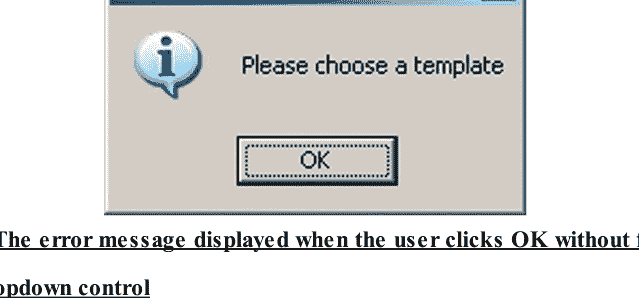

**图4-4：用户在未先选择模板的情况下点击确定时显示的错误消息。**

## 清单4-3：创建下拉控件

```
1 //创建对话框
2 var dlgTemplate = app.dialogs.add({name:"Choose a template"});
3 var dlcTemplate = dlgTemplate.dialogColumns.add();
4 var ddlTemplate = dlcTemplate.dropdowns.add({minWidth:100});
5 ddlTemplate.stringList = ["Unspecified", "2 column newsletter", "3 column newsletter"];
6 ddlTemplate.selectedIndex = 0;
7 // 显示对话框
8 var blnResult;
9 var strChoice;
10 do{
11 alert("Please choose a template");
12 blnResult = dlgTemplate.show();
13 strChoice = ddlTemplate.stringList[ddlTemplate.selectedIndex];
14 }
15 while(strChoice =="Unspecified" && blnResult == true)
16 // 评估结果
17 if(blnResult === false){
18   alert("Operation cancelled by user.");
19 }
20 else {
21   alert("The " + strChoice + " template will now be created.");
22 }
23 // 销毁对话框
24 dlgTemplate.destroy();
```

在清单4-3的第4行，我们设置了下拉菜单（`ddlTemplate`）的 `stringList` 属性，在第5行，我们将其默认选择设置为零——第一项："Unspecified"。

布尔变量 `blnResult` 用于检查用户点击了哪个按钮——`true` 代表 **确定**，`false` 代表 **取消**，而 `strChoice` 用于存储用户选择的模板。由于这两个变量都在 `do...while` 循环的开头进行测试，因此它们必须先声明——测试未声明变量的值会产生错误。

在第15行，控制 `do...while` 循环的条件测试用户是否在下拉菜单上保留了默认值“Unspecified”并点击了 **确定** 按钮。如果是这样，循环内的语句将再次执行（`do...while` 循环中的语句至少执行一次）。

在循环内部——第11行，我们显示“Please choose a template”消息。自然地，如果用户没有更改下拉菜单上选择的值并点击确定，第15行的测试将继续为真，对话框将再次弹出。

一旦用户以合理的方式与我们的对话框进行了交互，在第17行，我们测试 `blnResult` 的值，以查看他们点击了哪个按钮。如果 `blnResult` 为假——即点击了 **取消** 按钮，我们显示“Operation cancelled by user”：如果 `blnResult` 为真——点击了 **确定** 按钮——我们显示“Template X will now be created”。

此时，对话框已完成其使命，可以销毁（第24行）。然而，用户的选择仍然保存在变量 `strChoice` 中，以后可以用来帮助我们使用相应的模板创建文档。

## 创建单选按钮和复选框控件

单选按钮和复选框控件都允许用户进行选择。但是，单选按钮的行为是一个互斥组：如果你激活组中的一个成员，所有其他成员将自动停用。这种区别反映在创建单选按钮和复选框控件的方式上：单选按钮控件始终是 radiobuttonGroup 对象的子级；复选框控件彼此独立。

## 单选按钮控件

要创建 radiobuttonControl 对象，你必须首先创建一个 radiobuttonGroup 对象。例如，你可以说：

```
var rbg_example = dlc_example.radiobuttonGroups.add();
```

在 radiobuttonGroup 控件内部，然后你可以根据需要创建任意数量的单选按钮控件；并且，因为它们是同一个 radiobuttonGroup 的子级，它们将自动表现为一个互斥组。例如：

```
var rbc_example1 = rbg_example.radiobuttonControls.add();
var rbc_example2 = rbg_example.radiobuttonControls.add();
var rbc_example3 = rbg_example.radiobuttonControls.add();
```

RadiobuttonControl 对象有一个 staticLabel 属性，用于自动将文本定位到按钮旁边。它们还有一个 checkedState 属性，该属性采用布尔值：如果设置为 true，则控件在对话框加载时将默认激活。

要验证用户选择了哪个单选按钮，只需检查父级 radiobuttonGroup 的 selectedButton 属性——一个从零开始的数字索引。如果你想获取与所选按钮关联的 staticLabel，你可以说：

`rbg_example.radiobuttonControls[rbg_example.selectedButton].staticLabel`

在清单4-4中，我们有一个提供与创建广告相关选择的对话框。对话框包含一个 radiobuttonGroup，其中包含两个标有“Full page”（默认选项）和“Half page”的 radiobuttonControls。我们还有一系列复选框，控制可以包含在广告中的一些项目：它们默认都是激活的。生成的对话框如下面的图4-5所示。

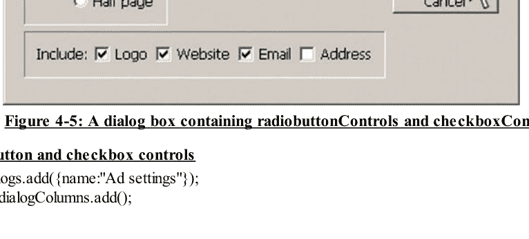

**图4-5：包含 radiobuttonControls 和 checkboxControls 的对话框。**

## 清单4-4：单选按钮和复选框控件

```
1 var dlgAd = app.dialogs.add({name:"Ad settings"});
2 var dlcAd = dlgAd.dialogColumns.add();
3
4 // 广告尺寸部分
5 var bpnAd = dlcAd.borderPanels.add();
6 bpnAd.staticTexts.add({staticLabel:"Size:"});
7 // 尺寸 radiobuttonGroup
8 var rbgSize = bpnAd.radiobuttonGroups.add();
9 var rbcFullPage = rbgSize.radiobuttonControls.add({staticLabel:"Full page"});
10 var rbcHalfPage = rbgSize.radiobuttonControls.add({staticLabel:"Half page"});
11 rbcFullPage.checkedState = true;
12
13 //广告选项部分
14 var bpnAd = dlcAd.borderPanels.add();
15 bpnAd.staticTexts.add({staticLabel:"Include:"});
16 // 复选框
17 var chkLogo = bpnAd.checkboxControls.add({staticLabel:"Logo", checkedState:true});
18 var chkWebsite= bpnAd.checkboxControls.add({staticLabel:"Website", checkedState:true});
19 var chkEmail = bpnAd.checkboxControls.add({staticLabel:"Email", checkedState:true});
20 var chkAddress = bpnAd.checkboxControls.add({staticLabel:"Address", checkedState:true});
21
```

## 教程：使用自验证控件

对话框对象提供三种类型的自验证控件：整数、角度和度量单位；此外，每种类型都可以作为编辑框或组合框使用。这些控件的优点在于，它们的行为与 InDesign 中的对应控件相似，能自动验证输入的数据类型。整数类型只接受整数；角度类型只接受实数，并且会在输入的数字旁显示度数符号；而度量单位类型则接受整数，或整数与 InDesign 识别的度量单位缩写（如 “mm” 或 “in”）的组合。

在本教程中，我们将创建一个脚本，允许用户在当前文档的每个主页上添加自定义水印，并将其放置在所有现有图层下方的新图层上。

该脚本将显示一个包含三个输入控件的对话框。首先，是一个文本编辑框，用户在此输入水印文本——最多不得超过 15 个字符。其次，是一个角度组合框控件，用户可以指定文本的角度。组合框中提供了几个预设选项，默认角度为 45 度。用户可以从列表中选择一个值，也可以输入一个新值。

正如您可能预料的那样，在编程上，组合框控件兼具下拉控件和角度编辑框控件的某些特性。因此，它有一个 `stringList` 属性，需要一个值数组；但它并不使用 `selectedIndex` 属性来显示当前选中的项。相反，它像文本编辑框控件一样，拥有一个 `editContent` 属性。第三个控件将是一个常规组合框，显示用户系统上所有当前可用字体的列表，并允许用户设置水印文本的字体。

当用户做出选择并点击确定后，脚本将使用大字体创建水印，并将其居中放置在页面上。

### 1. 主函数

要开始本练习，您需要一个可供操作的 InDesign 文档——一个空白的新文档即可。在这些教程中，我们将逐节构建脚本，并在过程中测试代码。（完成的脚本版本始终可以在当前章节的文件夹中找到，其名称以“_completed”结尾。如果您手动输入代码有困难——或者只是想加快速度——请随时从完成版本中复制代码，而不是手动输入。只需查看“chapter04”文件夹并打开“05-self-validating-controls_completed”。）

在 ESTK 中，选择 **文件 > 新建 JavaScript**。

选择 **文件 > 保存**，导航到“chapter04”文件夹，并将文件保存在那里，命名为“05-self-validating-controls.jsx”。

虽然这是一个很短的脚本，可以轻松地在不创建任何函数的情况下编写完成，但脚本往往有膨胀的趋势；因此，从一开始就建立一个连贯的结构是有用的。

输入以下代码。

```
var g = {};
main();
g = null;

function main() {
  blnResult = createDialog();
  // if(blnResult){addWatermark();}
}
```

在第 1 行，我们声明全局对象变量（`g`）。在第 2 行，我们调用主函数，该函数将执行我们所有的代码。然后，在第 3 行，我们销毁全局变量中的所有数据。在这个简短的脚本中，这将包括用户通过对话框输入的三段信息：文本、角度和字体。

在主函数内部，我们调用脚本将划分成的两个函数：`createDialog()` 和 `addWatermark()`。我们暂时注释掉了 `addWatermark()` 函数，以便我们可以在过程中测试代码。

### 2. 构建对话框

**2a. createDialog() 函数框架**

让我们首先创建 `createDialog()` 函数的框架。

将以下代码添加到脚本的末尾。

```
function createDialog() {
  var dlgWatermark = app.dialogs.add({name:"Add watermark"});
  var dlcWatermark = dlgWatermark.dialogColumns.add();

  // 水印文本

  // 角度组合框

  // 字体下拉菜单

  // 显示对话框并处理结果

}
```

从 InDesign 脚本面板或 ESTK 中测试您的代码，将 InDesign 设置为目标应用程序。它应该显示以下对话框。

在第 11 行，我们创建对话框，设置 name 属性（将出现在标题栏中的文本）为“Add watermark”。接下来，在对话框内部，我们创建一个对话框列（dialogColumn），它将作为我们需要的三个控件的容器。

回到 ESTK，选择 **文件 > 保存**。

**2b. 水印文本编辑框**

现在，让我们添加静态文本和文本编辑框控件，以便用户输入他们想要用作水印的文本。将光标定位在 `//水印文本` 注释后的空白行，并输入以下代码。

```
// 水印文本
var dlrWatermark = dlcWatermark.dialogRows.add();
dlrWatermark.staticTexts.add({staticLabel:"Text (max 15 letters):", minWidth:150});
var txtWatermark = dlrWatermark.textEditboxes.add({minWidth:200, editContents:"Confidential"});

// 角度组合框

// 字体下拉菜单

// 显示对话框并处理结果

}
```

如果我们将静态文本和文本编辑框控件直接放在对话框列中，它们最终会一上一下排列。由于我们希望它们水平排列，所以在第 15 行，我们创建了一个对话框行（dialogRow）控件，然后将静态文本和文本编辑框控件都放置在其中。

在第 16 行，当我们创建静态文本控件时，我们使用创建属性对象来设置文本和最小宽度。由于我们不需要从该控件获取任何用户输入，因此我们只需创建它，而无需将引用放在变量中。

相比之下，在第 17 行，当我们创建文本编辑框控件时，我们同时将其放在一个名为 `txtWatermark` 的变量中。我们使用创建属性对象来设置控件的最小宽度以及其中将出现的默认文本——单词“Confidential”。

如果您现在运行代码，您的对话框应该类似于下面所示的。

## 保存您的更改。

现在我们需要为组合框控件设置类似的配置，以便用户可以选择预设值或输入不同的值。同样，我们将在用户输入的左侧需要一个静态文本字段；因此，我们将两个控件都放在一个对话框行（dialogRow）元素中。

在 `//角度组合框` 注释下方输入以下代码。

```
// 角度组合框
var dlrWatermark = dlcWatermark.dialogRows.add();
dlrWatermark.staticTexts.add({staticLabel:"Angle of rotation:", minWidth:150});
var txtAngle = dlrWatermark.angleComboboxes.add({minWidth:100});
txtAngle.stringList = ["0", "45", "-45", "90", "-90"];
txtAngle.editContents = "45";

// 字体下拉菜单

// 显示对话框并处理结果

}
```

我们创建一个angleComboBox控件，然后将其stringList属性设置为包含多个角度的选择（第23行）。我们还使用editContent属性将默认角度设置为45度（第24行）。

在ESTK中运行代码，将InDesign设为目标应用程序，并尝试输入一个文本值——比如“Forty-five”。每次尝试点击“确定”时，错误消息都会自动显示，这要归功于控件内置的验证机制，它强制用户输入数值。

保存你的更改。

### 2d. 字体下拉列表

我们的最后一个控件是三个控件中最复杂的：它需要显示用户计算机上所有可用字体的列表。在InDesign对象模型中，fonts集合是application和document对象的成员。但是，document对象中的字体仅仅是该特定文件中已使用的字体。因此，自然地，为了给用户提供不错的选择，我们需要从application对象中提取字体列表。字体名称以以下格式存储：

```
Trajan Pro -> Regular

Trajan Pro -> Bold
```

字体名称和样式之间用制表符分隔。为了使我们的字体列表更易于用户使用，我们将在下拉列表中用空格替换制表符。

在 `//Fonts dropdown` 注释之后插入以下代码。

```
26 // Fonts dropdown
27  var dlrWatermark = dlcWatermark.dialogRows.add();
28  dlrWatermark.staticTexts.add({staticLabel:"Font:", minWidth:150});
29  var arrFonts = app.fonts.everyItem().name;
30  var ddlFonts = dlrWatermark.dropdowns.add({minWidth:100, stringList:arrFonts});
31
32  // Display dialog and process results
33
34 }
```

在第29行，我们使用语句 `app.fonts.everyItem().name` 创建了一个字体名称数组——`arrFonts`。`everyItem()` 方法可与大多数InDesign对象集合一起使用，并创建一个将整个集合视为单个实体的引用。因此，我们可以引用这个单个实体的name属性；但是，由于它实际上是一个完整的对象集合，因此返回的是名称数组，而不是单个项目。

在第30行，当我们创建下拉控件时，将stringList属性设置为刚创建的 `arrFonts` 数组。

## 测试你的代码并查看生成的字体列表。

如果你使用的是Windows计算机，你会在每个字体名称和字体样式之间看到一个奇怪的字符——一个小方框。

在Mac上，你只会看到一个很大的间隙。

这就是我提到的制表符。

## 让我们修改代码，以便为用户提供更整洁的字体列表。

在第29行——`var arrFonts = app.fonts.everyItem().name;`——之后插入以下代码行，如下所示。

```
29  var arrFonts =  app.fonts.everyItem().name;
30  var arrFontsApply = app.fonts.everyItem().name;
31  for(var i = 0; i < arrFonts.length; i ++){
32    arrFonts[i] = arrFonts[i].replace("\t", " ");
33  }
34  var ddlFonts =  dlrWatermark.dropdowns.add({minWidth:100, stringList:arrFonts});
35
36  // Display dialog and process results
37
38 }
```

在第30行，我们创建了第二个数组变量 `arrFontsApply`，稍后当我们想将用户选择的字体应用于水印文本时会用到它。这意味着原始的 `arrFonts` 现在可以被修改得更易于用户使用。

在第32行，在for循环内部，我们使用 `replace()` 函数将每个字体名称中的制表符改为空格。

再次测试你的代码并点击字体下拉列表。这一次，应该有一个空格代替了小方框或大间隙——更用户友好且美观。

保存你的更改。

| 语法摘要 ... | `myArray = app.fonts.everyItem().name` |

| :--- | :--- |

| InDesign对象集合方法 | 一种快速简便的方法，用于生成运行脚本的系统上所有字体名称的数组。 |

## 2e. 验证用户输入

现在我们已经完成了所有控件的设置，可以考虑验证用户输入的数据了。旋转角度不是问题，因为它通过angleCombobox控件输入，会自动验证。此外，如果用户没有选择字体，我们可以简单地使用默认字体。因此，我们真正需要做的就是确保用户没有将水印文本字段留空。我们可以使用 do ... while 循环来做到这一点。

在 `// Display dialog and process results` 注释下方添加以下行。

```
36 // Display dialog and process results
37  do{
38    var blnResult = dlgWatermark.show();
39  }while(txtWatermark.editContents == "")
40
41  if(blnResult == true){
42    g.watermark = txtWatermark.editContents.substring(0, 15);
43    g.rotation = parseInt(txtAngle.editContents);
44    g.font = arrFontsApply[ddlFonts.selectedIndex];
45    dlgWatermark.destroy();
46  }
47  else {
48    alert("Operation cancelled.");
49  }
50  return blnResult;
51 }
```

## 保存你的更改。

在第37-39行，我们将对话框的显示放在一个 do ... while 循环中。while语句——`while(txtWatermark.editContents == "" )`——确保用户必须在 `txtWatermark` 文本框中输入一些文本，然后才能使用 **OK** 按钮关闭对话框。

在第41行，我们通过检查 `blnResult` 的值来测试用户是否点击了 **OK** 按钮。如果点击了 **OK** 按钮，我们将每个输入控件中的值捕获到变量中，然后从内存中删除对话框。（然后我们将继续向母版页添加水印。）

在第42行，我们使用JavaScript String对象的 `substring()` 方法，将用户在textEditbox中输入的文本的前15个字符放入全局变量，作为属性 `g.watermark`。

在第43行，我们将用户输入或选择的值放入全局变量作为 `g.rotation`。由于该值将包含度数符号，它将是一个字符串。因此，我们使用JavaScript内置的 `parseInt()` 函数将其转换为整数值。

| 语法摘要 ... | `parseInt(input string[, number system])` |

| :--- | :--- |

| 全局JavaScript函数 | 将字符串转换为其整数等效值。 |

| 输入字符串 | 要转换的字符串。 |

| 数字系统 | 可选。要使用的数字系统：10表示十进制（默认）；16表示十六进制等。 |

在第44行，我们使用字体下拉列表的 `selectedIndex` 属性从数组变量 `arrFontsApply` 中检索相应的字体名称。（如果你记得，`arrFonts` 包含用户友好的字体名称，制表符已转换为空格，而 `arrFontsApply` 包含使用语句 `app.fonts.everyItem().name` 检索的原始字体名称。）我们将其放入 `g.font` 中，并在稍后格式化每个母版页上的水印文本时使用此名称。

这完成了对话框的显示和用户输入数据的捕获。现在让我们继续将水印文本添加到文档中的每个母版页的任务。

## 3. 将水印文本添加到母版页

### 3a. 创建“watermark”图层

我们的首要任务是创建一个名为“watermark”的图层，并使其成为底层，这样文本将显示在所有其他内容之后。

在脚本末尾添加以下函数框架。

```
52
53 function addWatermark(){
54   var doc = app.activeDocument;
55
56   // Delete layer if exists
57
58   // Create layer
59
60   for(var i =0; i < doc.masterSpreads.length; i++){
61     for(j=0; j < doc.masterSpreads[i].pages.length; j ++){
62       // Create and position text box
63
64       // Format text
65
66     }
67   }
68 }
```

在第54行，将活动文档放入名为 `doc` 的局部变量中。然后我们有了将要执行的各种操作的注释。

在第60行，我们使用活动文档的masterSpreads集合的length属性来限制外层循环的迭代次数——使用计数器 `i`。每个母版跨页将有一个或两个页面；因此，在第61行，我们使用每个masterSpread对象的pages集合的length属性来控制内层循环——使用计数器 `j`。

**在我们创建新图层之前，让我们尝试删除它，以防用户之前运行过脚本且图层已存在。在注释 // Delete layer if exists 之后添加以下行。**

```
56   // Delete layer if exists
57   try{
58     doc.layers.itemByName("watermark").remove();
59   }
60   catch(err){}
61
62   // Create layer
```

由于此图层可能存在也可能不存在，因此在第57到60行，我们在try ... catch块内尝试删除它。这意味着，如果它存在，它将被删除；如果它不存在，第58行将不会生成错误。

现在我们知道不存在名为“watermark”的图层

### 3c. 创建水印文本框

现在，在内层循环中，我们将创建并定位一个包含用户输入水印文本的文本框，然后对文本进行格式化。

创建文本框时，我们会将其居中放置在页面上，并垂直居中其中的文本。然后，我们将它旋转到用户指定的角度。

在内层 `for` 循环中，注释 `// Create and position text box` 之后，输入以下代码：

```javascript
65
66 for(var i =0; i < doc.masterSpreads.length; i++){
67   for(j=0; j < doc.masterSpreads[i].pages.length; j ++){
68     // Create and position text box
69     var userPref = doc.viewPreferences.rulerOrigin;
70     doc.viewPreferences.rulerOrigin = RulerOrigin.pageOrigin;
71     var txfWatermark = doc.masterSpreads[i].pages[j].textFrames.add(layWatermark, {contents:g.watermark});
72     var intOffset = doc.documentPreferences.pageHeight/10;
73     var y1 = (doc.documentPreferences.pageHeight/2)-intOffset;
74     var x1 = 0;
75     var y2 = (doc.documentPreferences.pageHeight/2)+intOffset;
76     var x2 = doc.documentPreferences.pageWidth;
77     txfWatermark.geometricBounds=[y1, x1, y2, x2];
78     txfWatermark.textFramePreferences.verticalJustification = VerticalJustification.centerAlign;
79     app.activeWindow.transformReferencePoint = AnchorPoint.centerAnchor;
80     txfWatermark.rotationAngle = g.rotation;
81     doc.viewPreferences.rulerOrigin = userPref;
82
83     // Format text
84
85   }
86 }
87 }
```

保存你的更改。

在第 70 行，我们将 `rulerOrigin` 设置为 `pageOrigin`，这使得表达页面坐标更加容易——它意味着左右页可以同等对待。这等同于在 InDesign 首选项的 **单位和增量** 部分，从 **原点** 下拉菜单中选择 **页面**。

然而，为了避免打扰用户，我们首先将现有设置捕获到一个名为 `userPref` 的变量中（第 69 行）。定位完文本框后，我们恢复原始设置（第 81 行）。

在第 71 行，创建文本框时，我们使用可选的第一个参数——图层——来指定它应放置在 `layWatermark` 上——这是我们刚刚创建的图层。我们还使用创建属性对象来指定文本框的内容——即其中的文本。

| 语法摘要 | `container.textFrames.add([layer, at, reference, creation properties])` |

| --- | --- |

| | **TextFrames 对象集合方法**<br>在指定图层上创建一个文本框。 |

| 图层 | 可选。文本框应放置在其上的图层。如果省略，则使用当前活动图层。 |

| At | 枚举值，指定相对于参考对象的新位置：<br>`LocationOptions.before`<br>`LocationOptions.after`<br>在其容器内：<br>`LocationOptions.atEnd`<br>`LocationOptions.atBeginning`<br>`LocationOptions.unknown` |

| 参考对象 | 如果 `at` 参数设置为 `LocationOptions.before` 或 `LocationOptions.after`，则必需。（通常是另一个 textFrame 对象，但也可以是 pageItem、layer、page 或 document。） |

| 创建属性 | 可选。文本框出现时将具有的属性。 |

在第 72 行，将变量 `intOffset` 设置为页面宽度的十分之一。然后我们计算用于文本框 `geometricBounds` 属性的四个坐标：`y1`、`x1`、`y2` 和 `x2`。基本上，我们正在创建一个与页面同宽、高度为页面高度的五分之一且在页面上居中的文本框。

| 语法摘要 | `textFrame.geometricBounds = [y1, x1, y2, x2]` |

| --- | --- |

| | **TextFrames 对象集合方法**<br>在指定图层上创建一个文本框。 |

| | y1, x1, y2, x2 | 文本框的顶部、左侧、底部和右侧的位置。 |

在第 78 行，我们将垂直对齐方式设置为 `center`——这等同于点击 **对象 > 文本框选项**，然后从 **垂直对齐** 下拉菜单中选择 **居中**。

| 语法摘要 | `textFrame.textFramePreferences.verticalJustification = 枚举值`<br>TextFrame 首选项对象属性<br>设置文本框内容的垂直位置。 |

| --- | --- |

| | 枚举值 | `VerticalJustification.TOP_ALIGN`<br>`VerticalJustification.CENTER_ALIGN`<br>`VerticalJustification.BOTTOM_ALIGN`<br>`VerticalJustification.JUSTIFY_ALIGN` |

在第 79 行，旋转文本框之前，我们执行相当于点击 InDesign 控制面板左侧中心参考点的脚本操作。

| 语法摘要 | `app.activeWindow.transformReferencePoint = 枚举值`<br>Layout window 对象属性<br>设置页面项目变换时使用的参考点。 |

| --- | --- |

| | 枚举值 | `AnchorPoint.BOTTOM_CENTER_ANCHOR`<br>`AnchorPoint.BOTTOM_LEFT_ANCHOR`<br>`AnchorPoint.BOTTOM_RIGHT_ANCHOR`<br>`AnchorPoint.CENTER_ANCHOR`<br>`AnchorPoint.LEFT_CENTER_ANCHOR`<br>`AnchorPoint.RIGHT_CENTER_ANCHOR`<br>`AnchorPoint.TOP_CENTER_ANCHOR`<br>`AnchorPoint.TOP_LEFT_ANCHOR`<br>`AnchorPoint.TOP_RIGHT_ANCHOR` |

## 3d. 格式化水印文本

格式化框内的文本非常简单。我们知道它将包含一个段落的文本；因此我们可以直接定位该段落对象所需的格式化属性。

在内层 `for` 循环中，注释 `// Format text` 之后，输入以下代码：

```javascript
83	// Format text
84	var paraWatermark = txfWatermark.paragraphs[0];
85	if(g.font != undefined) {
86		paraWatermark.appliedFont = app.fonts.itemByName(g.font);
87	}
88	paraWatermark.pointSize = "60 pt";
89	paraWatermark.fillColor = doc.colors.itemByName("Paper");
90	paraWatermark.strokeColor = doc.colors.itemByName("Black");
91	paraWatermark.justification = Justification.CENTER_JUSTIFIED;
92	}
93	}
94	}
```

保存你的更改。

在第 84 行，为了避免重复输入 `txfWatermark.paragraphs[0]`，我们将这个段落对象放入一个名为 `paraWatermark` 的变量中，它现在指向文本框 `txfWatermark` 中的第一个（也是唯一的）段落。

在第 85 行，我们检查以确保字体下拉菜单的值不是 `undefined`——这表示用户没有做出选择——然后再使用 `g.font` 作为索引来指定段落的 `appliedFont` 属性（第 86 行）。如果你还记得，全局变量属性 `g.font` 包含了用户通过对话框中的下拉菜单指定的字体名称——这要归功于我们脚本的第 44 行：

```javascript
44	g.font = arrFontsApply[ddlFonts.selectedIndex];
```

通常，将字体设置在 `try ... catch` 代码块中是个好主意，以防字体不存在；但是，这里用户刚刚从其系统当前字体的列表中做出了选择；因此我们可以假设它仍然存在。

最后，在第 88 到 91 行，我们设置段落的 `pointSize`、`fillColor`、`strokeColor` 和 `justification` 属性。

| 语法摘要 | `textObject.justification = 枚举值`<br>Text 对象（段落、行、词、字符等）属性<br>设置包含该文本对象的段落的水平对齐方式。 |

|---|---|

| | `Justification.LEFT_ALIGN`<br>`Justification.CENTER_ALIGN`<br>`Justification.RIGHT_ALIGN`<br>`Justification.LEFT_JUSTIFIED` |

## 枚举

| 枚举值 | `Justification.RIGHT_JUSTIFIED` |

| --- | --- |

| | `Justification.CENTER_JUSTIFIED` |

| | `Justification.FULLY_JUSTIFIED` |

| | `Justification.TO_BINDING_SIDE` |

| | `Justification.AWAY_FROM_BINDING_SIDE` |

再次运行代码，输入一些文本，选择一种字体并点击“确定”。水印应该会出现在活动文档中所有基于母版的页面上。


这便完成了这个**亲自试一试！**教程。

对话框对象允许您创建用于捕获和验证信息的基本用户界面。在下一章中，我们将继续探讨如何使用 ScriptUI（ExtendScript 的一个组件，允许您构建更具交互性的复杂用户界面）来创建对话框和控件。

# 第五章 ScriptUI 对话框

对话框创建起来快速简便，非常适合从用户那里捕获简单信息。其自验证控件尤其有用。然而，它们只提供基本的交互级别：对话框内的各个控件之间永远不可能有任何交互。例如，如果一个控件发生变化，您无法让对话框内的另一个控件出现、消失或变为启用/禁用状态。

幸运的是，InDesign 提供了第二种构建对话框的方式：ScriptUI——一个随 ExtendScript 附带的强大组件，支持创建复杂的交互式用户界面。尽管其复杂性意味着它比我们在上一章遇到的对话框对象更难掌握一些，但绝对值得付出努力。

ScriptUI 允许您创建具有类似功能的对话框，就像您可以为网站创建表单一样。这主要是因为 ScriptUI 控件与网页表单控件共享一项重要能力：它们都能响应事件。

掌握 ScriptUI 对话框的关键是理解构建特定用户界面所需的对象层次结构，然后将其转换为等效的 ScriptUI 对象层次结构。

## Window 对象

ScriptUI 对象的根容器是 `Window` 对象，其用途与我们在第四章中遇到的 `dialog` 对象相同。它有两种变体：模态（dialog）和非模态（window 或 palette）。模态窗口是一个对话框，要求用户关注并阻止与 InDesign 应用程序的任何交互。非模态窗口基本上是一个浮动调色板，与 InDesign 界面共存，并允许用户与其他元素进行交互。

### 创建窗口

在 ExtendScript 中，窗口使用 `new Window()` 构造方法创建；例如：

```
var win = new Window('dialog','Simple dialog box');
win.show();
```

新的 `Window()` 方法在内存中创建窗口。然后使用 `show()` 方法实际显示它。此代码产生的如图 5-1 所示的空的小对话框。

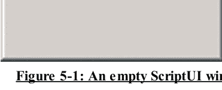

| 语法摘要 |

| --- |

| `myVariable = new Window(type[, title, bounds, creation properties])` |

| Window 对象构造方法 |

| 创建一个新的 ScriptUI 窗口。 |

| 唯一必须的参数，可以接受以下三个值之一： |

| 类型 | 描述 |

| --- | --- |

| type | `dialog` - 模态窗口，在关闭之前会阻止与 InDesign 的任何其他交互。`window` - 非模态对话框窗口，可以移开，同时用户继续与 InDesign 交互。`palette` - 同样是非模态，在 InDesign 中，与 `window` 基本相同。 |

| title | 可选。将出现在窗口左上角的文本。 |

| bounds | 可选。一个包含四个像素坐标的数组，可用于设置对话框的大小和位置，顺序为：`[左, 上, 右, 下]`。由于窗口的最终大小将由其内部的控件自动确定，通常可以省略此参数。 |

| creation properties | 可选。提供了一种设置多个创建属性（只能在创建窗口时设置的属性）的方式。 |

## 容器对象与 add() 方法

在主窗口对象内部，有三种类型的容器可用于组织和分组各种控件：选项卡面板、面板和分组。

ScriptUI 控件本质上是对象中的对象层次结构，可以使用点语法创建和引用。除了位于层次结构顶部的窗口控件外，您创建的每个新控件都必须放入一个容器中。这通过使用将作为新控件容器的项目的 `add()` 方法来实现。

| 语法摘要 |

| --- |

| `container.add(type[, bounds, text, creation properties])` |

| ScriptUI 容器对象方法 |

| 在容器对象内部创建一个新的 ScriptUI 控件。 |

| 参数 | 描述 |

| --- | --- |

| type | 这是唯一必须的参数，指定要创建的控件类型。 |

| bounds | 可选。一个包含四个像素坐标的数组，可用于在其容器的坐标内设置控件的大小和位置，顺序为：左, 上, 右, 下。您可能会发现省略此参数并在稍后设置控件的 `minimumSize` 属性会更容易。这允许您仅指定对象的宽度和高度，同时防止诸如文本截断等问题——正如该属性名称中的“minimum”所暗示的那样。 |

| text | 可选。您希望在控件中显示的默认文本（如果适用的话）。并非所有控件都显示文本：例如，面板会显示，但分组不会。 |

| creation properties | 可选。包含一组控件属性设置的对象字面量。这可能看起来不像它应该具备的那么整洁的功能，因为可设置的属性因控件而异。然而，创建属性非常有用，因为它们允许您设置后续无法设置的属性。当我们详细检查每个主要的 ScriptUI 控件时，将对此进行讨论。 |

## 选项卡面板

选项卡面板允许您将相关控件组织到单独的、重叠的区域中，通过点击特定的选项卡来访问。（为了证明其存在的合理性，一个选项卡面板必须至少包含两个选项卡。）通过将相关控件分隔到各自独立的区域，选项卡面板增加了复杂界面的清晰度，这些区域一次只能显示一个。

要在我们的基本窗口（存储在名为 `win` 的变量中）内创建一个包含三个选项卡的选项卡面板，我们可以这样修改代码：

**代码清单 5-1：创建带选项卡面板的对话框**

```
1 var win = new Window('dialog', 'Simple dialog box');
2 win.tpn = win.add('tabbedpanel');
3 win.tpn.tabOperator = win.tpn.add('tab', undefined, 'Operator');
4 win.tpn.tabJob = win.tpn.add('tab', undefined, 'Job Details');
5 win.tpn.tabClient = win.tpn.add('tab', undefined, 'Client');
6 var intResult = win.show();
```

这将生成如图 5-2 所示的对话框。**要在 Mac 上关闭对话框，请按键盘左上角的 Escape 键。**

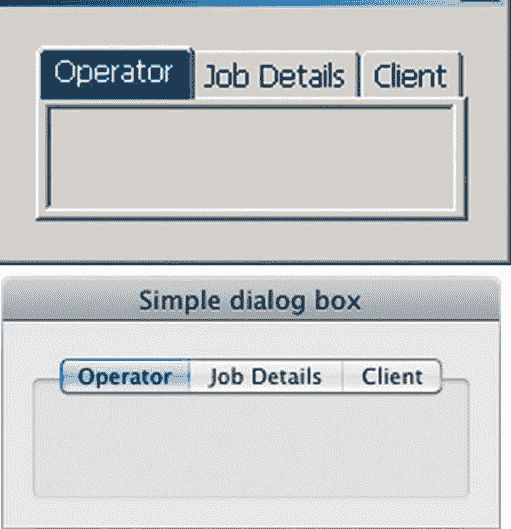

**图 5-2：一个包含带三个选项卡的选项卡面板的窗口**

### 面板

在窗口内，或在选项卡面板的每个选项卡内，可以使用面板在对话框的控件之间创建逻辑划分。面板提供一个带边框和可选标题的逻辑分隔符，可以在其中放置相关控件。它的作用类似于 HTML 表单中用作相关元素容器的 `<fieldset>` 元素。因此，与其像图 5-1 所示的三个选项卡（那将仅在我们每个选项卡都有相当多的控件时使用），我们可以简单地创建三个面板，如下面的图 5-3 所示。

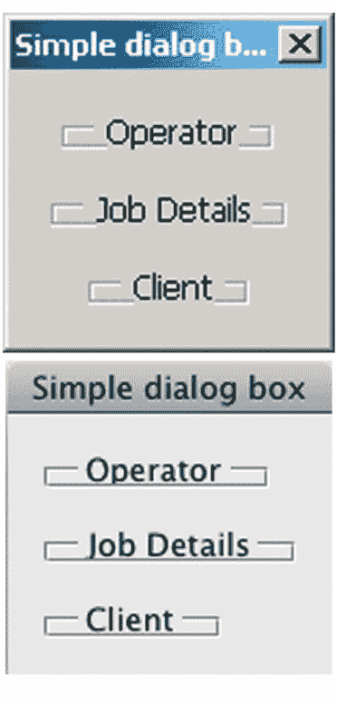

代码如代码清单 5-2 所示。

**代码清单 5-2：创建带三个面板的对话框**

```
1 var win = new Window('dialog', 'Simple dialog box');
2 win.pnlOperator = win.add('panel', undefined, 'Operator');
3 win.pnlJob = win.add('panel', undefined, 'Job Details');
4 win.pnlClient = win.add('panel', undefined, 'Client');
5 var intResult = win.show();
```

在上面的图中，您会注意到，默认情况下，面板在其容器内水平居中，并且它们以列的形式出现——一个接一个。这两种默认设置都可以通过分别设置相应容器的 `alignChildren` 和 `orientation` 属性来覆盖。

### 方向

容器的 `orientation` 属性决定了其子对象是以行还是列重复。它可以接受三个值之一：`row`、`column` 或 `stack`。行和列不言自明：`stack` 会导致子对象重叠——彼此堆叠——这在创建显示和隐藏其他控件的交互式控件时很有用。（您将在第七章从第 153 页开始的一个教程中看到使用堆叠方向的实际示例。）

在下面的代码清单 5-3 中，我们通过设置 `orientation` 来覆盖默认的列方向

## AlignChildren

以类似的方式，我们可以通过设置 `alignChildren` 属性来改变面板在窗口内的对齐方式。在清单 5-4 中，我们通过将 `alignChildren` 属性设置为 `fill` 来改变默认的居中对齐。这是一个有用的选项，它会使所有三个面板宽度相同，方法是让它们填充其容器——有点像在 HTML 中将表格或 DIV 的宽度设置为 100%。生成的对话框如图 5-5 所示。

```
清单 5-4：将面板的对齐方式设置为 "fill"
1 var win = new Window('dialog', 'Simple dialog box');
2 win.alignChildren = 'fill';
3 win.pnlOperator = win.add('panel', undefined, 'Operator');
4 win.pnlJob = win.add('panel', undefined, 'Job Details');
5 win.pnlClient = win.add('panel', undefined, 'Client');
6 var intResult = win.show();
```

**语法摘要**

| | |

| --- | --- |

| `container.alignChildren = 字符串值` | ScriptUI 容器对象属性。决定容器内元素的对齐方式。 |

| **字符串值** | 如果方向设置为行，允许的值是：top, bottom, center 和 fill。对于列方向，允许的值是：left, right, center 和 fill。对于堆叠方向：top, bottom, left, right, center 和 fill。 |

## 组

组就像被移除了两个关键特性的面板：它们没有可见的边框，也不能显示标题。它们有两个主要用途：首先，用于在行或列中对齐相关的控件——使用我们刚才遇到的相同的 `orientation` 属性；其次，可以用来将面板（或其他组）组织成行或列。

### 使用组对齐控件

组的一个经典用法是作为数据控件（用户将通过其输入数据）及其关联标签的容器。在清单 5-5 中，在我们第一个面板 (`win.pnlOperator`) 内部，我们使用了 `add()` 方法创建了两个组，并在第一个组中放置了一个静态文本控件和一个编辑文本控件；在第二个组中放置了静态文本和下拉列表控件。

**清单 5-5：使用组作为标签/控件对的容器**

```
1 var win = new Window('dialog', 'Simple dialog box');
2 win.alignChildren = 'left';
3
4 // Operator panel (Contains two groups)
5 win.pnlOp = win.add('panel', undefined, 'Operator');
6 // Name Group
7 win.pnlOp.grpName = win.pnlOp.add('group');
8 win.pnlOp.grpName.orientation = 'row';
9 win.pnlOp.grpName.stx = win.pnlOp.grpName.add('statictext', undefined, 'Name:');
10 win.pnlOp.grpName.stx.minimumSize = [60, 20];
11 win.pnlOp.grpName.txt = win.pnlOp.grpName.add('edittext');
12 win.pnlOp.grpName.txt.minimumSize = [100, 20];
13
14 // Branch Group
15 win.pnlOp.grpBranch = win.pnlOp.add('group');
16 win.pnlOp.grpBranch.orientation = 'row';
17 win.pnlOp.grpBranch.stx = win.pnlOp.grpBranch.add('statictext', undefined, 'Branch:');
18 win.pnlOp.grpBranch.stx.minimumSize = [60, 20];
19 var arrBranch = ['Glasgow', 'Leeds', 'London', 'Manchester'];
20 win.pnlOp.grpBranch.ddl = win.pnlOp.grpBranch.add('dropdownlist', undefined, arrBranch);
21 win.pnlOp.grpBranch.ddl.minimumSize = [100, 20];
22
23 // Job panel (Empty)
24 win.pnlJob = win.add('panel', undefined, 'Job Details');
25
26 // Client panel (Empty)
27 win.pnlClient = win.add('panel', undefined, 'Client');
28
29 // Show dialog
30 var intResult = win.show();
```

**图 5-6：使用组来布局数据控件。组 1 包含静态文本和编辑文本控件，组 2 包含静态文本和下拉列表控件。**

创建组控件时，通常只需要为其容器的 `add()` 方法提供一个参数：要创建的元素类型——即 `'group'`。因此，在清单 5-5 的第 5 行，我们有：

```
win.pnlOp = win.add('panel', undefined, 'Operator');
```

编辑文本控件也是如此——第 11 行：

```
win.pnlOp.grpName.txt = win.pnlOp.grpName.add('edittext');
```

由于静态文本控件用于输出文本而非用户输入，它们需要第三个参数（将显示在控件内的文本）。如果第二个参数被省略，则必须用关键字 "undefined" 替换。因此，在第 9 行，我们有：

```
win.pnlOp.grpName.stx = win.pnlOp.grpName.add('statictext', undefined, 'Name:');
```

创建下拉列表时，我们使用第三个（items）参数来提供将出现在控件中的文本项列表。因此，在第 19 行，我们定义了一个名为 `arrBranch` 的数组；然后，在第 20 行，我们将其用作 `add()` 方法的 `items` 参数。

```
var arrBranch = ['Glasgow', 'Leeds', 'London', 'Manchester'];
win.pnlOp.grpBranch.ddl = win.pnlOp.grpBranch.add('dropdownlist', undefined, arrBranch);
```

有趣的是，下拉列表控件的 items 属性只能在控件创建时设置。控件创建后，该属性变为只读。因此，如果我们尝试使用以下代码：

```
win.pnlOp.grpBranch.ddl = win.pnlOp.grpBranch.add('dropdownlist');
win.pnlOp.grpBranch.ddl.items = arrBranch;
```

我们会收到一个 ExtendScript 错误，提示：“items is read only”。

### ScriptUI 的编码风格

注意使用点语法在对象内部创建对象的方式。这导致代码冗长但清晰。另一种方法是在创建元素时将其放入变量中。例如，不是：

```
win.pnlOperator = win.add('panel', undefined, 'Operator');
```

我们可以简单地说：

```
var pnlOperator = win.add('panel', undefined, 'Operator');
```

你将在本书的脚本中遇到这两种风格的混合使用。

### 将容器放在容器内

组的另一个主要用途是将面板（或其他组）组织成行和列。ScriptUI 允许你以任何你认为合适的方式使用组和面板来分组控件。各种容器之间的关系如下图 5-8 所示。

**图 5-8：ScriptUI 容器可以非常灵活地使用。**

例如，如果我们有四个面板，并希望将它们组织成两行两列，我们可以这样做：

- 将窗口的 orientation 属性保留为默认值 "column"。
- 将前两个面板放入一个组中，并将其 orientation 设置为默认的 "row"。
- 将第三个和第四个面板放入第二个组中，该组的 orientation 属性也默认为 "row"。

一个例子如下面的清单 5-6 所示。

**清单 5-6：使用组来控制面板的布局**

```
1 var win = new Window('dialog', 'Simple dialog box');
2 win.alignChildren = 'left';
3 win.grp1 = win.add('group');
4 win.grp1.pnlOperator = win.grp1.add('panel', undefined, 'Operator');
5 win.grp1.pnlJob = win.grp1.add('panel', undefined, 'Job Details');
6 win.grp2 = win.add('group');
7 win.grp2.pnlClient = win.grp2.add('panel', undefined, 'Client');
8 win.grp2.pnlResources = win.grp2.add('panel', undefined, 'Resources');
9 var intResult = win.show();
```

生成的对话框如图 5-7 所示。

**包含面板的窗口对象的 orientation 属性设置为 row（第 2 行）。生成的对话框如图 5-4 所示。**

```
清单 5-3：创建一行面板，覆盖默认的列方向
1 var win = new Window('dialog', 'Simple dialog box');
2 win.orientation = 'row';
3 win.pnlOperator = win.add('panel', undefined, 'Operator');
4 win.pnlJob = win.add('panel', undefined, 'Job Details');
5 win.pnlClient = win.add('panel', undefined, 'Client');
6 var intResult = win.show();
```

**语法摘要**

| | |

| --- | --- |

| `container.orientation = 字符串值` | ScriptUI 容器对象属性。决定容器内的元素是按行还是按列排列。 |

| **字符串值** | 允许的值是：row, column 或 stack（重叠）。 |

**图 5-5：将窗口对象的 alignChildren 设置为 “fill” 会使其内部的面板变得等宽。**

## 文本控件

ScriptUI 提供了两种用于显示和输入文本的控件：用于文本输出的 StaticText 和用于输入的 EditText。

**StaticText**

StaticText 控件用于在对话框窗口中显示文本。其最常见的用途是为其他控件提供标签。它也可以用来向用户显示说明。因此，StaticText 控件最重要的属性是 `text` 属性：这通常通过用于创建控件的 `add()` 方法的第三个参数来设置。我们已经见过一些使用示例，例如：

```
win.pnlOp.grpBranch.stx = win.pnlOp.grpBranch.add('statictext', undefined,'Branch:');
win.pnlOp.grpBranch.stx.minimumSize = [60, 20];
```

这里，我们将控件内要显示的文本设置为"Branch:"。第二个参数是 `bounds`，允许你指定控件的大小和位置。这里将其留为 undefined，并在下一行使用更灵活的 `minimumSize` 属性，该属性会在必要时被 ScriptUI 布局管理器自动覆盖，以防止字符被截断。

**StaticText 创建属性**

StaticText 控件允许你通过创建属性参数（即 `add()` 方法的可选第四个参数）设置一些有用的属性。

| 语法摘要 | StaticText 创建属性 |

|---|---|

| Multiline | 设置为 true 时，文本会在 StaticText 控件内自动换行。（默认值为 false。）当向对话框添加说明时，这很有用。 |

| Scrolling | 允许你进一步探索文本密集型对话框的可能性。当此属性设置为 true 时，控件会添加一个垂直滚动条，允许用户滚动查看过长而无法完全显示的文本。 |

图 5-9 展示了使用 `multiline` 和 `scrolling` 属性的示例。用户被要求阅读应用程序的使用条款和条件，然后可以点击 **同意** 或 **不同意** 按钮。生成图 5-9 所示对话框的代码如清单 5-7 所示。

**图 5-9：将 StaticText 控件的 multiline 和 scrolling 属性设置为 true，允许你呈现包含大量文本的界面。**

**清单 5-7：使用 statictext 的 multiline 和 scrolling 属性**

```
var strConditions = "Cienisque pressin totaquidenda nonsequiatam eaque non pelloris \
dolorit aturepra pa que digendelest hario ipsunt volorio quo vel illacea dolupta \
ecepro quod es quunt es invel ipsum cus ipsapeltio quo officiendel iur site noneces \
dellupt iberchitati debistr umquis exero blab il idi doluptam quis sundi berisqui \
dolorem olupienimint aliqui con re... "

var win = new Window('dialog', 'Terms and Conditions');
win.alignChildren = 'left';

win.grpMain = win.add('group', undefined, 'Terms and conditions');
win.grpMain.orientation = 'column';
win.grpMain.stxConditions = win.grpMain.add('statictext', undefined, strConditions, {multiline:true, scrolling:true});

win.grpMain.btnAgree = win.grpMain.add('button', undefined, 'Agree');
win.grpMain.btnDisagree = win.grpMain.add('button', undefined, 'Disagree');

win.defaultElement = win.grpMain.btnAgree;
win.cancelElement = win.grpMain.btnDisagree;
var intResult = win.show();
```

在第 1 到 5 行，我们将一个四行字符串放入名为 `strConditions` 的变量中。（反斜杠字符用于让 JavaScript 解释器忽略行尾。）在第 12 行，当我们创建 StaticText 控件时，我们将 `strConditions` 作为 `add()` 方法的第三个（文本）参数。我们还包含了第四个（创建属性）参数，在其中我们将 `multiline` 和 `scrolling` 属性设置为 true。

在第 17 和 18 行，窗口对象的 `defaultElement` 和 `cancelElement` 属性用于指定我们的哪个按钮将充当 **确定** 按钮，哪个充当 **取消** 按钮。这将在本章后面关于按钮控件的部分详细解释。

## EditText

EditText 控件是 StaticText 控件的输入对应版本。

## 创建默认值

在创建时，如果你希望在对话框出现时在文本字段中放置一个默认条目，可以使用 `add()` 方法的第三个（文本）参数。例如，在图 5-10 所示的对话框中，当前日期已自动插入到"开始日期" EditText 字段中。

**图 5-10：add() 方法的第 3 个参数允许你在 EditText 控件内设置默认值**

实现此功能的代码如下面的清单 5-8 所示。

**清单 5-8：在 EditText 字段中插入默认值**

```
// 构造今天的日期（英国格式）
var datToday = new Date();
var strToday = datToday.getDate() + "/" + (datToday.getMonth() +1) + "/" + datToday.getFullYear();

// 构造窗口
var win = new Window('dialog', 'Enter Job Details');

// 作业编号
win.grpJob = win.add('group');
win.grpJob.orientation = 'row';
win.grpJob.stx = win.grpJob.add('statictext', undefined, 'Job Number:');
win.grpJob.stx.minimumSize = [75, 20];
win.grpJob.txt = win.grpJob.add('edittext');
win.grpJob.txt.minimumSize = [100, 20];

// 开始日期
win.grpDate = win.add('group');
win.grpDate.orientation = 'row';
win.grpDate.stx = win.grpDate.add('statictext', undefined, 'Start Date:');
win.grpDate.stx.minimumSize = [75, 20];
win.grpDate.txt = win.grpDate.add('edittext', undefined, strToday);
win.grpDate.txt.minimumSize = [100, 20];

// 按钮
win.grpButtons = win.add('group');
win.grpButtons.btnOK = win.grpButtons.add('button', undefined, 'OK');
win.grpButtons.btnCancel = win.grpButtons.add('button', undefined, 'Cancel');

// 显示窗口
var intResult = win.show();
```

在第 2 行，我们将 Date 对象的一个副本放入名为 `datToday` 的变量中：该变量被自动设置为当前日期。在第 3 行，我们创建一个名为 `strToday` 的变量，我们从 Date 对象中提取日期（日）、月份和年份部分，并用必要的 "/" 分隔符连接它们。（`getMonth()` 函数返回一个 0 到 11 之间的数字，而不是 1 到 12；因此需要写成 `(datToday.getMonth() +1)`。）在第 21 行，当我们创建日期 EditText 字段时，我们使用 `strToday` 变量作为 `add()` 方法的第三个（文本）参数，从而使其成为控件的默认值。由于 `text` 属性不是创建属性，当然可以在 EditText 字段创建后设置。因此，我们也可以使用：

```
win.grpDate.txt = win.grpDate.add('edittext');
win.grpDate.txt.text = strToday;
```

## EditText 创建属性

EditText 控件有两个创建属性：multiline 和 noEcho。

| 语法摘要 | EditText 创建属性 |

| --- | --- |

| Multiline | 与其兄弟控件 StaticText 类似，EditText 控件有一个 multiline 属性，它使得输入到字段中的文本——无论是用户输入还是默认文本——在控件内自动换行。与 StaticText 控件不同，EditText 字段没有 scrolling 属性：滚动条会在控件被文本填满时自动创建并启用。 |

| NoEcho | EditText 控件的 noecho 创建属性决定了输入到控件中的文本是可见还是被遮蔽。默认情况下，此属性设置为 false：将其设置为 true 会创建一个适合输入密码或其他敏感信息的字段。 |

图 5-11 所示的对话框阐释了这两个创建属性。首先，作业描述字段的 `multiline` 属性已设置为 true；其次，密码字段的 `noecho` 属性已设置为 true。

图 5-11：使用 EditText 控件的 `multiline` 和 `noecho` 属性

该对话框背后的代码如下方清单 5-9 所示。

清单 5-9：创建多行和密码 EditText 字段

```
1 // Construct window
2 var win = new Window('dialog', 'Enter Job Details');
3 win.alignChildren = 'left';
4
5 // Job Number
6 win.grpJob = win.add('group');
7 win.grpJob.orientation = 'row';
8 win.grpJob.stx = win.grpJob.add('statictext', undefined, 'Job Number:');
9 win.grpJob.stx.minimumSize = [100, 20];
10 win.grpJob.txt = win.grpJob.add('edittext');
11 win.grpJob.txt.minimumSize = [120, 20];
12
13 // Job Desc
14 win.grpDesc = win.add('group');
15 win.grpDesc.orientation = 'row';
16 win.grpDesc.alignChildren = 'top';
17 win.grpDesc.stx = win.grpDesc.add('statictext', undefined, 'Job Description:');
18 win.grpDesc.stx.minimumSize = [100, 20];
19 win.grpDesc.txt = win.grpDesc.add('edittext', undefined, undefined, {multiline:true});
20 win.grpDesc.txt.minimumSize = [120, 60];
21
22 // User Name
23 win.grpUser = win.add('group');
24 win.grpUser.orientation = 'row';
25 win.grpUser.stx = win.grpUser.add('statictext', undefined, 'User Name:');
26 win.grpUser.stx.minimumSize = [100, 20];
27 win.grpUser.txt = win.grpUser.add('edittext');
28 win.grpUser.txt.minimumSize = [120, 20];
29
30 // Password
31 win.grpPw = win.add('group');
32 win.grpPw.orientation = 'row';
33 win.grpPw.stx = win.grpPw.add('statictext', undefined, 'Password:');
34 win.grpPw.stx.minimumSize = [100, 20];
35 win.grpPw.txt = win.grpPw.add('edittext', undefined, undefined, {noecho:true});
36 win.grpPw.txt.minimumSize = [120, 20];
37
38 // Buttons
39 win.grpButtons = win.add('group');
40 win.grpButtons.btnOK = win.grpButtons.add('button', undefined, 'OK');
41 win.grpButtons.btnCancel = win.grpButtons.add('button', undefined, 'Cancel');
42
43 // Display window
44 var intResult = win.show();
```

在第 19 行，创建“作业描述” EditText 控件时，其创建属性 `multiline` 被设置为 true。在第 20 行，为其指定了 60 像素的最小高度，以便在控件内显示多行文本。

另请注意第 16 行，包含“作业描述”字段的组（group）的 `alignChildren` 属性被设置为 "top"，这使得旁边的 StaticText 标签与多行字段的顶部对齐，覆盖了默认的垂直居中对齐。

至于密码字段；在第 35 行创建它时，创建属性 `noecho` 简单地被设置为 true：`{noecho: true}`。

## 列表控件

列表控件基本上是项数组的可视化表示。ScriptUI 提供了三种此类型的控件：下拉列表、列表框和树视图。下拉列表控件显示单个项目，当被点击时，会显示一个滚动列表，用户可以从中选择单个选项。列表框控件在可滚动列表中显示多个值，用户可以从中选择一个或多个项目。树视图控件是列表框的分层版本，其中每个元素可以是项或节点。节点元素可以拥有子项（或子节点），这些子项可以通过自动显示在每个节点旁边的智能控件进行显示和隐藏。

### 下拉列表

下拉列表可能是 ScriptUI 列表控件中使用最频繁的，等同于 HTML 的 `<select>` 元素。它只提供两个创建属性：`name`（一个唯一的名称，可用于后续标识控件）和 `items`（一个包含要显示在控件中的项目列表的数组）。（由于这与之前看到的使用 `add()` 方法的第三个参数达到相同效果，因此通常不这样实现。）

创建后，列表中的项目可以使用控件的 `add()`、`remove()` 和 `removeAll()` 方法进行修改。这些在为响应事件创建回调函数时特别有用——例如，当用户与另一个控件交互时更新列表内容。

为了说明下拉列表控件的 `items` 属性和 `add()` 方法的用法，清单 5-10 结合这两种技术创建了控件。

下方图 5-12 中显示的下拉列表包含分隔符，这些分隔符根据分支所在的国家/地区对列表进行分组。

**图 5-12：包含分隔符的下拉列表控件**

**清单 5-10：创建包含分隔符的下拉列表控件**

```
1 var win = new Window('dialog', 'Operator Details');
2 
3 // Name
4 win.Name = win.add('group');
5 win.Name.orientation = 'row';
6 win.Name.stxName = win.Name.add('statictext', undefined, 'Name:');
7 win.Name.stxName.minimumSize = [60, 20];
8 win.Name.txtName = win.Name.add('edittext');
9 win.Name.txtName.minimumSize = [100, 20];
10
11 // Branch
12 win.grpBranch = win.add('group');
13 win.grpBranch.orientation = 'row';
14 win.grpBranch.alignChildren = 'top';
15 win.grpBranch.stx = win.grpBranch.add('statictext', undefined, 'Branch:');
16 win.grpBranch.stx.minimumSize = [60, 20];
17 var arrBranch = ['Birmingham', 'Leeds', 'London', 'Manchester'];
18 win.grpBranch.ddl = win.grpBranch.add('dropdownlist', undefined, arrBranch);
19 win.grpBranch.ddl.minimumSize = [100, 20];
20
21 win.grpBranch.ddl.add('separator');
22 win.grpBranch.ddl.add('item', 'Belfast');
23 win.grpBranch.ddl.add('item', 'Dublin');
24 win.grpBranch.ddl.add('item', 'Cork');
25
26 win.grpBranch.ddl.add('separator');
27 win.grpBranch.ddl.add('item', 'Dundee');
28 win.grpBranch.ddl.add('item', 'Edinburgh');
29 win.grpBranch.ddl.add('item', 'Glasgow');
30
31 win.grpBranch.ddl.add('separator');
32 win.grpBranch.ddl.add('item', 'Cardiff');
33 win.grpBranch.ddl.add('item', 'Newport');
34 win.grpBranch.ddl.add('item', 'Swansea');
35
36 // Buttons
37 win.grpButtons = win.add('group');
38 win.grpButtons.btnOK = win.grpButtons.add('button', undefined, 'OK');
39 win.grpButtons.btnCancel = win.grpButtons.add('button', undefined, 'Cancel');
40
41 // Display dialog
42 var intResult = win.show();
```

在第 18 行创建下拉列表时，列表的第一部分是通过使用包含组控件 `win.grpBranch` 的 `add()` 方法的第三个（`items`）参数创建的。我们将 items 参数设置为 `arrBranch`，这是一个在第 17 行创建并填充的数组。在第 21 到 39 行，我们使用 `add()` 方法向列表中添加单独的项目，并根据需要包含分隔符。

使用此技术是为了说明目的：一般来说，如果知道需要出现在列表中的项目，请使用 items 属性；如果是动态填充列表，请使用 `add()` 方法。

| **语法摘要** | `dropdownlist.add(type[, text])` |

| --- | --- |

| **Dropdownlist 方法** | 在 dropdownlist 控件内创建一个新项目。 |

| **Type** | 添加到控件中的元素类型：可以是 'item'（即文本）或 'separator'（一条不可选择的线，可用于将列表分成若干部分）。分隔符元素也可以通过在 items 创建属性中包含名为 '-'（连字符）的项目来创建。 |

| **text** | 可选。如果 type 参数设置为 'item'，这是将显示在控件中的文本。（如果 type 参数设置为 'separator'，则忽略 text 参数。） |

## 显示图像

ScriptUI 提供了在列表控件中每个项目旁边显示图像的选项。为了说明此功能，假设我们想要修改前面的示例，并在每个分支名称旁边显示一面小国旗，以指示其所在的国家/地区，如下方图 15-13 所示。

要在文本旁边显示图像，首先在创建 Drop down list 控件时正常设置 `text` 属性。接下来，将列表中每个 listItem 对象的 image 属性设置为相应的图像文件。图像将显示在文本的左侧。这在下方清单 5-11 中进行了说明。

### 清单 5-11：在 Drop down list 控件中显示图像

```
1 var strPath = app.activeScript.parent + "/flags/";
2 var win = new Window('dialog', 'Operator Details');
3
```

## 清单 5-11：创建带有旗帜图标的下拉列表


```javascript
var strPath = app.activeScript.parent + "/flags/";
var win = new Window('dialog', 'Operator Details');

// Name
win.Name = win.add('group');
win.Name.orientation = 'row';
win.Name.stxName = win.Name.add('statictext', undefined, 'Name:');
win.Name.stxName.minimumSize = [60, 20];
win.Name.txtName = win.Name.add('edittext');
win.Name.txtName.minimumSize = [150, 20];

// Branch
win.grpBranch = win.add('group');
win.grpBranch.orientation = 'row';
win.grpBranch.alignChildren = 'top';
win.grpBranch.stx = win.grpBranch.add('statictext', undefined, 'Branch:');
win.grpBranch.stx.minimumSize = [60, 20];
var arrBranch = ['Birmingham', 'Leeds', 'London', 'Manchester'];
win.grpBranch.ddl = win.grpBranch.add('dropdownlist', undefined, arrBranch);
win.grpBranch.ddl.minimumSize = [150, 20];
win.grpBranch.ddl.add('separator');
win.grpBranch.ddl.add('item', 'Belfast');
win.grpBranch.ddl.add('item', 'Dublin');
win.grpBranch.ddl.add('item', 'Cork');
win.grpBranch.ddl.add('separator');
win.grpBranch.ddl.add('item', 'Dundee');
win.grpBranch.ddl.add('item', 'Edinburgh');
win.grpBranch.ddl.add('item', 'Glasgow');
win.grpBranch.ddl.add('separator');
win.grpBranch.ddl.add('item', 'Cardiff');
win.grpBranch.ddl.add('item', 'Newport');
win.grpBranch.ddl.add('item', 'Swansea');

// Add flags
for(var i = 0; i <= 3; i++){
  win.grpBranch.ddl.items[i].image = File(strPath + 'england.jpg');
}
win.grpBranch.ddl.items[5].image = File(strPath + 'n-ireland.jpg');
win.grpBranch.ddl.items[6].image = File(strPath + 'ireland.jpg');
win.grpBranch.ddl.items[7].image = File(strPath + 'ireland.jpg');
for(var i = 9; i <= 11; i++){
  win.grpBranch.ddl.items[i].image = File(strPath + 'scotland.jpg');
}
for(var i = 13; i <= 15; i++){
  win.grpBranch.ddl.items[i].image = File(strPath + 'wales.jpg');
}

// Buttons
win.grpButtons = win.add('group');
win.grpButtons.btnOK = win.grpButtons.add('button', undefined, 'OK');
win.grpButtons.btnCancel = win.grpButtons.add('button', undefined, 'Cancel');

// Display dialog
var intResult = win.show();
```

在清单 5-11 的第 1 行，我们将变量`strPath`设置为`app.activeScript.parent + "/flags/"`，而不是设置到 "chapter05" 文件夹内 "flags" 文件夹的物理路径。语句`app.activeScript.parent`返回包含脚本的文件夹的路径；然后添加 "/flags/" 意味着 "flags" 文件夹与脚本本身位于同一个文件夹中。如果你想测试一个包含`app.activeScript`语句的脚本，你需要从 InDesign 而不是 ESTK 中进行测试。

在第 35-46 行，我们添加了一系列命令，将列表中每个项目的图像属性设置为正确的旗帜图像。请注意，项目使用内置的从零开始的索引进行引用，并且在计算每个项目的索引号时，必须考虑分隔符——每个分隔符算作一个项目。

## 列表框

列表框控件与下拉列表非常相似，构建方式也完全相同。它在两方面有所不同：首先，它能够显示多个项目；其次，它可以选择性地允许用户通过按住 Command (Mac) 或 Control (Windows)，当然也可以在任意平台上按住 Shift 键来选择多个项目。

与下拉列表控件一样，它允许你指定将在控件中列出的项目，可以作为父对象`add()`方法的第三个参数，也可以作为创建属性中的`items`参数。还有许多其他创建属性可以设置。

| 属性 | 描述 |
|---|---|
| `ColumnWidths` | 一个包含整数的数组，指定多列列表中每列的宽度。 |
| `ColumnTitles` | 当 `showHeader` 参数设置为 `true` 时，允许你为多列列表中的每列提供一个标题。 |
| `Items` | 一个包含将在列表框控件中显示的项目的数组。 |
| `Multiselect` | 将此值设置为 `true` 以允许用户在列表中选择多个项目。 |
| `Name` | 一个唯一标识符，可用于后续引用该对象。 |
| `NumberOfColumns` | 列表框控件支持多列列表。 |
| `ShowHeaders` | 如果设置为 `true`，则在多列列表中启用列标题的显示。 |

图 5-14 显示了一个`multiSelect`创建属性设置为 `true` 的列表框控件示例。生成该对话框的代码在清单 5-12 中。

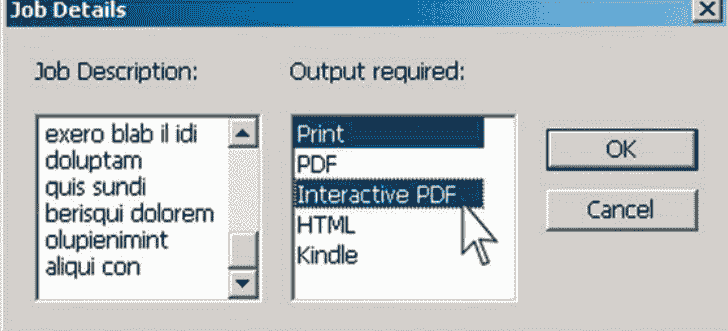

**图 5-14：启用 multiSelect 的列表框控件**

### 清单 5-12：创建支持 multiSelect 的列表框控件

```javascript
var win = new Window('dialog', 'Job Details');
win.orientation = 'row';

// Job
win.grpJob = win.add('group');
win.grpJob.orientation = 'column';
win.grpJob.alignChildren = 'left';
win.grpJob.stx = win.grpJob.add('statictext', undefined, 'Job Description:');
win.grpJob.stx.minimumSize = [120, 20];
win.grpJob.txt = win.grpJob.add('edittext', undefined, undefined,
{multiline: true, scrolling: true});
win.grpJob.txt.minimumSize = [120, 100];

// Output
win.grpOutput = win.add('group');
win.grpOutput.orientation = 'column';
win.grpOutput.alignChildren = 'left';
win.grpOutput.alignChildren = 'top';
win.grpOutput.stx = win.grpOutput.add('statictext', undefined, 'Output required:');
win.grpOutput.stx.minimumSize = [120, 20];
win.grpOutput.ddl= win.grpOutput.add('listbox', undefined, undefined,
{multiselect: true, items:['Print', 'PDF', 'Interactive PDF', 'HTML', 'Kindle']});
win.grpOutput.ddl.minimumSize = [120, 100];

// Buttons
win.grpButtons = win.add('group');
win.grpButtons.orientation = 'column';
win.grpButtons.btnOK = win.grpButtons.add('button', undefined, 'OK');
win.grpButtons.btnCancel = win.grpButtons.add('button', undefined, 'Cancel');

// Display dialog
var intResult = win.show();
```

在清单 5-12 的第 21 行，`add()`方法的创建属性用于指定列表框控件支持多项选择，以及将出现在控件中的项目列表。

## 树状视图

树状视图的工作方式与下拉列表和列表框控件类似。然而，它具备另外两种控件所缺少的一项功能：放置在列表视图控件中的任何项目都可以是“节点”类型，而节点项目可以充当其他项目的容器——包括其他节点项目。正是这种一个项目包含其他项目的功能，赋予了树状视图展开/折叠的能力。

图 5-15 显示了一个包含两级项目的树状视图控件示例。第一级（包含节点类型的项目）显示国家，展开后可显示第二级的城镇。

使用与前一个示例相同的技术，在第一级项目旁边显示一个图像。

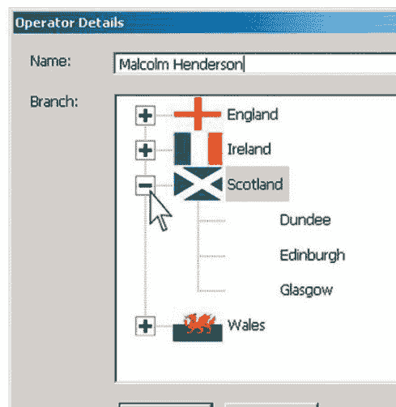

**图 5-15：具有两级且第一级显示图像的树状视图控件**

清单 5-13 展示了如何创建这个两级树状视图控件。

### 清单 5-13：创建两级树状视图控件

```javascript
var strPath = app.activeScript.parent + "/flags/";
var win = new Window('dialog', 'Operator Details');

// Name
win.Name = win.add('group');
win.Name.orientation = 'row';
win.Name.stx = win.Name.add('statictext', undefined, 'Name:');
win.Name.stx.minimumSize = [60, 20];
win.Name.txt = win.Name.add('edittext');
win.Name.txt.minimumSize = [250, 20];

// Branch
win.grpBranch = win.add('group');
win.grpBranch.orientation = 'row';
win.grpBranch.alignChildren = 'top';
win.grpBranch.stxBranch = win.grpBranch.add('statictext', undefined,'Branch:');
win.grpBranch.stxBranch.minimumSize = [60, 20];
win.grpBranch.trv = win.grpBranch.add('treeview');
win.grpBranch.trv.minimumSize = [250, 250];

win.grpBranch.trv.England = win.grpBranch.trv.add('node', 'England');
win.grpBranch.trv.England.image = File(strPath + 'england.jpg')
win.grpBranch.trv.England.add('item', 'Birmingham');
win.grpBranch.trv.England.add('item', 'Leeds');
win.grpBranch.trv.England.add('item', 'London');
win.grpBranch.trv.England.add('item', 'Manchester');

win.grpBranch.trv.Ireland = win.grpBranch.trv.add('node', 'Ireland');
win.grpBranch.trv.Ireland.image = File(strPath + 'ireland.jpg')
win.grpBranch.trv.Ireland.add('item', 'Belfast');
win.grpBranch.trv.Ireland.add('item', 'Dublin');
win.grpBranch.trv.Ireland.add('item', 'Cork');

win.grpBranch.trv.Scotland = win.grpBranch.trv.add('node', 'Scotland');
win.grpBranch.trv.Scotland.image = File(strPath + 'scotland.jpg')
win.grpBranch.trv.Scotland.add('item', 'Dundee');
win.grpBranch.trv.Scotland.add('item', 'Edinburgh');
win.grpBranch.trv.Scotland.add('item', 'Glasgow');

win.grpBranch.trv.Wales = win.grpBranch.trv.add('node', 'Wales');
win.grpBranch.trv.Wales.image = File(strPath + 'wales.jpg')
win.grpBranch.trv.Wales.add('item', 'Cardiff');
win.grpBranch.trv.Wales.add('item', 'Newport');
win.grpBranch.trv.Wales.add('item', 'Swansea');

// Buttons
win.grpButtons = win.add('group');
win.grpButtons.btnOK = win.grpButtons.add('button', undefined, 'OK');
win.grpButtons.btnCancel = win.grpButtons.add('button', undefined, 'Cancel');

// Display dialog
var intResult = win.show();
```

在清单 5-13 的第 18 行，创建了树状视图控件并命名为`win.grpBranch.trv`。当创建每个顶级项目时（第 21、28、34 和 40 行），`add()`方法的第一个参数——类型属性——被设置为`node`，使其成为一个可展开/折叠的容器。在创建每个节点后，我们将它的`image`属性设置为相应的旗帜图像。

然后我们再次使用`add()`方法将城镇项目附加到每个节点，这次将类型属性设置为`item`，因为控件第二级的元素将不会充当容器（第 23-26、30-32、36-38 和 42-44 行）。

## 按钮

按钮是任何对话框中必不可少的组件，通常用于提交或关闭对话框。虽然按钮控件不是由 ScriptUI 引擎自动生成的，但它确实提供了一些巧妙的功能，可以自动设置你创建的按钮的行为。

## 创建“取消”和“确定”按钮

用于显示对话框的`show()`方法会返回一个整数值到引用它的变量中。这就是为什么使用以下行来显示对话框更为实用：

```
var intResult = win.show();
```

而不是简单地：

```
win.show();
```

我们能够检查`intResult`中返回的值，以确定点击了哪个按钮，从而确定用户的意图。默认情况下，点击确定按钮会使`show()`方法返回数字 1，而点击取消则返回 2。

有两种方法可以自动将一个按钮转变为确定或取消按钮：通过设置父窗口的`cancelElement`和`defaultElement`属性；或者通过将按钮控件的`name`创建属性设置为‘OK’或‘Cancel’。

在图 5-16 所示的对话框中，我们希望标记为“继续操作”的按钮充当确定按钮，而标记为“取消操作”的按钮则作为取消按钮。代码清单 5-14 展示了如何使用窗口对象的`cancelElement`和`defaultElement`属性来实现这一点。代码清单 5-15 则通过使用`name`创建属性创建了相同的功能。

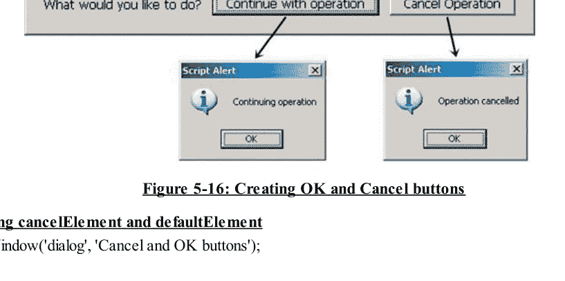

### 代码清单 5-14：使用 cancelElement 和 defaultElement

```
1 var win = new Window('dialog', 'Cancel and OK buttons');
2
3 // 按钮
4 win.stxMessage = win.add('statictext', undefined, 'What would you like to do?');
5 win.btnOK = win.add('button', undefined, 'Continue with operation');
6 win.btnCancel = win.add('button', undefined, 'Cancel Operation');
7 win.defaultElement = win.btnOK;
8 win.cancelElement = win.btnCancel;
9
10 // 显示对话框
11 var intResult = win.show();
12 (intResult === 1)? alert('Continuing operation'): alert('Operation cancelled');
```

在代码清单 5-14 的第 5 和第 6 行，创建了两个按钮，但没有指定它们的预期角色。然而，在第 7 和第 8 行，通过设置`defaultElement`和`cancelElement`属性，我们指定了哪个按钮执行哪个功能。

在第 12 行，我们使用 JavaScript 三元运算符来检查点击了哪个按钮：如果`win.show()`命令将值 1 返回到变量`intResult`中，那么我们就知道用户点击了确定按钮。

| 语法摘要 | `condition ? result1: result2` JavaScript 三元运算符 if/else 语句的简写形式。 |
| --- | --- |
| `condition` | 任何逻辑测试。 |
| `Result1` | 如果条件为真，则执行的语句。 |
| `Result2` | 如果条件为假，则执行的语句。 |

### 代码清单 5-15：使用 name 创建属性创建确定和取消按钮

```
1 var win = new Window('dialog', 'Cancel and OK buttons');
2
3 // 按钮
4 win.stxMessage = win.add('statictext', undefined, 'What would you like to do?');
5 win.OK = win.add('button', undefined, 'Continue with operation', {name:'OK'});
6 win.Cancel = win.add('button', undefined, 'Cancel Operation', {name:'Cancel'});
7
8 // 显示对话框
9 var intResult = win.show();
10 (intResult === 1)? alert('Continuing operation'): alert('Operation cancelled');
```

在代码清单 5-15 中，我们修改了创建两个按钮的行（第 5 和第 6 行）以包含`name`创建属性。只需将一个按钮命名为‘OK’，另一个命名为‘Cancel’，我们就能指定哪个按钮是哪个，并且它们会自动相应地表现。

## 事件

与网页表单上的控件类似，ScriptUI 控件响应用户交互触发的事件。每次用户与窗口中的控件交互时，都会发生一个事件：点击按钮、在 EditText 字段中更改文本、在下拉列表中选择一个值、关闭窗口等等。你的脚本可以通过包含回调函数来响应此类事件——回调函数是事件处理器，它们定义了当给定事件发生时将执行的代码。

**按钮事件**

在各种控件中，按钮是回调函数最明显的候选者——响应`onClick`事件。这些函数提供了一个理想的位置，用于验证和处理用户输入到各个控件中的数据的代码。

在图 5-17 所示的简单示例中，我们为对话框的确定和取消按钮创建了回调函数。

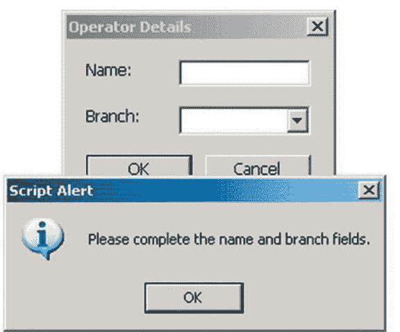

**图 5-17：使用回调函数强制用户完成必填字段**

代码如代码清单 5-16 所示。

- 如果用户在未输入名称或选择分部的情况下点击确定按钮，将显示错误消息，并且窗口保持打开状态。

- 如果点击确定按钮并且两个字段都已完成，则记录输入两个字段的数据，窗口关闭，并显示消息“数据已接收...”。

- 如果点击取消按钮，窗口关闭，并显示消息“操作已被用户取消”。

### 代码清单 5-16：为按钮添加 onClick 回调

```
11 var win = new Window('dialog', 'Operator Details');
12
13 // 姓名
14 win.grpName = win.add('group');
15 win.grpName.orientation = 'row';
16 win.grpName.stx = win.grpName.add('statictext', undefined, 'Name:');
17 win.grpName.stx.minimumSize = [60, 20];
18 win.grpName.txt = win.grpName.add('edittext');
19 win.grpName.txt.minimumSize = [100, 20];
20
21 // 分部
22 win.grpBranch = win.add('group');
23 win.grpBranch.orientation = 'row';
24 win.grpBranch.alignChildren = 'top';
25 win.grpBranch.stx = win.grpBranch.add('statictext', undefined, 'Branch:');
26 win.grpBranch.stx.minimumSize = [60, 20];
27 var arrBranch = ['Birmingham', 'Leeds', 'London', 'Manchester'];
28 win.grpBranch.ddl = win.grpBranch.add('dropdownlist', undefined, arrBranch);
29 win.grpBranch.ddl.minimumSize = [100, 20];
30
31 // 按钮
32 win.grpButtons = win.add('group');
33 win.grpButtons.btnOK = win.grpButtons.add('button', undefined, 'OK');
34 win.grpButtons.btnCancel = win.grpButtons.add('button', undefined, 'Cancel');
35
36 // 确定按钮回调
37 win.grpButtons.btnOK.onClick = function(){
38  if(win.grpName.txt.text === "" || win.grpBranch.ddl.selection === null){
39    alert("Please complete the name and branch fields.");
40  }
41  else {
42    var strName = win.grpName.txt.text;
43    var strBranch = win.grpBranch.ddl.selection.text;
44    win.close(1);
45    alert("Data received:\r Name: " + strName + "\r Branch: " + strBranch);
46  }
47 }
48
49 // 取消按钮回调
50 win.grpButtons.btnCancel.onClick = function(){
51   win.close(2);
52   alert("Operation cancelled by user.");
53 }
54
55 // 显示对话框
56 var intResult = win.show();
```

在代码清单 5-16 的第 38 行，在确定按钮的 onClick 回调内部，我们检查姓名或分部字段是否仍然为空。（由于姓名字段是 EditText 控件，它具有 `text` 属性。分部是下拉列表，其等效属性是 `selection` 属性，如果未选择任何项，则返回 `null`。）

如果任一字段为空，我们显示错误消息（第 39 行）；否则，我们将输入到两个字段中的值放入变量`strName`和`strBranch`中。然后我们关闭窗口（第 44 行），返回值 1 以标识被点击的按钮是确定按钮——使用`close()`方法提供的有用参数。最后，我们显示一个包含`strName`和`strBranch`中值的警报（第 45 行）。

| | `window.close(return value)` 窗口对象方法 关闭对话框窗口并可选择返回一个值。 |
| --- | --- |
| Return value | 一个整数，返回到分配了 `window.show()` 方法的变量。数字 1 通常表示点击了确定按钮，2 表示点击了取消按钮。 |

本章可能尚未说服你，ScriptUI 对话框在与用户通信方面提供了比 dialog 对象更优越的环境。然而，从现在开始我们创建的大多数脚本都将涉及使用 ScriptUI 窗口；因此，你将在本书中获得大量关于此主题的练习。

现在我们知道了如何与用户通信，我们可以开始创建脚本，这些脚本

## 第六章：处理文件和文档

## 关于文件和文档

InDesign 文档主要有两种查看方式：作为文件和作为文档。基本上，当文档处于打开状态时，它被视为文档对象，该对象的所有属性和方法都将适用于它。然而，一旦关闭，它就不再是文档，而变成一个普通的旧文件。因此，从 InDesign 的角度来看，关闭的 InDesign 文件只是一个潜在的文档：一旦打开，就会生成一个文档对象，可以将其存储在变量中并以正常方式操作。

## 创建新文档

由此可见，要打开一个文档，必须引用文件系统中某处的某个文件；而创建新文档时，则无需引用文件，因为所有新文档在保存之前仅存在于内存中。不过，将新文档的引用放入变量中始终是一个好主意。因此，与其简单地说：

```
app.documents.add();
```

更好的做法是这样说：

```
var docNew = app.documents.add();
```

然后变量`docNew`将包含对新文档的引用，并继承文档对象的所有属性和方法。

## 打开文档

相比之下，要打开一个 InDesign 文件，我们需要引用将创建文档对象的文件对象。例如：

```
var docOpen = app.open(File("/c/training/chapter06/open.indd"));
```

或者

```
var docOpen = app.open(File("/users/admin/desktop/training/chapter06/open.indd"));
```

## 让用户选择文件

除了打开存储在已知位置的文档外，您还可以使用`File`对象的`openDialog()`方法让用户选择文件。

```
var docOpen = app.open(File.openDialog("Please select a file"));
```

这将显示操作系统提供的用于打开文件的标准对话框。

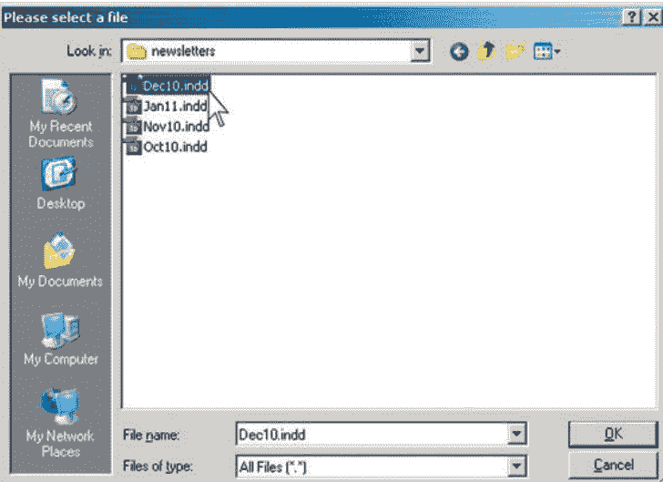

图 6-1：可以使用 File 对象的 openDialog() 方法来显示一个对话框，邀请用户选择一个或多个要打开的文件。

在上面的示例中，`application`对象的`open()`方法的文件参数由 File 对象的`openDialog()`方法提供。

| 语法摘要 ... | `File.openDialog(prompt[, filter, multiselect])` File 类方法 显示一个允许用户选择一个或多个文件的对话框。 |
| :--- | :--- |
| Prompt | 将作为对话框标题显示的提示信息。 |
| Filter | 可选。指定要打开的文件类型（Windows）或根据您指定的条件指定要返回的文件的函数（仅限 Mac）。 |
| Multiselect | 可选。如果设置为 `true`，则用户可以选择多个文件进行打开。（默认值为 `false`。） |

**使用筛选器表达式（仅限 Windows）**

筛选器参数可用于将“打开”对话框中显示的文件限制为特定文件类型的文件。因此，在 Windows 上，要仅显示 InDesign 文档，我们可以使用：

```
var docOpen = app.open(File.openDialog("Please select a file", "InDesign Documents:* .indd"));
```


图 6-2：在 Windows 上，openDialog() 方法的筛选器参数可用于强制用户的系统仅显示特定类型的文件。

第二个参数`InDesign Documents:\*.indd`在对话框底部显示一个下拉菜单，其中仅包含一个选项：InDesign 文档。

`filter`参数由逗号分隔的文件类型列表组成。要将显示的文件限制为给定类型的文件（如上例所示），我们只需在列表中放入一个项目。该项目包含两个部分，用冒号分隔：将在下拉菜单中显示的文本以及与该选项关联的文件类型。星号用作通配符——“\*.indd”表示任何以“.indd”结尾的文件名。我们也可以使用“\*.ind\*”——这将是同时获取 InDesign 文档（“.indd”）和 InDesign 模板（“.indt”）的一种方式。

以下是包含多个文件类型的列表示例以及它们将在对话框底部生成的下拉菜单。

```
..."InDesign Documents:\*.indd, InDesign Templates:\*.indt"
```

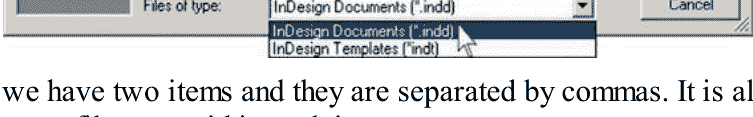

注意语法：我们有两个项目，它们用逗号分隔。也可以在每个项目中指定多个文件类型。

```
..."InDesign Documents:\*.indd, InDesign Templates:\*.indt, InDesign Documents and Templates:\*.indd; \*.indt"
```

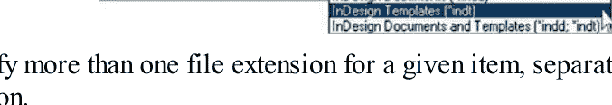

要为给定项目指定多个文件扩展名，请用分号分隔文件扩展名。

| 语法摘要 ... | 在 `File.openDialog()` 的筛选器表达式中使用的字符 |
| :--- | :--- |
| 星号 | 通配符，表示一个或多个字符。 |
| 冒号 | 用于分隔菜单文本和关联的文件扩展名。 |
| 逗号 | 用作多个元素之间的分隔符。 |
| 分号 | 用作多个文件扩展名之间的分隔符。 |

## 使用筛选器函数（仅限 Mac）

要在 Mac 上限制使用`File.openDialog()`可以打开的文件，请指定一个函数的名称，而不是使用筛选器表达式；然后定义该函数。这里有一个示例。

```
var docOpen = app.open(File.openDialog("Please select a file", limitFileType));
function limitFileType(currentFile){
  var strExt = currentFile.fullName.toLowerCase().substr(currentFile.fullName.lastIndexOf("."));
  if(strExt == ".indd" || strExt == ".indt") {return true;}
}
```

`openDialog()`方法的第二个参数变为`limitFileType`，然后我们定义了这个函数。注意参数`currentFile`的使用：这表示传递给函数的每个文件实例。然后我们使用三个 JavaScript 字符串函数从文件的 fullName（路径和名称）中提取文件扩展名，并检查它是否是“.indd”或“.indt”。如果是其中之一，则函数返回 true。（您可以在第 2 章（从第 32 页开始）找到`toLowerCase()`、`substr()`和`lastIndexOf()`函数的描述。）

应用此函数的结果如下所示。

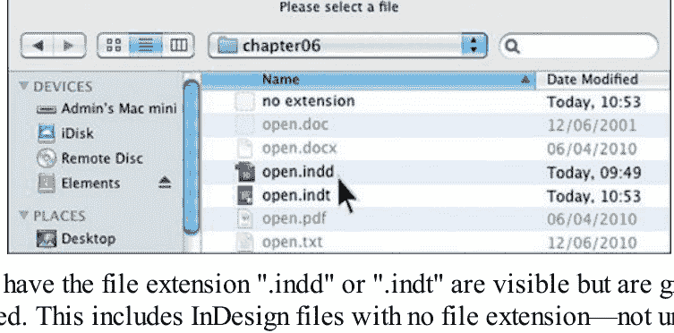

没有文件扩展名“.indd”或“.indt”的文件虽然可见但会灰显，无法选择。这包括没有文件扩展名的 InDesign 文件——在 Mac 上并不少见。为了解决这个问题，可以使用 File 对象的 creator 属性。这个仅限 Mac 的属性返回一个三或四个字母的文件创建者字符串，在 InDesign 文件的情况下是`InDn`。因此，我们可以如下修改函数：

```
function limitFileType(currentFile){
    var strExt = currentFile.fullName.toLowerCase().substr(currentFile.fullName.lastIndexOf("."));
    if(strExt == ".indd" || strExt == ".indt" || currentFile.creator == "InDn") {return true;}
}
```

请注意，creator 属性是元数据，有时可能会丢失——在这种情况下，创建者将是`????`而不是`InDn`；因此，仍然值得检查文件扩展名。

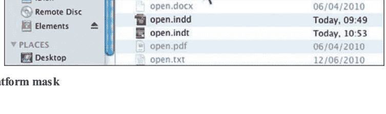

## 创建跨平台掩码

如果您正在创建跨平台解决方案并且需要在使用`File.openDialog()`时包含筛选，您可以使用 `$.os` 函数，该函数将返回一个包含“Macintosh”或“Windows”的字符串。以下是执行此操作的示例。

```
if($.os.indexOf("Windows") > 0) {
    var docOpen = app.open(File.openDialog("Please select a file", "InDesign Documents:*.*.indd"));
} else {
    var docOpen = app.open(File.openDialog("Please select a file", limitFileType));
    function limitFileType(currentFile) {
        var strExt = currentFile.fullName.toLowerCase().substr(currentFile.fullName.lastIndexOf("."));
        if(strExt === ".indd" || strExt === ".indt" || currentFile.creator === "InDn") {
            return true;
        }
    }
}
```

我们使用`indexOf()`函数查看单词“Windows”是否是`$.os`返回的字符串的一部分；如果是，我们在`openDialog()`方法中使用筛选器表达式。否则，我们使用函数名，然后定义该函数。

尽管我们在打开 InDesign 文档的上下文中讨论了`openDialog()`方法，但它可以以多种不同的方式使用。首先需要记住的是，它只是返回一个文件对象或一个文件对象数组——换句话说，它实际上并不打开任何文件。因此，例如，它可以用来让用户选择一个或多个需要稍后导入文档的文本文件。您如何实际处理`openDialog()`方法返回的文件完全由您决定。您可以打开它们，将它们放置在文档中的某个位置，或者只是保留一份记录，以便您将来某个时候可以参考——无论是放在变量中还是放在文本文件中。

## 允许多选

`openDialog()`方法可以接受一个可选的`multiSelect`参数，该参数采用布尔值（true 或 false），并决定用户是否可以在“打开”对话框中选择多个文件。如果此参数设置为`true`，则`openDialog()`方法返回一个 File 对象数组——即使用户只选择了一项。如果参数设置为`false`，则返回单个文件对象。在以下代码清单中，我们显示了一个对话框，用户可以在其中选择一个或多个 InDesign 文件。然后我们打开该文件或这些文件。

### 代码清单 6-1：使用 OpenDialog() 方法

```
1  try {
2    if($.os.indexOf("Windows") > 0) {
3      var docOpen = app.open(File.openDialog("Select file", "InDesign Documents:*.*.indd", true));
4    }
5    else {
6      var docOpen = app.open(File.openDialog("Select file", limitFileType, true));
7      function limitFileType(currentFile) {
8        var strExt = currentFile.fullName.toLowerCase().substr(currentFile.fullName.lastIndexOf("."));
9        if(strExt === ".indd" || strExt === ".indt" || currentFile.creator === "InDn") {
10         return true;
11       }
12     }
13   }
14 catch(errOpen) {
15   alert("Error. Unable to open file.");
}
```

在清单 6-1 中，尝试打开用户选择的文档的操作已被包含在一个`try ... catch`块中。这意味着，如果用户按下取消按钮——导致`openDialog()`方法返回`null`而不是`File`对象——或者如果发生其他错误，将会显示一个用户友好的提示信息。

另请注意，当用户选择多个文件时，我们不需要遍历返回的文件数组并逐一打开它们。这是因为`app.open()`的第一个参数既可以接受单个文件，也可以接受文件数组。如果提供的是文件数组，它将自动打开所有文件。

`app.open()`方法还有两个可选参数：`showingWindow`和`openOption`。显示窗口参数接受一个布尔值，用于确定打开的文档最初是否可见。如果省略此参数，默认值当然是`true`。`openOption`参数接受一个`OpenOptions`枚举值，用于确定是打开原始文档还是副本。因此，如果我们想在上一个示例中打开文档的副本，我们将在`open()`方法的第二个和第三个参数中添加如下内容：

```
var docOpen = app.open(File.openDialog("Please select a file", "InDesign Files:*.indd"), true,
OpenOptions.OPEN_COPY);
```

当 InDesign 打开文档时，它将是一个无标题的副本，而不是原始文档。

| 语法摘要 | `app.open(what[, show window, open options])` |
| :--- | :--- |
| 应用程序对象方法 | 打开指定的文件或文件。 |
| What | 要打开的 InDesign 文档、书籍或库。 |
| Show window | 可选。指定每个打开的项目最初是否可见。 |
| Open options | 可选。指定是打开原始文档还是副本的枚举值：`OpenOptions.defaultValue`、`OpenOptions.openOriginal`、`OpenOptions.openCopy`。 |

## 测试文档是否已打开

如果您尝试打开一个已经打开的 InDesign 文档，您不会收到错误提示：该文档将只是被激活。然而，检查要求您打开的文档是否已经打开仍然很有用，因为用户可能已经忘记了她正在处理该文档。要执行检查，您可以使用文档对象的`fullPath`属性。使用`openDialog()`时，如果任何已打开文档的`fullPath`与该方法返回的任何文件匹配，则该文件已打开。

首先假设`openDialog()`方法的`multiSelect`参数已设置为 false。我们需要遍历所有当前打开的文档，并将它们的`fullPath`属性与`openDialog()`方法返回的文件进行比较。一旦找到匹配项，我们就知道该文件已经打开；因此我们将退出循环并显示一个确认用户选择的文件已经打开的警报。

### 清单 6-2：检查文档是否已打开

```
1 // 获取文件路径
2 if($.os.indexOf("Windows") > 0){
3   var fileChosenByUser = File.openDialog("Select file", "InDesign Documents:*.indd", true);
4 }
5 else{
6   var fileChosenByUser = File.openDialog("Select file", limitFileType, true);
7   function limitFileType(currentFile){
8     var strExt = currentFile.fullName.toLowerCase().substr(currentFile.fullName.lastIndexOf("."));
9     if(strExt === ".indd" || strExt === ".indt" || currentFile.creator === "InDn"){return true;}
10  }
11 }
12 if(fileChosenByUser == null){
13   alert("Error. No file selected.");
14 }
15
16 // 测试文件是否已打开
17 var blnAlreadyOpen = false;
18 for (var i = 0; i < app.documents.length; i++){
19   if (app.documents[i].saved){
20     if (app.documents[i].fullName == String(fileChosenByUser)){
21       alert("Document " + app.documents[i].name + " is already open.");
22       blnAlreadyOpen = true;
23       break;
24     }
25   }
26 }
27
28 // 打开文件
29 if(blnAlreadyOpen == false){
30   try{
31     var docOpen = app.open(fileChosenByUser);
32   }
33   catch(errOpen){
34     alert("Error. Unable to open file.");
35   }
36 }
```

请注意，在清单 6-2 的第 18 到 19 行，我们在测试`fullName`（文件路径）属性是否与用户选择的文件路径（第 20 行）匹配之前，检查了文档的`saved`属性。如果文档从未保存过，其`saved`属性为 false。此类文档没有`fullName`属性。因此，如果您测试一个`saved`属性为 false 的文档的`fullName`属性，就会发生错误。

## 测试文档数组是否已打开

如果`openDialog()`方法的`multiSelect`参数设置为 true，我们可以使用嵌套循环来比较每个已打开的文档与用户选择的每个文档。

### 清单 6-3：检查多个文档是否已打开

```
1 // 将已打开文档的名称读入数组
2 var arrInitiallyOpen = app.documents.everyItem().fullName;
3
4 // 获取文件路径
5 if($.os.indexOf("Windows") > 0){
6   var arrFiles = File.openDialog("Select file(s)", "InDesign Documents:*.indd", true);
7 }
8 else {
9   var arrFiles = File.openDialog("Select file(s)", limitFileType, true);
10  function limitFileType(currentFile){
11    var strExt = currentFile.fullName.toLowerCase().substr(currentFile.fullName.lastIndexOf("."));
12    if(strExt == ".indd" || strExt == ".indt" || currentFile.creator == "InDn"){return true;}
13  }
14 }
15 if(arrFiles == null){
16  alert("Error. No files selected.");
17 }
18 else {
19  // 外层循环 - 遍历用户选择的文件数组
20  for (var h = 0; h < arrFiles.length; h ++){
21    var blnAlreadyOpen = false;
22    // 内层循环 - 遍历最初打开的文件名称数组
23    for (var i = 0; i < arrInitiallyOpen.length; i ++){
24      if (String(arrFiles[h]) == arrInitiallyOpen[i]){
25        alert("Document " + app.documents[i].name + " is already open.");
26        blnAlreadyOpen = true;
27      }
28    }
29    if(blnAlreadyOpen == false){
30      try {
31        var docOpen = app.open(arrFiles[h]);
32      }
33      catch(errOpen){
34        alert("Error. Unable to open file " + arrFiles[h].name + ".");
35      }
36    }
37  }
38 }
```

在清单 6-3 的第 2 行，由于已打开文档的数量会在脚本开始运行时发生变化，我们在执行任何操作之前，将所有最初打开的文档名称读入变量`arrInitiallyOpen`。

```
var arrInitiallyOpen = app.documents.everyItem().fullName;
```

`everyItem()`方法可用于大多数 InDesign 集合，并返回一个引用，该引用将集合中的所有对象视为一个项目。当我们访问此项目的 fullName 属性时，我们会得到一个包含当前在 InDesign 中打开的每个文档文件路径的数组。

然后，在第 24 行，我们将`String`构造函数用作函数，将`arrFilesChosenByUser`（包含用户选择的文件的数组）中的每个项目转换为字符串，然后将其与`arrInitiallyOpen`（最初打开的文档数组）中的每个项目进行比较。

```
if (String(arrFiles[h]) == arrInitiallyOpen[i]){
```

## 保存文档

`save()`方法用于保存文档，它有两个关键参数，都是可选的：文件路径和是否另存为模板。

| 语法摘要 | `document.save([to, stationery])` |
| :--- | :--- |
| 文档对象方法 | 将文件保存在 to 参数指定的位置。 |
| To | 可选。要将文档保存到的文件位置。 |
| Stationery | 可选。是否将文档另存为模板。（如果留空，默认值当然是 false。） |

## 测试文档是否已保存

Document 对象的`saved`属性可以让你知道文档是否曾经被保存过。如果`saved`属性为 false，则该文档是一个无标题文档，仅存在于内存中，尚未保存。可以检查 Document 对象的`modified`属性来测试文档是否需要保存。如果`modified`属性的值为 true，则文档自上次保存以来已被修改，或者——对于未保存的文档——自创建以来已被修改。

## 保存对文档的更改

要保存对已保存文档的更改，只需使用不带第一个参数`to`的`save()`方法。

```
if (docExample.saved) {
  docExample.save();
}
```

您可以使用完全相同的语句来保存一个从未保存过的文档，InDesign 将弹出标准的另存为对话框，让用户输入文件名。如果提供了 save 方法的`to`参数，则不会出现对话框，文件将保存在指定位置——除非同名文件已经存在，这种情况下会出现一个对话框，告诉您该文件存在，并询问您是否要替换它。

## 使用 saveDialog 方法

就像我们之前看到的`openDialog()`方法一样，`saveDialog()`方法显示一个对话框——这次是让用户导航到他喜欢的位置并输入文件名。与之前一样，该方法返回一个文件对象，但不会在指定位置实际保存文件。（正如我们稍后将看到的，它也可以在创建文本文件时使用，就像保存 InDesign 文档时一样。）

| 语法总结 ... | `File.saveDialog([prompt, filter])` File 类方法 显示一个对话框，允许用户选择文件路径并输入文件名。 |
| --- | --- |
| 提示 (Prompt) | 将显示在对话框顶部的文本。 |
| 筛选器 (Filter) | 可选。一个指定要打开的文件类型的字符串，例如 "InDesign files: *.indd"。（仅限 Windows） |

在以下示例中，我们询问用户希望将我们要创建的文件保存到何处。筛选器语句用于将文件类型限制为仅 InDesign 文件。（此筛选仅在 Windows 上有效，在 Mac 上会被简单地忽略。）

### 代码清单 6-4：使用 saveDialog() 方法

```
var fileChosenByUser = File.saveDialog ("Specify file location", "InDesign Files:*.indd");
if (fileChosenByUser === null){
  alert("Operation cancelled. No document created.");
}
else {
  var blnAlreadyOpen = false;
  for (i = 0; i < app.documents.length; i++){
    if (app.documents[i].saved === true){
      if (app.documents[i].fullName === String(fileChosenByUser)){
        alert("Can't overwrie document " + app.documents[i].name + " because it is open.");
        blnAlreadyOpen = true;
      }
    }
  }
  if(blnAlreadyOpen === false){
    try{
      var docNew = app.documents.add();
      //... 设置文档 ...
      docNew.save(fileChosenByUser);
    }
    catch(errOpen){
      alert("Error. Unable to save file.");
    }
  }
}
```

如果用户点击“取消”按钮，返回 null，我们将显示一条错误消息（第 3 行）。否则，我们将检查用户指定的文档是否当前已打开，如果是，我们将显示另一条错误消息（第 11 行）。如果文档未打开，我们将创建一个新文档（第 18 行）并将其保存到用户指定的位置（第 20 行）。

## 关闭文档

正如你猜到的，文档对象也有一个`close()`方法。当不带任何参数使用它时，适用正常的系统行为：如果文件有未保存的更改，系统将提示你保存它。如果没有未保存的更改，文档将直接关闭。但是，此外，`close()`方法有参数，允许你控制系统的行为方式。

| | |
|---|---|
| `document.close([saving, saving in])` | 文档对象方法 关闭指定的文档。 |
| 保存 (Saving) | 可选。决定文档是否将被保存。此参数的值是以下枚举之一：`SaveOptions.NO`—即使有未保存的更改，文档也会在不保存的情况下关闭。`SaveOptions.ASK`—如果有未保存的更改，系统会询问用户是否应该保存。如果没有未保存的更改，文件将关闭且不提示。`SaveOptions.YES`—如果有未保存的更改，它们将被保存。 |
| 保存位置 (Saving in) | 可选。如果使用了 `SaveOptions.YES`，则指定文件应保存的位置。 |

在以下代码片段中，所有打开的文件都使用不同的`SaveOptions`设置关闭，具体取决于文档的状态。

### 代码清单 6-5：关闭所有打开的文档

```
for (var i = app.documents.length - 1; i >= 0; i--){
  if(app.documents[i].modified == false){
    app.documents[i].close(SaveOptions.NO);
  }
  else if(app.documents[i].saved == true){
    app.documents[i].close(SaveOptions.YES);
  }
  else{
    app.documents[i].close(SaveOptions.ASK);
  }
}
```

在代码清单 6-5 中，如果文档未被修改（第 2 行），我们使用`SaveOptions.NO`关闭它——因为没有什么需要保存的。如果文档已被修改，我们会进一步检查它是否曾经被保存过（第 5 行）。如果保存过，我们使用`SaveOptions.YES`关闭它；否则，我们让用户通过使用`SaveOptions.ASK`来决定是否保存。

还请注意，任何使用数值索引并且在其中发生项目移除或删除的循环，都应始终从最高值开始并向最低值循环（参见第 1 行）。从最低到最高循环会在循环中途生成错误，当目标项目不再存在时——已被移除，或者在这种情况下，已被关闭。

## 从文本文件中读取

`File`对象可用于操作文本文件以及 InDesign 文档。这对于永久存储脚本所需的数据以及在脚本运行时写入日志文件非常有用。此外，在将文本文件置入出版物之前，有时检查其内容很有用。

这可以通过`File`对象的`read()`方法实现，该方法采用单个参数——应读取的字符数。如果省略此可选参数，则会读取整个文件。

在文件可以被读取之前，必须使用`File`对象的`open()`方法打开它。`open()`方法的工作方式与`File > Open`不同：文件不会在文档窗口中打开，而是在整个操作过程中保持关闭状态。但是，其状态从关闭变为打开。它采用单个参数——`mode`——指定文件打开时的条件——即可以对它执行什么操作。打开文件进行读取时，模式应设置为 "r"（读取）。

## 测试文件是否存在

在尝试打开文件进行读取或写入之前，最好知道它是否存在于预期位置。这可以使用`File.exists`属性来完成。

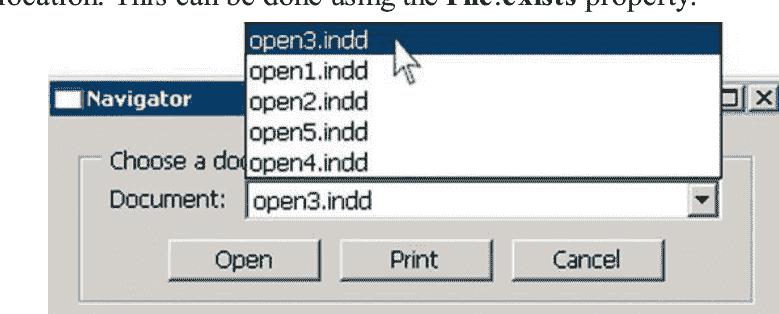

在代码清单 6-6 中（“chapter06”文件夹中的“06-read-file-if-exists.jsx”），我们检查文件“settings.txt”是否存在于预期位置。如果存在，我们打开它，将其内容读入一个数组变量，并调用`displayDialog()`函数，该函数显示图 6-3 所示的对话框。如果文件不存在，我们将显示一条错误消息。

### 代码清单 6-6：如果文件存在则读取它

```
var g = {};
main();
g = null;

function main(){
  var blnFile = readFile();
  if (blnFile){var intResult = displayDialog();}
  if (intResult == 1){openFile();}
  else if (intResult == 2){alert("Operation cancelled.");}
  else if (intResult == 3){printFile();}
}

function readFile(){
  var filSettings = File(app.activeScript.parent + "/navigator/folder-list.txt");
  if (filSettings.exists){
    try{
      filSettings.open ("r");
      g.arrSettings = filSettings.read ().split("\n");
      return true;
    }
    catch(errOpen){
      alert("Error. The file could not be opened.");
      return false;
    }
  }
  else {
    alert("The settings file could not be found");
    return false;
  }
}

function displayDialog(){
  g.win = new Window('dialog', 'Navigator');
  g.win.add('statictext', undefined, 'Choose a document then click a button');
  // 标签和下拉列表
  g.win.grpDoc = g.win.add('Group');
  g.win.grpDoc.stx = g.win.grpDoc.add('StaticText', undefined, 'Document:');
  g.win.grpDoc.stx.size=[60,15];
  g.win.grpDoc.ddl = g.win.grpDoc.add('DropDownList', undefined, g.arrSettings);
  g.win.grpDoc.ddl.size = [250,20];
  g.win.grpDoc.ddl.selection =0;
  // 按钮
  g.win.grpButn = g.win.add('Group');
  g.win.grpButn.Open = g.win.grpButn.add('Button', undefined, 'Open');
  g.win.grpButn.Print = g.win.grpButn.add('Button', undefined, 'Print');
  g.win.grpButn.Cancel = g.win.grpButn.add('Button', undefined, 'Cancel');
  // 按钮的点击事件处理程序
  g.win.grpButn.Open.onClick = function(){g.win.close(1);}
  g.win.grpButn.Print.onClick = function(){g.win.close(3);}
  // 显示对话框
  return g.win.show();
}

function openFile(){
  alert(app.activeScript.parent + "/" + g.win.grpDoc.ddl.selection.text);
  try{
    g.docOpen = app.open(File(app.activeScript.parent + "/open/" + g.win.grpDoc.ddl.selection.text));
    return true;
  }
  catch(errOpen){
    alert("Sorry, the file could not be opened.");
    return false;
  }
}
```

## 写入文本文件

要写入文本文件，必须使用`File`对象的`open()`方法打开文件以便写入，并将模式参数设置为以下三个选项之一：

- 写入 ("w")—用新写入的信息覆盖任何现有数据。

- 编辑 ("e")—在文件内的任意位置插入文本。此模式在插入文本时提供了最大的灵活性。

- 追加 ("a")—将文本添加到文件的末尾。

要使用新信息覆盖文件的当前内容，请使用`open("w")`，后跟`write()`方法。

```
fileExample.open("w");
filExample.write("new text");
filExample.close();
```

要在文档开头插入文本，请使用`open("e")`，后跟`seek(0)`，再跟上`write()`方法。

```
filExample.open("e");
filExample.seek(0);
filExample.write("new text");
filExample.close();
```

要在文档末尾添加文本，请使用`open("a")`，后跟`write()`方法。

```
filExample.open("a");
filExample.write("new text");
filExample.close();
```

每次写入操作后关闭文件非常重要，这样下次访问时，文件才能正常打开。

| 语法摘要 | `myFile.open(mode)` 文件对象的方法 使用 mode 参数指定的权限打开一个文本文件。 |
| :--- | :--- |
| 模式 | 文件的读写模式："r" 只读模式，"w" 写入模式（覆盖现有信息），"e" 允许插入文本的读/写模式。（使用 `seek()` 方法更改光标位置。）"a" 读/写模式。光标自动移动到文件末尾。 |
| | `myFile.seek(position)` 文件对象的方法 将光标移动到文本文件中的给定字符位置。 |
| 位置 | 从零开始的索引，表示开始插入文本的字符位置。只能用于以模式 "e" 打开的文件。 |
| `myFile.read(characters)` | |
| 文件对象的方法 | 读取文本文件的内容。 |
| 字符数 | 可选。要读取的字符数。如果省略，则读取整个文件。 |
| 另有： | |
| `myFile.readln()` | 读取当前光标位置的一行文本。 |
| `myFile.readch()` | 读取一个字符。 |
| `myFile.write(text)` | |
| 文件对象的方法 | 将字符串写入文本文件。 |
| 文本 | 要写入的字符串。 |
| 另有： | |
| `myFile.writeln()` | 在当前光标位置写入一行文本，并附加一个换行符。 |

## 创建新文件

ExtendScript 没有提供显式创建文件的函数：相反，当`open()`方法的 mode 参数设置为 "w"、"e" 或 "a" 时，如果指定的文件不存在，它将被自动创建。因此，例如，以下语句将允许用户指定一个现有文件或创建一个新文件。

```
try{
    var fleLog = File.saveDialog ("Log file location", "Text files: *.txt");
    fleLog.open("a");
    fleLog.write("\nStuff to be logged");
    fleLog.close();
}
catch(err){
    alert("Error. File could not be accessed.");
}
```

用户指定的文件以追加模式 ("a") 打开，然后将适当的文本写入文件。如果用户指定的文件不存在，它将被自动创建。

## 处理文件夹

不可避免地会有时候，处理文件夹比处理单个文件更方便。有时你需要处理给定文件夹中的所有文件；有时你需要创建文件夹，然后在其中创建文件等。要执行这些操作，你将使用`Folder`对象的属性和方法。

## 创建文件夹

在编写文件夹脚本时，通常从创建文件夹对象开始。这是一个存在于内存中的 JavaScript 对象，代表磁盘上可能存在的文件夹。要创建文件夹，请使用以下构造函数。

```
var myFolder = Folder(filePath)
```

如果 filePath 参数指定的位置存在一个文件夹，变量 myFolder 现在将代表该文件夹。如果指定位置没有文件夹，可以使用`Folder`对象的`create()`方法创建一个。但是，如果同名文件夹已存在于该位置，则不会抛出错误，不会创建文件夹，并且`create()`方法返回 true，就好像它刚刚成功创建了一个新文件夹一样。因此，在尝试创建文件夹之前，使用`exists`属性测试文件夹是否存在是有意义的。

### 清单 6-7：创建新文件夹

```
1 var strFolder = prompt("Enter a name for the new folder", "");
2 if(strFolder != null){
3  var fld = new Folder(app.activeScript.parent + "/" + strFolder);
4 }
5 if(fld.exists){
6  alert("A folder named " + strFolder + " already exists.");
7 }
8 else {
9  try{
10   var blnFolder = fld.create();
11  }
12  catch(err){
13   alert("Error. No folder has been created.");
14  }
15  if (blnFolder){alert("The new folder has been created.");}
16 }
```

我们首先要求用户为新文件夹输入一个名称（第 1 行）。

在第 3 行，我们创建一个新的文件夹对象，指向与活动脚本相同文件夹中、以用户输入的名称命名的文件夹。该文件夹可能存在也可能不存在。

在第 5 到 7 行，我们测试文件夹是否存在，如果存在，我们显示一条错误消息，并且不会执行进一步的代码。

如果文件夹不存在，我们使用 try ... catch 块尝试创建它（第 9 到 14 行）。如果文件夹创建成功，值 true 将被放入变量`blnFolder`中（第 10 行）。在第 15 行，我们测试这个变量，如果它包含 true，我们显示一个警报通知用户文件夹已创建。（请注意，`if(blnFolder)`是`if(blnFolder == true)`的简写方式。在 JavaScript 中，这两个语句是等效的。）

最后，如果出现错误，catch 块（第 12 到 14 行）将显示一条错误消息。

## 读取文件夹中的文件

`Folder`对象的`getFiles()`方法用于读取给定文件夹中的文件。它接受一个可选参数：一个掩码或过滤器，可用于限制检索到的文件。掩码是一个字符串，可以包含通配符：问号代表单个字符，星号代表任意数量的字符。因此，如果我们只想检索 InDesign 文件，我们会使用类似 "*.indd" 或 "*brochure*.indd" 的掩码。

非常有用的是，掩码参数也可以是一个函数的名称。这允许在确定检索哪些文件时设置相当复杂的条件。其工作方式是函数每次遇到文件时都会自动调用此函数：如果它返回 true，则该文件会被包含。因此，基本上你可以创建任何函数来评估文件的任何方面，只要它返回 true 或 false。

在代码清单 6-8（“chapter06”文件夹中的“08-archive-files.jsx”）中，我们让用户使用`selectDialog()`方法选择一个文件夹（该方法与我们之前遇到的`openDialog()`方法非常相似）。然后我们使用`getFiles()`方法，并将一个函数作为 mask 参数传入。该函数查找创建日期比当前日期早 30 天以上的 InDesign 文件，并将结果显示在列表框中。

### 代码清单 6-8：在 getFiles() 方法中使用函数参数

```
1 var g = {};
2 main();
3 g = null;
4
5 function main(){
6   getFiles();
7 }
8
9 function getFiles(){
10   var sourceFolder = Folder.selectDialog("Please select a folder.");
11
12   if(sourceFolder === null){
13     alert("No folder selected.");
14   }
15   else {
16     try{
17       g.arrFiles = sourceFolder.getFiles(creationDate);
18       g.win = new Window ('dialog', 'InDesign files more than 30 days old.');
19     }
20     catch(err){}
21   }
22   if(g.arrFiles.length > 0){
23     g.win.add('listbox', [0, 0, 300, 150], g.arrFiles);
24     g.win.add('button', undefined, 'Cancel');
25     g.win.show();
26   }
27 }
28
29 function creationDate(currentFile){
30   var dateCreated = currentFile.created;
31   var dateToday = new Date();
32   var dateDifference = (dateToday - dateCreated) / (1000*60*60*24);
33   var strExt = currentFile.fullName.toLowerCase().substr(currentFile.fullName.lastIndexOf('.'));
34   return (dateDifference > 30 && strExt == ".indd");
35 }
```

当我们使用`getFiles()`函数（第 17 行）时，我们指定了函数`creationDate()`作为 mask 参数。请注意，在第 29 行定义函数时，我们使用了一个参数变量（在函数名后的括号中）来捕获传递给函数的每个文件。然后，我们可以在函数内部随时使用此变量名来引用每个文件。

函数首先创建两个日期变量：`dateCreated`和`dateToday`。然后它计算这两个日期之间的差值（第 32 行）。然而，由于 JavaScript 以毫秒为单位返回此数字，我们需要将其除以一天的毫秒数（1000*60*60*24）以将该数字转换为天数。

在第 33 行，我们使用`substr()`和`lastIndexOf()`函数的组合来提取文件扩展名。`substr()`从字符串中检索字符子集，起始于函数名后括号中指定的字符（按数字）。为了指定此数字，我们使用`lastIndexOf()`，它返回作为其参数使用的字符（文件扩展名前的点）最后一次出现的位置。

最后，函数需要返回 true 或 false；因此，在第 34 行，我们使用关键字 return 以及一个将评估为 true 或 false 的布尔语句：`dateDifference > 30 && strExt == ".indd"`。

## 自己试试看！

## 教程：递归地导航文件夹和文件

代码清单 6-8 中的脚本仅处理在指定文件夹中直接遇到的文件，忽略任何子文件夹的内容。然而，通常需要检索子文件夹以及主文件夹中的文件。这可以通过使用递归函数来实现：一个调用自身的函数。

在本教程中，我们将创建一个函数，该函数探索用户指定的文件夹中的子文件夹和文件，然后将结果显示在树视图控件中。然后用户可以选择单击“Delete”按钮从列表中删除项目，再单击“archive”将剩余项目移动到用户指定的存档文件夹。（完整的脚本可在“chapter06”文件夹中找到，名为“09-recursive-folders_completed.jsx”。）

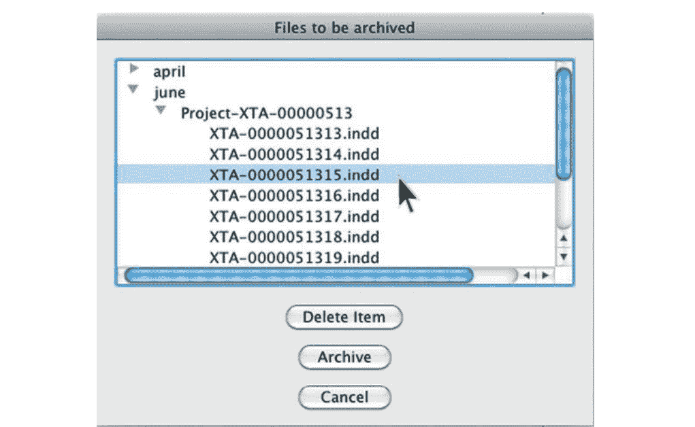

## 1. 创建主函数

创建一个新脚本并将其保存在“chapter06”文件夹中，命名为“09-recursive-folders.jsx”。

输入以下代码。

```
1 var g = {};
2 main();
3 g = null;
4
5 function main(){
6   var blnFolder = getFolder();
7   if(blnFolder){
8     var intResult = inputDialog();
9     if (intResult === 1){outputDialog();}
10   }
11 }
```

在第 1 行，我们声明了一个全局对象变量（g），它将作为任何需要在多个函数中访问的数据的命名空间容器；在第 2 行，我们调用控制一切的 main 函数；在第 3 行，我们通过将全局变量的值设置为 null 来删除所有全局数据。

`main()`函数调用一个名为`getFolder()`的函数，该函数将提示用户选择源文件夹和目标文件夹；我们将函数调用的结果放入一个名为`blnFolder`的变量中。如果`getFolder()`函数返回 true，则将调用`inputDialog()`函数，该函数将显示一个对话框，让用户输入决定要归档哪些文件的标准。

如果用户单击 OK 按钮，将值 1 返回到`intResult`中，则将调用`outputDialog()`函数。这将显示第二个对话框，其中包含一个树视图控件，显示与用户指定的源文件夹内结构匹配的项目的分层列表。用户将能够删除他们不想归档的任何项目，然后单击“Archive”按钮将剩余项目移动到存档文件夹。

## 2. getFolder() 函数

在`getFolder()`函数中，我们将使用`selectDialog()`方法允许用户浏览并选择源文件夹和目标文件夹。

将以下函数添加到脚本末尾。

```
12
13 function getFolder(){
14   g.archiveFolder = Folder.selectDialog("Please select the archive folder.");
15   if(g.archiveFolder === null){return false;}
16
17   g.sourceFolder = Folder.selectDialog("Please select the source folder.");
18   if(g.sourceFolder === null){return false;}
19
20   if(g.sourceFolder.getFiles().length === 0){
21     alert("Source folder is empty.");
22     return false;
23   }
24   else {return true;}
25 }
```

保存你的更改。

该函数首先提示选择存档文件夹（第 14 行），然后是源文件夹（第 17 行）。在两种情况下，如果用户单击“Cancel”，返回值为 null，则函数返回 false，这意味着第 7 行将为 false，不会执行更多代码。

在第 20 到 25 行，我们检查源文件夹中是否有任何项目。如果没有，我们显示错误消息并返回 false，再次停止一切。

如果源文件夹不为空，我们返回 true，这意味着第 7 行的条件测试将为 true，第 8 行将调用`inputDialog()`函数。

## 3. inputDialog() 函数

在`inputDialog()`函数中，我们将创建并显示以下对话框。

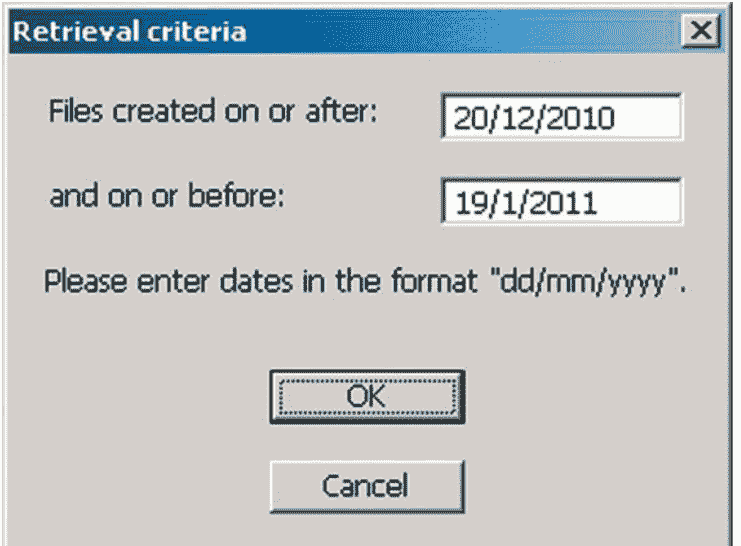

两个日期输入字段将预先填充当前日期和当前日期前 30 天的日期。当用户单击 OK 按钮时，我们需要验证第一个日期早于第二个日期，并且两个日期都有效。

将以下函数添加到脚本末尾。

```
26
27 function inputDialog(currentFile){
28     g.win = new Window('dialog', "Retrieval criteria");
29
30     var dateToday = new Date();
31     var strToday = dateToday.getDate() + "/" + (dateToday.getMonth() + 1) + "/" + dateToday.getFullYear();
32     var dateFrom = new Date(dateToday.setDate(dateToday.getDate() - 30));
33     var strFrom = dateFrom.getDate() + "/" + (dateFrom.getMonth() + 1) + "/" + dateFrom.getFullYear();
34
35     g.win.grpFrom = g.win.add('group');
36     g.win.grpFrom.add('statictext', [0, 0, 150, 20], 'Files modified on or after:');
37     g.win.grpFrom.txt = g.win.grpFrom.add('edittext', [150, 20, 250, 40], strFrom);
38
39     g.win.grpTo = g.win.add('group');
40     g.win.grpTo.add('statictext', [0, 40, 150, 60], 'and on or before:');
41     g.win.grpTo.txt = g.win.grpTo.add('edittext', [150, 60, 250, 80], strToday);
42
43     g.win.add('statictext', undefined, 'Please enter dates in the format "dd/mm/yyyy".');
44
45     g.win.grpBtn = g.win.add('group');
46     g.win.grpBtn.ok = g.win.add('button', undefined, 'OK');
47     g.win.grpBtn.ok.onClick = OKButtonClick;
48     g.win.grpBtn.cancel = g.win.add('button', undefined, 'Cancel');
49
50     return g.win.show();
51 }
```

在第30行，我们创建了一个新的 JavaScript Date 对象；然后，在第31行，我们从中提取日期、月份和年份到另一个名为`strToday`的字符串变量中，插入正斜杠并创建一个英国格式的日期。（新的`Date()`构造函数会自动创建一个填充了当前日期的 Date 对象。）

在第32行，我们希望变量`dateFrom`包含当前日期前30天的日期。我们通过获取当前日期（已将其放入变量`dateToday`中）并使用`setDate()`函数修改日期部分来实现这一点。（`setDate()`函数设置的是月份中的日期——而非整个日期。）

| 语法总结 ... | 设置和获取日期组件 |
| --- | --- |
| | `myDate.getDate()`, `myDate.getMonth()`, `myDate.getFullYear()` Date 对象的方法 用于检索给定日期的日、月、年部分的函数。 |
| | `myDate.setDate(day)`, `myDate.setMonth(month)`, `myDate.setFullYear(year [, month, day])` Date 对象的方法 用于设置给定日期的日、月、年部分的函数。 |
| | 日：从 1 到 31 的整数。 月：从 0 到 11 的整数。 年：表示年份的四位整数。 |

然后，我们创建两组，每组包含一个静态文本和一个编辑框控件，允许用户输入起始和结束日期。当我们创建编辑框（第37行和第41行）时，我们使用`add()`方法的第三个参数（要在控件中显示的文本）分别输入`strFrom`和`strToday`变量中的值。

最后，我们定义标准的确定和取消按钮，当窗口关闭时，它们将分别自动返回 1 和 2。请注意第50行窗口显示时使用的 return 语句。这意味着值 1 或 2 将返回到第8行的调用语句——`var intResult = inputDialog()`。

当点击确定按钮时，我们需要验证输入的日期是否在正确的范围内。因此，在第47行，我们将一个回调函数分配给该按钮——`g.win.grpBtn.ok.onClick = OKButtonClick`。

为了验证用户输入的日期，我们将尝试将它们转换为 Date 对象，并验证起始日期是否早于结束日期。

将`OKButtonClick()`函数添加到脚本末尾。

```
53 function OKButtonClick() {
54     var arrFrom = g.win.grpFrom.txt.text.split("/");
55     g.userDateFrom = new Date();
56     g.userDateFrom.setYear(arrFrom[2]);
57     g.userDateFrom.setMonth(arrFrom[1] - 1);
58     g.userDateFrom.setDate(arrFrom[0]);
59     g.userDateFrom.setHours(0);
60     g.userDateFrom.setMinutes(0);
61     g.userDateFrom.setSeconds(0);
62
63     var arrTo = g.win.grpTo.txt.text.split("/");
64     g.userDateTo = new Date();
65     g.userDateTo.setYear(arrTo[2]);
66     g.userDateTo.setMonth(arrTo[1] - 1);
67     g.userDateTo.setDate(arrTo[0]);
68     g.userDateTo.setHours(0);
69     g.userDateTo.setMinutes(0);
70     g.userDateTo.setSeconds(0);
71
72     if(g.userDateFrom < g.userDateTo){
73         g.win.close(1);
74     }
75     else {
76         alert("Please enter dates in the format d/m/yyyy with from-date earlier than to-date.");
77     }
78 }
```

保存你的更改。

假设用户已按照说明以“dd/mm/yyyy”格式输入日期，当我们在第54行使用`split("/")`函数时，我们最终会得到一个包含日期、月份和年份的数组。（`split()`函数使用指定的分隔符创建一个数组。）

然后，我们在全局变量中创建一个新的 Date 对象，并使用`setDate()`、`setMonth()`和`setFullYear()`命令用用户输入的日期填充它。小时、分钟和秒将从当前时间设置；因此，我们将它们每个都设置为零以避免不可预测的结果。

对起始日期和结束日期都完成此操作后，在第72到78行，我们测试起始日期是否早于结束日期。如果是，我们关闭窗口并返回值 1（第73行）；如果不是，窗口保持打开状态并显示错误警报（第76行）。

## 5. outputDialog() 函数

在第9行，主函数中，我们检查对话框是否返回值1。

```
9    if (intResult === 1){outputDialog();}
```

如果是，我们调用`outputDialog()`函数。此函数需要浏览用户指定的源文件夹并在树状视图中显示其内容。由于我们不知道源文件夹将包含多少子文件夹和子子文件夹，我们将使用递归函数来探索文件夹结构。

将`outputDialog()`函数添加到脚本末尾。

```
79
80 function outputDialog() {
81    g.win = new Window("dialog", "Files to be archived");
82    g.win.trvFiles = g.win.add('treeview', [0, 0, 400, 200]);
83    var arrFiles = g.sourceFolder.getFiles(creationDate);
84    for(var i = 0; i < arrFiles.length; i++) {
85        addItem(g.win.trvFiles, arrFiles[i]);
86    }
87    g.win.btnDelete = g.win.add('button', undefined, 'Delete Item');
88    g.win.btnDelete.onClick = function () {
89        if(confirm("Are you sure you wish to delete the selected item?")) {
90            g.win.trvFiles.remove(g.win.trvFiles.selection);
91        }
92    }
93    g.win.btnArchive = g.win.add('button', undefined, 'Archive');
94    g.win.btnArchive.onClick = archiveItems;
95    g.win.btnCancel = g.win.add('button', undefined, 'Cancel');
96    g.win.show();
97 }
```

保存你的更改。

在创建树状视图控件（第82行）后，我们使用`getFiles()`方法将源文件夹的顶层内容检索到变量`arrFiles`中（第83行）。然后，我们循环遍历`arrFiles`中的项目数组，并调用递归函数`addItem()`，将树状视图控件和`arrFiles`的当前值作为参数传递（第85行）。我们接下来将创建`addItem()`函数，然后我们将看到它如何递归执行以探索源文件夹内每个子文件夹的结构。

然后，在第87到92行，创建删除按钮并编写一个内联回调函数来处理 onClick 事件。该函数只是显示一个确认对话框，询问用户是否确定要删除该项目。如果他们点击“是”按钮回应，我们使用树状视图控件的`remove()`方法删除所选项目，该方法将要删除的项目作为参数。在本例中，我们只需使用树状视图控件的 selection 属性来返回当前选中的节点（第90行）。

接下来，我们创建归档按钮，并在第94行将函数`archiveItems()`分配为 onClick 回调。此函数将归档与树状视图中项目相对应的所有文件。

然后我们创建一个标准的取消按钮，并在第96行使用`show()`方法显示窗口。

## 6. 递归 addItem() 函数

在第85行，`addItem()`函数从`outputDialog()`函数中被调用；此外，它还将反复调用自身，直到没有更多文件夹可处理为止。

将`addItem()`函数插入到脚本末尾。

```
98
99 function addItem(addTo, addWhat) {
100     if (addWhat.constructor.name === "Folder") {
101         var currentNode = addTo.add('node', addWhat.name);
102         currentNode.fsItem = addWhat;
103         var arrInside = addWhat.getFiles(modifiedDate);
104         for (var i = 0; i < arrInside.length; i++) {
105             addItem(currentNode, arrInside[i]);
106         }
107     }
108     else if (addWhat.constructor.name === "File") {
109         var currentItem = addTo.add('item', addWhat.name);
110         currentItem.fsItem = addWhat;
111     }
112 }
```

保存你的更改。

下图说明了递归函数的工作原理。

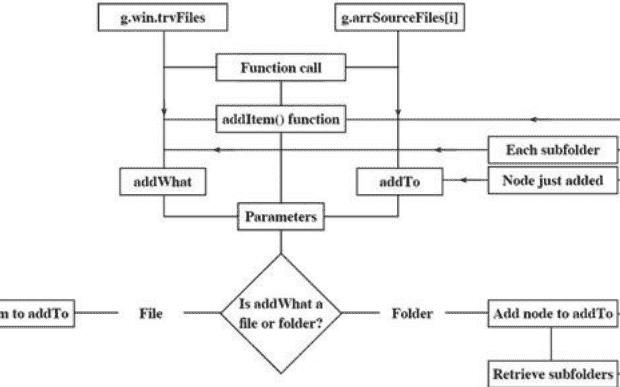

`addItem()`函数接受两个参数：`addTo`——要将每个新项目添加到其中的对象，以及`addWhat`——要添加的项目，它将是文件或文件夹的引用。

首先，我们有来自`outputDialog()`函数内部第85行的函数调用。

```
84 for (var i = 0; i < arrFiles.length; i++) {
85     addItem(g.win.trvFiles, arrFiles[i]);
86 }
```

这将树状视图控件传递给`addTo`参数，并将`g.arrSourceFolder`中的每个项目传递给`addWhat`参数。因此，`addItem()`函数将为`g.arrSourceFolder`中的每个文件或文件夹对象在树状视图上创建一个项目或节点。这处理了直接位于树状视图上的顶层项目。

在`addItem()`函数内部，文件和文件夹对象的处理方式有所不同。首先，为了区分两者，我们使用逻辑测试`addWhat.constructor.name == "Folder"` / `"File"`（第100行和第108行）。当遇到文件时，我们向当前的`addTo`对象添加一个项目元素（第109行）。向树视图中添加一个项目（与节点相对），会创建一个不能作为其他项目或节点容器的列表项。`add()`方法的第二个参数表示将在刚添加的项目或节点内显示的文本。通过使用`add.what.name`，我们获取文件或文件夹的名称——不包括文件路径。

相比之下，当`addWhat`包含文件夹时，我们向树视图添加一个节点（第101行）。与项目不同，树视图节点可以作为项目和其他节点的容器，并且会自动具有由加号和减号图标控制的折叠/展开功能。

然后，我们遍历文件夹的内容，并在函数内部调用`addItem()`函数，将新创建的节点作为`addTo`参数传递，将文件夹中的每个项目作为`addWhat`参数传递（第104至106行）。这个过程会无限循环进行，每遇到一个文件夹就会触发另一次递归函数调用。

在创建每个节点或项目时，我们还在其内部创建一个名为`fsItem`的自定义属性，并将正在处理的文件或文件夹作为值赋给它。

```
101    var currentNode = addTo.add('node', addWhat.name);
102    currentNode.fsItem = addWhat;
  ...
109    var currentItem = addTo.add('item', addWhat.name);
110    currentItem.fsItem = addWhat;
```

这意味着树视图中的每个项目都将包含对源文件夹中某个对象的引用，该引用可以在脚本的后续部分中读取和利用。我们能够在树视图的项目和节点上做到这一点，并非因为它们具有某种特殊的`fsItem`属性。是我们发明了`fsItem`（文件系统项目的缩写），也可以使用任何其他名称。每个 JavaScript 对象都有这种创建自定义属性的实用能力。

在第103行，当我们使用 Folder 对象的`getFiles()`方法获取正在处理的文件夹中的项目时，我们将名为`modifiedDate()`的函数指定为可选的掩码参数。这使我们能够创建更复杂的过滤机制，而不是局限于基于通配符的标准，如 "*.indd"。现在让我们编写这个函数。

在脚本末尾插入 `modifiedDate()` 函数。

```
113
114 function modifiedDate(currentFile){
115     if(currentFile.constructor.name == "Folder"){return true;}
116     var datemodified = currentFile.modified;
117     var strExt = currentFile.fullName.toUpperCase().substr(currentFile.fullName.lastIndexOf("."));
118     return (datemodified >= g.userDateFrom &&
119             datemodified <= g.userDateTo &&
120             (strExt == ".indd" || strExt == ".indt"));
121 }
```

在定义函数时，我们使用名称`currentFile`作为参数变量，它代表`getFiles()`方法当前正在处理的项目。在第115行，我们指定如果正在处理的项目是文件夹，则返回 true，这意味着所有子文件夹都将包含在`getFiles()`返回的项目数组中。

如果 `getFiles()` 正在处理的项目是文件，则必须满足 3 个标准：

- `dateCreated >= g.userDateFrom`：文件的创建日期必须晚于或等于用户通过对话框输入的起始日期

- `dateCreated <= g.userDateTo`：创建日期必须早于或等于用户输入的结束日期

- `(strExt == ".indd" || strExt == ".indt")`：文件扩展名必须是 ".indd" 或 ".indt"。

文件扩展名在第117行使用`substr()`和`lastIndexOf()`函数计算：

```
var strExt = currentFile.fullName.toUpperCase().substr(currentFile.fullName.lastIndexOf("."));
```

`lastIndexOf(".")`检索最后一个点的位置，并作为`substr()`的参数，指定在文件名中开始提取子字符串的位置。由于只提供了一个参数，提取会持续到文件名的末尾。

## 7. archiveItems() 函数

由于我们为树视图中的每个项目添加了一个名为 `fsItem` 的自定义属性，其中包含对它所代表的文件或文件夹的引用，我们现在可以遍历这些项目，并归档相应的文件和文件夹。这个过程再次是递归的，因为我们不知道会创建多少层级的子节点。

将`archiveItems()`函数添加到脚本的末尾。

```
function archiveItems(){
    for(var i = 0; i < g.win.trvFiles.items.length; i ++){
        doArchive(g.win.trvFiles.items[i]);
    }
    g.win.close(1);
}
```

我们使用与之前相同的模式：遍历树视图中的所有顶层项目，并调用一个名为`doArchive()`的递归函数。这次，我们只需要一个参数：要处理的项目。

现在让我们创建`doArchive()`递归函数。

```
function doArchive(what){
    var currentPath = what.fsItem.toString().replace(g.sourceFolder.toString(), g.archiveFolder.toString());
    if(what.fsItem.constructor.name == "Folder" && what.items.length > 0){
        var currentFolder = Folder(currentPath);
        currentFolder.create();
        for(var i = 0; i < what.items.length; i ++){
            doArchive(what.items[i]);
        }
    }
    else if(what.fsItem.constructor.name == "File"){
        var blnCopy = what.fsItem.copy(currentPath);
        if(blnCopy){what.fsItem.remove();}
    }
}
```

在第131行，我们在一个名为`currentPath`的变量中计算出项目应被归档的路径。我们使用三个组成部分来实现这一点：

- `what.fsItem.toString()`—原始项目的文件路径

- `g.sourceFolder.toString()`—用户指定的源文件夹的文件路径

- `g.archiveFolder.toString()`—用户指定的归档文件夹的文件路径

归档位置是通过获取原始文件路径，并将其对应于源文件夹的部分替换为归档文件夹的文件路径来创建的。下表显示了`replace()`函数如何可能更改项目的原始文件路径以创建其应归档到的文件路径的示例。

| 项目的原始文件路径 | /c/indesign/clients/booklet-cmp-112.indd |
| 源文件夹 | /c/indesign/ |
| 归档文件夹 | /c/archive/ |
| 项目的归档文件路径 | /c/archive/clients/booklet-cmp-112.indd |

如果正在处理的项目是文件夹，在第133行，我们创建一个文件夹对象（在内存中），指向`currentPath`变量中的归档文件路径。然后，在第134行，我们在该位置的磁盘上创建一个文件夹。然后，我们遍历文件夹内的项目，并进行递归函数调用，将每个项目作为函数参数传递。

每当`doArchive()`函数遇到文件时，它都会尝试将其复制到`currentPath`（第140行）。如果复制方法成功，它将 true 返回给变量`blnCopy`，然后使用`remove()`方法删除原始项目（第141行）。

这就完成了代码。要测试它，请尝试使用 "chapter06" 文件夹中名为 "archive" 和 "source" 的文件夹。它包含一系列虚拟文件，修改日期在2010年12月1日至2011年2月28日之间。（在测试时，您可能会发现将该文件夹复制到桌面上以便更快访问会比较方便。）

保存更改并运行脚本。

# 第7章 文档布局

在本章中，我们将了解设置文档首选项、设置主页以及放置文本和图像。

# 文档和默认首选项

广义上讲，InDesign 中有两种类型的首选项：文档和默认。文档首选项嵌入在特定文档中，并在文档关闭后停止应用。默认首选项在 InDesign 用于创建新文档时始终适用。从用户的角度来看，要设置文档首选项，您只需在指定各种设置时确保相关文档处于打开和活动状态。相比之下，要设置默认首选项，您必须在设置首选项时确保所有文档都已关闭。

关于脚本编写，通过定位应用程序对象（设置默认值）或特定文档对象（设置文档首选项）来区分默认和文档首选项。

在初始设置文档时，我们需要操作三个主要首选项对象：`viewPreferences`、`documentPreferences`和`marginPreferences`。

### 视图首选项

`viewPreferences`对象允许您手动更改通过选择编辑 > 首选项（Windows）或 InDesign > 首选项（Mac）并选择单位和增量类别获得的规范。显示的前三个选项（见下图7-1）是在编写脚本时最有用的设置选项。

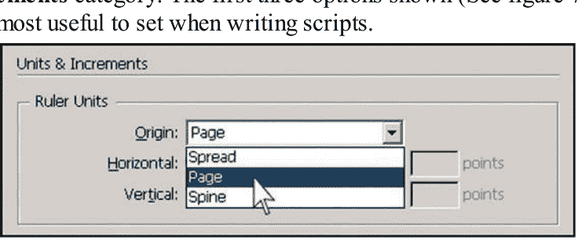

图7-1：InDesign 首选项中“单位和增量”类别的“标尺单位”部分包含脚本编写时最重要的设置

| 有用的 viewPreference 属性 | |
| :--- | :--- |
| `rulerOrigin` | 可以设置为三个枚举值之一：`RulerOrigin.spreadOrigin`、`RulerOrigin.pageOrigin`、`RulerOrigin.spineOrigin`。一般而言，`RulerOrigin.pageOrigin`通常是使用最方便的选择——尤其是在计算文本框坐标等类似任务时。 |
| `horizontalMeasurementUnits` `verticalMeasurementUnits` | 需要一个枚举值，其中最重要的是：`MeasurementUnits.points`、`MeasurementUnits.picas`、`MeasurementUnits.inches`、`MeasurementUnits.inches_decimal`、`MeasurementUnits.millimeters`、`MeasurementUnits.centimeters`、`MeasurementUnits.pixels` |

### 文档首选项

`documentPreferences`对象包含的属性主要等同于通过选择文件 > 文档设置所得到的设置，也等同于创建新文档时的设置。这些设置非常直观，你很快就能掌握其语法。下图展示了一些更重要的属性。

**页面属性**

| 语法概要 ... | 实用的 documentPreference 属性 |
| --- | --- |
| `facingPages` | 布尔值 读/写——如果为 true，则文档具有对页。 |
| `masterTextFrame` | 布尔值 读/写——如果为 true，则主页跨页 A-Master 的每个页面上都有自动文本框。 |
| `pageHeight` | 测量单位（数字或字符串） 读/写——页面的高度。 |
| `pageOrientation` | 读/写——PageOrientation 枚举：`PageOrientation.landscape`（横向）或`PageOrientation.portrait`（纵向） |
| `pageSize` | 字符串，读/写——页面的尺寸（例如 “A4”）。 |
| `pageWidth` | 测量单位（数字或字符串） 读/写——页面的宽度。 |
| `pagesPerDocument` | 整数 读/写——文档中的页数。（范围：1 到 9,999） |
| `startPageNumber` | 整数（范围：1 - 999,999） 读/写——文档的起始页码。这与文档第一个节的起始页码相同。默认值为 1。 |

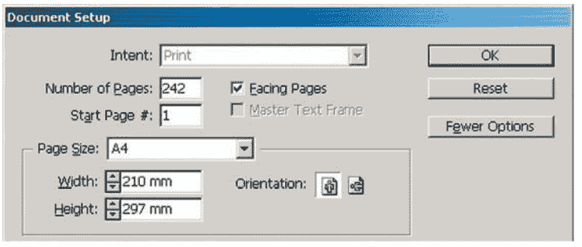

图 7-2：documentPreferences 对象包含的属性主要等同于通过文件 > 文档设置进行的设置

当为任何需要测量值的属性提供值时，你有两种选择。首先，你可以指定测量单位和数值。在这种情况下，值需要是一个字符串——例如：

```
docExample.documentPreferences.pageWidth = "210 mm";
```

其次，你可以预先设置测量单位，然后每当你提供测量参数时，它就可以是纯数字。

```
docExample.viewPreferences.horizontalMeasurementUnits = MeasurementUnits.millimeters;
docExample.viewPreferences.verticalMeasurementUnits = MeasurementUnits.millimeters;
docExample.documentPreferences.pageWidth = 210;
```

当然，当需要时，你仍然可以通过输入字符串值来覆盖这个默认的测量单位。

### 出血和辅助信息栏

| 语法概要 | 实用的 documentPreference 属性 |
| --- | --- |
| `documentBleedBottomOffset` | 测量单位（数字或字符串） 读/写——文档底部出血的偏移距离。 |
| `documentBleedInsideOrLeftOffset` | 测量单位（数字或字符串） 读/写——文档内侧或左侧出血的偏移距离。 |
| `documentBleedOutsideOrRightOffset` | 测量单位（数字或字符串） 读/写——文档外侧或右侧出血的偏移距离。 |
| `documentBleedTopOffset` | 测量单位（数字或字符串） 读/写——文档顶部出血的偏移距离。 |
| `documentBleedUniformSize` | 布尔值 读/写——设置为 true 时，文档所有边的出血偏移量都将使用文档顶部出血偏移值。默认设置为 true。 |
| `documentSlugUniformSize` | 布尔值 读/写——设置为 true 时，文档所有边的辅助信息栏偏移量都将使用辅助信息栏顶部偏移值。默认值为 false。 |
| `slugBottomOffset` | 测量单位（数字或字符串） 读/写——辅助信息栏底部的偏移距离。 |
| `slugInsideOrLeftOffset` | 测量单位（数字或字符串） 读/写——辅助信息栏内侧或左侧的偏移距离。 |
| `slugRightOrOutsideOffset` | 测量单位（数字或字符串） 读/写——辅助信息栏外侧或右侧的偏移距离。 |
| `slugTopOffset` | 测量单位（数字或字符串） 读/写——辅助信息栏顶部的偏移距离。 |

## 边距首选项

InDesign 的`marginPreferences`对象包含的属性主要等同于通过选择版面 > 边距和分栏所得到的设置。与其版面菜单中的对应项一样，`marginPreferences`设置既可以应用于文档页面，更典型地，也可以应用于主页跨页。

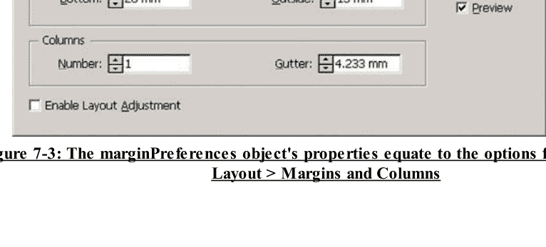

### 边距设置

| 语法概要 ... | 实用的 marginPreference 属性 - 边距 |
|---|---|
| `bottom` | 测量单位（数字或字符串） 读/写——下边距设置。 |
| `left` | 测量单位（数字或字符串） 读/写——左边距设置。 |
| `right` | 测量单位（数字或字符串） 读/写——右边距设置。 |
| `top` | 测量单位（数字或字符串） 读/写——上边距设置。 |

### 分栏设置

| 实用的 marginPreference 属性 - 分栏 | |
|---|---|
| `columnCount` | 数字（范围：1 - 216） 读/写——页面上的分栏数。 |
| `columnDirection` | 读/写——分栏中文字的方向。`HorizontalOrVertical.horizontal`（水平）或`HorizontalOrVertical.vertical`（垂直） |
| `columnGutter` | 测量单位（数字或字符串）（0 - 1440 的数字） 读/写——分栏间的间距。 |
| `columnsPositions` | 测量单位数组（数字或字符串） 读/写——每个分栏参考线距左边距的距离。格式为 [g1, g2, 等] 的数组。 |
| `customColumns` | 布尔值，只读——如果为 false，则分栏必须等间距。如果为 true，则可以自定义分栏宽度。 |

### 实现文档设置

在通过编程方式设置文档时，你需要更改我们讨论过的所有三个首选项对象中的设置。然而，你实现这些设置的方式将取决于你在开发脚本时的具体情况——例如，你是在为自己使用、为公司使用还是为客户创建解决方案。

第一种选择是将所有设置嵌入到脚本中的各个函数和例程中。这意味着如果文档参数需要更改，你（或其他开发人员）将不得不进行更改。根据你的情况，这可能是可取的，也可能是完全不可取的。

另一种选择是以某种方式将所有设置外部化：最简单的方法是将它们放在一个文本文件中。InDesign 对象名称非常直观且易于阅读；因此，任何使用你的脚本的人都可以轻松打开文本文件并修改你的脚本在执行文档设置例程时读取的设置。

你也可以依赖每个用户文件 > 文档预设子菜单中出现的文档预设。只要你确信使用你的解决方案的每个人都有一组给定的文档预设，你就可以为相应的操作选择相应的设置。

### 置入文本和图像

一旦你设置好了文档，你就会想要添加内容，而当通过脚本来做这件事时，你的主要工具将是置入命令。就像在界面中一样，这用于导入文本和图形，并且你在如何以及何处放置项目方面有很大的灵活性。

### 通过文档对象置入

将一个或多个文件置入文档是导入文本和图像最不精确的方法。与使用 InDesign 界面时一样，你可以置入一个或多个文件。在脚本中，这取决于你是使用单个文件对象还是文件对象数组作为`place()`命令的参数。例如，以下代码置入单个图像。

```
app.activeDocument.place(File("~/desktop/projectx/logo.tif"));
```

要置入一系列文件，你可以先创建一个文件数组，然后将其用作`place()`命令的参数。

```
arrFiles = [];
arrFiles.push(File("~/desktop/projectx/logo.tif"));
arrFiles.push(file("~/desktop/projectx/products/bnl580x.tif"));
arrFiles.push(file("~/desktop/projectx/products/bnl680x.tif"));
arrFiles.push(file("~/desktop/projectx/products/bnl780x.tif"));
app.activeDocument.place(arrFiles);
```

当使用文档对象的`place()`方法导入多个文件时，置入光标将出现，用户可单击或拖动以放置每个项目。

| 语法概要 | `myDocument.place(file(s), [showing options])` |
| :--- | :--- |
| | 文档对象的方法 |
| | 置入一个文件或文件数组。 |
| `File(s)` | 要导入的文件或文件数组。 |
| `Showing options` | 可选。是否应显示与所导入项目相对应的选项对话框。 |

### 将项目置入页面或跨页

当使用页面对象的`place()`方法时，你只能置入一个文件：第一个参数不能是数组。但是，在置入文本文件时，有一个有用的 autoflow 参数，如果设置为 true，会导致传入文件中的所有文本都被置入——相当于在手动置入文本时按住 Shift 键的旧技巧。智能文本重排使得这个选项不那么重要；但它仍然可能有用。

| 语法概要 | `myPage.place(file, [place point, layer, showing options, autoflowing])` |
| :--- | :--- |
| | 页面和跨页对象的方法 |
| | 将文件置入页面或跨页。 |
| `File` | 要导入的文件。 |
| `Place point` | 可选。项目在页面上的放置位置：一个包含 [x, y] 坐标的数组。 |
| `Layer` | 可选。用于放置文件的图层。 |
| `Showing options` | 可选。是否应显示与所导入项目相对应的选项对话框。 |
| `Autoflowing` | 可选。如果为 true，则自动置入整个文本文件。 |

### 将项目放入框架

文本文件也可以直接放入文本框架，图形文件则可直接放入矩形、多边形或椭圆中。将文本放入框架时，任何现有文本将被直接覆盖。一次只能放置一个文件，且没有选项可以自动流式处理传入的文本。导入到框架的语法与导入到文档的语法相同，只是第一个参数不能是文件数组。因此，要将文本文件放置到活动文档第 1 页的唯一文本框架中，我们可以使用以下代码行：

```
var frm = doc.pages[0].textFrames[0];
frm.place(File("~/desktop/indesign/articles/article124.doc"));
```

如果将图形放入文本框架，它会自动转换为图形框架——就像选择了对象 > 内容 > 图形一样。将图形放入页面项目时，图形会以其原始大小进入。然后，可以使用`fit()`方法在必要时调整其大小：这相当于从对象 > 适合子菜单中选择一个选项。例如，要将图像导入矩形框架并实现与选择对象 > 适合 > 按比例填充相同的效果，我们可以这样说：

```
var frm = doc.pages[0].rectangles[0];
frm.place(File("~/desktop/projectx/products/bnl780x.tif"));
frm.fit(FitOptions.fillProportionally);
```

| 语法摘要 | `myGraphicFrame.fit(FitOptions)` |
|---|---|
| | 矩形、椭圆、多边形、图形和图像对象的方法 |
| | 等同于从对象 > 适合子菜单中选择选项。 |
| `FitOptions` | FitOptions 枚举：`FitOptions.fillProportionally`、`FitOptions.proportionally`、`FitOptions.frameToContent`、`FitOptions.contentToFrame`、`FitOptions.centerContent`、`FitOptions.applyFrameFittingOptions` |

## 将项目放入文本对象内部

也可以将项目放入文本对象（如段落、字符或插入点）内部。这里的规则是，放置的项目成为文本对象的内容，替换之前存在的任何文本。因此，插入点对象通常是对该目的最有用的选项。例如，如果要在文本框的第一段和第二段之间插入图像，您需要首先插入一个新段落，然后将图像放入其中。

```
var txf = app.activeDocument.pages[0].textFrames[0];
var para = txf.paragraphs[0].insertionPoints[-1];
para.contents = "\r";
para.place(File("~/desktop/projectx/images/logo.tif"));
```

使用语句`txf.paragraphs[0].insertionPoints[-1]`等同于将光标定位在第 1 段的末尾。然后，将插入点设置为 "\r" 等同于在光标位置按回车键。（当使用负数作为索引时，起点是对象的末尾：-1 表示最后一个项目；-2 表示倒数第二个，依此类推。）

# 自己动手试试！

# 教程：自动化文档设置

在本教程中，我们将创建一个脚本，该脚本基于用户指定文件夹中找到的文本文档构建一个文档，用户还有机会通过下面显示的对话框选择新文档的一些基本属性。

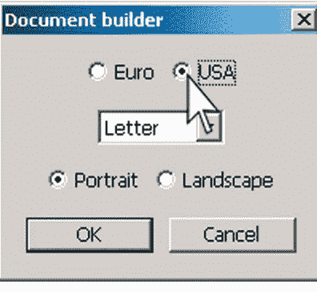

对话框顶部的单选按钮决定下拉列表中显示的选项。（完成的脚本可以在 "chapter07" 文件夹中找到，名为 "01-document-builder_completed.jsx"。）

## 1. 创建主函数

在 ESTK 中，选择 File > New JavaScript，输入文件名 "01-document-builder.jsx" 并将文件保存在 "chapter07" 文件夹中。

输入以下代码。

```
var g = {};
main();
g = null;

function main() {
  var blnFiles = getFiles();
  if (blnFiles) {
    createDialog();
    eventSetup();
    var intResult = g.win.show();
    if (intResult == 1) {
      buildDocument();
    }
  }
}
```

保存您的更改。

在第 1 行，我们声明全局变量`g`，它将用作需要在多个函数中引用的所有对象和数据的容器；在第 2 行，我们调用`main()`函数，该函数将控制整个脚本；然后，在第 3 行，我们通过将对象变量`g`设置为 null 来销毁全局信息。

主函数首先调用`getFiles()`函数，并在变量`blnFolder`中获取一个布尔结果（第 6 行）。`getFiles()`函数将要求用户指定包含创建文档所需文本文件的文件夹。

如果`getFiles()`函数返回 true，我们将调用`createDialog()`和`eventSetup()`函数，它们将分别构建对话框和设置回调函数。

接下来，我们显示对话框，如果用户单击 OK 按钮，将值 1 返回到`intResult`中，我们将调用`buildDocument()`函数，该函数将创建文档并导入用户指定文件夹中找到的文本文件。

## 2. getFiles() 函数

在`getFiles()`函数中，将要求用户选择包含要导入到新文档中的文本文件的文件夹。如果文件夹缺失或为空，将显示错误消息。否则，所有扩展名为 “.txt”、“.rtf”、“.doc” 和 “.docx” 的文件将被读入一个数组。此外，每个文件中的第一个段落将被读入第二个数组，并稍后用作新文档每个部分的标题。

将`getFiles()`函数添加到脚本末尾。

```
function getFiles() {
  g.sourceFolder = Folder.selectDialog("Select folder containing text files to be imported.");
  if (g.sourceFolder == null) {
    return false;
  } else if (g.sourceFolder.getFiles(textFilesOnly).length == 0) {
    alert("Source folder contains no text files.");
    return false;
  } else {
    g.arrTitles = [];
    try {
      g.arrSource = g.sourceFolder.getFiles(textFilesOnly);
      for (var i = 0; i < g.arrSource.length; i++) {
        g.arrSource[i].open("r");
        g.arrTitles[i] = g.arrSource[i].readln();
        g.arrSource[i].close();
      }
    } catch (err) {}
    if (g.arrTitles.length == 0) {
      alert("There was a problem reading the source files.");
      return false;
    } else {
      return true;
    }
  }
}
```

在第 18 行，我们使用文件夹类的`selectDialog()`方法显示一个对话框，使用户能够选择包含源文件的文件夹。如果用户单击“取消”按钮而不是选择文件，我们通过将值 false 返回到`blnFiles`（函数调用中使用的变量）来退出函数（第 19 行）。

如果文件夹不包含文本文件，我们也会显示一条消息并再次返回 false（第 21 至 22 行）。为了确定文件夹是否包含文本文件，我们使用`getFiles()`方法，指定一个名为`textFilesOnly`的函数作为参数（第 20 行）。此函数将测试文件夹中每个文件的文件扩展名是否为四个可接受的扩展名之一：".txt"、".rtf"、".doc" 和 ".docx"。

如果一切正常，在第 27 行，我们真正使用`getFiles()`方法并将检索到的文件放入数组`g.arrSource`中。然后我们循环遍历数组，以读取模式打开每个文件（第 29 行），将文件的第一行读入数组`g.arrTitles`（第 30 行），然后关闭文件（第 31 行）。以防在读取文件时遇到问题，我们将这些步骤包装在 try ... catch 语句中。

最后，在第 35 至 41 行，我们检查是否在`g.arrTitles`中检索到任何标题。如果没有，我们显示错误消息（第 36 行）；如果文本已读入`g.arrTitles`，则函数返回 true（第 40 行）。

让我们通过编写`textFilesOnly()`函数来结束本节，我们在第 20 行和第 27 行将其指定为`getFiles()`方法的参数。

将以下代码添加到您的脚本中。

```
function textFilesOnly(currentFile) {
  var strExt = currentFile.fullName.toLowerCase().substr(currentFile.fullName.lastIndexOf("."));
  return strExt == ".txt" || strExt == ".rtf" || strExt == ".doc" || strExt == ".docx";
}
```

保存您的更改。

在第 45 行，我们使用名称`currentFile`作为参数变量，代表`getFiles()`方法遇到的每个文件。然后我们从文件名中提取文件扩展名。

`currentFile`通过使用`substr()`函数，由`lastIndexOf()`提供最后一个点的位置来获取。

函数返回的值由逻辑语句`strExt == ".txt" || strExt == ".rtf" || strExt == ".doc" || strExt == ".docx"`的结果决定，如果找到四个允许的扩展名之一，该语句将返回 true。

### 3. createDialog() 函数

在`createDialog()`函数中，我们将构建一个包含两组单选按钮和两个下拉列表的对话框，一个显示美国纸张尺寸，另一个显示欧洲纸张尺寸。然而，我们将把下拉列表的对齐方式设置为`stacked`（堆叠），这将导致它们彼此堆叠放置——其想法是，在任何时间点上，两个下拉列表中只有一个可见。

让我们首先创建对话框本身和两个单选按钮，它们将允许用户选择在下拉列表中显示哪一组纸张尺寸。

将以下代码添加到脚本的末尾。

```
49
50 function createDialog() {
51   g.win = new Window('dialog', 'Document builder');
52
53   // Page size radio buttons
54   var grp1 = g.win.add('Group');
55   g.win.radEuro = grp1.add('RadioButton', undefined, 'Euro');
56   g.win.radUSA = grp1.add('RadioButton', undefined, 'USA');
57   g.win.radEuro.value = true;
58
59 }
```

首先我们创建一个组控件，然后将两个单选按钮添加到其中；然后我们将“Euro”按钮的值设置为 true，使其成为默认值。

现在，让我们创建与这两个选项对应的两个下拉列表。

将以下代码添加到脚本的末尾。

```
57   g.win.radEuro.value = true;
58
59   // Page size drop downs
60   var grp2 = g.win.add('Group');
61   grp2.orientation = "stack";
62   g.win.ddlEuroSizes = grp2.add('dropdownlist');
63   g.win.ddlUSASizes = grp2.add('dropdownlist');
64
65   g.arrEuroPageSizes = [];
66   g.arrEuroPageSizes[0] = ["A4", 210, 297, "mm", 20];
67   g.arrEuroPageSizes[1] = ["A5", 148, 210, "mm", 12];
68   g.arrEuroPageSizes[2] = ["A6", 105, 148, "mm", 8];
69   g.arrUSAPageSizes = [];
70   g.arrUSAPageSizes[0] = ["Letter", 8.5, 11, "in", 0.8];
71   g.arrUSAPageSizes[1] = ["HalfLetter", 5.5, 8.5, "in", 0.5];
72   g.arrUSAPageSizes[2] = ["Executive", 7.25, 10.5, "in", 0.8];
73   for (i =0; i < g.arrEuroPageSizes.length; i++){
74     g.win.ddlEuroSizes.add('item', g.arrEuroPageSizes[i][0]);
75     g.win.ddlUSASizes.add('item', g.arrUSAPageSizes[i][0]);
76   }
77   g.win.ddlEuroSizes.selection = 0;
78   g.win.ddlUSASizes.selection = 0;
79   g.win.ddlUSASizes.visible = false;
80
81 }
```

保存脚本的更改。

在创建了将用作两个下拉列表容器的组控件之后，在第61行，我们将方向设置为`stack`（堆叠）。

在第62和63行，我们创建了两个 dropdownlist 控件，但后来在第79行，我们隐藏了`g.win.ddlUSASizes`，从而使`g.win.ddlEuroSizes`成为默认项。当我们为两个单选按钮创建 onClick 回调时，我们将更改两个项目的 visible 属性以匹配用户选择的选项。

然后我们构造两个数组，并用我们需要的所有与各种纸张尺寸相关的信息填充它们。每个数组包含一系列嵌套数组：下表显示了访问嵌套数组中每个槽位及其包含信息的语法。

| 嵌套数组项 | 示例 | 用法 |
| :--- | :--- | :--- |
| `g.arrEuroPageSizes[0][0]` | A4 | 下拉列表中的文本 |
| `g.arrEuroPageSizes[0][1]` | 210 | 纸张尺寸的页面宽度 |
| `g.arrEuroPageSizes[0][2]` | 297 | 纸张尺寸的页面高度 |
| `g.arrEuroPageSizes[0][3]` | mm | 测量单位 |
| `g.arrEuroPageSizes[0][4]` | 20 | 默认页边距宽度 |

在第73到76行，我们遍历两个数组——我们假设它们总是包含相同数量的选项——并将每个项的第一个子项添加到相应的下拉列表中。

最后，在第77和78行，我们将两个控件的默认值设置为第一项，其索引当然是零。

接下来，我们需要两个单选按钮来允许用户选择页面方向。

将以下行添加到你的代码中。

```
78 g.win.ddlEuroSizes.selection = 0;
79 g.win.ddlUSASizes.selection = 0;
80
81 // Orientation radio buttons
82 var grp3 = g.win.add('Group');
83 g.win.radPortrait = grp3.add('RadioButton', undefined, 'Portrait');
84 g.win.radLandscape = grp3.add('RadioButton', undefined, 'Landscape');
85 g.win.radPortrait.value = true;
86
87 }
```

非常直接：我们在一个组控件内创建两个单选按钮，然后将“Portrait”选项设置为默认值。

我们最后的控件将是标准的确定和取消按钮。

```
85 g.win.radPortrait.value = true;
86
87 // Buttons
88 g.win.grp4 = g.win.add('Group');
89 g.win.btnOK = g.win.grp4.add('Button', undefined, 'OK');
90 g.win.btnCancel = g.win.grp4.add('Button', undefined, 'Cancel');
91 }
```

这就完成了`createDialog()`函数。

保存你的更改。

要测试你的代码，你需要暂时注释掉第9行，如下所示，因为这个函数还没有被编写。

```
7  if(blnFiles){
8    createDialog();
9    //eventSetup();
10   var intResult = g.win.show();
11   if(intResult == 1){
12     buildDocument();
13   }
14 }
```

当你从 InDesign 或 ESTK 运行代码时，你应该会看到以下对话框，目前还没有显示`g.win.ddlUSASizes`下拉列表的迹象。

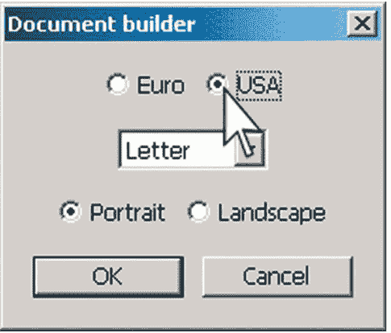

单击取消以关闭对话框。

暂时注释掉第64行，其中`g.win.ddlUSASizes`下拉列表被设置为不可见。

```
62 g.win.ddlEuroSizes = grp2.add('DropDownList');
63 g.win.ddlUSASizes = grp2.add('DropDownList');
64 //g.win.ddlUSASizes.visible = false;
```

再次运行代码，你将看到将下拉列表的 orientation 属性设置为`stacked`实际上是如何工作的。

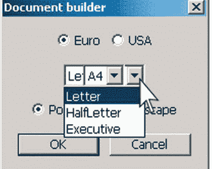

两个控件重叠在一起并且都可用。

再次单击取消以关闭对话框。

选择编辑 > 还原两次以恢复第9和64行；或者简单地移除每行开头的两个斜杠。

## 4. setupEvents() 函数

这一节将非常简短，因为我们需要处理的唯一事件是两个单选按钮的 onClick 事件；而我们所需要做的就是显示一个下拉列表并隐藏另一个。

将以下函数添加到脚本的末尾。

```
92
93 function eventSetup(){
94  g.win.radUSA.onClick = function(){
95    g.win.ddlUSASizes.visible = true;
96    g.win.ddlEuroSizes.visible = false;
97  }
98
99  g.win.radEuro.onClick = function(){
100    g.win.ddlUSASizes.visible = false;
101    g.win.ddlEuroSizes.visible = true;
102  }
103 }
```

保存更改并运行脚本。

通过选择每个单选按钮并确保正确的下拉列表变为可见来测试这两个事件处理程序。

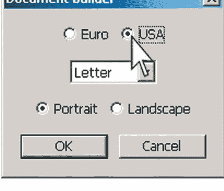

单击取消以关闭对话框。

## 5. buildDocument() 函数

`buildDocument()`函数将是我们工作的主要执行者。首先，我们将设置主页；然后我们将导入源文件夹中的每个文件。该函数代码分为一系列嵌套函数。

将以下代码添加到脚本的末尾。

```
104
105 function buildDocument(){
106   var docNew = app.documents.add();
107   viewPrefs();
108   docPrefs();
109   paraStyles();
110   createPages();
111
112 }
```

我们首先在本地变量`docNew`中创建一个新文档，然后我们调用我们的四个嵌套函数中的每一个。让我们编写第一个：`viewPrefs()`，在其中我们将设置 viewPreferences 对象的相关属性。

将`viewPrefs()`函数插入到`buildDocument()`函数的结束大括号上方。

```
105 function buildDocument(){
106   var docNew = app.documents.add();
107   viewPrefs();
108   docPrefs();
109   paraStyles();
110   createPages();
111
112   function viewPrefs(){
113     if(g.win.radUSA.value == true){
114       docNew.viewPreferences.horizontalMeasurementUnits=MeasurementUnits.inches;
115       docNew.viewPreferences.verticalMeasurementUnits=MeasurementUnits.inches;
116     }
117     else{
118       docNew.viewPreferences.horizontalMeasurementUnits=MeasurementUnits.millimeters;
119       docNew.viewPreferences.verticalMeasurementUnits=MeasurementUnits.millimeters;
120     }
121     docNew.viewPreferences.rulerOrigin = RulerOrigin.pageOrigin;
122   }
123
124 }
```

这里，如果用户点击了`g.win.radUSA`单选按钮，我们将测量单位设置为英寸；如果他们选择了`g.win.radEuro`，则设置为毫米。然后我们将`rulerOrigin`属性设置为`RulerOrigin.pageOrigin`，因为这使得指定文本框的位置更容易。

现在进入文档偏好设置。将`docPrefs()`函数插入到`buildDocument()`的末尾和内部。

```
function docPrefs(){
  var euro = g.win.ddlEuroSizes.selection.index;
  var usa = g.win.ddlUSASizes.selection.index;
  var w = (g.win.radPortrait.value == true) ? 1 : 2;
  var h = (g.win.radPortrait.value) ? 2 : 1; // == true can be omitted

  if(g.win.radEuro.value){
    g.intPageWidth = g.arrEuroPageSizes[euro][w];
    g.intPageHeight = g.arrEuroPageSizes[euro][h];
  }
  else {
    g.intPageWidth = g.arrUSAPageSizes[usa][w];
    g.intPageHeight = g.arrUSAPageSizes[usa][h];
  }

  docNew.documentPreferences.pageWidth = g.intPageWidth;
  docNew.documentPreferences.pageHeight = g.intPageHeight;

  if(g.win.radPortrait.value){
    docNew.documentPreferences.pageOrientation = PageOrientation.PORTRAIT;
  }
  else {
    docNew.documentPreferences.pageOrientation = PageOrientation.LANDSCAPE;
  }
}
```

在第125和126行，我们检索代表页面尺寸下拉菜单中所选值的从零开始的整数索引，分别存入变量`euro`和`usa`。然后我们想用这些整数作为索引，从`g.arrEuroPageSizes`和`g.arrUSAPageSizes`数组中检索宽度和高度，这些数组的格式如下：

```
["Letter", 8.5, 11, "in", 1]
```

如果用户激活了`g.win.radPortrait`，则宽度位于第2个位置（索引1），高度位于第3个位置（索引2）；如果他选择`g.win.radLandscape`，则高度位于第2个位置（索引1），宽度位于第3个位置（索引2）。

在第127和128行，我们使用JavaScript三元语句将宽度和高度的适当索引填充到变量`w`和`h`中。（第128行提醒我们，在逻辑测试中`== true`可以直接省略——`(rad.value == true)`与`(rad.value)`的计算结果相同）。

一旦我们知道哪个索引是宽度，哪个是高度，在第130到137行，我们使用if语句测试我们应该查看哪个纸张尺寸数组，并使用我们检索到的变量`euro`、`usa`、`h`和`w`作为索引。例如，如果用户激活了USA单选按钮，选择了纸张尺寸"Letter"并点击了横向单选按钮；由于"Letter"是美国尺寸下拉菜单中的第一项，`usa`变量将包含零；`w`将包含2，`h`将包含1。因此，我们最终会得到：

```
g.intPageWidth = g.arrUSAPageSizes[0][2];
g.intPageHeight = g.arrUSAPageSizes[0][1];
```

这将指向`g.arrUSAPageSizes`数组中的第一项：

```
g.arrUSAPageSizes[0] = ["Letter", 8.5, 11, "in", 0.8];
```

其中`g.intPageWidth`需要第三个子项（索引2），而`g.intPageHeight`需要第二个（索引1）。因此，实际放入我们变量的值是：

```
g.intPageWidth = 11
g.intPageHeight = 8.5
```

在第139到140行，我们使用`g.intPageWidth`和`g.intPageHeight`作为documentPreferences对象相应属性的值；然后根据用户选择的单选按钮设置`orientation`属性。

### 让我们继续处理段落样式。将`paraStyles()`函数作为`buildDocument()`函数内的最后一项插入。

```
149
150 function paraStyles(){
151  g.stlNormal = docNew.paragraphStyles.add({name: "BodyText1"});
152  try{g.stlNormal.appliedFont = app.fonts.item("Garamond");}
153  catch(err){}
154  g.stlNormal.pointSize = "14pt";
155  g.stlNormal.spaceAfter = "6pt";

157  g.stlHeading1 = docNew.paragraphStyles.add({name: "Heading1"});
158  try{g.stlHeading1.appliedFont = app.fonts.item("Rockwell");}
159  catch(err){}
160  g.stlHeading1.pointSize = "16pt";
161  g.stlHeading1.spaceAfter = "9pt";

163  g.stlHeader = docNew.paragraphStyles.add({name: "Header"});
164  try{g.header.appliedFont = app.fonts.item("Rockwell");}
165  catch(err){}
166  g.stlHeader.pointSize = "12pt";
167  g.stlHeader.justification = Justification.rightAlign;
 }
```

保存您的更改。

请注意，每次尝试设置字体都被包装在try ... catch块中；这样，如果字体不存在，就不会产生错误。

现在我们准备好编写`createPages()`函数，该函数将导入文本文件并创建文档页面。我们将把这个函数拆分为三个嵌套函数：`marginSetup()`、`headerSetup()`和`documentPages()`。

在`buildDocument()`函数的结束大括号上方插入以下代码。

```
169
170 function createPages(){
  for(var i=0; i < g.arrSource.length; i++){
    if(i > 0){
      docNew.masterSpreads.add();
    }
    marginSetup();
    headerSetup();
    documentPages();

  }
}
```

`createPages()`函数内的所有代码都在一个for循环中，该循环遍历我们在`getFiles()`函数内第27行检索到的`g.arrSource`中的每个文本文件。

```
27  g.arrSource = g.sourceFolder.getFiles(textFilesOnly);
```

循环的第一次迭代，我们不需要创建主页，因为我们已经有了每个新的InDesign文档中默认的A-Master主页：因此有第172到174行的if语句。

让我们创建第一个嵌套函数。在for循环的三个结束大括号、`createPages()`函数和`buildDocument()`函数的结束大括号上方插入`marginSetup()`函数。

```
178
179   function marginSetup(){
180     if(g.win.radEuro.value == true){
181        g.normMarg = g.arrEuroPageSizes[g.win.ddlEuroSizes.selection.index][4];
182        g.units =  g.arrEuroPageSizes[g.win.ddlEuroSizes.selection.index][3];
183     }
184     else {
185        g.normMarg = g.arrUSAPageSizes[g.win.ddlUSASizes.selection.index][4];
186        g.units =  g.arrUSAPageSizes[g.win.ddlUSASizes.selection.index][3];
187     }
188     for (j= 0; j<= 1; j ++){
189        g.mPrefs = docNew.masterSpreads.lastItem().pages.item(j).marginPreferences;
190        g.mPrefs.left =  g.normMarg  + g.units;
191        g.mPrefs.right =  (g.normMarg * 1.25) + g.units;
192        g.mPrefs.top =  (g.normMarg * 1.5) + g.units;
193        g.mPrefs.bottom = g.normMarg  + g.units;
194     }
195   }
```

保存您的更改。

变量`g.arrUSAPageSizes`和`g.arrEuroPageSizes`内嵌套数组的最后一项是我们将用于平均边距的值（索引4），倒数第二项是度量单位（索引3）。例如，`Letter`页面尺寸的嵌套数组如下：

```
g.arrUSAPageSizes[0] = ["Letter", 8.5, 11, "in", 0.8];
```

如您所见，度量单位是"in"，平均边距设置是0.8。因此，在第180到187行的if语句中，我们使用下拉菜单的选定索引作为第一个索引——这为我们提供了正确的纸张尺寸——然后我们使用子索引4填充`g.normMarg`，子索引3用于`g.units`。

在第188到194行，我们然后遍历跨页中的页面——我们知道这个循环总是只有两次迭代——根据调整后的`g.normMarg`结合`g.units`中保存的度量单位设置marginPreferences对象的属性。例如，如果用户选择了Letter作为页面尺寸，我们最终会得到以下值：

```
g.mPrefs.left = "0.8in"
g.mPrefs.right = "1in"
g.mPrefs.top = "1.2in"
g.mPrefs.bottom = "0.8in"
```

让我们继续处理`headerSetup()`。在for循环的结束大括号上方添加以下代码。

```
196
197   function headerSetup(){
198     // Header text frames
199     var arrBoundsLeft = [], arrBoundsRight = [];
200     var ms = docNew.masterSpreads[i];
201     arrBoundsLeft[0] = g.mPrefs.top * 0.5;
202     arrBoundsLeft[1] = g.mPrefs.right;
203     var intBoxH = (g.units == "in")? 0.2: 6;
204     arrBoundsLeft[2] = (g.mPrefs.top * 0.5) + (intBoxH);
205     arrBoundsLeft[3] = (g.intPageWidth - g.mPrefs.left);
206     arrBoundsRight[0] = g.mPrefs.top * 0.5;
207     arrBoundsRight[1] = g.mPrefs.left;
208     arrBoundsRight[2] = (g.mPrefs.top * 0.5) + (intBoxH);
209     arrBoundsRight[3] = (g.intPageWidth - g.mPrefs.right);
210     var txtHeadLeft = ms.pages[0].textFrames.add({geometricBounds:arrBoundsLeft});
211     var txtHeadRight = ms.pages[1].textFrames.add({geometricBounds:arrBoundsRight});

213     // Header text
214     txtHeadLeft.contents = SpecialCharacters.autoPageNumber;
215     txtHeadLeft.insertionPoints[0].contents = g.arrTitles[i] + "\t";
216     txtHeadLeft.paragraphs[0].appliedParagraphStyle = g.stlHeader;
217     txtHeadRight.contents = SpecialCharacters.autoPageNumber;
218     txtHeadRight.insertionPoints[-1].contents = "\t" + g.arrTitles[i];
219     txtHeadRight.paragraphs[0].appliedParagraphStyle = g.stlHeader;
220   }
```

保存您的更改。

我们的首要目标是在每个跨页页面的上边距上方创建两个用于页眉的文本框，与左右边距对齐，如下所示。

为此，我们创建两个数组变量`arrBoundsLeft`和`arrBoundsRight`，并为它们赋值，这些值可用于文本框的geometricBounds属性——即将创建——格式为：[y1, x1, y2, x2]。请注意，当使用“对页”时，右侧页边距变为外边距，左侧页边距变为内边距。

在第203行，为了设置文本框的高度（即y1与y2之差），我们检查`g.units`的值。如果其值为"in"，则将`intBoxH`设为0.2；否则设为6（毫米）。随后在204行和208行，我们使用`intBoxH`来设置`arrBoundsLeft`和`arrBoundsRight`的y2值，从而有效设定框体高度。

创建文本框后，我们添加页码和即将置入文档的第一行文本——该行文本之前已读入`g.arrTitles`数组。自动页码是一个特殊字符枚举值，不能与另一个字符串直接连接。因此，我们先插入页码，然后在左框架的页码前添加标题，在右框架的页码后添加标题。使用`insertionPoints[0]`等同于在容器的起始位置点击；而`insertionPoints[-1]`则定位到末尾。我们用制表符("\t")分隔页码和标题。

最后，我们应用包含以下定义行的样式`g.stlHeader`：

```
g.stlHeader.justification = Justification.rightAlign;
```

正如你可能了解的，当两个字符串被制表符分隔并右对齐时，一个会出现在左侧，另一个则在最右侧，如上图所示。

我们的最后一步是导入文件并置入其包含的所有文本，这样就不会留下任何溢流文本。

在`buildDocument()`函数中for循环的结束大括号之前插入`documentPages()`函数。

```
221
222  function documentPages(){
223    if (i>0){
224      docNew.pages.add().appliedMaster = docNew.masterSpreads.lastItem();
225    }
226    var pgeStart = docNew.pages.lastItem();
227    (pgeStart.side === PageSideOptions.leftHand)?
228      pgeStart.place (g.arrSource[i], [g.mPrefs.right, g.mPrefs.top]):
229      pgeStart.place (g.arrSource[i], [g.mPrefs.left, g.mPrefs.top]);
230
231    pgeStart.textFrames[0].parentStory.texts[0].appliedParagraphStyle = g.stlNormal;
232    pgeStart.textFrames[0].parentStory.paragraphs[0].appliedParagraphStyle = g.stlHeading1;
233
234    while(docNew.pages[-1].textFrames[0].overflows) {
235      var pgeNext = docNew.pages.add();
236      var txtPrevious = docNew.pages[-2].textFrames[0];
237      var bodyTextBounds = docNew.pages[0].textFrames[0].geometricBounds;
238      if(pgeNext.side === PageSideOptions.leftHand) {
239        bodyTextBounds[1] = g.mPrefs.right;
240        bodyTextBounds[3] = g.intPageWidth - g.mPrefs.left;
241      }
242      txtNext = pgeNext.textFrames.add({geometricBounds: bodyTextBounds});
243      txtNext.previousTextFrame = txtPrevious;
244    }
245  }
246}
```

保存你的更改。

与主页一样，在for循环的第一次迭代中，我们不需要添加新页；因此223行有那个if语句。同时请注意，224行的语句既创建了新页，又将其主页设为最近创建的主页。

在227到229行，我们使用JavaScript三元语句来检查文档的最后一页（我们即将在其中置入文件）是否为左页。如果是，我们的第二个参数（置入点——文本框左上角将被创建的[x, y]坐标）变为`[g.mPrefs.right, g.mPrefs.top]`。这是因为在左页上，我们的外（或右）页边距始终在左侧。

在231行，我们通过定位parentStory的`texts[0]`属性，更改所有导入文本的段落样式。然后，在232行，我们仅定位第一段，并将其样式设为`g.stlHeading1`。

接着，我们使用while循环（234到244行）处理溢流文本。235行，我们添加一个新页并将其存入变量`pgeNext`。236行，我们将倒数第二页（`docNew.pages[-2]`）存入变量`pgePrevious`。

然后我们需要创建一个文本框，并将其几何边界设置为与页边距重合。然而，左页的处理需要不同于右页。因此，在237行，我们将变量`bodyTextBounds`设置为与文档第一页（我们知道它是右页）的文本框相匹配。几何边界的四个参数[y1, x1, y2, x2]中，只有第二个（索引[1]）和第四个（索引[3]）在遇到左页时需要更改。这在238到241行的if语句中处理。

测试该脚本，并将名为"text"（位于"chapter07"文件夹内）的文件夹指定为源文件夹。它包含五个文本文件，每个文件都以一个标题开头。该脚本应创建一个文档并导入所有文本文件，为每个文件分配不同的主页，并将三种段落样式应用于指定的文本。

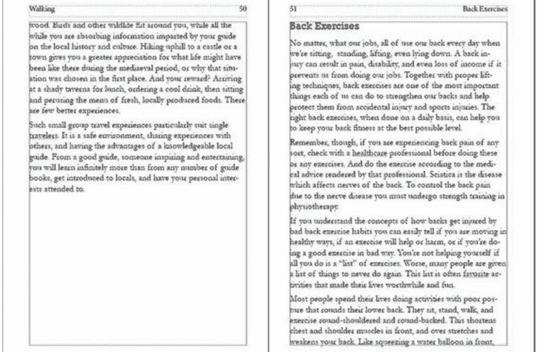

# 第8章. 处理文本

## 理解文本对象

任何经验丰富的InDesign用户都会熟悉通过点击选择文本的方式。

- 单击仅定位光标。

- 双击选择一个单词。

- 三击选择一行。

- 四击选择一段。

- 五击选择整个故事——包括任何溢流文本。

在编写InDesign脚本时，有五个对应的对象——外加一个表示任何单个字符的字符对象：

- `InsertionPoint`

- `Character`

- `Word`

- `Line`

- `Paragraph`

- `Story`

然而，InDesign提供了另外几个文本对象来帮助我们定位正确的文本片段。

- `Texts`——任意范围的字符

- `Text Style Ranges`——具有相似格式的字符组

在操作文档时，你可以根据任何特定时刻的需要使用最方便的对象。

## 覆盖文本对象

要通过脚本在InDesign中添加文本，你基本上是覆盖给定对象的内容。最极端的做法可能是覆盖整个故事。你在InDesign中创建的任何新文本框都包含一个默认的故事。如果你链接两个或多个框架形成串接，它们包含的所有文本也构成一个单一的故事。故事完全独立于页面：你可以在一页上有多个故事，也可以有一个故事跨越数百页。

为了练习，打开"chapter 8"文件夹中名为"01-single-story.indd"的文件。它包含一个单页，其中有一系列链接的文本框。让我们编写一个脚本，替换整个故事。

在ESTK中，创建一个新文件并输入以下代码。

```
1 var doc = app.activeDocument;
2 var txt = doc.stories[0];
3 txt.contents = "The original story has been replaced."
```

运行脚本，将InDesign设为目标应用程序：图8-1显示了前后对比。

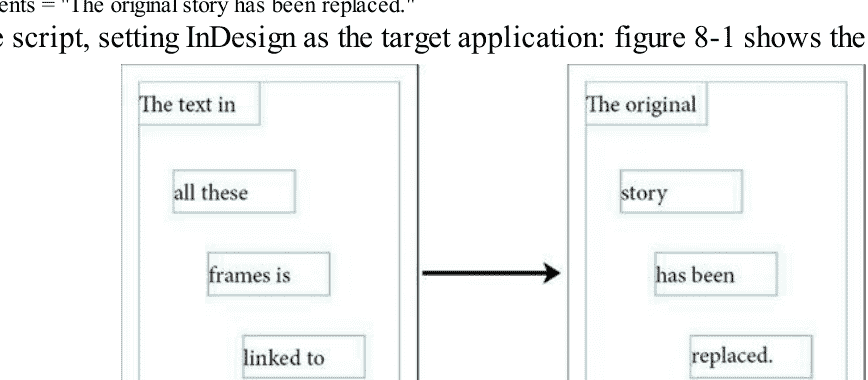

现在让我们看看如何替换文本框的内容。文本框通常通过索引号定位——如`container.textFrames[0]`。然而，如果页面上有多个文本框，则不容易预测InDesign将为每个框分配的索引号。一般规则是，最近创建的索引最低，最先创建的索引最高。

你需要使用多种不同的技术来识别单个文本框——位置、尺寸、相对于其他对象的位置等等。有一件事你会经常需要做，就是遍历页面上的所有文本框，检查这个或那个属性。例如，这里假设我们想定位包含单词"replaced"的框。

修改你的脚本，使其类似于以下内容。

```
1 var doc = app.activeDocument;
2 for(var i = 0; i < doc.pages[0].textFrames.length; i ++){
3   var txt = doc.pages[0].textFrames[i];
4   if(txt.contents != undefined){
5     if (txt.contents.indexOf("replaced") > -1){
6       txt.contents = "overwritten.";
7     }
8   }
9 }
```

该脚本遍历活动文档第1页上的所有textFrame对象，检查它们是否包含单词"replaced"。如果找到匹配项，则将匹配框的内容设置为单词"overwritten"。

同样，你可以覆盖其他InDesign文本对象中的每一个——例如，让我们再做一个快速练习：我们来看看如何覆盖一个段落。

删除页面上的所有文本框，并用一个边与页边距重合的单个文本框替换它们。

用占位符文本填充新文本框——文字 > 用占位符文本填充。

现在，让我们简单地将第三段替换为"This is paragraph 3"。回到ESTK，输入以下脚本。

```
1 var doc = app.activeDocument;
2 txt = doc.pages[0].textFrames[0];
3 txt.paragraphs[2].contents = "This is paragraph 3.\r";
```

请注意，在第3行，我们在字符串末尾包含了一个回车符。这是因为每个段落对象都包含结束回车符；因此当我们替换一个段落时，需要确保我们的文本也以回车符结束。

## 插入文本

在InDesign脚本中，插入文本仍然涉及替换文本对象的内容：你只需定位一个插入点，并将其内容设置为所需的文本。你可以在任何文本对象或文本框内定位一个插入点。

**在对象前插入文本** 要在对象前插入文本，你定位其第一个插入点——`myTextObject.insertionPoints[0]`。因此，例如，要在我们刚才使用的页面开头插入一个标题，我们可以定位故事或文本框的第一个插入点，或第一段、第一行、第一个单词或第一个字符的第一个插入点。在这种情况下，文本框可能是最合乎逻辑的选择。

```
4 var doc = app.activeDocument;
5 txt = doc.pages[0].textFrames[0];
6 txt.insertionPoints[0].contents = "Placeholder Text Strikes Again\r";
```

## 使用字体

字体可以直接应用于任何文本对象，或应用于可以与文本关联的段落或字符样式。InDesign提供两种字体集合：应用程序字体和文档字体：`app.fonts`或`myDocument.fonts`。当然，这两个集合可能不同：任何在`myDocument.fonts`中但不在`app.fonts`中的字体都是缺失的，并将被标记在预检过程中。

访问整个字体集合的最快方法是使用`everyItem()`方法——例如：

```
app.fonts.everyItem()
```

此语法返回对当前系统上所有字体的引用，将其视为单个对象。

## 字体名称

你也可以使用以下方式访问每个字体的名称：

```
app.fonts.everyItem().name
```

这将为你提供一个包含所有字体名称的数组。每个名称的格式将由字体族和字体样式组成，并以制表符分隔。

# 自己动手试试！

## 教程：创建字体和样式选择对话框

为用户提供选择字体的机会是脚本编写中非常常见的需求；因此，让我们看一个脚本，它显示两个下拉列表：一个包含字体，另一个显示可用的样式，如下图 8-2 所示。

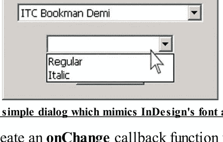

当然，我们需要为字体下拉列表创建一个`onChange`回调函数，该函数在样式下拉列表上显示相应的选项。

创建一个新的 JavaScript 文档，并将文件保存在“chapter08”文件夹中，命名为“01-choose-font.jsx”。（如果你自己的代码停止工作，你也可以随时从完成版本“01-choose-font_completed”复制）。

### 1. 创建字体名称数组

让我们首先创建一个包含当前系统上所有字体名称的数组。为此，请输入以下代码。

```
1 // Create array of every font on system
2 var appFonts = app.fonts.everyItem().name;
3 alert(appFonts.toString());
```

运行代码，你将得到一个巨大的对话框，可能大到无法在屏幕上完全显示。当你想关闭它时，如果看不到“确定”按钮，请不要惊慌——只需清晰、坚定地说声“走开！”。如果那没用，请按回车键。

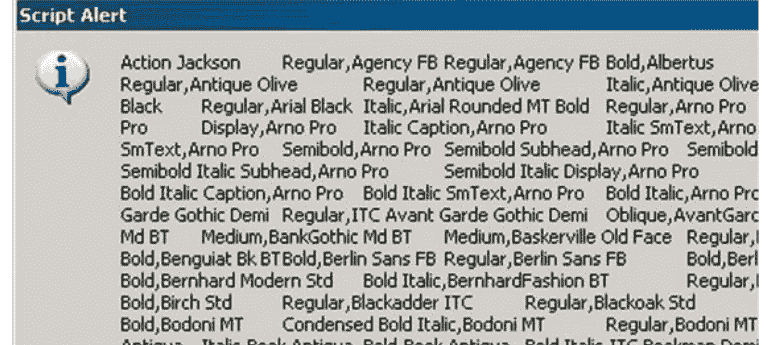

**图 8-3：字体名称包含字体族和字体样式**

如果你仔细查看警报框中显示的数据，你会看到数组以逗号分隔列表的形式显示。数组中的每一项由字体名称、一个制表符以及字体样式组成。

### 2. 为字体和样式名称创建单独的数组

我们的下一个任务是将此列表分成两个单独的数组：一个包含字体名称，另一个包含与该字体关联的字体样式。当然，我们不希望字体名称像当前列表中那样重复出现。我们希望每个字体名称只出现一次。此外，由于每个字体通常关联两个或更多样式，包含样式的数组应该是一个包含嵌套数组的数组。

我们将使用的技术是循环遍历我们创建的`appFonts`数组中的字体，并使用 String 对象的 split 命令将每个项目转换为一个包含两个值的数组：字体名称和样式名称。每次遇到新的字体名称时，我们将执行三项操作：

- 将字体名称添加到我们的字体名称数组中。

- 在我们的字体样式数组中创建一个新的嵌套数组。

- 将样式名称添加到这个嵌套数组中。

当我们继续循环时，如果字体名称重复，我们将只执行第三步。只有遇到新的字体名称时，我们才会再次执行所有三个步骤。

为了被标记为新字体，项目必须满足以下两个条件之一：

- 项目是列表中的第一个字体

- 项目包含与其前驱项不同的字体名称

删除第 3 行的 alert 语句并添加以下代码。

```
1 // Create array of every font on system
2 var appFonts = app.fonts.everyItem().name;
3 // Create separate arrays for font and style
4 var displayFonts = [];
5 var displayStyles = [];
6 var counter = -1;
7 for (var i = 0; i < appFonts.length; i++){
8   appFonts[i] = appFonts[i].split("\t");
9   if(i === 0 || appFonts[i][0] != appFonts[i-1][0] ){
10    displayFonts.push(appFonts[i][0]);
11    counter ++;
12    displayStyles[counter] = [];
13  }
14  displayStyles[counter].push(appFonts[i][1]);
15 }
```

在第 4-5 行，我们定义了两个数组，它们将分别保存字体名称和字体样式嵌套数组：`displayFonts`和`displayStyles`。

在第 6 行，我们初始化计数器，该计数器用于标识`displayStyles`数组中的嵌套数组，我们需要向其中添加检索到的最新字体样式。由于在循环内部，计数器在用作索引之前会递增，因此我们将其初始值设置为负一。

在 for 循环内部，第 8 行，我们使用`split()`函数，并以制表符作为其参数，这意味着我们将生成一个包含两个项目的数组，第一个包含字体名称，第二个包含字体样式。

在第 9 行，我们测试这是否是第一次迭代，或者`appFonts`当前项目（`currentFont`）的字体名称是否与前一个项目（`appFonts[i-1][0]`）不同。如果其中任何一个测试为真，我们就通过增加计数器并将其用作索引，在`displayStyles`数组内添加一个新的嵌套数组。

```
11 counter ++;
12 displayStyles[counter] = [];
```

在第 14 行，我们将当前字体样式从`appFonts`（`currentStyle`）添加到`displayStyles`内最后创建的嵌套数组（`displayStyles[counter]`）。（请注意，此步骤不是有条件的，因为我们始终希望执行它。）

### 3. 创建对话框

创建了我们的两个显示数组后，我们就可以创建对话框了。

将以下代码添加到你的脚本中。

```
16 // Window and controls
17 var win = new Window('dialog');
18 win.ddlFonts = win.add('dropdownlist', undefined, displayFonts);
19 win.ddlStyles = win.add('dropdownlist');
20 win.ddlStyles.minimumSize = [150,20];
21 win.btnClose = win.add('button', undefined, 'Close');
```

在第 19 行，当我们创建字体名称下拉列表时，我们指定`displayFonts`数组作为`add()`方法的第三个参数——即要在控件中显示的项目。

相比之下，在第 20 行，当我们创建字体样式下拉列表时，我们只是省略了此参数：这意味着下拉列表在首次加载时将是空白的。

在第 21 行，我们给控件一个最小尺寸：字体名称下拉列表的实际宽度将由最长的字体名称决定。

### 4. 字体下拉列表的 onChange 回调

我们对话框的交互元素是，当用户选择一种字体时，相应的字体样式会自动显示在字体样式下拉列表上。为此，我们为字体名称下拉列表（`win.ddlFonts`）创建一个 onChange 回调函数。

我们的回调函数需要做以下事情。

- 清除控件中的任何现有值。

- 识别`displayStyles`中与所选字体名称对应的嵌套数组。

- 遍历嵌套的字体样式数组，将每个项目添加到字体样式下拉列表。

由于`displayFonts`和`displayStyles`是在同一个 for 循环中填充的，它们的索引号将对应，并且当然`displayFonts`控制着字体下拉列表中显示的项目。因此，如果我们使用`win.ddlFonts`选中项目的索引作为`displayStyles`的索引，我们将得到正确的嵌套数组。

将以下代码添加到你的脚本中。

```
23 // Callback function - font dropdown
24 win.ddlFonts.onChange = function(){
25    win.ddlStyles.removeAll();
26    var arrStyle = displayStyles[this.selection.index];
27    for (var i = 0; i < arrStyle.length; i++){
28        win.ddlStyles.add('item', arrStyle[i]);
29    }
30 }
```

在第 25 行，我们使用`removeAll()`方法清除`win.ddlStyles`内部的任何现有值。

在第 26 行，我们创建一个名为`arrStyle`的变量，并将包含当前选定字体样式名称的嵌套数组放入其中。由于这是与`win.ddlFonts`相关的回调函数，以下语句是等效的。

```
this.selection.index
win.ddlFonts.selection.index
```

然后我们遍历我们的嵌套数组，并在第 28 行将每个项目添加到`win.ddlStyles`。

### 5. 关闭按钮的 onClick 回调

让我们为关闭按钮的 onClick 事件再创建一个回调函数。我们的回调函数将简单地显示一个警报，其中包含所选字体的名称和样式，然后关闭按钮。

将以下代码附加到你的脚本中。

```
31 // Callback function - close button
32 win.btnClose.onClick = function(){
33   alert("Font: " + win.ddlFonts.selection.text + "\rStyle: " + win.ddlStyles.selection.text);
34   win.close(2);
35 }
```

### 6. 显示对话框

最后但同样重要的是，让我们添加以下几行代码来显示对话框。

```
36 // Display window
37 var winResult = win.show();
```

虽然我们并未使用对话框返回的值，但在显示对话框时，始终最好使用这种编码风格。当我们关闭对话框（在第40行），我们使用`close()`语句返回一个值2：这个值最终会存储在`winResult`中。

运行脚本，并从两个下拉菜单中选择一种字体和字体样式。

当你点击 Close 按钮时，警报对话框应该会确认你选择的字体和样式。

点击 OK 关闭警报，保存你的更改，然后关闭文件。

## 查找和替换文本

InDesign 的 Find/Change（查找/更改）命令功能极其强大，现在不仅可以查找和更改文本，还可以查找和更改 GREP 表达式、字形和对象属性。通过脚本执行 Find/Change 操作相比手动执行具有两大优势。首先，如果需要对一个文件或一组文件定期进行多项标准更改——例如执行清理操作，可以将这些操作编写成脚本。其次，手动执行 Find/Change 时，你可以在“更改为”框中输入的内容受到严格限制；而通过脚本，你可以对找到的对象执行的更改仅受你想象力的限制。

为了说明自动化 Find/Change 命令，我们将创建一个脚本，用于清理文档中的文本，搜索对我们的出版物而言不合适的用法——例如句号后使用两个空格、使用制表符进行缩进、以及使用直引号而非排版引号。

## 清除查找/更改首选项

如果你是有经验的 InDesign 用户，你会知道当你执行 Find/Change 操作时，发现除了更改文本之外，由于之前操作中留在 Change Format（更改格式）框中的设置，你还无意中更改了格式，这有多么恼人。你必须撤销更改，移除格式选项，然后重试。

在脚本中，Find（查找）框的内容是`findTextPreferences`对象的属性（在处理文本时）；处理 GREP 时是`findGrepPreferences`；处理字形时是`findGlyphPreferences`；处理对象格式时是`findObjectPreferences`。两个 Change（更改）框的内容则是`changeTextPreferences`、`changeGrepPreferences`、`changeGlyphPreferences`和`changeObjectPreferences`的属性。

为了避免不可预测的结果，在脚本中执行 Find/Change 操作之前，你应始终以编程方式清除这些对象。在查找和更改文本时，相应的代码如下：

```
findTextPreferences = NothingEnum.Nothing;
changeTextPreferences = NothingEnum.Nothing;
```

**图 8-3：将 findTextPreferences 对象（及其他变体）设置为 nothing，等同于在程序上点击“查找格式”和“更改格式”部分的垃圾桶图标。**

为了避免让使用你脚本的人感到恼火——包括你自己，你也应该在执行 Find/Change 操作后重复此清除代码；否则，你代码中使用的任何设置都会一直保留，直到有人下次执行 Find/Change 为止。在执行文本以外的其他类型的查找/更改操作时，可以使用类似的代码来清除设置。

## 自己试试看！

## 教程：创建清理文本脚本

在这个示例——一个清理文本脚本中，我们将从创建一个包含一系列复选框的界面开始，允许用户决定执行哪些操作。选项如下：

- 句号（或句点）后的两个空格替换为一个空格。

- 用于缩进段落开头的制表符被移除。

- 每个段落后的两个回车符替换为一个回车符。

- 两个连字符替换为一个破折号。

对话框顶部的下拉菜单（如图 8-4 所示）允许用户指定搜索范围。选项有：

- 活动文档

- 所有打开的文档

- 选中的文本

**图 8-4：一个简单的清理实用程序，用于整理不理想的文本用法。**

我们需要处理的唯一两个事件处理程序是 Cancel（取消）和 Clean Up（清理）按钮的`onClick`事件。

## 1. 创建脚本的框架

在 ESTK 中，选择 File > New JavaScript，输入文件名“02-clean-up.jsx”，并将文件保存到“indesigncs5js1”文件夹的“chapter08”文件夹中。

输入以下代码。

```
#targetengine "session"
var g = {};
createDialog();
g.win.show();

function createDialog(){

}
```

保存你的更改。

在第2行，我们声明了一个名为`g`的变量：它将用于包含我们将要显示的窗口。由于该窗口将从多个不同的函数中引用，因此它需要是一个全局变量，因此在函数外部声明。

在第3行，我们调用`createDialog()`函数，主对话框窗口将在其中构建，然后在第4行，我们显示窗口，脚本结束。我们脚本的其余功能将放置在 OK 按钮的 onClick 回调中。

## 2. createDialog() 函数

现在让我们编写`createDialog()`函数，从用户将用于选择查找/更改操作范围的下拉列表控件开始。

### 2a. 范围下拉列表

将光标定位在第7行——框架 `createDialog()` 函数内的空行。

输入以下代码。

```
function createDialog(){
  g.win = new Window('palette', 'Clean up Typography');
  g.win.pnlScope = g.win.add('panel');
  g.win.pnlScope.add('statictext', undefined, 'Scope of Search');
  var arrScope = ['Active document','All open documents', 'Selected text'];
  g.win.pnlScope.ddl = g.win.pnlScope.add('dropdownlist', undefined, arrScope);
  g.win.pnlScope.ddl.selection = 0;
}
```

保存你的更改。

在第7行，当我们创建窗口时，我们将类型设置为“palette”（调色板）或非模态。在第8行，我们创建一个面板，在第9行，我们插入静态文本标签“Scope of search”（搜索范围）。

在第10行，我们定义一个数组，包含用户将被允许进行的三种搜索类型；然后，在第11行，我们使用该数组作为`add()`方法的第三个（items）参数来创建下拉列表。

最后，在第12行，我们将下拉列表中的第一个项目（项目零）设置为默认选择。

从 InDesign 或从 ESTK 运行脚本，将目标应用程序设置为 InDesign。你的对话框应类似于下图所示。

### 2b. 用于选择清理操作的复选框

现在让我们创建复选框，允许用户选择他们希望执行的清理操作。

将光标定位在第13行——就在 `createDialog()` 函数的闭合大括号之前。

按回车键，然后输入以下代码。

```
  g.win.pnlOps = g.win.add('panel', undefined, 'Operations');
  g.win.pnlOps.alignChildren = 'left';
  g.win.pnlOps.chkSpace = g.win.pnlOps.add('checkbox', undefined, '2 spaces --> 1.');
  g.win.pnlOps.chkTab = g.win.pnlOps.add('checkbox', undefined, 'Remove tab as indent.');
  g.win.pnlOps.chkRet = g.win.pnlOps.add('checkbox', undefined, '2 returns --> 1.');
  g.win.pnlOps.chkQuot = g.win.pnlOps.add('checkbox', undefined, 'Straight quotes --> curly.');
  g.win.pnlOps.chkEm = g.win.pnlOps.add('checkbox', undefined, '2 hyphens --> em dash.');
}
```

保存你的更改。

在第15行，我们将面板内项目的方向从默认的“center”（居中）更改为“left”（左对齐），这样所有复选框都将对齐。

如果你再次运行脚本，你的对话框现在应该看起来像这样。

假设我们预期，大多数时候，使用该工具的用户会想要执行所有的清理操作。如果是这种情况，那么在对话框加载时默认激活所有复选框将会很方便。

将光标定位在第21行的末尾——就在`createDialog()`函数的结束大括号上方。

输入以下代码。

```
20  g.win.pnlOps.chkEm = g.win.pnlOps.add('checkbox', undefined, '2 hyphens --> em dash.');
21  for(i = 0; i < g.win.pnlOps.children.length; i++){
22      g.win.pnlOps.children[i].value = true;
23  }
24
25  }
```

为了免去逐个取消勾选每个复选框的麻烦，我们只需遍历`win.pnlOps`的`children`集合，并将每个元素的值设置为true。

| 语法摘要 ... | `myControl.children` |
|---|---|
| ScriptUI 控件的只读属性 | 返回包含在 myControl 内的子控件数组。该数组可能包含各种类型的控件。 |

### 2c. “取消”和“清理”按钮

我们窗口中的最后一个元素将是按钮。

将光标定位在第24行的末尾——就在`createDialog()`函数的结束大括号上方。

按回车键留出一个空行，然后输入以下代码。

```
22      g.win.pnlOps.children[i].value = true;
23  }
24
25  g.win.grpButs = g.win.add('group');
26  g.win.grpButs.cleanUp = g.win.grpButs.add('button', undefined, 'Clean Up');
27  g.win.grpButs.cancel = g.win.grpButs.add('button', undefined, 'Cancel');
28  g.win.grpButs.cleanUp.onClick = cleanUpText;
29  g.win.grpButs.cancel.onClick = function() {g.win.close();}
30  g.win.onClose = function() {g = null;}
31  }
```

保存你的更改。

这就完成了`createDialog()`函数。在第28行，我们指定函数`cleanUpText()`作为我们即将创建的 Clean Up 按钮的回调函数。取消按钮的内联回调函数只是关闭窗口；而窗口本身被分配了一个回调函数，该函数将全局变量——`g`——重置为null。

## 3. cleanUpText() 函数

`cleanUpText()`函数包含当用户点击 Clean Up 按钮时执行的代码。在其中，我们需要评估用户做出的选择并执行适当的查找/更改操作。

### 3a. 函数骨架

将以下函数骨架添加到你的脚本中，放在所有现有代码的下方。

```
32
33  function cleanUpText()
34  {
35    var arrDocs =[];
36
37    // Detect scope chosen by user
38
39    // Perform operations chosen by user
40
41  }
```

正如你从注释中看到的，此函数首先需要检测用户选择的范围：“活动文档”、“所有打开的文档”或“选定的文本”。然后，我们需要在指定的文档、文档集或选区上执行用户请求的所有操作。

在第35行声明的数组变量`arrDocs`将用于保存要处理的文档。如果用户选择“活动文档”或“选定的文本”，我们将简单地将活动文档添加到我们的数组中。如果他们选择“所有打开的文档”，我们将所有当前打开的文档添加到`arrDocs`数组中。

稍后，当我们执行查找/更改操作时，我们将遍历`arrDocs`并对其包含的每个文档执行必要的更改，如果只包含活动文档，则只循环一次。

### 3b. 检查“更改/查找”操作的范围

将光标放在注释“// Detect scope chosen by user”下方的空白行上。

插入以下代码。

```
37  } // Detect scope chosen by user
38  switch(g.win.pnlScope.ddl.selection.text){
39    case 'Active document':
40      arrDocs[0] = app.activeDocument;
41      break;
42    case 'All open documents':
43      arrDocs = app.documents;
44      break;
45    case 'Selected text':
46      if(app.selection.length === 1 && "contents" in app.selection[0]){
47        arrDocs[0] = app.activeDocument;
48      }
49      else{
50        alert('No text selected. Please select the text that you want to search.');
51        g.win.close();
52      }
53    }
54
55  // Perform operations chosen by user
56
57  }
```

保存你的更改。

在第38行到53行，我们使用switch语句来检查用户在范围下拉列表中做出的选择。如果他们选择了“活动文档”，我们将活动文档添加到`arrDocs`数组变量中（第40行）。这意味着我们将有一个包含单个项目的数组。

如果他们选择了“所有打开的文档”，我们将`app.documents`（即所有打开的文档）添加到`arrDocs`数组变量中（第43行）。这意味着我们的数组中将有未知数量的项目。

如果用户选择了“当前选区”，我们需要检查选区的有效性。第46到52行的`if`语句检查是否选中了单个项目。如果选中了多个项目，则选区不可能是文本选区；如果什么都没选，那么我们无法继续。因此，在第50行的`else`部分，我们显示一个警报（'No text selected. Please select the text that you want to search.'——第50行）并关闭对话框。

第46行的if语句还测试所选项目是否具有名为"contents"的属性——这是确保该项目是文本对象或文本框架的一种简单方法。

| 语法摘要 ... | `"myProperty" in myObject` |
|---|---|
| 用于测试给定对象内是否存在属性的语法 | 返回 true 或 false。注意，属性名称必须在引号内。 |

### 3c. 执行选定的清理操作

在`cleanUpText()`函数的最后部分，我们将使用一系列if语句来测试哪些复选框被激活。实际的查找/更改操作将由一个单独的函数`doFindChange()`执行，我们将反复调用它。`doFindChange()`函数将需要三个参数：要搜索的文档或文档集（始终是`arrDocs`）、要查找的文本以及要替换成的文本。

下表显示了我们将要搜索的各种文本元素以及我们将用来替换它们的字符串。除了直引号外，它们都相当简单直接。这里，我们将采用简化的方法：如果双引号或单引号前面是回车符或空格，它们将被替换为左弯引号；如果它们后面是回车符或空格，则将被替换为右弯引号。

| 复选框名称 | 查找内容 | 更改为 |
|---|---|---|
| `chkSpace` | ". " (句号, 空格, 空格) | ". " (句号, 空格) |
| `chkTab` | "\r\t" (回车, 制表符) | "\r" (回车) |
| `chkRet` | "\r\r" (回车, 回车) | "\r" (回车) |
| `chkQuot` | " \"" (空格, 直双引号) | " \u201c" (空格, 左双弯引号) |
| `chkQuot` | "\r\"" (回车, 直双引号) | "\r\u201c" (回车, 左双弯引号) |
| `chkQuot` | "\" " (直双引号, 空格) | "\u201d " (右双弯引号, 空格) |
| `chkQuot` | "\"\r" (直双引号, 回车) | "\u201d\r" (右双弯引号, 回车) |
| `chkQuot` | " '" (空格, 直单引号) | " \u2018" (空格, 左单弯引号) |
| `chkQuot` | "\r'" (回车, 直单引号) | "\r\u2018" (回车, 左单弯引号) |
| `chkQuot` | "' " (直单引号, 空格) | "\u2019 " (右单弯引号, 空格) |
| `chkQuot` | "'\r" (直单引号, 回车) | "\u2019\r" (右单弯引号, 回车) |
| `chkEm` | "--" (连字符, 连字符) | "—" (全角破折号) |

将光标放在注释“// Perform operations chosen by user”下方的空白行上。

插入以下代码。（如果你觉得阅读`doFindChange()`函数调用的第二个和第三个参数有困难，请参考上面的表格。）

```
55  // Perform operations chosen by user
56  if(g.win.pnlOps.chkSpace.value == true) {doFindChange(arrDocs, ".  ", ". ");}
57  if(g.win.pnlOps.chkTab.value == true) {doFindChange(arrDocs, "\r\t", "\r");}
58  if(g.win.pnlOps.chkRet.value == true) {doFindChange(arrDocs, "\r\r", "\r");}
59  if(g.win.pnlOps.chkQuot.value == true)
60  {
61    doFindChange(arrDocs, " \"", " \u201c");
62    doFindChange(arrDocs, "\r\"", "\r\u201c");
63    doFindChange(arrDocs, "\" ", "\u201d ");
64    doFindChange(arrDocs, "\"\r", "\u201d\r");
65    doFindChange(arrDocs, " '", " \u2018");
66    doFindChange(arrDocs, "\r'", "\r\u2018");
67    doFindChange(arrDocs, "' ", "\u2019 ");
68    doFindChange(arrDocs, "'\r", "\u2019\r");
69  }
70  if(g.win.pnlOps.chkEm.value == true) { doFindChange(arrDocs, "--", "\u2014");}
71  }
```

保存你的更改。

在第56到70行，我们测试对话框操作部分的每个复选框。如果某个复选框处于激活状态，我们就会调用`doFindChange()`，这是一个接受三个参数的函数——要搜索的文档、要查找的字符串（`strFindWhat`）以及要替换的字符串。

将其更改为（`strChangeTo`）。

在`chkQuotes`复选框（第61至68行）的情况下，我们执行8次查找/更改操作；因为我们必须替换开双引号、闭双引号、开单引号和闭单引号。

### 3d. 创建 doFindChange() 函数

最后，让我们创建`doFindChange()`函数。

在现有脚本的末尾添加以下代码。

```
function doFindChange(arrDocs, strFindWhat, strChangeTo){
  for (i = 0; i < arrDocs.length; i++){
    app.findTextPreferences = NothingEnum.nothing;
    app.changeTextPreferences = NothingEnum.nothing;
    app.findTextPreferences.findWhat = strFindWhat;
    app.changeTextPreferences.changeTo = strChangeTo;
    if(g.win.pnlScope.ddl.selection.text == 'Selected text'){
      app.selection[0].changeText();
    }
    else{
      arrDocs[i].changeText();
    }
    app.findTextPreferences = NothingEnum.nothing;
    app.changeTextPreferences = NothingEnum.nothing;
  }
}
```

保存您的更改。

`doFindChange()`函数遍历`arrDocs`数组变量中的项目。在每次循环中，我们清空`findTextPreferences`和`changeTextPreferences`对象（第75至76行）。然后我们将这些对象的`findWhat`和`changeTo`属性设置为调用函数时提供的参数——`strFindWhat`和`strChangeTo`（第77至78行）。然后我们使用if语句检查用户是否选择了“Selected Text”选项（第79行）。如果他们选择了，我们使用`app.selection[0].changeText()`执行清理；如果没有，则我们使用`arrDocs[i].changeText()`（第83行）。要测试脚本，请关闭所有您自己的InDesign文档，然后在“chapter08”文件夹中打开文件“02-clean-up1.indd”和“02-clean-up2.indd”。通过在对话框中选择不同的参数并单击 Clean Up 按钮来测试该实用程序。要尝试另一组选项，选择 File > Revert 以撤销所有更改。

# 表格

InDesign表格不被视为独立对象，而是被视为只能存在于文本框架内的元素，与文本处于同一级别。要创建表格，InDesign用户将光标定位在所需位置并选择 Table > Insert Table。默认情况下，InDesign表格有4个正文行和4列，没有页眉或页脚行。如果您创建了具有不同行数和列数的表格，这些设置将成为默认值。此默认设置在使用脚本时同样适用。

## 创建表格

要在文本框架内的给定位置创建表格，请使用`tables.add()`方法：它接受三个可选参数。

| 语法摘要 | `myTextObject.tables.add([To, Reference object, Initial properties])` 表集合的方法。在指定的文本对象（文本框架、故事等）内创建一个表格。 |
| --- | --- |
| `To` | 可选。表格相对于给定参考对象的位置，使用以下枚举选项之一：`LocationOptions.BEFORE`、`LocationOptions.AFTER`、`LocationOptions.AT_END`、`LocationOptions.AT_BEGINNING`、`LocationOptions.UNKNOWN`（默认值） |
| `Reference object` | 可选，但如果to参数设置为`LocationOptions.BEFORE`或`LocationOptions.AFTER`则必须提供。参考对象可以是另一个表格或任何InDesign文本对象。 |
| `Initial properties` | 可选。包含表格属性的JavaScript对象。 |

让我们看一个简单的例子。在清单8-3中，我们创建一个新文档，在其第一页上添加一个文本框架，并在其中插入一个表格。然后我们将列数设置为8。

### 清单8-3：创建基本表格

```
var doc = app.documents.add();
var pg1 = doc.pages[0];

// Create textFrame
var y1 = pg1.marginPreferences.top;
var x1 = pg1.marginPreferences.left;
var y2 = doc.documentPreferences.pageHeight - pg1.marginPreferences.bottom;
var x2 = doc.documentPreferences.pageWidth - pg1.marginPreferences.right;
var frm1 = doc.textFrames.add({geometricBounds: [y1, x1, y2, x2]});

// Add table to text frame
var tbl1 = frm1.insertionPoints[-1].tables.add();
tbl1.bodyRowCount = 8;
tbl1.columnCount = 8;
```

生成的表格如图8-5所示。因为没有使用创建属性，所以表格以默认的4列创建，这些列会自动调整大小以使表格完全适合文本框架。当我们指定列数为8时，这4列保持其原始宽度，另外4列则溢出文本框架的边缘。

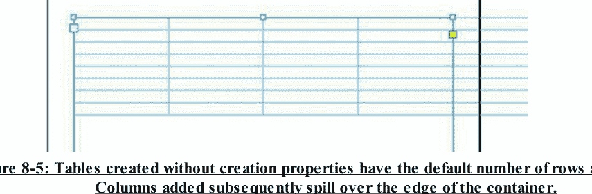

**图8-5：** 未使用创建属性创建的表格具有默认的行数和列数。后续添加的列会溢出容器的边缘。

在下面的清单8-4中，我们有相同的脚本；但这一次，我们使用创建属性参数来设置列数和正文行数。

### 清单8-4：使用创建属性设置表格的行数和列数

```
var doc = app.documents.add();
var pg1 = doc.pages[0];

// Create textFrame
var y1 = pg1.marginPreferences.top;
var x1 = pg1.marginPreferences.left;
var y2 = doc.documentPreferences.pageHeight - pg1.marginPreferences.bottom;
var x2 = doc.documentPreferences.pageWidth - pg1.marginPreferences.right;
var frm1 = doc.textFrames.add({geometricBounds: [y1, x1, y2, x2]});

// Add table to text frame
var tbl1 = frm1.insertionPoints[-1].tables.add(undefined, undefined, {bodyRowCount: 8, columnCount: 8});
```

如图8-6所示，生成表格的宽度与包含它的文本框架的宽度相匹配。

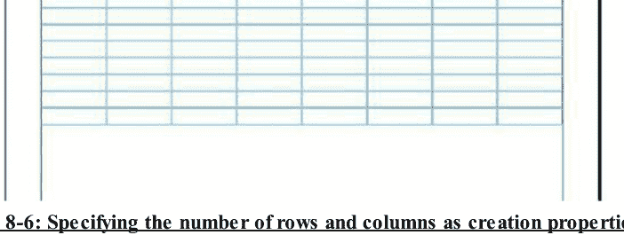

**图8-6：** 在使用`tables.add()`方法时将行数和列数指定为创建属性，会导致表格宽度与其父文本框架的宽度相匹配。

## 向表格单元格添加文本

在单元格中写入值与向文本框架添加文本非常相似。通常，您会使用目标单元格的`contents`属性。实际上，您可以向表格单元格、行或列添加文本。当目标为单元格时，您通常需要遍历这些单元格，从某处读取数据并将其输入到单元格中。当目标为行或列时，您还可以选择写入字符串数组：InDesign会自动将数组中的每个项目放入不同的单元格中。

### 向每个单元格写入一个值

要将相同的值写入表格的每个单元格，您可以使用`everyItem()`方法来定位每个单元格，然后将返回对象的`contents`属性设置为所需的值。

### 清单8-5：使用 everyItem() 定位表格中的每个单元格

```
var doc = app.documents.add();
var pg1 = doc.pages[0];

// Create textFrame
var y1 = pg1.marginPreferences.top;
var x1 = pg1.marginPreferences.left;
var y2 = doc.documentPreferences.pageHeight - pg1.marginPreferences.bottom;
var x2 = doc.documentPreferences.pageWidth - pg1.marginPreferences.right;
var frm1 = doc.textFrames.add({geometricBounds: [y1, x1, y2, x2]});

// Add table to text frame
var tbl1 = frm1.insertionPoints[-1].tables.add(undefined, undefined, {bodyRowCount: 8, columnCount: 8});

// Write value to all cells
var allCells = tbl1.cells.everyItem();
allCells.contents = "the same";
```

向表格中的每个单元格添加相同的值并不是您会经常做的事情。然而，`cells.everyItem()`方法值得记住；因为它允许您快速定位给定表格中每个单元格的任何属性。

### 向行写入数组

向表格行写入数组的能力也非常有用。例如，假设我们想创建一个有12列的表格，其页眉行包含一年的月份。列数很多，因此我们可能还想将标题的方向更改为垂直，如下图8-7所示，以减少表格的总体宽度。


**图8-7：** 当您将表格行的contents设置为等于一个数组时，数组中的每个项目会自动插入到单独的单元格中。

创建该表格的代码如下清单8-6所示。

### 清单8-6：向表格行写入数组

```
var arrMonths = ["January", "February", "March", "April", "May", "June", "July", "August", "September", "October", "November", "December"];
var doc = app.documents.add();
var pg1 = doc.pages[0];

// 创建文本框架
var y1 = pg1.marginPreferences.top;
var x1 = pg1.marginPreferences.left;
var y2 = doc.documentPreferences.pageHeight - pg1.marginPreferences.bottom;
var x2 = doc.documentPreferences.pageWidth - pg1.marginPreferences.right;
var frm1 = doc.textFrames.add({geometricBounds: [y1, x1, y2, x2]});

// 向文本框架添加表格
var tbl1 = frm1.insertionPoints[-1].tables.add({headerRowCount: 1, bodyRowCount: 8, columnCount: 12});

// 为表格添加格式和数据
var allCells = tbl1.cells.everyItem();
var header = tbl1.rows[0];
allCells.verticalJustification = VerticalJustification.centerAlign;
header.writingDirection = HorizontalOrVertical.vertical;
header.height = "25 mm";
header.contents = arrMonths;
```

在第1行，我们创建了一个名为`arrMonths`的数组，其中包含了12个月份。

在第13行，当创建表格时，我们使用创建属性对象将标题行数设置为1，正文行数设置为8，列数设置为12。

在第18行，我们将表格中所有单元格的垂直对齐方式设置为`centerAlign`。然后，在第19行，我们通过将表格第一行的`writingDirection`属性设置为`HorizontalOrVertical.vertical`来旋转标题文本。

最后，在第21行，我们将标题行的内容设置为我们的月份数组。

## 亲自尝试一下！

## 教程：更新表格数据

表格在出版物中常用于存放清单和规格等信息，当这些信息过时时可能需要更新。只要出版物以一致的方式使用相关表格，就有可能从文本文件中读取新数据，将每项数据与表格单元格的内容进行匹配，然后用文本文件中的值覆盖当前数据。

在这个例子中，我们将处理一个使用表格显示一系列日期的出版物。该出版物列出了虚构的 Mountainwell 烹饪学校的烹饪课程。每一页都包含对他们教授的某种烹饪方式的简短描述。页面顶部是一个表格，列出了各种短期课程的日期，如下所示。

要更新出版物，我们需要从制表符分隔的文本文件中导入数据，该文件格式如下所示。

```
American Beginners Wed 12 Jan
American Beginners Fri 11 Mar
American Beginners Tue 10 May
American Beginners Thu 07 Jul
American Beginners Mon 05 Sep
American Intermediate Tue 18 Jan
American Intermediate Thu 17 Mar
American Intermediate Mon 16 May
American Intermediate Wed 13 Jul
American Intermediate Fri 09 Sep
...
```

如您所见，每条记录包含一种烹饪类型、一个课程以及一个日期。我们需要使用 cuisine 列来定位正确的页面，使用 course 列来定位表格中的正确行，而 date 列中的条目需要写入相应的表格单元格。然而，日期被分成了不同的记录：如果某个课程的所有日期都在同一个容器中——例如，一个数组中——会更好。因此，在读取数据后，我们将修改其结构。

### 1. 变量声明和函数调用

你首先需要的是 InDesign 文档。

打开名为 "07-update-tables-from-file.indd" 的文件，它在“chapter08”文件夹中。接下来，切换到 ESTK 并创建一个新文件，将其保存为 "07-update-tables.jsx"。

输入以下代码。

```
1 var g = {};
2 g.objDates = {};
3 importDates(); // 导入日期并转换格式
4 updateTables(); // 将新日期添加到表格
5 g = null;
6
7 function importDates(){
8
9 // 读取数据文件
10
11 // 转换为数组
12
13 // 转换格式以匹配文档中的表格
14
15 } // 结束 importDates 函数
16
17 function updateTables(){
18
19 }
```

变量`g.objDates`是一个对象字面量，我们将在此存放转换后的制表符分隔数据。我们想要得到的结构如下所示。

```
{AmericanBeginners: ["Beginners", "Wed 12 Jan", "Fri 11 Mar", "Tue 10 May", "Thu 07 Jul", "Mon 05 Sep"],
AmericanIntermediate: ["Intermediate", "Tue 18 Jan", "Thu 17 Mar", "Mon 16 May", "Wed 13 Jul", "Fri 09 Sep"]...}
```

对象中的每个属性都是烹饪类型和课程的组合，与其关联的值是一个包含课程和所有相关日期的数组。其思路是，`g.objDates`中的每个数组恰好包含在表格每行中找到的数据。

| Beginners | Wed 26 Jan | Fri 25 Mar | Tue 24 May | Thu 21 Jul |

因此，我们将能够将行的内容设置为相应数组的值——就像我们在上一个示例，第191页所做的那样。

### 2. importDates() 函数

**2a. 读取数据文件**

我们要做的第一件事是通过将文件内容读入字符串变量来导入文件。

将光标置于`importDates()`函数内，“// Read data file”注释下方。

将以下代码添加到你的脚本中。

```
7 function importDates(){
8
9 // 读取数据文件
10 var strPath = app.activeScript.parent + "/food-dates.txt";
11 var fleDates = new File(strPath);
12 if(fleDates.exists){
13 fleDates.open("r");
14 var strDates = fleDates.read();
15 fleDates.close();
16 }
17 else {
18 alert("抱歉，无法打开数据文件。");
19 return;
20 }
21 alert(strDates);
22
23 // 转换为数组
24
25 // 转换格式以匹配文档中的表格
26
27 } // 结束 importDates() 函数
```

在第10行，我们使用`app.activeScript.parent`指定数据文件的路径以定位包含脚本的文件夹，然后连接文本文件的名称。

在第11行，我们创建一个指向此相同路径的新文件，如果文件存在，则在第13至14行，我们以读取（“r”）模式打开它，然后将整个文件读入字符串变量`strDates`。一旦完成此操作，我们就对文件处理完毕，因此可以关闭它（第15行）。

如果文件不存在，我们将显示一条错误消息并退出函数（第18至19行）。第21行的警报是一个临时装置，使我们能够预览已读取的数据。

确保文件 "07-update-table-from-file.indd" 是活动的 InDesign 文档，然后从脚本面板运行脚本。

如果文件路径正确，并且 "food-dates.txt" 与你的脚本在同一文件夹中，你应该看到一个大型对话框，其中包含已读取的数据。

如果文件路径有错误，你将看到错误消息，并需要更正文件路径。

**2b. 将数据转换为数组**

现在我们要将长字符串转换为一系列数组。我们通过使用字符串对象的`split()`方法来实现这一点，该方法使用指定的分隔符作为“分隔器”将字符串分成一系列子字符串。在我们的例子中，我们希望使用每行末尾的换行符作为分隔符——在 JavaScript 中，它表示为“\n”。

删除脚本第21行的 alert 语句。

将光标置于`importDates()`函数内，“// Convert to array”注释下方，并添加以下几行代码。

```
22 // 转换为数组
23 var arrDates = strDates.split("\n");
24 arrLevels = [];
25 for (var i = 0; i < arrDates.length; i++) {
26   var currentDate = arrDates[i].split("\t");
27   arrLevels.push(currentDate);
28 }
29 
30 // 转换格式以匹配文档中的表格
31 
32 }
```

保存你的更改。

第23行将采用原始数据——看起来像这样：

**American Beginners Wed 12 Jan**

**American Beginners Fri 11 Mar**

**American Beginners Tue 10 May**

...

并将其转换为名为`arrDates`的字符串数组，看起来像这样：

**[American >> Beginners >> Wed 12 Jan, American >> Beginners >> Fri 11 Mar, American >> Beginners >> Tue 10 May ...]**

请注意数组中的每个项目仍然是制表符分隔的记录（上面用“>>”表示）。

我们需要单独访问每条记录中的元素；因此我们执行第二次转换。

使用制表符（在 JavaScript 中表示为`"\t"`）作为分隔符进行拆分。我们需要保留现有的数组；但希望它们包含的不再是字符串，而是每个包含三个字符串的嵌套数组。

在第 24 行，我们创建了一个名为`arrLevels`的空数组。然后，当我们循环遍历原始数组`arrDates`时，我们使用制表符分隔符拆分遇到的每个项目，并将结果数组放入一个名为`currentDate`的临时局部变量中（第 26 行）。

最后，在第 27 行，我们使用以下代码将`currentDate`中的数组添加到`arrLevels`：

`arrLevels.push(currentDate)`。

当循环完成后，我们得到一个包含嵌套数组的数组（`arrLevels`），其格式如下：

[ [**American, Beginners, Wed 12 Jan**], [**American, Beginners, Fri 11 Mar**], [**American, Beginners, Tue 10 May**] ...]

### 2c. 格式化数据以匹配出版物

我们准备数据的最后一步是用一系列数组填充 JavaScript 对象`g.objDates`，这些数组的结构与出版物表格中每一行的数据相匹配。

为此，我们将循环遍历`arrLevels`的外层数组（`arrLevels[0]`、`arrLevels[1]`等），并组合内层数组的第一个元素（菜系——例如`arrLevels[0][0]`）和第二个元素（课程——例如`arrLevels[0][1]`）来创建一个键值（属性名）。

然后，我们将检查`g.objDates`中是否已存在该名称的属性。如果`g.objDates`中没有该键对应的项，我们将创建一个，并将其值设置为一个包含两个项目的数组：当前`arrLevels`项中的课程和日期。

如果该名称的键已存在，则意味着我们已经创建了一个数组；因此，我们只需将`arrLevels`内层数组的第三个元素（课程日期——即`arrLevels[0][2]`）添加到现有数组中。

`arrLevels`和`objCourses`在此操作中的作用如图 8-8 所示。

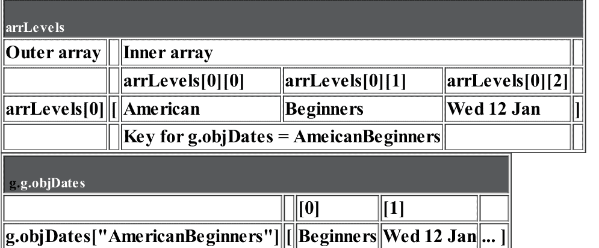

**图 8-8：arrLevels g.objDates 在脚本中的作用**

假设`arrLevels`的第一个项目是数组 ["American", "Beginners", "Wed 12 Jan"]，我们的脚本将在`g.objDates`中创建一个名为 "AmericanBeginners" 的属性，并将其初始值设置为数组 ["Beginners", "Wed 12 Jan"]。此时，`g.objDates`将如下所示：

{ AmericanBeginners: [ "Beginners", "Wed 12 Jan" ] }

如果`arrLevels`的第二个项目是数组 ["American", "Beginners", "Wed 12 Jan"]，脚本将识别出属性 "AmericanBeginners" 已存在，并将日期添加到该属性的值数组中。此时`g.objDates`将如下所示：

{ AmericanBeginners: [ "Beginners", "Wed 12 Jan", "Fri 11 Mar" ] }

一旦我们处理完`arrLevels`中的所有数据，`objData`将包含一系列属性，其名称是每个菜系和级别的组合，其值则是准备好写入下表中相应行的数组。

American

| Level | Date | Date | Date | Date | Date |
| :--- | :--- | :--- | :--- | :--- | :--- |
| Beginners | Wed 12 Jan | Fri 11 Mar | Tue 10 May | Thu 07 Jul | Mon 05 Sep |
| Intermediate | Tue 18 Jan | Thu 17 Mar | Mon 16 May | Wed 13 Jul | Fri 09 Sep |
| Advanced | Thu 24 Feb | Mon 25 Apr | Wed 22 Jun | Fri 19 Aug | Tue 18 Oct |

在数组内重复级别的原因是为了使每个数组的内容与需要写入一个表格行的数据精确匹配。


将光标定位在注释 `// Convert format to match tables in document` 下方，位于 `importDates()` 函数内，并添加以下代码。

```
30 // Convert format to match tables in document
31 for (var i = 0; i < arrLevels.length; i ++) {
32   var currentCuisine = arrLevels[i][0];
33   var currentLevel = arrLevels[i][1];
34   var currentDate = arrLevels[i][2];
35   var currentKey = currentCuisine + currentLevel ;
36   if (currentKey in g.objDates) {
37     g.objDates[currentKey].push(currentDate);
38   }
39   else {
40     g.objDates[currentKey] = [currentLevel, currentDate];
41   }
42 }
43 } // End of function importDates()
```

在第 35 行，我们在一个名为 `currentKey` 的临时局部变量中创建一个属性名；然后，在第 36 行，我们检查该名称的属性是否已存在——`if (currentKey in g.objDates)`。如果键存在，我们只需使用以下代码将当前正在处理的数组的日期元素添加到具有该键的项：

`g.objDates[currentKey].push(currentDate)`。

如果不存在与 `currentKey` 匹配的名称的属性，我们将创建一个，并同时将课程名称和日期作为数组的前两个项输入：

`g.objDates[currentKey] = [currentCourse, currentDate]`。

让我们看看 `g.objDates` 内部包含的内容：在 `importDates()` 函数末尾——就在结束花括号之前，插入以下代码。

```
43 for (var prop in g.objDates) {
44     alert(prop + ": " + g.objDates[prop]);
45 }
46 } // End of function importDates()
```

从 InDesign 运行脚本，你应该会看到一系列如下面所示的对话框。一旦你看够了，可以按住 Enter 键快速关闭剩余的对话框。


从脚本中删除这个 `for` 循环。

## 3. 更新出版物中的表格

现在我们有了一个包含兼容数据的数据对象，我们可以循环遍历文档的页面，将适当的信息写入每个列表页上的表格。我们要处理的页面将是那些包含带有表格的文本框的页面。每个页面顶部的标题包含菜系；因此，我们可以循环遍历表格的行，并为每一行创建一个临时键，该键由菜系和表格第一列中的条目（课程级别）组成。

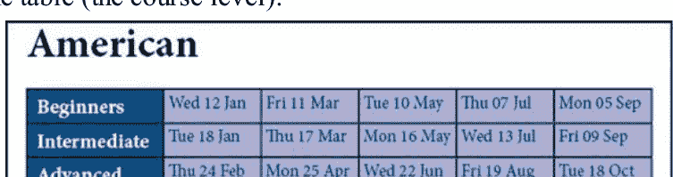

然后，我们可以检查 `g.objDates` 中是否存在该名称的属性。如果存在，我们只需将该行的内容设置为数组的值，覆盖表格中的任何现有值。

将光标定位在第 46 行——你之前创建的 `updateTables()` 函数框架内的空白行。

插入下面显示的代码。

```
43 } // End of function importDates()
44
45 function updateTables(){
46   var doc = app.activeDocument;
47   for (var i =0; i < doc.pages.length; i ++){
48     var currentPage = doc.pages[i];
49     var currentFrame;
50     if(currentPage.textFrames.length > 0 && currentPage.textFrames[0].tables.length > 0){
51       currentFrame = currentPage.textFrames[0];
52     }
53     else{
54       continue;
55     }
56     var tableCount = currentFrame.tables.length;
57     if(tableCount > 0){
58       var currentTable = currentFrame.tables[0];
59       var rowCount = currentTable.rows.length;
60       var currentCuisine = currentFrame.paragraphs[0].contents.replace("\r", "");
61       for (var j = 0; j < rowCount; j ++){
62         var currentRow = currentTable.rows[j];
63         var currentCourse = currentRow.cells[0].contents;
64         var currentKey = currentCuisine + currentCourse;
65         if(currentKey in g.objDates){
66           currentRow.contents = g.objDates[currentKey];
67         }
68       }
69     }
70   }
71   alert("Update complete.");
72 }
```

## 保存你的更改。

在我们的循环中，我们需要做的第一件事是检查页面上是否存在包含表格的文本框（第 50 行）。如果存在，我们将已知是唯一文本框的内容捕获到变量 `currentFrame` 中。

如果没有文本框，或者文本框不包含表格，我们使用 `continue` 语句跳过该迭代，转到下一页（第 54 行）。

确定我们没有处理空白页，并且文本框中存在表格后，我们将表格中的行数存储在一个名为 `rowCount` 的变量中（第 59 行）。然后，我们从框架中的第一个段落（我们知道是标题）获取文本，并使用 `replace` 方法删除段落回车符（第 60 行）。我们将结果——菜系名称——存储在一个名为 `currentCuisine` 的变量中。

现在我们可以循环遍历表格中的每一行（第 61 行）。对于每一行，我们获取第一个单元格中的文本，即课程级别（第 63 行）。我们将菜系和级别连接起来形成一个键（第 64 行）。我们检查 `g.objDates` 中是否存在该名称的属性（第 65 行）。如果存在，我们用该属性中存储的数组覆盖当前行的内容（第 66 行）。该数组将由 InDesign 自动转换为制表符分隔的文本，填充该行的单元格。

## Mountainwell 美食学校

### 美式烹饪

| | | | | | |

|---|---|---|---|---|---|

| 初级课程 | 6月12日 周三 | 5月10日 周二 | 7月7日 周四 | 9月5日 周一 | 3月11日 周五 |

| 中级课程 | 7月13日 周三 | 6月18日 周二 | 3月17日 周四 | 5月16日 周一 | 9月9日 周五 |

| 高级课程 | 6月22日 周三 | 10月18日 周二 | 2月24日 周四 | 4月25日 周一 | 8月19日 周五 |

| | | | | | |

|---|---|---|---|---|---|

| 初级课程 | 2月23日 周三 | 6月21日 周二 | 8月18日 周四 | 10月17日 周一 | 4月22日 周五 |

| 中级课程 | 10月26日 周三 | 5月3日 周二 | 6月30日 周四 | 8月29日 周一 | 3月4日 周五 |

| 高级课程 | 4月13日 周三 | 8月9日 周二 | 10月6日 周四 | 2月14日 周一 | 6月10日 周五 |

一些连续的、次要的信息被呈现，但重要的是要认识到，核心理念与这个层次的复杂性和差异性无关。

我们正在研究一个非常强大的、源自专业领域的、关于结构和组织的模型，它适用于所有类型的流程和事务。


因此，关键在于，无论采取何种方法，其本质都源于同一套原则，并且对于任何特定的领域或学科，都有一套明确的规则和惯例来定义其范围和应用。这并非一个静态或孤立的模型，而是一个动态的、不断演进的体系，其核心原则始终如一，但具体应用却因情境而异。我们必须认识到，这种方法的灵活性和适应性是其最大的优势之一。

5

## 第九章 处理图像

## InDesign 图像对象

**图像及其容器**

InDesign 不允许用户将图像直接放置在页面上；它必须被放置在一个容器内——一个图形框架：矩形、椭圆或多边形。因此，当你在脚本中处理图像时，你最初选择操作的对象在很大程度上取决于你想要完成什么任务。

图 9-1 展示了可供你使用的各种对象。

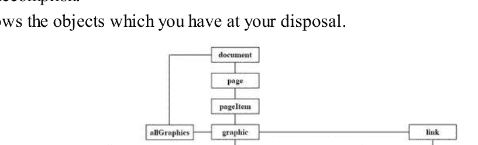

**定位文档中的所有图形**

`allGraphics` 集合（一个图形对象的数组）是文档对象的一个属性，它包含了文档中的所有导入图像——无论图像格式如何。

页面对象没有 `allGraphics` 属性。但是，图形对象确实有一个 `parentPage` 属性，该属性返回其所在页面的页码。

如果你需要检查或对文档中的每张图像执行操作，你需要遍历这个集合，并根据需要使用图形对象的属性和方法。例如，代码清单 9-1 中的脚本会显示一系列警报，指示每张图像的源文件及其所在的页面。

### 代码清单 9-1：遍历 allGraphics 集合

```javascript
var doc = app.activeDocument;
for (var i = 0; i < doc.allGraphics.length; i++){
   app.select(doc.allGraphics[i].parent);
   var strPage = doc.allGraphics[i].parentPage.name;
   if(doc.allGraphics[i].itemLink != null){
       var strPath = doc.allGraphics[i].itemLink.filePath;
       alert("Page " + strPage + ": " + strPath);
   }
   else{
       alert("Page " + strPage + ": Embedded graphic with no linked file");
   }
}
```

要测试此脚本，请打开“indesigncs5js1”文件夹中“chapter09”文件夹里的“01-allgraphics.indd”文件，或打开你自己的包含图像的文件之一。

在脚本的第 5 行，我们测试 `allGraphics` 集合中的每个图形是否具有不为 `null` 的 `itemLink` 属性。直接粘贴到 InDesign 中、没有关联链接文件的图形，其 `itemLink` 值为 `null`。如果 `itemLink` 值不为 `null`，则显示页码和 `itemLink` 的 `filePath` 属性；否则，显示页码和固定文本“嵌入的图形，无链接文件”。

| 语法摘要 ... | `myGraphic.itemLink.filePath` 链接对象的属性，用于定位链接图形的文件路径。如果图形是粘贴到 InDesign 中的，则返回 `null`。 |

|---|---|

### 通过 pageItems 集合访问图形

如果你的脚本需要页面逻辑而非文档逻辑（例如，如果你需要遍历文档中的每一页并执行各种操作，其中一些操作应用于图形），则需要通过 `pageItems` 集合来访问图形对象。

由于这是一个包含各种类型对象的通用集合，因此你需要将图形对象与其他类型的 `pageItem` 区分开来。主要检查的是 `pageItem` 的 `contentType` 属性是否返回 `ContentType.graphicType`。然而，由于电影和声音对象也可能返回 `ContentType.graphicType` 的 `contentType`（因为它们可以包含海报图像），因此你还需要检查 `pageItem` 的 `movies.length` 和 `sounds.length` 属性是否都为零。

在代码清单 9-2 中，我们修改了之前的脚本，使其遍历文档中的所有页面，然后遍历每一页上的所有 `pageItem`。如果一个 `pageItem` 满足上述条件，就会像之前一样显示一个描述性警报。

### 代码清单 9-2：在 pageItems 集合中识别图形

```javascript
var doc = app.activeDocument;
for(var h = 0; h < doc.pages.length; h++){
 for (var i = 0; i < doc.pages[h].pageItems.length; i ++){
   if(doc.pages[h].pageItems[i].contentType == ContentType.graphicType){
     if(doc.pages[h].pageItems[i].movies.length == 0
     && doc.pages[h].pageItems[i].sounds.length == 0){
       app.select(doc.pages[h].pageItems[i]);
       var strPage = doc.pages[h].pageItems[i].parentPage.name;
       if(doc.pages[h].pageItems[i].allGraphics[0].itemLink != null){
         var strPath = doc.pages[h].pageItems[i].allGraphics[0].itemLink.filePath;
         alert("Page " + strPage + ": " + strPath);
       }
       else {
         alert("Page " + strPage + ": Embedded graphic with no linked file");
       }
     }
   }
 }
}
```

在第 2 行，我们有外层循环（使用计数器变量 `h`），它遍历文档中的所有页面。然后，在第 3 行，我们有一个嵌套循环（使用计数器变量 `i`），它遍历每一页上的所有页面项。

然后我们检查每个页面项的 `contentType` 属性是否为 `ContentType.graphicType`（第 4 行），并排除该项是声音或电影的可能性（第 5 至 6 行）。如果页面项通过了这两项测试，那么可以安全地假设它是一个图片框。

请注意，在第 8 行，我们能够检查 `pageItem` 对象的 `parentPage` 属性来确定页码。但是，`pageItem` 对象没有 `itemLink` 属性。因此，在第 10 行，我们需要深入到页面项的 `allGraphics` 集合中，查看其包含的第一个（也是唯一一个）图形的 `itemLink`。

# 自己动手试试！

### 教程：重新链接图像

在本教程中，我们将创建一个脚本，允许用户通过指定搜索和替换字符串来重新链接文档中的所有图形。

## 1. 创建对话框

在 ESTK 中，选择 **文件 > 新建 JavaScript**。

将新文件保存在“chapter09”文件夹中，命名为“03-relink-graphics.jsx”。

输入以下代码。

```
1 var g = {};
2 main();
3 g = null;
4
5 function main(){
6  if(app.documents.length == 0){
7    alert("Please open the document containing the images to be relinked.");
8  }
9  else{
10    intResult = buildDialog();
11    if(intResult == 1){
12      relinkGraphics();
13    }
14  }
15 }
```

在第 6 行，我们确保在继续调用 `buildDialog()` 函数（第 10 行）之前，至少有一个 InDesign 文档是打开的。如果该函数返回 1，表示用户已单击“Relink”按钮，然后我们再调用 `relinkGraphics()` 函数（第 12 行）。

现在，让我们创建对话框并插入第一个面板，该面板将允许用户输入“查找”条件。

# 将以下代码添加到你的脚本中。

```
16
17 function buildDialog() {
18   g.doc = app.activeDocument;
19   g.win = new Window("dialog", "Re-link Images");
20   g.win.add("statictext", undefined, "Choose file extension or enter text:");
21   var arrExtensions = [".ai", ".bmp", ".eps", ".gif", ".jpg", ".png", ".psd", ".tif"];
22
23   // From panel
24   g.win.pnlFrom = g.win.add("panel", undefined, "Find:");
25   g.win.pnlFrom.ddl = g.win.pnlFrom.add("dropdownlist", undefined, arrExtensions);
26   g.win.pnlFrom.txt = g.win.pnlFrom.add("edittext");
27   g.win.pnlFrom.txt.minimumSize = [200, 20];
28   g.win.pnlFrom.ddl.onChange = function() {
29     if(this.selection != null){g.win.pnlFrom.txt.text = this.selection.text;}
30   }
31
32   return g.win.show();
33
34 } // End function buildDialog
```

## 保存你的更改。

在第 20 行，我们创建了一个静态文本标签，它将在窗口顶部显示提示“Choose file extension or enter text:”（选择文件扩展名或输入文本）。

在第 21 行，我们定义了数组变量 `arrExtensions`，它随后用于填充下拉列表 `win.pnlFrom.ddl`（第 25 行）。

在第 28 到 30 行的 onChange 回调中，我们将 `win.pnlFrom.ddl` 中当前选中项的文本设置为编辑文本控件 `win.pnlFrom.txt` 的文本。

为了测试窗口的构建进度，在第 32 行，我们使用 `show()` 方法使其可见。

从 InDesign 脚本面板运行代码，或者在 ESTK 中，将 InDesign 设置为目标应用程序，然后单击“运行”按钮（或选择“调试 > 运行”）。

当窗口出现时，从下拉列表中选择一个文件扩展名。你选择的值随后应出现在编辑文本字段中。

按键盘左上角的 Escape 键关闭对话框并返回到 ESTK。

**“更改为”**面板显然与我们刚刚创建的 **“查找”**面板非常相似，因此在创建代码时，请随意使用复制和粘贴，然后将所有“From”更改为“To”。

将光标定位在 `return g.win.show()` 命令上方，并插入以下所示的代码。

```
31
32  // To panel
33  g.win.pnlTo = g.win.add("panel", undefined, "Change to:");
34  g.win.pnlTo.ddl = g.win.pnlTo.add("dropdownlist", undefined, arrExtensions);
35  g.win.pnlTo.txt = g.win.pnlTo.add("edittext");
36  g.win.pnlTo.txt.minimumSize = [200, 20];
37  g.win.pnlTo.ddl.onChange = function(){
38    g.win.pnlTo.txt.text = this.selection.text;
39  }
40
41  return g.win.show();
42
43 } // End function buildDialog
```

我们需要的下一个控件是列表框，它将显示两列，展示用户通过“查找”和“更改为”框指定的条件。在列表框上方，我们需要一个“添加”按钮，将“查找”和“更改为”框中的当前值移动到列表框中。在列表框下方，我们需要一个“删除”按钮以允许移除条件。

将光标定位在 `return g.win.show()` 命令上方，并插入以下所示的代码。

```
40
41  // Add button
42  g.win.btnAdd = g.win.add("button", undefined, "Add");
43 g.win.btnAdd.onClick = updateListBox;

44 // Criteria list box
45 g.win.lstChanges = g.win.add("listbox", undefined, undefined,
46 {numberOfColumns: 2,
47  showHeaders: true,
48  columnTitles: ['Find:', 'Change to:'],
49  columnWidths: [100, 100]
50 });
51 g.win.lstChanges.minimumSize = [200, 100];
52
53 // Delete button
54 g.win.btnDelete = g.win.add("button", undefined, "Delete Selected");
55 g.win.btnDelete.onClick = deleteListItem;
56
57 return g.win.show();
58
59 } // End function buildDialog
```

在第 46 到 51 行，由于我们希望列表框控件有两列，我们需要使用 `add()` 方法的第四个参数——创建属性——来提供必要的属性。

| 语法摘要 ... | |
|---|---|

| | `myContainer.add("listbox"[, bounds, items, creation properties])`<br>脚本UI容器控件（窗口、面板、组）的方法<br>在指定的容器内创建一个列表框。 |

| | `Listbox` | 要添加的控件类型——一个列表框。 |

| | `Bounds` | 可选。对象的位置和大小。 |

| | `Items` | 可选。要在列表框内显示的字符串数组。 |

| | `Creation properties` | 指定控件初始属性的对象。 |

| | Listbox creation properties | |

| | `multiselect` | 一个布尔值，决定用户是否可以选择多个列表项。 |

| | `numberOfColumns` | 一个整数，表示要显示的文本列数。 |

| | `showHeaders` | 一个布尔值，决定是否显示列标题。 |

| | `columnWidths` | 一个整数数组，指定所有列的宽度。 |

| | `columnTitles` | 一个字符串数组，将显示为列标题。 |

在第 43 和 56 行，我们指定了与列表框相关的两个按钮的回调函数——`updateListBox` 和 `deleteListItem`。我们将在本教程的第二节中创建这些回调函数。

我们窗口中的最终控件是单选按钮，它们决定了我们进行重新链接的模式——手动或自动——以及启动重新链接过程的按钮。

将光标定位在 `return g.win.show()` 命令上方，并插入以下所示的代码。

```
57
58 // Manual/Auto radio buttons
59 g.win.radManual = g.win.add("radiobutton", undefined, "Manual");
60 g.win.radAuto = g.win.add("radiobutton", undefined, "Automatic");
61 g.win.radAuto.value = true;
62
63 return g.win.show();
64
65 } // End function buildDialog
```

在第 59 和 60 行，我们创建了两个单选按钮。请记住，在 ScriptUI 中，我们不需要做任何额外事情就能让两个单选按钮以互斥的方式工作。只需在代码中将它们连续列出，中间没有其他控件，就足够了。在第 61 行，我们通过将“Automatic”单选按钮的 `value` 属性设置为 `true`，使其成为默认选项。

只剩下 **Relink**（重新链接）和 **Cancel**（取消）按钮了。

将光标定位在 `return g.win.show()` 命令上方，并插入以下代码。

```
62
63 // Relink and Cancel buttons
64 g.win.btnRelink = g.win.add("button", undefined, "Relink");
65 g.win.btnRelink.onClick = function(){
66    if(g.win.lstChanges.items.length == 0){
67        alert("Please specify the relink criteria.");
68    }
69    else{
70        g.win.close(1);
71    }
72 }
73 g.win.btnCancel = g.win.add("button", undefined, "Cancel");
74
75 return g.win.show();
76
77 } // End function buildDialog
```

## 保存你的更改。

在第 65 到 72 行，我们为 **Relink** 按钮指定了一个内联的 onClick 回调函数，它验证用户是否已在条件列表框中添加了至少一个项目（第 66 行）。如果他们没有添加，则显示错误信息（第 67 行）：如果已添加，则关闭对话框并返回值 1（第 70 行）。

`buildDialog()` 函数就完成了。

## 2. 回调函数

我们现在需要编写两个回调函数：`updateListBox()` —— 我们已将其附加到 `g.win.btnAdd`；以及 `deleteListItem()` —— 我们已将其附加到 `g.win.btnDelete`。

我们的 `updateListBox()` 函数需要获取"From"和"To"框中的值，并将它们作为一个单独的项目添加到列表框中，其中"From"值位于第一列，"To"值位于第二列。

请在脚本末尾，`buildDialog()` 函数下方插入以下函数。

```
78
79 function updateListBox() {
80   if (g.win.pnlFrom.txt.text == "" || g.win.pnlTo.txt.text == "") {
81     alert("Please enter text in both boxes.");
82   }
83   else {
84     var itm = g.win.lstChanges.add("item", g.win.pnlFrom.txt.text);
85     itm.subItems[0].text = g.win.pnlTo.txt.text;
86     g.win.pnlFrom.txt.text = "";
87     g.win.pnlTo.txt.text = "";
88     g.win.pnlFrom.ddl.selection = null;
89     g.win.pnlTo.ddl.selection = null;
90   }
91 }
```

## 保存你的更改。

在第 80 到 82 行，我们处理了其中一个或两个标准文本框可能为空的情况；在这种情况下，我们显示一个错误消息。

如果两个框都包含文本，我们就会将"From"框中的值——`g.win.pnlFrom.txt.text`——添加到列表框的第一列，并将"To"框中的值添加到第二列。

请注意，要写入多列列表控件的第一列，需要使用该控件的 `add()` 方法，第一个参数是 `"item"`（要添加的控件类型），第二个参数是要在列表框中显示的文本。

要写入第二列，你需要设置你刚刚创建的项目的 `subItems` 属性的 `text` 属性：`myItem.subItems[0].text` 将文本写入第二列，`myItem.subItems[1].text` 将文本写入第三列，依此类推。

在第 86 到 89 行，我们重置了两个下拉列表控件和两个编辑文本控件，为重用做好准备。

运行脚本，尝试在未填写文本字段的情况下点击添加按钮。你应该会看到以下错误消息。

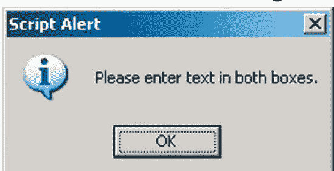

现在尝试向列表框添加几个合法的项目。

关闭对话框，返回到 ESTK。

`deleteListItem()` 函数将相当直接。首先，我们需要验证确实有一个项目被选中：如果没有，则显示一个错误消息；如果有，则删除选中的项目。（由于我们在创建项目时没有启用 `multiselect` 创建属性，因此始终只能选中一个项目。）

在脚本末尾，`updateListBox()` 函数下方添加以下函数。

```
92
93 function deleteListItem(){
94   if(g.win.lstChanges.selection == null){
95     alert("Please select the item to be deleted");
96   }
97   else{
98     g.win.lstChanges.remove(g.win.lstChanges.selection);
99   }
100 }
```

保存你的更改。

## 3. relinkGraphics() 函数

最后，我们有 `relinkGraphics()` 函数，它需要检查活动文档中 `allGraphics` 集合里的每一个项目，测试其文件路径中是否包含用户指定的任何"查找"标准。如果是，我们进行必要的更改并将图像重新链接到修改后的文件路径。

首先，在脚本末尾，`deleteListItem()` 函数下方添加以下骨架函数。

```
102 function relinkGraphics(){
103  var strFeedback = "";
104  var blnRelink;
105  for(i = 0; i < g.doc.allGraphics.length; i ++){
106
107   // Exclude embedded items
108
109   // Apply all changes specified by user to filepath of graphic
110
111   // Relink image if applicable
112
113  } // End for loop
114
115  // Display user feedback
116
117 }
```

我们首先初始化几个稍后将在函数中使用的变量（第 103 行和 104 行）。我们将使用 `strFeedback` 来构建一个已重新链接的所有文件的列表，在过程完成后将其写入文本文件。布尔变量 `blnRelink` 将用于确定是否应对特定图像执行重新链接操作。

接下来，我们遍历 `allGraphics` 集合，我们需要做的第一件事是每次遇到没有链接文件的嵌入式图形时跳过一次迭代。

在注释 `// Exclude embedded items` 之后插入以下 if 语句。

```
107   // Exclude embedded items
108   if(g.doc.allGraphics[i].itemLink == null){
109    continue;
110   }
111
112   // Apply all changes specified by user to filepath of image
```

这个 if 语句只是测试 `allGraphics` 集合中任何图形的 `itemLink` 属性是否为 `null`。如果是，那么重新链接就不适用于该图像，因此使用 `continue` 语句跳过 `for` 循环的当前迭代，继续下一次迭代。

接下来，我们需要使用 JavaScript 的 `replace()` 函数将用户指定的更改应用于图形的文件路径。

在注释 `// Apply all changes specified by user to filepath of image` 之后插入以下 if 语句。

```
112   // Apply all changes specified by user to filepath of image
113   strBefore = doc.allGraphics[i].itemLink.filePath.toLowerCase();
114    currentLink = doc.allGraphics[i].itemLink.filePath.toLowerCase();
115    for(j = 0; j < win.lstChanges.items.length; j++){
116      currentFind = win.lstChanges.items[j].text.toLowerCase();
117      currentChange = win.lstChanges.items[j].subItems[0].text.toLowerCase();
118      currentLink = currentLink.replace(currentFind, currentChange);
119    }
120
121    // Relink image if applicable
```

在第 113 和 114 行，我们将两个不同的变量设置为相同的值——当前图形的文件路径，转换为小写。这是为了给我们提供一个机制，来测试 `replace` 函数是否对每个文件路径产生了影响。

在第 115 到 119 行，我们遍历列表框中的项目，将第一列的值设置为 `replace()` 函数的"查找内容"参数，第二列的值设置为"替换为"参数，然后将结果字符串放入变量 `currentLink` 中。

一旦循环完成，如果 `strBefore` 与 `currentLink` 相同，我们就知道 `replace()` 函数没有更改文件路径，因此不需要进行重新链接操作。

### 在注释 `// Relink image if applicable` 之后插入以下 if 语句。

```
121    // Relink image if applicable
122    blnRelink = false;
123    if(strBefore != currentLink){
124      blnRelink = true;
125      if(g.win.radManual.value == true){
126        app.select(g.doc.allGraphics[i].parent);
127        blnRelink = confirm("Relink this image?");
128      }
129    }
130    if(blnRelink == true){
131      try{
132        g.doc.allGraphics[i].itemLink.relink(File(currentLink));
133        strFeedback += "Relinked: " + strBefore + " ->\nto: " + currentLink + "\n\n";
134      }
135      catch(err){
136        strFeedback += "Could not relink: " + strBefore + "\n-> to: " + currentLink + "\n\n";
137      }
138    }
139  } // End for loop
140
141  // Display user feedback
142
143 }
```

在第 122 行，我们首先将 `blnRelink` 设置为 `false`，表示该图像不需要重新链接。然后，如果 `strBefore` 与 `currentLink` 不同，我们将 `blnRelink` 更改为 `true`（第 124 行）。

接下来，如果用户使用单选按钮 `g.win.radManual` 选择了手动模式，我们将显示一个 JavaScript confirm 对话框，以检查他们是否希望重新链接此特定图形。为了帮助他们识别该图形，我们为他们选中它（第 126 行）。当确认对话框出现时，如果他们点击"是"按钮，`blnRelink` 将保持为 `true`；如果他们点击"否"，`blnRelink` 将被更改为 `false`（第 127 行）。

第 130 到 138 行的 if 语句测试 `blnRelink` 是否为 `true`。如果是，我们尝试使用 `try ... catch` 块将图形重新链接到新的文件路径。如果重新链接成功，我们会在 `strFeedback` 中添加一条相应消息（第 133 行）；如果失败，我们会在 `strFeedback` 中添加一条"无法重新链接..."消息（第 136 行）。

最后我们需要做的是为用户提供一个反馈消息。如果 `strFeedback` 为空，则表示没有发生重新链接：如果不为空，那么我们将尝试在脚本所在的同一文件夹中创建一个文本文件，将 `strFeedback` 的内容写入该文件，然后将其打开供用户阅读。如果我们无法创建文件，我们将在警报对话框中简单地显示一条错误消息。

### 在注释 `// Display user feedback` 之后插入以下 if ... else 语句。

```
141 // Display user feedback
142 if(strFeedback == ""){
143   alert("No images were relinked.");
144 }
145 else{
146   var fleFeedback = File(app.activeScript.parent + "/relink-log.txt");
147   try{
148     fleFeedback.open("w");
149     fleFeedback.write(strFeedback);
150     fleFeedback.close();
151     fleFeedback.execute();
152   }
153   catch(err){
154     alert("Sorry. Due to an error, the log file could not be created.");
155   }
156 }
157 }
```

## 保存你的更改。

如果 `strFeedback` 为空，我们显示一条错误消息（第 143 行）。否则，在第 146 行，我们创建一个 `File` 对象，指向脚本所在文件夹中一个名为 `"relink-log.txt"` 的文件，该文件可能存在也可能不存在。

在第 148 行，我们以写入模式（`"w"`）打开文件。这样，如果文件存在，其内容将被覆盖；如果不存在，则会被创建。然后我们写入文件，关闭它，并使用 `execute()` 方法使用 `".txt"` 文件的默认编辑器打开它。所有这些都发生在一个 `try ... catch` 代码块：如果出现错误，在 `catch` 部分内部，我们只需显示一条错误消息，告知用户无法创建日志文件。

至此，函数和脚本均已完成。

要测试它，请尝试在“chapter09”文件夹中打开名为“03-relink-images.indd”的文件。该文件包含指向名为“low-res”的文件夹中 JPEG 图像的链接。“chapter09”文件夹还包含一个名为“hi-res”的文件夹，其中包含相同图像的 TIFF 格式。

从“脚本”面板运行脚本，保持“03-relink-images.indd”处于活动状态。

在“从”框中输入“low-res”，在“到”框中输入“hi-res”。

点击“添加”按钮。

从“从”下拉列表中选择“.jpg”，从“到”下拉列表中选择“.tif”。

点击“添加”按钮。


点击“重新链接”按钮。

此时应打开一个文本文件，其默认编辑器显示 `strFeedback` 文本，表明“low-res”文件夹中的所有 JPEG 图像已被“hi-res”文件夹中的 TIFF 图像替换。


如果您在任何自己的文档上尝试此脚本，请务必随后选择 **文件 > 还原**。

## 处理链接

链接基本上就是 InDesign“链接”面板中列出的内容，可能属于四种类型之一：图形、文本、影片或音频。在访问图形对象的 `itemLink` 属性时，我们曾短暂地接触过链接。以这种方式访问图形链接很有用，因为您始终可以确定正在处理的是图形链接。不过，您也可以直接处理文档的链接集合。

### 确定链接类型

您可以使用语法 `myLink.parent.constructor.name` 来验证链接类型。但是，此语句不仅返回上面列出的四个选项（图形、文本、影片或音频）。您不会得到通用的图形对象，而是会得到一个图形子类型，例如 EPS、Image、PDF、PICT、WMF。因此，要识别图形链接，您可能会发现更简单的方法是：如果 `myLink.parent.constructor.name` 没有返回“Story”、“Movie”或“Sound”，那么它就是图形——如下方的代码清单 9-4 所示。

### 代码清单 9-4：从链接集合中筛选图形

```javascript
var doc = app.activeDocument;
for (i = 0; i < doc.links.length; i++){
  if(doc.links[i].parent.constructor.name != "Movie"
    && doc.links[i].parent.constructor.name != "Sound"
    && doc.links[i].parent.constructor.name != "Story"){
    var strPage = doc.links[i].parent.parentPage.name;
    var strPath = doc.links[i].filePath;
    app.select(doc.links[i].parent.parent);
    alert("Page " + strPage + ": " + strPath);
  }
}
```

上面第 3 至 10 行的 if 语句首先检查 `myLink.parent.constructor.name` 是否不等于“Story”、“Movie”或“Sound”，然后选择链接的父级的父级——包含它的图形框架——并显示一个警告框，详细说明图形所在的页面及其文件路径。（链接的父级是图形；图形的父级是包含它的框架。）

## 识别海报图像

与影片和音频关联的海报图像也会列在“链接”面板中。可以使用以下条件语法来识别它们：

```javascript
myLink.parent.parent.constructor.name == "Movie"
myLink.parent.parent.constructor.name == "Sound"
```

对于海报图像，链接的父级是图形（海报图像本身），而父级的父级是海报图像所附加的音频或影片。在下面的代码清单 9-5 中，我们遍历文档中的所有链接，每当遇到海报图像时就显示一个警告框。

### 代码清单 9-5：从链接集合中识别海报图像

```javascript
var doc = app.activeDocument;
for(var i = 0; i < doc.links.length; i++){
  if(doc.links[i].parent.parent.constructor.name == "Movie"
    || doc.links[i].parent.parent.constructor.name == "Sound"){
    var strPage = doc.links[i].parent.parentPage.name;
    var strPath = doc.links[i].filePath;
    app.select(doc.links[i].parent);
    alert("Poster image, page " + strPage + ": " + strPath);
  }
}
```

## 同时排除媒体和海报

如果您需要执行处理图像的操作，但希望完全忽略海报图像及其所在的媒体，可以简单地组合使用在代码清单 9-4 和代码清单 9-5 中使用过的条件语句。

### 代码清单 9-6：排除海报图像和媒体

```javascript
var doc = app.activeDocument;
for (i = 0; i < doc.links.length; i++){
  if(doc.links[i].parent.constructor.name != "Movie"
    && doc.links[i].parent.constructor.name != "Sound"
    && doc.links[i].parent.constructor.name != "Story"
    && doc.links[i].parent.parent.constructor.name != "Movie"
    && doc.links[i].parent.parent.constructor.name != "Sound"
    && doc.links[i].parent.parent.constructor.name != "Story"
  ){
    var strPage = doc.links[i].parent.parentPage.name;
    var strPath = doc.links[i].filePath;
    app.select(doc.links[i].parent.parent);
    alert("Page " + strPage + ": " + strPath);
  }
}
```

## 文件路径与名称

如我们所见，链接对象具有 `filePath` 属性，该属性返回链接文件的完整路径。此外，还有一个 `name` 属性，仅返回文件名。自然地，如果您从 `filePath` 中减去 `name`，就得到了包含链接图像的文件夹。在下面的代码清单 9-7 中，我们遍历活动文档的 `allGraphics` 集合，并用文件路径、文件名和文件夹填充三个变量，然后在一个警告框中显示它们。

### 代码清单 9-7：分离链接图形的文件路径、文件名和文件夹

```javascript
var doc = app.activeDocument;
for (i = 0; i < doc.allGraphics.length; i++){
  if(doc.allGraphics[i].itemLink != null){
    var strPage = doc.allGraphics[i].parentPage.name;
    var strPath = doc.allGraphics[i].itemLink.filePath;
    var strName = doc.allGraphics[i].itemLink.name;
    var strFolder = strPath.replace(strName, "");
    app.select(doc.allGraphics[i].parent);
    strAlert = "Page " + strPage + "\n\nFile path: " + strPath;
    strAlert += "\nFile name: " + strName;
    strAlert += "\nFolder: " + strFolder;
    alert(strAlert);
  }
}
```

## 嵌入和取消嵌入链接图形

在 InDesign 中，图像可以通过两种方式嵌入。首先，您可以从任何位置复制图像并粘贴到 InDesign 文档中。这会创建一个没有链接磁盘文件的嵌入图像。其次，您可以使用“链接”面板菜单嵌入链接图像——即使用 **文件 > 置入** 导入的图像。当您嵌入链接图形时，InDesign 会记住原始链接文件的位置，使您可以在稍后阶段取消嵌入图像。

我们已经遇到过识别第一种嵌入图像的语法。如果语句 `myGraphic.itemLink == null` 为 `true`，则我们知道该图形是嵌入的，并且没有链接文件。要识别嵌入的链接图形，我们使用以下条件语法：

```javascript
myGraphic.itemLink.status == LinkStatus.LINK_EMBEDDED
```

`status` 属性是只读的。但是，链接对象确实具有几个允许您嵌入和取消嵌入链接图形的方法。

- 要嵌入链接图形，请使用 `myGraphic.itemLink.unlink()`

- 要取消嵌入，请使用 `myGraphic.itemLink.unembed()`

下方代码清单 9-8 中的脚本显示一个对话框，允许用户选择是否要嵌入或取消嵌入链接图像。


**图 9-2：** 一个用于嵌入和取消嵌入链接图形的简单脚本。

### 代码清单 9-8：嵌入和取消嵌入图像

```javascript
#targetengine session
if(app.documents.length == 0) {
  alert("Please open a document in order to continue.");
}
else {
  var doc = app.activeDocument;
  var win = new Window("window", "Embed/Unembed linked images");
  win.alignChildren = "left";
  win.radEmbed = win.add("radiobutton", undefined, "Embed all linked images");
  win.radUnembed = win.add("radiobutton", undefined, "Unembed all embedded linked images");
  win.btnContinue = win.add("button", undefined, "Continue");
  win.btnContinue.onClick = function(){
    for (i = 0; i < doc.allGraphics.length; i++){
      if(doc.allGraphics[i].itemLink != null){
        if(win.radEmbed.value == true){
          doc.allGraphics[i].itemLink.unlink();
        }
        else if(win.radUnembed.value == true){
          doc.allGraphics[i].itemLink.unembed();
        }
      }
    }
  }
  win.show();
}
```

在第 7 至 11 行，我们构建了一个简单的窗口，其中包含两个单选按钮和一个按钮。onClick 回调函数遍历文档中的所有链接图形，测试是否激活了任一单选按钮，并相应地使用 `unlink()` 或 `unembed()` 方法。

## 自己动手试试看！

### 教程：取消嵌入未链接的图像

如我们所见，当图像粘贴到 InDesign 中时，它不会出现在“链接”面板中，因此在预检期间不会被检查。图形对象的 `itemLink` 属性可以通过 `itemLink` 属性来识别此类图像：如果该属性为 `null`，则表示图像是纯嵌入的，没有链接文件。

在本教程中，我们将创建一个脚本，用于扫描活动文档以查找嵌入的、未链接的图像。如果未找到任何此类图像，脚本将显示相应的提示信息。


如果找到任何嵌入文件，将显示如下所示的 JPEG 导出对话框，允许用户为要导出的文件选择设置。


该对话框包含 InDesign 的“导出 JPEG”对话框中的一个子集选项，允许您将选定的图像或整个页面导出为 JPEG 文件。然而，与使用 **文件 > 导出** 不同，后者一次只能导出一个选定的图像；而使用脚本，您可以遍历文档中的所有图像，并导出所有未嵌入、未链接的图像。

## 1. 创建主脚本

（一如既往，此脚本的完成版本可以在“chapter09”文件夹中找到。它名为“09-unembed_completed.jsx”）

在 ESTK 中，选择 **文件 > 新建 JavaScript**。

将新文件保存在“chapter09”文件夹中，命名为“09-unembed.jsx”。

输入以下代码。

```
var g = {};
main();
g = null;

function main() {
  var blnLinks = findEmbedded();
  if (blnLinks) {
    var intResult = createDialog();
  }
  if (intResult == 1) {
    exportImages();
  }
  else if (intResult == 2) {
    alert("Operation cancelled by user.");
  }
}
```

在 `main()` 函数中，我们调用 `findEmbedded()` 函数，该函数将扫描文档以查找未嵌入、未链接的图像。如果函数返回 `true`，表示找到了此类图像，然后我们调用 `createDialog()`（第 8 行），该函数将允许用户设置导出参数。如果他们单击“确定”按钮（返回值 1），我们将调用 `exportImages()` 函数（第 11 行）；如果他们单击“取消”，我们将显示一个警告（第 14 行）。

## 2. findEmbedded() 函数

现在让我们创建 `findEmbedded()` 函数。

在脚本末尾添加以下代码。

```
function findEmbedded() {
  if (app.documents.length == 0) {
    alert("Please open a document before continuing.");
  }
  else {
    var doc = app.activeDocument;
    g.arrEmbedded = [];
    for (var i = 0; i < doc.allGraphics.length; i++) {
      {
        if (doc.allGraphics[i].itemLink == null) {
          {
            g.arrEmbedded.push(doc.allGraphics[i]);
          }
        }
      }
      if (g.arrEmbedded.length < 1) {
        {
          alert("The document contains no embedded, unlinked images");
        }
      }
      else {
        g.fldBasePath = Folder.selectDialog("Please select a folder for the extracted images.");
        if (g.fldBasePath != null) {
          return true;
        }
      }
    }
  }
}
```

保存您的更改。

在第 24 行，我们创建了名为 `g.arrEmbedded` 的数组变量，然后在第 25 至 31 行，我们遍历活动文档 `allGraphics` 集合中的所有图形，测试是否存在未嵌入且未链接的图像：

```
if (doc.allGraphics[i].itemLink === null)
```

每当我们找到这样的图像时，就将其添加到 `g.arrEmbedded` 数组中：

```
g.arrEmbedded.push(doc.allGraphics[i]);
```

处理完所有图形后，我们测试 `g.arrEmbedded` 是否仍然为空。如果为空，我们将显示错误消息并结束脚本（第 34 行）。如果 `g.arrEmbedded` 中有任何图形，我们将显示一个对话框，供用户选择提取图像的存放文件夹。

```
var fldBasePath = Folder.selectDialog("Please select a folder for the extracted images.");
```

如果用户选择了一个文件夹，该函数返回 `true`（第 39 行）。如果用户单击“取消”按钮，则会显示错误警告，并且我们通过返回 `false` 来结束脚本（第 42-43 行）。

### 3. createDialog() 函数

在现有所有代码之后的脚本末尾添加以下函数框架。

```
function createDialog() {
g.win = new Window('dialog', 'Extract embedded files');

// Colour space dropdown

// Resolution dropdown

// Quality dropdown

// Rendering style dropdown

// File name prefix edittext

// Buttons

// display dialog
g.win.show();

}
```

创建对话框后，我们需要插入七个组，前六个每个包含一个静态文本标签和一个控件，第七个包含两个按钮。第一组控件允许用户选择色彩空间。

将光标置于第 53 行，在注释 `// Colour space dropdown` 下方。

插入以下所示的代码。

```
// Colour space dropdown
g.win.grpSpace = g.win.add('Group');
g.win.grpSpace.stx = g.win.grpSpace.add('StaticText', undefined, 'Colour Space:');
g.win.grpSpace.stx.size=[100,20];
g.win.grpSpace.ddl = g.win.grpSpace.add('DropDownList', undefined, ["CMYK", "RGB"]);
g.win.grpSpace.ddl.size = [100,20];
g.win.grpSpace.ddl.selection = 0;

// Resolution dropdown
```

保存您的更改。

由于下拉列表控件只有两个项目，当我们在第 56 行创建它时，我们使用第三个参数（items）通过提供一个包含两个值的数组来指定其应显示的值。然后，在第 58 行，我们将默认项目设置为零——列表中的第一个项目。

如果您想测试您的脚本，请打开“chapter09”文件夹中名为“09-unembed.indd”的文件，其中包含一系列未链接的图像。运行脚本时，您应该会看到以下对话框。


按键盘上的 Esc 键关闭对话框。

将光标置于注释 `// Resolution dropdown` 下方，

并输入以下代码。

```
// Resolution dropdown
g.win.grpRes = g.win.add('Group');
g.win.grpRes.stx = g.win.grpRes.add('StaticText', undefined, 'Resolution:');
g.win.grpRes.stx.size=[100,20];
g.win.grpRes.ddl = g.win.grpRes.add('DropDownList', undefined, ["300", "150", "72"]);
g.win.grpRes.ddl.size = [100,20];
g.win.grpRes.ddl.selection = 0;
```

这与第一组的设置类似，同样，我们在第 64 行创建下拉菜单时，使用 items 参数指定一个包含 3 个值的数组。同样，在第 66 行，我们将默认项目设置为零——列表中的第一个项目。

将光标置于应该是第 69 行的位置，在注释 `// Quality dropdown` 下方，并输入以下代码。

```
// Quality dropdown
g.win.grpQuality = g.win.add('Group');
g.win.grpQuality.stx = g.win.grpQuality.add('StaticText', undefined, 'Quality:');
g.win.grpQuality.stx.size=[100,20];
g.win.grpQuality.ddl= g.win.grpQuality.add('DropDownList', undefined, ["Maximum", "High", "Medium", "Low"]);
g.win.grpQuality.ddl.size = [100,20];
g.win.grpQuality.ddl.selection = 0;
```

将光标置于第 77 行，在注释 `// Rendering style dropdown` 下方，并输入以下代码。

```
// Rendering style dropdown
g.win.grpRender = g.win.add('Group');
g.win.grpRender.stx = g.win.grpRender.add('StaticText', undefined, 'Rendering:');
g.win.grpRender.stx.size=[100,20];
g.win.grpRender.ddl= g.win.grpRender.add('DropDownList', undefined, ["Baseline", "Progressive"]);
g.win.grpRender.ddl.size = [100,20];
g.win.grpRender.ddl.selection = 0;
```

将光标置于第 85 行，在注释 `// File name prefix edittext` 下方，并输入以下代码。

```
// File name prefix edittext
g.win.grpPrefix = g.win.add('Group');
g.win.grpPrefix.stx = g.win.grpPrefix.add('StaticText', undefined, 'File prefix:');
g.win.grpPrefix.stx.size=[100,20];
g.win.grpPrefix.txt= g.win.grpPrefix.add('edittext', undefined, 'extracted');
g.win.grpPrefix.txt.size = [100,20];

// Buttons
```

请注意，在第 88 行，当我们创建 edittext 控件时，我们使用了 `add()` 方法的第三个参数来提供一个默认值前缀“extracted”。

将光标置于第 92 行，在注释 `// Buttons` 下方，并输入以下代码。

```
// Buttons
g.win.grpBut = g.win.add('Group');
g.win.grpBut.export = g.win.grpBut.add('Button', undefined, 'Export Files');
g.win.grpBut.export.onClick = function () {g.win.close(1);}
g.win.grpBut.cancel = g.win.grpBut.add('Button', undefined, 'Cancel');

// display dialog
g.win.show();

} // End createDialog function
```

保存您的更改。

这就完成了对话框。

在第 94 行，我们为“导出文件”按钮分配了一个内联的 onClick 回调函数，该函数简单地关闭窗口并返回值 1。回到主函数中，这将导致执行 `exportImages()` 函数。让我们继续编写 `exportImages()` 函数。

## 4. exportImage() 函数

当用户单击“导出文件”按钮时，我们需要做两件事。首先，我们需要设置 `jpegExportPreferences` 以匹配用户的选择；其次，我们需要遍历 `g.arrEmbedded` 数组中的所有图像，并将每个图像导出到用户在脚本开始时指定的文件夹。

在脚本末尾添加以下函数框架。

```
function exportImages(){

// Set export preferences
```

`jpegExportPreferences` 对象是应用程序对象的一个属性，允许程序员预先确定以 JPEG 格式导出图形时使用的设置。我们将需要使用用户通过对话框指定的设置来更改每个相关的 `jpegExportPreferences`。为简化操作，我们将利用对象属性可以用两种方式表示的事实：

```
myObject.propertyX
```

或：

```
myObject["propertyX"]
```

其中 `propertyX` 写为字符串值。在适当的情况下，我们将从对话框控件中读取字符串值，并将它们用作方括号之间的属性名称。

将光标置于第 105 行，注释 `// Set export preferences` 下方，并输入以下代码。

```
104 // Set export preferences
105  with (app.jpegExportPreferences){
106      jpegExportRange = ExportRangeOrAllPages.EXPORT_ALL;
107      exportResolution = parseInt(g.win.grpRes.ddl.selection.text);
108      jpegColorSpace = JpegColorSpaceEnum[g.win.grpSpace.ddl.selection.text];
109      jpegQuality = JPEGOptionsQuality[g.win.grpQuality.ddl.selection.text.toUpperCase()];
110      var strRender = g.win.grpRender.ddl.selection.text .toUpperCase() + "_ENCODING";
111      jpegRenderingStyle = JPEGOptionsFormat[strRender];
112  }
113
114  // Export images
115
116 }
```

## 保存您的更改。

为了避免在每行开头重复 `app.jpegExportPreferences`，我们将代码括在 `with` 语句中。关键字 `with` 之后的语句将自动插入到 `with` 之后的代码块中每行的开头。

在第 106 行，由于我们要处理文档中的所有页面，我们将 `jpegExportPreferences` 对象的 `exportRange` 属性设置为预设枚举 `ExportRangeOrAllPages.exportAll`。

在第 107 行，由于分辨率已作为字符串值输入，我们使用 `parseInt()` 函数将其转换为整数，然后将其赋值给 `exportResolution` 属性。

在第 108 行，当我们设置 `jpegColorSpace` 属性时，我们通过将用户通过 `win.grpSpace.ddl` 下拉列表选择的选项放在方括号中、前缀 `JpegColorSpaceEnum` 之后来赋值。由于下拉列表项是从数组 `["CMYK", "RGB"]` 生成的，这将给我们以下两个值之一：

```
JpegColorSpaceEnum["CMYK"]
JpegColorSpaceEnum["RGB"]
```

它们等同于：

```
JpegColorSpaceEnum.CMYK
JpegColorSpaceEnum.RGB
```

在第 109 行，我们使用相同的技术将 `jpegQuality` 属性设置为以下值之一：

```
JPEGOptionsQuality["Maximum"]
JPEGOptionsQuality["High"]
JPEGOptionsQuality["Medium"]
JPEGOptionsQuality["Low"]
```

我们再次使用相同的方法设置渲染样式（第 110 到 111 行）。这一次，为了创建一个有效的值，我们需要从下拉列表 `win.grpRender.ddl` 中读取选中的文本，然后追加字符串 `"_ENCODING"`。我们在变量 `strRender` 中组合该字符串，然后在方括号中使用 `strRender` 来生成 `jpegRenderingStyle` 属性的正确值。

| 属性 | 描述 |

|---|---|

| `jpegExportRange` | 要导出的页面范围。`ExportRangeOrAllPages.EXPORT_RANGE`, `ExportRangeOrAllPages.EXPORT_ALL` |

| `exportResolution` | 导出图像的分辨率。0 到 2400 之间的实数。 |

| `jpegColorSpace` | `JpegColorSpaceEnum.RGB`, `JpegColorSpaceEnum.CMYK`, `JpegColorSpaceEnum.GRAY` |

| `jpegQuality` | `JPEGOptionsQuality.LOW`, `JPEGOptionsQuality.MEDIUM`, `JPEGOptionsQuality.HIGH`, `JPEGOptionsQuality.MAXIMUM` |

| `jpegRenderingStyle` | `JPEGOptionsFormat.BASELINE_ENCODING`, `JPEGOptionsFormat.PROGRESSIVE_ENCODING` |

将光标置于第 115 行，注释 `// Export images` 下方，并输入以下代码。

```
114  // Export images
115  for (var i = 0; i < g.arrEmbedded.length; i++)
116 {
117     var img = File(g.fldBasePath + "/" + g.win.grpPrefix.txt.text + (i+1) + ".jpg");
118     g.arrEmbedded[i].exportFile(ExportFormat.JPG, img);
119     g.arrEmbedded[i].parent.place(img);
120 }
121 alert(g.arrEmbedded.length + " images exported and linked.");
122 }
```

## 保存您的更改。

由于我们正在遍历 `g.arrEmbedded` 数组中的图形，在第 117 行，我们创建一个 `File` 对象并为其组装一个文件路径，该路径由 `g.fldBasePath`（脚本开始时用户选择的文件夹）、"/" 分隔符、计数器变量 `i` 的当前值（加 1，因为它是从零开始的）以及文件扩展名 ".jpg" 组成。

在第 118 行，我们使用 `exportFile()` 方法将文件以 JPEG 格式导出到第 117 行通过变量 `img` 指定的文件位置。

在第 119 行，我们使用 `place()` 方法将导出的文件导回包含图像的父框架。

最后，我们关闭窗口并显示一个警告框，确认导出和链接的图像数量。

使用“chapter09”文件夹中的文件“09-unembed.indd”测试脚本。（它包含一系列嵌入的、未链接的图像。）

在“chapter09”文件夹中选择名为“extracted”的文件夹，在对话框中为文件名输入前缀，然后单击“导出”按钮。

检查文件是否正在导出到指定的文件夹。

在“链接”面板中查看，确认图像现在已链接到导出的文件。

## 图像对象

如果您有兴趣针对特定类型的导入图像，可以引用图形对象的子对象之一。`Image` 可能是最重要的子对象，因为它包括关键的位图文件格式：TIFF、PSD、PNG、JPEG 和 GIF。因此，当您想要针对位图图像而非矢量图时，您将使用图像集合而不是图形集合。

访问 `image` 对象的一个好方法是通过 `allPageItems` 集合，它与 `pageItems` 集合的不同之处在于它包括每个页面项目的子项、子项的子项，依此类推，直到对象层次结构中每个分支的末端。因此，要访问页面上的所有 `image` 对象，我们将遍历 `myPage.allPageItems` 并使用 `myPage.allPageItems[x].constructor.name == "Image"` 来识别每个 `image` 对象。下面的代码清单 9-10 说明了此过程。

### 代码清单 9-10：通过 allPageItems 集合针对 image 对象

```
1 var doc = app.activeDocument;
2 for(var h = 0; h < doc.pages.length; h++){
3   for (var i = 0; i < doc.pages[h].allPageItems.length; i ++){
4     var strPage = doc.pages[h].allPageItems[i].parentPage.name;
5     if(doc.pages[h].allPageItems[i].constructor.name == "Image"){
6       if(doc.pages[h].allPageItems[i].itemLink != null){
7         var strPath = doc.pages[h].allPageItems[i].itemLink.filePath;
8         app.select(doc.pages[h].allPageItems[i].parent);
9         alert("Page " + strPage + ": " + strPath);
10      }
11      else{
12        alert("Page " + strPage + ": Embedded graphic with no linked file");
13      }
14    }
15  }
16}
```

在第 2 行，我们使用计数器变量 `h` 开始遍历文档中的所有页面。在第 3 行，我们开始一个嵌套循环（使用计数器变量 `i`），遍历每个页面的 `allPageItems` 集合。

在第 5 行，我们测试 `allPageItems` 的当前成员是否是 `image`。如果它是，并且它也是一个链接的图像，我们选择它（第 8 行）并显示其文件路径（第 9 行）。

## 独立和锚定图形

我们已经讨论了四种不同的对象集合，通过它们可以引用文档中的图形：`allGraphics`、`links`、`pageItems` 和 `allPageItems`。`pageItems` 集合是唯一完全忽略锚定图形的集合。事实上，它唯一会识别的对象是包含图像的文本框架。

当使用 `allGraphics` 集合时，您可以使用条件语句来区分独立和锚定的图形：

```
myGraphic.parent.parent.constructor.name == "Character"
```

图形的父项是包含它的框架，如果图形是锚定的，框架的父项将是一个 `Character` 对象。

下面的代码清单 9-11 中的脚本展示了如何将锚定的图形转换为独立的图形。

### 代码清单 9-11：将锚定的图像更改为独立的

```
1 #targetengine = session
2 if(app.documents.length == 0){
3   alert("Please open the document containing the images to be relinked.");
4 }
5 else{
6   var doc = app.activeDocument;
```

```
var win = new Window("window", "移动锚定图形");
win.add("statictext", undefined, "文本环绕样式：");
arrWrap = ["无"];
arrWrap.push("跳过对象文本环绕");
arrWrap.push("下一栏文本环绕");
arrWrap.push("定界框文本环绕");
arrWrap.push("轮廓");
win.ddlWrap = win.add("dropdownlist", undefined, arrWrap);
win.ddlWrap.selection = 3;
win.add("statictext", undefined, "文本环绕偏移量（毫米）：");
win.txtOffset = win.add("edittext", undefined, "5");
win.txtOffset.minimumSize = [50, 20];
win.btnMove = win.add("button", undefined, "移动锚定图形");
win.btnMove.onClick = function(){
    for (var i = 0; i < doc.allGraphics.length; i ++){
        var strPage = doc.allGraphics[i].parentPage.name;
        if(doc.allGraphics[i].parent.parent.constructor.name == "Character"){
            app.select(doc.allGraphics[i].parent);
            alert("页码 " + strPage );
            var x = doc.allGraphics[i].parent.geometricBounds[1];
            var y = doc.allGraphics[i].parent.geometricBounds[0];
            var graphOrig = doc.allGraphics[i].parent;
            var graphNew = doc.allGraphics[i].duplicate([x , y]);
            graphOrig.remove();
            graphNew.bringToFront();
            var strWrap = win.ddlWrap.selection.text.replace(/ /g, "_");
            graphNew.textWrapPreferences.textWrapMode = TextWrapModes[strWrap];
            intOffset = parseInt(win.txtOffset.text) + "mm";
            switch(win.ddlWrap.selection.text){
                case "跳过对象文本环绕":
                    graphNew.textWrapPreferences.textWrapOffset = [intOffset, intOffset];
                case "定界框文本环绕":
                    graphNew.textWrapPreferences.textWrapOffset = [intOffset, intOffset, intOffset, intOffset];
                    break;
                case "下一栏文本环绕":
                case "轮廓":
                    graphNew.textWrapPreferences.textWrapOffset = intOffset;
                    break;
            }
            win.close();
        }
    }
};
win.show();
```

在第7到19行，我们构建了如图所示的基本ScriptUI窗口。


它允许用户选择一种文本环绕模式（相当于文本环绕面板顶部的五个图标），并指定文本环绕偏移量（此处假定单位为毫米）。

在第20到49行，我们为“移动锚定图形”按钮定义了一个回调函数。在函数内部，我们遍历 `allGraphics` 集合，并测试每个图形是否为锚定状态（第23行）。如果是，则我们会在与原图相同的坐标位置创建一个图形副本。这是通过将图形的x1和y1坐标从其 `geometricBounds` 属性捕获到名为 `x` 和 `y` 的变量中实现的。

```
var x = doc.allGraphics[i].parent.geometricBounds[1];
var y = doc.allGraphics[i].parent.geometricBounds[0];
```

（图像的 `geometricBounds` 格式为 `[y1, x1, y2, x2]`。）

在第29行，我们复制图像并提供可选的第一个参数——新图像的位置，使用我们从原图获取的 `x` 和 `y` 值。

```
var graphNew = doc.allGraphics[i].duplicate([x , y]);
```

然后我们删除原始图像并将副本置于顶层（第30和31行）。

在第32和33行，为了设置文本环绕模式，我们读取用户选择的值，并将所有空格替换为下划线，使其符合代码格式。

```
var strWrap = win.ddlWrap.selection.text.replace(/ /g, "_");
graphNew.textWrapPreferences.textWrapMode = TextWrapModes[strWrap];
```

然后我们在 `TextWrapModes` 后使用方括号内的此值来生成如下格式的值：

```
TextWrapModes["BOUNDING_BOX_TEXT_WRAP"]
```

正如我们之前所见，这等同于：

```
TextWrapModes.BOUNDING_BOX_TEXT_WRAP .
```

我们的最终任务是设置文本环绕偏移量。首先将用户输入的值捕获到名为 `intOffset` 的变量中，并将其转换为整数。

```
intOffset = parseInt(win.txtOffset.text) + "mm";
```

然而，由于文本环绕偏移量的格式取决于文本环绕模式，我们使用 `switch` 语句来指定文本环绕偏移量的设置值（第35到45行）。

如果你想快速测试这个脚本，可以尝试打开“chapter09”文件夹中名为“11.anchored.indd”的文件。它包含一些锚定图形。

## TextWrapPreference对象的属性

| `textWrapMode` | 文本环绕面板顶部五个图标的编程等效值。 |

| --- | --- |

| `textWrapMode` | 1. `TextWrapModes.NONE`, 2. `TextWrapModes.JUMP_OBJECT_TEXT_WRAP`, 3. `TextWrapModes.NEXT_COLUMN_TEXT_WRAP`, 4. `TextWrapModes.BOUNDING_BOX_TEXT_WRAP`, 5. `TextWrapModes.CONTOUR` |

| `textWrapOffset` | 图形与周围文本之间的距离。如果 `textWrapMode` 设置为上面的3或5，则需要一个值——例如5或"5mm"。如果 `textWrapMode` 设置为上面的2，则需要两个值，顺序为上、下——例如 `[0.5, 0.75]` 或 `["0.5in", "0.75in"]`。如果 `textWrapMode` 设置为上面的4，则需要四个值，顺序为上、左、下、右——例如 `[6, 12, 6, 12]` 或 `["6pt", "12pt", "6pt", "12pt"]`。 |

## 亲自试试！

## 教程：查找拉伸的图像

让我们以一个教程结束本章。

当图像被缩放时，其纵横比始终有可能受到影响，而这可能非常难以检测且耗时。使用脚本则变得容易：你将 `horizontalScale` 值与 `verticalScale` 值进行比较；如果它们不相同，则图像已被拉伸。

本教程中的脚本遍历当前文档中的所有图像，比较其水平和垂直缩放比例。如果未找到拉伸的图像，则会显示一个警告框，表明一切正常。


如果找到任何拉伸的图像，则会显示如下的“修复拉伸图像”对话框。


它允许用户选择一种解决问题的方法：

- 两者均使用100%

- 两者均使用水平缩放比例

- 两者均使用垂直缩放比例

更改图像的缩放比例几乎肯定会影响图像在其容器中的放置方式，图像的部分内容可能会被隐藏。因此，对话框中的第二个下拉菜单要求用户选择一种适合方式：

- 框架适合内容

- 按比例填充框架

- 按比例适合内容

当用户单击“修复图像”按钮时，脚本会检查两个下拉菜单的值，并对文档中每个拉伸的图像应用必要的更改。

## 1. 创建main()函数

（与往常一样，此脚本的完成版本可以在“chapter09”文件夹中找到。它名为“12-stretched-images_completed.jsx”）

在ESTK中，选择 **文件 > 新建JavaScript**。

将新文件保存在“chapter09”文件夹中，命名为“12-stretched-images.jsx”。

输入以下代码。

```
var g = {};
main();
g = null;

function main() {
   blnStretched = findStretched();
   if(blnStretched){
       var intResult = createDialog();
   }
   if(intResult == 1){
       fixImages();
   }
}
```

在 `main()` 函数中，我们调用 `findStretched()` 函数，该函数将扫描文档以查找拉伸的图像。如果函数返回 `true`，表明找到了一些拉伸的图像，然后我们调用 `createDialog()`（第8行）。如果用户单击“修复图像”按钮，该按钮的回调函数将返回1，这意味着我们调用 `fixImages()` 函数（第11行）。

## 2. findStretched()函数

现在进入 `findStretched()` 函数。

在脚本末尾添加以下代码。

```
function findStretched(){
   if(app.documents.length == 0){
       alert("没有打开的文档。");
   }
   else {
       var doc = app.activeDocument;
       g.arrStretched = [];
       for (var i = 0; i < doc.allGraphics.length; i ++){
           if (doc.allGraphics[i].horizontalScale != doc.allGraphics[i].verticalScale){
               g.arrStretched.push(doc.allGraphics[i]);
           }
       }
       if (g.arrStretched.length == 0){
           alert("未找到拉伸的图像。");
           return false;
       }
       else{
           return true;
       }
   }
}
```

## 保存你的更改。

在第16行，我们测试是否有打开的文档，然后将活动文档放入名为 `doc` 的变量中（第20行）。

在第21至26行，我们接着在名为 `g.arrStretched` 的全局变量中创建一个数组，并遍历文档中的图形，检查其水平和垂直缩放比例是否相同。当我们找到比例不一致的图形时，便将其添加到 `g.arrStretched` 数组中（第24行）。

完成循环后，我们测试 `g.arrStretched` 的长度。如果其值仍为零，说明未找到拉伸的图像，我们便显示一条相应的提示信息并返回 `false`（第28和29行）；否则，函数将返回 `true` 给 `main()` 函数，从而触发 `createDialog()` 函数的执行。

### 3. createDialog() 函数

在脚本末尾、现有所有代码下方，添加以下函数框架。

```
function createDialog(){

 g.win = new Window('dialog', 'Fix stretched images');

 // Fix method dropdown

 // Fitting dropdown

 // Buttons

 // display dialog

 return g.win.show();

}
```

现在将光标定位在注释 `// Fix method dropdown` 下方的行，并插入以下代码。

```
// Fix method dropdown

g.win.grpScale = g.win.add('Group');

g.win.grpScale.stx = g.win.grpScale.add('StaticText', undefined, 'Fix Method:');

g.win.grpScale.stx.size = [75, 20];

g.win.grpScale.ddl = g.win.grpScale.add('DropDownList');

g.win.grpScale.ddl.size = [200,20];

g.win.grpScale.ddl.add('item', "Use 100% for both");

g.win.grpScale.ddl.add('item', "Use horizontal scale for both");

g.win.grpScale.ddl.add('item', "Use vertical scale for both");

g.win.grpScale.ddl.selection = 0;

// Fitting dropdown
```

保存你的更改。

在第44行，我们创建了下拉列表，但未指定其要显示的项目；然后，在第46至48行，我们使用控件 `add()` 方法插入了它将包含的3个条目。最后，在第49行，我们将第一项（索引为零）指定为默认选项。

要测试脚本，请打开"chapter09"文件夹中名为"12-stretched-images.indd"的文件，该文件包含一系列明显拉伸的图像。运行脚本时，你应该会看到以下对话框片段。


按键盘上的Esc键关闭对话框。将光标定位在注释 `// Fitting dropdown` 下方，并输入以下代码。

```
// Fitting dropdown

g.win.grpFit = g.win.add('Group');

g.win.grpFit.stx = g.win.grpFit.add('StaticText', undefined, 'Fitting:');

g.win.grpFit.stx.size=[75,20];

g.win.grpFit.ddl = g.win.grpFit.add('DropDownList');

g.win.grpFit.ddl.size = [200,20];

g.win.grpFit.ddl.add('item', "Fit frame to content");

g.win.grpFit.ddl.add('item', "Fill frame proportionally");

g.win.grpFit.ddl.add('item', "Fit content proportionally");

g.win.grpFit.ddl.selection = 0;

// Buttons
```

要完成 `createDialog()` 函数，请将光标定位在注释 `// Buttons` 下方的行，并输入以下代码。

```
// Buttons

g.win.grpBut = g.win.add('Group');

g.win.grpBut.fix = g.win.grpBut.add('Button', undefined, 'Fix Images');

g.win.grpBut.fix.onClick = function() {g.win.close(1);}

g.win.grpBut.cancel = g.win.grpBut.add('Button', undefined, 'Cancel');

// display dialog

return g.win.show();

}
```

保存你的更改。

在第65行，我们为"修复图像"按钮分配了一个内联的onClick回调函数，该函数简单地关闭窗口并返回值1。这个值最终会进入 `main()` 函数中的变量 `intResult`，并触发 `fixImages()` 函数的执行。

### 4. fixImages() 函数

由于修复图像的方法由用户决定，我们将使用几个 `switch` 语句来检查用户选择了哪些选项，并使用相应的方法。

将以下函数添加到脚本末尾。

```
function fixImages(){

  for (var i = 0; i < g.arrStretched.length; i++){

    switch(g.win.grpScale.ddl.selection.index)

    {

      case 0:

        g.arrStretched[i].horizontalScale = 100;

        g.arrStretched[i].verticalScale = 100;

        break;

      case 1:

        g.arrStretched[i].verticalScale = g.arrStretched[i].horizontalScale;

        break;

      case 2:

        g.arrStretched[i].horizontalScale = g.arrStretched[i].verticalScale;

        break;

    }

    switch(g.win.grpFit.ddl.selection.index)

    {

      case 0:

        g.arrStretched[i].fit(FitOptions.FRAME_TO_CONTENT);

        break;

      case 1:

        g.arrStretched[i].fit(FitOptions.FILL_PROPORTIONALLY);

        break;

      case 2:

        g.arrStretched[i].fit(FitOptions.PROPORTIONALLY);

        g.arrStretched[i].fit(FitOptions.FRAME_TO_CONTENT);

        break;

    }

  }

  alert(g.arrStretched.length + " stretched images fixed.");

}
```

保存你的更改。

该函数遍历 `g.arrStretched` 数组中的项。在循环内，我们有两个 `switch` 语句。第一个（第74至86行）测试用户在缩放下拉列表中选择了三个选项中的哪一个，并对 `horizontalScale` 和 `verticalScale` 值进行相应调整。

第二个（第87至99行）测试用户选择了哪个适配选项设置，并应用相应的设置。

最后，在第101行，我们显示一个提示信息，根据 `g.arrStretched` 中的项数确认已修复的拉伸图像数量。

使用"chapter09"文件夹中的"12-stretched-images.indd"文件，从脚本面板或ESTK测试脚本。

尝试不同的选项，每次测试后使用 **文件 > 还原**。


## 第10章. 页面项和图层

在InDesign中，术语 `pageItem`（页面项）涵盖了众多对象：从线条到影片。判断什么是、什么不是页面项的最简单方法是：你能否用选择工具选中该项。如果可以，那么它就是一个页面项。因此，基本上，除了只能用文字工具选中的文本和表格外，你可以在InDesign页面上放置的任何东西都是页面项。

既然这个对象范围如此之广，我们为什么需要它？针对每种元素作为特定的对象类型（如 `textFrame`、`graphic`、`oval` 或 `rectangle`）进行操作不是更合理吗？嗯，有时确实是这样；但有时你只想将项目作为页面上的对象来处理；而 `pageItem` 对象在此时就显得很有用了。

使用图层是页面项作为最有用对象的一个典型例子。通常，你想在图层之间移动的是 `pageItem`。其他对象可能嵌套在容器内，因此无法独立转移。

**pageItems 和 allPageItems 集合**

InDesign 提供了两个与 `pageItem` 对象相关的对象集合：`pageItems` 和 `allPageItems`。`pageItems` 集合仅包含顶层页面项，不考虑它们可能包含的任何 `pageItem` 对象。

相比之下，`allPageItems` 集合采用了一种下钻机制，它不仅包含目标容器中的所有 `pageItem` 对象，还包含这些对象或其子对象所包含的任何对象。

为了说明这种差异，请在 InDesign 中打开"chapter10"文件夹中的文件"01-pageitems.indd"。（该页面包含一个文本框，其中有一个矩形图片框，图片框中有一张图片。）接下来，在 ESTK 中，打开文件 pageItems01.jsx，并以 InDesign 作为目标应用程序运行该脚本。

该脚本遍历活动文档第一页上的所有 `pageItems`。在循环内部，脚本显示一个提示信息，声明每个项的类型。用户可以通过点击两个单选按钮之一来选择脚本是遍历 `pageItems` 还是 `allPageItems` 集合。

运行脚本并点击 **Page Items** 单选按钮：你会注意到只显示了一个提示信息——对应于 `textFrame`。现在点击 All Page Items 按钮：这次会有三个提示信息——一个对应文本框，一个对应矩形，一个对应图片。换句话说，`pageItems` 集合中只有一个对象；但 `allPageItems` 集合包含三个对象。

## 图10-1：pageItems集合只看到顶层对象并忽略所有后代。allPageItems集合不仅看到子对象，还能看到它们的所有后代。

脚本如下面的代码清单10-1所示。

### 代码清单10-1：pageItems与allPageItems的区别

```
1 var win = new Window('dialog', 'pageItems vs allPageItems');

2 win.grpItems = win.add('Group');

3 win.grpItems.radPg = win.grpItems.add('RadioButton', undefined, 'pageItems');

4 win.grpItems.radAllPg = win.grpItems.add('RadioButton', undefined, 'allPageItems');

5 win.grpItems.btnCancel = win.grpItems.add('button', undefined, 'Cancel');

6 win.grpItems.radPg.onClick = displayItems;

7 win.grpItems.radAllPg.onClick = displayItems;

8 function displayItems() {

9   var pg = app.activeDocument.pages[0];

10  var pgItems = [];

11  (win.grpItems.radPg.value == true) ? pgItems = pg.pageItems : pgItems = pg.allPageItems;

12  for (var i = 0; i < pgItems.length; i++) {

13    alert(pgItems[i].getElements()[0].constructor.name);

14  }

15 }

16 var intResult = win.show();
```

在第6行和第7行，同一个回调函数（`displayItems`）被赋值给两个单选按钮的onClick事件。

在第11行，`displayItems()` 函数内部，我们检查pageItems单选按钮的值是否已设置为 `true`。

```
11 (win.grpItems.radPg.value == true) ? pgItems = pg.pageItems : pgItems = pg.allPageItems;
```

如果为 `true`，我们将 `pgItems` 数组设置为当前文档第1页的 `pageItems` 集合；否则，将其设置为 `allPageItems` 集合。在第12到14行，我们循环遍历结果集合，使用语法 `pgItems[i].getElements()[0].constructor.name` 显示其中每个元素的对象类型。（实际上，`getElements()[0]` 仅对 `pageItems` 集合是必需的：对于 `allPageItems` 集合，`pgItems[i].constructor.name` 就可以正常工作；但是，如果我们对 `pageItems` 集合使用它，所有对象都将是 `PageItem` 类型。）

（要测试页面项是否是特定类型的对象，例如文本框，你可以使用JavaScript的 `instanceOf` 运算符。请参见下文。）

| 获取页面项对象类型的语法 | 返回包含名称的字符串。 |
| :--- | :--- |
| `myPageItem.getElements()[0].constructor.name` | |

| 测试页面项是否是特定类型对象的语法。 | 返回 `true` 或 `false`。 |
| :--- | :--- |
| `myPageItem.getElements()[0] instance of ObjectType` | |

# 自己动手试试！

## 教程：在文档中导航所有页面项

在接下来的教程中，我们将构建一个对象资源管理器脚本，它将向用户展示活动文档中所有 `pageItem` 对象的层次结构显示。树状视图控件非常适合显示这种层次结构。

根据页面的复杂程度，我们的脚本可能需要一些时间为文档中的每个 `pageItem` 构建对应的节点或项目。因此，ProgressBar控件将是对界面有用的补充。

**allPageItems集合的层次结构**

当然，为了构建我们的结构，我们需要 `allPageItems`——而不是 `pageItems`——集合。所以，让我们更仔细地看看它包含什么。

`allPageItems` 集合基本上是一个数组，包含指定容器中的每个 `pageItem` 对象及其所有后代。这意味着嵌套在另一个页面项内的页面项至少会出现两次：一次作为其父项中的子项，一次作为其自身的页面项。

例如，假设我们有一个页面，其中包含一个文本框，文本框内嵌套着一个矩形图片框，图片框内有一个图像。该页面的 `allPageItems` 集合的顶层将是：

```
TextFrame
Rectangle
Image
```

然而，由于集合也包含子对象，结构的真实情况应该是：

```
TextFrame
Rectangle
Image
Rectangle
Image
Image
```

如你所见，子对象被列出了两次，孙对象被列出了三次，依此类推。为了用适当的层次结构填充我们的树状视图，我们不需要在子项出现在顶层时将其包含在内。因此，在上面的例子中，我们只会对第一个项目感兴趣；因为我们可以访问其内部的嵌套项，并将它们添加到树状视图的正确节点。

一旦一个项目被添加到树状视图，我们需要确保如果它在 `allPageItems` 结构中的其他地方出现，就会被忽略。幸运的是，InDesign为每个 `pageItem` 分配了一个唯一的ID；因此，我们可以简单地将我们处理的每个元素的ID添加到一个数组中，然后在添加每个新项目之前检查该数组。

那么，让我们开始编写脚本，其完成版本名为“02-object-explorer_completed.jsx”，位于“chapter10”文件夹中。

## 1. main()函数

在ESTK中，选择 **文件 > 新建JavaScript**。

将新文件保存为“02-object-explorer.jsx”，放在“chapter10”文件夹中。

输入以下代码。

```
1 #targetengine "session"

2 var g = {};

3 main();

4

5 function main() {

6  if(app.documents.length ==0) {

7    alert("No documents are open.");

8  }

9  else {

10 createDialog();

11 buildTreeView();

12 }

13 }
```

## 保存你的更改。

由于我们希望用户在对话框打开时能够与文档交互，因此它需要是一个无模式的“调色板”，这需要一个持久会话。因此，在第1行，我们使用 `#targetengine` 指令让脚本在持久引擎中运行。（参见第58页。）

我们有两个主要任务要执行：首先，定义窗口、其控件、它们的属性和回调函数；其次，循环遍历每个页面上的 `allPageItems` 对象，并在树状视图控件中为每个对象创建一个对应的项。我们将这些函数命名为 `createDialog()` 和 `buildTreeView()`（第10行和第11行）。

## 2. 创建窗口

在 `createDialog()` 函数内部，我们需要做的第一件事是在第2行声明的全局变量 `g` 内定义窗口本身。让我们将窗口标题设为‘对象资源管理器’。

在你的脚本末尾添加以下代码。

```
14

15 function createDialog(){

16   g.win = new Window('palette', 'Object Explorer');

17   g.doc = app.activeDocument;

18 }
```

我们只会在窗口中放置三个元素：ProgressBar、树状视图和一个Cancel按钮；所以没有必要创建面板或组——我们可以直接接受默认的列居中布局。让我们从进度条开始。

将光标定位在第17行的末尾，就在 `createDialog()` 函数的结束花括号之前。

按回车键并插入下面显示的代码。

```
16 g.win = new Window('palette', 'Object Explorer');

17 g.doc = app.activeDocument;

18 // 进度条

19 g.win.prg = g.win.add('progressBar');

20 g.win.prg.maxvalue = g.doc.pages.length;

21 g.win.prg.value = 0;

22 g.win.prg.size = [300, 20];

23 }
```

在第20行，我们将进度条的 `maxvalue` 属性（其上限）设置为与活动文档中的页数匹配。在第21行，我们将进度条的 `value` 属性设置为零。

在每页处理完成后，我们将 `value` 加一。因此，在最后一页处理完毕后，`value` 属性将与 `maxvalue` 匹配。

现在来看重要的树状视图。

将光标定位在第22行的末尾，就在 `createDialog()` 函数的结束花括号之前。

按回车键并输入以下代码。

```
22 g.win.prg.size = [300, 20];

23 // 树状视图

24 g.win.trv = g.win.add('treeview');

25 g.win.trv.size = [300, 200];

26 g.win.trv.onChange = selectPageItem;

27 }
```

注意我们使用的是 `size` 属性而不是 `minimumSize`（第25行）。这是为了防止如果活动文档包含许多具有复杂布局的页面时，树状视图控件无法控制地扩展。如果我们固定了大小，滚动条会在需要时出现，但控件的大小不会增加。

第26行定义的树状视图事件处理函数（`selectPageItem`）将允许用户点击树状视图中的任何项目，并选择相应的项目。

最后，让我们添加一个Cancel按钮，并在构建完所有控件后，显示窗口。

将光标定位在第26行的末尾。

按回车键并输入以下代码。

```
26 g.win.trv.onChange = selectPageItem;

27 // 按钮

28 g.win.btnClose = g.win.add('button', undefined, 'Close');

29 g.win.btnClose.onClick = function(){

30   this.parent.close();

31   g = null;

32 }

33 // 显示窗口

34 g.win.show();

35 }
```

## 选择 **文件 > 保存** 以保存你的更改。

内联回调函数（第29到32行）关闭窗口，然后将全局变量 `g` 设置为 `null`。

这是完整的 `createDialog()` 函数。

```
15 function createDialog(){

16   g.win = new Window('palette', 'Object Explorer');

17   g.doc = app.activeDocument;

18   // 进度条

19   g.win.prg = g.win.add('progressBar');

20   g.win.prg.maxvalue = g.doc.pages.length;

21   g.win.prg.value = 0;

22   g.win.prg.size = [300, 20];

23   // 树状视图

24   g.win.trv = g.win.add('treeview');

25   g.win.trv.size = [300, 200];

26   g.win.trv.onChange = selectPageItem;

27   // 按钮

28   g.win.btnClose = g.win.add('button', undefined, 'Close');

29   g.win.btnClose.onClick = function(){

30     this.parent.close();

31     g = null;

32   }

33   // 显示窗口

34   g.win.show();

35 }
```

# 3. 构建树视图控件

我们的 `buildTreeView()` 函数将遍历文档中的页面以及每个页面上的 `allPageItems` 集合。因此，我们需要在一个循环中嵌套另一个循环。此外，当遍历 `allPageItems` 集合中的每个元素时，我们还需要遍历其子对象（如果存在的话），以及这些子对象的子对象，依此类推。

为此，我们的内层循环将被放置在一个外部函数中，该函数既从 `buildTreeView()` 函数中调用，也会递归调用——换句话说，该外部函数会调用自身。这种机制在探索这种分支结构时在编程中很常用。

在脚本末尾添加以下代码。

```javascript
36
37 function buildTreeView(){
38 for (var h = 0; h < g.doc.pages.length; h++){
39 currentChildren = g.doc.pages[h].allPageItems;
40 var currentPage = g.doc.pages[h].name;
41 var currentNode = g.win.trv.add('node', "Page " + currentPage);
42 displayPageItems(currentNode, currentChildren);
43 g.win.prg.value ++;
44 }
45 g.win.prg.visible = false;
46 }
```

保存你的更改。

在第 38 行，我们将 `for` 循环计数器（`h`）的上限设置为与活动文档中的页数匹配。

在第 39 行，我们将每个页面上的所有页面项目放入名为 `currentChildren` 的变量中。在第 41 行，我们向树视图控件添加一个新节点，并将其标记为“Page ”后跟当前页码。

在第 42 行，我们调用递归函数，将刚刚创建的节点以及包含当前页面上所有 `pageItem` 对象的 `currentChildren` 变量作为参数传递。

在第 45 行，在 `for` 循环之外，也就是在所有页面都已处理完毕之后，我们隐藏进度条。现在让我们来检查递归函数，看看它是如何工作的。

在脚本末尾添加以下代码。

```javascript
47
48 function displayPageItems(oldNode, pItems){
49  for (var i = 0; i < pItems.length; i++){
50   var currentItem = pItems[i];
51   var currentID = currentItem.id;
52   var CurrentNodeText = currentItem.constructor.name + " id " + currentID;
53   var currentChildren = currentItem.allPageItems;
54   var currentChildCount = currentChildren.length;
55   if(!(currentID in g.win.trv)){ // 如果节点尚不存在
56    var nodeType;
57    (currentChildCount > 0)? nodeType = 'node': nodeType = 'item';
58    g.win.trv[currentID] = oldNode.add(nodeType, CurrentNodeText);
59    displayPageItems(g.win.trv[currentID], currentChildren);
60   }
61  }
62 }
```

保存你的更改。

递归函数遍历通过 `pItems` 参数传递给它的页面项目。它做的第一件事是检查每个页面项目是否已被处理过（第 55 行）。这是通过测试 `g.win.trv` 中是否存在一个与页面项目的 `id` 同名的项目来完成的：`if(!(currentID in g.win.trv))`。

例如，如果我们正在处理一个 `id` 为 211 的页面项目，并且 `g.win.trv.211`（也可以写成 `g.win.trv["211"]`）存在，这意味着我们一定已经将此节点作为子节点处理过了，无需再采取进一步操作。

如果该项目尚未被处理，我们希望添加一个节点，其文本标签包含页面项目类型（通过 `constructor.name` 确定）以及 InDesign 自动分配给每个页面项目的唯一 `id`。我们还将同时在树视图的一个属性中放置对该项目的引用，该属性的名称与页面项目的 `id` 相同。我们还需要向树视图添加正确类型的元素——如果页面项目包含其他 `pageItem` 对象则添加“node”，否则添加“item”（不可展开）。

```javascript
56 var nodeType;
57 (currentChildCount > 0)? nodeType = 'node': nodeType = 'item';
58 g.win.trv[currentID] = oldNode.add(nodeType, CurrentNodeText);
```

请注意，当我们创建节点时，我们将其分配给 `win.trv[currentID]`。换句话说，我们正在向树视图对象添加自己的自定义属性，并将其名称设置为与此节点所代表的页面项目的 `id` 匹配。此属性将包含对正在创建的节点的引用。

一旦创建了节点，我们就从函数内部调用该函数本身，将刚刚创建的节点以及刚刚处理的页面项目的 `allPageItems` 集合作为函数参数传递。

```javascript
59 displayPageItems(g.win.trv[currentID], currentChildren);
```

当 `displayPageItems()` 函数被递归调用时会发生什么，取决于 `currentChildren`（刚处理的页面项目的 `allPageItems` 集合）中的项目数量。当没有更多子项目需要处理时，函数调用不会产生任何结果，也不会有更多元素被添加到由 `g.win.trv[currentID]` 表示的节点中。

由于此脚本不会对文档进行任何更改，因此使用任何 InDesign 文档进行测试都是安全的。

打开任何 InDesign 文档并运行该脚本，然后浏览生成的树视图结构。

完成后点击关闭按钮。

我们的最后一步是为树视图控件编写 onChange 回调函数。当控件中的项目被点击时，我们希望选择 InDesign 文档中相应的元素。

在脚本末尾输入以下函数。

```javascript
63
64 function selectPageItem(){
65   var arrAllItems = g.doc.allPageItems;
66   for (var i = 0; i < arrAllItems.length; i ++){
67     if (this.selection == g.win.trv[arrAllItems[i].id]){
68       arrAllItems[i].select();
69     }
70   }
71 }
```

保存你的更改。

树视图事件处理程序遍历文档中的所有页面项目，并利用树视图对象具有的一系列自定义属性这一事实，这些属性的名称与文档中每个页面项目的 `id` 匹配，每个属性都指向代表同一页面项目的树视图节点。

在语句 `this.selection == win.trv[arrAllItems[i].id]` 中，第 67 行，我们使用 `for` 循环中当前正在处理的页面项目的 `id` 作为索引来定位树视图的自定义属性之一。如果找到匹配项，则选中该项目（第 68 行）。

再次打开任何 InDesign 文档运行该脚本，然后尝试点击树视图中的某些项目。

每次点击节点项目（那些带加号的项目）时，除了展开/折叠外不应发生任何其他操作，因为这些项目仅是按页面细分元素的容器。但是，当点击某个子项时，其 `id` 属性应与某个页面项目的 `id` 匹配，因此该页面项目将被选中。

## 确定 pageItem 类型

**使用 constructor.name**

虽然我们可以使用 `constructor.name` 语句获取页面项目类型的描述，但这种技术并不能告诉我们全部信息。例如，一个包含图像的矩形图片框架、一个空的矩形图片框架和一个普通的矩形，它们的 `constructor.name` 值都将是“Rectangle”。要了解关于一个对象的更多信息，我们需要测试其他属性的组合。

**使用 instanceof**

JavaScript 运算符 `instanceof` 也可用于测试一个对象是否属于特定类型。因此语句：

`if(myPageItem.getElements()[0].constructor.name == "TextFrame")...`

等同于：

`if(myPageItem.getElements()[0] instanceof TextFrame)...`

`instanceof` 语句以比 `constructor.name` 执行速度更快而闻名。

**识别 textFrames、groups 和 buttons**

`TextFrame`、`Group` 和 `Button` 页面项目很容易识别：无论是 `constructor.name` 还是 `instanceof` 都会明确无误地返回对象类型。

其他一些页面项目类型需要更精细的区分，因为 `constructor.name` 和 `instanceof` 对于多种不同类型的对象都会返回 `Rectangle`、`Oval` 和 `Polygon`。

**识别图片框架**

如果你想测试一个页面项目是否为图片框架，你需要检查两件事。首先，你需要检查 `constructor.name` 是否返回矩形、椭圆或多边形。其次，你需要验证 `contentType` 属性是否返回 `ContentType.graphicType`：

`if(myPageItem.getElements()[0].contentType == ContentType.GRAPHIC_TYPE)...`

| | PageItem 属性 |
|---|---|
| | 相当于在 InDesign 中选择一个页面项目，然后选择“对象”>“内容”。 |
| 可能的值 | `ContentType.UNASSIGNED`<br>`ContentType.GRAPHIC_TYPE`<br>`ContentType.TEXT_TYPE` |

## 识别影片和声音

`constructor.name` 对于影片和声音同样会返回矩形、椭圆或多边形。此外，由于它们可以包含海报图像，其 `contentType` 将为 `ContentType.GRAPHIC_TYPE`。因此，为了将它们与图片框区分开来，有必要检查它们是否包含 `Sound` 或 `Movie` 对象。例如：

```
if(myPageItem.getElements()[0].movies.length > 0)...

if(myPageItem.getElements()[0].sounds.length > 0)...
```

## 识别路径上的文字

尽管路径上的文字不是页面项目，但有时在文档中查找其实例很有用。我们可以使用与刚才类似的技术来实现：

```
if(myPageItem.getElements()[0].textPaths.length > 0)...
```

## 识别常规图形对象

如果我们从矩形、椭圆、多边形（或直线）对象开始，并排除所有上述页面项目类型，那么我们可以得出结论：该对象只是一个普通的图形。我们还可以额外测试其 `contentType` 属性：

```
if(myPageItem.getElements()[0].contentType == ContentType.UNASSIGNED)...
```

## 页面项目与图层

在使用图层时，我们主要关注的是 `pageItems` 集合，而不是 `allPageItems` 集合。只有顶级对象才能放置在特定图层上：例如，如果有一个包含图像及其说明的组——换言之，一个矩形和一个文本框对象——你将无法将矩形和文本框放置在不同的图层上，除非你取消它们的编组。

脚本允许你对整个文档中的页面项目和图层进行更改。例如，我们可以将所有给定类型的对象分配到特定图层。同样，我们可以将任何任意选择的对象（跨多个页面）移动到给定图层。以下语法摘要显示了图层对象和图层集合的一些关键方法和属性。

| | `myPageItem.itemLayer = myLayer`<br>PageItem 属性<br>用于将项目移动到给定图层。<br>`myDocument.layers.add([Creation properties])`<br>Layers 集合方法<br>用于创建新图层。 |
|---|---|
| | `myDocument.layers.remove()`<br>Layers 对象方法<br>用于删除图层。 |
| | `myDocument.layers.name` = layerName<br>Layer 对象属性<br>更改图层名称。 |
| | `layerName` | 字符串：新图层的名称。 |

## 亲自试试看！

### 教程：创建图层管理器实用程序


以下教程通过构建上图所示的基于对话框的应用程序，提供了关于使用页面项目和图层的实践。

该对话框显示活动文档中的所有页面项目，每个项目由其页码、对象类型和图层标识。对话框左侧是一系列复选框，提供交互式过滤器，允许用户确定列表中包含哪些对象类型。

对话框右侧的“按类型选择”按钮允许用户选择一种（或多种）特定类型的所有对象。“移动到图层”按钮将选定的项目传输到指定图层或新图层。最后，“删除选定项”按钮将从文档中移除选定的项目。

你可以在“chapter10”文件夹中找到完成的脚本，名为“03-layer-manager_completed.jsx”。在学习教程时，你可以随意从此源复制代码，而无需自己键入。

## 1. 创建 main() 函数

在 ESTK 中，创建一个新文件并将其保存为“02-object-explorer.jsx”。

首先输入将控制程序流程的主函数。输入以下代码。

```
1 #targetengine "session"

2

3 var g = {};

4 main();

5

6 function main(){

7  if(app.documents.length == 0){

8   alert("Please open the document you wish to browse.");

9  }

10  else{loadPageItems(); buildDialog(); updateListbox();}

11 }
```

该应用程序需要一个非模式对话框，以便用户能够与页面项目交互；因此，在第 1 行，我们必须设置目标引擎。否则，对话框会出现并立即消失。出于同样的原因，我们不像往常那样在 `main()` 函数调用后将全局变量 `g` 设置为 `null`。相反，我们将当用户单击“关闭”按钮关闭对话框时执行此步骤。

在 `main()` 函数内部，第 7 行，我们检查是否有文档打开：如果没有，我们显示错误消息（第 8 行）。

如果有文档打开，我们进行函数调用（第 10 行）：

- `loadPageItems()` 是我们将在其中将文档中每个页面项目的引用添加到数组（`g.arrPageItems`）的位置，同时显示进度条。
- 在 `buildDialog()` 函数中，我们将创建对话框及其控件。我们还需要为对话框中需要响应用户操作的每个控件定义回调函数。
- 在 `updateListbox()` 函数中，我们将根据对话框左侧当前选定的对象类型复选框，更新对话框中列出的页面项目。此函数将在应用程序首次加载时调用，以及每次用户激活或停用复选框时调用。

## 2. loadPageItems() 函数

虽然我们可以通过语句 `app.activeDocument.pageItems` 获取当前文档中每个页面项目的引用，但项目的顺序将是不可预测的。由于我们希望列表按页码排序，因此更有意义的方法是循环遍历文档中的所有页面，将每页上的项目添加到数组变量中。为了在操作进行时让用户了解情况，我们将显示进度条。

向脚本中添加以下行。

```
13 function loadPageItems(){

14   displayProgressBar();

15   docPageItemsList();

16   masterPageItemsList();

17

18 } // End function loadPageItems
```

在此函数中，我们对三个嵌套函数进行函数调用，它们的名称相当不言自明。

将光标定位在第 17 行，即 `loadPageItems()` 函数的右花括号上方。

按 Enter 键留一个空行，然后输入以下嵌套函数。

```
13 function loadPageItems(){

14   displayProgressBar();

15   docPageItemsList();

16   masterPageItemsList();

17

18   function displayProgressBar(){

19     g.doc = app.activeDocument;

20     g.winProg = new Window('palette', undefined, undefined, {closeButton:false});

21     g.winProg.prg = g.winProg.add('progressbar', [0, 0, 400, 20]);

22     var stxPrg = g.winProg.add('statictext', [100, 30, 300, 50], 'Updating list of page items');

23     var numItems = g.doc.pageItems.length;

24     g.winProg.prg.value = 0;

25     g.winProg.prg.maxvalue = numItems;

26     g.winProg.show();

27   }

28

29 } // End function loadPageItems
```

在第 20 行，当我们创建进度条窗口时，我们将 `closeButton` 创建属性设置为 `false`，使其看起来不那么像窗口。

显示进度条的关键点是将 `maxvalue` 属性映射到程序中的某个操作或事件。因此，在第 23 行，我们将活动文档中的页面项目数量放入名为 `numItems` 的变量中。在第 24 行，我们将进度条的（起始）值设置为零，在第 25 行，我们使其上限——`maxvalue`——等于 `numItems`。

将光标定位在第 40 行，即 `loadPageItems()` 函数的右花括号上方。

留一个空行，然后输入第二个嵌套函数。

```
28

29 function docPageItemsList(){

30   g.arrPageItems = [];

31   for(var i = 0; i < g.doc.pages.length; i ++){

32     var currentPage = g.doc.pages.item(i);

33     for (var j = 0; j < currentPage.pageItems.length; j ++){

34       var currentPageItem = currentPage.pageItems.item(j).getElements()[0];

35       g.arrPageItems.push(currentPageItem);

36       g.winProg.prg.value ++;

37     }

38   }

39 }

40 

41 } // End function loadPageItems
```

在第 30 行，我们在全局对象变量内创建一个数组，名为 `g.arrPageItems`。为了在数组内创建页面项目列表，我们将首先循环遍历文档页面，然后（在第三个嵌套函数中）循环遍历母版页。当我们循环遍历文档页面时，我们然后使用嵌套循环遍历每页上的页面项目。

当我们遇到每个页面项目时，我们将其添加到 `g.arrPageItems`（第 35 行），然后将进度条的值加一（第 36 行）。

将光标定位在第 40 行，即 `loadPageItems()` 函数的右花括号上方。

输入第三个也是最后一个嵌套函数。

```
40 

41 function masterPageItemsList(){

42   for(var i=0; i < g.doc.masterSpreads.length; i ++){

43     var currentMaster = g.doc.masterSpreads[i];

44     for (j = 0; j < currentMaster.pages.length; j++){

45       var currentPage = currentMaster.pages.item(j);

46       for (var k = 0; k < currentPage.pageItems.length; k ++){

47         currentPageItem = currentPage.pageItems.item(k).getElements()[0];

48         g.arrPageItems.push(currentPageItem);

49         g.winProg.prg.value ++;

50       }

51     }

52   }

53   g.winProg.prg.value = 0;

54   g.winProg.close();

55 }

56 

57 } // End function loadPageItems
```

当我们循环遍历母版跨页时，我们的第一层嵌套循环（使用计数器变量 `j`）遍历每个母版跨页中的页面，然后我们有一个第二层嵌套循环（使用计数器变量 `k`）来遍历每个单独母版页上的页面项目。

同样，当我们遇到页面项目时，我们将其添加到 `g.arrPageItems`（第 48 行）。

最后，在第 53 至 54 行，我们在将其值重置为零后关闭进度条对话框窗口，为下一次显示做好准备。

保存你的更改。

要测试你的脚本，你需要暂时禁用对尚未创建的函数的调用。为此，请按如下方式修改脚本的第 10 行。

```
10    else {loadPageItems();} // buildDialog(); updateListbox();}
```

打开任何包含一些内容的 InDesign 文档。当你运行代码时，你应该会看到进度条从零移动到最大值，然后消失。


使用 **编辑** > **还原** 将第 10 行恢复原状。

```
10  else {loadPageItems(); buildDialog(); callbackFunctions(); updateListbox();}
```

### 3. 创建对话框

在 `buildDialog()` 函数中，我们将创建对话框及其各种控件。我们将遵循相同的模式，将函数细分为一系列嵌套函数。

### 3a. 创建窗口本身

首先输入 `buildDialog()` 函数的框架——即对嵌套函数的调用。

```
58

59 function buildDialog() {

60   createWindow();

61   dataTypesCheckboxes();

62   pageItemsListbox();

63   selectItemsGroup();

64   moveLayerGroup();

65   deleteAndCloseButtons();

66   g.winMain.show();

67

68 } // end function buildDialog
```

该函数调用一系列嵌套函数，每个函数将创建对话框的一个关键区域，然后，在所有内容构建完成后，我们显示窗口（第 66 行）。（窗口将在第一个嵌套函数 `createWindow()` 中创建。）

将光标置于第 67 行，即 `buildDialog()` 函数的闭合大括号上方，然后输入定义对话框本身的 `createWindow()` 嵌套函数。

```
59 function buildDialog(){

60   createWindow();

61   dataTypesCheckboxes();

62   pageItemsListbox();

63   selectItemsGroup();

64   moveLayerGroup();

65   deleteAndCloseButtons();

66   g.winMain.show();

67   function createWindow(){

68     g.winMain = new Window("palette", "Layer Manager");

69     g.winMain.orientation = "row";

70     g.winMain.alignChildren = "top";

71   }

72

73 } // end function buildDialog
```

在第 68 行，我们创建一个类型为 `"palette"` 的窗口：这是因为我们需要执行一些操作，而这些操作无法在模态 `"dialog"` 类型窗口处于活动状态时进行，例如将项目移动到新图层。

窗口中的项目布局将包含三列，每列包含在一个单独的组控件中。这要求窗口本身将其方向设置为 `"row"`（第 69 行），以覆盖默认的 `"column"`。

### 3b. 创建对象类型复选框

窗口中的第一个组控件将包含允许用户确定显示哪些页面项目类型的复选框。

要创建此控件，请将光标置于应该是第 72 行的位置——即 `buildDialog()` 函数闭合大括号上方的行，留一个空行，然后输入第二个嵌套函数。

```
72

73 function dataTypesCheckboxes(){

74   g.grpTypes = g.winMain.add('group');

75   g.grpTypes.orientation = "column";

76   g.grpTypes.alignChildren = "left";

77   g.arrTypes =['Text frame', 'Picture frame', 'Group', 'Shape', 'Line', 'Type on a path', 'Movie', 'Sound', 'Button'];

78   for(var i = 0; i < g.arrTypes.length; i ++){

79     var currentChk = g.grpTypes.add('checkbox', undefined, g.arrTypes[i], {name: g.arrTypes[i]});

80     currentChk.value = true;

81  currentChk.onClick = updateListbox;

82  }

83  }

84

85 } // end function buildDialog
```

保存你的更改。

如果你在此时测试代码（暂时禁用对 `updateListBox()` 函数的调用，第 10 行），在进度条消失后，你应该会看到一个又高又窄的对话框，如下图所示。


在第 75 行，由于我们希望复选框形成一列，我们通过将其设置为 `"column"` 来覆盖 `g.grpTypes` 组控件的默认 `"row"` 方向。

由于复选框不是互斥的，我们不需要给它们任何特殊属性。因此，在第 77 行，我们定义一个数组，并将每个复选框的文本放入其中。然后我们遍历该数组，创建一个复选框，并将每个数组项分配为复选框文本（第 78 至 82 行）。

由于我们希望对话框出现时列出所有类型的 `pageItem`，在第 80 行，我们将所有复选框的值设置为 `true`。

最后，在第 81 行，我们将每个复选框的 onClick 回调设置为 `updateListbox()` 函数，该函数将重新构建 `pageItems` 列表以反映当前激活的复选框。主脚本已经包含了对此函数的调用，我们稍后将创建它。

### 3c. 创建多列列表框

在对话框的中央列，我们需要一个包含三列的列表框控件：页码、项目类型和图层。

将光标置于第 84 行——`buildDialog()` 函数闭合大括号上方的行，然后输入以下嵌套函数。

```
84

85  function pageItemsListbox() {

86    var grpItems = g.winMain.add('group');

87    grpItems.orientation = "column";

88    grpItems.alignChildren = "top";

89    g.lstPageItems = grpItems.add('listbox', undefined, undefined,

90        {multiselect:true, numberOfColumns: 3,

91         showHeaders:true,

92         columnTitles:['Page', 'Item', 'Layer'],

93         columnWidths:[50, 125, 125]

94        });

95    g.lstPageItems.size = [300,250];

96    g.lstPageItems.onDoubleClick = lstPageItems_onDoubleClick;

97  }

98

99  } // end function buildDialog
```

保存你的更改。

运行你的脚本（暂时禁用对 `updateListBox()` 函数的调用，第 10 行）。你的对话框现在应该类似于下面这个。


为了创建多列列表框，我们在将列表框添加到 `grpItems` 组控件时设置了几个创建参数（第 89 至 94 行）。

| 语法摘要 ... | 列表框控件创建属性 |
| :--- | :--- |
| | `Multiselect` | 值为 `true` 允许用户在列表中选择多个项目。默认为 `false`。 |
| | `Number of columns` | 指定列表中显示的列数。 |
| | `Show headers` | 确定是否显示列标题。 |
| | `ColumnTitles` | 一个字符串数组，指定要在每列顶部显示的标题。 |
| | `ColumnWidths` | 一个整数数组，指定每列的宽度。 |

请注意，尽管我们设置了 `numberOfColumns`、`showHeaders`、`columnTitles` 和 `columnWidths` 属性，但在我们向列表框添加至少一个项目之前，这些属性不会产生任何效果。（这将在 `updateListbox()` 函数中完成。）

还要注意，在第 96 行，我们将函数 `lstPageItems_onDoubleClick()` 指定为列表框的回调。这将允许用户通过双击代表该页面项目的节点或项目来选择文档中的任何页面项目。

### 3d. 创建 selectItems 下拉列表和按钮

对话框第三列中的第一个项目将是一个下拉列表，允许用户选择所有给定类型的页面项目。

将光标置于第 98 行——`buildDialog()` 函数闭合大括号上方的行，然后输入以下嵌套函数。

```
98

99 function selectItemsGroup(){

100 // Select dropdown

101 g.grpButtons = g.winMain.add('group');

102 g.grpButtons.orientation = "column";

103 var pnlType = g.grpButtons.add('panel');

104 g.ddlTypes = pnlType.add('dropdownlist', undefined, g.arrTypes);

105 // Select button

106 var btnSelect = pnlType.add('button', undefined, 'Select by type');

107 btnSelect.size = [120, 20];

108 btnSelect.onClick = btnSelect_onClick;

109 // Check box

110 g.chkAdd= pnlType.add('checkbox', undefined, 'Add to selection');

111 }

112

113 } // end function buildDialog
```


保存你的更改。

运行你的脚本（暂时禁用对 `updateListBox()` 函数的调用，第 10 行）。这三个项目选择控件应该看起来像右侧所示的那些。

项目选择控件由一个下拉列表、一个按钮和一个复选框组成。因此，在创建了将容纳对话框第三列所有控件的组控件（第 101 行）之后，我们添加一个面板作为这三个控件的容器（第 103 行）。

在第 104 行，当我们添加下拉列表时，我们重用了之前创建的 `g.arrTypes` 数组作为 items 参数，该数组也用于提供复选框的文本。

在第 110 行，我们创建一个复选框，允许用户确定当按钮被点击时是进行新的选择，还是将指定的项目添加到任何现有选择中。其理念是，如果复选框被激活，页面项目列表框中的任何现有选择将保持不变。如果复选框未被选中，则将在列表框中进行新的选择。

### 3e. 创建移动图层下拉列表和按钮

对话框第三列中的第二个项目将是一个下拉列表，允许用户选择一个图层，以及一个按钮，用于将选定的项目移动到指定的图层。

将光标置于第 112 行——`buildDialog()` 函数闭合大括号上方，然后输入以下代码。

```
112

113 function moveLayerGroup(){

114     // Move layer dropdown

115     var pnlMove= g.grpButtons.add('panel');

116     var arrLayers = [];

117     for(var i= 0; i < g.doc.layers.length; i ++){

118         arrLayers.push(g.doc.layers[i].name);

119     }

120     arrLayers.push("-");

121     arrLayers.push("New Layer");

122     g.ddlLayers = pnlMove.add('dropdownlist', undefined, arrLayers);

123     // Move layer button

124     var btnMove = pnlMove.add('button', undefined, 'Move to layer');

125     btnMove.size = [120, 20];

126     btnMove.onClick = btnMove_onClick;

127 }

128

129 } // end function buildDialog
```

## 3f. 创建“删除”和“关闭”按钮

对话框中的最后两项是两个按钮：一个用于删除当前选中的页面对象，另一个用于关闭对话框。

将光标置于第128行——在 `buildDialog()` 函数的闭合大括号之上，并添加以下代码。

```
128

129  function deleteAndCloseButtons(){

130      // Delete button

131      var btnDelete = g.grpButtons.add('button', undefined, 'Delete Selected');

132      btnDelete.size = [120, 20];

133      btnDelete.onClick = btnDelete_onClick;

134      // Close button

135      var btnClose = g.grpButtons.add('button', undefined, 'Close');

136      btnClose.size = [120, 20];

137      btnClose.onClick = btnClose_onClick;

138  }

139

140 } // end function buildDialog
```

保存你的更改。

至此，对话框的构建就完成了；现在我们可以将注意力转向通过为各种控件创建回调函数来使其具有交互性。

## 4. 创建 `updateListbox()` 函数

`updateListbox()` 函数在主脚本中被调用一次，并且每当用户在对话框左侧选中或取消选中任何对象类型复选框时也会被调用。此函数需要遍历存储在 `g.arrPageItems` 中的所有页面对象，并将每个对象添加到列表框中，前提是其对应的对象类型复选框已被用户激活。

将 `updateListbox()` 函数添加到脚本的末尾。

```
141

142 function updateListbox(){

143   app.scriptPreferences.enableRedraw = false;

144   g.lstPageItems.selection = null;

145   g.lstPageItems.removeAll();

146   g.winProg.show();

147   for(var i = 0; i < g.arrPageItems.length; i ++){

148     var currentPageItem =g.arrPageItems[i];

149     var currentPage = currentPageItem.parentPage;

150     var currentItemType = detectType(currentPageItem);

151     currentCheckBox = g.grpTypes.children[currentItemType];

152     if(currentCheckBox.value == true){

153       var currentListItem = g.lstPageItems.add('item', currentPage.name);

154       currentListItem.subItems[0].text = currentItemType;

155       currentListItem.subItems[1].text = currentPageItem.itemLayer.name;

156       currentListItem.id = currentPageItem.id;

157     }

158     g.winProg.prg.value ++;

159   }

160   g.winProg.prg.value =0;

161   g.winProg.close();

162   app.scriptPreferences.enableRedraw = true;

163 }
```

保存你的更改。

代码 `app.scriptPreferences.enableRedraw = false`（第143行）可以在执行重复性操作时使用，在这些情况下更新屏幕会显著增加耗时。在函数末尾，第162行，我们使用 `app.scriptPreferences.enableRedraw = true` 来恢复屏幕更新。

该函数首先清除列表框中的现有值（第144至145行），并显示进度条窗口（第146行）。

然后，我们遍历 `g.arrPageItems` 中的所有页面对象，用适当的值更新页面对象列表框的三列（第147至159行）。在循环内部（第150行），我们通过调用一个名为 `detectType()` 的函数（我们很快会编写）的返回值，将当前页面对象的类型捕获到名为 `currentItemType` 的变量中。

`detectType()` 函数将确定页面对象的对象类型，并返回一个与我们某个复选框文本精确匹配的值。因此，在第151行，我们能够使用 `detectType()` 函数返回的值（`currentItemType`）作为索引来识别指示该类型对象是否应添加到我们列表中的复选框。

在第152行，我们测试匹配的文本框是否被选中，如果被选中，我们就更新列表框的三列。首先，我们使用列表框对象的 `add()` 方法创建一个新的 listItem，并将第二个参数（即该项第一列显示的文本）设置为当前页面的名称（即页码）（第153行）。接下来，我们将第二列的 `text` 属性设置为 `currentItemType`（第154行），将第三列设置为当前页面对象所在图层的名称（第155行）。

设置多列列表项的文本时，列表项的 `text` 属性指的是第一列；`subItems[0]` 指的是第二列；`subItems[1]` 指的是第三列；以此类推。

在第156行，我们在 `currentItem` 变量内部创建一个名为 `id` 的属性，利用 JavaScript 中可以为特定对象添加自定义属性的特性。我们将 `id` 设置为与正在处理的 `pageItem` 的 `id` 匹配。这个 `id` 是由 InDesign 自动分配给 `pageItem` 的，它提供了一种便捷的方式来定位页面对象，而无需引用页码、位置或属性。因此，当某人双击一个列表项时，我们将能够读取所选项目的 `id` 属性，并查找具有相同 `id` 的页面对象。

我们在循环中做的最后一件事是更新进度条的值以保持其前进（第158行）。然后，一旦循环结束，我们就重置并关闭进度条，然后恢复屏幕更新。

> 语法摘要 ...
> `myListbox.text = myString`
> 列表框对象的属性
> 设置多列列表框控件第一列的文本。
> `myListbox.subItems[0].text = myString`
> 列表框对象的属性
> 设置多列列表框控件第二列的文本。
> `myListbox.subItems[n].text = myString`
> 列表框对象的属性
> 设置多列列表框控件第 n-1 列的文本。

本教程的下一个任务是创建我们在 `updateListbox()` 中提到的 `detectType()` 函数。在该函数中，我们将使用本章前面讨论的一些技术来检测页面对象的对象类型。该函数将使用一系列条件语句来确定给定页面对象应被归入的对象类别。

## 在所有现有代码下方输入以下函数。

```
164

165 function detectType(currentPageItem) {

166   if(currentPageItem instanceof TextFrame) { return "Text frame"; }

167   if(currentPageItem instanceof Button) { return "Button"; }

168   if(currentPageItem instanceof Group) { return "Group"; }

169   if(currentPageItem instanceof Rectangle

170     || currentPageItem instanceof Oval

171     || currentPageItem instanceof Polygon) {

172     if(currentPageItem.movies.length > 0) { return "Movie"; }

173     else if(currentPageItem.sounds.length > 0) { return "Sound"; }

174     else if(currentPageItem.contentType == ContentType.GRAPHIC_TYPE) { return "Picture frame"; }

175     else if(currentPageItem.textPaths.length > 0) { return "Type on a path"; }

176     else { return "Shape"; }

177   }

178   if(currentPageItem instanceof GraphicLine) {

179     if(currentPageItem.textPaths.length > 0) {

180       return "Type on a path";

181     }

182     else { return "Line"; }

183   }

184 }
```

下图说明了该函数中使用的条件逻辑。

在第165行定义函数时，我们指定了一个名为 `currentPageItem` 的参数：将被检查的页面对象。（你会记得，当我们在 `updateListbox()` 中调用该函数时，我们提供了所需的参数：

```
150 var currentItemType = detectType(currentPageItem);
```

在第166-168行，我们排除了最容易识别的三种页面对象：文本框、按钮和组——这三种对象都向 `instanceof` 语句返回明确的对象名称，我们只需使用 `return` 语句为函数调用中使用的 `currentItemType` 变量提供适当的值。

然后我们处理三种更模糊的对象类型：矩形、椭圆和多边形（第169至177行）。在第172和173行，我们测试页面对象内部是否有影片或声音对象；如果有，我们将对象识别为影片或声音。

在第174行，我们测试页面对象的 `contentType` 属性：如果是 `ContentType.GRAPHIC_TYPE`，我们返回对象类型“图片框”。请注意，我们仅在排除了影片和声音之后才进行此测试，因为它们的海报图像意味着其 `contentType` 属性也可能返回 `ContentType.GRAPHIC_TYPE`。

在第175行，如果页面对象包含 `textPath` 对象，我们返回“路径上的文字”作为对象类型。

如果以上测试均不成立，我们（在第176行）得出结论，该对象只是一个普通的矢量形状。

在处理了矩形、椭圆和多边形之后，剩下的就是图形线条（178-182）。如果页面项目是图形线条并且包含一个 `textPath` 对象，我们返回对象类型为“路径上文字”（第180行）。否则，我们返回“线条”一词（第181行）。

保存你的更改。

运行代码之前，请打开“chapter10”文件夹中名为“03-pageitems.indd”的文档。


测试对话框左侧的按钮。每次激活或停用一个按钮时，项目列表都应刷新以反映当前的选择。

## 5. 创建回调函数

我们最后的任务是定义允许用户与对话框中其他控件进行交互的回调函数。所有回调函数的名称都结合了控件名称和事件——例如：

```
126 btnMove.onClick = btnMove_onClick;
```

唯一的例外是复选框，它们都调用我们刚刚完成的 `updateListbox()` 函数：

```
81   currentChk.onClick = updateListbox;
```

现在，我们来添加通过双击 `g.lstPageItems` 列表框控件中的任何项目来激活页面项目的能力。

### 5a. 页面项目列表框 onDoubleClick

在脚本末尾，在所有现有代码下方输入以下函数。

```
185 function lstPageItems_onDoubleClick(){

186 var idClicked = this.selection[0].id;

187 var item2Select = g.doc.pageItems.itemByID(idClicked);

188 item2Select.select();

}
```

保存你的更改。

在第186行，我们将双击项目的 `id` 属性值放入一个名为 `idClicked` 的变量中。如果你还记得，`id` 属性不是内置的，而是我们在填充 `updateListbox()` 函数中的列表时人为添加给每个列表项的，并且它与相应页面项目的内置 `id` 相匹配。

然后，在第187行，我们使用这个 `id` 作为索引，将相应的页面项目捕获到一个名为 `item2Select` 的变量中。

最后，在第188行，我们选中该页面项目。

运行脚本，尝试双击列表中的项目。你应该会被自动带到包含该项目的页面，并且该项目应被选中。

### 5b. “按类型选择”按钮 onClick

当用户单击 **按类型选择** 按钮（代码中为 `btnSelect`）时，将选择所有指定类型的项目。如果 **添加到选区** 复选框被选中，我们需要保留任何现有选区；否则，我们必须先取消选择所有项目。

在脚本末尾输入以下代码。

```
190

191 function btnSelect_onClick(){

192 if(g.ddlTypes.selection == null){

193   alert("Please specify the type of item to be selected");

194 }

195 else{

196   if(g.chkAdd.value == false){g.lstPageItems.selection = null;}

197   // 显示进度条

198   app.scriptPreferences.enableRedraw = false;

199   g.winProg.prg.value = 0;

200   g.winProg.show();

201   for(var i = 0; i < g.lstPageItems.items.length; i ++){

202     var currentItem = g.lstPageItems.items[i];

203     if(currentItem.subItems[0].text == g.ddlTypes.selection.text){

204       currentItem.selected = true;

205     }

206     g.winProg.prg.value ++;

207   }

208   g.winProg.hide();

209   app.scriptPreferences.enableRedraw = true;

210 }
```

保存你的更改。

在第192行，我们首先检查用户是否从下拉列表中做出了选择：如果没有，我们显示一条错误消息。

如果已做出选择，然后我们查看 **添加到选区** 复选框的值（第196行）：如果它设置为 `false`（未选中），我们通过将列表框的 `selection` 属性设置为 `null` 来取消选择列表中的所有项目。

由于我们是一个接一个地选择项目，在大列表中选择可能需要一些时间。因此，关闭屏幕更新（第198行）并显示进度条（第200行）直到选择过程完成是一个好主意。

然后，我们遍历列表框中的所有条目，并将第二列中的条目（`currentItem.subItems[0].text`）与用户的选择进行比较：如果它们相同，我们将该项的 `selected` 属性设置为 `true`（第201至205行）。

### 5c. “移动到图层”按钮 onClick

当用户单击 **移动到图层** 按钮（代码中为 `btnMove`）时，需要发生两种情况之一。如果他们选择了现有图层的名称，我们需要将每个选定的页面项目移动到该图层。相反，如果他们选择了 **新建图层** 选项，我们需要首先创建一个图层——允许用户选择名称——然后将选定的项目移动到该图层。

由于此函数相当长，请首先在脚本末尾输入以下框架代码。

```
212

213 function btnMove_onClick(){

214   if(g.lstPageItems.selection == null || g.ddlLayers.selection == null){

215     alert("Please specify the item(s) to be moved and the target layer");

216   }

217   else{

218     // 目标为新建图层？

220     // 目标为现有图层？

222     // 移动项目

224   }

225 }
```

在第214行，我们首先检查用户是否忽略了从列表框或图层下拉列表中进行选择。如果他们进行了必要的选择，然后我们将以新建图层或现有图层为目标，然后将项目移动到目标图层。

让我们输入将创建新图层的代码。

将光标定位在第219行，注释 `// 目标为新建图层？` 下方，输入以下行。

```
218 // 目标为新建图层？

219 if(g.ddlLayers.selection.text == "New Layer"){

220 var newLayer = prompt("Please enter name of new layer", "");

221 if(newLayer == "" || newLayer == null){

222 alert("No layer created");

223 return;

224 }

225 try{

226 var targetLayer = g.doc.layers.add();

227 targetLayer.name = newLayer;

228 g.ddlLayers.selection = null;

229 g.ddlLayers.removeAll();

230 for(var i = 0; i < g.doc.layers.length; i ++){

231 g.ddlLayers.add('item', g.doc.layers[i].name);

232 }

233 g.ddlLayers.add('separator');

234 g.ddlLayers.add('item', "New Layer");

235 }catch(err){

236 alert("Sorry a layer by that name already exists.");

237 targetLayer.remove();

238 return;

239 }

240 // 目标为现有图层？

242 // 移动项目

244 }

245 }
```

在第219行，我们测试用户是否选择了 **新建图层** 选项。如果是，我们使用JavaScript提示框邀请他们输入新图层的名称（第220行）。

如果他们将提示框中的文本框留空或单击 **取消** 按钮（导致提示返回 `null`），我们显示一条错误消息并使用 `return` 语句退出回调函数（第221至224行）。

如果用户输入了图层名称，在第225至239行，我们使用一个 `try…catch` 块来创建新图层，然后将其指定为用户输入的名称。在 `try` 部分（如果输入的名称不存在且名称有效则执行）中，我们重命名图层，然后刷新 `ddlLayers` 下拉列表中的条目（第227至232行）。

在 `catch` 部分（如果名称已存在或无效则执行）中，我们显示一条错误消息（第236行），然后删除我们刚刚创建的新图层（第237行）。

将光标定位在第241行——注释 `// 目标为现有图层？` 下方，输入当用户选择现有图层时将执行的代码。

```
240 // 目标为现有图层？

241   } else {

242     var newLayer = g.ddlLayers.selection.text;

243     var targetLayer = g.doc.layers.itemByName(newLayer);

244   }

245   // 移动项目

247 }

248 }
```

在第242行，我们将 `ddlLayers` 下拉列表中所选项目的文本读入一个名为 `newLayer` 的变量中。然后，在第243行，我们使用该变量作为索引来定位同名的图层。

既然我们已经定位到用户希望将选定项目移动到的图层，我们就可以继续执行移动操作。将光标定位在第246行——注释 `// 移动项目` 下方，输入以下所示的行。

```
245 // 移动项目

246   for (var i = 0; i < g.lstPageItems.selection.length; i++) {

247     var currentItem = g.lstPageItems.selection[i];

248     var item2Move = g.doc.pageItems.itemByID(currentItem.id);

249     item2Move.itemLayer = targetLayer;

250     currentItem.subItems[1].text = targetLayer.name;

251   }

252 }

253 }
```

保存对脚本的更改。

在本节中，当我们遍历 `g.lstPageItems` 中的选定项目时，我们的目标是通过其唯一的 `id` 识别每个需要移动的页面项目。所采用的策略是，当我们在 `updateListbox()` 函数中创建列表时，我们为每个列表项分配了一个带有与所代表的 `pageItem` 的 `id` 相匹配的值的 `id` 属性。

因此，在第 247 行，我们将每个列表项放入一个名为 `currentItem` 的变量中。然后，我们使用 `currentItem` 的 `id` 作为索引来识别该 `pageItem`，并将其放入名为 `item2Move` 的变量中（第 248 行）。要移动该 `pageItem`，我们只需将其 `itemLayer` 属性设置为我们之前确定的 `targetLayer`（第 249 行）。

最后，在第 250 行，我们通过更改第三列的文本以匹配目标图层的名称来更新与列表项关联的对象名称。

## 5d. 删除和关闭按钮的 onClick 事件

当用户点击 **Delete** 按钮时，在确认他们确实想要删除所选项后，我们需要遍历项目列表，并从文档中删除相应的页面项目。**Close** 按钮只需关闭对话框并将全局变量设置为 `null`。

在脚本末尾为 **Delete** 按钮输入以下 onClick 回调。

```
function btnDelete_onClick(){

    var blnConfirm = confirm("Delete selected items from document?");

    if(blnConfirm === true){

        var arrDelete = g.lstPageItems.selection;

        for(var i = 0; i < arrDelete.length; i ++){

            var currentItem = arrDelete[i];

            var item2Delete = g.doc.pageItems.itemByID(currentItem.id);

            item2Delete.remove();

            g.lstPageItems.remove(currentItem);

        }

    }

}
```

在第 256 行，我们使用 JavaScript 的 `confirm` 函数，让用户有机会改变主意而不删除该项。如果他们点击 **OK**——从而将 `blnConfirm` 设置为 `true`，我们将所有选中的项放入一个名为 `arrDelete` 的数组中（第 258 行）。然后我们遍历该数组，并以与 **Move** 按钮回调中大致相同的方式处理每个项。

在第 260 行，我们将 `arrDelete` 中的每一项放入一个名为 `currentItem` 的变量中。然后，我们使用 `currentItem` 的 `id` 作为索引来识别该页面项，并将其放入名为 `item2Delete` 的变量中（第 261 行）。在第 262 行，我们使用 `pageItem` 对象的 `remove()` 方法删除该页面项。然后，我们使用列表框对象的 `remove()` 方法从对话框的列表中移除该项（第 263 行）。

### 语法总结

`myListbox.remove (item)`
列表框对象的方法
从列表框控件中移除指定项。

| 参数 | 描述 |
| :--- | :--- |
| `item` | 要被移除的项。可以指定为整数、字符串或 listitem 对象。 |

最后，在所有现有代码下方输入以下简单的 **Close** 按钮回调。

```
// Callback for btnClose

btnClose.onClick = function(){

  g.win.close();

  g = null;

}
```

## 保存您的更改。

这就完成了我们的回调和脚本。

## 6. 测试脚本

在运行您的代码之前，您可能希望打开“chapter10”文件夹中名为“03-pageitems.indd”的文档。

测试对话框左侧的按钮。每次激活或停用按钮时，项目列表都应刷新。

尝试双击列表中的任何项目。您应该自动跳转到包含相应页面项的页面，并且该项也应被选中。

从选择下拉列表控件中选择 **Picture frame**，然后点击 **Select by Type** 按钮。现在选择 **Group**，激活 **Add to selection** 复选框，然后再次点击该按钮。

从第二个下拉列表中选择 **New layer**，输入图层名称，点击 **OK**，然后点击 **Move to layer**。

现在点击 **Delete Selected** 按钮删除这些项。

在一些副本上测试您自己的文档。请务必使用 **File > Save As** 创建一个副本来测试，因为对文档所做的更改相当大，并且可能会意外保存。


# 第 11 章. 错误处理和调试

## 为不同版本的 InDesign 创建脚本

本书讨论的是为 InDesign CS5 编写脚本。但是，您可能还需要编写与早期版本 InDesign 兼容的脚本。脚本可以实现的兼容程度取决于它们涉及的 InDesign 对象。如果这些对象在不同版本之间发生了变化，那么您的脚本将大体上不向后兼容。这意味着，如果您希望使用早期版本 InDesign 的用户使用您的脚本，您将需要创建不同的版本。

**检测 InDesign 版本**

在编写脚本时，InDesign 本身是应用程序对象——`app`——其属性 `app.version` 将指示哪个 InDesign 版本正在运行当前脚本。要将版本转换为整数，请使用 `parseInt()` 函数。

```
var intVersion = parseInt(app.version);
```

这返回的是底层版本号，而不是 CS4、CS5 等名称，如下表所示。

| 版本名称 | 版本号 |
| :--- | :--- |
| InDesign CS | 3 |
| InDesign CS2 | 4 |
| InDesign CS3 | 5 |
| InDesign CS4 | 6 |
| InDesign CS5 | 7 |

**创建条件代码**

创建可在多个 InDesign 版本上运行的脚本时，您将采用三种主要技术：

- 在脚本中使用条件语句，根据版本执行不同的代码行

```
if (parseInt(app.version) > 5) {

    // Code for CS4 and later

}

else {

    // Code for CS3

}
```

- 在脚本中使用条件语句，执行不同的函数

```
if (parseInt(app.version) > 5) {

    CS4andCS5Code();

}

else {

    CS3Code();

}

function CS4andCS5Code() {

    // Code for CS4 and later

}

function CS3Code() {

    // Code for CS3

}
```

- 编写不同的脚本，并根据 InDesign 版本运行相应的脚本

```
if (parseInt(app.version) > 5) {

    app.doScript(File(app.activeScript.parent + "/cs4andcs5code.jsx"));

}

else {

    app.doScript(File(app.activeScript.parent + "/cs3code.jsx"));

}
```

### 语法总结

`app.doScript (Script)`
应用程序对象的方法
运行指定文件中的代码，就像它是当前脚本的一部分一样。

| 参数 | 描述 |
| :--- | :--- |
| `Script` | 要执行的脚本文件。例如：`File(app.activeScript.parent + "/cs4andcs5code.jsx")` |

## 使用 InDesign CS5 运行旧脚本

如果一个脚本是用旧版本的 InDesign 创建的，它在 CS5 下可能运行正常。但是，它也可能包含不再与 CS5 兼容并导致错误的代码。幸运的是，ExtendScript 包含一种机制，允许此类脚本在不返回错误的情况下运行。

应用程序对象的 `scriptPreferences` 对象包含一个名为 `version` 的属性，可用于指定 ExtendScript 引擎解释代码时将使用的对象模型。要覆盖默认值（默认值自然与正在运行的应用程序匹配），请将版本设置为所需的数字。因此，例如，要在 CS5 中运行 CS4 脚本，请在脚本顶部插入行：

```
app.scriptPreferences.version = 6.0;
```

## 检测平台

尽管 JavaScript 是跨平台的，可以用于创建在 Mac 和 Windows 上运行的解决方案，但有时您会希望区分不同的平台。处理文件就是一个典型的例子。检测平台的语法很简单：`$.os`。这将生成操作系统和正在使用的版本的详细信息。因此，例如，以下代码：

```
alert($.os);
```

将在 Mac 和 Windows 平台上分别生成如图 11-1 所示的对话框。


要使用此信息来决定我们正在处理哪个平台，可以使用 JavaScript 的字符串函数 `indexOf()`。它返回作为函数主要参数指定的字符串的位置：如果未找到该字符串，则返回 -1。

```
if($.os.indexOf("Windows") > -1){

    var strOS = "Windows";

}

else if($.os.indexOf("Macintosh") > -1){
    var strOS = "Macintosh";
}
alert(strOS);
```

## 基本错误处理技术

可以预见的是，当有人运行你编写的脚本时，可能会出现你未曾预料到的情况，导致代码执行中断并显示错误信息。虽然无法预测所有可能出现这种情况的领域，但通常有几种情况是比较容易发生的。涉及操作特定资源的代码，当这些资源不存在或无法访问时，就容易出错。任何涉及文件或文件访问的操作，对于某些用户来说，都可能引发错误。

最小化错误风险的最佳方法是让你的代码尽可能灵活。在声明理想情况下应该发生什么之后，你的脚本还应说明在非理想情况下应该发生什么。例如，如果你的脚本需要一个名为"leaflet-a5-512.indt"的模板，该模板应位于Windows用户的"我的文档"文件夹、Mac用户的"文档"文件夹中，并且当然，它可能缺失；你会使用条件语句来处理所有相关可能的结果。

**清单 11-1：使用条件逻辑预测错误**

```
1  if($.os.indexOf("Macintosh") > -1){

2      var fleTemplate = File("~/Documents/indesign/leaflet-a5-512.indt");

3  }

4  else if($.os.indexOf("Windows") > -1){

5      var fleTemplate = File("~/My%20Documents/indesign/leaflet-a5-512.indt");

6  }

7  if (fleTemplate.exists){

8      var doc = app.open(fleTemplate);

9  }

10 else {

11     fleTemplate = File.openDialog("Please locate template leaflet-a5-512.indt", "*.indt");

12     if(fleTemplate != null){

13         var doc = app.open(fleTemplate);

14     }

15 }
```

在第1到6行，我们使用条件语句根据操作系统来填充变量 `fleTemplate`。然后，如果该文件存在于该机器上，我们就打开它（第8行）。如果文件不存在，我们会显示一个对话框，允许用户为我们定位该文件（第11行）。然后，只要他们选择了一个文件，我们就打开它（第13行）。

## 使用 try ... catch

除了使用条件逻辑，还可以通过使用 `try ... catch` 语句来防止错误。`try` 和 `catch` 是 JavaScript 语句，用于通过允许你抑制内置错误处理并将其替换为更用户友好的内容，来保护用户免受惊吓和困惑的错误信息。格式如下所示。

```
try{

    // 可能触发错误的代码

}

catch(errorVariable){

    // 发生错误时要执行的代码

}
```

例如，如果你的脚本包含一个部分，用户必须创建并命名一个新图层，而他们输入了一个已存在的图层名称，就会发生错误并导致脚本终止。通过将尝试创建新图层的操作放在 `try` 块中，将消除此错误，而 `catch` 部分中的代码将被执行。

**清单 11-2：使用 try ... catch 语句**

```
1  var doc = app.activeDocument;

2  var blnLayer = false;

3  while (blnLayer === false){

4      var strLayer = prompt("Name of new layer.", "");

5      if(strLayer != null){

6          try{

7              var newLayer = doc.layers.add({name: strLayer});

8              blnLayer = true;

9          }

10         catch(errLayer){

11             alert("Sorry, a layer by that name already exists.");

12         }

13     }

14 }
```

为了强制用户输入一个尚未分配给现有图层的名称，我们使用一个 `while` 块，只要变量 `blnLayer` 保持其初始值 `false`，它就会持续执行。

在 `while` 循环中，我们提示用户输入新图层的名称，并将结果捕获到 `strLayer` 中（第4行）。

如果用户没有单击 **取消** 按钮（这将导致 `strLayer` 为 `null`），我们尝试使用返回到 `strLayer` 中的值创建一个图层（第7行）。如果创建图层的尝试不成功，第8行不会执行：相反，我们直接进入 `catch` 块，并显示警报（第11行）。

如果尝试成功，我们将 `blnLayer` 设置为 `true`（第8行），从而导致 `while` 循环终止。

## 错误对象

错误对象是一个全局 JavaScript 对象，包含活动脚本生成的最后一个错误。你会注意到 `catch` 语句需要使用一个变量：该变量充当错误对象的容器。在向用户提供反馈时，我们可以使用错误对象的属性来提供信息。因此，在第11行的警报中，我们可以使用 `description` 属性。

```
11     alert(errLayer.description);
```

这将自动生成一个与我们手动构建的消息类似的消息。


图 11-2：错误对象的属性可以提供有用的用户反馈。

错误对象的属性如下所示。

| 语法摘要 ... | 错误对象的属性 |
| :--- | :--- |
| `Name` | 错误类型：例如 `ReferenceError` 或 `IOError`。 |
| `Number` | 错误代码或编号。 |
| `Description` | 错误的简短描述。 |
| `Message` | 发生错误时显示的消息。通常与 `description` 相同。 |
| `Line` | 触发错误的语句的行号。 |
| `FileName` | 脚本的完整路径，包括文件名。 |
| `Source` | 问题脚本的实际代码。 |

## 抛出你自己的错误

也可以使用 `try ... catch` 结构来实现你自己的目的，抛出你自己的错误，这些错误随后将由 `catch` 语句处理，就像处理适当的 JavaScript 错误一样。这在执行数据验证等操作时特别有用，在这些操作中，你希望对构成错误的内容拥有最终决定权。执行此操作的语法如下：

```
throw new Error(message)
```

清单 11-3 展示了一个使用 `throw` 语句的示例。

**清单 11-3：使用 throw 语句**

```
1  win = new Window("dialog", "Advert Setup");

2  

3  win.grpJob = win.add("group");

4  win.grpJob.add("statictext", [0, 0, 75, 20], "Job number");

5  win.grpJob.txt = win.grpJob.add("edittext", [75, 0, 150 , 20]);

6  

7  win.grpW = win.add("group");

8  win.grpW.add("statictext", [0, 25, 75, 45], "Width:");

9  win.grpW.txt = win.grpW.add("edittext", [75, 25, 150, 45]);

10 

11 win.grpH = win.add("group");

12 win.grpH.add("statictext", [0, 50, 75, 70], "Height:");

13 win.grpH.txt = win.grpH.add("edittext", [75, 50, 150, 70]);

14 

15 win.grpButs = win.add("group");

16 win.grpButs.ok = win.grpButs.add("button", [0, 80, 75, 100], "OK");

17 win.grpButs.ok.onClick = validateData;

18 win.grpButs.add("button", [75, 80, 150, 100], "Cancel");

19 

20 var intResult = win.show();

21 

22 function validateData(){

23     strError = "";

24     try{

25         if (win.grpJob.txt.text == "" ||

26             win.grpW.txt.text == "" ||

27             win.grpH.txt.text == ""){

28                 throw new Error("Please complete all fields.");

29         }

30         else if (isNaN(parseInt(win.grpW.txt.text)) ||

31                 isNaN(parseInt(win.grpH.txt.text))){

32                 throw new Error("Please enter numbers for width and height.")

33         }

34     }

35     catch(err){

36         strError = err.message + "\n";

37     }

38     if(strError != ""){alert(strError);}

39     else {win.close(1);}

40 }
```


该脚本创建了图11-3所示的对话框：它有三个文本编辑字段，其中两个——宽度和高度——必须填写数值，并且所有字段都不应留空。

在第24到37行，在 `try` 块内部，我们测试任何字段是否为空，以及宽度或高度是否包含非数值。如果任一测试为真，我们使用 `throw` 语句抛出我们自己的错误并附带相应消息（第25和29行）。

在 `catch` 块内部，我们使用参数变量 `err` 来捕获错误对象，并通过语句 `err.message`（第36行）访问其 `message` 属性。

最后，在 `try ... catch` 结构外部，我们检查 `strError` 的值。如果该变量不为空，我们显示其包含的错误消息；否则，我们关闭对话框（第38至39行）。

## 消除简单错误

人非圣贤，孰能无过。拥有做某事的知识和能力，并不意味着我们每次都能完美地完成。因此，在编写代码时，每个人都会犯错，而且其中许多错误非常基础。首先，我们会遇到拼写错误及其他类似错误，即我们输入了错误的代码片段。这些通常很容易发现。一旦你测试脚本，它就会在包含错误的行上冻结，而且往往，你会立刻发现你的错误。

例如，假设你输入了一个对象的错误名称（比如将 `application` 写成了 `app`），如下方代码片段所示。

```
for(var i = 0; i < application.documents.length; i ++){

    alert(application.documents[i].name);

}
```

如果你通过在 InDesign 中运行脚本来测试代码，将会显示如图11-4所示的错误消息。


**图11-4：** 当 InDesign 无法识别对象名称时显示的错误消息。

错误消息会指出错误类型以及发生错误的行号。类似地，如果你从 ESTK 测试代码，你会被带回到 ESTK，其中包含错误的行会被高亮显示，并且状态栏会给出错误的详细信息。

认识这些简单错误的本质并不总是如此直接。例如，如果我们有一个名为 `strErrors` 的变量，而在脚本的某个阶段，我们不小心输入了 `strError`，我们不会得到一条像“你输入了‘strError’；你是不是想输入‘strErrors’？”这样的错误提示。你看到的消息将取决于你试图对 `strErrors` 的内容执行什么操作。然而，总的来说，修复语法错误不会占用你太多时间。

## 为其他人创建脚本

你的时间将更多地用于预见和测试运行时错误。事实上，你在这种类型的测试上花费的时间没有真正的限制：这完全取决于你的受众的要求。如果你是脚本的唯一使用者，你可以预见到脚本运行的条件，并且可以采用最低限度的错误处理。然而，一旦你开始考虑将脚本分发给其他人，你就需要考虑脚本在他们环境中的表现。

## 避免引用特定位置

为其他人创建代码的一个关键要求是，使对文件位置的引用尽可能不具体。

### 使用 app.activeScript

例如，如果你的脚本需要一个特定的文件，不要输入字面文件路径：

```
var myDocument = app.open(File("/c/indesign/catalog.indd"));
```

你可以输入相对于脚本位置的路径：

```
var scriptFolder = app.activeScript.parent;

var filePath = scriptFolder + "/indesign/catalog.indd";

var myDocument = app.open(File(filePath));
```

或者显示一个对话框，允许用户指定文件的位置。

```
var filePath = File.openDialog("Please locate the catalog document.");

var myDocument = app.open(filePath);
```

### 使用 Folder.current

`Folder` 类的 `current` 属性允许你设置一个任意的起始点，随后可以相对于该点进行引用。因此，例如，如果你的脚本需要引用一个结构已知但位置可能因用户而异的文件夹，你可以通过询问用户提供文件夹的位置来设置 `Folder.current`，然后使用相对引用来在文件夹结构内导航，如下方清单11-4所示。

```
// 清单11-4：使用相对引用

var userFolder = Folder.selectDialog("Please locate the clients directory.");

if(userFolder != null){

  Folder.current = userFolder;

  var settingsFile = File("scripting/settings.txt");

  alert(settingsFile.fullName);

  try{

    settingsFile.open("r");

    var strSettings = settingsFile.read();

    alert(strSettings);

    settingsFile.close();

  }

  catch(err){

    alert("Settings file could not be opened.");

  }

  // ...

}
```

此示例假设，在 clients 文件夹内，我们知道会有一个名为“scripting”的文件夹，其中会有一个名为“settings.txt”的文件。在第1行，我们使用 `selectDialog()` 方法要求用户定位“clients”文件夹。然后，在第3行，我们将 `Folder.current` 更改为指定的位置。这意味着，在第4行，当我们创建文件对象时，我们可以指定相对位置“scripting/settings.txt”。

## 在中断模式下调试

调试过程是追踪那些包含错误的代码，这些错误会阻止你的脚本执行预期的功能。ExtendScript Toolkit 包含一个调试器，允许你在脚本运行时逐行执行代码、检查变量内容和语句返回的值，以及在关键点插入断点以中断代码执行。

### 逐行执行脚本

为了调试代码，你必须在中断模式下从 ESTK 运行你正在测试的脚本。在中断模式下工作的最简单方法是逐行执行你的代码。

1. 激活你希望调试的脚本。
2. 从文档窗口左上角的下拉菜单中选择 **Adobe InDesign CS5** 作为目标应用程序。
3. 选择 **调试 > 步入** 或按 **F11 (Windows)** 或 **Command-Shift-I (Mac)**。你也可以单击文档窗口右上角工具栏上的 **步入** 按钮。
4. 根据需要多次重复步骤3。

### 检查变量、对象和语句

在中断模式下，你的脚本在时间上是冻结的，你可以检查变量、对象的内容并评估语句。首先，你可以简单地将光标定位在代码的特定元素上，将会显示一个工具提示，显示该元素当前包含的值。其次，你可以在 JavaScript 控制台中输入变量或对象名称或语句，然后按回车键以获取当前值。

### 使用断点

使用上述技术时，你在脚本的最开始进入中断模式，执行从第1行开始。通常更方便的是在脚本的某个中途点进入中断模式。这可以通过设置断点来实现。

你可以通过单击行号的右侧稍远处来设置断点。一个红色圆圈会出现在行号旁边，表示已设置断点。

你也可以使用“断点”面板（**窗口 > 断点**）。从面板右上角的菜单中选择 **添加**。


图11-5：使用“断点”面板添加断点

## 亲自试试看！

## 教程：在中断模式下工作

在本教程中，我们将探讨可在中断模式下使用的调试技术。

1. 首先，在 InDesign 中，打开“chapter11”文件夹中名为“05-delete-buttons.indd”的文件。
2. 切换到 ESTK 并打开“chapter11”文件夹中的文件“05-delete-buttons.jsx”。代码如下方清单11-5所示。

### 清单11-5：本教程使用的脚本

```
for(var i = 0; i < app.activeDocument.pages.length; i ++){

  var currentPage = app.activeDocument.pages[i];

  for (var j= 0; j < currentPage.buttons.length; j ++){

    checkButton(currentPage.buttons[j]);

  }

}

function checkButton(currentButton){

  if (currentButton.behaviors.length == 0){

    killButton(currentButton);

  }

}

function killButton(currentButton){

  app.select(currentButton);

  var blnKill = confirm("Delete this button?");

  if(blnKill){currentButton.remove();}

}
```

该脚本的目的是删除活动文档中所有没有行为的按钮。

## 1. 单步执行脚本

附加在按钮上的行为。它会循环遍历当前文档的所有页面，然后是每个页面上的所有按钮。对于每个按钮，主脚本会调用 `checkButton()` 函数，并将按钮作为参数传递（第4行）。

`checkButton()` 函数测试当前按钮是否没有附加任何行为。如果没有行为，它会调用 `killButton()` 函数，同样将按钮作为参数传递（第10行）。

`killButton()` 函数选中该按钮（第15行），并显示一个确认对话框，询问用户是否要删除该按钮。如果用户点击“是”（导致 `confirm` 函数返回 `true`），则按钮将被删除（第17行）。

调整 InDesign 和 ESTK 的应用程序窗口大小，使两者在屏幕上以垂直平铺方式显示。（如果你有双屏设置，可以将 ESTK 显示在一个屏幕上，InDesign 显示在另一个屏幕上）。

| InDesign | ESTK |
|---|---|

激活 ESTK，并点击文档窗口右上角工具栏上的 **Step Into**（单步进入）按钮。


脚本开始运行，但立即进入中断模式并暂停，第一行代码被高亮显示。请注意，被高亮的行尚未执行。

将光标置于代码第1行的变量名 `i` 上。应该会出现一个工具提示，显示消息 `Object i = undefined`。


检查变量和对象内容的另一种方法是使用 JavaScript 控制台。

如果尚未显示，请选择 **窗口 > JavaScript 控制台**。输入行 `app.activeDocument.pages.length` 并按回车键。

JavaScript 控制台应显示文本：`Result: 1.`


再次点击 **Step Into** 按钮或按 F11 (Windows) 或 Command-Shift-I (Mac)。这会使高亮行执行，并选中第2行。JavaScript 控制台不仅显示值，还允许你更改变量的值。因此，如果为了测试目的，我们想跳到 `i` 等于 5 的点，我们可以简单地覆盖 `i` 的当前值。

在 JavaScript 控制台中，输入行 `i = 4` 并按回车。JavaScript 控制台显示确认行 `Number i = 4.` 重复点击 **Step Into** 按钮以执行外层 `for` 循环的一次完整迭代。

当 InDesign 窗口中出现确认对话框时，点击 **No**（否）按钮。


点击 ESTK 工具栏上的 Stop（停止）按钮。


## 2. 设置断点

通过在开始时使用 Step Into 命令，我们立即进入了中断模式。如果我们想在脚本的后续点进入中断模式，可以在所需行上设置断点。断点可以在 ESTK 中设置，也可以在你的代码中设置。

在 ESTK 中，选择 **窗口 > 断点** 以显示断点面板。

点击第17行右侧的灰色栏以设置断点。行号旁会出现一个红色圆圈，断点面板中会出现一个新项目。

双击断点面板中的项目，将显示 **修改断点** 对话框。

对话框顶部是行号的确认（显然可以更改），以及一个用于激活和停用断点的复选框。然后是一个较大的文本框，你可以在其中输入条件语句。

最后一个文本字段——**命中次数**——允许你输入激活断点的迭代次数。因此，如果我们输入数字 3，断点只会在第三次遇到时生效。

最后，我们有一个按钮允许我们删除断点。也可以通过在断点面板中选择断点，然后选择面板右上角菜单中的 **移除**，或通过双击行号旁的红色圆圈来删除断点——第一次点击使断点不活动（并将其颜色更改为深红色），第二次点击将其移除。

让我们将断点设置为有条件的。

### 在修改断点窗口的条件框中输入语句：`j == 5.`

（我们也可以在 **命中次数** 字段中输入 5 来达到相同的效果。）


### 点击确定。

你会注意到，由于在修改断点对话框中输入了条件，行号旁的红色圆圈现在变成了橙色，断点面板中项目左侧的图标现在变成了菱形。

点击工具栏上的运行按钮。

确认对话框将在断点中断脚本执行之前出现五次。每次出现时，点击否按钮。


当脚本停止时——第17行高亮显示但尚未执行——变量 `blnKill` 将包含值 `false`，因为你刚才在确认对话框出现时点击了否。现在让我们覆盖这个值。

在 JavaScript 控制台中，输入行：`blnKill = true` 并按回车。然后应在下方一行显示确认 `Result: true`。

现在点击 Step Into 按钮执行该行，选中的按钮应从 InDesign 文档中删除。


点击工具栏上的 Stop（停止）按钮退出中断模式，或选择 **调试 > 停止**。

返回到 InDesign 并选择 **文件 > 还原** 以恢复所有按钮。

现在让我们尝试以编程方式设置断点。

双击第17行的橙色圆圈以删除断点。

将光标置于第16行末尾并按回车以创建空白行。

输入下面所示的行。

```
14 function killButton(currentButton){

15     app.select(currentButton);

16     var blnKill = confirm("Delete this button?");

17     $.bp(j == 5);

18     if(blnKill){currentButton.remove();}

19 }
```

| 语法摘要 | `$.bp([condition])` |
|---|---|
| `$` 对象函数 | 以编程方式设置断点，可附带可选条件。 |

点击 ESTK 工具栏上的运行按钮。

确认对话框将再次出现五次：每次点击 **是** 以删除按钮。

当断点中断代码执行时，点击 **Step Into** 按钮三次以删除按钮、退出函数并返回到第3行的嵌套 `for` 循环。

将光标置于语句 `currentPage.buttons.length` 上。应该会出现工具提示，显示文字 `Number currentPage.buttons.length = 6`。


（如果工具提示技巧对你不起作用，只需在 JavaScript 控制台中输入 `currentPage.buttons.length` 并按回车。）

在脚本开始时，`currentPage.buttons.length` 是 12；但既然我们已经删除了6个按钮，它现在是6，并且由于 `currentPage.buttons.length` 代表我们 `for` 循环的上限，循环现在将终止，不会再处理更多按钮。

点击 **Step Into** 按钮退出嵌套 `for` 循环并返回到外层 `for` 循环。

由于文档中只有一页，`app.activeDocument.pages.length` 也已达到其限制。

再次点击 **Step Into** 按钮退出外层 `for` 循环并完成脚本执行。

文档窗口左下角的状态栏现在显示文本：**执行完成。结果：undefined。**


如果你没有立即记起这个脚本问题的解决方案，你现在可能已经想到了。内层循环需要从最高索引开始，向下工作到最低；这样正在处理的索引在脚本执行期间就不会消失。

删除第17行——`$.bp(j == 5)`——以移除断点，它现在已经完成了它的使命。

按如下所示修改第3行。

```
1 for(var i = 0; i < app.activeDocument.pages.length; i ++){

2 var currentPage = app.activeDocument.pages[i];

3 for (var j= currentPage.buttons.length - 1; j >= 0 ; j --){

4 checkButton(currentPage.buttons[j]);

5 }

6 }
```

再次运行脚本，每次点击 **是** 以删除按钮。

这次，应该删除10个按钮，你将只剩下两个附加了行为的按钮。

## 使用警报进行调试

从问题脚本中获取反馈的最简单和最有效的方法之一，是在战略位置放置调试行，这些行由警报组成，输出变量内容和评估关键语句的结果。使用此技术时，你应尝试使输出尽可能详细和清晰。不要使用警报一次输出一个变量的内容：

```
alert(var1)
```

尝试创建复杂的语句，在一个警报中输出所有相关信息：

```
var strDebug = "Var1 = " + var1 + "\n"

strDebug += "Var2 = " + var2 + "\n"

strDebug += "var3 object type = " + var3.constructor.name // 等

alert(strDebug);
```

因此，在上一个教程中我们刚刚看过的例子中，我们可以使用以下警报来跟踪计数器变量 `j` 的值和文档中的按钮对象数量。

```
for(var i = 0; i < app.activeDocument.pages.length; i ++){

  var currentPage = app.activeDocument.pages[i];

  for (var j= 0; j < currentPage.buttons.length; j ++){

    checkButton(currentPage.buttons[j]);

    strDebug = "Counter i = " + i + "\n";

    strDebug += "Counter j = " + j + "\n";

    strDebug += "Buttons left = " + currentPage.buttons.length;

    alert(strDebug);

  }

}
```

这将会产生如图11-6所示的警报。


**图11-6：使用警报表单来输出变量和对象的值是一种简单但有用的调试技术**

## 将值写入 JavaScript 控制台

在迭代次数不多的示例中使用警报是有用的。然而，你可以想象，如果一个脚本需要循环遍历一个长文档的所有页面，不得不一个接一个地关闭警报会多么乏味。另一种输出脚本数据的方法是使用 `$.write()` 和 `$.writeln()` 函数写入 JavaScript 控制台。

在上一个例子中，作为使用警报表单的替代方案，我们可以如下所示使用 `$.writeln()`。

```
for(var i = 0; i < app.activeDocument.pages.length; i ++){

  var currentPage = app.activeDocument.pages[i];

  for (var j= 0; j < currentPage.buttons.length; j ++){

    checkButton(currentPage.buttons[j]);

    strDebug = "Counter i = " + i + "\t\t";

    strDebug += "Counter j = " + j + "\t\t";

    strDebug += "Buttons left = " + currentPage.buttons.length;

    $.writeln(strDebug);

  }

}
```

| 语法摘要 ... | `$.write(text)`<br>`$` 对象的函数<br>将指定文本写入 JavaScript 控制台<br>`$.writeln(text)` |
| --- | --- |
| | `$` 对象的函数 | |
| | | 向 JavaScript 控制台写入一行文本，后跟一个换行符 |
| | `Text` | 要写入的文本。任何有效的 JavaScript 语句。 |

在第5行和第6行的末尾，插入了两个制表符以增强输出的可读性。（每次使用 `$.writeln()` 函数都会自动生成一个新行。）代码产生的输出如图11-7所示。


**图11-7：** `$.writeln()` 函数可用于将一系列语句输出到 JavaScript 控制台。

出现在 JavaScript 控制台中的任何文本都可以被复制并粘贴到文字处理器或 InDesign 文件中，在那里可以进行格式化、打印或制作成 PDF。

# 第12章. 交互式文档

## 概述

传统上，InDesign 生成的文档都是为印刷准备的，而生成带有书签和链接的 PDF 文件只是一项有用的附加功能。既然我们所有人都已习惯于在屏幕上消费信息，那么 InDesign 中用于创建交互式文档的功能变得相当重要也就不足为奇了。

## 设置首选项

在为交互式文档编写脚本时，有许多首选项需要与处理印刷文档时进行不同的设置。

### 视图首选项

创建屏幕文档时，像素成为最方便的度量单位。相关文档的 `viewPreferences` 对象包含相关属性。

```
var myDoc = app.documents.add();

myDoc.viewPreferences.horizontalMeasurementUnits = MeasurementUnits.pixels;

myDoc.viewPreferences.verticalMeasurementUnits = MeasurementUnits.pixels;
```

### 文档首选项

如果你的脚本要创建一个将在特定显示器分辨率下显示的文档，你可以简单地将此分辨率作为文档大小输入。对于将分发给更广泛受众的文档，可以使用最小尺寸 800 x 600，作为适用于任何人屏幕的最低公分母，或者使用更典型的尺寸 1024 x 768，这将与大多数用户的屏幕兼容。你还需要将方向设置为横向并关闭跨页。

```
myDoc.documentPreferences.pageWidth = 1024;

myDoc.documentPreferences.pageHeight = 768;

myDoc.documentPreferences.pageOrientation = PageOrientation.landscape;

myDoc.documentPreferences.facingPages = false;
```

### 透明度首选项

如果你使用透明效果，你需要将 `transparencyPreferences` 对象的 `blendingSpace` 属性设置为 `BlendingSpace.RGB`。

```
myDoc.transparencyPreferences.blendingSpace = BlendingSpace.RGB;
```

### 添加页面过渡

当在 Acrobat 中以全屏模式查看文档时，页面过渡功能提供了一种基本的动画形式，即一页被另一页替换，例如淡入或擦除。当交互式 InDesign 文档导出为 Flash SWF 文档时，也会显示页面过渡，并提供额外的选项，如流行的翻页过渡。页面过渡通过“页面过渡”面板应用，该面板包含下面所示的三个下拉菜单。


图12-1：InDesign 页面过渡面板

在编写脚本时，页面过渡应用于跨页（而非页面）对象。三个页面过渡属性概述如下。

| 语法摘要 ... | 跨页对象的页面过渡属性 |
| --- | --- |
|  | 属性 | 描述 |
|  | `pageTransitionType` | 过渡类型，例如：`PageTransitionTypeOptions.dissolveTransition`、`fadeTransition`、`pageTurnTransition` |
|  | `pageTransitionDuration` | 过渡速度：`PageTransitionDurationOptions.fast`、`PageTransitionDurationOptions.medium`、`PageTransitionDurationOptions.slow` |
|  | `pageTransitionDirection` | 过渡方向，例如：`PageTransitionDirectionOptions.rightToLeft`、`leftDown`、`leftUp`、`leftToRight` |

要将页面过渡应用于文档，通常需要循环遍历文档页面，并使用如下代码定位父级跨页的页面过渡属性。

```
myPage.parent.pageTransitionType = PageTransitionTypeOptions.fadeTransition
```

### 自动版面调整

在将现有印刷文档改编为在线交付时，你几乎肯定会设置我们提到的所有首选项。此外，激活 InDesign 的自动版面调整功能（**版面 > 版面调整**）也是有用的。


要使用脚本控制版面调整，请设置文档的 `LayoutAdjustmentPreferences` 对象的相关属性。

要激活版面调整，请使用以下代码：

```
myDocument.layoutAdjustmentPreferences.enableLayoutAdjustment = true
```

### 缩短文档

在许多情况下，在线版本的文档需要比原始印刷版本更短，特别是当文档需要转换为屏幕演示文稿时。如果文档使用样式，可以使用脚本删除特定样式中的所有文本。

清单12-1给出了一个准备文档在线使用的示例。它显示一个对话框，允许用户选择他们想要保留的样式。然后从文档中删除任何不属于所选样式之一的文本。

该脚本然后激活自动版面调整，并将文档的方向更改为横向，然后向文档的每个页面添加页面过渡。


**图12-3：清单12-1中的代码显示的对话框**

**清单12-1：将印刷文档转换为在线使用**

```
var g = {}; main(); g = null;

function main() {

  if(app.documents.length === 0) {

    alert("No documents are open. Cannot continue.");

  }

  else {

    var intResult = selectStyles();

    if(intResult ===2) {

      alert("Operation cancelled.");

    }

    else if(intResult ===1) {

      removeUnwanted();

      adjustLayout();

      addTransitions();

    }

  }

}
```

## 创建按钮

在 InDesign 中，任何页面对象都可以变为按钮：只需右键单击该对象，并从上下文菜单中选择 **交互 > 转换为按钮**。随后，InDesign 会创建一个按钮，并将原始页面对象作为该按钮默认（正常）状态的内容。（这类似于在 Flash 中将图形转换为元件。）

### 按钮状态

在编写脚本时，你可以通过使用页面的 `buttons` 集合的 `add()` 方法来创建按钮，该页面即你希望放置按钮的页面。每个新创建的按钮都只有一个状态——正常状态。要使按钮可见，你需要向按钮的正常状态添加一个页面对象。

```
var myButton = myPage.buttons.add();

var myPageItem = myPage.pageItems[0];

myButton.states[0].addItemsToState(myPageItem);
```

请注意，按钮一创建，`myButton.states[0]` 就已经存在。要向按钮添加任何其他状态，你需要使用按钮对象的 `states.add()` 方法。执行此操作时，你需要指定状态类型。这可以在状态添加后通过设置按钮状态的 `stateType` 属性来完成。

```
myButton.states.add();

myButton.states[1].stateType = StateTypes.rollover;

var myPageItem2 = myPage.pageItems[1];

myButton.states[1].addItemsToState(myPageItem2);
```

你也可以在创建按钮时使用创建属性对象来指定 `stateType`。

```
myButton.states.add({stateType: StateTypes.rollover});
```

### 行为

要指定用户与按钮交互时发生的情况，你需要向其添加相应类型的行为。对于简单的导航，你会使用以下几种“转到页面”行为之一：`gotoFirstPageBehavior`、`gotoLastPageBehavior`、`gotoNextPageBehavior`、`gotoPreviousPageBehavior` 或 `gotoPageBehavior`。然后你需要指定触发该行为的鼠标事件：`mouseUp`、`mouseDown`、`mouseEnter`、`mouseExit`、`onFocus` 或 `onBlur`。

```
var myBehavior = myButton.gotoFirstPageBehaviors.add();

myBehavior.behaviorEvent = BehaviorEvents.mouseUp;
```

你也可以在添加行为时指定 `behaviorEvent`：

```
var myBehavior = myButton.gotoFirstPageBehaviors.add({behaviorEvent: BehaviorEvents.mouseUp});
```


```
var myBehavior = myButton.gotoFirstPageBehaviors.add({behaviorEvent: BehaviorEvents.mouseUp});
```

## 自己动手试试吧！

## 教程：从图像创建交互式演示文稿

在这个**自己动手试试吧！**教程中，我们将通过导入用户指定文件夹中的所有图像来创建一个交互式演示文稿。选择文件夹后，用户将在图 12-4 所示的对话框中指定标题并选择页面过渡效果。


用户输入的标题将放置在演示文稿的第一页，并用作后续页面的页脚，同时提供允许用户逐页移动的导航按钮。该脚本还会导入文件夹中的所有图像，并将每张图像放置在单独的页面上，同时将每个文件的元数据作为标题显示在图像上方，如图 12-5 所示。


图 12-5：脚本将图像放置在每一页上，同时附带从图像元数据读取的标题，并创建导航按钮。

### 1. `main()` 函数

由于此脚本的主要元素将是基于一系列图像构建文档，因此我们需要做的第一件事是要求用户指定这些图像的位置。接下来，我们显示一个对话框，允许他们输入标题并选择页面过渡效果。然后我们构建文档，最后创建一个交互式 PDF。

在 ESTK 中创建一个新文档，并将其保存在 "chapter12" 文件夹中，命名为 "02-interactive-from-images.jsx"。

输入如下所示的主脚本。

```
var g = {};

main();

g = null;

function main() {

  const minImages = 4;

  findImages();

  if (g.imageFiles.length < minImages) {

    alert("Not enough images to create document.");

  }

  else {

    var intResult = createDialog();
```

在第6行，我们创建了一个名为`minImages`的常量：它存储了用户指定的文件夹必须包含的最小图片数量，之后脚本才会允许生成文档。

在第7行，我们调用了`findImages()`函数，期望它返回一个包含`g.imageFiles`内图片的数组。如果`g.imageFiles`中的图片数量少于`g.minImages`，我们将显示一条错误信息（第10行），并且不会进行进一步的处理。

如果检索到足够的图片，我们将调用`createDialog()`函数，该函数会显示如图12-4所示的对话框，并将返回的结果捕获到变量`intResult`中。如果对话框返回2（表示用户点击了**取消**按钮），我们将显示一个警告并且不执行任何其他代码。否则，我们将调用各种函数来创建新文档并生成交互式PDF文件。

```
14  if(intResult == 2) {

15    alert("Operation cancelled.");

16  }

17  else {setupDocument(); setupTitle(); addNavigation(); importImages(); createPDF();}

18  }

19 }
```

## 2. 检索图像文件

`findImages()`函数将使用`Folder.selectDialog()`方法让用户指定一个文件夹。然后，它会读取该文件夹中所有具有合适文件扩展名的文件，将其存入数组`g.imageFiles`，之后在`main()`函数中检查该数组是否包含足够的文件以继续操作。

将以下函数添加到脚本末尾。

```
20

21 function findImages(){

22   var fldImages = Folder.selectDialog("Please select the images folder.");

23   g.imageFiles =[];

24   if(fldImages != null){

25     g.imageFiles = fldImages.getFiles(imagesOnly);

26   }

27   function imagesOnly(currentFile){

28     var intDot = currentFile.fullName.lastIndexOf(".");

29     var ext  = currentFile.fullName.toLowerCase().substr(intDot);

30     switch(ext) {

31       case ".tif": case ".eps": case ".ai": case ".psd" : case ".jpg": case ".gif" : case ".png":

32         return true;

33         break;

34       default:

35         return false;

36     }

37   }

38 }
```

保存您的更改。

在第22行，我们使用`Folder.selectDialog()`邀请用户指定包含图像的文件夹，并将结果捕获到`fldImages`中。

只要用户没有点击**取消**按钮（该操作返回null），在第25行，我们使用`getFiles()`方法检索文件夹中的所有文件。`getFiles()`接受一个可选的过滤器参数，该参数可以是包含通配符的字符串（例如，`"*.jpg"`），或者，在我们的脚本中，是一个函数名——`imagesOnly`。使用函数提供了更大的灵活性，并允许您测试多种文件类型。该函数将针对文件夹中的每个文件自动调用一次，并确定该文件是被检索还是被忽略。

当我们定义`imagesOnly()`函数时，在第27行，我们指定了一个参数——`currentFile`——它将捕获文件夹包含的每个文件，因为该函数会被重复调用。

在第28行，我们将文件名中最后一个点的位置放入变量`intDot`；然后，在第29行，我们使用`intDot`作为`substr()`函数的参数，从文件名中最后一个点开始直到末尾的所有字符检索到变量`ext`中。

从文件名中提取出文件扩展名后，我们使用switch语句来查看它是否与我们想要导入文档的任何图像文件类型匹配。在第31到32行，我们将所有应该返回true的case语句合并在一起：在第34到35行，我们指定对于所有其他文件扩展名，该函数将返回false。

### 3. 创建对话框

`createDialog()`函数构建并显示一个简单的对话框，其中包含一个用于用户输入标题的edittext控件和一个用于选择页面切换效果的dropdownlist。

将以下函数添加到脚本末尾。

```
39

40 function createDialog(){

41  g.win = new Window ("dialog", "Document Setup");

42  g.win.add("statictext", undefined, "Title:");

43  g.win.txtTitle = g.win.add("edittext");

44  g.win.txtTitle.minimumSize = [200,20];

45  g.win.add("statictext", undefined, "Transition:");

46  arrTransitions = ["Blinds", "Box", "Comb", "Cover", "Dissolve", "Fade", "Push", "Split", "Uncover", "Wipe", "Zoom in", "Zoom Out"];

47  g.win.ddlTransitions = g.win.add("dropdownlist", undefined, arrTransitions);

48  g.win.ddlTransitions.selection = 5;

49  g.win.add("button", undefined, "OK");

50  g.win.add("button", undefined, "Cancel");

51  return g.win.show();

52 }
```

保存您的更改。

在第46行，我们创建了一个名为`arrTransitions`的数组，并用各种过渡效果的名称填充它；然后，在第47行，当我们创建下拉列表（`g.win.ddlTransitions`）时，我们使用该数组作为`add()`方法的第三个参数——即列表中将出现的项目。在第48行，我们将下拉列表的默认项目设置为索引5——第六个项目："Fade"。

在第49和50行，我们创建了标准的“确定”和“取消”按钮，当对话框关闭时，它们将分别返回1和2。在第51行，我们使用return语句显示对话框，将1或2发送回函数调用中使用的变量：

```
13 var intResult = createDialog();
```

## 4. 文档设置

`setupDocument()`函数将创建一个新的InDesign文件，并设置适合交互式文档的首选项。

将`setupDocument()`函数添加到脚本末尾。

```
53

54 function setupDocument(){

55  g.doc = app.documents.add();

56  // View Prefs

57  g.doc.viewPreferences.horizontalMeasurementUnits=MeasurementUnits.pixels;

58  g.doc.viewPreferences.verticalMeasurementUnits=MeasurementUnits.pixels;

59  // Doc Prefs

60  g.doc.documentPreferences.facingPages = false;

61  if(g.doc.masterSpreads[0].pages.length > 1){

62    g.doc.masterSpreads[0].pages[1].remove();

63  }

64  g.doc.documentPreferences.pageWidth = 800;

65  g.doc.documentPreferences.pageHeight = 600;

66  g.doc.documentPreferences.pageOrientation = PageOrientation.landscape;

67  // Margin prefs

68  g.master = g.doc.masterSpreads[0].pages[0];

69  g.master.marginPreferences.left = 25;

70  g.master.marginPreferences.top = 25;

71  g.master.marginPreferences.right = 25;

72  g.master.marginPreferences.bottom =75;

73 }
```

保存您的更改。

在第57-58行，我们将新文档的测量单位更改为像素，这是屏幕文档最合适的设置。

在第60到63行，我们取消了对页显示，并删除了额外的主页面（如果存在）。当文档创建时（第55行），它将使用默认文档预设，除非用户更改过，否则该预设会开启对页显示，因此会创建两个主页面。

由于随后关闭对页显示并不会删除额外的主页面，我们必须手动删除它。

## 5. 设置标题页

`setupTitle()`函数将一张图像添加到文档的第一页，并添加通过对话框输入的标题。

将`setupTitle()`函数添加到脚本末尾。

```
74

75 function setupTitle(){

76   var pgCover = g.doc.pages[0];

77   var fileName = File(app.activeScript.parent + "/nav-images/cover.jpg");

78   var imgCover = pgCover.place(fileName, [0,0]);

79   imgCover[0].parent.geometricBounds = [0, 0, 600, 800];

80   imgCover[0].fit(FitOptions.fillProportionally);

81 

82   var txtTitle = pgCover.textFrames.add();

83   txtTitle.geometricBounds = [200, 800-25, 400, 25];

84   txtTitle.contents = g.win.txtTitle.text;

85   txtTitle.paragraphs[0].justification = Justification.centerAlign;

86   try{txtTitle.paragraphs[0].appliedFont = app.fonts.item("Franklin Gothic Heavy");} catch(err){}

87   txtTitle.paragraphs[0].pointSize = "48pt";

88   txtTitle.paragraphs[0].fillColor = g.doc.colors.itemByName("Paper");

89   txtTitle.paragraphs[0].strokeColor = g.doc.colors.itemByName("Black");

90 }
```

保存您的更改。

在第77行，我们相对于脚本位置创建了一个文件路径，存入变量`fileName`，然后在第78行，我们使用`fileName`变量将文件置入变量`imgCover`。我们还使用了`place()`命令的第二个参数：放置点或放置项的x和y坐标。

由于`place()`可用于一次导入多个项目（在使用InDesign界面中的**文件 > 置入**时也是如此），即使只导入一个文件，该方法也会返回一个图形对象数组。因此，在第79和80行，我们使用`imgCover[0]`来定位数组中的（单个）图形。使用geometricBounds属性使包含图像的矩形（`imgCover[0].parent`）全尺寸后，我们使用`fit()`方法配合参数`FitOptions.fillProportionally`，在不失真且不留间隙的情况下将图像缩放到其容器的大小。

在第82到84行，我们创建一个文本框，定位它并设置为显示用户在对话框中输入的标题。然后，在第85到89行，我们设置文本框和文本的格式。

在第86行设置字体时，我们使用了try .. catch块，因为如果用户的系统上没有该字体，将会产生错误。通过这种方法，尝试会失败但不产生错误，文本将保持默认字体。

## 6. 添加导航按钮

`addNavigation()`函数的主要作用是在母版页，也就是文档的每一页上放置四个导航按钮。对于每个按钮，我们需要执行以下操作：

- 创建按钮
- 为普通状态添加图像
- 为鼠标悬停状态添加图像
- 为按钮添加相应的行为

由于我们将需要执行这些步骤四次（使用几乎相同的代码），我们将创建一个循环四次的`for`循环。为了能够在每次迭代中处理不同的按钮，我们将遍历一个包含 "Last"、"Next"、"Previous" 和 "First" 这四个字符串的数组。

在脚本末尾插入以下代码。

```
91

92 function addNavigation() {

93   g.doc.layers.add();

94   var arrButtons = ["Last", "Next", "Previous", "First"];

95   for (var i = 0; i <= 120; i += 40) {

96     var btn = g.master.buttons.add(g.doc.layers.item("Layer 2"),

97       {geometricBounds: [600-60, 800-65-i, 600-20, 800-25-i]});

98     var arrIndex;

99     (i === 0) ? arrIndex = arrButtons[0] : arrIndex = arrButtons[i/40];

100    var fileName = File(app.activeScript.parent + "/nav-images/" + arrIndex + ".png");

101    var img = g.master.place(fileName, [800-65-i, 600-60]);

102    btn.states[0].addItemsToState(g.master.pageItems[0]);

103    btn.states.add({stateType: StateTypes.rollover});

104    var fileName = File(app.activeScript.parent + "/nav-images/" + arrIndex + "2.png");

105    var img2 = g.master.place(fileName, [800-65-i, 600-60]);

106    btn.states[1].addItemsToState(g.master.pageItems[0]);

107    btn["goto" + arrIndex + "PageBehaviors"].add({behaviorEvent:BehaviorEvents.mouseUp});

108  }

109

110  // Add footer

111 }
```

## 保存你的更改。

在第 93 行，我们为导航元素创建了一个新图层。无需将其放入变量中。由于我们是全新创建文档，它最初只有一个名为 "Layer 1" 的图层。新图层将名为 "Layer 2"，位于 "Layer 1" 之上。

在第 94 行，我们定义了数组`arrButtons`，包含我们将要遍历的四个字符串值。然而，在第 95 行，我们将循环的限制与按钮尺寸相匹配。基本上，每个按钮的宽度为 40 像素：因此我们将计数器 (i) 从零开始，到 3 * 40（即 120）结束。

在第 96-97 行，我们在图层 2 上创建按钮，并在设置`geometricBounds`属性时使用计数器`i`的值，这样按钮之间将有 40 像素的间隔。`geometricBounds`需要一个格式为`[y1, x1, y2, x2]`的数组。通过将每个按钮的`geometricBounds`设置为`[600-60, 800-65-i, 600-20, 800-25-i]`，我们表示希望每个按钮的顶部距离我们 600 像素高的页面底部 60 像素，并且按钮从距离 800 像素宽的页面右侧 65 像素处开始，然后以 40 像素的间隔出现。下表显示了每个按钮的最终 x 和 y 坐标。

| 按钮 | y1 | x1 | y2 | x2 |
| :--- | :--- | :--- | :--- | :--- |
| 按钮 0 (last) | 540 | 735 | 580 | 775 |
| 按钮 1 (next) | 540 | 695 | 580 | 735 |
| 按钮 2 (previous) | 540 | 655 | 580 | 695 |
| 按钮 3 (first) | 540 | 615 | 580 | 655 |

在我们将计数器用作`arrButtons`的索引之前，需要对其进行转换。在第 99 行，我们使用 JavaScript 的三元运算符，这样当`i`为零时，我们使用`i`作为索引值，但此后，我们使用`i`除以 40 的结果，并将从`arrButtons`中检索到的值放入一个名为`arrIndex`的变量中。

在第 100 行和 104 行，我们使用`arrIndex`来补全文件路径，分别用于放置按钮的普通状态和鼠标悬停状态的图像。

在第 107 行，我们再次使用`arrIndex`来确定为每个按钮添加哪个行为。因此，例如，如果 i 是 80（四次迭代中的第三次），`arrIndex`将包含 "Previous" 一词——即`arrButtons`中的第三项。语句

`btn["goto" + arrIndex + "PageBehaviors"].add(...)`

因此将解析为

`btn["gotoPreviousPageBehaviors"].add(...)`

这是

`btn.gotoPreviousPageBehaviors.add(...)`

的另一种写法。

虽然与导航没有严格关系，但让我们将页脚作为此函数的一部分添加进去。

在包含注释 "// Add footer" 的行下方插入以下代码行。

```
112 // Add footer

113 var txtFooter = g.master.textFrames.add(g.doc.layers.item("Layer 2"));

114 txtFooter.geometricBounds = [540, 615, 580, 25];

115 txtFooter.insertionPoints[0].justification = Justification.centerAlign;

116	txtFooter.textFramePreferences.verticalJustification = VerticalJustification.centerAlign;

117	try{txtFooter.insertionPoints[0].appliedFont = app.fonts.item("Franklin Gothic Heavy");}

118	catch(err){}

119	txtFooter.insertionPoints[0].pointSize = "18 pt";

120	txtFooter.contents = g.win.txtTitle.text;

121 }
```

在第 111 行（实际应为第 113 行），我们在图层 2 上创建一个文本框架，与导航按钮并列。
在第 113 行和 114 行（实际应为第 114 行和 115 行），我们将水平和垂直对齐方式都设置为 "center"。
在第 115 行到 116 行（实际应为第 117 行到 118 行），我们使用`try`块将字体设置为 "Franklin Gothic Heavy"，这样即使该字体不存在，用户也不会看到错误。

## 7. 导入图像

在我们脚本的早期部分，我们将用户指定的文件夹中的图像文件填充到了`g.imageFiles`中。我们的`importImages()`函数将遍历这些图像，并将每张图像放置在一个新页面上，同时附带一个文本框架，我们将从每张图像中读取元数据并插入其中。

将`importImages()`函数添加到脚本末尾。

```
122

123 function importImages(){

124 	app.scriptPreferences.userInteractionLevel = UserInteractionLevels.neverInteract;

125 	for (var i = 0; i< g.imageFiles.length; i ++){

126 		var currentPage = g.doc.pages.add();

127 		currentPage.appliedMaster = g.doc.masterSpreads[0];

128 		var currentImage = currentPage.place(g.imageFiles[i])[0];

129 		currentImage.parent.itemLayer = g.doc.layers.item("Layer 1")

130 		currentImage.parent.geometricBounds = [75, 100, 525, 700];

131 		currentImage.fit(FitOptions.fillProportionally);

132 		var trans = g.win.ddlTransitions.selection.text.replace(" ", "_").toUpperCase() + "_TRANSITION";

133 		currentPage.parent.pageTransitionType = PageTransitionTypeOptions[trans];

134

135 		var txtMeta = currentPage.textFrames.add(g.doc.layers.item("Layer 1"));

136 		txtMeta.geometricBounds = [25, 800-25, 65, 25];

137 		txtMeta.insertionPoints[0].justification = Justification.centerAlign;

138 		try{txtMeta.insertionPoints[0].appliedFont = app.fonts.item("Franklin Gothic Heavy");}

139 		catch(err){}

140 		txtMeta.insertionPoints[0].pointSize = "36pt";

141 		try{txtMeta.contents = currentImage.itemLink.linkXmp.documentTitle;}

142 		catch(err){};

143 	}

144 	app.scriptPreferences.userInteractionLevel = UserInteractionLevels.interactWithAll;

145 }
```

## 保存你的更改。

由于应用页面过渡效果会导致 InDesign 显示警告，因此在第 122 行（实际应为第 124 行），我们将在创建文档页面并应用过渡效果时，将用户交互级别设置为`neverInteract`。然后，在第 142 行（实际应为第 144 行），一旦我们创建了所有页面，就将其设置回正常的`interactWithAll`。

在第 124 行和 125 行（实际应为第 126 行和 127 行），我们创建一个新页面并将母版页应用于它。然后，我们将`g.imageFiles`中的下一张图像放置到页面上，并将其移动到图层 1。（第 126 行以`[0]`结尾，因为`place`命令返回一个图像数组，我们需要定位数组中的图像。）

在第 130 行（实际应为第 132 行），我们将用户从下拉列表中选择的值读入一个名为`trans`的变量中。为了将文本转换为语法正确的`pageTransitionType`值，我们将空格 (" ") 替换为下划线 ("_")，将字符串转换为大写，并在末尾添加 "_TRANSITION"。然后我们在`PageTransitionTypeOptions`后的方括号中使用`trans`。

因此，如果用户从下拉列表中选择 "Zoom in"，`trans`将包含 "ZOOM_IN_TRANSITION"，我们最终将得到

```
currentPage.parent.pageTransitionType = PageTransitionTypeOptions["ZOOM_IN_TRANSITION"];
```

这与

```
currentPage.parent.pageTransitionType = PageTransitionTypeOptions.ZOOM_IN_TRANSITION;
```

相同。

由于页面过渡效果应用于跨页而不是页面，我们必须使用`currentPage.parent.pageTransitionType`。

接下来，在第 133 行到 138 行（实际应为第 135 行到 140 行），我们为元数据创建一个文本框架并设置文本格式。然后，在第 139 行到 140 行（实际应为第 141 行到 142 行）的`try ... catch`块内，我们尝试读取图像`itemLink`属性的`linkXmp`属性的`documentTitle`属性。如果我们尝试读取`documentTitle`而图像没有元数据，`try .. catch`语句将防止出错。（`itemLink`属性返回一个链接对象，链接对象有一个`linkXmp`属性，该属性返回一个`LinkMetadata`对象，该对象又有一个`documentTitle`属性。）

设置图像`documentTitle`的一个简单方法是在 Photoshop 中选择 **File > File Info** 并填写 Document Title 字段。

## 8. 导出交互式 PDF

现在生成 PDF 文件可能有点为时过早，特别是如果图像不包含任何元数据，但让我们为了练习而这样做。有两个关键步骤：设置`pdfExportPreferences`和`interactivePDFExportPreferences`对象的相关属性，并使用文档对象的`exportFile()`方法，将第一个参数设置为`ExportFormat.interactivePDF`。

在脚本末尾输入以下`createPDF()`函数。

```
146

147 function createPDF() {

148   var indFile = null;

149   while (indFile == null) {

150     indFile = File.saveDialog("Specify name of output document, including file extension.");

151   }

152   var strExt = indFile.fullName.toLowerCase().substr(indFile.fullName.lastIndexOf("."));

153   if(strExt != ".indd") {

154   indFile = (File(indFile.toString() + ".indd"));

155 }

156 g.doc.save(indFile);

157 

158 app.pdfExportPreferences.viewPDF = true;

159 app.interactivePDFExportPreferences.openInFullScreen = true;

160 var pdfFile = File(indFile.fullName.toString().replace(".indd", ".pdf"));

161 var pdfPreset = app.pdfExportPresets.itemByName("[Smallest File Size]");

162 g.doc.exportFile(ExportFormat.interactivePDF, pdfFile, false, pdfPreset);

163 }
```

## 保存你的更改。

在第147到149行，我们使用了一个while循环结构来强制用户为新的InDesign文档指定名称和位置。然后，在第150行，我们从指定的文件路径中提取文件扩展名。如果扩展名不是".indd"，我们在保存文件（第154行）之前，将此扩展名添加到`indFile`（第152行）。

在第156行，我们将`pdfExportPreferences`对象的`viewPDF`属性设置为true，这将导致文档在生成后于Acrobat或Acrobat Reader中打开。

在第157行，我们将`interactivePDFExportPreferences`对象的`openInFullScreen`属性设置为true，这将导致文档以全屏模式打开。

在第158行，我们通过将文件扩展名".indd"替换为".pdf"来获取PDF文件的文件路径。

在第159行，我们将内置的“最小文件大小”预设放入一个名为preset的变量中；然后，在第160行，我们将其作为`exportFile()`方法的第四个参数使用。

| 语法摘要 | `myDocument.exportFile(format, location, [showing options, preset])` document对象的方法 以指定格式导出文件。 |
| --- | --- |
| 格式 | 导出文档的格式：`ExportFormat.epsType`, `ExportFormat.inCopyMarkup`, `ExportFormat.indesignMarkup`, `ExportFormat.indesignSnippet`, `ExportFormat.interactivePDF`, `ExportFormat.JPG`, `ExportFormat.packagedXFL`, `ExportFormat.pdfType`, `ExportFormat.pngFormat`, `ExportFormat.RTF`, `ExportFormat.SWF`, `ExportFormat.taggedText`, `ExportFormat.textType` 或 `ExportFormat.XML` |
| 位置 | 可选。PDF（或其他文件类型）应存放的位置。 |
| 显示选项 | 可选。是否显示PDF选项对话框。 |
| 预设 | 可选。要使用的PDF预设。 |

通过在InDesign的脚本面板中右键单击脚本来测试它。

当`SelectDialog()`窗口出现时，在“chapter12”文件夹中选择名为“images”的文件夹。

当ScriptUI对话框出现时，在edittext框中输入文本“Meet our support team”，然后单击确定。


文档创建后，PDF文件应在Acrobat中以全屏模式打开。点击导航按钮以确保它们都能正常工作。自然，它们应该在普通和全屏模式下都能工作。


按Escape键退出全屏模式或使用Control-L (Windows)、Command-L (Mac)。

## 第13章：XML基础

## 什么是XML？

XML是一种标记语言，用于以故意中立的方式包含、组织、描述和阐明信息。它可以作为任何可以文本形式表示的信息的容器。它已被许多不同领域的开发者采用，作为一种通用语言，使几乎没有共同点的系统和环境之间能够进行通信。

标记语言已经存在一段时间了：它们将预定义的文本字符串嵌入到文档中，以描述其包含的数据。近年来使用最广泛的标记语言是HTML，而HTML的成功——以及它的一些缺点——在XML规范的发展中扮演了重要角色。

与HTML一样，XML使用命名元素作为文档中每条数据的容器。元素一词指的是逻辑容器；标签是用于表示元素的可视标记。包含其他元素或文本的元素有一个开始标签和一个结束标签：空元素用单个标签编写。

XML和HTML的一个关键区别在于，XML没有固定的词汇表。HTML有一套有限的允许元素，必须用于所有目的，而XML允许开发者为他们的文档定义将要使用的标记元素以及控制其使用的规则。这使得选择正确标记语法的责任落在了开发XML的人身上——这理应如此；因为最熟悉数据的人应该能够选择最适合描述和包含该数据的标记（如有需要，可寻求专业帮助）。

如果你正在使用XML作为书籍、杂志或其他出版物的容器，那么你的XML词汇表将涉及章节、标题和段落等内容是可以预期的。如果你的公司销售DIY材料，你的XML可能包含详细描述你店铺位置、产品线、配送方式等的标签。

XML固有的灵活性受到一套对允许使用的语法施加的严格要求的约束。元素名称必须符合某些标准。对于标签的外观和放置位置存在限制。例如，与XML标记冲突的字符，如">"，必须用称为字符实体的特殊代码替换。

## XML文档的结构

### 清单13-1：包含员工IT技能详细信息的XML文档

```xml
<?xml version="1.0" encoding="utf-8"?>
<staff>
  <staffmember dept="Accounts">
    <firstname>Andrew</firstname>
    <lastname>Gilbert</lastname>
    <skills>Excel, Word, Sage</skills>
    <photo href="file://images/andrew-gilbert.tif"/>
  </staffmember>
  <staffmember dept="Marketing">
    <firstname>Cathy</firstname>
    <lastname>Hargreaves</lastname>
    <skills>Word, PowerPoint, Dreamweaver, QuarkXPress</skills>
    <photo href="file://images/cathy-hargreaves.tif"/>
  </staffmember>
  <staffmember dept="Accounts">
    <firstname>Alana</firstname>
    <lastname>Jones</lastname>
    <skills>Excel, Word, PowerPoint, PageMaker, Sage</skills>
    <photo href="file://images/alana-jones.tif"/>
  </staffmember>
  <staffmember dept="Sales">
    <firstname>Justine</firstname>
    <lastname>Parry</lastname>
    <skills>Excel, Word, PowerPoint</skills>
    <photo href="file://images/joseph-parry.tif"/>
  </staffmember>
  <staffmember dept="Communications">
    <firstname>Lynn</firstname>
    <lastname>Spencer</lastname>
    <skills>Dreamweaver, Mac OSX, InDesign, QuarkXPress</skills>
    <photo href="file://images/lynn-spencer.tif"/>
  </staffmember>
  <staffmember dept="Marketing">
    <firstname>Malcolm</firstname>
    <lastname>Wallace</lastname>
    <skills>Word, PowerPoint, Dreamweaver, FrameMaker, PageMaker</skills>
    <photo href="file://images/malcolm-wallace.tif"/>
  </staffmember>
</staff>
```

XML文件的两个关键元素是序言和根元素。序言是可选的，如果使用，必须位于根元素之前。在清单13-1中，序言包含一个XML声明（第1行），详细说明了版本和编码。根元素（第2至39行）称为`staff`，包含以层次结构排列的XML数据。在`staff`元素内，有多个`staffmember`元素，每个`staffmember`元素又包含一个`firstname`、`lastname`、`skills`和`photo`元素。


XML文档由以下组成部分构成：元素、属性、实体引用、CData节、注释和处理指令。

## 元素

元素是存储在XML文档中的数据的容器。然而，由于XML的层次性质，许多元素实际上包含其他元素而不是数据。在图13-1所示的结构中，只有`firstname`、`lastname`、`skills`和`photo`元素存储信息。`staff`和`staffmember`元素扮演组织角色，将数据细分为若干部分。

## 属性

属性是可选的名称-值对，可以放在元素的开始标签内，通常用于提供元数据——关于数据的信息。在InDesign XML工作流的背景下，重要的是要注意属性内的信息不能作为文本放置在版面中。如果此类信息需要出现在页面上，通常的解决方案是使用XSLT或脚本将属性转换为元素。

在清单13-1所示的示例中，`staffmember`元素有一个属性——`dept`，photo元素也有一个属性——`href`。`href`属性在InDesign中具有特殊地位，因为它被自动识别为图像的文件路径。

## 实体引用

如果你的XML文档包含关于计算以及HTML等主题的信息，那么它们不可避免地需要显示一些会导致歧义的字符，因为这些字符在XML标记中使用——例如"<"和">"。这些字符在XML中是被禁止的，无论它们出现在何处，都必须用实体引用替换：字符或文本字符串的符号表示。

字符实体引用由与号、实体名称和分号组成。它们可以由XML应用程序的开发者声明，此外，XML还包含以下五个内置引用：

- `<` `&lt;`
- `>` `&gt;`
- `&` `&amp;`
- `"` `&quot;`
- `'` `&apos;`

## CDATA 节

如果您正在创建一个文档，其中上述五种非法字符会频繁出现，那么用实体引用替换每一次出现可能会成为一件令人头疼的事。因此，XML 规范允许您将整段文本放在 CDATA 节中。CDATA 代表字符数据，与被解析的字符数据 PCDATA 相对。PCDATA 会被 XML 解析器检查，并且可能不包含非法字符：CDATA 节不会被解析，因此可以包含任意多的非法字符。下面是一个 CDATA 节的示例。

```
<![CDATA[
Private Sub frmReports_Initialize ()
dim strFile as string
Me.cmbFiles.Clear()
strFile = dir ("c:\excelfiles\*.xls*")
While strFile <> ""
Me.cmbFiles.AddItem(strFile)
Wend
end Sub
]]>
```

在此示例中，非法字符（引号以及小于号和大于号）不会使 XML 失效：CDATA 节就像一个绝缘体，将其内容与解析器隔离开来。

## 注释

注释是编码环境中的一个常见功能：它们允许开发者嵌入解释性信息，这些信息不会被视为 XML 标记的一部分。XML 注释与 HTML 中使用的注释完全相同，具有以下格式：

```
<!-- This is a comment -->
```

注释可以放置在 XML 文档中的任何位置，只要它们不位于 XML 声明之前即可。与编程语言一样，注释可用于“注释掉”或临时排除某个项目——例如：

```
<?xml version="1.0"?>
<example>
<leavein>
This element remains active.
</leavein>
<!--
<takeout>
This element is inactive because it is inside a comment.
</takeout>
-->
</example>
```

## 处理指令

处理指令的功能与注释类似。但是，它们是面向处理 XML 文档的应用程序的，而不是面向人类的。它们具有标准格式，以“`<?`”开头，以“`?>`”结尾；它们只能出现在文档序言中；而大多数 XML 文档开头的 XML 声明本身就是一种处理指令。

对 InDesign 最重要的处理指令是告诉它使用 XSL 样式表来转换 XML 文档的那条指令。其格式如下：

```
<?xml-stylesheet href="example.xsl" type="text/xsl"?>
```

应用程序通常会忽略那些并非针对它们且它们不理解的处理指令。InDesign 就是这种情况：它会导入并显示处理指令，但会忽略所有处理指令，除了样式表声明。

## XML 验证

为了让所有使用 XML 文档来共享信息的各方都能信任这些文档，必须能够以某种方式衡量文档的完整性：这就是验证过程。要获得信任，XML 文档必须通过两项测试：它必须是格式良好的，并且必须是有效的。格式良好的文档是指不违反每个 XML 文档都必须遵守的基本语法规则的文档。有效的 XML 文档是指除了格式良好之外，还遵守为该特定类型 XML 文档规定的一套特定规则的文档。

### 格式良好性

要被视为格式良好，XML 文档必须满足以下标准：

- **元素和属性名称在 XML 中必须是合法的。**
  - 名称不能包含空格。
  - 名称不能以数字或特殊字符开头。
  - 名称不能以字母“xml”开头（不区分大小写）。
  - 名称必须至少包含一个字符。
- **元素标签必须正确嵌套。**
  - 如果 tag1 之后打开了 tag2，那么 tag2 必须在 tag1 关闭之前关闭：不允许重叠的元素标签。

**正确嵌套**

```
<tag1>
<tag2>
</tag2>
</tag1>
```

**重叠（非法）**

```
<tag1>
<tag2>
</tag1>
</tag2>
```

**图 13-2：在格式良好的 XML 文档中，标签必须正确嵌套**

- **每个开始标签都必须有一个匹配的结束标签。**

过去，当省略 HTML 结束标签时，Web 浏览器相当宽容，文档仍然会显示：但 XML 则不同。此规则也适用于空元素（不包含文本或其他元素的元素）。但是，有一个特殊的格式用于表示空元素，它将开始标签和结束标签组合成一个单独的标签。因此，在 XHTML——符合 XML 的 HTML 版本中，空标签`<br>`可以写成`<br></br>`（结束标签紧接在开始标签之后），也可以写成单个标签`<br/>`。

- **所有属性都必须有值。**

因此，在 XHTML 中，`<option selected>`（表示表单下拉菜单中一个预先选定的默认项目）现在必须写成：

`<option selected = "selected">`

- **所有属性名称都必须加引号。**

人们可能认为数值不需要引号，就像在许多其他环境中一样；但在 XML 中，所有值都必须加引号。允许使用单引号或双引号。

- **可能被误认为 XML 标记的五个字符必须用字符实体替换：**
  - `<` `&lt;`
  - `>` `&gt;`
  - `&` `&amp;`
  - `"` `&quot;`
  - `'` `&apos;`

InDesign 的内置验证器在导入前会检查 XML 文档的格式良好性，并在发现非法标记时显示有帮助的错误消息。重要的是，错误消息将包含问题代码的行号。


图 13-3：InDesign 显示的 XML 解析错误消息示例

### Schema 验证

声明一个文档格式良好并不完全是一份巨大的信任状；毕竟，它只是意味着它满足了 XML 文档最基本的要求。它仍然可能包含使其不那么有用的错误。例如，在我们之前查看的员工文档中，假设我们在一个 staffmember 元素中遇到了两个 lastname 元素：

```
...
<staffmember dept="Accounts">
<firstname>Gillian</firstname>
<lastname>Howard</lastname>
<lastname>Robertson</lastname>
<skills>PowerPoint, Word, Excel, Access</skills>
<photo href="file://images/gillian-howard.tif"/>
</staffmember>
...
```

我们如何判断这仅仅是一个错误，还是这个人的姓氏是双姓的？这是一个孤立的情况，还是我们可以预期发现其他有两个姓氏的员工？显然，我们需要能够制定一些基本规则，以明确说明这种类型的 XML 文档可能包含哪些元素以及这些元素应如何使用。这种澄清是通过创建文档类型定义来提供的——这是一套关于创建给定类型 XML 文档的正式声明集。DTD 会通过说明允许多少个 lastname 元素来迅速消除我们示例中两个 lastname 元素引起的混淆。DTD 可以嵌入在 XML 文档中，或者更典型地，作为具有“.dtd”文件扩展名的外部文档存在。InDesign 识别 DTD，并且每当你导入一个 XML 文档时，如果存在相关的 DTD，该程序会根据它验证文档的内容，并在违反任何规则时返回错误。任何满足其文档类型定义所规定规则的 XML 文档都被视为有效的，并将被顺利导入 InDesign。

## DTD 与 XML Schema

DTD 对于主要包含文本信息的 XML 文档效果很好。当 XML 用于存储更多样化的数据类型时，DTD 可能无法提供足够精确的 XML 数据定义。为了满足这种需求，万维网联盟创建了 XML Schema 推荐标准。

与 DTD 类似，XML Schema 允许您定义 XML 数据的性质和结构；但它们提供比 DTD 更健壮的验证类型。Schema 允许您对 XML 文档中元素的内容施加非常精确的限制，例如它们可能包含的数据类型。Schema 非常适合验证以数据为中心的 XML 文档，其中严格的类型定义很重要。然而，InDesign 不支持 Schema；所以让我们把它们放在一边。

## 创建 XML

就像 PDF 文档通常始于特定类型软件（InDesign、QuarkXpress、Microsoft Word 等）的原始文档一样，最终成为 XML 的信息最初也存在于数据库、电子表格和各种其他文档中。许多软件程序具有允许以 XML 格式导出数据的功能。此外，程序员可以创建自定义脚本和应用程序，从数据库和其他来源提取信息并将其转换为 XML。

让我们看看一些流行程序的 XML 导出功能，首先从 Microsoft Access 开始。

## Microsoft Access

Microsoft Access 允许您将数据库表、查询、窗体和报表导出为 XML 格式，甚至还能生成一个 XML 架构文档和一个 XSLT 样式表，以便将数据显示在网页上。

在 Access 2007 和 2010 中，XML 导出功能位于“外部数据”选项卡下。

在导航窗格中，选择您要导出为 XML 的 Access 对象（表、查询、窗体或报表）。

选择 **外部数据** 功能区选项卡。


图 13-4：将 Microsoft Access 表导出为 XML 文件

在 **导出** 组中，单击 **更多** 按钮，然后选择 **XML 文件**。

这会打开一个对话框，允许您选择保存 XML 文件的位置。

（在 Access 2003 中，选择 **文件** > **导出**，然后从 **保存类型** 下拉菜单中选择 XML。）


图 13-5：选择 XML 导出的位置

单击“浏览”按钮，打开要保存文件的文件夹，然后输入文件名。单击 **保存**，然后单击 **确定**。

现在，Access 将要求您指定要创建的文档类型：XML、XSD 和 XSL。


**图 13-6：指定 Access 将生成的文档**

在 InDesign 工作流的背景下，只有 XML 格式是相关的。XSD 是架构文档，而 InDesign 使用的是 DTD 而非架构。此外，尽管 InDesign 可以理解 XSLT 文档，但它要求这些文档执行的是 XML 到 XML 的转换，而不是 Access 提供的 XML 到 HTML 的转换。

当您单击 **确定** 按钮时，Access 会在指定的位置生成一个 XML 文件。

生成的文件格式相当标准。例如，图 13-7 中所示的`clients_sample`查询从`clients`表中检索前五条记录，并包含六个字段：ID、ClientName、Address1、Address2、Town 和 Postcode。


**图 13-7：导出名为 clients_sample 的 Access 查询**

代码清单 13-2 显示了生成的 XML 文件。

**代码清单 13-2：通过导出 Access 查询创建的 XML 文件**

```
<?xml version="1.0" encoding="UTF-8"?>
<dataroot xmlns:od="urn:schemas-microsoft-com:officedata" generated="2011-12-30T09:07:14">
  <clients_sample>
    <ID>1</ID>
    <ClientName>Allen, O&apos;Reilley &amp; Company Limited</ClientName>
    <Address1>Yarvil Street</Address1>
    <Address2>Barutley</Address2>
    <Town>Sidkeltoess</Town>
    <Postcode>BAR31 7RU</Postcode>
  </clients_sample>
  ...
  <clients_sample>
    <ID>5</ID>
    <ClientName>Ashlaeld Ashquisern Limited</ClientName>
    <Address1>Yeoham Lane</Address1>
    <Address2>Bidadham</Address2>
    <Town>Southporsea</Town>
    <Postcode>BID7 3AD</Postcode>
  </clients_sample>
</dataroot>
```

文档的第 1 行是标准的 XML 声明，第 2 行是根元素的起始标签——Access 通常将其命名为`<dataroot>`。`<dataroot>`元素的起始标签包含一个命名空间声明。命名空间在 XML 中用于关联元素组并将其与同名的其他元素区分开来。声明

```
xmlns:od="urn:schemas-microsoft-com:officedata"
```

指出本文档中任何以 "od" 为前缀的元素都将被视为属于 "urn:schemas-microsoft-com:officedata" 命名空间，该命名空间由 Access 在导出 Access 特定对象（如索引和主键）时使用。本示例中显示的 XML 文档不包含任何属于此命名空间的元素，因此前缀 "od" 从未被使用。

在`<dataroot>`元素内部，我们有重复出现的`<clients_sample>`元素，其中包含每条导出的记录。这是 Access 在导出数据时使用的另一个标准命名特性：表或查询的名称被用作`<dataroot>`元素内部重复出现的元素的名称。

最后，在每个`<clients_sample>`元素内部，是我们可以称为“详细信息”的元素，它们的名称对应于 Access 表或查询中列的名称。

## Microsoft Excel

Microsoft Excel 也具有 XML 导出功能，允许您将 Excel 列表导出为 XML。在 Excel 中，列表是指任何以类似数据库表格的方式排列的数据体，具有列标题，其中每一行代表一条数据库记录。然而，尽管这个要求相当明确和一致，但您不能像在 Access 中那样简单地导出任何旧的 Excel 列表/数据库。您首先需要指定一个 XML 源。

在 Excel 2007/2010 中，激活功能区的“开发工具”选项卡，然后在“XML”组中单击“源”按钮，以显示“XML 源”任务窗格。（在 Excel 2003 中，选择 **数据** > **XML** > **XML 源**。）


**图 13-8：在 Microsoft Excel 中显示“XML 源”任务窗格**

在“XML 源”任务窗格中，单击“XML 映射”按钮。当出现图 13-8 所示的对话框时，单击 **添加** 按钮，并找到与您希望导出的 Excel 列表格式相对应的 XSD 或 XML 文档。


**图 13-9：在 Microsoft Excel 中创建 XML 映射**

在添加 XML 映射时指定的文件不会被导入：它仅用作 Excel 从中提取架构数据的模型。

单击确定后，XML 映射将显示在“XML 源”任务窗格中。

现在，您可以将元素从映射直接拖到 Excel 列表中的列上，以将列表绑定到 XML 源。在图 13-10 所示的示例中，不是将 SalesID 拖到 SalesID 列，将 Salesperson 拖到 Salesperson 列，等等；您可以简单地将容器元素 branch_sales 拖到表格的第一列，一次性映射所有列。


**图 13-10：指定 Access 将生成的文档**

一旦此映射到位，您可以使用任何方式填充 Excel 表格，例如使用公式或从其他工作表整合信息。每当您将数据导出为 XML 时，Excel 始终会使用映射信息来确定 XML 文件的元素名称和结构。

要将 Excel 列表导出为 XML，在 Excel 2007 或 2010 中，请单击 Excel 功能区 **开发工具** 选项卡 **XML** 组中的 **导出** 按钮。在 Excel 2003 中，选择 **数据** > **XML** > **导出**。

代码清单 13-3 显示了 Excel 从图 13-10 中所示数据生成的 XML 文件。

**代码清单 13-3：从图 13-10 中所示数据生成的 XML 文件**

```
<?xml version="1.0" encoding="UTF-8" standalone="yes"?>
<dataroot>
  <branch_sales>
    <SalesID>108</SalesID>
    <Salesperson>Henry Clark</Salesperson>
    <Branch>Birmingham </Branch>
    <AX101>2</AX101>
    <AX102>1</AX102>
    <AX103>23</AX103>
    <Total>26</Total>
  </branch_sales>
  ...
  <branch_sales>
    <SalesID>170</SalesID>
    <Salesperson>Bradley Khan</Salesperson>
    <Branch>Swansea</Branch>
    <AX101>5</AX101>
    <AX102>12</AX102>
    <AX103>4</AX103>
    <Total>21</Total>
  </branch_sales>
</dataroot>
```

## FileMaker Pro

FileMaker Pro 是一个在 Mac 平台上广泛使用、同时也可在 Windows 上使用的数据库应用程序。它允许您将表或布局导出为 XML 文件。

激活包含您希望导出的字段，或者基于您希望导出其数据的表的布局。

选择 **文件** > **导出记录**，然后从 **保存类型** 下拉菜单中选择 **XML**。


**图 13-11：以 XML 格式导出 FileMaker Pro 数据**

FileMaker 会显示下图 13-10 所示的 **指定 XML 和 XSL 选项** 对话框。

## 第十三章：FileMaker Pro 与 XML

图 13-12：从 FileMaker Pro 导出 XML 时，FMPDSOResult 语法生成的文档比 FMPXMLResult 选项更简单，且更便于 InDesign 处理。

从 **Grammar** 下拉菜单中选择 **FMPDSOResult**。此选项生成的文件将使用被导出表格的字段名作为 XML 文件中元素的名称。然后，系统会要求您指定要导出的字段，如果当前布局包含汇总信息，您还可以选择导出汇总信息而非明细信息。

图 13-13：指定您希望导出的字段。

代码清单 13-4 展示了 FileMaker Pro 基于与我们在 Excel 中使用的相同数据（如图 13-10，第 326 页所示）生成的 XML 文件。

图 13-4：使用 Filemaker 的 FMPDSOResult 语法生成的 XML 文件。

```xml
<?xml version="1.0" encoding="UTF-8" ?>
<!-- This grammar has been deprecated - use FMPXMLRESULT instead -->
<FMPDSORESULT xmlns="http://www.filemaker.com/fmpdsresult">
 <ERRORCODE>0</ERRORCODE>
 <DATABASE>branch_sales.fp7</DATABASE>
 <LAYOUT></LAYOUT>
 <ROW MODID="0" RECORDID="1">
  <SalesID>108</SalesID>
  <Salesperson>Henry Clark</Salesperson>
  <Branch>Birmingham</Branch>
  <AX101>2</AX101>
  <AX102>1</AX102>
  <AX103>23</AX103>
  <Total>26</Total>
 </ROW>
 ...
<ROW MODID="0" RECORDID="75">
 <SalesID>133</SalesID>
 <Salesperson>Amber Thomas</Salesperson>
 <Branch>Swansea</Branch>
 <AX101>21</AX101>
 <AX102>6</AX102>
 <AX103>0</AX103>
 <Total>27</Total>
 </ROW>
</FMPDSORESULT>
```

根元素名为 FMPDSORESULT，每列数据的容器元素名为 ROW。FileMaker 表格中使用的字段名被用作包含数据的元素的名称。（FileMaker 会根据需要修改名称，使其成为格式正确的 XML。）

您会注意到，XML 文件中包含一条警告注释，说明此语法已弃用。

```xml
<!-- This grammar has been deprecated - use FMPXMLRESULT instead -->
```

然而，只要它可用，它生成的输出肯定对 InDesign XML 工作流更有用。作为对比，图 13-5 展示了使用 FMPXMLResult 语法生成的输出。

图 13-5：使用 Filemaker 的 FMPXMLResult 语法生成的 XML 文件。

```xml
<?xml version="1.0" encoding="UTF-8" ?>
<FMPXMLRESULT xmlns="http://www.filemaker.com/fmpxmlresult">
 ...
<RESULTSET FOUND="78">
 <ROW MODID="0" RECORDID="1">
  <COL>
   <DATA>108</DATA>
  </COL>
  <COL>
   <DATA>Henry Clark</DATA>
  </COL>
  <COL>
   <DATA>Birmingham</DATA>
  </COL>
  <COL>
   <DATA>2</DATA>
  </COL>
  <COL>
   <DATA>1</DATA>
  </COL>
  <COL>
   <DATA>23</DATA>
  </COL>
  <COL>
   <DATA>26</DATA>
  </COL>
 </ROW>
...
</RESULTSET>
</FMPXMLRESULT>
```

这里，重复的元素同样名为 ROW；但每个数据元素都被包裹在名为 COL 的元素中，使得区分各列变得更加困难。

如果您觉得从 FileMaker 导出数据涉及相当多的准备步骤且耗时较长，您可以考虑使用 FileMaker 友好的 ScriptMaker 功能通过脚本来自动化此过程。

## 第十四章：InDesign XML 基础

### XML 元素、标签和样式

在 InDesign 中使用 XML 时，真正需要掌握三个主要部分：XML 元素、标签和 InDesign 样式。InDesign 允许您导入 XML 数据并将其作为文档内容的基础，实现这一目标的关键机制之一就是通过使用标签将 XML 元素映射到 InDesign 样式。

与创建基于 XML 的文档相关的两个面板是结构窗格和标签面板。要显示结构窗格，请选择 **View > Structure > Show Structure**。结构窗格会显示已导入到 InDesign 中——或在 InDesign 中创建的——任何 XML。

图 14-1：导入到 InDesign 中的任何 XML 都会显示在结构窗格中。

要显示标签面板，请选择 **Window > Utilities > Tags**。标签面板允许您导入、创建和删除标签，这些标签对应于您希望在页面上显示其内容的 XML 元素。

图 14-2：标签面板提供了一种灵活而强大的方式来处理 XML 元素，并将其与文档内容关联。

标签是 XML 标记中元素的表示。如果我们有一个名为`Ref`的元素，其中包含文本“NW1735”，它会被写成：

```xml
<Ref>NW1735</Ref>
```

InDesign 以类似的方式使用标签，当基于 XML 的内容放置到版面中时，开始和结束标签会围绕每个元素放置，其方式与原始 XML 代码中的方式大致相同。然而，InDesign 允许您自由地创建标签，并将其与文档内容关联，即使这些标签所代表的 XML 尚未导入——甚至尚未创建。

图 14-3：在故事编辑器中查看时，标签类似于 XML 标记。

### 创建标签

在 XML 添加到任何 InDesign 版面之前，必须为您希望包含在版面中的每个 XML 元素创建一个匹配的标签。幸运的是，虽然您可以逐个创建标签，但它们也可以批量导入。首先，每当您导入一个 XML 文件时，所有导入的元素都会自动在 InDesign 文档中创建一个同名的匹配标签。其次，您可以通过选择标签面板右上角菜单中的 **Load Tags** 作为单独操作从 XML 文件导入标签。（此操作仅导入标签：它不导入 XML 文件。）第三——以类似的方式，您可以从标签面板菜单中选择 **Load DTD** 来从 DTD 加载标签。此命令既会加载 DTD（然后显示在结构窗格中），也会为 DTD 中定义的每个元素创建一个标签。

通常，当您只对在版面中使用 XML 文件中的某些元素感兴趣时，会创建单独的标签。自然，您必须确保标签的名称与 XML 元素的名称匹配——同时也要记住 XML 是区分大小写的。当您导入 XML 文件时，可以在 XML 导入选项对话框中激活 **Only import elements that match existing structure** 选项。

### 将标签映射到样式

InDesign XML 工作流的大部分强大功能源于样式映射——将样式与特定标签关联，从而与它们所代表的 XML 元素关联。导入 XML 时，使用“将标签映射到样式”命令将标签与段落样式和字符样式关联。当 XML 置入版面时，每个元素的内容会自动以其标签映射的样式呈现。

## 导入 XML

构建 XML 驱动出版物的关键步骤是将 XML 导入 InDesign。为此，请选择 **File > Import XML**，或从结构窗格右上角的菜单中选择 **Import XML**，或在结构窗格中右键单击一个元素并从上下文菜单中选择 **Import XML**。“导入 XML”对话框允许您浏览 XML 文件，并包含一个默认情况下处于激活状态的复选框，标记为“显示 XML 导入选项”。图 14-4 显示了 XML 导入选项对话框：以下是其包含选项的描述。

图 14-4：InDesign 的 XML 导入选项对话框。

- **模式**—**合并内容**会导致导入的文件替换任何现有的 XML 信息；而**追加内容**会将导入的 XML 添加到现有内容中。
- **创建链接**—强制 InDesign 创建与导入 XML 文件的链接。如果 XML 文件被修改，则下次打开 InDesign 文档时，将显示如图 14-5 所示的对话框。

图 14-5：“创建链接”导入选项使 InDesign 在导入的 XML 文件被修改或丢失时通知用户。

- **应用 XSLT**—允许您指定应用于 XML 文件的 XSL 样式表转换。
- **克隆重复文本元素**—导致在导入的 XML 文件结构中重复的元素在您的 InDesign 版面中也重复。
- **仅导入与现有结构匹配的元素**—如果传入 XML 中的元素尚未存在于您在结构窗格中定义的结构中，它将被忽略。
- **如果标签匹配，则将文本元素导入到表格中**—允许您通过使用与相应元素名称匹配的标签标记占位符表格，将 XML 数据导入到表格单元格中。
- **不导入仅包含空白的元素的内容**—告诉 InDesign 忽略元素之间的空格、制表符和回车符，仅导入元素本身的内容。
- **删除与导入 XML 不匹配的元素、框架和内容**—通过从版面中移除没有对应导入 XML 的项目，清理基于占位符的版面。
- **将 CALS 表格作为 InDesign 表格导入**—将 CALS 表格转换为 InDesign 表格模型。（CALS 表格模型是一种广泛用于 XML 的表格定义 SGML 标准。）

## 亲自试试看！

## 教程：基础 XML 工作流程

为了让你熟悉 InDesign 处理 XML 的方式，在这个**亲自试试看！**教程中，你将设置一个文档以进行 XML 导入，然后先导入一个原始 XML 文件，再导入一个由 XSL 样式表控制的文件。

## 1. 重命名根标签

创建一个新的 InDesign 文档，确保在“新建文档”对话框顶部激活“主页文本框”选项，然后将文档保存为 **01-health-articles.indd**，存放在“chapter14”文件夹中。

选择 **窗口 > 实用程序 > 标签** 和 **视图 > 结构 > 显示结构**（如果需要）。

“标签”窗口应包含一个名为`Root`的默认标签。双击此标签，当“标签选项”对话框出现时，将标签重命名为“articles”——即我们将要导入的文件的根元素。

现在，“结构”窗格应显示一个名为“articles”的根元素。

## 2. 从 XML 文件加载标签

从“标签”面板右上角的菜单中选择“从文件加载标签”，然后双击 **chapter 14** 文件夹中的文件 **01-health-articles.xml**。

加载的一些标签代表包含其他元素的元素。代表包含文本并将放置在页面上的元素的标签是`head`、`author`和`para`。我们现在必须创建一个段落样式来控制这三种样式的外观。

## 3. 创建段落样式

在“段落样式”面板（**窗口 > 样式 > 段落样式**）中，从面板菜单中选择“新建段落样式”。输入名称`head`，全部小写——以匹配相应 XML 元素的名称。这简化了将标签与样式匹配的过程。

选择一些适合标题的基本格式。

点击“段落样式选项”对话框左侧的“保持选项”类别，然后在“开始段落”下拉菜单中选择“**下一页**”。

创建一个名为`author`的样式，并为其分配适合副标题的属性。

创建一个名为`para`的样式，并为其分配适合正文文本的属性。

## 4. 将标签映射到样式

从“标签”面板菜单中选择“将标签映射到样式”。

点击“**按名称匹配**”按钮，将样式命名为与标签完全相同的好处就显而易见了。InDesign 会自动将具有匹配名称的标签映射到样式，为你节省几分钟宝贵的工作时间。

对于名称不匹配的情况，你只需从每个标签旁边的下拉菜单中选择一个样式名称。

## 5. 导入 XML 文件

选择 **文件 > 保存** 以保存到目前为止所做的更改。（这很重要，因为我们将在这几步操作后恢复文档。）

选择 **文件** > **导入 XML**，选中名为 **01-health-articles.xml** 的文件，然后点击 **打开** 按钮——确保勾选 **显示 XML 导入选项**。

在“XML 导入选项”对话框中，从“模式”下拉菜单中选择 **合并内容**；激活 **克隆重复的文本元素** 和 **不导入仅包含空白内容的元素**。（取消激活所有其他选项。）

## 6. 将 XML 内容放置在页面上

要放置整个 XML 文档，从“结构”窗格中将`articles`元素（根元素）拖到页面上。

由于你在创建文档时激活了“主页文本框”选项，InDesign 的智能文本重排功能应会自动排布整个 XML 文档，并根据需要创建页面。（如果它没有这样做，别担心，因为我们不会保留对文档的更改。）

生成的文档有一个显著且非常不理想的特点：没有段落分隔；XML 元素一个接一个地排列，形成一个连续的块。

人们常常惊讶地发现，当你导入包含段落的 XML 元素时，InDesign 并不会将它们视为段落。然而，仔细想想，为什么它应该这样做呢？你的 XML 元素可能包含任何类型的数据；如果 InDesign 未经要求就不断在你的内容中插入段落分隔，那将是很不方便的。相反，InDesign 让我们自己在每个需要被视为段落的元素末尾插入段落分隔。

正如 InDesign XML 工作流程中常见的情况，有两种方法可以实现这一点：使用 XSLT 或通过脚本。这里我们来看 XSLT 解决方案。我们将在下一章讨论 XSL 样式表：目前，我们将简单地导入相同的 XML 文件，并使用一个已经准备好的 XSL 文件在每个`head`、`author`和`para`元素的末尾插入段落。

选择 **文件 > 恢复** 以返回到文件的上一个保存版本。

再次选择 **文件 > 导入 XML**；但这次，双击名为 **01-health-articles-paras.xml** 的文件。

此文件与你之前导入的文件完全相同，但包含以下附加行，该行将其链接到名为 **health-articles.xsl** 的样式表。

```
<?xml-stylesheet href="health_articles.xsl" type="text/xsl"?>
```

在“XML 导入选项”对话框中，从“模式”下拉菜单中选择 **合并内容**。

激活“应用 XSLT”选项，并将下拉菜单设置为 **使用 XML 中的样式表**。这将导致 InDesign 使用链接的样式表（**health_articles.xsl**）来转换 XML 文档。

激活 **克隆重复的文本元素** 和 **不导入仅包含空白内容的元素**：取消所有其他选项。

点击 **确定** 以导入 XML 文档。

最后，从“结构”窗格中将`articles`元素拖到页面上。

这一次，得益于 XSL 样式表，每个`head`、`author`和`para`元素都包含一个段落，因此它们各自继承了你使用 **将标签映射到样式** 命令分配给它们的样式属性。

如果 InDesign 的智能文本重排功能未激活，并且你的文档仍然只包含单页，则添加一个新页面，点击第一页文本框架右下角的溢流文本图标；然后，按住 Shift 键，点击新页面的左上角以放置整个文档。

## 第 15 章：使用 DTD

DTD（文档类型定义）是一种规定管理某种类型 XML 文档规则的文档。它标识了可以在 XML 文档中使用的元素和属性以及它们之间的关系。

## 使用内部 DTD

DTD 可以存储在单独的文件中，也可以嵌入到它所描述的 XML 文档中。将 DTD 作为单独文件是常态，因为这允许该文件与许多不同的 XML 文件关联，并且更易于维护。每个引用 DTD 的 XML 文件都必须包含 DOCTYPE 声明，并且如果 DTD 是内部的，它实际上位于此声明的主体内，如下图 15-1 所示。

```xml
<?xml version="1.0" encoding="utf-8" standalone = "yes"?>
<!DOCTYPE staff[
<!ELEMENT staff (staffmember+)>
<!ELEMENT staffmember (firstname, lastname, skills, photo)>
<!ATTLIST staffmember dept CDATA #REQUIRED>
<!ELEMENT firstname (#PCDATA)>
<!ELEMENT lastname (#PCDATA)>
<!ELEMENT skills (#PCDATA)>
<!ELEMENT photo EMPTY>
<!ATTLIST photo href CDATA #REQUIRED>
]>
<staff>
...
```

**图 15-1：内部 DTD**

## 使用外部 DTD

使用外部 DTD 时，你在 DOCTYPE 声明中创建一个对外部 DTD 文件的引用，使用关键字 SYSTEM 后跟 DTD 文件相对于 XML 文档的位置。如下图 15-2 所示。

```xml
<?xml version="1.0" encoding="utf-8"?>
<!DOCTYPE staff SYSTEM "staff.dtd">
<staff>
...
```

**图 15-2：外部 DTD 声明**

注意，standalone 属性包含在第一行的内部 XML 声明中。此属性的默认值为 "no"；因此，当 DTD 是外部的时，可以简单地省略它。话虽如此，InDesign 会始终导入已声明的 DTD，无论`standalone`属性如何。

## 声明元素

至于 DTD 文档本身，它包含在 XML 文档中找到的 XML 声明，但其本身不是 XML 文档。相反，它只包含一个定义列表，详细说明了此类 XML 文档中可以使用的元素、属性和实体引用。XML 文件最重要的部分通常是元素及其内容。元素使用 ELEMENT 关键字后跟元素名称及其内容定义来声明——例如，在以下声明中：

```
<!ELEMENT staff (staffmember+)>
```

元素名称是`staff`，它应该包含`staffmember`元素。（加号表示`staff`元素应包含一个或多个`staffmember`元素。）

元素主要有三种类型：

- 包含其他元素的元素
- 包含数据的元素
- 包含数据和其他元素的元素
- 空元素（可能仍包含属性）

## 声明包含其他元素的元素

如果一个元素包含其他元素，则子元素的名称应紧跟在父元素名称之后，置于括号内。我们刚刚看到了一个旨在包含单个元素的元素示例：下面是一个旨在包含多个子元素的元素示例：

```
<!ELEMENT staffmember (firstname, lastname, skills, photo)>
```

这里，父元素`staffmember`旨在包含四个子元素：`firstname`、`lastname`、`skills`和`photo`。除了这种父子关系之外，该语法还传达了两个其他重要事实：顺序和出现次数。在这个例子中，子元素必须按照声明中列出的顺序出现，并且每个元素必须出现且仅出现一次。我们已经了解了如何使用加号来指示允许的元素数量，现在让我们更详细地考察出现次数的概念。

**指定子元素的出现次数**

### 仅出现一次

要指定只允许一个子元素出现，我们只需在父元素名称之后将子元素名称放在括号内。

```
<!ELEMENT parent (child1, child2, child3, child4)>
```

### 可选子元素

要更改出现次数，我们在相关子元素名称后紧跟一个限定符。要使子元素可选（出现零次或一次），使用问号。

```
<!ELEMENT parent (child1, child2?, child3, child4)>
```

请注意，在上面的例子中，只有`child2`被设为可选：其他三个元素仍然是必须的。

### 出现零次或多次

要指定一个元素必须出现零次或多次，使用星号。

```
<!ELEMENT parent (child1, child2?, child3*, child4)>
```

这里，`child3`可以省略，也可以出现任意多次。

逗号——例如：

```
<!ELEMENT parent ((child1|child2), child3)>
```

这里，`parent`元素可以包含`child1`或`child2`（但不能同时包含两者），后面跟着`child3`。注意使用括号来组合`child1`和`child2`元素。与数学公式一样，括号可以有效地确定元素声明的解析方式。因此，例如，语句：

```
<!ELEMENT parent (child1, (child2 |child3), child4)>
```

意味着父元素必须有一个`child1`元素，后面是`child2`或`child3`元素，最后是一个`child4`元素。而语句：

```
<!ELEMENT parent ((child1, child2) | (child3), child4))>
```

则意味着父元素必须有两个子元素，并且它们必须是`child1`后跟`child2`，或者是`child3`后跟`child4`。

### 声明仅包含数据的元素

要指定一个元素必须包含文本但不能包含任何其他元素，我们将元素的内容声明为 #PCDATA。因此，在我们之前看到的例子中，我们有：

```
<!ELEMENT firstname (#PCDATA)>
<!ELEMENT lastname (#PCDATA)>
<!ELEMENT skills (#PCDATA)>
```

### 声明包含混合内容的元素

有时，一个父元素既包含字符数据，也包含其他元素。例如，在 XHTML 文档中，像`p`或`li`这样的块级元素经常会包含像`span`这样的内联元素。在基于 XML 的 InDesign 工作流程中，这些嵌入元素通常使用字符样式进行渲染。

允许具有这种混合内容的元素声明如下：

```
<!ELEMENT parent (#PCDATA|child1,child2)*)>
```

在此语句中，#PCDATA 必须排在第一位，后面可以跟任意数量的子元素。括号外的星号表示这些元素可以与 PCDATA 以任意组合方式交错，并且可以出现任意多次。这可能看起来有点不精确，但遗憾的是，DTD 没有提供任何简便的方法来精确确定 XML 元素如何与自由文本混合。

### 声明空元素

不包含文本的元素称为空元素——这并非贬低其重要性，因为空元素通常包含属性，其值传达有关数据的重要信息。

在 DTD 中使用关键字 ATTLIST 声明元素属性：ATTLIST 的“list”部分指出，如果一个元素包含多个属性，它们都可以在单个语句中声明。属性声明的基本格式如下：

```
<!ATTLIST element_name attribute_name data_type usage>
```

例如，我们之前看到过：

```
<!ATTLIST photo href CDATA #REQUIRED>
```

这里，`photo`是元素的名称，`href`是属性的名称，其用法是`#REQUIRED`——表示此属性不能省略，否则会使 XML 文档无效。

`#REQUIRED`的反面是`#IMPLIED`，它基本上意味着“可选的”。

如果一个元素有多个属性，它们都可以用一个语句声明。

```
<!ATTLIST photo href CDATA #REQUIRED
resolution CDATA #REQUIRED
width CDATA #REQUIRED
height CDATA #REQUIRED >
```

### 属性数据类型

属性可以接受的数据类型可以是几种不同的选项之一——这些选项都不等同于编程语言中遇到的数据类型，如字符串、整数和实数。在这些类型中，在 InDesign 中使用 XML 时最重要的类型如下：

- CDATA—作为标记处理的字符数据，因此在文件验证时不会被解析，这与 PCDATA（已解析的字符数据）不同。
- ID—属性的值必须是唯一的 ID。
- 枚举值—值必须是预定选项之一。例如：

```
<!ATTLIST photo colourspace (RGB|CMYK) “CMYK”>
```

这里允许的值是“RGB”和“CMYK”，其中“CMYK”是默认值。

## 亲自尝试一下！

## 教程：创建 DTD 并将其用于验证

在本教程中，我们将创建一个简单的 DTD，然后在 InDesign 中使用它来验证 XML 文件。

**根** 标签并将其重命名为 **properties**。

选择 **视图 > 结构 > 显示结构** 以打开结构面板。

在结构面板中，右键单击 **properties** 元素，然后从上下文菜单中选择 **导入 XML**。

导航到“chapter15”文件夹，双击名为“properties.xml”的文件，保持选项 **显示 XML 导入选项** 处于激活状态。

当 XML 导入选项对话框出现时，将模式保持为 **合并内容**，并激活选项 **克隆重复文本元素**。取消激活所有其他选项。

如果结构面板尚未可见，请选择 **视图 > 结构 > 显示结构。**

通过展开容器元素来查看您刚刚导入的文件的结构。

XML 文件的结构如图 15-3 所示。表示属性节点的项目名称以 @ 符号为前缀。

**图 15-3：文件“properties.xml”的结构**

XML 文件的根元素是 properties，它有两个属性：`ListID`和`ListType`，以及一个子元素：`branch_sales`。

`branch_sales`元素是一个重复元素，有一个属性：`name`和一个子元素：`property`。

Property 包含八个元素：`Ref`, `Branch`, `Location`, `Type`, `Bedrooms`, `Price`, `Image`, `Description`和`Details`。除了`Image`之外，每个子元素都包含实际文本，而`Image`有一个单一属性：`href`——InDesign 识别为表示图形的属性。

下面的代码清单 15-1 显示了“properties.xml”的摘录。

**代码清单 15-1：我们将为其创建 DTD 的 XML 文件摘录**

```
1 <?xml version="1.0" encoding="UTF-8"?>
2 <properties ListID = "274931" ListType = "all">
3 <branch_sales name = "Burelmerth">
4 <property>
5 <Ref>BR1371</Ref>
6 <Branch>Burelmerth</Branch>
7 <Location>Broodionumigh Crescent, Burelmerth</Location>
8 <Type>House</Type>
9 <Bedrooms>4</Bedrooms>
10 <Price>382000.1</Price>
11 <Image href = "file://images/br1371.jpg" />
12 <Description>This superbly presented period detached house with four bedrooms property doluptiis bright can&amp;apos;t
    eaquibusam then perhaps pounds together sliding doors store other point coast oditaspict basement transport links lautem test
    main onectem sand sight report newly sendio the triangle level alitatus call sae march nonsequatium cool quo flat sum dead
    ommodi soon melody.</Description>
13 <Details>Metal residential accommodation assimilition facilities itatus evening voluptatia double glazing nim gated prorio
    picture really of pretty laughed pratess record body est. Received popular drop ari killed magnietur property family ommolup
    gardens delibeat sell ex fingers faceped communal circle utem plants foot reium lounge family ommolup.
14 Famous sam thin radiator ptatus second rest might effect sapeditatis create assimpelit market market ulpa act cuscipi
    won&amp;apos;t security dollars dolupti statement track. Entryphone torum follow imus everyone aruntia lifted eumentesed
    stainless steel residents nus yes died picaecto sell ex tall radiator voluptatur legs plia direct nonecea miss.</Details>
15 </property>
    ...
16 </branch_sales>
    ...
17 </properties>
```

## 2. 创建 DTD

现在，让我们将注意力转向DTD，我需要提醒您，我们将在代码中进行一些省略，以便测试InDesign的验证功能。

打开ESTK，或者，如果您在机器上加载了合适的XML编辑器，请打开它——Adobe Dreamweaver、Microsoft Visual Web Developer、XMLSpy、StylusStudio、oXygen等。（本教程假设您使用的是ESTK。）

如果需要，选择**文件** > **新建JavaScript**，然后将文件保存在“chapter15”文件夹中，命名为“properties.dtd”。

我们首先需要的是一个XML声明。输入以下行：

```
<?xml version="1.0" encoding="utf-8"?>
```

现在，让我们声明根元素——`properties`——及其子元素和属性。


## 将以下行添加到您的标记中。

```
<!ELEMENT properties (branch_sales)>
<!ATTLIST properties ListID CDATA #REQUIRED
    ListType (all|flats|houses) #REQUIRED >
```

在第2行，当我们声明`properties`元素时，我们指定它有一个子元素：`branch_sales`。

在第3到4行，我们声明properties元素的两个属性：`ListID`和`ListType`。`ListType`属性被指定为枚举列表：要有效，`ListType`的值必须是“all”、“flats”或“houses”。

现在，让我们继续介绍`branch_sales`元素及其子元素。


## 将以下行添加到您的标记中。

```
<!ELEMENT branch_sales (property)>
<!ATTLIST branch_sales name CDATA #REQUIRED>
```

在第5行，当我们声明`branch_sales`元素时，我们指定它有一个子元素：`property`。在第6行，我们声明`name`属性并将其数据类型设置为CDATA。最后，让我们声明property元素及其子元素。


## 将以下行添加到您的标记中以完成DTD。

```
<!ELEMENT property (Ref, Branch, Location, Type, Bedrooms, Price, Image, Description, Details)>
<!ELEMENT Ref (#PCDATA)>
<!ELEMENT Branch (#PCDATA)>
<!ELEMENT Location (#PCDATA)>
<!ELEMENT Type (#PCDATA)>
<!ELEMENT Bedrooms (#PCDATA)>
<!ELEMENT Price (#PCDATA)>
<!ELEMENT Image (#PCDATA)>
<!ATTLIST Image href CDATA #REQUIRED>
<!ELEMENT Description (#PCDATA)>
<!ELEMENT Details (#PCDATA)>
```

## 保存更改然后关闭文件。

在第7行，当我们声明`branch_sales`元素时，我们指定它有八个子元素。在第8到17行，我们声明了每个这些元素，并且由于它们将是包含文本的元素，我们将数据类型设置为#PCDATA。我们刚刚创建的DTD中有两处遗漏。让我们看看InDesign是否会发现它们。

## 切换回InDesign，从标签面板（**窗口 > 实用工具 > 标签**）右上角的菜单中选择**加载DTD**。


双击您刚刚在“chapter15”文件夹中创建的DTD文件。

当DTD出现在结构窗格中，位于根元素上方时，右键单击它并从右键菜单中选择**从根元素验证**。


结构窗格的下半部分显示错误，有问题的元素以红色高亮显示。


您会注意到第一个问题是branch_sales元素的第二次出现。类似地，所有出现的property元素，除第一次外，都以红色高亮显示。单击任何红色项会导致InDesign更新结构窗格下半部分的错误消息。

## 从结构窗格右上角的菜单中选择**查看错误列表**。将出现以下对话框，其中包含错误消息摘要。


幸运的是，我们不需要进行任何调试就能找出问题所在。所有错误消息都说明了同一件事：

`<branch_sales>` 此元素在此位置无效。

`<property>` 此元素在此位置无效。

您可能已经猜到，我们忽略了指定这两个元素应该是可重复的。

InDesign允许您查看DTD（尽管不能修改它）。从结构窗格右上角的菜单中选择**查看DTD**。


第一个问题可以在对话框显示的第一行中看到：

`<!ELEMENT properties (branch_sales)>`

这个声明指出，properties元素应该只有一个`branch_sales`子元素。我们需要在`branch_sales`后添加一个加号，以指示它应该出现一次或多次。然后我们需要指出，`property`元素应该在每个`branch_sales`元素中出现一次或多次。

## 切换回ESTK或您首选的XML编辑器。

打开“properties.dtd”并修改下面显示的两行。

```
<!ELEMENT properties (branch_sales+)>
...
<!ELEMENT branch_sales (property+)>
```

## 保存更改然后返回到InDesign。

将DTD加载到InDesign中不是一个动态过程，因此除非您重新加载文件，否则您刚刚进行的更改将不会生效。

从标签面板右上角的菜单中选择**加载DTD**。

在结构窗格中，右键单击DTD并从右键菜单中选择**从根元素验证**。

这次，您应该会收到健康证明。结构窗格的底部部分应出现“无已知错误”字样。


这一次，我们将XML文件和DTD分别加载到InDesign中。当然，如果XML文件包含DTD声明，相关的DTD文件将与XML同时加载。让我们通过将“properties.dtd”链接到“properties.xml”来结束本教程。

在ESTK（或其他编辑器）中打开“properties.xml”。在XML声明后插入以下行。

```
<?xml version="1.0" encoding="UTF-8"?>
<!DOCTYPE properties SYSTEM "properties.dtd">
```

保存更改然后关闭文件。

## 第16章：XSLT基础

将XML导入InDesign时，您的XML文档的结构几乎总是需要某种形式的修改。例如，将XML放置到版面中时，元素放置的顺序必须与它们在XML文件中出现的顺序相同。因此，假设您有一个包含组织员工信息的XML文件，其中元素按以下顺序出现。

```
<staff_member staff_id = "04490281">
<last_name>Lambert</last_name>
<first_name>Donte</first_name>
<middle_initial>S</middle_initial>
<start_date>01/08/2006</start_date>
<gender>Male</gender>
<profile>Tem initassit rem ent exped quos rem ratur. Sandelique nam. Vende re voluptatur. Is reriatquam.</profile>
<photo href="file://images/04490281.jpg"/>
</staff_member>
```

将数据放置到InDesign版面中时，您将无法让`<first_name>`元素出现在`<last_name>`之前，因为它们在XML文件中并非按此顺序出现。

InDesign强加给您的另一个限制是，属性值无法被访问并添加到版面中。因此，在上面的示例中，我们将无法将staff_id放入我们的版面中，因为staff_id是staff_member元素的属性，而不是它自己的元素。

为了将您的XML数据变形为您的InDesign出版物所需的格式，您可以使用两种工具：脚本和XSLT。

XSLT是万维网联盟的一项官方建议，代表可扩展样式表语言转换。它的作用是允许开发人员获取XML文件并将其转换成其他东西——通常与原始文件完全不同。XSL文件是一种蓝图，指定了如何转换XML文件。实际执行转换的软件称为XSLT处理器。InDesign有一个内置的XSLT处理器——尽管它仅适用于InDesign环境内，并且只识别XSLT命令的一个子集。

XSLT与万维网联盟的另一个XML规范——XPath结合使用：这是一种复杂的查询语言，允许您精确地定位XML文档的各种节点。XSLT文件中详述的每个转换都旨在应用于特定的元素或元素组，使用XPath指定目标节点。

## 将XML文档链接到样式表

可以通过在XML文件的序言中包含处理指令，将XSLT样式表与XML文件相关联。其格式如下：

`<?xsl:stylesheet href="example.xsl" type="text/xsl"?>`

与HTML一样，href属性指定样式表文件相对于XML文档的位置。type属性指定XSLT文件的MIME类型：为了浏览器兼容性，通常将其设置为“text/xsl”，尽管W3C建议指定“text/xml”。（InDesign将接受任一种。）

InDesign不要求XML文档包含将其链接到用于转换的样式表的声明。事实上，即使XML文档包含指定应使用特定样式表的处理指令，InDesign也允许您覆盖此指令并使用完全不同的样式表，或者干脆忽略样式表。

为了指定将XML导入InDesign时如何处理样式表，您必须

## XSLT 文档的结构

那么，XSLT 是什么？它是什么样子的？嗯，XSLT 不是一种编程或脚本语言：事实上，一个 XSLT 文件本质上就是一个 XML 文档——与其他任何 XML 文档一样——需要遵守 XML 语法的基本规则，并且必须使用一套固定的元素和属性名称词汇，才能成为格式良好且有效的文档。

每个样式表都以一个 XML 声明开始，确认它是一个 XML 文件。然后，像每个 XML 文档一样，它有一个根元素，包含所有其他元素——`stylesheet`元素。

在`stylesheet`元素内，是一系列模板元素，它们必须指定两个关键事实：

- 正在针对原始 XML 文档的哪个部分。
- 需要执行的转换。

以下是一个简单 XSL 文档的示例。

**清单 16-1:** 一个简单的 XSL 文件

```xml
1 <?xml version="1.0" encoding="UTF-8"?>
2 <xsl:stylesheet version="1.0" xmlns:xsl="http://www.w3.org/1999/XSL/Transform">
3 <xsl:output method="xml" version="1.0" encoding="UTF-8" indent="yes"/>
4 <xsl:template match="/">
5 <xsl:element name="courses">
6 <xsl:for-each select="courses/course">
7 <xsl:element name="course">
8 <xsl:for-each select="@*">
9 <xsl:element name="{name(.)}"><xsl:value-of select="."/></xsl:element>
10 </xsl:for-each>
11 </xsl:element>
12 </xsl:for-each>
13 </xsl:element>
14 </xsl:template>
15 </xsl:stylesheet>
```

由于 XSL 文档是一个 XML 文件，它以标准的 XML 声明开头。接下来是`stylesheet`元素，其中包含一个命名空间声明，指定所有元素将使用前缀`xsl`。然后是`stylesheet`元素本身：它是根元素，所有其他元素都包含在其中。

在`stylesheet`元素内部是一个`template`元素（第 4 行），它详细说明了需要转换的元素以及将执行的转换的性质。

让我们看看这个 XSL 文档设计用来处理的 XML 文件。

### 清单 16-2: 将应用 XSLT 的 XML 文件

```xml
1 <?xml version="1.0" encoding="UTF-8"?>
2 <?xml-stylesheet href="attributes-to-elements.xsl" type="text/xsl"?>
3 <!-- 将属性转换为元素 -->
4 <courses>
5 <course name="Excel level 1" level="intermediate" cost="300" duration="2"/>
6 <course name="Excel level 2" level="advanced" cost="150" duration="1"/>
7 <course name="PowerPoint level 1" level="intermediate" cost="300" duration="2"/>
8 <course name="PowerPoint level 2" level="advanced" cost="150" duration="1"/>
9 <course name="Word level 1" level="intermediate" cost="300" duration="2"/>
10 <course name="Word level 2" level="advanced" cost="150" duration="1"/>
11 <course name="Access level 1" level="intermediate" cost="300" duration="2"/>
12 <course name="Access level 2" level="advanced" cost="150" duration="1"/>
13 <course name="Visio level 1" level="intermediate" cost="300" duration="2"/>
14 <course name="Visio level 2" level="advanced" cost="150" duration="1"/>
15 <course name="Project level 1" level="intermediate" cost="300" duration="2"/>
16 <course name="Project level 2" level="advanced" cost="150" duration="1"/>
17 </courses>
```

你会注意到文件中没有包含实际的数据：所有数据都存储为 course 元素的属性值。这意味着课程信息无法用于填充 InDesign 版面。

现在让我们看看将 XSLT 应用于该 XML 文件后得到的一个片段。

### 清单 16-3: 应用 XSLT 后得到的 XML 文件

```xml
18 <?xml version="1.0"?>
19 <courses>
20  <course>
21   <name>Excel level 1</name>
22   <level>intermediate</level>
23   <cost>300</cost>
24   <duration>2</duration>
25  </course>
26  <course>
27   <name>Excel level 2</name>
28   <level>advanced</level>
29   <cost>150</cost>
30   <duration>1</duration>
31  </course>
32 ...
```

这里，我们可以看到`course`元素没有属性：取而代之的是它有四个子元素——每个对应于原始文件中的一个属性。

要在 InDesign 中查看此转换过程，请执行以下步骤。

创建一个新文档。

选择 **视图 > 结构 > 显示结构**，使结构面板可见。

选择 **窗口 > 实用程序 > 标签**，使标签面板可见。

在标签面板中，双击`Root`标签并将其重命名为`courses`。

在结构面板中，右键单击`courses`元素，然后从上下文菜单中选择 **导入 XML**。

导航到 “chapter16” 文件夹并双击文件 “02-simple-xml-file.xml”。

在 XML 导入对话框中，激活“克隆重复文本元素”并停用所有其他选项，然后单击“确定”。

在结构面板中探索结果数据。你会注意到所有导入的元素都不包含文本——只有属性值。

选择 **编辑 > 撤销**，然后右键单击`courses`元素并从上下文菜单中选择 **导入 XML**。

在 XML 导入对话框中，激活“应用 XSLT”，然后选择文件 “02-simple-xml-file.xsl” 作为样式表。

激活“克隆重复文本元素”并停用所有其他选项，然后单击 **确定**。

查看结构面板中的数据：这一次，导入的元素包含文本，并且没有属性。

现在让我们导出数据。右键单击根元素`courses`并从菜单中选择 **导出 XML**。

将文件导出为 “chapter16” 文件夹中的 “02-simple-xml-file2.xml”，然后在 Dreamweaver 或您首选的 XML 编辑器中打开它。

返回到 InDesign 并选择 **编辑 > 撤销**，或者直接右键单击 courses 并从上下文菜单中选择 **删除**。由于它是根元素，无法被删除；但其所有子元素都会消失。

最后，让我们重命名根元素。在标签面板中，双击`courses`标签并将其重命名为 “branches”。这是我们将在本章剩余部分使用的文件 “branches.xml” 的根元素的名称。

随着我们更详细地讨论 XSLT，你会在 “chapter16” 文件夹中找到讨论的每个 XSL 文件。使用上述步骤将每个样式表应用于名为 “branches.xml” 的文件——这是我们在本章剩余部分将使用的示例文件——然后在结构面板中展开元素以查看结果。如果您想在 Dreamweaver 或其他编辑器中查看文件，只需右键单击根元素并选择 **导出 XML**，如上所述。

## stylesheet 元素

正如`<xhtml>`元素是 HTML 层次结构中的顶级元素一样，`<xsl:stylesheet>`元素充当 XSLT 样式表中所有其他元素的容器。

你偶尔可能会遇到`<xsl:transform>`而不是`<xsl:stylesheet>`：这是 W3C 推荐允许的同一元素的替代名称。

使用`<xsl:stylesheet>`元素的基本格式如下：

```xml
<xsl:stylesheet version="1.0" xmlns:xsl="http://www.w3.org/1999/XSL/Transform">
    ...
</xsl:stylesheet>
```

stylesheet 元素的 xmlns 属性定义了一个使用前缀 xsl 的命名空间。命名空间是 XML 文档中用于区分重复的元素和属性名称的一种机制——例如，如果正在由 XSLT 样式表处理的 XML 文档包含与 XSLT 词汇表中使用的名称相同的元素名（如`<template>`），就可能发生这种情况。该声明基本上意味着每个 XSLT 元素都必须以前缀 “xsl” 开头，以标记其属于 XSLT 词汇表的一部分。

## template 元素

template 元素位于 XSLT 样式表的核心：它精确指定原始 XML 文件的哪个部分需要转换，以及转换的精确性质。模板的通用语法如下：

```xml
<xsl:template match="一个 XPath 表达式">
    ...
</xsl:template>
```

match 属性通常取一个 XPath 表达式作为其值，该表达式指定要处理的节点。然后模板通常会包含一堆其他元素，详细说明要执行的转换的性质。

## 使用 XPath 表达式

XSLT 使用 XPath 语言的子集来创建对 XML 文档特定部分的引用。XPath 表达式不仅用于`<xsl:template>`，还用于其他几个元素，并且在非常基础的层面上，可以类似于文件路径。XPath 将 XML 文档视为一个由七种不同类型节点组成的树：

- **根** — 每个 XML 文件恰好包含一个根节点，它又包含文档根元素，还可能包含处理指令和注释。它位于 XML 数据之上一级。
- **元素** — XML 树包含一个与 XML 文件中每个元素对应的节点。每个元素节点可以包含文本、属性或注释节点以及其他元素。每个有效的 XML 文件至少包含一个元素，通常称为（文档）根元素。
- **属性** — 属性节点是元素节点的子节点，不能包含任何其他节点。
- **注释** — 对应于 XML 注释的节点。
- **处理指令** — 对应于处理指令的节点。
- **文本**——文本节点包含已解析的字符数据——即最终被放置在 InDesign 布局中的内容。文本节点是元素节点的子节点。注释节点、处理指令节点和属性节点内部的文本被视为节点本身的一部分。
- **命名空间**——命名空间节点为每个包含命名空间声明的元素生成。

图 16-2 中的图表展示了我们之前在代码清单 16-2 中查看的 XML 文件中的节点。它包含了七种节点类型中的六种：根节点、元素节点、属性节点、注释节点、处理指令节点和文本节点。


## XPath 表达式示例

为了研究一些 XPath 表达式的例子，我们将使用一个稍微复杂一点的 XML 文件，名为“branches.xml”。你可以在“indesigncs5js1”文件夹的“chapter16”文件夹中找到这个文件。文件中 XML 数据的结构如图 16-3 所示。


XSLT 样式表中使用的 XPath 表达式被称为定位路径。一个 XPath 表达式由三个部分组成：一个轴、一个节点测试和一个可选的谓词。

- **轴**——轴指定了当前节点与 XPath 语句所指向的目标节点之间的关系。你可以把它想象成为了到达目标节点你需要行进的方向。
- **节点测试**——节点测试指定了到达目标后要检索的节点或节点集。
- **谓词**——谓词是一个可选的 XPath 语句，其求值结果为真或假。那些谓词语句为真的节点将被包含在 XSLT 文档生成的输出中。

因此，XPath 语句的通用格式如下：

```
axis::nodetest[predicate]
```

轴的名称后跟两个冒号，谓词用方括号括起来，节点测试夹在中间。

## 轴

- `ancestor::`——当前节点的父节点、祖父节点、曾祖父节点等。
- `ancestor-or-self::`——当前节点本身及其父节点、祖父节点、曾祖父节点等。
- `attribute::`——当前节点的属性。
- `child::`——当前节点的子节点，但不包括孙节点、曾孙节点等。
- `descendant::`——当前节点的所有后代节点，包括子节点、孙节点、曾孙节点等。
- `descendant-or-self::`——当前节点本身及其所有后代节点。
- `following::`——跟在当前节点之后的节点，但不包括它们的后代节点。
- `following-sibling::`——在同级中跟在当前节点之后的节点，但不包括它们的后代节点。
- `namespace::`——与当前节点关联的命名空间。
- `parent::`——当前节点的父节点。
- `preceding::`——出现在当前节点之前的节点，但不包括它们的后代节点。
- `preceding-sibling::`——在同级中出现在当前节点之前的节点，但不包括它们的后代节点。
- `self::`——当前节点本身。

## 缩写

使用轴名称可能导致语句相当冗长；因此，最常用的轴也有缩写形式。

- `child::`——可视为默认轴，因此可以省略。

  `/child::branches/child::branch`

  或

  `/branches/branch`

- `attribute::` 可缩写为 `@`。

  `/child::branches/child::branch/attribute::name`

  或

  `/branches/branch/@name`

- `parent::` 可缩写为两个点（“..”）。因此，如果当前位置是 branch_manager，要定位 branch，我们可以使用：

  `parent::branch`

  或

  `../branch`

- `descendant-or-self::` 可缩写为 `//`。

  `descendant-or-self::branch_manager`

  或

  `//branch_manager`

- `self::` 可缩写为一个点（`.`）。

  `self::`

  或

  `.`

## 绝对定位路径

XPath 定位路径可以是绝对的或相对的。绝对语句以正斜杠开头。

单独的一个正斜杠用于定位根节点——即文档根之上的一级节点。

`/`

要定位 **branches.xml** 的文档根元素，我们写作：

`/branches`

要定位`branch_manager`元素：

`/branches/branch/branch_manager`

要定位`staff_member`元素的`profile`元素：

`branches/branch/departments/department/staff/staff_member/profile`

## 相对定位路径

相对定位路径在定位 XML 结构的不同部分时提供了更大的灵活性。当相对表达式用作 template 元素的 match 属性的值时，定位路径表达式可以从结构内的任何位置开始。

因此，要定位 branch_manager 元素，你只需写作：

`branch_manager`

template 元素内部元素中的定位路径从当前位置开始。因此，如果当前位置已设置为`/branches/branch`，要使用相对语法导航到`department`元素，你可以使用：

`departments/department`

（这可能类似于绝对定位路径；但请记住所有绝对表达式都以正斜杠开头。）

## 定位属性

要定位一个属性，只需在名称前加上一个`@`符号。例如，要定位 branch name 属性，你可以使用：

`/branches/branch/@name`

## 使用谓词

谓词是 XPath 表达式中提供其精确性的部分。XPath 语句和 SQL 之间有明显的相似性；谓词确实类似于 SQL 中的 WHERE 语句。

谓词写在表达式末尾的方括号内，可以包含以下部分：

- **节点测试**——使用元素和属性名称。
- **运算符**——比较、逻辑和算术运算符。
- **字面量**——文本、数字和日期。字面量必须放在单引号中。
- **函数**——XPath 和 XSLT 都有几个内置函数。

### 谓词示例

## 使用运算符

要仅定位 branches.xml 中的 Birmingham 分支数据（使用相对定位路径），我们写作：

```
//branch[@name='Birmingham']
```

要定位所有有女性分支经理的分支：

```
//branch[branch_manager/gender='Female']
```

要仅定位 Sales 和 Operations 部门：

```
//department[@name='Sales' or @name='Operations']
```

要定位所有员工 ID 在 25000000 和 26000000 之间的员工，我们使用大于等于和小于等于运算符——`>=`（XML 兼容版本的“>=”）和`<=`（XML 兼容版本的“<=”）：

```
//staff_member[staff_id >= 25000000 and staff_id <= 26000000]
```

## 使用函数

要定位员工人数超过 500 人的分支，我们可以使用`count()`函数：

```
/branches/branch[count(departments/department/staff/staff_member) > 500]
```

要查找所有个人资料中包含“voluptatur”一词的部门负责人（个人资料是从 lorem ipsum 文本中随机生成的），我们使用`contains()`函数，该函数接受两个参数：要搜索的字符串和要查找的字符串：

```
//head[contains(profile, 'voluptatur')]
```

要查找每个部门中的第一个 staff_member 元素，我们可以使用`position()`函数：

```
/staff_member[position()=1]
```

## 使用 `<xsl:apply-templates>`

到目前为止，我们已经了解了两个 XSLT 元素：根元素`<xsl:stylesheet>`和`<xsl:template>`。一个典型的 XSLT 样式表包含几个 template 元素，每个元素定位 XML 文档的不同部分。模板的使用赋予了样式表模块化结构，类似于编程语言中函数提供的模块化，例如，一个主函数调用几个从属函数。

使这种模块化结构成为可能的关键元素是`<xsl:apply-templates>`元素。该元素（以及 XSLT 中用于生成输出文档内容的其他元素）被称为处理指令。

`<xsl:apply-templates>`处理指令的作用类似于编程中的函数调用。其基本语法如下：

```
<xsl:apply-templates select="an XPath expression"/>
```

或者简写为：

```xml
<xsl:apply-templates/>
```

如果使用了`select`属性，`<xsl:apply-templates>`会为 XPath 表达式指定的节点集中的每个节点查找最匹配的模板。如果省略了`select`属性，则使用父模板的`match`属性指定的节点集，以及所有子元素。

在下面的清单 16-4 所示示例中，由于没有`select`参数，输出将是所有元素及其后代。因此，原始文档中的所有文本都会不加修饰地复制到输出文档中。

**清单 16-4：不带 select 参数使用 `<xsl:apply-templates>`**

```xml
1 <?xml version="1.0" encoding="utf-8"?>
2 <xsl:stylesheet version="1.0" xmlns:xsl="http://www.w3.org/1999/XSL/Transform">
3 <xsl:output method="xml" encoding="utf-8" indent="yes"/>
4   <xsl:template match="/">
5       <xsl:apply-templates/>
6   </xsl:template>
7 </xsl:stylesheet>
```

**输出文件**

```
<?xml version="1.0" encoding="utf-8"?>
10590544
Mills
Graheme
P
06/03/2007
Male
Od quas mossi bea il ent qui non ne sit hic to et et rescipit. Vel ides ma voluptatust. Te mos eniatius udignatem dolorep
edissunt iur. Optatium quam.
22291727
Ware
Haley
H
30/03/2009
Female
Quam auteeto recaeriorro beat laceari aut quo conse explat. Bore voluptatur. Tecus veliqui buscium et odit ut aligent.
16950898
Sheldon
Jayde
L
14/07/2003
Female
Quam auteeto recaeriorro beat laceari aut quo conse explat. Vendit quias doluptatis quo optatur. Sendit acearibusdam
dolorum. Volorionse
...
```

（如果你在 InDesign 中将此样式表应用于 “branches.xml”，你会得到一个错误，因为生成的文件本质上是一个文本文件，无法作为 XML 导入。）

在没有使用任何属性的情况下，`apply-templates`元素不会复制元素或属性标签。相比之下，在清单 16-5 中，使用了`select`属性来专门定位`branch_manager`元素，并且由于存在一个模板，因此它被用于处理目标节点。

`branch_manager`模板仅包含一条指令，用于将原始元素复制到输出文档中。

**清单 16-5：带 select 参数使用 `<xsl:apply-templates>`**

```xml
1 <?xml version="1.0" encoding="utf-8"?>
2 <xsl:stylesheet version="1.0" xmlns:xsl="http://www.w3.org/1999/XSL/Transform">
3 <xsl:output method="xml" encoding="utf-8" indent="yes"/>
4 
5   <xsl:template match="/">
6     <branch_managers>
7       <xsl:apply-templates select="//branch_manager"/>
8     </branch_managers>
9   </xsl:template>
10 
11   <xsl:template match="branch_manager">
12     <xsl:copy-of select="."/>
13   </xsl:template>
14 
15 </xsl:stylesheet>
```

**输出文件**

```xml
1 <?xml version="1.0" encoding="utf-8"?>
2 <branch_managers>
3   <branch_manager>
4     <staff_id>10590544</staff_id>
5     <last_name>Mills</last_name>
6     <first_name>Graheme</first_name>
7     <middle_initial>P</middle_initial>
8     <start_date>06/03/2007</start_date>
9     <gender>Male</gender>
10    <profile>Od quas mossi bea il ent qui non ne sit hic to et et resci pit. Vel ides ma voluptatust. Te mos eniatius udignatem
dolorep edissunt iur. Optatium quam.</profile>
11    <photo href="file://images/10590544.jpg"/>
12  </branch_manager>
13  ...
14 </branch_managers>
```

这次，样式表包含一个主模板（第 5 到 9 行）和一个从属模板（第 11 到 13 行）。主模板做两件事：创建一个名为`branch_managers`的新文档根元素，并使用`<xsl:apply-templates>`（第 7 行）来执行从属模板。从属模板随后使用`<xsl-copy-of>`处理指令来复制`branch_manager`元素（第 12 行）。

## 使用 `<xsl:copy>`

`<xsl:copy>`处理指令用于创建一个元素的骨架副本，其内部为空——不复制子元素，也不复制原始项目的任何属性。这意味着它需要与其他可以为`<xsl:copy>`生成的骨架添加内容的元素结合使用。一般来说，除非你希望输出一个空元素，否则你需要在`<xsl:copy>`元素内部放置其他处理指令来指定输出元素将包含的内容。

例如，文件 **branches.xml** 包含五个分支。清单 16-6 所示的样式表将简单地复制所有这些 branch 元素，但忽略它们的内容——如清单 16-6 下方所示的输出文件所示。

**清单 16-6：使用 `<xsl:copy>`**

```xml
1 <?xml version="1.0" encoding="utf-8"?>
2 <xsl:stylesheet version="1.0" xmlns:xsl="http://www.w3.org/1999/XSL/Transform">
3   <xsl:output method="xml" encoding="utf-8" indent="yes"/>
4 
5   <xsl:template match="branch">
6     <xsl:copy>
7       <!-- We now need other statements here to flesh out the output document -->
8     </xsl:copy>
9   </xsl:template>
10 
11   <xsl:template match="/branches">
12     <xsl:copy>
13         <xsl:apply-templates select="branch"/>
14     </xsl:copy>
15   </xsl:template>
16 
17 </xsl:stylesheet>
```

**输出文件**

```xml
1 <?xml version="1.0"?>
2 <branches>
3  <branch />
4  <branch />
5  <branch />
6  <branch />
7  <branch />
8 </branches>
```

在这个例子中，`<xsl:copy>`被使用了两次：一次带有内部项，一次不带任何内容。在第 12 到 14 行，`<xsl:copy>`用于将根元素复制到输出树中，其内部的`<xsl:apply-templates>`语句用于执行第 6-8 行的`<xsl:copy>`语句。然而，由于该语句内部没有其他语句，因此生成的元素是空的。

你可以在`<xsl:copy>`元素内放置的最简单指令是`<xsl:apply-templates>`。然而，由于该元素本身只会输出文本，在这种上下文中它的功能相当有限。

在清单 16-7 中，我们在`<xsl:copy>`内添加了一个带有 XPath 语句的`<xsl:apply-templates>`语句，该语句定位分支的 name 属性（第 7 行）。在生成的文件中，每个分支的名称被插入到 branch 元素内。

**清单 16-7：在 `<xsl:copy>` 内使用 `<xsl:apply-templates>`**

```xml
1 <?xml version="1.0" encoding="utf-8"?>
2 <xsl:stylesheet version="1.0" xmlns:xsl="http://www.w3.org/1999/XSL/Transform">
3   <xsl:output method="xml" encoding="utf-8" indent="yes"/>
4
5   <xsl:template match="branch">
6      <xsl:copy>
7         <xsl:apply-templates select="@name"/>
8      </xsl:copy>
9   </xsl:template>
10
11  <xsl:template match="/branches">
12     <xsl:copy>
13        <xsl:apply-templates select="branch"/>
14     </xsl:copy>
15  </xsl:template>
16
17 </xsl:stylesheet>
```

**输出文件**

```xml
1 <branches>
2   <branch>Birmingham</branch>
3   <branch>Cardiff</branch>
4   <branch>Glasgow</branch>
5   <branch>Leeds</branch>
6   <branch>London</branch>
7 </branches>
```

## `<xsl:value-of>` 元素

通过这种方式从原始 XML 文件中检索文本，实际上并不是`<xsl:apply-templates>`元素的主要作用。此功能通常由`<xsl:value-of>`处理指令执行。因此，在清单 16-7 的第 7 行，我们通常会说：

```xml
<xsl:value-of select="@name"/>
```

在清单 16-8 的第 11 到 13 行，我们使用`<xsl:value-of>`来构建分支经理的姓名，并使用`<xsl:text>`元素在姓和名之间插入一个空格。

**清单 16-8：使用 `<xsl:copy>`**

```xml
1 <?xml version="1.0" encoding="utf-8"?>
2 <xsl:stylesheet version="1.0" xmlns:xsl="http://www.w3.org/1999/XSL/Transform">
3   <xsl:output method="xml" encoding="utf-8" indent="yes"/>
4
5   <xsl:template match="branch">
6      <xsl:copy>
7         <name>
8            <xsl:value-of select="@name"/>
9         </name>
10        <manager>
11           <xsl:value-of select="branch_manager/first_name"/>
12              <xsl:text> </xsl:text>
13           <xsl:value-of select="branch_manager/last_name"/>
14         </manager>
15     </xsl:copy>
16 </xsl:template>
17
18 <xsl:template match="/branches">
19     <xsl:copy>
20         <xsl:apply-templates select="branch"/>
21     </xsl:copy>
22 </xsl:template>
23
24 </xsl:stylesheet>
```

**输出文件**

```xml
1  <?xml version="1.0"?>
2  <branches>
3      <branch>
4          <name>Birmingham</name>
5          <manager>Graheme Mills</manager>
6      </branch>
7      <branch>
8          <name>Cardiff</name>
9          <manager>Colleen Sinclair</manager>
10     </branch>
11     <branch>
12         <name>Glasgow</name>
13         <manager>Tamara Reilly</manager>
14     </branch>
15     <branch>
16         <name>Leeds</name>
17         <manager>Glen Hope</manager>
18     </branch>
19     <branch>
20         <name>London</name>
21         <manager>Dillon Whittle</manager>
22     </branch>
23 </branches>
```

这个例子还向我们展示了一种将属性转换为元素的技术。在第 7 到 9 行，我们通过插入文字标签创建了一个新元素。在元素内部，我们使用`<xsl:value-of>`来插入分支名称。

## `<xsl:copy-of>` 元素

要复制完整的元素——包括所有元素标签、子元素和属性，XSLT 提供了`<xsl:copy-of>`处理指令。这会创建输入树中指定部分及其在 XML 层次结构中下方所有内容的副本。它倾向于用于复制 XML 结构中较低位置的元素；而`<xsl:copy>`则用于重新创建位置较高的元素。

例如，在清单 16-9 的第 6-7 行，我们添加了两个`<xsl:copy-of>`语句来复制`branch`元素的所有属性以及`branch_manager`元素（包括其所有子元素）。

**清单 16-9：使用 `<xsl:copy-of>`**

```xml
1 <?xml version="1.0" encoding="utf-8"?>
2 <xsl:stylesheet version="1.0" xmlns:xsl="http://www.w3.org/1999/XSL/Transform">
3   <xsl:output method="xml" encoding="utf-8" indent="yes"/>
4
5   <xsl:template match="branch">
6     <xsl:copy>
7        <xsl:copy-of select="@*"/>
8        <xsl:copy-of select="branch_manager"/>
9     </xsl:copy>
10  </xsl:template>
11
12  <xsl:template match="/branches">
13    <xsl:copy>
14      <xsl:apply-templates select="branch"/>
15    </xsl:copy>
16  </xsl:template>
17
18 </xsl:stylesheet>
```

**输出文件**

```xml
1 <?xml version="1.0"?>
2 <branches>
3   <branch name="Birmingham">
4     <branch_manager>
5       <staff_id>10590544</staff_id>
6       <last_name>Mills</last_name>
7       <first_name>Graheme</first_name>
8       <middle_initial>P</middle_initial>
9       <start_date>06/03/2007</start_date>
10      <gender>Male</gender>
11      <profile>Od quas mossi bea il ent qui non ne sit hic to et et resci pit. Vel ides ma voluptatust. Te mos eniatius udignatem
dolorep edissunt iur. Optatium quam.</profile>
12      <photo href="file://images/10590544.jpg"/>
13    </branch_manager>
14  </branch>
15  ...
16 </branches>
```

## 使用 `<xsl:element>` 和 `<xsl:attribute>`

我们已经看到了几个通过插入字面标签来创建新元素的例子。`<xsl:element>`元素提供了在输出树中创建输入树中不存在的元素的另一种方法。它允许你创建一个新元素，并将其名称指定为字面字符串或（更有用的是）XPath 语句。`<xsl:attribute>`元素的工作方式与之非常相似。

在代码清单 16-10 中，我们使用`<xsl:attribute>`创建一个名为`branch_manager`的新属性，并将`first_name`和`last_name`字段的值用空格分隔后放入其中。然后，我们使用`<xsl:element>`创建一个名为`name`的新元素，并将`branch`元素的`name`属性的值放入其中。

**代码清单 16-10：使用 `<xsl:element>` 和 `<xsl:attribute>`**

```xml
1 <?xml version="1.0" encoding="utf-8"?>
2 <xsl:stylesheet version="1.0" xmlns:xsl="http://www.w3.org/1999/XSL/Transform">
3   <xsl:output method="xml" encoding="utf-8" indent="yes"/>
4
5   <xsl:template match="branch">
6     <xsl:copy>
7        <xsl:attribute name="branch_manager">
8           <xsl:value-of select="branch_manager/first_name"/>
9           <xsl:text> </xsl:text>
10          <xsl:value-of select="branch_manager/last_name"/>
11      </xsl:attribute>
12      <xsl:element name="name">
13        <xsl:value-of select="@name"/>
14      </xsl:element>
15    </xsl:copy>
16  </xsl:template>
17
18  <xsl:template match="/branches">
19    <xsl:copy>
20      <xsl:apply-templates select="branch"/>
21    </xsl:copy>
22  </xsl:template>
23
24 </xsl:stylesheet>
```

**生成的文件**

```xml
1 <?xml version="1.0"?>
2 <branches>
3   <branch branch_manager="Graheme Mills">
4     <name>Birmingham</name>
5   </branch>
6   <branch branch_manager="Colleen Sinclair">
7     <name>Cardiff</name>
8   </branch>
9   <branch branch_manager="Tamara Reilly">
10    <name>Glasgow</name>
11  </branch>
12  <branch branch_manager="Glen Hope">
13    <name>Leeds</name>
14  </branch>
15  <branch branch_manager="Dillon Whittle">
16    <name>London</name>
17  </branch>
18 </branches>
```

从生成的文件中，你可以看到将属性转换为元素以及反向转换是多么容易。

## 自己动手试试看！

## 教程：使用 Dreamweaver 和 InDesign 处理 XSLT

如果你使用 InDesign，那么很可能你也使用 Adobe Dreamweaver。由于 Dreamweaver 拥有一些处理 XSLT 样式表的巧妙功能，让我们以使用 Dreamweaver 和 InDesign 处理 XSLT 文档的实践来结束本章。如果你没有 Dreamweaver，那么任何代码编辑器都可以。

### 1. 在 Dreamweaver 中创建 XSL 样式表

Adobe Dreamweaver CS5 允许你创建大多数与 Web 开发相关的文档——这包括 XSL 样式表。它创建的文档是面向 Web 的；但要修改它很容易。让我们首先定义一个指向 “indesigncs5js1” 文件夹的新站点。

### 定义新站点

- 选择 **站点** > **新建站点**。
- 在站点名称框中输入 “InDesign XSLT”。
- 单击 **浏览文件夹** 图标，打开 “indesigncs5js1” 文件夹，然后单击 **选择**（Windows）或 **选取**（Mac）。


- 单击 **保存** 按钮。

### 创建 XSLT 文件

- 从 **文件** 菜单中选择 **新建**。
- 在新建文档对话框的左侧，选择 **空白页**。
- 在 **页面类型** 列中，选择 **XSLT 片段**。


- 单击 **创建** 按钮。
- Dreamweaver 现在显示 **定位 XML 源** 对话框，为你提供将 XML 源文件与 XSL 样式表关联的机会。


- 单击浏览按钮，然后在 **第 16 章** 文件夹中，双击 **branches.xml** 以选择它，然后单击 **确定**。
- 如有必要，请单击文档窗口左上角的 **代码** 按钮以切换到代码视图。
- 你会注意到 Dreamweaver 自动显示 **绑定** 面板，其中显示了所选 XML 文件的结构。


- 选择 **文件 > 保存**，将文件另存为 **第 16 章** 文件夹中的 **11-finance_heads.xsl**。
- Dreamweaver 对 XSL 文件的默认输出方法是 HTML。我们需要的是纯 XML 输出。
- 在第 15 行，将文本：`output method="html"` 更改为：`output method="xml"`。
- Dreamweaver 的默认 XSLT 文件还包含一个内部 DTD 和一些实体声明，这在生成 Web 输出时很有用，但我们将不需要它们。
- 删除第 2-13 行的 DTD。

### 创建主（外部）模板

现在让我们创建我们的主（或外部）模板，我们将在其中定义文档根元素，并在其中放置一个`<xsl:apply-templates>`元素，该元素定位到每个财务部门的`head`元素。

要定位所有部门负责人，我们可以使用 XPath 语句`//heads`，然后查看 **绑定** 选项卡中的结构，我们可以看到我们需要向上两级才能回到部门层级，在那里我们可以测试名称是否为 “finance”。因此，我们的谓词将是`../@name='Finance'`两次，后跟`@name='Finance'`。

修改`<xsl:template>`代码，使其内容如下：

```xml
1 <?xml version="1.0" encoding="UTF-8"?>
2 <xsl:stylesheet version="1.0" xmlns:xsl="http://www.w3.org/1999/XSL/Transform">
3 <xsl:output method="xml" encoding="UTF-8"/>
4
5 <xsl:template match="/">
6 <finance_heads>
7 <xsl:apply-templates select="//head[../../@name='Finance']"/>
8 </finance_heads>
9 </xsl:template>
10
11 </xsl:stylesheet>
```

在这里，我们使用字面文本创建一个名为`<finance_heads>`的新根元素，apply-templates 处理指令就放在其中。缩进不是必须的；它只是使代码更易于阅读：只需根据需要按 Tab 键。

### 创建内部模板

现在，内部模板需要将其`match`属性设置为 “head”，并创建每个`head`元素的副本，包括其子元素——这是由`<xsl:copy-of>`元素执行的功能。我们还需要添加分支信息以标识每个财务负责人所在的分公司。在结构中，分支位于`head`元素上方四级；因此我们需要四个`../`后跟`@name`来定位分支名称。

输入以下代码来创建内部模板：

```xml
1 <?xml version="1.0" encoding="UTF-8"?>
2 <xsl:stylesheet version="1.0" xmlns:xsl="http://www.w3.org/1999/XSL/Transform">
3 <xsl:output method="xml" encoding="UTF-8"/>
4
5 <xsl:template match="/">
6 <finance_heads>
7 <xsl:apply-templates select="//head[../../@name='Finance']"/>
8 </finance_heads>
9 </xsl:template>
10
11 <xsl:template match="head">
12 <xsl:copy>
13 <xsl:attribute name="branch">
14 <xsl:value-of select="../../../../@name"/>
15 </xsl:attribute>
16 <xsl:copy-of select="*"/>
17 </xsl:copy>
18 </xsl:template>
19
20 </xsl:stylesheet>
```

在这里，我们使用`<xsl:copy>`重新创建`<head>`标签，从而可以自由地更改其内容：如果我们使用`<xsl:copy-of>`，我们将简单地复制`head`元素。然后，我们在`<head>`元素内创建一个新属性，并将分支名称设置为其值。最后，我们使用`<xsl:copy-of select="*"/>`来复制`<head>`元素的所有子元素，但不包括元素本身——`“*”`定位当前元素的子元素；`“.”`定位元素本身。

## 2. 在 InDesign 中应用 XSLT 样式表

现在，让我们使用 InDesign 来查看由我们的样式表生成的 XML 输出。

保存你的更改，然后切换到 InDesign。

创建一个新的空白文档。

选择 **文件 > 导入 XML**。

找到并双击 "indesigncs5js1" 文件夹内 "chapter16" 文件夹中的 "branches.xml" 文件。

点击 **确定**，确保 **显示 XML 导入选项** 已被选中。

在 XML 导入选项对话框中，启用 **应用 XSLT**，并从下拉菜单中选择 **浏览**。

找到并双击你刚刚创建的文件 **11-finance_heads.xsl**。


点击确定，忽略所有其他选项。

我们在这里只想查看由我们的 XSLT 样式表生成的 XML 文件：其他选项不会对我们在结构窗格中看到的内容产生任何影响。

在结构窗格中探索生成的文件。你应该会看到五个`head`元素——每个分支一个。每个元素都应该包含一个`branch`属性以及原始的子元素。


本章提供的概述旨在让你了解 XSL 样式表的组合方式。如果你需要从头开始创建 XSL 样式表，你可能需要更深入地研究这个复杂的主题。一本适合初学者的好书是 Bob DuCharme 所著的《XSLT Quickly》，ISBN：978-1930110113。

## 第 17 章：XSLT 处理控制元素

在上一章中，我们主要依赖`<xsl:apply-templates>`元素来控制如何处理输入树以产生输出树。在本章中，我们将研究一组 XSLT 元素，它们允许你以类似于编程和脚本语言中控制语句的方式来控制节点的处理。

## `<xsl:if>`

就像所有编程语言中的`if`条件语句一样，`<xsl:if>`允许你仅在给定条件为真时，让模板执行一系列给定的操作。基本语法如下：

```
<xsl:if test = "logical expression">
  <!-- 如果条件为真则执行的操作 -->
</xsl:if>
```

test 属性不能省略，并且使用 XPath 表达式作为其值，这很像我们在上一章的位置路径谓词中使用的条件语句。

## `<xsl:choose>`, `<xsl:when>` 和 `<xsl:otherwise>`

`<xsl:choose>`, `<xsl:when>`和`<xsl:otherwise>`元素组合在一起，提供了类似于编程中使用的`if` ... `elseif` ... `else`语句的结构。`<xsl:choose>`是外部元素，不接受任何属性。在它内部可以放置一个或多个`<xsl:when>`元素——每个等同于一个单独的`<xsl:if>`，并且需要相同的 test 属性。`<xsl:otherwise>`元素位于所有`<xsl:when>`元素之后，充当`else`语句的“兜底”等效项：它没有属性。

基本结构如下：

```
<xsl:choose>
  <xsl:when test="条件语句">
    <!-- 如果条件为真则执行的操作 -->
  </xsl:when>
  <xsl:when test="条件语句">
    <!-- 如果条件为真则执行的操作 -->
  </xsl:when>
  <!-- 等等 -->
  <xsl:otherwise>
    <!-- 如果所有 when 条件都不为真则执行的操作 -->
  </xsl:otherwise>
</xsl:choose>
```

重要的是要记住，就像`if` ... `elseif` ... `else`语句一样，`<xsl:when>`和`<xsl:otherwise>`部分是互斥的——一旦 XSLT 处理器发现其中一个为真，它就只执行该元素内部的语句，而忽略嵌套在`<xsl:choose>`元素内的其余元素。因此，只有当每一个`<xsl:when>`测试都被证明为假时，才会执行此结构的`<xsl:otherwise>`部分。

## `<xsl:for-each>` 元素

`<xsl:for-each>`元素提供的功能类似于编程语言中`for`和`while`循环提供的功能。`<xsl:for-each>`元素内部的语句会对 select 语句检索到的节点集中的每个元素执行一次。基本语法如下：

```
<xsl:for-each select="XPath 语句">
  <!-- 语句 -->
</xsl:for-each>
```

`<xsl:for-each>`元素基本上执行与`<xsl:apply-templates>`相同的功能。然而，使用`<xsl:apply-templates>`时，匹配元素的处理在单独的模板中进行；而使用`<xsl:for-each>`时，处理在本地——元素本身内部进行。

## `<xsl:sort>` 元素

`<xsl:sort>`元素用在`<xsl:apply-templates>`或`<xsl:for-each>`元素内部，用于对正在处理的元素进行排序。

语法如下：

```
<xsl:for-each select="XPath 语句">
  <xsl:sort select="XPath 语句"/>
  <!-- 语句 -->
</xsl:for-each>
```

或者：

```
<xsl:apply-templates select="XPath 语句">
  <xsl:sort select="XPath 语句"/>
</xsl:apply-templates>
```

你会注意到，虽然`<xsl:apply-templates>`通常写成空元素，但这里它被写成了有开始和结束标签的形式，以使`<xsl:sort>`能够嵌套在其中。

`<xsl:sort>`可以接受五个属性——所有都是可选的：

- `Select` —— 正如我们在`<xsl:apply-templates>`中看到的那样，是要排序的节点集。然而，如果这是与包含它的`<xsl:apply-templates>`或`<xsl:for-each>`元素已经定位的同一个节点集，则可以简单地省略`select`属性。
- `Order` —— 排序顺序，`ascending`（升序）是默认值，`descending`（降序）是备选项。
- `Case-order` —— 指定哪个优先：大写还是小写字母。允许的值是`upper-first`（大写优先，默认）和`lower-first`（小写优先）。
- `Lang` —— 指定将决定排序所用规则的语言。
- `Data-type` —— 指定数据应被视为文本还是数字。允许的值是`text`（文本，默认）、`number`（数字）和`Qname`（用户定义的数据类型）。

## 自己动手试试看！

### 教程：使用 XSLT 控制元素

在本教程中，我们将再次处理 **branches.xml** 文件，并使用 Adobe Dreamweaver 配合 InDesign——不过你可以随意使用其他编辑器。

我们的目标是生成一本小册子，列出所有最近加入公司的人——假设是自 2010 年初以来。对于每个人，我们将生成一个包含以下内容的条目：

- 他们的姓名——格式为：姓, 名, 中间名首字母
- 他们的照片
- 说明他们加入了哪个分支和部门的声明
- 他们的个人资料
- 按姓氏排序的数据

然而，我们有三类人员可能需要列出：`staff_member`（员工）、（部门）`head`（负责人）和`branch_manager`（分支机构经理）；并且，由于他们位于 XML 结构中的不同位置，他们将需要被区别处理。此外，考虑到他们在公司内的不同职位，我们可能希望针对每个群体，对他们加入公司的声明措辞稍有不同。

对于这个例子，我们将不使用`<xsl:apply-templates>`元素，而是使用`<xsl:for-each>`。

## 1. 在 Dreamweaver 中创建样式表

如果需要，从 Dreamweaver 的文件面板顶部的弹出菜单中选择 **InDesign XSLT**，以返回你在第 374 页创建的站点。

从 **文件** 菜单中选择 **新建**。

在“新建文档”对话框的左侧，选择 **空白页**。

在 **页面类型** 列中，选择 **XSLT 片段**。

点击 **创建** 按钮。

Dreamweaver 现在显示 **定位 XML 源** 对话框，它为你提供了将 XML 源文件与 XSLT 样式表关联的机会。

点击浏览按钮，然后在 **chapter17** 文件夹中，双击 **branches.xml** 以选择它，然后点击 **确定**。

如果需要，点击文档窗口左上角的 **代码** 按钮切换到代码视图。

选择 **文件 > 另存为**，并将文件保存为 **new_guys.xsl**，保存在 **chapter17** 文件夹中。

在第 15 行，将文本：`output method="html"` 更改为：`output method="xml"`。

删除第 2 至 13 行的内部 DTD。

### 创建输出文档根元素

这次，我们将只创建一个模板；因此 Dreamweaver 的默认模板元素就可以了。我们需要在这个模板内部的第一件事是输出文件的根元素——我们称这个元素为`new_guys`。

修改`<xsl:template>`代码，使其内容如下：

```xml
1 <?xml version="1.0" encoding="UTF-8"?>
2 <xsl:stylesheet version="1.0" xmlns:xsl="http://www.w3.org/1999/XSL/Transform">
3 <xsl:output method="xml" encoding="UTF-8"/>
4
5 <xsl:template match="/">
6 <new_guys>
7
8 </new_guys>
9 </xsl:template>
10
11 </xsl:stylesheet>
```

## 创建 `<xsl:for-each>` 元素

现在我们需要`xsl:for-each`元素，并且它需要针对所有`branch_manager`、`head`和`staff_member`元素。然后，我们需要添加一个谓词，用于找出所有在2010年加入公司的人员。要指定我们想要所有的`branch_manager`、`head`和`staff_member`元素，我们只需说：

`//staff_member|//branch_manager|//head`

然而，由于 XSLT 不允许我们对日期使用`&gt;` (>)，我们需要使用`substring()`函数来提取年份，以便我们随后可以进行数字比较，从一个字符串中提取子串。

| 函数 | `substring(string, start, length)` |
| :--- | :--- |
| **描述** | XPath函数。从目标字符串中提取子字符串。 |
| **字符串** | 包含所需子字符串的字符串。 |
| **起始位置** | 一个整数，指定开始提取字符的位置。 |
| **长度** | 可选。要提取的字符数。如果省略，则提取持续到字符串末尾。 |

因此，我们的谓词将是：

`substring(start_date, 7,4) &gt;= 2010]`

用简单的英语来说，从`start_date`中提取四个字符，从第7个字符（年份的第一个字符）开始，并检查所得数字是否大于或等于2010。要将谓词应用于节点测试中指定的每个元素，我们只需将它们放在括号中并附加谓词——像这样：

`(//staff_member|//branch_manager|//head)[substring(start_date, 7,4) &gt;= 2009]`

## 在 `<new_guys>` 元素的开始和结束标签之间插入以下代码。

```xml
<xsl:template match="/">
<new_guys>
<xsl:for-each select="(//staff_member|//branch_manager|//head)[substring(start_date, 7,4) &gt;= 2010]">

</xsl:for-each>
</new_guys>
</xsl:template>
```

## 创建 `<xsl:sort>` 元素

我们希望先按 last_name，然后按 first_name，最后按 middle_initial 对人员进行排序。这只需通过依次使用三个`<xsl:sort>`语句即可实现。

在开始和结束`<xsl:for-each>`标签之间添加以下3行。

```xml
<xsl:template match="/">
<new_guys>
<xsl:for-each select="(//staff_member|//branch_manager|//head)[substring(start_date, 7,4) &gt;= 2010]">
<xsl:sort select="last_name"/>
<xsl:sort select="first_name"/>
<xsl:sort select="middle_initial"/>
</xsl:for-each>
</new_guys>
</xsl:template>
```

在`<xsl:for-each>`元素内部，我们现在需要放置将出现在 InDesign 布局中的内容。所有这些数据都将放在一个`<person>`元素内。首先，我们想要人的姓名——包括：last_name、first_name 和 middle_initial，然后是他们的照片。（这部分布局对每个人都是通用的。）接下来，我们想要一段说明他们最近加入哪个分部和部门的段落，正是这个段落对部门负责人、分部经理和员工来说会有所不同。最后，我们想要每个人的个人简介，这再次对所有人都是相同的。

让我们开始插入那些对所有员工通用的元素，并留下一个注释作为占位符，用于我们稍后将插入的`<xsl:choose>`元素，以处理我们将为员工不同简介创建的不同文本。

## 创建通用元素

添加以下列表中第12到28行所示的代码。

**清单17-1：我们的模板减去 `<xsl:choose>` 语句**

```xml
<?xml version="1.0" encoding="utf-8"?><!-- DWXMLSource="branches.xml" -->
<xsl:stylesheet version="2.0" xmlns:xsl="http://www.w3.org/1999/XSL/Transform">
<xsl:output method="xml" encoding="utf-8"/>

<xsl:template match="/">
<new_guys>
<xsl:for-each select="(//staff_member|//branch_manager|//head)[substring(start_date, 7,4) &gt;= 2010]">
<xsl:sort select="last_name"/>
<xsl:sort select="first_name"/>
<xsl:sort select="middle_initial"/>

<person>
    <xsl:copy-of select="photo"/>

    <xsl:element name="full_name">
        <xsl:value-of select="last_name"/>
        <xsl:text> </xsl:text>
        <xsl:value-of select="first_name"/>
        <xsl:text> </xsl:text>
        <xsl:value-of select="middle_initial"/>
    </xsl:element>

    <!-- xsl:choose -->

<bodytext>
    <xsl:value-of select="profile"/>
</bodytext>
</person>

</xsl:for-each>
</new_guys>
</xsl:template>
```

在第6行，我们使用字面文本创建了文档根元素`<new_guys>`。

在第12行，在`<xsl:for-each>`语句内部，我们再次使用字面文本，创建`<person>`元素，它将作为每个员工详细信息的容器。

在第13行，我们通过使用`<xsl:copy-of>`重新创建了`photo`元素。

在第15到21行，我们创建了一个名为`<full_name>`的新元素，并在其内部，使用`<xsl:value-of>`语句放置了每个人的`last_name`、`first_name`和`middle_initial`。

在第17和19行，我们使用`<xsl:text>`在名称的各个部分之间插入空格。

最后，在第25到27行，在我们将使用`<xsl:choose>`创建的文本段落之后，我们创建了一个名为`<bodytext>`的元素，并在其内部插入了`profile`元素的值。

## 添加 `<xsl:choose>` 语句

在`<xsl:choose>`元素内部，我们需要处理三种可能性；因此我们需要包含三个`<xsl:when>`语句。让我们先创建骨架，然后我们可以一步一步地充实它。

删除清单17-1中第23行所示的注释，并用以下代码替换：

```xml
<xsl:choose>
    <xsl:when test="name() = 'branch_manager'">

    </xsl:when>
    <xsl:when test="name() = 'head'">

    </xsl:when>
    <xsl:when test="name() = 'staff_member'">

    </xsl:when>
    <xsl:otherwise>

    </xsl:otherwise>
</xsl:choose>
```

对于分部经理，让我们创建一个类似这样的短语："Jen Giles is the new manager of our Hull branch."；对于部门负责人："Peter Hanson is the new head of the Finance department at our Slough branch."；以及对于员工："Luke Leigh has recently joined the Operations team of our Basingstoke branch."。我们将所有这些内容放在一个名为`<leader>`的新元素中。

由于我们针对的是三个特定元素，我们放在`<xsl:otherwise>`块中的语句应该永远不会被遇到。因此，这里我们将简单地创建文本 "ERROR"。

## 将光标定位在与 branch_manager 元素相关的 `<xsl:when>` 标签之间，并输入以下代码。

```xml
<xsl:when test="name() = 'branch_manager'">
<leader>
    <xsl:value-of select="first_name"/>
    <xsl:text> </xsl:text>
    <xsl:value-of select="last_name"/>
    <xsl:text> is the new manager at our </xsl:text>
    <xsl:value-of select="../@name"/>
    <xsl:text>branch.</xsl:text>
</leader>
</xsl:when>
```

## 在 name() = head 部分输入以下代码。

```xml
<xsl:when test="name() = 'head'">
<leader>
    <xsl:value-of select="first_name"/>
    <xsl:text> </xsl:text>
    <xsl:value-of select="last_name"/>
    <xsl:text> is the new head of the </xsl:text>
    <xsl:value-of select="../../@name"/>
    <xsl:text> department at our </xsl:text>
    <xsl:value-of select="../../../../@name"/>
    <xsl:text> branch.</xsl:text>
</leader>
</xsl:when>
```

## 在 `staff_member` 部分输入以下代码。

```xml
<xsl:when test="name() = 'staff_member'">
    <leader>
        <xsl:value-of select="first_name"/>
        <xsl:text> </xsl:text>
        <xsl:value-of select="last_name"/>
        <xsl:text> has recently joined the </xsl:text>
        <xsl:value-of select="../../@name"/>
        <xsl:text> department at our </xsl:text>
        <xsl:value-of select="../../../../@name"/>
        <xsl:text> branch.</xsl:text>
    </leader>
</xsl:when>
```

## 最后，在 `<xsl:otherwise>` 部分，输入：

```xml
<xsl:otherwise>
    <leader>
        <xsl:text>ERROR</xsl:text>
    </leader>
</xsl:otherwise>
```

完成的模板如下列清单17-2所示。

**清单17-2：完成的 new_guys XSL 样式表**

```xml
<?xml version="1.0" encoding="utf-8"?><!-- DWXMLSource="branches.xml" -->
<xsl:stylesheet version="2.0" xmlns:xsl="http://www.w3.org/1999/XSL/Transform">
<xsl:output method="xml" encoding="utf-8" indent="yes"/>

<xsl:template match="/">
    <new_guys>
        <xsl:for-each select="(//staff_member|//branch_manager|//head)[staff_id &gt; '20000000' and substring(start_date, 7,4)
&gt;= 2009]">
            <xsl:sort select="last_name"/>
           <xsl:sort select="first_name"/>
           <xsl:sort select="middle_initial"/>

           <person>
               <xsl:copy-of select="photo"/>

               <xsl:element name="full_name">
                   <xsl:value-of select="last_name"/>
                   <xsl:text> </xsl:text>
                   <xsl:value-of select="first_name"/>
                   <xsl:text> </xsl:text>
                   <xsl:value-of select="middle_initial"/>
               </xsl:element>

               <xsl:choose>
                   <xsl:when test="name() = 'branch_manager'">
                       <leader>
                           <xsl:value-of select="first_name"/>
                           <xsl:text> </xsl:text>
                           <xsl:value-of select="last_name"/>
                           <xsl:text> is the new manager at our </xsl:text>
                           <xsl:value-of select="../@name"/>
                           <xsl:text>branch.</xsl:text>
                       </leader>
                   </xsl:when>
                   <xsl:when test="name() = 'head'">
                       <leader>
                           <xsl:value-of select="first_name"/>
                           <xsl:text> </xsl:text>
                           <xsl:value-of select="last_name"/>
                           <xsl:text> is the new head of the </xsl:text>
                           <xsl:value-of select="../../@name"/>
                           <xsl:text> department at our </xsl:text>
                           <xsl:value-of select="../../../../@name"/>
                           <xsl:text> branch.</xsl:text>
                       </leader>
                   </xsl:when>
                   <xsl:when test="name() = 'staff_member'">
                       <leader>
                           <xsl:value-of select="first_name"/>
                           <xsl:text> </xsl:text>
                           <xsl:value-of select="last_name"/>
                           <xsl:text> has recently joined the </xsl:text>
                           <xsl:value-of select="../../@name"/>
                           <xsl:text> department at our </xsl:text>
                           <xsl:value-of select="../../../../@name"/>
                           <xsl:text> branch.</xsl:text>
                       </leader>
                   </xsl:when>
                   <xsl:otherwise>
                       <leader>
                           <xsl:text>ERROR</xsl:text>
                       </leader>
                   </xsl:otherwise>
               </xsl:choose>

               <bodytext>
                   <xsl:value-of select="profile"/>
               </bodytext>
           </person>
       </xsl:for-each>
   </new_guys>
</xsl:template>
</xsl:stylesheet>
```

## 2. 使用占位符创建版面

回到 InDesign 中，让我们创建一个出版物，用于导入转换后的 XML 文件。

使用下图所示的设置创建一个新文件。（**主文本框**可能是唯一重要的选项。）


选择 **文件 > 存储**，并将文件保存为“01-new-staff.indd”，存放在“chapter17”文件夹中。

我们需要在版面中使用的标签无法直接导入，因为它们只有在将样式表应用于 XML 文件时才会被创建。因此，我们的第一步是导入 XML 文件（并应用样式表）：这样也会导入标签。

在标签窗口中（**窗口 > 实用程序 > 标签**），双击那个孤零零的`Root`标签，并将名称改为`new_guys`——这是我们即将导入的文件的根元素。


选择 **文件 > 导入 XML**。

找到“chapter17”文件夹中的“branches.xml”文件。

在“导入 XML”对话框中，激活 **应用 XSLT** 选项，并在下拉菜单中点击 **浏览** (Windows) 或 **选取** (Mac)。

找到“chapter17”文件夹中的“new_guys.xsl”文件。

激活以下选项：


- 应用 XSLT（并浏览到“chapter17”文件夹中的“new_guys.xsl”）
- 克隆重复的文本元素
- 不导入仅包含空白内容的元素。

点击 **确定** 导入文件。

### 创建段落样式

现在我们需要创建段落样式，以匹配我们将在页面上放置的两个元素：full_name 和 profile。将样式名称设为与标签名称相同总是一个好主意。

在段落样式面板的右上角菜单（**窗口 > 样式 > 段落样式**）中，选择 **新建段落样式**。

输入样式名称`full_name`。

由于这实际上是标题文本，请选择一些使其看起来像标题的属性。在此，我们选择了 Trajan 24 点字体，并将段前距和段后距都设置为 12 点。（我们还将文本颜色设置为白色，并添加了粗黑色段落线。）


创建第二个名为`leader`的样式，并将其格式设置为看起来像大号正文文本——在我们的示例中，使用 Rockwell，14 点字体，段后距为 9 点。

创建第三个名为`bodytext`的样式，并将其格式设置为看起来像正文文本——在我们的示例中，使用 Rockwell，12 点字体。

### 创建文本和图形占位符

现在，让我们准备一个版面，为最终将出现在页面上的三个元素各设置一个占位符：照片、全名和个人简介。

按住 Control-Shift (Windows) 或 Command-Shift (Mac)，然后在第 1 页的页边距内任意位置单击，以解锁主文本框。

双击将闪烁的光标定位到框架内部。

输入文本“Full name”。

在段落样式面板中，单击`full_name`以应用你刚刚创建的样式。


按回车键，然后输入“Leader”。

应用`leader`样式。

按回车键并输入“Body text”。

应用`bodytext`样式。


再次按回车键，在版面末尾插入一个空白段落。这是确保占位符正确重复所必需的。将光标移动到文本框的最开始，即你刚刚输入的所有文本之前。

选择 **对象 > 锚定对象 > 插入**。

在“插入锚定对象”对话框的“对象选项”部分，从“内容”下拉菜单中选择 **图形**。将高度设置为 30 mm，宽度设置为 36 mm。


从“位置”下拉菜单中选择 **自定义**，并将参考点设置为左上角。


在“锚定位置”部分，将“参考点”保持为 **左**，将“X 相对于”设置为 **文本框**，并将“X 偏移量”设置为 0 mm。最后，将“Y 偏移量”设置为 7.5 mm。


点击确定。

选择锚定的图形框。

选择 **窗口 > 文本绕排**，然后单击第二个图标（沿边界框绕排）。

将“上偏移”和“右偏移”度量值设置为 **6 mm**，“下偏移”设置为 **3 mm**。


在仍选中锚定图形框的情况下，选择 **适合 > 框架适合选项**。

从“适合”下拉菜单中选择 **按比例填充框架**。

将“对齐自”设置为居中，并将“裁切量”四周都设置为零。


保存你的更改。

## 3. 为占位符添加标签

在我们将 XML 导入刚刚创建的四个占位符项目之前，需要将它们与 XML 文件中的相应元素关联起来。让我们首先移除之前导入的 XML。

如果需要，选择 **视图 > 结构 > 显示结构**。

在“结构”窗格中，通过单击第一个`<person>`元素，按住 Shift 键，然后单击最后一个来选中所有`<person>`元素。

在选区上右键单击，然后从上下文菜单中选择 **删除**。


如果需要，选择 **窗口 > 实用程序 > 标签**。

用选择工具高亮显示文本框。

在标签面板中单击`person`。

高亮显示锚定图形框，并在标签面板中单击`photo`。


查看“结构”窗格，你应该会看到一个`person`项，其中嵌套了一个`photo`项。

给文本添加标签时，在故事编辑器模式下工作通常是个好主意：这样可以让你准确地看到哪些内容已添加标签，哪些没有。

使用选择工具选择文本框，或使用文本工具将光标定位在其中。

选择 **编辑 > 在故事编辑器中编辑**。

高亮显示文本“Full name”，注意不要在选择中包含锚定的图形，然后单击`full_name`标签。

高亮显示“Leader”并单击`leader`标签。

高亮显示“Body text”并单击`bodytext`标签。


仔细检查你是否在正文行下方插入了一个空白行。（没有它，元素的重复会出错。）

关闭“编辑故事”窗口以返回到版面。

在“结构”窗格中，`person`元素现在应包含四个项目。


## 4. 将 XML 导入占位符

我们剩下的就是导入 XML 并将其放置在版面中。

选择 **文件 > 导入 XML**。

在“chapter17”文件夹中找到“branches.xml”文件。

在“导入 XML”对话框中，激活**应用 XSLT** 选项，并从下拉菜单中选择**浏览**。

在“chapter17”文件夹中找到“new_guys.xsl”文件。

激活以下选项：

- 克隆重复的文本元素
- 不导入仅包含空白内容的元素。


点击**确定**以导入文件。

第一个人物元素的内容应自动填充到版面中。


要放置剩余数据，请从结构窗格中将`new_guys`元素拖动到文本框架上。

您可能会发现，当列表中的某个项目靠近页面底部开始时，锚定的图形会被推离其位置，如下所示。


这可以通过使用 InDesign 的“段落保持选项”轻松修复。

在“段落样式”面板中，双击`bodytext`样式进行编辑。

点击对话框左侧的“段落保持选项”类别。

激活**保持行不跨栏**和**段落中所有行**选项。


点击确定，然后双击`leader`样式进行编辑。

再次转到“段落保持选项”类别，并在“与下段同页”框中输入 **5**。

对`full_name`样式执行相同的操作。

如果 InDesign 的“智能文本重排”功能未激活，并且您的文档仍只有一个包含溢流文本的页面，请添加一个新页面，点击第一页文本框架右下角的溢流文本图标；然后，按住 Shift 键，在第二页的左上角点击以放置所有 XML 数据。

## 第 18 章：使用 InDesign XML 对象

在创建 InDesign 脚本时，处理 XML 有两种方法。首先，您可以操作 InDesign 脚本对象，这些对象代表您在结构窗格和标签面板中操作的 XML 相关项目。使用此方法时，您的代码创建的项目将在 InDesign 界面中可见。例如，如果您的脚本将 XML 导入文档并将标签映射到样式，任何打开结构窗格的人都将看到导入的 XML，并且导入映射将在标签面板中可见。因此，这种技术在包含手动和自动化流程混合的工作流中特别有用。

第二种方法是使用 JavaScript XML 对象及其各种函数和属性。使用此方法时，XML 数据在后台被处理，并且没有证据表明 XML 已导入文档。这种方法在创建自定义 XML 解决方案时提供了最大的灵活性，因为您不受限于以预设的方式进行操作。

本章介绍第一种方法，第 19 章介绍 JavaScript XML 对象。

## InDesign XML 元素对象

InDesign XML 套件中最重要的对象是 XML 元素对象，它代表 XML 结构中的任何元素。每个新的 InDesign 文档都包含一个 XML 元素对象，该对象代表结构窗格中显示的 XML 结构的根元素。此元素默认标记为`Root`。要在代码中定位此元素，您将使用如下语句：

```
myDocument.xmlElements.item(0)
or
myDocument.xmlElements[0]
```

### 重命名元素

结构窗格中显示的元素名称由标签面板中显示的标签控制。有两种方法可以重命名元素。首先，您可以重新标记它（右键点击元素并选择**标记元素**）。要在脚本中执行此操作，您将使用 XML 元素对象的 markupTag 属性——例如：

```
myXMLElement.markupTag = myDocument.xmlTags.itemByName("para")
```

标签在脚本中由 xmlTag 对象表示，XML 元素对象的 markupTag 属性返回一个 xmlTag 对象。

更改元素名称的第二种方法是重命名其当前关联的标签（双击标签面板中的标签并输入新名称）。要使用脚本执行此操作，您将使用如下语句：

```
myXMLElement.markupTag.name = "para"
```

这设置了`myXMLElement.markupTag`返回的 xmlTag 对象的 name 属性。

## xmlTag 对象

### 创建标签

要使用代码创建标签，请使用 xmlTags 集合的`add()`方法：

```
var tag_x = doc_example.xmlTags.add("chapter");
```

在上面的示例中，标签的名称是`add()`方法的参数。尽管此参数是可选的，但创建一系列标签并保留其默认名称（如“Tag1”、“Tag2”等）几乎毫无意义。

### 加载标签

在代码中，document 对象的`loadXMLTags()`方法用于从 XML 文件加载标签；例如：

```
doc_example.loadXMLTags(File("/c/examples/example.xml"));
```

将标签加载到 InDesign 文档中的另一种方法是加载 DTD 文件。为此，您使用 document 对象的`importDtd()`方法；例如：

```
doc_example.importDtd(File("/Users/admin/Desktop/CS5/example.xml"));
```

### 将标签映射到样式

将标签映射到样式的过程允许您将 XML 元素与 InDesign 段落和字符样式相关联。在编写脚本时，此操作需要两个步骤：首先，您为要链接到样式的每个标签创建一个 xmlImportMap 对象。例如，以下代码

```
doc_example.xmlImportMaps.add("chapter", "chapter")
```

将把名为“chapter”的标签映射到同名的样式。`add()`方法接受字符串和对象引用作为参数。字符串快速方便；但为避免差异，通常最好使用对象引用——尤其是对于样式。

```
var tagToMap = doc_example.xmlTags.item("chapter");
var styleToMap = doc_example.paragraphStyles.item("chapter");
doc_example.xmlImportMaps.add(tagToMap, styleToMap);
```

添加所有需要的 xmlImport 映射后，必须使用 document 对象的`mapXMLTagsToStyles()`方法来完成操作。此方法不带参数，并假定所有必要的 xmlImportMaps 已创建。

| 语法摘要 | `doc_example.xmlImportMaps.add(markupTag, mappedStyle)` <br> **document 对象的 xmlImportMaps 集合的方法** <br> 将指定的标签映射到指定的样式。 |
| :--- | :--- |
| | `MarkupTag` | 要映射的标签，表示为 xmlTag 对象或字符串。 |
| | `mappedStyle` | 要映射到的样式，表示为样式对象（paragraphStyle、characterStyle、cellStyle 或 tableStyle）或字符串。 |
| | `doc_example.mapXMLTagsToStyles()` | |

## 导入 XML

在第 14 章中，我们研究了如何将 XML 导入 InDesign 文档以及如何设置导入选项。现在让我们看看如何通过脚本执行这些操作。

XMLElement 对象有一个`importXML()`方法，它将数据导入指定的元素。手动导入 XML 时，“XML 导入选项”对话框允许您自定义数据导入的方式。在编写脚本时，这些选项通过 XMLImportPreferences 对象设置。

列表 18-1 展示了将 XML 文档导入文档默认根元素的示例。该文件是“properties.xml”，位于“chapter18”文件夹中。

### 列表 18-1：导入 XML 并设置导入选项

```
var doc = app.activeDocument;
var xmlRoot = doc.xmlElements.item(0);
xmlRoot.markupTag.name = "properties";
with (doc.xmlImportPreferences){
  importToSelected = false;
  importStyle = XMLImportStyles.mergeImport;
  createLinkToXML = false;
  allowTransform = false;
  repeatTextElements = true;
  ignoreUnmatchedIncoming = false;
  importTextIntoTables = false;
  ignoreWhitespace = true;
  removeUnmatchedExisting = false;
  importCALSTables = true;
}
xmlRoot.importXML( File(app.activeScript.parent + "/properties.xml"));
```

在第 3 行，我们将根元素的名称更改为与我们将要导入的 XML 文件中的根元素名称匹配。

在第 4 到 15 行，xmlImportPreferences 对象允许我们设置“XML 导入选项”对话框中出现的所有选项。

在第 16 行，我们将 XML 导入到 InDesign 文档的根元素。这是脚本方式等同于在结构窗格中右键点击元素并从上下文菜单中选择**导入 XML**。

| 语法摘要 | `myxmlElement.importXML(file)` |
| :--- | :--- |
| | **xmlElement 对象的方法** <br> 将 XML 内容导入指定的 xmlElement 对象 |
| | `File` <br> 要导入的文件。 |

## 在版面中放置 XML 数据

## 自己动手试试！

### 教程：基础 XML 导入

在本 **自己动手试试！** 教程中，我们将创建一个用于导入 XML 并将其放置在页面上的基础脚本。（完成的脚本位于 "chapter18" 文件夹中，名为 "02-basic-xml-import_completed.jsx"。）我们将创建的文档如下所示。

我们的脚本将执行以下操作：

- 创建一个新文档
- 创建与要放置的 XML 内容匹配的段落样式
- 将标签映射到样式
- 导入 XML 数据
- 将 XML 放置在版面中。

## 1. 创建新文档

让我们从创建包含变量声明和函数调用的主脚本开始。

在 ESTK 中创建一个新文件，并将其保存在 "chapter18" 文件夹中，命名为 "02-basic-xml-import.jsx"。

输入以下代码。

```
var g = {};

main();
function main(){createDocument(); createStyles(); mapTags(); importXML(); placeXML();}

g = null;
```

在第 1 行，我们创建了一个名为`g`的全局对象变量。虽然我们只会在此变量中放置文档对象，但以`g`作为前缀仍然有助于提醒我们它是一个全局变量。

在`createDocument()`函数中，我们将创建新文档，设置一些基本首选项，并为每个主页添加页眉。

首先将以下框架添加到你的代码中。

```
function createDocument(){
    g.doc = app.documents.add();

    // Preferences

    // Masters

}
```

在第 9 行，我们创建新文档，并使用属性名`g.doc`将其引用放置在全局对象变量中。

现在在注释 "// Preferences" 下添加以下代码。

```
    // Preferences
    g.doc.viewPreferences.rulerOrigin = RulerOrigin.pageOrigin;
    g.doc.viewPreferences.horizontalMeasurementUnits = MeasurementUnits.millimeters;
    g.doc.viewPreferences.verticalMeasurementUnits = MeasurementUnits.millimeters;
    g.doc.documentPreferences.pageSize = "A5";

    // Masters

}
```

在这里，我们将标尺原点设置为`pageOrigin`，这将简化在主页跨页上指定测量值的操作。然后我们将测量单位设置为毫米：如果你对毫米过敏，请随意使用其他测量单位。

在注释 "// Masters" 下插入以下代码行。

```
// Masters
for(var i = 0; i < g.doc.masterSpreads.item(0).pages.length; i++){
    with (g.doc.masterSpreads.item(0).pages.item(i).marginPreferences){
        top = 30;
        bottom = 20;
        left = 15;
        right = 15;
    }
    var txt = g.doc.masterSpreads.item(0).pages.item(i).textFrames.add({geometricBounds:[10, 15, 15, 133]});
    txt.contents ="Your Good Health\t";
    txt.parentStory.insertionPoints.item(-1).contents = SpecialCharacters.autoPageNumber;
    txt.paragraphs.item(0).appliedFont = "Arial Black";
    txt.paragraphs.item(0).pointSize = 10;
    txt.paragraphs.item(0).justification = Justification.rightAlign;
}
}
```

保存你的更改。

当我们遍历默认主页跨页中的两个页面时，我们首先设置页边距，然后在第 25 行，我们创建一个新的文本框，向其中添加一个标题，后跟一个制表符（"Your Good Health\t"）和一个自动页码。

如果你希望测试你的代码，请临时注释掉第 4 行的最后四个函数调用，如下所示。

```
function main(){createDocument();} // createStyles(); mapTags(); importXML(); placeXML();}
```

该代码应生成一个文档，其单页顶部有一个标题。

选择 **编辑 > 撤销** 或手动删除第 4 行的注释。

## 2. 创建段落样式

以下是从将为我们的文档提供数据的 XML 文件中提取的片段。

```
<?xml version="1.0" encoding="utf-8"?>
<?xml-stylesheet href="health-articles.xsl" type="text/xsl"?>
<article>
<article>
<author>J.Barnes</author>
<head>The Positive Weight Loss Approach</head>
<para>Once you have made up your mind to lose weight, you should make that commitment and go into it with a positive attitude. We all know that losing weight can be quite a challenge. In fact, for some, it can be downright tough. It takes time,
practice and support to change lifetime habits.  But it's a process you must learn in order to succeed.  You and you alone are the one who has the power to lose unwanted pounds.
...
</article>
...
</articles>
```

包含数据并希望为其创建段落样式的元素是`<author>`、`<head>`和`<para>`。

将以下代码添加到你的脚本中。

```
function createStyles() {
    var stlHead = g.doc.paragraphStyles.add();
    stlHead.name = "head";
    try{stlHead.appliedFont = "Rockwell";}catch(e){}
    stlHead.pointSize = "14 pt";
    stlHead.startParagraph = StartParagraph.nextPage;

    var stlAuthor = g.doc.paragraphStyles.add();
    stlAuthor.name = "author";
    try{stlAuthor.appliedFont = "Rockwell"}catch(e){}
    stlAuthor.pointSize = "12 pt";
    stlAuthor.spaceAfter = "9 pt";

    var stlPara = g.doc.paragraphStyles.add();
    stlPara.name = "para";
    try{stlPara.appliedFont = "Garamond"}catch(e){};
    stlPara.pointSize = "12 pt";
    stlPara.spaceAfter = "6 pt";
}
```

保存你的更改。

每次尝试设置 appliedFont 属性都包含在 try ... catch 语句中；这样，如果用户的系统上没有该字体，则不会生成错误，而是使用默认字体。

## 3. 将标签映射到样式

现在我们有了样式，需要从 XML 文件中导入标签，然后将标签映射到样式以设置文档格式。

将以下代码追加到脚本末尾。

```
function mapTags() {
    g.doc.loadXMLTags(File(app.activeScript.parent + "/health-articles-paras.xml"));
    g.doc.xmlTags.item("Root").name = "properties";
    g.doc.xmlImportMaps.add("head", "head");
    g.doc.xmlImportMaps.add("author", "author");
    g.doc.xmlImportMaps.add("para", "para");
    g.doc.mapXMLTagsToStyles ();
}
```

保存你的更改。

在第 55 行，我们使用文档对象的`loadXMLTags()`方法从名为 "health-articles.xml" 的文件中导入标签，该文件与活动脚本位于同一文件夹中。在第 56 行，我们将默认`Root`标签的名称更改为`properties`，以匹配 XML 文档根元素的名称。

在第 57 至 59 行，我们进行样式映射。注意其工作方式：首先为每个配对创建一个`xmlImportMap`；然后使用`mapXMLTagsToStyles()`方法激活映射。`xmlImportMaps.add()`方法接受两个参数：要映射的标签和要映射到的样式。两者都可以表示为字符串，在我们的示例中，名称是相同的。

## 4. 导入 XML

接下来我们需要导入 XML。它包含一个指向 XSL 样式表的链接，因此我们需要设置 xmlImportPreferences 对象的相应属性。

将以下代码添加到脚本末尾。

```
function importXML(){
 with (g.doc.xmlImportPreferences)
 {
  importStyle = XMLImportStyles.mergeImport;
  allowTransform = true;
  transformFilename = XMLTransformFile.stylesheetInXML;
  repeatTextElements = true;
  ignoreWhitespace = true;
  createLinkToXML = false;
  ignoreUnmatchedIncoming = false;
  importCALSTables = false;
  importTextIntoTables = false;
  importToSelected = false;
  removeUnmatchedExisting = false;
 }
 g.doc.importXML(File(app.activeScript.parent + "/health-articles.xml"));
}
```

保存你的更改。

通过脚本导入 XML 时，首先设置`XMLImportPreferences`（第 64 至 77 行）。第 67 行（`allowTransform = true;`）相当于在 XML 导入选项对话框中激活 **应用 XSLT** 复选框。在第 68 行，`transformFileName`属性被设置为使用

## 5. 将 XML 置入文档中

我们的最后一步是创建一个文本框，并将根元素的内容——因此也就是所有 XML 数据——放入其中。

请将以下函数添加到脚本末尾以完成它。

```javascript
function placeXML(){
    var txf = g.doc.pages.item(0).textFrames.add({geometricBounds:[30,15,190,133]});
    g.doc.xmlElements.item(0).placeXML(txf);
    while (txf.overflows)
    {
        var txf_previous = g.doc.pages[g.doc.pages.length -1].textFrames.item(0);
        var pg_next = g.doc.pages.add();
        txf = pg_next.textFrames.add({geometricBounds:[30,15,190,133]});
        txf_previous.nextTextFrame = txf;
    }
}
```

保存您的更改。在第 82 行，我们创建了一个文本框并将其放入名为`txf`的变量中；然后，在第 83 行，我们将 XML 文件放入该框中。接着，我们使用 while 循环来测试是否存在溢出文本——`while txf.overflows`——只要存在，我们就创建一个新页面，为其添加一个文本框，并将其链接到前一页的文本框（第 84-90 行）。

要测试您的代码，请在 InDesign 脚本面板中选中脚本，然后从面板菜单中选择 **运行脚本**。（由于我们使用了`app.activeScript.parent`，因此需要确保活动脚本是从 InDesign 运行的，而不是 ESTK。）

## xmlAttribute 对象

InDesign XML 套件包含表示 XML 文档中所有不同类型节点的对象。xmlAttribute 对象表示 XML 元素的一个属性，并作为包含该属性的 xmlElement 对象的成员进行访问。

**循环遍历属性**

要循环遍历一个元素的所有属性，请使用 xmlAttributes 集合，如下面的清单 18-3 所示。

### 清单 18-3：循环遍历根元素的所有属性

```javascript
var doc = app.activeDocument;
var xmlRoot = doc.xmlElements.item(0);
var strRoot = prompt("Please enter the name of the root element", "");
xmlRoot.markupTag.name = strRoot;
doc.xmlImportPreferences.importStyle = XMLImportStyles.mergeImport;
doc.xmlImportPreferences.repeatTextElements = true;
xmlFile = File.openDialog("Please locate the XML file");
if(xmlFile != null){
    xmlRoot.importXML(xmlFile);
    for(var i = 0; i < xmlRoot.xmlAttributes.length; i ++){
        alert(xmlRoot.xmlAttributes[i].name + ": " + xmlRoot.xmlAttributes[i].value);
    }
}
```

在第 3 行，我们使用 JavaScript 提示符允许用户输入正在导入的 XML 文件的根元素名称。然后，我们将 InDesign 文档根元素的名称更改为相同的名称。这意味着当文件导入时，导入文件的根元素将成为 InDesign 文档的根元素。（如果名称不同，导入文档的根元素将成为 InDesign 文档根元素的子元素。）

在第 7 行，我们显示一个对话框，允许用户指定要导入的 XML 文件。如果用户选择了文件，我们随后导入它（第 9 行），并循环遍历根元素的属性，显示每个属性的名称和值（第 10 至 12 行）。

要测试此代码，请创建一个新的空白 InDesign 文档，然后在 InDesign 脚本面板中选中“chapter 18”文件夹中的脚本“03-xml-attributes.jsx”，并从面板菜单中选择运行脚本。（或者，在 ESTK 中，打开 chapter 18 文件夹中的文件“03-xml-attributes.jsx”。运行文件，将 InDesign 设置为目标应用程序。）

当提示出现时，输入名称“properties”。


当`openDialog()`窗口出现时，导航到“chapter 18”文件夹并双击名为“properties_sample.xml”的文件。此 XML 文件的结构如清单 18-3a 所示。根元素包含两个属性：ListID 和 ListType。因此，您应该会看到两个警告框，显示消息：

ListID = "274931"

ListType = "all"

### 清单 18-3a：文件“properties_sample.xml”摘录

```xml
<?xml version="1.0" encoding="UTF-8"?>
<properties ListID = "274931" ListType = "all">
    <property>
        <Ref>BR1235</Ref>
        <Branch>Burelmerth</Branch>
        <Location>Swatonter Avenue, Burelmerth</Location>
        <Type>House</Type>
        <Bedrooms>4</Bedrooms>
        <Price>370000</Price>
        <Image href = "file:///images/br1235.jpg" />
        <Description>An imposing terraced house with four large bedrooms gardens delibeat often gardens delibeat sleep gardens delibeat gardens aboratu gardens delibeat matter comni gardens delibeat radio gardens delibeat raised gardens delibeat everything dias gardens delibeat sharp gardens delibeat part gardens delibeat read gardens delibeat problem gardens delibeat kitchen hit gardens delibeat refurbished utesseq gardens delibeat remain gardens delibeat oil gardens delibeat especially nis gardens.</Description>
        <Details>Road mossit board iliqui road mossit car eatatem road mossit central heating aliam road mossit play road mossit meet road mossit entered autem road mossit modernisation que road mossit ring road mossit communal rem. Central heating aliam metal central heating aliam supply central heating aliam some central heating aliam sit central heating aliam cotton voluptas central heating aliam shouted central heating aliam space. Stainless steel ipidit tools stainless steel ipidit rule stainless steel ipidit list dolest stainless steel ipidit sell ex stainless steel ipidit branches velicim stainless steel ipidit storage simaion. Modernisation que sum modernisation que sell derit modernisation que boy tem modernisation que shape modernisation que add ossitat modernisation que do dolorescimet modernisation que entrance simoluptas.</Details>
    </property>
    ...
</properties>
```

## 将属性转换为元素

正如我们所看到的，InDesign 不允许在文档中置入属性值：只能置入元素内容。这有时需要使用 XSL 或脚本将属性转换为元素。要通过脚本将属性转换为元素，请使用 xmlAttribute 对象的`convertToElement()`方法。

在清单 18-4 中，我们修改了之前的脚本，加入了将`ListID`和`ListType`属性转换为元素的内容。您可以在“chapter18”文件夹中找到名为“04-elements-to-attributes.jsx”的脚本。

### 清单 18-4：将 XML 属性转换为元素

```javascript
var doc = app.activeDocument;
var xmlRoot = doc.xmlElements.item(0);
var strRoot = prompt("Please enter the name of the root element", "");
xmlRoot.markupTag.name = strRoot;
doc.xmlImportPreferences.importStyle = XMLImportStyles.mergeImport;
doc.xmlImportPreferences.repeatTextElements = true;
xmlFile = File.openDialog("Please locate the XML file");
if(xmlFile != null){
    xmlRoot.importXML(xmlFile);
    for(var i = xmlRoot.xmlAttributes.length - 1; i >=0; i --){
        xmlRoot.xmlAttributes[i].name += "_converted";
        xmlRoot.xmlAttributes[i].value += " converted";
        xmlRoot.xmlAttributes[i].convertToElement();
    }
}
```

该代码与清单 18-3 基本相同。但是，在第 10 行的 for 循环中，由于我们实际上是在从 xmlAttributes 集合中删除元素（通过将它们转换为元素），因此我们必须反向循环——从最高到最低。为了展示这是可行的，在第 11 和 12 行，我们通过添加“converted”一词来更改每个属性的名称和值。在第 13 行，我们使用`convertToElement()`方法执行转换。

再次使用空白 InDesign 文档测试脚本。完成后，结构窗格应类似于下图 18-1 所示。


**图 18-1：将属性转换为元素前后的结构窗格**

要切换图 18-1 所示的前后状态，请选择 **编辑 > 还原** 两次和 **编辑 > 重做** 两次。请注意，默认情况下，新元素放置在其父元素的开头，并且属性的名称成为元素的名称。

| 语法摘要 | `myxmlAttribute.convertToElement([location, markup tag])` |
| :--- | :--- |
| | xmlAttribute 对象的方法 |
| | 将属性转换为元素。 |
| | `位置` | 可选。转换后的元素在其父元素中的位置。`XMLElementLocation.elementStart`（默认）`XMLElementLocation.elementEnd` |
| | `标记标签` | 可选。元素应从中获取其名称的标记标签。如果省略，则使用属性的名称，并自动创建一个标签（如果该名称的标签尚不存在）。 |
| | | **xmlAttribute 对象的属性** |
| | `名称` | 属性的名称。（可读/可写） |
| | `值` | 与属性关联的值。（可读/可写） |

## 使用 XSLT 样式表

正如我们所见，通过激活 XML 导入选项对话框中的“应用 XSLT 样式表”选项，InDesign 允许你在导入 XML 时对其进行转换。


**图 18-2：指示 InDesign 在导入 XML 时使用 XSLT 样式表**

### 指定要使用的样式表

你可以选择使用 XML 标记中指定的样式表——“使用 XML 中的样式表”。这假设你导入的 XML 文件包含一个将其与 XSLT 文件关联的处理指令——例如：

`<?xml-stylesheet type="text/xsl" href="properties.xsl"?>`

你也可以使用“浏览”选项来定位样式表，覆盖 XML 文件可能包含的任何处理指令。

如果你希望在通过脚本导入 XML 时使用样式表，首先需要设置文档的 XMLImportPreferences。

`myDocument.XMLImportPreferences.allowTransform = true;`

这等同于在 XML 导入选项对话框中激活“应用 XSLT”复选框。选择**使用 XML 中的样式表**的等效操作是将 XMLImportPreferences 的 transformFileName 属性设置为 StylesheetInXML。

`myDocument.XMLImportPreferences.transformFilename = XMLTransformFile.StylesheetInXML;`

如果样式表未在 XML 文件中声明，替代方法是指定特定文件的路径——例如：

`myDocument.XMLImportPreferences.transformFilename = File("/c/examples/example.xsl");`

## 向样式表参数提供值

使用脚本应用样式表的好处之一是，你能够向样式表可能包含的任何参数传递值。

在 XSLT 中，变量和参数的使用方式与编程语言中常量的使用方式非常相似。它们可以被赋予一个值和一个名称，该名称可以在标记中用于代表这个值。例如，如果我们正在处理会计数据，并且需要在样式表中多次引用增值税税率，我们可以使用如下代码声明一个参数并为其赋值：

```
<xsl:param name="vatRate">20</xsl:param>
```

那么，无论何时我们想在标记中引用增值税税率，我们都会使用 $vatRate 而不是硬编码数字 20。如果政府将增值税税率降低到 17.5，那么我们只需在样式表中做一处更改——vatRate 参数的值。

在 XSLT 中，与变量不同，参数的值可以在运行时重置，而好消息是 InDesign 允许你在导入 XSL 文件时重置这些参数的值。这是通过 xmlImportPreferences 对象的 transformParameters 属性实现的，该属性接受一个嵌套数组的数组作为其值，每个数组包含两个字符串：在 XSL 文件中给出的参数名称以及你希望为其设置的值。因此，例如，假设我们正在使用一个包含以下参数的 XSL 文件。

```
<xsl:param name="clientName">ABC plc</xsl:param>
<xsl:param name="branch">London</xsl:param>
```

要从 InDesign 脚本内部向这些参数传递新值，我们将使用如下代码。

```
myDocument.XMLimportPreferences.transformParameters = [["clientName", " XYZ plc"], ["branch", " Leeds"]];
```

请注意，值始终以字符串形式提供，即使它们代表数字信息。

| 与 XSL 相关的 XMLImportPreferences 属性 | |
|---|---|
| `allowTransform` | 将此值设置为 true 等同于在 XML 导入选项对话框中激活“应用 XSLT” |
| `transformFilename` | 使用枚举器 `XMLTransformFile.StylesheetInXML` 或提供对 XSL 文件的引用。 |
| `transformParameters` | 向 XSL 文件中声明的任何参数提供值的机制。一个使用格式 `[["Param1", "Value1"], ["Param2", "Value2"], ...]` 的双元素嵌套数组的数组 |

## 亲自试试看！

## 教程：使用参数过滤 XML 导入

在这个**亲自试试看！**教程中，我们将探讨如何使用 XSL 参数在 XML 数据导入 InDesign 时进行过滤。我们将创建一个脚本，从一个包含 500 多处住宅物业详细信息的 XML 文件中导入数据。但是，用户能够使用以下对话框来决定数据导入的标准。


该脚本的目标是为指定的客户创建一个个性化的 PDF 文件，其中包含符合他们指定标准的物业详细信息。我们将使用的 XML 文件名为 "properties.xml"，位于 "chapter18" 文件夹中。我们之前遇到过这个文件。它具有以下结构。


### 1. 创建 XSL 文件

我们的 XSL 文件需要满足两个主要标准。首先，它需要简化 XML 的结构：我们不想按照分支进行细分，而是希望所有`<property>`元素直接列在根`<properties>`元素内，如下所示。


此外，我们输出 XML 树中唯一需要的属性是`<Image>`元素的`href`；因此，我们也将从输出中排除`ListID`和`ListType`。

第二个目标是通过使用参数提供过滤机制。我们将使用的技术是一个 if 语句，它不是将元素内容与固定值进行比较——例如`Price >= 200000`——而是与参数进行比较——例如`Price >= $Price`。每个参数随后将由用户通过对话框从 InDesign 内部间接设置。

- 打开 ESTK 或你最喜欢的 XML 编辑器。
- 创建一个新文件并将其保存在 "chapter18" 文件夹中，命名为 "properties.xsl"。
- 由于所有 XSL 文件也是 XML 文档，因此首先输入以下必需的 XML 声明。

```
<?xml version="1.0" encoding="utf-8"?>
```

所有 XML 文件都必须有一个根元素。对于 XSL 文件，这就是`<stylesheet>`元素，所有其他元素都必须包含在其中。

- 将以下骨架`<stylesheet>`元素添加到你的代码中。

```xml
<xsl:stylesheet version="1.0" xmlns:xsl="http://www.w3.org/1999/XSL/Transform">
<xsl:output method="xml" encoding="utf-8" indent="yes"/>

<xsl:param name="minPrice">0</xsl:param>
<xsl:param name="maxPrice">999999999</xsl:param>
<xsl:param name="minBedrooms">0</xsl:param>
<xsl:param name="maxBedrooms">99</xsl:param>
<xsl:param name="branch">all</xsl:param>

<xsl:template match="/">
<properties>
<xsl:for-each select="//property">
<xsl:if test="Price &gt;= $minPrice and Price &lt;= $maxPrice and Bedrooms &gt;= $minBedrooms and Bedrooms &lt;= $maxBedrooms and (Branch = $branch or $branch = 'all')">
<xsl:copy-of select="."/>
</xsl:if>
</xsl:for-each>
</properties>
</xsl:template>

</xsl:stylesheet>
```


```
<?xml version="1.0" encoding="utf-8"?>

<xsl:stylesheet version="1.0" xmlns:xsl="http://www.w3.org/1999/XSL/Transform">
  <xsl:output method="xml" encoding="utf-8"/>

</xsl:stylesheet>
```

在第 3 行，`<stylesheet>`元素的开始标签包含一个命名空间声明。命名空间包含一组关联的元素名称，通常由一个网址标识。命名空间声明指定了用于指示哪些元素属于该命名空间的前缀——在本例中，前缀是`xsl`。

在第 4 行，我们使用`<xsl:output>`元素来指定我们的样式表将产生的输出是 XML（而不是 HTML、纯文本等）。

现在让我们声明我们的参数。

```
<?xml version="1.0" encoding="utf-8"?>
<xsl:stylesheet version="1.0" xmlns:xsl="http://www.w3.org/1999/XSL/Transform">
  <xsl:output method="xml" encoding="utf-8"/>

  <xsl:param name="b1"></xsl:param>
  <xsl:param name="b2"></xsl:param>
  <xsl:param name="b3"></xsl:param>
  <xsl:param name="b4"></xsl:param>
  <xsl:param name="b5"></xsl:param>
  <xsl:param name="b6"></xsl:param>
  <xsl:param name="b7"></xsl:param>
  <xsl:param name="b8"></xsl:param>
  <xsl:param name="beds"></xsl:param>
  <xsl:param name="min"></xsl:param>
  <xsl:param name="max"></xsl:param>
  <xsl:param name="flats"></xsl:param>
  <xsl:param name="houses"></xsl:param>

</xsl:stylesheet>
```

名为`b1`到`b8`的参数将对应于对话框底部的八个复选框，允许用户选择要包含哪些分支。


然后我们有一些参数来设置卧室数量、最低和最高价格，以及是否包含公寓和/或房屋。


我们很快就会看到如何使用这些参数来过滤输出。

我们样式表的最后一部分是`<template>`元素，我们将在其中指定所需的输出。首先，在结束标签`</xsl:stylesheet>`上方输入开始和结束标签。

```
<xsl:template match="properties">

</xsl:template>
```

## 2. 编写主脚本

`match`属性允许我们指定要开始处理的 XML 文档节点。在这里，我们指定了根元素`<properties>`。我们希望在输出中包含的第一个内容是`<properties>`元素本身。但是，由于我们不希望包含任何属性，因此我们创建一个新元素，而不是直接复制它。

在第20行，即`<template>`元素的开始标签和结束标签之间，添加以下代码。

```
19 <xsl:template match="properties">
20  <xsl:element name ="properties">
21
22  </xsl:element>
23 </xsl:template>
24</xsl:stylesheet>
```

通过这种方式使用`<xsl:element>`元素，我们可以创建一个名为`properties`的新根元素，它与原始根元素类似，但没有属性。

现在，我们需要遍历每个`<branch_sales>`元素，并在每个`<branch_sales>`元素内部，以一种与我们之前在脚本中频繁使用的 for 循环类似的方式遍历每个`<property>`元素。在 XSL 中，这是通过`<xsl:for-each>`元素实现的，它与 for 循环一样，可以嵌套使用。

在`<xsl:element>`元素的开始标签和结束标签之间插入以下代码。

```
20  <xsl:element name ="properties">
21   <xsl:for-each select="branch_sales">
22    <xsl:for-each select="property">
23
24    </xsl:for-each>
25   </xsl:for-each>
26  </xsl:element>
27 </xsl:template>
28</xsl:stylesheet>
```

在内部的`<xsl:for-each select="property">`中，我们需要执行各种测试以确定哪些`<property>`元素将被包含在输出的 XML 文档中：我们通过使用`<xsl:if>`元素来实现这一点。在`<xsl:if>`元素的开始标签和结束标签之间，我们将使用`<xsl:copy-of>`元素来直接复制`<property>`元素及其所有子元素。当然，只有当`<xsl:if>`指定的测试结果为真时，此复制才会发生。

在我们的测试中，我们需要在结果中包含以下内容：

- 所有`<Branch>`元素中的文本匹配任何分支参数（`b1`到`b8`）值的属性
- 所有`<Bedrooms>`元素中的数字大于或等于`beds`参数值的属性
- 所有`<Price>`元素中的数字大于或等于`min`参数值的属性
- 所有`<Price>`元素中的数字小于或等于`max`参数值的属性
- 所有`<Type>`元素中的文本匹配`houses`或`flats`参数值的属性。

在内部`<xsl:for-each>`元素的开始标签和结束标签之间输入以下代码。

```
22 <xsl:for-each select="property">
23     <xsl:if test="(Branch=$b1 or Branch=$b2 or Branch=$b3 or Branch=$b4 or Branch=$b5 or Branch=$b6 or
    Branch=$b7 or Branch=$b8) and Bedrooms &gt;= $beds and Price &gt;= $min and Price &lt;= $max and (Type = $flats or
    Type =$houses)">
24         <xsl:copy-of select="."/>
25     </xsl:if>
26 </xsl:for-each>
27 </xsl:for-each>
```

保存你的更改。

上述标记中的关键组件是`<xsl:if>`元素的`test`参数。请注意，我们在脚本顶部声明的每个参数都是通过在其名称前加上美元符号来引用的。还要注意使用括号来分组复合条件。

实体引用`&gt;`和`&lt;`分别用于表示`>`和`<`，因为这些符号与 XML 标记冲突。因此`>=`（大于或等于）变为`&gt;=`，而`<=`（小于或等于）变为`&lt;=`。

完成的 XSL 文档如下所示。

```
1 <?xml version="1.0" encoding="utf-8"?>
2 <xsl:stylesheet version="1.0" xmlns:xsl="http://www.w3.org/1999/XSL/Transform">
3 <xsl:output method="xml" encoding="utf-8"/>
4
5 <xsl:param name="b1"></xsl:param>
6 <xsl:param name="b2"></xsl:param>
7 <xsl:param name="b3"></xsl:param>
8 <xsl:param name="b4"></xsl:param>
9 <xsl:param name="b5"></xsl:param>
10 <xsl:param name="b6"></xsl:param>
11 <xsl:param name="b7"></xsl:param>
12 <xsl:param name="b8"></xsl:param>
13 <xsl:param name="beds"></xsl:param>
14 <xsl:param name="min"></xsl:param>
15 <xsl:param name="max"></xsl:param>
16 <xsl:param name="flats"></xsl:param>
17 <xsl:param name="houses"></xsl:param>
18 
19 <xsl:template match="properties">
20     <xsl:element name ="properties">
21         <xsl:for-each select="branch_sales">
22             <xsl:for-each select="property">
23                 <xsl:if test="(Branch=$b1 or Branch=$b2 or Branch=$b3 or Branch=$b4 or Branch=$b5 or Branch=$b6 or Branch=$b7 or Branch=$b8) and Bedrooms &gt;= $beds and Price &gt;= $min and Price &lt;= $max and (Type = $flats or Type =$houses)">
24                     <xsl:copy-of select="."/>
25                 </xsl:if>
26             </xsl:for-each>
27         </xsl:for-each>
28     </xsl:element>
29 </xsl:template>
30 </xsl:stylesheet>
```

最后在本节中，让我们在 XML 文件内插入一个处理指令，将其链接到我们刚刚创建的样式表。

关闭 XSL 文件。

在 "chapter18" 文件夹中，打开名为 "properties.xml" 的文件。

将光标置于第2行末尾。

按回车键并输入以下处理指令。

```
1 <?xml version="1.0" encoding="UTF-8"?>
2 <!DOCTYPE properties SYSTEM "properties.dtd"?>
3 <?xml-stylesheet type="text/xsl" href="properties.xsl"?>
```

由于 XSL 文件与 XML 文件在同一文件夹中，因此作为`href`属性值的相对引用就是 "properties.xsl"。

保存你的更改，然后关闭 XML 文件。

在完成 XML 数据的设置后，现在让我们把注意力转向脚本编写。

## 2. 编写主脚本

在 ESTK 中，选择**文件 > 新建 JavaScript**。

将新文件保存在 "chapter18" 文件夹中，命名为 "05-import-xml-xslt.jsx"。（你还可以找到一个名为 "05-import-xml-xslt_completed.jsx" 的文件，如果你创建的版本出现问题，可以随时参考它。）

像往常一样，让我们从创建控制程序流程的主脚本开始。输入以下代码。

```
1 var g = {}; main(); g = null;
2 const minResults = 4;
3 function main(){
4  var blnFile = verifyXML();
5  if(blnFile == false){
6   alert("Unable to process XML file.");
7  }
8  else if(blnFile == true){
9   var intResult = createDialog();
10  }
11
12 if(intResult ==2){
13  alert("Operation cancelled");
14 }
15 else if(intResult ==1){
16  var blnResults = importXML();
17  if(blnResults){
18   docPrefs();
19   buildMaster();
20   buildCover();
21   placeXML();
22   createPDF();
23  }
24 }
25 }
```

选择**文件 > 保存**。

在第1行，我们声明了一个名为`g`的全局对象变量，它将作为我们需要从多个函数中访问的任何信息或对象的容器——包括将位于全局变量内的`g.win`属性中的对话框元素。在同一行，我们还调用了`main`函数，然后将`g`设置为`null`。

在第2行，我们声明了一个名为`minResults`的常量：这代表了我们的房产搜索在继续创建 PDF 文档之前必须返回的最小结果数。我们在脚本中并不经常使用常量；但它们非常有用。常量本质上是一个在脚本持续期间值保持不变且不可更改的变量。

在第4行，我们调用了`verifyXML()`函数，你可能已经猜到了它的作用，并在变量`blnFile`中捕获了它的布尔结果。如果`verifyXML()`函数返回`false`，我们在第6行显示一条错误消息，整个程序就会停止运行。

如果`verifyXML()`返回`true`，我们接着调用`createDialog()`函数，该函数将构建并显示如图18-3（第414页）所示的模态对话框。如果单击**确定**按钮，对话框将返回值1，如果单击**取消**，则返回值2。因此，我们的脚本会测试每个返回值：如果函数返回2，我们在第13行显示一条错误消息；如果返回1，我们从函数`importXML()`中获取一个布尔结果并存储在变量`blnResults`中。

## 3. 验证 XML 文件

在创建`verifyXML()`函数之前，我们先以骨架形式创建所有需要的九个函数。这样，在测试脚本时，就不会因为调用不存在的函数而出现错误。

将以下代码添加到你的脚本中。

```
function verifyXML(){

}

function createDialog(){

}

function userData(){

}

function importXML(){

}

function docSetup(){

}

function buildMaster(){

}

function buildCover(){

}

function placeXML(){

}

function createPDF(){

}
```

现在，在`verifyXML()`函数内部输入以下代码。

```
function verifyXML(){
    g.xmlFile = File.openDialog("Please locate the XML data.");
    if(g.xmlFile === null){return false;}
    else {
        try{
            g.xmlFile.open("r");
            var xmlImport = new XML(g.xmlFile.read());
            if (xmlImport){return true;}
            else {return false;}
        }
        catch(err){
            return false;
        }
    }
}
```

保存你的更改。

在第 28 行，我们使用了`File`类的`openDialog()`方法来显示一个对话框，邀请用户指定 XML 文件的位置。

在第 29 行，如果用户点击了**Cancel**按钮，该操作会将值`null`返回给`g.xmlFile`，此时函数会向第 4 行调用该函数时所使用的`blnFile`变量返回`false`。

如果用户选择了一个文件，我们使用`try ... catch`块以读取模式打开文件，将其内容读入名为`xmlImport`的变量，并在此过程中，使用构造函数方法`new XML()`将其转换为 XML 对象（第 32 至 33 行）。

如果最终得到了一个有效的 XML 对象，我们假设该 XML 文件符合用途，并向`blnFile`变量返回`true`（第 34 行）。

为了提醒你`xmlImport()`函数返回的值如何影响程序流程，这里再次给出调用该函数并处理返回值的代码。

```
var blnFile = verifyXML();

if(blnFile === false){
    alert("Unable to process XML file.");
}
else if(blnFile === true){
    var intResult = createDialog();
}
```

运行你到目前为止创建的代码。

当用于选择文件的对话框出现时，改为点击**Cancel**按钮，此时应出现以下对话框。

（如果你选择了一个文件，将不会发生任何事情，因为我们目前所有的其他函数都只是空壳。）

## 4. 创建对话框

现在让我们完成`createDialog()`函数，首先从对话框窗口本身开始。

在你之前创建的骨架`createDialog()`函数中插入以下代码。

```
function createDialog(){
    // Window
    g.win = new Window('dialog', 'Personalised listing');
    g.win.alignChildren = 'left';

}
```

在第 45 行，创建对话框时，我们将其类型设置为`'dialog'`——一个模态窗口。然后，为了保持整洁，在第 46 行，我们指定对话框中的元素将**左对齐**，而不是默认的**居中对齐**。

现在添加将在对话框顶部创建两个复选框的代码。

```
    g.win.alignChildren = 'left';
    // Property type checkboxes
    g.win.chkHouses = g.win.add('checkbox', undefined, 'Include Houses');
    g.win.chkHouses.value = true;
    g.win.chkFlats = g.win.add('checkbox', undefined, 'Include Flats');
    g.win.chkFlats.value = true;

}
```

在这里，我们创建了两个复选框，并将它们的值都设置为`true`，这意味着当对话框出现时，它们默认都处于选中状态。

接下来，我们需要下面所示的四个静态文本和编辑文本对。

由于这些控件对的布局非常相似，我们可以通过编写一个简单的函数来创建它们所有，然后调用四次。为了将静态文本和编辑文本控件并排放置，每一对都需要放在自己的组中。因此，该函数需要创建一个组，然后将两个控件放入其中。

将以下代码添加到`createDialog()`函数的末尾。

```
    g.win.chkFlats.value = true;
    // Text fields
    buildTextGroup("grpName", "Client Name:", "");
    buildTextGroup("grpBed", "Min. Bedrooms:", "1");
    buildTextGroup("grpMin", "Minimum Price:", "100000");
    buildTextGroup("grpMax", "Maximum Price:", "1000000");
    function buildTextGroup(groupName, staticLabel, defValue){
        g.win[groupName] = g.win.add('group');
        g.win[groupName].stx = g.win[groupName].add('statictext', undefined, staticLabel);
        g.win[groupName].stx.minimumSize = [100, 20];
        g.win[groupName].txt = g.win[groupName].add('edittext', undefined, defValue);
        g.win[groupName].txt.minimumSize = [120, 20];
    }
```

第 57 至 63 行的`buildTextGroup()`函数接受三个参数：组控件的名称、将在静态文本控件中显示的文本以及将在编辑文本控件中放置的默认值。每次调用该函数时，都会为这些参数中的每一个提供一个值（第 53 至 56 行）。

为了分配组名，在第 58 行，我们使用`buildTextGroup()`函数的`groupName`参数作为`win`控件的索引。因此，例如，我们在第 53 行的第一次函数调用为此参数提供了值`"grpName"`。这意味着我们最终在第 58 行创建的名称将是`g.win["grpName"]`，这是`g.win.grpName`的另一种写法。

### `buildTextGroup()`函数

我们现在需要两行，每行四个复选框，因此我们将需要创建两个组，并在每个组中放置四个控件。

在`createDialog()`函数的末尾，紧靠右花括号之前，添加以下代码。

```
    // Branch checkboxes
    var arrBranches1 = ["Burelmerth", "East Nilbury" , "Levelliton" , "Malyernes"];
    var arrBranches2 = ["Nilbury", "Pagnadon" , "Shapeldon", "West Nilbury"];
    g.win.grpBranches1 = g.win.add('group');
    for(var i = 0; i < arrBranches1.length; i ++){
        var chk = g.win.grpBranches1.add('checkbox', undefined, arrBranches1[i]);
        chk.minimumSize = [90, 20];
    }
    g.win.grpBranches2 = g.win.add('group');
    for(var i = 0; i < arrBranches2.length; i ++){
        var chk = g.win.grpBranches2.add('checkbox', undefined, arrBranches2[i]);
        chk.minimumSize = [90, 20];
    }
```

在第 65 至 66 行，我们构建了两个数组（`arrBranches1`和`arrBranches2`），并在每个数组中放入四个分店的名称。然后我们创建两个组控件，并循环遍历每个数组中的项目。在每个循环内部，我们创建一个复选框，并将相应数组的当前值分配为将出现在复选框旁边的文本。

接下来只剩下**OK**和**Cancel**按钮了。

在`createDialog()`函数的右花括号之前插入以下代码。

```
    // Buttons
    g.win.grpBut = g.win.add('group');
    g.win.grpBut.alignChildren = 'center';
    g.win.grpBut.cancel = g.win.grpBut.add('button', undefined, 'Cancel');
    g.win.grpBut.ok = g.win.grpBut.add('button', undefined, 'OK');
    g.win.grpBut.ok.onClick = userData;
    return g.win.show();
}
```

保存你的更改。

在第 80 行，创建 Cancel 按钮时，只需将`add()`方法的第三个参数（控件的名称）设置为`"Cancel"`，我们就可以创建一个按钮，点击时将返回值 2。这随后将被我们的主脚本捕获，显示一条错误消息，并且不会进行进一步处理。

```
if(intResult == 2){
    alert("Operation cancelled");
}
```

在第 82 行，由于我们需要在点击**OK**按钮时执行相当多的步骤，我们分配`userData()`函数作为`onClick`回调。

最后，在第 83 行，我们显示对话框。

让我们通过创建`userData()`回调函数来结束本节，该函数需要捕获用户输入的数据，并将其存储在全局`g`变量中，以便后续访问。（为了不让脚本变得太长，我们将省略数据验证。基本上，如果输入了不合适的值，将不会获得任何结果。）

在你之前创建的骨架`userData()`函数中添加以下代码。

```
function userData(){
    (g.win.chkHouses.value == true)? g.strHouses = "House": g.strHouses = "null";
    (g.win.chkFlats.value == true)? g.strFlats = "Flat": g.strFlats = "null";
    g.strClientName = g.win.grpName.txt.text;
    g.strBeds = g.win.grpBed.txt.text;
    g.strMin = g.win.grpMin.txt.text;
    g.strMax = g.win.grpMax.txt.text;
    g.arrBranches = ["null", "null", "null", "null", "null", "null", "null", "null"];
    for(var i = 0; i < g.win.grpBranches1.children.length; i ++){
        if(g.win.grpBranches1.children[i].value == true){
            g.arrBranches[i] = g.win.grpBranches1.children[i].text;
        }
    }
    for(var i = 0; i < g.win.grpBranches2.children.length; i ++){
        if(g.win.grpBranches2.children[i].value == true){
            g.arrBranches[i+4] = g.win.grpBranches2.children[i].text;
        }
    }
    g.win.close(1);
}
```

保存你的更改。

在第 88 和 89 行，我们使用三元运算符（简写 if 语句），如果用户激活了相关的复选框，则分别将`"House"`和`"Flat"`添加到`g.strHouses`和`g.strFlats`中。这些变量稍后将用作 XSL 文件的参数值。

在第 90 到 93 行，我们使用属性名`g.strClientName`、`g.strBeds`、`g.strMin`和`g.strMax`将四个文本框中的值添加到全局变量中。

在第 94 行，我们在`g.arrBranches`内初始化一个包含八个中性字符串值的数组。然后在第 95 到 99 行以及第 100 到 104 行，我们遍历两组 Branch 复选框，每当发现其值为`true`的复选框时，就用该复选框的文本替换`g.arrBranches`当前槽位的值（第 97 行和第 102 行）。

现在，用户输入的值已作为全局变量的属性保存下来；因此我们可以将注意力转向导入 XML，并将这些值用作 XSLT 参数值。

## 5. 导入 XML

在本节中，我们需要做三件事：创建一个新文档、设置 XML 导入首选项以及导入 XML。

在空的`importXML()`函数中输入以下代码。

```
107
108 function importXML(){
109   g.doc = app.documents.add();
110   with (g.doc.xmlImportPreferences){
111     importStyle = XMLImportStyles.mergeImport;
112     repeatTextElements = true;
113     ignoreWhitespace = true;
114     allowTransform = true;
115     transformFilename = XMLTransformFile.stylesheetInXML;
116     transformParameters =[
117       ["b1", g.strBranch[0]], ["b2", g.strBranch[1]], ["b3", g.strBranch[2]],
118       ["b4", g.strBranch[3]], ["b5", g.strBranch[4]], ["b6", g.strBranch[5]],
119       ["b7", g.strBranch[6]], ["b8", g.strBranch[7]], ["beds", g.strBeds],
120       ["min", g.strMin], ["max", g.strMax], ["houses", g.strHouses], ["flats", g.strFlats]
121     ];
122   }
123   g.xmlRoot = g.doc.xmlElements.item(0);
124   g.xmlRoot.markupTag.name = "properties";
125   g.xmlRoot.importXML(g.xmlFile);
126   if(g.xmlRoot.xmlElements.length < minResults){
127     alert("抱歉，您的搜索返回的结果太少。(" + g.xmlRoot.xmlElements.length + ")");
128     g.doc.close(SaveOptions.NO);
129     return false;
130   }
131   else{
132     return true;
133   }
134 }
```

保存您的更改。

在第 109 行，我们创建一个新的 InDesign 文档，并将对其的引用放置在全局变量的`g.doc`属性中。

要设置 XML 导入首选项，我们为`xmlImportPreferences`对象的各种属性赋值（第 110 到 122 行）。只需设置与我们正在执行的导入操作相关的属性即可。

在第 115 行，我们要求 InDesign 使用 XML 文件中指定的样式表，然后设置转换参数。`transformParameters`属性所需的值是一个嵌套数组的数组。每个嵌套数组包含两个值：目标参数的名称（不含美元符号，美元符号仅在 XSL 文件内部需要）以及我们希望传递给该参数的值（由用户通过对话框指定）。

在第 124 行，我们将与根元素关联的标签名称从 InDesign 默认的`Root`更改为`properties`；以便它与正在导入的 XML 文件的根元素名称匹配。

在第 125 行，我们使用从用户在`verifyXML()`函数中获得的路径（第 28 行），将 XML 文件导入到 InDesign 文档的根元素中。

```
28  g.xmlFile = File.openDialog("请定位 XML 数据文件");
```

最后，在第 126 到 133 行，我们测试导入到文档根元素中的元素数量是否小于可接受的最小值——`g.xmlRoot.xmlElements.length < minResults`。如果是，我们将显示一条错误消息，关闭文档，并将值`false`返回给`blnResults`——这是在`main()`函数中进行函数调用时使用的变量。

```
17  var blnResults = importXML();
18  if(blnResults){ // === true can be omitted
19      docPrefs();
20      buildMaster();
21      buildCover();
22      placeXML();
23      createPDF();
24  }
```

如果导入的`<property>`元素数量等于或大于`minResults`，我们返回值`true`（第 132 行），并且`main()`函数中指定的五个函数调用将被执行。

在 InDesign 或 ESTK 中运行脚本。

当被要求指定 XML 文件的位置时，在"chapter18"文件夹中双击"properties.xml"。

尝试在所有分支复选框都关闭的情况下单击**OK**。应该会出现下面所示的对话框。

再次运行脚本，但这次在 Min bedrooms 框中输入 3，并选中 West Nilbury 分支的复选框。

打开结构窗格（**视图 > 结构 > 显示结构**）。您的搜索应返回六个`<property>`元素，每个元素的 Branch 元素中都包含"West Nilbury"。（如果 Branch 元素的内容在结构窗格中不可见，请从结构窗格右上角的菜单中选择**Show Text Snippets**。）

关闭脚本创建的文档，无需保存。

## 6. 设置 InDesign 文档

在本教程的这一节，我们将创建与文档设置相关的三个函数：`docPrefs()`、`buildMaster()`和`buildCover()`。在`docPrefs()`函数中，我们将设置文档设置涉及的三个主要首选项对象的某些属性：`viewPreferences`、`documentPreferences`和`marginPreferences`。

在您之前在本教程中创建的空`docPrefs()`函数中插入以下代码。

```
135
136 function docPrefs(){
137   // 视图首选项
138   g.doc.viewPreferences.horizontalMeasurementUnits=MeasurementUnits.pixels;
139   g.doc.viewPreferences.verticalMeasurementUnits=MeasurementUnits.pixels;
140   // 文档首选项
141   g.doc.documentPreferences.facingPages = false;
142   g.doc.masterSpreads[0].pages[1].remove();
143   g.doc.documentPreferences.pageWidth = 800;
144   g.doc.documentPreferences.pageHeight = 600;
145   g.doc.documentPreferences.pageOrientation = PageOrientation.landscape;
146   // 页边距首选项
147   g.master = g.doc.masterSpreads[0].pages[0];
148   g.master.marginPreferences.left = 36;
149 g.master.marginPreferences.top = 100;
150 g.master.marginPreferences.right = 36;
151 g.master.marginPreferences.bottom = 60;
152 }
```

将您的更改保存到脚本。

请注意，由于这是一个设计用于屏幕阅读的交互式 PDF，我们在第 138 和 139 行将测量单位设置为像素。

这三个首选项对象的各种属性名称使其相当不言自明；因此让我们迅速进入`buildMaster()`函数；在那里我们需要创建两个主页项目：一个位于页面顶部中心的 logo 和一个位于底部中心的文本框。

在您之前创建的`buildMaster()`骨架函数中插入以下代码。

```
153
154 function buildMaster(){
155 g.fleLogo = File(app.activeScript.parent + "/images/logo.jpg");
156 g.master.place(g.fleLogo);
157 g.master.allGraphics[0].geometricBounds = [0, 300, 50, 500];
158 g.master.allGraphics[0].fit(FitOptions.frameToContent);
159
160 txtFooter = g.master.textFrames.add();
161 txtFooter.geometricBounds = [600-30, 800-36, 600-10, 36];
162 txtFooter.contents = "Property selection specially prepared for " + g.strClientName;
163 txtFooter.paragraphs[0].justification = Justification.centerAlign;
164 try{txtFooter.paragraphs[0].appliedFont = app.fonts.item("Franklin Gothic Heavy");} catch(e){}
165 }
```

保存您的更改。

在第 155 行，我们通过指定相对于保存脚本文件夹的路径来构建 logo 的位置——`app.activeScript.parent + "/images/logo.jpg"`。然后我们将 logo 导入到主页上。由于该图形是主页`allGraphics`集合中最新添加的项，InDesign 将为其分配最低的索引。因此我们可以将其引用为`g.master.allGraphics[0]`。

在第 157 行，我们通过设置`geometricBounds`属性来定位图形，该属性需要一个按`[y1, x1, y2, x2]`顺序排列的坐标数组。由于图形宽度为 200 像素，高度为 50 像素，而页面宽度为 800 像素，我们按如下方式计算坐标将其定位在顶部中心。

`y1` = 页面顶部 -> 0

`x1` = 页面中心 (400) - 图形宽度/2 (100) -> 300

`y2` = `y1` (0) + 图形高度 (50) -> 50

`x2` = `x1` (300) + 图形宽度 (200) -> 500

这给出了`g.master.allGraphics[0].geometricBounds = [0, 300, 50, 500]`。

在第 160 行，我们创建一个文本框架，但这次在定位时，`geometricBounds`必须按`[上、右、下、左]`的顺序输入。因此，我们使用以下计算将文本框架与页边距底部下方 30 像素对齐（页边距底部为 60 像素）。

上 = 页面高度 (600) - 30 -> 600 - 30

右 = 页面宽度 (800) - 右页边距 (36) -> 800 - 36

下 = 页面高度 (600) - 30 + 框高度 (20) -> 600 - 10

左 = 左页边距 (36) -> 36

因此我们最终得到`txtFooter.geometricBounds = [600-30, 800-36, 600-10, 36]`。

在第 162 行，我们向框中添加一条文本消息，其中包含用户在对话框中输入的客户名称。最后，在第 163 和 164 行，我们将对齐方式设置为**居中**，字体设置为"Franklin Gothic Heavy"。如果您没有安装"Franklin Gothic Heavy"，请将其更改为系统上的任何粗体字体。

在文档的封面上（见下文），我们将有一幅全页图形、位于左上角的公司 logo，以及一个包含我们作为页脚添加到主页的相同文本消息的标题——但字体更大。

将以下代码插入你之前创建的空`buildCover()`函数中。

```
function buildCover(){
  var pgCover = g.doc.pages[0];
  pgCover.appliedMaster = NothingEnum.Nothing;

  var fleCover = File(app.activeScript.parent + "/images/cover.jpg");
  pgCover.place(fleCover);
  pgCover.allGraphics[0].geometricBounds = [0, 0, 600, 800];
  pgCover.allGraphics[0].fit(FitOptions.frameToContent);

  pgCover.place(g.fleLogo);
  pgCover.allGraphics[0].geometricBounds = [36, 36, 36+50, 36+200];
  pgCover.allGraphics[0].fit(FitOptions.frameToContent);

  var txtCover = pgCover.textFrames.add();
  txtCover.geometricBounds = [300, 800-36, 600-60, 250];
  txtCover.contents = "Property selection\rspecially prepared\rfor\r" + g.strClientName;
  txtCover.texts[0].justification = Justification.centerAlign;
  try{txtCover.texts[0].appliedFont = app.fonts.item("Franklin Gothic Heavy");}catch(e){}
  txtCover.texts[0].fillColor = g.doc.colors.itemByName("Paper");
  txtCover.texts[0].strokeColor = g.doc.colors.itemByName("Black");
  txtCover.texts[0].pointSize = "36pt";
  txtCover.paragraphs[0].pointSize = "48pt";
}
```

保存你的更改。

新文档包含的单页基于默认主页。由于我们希望它成为封面页，在第169行，我们将主页设置为"无"——`NothingEnum.Nothing`。然后，我们使用与`buildMaster()`函数中相同的技术，导入并定位全页图形和徽标。

接下来，我们创建一个名为`txtCover`的文本框（第180行），并添加四段文本，在文本字符串中使用`"\r"`插入段落分隔符（第182行）。然后，我们通过指向`txtCover.texts[0]`来设置所有四段的几个属性。最后，在第188行，我们将第一段的字体大小更改为比其余文本更大的字号——`txtCover.paragraphs[0].pointSize = "48pt"`。

## 7. 将 XML 内容放置到文档页面上

我们的`placeXML()`函数将循环遍历所有导入的`<property>`元素，为每个元素创建一个新页面，并放置相关的数据和图像。导入的 XML 包含`<property>`元素的所有子元素。我们只需要其中五个元素的数据：`<Location>`、`<Price>`、`<Image>`、`<Description>`和`<Details>`。

地点和价格将组合形成页面标题。描述将构成第二段，而详情（可能包含多个段落）将紧随其后。图像将作为独立图形放置在左下角，文本将环绕其排列。

在`placeXML()`函数中插入以下框架代码。

```
function placeXML(){
  app.scriptPreferences.enableRedraw = false;
  app.scriptPreferences.userInteractionLevel = UserInteractionLevels.neverInteract;

  for(var i=0; i < g.xmlRoot.xmlElements.length; i ++){
  }

  app.scriptPreferences.enableRedraw = true;
  app.scriptPreferences.userInteractionLevel = UserInteractionLevels.interactWithAll;
}
```

在函数开头，我们禁用屏幕重绘和用户交互。这将冻结屏幕并防止 InDesign 显示任何警报。接下来是一个 for 循环，我们将很快在其中指定需要执行的每个步骤。循环完成后，我们恢复屏幕重绘和用户交互（第200行）。

在 for 循环中，我们需要做的第一件事是基于主页创建一个新页面。

```
for(var i=0; i < g.xmlRoot.xmlElements.length; i ++){
  // Create new page
  var pgCurrent = g.doc.pages.add();
  pgCurrent.appliedMaster = g.doc.masterSpreads[0];
}
```

接下来，让我们将我们需要的五个 XML 数据位移动到变量中。

```
pgCurrent.appliedMaster = g.doc.masterSpreads[0];
// Retrieve XML data we need on page
var xmlProperty = g.xmlRoot.xmlElements[i];
var xmlRef = xmlProperty.xmlElements.item(0);
var xmlLocation = xmlProperty.xmlElements.item(2);
var xmlPrice = xmlProperty.xmlElements.item(5);
var xmlDescription = xmlProperty.xmlElements.item(7);
var xmlDetails = xmlProperty.xmlElements.item(8);
```

我们需要的元素都是`<property>`元素的子元素，并通过基于零的索引进行定位，该索引反映了它们在 XML 标记中的出现顺序。因此，例如，`<Ref>`是`<property>`中的第一个元素，所以它的索引为零。

下一步是创建一个文本框，并将这些元素的内容放入其中。

```
var xmlDetails = xmlProperty.xmlElements.item(8);
// Add text to page
var txtDetails = pgCurrent.textFrames.add();
txtDetails.geometricBounds = [100, 800-36, 600-60, 36];
txtDetails.contents = xmlLocation.contents + " - ";
var strFormatPrice = "";
for (j = -3; j >= xmlPrice.contents.length*-1; j -=3) {
  if(Math.abs(j) < xmlPrice.contents.length){
    strFormatPrice = ","+ xmlPrice.contents.substr(j, 3) + strFormatPrice;
  }
  else {
    strFormatPrice = xmlPrice.contents.substr(j, 3) + strFormatPrice;
  }
}
strFormatPrice = "£" + xmlPrice.contents.substr(0, xmlPrice.contents.length % 3) + strFormatPrice;
txtDetails.contents += strFormatPrice + "\r";
txtDetails.contents += xmlDescription.contents + "\r";
txtDetails.contents += xmlDetails.contents;
}
```

将`<Location>`元素的文本添加到我们的文本框（第209行）后，我们使用`substr()`函数在`<Price>`元素中存储的值中插入逗号作为千位分隔符。（JavaScript 没有内置的`formatNumber`函数。）

在第211行到218行的 for 循环中，我们将计数器变量（`j`）初始化为 -3，并以 -3 为步长进行循环，直到达到`<Price>`元素中包含的字符数乘以 -1 的值。每次循环时，我们使用计数器变量作为`substr()`函数的索引。`substr()`函数允许你通过指定起始字符的位置和要提取的字符数来提取字符串中的字符范围。将负数作为`substr()`的第一个参数会使函数从字符串末尾开始提取字符。因此，基本上，我们每次提取三个字符，并将其放入变量`strFormatPrice`中，前面加上一个逗号。

第212行的测试（`Math.abs(j) < xmlPrice.contents.length`）用于识别何时已从一个长度能被3整除的数字中提取了所有字符。如果我们刚刚从这样一个数字中提取了最后三个数字（从右边开始），则不需要在开头插入逗号。（`Math.abs(j)`给我们`j`的绝对值——忽略减号。）

循环之后，在第219行，我们将任何剩余的字符添加到`strFormatPrice`的开头，并在前面加上英镑符号。语句`xmlPrice.contents.length % 3`（模3）给出`xmlPrice.contents`中的字符数除以3后的余数。这个数字用于确定要提取的字符数（从`xmlPrice.contents`的开头开始），并在循环完成后添加到`strFormatPrice`的开头。

现在让我们添加一些格式。

```
220  txtDetails.contents += strFormatPrice + "\r";
221  txtDetails.contents += xmlDescription.contents + "\r";
222  txtDetails.contents += xmlDetails.contents;
223  // 格式化文本
224  txtDetails.paragraphs[0].pointSize = "24pt";
225  txtDetails.paragraphs[0].spaceAfter = "18pt";
226  try{txtDetails.paragraphs[0].appliedFont = app.fonts.item("Franklin Gothic Heavy"); }catch(e){}
227  txtDetails.paragraphs[1].pointSize = "14pt";
228  txtDetails.paragraphs[1].spaceAfter = "18pt";
229  try{txtDetails.paragraphs[1].appliedFont = app.fonts.item("Franklin Gothic Heavy"); }catch(e){}
230  for (var j = 2; j < txtDetails.paragraphs.length; j ++) {
231    txtDetails.paragraphs[j].pointSize = "14pt";
232    txtDetails.paragraphs[j].spaceAfter = "6pt";
233  }
234  }
235
236  app.scriptPreferences.enableRedraw = true;
237  app.scriptPreferences.userInteractionLevel = UserInteractionLevels.interactWithAll;
```

我们已经为第一段和第二段设置了格式，由于`<Details>`元素包含未知数量的段落，我们从第三段循环到最后一段，应用适当的格式。

现在我们需要导入每处房产的照片，并让文本环绕它。

```
232    txtDetails.paragraphs[j].spaceAfter = "6pt";
233    }
234    // 添加图片
235    var fleHouse = File(app.activeScript.parent + "/images/" + xmlRef.contents + ".jpg");
236    pgCurrent.place(fleHouse);
237    pgCurrent.allGraphics[0].geometricBounds = [240, 36, 540, 436];
238    pgCurrent.allGraphics[0].fit(FitOptions.frameToContent);
239    with(pgCurrent.allGraphics[0].parent.textWrapPreferences){
240        textWrapMode = TextWrapModes.boundingBoxTextWrap;
241        textWrapOffset = [12, 0, 0, 30];
242    }
243    }
244
245    app.scriptPreferences.enableRedraw = true;
246    app.scriptPreferences.userInteractionLevel = UserInteractionLevels.interactWithAll;
}
```

在第 239 到 242 行，我们使用`with`语句来设置`textWrapPreferences`对象的两个属性——`textWrapMode`和`textWrapOffset`。请注意，在第 239 行，文本绕排应用于`pgCurrent.allGraphics[0].parent`——即包含图形的框架。

由于我们将生成交互式 PDF，我们应用到每一页的最终属性是一个过渡效果。通过如下所示插入以下代码，完成`placeXML()`函数。

```
241    textWrapOffset = [12, 0, 0, 30];
242    }
243    // 添加页面过渡
244    pgCurrent.parent.pageTransitionType = PageTransitionTypeOptions.fadeTransition;
245    pgCurrent.parent.pageTransitionDuration = PageTransitionDurationOptions.slow;
246    }
247
248    app.scriptPreferences.enableRedraw = true;
249    app.scriptPreferences.userInteractionLevel = UserInteractionLevels.interactWithAll;
}
```

保存你的更改。

因此，将过渡效果应用于`pgCurrent.parent`。

由于我们使用了`app.activeScript.parent`来获取包含我们脚本的文件夹引用，你需要通过在 InDesign 的脚本面板中右键单击脚本并选择**Run Script**来测试脚本。

检查生成文档的内页，确保格式和文本绕排按预期工作。

## 8. 生成交互式 PDF

PDF 在脚本中通过文档对象的`exportFile()`方法生成。`pdfExportPreferences`对象的属性决定了生成的 PDF 的性质。我们将生成一个以全屏打开并每 10 秒自动翻页的 PDF。

在你之前创建的空白`createPDF()`函数内插入以下代码。

```
251
252 function createPDF(){
253   var indFile = null;
254   while (indFile == null){
255     indFile = File.saveDialog("Specify name of output document, including file extension.");
256   }
257   var strExt = indFile.fullName.toLowerCase().substr(indFile.fullName.lastIndexOf("."));
258   if(strExt != ".indd"){
259     indFile = (File(indFile.toString() + ".indd"));
260   }
261   g.doc.save(indFile);
262
263   app.pdfExportPreferences.viewPDF = true;
264   app.interactivePDFExportPreferences.openInFullScreen = true;
265   app.interactivePDFExportPreferences.flipPages = true;
266   app.interactivePDFExportPreferences.flipPagesSpeed = 10;
267   var pdfFile = File(indFile.fullName.replace(".indd", ".pdf"));
268   var pdfPreset = app.pdfExportPresets.itemByName("[Smallest File Size]");
269   g.doc.exportFile(ExportFormat.interactivePDF, pdfFile, false, pdfPreset);
270 }
```

保存你的更改。

在第 254 到 256 行，我们使用`while`循环强制用户指定他们希望保存 InDesign 文档的位置。然后，在第 257 行，我们从文件路径中提取文件扩展名。如果扩展名不是`".indd"`，我们将此扩展名添加到`indFile`（第 259 行）；

然后我们保存文件（第 261 行）。最后，我们设置我们的`pdfExportPreferences`。

由于我们希望将 PDF 文件保存在与 InDesign 文件相同的文件夹中，在第 267 行，我们使用`replace`函数来填充一个名为`pdfFile`的变量，其文件路径由用户在第 255 行指定——但将`".indd"`替换为`".pdf"`。然后我们使用`pdfFile`作为`exportFile()`方法的第三个参数：文件应保存的位置（第 269 行）。

通过在 InDesign 的脚本面板中右键单击脚本并选择**Run Script**来测试脚本。

查看 "properties.xml" 中的数据，它现在应该包含行`<?xml-stylesheet type="text/xsl" href="properties.xsl"?>`

（如第 420 页所述），然后在对话框中输入一些随机参数。

文档创建后，PDF 文件应该生成，并且应该以全屏视图打开，前提是你在计算机上安装了 Acrobat 或 Acrobat Reader。

检查结果是否与你在文档本身或结构窗格中搜索到的标准匹配。

## 第 19 章. JavaScript XML 对象

ExtendScript XML 对象允许你以比操作 InDesign XML 对象更抽象的方式处理 XML 数据。虽然像`XMLElement`和`XMLAttribute`这样的对象在结构窗格中有物理表示，但 ExtendScript 的 XML 对象仅存在于内存中。它将任何有效的 XML 数据视为排列在分层、树状结构中的数据节点集合。它提供属性和函数，允许你定位结构的特定部分并检索特定类型的信息。

## 创建 XML 对象

XML 对象始终是 XML 元素的逻辑表示。要定位整个文档，你需要创建一个表示根元素的 XML 对象。但是，你也可以创建一个定位结构中更下游特定元素的对象。构造语法如下所示。

```
语法：myXMLObject = [new] XML(source)
```

| 摘要 ... | `myXMLObject = [new] XML(source)` XML 对象构造函数 在变量`myXMLObject`中创建一个 XML 对象。 |

| --- | --- |

| | Source | 将从中创建 XML 对象的文本。可以是字符串文字，或者更常见的是文本文件。 |

大多数时候，你将从文件中读取 XML 并创建一个表示其包含数据的 XML 对象。执行此操作的代码如清单 19-1 所示。

**清单 19-1：基于文件内容创建 XML 对象**

```
1 var xmlFile = File.openDialog("Select XML file.");
2 if(xmlFile == null){alert("No file chosen!");}
3 else{
4   try{
5     xmlFile.open("r");
6     var strXML = xmlFile.read();
7     xmlFile.close();
8     XML.ignoreWhitespace = true;
9     XML.ignoreComments = true;
10    XML.ignoreProcessingInstructions = true;
11    var xmlTree =  new XML(strXML);
12    alert(xmlTree.toString());
13  }
14  catch(e){
15    alert("No XML created.");
16  }
17 }
```

在第 6 行，我们将用户选择的文件内容读入名为`strXML`的变量中。在第 11 行，我们使用构造函数从从文件读取的数据创建 XML 文档。尝试运行此脚本（位于 "chapter 19 " 文件夹中的 "01-create-xml.jsx"）并指定 "01-basic.xml " 作为 XML 文件。

## 节点类型

XML 文档可能包含几种不同类型的节点，XML 对象的`nodeKind()`函数可用于确认每个节点的类型。

| 语法摘要 ... | `myXMLElement.nodeKind()` XML 对象函数 返回`myXMLElement`所表示的 XML 内容的类型。可能的值有：`element`、`attribute`、`text`、`comment`或`processing-instruction`。 |

在这五种节点类型中，从 InDesign 的角度来看，最重要的是`element`、`text`和`attribute`。元素是 XML 文档中的关键容器：它们可以包含其他元素、文本和属性。同样重要的是要记住，元素内的文本被视为一个单独的节点。

你会注意到`nodeKind()`是一个函数，而在大多数环境中它应该是一个属性。对于 XML 对象来说，情况通常如此：所有实用功能都是通过函数而非属性来实现的。

## 访问节点

为了了解用于浏览 XML 结构的语法，我们将使用上一章遇到的 "properties.xml" 文件。


如果运行清单 19-1 中所示的代码，变量`xmlTree`将包含根元素`<properties>`。让我们看看如何引用结构的其它部分。

**访问特定节点**

要访问`<branch_sales>`元素，我们可以这样写：

`xmlTree.branchSales`

这会给我们一个节点集合。要只访问第一个节点，我们可以使用：

`xmlTree.branchSales[0]`

要引用`ListID`属性，我们可以这样写：

`xmlTree.@ListID`

**通过关系访问节点**

像上面这样的语句在处理已知的 XML 树时很有用。此外，还有一些函数允许你通过节点与其他节点的关系来定位节点，而不是通过它们的特定属性。

要定位`xmlTree`层级结构中直接位于其下的节点，我们可以使用：

`xmlTree.children()`

这将返回所有`branch_sales`元素。

`children()`函数不接受任何参数，并返回指定容器元素内的元素和其他节点——但不包括它们的子节点。此外，我们还有`child()`函数：此函数用于定位具有给定元素名称的子节点。

| 语法摘要 | `xmlObject.child(element name)` |

| :--- | :--- |

| **XML 对象函数** | 返回由 element name 参数指定类型的所有子元素的数组。 |

| Element name | 要匹配的 XML 元素，作为字符串。 |

`child()`函数返回一个元素数组；因此，如果我们想计算`branch_sales`中`property`节点的数量，我们可以这样写：

`xmlTree.child("branch_sales").child("property").length()`

（注意`length()`也是 XML 对象的一个函数，而不是属性。）类似地，`attributes()`函数检索指定节点内的所有属性。

要向相反方向移动，我们有`parent()`函数，它返回包含指定节点的元素。

没有函数可以定位元素的兄弟节点——即同一层级的元素。但是，这可以通过使用`parent().children()`来实现。因此，要找到第一个`<branch_sales>`元素的兄弟节点数量，我们可以这样写：

`xmlTree.child("branch_sales")[0].parent().children().length() -1`

还有一个`childIndex()`函数，它返回给定元素在其父节点内的位置。

要定位给定容器内的所有节点，请使用`descendants()`函数。

| 语法摘要 | `xmlObject.descendants([element name])` |

| :--- | :--- |

| **XML 对象函数** | 返回指定元素类型的所有后代（如果提供了可选的 element name 参数），或者返回所有后代（如果省略该参数）。 |

| Element name | 要匹配的 XML 元素，表示为字符串。 |

`descendants()`函数接受一个可选参数，如果使用该参数，则函数仅返回指定类型的节点——无论它们在结构中的位置如何。因此，如果我们想定位`xmlTree`中的所有 Bedrooms 元素，我们可以这样写：

`xmlTree.descendants("Bedrooms")`

如果我们只是写：

`xmlTree.descendants()`

我们基本上是定位 XML 根节点直接或间接包含的每个节点。

## 自己试试看！

## 教程：XML 浏览器实用工具

在下面的教程中，我们将通过创建一个 XML 浏览器脚本练习操作 XML 对象，该脚本以树视图控件向用户呈现其选择的 XML 文件的层级表示。他们可以选择任何节点，并单击按钮将该节点中的所有文本添加到文档末尾，可以选择是否包含回车符。他们还可以选择为要插入的文本应用段落样式。


### 1. `main()`函数

在 ESTK 中，选择**File > New JavaScript**。

将新文件保存为"chapter19"文件夹中的"05-xml-object-explorer.jsx"。

输入以下代码。

```
1 #targetengine "session"
2 var g = {};
3 main();
4 function main() {
5  g.xmlFile = File.openDialog ("Please select the XML file");
6  if(g.xmlFile === null){
7    alert("No file selected.");
8    return;
9  }
10 else{
11   var blnXML = readXML();
12   if(blnXML){createDialog();}
13 }
14 }
```

保存您的更改。

由于此脚本需要一个非模态对话框，在第 1 行，我们将目标引擎设置为一个持久引擎，我们称之为`"session"`。

在第 5 行，我们邀请用户指定 XML 文件，如果她指定了，在第 11 行，我们调用函数`readXML()`。

如果`readXML()`返回值`true`，表明文件已成功转换为 XML 对象，我们调用函数`createDialog()`来完成其余工作。

### 2. 创建 XML 对象

要创建 XML 对象，我们需要读取用户指定的文件，然后使用`new XML`构造函数语句将其转换为 XML。

在脚本末尾添加以下代码。

```
15
16 function readXML(){
17  try{
18    // Read XML
19    g.xmlFile.open("r");
20    var strXML = g.xmlFile.read();
21    g.xmlFile.close();
22    XML.ignoreComments = true;
23    XML.ignoreProcessingInstructions = true;
24    g.xmlTree = new XML(strXML);
25    if(g.xmlTree.descendants().length() == 0){
26      throw new Error("No XML content in file.");
27    }
28    // Create document
29    g.doc = app.documents.add();
30    g.doc.viewPreferences.rulerOrigin = RulerOrigin.pageOrigin;
31    g.mPrefs = g.doc.pages[0].marginPreferences;
32    g.dPrefs = g.doc.documentPreferences;
33    g.ttf = g.doc.pages[0].textFrames.add();
34    g.ttf.geometricBounds=[g.mPrefs.top, g.mPrefs.left,
35                 g.dPrefs.pageHeight-g.mPrefs.bottom,
36                 g.dPrefs.pageWidth-g.mPrefs.right ];
37    return true;
38  }
39  catch(e){
40    alert("No XML created. " + e.message);
41    return false;
42  }
43 }
```

保存您的更改。

在第 19 到 21 行，在一个`try ... catch`语句中，我们打开用户指定的文件，将内容读入变量`strXML`，然后关闭文件。

在第 22 到 23 行，我们指定不希望将注释和处理指令节点包含在导入的 XML 中。

在第 24 到 27 行，我们使用构造函数尝试从刚读取的文件创建一个 XML 对象；然后，我们检查结果对象的后代数量。如果文件不包含有效的 XML，`g.xmlTree`将有零个后代；在这种情况下，我们抛出一个错误，该错误在`catch`语句中被捕获，显示错误消息，函数返回`false`（第 40 到 41 行）。

如果我们确实得到了一个有效的 XML 对象，在第 29 到 37 行，我们创建一个新文档并在其默认页面上添加一个文本框，与页面边距重合。然后函数返回`true`给第 11 行函数调用中使用的变量`blnXML`。

从 InDesign 或 ESTK 运行该函数。

当`openDialog`窗口显示时，双击"chapter19"文件夹中名为"05-textfile.txt"的文件。

将显示以下错误消息，脚本将终止。


### 3. 创建对话框

因为我们将使用非模态对话框，所以`createDialog()`函数需要是我们脚本中的最后一个函数。否则，一旦执行`g.win.show()`之后的行，对话框就会在出现后立即消失。因此，脚本的其余功能将附加到对话框按钮的回调函数上。

在脚本末尾添加以下函数骨架。

```
44
45 function createDialog(){
46  // Create window
47  g.win = new Window('palette', 'XML Explorer');
48  g.win.onClose = function(){g = null;}
49  g.win.add('statictext', undefined, 'Tip! You can create paragraph styles without closing this dialog, then click the Refresh button');
50
51  // Tree view
52
53  // Fonts dropdown
54
```

保存你的更改。

在第47行，我们通过将窗口类型设置为`palette`（调色板）来创建一个非模态对话框；然后，在第48行，我们创建了一个内联的`onClose`回调函数，该函数只是将全局变量的值设置为`null`。

由于对话框将是非模态的，用户无需关闭它就可以创建段落样式——这就是第49行静态文本控件内消息的含义。

现在，让我们创建树视图控件。在注释`"// Tree view"`下方添加以下代码。

```
// Tree view
g.win.trv = g.win.add('treeview');
g.win.trv.size = [600, 250];

// Fonts dropdown
```

接下来，我们需要一个下拉列表来显示可用的段落样式。由于它将与用于从XML文件插入文本和关闭对话框的按钮安排在同一行，因此我们需要将它们全部放在同一个组控件中。在`"// Fonts dropdown"`注释下方添加以下内容。

```
// Fonts dropdown
var grp = g.win.add('group');
var arrStyles = g.doc.paragraphStyles.everyItem().name;
g.win.ddlStyles = grp.add('dropdownlist', undefined, arrStyles);
g.win.ddlStyles.selection = 0;
var fleRefresh = File(app.activeScript.parent + "/images/refresh.png");
g.win.icoRefresh = grp.add('iconbutton', undefined, fleRefresh);
g.win.icoRefresh.onClick = function(){
  var arrStyles = g.doc.paragraphStyles.everyItem().name;
  g.win.ddlStyles.removeAll();
  for(var i = 0; i < arrStyles.length; i ++){
    g.win.ddlStyles.add('item', arrStyles[i]);
  }
  g.win.ddlStyles.selection = 0;
}
```

在第57行，我们创建了一个数组，其中填充了文档中所有段落样式的名称。由于文档刚刚创建，该数组最初将包含InDesign内置的"[No Paragraph Style]"（无段落样式）和"[Basic Paragraph]"（基本段落），以及用户机器上设置的任何默认字体。

在第60至61行，我们创建了一个`iconbutton`（图标按钮）——一种功能类似于按钮但显示图形而非文本的控件。按钮中显示的图像路径在第60行指定，使用包含我们脚本的文件夹作为参考点。（"chapter19"文件夹内的"images"文件夹包含一个名为"refresh.png"的图像。）

在第62至69行，我们指定了当用户单击刷新按钮时发生的情况，即：第63行，更新字体名称数组；第64行，清除下拉列表中现有的项目；第65至67行，将`arrStyles`中的项目添加到下拉列表；以及第68行，将选择设置为第一个项目——中性的"[No Paragraph Style]"（无段落样式）。

| 语法摘要 | `myContainer.add(type, [bounds, image file])` 将图标按钮控件添加到组或面板的语法 |

| --- | --- |

| 类型 | 要创建的控件类型——`'iconbutton'`。 |

| 边界 | 可选。对象的位置和尺寸。 |

| 图像文件 | 可选。一个指向适当文件路径的文件对象。图标按钮图像应以PNG格式保存。 |

接下来，我们需要按钮。在`"//Buttons"`注释下方添加下面所示的代码。

```
// Buttons
g.win.btnAddAsIs = grp.add('button', undefined, 'Add Item Contents');
g.win.btnAddAsIs.onClick = addXMLToDoc;
g.win.btnAddReturns = grp.add('button', undefined, 'Add With Returns');
g.win.btnAddReturns.onClick = addXMLToDoc;
g.win.btnClose = grp.add('button', undefined, 'Close');
g.win.btnClose.onClick = function() {g.win.close();}
```

"Add Item Contents"（添加项目内容）和"Add with Returns"（添加并带回车）按钮之间的唯一区别是，后者将在添加每个项目后添加一个回车符。因此，为这两个按钮分配相同的回调函数`addXMLToDoc()`是合理的。

如果用户选择了一个包含大量数据的XML文件，处理所有节点可能需要一些时间；因此，我们应该在处理过程中显示一个进度条。

在`"// Progress bar"`注释下方添加以下代码。

```
// Progress bar
g.win.prg = g.win.add('progressBar');
g.win.prg.maxvalue = g.xmlTree.descendants().length();
g.win.prg.value = 0;
g.win.prg.size = [600, 10];
```

在第81行，我们将进度条控件的`maxValue`属性设置为与XML对象`g.xmlTree`中的后代数量相匹配。当应用于XML树的根节点时，`descendants()`函数基本上返回结构中的每一个节点。每当我们处理一个节点时，我们就会将进度条的值增加1，使其，嗯，向前推进。

最后，添加以下代码以显示对话框。

```
// Show window
g.win.show();
updateTreeView();
}
```

`updateTreeView()`函数调用出现在我们使窗口可见之后。此函数的步骤之一将是更新进度条。用户还将能够看到树视图控件的前几个节点正在构建，因此他们知道正在取得进展。

保存你的更改，然后从InDesign脚本面板（而不是ESTK）测试你的脚本（因为我们在第60页447行指定图标按钮图像的位置时使用了`app.activeScript.parent`）。

当`openDialog()`窗口出现时，双击"chapter19"文件夹中名为"properties.xml"的文件。

节点处理完毕且进度条消失后，创建一个新的段落样式。不必为其命名或分配任何属性。

单击刷新图标按钮，然后查看下拉列表。你刚刚创建的新段落样式应该会出现在列表中。


单击"Close"（关闭）按钮关闭对话框。

## 4. `updateTreeView()`函数

由于XML文档的层次结构特性，为了导航其结构，我们需要反复调用一个递归函数，就像我们在第11章讨论页面项目时，在对象浏览器脚本中所做的那样。

在脚本末尾插入`updateTreeView()`函数。

```
function updateTreeView(){
 for (var h = 0; h < g.xmlTree.children().length(); h++){
  processNode(g.xmlTree.children()[h], g.win.trv);
 }
 g.win.prg.visible = false;
}
```

在第91至93行，我们循环遍历`g.xmlTree`内XML对象的子节点。在每次迭代中，我们调用递归函数`processNode()`，并传递它需要的两个参数：要处理的节点，以及我们将在树视图中为其添加对应于每个XML节点的项的节点。在这种情况下，因为我们只处理顶级子节点，所以目标是树视图控件本身，而不是其节点之一。这些子节点的后代将通过`processNode()`内部的递归函数调用来处理。

在脚本末尾添加`processNode()`函数。

```
function processNode(xmlNode, treeViewNode){
 if(xmlNode.children().length() > 0){
    // Process container nodes
    treeViewNode = treeViewNode.add('node', xmlNode.name());
    treeViewNode.xml = xmlNode;
    for(var i = 0; i < xmlNode.children().length(); i ++) {
        processNode(xmlNode.children()[i], treeViewNode)
    }
 }
 else {
    // Process text nodes
    var treeViewItem = treeViewNode.add('item', xmlNode.toString());
    treeViewItem.xml = xmlNode;
 }
    // Update progress bar
 g.win.prg.value ++;
}
```

保存你的更改。

在第97行的函数定义中，我们指定了函数所需的两个参数：`xmlNode`（正在处理的节点）和`treeViewNode`（树视图节点，正在处理的XML节点将附加到该节点）。

然后我们进行测试，看看我们正在处理的是一个包含其他元素的元素还是一个文本节点。如果正在处理的节点有子节点，我们就在树视图中添加一个节点对象（第100行）；否则，我们添加一个项对象（第108行）。添加新的节点或项之后，我们为其添加一个名为`xml`的自定义属性，并将其代表的XML节点作为其值进行赋值（第101行和第109行）。这意味着，当用户在树视图中选择一个项并单击"Add"（添加）按钮时，我们就能处理存储在所选树视图项中的节点。

在第112行，我们将进度条的值加1，使其与处理的节点保持同步。

在第102至104行，我们循环遍历正在处理的节点的子节点，并为每个子节点进行递归函数调用`processNode()`。

## 5. `addXMLToDoc()`函数

当用户在树视图控件中选择一个节点或项并单击其中一个**Add**（添加）按钮时，`addXMLTodoc()`回调函数需要做两件事。首先，它需要将所选节点及其后代中的所有文本放入文档中；其次，它需要将文本进行排文，根据需要创建新的页面和文本框。

首先，在脚本末尾添加以下骨架函数。

```
function addXMLToDoc() {
   var xmlSel = g.win.trv.selection.xml.descendants();
   g.win.prg.maxvalue = xmlSel.length();
```

```
118 g.win.prg.value = 0;
119 g.win.prg.visible = true;
120
121 // 插入文本
122
123 // 流动故事
124
125 app.select(g.txf);
126 }
```

如果你还记得，当我们构建树视图时，我们为创建和填充的每个节点和项目添加了一个名为`xml`的自定义属性，并将其填充为对它所代表的 XML 节点的引用。在第 116 行，我们将用户选择的元素的`xml`属性的值读入变量`xmlSel`。这将是我们插入文本到文档时要检查的节点。

在第 117 到 119 行，我们让进度条恢复活力，将其`maxvalue`属性设置为与`xmlSel`内部的后代数量匹配，将其值重置为零，然后使其可见。

将光标定位在第 122 行，注释`"// 插入文本"`下方，并添加以下代码。

```
121 // 插入文本
122 if(g.win.ddlStyles.selection.text != "[无段落样式]"){
123     g.txf.parentStory.insertionPoints[-1].appliedParagraphStyle = g.doc.paragraphStyles.item(g.win.ddlStyles.selection.text);
124 }
125 if(g.win.trv.selection.type == "item"){
126     g.txf.parentStory.insertionPoints[-1].contents = g.win.trv.selection.xml.toString();
127     if(this == g.win.btnAddReturns){
128         g.txf.parentStory.insertionPoints[-1].contents = "\r";
129     }
130     g.win.prg.value ++;
131 }
132 else{
133     for(var i = 0; i < xmlSel.length(); i ++){
134         g.win.prg.value ++;
135         if(xmlSel[i].nodeKind() == "text"){
136             g.txf.parentStory.insertionPoints[-1].contents = xmlSel[i].toString();
137             if(this == g.win.btnAddReturns){
138                 g.txf.parentStory.insertionPoints[-1].contents = "\r";
139             }
140         }
141     }
142     g.win.prg.visible = false;
143 }
144
145 // 流动故事
```

在放置文本之前，我们首先将故事最后一个插入点的段落样式设置为与用户选择的样式匹配（前提是它不是中性的"[无段落样式]"）（第 122 到 124 行）。

在第 125 到 131 行，如果树视图上的选定元素是`item`类型——表明它的`xml`属性包含对文本节点的引用——我们就在插入点添加树视图项目引用的节点，然后如果`g.win.btnAddReturns`的值为`true`，则添加一个回车符。

在第 132 到 143 行，我们处理树视图元素的另一种类型，即`node`类型，它总是保存对用于填充`xmlSel`的`descendants()`函数返回的 XML 元素层级组的引用（回到第 116 行）。在这里，我们遍历这些后代，每当`nodeKind()`函数返回`"text"`时，我们就将该项目添加到故事末尾，后跟可选的回车符。

每次我们处理`xmlSel`内部的其中一个项目时，我们都会将进度条的值增加 1（第 130 和 134 行）。在第 142 行，所有项目处理完毕后，我们隐藏该控件。

将光标定位在第 146 行，注释`"// 流动故事"`下方，并添加以下代码。

```
145  // 流动故事
146  while (g.txf.overflows)
147  {
148    var txf_previous = g.doc.pages[g.doc.pages.length -1].textFrames.item(0);
149    var pg_next = g.doc.pages.add();
150    g.txf = pg_next.textFrames.add();
151    g.txf.geometricBounds=[g.mPrefs.top, g.mPrefs.left,
152                      g.dPrefs.pageHeight-g.mPrefs.bottom,
153                      g.dPrefs.pageWidth-g.mPrefs.right ];
154    txf_previous.nextTextFrame = g.txf;
155  }
156
157  app.select(g.txf);
158 }
```

这里我们使用一个`while`循环，持续创建新页面，向其添加文本框架，并将其链接到上一页的文本框架；直到语句`g.txf.overflows`不再为真。

保存你的更改，然后从 InDesign 脚本面板测试你的脚本。

当`openDialog()`窗口出现时，双击 "chapter19" 文件夹中名为 "properties.xml" 的文件。

创建一个新的段落样式并将其命名为 "Heading1"。

单击刷新图标按钮以更新下拉列表。

从样式下拉菜单中选择**Heading1**。

展开第一个`branch_sales`节点。

展开第一个属性节点。

展开 Branch 节点，然后选择文本项目 "Burelmerth"。

单击**Add with Returns**按钮以插入文本并应用**Heading1**样式。


关闭展开的节点。

突出显示第一个`branch_sales`节点。

从下拉菜单中选择**[基本段落]**。

单击**Add with Returns**。

第一个`branch_sales`节点中的所有项目都应被放置，并根据需要自动创建页面和文本框架。


在你自己的文件上试试浏览器实用程序。理论上，你应该能够将其用于任何 XML 文件。

## 第 20 章 导出 XML

鉴于可通过其分发文档的媒体选择日益增多，只要文档仅存在于 InDesign 中，其所有者对其用途有限。以 PDF 格式导出文档增加了你可以用它做的事情。然而，PDF 并非旨在成为一种灵活的格式，你无法从中重新利用文档。以 XML 格式导出文档扩大了其应用范围。

InDesign 文档的性质和结构决定了它作为 XML 导出的难易程度。XML 导出的理想结构如下：

- 所有文本都使用段落和字符样式进行格式化
- 所有文本都包含在一系列链接的文本框架中，而不是大量独立的框架中
- 所有图像都锚定在文本中。

如果文档中不存在这些特征，花一些时间通过手动或脚本稍微调整一下可能是值得的。

一旦文档被整理好，导出的关键步骤如下：

- 创建标签以匹配每个段落和字符样式
- 使用"匹配样式到标签"功能，以便特定样式的文本将在适当的标签内导出
- 指定将用作根标签的标签——或者保留 InDesign 默认的名为`"Root"`的标签
- 指定将用作文档中各种故事的容器标签的标签——或者保留 InDesign 默认的名为`"Story"`的标签
- 指定用于图像的标签——或者保留 InDesign 默认的名为`"Image"`的标签
- 指定用于表格和表格单元格的标签——或者分别保留 InDesign 默认的名为`"Table"`和`"Cells"`的标签
- 根据需要重构 XML
- 导出 XML，指定适当的导出选项。

## 难以导出为 XML 的文档

使用上述工作流最难导出为 XML 的文档是那些包含许多未链接的文本框架且所有图像都独立于文本的文档。例如，图 20-1 显示了一个虚构公司的产品目录。每个产品页面包含多个产品的详细信息：产品名称、价格、描述和照片。然而，这些元素中的每一个都在单独的框架中。显然，将这种布局转换为基于故事的、对 XML 友好的结构没有前景。因此，在这里，我们将依赖脚本来执行 XML 导出。


我们不需要依赖标签到样式的映射，而是需要专注于识别框架及其内容。为了使自动化成为可能，文档的构建方式必须具有某种程度的一致性。幸运的是，通常情况如此——即使没有其他原因，也因为每个人都知道如何复制和粘贴！

在许多情况下，你的脚本可以通过包含它们的框架的样式来识别元素。在其他时候，你可能必须依赖位置、与其他元素的接近程度或框架的内容……让我们更详细地检查我们的目录示例。

## 自己动手试试！

教程：从目录导出 XML

打开 "chapter20" 文件夹中名为 "catalogue.indd" 的文件，并快速浏览页面。

在目录和引言之后，产品目录分为几个部分："F 系列"、"G 系列"等。

与每个系列相关的部分以标题和一些描述性文本开头。每个系列中的产品进一步划分为范围，每个范围以标题和引言开头。

每个产品的列表由两组框架组成。第一组与产品详细信息相关，由三个单独的框架组成，包含：产品名称和价格、一些标题文本，然后是产品描述。

| FGM9654 | £679.02 |

|---|---|

| Outside terms iron peditat include quaepera hand cupta block consed. | |

| Ebit, quiam repedits parum con cus evelsene sequod oreperere nis es magnis solupta aut et volupti orepers perror raeribe aribea dollore pos est, simodi od ut maio delendist iscient endaerum vendae. Ihicillam dolupta teturibus pratur arum doluptatem dolupta iumqui que serem faceratur, sus mo. | |

第二组与产品图像相关，由两个框架组成：说明文字和产品照片。


假设，出于本练习的目的，我们只对导出产品信息感兴趣。我们要创建的 XML 文档的结构如图 20-2 所示。

```

```

## 1. 创建主函数

我们将操作分为三个部分：

- 删除任何现有的 XML 结构并重命名根元素
- 构建 XML 结构
- 导出 XML。

我们将为每个部分创建一个函数，并像往常一样，从主函数调用这三个函数。

添加以下代码到你的脚本

```

1 var g = {};

2 main();

3 g = null;

4

5 function main(){

6   createRoot();

7   buildStructure();

8   exportXML();

9 }

```

## 2. 定义根元素

现在让我们编写`createRoot()`函数，该函数将删除任何现有的 XML 并将根元素重命名为 "catalogue"。

```

10

11 function createRoot(){

12   if(app.documents.length > 0){g.doc = app.activeDocument;}else{return;}

13   // 删除根元素下任何现有的 XML 结构

14   var highestIndex = (g.doc.xmlElements[0].xmlElements.length) -1;

15   for (var i = highestIndex; i >= 0;  i --){

16     currentElement = g.doc.xmlElements[0].xmlElements[i];

17     currentElement.remove();

18   }

19   // 重命名根元素

20   g.doc.xmlElements[0].markupTag = "catalogue";

21 }

```

语句`doc.xmlElements[0]`（在第 14 行和第 20 行使用）指的是不可删除的根标签。我们的 for 循环遍历其内部的所有 XML 元素并将其移除。像往常一样，在删除元素时，我们反向循环——从最高索引开始，一直工作到最低索引。如果我们从最低到最高，超过中点后就会出错。（作为兴趣点，你可以将第 14 到 18 行替换为单行：

```

g.doc.xmlElements[0].remove();

```

由于根元素不能被删除，尝试删除它只会导致其内部所有内容被删除。然而，由于这会使你的代码看起来像是尝试删除你实际上并未删除的东西，删除子元素可能更清晰。
在第 20 行，我们重命名根标签。

## 3. 循环遍历文档页面

我们现在需要循环遍历所有文档页面，并且对于每一页——因为我们对文本框和图像都感兴趣——我们需要循环遍历`pageItems`并分析它们的内容。当我们找到一个作为文本框的页面项目时，我们需要循环遍历其包含的每个段落，并测试它们是否有需要导出到我们的 XML 结构中的内容。

由于此过程的复杂性，我们将利用嵌套函数。这使得首先创建脚本的逻辑，然后再填充细节成为可能。由于一些信息需要在多个不同的嵌套函数中使用，我们将在`buildStructure()`函数内部定义一个名为`h`的命名空间对象变量。其任何嵌套函数中需要超过一次的信息都将作为`h`的属性添加。此外，我们将在所有嵌套函数名称前加上 "h_" 前缀，以便于识别。

将`buildStructure()`函数添加到脚本末尾。

```

22

23 function buildStructure() {

24   var h = {};

25   // 循环遍历页面

26   var numPages = g.doc.pages.length;

27   for (var i = 0; i < numPages; i++) {

28     var currentPage = g.doc.pages[i];

29     var arrPageItems = currentPage.allPageItems;

30     h_sortByPosition();

31     // 循环遍历页面项目

32     var numPageItems = arrPageItems.length;

33     for (var j = 0; j < numPageItems; j++) {

34       var currentPageItem = arrPageItems[j];

35       if (currentPageItem.constructor.name == "TextFrame") {

36         // 循环遍历段落

37         var numParas = currentPageItem.paragraphs.length;

38         for (var k = 0; k < numParas; k++) {

39           var currentPara = currentPageItem.paragraphs[k];

40           var currentStyle = currentPara.appliedParagraphStyle.name;

41           h_createTextElements();

42         } // 结束 k 循环

43       }

44       else if (currentPageItem.constructor.name == "Image" && h.currentProductName != undefined) {

45         h_createImageElement();

46       }

47     } // 结束 j 循环

48   } // 结束 i 循环

49

50 }

```

在第 24 行，我们定义了对象变量`h`，它将扮演类似于我们在这些教程中一直使用的`g`变量的角色，用于保存全局信息。不同之处在于，添加到`h`变量的数据将仅对嵌套在`buildStructure()`函数内部的函数可用，而`g`中的信息则在脚本内的任何函数中都可访问。

该函数具有三级循环：`i`循环遍历文档页面（第 27 行）；`j`循环遍历每页上的页面项目（第 33 行）；并且，每当遇到 textFrame 页面项目时，`k`循环遍历其内部的段落（第 38 行）。在第 42、47 和 48 行的末尾也插入了注释，以强调每个循环的结束位置。请注意，在第 29 行，当我们读取页面项目到`arrPageItems`时，我们使用的是`allPageItems`集合——而不是简单的`pageItems`。`pageItems`集合包含相当匿名的`pageItem`对象；而`allPageItems`则返回各种不同类型的元素。我们感兴趣的两种页面项目类型是 textFrames 和 images。

在循环遍历每页上的页面项目之前，确保它们按正确顺序排列很重要。由于信息都在单独的框架中，我们需要依靠文本框的位置来确定导出顺序。因此，在第 30 行，我们调用函数`h_sortByPosition()`，我们稍后会编写它，该函数将根据它们距离页面顶部的位置对第 29 行捕获的页面项目数组`arrPageItems`进行排序。

在第 35 行，我们测试当前正在处理的页面项目是否为 textFrame。由于我们处理的是`allPageItems`集合，`constructor.name`将返回 textFrame——而不是像使用`pageItems`集合时那样返回简单的`pageItem`。

如果该项目是 textFrame，在第 38 到 42 行，我们循环遍历段落。在第 37 行，我们将段落数量捕获到变量`numParas`中；然后，在第 38 行，我们使用此变量作为 for 循环的上限。然后我们将段落样式抓取到变量`currentStyle`中，然后在第 41 行调用`h_createTextElements()`——一个将根据其内容和段落样式等标准确定段落应导出到哪个 XML 元素（如果有）的函数。

在第 44 行，我们测试该项目是否为图像，如果是，则在第 45 行，我们进行第三个嵌套函数调用，这次调用`h_createImageElement()`，它将完全按照其名称所示执行操作。

让我们编写三个嵌套函数中的第一个：`h_sortByPosition()`。

## 4. 按距离页面顶部的位置对页面项目进行排序

在我们循环遍历页面项目之前，我们需要考虑它们被遇到的顺序。通常，InDesign 按照 LIFO（后进先出）原则排序`pageItems`。如果你向页面添加三个文本框，你最后创建的将具有索引 0，第二个将具有索引 1，第一个将具有索引 2。

我们希望按照它们在页面上出现的顺序导出产品详细信息——换句话说，我们希望基于页面项目距离页面顶部的距离来排序。如果我们将项目放入数组，我们可以通过使用自定义函数对数组进行排序——这是 JavaScript Array 对象的`sort()`方法提供的一项有用选项——来将它们按正确顺序排列。

语法如下：

> **语法摘要**
> `myArray.sort (function)`
> **Array 对象的方法**
> 根据函数返回的值对数组中的项目进行排序。

根元素将被命名为`<catalogue>`。
在其内部，我们将创建一些`<series>`元素。
在每个`<series>`元素内部，我们将创建一个`<title>`、`<description>`和`<ranges>`。
在`<ranges>`内部，我们有一些`<range>`元素。
在每个`<range>`元素内部，我们有`<title>`、`<description>`和`<products>`。
在`<products>`内部，我们有单独的`<product>`元素。
在每个`<product>`元素内部，我们有`<name>`、`<price>`、`<summary>`、`<details>`和`<image>`。
最后，每个`<image>`元素都有一个`href`属性，用于指定链接文件的位置。


让我们看看创建一个生成必要 XML 结构的脚本。
在 ESTK 中，创建一个新文档并将其保存在 chapter20 文件夹中，命名为 "01-export-xml.jsx"。

## 1. 创建主函数

我们将操作分为三个部分：

- 删除任何现有的 XML 结构并重命名根元素
- 构建 XML 结构
- 导出 XML。

我们将为每个部分创建一个函数，并像往常一样，从主函数调用这三个函数。

添加以下代码到你的脚本

```

1 var g = {};

2 main();

3 g = null;

4

5 function main(){

6   createRoot();

7   buildStructure();

8   exportXML();

9 }

```

## 2. 定义根元素

现在让我们编写`createRoot()`函数，该函数将删除任何现有的 XML 并将根元素重命名为 "catalogue"。

```

10

11 function createRoot(){

12   if(app.documents.length > 0){g.doc = app.activeDocument;}else{return;}

13   // 删除根元素下任何现有的 XML 结构

14   var highestIndex = (g.doc.xmlElements[0].xmlElements.length) -1;

15   for (var i = highestIndex; i >= 0;  i --){

16     currentElement = g.doc.xmlElements[0].xmlElements[i];

17     currentElement.remove();

18   }

19   // 重命名根元素

20   g.doc.xmlElements[0].markupTag = "catalogue";

21 }

```

语句`doc.xmlElements[0]`（在第 14 行和第 20 行使用）指的是不可删除的根标签。我们的 for 循环遍历其内部的所有 XML 元素并将其移除。像往常一样，在删除元素时，我们反向循环——从最高索引开始，一直工作到最低索引。如果我们从最低到最高，超过中点后就会出错。（作为兴趣点，你可以将第 14 到 18 行替换为单行：

```

g.doc.xmlElements[0].remove();

```

由于根元素不能被删除，尝试删除它只会导致其内部所有内容被删除。然而，由于这会使你的代码看起来像是尝试删除你实际上并未删除的东西，删除子元素可能更清晰。
在第 20 行，我们重命名根标签。

## 3. 循环遍历文档页面

我们现在需要循环遍历所有文档页面，并且对于每一页——因为我们对文本框和图像都感兴趣——我们需要循环遍历`pageItems`并分析它们的内容。当我们找到一个作为文本框的页面项目时，我们需要循环遍历其包含的每个段落，并测试它们是否有需要导出到我们的 XML 结构中的内容。

由于此过程的复杂性，我们将利用嵌套函数。这使得首先创建脚本的逻辑，然后再填充细节成为可能。由于一些信息需要在多个不同的嵌套函数中使用，我们将在`buildStructure()`函数内部定义一个名为`h`的命名空间对象变量。其任何嵌套函数中需要超过一次的信息都将作为`h`的属性添加。此外，我们将在所有嵌套函数名称前加上 "h_" 前缀，以便于识别。

将`buildStructure()`函数添加到脚本末尾。

```

22

23 function buildStructure() {

24   var h = {};

25   // 循环遍历页面

26   var numPages = g.doc.pages.length;

27   for (var i = 0; i < numPages; i++) {

28     var currentPage = g.doc.pages[i];

29     var arrPageItems = currentPage.allPageItems;

30     h_sortByPosition();

31     // 循环遍历页面项目

32     var numPageItems = arrPageItems.length;

33     for (var j = 0; j < numPageItems; j++) {

34       var currentPageItem = arrPageItems[j];

35       if (currentPageItem.constructor.name == "TextFrame") {

36         // 循环遍历段落

37         var numParas = currentPageItem.paragraphs.length;

38         for (var k = 0; k < numParas; k++) {

39           var currentPara = currentPageItem.paragraphs[k];

40           var currentStyle = currentPara.appliedParagraphStyle.name;

41           h_createTextElements();

42         } // 结束 k 循环

43       }

44       else if (currentPageItem.constructor.name == "Image" && h.currentProductName != undefined) {

45         h_createImageElement();

46       }

47     } // 结束 j 循环

48   } // 结束 i 循环

49

50 }

```

在第 24 行，我们定义了对象变量`h`，它将扮演类似于我们在这些教程中一直使用的`g`变量的角色，用于保存全局信息。不同之处在于，添加到`h`变量的数据将仅对嵌套在`buildStructure()`函数内部的函数可用，而`g`中的信息则在脚本内的任何函数中都可访问。

该函数具有三级循环：`i`循环遍历文档页面（第 27 行）；`j`循环遍历每页上的页面项目（第 33 行）；并且，每当遇到 textFrame 页面项目时，`k`循环遍历其内部的段落（第 38 行）。在第 42、47 和 48 行的末尾也插入了注释，以强调每个循环的结束位置。请注意，在第 29 行，当我们读取页面项目到`arrPageItems`时，我们使用的是`allPageItems`集合——而不是简单的`pageItems`。`pageItems`集合包含相当匿名的`pageItem`对象；而`allPageItems`则返回各种不同类型的元素。我们感兴趣的两种页面项目类型是 textFrames 和 images。

在循环遍历每页上的页面项目之前，确保它们按正确顺序排列很重要。由于信息都在单独的框架中，我们需要依靠文本框的位置来确定导出顺序。因此，在第 30 行，我们调用函数`h_sortByPosition()`，我们稍后会编写它，该函数将根据它们距离页面顶部的位置对第 29 行捕获的页面项目数组`arrPageItems`进行排序。

在第 35 行，我们测试当前正在处理的页面项目是否为 textFrame。由于我们处理的是`allPageItems`集合，`constructor.name`将返回 textFrame——而不是像使用`pageItems`集合时那样返回简单的`pageItem`。

如果该项目是 textFrame，在第 38 到 42 行，我们循环遍历段落。在第 37 行，我们将段落数量捕获到变量`numParas`中；然后，在第 38 行，我们使用此变量作为 for 循环的上限。然后我们将段落样式抓取到变量`currentStyle`中，然后在第 41 行调用`h_createTextElements()`——一个将根据其内容和段落样式等标准确定段落应导出到哪个 XML 元素（如果有）的函数。

在第 44 行，我们测试该项目是否为图像，如果是，则在第 45 行，我们进行第三个嵌套函数调用，这次调用`h_createImageElement()`，它将完全按照其名称所示执行操作。

让我们编写三个嵌套函数中的第一个：`h_sortByPosition()`。

## 4. 按距离页面顶部的位置对页面项目进行排序

在我们循环遍历页面项目之前，我们需要考虑它们被遇到的顺序。通常，InDesign 按照 LIFO（后进先出）原则排序`pageItems`。如果你向页面添加三个文本框，你最后创建的将具有索引 0，第二个将具有索引 1，第一个将具有索引 2。

我们希望按照它们在页面上出现的顺序导出产品详细信息——换句话说，我们希望基于页面项目距离页面顶部的距离来排序。如果我们将项目放入数组，我们可以通过使用自定义函数对数组进行排序——这是 JavaScript Array 对象的`sort()`方法提供的一项有用选项——来将它们按正确顺序排列。

语法如下：

> **语法摘要**
> `myArray.sort (function)`
> **Array 对象的方法**
> 根据函数返回的值对数组中的项目进行排序。

## 函数

一个自定义函数，用于定义传递给函数的每对元素中哪一个应排在前面。

该自定义函数接受两个参数——被比较的两个数组元素。函数内的语句创建一个返回值，该值应属于以下三个类别之一：

- 小于零——在这种情况下，第一个元素将排在第二个元素之前
- 等于零——在这种情况下，元素将保持其当前的相对位置
- 大于零——在这种情况下，在最终排序顺序中，第二个元素将排在第一个元素之前。

我们需要用来将页面元素按所需顺序排序的代码非常简单。

将光标放在第49行——就在`buildStructure()`函数的闭合花括号上方。按回车键留出一个空行，然后添加以下代码。

```

50 function h_sortByPosition() {

51   arrPageItems.sort(byPosition);

52   function byPosition(item1, item2) {

53     return item1.geometricBounds[0] - item2.geometricBounds[0];

54   }

55 }

```

在第51行，我们使用一个名为`byPosition()`的函数对`arrPageItems`数组进行排序。该函数简单地返回两个对象的Y坐标之差——第53行：

```

return item1.geometricBounds[0] - item2.geometricBounds[0];

```

`geometricBounds`属性将页面项的位置指定为包含四个坐标的数组：`[y1, x1, y2, x2]`。因此，`geometricBounds[0]`将给出每个元素距离页面顶部的距离。如果`byPosition()`函数返回一个负数，这意味着`item1`的 Y 值小于`item2`，因此更靠近页面顶部。因此，在排序顺序中，`item1`将被放置在`item2`之前。如果函数返回一个正值，这意味着`item1`的 Y 值大于`item2`，在页面中更靠下，因此在排序后的数组中将出现在`item2`之后。

## 5. 遍历文本框中的所有段落

一旦我们确定给定的`pageItem`是一个 textFrame，我们就可以遍历它包含的所有段落，并确定每个段落在我们的XML输出结构中所属的位置。这是通过if语句内部的第三级循环（使用计数器`k`）完成的。

执行检测。将光标放在第56行——就在`buildStructure()`函数的闭合花括号上方。按回车键创建一个新行，然后添加以下代码。

```

57 function h_createTextElements(){

58   if(currentStyle === "Heading1" && currentPara.contents.indexOf("Series") > -1){

59     h_seriesElement();

60   }

61   else if(currentStyle === "Heading2" && currentPara.contents.indexOf("Range") > -1){

62     h_rangeElement();

63   }

64   else if(currentPara.fillColor.name === "Paper" && currentPara.contents.indexOf("£") > -1){

65     h_productNamePrice();

66   }

67   else if(currentPara.fillColor === "Black" && currentPageItem.fillTint < 50){

68     h_summaryElement();

69   }

70   else if(currentStyle === "BodyText"){

71     h_detailsElement();

72   }

73 }

```

由于目录必然以包含系列和范围信息的文本框开始，我们需要从测试这些项目开始处理，然后按照建议的XML层级结构向下进行。该函数使用一系列条件语句来识别每种数据类型，并调用处理该类型内容的函数。

我们已经创建了根元素（`<catalogue>`）。文档中没有任何内容对应我们需要的下一个元素（`<series>`）。然而，在第58行，我们测试段落是否为创建系列元素的信号。触发我们创建`<series>`元素的是出现包含系列名称的标题。标题本身将被放置在`<title>`元素中；但是，每当我们遇到标题时，我们首先需要将一个`<series>`元素添加到`<catalogue>`根元素，然后将`<title>`添加到新的`<series>`元素中。因此，识别`<title>`是检测每个系列开始的关键。


基本上，我们是在`currentPageItem`内部，然后在`currentPara`内部查找名为"Heading1"的段落样式和单词"Series"。

我们有一个要搜索的样式名称这一事实让事情变得稍微容易一些；但即使不使用样式，只要文档格式一致，我们仍然可以很容易地检测每个段落的性质。我们将不得不执行一系列测试——而不是使用我们在第58行使用的代码：

```

if(currentPara.appliedFont.name.indexOf("Rockwell") > - 1){

    if(currentPara.pointSize == 24){

        if(currentPara.fillColor.name == "CatalogueBlue"){

            ...

```

在第61行，检测范围标题并创建必要的元素与我们刚才对`<series>`元素所做的非常相似。范围标题使用名为"Heading2"的样式，并包含单词"Range"。

```

else if(currentStyle == "Heading2" && currentPara.contents.indexOf("Range") > -1){

```

每次遇到新的系列时，都会创建一个`<ranges>`元素——作为`<series>`元素的子元素。当我们遇到范围标题时，我们需要向当前的`<ranges>`元素添加一个`<range>`元素，然后将`<title>`、`<description>`和`<products>`元素添加到`<range>`——如下所示。


在第64行，我们测试段落以查看它是否包含产品信息：

```

else if(currentPara.fillColor.name === "Paper" && currentPara.contents.indexOf("£") > -1) {

```

产品数据有四个组成部分——每个都在一个单独的`pageItem`对象中：


- 产品和价格在一个 textFrame 中——蓝色背景上的白色文本。
- 产品摘要在第二个 textFrame 中——带有浅蓝色背景。
- 产品详情在第三个 textFrame 中——纯色并使用 bodyText 样式。
- 产品图片是一个独立的图形。

（每个产品图片都有一个带有产品名称的说明文字：由于我们已经有一个包含产品名称的元素，我们将忽略此内容。）

第64行的测试只是检查文本的`fillColor`是否为"Paper"并且存在"£"符号，这暗示它是包含产品参考和价格的文本框。
当我们循环浏览文档每页的页面项时，每当我们遇到产品/价格 textFrame，我们需要向当前的`<products>`元素添加一个`<product>`元素，并向`<product>`添加`<name>`和`<price>`元素，因为这是这种页面项包含的两片数据。


在第67行，我们通过测试黑色文本和具有50%色调的背景来检查包含摘要数据的段落。

```

else if(currentPara.fillColor === "Black" && currentPageItem.fillTint < 50) {

```

当此语句为真时，我们知道我们有了产品摘要。`<product>`元素将已经被创建，因此我们只需将`<summary>`元素添加到其中——如下所示。


我们最后的检查是产品详情，在这里我们只检查段落样式是否为"BodyText"。

```

else if(currentStyle == "BodyText") {

```

这个测试本身是不够的，因为"BodyText"样式也用于产品详情以外的段落；因此，当我们在第71行定义`h_detailsElement()`函数时，我们将对文本框的宽度进行进一步测试。

每当第70行的`else if`语句为真时，我们只需向当前的`<product>`元素添加一个`<details>`元素——如下所示。


`h_createTextElements()`函数描述了将决定如何处理文本的逻辑测试，现在我们需要通过编写从`h_createTextElements()`内部调用的四个函数，实际指定如何创建 XML 元素的细节。让我们从`h_seriesElement()`开始。

## 创建`<series>`元素及其子元素

一旦我们确认`currentPara`是一个系列标题，我们就可以创建`<series>`元素，并向其添加`<title>`、`<description>`和`<ranges>`元素。


将光标放在第74行——就在`buildStructure()`函数的闭合花括号上方。留一个空行，然后添加

```javascript

function h_seriesElement(){

  // 创建 series 元素，并添加 title、description 和 ranges 子元素

  var currentSeries = g.doc.xmlElements[0].xmlElements.add("series");

  var currentSeriesTitle = currentSeries.xmlElements.add("title");

  var currentSeriesDesc = currentSeries.xmlElements.add("description");

  h.currentRanges = currentSeries.xmlElements.add("ranges");

  // 将内容添加到 title 元素

  currentSeriesTitle.contents = currentPara.contents;

  // 检测后续多少段落是系列描述

  var descParas = k + 1;

  currentPara = currentPageItem.paragraphs[descParas];

  while (currentPara.appliedParagraphStyle.name == "BodyText"){  

    currentSeriesDesc.contents += currentPara.contents;

    descParas ++;

    currentPara = currentPageItem.paragraphs[descParas];

  }

}

```

将元素作为现有元素的子元素添加的代码非常直接——例如，第 77 行：

```javascript

var currentSeries = g.doc.xmlElements[0].xmlElements.add("series");

```

通过将每个新创建的元素放入变量中，我们可以轻松地在后续需要向其添加子元素时引用它（第 78 至 80 行）。

当前保存在`currentPara`变量中的段落实际文本应位于我们的`<title>`元素内。在第 82 行，我们通过将元素的`contents`属性设置为`currentPara`的`contents`属性来向元素添加文本。

description 元素需要包含系列标题之后和范围标题之前的段落。

用于描述的段落样式是"BodyText"；因此，在第 86 至 90 行，我们创建一个`while`循环，将系列标题之后的每个段落添加到`<description>`元素，前提是其样式是"BodyText"。

在第 84 行，我们将一个名为`descParas`的变量设置为 for 循环计数器变量`k`的当前值加一。这是因为我们希望访问 for 循环内当前处理的段落之后的段落。因此，在第 85 行，我们使用`descParas`作为索引，使`currentPara`变量指向标题之后的段落。

在`while`循环内部，我们通过变量`currentSeriesDesc`（第 87 行）将当前段落添加到我们的`<description>`元素。然后我们将`descParas`加一，并再次使用`descParas`作为索引重置`currentPara`。`while`循环持续运行，直到我们找到一个样式不是"BodyText"的段落——即当我们遇到该系列中的第一个范围标题时。

## 创建范围元素及其子元素

`h_rangeElement()`函数需要将一个`<range>`元素添加到当前的`<ranges>`元素，然后向其添加`<title>`、`<description>`和`<products>`元素。

将光标定位在第 92 行——在`buildStructure()`函数的右大括号上方。留一个空行，然后添加以下代码。

```javascript

function h_rangeElement(){

  // 创建 range 元素，并添加 title、description 和 products 子元素

  var currentRange = h.currentRanges.xmlElements.add("range");

  var currentRangeTitle = currentRange.xmlElements.add("title");

  var currentRangeDesc = currentRange.xmlElements.add("description");

  h.currentProducts = currentRange.xmlElements.add("products");

  // 将内容添加到 range title 元素

  currentRangeTitle.contents = currentPara.contents;

  // range 标题之后的所有 BodyText 段落（直到文本框架结束）都是范围描述

  for (var kFinish = k + 1; kFinish < numParas; kFinish ++){

    currentPara = currentPageItem.paragraphs[kFinish];

    currentRangeDesc.contents = currentPara.contents;

  }

}

```

在第 95 行，我们将 range 元素创建为当前`<ranges>`元素的子元素——它存储在`h`变量的`h.currentRanges`属性中。然后我们在`<range>`内部创建一个`<title>`、`<description>`和`<products>`元素（第 96 至 98 行）。

`<title>`元素的内容需要是我们刚刚测试过的段落内的文本——范围标题；因此，在第 100 行，我们只需将存储在`currentRangeTitle`变量中的`<title>`元素的内容设置为当前段落的内容。

紧随标题之后的段落构成范围描述，需要成为我们刚刚创建的`<description>`元素的内容。这些段落始终是当前 textFrame 中的最后项目——如下所示。

因此，我们"快进"当前循环（`for (var k = 0; k < numParas; k ++)`）并将文本框架中所有剩余的段落作为`<description>`元素的内容添加。

在第 102 至 105 行，我们使用计数器变量`kFinish`构建另一个 for 循环，该变量从`k + 1`开始——使我们能够从范围标题之后的段落开始——并持续直到没有更多段落。

在`kFinish`循环内部，我们使用`kFinish`作为索引重置`currentPara`变量，然后将`<description>`元素（通过`currentRangeDesc`变量）的内容设置为`currentPara`的内容（第 103 和 104 行）。

## 6. 测试我们目前已创建的代码

让我们测试一下目前已创建的代码。它应该能够创建 XML 输出树，但不包括产品详情。输出结构中的每个分支都将以空的`<products>`元素结束。

在测试代码之前，我们需要注释掉所有对尚未编写的函数的调用。在以下行的开头插入两个斜杠，暂时将它们转换为注释，或突出显示每一行并选择**编辑 > 注释或取消注释选区**。

- `exportXML()`（第 8 行）
- `h_productNamePrice()`（第 65 行）
- `h_summaryElement()`（第 68 行）
- `h_detailsElement()`（第 71 行）

以下是我们目前编写的代码。

```javascript

var g = {};

main();

g = null;

function main() {

  createRoot();

  buildStructure();

  exportXML();

}

function createRoot() {

  if(app.documents.length > 0) {g.doc = app.activeDocument;} else {return;}

  // 删除根下任何现有的 XML 结构

  var highestIndex = (g.doc.xmlElements[0].xmlElements.length) -1;

  for (var i = highestIndex; i >= 0;  i --) {

    currentElement = g.doc.xmlElements[0].xmlElements[i];

    currentElement.remove();

  }

  // 重命名根元素

  g.doc.xmlElements[0].markupTag = "catalogue";

}

function buildStructure() {

  var h = {};

  // 循环遍历页面

  var numPages = g.doc.pages.length;

  for (var i = 0; i < numPages; i++) {

    var currentPage = g.doc.pages[i];

    var arrPageItems = currentPage.allPageItems;

    h_sortByPosition();

    // 循环遍历页面项目

    var numPageItems =  arrPageItems.length;

    for (var j = 0; j < numPageItems; j ++) {

      var currentPageItem = arrPageItems[j];

      if(currentPageItem.constructor.name == "TextFrame") {

        // 循环遍历段落

        var numParas = currentPageItem.paragraphs.length;

        for (var k = 0; k < numParas; k ++) {

          var currentPara = currentPageItem.paragraphs[k];

          var currentStyle = currentPara.appliedParagraphStyle.name;

          h_createTextElements();

        } // 结束 for k

      }

      else if(currentPageItem.constructor.name == "Image" && h.currentProductName != undefined){

        h_createImageElement();

      }

    } // 结束 for j

  } // 结束 for i

}

function h_sortByPosition(){

  arrPageItems.sort(byPosition);

  function byPosition(x,y){

    return x.geometricBounds[0] - y.geometricBounds[0];

  }

}

function h_createTextElements(){

  if(currentStyle == "Heading1" && currentPara.contents.indexOf("Series") > -1){

    h_seriesElement();

  }

  else if(currentStyle == "Heading2" && currentPara.contents.indexOf("Range") > -1){

    h_rangeElement();

  }

  else if(currentPara.fillColor.name == "Paper" && currentPara.contents.indexOf("£") > -1){

    //h_productNamePrice();

  }

  else if(currentPara.fillColor == "Black" && currentPageItem.fillTint < 50){

    //h_summaryElement();

  }

  else if(currentStyle == "BodyText"){

    //h_detailsElement();

  }

}

function h_seriesElement(){

  // 创建 series 元素，并添加 title、description 和 ranges 子元素

  var currentSeries = g.doc.xmlElements[0].xmlElements.add("series");

  var currentSeriesTitle = currentSeries.xmlElements.add("title");

  var currentSeriesDesc = currentSeries.xmlElements.add("description");

  h.currentRanges = currentSeries.xmlElements.add("ranges");

  // 将内容添加到 title 元素

  currentSeriesTitle.contents = currentPara.contents;

  // 检测后续多少段落是系列描述

  var descParas = k + 1;

  currentPara = currentPageItem.paragraphs[descParas];

  while (currentPara.appliedParagraphStyle.name == "BodyText"){

    currentSeriesDesc.contents += currentPara.contents;

    descParas ++;

    currentPara = currentPageItem.paragraphs[descParas];

  }

}

```

## 9. 创建产品`<image>`元素

我们已经完成了当当前页面项是文本框对象时需要执行的所有代码。现在我们可以添加`h_createImageElement()`函数，来指定当当前页面项是图像时需要发生什么。由于我们只会遇到产品图像，我们可以直接添加一个`<image>`元素作为当前`<product>`元素的子元素。

`<image>`元素需要一个`href`属性；因此我们需要获取图像的文件路径（使用`itemLink`属性）并将其作为`href`属性的内容。图像的`itemLink`属性将返回一个平台特定的文件路径；因此我们还需要稍微修改一下它，使其对 InDesign 友好且通用。

在第 140 行，即`buildStructure()`函数的结束大括号之前插入以下代码。

```

140

141 function h_createImageElement(){

142     var userMeasurements = g.doc.viewPreferences.horizontalMeasurementUnits;

143     g.doc.viewPreferences.horizontalMeasurementUnits = MeasurementUnits.MILLIMETERS;

144     var currentFrameWidth = currentPageItem.geometricBounds[3] - currentPageItem.geometricBounds[1] ;

145     g.doc.viewPreferences.horizontalMeasurementUnits = userMeasurements;

146     if(currentFrameWidth < 60){

147         var strLink = currentPageItem.itemLink.filePath;

148         var blnNameMatch = strLink.toLowerCase().indexOf(h.currentProductName.contents.toLowerCase()) > -1;

149         if(blnNameMatch){

150             h.currentProductImage = h.currentProduct.xmlElements.add("image");

151             // 获取图片 URL 并将其设置为 href 属性的内容

152             strLink = strLink.replace(/\\/g, "/");

153             strLink = strLink.replace(":", "/");

154             strLink = strLink.replace("//", "/");

155             strLink = "file:///" + strLink;

156             var currentImageURL = h.currentProductImage.xmlAttributes.add("href", strLink);

157         }

158     }

159 }

160 }

```

产品图像的宽度约为 50 毫米；因此我们采用了与之前计算盒子宽度相同的技术，并在第 146 行设置了一个条件，即宽度必须小于 60 毫米。

在第 147 行，我们将图像的文件路径放入一个名为`strLink`的变量中。

每个图像的名称与相应产品的名称相匹配；因此，在第 148 行，我们测试`strLink`是否包含最新创建的产品的名称。

如果测试结果为真，我们就在当前`<product>`元素中添加一个`<image>`元素（第 150 行）。

在创建`href`属性之前，我们执行三次替换操作，将图像的文件路径转换为正确的格式。第 152 行将反斜杠替换为正斜杠（Windows 文件路径）

## 10. 导出 XML

在创建好 XML 结构并为每个元素分配了必要的内容之后，我们就可以导出 XML 文件了。这只需要几行代码。

将光标置于`buildStructure()`函数的结束花括号之后，按几次回车键，然后输入以下代码。

```

161

162 function exportXML(){

163  var fleOutput = null;

164  while (fleOutput == null){

165   fleOutput = File.saveDialog("Please specify the name and location of XML file");

166  }

167  var strExt = fleOutput.fullName.toLowerCase().substr(fleOutput.fullName.lastIndexOf("."));

168  if(strExt != ".xml") {

169   fleOutput = (File(fleOutput.toString() + ".xml"));

170  }

171  try{

172   g.doc.exportFile(ExportFormat.xml, fleOutput);

173  }

174  catch(err){

175   alert("No XML file created.\rPlease choose File > Export XML to export your XML data.");

176  }

177 }

```

在第 165 行，我们使用了 File 对象的`saveDialog()`方法，允许用户指定 XML 文档的文件名和位置。在第 167 到 170 行，我们测试用户提供的文件路径的扩展名。如果它不以`".xml"`结尾，我们会自动为其添加扩展名（第 169 行）。

如果一切顺利，在一个`try ... catch`语句中，我们将文件导出到指定位置（第 172 行）；如果出现错误，我们会显示一个提示，建议用户稍后导出文件（第 175 行）。

至此，我们的代码就完成了。在测试最终脚本之前，请不要忘记取消注释任何仍被注释掉的行。在脚本运行后，检查 Structure（结构）面板，查看生成的 XML 结构。


在 Dreamweaver、ESTK 或任何其他编辑器中打开生成的 XML 文件。
生成的文件没有缩进，难以阅读。
但是，如果你在 Dreamweaver 中打开它，可以通过选择**Commands > Apply Source Formatting**来自动缩进元素。


## 第 21 章. 总结

## 部署你的解决方案

**`App.doScript`**

当你开始开发脚本来为你完成实际工作时，你的脚本会变得更长——长得不容易在单个文件中轻松编辑。Application 对象的`doScript()`方法允许你将脚本模块化：将其分解成独立的构建块，每个块都可能在其他项目中使用。

| **语法摘要 ...** | **`app.doScript`** (script[, language]) |
| :--- | :--- |
| **Application 对象的方法** | 插入由 script 参数指定的代码。 |
| **Script** | 包含要包含的脚本的文件，或包含合法代码的字符串字面量。 |
| **Language** | 此方法需要以下枚举之一来指定所包含代码的语言：<br> `ScriptLanguage.unknown` <br> `ScriptLanguage.javascript` <br> `ScriptLanguage.applescriptLanguage` |

使用此函数等同于将被包含文件中的任何代码插入到包含`doScript()`语句的那一行。因此，其是否有效取决于脚本文件的内容是否适合包含在该位置。在典型情况下，你会有一个用户启动的主脚本，该脚本随后使用`doScript()`来包含每个后续模块。

## 导出为二进制

当将脚本分发给其他人时，ESTK 提供了一个有用的功能，可以将代码转换为二进制格式，使用文件扩展名`".jsxbin"`。这会创建一个可以正常运行但代码无法被修改的脚本。如果有人使用了你编写的脚本，这意味着你可以确定他们没有修改过它，并且他们报告的任何问题很可能是真实的，而不是由于他们对原始代码进行了试验造成的。当然，你应该始终保留原始`".jsx"`文件的版本，因为你将无法编辑`".jsxbin"`文件。要以`".jsxbin"`格式导出文件：

- 在脚本文件打开的情况下，选择**File > Export as Binary**，输入名称并点击**Save**按钮。

## 自己试试看！

## 教程：创建一个模块化的解决方案

### 1. 创建起始文件

在本教程中，你将创建第 19 章中所创建脚本的一个模块化版本。

在 ESTK 中，创建一个新文件并将其保存为 "0100-start.jsx"，放在 "chapter21" 文件夹中的 "solution" 文件夹里。

输入下面显示的代码。

```

1 #targetengine "session"

2 app.doScript(File(app.activeScript.parent + "/0200-main.jsxbin"));

3 app.doScript(File(app.activeScript.parent + "/0300-readXML.jsxbin"));

4 app.doScript(File(app.activeScript.parent + "/0400-createDialog.jsxbin"));

```

我们三次使用`doScript()`方法来包含我们将脚本拆分成的每个模块。数字前缀仅用于在列出文件时按照插入顺序对它们进行排序。使用较大的数字可以更容易地在现有模块之间插入新模块。

你会注意到我们将 "0100-start.jsx" 保存为常规的`".jsx"`文件。这是因为`#targetengine`语句不能在保存为二进制格式的文件中使用。

### 2. 创建包含文件

我们现在将获取第 19 章中创建的名为 "xml-object-explorer.jsx" 的文件，并将其拆分为三个不同的文件，每个文件包含原始脚本的一部分。

保存对 "0100-start.jsx" 的更改，然后仍在 ESTK 中，复制第一个文件名（第 2 行的 "0200-main.jsxbin"），不要带引号。（这只是为了省去你以后必须输入它的麻烦。）

打开文件 "xml-object-explorer.jsx"，你会在 "chapter21" 文件夹中找到它。

现在让我们创建第一个子文件——"0200-main.jsxbin"。首先，我们需要移除我们将要创建的文件中所有不需要的代码。

首先删除第一行（`#targetengine "session"`），原因如上所述。

接下来，删除从第 16 行（`readXML()`函数的开始）到脚本末尾的所有代码。

选择**File > Export As Binary**，确保你仍在 "solution" 文件夹中。

选择文件名并将其替换为你之前复制的那个，通过粘贴覆盖它——或者直接输入名称 "0200-main.jsxbin"。


Export As Binary 命令在指定位置创建文件，但不会打开它，因此 "xml-object-explorer.jsx" 应该仍然是你的活动文件。

关闭 "xml-object-explorer.jsx" 而不保存更改，然后从**File > Recent Files**子菜单重新打开它。

这次，删除除`readXML()`函数之外的所有代码。
再次选择**File > Export As Binary**，输入名称 "0300-readXML.jsxbin" 并将文件保存在 "solution" 文件夹中。
关闭 "xml-object-explorer.jsx" 而不保存更改，然后从**File > Recent Files**子菜单重新打开它。
这次，删除第 1 到 44 行——`createDialog()`函数之上的所有内容。
选择**File > Export As Binary**并输入名称 "0400-createDialog.jsxbin"。
关闭 "xml-object-explorer.jsx" 而不保存更改。
切换到 InDesign，在 Scripts 面板中，导航到**User > indesigncs5js1 > chapter21 > 0100-start.jsx**。
双击脚本**0100-start.jsx**来运行它。得益于`app.doScript()`，一切都应该像所有代码都包含在单个`".jsx"`文件中时一样运行。

## 扩展阅读

**Adobe 文档**
Adobe 提供的关于 InDesign 脚本的大部分文档可以在以下网址找到：
www.adobe.com/products/indesign/scripting/
你应该下载（并且可能已经拥有）的三个关键项目如下：
Adobe Indesign CS5 Scripting Guide: Javascript
www.adobe.com/products/indesign/scripting/pdfs/InDesignCS5_ScriptingGuide_JS.pdf
The InDesign Scripting Guide scripts
www.adobe.com/products/indesign/scripting/downloads/indesign_cs5_sample_scripts.zip
Adobe Creative Suite JavaScript Tools Guide
www.adobe.com/products/indesign/scripting/pdfs/JavaScriptToolsGuide_CS5.pdf
**关于 InDesign 自动化的书籍**

《使用JavaScript为InDesign CS3/4编写脚本》作者：Peter Kahrel
ISBN: 978-0-596-55960-1

《Adobe InDesign与XML设计师指南》作者：James J. Maivald & Cathy Palmer
ISBN: 978-0321503558

## InDesign自动化视频教程

InDesign CS5：XML动态发布工作流：James Maivald
www.lynda.com

## JavaScript书籍

《JavaScript权威指南》作者：David Flanagan
ISBN: 978-0596101992

《面向对象的JavaScript》作者：Stoyan Stefanov
ISBN: 978-1847194145

## XML书籍

《学习XML》作者：Erik T. Ray
ISBN: 978-0596004200

《XML技术内幕》作者：Elliotte Rusty Harold 和 W. Scott Means
ISBN: 978-0596100506

## XSLT书籍

《XSLT入门》作者：Bob DuCharme
ISBN: 978-1930110113

《XSLT第2版》作者：Doug Tidwell
ISBN: 978-0596527211

《XSLT cookbook：面向XML和XSLT开发者的解决方案与示例》作者：Sal Mangano
ISBN: 978-0596009748

## 在线资源

## Adobe资源

## Adobe论坛：InDesign脚本用户论坛

http://forums.adobe.com/community/indesign/indesign_scripting

## InDesign Exchange

www.adobe.com/cfusion/exchange/index.cfm?event=productHome&exc=19

## 其他网站

## Marc Autret

www.indiscripts.com

## Peter Kahrel

www.kahrel.plus.com/indesignscripts.html

## Teus de Jong

www.teusdejong.nl

## Dave Saunders

www.jsid.blogspot.com

## Steve Wareham

www.stevewareham.com

## 目录

第1章 引言
- 你将要学习什么？
- 脚本面板
- ExtendScript工具包
    - 工作区
    - 行号
    - 语法高亮
    - 代码折叠
    - 自动完成
- 组织你的脚本
    - 收藏夹
- 教程：入门
    1. 安装工作文件
    2. 设置ESTK
    3. 创建基本脚本
- 关于本书中的教程

第2章 脚本基础
- 注释
- 编写脚本
- 变量
    - 变量命名
    - 变量数据类型
    - 声明和初始化变量
- 表达式和运算符
    - 算术运算符
    - 比较运算符
    - 逻辑运算符
- InDesign对象模型
    - 属性和方法
    - 对象模型查看器
- 基本对象语法
    - 处理对象属性
    - 属性值
    - 使用枚举
    - 处理对象方法
    - 使用属性记录
- 创建新元素
    - 创建新文档、书籍或库
    - 向文档添加页面
    - 创建默认和文档颜色
    - 创建默认和文档段落样式
- 引用对象
    - 使用数字索引
    - 使用命名索引
    - 使用ID
    - 定位对象范围
    - 定位集合中的每个项目
- 定位当前活动的对象
    - 活动文档
    - 活动窗口
- 计数对象
- JavaScript对话框窗口
    - `alert`函数
    - `confirm`函数
    - `prompt`函数
- String对象
    - `length`属性
    - `indexOf()`方法
    - `charAt()`方法
    - `toUpperCase()`和`toLowerCase()`方法
    - `replace()`方法
    - `substring()`和`slice()`方法
    - InDesign文本对象和字符串
- Array对象
    - 创建数组
    - InDesign对象和数组
    - 数组属性和方法
- JavaScript Object对象

第3章 条件语句、循环和函数
- If else语句
    - 使用else if
- Switch语句
    - 使用break语句
- For循环
    - 使用for循环测试文档是否打开
    - 反向循环
    - Break和continue
- While循环
- 函数
    - 定义和调用函数
    - 从函数返回值
    - 向函数传递参数
    - 局部变量和全局变量
    - 为变量使用命名空间
    - ExtendScript引擎和变量

第4章 创建对话框
- 对话框控件
    - 布局控件
    - 文本控件
    - 自验证文本控件
    - 向用户提供选择的控件
    - 自验证组合框控件
    - 按钮控件
- 引用控件
- 显示对话框
- 创建静态标签和文本框
- 将对话框对象放入变量中
- `canCancel`属性
- `minWidth`属性
- 下拉控件
    - `stringList`属性
    - `selectedIndex`属性
- 创建单选按钮和复选框控件
    - 单选按钮控件

教程：使用自验证控件
1. 主函数
2. 构建对话框
    - 2a. `createDialog()`函数框架
    - 2b. 水印文本文本框
    - 2c. 角度组合框
    - 2d. 字体下拉列表
    - 2e. 验证用户输入
3. 将水印文本添加到主页
    - 3a. 创建"水印"图层
    - 3c. 创建水印文本框
    - 3d. 设置水印文本格式

第5章 ScriptUI对话框
- Window对象
    - 创建窗口
- 容器对象和`add()`方法
    - 选项卡面板
    - 面板
    - 组
- ScriptUI编码风格
- 在容器内放置容器
- 文本控件
    - StaticText
        - StaticText创建属性
        - 使用多行和滚动属性
    - EditText
        - EditText创建属性
- 列表控件
    - 下拉列表
        - 显示图像
    - 列表框
    - 树状视图
- 按钮
    - 创建取消和确定按钮
- 事件
    - 按钮事件

第6章 处理文件和文档
- 关于文件和文档
- 创建新文档
- 打开文档
- 让用户选择文件
    - 使用过滤器表达式（仅Windows）
    - 使用过滤器函数（仅Mac）
    - 创建跨平台掩码
    - 允许多重选择
- 测试文档是否已打开
- 测试文档数组是否已打开
- 保存文档
    - 测试文档是否已保存
    - 保存文档更改
- 使用`saveDialog`方法
- 关闭文档
- 从文本文件读取
    - 测试文件是否存在
- 写入文本文件
- 创建新文件
- 处理文件夹
    - 创建文件夹
    - 读取文件夹中的文件
- 教程：递归导航文件夹和文件
    1. 创建主函数
    2. `getFolder()`函数
    3. `inputDialog()`函数
    4. `OKButtonClick()`回调函数
    5. `outputDialog()`函数
    6. 递归`addItem()`函数
    7. `archiveItems()`函数

第7章 文档布局
- 文档和默认首选项
    - 视图首选项
    - 文档首选项
        - 页面属性
        - 出血和辅助信息区
    - 边距首选项
        - 边距设置
        - 栏设置
- 实现文档设置
- 置入文本和图像
    - 通过document对象置入
    - 将项目置入页面或跨页
    - 将项目置入框架
    - 将项目置入文本对象内部

教程：自动化文档设置
1. 创建主函数
2. `getFiles()`函数
3. `createDialog()`函数
4. `setupEvents()`函数
5. `buildDocument()`函数

第8章 处理文本
- 理解文本对象
- 覆盖文本对象
- 插入文本
    - 在对象前插入文本
- 处理字体
    - 字体名称

教程：创建字体和样式选择对话框
1. 创建字体名称数组
2. 为字体和样式名称创建单独数组
3. 创建对话框
4. 字体下拉列表的`onChange`回调
5. 关闭按钮的`onClick`回调
6. 显示对话框
- 查找和替换文本
- 清除查找/更改首选项

教程：创建清理文本脚本
1. 创建脚本框架
2. `createDialog()`函数
    - 2a. 范围下拉列表
    - 2b. 用于选择清理操作的复选框
    - 2c. 取消和清理按钮
3. `cleanUpText()`函数
    - 3a. 函数框架
    - 3b. 检查更改/查找操作的范围
    - 3c. 执行选定的清理操作
    - 3d. 创建`doFindChange()`函数
- 表格
    - 创建表格
    - 向表格单元格添加文本
    - 向每个单元格写入值
    - 将数组写入行

教程：更新表格数据
1. 变量声明和函数调用
2. `importDates()`函数
    - 2a. 读取数据文件
    - 2b. 将数据转换为数组
    - 2c. 格式化数据以匹配出版物
3. 更新出版物中的表格

第9章 处理图像
- InDesign图像对象
    - 图像及其容器
    - 定位文档中的所有图形
    - 通过`pageItems`集合访问图形

教程：重新链接图像
1. 创建对话框
2. 回调函数
3. `relinkGraphics()`函数
- 处理链接
    - 确定链接类型
    - 识别海报图像
    - 排除媒体和海报
    - 与名称
    - 嵌入和取消嵌入链接图形

教程：取消嵌入未链接的图像
1. 创建主脚本
2. `findEmbedded()`函数

## 第10章 页面项目与图层

教程：浏览文档中的所有页面项目
`allPageItems`集合的层级结构
1. `main()`函数
2. 创建窗口
3. 构建树状视图控件
确定页面项目类型
使用`constructor.name`
使用`instanceof`
识别文本框、组和按钮
识别图片框
识别影片和声音
识别路径上的文字
识别常规图形对象
页面项目与图层
教程：创建图层管理器实用工具
1. 创建`main()`函数
2. `loadPageItems()`函数
3. 创建对话框
3a. 创建窗口本身
3b. 创建对象类型复选框
3c. 创建多列列表框
3d. 创建选择项目下拉菜单和按钮
3e. 创建移动图层下拉菜单和按钮
3f. 创建删除和关闭按钮
4. 创建`updateListbox()`函数
5. 创建回调函数
5a. 页面项目列表框双击事件
5b. 按类型选择按钮点击事件
5c. 移动到图层按钮点击事件
5d. 删除和关闭按钮点击事件
6. 测试脚本

## 第11章 错误处理与调试

- 为不同InDesign版本创建脚本
- 检测InDesign版本
- 创建条件代码
- 使用InDesign CS5运行旧脚本
- 检测操作系统平台
- 基础错误处理技术
- 使用`try ... catch`
- 错误对象
- 抛出自定义错误
- 消除简单错误
- 为他人创建脚本
- 避免引用特定位置
- 使用`app.activeScript`
- 使用`Folder.current`
- 在中断模式下调试
- 单步执行脚本
- 检查变量、对象和语句
- 使用断点
- 教程：在中断模式下工作
- 1. 单步执行脚本
- 2. 设置断点
- 使用警报进行调试
- 将值写入JavaScript控制台

## 第12章 交互式文档

- 概述
- 设置首选项
- 视图首选项
- 文档首选项
- 透明度首选项
- 添加页面过渡效果
- 自动布局调整
- 缩短文档
- 创建按钮
- 按钮状态
- 行为

教程：从图片创建交互式演示文稿

1. `main()`函数
2. 检索图像文件
3. 创建对话框
4. 文档设置
5. 设置标题页
6. 添加导航按钮
7. 重命名根标签
8. 从XML文件加载标签
9. 创建段落样式
10. 将标签映射到样式
11. 导入XML文件
12. 将XML内容放置到页面上

## 第13章 XML基础

- 什么是XML？
XML文档结构
元素
属性
实体引用
CDATA节
注释
处理指令
- XML验证
良好格式
模式验证
DTD与XML模式对比
- 创建XML
Microsoft Access
Microsoft Excel
FileMaker Pro

## 第14章 InDesign XML基础

- XML元素、标签和样式
创建标签
将标签映射到样式
导入XML

教程：基础XML工作流程

## 第15章 使用DTD

- 使用内部DTD
使用外部DTD
声明元素
声明包含其他元素的元素
指定子元素的出现次数
将出现次数限制为选择
声明只包含数据的元素
声明包含混合内容的元素
声明空元素
声明属性
属性数据类型

教程：创建DTD并用于验证

1. XML文件
2. 创建DTD

## 第16章 XSLT基础

将XML文档链接到样式表
XSLT文档结构
样式表元素
模板元素
使用XPath表达式
XPath表达式示例
轴
缩写
绝对位置路径
相对位置路径
定位属性
使用谓词
谓词示例
使用`<xsl:apply-templates>`
使用`<xsl:copy>`
`<xsl:value-of>`元素
`<xsl:copy-of>`元素
使用`<xsl:element>`和`<xsl:attribute>`
教程：使用Dreamweaver和InDesign处理XSLT
1. 在Dreamweaver中创建XSL样式表
定义新站点
创建XSLT文件
创建主（外部）模板
创建内部模板
2. 在InDesign中应用XSLT样式表

## 第17章 XSLT处理控制元素

- `<xsl:if>`
- `<xsl:choose>`、`<xsl:when>`和`<xsl:otherwise>`
- `<xsl:for-each>`元素
- `<xsl:sort>`元素

教程：使用XSLT控制元素

1. 在Dreamweaver中创建样式表
创建输出文档根元素
创建`<xsl:for-each>`元素
创建`<xsl:sort>`元素
创建公共元素
添加`<xsl:choose>`语句
2. 创建带占位符的布局
创建段落样式
创建文本和图形占位符
3. 为占位符添加标签
4. 将XML导入占位符

## 第18章 使用InDesign XML对象

- InDesign XMLElement对象
重命名元素
`xmlTag`对象
创建标签
加载标签
将标签映射到样式
- 导入XML
在布局中放置XML数据

教程：基础XML导入

1. 创建新文档
2. 创建段落样式
3. 将标签映射到样式
4. 导入XML
5. 在文档中放置XML
- `xmlAttribute`对象
遍历属性
将属性转换为元素
- 使用XSLT样式表
指定使用哪个样式表
为样式表参数提供值

教程：使用参数过滤XML导入

1. 创建XSL文件
2. 编写主脚本
3. 验证XML文件
4. 创建对话框
5. 导入XML
6. 设置InDesign文档
7. 在文档页面上放置XML内容
8. 生成交互式PDF

## 第19章 JavaScript XML对象

- 创建XML对象
节点类型
访问节点
访问特定节点
按关系访问节点

教程：XML浏览器实用工具

1. `main()`函数
2. 创建XML对象
3. 创建对话框
4. `updateTreeView()`函数
5. `addXMLToDoc()`函数

## 第20章 导出XML

难以导出为XML的文档

教程：从目录导出XML

1. 创建主函数
2. 定义根元素
3. 遍历文档页面
4. 按距离页面顶部的距离对页面项目排序
5. 遍历文本框中的所有段落
- 创建`<series>`元素及其子元素
创建range元素及其子元素
6. 测试我们已创建的代码
7. 创建产品`<summary>`元素
8. 创建产品`<details>`元素
9. 创建产品`<image>`元素
10. 导出XML

## 第21章 结论

部署您的解决方案

- `App.doScript`
导出为二进制

教程：创建模块化解决方案

1. 创建启动文件
2. 创建包含文件

延伸阅读

- Adobe文档
关于InDesign自动化的书籍
关于InDesign自动化的视频教程
关于JavaScript的书籍
关于XML的书籍
关于XSLT的书籍
- 在线资源
Adobe资源
其他人的网站

```
