# RISC-V 入门指南


## 剖析一个开源处理器

RISC-V 简介


• 10


### 第1章 • 简介

精简指令集计算机概念的普及通常归功于加州大学伯克利分校和斯坦福大学在1980年代初期的独立项目。加州大学伯克利分校最新一代的RISC指令集架构被称为RISC-V（发音为“risk-five”），并已分拆到一个非营利基金会（www.riscv.org），试图为开放指令集架构和开源硬件奠定基础。

RISC-V指令集架构（ISA）还很新，许多人对其了解不多，本书旨在帮助改变这一现状。

#### 1.1 本书目标

本书有两个主要目标。第一个目标是介绍32位RISC-V ISA，重点强调其在嵌入式控制应用中的使用方法。第二个目标是记录实现此指令集架构的设计过程。设计完成后，我们将在一款价格合理的FPGA开发板上实现该设计，以便您能够研究完成的设计。在本书结束时，您应该能充分理解该设计，以便根据您的应用需求对其进行修改，增加或删减相关功能。

本文档中介绍的CPU是完全开源的，并根据Solderpad硬件许可证 v 2.1进行许可。

#### 1.2 目标读者

各类读者都会发现此处的信息很有用。需要开源CPU用于专业或业余项目的执业工程师会欣赏该设计的内部操作被完整记录且易于修改。电气工程和计算机科学的学生将从真实世界的设计示例中受益，本书（及设计）可作为项目的基础，添加嵌入式控制应用并非真正需要的RISC-V指令和模式。精通电子技术的业余爱好者最终应该能够实现他们一直梦想的定制处理器。

#### 1.3 字体约定

字体约定是这类书籍的重要组成部分。将使用四种不同的字体将某些内容与普通文本区分开来：

**粗体常规字体**将用于指令助记符、寄存器名称、寄存器编号和汇编语言代码。


**粗斜体**将用于指令助记符中的操作数。

*斜体*将用于指代文件、外部文档或来自*RISC-V指令集手册*的、可能许多人不熟悉的术语。

所有Verilog代码和信号名称将使用等宽字体。这种字体应始终用于Verilog代码以提高可读性，因为它能保持各行对齐。此字体也将用于显示实际操作码编码。

#### 1.4 本书内容

本书介绍如何实现一个使用32位RISC-V指令集架构的处理器，并重点阐述嵌入式控制应用所需的功能。本书并非关于计算机体系结构、指令集设计或汇编语言编程的书籍，这些主题在其他地方已有广泛论述。

*RISC-V指令集手册，第一卷：非特权架构*和*RISC-V指令集手册，第二卷：特权架构*是RISC-V的官方规范。为简洁起见，我们通常将其统称为*RISC-V指令集手册*。本书仅详细讨论实现此处所述设计所必需的规范部分。在大多数情况下，如果你计划扩展设计，你需要查阅这些官方规范以获取其中所有的细节和微妙之处。在引用这些官方规范时，请准备好遇到新的术语，除非你熟悉最新的计算机体系结构概念。本书将尽量避免使用可能对目标读者不熟悉的术语。

读者应熟悉逻辑设计，并对CPU的工作原理有基本了解。还需要具备一定的汇编语言知识。设计将使用Verilog硬件描述语言实现，因此也需要对该语言有一定了解。

本书将介绍在通用FPGA开发板上实现设计的过程，因此如果你想使用不同的FPGA系列或开发板，你需要知道如何操作。书中提供的几乎所有Verilog代码都是与技术无关的。此规则的唯一例外是用于CPU寄存器文件的RAM和可选的用于加减法的专用逻辑。只有CPU寄存器文件真正需要特定于技术，但它应该易于移植到任何目标技术。

本书的第一部分回顾了RISC-V指令集架构，特别是与嵌入式控制应用相关的部分。如果你已经熟悉RISC-V指令集架构，你可能可以略读本节，但理解哪些RISC-V指令集部分将被实现、哪些部分将被省略对于本特定设计而言很重要。

下一部分涵盖初步设计工作，其中指定了总体时序和各种总线接口。这可能是本书最重要的部分，因为此处的错误将非常难以纠正。理解这些接口和时序对于根据自身需求修改设计至关重要。

一旦完成初步设计工作，我们将介绍CPU不同部分的实现。如果初步设计工作得当，Verilog编码将是直截了当的。

当Verilog编码完成后，整个项目才完成约一半！在现实世界中，设计需要经过验证。大部分验证工作将留给读者，并有RISC-V指令集验证套件可协助完成此任务。

CPU本身用处不大，因此在下一节中，我们将设计一个带有I/O和内存的小型微控制器。

接下来的两节将讨论一系列FPGA开发板，并介绍将微控制器设计加载到这些开发板之一所需的一些信息。还包括一个实现24小时时钟的小型代码示例。

最后一节提供了对时钟示例进一步增强的建议，以及对RISC-V CPU本身的Verilog代码的一些潜在修改。

### 第2章 ● RISC-V指令集架构

RISC-V指令集架构实际上是一个由四个独立但相关的基本指令集组成的系列。这四个指令集架构的寄存器宽度不同或寄存器数量不同，但它们之所以相关，是因为它们在大部分基本指令集中使用相同的指令编码。

四个基本指令集分别称为RV32I（32位基本整数指令集）、RV32E（32位基本整数嵌入式指令集）、RV64I（64位基本整数指令集）和RV128I（128位基本整数指令集）。目前，只有RV32I和RV64I已冻结。

RV32I包含32个32位寄存器，并支持32位地址空间。这正是我们在此处介绍的设计中将要实现的基本指令集。

RV32E与RV32I的唯一区别在于，RV32E仅包含16个32位寄存器，而不是RV32I的32个32位寄存器。*RISC-V指令集手册*为这种针对指令集架构的"嵌入式"版本的差异辩护，声称对于RISC-V内核而言，16个寄存器占面积的25%并消耗25%的功率，而嵌入式系统需要这种缩减。作者不同意此观点。

RV64I包含64位寄存器并处理64位地址。构成RV32I的所有指令也存在于RV64I中，只是这些指令现在操作64位数据而不是32位数据。这意味着相同的代码可以在两种架构上运行，但结果将不同。RV64I包含用于执行32位操作的独立指令，这些指令将返回与RV32I在寄存器低字中相同的结果，仅在寄存器高字中进行符号扩展。*RISC-V指令集手册*承认这可能是一个错误，但现在为时已晚无法更改。如果你计划将此设计扩展到RV64I，请特别注意此决策引入的微妙之处。

RV128I将包含128位寄存器并处理128位地址。此版本的RISC-V指令集将包含与RV64I相对于RV32I相同的问题。

#### 2.1 概述

RISC-V内存是字节可寻址的，并且本质上是小端序。实际内存总线宽度被视为实现细节，可以根据应用需求进行设计。提醒一下，小端序系统的字节编号如图2.1所示，其中显示了32位的数据宽度。

| 位 | 31:24 | 23:16 | 15:8 | 7:0 |
|---|---|---|---|---|
| 字节 | 字节 3 | 字节 2 | 字节 1 | 字节 0 |
| 半字 | 半字 1 | | 半字 0 | |
| 字 | 字 | | | |

图2.1：位/字节/半字/字编号。

RISC-V使用二进制补码数运算，尽管也提供了用于地址的无符号数。立即数几乎总是符号扩展到完整的32位宽度后使用。

所有基本RISC-V指令集都采用固定的32位指令大小，并且所有指令在内存中必须字对齐。这意味着指令地址的两个最低有效位必须都为零，否则将产生指令地址未对齐异常。但是，*RISC-V指令集手册*还提供了可变长度指令的规范，其中长度是16位的倍数，包括16位指令的选项。对于16位指令，指令地址的最低有效位必须为零。

RISC-V指令的长度编码在指令的最低有效位中。虽然*RISC-V指令集手册*指定了一个用于编码最多192位指令的方法，但目前规范中仅冻结了16位和32位指令。表2.1显示了指令长度编码。

| 指令最低有效字 | 指令宽度 |
|---|---|
| xxxxxxxx_xxxxxxx0 | 16位 |
| xxxxxxxx_xxxxxx01 | 16位 |
| xxxxxxxx_xxxxx011 | 32位 |
| xxxxxxxx_xxxx0111 | 32位 |
| xxxxxxxx_xxx01111 | 32位 |
| xxxxxxxx_xx011111 | 48位 |
| xxxxxxxx_x0111111 | 64位 |
| xnnnxxxx_x1111111 | 80+16*nnn (nnn ≠ 111) |
| x111xxxx_x1111111 | 保留给 ≥ 192位 |

表2.1：指令长度编码。

##### 2.1.1 指令格式

几乎所有当前定义的RISC-V指令都只使用六种基本32位指令格式中的一种，这显著简化了指令解码。图2.2显示了这些指令格式。


# 开源处理器内部探秘

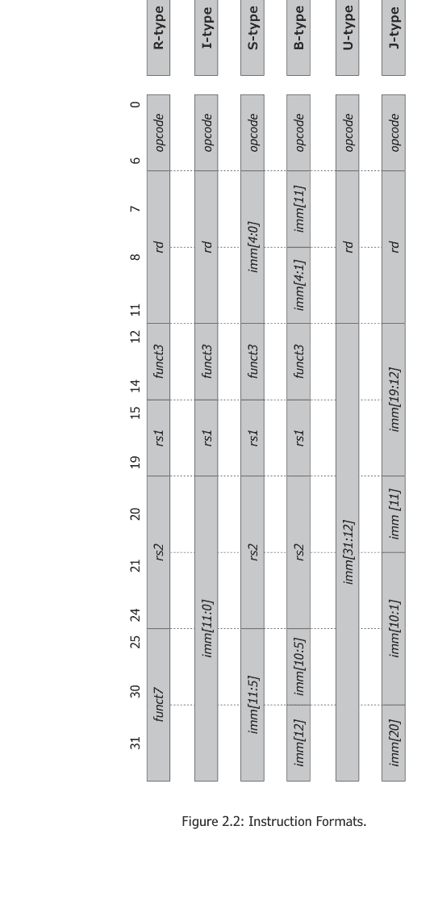

R-type指令格式用于寄存器-寄存器操作。采用此格式的指令从寄存器中读取两个源操作数，并将运算结果写入另一个寄存器。除非某个源寄存器同时被用作目标寄存器，否则源操作数不受影响。

I-type指令格式用于寄存器-立即数操作。采用此格式的指令从寄存器中读取一个源操作数，从操作码中的立即数字段获取第二个操作数，并将运算结果写入一个寄存器。除非源寄存器同时被用作目标寄存器，否则源操作数不受影响。在I-type指令格式中，立即数操作数长度为12位，并在运算前符号扩展至完整的32位。这为立即数数据提供了-2048到+2047的范围。无条件符号扩展在大多数情况下非常有用，但有时也会成为障碍，这一点将在后文强调。

S-type指令格式专用于存储操作，其立即数数据始终是地址偏移量。与其他立即数数据一样，12位的偏移量始终进行符号扩展，提供相对于寄存器基地址-2048到+2047的偏移范围。

B-type指令格式专用于分支指令，其12位立即数数据同样是地址偏移量。在此格式中，指令中的偏移量先进行符号扩展，然后左移一位以确保其为偶数，从而为分支操作提供-2^12到+2^12 - 2的范围。偏移量中的位排列尽可能与S-type指令格式中偏移量的位对齐。

U-type指令格式用于需要更宽立即数数据的指令。在此格式中，立即数操作数宽度为20位，并占据32位字的最高有效位，该字的低12位全部设置为零。

J-type指令格式专用于一种类型的跳转指令，其12位立即数数据同样是地址偏移量。在此格式中，指令中的偏移量先进行符号扩展，然后左移一位以确保其为偶数，从而为跳转操作提供-2^12到+2^12 - 2的范围。偏移量中的位排列尽可能与U-type和I-type指令格式中偏移量的位对齐。

##### 2.1.2 立即数数据指令位置

表2.2展示了包含立即数数据的指令中立即数数据的位位置。大多数情况下，只需一个二路多路复用器来选择立即数数据的目标位。这简化了所需逻辑，但使得解释内存转储变得更加困难。在所有情况下，将进行符号扩展的最高有效位在操作码中的位位置是相同的。

| 格式 | 31 | 30 | 29 | 28 | 27 | 26 | 25 | 24 | 23 | 22 | 21 | 20 | 19 | 18 | 17 | 16 | 15 | 14 | 13 | 12 | 11 | 10 | 9 | 8 | 7 |
|---|---|---|---|---|---|---|---|---|---|---|---|---|---|---|---|---|---|---|---|---|---|---|---|---|---|
| I-type | 11 | 10 | 9 | 8 | 7 | 6 | 5 | 4 | 3 | 2 | 1 | 0 | | | | | | | | | 4 | 3 | 2 | 1 | 0 |
| S-type | 11 | 10 | 9 | 8 | 7 | 6 | 5 | 4 | 3 | 2 | 1 | | | | | | | | | | 4 | 3 | 2 | 1 | 0 |
| B-type | 12 | 10 | 9 | 8 | 7 | 6 | 5 | | 3 | 2 | 1 | | | | | | | | | | 4 | 3 | 2 | 1 | 0 |
| U-type | 20 | 19 | 18 | 17 | 16 | 15 | 14 | 13 | 12 | 11 | | | | | | | | | | | | | | | |
| J-type | 11 | 10 | 9 | 8 | 7 | 6 | 5 | | 3 | 2 | 1 | | | | | | | | | | 20 | 19 | 18 | 17 | 16 |

表2.2：指令格式立即数数据。

##### 2.1.3 寄存器组

指令中的*rd*、*rs1*和*rs2*寄存器选择字段按表2.3所示进行编码。寄存器命名为x0到x31，其中寄存器x0硬连线为只读零。将x0硬连线为零允许使用许多便于汇编语言编程的伪指令。

*RISC-V指令集手册*还定义了一个标准的二进制接口（ABI），包含描述性寄存器名称和标准寄存器用法。大多数RISC-V汇编器识别，甚至要求使用这些描述性寄存器名称。

| rd, rs1, rs2编码 | 寄存器名称 | 寄存器ABI名称 | 寄存器ABI描述 |
|---|---|---|---|
| 00000 | x0 | zero | 硬连线零 |
| 00001 | x1 | ra | 返回地址 |
| 00010 | x2 | sp | 栈指针 |
| 00011 | x3 | gp | 全局指针 |
| 00100 | x4 | tp | 线程指针 |
| 00101 | x5 | t0 | 临时寄存器0 |
| 00110 | x6 | t1 | 临时寄存器1 |
| 00111 | x7 | t2 | 临时寄存器2 |
| 01000 | x8 | s0/fp | 保存寄存器0/帧指针 |
| 01001 | x9 | s1 | 保存寄存器1 |
| 01010 | x10 | a0 | 函数返回值0 |
| 01011 | x11 | a1 | 函数返回值1 |
| 01100 | x12 | a2 | 函数参数2 |
| 01101 | x13 | a3 | 函数参数3 |
| 01110 | x14 | a4 | 函数参数4 |
| 01111 | x15 | a5 | 函数参数5 |
| 10000 | x16 | a6 | 函数参数6 |
| 10001 | x17 | a7 | 函数参数7 |
| 10010 | x18 | s2 | 保存寄存器2 |
| 10011 | x19 | s3 | 保存寄存器3 |
| 10100 | x20 | s4 | 保存寄存器4 |
| 10101 | x21 | s5 | 保存寄存器5 |
| 10110 | x22 | s6 | 保存寄存器6 |
| 10111 | x23 | s7 | 保存寄存器7 |
| 11000 | x24 | s8 | 保存寄存器8 |
| 11001 | x25 | s9 | 保存寄存器9 |
| 11010 | x26 | s10 | 保存寄存器10 |
| 11011 | x27 | s11 | 保存寄存器11 |
| 11100 | x28 | t3 | 临时寄存器3 |
| 11101 | x29 | t4 | 临时寄存器4 |
| 11110 | x30 | t5 | 临时寄存器5 |
| 11111 | x31 | t6 | 临时寄存器6 |

表2.3：寄存器组。

##### 2.1.4 标准扩展

*RISC-V指令集手册*还包含一些在基础RISC-V指令集架构之上的草案或已批准的标准扩展。这些扩展大多以单个字母表示，如表2.4所示。许多标准扩展仍在开发中，此处不予讨论。这些扩展在表中以阴影标出。此处介绍的设计仅包含这些标准扩展的一小部分，如表中最右列所示，但读者可将任何标准扩展添加到设计中。

| 标识符 | 标准扩展 | 状态 | 本设计 |
|---|---|---|---|
| A | 原子指令 | 已批准 | 部分 |
| B | 位操作 | 草案 | 部分 |
| C | 压缩指令 | 已批准 | 完整 |
| Counters | 计数器 | 草案 | 部分 |
| D | 双精度浮点 | 已批准 | |
| F | 单精度浮点 | 已批准 | |
| H | 虚拟机监控程序扩展 | 草案 | |
| I | 基础指令集 | 已批准 | 完整 |
| J | 动态翻译语言 | 草案 | |
| K | 标量密码学 | 草案 | |
| L | 十进制浮点 | 草案 | |
| M | 整数乘法和除法 | 已批准 | |
| N | 用户级中断 | 草案 | |
| P | 打包SIMD | 草案 | |
| Q | 四精度浮点 | 已批准 | |
| T | 事务内存 | 草案 | |
| V | 向量操作 | 草案 | |
| Zam | 非对齐原子 | 草案 | 完整 |
| Zicsr | 控制和状态寄存器指令 | 已批准 | 完整 |
| Zifencei | 指令取指屏障 | 已批准 | 完整 |
| Zihintpause | 暂停提示 | 已批准 | |
| Ztso | 全局存储排序 | 冻结 | |

表2.4：标准扩展。

##### 2.1.5 操作码表约定

在本章剩余部分，指令编码将以表格形式显示，各字段以下划线（ _ ）分隔以使其更明显。指令编码中的字段使用常见字段的缩写列出。这些缩写在大多数情况下应是不言自明的，但为完整起见，仍列于表2.5中。

| 操作码缩写 | 汇编语言 | 扩展 |
|---|---|---|
| ar | aq 和 rl，1位排序约束 | A |
| ccc… | 12位控制和状态寄存器（CSR）地址 | Zicsr |
| ddd | rd'，3位目标寄存器选择 | C |
| ddddd | rd，5位目标寄存器选择 | |
| dnzdd | rd，5位目标寄存器选择，x0不允许 | C |
| dn2dd | rd，5位目标寄存器选择，x2不允许 | C |
| fmod | fm，4位栅栏模式选择 | |
| iorw | pred 或 succ，4位入/出/读/写排序选择 | |
| mm… | imm, uimm, nzimm, nzuimm, offset 或 uoffset，立即数数据，多种宽度（可能被打乱） | |
| rnd | rnd，3位静态舍入模式 | F, D, Q |
| sbsel | sbsel，5位常量（位选择） | B |
| shamt | shamt，5位常量（移位/循环量） | |
| sss | rs1'，3位源-1寄存器选择 | C |
| snzss | rs1，5位源-1寄存器选择，x0不允许 | C |
| sssss | rs1，5位源-1寄存器选择 | |
| ttt | rs2'，3位源-2寄存器选择 | C |
| tnztt | rs2，5位源-2寄存器选择，x0不允许 | C |
| ttttt | rs2，5位源-2寄存器选择 | |
| vvvvv | rs3，5位源-3寄存器选择 | F, D, Q |

表2.5：操作码缩写

#### 2.2 基础整数指令集

RV32I基础整数指令集仅包含四十条指令。这四十条指令是任何RISC-V实现的绝对最小指令集，并且足以模拟几乎所有当前的RISC-V标准扩展。这些四十条指令及其操作码列于表2.6。该表按操作码类型组织，以便在设计过程中提供有用信息，但各指令将按功能组进行描述。


## 深入开源处理器内部

| 汇编语言 | 操作码 | 类型 |
|---|---|---|
| 定义非法指令 | 11111111_11111_111111_111_111111_11111111 | R |
| ADD rd, rs1, rs2 | 0000000_ttttt_sssss_000_ddddd_0110011 | R |
| SUB rd, rs1, rs2 | 0100000_ttttt_sssss_000_ddddd_0110011 | R |
| SLL rd, rs1, rs2 | 0000000_ttttt_sssss_001_ddddd_0110011 | R |
| SLT rd, rs1, rs2 | 0000000_ttttt_sssss_010_ddddd_0110011 | R |
| SLTU rd, rs1, rs2 | 0000000_ttttt_sssss_011_ddddd_0110011 | R |
| XOR rd, rs1, rs2 | 0000000_ttttt_sssss_100_ddddd_0110011 | R |
| SRL rd, rs1, rs2 | 0000000_ttttt_sssss_101_ddddd_0110011 | R |
| SRA rd, rs1, rs2 | 0100000_ttttt_sssss_101_ddddd_0110011 | R |
| OR rd, rs1, rs2 | 0000000_ttttt_sssss_110_ddddd_0110011 | R |
| AND rd, rs1, rs2 | 0000000_ttttt_sssss_111_ddddd_0110011 | R |
| LB rd, offset(rs1) | mmmmmmmm_mmmmm_sssss_000_ddddd_0000011 | I |
| LH rd, offset(rs1) | mmmmmmmm_mmmmm_sssss_001_ddddd_0000011 | I |
| LW rd, offset(rs1) | mmmmmmmm_mmmmm_sssss_010_ddddd_0000011 | I |
| LBU rd, offset(rs1) | mmmmmmmm_mmmmm_sssss_100_ddddd_0000011 | I |
| LHU rd, offset(rs1) | mmmmmmmm_mmmmm_sssss_101_ddddd_0000011 | I |
| ADDI rd, rs1, imm | mmmmmmmm_mmmmm_sssss_000_ddddd_0010011 | I |
| SLLI rd, rs1, shamt | 0000000_shamt_sssss_001_ddddd_0010011 | I |
| SLTI rd, rs1, imm | mmmmmmmm_mmmmm_sssss_010_ddddd_0010011 | I |
| SLTIU rd, rs1, imm | mmmmmmmm_mmmmm_sssss_011_ddddd_0010011 | I |
| XORI rd, rs1, imm | mmmmmmmm_mmmmm_sssss_100_ddddd_0010011 | I |
| SRLI rd, rs1, shamt | 0000000_shamt_sssss_101_ddddd_0010011 | I |
| SRAI rd, rs1, shamt | 0100000_shamt_sssss_101_ddddd_0010011 | I |
| ORI rd, rs1, imm | mmmmmmmm_mmmmm_sssss_110_ddddd_0010011 | I |
| ANDI rd, rs1, imm | mmmmmmmm_mmmmm_sssss_111_ddddd_0010011 | I |
| JALR rd, offset(rs1) | mmmmmmmm_mmmmm_sssss_000_ddddd_1100111 | I |
| FENCE | fmodior_wiorw_00000_000_00000_0001111 | I |
| ECALL | 0000000_00000_00000_000_00000_1110011 | I |
| EBREAK | 0000000_00001_00000_000_00000_1110011 | I |
| SB rs2, offset(rs1) | mmmmmmm_ttttt_sssss_000_mmmmm_0100011 | S |
| SH rs2, offset(rs1) | mmmmmmm_ttttt_sssss_001_mmmmm_0100011 | S |
| SW rs2, offset(rs1) | mmmmmmm_ttttt_sssss_010_mmmmm_0100011 | S |
| BEQ rs1, rs2, offset | mmmmmmm_ttttt_sssss_000_mmmmm_1100011 | B |
| BNE rs1, rs2, offset | mmmmmmm_ttttt_sssss_001_mmmmm_1100011 | B |
| BLT rs1, rs2, offset | mmmmmmm_ttttt_sssss_100_mmmmm_1100011 | B |
| BGE rs1, rs2, offset | mmmmmmm_ttttt_sssss_101_mmmmm_1100011 | B |
| BLTU rs1, rs2, offset | mmmmmmm_ttttt_sssss_110_mmmmm_1100011 | B |
| BGEU rs1, rs2, offset | mmmmmmm_ttttt_sssss_111_mmmmm_1100011 | B |
| AUIPC rd, imm | mmmmmmm_mmmmm_mmmmm_mmm_ddddd_0010111 | U |
| LUI rd, imm | mmmmmmm_mmmmm_mmmmm_mmm_ddddd_0110111 | U |
| JAL rd, offset | mmmmmmm_mmmmm_mmmmm_mmm_ddddd_1101111 | J |

表 2.6：基础整数指令集。

##### 2.2.1 整数算术指令

**ADD rd, rs1, rs2（加法）** 和 **SUB rd, rs1, rs2（减法）** 是寄存器-寄存器算术运算指令。遵循纯粹的 RISC 哲学，这些算术运算只生成 32 位结果，如果需要进位或溢出检查，则必须在软件中单独处理。对于减法，是将 *rs2* 寄存器的内容从 *rs1* 寄存器中减去。

对于无符号操作数，溢出等同于最高有效位的进位或借位，只要源操作数未被修改，就可以在操作后立即通过条件分支指令直接测试这一点。

对于有符号操作数的通用情况则复杂得多。对于加法，溢出检查需要两条额外的指令和一个条件分支，并使用两个临时寄存器。对于减法，溢出检查需要三条额外的指令和一个条件分支，并使用两个临时寄存器。在这两种情况下，如果不需要保留源操作数，则可以使用原始源寄存器作为临时寄存器。

有一个使用寄存器-寄存器算术指令的伪指令：

**NEG rd, rs（二进制补码或取负）** 实际上就是 **SUB rd, x0, rs**。

**ADDI rd, rs1, imm（立即数加法）** 是唯一的寄存器-立即数算术运算。对立即数数据的无符号扩展使得不需要具有立即数操作数的减法指令。

有相当多的指令操作数组合会导致 CPU 不执行任何操作，但标准定义的空操作编码使用 **ADDI** 指令。**ADDI** 指令也用于实现将一个寄存器复制到另一个寄存器的伪指令。

**NOP（空操作）** 实际上就是 **ADDI x0, x0, 0**。

**MV rd, rs（复制寄存器）** 实际上就是 **ADDI rd, rs, 0**。

##### 2.2.2 逻辑运算指令

**AND rd, rs1, rs2（逻辑与）**、**OR rd, rs1, rs2（逻辑或）** 和 **XOR rd, rs1, rs2（逻辑异或）** 是逻辑寄存器-寄存器运算指令。如前所述，因为 RISC-V 中没有标志位，所以如果需要此类状态，必须显式测试结果是否等于零或符号位。测试结果是否为零或符号位就像一个条件分支一样简单。

**ANDI rd, rs1, imm（立即数逻辑与）**、**ORI rd, rs1, imm（立即数逻辑或）** 和 **XORI rd, rs1, imm（立即数逻辑异或）** 是寄存器-立即数逻辑运算指令。

立即数操作数的无符号扩展对于与运算很有用，但对于或运算和异或运算则不那么有用。例如，尝试使用或运算设置第 11 位，意味着立即数的第 31-11 位将全部被设置，因此这些位在寄存器 **rd** 中都将被设置。

一个伪指令使用了立即数逻辑指令：

**NOT rd, rs（按位取反或逻辑非）** 实际上就是 **XORI rd, rs, -1**。

##### 2.2.3 移位指令

**SLL rd, rs1, rs2（逻辑左移）**、**SRA rd, rs1, rs2（算术右移）** 和 **SRL rd, rs1, rs2（逻辑右移）** 是移位指令。移位量由 **rs2** 寄存器的五个最低有效位指定，允许从零到三十一位的移位。**rs2** 寄存器的其余位被忽略。

两种逻辑移位移入零，而算术移位则复制符号位。

RV32I 中没有循环移位指令，因此必须通过组合两次移位的结果并使用两个临时寄存器来模拟循环移位。

**SLLI rd, rs1, shamt（立即数逻辑左移）**、**SRAI rd, rs1, shamt（立即数算术右移）** 和 **SRLI rd, rs1, shamt（立即数逻辑右移）** 是带有立即数操作数的移位指令。移位量由操作码中立即数字段的五位指定。此移位说明符是无符号的，允许从零到三十一位的移位。立即数字段中的其他位用作操作码的一部分。

##### 2.2.4 比较指令

**SLT rd, rs1, rs2（如果小于则设置）** 和 **SLTU rd, rs1, rs2（如果无符号小于则设置）** 是用于有符号和无符号数据的比较指令。如果比较（**rs1 < rs2**）为真，这些指令将 **rd** 寄存器设置为 0x1，否则设置为 0x0。这些操作以使用整个寄存器为代价，提供了专用标志位的替代方案。

有三个比较伪指令：

- **SGTZ rd, rs（如果大于零则设置）** 实际上就是 **SLT rd, x0, rs**。
- **SLTZ rd, rs（如果小于零则设置）** 实际上就是 **SLT rd, rs, x0**。
- **SNEZ rd, rs（如果不等于零则设置）** 实际上就是 **SLTU rd, x0, rs**。

**SLTI rd, rs1, imm（如果小于立即数则设置）** 和 **SLTIU rd, rs1, imm（如果无符号小于立即数则设置）** 是带有立即数操作数的有符号和无符号比较指令。如果比较（**rs1 < imm**）为真，这些指令将 **rd** 寄存器设置为 0x1，否则设置为 0x0。立即数操作数总是被符号扩展，即使对于 **SLTIU** 指令也是如此。

只有一个立即数比较指令提供了有用的伪指令：

- **SEQZ rd, rs（如果等于零则设置）** 实际上就是 **SLTIU rd, rs, 1**。

##### 2.2.5 常数生成指令

有两条常数生成指令。使用这些指令时，立即数操作数宽度为二十位，并填充 32 位字的最高有效位，低 12 位全部设置为零。

**AUIPC rd, imm（将高立即数加到 PC）** 允许创建 32 位 PC 相对地址，用于加载、存储和跳转，方法是将此指令的程序计数器与立即数操作数相加，并将结果存储在 **rd** 寄存器中。

**LUI rd, imm（加载高立即数）** 允许创建 32 位常数或绝对地址，方法是将立即数操作数直接加载到 **rd** 寄存器中。

这两条指令通常后面跟着一条 **ADDI** 指令来加载低 12 位。但是，由于 **ADDI** 立即数操作数在相加之前会被符号扩展，因此需要注意对此符号扩展进行补偿。补偿需要将 **ADDI** 操作数的最高有效位加到其中一条指令的 20 位操作数中。

大多数 RISC-V 汇编器提供一对伪指令，它们会自动扩展为 32 位量所需的两指令序列：

**LI rd, imm（加载立即数）** 将 32 位常数或绝对地址加载到寄存器 **rd** 中。通用实现将包括 **LUI rd, imm[31:12] + imm[11]**，后跟 **ADDI rd, x0, imm[11:0]**。链接器将在链接阶段执行 **LUI** 立即数值的加法。一些汇编器足够智能，如果常数值在必要的范围内，它们只会使用一条 **LUI** 指令或仅使用一条 **ADDI** 指令。


LA rd, symbol (Load Address) 将一个32位的PC相对地址加载到寄存器rd中。其一般实现方式是先执行 `AUIPC rd, imm[31:12] + imm[11]`，然后执行 `ADDI rd, x0, imm[11:0]`。链接器将计算所需的立即数值，并在链接阶段为 AUIPC 指令的立即数值执行加法运算。

##### 2.2.6 无条件跳转指令

无条件跳转指令有两种类型，这两条指令可以实现汇编语言程序员所熟悉的大多数控制转移指令。

RISC-V没有专用的栈指针，但这两条指令提供了类似于返回栈栈顶的链接寄存器。如果一个子程序调用另一个子程序，则必须由被调用的子程序保存此寄存器。RISC-V的寄存器调用约定使用x1寄存器作为返回地址寄存器，尽管这些指令可以使用任何寄存器来实现此目的。

JAL rd, offset (Jump and Link) 将指令中的偏移量加到本条指令的程序计数器上。同时，下一条指令的程序计数器被写入rd寄存器，用作链接寄存器。指令中的20位偏移量经过符号扩展后左移一位，以确保其为偶数，从而给出 −2²⁰ 到 +2²⁰ − 2 的跳转范围。需要偶数偏移量是因为RISC-V指令必须半字对齐。

JALR rd, offset(rs1) (Jump and Link Register) 将指令中的偏移量加到寄存器rs1的内容上，并将结果写入程序计数器。同时，下一条指令的程序计数器被写入rd寄存器。该指令的偏移量为12位，提供 −2¹¹ 到 +2¹¹ − 1 的偏移范围。

此指令的一个复杂之处在于，硬件在将加法结果加载到PC之前，必须将结果的最低有效位设置为零，以使目标地址为偶数。如果此指令前面是AUIPC或LUI指令，则跳转的有效范围是整个地址空间。

有两种PC相对跳转伪指令：

J offset (Jump) 就是 `JAL x0, offset`。这是一个简单的PC相对跳转，无需返回。

JAL offset (Jump and Link) 就是 `JAL x1, offset`，遵循寄存器x1用作返回地址寄存器的约定。这类似于PC相对的子程序调用。

有三个使用寄存器作为地址的跳转伪指令：

**JR rs** (Jump Register) 就是 **JALR x0, 0(rs)**。这是一个简单的绝对地址跳转，无需返回。

**JALR rs** (Jump and Link Register) 就是 **JALR x1, 0(rs)**。这也是一个简单的绝对地址跳转，但会保存返回地址。这可能会取代专用的 **CALL** 指令，具体取决于汇编器。

**RET** (Return from Subroutine) 就是 **JALR x0, 0(x1)**。此指令将程序计数器返回到存储在返回地址寄存器中的地址。

一些汇编器还认可另外两个使用寄存器作为地址的伪指令，尽管其寻址模式实际上是用于位置无关代码的PC相对寻址。

**CALL rd, symbol** (Call Subroutine) 会展开为两条指令序列：**AUIPC rd, imm[31:12] + imm[11]**，后跟 **JALR x1, imm[11:0](rd)**。如果在汇编代码中省略了 **rd**，则默认使用 **x6** 寄存器。

**TAIL rs, symbol** (Tail Call Subroutine) 会展开为两条指令序列：**AUIPC rs, imm[31:12] + imm[11]**，后跟 **JALR x0, imm[11:0](rs)**。如果在汇编代码中省略了 **rs**，根据RISC-V调用约定通常假设使用寄存器 **x6**。这里的 **JALR** 指令使用 **x0** 寄存器是为了避免破坏返回栈。

##### 2.2.7 条件分支指令

条件分支指令比较两个寄存器的内容，如果满足指令指定的条件，则将指令中的偏移量加到指令的PC上。指令中的12位偏移量经过符号扩展后左移一位，以确保其为偶数，从而给出 −2¹² 到 +2¹² − 2 的分支范围。

**BEQ rs1, rs2, offset** (Branch if Equal) 在两个寄存器的内容相同时分支。

**BNE rs1, rs2, offset** (Branch if Not Equal) 在两个寄存器的内容不同时分支。

**BGE rs1, rs2, offset** (Branch if Greater Than or Equal) 在 **rs1** 寄存器的内容大于或等于 **rs2** 寄存器的内容时分支（将两者视为有符号数）。

**BGEU rs1, rs2, offset** (Branch if Greater Than or Equal, Unsigned) 在 **rs1** 寄存器的内容大于或等于 **rs2** 寄存器的内容时分支（将两者视为无符号数）。

**BLT rs1, rs2, offset** (Branch if Less Than) 在 **rs1** 寄存器的内容小于 **rs2** 寄存器的内容时分支（将两者视为有符号数）。

**BLTU rs1, rs2, offset** (Branch if Less Than, Unsigned) 在 **rs1** 寄存器的内容小于 **rs2** 寄存器的内容时分支（将两者视为无符号数）。

这六条指令足以覆盖所有可能的情况，因为交换所选寄存器的顺序会创建相反的测试条件。此相反的测试条件会产生四个伪指令：

- **BGT rs, rt, offset** (Branch if >) 就是 **BLT rt, rs, offset**。
- **BGTU rs, rt, offset** (Branch if >, Unsigned) 就是 **BLTU rt, rs, offset**。
- **BLE rs, rt, offset** (Branch if ≤) 就是 **BGE rt, rs, offset**。
- **BLEU rs, rt, offset** (Branch if ≤, Unsigned) 就是 **BGEU rt, rs, offset**。

当使用 **x0** 寄存器的硬连线零作为其中一个操作数时，会产生另外六个伪指令：

- **BEQZ rs, offset** (Branch if = Zero) 就是 **BEQ rs, x0, offset**。
- **BNEZ rs, offset** (Branch if ≠ Zero) 就是 **BNE rs, x0, offset**。
- **BGEZ rs, offset** (Branch if ≥ Zero) 就是 **BGE rs, x0, offset**。
- **BLEZ rs, offset** (Branch if ≤ Zero) 就是 **BGE x0, rs, offset**。
- **BGTZ rs, offset** (Branch if > Zero) 就是 **BLT x0, rs, offset**。
- **BLTZ rs, offset** (Branch if < Zero) 就是 **BLT rs, x0, offset**。

##### 2.2.8 加载和存储指令

RISC哲学的一个基本原则是只有加载和存储指令访问内存，并且通常只使用一种简单的寻址模式。所有RISC-V加载和存储指令都使用 **基址+偏移** 寻址模式，指令中有一个12位的偏移量可用。与其他立即数数据一样，偏移量总是经过符号扩展，从而给出从寄存器中的基地址起，–2¹¹ 到 +2¹¹ – 1 的范围。

*RISC-V指令集手册*对加载和存储的对齐没有要求，并明确允许在硬件或软件中实现未对齐的访问。字节和半字加载的无符号版本对于在软件中实现未对齐加载非常有用。

**LB rd, offset(rs1)** (Load Byte) 从内存加载一个字节到 **rd** 寄存器的最低有效字节，并将该字节符号扩展以填充寄存器的其余三个字节。

**LBU rd, offset(rs1)** (Load Byte, Unsigned) 从内存加载一个字节到 **rd** 寄存器的最低有效字节，同时用零填充寄存器的其余三个字节。

**LH rd, offset(rs1)** (Load Halfword) 从内存加载一个半字到 **rd** 寄存器的低半部分，并将该半字符号扩展以填充寄存器的高半部分。

**LHU rd, offset(rs1)** (Load Halfword, Unsigned) 从内存加载一个半字到 **rd** 寄存器的低半部分，同时用零填充寄存器的高半部分。

**LW rd, offset(rs1)** (Load Word) 从内存加载一个字到 **rd** 寄存器。

**SB rs2, offset(rs1)** (Store Byte) 将 **rs2** 寄存器的最低有效字节存储到内存。

**SH rs2, offset(rs1)** (Store Halfword) 将 **rs2** 寄存器的最低有效半字存储到内存。

**SW rs2, offset(rs1)** (Store Word) 将 **rs2** 寄存器的内容存储到内存。

##### 2.2.9 内存排序指令

内存排序指令包含在基础指令集中，用于支持超标量、乱序或多核RISC-V处理器。此处介绍的设计不具备这些特性，因此读者可以参考 *RISC-V指令集手册* 了解更多关于内存排序的详细信息。

**FENCE fm, pred, succ** (Fence) 是一条用于在外部总线上对设备输入、设备输出、内存读和内存写事务进行排序的指令，前提是这些事务在程序顺序中没有其他保证。有关该指令中各字段的含义，请参考 *RISC-V指令集手册*。


关于异常，需要记住的一点是：保存的是导致异常的指令的地址，而不是下一条指令的地址。

**ECALL**（环境调用）会生成一个环境调用异常，这本质上是一个服务请求。与许多架构不同，**ECALL**指令并未利用操作码中的立即数来传递与此服务请求相关的参数。

**EBREAK**（环境断点）会生成一个断点异常，并将控制权返回到调试环境。

##### 2.2.11 其他指令

有一条32位指令不符合任何其他类别，它实际上不是一条指令，而是一种保证会生成非法指令异常的位模式。这对于检测已擦除的Flash内存很有用，同时也有助于压缩操作码解码器，该解码器可以输出此模式以强制触发异常。

**定义非法**指令就是全为1的32位。

##### 2.2.12 提示指令

将**x0**寄存器硬连线为零，意味着大量的RISC-V操作码是无用的，而*RISC-V指令集手册*将其中许多编码保留为**提示**指令，这些指令可以“向微架构传递性能提示”。目前，这些指令编码都没有被定义来做任何事情。因此，默认的“什么都不做”——这自然源自**x0**寄存器为只读零的设计——意味着我们不需要对它们给予任何特别关注。

**NOP**伪指令是使用一个原本是**提示**的编码进行编码的。表2.7列出了**提示**指令。这些指令编码中的大部分是为未来标准用途保留的，但也有不少是为自定义用途保留的。

| 指令 | 条件 | 用途 |
|---|---|---|
| ADD | *rd* = x0 | 保留给标准使用 |
| ADDI | *rd* = x0 且 (*rs1* ≠ x0 或 *imm* ≠ 0) | 保留给标准使用 |
| AND | *rd* = x0 | 保留给标准使用 |
| ANDI | *rd* = x0 | 保留给标准使用 |
| AUIPC | *rd* = x0 | 保留给标准使用 |
| FENCE | *pred* = 0 或 *succ* = 0 | 保留给标准使用 |
| LUI | *rd* = x0 | 保留给标准使用 |
| OR | *rd* = x0 | 保留给标准使用 |
| ORI | *rd* = x0 | 保留给标准使用 |
| SLL | *rd* = x0 | 保留给标准使用 |
| SRA | *rd* = x0 | 保留给标准使用 |
| SRL | *rd* = x0 | 保留给标准使用 |
| SUB | *rd* = x0 | 保留给标准使用 |
| XOR | *rd* = x0 | 保留给标准使用 |
| XORI | *rd* = x0 | 保留给标准使用 |
| SLLI | *rd* = x0 | 保留给自定义使用 |
| SLT | *rd* = x0 | 保留给自定义使用 |
| SLTI | *rd* = x0 | 保留给自定义使用 |
| SLTU | *rd* = x0 | 保留给自定义使用 |
| SLTIU | *rd* = x0 | 保留给自定义使用 |
| SRLI | *rd* = x0 | 保留给自定义使用 |
| SRAI | *rd* = x0 | 保留给自定义使用 |

表2.7: RV32I **提示**指令

#### 2.3 控制和状态寄存器扩展

RISC-V为控制和状态寄存器提供了12位的地址空间，总共有4096个唯一的CSR地址。然而，这些地址位中有几个被定义用来编码访问权限，因此实际可用的CSR数量要少得多。CSR寻址的细节和标准CSR将在单独的章节中讨论。

CSR指令最初被包含在RISC-V规范的强制部分，因为它们需要访问三个64位性能计数器，这些计数器也是规范强制部分的一部分。对于运行*Linux*的RISC-V CPU来说，强制要求三个64位计数器可能不是什么大事，但通常情况并非如此。因此，性能计数器和CSR指令最终被移至一个名为“*Zicsr*”控制和状态寄存器指令的可选扩展中。实际上，CSR指令总是需要的，因为它们对于中断和异常处理是必需的。表2.8显示了CSR指令。

# 深入开源处理器

| 汇编语言 | 操作码 | 类型 |
|---|---|---|
| CSRRW rd, csr, rs1 | cccccccc_ccccc_sssss_001_ddddd_1110011 | CI |
| CSRRS rd, csr, rs1 | cccccccc_ccccc_sssss_010_ddddd_1110011 | CI |
| CSRRC rd, csr, rs1 | cccccccc_ccccc_sssss_011_ddddd_1110011 | CI |
| CSRRWI rd, csr, imm | cccccccc_ccccc_mmmmm_101_ddddd_1110011 | CI* |
| CSRRSI rd, csr, imm | cccccccc_ccccc_mmmmm_110_ddddd_1110011 | CI* |
| CSRRCI rd, csr, imm | cccccccc_ccccc_mmmmm_111_ddddd_1110011 | CI* |

表2.8: 控制和状态寄存器指令。

CSR寄存器指令使用I型指令格式，其中CSR地址占据立即数字段。通常，这些指令从**rs1**寄存器读取一个操作数，从CSR读取一个操作数，然后将某些内容写入**rd**寄存器和CSR。当**rd**寄存器是**x0**或**rs1**寄存器是**x0**时，这些指令的行为会按照下文详述进行修改。这些修改使得逻辑设计变得复杂。

CSR立即数指令使用修改后的I型格式，其中**rs1**字段被替换为一个5位立即数值，该值被零扩展以供指令使用。除此之外，这些指令的操作与相应的CSR寄存器指令相同。5位立即数意味着只有CSR中的五个最低有效位可以使用这些指令直接置位或清零。

##### 2.3.1 读写CSR指令

**CSRRW rd, csr, rs1**（原子读写CSR）读取指定的CSR并将该数据写入**rd**寄存器。同时，**rs1**寄存器的内容被写入指定的CSR。这是一个原子操作，因此如果**rd**和**rs1**字段选择的是同一个寄存器，这相当于在CSR和**rd**寄存器之间进行交换。

当**rd**操作数指定为**x0**寄存器时，**CSRRW**指令的行为被修改，使其不读取CSR，仅执行CSR写操作。由此产生一个伪指令：

> **CSRW csr, rs**（写CSR）就是**CSRRW x0, csr, rs**。不发生CSR的读取。

**CSRRWI rd, csr, imm**（原子读写CSR立即数）的操作与**CSRRW**指令相同，包括当**rd**操作数指定为**x0**寄存器时的特殊情况，不同之处在于指令中的立即数值代替了来自**rs1**寄存器的值。

这个特殊情况引出一个伪指令：

> **CSRWI csr, imm**（写CSR立即数）就是**CSRRWI x0, csr, imm**。不发生CSR的读取。

##### 2.3.2 置位CSR指令

**CSRRS** *rd, csr, rs1*（原子读取并置位CSR中的位）读取指定的CSR并将该数据写入*rd*寄存器。同时，来自*rs1*寄存器的值被用作位掩码，用于对从CSR读取的值进行置位（1表示置位该位），然后将结果写回CSR。这是一个原子操作。

当*rs1*操作数指定为*x0*寄存器时，**CSRRS**指令的行为被修改，使其不写入CSR，仅执行CSR读取。有一对使用**CSRRS**指令的伪指令，其中一条利用了这种行为：

- **CSRS** *csr, rs*（置位CSR中的位）就是**CSRRS** *x0, csr, rs*。这会在不将原始CSR数据存储到寄存器的情况下置位CSR中的位。
- **CSRR** *rd, csr*（读CSR）就是**CSRRS** *rd, csr, x0*。不发生CSR的写入。

RISC-V规范最初强制要求所有实现包含三个64位计数器。这些计数器现在是*RISC-V特权架构*的一个可选部分，但许多汇编器仍然实现了用于访问与这些计数器相关联的CSR的专用伪指令：

- **RDCYCLE** *rd*（读周期计数器）就是**CSRRS** *rd, 0xc00, x0*。
- **RDCYCLEH** *rd*（读周期计数器高字）就是**CSRRS** *rd, 0xc80, x0*。
- **RDINSTRET** *rd*（读指令退休计数器）就是**CSRRS** *rd, 0xc02, x0*。
- **RDINSTRETH** *rd*（读指令退休计数器高字）就是**CSRRS** *rd, 0xc82, x0*。
- **RDTIME** *rd*（读定时器）就是**CSRRS** *rd, 0xc01, x0*。
- **RDTIMEH** *rd*（读定时器高字）就是**CSRRS** *rd, 0xc80, x0*。

**CSRRSI** *rd, csr, imm*（原子读取并置位CSR立即数）的操作与**CSRRS**指令相同，不同之处在于指令中的立即数值代替了来自*rs1*寄存器的值。当*imm*操作数为零时，**CSRRSI**指令的行为被修改，使其不写入CSR，仅执行CSR读取。没有伪指令利用这种特殊情况。

有一条使用**CSRRSI**指令的伪指令：

- **CSRSI** *csr, imm*（置位CSR立即数）就是**CSRRSI** *x0, csr, imm*。


##### 2.3.3 CSR 清位指令

**CSRRC rd, csr, rs1**（CSR 原子读取并清位）指令会读取指定的 CSR，并将读取的数据写入寄存器 **rd**。同时，使用寄存器 **rs1** 的值作为位掩码，清除从 CSR 读取的值中的相应位（1 表示清除该位），然后将结果写回 CSR。这是一个原子操作。

当 **rs1** 操作数指定为 **x0** 寄存器时，**CSRRC** 指令的行为会发生修改：不会写入 CSR，仅执行 CSR 读取操作。有一条伪指令不使用这种修改后的行为：

> **CSRC csr, rs**（CSR 清位）实际上就是 **CSRRC x0, csr, rs**。这条指令用于清除 CSR 中的位，但不将原始的 CSR 数据存储到寄存器中。

**CSRRCI rd, csr, imm**（CSR 立即数原子读取并清位）指令的操作与 **CSRRC** 指令相同，唯一区别在于使用指令中的立即数替代 **rs1** 寄存器的值。当 **imm** 操作数为零时，**CSRRCI** 指令的行为会发生修改：不会写入 CSR，仅执行 CSR 读取操作。

有一条伪指令使用 **CSRRCI** 指令：

> **CSRCI csr, imm**（CSR 立即数清位）实际上就是 **CSRRCI x0, csr, imm**。

#### 2.4 整数乘除法扩展

*"M" 标准扩展：整数乘除法* 在 RISC-V 指令集中增加了乘法和除法运算。与整数算术指令类似，硬件不提供溢出或除以零的检测功能，软件需要负责检测这些情况。《RISC-V 指令集手册》详细规定了在不同除法和取余指令发生错误时应返回的结果，但对于乘法指令在溢出时应返回什么结果未作说明。

表 2.9 展示了完整的整数乘除法指令集，所有指令均使用 R 型指令格式。在本文介绍的设计中不会实现这些指令，不过在 FPGA 中使用专用乘法器实现乘法运算应该相当容易。

| 汇编语言 | 操作码 | 类型 |
| :--- | :--- | :--- |
| **MUL** *rd*, *rs1*, *rs2* | 0000001_ttttt_sssss_000_ddddd_0110011 | R |
| **MULH** *rd*, *rs1*, *rs2* | 0000001_ttttt_sssss_001_ddddd_0110011 | R |
| **MULHSU** *rd*, *rs1*, *rs2* | 0000001_ttttt_sssss_010_ddddd_0110011 | R |
| **MULHU** *rd*, *rs1*, *rs2* | 0000001_ttttt_sssss_011_ddddd_0110011 | R |
| **DIV** *rd*, *rs1*, *rs2* | 0000001_ttttt_sssss_100_ddddd_0110011 | R |
| **DIVU** *rd*, *rs1*, *rs2* | 0000001_ttttt_sssss_101_ddddd_0110011 | R |
| **REM** *rd*, *rs1*, *rs2* | 0000001_ttttt_sssss_110_ddddd_0110011 | R |
| **REMU** *rd*, *rs1*, *rs2* | 0000001_ttttt_sssss_111_ddddd_0110011 | R |

表 2.9：整数乘除法指令

##### 2.4.1 乘法指令

四种不同的乘法指令涵盖了有符号（二进制补码）和无符号数相乘时的所有可能情况。一个完整的 32 位乘 32 位运算需要两条乘法指令，因为每条指令只能返回结果中的 32 位。

**MUL** *rd*, *rs1*, *rs2*（乘法）是基本的乘法指令，返回 *rs1* 寄存器与 *rs2* 寄存器乘积的低 32 位。无论是有符号数还是无符号数的组合，该指令的操作都相同。

**MULH** *rd*, *rs1*, *rs2*（高半字乘法）是基本乘法指令的另一半，假设 *rs1* 和 *rs2* 寄存器中均为有符号数，返回它们乘积的高 32 位。

**MULHSU** *rd*, *rs1*, *rs2*（有符号乘无符号高半字乘法）假设 *rs1* 寄存器中为有符号数，*rs2* 寄存器中为无符号数，返回它们乘积的高 32 位。

**MULHU** *rd*, *rs1*, *rs2*（无符号高半字乘法）假设两个寄存器中均为无符号数，返回它们乘积的高 32 位。

《RISC-V 指令集手册》未指定溢出情况下返回的结果，这种情况仅当两个有符号操作数都是最负数时才会发生。

##### 2.4.2 除法指令

与乘法不同，整数除法指令只允许操作数类型相同。但一个完整的 32 位除 32 位运算同样需要两条指令才能获得完整结果，即商和余数。

**DIV** *rd*, *rs1*, *rs2*（除法）返回将 *rs1* 寄存器（被除数）除以 *rs2* 寄存器（除数）得到的 32 位商，两个操作数均视为有符号数。

**DIVU** *rd*, *rs1*, *rs2*（无符号除法）返回将 *rs1* 寄存器除以 *rs2* 寄存器得到的 32 位商，两个操作数均视为无符号数。

**REM rd, rs1, rs2**（取余）返回将 *rs1* 寄存器除以 *rs2* 寄存器得到的 32 位余数，两个操作数均视为有符号数。

**REMU rd, rs1, rs2**（无符号取余）返回将 *rs1* 寄存器除以 *rs2* 寄存器得到的 32 位余数，两个操作数均视为无符号数。

《RISC-V 指令集手册》规定这些除法指令向零取整，并在除以零或溢出时返回表 2.10 所示的结果。

| 条件 | 被除数 | 除数 | DIV | REM | DIVU | REMU |
| :--- | :---: | :---: | :---: | :---: | :---: | :---: |
| 除以零 | *x* | 0 | -1 | *x* | 2^31 - 1 | *x* |
| 溢出（仅限有符号） | -2^31 | -1 | -2^31 | 0 | - | - |

表 2.10：除法错误结果

#### 2.5 原子指令扩展

*"A" 标准扩展：原子指令* 主要用于支持多处理器 RISC-V 系统。与 RISC-V 指令集的其他部分不同，这些指令直接对内存进行操作，因此在处理内存映射 I/O 时，部分指令在嵌入式应用中也会非常有用。

所有原子指令均使用 R 型指令格式，但在操作码中包含两个位，称为 **aq** 和 **rl**，用于指定原子内存操作的顺序约束。当内存事务可能乱序发生时，顺序约束是必需的，这对于多处理器 RISC-V 系统非常重要，但在本文介绍的设计中可以安全地忽略。如果需要实现这两个位的具体功能，请参考《RISC-V 指令集手册》。

表 2.11 展示了完整的原子指令集，其中在本设计中不会实现的指令用灰色高亮标出。原子指令的汇编语言语法与 RISC-V 指令集的其他部分不同，这些指令附加了 ".W"（表示字操作数）。并非所有汇编器都支持这些指令，而且不清楚在汇编语言中应如何处理 **aq** 和 **rl** 顺序约束，因此表中未列出它们。

| 汇编语言 | 操作码 |
|---|---|
| **AMOADD.W** rd, rs2, (rs1) | 00000ar_ttttt_sssss_010_ddddd_0101111 |
| **AMOSWAP.W** rd, rs2, (rs1) | 00001ar_ttttt_sssss_010_ddddd_0101111 |
| **LR.W** rd, (rs1) | 00010ar_00000_sssss_010_ddddd_0101111 |
| **SC.W** rd, rs2, (rs1) | 00011ar_ttttt_sssss_010_ddddd_0101111 |
| **AMOXOR.W** rd, rs2, (rs1) | 00100ar_ttttt_sssss_010_ddddd_0101111 |
| **AMOOR.W** rd, rs2, (rs1) | 01000ar_ttttt_sssss_010_ddddd_0101111 |
| **AMOAND.W** rd, rs2, (rs1) | 01100ar_ttttt_sssss_010_ddddd_0101111 |
| **AMOMIN.W** rd, rs2, (rs1) | 10000ar_ttttt_sssss_010_ddddd_0101111 |
| **AMOMAX.W** rd, rs2, (rs1) | 10100ar_ttttt_sssss_010_ddddd_0101111 |
| **AMOMINU.W** rd, rs2, (rs1) | 11000ar_ttttt_sssss_010_ddddd_0101111 |
| **AMOMAXU.W** rd, rs2, (rs1) | 11100ar_ttttt_sssss_010_ddddd_0101111 |

表 2.11：原子指令

##### 2.5.1 原子内存操作指令

原子内存操作（AMO）指令使用 **rs1** 寄存器的内容作为内存地址，读取内存并将数据写入 **rd** 寄存器。同时，该内存数据与 **rs2** 寄存器的内容一起，根据指令指定的操作进行运算。然后，运算结果被写回原始内存位置，而 **rs2** 寄存器的内容保持不变。这种读-修改-写操作对于信号量和 I/O 寄存器等在读和写之间可能发生变化的场景是必需的。

*"A" 标准扩展：原子指令* 仅包含字宽操作，这通过操作码第 14-12 位的 "010" 字段指定。这与加载和存储指令使用的编码相同，后者支持完整的操作数宽度集。我们稍后在描述实现时会看到，为 AMO 指令添加完整的宽度选项集几乎不增加成本。

**AMOADD.W rd, rs2, (rs1)**（原子内存加法）执行内存位置内容与 **rs2** 寄存器内容的加法运算。

**AMOSWAP.W rd, rs2, (rs1)**（原子内存交换）将内存位置的内容与 **rs2** 寄存器的内容进行交换。

**AMOAND.W rd, rs2, (rs1)**（原子内存与）、**AMOOR.W rd, rs2, (rs1)**（原子内存或）和 **AMOXOR.W rd, rs2, (rs1)**（原子内存异或）在内存内容与 **rs2** 寄存器内容之间执行相应的逻辑运算。

**AMOMAX.W rd, rs2, (rs1)**（原子内存最大值）和 **AMOMAXU.W rd, rs2, (rs1)**（原子内存最大值，无符号）在内存内容与 **rs2** 寄存器内容之间执行比较（有符号或无符号），较大的


##### 2.5.2 加载保留/条件存储指令

加载保留/条件存储指令允许创建复杂的原子内存操作，可以在保留和条件存储之间执行一系列指令。这种复杂的原子内存操作主要用于创建无锁数据结构，主要应用于多处理器系统。

需要一定专用硬件的这两条指令，在本设计中不予实现。

**LR.W** *rd, (rs1)*（加载保留字）使用 **rs1** 寄存器中的地址读取内存，然后将该数据加载到 **rd** 寄存器中。同时，该内存地址在硬件中被标记为*保留*。此*保留*状态要求将地址存储在硬件中，以便抑制其他处理器对该保留地址的内存访问。此状态将保持设置，直到对应的 SC.W 指令清除保留。以上仅为概述，读者请参阅 *RISC-V 指令集手册* 了解更多详情。

**SC.W** *rd, rs2, (rs1)*（条件存储字）仅当该地址存在保留时，才将 **rs2** 寄存器的内容写入 **rs1** 寄存器内容所寻址的内存单元。同时，此内存写入的成功或失败会在 **rd** 寄存器中报告。写入 **rd** 寄存器为零表示成功，否则写入一个失败码。*RISC-V 指令集手册* 当前规定失败码的值为 1，并将其他所有非零失败码值保留以备将来使用。

#### 2.6 单精度浮点扩展

单精度浮点 "*F*" 标准扩展增加了二十六条指令，实现了采用 *binary32* 浮点数格式的 IEEE-754-2008 算术标准。如前所述，此扩展还为 RISC-V 架构增加了 32 个 32 位浮点寄存器以及一个 32 位 CSR。由于融合乘加指令需要四个寄存器地址而不是通常的三个，因此需要一种新的指令格式。

表 2.12 展示了完整的单精度浮点指令集。此处提出的设计不包含浮点部分，因此这些指令均未实现，并且此处的描述并未涵盖所有边界情况的许多复杂细节。*RISC-V 指令集手册* 包含此标准扩展的完整参考。

除各种转换指令外，浮点指令在不同浮点格式间是通用的，其宽度编码在操作码字段中，通常也是指令助记符的后缀。"S" 后缀表示单精度。

| 汇编语言 | 操作码 |
| :--- | :--- |
| FLW *rd, offset(rs1)* | mmmmmmmm_mmmmm_sssss_010_ddddd_0000111 |
| FSW *rs2, offset(rs1)* | mmmmmmmm_ttttt_sssss_010_mmmmm_0100111 |
| FMADD.S *rd, rs1, rs2, rs3* | vvvvv00_ttttt_sssss_rnd_ddddd_1000011 |
| FMSUB.S *rd, rs1, rs2, rs3* | vvvvv00_ttttt_sssss_rnd_ddddd_1000111 |
| FNMSUB.S *rd, rs1, rs2, rs3* | vvvvv00_ttttt_sssss_rnd_ddddd_1001011 |
| FNMADD.S *rd, rs1, rs2, rs3* | vvvvv00_ttttt_sssss_rnd_ddddd_1001111 |
| FADD.S *rd, rs1, rs2* | 0000000_ttttt_sssss_rnd_ddddd_1010011 |
| FSUB.S *rd, rs1, rs2* | 0000100_ttttt_sssss_rnd_ddddd_1010011 |
| FMUL.S *rd, rs1, rs2* | 0001000_ttttt_sssss_rnd_ddddd_1010011 |
| FDIV.S *rd, rs1, rs2* | 0001100_ttttt_sssss_rnd_ddddd_1010011 |
| FMIN.S *rd, rs1, rs2* | 0010100_ttttt_sssss_000_ddddd_1010011 |
| FMAX.S *rd, rs1, rs2* | 0010100_ttttt_sssss_001_ddddd_1010011 |
| FSQRT.S *rd, rs1* | 0101100_00000_sssss_rnd_ddddd_1010011 |
| FSGNJ.S *rd, rs1, rs2* | 0010000_ttttt_sssss_000_ddddd_1010011 |
| FSGNJN.S *rd, rs1, rs2* | 0010000_ttttt_sssss_001_ddddd_1010011 |
| FSGNJX.S *rd, rs1, rs2* | 0010000_ttttt_sssss_010_ddddd_1010011 |
| FCVT.W.S *rd, rs1* | 1100000_00000_sssss_rnd_ddddd_1010011 |
| FCVT.WU.S *rd, rs1* | 1100000_00001_sssss_rnd_ddddd_1010011 |
| FCVT.S.W *rd, rs1* | 1101000_00000_sssss_rnd_ddddd_1010011 |
| FCVT.S.WU *rd, rs1* | 1101000_00001_sssss_rnd_ddddd_1010011 |
| FEQ.S *rd, rs1, rs2* | 1010000_ttttt_sssss_010_ddddd_1010011 |
| FLT.S *rd, rs1, rs2* | 1010000_ttttt_sssss_001_ddddd_1010011 |
| FLE.S *rd, rs1, rs2* | 1010000_ttttt_sssss_000_ddddd_1010011 |
| FCLASS.S *rd, rs1* | 1110000_00000_sssss_001_ddddd_1010011 |
| FMV.X.W *rd, rs1* | 1111000_00000_sssss_000_ddddd_1010011 |
| FMV.W.X *rd, rs1* | 1111000_00000_sssss_000_ddddd_1010011 |

表 2.12：单精度浮点指令。

##### 2.6.1 单精度浮点加载和存储指令

单精度浮点加载和存储指令使用标准的 RISC-V *基地址+偏移量* 寻址模式，基地址保存在整数寄存器中。数据在浮点寄存器和内存之间传输，包含一个 32 位字。

**FLW *rd*, *offset*(*rs1*)**（浮点加载字）从内存加载一个字到 *rd* 浮点寄存器。

**FSW *rs2*, *offset*(*rs1*)**（浮点存储字）将 *rs2* 浮点寄存器的内容存储到内存。

##### 2.6.2 单精度浮点计算指令

单精度浮点计算指令仅使用浮点寄存器文件。

**FADD.S *rd*, *rs1*, *rs2***（浮点加法）将 *rs1* 寄存器与 *rs2* 寄存器相加，并将结果存储在 *rd* 寄存器。

**FSUB.S *rd*, *rs1*, *rs2***（浮点减法）从 *rs1* 寄存器中减去 *rs2* 寄存器，并将结果存储在 *rd* 寄存器。

**FMUL.S *rd*, *rs1*, *rs2***（浮点乘法）将 *rs1* 寄存器乘以 *rs2* 寄存器，并将结果存储在 *rd* 寄存器。

**FDIV.S *rd*, *rs1*, *rs2***（浮点除法）将 *rs1* 寄存器除以 *rs2* 寄存器，并将结果存储在 *rd* 寄存器。

**FSQRT.S *rd*, *rs1***（浮点平方根）计算 *rs1* 寄存器的平方根，并将结果存储在 *rd* 寄存器。

**FMIN.S *rd*, *rs1*, *rs2***（浮点最小值）比较 *rs1* 寄存器和 *rs2* 寄存器，并将较小的值存储到 *rd* 寄存器。

**FMAX.S *rd*, *rs1*, *rs2***（浮点最大值）比较 *rs1* 寄存器和 *rs2* 寄存器，并将较大的值存储到 *rd* 寄存器。

单精度浮点融合乘加指令有三个操作数，这需要新的操作码格式。这四条指令涵盖了乘法与加法之间四种可能的加减组合。

**FMADD.S *rd*, *rs1*, *rs2*, *rs3***（浮点融合乘加）将 *rs1* 寄存器与 *rs2* 寄存器相乘，加上 *rs3* 寄存器，并将结果存储在 *rd* 寄存器。

**FMSUB.S *rd*, *rs1*, *rs2*, *rs3***（浮点融合乘减）将 *rs1* 寄存器与 *rs2* 寄存器相乘，减去 *rs3* 寄存器，并将结果存储在 *rd* 寄存器。

**FNMADD.S** *rd, rs1, rs2, rs3*（浮点融合乘取负加）将 *rs1* 寄存器与 *rs2* 寄存器相乘，将乘积取负后加上 *rs3* 寄存器，并将结果存储在 *rd* 寄存器。

**FNMSUB.S** *rd, rs1, rs2, rs3*（浮点融合乘取负减）将 *rs1* 寄存器与 *rs2* 寄存器相乘，将乘积取负后减去 *rs3* 寄存器，并将结果存储在 *rd* 寄存器。

##### 2.6.3 单精度浮点符号注入指令

单精度浮点符号注入指令也仅使用浮点寄存器文件。这些指令仅操作浮点数的尾数符号位，数字的其余位保持不变。

**FSGNJ.S** *rd, rs1, rs2*（浮点符号注入）将 *rs1* 寄存器中的符号位替换为 *rs2* 寄存器中的符号位，并将结果存储在 *rd* 寄存器。

**FSGNJN.S** *rd, rs1, rs2*（浮点符号取反注入）将 *rs1* 寄存器中的符号位替换为 *rs2* 寄存器中符号位的反码，并将结果存储在 *rd* 寄存器。

**FSGNJX.S** *rd, rs1, rs2*（浮点符号异或注入）将 *rs1* 寄存器中的符号位替换为该位与 *rs2* 寄存器中符号位的异或结果，并将结果存储在 *rd* 寄存器。

通过这些符号注入指令创建了三个伪指令。

- **FMV.S rd, rs**（复制浮点寄存器）就是 **FSGNJ.S rd, rs, rs**。
- **FNEG.S rd, rs**（浮点取负）就是 **FSGNJN.S rd, rs, rs**。
- **FABS.S rd, rs**（浮点绝对值）就是 **FSGNJX.S rd, rs, rs**。

##### 2.6.4 单精度浮点转换指令

单精度浮点转换指令在整数寄存器中的整数值和浮点寄存器中的浮点值之间相互转换，反之亦然。整数和浮点数的范围不同，*RISC-V 指令集手册* 涵盖了众多边界情况。

**FCVT.W.S** *rd, rs1*（浮点单精度转字）将 *rs1* 寄存器中的浮点数转换为 *rd* 寄存器中的有符号整数。

**FCVT.WU.S** *rd, rs1*（浮点单精度转无符号字）将 *rs1* 寄存器中的浮点数转换为 *rd* 寄存器中的无符号整数。

**FCVT.S.W** *rd, rs1*（浮点字转单精度）将 *rs1* 寄存器中的有符号整数转换为 *rd* 寄存器中的浮点数。


##### 2.6.5 单精度浮点比较指令

单精度浮点比较指令的操作与整数比较指令类似，只是比较的是浮点寄存器。结果返回到整数 rd 寄存器中。

FEQ.S rd, rs1, rs2（浮点等于）：如果比较 (rs1 = rs2) 的结果为真，则将整数 rd 寄存器设置为 0x1，否则设置为 0x0。

FLT.S rd, rs1, rs2（浮点小于）：如果比较 (rs1 < rs2) 的结果为真，则将整数 rd 寄存器设置为 0x1，否则设置为 0x0。

FLE.S rd, rs1, rs2（浮点小于或等于）：如果比较 (rs1 ≤ rs2) 的结果为真，则将整数 rd 寄存器设置为 0x1，否则设置为 0x0。

##### 2.6.6 单精度浮点分类指令

FCLASS.S rd, rs1（浮点分类）：测试浮点 rs1 寄存器的内容，并将状态信息写入整数 rd 寄存器。该状态由十个位组成，其中只有一位会在 rd 寄存器的最低有效位中被设置。rd 寄存器中的所有其他位均被清除。

##### 2.6.7 单精度浮点移动指令

FMV.W.X rd, rs1（浮点从整数移动字）：将整数 rs1 寄存器移动到浮点 rd 寄存器。如果浮点寄存器宽于 32 位，则仅传输最低有效的 32 位。

FMV.X.W rd, rs1（浮点移动字到整数）：将浮点 rs1 寄存器移动到整数 rd 寄存器。

#### 2.7 双精度浮点扩展

用于双精度浮点的"D"标准扩展添加了二十六条指令，这些指令实现了 IEEE-754-2008 算术标准以及 binary64 浮点数格式。此扩展需要"F"扩展的存在，并且还需要 64 位浮点寄存器。专用于浮点的 CSR 仍为 32 位宽。64 位浮点寄存器仍可使用一种称为 NAN-boxing 的技术来处理 32 位单精度浮点数。RISC-V 指令集手册详细描述了此技术。

表 2.13 显示了完整的双精度浮点指令集。此处介绍的设计不包含浮点，因此这些指令均未实现。后缀"D"表示双精度。

| 汇编语言 | 操作码 |
|---|---|
| **FLD** *rd, offset(rs1)* | mmmmmmm_mmmmm_sssss_011_ddddd_0000111 |
| **FSD** *rs2, offset(rs1)* | mmmmmmm_ttttt_sssss_011_mmmmm_0100111 |
| **FMADD.D** *rd, rs1, rs2, rs3* | vvvvv01_ttttt_sssss_rnd_ddddd_1000011 |
| **FMSUB.D** *rd, rs1, rs2, rs3* | vvvvv01_ttttt_sssss_rnd_ddddd_1000111 |
| **FNMSUB.D** *rd, rs1, rs2, rs3* | vvvvv01_ttttt_sssss_rnd_ddddd_1001011 |
| **FNMADD.D** *rd, rs1, rs2, rs3* | vvvvv01_ttttt_sssss_rnd_ddddd_1001111 |
| **FADD.D** *rd, rs1, rs2* | 0000001_ttttt_sssss_rnd_ddddd_1010011 |
| **FSUB.D** *rd, rs1, rs2* | 0000101_ttttt_sssss_rnd_ddddd_1010011 |
| **FMUL.D** *rd, rs1, rs2* | 0001001_ttttt_sssss_rnd_ddddd_1010011 |
| **FDIV.D** *rd, rs1, rs2* | 0001101_ttttt_sssss_rnd_ddddd_1010011 |
| **FSQRT.D** *rd, rs1* | 0101101_00000_sssss_rnd_ddddd_1010011 |
| **FMIN.D** *rd, rs1, rs2* | 0010101_ttttt_sssss_000_ddddd_1010011 |
| **FMAX.D** *rd, rs1, rs2* | 0010101_ttttt_sssss_001_ddddd_1010011 |
| **FSGNJ.D** *rd, rs1, rs2* | 0010001_ttttt_sssss_000_ddddd_1010011 |
| **FSGNJN.D** *rd, rs1, rs2* | 0010001_ttttt_sssss_001_ddddd_1010011 |
| **FSGNJX.D** *rd, rs1, rs2* | 0010001_ttttt_sssss_010_ddddd_1010011 |
| **FCVT.W.D** *rd, rs1* | 1100001_00000_sssss_rnd_ddddd_1010011 |
| **FCVT.WU.D** *rd, rs1* | 1100001_00001_sssss_rnd_ddddd_1010011 |
| **FCVT.D.W** *rd, rs1* | 1101001_00000_sssss_rnd_ddddd_1010011 |
| **FCVT.D.WU** *rd, rs1* | 1101001_00001_sssss_rnd_ddddd_1010011 |
| **FCVT.S.D** *rd, rs1* | 0100000_00001_sssss_rnd_ddddd_1010111 |
| **FCVT.D.S** *rd, rs1* | 0100001_00000_sssss_rnd_ddddd_1010011 |
| **FEQ.D** *rd, rs1, rs2* | 1010001_ttttt_sssss_010_ddddd_1010011 |
| **FLT.D** *rd, rs1, rs2* | 1010001_ttttt_sssss_001_ddddd_1010011 |
| **FLE.D** *rd, rs1, rs2* | 1010001_ttttt_sssss_000_ddddd_1010011 |
| **FCLASS.D** *rd, rs1* | 1110001_00000_sssss_001_ddddd_1010011 |

表 2.13：双精度浮点指令。

##### 2.7.1 双精度浮点加载和存储指令

双精度浮点加载和存储指令使用标准的 RISC-V *基址+偏移* 寻址模式，基地址保存在整数寄存器中。数据在浮点寄存器和内存之间传输，由两个 32 位字组成。

**FLD rd, offset(rs1)**（浮点加载双精度）：从内存加载两个字到 *rd* 浮点寄存器中。

**FSD rs2, offset(rs1)**（浮点存储双精度）：将 *rs2* 浮点寄存器的内容存储到内存中。

##### 2.7.2 双精度浮点计算指令

双精度浮点计算指令仅使用浮点寄存器文件。这组指令与相应的单精度指令组相同。

**FADD.D *rd, rs1, rs2***（浮点加法，双精度）：将 ***rs1*** 寄存器与 ***rs2*** 寄存器相加，并将结果存储在 ***rd*** 寄存器中。

**FSUB.D *rd, rs1, rs2***（浮点减法，双精度）：用 ***rs1*** 寄存器减去 ***rs2*** 寄存器，并将结果存储在 ***rd*** 寄存器中。

**FMUL.D *rd, rs1, rs2***（浮点乘法，双精度）：将 ***rs1*** 寄存器乘以 ***rs2*** 寄存器，并将结果存储在 ***rd*** 寄存器中。

**FDIV.D *rd, rs1, rs2***（浮点除法，双精度）：用 ***rs1*** 寄存器除以 ***rs2*** 寄存器，并将结果存储在 ***rd*** 寄存器中。

**FSQRT.D *rd, rs1***（浮点平方根，双精度）：计算 ***rs1*** 寄存器的平方根，并将结果存储在 ***rd*** 寄存器中。

**FMIN.D *rd, rs1, rs2***（浮点最小值，双精度）：比较 ***rs1*** 寄存器和 ***rs2*** 寄存器，并将较小的值存储在 ***rd*** 寄存器中。

**FMAX.D *rd, rs1, rs2***（浮点最大值，双精度）：比较 ***rs1*** 寄存器和 ***rs2*** 寄存器，并将较大的值存储在 ***rd*** 寄存器中。

双精度浮点融合乘加指令需要三个操作数，这需要一种新的操作码格式。这四条指令涵盖了乘法和加法/减法之间四种可能的组合。

**FMADD.D *rd, rs1, rs2, rs3***（浮点融合乘加，双精度）：将 ***rs1*** 寄存器与 ***rs2*** 寄存器相乘，然后加上 ***rs3*** 寄存器，并将结果存储在 ***rd*** 寄存器中。

**FMSUB.D *rd, rs1, rs2, rs3***（浮点融合乘减，双精度）：将 ***rs1*** 寄存器与 ***rs2*** 寄存器相乘，然后减去 ***rs3*** 寄存器，并将结果存储在 ***rd*** 寄存器中。

**FNMADD.D *rd, rs1, rs2, rs3***（浮点融合乘-负-加，双精度）：将 ***rs1*** 寄存器与 ***rs2*** 寄存器相乘，对乘积取负，然后加上 ***rs3*** 寄存器，并将结果存储在 ***rd*** 寄存器中。

**FNMSUB.D *rd, rs1, rs2, rs3***（浮点融合乘-负-减，双精度）：将 ***rs1*** 寄存器与 ***rs2*** 寄存器相乘，对乘积取负，然后减去 ***rs3*** 寄存器，并将结果存储在 ***rd*** 寄存器中。

##### 2.7.3 双精度浮点符号注入指令

双精度浮点符号注入指令也仅使用浮点寄存器文件。这些指令仅操作浮点数的尾数符号位，而数字的其余位保持不变。这组指令与相应的单精度指令组相同。

**FSGNJ.D** *rd*, *rs1*, *rs2*（浮点符号注入，双精度）：用 *rs2* 寄存器的符号位替换 *rs1* 寄存器中的符号位，并将结果存储在 *rd* 寄存器中。

**FSGNJN.D** *rd*, *rs1*, *rs2*（浮点符号注入-取反，双精度）：用 *rs2* 寄存器符号位的补码替换 *rs1* 寄存器中的符号位，并将结果存储在 *rd* 寄存器中。

**FSGNJX.D** *rd*, *rs1*, *rs2*（浮点符号注入-异或，双精度）：用该位与 *rs2* 寄存器符号位的异或结果替换 *rs1* 寄存器中的符号位，并将结果存储在 *rd* 寄存器中。

使用这些符号注入指令创建了三个伪指令。

**FMV.D** *rd*, *rs*（复制浮点寄存器，双精度）即 **FSGNJ.D** *rd*, *rs*, *rs*。

**FNEG.D** *rd*, *rs*（浮点取负，双精度）即 **FSGNJN.D** *rd*, *rs*, *rs*。

**FABS.D** *rd*, *rs*（浮点绝对值，双精度）即 **FSGNJX.D** *rd*, *rs*, *rs*。

##### 2.7.4 双精度浮点转换指令

双精度浮点转换指令用于在整数寄存器中的整数值和浮点寄存器中的浮点值之间相互转换，反之亦然。整数和浮点数的范围不同，《RISC-V 指令集手册》涵盖了众多边界情况。

**FCVT.W.D** *rd*, *rs1*（浮点转换为双精度到整数）：将 *rs1* 寄存器中的浮点数转换为 *rd* 寄存器中的有符号整数。

**FCVT.WU.D** *rd*, *rs1*（浮点转换为双精度到无符号整数）：将 *rs1* 寄存器中的浮点数转换为 *rd* 寄存器中的无符号整数。

**FCVT.D.W** *rd*, *rs1*（浮点转换为整数到双精度）：将 *rs1* 寄存器中的有符号整数转换为 *rd* 寄存器中的浮点数。

**FCVT.S.WU** rd, rs1（浮点转换为单精度从无符号整数）：将 rs1 寄存器中的无符号整数转换为 rd 寄存器中的浮点数。


**FCVT.D.WU** *rd*, *rs1*（浮点转换：从无符号字到双精度）将*rs1*寄存器中的无符号整数转换为*rd*寄存器中的浮点数。

还有两条指令用于单精度和双精度浮点数之间的转换。这些指令操作浮点寄存器对。

**FCVT.S.D** *rd*, *rs1*（浮点转换：从双精度到单精度）将*rs1*寄存器中的双精度浮点数转换为单精度浮点数。

**FCVT.D.S** *rd*, *rs1*（浮点转换：从单精度到双精度）将*rs1*寄存器中的单精度浮点数转换为*rd*寄存器中的双精度浮点数。

##### 2.7.5 双精度浮点比较指令

双精度浮点比较指令与整数比较指令的操作类似，不同之处在于比较的是浮点寄存器。结果返回在整数*rd*寄存器中。这组指令与对应的单精度指令组相同。

**FEQ.D** *rd*, *rs1*, *rs2*（浮点相等比较，双精度）在比较（*rs1* = *rs2*）为真时将整数*rd*寄存器设置为0x1，否则设置为0x0。

**FLT.D** *rd*, *rs1*, *rs2*（浮点小于比较，双精度）在比较（*rs1* < *rs2*）为真时将整数*rd*寄存器设置为0x1，否则设置为0x0。

**FLE.D** *rd*, *rs1*, *rs2*（浮点小于或等于比较，双精度）在比较（*rs1* ≤ *rs2*）为真时将整数*rd*寄存器设置为0x1，否则设置为0x0。

##### 2.7.6 双精度浮点分类指令

**FCLASS.D** *rd*, *rs1*（浮点分类，双精度）测试浮点*rs1*寄存器的内容，并将状态信息写入整数*rd*寄存器。状态由十位组成，其中只有一位会在*rd*寄存器的最低有效位中被置位。*rd*寄存器中的所有其他位都被清零。

#### 2.8 四精度浮点扩展

“Q”*四精度浮点标准扩展*增加了二十八条指令，这些指令实现了IEEE-754-2008算术标准中的*binary128*浮点数格式。此扩展需要“D”扩展的存在，并且还需要128位浮点寄存器。专用于浮点的CSR仍然是32位宽。128位浮点寄存器仍可用于单精度和双精度浮点数。

表2.14显示了完整的四精度浮点指令集。此处介绍的设计不包含浮点功能，因此这些指令均未实现。

| 汇编语言 | 操作码 |
| :--- | :--- |
| **FLQ** *rd, offset(rs1)* | mmmmmmm_mmmmmm_sssss_100_ddddd_0000111 |
| **FSQ** *rs2, offset(rs1)* | mmmmmmm_ttttt_sssss_100_mmmmm_0100111 |
| **FMADD.Q** *rd, rs1, rs2, rs3* | vvvvv11_ttttt_sssss_rnd_ddddd_1000011 |
| **FMSUB.Q** *rd, rs1, rs2, rs3* | vvvvv11_ttttt_sssss_rnd_ddddd_1000111 |
| **FNMSUB.Q** *rd, rs1, rs2, rs3* | vvvvv11_ttttt_sssss_rnd_ddddd_1001011 |
| **FNMADD.Q** *rd, rs1, rs2, rs3* | vvvvv11_ttttt_sssss_rnd_ddddd_1001111 |
| **FADD.Q** *rd, rs1, rs2* | 0000011_ttttt_sssss_rnd_ddddd_1010011 |
| **FSUB.Q** *rd, rs1, rs2* | 0000111_ttttt_sssss_rnd_ddddd_1010011 |
| **FMUL.Q** *rd, rs1, rs2* | 0001011_ttttt_sssss_rnd_ddddd_1010011 |
| **FDIV.Q** *rd, rs1, rs2* | 0001111_ttttt_sssss_rnd_ddddd_1010011 |
| **FSQRT.Q** *rd, rs1* | 0101111_00000_sssss_rnd_ddddd_1010011 |
| **FMIN.Q** *rd, rs1, rs2* | 0010111_ttttt_sssss_000_ddddd_1010011 |
| **FMAX.Q** *rd, rs1, rs2* | 0010111_ttttt_sssss_001_ddddd_1010011 |
| **FSGNJ.Q** *rd, rs1, rs2* | 0010011_ttttt_sssss_000_ddddd_1010011 |
| **FSGNJN.Q** *rd, rs1, rs2* | 0010011_ttttt_sssss_001_ddddd_1010011 |
| **FSGNJX.Q** *rd, rs1, rs2* | 0010011_ttttt_sssss_010_ddddd_1010011 |
| **FCVT.W.Q** *rd, rs1* | 1100011_00000_sssss_rnd_ddddd_1010011 |
| **FCVT.WU.Q** *rd, rs1* | 1100011_00001_sssss_rnd_ddddd_1010011 |
| **FCVT.D.Q** *rd, rs1* | 1101011_00000_sssss_rnd_ddddd_1010011 |
| **FCVT.Q.WU** *rd, rs1* | 1101011_00001_sssss_rnd_ddddd_1010011 |
| **FCVT.S.Q** *rd, rs1* | 0100000_00011_sssss_rnd_ddddd_1010111 |
| **FCVT.Q.S** *rd, rs1* | 0100011_00000_sssss_rnd_ddddd_1010011 |
| **FCVT.D.Q** *rd, rs1* | 0100011_00011_sssss_rnd_ddddd_1010111 |
| **FCVT.Q.D** *rd, rs1* | 0100011_00001_sssss_rnd_ddddd_1010011 |
| **FEQ.Q** *rd, rs1, rs2* | 1010011_ttttt_sssss_010_ddddd_1010011 |
| **FLT.Q** *rd, rs1, rs2* | 1010011_ttttt_sssss_001_ddddd_1010011 |
| **FLE.Q** *rd, rs1, rs2* | 1010011_ttttt_sssss_000_ddddd_1010011 |
| **FCLASS.Q** *rd, rs1* | 1110011_00000_sssss_001_ddddd_1010011 |

表2.14：四精度浮点指令集。

##### 2.8.1 四精度浮点加载与存储指令

四精度浮点加载与存储指令使用标准的RISC-V *基址+偏移*寻址模式，基地址保存在整数寄存器中。数据传输到或来自浮点寄存器，并由四个32位字组成。

##### 2.8.2 四精度浮点计算指令

四精度浮点计算指令仅使用浮点寄存器文件。这组指令与对应的单精度指令组相同。

**FLQ rd, offset(rs1)**（浮点加载四精度）将四个字从内存加载到**rd**浮点寄存器中。

**FSQ rs2, offset(rs1)**（浮点存储四精度）将**rs2**浮点寄存器的内容存储到内存中。

**FADD.Q rd, rs1, rs2**（浮点加法，四精度）将**rs1**寄存器与**rs2**寄存器相加，并将结果存储在**rd**寄存器中。

**FSUB.Q rd, rs1, rs2**（浮点减法，四精度）将**rs1**寄存器减去**rs2**寄存器，并将结果存储在**rd**寄存器中。

**FMUL.Q rd, rs1, rs2**（浮点乘法，四精度）将**rs1**寄存器乘以**rs2**寄存器，并将结果存储在**rd**寄存器中。

**FDIV.Q rd, rs1, rs2**（浮点除法，四精度）将**rs1**寄存器除以**rs2**寄存器，并将结果存储在**rd**寄存器中。

**FSQRT.Q rd, rs1**（浮点平方根，四精度）计算**rs1**寄存器的平方根，并将结果存储在**rd**寄存器中。

**FMIN.Q rd, rs1, rs2**（浮点最小值，四精度）比较**rs1**寄存器和**rs2**寄存器，并将较小的值存储在**rd**寄存器中。

**FMAX.Q rd, rs1, rs2**（浮点最大值，四精度）比较**rs1**寄存器和**rs2**寄存器，并将较大的值存储在**rd**寄存器中。

四精度浮点融合乘加指令接受三个操作数，这需要新的操作码格式。这四条指令涵盖了乘法与加法之间四种可能的加减组合。

**FMADD.Q rd, rs1, rs2, rs3**（浮点融合乘加，四精度）将**rs1**寄存器乘以**rs2**寄存器，加上**rs3**寄存器，并将结果存储在**rd**寄存器中。

**FMSUB.Q rd, rs1, rs2, rs3**（浮点融合乘减，四精度）将**rs1**寄存器乘以**rs2**寄存器，减去**rs3**寄存器，并将结果存储在**rd**寄存器中。

**FNMADD.Q** *rd, rs1, rs2, rs3*（浮点融合乘-取反-加，四精度）将*rs1*寄存器乘以*rs2*寄存器，对乘积取反并加上*rs3*寄存器，然后将结果存储在*rd*寄存器中。

**FNMSUB.Q** *rd, rs1, rs2, rs3*（浮点融合乘-取反-减，四精度）将*rs1*寄存器乘以*rs2*寄存器，对乘积取反并减去*rs3*寄存器，然后将结果存储在*rd*寄存器中。

##### 2.8.3 四精度浮点符号注入指令

四精度浮点符号注入指令也仅使用浮点寄存器文件。这些指令仅操作浮点数的尾数符号位，数字中的其余位保持不变。这组指令与对应的单精度指令组相同。

**FSGNJ.Q** *rd, rs1, rs2*（浮点符号注入，四精度）将*rs1*寄存器中的符号位替换为*rs2*寄存器中的符号位，并将结果存储在*rd*寄存器中。

**FSGNJN.Q** *rd, rs1, rs2*（浮点符号注入-取反，四精度）将*rs1*寄存器中的符号位替换为*rs2*寄存器中符号位的反码，并将结果存储在*rd*寄存器中。

**FSGNJX.Q** *rd, rs1, rs2*（浮点符号注入-异或，四精度）将*rs1*寄存器中的符号位替换为该位与*rs2*寄存器中符号位的异或值，并将结果存储在*rd*寄存器中。

通过这些符号注入指令，创建了三条伪指令：

- **FMV.Q *rd, rs***（复制浮点寄存器，四精度）即 **FSGNJ.Q *rd, rs, rs*.**
- **FNEG.Q *rd, rs***（浮点取反，四精度）即 **FSGNJN.Q *rd, rs, rs*.**
- **FABS.Q *rd, rs***（浮点绝对值，四精度）即 **FSGNJX.Q *rd, rs, rs*.**

##### 2.8.4 四精度浮点转换指令

四精度浮点转换指令在整数寄存器中的整数值和浮点寄存器中的浮点值之间进行转换，反之亦然。整数和浮点数的范围不同，《RISC-V指令集手册》涵盖了众多边界情况。

**FCVT.W.Q** *rd, rs1*（浮点转换：从四精度到有符号字）将*rs1*寄存器中的浮点数转换为*rd*寄存器中的有符号整数。


##### 2.8.5 四精度浮点比较指令

**FCVT.WU.Q** *rd, rs1*（浮点转换为无符号字，四精度）将 *rs1* 寄存器中的浮点数转换为 *rd* 寄存器中的无符号整数。

**FCVT.Q.W** *rd, rs1*（浮点转换为四精度，字）将 *rs1* 寄存器中的有符号整数转换为 *rd* 寄存器中的浮点数。

**FCVT.Q.WU** *rd, rs1*（浮点转换为四精度，无符号字）将 *rs1* 寄存器中的无符号整数转换为 *rd* 寄存器中的浮点数。

还有四条指令用于在单精度或双精度浮点数与四精度浮点数之间进行转换。这些指令操作一对浮点寄存器。

**FCVT.S.Q** *rd, rs1*（浮点转换为单精度，四精度）将 *rs1* 寄存器中的四精度浮点数转换为 *rd* 寄存器中的单精度浮点数。

**FCVT.Q.S** *rd, rs1*（浮点转换为四精度，单精度）将 *rs1* 寄存器中的单精度浮点数转换为 *rd* 寄存器中的四精度浮点数。

**FCVT.D.Q** *rd, rs1*（浮点转换为双精度，四精度）将 *rs1* 寄存器中的四精度浮点数转换为 *rd* 寄存器中的双精度浮点数。

**FCVT.Q.D** *rd, rs1*（浮点转换为四精度，双精度）将 *rs1* 寄存器中的双精度浮点数转换为 *rd* 寄存器中的四精度浮点数。

四精度浮点比较指令的操作与整数比较指令类似，只是比较的是浮点寄存器。比较结果返回到整数 *rd* 寄存器。这组指令与对应的单精度指令组相同。

**FEQ.Q** *rd, rs1, rs2*（浮点相等比较，四精度）如果比较（*rs1* = *rs2*）为真，则将整数 *rd* 寄存器设置为 0x1，否则设置为 0x0。

**FLT.Q** *rd, rs1, rs2*（浮点小于比较，四精度）如果比较（*rs1* < *rs2*）为真，则将整数 *rd* 寄存器设置为 0x1，否则设置为 0x0。

**FLE.Q** *rd, rs1, rs2*（浮点小于或等于比较，四精度）如果比较（*rs1* ≤ *rs2*）为真，则将整数 *rd* 寄存器设置为 0x1，否则设置为 0x0。

##### 2.8.6 四精度浮点分类指令

**FCLASS.Q** *rd, rs1*（浮点分类，四精度）测试浮点 *rs1* 寄存器的内容，并将状态信息写入整数 *rd* 寄存器。该状态由十位组成，其中只有一位会在 *rd* 寄存器的最低有效位被置位。*rd* 寄存器中的所有其他位都将被清零。

#### 2.9 压缩（16位操作码）扩展

基本整数指令集的编码效率相当低，在 2^32 个可能的操作码中只占用了不到 2^28 个。事实上，《RISC-V 指令集手册》指出，在存储常规 RISC-V 指令时，缓存存储器只需三十二位宽度，因为操作码的两个最低有效位始终是 11。

操作码两个最低有效位的其他三种位组合用于标识 16 位操作码，并且“C”标准压缩指令扩展（也称为 RISC-V 压缩指令，RVC）已被批准。用于 32 位 RISC-V 指令集的 RVC 称为 RV32C，包含三十五条指令，其中八条专用于浮点。RV32C 整数指令涵盖了 RV32I 中最常见的指令。

RVC 指令是根据 SPEC 2006 CPU 基准测试的某些部分选择的，这些测试更多地面向 PC 和服务器类机器，这反映在 RVC 中实现的指令集上。一个更面向嵌入式系统的基准测试可能会导致 RVC 中不同的指令组合。

大多数 RVC 指令对指令可用的寄存器施加了限制。RVC 指令中的 *rd'*、*rs1'* 和 *rs2'* 寄存器选择字段按表 2.15 所示进行编码。在所有情况下，如果存在目标寄存器，它也将用作源寄存器之一，并且在大多数情况下，32 个常规 RISC-V 寄存器中只有八个可用。寄存器 x8 到 x15，或者对于浮点是 f8 到 f15，被选为精简寄存器集，尽管有一些指令专门使用 x2，默认的栈指针。

| RV32I rd, rs1, rs2 | RVC rd’, rs1’, rs2’ | 寄存器编号 | 寄存器 ABI 名称 | 寄存器 ABI 描述 |
|---|---|---|---|---|
| 01000 | 000 | **x8** | **s0/fp** | 保存的寄存器/帧指针 |
| 01001 | 001 | **x9** | **s1** | 保存的寄存器 |
| 01010 | 010 | **x10** | **a0** | 函数返回值 |
| 01011 | 011 | **x11** | **a1** | 函数返回值 |
| 01100 | 100 | **x12** | **a2** | 函数参数 |
| 01101 | 101 | **x13** | **a3** | 函数参数 |
| 01110 | 110 | **x14** | **a4** | 函数参数 |
| 01111 | 111 | **x15** | **a5** | 函数参数 |

RVC 使用的九种不同操作码格式如图 2.3 所示。本图中使用的标签与原始操作码格式图中使用的标签相同，只是 *rd'*、*rs1'* 和 *rs2'* 指的是精简寄存器集。

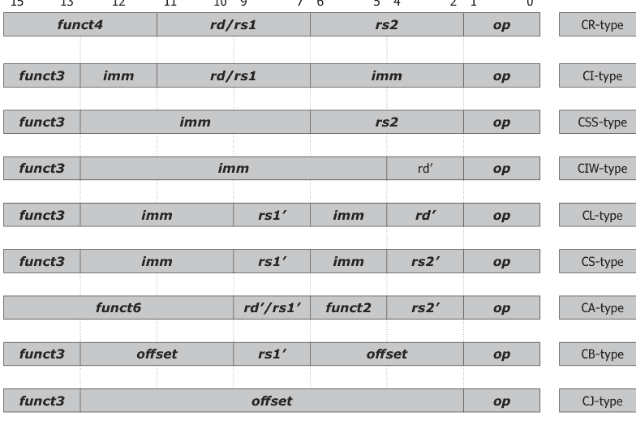

每个 RVC 指令都与现有的 RISC-V 指令一一对应，这大大简化了到完整 32 位指令的转换。选择 **x8-x15** 作为精简寄存器集也降低了转换所需的复杂性，因为寄存器编码在 16 位操作码和 32 位操作码之间直接映射。

与基本指令集一样，有一些操作数组合会导致无操作，其中许多组合被保留为 **HINT**（提示）。同时，许多操作数组合被定义为非法，并且必须生成非法指令异常。这使从 16 位操作码到 32 位操作码的转换变得复杂，我们将在设计实现过程中看到。在需要非法指令异常时，32 位 **Defined Illegal** 操作码将在转换中派上用场。

表 2.16 显示了 RV32C 指令及其操作码、任何限制和指令格式。此表按象限组织，象限由操作码的两个最低有效位的位组合定义。列出的限制很重要，因为如果违反这些限制，则必须生成非法指令异常。

• 54

第 2 章 • RISC-V 指令集架构

| 汇编语言 | 操作码 | 限制 | 类型 |
|---|---|---|---|
| **Defined Illegal** | 000_000_000_00_000_00 | | CIW |
| **C.ADDI4SPN rd', nzunimm** | 000_mmm_mmm_mm_ddd_00 | *nzunimm ≠ 0* | CIW |
| **C.FLD rd', uoffset(rs1')** | 001_mmm_sss_mm_ddd_00 | | CL |
| **C.LW rd', uoffset(rs1')** | 010_mmm_sss_mm_ddd_00 | | CL |
| **C.FLW rd', uoffset(rs1')** | 011_mmm_sss_mm_ddd_00 | | CL |
| **C.FSD rs2', uoffset(rs1')** | 101_mmm_sss_mm_ttt_00 | | CS |
| **C.SW rs2', uoffset(rs1')** | 110_mmm_sss_mm_ttt_00 | | CS |
| **C.FSW rs2', uoffset(rs1')** | 111_mmm_sss_mm_ttt_00 | | CS |
| **C.NOP** | 000_m_00000_mmmmm_01 | *imm = 0* | CI |
| **C.ADDI rd, nzimm** | 000_m_dnzdd_mmmmm_01 | *nzimm ≠ 0* | CI |
| **C.JAL offset** | 001_m_mmmmm_mmmmm_01 | | CJ |
| **C.LI rd, imm** | 010_m_ddddd_mmmmm_01 | | CI |
| **C.ADDI16SP nzimm** | 011_m_00010_mmmmm_01 | *nzimm ≠ 0* | CI |
| **C.LUI rd, nzimm** | 011_m_dn2dd_mmmmm_01 | *nzimm ≠ 0* | CI |
| **C.SRLI rd', shamt** | 100_0_00_ddd_shamt_01 | | CI |
| **C.SRAI rd', shamt** | 100_0_01_ddd_shamt_01 | | CI |
| **C.ANDI rd', imm** | 100_m_m_10_ddd_mmmmm_01 | | CI |
| **C.SUB rd', rs2'** | 100_011_ddd_00_ttt_01 | | CA |
| **C.XOR rd', rs2'** | 100_011_ddd_01_ttt_01 | | CA |
| **C.OR rd', rs2'** | 100_011_ddd_10_ttt_01 | | CA |
| **C.AND rd', rs2'** | 100_011_ddd_11_ttt_01 | | CA |
| **C.J offset** | 101_mmm_mmm_mm_mmm_01 | | CJ |
| **C.BEQZ rs1', offset** | 110_mmm_sss_mm_mmm_01 | | CB |
| **C.BNEZ rs1', offset** | 111_mmm_sss_mm_mmm_01 | | CB |
| **C.SLLI rd, shamt** | 000_0_ddddd_shamt_10 | | CI |
| **C.FLDSP rd, uoffset** | 001_m_ddddd_mmmmm_10 | | CI |
| **C.LWSP rd, uoffset** | 010_m_dnzdd_mmmmm_10 | | CI |
| **C.FLWSP rd, uoffset** | 011_m_ddddd_mmmmm_10 | | CI |
| **C.JR rs1** | 100_0_snzss_00000_10 | | CR |
| **C.MV rd, rs2** | 100_0_ddddd_tnztt_10 | | CR |
| **C.EBREAK** | 100_1_00000_00000_10 | | CR |
| **C.JALR rs1** | 100_1_snzss_00000_10 | | CR |
| **C.ADD rd, rs2** | 100_1_ddddd_tnztt_10 | | CR |
| **C.FSDSP rs2, uoffset** | 101_m_mmmmm_ttttt_10 | | CSS |
| **C.SWSP rs2, uoffset** | 110_m_mmmmm_ttttt_10 | | CSS |
| **C.FSWSP rs2, uoffset** | 111_m_mmmmm_ttttt_10 | | CSS |

表 2.16：压缩（16 位）指令。


与基础指令集一样，立即数数据在操作码中进行了**乱序**处理，以简化解码逻辑。鉴于操作码格式的增加，RVC 中存在更多不同的情况，表 2.17 展示了这些不同的情况。由于本设计不包含浮点指令，这减少了需要处理的可能性数量，但为了完整性，表中列出了所有情况。

位位置

| 格式 | 指令 | 12 | 11 | 10 | 9 | 8 | 7 | 6 | 5 | 4 | 3 | 2 |
| :--- | :--- | :--- | :--- | :--- | :--- | :--- | :--- | :--- | :--- | :--- | :--- | :--- |
| CI-type | 除以下指令外： | 5 | | | | | | 4 | 3 | 2 | 1 | 0 |
| | 移位指令 | | | | | | | 4 | 3 | 2 | 1 | 0 |
| | 基于栈的指令 | 5 | | | | | | 4 | 3 | 2 | 7 | 6 |
| | C.FLDSP | 5 | | | | | | 4 | 3 | 8 | 7 | 6 |
| | C.ADDI16SP | 9 | | | | | | 4 | 6 | 8 | 7 | 5 |
| | C.LUI | 17 | | | | | | 16 | 15 | 14 | 13 | 12 |
| CSS-type | 除以下指令外： | 5 | 4 | 3 | 2 | 7 | 6 | | | | | |
| | C.FSDSP | 5 | 4 | 3 | 8 | 7 | 6 | | | | | |
| CIW-type | 所有指令 | 5 | 4 | 9 | 8 | 7 | 6 | 2 | 3 | | | |
| CL-type | 除以下指令外： | 5 | 4 | 3 | | | | 2 | 6 | | | |
| | C.FLD | 5 | 4 | 3 | | | | 7 | 6 | | | |
| CS-type | 除以下指令外： | 5 | 4 | 3 | | | | 2 | 6 | | | |
| | C.FSD | 5 | 4 | 3 | | | | 7 | 6 | | | |

表 2.17：压缩立即数数据位位置。

##### 2.9.1 压缩整数算术指令

所有整数算术指令都有 16 位操作码版本，尽管存在一些限制。使用了多种指令格式。如前所述，在所有情况下，**rd'** 和 **rs2'** 被限制在 **x8** 到 **x15** 的范围内。

**C.ADD rd, rs2** 映射到 **ADD rd, rd, rs2**，因此整个寄存器集都可用，但 **rs2 = x0** 不被允许，它被用于其他压缩指令，这将使指令解码复杂化。

**C.SUB rd', rs2'** 映射到 **SUB rd', rd', rs2'**，对 **rd'** 和 **rs2'** 没有额外限制。

**C.ADDI rd, nzimm** 映射到 **ADDI rd, rd, nzimm**，因此整个寄存器集都可用。立即数值限制在 -32 到 +31 的范围内，不包括零值。**rd = x0** 的情况是允许的，并被视为 **HINT**，但仅当 **nzimm ≠ 0** 时成立。**rd = x0** 且 **nzimm = 0** 的情况用于编码 **C.NOP** 指令。

最后两个整数算术指令操作 **x2** 寄存器，该寄存器通常用作栈指针（**sp**）。这两条指令都调整 **sp** 寄存器中的值，这是在每次子程序调用的开始和结束时，以及每次需要访问栈上的变量时经常发生的操作。

**C.ADDI16SP** *nzuimm* 映射到 **ADDI** *rd'*, **x2**, *nzuimm*，但 *nzuimm* = 0 的情况是非法的，并且 *nzuimm* 立即数包含加到 **x2** 寄存器的值的第 9-4 位。立即数值被符号扩展到完整的 32 位，范围从 -512 到 +496，所有值都是 16 的倍数。标准的 RISC-V 调用约定要求 **sp** 寄存器始终 16 字节对齐，这就是为什么该指令以这种方式定义的原因。该指令使用与 **C.LUI** 指令相同的操作码，只是目标寄存器字段被设置为 **x2**。

**C.ADDI4SPN** *rd'*, *nzuimm* 映射到 **ADDI** *rd'*, **x2**, *nzuimm*，但 *nzuimm* = 0 的情况是非法的，并且 *nzuimm* 立即数包含加到 **x2** 寄存器的值的第 9-2 位。在这种情况下，立即数值被零扩展到完整的 32 位，范围从 +4 到 +1020，所有值都是四的倍数。该指令用于创建指针以访问栈上的变量，这就是为什么立即数是无符号的原因。

##### 2.9.2 压缩逻辑指令

所有寄存器-寄存器逻辑指令都有压缩版本，但只有 **ANDI** 有压缩版本可用。一条 **C.XORI** 指令将非常有用，因为它将允许 **C.NOT** 伪指令。

**C.AND** *rd'*, *rs2'* 映射到 **AND** *rd'*, *rd'*, *rs2'*，对 *rd'* 和 *rs2'* 没有额外限制。

**C.OR** *rd'*, *rs2'* 映射到 **OR** *rd'*, *rd'*, *rs2'*，对 *rd'* 和 *rs2'* 没有额外限制。

**C.XOR** *rd'*, *rs2'* 映射到 **XOR** *rd'*, *rd'*, *rs2'*，对 *rd'* 和 *rs2'* 没有额外限制。

**C.ANDI** *rd'*, *imm* 映射到 **ANDI** *rd'*, *rd'*, *imm*，对于压缩和展开的指令都是如此。

##### 2.9.3 压缩移位指令

三条 16 位操作码移位指令的操作码中有六位立即数数据的空间，但 RV32C 中 **shamt** 值只需要五位。*RISC-V 指令集手册*规定，位于操作码第 12 位的 *shamt*[5] 必须为零，并且所有 *shamt*[5] = 1 的情况都保留用于自定义扩展。这是在 16 位指令集中插入自定义 **C.ORI** 和 **C.XORI** 的合理位置，即使它们限于 5 位立即数数据。

**C.SLLI** *rd*, *shamt* 映射到 **SLLI** *rd*, *rd*, *shamt*，因此整个寄存器集都可用于此指令。*rd* = **x0** 的情况是允许的并被视为 **HINT**，*shamt* = 0 的情况也是如此。

**C.SRAI** *rd'*, *shamt* 映射到 **SRAI** *rd'*, *rd'*, *shamt*，因此只有受限的寄存器集可用于此指令。*shamt* = 0 的情况是 **HINT**。

**C.SRLI** *rd'*, *shamt* 映射到 **SRLI** *rd'*, *rd'*, *shamt*，因此只有受限的寄存器集可用于此指令。*shamt* = 0 的情况是 **HINT**。

##### 2.9.4 压缩常量生成指令

用于创建常量的两条 16 位操作码指令由于操作码中可用的立即数数据位数而受到很大限制。两条指令都几乎可以使用完整的寄存器范围。

**C.LI** *rd*, *imm* 映射到 **ADDI** *rd*, x0, *imm*，因此整个寄存器集都可用于此指令，但 *rd* = x0 的情况被视为 **HINT**。可以创建的常量范围是 -32 到 +31，范围虽小，但聊胜于无。

**C.LUI** *rd*, *nzimm* 映射到 **LUI** *rd*, *nzimm*，但 *rd* = x0 的情况被视为 **HINT**，而 *rd* = x2 的情况用于不同的指令。*nzimm* = 0 的情况是非法的，并且 *nzimm* 立即数包含加载到 *rd* 寄存器中的值的第 17-12 位。立即数被符号扩展到完整的 32 位。

##### 2.9.5 压缩无条件跳转指令

共有四条 16 位无条件跳转指令，使用两种不同的操作码格式。两条指令使用专用的 CJ 型指令格式，另外两条使用 CR 型指令格式。与 RV32I 版本相比，所有这些压缩指令都存在限制，但它们仍然涵盖了最常见的情况。

**C.J** *offset*（跳转）映射到 **JAL** x0, *offset*，这与 RV32I 伪指令相同，只是偏移量限制在 -2<sup>11</sup> 到 +2<sup>11</sup> – 2 的范围内。

**C.JAL** *offset*（跳转并链接）映射到 **JAL** x1, *offset*，这也与 RV32I 伪指令相同，只是偏移量限制在 -2<sup>11</sup> 到 +2<sup>11</sup>-2 的范围内。然而，与指令长度相关存在一个差异。**JAL** 将 PC+4 写入 **x1** 寄存器，而 **C.JAL** 将 PC+2 写入 **x1** 寄存器。这种差异应该在硬件中自然发生，因为它只是下一条指令的 PC，但软件可以看到这种差异。

**C.JR** *rs1*（跳转寄存器）映射到 **JALR** x0, 0(*rs1*)，与 RV32I 伪指令相同。对于 **C.JR** 指令，*rs1* = x0 的情况是非法的。

**C.JALR** *rs1*（跳转并链接寄存器）映射到 **JALR** x1, 0(*rs1*)，与 RV32I 伪指令相同。与 **C.JAL** 指令的情况类似，写入 **x1** 寄存器的值在 **C.JALR** 指令和 **JALR** 指令之间有所不同。*rs1* = x0 的情况是非法的，并用于不同的压缩指令。


##### 2.9.6 压缩条件分支指令

只有两条16位条件分支指令，它们对应于RV32I中一对用于与零比较的伪指令。这些指令使用CB类型指令格式，该格式仅有8位偏移空间。指令中的8位偏移经过符号扩展后左移一位以保证其为偶数，从而为这些分支指令提供了从$-2^8$到$+2^8 - 2$的范围。

**C.BEQZ rs1', offset**（若等于零则分支）对应 **BEQ rs1', x0, offset**。

**C.BNEZ rs1', offset**（若不等于零则分支）对应 **BNE rs1', x0, offset**。

##### 2.9.7 压缩加载和存储指令

四条16位指令专用于加载和存储。仅支持字加载和字存储，这可能是用于创建RVC指令集的基准测试选择的结果。本组中的每条指令使用不同的指令格式。所有这些指令都使用无符号地址偏移，这与通常的RISC-V有符号地址偏移不同。

**C.LW rd', uoffset(rs1')**（加载字）对应 **LW rd', uoffset(rs1')**。5位无符号偏移允许加载范围为+0到$+2^7 - 4$。此指令使用CL类型指令格式。

**C.SW rs2', uoffset(rs1')**（存储字）对应 **SW rs2', uoffset(rs1')**。5位无符号偏移允许存储范围为+0到$+2^7 - 4$。此指令使用CS类型指令格式。

**C.LWSP rd, uoffset**（相对栈指针加载字）对应 **LW rd, uoffset(x2)**。6位无符号偏移允许加载范围为+0到$+2^8 - 4$。此指令使用CI类型指令格式。**rd = x0**的情况是非法的。

**C.SWSP rs2, uoffset**（相对栈指针存储字）对应 **SW rs2, uoffset(x2)**。6位无符号偏移允许存储范围为+0到$+2^8 - 4$。此指令使用CSS类型指令格式。

##### 2.9.8 杂项压缩指令

有几条16位指令不适合其他任何类别，因此在此列出。其中两条使用了另一条16位指令的特例编码。此外，还有一个定义的非法16位编码，用于帮助识别任何在非存在内存中执行的尝试。

**C.MV rd, rs2** 对应 **ADD rd, x0, rs2**，这意味着整个寄存器集都可用于此指令。**rs2 = x0**的情况不允许使用，并被用于另一条压缩指令。32位**MV**伪指令是**ADDI**的别名，但*RISC-V指令集手册*认为将**C.MV**映射到**ADD**会使实现更简单。

**C.NOP**（无操作）对应 **ADDI x0, x0, 0**，与RV32I情况相同。由于此指令与**C.ADDI**共享相同的基本操作码，因此不需要任何特殊翻译。

**C.EBREAK**（环境断点）对应 **EBREAK**。此指令使用**C.JALR**操作码的特例，因此在翻译逻辑中需要特殊处理。

**定义的非法**指令就是0x0000，但这是**C.ADDI4SPN**指令的特例，因此在翻译逻辑中也需要特殊处理。

##### 2.9.9 压缩浮点指令

八条16位指令专用于浮点加载和存储。这是用于创建RVC指令集的基准测试选择的直接结果。此处介绍的设计不包括浮点，因此这些指令都不会实现。可以想象这些操作码可以重用于不同的功能，实际上其中一半在RV64C中被重用，所有指令在RV128C中都消失了。

其中两条指令支持通用浮点加载，使用CL类型指令格式，5位无符号地址偏移和受限的寄存器集（**x8**到**x15**和**f8**到**f15**）。

**C.FLD rd', uoffset(rs1')**（浮点加载双字）对应 **FLD rd', uoffset(rs1')**。5位无符号偏移允许加载范围为+0到$+2^8 - 8$，因为地址必须双字对齐。

**C.FLW rd', uoffset(rs1')**（浮点加载字）对应 **FLW rd', uoffset(rs1')**。5位无符号偏移允许加载范围为+0到$+2^7 - 4$，因为地址必须字对齐。

其中两条指令支持通用浮点存储，使用CS类型指令格式，同样是5位无符号地址偏移和受限的寄存器集。

**C.FSD rs2', uoffset(rs1')**（浮点存储双字）对应 **FSD rs2', uoffset(rs1')**。5位无符号偏移允许存储范围为+0到$+2^8 - 8$。

**C.FSW rs2', uoffset(rs1')**（浮点存储字）对应 **FSW rs2', uoffset(rs1')**。5位无符号偏移允许存储范围为+0到$+2^7 - 4$。

其中两条指令支持相对栈指针的浮点加载，使用CI类型指令格式。

**C.FLDSP rd, uoffset**（相对栈指针浮点加载双字）对应 **FLD rd, uoffset(x2)**。6位无符号偏移允许加载范围为+0到$+2^9 - 8$。

**C.FLWSP rd, uoffset**（相对栈指针浮点加载字）对应 **FLW rd, uoffset(x2)**。6位无符号偏移允许加载范围为+0到$+2^8 - 4$。

最后两条指令支持相对栈指针的浮点存储，使用CSS类型指令格式。

**C.FSDSP rs2, uoffset**（相对栈指针浮点存储双字）对应 **FSD rs2, uoffset(x2)**。6位无符号偏移允许存储范围为+0到$+2^9 - 8$。

**C.FSWSP rs2, uoffset**（相对栈指针浮点存储字）对应 **FSW rs2, uoffset(x2)**。6位无符号偏移允许存储范围为+0到$+2^8 - 4$。

##### 2.9.10 压缩HINT指令

与基础整数指令集的情况一样，有相当多的16位操作码在*RISC-V指令集手册*中被定义为**HINT**。它们都涉及目标寄存器为**x0**或立即数为零的情况，因此它们都应该在设计中自然出现，无需任何特殊努力。表2.18显示了16位操作码**HINT**的情况。

| 指令 | 条件 | 用途 |
| --- | --- | --- |
| **C.NOP** | *imm* $\neq$ 0 | 保留供标准使用 |
| **C.ADDI** | *rd* $\neq$ x0 或 *nzimm* = 0 | 保留供标准使用 |
| **C.LI** | *rd* = x0 | 保留供标准使用 |
| **C.LUI** | *rd* = x0 且 *nzimm* $\neq$ 0 | 保留供标准使用 |
| **C.MV** | *rd* = x0 且 *rs2* $\neq$ x0 | 保留供标准使用 |
| **C.ADD** | *rd* = x0 且 *rs2* $\neq$ x0 | 保留供标准使用 |
| **C.SLLI** | *rd* = x0 或 *shamt* = 0 | 保留供自定义使用 |
| **C.SRLI** | *shamt* = 0 | 保留供自定义使用 |
| **C.SRAI** | *shamt* = 0 | 保留供自定义使用 |

表 2.18：16位操作码 **HINT** 指令。

#### 2.10 位操作扩展

"*B* *位操作指令标准扩展*"对于打算用于嵌入式处理的CPU来说可能是最有用的扩展。不幸的是，在撰写本文时，此标准扩展尚未最终确定。然而，由于它们非常有用，我们将继续在本设计中实现一些提出的指令，使用草案规范中的当前操作码。但请注意，这些指令的官方操作码可能会更改，其中一些指令甚至可能会消失。表2.19显示了我们将实现的指令。

### 开源处理器内部

| 汇编语言 | 操作码 | 类型 |
| --- | --- | --- |
| **SLOI** *rd, rs1, shamt* | 0010000_shamt_sssss_001_ddddd_0010011 | I |
| **BSETI** *rd, rs1, sbsel* | 0010100_sbsel_sssss_001_ddddd_0010011 | I |
| **BCLRI** *rd, rs1, sbsel* | 0100100_sbsel_sssss_001_ddddd_0010011 | I |
| **SEXT.B** *rd, rs1* | 0110000_00100_sssss_001_ddddd_0010011 | I |
| **SEXT.H** *rd, rs1* | 0110000_00101_sssss_001_ddddd_0010011 | I |
| **BINVI** *rd, rs1, sbsel* | 0110100_sbsel_sssss_001_ddddd_0010011 | I |
| **SROI** *rd, rs1, shamt* | 0010000_shamt_sssss_101_ddddd_0010011 | I |
| **BEXTI** *rd, rs1, sbsel* | 0100100_sbsel_sssss_101_ddddd_0010011 | I |
| **RORI** *rd, rs1, shamt* | 0110000_shamt_sssss_101_ddddd_0010011 | I |
| **REV8** *rd, rs1* | 0110100_11000_sssss_101_ddddd_0010011 | I |
| **REV** *rd, rs1* | 0110100_11111_sssss_101_ddddd_0010011 | I |
| **SLO** *rd, rs1, rs2* | 0010000_ttttt_sssss_001_ddddd_0110011 | R |
| **BSET** *rd, rs1, rs2* | 0010100_ttttt_sssss_001_ddddd_0110011 | R |
| **BCLR** *rd, rs1, rs2* | 0100100_ttttt_sssss_001_ddddd_0110011 | R |
| **ROL** *rd, rs1, rs2* | 0110000_ttttt_sssss_001_ddddd_0110011 | R |
| **BINV** *rd, rs1, rs2* | 0110100_ttttt_sssss_001_ddddd_0110011 | R |
| **PACK** *rd, rs1, rs2* | 0000100_ttttt_sssss_100_ddddd_0110011 | R |
| **XNOR** *rd, rs1, rs2* | 0100000_ttttt_sssss_100_ddddd_0110011 | R |
| **PACKU** *rd, rs1, rs2* | 0100100_ttttt_sssss_100_ddddd_0110011 | R |
| **SRO** *rd, rs1, rs2* | 0010000_ttttt_sssss_101_ddddd_0110011 | R |
| **BEXT** *rd, rs1, rs2* | 0100100_ttttt_sssss_101_ddddd_0110011 | R |
| **ROR** *rd, rs1, rs2* | 0110000_ttttt_sssss_101_ddddd_0110011 | R |
| **ORN** *rd, rs1, rs2* | 0100000_ttttt_sssss_110_ddddd_0110011 | R |
| **PACKH** *rd, rs1, rs2* | 0000100_ttttt_sssss_111_ddddd_0110011 | R |
| **ANDN** *rd, rs1, rs2* | 0100000_ttttt_sssss_111_ddddd_0110011 | R |

表 2.19：位操作指令。

##### 2.10.1 带取反的逻辑指令

带取反的逻辑指令与常规逻辑指令相同，只是其中一个输入在操作前被取反。仅提供寄存器-寄存器版本的指令，且*rs2*操作数被取反。这些指令没有寄存器-立即数版本，表面上是因为可以在源代码中直接对立即数操作数取反。这一论点没有考虑到在OR和XOR情况下可能成为问题的符号扩展。

**ANDN** *rd, rs1, rs2*（带取反的逻辑与），**ORN** *rd, rs1, rs2*（带取反的逻辑或）和 **XNOR** *rd, rs1, rs2*（带取反的逻辑异或）是带取反的逻辑指令。


##### 2.10.2 移位和循环指令

此处的移位和循环指令完善了基本指令集的功能，以覆盖所有不同的情况。

**SLO rd, rs1, rs2**（左移置一）和 **SRO rd, rs1, rs2**（右移置一）与普通的 **SLL** 和 **SRL** 指令相同，不同之处在于它们移入的是1而不是零。**rs2** 寄存器的五个最低有效位控制移位量。

**SLOI rd, rs1, shamt**（立即数左移置一）和 **SROI rd, rs1, shamt**（立即数右移置一）与普通的 **SLLI** 和 **SRLI** 指令相同，不同之处在于它们移入的是1。

**ROL rd, rs1, rs2**（循环左移）和 **ROR rd, rs1, rs2**（循环右移）的操作类似于各种移位指令，不同之处在于移出的位会被循环移入，而不是丢弃。**rs2** 寄存器的五个最低有效位控制循环移位量。

**RORI rd, rs1, shamt**（立即数循环右移）是唯一的寄存器-立即数循环指令，因为循环移位量可以在源代码中通过补码运算（用32减去）来处理。

##### 2.10.3 单比特指令

单比特指令在许多嵌入式控制应用中极为有用。置位、清零、取反和测试操作均提供寄存器-寄存器和寄存器-立即数两种版本。

**BCLR rd, rs1, rs2**（单比特清零）、**BSET rd, rs1, rs2**（单比特置位）和 **BINV rd, rs1, rs2**（单比特取反）操作**rs1**寄存器中的单个比特，将结果写入**rd**寄存器。这些指令使用**rs2**寄存器的五个最低有效位来选择相应的比特，并将此位域视为0到31范围内的无符号数。

**BCLRI rd, rs1, sbsel**（立即数单比特清零）、**BSETI rd, rs1, sbsel**（立即数单比特置位）和 **BINVI rd, rs1, sbsel**（立即数单比特取反）同样操作**rs1**寄存器中的单个比特，将结果写入**rd**寄存器。但这些指令使用5位立即数字段来选择相应的比特。

**BEXT rd, rs1, rs2**（单比特提取）将**rs1**寄存器中选中的比特传输到**rd**寄存器的最低有效位，同时清零**rd**寄存器中的所有其他位。**rs2**寄存器的五个最低有效位选择相应的比特，并将此位域视为0到31范围内的无符号数。

**BEXTI rd, rs1, sbsel**（立即数单比特提取）的操作与**BEXT**相同，不同之处在于使用5位立即数字段来选择相应的比特。

# 开源处理器内部解析

##### 2.10.4 符号扩展指令

字节和半字的符号扩展可以通过一对移位指令完成，但专用指令的硬件成本并不高，因此被包含在此标准扩展中。

**SEXT.B rd, rs1**（符号扩展字节）将**rs1**寄存器中的最低有效字节转换为32位数字，并将此结果写入**rd**寄存器。

**SEXT.H rd, rs1**（符号扩展半字）将**rs1**寄存器中的最低有效半字转换为32位数字，并将此结果写入**rd**寄存器。

##### 2.10.5 反转指令

在处理串行传输或来自大端系统的数据时，通常需要进行比特反转和字节反转，而在软件中执行这些反转操作是非常麻烦的。当前提出的“B”标准扩展包括一个通用的反转指令，但我们实际上只需要这四种特定情况。

**REV8 rd, rs1**（字节反转）从**rs1**寄存器中按*ABCD*顺序读取字节，并按*DCBA*顺序写入**rd**寄存器。这将字的字节序从 小端变为大端，或反之亦然。

**REV.B rd, rs1**（按字节反转比特）从**rs1**寄存器中读取字，并按字节为单位反转比特顺序后写入**rd**寄存器。换句话说，每个字节都以相应的比特反转顺序写入。

**REV.H rd, rs1**（按半字反转比特）从**rs1**寄存器中读取字，并按半字为单位反转比特顺序后写入**rd**寄存器。换句话说，每个半字都以相应的比特反转顺序写入。

**REV rd, rs1**（比特反转）从**rs1**寄存器中读取字，并反转整个字的比特顺序后写入**rd**寄存器。

##### 2.10.6 打包指令

将字节或半字打包到字中是在某些应用领域中相当频繁发生的操作。与比特和字节反转一样，在硬件中执行此操作要容易得多。

**PACK rd, rs1, rs2**（打包半字）从**rs1**寄存器中按*ABCD*顺序读取字节，从**rs2**寄存器中按*EFGH*顺序读取字节，并按*GHCD*顺序写入**rd**寄存器。这将两个寄存器的低半字打包到一个寄存器中。

**PACKU rd, rs1, rs2**（打包高半字）从**rs1**寄存器中按*ABCD*顺序读取字节，从**rs2**寄存器中按*EFGH*顺序读取字节，并按*EFAB*顺序写入**rd**寄存器。这将两个寄存器的高半字打包到一个寄存器中。

**PACKH rd, rs1, rs2**（将字节打包为半字）从**rs1**寄存器中按*ABCD*顺序读取字节，从**rs2**寄存器中按*EFGH*顺序读取字节，并按*00HD*顺序写入**rd**寄存器。这将两个寄存器的最低有效字节打包到寄存器的低半字中。

有一个伪指令使用了打包指令，并且此扩展从基本指令集中的另一个指令定义了另一个伪指令。

**ZEXT.H rd, rs**（零扩展半字）就是 **PACK rd, rs, x0**。

**ZEXT.B rd, rs**（零扩展字节）就是 **ANDI rd, rs, 255**。

#### 2.11 外部调试支持

最后，*RISC-V 外部调试支持*规范在指定一套全面的调试功能之外，增加了一条指令。该指令见表 2.20。

| 汇编语言 | 操作码 | 类型 |
| :--- | :--- | :--- |
| **DRET** | 0111101_10010_00000_000_00000_1110011 | I |

表 2.20：调试指令。

**DRET** 指令用于从调试模式返回。调试模式是一种特殊模式，允许不受限制地访问所有CPU功能以进行调试。此设计实现了*RISC-V 外部调试支持*规范所要求的最小功能集，其中包括 **DRET** 指令。**DRET** 指令仅在调试模式下允许使用，否则将引发非法指令异常。

调试模式操作的细节超出了本书的范围，读者请参考*RISC-V 外部调试支持*规范以了解调试模式操作的详细信息。

### 第三章 • 特权架构

*RISC-V 指令集手册，第二卷：特权架构*将RISC-V规范扩展到了指令集之外。*第二卷*涵盖了控制和状态寄存器（CSR），两种特权级别（超出*RISC-V 指令集手册，第一卷：非特权ISA*中涵盖的一种），内存保护功能以及Hypervisor扩展。

这些功能中的大多数超出了本书的范围，未包含在此处将要描述的设计中。因此，将仅对其中一些功能进行简要概述。感兴趣的读者请参阅*RISC-V 指令集手册，第二卷：特权架构*以获取完整规范。读者应注意，并非所有*第二卷*内容都已获得批准——并且可能仍会发生变化。

#### 3.1 特权级别

*第二卷*指定了三个特权级别，如表3.1所示。

| 级别 | 编码 | 名称 |
| :--- | :--- | :--- |
| 0 | 00 | 用户/应用程序 |
| 1 | 01 | 监管者 |
| 2 | 10 | *保留* |
| 3 | 11 | 机器 |

表 3.1：特权级别。

机器模式是CPU退出复位后首先进入的特权级别。它既是最高特权级别，也是唯一必需的特权级别。机器模式提供对整个机器的无限制访问，并允许“裸机”编程。因此，机器模式软件应是固有受信任的，未实现的指令或功能将在此模式下被模拟。此处描述的设计仅实现了机器模式。

监管者模式通常是操作系统（如*Linux*）使用的特权级别。监管者模式也是管理大多数地址转换的地方。

用户模式是应用程序软件执行或*Linux*用户与机器交互的特权级别。用户模式是最低的特权级别，也是最不受信任的。在大多数情况下，用户模式仅在监管者模式的中介下允许访问硬件资源，或者如果监管者模式不存在，则由机器模式中介。


每个特权级都有自己的CSRs集合，较低特权级对较高特权级可用的CSR视图受限以确保安全。每个特权级都可以访问较低级别的CSR。

#### 3.2 控制和状态寄存器

*RISC-V指令集手册，第二卷：特权架构*定义了所有标准CSR，这很可能是因为CSR地址空间是按特权级划分的。CSR地址的两个最低位定义了允许访问该CSR的最低特权级，如表3.2所示。

| CSR地址[9:8] | 特权级 |
| :--- | :--- |
| 00 | 用户模式 |
| 01 | 监督者模式 |
| 10 | 虚拟机监控模式 |
| 11 | 机器模式 |

表3.2：CSR访问控制。

这两个位定义了与CSR地址关联的主要特权级，但较高特权级总是可以访问与较低特权级关联的CSR。因此，在机器模式下，所有专用于虚拟机监控、监督者和用户模式的CSR也可访问。尽管*RISC-V指令集手册*在这一点上表述模糊，但在大多数情况下，当设计中未实现某个特权级时，相应的CSR也不需要实现。因此，在本设计中，我们仅实现机器模式操作所需的CSR，加上用户模式所需的六个计数器和计时器CSR。

CSR地址的最高两位编码了读写访问权限，如表3.3所示。

| CSR地址[11:10] | 读写权限 |
| :--- | :--- |
| 00 | 读写 |
| 01 | 读写 |
| 10 | 读写 |
| 11 | 只读 |

表3.3：CSR写入控制。

CSR地址范围进一步划分为标准使用区域和自定义使用区域。完整的CSR地址空间组织如表3.4所示。

在开源处理器中

| CSR地址 | 用途 | 特权级 | 访问权限 |
|---|---|---|---|
| 0x000 – 0x0FF | 标准 | 用户 | 读写 |
| 0x100 – 0x1FF | 标准 | 监督者 | 读写 |
| 0x200 – 0x2FF | 标准 | 虚拟机监控 | 读写 |
| 0x300 – 0x3FF | 标准 | 机器 | 读写 |
| 0x400 – 0x4FF | 标准 | 用户 | 读写 |
| 0x500 – 0x5BF | 标准 | 监督者 | 读写 |
| 0x5C0 – 0x5FF | 自定义 | 监督者 | 读写 |
| 0x600 – 0x6BF | 标准 | 虚拟机监控 | 读写 |
| 0x6C0 – 0x6FF | 自定义 | 虚拟机监控 | 读写 |
| 0x700 – 0x79F | 标准 | 机器 | 读写 |
| 0x7A0 – 0x7AF | 标准 | 调试 | 读写 |
| 0x7B0 – 0x7BF | 标准 | 仅调试模式 | 读写 |
| 0x7C0 – 0x7FF | 自定义 | 机器 | 读写 |
| 0x800 – 0x8FF | 自定义 | 用户 | 读写 |
| 0x900 – 0x9BF | 标准 | 监督者 | 读写 |
| 0x9C0 – 0x9FF | 自定义 | 监督者 | 读写 |
| 0xA00 – 0xABF | 标准 | 虚拟机监控 | 读写 |
| 0xAC0 – 0xAFF | 自定义 | 虚拟机监控 | 读写 |
| 0xB00 – 0xBBF | 标准 | 机器 | 读写 |
| 0xBC0 – 0xBFF | 自定义 | 机器 | 读写 |
| 0xC00 – 0xCBF | 标准 | 用户 | 只读 |
| 0xCC0 – 0xCFF | 自定义 | 用户 | 只读 |
| 0xD00 – 0xDBF | 标准 | 监督者 | 只读 |
| 0xDC0 – 0xDFF | 自定义 | 监督者 | 只读 |
| 0xE00 – 0xEBF | 标准 | 虚拟机监控 | 只读 |
| 0xEC0 – 0xEFF | 自定义 | 虚拟机监控 | 只读 |
| 0xF00 – 0xFBF | 标准 | 机器 | 只读 |
| 0xFC0 – 0xFFF | 自定义 | 机器 | 只读 |

表3.4：CSR地址空间。

除了常规划分外，还有16个地址保留用于调试模式。这16个CSR地址仅保留给调试模式访问，实际上使调试模式的优先级甚至高于机器模式。在除调试模式之外的任何模式下尝试访问这16个CSR地址将引发非法指令异常。

作为最高的正常特权级，机器模式也拥有最大数量的标准CSR，如表3.5所示。在仅实现机器模式的设计中，其中一些CSR无需实现。此外，一些CSR“应该”实现而非“必须”实现。本设计中未实现的CSR在表中用阴影标出。

| 描述 | 名称 | 地址 |
| :--- | :--- | :--- |
| 机器状态 | **mstatus** | 0x300 |
| ISA和扩展 | **misa** | 0x301 |
| 机器异常委托 | **medeleg** | 0x302 |
| 机器中断委托 | **mideleg** | 0x303 |
| 机器中断使能 | **mie** | 0x304 |
| 机器陷阱处理程序基地址 | **mtvec** | 0x305 |
| 机器计数器使能 | **mcounteren** | 0x306 |
| **mstatus**的高32位 | **mstatush** | 0x310 |
| 机器陷阱处理程序的暂存寄存器 | **mscratch** | 0x340 |
| 机器异常程序计数器 | **mepc** | 0x341 |
| 机器陷阱原因 | **mcause** | 0x342 |
| 机器错误地址或指令 | **mtval** | 0x343 |
| 机器中断挂起 | **mip** | 0x344 |
| 机器陷阱指令（转换后） | **mtinst** | 0x34A |
| 机器错误客户物理地址 | **mtval2** | 0x34B |
| 机器周期计数器 | **mcycle** | 0xB00 |
| 机器已退休指令计数器 | **minstret** | 0xB02 |
| 机器性能监控计数器 | **mhpmcounter3-31** | 0xB03 - 0xB1F |
| 机器计数器禁止 | **mcountinhibit** | 0x320 |
| 机器性能监控事件选择器 | **mhpmevent 3-31** | 0xB323 - 0xB33F |
| **mcycle**的高32位 | **mcycleh** | 0xB80 |
| **minstret**的高32位 | **minstreth** | 0xB82 |
| **mhpmcounter3-31**的高32位 | **mhpmcounter3h-31h** | 0xB83 - 0xB9F |
| 厂商标识 | **mvendorid** | 0xF11 |
| 架构标识 | **marchid** | 0xF12 |
| 实现标识 | **mimpid** | 0xF13 |
| 硬件线程标识 | **mhartid** | 0xF14 |

表3.5：机器模式CSR。

已实现CSR的具体细节将在下一节讨论。对所有CSR细节感兴趣的读者请参阅*RISC-V指令集手册*。

尽管本设计未实现此功能，但机器模式负责管理物理内存，使用表3.6所示的一组专用CSR。此物理内存保护与监督者模式中的地址转换和保护协同工作。

在开源处理器中

| 描述 | 名称 | 地址 |
| --- | --- | --- |
| 物理内存保护配置 | pmpcfg0-3 | 0x3A0 – 0x3A3 |
| 物理内存保护地址 | pmpaddr0-15 | 0x3B0 – 0x3BF |

表3.6：机器内存保护CSR。

许多监督者模式CSR是相应机器模式CSR的子集，出于安全考虑，移除了所有特定于机器模式的状态。表3.7显示了监督者模式CSR，本设计中未实现其中任何一个。

| 描述 | 名称 | 地址 |
| --- | --- | --- |
| 监督者状态 | sstatus | 0x100 |
| 监督者异常委托 | sedeleg | 0x102 |
| 监督者中断委托 | sideleg | 0x103 |
| 监督者中断使能 | sie | 0x104 |
| 监督者陷阱处理程序基地址 | stvec | 0x105 |
| 监督者计数器使能 | scounteren | 0x106 |
| 监督者陷阱处理程序的暂存寄存器 | sscratch | 0x140 |
| 监督者异常程序计数器 | sepc | 0x141 |
| 监督者陷阱原因 | scause | 0x142 |
| 监督者错误地址或指令 | stval | 0x143 |
| 监督者中断挂起 | sip | 0x144 |
| 监督者地址转换和保护 | satp | 0x180 |
| 监督者模式上下文 | scontext | 0x5A8 |

表3.7：监督者模式CSR。

大致相同的方式下，虚拟机监控CSR大多是监督者CSR的子集，这次移除了特定于监督者模式的状态。表3.8显示了虚拟机监控模式CSR，本设计中未实现其中任何一个。

第3章 ● 特权架构

| 描述 | 名称 | 地址 |
| --- | --- | --- |
| 虚拟机监控状态 | **hstatus** | 0x600 |
| 虚拟机监控异常委托 | **medeleg** | 0x602 |
| 虚拟机监控中断委托 | **mideleg** | 0x603 |
| 虚拟机监控中断使能 | **hie** | 0x604 |
| 虚拟机监控计数器使能 | **hcounteren** | 0x606 |
| 虚拟机监控客户外部中断使能 | **hgeie** | 0x607 |
| 虚拟机监控错误客户物理地址 | **htval** | 0x643 |
| 虚拟机监控中断挂起 | **hip** | 0x644 |
| 虚拟机监控虚拟中断挂起 | **hvip** | 0x645 |
| 虚拟机监控陷阱指令（转换后） | **htinst** | 0x64A |
| 虚拟机监控客户外部中断挂起 | **hgeip** | 0xE12 |
| 虚拟机监控客户地址转换和保护 | **hgatp** | 0x680 |
| 虚拟机监控模式上下文 | **hcontext** | 0x6A8 |
| VS/VU模式计时器的增量 | **htimedelta** | 0x605 |
| **htimedelta**的高32位 | **htimedeltah** | 0x615 |
| 虚拟监督者状态 | **vsstatus** | 0x200 |
| 虚拟监督者中断使能 | **vsie** | 0x204 |
| 虚拟监督者陷阱处理程序基地址 | **vstvec** | 0x205 |
| 虚拟监督者暂存寄存器 | **vsscratch** | 0x240 |
| 虚拟监督者异常程序计数器 | **vsepc** | 0x241 |
| 虚拟监督者陷阱原因 | **vscause** | 0x242 |
| 虚拟监督者错误地址或指令 | **vstval** | 0x243 |
| 虚拟监督者中断挂起 | **vsip** | 0x244 |
| 虚拟监督者地址转换和保护 | **vsatp** | 0x280 |

表3.8：虚拟机监控级CSR。

最低特权级是用户模式，严格来说，它在*RISC-V指令集手册，第一卷：非特权ISA*中描述。用户模式CSR再次是较高特权CSR的受限集合，适合非特权软件访问。用户模式CSR如表3.9所示。本设计中仅实现了基本计时器和计数器。


# 开源处理器内部

| 描述 | 名称 | 地址 |
|---|---|---|
| 用户状态 | **ustatus** | 0x000 |
| 用户中断使能 | **uie** | 0x004 |
| 用户陷阱处理基地址 | **utvec** | 0x005 |
| 用户陷阱处理暂存寄存器 | **uscratch** | 0x040 |
| 用户异常程序计数器 | **uepc** | 0x041 |
| 用户陷阱原因 | **ucause** | 0x042 |
| 用户错误地址或指令 | **utval** | 0x043 |
| 用户中断待处理 | **uip** | 0x044 |
| 浮点累积异常 | **fflags** | 0x001 |
| 浮点动态舍入模式 | **frm** | 0x002 |
| 浮点控制与状态 | **fcsr** | 0x003 |
| **RDcycle** 周期计数器 | **cycle** | 0xC00 |
| **RDTIME** 定时器 | **time** | 0xC01 |
| **RDINSTRET** 指令退休计数器 | **instret** | 0xC02 |
| 性能监控计数器 | **hpmcounter3-31** | 0xC03 - 0xC1F |
| **cycle** 的高32位 | **cycleh** | 0xC80 |
| **time** 的高32位 | **timeh** | 0xC81 |
| **instret** 的高32位 | **instreth** | 0xC82 |
| **hpmcounter3-31** 的高32位 | **hpmcounter3h-31h** | 0xC83 - 0xC9F |

表 3.9：用户模式 CSR。

最后，*RISC-V 外部调试支持* 规范增加了八个 CSR，如表 3.10 所示。其中四个 CSR 位于标准机器模式地址范围，但在此设计中未实现。另外四个 CSR 位于受限的调试模式地址范围，并在此设计中实现。

| 描述 | 名称 | 地址 |
|---|---|---|
| 调试/跟踪控制与状态 | **tselect** | 0x7A0 |
| 第一个调试/跟踪触发器数据 | **tdata1** | 0x7A1 |
| 第二个调试/跟踪触发器数据 | **tdata2** | 0x7A2 |
| 第三个调试/跟踪触发器数据 | **tdata3** | 0x7A3 |
| 机器模式上下文 | **mcontext** | 0x7A8 |
| 调试控制与状态 | **dcsr** | 0x7B0 |
| 调试 PC | **dpc** | 0x7B1 |
| 调试暂存寄存器 0 | **dscratch0** | 0x7B2 |
| 调试暂存寄存器 1 | **dscratch1** | 0x7B3 |

表 3.10：调试/跟踪 CSR。

此设计中只实现了标准 CSR 中的二十八个，并且在这些 CSR 中只包含了机器模式所需的位。在许多情况下，这些 CSR 被硬连线为 *RISC-V 指令集手册* 允许的固定值，尽管该硬连线值通常由逻辑综合时定义的常量控制。

在此设计中只实现了某些位，未使用的位通常会被硬连线为零。为确保前向兼容性，*RISC-V 指令集手册* 定义了 CSR 内部字段的几种类型，即使此处未使用这些术语，读者也应熟悉。

标准 CSR 中为将来使用保留的位字段通常表示为 *Reserved Writes Preserve Values, Reads Ignore Values (WPRI)*。这意味着所有软件在读取时应忽略这些位，并且对这些位的任何写入都必须保持读取时的值。这虽然是良好的软件实践，但 *WPRI* 类型将其正式化了。

当位字段的所有可能编码并非都已标准化时，规范会指定 *Write/Read Only Legal Values (WLRL)* 类型，其余编码被保留。软件绝不应尝试向 *WLRL* 字段写入保留值，系统允许（但不要求）在收到此类尝试时生成非法指令异常。实际上，生成此类异常可能代价高昂，只有少数寄存器有此限制。

*Write Any Values, Reads Legal Values (WARL)* 类型最为常见。此类型允许写入任意位组合，但将读取限制为合法值。此类型最常用于只读位字段，但也存在读写字段属于此类型的情况。在大多数情况下，保证此功能并非难事。

本节的剩余部分将详细介绍此设计中实现的 CSR，而不提及 *RISC-V 指令集手册* 中对未使用位的规定。读者可参考该文档了解这些未实现位的详细信息。

##### 3.2.1 ISA 和扩展 (misa)

ISA 和扩展 (**misa**) CSR 提供了设计指令集能力的简化视图，其中一位专用于标准扩展所使用的每个字母，两位用于指定基本指令集宽度。图 3.1 显示了 **misa** CSR。

| 31 | 30 | 29 | 26 | 25 | 0 |
| :---: | :---: | :---: | :---: | :---: | :---: |
| MXL | WLRL | Extensions |


**misa** CSR 允许读写，以启用和禁用单个标准扩展。因为此寄存器不支持标准扩展的部分实现（如此设计），我们将其硬连线为零。但是，逻辑综合选项允许在必要时使用不同的硬连线值。

##### 3.2.2 供应商 ID (mvendorid)

供应商 ID (**mvendorid**) CSR 是一个只读寄存器，返回提供 RISC-V 内核的供应商的 JEDEC 制造商 ID。在此设计中，此寄存器被硬连线为零，但逻辑综合选项允许在必要时使用不同的硬连线值。图 3.2 显示了 **mvendorid** CSR。

31 ... 7 | 6 ... 0
Bank | Offset

图 3.2：供应商 ID (mvendorid)。

JEDEC 制造商 ID 长度超过四个字节，必须进行编码才能放入 **mvendorid** CSR。如果需要修改此 CSR 中的值，请参考 *RISC-V 指令集手册* 了解编码算法。

##### 3.2.3 架构 ID (marchid)

架构 ID (**marchid**) CSR 是一个只读寄存器，返回一个与 **mvendorid** 不同的唯一标识符，如图 3.3 所示。

31 ... 0
Architecture ID

图 3.3：架构 ID (marchid)。

RISC-V 基金会分配开源架构标识符，其最高有效位设置为零。商业架构标识符的最高有效位设置为一，但除 0x80000000 值外不受其他限制。值 0x00000000 是此设计的默认值，表示架构 ID 未实现。逻辑综合选项允许使用不同的硬连线值。

##### 3.2.4 实现 ID (mimpid)

实现 ID (**mimpid**) CSR 是另一个只读寄存器，用作版本号。值 0x00000000 是此设计的默认值，表示实现 ID 未实现，但逻辑综合选项允许读取实际的实现 ID。图 3.4 显示了 **mimpid** CSR。

# 第 3 章 • 特权架构


##### 3.2.5 Hart ID (mhartid)

Hart ID (**mhartid**) CSR 是一个只读寄存器，唯一标识软件正在其上执行的 CPU 或核心。*Hart* 是“硬件线程”的缩写，这是 CPU 或核心的花哨名称。图 3.5 显示了 **hartid** CSR。


此寄存器的值不能被硬连线，因为同一芯片可能同时对多个核心进行逻辑综合。此设计将路由一条外部总线（可以在核心外部连接）到此寄存器。

##### 3.2.6 机器状态 (mstatus)

机器状态 (**mstatus**) CSR 可能是最繁忙的标准 CSR，至少在实现所有特权模式时是这样。在完整的 32 位 RISC-V 实现中，它需要两个寄存器：**mstatus** 和 **mstatush**。因为此设计只支持机器模式且不支持大端内存访问，所以不需要 **mstatush** CSR，**mstatus** CSR 也大大简化，如图 3.6 所示。

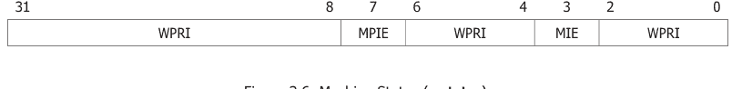

在此设计中，此寄存器只有第 7 位和第 3 位可读写，几乎所有其他位始终返回零。第 12 位和第 11 位根据兼容性要求设置为 1，表示机器先前特权字段中的机器模式。感兴趣的读者可参考 *RISC-V 指令集手册* 了解 **mstatus** 和 **mstatush** CSR 的完整规范。准备好迎接近九页的复杂性。

机器中断使能位（MIE，第 3 位）通过写入此寄存器进行设置和清除。这是全局中断使能控制，但在等待中断状态下会忽略此位的状态。当接受中断或异常时，此位的状态会被转移到 MPIE 位，同时清除 MIE 位，禁止进一步的中断。


机器先前中断使能位（MPIE，第7位）也可通过写入此寄存器来置位和清除，但其主要用途是在接受中断或异常时自动保存MIE位的先前状态。**MRET**指令将MPIE位的状态传回MIE位，从而将中断使能状态恢复到接受中断或异常之前的状态，同时将MPIE位设置为1。

表3.11显示了MPIE和MIE位的操作。这些位不受表中未列出的任何操作影响。

| 条件 | MPIE | MIE |
|---|---|---|
| 复位 | 高 | 低 |
| 中断或异常 | MIE | 低 |
| **MRET**指令 | 高 | MPIE |
| **mstatus** CSR写入 | 写入 | 写入 |

表3.11：mstatus MPIE 和 MIE 操作。

##### 3.2.7 机器陷阱处理程序基地址（mtvec）

机器陷阱处理程序基地址（**mtvec**）CSR是一个读写寄存器，用于存储基地址（在接受陷阱时用作向量）和向量模式字段。图3.7展示了**mtvec** CSR。

基地址（BASE）字段是陷阱服务例程第一条指令的地址。此地址必须是字对齐的，因此该字段只有三十位宽，留出两位用于编码向量模式。

模式（MODE）字段是*RISC-V 指令集手册*中相对较新的补充，旨在满足对更好中断响应时间的需求。MODE字段的编码如表3.12所示。

| MODE | 名称 | 描述 |
|---|---|---|
| 00 | 直接（Direct） | 所有陷阱将PC设置为BASE |
| 01 | 向量（Vectored） | 所有中断将PC设置为BASE + 4 × cause |
| 1x | - | 保留 |

表3.12：**mtvec** MODE 字段编码

在直接模式下，所有中断和异常都指向BASE字段中包含的地址，软件必须确定中断或异常的来源，通常使用稍后描述的**mcause** CSR中的异常代码字段。

在向量模式下，所有异常仍然指向BASE字段中包含的地址，但中断会将**mcause** CSR中的异常代码字段（左移两位）加到BASE字段的向量上。*RISC-V 指令集手册*允许BASE字段限制为比字对齐更粗略的对齐，这可以消除为形成向量地址而需要专用加法器的要求。

##### 3.2.8 机器中断使能（mie）

机器中断使能（**mie**）CSR是一个读写寄存器，用于存储各个中断源的独立使能位。*RISC-V 指令集手册*仅标准化了此寄存器的低半字，高半字可供自定义使用。图3.8展示了**mie** CSR。

此CSR中的所有中断使能位都是可读写的，只有当使能位被置位且相应的中断待处理位也被置位时，才会请求相应的中断。当然，MIE位也必须被置位以全局使能中断，中断才能被接受。等待中断状态会覆盖MIE位的状态，也会全局使能中断。

机器软件中断使能位（MSIE，第3位）用于使能软件中断，该中断通常用于处理器间通信。

机器定时器中断使能位（MTIE，第7位）用于使能定时器中断，该中断由本设计外部的标准RISC-V定时器产生。

机器外部中断使能位（MEIE，第11位）用于使能外部中断。这是*RISC-V 指令集手册*中指定的唯一通用中断源。

机器本地中断使能位（MLIE，第31-16位）用于使能各个本地中断，这些中断是本设计的自定义扩展。

##### 3.2.9 机器中断待处理（mip）

机器中断待处理（**mip**）CSR官方上是一个读写寄存器，返回各个中断源的独立待处理状态。然而，机器模式中断待处理位被指定为只读。与**mie** CSR类似，此寄存器只有低半字被标准化，高半字可供自定义使用。图3.9展示了**mip** CSR。

此CSR中实现的所有中断待处理位都是只读的，这意味着必须通过消除中断条件来服务所有中断。

机器软件中断待处理位（MSIP，第3位）反映软件中断的状态。

机器定时器中断待处理位（MTIP，第7位）反映定时器中断的状态。

机器外部中断待处理位（MEIP，第11位）反映外部中断的状态。

机器本地中断待处理位（MLIP，第31-16位）反映各个本地中断的状态。

##### 3.2.10 机器周期计数（mcycle 和 mcycleh）

机器周期计数（**mcycle** 和 **mcycleh**）CSR是读写寄存器，反映64位周期计数器的当前值。*RISC-V 指令集手册*要求此计数器存在，并在每个时钟周期递增。图3.10展示了**mcycle** 和 **mcycleh** CSR。

在**cycle** 和 **cycleh** CSR中还提供了此计数器的只读视图。此只读视图是*非特权ISA*的一部分，这就是为什么这些CSR被包含在此设计中。

##### 3.2.11 机器指令退役计数（minstret 和 minstreth）

机器指令退役计数（**minstret** 和 **minstreth**）CSR是读写寄存器，反映64位指令退役计数器的当前值。*RISC-V 指令集手册*要求此计数器存在，并在指令完成时递增。图3.11展示了**minstret** 和 **minstreth** CSR。

在**instret** 和 **instreth** CSR中还提供了此计数器的只读视图。此只读视图是*非特权ISA*的一部分，这就是为什么这些CSR被包含在此设计中。

并非所有指令都会导致此计数器递增。例如，**ECALL** 和 **EBREAK** 指令在技术上永不完成，因此不会递增此计数器。

##### 3.2.12 时间（time 和 timeh）

时间（**time** 和 **timeh**）CSR是*非特权ISA*中指定的只读寄存器，反映64位实时时钟计数器的当前值。此计数器以未指定的恒定频率递增。图3.12展示了**time** 和 **timeh** CSR。

这些CSR没有机器模式版本。相反，指定**mtime**寄存器以提供对定时器的内存映射访问。指定**mtimecmp**内存映射寄存器以包含比较值。当**time**寄存器中的值与**mtimecmp**寄存器中的值匹配或超过时，会产生定时器中断。此功能存在于此处描述的核心之外。

##### 3.2.13 机器计数器禁止（mcountinhibit）

机器计数器禁止（**mcountinhibit**）CSR不是必需的CSR，但能够停止计数器是一个非常有用的功能，因此它被包含在此设计中。图3.13展示了**mcountinhibit** CSR。

| 31 | | | 3 | 2 | 1 | 0 |
| :--- | :--- | :--- | :--- | :--- | :--- | :--- |
| HPMxx | | | | IR | 0 | CY |

图3.13：机器计数器禁止（**mcountinhibit**）。

除了**cycle** 和 **instret** 计数器外，*RISC-V 指令集手册*还定义了29个额外的64位硬件性能监控（HPM）计数器和相关的事件选择器。所有这些计数器都可以使用此CSR单独或集体禁止。HPM计数器不是强制性的，未包含在此设计中，因此此CSR实际上只有两个位存在。

周期计数器禁止位（CY，第0位）在设置为1时禁用**cycle** 计数器的计数。

指令退役计数器禁止位（IR，第2位）在设置为1时禁用**instret** 计数器的递增。

通常用于禁止**time** 计数器的位位置（第1位）始终为零，因为此计数器允许在核心之间共享，而单个禁止位是不实用的。

##### 3.2.14 机器临时存储（mscratch）

机器临时存储（**mscratch**）CSR是一个读写寄存器，可供通用使用。图3.14展示了**mscratch** CSR。

| 31 | | | 0 |
| :--- | :--- | :--- | :--- |
| 临时存储 | | | |

图3.14：机器临时存储（**mscratch**）。


尽管 **mscratch** CSR 在本质上具有通用性，但它通常被用作陷阱处理程序中的临时寄存器。RISC-V 中没有专用的 CPU 寄存器，因此陷阱处理程序在开始保存 CPU 寄存器内容之前，需要一个加载到 CPU 寄存器中的地址。陷阱处理程序将一个寄存器临时保存到 **mscratch** CSR 中，然后便可以使用释放出的 CPU 寄存器来保存其他 CPU 寄存器时所需的地址。

##### 3.2.15 机器异常程序计数器 (mepc)

机器异常程序计数器 (**mepc**) CSR 是一个读写寄存器，由 CPU 用于保存被中断或产生异常的指令的程序计数器。图 3.15 展示了 **mepc** CSR。

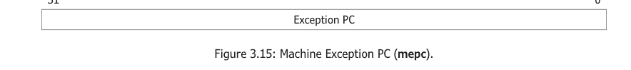

RISC-V 不包含专用的栈（该栈通常用于在中断或异常情况下保存 PC）。相反，**mepc** CSR 可以被视为一个单条目栈。当接受中断或异常时，PC 被写入 **mepc** CSR，而 PC 则从 **mtvec** CSR 加载。

然后，陷阱处理程序将一个 CPU 寄存器复制到 **mscratch** CSR 中，并使用现在空闲的 CPU 寄存器来加载一个指向陷阱处理程序专用内存区域的指针。接着，在陷阱处理程序继续执行之前，**mepc** 内容、**mscratch** 内容以及任何其他 CPU 寄存器内容都可以保存到内存中。当然，在这些写操作完成之前，不应接受任何其他中断或异常。

在陷阱处理程序结束时，所有寄存器内容都会被恢复，然后 **MRET** 指令将 **mepc** CSR 的内容加载到 PC 中，以恢复正常执行。

##### 3.2.16 机器异常原因 (mcause)

机器异常原因 (**mcause**) CSR 是一个读写寄存器，由 CPU 用于保存标识陷阱来源的异常代码。图 3.16 展示了 **mcause** CSR。


在开源处理器内部

保存在 **mcause** CSR 中的异常代码是每个可能中断和异常来源的唯一标识符。表 3.13 展示了标准异常代码。所有未列出的代码均被保留，并且在灰色背景中高亮显示的代码在本设计中永远不会被生成。

| 中断 | 异常代码 | 含义 |
| --- | --- | --- |
| 1 | 1 | 监管者软件中断 |
| 1 | 3 | 机器软件中断 |
| 1 | 5 | 监管者计时器中断 |
| 1 | 7 | 机器计时器中断 |
| 1 | 9 | 监管者外部中断 |
| 1 | 11 | 机器外部中断 |
| 1 | ≥16 | 自定义中断使用 |
| 0 | 0 | 指令地址未对齐 |
| 0 | 1 | 指令访问错误 |
| 0 | 2 | 非法指令 |
| 0 | 3 | 断点 |
| 0 | 4 | 加载地址未对齐 |
| 0 | 5 | 加载访问错误 |
| 0 | 6 | 存储/AMO 地址未对齐 |
| 0 | 7 | 存储/AMO 访问错误 |
| 0 | 8 | 来自用户模式的环境调用 |
| 0 | 9 | 来自监管者模式的环境调用 |
| 0 | 11 | 来自机器模式的环境调用 |
| 0 | 12 | 指令页错误 |
| 0 | 13 | 加载页错误 |
| 0 | 15 | 存储/AMO 页错误 |
| 0 | 24-31 | 自定义异常使用 |
| 0 | 48-63 | 自定义异常使用 |

表 3.13: 陷阱发生后 **mcause** 的内容。

本设计包含额外的 16 个*本地*中断输入，它们使用了部分自定义异常代码，如表 3.14 所示。这些中断具有优先级，中断号越低优先级越高，并且所有本地中断的优先级都高于任何标准的 RISC-V 中断。

| 中断 | 异常代码 | 含义 |
| --- | --- | --- |
| 1 | 16 | 本地中断 0 |
| 1 | 17 | 本地中断 1 |
| 1 | 18 | 本地中断 2 |
| 1 | 19 | 本地中断 3 |
| 1 | 20 | 本地中断 4 |
| 1 | 21 | 本地中断 5 |
| 1 | 22 | 本地中断 6 |
| 1 | 23 | 本地中断 7 |
| 1 | 24 | 本地中断 8 |
| 1 | 25 | 本地中断 9 |
| 1 | 26 | 本地中断 10 |
| 1 | 27 | 本地中断 11 |
| 1 | 28 | 本地中断 12 |
| 1 | 29 | 本地中断 13 |
| 1 | 30 | 本地中断 14 |
| 1 | 31 | 本地中断 15 |

表 3.14: 本地中断的 **mcause** 内容。

在实现完整 RISC-V 特权架构的设计中，同时发生的异常是可能的，这就需要指定优先级。表 3.15 展示了同时发生的异常之间的优先级。

| 优先级 | 异常代码 | 含义 |
| :--- | :--- | :--- |
| 最高 | 3 | 指令地址断点 |
| | 12 | 指令页错误 |
| | 1 | 指令访问错误 |
| | 2 | 非法指令 |
| | 0 | 指令地址未对齐 |
| | 8, 9, 11 | 环境调用 |
| | 3 | 环境断点 |
| | 3 | 加载/存储/AMO 地址断点 |
| | 6 | 存储/AMO 地址未对齐 |
| | 4 | 加载地址未对齐 |
| | 15 | 存储/AMO 页错误 |
| | 13 | 加载页错误 |
| | 7 | 存储/AMO 访问错误 |
| 最低 | 5 | 加载访问错误 |

表 3.15: 异常优先级。

此优先级与本设计无关，因为不存在异常条件同时发生的情况。

##### 3.2.17 机器陷阱值 (mtval)

机器陷阱值 (**mtval**) CSR 是一个读写寄存器，由 CPU 用于保存超出 **mcause** CSR 中异常代码的额外信息。图 3.17 展示了 **mtval** CSR。


*RISC-V 指令集手册* 规定了对于多种类型的异常，应将哪些信息写入 **mtval** CSR，但也允许在这些情况下写入零。此外，**mtval** CSR 允许被硬连线为零，这正是本设计中实现的选项。

##### 3.2.18 调试控制和状态 (dcsr)

调试控制和状态 (**dcsr**) CSR 是主要的调试模式控制寄存器。本设计仅包含与机器模式操作一致的那些调试功能，得到的 **dcsr** CSR 如图 3.18 所示。*RISC-V 外部调试支持* 规范使用了与 RISC-V 其他规范不同的位命名算法，图 3.18 中显示的名称已进行修改，以与这些规范保持一致。

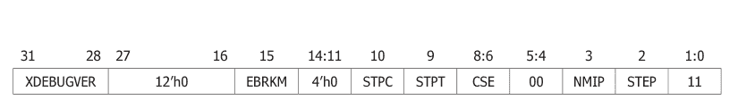

调试版本字段 (XDEBUGVER, 位 31-28) 是一个只读字段，用于标识所实现的 *RISC-V 外部调试支持* 规范的版本。在本设计中，此字段由逻辑综合选项控制。

修改 EBREAK 位 (EBRKM, 位 15) 是一个读写位，启用时会使 **EBREAK** 指令导致进入调试模式，而不是产生陷阱。

停止计数器位 (STPC, 位 10) 是一个读写位，当置位时，在调试模式下会导致周期计数器停止。

停止计时器位 (STPT, 位 9) 是一个读写位，当置位时，在调试模式下会导致计时器停止。计时器在本设计之外，因此此控制位从设计顶层输出以供外部使用。

调试原因字段 (CSE, 位 8-6) 是一个只读字段，用于标识导致进入调试模式的原因。此字段的编码如表 3.16 所示。

| 优先级 | 调试原因 | 含义 |
| :--- | :--- | :--- |
| 最高 | 010 | 来自外部触发模块的请求 |
| | 001 | **EBREAK** 指令 |
| | 101 | 外部停止请求 |
| | 011 | 来自外部调试器的请求 |
| 最低 | 100 | 通过 STEP 位进行的单步请求 |

表 3.16: 调试原因及优先级。

导致进入调试模式的大多数原因都来自设计外部，不同原因之间真正的区别仅在于此字段。

NMI 待处理位 (NMIP, 位 3) 是一个只读位，当在调试模式下检测到 NMI 请求时被置位。在调试模式下，所有中断（包括 NMI）都被禁用，因此此位表示在调试期间出现了非常严重的问题。

单步步进位 (STEP, 位 2) 是一个读写位，用于启用单步执行。当此位被置位时，在退出调试模式后，只会执行一条指令，然后立即重新进入调试模式。

##### 3.2.19 调试程序计数器 (dpc)

调试程序计数器 (**dpc**) CSR 是一个读写寄存器，用于保存退出调试模式时要执行的指令的程序计数器。图 3.19 展示了 **dpc** CSR。


**dpc** CSR 在调试模式中的使用方式与 **mepc** CSR 在陷阱处理中的使用方式完全相同。需要一个单独的调试模式 CSR，以便可以对陷阱处理软件进行调试。**dpc** CSR 仅在调试模式下可访问，在调试模式外尝试访问它将产生异常。


##### 3.2.20 调试暂存器 0 (dscratch0)

调试暂存器 0 (**dscratch0**) 是一个可读写寄存器，仅在调试模式下可供通用使用。图 3.20 展示了 **dscratch0** CSR。

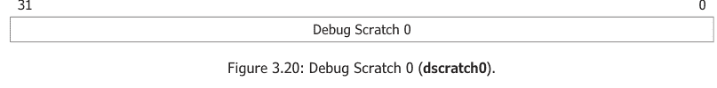

图 3.20：调试暂存器 0 (dscratch0)。

**dscratch0** CSR 通常在调试模式下用作临时寄存器，其作用类似于陷阱处理期间使用的 **mscratch** CSR。

##### 3.2.21 调试暂存器 1 (dscratch1)

调试暂存器 1 (**dscratch1**) 是一个可读写寄存器，仅在调试模式下可供通用使用。图 3.21 展示了 **dscratch1** CSR。


图 3.21：调试暂存器 1 (dscratch1)。

**dscratch1** CSR 是另一个用于调试模式的临时寄存器。它可用于在两个调试模式会话之间传递信息，或用于调试模式内的任何其他原因。

#### 3.3 物理内存属性

物理内存属性 (PMA) 在大型系统中非常重要，因为并非所有软件都可能清楚物理内存的组织方式。*第二卷* 讨论了可指定的不同类型的内存属性，例如主存、I/O 区域、空区域等。PMA 还可能指定内存宽度、是否支持突发传输、是否支持未对齐访问、是否支持原子指令以及其他更专业的属性。

对于嵌入式系统，通常很少需要单独的 PMA，因为它们通常只执行了解物理内存组织方式的软件。

#### 3.4 物理内存保护

物理内存保护 (PMP) 对于安全处理和隔离故障很重要，但也是大多数嵌入式系统不需要的特性。*第二卷* 提供了最多 16 个机器模式 CSR，专门用于指定 PMP 属性，例如针对不同特权级别和不同内存区域的 *读*、*写* 和 *执行* 权限。

86

#### 3.5 监督者模式地址转换

监督者模式的主要特性之一是地址转换，即将虚拟地址转换为物理地址。*第二卷* 指定了多种不同的地址转换方案，但其中只有一种适用于 RV32。

RV32 版本的地址转换称为 Sv32，是一种传统的基于页的 32 位虚拟地址，与 *Linux* 操作系统兼容。Sv32 使用基于内存的页表，适用于基于硬件的地址转换，并使用单个 CSR 来控制对内存中页表的访问。

#### 3.6 虚拟机监控器扩展

虚拟机监控器扩展无疑是 *第二卷* 中最复杂的部分，在撰写本文时，它仍是一个草案规范。此扩展支持在修改过的监督者模式（原生虚拟机监控器）之上托管客户操作系统，或在另一个本身运行在监督者模式的操作系统（宿主虚拟机监控器）之上托管。

#### 3.7 特权指令

*第二卷* 中规定的特性需要一些额外的指令。表 3.17 展示了这些指令。

| 汇编语言 | 操作码 |
| --- | --- |
| URET | 0000000_00010_00000_000_00000_1110011 |
| SRET | 0001000_00010_00000_000_00000_1110011 |
| MRET | 0011000_00010_00000_000_00000_1110011 |
| WFI | 0001000_00101_00000_000_00000_1110011 |
| SFENCE.VM *rs2*, *rs1* | 0001001_ttttt_sssss_000_00000_1110011 |
| HFENCE.VVM *rs2*, *rs1* | 0110001_ttttt_sssss_000_00000_1110011 |
| HFENCE.GVM *rs2*, *rs1* | 0001001_ttttt_sssss_000_00000_1110011 |
| HLV.B *rd*, (*rs1*) | 0110000_00000_sssss_100_ddddd_1110011 |
| HLV.BU *rd*, (*rs1*) | 0110000_00001_sssss_100_ddddd_1110011 |
| HLV.H *rd*, (*rs1*) | 0110010_00000_sssss_100_ddddd_1110011 |
| HLV.HU *rd*, (*rs1*) | 0110010_00001_sssss_100_ddddd_1110011 |
| HLVX.HU *rd*, (*rs1*) | 0110010_00011_sssss_100_ddddd_1110011 |
| HLV.W *rd*, (*rs1*) | 0110100_00000_sssss_100_ddddd_1110011 |
| HLUX.WU *rd*, (*rs1*) | 0110100_00011_sssss_100_ddddd_1110011 |
| HSV.B *rs2*, (*rs1*) | 0110001_ttttt_sssss_100_00000_1110011 |
| HSV.H *rs2*, (*rs1*) | 0110011_ttttt_sssss_100_00000_1110011 |
| HSV.W *rs2*, (*rs1*) | 0110101_ttttt_sssss_100_00000_1110011 |

表 3.17：特权指令集。

由于此设计仅支持机器模式，因此只实现了其中的两条指令，但与其他扩展一样，这里将描述所有指令。

##### 3.7.1 陷阱返回指令

陷阱返回指令提供从陷阱中有序返回的方式，每种特权级别都有一条单独的指令。为每种特权级别设置单独的指令是正确返回到前一个特权级别所必需的，因为每个特权级别都有自己的优先级和中断使能栈。机器模式优先级和中断使能栈的操作已在 **mstatus** CSR 部分中介绍。

**URET**（从用户模式返回）仅在实现了 "*N* *用户级中断标准扩展*" 时才是一条合法指令。此指令弹出用户中断使能（UPIE/UIE）栈，并将用户异常 PC (**uepc**) CSR 的内容加载到程序计数器中。出于安全原因，使用用户级中断时只能返回到用户模式。

**SRET**（从监督者模式返回）仅在实现了监督者模式时才是一条合法指令。此指令弹出监督者中断使能（SPIE/SIE）栈，并将监督者异常 PC (**sepc**) CSR 的内容加载到程序计数器中。**SRET** 指令还会将特权级别更改为监督者先前特权（SPP）位中存储的特权级别，返回到监督者模式或用户模式。

**MRET**（从机器模式返回）始终可用。此指令弹出机器中断使能（MPIE/MIE）栈，并将机器异常 PC (**mepc**) CSR 的内容加载到程序计数器中。**MRET** 指令还会将特权级别更改为机器先前特权（MPP）位中存储的特权级别，返回到机器模式、监督者模式或用户模式。此设计实现了 **MRET** 指令，但由于仅支持机器模式，MPP 位被硬连线为始终选择机器模式。

##### 3.7.2 中断管理指令

中断管理指令目前仅包含一条指令。

**WFI**（等待中断）会停止执行并等待中断。为了防止某些死锁可能性，在等待中断状态下，全局中断使能位将被忽略。如果 **WFI** 指令在机器模式下执行，此位是 MIE 位；如果在监督者模式下执行，则是 SIE 位。也可以在用户模式下执行 **WFI** 指令，但前提是必须满足某些条件。在等待中断状态下，仍然会尊重各个中断使能。

当 **WFI** 指令在非机器模式下执行时，存在许多复杂性，主要与等待中断的有界时间有关。由于此设计仅支持机器模式，我们可以忽略这些复杂性。

##### 3.7.3 监督者内存管理指令

监督者模式软件负责维护内存中的内存管理数据结构。这些数据结构的隐式和显式访问必须正确同步。

**SFENCE.VMA *rs2*, *rs1***（监督者栅栏，虚拟内存访问）是一条用于同步相对于程序对内存中数据结构更新的自动内存访问的指令。关于寄存器内容的用法，请参阅 *RISC-V 指令集手册*。

##### 3.7.4 虚拟机监控器内存管理指令

虚拟机监控器软件负责维护内存中供客户操作系统使用的内存管理数据结构。这些数据结构的隐式和显式访问必须正确同步。

**HFENCE.VVMA *rs2*, *rs1***（虚拟机监控器栅栏，VS 模式虚拟内存访问）是一条用于同步相对于程序对内存中虚拟监督者级数据结构更新的自动内存访问的指令。关于寄存器内容的用法，请参阅 *RISC-V 指令集手册*。

**HFENCE.GVMA *rs2*, *rs1***（虚拟机监控器栅栏，HS 模式虚拟内存访问）是一条用于同步相对于程序对内存中虚拟机监控器扩展监督者级数据结构更新的自动内存访问的指令。关于寄存器内容的用法，请参阅 *RISC-V 指令集手册*。

### 3.6.5 虚拟机监控器虚拟机加载和存储指令

虚拟机监控器必须能够访问其实现的虚拟机的内存。所有这些指令都使用虚拟监督者模式或虚拟用户模式的地址转换、保护和字节序，具体取决于执行它们的虚拟机监控器类型。

**HLV.B *rd*, (*rs1*)**（虚拟机监控器加载虚拟，字节）从内存中加载一个字节到 ***rd*** 寄存器的最低有效字节中，并将该字节符号扩展以填充寄存器的其余三个字节。

**HLV.BU *rd*, (*rs1*)**（加载字节，无符号）从内存中加载一个字节到 ***rd*** 寄存器的最低有效字节中，同时用零填充寄存器的其余三个字节。

**HLV.H *rd*, (*rs1*)**（加载半字）从内存中加载一个半字到 ***rd*** 寄存器的低半部分，并将该半字符号扩展以填充寄存器的高半部分。

**HLV.HU *rd*, (*rs1*)**（加载半字，无符号）从内存中加载一个半字到 ***rd*** 寄存器的低半部分，同时用零填充寄存器的高半部分。


#### 3.8 用户级中断扩展

*“N”标准扩展（用户级中断）*允许将通常在更高特权级处理的中断和异常分配给用户级。在仅有两个特权级存在的情况下，这通常是个不好的主意，但可以使其有意义。

此扩展添加了RISC-V中断和异常处理所需的CSR的用户模式版本，即**ustatus**、**uip**、**uie**、**uscratch**、**uepc**、**ucause**、**utvec**和**utval**。用户级中断还需要一个专用的返回指令**URET**，以正确终止陷阱服务例程。

**HLVX.HU rd, (rs1)**（加载半字，无符号）从内存加载一个半字到**rd**寄存器的低半部分，同时将寄存器的高半部分填充为零。此加载需要内存转换的*执行*权限。

**HLVX.WU rd, (rs1)**（加载字）从内存加载一个字到**rd**寄存器。此加载需要内存转换的*执行*权限。

**HSV.B rs2, (rs1)**（存储字节）将**rs2**寄存器的最低有效字节存储到内存。

**HSV.H rs2, (rs1)**（存储半字）将**rs2**寄存器的最低有效半字存储到内存。

**HSV.W rs2, (rs1)**（存储字）将**rs2**寄存器的内容存储到内存。

### 第4章 • 初始设计工作

RISC指令集的一个主要优势是，大多数指令都可以用相同的时序执行。这大大简化了设计过程，也使得流水线设计变得容易得多。但在开始Verilog编码之前，尽可能多地推敲时序仍然至关重要。一旦基本指令时序确定下来，下一步就是识别此定时的所有例外情况，并确保它们都能协调一致。这正是本章将要涵盖的内容。

#### 4.1 外部总线接口

我们不会重新发明轮子，而是将使用AMBA 3 AHB-Lite信号和协议的一个修改版本作为外部总线。我们这里使用的总线与AHB-Lite的主要区别在于，AHB-Lite支持突发传输和宽于32位的传输，而我们不需要这些。图4.1显示了基本指令获取的时序，包括和不包括等待状态的情况。该总线是流水线化的，有一个地址时钟周期和一个数据时钟周期，`mem_ready`信号在数据时钟周期被采样，导致数据周期被延迟。写时序基本相同，将在第4.3节介绍。

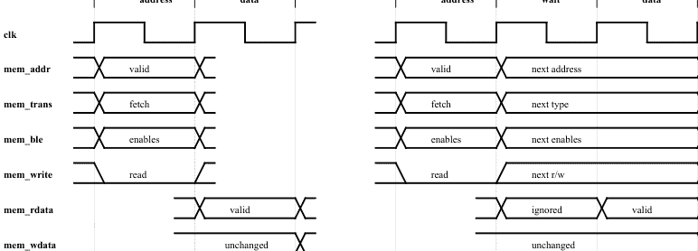

图4.1：外部总线时序。

此设计将使用紧密耦合的外部总线接口，因为这保证了可预测的指令时序，这对于许多嵌入式应用来说是一个重要的考虑因素。此选择也简化了设计，并使其更易于理解。紧密耦合意味着当外部总线上插入等待状态时，整个流水线都会停止。表4.1显示了外部总线接口的信号。我们使用与AHB-Lite版本不同的信号名称，以强调该总线是该规范的一个子集。

| 信号名称 | 宽度 | 方向 | 功能 | AHB-Lite |
| :--- | :--- | :--- | :--- | :--- |
| resetb | | 输入 | 主复位 | HRESETn |
| clk | | 输入 | 主时钟 | HCLK |
| mem_addr | [31:0] | 输出 | 内存地址 | HADDR |
| mem_rdata | [31:0] | 输入 | 内存读取数据 | HRDATA |
| mem_wdata | [31:0] | 输出 | 内存写入数据 | HWDATA |
| mem_trans | [1:0] | 输出 | 内存传输类型 | （见正文） |
| mem_ble | [3:0] | 输出 | 内存字节通道使能 | （见正文） |
| mem_lock | | 输出 | 内存锁定传输 | HMASTLOCK |
| mem_write | | 输出 | 内存写入 | HWRITE |
| mem_ready | | 输入 | 内存就绪 | HREADYOUT |
| bus_32 | | 输入 | 总线宽度（静态） | （见正文） |

表4.1：外部总线信号。

虽然RISC-V指令集手册假设某些嵌入式应用需要较小的寄存器文件，但数据总线的宽度通常是一个更重要的考虑因素。因此，此设计将包含一个16位数据总线的选项，由`bus_32`信号控制。如果需要，将其扩展到8位总线选项应该不会太困难。

`mem_trans`总线根据表4.2指示传输类型。我们不试图匹配AHB-Lite规范，`mem_trans[1]`等同于`HPROT[0]`信号，而`mem_trans[0]`等同于`HTRANS[1]`信号。这种编码允许在需要时分离程序和数据内存。

| mem_trans | 类型 | 描述 |
| :--- | :--- | :--- |
| 00 | 空闲 | 启动、休眠、内部操作 |
| 01 | 取指 | 指令获取 |
| 11 | 数据 | 加载、存储或AMO传输 |

表4.2：内存传输类型编码。

`mem_ble`总线控制写入数据在总线上的位置，如表4.3所示。我们使用单独的字节通道使能而不是大小指示符，因为这将允许更高效地实现未对齐传输。在16位总线的情况下，仅使用`mem_ble`总线的最低有效两位。

| mem_ble | 数据宽度 | (32位总线) | (16位总线) |
| :--- | :--- | :--- | :--- |
| 0001 | 字节 | [7:0] | [7:0] |
| 0010 | 字节 | [15:8] | [15:8] |
| 0100 | 字节 | [23:16] | 不适用 |
| 1000 | 字节 | [31:24] | 不适用 |
| 0011 | 半字 | [15:0] | [15:0] |
| 0110 | 半字 | [23:8] | 不适用 |
| 1100 | 半字 | [31:16] | 不适用 |
| 0111 | 3字节 | [23:0] | 不适用 |
| 1110 | 3字节 | [31:8] | 不适用 |
| 1111 | 字 | [31:0] | 不适用 |

表4.3：写入数据位置。

直接提供字节通道使能意味着内存不需要使用地址的最低有效两位，但这两个位仍然有效，指向正在访问的最低有效字节。字节通道使能在读取期间有效，但设计会锁存整个32位（或16位总线上的16位）宽度的数据。

`mem_lock`信号仅在AMO传输期间有效，包括读写周期以及任何相关的等待状态或空闲周期。

#### 4.2 指令时序

一旦定义了外部接口的时序，就可以定义整体的指令时序，传统的解码、寄存器读取、ALU操作和寄存器写入各占一个时钟周期。虽然使用时钟的两个沿进行设计当然是可能的，但这种技术通常只有在流水线较深且不涉及大量异常时才值得付出努力。使用时钟的两个沿也使时序分析更加困难，因此我们将为每个流水线阶段使用一个完整的时钟周期。图4.2显示了基本的指令时序。

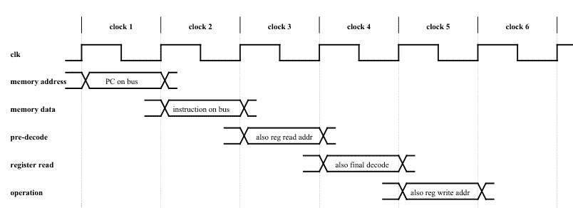

图4.2：基本指令时序。

在第一个时钟周期，要获取的指令的地址被驱动到`mem_addr`总线上。此设计不使用内存转换，但如果使用，任何地址转换都将在此处发生。

在第二个时钟周期，内存将指令返回到`mem_rdata`总线上。如果内存系统需要更多时间来检索指令，可以使用`mem_ready`信号来暂停流水线，直到数据准备就绪。如前所述，这将暂停整个流水线。

在第三个时钟周期，指令进行预解码操作。压缩指令在此处被展开为常规的32位指令，公共字段（如寄存器地址和立即数数据）被提取出来。寄存器源地址在此周期呈现给内部寄存器文件，并在周期结束时被寄存器文件锁存。此寄存器文件时序与ASIC和FPGA技术中常见的RAM宏的时序一致。

第四个时钟周期是源寄存器数据从寄存器文件返回的时候。这也是完成最终指令解码的地方。非法指令在此时钟周期被解析。我们在这个时钟周期进行最终解码，因为这节省了一些硬件，并且这个时钟周期本来就需要用于寄存器文件访问。

在第五个时钟周期，ALU用于对指令中指定的操作数进行运算。分支指令、中断和异常也在此处被识别。加载、存储、AMO和CSR指令也在此周期被识别，并在周期结束时执行，然后继续进入第六个也是最后一个周期。加载、存储、AMO和CPU总线访问总是按照程序执行顺序进行。


我们为加载、存储、AMO和CSR指令插入单独的时钟周期，因为紧密耦合的外部总线接口中每个时钟周期通常涉及指令取指。理论上CSR指令不需要这样做，但为了设计简洁，我们愿意牺牲一点性能。

第六个也是最后一个时钟周期是指令结果写回寄存器堆的阶段。

对于内联代码，流水线将被隐藏，大多数指令看起来只需要一个时钟周期执行。然而，在非顺序指令取指期间，指令执行流水线将变得明显。图4.3所示的时序适用于所有指令取指不连续的情况，无论是由指令执行还是陷阱引起。

该图假设在分支指令或陷阱条件之前没有加载、存储、AMO或CSR访问。明显的执行时间只有五个时钟周期，因为下一次取指在ALU操作流水线阶段结束时开始。在分支目标地址的取指周期之前，Idle周期的数据阶段不会采样`mem_ready`信号，并且始终为一个时钟周期长。

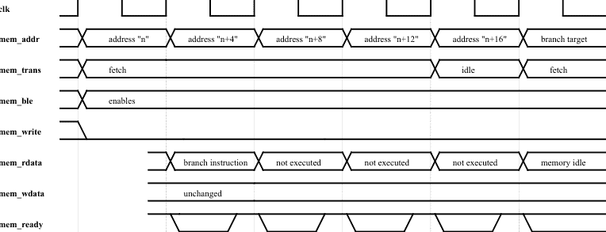

图4.3：指令取指不连续性。

在某些应用中，要求分支以固定时间执行，无论分支是否被采用。我们不会在此处实现此功能，尽管它应该很容易添加到设计中。

#### 4.3 从内存加载时序

*RISC-V指令集手册*不要求实现以硬件方式支持未对齐的加载地址，但此功能对于嵌入式应用很重要，因此我们将在16位总线和32位总线上实现对对齐和未对齐加载地址的支持。

字节加载地址始终被视为对齐，而半字加载地址如果地址的最低有效位为零则被视为对齐。字加载地址仅在32位总线上被视为对齐，并且必须地址的最低有效两位都为零。

图4.4显示了对齐加载相对于加载指令取指的时序。总线上的Idle周期是必需的，以便为加载指令之后的所有指令提供正确的寄存器数据。

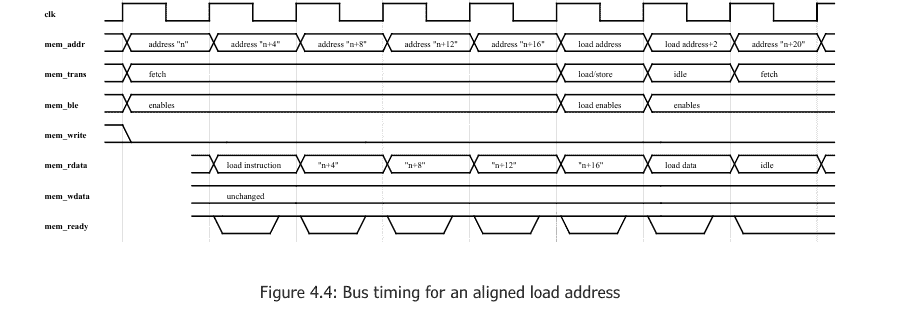

图4.5显示了未对齐加载地址的时序。加载内存周期始终从最低有效部分开始执行。在32位总线上，对于跨越字边界的未对齐半字和任何未对齐字，需要两次读取。在16位总线上，对于未对齐半字、对齐字和半字对齐字需要两次读取。对于未对齐字需要三次读取。未对齐加载仍然需要尾随的空闲周期。

### 第4章 • 初始设计工作

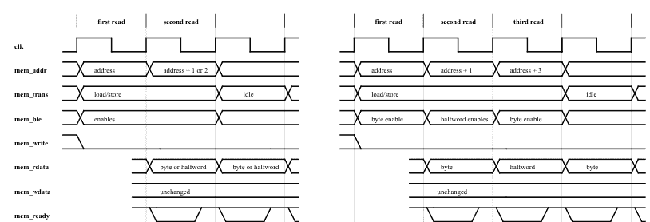

图4.5：未对齐加载地址的总线时序。

#### 4.4 存储到内存时序

与加载指令的情况一样，我们将在16位总线和32位总线上支持对齐和未对齐的存储地址。对齐和未对齐地址的规则与加载地址相同。

图4.6显示了对齐存储相对于存储指令取指的时序。与加载指令情况不同，总线上不需要空闲周期。

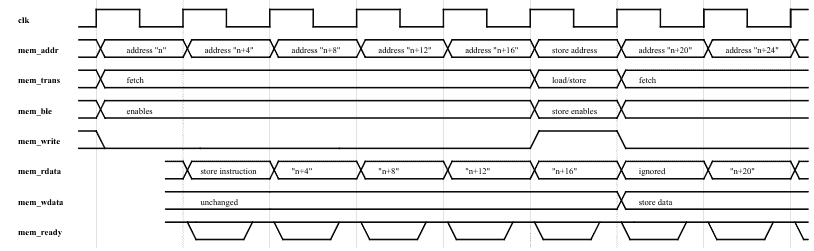

图4.6：对齐存储地址的总线时序。

图4.7显示了未对齐存储地址的时序。存储内存周期始终从最低有效部分开始执行。在32位总线上，对于跨越字边界的未对齐半字和任何未对齐字，需要两次写入。在16位总线上，对于未对齐半字、对齐字和半字对齐字需要两次写入。对于未对齐字需要三次写入。

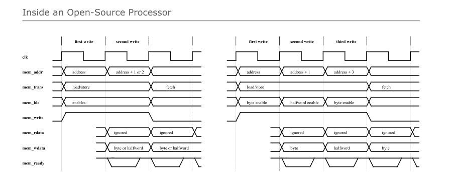

图4.7：未对齐存储地址的总线时序。

#### 4.5 原子内存操作时序

*RISC-V指令集手册*将AMO指令限制为目标地址必须字对齐，并指定否则生成非法指令异常。“*Zam*” *非对齐原子标准扩展*增加了对非对齐原子操作的支持，我们将在此处实现此功能，因为鉴于我们已经具有对非对齐加载和存储的硬件支持，其成本并不特别高。

图4.8显示了原子内存操作相对于AMO指令取指的时序。内存读取和内存写入之间的Idle周期是必需的，用于锁存内存数据。虽然应该可以使用常规ALU执行所有AMO操作，但我们使用一个简单的专用ALU来避免多路复用和跟踪正确流水线时序的复杂性。如果门尺寸是一个问题，鼓励读者修改此设计以使用常规ALU。

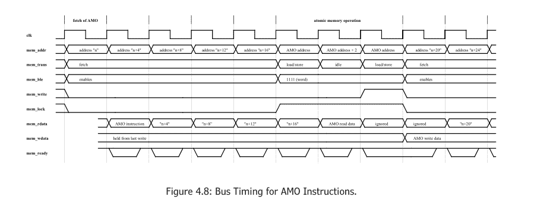

图4.8：AMO指令的总线时序。

在16位总线上的原子内存操作时序是相同的，只是需要两次内存读取和两次内存写入。非对齐AMO访问的时序与非对齐加载和存储访问的时序相同。

#### 4.6 CSR接口和时序

强制性CSR包含在此设计中，但我们还包括一个外部CSR总线，以允许添加自定义CSR。表4.4显示了外部CSR接口信号。

| 信号名称 | 宽度 | 方向 | 功能 |
| :--- | :--- | :--- | :--- |
| csr_addr | [11:0] | 输出 | CSR地址 |
| csr_rdata | [31:0] | 输入 | CSR读数据 |
| csr_wdata | [31:0] | 输出 | 内存写数据 |
| csr_achk | [11:0] | 输出 | CSR地址检查 |
| csr_read | | 输出 | CSR读选通 |
| csr_write | | 输出 | CSR写选通 |
| csr_ok_ext | | 输入 | CSR地址有效 |

表4.4：CSR接口信号

访问未实现的CSR必须生成非法指令异常，因此需要提供某种方式将CSR地址添加到“有效”列表中。为此，`csr_achk`总线携带来自CSR指令的CSR地址，外部逻辑必须在同一时钟周期内激活`csr_ok_ext`信号，以允许CSR访问继续进行。只有添加到设计中的CSR地址需要被通知，因为所有强制性CSR地址都在内部解码。

外部内存总线上没有明确的指示表明CSR访问正在进行，除了两个Idle周期可见。图4.9显示了CSR总线以及外部内存总线的时序。CSR总线是同步的，没有流水线，不支持等待状态。根据CSR指令，读选通或写选通可能缺失。

在开源处理器内部

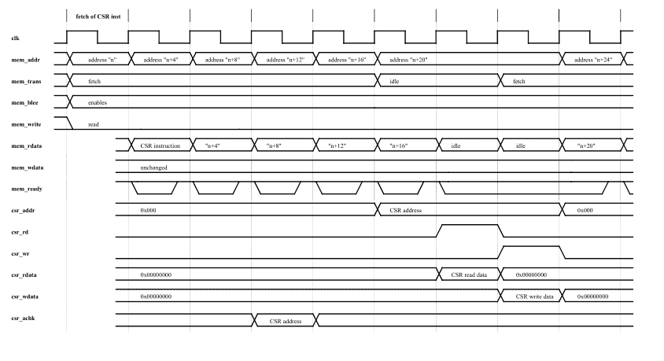

图4.9：CSR指令的时序。

非流水线总线适用于CSR访问，因为CSR寄存器可能在逻辑中而不是RAM中实现。一个简单的专用ALU用于CSR操作将消除围绕常规ALU的特殊多路复用的需要，并且似乎是为时序简单性付出的小代价。

#### 4.7 等待中断时序

**WFI**指令停止CPU流水线并激活`wfi_state`输出。WFI指令的时序与分支到下一个程序位置相同，只是流水线随后暂停。图4.10显示了进入等待中断状态。

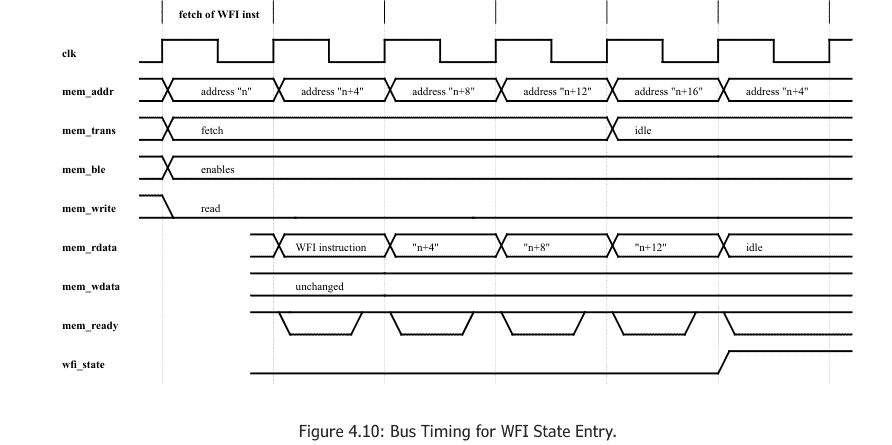

图4.10：WFI状态进入的总线时序。

当接受中断时退出等待中断状态。如果在执行**WFI**指令时中断挂起，流水线至少需要两个时钟周期才能重新启动，并且`wfi_state`信号将总共激活七个时钟周期。退出等待中断状态的序列如图4.11所示。

中断被认为中断了**WFI**指令之后的指令，因此该指令的地址存储在**mepc**寄存器中。这允许从紧接**WFI**指令之后的指令恢复执行。


#### 4.8 断点时序

**EBREAK** 指令通常会导致分支到向量表中的 break 入口，其时序与任何其他程序分支相同，如图 4.12 所示。

*RISC-V External Debug Support* 规范提供了一个可编程选项，用于使用 EBREAK 指令进入调试模式。此功能包含在本设计中，如果在调试控制和状态寄存器中启用，则会激活 `debug_mode` 信号并进入调试模式。

讨论调试模式操作超出了本书的范围，因此读者应参考 *RISC-V External Debug Support* 规范了解所有详细信息。本设计实现了符合规范所需的大部分最低支持。

退出 break 状态需要 **MRET** 指令，而退出调试模式需要 **DRET** 指令。无论哪种情况，其时序都与任何其他程序分支相同，如图 4.13 所示。

#### 4.9 复位时序

当全局 `resetb` 信号变低时，会立即进入复位状态，与当前状态无关，并且该状态会持续到 `resetb` 信号被解除断言后的 128 个时钟周期。此延迟包含在本设计中，因为某些存储器技术在上电和首次访问之间需要延迟。在此延迟期间对 `bus_32` 信号进行采样，最后一次采样在第 127 个时钟结束时进行。锁存的值保持有效，直到 `resetb` 再次被断言。

*RISC-V Instruction Set Manual* 未指定复位后从哪个地址开始执行，因此在第 128 个时钟结束时，本 CPU 从逻辑综合选项指定的地址开始获取第一条指令。图 4.14 显示了退出复位状态时的时序。

### 5. 组织设计

一旦选择了指令集并确定了指令时序，就可以开始实现设计了。第一步是确定设计在 Verilog 模块方面的结构。如前所述，RISC 指令集的一个优势是 CPU 设计可以相对简单。因此，我们将在单个 Verilog 模块中实现 CPU，其他子系统则放在各自的模块中。

按照标准惯例，每个 Verilog 模块包含在一个同名的单独文件中。表 5.1 显示了构成设计的各个文件及其内容。

| 文件名 | 模块名 | 内容 |
| :--- | :--- | :--- |
| *yrv_opt.v* | 不是模块 | 综合选项 |
| *define_dec.v* | 不是模块 | 指令操作码 |
| *define_csr.v* | 不是模块 | 标准定义的 CSR 地址 |
| *define_ec.v* | 不是模块 | 异常代码 |
| *yrv_top.v* | yrv_top | 设计顶层 |
| *yrv_cpu.v* | yrv_cpu | CPU |
| *yrv_reg.v* | yrv_reg | CPU 寄存器文件 |
| *yrv_csr.v* | yrv_csr | 强制性 CSR |
| *yrv_int.v* | yrv_int | 中断子系统 |

接下来的几章将依次介绍每个 Verilog 模块，描述 Verilog 源代码每个部分的功能。这些清单和描述将不包括每个模块顶部的信号声明，因为这会占用大量空间，并且对理解设计并无真正帮助。但是，信号声明是每个信号都有简短注释的地方（以防名称不够充分），因此如果您需要此类信息，请参考完整的 Verilog 源代码。清单通常会省略重置寄存器的代码，同样因为这会占用大量空间且对理解设计帮助不大。

#### 5.1 Verilog 编码标准

Verilog HDL 已由电气与电子工程师协会 (IEEE) 标准化，并且该标准持续更新。此处介绍的设计仅使用 1995 年版本标准中可用的功能，因为并非所有工具都支持后期版本的所有功能。

拥有一套编码标准也很重要。我们将为此设计使用以下编码标准：

- 所有内部信号和模块名称使用小写。
- 使用大写表示 `define` 宏定义。
- 永远不要为一个小写名称和一个大写名称使用相同的名称。
- 使用描述性的信号名称，但尽量少于 12 个字符。
- 可能时，触发器输出使用 `_reg` 后缀命名。
- 可能时，锁存器输出使用 `_lat` 后缀命名。
- 当信号将跨越时钟域边界时，在信号名称中包含标识源时钟域的标签。
- 所有低电平有效信号使用可识别的后缀命名。
- 模块定义和模块实例化使用相同的端口顺序。
- 模块使用一致的端口排序算法。
- 在模块开始处声明所有端口和变量。
- 声明端口和变量时使用一致的排序算法。
- 每个文件包含一个头部注释块，其中至少包含版权声明。
- 使用注释块将模块内的代码分隔成功能块。

流水线设计意味着流经流水线的信号和总线需要相对于流水线阶段进行区分。我们将在与特定流水线阶段相关的信号和寄存器名称中包含一个流水线阶段标识符 (1-6)。

#### 5.2 逻辑综合选项

*RISC-V Instruction Set Manual* 未指定的各种 CSR 内容和地址的逻辑综合选项都集中在 `yrv_opt.v` 文件中。这些选项使用单独的文件允许在不接触任何实际设计文件的情况下进行修改。清单 5.1 显示了设计的默认 CSR 内容和默认地址。

```verilog
/**********************************************************************/
/* read-only csr defaults                                           */
/**********************************************************************/
`define MISA_DEF      32'h00000000             /* misa                    */
`define MVENDORID_DEF 32'h00000000             /* vendor id               */
`define MARCHID_DEF   32'h00000000             /* architecture id         */
`define MIMPID_DEF    32'h00000000             /* implementation id       */

/**********************************************************************/
/* read/write csr reset values                                      */
/**********************************************************************/
`define MEPC_RST  32'h00000000             /* exception pc register   */
`define MSCR_RST  32'h00000000             /* scratch register        */
`define MTVEC_RST 30'h00000040             /* trap vector register 0x0100 */
```

```verilog
/* default addresses
`define NMI_VECT  32'h00000100 /* nmi vector        0x0100 */
`define RST_BASE 31'h00000100 /* reset start address 0x0200 */
/* debug options
`define XDEBUGVER  4'hf       /* debug version
`define DBG_VECT   32'h00000140 /* debug vector     0x0140 */
`define DEX_VECT   32'h000001c0 /* dbg exception vector 0x01c0 */
```

只读 **mvendorid**、**marchid** 和 **mimpid** CSR 的值在此处定义。本设计未实现 **misa** CSR 的读写版本，而是返回零，表示该寄存器未实现。

**mepc**、**mscr** 和 **mtvec** CSR 在异常期间使用，在寄存器初始化之前不应发生异常。以防万一，我们允许寄存器通过复位初始化。**mtvec** CSR 的最高三十位在这里定义，因为其他两位控制向量中断模式。因此，此处指定的值将在使用前左移两位。此 **mtvec** 重置值设置为与 NMI 向量匹配，以防在 CSR 初始化之前发生异常。

*RISC-V Instruction Set Manual* 未指定 NMI 向量或复位向量，因此我们在此处定义它们。请注意，由于程序计数器的最低有效位必须始终为零，复位向量选项值会左移一位以形成实际的起始地址。

*RISC-V External Debug Support* 规范描述了一整套调试设施，适用于任何类别的 RISC-V 实现。本设计实现了符合调试规范所需的最低功能。调试规范的版本在此处定义，可以在 **dcsr** CSR 中读取。两个向量地址（用于调试模式入口和调试模式期间的异常）也在此定义。


## 开源处理器内部结构

```
/**********************************************************************/
/* 周期计数器宽度选择 - 默认为64位                                     */
/**********************************************************************/
`define CYCCNT_64                            /* 64位                    */
// `define CYCCNT_32                          /* 32位                    */
// `define CYCCNT_0                           /* 无                      */

/**********************************************************************/
/* 已退役指令计数器宽度选择 - 默认为64位                                */
/**********************************************************************/
`define INSTRET_64                           /* 64位                    */
// `define INSTRET_32                         /* 32位                    */
// `define INSTRET_0                          /* 无                      */

代码清单 5.2：计数器与定时器宽度选项。
```

#### 5.3 指令译码宏定义

代码清单 5.3 所示的 *define_dec.v* 文件，包含用于指令译码器的多个常量定义，旨在提升 Verilog 代码的可读性。

```
/**********************************************************************/
/* RV32I 主要操作码                                                   */
/**********************************************************************/
`define OP_LD    5'h00                        /* 加载                   */
`define OP_FNC   5'h03                        /* 屏障                   */
`define OP_IMM   5'h04                        /* 立即数                 */
`define OP_AUI   5'h05                        /* 高位立即数加           */
`define OP_ST    5'h08                        /* 存储                   */
`define OP_AMO   5'h0b                        /* 原子内存操作           */
`define OP_OP    5'h0c                        /* 操作                   */
`define OP_LUI   5'h0d                        /* 加载高位立即数         */
`define OP_BR    5'h18                        /* 分支                   */
`define OP_JALR  5'h19                        /* 跳转并链接寄存器       */
`define OP_JAL   5'h1b                        /* 跳转并链接             */
`define OP_SYS   5'h1c                        /* 系统                   */

/**********************************************************************/
/* RV32C 非法操作码输出                                                */
/**********************************************************************/
`define RV32C_BAD  30'h3fffffff

/**********************************************************************/
/* 用于扩展的 RV32C 寄存器地址                                         */
/**********************************************************************/
`define X0      5'h00
`define X1      5'h01
`define X2      5'h02
```

代码清单 5.3：指令译码宏定义。

第一部分包含各种 RISC-V 主要操作码的定义。其次是16位指令译码器在遇到非法16位操作码时输出的常量，该常量是近期新增至 *RISC-V 指令集手册* 的。最后一部分包含将16位指令转换为32位指令时使用的特殊寄存器字段。

#### 5.4 标准 CSR 地址定义

`define_csr.v` 文件包含 *RISC-V 指令集手册* 中所有标准 CSR 的地址定义，以及 *RISC-V 外部调试支持* 规范中列出的各种调试寄存器。由于所有这些寄存器此前已有罗列，代码清单 5.4 仅展示设计中实际实现的寄存器。`define_csr.v` 文件中完整的定义集允许将任何标准 CSR 添加到设计中，而无需担心添加相应的地址定义。

```
/*******************************************************************************/
/* 用户计数器/定时器                                                         */
/*******************************************************************************/
`define CYCLE      12'hc00                           /* mcycle_reg                  */
`define TIME       12'hc01                           /* timer_rdata                 */
`define INSTRET    12'hc02                           /* minstret_reg                */
`define CYCLEH     12'hc80                           /* mcycleh_reg                 */
`define TIMEH      12'hc81                           /* timer_rdata                 */
`define INSTRETH   12'hc82                           /* minstreth_reg               */

/*******************************************************************************/
/* 机器信息寄存器                                                             */
/*******************************************************************************/
`define MVENDORID  12'hf11                           /* `MVENDORID_DEF              */
`define MARCHID    12'hf12                           /* `MARCHID_DEF                */
`define MIMPID     12'hf13                           /* `MIMPID_DEF                 */
`define MHARTID    12'hf14                           /* hw_id                       */

/*******************************************************************************/
/* 机器陷阱配置                                                               */
/*******************************************************************************/
`define MSTATUS    12'h300                           /* 多项                       */
`define MISA       12'h301                           /* `MISA_DEF                   */
`define MIE        12'h304                           /* 各 m*ie_reg 寄存器          */
`define MTVEC      12'h305                           /* mtvec_reg, vmode_reg        */

/********************************************************************/
/* 机器陷阱处理                                                     */
/********************************************************************/
`define MSCRATCH     12'h340                /* mscratch_reg           */
`define MEPC         12'h341                /* mepc_reg               */
`define MCAUSE       12'h342                /* mcause_reg             */
`define MIP          12'h344                /* 各 m*ip_reg 寄存器      */

/********************************************************************/
/* 机器计数器/定时器                                                */
/********************************************************************/
`define MCYCLE       12'hb00                /* mcycle_reg             */
`define MINSTRET     12'hb02                /* minstret_reg           */
`define MCYCLEH      12'hb80                /* mcycleh_reg            */
`define MINSTRETH    12'hb82                /* minstreth_reg          */

/********************************************************************/
/* 机器计数器配置                                                   */
/********************************************************************/
`define MCOUNTINHIBIT 12'h320               /* 多项                   */

/********************************************************************/
/* 调试模式寄存器                                                   */
/********************************************************************/
`define DCSR         12'h7b0                /* 多项                   */
`define DPC          12'h7b1                /* dpc_reg                */
`define DSCRATCH0    12'h7b2                /* dscratch0_reg          */
`define DSCRATCH1    12'h7b3                /* dscratch1_reg          */
```

代码清单 5.4：已实现的 CSR 地址定义。

#### 5.5 异常码定义

*RISC-V 指令集手册* 为每种可能的异常定义了异常码，并提供了未提交的值供自定义使用。*define_ec.v* 文件包含所有已定义的异常码。代码清单 5.5 展示了标准异常码，但本设计仅使用了非法指令、断点以及来自机器模式异常码的 **ECALL**。软件可通过 **mcause** CSR 获取异常码。


#### 5.6 顶层模块连接

本节将描述 `yrv_top.v` 文件的内容，它是处理器的顶层文件。该文件引入了所有的设计文件并实例化了各个模块。清单5.8展示了该模块的连接关系。

```
module yrv_top (csr_ack, csr_addr, csr_read, csr_wdata, csr_write, debug_mode,
               ebrk_inst, mem_addr, mem_ble, mem_lock, mem_trans, mem_wdata,
               mem_write, timer_en, wfi_state, brk_req, bus_32, clk, csr_ok_ext,
               csr_rdata, dbg_req, dresetb, ei_req, halt_reg, hw_id, li_req,
               mem_rdata, mem_ready, nmi_req, resetb, sw_req, timer_match,
               timer_rdata);

input       brk_req;                    /* 断点请求                  */
input       bus_32;                     /* 32位总线选择              */
input       clk;                        /* CPU时钟                   */
input       csr_ok_ext;                 /* 有效的外部CSR地址         */
input       dbg_req;                    /* 调试请求                  */
input       dresetb;                    /* 调试复位                  */
input       ei_req;                     /* 外部中断请求              */
input       halt_reg;                   /* 停机（进入调试模式）       */
input       mem_ready;                  /* 存储器就绪                */
input       nmi_req;                    /* 不可屏蔽中断              */
input       resetb;                     /* 主复位                    */
input       sw_req;                     /* 软件中断请求              */
input       timer_match;                /* 定时器/比较器匹配          */
input  [9:0] hw_id;                     /* 硬件ID                    */
input  [15:0] li_req;                   /* 本地中断请求              */
input  [31:0] csr_rdata;                /* CSR外部读数据              */
input  [31:0] mem_rdata;                /* 存储器读数据              */
input  [31:0] timer_rdata;              /* 定时器读数据              */

output      csr_read;                   /* CSR读使能                 */
output      csr_write;                  /* CSR写使能                 */
output      debug_mode;                 /* 处于调试模式              */
output      ebrk_inst;                  /* ebreak指令                */
```

《深入开源处理器》

```
/* **************************************************************************/
/* 自定义异常代码：{mcause_reg[31], mcause_reg[5:0]}                       */
/* **************************************************************************/
`define EC_LI0    7'h60                             /* li0 中断              */
`define EC_LI1    7'h61                             /* li1 中断              */
`define EC_LI2    7'h62                             /* li2 中断              */
`define EC_LI3    7'h63                             /* li3 中断              */
`define EC_LI4    7'h64                             /* li4 中断              */
`define EC_LI5    7'h65                             /* li5 中断              */
`define EC_LI6    7'h66                             /* li6 中断              */
`define EC_LI7    7'h67                             /* li7 中断              */
`define EC_LI8    7'h68                             /* li8 中断              */
`define EC_LI9    7'h69                             /* li9 中断              */
`define EC_LI10   7'h6a                             /* li10 中断             */
`define EC_LI11   7'h6b                             /* li11 中断             */
`define EC_LI12   7'h6c                             /* li12 中断             */
`define EC_LI13   7'h6d                             /* li13 中断             */
`define EC_LI14   7'h6e                             /* li14 中断             */
`define EC_LI15   7'h6f                             /* li15 中断             */
```

清单5.6：本地中断异常代码定义。

细心的读者会注意到，尽管这些异常代码是七位宽的，但在本文定义的所有情况下，只使用了六位。我们不会将设计限制为标准定义代码的一个子集，而是保持合规性，并预计逻辑综合工具会为未使用的位发出警告。

清单5.7展示了 *decode_ec.v* 文件中的最后一部分。*RISC-V 外部调试支持* 规范要求在 **dcsr** CSR 中提供一个3位字段，以指示CPU为何进入调试模式，这些值在此定义。

```
/* **************************************************************************/
/* 调试模式原因                                                  优先级   */
/* **************************************************************************/
`define DC_BRK    3'h2                               /* brk_req           4      */
`define DC_SW     3'h1                               /* ebreak_inst       3      */
`define DC_HLT    3'h5                               /* halt_reg          2      */
`define DC_DBG    3'h3                               /* dbg_req           1      */
`define DC_STEP   3'h4                               /* step_reg          0      */
```

清单5.7：调试模式原因定义。

与中断类似，进入调试模式的各种原因也是按优先级从高到低排序的。由于某种原因，这个3位字段并未反映出实际的优先级，实际优先级显示在注释中。

/*******************************************************************************************/
/* 标准异常代码：{mcause_reg[31], mcause_reg[5:0]}                                       */
/*******************************************************************************************/
`define EC_NULL      7'h00              /* 空值                                           */
`define EC_NMI       7'h00              /* 不可屏蔽中断值                                  */
`define EC_RST       7'h00              /* 复位值                                          */

`define EC_IALIGN  7'h00               /* 指令取指地址未对齐                               */
`define ECIFAULT  7'h01                /* 指令取指访问故障                                 */
`define EC_ILLEG   7'h02                /* 非法指令                                        */
`define EC_BREAK   7'h03                /* 断点                                            */
`define EC_LALIGN  7'h04                /* 加载地址未对齐                                   */
`define EC_LFAULT  7'h05                /* 加载访问故障                                     */
`define EC_SALIGN  7'h06                /* 存储/原子操作地址未对齐                           */
`define EC_SFAULT  7'h07                /* 存储/原子操作访问故障                             */
`define EC_UCALL   7'h08                /* 来自U模式的ecall                                */
`define EC_SCALL   7'h09                /* 来自S模式的ecall                                */
`define EC_MCALL   7'h0b                /* 来自M模式的ecall                                */
`define EC_IPFAULT 7'h0c                /* 指令取指页故障                                   */
`define EC_LPFAULT 7'h0d                /* 加载页故障                                      */
`define EC_SPFAULT 7'h0f                /* 存储/原子操作页故障                              */

`define EC_USWI    7'h40                /* 用户软件中断                                    */
`define EC_SSWI    7'h41                /* 监管者软件中断                                   */
`define EC_MSWI    7'h43                /* 机器软件中断                                     */
`define EC_UTMRI   7'h44                /* 用户定时器中断                                   */
`define EC_STMRI   7'h45                /* 监管者定时器中断                                 */
`define EC_MTMRI   7'h47                /* 机器定时器中断                                   */
`define EC_UEXTI   7'h48                /* 用户外部中断                                     */
`define EC_SEXTI   7'h49                /* 监管者外部中断                                   */
`define EC_MEXTI   7'h4b                /* 机器外部中断                                     */

清单5.5：标准异常代码定义。

此设计在为RISC-V指定的单个中断之外，还包括16个中断输入。我们称这些为本地中断，以区别于标准的RISC-V外部中断。这些中断使用了16个自定义异常代码，如清单5.6所示。这些本地中断会自动按中断号从最低（最高优先级）到最高（最低优先级）进行排序。


### 第5章 • 组织设计

output          mem_lock;           /* 内存锁（读-改-写）            */
output          mem_write;          /* 内存写使能                */
output          timer_en;           /* 定时器使能                 */
output          wfi_state;          /* 等待中断                 */
output  [1:0]   mem_trans;          /* 内存传输类型               */
output  [3:0]   mem_ble;            /* 内存字节通道使能            */
output  [11:0]  csr_achk;           /* 待检查的CSR地址             */
output  [11:0]  csr_addr;           /* CSR地址                  */
output  [31:0]  csr_wdata;          /* CSR写数据                */
output  [31:0]  mem_addr;           /* 内存地址                  */
output  [31:0]  mem_wdata;          /* 内存写数据                 */

清单 5.8: 顶层连接。

到目前为止，这些信号的大部分功能应该已经很明显了，但我们将按功能组进行分解，并添加一些额外的注释。表5.2显示了总线接口信号。

| 信号名称 | 注释 |
| :--- | :--- |
| clk | 设计中唯一的时钟 |
| resetb | 复位所有内容，除调试逻辑外 |
| mem_addr[31:0] | |
| mem_trans[1:0] | |
| mem_ble[3:0] | 对于16位总线，仅使用[1:0] |
| mem_lock | |
| mem_ready | |
| mem_write | |
| mem_wdata[31:0] | 对于16位总线，仅使用[15:0] |
| mem_rdata[31:0] | 对于16位总线，仅使用[15:0] |
| bus_32 | 在复位退出时采样 |
| wfi_state | |

表 5.2: 总线接口信号。

外部CSR接口信号如表5.3所示。如果没有实现额外的CSR，这些信号大部分都可以忽略。在这种情况下，`csr_ok_ext`输入必须接低电平。

| 信号名称 | 注释 |
| :--- | :--- |
| csr_achk[11:0] | 用于检查有效性的CSR地址 |
| csr_ok_ext | 有效的外部CSR地址 |
| csr_addr[11:0] | |
| csr_read | |
| csr_write | |
| csr_wdata[31:0] | |
| csr_rdata[31:0] | |

表 5.3: 外部CSR接口信号。

曾经，机器定时器寄存器，**mtime** 和 **mtimecmp**，位于CSR地址空间中，但当前版本的 *RISC-V指令集手册* 将它们置于内存映射寄存器中。由于这超出了本设计的范围，我们仅提供必要的接口信号，如表5.4所示。即使只实现了机器模式，为 **RDTIME** 和 **RDTIMEH** 指令也实现了一个定时器数据输入。

| 信号名称 | 注释 |
| :--- | :--- |
| timer_en | 与clk同步 |
| timer_match | |
| timer_rdata[31:0] | |

表 5.4: 机器定时器接口信号。

表5.5显示了各种中断请求信号。只有 `nmi_req` 输入通过同步器，因此其他信号必须在外部同步到 `clk` 信号。不要忘记，RISC-V没有提供任何用于确认中断的硬件机制。

| 信号名称 | 注释 |
| :--- | :--- |
| ei_req | RISC-V *外部* 中断请求 |
| li_req[15:0] | 自定义 *本地* 中断请求 |
| nmi_req | RISC-V不可屏蔽中断请求 |
| sw_req | RISC-V *软件* 中断请求 |

表 5.5: 中断请求信号。

开源处理器内部

*RISC-V外部调试支持* 规范要求几个专用信号，如表5.6所示。三种不同类型的调试器请求输入实际上并没有做任何不同的事情，除了在 **dcsr** CSR中报告不同的原因。

| 信号名称 | 注释 |
| :--- | :--- |
| debug_mode | 激活外部调试器所需 |
| brk_req | 来自触发器模块 |
| dbg_req | 通用调试器请求 |
| ebrk_inst | 暂停程序缓冲区执行 |
| halt_req | 直接从复位输出的调试器请求 |
| dresetb | 专用于调试逻辑的复位 |

表 5.6: 专用调试信号。

最后，`hw_id` 总线直接馈入 **mhartid** CSR。在大多数情况下，此总线应接全零。只有在系统中有多个RISC-V处理器的情况下，才需要一种方式来区分它们，这就是 **mhartid** CSR的用途。十个位用于硬件标识符可能看起来有些多余，但谨慎一点似乎更好。

### 第6章 • CPU内部

现在所有设计预备工作都已完成，我们可以深入实际设计了。本章将描述 *yrv_cpu.v* 文件的内容，它是整个RISC-V CPU，加上有意义包含的异常处理部分。CPU模块的连接如清单6.1所示。

```
module yrv_cpu (csr_achk, csr_addr, csr_read, csr_wdata, csr_write, dbg_type,
    debug_mode, dpc_reg, ebrk_inst, eret_inst, iack_int, iack_nmi,
    inst_ret, mcause_reg, mem_addr, mem_ble, mem_lock, mem_trans,
    mem_wdata, mem_write, mepc_reg, nmip_reg, wfi_state, brk_req,
    bus_32, clk, csr_idata, csr_rdata, csr_ok_ext, csr_ok_int, dbg_req,
    ebrkd_reg, halt_reg, irq_bus, mem_rdata, mem_ready, mli_code,
    mtvec_reg, resetb, step_reg, vmode_reg);

input       brk_req;                    /* 断点请求               */
input       bus_32;                     /* 32位总线选择             */
input       clk;                        /* CPU时钟                 */
input       csr_ok_ext;                 /* 有效的外部CSR地址          */
input       csr_ok_int;                 /* 有效的内部CSR地址          */
input       dbg_req;                    /* 调试请求                 */
input       ebrkd_reg;                  /* ebreak导致调试模式         */
input       halt_reg;                   /* 停机（进入调试）            */
input       resetb;                     /* 主复位                  */
input       mem_ready;                  /* 内存就绪                 */
input       step_reg;                   /* 单步执行                 */
input [1:0] vmode_reg;                  /* 向量中断模式             */
input [4:0] irq_bus;                    /* 中断请求：nmi/li/ei/tmr/sw */
input [6:0] mli_code;                   /* 最高优先级本地中断代码     */
input [31:0] csr_idata;                 /* CSR内部读数据             */
input [31:0] csr_rdata;                 /* CSR外部读数据             */
input [31:0] mem_rdata;                 /* 内存读数据               */
input [31:2] mtvec_reg;                 /* 陷阱向量基址             */

output      csr_read;                   /* CSR读使能                */
output      csr_write;                  /* CSR写使能                */
output      debug_mode;                 /* 处于调试模式              */
output      ebrk_inst;                  /* ebreak指令               */
output      eret_inst;                  /* eret指令                 */
output      iack_int;                   /* 中断确认：nmi/li/ei/tmr/sw */
output      iack_nmi;                   /* 中断确认：nmi              */
output      inst_ret;                   /* 指令退休                 */
output      mem_lock;                   /* 内存锁（读-改-写）         */
output      mem_write;                  /* 内存写使能                */
output           nmip_reg;                    /* 调试模式中待处理的NMI         */
output           wfi_state;                   /* 等待中断                    */
output [1:0]      mem_trans;                  /* 内存传输类型                 */
output [2:0]      dbg_type;                   /* 调试原因                    */
output [3:0]      mem_ble;                    /* 内存字节通道使能             */
output [6:0]      mcause_reg;                 /* 异常原因                    */
output [11:0]     csr_achk;                   /* 待检查的CSR地址              */
output [11:0]     csr_addr;                   /* CSR地址                   */
output [31:0]     csr_wdata;                  /* CSR写数据                  */
output [31:1]     dpc_reg;                    /* 调试PC                     */
output [31:0]     mem_addr;                   /* 内存地址                    */
output [31:0]     mem_wdata;                  /* 内存写数据                   */
output [31:1]     mepc_reg;                   /* 异常PC                     */
```

清单 6.1: CPU连接。

到目前为止，这些信号的大部分功能应该已经很明显了，因为它们中的大部分是顶层连接。但我们将按功能组分解内部连接，并添加一些额外的注释。表6.1显示了与CSR相关的信号。

| 信号名称 | 宽度 | 方向 | 功能 |
| :--- | :--- | :--- | :--- |
| csr_idata | [31:0] | 输入 | CSR内部读数据 |
| csr_ok_int | | 输入 | 内部地址有效 |

表 6.1: CSR相关信号。

中断请求在发送到此模块之前在另一个模块中被启用，并且有许多控制输出必须发送回去，如表6.2所示。

| 信号名称 | 宽度 | 方向 | 功能 |
| :--- | :--- | :--- | :--- |
| eret_inst | | 输出 | 弹出IE栈 |
| iack_int | | 输出 | 压入IE栈 |
| iack_nmi | | 输出 | 清除NMI锁存器 |
| irq_bus | [4:0] | 输入 | 请求总线到CPU |
| mcause_reg | [6:0] | 输出 | **mcause[31], mcause[5:0]** |
| mepc_reg | [31:1] | 输出 | **mepc[31:1]** |
| mli_code | [6:0] | 输入 | 本地中断标识符 |
| mtvec_reg | [31:2] | 输入 | **mtvec[31:2]** |
| vmode_reg | [1:0] | 输入 | **mtvec[1:0]** |

表 6.2: 中断相关信号


#### 6.1 启动与流水线控制

该模块与多个调试相关信号有关，如表6.3所示。

| 信号名称 | 位宽 | 方向 | 功能 |
|---|---|---|---|
| dbg_type | [2:0] | 输出 | dcsr[8:6] |
| dpc_reg | [31:1] | 输出 | dpc[31:1] |
| ebrkd_reg | | 输入 | dcsr[16] |
| nmip_reg | | 输出 | dcsr[3] |
| step_reg | | 输入 | dcsr[2] |

表6.3：调试相关信号。

最后，有一个用于已退休指令计数器的信号，如表6.4所示。

| 信号名称 | 位宽 | 方向 | 功能 |
|---|---|---|---|
| inst_ret | | 输出 | 递增IR计数器 |

表6.4：计数器/定时器相关信号。

接下来，我们将按照文件中出现的顺序，详细地介绍该文件的每个部分。

代码清单6.2展示了启动与流水线控制逻辑，尽管该部分也包含一些杂项功能。

```
/*****************************************************/
/* start-up and pipeline control                    */
/*****************************************************/
always @ (posedge clk or negedge resetb) begin
  if (!resetb) begin
    mem32_reg   <= 1'b0;
    rdata_reg   <= 32'h0;
    rdelay_reg  <= 8'h0;
    rdymask_reg <= 1'b0;
    valid_0_reg <= 1'b0;
    valid_1_reg <= 1'b0;
    end
  else begin
    if (!rdelay_reg[7]) mem32_reg <= bus_32;
    if (valid_0_reg && mem_rdy) rdata_reg <= mem_rdata;
    rdelay_reg  <= rdelay_reg + !rdelay_reg[7];
    rdymask_reg <= ~|mem_trans && mem_ready;
    if (mem_rdy) valid_0_reg <= !mem_trans[1] && mem_trans[0];
    valid_1_reg <= rdelay_reg[7] || valid_1_reg;
    end
  end

assign mem_idata = (valid_0_reg) ? mem_rdata : rdata_reg;
assign mem_rdy   = mem_ready || rdymask_reg;
assign mem_rdy_v = mem_rdy && valid_1_reg;

assign run_dec   = mem_rdy_v && !stall_csr && !stall_ldst;
assign run_exe   = mem_rdy_v && !stall_csr && !stall_ldst && !stall_align;
assign run_mem   = mem_rdy_v && !stall_csr && !stall_ldst && (ld_pc || !stall_cmp);
```

> 代码清单6.2：启动与流水线控制。

8位的`rdelay_reg`寄存器是复位后的启动延迟。该计数器在复位时被初始化为零，复位释放后向上计数到0x80并停止。我们停掉这个计数器以节省少量功耗。当此计数器运行时，会对`bus_32`进行采样，最后一次采样发生在计数0x7F时。当计数达到0x80且`valid_1_reg`被置为1时，CPU流水线启动。

在总线空闲周期期间需要忽略`mem_ready`信号，这是`rdymask_reg`信号的功能。同时，在启动延迟期间，内部的`mem_ready`信号应被强制置为无效，以确保所有部件都完成初始化。最终得到`mem_rdy_v`信号，它用于所有的流水线阶段以及加载/存储/AMO和CSR状态机。

`run_mem`、`run_dec`和`run_exe`信号分别控制内存（阶段1和2）、译码（阶段3）和执行（阶段3、4、5和6）的流水线阶段。流水线的阶段3是独特的，因为在处理两条16位指令的情况下，该阶段的部分会暂停，而其余部分需要继续推进。

`valid_0_reg`、`rdata_reg`和`mem_idata`逻辑用于在流水线因加载、存储、AMO或CSR操作而暂停时保持最后读取的数据，由于没有更合适的位置，我们将其包含在此处。

#### 6.2 阶段1：内存地址生成

代码清单6.3展示了流水线阶段1，即内存地址生成阶段。

```
/*********************************************************/
/* clock 1 - memory address                             */
/*********************************************************/
assign pc_1_adj = {(!wfi_reg && mem32_reg), (!wfi_reg && !mem32_reg), 1'b0};

`ifdef INSTANCE_INC
inst_inc  PC_1_INC  ( .inc_out(pc_1_nxt), .clk(clk), .inc_ain({pc_1_reg, 1'b0}),
                .inc_bin(pc_1_adj) );
`else
assign pc_1_nxt = {pc_1_reg, 1'b0} + pc_1_adj;
`endif

always @ (posedge clk or negedge resetb) begin
  if (!resetb) begin
    ldpc_1_reg <=  1'b0;
    pc_1_reg   <= `RST_BASE;
  end
  else if (run_mem) begin
    ldpc_1_reg <=  ld_pc;
    pc_1_reg   <= (ld_pc)        ? addr_out[31:1] :
                 (mem32_reg) ? {pc_1_nxt[32:2], 1'b0} : pc_1_nxt[31:1];
  end
end
end
```

> 代码清单6.3：内存地址生成。

该阶段很简单，基本上由程序计数器（PC）`pc_1_reg`组成。作为流水线的起点，这里负责PC的加载和递增，以及在等待中断时保持PC值的逻辑。PC的递增取决于总线宽度，在16位总线上递增2，在32位总线上递增4。

我们提供了通过`inst_inc`模块实例化一个递增器的选项。在某些情况下（但并非所有情况），逻辑综合工具可能能够识别加法器并自动使用专用硬件。对于FPGA而言，这种专用硬件可能比在FPGA结构中实现的等效逻辑快两到三倍。即使FPGA结构具有专用的进位链连接，情况也是如此。

尽管`pc_1_reg`寄存器只有三十一比特宽，但假设专用硬件是三十二比特宽的，因此相应的调整了值。这意味着`pc_1_nxt`总线的第零位将始终为零，这可能会产生一个虚假的逻辑综合警告。

PC随着指令一起流经流水线，因为许多指令需要当前指令的PC。将PC与操作码一起在流水线中传播，比试图为当前指令重新生成PC值更容易。

`ldpc_1_reg`需要传递到流水线的译码阶段，以清除由于未对齐或一个字中包含两条16位指令而可能被缓冲的指令。

#### 6.3 加载/存储/AMO逻辑

在时域上，加载/存储/AMO逻辑在指令的时钟5和时钟6之间是活跃的，但由于它与内存地址生成阶段交互，因此在这里介绍它是有意义的。表6.1和表6.2分别展示了16位总线情况和32位总线情况下，控制加载/存储/AMO逻辑操作的真值表。

| 情况 | ph | ainc | ble (按状态) | | | | mem_rdat (按字节) | | | |
|---|---|---|---|---|---|---|---|---|---|---|
| | | | 1111 | 0111 | 0011 | | 3 | 2 | 1 | 0 |
| 0000 | 0011 | x | | | 0001 | | 符号 | 符号 | 符号 | 1(0) |
| 0001 | 0011 | x | | | 0010 | | 符号 | 符号 | 符号 | 1(1) |
| 0010 | 0011 | x | | | 0001 | | 符号 | 符号 | 符号 | 1(0) |
| 0011 | 0011 | x | | | 0010 | | 符号 | 符号 | 符号 | 1(1) |
| 0100 | 0011 | x | | | 0011 | | 符号 | 符号 | 1(1) | 1(0) |
| 0101 | 0111 | 1 | | 0010 | 0001 | | 符号 | 符号 | 1(0) | 2(1) |
| 0110 | 0011 | x | | | 0011 | | 符号 | 符号 | 1(1) | 1(0) |
| 0111 | 0111 | 1 | | 0010 | 0001 | | 符号 | 符号 | 1(0) | 2(1) |
| 1000 | 0111 | 2 | | 0011 | 0011 | | 1(1) | 1(0) | 2(1) | 2(0) |
| 1001 | 1111 | 1 | 0010 | 0011 | 0001 | | 1(0) | 2(1) | 2(0) | 3(1) |
| 1010 | 0111 | 2 | | 0011 | 0011 | | 1(1) | 1(0) | 2(1) | 2(0) |
| 1011 | 1111 | 1 | 0010 | 0011 | 0001 | | 1(0) | 2(1) | 2(0) | 3(1) |

表6.1：16位总线加载/存储/AMO真值表。

在本节剩余部分中，请参考这两个真值表，因为它们比文字更能清楚地解释加载/存储/AMO逻辑的操作。

| 情况 | ph | ainc | ble (按状态) | | | | mem_rdat (按字节) | | | |
|---|---|---|---|---|---|---|---|---|---|---|
| | | | 1111 | 0111 | 0011 | | 3 | 2 | 1 | 0 |
| 0000 | 0011 | x | | | 0001 | | 符号 | 符号 | 符号 | 1(0) |
| 0001 | 0011 | x | | | 0010 | | 符号 | 符号 | 符号 | 1(1) |
| 0010 | 0011 | x | | | 0100 | | 符号 | 符号 | 符号 | 1(2) |
| 0011 | 0011 | x | | | 1000 | | 符号 | 符号 | 符号 | 1(3) |
| 0100 | 0011 | x | | | 0011 | | 符号 | 符号 | 1(1) | 1(0) |
| 0101 | 0011 | x | | | 0110 | | 符号 | 符号 | 1(2) | 1(1) |
| 0110 | 0011 | x | | | 1100 | | 符号 | 符号 | 1(3) | 1(2) |
| 0111 | 0111 | 1 | | 1000 | 0001 | | 符号 | 符号 | 1(0) | 2(3) |
| 1000 | 0011 | x | | | 1111 | | 1(3) | 1(2) | 1(1) | 1(0) |
| 1001 | 0111 | 1 | | 1110 | 0001 | | 1(0) | 2(3) | 2(2) | 2(1) |
| 1010 | 0111 | 2 | | 1100 | 0011 | | 1(1) | 1(0) | 2(3) | 2(2) |
| 1011 | 0111 | 1 | | 1000 | 0111 | | 1(2) | 1(1) | 1(0) | 2(3) |

表6.2：32位总线加载/存储/AMO真值表。


这些真值表第一列中的“case”仅仅是伴随着 `ld_addr` 信号触发 Load/Store/AMO 逻辑启动的状态 `{type_out[1:0], addr_out[1:0]}` 的组合。`type_out` 总线直接来自操作码，并设置了大小（字节、半字和字）以及有符号/无符号数据，如表 6.3 所示。`addr_out` 总线的最低两位标识操作的起始字节地址。

| type_out | 宽度 |
|---|---|
| 00 | 字节 |
| 01 | 半字 |
| 10 | 字 |
| 100 | 无符号字节 |
| 101 | 无符号半字 |

表 6.3：宽度编码

由于 Load/Store/AMO 逻辑兼容所有宽度和对齐方式，为 AMO 操作启用此功能可能是合理的。正如我们稍后将看到的，只需几行 Verilog 代码即可将字节和半字原子操作添加到设计中。

标记为 **ph** 的列是 Load/Store/AMO 状态机的初始状态。我们使用 4 位移位寄存器作为状态，因为它大大简化了所需的解码。内存读操作使用所有四位，最后一个状态用于空闲周期，这是外部总线上的最终数据阶段。内存写操作仅使用最高三位，并跳过最后一个状态，因为写操作不需要空闲周期。在 AMO 指令的情况下，此状态机运行两次，一次用于读取，另一次用于写入，在一个连续（原子）序列中。

标记为 **ainc** 的列是地址递增的初始值。如果初始地址未对齐，我们需要将下一次访问递增 1，而如果已对齐则需要递增 2。任何后续访问总是递增 2。

接下来的三列显示了每次访问所需的字节通道使能。虽然未显示，但可以根据字节通道使能推断出写数据在总线上的放置位置。请记住，我们仅支持小端数据访问。

最后四列显示了输出数据必须如何从每次读取寄存的数据中创建。该符号是 `register(byte)` 的简写，寄存器按 3-2-1 顺序加载，字节编号中“3”对应位 31-24 向下到“0”对应 7-0。寄存器 3 仅在三个总线周期的情况下使用，寄存器 2 仅在两个总线周期的情况下使用，寄存器 1 始终使用。

## 开源处理器内部

清单 6.4 显示了 Load/Store/AMO 状态机本身。从真值表中可以看出，如果我们选择仅支持对齐的内存访问，该状态机将简单得多，但鉴于我们无论如何都希望支持 16 位总线，增加的复杂性似乎并不过分。

```
/******************************************************************************************/
/* load/store/amo state machine                                                           */
/******************************************************************************************/
always @ (mem32_reg or addr_out or type_out) begin
    casex ({mem32_reg, type_out[1:0], addr_out[1:0]})
        5'b001x1,
        5'b01xx0,
        5'b10111,
        5'b11x01,
        5'b11x1x: ls_ph_ini = 4'b0111;
        5'b01xx1: ls_ph_ini = 4'b1111;
        default:  ls_ph_ini = 4'b0011;
    endcase
end

always @ (addr_out or type_out) begin
    case ({type_out[1:0], addr_out[0]})
        3'b100:  ls_ainc_ini = 2'h2;
        default: ls_ainc_ini = 2'h1;
    endcase
end

`ifdef INSTANCE_INC
    inst_inc LS_ADDR_INC ( .inc_out(ls_addr_nxt), .clk(clk), .inc_ain(ls_addr_reg),
                           .inc_bin({1'b0, ls_ainc_reg}) );
`else
    assign ls_addr_nxt = ls_addr_reg + ls_ainc_reg;
`endif

always @ (posedge clk or negedge resetb) begin
    if (!resetb) begin
        ls_addr_reg <= 32'h0;
        ls_ainc_reg <=  2'h2;
        ls_ph_reg   <=  4'h0;
        ls_sadd_reg <= 32'h0;
        ls_sinc_reg <=  2'h0;
        ls_sph_reg  <=  4'h0;
        ls_data_reg <= 32'h0;
        ls_type_reg <=  3'h2;
        ls_amo_reg  <=  1'b0;
        ls_st_reg   <=  1'b0;
    end
    else begin
        if ((ld_addr || stall_ldst) && mem_rdy_v) begin
            ls_addr_reg <= (ld_addr) ? addr_out :
                               (ld_rmw) ? ls_sadd_reg : ls_addr_nxt;
            ls_ainc_reg <= (ld_addr) ? ls_ainc_ini :
                               (ld_rmw) ? ls_sinc_reg : 2'h2;
            ls_ph_reg   <= (ld_addr) ? ls_ph_ini :
                               (ld_rmw) ? ls_sph_reg :
                                   {1'b0, ls_ph_reg[3:2], (|ls_ph_reg[3:2] ||
                                   (ls_ph_reg[1] && !ls_st_reg))};
        end
        if (ld_addr && mem_rdy_v) begin
            ls_data_reg <= src2_5_out;
            ls_sadd_reg <= addr_out;
            ls_sinc_reg <= ls_ainc_ini;
            ls_sph_reg  <= ls_ph_ini;
            ls_type_reg <= type_out;
        end
        if ((ld_addr || ld_rmw) && mem_rdy_v) begin
            ls_amo_reg  <= ld_rmw;
            ls_st_reg   <= ld_rmw || st_out;
        end
    end
end

assign ld_rmw     = !ls_st_reg && amo_6_reg && (ls_ph_reg == 4'h1);
assign ls_run     = |ls_ph_reg[3:1];
assign stall_ldst = |ls_ph_reg;
```

清单 6.4：Load/Store/AMO 状态机。

`ls_ph_ini` 变量直接实现了真值表中标记为 **ph** 的列，而 `ls_ainc_ini` 变量直接实现了标记为 **ainc** 的列。我们始终选择最常见的情况作为默认值以节省输入。

与之前一样，32 位递增功能被分离出来，以允许实例化增量器的选项。

状态机中有三组寄存器，每组需要略微不同的使能条件。第一组是实际的状态机，而第二组存储 AMO 指令写入部分的所有相关信息。最后一组是一对状态位，用于跟踪正在进行的操作类型。

## 开源处理器内部

状态机本身由内存地址（在 `ls_addr_reg` 寄存器中）、地址递增大小（在 `ls_ainc_reg` 寄存器中）和状态（在 `ls_ph_reg` 寄存器中）组成。这三个寄存器由流水线第 5 级的 `ld_addr` 信号加载起始信息，然后持续更新，直到 Load/Store/AMO 操作完成。在 AMO 指令的情况下，这些寄存器由 `ld_rmw` 信号重新加载起始信息。

第二组寄存器仅由 `ld_addr` 信号加载，并保存操作所需的所有信息，包括真值表第一列中的四位。其他信息用于 AMO 操作的写入部分。

第三组寄存器保存正在进行的操作的状态。`ls_st_reg` 寄存器在任何类型的存储操作期间被设置，而 `ls_amo_reg` 寄存器仅在 AMO 操作的存储部分被设置。因此，任何类型的加载操作都会清除这两个寄存器。

最后，有三个信号用于解码 Load/Store/AMO 状态机的当前状态，以在此状态机内部或外部使用。如前所述，`ld_rmw` 信号为 AMO 操作的存储部分重新触发状态机。`stall_ldst` 信号在 Load/Store/AMO 状态机处于活动状态的每个时钟周期内有效，并在此期间阻止流水线的其余部分前进。`ls_run` 信号控制某些外部总线信号的多路复用器，除加载操作结束时的空闲周期外，它始终有效。

##### 6.3.1 专用 AMO ALU

正如我们稍后将看到的，常规 ALU 在输入多路复用和生成控制信号方面有些复杂。为了不增加这种复杂性，我们为 AMO 操作采用了一个单独的专用 ALU。清单 6.5 显示了这个专用 ALU。

```
/*******************************************************************************/
/* dedicated amo alu                                                            */
/*******************************************************************************/
`ifdef INSTANCE_ADD
    inst_add AMO_ADD   ( .add_out(ls_amo_add), .clk(clk), .add_ain(ls_data_reg),
                        .add_bin(mem_rdat), .add_cyin(1'b0) );
`else
    assign ls_amo_add = ls_data_reg + mem_rdat;
`endif

always @ (imm_6_reg or ls_amo_add or ls_amo_reg or ls_data_reg or mem_rdat) begin
    case ({ls_amo_reg, imm_6_reg[11:7]})
        6'b100000: ls_amo_out = ls_amo_add;
        6'b100100: ls_amo_out = ls_data_reg ^ mem_rdat;
        6'b101000: ls_amo_out = ls_data_reg | mem_rdat;
```


##### 6.3.2 写数据多路选择

清单 6.6 展示了所有存储操作的写数据多路选择和字节通道使能信号。各种情况直接源自表 6.1 和表 6.2 所示的真值表。虽然看起来不太美观，但直接从真值表生成 Verilog HDL 代码可以减少编码错误。请注意，我们只需要从状态机中解码状态的两个位。需要注意的一点是，在插入无关项（don't cares）时，要确保不同的情况不会重叠。

```verilog
/**********************************************************************/
/* write data multiplexing                                            */
/**********************************************************************/
always @ (mem32_reg or ls_amo_out or ls_type_reg or ls_sadd_reg or ls_ph_reg)
begin
    casex ({mem32_reg, ls_type_reg[1:0], ls_sadd_reg[1:0], ls_ph_reg[3:2]})
        7'b000x1xx,
        7'b001x101,
        7'b010x111,
        7'b010x100,
        7'b1xx01xx: ls_data_out = {ls_amo_out[23:0], ls_amo_out[31:24]};
        7'b010x000,
        7'b1xx10xx: ls_data_out = {ls_amo_out[15:0], ls_amo_out[31:16]};
        7'b001x100,
        7'b010x101,
        7'b1xx11xx: ls_data_out = {ls_amo_out[7:0],  ls_amo_out[31:8]};
        default:    ls_data_out =  ls_amo_out;
    endcase
end

always @ (mem32_reg or ls_type_reg or ls_sadd_reg or ls_ph_reg) begin
    casex ({mem32_reg, ls_type_reg[1:0], ls_sadd_reg[1:0], ls_ph_reg[3:2]})
        7'b000x0xx,
        7'b001x100,
        7'b010x100,
        7'b10000xx,
        7'b1011100,
        7'b1100100: ls_ble_out = 4'b0001;
        7'b01xxx11,
        7'b001xxx1,
        7'b000x1xx,
        7'b10001xx: ls_ble_out = 4'b0010;
        7'b10010xx: ls_ble_out = 4'b0100;
        7'b10101xx: ls_ble_out = 4'b0110;
        7'b111x1100: ls_ble_out = 4'b0111;
        7'b10011xx,
        7'b10111x1,
        7'b111x11x1: ls_ble_out = 4'b1000;
        7'b10110xx,
        7'b111x10x1: ls_ble_out = 4'b1100;
        7'b111x01x1: ls_ble_out = 4'b1110;
        7'b111x00xx: ls_ble_out = 4'b1111;
        default:      ls_ble_out = 4'b0011;
    endcase
end
```

清单 6.6：写数据多路选择。

我们始终将最常见的情况用作默认值。对于数据而言，这是正常的字节对齐方式。对于字节通道使能信号，结果证明最常见的情况是仅使能低半字，这主要是由于 16 位总线选项的存在。

##### 6.3.3 存储器接口

加载/存储/原子操作（AMO）的存储器控制输出需要与取指存储器控制信号进行多路选择。清单 6.7 展示了这个存储器接口。

```verilog
/*******************************************************************************/
/* memory interface                                                            */
/*******************************************************************************/
assign mem_addr  = (stall_ldst) ? ls_addr_reg            :
                    (stall_cmp)  ? {pc_2_reg, 1'b0} : {pc_1_reg, 1'b0};
assign mem_lock  = stall_ldst && amo_6_reg;
assign mem_ble   = (ls_run) ? ls_ble_out : {mem32_reg, mem32_reg, 2'b11};
assign mem_trans = {ls_run, ls_run || !(!valid_1_reg || stall_csr || ld_pc ||
                    wfi_state || (!ls_ph_reg[1] && ls_ph_reg[0]))};
assign mem_write =  ls_run && ls_st_reg;

always @ (posedge clk or negedge resetb) begin
  if (!resetb) begin
    mem_wdata <= 32'h0;
  end
  else begin
    if (mem_rdy_v && ls_st_reg && ls_ph_reg[1]) mem_wdata <= ls_data_out;
  end
end
```

清单 6.7：存储器接口。

两个存储器控制信号 `mem_lock` 和 `mem_write` 仅在加载/存储/原子操作状态机运行时有效，因此它们的生成非常简单。字节通道使能信号稍微复杂一些，因为取指操作总是 32 位或 16 位，具体取决于总线宽度。

事务类型 `mem_trans` 相对复杂，因为需要在多种不同情况下发出空闲（Idle）周期的信号。

存储器地址 `mem_addr` 通常是第一级流水线的程序计数器（PC），但由于流水线的存在，在 CSR 访问期间地址需要回退，并在加载/存储/原子操作状态机运行时从中获取。

存储器写数据 `mem_wdata` 只是加载/存储/原子操作状态机数据输出的寄存器副本，这是由于外部总线的流水线特性。虽然在不使用时将此总线清零可能不错，但生成相应的控制信号和数据多路选择器可能不值得付出这样的努力。

##### 6.3.4 读数据组装

如清单 6.8 所示，读数据组装逻辑比写数据逻辑复杂得多。这是因为组装数据需要一次、两次或三次读取（和寄存器）。另一个复杂之处在于需要对字节和半字数据进行符号扩展。

```verilog
/*******************************************************************************/
/* read data assembly                                                          */
/*******************************************************************************/
always @ (posedge clk or negedge resetb) begin
  if (!resetb) begin
    ls_din3_reg <=  8'h0;
    ls_din2_reg <= 32'h0;
    ls_din1_reg <= 32'h0;
  end
  else begin
    if (mem_rdy_v && !ls_st_reg && ls_ph_reg[2]) ls_din3_reg <= mem_rdata[15:8];
    if (mem_rdy_v && !ls_st_reg && ls_ph_reg[1]) ls_din2_reg <= mem_rdata;
    if (mem_rdy_v && !ls_st_reg && ls_ph_reg[0]) ls_din1_reg <= mem_rdata;
  end
end

assign sext1_07 = !ls_type_reg[2] && ls_din1_reg[7];
assign sext1_15 = !ls_type_reg[2] && ls_din1_reg[15];
assign sext1_23 = !ls_type_reg[2] && ls_din1_reg[23];
assign sext1_31 = !ls_type_reg[2] && ls_din1_reg[31];

always @ (mem32_reg or ls_type_reg or ls_sadd_reg or ls_din3_reg or ls_din2_reg or
          ls_din1_reg or sext1_07 or sext1_15 or sext1_23 or sext1_31) begin
  casex ({mem32_reg, ls_type_reg[1:0], ls_sadd_reg[1:0]})
    5'b00010,
    5'bx0000: mem_rdat = { {24{sext1_07}},  ls_din1_reg[7:0]  };
    5'b00011,
    5'bx0001: mem_rdat = { {24{sext1_15}},  ls_din1_reg[15:8] };
    5'b00110,
    5'bx0100: mem_rdat = { {16{sext1_15}},  ls_din1_reg[15:0] };
    5'b001x1: mem_rdat = { {16{sext1_07}},  ls_din1_reg[7:0],
                          ls_din2_reg[15:8]};
    5'b010x0: mem_rdat = {ls_din1_reg[15:0], ls_din2_reg[15:0] };
    5'b010x1: mem_rdat = {ls_din1_reg[7:0],  ls_din2_reg[15:0], ls_din3_reg};
    5'b10010: mem_rdat = { {24{sext1_23}},  ls_din1_reg[23:16]};
    5'b10011: mem_rdat = { {24{sext1_31}},  ls_din1_reg[31:24]};
    5'b10101: mem_rdat = { {16{sext1_23}},  ls_din1_reg[23:8] };
    5'b10110: mem_rdat = { {16{sext1_31}},  ls_din1_reg[31:16]};
    5'b10111: mem_rdat = { {16{sext1_07}},  ls_din1_reg[7:0],
                          ls_din2_reg[31:24]};
    5'b11001: mem_rdat = {ls_din1_reg[7:0],  ls_din2_reg[31:8] };
    5'b11010: mem_rdat = {ls_din1_reg[15:0], ls_din2_reg[31:16]};
    5'b11011: mem_rdat = {ls_din1_reg[23:0], ls_din2_reg[31:24]};
    default:  mem_rdat =  ls_din1_reg;
  endcase
end
```

清单 6.8：读数据组装。

回顾表 6.1 和表 6.2 可以明显看出需要三个数据寄存器。第三个数据寄存器只有一种情况需要，即在 16 位总线上处理未对齐的字数据，并且它只需要八位宽。其他两个数据寄存器必须是完整的 32 位宽度，以覆盖所有剩余情况。


在这种设计中，数据始终以小端序获取，这意味着最后读入`ls_din1_reg`寄存器的数据将始终进行符号扩展。添加双端序支持将使情况变得复杂。处理LBU和LHU指令则很简单，只需抑制符号扩展即可。

读取的数据由`mem_rdat`总线承载，该总线直接从真值表中创建。同样，我们需要确保所有这些情况互不重叠。尽管多路复用可能看起来很复杂，但有整个时钟周期来生成此总线。

#### 6.4 第二阶段：访存

访存阶段如代码清单6.9所示，是最简单的流水线阶段，因为当前指令除了正在从存储器传送的途中之外，没有发生任何其他操作。

```
/**************************************************************************************/
/* clock 2 - memory access                                                             */
/**************************************************************************************/
always @ (posedge clk or negedge resetb) begin
  if (!resetb) begin
    ldpc_2_reg  <=  1'b0;
    pc_2_reg    <= `RST_BASE;
    valid_2_reg <=  1'b0;
  end
  else if (run_mem) begin
    ldpc_2_reg  <= ldpc_1_reg;
    pc_2_reg    <= pc_1_reg;
    valid_2_reg <= !ld_pc && !wfi_reg && valid_1_reg;
  end
end
```
代码清单6.9：访存阶段

我们需要为每个阶段提供某种“有效”信号，以禁止相应阶段中的某些操作。此“有效”信号（本阶段为`valid_2_reg`）由上一个流水线阶段生成，并传递到后续的流水线阶段。

#### 6.5 第三阶段：预解码

预解码阶段相当复杂，主要是因为这是压缩指令被展开为常规指令的地方，并且未对齐的常规指令必须进行组装。如前所述，当两个压缩指令被打包在一个字中时，该阶段的一部分必须暂停，而该阶段的其余部分和后续阶段则必须继续运行。代码清单6.10显示了指令组装逻辑。

# 深入处理器内部

```
/*******************************************************************************/
/* clock 3 - pre-decode                                                       */
/*******************************************************************************/
assign ld_insth = mem32_reg || ( word_inst && (ifull_3_reg == 3'b001));
assign ld_instl = mem32_reg || (!word_inst && (ifull_3_reg == 3'b001)) ||
                   (ifull_3_reg == 3'b011) || (ifull_3_reg == 3'b000);

always @ (posedge clk or negedge resetb) begin
  if (!resetb) begin
    ifull_3_reg <=  3'h0;
    inst_3_reg  <= 32'h0;
    instu_3_reg <= 16'h0;
  end
  else if (run_dec) begin
    ifull_3_reg <= (valid_2_reg && !ldpc_1_reg) ? ifull_3_nxt : 3'b000;
    if (ld_insth) inst_3_reg[31:16] <= (mem32_reg) ? mem_idata[31:16] :
                                                  mem_idata[15:0];
    if (ld_instl) inst_3_reg[15:0]  <= mem_idata[15:0];
    instu_3_reg <= inst_3_reg[31:16];
  end
end

assign stall_align = valid_3_reg && ((word_instu && (ifull_3_reg == 3'b010)) ||
                                    (word_inst  && (ifull_3_reg == 3'b001)));
assign word_instu  = &inst_3_reg[17:16];
assign word_inst   = &inst_3_reg[1:0];
assign stall_cmp   = ((ifull_3_reg == 3'b011) && !word_instu && !word_inst) ||
                     ((ifull_3_reg == 3'b111) && !word_instu);

always @ (mem32_reg or ifull_3_reg or pc_2_reg or word_inst or word_instu) begin
  case ({mem32_reg, ifull_3_reg})
    4'b0000: ifull_3_nxt = 3'b001;
    4'b0001: ifull_3_nxt = (word_inst)  ? 3'b011 : 3'b001;
    4'b0011: ifull_3_nxt = 3'b001;
    4'b1000: ifull_3_nxt = {2'b01, !pc_2_reg[1]};
    4'b1010: ifull_3_nxt = (word_instu) ? 3'b111 : 3'b011;
    4'b1011: ifull_3_nxt = (word_inst)  ? 3'b011 :
                              (word_instu) ? 3'b111 : 3'b100;
    4'b1100: ifull_3_nxt = 3'b011;
    4'b1111: ifull_3_nxt = (word_instu) ? 3'b111 : 3'b100;
    default: ifull_3_nxt = 3'b000;
  endcase
end
```

```
assign opc[31:16] = (ifull_3_reg[2]) ? inst_3_reg[15:0] : inst_3_reg[31:16];
assign opc[15:0]  = (ifull_3_reg[2]) ? instu_3_reg :
                    (ifull_3_reg[0]) ? inst_3_reg[15:0] : inst_3_reg[31:16];
```
代码清单6.10：预解码阶段。

尽管本节看起来很复杂，难以解释，但其逻辑其实相当直接。本节的核心是`inst_3_reg`寄存器，它从内存数据总线加载指令。在32位总线的情况下，每次指令获取时都会加载整个寄存器；而在16位总线的情况下，除非前一条指令是压缩指令，否则加载通常在上半字和下半字之间交替进行。

`instu_3_reg`寄存器仅在32位总线情况下使用，当只有`inst_3_reg`的下半部分将被发送进行解码，或者存在跳转到未对齐地址时，它会缓冲`inst_3_reg`寄存器的上半字。由于RISC-V指令始终是小端序，`instu_3_reg`寄存器只存储最低有效指令半字。

小端序指令以及指令最低有效两位中的指令长度编码，使得识别指令长度变得容易。当`inst_3_reg`寄存器的最高有效半字或最低有效半字分别包含普通指令（相对于压缩指令）的起始位置时，信号`word_instu`和`word_inst`有效。这些信号仅在相应半字有效时使用，且`word_instu`信号仅在已知`inst_3_reg`寄存器的上半字包含新指令的起始位置时才使用。

`ifull_3_reg`寄存器控制着`inst_3_reg`的加载以及将哪些半字发送进行解码的多路选择。尽管Verilog代码看起来像一个状态机，但该寄存器实际上只是三个指令半字的三个满/空状态位的组合。当`instu_3_reg`寄存器包含有效数据时，`ifull_3_reg[2]`位被置位；当`inst_3_reg`寄存器的上半字包含有效数据时，`ifull_3_reg[1]`位被置位；当`inst_3_reg`寄存器的下半字包含有效数据时，`ifull_3_reg[0]`位被置位。表6.5对此进行了解释。

# 深入处理器内部

| ifull | instu | inst [31:16] | inst [15:0] | opc [31:16] | opc [15:0] | 注释 |
| :--- | :--- | :--- | :--- | :--- | :--- | :--- |
| 000 | | | | xx | xx | 跳转后 |
| 001 | | | 有效 | xx | [15:0] | 仅16位总线 |
| 010 | | 有效 | | | | 仅32位总线 |
| 011 | | 有效 | 有效 | [31:16] | [15:0] | |
| 100 | 有效 | | | xx | instu | 仅32位总线 |
| 101 | | | | | | 非法 |
| 110 | | | | | | 非法 |
| 111 | 有效 | 有效 | 有效 | [15:0] | instu | 仅32位总线 |

表6.5：操作码组装。

在16位总线情况下，`ifull_3_reg`寄存器仅000、001和011状态有效；而在32位总线情况下，仅000、010、011、100和111状态有效。

在所有情况下，当程序计数器被加载时都会进入000状态，为从新地址获取第一条指令做准备。在16位总线情况下，下一个状态始终是001，最低有效半字或压缩指令被加载到`inst_3_reg[15:0]`。32位总线则不同，它加载整个`inst_3_reg`寄存器，并在新PC值字对齐时转换到状态011。如果新PC未对齐，下一个状态是010，因为只有最高有效半字有效。

使用16位总线时，状态通常在001和011之间交替，因为半字被组装成32位指令。这是`stall_align`信号有效的情况之一，它会暂停流水线的其余部分，直到获得完整的指令。如果在状态001时识别出压缩指令，下一个状态也是001，不需要流水线暂停。

32位总线情况下的010状态是`stall_align`信号有效的另一个情况，同样是因为没有完整的指令可用。这是32位总线情况下流水线会因等待指令而暂停的唯一情况。

`stall_cmp`信号控制前几个流水线阶段的暂停。当`inst_3_reg`寄存器中没有更多空间存放指令时，就会发生这种情况。这发生在状态011（当两个半字都包含压缩指令时）和状态111（当`inst_3_reg`寄存器的上半字包含压缩指令时）。在这两种情况下，下游流水线需要两个时钟周期才能清空`inst_3_reg`寄存器；因此前几个阶段需要暂停。


##### 6.5.1 第三级程序计数器

如代码清单6.11所示，本阶段的程序计数器（PC）并非简单地将上一阶段的PC延迟一拍。

```verilog
/********************************************************************************/
/* stage 3 program counter                                                     */
/********************************************************************************/
always @ (ifull_3_reg or word_inst) begin
    case (ifull_3_reg)
        3'b011:  pc_3_inc = {word_inst, !word_inst};
        3'b111:  pc_3_inc = 2'b10;
        default: pc_3_inc = 2'b01;
    endcase
end

`ifdef INSTANCE_INC
    inst_inc  PC_3_INC  ( .inc_out(pc_3_nxt), .clk(clk), .inc_ain({pc_3_reg, 1'b0}),
                        .inc_bin({pc_3_inc, 1'b0}) );
`else
    assign pc_3_nxt = {pc_3_reg, 1'b0} + {pc_3_inc, 1'b0};
`endif

always @ (posedge clk or negedge resetb) begin
    if (!resetb) begin
        pc_3_reg    <= `RST_BASE;
        valid_3_reg <= 1'b0;
    end
    else if (run_exe) begin
        pc_3_reg    <= (valid_3_reg) ? pc_3_nxt[31:1] : pc_2_reg;
        valid_3_reg <= !ld_pc && valid_2_reg;
    end
end
```

代码清单 6.11：第三级程序计数器。

本阶段PC的复杂性源于压缩指令或非对齐常规指令的可能性。PC并非只是加载上一阶段的内容，而是可能需要根据`ifull_3_reg`寄存器的状态进行调整。回顾一下，任何PC的最低位始终为零，因此`pc_3_inc`的值实际上是二或四。因此，在`011`情况下，对于字指令PC递增四，对于压缩指令PC递增二。在`111`情况下，PC始终递增四，因为`inst_3_reg[15:0]`和`instu_3_reg`寄存器的组合中包含了一条常规指令。

我们再次提供了实例化32位加法器的选项。`pc_3_reg`寄存器只有31位宽，但为简化处理，我们在加法器中将其视为32位量。逻辑综合工具可能会给出关于`pc_3_nxt`总线第0位恒为零的虚假警告。

与`ifull_3_reg`寄存器不同，本节中的寄存器通过`run_exe`信号使能，使能时间与流水线其余部分相同。

##### 6.5.2 压缩操作码公共部分

代码清单6.12展示了多个压缩指令共有的信号和操作码字段。

```verilog
/********************************************************************/
/* compressed opcode common                                         */
/********************************************************************/
assign rd_n2   = |opc[11:9] || !opc[8] || opc[7];
assign rd_nz   = |opc[11:7];
assign imm6_nz = opc[12] || |opc[6:2];
assign imm8_nz = |opc[12:5];
assign rs2_nz  = |opc[6:2];

assign c_rd    = opc[11:7];
assign c_rdp   = {2'b01, opc[4:2]};
assign c_rs1   = opc[11:7];
assign c_rs1p  = {2'b01, opc[9:7]};
assign c_rs2   = opc[6:2];
assign c_rs2p  = {2'b01, opc[4:2]};
```

代码清单 6.12：压缩操作码公共部分。

许多压缩指令在某些操作码字段为零时（或在一种情况下等于二）具有特殊含义。第一组信号解码这些常见情况，以简化压缩操作码的展开。解码的情况应从信号名称中显而易见。

第二组信号是大多数压缩指令共有的寄存器字段，使得形成压缩指令的展开版本更容易且更不易出错。`c_rdp`、`c_rs1p`和`c_rs2p`信号对应压缩指令中展开后的`rd'`、`rs1'`和`rs2'`字段。

在接下来的三个部分中，请回顾压缩指令的象限是由操作码的两个最低有效位的位组合定义的。位组合`00`是象限0，位组合`01`是象限1，位组合`10`是象限2。

##### 6.5.3 压缩象限0展开

象限0中的许多压缩指令在本设计中将不会实现，因为它们与浮点相关。这使得如代码清单6.13所示的象限0展开逻辑相当简单。

```verilog
/******************************************************************/
/* compressed quadrant 0 expansion                                */
/******************************************************************/
always @ (opc or imm8_nz or c_rdp or c_rs1p or c_rs2p) begin
    case (opc[15:13])
        3'b000: e_c0 = (imm8_nz) ? {2'h0, opc[10:7], opc[12:11], opc[5], opc[6],
                                    2'h0, `X2, 3'h0, c_rdp, `OP_IMM} : `RV32C_BAD;
        3'b010: e_c0 = {5'h0, opc[5], opc[12:10], opc[6], 2'h0, c_rs1p, 3'h2, c_rdp,
                        `OP_LD};
        3'b110: e_c0 = {5'h0, opc[5], opc[12], c_rs2p, c_rs1p, 3'h2, opc[11:10],
                        opc[6], 2'h0, `OP_ST};
        default: e_c0 = `RV32C_BAD;
    endcase
end
```

代码清单 6.13：压缩象限0展开。

仅实现了来自象限0的三条指令：**C.ADDI4SPN**、**C.LW**和**C.SW**。展开都很直接，但立即数数据在压缩指令和常规指令中的排列方式使得Verilog代码看起来很复杂。

##### 6.5.4 压缩象限1展开

本设计将实现象限1中的所有压缩指令。这使得如代码清单6.14所示的象限1展开逻辑成为三个象限中最复杂的。

```verilog
/******************************************************************/
/* compressed quadrant 1 expansion                                */
/******************************************************************/
always @ (opc or imm6_nz or rd_n2 or rd_nz or c_rd or c_rs1p or c_rs2p) begin
    casex ({opc[15:13], opc[11:10]})
        5'b000xx: e_c1 = (!rd_nz)  ? {25'h0000000, `OP_IMM} :
                          (imm6_nz) ? { {7{opc[12]}}, opc[6:2], c_rd, 3'h0, c_rd,
                                         `OP_IMM} : `RV32C_BAD;
        5'b001xx: e_c1 = {opc[12], opc[8], opc[10:9], opc[6], opc[7], opc[2], opc[11],
                          opc[5:3], {9{opc[12]}} , `X1, `OP_JAL};
        5'b010xx: e_c1 = { {7{opc[12]}}, opc[6:2], `X0, 3'h0, c_rd, `OP_IMM};
        5'b011xx: e_c1 = (rd_n2) ? { {15{opc[12]}}, opc[6:2], c_rd, `OP_LUI} :
                      { {3{opc[12]}}, opc[4:3], opc[5], opc[2], opc[6],
                        4'h0, c_rd, 3'h0, c_rd, `OP_IMM};
        5'b10000: e_c1 = {7'h00, opc[6:2], c_rs1p, 3'h5, c_rs1p, `OP_IMM};
        5'b10001: e_c1 = {7'h20, opc[6:2], c_rs1p, 3'h5, c_rs1p, `OP_IMM};
        5'b10010: e_c1 = { {7{opc[12]}}, opc[6:2], c_rs1p, 3'h7, c_rs1p, `OP_IMM};
        5'b10011: e_c1 = (opc[12]) ? `RV32C_BAD :
                      {1'h0, ~|opc[6:5], 5'h0, c_rs2p, c_rs1p,
                       |opc[6:5], opc[6], &opc[6:5], c_rs1p, `OP_IMM};
        5'b101xx: e_c1 = {opc[12], opc[8], opc[10:9], opc[6], opc[7], opc[2], opc[11],
                          opc[5:3], {9{opc[12]}}, `X0, `OP_JAL};
        5'b110xx: e_c1 = { {4{opc[12]}}, opc[6:5], opc[2], 5'h0, c_rs1p, 3'b0,
                          opc[11:10], opc[4:3], opc[12], `OP_BR};
        5'b111xx: e_c1 = { {4{opc[12]}}, opc[6:5], opc[2], 5'h0, c_rs1p, 3'b1,
                          opc[11:10], opc[4:3], opc[12], `OP_BR};
    endcase
end
```

代码清单 6.14：压缩象限1展开。

象限1展开的一个优点是，一些压缩指令（**C.SUB**、**C.XOR**、**C.OR**和**C.AND**）可以通过将区分操作码位直接传递到展开后的操作码来共享相同的展开，而不需要唯一的展开。相同的技术可以用于**C.SRLI**和**C.SRAI**，但似乎不值得付出这种努力。

##### 6.5.5 压缩象限2展开

仅实现了象限2中大约一半的压缩指令，但我们需要的大部分指令都利用了先前解码的特殊情况。代码清单6.15展示了象限2的展开。

```verilog
/**********************************************************************************/
/* compressed quadrant 2 expansion                                               */
/**********************************************************************************/
always @ (opc or rd_nz or rs2_nz or c_rd or c_rs1 or c_rs2) begin
    casex (opc[15:12])
        4'b000x: e_c2 = {7'h0, opc[6:2], c_rd, 3'h1, c_rd, `OP_IMM};
        4'b010x: e_c2 = (rd_nz) ? {4'h0, opc[3:2], opc[12], opc[6:4], 2'h0, `X2, 3'h2,
                                    c_rd, `OP_LD} : `RV32C_BAD;
        4'b1000: e_c2 = (rs2_nz) ? {7'h0, c_rs2, `X0, 3'h0, c_rd, `OP_OP} :
                  (rd_nz)  ? {12'h0, c_rs1, 3'h0, `X0, `OP_JALR} : `RV32C_BAD;
        4'b1001: e_c2 = (rs2_nz) ? {7'h0, c_rs2, c_rd, 3'h0, c_rd, `OP_OP} :
                  (rd_nz)  ? {12'h0, c_rs1, 3'h0, `X1, `OP_JALR} :
                             {25'h0002000, `OP_SYS};
        4'b110x: e_c2 = {4'h0, opc[8:7], opc[12], c_rs2, `X2, 3'h2, opc[11:9], 2'h0,
                          `OP_ST};
    endcase
end
```

代码清单 6.15：压缩象限2展开。


##### 6.5.6 操作码选择

三种压缩操作码扩展是并行执行的，无论操作码是否为有效的压缩指令，或者该指令可能属于哪个象限。这会消耗一些功耗，但速度应该会稍快一些。操作码选择（如代码清单 6.16 所示）是我们决定传递哪个操作码的地方。

```verilog
/*******************************************************/
/* opcode select                                        */
/*******************************************************/
assign inst = (&opc[1:0])    ? opc[31:2] :
              (opc[1] && !opc[0]) ? e_c2       :
              (opc[0])            ? e_c1       : e_c0;
```

代码清单 6.16：操作码选择。

此时，只需将操作码的 30 位传递给剩余逻辑。我们使用优先级树进行选择，因为所有象限解码器都是并行工作的。如果我们选择单独使能这些解码器，我们可以使用门电路来组合输出。

##### 6.5.7 操作码字段

此时，完整的操作码已经可用，我们可以直接将其传递到下一阶段。然而，我们没有这样做，而是以单独的字段传递信息，如代码清单 6.17 所示。

```verilog
/***********************************************************************/
/* opcode fields                                                       */
/***********************************************************************/
assign rd_3_addr  = inst[11:7];
assign opc_3_out  = {inst[14:12], inst[6:2]};
assign rs1_3_addr = inst[19:15];
assign rs2_3_addr = inst[24:20];

always @ (inst) begin
    case (inst[6:2])
        `OP_AUI,
        `OP_LUI: imm_3_out = {inst[31:12], 12'h0 };
        `OP_ST:  imm_3_out = {{21{inst[31]}}, inst[30:25], inst[11:8], inst[7]};
        `OP_BR:  imm_3_out = {{20{inst[31]}}, inst[7],  inst[30:25], inst[11:8],
                              1'b0};
        `OP_JAL: imm_3_out = {{12{inst[31]}}, inst[19:12], inst[20], inst[30:21],
                              1'b0};
        default: imm_3_out = {{21{inst[31]}}, inst[30:20]};
    endcase
end
```

代码清单 6.17：操作码字段。

寄存器地址字段显然是需要分离出来的。两个源寄存器地址将在下一个流水线阶段开始时被寄存器文件锁存，以便寄存器读取数据在该阶段结束时可用。此外，这两个寄存器地址都需要传播到后续的流水线阶段以供各种使用。

为了方便下一个流水线阶段的指令解码，我们将主操作码和次操作码字段打包到单个 `opc_3_out` 总线中。立即数数据也为了方便而扩展到了其完整的 32 位宽度。立即数数据的默认扩展确保了如果需要，所有操作码位在后续流水线阶段仍然可用。

分离这些通用操作码字段并非没有代价。例如，并非每条指令都有三个寄存器选择字段，也没有指令的立即数数据超过二十位，因此我们实际上是将操作码从三十位扩展到了五十五位，但这种扩展有助于平衡后续流水线阶段的延迟。

#### 6.6 阶段 4：寄存器读取与后期解码

寄存器读取与后期解码阶段是访问寄存器文件的地方，与完整的指令解码并行进行。该阶段的大部分逻辑是组合逻辑，所需的流水线寄存器如代码清单 6.18 所示。

```verilog
/* ***************************************************************************/
/* clock 4 - register read and late decode
/* ***************************************************************************/
always @ (posedge clk or negedge resetb) begin
    if (!resetb) begin
        dst_6d_data <= 32'h0;
        imm_4_reg   <= 32'h0;
        opc_4_reg   <=  8'h0;
        pc_4_reg    <= `RST_BASE;
        rd_4_reg    <=  5'h0;
        rs1_4_reg   <=  5'h0;
        rs1by_4_reg <=  1'b0;
        rs1z_4_reg  <=  1'b0;
        rs2_4_reg   <=  5'h0;
        rs2by_4_reg <=  1'b0;
        rs2z_4_reg  <=  1'b0;
        valid_4_reg <=  1'b0;
    end
    else if (run_exe) begin
        if (wr_6_en) dst_6d_data <= dst_6_data;
        imm_4_reg   <= imm_3_out;
        opc_4_reg   <= opc_3_out;
        pc_4_reg    <= pc_3_reg;
        rd_4_reg    <= rd_3_addr;
        rs1_4_reg   <= rs1_3_addr;
        rs1by_4_reg <= wr_6_en && ~|(rs1_3_addr ^ rd_6_reg);
        rs1z_4_reg  <= ~|rs1_3_addr;
        rs2_4_reg   <= rs2_3_addr;
        rs2by_4_reg <= wr_6_en && ~|(rs2_3_addr ^ rd_6_reg);
        rs2z_4_reg  <= ~|rs2_3_addr;
        valid_4_reg <= !ld_pc && valid_3_reg;
    end
end
```

代码清单 6.18：阶段 4 流水线寄存器。

大多数这些流水线寄存器只是锁存前一阶段的操作码字段输出，以供指令解码使用。那些更复杂的将在此处描述。

`dst_6d_data` 寄存器锁存寄存器写入数据。当被写入的寄存器与本阶段正在读取的两个寄存器之一相同时，需要此锁存数据。在对同一寄存器同时进行读写的情况下，此写入数据将替代读取数据。

`rs1by_4_reg` 和 `rs2by_4_reg` 信号在检测到这种读写冲突时被置位，以控制数据的实际多路选择。对于 **x0** 寄存器，没有必要抑制这些旁路信号。相反，当读取 **x0** 寄存器时，`rs1z_4_reg` 和 `rs2z_4_reg` 信号被置位，以强制读取数据为全零。

##### 6.6.1 寄存器文件，带写入旁路

代码清单 6.19 展示了寄存器文件逻辑。我们提供实例化寄存器文件的选项，因为逻辑综合工具可能无法创建具有两个读端口的存储器。寄存器文件模块可以包含特定于技术的实现细节。

请注意，以这种方式操作还需要在信号声明中使用 `ifdef 构造，因为 `src1_4_rdata` 和 `src2_4_rdata` 总线在通常情况下是 `reg` 类型，而在使用实例化的寄存器文件时则是 `wire` 类型。

```verilog
/*********************************************************************/
/* register file, with write bypass                                  */
/*********************************************************************/
`ifdef INSTANCE_REG
  inst_reg REG ( .src1_data(src1_4_rdata) , .src2_data(src2_4_rdata) , .clk(clk),
                 .dst_addr(rd_6_reg) , .dst_data(dst_6_data) , .reg_enabl(run_exe),
                 .src1_addr(rs1_3_addr) , .src2_addr(rs2_3_addr) , .wr_enabl(wr_6_en) );
`else
  always @ (posedge clk) begin
    if (run_exe) begin
      src1_4_rdata <= regf_mem[rs1_3_addr];
      src2_4_rdata <= regf_mem[rs2_3_addr];
      if (wr_6_en) regf_mem[rd_6_reg] <= dst_6_data;
    end
  end
`endif

assign src1_4_out = (rs1z_4_reg)  ? 32'h0        :
                   (src1_4_byp)  ? dst_6_data   :
                   (rs1by_4_reg) ? dst_6d_data  : src1_4_rdata;
assign src2_4_out = (rs2z_4_reg)  ? 32'h0        :
                   (src2_4_byp)  ? dst_6_data   :
                   (rs2by_4_reg) ? dst_6d_data  : src2_4_rdata;
```

代码清单 6.19：寄存器文件。

我们采取了简单的路线，使能寄存器文件与执行流水线的其余部分一起工作。如果只在指令实际需要时才使能任一端口的读取或写入，应该可以更积极地节省功耗。

数据输出总线 `src1_4_out` 和 `src2_4_out` 需要一些解释。当访问的对应寄存器是 **x0** 寄存器时，这些总线被强制为全零。这是对从寄存器文件本身输出的读取数据的最高优先级修改。其次是寄存器旁路，这可以通过图 6.1 来解释。


##### 6.6.2 基本解码

指令解码的第一步是解码主要操作码和次要操作码（也称为 funct3），如清单 6.20 所示。虽然为操作码使用宏是合理的，但 funct3 的变体如此之多，试图为它们使用宏可能得不偿失。

```
/* ************************************************************/ 
/* 主要操作码                                                  */
/* ************************************************************/ 
assign opc_4_auipc  = (opc_4_reg[4:0] == `OP_AUIPC); 
assign opc_4_br     = (opc_4_reg[4:0] == `OP_BR); 
assign opc_4_fnc    = (opc_4_reg[4:0] == `OP_FNC); 
assign opc_4_imm    = (opc_4_reg[4:0] == `OP_IMM); 
assign opc_4_jal    = (opc_4_reg[4:0] == `OP_JAL); 
assign opc_4_jalr   = (opc_4_reg[4:0] == `OP_JALR); 
assign opc_4_ld     = (opc_4_reg[4:0] == `OP_LD); 
assign opc_4_lui    = (opc_4_reg[4:0] == `OP_LUI); 
assign opc_4_op     = (opc_4_reg[4:0] == `OP_OP); 
assign opc_4_st     = (opc_4_reg[4:0] == `OP_ST); 
assign opc_4_sys    = (opc_4_reg[4:0] == `OP_SYS); 
assign opc_4_amo    = (opc_4_reg[4:0] == `OP_AMO);

/* ************************************************************/ 
/* funct3                                                      */
/* ************************************************************/ 
assign fn3_4_0  = (opc_4_reg[7:5] == 3'b000); 
assign fn3_4_1  = (opc_4_reg[7:5] == 3'b001); 
assign fn3_4_2  = (opc_4_reg[7:5] == 3'b010); 
assign fn3_4_3  = (opc_4_reg[7:5] == 3'b011); 
assign fn3_4_4  = (opc_4_reg[7:5] == 3'b100); 
assign fn3_4_5  = (opc_4_reg[7:5] == 3'b101); 
assign fn3_4_6  = (opc_4_reg[7:5] == 3'b110); 
assign fn3_4_7  = (opc_4_reg[7:5] == 3'b111);
```

清单 6.20：主要操作码和 Funct3（次要操作码）。

除了主要和次要操作码外，许多指令还使用完整操作码的最高七位来进一步区分指令。这些位保存在 `imm_4_reg` 中，其解码如清单 6.21 所示。

```
/********************************************************************/
/* funct7                                                          */
/********************************************************************/
assign fn7_4_00  = ~|imm_4_reg[11:5];
assign fn7_4_04  =  (imm_4_reg[11:5] == 7'h04);
assign fn7_4_10  =  (imm_4_reg[11:5] == 7'h10);
assign fn7_4_14  =  (imm_4_reg[11:5] == 7'h14);
assign fn7_4_20  =  (imm_4_reg[11:5] == 7'h20);
assign fn7_4_24  =  (imm_4_reg[11:5] == 7'h24);
assign fn7_4_30  =  (imm_4_reg[11:5] == 7'h30);
assign fn7_4_34  =  (imm_4_reg[11:5] == 7'h34);

assign fn7_4_00x =  (imm_4_reg[11:7] == 5'b00000);
assign fn7_4_04x =  (imm_4_reg[11:7] == 5'b00001);
assign fn7_4_10x =  (imm_4_reg[11:7] == 5'b00100);
assign fn7_4_20x =  (imm_4_reg[11:7] == 5'b01000);
assign fn7_4_30x =  (imm_4_reg[11:7] == 5'b01100);

/********************************************************************/
/* 操作码特殊情况                                                   */
/********************************************************************/
assign fn5_4_04  =  (imm_4_reg[4:0] == 5'h04);
assign fn5_4_05  =  (imm_4_reg[4:0] == 5'h05);
assign fn5_4_07  =  (imm_4_reg[4:0] == 5'h07);
assign fn5_4_0f  =  (imm_4_reg[4:0] == 5'h0f);
assign fn5_4_18  =  (imm_4_reg[4:0] == 5'h18);
assign fn5_4_1f  =  (imm_4_reg[4:0] == 5'h1f);

assign rr_4_zer  = ~|rd_4_reg && ~|rs1_4_reg;
```

清单 6.21：Funct7（次要操作码）和操作码特殊情况。

迄今为止，在 RISC-V 指令集中仅使用了有限数量的 **funct7** 字段可能性，因此将它们单独解码是合理的。仅使用 **funct7** 字段五位的五个解码用于 AMO 指令，因为最低两位编码了我们未实现的*获取*和*释放*功能。

前六个操作码特殊情况用于我们从位操作组实现的指令。这些解码之所以必要，仅仅是因为我们没有实现指令的通用版本，而通用版本本应使用这五位的所有可能位组合。

##### 6.6.3 ALU 解码

最后一个操作码特殊情况 `rr_4_zer` 解码了 `rs1` 和 `rd` 均等于零的情况。大多数单独的系统类型指令要求所有这十位都为零。

在此设计中，控制 ALU 需要大量的解码工作。我们将解码和 ALU 本身都拆分成多个部分，以使 Verilog 代码更具可读性。清单 6.22 展示了传统的 ALU 功能解码。

```
/*****************************************************************/
/* ALU 解码                                                      */
/*****************************************************************/
assign aop_4_add   = (opc_4_op   && fn3_4_0 && fn7_4_00) ||          /* add   */
                    (opc_4_op   && fn3_4_0 && fn7_4_20) ||          /* sub   */
                    (opc_4_imm  && fn3_4_0) ||                     /* addi  */
                    (opc_4_ld   && fn3_4_0) ||                     /* lb    */
                    (opc_4_ld   && fn3_4_1) ||                     /* lh    */
                    (opc_4_ld   && fn3_4_2) ||                     /* lw    */
                    (opc_4_ld   && fn3_4_4) ||                     /* lbu   */
                    (opc_4_ld   && fn3_4_5) ||                     /* lhu   */
                    (opc_4_jalr && fn3_4_0) ||                     /* jalr  */
                    opc_4_aui ||                                  /* auipc */
                    opc_4_jal;                                     /* jal   */
assign aop_4_or   = (opc_4_op   && fn3_4_6 && fn7_4_00) ||          /* or    */
                    (opc_4_imm  && fn3_4_6) ||                     /* ori   */
                    (opc_4_op   && fn3_4_6 && fn7_4_20) ||          /* orn   */
                    (opc_4_op   && fn3_4_1 && fn7_4_14) ||          /* sbset */
                    (opc_4_imm  && fn3_4_1 && fn7_4_14);            /* sbseti */
assign aop_4_and  = (opc_4_op   && fn3_4_7 && fn7_4_00) ||          /* and   */
                    (opc_4_imm  && fn3_4_7) ||                     /* andi  */
                    (opc_4_op   && fn3_4_7 && fn7_4_20) ||          /* andn  */
                    (opc_4_op   && fn3_4_1 && fn7_4_24) ||          /* sbclr */
                    (opc_4_imm  && fn3_4_1 && fn7_4_24);            /* sbclri */
assign aop_4_xor  = (opc_4_op   && fn3_4_4 && fn7_4_00) ||          /* xor   */
                    (opc_4_imm  && fn3_4_4) ||                     /* xori  */
                    (opc_4_op   && fn3_4_4 && fn7_4_20) ||          /* xnor  */
                    (opc_4_op   && fn3_4_1 && fn7_4_34) ||          /* sbinv */
                    (opc_4_imm  && fn3_4_1 && fn7_4_34);            /* sbinvi */
```

清单 6.22：ALU 解码。

这些传统的 ALU 操作涵盖了指令集的大部分，但我们并未将所有需要加法操作的指令都包含在 `aop_4_add` 解码中。相反，只包含了那些同时会写入寄存器文件的指令。正如我们稍后将看到的，这简化了寄存器写入的解码。我们之前做的基本解码使得 Verilog 代码更易于阅读。


##### 6.6.4 ALU 外部解码

我们将所有的移位、循环、洗牌和打包指令归入一个单独的章节，并且正如我们稍后将看到的，它们也会被实现为一个独立的逻辑块，其输出将馈入主ALU。这些解码逻辑如代码清单6.22所示。

```
/* alu external decodes */

assign aop_4_sl  = (opc_4_op  && fn3_4_1 && fn7_4_00) ||     /* sll     */
                   (opc_4_imm && fn3_4_1 && fn7_4_00) ||     /* slli    */
                   (opc_4_op  && fn3_4_1 && fn7_4_10) ||     /* slo     */
                   (opc_4_imm && fn3_4_1 && fn7_4_10);       /* sloi    */
assign aop_4_sr  = (opc_4_op  && fn3_4_5 && fn7_4_00) ||     /* srl     */
                   (opc_4_imm && fn3_4_5 && fn7_4_00) ||     /* srli    */
                   (opc_4_op  && fn3_4_5 && fn7_4_20) ||     /* sra     */
                   (opc_4_imm && fn3_4_5 && fn7_4_20) ||     /* srai    */
                   (opc_4_op  && fn3_4_5 && fn7_4_10) ||     /* sro     */
                   (opc_4_imm && fn3_4_5 && fn7_4_10);       /* sroi    */
assign aop_4_rol = (opc_4_op  && fn3_4_1 && fn7_4_30);       /* rol     */
assign aop_4_ror = (opc_4_op  && fn3_4_5 && fn7_4_30) ||     /* ror     */
                   (opc_4_imm && fn3_4_5 && fn7_4_30);       /* rori    */
assign aop_4_shfl= (opc_4_imm && fn3_4_5 && fn7_4_34 && fn5_4_07) ||
                                                       /* rev.b   */
                   (opc_4_imm && fn3_4_5 && fn7_4_34 && fn5_4_0f) ||
                                                       /* rev.h   */
                   (opc_4_imm && fn3_4_5 && fn7_4_34 && fn5_4_18) ||
                                                       /* rev8    */
                   (opc_4_imm && fn3_4_5 && fn7_4_34 && fn5_4_1f) ||
                                                       /* rev     */
                   (opc_4_imm && fn3_4_1 && fn7_4_30 && fn5_4_04) ||
                                                       /* sext.b  */
                   (opc_4_imm && fn3_4_1 && fn7_4_30 && fn5_4_05);
                                                       /* sext.h  */
assign aop_4_pack= (opc_4_op  && fn3_4_4 && fn7_4_04) ||     /* pack    */
                   (opc_4_op  && fn3_4_4 && fn7_4_24) ||     /* packu   */
                   (opc_4_op  && fn3_4_7 && fn7_4_04);       /* packh   */
```

代码清单 6.21：ALU 外部解码。

我们称这些为 ALU 外部解码，因为所有这些逻辑都将在实际的ALU之外实现，然后仅使用ALU来传递结果。所有这些操作与传统的ALU功能几乎无关，因此采用这种方式不应带来太多性能或面积上的损失。

**开源处理器内部**

将符号扩展和反转指令分组到一个解码中之所以可能，仅仅是因为`funct7`的值没有重叠。如果实现了通用反转指令，那么符号扩展指令就需要自己独立的解码。

##### 6.6.5 ALU 测试解码

所有结果为单比特的指令被归类为 ALU 测试解码，如代码清单6.22所示。

```
/***************************************************************************************/
/* alu test decodes                                                                 */
/***************************************************************************************/
assign sbext_4_dec = (opc_4_op   && fn3_4_5 && fn7_4_24) ||        /* sbext   */
                     (opc_4_imm  && fn3_4_5 && fn7_4_24);           /* sbexti  */
assign slt_4_dec   = (opc_4_op   && fn3_4_2 && fn7_4_00) ||        /* slt     */
                     (opc_4_imm  && fn3_4_2);                       /* slti    */
assign sltu_4_dec  = (opc_4_op   && fn3_4_3 && fn7_4_00) ||        /* sltu    */
                     (opc_4_imm  && fn3_4_3);                       /* sltiu   */
```

代码清单 6.22：ALU 测试解码。

虽然比较指令和单比特提取指令使用根本不同的操作来生成结果，但我们由于其单比特结果的特点将它们归为一组。与上一组解码一样，此逻辑也将在实际的ALU之外实现，并且结果通过ALU传递。

##### 6.6.6 比特选择解码

代码清单6.23所示的比特选择解码仅用于来自比特操作标准扩展的指令。

```
/***************************************************************************************/
/* bit select decodes                                                               */
/***************************************************************************************/
assign bits_4_dec  = (opc_4_op   && fn3_4_1 && fn7_4_14) ||        /* sbset   */
                     (opc_4_imm  && fn3_4_1 && fn7_4_14) ||        /* sbseti  */
                     (opc_4_op   && fn3_4_1 && fn7_4_24) ||        /* sbclr   */
                     (opc_4_imm  && fn3_4_1 && fn7_4_24) ||        /* sbclri  */
                     (opc_4_op   && fn3_4_1 && fn7_4_34) ||        /* sbinv   */
                     (opc_4_imm  && fn3_4_1 && fn7_4_34);           /* sbinvi  */
```

代码清单 6.22：比特选择解码。

此解码将用于将一个特殊的独热码常数放置到ALU的一个输入端。然后，通过一个常规的ALU操作（如 OR、AND 或 XOR）来执行所需的操作。这使得这些比特操作指令可以包含在6.6.3节的主要ALU解码中。

##### 6.6.7 B 输入取反解码

通过将ALU的一个输入取反然后执行加法操作来实现基础指令集中的 SUB 指令是合理的，而且一些比特操作指令也需要相同的取反功能。代码清单6.23展示了该功能的解码。

```
/************************************************************/
/* invert b input decodes                                   */
/************************************************************/
assign invb_4_dec = (opc_4_op  && fn3_4_0 && fn7_4_20) ||    /* sub      */
                    (opc_4_op  && fn3_4_4 && fn7_4_20) ||    /* xnor     */
                    (opc_4_op  && fn3_4_6 && fn7_4_20) ||    /* orn      */
                    (opc_4_op  && fn3_4_7 && fn7_4_20) ||    /* andn     */
                    (opc_4_op  && fn3_4_1 && fn7_4_24) ||    /* sbclr    */
                    (opc_4_imm && fn3_4_1 && fn7_4_24);      /* sbclri   */
```

代码清单 6.23：B 输入取反解码。

不幸的是，`BCLR` 和 `BCLRI` 指令的 `funct7` 字段是 `0x24`，而不是这里其他所有情况使用的 `0x20`，但这只会增加少量的额外逻辑门。

##### 6.6.8 非 ALU 解码

许多指令要么不使用ALU，要么不写入寄存器堆，或者由于其他某些原因需要特殊的解码。代码清单6.24展示了这些特殊的解码。

```
/************************************************************/
/* non-alu decodes                                          */
/************************************************************/
assign amo_4_dec = (opc_4_amo && fn3_4_2 && fn7_4_00x) ||    /* amoadd.w  */
                   (opc_4_amo && fn3_4_2 && fn7_4_04x) ||    /* amoswap.w */
                   (opc_4_amo && fn3_4_2 && fn7_4_10x) ||    /* amoxor.w  */
                   (opc_4_amo && fn3_4_2 && fn7_4_20x) ||    /* amoor.w   */
                   (opc_4_amo && fn3_4_2 && fn7_4_30x);      /* amoand.w  */

assign br_4_dec  = (opc_4_br  && fn3_4_0) ||                 /* beq      */
                   (opc_4_br  && fn3_4_1) ||                 /* bne      */
                   (opc_4_br  && fn3_4_4) ||                 /* blt      */
                   (opc_4_br  && fn3_4_5) ||                 /* bge      */
                   (opc_4_br  && fn3_4_6) ||                 /* bltu     */
                   (opc_4_br  && fn3_4_7);                   /* bgeu     */

assign fnc_4_dec = (opc_4_fnc && fn3_4_0) ||                 /* fence    */
                   (opc_4_fnc && fn3_4_1);                   /* fence.i  */

assign ld_4_dec  = (opc_4_ld  && fn3_4_0) ||                 /* lb       */
                   (opc_4_ld  && fn3_4_1) ||                 /* lh       */
                   (opc_4_ld  && fn3_4_2) ||                 /* lw       */
                   (opc_4_ld  && fn3_4_4) ||                 /* lbu      */
                   (opc_4_ld  && fn3_4_5);                   /* lhu      */
```


##### 6.6.9 移位量源解码

移位和旋转指令的移位量源可以来自寄存器或立即数，因此需要专门的解码来控制这一选择。代码清单6.25展示了这些解码。

```
/*****************************************************************/
/* shift amount source decodes                                   */
/*****************************************************************/
assign shftd_4_dec = (opc_4_op && fn3_4_1) ||          /* register  */
                     (opc_4_op && fn3_4_5);
assign shfti_4_dec = (opc_4_imm && fn3_4_1) ||          /* immediate */
                     (opc_4_imm && fn3_4_5);
```

代码清单6.25：移位量源解码。

这两个解码只需解码足够的位来区分两种情况，但我们对两种情况都进行解码，以便在不需要时将移位量置零以节省功耗。

##### 6.6.10 特殊指令解码

各种系统类型指令都需要自己的解码，如代码清单6.26所示。

```
/****************************************************************************/
/* unique instruction decodes                                              */
/****************************************************************************/
assign csr_4_dec   = (opc_4_sys && fn3_4_1) ||
                     (opc_4_sys && fn3_4_2) ||
                     (opc_4_sys && fn3_4_3) ||
                     (opc_4_sys && fn3_4_5) ||
                     (opc_4_sys && fn3_4_6) ||
                     (opc_4_sys && fn3_4_7);                          /* csrrw  */
                                                                /* csrrs  */
                                                                /* csrrc  */
                                                                /* csrrwi */
                                                                /* csrrsi */
                                                                /* csrrci */
assign dret_4_dec  =  opc_4_sys && fn3_4_0 &&  (imm_4_reg[11:0] == 12'h7b2) &&
                     rr_4_zer;
assign ebrk_4_dec  =  opc_4_sys && fn3_4_0 &&  (imm_4_reg[11:0] == 12'h001) &&
                     rr_4_zer;
assign ecall_4_dec =  opc_4_sys && fn3_4_0 && ~|imm_4_reg[11:0]        &&
                     rr_4_zer;
assign eret_4_dec  =  opc_4_sys && fn3_4_0 &&  (imm_4_reg[11:0] == 12'h302) &&
                     rr_4_zer;
assign wfi_4_dec   =  opc_4_sys && fn3_4_0 &&  (imm_4_reg[11:0] == 12'h105) &&
                     rr_4_zer;
```

代码清单6.26：特殊指令解码。

CSR指令在遇到未实现或非法的CSR访问时，需要生成非法指令异常。我们在此不尝试包含这些条件，而是将在适当时候将这些条件与`csr_4_dec`信号组合。

同样，**DRET**和**WFI**指令相对于调试模式而言是特殊的，但我们在此不包含特殊限制。相反，这些特殊条件将在这些信号被寄存以供下一流水线阶段使用时添加。

许多指令的12位立即数值看起来是随机的，但选择它们可能有某种原因，这些原因既不明显，也未在*RISC-V指令集手册*中记载。

##### 6.6.11 寄存器写解码

最后一个解码，如代码清单6.27所示，用于寄存器写。与其使用一个相当大的独立解码，不如简单地组合已经生成的输出要容易得多。

```
assign wreg_4_out = aop_4_add   || aop_4_or   || aop_4_and  || aop_4_xor  ||
                    aop_4_sl   || aop_4_sr   || aop_4_rol  || aop_4_ror  ||
                    aop_4_shfl || aop_4_pack || sbext_4_dec || slt_4_dec  ||
                    sltu_4_dec || opc_4_lui  || amo_4_dec   ||
                    (csr_4_dec && csr_4_ok);
```

代码清单6.27：寄存器写解码。

除了最后一个，所有参与寄存器写解码的情况现在都应该显而易见了。这是我们**必须**用指示合法CSR地址的信号来限定`csr_4_dec`信号的地方之一。

##### 6.6.12 CSR检查与调试

由于没有更好的位置，CSR地址检查在这里组合，同时还包括一些调试逻辑。代码清单6.28展示了这些杂项逻辑。

```
assign csr_achk    = (csr_4_dec) ? imm_4_reg[11:0] : 12'h0;
assign csr_4_ok    = ((&imm_4_reg[11:10] && opc_4_reg[6] && ~|rs1_4_reg) ||
                     ~&imm_4_reg[11:10]) && (csr_ok_ext || csr_ok_int);

always @ (posedge clk or negedge resetb) begin
    if (!resetb) begin
        dbg_int <= 1'b0;
        ss_reg  <= 1'b0;
    end
    else begin
        dbg_int <= dbg_req;
        ss_reg  <= step_reg && !debug_mode && (inst_5_ret || ss_reg);
    end
end

assign dbg_4_out   = brk_req || dbg_int || (ebrk_4_dec && ebrkd_reg) ||
                     halt_reg || ss_reg;
```

代码清单6.28：CSR检查与调试。

CSR地址检查总线`csr_achk`只是立即数据的最低有效12位，但我们用CSR指令解码来门控这些数据以节省功耗。如果门控成为问题，可以移除这个门控。`csr_4_ok`信号是内部和外部CSR地址检查的逻辑或，并限定于使用正确的CSR指令访问只读CSR的测试。

`dbg_req`信号是同步的，以防万一，但它应该在外部被适当地同步。`ss_reg`信号是单步请求。我们需要延迟这个请求（由外部调试器设置），直到处理器退出调试模式。最后的信号`dbg_4_out`是所有可能导致进入调试模式的源的组合。如前所述，不同原因之间唯一的区别是在**dcsr** CSR中报告的状态不同。

#### 6.7 第5阶段：执行

执行阶段是几乎所有事情发生的地方，这反映在该阶段的流水线寄存器数量上。一条指令需要三十位，而第4阶段有五十五位的流水线寄存器，但执行阶段使用了近一百位的流水线寄存器。代码清单6.29展示了执行阶段的流水线寄存器。这些寄存器中的大多数只是锁存了前一阶段的输出，因此我们只讨论那些执行不同操作的寄存器。

```
/*******************************************************/
/* clock 5 - execute                                   */
/*******************************************************/
always @ (posedge clk or negedge resetb) begin
  if (!resetb) begin
    a_add_5_reg <= 1'b0;                     /* alu: add            */
    ...
    wreg_5_reg  <= 1'b0;                     /* reg write           */
    end
  else if (run_exe) begin
    a_add_5_reg <=  aop_4_add || br_4_dec || st_4_dec;
    a_ain_5_reg <=  amo_4_dec;
    a_and_5_reg <=  aop_4_and;
    a_bin_5_reg <=  opc_4_lui || csr_4_dec;
    a_ext_5_reg <=  aop_4_rol || aop_4_ror || aop_4_sl || aop_4_sr ||
                    aop_4_shfl || aop_4_pack;
    a_or_5_reg  <=  aop_4_or;
    a_tst_5_reg <=  sbext_4_dec || slt_4_dec || sltu_4_dec;
    a_xor_5_reg <=  aop_4_xor;
    alta_5_reg  <=  opc_4_aui || opc_4_br || opc_4_jal;
    altb_5_reg  <= !opc_4_op;
    amo_5_reg   <=  amo_4_dec;
    bits_5_reg  <=  bits_4_dec;
    br_5_reg    <= (opc_4_br) ? {fn3_4_7, fn3_4_6, fn3_4_5,
```


开源处理器内部

```
fn3_4_4, fn3_4_1, fn3_4_0} : 6'h0;
   csrop_5_reg <= (csr_4_dec && csr_4_ok) ? {csr_ok_int, opc_4_reg[7],
                                                (fn3_4_1 || fn3_4_5),
                                                (fn3_4_3 || fn3_4_7), (fn3_4_2 ||
                                                fn3_4_6)} :
                                            5'h0;
   dbg_5_reg   <= (brk_req)                     ? `DC_BRK :
                   (ebrk_4_dec && ebrkd_reg) ? `DC_SW  :
                   (halt_reg)                 ? `DC_HLT :
                   (dbg_int)                  ? `DC_DBG : `DC_STEP;
   dret_5_reg  <= dret_4_dec && debug_mode;
   ebrk_5_reg  <= ebrk_4_dec;
   ecall_5_reg <= ecall_4_dec;
   eret_5_reg  <= eret_4_dec;
   flush_5_reg <= fnc_4_dec || (wfi_4_dec && !debug_mode);
   imm_5_reg   <= imm_4_reg;
   invb_5_reg  <= invb_4_dec;
   irq_5_reg   <= (debug_mode) ? 6'h0 : {dbg_4_out, irq_bus};
   jal_5_reg   <= opc_4_jal || (opc_4_jalr && fn3_4_0);
   ld_5_reg    <= ld_4_dec;
   mli_5_reg   <= mli_code;
   nmi_5_reg   <= irq_bus[4];
   opc_5_reg   <= opc_4_reg[7:5];
   pack_5_reg  <= aop_4_pack;
   pc_5_reg    <= pc_4_reg;
   rd_5_reg    <= rd_4_reg;
   rol_5_reg   <= aop_4_rol;
   ror_5_reg   <= aop_4_ror;
   rs1_5_reg   <= rs1_4_reg;
   sbext_5_reg <= sbext_4_dec;
   shfl_5_reg  <= aop_4_shfl;
   shftd_5_reg <= shftd_4_dec;
   shfti_5_reg <= shfti_4_dec;
   src1_5_reg  <= src1_4_out;
   src2_5_reg  <= src2_4_out;
   sl_5_reg    <= aop_4_sl;
   slt_5_reg   <= slt_4_dec;
   sltu_5_reg  <= sltu_4_dec;
   sr_5_reg    <= aop_4_sr;
   st_5_reg    <= st_4_dec;
   trap_5_reg  <= valid_4_reg && !(wreg_4_out || br_4_dec || fnc_4_dec ||
                                   ecall_4_dec ||
                                   eret_4_dec || st_4_dec  || wfi_4_dec ||
                                   ebrk_4_dec ||
                                   (dret_4_dec && debug_mode));

   valid_5_reg <= !ld_pc && valid_4_reg;
```

• 154

```
wfi_5_reg   <= (wfi_4_dec && !debug_mode);
wreg_5_reg  <= wreg_4_out;
end
end
```

清单 6.29：执行阶段。

**a_add_5_reg** 信号是 ALU 的“加法”操作选择。它不仅仅是 aop_4_add 解码，因为分支指令和存储指令也使用 ALU 进行地址计算。请记住，这些指令没有包含在 aop_4_add 解码中，因为它们不写入寄存器文件。

**a_ain_5_reg** 信号是 ALU 的“传递 A 输入”操作选择。此操作仅用于 AMO 指令，因为它们直接使用 **rs1** 寄存器中的地址，无需偏移量。

**a_bin_5_reg** 信号是 ALU 的“传递 B 输入”操作选择。**LUI** 指令需要此操作来传递立即数数据，CSR 指令需要此操作来传递 CSR 地址。

**a_ext_5_reg** 信号是 ALU 的“传递外部操作输入”操作选择。它传递移位、循环移位、混洗和打包逻辑块的输出。

**a_tst_5_reg** 信号是 ALU 的“传递测试操作输入”操作选择。它传递比较器和位选择逻辑的输出。

**alta_5_reg** 信号将 ALU 的 “A” 输入从 **rs1** 寄存器的内容更改为程序计数器的内容。**LUI**、**JAL** 和各种分支指令都使用 ALU 将偏移量添加到程序计数器。

**altb_5_reg** 信号将 ALU 的 “B” 输入从 **rs2** 寄存器的内容更改为其他内容，通常是立即数数据。由于这仅在指令不使用 OP 主操作码时才需要，因此我们选择该解码的反码作为此信号。

六种不同的分支指令使用不同的条件来决定是否分支，因此我们解码这六种不同的情况并将它们存储在 6 位 br_5_reg 寄存器中。使用独热码控制可以简化正确条件测试结果的使能。

CSR 指令也需要相同类型的信息，因此我们使用 5 位 csrop_5_reg 寄存器。但是，所需的信息与分支情况略有不同。第 4 位存储内部/外部地址状态，以便我们可以正确多路选择 CSR 读取数据。第 3 位存储寄存器/立即数状态，以控制写入数据的多路选择器，第 2-0 位存储指令类型。由于我们已经有寄存器/立即数信息，因此不需要区分这六种不同的指令。

**dbg_5_reg** 寄存器是我们存储 **dcsr** CSR 所需的调试源信息的地方。如前所述，就本设计而言，这是不同调试模式入口源之间的唯一区别。

**dret_5_reg** 寄存器在 **DRET** 指令期间有效，而该指令仅在调试模式下才是一条有效指令。

**flush_5_reg** 寄存器在流水线需要刷新而不需要任何其他操作时有效。对于此设计，我们为所有 Fence 指令刷新流水线，即使实际上只有 **FENCE.I** 情况才需要刷新。**WFI** 指令也必须刷新流水线，以便一切准备就绪可以继续，但仅在非调试模式下。*RISC-V 外部调试支持* 规范要求 **WFI** 指令在调试模式下被视为 **NOP**。

**irq_5_reg** 寄存器是保持当前中断请求的地方。调试请求 **dbg_4_out** 类似于中断，只是它具有绝对最高的优先级。根据 *RISC-V 外部调试支持* 规范，在调试模式下所有中断，包括不可屏蔽中断，都被禁用。

**jal_5_reg** 寄存器识别任何类型的跳转，为加载程序计数器做准备。**JAL** 指令仅使用主操作码，而 **JALR** 还使用我们包含在此处的辅助操作码。

**mli_5_reg** 寄存器持有哪个本地中断待处理的标识符。我们可以将此信息包含在 **irq_5_reg** 寄存器中，但根据其使用方式，将其分开更有意义。根据我们用于本地中断异常代码的值，此寄存器的第五位始终为零，可以消除。这几乎肯定会导致逻辑综合警告。

从流水线的这一点开始，我们只需要三位辅助操作码，向加载/存储/AMO 状态机发出类型信息信号。此信息保存在 **opc_5_reg** 寄存器中。

**trap_5_reg** 寄存器是识别非法指令异常的地方。对于此设计，这是唯一可能的异常，这意味着一旦我们包含了所有已实现的指令，其他任何内容都应该生成异常。请注意，尽管 **ECALL** 和 **EBRK** 指令的行为就像异常一样，但它们在陷阱逻辑中被单独处理，因为这样更容易生成异常状态。

**wfi_5_reg** 寄存器由 **WFI** 指令设置，但仅在非调试模式下。

##### 6.7.1 寄存器旁路

当目标寄存器与下一条指令的 **rs1** 或 **rs2** 相同时，就需要旁路。当 **x0** 作为目标寄存器时，旁路信号始终无效。

```
/******************************************************/
/* register bypass                                      */
/******************************************************/
assign src1_5_out  = (src1_5_byp) ? dst_6_data : src1_5_reg;
assign src2_5_out  = (src2_5_byp) ? dst_6_data : src2_5_reg;
```

清单 6.30：寄存器旁路。

##### 6.7.2 移位/循环移位公共逻辑

清单 6.31 显示了移位/循环移位公共逻辑，所有移位和循环移位指令共享此逻辑。

```
/******************************************************/
/* shift/rotate common                                  */
/******************************************************/
assign shft_5_inp  = imm_5_reg[9] || (imm_5_reg[10] && src1_5_out[31]);
assign shamt_5_out = (shftd_5_reg) ? src2_5_out[4:0] :
                    (shfti_5_reg) ?  imm_5_reg[4:0] : 5'h0;
assign shamt_5_cmp = ~shamt_5_out + 1'b1;
assign slamt_5_out = (ror_5_reg) ? shamt_5_cmp : shamt_5_out;
assign sramt_5_out = (rol_5_reg) ? shamt_5_cmp : shamt_5_out;
```

清单 6.31：移位/循环移位公共逻辑。

**shft_5_inp** 信号是任何移位或循环移位指令要移入的值。**imm_5_reg[10]** 信号在 **SRA** 指令时有效，使能符号位进行移位，而 **imm_5_reg[9]** 信号在 **SLO**、**SRO**、**ROL** 和 **ROR** 指令时有效，以移入 1。

移位量信号 **shamt_5_out** 控制移位或循环移位的位数。这个数字的来源可以是寄存器或指令中的立即数数据，但在没有任一选择信号的情况下，默认值为 0x0，这将节省一些功耗。这些选择信号没有完全解码，完全解码可以节省更多功耗。但这些信号也用于生成位选择常量，因此我们满足于这种最小解码。

循环移位指令需要对移位量取反。然后，选择性地对左移量 **slamt_5_out** 和右移量 **sramt_5_out** 取反，以实现循环移位指令。

##### 6.7.3 左移

每个移位方向都在专用逻辑块中处理。在 Verilog HDL 中，可能有更紧凑的方式来指定此功能，但此处我们选择这样做。


如果这是一个64位设计，不同的编码风格将是合适的。清单 6.32 显示了所有左移情况的逻辑。

```
/*********************************************************************/
/* shift left (sll, slo)                                             */
/*********************************************************************/
always @ (slamt_5_out or src1_5_out or shft_5_inp) begin
    case (slamt_5_out)
        5'h01: sl_5_mux = {src1_5_out[30:0], shft_5_inp};
        5'h02: sl_5_mux = {src1_5_out[29:0], {2{shft_5_inp}}};
        5'h03: sl_5_mux = {src1_5_out[28:0], {3{shft_5_inp}}};
        5'h04: sl_5_mux = {src1_5_out[27:0], {4{shft_5_inp}}};
        5'h05: sl_5_mux = {src1_5_out[26:0], {5{shft_5_inp}}};
        5'h06: sl_5_mux = {src1_5_out[25:0], {6{shft_5_inp}}};
        5'h07: sl_5_mux = {src1_5_out[24:0], {7{shft_5_inp}}};
        5'h08: sl_5_mux = {src1_5_out[23:0], {8{shft_5_inp}}};
        5'h09: sl_5_mux = {src1_5_out[22:0], {9{shft_5_inp}}};
        5'h0a: sl_5_mux = {src1_5_out[21:0], {10{shft_5_inp}}};
        5'h0b: sl_5_mux = {src1_5_out[20:0], {11{shft_5_inp}}};
        5'h0c: sl_5_mux = {src1_5_out[19:0], {12{shft_5_inp}}};
        5'h0d: sl_5_mux = {src1_5_out[18:0], {13{shft_5_inp}}};
        5'h0e: sl_5_mux = {src1_5_out[17:0], {14{shft_5_inp}}};
        5'h0f: sl_5_mux = {src1_5_out[16:0], {15{shft_5_inp}}};
        5'h10: sl_5_mux = {src1_5_out[15:0], {16{shft_5_inp}}};
        5'h11: sl_5_mux = {src1_5_out[14:0], {17{shft_5_inp}}};
        5'h12: sl_5_mux = {src1_5_out[13:0], {18{shft_5_inp}}};
        5'h13: sl_5_mux = {src1_5_out[12:0], {19{shft_5_inp}}};
        5'h14: sl_5_mux = {src1_5_out[11:0], {20{shft_5_inp}}};
        5'h15: sl_5_mux = {src1_5_out[10:0], {21{shft_5_inp}}};
        5'h16: sl_5_mux = {src1_5_out[9:0], {22{shft_5_inp}}};
        5'h17: sl_5_mux = {src1_5_out[8:0], {23{shft_5_inp}}};
        5'h18: sl_5_mux = {src1_5_out[7:0], {24{shft_5_inp}}};
        5'h19: sl_5_mux = {src1_5_out[6:0], {25{shft_5_inp}}};
        5'h1a: sl_5_mux = {src1_5_out[5:0], {26{shft_5_inp}}};
        5'h1b: sl_5_mux = {src1_5_out[4:0], {27{shft_5_inp}}};
        5'h1c: sl_5_mux = {src1_5_out[3:0], {28{shft_5_inp}}};
        5'h1d: sl_5_mux = {src1_5_out[2:0], {29{shft_5_inp}}};
        5'h1e: sl_5_mux = {src1_5_out[1:0], {30{shft_5_inp}}};
        5'h1f: sl_5_mux = {src1_5_out[0], {31{shft_5_inp}}};
        default: sl_5_mux = src1_5_out;
    endcase
end

assign sl_5_out = (sl_5_reg) ? sl_5_mux : 32'h0;
```

清单 6.32：左移。

移位器未使用时，slamt_5_out 移位控制信号是静态的，但为了简化组合不同模块输出的逻辑，使用了 `sl_5_reg` 使能信号来启用该模块的输出。

##### 6.7.4 右移

清单 6.33 显示了所有右移情况的逻辑。左移逻辑模块的所有相同注释也适用于此。

```
/**********************************************************************************/
/* shift right (sra, srl, sro)                                                   */
/**********************************************************************************/
always @ (sramt_5_out or src1_5_out or shft_5_inp) begin
    case (sramt_5_out)
        5'h01:    sr_5_mux = {    shft_5_inp,    src1_5_out[31:1] };
        5'h02:    sr_5_mux = { {2{shft_5_inp}}, src1_5_out[31:2] };
        5'h03:    sr_5_mux = { {3{shft_5_inp}}, src1_5_out[31:3] };
        5'h04:    sr_5_mux = { {4{shft_5_inp}}, src1_5_out[31:4] };
        5'h05:    sr_5_mux = { {5{shft_5_inp}}, src1_5_out[31:5] };
        5'h06:    sr_5_mux = { {6{shft_5_inp}}, src1_5_out[31:6] };
        5'h07:    sr_5_mux = { {7{shft_5_inp}}, src1_5_out[31:7] };
        5'h08:    sr_5_mux = { {8{shft_5_inp}}, src1_5_out[31:8] };
        5'h09:    sr_5_mux = { {9{shft_5_inp}}, src1_5_out[31:9] };
        5'h0a:    sr_5_mux = {{10{shft_5_inp}}, src1_5_out[31:10]};
        5'h0b:    sr_5_mux = {{11{shft_5_inp}}, src1_5_out[31:11]};
        5'h0c:    sr_5_mux = {{12{shft_5_inp}}, src1_5_out[31:12]};
        5'h0d:    sr_5_mux = {{13{shft_5_inp}}, src1_5_out[31:13]};
        5'h0e:    sr_5_mux = {{14{shft_5_inp}}, src1_5_out[31:14]};
        5'h0f:    sr_5_mux = {{15{shft_5_inp}}, src1_5_out[31:15]};
        5'h10:    sr_5_mux = {{16{shft_5_inp}}, src1_5_out[31:16]};
        5'h11:    sr_5_mux = {{17{shft_5_inp}}, src1_5_out[31:17]};
        5'h12:    sr_5_mux = {{18{shft_5_inp}}, src1_5_out[31:18]};
        5'h13:    sr_5_mux = {{19{shft_5_inp}}, src1_5_out[31:19]};
        5'h14:    sr_5_mux = {{20{shft_5_inp}}, src1_5_out[31:20]};
        5'h15:    sr_5_mux = {{21{shft_5_inp}}, src1_5_out[31:21]};
        5'h16:    sr_5_mux = {{22{shft_5_inp}}, src1_5_out[31:22]};
        5'h17:    sr_5_mux = {{23{shft_5_inp}}, src1_5_out[31:23]};
        5'h18:    sr_5_mux = {{24{shft_5_inp}}, src1_5_out[31:24]};
        5'h19:    sr_5_mux = {{25{shft_5_inp}}, src1_5_out[31:25]};
        5'h1a:    sr_5_mux = {{26{shft_5_inp}}, src1_5_out[31:26]};
        5'h1b:    sr_5_mux = {{27{shft_5_inp}}, src1_5_out[31:27]};
        5'h1c:    sr_5_mux = {{28{shft_5_inp}}, src1_5_out[31:28]};
        5'h1d:    sr_5_mux = {{29{shft_5_inp}}, src1_5_out[31:29]};
        5'h1e:    sr_5_mux = {{30{shft_5_inp}}, src1_5_out[31:30]};
        5'h1f:    sr_5_mux = {{31{shft_5_inp}}, src1_5_out[31]    };
        default: sr_5_mux = src1_5_out;
    endcase
end

assign sr_5_out = (sr_5_reg) ? sr_5_mux : 32'h0;
```

清单 6.33：右移。

将移位逻辑模块分开编码的另一个原因是，某些技术提供了定制的移位宏，可以替换这些版本以提高性能并减少面积。

##### 6.7.5 旋转

不需要专用的旋转逻辑模块，因为我们可以组合左移逻辑模块和右移逻辑模块的输出。清单 6.34 显示了旋转逻辑。

```
/******************************************************************/
/* rotate (rol, ror)                                              */
/******************************************************************/
assign rot_5_out = (rol_5_reg || ror_5_reg) ? (sl_5_mux & sr_5_mux) : 32'h0;
```

清单 6.34：旋转。

这之所以有效，是因为我们将1移入左移模块和右移模块，并将结果输出进行逻辑与组合。移入0并进行逻辑或组合也可以，但这需要更复杂的 shift_5_inp 信号方程来移入0。

##### 6.7.6 洗牌

洗牌功能块将与符号扩展指令一起实现的那些反转指令组合在一起，如清单 6.35 所示。

```
/******************************************************************/
/* shuffle (rev, sext)                                            */
/******************************************************************/
assign src1_5_rv0 = {src1_5_out[0],  src1_5_out[1],  src1_5_out[2],
            src1_5_out[3],  src1_5_out[4],  src1_5_out[5],
            src1_5_out[6],  src1_5_out[7] };
assign src1_5_rv1 = {src1_5_out[8],  src1_5_out[9],  src1_5_out[10],
            src1_5_out[11], src1_5_out[12], src1_5_out[13],
            src1_5_out[14], src1_5_out[15]};
assign src1_5_rv2 = {src1_5_out[16], src1_5_out[17], src1_5_out[18],
            src1_5_out[19],  src1_5_out[20], src1_5_out[21],
            src1_5_out[22], src1_5_out[23]};
assign src1_5_rv3 = {src1_5_out[24], src1_5_out[25], src1_5_out[26],
            src1_5_out[27], src1_5_out[28], src1_5_out[29],
            src1_5_out[30], src1_5_out[31]};

always @ (shamt_5_out or src1_5_out or src1_5_rv0 or src1_5_rv1 or src1_5_rv2 or
    src1_5_rv3) begin
    case (shamt_5_out)
        5'h04:  shfl_5_mux = { {24{src1_5_out[7]}}, src1_5_out[7:0] };
                /* sext.b     */
        5'h05:  shfl_5_mux = { {16{src1_5_out[15]}}, src1_5_out[15:0] };
                /* sext.h     */
        5'h18:  shfl_5_mux = {src1_5_out[7:0], src1_5_out[15:8],
                src1_5_out[23:16], src1_5_out[31:24]};
                /* rev8       */
        5'h07:  shfl_5_mux = {src1_5_rv3, src1_5_rv2, src1_5_rv1, src1_5_rv0};
                /* rev.b      */
        5'h0f:  shfl_5_mux = {src1_5_rv2, src1_5_rv3, src1_5_rv0, src1_5_rv1};
                /* rev.h      */
        5'h1f:  shfl_5_mux = {src1_5_rv0, src1_5_rv1, src1_5_rv2, src1_5_rv3};
                /* rev        */
        default: shfl_5_mux = 32'h0;
    endcase
end

assign shfl_5_out = (shfl_5_reg) ? shfl_5_mux : 32'h0;
```

清单 6.35：洗牌。

每个字节内的位顺序单独反转，然后根据 **REV.B**、**REV.H** 和 **REV** 指令的需要对这些结果进行排序。**REV8** 指令是独立的，因为它只是重新排序一个字中的字节。

符号扩展指令通常需要它们自己的功能块，但由于 `shamt_5_out` 中所需的控制字与反转指令的控制字是不相交的，因此我们可以将这两种指令类型组合在这里。

除非 `shfl_5_out` 信号有效，否则此功能块的输出被禁用，以简化稍后将此输出集成到 ALU 中。


##### 6.7.7 打包

三条打包（Pack）指令在将字节数据组装成字时非常实用。这些指令需要自己的功能模块，因为与其他功能模块不同，它们操作两个源寄存器，如清单6.36所示。

```
/**********************************************************************************/
/* pack                                                                          */
/**********************************************************************************/
always @ (imm_5_reg or opc_5_reg or src1_5_out or src2_5_out) begin
  case ({imm_5_reg[10], opc_5_reg[5]})
    2'b00:  pack_5_mux = {           src2_5_out[15:0],  src1_5_out[15:0] };
                                        /* pack      */
    2'b10:  pack_5_mux = {           src2_5_out[31:16], src1_5_out[31:16]};
                                        /* packu     */
    2'b01:  pack_5_mux = {16'h0, src2_5_out[7:0],    src1_5_out[7:0]  };
                                        /* packh     */
    default: pack_5_mux =  32'h0;
  endcase
end

assign pack_5_out = (pack_5_reg) ? pack_5_mux : 32'h0;
```

清单6.36：打包。

区分这三条指令有点麻烦，因为出于某种原因，它们使用不同的次级操作码。与往常一样，除非pack_5_out信号有效，否则该功能模块的输出将被禁用。

##### 6.7.8 单比特选择

所有单比特操作指令都需要一个独热码常量作为ALU的输入。清单6.37展示了这种位模式的生成。

```
/**********************************************************************************/
/* single bit select                                                             */
/**********************************************************************************/
always @ (shamt_5_out) begin
  case (shamt_5_out[2:0])
    3'b000: byte_5_sel = 8'h01;
    3'b001: byte_5_sel = 8'h02;
    3'b010: byte_5_sel = 8'h04;
    3'b011: byte_5_sel = 8'h08;
    3'b100: byte_5_sel = 8'h10;
    3'b101: byte_5_sel = 8'h20;
    3'b110: byte_5_sel = 8'h40;
    3'b111: byte_5_sel = 8'h80;
    endcase
end

always @ (shamt_5_out or byte_5_sel) begin
    case (shamt_5_out[4:3])
        2'b00: bit_5_sel = {24'h0, byte_5_sel           };
        2'b01: bit_5_sel = {16'h0, byte_5_sel,  8'h0};
        2'b10: bit_5_sel = { 8'h0, byte_5_sel, 16'h0};
        2'b11: bit_5_sel = {       byte_5_sel, 24'h0};
    endcase
end
```

清单6.37：单比特选择。

虽然使用Verilog移位运算符有更紧凑的方式来指定相同的功能，但用这种方式编码的代码量稍少一些。对shamt_5_out控制信号进行了最小解码，以便它们不仅对移位和旋转指令有效，对所有单比特指令也有效。

##### 6.7.9 主ALU

由于在单独的功能模块中执行了一些非传统操作，主ALU并不非常复杂，如清单6.38所示。

```
/*****************************************************************************/
/* main alu                                                                  */
/*****************************************************************************/
assign alu_5_ain = (alta_5_reg) ?  {pc_5_reg, 1'b0} : src1_5_out;
assign alu_5_bim = (bits_5_reg) ?  bit_5_sel        :
                  (altb_5_reg) ?  imm_5_reg        : src2_5_out;
assign alu_5_bin = {32{invb_5_reg}} ^ alu_5_bim;

`ifdef INSTANCE_ADD
    inst_add ALU_ADD  ( .add_out(alu_5_add), .clk(clk), .add_ain(alu_5_ain),
                        .add_bin(alu_5_bin), .add_cyin(invb_5_reg) );
`else
    assign alu_5_add = alu_5_ain + alu_5_bin + invb_5_reg;
`endif

assign alu_5_ext = sl_5_out | sr_5_out | rot_5_out | shfl_5_out | pack_5_out;
assign alu_5_tst = (slt_5_reg && !br_5_ge) || (sltu_5_reg && !br_5_uge) ||
                   (sbext_5_reg && !(src1_5_out & bit_5_sel));

always @ (a_add_5_reg or a_ain_5_reg or a_bin_5_reg or a_and_5_reg or a_ext_5_reg
         or a_or_5_reg or a_tst_5_reg or a_xor_5_reg or alu_5_add or alu_5_ain or
         alu_5_bin or alu_5_ext or alu_5_tst or invb_5_reg) begin
casex ({a_ext_5_reg, a_tst_5_reg, a_xor_5_reg, a_and_5_reg, a_or_5_reg,
        a_add_5_reg, a_bin_5_reg, a_ain_5_reg}) //synthesis parallel_case
  8'bxxxxxxx1: alu_5_out = alu_5_ain;                        /* pass a      */
  8'bxxxxxx1x: alu_5_out = alu_5_bin;                        /* pass b      */
  8'bxxxxx1xx: alu_5_out = alu_5_add;                        /* add/sub     */
  8'bxxxx1xxx: alu_5_out = alu_5_ain | alu_5_bin;            /* or          */
  8'bxxx1xxxx: alu_5_out = alu_5_ain & alu_5_bin;            /* and         */
  8'bxx1xxxxx: alu_5_out = alu_5_ain ^ alu_5_bin;            /* xor         */
  8'bx1xxxxxx: alu_5_out = {31'h0,       alu_5_tst};         /* test        */
  8'b1xxxxxxx: alu_5_out = alu_5_ext;                        /* external    */
  default:     alu_5_out = 32'h0;
endcase
end
```

清单6.38：主ALU。

主ALU有两个主要输入，称为alu_5_ain和alu_5_bin。在大多数情况下，alu_5_ain输入来自rs1寄存器，但在PC相对跳转和分支的情况下，程序计数器被应用于此输入。alu_5_bin输入通常来自rs2寄存器，除非指令包含立即数数据或需要比特选择（bit_5_sel）。除了这些选择alu_5_bin源的选项外，还有一个选项可以反转此输入上的数据。如前所述，这是ALU执行减法以及位操作扩展中一些指令的方式。

加法操作被单独划分出来，以便在必要时使用专用的功能模块。如前所述，即使使用专用的进位链，这些功能模块也比在FPGA结构中实现的等效功能快得多。

invb_5_reg的值包含在加法中，以生成B输入值的二进制补码，从而正确实现SUB指令。此信号对于某些位操作指令也将处于活动状态，但它们都不使用加法操作，因此这并不重要。

还有两个次级输入，称为alu_5_ext和alu_5_tst，它们在被启用时只是通过ALU。alu_5_ext输入是通过组合前面描述的特殊功能模块的输出创建的。

alu_5_tst输入是一个比特，是比较或单比特测试指令的结果。比较指令利用了稍后将描述的一些分支测试信号。三个独立的使能信号slt_5_reg、sltu_5_reg和sbext_5_reg使得选择正确的测试结果并转发到ALU变得容易。

ALU本身只执行三种基本操作：逻辑与、逻辑或和逻辑异或。但还有五种不同的输入传递情况：传递加法器输出、传递输入A、传递输入B、传递外部输入和传递测试输入。

ALU功能选择的独热码特性鼓励了这种ALU编码风格。其他编码风格也是可能的，但这种风格易于阅读。但是，请注意在逻辑综合期间，由于`parallel_case`指令，可能会出现警告。没有此指令，逻辑将被生成为优先级树，这在这里不合适。

##### 6.7.10 分支测试

分支指令需要单独的比较功能的要求之前已经讨论过，清单6.39展示了其如何实现。

```
/* branch tests */
`ifdef INSTANCE_SUB
  inst_sub BR_SUB ( .sub_out(op_5_diff), .sub_cyout(br_5_cyout), .clk(clk),
                     .sub_ain(src1_5_out), .sub_bin(src2_5_out) );
`else
  assign op_5_diff = src1_5_out - src2_5_out;
  assign br_5_cyout = !op_5_diff[32];
`endif

assign br_5_ne  = |op_5_diff[31:0];
assign br_5_ge  = (!(src1_5_out[31] ^  src2_5_out[31]) && !op_5_diff[31]) ||
                  ( !src1_5_out[31] && src2_5_out[31]);
assign br_5_uge = !br_5_ne || br_5_cyout;
assign br_5_true = jal_5_reg ||
                   (br_5_reg[0] && !br_5_ne)  || (br_5_reg[1] && br_5_ne) ||
                   (br_5_reg[2] && !br_5_ge)  || (br_5_reg[3] && br_5_ge) ||
                   (br_5_reg[4] && !br_5_uge) || (br_5_reg[5] && br_5_uge);
```

清单6.39：分支测试。

rs1值和rs2值之间的差值op_5_diff必须是三十三位宽，并使用行为级代码以允许访问减法操作的进位输出。实例化的情况会自动包含进位输出，因此在这种情况下，op_5_diff总线是32位宽。这种差异必须反映在模块开头的信号声明中。请注意，op_5_diff[32]信号实际上是一个借位，必须取反才能创建所需的进位信号。

当两个值不相等时，br_5_ne信号为真。有符号比较结果包含在br_5_ge信号中。这两个结果被组合以生成无符号比较结果br_5_uge。


## 开源处理器内部

这些条件及其补码随后被选择性地启用，以生成 br_5_true 信号。无条件跳转情况也包含在此信号中，该信号稍后将用于加载程序计数器。

##### 6.7.11 异常

此时，识别并开始处理异常是方便的。异常逻辑如清单 6.40 所示。

```verilog
/****************************************************/
/* exceptions                                        */
/****************************************************/
assign inst_5_ret  = valid_5_reg && run_exe;
assign exc_5_req   = trap_5_reg || |irq_5_reg ||
                     (!debug_mode && (ecall_5_reg || ebrk_5_reg));
assign flush_5_exc = valid_5_reg && (trap_5_reg || |irq_5_reg);
assign vecti_5_req = |irq_5_reg[3:0] && (vmode_reg == 2'b01);

always @ (posedge clk or negedge resetb) begin
    if (!resetb) begin
        ebrk_inst <= 1'b0;
        eret_inst <= 1'b0;
        iack_int  <= 1'b0;
        iack_nmi  <= 1'b0;
        nmip_reg  <= 1'b0;
        wfi_reg   <= 1'b0;
    end
    else begin
        ebrk_inst <= !debug_mode && inst_5_ret && ~|irq_5_reg    && ebrk_5_reg;
        eret_inst <= !debug_mode && inst_5_ret && ~|irq_5_reg    && eret_5_reg;
        iack_int  <= !debug_mode && inst_5_ret &&  !irq_5_reg[5] && |irq_5_reg[4:0];
        iack_nmi  <= !debug_mode && inst_5_ret &&  !irq_5_reg[5] &&  irq_5_reg[4];
        nmip_reg  <= (!debug_mode && inst_5_ret &&   irq_5_reg[5]) ?  irq_5_reg[4] :
                     (nmi_5_reg || nmip_reg);
        wfi_reg   <= ~|irq_5_reg && ((wfi_5_reg && inst_5_ret) || wfi_reg);
    end
end

always @ (posedge clk or negedge resetb) begin
    if (!resetb) begin
        dbg_type   <= 3'h0;
        debug_mode <= 1'b0;
        wfi_state  <= 1'b0;
    end
    else if (inst_5_ret) begin
        if (irq_5_reg[5]) dbg_type <= dbg_5_reg;
        debug_mode <= !dret_5_reg && (irq_5_reg[5] || debug_mode);
        wfi_state  <= ~|irq_5_reg && (wfi_5_reg || wfi_state);
    end
end
```

清单 6.40: 异常。

`inst_5_ret` 信号在此流水线阶段的最后一个（或唯一的）时钟周期期间有效，并用于决定是否允许指令继续进入下一个流水线阶段、启动加载/存储/AMO 状态机、启动 CSR 状态机或开始处理陷阱。

`exc_5_req` 信号组合了构成陷阱的所有条件。异常、任何类型的中断（断点被视为中断）、**ECALL** 指令或 **EBREAK** 指令都会产生陷阱，其中任何条件都会阻止当前指令完成。此信号稍后将根据 `valid_5_reg` 状态进行调整。请注意，在调试模式下，**ECALL** 和 **EBREAK** 指令被排除在生成陷阱之外。

`flush_5_exc` 信号对异常和中断有效，它们都需要刷新流水线。

`vecti_5_req` 信号表示一个待处理的中断应使用向量中断模式。它并不表示此条件是最高优先级，只表示其存在。

`ebrk_inst`、`eret_inst`、`iack_int` 和 `iack_nmi` 信号仅在一个时钟周期内有效，因为它们只影响指令流水线之外的逻辑。

`ebrk_inst` 信号仅在 **EBREAK** 指令的情况下有效。*RISC-V 外部调试支持*规范要求此信号用于一个超出本设计范围的功能。此信号从 CPU 输出，但当前未退出设计的顶层。

`eret_inst` 信号仅在 **ERET** 指令的情况下有效。CSR 逻辑需要此信号来更新 **mstatus** CSR 中的 MIE/MPIE 状态。

同样，`iack_int` 信号表示正在接受中断，并且应更新 MIE/MPIE 状态以禁用中断。*RISC-V 指令集手册*不要求不可屏蔽中断影响 MIE/MPIE 状态，因为此中断被认为是致命错误。在本设计中，不可屏蔽中断确实会更新 MIE/MPIE 状态，从而允许此中断在必要时可恢复。

`iack_nmi` 信号表示正在接受不可屏蔽中断。在本设计中，不可屏蔽中断是边沿触发的，需要一个信号来清除已注册的 NMI 条件。

## 开源处理器内部

如果在进入调试模式的同时有不可屏蔽中断待处理，则设置 **nmtip_reg** 信号。如果在调试模式期间发生不可屏蔽中断，也会设置该信号。此状态仅在调试模式期间保持有效，并在 **dcsr** CSR 中报告。

**wfi_reg** 寄存器由 **WFI** 指令设置，如果没有同时待处理的陷阱，并保持设置状态直到调试请求或中断发生。此信号需要用于在等待中断时禁止流水线继续获取指令。

其余三个寄存器保存调试和等待中断状态。dbg_type 寄存器用导致进入调试模式的状态进行更新。此状态在 **dcsr** CSR 中报告。debug_mode 寄存器是实际的调试模式状态。wfi_state 寄存器是外部总线上可见的 WFI 状态信号，其时序与 wfi_reg 寄存器略有不同。

##### 6.7.12 异常状态

当识别异常时，通常会用状态信息更新多个 CSR 寄存器。与其将此信息导出到 CSR 模块，相关的 CSR 寄存器在此处实现，如清单 6.41 所示。

```verilog
/* *************************************************** */
/* exception status                                    */
/* *************************************************** */
assign mcause_irq = (irq_5_reg[4]) ? `EC_NMI    :
                    (irq_5_reg[3]) ? mli_5_reg  :
                    (irq_5_reg[2]) ? `EC_MEXTI  :
                    (irq_5_reg[1]) ? `EC_MTMRI  :
                    (irq_5_reg[0]) ? `EC_MSWI   :
                    (ecall_5_reg)  ? `EC_MCALL  :
                    (ebrk_5_reg)   ? `EC_BREAK  : `EC_ILLEG;

assign except_wr = !debug_mode && inst_5_ret &&
                   (|irq_5_reg[4:0] || ecall_5_reg || ebrk_5_reg || trap_5_reg);

assign mcause_wr = (csr_write && (csr_addr == `MCAUSE)) || except_wr;
assign mepc_wr   = (csr_write && (csr_addr == `MEPC))   || except_wr;
assign dpc_wr    = (csr_write && (csr_addr == `DPC) && debug_mode) ||
                   (!debug_mode && inst_5_ret && irq_5_reg[5]);

always @ (posedge clk or negedge resetb) begin
  if (!resetb) begin
    dpc_reg     <= 31'h0;
    mcause_reg  <= `EC_NULL;
    mepc_reg    <= 31'h0;
    end
  else begin
    if (dpc_wr)    dpc_reg    <= (|runcsr_reg) ? csr_wdata[31:1] : pc_5_reg[31:1];
    if (mcause_wr) mcause_reg <= (|runcsr_reg) ? {csr_wdata[31], csr_wdata[5:0]} :
                                    mcause_irq;
    if (mepc_wr)   mepc_reg   <= (|runcsr_reg) ? csr_wdata[31:1] : pc_5_reg[31:1];
  end
end
```

清单 6.41: 异常状态。

mcause_irq 总线是在识别陷阱时要存储在 **mcause** CSR 中的优先异常代码。本地中断在中断模块中进行优先级排序，结果保存在 mli_5_reg 寄存器中。此总线包含本设计中 **mcause** CSR 唯一合法的值。

每当识别陷阱时，except_wr 信号有效，并启用对 **mcause** 和 **mepc** CSR 的写入。这些 CSR 寄存器在进入调试模式期间或在调试模式下从不会自动写入。

mcause_wr、mepc_wr 和 dpc_wr 信号分别是 **mcause**、**mepc** 和 **dpc** CSR 的最终 CSR 写使能。这些是唯一不经过正常 CSR 地址检查逻辑的 CSR 写使能。dpc_wr 信号只能在调试模式期间有效，或在进入调试模式时自动有效。

dpc_reg、mcause_reg 和 mepc_reg 寄存器是实际的 CSR 寄存器。mcause_reg 寄存器仅实现了七位，并且不对合法的写入值进行检查。dpc_reg 和 mepc_reg 寄存器都只有三十一位宽，就像程序计数器一样。

##### 6.7.13 控制输出

控制输出逻辑块是加载 PC 的地址和控制所在的位置，以及其他一些杂项逻辑。清单 6.42 显示了控制输出逻辑块。

```verilog
/**********************************************************************/
/* control outputs                                                   */
/**********************************************************************/
assign mtvec_addr = (debug_mode)    ? `DEX_VECT :
                       (irq_5_reg[5]) ? `DBG_VECT :
                       (irq_5_reg[4]) ? `NMI_VECT :
                       (vecti_5_req)  ? {mtvec_reg[31:8], mcause_irq[5:0], 2'b00} :
                                         {mtvec_reg, 2'b00};

assign addr_out   = (exc_5_req)    ?  mtvec_addr     :
                       (flush_5_reg) ? {pc_4_reg, 1'b0} :
                       (dret_5_reg)  ? {dpc_reg,  1'b0} :
                       (eret_5_reg)  ? {mepc_reg, 1'b0} : alu_5_out;
```


开源处理器内部详解

```verilog
assign ld_pc     = valid_5_reg && (exc_5_req || br_5_true || flush_5_reg ||
                          dret_5_reg || (!debug_mode && eret_5_reg));
assign type_out  = opc_5_reg;
assign ld_addr   = inst_5_ret && !exc_5_req && (ld_5_reg || st_5_reg ||
                          amo_5_reg);
assign st_out    = st_5_reg;
assign strt_5_csr = inst_5_ret && !exc_5_req && !csrop_5_reg[2:0];
```

清单 6.42：控制输出。

`mtvec_addr` 总线对各种异常进行优先级排序，以生成加载到程序计数器（PC）的向量。该总线随后被转发到实际的地址输出总线，即 `addr_out`。`addr_out` 总线在异常、需要刷新流水线的条件、DRET 指令、ERET 指令以及分支或跳转指令的正常情况之间进行选择。ECALL 或 EBREAK 指令没有单独的情况，因为它们已包含在 `mtvec_addr` 的情况中。

`ld_pc` 信号控制 PC 的实际加载。请注意，ERET 指令在调试模式下不会加载 PC，并且请记住，ECALL 和 EBREAK 指令在调试模式下从 `exc_5_reg` 信号中排除，因此它们在调试模式下也不会加载 PC。RISC-V 外部调试支持规范指出，这些指令在调试模式下的行为是未定义的，但我们将其实现为空操作（No Operation），这似乎更安全。

`type_out` 总线只是外部可见的总线，而 `ld_addr` 和 `st_out` 信号是加载/存储/AMO 状态机的输入。最后，`strt_5_csr` 信号是触发接下来要讨论的 CSR 状态机的信号。

#### 6.8 CSR 接口

CSR 接口在很大程度上类似于加载/存储/AMO 状态机的简化版本。它无需处理非对齐访问，并且独立于总线宽度操作，这就是它如此简单的原因。清单 6.43 展示了 CSR 接口。

```verilog
/**********************************************************************
/* csr interface                                                      */
/**********************************************************************
always @ (posedge clk or negedge resetb) begin
  if (!resetb) begin
    csrdat_reg <= 32'h0;
    csr_read   <= 1'b0;
    csr_write  <= 1'b0;
    runcsr_reg <= 3'b0;
  end
  else if (mem_rdy_v) begin
    if (runcsr_reg[1]) csrdat_reg <= (csrop_6_reg[4]) ? csr_idata : csr_rdata;
    csr_read <= runcsr_reg[2] && (!csrop_6_reg[1:0] || (csrop_6_reg[2] &&
        !rd_6_reg));
    csr_write <= runcsr_reg[1] && (csrop_6_reg[2] || (!csrop_6_reg[1:0] &&
        rs1nz_6_reg));
    runcsr_reg <= {strt_5_csr, runcsr_reg[2:1]};
  end
end

assign csr_addr = (|runcsr_reg) ? imm_6_reg : 12'h0;
assign stall_csr = |runcsr_reg[2:1];

always @ (runcsr_reg or csrop_6_reg or csrdat_reg or csmod_6_reg) begin
  case ({runcsr_reg[0], csrop_6_reg[2:0]})
    4'b1001: csr_wdata = csmod_6_reg | csrdat_reg;
    4'b1010: csr_wdata = -csmod_6_reg & csrdat_reg;
    4'b1100: csr_wdata = csmod_6_reg;
    default: csr_wdata = 32'h0;
  endcase
end
```

清单 6.43：CSR 接口。

`strt_5_csr` 信号启动 CSR 状态机，该状态机称为 `runcsr_reg`。此状态机是一个简单的 3 位移位寄存器，具有四种有效状态：空闲（000）、启动（100）、读取（010）和写入（001）。启动状态由指令流水线第 5 阶段的 CSR 指令触发，状态机在 CSR 指令停留在流水线第 6 阶段时运行。

`csrdat_reg` 寄存器存储 CSR 读取的数据，它根据 CSR 地址是否在 CSR 模块的“内部”列表中，从内部 CSR 读取数据总线 `csr_idata` 或外部 CSR 读取数据总线 `csr_rdata` 加载。

`csr_read` 信号是外部总线信号。它被提前解码并寄存，以确保其具有清晰的边沿。回想一下，对于 **rd = x0** 的 **CSRRW** 和 **CSRRWI** 指令，`csr_read` 信号会被抑制。

`csr_write` 信号是外部总线信号。它同样被提前解码并寄存，以确保其具有清晰的边沿。回想一下，对于 **rs1 = x0** 的 **CSRRC** 和 **CSRRS** 指令，以及 5 位立即数数据（通常位于 **rs1** 所用的指令操作码位）为零的 **CSRRCI** 和 **CSRRSI** 指令，`csr_write` 信号会被抑制。

`csr_wdata` 总线承载此 CSR 写入数据，适用于内部和外部 CSR 寄存器。与 AMO 指令的情况类似，CSR 操作在本地完成，而不是利用主 ALU。`csrmod_6_reg` 寄存器包含用于 CSR 操作的寄存器或立即数数据。

#### 6.9 第 6 阶段：寄存器写入

寄存器阶段的流水线寄存器数量明显少于上一阶段，因为该阶段发生的操作不多。清单 6.44 展示了此阶段的流水线寄存器。

```verilog
/**********************************************************/
/* clock 6 - register write                               */
/**********************************************************/
always @ (posedge clk or negedge resetb) begin
  if (!resetb) begin
    alu_6_reg    <= 32'h0;
    ...
    wreg_6_reg   <=  1'b0;
  end
  else if (run_exe) begin
    alu_6_reg    <= alu_5_out;
    amo_6_reg    <= amo_5_reg;
    csrmod_6_reg <= csrop_5_reg[3] ? {27'h0, rs1_5_reg} : src1_5_out;
    csrop_6_reg  <= csrop_5_reg;
    imm_6_reg    <= imm_5_reg[11:0];
    jal_6_reg    <= jal_5_reg;
    ld_6_reg     <= ld_5_reg;
    rd_6_reg     <= rd_5_reg;
    retire_6_reg <= !(trap_5_reg || |irq_5_reg ||
                      (!debug_mode && (ecall_5_reg || ebrk_5_reg)));
    rs1nz_6_reg  <= |rs1_5_reg;
    s4byp1_reg   <= wreg_5_reg && ~|(rd_5_reg ^ rs1_3_addr);
    s4byp2_reg   <= wreg_5_reg && ~|(rd_5_reg ^ rs2_3_addr);
    s5byp1_reg   <= wreg_5_reg && ~|(rd_5_reg ^ rs1_4_reg) && |rd_5_reg;
    s5byp2_reg   <= wreg_5_reg && ~|(rd_5_reg ^ rs2_4_reg) && |rd_5_reg;
    valid_6_reg  <= !flush_5_exc && valid_5_reg;
    wreg_6_reg   <= wreg_5_reg;
  end
end
```

清单 6.44：寄存器写入。

`alu_6_reg` 寄存器保存 ALU 输出数据，准备写入寄存器堆，其地址由 `rd_6_reg` 寄存器的内容提供。

如前所述，`amo_6_reg` 信号由加载/存储/AMO 逻辑使用，以区分 AMO 存储和普通存储。但此信号，连同 `ld_6_reg` 和 `jal_6_reg` 信号，也是稍后将描述的写入数据多路选择器所需的。

类似地，CSR 接口也需要 `csrmod_6_reg`、`csrop_6_reg`、`imm_6_reg`、`rd_6_reg` 和 `rs1nz_6_reg` 信号，如前所述。

`retire_6_reg` 信号是指令退休计数器递增的基础。通常，**ECALL** 和 **EBREAK** 指令不会递增此计数器，但由于这些指令在调试模式下作为 **NOP** 执行，因此在调试模式下允许它们递增计数器。

`s4byp1_reg`、`s4byp2_reg`、`s5byp1_reg` 和 `s5byp2_reg` 解码了需要寄存器旁路的条件，因为此阶段的指令正在写入当前处于第 3 或第 4 阶段的指令所使用的寄存器。只有当目标寄存器是 **x0** 时，才需要抑制第 5 阶段的旁路控制，因为第 4 阶段的旁路逻辑在第 4 阶段寄存器堆输出处对 **x0** 寄存器强制读取数据为零的逻辑会覆盖它。

与之前的阶段一样，`valid_6_reg` 寄存器表示此阶段有效，并且可以启用此阶段的输出。

最后，`wreg_6_reg` 信号显然是原始的写选通信号。

##### 6.9.1 控制输出

尽管第 6 阶段主要用于写入寄存器堆，但此阶段还有几个其他输出。清单 6.45 展示了这些信号。

```verilog
/*******************************************************************************/
/* control outputs                                                           */
/*******************************************************************************/
assign inst_ret   = valid_6_reg && run_exe && retire_6_reg;

assign src1_4_byp = valid_6_reg && s4byp1_reg;
assign src2_4_byp = valid_6_reg && s4byp2_reg;
assign src1_5_byp = valid_6_reg && s5byp1_reg;
assign src2_5_byp = valid_6_reg && s5byp2_reg;
```

清单 6.45：控制输出。


`inst_ret` 信号是递增指令退休计数器所必需的。另外四个信号启用第4和第5级的寄存器旁路。

##### 6.9.2 寄存器写入接口

寄存器写入接口由写入数据和最终的写入使能信号组成，如代码清单 6.46 所示。

```
/***********************************************/
/* register write interface                   */
/***********************************************/
assign dst_6_data = (jal_6_reg)                ? {pc_5_reg, 1'b0} :
                    (ld_6_reg || amo_6_reg) ? mem_rdat         :
                    (|csrop_6_reg[2:0])    ? csrdat_reg       : alu_6_reg;
assign wr_6_en    = valid_6_reg && wreg_6_reg;
```

代码清单 6.46：寄存器写入接口。

寄存器写入数据 `dst_6_data` 通常来自算术逻辑单元，但对于 CSR 指令，需要来自 CSR 逻辑块；对于加载或 AMO 指令，需要来自加载/存储/AMO 逻辑块；对于分支或跳转指令，则来自程序计数器。

最终的写入使能信号是 `wr_6_en`，它在第6级有效，完成指令在流水线这一最终阶段的执行。这也完成了 `yrv_cpu` 模块。

### 第7章 • 控制和状态寄存器内部

本章将描述 *yrv_csr.v* 文件的内容，该文件包含所有在 CPU 中未实现的必要 CSR，以及 *RISC-V 指令集手册* 中指定的三个计数器中的两个。CSR 模块的连接如代码清单 7.1 所示。

```
module yrv_csr (csr_idata, csr_ok_int, cycle_ov, ebrkd_reg, instret_ov, meie_reg,
                 mie_reg, mlie_reg, msie_reg, mtie_reg, mtvec_reg, step_reg,
                 timer_en, vmode_reg, clk, csr_achk, csr_addr, csr_read, csr_wdata,
                 csr_write, dbg_type, debug_mode, dpc_reg, dresetb, eret_inst, hw_id,
                 iack_int, inst_ret, mcause_reg, meip_reg, mepc_reg, mlip_reg,
                 msip_reg, mtip_reg, nmip_reg, resetb, timer_rdata);

    input           clk;            /* cpu clock             */
    input           csr_read;       /* csr read enable       */
    input           csr_write;      /* csr write enable      */
    input           debug_mode;     /* in debug mode         */
    input           dresetb;        /* debug reset           */
    input           eret_inst;      /* eret instruction      */
    input           iack_int;       /* iack: nmi/li/ei/tmr/sw */
    input           inst_ret;       /* inst retired          */
    input           meip_reg;       /* machine ext int pending */
    input           msip_reg;       /* machine sw int pending */
    input           mtip_reg;       /* machine tmr int pending */
    input           nmip_reg;       /* nmi pending in debug mode */
    input           resetb;         /* master reset          */
    input   [2:0]   dbg_type;       /* debug cause           */
    input   [6:0]   mcause_reg;     /* exception cause       */
    input   [9:0]   hw_id;          /* hardware id           */
    input   [11:0]  csr_achk;       /* csr address to check  */
    input   [11:0]  csr_addr;       /* csr address           */
    input   [15:0]  mlip_reg;       /* local int pending      */
    input   [31:0]  csr_wdata;      /* csr write data        */
    input   [31:1]  dpc_reg;        /* debug pc              */
    input   [31:1]  mepc_reg;       /* exception pc          */
    input   [63:0]  timer_rdata;    /* timer read data       */

    output          csr_ok_int;     /* valid internal csr addr */
    output          cycle_ov;       /* mcycle_reg ov         */
    output          ebrkd_reg;      /* ebreak causes debug   */
    output          instret_ov;     /* minstret_reg ov       */
    output          meie_reg;       /* machine ext int enable */
    output          mie_reg;        /* int enable            */
    output          msie_reg;       /* machine sw int enable */
    output          mtie_reg;       /* machine tmr int enable */
    output          step_reg;                        /* single-step                  */
    output          timer_en;                        /* timer enable                 */
    output  [1:0]     vmode_reg;                       /* interrupt vector mode        */
    output  [15:0]    mlie_reg;                        /* local int enable             */
    output  [31:0]    csr_idata;                       /* csr internal read data       */
    output  [31:2]    mtvec_reg;                       /* trap vector base             */
```

代码清单 7.1：CSR 模块连接。

此模块连接到外部 CSR 总线，但有两个例外。`csr_idata` 读取数据总线是独立的，不与外部版本共享，它将与 CPU 内部的外部版本组合。同样，`csr_ok_int` 信号对于设计中实现的那些 CSR 是有效的，用于选择 `csr_idata` 总线进行读取。表 7.1 显示了 CSR 总线信号。

| 信号名称 | 宽度 | 方向 | 功能 |
| :--- | :--- | :--- | :--- |
| csr_addr | [11:0] | 输入 | CSR 地址 |
| csr_idata | [31:0] | 输出 | CSR 内部读取数据 |
| csr_wdata | [31:0] | 输入 | CSR 写入数据 |
| csr_achk | [11:0] | 输入 | 待检查的 CSR 地址 |
| csr_read | | 输入 | CSR 读选通 |
| csr_write | | 输入 | CSR 写选通 |
| csr_ok_int | | 输出 | 内部地址有效 |

*表 7.1：CSR 总线。*

中断相关信号是此模块最大的连接组。表 7.2 显示了中断相关信号。

| 信号名称 | 宽度 | 方向 | 功能 |
|---|---|---|---|
| eret_inst | | 输入 | 弹出 IE 栈 |
| iack_int | | 输入 | 压入 IE 栈 |
| meie_reg | | 输出 | **mie[11]** |
| meip_reg | | 输入 | **mip[11]** |
| mie_reg | | 输出 | **mstatus[3]** |
| msie_reg | | 输出 | **mie[3]** |
| msip_reg | | 输入 | **mip[3]** |
| mtie_reg | | 输出 | **mie[7]** |
| mtip_reg | | 输入 | **mip[7]** |
| mcause_reg | [6:0] | 输入 | **mcause[31], mcause[5:0]** |
| mlie_reg | [15:0] | 输出 | **mie[31:16]** |
| mlip_reg | [15:0] | 输入 | **mip[31:16]** |
| mepc_reg | [31:1] | 输入 | **mepc[31:1]** |
| mtvec_reg | [31:2] | 输出 | **mtvec[31:2]** |
| vmode_reg | [1:0] | 输出 | **mtvec[1:0]** |

表 7.2：中断相关信号。

调试模式需要四个专用 CSR 以及与该模块的多个连接，如表 7.3 所示。

| 信号名称 | 宽度 | 方向 | 功能 |
|---|---|---|---|
| dbg_type | [2:0] | 输入 | **dcsr[8:6]** |
| debug_mode | | 输入 | 调试模式 |
| dpc_reg | [31:1] | 输入 | **dpc[31:1]** |
| dresetb | | 输入 | 调试逻辑复位 |
| ebrkd_reg | | 输出 | **dcsr[16]** |
| nmip_reg | | 输入 | **dcsr[3]** |
| step_reg | | 输出 | **dcsr[2]** |

表 7.3：调试相关信号。

此模块包含两个必需的计数器，它们需要如表 7.4 所示的几个连接。

| 信号名称 | 宽度 | 方向 | 功能 |
|---|---|---|---|
| cycle_ov | | 输出 | CY 计数器 [31] 进位输出 |
| inst_ret | | 输入 | 递增 IR 计数器 |
| instret_ov | | 输出 | IR 计数器 [31] 进位输出 |
| timer_en | | 输出 | 启用定时器 |
| timer_rdata | [63:0] | 输入 | 定时器读取数据 |

表 7.4：计数器/定时器相关信号。

表 7.5 列出了不属于任何其他类别的输入。

| 信号名称 | 宽度 | 方向 | 功能 |
|---|---|---|---|
| hw_id | [9:0] | 输入 | **mhartid[9:0]** |

表 7.5：其他信号。

#### 7.1 有效地址检查

设计内部实现的 CSR 需要被识别，以便访问它们的 CSR 指令不会产生异常。此外，内部 CSR 读取数据需要与外部 CSR 读取数据进行多路复用。`csr_ok_int` 信号（如代码清单 7.2 所示）控制此操作。

```
/**********************************************/
/* valid address check                        */
/**********************************************/
always @ (csr_achk or debug_mode) begin
  case (csr_achk)
    `DCSR,
    `DPC,
    `DSCRATCH0,
    `DSCRATCH1:      csr_ok_int = debug_mode;
    `TIME,
    `TIMEH,
    `MSTATUS,
    `MIE,
    `MTVEC,
    `MSCRATCH,
    `MEPC,
    `MCAUSE,
    `MTVAL,
    `MIP,
`ifdef CYCCNT_0
```


`else
    `CYCLE,
    `MCYCLE,
`ifdef CYCCNT_32
`else
    `CYCLEH,
    `MCYCLEH,
`endif  //CYCCNT_32
`endif  //CYCCNT_0
`ifdef INSTRET_0
`else
    `INSTRET,
    `MINSTRET,
`ifdef INSTRET_32
`else
    `INSTRETH,
    `MINSTRETH,
`endif  //INSTRET_32
`endif  //INSTRET_0
    `MISA,
    `MVENDORID,
    `MARCHID,
    `MIMPID,
    `MHARTID,
    `MCOUNTINHIBIT: csr_ok_int = 1'b1;
    default:          csr_ok_int = 1'b0;
    endcase
end

清单 7.2：有效地址检查。

前四个CSR是调试寄存器，仅在调试模式下可访问。其余大部分CSR是*RISC-V指令集手册*为机器模式操作所要求的寄存器，尽管出于历史原因也包含了与用户模式相关的六个CSR地址。它们是 **cycle**、**cycleh**、**time**、**timeh**、**instret** 和 **instreth** 寄存器。**cycle** 和 **cycleh** 地址访问底层的 **mcycle** 和 **mcycleh** 寄存器，而 **instret** 和 **instreth** 地址访问底层的 **instret** 和 **instreth** 寄存器。**time** 和 **timeh** 计数器在此设计之外。

64位的Cycle计数器可能并非在所有情况下都有用，因此可以在逻辑综合时修改或排除此计数器。如果使用 `` `define CYCCNT_0`` 选项将此计数器排除在设计之外，那么访问 **cycle**、**mcycle**、**cycleh** 和 **mcycleh** CSR将是非法的。如果使用 `` `define CYCCNT_32`` 选项将此计数器限制为32位宽度，那么只有访问 **cycleh** 和 **mcycleh** CSR将是非法的。

# 源码处理器内部

对于64位的指令退休计数器，也有相同的选项。如果使用 `define INSTRET_0` 选项将此计数器排除在设计之外，那么访问 **instret, minstret, instreth** 和 **minstreth** CSR将是非法的。如果使用 `define INSTRET_32` 选项将此计数器限制为32位宽度，那么只有访问 **instreth** 和 **minstreth** CSR将是非法的。

**time** 和 **timeh** CSR不存在此选项，因为此计数器位于设计之外，但如果需要，可以轻松添加此选项。

#### 7.2 控制/状态寄存器

只有少数几个必需的读写CSR，如清单7.3所示。在所有这些寄存器中，只实现了机器模式所需的位。

```
/************************************************************/
/* 控制/状态寄存器                                           */
/************************************************************/
assign mcinh_wr = csr_write && (csr_addr == `MCOUNTINHIBIT);
mie_wr   = csr_write && (csr_addr == `MIE);
assign mscr_wr  = csr_write && (csr_addr == `MSCRATCH);
assign mstat_wr = csr_write && (csr_addr == `MSTATUS);
assign mtvec_wr = csr_write && (csr_addr == `MTVEC);

always @ (posedge clk or negedge resetb) begin
    if (!resetb) begin
        mcyinh_reg   <=  1'b0;
        mirinh_reg   <=  1'b0;
        mie_reg      <=  1'b0;
        mpie_reg     <=  1'b1;
        mlie_reg     <= 16'h0;
        meie_reg     <=  1'b0;
        msie_reg     <=  1'b0;
        mtie_reg     <=  1'b0;
        mscratch_reg <= `MSCR_RST;
        mtvec_reg    <= `MTVEC_RST;
        vmode_reg    <= 2'h0;
    end
    else begin
        if (mcinh_wr) begin
            mcyinh_reg <= csr_wdata[0];
            mirinh_reg <= csr_wdata[2];
        end
        if (mstat_wr || iack_int || eret_inst) begin
            mie_reg   <= (mstat_wr) ? csr_wdata[3] :
                        (iack_int) ? 1'b0         : mpie_reg;
            mpie_reg  <= (mstat_wr) ? csr_wdata[7] :
            (iack_int) ? mie_reg      : 1'b1;
            end
            if (mie_wr) begin
                mlie_reg  <= csr_wdata[31:16];
                meie_reg  <= csr_wdata[11];
                mtie_reg  <= csr_wdata[7];
                msie_reg  <= csr_wdata[3];
            end
            if (mscr_wr) mscratch_reg <= csr_wdata;
            if (mtvec_wr) begin
                mtvec_reg <= csr_wdata[31:2];
                vmode_reg <= csr_wdata[1:0];
            end
            end
            end
            end
```

清单 7.3：控制/状态寄存器。

本节实现了五个CSR。五个写使能信号开启了本节，随后是实际的寄存器。

此设计中的 **mcountinhibit** CSR仅包含两个位，用于禁止 **cycle** 计数器和 **instret** 计数器。*RISC-V指令集手册*中定义的另外二十九个在此CSR中也具有禁止位的计数器并未实现。这29个计数器是“应该”实现而非“必须”实现，因此此处未包含它们。

完整的 **mstatus** CSR几乎是满的，即使在32位指令集下也需要一个 **mstatush** CSR。但在本设计中仅实现机器模式，因此该CSR中的大多数位并非必需。所需的两个位通过MIE和MPIE位实现中断使能堆栈。此处的逻辑实现了之前讨论的堆栈操作。

标准定义的 **mie** CSR部分仅占用最低有效半字，最高有效半字可供自定义使用。由于仅存在机器模式，**mie** CSR的低半字中仅需要三个位。此设计在高半字中实现了16个用于局部中断的中断使能位。

**mscratch** CSR是一个通用的32位读写寄存器。

**mtvec** CSR保存字对齐的基陷阱向量地址。*RISC-V指令集手册*允许将此寄存器硬连线，但这对于大多数应用来说似乎过于限制。**mtvec** CSR的最低有效两位用于使能向量中断模式。此选择仅需一位，但为向前兼容性，实现了两位。

#### 7.3 调试控制/状态寄存器

*RISC-V外部调试支持*规范要求四个*核心调试寄存器*，这些是专门用于调试支持的CSR。其中两个CSR是可选的，但本设计实现了全部四个调试CSR，其中三个如清单7.4所示。第四个调试CSR，即 **dpc**，在CPU中实现。

```
assign timer_en     = !(debug_mode && stopt_reg);
assign dcsr_wr      = csr_write && (csr_addr == `DCSR);
assign dscr0_wr     = csr_write && (csr_addr == `DSCRATCH0);
assign dscr1_wr     = csr_write && (csr_addr == `DSCRATCH1);

always @ (posedge clk or negedge dresetb) begin
    if (!dresetb) begin
        ebrkd_reg      <=  1'b0;
        stopc_reg      <=  1'b0;
        stopt_reg      <=  1'b0;
        step_reg       <=  1'b0;
        dscratch0_reg  <= 32'h0;
        dscratch1_reg  <= 32'h0;
        end
    else begin
        if (dcsr_wr) begin
            ebrkd_reg  <= csr_wdata[15];
            stopc_reg  <= csr_wdata[10];
            stopt_reg  <= csr_wdata[9];
            step_reg   <= csr_wdata[2];
            end
        if (dscr0_wr) dscratch0_reg <= csr_wdata;
        if (dscr1_wr) dscratch1_reg <= csr_wdata;
        end
    end
```

清单 7.4：调试控制/状态寄存器。

本节以 `timer_en` 信号和三个写使能信号开始。计时器只能在调试模式下停止，并且调试CSR只能在调试模式下写入。然而，没有必要用 `debug_mode` 信号来限定写使能信号，因为在调试模式下，`csr_ok_int` 信号对于这些寄存器将是无效的，如果尝试访问，将自动生成异常。

当仅支持机器模式时，**dcsr** CSR中仅需要四个读写位，因为其余的读写位用于其他特权级别。但如我们在下一节将看到的，需要几个只读位。

两个调试暂存CSR，**dscratch0** 和 **dscratch1**，根据规范是可选的。实际上，它们在大多数调试场景中都非常有用，因此被包含在设计中。

#### 7.4 CSR读取数据

此设计中有24个唯一的CSR，其中五个具有硬连线值。清单7.5显示了CSR读取数据逻辑。

```
/*******************************************************************************************/
/* CSR读取数据                                                                             */
/*******************************************************************************************/
always @ (csr_addr or cycle_reg or cycleh_reg or dbg_type or dpc_reg or
          dscratch0_reg or dscratch1_reg or ebrkd_reg or hw_id or instret_reg or
          instreth_reg or mcause_reg or mcyinh_reg or meie_reg or meip_reg or
          mepc_reg or mie_reg or mirinh_reg or mlie_reg or mlip_reg or mpie_reg or
          mscratch_reg or msie_reg or msip_reg or mtie_reg or mtip_reg or
          mtvec_reg or nmip_reg or step_reg or stopc_reg or stopt_reg or
          timer_rdata or vmode_reg) begin
    case (csr_addr)
        `CYCLE,
        `MCYCLE:        csr_idata = cycle_reg;
        `CYCLEH,
        `MCYCLEH:       csr_idata = cycleh_reg;
        `DCSR:          csr_idata = {`XDEBUGVER, 12'h0, ebrkd_reg, 4'h0, stopc_reg,
                                    stopt_reg, dbg_type, 2'h0, nmip_reg, step_reg,
                                    2'h3};
        `DPC:           csr_idata = {dpc_reg, 1'b0};
        `DSCRATCH0:     csr_idata = dscratch0_reg;
        `DSCRATCH1:     csr_idata = dscratch1_reg;
        `INSTRET,
        `MINSTRET:      csr_idata = instret_reg;
        `INSTRETH,
        `MINSTRETH:     csr_idata = instreth_reg;
        `MARCHID:       csr_idata = `MARCHID_DEF;
        `MCAUSE:        csr_idata = {mcause_reg[6], 25'h0, mcause_reg[5:0]};
        `MISA:          csr_idata = `MISA_DEF;
        `MEPC:          csr_idata = {mepc_reg, 1'b0};
        `MHARTID:       csr_idata = {22'h0, hw_id};
        `MIE:           csr_idata = {mlie_reg,
                                    4'h0, meie_reg, 3'h0, mtie_reg, 3'h0, msie_reg,
                                    3'h0};
        `MIMPID:        csr_idata = `MIMPID_DEF;
        `MIP:           csr_idata = {mlip_reg,
                                    4'h0, meip_reg, 3'h0, mtip_reg, 3'h0, msip_reg,
                                    3'h0};


## 开源处理器内部揭秘

```verilog
`MSCRATCH:       csr_idata = mscratch_reg;
`MSTATUS:        csr_idata = {24'h000018, mpie_reg, 3'h0, mie_reg, 3'h0};
`MCOUNTINHIBIT:  csr_idata = {29'h0, mirinh_reg, 1'b0, mcyinh_reg};
`MTVEC:          csr_idata = {mtvec_reg, vmode_reg};
`MVENDORID:      csr_idata = `MVENDORID_DEF;
`TIME:           csr_idata = timer_rdata[31:0];
`TIMEH:          csr_idata = timer_rdata[63:32];
default:         csr_idata = 32'h0;
endcase
end
```

代码清单 7.5：CSR 读取数据。

大多数寄存器内容现在应该已经熟悉了，因此不会详细解释这个多路选择器。请注意，**cycle、cycleh、instret** 和 **instreth** 的别名关系从 Verilog 代码中显而易见。细心的读者会注意到多路选择器中缺少了 **mtval CSR**。因为在这个设计中，该寄存器被硬连线为零，所以它被默认情况所涵盖。

#### 7.5 周期计数器

64 位周期计数器可能并非在所有情况下都有用，因此可以将其修改为 32 位，或者在逻辑综合时将其排除在设计之外。表 7.6 显示了各种选项，其顺序与在 Verilog 代码中的实现顺序相同。

| 选项 | cycleh_reg | cycle_reg | cycle_ov |
| :--- | :--- | :--- | :--- |
| CYCNT_0 | 32'h0 | 32'h0 | 始终为 0 |
| CYCNT_32 | 32'h0 | 32位计数器 | 计数溢出 |
| CYCNT_64 | 32位计数器 | 32位计数器 | 始终为 0 |
| none | 32位计数器 | 32位计数器 | 始终为 0 |

表 7.6：周期计数器选项。

周期计数器的逻辑如代码清单 7.6 所示。逻辑综合选项使其看起来比实际更复杂。

```verilog
/***************************************************************************************/
/* 周期计数器                                                                    */
/***************************************************************************************/
assign ccount_en  = !(debug_mode && stopc_reg) && !mcyinh_reg;

`ifdef CYCCNT_0
  assign cycle_ov   =  1'b0;
  assign cycle_reg  = 32'h0;
  assign cycleh_reg = 32'h0;

`else
  assign mcycle_wr  = csr_write && (csr_addr == `MCYCLE);
  assign ld_mcycle  = mcycle_wr || ccount_en;

`ifdef INSTANCE_CNT
  inst_cnt CCYC_CNTL ( .cnt_out(cycle_nxt), .clk(clk), .cnt_in(cycle_reg) );
`else
  assign cycle_nxt[7:0]   = cycle_reg[7:0]   + 1'b1;
  assign cycle_nxt[15:8]  = cycle_reg[15:8]  + &cycle_reg[7:0];
  assign cycle_nxt[23:16] = cycle_reg[23:16] + &cycle_reg[15:0];
  assign cycle_nxt[31:24] = cycle_reg[31:24] + &cycle_reg[23:0];
`endif

  always @ (posedge clk or negedge resetb) begin
    if        (!resetb) cycle_reg <= 32'h0;
    else if (ld_mcycle) cycle_reg <= (mcycle_wr) ? csr_wdata : cycle_nxt;
  end

`ifdef CYCCNT_32
  assign cycleh_reg = 32'h0;

  always @ (posedge clk or negedge resetb) begin
    if (!resetb) cycle_ov <= 1'b0;
    else         cycle_ov <= !mcycle_wr && ccount_en && &cycle_reg;
  end

`else
  assign cycle_ov   =  1'b0;
  assign mcycleh_wr = csr_write && (csr_addr == `MCYCLEH);
  assign ld_mcycleh = mcycleh_wr || (ccount_en && &cycle_reg);

`ifdef INSTANCE_CNT
  inst_cnt CCYC_CNTH ( .cnt_out(cycleh_nxt), .clk(clk), .cnt_in(cycleh_reg) );
`else
  assign cycleh_nxt[7:0]   = cycleh_reg[7:0]   + 1'b1;
  assign cycleh_nxt[15:8]  = cycleh_reg[15:8]  + &cycleh_reg[7:0];
  assign cycleh_nxt[23:16] = cycleh_reg[23:16] + &cycleh_reg[15:0];
  assign cycleh_nxt[31:24] = cycleh_reg[31:24] + &cycleh_reg[23:0];
`endif

  always @ (posedge clk or negedge resetb) begin
    if (!resetb) cycleh_reg <= 32'h0;
    else if (ld_mcycleh) cycleh_reg <= (mcycleh_wr) ? csr_wdata : cycleh_nxt;
  end

`endif //CYCCNT_32
`endif //CYCCNT_0
```

代码清单 7.6：周期计数器。

此计数器可以通过 `ccount_en` 信号在正常操作期间或调试模式下暂停。即使周期计数器被排除在设计之外，该信号也会存在，尽管它将是未连接的，并且逻辑综合工具可能会在这种情况下发出警告信息。

`cycle_ov` 信号仅在 32 位情况下有效，它是一个时钟脉冲，如果用作中断，则需要将其展宽。还需要某种机制在中断服务例程中复位展宽锁存器。此溢出信号允许计数器的高 32 位在软件中实现。

这些 CSR 只能作为 **mcycle** 和 **mcycleh** 寄存器写入。**cycle** 和 **cycleh** 别名是只读的。

通过 `INSTANCE_CNT` 定义提供了使用专用特定于技术的硬件进行计数的选项，但另一种选择需要一些解释。增量可以用单个 `cycle_reg + 1'h1` 语句实现，如果可用，逻辑综合工具将使用专用进位逻辑来实现这一点。然而，即使是专用进位链也需要至少 32 个逻辑级，以及相关的延迟。此设计的其余部分在寄存器之间不应需要超过大约二十个逻辑级，这意味着计数器将是最慢的路径。以这种方式编码增量函数，使用显式的超前进位，将保证这些计数器不是设计中最慢的路径。

#### 7.6 指令退休计数器

64 位指令退休计数器可能比周期计数器用处更少，因此此计数器也可以修改为 32 位或在逻辑综合时从设计中排除。表 7.7 显示了各种选项，这些选项与周期计数器的选项相同。

| 选项 | instreth_reg | instret_reg | instret_ov |
|---|---|---|---|
| INSTRET_0 | 32'h0 | 32'h0 | 始终为 0 |
| INSTRET_32 | 32'h0 | 32位计数器 | 计数溢出 |
| INSTRET_64 | 32位计数器 | 32位计数器 | 始终为 0 |
| none | 32位计数器 | 32位计数器 | 始终为 0 |

表 7.7：指令退休计数器选项。

指令退休计数器的逻辑如代码清单 7.7 所示。

```verilog
/*******************************************************/
/* 指令退休计数器                        */
/*******************************************************/
assign icount_en = inst_ret && !(debug_mode && stopc_reg) && !mirinh_reg;

`ifdef INSTRET_0
  assign instret_ov = 1'b0;
  assign instret_reg = 32'h0;
  assign instreth_reg = 32'h0;

`else
  assign minstret_wr = csr_write && (csr_addr == `MINSTRET);
  assign ld_minstret = minstret_wr || icount_en;

`ifdef INSTANCE_CNT
  inst_cnt INST_CNTL ( .cnt_out(instret_nxt), .clk(clk), .cnt_in(instret_reg) );
`else
  assign instret_nxt[7:0] = instret_reg[7:0] + 1'b1;
  assign instret_nxt[15:8] = instret_reg[15:8] + &instret_reg[7:0];
  assign instret_nxt[23:16] = instret_reg[23:16] + &instret_reg[15:0];
  assign instret_nxt[31:24] = instret_reg[31:24] + &instret_reg[23:0];
`endif

  always @ (posedge clk or negedge resetb) begin
    if (!resetb) instret_reg <= 32'h0;
    else if (ld_minstret) instret_reg <= (minstret_wr) ? csr_wdata : instret_nxt;
  end

`ifdef INSTRET_32
  assign instreth_reg = 32'h0;

  always @ (posedge clk or negedge resetb) begin
    if (!resetb) instret_ov <= 1'b0;
    else instret_ov <= !minstret_wr && icount_en && &instret_reg;
  end

`else
  assign instret_ov   = 1'b0;
  assign minstreth_wr = csr_write && (csr_addr == `MINSTRETH);
  assign ld_minstreth = minstreth_wr || (icount_en && &instret_reg);

`ifdef INSTANCE_CNT
  inst_cnt INST_CNTL ( .cnt_out(instreth_nxt), .clk(clk), .cnt_in(instreth_reg) );
`else
  assign instreth_nxt[7:0]   = instreth_reg[7:0]   + 1'b1;
  assign instreth_nxt[15:8]  = instreth_reg[15:8]  + &instreth_reg[7:0];
  assign instreth_nxt[23:16] = instreth_reg[23:16] + &instreth_reg[15:0];
  assign instreth_nxt[31:24] = instreth_reg[31:24] + &instreth_reg[23:0];
`endif

  always @ (posedge clk or negedge resetb) begin
    if        (!resetb) instreth_reg <= 32'h0;
    else if (ld_minstreth) instreth_reg <= (minstreth_wr) ? csr_wdata : instreth_nxt;
  end

`endif  //INSTRET_32
`endif  //INSTRET_0
```

代码清单 7.7：指令退休计数器。

指令退休计数器与周期计数器基本相同，不同之处在于它由来自 CPU 的 `inst_ret` 信号使能进行递增。仅由此计数器实现受不同 `define 语句`控制这一事实，阻止了使用单个模块来实现周期和指令退休计数器。

此设计可能不完全符合 *RISC-V 指令集手册*，该手册指出“任何 CSR 写入在写入指令在其他方面完成后生效”。特别是，设置或清除 CSR 中位的 CSR 指令将使用已被前一条指令递增但尚未被设置或清除指令本身递增的计数器内容。这种行为是在第五和第六流水线级之间插入 CSR 状态机不可避免的后果。


### 第8章 • 中断内部机制

本章将描述 *yrv_int.v* 文件的内容，该文件包含了 *RISC-V 指令集手册* 所要求的中断功能以及本设计中包含的自定义本地中断功能。中断模块的连接关系如清单 8.1 所示。此处仅讨论输入信号。输出将在后续章节中讨论。

```verilog
module yrv_int (irq_bus, meip_reg, mli_code, mlip_reg, msip_reg, mtip_reg, clk,
                ei_req, iack_nmi, li_req, meie_reg, mie_reg, mlie_reg, msie_reg,
                mtie_reg, nmi_req, resetb, sw_req, timer_match, wfi_state);

    input           clk;                    /* 主CPU时钟               */
    input           ei_req;                 /* 外部中断请求            */
    input           iack_nmi;               /* 中断确认：非屏蔽中断    */
    input           meie_reg;               /* 机器外部中断使能        */
    input           mie_reg;                /* 主中断使能              */
    input           msie_reg;               /* 机器软件中断使能        */
    input           mtie_reg;               /* 机器定时器中断使能      */
    input           nmi_req;                /* 非屏蔽中断              */
    input           resetb;                 /* 主复位                  */
    input           sw_req;                 /* 软件中断请求            */
    input           timer_match;            /* 定时器/比较器匹配       */
    input           wfi_state;              /* 等待中断状态            */
    input  [15:0]   li_req;                 /* 本地中断请求            */
    input  [15:0]   mlie_reg;               /* 本地中断使能            */

    output          meip_reg;               /* 机器外部中断挂起        */
    output          msip_reg;               /* 机器软件中断挂起        */
    output          mtip_reg;               /* 机器定时器中断挂起      */
    output  [4:0]   irq_bus;                /* 中断请求总线 nmi/li/ei/tmr/sw */
    output  [6:0]   mli_code;               /* 最高优先级本地中断代码  */
    output [15:0]   mlip_reg;               /* 本地中断挂起            */
```

清单 8.1：中断模块连接。

*RISC-V 指令集手册* 中规定了四种类型的中断。此外，本设计支持16个本地中断。表8.1列出了中断信号及其中断挂起信号。请注意，非屏蔽中断请求的中断挂起位并未单独引出。

#### 8.1 开源处理器内部

| 信号名称 | 位宽 | 方向 | 功能 |
|---|---|---|---|
| ei_req | | 输入 | 外部中断 |
| meip_reg | | 输出 | **mip[11]** |
| li_req | [15:0] | 输入 | 内部中断 |
| mlip_reg | [15:0] | 输出 | **mip[31:16]** |
| nmi_req | | 输入 | 非屏蔽中断 |
| sw_req | | 输入 | 软件中断 |
| msip_reg | | 输出 | **mip[3]** |
| timer_match | | 输入 | 定时器中断 |
| mtip_reg | | 输出 | **mip[7]** |

表8.1：中断请求。

每个中断源都有单独的使能控制。此外还有一个全局使能，该使能会在“等待中断”模式下被覆盖。包含 **iack_nmi** 信号是因为它实际上能够使能另一个非屏蔽中断被识别。表8.2列出了相关信号。

| 信号名称 | 位宽 | 方向 | 功能 |
|---|---|---|---|
| iack_nmi | | 输入 | 清除非屏蔽中断锁存器 |
| meie_reg | | 输入 | **mie[11]** |
| mie_reg | | 输入 | **mstatus[3]** |
| mlie_reg | [15:0] | 输入 | **mie[31:16]** |
| msie_reg | | 输入 | **mie[3]** |
| mtie_reg | | 输入 | **mie[7]** |
| wfi_state | | 输入 | 等待中断 |

表8.2：中断使能信号。

中断状态被汇总到两条总线上，发送给CPU。表8.3列出了这些信号。

| 信号名称 | 位宽 | 方向 | 功能 |
|---|---|---|---|
| irq_bus | [4:0] | 输出 | 送往CPU的请求总线 |
| mli_code | [6:0] | 输出 | 本地中断标识符 |

表8.3：其他信号。

#### 8.2 中断挂起

除了 `nmi_req` 输入外，本设计对所有中断都使用了最简单的中断挂起实现方式，如清单8.2所示。

```verilog
/***************************************************************************************/
/* 中断挂起                                                       */
/***************************************************************************************/
always @ (posedge clk or negedge resetb) begin
    if (!resetb) begin
        meip_reg  <= 1'b0;
        msip_reg  <= 1'b0;
        mtip_reg  <= 1'b0;
        nmirq_reg <= 3'h0;
        nmiip_reg <= 1'b0;
    end
    else begin
        meip_reg  <= ei_req;
        msip_reg  <= sw_req;
        mtip_reg  <= timer_match;
        nmirq_reg <= {nmirq_reg[1:0], nmi_req};
        nmiip_reg <= (!nmirq_reg[2] && nmirq_reg[1]) || (!iack_nmi && nmiip_reg);
    end
end
```

清单8.2：中断挂起。

只有 `nmi_req` 输入经过同步和锁存，而锁存意味着必须有一种方法在中断被确认时清除锁存。这就是为什么本设计不对其他中断请求进行锁存，尽管如果需要这种操作，修改逻辑也很简单。

#### 8.3 中断输出

中断输出很简单，如清单8.3所示。

```verilog
/***************************************************************************************/
/* 中断输出                                                       */
/***************************************************************************************/
assign int_enabl  = mie_reg || wfi_state;
assign irq_bus[0] = int_enabl && msip_reg && msie_reg;
assign irq_bus[1] = int_enabl && mtip_reg && mtie_reg;
assign irq_bus[2] = int_enabl && meip_reg && meie_reg;
assign irq_bus[3] = int_enabl && |mli_pend;
assign irq_bus[4] = nmiip_reg;
```

清单8.3：中断输出。

除了非屏蔽中断外，所有中断请求都必须同时启用全局使能和独立使能，并且当 `wfi_state` 信号有效时，全局使能将被强制启用。中断请求总线 `irq_bus` 减少了输入，但本地中断在该总线中被组合成单个位。这种结构使得扩展或减少本地中断数量变得容易。

#### 8.4 本地中断

*RISC-V 指令集手册* 仅对 **mie** 和 **mip** CSR的低16位进行了标准化，因此这些寄存器的高位用于本地中断的相同目的。清单8.4展示了本地中断逻辑。

```verilog
/*******************************************************************************/
/* 本地中断                                                                    */
/*******************************************************************************/
always @ (posedge clk or negedge resetb) begin
  if (!resetb) mlip_reg <= 16'h0;
  else          mlip_reg <= li_req;
end

assign mli_pend = mlip_reg & mlie_reg;

always @ (mli_pend) begin
  casex (mli_pend)
    16'bxxxxxxxxxxxxxxx1: mli_code = `EC_LI0;
    16'bxxxxxxxxxxxxxx10: mli_code = `EC_LI1;
    16'bxxxxxxxxxxxxx100: mli_code = `EC_LI2;
    16'bxxxxxxxxxxxx1000: mli_code = `EC_LI3;
    16'bxxxxxxxxxxx10000: mli_code = `EC_LI4;
    16'bxxxxxxxxxx100000: mli_code = `EC_LI5;
    16'bxxxxxxxxx1000000: mli_code = `EC_LI6;
    16'bxxxxxxxx10000000: mli_code = `EC_LI7;
    16'bxxxxxxx100000000: mli_code = `EC_LI8;
    16'bxxxxxx1000000000: mli_code = `EC_LI9;
    16'bxxxxx10000000000: mli_code = `EC_LI10;
    16'bxxxx100000000000: mli_code = `EC_LI11;
    16'bxxx1000000000000: mli_code = `EC_LI12;
    16'bxx10000000000000: mli_code = `EC_LI13;
    16'bx100000000000000: mli_code = `EC_LI14;
    16'b1000000000000000: mli_code = `EC_LI15;
    default:               mli_code = `EC_NULL;
  endcase
end
```

清单8.4：本地中断。

本地中断使用了同样简单的中断挂起逻辑，但为了节省门电路，全局使能是在所有本地中断挂起位合并用于 `irq_bus` 总线之后才应用的。`mli_code` 总线携带已启用的最高优先级挂起本地中断的异常代码，与全局使能无关。这是允许的，因为除非中断被接受，否则 `mli_bus` 总线将被忽略。本地中断编号越低，优先级越高。


### 第9章 • 特定硬件模块

本章将描述各个模块的内容，这些模块可以被选择性地实例化，以利用所选技术的特定功能。代码清单9.1展示了`yrv_opt.v`文件顶部的选项。

```verilog
`define SIM_VERSION                /* 仿真版本             */
`define ICE40_VERSION               /* Lattice iCE40        */
`define SERIES7_VERSION             /* Xilinx 7系列         */

`define INSTANCE_REG               /* 实例化寄存器文件     */
`define INSTANCE_ADD               /* 实例化加法器         */
`define INSTANCE_SUB               /* 实例化减法器         */
`define INSTANCE_INC               /* 实例化递增器         */
`define INSTANCE_CNT               /* 实例化计数器         */
```

代码清单9.1：技术版本与特定硬件模块。

本设计目前仅针对两种不同的技术：Lattice Semiconductor iCE40 FPGA和Xilinx Series-7 FPGA。显然，这些版本`define`语句中只能保留一个未被注释，未使用的`define`语句应被注释掉。`SIM_VERSION`定义目前未被使用，但作为提醒，表明仿真不同于逻辑综合，并且可能在测试平台中会用到。

下一组`define`语句启用寄存器文件、加法器、减法器、递增器和计数器的特定技术版本的实例化。在进行仿真时，除非供应商提供的仿真器理解所使用的实例化模块，否则这些语句应该被注释掉。

加法器、计数器、递增器和减法器可能可以合并为一个模块，因为在当前目标FPGA技术中，它们都使用相同的底层硬件。但对于本设计未来的技术目标来说，情况可能并非如此，因此将它们分开保持更安全。还存在资源有限的问题，因为某些FPGA器件可能没有足够的专用资源来同时实现所有这些功能。

添加更多的技术选项就像在`yrv_opt.v`文件中包含一个新的版本`define`变量，然后在下面描述的模块中包含适当的特定技术实例一样简单。

#### 9.1 寄存器文件模块

寄存器文件的行为描述可能会被逻辑合成工具正确解释，但与其冒险，不如让`inst_reg.v`文件直接实例化存储器块。代码清单9.2展示了该模块的连接。

```verilog
module inst_reg (src1_data, src2_data, clk, dst_addr, dst_data, reg_enabl,
                 src1_addr, src2_addr, wr_enabl);

    input             clk;                /* CPU时钟            */
    input             reg_enabl;          /* 寄存器使能         */
    input             wr_enabl;           /* 写使能             */
    input  [4:0]      dst_addr;           /* 目标地址           */
    input  [4:0]      src1_addr;          /* 源1地址            */
    input  [4:0]      src2_addr;          /* 源2地址            */
    input  [31:0]     dst_data;           /* 目标写入数据       */

    output [31:0]     src1_data;          /* 源1读取数据        */
    output [31:0]     src2_data;          /* 源2读取数据        */
```

代码清单9.2：寄存器文件模块连接。

如前所述，单独启用三个端口可以节省一些功耗，但这将留作读者的练习。

##### 9.1.1 Lattice iCE40 寄存器文件

Lattice提供了预配置的4096位存储器宏。不同的宏名称涵盖了不同的存储器组织选项以及信号极性，因此不需要参数化。代码清单9.3展示了Lattice iCE40版本的CPU寄存器文件。

```verilog
`ifdef ICE40_VERSION
/******************************************************/
/* Lattice 存储器                                        */
/******************************************************/
SB_RAM256x16 RAM1L ( .RDATA(src1_data[15:0]), .RADDR({3'b0, src1_addr}),
                   .RCLK(clk), .RCLKE(reg_enabl), .RE(reg_enabl),
                   .WADDR({3'b0, dst_addr}), .WCLK(clk), .WCLKE(reg_enabl),
                   .WDATA(dst_data[15:0]), .WE(wr_enabl), .MASK(16'h0) );

SB_RAM256x16 RAM1H ( .RDATA(src1_data[31:16]), .RADDR({3'b0, src1_addr}),
                   .RCLK(clk), .RCLKE(reg_enabl), .RE(reg_enabl),
                   .WADDR({3'b0, dst_addr}), .WCLK(clk), .WCLKE(reg_enabl),
                   .WDATA(dst_data[31:16]), .WE(wr_enabl), .MASK(16'h0) );

SB_RAM256x16 RAM2L  ( .RDATA(src2_data[15:0]), .RADDR({3'b0, src2_addr}),
                         .RCLK(clk), .RCLKE(reg_enabl), .RE(reg_enabl),
                         .WADDR({3'b0, dst_addr}), .WCLK(clk), .WCLKE(reg_enabl),
                         .WDATA(dst_data[15:0]), .WE(wr_enabl), .MASK(16'h0) );

SB_RAM256x16 RAM2H  ( .RDATA(src2_data[31:16]), .RADDR({3'b0, src2_addr}),
                         .RCLK(clk), .RCLKE(reg_enabl), .RE(reg_enabl),
                         .WADDR({3'b0, dst_addr}), .WCLK(clk), .WCLKE(reg_enabl),
                         .WDATA(dst_data[31:16]), .WE(wr_enabl), .MASK(16'h0) );

`endif  // ICE40_VERSION
```

代码清单9.3：Lattice iCE40 寄存器文件。

需要四个存储器宏，因为可用的最大数据宽度为16位。在8位地址宽度下，三个地址位将未被使用。一个有抱负的设计师可以使用这三个地址位来提供多达八个不同的寄存器文件，可以选择寄存器重叠或不重叠。

.MASK输入在这里未被使用，但它允许在写入期间屏蔽单独的位，这是Lattice器件独有的特性。所有其他输入应该是不言自明的。

这些存储器宏不支持本设计所需的先读后写操作，这就是为什么它是在外部实现的。

##### 9.1.2 Xilinx Series-7 寄存器文件

Xilinx的存储器宏比Lattice提供的要大得多，但尺寸主要体现在数据宽度上，最高可达72位。代码清单9.4展示了Xilinx Series-7寄存器文件。参数通过Verilog-2001命名参数格式传递给宏。

```verilog
`ifdef SERIES7_VERSION
    /* ****************************************************************************/
    /* Xilinx 存储器                                                              */
    /* ****************************************************************************/
    BRAM_SDP_MACRO #(
        .BRAM_SIZE("18Kb"),
        .DEVICE("7SERIES"),
        .WRITE_WIDTH(32),
        .READ_WIDTH(32),
        .SIM_COLLISION_CHECK("NONE"),
        .WRITE_MODE("READ_FIRST")
    ) RAM_1 (
        .DO(src1_data),
        .DI(dst_data),
        .RDADDR({4'h0, src1_addr}),
        .RDCLK(clk),
        .RDEN(reg_enabl),
        .REGCE(1'b1),
        .RST(1'b0),
        .WE({4{wr_enabl}}),
        .WRADDR({4'h0, dst_addr}),
        .WRCLK(clk),
        .WREN(reg_enabl)
    );

BRAM_SDP_MACRO  #( .BRAM_SIZE("18Kb"), .DEVICE("7SERIES"), .WRITE_WIDTH(32),
                     .READ_WIDTH(32), .SIM_COLLISION_CHECK("NONE"),
                     .WRITE_MODE("READ_FIRST") )
               RAM_2 ( .DO(src2_data), .DI(dst_data), .RDADDR({4'h0, src2_addr}),
                     .RDCLK(clk), .RDEN(reg_enabl), .REGCE(1'b1), .RST(1'b0),
                     .WE({4{wr_enabl}}), .WRADDR({4'h0, dst_addr}), .WRCLK(clk),
                     .WREN(reg_enabl) );

`endif  // SERIES7_VERSION
```

代码清单9.4：Xilinx Series-7 寄存器文件。

32位数据宽度只需要两个存储器宏。这些存储器宏默认支持先读后写操作，但Xilinx的建议是在读写时钟相同时指定先读操作。

SIM_COLLISION_CHECK参数与逻辑仿真器结合使用，用于控制对同一位置同时读写的报告。因为这在本设计中会频繁发生，并且不是错误，所以这里禁用了此错误检查。

与之前一样，大部分连接应该是不言自明的，除了WE总线。此宏使用单独的字节写使能，这对于寄存器文件来说不是必需的。

#### 9.2 加法器模块

*inst_add.v*文件包含一个特定技术的32位加法器。该模块的连接如代码清单9.5所示。

```verilog
module inst_add  (add_out, clk, add_ain, add_bin, add_cyin);

    input       clk;                    /* CPU时钟          */
    input       add_cyin;               /* 进位输入         */
    input  [31:0] add_ain;              /* 主输入 a         */
    input  [31:0] add_bin;              /* 主输入 b         */

    output [31:0] add_out;              /* 加法结果         */
```

代码清单9.5：加法器模块连接。

需要一个进位输入add_cyin，以解释在该模块使用的ALU中减法是如何实现的。加法器是纯组合逻辑，但底层硬件具有寄存器选项，因此最好提供时钟输入，即使它可能不会被使用。


##### 9.2.1 Lattice iCE40 加法器

Lattice Semiconductor 的 iCE40 加法器使用了该 FPGA 系列中的 DSP 功能模块。该功能模块的实例化和参数规范如代码清单 9.6 所示。

```verilog
`ifdef ICE40_VERSION
/* Lattice DSP Function */
SB_MAC16 ADDER ( .CLK(clk), .CE(1'b1), .A(add_ain[15:0]), .AHOLD(1'b0),
.B(add_bin[15:0]), .BHOLD(1'b0), .C(add_ain[31:16]),
.CHOLD(1'b0), .D(add_bin[31:16]), .DHOLD(1'b0),
.IRSTTOP(1'b0), .ORSTTOP(1'b0), .OLOADTOP(1'b0),
.ADDSUBTOP(1'b0), .OHOLDTOP(1'b0), .IRSTBOT(1'b0),
.ORSTBOT(1'b0), .OLOADBOT(1'b0), .ADDSUBBOT(1'b0),
.OHOLDBOT(1'b0), .O(add_out), .CI(add_cyin), .CO(),
.ACCUMCI(1'b0), .ACCUMCO(), .SIGNEXTIN(1'b0), .SIGNEXTOUT() );

defparam ADDER.MODE_8x8 = 1'b1;
defparam ADDER.TOPADDSUB_UPPERINPUT = 1'b1;
defparam ADDER.TOPADDSUB_CARRYSELECT = 2'b10;
defparam ADDER.BOTADDSUB_UPPERINPUT = 1'b1;

`endif // ICE40_VERSION
```

代码清单 9.6: Lattice iCE40 加法器

该 DSP 功能模块将输入数据分解为两个 16 位部分，必须将它们显式级联才能形成一个 32 位加法器。Lattice 使用 `defparam` 技术来选择各种选项。尽管有 20 个不同的参数可用于控制此功能模块的内部连接，但只需修改其中四个参数，使其偏离默认值即可。

`MODE_8x8` 参数选择了乘法器的省电模式，因为该功能在本设计中未被使用。当使用 DSP 功能模块作为加法器时，Lattice 工具要求进行此选择，尽管这一事实在文档中并未提及。

`TOPADDSUB_UPPERINPUT` 和 `BOTADDSUB_UPPERINPUT` 参数默认为第二个加法器输入选择一个内部反馈路径，但本设计需要两个外部输入连接到加法器。

`TOPADDSUB_CARRYSELECT` 参数默认选择不向高 16 位加法器提供进位输入，但选项 `2'b10` 会将进位从低 16 位加法器级联过来，从而形成一个完整的 32 位加法器。

尽管此功能模块内部的寄存器均未被使用，但时钟信号仍然被连接。这可能是不必要的，但 Lattice 的文档对此未作说明。此外，还有四个高电平有效的寄存器复位输入，它们可能是同步复位，但在本设计中均被置为无效状态。

##### 9.2.3 Xilinx Series-7 加法器

Xilinx 对其 DSP 功能模块采用了不同的方法，提供了一个预配置的宏，可执行加法和减法运算，并且只需要指定三个参数。该功能模块的实例化和参数规范如代码清单 9.7 所示。

```verilog
`ifdef SERIES7_VERSION
/* Xilinx adder */
ADDSUB_MACRO      #( .DEVICE("7SERIES"), .LATENCY(0), .WIDTH(32) )
              ADDER ( .CARRYOUT(), .RESULT(add_out), .A(add_ain), .ADD_SUB(1'b1),
              .B(add_bin), .CARRYIN(add_cyin), .CE(1'b1), .CLK(clk),
              .RST(1'b0) );
`endif  // SERIES7_VERSION
```

代码清单 9.7: Xilinx Series-7 加法器。

参数再次使用 Verilog-2001 命名参数格式传递。`DEVICE` 参数标识了 FPGA 系列，这允许同一个宏跨多个系列使用，使设计者迁移设计变得更加简单。`LATENCY` 参数指定了宏中包含的流水线寄存器数量。由于本设计需要一个组合逻辑加法器，因此该参数被设置为零。最后一个参数 `WIDTH` 设置了宏的数据宽度。

与 Lattice 的情况类似，时钟被连接到宏，但复位输入被置为无效。

#### 9.3 减法器模块

减法器模块 *inst_sub.v* 可以很容易地与之前描述的加法器模块合并，这实际上可能是有意义的。目前它们保持分离，以防未来的替代实现不支持合并的加减法功能。该模块的连接关系如代码清单 9.8 所示。

在一个开源处理器中

```verilog
module inst_sub (sub_cyout, sub_out, clk, sub_ain, sub_bin);

    input           clk;            /* cpu clock           */
    input  [31:0]   sub_ain;        /* primary input a     */
    input  [31:0]   sub_bin;        /* primary input b     */

    output          sub_cyout;      /* subtract carry out  */
    output [31:0]   sub_out;        /* subtract (a-b) result */
```

代码清单 9.8: 减法器模块连接。

*inst_sub.v* 模块和 *inst_add.v* 模块之间连接的唯一区别在于进位信号。*inst_add.v* 需要一个进位输入，而 *inst_sub.v* 需要一个进位输出，用于条件分支测试。

##### 9.3.1 Lattice iCE40 减法器

Lattice 版本的减法器如代码清单 9.9 所示。

```verilog
`ifdef ICE40_VERSION
/* Lattice DSP Function */
SB_MAC16  SUBTRACT  ( .CLK(clk), .CE(1'b1), .A(sub_ain[15:0]), .AHOLD(1'b0),
                     .B(sub_bin[15:0]), .BHOLD(1'b0), .C(sub_ain[31:16]),
                     .CHOLD(1'b0), .D(sub_bin[31:16]), .DHOLD(1'b0),
                     .IRSTTOP(1'b0), .ORSTTOP(1'b0), .OLOADTOP(1'b0),
                     .ADDSUBTOP(1'b1), .OHOLDTOP(1'b0), .IRSTBOT(1'b0),
                     .ORSTBOT(1'b0), .OLOADBOT(1'b0), .ADDSUBBOT(1'b1),
                     .OHOLDBOT(1'b0), .O(sub_out), .CI(1'b0), .CO(sub_cyout),
                     .ACCUMCI(1'b0), .ACCUMCO(), .SIGNEXTIN(1'b0),
                     .SIGNEXTOUT() );

defparam SUBTRACT.MODE_8x8            = 1'b1;
defparam SUBTRACT.TOPADDSUB_UPPERINPUT  = 1'b1;
defparam SUBTRACT.TOPADDSUB_CARRYSELECT = 2'b10;
defparam SUBTRACT.BOTADDSUB_UPPERINPUT  = 1'b1;

`endif  // ICE40_VERSION
```

代码清单 9.9: Lattice iCE40 减法器。

除了选择减法操作外，DSP 功能模块的进位输入和进位输出信号是唯一的区别。

##### 9.3.2 Xilinx Series-7 减法器

Xilinx 版本的减法器如代码清单 9.10 所示。

```verilog
`ifdef SERIES7_VERSION
/* Xilinx adder */
ADDSUB_MACRO #( .DEVICE("7SERIES"), .LATENCY(0), .WIDTH(32) )
    SUB ( .CARRYOUT(sub_cyout), .RESULT(sub_out), .A(sub_ain),
        .ADD_SUB(1'b0),
        .B(sub_bin), .CARRYIN(1'b0), .CE(1'b1), .CLK(clk),
        .RST(1'b0) );
`endif // SERIES7_VERSION
```

代码清单 9.10: Xilinx Series-7 减法器。

与 Lattice 的情况一样，除了进位输入、进位输出和操作选择外，其他都与 `inst_add.v` 的情况相同。有趣的是，Lattice 使用一个低电平有效的信号进行操作选择，而 Xilinx 使用一个高电平有效的信号。在使用供应商提供的宏时，需要仔细阅读数据手册。

#### 9.4 递增器模块

`inst_inc.v` 文件包含一个特定于工艺的 32 位递增器。该模块的连接关系如代码清单 9.11 所示。

```verilog
module inst_inc (inc_out, clk, inc_ain, inc_bin);

    input               clk;            /* cpu clock            */
    input   [2:0]       inc_bin;        /* increment value      */
    input   [31:0]      inc_ain;        /* primary input a      */

    output  [31:0]      inc_out;        /* increment result     */
```

代码清单 9.11: 递增器模块连接。

递增器的接口很简单，只是递增值的位宽为三位。与加法器和减法器的情况一样，时钟仍然被连接。


# 深入开源处理器内部

##### 9.4.1 Lattice iCE40 加法器

Lattice Semiconductor iCE40 加法器同样使用该 FPGA 系列中可用的 DSP 功能块。此功能块的实例化和参数规格如清单 9.12 所示。

```verilog
`ifdef ICE40_VERSION
/***************************************************/
/* Lattice DSP Function                            */
/***************************************************/
SB_MAC16     INC  ( .CLK(clk), .CE(1'b1), .A(inc_ain[15:0]), .AHOLD(1'b0),
              .B({1'b0, inc_bin}), .BHOLD(1'b0), .C(inc_ain[31:16]),
              .CHOLD(1'b0), .D(16'h0), .DHOLD(1'b0), .IRSTTOP(1'b0),
              .ORSTTOP(1'b0), .OLOADTOP(1'b0), .ADDSUBTOP(1'b0),
              .OHOLDTOP(1'b0), .IRSTBOT(1'b0), .ORSTBOT(1'b0),
              .OLOADBOT(1'b0), .ADDSUBBOT(1'b0), .OHOLDBOT(1'b0),
              .O(inc_out), .CI(1'b0), .CO(), .ACCUMCI(1'b0), .ACCUMCO(),
              .SIGNEXTIN(1'b0), .SIGNEXTOUT() );

defparam INC.MODE_8x8             = 1'b1;
defparam INC.TOPADDSUB_UPPERINPUT  = 1'b1;
defparam INC.TOPADDSUB_CARRYSELECT = 2'b10;
defparam INC.BOTADDSUB_UPPERINPUT  = 1'b1;
`endif // ICE40_VERSION
```

清单 9.12：Lattice iCE40 加法器。

使用 DSP 功能块来实现一个简单的加法器似乎有些大材小用，但无论是否使用，硬件都是可用的。加法器的连接和参数与加法器几乎完全相同。只有第二个数据端口的输入和进位输入不同。

##### 9.4.2 Xilinx Series-7 加法器

Xilinx 加法器的实例化和参数规格如清单 9.13 所示。

第 9 章 • 特定于硬件的模块

```verilog
`ifdef SERIES7_VERSION
/******************************************************/
/* Xilinx adder                                       */
/******************************************************/
ADDSUB_MACRO      #( .DEVICE("7SERIES"), .LATENCY(0), .WIDTH(32) )
                INC  ( .CARRYOUT(), .RESULT(inc_out), .A(inc_ain), .ADD_SUB(1'b1),
                    .B({29'h0, inc_bin}), .CARRYIN(1'b0), .CE(1'b1), .CLK(clk),
                    .RST(1'b0) );

`endif  // SERIES7_VERSION
```

清单 9.13：Xilinx Series-7 加法器。

与 Lattice 的情况一样，Xilinx 版本的加法器在加法器和加法器之间的连接和参数几乎完全相同。

#### 9.5 计数器模块

*inst_cnt.v* 文件包含一个特定于技术的 32 位加法器，用于 RISC-V 计数器。此模块的连接如清单 9.14 所示。

```verilog
module inst_cnt  (cnt_out, clk, cnt_in);

    input          clk;                          /* cpu clock           */
    input  [31:0]  cnt_in;                       /* count to increment  */

    output [31:0]  cnt_out;                      /* count increment result */
```

清单 9.14：计数器模块连接。

计数器的接口很简单，因为计数总是加一。与所有其他实例一样，时钟仍然连接。

##### 9.5.1 Lattice iCE40 计数器

Lattice Semiconductor iCE40 计数器也使用该 FPGA 系列中可用的 DSP 功能块。此功能块的实例化和参数规格如清单 9.15 所示。

深入开源处理器内部

```verilog
`ifdef ICE40_VERSION
/***************************************************/
/* Lattice DSP Function                            */
/***************************************************/
SB_MAC16 CNT (.CLK(clk), .CE(1'b1), .A(cnt_in[15:0]), .AHOLD(1'b0),
.B(16'h1), .BHOLD(1'b0), .C(cnt_in[31:16]),
.CHOLD(1'b0), .D(16'h0), .DHOLD(1'b0), .IRSTTOP(1'b0),
.ORSTTOP(1'b0), .OLOADTOP(1'b0), .ADDSUBTOP(1'b0),
.OHOLDTOP(1'b0), .IRSTBOT(1'b0), .ORSTBOT(1'b0),
.OLOADBOT(1'b0), .ADDSUBBOT(1'b0), .OHOLDBOT(1'b0),
.O(cnt_out), .CI(1'b0), .CO(), .ACCUMCI(1'b0), .ACCUMCO(),
.SIGNEXTIN(1'b0), .SIGNEXTOUT() );

defparam CNT.MODE_8x8              = 1'b1;
defparam CNT.TOPADDSUB_UPPERINPUT   = 1'b1;
defparam CNT.TOPADDSUB_CARRYSELECT  = 2'b10;
defparam CNT.BOTADDSUB_UPPERINPUT   = 1'b1;

`endif // ICE40_VERSION
```

清单 9.15：Lattice iCE40 计数器。

计数器的连接和参数与加法器相同，只是第二个数据端口的输入始终为一。

##### 9.5.2 Xilinx Series-7 计数器

Xilinx 计数器的实例化和参数规格如清单 9.16 所示。

```verilog
`ifdef SERIES7_VERSION
/***************************************************/
/* Xilinx adder                                    */
/******************************************************/
ADDSUB_MACRO #(.DEVICE("7SERIES"), .LATENCY(0), .WIDTH(32) )
     CNT (.CARRYOUT(), .RESULT(inc_out), .A(inc_ain), .ADD_SUB(1'b1),
     .B(32'h1), .CARRYIN(1'b0), .CE(1'b1), .CLK(clk),
     .RST(1'b0) );

`endif // SERIES7_VERSION
```

清单 9.16：Xilinx Series-7 计数器。

与 Lattice 的情况一样，Xilinx 版本的计数器在计数器和加法器之间的连接和参数几乎完全相同。

### 第 10 章 • 将所有部分整合起来

整个设计由前面描述的三个主要模块组成。此设计中使用的 Verilog 编码准则不鼓励在实例化模块时更改信号名称，因此清单 10.1 中显示的连接应该是显而易见的。

```verilog
/******************************************************************************/
/* cpu                                                                         */
/******************************************************************************/
yrv_cpu CPU  ( .csr_achk(csr_achk), .csr_addr(csr_addr), .csr_read(csr_read),
             .csr_wdata(csr_wdata), .csr_write(csr_write), .dbg_type(dbg_type),
             .debug_mode(debug_mode), .dpc_reg(dpc_reg), .ebrk_inst(ebrk_inst),
             .eret_inst(eret_inst), .iack_int(iack_int), .iack_nmi(iack_nmi),
             .inst_ret(inst_ret), .mcause_reg(mcause_reg), .mem_addr(mem_addr),
             .mem_ble(mem_ble), .mem_lock(mem_lock), .mem_trans(mem_trans),
             .mem_wdata(mem_wdata), .mem_write(mem_write), .mepc_reg(mepc_reg),
             .nmip_reg(nmip_reg), .wfi_state(wfi_state), .brk_req(brk_req),
             .bus_32(bus_32), .clk(clk), .csr_idata(csr_idata),
             .csr_rdata(csr_rdata), .csr_ok_ext(csr_ok_ext),
             .csr_ok_int(csr_ok_int), .dbg_req(dbg_req), .ebrkd_reg(ebrkd_reg),
             .halt_reg(halt_reg), .irq_bus(irq_bus), .mem_rdata(mem_rdata),
             .mem_ready(mem_ready), .mli_code(mli_code), .mtvec_reg(mtvec_reg),
             .resetb(resetb), .step_reg(step_reg), .vmode_reg(vmode_reg) );

/******************************************************************************/
/* 控制/状态寄存器                                                          */
/******************************************************************************/
yrv_csr CSR  ( .csr_idata(csr_idata), .csr_ok_int(csr_ok_int),
              .cycle_ov(cycle_ov), .ebrkd_reg(ebrkd_reg),
              .instret_ov(instret_ov), .meie_reg(meie_reg), .mie_reg(mie_reg),
              .mlie_reg(mlie_reg), .msie_reg(msie_reg), .mtie_reg(mtie_reg),
              .mtvec_reg(mtvec_reg), .step_reg(step_reg), .timer_en(timer_en),
              .vmode_reg(vmode_reg), .clk(clk), .csr_achk(csr_achk),
              .csr_addr(csr_addr), .csr_read(csr_read), .csr_wdata(csr_wdata),
              .csr_write(csr_write), .dbg_type(dbg_type),
              .debug_mode(debug_mode), .dpc_reg(dpc_reg), .dresetb(dresetb),
              .eret_inst(eret_inst), .hw_id(hw_id),
              .iack_int(iack_int), .inst_ret(inst_ret), .mcause_reg(mcause_reg),
              .meip_reg(meip_reg), .mepc_reg(mepc_reg), .mlip_reg(mlip_reg),
              .msip_reg(msip_reg), .mtip_reg(mtip_reg), .nmip_reg(nmip_reg),
              .resetb(resetb), .timer_rdata(timer_rdata) );
```

```verilog
/***********************************************/
/* 中断控制                                    */
/***********************************************/
yrv_int INT ( .irq_bus(irq_bus), .meip_reg(meip_reg), .mli_code(mli_code),
              .mlip_reg(mlip_reg), .msip_reg(msip_reg), .mtip_reg(mtip_reg),
              .clk(clk), .ei_req(ei_req), .iack_nmi(iack_nmi),
              .li_req(li_req), .meie_reg(meie_reg), .mie_reg(mie_reg),
              .mlie_reg(mlie_reg), .msie_reg(msie_reg), .mtie_reg(mtie_reg),
              .nmi_req(nmi_req), .resetb(resetb), .sw_req(sw_req),
              .timer_match(timer_match), .wfi_state(wfi_state) );
```

清单 10.1：模块互连。

这三个实例化加上信号定义就构成了 yrv_top 模块的全部内容，但 yrv_top.v 文件还包含 `include` 语句，用于引入设计所需的所有其他文件。这在 yrv_top 模块定义之外完成，如清单 10.2 所示。

```verilog
`include "yrv_opt.v"                    /* options                      */
`include "define_dec.v"                 /* instruction opcodes          */
`include "define_csr.v"                 /* standard csr addresses        */
`include "define_ec.v"                  /* exception codes               */
`include "yrv_csr.v"                    /* control/status registers      */
`include "yrv_int.v"                    /* interrupt control             */
`include "yrv_cpu.v"                    /* cpu                           */

`ifdef INSTANCE_REG
`include "inst_reg.v"                   /* instantiated registers        */
`endif
`ifdef INSTANCE_ADD
`include "inst_add.v"                   /* instantiated adder            */
`endif
`ifdef INSTANCE_SUB
`include "inst_sub.v"                   /* instantiated subtractor       */
`endif
`ifdef INSTANCE_INC
`include "inst_inc.v"                   /* instantiated incrementer      */
`endif
`ifdef INSTANCE_CNT
`include "inst_cnt.v"                   /* instantiated count increment   */
`endif
```

清单 10.2：引入设计文件。


### 第11章 ● 设计验证测试平台

设计验证需要某种测试平台，用于实例化完整设计、生成时钟和复位信号、驱动输入并采样输出，以及提供用于存放可执行代码和数据的存储器。本章将描述 *testbench.v* 文件的内容，这是一个针对本设计的非常基础的设计验证框架。

此测试平台仅用于设计验证，因此不要期望能用这个框架启动 *Linux*。设计验证通常涉及一系列相对简短的指令序列，每个序列用于验证设计的特定功能。逻辑仿真的一个优势是处理器访问的存储器可以随时重新加载不同的指令或数据。这消除了在测试平台中需要大容量仿真存储器的需求。

在 `testbench` 模块本身之外，有一些指令、定义以及包含所有设计文件的 `include` 语句。如代码清单11.1所示。

```
`timescale 1ns / 10ps /* set time scale */
`define SIM_VERSION
`include "yrv_top.v" /* top level */
`define MEM_WAITS 10'h3ff
```

代码清单11.1：测试平台控制。

`SIM_VERSION` 定义当前未使用，但可用于包含仿真特定的功能或排除技术特定的功能。整个设计通过 `include` 指令引入。`MEM_WAITS` 值控制测试平台添加到每个存储器事务的等待状态。其工作细节将在下文讨论。

#### 11.1 时序生成器

测试平台为设计提供时钟和外部时序。时钟生成器如代码清单11.2所示。

```
/***************************************/
/* timing generator */
/***************************************/
initial begin
 TREF0 <= 1'b1;
 TREF1 <= 1'b0;
 TREF2 <= 1'b0;
 TREF3 <= 1'b0;
 TREF4 <= 1'b0;
 TREF5 <= 1'b0;
 TREF6 <= 1'b0;
 TREF7 <= 1'b0;
 TREF8 <= 1'b0;
 TREF9 <= 1'b0;
end

always begin
    #10 TREF0 <= 1'b0;
        TREF1 <= 1'b1;
    #10 TREF1 <= 1'b0;
        TREF2 <= 1'b1;
    #10 TREF2 <= 1'b0;
        TREF3 <= 1'b1;
    #10 TREF3 <= 1'b0;
        TREF4 <= 1'b1;
    #10 TREF4 <= 1'b0;
        TREF5 <= 1'b1;
    #10 TREF5 <= 1'b0;
        TREF6 <= 1'b1;
    #10 TREF6 <= 1'b0;
        TREF7 <= 1'b1;
    #10 TREF7 <= 1'b0;
        TREF8 <= 1'b1;
    #10 TREF8 <= 1'b0;
        TREF9 <= 1'b1;
    #10 TREF9 <= 1'b0;
        TREF0 <= 1'b1;
end

always @ (posedge TREF3) CLK_CPU = 0;
always @ (posedge TREF8) CLK_CPU = 1;
```

代码清单11.2：时序生成器。

这种生成时钟的方法看起来比必要的要复杂得多，但这样设计是有原因的。所有额外的时序参考信号可用于在相对于时钟边沿的特定时间驱动设备输入或采样设备输出。在仿真行为模型时，这种能力通常不是必需的，但在仿真包含精确引脚时序的模型时，它可能非常重要。

例如，由于时钟上升沿发生在时序参考 TREF8，因此在 TREF7 改变输入数据总线将为数据提供 10nS 的建立时间。类似地，使用 TREF0 采样输出数据总线将验证小于 20nS 的时钟到输出延迟。

在一个开源处理器内部

#### 11.2 处理器存储器

代码清单11.3显示了被仿真CPU的存储器，但此模型也可作为如何将真实存储器连接到此设计的示例。此存储器模型不包含任何时序（除了设备总线上的流水线），因此如果需要时序精确的存储器，则需要修改此存储器模型。

```
/**********************************************************************/
/* processor memory                                                   */
/**********************************************************************/
always @ (posedge CLK_CPU) begin
  if (MEM_READY) begin
    MEM_ADDR_reg  <= MEM_ADDR;
    MEM_BLE_reg   <= MEM_BLE;
    MEM_TRANS_reg <= MEM_TRANS;
    MEM_WRITE_reg <= MEM_WRITE;
  end
end

assign OK_TO_WR = MEM_WRITE_reg && &MEM_TRANS_reg && MEM_READY;

always @ (posedge CLK_CPU) begin
  if (OK_TO_WR) begin
    if (BUS_32) begin
      if (MEM_BLE_reg[0]) cpu_mem[{MEM_ADDR_reg[15:2], 2'b00}] <= MEM_WDATA[7:0];
      if (MEM_BLE_reg[1]) cpu_mem[{MEM_ADDR_reg[15:2], 2'b01}] <= MEM_WDATA[15:8];
      if (MEM_BLE_reg[2]) cpu_mem[{MEM_ADDR_reg[15:2], 2'b10}] <=
                                                        MEM_WDATA[23:16];
      if (MEM_BLE_reg[3]) cpu_mem[{MEM_ADDR_reg[15:2], 2'b11}] <=
                                                        MEM_WDATA[31:24];
    end
    else begin
      if (MEM_BLE_reg[0]) cpu_mem[{MEM_ADDR_reg[15:1], 1'b0}]  <= MEM_WDATA[7:0];
      if (MEM_BLE_reg[1]) cpu_mem[{MEM_ADDR_reg[15:1], 1'b1}]  <= MEM_WDATA[15:8];
    end
  end
end

assign MEM_RDATA = (MEM_WRITE_reg)    ? 32'h0 :
                   (!MEM_READY)       ? 32'h0 :
                   (~|MEM_TRANS_reg)  ? 32'h0 :
                   (BUS_32)           ? {cpu_mem[{MEM_ADDR_reg[15:2], 2'b11}],
                                         cpu_mem[{MEM_ADDR_reg[15:2], 2'b10}],
                                         cpu_mem[{MEM_ADDR_reg[15:2], 2'b01}],
                                         cpu_mem[{MEM_ADDR_reg[15:2], 2'b00}]} :
                   {16'h0000,
                     cpu_mem[{MEM_ADDR_reg[15:1], 1'b1}],
                     cpu_mem[{MEM_ADDR_reg[15:1], 1'b0}]};
```

代码清单11.3：处理器存储器。

存储器控制信号被寄存，因为总线具有流水线特性。这些锁存器通常位于物理存储器件或存储器宏内部，但 Verilog 存储器完全不包含时序，因此我们需要创建流水线时序。

OK_TO_WR 信号确保存储器写操作仅在 MEM_READY 信号有效且存在写存储器事务时发生，这符合真实系统的要求。字节通道使能使得写解码比其他替代方案简单得多，并验证了这种设计决策的正确性。复杂之处在于，对于16位总线，仅使用两个最低有效字节通道使能，这就是为什么两种情况下的地址连接不同。

由于此存储器模型同时支持16位和32位总线，并且为了捕获潜在的逻辑错误，在CPU不应采样数据或控制信号不正确的情况下，读数据被强制为全零。这就是为什么 MEM_RDATA 生成看起来很复杂。

尽管此存储器模型支持读写操作，但通常测试平台使用写操作来自动检查操作结果。这将在下文解释。

#### 11.3 等待状态生成

在流水线设计中，与等待状态相关的错误非常容易发生，并且在验证过程中容易被忽视。通过暂停整个流水线，此设计在使用等待状态时应该更易于验证，但错误当然仍然可能发生。这就是为什么即使在这个基本测试平台中也包含了等待状态功能，如代码清单11.4所示。

```
/*****************************************************************************/
/* Wait State generation                                                 */
/*****************************************************************************/
always @ (posedge CLK_CPU) begin
    MEM_READY_reg <= ( |MEM_TRANS && MEM_READY) ? `MEM_WAITS :
                     (~|MEM_TRANS && MEM_READY) ? 10'h3ff    : {1'b1,
                     MEM_READY_reg[9:1]};
end
```


always @ (posedge TREF4) begin
  MEM_READY <= MEM_READY_reg[0];
end

**清单 11.4：等待状态生成。**

使用一个移位寄存器来生成 MEM_READY 信号的非活动状态给 CPU。该移位寄存器加载文件开头定义的 `MEM_WAITS` 的值，该定义必须在最低有效位中包含对应于等待状态数量的零。当一个 '1' 到达移位寄存器的最低有效位时，MEM_READY 信号变为高电平，允许总线事务完成并重新加载移位寄存器以进行下一次事务。空闲事务会强制 MEM_READY 信号为高电平。

此清单展示了时序参考信号的使用，在 CPU 时钟的下降沿之后不久改变 MEM_READY 信号的状态，以相对于 CPU 时钟的上升沿创建建立时间。保持时间可以类似地创建，使用 TREF9 在 CPU 时钟的上升沿之后不久补充 MEM_READY 信号的状态。这留给读者作为练习。

#### 11.4 实例化设计

准备工作完成后，是时候实例化设计了，如清单 11.5 所示。

```verilog
/*************************************************************************************/
/* instantiate the design                                                            */
/*************************************************************************************/
yrv_top YRV  ( .csr_achk(CSR_ACHK), .csr_addr(CSR_ADDR), .csr_read(CSR_READ),
                .csr_wdata(CSR_WDATA), .csr_write(CSR_WRITE),
                .debug_mode(DEBUG_MODE), .ebrk_inst(), .mem_addr(MEM_ADDR),
                .mem_ble(MEM_BLE), .mem_lock(MEM_LOCK), .mem_trans(MEM_TRANS),
                .mem_wdata(MEM_WDATA), .mem_write(MEM_WRITE), .timer_en(TIMER_EN),
                .wfi_state(WFI_STATE), .brk_req(BRK_REQ), .bus_32(BUS_32),
                .clk(CLK_CPU), .csr_ok_ext(CSR_OK_EXT), .csr_rdata(CSR_RDATA),
                .dbg_req(DBG_REQ), .dresetb(DRESETB), .ei_req(EI_REQ),
                .halt_reg(HALT_REG), .hw_id(HW_ID), .li_req(LI_REQ),
                .mem_rdata(MEM_RDATA), .mem_ready(MEM_READY), .nmi_req(NMI_REQ),
                .resetb(RESETB), .sw_req(SW_REQ), .timer_match(TIMER_MATCH),
                .timer_rdata(TIMER_REG) );
```

**清单 11.5：实例化设计。**

寄存器变量驱动大部分输入，尽管在当前版本的测试平台中，许多这些变量只是被初始化。适当的验证需要检查所有中断输入、各种类型的断点请求以及外部 CSR 接口。

此处仅验证了来自 CPU 的内存接口输出，而且即使如此，也并非所有内存地址输出都被实际检查。一般来说，验证输出比验证输入要容易得多。

#### 11.5 错误日志

在仿真期间检查错误最合理的方法是自动将写入地址的数据与预期写入该地址的数据进行比较。RISC-V 合规框架鼓励使用 SystemVerilog 的断言概念来验证写入值，但此测试平台采用了更简单的方法，如清单 11.6 所示。

```verilog
/************************************************************/
/* error log                                               */
/************************************************************/
assign CMP_DATA = (BUS_32) ? {cmp_mem[{MEM_ADDR_reg[15:2], 2'b11}],
                             cmp_mem[{MEM_ADDR_reg[15:2], 2'b10}],
                             cmp_mem[{MEM_ADDR_reg[15:2], 2'b01}],
                             cmp_mem[{MEM_ADDR_reg[15:2], 2'b00}]} :
                           {16'h0,
                            cmp_mem[{MEM_ADDR_reg[15:1], 1'b1}],
                            cmp_mem[{MEM_ADDR_reg[15:1], 1'b0}]};

assign CMP_ERR  = (MEM_BLE_reg[3] && (MEM_WDATA[31:24] != CMP_DATA[31:24])) ||
                  (MEM_BLE_reg[2] && (MEM_WDATA[23:16] != CMP_DATA[23:16])) ||
                  (MEM_BLE_reg[1] && (MEM_WDATA[15:8]  != CMP_DATA[15:8] )) ||
                  (MEM_BLE_reg[0] && (MEM_WDATA[7:0]   != CMP_DATA[7:0]  ));

always @ (posedge TREF4) begin
  if (OK_TO_WR && CMP_EN) CMP_ERR_L = CMP_ERR_L + CMP_ERR;
  end
```

测试平台包含一个名为 `cmp_mem` 的内存，其中保存了预期写入每个地址的数据。当发生有效写入时，如果写入数据与预期数据不一致，`CMP_ERR_L` 变量会递增。这在每次写入时都会发生，仿真将继续进行直至完成。仿真完成后，只需检查错误计数即可确定是否有任何失败。这种方法的一个额外好处是为每个错误提供了时间参考，因为每次 `CMP_ERR_L` 变量的变化都直接对应一个错误。

采用此方法的唯一限制是任何给定的内存地址只能保存一个写入比较值。这排除了使用常规测试平台内存来保存真实系统中的可变数据，但这是为实现自检仿真所付出的小代价。

#### 11.6 测试模式结束检测

有多种方式可以发出测试序列结束的信号，但清单 11.7 展示了此测试平台采用的方法。

```verilog
/**********************************************************************/
/* end-of-pattern detect                                                */
/**********************************************************************/
always @ (posedge TREF4) begin
    PAT_DONE  = !MEM_WRITE_reg && (MEM_ADDR_reg[15:0] == 16'hfffe);
end
```

**清单 11.7：测试模式结束检测。**

每当 CPU 尝试从任何最低有效半字等于 0xFFFE 的地址读取时，`PAT_DONE` 变量就会被设置。可以使用 Verilog 的 `wait` 函数检测到此更改，此时可以将下一个代码和预期数据加载到测试平台内存中，并启动下一个测试。使用此方法结束测试序列的最简单方法是跳转到地址 0x0000FFFE。

#### 11.7 测试任务

在验证设计时，有几个任务可能会重复出现。这些任务如清单 11.8 所示。

```verilog
/*******************************************************/
/* test tasks                                          */
/*******************************************************/
task setuptask;
  begin
    CMP_ERR_L = 16'h0000;
    $readmemh("blank_xx.vm", cpu_mem);
    $readmemh("blank_xx.vm", cmp_mem);
    end
endtask

task resettask;
  begin
    wait(TREF6);
    DRESETB = 0;
    RESETB  = 0;
    wait(TREF0);
    wait(TREF6);
    wait(TREF0);
    wait(TREF6);
    DRESETB = 1;
    RESETB  = 1;
    wait(TREF0);
    PAT_DONE = 0;
    end
endtask
```

**清单 11.8：测试任务。**

测试序列开始时需要 `setuptask` 任务。此任务清除错误计数日志，并将 CPU 内存和比较内存都初始化为包含 *未知* 值。此内存初始化保证没有前一个测试序列的残留数据可能破坏当前测试序列。

`resettask` 任务将两个复位输入置位两个时钟周期，然后确保 `PAT_DONE` 测试平台变量被清零，为下一个测试序列做好准备。

这两个任务是启动设计验证所需的最小任务。通常还需要许多其他任务，用于执行诸如置位中断输入、检查 CPU 输出或等待一定延迟时间等操作。其他任务的识别和开发留给读者作为练习。

#### 11.8 测试模式

如前所述，在撰写本文时，设计验证才刚刚开始，因此清单 11.9 只显示了一个测试模式的占位符。

```verilog
/*****************************************************************************/
/* run the test patterns                                                    */
/*****************************************************************************/
initial begin
  resettask;
  setuptask;
  PAT_CNT = 4'h1;
  $readmemh("dbg_rom.vm", cpu_mem);
  $readmemh("dbg_chk.vm", cmp_mem);
  wait (PAT_DONE);

  $stop;
  end
```

**清单 11.9：测试模式。**

此清单展示了运行单个测试模式的要求。`setuptask` 任务清除测试平台内存，`PAT_CNT` 变量被设置为该测试模式的标识符。在查看仿真波形以识别错误位置时，此变量很有用。清单的其余部分显示了如何加载仿真内存以及检测模式结束。此清单开头的 `resettask` 任务是重置 CPU 并启动仿真的操作。请记住，此处的所有后续语句相对于仿真都有效发生在零时间内，因此在复位后的第一个时钟到达 CPU 之前，内存就会被加载。


### 第12章 • RISC-V微控制器

单独的RISC-V CPU用处有限，因此在本章中，我们将添加一个小容量内存和一些I/O，以创建一个小型微控制器。这个微控制器仅比单独的CPU稍有用处，但它可以在FPGA开发板上实现，以便进行实验。

这个微控制器将在三种不同的低成本FPGA开发板上实现，以说明实现过程并展示此CPU设计的一些功能。所有这些开发板都有完善的教程支持，读者可参考这些支持材料开始学习。本章将集中讨论实现这个特定系统的细节。

#### 12.1 微控制器概述

此微控制器包含CPU、使用FPGA片上内存的1 Kword小容量内存、四个16位内存映射并行输出端口、两个16位内存映射并行输入端口以及一个基本的内存映射同步/异步串行端口。

所有三款目标开发板都包含一个振荡器。由于此微控制器的性能可能达不到100 MHz振荡器频率，因此在顶层设计中实现了一个时钟分频器。

除了并行端口和串行端口信号外，只有ei_req和nmi_req输入以及debug_mode和wfi_state输出从微控制器外部引出。内存总线信号在微控制器内部，但如果需要或为了调试，可以轻松更改。

一个简单的示例程序已预加载到内存中。当与任何FPGA开发板一起使用I/O扩展板时，此程序可实现一个基本的四位数字时钟，显示小时和分钟。

##### 12.1.1 微控制器模块连接

清单12.1展示了yrv_mcu.v模块的顶层连接。如前所述，内存总线在此模块内部。

```verilog
module yrv_mcu (debug_mode, port0_reg, port1_reg, port2_reg, port3_reg, ser_clk,
                 ser_txd, wfi_state, clk, ei_req, nmi_req, port4_in, port5_in,
                 resetb, ser_rxd);

input           clk;                          /* cpu clock                   */
input           ei_req;                       /* external int request        */
input           nmi_req;                      /* non-maskable interrupt      */
input           resetb;                       /* master reset                */
input           ser_rxd;                      /* receive data input          */
input [15:0]    port4_in;                     /* port 4                      */
input [15:0]    port5_in;                     /* port 5                      */
output          debug_mode;                   /* in debug mode               */
output          ser_clk;                      /* serial clk output (cks mode) */
output          ser_txd;                      /* transmit data output        */
output          wfi_state;                    /* waiting for interrupt       */
output [15:0]   port0_reg;                    /* port 0                      */
output [15:0]   port1_reg;                    /* port 1                      */
output [15:0]   port2_reg;                    /* port 2                      */
output [15:0]   port3_reg;                    /* port 3                      */
```

*清单12.1：微控制器模块连接。*

并行端口的数量和类型可能看起来是任意的，但这是为了匹配目标开发板的功能而选择的。现在应该清楚，如果选择不同的FPGA开发板，使用Verilog添加或删除功能相对容易。

##### 12.1.2 未使用的CPU功能

此微控制器只是一个示例，因此并未试图利用本书中描述的RISC-V CPU的所有功能。清单12.2展示了此示例中未使用的部分功能是如何禁用的。

```verilog
/**********************************************************************************/
/* 32-bit bus, no wait states, internal local interrupts                          */
/**********************************************************************************/
assign bus_32      = 1'b1;
assign mem_ready   = 1'b1;
assign li_req      = {12'h0, bufr_empty, bufr_done, bufr_full, bufr_ovr};
```

*清单12.2：未使用的CPU功能。*

此示例中未使用的最重要的CPU功能是16位总线选项和内存等待状态。这两个功能是在外部固定连接的，而不是在CPU实例化时直接连接端口，以便读者更容易根据需要进行修改。只使用了四个本地中断，用于串行端口中断。在可用内存较小的情况下，尝试支持大量外部中断没有意义。

##### 12.1.3 处理器实例化

清单12.3展示了CPU的实例化，并显示了此示例中未实现的其余CPU功能。

```verilog
/**********************************************************************************************************/
/* processor                                                                                             */
/**********************************************************************************************************/
yrv_top YRV ( .csr_achk(), .csr_addr(), .csr_read(), .csr_wdata(),
            .csr_write(), .debug_mode(debug_mode), .ebrk_inst(),
            .mem_addr(mem_addr), .mem_ble(mem_ble), .mem_lock(),
            .mem_trans(mem_trans), .mem_wdata(mem_wdata),
            .mem_write(mem_write), .timer_en(), .wfi_state(wfi_state),
            .brk_req(1'b0), .bus_32(bus_32), .clk(clk), .csr_ok_ext(1'b0),
            .csr_rdata(32'h0), .dbg_req(1'b0), .dresetb(resetb),
            .ei_req(ei_req), .halt_reg(1'b0), .hw_id(10'h0),
            .li_req(li_req), .mem_rdata(mcu_rdata), .mem_ready(mem_ready),
            .nmi_req(nmi_req), .resetb(resetb), .sw_req(1'b0),
            .timer_match(1'b0), .timer_rdata(64'h0) );
```

*清单12.3：处理器实例化。*

此示例不需要任何与外部CSR相关的输出，这导致了许多未连接的输出和两个固定为全零的输入。所有与调试相关的输入也固定为零，与RISC-V定时器功能相关的输入也是如此。由于不使用调试功能，将dresetb信号连接到正常的resetb信号是合理的。

##### 12.1.4 程序/数据内存

大多数现代FPGA器件包含大量RAM，但此示例目前仅包含1 K x 32。清单12.4展示了此内存。

```verilog
/**********************************************************************************************************/
/* 32-bit memory (currently 1k x 32)                                                                    */
/**********************************************************************************************************/
`ifdef INSTANCE_MEM
  inst_mem MEM ( .mem_rdata(mem_rdata), .clk(clk), .mem_addr(mem_addr[15:0]),
                 .mem_addr_reg(mem_addr_reg), .mem_ble_reg(mem_ble_reg),
                 .mem_ready(mem_ready), .mem_trans(mem_trans),
                 .mem_wdata(mem_wdata), .mem_wr_reg(mem_wr_reg) );
`else
  assign mem_wr_byte = {4{mem_wr_reg}} & mem_ble_reg & {4{mem_ready}};

  always @ (posedge clk) begin
    if (mem_trans[0]) begin
      mem_rdata[31:24] <= mcu_mem[{mem_addr[11:2], 2'b11}];
      mem_rdata[23:16] <= mcu_mem[{mem_addr[11:2], 2'b10}];
      mem_rdata[15:8]  <= mcu_mem[{mem_addr[11:2], 2'b01}];
      mem_rdata[7:0]   <= mcu_mem[{mem_addr[11:2], 2'b00}];
    end
    if (mem_wr_byte[3]) mcu_mem[{mem_addr_reg[11:2], 2'b11}] <= mem_wdata[31:24];
    if (mem_wr_byte[2]) mcu_mem[{mem_addr_reg[11:2], 2'b10}] <= mem_wdata[23:16];
    if (mem_wr_byte[1]) mcu_mem[{mem_addr_reg[11:2], 2'b01}] <= mem_wdata[15:8];
    if (mem_wr_byte[0]) mcu_mem[{mem_addr_reg[11:2], 2'b00}] <= mem_wdata[7:0];
  end

  initial $readmemh("code_demo.mem", mcu_mem);

`endif
```

*清单12.4：程序/数据内存。*

许多FPGA逻辑综合工具能够自动推断内存，尤其是当它是如本设计中的简单双端口情况时。即便如此，此示例仍提供了通过`inst_mem`模块直接实例化内存块的选项。`mcu_mem`内存内容使用Verilog `$readmemh`函数初始化。实例化内存使用实例化过程中的相应方法初始化。此内存初始化的详细信息以及文件格式将在后续章节讨论。

尽管在此示例中`mem_ready`信号被固定连接，但写入此内存时仍实现了等待状态功能。

##### 12.1.5 总线接口

FPGA内存对于此CPU的流水线内存总线的读取操作是兼容的，但对于写入操作则不兼容。这就是为什么双端口FPGA内存非常方便，一个端口专用于读取，一个端口专用于写入。但是，刚刚描述的行为内存，以及并行端口和串行端口，需要在同一时钟周期内地址和数据都有效。处理时序差异的总线接口逻辑如清单12.5所示。

```verilog
/***********************************************************************************************/
/* bus interface                                                                               */
/***********************************************************************************************/
always @ (posedge clk or negedge resetb) begin
  if (!resetb) begin
    mem_addr_reg <= 16'h0;
    mem_ble_reg  <= 4'h0;
    io_rd_reg    <= 1'b0;
    io_wr_reg    <= 1'b0;
    mem_rd_reg   <= 1'b0;
    mem_wr_reg   <= 1'b0;
  end
  else if (mem_ready) begin
    mem_addr_reg <= mem_addr[15:0];
    mem_ble_reg  <= mem_ble;
    io_rd_reg    <= !mem_write && mem_trans[0] && (mem_addr[31:16] == `IO_BASE);
    io_wr_reg    <= mem_write && &mem_trans && (mem_addr[31:16] == `IO_BASE);
```


##### 12.1.6 并行端口

并行端口非常简单，如清单12.6所示。

```
/**********************************************************************/
/* parallel ports                                                    */
/**********************************************************************/
always @ (posedge clk or negedge resetb) begin
  if (!resetb) begin
    port0_reg <= 16'h0;
    port1_reg <= 16'h0;
    port2_reg <= 16'h0;
    port3_reg <= 16'h0;
    port4_reg <= 16'h0;
    port5_reg <= 16'h0;
    port6_reg <= 16'h0;
  end
  else begin
    if (io_wr_reg && port10_dec && mem_ready) begin
      if (mem_ble_reg[3]) port1_reg[15:8] <= mem_wdata[31:24];
      if (mem_ble_reg[2]) port1_reg[7:0]  <= mem_wdata[23:16];
      if (mem_ble_reg[1]) port0_reg[15:8] <= mem_wdata[15:8];
      if (mem_ble_reg[0]) port0_reg[7:0]  <= mem_wdata[7:0];
    end
    if (io_wr_reg && port32_dec && mem_ready) begin
      if (mem_ble_reg[3]) port3_reg[15:8] <= mem_wdata[31:24];
      if (mem_ble_reg[2]) port3_reg[7:0]  <= mem_wdata[23:16];
      if (mem_ble_reg[1]) port2_reg[15:8] <= mem_wdata[15:8];
      if (mem_ble_reg[0]) port2_reg[7:0]  <= mem_wdata[7:0];
    end
    port4_reg <= port4_in;
    port5_reg <= port5_in;
    if (io_wr_reg && port76_dec && mem_ready) begin
      if (mem_ble_reg[1]) port6_reg[15:8] <= mem_wdata[15:8];
      if (mem_ble_reg[0]) port6_reg[7:0]  <= mem_wdata[7:0];
    end
  end
end
```

清单 12.6: 并行端口。

输出端口基本上就是4字节内存单元中的半字。输入端口是外部输入的锁存版本，尽管在正确的实现中，外部信号和CPU数据总线之间至少会有一个额外的同步级。

port6_reg 输出寄存器用于控制串行端口，将在下一节中描述。

##### 12.1.7 串行端口

微控制器中包含一个基本的串行端口，尽管在本例中并未使用。清单12.7显示了串行端口的实例化和连接。

```
/* serial port */
serial_top SERIAL ( .bufr_done(bufr_done), .bufr_empty(bufr_empty),
                  .bufr_full(bufr_full), .bufr_ovr(bufr_ovr),
                  .rx_rdata(rx_rdata), .ser_clk(ser_clk), .ser_txd(ser_txd),
                  .cks_mode(port6_reg[0]), .clkp(clk),
                  .div_rate(port6_reg[15:4]), .ld_wdata(ld_wdata),
                  .rd_rdata(rd_rdata), .s_reset(port6_reg[3]),
                  .ser_rxd(ser_rxd), .tx_wdata(mem_wdata[7:0]) );

assign ld_wdata  = io_wr_reg && port76_dec && mem_ble_reg[2] && mem_ready;
assign rd_rdata  = io_rd_reg && port76_dec && mem_ble_reg[2] && mem_ready;
assign port7_dat = {4'h0, bufr_empty, bufr_done, bufr_full, bufr_ovr, rx_rdata};
```

清单 12.7: 串行端口。

这是一个基本的串行端口，支持全双工8N1异步和时钟串行数据格式。它包含一个内部波特率发生器和用于发送器和接收器的一字节缓冲。本设计的这部分内部操作将不在这里描述，因为在本例中未使用。感兴趣的读者应该能够通过检查Verilog代码来理解串行端口的工作原理。

I/O端口6地址用于控制串行端口，其中port6_reg[15:4]信号控制串行时钟分频器，port6_reg[0]信号用于选择异步/同步操作模式。此串行端口使用同步复位，因此port6_reg[3]信号用于此功能。

I/O端口7地址用于向发送缓冲区写入数据和从接收缓冲区读取数据。此端口地址的高位字节用于读取串行端口状态。

##### 12.1.8 选项和定义

这次不是使用单独的文件来控制各种选项和定义，而是将它们包含在yrv_mcu.v文件本身中。清单12.8显示了这些选项和定义。

```
`define INSTANCE_MEM

`define IO_BASE    16'hffff             /* msword of i/o address      */
`define IO_PORT10 14'h0000             /* lsword of port 1/0 address  */
`define IO_PORT32 14'h0001             /* lsword of port 3/2 address  */
`define IO_PORT54 14'h0002             /* lsword of port 5/4 address  */
`define IO_PORT76 14'h0003             /* lsword of port 7/6 address  */
`define MEM_BASE  16'h0000             /* msword of mem address       */

`include "yrv_top.v"                    /* processor */
`include "serial_rx.v"                  /* serial receive */
`include "serial_tx.v"                  /* serial transmit */
`include "serial_top.v"                 /* serial port */

`ifdef INSTANCE_MEM
`include "inst_mem.v"                   /* instantiated memory */
`endif
```

清单 12.8: 选项和定义。

为简单起见，仅使用低64K地址用于内存，而高64K地址保留给I/O。I/O空间中的前四个连续字地址用于I/O端口。

#### 12.2 内存模块

*inst_mem.v* 文件包含微控制器的一个特定工艺的1K × 32内存。该模块的连接如清单12.9所示。

```
module inst_mem (mem_rdata, clk, mem_addr, mem_addr_reg, mem_ble_reg,
                 mem_ready, mem_trans, mem_wdata, mem_wr_reg);

    input         clk;                /* cpu clock */
    input         mem_ready;          /* memory ready */
    input         mem_wr_reg;         /* latched write enable */
    input  [1:0]  mem_trans;          /* memory transfer type */
    input  [3:0]  mem_ble_reg;        /* latched byte enables */
    input  [15:0] mem_addr;           /* memory address */
    input  [15:0] mem_addr_reg;       /* latched address */
    input  [31:0] mem_wdata;          /* memory write data */

    output [31:0] mem_rdata;          /* memory read data */
```

清单 12.9: 内存模块连接。

为避免重复逻辑，mem_addr总线和mem_ble总线的寄存器版本作为输入提供给此模块，mem_wr_reg信号也是如此。许多逻辑综合工具会识别任何重复并自动删除重复的触发器，但会在日志文件中生成一条信息消息。通常，日志文件越小，就越容易找到真正的错误。

两个实现共有的信号如清单12.10所示。

```
/******************************************************/
/* common logic                                       */
/******************************************************/
assign wr_en = mem_wr_reg && mem_ready;
```

清单 12.10: 公共逻辑。

该信号同样可以在本模块外部生成，但将其包含在此处，可以在查看此模块时使功能和时序变得明显。

##### 12.2.1 Lattice iCE40 内存

正如在inst_reg模块中所示，Lattice内存只有4K位，最大宽度为16位。这意味着需要八个实例来创建1K × 32内存，如清单12.11所示。

```
`ifdef ICE40_VERSION
/******************************************************/
/* Lattice memory                                       */
/******************************************************/
assign rd_en0 = mem_trans[0] && !mem_addr_reg[11] && !mem_addr_reg[10];
assign rd_en1 = mem_trans[0] && !mem_addr_reg[11] &&  mem_addr_reg[10];
assign rd_en2 = mem_trans[0] &&  mem_addr_reg[11] && !mem_addr_reg[10];
assign rd_en3 = mem_trans[0] &&  mem_addr_reg[11] &&  mem_addr_reg[10];
assign wr_en0 = wr_en       && !mem_addr_reg[11] && !mem_addr_reg[10];
assign wr_en1 = wr_en       && !mem_addr_reg[11] &&  mem_addr_reg[10];
assign wr_en2 = wr_en       &&  mem_addr_reg[11] && !mem_addr_reg[10];
assign wr_en3 = wr_en       &&  mem_addr_reg[11] &&  mem_addr_reg[10];
assign byte_mask = ~mem_ble_reg;
assign wr_mask  = { {8{byte_mask[3]}}, {8{byte_mask[2]}},
                    {8{byte_mask[1]}}, {8{byte_mask[0]}} };

SB_RAM256x16 RAM0L ( .RDATA(mem0_data[15:0]), .RADDR(mem_addr[9:2]), .RCLK(clk),
                    .RCLKE(rd_en0), .RE(rd_en0), .WADDR(mem_addr_reg[9:2]),
                    .WCLK(clk), .WCLKE(wr_en0), .WDATA(mem_wdata[15:0]),
                    .WE(wr_en0), .MASK(wr_mask[15:0]) );

SB_RAM256x16 RAM0H ( .RDATA(mem0_data[31:16]), .RADDR(mem_addr[9:2]), .RCLK(clk),
                    .RCLKE(rd_en0), .RE(rd_en0), .WADDR(mem_addr_reg[9:2]),
                    .WCLK(clk), .WCLKE(wr_en0), .WDATA(mem_wdata[31:16]),
                    .WE(wr_en0), .MASK(wr_mask[31:16]) );
```

为了节省一些逻辑，只有内存地址的低16位被单独锁存。虽然有些过度设计，但完整的16位高位用于区分内存和I/O。不是锁存mem_write信号和mem_trans信号，而是对这些信号进行解码，形成用于并行和串行端口的内存和I/O读写选通信号。

每对I/O端口共享一个地址解码，并且每对端口被连接以进行读写。将I/O端口设为16位宽将使将来使用16位总线实现此示例更容易，但仍然允许一次访问32位I/O端口。

在此示例中，内存和I/O端口读取数据多路复用器之所以简单，仅仅是因为I/O端口数量有限。添加更多I/O端口可能需要不止一级的多路复用。port7_dat变量是来自串行端口的状态和数据。


## 开源处理器内部结构

```verilog
SB_RAM256x16 RAM1L ( .RDATA(mem1_data[15:0]), .RADDR(mem_addr[9:2]), .RCLK(clk),
    .RCLKE(rd_en1), .RE(rd_en1), .WADDR(mem_addr_reg[9:2]),
    .WCLK(clk), .WCLKE(wr_en1), .WDATA(mem_wdata[15:0]),
    .WE(wr_en1), .MASK(wr_mask[15:0]) );

SB_RAM256x16 RAM1H ( .RDATA(mem1_data[31:16]), .RADDR(mem_addr[9:2]), .RCLK(clk),
    .RCLKE(rd_en1), .RE(rd_en1), .WADDR(mem_addr_reg[9:2]),
    .WCLK(clk), .WCLKE(wr_en1), .WDATA(mem_wdata[31:16]),
    .WE(wr_en1), .MASK(wr_mask[31:16]) );

SB_RAM256x16 RAM2L ( .RDATA(mem2_data[15:0]), .RADDR(mem_addr[9:2]), .RCLK(clk),
    .RCLKE(rd_en2), .RE(rd_en2), .WADDR(mem_addr_reg[9:2]),
    .WCLK(clk), .WCLKE(wr_en2), .WDATA(mem_wdata[15:0]),
    .WE(wr_en2), .MASK(wr_mask[15:0]) );

SB_RAM256x16 RAM2H ( .RDATA(mem2_data[31:16]), .RADDR(mem_addr[9:2]), .RCLK(clk),
    .RCLKE(rd_en2), .RE(rd_en2), .WADDR(mem_addr_reg[9:2]),
    .WCLK(clk), .WCLKE(wr_en2), .WDATA(mem_wdata[31:16]),
    .WE(wr_en2), .MASK(wr_mask[31:16]) );

SB_RAM256x16 RAM3L ( .RDATA(mem3_data[15:0]), .RADDR(mem_addr[9:2]), .RCLK(clk),
    .RCLKE(rd_en3), .RE(rd_en3), .WADDR(mem_addr_reg[9:2]),
    .WCLK(clk), .WCLKE(wr_en3), .WDATA(mem_wdata[15:0]),
    .WE(wr_en3), .MASK(wr_mask[15:0]) );

SB_RAM256x16 RAM3H ( .RDATA(mem3_data[31:16]), .RADDR(mem_addr[9:2]), .RCLK(clk),
    .RCLKE(rd_en3), .RE(rd_en3), .WADDR(mem_addr_reg[9:2]),
    .WCLK(clk), .WCLKE(wr_en3), .WDATA(mem_wdata[31:16]),
    .WE(wr_en3), .MASK(wr_mask[31:16]) );

assign mem_rdata = (mem_addr_reg[11:10] == 2'b00) ? mem0_data :
                   (mem_addr_reg[11:10] == 2'b01) ? mem1_data :
                   (mem_addr_reg[11:10] == 2'b10) ? mem2_data : mem3_data;

`include "code_demo.v"

`endif // ICE40_VERSION
```

> 清单 12.11：Lattice iCE40 存储器。

这些存储器体积小，意味着必须为每个读写操作生成独立的使能信号，并且数据输出必须通过多路复用器组合。对单个位的写掩码是另一个复杂之处。

这些存储器可以在FPGA逻辑单元编程的同时进行初始化。初始化数据在一个单独的文件中指定，该文件名为`code_demo.v`，这样可以在不修改Verilog源代码的情况下更改编程内容。该文件的格式稍后将进行解释。

Lattice iCE40系列中的某些器件包含16K × 16的单端口存储器，这在这里使用会非常方便。然而，我们将使用的FPGA开发板并未配备带有这些存储器的器件。这些大存储器的单端口特性确实需要额外的逻辑来处理读写操作不同的时序要求。

##### 12.2.2 Xilinx Series-7 存储器

较大的Xilinx存储器更适合这种类型的使用，如清单12.12所示。

```verilog
`ifdef SERIES7_VERSION
  /**********************************************************************************/
  /* Xilinx存储器                                                                  */
  /**********************************************************************************/
  BRAM_SDP_MACRO  #( .BRAM_SIZE("36Kb"), .DEVICE("7SERIES"), .WRITE_WIDTH(32),
                    .READ_WIDTH(32), .INIT_FILE("NONE"),
  `include "code_demo.mif"
                    .SIM_COLLISION_CHECK("NONE"), .WRITE_MODE("READ_FIRST") )
                    RAM_1 ( .DO(mem_rdata), .DI(mem_wdata), .RDADDR(mem_addr[11:2]),
                    .RDCLK(clk), .RDEN(mem_trans[0]), .REGCE(1'b1), .RST(1'b0),
                    .WE(mem_ble_reg),
                    .WRADDR(mem_addr_reg[11:2]), .WRCLK(clk), .WREN(wr_en) );

`endif  // SERIES7_VERSION
```

清单 12.12：Xilinx Series-7 存储器。

只需要一个存储器实例，如果需要更大的存储空间，FPGA上还有更多可用的存储器。Xilinx还允许RAM块级联，在某些情况下消除了对输出数据进行多路复用的需求。

与Lattice的情况一样，使用一个单独的文件来初始化存储器，文件内容被插入到实例化头中。这个初始化文件名为*code_demo.mif*，使用与Lattice版本稍有不同的格式，稍后也将进行解释。这些存储器也可以通过在头中使用INIT_FILE参数指定初始化文件来初始化。不幸的是，此技术仅适用于仿真，文件内容不会传递到FPGA编程比特流中。

#### 12.3 串口

如前所述，由于本例中未使用串口，其内部操作的详细信息将留待读者自行研究。但是，将描述此模块的接口信号，如清单12.13所示。

```verilog
module serial_top (bufr_done, bufr_empty, bufr_full, bufr_ovr, rx_rdata, ser_clk,
                     ser_txd, cks_mode, clkp, div_rate, ld_wdata, rd_rdata, s_reset,
                     ser_rxd, tx_wdata);

input        cks_mode;            /* 同步模式                    */
input        clkp;                /* 主外设时钟                  */
input        ld_wdata;            /* 写发送数据寄存器            */
input        rd_rdata;            /* 读接收数据寄存器            */
input        s_reset;             /* 同步复位                    */
input        ser_rxd;             /* 接收数据输入                */
input  [7:0] tx_wdata;            /* 写数据总线                  */
input  [11:0] div_rate;           /* 串行波特率分频器            */

output       bufr_done;           /* 串行发送完成                */
output       bufr_empty;          /* 串行发送缓冲区为空          */
output       bufr_full;           /* 串行接收缓冲区已满          */
output       bufr_ovr;            /* 串行接收缓冲区溢出          */
output       ser_clk;             /* 串行时钟输出 (cks)          */
output       ser_txd;             /* 发送数据输出                */
output [7:0] rx_rdata;            /* 接收数据缓冲区              */
```

清单 12.13：串口。

此串口最初用于另一个设计，但其总线时序允许它在此处无需修改即可使用。支持8N1异步和时钟串行（SPI）两种模式。`cks_mode`信号选择时钟串行模式。请注意，虽然异步接收器只需要一个停止位，但异步发送器总是发送两个停止位。异步数据总是以最低有效位优先的方式发送和接收，而时钟串行模式总是以最高有效位优先的方式发送和接收。

在此设计中，`clkp`信号将直接连接到CPU时钟。此串口最初用于不支持异步复位信号的FPGA技术，因此同步`s_reset`信号复位此模块。同步复位由I/O寄存器中的一个位控制，而不是对现有的resetb信号进行同步。

`ld_wdata`信号和`rd_rdata`信号分别是缓冲区写入和缓冲区读取。这两个信号必须是宽度为一个时钟周期的脉冲。`ld_wdata`信号将`tx_wdata`总线的内容加载到发送缓冲区。`rd_rdata`信号从接收缓冲区中移除`rx_rdata`总线上的字节。

`ser_rxd`信号是接收数据，`ser_txd`信号是发送数据，在时钟串行模式下，`ser_clk`信号是串行时钟输出。此串口不支持两种模式下的外部时钟。

`bufr_done`和`bufr_empty`信号报告发送器的状态。当发送移位寄存器为空（包括任何停止位）时，`bufr_done`信号被置位，并在移位寄存器为空期间保持置位。当发送缓冲区中的字节被传输到发送移位寄存器时，`bufr_empty`信号被置位，并在缓冲区为空期间保持置位。

`bufr_full`和`bufr_ovr`信号报告接收器的状态。当字节从接收移位寄存器传输到接收缓冲区时，`bufr_full`信号被置位，并保持置位直到该字节从缓冲区读取。如果接收缓冲区已满，当字节从接收移位寄存器传输到接收缓冲区时，`bufr_ovr`信号被置位。在这种情况下，接收缓冲区中的数据将被新数据覆盖。`bufr_ovr`信号保持置位直到接收缓冲区被读取。

这四个串口状态信号均可用作中断请求，在此微控制器中连接到本地中断输入。使用这些中断需要谨慎，因为清除请求的唯一方法是修改激活该信号的条件。

微控制器设计完成后，现在是时候转向实际实现了。所选FPGA开发板的在线教程涵盖了FPGA工具安装过程和项目设置的每个步骤，因此这里不打算讨论这些主题。


### 第13章 ● Alchitry FPGA开发系统

目前共有三款独立的Alchitry FPGA开发板，以及三款用于I/O和原型设计的配套扩展板。所有这些开发板都容易获取，且价格相对低廉。

这些开发板围绕四个50针连接器构建，每个连接器承载来自FPGA的最多32个信号。这四个连接器被命名为**Bank A**、**Bank B**、**Bank C**和**Bank D**。就FPGA开发板而言，前三个连接器的引脚是未分配的，而**Bank D**连接器仅包含六个未分配引脚。**Bank D**的其余信号用于专用功能。这些连接器的引脚分配稍后将进行讨论。

FPGA开发板还有一个4针连接器，承载两个I²C信号以及+3.3V和地线。此连接器上的I²C **SCL**和**SDA**信号被布线到通用的FPGA引脚，因此任何I²C控制器都必须在FPGA逻辑中实现。

#### 13.1 FPGA开发板

这三款FPGA开发板的功能范围差异很大，如表13.1所示。

| 属性 | Alchitry Cu | Alchitry Au | Alchitry Au+ |
| :--- | :--- | :--- | :--- |
| FPGA系列 | Lattice iCE40 | Xilinx Artix-7 | Xilinx Artix-7 |
| 器件 | iCE40-HX8K | XC7A35T-1C | XC7A100T |
| 逻辑单元 | 7,680 | 20,800 | 63,400 |
| I/O引脚 | 79 | 102 | 102 |
| FPGA存储块 | 32 | 50 | 135 |
| FPGA存储（位） | 128K | 1800K | 4860K |
| DSP切片 | 无 | 90 | 240 |
| 板载存储 | 无 | 256MB DDR3 | 256MB DDR3 |
| 相对成本 | x | 2x | 4x |

表13.1：FPGA开发板。

这三款开发板都包含一个用于复位的瞬时按钮和八个独立LED。复位开关和LED的驱动信号都位于**Bank D**连接器上，100 MHz振荡器输出也是如此。FPGA的编程信号也位于**Bank D**引脚上，尽管主要的编程途径是板载的USB-C连接器，该连接器同时也为开发板供电。母座Bank连接器位于FPGA开发板的顶部，以便于轻松连接配套扩展板。

##### 13.1.1 Alchitry Cu

Alchitry Cu开发板使用的是Lattice iCE40系列中逻辑单元数量最多、I/O引脚数量最多的器件。遗憾的是，该器件不包含任何DSP切片，这意味着inst_add、inst_sub、inst_inc和inst_cnt模块无法使用。该FPGA系列包含专用的进位链逻辑，这将在一定程度上弥补没有DSP切片的不足。

图13.1显示了这款FPGA开发板的正面。从左上角顺时针方向依次是**Bank A**、**Bank B**、**Bank C**和**Bank D**连接器。

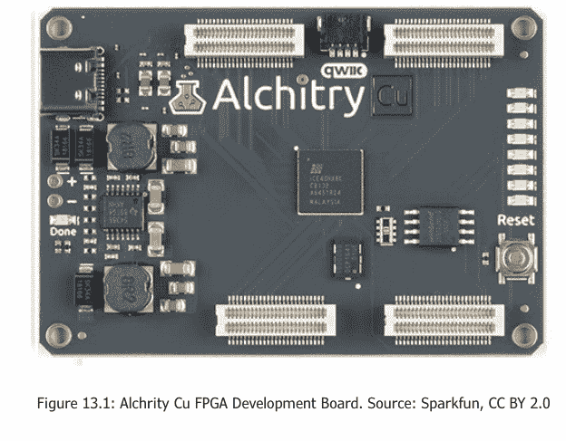

尽管该开发板使用了Lattice系列中I/O引脚数量最多的FPGA，但其引脚数量仅够完全满足**Bank A**和**Bank B**的信号需求，以及大约一半的**Bank C**信号。这对于本文中的示例来说仍然足够。

##### 13.1.2 Alchitry Au

Alchitry Au开发板使用的是Xilinx Artix-7系列的中档器件。与基于Lattice的开发板相比，这款开发板包含的资源明显更多，但价格也更贵，功耗也更高。

图13.2显示了这款FPGA开发板的正面。Xilinx FPGA使用的封装比Lattice FPGA大得多，板上的一些空余空间被用于DDR3 RAM器件。Xilinx为此类内存提供了接口宏，但本文中的示例将不会尝试使用此RAM。FPGA使用Bank连接器上不存在的信号直接连接到RAM。

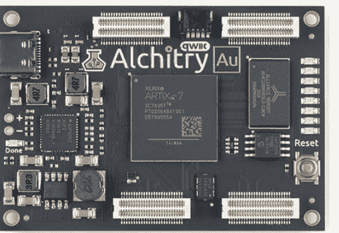

该板左侧的电源也比Lattice开发板的更复杂，因为Xilinx FPGA需要多个供电电压。这些开发板中使用的Xilinx FPGA器件具有模拟输入能力，这需要使用一些**Bank D**信号。

##### 13.1.3 Alchitry Au+

除了FPGA本身，Alchitry Au+与Alchitry Au完全相同。此开发板使用的是Au开发板所用封装中最大型的Artix-7器件。图13.3显示了这款开发板的正面。


此开发板中使用的FPGA规模如此之大，以至于本例中的微控制器很可能只需要其可用逻辑的不到百分之五。

#### 13.2 Element扩展板

与这些FPGA开发板兼容的扩展板被称为“Elements”，在撰写本文时共有三款可用。所有这些Element扩展板都在板子底部带有公座连接器，可以直接连接到FPGA开发板，其中两款还在板子顶部带有母座连接器，以便进一步堆叠。这些板子上开有切口，以便访问FPGA开发板上的LED和复位按钮。

##### 13.2.1 Alchitry Br 原型板

如图13.4所示的Alchitry Br原型板是其中一款Element扩展板，其顶部和底部都带有Bank连接器。

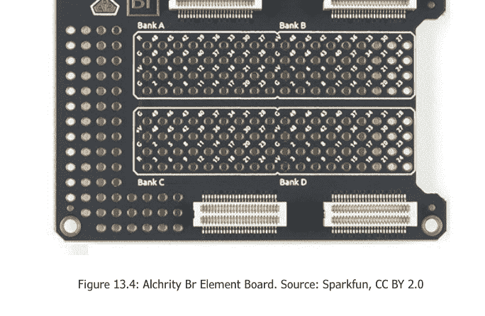

该板将每个Bank连接器上的所有信号引脚都引至0.1英寸网格上的电镀通孔，所有通孔在板子两面都清晰地标有引脚号。板上还包含一个小型未分配的原型设计区域。该区域在板子末端可容纳一个12 × 2的直角排针，在连接器边缘可容纳一个6 × 2的直角排针。

本文中的示例将不使用原型板，但它对于将Bank连接器转换为导线或更大的连接器非常有用。

##### 13.2.2 Alchitry Io

Alchitry Io板为与任何FPGA开发板配合使用提供了一套简单的输入和输出功能。此板仅在底部有公座Bank连接器，因此不可堆叠。图13.5显示了此板的顶部。

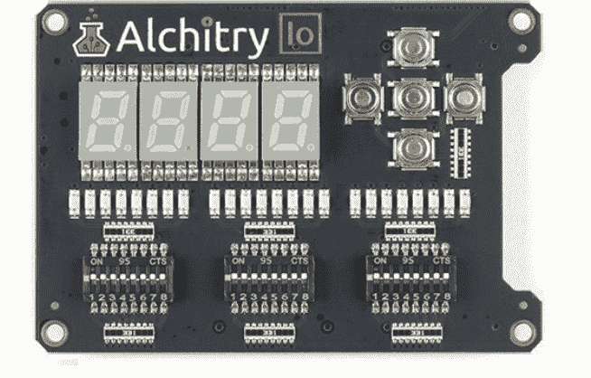

图13.5：Alchitry Io Element扩展板。来源：Sparkfun, CC BY 2.0

四个共阳极7段显示器通过八个段驱动信号和四个位选通信号进行多路复用。段驱动和位选通信号均为低电平有效。在Alchitry原理图中，这些显示器从左到右（如照片所示）编号为1-2-3-4。本文中的示例将使用这些显示器来显示时间的小时和分钟。

板子右上角的五个按钮目前由于五个下拉电阻的接线错误而有些难以使用。推测这个错误将在未来版本的板子中得到修正。Alchitry原理图与开关及信号的命名不一致，但垂直排列的按钮从上到下连接到信号S1-S2-S3。左侧的按钮连接到信号S4，右侧的按钮连接到信号S5。这些信号通常为低电平，按下按钮时变为高电平。

24个独立的LED在板子中间排成一行。LED使能信号为高电平有效。在Alchitry原理图中，这些LED从左到右（如照片所示）连接到信号L24-L1。本文中的示例将使用这些LED以二进制编码十进制的时-分-秒格式并行显示时间，与7段显示器同步。

板子底部的24个独立DIP开关在开关断开时为低电平，闭合时为高电平。这些开关从左到右（如照片所示）编号为17-24，然后9-16，最后1-8。在此示例中，这些开关将用于设置时间。虽然这很繁琐，但这只是一个起点，鼓励读者实现更用户友好的时间设置方法。

##### 13.2.3 Alchitry Ft

Alchitry Ft板提供了一个USB-C连接器和控制器，其数据速率远高于FPGA开发板上的USB控制器。此板的顶部如图13.6所示。

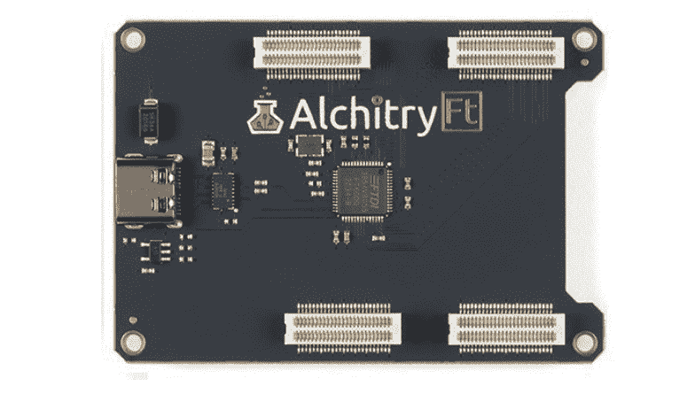

图13.6：Alchitry Ft Element扩展板。来源：Sparkfun, CC BY 2.0

与原型板类似，顶部和底部都有Bank连接器以便堆叠。但一个堆叠中只能使用一块此板，因为该板使用**Bank A**和**Bank B**连接器上的24个信号作为16位数据总线，以高速与FPGA之间传输数据。

使用**Bank A**和**Bank B**作为数据总线意味着此板与Io板不兼容。此外，由于涉及的数据速率，此板可能无法与基于Lattice的FPGA开发板一起使用。


#### 13.3 Bank 信号分配

四个 Bank 连接器是使用 Alchrity FPGA 开发系统的核心，因为它们提供了访问 FPGA 本身的途径。了解哪个信号连接到哪个 FPGA 引脚是任何 FPGA 设计的关键部分，因此本节将列出每个 Bank 信号引脚如何连接到 FPGA 以及各种 Element 开发板的使用情况。同时，也包含了本设计示例到 Bank 引脚的映射关系。

在这些表格中，“Bank”列是 Bank 连接器的引脚号。Cu 和 Au/Au+ 列列出了相应开发板上的 FPGA 封装引脚。所有 FPGA 器件均使用 BGA 封装，引脚呈矩阵排列，因此引脚标识符采用行/列样式。Io 和 Ft 列列出了这两款开发板的信号名称。下一列显示了来自 `yrv_mcu` 模块的 Verilog 名称。最后一列指明了在本示例中这些引脚的用途。本示例的信号分配旨在简化软件。

##### 13.3.1 Bank A

表 13.2 显示了 **Bank A** 连接器的信息，并明确了 Io 和 Ft 开发板之间的冲突。

| Bank A | Cu | Au/Au+ | Io | Ft | 本示例 | 用途 |
|---|---|---|---|---|---|---|
| 2 | M1 | T8 | RG | - | port0_reg[0] | 显示段 |
| 3 | L1 | T7 | RF | - | port0_reg[1] | 显示段 |
| 5 | J1 | T5 | RA | - | port0_reg[6] | 显示段 |
| 6 | J3 | R5 | RB | - | port0_reg[5] | 显示段 |
| 8 | G1 | R8 | AN3 | - | port1_reg[1] | 显示使能 |
| 9 | G3 | P8 | AN4 | - | port1_reg[0] | 显示使能 |
| 11 | E1 | L2 | L24 | - | port3_reg[7] | Io 板 LED |
| 12 | D1 | L3 | L23 | - | port3_reg[6] | Io 板 LED |
| 14 | C1 | J1 | L22 | - | port3_reg[5] | Io 板 LED |
| 15 | B1 | K1 | L21 | - | port3_reg[4] | Io 板 LED |
| 17 | D3 | H1 | L20 | BE1 | port3_reg[3] | Io 板 LED |
| 18 | C3 | H2 | L19 | BE0 | port3_reg[2] | Io 板 LED |
| 20 | A1 | G1 | L18 | D15 | port3_reg[1] | Io 板 LED |
| 21 | A2 | G2 | L17 | D14 | port3_reg[0] | Io 板 LED |
| 23 | A3 | K5 | L16 | - | port2_reg[15] | Io 板 LED |
| 24 | A4 | E6 | L15 | - | port2_reg[14] | Io 板 LED |
| 27 | A5 | M6 | DIP10 | TXE | port4_in[14] | Io 板 DIP 开关 |
| 28 | C5 | N6 | DIP9 | RXF | port4_in[15] | Io 板 DIP 开关 |
| 30 | D5 | H5 | DIP24 | WR | port5_in[0] | Io 板 DIP 开关 |
| 31 | C4 | H4 | DIP23 | RD | port5_in[1] | Io 板 DIP 开关 |
| 33 | D4 | J3 | DIP22 | - | port5_in[2] | Io 板 DIP 开关 |
| 34 | E4 | H3 | DIP21 | - | port5_in[3] | Io 板 DIP 开关 |
| 36 | F4 | H5 | DIP20 | - | port5_in[4] | Io 板 DIP 开关 |
| 37 | F3 | J4 | DIP19 | - | port5_in[5] | Io 板 DIP 开关 |
| 39 | H4 | K3 | DIP18 | - | port5_in[6] | Io 板 DIP 开关 |
| 40 | G4 | K2 | DIP17 | - | port5_in[7] | Io 板 DIP 开关 |
| 42 | H1 | N9 | AN2 | - | port1_reg[2] | 显示使能 |
| 43 | H3 | P9 | AN1 | - | port1_reg[3] | 显示使能 |
| 45 | K3 | R7 | RE | - | port0_reg[2] | 显示段 |
| 46 | K4 | R6 | RD | - | port0_reg[3] | 显示段 |
| 48 | N1 | T9 | RC | - | port0_reg[4] | 显示段 |
| 49 | P1 | T10 | RDP | - | port0_reg[7] | 显示段 |

表 13.2：Bank A 用途。

##### 13.3.2 Bank B

表 13.3 显示了 **Bank B** 连接器的信息，并再次显示了 Io 和 Ft 开发板之间的冲突。

| Bank B | Cu | Au/Au+ | Io | Ft | 本示例 | 用途 |
|---|---|---|---|---|---|---|
| 2 | A6 | D1 | L14 | - | port2_reg[13] | |
| 3 | A7 | E2 | L13 | - | port2_reg[12] | |
| 5 | A10 | A2 | L12 | - | port2_reg[11] | |
| 6 | A11 | B2 | L11 | - | port2_reg[10] | |
| 8 | C9 | E1 | L10 | - | port2_reg[9] | |
| 9 | C10 | F2 | L9 | - | port2_reg[8] | |
| 11 | A12 | F3 | L8 | - | port2_reg[7] | Io 板 LED |
| 12 | B14 | F4 | L7 | - | port2_reg[6] | |
| 14 | C14 | A3 | L6 | D7 | port2_reg[5] | |
| 15 | D14 | B4 | L5 | D6 | port2_reg[4] | |
| 17 | E14 | A4 | L4 | D5 | port2_reg[3] | |
| 18 | E12 | A5 | L3 | D4 | port2_reg[2] | |
| 20 | F14 | B5 | L2 | D3 | port2_reg[1] | |
| 21 | G14 | B6 | L1 | D2 | port2_reg[0] | |
| 23 | H12 | A7 | S3 | D1 | port5_in[10] | |
| 24 | J12 | B7 | S4 | D0 | port5_in[11] | 按钮 |
| 27 | H11 | C7 | S2 | D8 | port5_in[9] | |
| 28 | G11 | C6 | S1 | D9 | port5_in[8] | |
| 30 | G12 | D6 | DIP8 | D10 | port4_in[0] | |
| 31 | F12 | D5 | DIP7 | D11 | port4_in[1] | |
| 33 | F11 | F5 | DIP6 | CLK | port4_in[2] | |
| 34 | E11 | E5 | DIP5 | OE | port4_in[3] | |
| 36 | D12 | G5 | DIP4 | D12 | port4_in[4] | |
| 37 | D11 | G4 | DIP3 | D13 | port4_in[5] | |
| 39 | C12 | D4 | DIP2 | - | port4_in[6] | |
| 40 | C11 | C4 | DIP1 | - | port4_in[7] | Io 板 DIP 开关 |
| 42 | D10 | E3 | DIP16 | - | port4_in[8] | |
| 43 | D9 | D3 | DIP15 | - | port4_in[9] | |
| 45 | D7 | C3 | DIP14 | - | port4_in[10] | |
| 46 | D6 | C2 | DIP13 | - | port4_in[11] | |
| 48 | C7 | C1 | DIP12 | - | port4_in[12] | |
| 49 | C6 | B1 | DIP11 | - | port4_in[13] | |

表 13.3：Bank B 用途。

##### 13.3.3 Bank C

表 13.4 显示了 Bank C 连接器的信息。Io 开发板仅使用该连接器上的一个引脚，而 Cu 开发板由于 Lattice 器件引脚数较少，只连接了约一半的引脚到 FPGA。

| Bank C | Cu | Au/Au+ | Io | Ft | 本示例 | 用途 |
|---|---|---|---|---|---|---|
| 2 | M3 | T13 | - | - | ser_rxd | 串行端口 |
| 3 | M4 | R13 | - | - | ser_txd | |
| 5 | L4 | T12 | - | - | ~nmi_req | NMI |
| 6 | L5 | R12 | - | - | port5_in[13] | 输入 |
| 8 | M6 | R11 | - | - | port5_in[14] | |
| 9 | M7 | R10 | - | - | port5_in[15] | |
| 11 | L9 | N2 | - | - | - | - |
| 12 | - | N3 | - | - | - | - |
| 14 | - | P3 | - | - | - | - |
| 15 | - | P4 | - | - | - | - |
| 17 | - | M4 | - | - | - | - |
| 18 | - | L4 | - | - | - | - |
| 20 | - | N4 | - | - | - | - |
| 21 | - | M5 | - | - | - | - |
| 23 | - | L5 | - | - | - | - |
| 24 | - | P5 | - | - | - | - |
| 27 | - | T4 | - | - | - | - |
| 28 | - | T3 | - | - | - | - |
| 30 | - | R3 | - | - | - | - |
| 31 | - | T2 | - | - | - | - |
| 33 | - | R2 | - | - | - | - |
| 34 | - | R1 | - | - | - | - |
| 36 | - | N1 | - | - | - | - |
| 37 | - | P1 | - | - | - | - |
| 39 | P10 | M2 | - | - | - | - |
| 40 | P9 | M1 | - | - | - | - |
| 42 | L8 | N13 | - | - | port1_reg[8] | 输出 |
| 43 | L6 | P13 | - | - | port1_reg[9] | |
| 45 | P5 | N11 | - | - | port1_reg[10] | |
| 46 | P4 | N12 | - | - | port1_reg[11] | |
| 48 | P3 | P10 | - | - | ser_clk | 串行端口 |
| 49 | P2 | P11 | S5 | - | port5_in[12] | 按钮 |

表 13.4：Bank C 用途

##### 13.3.4 Bank D

表 13.5 显示了 **Bank D** 连接器的信息。该连接器主要用于 FPGA 开发板信号，但在 Au 和 Au+ 开发板上仍有六个未使用的 FPGA 信号可用。

| Bank D | Cu | Au/Au+ | Io | Ft | 本示例 | 用途 |
|---|---|---|---|---|---|---|
| 2 | K12 | L14 | - | - | port3_reg[8] | LED2 |
| 3 | K14 | L13 | - | - | port3_reg[9] | LED3 |
| 5 | M12 | M12 | - | - | port3_reg[12] | LED6 |
| 6 | N14 | N16 | - | - | port3_reg[13] | LED7 |
| 8 | - | R16 | - | - | - | - |
| 9 | - | R15 | - | - | - | - |
| 11 | - | P14 | - | - | - | - |
| 12 | - | M15 | - | - | - | - |
| 14 | P14 | P15 | - | - | - | USB_TXD |
| 15 | M9 | P16 | - | - | - | USB_RXD |
| 17 | - | G8 | - | - | - | - |
| 18 | - | G8 | - | - | - | 模拟电源 |
| 20 | - | - | - | - | - | |
| 21 | - | G10 | - | - | - | - |
| 23 | P11 | N7 | - | - | - | SDI/TDI |
| 24 | M11 | N8 | - | - | - | SDO/TDO |
| 27 | P12 | L7 | - | - | - | SCK/TCK |
| 28 | P13 | M7 | - | - | - | SS/TMS |
| 30 | - | J7 | - | - | - | - |
| 31 | - | H8 | - | - | - | 模拟 |
| 33 | - | G7 | - | - | - | |
| 34 | - | J8 | - | - | - | |
| 36 | M10 | L9 | - | - | - | DONE |
| 37 | L10 | H10 | - | - | - | PROGRAM |
| 39 | P8 | P6 | - | - | resetb | RESET |
| 40 | P7 | N14 | - | - | MHZ_100 | 100MHZ |
| 42 | - | T14 | - | - | - | - |
| 43 | - | T15 | - | - | - | - |
| 45 | L14 | M14 | - | - | port3_reg[11] | LED5 |
| 46 | L12 | M16 | - | - | port3_reg[10] | LED4 |
| 48 | K11 | K12 | - | - | debug_mode | LED1 |
| 49 | J11 | K13 | - | - | wfi_state | LED0 |

表 13.5：Bank D 用途。


能够将几乎任何信号分配到几乎任何引脚是FPGA的一项非常出色的功能，但将引脚信息输入FPGA工具是FPGA设计中更耗时且更容易出错的方面之一。所有FPGA工具都提供了指定引脚信息的功能，这就是为什么像上面那样的表格很有用的原因。使用这样的表格可以减少出错的可能性。

### 第14章 • FPGA实现示例

在本示例中，Bank信号与FPGA的连接已经定义，因此添加另一个模块层将`yrv_mcu`信号名称转换为Bank信号名称是有意义的，这样可以减少在FPGA工具中输入引脚约束时所需的工作量。

#### 14.1 硬件示例

这个额外的层还允许为100 MHz时钟插入一个分频器，将其降至对该设计更合理的频率。同时，将添加一个周期性中断来触发时间递增。

##### 14.1.1 顶层连接

清单14.1展示了这个最终模块的连接。几乎所有信号名称都是Bank信号名称和使用该信号的板卡标识符的组合。`_brd`标识符用于FPGA开发板本身，而`_io`标识符用于IO板上的功能。为了简洁，100 MHz时钟没有附加标识。

```
module yrv_alchrity (AN_io, C6_brd, C8_brd, C9_brd, C42_brd, C43_brd, C45_brd, C46_brd, DO_brd, L_io, LED_brd, RA_io, RB_io, RC_io, RD_io, RE_io, RF_io, RG_io, RDP_io, SCK_brd, DI_brd, DIP_io, MHZ_100, NMI_brd, RESET_brd, S_io);

input   C6_brd;       /* FPGA board Bank C, pin 6 */
input   C8_brd;       /* FPGA board Bank C, pin 8 */
input   C9_brd;       /* FPGA board Bank C, pin 9 */
input   DI_brd;       /* FPGA board serial input */
input   MHZ_100;      /* FPGA board clock */
input   NMI_brd;      /* FPGA board NMI (active-Low) */
input   RESET_brd;    /* FPGA board reset switch */
input   [5:1] S_io;   /* IO board switches */
input   [24:1] DIP_io; /* IO board DIP switches */

output  C42_brd;      /* FPGA board Bank C, pin 42 */
output  C43_brd;      /* FPGA board Bank C, pin 43 */
output  C45_brd;      /* FPGA board Bank C, pin 45 */
output  C46_brd;      /* FPGA board Bank C, pin 46 */
output  DO_brd;       /* FPGA board serial output */
output  RA_io;        /* IO board display seg A */
output  RB_io;        /* IO board display seg B */
output  RC_io;        /* IO board display seg C */
output  RD_io;        /* IO board display seg D */
output  RE_io;        /* IO board display seg E */
output  RF_io;        /* IO board display seg F */
output  RG_io;        /* IO board display seg G */
output  RDP_io;       /* IO board display DP */
output  SCK_brd;      /* FPGA board serial clock */
output  [4:1] AN_io;  /* IO board display enables */
output  [7:0] LED_brd;/* FPGA board LEDs */
output [24:1] L_io;   /* IO board LEDs */
```

清单14.1: Alchrity顶层连接。

这种重命名并非绝对必要，但它意味着在首次输入引脚约束时，只需要FPGA开发板原理图。如果不进行这种重命名，每个引脚都需要与`yrv_mcu`信号名称进行交叉引用，这将增加更多工作和更多出错的可能性。Lattice和Xilinx的引脚约束文件与所有项目Verilog文件一起提供，为读者节省了大量的时间和精力。

##### 14.1.2 实例化MCU

`yrv_mcu`模块的实例化如清单14.2所示。所有信号名称的更改将在一个单独的部分中完成。

```
/*****************************************************************************/
/* processor                                                                */
/*****************************************************************************/
yrv_mcu MCU ( .debug_mode(debug_mode), .port0_reg(port0_reg),
             .port1_reg(port1_reg), .port2_reg(port2_reg),
             .port3_reg(port3_reg), .ser_clk(ser_clk), .ser_txd(ser_txd),
             .wfi_state(wfi_state), .clk(clk), .ei_req(ei_req),
             .nmi_req(nmi_req), .port4_in(port4_in), .port5_in(port5_in),
             .resetb(resetb), .ser_rxd(ser_rxd) );
```

清单14.2: 实例化MCU。

##### 14.1.3 引脚映射

尽管清单14.3中所示的引脚映射对于本示例很方便，但它绝非一成不变。鼓励读者根据自己的项目修改此映射。

```
/*****************************************************************************/
/* pin mapping                                                              */
/*****************************************************************************/
assign AN_io     = {port1_reg[0], port1_reg[1], port1_reg[2], port1_reg[3]};
assign C46_brd   = port1_reg[11];
assign C45_brd   = port1_reg[10];
assign C43_brd   = port1_reg[9];
assign C42_brd   = port1_reg[8];
assign DO_brd    = ser_txd;
assign L_io      = {port3_reg[7:0], port2_reg};
assign LED_brd   = {port3_reg[13:8], debug_mode, wfi_state};
assign RDP_io    = port0_reg[7];
assign RA_io     = port0_reg[6];
assign RB_io     = port0_reg[5];
assign RC_io     = port0_reg[4];
assign RD_io     = port0_reg[3];
assign RE_io     = port0_reg[2];
assign RF_io     = port0_reg[1];
assign RG_io     = port0_reg[0];
assign SCK_brd   = ser_clk;
assign port5_in  = {C9_brd, C8_brd, C6_brd, S_io,
                   DIP_io[17], DIP_io[18], DIP_io[19], DIP_io[20],
                   DIP_io[21], DIP_io[22], DIP_io[23], DIP_io[24]};
assign port4_in  = {DIP_io[9],  DIP_io[10], DIP_io[11], DIP_io[12],
                   DIP_io[13], DIP_io[14], DIP_io[15], DIP_io[16],
                   DIP_io[1],  DIP_io[2],  DIP_io[3],  DIP_io[4],
                   DIP_io[5],  DIP_io[6],  DIP_io[7],  DIP_io[8]};
```

清单14.3: 引脚映射。

此引脚映射并非随意。`port3_reg`和`port2_reg`可以通过字访问一起读写，这对于设置Alchrity Io板上的24个LED非常方便。`port1_reg`和`port0_reg`控制7段显示器的情况也是如此。

`port5_in`和`port4_in`总线有点混乱，因为Alchrity Io板上开关的位顺序与板上24个LED的顺序相反。在这里交换顺序将使本示例中使用这些开关设置时间变得容易得多。

此引脚映射涵盖了Cu和Au/Au+开发板共有的Bank信号。但Au/Au+板为Bank信号提供了更多的FPGA连接，本示例中将不会使用这些连接。

##### 14.1.4 特殊连接

四个需要特殊处理的`yrv_mcu`信号如清单14.4所示单独引出。

```
/*********************************************************************/
/* special connections                                                */
/*********************************************************************/
`ifdef ICE40_VERSION
  SB_GB  CLKBUF  ( .USER_SIGNAL_TO_GLOBAL_BUFFER(mhz20_reg[0]),
                    .GLOBAL_BUFFER_OUTPUT(clk) );
`else
assign clk      = mhz20_reg[0];
`endif

assign resetb    = RESET_brd;

assign nmi_req   = !NMI_brd;
assign ser_rxd   = DI_brd;
```

清单14.4: 特殊连接。

`NMI_brd`和`DI_brd`信号包含在本节中，以提醒读者它们需要的不只是与相应`yrv_mcu`信号的简单连接。`DI_brd`信号作为输入，需要上拉电阻，因为可能没有任何器件驱动该信号。这些开发板中使用的所有FPGA都有内部上拉选项，可用于此目的。由于MCU的`nmi_req`输入是高电平有效，因此需要一个下拉电阻以保持悬空的输入信号处于非活动状态。不幸的是，只有Xilinx FPGA有此选项，因此插入了一个反相器，以便在两种开发板上都可以使用FPGA的上拉选项。

`clk`信号作为主系统时钟，总是很特殊。Lattice建议实例化一个全局缓冲器，因为他们的FPGA工具无法自动完成此操作。Xilinx FPGA工具能够识别时钟，并自动插入时钟缓冲器，使用专用的时钟树网络。

`resetb`信号作为全局复位信号，情况类似。同样，大多数现代FPGA工具可以识别全局复位，并将其分配给专用缓冲器和专用布线资源。不幸的是，全局复位的极性并不统一，尽管低电平有效似乎更常见。

Xilinx FPGA器件假定全局复位为低电平有效，并自动处理缓冲和布线。Lattice FPGA器件假定全局复位为高电平有效，只有在此情况下才能使用专用布线。这种复位极性的差异可以在Verilog中使用`ifdef`语句来处理，但这会使Verilog变得更加混乱，因为它会影响受全局复位影响的每个时序元件。因此，这个设计——至少目前——将接受本地反转复位信号所需的额外资源，以便它可以被Lattice触发器使用。

##### 14.1.5 100 MHz分频器

在FPGA开发板上放置一个100 MHz振荡器可能被认为是乐观的，但将时钟分频以产生较低频率比反向操作要容易得多。尽管这个RISC-V实现试图限制触发器之间的逻辑级数，但FPGA实现似乎不太可能在接近该频率的任何地方工作，尤其是在Cu板上使用的Lattice器件上。因此，清单14.5中的逻辑将100 MHz时钟五分频，得到20 MHz系统时钟。


##### 14.1.6 125 Hz 中断

一个完全符合规范的RISC-V系统通常会包含与`RDTIME`和`RDTIMEH`伪指令相关的定时器功能。本示例为避免此类定时器的复杂性，转而使用了一个简单的周期性中断，如清单14.6所示。

```verilog
/**************************************************/
/* 125Hz中断                                     */
/**************************************************/
assign ei_req    = hz125_lat;
assign hz125_lim = (hz125_reg == 18'h270ff);

always @ (posedge clk or negedge resetb) begin
  if (!resetb) begin
    hz125_reg <= 18'h0;
    hz125_lat <= 1'b0;
    end
  else begin
    hz125_reg <= hz125_lim ? 18'h0 : hz125_reg + 1'b1;
    hz125_lat <= !port3_reg[15] && (hz125_lim || hz125_lat);
    end
  end
```

清单 14.6: 125 Hz 中断。

选择125 Hz的频率有些随意，特别是因为它后续会被进一步分频以1 Hz的速率进行计数。但本示例同时也使用此频率对七段显示器进行多路复用，且该频率可以防止闪烁。

`hz125_reg`分频器的溢出用于设置中断请求，随后使用Port 3 I/O寄存器中的一个位来清除该请求。这确保了中断能被正确处理，同时也为软件在必要时停止中断提供了一种方式。

#### 14.2 示例软件

这主要是一本关于RISC-V硬件的书，因此这里只包含一个简单的软件示例。读者可参考官方的*RISC-V汇编程序员手册*以获取更多关于RISC-V汇编语言编程的信息。

官方的RISC-V软件支持似乎主要围绕*GNU*和*GCC*展开。有兴趣下载和使用这些软件工具的读者将需要一台运行*Linux*的计算机、数小时的空闲时间以及一定的运气。本项目将使用Dos Reis书中附带的廉价`rv`交叉汇编器。该汇编器功能正常，并能生成可轻松转换为仿真或FPGA存储器初始化所需格式的清单文件。

与互联网上能找到的每个RISC-V汇编器一样，`rv`汇编器也并非没有局限性。对于熟悉汇编语言编程的读者来说，当查看示例代码时，这些局限性将变得显而易见。

本示例实现了一个基础的、无额外功能的24小时制时钟。代码可放入MCU存储器的前256个字中，并仍有空间。即使代码没有利用任何压缩指令，这一点也成立。

##### 14.2.1 启动代码

清单14.7展示了位于地址0x0200的启动代码，该地址是复位向量位置。

```
0200 ffff08b7 main:    lui    a7, iobase       # i/o页面地址
0204 0ff00793          li     a5, 0xff
0208 00f89023          sh     a5, 0(a7)         # 初始化port0 = 0x00ff
020c 00f00793          li     a5, 0xf
0210 00f89123          sh     a5, 2(a7)         # 初始化port1 = 0x000f
0214 00800793          li     a5, 0x8
0218 00f89623          sh     a5, 12(a7)        # 初始化port6 = 0x0008 (串口复位)
021c 00089623          sh     x0, 12(a7)        # 初始化port6 = 0x0000
0220 00100793          li     a5, 0x1
0224 01f79793          slli   a5, a5, 31
0228 00f8a223          sw     a5, 4(a7)         # 初始化port3/2 = 0x80000000 (清除中断)
022c 0008a223          sw     x0, 4(a7)         # 初始化port3/2 = 0x00000000
0230 00000493          mv     s1, zero          # 时间从00:00:00开始
```

# 在开源处理器内部

```
0234 00000797 redo:     la     a5, trap_ack     # 陷阱向量
0238 e0c78793             # addi (la序列中的第二条指令)
023c 30579073             .word  0x30579073    # csrw mtvec, a5
0240 00100793             li     a5, 0x1
0244 00b79793             slli   a5, a5, 11
0248 30479073             .word  0x30479073    # csrw mie, a5
```

清单 14.7: 启动代码。

此代码初始化所有端口，然后将时间（保存在CPU寄存器**s1**中）设置为00:00。这段代码片段展示了`rv`汇编器的一个主要局限性，即缺乏对任何CSR指令的支持。此外，出于某些原因，`rv`清单文件默认每行限制为64个字符，尽管有一个命令行选项可以传递整行内容。为了清晰起见，在此处展示的清单中包含了超出此64字符限制的原始注释。

本示例在**mie** CSR中设置了MEIE位以启用外部中断，但未在**mstatus** CSR中设置MIE位来全局启用中断。在此示例中，使用**WFI**指令等待周期性中断，而**WFI**指令会自动执行全局中断使能。

##### 14.2.2 陷阱确认例程

陷阱确认例程如清单14.8所示。对于本示例而言，该例程比实际所需更为复杂，但它提供了一个添加对更多类型陷阱支持的框架。

```
0040 342023f3 trap_ack:  .word 0x342023f3   # csrr t2, mcause
0044 0203c063            blt   t2, x0, int_ack

0048 00139393            slli  t2, t2, 1    # 丢弃最高位
004c 01600313            li    t1, 0x16     # ecall
0050 00731663            bne   t1, t2, n_ecall

0054 02000313            li    t1, 0x20      # 位12
0058 0a000663            beq   zero, zero, set_led

005c 00200313 n_ecall:   li    t1, 0x2      # 位8
0060 0a000263            beq   zero, zero, set_led

0064 00139393 int_ack:   slli  t2, t2, 1    # 丢弃最高位
0068 01600313            li    t1, 0x16     # eint
006c 02731063            bne   t1, t2, n_eint

0070 ffff08b7 clr_int:   lui   a7, iobase  # i/o页面
0074 0068d283            lhu   t0, 6(a7)    # 读取port3
0078 28f29293            .word 0x28f29293   # bseti t0, t0, 15
007c  00589323    sh      t0, 6(a7)        # 写入port3
0080  48f29293    .word 0x48f29293     # bclri t0, t0, 15
0084  00589323    sh      t0, 6(a7)        # 写入port3
0088  30200073    .word 0x30200073     # mret

008c  02000313 n_eint:
        li      t1, 0x20           # li
0090  0063c663    blt     t2, t1, n_li

0094  00800313    li      t1, 0x8           # 位10
0098  06000663    beq     zero, zero, set_led

009c  00400313 n_li:
        li      t1, 0x4           # 位9
00a0  06000263    beq     zero, zero, set_led

00a4  00000000    .zero 92
00fc  00000000

0100  01000313 nmi_vec:
        li      t1, 0x10          # 位11

0104  ffff08b7 set_led:
        lui     a7, iobase        # i/o页面
0108  0068d283    lhu     t0, 6(a7)        # 读取port3
010c  00731313    slli    t1, t1, 7        # 对齐位设置数据
0110  0062e2b3    or      t0, t0, t1       # 设置状态LED
0114  00589323    sh      t0, 6(a7)        # 写入port3
0118  10000e63    beq     zero, zero, redo
```

清单 14.8: 陷阱确认例程。

在本示例中，唯一的陷阱应该是连接到MCU外部中断请求的125 Hz中断。地址0x0070处的代码是该中断的服务程序，它通过先向Port 3寄存器中的控制位写入1，再写入0来清除中断。位操作扩展中的指令简化了此操作。这些指令不被`rv`汇编器支持。

所有其他陷阱仅会打开开发板上的一个或多个LED作为错误指示器，然后跳转到启动代码中的一个点。

与每个其他RISC-V汇编器一样，`rv`汇编器不支持`.org`伪指令来允许将代码片段放置在特定的内存地址。相反，使用一个单独的链接操作来放置代码段。本示例不需要这种复杂性，变通方法是使用`.zero`伪指令填充未使用的内存。此技术也用于在本清单中将NMI处理程序放置在地址0x0100处。

##### 14.2.3 计时代码

前面的清单显示，`rv`汇编器不支持从中断返回所必需的**MRET**指令。此返回指令恢复执行


## 开源处理器内部

紧随**WFI**指令之后的指令，在计时代码中如清单14.9所示。

```
024c  10500073  loop:     .word 0x10500073               # wfi
0250  00148493            addi  s1, s1, 1               # increment ticks
0254  07f4f613            andi  a2, s1, 0x7f
0258  07d00693            li    a3, 125
025c  0ad64463            blt   a2, a3, adv_done         # branch if no rollover

0260  008d4933            srli  s1, s1, 8               # remove ticks
0264  00148493            addi  s1, s1, 1               # increment seconds
0268  00f4f613            andi  a2, s1, 0xf
026c  00a00693            li    a3, 10
0270  08d64863            blt   a2, a3, adv_sec         # branch if no rollover

0274  0044d493            srli  s1, s1, 4               # remove seconds
0278  00148493            addi  s1, s1, 1               # increment 10's seconds
027c  00f4f613            andi  a2, s1, 0xf
0280  00600693            li    a3, 6
0284  06d64c63            blt   a2, a3, adv_10s         # branch if no rollover

0288  0044d493            srli  s1, s1, 4               # remove 10's seconds
028c  00148493            addi  s1, s1, 1               # increment minutes
0290  00f4f613            andi  a2, s1, 0xf
0294  00a00693            li    a3, 10
0298  06d64063            blt   a2, a3, adv_min         # branch if no rollover

029c  0044d493            srli  s1, s1, 4               # remove minutes
02a0  00148493            addi  s1, s1, 1               # increment 10's minutes
02a4  00f4f613            andi  a2, s1, 0xf
02a8  00600693            li    a3, 6
02ac  04d64463            blt   a2, a3, adv_10m         # branch if no rollover

02b0  0044d493            srli  s1, s1, 4               # remove 10's minutes
02b4  00148493            addi  s1, s1, 1               # increment hour
02b8  0f04f613            andi  a2, s1, 0xf0
02bc  02000693            li    a3, 0x20
02c0  00d65e63            bge   a2, a3, spc_hr          # branch to special case

02c4  00f4f613            andi  a2, s1, 0xf
02c8  00a00693            li    a3, 10
02cc  02d64263            blt   a2, a3, adv_hr          # branch if no rollover

02d0  0044d493            srli  s1, s1, 4               # remove hours
02d4  00148493            addi  s1, s1, 1               # increment 10's hours
02d8  00000a63            beq   zero, zero, adv_10h
```

```
02dc    00f4f613 spc_hr:    andi  a2, s1, 0xf
02e0    00400693            li    a3, 4
02e4    00d64663            blt   a2, a3, adv_hr       # branch if no rollover

02e8    00449493            slli  s1, s1, 4           # clear time digits
02ec    00449493 adv_10h: slli  s1, s1, 4
02f0    00449493 adv_hr:   slli  s1, s1, 4
02f4    00449493 adv_10m: slli  s1, s1, 4
02f8    00449493 adv_min:  slli  s1, s1, 4
02fc    00449493 adv_10s:  slli  s1, s1, 4
0300    00849493 adv_sec:  slli  s1, s1, 8
```

清单14.9：计时代码。

**s1**寄存器保存当前时间，这部分代码首先从该寄存器的最低有效字节开始递增滴答计数器。如果滴答计数器未溢出，代码会立即跳转到显示例程。否则，代码将依次进行秒、分、时的递增。24:00的特殊情况会自动调整为00:00。

细心的读者会注意到，清单中大部分指令都可以用压缩版本替代。然而，*rv*汇编器不支持压缩指令。此外，交替使用16位和32位指令会使将此清单转换为适合初始化FPGA存储器的格式变得复杂。

##### 14.2.4 显示扫描

时间调整完成后，代码继续进行显示LED的扫描。此扫描以125 Hz的速率发生，如清单14.10所示。

```
0304    ffff08b7 adv_done: lui    a7, iobase       # i/o page
0308    0088a703            lw     a4, 8(a7)         # read ports 5/4
030c    01075693            srli   a3, a4, 16
0310    0806f693            andi   a3, a3, 0x80       # select DIP24
0314    00068663            beq    a3, zero, out_led  # branch if no timeset

0318    00a71713            slli   a4, a4, 10         # clear out unused bits
031c    00275493            srli   s1, a4, 2          # align time data

0320    0048a703 out_led:  lw     a4, 4(a7)         # read port 3/2
0324    01875713            srli   a4, a4, 24         # isolate p3[16:8]
0328    01871713            slli   a4, a4, 24         # restore p3[16:8]
032c    0084d613            srli   a2, s1, 8          # align time to [23:0]
0330    00e667b3            or     a5, a2, a4         # combine the two
0334    00f8a223            sw     a5, 4(a7)         # update the LEDs

0338    0028d703 out_disp: lhu    a4, 2(a7)         # read digit selects
```

```
033c  00f77613    andi  a2, a4, 0xf          # select digit select bits
0340  00f64613    xori  a2, a2, 0xf          # invert to active-high
0344  00165613    srli  a2, a2, 1            # next digit
0348  00061463    bne   a2, zero, scan_d

034c  00800613    li    a2, 0x8
0350  ff077713 scan_d:  andi  a4, a4, 0xfffffff0
0354  00f64613    xori  a2, a2, 0xf          # invert to active-low
0358  00c76733    or    a4, a4, a2           # updated digit select
035c  00f76793    ori   a5, a4, 0xf
0360  00f89123    sh    a5, 2(a7)            # turn off all for now
0364  00f64613    xori  a2, a2, 0xf          # invert to active-high
0368  00048693    mv    a3, s1               # retrieve time

036c  00165613    srli  a2, a2, 1
0370  02060063    beq   a2, zero, dsp_min
0374  00165613    srli  a2, a2, 1
0378  00060a63    beq   a2, zero, dsp_10m
037c  00165613    srli  a2, a2, 1
0380  00060463    beq   a2, zero, dsp_hr

0384  0046d693 dsp_10h:  srli  a3, a3, 4
0388  0046d693 dsp_hr:   srli  a3, a3, 4
038c  0046d693 dsp_10m:  srli  a3, a3, 4
0390  0106d693 dsp_min:  srli  a3, a3, 16
0394  00f6f693    andi  a3, a3, 0xf
0398  00000817    la    a6, segtab
039c  02080813    # addi  (2nd inst in la seq)
03a0  00d80833    add   a6, a6, a3
03a4  00084783    lbu   a5, 0(a6)
03a8  01071713    slli  a4, a4, 16
03ac  00e7e7b3    or    a5, a5, a4
03b0  00f8a023    sw    a5, 0(a7)            # digit drive/seg drive
03b4  e8000ce3    beq   zero, zero, loop

03b8  8692cf81 segtab:  .word 0x8692cf81       # 3210  segment drive act-low
03bc  8fa0a4cc    .word 0x8fa0a4cc           # 7654
03c0  e0888480    .word 0xe0888480           # BA98
03c4  b8b0c2b1    .word 0xb8b0c2b1           # FEDC
```

清单14.10：显示扫描。

在更新显示之前，代码会检查开关的状态，以便可能设置时间。通常，时间设置输入应检查其是否为有效值。为简单起见，此代码不检查输入是否有效，并鼓励读者添加此功能。

显示以125 Hz的速率扫描，一次一个数字。使用查找表将BCD转换为段驱动使能信号。尽管时间使用BCD，但查找表被设置为可以处理任何十六进制数字。与计时代码的情况一样，此部分的大部分指令都可以用16位版本替代。

新的驱动信息写入显示后，代码会分支回到**WFI**指令，等待下一个中断。陷阱确认、计时代码和显示扫描的整个序列只需要大约一百条指令。使用20 MHz的CPU时钟，这大约需要5微秒，这意味着处理器在超过99.9%的时间里处于空闲等待中断状态。

#### 14.3 存储器初始化

将此示例代码加载到存储器中，无论是用于仿真还是在FPGA中使用，都需要将镜像格式化以匹配特定目标的要求。通常这需要自定义程序，但在简单的此案例中，可以使用电子表格完成。十六进制格式的汇编器列表输出是此转换的理想起点。

为了演示所需的格式，将使用存储器的前八个字。此代码永远不应被执行，因为复位向量是0x0200，但以防万一出现错误，0x0000处的代码会设置所有错误LED，然后跳转到正常的启动例程。清单14.11显示了前八个字的代码。

```
0000  03f00313  _start :    li      t1, 0x3f      # all leds on
0004  ffff08b7  eset_led:   lui     a7, iobase   # i/o page
0008  0068d283              lhu     t0, 6(a7)    # read port3
000c  00731313              slli    t1, t1, 7    # align bit set data
0010  0062e2b3              or      t0, t0, t1   # set status led
0014  00589323              sh      t0, 6(a7)    # write port
0018  1e000463              beq     zero, zero, main
001c  00000000              .zero 36
003c  00000000
```

清单14.11：0x0000处的占位代码。

此汇编器列表对于转换非常方便，因为它包含每个字的地址和数据。唯一的复杂之处在于.zero指令只输出被填充存储块的第一个和最后一个字。简单的电子表格转换技术要求每个字都必须存在，因此需要一定程度的手动干预。


##### 14.3.1 Verilog 存储器初始化

将整个系统用 Verilog 描述的一个优点是，整个系统可以进行整体仿真。本文不会详细介绍这一点，但可以使用一个修改过的 testbench.v 文件（前文已讨论过）来对整个系统进行仿真。与之前一样，必须使用 Verilog 的 `$readmemh` 函数来初始化仿真存储器。代码清单 14.12 展示了 `code_demo.mem` 文件的前八个字，以与汇编器列表输出进行比较。

```
@0000 13 03 f0 03
@0004 b7 08 ff ff
@0008 83 d2 68 00
@000c 13 13 73 00
@0010 b3 e2 62 00
@0014 23 93 58 00
@0018 63 04 00 1e
@001c 00 00 00 00
```

代码清单 14.12: Verilog 存储器初始化。

仿真存储器是面向字节的，以支持字节写入，这导致在使用 `$readmemh` 函数时需要反转字节顺序，从而增加了转换的复杂性。如果仿真存储器是面向字的，则不需要进行这种反转。`$readmemh` 格式的一个优点是，文件中只需包含被初始化的地址。

##### 14.3.2 Lattice 存储器初始化

4096 位的 Lattice 块 RAM 宽度限制为 16 位，因此程序存储器的每个字必须被分成两半，然后组合成 256 位向量。每个 256 位向量代表块 RAM 中 16 个存储单元的数据。代码清单 14.13 展示了 `code_demo.v` 文件所需格式的示例，同样使用了映像代码的前八个字。

```
defparam RAM0H.INIT_0 = 256'h00001e000058006200730068ffff03f0;
defparam RAM0L.INIT_0 = 256'h000004639323e2b31313d28308b70313;
```

代码清单 14.13: Lattice 存储器初始化。

这种 256 位向量组织方式使得初始化文件的创建变得复杂，尽管在大多数情况下仍然可以使用电子表格来完成转换。每个块 RAM 需要 16 个 `defparam` 语句，任何未指定的地址都会用零填充。

##### 14.3.3 Xilinx 存储器初始化

Xilinx 存储块的 32 位宽度意味着在转换过程中少了一个步骤，但仍然使用 256 位向量格式。代码清单 14.14 展示了本示例中前八个字的 `code_demo.mif` 文件内容。

.INIT_00(256'h000000001e000463005893230062e2b3007313130068d283ffff08b703f00313),

代码清单 14.14: Xilinx 存储器初始化。

由于所使用的参数样式不同，其格式与 Lattice 使用的格式略有不同。由于 Xilinx 存储块尺寸更大，需要 128 个初始化向量才能完全填满存储器。

一些现代 FPGA 工具能够推断存储器，也号称能够接受 Verilog 的 `$readmemh` 函数来初始化 FPGA 存储器，但作者从未尝试过这种方法。Lattice 工具不具备此功能。

#### 14.4 FPGA 项目设置

过去，在 FPGA 工具流程中设置项目是一项艰巨的任务，但随着技术的成熟，这项设置工作已经变得简单得多。对于本文中的示例，大部分工作已经完成。只需注意，大型项目或充分利用 FPGA 功能的项目不可避免地会复杂得多。

对于 Lattice 和 Xilinx，除了为项目选择合适的 FPGA 目标外，只需要在工具中链接两到三个文件。在这种简化的方法中，所有项目文件都需要位于同一目录中。如前所述，强烈建议读者参考 Alchryt 教程进行 FPGA 软件安装和项目设置，因为本文只涵盖基本细节。

##### 14.4.1 Lattice (Alchrity Cu) 提示

此开发板上使用的 FPGA 需要 Lattice iCEcube2 软件。这是一个成熟的产品，没有太多花哨功能，但有几点需要注意：

1.  务必使用正确的器件选项设置项目。Alchrity Cu 使用 iCE40 系列中的 HX8K 器件，封装为 CB132。所有 I/O 银行均使用 3.3 V 电源。
2.  只需将 *yrv_alchrity.v* 文件作为设计文件输入，因为所有其他设计文件将自动按正确顺序包含。
3.  对于综合工具，务必选择 Lattice LSE Synthesis。在逻辑综合期间不需要约束文件。
4.  综合完成后，需要在运行后续工具之前链接 *yrv_alchrity.pcf* 引脚约束文件和 *timing.sdc* 时序约束文件。

在各种日志文件中会出现一些警告，但都不应重要到需要采取任何行动。

##### 14.4.2 Xilinx (Alchrity Au 和 Au+) 提示

这些开发板上使用的 FPGA 需要 Xilinx Vivado 软件。这是一个非常复杂的软件，本项目只会用到其功能的一小部分。以下是一些需要注意的事项：

1.  只需将 *yrv_alchrity.v* 文件作为设计文件输入。
2.  只需要 *yrv_alchrity.xdc* 约束文件。该文件包含引脚约束、时序约束以及编程电压规格。
3.  对于 Au 开发板，正确的器件选项是 `xc7a35tftg256-1`；对于 Au+ 开发板，正确的器件选项是 `xc7a100tftg256-1`。

这些器件的日志文件中有更多的警告，但同样，都不应重要到需要采取行动。

#### 14.5 FPGA 结果

本示例项目已在所有三个目标 FPGA 开发板上实现，各板的结果将在以下各节中介绍。但在此刻，对一些结果进行并列比较是很有趣的。表 14.1 显示了为 100 MHz 分频器报告的时钟速度。

| 100 MHz 分频器 | Alchrity Cu | Alchrity Au | Alchrity Au+ |
|---|---|---|---|
| 速度（综合后） | 313.9 MHz | 114.1 MHz | 114.2 MHz |
| 速度（布局后） | 542.3 MHz | - | - |
| 速度（最终） | 625.4 MHz | 111.9 MHz | 111.9 MHz |

*表 14.1: FPGA 结果。*

100 MHz 分频器是为实现最高速度而设计的，触发器之间仅有一级逻辑。这意味着该结果应代表该技术的性能。

Lattice 器件报告的速度（如果属实）令人印象深刻。最有趣的是，从逻辑综合到逻辑布局再到最终布线结果，报告的速度越来越快，并且推测也越来越准确。虽然最终性能优于初始估计是理想的，但相差两倍并不理想，因为这可能导致错误地放弃一个认为不可行的项目。

Xilinx 工具在逻辑布局阶段没有提供单独的速度估计，但报告的速度在逻辑综合和最终结果之间几乎相同。从设计者的角度来看，这是更可取的。

表 14.2 显示了项目所需的资源以及 CPU 本身的最高时钟频率。这些结果不包括作为 *RISC-V 特权架构* 一部分的任何 64 位计数器。

| FPGA 属性 | Alchrity Cu | Alchrity Au | Alchrity Au+ |
| :--- | :--- | :--- | :--- |
| 逻辑单元 | 7,680 | 20,800 | 63,400 |
| 已用逻辑单元 | 4,646 | 2,189 | 2,185 |
| 已用逻辑单元 (%) | 60.6% | 10.5% | 3.5 % |
| 触发器 | 1331 | 1377 | 1377 |
| 速度（综合后） | 11.8 MHz | 28.1 MHz | 27.7 MHz |
| 速度（布局后） | 25.8 MHz | - | - |
| 速度（最终） | 30.8 MHz | 34.4 MHz | 34.2 MHz |

表 14.2: FPGA 结果。

该表的第二行说明了为什么比较 FPGA 结果可能很复杂。从表格看，Xilinx 实现所需的资源不到 Lattice 实现所需资源的一半。但一个 Xilinx 逻辑单元包含的逻辑显著多于一个 Lattice 逻辑单元。此外，Xilinx 设计使用了 Lattice 器件所没有的专用 DSP 块。

观察使用的逻辑单元百分比可以揭示此处三个 FPGA 之间的尺寸差异。Lattice 器件略多于一半的资源用于 *yrv_mcu* 设计，而中档 Xilinx 器件大约使用了十分之一，大型 Xilinx 器件使用了不到二十分之一。这种使用情况与不同开发板的成本相符。

正如预期的那样，设计所需的触发器数量在三个 FPGA 上是相似的，其确切数量更多地取决于逻辑综合工具，而非其他因素。逻辑综合工具会复制触发器以提高性能或简化布线。

速度行显示所有三个 FPGA 提供了大致相同的性能，考虑到 Lattice FPGA 没有 Xilinx 实现中使用的专用 DSP 块，这有点令人惊讶。

##### 14.5.1 Alchrity Cu 详细信息

代码清单 14.15 直接提取自 Lattice 实现报告，显示了资源利用的详细信息。


##### 14.5.2 Alchirity Au 详情

清单 14.16 直接摘自 Xilinx 实现报告，显示了资源利用率的详细信息。完整的 Xilinx 报告要大得多，涵盖了 FPGA 中所有可用的专用硬件。

1. Slice 逻辑

| Site Type | Used | Fixed | Available | Util% |
|---|---|---|---|---|
| Slice LUTs | 2189 | 0 | 20800 | 10.52 |
| LUT as Logic | 2189 | 0 | 20800 | 10.52 |
| LUT as Memory | 0 | 0 | 9600 | 0.00 |
| Slice Registers | 1377 | 0 | 41600 | 3.31 |
| Register as Flip Flop | 1377 | 0 | 41600 | 3.31 |
| Register as Latch | 0 | 0 | 41600 | 0.00 |
| F7 Muxes | 3 | 0 | 16300 | 0.02 |
| F8 Muxes | 0 | 0 | 8150 | 0.00 |

清单 14.16：Xilinx XCA35T 报告摘录。

图 14.2 取自 Xilinx Floorplanner 工具的截图，显示了逻辑元素在设备中的分布使用情况，以及专用逻辑块在整个设备中的分布情况。看起来布局工具总是从设备的左下角开始。不清楚为什么逻辑似乎被分成了两部分。

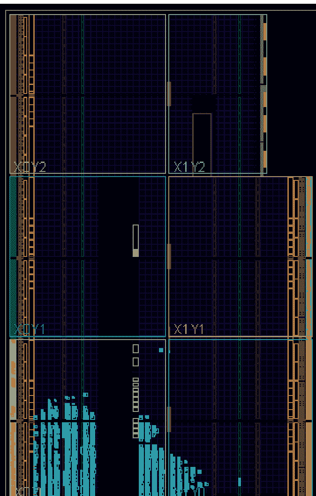

图 14.2：Xilinx XCA35T Floorplanner 视图。

##### 14.5.3 Alchrity Au+ 详情

清单 14.17 也直接摘自 Xilinx 实现报告，显示了资源利用率的详细信息。请注意，两个 Xilinx 设备之间使用的资源数量几乎相同。

1. Slice 逻辑

| Site Type | Used | Fixed | Available | Util% |
|---|---|---|---|---|
| Slice LUTs | 2185 | 0 | 63400 | 3.45 |
| LUT as Logic | 2185 | 0 | 63400 | 3.45 |
| LUT as Memory | 0 | 0 | 19000 | 0.00 |
| Slice Registers | 1377 | 0 | 126800 | 1.09 |
| Register as Flip Flop | 1377 | 0 | 126800 | 1.09 |
| Register as Latch | 0 | 0 | 126800 | 0.00 |
| F7 Muxes | 3 | 0 | 31700 | <0.01 |
| F8 Muxes | 0 | 0 | 15850 | 0.00 |

清单 14.17：Xilinx XCA100T 报告摘录。

图 14.3 也取自 Xilinx Floorplanner 工具的截图。有趣的是，尽管该 FPGA 包含的逻辑元素数量是前者的三倍，但此示例所需的总面积似乎与第一个 Xilinx 实现几乎相同。

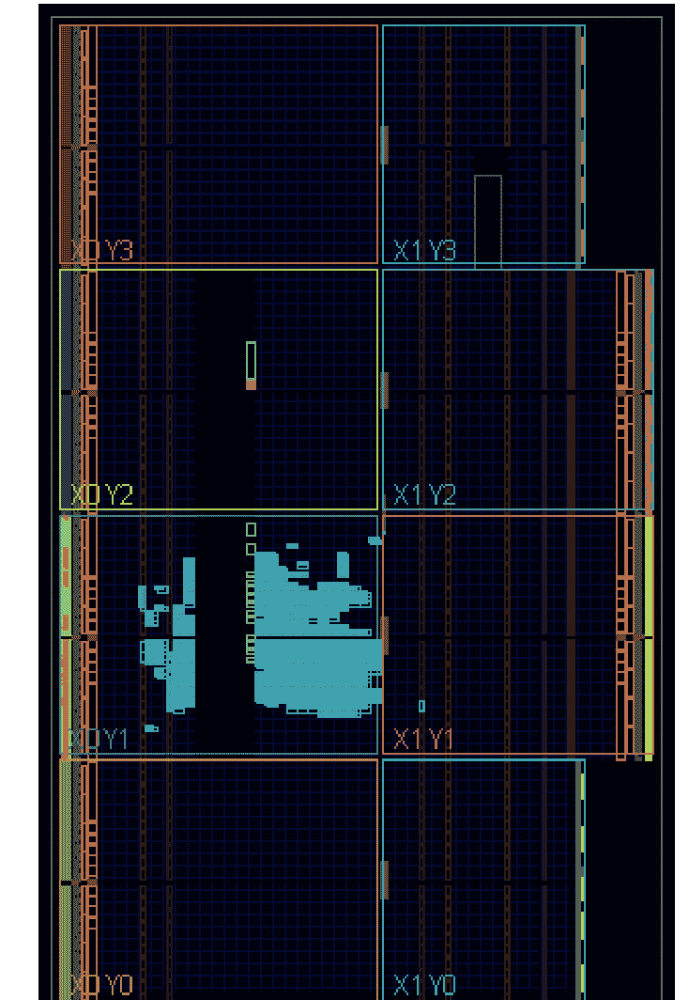

图 14.3：Xilinx XCA100T Floorplanner 视图。

#### 14.6 硬件编程

使用 *Alchrity Loader* 程序，将 FPGA 位流下载到 Alchrity 开发板非常简单。这个独立程序是 *Alchrity Labs* 软件的一部分，会随该软件自动安装。图 14.4 显示了该程序的用户界面。

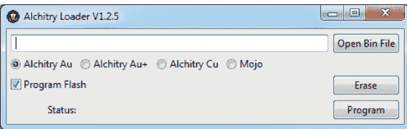

图 14.4：Alchrity Loader 视图。

对开发板上用于加载 FPGA 的 Flash 存储器设备进行编程，只需指定位流文件、选择目标板，然后单击“Program”按钮即可。

默认情况下，程序会查找类型为 *.bin* 的位流文件，这是 iCEcube2 软件使用的默认类型。Vivado 软件生成的位流文件类型为 *.bit*，因此在加载 Xilinx 位流文件时请记住这一点。

### 第 15 章 • 何去何从？

使用 32 位 CPU 来实现一个简单的 4 位数字时钟显然是大材小用，但它比仅仅闪烁一个 LED 更有效地演示了使用此处理器的过程。这些开发板上的所有 FPGA 仍有大量空间来实现更多硬件，以及更多的片上存储器来存放更多代码。此外，Au 和 Au+ 开发板拥有大容量 DDR3 内存，可以存放更多代码。

有许多方式可以扩展此 CPU：减少门数、提高速度或优化功耗。例如：

#### 15.1 硬件项目

- 1. 研究 FPGA 工具输出的时序报告以识别慢速路径。如果它们是伪路径（很可能如此），则将其标记为伪路径，直到识别出真正的速度路径。然后修改 Verilog 以加速这些路径。
- 2. 速度是否受到特定功能的限制，例如非对齐内存访问？修改 Verilog 以研究这个想法。
- 3. 移除额外功能以最小化门数，并研究这如何影响时钟速度。
- 4. 已经确定了一些节能可能性。实现这些以及你能想到的其他方法。它们值得付出代价吗？
- 5. 研究为 CPU 使用 16 位总线选项的成本和收益。
- 6. 研究添加完整的一组（字节和半字）原子内存操作指令的成本。
- 7. 研究添加完整的位操作指令集的成本。
- 8. 使用 FPGA 中的专用硬件添加乘法指令。
- 9. 添加硬件以实现 RISC-V 除法指令。
- 10. 添加对不同特权级别的支持。

#### 15.2 软件项目

以下是对本文介绍的示例软件进行修改的一些想法：

- 1. 为时间设置功能添加输入检查。
- 2. 添加以分钟和秒代替小时和分钟显示的能力。
- 3. 扩展时钟的功能，使用按钮来设置时钟。
- 4. 为时钟添加闹钟功能。
- 5. 利用串口导出或导入时间信息。
- 6. 使用额外的输入和输出实现可编程逻辑控制器。

作为开放标准，RISC-V 提供了无限的扩展机会。尽管这是一个简单的实现，并且 CPU 核心是用 Verilog 编写的，但该设计并不局限于这些 FPGA 设备或这些开发板。享受吧！

### 附录 A • 资源

以下链接在撰写本文时（2021 年 3 月）有效。

#### 官方 RISC-V

RISC-V 国际组织
www.riscv.org

RISC-V github 仓库
https://github.com/riscv/

RISC-V 指令集手册，卷一：非特权 ISA
https://github.com/riscv/riscv-isa-manual/releases/download/draft-20201119-6cd9eec/riscv-spec.pdf

RISC-V 指令集手册，卷二：特权架构
https://github.com/riscv/riscv-isa-manual/releases/download/draft-20201119-6cd9eec/riscv-privileged.pdf

RISC-V 位操作扩展
https://github.com/riscv/riscv-bitmanip/blob/master/bitmanip-draft.pdf

RISC-V 调试支持
https://github.com/riscv/riscv-debug-spec/blob/master/riscv-debug-draft.pdf

RISC-V 合规框架
https://github.com/riscv/riscv-compliance/blob/master/spec/TestFormatSpec.pdf

#### Alchrity FPGA 开发

Alchrity
https://alchitry.com/

Alchrity YouTube 频道
https://www.youtube.com/channel/UCqEvYJ0r4OL-adxoZxBEvjQ

Alchrity Cu FPGA 开发板
https://www.elektor.com/alchitry-cu-fpga-development-board-lattice-ice40-hx
https://www.sparkfun.com/products/16526

Alchitry Au FPGA 套件（Au + Io + Br + 4 个接头）
https://www.elektor.com/alchitry-au-fpga-kit


#### 探秘开源处理器

Alchitry Au FPGA 开发板
https://www.elektor.com/alchitry-au-fpga-development-board-xilinx-artix-7
https://www.sparkfun.com/products/16527

Alchitry Au+ FPGA 开发板
https://www.elektor.com/alchitry-au-plus-fpga-development-board-xilinx-artix-7
https://www.sparkfun.com/products/17514

Alchitry Io 元件板
https://www.sparkfun.com/products/16525

Alchitry Br 原型元件板
https://www.elektor.com/alchitry-br-prototype-element-board
https://www.sparkfun.com/products/16524

Alchitry Ft 元件板
https://www.elektor.com/alchitry-ft-element-board
https://www.sparkfun.com/products/17526

#### RISC-V 编程

*RISC-V 汇编程序员手册*
https://github.com/riscv/riscv-asm-manual/blob/master/riscv-asm.md

*RISC-V GNU 编译器集合*
https://github.com/riscv/riscv-gcc

*RISC-V GNU 编译器工具链*
https://github.com/riscv/riscv-gnu-toolchain

*RISC-V GNU 开发工具*
https://github.com/riscv/riscv-binutils-gdb

Anthony J. Dos Reis, *RISC-V 汇编语言*，独立出版，2019

Jupiter RISC-V 汇编器与运行时模拟器
https://github.com/andrescv/Jupiter

#### YRV Verilog 代码

YRV GitHub 仓库
https://github.com/montedalrymple/yrv/

### 索引

16位操作码 54
24小时时钟 247

**A**

加法器 194
寻址模式 30
地址转换 66
Alchitry FPGA 230
Alchitry Au 231
Alchitry Au+ 232
Alchitry Br 233
Alchitry Cu 231
Alchitry Ft 235
Alchitry Io 234
Alchitry Labs 264
Alchitry Loader 264
对齐加载 96
对齐存储 97
AMBA 3 AHB-Lite 91
应用二进制接口 21
汇编器 247
架构ID 74
原子操作 38

**B**

Bank A 236
Bank B 238
Bank C 239
Bank D 240
裸机 66
基本整数指令集 23
位反转 64
断点 31
中断状态 103
B型指令 19
字节反转 64

**C**

调用约定 57
条件分支 29
常数生成 27
控制与状态寄存器 33
交叉汇编器 247
CSR-立即数 34
CSR-寄存器 34
计数器 194
编码标准 106
计数器-禁止 80
CSR地址 109
周期计数 78

**D**

调试控制与状态 84
调试 65
调试模式 65
调试PC 85
调试暂存 86
专用ALU 98, 126
定义非法 32
双精度浮点 44
DSP 198

**E**

环境调用 31
异常原因 81
异常代码 110
异常PC 81
外部CSR总线 99
外部总线接口 91

**F**

固定时间 95
FPGA比特流 264
FPGA工具流程 255

**G**

GCC 247
全局复位 245
GNU 247

**H**

硬件标识符 116
硬件线程 75
Hart ID 75
HINT 32
虚拟机管理器 87

**I**

iCEcube2 软件 255
IEEE 105
IEEE-754-2008 40
立即数数据 19
实现ID 74
增量器 194
初始化数据 226
初始化文件 228
内联代码 95
实例化 194
实例化头文件 228
指令格式 17
指令集架构 16
指令时序 93
已退休指令计数 79
整数除法 37
整数乘法 36
中断 101
中断-使能 77
中断-待处理 77
ISA及扩展 73
I型指令 19

**J**

J型指令 19

**L**

Lattice Semiconductor iCE40 FPGA 194
Linux 33
小端序 16
加载/存储/原子操作 122
本地中断 111
逻辑-带取反 62
逻辑综合选项 106

**M**

机器模式 66
机器状态 75
内存排序 31
微控制器 217

**N**

NMI向量 107
非流水线总线 100

**O**

孤立状态 246

**P**

字节打包 64
并行端口 218
周期性中断 246
物理内存属性 86
物理内存保护 69
物理内存保护 86
引脚映射 243
流水线 91
特权级 66
程序计数器 121
原型开发板 233
伪指令 29

**Q**

四精度浮点 49
象限 54

**R**

精简寄存器集 54
寄存器 21
寄存器旁路 143
寄存器-立即数 25
寄存器文件 194
寄存器-寄存器 25
余数 38
复位状态 104
复位向量 107
R型指令 19
RV128I 16
RV32E 16
RV32I 16
RV64I 16
RV32C 53

**S**

串口 222
暂存 80
单比特 63
单精度浮点 41
栈指针 57
标准扩展 21
启动延迟 120
严格兼容 188
S型指令 19
减法器 194
监管模式 66
综合工具 255
系统时钟 245
SystemVerilog 213

**T**

测试平台 208
传统ALU 146
陷阱处理程序 76
陷阱值 84
陷阱返回 88
时间 79
二进制补码 17

**U**

未对齐加载 96
未对齐存储 97
无条件跳转 28
用户模式 66
U型指令 19

**V**

变长指令 17
供应商ID 74
Verilog模块 105
Vivado软件 256

**W**

等待中断 88
WARL 73
Xilinx Series-7 FPGA 194
WLRL 73
WPRI 73

270

探秘开源处理器

#### RISC-V 简介

RISC-V 是一种既免费又开放的指令集架构。这意味着 RISC-V ISA 本身不需要许可费，尽管个别实现可能需要。RISC-V ISA 由一个非营利基金会管理，该基金会不参与使用它的产品或服务的任何商业利益，任何人都可以向 RISC-V 规范提交贡献。RISC-V ISA 适用于从嵌入式微控制器到超级计算机的各种应用。

Monte Dalrymple 电气工程学士（荣誉）、工程硕士，职业生涯始于 Zilog，在那里他设计了几款成功的产品，包括 SCC 和 USC 系列。他还是 Z380 微处理器的架构师和首席设计师。Monte 于 1995 年创立了自己的公司 Systemyde International Corp.，此后一直从事合同设计工作。他设计了所有五代 Rabbit 微处理器，一款 Z180 克隆版，以及一款 Z8000 克隆版。Monte 拥有 17 项专利以及业余和商业无线电执照。

本书将首先描述 32 位 RISC-V ISA，包括基础指令集以及当前定义的大多数扩展。然后，本书将详细描述一个面向嵌入式控制应用的开源 ISA 实现。该实现包括基础指令集以及一些标准扩展。

CPU 设计描述完成后，设计将扩展到包括内存和一些简单的 I/O。然后，这个生成的微控制器将在一个经济实惠的 FPGA 开发板（可从 Elektor 获取）上实现，并配以简单的软件应用程序，以便读者可以研究完成的设计。

Elektor International Media BV
www.elektor.com
