# JavaScript 内部揭秘

确立了 JavaScript 书籍的标准

涵盖跨浏览器问题

包含数百个实用示例

*JavaScript 详解*是目前最全面的 JavaScript 参考书籍。本书涵盖了 JavaScript 1.5（及 JScript 5.6），是你唯一需要的 JavaScript 书籍。从动态 HTML 到打开新的浏览器窗口，从绘制鼠标轨迹到实时重写网页，从重定向浏览器到访问状态栏，从发送数据电子邮件到设置 Cookie，所有内容尽在其中。本书包含数百个示例，可直接运行。本书列出了两大浏览器 Internet Explorer 和 Netscape Navigator 中 JavaScript 的*每个*方面——包括每个功能所支持的浏览器版本。有了这些信息，浏览器之争便成为过去。本书由资深 JavaScript 程序员编写，经过实战测试，结构清晰，内容丰富，示例详尽，索引完备，是任何 JavaScript 程序员不可或缺的参考资源。

——*Steven Holzner*

> "本书作者关注不同概念所提供的多种选项，而不是仅将一种选项列为'主流程序员的选择'。他立即让读者投入实际编程，而不是在前三章中纠缠于概念和理论。"
>
> *Michelle Jones*，独立顾问

## 本书将教你

- 完整的 JavaScript 1.5
- 跨浏览器问题：你使用的是哪种浏览器？
- 重定向浏览器
- 访问状态栏
- 创建对话框
- 打开和关闭新窗口
- 打印
- 创建定时事件
- 创建 Cookie
- 导航到新 URL
- 使用 `go`、`forward` 和 `back` 方法
- 处理所有 HTML 控件——按钮、单选按钮、复选框、选择控件等
- 发送表单邮件
- 使用 JavaScript URL
- 使用鼠标、键盘和图像
- 鼠标悬停效果
- 图像映射
- 实时更改网页
- 实时设置元素可见性
- 使用动态样式更改页面
- 拖放功能
- 网页元素定位
- 实时更改样式表
- 创建菜单
- XML 和 XSLT
- 鼠标轨迹

ABINGDON AND WITNEY COLLEGE

图书馆及资源中心

ABINGDON 校区

WOOTTON ROAD

ABINGDON

OXON

OX14 1GG

由 Internet Archive 于 2024 年数字化

https://archive.org/details/insidejavascript0000holz

献给 Nancy。无人能及。

## 关于作者

**Steven Holzner** 自 JavaScript 诞生以来就一直在撰写相关著作。他是 75 本编程书籍的作者，也是《*PC Magazine*》的前特约编辑。他的多本书籍曾是编程类畅销书，著作已被翻译成 16 种语言，在全球售出超过 150 万册。他获得了康奈尔大学的博士学位，并曾在康奈尔大学和麻省理工学院任教。他的爱好包括旅行、国际象棋、古典音乐和撰写哲学书籍。

## 关于技术评审

这些评审人员为《*Inside JavaScript*》的整个开发过程贡献了他们丰富的实践经验。在撰写本书期间，这些敬业的专业人士审查了所有材料的技术内容、组织结构和行文流畅性。他们的反馈对于确保《*Inside JavaScript*》满足读者对最高质量技术信息的需求至关重要。

**Rory Macdonald** 目前居住在苏格兰格拉斯哥，作为欧洲最大的域名注册商和互联网服务提供商之一的高级系统工程师远程工作。在从事了几年高速视频会议和实时操作系统的开发工作后，Rory 花了一年时间环游世界。回国后，他成为大学远程教育项目的网页开发人员，随后加入思科系统公司，开发基于网络的内部网应用程序。多年来，他在跨平台动态网页开发方面积累了丰富的经验。业余时间，Rory 喜欢旅行、单板滑雪和骑摩托车。

**Joel Lee** 是俄亥俄州哥伦布市 JTL Networks, Inc. (www.jtlnet.com) 的首席运营官。JTL Networks 是一家互联网服务提供商，提供远程支持人员扩充、专用连接、企业软件设计以及托管的共享和专用托管解决方案。

**Bryan Gintz** 是 JTL Networks 的高级软件工程师。他自 1996 年以来一直从事 JavaScript 各方面的工作。他毕业于惠顿学院，获得计算机科学理学学士学位，并从事各种互联网技术工作，专注于 Web 开发的核心脚本语言、HTML、JavaScript 和 PHP。

## 致谢

一本像您手中这样的书是许多人辛勤工作的成果。我特别要感谢项目编辑 Stacia Mellinger 和 Beth Trudell，两位技术编辑 Joel Lee 和 Rory Macdonald，副出版商 Stephanie Wall，文字编辑 Keith Cline，以及索引编制者 Brad Herriman。感谢你们所有人；干得好！

## 告诉我们您的想法

作为本书的读者，您是最重要的批评家和评论员。我们重视您的意见，想知道我们哪些方面做得好，哪些方面可以改进，您希望我们在哪些领域出版书籍，以及您愿意与我们分享的任何其他智慧之言。

作为New Riders出版社的副出版人，我欢迎您的评论。您可以通过传真、电子邮件或写信直接与我联系，告诉我您对这本书喜欢或不喜欢的地方——以及我们还可以做些什么来使我们的书籍更强大。

*请注意，我无法帮助您解决与本书主题相关的技术问题，并且由于我收到的大量邮件，我可能无法回复每一条消息。*

当您写信时，请务必注明本书的书名和作者，以及您的姓名和电话或传真号码。我将仔细审阅您的评论，并与参与本书工作的作者和编辑分享。

**传真：** 317-581-4663

**电子邮件：** stephanie.wall@newriders.com

**邮寄：** Stephanie Wall

Associate Publisher

New Riders Publishing

201 West 103rd Street

Indianapolis, IN 46290 USA

## 简介

欢迎来到*深入JavaScript*。本书旨在尽可能全面且易于理解地介绍JavaScript。如今，在互联网上几乎随处可见JavaScript的身影，甚至在许多幕后场景中也是如此。因此，您来对了地方；我相信本书提供了当今最完整的JavaScript内容， compared to any other JavaScript book today。

我们将深入运用JavaScript，尽可能突破其极限。学习JavaScript等任何主题的最佳方式是通过示例，而本书正是以示例为导向的。您将在这里找到数百个经过测试的示例，随时可以使用。

编写JavaScript并非普通而单调的任务：它激发艺术感、奉献精神、热情、狂喜和古怪——更不用说恼怒和挫折了。我将努力忠于这种精神，并尽可能在本书中捕捉JavaScript的兴奋和力量。

## 谁应该阅读本书

任何想要尽可能多地学习JavaScript的人都应该阅读本书。我们将从基础开始。我假设您具备一些HTML知识，但不一定需要很多。我们将从本书中看到如何从零开始创建JavaScript脚本，从最基础的部分开始。

## 概述

*深入JavaScript*旨在尽可能全面地讲述JavaScript的完整故事。我们不仅将看到完整的JavaScript语法——从最基础到最高级——还将深入探讨JavaScript的许多使用方式。

与其他JavaScript书籍不同，我还将列出每个我们要使用的功能所支持的浏览器及其版本。这些信息将使您能够相对轻松地在多个浏览器中开发JavaScript应用程序。

以下是本书中的一些主题示例——请注意，这些主题本身都有许多子主题（太多，无法在此一一列出）：

- 完整的JavaScript语法
- 跨浏览器问题：您使用的是哪个浏览器？
- 动态HTML
- 错误处理
- 重定向浏览器
- 访问HTML元素
- 访问状态栏
- 创建对话框
- 使用剪贴板
- 警告、确认和提示
- 创建弹出窗口
- 移动窗口
- 打开和关闭新窗口
- 打印
- 滚动窗口
- 创建定时事件
- 设置颜色
- 创建cookie
- 处理文件日期和大小
- 跟踪用户导航
- 创建新元素和节点
- 按位置查找元素
- 导航到新URL
- 使用`go`、`forward`和`back`方法
- 查找和替换文本
- 选择文本
- 使用表单
- 提交表单
- 通过电子邮件发送表单
- 从代码中点击按钮
- 复选框和单选按钮
- 处理HTML文本和选择控件
- 在选择控件中创建新选项
- 文件上传元素
- 处理超链接、列表和表格
- 使用JavaScript URL
- 处理鼠标、键盘和图像
- 鼠标悬停效果
- 预缓存图像和图像对象
- 图像映射
- 处理事件
- 即时更改网页
- 即时更改视觉属性
- 使用`document.write`方法重写文档
- 即时设置元素可见性
- 使用滤镜添加视觉效果
- 使用Internet Explorer视觉过渡效果
- 使用动态样式更改页面
- 使用矢量标记语言绘制图形
- 使用Internet Explorer Direct Animation
- Netscape Navigator图层
- Internet Explorer滤镜
- Internet Explorer视觉过渡效果
- 拖放视觉元素
- 拖放数据
- 使用图层进行拖放
- 数据绑定
- 使用表格数据控件
- Internet Explorer行为
- 使用正则表达式
- 层叠样式表
- 使用绝对定位
- 使用相对定位
- 即时更改样式类
- 即时更改样式表
- 更改鼠标光标
- 菜单
- XML和XSLT
- 创建cookie和自定义对象
- 鼠标轨迹
- .NET和CGI编程

如果您使用的是较旧的浏览器，以下是需要注意的重要事项：

请注意，并非所有示例都能在所有浏览器中运行。随着时间的推移，浏览器制造商会引入新功能，当然，我们必须涵盖这些新功能以及旧功能——这意味着并非所有示例都能在每种浏览器版本中运行。

事实上，跨浏览器问题是用JavaScript编程时需要认真考虑的问题，正如我们在本书中将要看到的。我会尽可能指出哪些示例在哪些浏览器中可以运行；但请记住，如果您尝试在旧浏览器中使用具有较新功能的示例，它可能无法运行。此外，许多在Internet Explorer中运行的功能在Netscape Navigator中无法运行，反之亦然。

正如您所看到的，这是JavaScript中反复出现的问题。为了让您能够处理版本和浏览器差异，本书列出了支持我们将要看到的功能的版本和浏览器；因此，如果某个示例对您不起作用，这是首先要检查的事项。书中的所有示例都经过三个人测试——我自己和两位敬业的技术编辑（在不同的机器上工作）——以确保它们按宣传的方式运行。

## 约定

我在本书中使用了一个您应该注意的约定。当我添加新代码段或想要强调代码中的某些内容时，我会这样标记以强调（这来自第4章）：

```
<HTML>
    <HEAD>
        <TITLE>Our first script!</TITLE>
    </HEAD>

    <BODY>
        <H1>Here we go!</H1>
        <SCRIPT LANGUAGE="JavaScript">
        <!--
        document.write("Hello from JavaScript!")
        // -->
        </SCRIPT>
    </BODY>
</HTML>
```

就是这样。我们准备好了。如果您有评论，我鼓励您写信给我，由New Riders转交。本书旨在成为JavaScript的新标准，比以往任何时候都更全面、更易于理解。请与我保持联系，告诉我改进的方法，使其保持领先地位。如果您认为本书缺少任何内容，请告诉我——我会添加它，因为我想确保本书保持领先。谢谢，祝您编程愉快！

# JavaScript基础

欢迎来到JAVASCRIPT的世界。本书是您游览该世界的导游，所以不用担心——您来对了地方。这个世界很大，并且每分钟都以不可预测的方式扩展，但我们将在这里详细了解其地形。而且有很多领域需要覆盖，因为JavaScript如今正以最惊人的方式进入最惊人的地方。

您在互联网上几乎随处可见JavaScript；它是网络的语言。JavaScript是一种强大、紧凑的脚本语言，直接嵌入网页中，使它们栩栩如生。在本书中，我们将看到JavaScript的所有应用，从基础到最高级；从鼠标悬停到动态HTML；从状态栏操作到按需打开新浏览器窗口；从处理鼠标和键盘到处理HTML控件，如按钮、复选框和下拉菜单；从使用XML和XSLT到使用.NET；从使用样式表到设置cookie。JavaScript为您的网页提供了令人眼花缭乱的各种选项，而且所有这些都将出现在本书中。我们将看到所有应用——并且每个内容都将至少用一个示例来说明。

这第一章是我们的基础章节，我们将在这里掌握必要的技能和技术，开始我们对该语言的导游之旅。为了正确看待事物，一个好的起点是JavaScript的历史。

## JavaScript 发展历程

JavaScript 是一门独特的语言——尽管其名称引发了许多误解，但它与 Java 并无直接关联。JavaScript 初创之时，Java 正如日中天，将 JavaScript 与 Java 捆绑命名似乎是个明智之举。

然而，时移世易：JavaScript 在网页应用领域的普及度已远超 Java。Java 逐渐演变为一门复杂而庞大的语言，而 JavaScript 多年来保持惊人的稳定性——它轻量、快速且*功能强大*，堪称程序员的最爱，至今仍是网页开发的首选语言。

一切始于1995年的网景通信公司。当时，开发者布兰登·艾奇刚从 MicroUnity Systems Engineering 被挖来，便接到了新项目。最初的构想是让编程比 Java 更易上手，并以某种方式让网景导航器的 Java 支持对非 Java 程序员更开放。艾奇经过调研后认为，需要一种快速易用的脚本语言。不同于需要先编译成"字节码"的 Java，JavaScript 直接嵌入网页，随页面一同下载。随着 Java 日益复杂难懂，JavaScript 的光芒却持续绽放。

布兰登·艾奇将他的创作命名为 *LiveScript*，后来改名为 JavaScript（事实上，许多人认为这次更名是个重大失误）。尽管由网景开发，但 Java 的商标属于太阳公司，*JavaScript* 实际上是太阳微系统公司的商标。这款新语言于1995年12月4日在网景与太阳的联合新闻发布会上正式发布。他们最初将其定位为 Java 和 HTML 的"补充"，而非简单的 Java 辅助语言。

然而，JavaScript 迅速摆脱了 Java 的阴影。程序员们立刻爱上了它，尽管存在漏洞和后续的安全问题，JavaScript 依然大获成功。正如艾奇所预见的，*在浏览器中*编程网页实现了各种可能——无需从服务器重新加载页面即可完成操作（实际上，JavaScript 最初最受欢迎的用途是鼠标悬停时切换图片，至今这仍是网页设计的经典效果）。

网页程序员发现编程 JavaScript *充满乐趣*。在某种程度上，这导致许多程序员没有认真对待它。Java 本是严肃的编程语言，随着时间的推移，它变得愈发严肃——严肃到令大多数目标用户望而却步。JavaScript 最初只是许多程序员的"秘密乐趣"，后来逐渐被成千上万的开发者接纳。随着浏览器功能增强，脚本运行速度提升（消除了屏幕闪烁等问题），程序员们意识到 JavaScript 确实是可行的开发工具。只需几行代码就能实现功能、驱动按钮、设置 Cookie。

随着 JavaScript 声名鹊起，网景的主要竞争对手微软再也无法忽视它。有趣的是，如果 JavaScript 当年是作为公共标准，由中立的第三方开发的，历史或许会改写。但 JavaScript 出自微软的直接竞争对手网景，于是微软决定开发自己的 JavaScript 版本，命名为 **JScript**。

JScript 首个官方版本于1996年7月16日在 Internet Explorer 3.0 中发布。从此，JavaScript 与 JScript 并存，网景与微软之间的分裂给语言带来了延续至今的深远影响。最初的 JScript 类似 JavaScript 1.1 的精简版，差异让程序员们困惑不已。当时，微软已基于流行的 Visual Basic 语言开发了 *VBScript* 脚本语言，希望与 JavaScript 竞争。但 JavaScript 胜券在握，VBScript 如今已沦为遥远的备选方案。

为使 JScript 完全兼容 JavaScript 1.1，微软随后发布了 Internet Explorer 3.0 的第二个版本。自此，跨浏览器及版本兼容问题开始困扰 JavaScript 程序员。程序员们发现，尽管 JScript 与 JavaScript 看似相似，但某些脚本只能在网景浏览器运行而无法在 IE 中执行，反之亦然。

为遏制混乱，网景与太阳公司寻求第三方来标准化 JavaScript，最终找到了*欧洲计算机制造商协会*（ECMA，www.ecma.cn）。不幸的是，始于1996年11月的标准化进程进展缓慢，采用过程更是漫长。人们原以为标准化语言会命名为 JavaScript 或 JScript，但它的正式名称是 **ECMAScript**。

于是我们现在实际上拥有三个标准：JavaScript、JScript 和 ECMAScript。尽管 ECMAScript 为语言带来了一定程度的统一性，但两种浏览器仍各行其道。结果是 Internet Explorer 常提供两种实现方式（JScript 方式和 ECMAScript 方式），网景导航器也有两种实现方式（JavaScript 方式和 ECMAScript 方式）。

## 第一章 JavaScript 基础

主要问题在于 ECMAScript 标准化了 JavaScript 语言核心，却没有标准化你在浏览器中使用的各种资源——这些资源构成的领域远比 JavaScript 语言本身更广阔。

这些浏览器资源由*浏览器对象*（本章稍后讨论）组成。每种浏览器都有自己的一套对象，例如 *document* 对象让你操作网页，*window* 对象让你控制浏览器本身。大量 JavaScript 编程都是围绕这些对象展开的；如果它们在两种浏览器中完全不同，显然相同的 JavaScript 网页在不同浏览器中会出现问题——时至今日，人们仍需为同一网页编写适配不同浏览器的脚本。

不同浏览器对象的混乱局面威胁着 JavaScript 和 JScript 的发展，因此微软、网景和许多其他公司联合 *万维网联盟*（W3C，www.w3.org），致力于让浏览器对象对 JavaScript 更加统一。在 W3C 开始工作之前，最初的浏览器对象集合被称为*文档对象模型*（DOM）"0级"。DOM 1级于1998年10月1日成为 W3C 官方规范，标准化了浏览器对象的许多方面，但遗漏了更多内容。DOM 2级于2000年11月13日成为规范，补充了许多细节。然而，两种 DOM 模型都未涵盖两种浏览器中许多流行对象，这意味着我们将不得不解决浏览器间的兼容性问题。DOM 3级工作草案已开始制定。

这一切的结果是，如今 JavaScript 对网页程序员而言是功能极其强大的工具，但跨浏览器兼容问题仍如影随形。当前网景导航器中的 JavaScript 版本是1.5（2.0版本正在开发中），JScript 当前版本是5.6。每个新版本都融入了其他语言的特性，借鉴了 C++、Java、Perl 甚至 TCL 等语言。

尽管 W3C DOM 在一定程度上平息了浏览器之争，但不可否认的是，市场份额已大幅向微软倾斜。如果确保 JavaScript 兼容性的唯一方式是竞争对手的消亡，那将是令人遗憾的——但这种情况似乎正在发生。尽管如此，本书仍将兼顾两种浏览器——事实上，遇到不兼容情况时，我不仅会标明适用浏览器，还会注明具体版本。这是唯一的解决之道。

我们将在本章以及第4章"处理浏览器环境"中更详细地介绍跨浏览器编程。不兼容问题确实存在，这一事实本身就表明网景（Netscape）和微软（Microsoft）都认为 JavaScript 非常重要。而且，尽管存在跨浏览器问题，JavaScript 仍在蓬勃发展。那么，如今人们都在以什么样的方式使用 JavaScript 呢？我现在就来概述一下 JavaScript 的世界。

## JavaScript 适合做什么？

JavaScript 越来越受欢迎的原因有很多很多，而且新的用途还在不断被发明出来。以下是 JavaScript 可以为你的网页做的一些事情——当然，这只是一个入门清单：

- **让页面生动起来。** 互联网上的静态页面已经太多了。为什么还要把你的页面加入这个行列呢？要想引起注意，你的页面必须是鲜活的，必须有所作为，或者提供某种服务。还有什么比使用 JavaScript 更好的方式来自行让页面生动起来呢？编写一个短小的脚本在浏览器中运行，就在用户眼前！JavaScript 让你能够控制网页中的所有元素——以及网页本身！
- **动态 HTML。** 动态 HTML（DHTML）已经成为一个包罗万象的术语，涵盖了从图像处理到按你的喜好定位网页元素的各种技术；从使用特殊的 DHTML 对象实现视觉效果（如 Internet Explorer 中的滤镜和过渡对象）到即时重写网页。如何让这些事情发生？用 JavaScript。
- **数据输入验证。** 一些网页设计用于将数据发送回 Web 服务器，由服务器端的通用网关接口（CGI）程序（如 Perl）、活动服务器页面（ASP）程序和 Java 服务器页面（JSP）程序来处理。然而，将数据发送回服务器需要时间，而且服务器本身的资源也是有限的。因此，JavaScript 的一个流行用途是在网页中的数据被发送回服务器之前，检查用户输入的数据。信用卡号码看起来有效吗？用户输入了他的电话号码吗？所有这些都可以在浏览器中使用 JavaScript 进行检查，在用户点击提交按钮之后——我们将看到如何使用 JavaScript 拦截提交按钮，并在将数据发送回服务器之前检查用户输入的数据。（注意，要在服务器端处理这些数据，你必须在服务器上有相应的代码。）
- **客户端"CGI"。** 服务器端编程可能很困难——尽管 JavaScript 开始在一些服务器上得到支持，但目前支持的服务器还很少；而且学习 Perl、C++、ASP 和其他编程语言是一项比许多人愿意承担的更复杂的任务。因此，他们的整个应用程序都是用 JavaScript 编写的——根本不需要将任何数据发送回服务器。他们用 JavaScript 编写完整的抵押贷款计算器、新闻滚动条、股市跟踪器。
- **为繁忙的服务器减负。** 如果你的服务器已经忙到成为问题，为什么不把部分负载转移到浏览器上呢？JavaScript 让你可以做到这一点，在浏览器中处理许多编程任务。把时间浪费在处理不合格人员的贷款申请上？也许你应该先让 JavaScript 检查一下。
- **处理 Cookie。** JavaScript 的一个流行用途是处理 Cookie，在用户的机器上存储信息。有些人喜欢 Cookie，有些人讨厌它们，但毫无疑问，JavaScript 可以让你使用它们，而且完全不需要在服务器端进行任何编程。想记录用户对网页的特殊设置？一个 Cookie 就能做到。

JavaScript 可以有数百万种用途——而且确实被用在数百万个网页中。我们将在本书中看到前面列出的所有方式，以及更多方式。事实上，我们现在就开始，创建我们的第一个脚本。

## 创建我们的第一个脚本

这不是那种让你在枯燥的理论章节中煎熬很久才能开始实践的书。本书是从脚本编写者的角度出发编写的，这意味着我们想让 JavaScript 投入工作。现在是时候这样做了。有些书要等到第3章或第4章才讲到第一个脚本，但这里不是。在这里，我们将让 JavaScript 自己来说话，同时开始我们的第一个脚本。

我们的第一个脚本将使用 JavaScript 在浏览器中写入文本 `Hello from JavaScript!`；你可以在图1.1的 Netscape Navigator 6.2 和图1.2的 Internet Explorer 6.0 中看到该文本。

那么，我们如何使用 JavaScript 获得这个结果呢？第一步是实际创建将容纳 JavaScript 的网页，为此，我们需要一个文本编辑器。

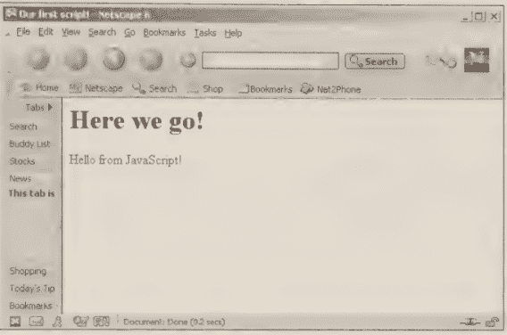

图1.1 我们的第一个示例脚本在 Netscape Navigator 中。

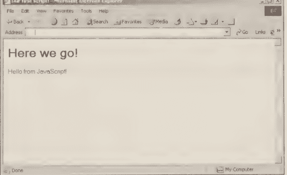

图1.2 我们的第一个示例脚本在 Internet Explorer 中。

### 选择文本编辑器

任何你想用来创建网页的文本编辑器在这里都可以——事实上，越简单越好。你的网页必须能被 Web 浏览器读取为纯文本，这意味着你必须将它们保存为纯文本。花哨的文字处理器，如 Microsoft Word，默认不会将文档保存为纯文本。你仍然可以使用它们，但必须确保将网页保存为纯文本文档。（例如，在 Microsoft Word 中，使用"另存为"对话框中的 .txt 选项保存它们。）

更简单的文本编辑器，如 Windows 中的写字板或 Mac 中的 SimpleText，更好。但是，请确保你以纯文本格式保存文档。（写字板的默认设置是富文本格式，这在浏览器中无法使用——使用写字板保存网页时，请选择"文本文档"格式。）例如，你可以在图1.3中看到我们将创建的第一个网页 first.html，它是在写字板中打开的。

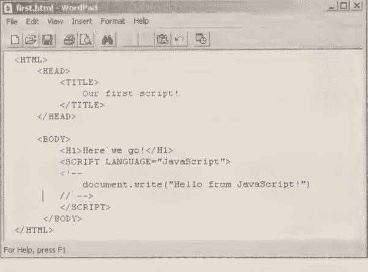

图1.3 在写字板中创建网页。

### 选择浏览器

当然，使用哪种浏览器由你决定。在本书中，我们将涵盖 Internet Explorer 和 Netscape Navigator 的各种可用版本。两者都可以免费在线获取（Netscape Navigator 在 http://browsers.netscape.com/browsers/main.tmpl；Internet Explorer 在 www.microsoft.com/ie/default.asp）。如果你是为普通大众编程，你应该知道 Internet Explorer 目前拥有压倒性的市场份额。然而，Netscape Navigator 仍然有很多可取之处。

### 创建你的编程环境

也值得稍微考虑一下你的编程环境。虽然一般可访问的网页存储在 Internet 服务器上，但你可以在自己的计算机上本地测试你自己的网页。在浏览器中查看它们之前，不需要将它们上传到服务器。知道这一点可以为你节省大量时间，当你开发启用 JavaScript 的页面并测试它们时。

要在计算机上打开网页，只需在 Internet Explorer 中使用"文件" | "打开"菜单项，或在 Netscape Navigator 中使用"文件" | "打开文件"菜单项，然后浏览到你要打开的 HTML 文件。就这么简单。（注意，如果你已经连接到 Internet，Netscape Navigator 在打开计算机上的文件时可能会有一些问题；如果发生这种情况，最好的办法是在连接到 Internet *之前* 打开 Netscape Navigator，这将使本地文件可用。）现在，用 JavaScript 脚本测试和调试你的网页就变成了在文本编辑器中编辑页面、保存它，然后点击 Web 浏览器中的"重新加载"按钮来重新加载新编辑版本的页面。这就是基本编程环境所需的全部。

注意，如果你是为大量受众开发，你可能还想在计算机上安装多个浏览器的多个版本，依次将页面加载到这些浏览器中以测试兼容性。这一点在你编程 JavaScript 的时间越长、脚本越长时就越重要（当然，除非你为只使用一种浏览器的受众编程，如在公司内联网上）。

这就建立了我们的编程环境；现在让我们来看看网页本身。

#### 使用 HTML

我们将在本书中使用大量 HTML。我们的 JavaScript 将嵌入在这些页面中。这意味着你应该具备 HTML 知识，才能有效地处理接下来的内容。你不需要深奥或详尽的知识，但应该有一些基础。例如，看看这个元素：

```
<A HREF="http://developer.netscape.com/docs/manuals/js/core/jsref15/contents.html">
    The JavaScript 1.5 Reference Manual
</A>
```

你应该知道这是一个 `<A>` 元素，在本例中是一个超链接。这个超链接指向 developer.netscape.com 上的 *JavaScript 1.5 Reference Manual*。该元素以 `<A>` *开始标签* 开头，以 `</A>` *结束标签* 结尾。这个元素有一个 HTML *属性* HREF。HTML 属性用于指定元素的某些特性；在本例中，HREF 属性指定了超链接的目标。

如果你对我们将要使用的HTML水平感到不适，花些时间来跟上HTML的学习进度吧。这不会花很长时间，并且对我们在此的工作来说非常值得。

你在图1.1和图1.2中看到的第一个网页中的部分内容，直接来自我们网页中的纯HTML，而不是JavaScript。例如，你在浏览器标题栏中看到的标题 "Our first script!"，来自网页头部区域的一个 `<TITLE>` 元素，而文本 "Here we go!" 则来自网页主体区域的一个 `<H1>` 标题元素。

那么，下面就是我们如何开始创建第一个网页 `first.html`，确保页面的标题和标题文本按预期显示：

```
<HTML>
    <HEAD>
        <TITLE>Our first script!</TITLE>
    </HEAD>

    <BODY>
        <H1>Here we go!</H1>
    </BODY>
</HTML>
```

现在，请将此HTML输入你的文本编辑器并将其保存为 `first.html`。这就是我们网页中的HTML——但这本书是关于JavaScript的，现在是时候在这个页面中嵌入JavaScript了。

#### 添加一些JavaScript

JavaScript脚本随网页一起下载；脚本本身实际上不必嵌入页面中——正如我们将在本章中看到的，它们可以存储在单独的脚本文件中——但通常它们是嵌入的。以下是我们将嵌入第一个示例 `first.html` 中的JavaScript：

**(网站上的清单 01-01.html)**

```
<HTML>
    <HEAD>
        <TITLE>Our first script!</TITLE>
    </HEAD>

    <BODY>
        <H1>Here we go!</H1>
        <SCRIPT LANGUAGE="JavaScript">
        <!--
            document.write("Hello from JavaScript!")
        // -->
        </SCRIPT>
    </BODY>
</HTML>
```

现在将这段JavaScript添加到 `first.html` 中，保存此文档，并在网页浏览器中打开它。你应该会看到与图1.1和图1.2中相同的结果。页面的JavaScript部分写出了消息 "Hello from JavaScript!"，正如你在那些图中看到的。恭喜，你已经成为一名JavaScript程序员了！你已经让你的第一个支持JavaScript的网页运行起来了。

现在让我们来看看我们做了什么。

#### 解析我们的第一个脚本

我们的第一个JavaScript脚本在网页中写了一些东西——那么它是如何做到这一点的呢？我们将在这里逐步分解它，看看发生了什么。首先，和所有脚本一样，我们将此脚本放在一个 `<SCRIPT>` HTML元素内，以便浏览器知道它正在处理某种脚本：

```
<HTML>
    <HEAD>
        <TITLE>Our first script!</TITLE>
    </HEAD>

    <BODY>
        <H1>Here we go!</H1>
        <SCRIPT LANGUAGE="JavaScript">
            .
            .
            .
        </SCRIPT>
    </BODY>
</HTML>
```

这个 `<SCRIPT>` 元素到底是怎么回事？让我们来看看。

#### `<SCRIPT>` 元素

`<SCRIPT>` 元素对我们来说将是一个重要的元素，以下是其所有属性，由 W3C 在 HTML 4.01 规范 (www.w3.org/TR/html401) 中定义：

- **CHARSET**。指定脚本内容的字符编码。设置为语言字符集字符串。（默认为 ISO-8859-1。）
- **CLASS**。元素的类（用于渲染）。在 IE4、IE5 和 IE6 中支持。
- **DEFER**。向浏览器指示该脚本不会生成任何文档内容（这意味着浏览器可以继续解析和绘制页面）。独立属性。在 IE4、IE5 和 IE6 中支持。
- **EVENT**。给出脚本所针对的事件。设置为事件名称（有关所有详细信息，请参阅本章中的“使用 <SCRIPT FOR>”）。在 IE4、IE5、IE6 和 NS6 中支持。
- **FOR**。指示哪个元素与该脚本绑定。设置为 HTML 元素或元素 ID。在 IE4、IE5 和 IE6 中支持。
- **ID**。标签的唯一字母数字标识符，可用于引用它。在 IE4、IE5、IE6 和 NS6 中支持。
- **LANGUAGE**。设置脚本语言。如果未设置 SRC 属性，则此属性是必需的，否则是可选的。设置为脚本语言的名称，例如 JavaScript 或 VBScript。在 IE3、IE4、IE5、IE6、NS3、NS4 和 NS6 中支持。
- **SRC**。提供脚本代码的外部来源。设置为 URL。在 IE3、IE4、IE5、IE6、NS3、NS4 和 NS6 中支持。
- **TITLE**。保存元素的附加信息（可能显示在工具提示中）。在 IE4、IE5 和 IE6 中支持。
- **TYPE**。指示脚本代码的 *多用途互联网邮件扩展* (MIME) 类型。设置为字母数字 MIME 类型。旨在替代 LANGUAGE 属性。在 IE4、IE5、IE6 和 NS6 中支持。

我们将整个脚本包含在一个 `<SCRIPT>` 元素中。请注意，我使用了此元素的 LANGUAGE 属性，并将其设置为 "JavaScript"。如果我想只针对 Internet Explorer，我可以将其设置为 "JScript"，但该浏览器也识别 "JavaScript" 以及 "JScript"，并且将两者同等对待。还有其他类型的脚本，例如 VBScript 和 PerlScript，因此指定你所使用的语言可能很重要。（事实上，在 Netscape Navigator 和 Internet Explorer 中，如果你省略 LANGUAGE 属性，默认值是 "JavaScript"。）

同样值得注意的是，在 HTML 的最新版本——由 W3C 规定的 4.01 版本（你可以在 www.w3.org/TR/html401 看到规范）中，LANGUAGE 属性已被 TYPE 属性取代。并且，不是将 TYPE 设置为 "JavaScript"，而是将其设置为 "text/javascript"。这种新方法在 Netscape Navigator 和 Internet Explorer 中都得到支持。然而，使用 LANGUAGE 属性的标准方法在 Netscape Navigator 和 Internet Explorer 中仍将持续很长时间。

#### 从旧版浏览器隐藏脚本

请注意我们脚本的下一部分——它看起来像是被 HTML 注释隐藏了（即 <!-- -->）：

```
<HTML>
    <HEAD>
        <TITLE>Our first script!</TITLE>
    </HEAD>

    <BODY>
        <H1>Here we go!</H1>
        <SCRIPT LANGUAGE="JavaScript">
        <!--
        document.write("Hello from JavaScript!")
        // -->
        </SCRIPT>
    </BODY>
</HTML>
```

这是怎么回事？在这种情况下，我正在将我们的JavaScript从不支持JavaScript的旧版浏览器中隐藏起来。如果浏览器不支持JavaScript，它可能会在网页中直接显示我们整个脚本而不执行它，这看起来不够专业。为避免这种情况，你可以将实际的脚本语句包裹在HTML注释中，就像我们在这里所做的那样。

真正发生的情况是，支持JavaScript的浏览器知道要跳过 `<SCRIPT>` 元素中的HTML开始注释标签 `<!--`。那结束注释标签 `-->` 呢？为了确保浏览器也跳过该标签，我们使用了JavaScript单行注释，它以两个正斜杠（//）开头。当JavaScript看到注释标记 `//` 时，它会忽略该行的其余部分，这使你可以为代码添加注释，程序员可以阅读而JavaScript不会。在此 `//` 标记之后，我使用了 `-->` HTML结束注释标签，以便旧版浏览器会认为HTML注释已完成，并且不会在网页本身显示我们的任何脚本。

你遇到的大多数浏览器都会支持JavaScript，但那些不支持的浏览器并不一定是旧版的——它们可能是纯文本浏览器或PDA浏览器。这意味着你不能指望不支持JavaScript的浏览器会消失——这意味着用HTML注释包围你的代码是一个好习惯。事实上，有一个完整的HTML标签专门用于不支持JavaScript的浏览器：`<NOSCRIPT>`。

#### 使用 `<NOSCRIPT>`

你可能想为不支持JavaScript的浏览器提供网页的非JavaScript版本。你可以在 `<NOSCRIPT>` 元素中这样做。支持JavaScript的浏览器会忽略此元素及其内容。然而，不支持JavaScript的浏览器只会忽略 `<NOSCRIPT>` 和 `</NOSCRIPT>` 标签——这些标签之间的所有HTML和文本仍然会显示。

这意味着你可以将为不支持JavaScript的浏览器准备的HTML放在 `<NOSCRIPT>` 元素中，包括链接或重定向指令到非JavaScript页面。或者，你可能只是告诉用户获取一个支持JavaScript的浏览器，就像这样：

**(网站上的清单 01-02.html)**

```
<HTML>
  <HEAD>
    <TITLE>
      Our first script!
    </TITLE>
  </HEAD>

  <BODY>
    <H1>Here we go!</H1>
    <SCRIPT LANGUAGE="JavaScript">
    <!--
      document.write("Hello from JavaScript!")
    // -->
    </SCRIPT>
    <NOSCRIPT>
      Hey, get a browser that supports JavaScript!
    </NOSCRIPT>
  </BODY>
</HTML>
```

这是一个例子：Microsoft Word能够打开HTML页面，但它不支持JavaScript。你可以在图1.4中看到在Word中打开的前述页面，显示了我们给用户的关于获取新浏览器的提示。

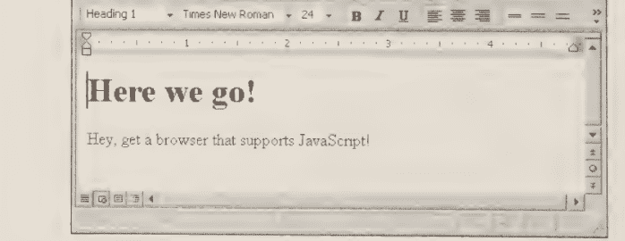

图1.4 使用 `<NOSCRIPT>` 元素。

以下是 `<NOSCRIPT>` 元素的属性：

- **CLASS。** 元素的类（用于渲染）。
- **DIR。** 给出方向中性文本（没有固有阅读方向的文字）的方向。可能的值：`LTR`（从左到右的文本或表格）和 `RTL`（从右到左的文本或表格）。
- **ID。** 标签的唯一字母数字标识符，你可以用它来引用该标签。在 IE4、IE5、IE6 和 NS6 中支持。
- **LANG。** 标签使用的基础语言。
- **STYLE。** 指示如何渲染该元素的内联样式。在 IE6 和 NS6 中支持。
- **TITLE。** 保存该元素的附加信息（可能会显示在工具提示中）。

我们还没有剖析第一个脚本中实际使用 JavaScript 本身的部分。现在让我们来做这件事。

#### 编写 JavaScript

以下是实际执行显示 "Hello from JavaScript!" 文本工作的 JavaScript 语句：

```
<HTML>
    <HEAD>
        <TITLE>Our first script!</TITLE>
    </HEAD>

    <BODY>
        <H1>Here we go!</H1>
        <SCRIPT LANGUAGE="JavaScript">
        <!--
        document.write("Hello from JavaScript!")
        // -->
        </SCRIPT>
    </BODY>
</HTML>
```

在这里，我们想要在浏览器中完成一些事情——即在网页中显示你的消息——为了做到这一点，我们必须与浏览器进行交互。你可以通过一组对象与浏览器交互，正如我们所讨论过的。在这种情况下，我们将使用 `document` 对象，它对应于网页的主体部分（以及其他几个部分）。

像 `document` 这样的对象具有*属性*，它们与 HTML 属性类似，使你能够配置网页，设置其颜色等。它们还具有*方法*，让你能够主动执行某些操作，比如在网页中写入内容。它们还可以处理*事件*，使你能够响应用户操作，如鼠标点击。属性、方法和事件对我们来说都非常重要，我们将在本章中看到更多相关内容；在这个例子中，我们使用 `document` 对象的 `write` 方法将一些文本写入到我们的 HTML 页面：

```
document.write("Hello from JavaScript!")
```

请注意，我们将实际要写入网页的文本，用引号括起来，通过将文本放在括号中传递给 `write` 方法。而这就是全部；当这条 JavaScript 语句执行时，我们的消息就被写入到网页中了。我们已经能够通过使用 `document` 对象的方法之一来让它为我们做某事。我们将在本书中详细看到各种浏览器对象的所有方法。

还有另一件事需要注意——JavaScript 是区分大小写的，这意味着，*与 HTML 不同*，大小写很重要。如果我们这样写，JavaScript 就不会执行它：

```
Document.Write("Hello from JavaScript!")
```

这就完成了我们的第一个脚本；我们已经取得了相当大的进展。现在让我们来看看几个更多的基础问题，它们在我们继续学习的过程中将变得很重要。

#### 分号怎么办？

JavaScript 在许多方面都遵循 Java 的引领，其中之一就是要求在每个语句末尾使用分号（;）。从技术上讲，我们应该这样写我们的 JavaScript 语句，后面跟着一个分号，像这样：

```
<HTML>
    <HEAD>
        <TITLE>Our first script!</TITLE>
    </HEAD>

    <BODY>
        <H1>Here we go!</H1>
        <SCRIPT LANGUAGE="JavaScript">
        <!--
        document.write("Hello from JavaScript!");
        // -->
        </SCRIPT>
    </BODY>
</HTML>
```

然而，通过广泛的使用，分号在 JavaScript 中几乎已经成为过去式。浏览器不要求它，程序员在很大程度上也不使用它。遵循常见用法，我们这里也不使用它。

**提示**

然而，在至少一种情况下，你必须使用分号。如果你愿意，可以将两个或更多的 JavaScript 语句放在同一行上；但如果你这样做，你需要用分号将它们分隔开。

#### 为 JavaScript 添加注释

我们已经看到 JavaScript 支持使用 `//` 标记进行单行注释。JavaScript 不会读取 `//` 所在行之后的任何内容，所以你可以像这样为阅读代码的人添加注释：

```
<HTML>
    <HEAD>
        <TITLE>
            Welcome To JavaScript
        </TITLE>
    </HEAD>
    <BODY>
        <SCRIPT LANGUAGE="JavaScript">
        <!--
            //Write "Welcome to JavaScript!" in the page.
            document.write("Welcome to JavaScript!")
        //-->
        </SCRIPT>
        <NOSCRIPT>
            Sorry, your browser doesn't support JavaScript!
        </NOSCRIPT>
        <H1>
            Welcome To JavaScript!
        </H1>
    </BODY>
</HTML>
```

事实上，JavaScript 还支持第二种注释类型，你可以用它来注释多行。这种注释以 `/*` 开始，以 `*/` 结束。当 JavaScript 看到 `/*` 时，它会忽略其他所有内容，直到看到 `*/`。以下是一个例子：

```
<SCRIPT LANGUAGE="JavaScript">
<!--
    /* This script
       writes "Welcome to JavaScript!"
       in the page.
    */
    document.write("Welcome to JavaScript!")
//-->
</SCRIPT>
```

或者你可以像这样创建一个完整的注释块：

```
<SCRIPT LANGUAGE="JavaScript">
<!--
/*
   This script
   writes "Welcome to JavaScript!"
   in the page.
                              */
   document.write("Welcome to JavaScript!")
// -->
</SCRIPT>
```

#### `<SCRIPT>` 元素放在哪里？

一个问题是在网页中 `<SCRIPT>` 元素究竟应该放在哪里。当 JavaScript 刚出现时，许多纯粹主义者坚持认为 `<SCRIPT>` 元素只能放在页面的头部区域，因为头部包含关于页面的元信息，这些信息不应该被显示：

```
<HTML>
   <HEAD>
      <TITLE>Our first script!</TITLE>
      <SCRIPT LANGUAGE="JavaScript">
      <!--
      .
      .
      // -->
      </SCRIPT>
   </HEAD>

   <BODY>
      <H1>Here we go!</H1>
   </BODY>
</HTML>
```

然而，JavaScript 逐渐发展，开始能够创建确实需要显示的元素，就像我们的第一个脚本一样，它在网页中显示了一些文本。这可能在页面主体加载时发生；所以当你用 `document.write` 写入网页时，你可以将脚本放在主体中，而不是头部：

```
<HTML>
   <HEAD>
      <TITLE>Our first script!</TITLE>
   </HEAD>

   <BODY>
      <H1>Here we go!</H1>
      <SCRIPT LANGUAGE="JavaScript">
      <!--
      document.write("Hello from JavaScript!")
      // -->
      </SCRIPT>
   </BODY>
</HTML>
```

这样做的原因是，当头部加载并执行你的脚本时，页面的主体部分（它与之交互的部分）可能还没有加载。事实上，你可以在头部和主体中都有脚本：

```
<HTML>
  <HEAD>
    <TITLE>Our first script!</TITLE>
    <SCRIPT LANGUAGE="JavaScript">
    .
    .
    </SCRIPT>
  </HEAD>

  <BODY>
    <H1>Here we go!</H1>
    <SCRIPT LANGUAGE="JavaScript">
    .
    .
    </SCRIPT>
  </BODY>
</HTML>
```

或者，你可以在头部和/或主体中有多个脚本：

```
<HTML>
  <HEAD>
    <SCRIPT LANGUAGE="JavaScript">
    .
    .
    </SCRIPT>
    <TITLE>Our first script!</TITLE>
    <SCRIPT LANGUAGE="JavaScript">
    .
    .
    </SCRIPT>
  </HEAD>

  <BODY>
    <H1>Here we go!</H1>
  </BODY>
</HTML>
```

所以关于 `<SCRIPT>` 元素放在哪里的问题的答案是：最适合它的地方。通常，最好将 `<SCRIPT>` 元素放在网页的头部。然而，当你直接写入网页时，或者可能在主体加载之前试图访问主体元素时，将 `<SCRIPT>` 元素放在网页的主体中可能是一个好主意。

**提示**

事实上，还有另一个选择：你甚至可以将访问页面主体的代码放在页面的头部，如果你让浏览器本身告诉你何时运行该代码是安全的。请参阅本章后面 "When Does a Script Run?" 中的讨论，了解如何仅在整页加载到浏览器后才运行脚本。

这里还有更多选项需要考虑；我们将所有代码放在网页本身中——但你可以将 JavaScript 存储在网页之外，仍然让它随该页面一起下载。

#### 使用单独的脚本文件

如果你想将 JavaScript 代码存储在你将使用的网页之外的文件中，请将其存储在扩展名为 .js 的文件中。例如，当你处理跨浏览器问题时，这可能是个好主意，因为你可以为一个浏览器加载一个 .js 文件，为另一个浏览器加载另一个 .js 文件。

要将 .js 脚本文件与 `<SCRIPT>` 元素关联，你使用 `<SCRIPT>` 元素的 SRC 属性，像这样。（请注意，这里的 `<SCRIPT>` 元素是空的，当你使用 SRC 属性时它应该是空的。）

```
<HTML>
    <HEAD>
        <TITLE>
            Here's my script!
        </TITLE>
        <SCRIPT LANGUAGE="JavaScript" SRC="script.js">
        </SCRIPT>
    </HEAD>

    <BODY>
        <H1>Like my script?</H1>
    </BODY>
</HTML>
```

你将 SRC 属性设置为 URL，所以你甚至可以从另一个服务器获取 .js 文件，像这样：

```
<HTML>
    <HEAD>
        <TITLE>
            Here's my script!
        </TITLE>
        <SCRIPT LANGUAGE="JavaScript" SRC="script.js">
        </SCRIPT>
    </HEAD>

    <BODY>
        <H1>Like my script?</H1>
    </BODY>
</HTML>
```

这个 .js 文件（此处是 script.js）只包含你想执行的代码，就像这样：

```javascript
document.write("Hello from JavaScript!")
```

**提示**

但是请注意，当你进行类似此语句所做的操作——向文档的 body 写入内容时——使用外部脚本文件可能会遇到问题，因为浏览器很可能在 body 完全加载之前就加载了外部脚本文件，这意味着你的 JavaScript 代码将无法执行。

#### 指定语言版本

你可以在 `<SCRIPT>` 元素中使用 LANGUAGE 属性来指定你要使用的 JavaScript 版本。例如，如果你的脚本是为 JavaScript 1.1 编写的，你可以这样指定你想使用的语言版本：

```html
<HTML>
    <HEAD>
        <TITLE>Our first script!</TITLE>
        <SCRIPT LANGUAGE="JavaScript 1.1">
        .
        //JavaScript 1.1 Code
        .
        </SCRIPT>
    </HEAD>
    <BODY>
        <H1>Here we go!</H1>
    </BODY>
</HTML>
```

请注意，如果你使用的浏览器不支持 JavaScript 1.1，你的代码将不会运行。你可以像这样针对不同级别的 JavaScript 进行编码，这里我使用多个 `<SCRIPT>` 元素来处理支持 JavaScript 1.0、1.1 等的浏览器——请注意这些 `<SCRIPT>` 元素必须按升序排列：

```html
<HTML>
    <HEAD>
        <TITLE>Our first script!</TITLE>
        <SCRIPT LANGUAGE="JavaScript">
        .
        //JavaScript 1.0 Browsers
        .
        </SCRIPT>
        <SCRIPT LANGUAGE="JavaScript 1.1">
        .
        //JavaScript 1.1 Browsers
        .
        </SCRIPT>
        <SCRIPT LANGUAGE="JavaScript 1.2">
        .
        //JavaScript 1.2 Browsers
        .
        </SCRIPT>
    </HEAD>

    <BODY>
        <H1>Here we go!</H1>
    </BODY>
</HTML>
```

> **提示**
>
> 这也是确定浏览器支持哪个 JavaScript 版本的好方法——指定更新版本的 `<SCRIPT>` 元素将不会被执行。

我们已经了解了 `<SCRIPT>` 元素的作用、它们的位置以及它们的属性用途。但是它们里面的代码究竟什么时候运行？在我们的第一个例子中，代码在页面加载后自动运行。然而，当然并不是每个页面都适合这样做；例如，你可能正在编写一个计算贷款利息的网页，在用户输入一些数据之前执行任何操作都不是个好主意。那么脚本什么时候运行呢？

#### 脚本何时运行？

JavaScript 脚本中的代码主要在三个时间点运行：

- 在文档加载期间
- 文档加载后立即
- 当用户执行某些操作时

我将概述这些情况，因为知道脚本何时运行是我们 JavaScript 基础知识的重要组成部分。但是请注意，这只是一个概述，因为它涉及一些主题，例如函数，我们将在第 3 章“JavaScript 语言：循环、函数和错误”中才会学习。

我们的第一个脚本在文档加载时自动运行，因为我们只是将 JavaScript 语句放在了一个 `<SCRIPT>` 元素中：

```html
<HTML>
    <HEAD>
        <TITLE>Our first script!</TITLE>
    </HEAD>

    <BODY>
        <H1>Here we go!</H1>
        <SCRIPT LANGUAGE="JavaScript">
        <!--
        document.write("Hello from JavaScript!")
        // -->
        </SCRIPT>
    </BODY>
</HTML>
```

在这种情况下，浏览器在从它正在打开的 HTML 文档加载代码时运行我们的代码。

然而，JavaScript 代码不必在加载到浏览器时立即运行——你可以等到整个文档加载完成后再运行你的代码。这通常是个好主意，因为 HTML 文档是分块加载的，这意味着你可能会发现自己正在尝试使用一个尚未加载到浏览器中的 HTML 元素，这会导致错误。

你可以通过*事件*让浏览器通知你网页何时完全加载。当浏览器中发生一个事件时，你就知道发生了某事——例如，用户按下了鼠标按钮或键盘上的一个键。你可以在 JavaScript 中处理事件，方法是在特定事件发生时指定要运行的代码，例如当网页中的一个按钮被点击时。

我们将在第 6 章“使用核心 HTML 方法和事件”中详细介绍事件，但这里先预览一下（如果你愿意，可以跳过，稍后再回来看）。页面完全加载时发生的事件是 `onload` 事件，与其他事件一样，你可以使用 HTML 元素的属性来处理它——在这种情况下，你使用 `<BODY>` 元素的 `ONLOAD` 属性。（我们将在第 8 章“使用 `window` 和 `frame` 方法和事件”中深入了解 `onload` 事件——请参阅该章中的“窗口加载和卸载”部分。）

我们需要某种方式将我们想要运行的代码连接到 `<BODY>` 元素的 `ONLOAD` 属性，我们可以使用 JavaScript 函数来实现。我们将在第 3 章中了解函数的所有细节；这里需要知道的重要一点是，它们将为我们提供一种方式，将代码组织成易于管理的包，*仅*在需要时运行（而不是在浏览器读取代码时自动运行）。

例如，假设我想使用 `window` 对象的 `alert` 方法在简单的对话框（称为 *alert box*）中显示一条消息，表明页面已完成加载。为此，我将创建一个名为 `alerter` 的函数，并将此函数连接到 `<BODY>` 元素的 `ONLOAD` 属性。（第 3 章包含有关创建函数的详细信息。）这样做可以确保该函数中的代码*仅*在页面完全加载时运行。以下是在 JavaScript 中的实现方式：

**(网站上的清单 10-03.html)**

```html
<HTML>
    <HEAD>
        <TITLE>
            Executing Scripts After a Document Loads
        </TITLE>
        <SCRIPT LANGUAGE="JavaScript">
            <!--
            function alerter()
            {
                window.alert("All loaded.")
            }
            // -->
        </SCRIPT>
    </HEAD>

    <BODY ONLOAD="alerter()">
        <H1>Executing Scripts After a Document Loads</H1>
    </BODY>
</HTML>
```

就是这样——现在我们已经将代码打包在一个函数中，该代码*仅*在我们想要它运行时运行，而不是在页面加载时自动运行（如果代码没有包含在函数中，就会发生这种情况）。你可以在 Internet Explorer 的图 1.5 和 Netscape Navigator 的图 1.6 中看到此代码的结果，其中这些浏览器被设置为显示一个警报框，表明当前网页已完成加载。

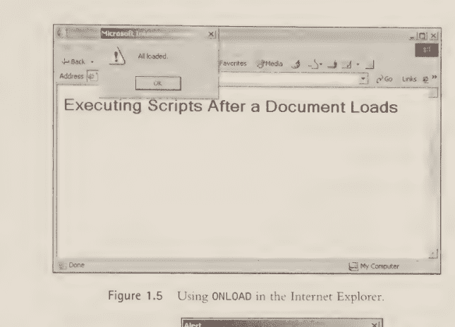


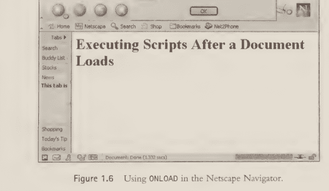

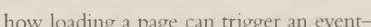

我们已经看到加载页面可以触发事件——`onload` 事件——但用户操作，如按钮点击，也可以触发事件。我们将在第 6 章“使用核心 HTML 方法和事件”和第 12 章“处理表单、按钮、复选框和单选按钮”中了解这是如何工作的，但这里先预览一下。例如，正如我们使用 `<BODY>` 元素的 `ONLOAD` 属性来处理 `onload` 事件一样，我们也可以使用 HTML 按钮元素的 `ONCLICK` 属性来处理按钮的 `onclick` 事件，该事件在你点击按钮时发生。以下是当用户点击按钮时我可以显示警报框的方法：

**(网站上的清单 01-04.html)**

```html
<HTML>
    <HEAD>
        <TITLE>
            Executing Scripts in Response to User Action
        </TITLE>
        <SCRIPT LANGUAGE="JavaScript">
            <!--
            function alerter()
            {
                window.alert("You clicked the button!")
            }
            // -->
        </SCRIPT>
    </HEAD>

    <BODY>
        <H1>Executing Scripts in Response to User Action</H1>
        <FORM>
            <INPUT TYPE="BUTTON" ONCLICK="alerter()" VALUE="Click Me!">
        </FORM>
    </BODY>
</HTML>
```

当用户点击按钮时，名为 `alerter` 的函数将运行，该函数显示警报框。我们将在第 3 章中进一步了解函数，但现在需要知道的重要一点是，它们将为我们提供一种方式来决定我们的代码何时应该运行，而不是让浏览器在从 HTML 文档加载代码时自动运行该代码。

#### 内联脚本

这里还有另一个你应该了解的选项：内联脚本。到目前为止，我们已经将所有代码放在 `<SCRIPT>` 元素或 .js 文件中，但对于非常短的代码，实际上还有另一种方法。与其通过 `ONLOAD` 属性将 JavaScript 函数连接到 `onload` 事件等事件，你实际上可以直接将你想要执行的 JavaScript 代码分配给 `ONLOAD` 属性。例如，以下是我如何在页面加载时使用消息 All loaded. 显示警报框：

```html
<HTML>
    <HEAD>
        <TITLE>
            Executing Scripts After a Document Loads
        </TITLE>
    </HEAD>

    <BODY ONLOAD="alert('All loaded.')">
        <H1>Executing Scripts After a Document Loads</H1>
    </BODY>
</HTML>
```

对于短脚本来说，这是一种不错的技巧，但**仅适用于**短脚本。对于更长的脚本，应将脚本放在`<SCRIPT>`元素中。

**提示**

如果你想在内联脚本中放置多条语句，必须用分号将它们分隔开。

#### 使用 `<SCRIPT FOR>`

另外还有一件事——在 Internet Explorer 4.0 及更高版本中，你可以使用`<SCRIPT>`元素的`FOR`属性将脚本连接到特定的 HTML 元素。例如，下面是我如何将脚本连接到名为`button1`的 HTML 按钮的`onclick`事件（我通过在定义按钮的`<INPUT>`元素中设置`NAME`属性来命名该按钮）：

**网站上的 Listing 01-05.html**

```html
<HTML>
  <HEAD>
    <TITLE>
      Using the SCRIPT FOR Element
    </TITLE>
    <SCRIPT FOR="button1" EVENT="onclick" LANGUAGE="JavaScript">
      <!--
      alert("You clicked the button!")
      // -->
    </SCRIPT>
  </HEAD>

  <BODY>
    <H1>Using the SCRIPT FOR Element</H1>
    <FORM NAME="form1">
      <INPUT TYPE="BUTTON" NAME="button1" VALUE="Click Me!">
    </FORM>
  </BODY>
</HTML>
```

现在当用户点击按钮时，会弹出一个警告框，显示消息`You clicked the button!`（见图 1.7）。这在 Netscape Navigator 中不起作用，它只会在页面加载时立即运行脚本。

这是一种处理事件的有用技巧，尽管它不太常用，因为它与 Netscape Navigator 存在冲突。当我们开始在第 6 章中处理事件时，我们会看到更多关于这方面的内容。

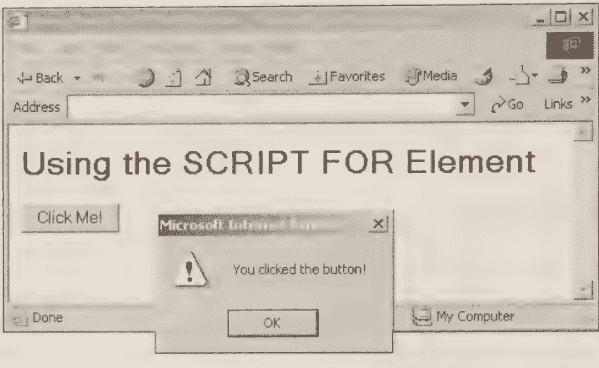

#### 查看脚本错误

有时，我和你所写的 JavaScript 会包含错误。（嗯，也许你没有，但我确实经常遇到。）我们正在使用的这两款浏览器都能够告诉我们错误是什么，在本章中了解这一点很有用，因为本章正在建立我们的 JavaScript 基础。

例如，如果我们在第一个脚本中将`document.write`拼写错误为`documnt.write`会怎么样？下面是它的样子：

```html
<HTML>
    <HEAD>
        <TITLE>
            Our first script!
        </TITLE>
    </HEAD>

    <BODY>
        <H1>Here we go!</H1>
        <SCRIPT LANGUAGE="JavaScript">
            <!--
            documnt.write("Hello from JavaScript!")
            // -->
        </SCRIPT>
    </BODY>
</HTML>
```

这两款浏览器都会对这个 JavaScript 出现问题。如果 Internet Explorer 中存在 JavaScript 错误，你会在浏览器底部状态栏的右侧看到一个小图标（见图 1.8）。双击该图标会打开一个错误对话框，如图 1.8 所示，告诉你错误是什么。

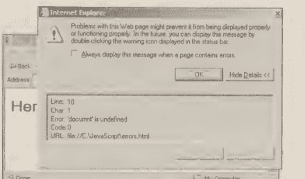

事实上，你可以让每次错误都自动弹出对话框。在 Internet Explorer 6 中，你可以通过"工具 | Internet 选项 | 高级 | 浏览"项来实现，然后选中标记为"显示每个脚本错误的通知"的复选框。

在 Netscape Navigator 4 及更高版本直到 6 中，你会在状态栏中看到一条消息，指示存在错误，并引导你导航到 URL "javascript:"。为此，你可以使用"文件 | 打开页面"菜单项，打开"打开页面"对话框。在该对话框中输入`javascript:`，然后点击"打开"按钮。这将打开 JavaScript 控制台，这是一个单独的窗口，用于显示错误。

在 Netscape Navigator 6 中，如果存在错误，你不会在任务栏中看到错误图标。然而，如果你的脚本没有按预期运行，请选择"任务 | 工具 | JavaScript 控制台"项来打开 JavaScript 控制台窗口。你甚至可以在继续在浏览器中工作时保持此窗口打开。你可以在图 1.9 中看到 Netscape Navigator 6 的 JavaScript 控制台。

像这样定位错误对于帮助你处理错误来说非常宝贵，这也是我们基础章节中的一个良好基础项目。

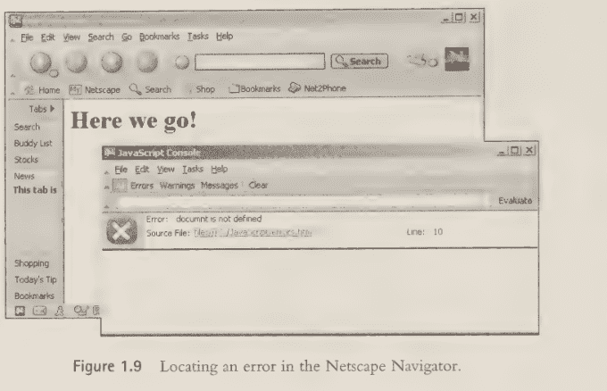

## 服务器端 JavaScript

如今，JavaScript 不仅在 Web 浏览器中可用，甚至在 Web 服务器上也开始普及。目前只有少数 Web 服务器支持服务器端 JavaScript，但它们的数量正在增长。要在网页中嵌入在 Web 服务器上运行的 JavaScript，你需要使用`<SERVER>`元素。

此元素包含服务器端 JavaScript 代码，即在服务器上运行的代码。例如，如果启用了服务器端 JavaScript，下面是如何在网页中显示服务器的 Internet 地址：

```html
<HTML>
    <HEAD>
        <TITLE>
            Server-Side JavaScript
        </TITLE>
        .
        .
        .
    </HEAD>

    <BODY>
        .
        .
        Hello - your server's address is
        <SERVER>
            write(request.ip)
        </SERVER>
        .
        .
        .
    </BODY>
</HTML>
```

你可以在 http://developer.netscape.com/docs/manuals/index.html?content=javascript.html 找到 Netscape 关于服务器端 JavaScript 的文档。

## 在 JavaScript 中使用浏览器对象

许多 JavaScript 初学者认为他们所需的一切都内置在 JavaScript 语言本身中，但事实并非如此。JavaScript 语言实际上非常简单，而且通常情况下，它真正的作用只是作为操作浏览器中已内置对象的一种方式。事实上，真正的丰富性在于 JavaScript 可以操作的那些浏览器对象，而不是语言本身。

通过诸如`document`和`window`对象之类的对象，你可以访问网页中的 HTML，可以打开新的浏览器窗口，可以写入网页，可以处理用户事件（如鼠标点击），可以使浏览器导航到新位置或到它已经访问过的页面，可以支持拖放等等。例如，我们的第一个脚本使用了`document`对象的`write`方法来写入网页：

```html
<HTML>
    <HEAD>
        <TITLE>Our first script!</TITLE>
    </HEAD>

    <BODY>
        <H1>Here we go!</H1>
        <SCRIPT LANGUAGE="JavaScript">
        <!--
        document.write("Hello from JavaScript!")
        // -->
        </SCRIPT>
    </BODY>
</HTML>
```

不仅仅是 JavaScript 可以访问这些浏览器对象——任何脚本语言都可以。程序员使用 JavaScript 是因为他们喜欢该语言本身的简洁和强大，但当人们说"JavaScript 编程"时，很大程度上实际上都是关于操作浏览器对象的。我们将在本书中看到这一点，其中有整章专门介绍`document`、`window`、`location`、`history`和其他浏览器对象。

然而，正如你可能从"浏览器对象"这个名称中推断出的那样，这里将会存在许多兼容性问题，因为 Internet Explorer 和 Netscape Navigator 是不同的，而且它们一开始使用的对象集合就非常不同。浏览器使用的对象集合被组织成一个*对象模型*。对象模型指定了浏览器中浏览器对象的层次结构——例如，`document`对象（对应于网页的内容）包含在`window`对象（对应于 Web 浏览器窗口本身）内部，浏览器的对象模型将显示这一点。

处理两款浏览器中不同的对象模型是我们将遇到的最困难的跨浏览器问题。然而，由于 W3C 在跨浏览器 DOM 规范方面的工作，情况不再像从前那样无望。Internet Explorer 6 和 Netscape Navigator 6 都在很好地实现 W3C DOM 中的对象模型，正如我们将在第 4 章开始深入讨论浏览器对象时看到的那样。（事实上，两款浏览器不仅实现了 W3C DOM，还实现了它们自己的对象模型以保持向后兼容性。）

在这个基础章节中，概览我们将在各种浏览器中使用的对象模型是至关重要的。为了使事情更简单、更连贯，在本章中，我将坚持使用两款浏览器共有的对象模型的基本部分——我们将在第 4 章及后续章节中有足够的时间讨论浏览器差异。在这里，让我们看看在任何可脚本化浏览器中都能工作的内容。

在图 1.10 中，你可以看到两款浏览器共有的对象模型版本。（我将这个基本对象集合称为*通用 DOM 模型*，你可以确信它在任何支持脚本的浏览器中都可用。）该图显示了哪些对象包含哪些其他对象。例如，你可以在图中看到`window`对象如何包含`document`对象，`document`对象如何包含`form`对象，等等。

以下是浏览器对象的基本列表及其用途；熟悉这些对象是我们正在本章中构建的 JavaScript 基础的重要组成部分：

- **`document`。** 对应于当前网页的主体和部分头部。使用此对象，你可以访问页面本身的 HTML，包括其中的所有链接、图像和锚点。
- **`form`。** 保存当前页面中 HTML 表单的信息；表单可以包含按钮、文本字段、复选框以及各种其他 HTML *控件*。HTML 控件是用户可以通过点击、输入文本等方式与之交互的控件。
- **`frame`。** 指浏览器窗口中的一个框架。
- **`history`。** 保存浏览器在访问当前页面之前所访问过的站点记录。提供可让你返回先前页面的方法。
- **`location`。** 保存当前网页的位置信息，例如其 URL、域名、路径、服务器端口等。
- **`navigator`。** 指浏览器本身，使你能够确定用户使用的是哪种浏览器。
- **`window`。** 指当前浏览器窗口。

那么，如何在 JavaScript 中与这些浏览器对象进行交互呢？你可以利用这些对象的三个方面来实现，即我们之前讨论过的：属性、方法和事件。

### 浏览器对象的属性、方法和事件

我们已经知道 `document` 对象指代当前页面，但如何实际*使用*这个对象呢？我们已经见过一种方式，那就是使用对象方法，例如 `write` 方法，将文本写入网页。使用对象的方法时，需要先给出对象名称，接着一个点号（.），然后是方法名，如 `document.write`。以下是一些方法的示例：

- **`document.write`。** 将文本写入当前网页。
- **`document.writeln`。** 将单行文本写入当前网页并换行。
- **`history.go`。** 将浏览器导航至浏览器历史记录中的某个位置。
- **`window.alert`。** 显示一个警告对话框。
- **`window.open`。** 打开一个新的浏览器窗口。

如你所见，这些方法提供了大量现成的功能，让你能够与浏览器进行交互式操作。除了使用方法来执行操作外，你还可以使用属性来读取和更改这些对象的设置。属性保存着对象的某些设置。例如，`document.linkcolor` 属性保存当前网页中超链接的颜色，通过更改 `document.linkcolor` 属性，你可以改变该颜色。以下是一些属性示例及其所属对象：

- **`document.bgcolor`。** 当前页面的背景色。
- **`document.fgcolor`。** 当前页面的前景色。
- **`document.lastmodified`。** 页面最后修改的日期。
- **`document.title`。** 当前页面的标题。
- **`location.hostname`。** 互联网服务提供商（ISP）的主机名。
- **`navigator.appName`。** 浏览器的名称，可用于确定用户使用的是哪种浏览器。

对象属性和方法让你能够访问浏览器中正在发生的一切，使你能够在程序控制下更改几乎所有内容。除了属性和方法之外，在处理浏览器对象时还有一个非常重要的概念：事件。

你如何知道某个动作已经发生了呢？例如，如果你想在用户点击页面时改变网页的颜色，该怎么办？为了通知你某事已经发生，JavaScript 使用事件，例如鼠标点击，正如我们之前使用 `onload` 事件来显示警告框时所见：

```
<HTML>
    <HEAD>
        <TITLE>
            Executing Scripts After a Document Loads
        </TITLE>
        <SCRIPT LANGUAGE="JavaScript">
            <!--
            function alerter()
            {
                window.alert("All loaded.")
            }
            // -->
        </SCRIPT>
    </HEAD>
    <BODY ONLOAD="alerter()">
        <H1>Executing Scripts After a Document Loads</H1>
    </BODY>
</HTML>
```

当用户点击页面时，会触发 `onmousedown` 事件。要处理该事件，你可以使用 `ONMOUSEDOWN` 事件属性。以下示例展示了响应此类事件的一种方式。在本例中，我将使用内联脚本在鼠标点击时将文档的背景色改为红色：

**(Listing 01-06.html on the web site)**

```
<HTML>
    <HEAD>
        <TITLE>
            JavaScript Event Example
        </TITLE>
    </HEAD>
    <BODY ONMOUSEDOWN="document.bgColor='red'">
        <H1>
            Click this page to turn it red!
        </H1>
    </BODY>
</HTML>
```

在本例中，我指定当用户点击鼠标时，将浏览器预定义的颜色 "red" 分配给 `document.bgcolor`（Netscape Navigator 和 Internet Explorer 都理解 "red"、"blue"、"green" 等基本颜色名称），我通过 JavaScript 赋值语句 `document.bgColor='red'` 来实现这一点。（正如我们将在第 2 章 "JavaScript 语言：数据、运算符和分支" 中看到的，这里的等号表示我想将 `document.bgColor` 属性设置为 'red'，类似于我们之前为 HTML 属性赋值的方式。）这个示例的结果，以黑白形式呈现，出现在 Netscape Navigator 的图 1.11 中。

**提示** 既然我们讲到了这个示例，关于内联脚本有一点需要注意：整个脚本用引号括起来，因为它被赋值给 HTML 事件属性，如 `ONMOUSEDOWN`。然而，如果脚本本身使用了引号，例如 `document.bgColor="red"`，你应该确保使用与包裹脚本不同的引号，以免浏览器混淆。例如，如果脚本周围使用双引号，那么脚本内部就使用单引号，反之亦然。以下两种写法都有效：`<BODY ONMOUSEDOWN="document.bgColor='red'">` 和 `<BODY ONMOUSEDOWN='document.bgColor="red"'>`

那么有哪些 HTML 事件属性可用呢？以下是我们将遇到的一些常见事件（在第 6 章中有更详细的讨论）：

- **ONABORT。** 当操作被中止时触发。
- **ONBLUR。** 当元素失去输入焦点时触发。
- **ONCHANGE。** 当控件（如文本字段）中的数据发生变化时触发。
- **ONCLICK。** 当元素被点击时触发。
- **ONDBLCLICK。** 当元素被双击时触发。
- **ONDRAGDROP。** 当执行拖放操作时触发。
- **ONERROR。** 当发生 JavaScript 错误时触发。
- **ONFOCUS。** 当元素获得焦点时触发。
- **ONKEYDOWN。** 当按键按下时触发。
- **ONKEYPRESS。** 当按键被按下且键码可用时触发。
- **ONKEYUP。** 当按键释放时触发。
- **ONLOAD。** 当页面加载时触发。
- **ONMOUSEDOWN。** 当鼠标按钮按下时触发。
- **ONMOUSEMOVE。** 当鼠标移动时触发。
- **ONMOUSEOUT。** 当鼠标离开元素时触发。
- **ONMOUSEOVER。** 当鼠标移动到元素上方时触发。
- **ONMOUSEUP。** 当鼠标按钮释放时触发。
- **ONRESET。** 当用户点击 Reset 按钮时触发。
- **ONRESIZE。** 当元素或页面调整大小时触发。
- **ONSUBMIT。** 当用户点击 Submit 按钮时触发。
- **ONUNLOAD。** 当页面卸载时触发。

我在这里介绍了常见的 DOM 模型，但除了这些基础知识之外，两种浏览器之间的对象模型存在分歧。如前所述，JavaScript 程序员必须处理的最大问题之一是跨浏览器兼容性；在一个浏览器中运行正常的带有脚本的网页可能在另一个浏览器中无法运行。我们将在整本书中探讨这个问题——这是我们将涵盖的最重要主题之一。我将在这个基础章节中对其进行概述。

## 处理跨浏览器编程问题

没有什么比这样的情况更令人恼火：你辛辛苦苦编写了一个脚本，测试时运行完美，却收到用户发来的邮件告诉你你的脚本完全无法运行——而且你应该在将 JavaScript 嵌入网页之前先进行测试。浏览器类型如此之多，浏览器版本也如此之多，除非你关注跨浏览器兼容性问题，否则很难让除最基本之外的任何脚本在所有用户的浏览器中运行。

其中最大的问题是哪些浏览器对象支持哪些属性、方法和事件，我将从这里开始探讨这个问题。

### 跨浏览器问题：不同的对象模型

与其他书籍不同，本书旨在让处理跨浏览器对象模型变得简单——或者至少更容易。当出现不兼容性时，我会指出。对于各种浏览器对象的每个属性、方法和事件，我将列出哪些浏览器以及哪个版本的浏览器支持它们。

这些信息将为你提供处理几乎所有跨浏览器问题所需的内容。你不必担心什么能在什么浏览器中工作——你可以直接在参考资料中查找各种对象的属性、方法和事件。例如，你可以快速查看表 1.1 中的示例条目支持 `reset` 方法的所有浏览器版本——这里，NS2 代表 Netscape Navigator 2.0，IE5 代表 Internet Explorer 5.0，以此类推。（我将以这种方式呈现所有对象的属性、方法和事件——以及 JavaScript 语言本身的所有语法——让你能够轻松处理跨浏览器问题。）

表 1.1 示例对象方法条目

| 方法 | NS2 | NS3 | NS4 | NS6 | IE3a | IE3b | IE4 | IE5 | IE5.5 | IE6 |
|---|---|---|---|---|---|---|---|---|---|---|
| reset | | x | x | x | | | x | x | x | x |

返回值：无

该方法模拟点击表单中的重置按钮，将表单控件中的数据重置为其默认值（可通过大多数控件的 VALUE 属性设置）。此方法会触发 `onreset` 事件。语法：`form.reset()`。

请特别注意表 1.1 中 Internet Explorer 3a 和 3b 两个版本条目；实际上发布了两个不同的 Internet Explorer 3.0 版本，我将它们标记为 3a 和 3b。你可以通过*对象检测*——即运行时检测对象的存在——来区分这些浏览器，这将在第 4 章中讨论。

### 跨浏览器问题：内置 JavaScript 对象

除了你在大多数 JavaScript 脚本中使用的浏览器对象外，JavaScript 本身也有一些值得一提的内置对象，本书中有几个章节专门介绍它们。JavaScript 和 JScript 之间可用的内置对象在一定程度上有所不同。具体而言，以下是 JavaScript 1.5 中的内置对象及其功能：

- **Array.** 支持数组的创建。
- **Boolean.** 支持布尔值（只能保存 True 或 False 值）。
- **Date.** 支持日期和时间的处理。
- **Function.** 指定一个要编译为函数的 JavaScript 代码字符串。
- **Math.** 支持多种数学运算，例如平方根。
- **Number.** 支持数值数据类型。
- **Object.** 提供所有 JavaScript 对象的通用功能。
- **RegExp.** 支持正则表达式字符串匹配。
- **String.** 支持文本字符串的操作。

以下是 JScript 5.6 中的内置语言对象：

- **ActiveXObject.** 支持 Internet Explorer ActiveX 对象。
- **Array.** 支持数组的创建。
- **Boolean.** 支持布尔值（只能保存 True 或 False 值）。
- **Date.** 支持日期和时间的处理。
- **Dictionary.** 支持存储键/值数据项对。
- **Enumerator.** 支持处理对象集合。
- **Error.** 包含脚本中发生的错误信息。
- **FileSystemObject.** 让你可以对计算机的文件系统进行一定程度的访问。
- **Function.** 指定一个要编译为函数的 JavaScript 代码字符串。
- **Global.** 将脚本中随处可用的各种方法收集到一个对象中。
- **Math.** 支持多种数学运算，例如平方根。
- **Number.** 支持数值数据类型。
- **Object.** 提供所有 JavaScript 对象的通用功能。
- **RegExp.** 支持正则表达式字符串匹配。
- **String.** 支持文本字符串的操作。
- **VBArray.** 让你在 Internet Explorer 中访问 Microsoft Visual Basic 安全数组。

在介绍这些对象的属性、方法和事件时，我会指明支持哪些浏览器以及相应的版本（就像处理浏览器对象时一样）。

### 跨浏览器问题：核心语言与语言版本

某些兼容性终于出现的一个领域是 JavaScript 核心语言本身。Netscape Navigator 中的 JavaScript 语言和 Internet Explorer 中的 JScript 语言现在都符合 ECMA 标准 ECMAScript 第 3 版。这意味着，就核心语言本身而言，如果你使用的是较新的浏览器，通常不必担心兼容性问题。

JavaScript 语言本身由各种关键字组成，我们将在接下来的两章中熟悉这些关键字，这两章主要讲解 JavaScript 的语法。这些关键字在 JavaScript 中被称为*保留字*，因为它们已经是 JavaScript 语言的一部分，不能用于其他用途。作为参考，你可以在表 1.2 中找到 JavaScript 1.5 的保留字，在表 1.3 中找到 JScript 5.6 的保留字。JScript 5.6 还保留了一些可能在未来使用的词，你可以在表 1.4 中找到它们。

表 1.2 Netscape JavaScript 1.5 保留字

| abstract | boolean | break | byte |
| case | catch | char | class |
| const | continue | debugger | default |
| delete | do | double | else |
| enum | export | extends | false |
| final | finally | float | for |
| function | goto | if | implements |
| import | in | instanceof | int |
| interface | long | native | new |
| null | package | private | protected |
| public | return | short | static |
| super | switch | synchronized | this |
| throw | throws | transient | true |
| try | typeof | var | void |
| volatile | while | with | |

表 1.3 Microsoft JScript 5.6 保留字

| break | delete | function | return | typeof |
| case | do | if | switch | var |
| catch | else | in | this | void |
| continue | false | instanceof | throw | while |
| debugger | finally | new | true | with |
| default | for | null | try | |

表 1.4 Microsoft JScript 5.6 未来保留字

| abstract | double | goto | native | static |
| boolean | enum | implements | package | super |
| byte | export | import | private | synchronized |
| char | extends | int | protected | throws |
| class | final | interface | public | transient |
| const | float | long | short | volatile |

尽管最近已经符合 ECMA 第 3 版标准，但早期版本的浏览器支持不同版本的 JavaScript，这导致了兼容性问题。

这意味着了解你正在使用的 JavaScript 版本通常很重要；因此，我将这些信息整理成一组表格放在这里。你可以在表 1.5 中找到按 Netscape Navigator 版本列出的 JavaScript 版本，在表 1.6 中找到按 Internet Explorer 版本列出的 JScript 版本（以及每个 JScript 版本对应的 JavaScript 版本）。请注意，Internet Explorer 3.0 实际上有两个发布版本，我在本书中将它们称为 3a 和 3b，分别支持 JavaScript 1.0 和 1.1。

| JavaScript 版本 | Netscape Navigator 版本 |
| --- | --- |
| 1.0 | 2.0 |
| 1.1 | 3.0 |
| 1.2 | 4.0 to 4.05 |
| 1.3 | 4.06 to 4.7 |
| 1.4 | 未实现 |
| 1.5 | 6.0（符合 ECMA 3） |

| JScript 版本 | JavaScript 版本 | Internet Explorer 版本 |
| --- | --- | --- |
| 1.0 | 1.0 | 3a |
| 2.0 | 1.1 | 3b |
| 3.0 | 1.2 | 4.0 |
| 4.0 | 未实现 | 未实现 |
| 5.0 | 1.3 | 5.0 |
| 5.5 | 1.5 | 5.5（部分符合 ECMA 3） |
| 5.6 | 1.5 | 6.0（符合 ECMA 3） |

事实上，为了进一步复杂化版本问题，Netscape 已经在努力开发 JavaScript 2.0，目前正在规划阶段。你可以在其设计过程中找到有关此版本 JavaScript 的信息：http://www.mozilla.org/js/language/js20/introduction/index.html。

JavaScript 2.0 与 JavaScript 1.5 有何不同？以下是 JavaScript 2.0 网站上列出的当前新增功能列表——这些项目引用自该网站。（注意：只有当你已经具有 JavaScript 编程经验并具备一些面向对象编程经验时，这些项目才会有意义。）

- 类定义语法，包括静态和动态的
- 包，包括版本控制机制
- 用于程序和接口文档的类型
- 不可变声明，如 `const` 和 `final`
- 私有、内部、公共和用户自定义的访问控制
- 内省设施
- 可重写的基本运算符，如 + 和 [ ]
- 机器类型，如 int32，以便与其他编程语言更忠实地通信

考虑到所有这些兼容性问题，了解你使用的是哪个浏览器及其版本通常很重要。那么如何知道呢？我现在就来介绍一下。

### 跨浏览器问题：你正在使用哪个浏览器？

我们将在本书中深入讨论跨浏览器编程，特别是在第 4 章，而其中重要的一部分是知道你的脚本正在哪个浏览器版本中执行。这就是 `navigator` 浏览器对象的作用所在；该对象是你在 JavaScript 中使用的另一个浏览器对象。以下是此对象的相关属性：

- **`navigator.appName`。** 浏览器应用程序的名称。
- **`navigator.appVersion`。** 浏览器的版本。
- **`navigator.userAgent`。** 有关浏览器的更多详细信息。

以下脚本在网页中显示这些属性：

**（网站上 Listing 01-07.html）**

```html
<HTML>
  <HEAD>
    <TITLE>
      Checking Your Browser Type
    </TITLE>
  </HEAD>
```

## 你应该了解的 JavaScript 资源

在结束基础章节之前，我们应该指出互联网上有着大量的 JavaScript 资源。（在网上随意搜索“JavaScript”，就能找到多达 15,265,065 个讨论该主题的页面）。我会在这里整理一份入门清单。不过，与本书中列出的所有互联网资源一样，请记住 URL 可能会随时间变化。

首先，你可以在网上找到 Netscape JavaScript 1.5 的文档：

- JavaScript 1.5 用户指南位于 http://developer.netscape.com/docs/manuals/js/core/jsguide15/contents.html。
- JavaScript 1.5 参考手册位于 http://developer.netscape.com/docs/manuals/js/core/jsref15/contents.html。
- 你可以从 http://developer.netscape.com/docs/manuals/index.html?content=javascript.html 下载 JavaScript 1.5 用户指南和参考手册。

你也可以在网上找到 JScript 5.6 的文档：

- JScript 5.6 用户指南和参考手册可在 http://msdn.microsoft.com/library/default.asp?url=/library/en-us/script56/html/js56jscriptfundamentals.asp 找到。点击导航栏中的链接即可找到这些文档。
- 你也可以下载 JScript 5.6 用户指南和参考手册。当前下载地址为 http://msdn.microsoft.com/downloads/default.asp?URL=/downloads/sample.asp?url=/msdn-files/027/001/733/msdncomposedoc.xml。

ECMAScript 规范也可以在网上找到：

- ECMAScript 语言规范第 3 版位于 www.ecma.ch/ecma1/STAND/ECMA-262.HTM。
- ECMAScript 组件规范位于 www.ecma.ch/ecma1/STAND/ECMA-290.HTM。
- ECMAScript 第 3 版精简版规范位于 www.ecma.ch/ecma1/STAND/ecma-327.htm。

以下是可找到 W3C DOM 规范的位置，这些规范定义了浏览器对象的对象模型，目前的浏览器正遵循这些规范：

- W3C DOM 1 级：www.w3.org/TR/REC-DOM-Level-1/
- W3C DOM 2 级：www.w3.org/TR/DOM-Level-2-Core/
- W3C DOM 3 级：www.w3.org/TR/DOM-Level-3-Core/

许多综合网站也有不错的 JavaScript 资源——以下是一份入门清单：

- Netscape 的 JavaScript 资源页面位于 http://developer.netscape.com/docs/manuals/jsresource.html。
- 在 http://javascript.com/ 可以找到一些有用的 JavaScript 资源。不错的 JavaScript 资源。
- http://javascript.about.com/ 是一个很好的 JavaScript 信息来源。
- 在 http://www.javascriptgate.com/ 可以找到更多 JavaScript 资源。

以下是网上一些免费的 JavaScript 教程：

- www.scriptsearch.com/javascript/tips_and_tutorials/
- www.scriptsearch.com/javascript/web_sites/
- http://javascript.about.com/cs/beginner/index.htm
- www.w3schools.com/js/default.asp（JavaScript 教程）
- www.echoecho.com/javascript.htm
- www.iboost.com/build/programming/js/tutorial/876.htm
- www.bitafterbit.com/english/jscript/basic/index.html
- www.javascriptmall.com/learn/index.htm

以下是一些提供免费现成 JavaScript 脚本的网站：

- www.scriptsearch.com/javascript/scripts/
- www.scriptsearch.com/javascript/web_sites/
- http://scriptsearch.internet.com/javascript/
- http://webdeveloper.earthweb.com/webjs
- www.webcoder.com/scriptorium/index.html
- http://javascript.internet.com/（最新统计有 930 个脚本）
- www.crays.com/jsc/（The JavaScript Corral）
- www.j-scripts.com/
- www.hotscripts.com/javascript/scripts_and_programs/
- www.javascriptmall.com/
- www.tek-tips.com/gfaq.cfm/lev2/4/lev3/32/spid/216
- www.a1javascripts.com/

此外，Usenet 上还有一些专门讨论 JavaScript 的群组（请注意，并非所有新闻服务器都支持所有新闻组）：

- comp.lang.javascript
- microsoft.public.scripting.jscript
- microsoft.public.dotnet.languages.jscript
- microsoft.public.inetsdk.programming.scripting.jscript

可见，你可以访问互联网上的大量 JavaScript 资源。本书旨在提供你所需要的一切，但如果你在这里找不到，也可以上网查找——并务必告诉我你遗漏了什么，以便我在下一版中加入！

基础章节到此结束。我们在这里已经打下了扎实的 JavaScript 起步基础，为后续学习奠定了良好的基础。我们已经创建了自己的第一个脚本，尝试使用了 `<SCRIPT>` 元素，甚至还判断了脚本正在哪个浏览器中运行。现在，我们将真正开始深入 JavaScript，从第 2 章开始，了解如何处理数据，包括数字和文本。


# 第 2 章 JavaScript 语言：数据、运算符与分支

本章和下一章介绍 JavaScript 语言本身。为了能够掌握内置浏览器对象、内置 JavaScript 对象、动态 HTML 等内容，我们需要扎实理解如何使用 JavaScript 本身。语言是将我们的脚本粘合在一起的胶水，并使我们即将使用的各种对象都受我们掌控。

在本章中，我们将首先了解 JavaScript 如何处理和存储数据，如何对这些数据进行操作，以及如何测试数据值，以便根据数值的不同在代码中采取不同的操作。接下来的内容很多，我将先从 JavaScript 如何处理数据开始。

## 处理数据

JavaScript 程序中的数据可以有多种不同类型。例如，你可能有一些文本——称为文本*字符串*——想要显示，如下所示：

```
document.write("Hello, welcome to my Web page!")
```

或者，你可能正在为用户编写一个复利计算器，需要记住利率、用户已投资的金额以及用户希望收取利息的时间长度，以便进行计算。

### 变量

当你将数据存储在变量中时，你是在为它预留程序中的空间，并给它一个可以在代码中引用的名称。与字面量不同，你可以操作并*更改*存储在变量中的值，例如当前温度、银行账户余额、用户当前欠款等等。

在内部，JavaScript 使用几种不同的*数据类型*。例如，字符串数据类型让 JavaScript 能够处理文本字符串，数字数据类型让 JavaScript 能够处理数值，等等。以下是 JavaScript 内部支持的不同数据类型：

- **字符串。** 一段文本，例如 "Welcome to my web page!" 或 "I think that's an error."。
- **数字。** 这些是数值，例如像 1、-1、0 和 5014 这样的整数，或 *浮点数*值，例如 1.000、3.1415 和 0.07。
- **布尔值。** 布尔值是"真"值，只能持有两个值：true 或 false。当我们开始测试数据时，它们将变得更加重要——例如，检查温度是否大于 72 将给我们一个 true 或 false 的值。
- **Null。** Null 值在 JavaScript 中表示空结果。例如，如果你尝试访问数据列表末尾之后的数据，你可能会得到一个 null 值。这里的概念是没有什么可报告的。
- **对象。** 我们已经看到了很多关于浏览器内置对象和 JavaScript 本身内置对象的内容。这些对象在内部使用对象数据类型来处理，而不是像字符串或数字这样的简单数据。在本书的后面部分，我们将看到如何创建我们自己的自定义对象。
- **函数。** 即使是函数定义——我们将在下一章看到——在 JavaScript 中也可以被视为数据。

你可以在代码中以两种方式使用这些不同类型的数据。首先，你可以将它们直接嵌入到 JavaScript 语句中，像这样：

```
document.write("Hello")
document.write(3.1415926)
```

这些直接嵌入的数据项被称为*字面量*，它们是出现在代码语句中的值。在这里，我将字符串 "Hello" 和数字 3.1415926 写入网页，并将这些值作为字面量存储在代码中。

存储数据的第二种方式是使用*变量*，我现在就来看看如何使用变量。

在 JavaScript 中，你应该在使用变量之前先*声明*它，你可以使用 `var` 语句来做到这一点。这个语句从一开始就存在，如表 2.1 所示。

**表 2.1** `var` 语句

| 语句 | NS2 | NS3 | NS4 | NS6 | IE3a | IE3b | IE4 | IE5 | IE5.5 | IE6 |
|---|---|---|---|---|---|---|---|---|---|---|
| var | x | x | x | x | x | x | x | x | x | x |

以下是 `var` 语句的正式语法，我们将在接下来的几页中完全解读它：

```
var varname [= value] [, varname [= value] ...]
```

最简单的形式是，你只需使用 `var` 语句来声明一个变量，以便你可以在代码中使用该变量。这是一个例子；在这个例子中，我想将距离暑假还剩的天数存储在一个名为 `numberOfDaysLeft` 的变量中，所以我用 `var` 声明这个变量：

```
<SCRIPT LANGUAGE="JavaScript">
<!--
  var numberOfDaysLeft
  .
  .
  .
// -->
</SCRIPT>
```

现在我可以自由地向这个新变量*赋值*，该数据将存储在变量中。在这里，我使用 = *赋值运算符* 将数字 262 存储在 `numberOfDaysLeft` 中：

```
<SCRIPT LANGUAGE="JavaScript">
<!--
  var numberOfDaysLeft
  numberOfDaysLeft = 262
  .
  .
  .
// -->
</SCRIPT>
```

现在我已经将一个值存储在这个变量中，我所要做的就是在代码中使用该变量的名称，JavaScript 将用该变量的值替换该名称。例如，下面是我如何使用 `document.write` 显示 `numberOfDaysLeft` 中的值（正如我们在前一章看到的，+ 运算符将字符串连接在一起）：

**（网站上的代码清单 02-01.html）**

```
<HTML>
    <HEAD>
        <TITLE>
            使用变量
        </TITLE>
    </HEAD>

    <BODY>
        <H1>使用变量</H1>
        <FORM NAME="Form1">
        </FORM>
        <SCRIPT LANGUAGE="JavaScript">
        <!--
            var numberOfDaysLeft
            numberOfDaysLeft = 262
            document.write("Number of days until summer: " + numberOfDaysLeft + ".")
        // -->
        </SCRIPT>
    </BODY>
</HTML>
```

你可以在图 2.1 中看到结果，其中显示了 `numberOfDaysLeft` 的值。

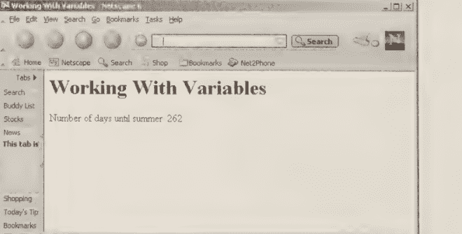

通过这种方式，当你将数据存储在代码中的变量中时，该数据就可以被你的代码访问。你可以设置变量中的值，如果需要可以更改该值，并从代码中访问它。现在我们能够开始处理代码中的数据了。

请注意，我们刚刚使用 `var` 语句来声明 `numberOfDaysLeft`；我们不必说明将存储在此变量中的数据类型（在许多编程语言中你必须这样做）。JavaScript 根据你赋给变量的数据来了解变量中的数据类型；例如，将 262 赋值给 `numberOfDaysLeft` 告诉 JavaScript 这个变量将存储数值数据：

```
numberOfDaysLeft = 262
```

如果我存储了一个字符串，JavaScript 就会知道该变量存储的是字符串数据：

```
numberOfDaysLeft = "Two hundred sixty two days left"
```

你可以随时更改存储在变量中的数据类型——只需为其分配新数据即可。在这里，我将存储在 `numberOfDaysLeft` 中的数据类型从数字更改为字符串：

```
numberOfDaysLeft = 262
numberOfDaysLeft = "Two hundred sixty two days left"
```

**提示**

实际上，JavaScript 是一门相当宽容的语言。虽然你应该在使用变量之前先声明它们，但这并不是严格要求的——仅仅使用变量就可以默认声明它们。我本可以只使用语句 `numberOfDaysLeft = 262` 和 `document.write("Number of days until summer: " + numberOfDaysLeft + ".")`。JavaScript 实际上会坚持要求你在使用变量之前声明变量的唯一情况是当它们可能与其他同名变量冲突时，我们将在下一章中更多地了解这一点。

#### 变量命名

还请注意我们第一个变量的名称：`numberOfDaysLeft`。在这里，我将几个单词组合在一起使用这个名称，并且我使用了 Java 变量命名约定，这是 JavaScript 中的标准。这意味着变量名以小写字母开头，构成名称的每个单词的首字母都大写。另一个标准选项是使用下划线来组合变量名，像这样：`number_of_days_left`。但是，通常最好坚持使用 Java 命名约定；JavaScript 本身使用该约定来命名其内置函数，例如 `toUpperCase`，它将文本字符串的大小写更改为大写，我们将在本章中看到。

你不能给变量赋予与 JavaScript 保留字相同的名称（请回顾表 1.2、1.3 和 1.4）。JavaScript 变量也不能以数字开头，不能包含空格，也不能包含除下划线以外的任何标点符号。（通常，JavaScript 变量的合法名称规则与 HTML 标识符相同。）

#### 初始化变量的数据

这是 `var` 语句的语法，我们已经看过了：

```
var varname [= value] [, varname [= value] ...]
```

这是什么意思？我们将在本章和下一章中看到这样的语法语句。非斜体的术语是 JavaScript 关键字；斜体的术语是可以填写自己项目的占位符。例如，这里的 `varname` 是你声明的变量名称的占位符。方括号 `[` 和 `]` 是在语法语句中表示可选内容的标准方式。（你会在所有 JavaScript 文档中看到这个，所以我会在这里使用相同的技术。）因此，你可以选择编写如下 `var` 语句：

```
var numberOfDaysLeft = 262
```

这在一个步骤中声明了一个变量并为其赋值。这与你使用这两个语句相同：

```
var numberOfDaysLeft
numberOfDaysLeft = 262
```

另请注意，正如你在前面的语法语句中看到的，你可以在同一个 `var` 语句中声明多个变量——甚至可以像这个例子一样初始化它们：

```
var numberOfDaysLeft = 262, numberOfNightsLeft = 261, numberOfCustomersLeft = 2
document.write("Number of days until summer: " + numberOfDaysLeft + ".")
```

这在一个 `var` 语句中声明并初始化了三个变量。这与以下三个 `var` 语句的结果相同：

```
var numberOfDaysLeft = 262
var numberOfNightsLeft = 261
var numberOfCustomersLeft = 2
document.write("Number of days until summer: " + numberOfDaysLeft + ".")
```

### 在哪里使用 `var` 语句？

还有一件事需要了解：到目前为止，我一直将 `var` 语句作为脚本中的第一条语句使用，事实上，在许多语言中，变量声明必须放在首位。然而，在 JavaScript 中，你可以在需要的地方使用 `var` 语句；它完全不必是脚本中的第一条语句：

```
<HTML>
    <HEAD>
        <TITLE>
            Working With Variables
        </TITLE>
    </HEAD>

    <BODY>
        <H1>Working With Variables</H1>
        <FORM NAME="Form1">
        </FORM>
        <SCRIPT LANGUAGE="JavaScript">
        <!--
            document.write("Welcome to my Web page!<BR>")
            var numberOfDaysLeft
            numberOfDaysLeft = 262
            document.write("Number of days until summer: " + numberOfDaysLeft + ".")
        // -->
        </SCRIPT>
    </BODY>
</HTML>
```

我们将在下一章介绍 `for` 循环时看到更多相关内容。

### 常量

从"变量"这个名字可以看出，变量中的值是可以改变的。然而，你可能*不希望*变量中的值发生变化——例如，你可能希望存储圆周率 π 的值 3.1415926，以便在整个脚本中方便地使用。π 的值是不会变的；但如果将其存储在变量中，就有可能在脚本中的某个地方被无意中更改。Netscape Navigator 6 版本使你能够使用 `const` 语句来声明*常量*，如表 2.2 所示。常量一旦声明，其值便不能更改。

| Statement | NS2 | NS3 | NS4 | NS6 | IE3a | IE3b | IE4 | IE5 | IE5.5 | IE6 |
|-----------|-----|-----|-----|-----|------|------|-----|-----|-------|-----|
| const     |     |     |     | x   |      |      |     |     |       |     |

表 2.2 `const` 语句

该语句的语法与 `var` 语句的语法非常相似：

```
const constname [= value] [..., constname [= value] ]
```

常量与变量类似，只是初始化后不能更改其值。以下是一个示例，我使用名为 `pi` 的常量来保存 π 的值：

> **（网站上的 Listing 02-02.html）**

```
<HTML>
  <HEAD>
    <TITLE>
      Working With Arrays
    </TITLE>
  </HEAD>

  <BODY>
    <H1>Working With Arrays</H1>
    <FORM NAME="Form1">
charts/stocks
    </FORM>
    <SCRIPT LANGUAGE="JavaScript">
    <!--
        const pi = 3.1415926
        document.write("Pi is " + pi + ".")
    // -->
    </SCRIPT>
  </BODY>
</HTML>
```

### 字符串操作

我们已经了解了 JavaScript 中的各种数据类型，其中有一种值得在这里进一步探讨：字符串。JavaScript 中的这种数据类型远比表面上看起来要丰富，现在了解这种数据类型是个不错的主意，因为我们在整本书中都会用到它。

当你将字符串值赋给变量时，该字符串被视为字面量值，并以字符串字面量的形式存储，这意味着只有构成文本的实际字符被存储在变量中：

```
var myText = "How do you like my text? Pretty good, huh?"
```

> **提示**
>
> JavaScript 本身对字符串字面量的长度没有限制。但请注意，一些较旧的浏览器有最大 255 个字符的字符串长度限制。

处理字符串中的实际字符是一种非常常见的需求，例如将所有字符转换为小写、搜索某个子字符串，或将某些字符替换为其他字符。为了让你能够轻松完成这些操作，JavaScript 提供了字符串对象，该对象内置了用于所有这些操作的方法。

> **提示**
>
> 如第 1 章"JavaScript 基础"所述，你可以用单引号或双引号括住字符串。如果字符串本身包含引号，最好交替使用不同类型的引号，像这样：`" 'Hello,' he said."` 或 `'"Hello," he said.'`，这样浏览器就不会混淆。请记住，撇号被视为单引号，这可能会带来麻烦。为了避免这个问题，你可以使用 `\'` 而不是单独的 `'` 来告诉浏览器只插入一个 `'` 字符到字符串中，但*不要*将其视为字符串的开头或结尾，像这样：`'Welcome to Frank\'s web page!<BR>'`。你也可以用同样的方式使用 `\"`，像这样：`"\"Hello,\" he said."`。

所有支持脚本的浏览器都支持字符串对象（换句话说，从 Netscape Navigator 2 和 Internet Explorer 3 开始）。正如我们将在第 18 章"日期、时间和字符串对象"中详细讨论字符串对象时看到的，要创建一个字符串对象（不仅仅是字符串字面量），你需要使用 `new` 运算符并指定字符串的文本，如下所示，我正在创建一个名为 `myString` 的字符串对象：

```
var myText = "How do you like my text? Pretty good, huh?"
var myString = new String("How do you like my text? Pretty good, huh?")
```

现在我们可以使用字符串对象的所有内置方法，例如 `toUpperCase`——它将字符串对象中的文本转换为大写——对 `myString` 进行操作，像这样：

```
var myText = "How do you like my text? Pretty good, huh?"
var myString = new String("How do you like my text? Pretty good, huh?")
document.write(myString.toUpperCase())
```

那么这对简单的字符串变量 `myText` 有什么帮助呢？尽管 `myText` 中的文本是以简单字符的形式存储的，但事实证明 JavaScript 允许你对 `myText` 使用字符串对象的所有方法；它会临时将 `myText` 转换为字符串对象以便实现这一点。结果是，我们可以在简单变量 `myText` 上使用字符串对象的所有属性和方法，这在处理文本时非常有用：

```
var myText = "How do you like my text? Pretty good, huh?"
var myString = new String("How do you like my text? Pretty good, huh?")
document.write(myString.toUpperCase())
document.write(myText.toUpperCase())
```

以下是一个展示更多字符串对象属性和方法的示例。在本例中，我使用 `length` 属性来找出 `myText` 中有多少个字符。它使用 `toUpperCase` 方法查看大写形式的文本，使用 `toLowerCase` 方法查看小写形式的文本。该示例使用 `italics` 方法查看斜体形式的文本，使用 `indexOf` 方法在文本中查找单个单词，以及使用 `replace` 方法将一个单词替换为另一个单词，如下所示：

> **（网站上的 Listing 02-03.html）**

```
<HTML>
  <HEAD>
    <TITLE>
      Working With Strings
    </TITLE>
  </HEAD>

  <BODY>
    <H1>Working With Strings</H1>
    <SCRIPT LANGUAGE="JavaScript">
    <!--
      var text = "Here " + "is " + "the " + "text!"
      document.write("The text: " + text + "<BR>")
      document.write("The length of the text: " + text.length + "<BR>")
      document.write("In upper case: " + text.toUpperCase() + "<BR>")
      document.write("In lower case: " + text.toLowerCase() + "<BR>")
      document.write("In italics: " + text.italics() + "<BR>")
      document.write("Location of 'the': " + text.indexOf("the") + "<BR>")
      document.write("Replacing is with isn't: " + text.replace("is", "isn't") + "<BR>")
      if(navigator.appName == "Netscape") {
        document.write("The third letter is: " + text[2] + "<BR>")
      }
    // -->
    </SCRIPT>
  </BODY>
</HTML>
```

图 2.2 显示了这段代码的结果。我们将在第 18 章中深入了解字符串对象的所有这些属性和方法，但在这个阶段知道它们的存在是很有好处的。

这里还要注意两点。首先，正如我们在前一章已经提到的，你可以使用 + 字符串运算符将字符串连接在一起，这称为拼接。换句话说，这两条语句做的是同一件事：

```
var text = "Here " + "is " + "the " + "text!"
var text = "Here is the text!"
```

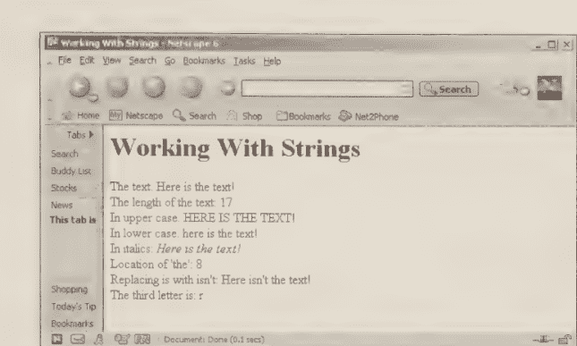

图 2.2 在 Netscape Navigator 中使用字符串。

其次，Netscape Navigator——但不是 Internet Explorer——允许你以简单的方式访问字符串中的单个字符。例如，`text[0]` 给出 `text` 中的第一个字符，`text[1]` 给出第二个字符，依此类推：

```
if(navigator.appName == "Netscape") {
    document.write("The third letter is: " + text[2] + "<BR>")
}
```

这种使用方括号 `[` 和 `]` 中的数字来访问字符的方式，将它们视为存储在*数组*中一样，这正好引出了我们的下一个主题：JavaScript 数组。不过在进入数组之前，有必要在本节末尾指出，字符串和数字在 JavaScript 中是十分不同的——这一点可能会让初学者感到困惑，我们将在下文中看到。

### 数据转换

字符串在 JavaScript 中与数字不同。如果你在变量中存储*数字* `5`，这与在变量中存储*字符串* `"5"` 是不同的。字符串 `"5"` 就是一个字符串，就像字符串 `"Now is the time!"` 一样。

这意味着如果你将字符串 `"5"` 存储在变量 `myStringValue` 中，如下所示，你应该记住它是以文本形式存储的：

```
var myStringValue = "5"
```

如果你想以数字形式存储一个值，可以像这样将其存储为数字，这里我创建了一个名为 `myNumericValue` 的新变量：

```javascript
var myStringValue = "5"
var myNumericValue = 5
```

现在我可以将 `myNumericValue` 视为数字来处理。例如，如果我想给 `myNumericValue` 的值加上1，我可以使用 + 加法运算符（我们将在本章看到它），像这样：

```javascript
var myStringValue = "5"
var myNumericValue = 5
document.write(myNumericValue + 1 + "<BR>")
```

这会显示数字6，这是正确的行为。如果我尝试做同样的事情，按照如下方式给 `myStringValue` 的值加上1，结果会完全不同：

```javascript
var myStringValue = "5"
var myNumericValue = 5
document.write(myNumericValue + 1 + "<BR>")
document.write(myStringValue + 1 + "<BR>")
```

这次，JavaScript 将字符串 "5" 视为你正在使用 + 运算符进行操作，对 JavaScript 来说，这意味着你正在连接字符串，而不是相加数字。结果是 JavaScript 将你添加的数字1转换为字符串，这意味着 `myStringValue` + 1 实际上显示的是 "51"，而不是数值6！

那么如何将 `myStringValue` 中的值转换为数字呢？JavaScript 有两个内置函数可以实现这一点：`parseInt` 和 `parseFloat`。我们在上一章中已经介绍了函数——当你将函数名放在代码中时，该函数就会被调用，并执行其中的代码。正如我们将在下一章看到的，你可以向函数*传递*数据值供其处理，这就是 `parseInt` 和 `parseFloat` 的工作原理。

你使用 `parseInt` 将带引号的数字（如 "5"）转换为整数，使用 `parseFloat` 将带引号的数字（如 "2.7128"）转换为浮点数。要向这类函数传递数据值，你需要将该值放在函数名后的括号中。这意味着我可以将 `myStringValue` 中的值转换为数字，然后加上1（以得到结果6），像这样：

```javascript
var myStringValue = "5"
var myNumericValue = 5
document.write(myNumericValue + 1 + "<BR>")
document.write(parseInt(myStringValue) + 1 + "<BR>")
```

就是这样；`parseInt` 将字符串 `myStringValue` 为我们转换成了数字。关于 `parseInt` 的使用示例，请参阅第6章“使用核心 HTML 方法和事件”中的“onfocus 事件”部分。

> **提示**
>
> 你还可以向 `parseInt` 函数传递一个基数（称为基数 radix）来转换数字。例如，`parseInt(myStringValue, 16)` 将 `myStringValue` 从字符串转换为十六进制（基数为16）的数字。

更近期（自 Netscape Navigator 4.0 和 Internet Explorer 4.0 以来），你可以使用 `Number` 函数，它会将字符串适当地转换为整数或浮点数：

```javascript
var myStringValue = "5"
var myNumericValue = 5
document.write(myNumericValue + 1 + "<BR>")
document.write(parseInt(myStringValue) + 1 + "<BR>")
document.write(Number(myStringValue) + 1 + "<BR>")
```

> **提示**
>
> 要确保 `parseInt`、`parseFloat` 或 `Number` 返回的值是有效数字，你可以使用 `isNaN` 函数（其名称代表“is not a number”），我们将在第3章“JavaScript 语言：循环、函数和错误”中看到它，用法如下：`isNaN(myValue)`。如果 `myValue` 不是合法数字，`isNaN(myValue)` 的计算结果将为 true，你可以使用本章末尾将介绍的 `if` 语句来检查这个结果。

反向操作呢？将数字转换为字符串呢？例如，如果你想将数字5转换为字符串 "5"？我们已经看到，当你将一个数字加到一个字符串前面时，例如 "5" + 1，结果是一个字符串 "51"。所以，如果你将一个空字符串 ""（不包含任何字符）加到一个数字上，结果是一个字符串。这意味着要将数字5转换为字符串 "5"，你只需将数字加到空字符串上，像这样：`"" + 5`。代码中看起来是这样的：

```javascript
myStringValue = "" + 5
```

变量可以同时保存数字和字符串数据，这一事实有时会导致问题，例如当你向变量中已有的数据添加了错误类型的值时，如果脚本没有按预期执行，就需要留意这一点。

### 数组

比在简单变量中存储数据更进一步的是将数据存储在数组中。与简单变量不同，数组可以存储多个值，每个值都有一个索引号。要访问特定的值，你不仅要指定数组名称，还要指定所需值的索引号。JavaScript 数组由 `Array` 对象支持，你可以在表2.3中看到该对象的支持情况。第19章“Math、Number、Boolean 和 Array 对象”将深入介绍 `Array` 对象。

表2.3：`Array` 对象

| 语句 | NS2 | NS3 | NS4 | NS6 | IE3a | IE3b | IE4 | IE5 | IE5.5 | IE6 |
|---|---|---|---|---|---|---|---|---|---|---|
| Array | | x | x | x | | x | x | x | x | x |

让我们看一个例子，了解其工作原理以及数组为何有用。我将首先创建一个名为 `names` 的数组，用于存储朋友的姓名。我将使用语句 `var names = new Array(4)` 来设置该数组，并使其足够大以存储四个数据项。因为 Array 是一种对象，而不仅仅是简单的变量类型，所以你需要使用 `new` 关键字来创建 Array 类型的对象。在 JavaScript 中，当你显式创建对象时，必须使用 `new` 关键字，例如 String 或 Array 对象（但在声明普通变量时则不需要）——这一点很容易记住，因为我们只会创建少数几种类型的对象：String、Array、Date 等。以下是创建新数组的代码：

```html
<HTML>
    <HEAD>
        <TITLE>
            使用数组
        </TITLE>
    </HEAD>

    <BODY>
        <H1>使用数组</H1>
        <SCRIPT LANGUAGE="JavaScript">
        <!--
            var names = new Array(4)
            .
            .
            .
            // -->
        </SCRIPT>
    </BODY>
</HTML>
```

这使用 Array 对象的*构造函数*创建了一个新数组。构造函数与对象类型本身具有相同的名称（如 `String` 或 `Date`），你使用构造函数来创建该类型的新对象。你可以通过将数据放在构造函数名称后的括号中来向对象的构造函数发送数据（可以发送什么数据取决于对象类型及其构造函数的期望）。例如，我们这里使用的代码 `new Array(4)` 使用 `Array` 构造函数创建了一个包含四个元素的数组。（我们将在第20章“`RegExp` 对象：使用正则表达式”中更多地了解构造函数。）这样就设置了我们的数组；但是如何实际地使用这个新数组来存储和检索数据呢？

#### 访问数组数据

要访问数组中的项，可以使用索引号。`names` 数组中的第一项是 `names[0]`，第二项是 `names[1]`，依此类推。（数组中的第一项始终被赋予索引号0，这意味着最后一项的索引号等于数组中项目的总数减一。）我可以将所有这些项视为简单变量，如下所示为其赋值：

**（网站上的清单 02-04.html）**

```html
<HTML>
    <HEAD>
        <TITLE>
            使用数组
        </TITLE>
    </HEAD>

    <BODY>
        <H1>使用数组</H1>
        <SCRIPT LANGUAGE="JavaScript">
        <!--
            var names = new Array(4)
            names[0] = "Frank"
            names[1] = "Nancy"
            names[2] = "Dan"
            names[3] = "Claire"
            document.write(names[0])
        // -->
        </SCRIPT>
    </BODY>
</HTML>
```

还要注意，我在脚本末尾使用 `document.write` 显示了 `names[0]` 的值。数组的有用之处在于你可以在代码中控制索引号——例如，你可以引用数组中的项，使用变量作为索引号，就像这样：`names[variable1]`。你的代码可以改变`variable1`的值，从而轻松访问`names`数组中的所有元素。

当你处理一长串数据时，这尤其有用——你的脚本只需反复将`variable1`增加1，就能访问数据集中的所有元素并处理它们。像这样的重复性操作正是计算机的拿手好戏（正如我们将在下一章中看到的，我们将讨论JavaScript *循环*，它们完全是为了处理这种重复性动作，在整个数据集上一遍又一遍地执行相同的代码）。

在JavaScript中，你不必在数组中使用索引数字；你也可以使用索引字符串。这意味着你可以使用字符串（而不仅仅是数字）来在数组中存储值。以下是一些示例：

```
var names = new Array(4)
names["first"] = "Frank"
names["second"] = "Nancy"
names["third"] = "Dan"
names["fourth"] = "Claire"
document.write(names["first"])
```

如果你想使用诸如"birthday"、"address"、"phoneNumber"等名称来存储数据，并使用这些名称（而不是索引数字）来访问数据，这会很有用。像这样使用字符串作为索引来访问数据的数组也被称为*关联数组*。

还有一点值得了解：你可以在使用`Array`构造函数创建数组时，通过直接列出数据来初始化数组，就像这样：

```
var values = new Array(1, 2, 3, 4)
```

要使用此技术，你必须指定不止一个数组元素。你甚至可以这样创建并初始化一个新数组：

```
var values = [1, 2, 3, 4]
```

#### 确定数组长度

我们将在第19章深入探讨数组对象，但这里值得看看该对象的一个属性：`length`属性，它告诉你数组中有多少个元素。下面是一个展示如何使用此属性的示例：

**(网站上的代码清单 02-05.html)**

```
<HTML>
    <HEAD>
        <TITLE>
            Finding the Length of an Array
        </TITLE>
    </HEAD>

    <BODY>
        <H1>Finding the Length of an Array</H1>
        <SCRIPT LANGUAGE="JavaScript">
        <!--
            var names = new Array(4)
            names[0] = "Frank"
            names[1] = "Nancy"
            names[2] = "Dan"
            names[3] = "Claire"
            document.write("The names array has " + names.length + " items.")
        // -->
        </SCRIPT>
    </BODY>
</HTML>
```

图2.3显示了结果。

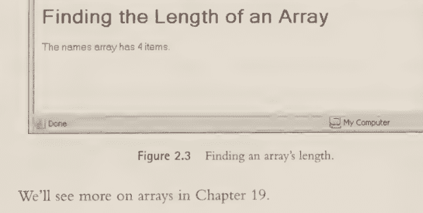

图 2.3 查找数组长度

我们将在第19章中了解更多关于数组的内容。

## 运算符

至此，我们准备好从数据存储迈向下一步，开始真正处理那些数据了。为此，我们将开始使用JavaScript *运算符*。我们已经简要讨论过运算符；它们使你能够对数据进行操作，例如这个例子，我使用 + 加法运算符将两个数字相加：

```
result = 5 + 4
```

你也可以在变量的值上使用运算符，例如这个例子，我使用 * 乘法运算符将变量`numberOfWeeks`中的值乘以七，并将结果赋给变量`numberOfDays`：

```
numberOfDays = 7 * numberOfWeeks
```

这是另一个例子；这次，我使用JavaScript的除法运算符`/`将磅转换为千克：

**(网站上的代码清单 02-06.html)**

```
<HTML>
    <HEAD>
        <TITLE>
            Working With Operators
        </TITLE>
    </HEAD>

    <BODY>
        <H1>Working With Operators</H1>
        <SCRIPT LANGUAGE="JavaScript">
        <!--
            var pounds = 5.0
            var kilograms = pounds / 2.2046
            document.write(pounds + " pounds = " + kilograms + " kilograms.")
        // -->
        </SCRIPT>
    </BODY>
</HTML>
```

你可以在图2.4中看到结果，精度高得有些过分。

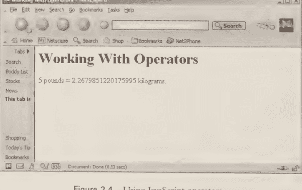

图 2.4 使用JavaScript运算符

JavaScript有各种各样的运算符——赋值、比较、算术、位运算、逻辑、字符串和特殊运算符。你可以在表2.4中找到所有运算符及其功能的列表。

### 表 2.4 JavaScript 运算符

| 运算符类别 | 运算符 | 描述 |
| :--- | :--- | :--- |
| 算术运算符 | + | （加法）将两个数字相加。 |
| | ++ | （递增）将表示数字的变量加一。 |
| | - | （一元取反，减法）作为一元运算符时，更改其参数值的符号。作为二元运算符时，减去两个数字。 |
| | -- | （递减）将表示数字的变量减一。 |
| | * | （乘法）将两个数字相乘。 |
| | / | （除法）将两个数字相除。 |
| | % | （取模）返回两个数字相除后的整数余数。 |
| 字符串运算符 | + | （字符串相加）连接两个字符串。 |
| | += | 连接两个字符串并将结果赋给第一个操作数。 |
| 逻辑运算符 | && | （逻辑与）当与布尔值一起使用时，如果两个操作数都为真，则`&&`返回真；否则，返回假。 |
| | \|\| | （逻辑或）当与布尔值一起使用时，如果任一操作数为真，则`\|\|`返回真；如果两个都为假，则返回假。 |
| | ! | （逻辑非）如果其唯一操作数可以转换为真，则返回假；否则，返回真。 |
| 位运算符 | & | （按位与）如果两个操作数的对应位都为1，则在结果的对应位上返回1。 |
| | ^ | （按位异或）异或。如果只有一个操作数（而不是两个）的对应位为1，则在结果的对应位上返回1。 |
| | \| | （按位或）如果任一操作数的对应位为1，则在结果的对应位上返回1。 |
| | ~ | （按位非）翻转其操作数的每一位。 |
| | << | （左移）将第一个操作数向左移动第二个操作数指定的位数，右边补零。 |
| | >> | （符号位保持右移）将第一个操作数向右移动第二个操作数指定的位数，丢弃移出的位。 |
| | >>> | （零填充右移）将第一个操作数向右移动第二个操作数指定的位数，丢弃移出的位，左边补零。 |
| 赋值运算符 | = | 将第二个操作数的值赋给第一个操作数。 |
| | += | 两个数字相加并将结果赋给第一个操作数。 |
| | -= | 两个数字相减并将结果赋给第一个操作数。 |
| | *= | 两个数字相乘并将结果赋给第一个操作数。 |
| | /= | 两个数字相除并将结果赋给第一个操作数。 |
| | %= | 两个数字取模并将结果赋给第一个操作数。 |
| | &= | 执行按位与并将结果赋给第一个操作数。 |
| | ^= | 执行按位异或并将结果赋给第一个操作数。 |
| | \|= | 执行按位或并将结果赋给第一个操作数。 |
| | <<= | 执行左移并将结果赋给第一个操作数。 |
| | >>= | 执行符号位保持右移并将结果赋给第一个操作数。 |
| | >>>= | 执行零填充右移并将结果赋给第一个操作数。 |
| 比较运算符 | == | 相等运算符。如果操作数相等，则返回真。 |
| | != | 如果操作数不相等，则返回真。 |
| | === | 严格相等运算符。如果操作数相等且类型相同，则返回真。 |
| | !== | 如果操作数不相等和/或类型不同，则返回真。 |
| | > | 大于运算符。如果左操作数大于右操作数，则返回真。 |
| | >= | 大于或等于运算符。如果左操作数大于或等于右操作数，则返回真。 |
| | < | 小于运算符。如果左操作数小于右操作数，则返回真。 |
| | <= | 小于或等于运算符。如果左操作数小于或等于右操作数，则返回真。 |
| 特殊运算符 | ?: | 条件运算符。执行简单的“if...else”测试。 |
| | , | 逗号运算符。计算两个表达式。返回第二个表达式的结果。 |
| | delete | 删除一个对象、对象的属性或数组中给定索引处的元素。 |
| | function | 定义一个匿名函数（在第3章讨论）。 |
| | in | 如果给定属性存在于给定对象中，则返回真。 |
| | instanceof | 如果给定对象是指定的对象类型，则返回真。 |
| | new | 从用户定义的对象类型或内置对象类型创建一个新对象。 |
| | typeof | 返回一个字符串，指示其操作数的类型。 |
| | void | 使表达式被求值但不返回值。 |

哪些浏览器支持哪些运算符？你会在表2.5中找到这些信息。

### 表2.5 各浏览器中的JavaScript运算符

| 运算符 | NS2 | NS3 | NS4 | NS6 | IE3a | IE3b | IE4 | IE5 | IE5.5 | IE6 |
| :--- | :---: | :---: | :---: | :---: | :---: | :---: | :---: | :---: | :---: | :---: |
| 算术 | x | x | x | x | x | x | x | x | x | x |
| 赋值 | x | x | x | x | x | x | x | x | x | x |
| 比较 | x | x | x | x | x | x | x | x | x | x |
| 按位 | x | x | x | x | x | x | x | x | x | x |
| 逻辑 | x | x | x | x | x | x | x | x | x | x |
| 字符串 | x | x | x | x | x | x | x | x | x | x |
| 条件 | x | x | x | x | x | x | x | x | x | x |
| 逗号 | x | x | x | x | x | x | x | x | x | x |
| delete | | x | x | x | | | x | x | x | x |
| function | | | | x | | | | | x | x |
| in | | | | x | | | | | x | x |
| instanceof | | | | x | | | | x | x | x |
| new | x | x | x | x | x | x | x | x | x | x |
| typeof | | x | x | x | x | x | x | x | x | x |
| void | | x | x | x | x | x | x | x | x | x |

既然谈到运算符，现在该介绍几个术语了，比如*表达式*。表达式是任何JavaScript可以求值以获得单个值的内容。例如，5就是一个简单的表达式，它求值结果就是5。表达式5 + 4的求值结果是9。如果`myValue`的值是10，那么表达式`myValue * 2`的求值结果就是20。你会在JavaScript文档中经常看到“表达式”这个术语，现在你知道了它的含义——一个JavaScript可以求值为单个值的术语或术语组。

此外，在JavaScript中，运算符作用于*操作数*。例如，在表达式5 + 4中，运算符是+加法运算符，5是左操作数，4是右操作数。只接受一个操作数的运算符是*一元*运算符，接受两个的是*二元*运算符，接受三个的是*三元*运算符。好了；现在我们准备好开始详细查看JavaScript为我们提供的运算符了，首先从赋值运算符开始。

### 赋值运算符

赋值运算符根据其右操作数的值，为其左操作数赋值。最常见的赋值运算符是=，它只是将一个表达式的值赋给一个变量，就像我们已经看到的这行代码：

```
var kilograms = pounds / 2.2046
```

其他赋值运算符是*简写赋值运算符*。它们如何工作呢？如果你想给一个值加一，可以这样做：

```
todaysDate = todaysDate + 1
```

然而，使用+=简写运算符，你可以这样做，稍微简单一些：

```
todaysDate += 1
```

换句话说，语句`todaysDate = todaysDate + 1`与语句`todaysDate += 1`执行相同的操作。在你的代码中，你可以使用其中任何一种。表2.6列出了JavaScript的简写赋值运算符。

| 简写运算符 | 等同于 |
|---|---|
| x += y | x = x + y |
| x -= y | x = x - y |
| x *= y | x = x * y |
| x /= y | x = x / y |
| x %= y | x = x % y |
| x <<= y | x = x << y |
| x >>= y | x = x >> y |
| x >>>= y | x = x >>> y |
| x &= y | x = x & y |
| x ^= y | x = x ^ y |
| x |= y | x = x | y |

### 算术运算符

正如你在表2.6中看到的，算术运算符使你能够对数值进行运算，包括加法（使用+运算符）、减法（使用-运算符）、乘法（使用*运算符）、除法（使用/运算符）等等。我们已经看到这些运算符在工作；这里有一个我们见过的例子，使用/运算符将磅转换为千克：

```
<HTML>
    <HEAD>
        <TITLE>
            Working With Operators
        </TITLE>
    </HEAD>

    <BODY>
        <H1>Working With Operators</H1>
        <SCRIPT LANGUAGE="JavaScript">
        <!--
            var pounds = 5.0
            var kilograms = pounds / 2.2046
            document.write(pounds + " pounds = " + kilograms + " kilograms.")
        // -->
        </SCRIPT>
    </BODY>
</HTML>
```

另一个有用的算术运算符是取模运算符%，它返回两个数相除后的模数或整数余数（例如，18 % 5 = 3）。

除了标准的算术运算符+、-、*、/和%之外，这里还需要提三个：自增、自减和一元取负运算符。

#### 自增运算符：++

自增运算符++，给它的操作数加一。例如，如果`myVariable`的值是10，表达式`myVariable++`会将`myVariable`中的值递增到11。这是一个方便的运算符，但这里有件事你应该知道：你可以在变量名*前*或*后*使用它，像这样：`++myVariable`或`myVariable++`。当在变量名前使用时，变量的值会在语句其余部分执行*之前*递增；当在变量名后使用时，变量的值会在其值被读取并在语句中使用*之后*递增。下面是一个例子：

**（清单 02-07.html 在网站上）**

```
<HTML>
    <HEAD>
        <TITLE>
            Working With the Increment Operator
        </TITLE>
    </HEAD>

    <BODY>
        <H1>Working With the Increment Operator</H1>
        <SCRIPT LANGUAGE="JavaScript">
        <!--
            var votesDistrictOne = 5
            var votesDistrictTwo = 5
            document.write("The number of votes in district 1 is "
            + ++votesDistrictOne + ".")
            document.write("The number of votes in district 2 is "
            + votesDistrictTwo++ + ".")
        // -->
        </SCRIPT>
    </BODY>
</HTML>
```

你可以在图2.5中看到这两种递增方式之间的区别。在递增完成后，`votesDistrictOne`和`votesDistrictTwo`最终的值都是6，但要注意`votesDistrictTwo`是在语句其余部分执行完成后才递增的，这意味着它的值在图2.5中仍然显示为5。

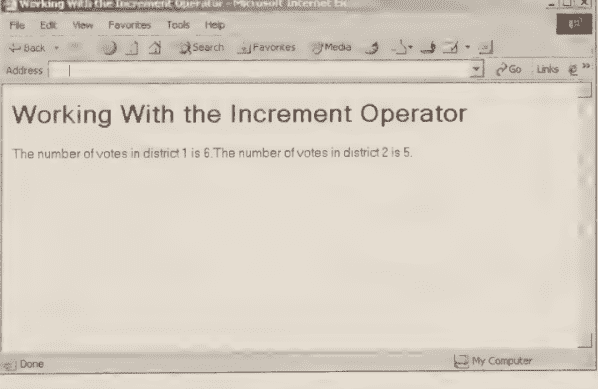

图2.5 使用自增运算符。

#### 自减运算符：--

自减运算符--，只是将其操作数减一。与++类似，它可以在变量名前和后使用，像这样：`--votesDistrictOne`和`votesDistrictOne--`；在这些情况下，该运算符的工作方式与自增运算符++相同，只不过它递减变量的值。

#### 一元取负运算符：-

一元取负运算符只是改变其操作数的符号。（它被称为一元取负运算符，因为它是一个只接受一个操作数的一元运算符。）如果变量`temperature`的值是-30，并且你执行JavaScript语句`newTemperature = -temperature`，那么`newTemperature`的值将是30。

### 比较运算符

比较运算符比较它们的两个操作数，并返回一个*布尔*值`true`或`false`。正如我们在讨论数据类型时回忆的那样，布尔值只能取两个值：`true`或`false`。当你在测试数据以查看各种条件是真还是假时，这非常有用，比如你测试选择披萨作为晚餐的人是否比选择汉堡的人多，等等。

为了更清楚地说明这一点，考虑这个例子。比较运算符通常与JavaScript语句一起使用，例如`if`语句（本章后面讨论），我将在这里在`if`语句中使用它们。`if`语句使你能够根据条件是否为真来执行代码或不执行代码——你可以使用比较运算符来指定条件。在这个例子中，我比较选择披萨的票数与选择汉堡的票数。如果选择披萨的票数多于选择汉堡的票数，使用`>`（大于）比较运算符的表达式`votesForPizza > votesForHamburgers`将返回一个值`true`，这意味着`if`语句中花括号`{`和`}`括起来的代码将被执行，并且消息"Pizza wins!"将出现在网页上：

```
var votesForPizza = 5
var votesForHamburgers = 6
if(votesForPizza > votesForHamburgers) {
    document.write("Pizza wins!")
}
```

然而，如果表达式`votesForPizza > votesForHamburgers`是`false`，那么`if`语句中花括号括起来的代码将不会被执行。因此，我添加了额外的`if`语句，使用`<`（小于）和`==`（等于）比较运算符，像这样：

### 使用比较运算符

```
<HTML>
    <HEAD>
        <TITLE>
            Working With Comparison Operators
        </TITLE>
    </HEAD>

    <BODY>
        <H1>Working With Comparison Operators</H1>
        <SCRIPT LANGUAGE="JavaScript">
        <!--
            var votesForPizza = 5
            var votesForHamburgers = 6
            if(votesForPizza > votesForHamburgers) {
                document.write("Pizza wins!")
            }
            if(votesForPizza < votesForHamburgers) {
                document.write("Hamburgers win!")
            }
            if(votesForHamburgers == votesForPizza ) {
                document.write("Tie!")
            }
        // -->
        </SCRIPT>
    </BODY>
</HTML>
```

你可以在图 2.6 中看到结果，其中汉堡包获胜。了解比较运算符在 JavaScript 编程中非常重要。表 2.7 列出了这些运算符。

### 表 2.7 JavaScript 比较运算符

| 运算符 | 功能 |
|----------|-----------|
| == | 等于运算符。如果两个操作数相等，则求值为 true。注意在检查相等性时使用 ==，而不是 =。 |
| != | 如果两个操作数不相等，则求值为 true。 |
| === | 严格等于运算符。如果操作数相等，并且它们也必须是相同类型，则求值为 true。 |
| !== | 如果操作数不相等或不是相同类型，则求值为 true。 |
| > | 大于运算符。如果左操作数在数值上、字典顺序上或使用对象数据转换函数时大于右操作数，则求值为 true。 |
| >= | 大于或等于运算符。如果左操作数在数值上、字典顺序上或使用对象数据转换函数时大于或等于右操作数，则求值为 true。 |
| < | 小于运算符。如果左操作数在数值上、字典顺序上或使用对象数据转换函数时小于右操作数，则求值为 true。 |
| <= | 小于或等于运算符。如果左操作数在数值上、字典顺序上或使用对象数据转换函数时小于或等于右操作数，则求值为 true。 |

特别要注意等于比较运算符 ==：

```
if(votesForHamburgers == votesForPizza ) {
    document.write("Tie!")
}
```

首先需要注意的是，要检查两个值是否相等，你必须使用 == *比较*运算符，而不是 = *赋值*运算符。我特别强调这一点，因为本该使用 == 时却使用了 = 是一个常见的错误。如果我在这里说了 `votesForHamburgers = votesForPizza`，那只是将 `votesForPizza` 中的值赋给了 `votesForHamburgers`，而没有进行比较。

那么，什么时候值被认为是相等的呢？当两个字符串具有相同的字符序列和相同的长度时，它们被认为是相等的。当两个数值在数值上相等时，它们被认为是相等的。如果两个对象引用同一个对象，则它们是相等的。如果两个布尔值都是 true 或都是 false，则它们是相等的。

很容易看出 JavaScript 如何比较数字，但是比较字符串呢？什么时候一个字符串比另一个“更大”？这种比较是按字典顺序进行的，这意味着，例如，当你比较 apples 和 oranges 时，“oranges”被认为大于“apples”，因为“oranges”在字母顺序上排在“apples”之后。

在比较两个值时，JavaScript 会自动尝试将它们转换为相同类型进行比较。当你比较一个字符串和一个数字时，JavaScript 会尝试将字符串转换为数值。如果你将布尔值与数字进行比较，true 会被转换为 1，false 会被转换为 0。如果你将一个对象与字符串或数字进行比较，JavaScript 会检查该对象是否有用于字符串比较的名为 `toString` 的方法，以及用于数值比较的 `valueOf` 方法。如果没有，它会创建一个错误。

你可能还会注意到表 2.7 中的另外两个相等运算符，它们首次在 JavaScript 1.3 中引入：`===`（严格等于）和 `!==`（严格不等于）。如果你想确保两个值相同*并且*它们具有相同的数据类型，你将使用严格等于和严格不等于运算符。

### 逻辑运算符

就像我们刚刚查看的比较运算符一样，你在创建求值为 true 或 false 的测试条件时使用*逻辑运算符*。使用逻辑运算符，你可以创建比仅使用比较运算符更强大的测试条件。

例如，假设你想要确保名为 `temperature` 的变量中的值*介于* 65 和 75 之间。你可以使用大于比较运算符 `>` 来确保 temperature 大于 65，并使用小于比较运算符 `<` 来确保 temperature 小于 75。但是，你如何在同一个 if 语句中确保两个条件都为真呢？

这就是逻辑运算符的用武之地，因为它们使你能够将测试条件连接在一起。例如，`&&` 逻辑运算符称为逻辑与运算符。如果你像这样使用它：`expression1 && expression2`，则 `expression1` *和* `expression2` 都必须为真，整个表达式 `expression1 && expression2` 才为真；否则整个表达式的值为 false。下面是一个示例，我在其中检查温度：

**(网站上的清单 02-09.html)**

```
<HTML>
    <HEAD>
        <TITLE>
            Working With Logical Operators
        </TITLE>
    </HEAD>

    <BODY>
        <H1>Working With Logical Operators</H1>
        <SCRIPT LANGUAGE="JavaScript">
        <!--
            var temperature = 68
            if(temperature > 65 && temperature < 75) {
                document.write("In the comfort zone!")
            }
        // -->
        </SCRIPT>
    </BODY>
</HTML>
```

图 2.7 显示了此代码的结果（显示在舒适区的温度范围内）。

### 图 2.7 使用逻辑运算符。

除了 && 逻辑与运算符外，你还可以使用 || 逻辑或运算符。如果其第一个操作数或第二个操作数为 true，则 OR 运算符返回 true（与 AND 不同，AND 需要两个操作数都为 true 才能得到 true），否则返回 false。在下面的示例中，我使用了 <= 小于或等于和 >= 大于或等于运算符来检查我们是否在温度舒适区之外：

**(网站上的清单 02-10.html)**

```
<HTML>
    <HEAD>
        <TITLE>
            Working With Logical Operators
        </TITLE>
    </HEAD>
    <BODY>
        <H1>Working With Logical Operators</H1>
        <SCRIPT LANGUAGE="JavaScript">
        <!--
            var temperature = 62
            if(temperature <= 65 || temperature >= 75) {
                document.write("Outside the comfort zone!")
            }
        // -->
        </SCRIPT>
    </BODY>
</HTML>
```

还有另一个逻辑运算符：逻辑非运算符 !。你使用此运算符来反转表达式的逻辑意义。例如，如果 expression1 求值为 true，则 !expression1 将返回 false；如果 expression1 求值为 false，则 !expression1 将返回 true。

> **提示：** && 和 || 运算符在 JavaScript 中也称为*短路运算符*。特别是，因为 `false && anyExpression` *总是* false，并且 `true || anyExpression` *总是* true，所以在两种情况下，JavaScript 甚至不会计算 `anyExpression`。这意味着如果计算 `anyExpression` 有副作用，例如调用函数，这些调用——以及它们的副作用——将*不会*发生，这就是为什么这些运算符被称为短路运算符。

### 字符串运算符

另一类运算符是字符串运算符，它只包含两个运算符。我们已经见过字符串运算符 +，我们用它来连接（连接）字符串：

```
<HTML>
    <HEAD>
        <TITLE>
            Working With Strings
        </TITLE>
    </HEAD>

    <BODY>
        <H1>Working With Strings</H1>
        <SCRIPT LANGUAGE="JavaScript">
        <!--
            var text = "Here " + "is " + "the " + "text!"
            document.write("The text: " + text + "<BR>")
        // -->
        </SCRIPT>
    </BODY>
</HTML>
```

你也可以使用简写赋值运算符 `+=` 来连接字符串，这是另一个字符串运算符。如果变量 `myText` 的值为 `"Now is the "`，那么表达式 `myText += "time."` 的求值结果为 `"Now is the time."`，并将该字符串赋值给 `myText`。

### 位运算符

计算机实际上以位为单位处理数据，即处理*二进制值*，0 和 1。例如，数字 9 在二进制中实际存储为 1001。JavaScript 通过其位运算符让你能够访问它所处理数据的实际二进制位。这可能不会让你太关心，如果如此，请随意跳过。不过，为了完整起见，我将在这里包含这些细节。

你可以在下表 2.8 中看到 JavaScript 的位运算符及其功能。

| 运算符 | 用法 | 作用 |
|----------|-------|-----------|
| 按位与 | x & y | 在结果中，两个操作数对应位都为 1 的位位置置为 1。 |
| 按位或 | x \| y | 在结果中，两个操作数对应位中至少有一个为 1 的位位置置为 1。 |
| 按位异或 | x ^ y | 在结果中，两个操作数对应位*仅有一个*为 1 的位位置置为 1。 |
| 按位非 | ~ x | 翻转其操作数的每一位。 |
| 左移 | x << y | 将 x 向左移动 y 位（从右侧移入零）。 |
| 算术右移 | x >> y | 将 x 向右移动 y 位（不保留移出的位）。 |
| 零填充右移 | x >>> y | 将 x 向右移动 y 位，不保留移出的位，并从左侧移入零。 |

这些运算符将数值视为 32 位值；一个操作数中的每一位与另一个操作数中的对应位配对。以下是一个例子：

4 的二进制是 0100，1 是 0001，所以在这两个数上使用按位或运算符 `|`，得到

4 | 1 = 0100 | 0001 = 0101，即 5。这在代码中如下所示：

**（网站上的 Listing 02-11.html）**

```html
<HTML>
    <HEAD>
        <TITLE>
            Working With Bitwise OR
        </TITLE>
    </HEAD>

    <BODY>
        <H1>Working With Bitwise OR</H1>
        <SCRIPT LANGUAGE="JavaScript">
        <!--
            var result = 4 | 1
            document.write("4 | 1 = " + result)
        // -->
        </SCRIPT>
    </BODY>
</HTML>
```

图 2.8 显示了代码的结果（4 | 1 = 5）。

按位移位运算符有两个操作数：第一个是要移位数量，第二个指定第一个操作数要移位的位数（移位意味着在二进制数中向左或向右移动到相邻的位置）。移位操作的方向由所使用的运算符控制。移位运算符移位其操作数的位，并将这些操作数转换为 32 位整数。例如，9 << 1 的结果是 18，因为 1001 向左移一位变成 10010，即 18。

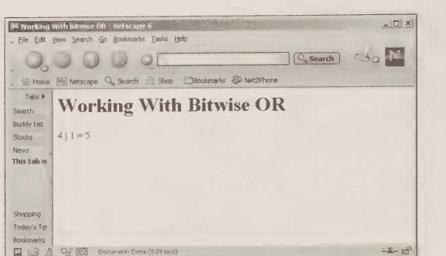

图 2.8 使用按位或运算符。

### 特殊运算符

JavaScript 还包含一些不属于任何其他类别的运算符，它称它们为*特殊运算符*。我在这里介绍一下它们。

其中两个运算符，`new` 和 `this`，是大多数 JavaScript 程序员经常使用的，但其他运算符则不常用。你可以快速浏览这些运算符，等到实际需要在代码中使用它们时再回来查阅。

#### 条件运算符：?:

到目前为止，我们看到的运算符都接受一个或两个操作数，但有一个 JavaScript 运算符，即条件运算符，它接受*三个*操作数（这使其成为 JavaScript 唯一的三元运算符）。以下是该运算符的语法，它同时使用了问号（?）和冒号（:）：

```
condition ? expression1 : expression2
```

如果 *condition* 求值为 true，该运算符返回 *expression1* 的值；否则，返回 *expression2* 的值。换句话说，该运算符为你提供了一种快速的双选方式，根据某个条件是否为 true 来进行选择。以下是一个例子：假设一家人正在投票决定晚餐吃披萨还是汉堡包。我将使用条件运算符来显示结果：

**（网站上的 Listing 02-12.html）**

```html
<HTML>
    <HEAD>
        <TITLE>
            Working With the Conditional Operator
        </TITLE>
    </HEAD>

    <BODY>
        <H1>Working With the Conditional Operator</H1>
        <SCRIPT LANGUAGE="JavaScript">
        <!--
            var votesForPizza = 5
            var votesForHamburgers = 6
            var result = votesForPizza > votesForHamburgers ? "Pizza wins!" :
                "Pizza didn't win."
            document.write(result)
        // -->
        </SCRIPT>
    </BODY>
</HTML>
```

图 2.9 显示了结果。

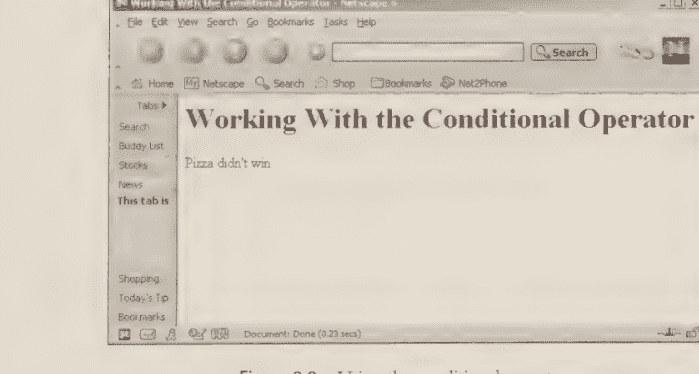

> **提示**
>
> 条件运算符可以作为 if 语句的快速单行替代品，该语句在本章后面部分介绍。

#### 逗号运算符：,

逗号运算符允许你指定两个要求值的表达式。该运算符返回第二个操作数的值。当你想在通常只接受单个表达式的地方包含多个表达式时，可以使用逗号运算符。

事实证明，该运算符最常用的场合是我们直到下一章才会涉及的地方：for 循环。（如果你以前从未见过 for 循环，最好等到我们讲到时候再看，因为我也会在那里提到逗号运算符。）for 循环允许你将一系列语句重复执行多次；以下是我们将在下一章解析的这种类型的例子——要执行的语句放在花括号 `{` 和 `}` 之间：

```
for (loop_index = 0; loop_index < 100; loop_index++)
{
    .
    .
    .
}
```

用分号分隔的表达式使你能够初始化循环、终止循环，并在每次循环时执行某些操作，我们将在下一章中看到。通常，这里每个位置只能使用一个表达式，除非你使用逗号运算符，如下面的例子所示，我在循环的初始化部分使用该运算符同时初始化了一个名为 `loop_index` 的变量和一个名为 `total` 的变量为 0：

```
for (loop_index = 0, total = 0; loop_index < 100; loop_index++)
{
    .
    .
    .
}
```

关于这个例子——以及逗号运算符——的更多内容，请参见下一章介绍 for 循环的部分。

#### delete 运算符

`delete` 运算符删除一个对象、对象的属性或数组中特定索引处的元素。以下是该运算符的用法：

```
delete object
delete object.property
delete array[index]
```

当你删除数组中的元素时，数组的长度不会改变。事实上，除了你删除的那个元素外，数组中的其他元素都不会受到影响。以下是一个例子；在这里，我将创建一个名为 `sandwiches` 的数组，其元素为 `"turkey"`、`"cheddar"`、`"ham"`、`"tuna"` 和 `"egg"`。接下来，我将通过 `delete` 运算符删除元素 2，`"ham"`（记住数组索引从 0 开始，所以元素 2 是 `"ham"`）。然后我将使用即将介绍的 `in` 运算符检查该元素是否真的被删除了。在这种情况下，如果表达式 `2 in sandwiches` 为 false，则元素 2 确实已被删除。我将用我们已经见过的 if 语句来检查；在这种情况下，如果该元素仍在数组中，if 语句将显示文本 Still here!；否则，执行 if 语句 else 部分的代码，显示 Sorry, that element is gone!：

**（网站上的 Listing 02-13.html）**

```html
<HTML>
    <HEAD>
        <TITLE>
            Working With the delete Operator
        </TITLE>
    </HEAD>

    <BODY>
        <H1>Working With the delete Operator</H1>
        <SCRIPT LANGUAGE="JavaScript">
        <!--
        sandwiches = new Array("turkey", "cheddar", "ham", "tuna", "egg")
        delete sandwiches[2]
        if (2 in sandwiches) {
            document.write("Still here!")
        } else {
            document.write("Sorry, that element is gone!")
        }
        // -->
        </SCRIPT>
    </BODY>
</HTML>
```

你可以在图 2.10 中看到这段代码的结果；元素 2 确实已被删除。我们将在下一个主题中看到更多关于 `in` 运算符的内容——以及在本章末尾看到更多关于 if 语句的内容。

#### `in` 运算符

`in` 运算符在给定元素位于数组中或给定属性位于对象中时返回 true。我们已经在前面使用 `delete` 的示例中看到了 `in` 运算符。在那个示例中，我们从名为 `sandwiches` 的数组中删除了一个元素，并使用 `in` 检查它是否真的被移除：

```
if (2 in sandwiches) {
    document.write("Still here!")
} else {
    document.write("Sorry, that element is gone!")
}
```

你也可以使用 `in` 运算符来检查对象中的属性。例如，所有数组都包含一个 `length` 属性，因此表达式 `length in sandwiches` 在这里会返回 true。

#### `instanceof` 运算符

`instanceof` 运算符在给定对象属于特定对象类型时返回 true。当你在 JavaScript 中开始处理不同类型的对象时，这个运算符非常有用——JavaScript 变量可以容纳任何类型的对象，那么你如何知道你正在处理哪种类型的对象呢？一种检查方法是使用 `instanceof` 运算符。

要使用此运算符，你需要使用这种语法：`object instanceof objectType`。如果 `object` 是 `objectType` 类型的对象，此表达式将返回 true。这里有一个例子；在这个例子中，我使用 `new` 运算符（`new` 运算符将在接下来介绍）创建了一个名为 `actor` 的字符串对象，然后使用 `instanceof` 运算符检查 `actor` 是否确实是字符串对象：

```
<HTML>
    <HEAD>
        <TITLE>
            Working With the instanceof Operator
        </TITLE>
    </HEAD>

    <BODY>
        <H1>Working With the instanceof Operator</H1>
        <SCRIPT LANGUAGE="JavaScript">
        <!--
            var actor = new String("Gary Grant")
            if (actor instanceof String) {
                document.write("It's a string.")
            }
        // -->
        </SCRIPT>
    </BODY>
</HTML>
```

正如你所料，这个例子按预期工作，显示文本 "It's a string"。

#### new 运算符

`new` 运算符很有用；你使用此运算符从预定义的对象类型（如字符串或数组）创建新对象。正如我们将在本书中看到的，对象类型为我们提供了强大的功能。例如，字符串对象类型包含许多内置属性和方法——要使用这些属性和方法，你需要使用 `new` 运算符从可用的各种对象类型创建可在代码中使用的对象。

以下是使用此运算符的方法：

```
object = new objectType(param1 [, param2] ...[, paramN])
```

在这种情况下，你正在创建一个特定类型 `objectType` 的新对象 `object`。值 `param1`、`param2` 等是你在创建新对象时使用的参数值，例如，指定数组中的项目数量或字符串中你想要的文本。

让我们看一个例子。我们已经在创建新的字符串和数组对象时看到了这个运算符的使用；在前一个主题的示例中，我们使用 `new` 创建了一个新的字符串对象：

```
var actor = new String("Gary Grant")
if (actor instanceof String) {
    document.write("It's a string.")
}
```

这就是全部。当你创建简单变量时，你不需要使用 `new`：

```
var taxes = 1000000          //Too much!!
```

但是当你从*对象类型*（如 `string` 或 `array`）创建对象时，你确实需要使用 `new`：

```
var myString = new String("Now is the time!")
```

尽管到目前为止我们只创建了 JavaScript 内置对象类型 `array` 和 `string` 的对象，但 "`new`" 运算符适用于任何对象类型，无论该类型是 JavaScript 内置的，还是你自己定义的对象类型（正如我们将在第 23 章“Cookies 和创建你自己的对象”中所做的那样）。

#### `typeof` 运算符

与 `instanceof` 类似，`typeof` 运算符向你提供有关操作数类型的信息。`instanceof` 运算符使你能够将对象的类型与已知类型进行比较，但 `typeof` 运算符通过返回一个文本来直接告诉你对象的类型。

这里有一个例子；在这个例子中，我将声明一个变量，在其中存储一个数字，然后检查该变量的类型：

**（网站上的 02-14.html 列表）**

```
<HTML>
    <HEAD>
        <TITLE>
            Working With the typeof Operator
        </TITLE>
    </HEAD>

    <BODY>
        <H1>Working With the typeof Operator</H1>
        <SCRIPT LANGUAGE="JavaScript">
        <!--
            var value = 5
            document.write("That item is a " + typeof value + ".")
        // -->
        </SCRIPT>
    </BODY>
</HTML>
```

如你在图 2.11 中所见，`typeof` 运算符返回一个表明此变量保存一个数字的字符串。

#### void 运算符

`void` 运算符是特殊运算符中的最后一个，其用途相当专门。此运算符的全部功能是在计算表达式时丢弃该表达式返回的值。当你想计算表达式但不想使用该表达式返回的值时，这很有用。例如，假设你有一个名为 `checkData` 的函数，它执行一些你想执行的计算，但它也返回一个你想丢弃的值。你可以这样做：

```
void(checkData)
```

> **提示**
>
> 我们不会经常用到 `void` 运算符，但我在这里包含它是为了完整性；它确实偶尔有用。它有时使用的一个地方是在调用通常返回值的函数的内联脚本中，因为某些浏览器在内联脚本中处理此类值时表现不佳。

### 理解运算符优先级

现在我们已经介绍了 JavaScript 运算符，另一个问题变得重要：JavaScript 如何处理同一语句中的多个运算符？看看这段代码，例如：

```
<HTML>
    <HEAD>
        <TITLE>
            Operator Precedence
        </TITLE>
    </HEAD>

    <BODY>
        <H1>Working With the Conditional Operator</H1>
        <SCRIPT LANGUAGE="JavaScript">
        <!--
            var result = 5 + 3 * 2
            document.write("5 + 3 * 2 = " + result)
        // -->
        </SCRIPT>
    </BODY>
</HTML>
```

这里的问题是，JavaScript 如何计算表达式 `5 + 3 * 2`？它是将 5 加到 3（得到 8）然后乘以 2（总共得到 16）吗？还是将 3 乘以 2（得到 6）然后将 5 加到结果上（总共得到 11）？你可以在图 2.12 中看到答案。JavaScript 先执行乘法，然后执行加法，结果为 11。

这是因为乘法运算符 `*` 的优先级高于加法运算符 `+`，这意味着乘法操作在加法操作之前执行。你可以在表 2.9 中找到 JavaScript 运算符的优先级，从顶部（最高优先级）到底部（最低优先级）。例如，你可以看到 `*` 的优先级高于 `+`，因此乘法操作在加法操作之前执行。如果多个运算符出现在同一行，它们都具有相同的优先级，JavaScript 会从左到右计算具有此类运算符的表达式。

要求 JavaScript 程序员记住你在表 2.8 中看到的运算符优先级规则有点过头，所以知道有一个快捷方式很好：你可以使用*括号*来改变表达式的优先级，以达到你想要的效果。括号中的表达式总是在表达式的其余部分之前被计算。

如果你真的想在刚才看到的示例表达式（例如 `5 + 3 * 2`）中先做加法，你可以这样写：`(5 + 3) * 2`，这将计算为 16。这就是全部。当有疑问时，使用括号来明确表达式中你想要先计算的部分。

### 表 2.9 JavaScript 中的运算符优先级（从上到下）

| 运算符 |
| --- |
| . [] () |
| ++ -- - - ! delete new typeof void |
| * / % |
| + - + (字符串连接) |
| << >> >>> |
| < <= > >= instanceof |
| == != === !== |
| & |
| ^ |
| \| |
| && |
| \|\| |
| ?: |
| = OP= (简写赋值) |
| , |

### 提示

你也可以*嵌套*括号，像这样：`((2 + 3) + (3 * (8 + (1)))) * 2`。这使你能够完全指定你希望表达式计算的顺序。请注意，这里我甚至将数字 1 放在括号中，这是合法的——在 JavaScript 中，像 1 这样的数字本身就是表达式。

至此，本章对运算符的探讨就完成了。现在是时候迈出下一步：*分支语句*。

## 分支语句

分支语句让你能够做出选择。JavaScript有两种分支语句：`if` 和 `switch`。`if`语句非常重要，我们在本章和前一章中都已经看到过它的应用；在这里，我们将深入探讨它。

这种语句允许你根据某个测试条件（通常涉及我们已经见过的比较运算符，例如：`votesForPizza > votesForHamburgers`）来选择执行哪段代码。事实上，`if`语句在JavaScript中如此重要，以至于另一种分支语句——`switch`语句，实际上只是一个修改版的`if`语句，当你想处理多个测试条件时使用它。我们将在这里探讨这两种语句，首先从`if`语句开始。

### if 语句

正如我们已经看到的，`if`语句允许你在测试条件为真时执行一系列语句。`if`语句还包括一个可选的 `else` 子句，其中包含在测试条件为假时执行的代码。下面正式展示了该语句的语法——注意要执行的代码在花括号 `{` 和 `}` 之间：

```
if (condition) {
    statements1
}
[else {
    statements2
}]
```

`if`语句和`else`子句对JavaScript来说是如此基础，以至于它们从一开始就存在，如表2.10所示。

表2.10  `if` 语句

| 语句 | NS2 | NS3 | NS4 | NS6 | IE3a | IE3b | IE4 | IE5 | IE5.5 | IE6 |
| :--- | :---: | :---: | :---: | :---: | :---: | :---: | :---: | :---: | :---: | :---: |
| if | x | x | x | x | x | x | x | x | x | x |

与其他编程结构一样，通过示例更容易理解。在下一个示例中，我将使用 `switch` 语句检查名为 `command` 的变量中的文本：

### （网站上的代码清单 02-16.html）

```
<HTML>
    <HEAD>
        <TITLE>
            使用 switch 语句
        </TITLE>
    </HEAD>

    <BODY>
        <H1>使用 switch 语句</H1>
        <SCRIPT LANGUAGE="JavaScript">
        <!--
            var command = "PANIC!"
            switch (command) {
                case "right":
                    document.write("向右走。")
                    break
                case "left":
                    document.write("向左走。")
                    break
                case "up":
                    document.write("向上走。")
                    break
                case "down":
                    document.write("向下走。")
                    break
                case "PANIC!":
                    document.write("快逃命！")
                    break
                default:
                    document.write("抱歉，我不明白。")
            }
        // -->
        </SCRIPT>
    </BODY>
</HTML>
```

如图 2.14 所示，测试值 "PANIC!" 匹配成功，代码输出了相应的消息。

请注意，在 `switch` 语句中可以匹配的不仅仅是字符串——例如，可以使用数字作为测试值。实际上，可以像本例一样混合使用数字和字符串，本例显示的文本是 Go left.：

```
var command = 5
switch (command) {
    case "right":
        document.write("Go right.")
        break
    case 5:
        document.write("Go left.")
        break
    case "up":
        document.write("Go up.")
        break
    case 12:
        document.write("Go down.")
        break
    case 9:
        document.write("Head for the hills!")
        break
    default:
        document.write("Sorry, I did not understand.")
}
```

### 提示

如果在 `case` 语句中省略了 `break` 语句，程序将继续执行下一个 `case` 语句中的代码。在某些情况下这很有用，例如当您希望同时执行当前 `case` 语句和后续 `case` 语句时（有点像唱“圣诞节的十二天”，“五只金戒指”的歌词会接着唱“四只鸣叫的鸟”等等）。然而，编写 `switch` 语句的通常做法是在每个 `case` 语句的末尾加上一个 `break` 语句。（`default` 语句作为最后一个语句，不需要 `break` 语句，但如果愿意也可以加上。）

至此，我们完成了关于数据、运算符和分支的章节。现在我们可以继续前进，在下一章中学习循环、函数等更多内容。

# 第 3 章 JavaScript 语言：循环、函数与错误

在本章中，我们将在前一章的基础上，继续构建我们的 JavaScript 基础知识。我们已经了解了数据处理、运算符和分支语句。接下来，我们将转向循环、函数和错误处理——这些都是 JavaScript 工具箱中的强大组成部分。我将直接从循环开始讲解。

## 循环

在 JavaScript 中，循环使您能够对数据重复执行一系列语句。起初，这可能看起来并不那么令人兴奋——对数据多次执行相同的代码有什么好处呢？然而，每次循环时，数据都可能不同——例如，想象一下您有一所大学的 10,000 名学生，您需要使用 JavaScript 数组中的值计算他们的最终平均成绩。手动将这些成绩相加求平均值将是一项巨大而繁琐的任务——但使用循环，您只需几条简单的语句就能遍历数组的所有成员。毫无问题！

JavaScript 提供了几种循环——`for` 循环、`for...in` 循环、`while` 循环和 `do...while` 循环。我们将在本章中逐一介绍它们。

### for 循环

最常见的循环是 `for` 循环，它使您能够将一系列语句执行特定次数。以下是此循环的语法：

```
for ([initial-expression]; [condition]; [increment-expression]) {
    statements
}
```

此循环允许您使用括号中的三个表达式来控制 *语句* 执行的次数。这些语句构成了循环的主体。以下是此循环各部分的含义：

- **initial-expression.** 此部分允许您执行循环所需的任何初始化，甚至可以使用 `var` 关键字在此处声明新变量。
- **condition.** 这是一个在每次循环遍历时求值的表达式。如果此条件求值为 true，则执行语句；否则循环终止。`for` 循环中的条件通常涉及检查循环索引变量的值，该变量在每次循环中递增，从而跟踪循环已执行的次数。
- **increment-expression.** 在循环体执行后执行。通常用于递增循环索引，该索引计算循环已执行的次数。
- **statements.** 这是循环的*主体*，是一组只要 condition 求值为 true 就会执行的语句。虽然不是必需的，但缩进这些语句通常是良好的实践。

> **提示**
>
> 您可以省略 `for` 循环的 *initial-expression*、*condition* 或 *increment-expression* 部分中的任何一个，但绝不能省略分隔这些部分的任何一个分号。如果省略 *condition* 部分，它始终求值为 true。

`for` 循环一直是 JavaScript 的一部分，如表 3.1 所示。

#### 表 3.1 for 循环

| 语句 | NS2 | NS3 | NS4 | NS6 | IE3a | IE3b | IE4 | IE5 | IE5.5 | IE6 |
|-----------|-----|-----|-----|-----|------|------|-----|-----|-------|-----|
| for       | x   | x   | x   | x   | x    | x    | x   | x   | x     | x   |

**for** 循环通常与*循环索引*（也称为*循环计数器*）一起使用，该索引只是一个跟踪循环执行次数的变量。下面是一个例子。假设我想计算从 1 到 5 的数字之和。为此，我可以使用一个名为 `loopIndex` 的循环索引来计算循环执行的次数，称为*迭代*。我可以在 for 循环的初始化部分声明 `loopIndex` 并将其设置为 1：

```
var loopIndex
for (loopIndex = 1; ...) {
.
.
}
```

这意味着第一次循环时，`loopIndex` 的值将为 1。在本例中，我们将在每次循环中将 `loopIndex` 递增 1，并且为了在将数字加到 5 后停止，我们可以将终止条件设置为 `loopIndex < 6`。只要此条件为 true，循环就会执行其主体中的语句；一旦 `loopIndex` 等于或超过 6，循环就会停止。以下是我们将此条件放入 for 循环的方式：

```
for (loopIndex = 1; loopIndex < 6; ...) {
.
.
}
```

循环体执行后，我们有机会在 for 循环的 *increment-expression* 部分递增 `loopIndex`。此表达式实际上不必递增任何东西——它可以是任何您想要的表达式——但由于 **for** 循环通常设计为使用某种循环索引/计数器，因此这通常是您递增该计数器的地方，如下所示：

```
for (loopIndex = 1; loopIndex < 6; loopIndex++) {
.
.
}
```

因此，我们设置此循环的方式意味着第一次循环时，`loopIndex` 将为 1，下一次为 2，依此类推直到 5，之后循环终止。因此，我们可以通过在循环体中将当前 `loopIndex` 的值添加到一个累计总和中来计算 1 到 5 的数字之和，如下所示：

**（网站上的代码清单 03-01.html）**

```html
<HTML>
    <HEAD>
        <TITLE>
            使用for循环
        </TITLE>
    </HEAD>

    <BODY>
        <H1>使用for循环</H1>
        <SCRIPT LANGUAGE="JavaScript">
        <!--
            var loopIndex, total
            total = 0
            for (loopIndex = 1; loopIndex < 6; loopIndex++) {
                total += loopIndex
                document.write("循环迭代次数: "
                    + loopIndex + " 总计: " + total + "<BR>")
            }
        // -->
        </SCRIPT>
    </BODY>
</HTML>
```

图3.1展示了这段代码的运行结果。程序在整个循环过程中显示了`loopIndex`和累计总数的值。我们的第一个for循环按预期工作。

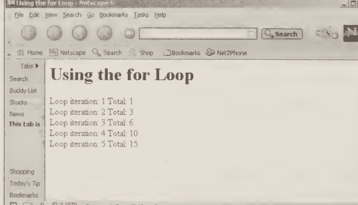

图3.1 在Netscape Navigator中使用for循环。

#### 在for循环中使用局部变量

你应该注意到这里有一些简写方式——例如，我们在for循环本身中只使用了`loopIndex`变量——实际上，我们可以使用`var`关键字在for循环中直接声明它。代码示例如下：

```html
<HTML>
    <HEAD>
        <TITLE>
            使用for循环
        </TITLE>
    </HEAD>

    <BODY>
        <H1>使用for循环</H1>
        <SCRIPT LANGUAGE="JavaScript">
            <!--
            var total
            total = 0
            for (var loopIndex = 0; loopIndex < 6; loopIndex++) {
                total += loopIndex
                document.write("循环迭代次数: "
                    + loopIndex + " 总计: " + total + "<BR>")
            }
            // -->
        </SCRIPT>
    </BODY>
</HTML>
```

这个循环和之前的一样工作。事实上，使用我们在前一章看到的逗号运算符，我们也可以在for循环中声明和初始化累计总数变量`total`，如下所示：

```javascript
for (var loopIndex = 1, total = 0; loopIndex < 6; loopIndex++) {
    total += loopIndex
    document.write("循环迭代次数: "
        + loopIndex + " 总计: " + total + "<BR>")
}
```

#### 在for循环中使用数组

for循环的一个主要用途是处理数组中的数据。你可以看出这会如何很好地工作——你可以使用数字索引来访问数据，而for循环可以使用数字循环索引。这意味着你可以通过使用数组的长度（你可以通过数组的`length`属性找到它）作为循环索引的最大可能值，来遍历数组中的所有数据。下面是一个展示其工作原理的例子——和前面的例子一样，这里我们把1到5的数字相加，但这一次，这些数字在一个名为`data`的数组中：

##### 使用for循环遍历数组

**（网站上的代码清单 03-02.html）**

```html
<HTML>
    <HEAD>
        <TITLE>
            使用for循环遍历数组
        </TITLE>
    </HEAD>

    <BODY>
        <H1>使用for循环遍历数组</H1>
        <SCRIPT LANGUAGE="JavaScript">
            <!--
            var data = new Array(1, 2, 3, 4, 5)
            for (var loopIndex = 0, total = 0; loopIndex < data.length; loopIndex++) {
                total += data[loopIndex]
            }
            document.write("总计是 " + total + ".<BR>")
            // -->
        </SCRIPT>
    </BODY>
</HTML>
```

图3.2展示了运行结果。

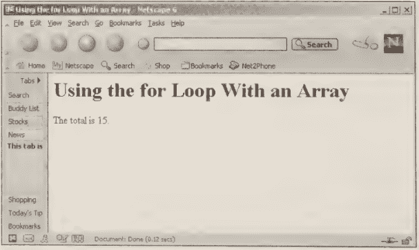

### `for...in` 循环

与`for`循环密切相关的是`for...in`循环，它将一个变量迭代到对象的所有属性上。对于每个属性，JavaScript会执行循环体中的语句。这听起来可能有点枯燥，但事实上，当你想要找出一个特定对象（比如某个未知浏览器的`document`对象）中有哪些可用的属性时，它非常有帮助。它也很方便，因为你可以遍历一个对象中的所有属性，而无需知道有多少个属性，因为循环会自动处理这一点。下面是这个循环的语法：

```javascript
for (variable in object) {
  statements
}
```

此循环由以下部分组成：

- **variable.** 在遍历每个属性时使用的变量。
- **object.** 你想要获取其属性的对象。
- **statements.** 为每个属性执行的语句。

`for...in`循环已经存在很长时间了，如表3.2所示。

**表3.2 `for...in` 循环**

| 语句 | NS2 | NS3 | NS4 | NS6 | IE3a | IE3b | IE4 | IE5 | IE5.5 | IE6 |
|---|---|---|---|---|---|---|---|---|---|---|
| for...in | x | x | x | x | x | x | x | x | x | x |

让我们使用`for...in`循环来看看Netscape Navigator和Internet Explorer中的`document`对象。我们不仅会查看各种属性，还会查看这些属性的当前值；要找到每个属性的当前值，我们可以将`document`对象视为一个属性数组，将属性名作为数组索引。代码如下所示：

**(网站上的代码清单 03-03.html)**

```html
<HTML>
  <HEAD>
    <TITLE>
      使用for...in循环
    </TITLE>
  </HEAD>
  <BODY>
    <H1>使用for...in循环</H1>
    <SCRIPT LANGUAGE="JavaScript">
    <!--
        for (var property in document) {
            document.write(property + ": " + document[property] + "<BR>")
        }
    // -->
    </SCRIPT>
  </BODY>
</HTML>
```

这就是全部所需。你可以在图3.3中看到Netscape Navigator的代码结果，在图3.4中看到Internet Explorer的结果。自己试试这个例子——看看这两个浏览器如何不同地报告其`document`对象的属性，这很有启发性。例如，Netscape Navigator不仅列出属性，还列出`document`对象的方法（如`document.write`），而Internet Explorer列出属性和事件处理程序（如`onclick`），但不列出其`document`对象的任何方法。

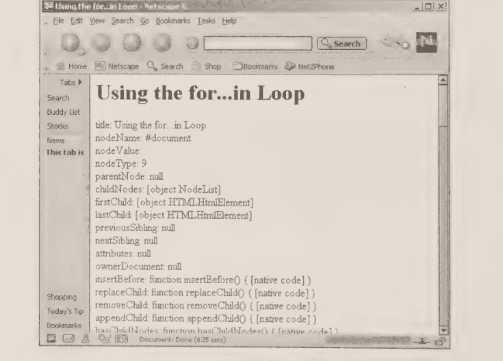

图3.3 在Netscape Navigator中显示document对象属性。

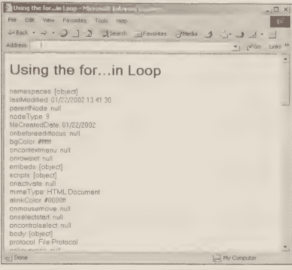

图3.4 在Internet Explorer中显示document对象属性。

### `while` 循环

JavaScript中另一个强大的循环是`while`循环。当你想要一个使用循环索引的循环时，你自然会想到`for`循环。然而，你也可能想要一个根本不使用循环索引的循环——你可能只想循环到某个条件变为假为止（例如，当你尚未找到正在数组中搜索的数据项时）。这就是`while`循环的用武之地。此循环计算一个表达式，如果为真，则执行一组语句——无需循环索引。只要指定的条件为真，循环就会一直重复。

```javascript
while (condition) {
    statements
}
```

此循环由以下部分组成：

- **condition.** 每次进入循环前都会评估的条件。如果此条件评估为真，则执行循环体中的语句。当条件变为假时，循环终止。
- **statements.** 循环的主体。只要*condition*评估为真，这些语句就会被执行。虽然不是必需的，但缩进这些语句是一种良好的实践。

和`for`与`for...in`循环一样，`while`循环也已经存在很长时间了，如表3.3所示。

**表3.3 `while` 循环**

| 语句 | NS2 | NS3 | NS4 | NS6 | IE3a | IE3b | IE4 | IE5 | IE5.5 | IE6 |
|---|---|---|---|---|---|---|---|---|---|---|
| while | x | x | x | x | x | x | x | x | x | x |

这是一个例子。在这个例子中，我将使用`while`循环在一个数组中查找名为Claire的人；当我找到Claire时，我将结束循环。代码如下所示：

**（网站上的代码清单 03-04.html）**

```html
<HTML>
  <HEAD>
    <TITLE>
      使用while循环
    </TITLE>
  </HEAD>
  <BODY>
    <H1>使用while循环</H1>
    <SCRIPT LANGUAGE="JavaScript">
      <!--
      var index = 0, data = new Array(5)
      data[0] = "Frank"
      data[1] = "Tom"
      data[2] = "Claire"
      data[3] = "Sara"
      data[4] = "Jane"

      while(data[index] != "Claire"){
        index++
      }
      alert("在索引 " + index + " 处找到了Claire")
      // -->
    </SCRIPT>
  </BODY>
</HTML>
```

你可以在图3.5中看到结果，我们找到了Claire。就是这么简单。关于`while`循环，有一件事需要注意：即使循环体还没有执行过一次，条件也会在循环体执行之前进行检查。如果循环体中的代码必须在条件检查之前被评估（例如，当你必须执行一些复杂的计算来确定结果是否超过最大可能值时），这就是一个问题。在这些情况下，你可以使用新的`do...while`循环，它就像`while`循环一样，但循环的条件是在每次循环迭代的*末尾*检查，而不是在每次迭代之前。

图 3.5 使用 while 循环。

### do...while 循环

`do...while` 循环执行其语句，直到测试条件求值为 false。与 `while` 循环不同，`do...while` 循环体中的语句至少执行一次。以下是该循环的语法：

```
do
  statements
while (condition)
```

该循环由以下部分组成：

- **statements**。循环体，一组至少执行一次的语句，每次条件求值为 true 时再次执行。
- **condition**。每次循环通过后求值。如果 *condition* 求值为 true，则再次执行循环体中的语句。当 *condition* 求值为 false 时，循环终止。

正如您在表 3.4 中所见，`do...while` 循环在 Netscape Navigator 和 Internet Explorer 的 4.0 版本中是新增的。

**表 3.4 do...while 循环**

| 语句 | NS2 | NS3 | NS4 | NS6 | IE3a | IE3b | IE4 | IE5 | IE5.5 | IE6 |
|-----------|-----|-----|-----|-----|------|------|-----|-----|-------|-----|
| do...while |  |  | x | x |  |  | x | x | x | x |

以下是我们如何在数组中搜索"Claire"，就像我们在前面的示例中使用 `while` 循环所做的那样——但这一次，我们使用的是 `do...while` 循环：

**（网站上的 Listing 03-05.html）**

```
<HTML>
    <HEAD>
        <TITLE>
            Using the do...while Loop
        </TITLE>
    </HEAD>

    <BODY>
        <H1>Using the do...while Loop</H1>
        <SCRIPT LANGUAGE="JavaScript">
            <!--
            var index = 0, data = new Array(5)
            data[0] = "Frank"
            data[1] = "Tom"
            data[2] = "Claire"
            data[3] = "Sara"
            data[4] = "Jane"

            do{
                index++
            }while(data[index] != "Claire")
            alert("Found Claire at index " + index)
            // -->
        </SCRIPT>
    </BODY>
</HTML>
```

### `with` 语句

在使用循环时，您还应该了解另一个语句：`with` 语句。该语句本身不是循环，但也差不了多少。它使您能够指定一个默认对象，`with` 语句体中的语句可以使用该对象。例如，如果您将 `document` 设为默认对象，则可以单独使用 `write` 而不必指定 `document.write`。以下是该语句的语法：

```
with (object){
    statements
}
```

该语句由以下部分组成：

- **object**。指定用于语句的默认对象。*object* 周围的括号是必需的。
- **statements**。任何一组语句。

正如您在表 3.5 中所见，`with` 语句已经存在很长时间了。

**表 3.5 `with` 语句**

| 语句 | NS2 | NS3 | NS4 | NS6 | IE3a | IE3b | IE4 | IE5 | IE5.5 | IE6 |
| :--- | :--- | :--- | :--- | :--- | :--- | :--- | :--- | :--- | :--- | :--- |
| with | x | x | x | x | x | x | x | x | x | x |

## 函数

正如我们已经看到的，函数是一组在调用时运行（而非之前运行）的语句，你可以将函数名作为一个需要求值的表达式来调用它。以下是使用 `function` 语句创建函数的正式语法：

```
function name([param1] [, param2] [..., paramN]) {
    statements
}
```

该语句包含以下部分：

- **name.** 函数的名称。（适用于变量命名的相同规则也适用。）
- **param1 to paramN.** 要传递给函数的参数名；使用这些参数，你可以将数据传递给函数以供其处理。在 JavaScript 中，一个函数最多可以有 255 个参数。
- **statements.** 构成函数体的语句，这些语句在函数被调用时执行。

函数是 JavaScript 的核心部分，自 JavaScript 诞生之初就已存在，如表 3.9 所示。

**表 3.9 `function` 语句**

| Statement | NS2 | NS3 | NS4 | NS6 | IE3a | IE3b | IE4 | IE5 | IE5.5 | IE6 |
|-----------|-----|-----|-----|-----|------|------|-----|-----|-------|-----|
| function  | x   | x   | x   | x   | x    | x    | x   | x   | x     | x   |

这是我们在第 1 章“JavaScript 基础”中就已经见过的一个例子。在这个例子中，我们使用 HTML 按钮的 `ONCLICK` 事件属性，将一个名为 `alerter` 的函数连接到该按钮。这里，函数体只有一条语句，当函数被调用时，它会显示一个带有“你点击了按钮！”消息的警告框：

**(网站上的代码清单 03-09.html)**

```html
<HTML>
    <HEAD>
        <TITLE>Executing Scripts in Response to User Action</TITLE>
        <SCRIPT LANGUAGE="JavaScript">
            <!--
            function alerter()
            {
                alert("You clicked the button!")
            }
            // -->
        </SCRIPT>
    </HEAD>

    <BODY>
        <H1>Executing Scripts in Response to User Action</H1>
        <FORM>
        <INPUT TYPE="BUTTON" ONCLICK="alerter()" VALUE="Click Me!">
        </FORM>
    </BODY>
</HTML>
```

这向我们展示了创建函数的基础——你只需使用 `function` 关键字，后跟你想给函数起的名称（你可以使用任何有效的 JavaScript 名称——请参阅上一章开头关于有效名称的讨论），然后是括号括起来的用于向函数传递数据的参数列表——这里我们不使用任何参数，因此括号为空——最后是包含在花括号中的函数体。此示例中的函数在用户点击按钮时被调用，并显示一个警告框，如图 3.6 所示。

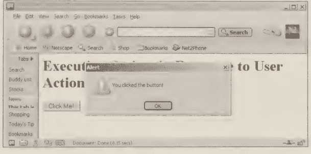

图 3.6 使用函数。

将代码放入 `alerter` 函数中的价值在于，它在调用函数之前不会运行（而如果你只是将代码放在 `<SCRIPT>` 元素中，那么该代码会在页面加载时自动运行）。然而，函数能做的事情远不止于此。

### 返回值

函数常用于执行计算，它们可以返回一个值。如果一个函数返回一个值，你可以在代码中将其名称用作一个表达式，JavaScript 会将该表达式替换为该函数返回的值。

要从一个函数返回值，你可以使用 `return` 语句。该语句的语法如下：

```
return expression
```

在这种情况下，*expression* 求值为你要从函数返回的值。`return` 语句自 JavaScript 诞生之初就已存在，如表 3.10 所示。

**表 3.10 return 语句**

| Statement | NS2 | NS3 | NS4 | NS6 | IE3a | IE3b | IE4 | IE5 | IE5.5 | IE6 |
|-----------|-----|-----|-----|-----|------|------|-----|-----|-------|-----|
| return    | x   | x   | x   | x   | x    | x    | x   | x   | x     | x   |

例如，以下是我如何创建一个名为 `getPi` 的函数，该函数在被调用时返回 pi 的值（使用 JavaScript 的 `Math.PI` 属性）：

**(网站上的代码清单 03-10.html)**

```html
<HTML>
    <HEAD>
        <TITLE>
            Using the return Statement
        </TITLE>
    </HEAD>

    <BODY>
        <H1>Using the return Statement</H1>
        <SCRIPT LANGUAGE="JavaScript">
            <!--
            function getPi()
            {
                return Math.PI
            }
            document.write("pi = " + getPi())
            // -->
        </SCRIPT>
    </BODY>
</HTML>
```

图 3.7 显示了此代码的结果。

> **提示：** 尽管在当前浏览器中这不是问题，但一些较旧的浏览器可能在定义函数之前调用它时会遇到问题。另请注意，为了组织结构，通常最好将函数集中放在网页头部的 `<SCRIPT>` 元素中（除非函数中的代码需要写入文档主体，在这种情况下，代码应放在页面的 `<BODY>` 部分）。

你也可以向函数传递值，正如我们已经看到的。

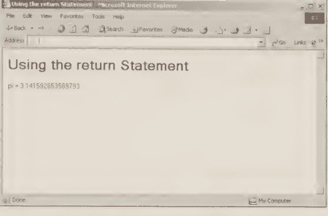

图 3.7 从函数返回值。

### 传递值

要向函数传递数据以便它可以处理这些数据，你可以向函数传递*实参*（也称为*形参*）。这里有一个例子；在这个例子中，我将编写一个名为 `adder` 的函数，该函数将传递给它的两个参数相加并返回它们的和。当你设置函数时，你在括号内的*参数列表*中指定了它接受多少个参数以及你想给这些参数起什么名字：

```javascript
function adder(operand1, operand2)
{
  .
  .
  .
}
```

在这里，我指出该函数接受两个参数。我将第一个参数命名为 `operand1`，第二个参数命名为 `operand2`。现在，如果我这样调用 `adder`：`adder(2, 5)`，那么在函数体中，变量 `operand1` 将持有值 `2`，变量 `operand2` 将持有值 `5`。这就简单了——我只需要在函数体中将 `operand1` 和 `operand2` 相加并返回结果，如下所示：

**(网站上的代码清单 03-11.html)**


## 向函数传递数据

```html
<HTML>
  <HEAD>
    <TITLE>
      Passing Data to Functions
    </TITLE>
  </HEAD>
  <BODY>
    <H1>Passing Data to Functions</H1>
    <SCRIPT LANGUAGE="JavaScript">
    <!--
        function adder(operand1, operand2)
        {
            return operand1 + operand2
        }
        document.write("2 + 5 = " + adder(2, 5))
    // -->
    </SCRIPT>
  </BODY>
</HTML>
```

图 3.8 显示了结果；我们得知，令人惊讶的是，2 + 5 = 7。

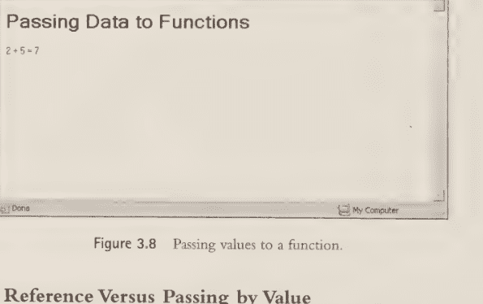

图 3.8 向函数传递值。

### 按引用传递与按值传递

既然我们正在讨论向函数传递数据，你应该知道你可以通过两种方式传递数据：按引用传递和按值传递。当你按值传递数据时，你只传递该数据的一个副本。然而，当你按引用传递数据时，你是在传递对该数据的直接访问。在 JavaScript 中，除对象按引用传递外，所有数据都是按值传递给函数的。最终结果是，当你向函数传递数据（非对象）时，只有该数据的副本被传递；因此，如果你更改该数据，你只是在更改原始数据的副本，这意味着原始数据不会受到影响。但是，如果你传递一个对象，例如 `String` 对象或 `Array` 对象，那么该函数可以直接访问原始对象，这意味着如果你更改对象中的值，原始对象也会受到影响。

让我们通过一个例子让这变得不那么理论化。在这个例子中，我会将一个简单的文本字符串和一个 `Array` 对象都传给一个函数。在函数体内，函数的代码会同时修改字符串中的文本和数组中的一个元素。当函数执行完毕后，我们会发现 `Array` 对象中的元素确实被修改了，而简单的文本变量却没有：

（网站上的 Listing 03-12.html）

```html
<HTML>
<HEAD>
    <TITLE>
        Passing by reference and by value
    </TITLE>
</HEAD>

<BODY>
    <H1>Passing by reference and by value</H1>
    <SCRIPT LANGUAGE="JavaScript">
        <!--
        function change(obj, text) {
            obj[2]=5
            text = "Changed text"
        }
        var array1 = new Array(1, 2, 3, 4), text = "Original text."
        change(array1)
        document.write("array1[2] = " + array1[2] + "<BR>text = " + text)
        // -->
    </SCRIPT>
</BODY>
</HTML>
```

你可以在图 3.9 中看到这段代码的运行结果。如图所示，文本字符串变量的值没有被函数修改，但数组中的数据*确实*被修改了。结果就是，当你将对象传给函数时，你应该意识到该函数访问的是你传入的实际对象，而不仅仅是它的副本。

用 JavaScript 的术语来说，当你传递对象时，实际传递的是*对象引用*。对象引用可以被认为是一种特殊的数据项，它代表对象本身。当你将一个引用（比如指向 `document` 对象）存入变量后，你就可以像使用 `document` 对象本身一样使用该变量。（在幕后，引用保存的是对象在内存中的实际位置，从而让你可以直接访问该对象。）

> **提示**

> 为什么 JavaScript 要通过引用来传递对象呢？这样做是为了节省时间和资源——有些对象可能非常大，如果 JavaScript 在将对象传给函数时必须创建副本，那将会浪费大量时间和浏览器内存。传递一个对象引用（它是一个小数据项，保存的是对象在内存中的位置，而不是对象本身）要高效得多。

### 处理递归

函数还有一个值得了解的特性：函数实际上可以*调用自身*。这个过程称为*递归*，如果你足够聪明，能够将编程任务分解成若干相同的层级，那么递归会很有用。

递归可能不是你会经常用到的东西，所以你可以放心地跳过这一节。不过，由于 JavaScript 支持递归，为了完整性我们还是会在这里看一看。递归的经典例子是计算阶乘——一个正整数的阶乘是该整数乘以整数减一，再乘以整数减二，一直乘到一。明白了吗？

我在这里举个例子来帮助你理解。6 的阶乘，写作 6!，等于 6 * 5 * 4 * 3 * 2 * 1 = 720。用编程术语来说，这可以分解成相同的阶段，每个阶段遵循以下规则，这里我要计算的是 *n* 的阶乘。首先检查 *n* 是否等于 1，如果是，阶乘计算就完成了。否则，只需将 *n* 乘以 *n* - 1 的阶乘（这意味着再次调用阶乘函数——从该函数内部的代码中调用）。代码看起来是这样的，这里我让 JavaScript 计算 6!：

（网站上的 Listing 03-13.html）

```html
<HTML>
    <HEAD>
        <TITLE>
            Using Recursion
        </TITLE>
    </HEAD>

    <BODY>
        <H1>Using Recursion</H1>
        <SCRIPT LANGUAGE="JavaScript">
        <!--
        function fact(x)
        {
            if (x == 0) {
                return 1
            } else {
                return x * fact(x - 1)
            }
        }
        document.write("6! = " + fact(6))
        // -->
        </SCRIPT>
    </BODY>
</HTML>
```

你可以在图 3.10 中看到这段代码的运行结果，通过递归，我们确认了 6! 确实等于 720。

### 关于变量作用域

既然我们已经掌握了函数，另一个问题就变得重要了：*变量作用域*。变量的作用域由程序中可以访问它的部分组成——也就是它对你的代码"可见"的地方。例如，你在一个函数中声明的变量，其作用域仅限于该函数，在其他函数中不可见（除非那些函数嵌套在第一个函数内部）。

JavaScript 有两种作用域类型：*局部* 和 *全局*。当你在函数中声明变量时，它对该函数来说是*局部的*，意味着它的作用域被限制在函数体内。当你在 `<SCRIPT>` 元素中的任何函数之外声明变量时，该变量是*全局的*。同一页面中任何位置的 JavaScript 代码——无论在函数内部还是外部——都可以访问全局变量。然而，如果你声明的局部变量与全局变量同名，只要局部变量在作用域内，它就会覆盖全局变量。当你离开局部变量的作用域后，全局变量会恢复其原始值。

这里有个例子来让这一切更清楚。在这个例子中，我将在网页的 head 部分将名为 `variable1` 的变量声明为全局变量。因为它是全局变量，所以页面中*任何位置*的 JavaScript 代码都可以访问它（除非被同名的局部变量覆盖），而不仅仅是在 head 部分。

我还会在 body 部分声明一个名为 `variable2` 的全局变量，并在 body 中添加一个函数 `function1`。在这个函数中，我们会看到两个全局变量都是可见的。但在另一个函数 `function2` 中，我将声明一个新的局部变量，也叫 `variable2`。正如我们将要看到的，该局部变量会覆盖全局 `variable2`（但仅限于声明了局部版本 `variable2` 的那个函数中）。代码如下：

（网站上的 Listing 03-14.html）

```html
<HTML>
    <HEAD>
        <TITLE>Working With Variable Scope</TITLE>
        <SCRIPT LANGUAGE="JavaScript">
            <!--
            var variable1 = "Global, defined in the head."
            // -->
        </SCRIPT>
    </HEAD>

    <BODY onload="testValues()">
        <H1>Working With Variable Scope</H1>
        <SCRIPT LANGUAGE="JavaScript">
            var variable2 = "Global, defined in the body."
            function function1()
            {
                document.write("In function1: " + "<BR>")
                document.write("variable1 is: " + variable1 + "<BR>")
                document.write("variable2 is: " + variable2 + "<BR><BR>")
            }
            function function2()
            {
                document.write("In function2: " + "<BR>")
                var variable2 = "Local, defined in function2."
                document.write("variable1 is: " + variable1 + "<BR>")
                document.write("variable2 is: " + variable2 + "<BR>")
            }
            function1()
            function2()
        </SCRIPT>
    </BODY>
</HTML>
```

你可以在图 3.11 中看到这段代码的运行结果，从中可以直接了解作用域是如何工作的。

> **提示**

> 即使你可以在函数中的任何位置声明变量，但就作用域而言，一旦你在函数中的某处定义了局部变量，它就会在函数的整个范围内覆盖任何同名的全局变量。这意味着被覆盖的全局变量不会在你声明同名局部变量之前的函数中可见——该全局变量在整个函数中完全不可见。

### JavaScript Function 对象

信不信由你，JavaScript 可以将函数视为数据类型——结果就是你能够将函数声明为变量。你可以使用 JavaScript 的 `Function` 对象来实现这一点。

下面这个例子展示了它是如何工作的。在这个例子中，我将创建一个名为 `adder` 的函数，它接收两个操作数，我将其命名为 `operand1` 和 `operand2`，将它们相加，并返回它们的和。你可以用新的 `Function` 对象来实现这一点。（记住，创建新对象时必须使用 `new` 关键字。）

```
var adder = new Function("operand1", "operand2", "return operand1 + operand2")
```

#### 表3.15 JavaScript的全局函数

| 函数 | NS2 | NS3 | NS4 | NS6 | IE3a | IE3b | IE4 | IE5 | IE5.5 | IE6 |
|----------|-----|-----|-----|-----|------|------|-----|-----|-------|-----|
| decodeURI |  |  |  | x |  |  |  |  | x | x |
| decodeURIComponent |  |  |  | x |  |  |  |  | x | x |
| encodeURI |  |  |  | x |  |  |  |  | x | x |
| encodeURIComponent |  |  |  | x |  |  |  |  | x | x |

解码一个*统一资源标识符*（URI）。URI被编码以用于浏览器——例如，空格被编码为十六进制值%20。此函数解码已编码的URI，例如，将空格替换回%20。

语法：`decodeURI("URI")`

返回值：字符串

解码一个URI组件。与`decodeURI`相同，但此函数作用于组件，即完整URI的各个部分。

语法：`decodeURIComponent("URIComponent")`

返回值：字符串

将一个URI编码以便在浏览器中使用，例如，将空格转换为它们的十六进制等效形式%20。比`escape`函数更新，不会编码这些字符——; / : @ & = + $ , - _ . ! ~ * ' ( ) #——因为这些字符现在被认为是URI中的合法字符。

语法：`encodeURI("Text")`

返回值：字符串

编码一个URI组件以便在浏览器中使用。与`encodeURI`相同，但此函数作用于URI组件，即完整URI的各个部分。

语法：`encodeURIComponent("Text")`

返回值：字符串

## `this` 关键字

另一个重要的JavaScript资源，既然我们正在讨论函数，就是 `this` 关键字。此关键字引用你的代码所在的对象；要将该对象传递给函数，你只需传递 `this` 关键字。我们稍后会更多地了解这个 `this` 对象，特别是在处理HTML控件（如按钮和文本字段）时，但我们可以在这里先预览一下。

例如，假设我想编写一个函数来处理按钮点击，正如我们在第1章中已经看到的那样。然而，在这种情况下，假设我想在一个警告框中显示被点击按钮的*标题*，所以如果按钮的标题是“Click Me!”，我想显示“You clicked the Click Me! button”。如果我将这个函数传递给实际被点击的按钮对象，我就可以做到这一点，因为我可以使用该对象的 `value` 属性来获取按钮的标题。以下是将实现此功能的JavaScript函数代码，我将其命名为 `describer`：

```
function describer(button)
{
    alert("You clicked the " + button.value + " button.")
}
```

然而，假设我在网页中有*两个*按钮——我如何将被点击的特定按钮对象传递给我们的函数？我可以使用 `this` 关键字做到这一点——要将当前按钮对象传递给我们的函数，我所要做的就是像这样使用 `this`：

**(网站上的清单 03-16.html)**

```
<HTML>
    <HEAD>
        <TITLE>使用this关键字</TITLE>
    </HEAD>

    <BODY>
        <H1>使用this关键字</H1>
        <SCRIPT LANGUAGE="JavaScript">
        <!--
            function describer(button)
            {
                document.write("You clicked the " + button.value + " button.")
                document.close()
            }
        // -->
        </SCRIPT>
        <FORM>
            <INPUT TYPE="BUTTON" ONCLICK="describer(this)" VALUE="Click Me!">
            <INPUT TYPE="BUTTON" ONCLICK="describer(this)" VALUE="Click Me Too!">
        </FORM>
    </BODY>
</HTML>
```

像按钮和文本字段这样的HTML控件在JavaScript中被视为对象。当一个按钮被点击时，被点击按钮中的代码会执行，并且在按钮的代码中，你可以用 `this` 关键字引用按钮对象本身。那么，在 `onclick` 事件处理器中，我们要做的就是将当前按钮对象传递给 `describer` 函数，像这样：`describer(this)`。你可以在图3.13中看到这个网页。当用户点击“Click Me!”按钮时，该按钮被传递给我们的函数，并且该按钮的标题被显示出来，正如你在图3.14中看到的那样。

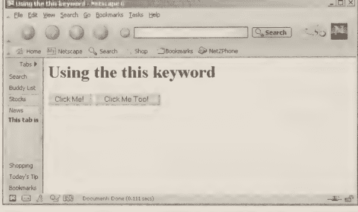

图3.13 使用this关键字，起始页面。

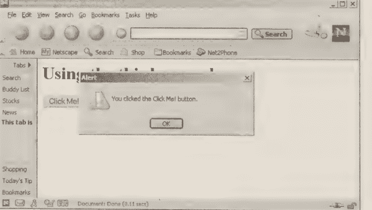

图3.14 使用this关键字，点击按钮后。

我们将在本书后面更详细地了解如何使用 `this` 关键字。这里请记住，`this` 关键字始终使你能够引用当前对象（无论该对象是否有正式名称）。

## `function` 操作符

除了 `Function` 对象，JavaScript还支持一个 `function` 操作符。效仿Perl和Java等语言，`function` 操作符使你能够定义一个没有名称的函数——即一个*匿名*函数。以下是此语句的语法——请注意这看起来多么像只是将一个函数定义赋值给一个变量：

```
var variableName = function([parameter1 [, parameter2...[, parameterN]]])
{functionBody}
```

正如你在表3.14中看到的，`function` 操作符是相当近期的。

### 表3.14 `function` 操作符

| 操作符 | NS2 | NS3 | NS4 | NS6 | IE3a | IE3b | IE4 | IE5 | IE5.5 | IE6 |
|---|---|---|---|---|---|---|---|---|---|---|
| function | | | | X | | | | | X | X |

使用此操作符的语法与使用 `Function` 对象的语法非常相似。这里有一个使用此操作符的示例，其中我设置一个函数来将传递给它的数字加倍，并将该函数赋值给一个名为 `doubler` 的变量：

**(网站上的清单 03-15.html)**

```
<HTML>
    <HEAD>
        <TITLE>
            向函数传递数据
        </TITLE>
    </HEAD>

    <BODY>
        <H1>向函数传递数据</H1>
        <SCRIPT LANGUAGE="JavaScript">
            <!--
                var doubler = function(operand1) {return 2 * operand1}
                document.write("2 * 10 = " + doubler(10))
            // -->
        </SCRIPT>
    </BODY>
</HTML>
```

图3.12显示了此代码的结果。

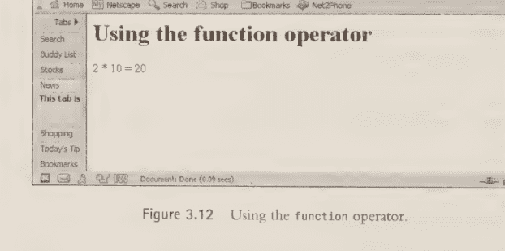

图3.12 使用function操作符。

在这里，我传递第一个操作数的名称，然后是第二个操作数，接着是函数的JavaScript代码。（你可以指定任意多个函数参数——在JavaScript中最多255个——而不仅仅是这里使用的两个。）现在你可以像使用任何其他函数一样使用这个新函数：

```
var adder = new Function("operand1", "operand2", "return operand1 + operand2")
document.write("2 + 3 = " + adder(2, 3))
```

自Netscape Navigator 3.0和Internet Explorer 3b版本起，`Function` 对象就已可用，正如你在表3.11中看到的。（早期，在Netscape Navigator 2.0和Internet Explorer 3a版本中存在此对象的不可靠版本。）你可以在表3.12中找到此对象的属性，在表3.13中找到此对象的方法。（它没有事件。）

| 对象 | NS2 | NS3 | NS4 | NS6 | IE3a | IE3b | IE4 | IE5 | IE5.5 | IE6 |
|--------|-----|-----|-----|-----|------|------|-----|-----|-------|-----|
| Function |  | x | x | x |  | x | x | x | x | x |

### 表3.12 `Function` 对象的属性

| 属性 | NS2 | NS3 | NS4 | NS6 | IE3a | IE3b | IE4 | IE5 | IE5.5 | IE6 |
|----------|-----|-----|-----|-----|------|------|-----|-----|-------|-----|
| arguments |  | x | x | x |  | x | x | x | x | x |
| arguments.callee |  | x | x | x |  | x | x | x | x | x |
| arguments.caller | x | x | x |  |  | x | x | x | x | x |
| arguments.length | x | x | x |  |  | x | x | x | x | x |
| arity |  | x | x |  |  |  | x | x | x | x |
| constructor | x | x | x |  |  | x | x | x | x | x |
| length |  |  | x | x |  |  | x | x | x | x |

### 表3.13 `Function` 对象的方法

| 方法 | NS2 | NS3 | NS4 | NS6 | IE3a | IE3b | IE4 | IE5 | IE5.5 | IE6 |
|---|---|---|---|---|---|---|---|---|---|---|
| apply | | | | X | | | | | X | X |
| call | | | | X | | | | | X | X |
| toSource | | | X | X | | | X | X | X | X |
| toString | | | X | X | | | X | X | X | X |
| valueOf | | | X | X | | | X | X | X | X |

使你能够在不同对象内部应用另一个对象的方法。

语法：`apply([obj[, argumentsArray]])`

使你能够在不同对象内部调用另一个对象的方法。

语法：`call(obj[, arg1[, arg2[...,argN]]])`

返回一个表示函数源代码的字符串。

语法：`Object.toSource()`

返回一个表示函数源代码的字符串。

语法：`Object.toString()`

返回一个包含函数实际源代码的字符串。

语法：`Object.valueOf()`

134  第3章  JavaScript语言：循环、函数和错误

### 表3.15  续

| 函数 | NS2 | NS3 | NS4 | NS6 | IE3a | IE3b | IE4 | IE5 | IE5.5 | IE6 |
| :--- | :---: | :---: | :---: | :---: | :---: | :---: | :---: | :---: | :---: | :---: |
| escape | x | x | x | x | x | x | x | x | x | x |
| eval | x | x | x | x | x | x | x | x | x | x |
| isFinite | x | x | x | x | x | x | x | x | x | x |
| isNaN | x | x | x | x | x | x | x | x | x | x |
| Number | | x | x | | | x | x | x | x | x |
| parseFloat | x | x | x | x | x | x | x | x | x | x |
| parseInt | x | x | x | x | x | x | x | x | x | x |

将字符串"转义"为可在浏览器中使用的URI。此函数将几乎所有非字母数字字符转换为其转义版本。（例如，空格转换为十六进制%20。）比更现代的`encodeURI`执行更多的转义。语法：`escape("Text")` 返回值：字符串

计算JavaScript表达式。详见下文更多信息。语法：`eval("string")` 返回值：对象引用

检查表达式的结果是否超出JavaScript可存储的最大或最小可能数值。如果表达式的值超出最大或最小可能数值，则返回false。语法：`isFinite(number)` 返回值：布尔值

检查一个值是否为有效数字（`isNaN`代表*Is Not a Number*，即"不是一个数字"），如果传递给它的值不是数字，则返回true。可用于检查`parseInt`和`parseFloat`的结果。语法：`isNaN(value)` 返回值：布尔值

将字符串转换为整数或浮点数，视情况而定。语法：`Number("string")` 返回值：数字

将字符串转换为浮点数。语法：`parseFloat("string")` 返回值：数字

将字符串转换为整数。还可以接受一个基数（也称为radix）用于转换——例如，`parseInt(myString, 16)`创建一个十六进制（16进制）值。语法：`parseInt("string" [, radix])` 返回值：数字

| 函数 | NS2 | NS3 | NS4 | NS6 | IE3a | IE3b | IE4 | IE5 | IE5.5 | IE6 |
| :--- | :---: | :---: | :---: | :---: | :---: | :---: | :---: | :---: | :---: | :---: |
| toString | x | x | x | x | x | x | x | x | x | x |
| unescape | x | x | x | x | x | x | x | x | x | x |
| unwatch | | | x | x | | | | | | |
| watch | | | x | x | | | | | | |

这是每个JavaScript和DOM对象的方法，旨在尽可能有意义地将对象转换为字符串表示。如有需要，还可以接受一个基数。语法：`toString("string" [, radix])` 返回值：字符串

将转义后的URI转换为其未转义版本，是`escape`函数的对应函数。语法：`unescape("URI")` 返回值：字符串

指示外部调试器不再监视特定属性。语法：`unwatch(property)` 返回值：无

指示外部调试器监视特定属性的值。语法：`watch(property, debugHandler)` 返回值：无

表3.15中的一个函数特别强大——`eval`，它使您能够计算JavaScript代码。我将在这里更仔细地介绍这个函数，并附上一个示例，让您可以输入JavaScript表达式并即时计算它们。

**提示**

另请参阅第8章"使用`window`和`frame`方法与事件"中的`execScript`方法。

以下是该示例的代码——在这个例子中，我读取用户输入到文本字段中的JavaScript表达式，使用`eval`进行计算，并将结果显示在另一个文本字段中。我们在这里预先使用了HTML文本字段——您可能会顺便注意到此代码如何引用文本字段中的文本，它存储在其HTML value属性中——即`document.forms[0].name.value`，其中`forms`是一个文档对象数组，保存页面中的所有表单，而`name`是赋予文本字段的名称：

（网站上的Listing 03-17.html）

```
<HTML>
    <HEAD>
        <TITLE>
            Using the eval Function
        </TITLE>
        <SCRIPT LANGUAGE="JavaScript">
            <!--
            function evaluator()
            {
                document.forms[0].result.value
                    = eval(document.forms[0].expression.value)
            }
            // -->
        </SCRIPT>
    </HEAD>

    <BODY>
        <H1>Using the eval Function</H1>
        <FORM>
            <INPUT TYPE="TEXT" NAME="expression">
            <INPUT TYPE="BUTTON" ONCLICK="evaluator()" VALUE=" = ">
            <INPUT TYPE="TEXT" NAME="result">
        </FORM>
    </BODY>
</HTML>
```

您可以在图3.15中看到结果，我在其中输入了一个JavaScript表达式并点击了=按钮，这使得结果出现在第二个文本字段中。

**提示**

这个即时计算JavaScript表达式的示例，甚至可以作为您开发自己代码时的有用工具，在将某些JavaScript放入网页之前进行检查。

`eval`函数的一个用途是访问您已经知道名称的对象——例如，如果您向`eval`传递字符串"document"，`eval`语句可以返回对`document`对象的引用。这有什么用呢？嗯，两种主要浏览器有不同的对象模型，如果您尝试执行使用当前浏览器中不存在的对象的语句，您的脚本将会崩溃。（脚本中只是有这样的语句并不会导致问题——只有当您尝试执行这些特定语句时，脚本才会崩溃。）为了避免这种情况，您可以检查您正在使用哪种浏览器，然后使用`eval`通过传递它们的名称来获取该浏览器合法的一组对象。以下是一个简单的示例，通过将文本"document"传递给`eval`来获取对`document`对象的引用（这只是一个示例——当然，两种浏览器都支持`document`对象）：

（网站上的Listing 03-18.html）

```
<HTML>
    <HEAD>
        <TITLE>
            Using the eval Function
        </TITLE>
    </HEAD>

    <BODY>
        <H1>Using the eval Function</H1>
        <SCRIPT LANGUAGE="JavaScript">
            <!--
            var obj = "document"
            for (var property in eval(obj)) {
                document.write(property + ": " + document[property] + "<BR>")
            }
            // -->
        </SCRIPT>
    </BODY>
</HTML>
```

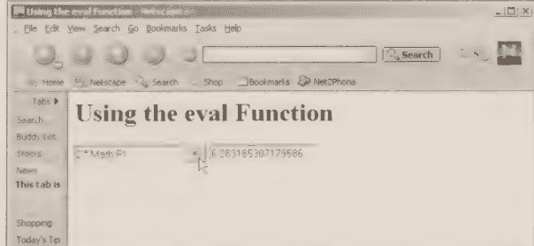

## 处理错误

现在我们将转向本章的第三个主题：处理错误。这个主题与其说是关于语法错误（语法错误会导致您的脚本根本无法运行），不如说是关于处理运行时发生的错误，例如当数值大于JavaScript变量可容纳的范围时。

在JavaScript中，您可以用两种方式处理运行时错误：可以使用`onerror`事件处理程序；最近还可以使用`try...catch`语句。我将在这里介绍这两种技术。

### 使用 `onerror` 事件处理程序

`onerror`事件处理程序内置于`window`对象中。（正如我们在第1章中看到的，`window`对象对应于浏览器窗口本身，它包含`document`对象。）使用`onerror`事件处理程序，您可以指定当代码中出现错误时浏览器应调用的函数。此事件处理程序出现在Netscape Navigator 3.0和Internet Explorer 4.0中，如表3.16所示。

| 事件 | NS2 | NS3 | NS4 | NS6 | IE3a | IE3b | IE4 | IE5 | IE5.5 | IE6 |
| :--- | :---: | :---: | :---: | :---: | :---: | :---: | :---: | :---: | :---: | :---: |
| onerror | | x | x | x | | | x | x | x | x |

如何将函数连接到`onerror`事件处理程序？您只需使用`window`对象的`onerror`属性。例如，我可以将我将命名为`handleError`的函数连接到`onerror`事件，如下所示：

```
<HTML>
  <HEAD>
    <TITLE>Handling an Error</TITLE>
    <SCRIPT LANGUAGE="JavaScript">
      <!--
      window.onerror = handleError
      // -->
    </SCRIPT>
  </HEAD>
  .
  .
  .
</HTML>
```

当发生错误时，浏览器现在将尝试调用`handleError`函数，所以我们最好编写这样一个函数。此函数会自动传递错误消息、导致错误的网页URL以及脚本中错误本身的行号，因此我这样设置`handleError`函数：

```
<HTML>
  <HEAD>
    <TITLE>Handling an Error</TITLE>
    <SCRIPT LANGUAGE="JavaScript">
      <!--
      function handleError(message, URL, lineNumber)
      {
      .
      .
      .
      }
    </SCRIPT>
  </HEAD>
```

```
window.onerror = handleError
// -->
</SCRIPT>
</HEAD>
.
.
.
</HTML>
```

我们可以使用 `alert` 方法在警告框中显示错误信息，如下所示。注意这里的 "\n" 是一个换行符，它会使警告框中的文本跳转到下一行。（使用 "\n" 换行不仅在 JavaScript 中是标准做法，在 C++ 和 Java 等语言中也是如此。我在这里使用这个术语是因为警告框是用来显示文本的，而不是 HTML；如果我们在浏览器中而不是在警告框中显示这段文本，就必须使用 HTML 的 `<BR>` 标签来换行。）我们可以使用 `alert` 方法在警告框中显示错误信息，如下所示：

```
<HTML>
    <HEAD>
        <TITLE>Handling an Error</TITLE>
        <SCRIPT LANGUAGE="JavaScript">
            <!--
            function handleError(message, URL, lineNumber)
            {
                alert("Error " + message + "\n" +
                "in file " + URL + "\n" +
                "at line " + lineNumber + ".\n")
                return true
            }
            window.onerror = handleError
            // -->
        </SCRIPT>
    </HEAD>
    .
    .
    .
</HTML>
```

请注意，这个错误处理程序返回值为 `true`，这告诉浏览器我们已经处理了该错误。（这意味着浏览器不会显示错误图标或错误对话框。）

### 提示

如果你不想在 `onerror` 事件处理函数中处理错误，只需返回 `false`，浏览器就会接管处理，就像没有 `onerror` 事件处理函数时一样。

# 140 第3章 JavaScript 语言：循环、函数和错误

现在当发生错误时，会出现一个包含所有详细信息的警告框。那么如何引发错误呢？一种方法是执行非法的 JavaScript 操作，比如为尚未定义的变量赋值。我在这里用了一个名为 `causeError` 的函数，其中包含语句 `var myData = undefinedVariable`，而我们尚未创建变量 `undefinedVariable`（这意味着 JavaScript 不知道如何处理它）。当用户点击标题为 Create an Error 的按钮时，该语句将被执行，从而引发错误：

>（网站上的 Listing 03-19.html）

```
<HTML>
<HEAD>
<TITLE>Handling an Error</TITLE>
<SCRIPT LANGUAGE="JavaScript">
<!--
function causeError()
{
    var myData = undefinedVariable
}

function handleError(message, URL, lineNumber)
{
    alert("Error " + message + "\n" + 
          "in file " + URL + "\n" +
          "at line " + lineNumber + ".\n")
    return true
}
window.onerror = handleError
// -->
</SCRIPT>
</HEAD>
<BODY>
<H1>Handling an Error</H1>
<FORM>
    <INPUT TYPE="BUTTON" VALUE="Create an Error" onclick="causeError()">
</FORM>
</BODY>
</HTML>
```

你可以在图 3.16 中看到结果。当用户点击按钮时，脚本会引发错误，并出现一个描述该错误的警告框。

通过这种方式，你可以获取有关错误的信息，甚至可以在代码中尝试处理它。然而，更新的做法是使用 `try...catch` 语句，效仿 C++ 和 Java 等语言的做法。事实上，Netscape Navigator 6.0 不再将错误消息、URL 和行号值传递给 `onerror` 处理程序（因此前面的示例在警告框中不会显示任何值）—— 这或许是试图转向使用 `try...catch` 的方式。我们现在来看一下 `try...catch`。

### 使用 `try...catch` 语句

当你将一系列语句放在 `try` 语句中时，执行这些语句时发生的任何错误都会*抛出*（即导致）一个*异常*。当异常被抛出时，JavaScript 将终止 `try` 语句并查找 `catch` 语句，该语句会"捕获"异常。如果存在 `catch` 语句，则执行该 `catch` 语句中的代码，使你能够处理该错误。还有一个可选的 `finally` 语句，无论是否发生异常都会执行；其语法如下：

```
try {
    tryStatements
}
[catch (exception)
    {catchStatements}]
[finally {finallyStatements}]
```

这些语句的组成部分如下：

- `tryStatements`. 一组只执行一次的语句。如果这些语句抛出异常，执行将转移到 `catch` 语句（如果存在的话）。

- `exception`. 你想用来保存传递给 `catch` 语句的对象（通常是 `Error` 对象）的变量名称。

- `catchStatements`. 如果抛出了异常，则执行的一组语句。

- `finallyStatements`. 在 `try...catch` 语句完成之前执行的一组语句。无论异常是否被抛出或捕获，这些语句都会执行。

`try...catch` 语句相对较新，如表 3.17 所示。

| 语句 | NS2 | NS3 | NS4 | NS6 | IE3a | IE3b | IE4 | IE5 | IE5.5 | IE6 |
|-----------|-----|-----|-----|-----|------|------|-----|-----|-------|-----|
| Try...catch | | | x | | | | x | x | x |

现在让我们将 `try...catch` 语句投入使用。

#### 无条件 `catch` 语句

当发生异常时，如果存在 `catch` 语句，执行将转移到该语句。例如，我们可能会引发与 `onerror` 示例中相同的错误 —— 但这一次，我们将使用 `try...catch` 语句。这意味着我们将导致错误的代码放在 `try` 语句中，并在 `catch` 语句中显示消息 There was an error.，如下所示：

**（网站上的 Listing 03-20.html）**

```
<HTML>
<HEAD>
    <TITLE>
        Reporting an Error
    </TITLE>
</HEAD>

<BODY>
    <H1>Reporting an Error</H1>
    <SCRIPT LANGUAGE="JavaScript">
    <!--
        try {
            var myData = undefinedVariable
        }
        catch(e) {
            document.write("There was an error.")
        }
    // -->
    </SCRIPT>
</BODY>
</HTML>
```

图 3.17 展示了这段代码的运行效果。

然而，简单的消息 There was an error. 并不能告诉用户太多信息。传递给 `catch` 语句的对象是一个 `Error` 对象，我们可以使用该对象的 `name` 属性告诉用户错误的名称。JavaScript 的错误名称有 `EvalError`、`RangeError`、`ReferenceError`、`SyntaxError`、`TypeError` 和 `URIError`。

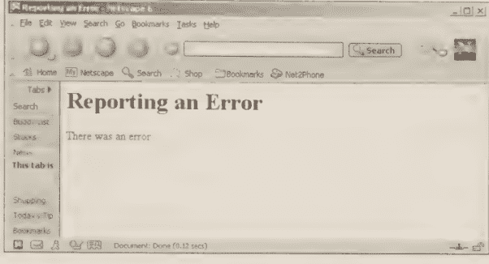

图 3.17 使用 try_catch 捕获异常。

**提示**

其他对象可以在 JavaScript 中抛出自己的错误类型。例如，W3C DOM 对象可以抛出 HIERARCHY_REQUEST_ERROR、WRONG_DOCUMENT_ERROR、NO_MODIFICATION_ALLOWED_ERROR 等异常。

在 `catch` 关键字后的括号中，你可以为传递给 `catch` 语句的 `Error` 对象指定一个名称；在这个例子中，按照标准用法，我将该对象命名为 `e`：

```
try {
    var myData = undefinedVariable
}
catch(e) {
    document.write("There was an error.")
}
```

现在，在 `catch` 语句中，我们可以使用 `e.name` 属性查找发生的错误名称，因此下面是我们让用户知道发生了何种错误的方式：

**（网站上的 Listing 03-21.html）**

```
<HTML>
    <HEAD>
        <TITLE>
            Reporting an Error's Name
        </TITLE>
    </HEAD>
```

```
<BODY>
    <H1>Reporting an Error's Name</H1>
    <SCRIPT LANGUAGE="JavaScript">
    <!--
        try {
            var myData = undefinedVariable
        }
        catch(e) {
            document.write("An error of type " + e.name + " occurred.")
        }
    // -->
    </SCRIPT>
</BODY>
</HTML>
```

你可以在图 3.18 中看到这个改进后的示例版本。

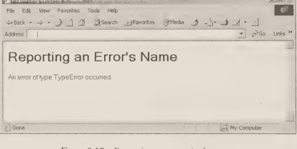

#### 条件 `catch` 语句

由于你可以使用 `Error` 对象的 `name` 属性来确定错误类型，因此可以添加代码来处理特定类型的错误。下面是一个示例，其中我使用 `switch` 语句来处理不同类型的异常：

__（网站上的 Listing 03-22.html）__

```
<HTML>
    <HEAD>
        <TITLE>
            Handling Specific Errors
        </TITLE>
    </HEAD>
```

```

<BODY>
    <H1>处理特定错误</H1>
    <SCRIPT LANGUAGE="JavaScript">
    <!--
        try {
            var myData = undefinedValue
        }
        catch (e){
            switch (e.name){
            case "EvalError":
                document.write("发生了 EvalError 错误。")
                break
            case "RangeError":
                document.write("发生了 RangeError 错误。")
                break
            case "ReferenceError":
                document.write("发生了 ReferenceError 错误。")
                break
            case "SyntaxError":
                document.write("发生了 SyntaxError 错误。")
                break
            case "TypeError":
                document.write("发生了 TypeError 错误。")
                break
            case "URIError":
                document.write("发生了 URIError 错误。")
                break
            default:
                document.write("发生了一个错误。")
            }
        }
    // -->
    </SCRIPT>
</BODY>
</HTML>
```

在这个例子中，我只是显示了发生的异常类型；然而，在你自己的代码中，你可以编写代码来实际处理错误并从中恢复。这个示例依赖于使用 `Error` 对象的 `name` 属性，这是一个非常有用的属性，但请注意 `Error` 对象还有其他属性。

### 使用 `Error` 对象

`Error` 对象通常在 `catch` 语句中传递给你（除非，例如，你自己抛出异常并且不使用 `Error` 对象）。表 3.18 列出了该对象的属性。

#### 表 3.18 `Error` 对象的属性

| 属性 | NS2 | NS3 | NS4 | NS6 | IE3a | IE3b | IE4 | IE5 | IE5.5 | IE6 |
|----------|-----|-----|-----|-----|------|------|-----|-----|-------|-----|
| description | | | | | | | | | x | x |
| fileName | | | | x | | | | | | |
| lineNumber | | | | x | | | | | | |
| message | | | | x | | | | | x | x |
| name | | | | x | | | | | x | x |
| number | | | | | | | | | x | x | x |

包含错误的描述；然而，从 IE5.5 和 NS6 开始，`message` 属性更受青睐。

保存导致错误的文件名称。

保存导致错误的语句的行号。

包含错误的描述。

包含被抛出的错误的名称。JavaScript 错误名称包括 `EvalError`、`RangeError`、`ReferenceError`、`SyntaxError`、`TypeError` 和 `URIError`。你自己抛出的通用错误被命名为 `Error`。

仅限 Internet Explorer。保存每个错误的 Internet Explorer 错误代码。

使用这些属性，你可以获取有关所发生错误的大量信息。

### `finally` 块

`finally` 语句包含在 `try` 和 `catch` 语句执行之后，但在 `try` 和 `catch` 语句之后的语句执行之前要执行的语句。无论是否抛出异常，`finally` 块都会执行。（还要注意，如果抛出异常，即使没有 `catch` 块处理该异常，`finally` 块中的语句也会执行。）

例如，如果你正在使用代码中锁定的一些关键资源，并且发生错误，如果该错误阻止了完整代码的运行，该资源可能永远不会被解锁。为确保无论是否发生错误都能释放该资源，你可以在 `finally` 语句中放入解锁资源的代码，该语句无论是否抛出异常都会执行。这里有一个示例：

```
lockResource()
try {
    useResource()
}
catch(e){
    reportResourceError()
}
finally {
    unlockResource()
}
```

### 自己抛出异常

你也可以使用 `throw` 语句自己抛出异常：

`throw 表达式`

与 `try` 和 `catch` 语句一样，`throw` 语句是相对较新的，正如你在表 3.19 中看到的。

#### 表 3.19 `throw` 语句

| 语句 | NS2 | NS3 | NS4 | NS6 | IE3a | IE3b | IE4 | IE5 | IE5.5 | IE6 |
|-----------|-----|-----|-----|-----|------|------|-----|-----|-------|-----|
| throw | | | | x | | | | x | x | x |

这里有一个示例。假设你咬了一口腌菜，但你受不了腌菜。在这种情况下，你可以这样抛出一个味道不好的异常：

```
<HTML>
    <HEAD>
        <TITLE>
            抛出异常
        </TITLE>
    </HEAD>
    <BODY>
        <H1>抛出异常</H1>
        <SCRIPT LANGUAGE="JavaScript">
        <!--
            try {
                throw "Bad Taste Exception"
            }
            catch (e){
                document.write("发生了一个错误: " + e)
            }
        // -->
        </SCRIPT>
    </BODY>
</HTML>
```

这将简单的文本字符串 "Bad Taste Exception" 作为异常抛出，该字符串被传递给 `catch` 语句，然后代码显示它。然而，更标准的做法是创建一个 `Error` 对象，抛出该对象，并在 `catch` 语句中使用该对象的 `message` 属性来找出发生了什么错误：

**(网站上的 Listing 03-23.html)**

```
<HTML>
  <HEAD>
    <TITLE>
      抛出异常
    </TITLE>
  </HEAD>

  <BODY>
    <H1>抛出异常</H1>
    <SCRIPT LANGUAGE="JavaScript">
    <!--
      try {
          throw Error("Bad Taste Exception")
      }
      catch (e){
          document.write("发生了一个错误: " + e.message)
      }
    // -->
    </SCRIPT>
  </BODY>
</HTML>
```

图 3.19 显示了此代码的结果。

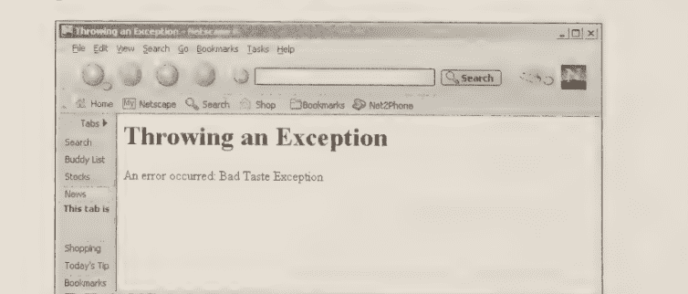

图 3.19 抛出自定义异常。

关于异常，你还需要知道另一件事：你可以使用 `throw` 语句重新抛出异常。例如，你可以嵌套 `try...catch` 语句，如果你不想在内部的 `try...catch` 语句对中处理异常，你可以抛出它，以便由外部的 `try...catch` 语句处理。这里有一个示例说明这是如何工作的；在这个例子中，内部的 `catch` 语句将处理 `EvalError` 和 `RangeError` 错误——但会抛出其他异常。然后抛出的异常被外部更通用的 `catch` 语句捕获：

**(网站上的 Listing 03-24.html)**

```
<HTML>
  <HEAD>
    <TITLE>
      处理特定错误
    </TITLE>
  </HEAD>

  <BODY>
    <H1>处理特定错误</H1>
    <SCRIPT LANGUAGE="JavaScript">
    <!--
      try {
        try {
          var myData = undefinedVariable
        }
        catch (e){
          switch (e.name){
            case "EvalError":
              document.write("发生了 EvalError 错误。")
              break
            case "RangeError":
              document.write("发生了 RangeError 错误。")
              break
            default:
              throw e
          }
        }
      }
      catch (e) {
        document.write("发生了一个错误: " + e.name)
      }
    // -->
    </SCRIPT>
  </BODY>
</HTML>
```

这完成了我们关于循环、函数和处理错误的章节。现在我们已经掌握了足够的 JavaScript 知识，可以开始学习 JavaScript 最初的设计目的：浏览器环境。


## 处理浏览器环境

在本章中，我们将开始将 JavaScript 应用于其设计初衷所在：浏览器。这意味着我们将开始使用 JavaScript 中可用的各种浏览器对象（如 `window`、`document` 和 `navigator` 对象）与浏览器进行交互。本章不仅将深入概述这些对象，还将概述各种浏览器和版本中可用的不同对象模型。我们将在接下来的章节中需要这些信息。

现在我们开始使用浏览器，我们还将考虑如何处理跨浏览器编程问题，讨论如何确定你的脚本在哪个浏览器中运行，以及如何确定哪些对象对你可用。

> **提示**

> 在本书中，你不必记住哪个浏览器拥有哪个对象模型，也不必试图猜测你的脚本是否能按计划运行。相反，当你在这里查找语言元素或对象属性、方法或事件时，你会发现一个表格，直接显示哪个浏览器以及哪个浏览器版本支持该元素。你只需要知道你正在使用哪个浏览器和浏览器版本，你将在本章中看到如何确定这一点。

我们还将探讨如何访问不仅是那些庞大的*文档对象模型*（DOM）对象，例如 `window` 和 `navigator` 对象，还有网页中的所有 HTML 元素。在 JavaScript 中，这些 HTML 元素都被表示为对象，你将看到在脚本中访问这些元素的多种方式。

我现在将通过回顾各类浏览器中各种 DOM 的历史来开始本章。

### 文档对象模型：一段历史

JavaScript 的核心威力在于它是一种简洁明了的语言，能够让你对浏览器中可用的对象进行脚本编程，而本书的很大篇幅就是对那些对象的探索。所有浏览器都曾拥有不同的对象模型，正如你所知，这给 JavaScript 编程带来了挑战。你可以在图 4.1 中看到 JavaScript 中可用的浏览器对象的基本概览；你可以确信这些对象在所有可脚本化的浏览器中都是可用的。

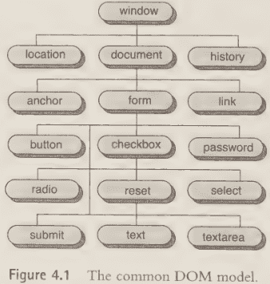

然而，除了图 4.1 中的基本内容之外，各浏览器就开始分道扬镳了。你可以在表 4.1 中看到各种浏览器中各种 DOM 的概览。接下来我将对这些模型逐一进行更深入的考察。

#### 表 4.1  各浏览器版本的 DOM

| 模型名称 | 支持的浏览器 |
|:---|:---|
| DOM 0 | NS2, NS3, IE3a, IE3b, NS4, IE4, IE5, IE5.5, NS6, IE6 |
| DOM 0+Images | NS3, IE3a, IE3b, NS4, IE4, IE5, IE5.5, NS6, IE6 |
| NS4 扩展 | NS4 |
| IE4 扩展 | IE4, IE5, IE5.5, IE6 |
| IE5 扩展 | IE5, IE5.5, IE6 |
| 版本 6 扩展 | NS6, IE6 |
| W3C DOM 1 和 2 | DOM level 1: NS6, IE6, 部分支持: IE5, IE5.5 |

#### DOM 0

最初的 DOM，你在图 4.1 中能或多或少看到其全貌，由 Netscape Navigator 2.0 支持。这是第一个 DOM，为 JavaScript 提供了浏览器对象的早期支持。

事实上，DOM 0 引入了今天我们熟悉的浏览器对象：`window`、`document`、`navigator` 等对象。使用这个 DOM，你开始能够访问网页中的 HTML 元素。然而，只有网页中的交互式元素——诸如文本字段、按钮、复选框、链接等控件——变得可访问。页面的其余部分仍然是静态的。

DOM 0 如此成功，以至于 Internet Explorer 3.0 也几乎原封不动地实现了它——在浏览器大战真正爆发之前，这是一段短暂而平和的间歇。

### 提示

Internet Explorer 3.0 出现了两个略有不同的版本，我们称之为 3a 版和 3b 版，这在第 1 章"JavaScript 基础"中已有讨论。因此，如果你要为 3.0 版编写脚本，应该考虑使用本章即将介绍的对象检测，以确保了解浏览器的能力。

#### DOM 0+Images

Internet Explorer 3.0 发布后不久，Netscape Navigator 3.0 也问世了。实际上，从脚本编程的角度来看，Netscape Navigator 3.0 并没有太大的变化：只是为一些浏览器对象添加了更多的属性、方法和事件。然而，有一项变化对 JavaScript 产生了深远的影响：`Image` 对象出现了。

`Image` 对象本身最初并不起眼——它只支持 `` 元素各种属性的属性，而且那些属性都是只读的——只有一个例外：你可以在运行时更改图像的 `SRC` 属性。这意味着你可以在脚本控制下替换显示的图像，而这种让网页生动起来的简单方式为 JavaScript 的声誉增色不少。

当鼠标滑过图像时，该图像可以突然改变；当鼠标离开图像时，它可以恢复原状，结果是网页看起来更加活跃。这不是通过服务器往返就能实现的功能——这必须在浏览器本身中完成，也就是说要使用脚本。

不幸的是，Internet Explorer 3.0 不支持这个属性，我们今天面临的跨浏览器问题就是从那时开始的。程序员不得不开始添加代码来检查他们正在使用的浏览器以避免错误，而他们并不喜欢这样做。

#### NS4 扩展

在许多方面，Netscape 在当时仍然掌握着创新的主动权，而当 Netscape Navigator 4.0 发布时，这一点比以往任何时候都更加真实。

这款浏览器让你对创建和调整新浏览器窗口有了更大的控制权（使用弹出式广告的用户时至今日可能仍在为此感到懊恼）。它还在两个特定领域赋予了程序员新的能力：事件处理和图层。

虽然事件处理之前就存在，但 Netscape Navigator 4.0 通过让对象捕获事件引入了更强大的功能和复杂性。键盘和鼠标事件被添加进来。在 Netscape Navigator 中，事件从对象层次结构的顶部开始，向下传播到事件的实际引发者——例如，如果按钮被点击，事件会向下穿过 `window`、`document` 等对象，最终到达该按钮。你现在可以使用 `window` 或 `document`（或者接下来将要介绍的 layer）的 `captureEvents` 方法来捕获这些事件，从而集中处理事件，而不必在创建事件的对象中处理这些事件。要停止捕获事件，可以使用 `releaseEvents` 方法。

Netscape Navigator 4.0 还引入了*图层*（layers），这是 Netscape 的一项创新，虽然仍被支持，但已不再广泛使用。图层让你可以"分层"你的网页内容，使你能够在运行时移动不同图层中的对象。

图层通过 `<LAYER>` 元素来支持，`document` 对象获得了一个新的数组——现在称为*集合*（collection）——即 `document.layers` 数组，它包含了文档中的所有图层。图层有各种属性和方法让你移动它们。每个图层都有自己的 `document` 对象，你可以通过以下三种方式之一来访问图层中的元素：

- `document.layers[n].document.elementName`
- `document.layerName.document.elementName`
- `document.layers[layerName].document.elementName`

图层在 Netscape Navigator 和 Internet Explorer 之间引入了重大的不兼容性——Internet Explorer 至今仍然不支持图层，事实上，大多数原本用图层实现的功能现在通常都用样式表来完成。然而在当时，图层确实是一项创新，受到了 JavaScript 社区的热切欢迎。我们将在第 16 章"动态 HTML：即时改变网页"中看到更多关于图层的内容。（注意，Netscape Navigator 6 不再支持图层；其功能已 largely 被样式属性取代）。

#### IE4 扩展

接下来是 Internet Explorer 4.0，对于 JavaScript 程序员来说这是一个重大版本。这里最大的变化是所有 HTML 元素现在都可以被脚本化，所有 HTML 元素现在都支持 JavaScript 可用的属性和方法。这赋予了 JavaScript 程序员迄今为止对其网页最大的控制权。

为了访问网页中的元素而不必指定所有中间对象（例如 `document.forms[0].textField1`），Microsoft 引入了 `all` 集合，这是一个包含所有子级 HTML 元素的集合。例如，如果一个元素的 ID 或名称（通过其 ID 或 NAME 属性设置）是 `textField1`，那么你就可以通过 `document.all.textField1` 来访问该元素。你只需要知道一个元素的 ID 或名称，就可以直接访问它。（有关使用 `all` 集合访问元素的各种方式，请参阅本章后面的"访问 HTML 元素"。）

`all` 集合是让页面完全可脚本化的方式之一；另一种方式是让所有元素拥有自己的属性（如 `tagName`、`parentElement`、`offsetLeft` 和 `offsetTop`）和方法（如 `scrollIntoView`、`setAttribute` 和 `getAttribute`）。我们将在接下来的两章中详细看到哪些元素和方法被哪些 HTML 元素支持。

动态 HTML 在这里也得到了推动，因为 Internet Explorer 4.0 引入了 `innerText`、`outerText`、`innerHTML`、`outerHTML`

#### IE5扩展

微软推出了Internet Explorer 5及随后的5.5版本；从脚本的角度来看，最大的新闻是这两个浏览器开始支持W3C DOM，尽管这种支持只是部分的——请参见下一节以继续W3C DOM的故事。

Internet Explorer 5和5.5中的另一个大新闻是Internet Explorer行为和HTML应用程序，我们将在第17章“动态HTML：拖放、数据绑定和行为”中介绍。行为是你可保存为外部文件的自定义脚本，它可以应用于任何HTML元素，并可以访问一些强大的技术，例如模糊或突出显示元素。HTML应用程序是基于XML的应用程序，你可以下载并自动初始化。

### 提示

XML是*可扩展标记语言*，它与HTML（*超文本标记语言*）非常相似，不同之处在于你可以定义自己的元素。你可以在www.w3.org/TR/REC-xml查看XML规范。

行为和HTML应用程序的理念是微软希望开始将数据与代码分离，在某种程度上这是成功的。然而，行为的采纳受到了它们不易编写脚本且仅在Internet Explorer中支持这一事实的阻碍。

事实上，两家浏览器公司已经有一段时间意识到浏览器战争对任一浏览器都没有太大好处，并且他们已经转向W3C来标准化DOM。尽管W3C DOM在Internet Explorer 5.0中开始实施，但直到两个浏览器的6.0版本，我们才在这方面真正取得进展。

#### Version 6扩展

当前的浏览器是第6代版本。这里的大新闻是，两个浏览器终于通过W3C DOM朝着某种程度的共同支持努力。Netscape Navigator和Internet Explorer都支持W3C DOM级别1，以及它们自己专有的对象模型。

那么什么是W3C DOM？它是旨在将浏览器聚集在一起的对象模型——当然，其中大部分与我们已经看到的完全不同。因此，我现在将详细研究它。

#### W3C DOM

W3C DOM的当前版本是级别2，尽管DOM级别3仍处于工作草案阶段。以下是各种DOM文档在线链接和简要历史：

- W3C DOM级别1（www.w3.org/TR/REC-DOM-Level-1-1/）。出现在Netscape Navigator 4.0和Internet Explorer 4.0统治时期。这与Netscape Navigator 3.0的对象模型非常相似——但这里完全没有事件模型。Internet Explorer 6.0和Netscape Navigator 6.0都基本支持W3C DOM级别1。
- W3C DOM级别2（www.w3.org/TR/DOM-Level-2-Core/）。添加了事件处理、检查文档结构的方法、XML、处理文本*范围*的方法、样式表和各种样式属性。
- W3C DOM级别3（www.w3.org/TR/DOM-Level-3-Core/）。目前处于工作草案形式，此级别仍悬而未决。

还有一个*非官方的*W3C DOM级别0，它与DOM 0相同，是浏览器的原始对象模型。这意味着你在图4.1中看到的基本对象层次结构在W3C DOM兼容的浏览器中得到支持。

重要的是要认识到，W3C DOM并不试图将所有浏览器对象模型中的内容编纂进去——远非如此。事实上，第一级别的W3C DOM甚至没有事件模型。层不是W3C DOM的一部分，字面上成千上万的Internet Explorer对象、属性、方法和事件被排除在外。同样不受支持的是`all`集合。你不再使用`all`集合来寻址元素，而是使用一个新方法`getElementById`。动态HTML属性`innerHTML`、`outerHTML`、`innerText`和`outerText`也缺失。一些以前是文档对象一部分的属性（`aLinkColor`、`bgColor`、`linkColor`和`vlinkColor`）现在成为body对象的一部分（你可以通过`document.body`访问）。

事实上，W3C DOM*从字面上看*是一个文档对象模型——它只关心文档对象以及文档中作为一部分的对象，例如body对象（尽管这可能会在级别3中改变）。`window`、`navigator`和其他此类对象还不是W3C DOM的重要组成部分。

此外，W3C DOM遵循HTML 4.01（www.w3.org/TR/html401），这引入了一些新的HTML编写实践，如果你想使用W3C DOM功能。这里最大的问题是，像XML一样，每个HTML元素必须同时有开始标签和结束标签。以前，你不需要在许多元素（如`<P>`、``、`<LI>`等）上使用结束标签，但要遵守HTML 4.01规范，你应该为每个元素包含一个结束标签。此外，HTML属性值现在都应该用引号括起来（像这样：``）。

此外，一些流行的元素，如`<CENTER>`，已被排除在HTML 4.01规范之外。（对于`<CENTER>`，你通常可以使用各种元素的style属性，或者使用`<DIV>`元素并在`<DIV>`元素的style属性中指定居中对齐——更多关于样式的内容在第21章。）此外，HTML 4.01和W3C DOM强调`ID`属性而不是`NAME`属性。（你可以同时为元素指定ID和name，因为许多服务器端代码仍然依赖name，而不是ID。）

因此，在W3C DOM中，你使用`ID`属性而不是`NAME`属性来标识HTML元素。你不再使用`all`集合访问此类元素，在W3C DOM中，你使用`getElementById`方法。如果你有一个段落，由名为`paragraph1`的`<P>`元素创建（即`<P NAME="paragraph1"…>`），例如，你可以使用`document.all.paragraph1`通过`all`集合引用它。然而，现在你使用`document.getElementById('paragraph1')`，其中你给段落指定了ID `paragraph1`（即`<P ID="paragraph1"…>`）。我们已经看到（并将在本章“访问HTML元素”中再次看到）访问表单中元素的旧方式，如`document.forms[0].name`或`document.form1.name`，仍然有效。

> **提示**
注意`getElementById`方法以小写字母*d*结尾——许多人输入`getElementByID`并无法理解为什么它不工作。

事实上，在W3C DOM中思考HTML文档的整个方式是不同的，这值得考察。

### W3C DOM节点

W3C DOM使脚本更容易访问XML和HTML文档中的元素，但这为我们引入了更多术语。为了定义网页的结构，W3C引入了*节点*的概念。例如，HTML元素是一个节点，HTML元素的文本内容是一个节点，元素的属性都是节点，等等。XML和HTML定义了12种节点类型，但只有7种适用于HTML文档。你可以在表4.2中找到它们。（所有这些节点类型都在我们正在使用的两个浏览器的6.0版本中得到支持。）

表4.2 W3C DOM HTML节点类型

| 类型 | 编号 | nodeName | nodeValue | 含义 |
| :--- | :--- | :--- | :--- | :--- |
| Element | 1 | 标签名 | - | 一个HTML元素 |
| Attribute | 2 | name | 属性 | 一个HTML属性 |
| Text | 3 | #text | 文本 | 简单文本 |
| Comment | 8 | #comment | 注释 | 一个HTML注释 |
| Document | 9 | #document | - | 文档对象 |
| DocumentType | 10 | DOCTYPE | - | 文档类型声明（DTD） |
| Fragment | 11 | #document | - | 构成文档片段的一个或多个节点 |

### 提示

要查看全部 12 种 XML 和 HTML 节点类型，请参见表 5.34。

下面是一个示例——以这个简短的网页为例：

```html
<HTML>
    <HEAD>
        <TITLE>
            Welcome to My Web Page
        </TITLE>
    </HEAD>
    <BODY ID="body1">
        <P ID="paragraph1">
            Welcome to my
            <I>
                terrific
            </I>
            Web page!
        </P>
    </BODY>
</HTML>
```

您可以在图 4.2 中看到该网页。

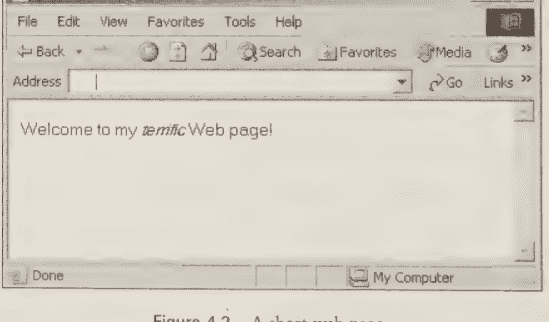

图 4.2 一个简短的网页。

W3C DOM 不会将其视为元素的随意集合，而是将该页面视为元素、属性和文本节点的层级结构。具体而言，从文档节点开始，首先是 `<HTML>` 元素节点，然后是 `<HEAD>` 元素节点、`<TITLE>` 元素节点，该节点本身包含一个文本节点，其中包含文本 "Welcome to My Web Page"，依此类推。以下是从节点角度描述该页面的结构：

### 文档对象模型：历史

```
document
|__<HTML>
    |__<HEAD>
    |   |__<TITLE>
    |   |   |__"Welcome to My Web Page"
    |__<BODY ID="body1">
        |__<P ID="paragraph1">
            |__"Welcome to my"
            |__<I>
            |   |__"terrific"
            |__"Web page!"
```

事实上，实际情况甚至比这还要复杂一点，因为在 W3C DOM 中，即使用于缩进此 HTML 文档的空白字符（空格和/或制表符）也被计为文本节点。这意味着所有元素标签之间的空白（元素标签与元素的任何文本内容之间的空白除外，因为该空白与元素的文本内容合并）从技术上说都被视为文本节点。如果包含空白文本节点，该文档在节点形式下看起来如下所示：

```
document
|__<HTML>
    |__*whitespace text node*
    |__<HEAD>
    |   |__*whitespace text node*
    |   |__<TITLE>
    |   |   |__"Welcome to My Web Page"
    |   |__*whitespace text node*
    |__*whitespace text node*
    |__<BODY ID="body1">
        |__*whitespace text node*
        |__<P ID="paragraph1">
            |__"Welcome to my"
            |__<I>
            |   |__"terrific"
            |__"Web page!"
            |__*whitespace text node*
```

更令人困惑的是，Internet Explorer 目前会忽略这些空白节点，而 Netscape Navigator 则将其视为真正的文本节点。关于此问题的更多内容，请参阅本章后面的"使用 W3C DOM 访问 HTML 元素"一节。

### W3C DOM 节点属性、方法和事件

要处理节点，W3C DOM 包含新的属性、方法和事件处理技术。您可以在表 4.3 中看到 W3C DOM 第 2 级中所有节点共享的部分属性，以及在表 4.4 中共享的方法。

（还有其他专用于特定节点的属性和方法，我们将在接下来的章节中看到。）

表 4.3 常用 W3C DOM 第 2 级节点对象属性

| 属性 | 说明 |
| --- | --- |
| attributes | 属性节点数组 |
| childNodes | 节点的子节点数组 |
| firstChild | 指向节点第一个子节点的对象引用 |
| lastChild | 指向节点最后一个子节点的对象引用 |
| localName | 不含命名空间部分的节点名称 |
| nextSibling | 指向下一个兄弟节点的对象引用 |
| nodeName | 节点的名称 |
| nodeType | 节点编号（参见表 4.2） |
| nodeValue | 节点的内容 |
| ownerDocument | 指向节点所在文档的对象引用 |
| parentNode | 指向节点父节点的对象引用 |
| previousSibling | 指向上一个兄弟节点的对象引用 |

表 4.4 常用 W3C DOM 第 2 级节点对象方法

| 方法 | 说明 |
| --- | --- |
| appendChild(node) | 向当前节点添加子节点 |
| cloneNode(deepClone) | 克隆当前节点，可选择是否包含子节点 |
| getAttributeNode(attrib) | 获取属性节点 |
| hasChildNodes() | 如果节点有子节点则返回 true |
| insertBefore(new, refNode) | 在 refNode 之前插入子节点 |
| removeAttributeNode(attrib) | 移除属性节点 |
| removeChild(node) | 删除子节点 |
| replaceChild(newNode, oldNode) | 用新节点替换旧节点 |
| setAttributeNode(attrib) | 设置属性节点 |
| swapNode(node) | 将节点与当前节点交换 |

您可以使用 `nextSibling`、`lastChild`、`firstChild`、`parentNode` 等属性来浏览整个文档，将其视为*节点树*。我们将在本章的"使用 W3C DOM 访问 HTML 元素"中介绍如何操作。请注意，所有这些都是浏览器让您访问 HTML 元素的其他方式的补充；到目前为止，还没有任何旧的访问元素的方式被浏览器移除，以改用 W3C DOM 方式。

W3C DOM 还引入了一种新的事件处理方式，我们将在第 6 章中看到：使用*事件监听器*。事件监听器早在 Java 中就出现了，W3C 也跟随了这一做法；监听器是一个对象，可以用来"监听"特定类型的事件。例如，`click` 监听器将监听并处理 `click` 事件。

要让监听器监听某个事件，可以使用能够处理事件的节点的 `addEventListener` 方法。由于您可以专门定制事件的处理方式以及要添加监听器的节点，因此可以配置自己的事件处理模型，无论您想遵循传统的 Netscape 自上而下模式还是 Internet Explorer 冒泡模式，或者创建自己的自定义模型。关于通过这种方式处理事件的更多内容，请参阅第 6 章。

通过标准化访问网页中元素的方式以及属性和方法的名称，W3C DOM 旨在为浏览器大战带来一些理性。然而，它是一个不断演进的标准，目前仅涵盖整个图景的相对较小部分，聚焦于文档对象——而且仅仅是该对象的一部分。

这为我们概述了 W3C DOM 的概况；到目前为止，主要的创新是引入了节点模型和事件监听器。我们将在本书的其余部分看到更多关于 W3C DOM 的内容，因为我们涵盖了支持 W3C DOM 属性和方法的各种 HTML 元素，以及标准的属性和方法。

现在我将回到大局，看看在我们使用的浏览器中可用的各种浏览器对象——`navigator`、`window`、`document` 和其他对象。我将对所有这些对象进行概述，因为我们将在接下来的章节中深入介绍它们。

### `navigator` 对象

`navigator` 对象指代浏览器本身，使您能够确定用户使用的浏览器。事实上，早在第 1 章中，我们就已经使用 `navigator` 对象的 `appName`、`appVersion` 和 `userAgent` 属性，使用了以下脚本：

164 第 4 章 处理浏览器环境

（网站上的 Listing 04-01.html）

```html
<HTML>
    <HEAD>
        <TITLE>
            Checking Your Browser Type
        </TITLE>
    </HEAD>
    <BODY>
        <SCRIPT LANGUAGE="JavaScript">
            document.write("navigator.appName: " + navigator.appName)
            document.write("<BR><BR>")
            document.write("navigator.appVersion: " + navigator.appVersion)
            document.write("<BR><BR>")
            document.write("navigator.userAgent: " + navigator.userAgent)
        </SCRIPT>
        <H1>Checking Your Browser Type</H1>
    </BODY>
</HTML>
```

您可以在图 4.3 中看到结果。`navigator` 对象在跨浏览器编程中通常非常有用，我们在本章中将为此目的使用它。

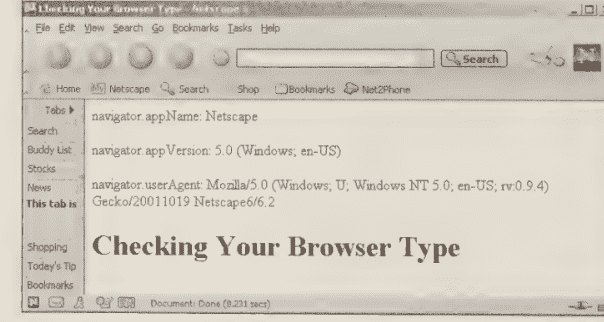

图 4.3 确定浏览器类型。

您可以在表 4.5 中找到 `navigator` 对象的属性和方法；它没有事件。当然，并非所有属性和方法都能在所有浏览器中得到支持。我们将在第 10 章"使用 navigator、location 和 history 对象"中详细了解每个属性和方法对应的浏览器版本。

| 属性 | 方法 |
|------------|---------|
| appCodeName | javaEnabled |
| appMinorVersion | preference |
| appName | taintEnabled |
| appVersion | |
| browserLanguage | |
| cookieEnabled | |
| cpuClass | |
| language | |
| mimeTypes | |
| onLine | |
| oscpu | |
| platform | |
| plugins | |
| product | |
| productSub | |
| securityPolicy | |
| systemLanguage | |
| userAgent | |
| userLanguage | |
| userProfile | |
| vendor | |
| vendorSub | |

### `window` 对象

`window` 对象是浏览器对象模型中最核心的对象，它包含其他对象，如 `document` 对象、`location` 对象等。`window` 对象指代当前浏览器窗口，它拥有大量有用的内置方法，例如 `alert`，用于显示新的警告对话框；以及 `open`，用于打开新的浏览器窗口。

我们已经见过 `alert` 方法的实际应用，所以这里举个使用 `open` 方法的例子——当用户点击这里的按钮时，会打开一个新的浏览器窗口；当用户点击另一个按钮时，这个新窗口将关闭：

###（网站上 Listing 04-02.html）

```
<HTML>
    <HEAD>
        <TITLE>Opening and Closing a Window</TITLE>
        <SCRIPT LANGUAGE="JavaScript">
            <!--
            var window1
            function openWindow()
            {
                window1 = window.open("", "", "HEIGHT=200,WIDTH=400")
            }
            function closeWindow()
            {
                window1.close()
            }
            // -->
        </SCRIPT>
    </HEAD>
    <BODY>
        <H1>Opening and Closing a Window</H1>
        <FORM>
            <INPUT TYPE="BUTTON" VALUE="Open a window"
                ONCLICK="openWindow()">
            <INPUT TYPE="BUTTON" VALUE="Close the window"
                ONCLICK="closeWindow()">
        </FORM>
    </BODY>
</HTML>
```

您可以在图 4.4 中看到这段代码的效果，其中我已经打开了一个新窗口。我们将在第 8 章"使用 `window` 和 `frame` 方法与事件"中了解更多关于 `open` 方法的内容。

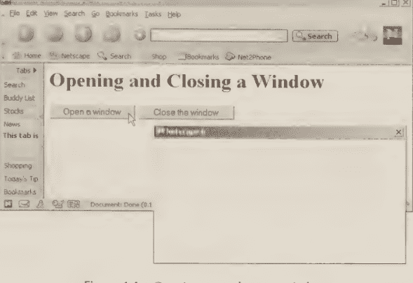

图 4.4 打开新的浏览器窗口。

`window.status` 对象还可以让您访问浏览器的状态栏（位于浏览器底部），这在 JavaScript 程序员中非常流行。下面是一个示例——在这种情况下，当鼠标悬停在超链接上时显示 Hello!，当鼠标离开超链接时显示 Good Bye!（这里调用的 JavaScript 函数必须返回 `true` 值，我们将在第 7 章"使用 `window` 和 `frame` 属性"以及第 8 章中介绍 `window` 对象时看到，否则浏览器只会显示超链接的 URL——这是它的默认行为）：

###（网站上 Listing 04-03.html）

```
<HTML>
<HEAD>
<TITLE>Using the Status Bar</TITLE>
<SCRIPT LANGUAGE="JavaScript">
<!--
function sayHello() {
window.status = "Hello!"
return true
}
function sayGoodBye() {
window.status = "Good Bye!"
return true
}
// -->
</SCRIPT>
</HEAD>
<BODY>
    <H1>Using the Status Bar</H1>
    <A HREF="http://www.starpowder.com"
       onMouseOver="return sayHello()"
       onMouseOut="return sayGoodBye()">Here's my site!</A><P>
</BODY>
</HTML>
```

您可以在图 4.5 中看到这段代码的效果。

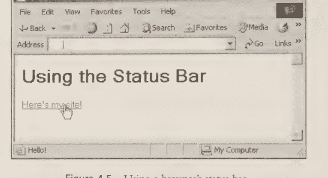

图 4.5 使用浏览器状态栏。

您可以在表 4.6 中找到 `window` 对象的属性、方法和事件。当然，并非所有浏览器都支持所有的属性、方法和事件。我们将在第 7 章和第 8 章中详细了解 `window` 对象的每个属性、方法和事件所支持的浏览器版本。

表 4.6 `window` 对象的属性、方法和事件

| 属性 | 方法 | 事件 |
| :--- | :--- | :--- |
| appCore | alert | onactivate |
| clientInformation | attachEvent | onafterprint |
| clipboardData | back | onbeforedeactivate |
| closed | blur | onbeforeprint |
| Components | captureEvents | onbeforeunload |
| controllers | clearInterval | onblur |
| crypto | clearTimeout | oncontrolselect |
| defaultStatus | close | ondeactivate |
| dialogArguments | confirm | onerror |
| dialogHeight | createPopup | onfocus |
| dialogLeft | detachEvent | onhelp |
| dialogTop | disableExternalCapture | onload |
| dialogWidth | enableExternalCapture | onmove |
| directories | execScript | onmoveend |
| document | find | onmovestart |
| event | fireEvent | onresize |
| external | focus | onscroll |
| frameElement | forward | onunload |
| frames | getComputedStyle | |
| history | GetAttention | |
| innerHeight | handleEvent | |
| innerWidth | home | |
| length | moveBy | |
| loading | moveTo | |
| location | navigate | |
| locationbar | open | |
| menubar | print | |
| name | prompt | |
| navigator | releaseEvents | |
| offscreenBuffering | resizeBy | |
| opener | resizeTo | |
| outerHeight | routeEvent | |
| outerWidth | scroll | |
| pageXOffset | scrollBy | |
| pageYOffset | scrollByLines | |
| parent | scrollByPages | |
| personalbar | scrollTo | |
| pkcs11 | setActive | |
| prompter | setCursor | |
| returnValue | setInterval | |
| screen | setTimeout | |
| screenLeft | showHelp | |
| screenTop | showModalDialog | |
| screenX | showModelessDialog | |
| screenY | sizeToContent | |
| scrollbars | stop | |
| scrollX | | |
| scrollY | | |
| self | | |
| sidebar | | |
| status | | |
| statusbar | | |
| toolbar | | |
| top | | |
| window | | |

### `document` 对象

`document` 对象已经是我们的老朋友了。该对象对应于当前网页的 body 部分以及 head 的某些部分。使用此对象，您可以访问页面本身的 HTML，包括其中所有的链接、图像和锚点。

从脚本编写的角度来看，最流行的 `document` 对象方法是 `document.write`，我们之前已经见过，如第 1 章中的这个例子所示，它将文本写入网页：

```
<HTML>
    <HEAD>
        <TITLE>Our first script!</TITLE>
    </HEAD>
    <BODY>
        <H1>Here we go!</H1>
        <SCRIPT LANGUAGE="JavaScript">
        <!--
        document.write("Hello from JavaScript!")
        // -->
        </SCRIPT>
    </BODY>
</HTML>
```

您可以在表 4.7 中找到 `document` 对象的属性、方法和事件。与之前一样，并非所有浏览器都支持所有的属性、方法和事件。我们将在第 9 章"使用 `document` 和 `body` 对象"中详细了解每个属性、方法和事件的浏览器版本详情。

#### 表 4.7 `document` 对象的属性、方法和事件

| 属性 | 方法 | 事件 |
|------------|---------|--------|
| activeElement | attachEvent | onactivate |
| alinkColor | captureEvents | onbeforeactivate |
| all | clear | onbeforecut |
| anchors | clearAttributes | onbeforedeactivate |
| applets | close | onbeforeeditfocus |
| attributes | createAttribute | onbeforepaste |
| bgColor | createComment | onclick |
| body | createDocumentFragment | oncontextmenu |
| charset | createElement | oncontrolselect |
| characterSet | createEventObject | oncut |
| childNodes | createRange | ondblclick |
| cookie | createStyleSheet | ondeactivate |
| defaultCharset | createTextNode | ondrag |
| designMode | detachEvent | ondragend |
| doctype | elementFromPoint | ondragenter |
| documentElement | execCommand | ondragleave |
| domain | focus | ondragover |
| embeds | getElementById | ondragstart |
| expando | getElementsByName | ondrop |
| fgColor | getElementsByTagName | onfocusin |
| fileCreatedDate | getSelection | onfocusout |
| fileModifiedDate | handleEvent | onhelp |
| fileSize | hasFocus | onkeydown |
| firstChild | mergeAttributes | onkeypress |
| forms | open | onkeyup |
| frames | queryCommandEnabled | onmousedown |
| height | queryCommandIndeterm | onmousemove |
| ids | queryCommandState | onmouseout |
| images | queryCommandSupported | onmouseover |
| implementation | queryCommandValue | onmouseup |
| lastChild | recalc | onmousewheel |
| lastModified | releaseCapture | onpaste |

## 4.172 第4章 处理浏览器环境

**表 4.7（续）**

| 属性 | 方法 | 事件 |
| --- | --- | --- |
| layers | releaseEvents | onpropertychange |
| linkColor | routeEvent | onreadystatechange |
| links | setActive | onresizeend |
| location | write | onresizestart |
| mimeType | writeln | onselectionchange |
| namespaces | | onstop |
| namespaceURI | | |
| nextSibling | | |
| nodeName | | |
| nodeType | | |
| ownerDocument | | |
| parentNode | | |
| parentWindow | | |
| plugins | | |
| previousSibling | | |
| protocol | | |
| readyState | | |
| referrer | | |
| scripts | | |
| security | | |
| selection | | |
| styleSheets | | |
| tags | | |
| title | | |
| uniqueID | | |
| URL | | |
| URLUnencoded | | |
| vlinkColor | | |
| width | | |

提示：你可能会对表 4.7 中 `document` 对象的 `documentElement` 属性感到好奇；该属性返回对文档最顶部 `<HTML>` 元素的引用。

### `form` 对象

你可以将按钮、文本框、复选框等 HTML 控件包含在*表单*中，以便将它们与 JavaScript 函数关联起来。由 `<FORM>` 元素支持的 Form 对象，对应于 JavaScript 中的 `form` 对象。

我们已经看到过 `form` 对象的实际应用；你可以用它访问表单内部的控件，如下例所示，该示例使用文档对象中的 `forms` 集合（一个 `form` 对象的数组）来计算 JavaScript 表达式（在前一章中介绍过，你可以在图 3.15 中看到这段代码的实际效果）：

**（网站上的 Listing 04-04.html）**

```html
<HTML>
    <HEAD>
        <TITLE>
            Using the eval Function
        </TITLE>
        <SCRIPT LANGUAGE="JavaScript">
            <!--
            function evaluator()
            {
                document.forms[0].result.value
                    = eval(document.forms[0].expression.value)
            }
            // -->
        </SCRIPT>
    </HEAD>
    <BODY>
        <H1>Using the eval Function</H1>
        <FORM>
            <INPUT TYPE="TEXT" NAME="expression">
            <INPUT TYPE="BUTTON" ONCLICK="evaluator()" VALUE=" = ">
            <INPUT TYPE="TEXT" NAME="result">
        </FORM>
    </BODY>
</HTML>
```

你可以在表 4.8 中找到 `form` 对象的属性、方法和事件。我们将在第 12 章"使用表单、按钮、复选框和单选按钮"中详细介绍每个属性、方法和事件对应的浏览器版本。

**表 4.8 `form` 对象的属性、方法和事件**

| 属性 | 方法 | 事件 |
|------------|---------|--------|
| acceptCharset | addBehavior | onactivate |
| action | appendChild | onbeforeactivate |
| all | applyElement | onbeforecopy |
| attributes | attachEvent | onbeforecut |
| autocomplete | blur | onbeforedeactivate |
| begin | clearAttributes | onbeforeeditfocus |
| blockDirection | click | onbeforepaste |
| behaviorUrns | cloneNode | onblur |
| canHaveChildren | componentFromPoint | onclick |
| canHaveHTML | contains | oncontextmenu |
| childNodes | detachEvent | oncontrolselect |
| children | dragDrop | oncopy |
| className | fireEvent | oncut |
| clientHeight | focus | ondblclick |
| clientLeft | getAdjacentText | ondeactivate |
| clientTop | getAttribute | ondrag |
| clientWidth | getAttributeNode | ondragend |
| contentEditable | getBoundingClientRect | ondragenter |
| dir | getClientRects | ondragleave |
| disabled | getElementsByTagName | ondragover |
| elements | getExpression | ondragstart |
| encoding | hasChildNodes | ondrop |
| enctype | insertAdjacentElement | onfocus |
| end | insertAdjacentHTML | onfocusin |
| firstChild | insertAdjacentText | onfocusout |
| hasMedia | insertBefore | onhelp |
| hideFocus | item | onkeydown |
| id | mergeAttributes | onkeypress |
| innerHTML | namedItem | onkeyup |
| innerText | normalize | onlosecapture |
| isContentEditable | releaseCapture | onmousedown |
| isDisabled | removeAttribute | onmouseenter |
| isMultiLine | removeAttributeNode | onmouseleave |
| isTextEdit | removeBehavior | onmousemove |
| lang | removeChild | onmouseout |
| language | removeExpression | onmouseover |
| lastChild | removeNode | onmouseup |
| length | replaceAdjacentText | onmousewheel |
| method | replaceChild | onmove |
| name | replaceNode | onmoveend |
| nextSibling | reset | onmovestart |
| nodeName | scrollIntoView | onpaste |
| nodeType | setActive | onpropertychange |
| nodeValue | setAttribute | onreadystatechange |
| offsetHeight | setAttributeNode | onreset |
| offsetLeft | setCapture | onresize |
| offsetParent | setExpression | onresizeend |
| offsetTop | submit | onresizestart |
| offsetWidth | swapNode | onselectstart |
| onOffBehavior | urns | onsubmit |
| outerHTML | | ontimeerror |
| outerText | | |
| ownerDocument | | |
| parentElement | | |
| parentNode | | |
| parentTextEdit | | |
| previousSibling | | |
| readyState | | |
| scopeName | | |
| scrollHeight | | |
| scrollLeft | | |
| scrollTop | | |
| scrollWidth | | |
| sourceIndex | | |
| syncMaster | | |
| tabIndex | | |
| tagName | | |
| tagUrn | | |
| target | | |
| timeContainer | | |
| title | | |
| uniqueID | | |

### `history` 对象

`history` 对象保存着 Web 浏览器在到达当前页面之前访问过的站点记录。它提供了一些方法，使你能够返回到之前的页面。

下面是一个使用 `history` 对象的示例。在本例中，我将使用该对象的 `back`、`forward` 和 `go` 方法在浏览器历史记录中前后导航，让用户可以向前或向后导航一页或两页（要一次导航多于一页，你需要使用 `go` 方法）：

**（网站上的 Listing 04-05.html）**

```html
<HTML>
  <HEAD>
    <TITLE>Using the history object</TITLE>
  <SCRIPT LANGUAGE="JavaScript">
    <!--
    function back()
    {
      window.history.back()
    }
    function forward()
    {
      window.history.forward()
    }
    function back2()
    {
      window.history.go(-2)
    }
    function forward2()
    {
      window.history.go(2)
    }
    // ... -->
  </SCRIPT>
  </HEAD>
  <BODY>
    <H1>Using the history object</H1>
    <FORM>
      <BR>
      Click a button to go forward or back one page:
      <BR>
      <INPUT TYPE=BUTTON VALUE="< Go back" ONCLICK="back()">
      <INPUT TYPE=BUTTON VALUE="Go forward >" ONCLICK="forward()">
      <BR>
      <BR>
      Click a button to go forward or back two pages:
      <BR>
      <INPUT TYPE=BUTTON VALUE="<< Go back 2" ONCLICK="back2()">
      <INPUT TYPE=BUTTON VALUE="Go forward 2 >>" ONCLICK="forward2()">
    </FORM>
  </BODY>
</HTML>
```

你可以在图 4.6 中看到这段代码的实际效果——只需点击按钮，就像点击浏览器的前进和后退按钮一样，只不过我们还提供了让用户向任一方向移动两页的选项。

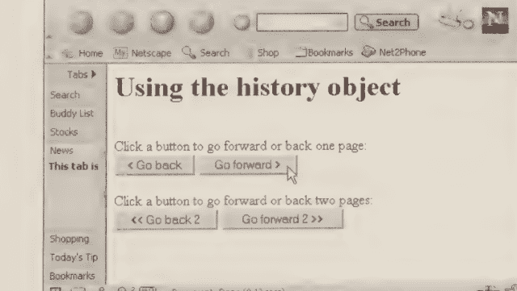

你可以在表 4.9 中找到 `history` 对象的属性和方法（没有事件）。我们将在第 10 章中详细介绍每个属性、方法和事件对应的浏览器版本。

**表 4.9 `history` 对象的属性和方法**

| 属性 | 方法 |
|---|---|
| current | back |
| length | forward |
| next | go |
| previous | |

### `location` 对象

`location` 对象保存着当前网页位置的相关信息，例如其 URL、域名、路径、服务器端口等。该对象是 `window` 对象的一部分，你可以通过将新 URL 赋值给 `location` 对象的 `href` 属性（或者在大多数浏览器中，直接赋值给 `location` 对象本身）来导航到新 URL。下面是一个示例；在本例中，我们将让用户输入一个 URL，并在用户点击按钮时让浏览器导航到该 URL：

**（网站上的 Listing 04-06.html）**

```html
<HTML>
    <HEAD>
        <TITLE>
            Navigate to a URL
        </TITLE>
        <SCRIPT LANGUAGE="JavaScript">
            <!--
            function Jump()
            {
                window.location.href = document.form1.text1.value
            }
            // ..>
        </SCRIPT>
    </HEAD>
    <BODY>
        <H1>Navigate to a URL</H1>
        <FORM NAME="form1">
            <BR>
            <INPUT TYPE=TEXT NAME="text1" SIZE=80>
            <BR>
            <BR>
```

```
<INPUT TYPE = BUTTON VALUE="Navigate to URL" ONCLICK="Jump()">
</FORM>
</BODY>
</HTML>
```

你可以在图 4.7 中看到这段脚本的实际效果。

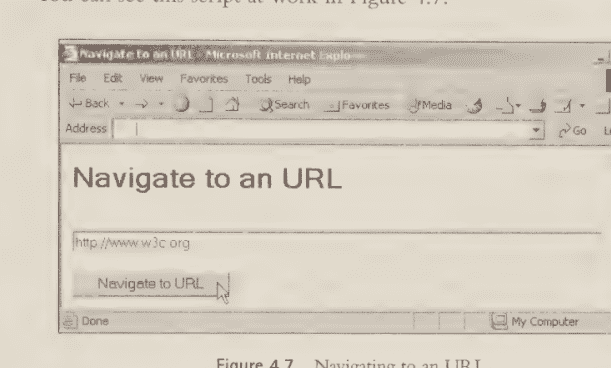

图 4.7 导航到一个 URL。

你可以在表 4.10 中找到 `location` 对象的属性和方法（没有事件）。我们将在第 10 章中详细介绍每个属性、方法和事件所对应的浏览器版本。

表 4.10 `location` 对象的属性和方法

| 属性 | 方法 |
|---|---|
| hash | assign |
| host | reload |
| hostname | replace |
| href | |
| pathname | |
| port | |
| protocol | |
| search | |

> **提示**
> 
> 当你想要将浏览器重定向到一个新站点时，`location` 对象是非常有用的。在本章中，当我们想要根据浏览器版本将浏览器重定向到各种文档时，我们将会看到更多关于这个对象的内容。

### HTML 元素

自 Internet Explorer 4.0 起，网页中的所有 HTML 元素也被视为浏览器对象，就像我们在本章中讨论的其他对象一样。例如，我们在本章和前一章中已经看到过这段代码，其中我将一个名为 `result` 的文本字段视为一个对象，并使用它的 `value` 属性向该文本字段分配文本（参见图 3.15）：

```
<HTML>
    <HEAD>
        <TITLE>
            Using the eval Function
        </TITLE>
        <SCRIPT LANGUAGE="JavaScript">
            <!--
            function evaluator()
            {
                document.forms[0].result.value
                    = eval(document.forms[0].expression.value)
            }
            // -->
        </SCRIPT>
    </HEAD>
    <BODY>
        <H1>Using the eval Function</H1>
        <FORM>
            <INPUT TYPE="TEXT" NAME="expression">
            <INPUT TYPE="BUTTON" ONCLICK="evaluator()" VALUE=" = ">
            <INPUT TYPE="TEXT" NAME="result">
        </FORM>
    </BODY>
</HTML>
```

将所有 HTML 元素视为对象会产生数量庞大的新对象，它们各自都有自己的属性、方法和事件。你可以在表 4.11 中看到 HTML 4.01 支持的所有元素及其功能。

#### 表 4.11 HTML 4.01 元素

| 元素 | 含义 |
| :--- | :--- |
| `<!-->` | 注释和服务器端包含 |
| `<!DOCTYPE>` | 开始一个 HTML 页面 |
| `<A>` | 创建超链接或锚点 |
| `<ABBR>` | 显示缩写 |
| `<ACRONYM>` | 显示首字母缩略词 |
| `<ADDRESS>` | 显示地址 |
| `<APPLET>` | 在网页中嵌入小程序 |
| `<AREA>` | 在图像映射中创建可点击区域 |
| `<B>` | 创建粗体文本 |
| `<BASE>` | 设置超链接的基址 |
| `<BASEFONT>` | 设置基础字体 |
| `<BDO>` | 覆盖双向字符算法 |
| `<BGSOUND>` | 添加背景声音 |
| `<BIG>` | 创建大号文本 |
| `<BLINK>` | 使文本闪烁 |
| `<BLOCKQUOTE>` | 缩进引用 |
| `<BODY>` | 创建网页的主体 |
| `<BR>` | 插入换行 |
| `<BUTTON>` | 创建可自定义的按钮 |
| `<CAPTION>` | 创建表格标题 |
| `<CENTER>` | 居中文本 |
| `<CITE>` | 创建引用 |
| `<CODE>` | 显示程序代码 |
| `<COL>` | 定义列 |
| `<COLGROUP>` | 分组和格式化列 |
| `<DD>` | 创建定义列表的定义 |
| `<DEL>` | 将文本显示为已删除 |
| `<DFN>` | 定义新术语 |
| `<DIR>` | 已废弃的列表 |
| `<DIV>` | 格式化块级文本 |
| `<DL>` | 创建定义列表 |
| `<DT>` | 创建定义列表的术语 |
| `<EM>` | 强调文本 |
| `<EMBED>` | 在网页中嵌入多媒体和插件 |
| `<FIELDSET>` | 对表单元素进行分组 |
| `<FONT>` | 指定字体 |
| `<FORM>` | 创建 HTML 表单 |
| `<FRAME>` | 创建框架 |
| `<FRAMESET>` | 包含框架 |
| `<H1>` to `<H6>` | 创建网页标题 |
| `<HEAD>` | 创建网页的头部 |
| `<HR>` | 创建水平线 |
| `<HTML>` | 开始一个 HTML 页面 |
| `<I>` | 创建斜体文本 |
| `<IFRAME>` | 创建内联或浮动框架 |
| `<ILAYER>` | 创建内联层 |
| `` | 向网页添加图像 |
| `<INPUT TYPE=BUTTON>` | 创建按钮 |
| `<INPUT TYPE=CHECKBOX>` | 创建复选框 |
| `<INPUT TYPE=FILE>` | 为表单创建文件输入 |
| `<INPUT TYPE=HIDDEN>` | 创建隐藏数据 |
| `<INPUT TYPE=IMAGE>` | 创建图像提交按钮 |
| `<INPUT TYPE=PASSWORD>` | 创建密码控件 |
| `<INPUT TYPE=RADIO>` | 创建单选按钮 |
| `<INPUT TYPE=RESET>` | 创建重置按钮 |
| `<INPUT TYPE=SUBMIT>` | 创建提交按钮 |
| `<INPUT TYPE=TEXT>` | 创建文本字段 |
| `<INS>` | 显示已插入的文本 |
| `<ISINDEX>` | 使用索引 |
| `<KBD>` | 显示用户需要输入的文本 |
| `<KEYGEN>` | 处理安全交易 |
| `<LABEL>` | 为表单元素添加标签 |
| `<LAYER>` | 在层中排列文本 |
| `<LEGEND>` | 为表单元素创建图例 |
| `<LI>` | 创建列表项 |
| `<LINK>` | 设置链接信息 |
| `<MAP>` | 创建客户端图像映射 |
| `<MARQUEE>` | 在滚动字幕中显示文本 |
| `<MENU>` | 已废弃的列表 |
| `<META>` | 提供有关网页的更多信息 |
| `<MULTICOL>` | 创建多列 |
| `<NOBR>` | 避免换行 |
| `<NOEMBED>` | 处理不支持嵌入的浏览器 |
| `<NOLAYER>` | 处理不支持层的浏览器 |
| `<NOSCRIPT>` | 处理不支持 JavaScript 的浏览器 |
| `<OBJECT>` | 将对象放入网页 |
| `<OL>` | 创建有序列表 |
| `<OPTGROUP>` | 创建选择控件项目组 |
| `<OPTION>` | 创建选择控件项 |
| `<P>` | 创建段落 |
| `<PARAM>` | 指定参数 |
| `<PRE>` | 显示预格式化文本 |
| `<Q>` | 显示短引用 |
| `<RT>` | 创建 ruby 文本 |
| `<RUBY>` | 创建 ruby 注音 |
| `<S>` and `<STRIKE>` | 删除线文本 |
| `<SAMP>` | 显示示例程序输出 |
| `<SCRIPT>` | 创建脚本 |
| `<SELECT>` | 创建选择控件 |
| `<SERVER>` | 运行服务器端 JavaScript 脚本 |
| `<SMALL>` | 创建小号文本 |
| `<SPACER>` | 控制水平和垂直间距 |
| `<SPAN>` | 格式化内联文本 |
| `<STRONG>` | 强烈强调文本 |
| `<STYLE>` | 使用嵌入式样式表 |
| `<SUB>` | 创建下标 |
| `<SUP>` | 创建上标 |
| `<TABLE>` | 创建表格 |
| `<TBODY>` | 分组行时创建表格主体 |
| `<TD>` | 创建表格数据 |
| `<TEXTAREA>` | 创建文本区域 |
| `<TFOOT>` | 分组行时创建表格脚注 |
| `<TH>` | 创建表格标题 |
| `<THEAD>` | 分组行时创建表格头部 |
| `<TITLE>` | 为网页设置标题 |
| `<TR>` | 创建表格行 |
| `<TT>` | 创建"电传打字机"文本 |
| `<U>` | 为文本添加下划线 |
| `<UL>` | 创建无序列表 |
| `<VAR>` | 显示程序变量和参数 |
| `<WBR>` | 允许单词断开 |
| `<XML>` | 使用 XML 数据岛访问 XML 数据 |

要在本书中列出并讨论表 4.11 中众多元素各自的属性、方法和事件是非常困难的，因为那将涉及超过 10,000 个不同的项目。然而，这些项目之间存在着大量的重叠，因为所有这些 HTML 元素都支持我称之为 JavaScript 核心 HTML 属性、方法和事件的内容。你可以在表 4.12 中找到这些核心属性、方法和事件。我们将在接下来的两章中介绍它们（实际上，表 4.12 中的核心属性、方法和事件的一些例外是存在的——某些 HTML 元素不支持其中的某些属性、方法和事件，我将在接下来的两章中逐案说明）。

| 属性 | 方法 | 事件 |
|-----------|---------|--------|
| accessKey | addBehavior | onactivate |
| all | addEventListener | onbeforeactivate |
| attributes | appendChild | onbeforecopy |
| begin | applyElement | onbeforecut |
| behaviorUrns | attachEvent | onbeforedeactivate |
| canHaveChildren | blur | onbeforeeditfocus |
| canHaveHTML | clearAttributes | onbeforepaste |
| childNodes | click | onblur |
| children | cloneNode | onclick |
| className | componentFromPoint | oncontextmenu |
| clientHeight | contains | oncontrolselect |
| clientLeft | detachEvent | oncopy |

# 表 4.12 续

| 属性 | 方法 | 事件 |
|------------|---------|--------|
| clientTop | dispatchEvent | oncut |
| clientWidth | dragDrop | ondblclick |
| contentEditable | fireEvent | ondeactivate |
| currentStyle | focus | ondrag |
| dataFld | getAdjacentText | ondragend |
| dataFormatAs | getAttribute | ondragenter |
| dataSrc | getAttributeNode | ondragleave |
| dir | getBoundingClientRect | ondragover |
| disabled | getClientRects | ondragstart |
| document | getElementsByTagName | ondrop |
| end | getExpression | onfilterchange |
| filters | hasChildNodes | onfocus |
| firstChild | insertAdjacentElement | onfocusin |
| hasMedia | insertAdjacentHTML | onfocusout |
| height | insertAdjacentText | onhelp |
| hideFocus | insertBefore | onkeydown |
| id | item | onkeypress |
| innerHTML | mergeAttributes | onkeyup |
| innerText | normalize | onlosecapture |
| isContentEditable | releaseCapture | onmousedown |
| isDisabled | removeAttribute | onmouseenter |
| isMultiLine | removeAttributeNode | onmouseleave |
| isTextEdit | removeBehavior | onmousemove |
| lang | removeChild | onmouseout |
| language | removeEventListener | onmouseover |
| lastChild | removeExpression | onmouseup |
| length | removeNode | onmousewheel |
| localName | replaceAdjacentText | onmove |
| namespaceURI | replaceChild | onmoveend |
| nextSibling | replaceNode | onmovestart |
| nodeName | scrollIntoView | onpaste |
| nodeType | setActive | onpropertychange |
| nodeValue | setAttribute | onreadystatechange |
| offsetHeight | setAttributeNode | onresize |
| offsetLeft | setCapture | onresizeend |
| offsetParent | setExpression | onresizestart |
| offsetTop | supports | onselectstart |
| offsetWidth | swapNode | ontimeerror |
| onOffBehavior | tags | |
| outerHTML | urns | |
| outerText | | |
| ownerDocument | | |
| parentElement | | |
| parentNode | | |
| parentTextEdit | | |
| prefix | | |
| previousSibling | | |
| readyState | | |
| recordNumber | | |
| runtimeStyle | | |
| scopeName | | |
| scrollHeight | | |
| scrollLeft | | |
| scrollTop | | |
| scrollWidth | | |
| sourceIndex | | |
| style | | |
| syncMaster | | |
| tabIndex | | |
| tagName | | |

## 跨浏览器编程

正如我们所讨论的，如果你的程序是为普通用户设计的，不同版本的 JavaScript 和各种 DOM 可能会给开发带来困难。因此，在本章关于浏览器环境的讨论中，我将探讨跨浏览器编程的问题。

解决跨浏览器编程问题的一个方案是仅使用 DOM 第 0 级（参见图 4.1）和 JavaScript 1.0 中可用的功能。这意味着，尽管你的操作会受到限制（请记住，例如在 DOM 0 中连鼠标悬停的图像切换都不支持），但至少你的脚本可以在所有可执行脚本的浏览器中运行（你还可以使用 `<NOSCRIPT>` 元素来处理不支持脚本的浏览器——参见第 1 章中对 `<NOSCRIPT>` 的讨论）。

下一个选择是在脚本执行时检测你所使用浏览器的功能；主要有两种方法：检测版本信息和对象检测。我将首先看看检测版本信息的方法。

> **提示**

> 你也可以使用 `<SCRIPT>` 元素的 LANGUAGE 属性；但当然，JavaScript 和 JScript 之间的版本信息不同，而且这些信息仍然无法告诉你浏览器的 DOM 情况。

### 版本检测

在本书中，我列出了每种语言元素、每个属性、方法和事件所支持的浏览器及其版本，这意味着如果你想使用某个特定项目，你需要知道它在特定浏览器中是否有效——如果你知道浏览器的版本。要确定浏览器的版本，你可以使用 `navigator` 对象的 `appName` 和 `userAgent` 属性。该对象还有一个 `userVersion` 属性，但它不会返回正确的版本信息——正如我们在图 1.12 和 1.13 中看到的，该属性对于 Internet Explorer 6.0 返回 4.0，对于 Netscape Navigator 6.0 返回 5.0。你可以使用 `appName` 来确定你正在使用的浏览器，并在 `userAgent` 属性中搜索正确的版本信息。

下面是一个脚本，正是用于此目的，它将浏览器的版本号（浮点数）填充到名为 `version` 的变量中——它设计用于两种浏览器的所有可执行脚本版本，从 Internet Explorer 的 3.0 版本到 6.0 版本，以及从 Netscape Navigator 的 2.0 版本到 6.2 版本，但无法保证——一些中间版本、测试版或对操作系统支持较少的版本可能会对 `userAgent` 属性使用不同的格式。以下是代码（此代码使用了我们将在第 18 章“`Date`、`Time` 和 `String` 对象”中看到的一些字符串方法，例如 `substring` 方法）：

（网站上的清单 04-07.html）

```html
<HTML>
  <HEAD>
    <TITLE>
      获取浏览器版本
    </TITLE>
  </HEAD>

  <BODY>
    <H1>获取浏览器版本</H1>
    <SCRIPT LANGUAGE="JavaScript">
      <!--
      var start, end, version
      if(navigator.appName == "Netscape") {
        if(navigator.userAgent.indexOf("Netscape") < 0) {
          start = "Mozilla/".length
          end = navigator.userAgent.indexOf(" ", start)
          version = parseFloat(navigator.userAgent.substring(start, end))
          document.write("You are using Netscape Navigator " + version)
        } else {
          start = navigator.userAgent.indexOf("Netscape") +
          "Netscape".length + 2
          end = navigator.userAgent.length
          version = parseFloat(navigator.userAgent.substring(start, end))
          document.write("You are using Netscape Navigator " + version)
        }
      }

      if (navigator.appName == "Microsoft Internet Explorer") {
        start = navigator.userAgent.indexOf("MSIE ") + "MSIE ".length
        if(navigator.userAgent.indexOf(";", start) > 0) {
          end = navigator.userAgent.indexOf(";", start)
        } else {
          end = navigator.userAgent.indexOf(")", start)
        }
        version = parseFloat(navigator.userAgent.substring(start, end))
        document.write("You are using Internet Explorer " + version)
      }
      // -->
    </SCRIPT>
  </BODY>
</HTML>
```

你可以在图 4.8 中看到 Internet Explorer 的结果，在图 4.9 中看到 Netscape Navigator 的结果。

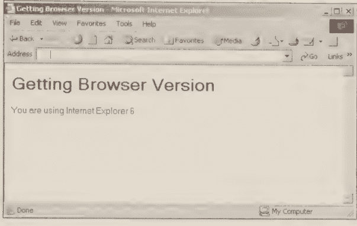

图 4.8 确定 Internet Explorer 的版本。

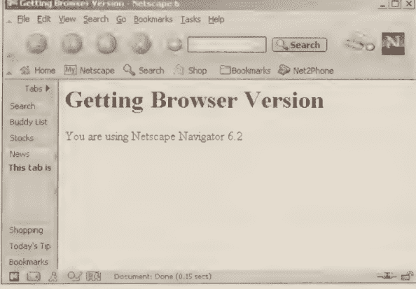

图 4.9 确定 Netscape Navigator 的版本。

既然你知道了浏览器的版本，你就可以使用本书中的信息来确定某个特定项目是否在浏览器中受支持。另一方面，有时不直接处理浏览器版本，而是使用对象检测反而更容易。

### 对象检测

有时最好的做法是在使用某个特定对象（或属性或方法）之前，先确定它是否可用。这样做可能比使用版本检测时追踪你需要的版本支持信息更容易。例如，为了确定你是否正在处理一个支持图像切换（即 DOM 0+Images 模型）的浏览器，你可以在尝试使用 `document.images` 集合之前，使用 `if` 语句检查该集合是否存在。如果它存在，你可以继续执行你的代码，重置图像的 `SRC` 属性，如下所示：

```
if (document.images){
    document.images[0].src = imageURL
}
```

这是另一个例子；如果你想确定是否可以使用层叠样式表，你可以通过查找该元素的 JavaScript `style` 属性来检查某个特定元素是否支持 STYLE HTML 属性，如下所示：

```
if (element1.style){
    element1.style.color = "red"
}
```

这是另一个例子——在这种情况下，我检查 `all` 集合、对层（layers）的支持以及 `getElementById` 方法，以便从文本字段读取文本：

（网站上的清单 04-08.html）

```html
<HTML>
    <HEAD>
        <TITLE>
            使用对象检测
        </TITLE>
    </HEAD>
    <BODY>
        <H1>使用对象检测</H1>
        <FORM NAME="form1">
            <INPUT TYPE=TEXT VALUE="Hello!" NAME="nameObject1" ID="idObject1">
        </FORM>
        <SCRIPT LANGUAGE="JavaScript">
            <!--
            var object1
            if (document.all){
                object1 = document.all("iDobject1")
            } else if (document.getElementById) {
                object1 = document.getElementById("idobject1")
            }
            -->
        </SCRIPT>
```

```markdown
    } else if (document.layers) {
        object1 = document.form1.nameObject1
    }

    if(object1){
        document.write(object1.value)
    }
// -->
</SCRIPT>
</BODY>
</HTML>
```

你还可以通过检查 W3C DOM 属性来检测是否支持 W3C DOM，例如 `documentElement`（它返回对网页中 `<HTML>` 元素的引用）：

```
var W3CSupport = (document.documentElement) ? true : false
```

实际上，你可以使用一系列顺序排列的 `if` 语句，通过对象检测来确定浏览器和浏览器版本，如下所示：

```
if (document.characterSet){
    window.location.href = "NS6.html"
}

if (document.docType){
    window.location.href = "IE6.html"
}

if (document.documentElement){
    window.location.href = "IE5.html"
}

if (document.all){
    window.location.href = "IE4.html"
}

if (document.layers){
    window.location.href = "NS4.html"
}

if (document.images){
    window.location.href = "NS3.html"
}
```

### 重定向浏览器

虽然可以在网页中嵌入针对不同浏览器的脚本，但你也可以将浏览器重定向到全新的页面，每个浏览器对应一个页面。以下示例通过设置 `window.location.href` 属性实现了这一点；请注意，它还使用 `<META>` 元素重定向其他浏览器以及不支持脚本的浏览器：

**（网站上的 Listing 04-09.html）**

```
<HTML>
    <HEAD>
        <TITLE>Redirecting Browsers</TITLE>
        <SCRIPT LANGUAGE="JavaScript">
            <!--
            if (navigator.appName == "Microsoft Internet Explorer") {
                window.location.href = "IE.html"
            }
            if(navigator.appName == "Netscape") {
                window.location.href = "NS.html"
            }
            //-->
        </SCRIPT>
        <META HTTP-EQUIV="refresh" CONTENT="0; URL=default.html">
    </HEAD>

    <BODY>
        <H1>Redirecting Browsers</H1>
    </BODY>
</HTML>
```

### 基于浏览器类型创建对象

这是为不同浏览器提供多个页面的另一种替代方案——你可以使用 `eval` 函数即时创建适合特定浏览器的对象，只需传递它们的名称即可。我们在上一章中看到了它的工作原理，当时我们创建了对 `document` 对象的引用：

```
<HTML>
    <HEAD>
        <TITLE>
            Using the eval Function
        </TITLE>
    </HEAD>

    <BODY>
        <H1>Using the eval Function</H1>
        <SCRIPT LANGUAGE="JavaScript">
            <!--
var obj = "document"
for (var property in eval(obj)) {
    document.write(property + ": " + document[property] + "<BR>")
}
// -->
</SCRIPT>
</BODY>
</HTML>
```

### 使用脚本库

这是跨浏览器编程的另一种替代方案——你可以为不同的浏览器和浏览器版本使用不同的脚本文件，即 .js 文件：

```
<SCRIPT LANGUAGE="JavaScript">
<!--
if (navigator.appName == "Microsoft Internet Explorer") {
    document.write("<SCRIPT LANGUAGE='JavaScript' SRC='ie.js'></SCRIPT>")
}
if(navigator.appName == "Netscape") {
    document.write("<SCRIPT LANGUAGE='JavaScript' SRC='ns.js'></SCRIPT>")
}
//-->
</SCRIPT>
```

我们将在全书看到更多关于跨浏览器问题的内容，例如跨浏览器事件处理。

### 访问 HTML 元素

在前几章中，我们介绍了内置的 JavaScript 语法。在本章中，我们开始使用 JavaScript 中可用的浏览器对象。内置对象（如 `window`、`document` 和 `navigator` 对象）在代码中始终可用——但网页中的 HTML 元素呢？在现代 JavaScript 中，所有这些元素都被视为对象——你如何访问它们呢？

让我们从一个示例开始；假设我想要访问此页面中 `<P>` 元素的 `tagName` 属性（在这种情况下，此属性将返回 P）：

```
<HTML>
<HEAD>
    <TITLE>
        Accessing HTML Elements
    </TITLE>
</HEAD>

<BODY>
    <H1>Accessing HTML Elements</H1>
<P NAME="text1" ID="text1">
    Here's the text.
</P>
<FORM NAME="form1">
    <INPUT TYPE="BUTTON" VALUE="Click Me!" ONCLICK="getText()">
</FORM>
```

使用 Netscape Navigator，我可以通过 `getElementsByName` 或 `getElementsByTagName` 方法访问 `<P>` 元素，这两种方法都返回一个元素数组。要使用这些方法，我可以使用数组索引 0 来提取我们感兴趣的元素（因为此 `<P>` 元素是这些数组中的第一个元素）：

- `document.getElementsByName("text1")[0].tagName`

- `document.getElementsByTagName("P")[0].tagName`

请注意，这两种方法在 Netscape Navigator 6.0 之前的版本中均不可用——在该版本之前，没有直接的方法来访问不属于表单一部分的元素。

在 Internet Explorer 中，你还可以使用 `all` 集合。正如我们所讨论的，`all` 集合中为页面中的每个 HTML 元素都有一个元素。以下是在 Internet Explorer 中访问文本字段中文本的一些方法——请注意，`all` 集合还包括一个 `tags` 方法，你可以用它来定位元素（如第 6 章所述）：

- `document.all.text1.tagName`

- `document.all["text1"].nodeValue`

- `document.all.tags("P")[0].tagName`

- `document.getElementsByName("text1")[0].tagName`

- `document.getElementsByTagName("P")[0].tagName`

**提示**

实际上，你可以省略 `document.all`，直接使用 `text1.tagName`。

**提示**

这里有一个重要的知识点需要了解：如果你在访问 HTML 元素时遇到困难，可能是因为浏览器尚未加载该元素。在这种情况下，请将你的脚本放在网页中你要访问的 HTML 元素出现的位置之后（这可能意味着将脚本从页面的 head 部分移到 body 部分）。

以下是一个综合运用所有这些技术的网页（请注意，如果你使用的是 Netscape Navigator，则需要 6 以上版本）：

**（网站上的 Listing 04-10.html）**

```
<HTML>
    <HEAD>
        <TITLE>
            Accessing HTML Elements
        </TITLE>
        <SCRIPT LANGUAGE="JavaScript">
        <!--
        function getText()
        {
            if(navigator.appName == "Netscape") {
                alert("document.getElementsByName(\"text1\")[0].tagName= "
                    + document.getElementsByName("text1")[0].tagName)
                alert("document.getElementsByTagName(\"P\")[0].tagName= "
                    + document.getElementsByTagName("P")[0].tagName)
            }

            if (navigator.appName == "Microsoft Internet Explorer") {
                alert("document.all.text1.tagName = "
                    + document.all.text1.tagName)
                alert("document.all[\"text1\"].tagName = "
                    + document.all["text1"].tagName)
                alert("document.all.tags(\"P\").tagName = "
                    + document.all.tags("P")[0].tagName)
                alert("document.getElementsByName(\"text1\")[0].tagName = "
                    + document.getElementsByName("text1")[0].tagName)
                alert("document.getElementsByTagName(\"P\")[0].tagName = "
                    + document.getElementsByTagName("P")[0].tagName)
            }
        }
        // -->
        </SCRIPT>
    </HEAD>

    <BODY>
        <H1>Accessing HTML Elements</H1>
        <P NAME="text1" ID="text1">
            Here's the text.
        </P>
        <FORM NAME="form1">
            <INPUT TYPE="BUTTON" VALUE="Click Me!" ONCLICK="getText()">
        </FORM>
    </BODY>
</HTML>
```

让我们再看另一个示例——这次，我们来访问表单中的 HTML 控件。在这种情况下，我将讨论如何访问此网页中名为 `form1` 的表单内嵌入的文本字段（ID 和 NAME 属性设置为 "text1"）中的文本：

```
<HTML>
    <HEAD>
        <TITLE>
            Accessing HTML Elements
        </TITLE>
    </HEAD>

    <BODY>
        <H1>Accessing HTML Elements</H1>
        <FORM NAME="form1">
            <INPUT TYPE="TEXT" NAME="text1" ID="text1">
            <INPUT TYPE="BUTTON" VALUE="Click Me!" ONCLICK="getText()">
        </FORM>
    </BODY>
</HTML>
```

此文本字段中的文本可以通过 JavaScript 中文本字段的 `value` 属性访问（该属性与其 VALUE HTML 属性相匹配）。有多种方式可以访问该属性；以下是 Netscape Navigator 中的一些示例——请注意，在此浏览器的 6.0 版本之前，只有前两种方法可用：

- `document.form1.text1.value`

- `document.forms[0].text1.value`

- `document.getElementsByName("text1")[0].value`

- `document.getElementsByTagName("INPUT")[0].value`

在 Internet Explorer 中，你还可以使用 `all` 集合，如下所示：

- `document.form1.text1.value`

- `document.forms[0].text1.value`

- `document.all.text1.value`

- `document.all["text1"].value`

- `document.all.tags("INPUT")[0].value`

- `document.getElementsByName("text1")[0].value`

- `document.getElementsByTagName("INPUT")[0].value`

以下是一个综合运用这些各种访问技术的网页（同样，如果你使用的是 Netscape Navigator，则需要 6 以上版本）：

### 访问 HTML 元素

**(网站上的 Listing 04-11.html)**

```html
<HTML>
    <HEAD>
        <TITLE>
            Accessing HTML Elements
        </TITLE>
        <SCRIPT LANGUAGE="JavaScript">
            <!--
            function getText()
            {
                if(navigator.appName == "Netscape") {
                    alert("document.form1.text1.value = " + document.form1.text1.value)
                    alert("document.forms[0].text1.value = " +
                        document.forms[0].text1.value)
                    alert("document.getElementsByName(\"text1\")[0].value = "
                        + document.getElementsByName("text1")[0].value)
                    alert("document.getElementsByTagName(\"INPUT\")[0].value = "
                        + document.getElementsByTagName("INPUT")[0].value)
                }
                if (navigator.appName == "Microsoft Internet Explorer") {
                    alert("document.form1.text1.value = " + document.form1.text1.value)
                    alert("document.forms[0].text1.value = "
                        + document.forms[0].text1.value)
                    alert("document.all.text1.value = "
                        + document.all.text1.value)
                    alert("document.all[\"text1\"].value = "
                        + document.all["text1"].value)
                    alert("document.all.tags(\"INPUT\")[0].value = "
                        + document.all.tags("INPUT")[0].value)
                    alert("document.getElementsByName(\"text1\")[0].value = "
                        + document.getElementsByName("text1")[0].value)
                    alert("document.getElementsByTagName(\"INPUT\")[0].value = "
                        + document.getElementsByTagName("INPUT")[0].value)
                }
            }
            // -->
        </SCRIPT>
    </HEAD>
    <BODY>
        <H1>Accessing HTML Elements</H1>
        <FORM NAME="form1">
            <INPUT TYPE="TEXT" NAME="text1" ID="text1">
            <INPUT TYPE="BUTTON" VALUE="Click Me!" ONCLICK="getText()">
        </FORM>
    </BODY>
</HTML>
```

**提示**

当你使用 `all` 集合时，可以使用方括号或圆括号，例如：`document.all["text1"].value` 或 `document.all("text1").value`。如果两个元素具有相同的 ID，你可以使用圆括号来指定所需的元素，例如：`document.all("text1", 1).value`。

### 使用 W3C DOM 访问 HTML 元素

W3C DOM 新增了 `getElementById` 方法。（请注意，W3C DOM 不支持 `all` 集合。）你可以使用该方法在 Netscape Navigator 6+ 和 Internet Explorer 5+ 中访问具有 ID 值的元素：

```html
<HTML>
<HEAD>
    <TITLE>
        Accessing HTML Elements
    </TITLE>
    <SCRIPT LANGUAGE="JavaScript">
    <!--
        function getText()
        {
            if(navigator.appName == "Netscape") {
                alert("document.form1.text1.value = " + document.form1.text1.value)
                alert("document.forms[0].text1.value = " +
                    document.forms[0].text1.value)
                alert("document.getElementsByName(\"text1\")[0].value = "
                    + document.getElementsByName("text1")[0].value)
                alert("document.getElementsByTagName(\"INPUT\")[0].value = "
                    + document.getElementsByTagName("INPUT")[0].value)
                alert("document.getElementById(\"text1\").value = "
                    + document.getElementById("text1").value)
            }
            if (navigator.appName == "Microsoft Internet Explorer") {
                alert("document.form1.text1.value = " + document.form1.text1.value)
                alert("document.forms[0].text1.value = "
                    + document.forms[0].text1.value)
                alert("document.all.text1.value = "
                    + document.all.text1.value)
                alert("document.all[\"text1\"].value = "
                    + document.all["text1"].value)
                alert("document.getElementsByName(\"text1\")[0].value = "
                    + document.getElementsByName("text1")[0].value)
                alert("document.getElementsByTagName(\"INPUT\")[0].value = "
                    + document.getElementsByTagName("INPUT")[0].value)
                alert("document.all.tags(\"INPUT\")[0].value = "
                    + document.all.tags("INPUT")[0].value)
            }
        }
    -->
    </SCRIPT>
</HEAD>
<BODY>
    <FORM NAME="form1">
        <INPUT TYPE="text" NAME="text1" ID="text1" VALUE="Some Text">
    </FORM>
    <A HREF="javascript:void(0)" ONCLICK="getText()">Get Value</A>
</BODY>
</HTML>
```

```html
<HTML>
<HEAD>
    <TITLE>
        Accessing HTML Elements
    </TITLE>
    <SCRIPT LANGUAGE="JavaScript">
    <!--
        function getText()
        {
            if(navigator.appName == "Netscape") {
                alert("document.form1.text1.value = " + document.form1.text1.value)
                alert("document.forms[0].text1.value = " +
                    document.forms[0].text1.value)
                alert("document.getElementsByName(\"text1\")[0].value = "
                    + document.getElementsByName("text1")[0].value)
                alert("document.getElementsByTagName(\"INPUT\")[0].value = "
                    + document.getElementsByTagName("INPUT")[0].value)
                alert("document.getElementById(\"text1\").value = "
                    + document.getElementById("text1").value)
            }
            if (navigator.appName == "Microsoft Internet Explorer") {
                alert("document.form1.text1.value = " + document.form1.text1.value)
                alert("document.forms[0].text1.value = "
                    + document.forms[0].text1.value)
                alert("document.all.text1.value = "
                    + document.all.text1.value)
                alert("document.all[\"text1\"].value = "
                    + document.all["text1"].value)
                alert("document.getElementsByName(\"text1\")[0].value = "
                    + document.getElementsByName("text1")[0].value)
                alert("document.getElementsByTagName(\"INPUT\")[0].value = "
                    + document.getElementsByTagName("INPUT")[0].value)
                alert("document.all.tags(\"INPUT\")[0].value = "
                    + document.all.tags("INPUT")[0].value)
            }
        }
    // ...>
    </SCRIPT>
</HEAD>
<BODY>
    <H1>Accessing HTML Elements</H1>
    <FORM NAME="form1">
        <INPUT TYPE="TEXT" NAME="text1" ID="text1">
        <INPUT TYPE="BUTTON" VALUE="Click Me!" ONCLICK="getText()">
    </FORM>
</BODY>
</HTML>
```

W3C DOM 还支持属性和方法，使你能够在网页中导航到所需的元素；你可以在表 4.3 和 4.4 中看到其中一些属性和方法。以下是一个示例，它查找与之前相同的文本字段中的文本；但这次，我将使用 W3C DOM 属性和方法。这是我们将在示例中使用的网页：

```html
<HTML>
    <HEAD>
        <TITLE>
            Accessing HTML Elements
        </TITLE>
    </HEAD>
    <BODY>
        <H1>Accessing HTML Elements</H1>
        <FORM NAME="form1">
            <INPUT TYPE="TEXT" NAME="text1" ID="text1">
            <INPUT TYPE="BUTTON" VALUE="Click Me!" ONCLICK="getText()">
        </FORM>
    </BODY>
</HTML>
```

我首先使用 `getElementById` 获取与 body 元素对应的节点对象，如下所示。（当然，我本可以直接通过这种方式访问文本字段；但为了本例的目的，我将从 `<BODY>` 标签开始。）

```javascript
var body1 = document.getElementById("body")
```

接下来，我获取 body 节点的第一个子节点，即与 `<H1>` 元素对应的节点：

```javascript
var body1 = document.getElementById("body")
var h1 = body1.childNodes[0]
```

为了访问表单，我可以使用 `nextSibling` 属性：

```javascript
var body1 = document.getElementById("body")
var h1 = body1.childNodes[0]
var form1 = h1.nextSibling
```

最后，我到达文本字段，它是表单的第一个子节点，然后像这样显示文本字段的值：

```javascript
var body1 = document.getElementById("body")
var h1 = body1.childNodes[0]
var form1 = h1.nextSibling
var text1 = form1.childNodes[0]
alert(text1.value)
```

这就是在 Internet Explorer 中的工作方式。另一方面，Netscape Navigator 将此 HTML 文档中的缩进空白视为文本节点，如本章开头所述，这意味着我们不能获取 body 和 form 对象的第一个子节点，而必须获取第二个子节点。在组合网页中的效果如下所示（此处你需要 Netscape Navigator 6+ 或 Internet Explorer 5+，因为此代码使用了 `getElementById` 方法，该方法在早期浏览器中不可用）：

**(网站上的 Listing 04-12.html)**

```html
<HTML>
    <HEAD>
        <TITLE>
            Accessing HTML Elements
        </TITLE>
        <SCRIPT LANGUAGE="JavaScript">
            <!--
            function getText()
            {
                if(navigator.appName == "Netscape") {
                    var body1 = document.getElementById("body")
                    var h1 = body1.childNodes[1]
                    var form1 = h1.nextSibling.nextSibling
                    var text1 = form1.childNodes[1]
                    alert(text1.value)
                }
                if (navigator.appName == "Microsoft Internet Explorer") {
                    var body1 = document.getElementById("body")
                    var h1 = body1.childNodes[0]
                    var form1 = h1.nextSibling
                    var text1 = form1.childNodes[0]
                    alert(text1.value)
                }
            }
            // -->
        </SCRIPT>
    </HEAD>
    <BODY ID="body">
        <H1>Accessing HTML Elements</H1>
        <FORM NAME="form1">
            <INPUT TYPE="TEXT" NAME="text1" ID="text1">
            <INPUT TYPE="BUTTON" VALUE="Click Me!" ONCLICK="getText()">
        </FORM>
    </BODY>
</HTML>
```

你可以在图 4.10 中看到此代码的结果——现在我们正在使用 W3C DOM 导航技术在网页中移动。

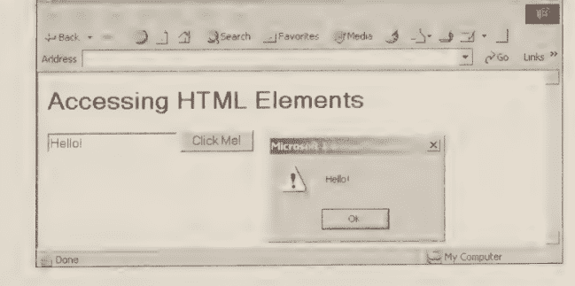

202 第4章 处理浏览器环境

一般来说，W3C DOM 的属性和方法非常适合将 HTML 文档作为节点树来操作——不仅可以像刚才那样在文档中导航，还可以操作文档中的节点和节点位置。我们将在第16章中看到更多相关内容，但这里先举一个例子；在本例中，我将使用 `insertBefore` 方法将有序 HTML 列表中的项目列表从：

- Now
- is
- the
- time.

更改为：

- Now
- is
- not
- the
- time.

以下是它的工作原理——我使用 `createElement` 方法创建新的 `<LI>` 元素，然后使用 `innerHTML` 属性向这个新元素添加文本（关于 `innerHTML` 的更多内容见第16章）。接着我使用 `insertBefore` 方法将这个新元素插入到列表中（注意，由于空白字符的原因，节点位置在 Internet Explorer 和 Netscape Navigator 中是不同的，另外这里需要 Netscape Navigator 6+ 或 Internet Explorer 5+）：

（网站上的 Listing 04-13.html）

```
<HTML>
  <HEAD>
    <TITLE>Inserting New Nodes</TITLE>
    <SCRIPT LANGUAGE="JavaScript">
      <!--
      function addItem()
      {
        var listItem1 = document.createElement("LI")
        listItem1.innerHTML = "not"
        if(navigator.appName == "Netscape") {
          document.getElementById("List1").insertBefore(listItem1,
            document.getElementById("List1").childNodes[3])
        }
      }
```

使用 W3C DOM 访问 HTML 元素 203

```
if(navigator.appName == "Microsoft Internet Explorer") {
  document.getElementById("List1").insertBefore(listItem1,
    document.getElementById("List1").childNodes[2])
}

}

// -->
</SCRIPT>
</HEAD>
<BODY>
<H1>Inserting New Nodes</H1>
<FORM>
<INPUT TYPE="button" VALUE="Insert Item" ONCLICK="addItem()">
</FORM>
<OL ID="List1">
<LI>Now
<LI>is
<LI>the
<LI>time.
</OL>
</BODY>
</HTML>
```

你可以在图 4.11 中看到新节点添加之前的代码运行结果，在图 4.12 中看到按钮点击后新节点添加之后的结果。

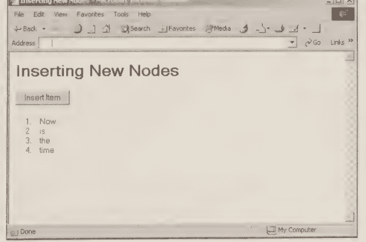

图 4.11  插入新节点。

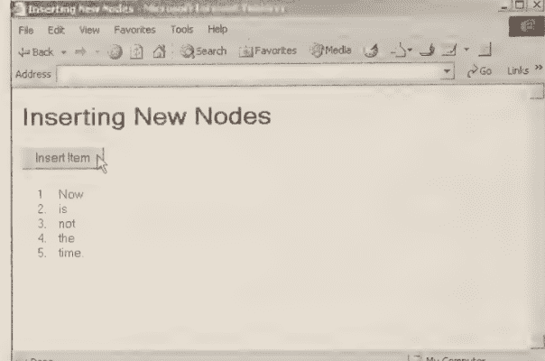

我们将在第16章中看到更多关于使用 W3C DOM 属性和方法来处理节点的内容。

至此，我们已经获得了后续章节所需的概览。在这里，我们看到了作为 JavaScript 程序员在浏览器环境中需要了解的内容，包括各种 DOM 级别的概述、可用的浏览器对象，以及跨浏览器问题。现在是时候开始深入挖掘所有细节了——在下一章中，我将首先介绍 JavaScript 中可访问的 HTML 元素的核心属性，以及如何运用它们。

## 使用核心 HTML 属性

在接下来的章节中，我们将看到大量的 HTML 元素和浏览器对象。这些元素和对象都有各自的属性、方法和事件；如果我们要为每个项目全部列出它们，所需的空间将超过本书的容量。然而，许多 JavaScript 的属性、方法和事件对于几乎所有 HTML 元素和许多浏览器对象来说都是共通的，因此我将它们收集到本章和下一章中，称之为 JavaScript 的核心 HTML 属性、方法和事件。本章涵盖 JavaScript 的核心 HTML 属性，下一章（第6章"使用核心 HTML 方法和事件"）涵盖 JavaScript 的核心 HTML 方法和事件。

因此，当你想要查找某个对象（如 `window` 对象、文本字段或按钮）的属性、方法和事件时，你可以转到涵盖该对象的章节——第7章至第15章中的某一章。你在那些章节中找到的一些属性、方法和事件将是 JavaScript 的核心项目，那些章节会指引你回到第5章和第6章来查看这些项目。

例如，看一下表 5.1，这是第8章"使用 window 和 frame 的方法与事件"中 `window` 对象方法的部分列表；它是表 8.3 的开头。`attachEvent` 方法被标注为"见第6章"，表明该方法在第6章中涵盖。`attachEvent` 方法也是 `document` 对象的方法，该对象在第9章"使用 document 和 body 对象"中介绍。

206 第5章 使用核心 HTML 属性

它也是第11章"使用 HTML 文本元素"中 HTML 文本元素的方法，以及第12章"使用表单、按钮、复选框和单选按钮"、第13章"使用文本和选择控件"、第14章"使用链接、列表和表格"等章节中介绍的 HTML 表单对象的方法。正如你所见，将 JavaScript 的 HTML 核心属性、方法和事件收集在第5章和第6章中，将为我们在后续章节中节省大量的重复内容（事实上，节省的重复内容比本书所能容纳的还要多）。

表 5.1 `window` 对象方法的部分列表（来自表 8.3）

| 方法 | NS2 | NS3 | NS4 | NS6 | IE3a | IE3b | IE4 | IE5 | IE5.5 | IE6 |
| :--- | :---: | :---: | :---: | :---: | :---: | :---: | :---: | :---: | :---: | :---: |

你可以在图 5.1 中看到这段代码的运行结果。

这就是它的工作方式——HTML 属性变成了你可以在代码中访问的 JavaScript 属性；STYLE 属性变成了 `style` 属性，依此类推。连字符属性，例如 LIST-STYLE 属性，使用 Java 命名约定，因此 LIST-STYLE 在 JavaScript 中变成了 `listStyle` 属性。（JavaScript 名称中不能使用连字符。）

你可以在表 5.2 中找到 JavaScript 的核心 HTML 属性。（当然，并非所有属性都受所有浏览器支持。）这些属性被几乎所有 HTML 元素以及许多大型浏览器对象共享，我们将在本章中介绍它们。

### 表 5.2 JavaScript 的核心 HTML 属性

| | | |
|---|---|---|
| accessKey | all | attributes |
| begin | behaviorUrns | canHaveChildren |
| canHaveHTML | childNodes | children |
| className | clientHeight | clientLeft |
| clientTop | clientWidth | contentEditable |
| currentStyle | dataFld | dataFormatAs |
| dataSrc | dir | disabled |
| document | end | filters |
| firstChild | hasMedia | height |
| hideFocus | id | innerHTML |
| innerText | isContentEditable | isDisabled |
| isMultiLine | isTextEdit | lang |
| language | lastChild | length |
| localName | namespaceURI | nextSibling |
| nodeName | nodeType | nodeValue |
| offsetHeight | offsetLeft | offsetParent |
| offsetTop | offsetWidth | onOffBehavior |
| outerHTML | outerText | ownerDocument |
| parentElement | parentNode | parentTextEdit |
| prefix | previousSibling | readyState |
| recordNumber | runtimeStyle | scopeName |
| scrollHeight | scrollLeft | scrollTop |
| scrollWidth | sourceIndex | style |
| syncMaster | tabIndex | tagName |
| tagUrn | timeContainer | title |
| uniqueID | | |

> 事实上，许多 HTML 元素除了核心属性集之外，没有任何属性、方法或事件，你会在表 5.3 中找到它们。

### 表 5.3 核心 HTML 元素

| Properties | | | |
| :--- | :--- | :--- | :--- |
| ACRONYM | ADDRESS | B | BIG |
| CENTER | CITE | CODE | DEL |
| DFN | DIV | EM | HR |
| HTML | I | INS | KBD |
| LISTING | NOBR | P | PLAINTEXT |
| PRE | RT | RUBY | S |
| SAMP | SMALL | SPAN | STRIKE |
| STRONG | SUB | SUP | TT |
| U | VAR | WBR | XMP |

如你所见，在表 5.2 中有许多核心 HTML 属性，它们的功能各异，涵盖了编程的许多不同方面。由于这些属性如此分散，最好还是逐个介绍它们，而不是试图将它们归纳到更大的编程主题中——没有更大的编程主题能涵盖它们。所以，本章的其余部分将逐一介绍你在表 5.2 中看到的核心 HTML 属性，我会尽可能多地加入示例。现在可以跳过你不感兴趣的内容，当你需要了解某个特定核心属性的信息时，再回来看。

## `accessKey` 属性

`accessKey` 属性使你能够指定一个键盘字符，你可以按住 Alt 键加上该字符来使一个 HTML 元素获得焦点（即，使其成为接收按键输入的元素）。你可以在表 5.4 中查看对此属性的支持情况。

**表 5.4 `accessKey` 属性**

| Method | NS2 | NS3 | NS4 | NS6 | IE3a | IE3b | IE4 | IE5 | IE5.5 | IE6 |
|---|---|---|---|---|---|---|---|---|---|---|
| accessKey | | | | | | | | x | x | x |

可读/可写
类型：字符串

下面是一个示例，它为一个按钮分配访问键 "b"，为一个文本字段分配访问键 "t"：

**(网站上的代码清单 05-01.html)**

```html
<HTML>
  <HEAD>
    <TITLE>Using Access Keys</TITLE>
  </HEAD>
  <BODY>
    <H1>Using Access Keys</H1>
    <FORM>
      <INPUT TYPE="BUTTON" ID="button1" ONCLICK="alert('Hello!')" VALUE="Click Me!">
      <INPUT TYPE="TEXT" ID="text1" VALUE="Click Me!">
    </FORM>
    <SCRIPT LANGUAGE="JavaScript">
      <!--
        document.all.button1.accessKey = "b"
        document.all.text1.accessKey = "t"
      // -->
    </SCRIPT>
  </BODY>
</HTML>
```

当你在 Internet Explorer 中打开这个页面时，你只需使用 Alt + 访问键就可以将焦点转移到按钮或文本字段。（请注意，将焦点赋予按钮会点击该按钮。）

## `all` 属性

在 Internet Explorer 中，HTML 元素的 `all` 集合与文档对象的 `all` 集合相同——它保存了该 HTML 元素包含的元素。你可以在表 5.5 中查看对此属性的支持情况。

### 表 5.5 `all` 属性

| Property | NS2 | NS3 | NS4 | NS6 | IE3a | IE3b | IE4 | IE5 | IE5.5 | IE6 |
|---|---|---|---|---|---|---|---|---|---|---|
| all | | | | | | | x | x | x | x |

只读
类型：对象数组

与 `document.all` 集合一样，你可以通过 ID 访问任何项，像这样：`all("myID")`（`all["myID"]` 也可以）。下面是一个例子；在这个例子中，我将显示一个表单的 `all` 集合中的所有属性——当你加载这个页面时，不仅会显示两个 HTML 元素 `button1` 和 `text1`，还会显示 `all` 集合的 `length` 属性，它给出了集合中的项数：

**(网站上的代码清单 05-02.html)**

```html
<HTML>
<HEAD>
<TITLE>Using the all Property</TITLE>
</HEAD>
<BODY>
<H1>Using the all Property</H1>
<FORM NAME="form1">
<INPUT TYPE="BUTTON" ID="button1" ONCLICK="alert('Hello!')" VALUE="Click Me!">
<INPUT TYPE="TEXT" ID="text1" VALUE="Click Me!">
</FORM>
<SCRIPT LANGUAGE="JavaScript">
<!--
    for(var obj in document.form1.all){
        alert(obj)
    }
// -->
</SCRIPT>
</BODY>
</HTML>
```

## `attributes` 属性

`attributes` 属性非常有用；它返回一个集合——即一个数组——包含元素的属性。你可以在表 5.6 中查看对此属性的支持情况。

### 表 5.6 `attributes` 属性

| Property | NS2 | NS3 | NS4 | NS6 | IE3a | IE3b | IE4 | IE5 | IE5.5 | IE6 |
|---|---|---|---|---|---|---|---|---|---|---|
| attributes | | | | x | | | | x | x | x |

只读
类型：对象数组

此属性返回一个属性对象的数组；你可以在表 5.7 中查看属性对象的属性。

### 表 5.7 attribute 对象属性

| Property | IE6 | NS6 | Means |
|---|---|---|---|
| attributes | | x | 包含（嵌套）的属性 |
| childNodes | | x | 子节点数组 |
| expando | x | | 指示是否可以在对象内创建变量 |
| firstChild | x | x | 第一个子节点 |
| lastChild | x | x | 最后一个子节点 |
| localName | | x | 本地名称（如果没有命名空间，则不带限定） |
| name | x | x | 属性的名称 |
| nameSpaceURI | | x | XML 命名空间统一资源标识符 (URI) |
| nextSibling | x | x | 下一个兄弟节点 |
| nodeName | x | x | 属性的名称 |
| nodeType | x | x | 节点类型，设置为 2 |
| nodeValue | x | x | 属性的值 |
| ownerDocument | x | x | 当前文档的对象引用 |
| ownerElement | | x | 包含元素的对象引用 |
| parentNode | x | x | 属性父节点的对象引用 |
| prefix | | x | 命名空间的前缀（如果有） |
| previousSibling | x | x | 上一个兄弟节点 |
| specified | x | x | 如果属性被显式列出则为真，如果隐式则为假 |
| value | x | x | 属性的值 |

下面是一个例子；在这个例子中，我将查看一个按钮元素的 `onclick` 属性的值：

**(网站上的代码清单 05-03.html)**

```html
<HTML>
  <HEAD>
    <TITLE>Using the attributes Property</TITLE>
  </HEAD>
  <BODY>
    <H1>Using the attributes Property</H1>
    <FORM NAME="form1">
      <INPUT TYPE="BUTTON" ID="button1" ONCLICK="alert('Hello!')" VALUE="Click Me!">
      <INPUT TYPE="TEXT" ID="text1" VALUE="Click Me!">
    </FORM>
    <SCRIPT LANGUAGE="JavaScript">
      <!--
        document.write(document.form1.button1.attributes["onclick"].name +
        " = " +
        document.form1.button1.attributes["onclick"].value)
      // -->
    </SCRIPT>
  </BODY>
</HTML>
```

你可以在图 5.2 中看到结果。

图 5.2  在 Netscape Navigator 中查看属性。

## `begin` 属性

此属性用于 Internet Explorer 内置的 `time` 和 `time2` 行为，首次出现在 Internet Explorer 5.5 中。`begin` 属性是一个可读/写属性，用于设置或获取元素中的"时间线"开始播放前的延迟时间，并使你能够协调多媒体操作。你可以为此属性分配以下格式的字符串：时钟格式如 *"h:min:s.f"*；或事件触发，给定元素 ID 如下：`id.event[+"h:min:s.f"]`（方括号中的时间是可选的）；或值为 "indefinite"，这意味着 `begin` 时间由对 `beginElement` 方法的调用来确定。有关 Internet 行为（如 `time` 和 `time2`）的更多信息，请参阅第 15 章"使用鼠标、键盘和图像"。

## `behaviorUrns` 属性

`behaviorUrns` 属性返回一个数组，包含附加到特定对象（如 HTML 元素）的任何 Internet Explorer 行为的*统一资源名称*（URN），我们将在第 17 章"动态 HTML：拖放、数据绑定和行为"（以及前一章中讨论过的）中看到。你可以在表 5.8 中查看此属性的支持情况。

表 5.8  `behaviorUrns` 属性

| 属性 | NS2 | NS3 | NS4 | NS6 | IE3a | IE3b | IE4 | IE5 | IE5.5 | IE6 |
| :--- | :---: | :---: | :---: | :---: | :---: | :---: | :---: | :---: | :---: | :---: |

这是一个使用 CSS 样式的例子，我们将在第 21 章“级联样式表与 CGI 编程”中看到；在这个例子中，我创建了两个 CSS 类 `redText` 和 `blackText`，并通过 `className` 属性将它们分配给 `<DIV>` 中的文本，以便在用户点击按钮时将文本变为黑色或红色：

**(网站上的清单 05-06.html)**

```
<HTML>
    <HEAD>
        <TITLE>Coloring Text with Dynamic CSS Classes</TITLE>
        <STYLE TYPE="text/css">
            .blackText {color:Black}
            .redText {color:Red}
        </STYLE>
        <SCRIPT LANGUAGE="JavaScript">
            <!--
            function turnBlack()
            {
                document.all.div1.className = "blackText"
            }
            function turnRed()
            {
                document.all.div1.className = "redText"
            }
            // -->
        </SCRIPT>
    </HEAD>
    <BODY>
        <DIV ID = "div1">
            <H1>Coloring Text With Dynamic CSS Classes</H1>
            <BR>
            <FORM>
                <INPUT TYPE = BUTTON Value = "Turn text black" onClick = "turnBlack()">
                <INPUT TYPE = BUTTON Value = "Turn text red" onClick = "turnRed()">
            </FORM>
        </DIV>
    </BODY>
</HTML>
```

你可以在图 5.5 中看到结果，其中我将文本变成了红色（尽管这里是黑白显示的，当然）。

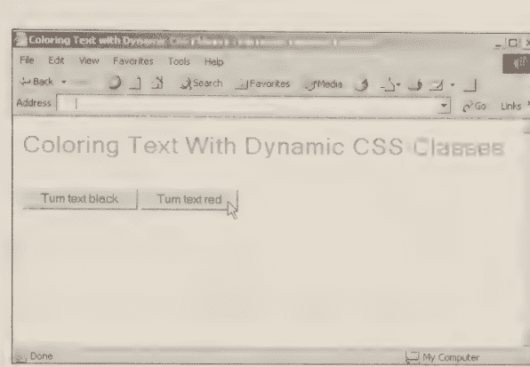

图 5.5  使用 `className` 属性。

## `clientHeight`、`clientLeft`、`clientTop` 和 `clientWidth` 属性

这些属性以像素为单位提供对象的高度、宽度、左侧位置或顶部位置，这些值是你通过 CSS 样式设置的。你可以在表 5.14 中看到对这些属性的支持。

表 5.14  `clientHeight`、`clientLeft`、`clientTop` 和 `clientWidth` 属性

| 属性 | NS2 | NS3 | NS4 | NS6 | IE3a | IE3b | IE4 | IE5 | IE5.5 | IE6 |
|---|---|---|---|---|---|---|---|---|---|---|
| clientHeight | | | | | | | x | x | x | x |
| | 只读 | | | | | | | | | |
| | 类型：整数 | | | | | | | | | |
| clientLeft | | | | | | | x | x | x | x |
| | 只读 | | | | | | | | | |
| | 类型：整数 | | | | | | | | | |
| clientTop | | | | | | | x | x | x | x |
| | 只读 | | | | | | | | | |
| | 类型：整数 | | | | | | | | | |
| clientWidth | | | | | | | x | x | x | x |
| | 只读 | | | | | | | | | |
| | 类型：整数 | | | | | | | | | |

下面是一个例子；在这个例子中，代码报告了你通过该元素的 width 样式为 `<P>` 元素设置的高度：

(网站上的清单 05-07.html)

```
<HTML>
<HEAD>
<TITLE>
Using the clientHeight Property
</TITLE>
<SCRIPT LANGUAGE="JavaScript">
<!--
function getText()
{
alert("document.all.text1.clientHeight = "
+ document.all.text1.clientHeight)
}
// -->
</SCRIPT>
</HEAD>
<BODY>
<H1>Using the clientHeight Property</H1>
<P NAME="text1" ID="text1" STYLE="width:200">
Here's the text.
</P>
<FORM NAME="form1">
<INPUT TYPE="BUTTON" VALUE="Click Me!" ONCLICK="getText()">
</FORM>
</BODY>
</HTML>
```

## `contentEditable` 属性

Internet Explorer 5.5 引入了一个很酷的属性 `contentEditable`，它允许用户交互式地编辑网页中的内容。你可以在表 5.15 中看到对这个属性的支持。

| 属性 | NS2 | NS3 | NS4 | NS6 | IE3a | IE3b | IE4 | IE5 | IE5.5 | IE6 |
|----------|-----|-----|-----|-----|------|------|-----|-----|-------|-----|
| contentEditable | | | | | | | | | x | x |
| | | | | | | | | | 读/写 | |
| | | | | | | | | | 类型：布尔值 | |

下面是一个例子。在这个例子中，我将使一个名为 `editableDIV` 的 `<DIV>` 元素中的文本可编辑：

(网站上的清单 05-08.html)

```
<HTML>
    <HEAD>
        <TITLE>Editing Content</TITLE>
    </HEAD>
    <BODY>
        <H1>Editing Content</H1>
        <DIV ID="editableDIV">Edit Me!</DIV>
        <SCRIPT LANGUAGE="JavaScript">
            <!--
            editableDIV.contentEditable = true
            // -->
        </SCRIPT>
    </BODY>
</HTML>
```

你可以在图 5.6 中看到结果；最初，那里的文本只是 "Edit Me!"，但，就像你在文字处理器中所做的那样，我将其改为了 "Edit Me Now!"。


图 5.6  使用 `contentEditable` 属性。

224 第 5 章 使用核心 HTML 属性

## `currentStyle` 属性

此属性用于 CSS 样式，通过返回未通过 CSS 样式语句明确设置的样式信息，提供比 `style` 属性更多的信息。例如，`<i>` 元素以斜体显示文本；然而，除非你明确将此元素的 CSS 样式设置为斜体，否则 `style` 属性不会反映这一点。然而，`currentStyle` 属性会反映这一点。在这种情况下，`currentStyle` 属性持有一个样式对象，其 `fontStyle` 设置为 "italic"。你可以在表 5.16 中看到对这个属性的支持。

| 表 5.16 | `currentStyle` 属性 | | | | | | | | | |
| :--- | :--- | :--- | :--- | :--- | :--- | :--- | :--- | :--- | :--- | :--- |
| **属性** | **NS2** | **NS3** | **NS4** | **NS6** | **IE3a** | **IE3b** | **IE4** | **IE5** | **IE5.5** | **IE6** |
| currentStyle | | | | | | | | x | x | x |
| | 只读 | | | | | | | | | |
| | 类型：对象 | | | | | | | | | |

## `dataFld`、`dataFormatAs` 和 `dataSrc` 属性

你可以在 Internet Explorer 中将 `dataFld`、`dataFormatAs` 和 `dataSrc` 属性与数据源对象 (DSO) 一起使用，这些对象使你能够以表格和逐字段格式显示来自数据库的数据。这些属性是在 Internet Explorer 4.0 中引入的，如表 5.17 所示。

| 表 5.17 | `dataFld`、`dataFormatAs` 和 `dataSrc` 属性 | | | | | | | | | |
| :--- | :--- | :--- | :--- | :--- | :--- | :--- | :--- | :--- | :--- | :--- |
| **属性** | **NS2** | **NS3** | **NS4** | **NS6** | **IE3a** | **IE3b** | **IE4** | **IE5** | **IE5.5** | **IE6** |
| dataFld | | | | | | | x | x | x | x |
| | 读/写 | | | | | | | | | |
| | 类型：字符串 | | | | | | | | | |
| dataFormatAs | | | | | | | x | x | x | x |
| | 读/写 | | | | | | | | | |
| | 类型：字符串 | | | | | | | | | |
| dataSrc | | | | | | | x | x | x | x |
| | 读/写 | | | | | | | | | |
| | 类型：字符串 | | | | | | | | | |

`dataSrc` 属性持有数据的源，例如一个 HTML 文档。这个 HTML 文档可以用 `<SPAN>` 元素划分为带标签的数据字段；`dataFld` 属性使你能够引用该文档中的特定数据字段。`dataFormatAs` 持有数据格式，"text"（默认）、"html" 或 "localized-text"（考虑特定区域设置数据）。这些属性适用于以下元素：`<APPLET>`、`<BUTTON>`、`<DIV>`、`<FRAME>`、`<IFRAME>`、``、`<INPUT>`、`<LABEL>`、`<MARQUEE>`、`<SELECT>`、`<SPAN>`、`<TABLE>` 和 `<TEXTAREA>`。

下面是一个显示来自 HTML 文档数据的例子：

(网站上的清单 05-09.html)

```
<HTML>
  <HEAD>
    <TITLE>
      Using the dataFld, dataFormatAs, and dataSrc Properties
    </TITLE>
  </HEAD>
  <BODY>
    <CENTER>
      <H1>
        Using the dataFld, dataFormatAs, and dataSrc Properties
      </H1>
      <OBJECT ID="dsoEmployees" DATA="05-10.html" HEIGHT=0 WIDTH=0>
      </OBJECT>
      Name: <INPUT TYPE="TEXT" DATASRC="#dsoEmployees"
        DATAFLD="NAME" SIZE=10>
      <P>
      ID: <INPUT TYPE="TEXT" DATASRC="#dsoEmployees"
        DATAFLD="ID" SIZE=5>
      <P>
      Hire date: <SPAN DATASRC="#dsoEmployees"
        DATAFLD="HIRE_DATE"></SPAN>
      <P>
      Title: <SPAN DATASRC="#dsoEmployees" DATAFLD="TITLE">
      </SPAN>
      <P>
      Department: <SELECT DATASRC="#dsoEmployees"
        DATAFLD="DEPARTMENT" SIZE=1>
        <OPTION VALUE="Shipping">Shipping
        <OPTION VALUE="Programming">Programming
        <OPTION VALUE="Editing">Editing
        <OPTION VALUE="Writing">Writing
      </SELECT>
      <P>
```

第 5 章 使用核心 HTML 属性

```
<BUTTON ONCLICK=
    "dsoEmployees.recordset.MoveFirst()" >&lt;&lt;</BUTTON>
    <BUTTON ONCLICK="if (!dsoEmployees.recordset.BOF)
    dsoEmployees.recordset.MovePrevious()" >&lt;</BUTTON>
    <BUTTON ONCLICK="if (!dsoEmployees.recordset.EOF)
    dsoEmployees.recordset.MoveNext()" >&gt;</BUTTON>
    <BUTTON ONCLICK=
    "dsoEmployees.recordset.MoveLast()">&gt;&gt;</BUTTON>
    </CENTER>
</BODY>
</HTML>
```

下面是需要放在同一目录中以便此代码读取的数据 HTML 文档：

(网站上的清单 05-10.html)

```
<HTML>
  <HEAD>
    <TITLE>Data Page</TITLE>
  </HEAD>
  <BODY>
    <H1>This page holds data.</H1>
    Name: <SPAN ID="NAME">Frank</SPAN><BR>
    ID: <SPAN ID="ID">2345</SPAN><BR>
    Hire Date: <SPAN ID="HIRE_DATE">12-31-2003</SPAN><BR>
    Department: <SPAN ID="DEPARTMENT">Shipping</SPAN><BR>
    Title: <SPAN ID="TITLE">Packer</SPAN><BR>
    Name: <SPAN ID="NAME">Mike</SPAN><BR>
    ID: <SPAN ID="ID">2346</SPAN><BR>
    Hire Date: <SPAN ID="HIRE_DATE">12-31-2003</SPAN><BR>
    Department: <SPAN ID="DEPARTMENT">Programming</SPAN><BR>
    Title: <SPAN ID="TITLE">Programmer</SPAN><BR>
    Name: <SPAN ID="NAME">Sammy</SPAN><BR>
    ID: <SPAN ID="ID">2346</SPAN><BR>
    Hire Date: <SPAN ID="HIRE_DATE">12-31-2003</SPAN><BR>
    Department: <SPAN ID="DEPARTMENT">Shipping</SPAN><BR>
    Title: <SPAN ID="TITLE">Packer</SPAN><BR>
    Name: <SPAN ID="NAME">Tamsen</SPAN><BR>
    ID: <SPAN ID="ID">2347</SPAN><BR>
    Hire Date: <SPAN ID="HIRE_DATE">12-31-2003</SPAN><BR>
    Department: <SPAN ID="DEPARTMENT">Shipping</SPAN><BR>
    Title: <SPAN ID="TITLE">Packer</SPAN><BR>
    Name: <SPAN ID="NAME">Kim</SPAN><BR>
    ID: <SPAN ID="ID">2348</SPAN><BR>
    Hire Date: <SPAN ID="HIRE_DATE">12-31-2003</SPAN><BR>
    Department: <SPAN ID="DEPARTMENT">Shipping</SPAN><BR>
    Title: <SPAN ID="TITLE">Packer</SPAN><BR>
  </BODY>
</HTML>
```

你可以在图 5.7 中看到结果——这里，来自多个记录的数据按记录逐个显示。用户可以使用页面底部的箭头导航按钮在记录间切换。

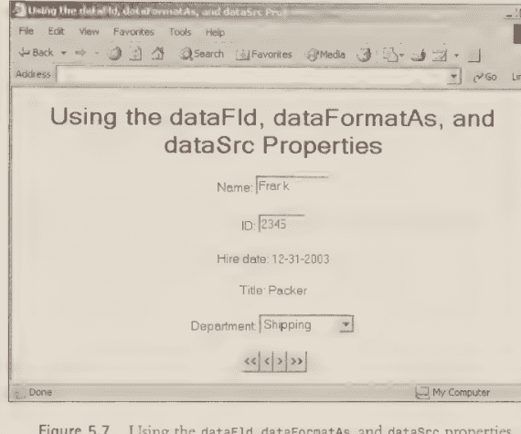

图 5.7 使用 `dataFld`、`dataFormatAs` 和 `dataSrc` 属性。

我们将在第 17 章中更详细地了解如何使用这些属性。

## `dir` 属性

`dir` 属性指定面向文本的 HTML 组件中文本的方向，可针对不同语言设置为 `"rtl"`（从右到左）或 `"ltr"`（从左到右）。你可以查看表 5.18 了解此属性的支持情况。

表 5.18 `dir` 属性

| 属性 | NS2 | NS3 | NS4 | NS6 | IE3a | IE3b | IE4 | IE5 | IE5.5 | IE6 |
|----------|-----|-----|-----|-----|------|------|-----|-----|-------|-----|
| dir | | | | x | | | | x | x | x |
| | 读/写 | | | | | | | | | |
| | 类型：字符串 | | | | | | | | | |

### 提示

如果你想在 Internet Explorer 中使用 `dir` 属性，可能需要下载名为 Microsoft Uniscribe 的附加组件。你可以在 www.microsoft.com/OpenType/developers/uniscribe/intro.htm 找到更多信息。

## `disabled` 属性

`disabled` 属性让你了解——或允许你设置——某个元素是否被禁用。例如，如果一个按钮被禁用，其标题会变灰，并且无法点击。你可以查看表 5.19 了解此属性的支持情况。

### 表 5.19 `disabled` 属性

| 属性 | NS2 | NS3 | NS4 | NS6 | IE3a | IE3b | IE4 | IE5 | IE5.5 | IE6 |
|----------|-----|-----|-----|-----|------|------|-----|-----|-------|-----|
| disabled | | | | x | | | x | x | x | x |

读/写

类型：布尔值

下面是一个禁用按钮的示例：

***(网站上的清单 05-11.html)***

```
<HTML>
    <HEAD>
        <TITLE>Using the disabled Property</TITLE>
    </HEAD>
    <BODY>
        <H1>Using the disabled Property</H1>
        <FORM>
            <INPUT ID="button1" TYPE="BUTTON" ONCLICK="alert('Hello!')" VALUE="Click Me!">
        </FORM>
        <SCRIPT LANGUAGE="JavaScript">
            <!--
                document.all.button1.disabled = true
            // -->
        </SCRIPT>
    </BODY>
</HTML>
```

你可以在图 5.8 中看到结果。


图 5.8 使用 `disabled` 属性。

### 提示
正如我们将在第 21 章中看到的，你也可以使用 `disabled` 属性来禁用和启用 CSS 样式表。

## `document` 属性

`document` 属性保存包含该对象的文档对象。
你可以查看表 5.20 了解此属性的支持情况。

表 5.20 `document` 属性

| 属性 | NS2 | NS3 | NS4 | NS6 | IE3a | IE3b | IE4 | IE5 | IE5.5 | IE6 |
| :--- | :--- | :--- | :--- | :--- | :--- | :--- | :--- | :--- | :--- | :--- |
| document | | | | | | | X | X | X | X |

只读
类型：对象

下面是一个例子；在这个名为 `warner` 的函数中，我将使用对象的 `document` 属性，将关于该对象的警告消息写入对象的文档（`isBad` 方法是虚构的）：

```
function warner(object1)
{
    if(object1.isBad()){
        object1.document.write("WARNING: Bad Object Found!")
    }
}
```

## `end` 属性

与 `begin` 属性类似，此属性用于 Internet Explorer 内置的 `time` 和 `time2` 行为，并首次出现在 Internet Explorer 5.5 中。`end` 属性是一个读/写属性，用于设置或获取一个值，该值指示元素定时操作的结束时间，并允许你协调多媒体操作。你可以为此属性分配一个时钟格式的字符串，如 `"h:min:s.f"`；或一个事件发生，通过元素 ID 给出，格式如下：`id.event[+"h:min:s.f"]`（方括号中的时间是可选的）；或者一个值为 `"indefinite"`，表示结束时间是无限的。有关 Internet 行为（如 `time` 和 `time2`）的更多信息，请参阅第 15 章。

## `filters` 属性

在 Internet Explorer 中，`filters` 属性保存为当前元素定义的 `filters` 数组。滤镜支持各种视觉效果，如投影和模糊。你可以查看表 5.21 了解此属性的支持情况。

表 5.21 `filters` 属性

| 属性 | NS2 | NS3 | NS4 | NS6 | IE3a | IE3b | IE4 | IE5 | IE5.5 | IE6 |
|---|---|---|---|---|---|---|---|---|---|---|
| filters | | | | | | | x | x | x | x |
| | | 只读 | | | | | | | | |
| | | 类型：对象数组 | | | | | | | | |

我们将在第 16 章“动态 HTML：实时更改网页”中更详细地了解 `filters`，但这里先预览一下；这个网页允许你尝试各种滤镜，将它们应用于一些文本：

**(网站上的清单 05-12.html)**

```
<HTML>
  <HEAD>
    <TITLE>
      Using Filters
    </TITLE>
    <SCRIPT LANGUAGE="JavaScript">
      <!--
      function applyFilter()
      {
        div1.style.filter=""
        if (document.form1.radio01.checked) {
          div1.style.filter = "fliph(enabled=1)"
        }
if (document.form1.radio02.checked) {
    div1.style.filter = "flipv(enabled=1)"
}
if (document.form1.radio03.checked) {
    div1.style.filter = "gray(enabled=1)"
}
if (document.form1.radio04.checked) {
    div1.style.filter = "invert(enabled=1)"
}
if (document.form1.radio05.checked) {
    div1.style.filter = "xray(enabled=1)"
}
if (document.form1.radio06.checked){
    var opacityValue = document.form1.opacity.value
    div1.style.filter = "alpha(opacity=" + opacityValue +
        ", enabled=1)"
}
if (document.form1.radio07.checked) {
    div1.style.filter =
        "blur(direction=45, strength=15, add=0, enabled=1)"
}
if (document.form1.radio08.checked) {
    div1.style.filter = "chroma(color=#FFFF00, enabled=1)"
}
if (document.form1.radio09.checked) {
    div1.style.filter = "dropshadow(offx=5, offy=9, " +
        "color=#008fff, enabled=1)"
}
if (document.form1.radio10.checked) {
    div1.style.filter = "glow(strength=5, color=#ffff00, " +
        "enabled=1)"
}
if (document.form1.radio11.checked) {
    div1.style.filter = "mask(color=#FF0000 ,enabled=1)"
}
if (document.form1.radio12.checked) {
    div1.style.filter =
    "shadow(color=#FF0088, direction=320, enabled=1)"
}
if (document.form1.radio13.checked) {
```


# 使用滤镜

```html
div1.style.filter = "wave(freq=2, strength=6, phase=0, " +
    "lightstrength=0, add=0, enabled=1)"
```

你可以在图 5.9 中看到结果，其中我对一些文本应用了投影滤镜。更多关于滤镜的内容在第 16 章。

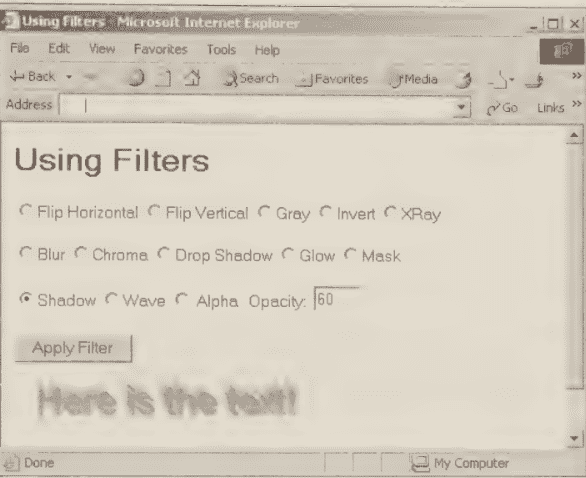

## `firstChild` 和 `lastChild` 属性

`firstChild` 和 `lastChild` 属性返回特定节点的第一个和最后一个子节点，如果没有这样的子节点，则返回 `null` 值。你可以查看表 5.22 了解这些属性的支持情况。

### 表 5.22 `firstChild` 和 `lastChild` 属性

| 属性 | NS2 | NS3 | NS4 | NS6 | IE3a | IE3b | IE4 | IE5 | IE5.5 | IE6 |
| :--- | :--- | :--- | :--- | :--- | :--- | :--- | :--- | :--- | :--- | :--- |
| `firstChild` | | | | x | | | | x | x | x |
| | 只读<br>类型：节点对象 | | | | | | | | | |
| `lastChild` | | | | x | | | | x | x | x |
| | 只读<br>类型：节点对象 | | | | | | | | | |

下面是一个使用 `firstChild` 和 `lastChild` 属性的例子——在这个例子中，代码将使用这些属性报告一个表单的两个子节点的名称：

**(网站上的清单 05-13.html)**

```html
<HTML>
    <HEAD>
        <TITLE>
            使用 firstChild 和 lastChild 属性
        </TITLE>
    </HEAD>
    <BODY>
        <H1>使用 firstChild 和 lastChild 属性</H1>
        <FORM NAME="form1">
            <INPUT TYPE="BUTTON" NAME="button1" VALUE="Click Me!" ONCLICK="getText()">
            <INPUT TYPE="TEXT" NAME="text1"></FORM>
        <SCRIPT LANGUAGE="JavaScript">
            <!--
            document.write("document.all.form1.firstChild.name = "
                + document.all.form1.firstChild.name + "<BR>")
            document.write("document.all.form1.lastChild.name = "
                + document.all.form1.lastChild.name + "<BR>")
            // -->
        </SCRIPT>
    </BODY>
</HTML>
```

你可以在图 5.10 中看到结果。

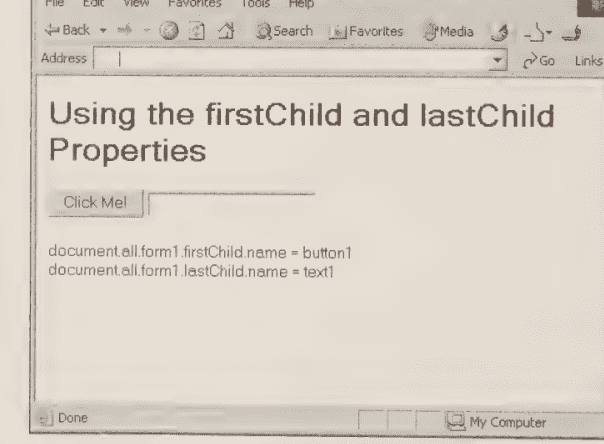

## `hasMedia` 属性

保存一个布尔值，指示该元素是否是 Internet Explorer HTML+TIME 媒体元素。你可以在表 5.23 中查看此属性的支持情况。

### 表 5.23 `hasMedia` 属性

| 属性 | NS2 | NS3 | NS4 | NS6 | IE3a | IE3b | IE4 | IE5 | IE5.5 | IE6 |
|----------|-----|-----|-----|-----|------|------|-----|-----|-------|-----|
| `hasMedia` | | | | | | | | | x | x |

只读
类型：布尔值

## `height` 和 `width` 属性

`height` 和 `width` 属性对应于支持这些属性的元素的 `HEIGHT` 和 `WIDTH` HTML 属性。你可以在表 5.24 中查看这些属性的支持情况。

### 表 5.24 `height` 和 `width` 属性

| 属性 | NS2 | NS3 | NS4 | NS6 | IE3a | IE3b | IE4 | IE5 | IE5.5 | IE6 |
|----------|-----|-----|-----|-----|------|------|-----|-----|-------|-----|
| `height` | | | x | x | | | x | x | x | x |

可读/可写
类型：整数或百分比

这些属性以像素或百分比为单位进行度量，就像它们对应的 HTML 属性一样。你可以在 JavaScript 中读取或写入它们。

> **提示**
> 请注意，`height` 和 `width` 属性与通过元素的 `style` 属性设置的 `height` 和 `width` 属性不同。

## `hideFocus` 属性

`hideFocus` 属性是仅限 Internet Explorer 的属性。当该浏览器中的 HTML 元素获得焦点（即成为按键的目标）时，该元素通常会显示一个虚线框（就像单击按钮时围绕其标题的框一样）。如果你将元素的 `hideFocus` 属性设置为 `true`，则该虚线框不会出现。你可以在表 5.25 中查看此属性的支持情况。

### 表 5.25 `hideFocus` 属性

| 属性 | NS2 | NS3 | NS4 | NS6 | IE3a | IE3b | IE4 | IE5 | IE5.5 | IE6 |
| :--- | :--- | :--- | :--- | :--- | :--- | :--- | :--- | :--- | :--- | :--- |
| `hideFocus` | | | | | | | | | X | X |
| 可读/可写 | | | | | | | | | | |
| 类型：布尔值 | | | | | | | | | | |

## `id` 属性

正如你所猜测的，`id` 属性对应于 `ID` HTML 属性，并保存对象的 ID 值。对于浏览器来说，处理 ID 值相对新颖，这主要是因为 W3C DOM 强调 ID 属性而非 `NAME` 属性。你可以在表 5.26 中查看这些属性的支持情况。

### 表 5.26 `id` 属性

| 属性 | NS2 | NS3 | NS4 | NS6 | IE3a | IE3b | IE4 | IE5 | IE5.5 | IE6 |
| :--- | :--- | :--- | :--- | :--- | :--- | :--- | :--- | :--- | :--- | :--- |
| `id` | | | | X | | | X | X | X | X |
| 只读 | | | | | | | | | | |
| 类型：字符串 | | | | | | | | | | |

这是一个扩展示例，扩展了本章前面 `document` 对象主题中的代码；在这种情况下，我将在对象的文档中显示警告时报告该对象的 ID：

```javascript
function warner(object1)
{
    if(object1.isBad()){
        object1.document.write("WARNING: Bad Object Found! ID:" + object1.id)
    }
}
```

## `innerHTML`、`innerText`、`outerHTML` 和 `outerText` 属性

`innerHTML`、`innerText`、`outerHTML` 和 `outerText` 属性是许多动态 HTML 的基础，因为它们使你能够访问 HTML 元素的 HTML 和文本，并在运行时更改它们。我们将在第 16 章中应用这些属性。以下是这些属性的概述：

- `innerHTML`。更改开始标签和结束标签之间的元素内容，可以包含 HTML。
- `innerText`。使你能够更改元素开始标签和结束标签之间的文本。
- `outerHTML`。元素的内容，包括开始和结束标签，将文本视为 HTML。
- `outerText`。使你能够更改元素的所有文本，包括开始和结束标签。

你可以在表 5.27 中查看这些属性的支持情况（请注意，只有 `innerHTML` 被 Netscape Navigator 支持，并且到目前为止仅在版本 6 中支持）。

### 表 5.27 `innerHTML`、`innerText`、`outerHTML` 和 `outerText` 属性

| 属性 | NS2 | NS3 | NS4 | NS6 | IE3a | IE3b | IE4 | IE5 | IE5.5 | IE6 |
|---|---|---|---|---|---|---|---|---|---|---|
| `innerHTML` | | | | x | | | x | x | x | x |
| `innerText` | | | | | | | | x | x | x |
| `outerHTML` | | | | | | | | x | x | x |
| `outerText` | | | | | | | | x | x | x |

这是一个 Internet Explorer 示例，使用 `innerHTML` 属性，当你单击标题时重写 `<H1>` 标题，使用 `innerHTML` 属性：

**(网站上的清单 05-14.html)**

```html
<HTML>
  <HEAD>
    <TITLE>使用 innerHTML 属性</TITLE>
    <SCRIPT LANGUAGE = JavaScript>
      <!--
      function rewriteHeader()
      {
        document.all.Header.innerHTML = "Here's a New Header!"
      }
      // -->
    </SCRIPT>
  </HEAD>
  <BODY>
    <H1 ID="Header" ONCLICK="rewriteHeader()">Click Me!</H1>
  </BODY>
</HTML>
```

你可以在图 5.11 中看到结果，其中我已单击标题以重写它。

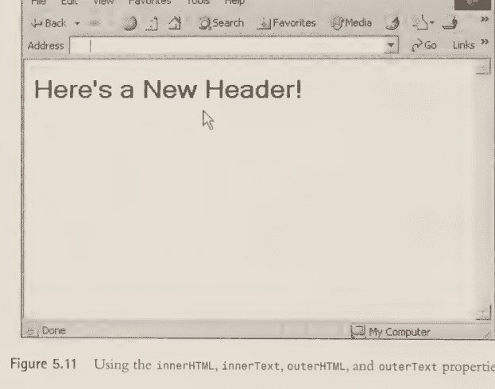

我们将在第 16 章中更详细地了解这些属性。

## `isContentEditable` 属性

如果元素的内容是可编辑的，则 `isContentEditable` 属性返回 `true`（有关使网页内容可编辑的所有详细信息，请参阅本章前面的 `contentEditable` 属性）。你可以在表 5.28 中查看此属性的支持情况。

### 表 5.28 `isContentEditable` 属性

| 属性 | NS2 | NS3 | NS4 | NS6 | IE3a | IE3b | IE4 | IE5 | IE5.5 | IE6 |
|---|---|---|---|---|---|---|---|---|---|---|
| `isContentEditable` | | | | | | | | | x | x |

只读
类型：布尔值

## `isDisabled` 属性

`isDisabled` 属性让你知道对象是否被禁用——有关禁用对象的更多信息，请参阅本章前面的 `disabled` 属性。你可以在表 5.29 中查看 `isDisabled` 属性的支持情况。

### 表 5.29 `isDisabled` 属性

| 属性 | NS2 | NS3 | NS4 | NS6 | IE3a | IE3b | IE4 | IE5 | IE5.5 | IE6 |
|---|---|---|---|---|---|---|---|---|---|---|
| `isDisabled` | | | | | | | | | x | x |

只读
类型：布尔值

## `isMultiLine` 属性

`isMultiLine` 属性指示元素是否以多行显示其内容（通常是文本）。例如，HTML 文本字段将返回 `false`，尽管 HTML 文本区域可以返回 `true`，按钮也可以（按钮标题可以跨多行）。你可以在表 5.30 中查看此属性的支持情况。

### 表 5.30 `isMultiLine` 属性

| 属性 | NS2 | NS3 | NS4 | NS6 | IE3a | IE3b | IE4 | IE5 | IE5.5 | IE6 |
|---|---|---|---|---|---|---|---|---|---|---|
| `isMultiLine` | | | | | | | | | x | x |

只读
类型：布尔值

## `isTextEdit` 属性

如果你可以使用其内容创建 Internet Explorer `TextRange` 对象，则 `isTextEdit` 属性返回 `true`。你可以在表 5.31 中查看此属性的支持情况。

### 表 5.31 `isTextEdit` 属性

| 属性 | NS2 | NS3 | NS4 | NS6 | IE3a | IE3b | IE4 | IE5 | IE5.5 | IE6 |
|----------|-----|-----|-----|-----|------|------|-----|-----|-------|-----|
| `isTextEdit` | | | | | | | x | x | x | x |

只读
类型：布尔值

我们将在第 11 章中更详细地了解文本范围；它们允许你处理组合成对象的文本。这是一个预览，我将使用文本范围重写 `<DIV>` 元素中的文本，并使用 `isTextEdit`：

**(网站上的清单 05-15.html)**

```html
<HTML>
  <HEAD>
    <TITLE>
      使用文本范围
    </TITLE>
    <SCRIPT LANGUAGE="JavaScript">
      <!--
      function replaceText()
      {
        if(document.body.isTextEdit){
          var range = document.body.createTextRange()
          range.moveToElementText(div1)
          range.pasteHTML("Here is the replacement text!")
        }
      }
      // -->
    </SCRIPT>
  </HEAD>
  <BODY>
    <H1>使用文本范围</H1>
    <INPUT TYPE=BUTTON VALUE="Click Me!" onclick="replaceText()">
    <BR>
    <BR>
    <DIV ID="div1" STYLE="font-family:Arial, sans-serif; font-weight:bold">
      Click the button to replace all this text.
    </DIV>
  </BODY>
</HTML>
```

你可以在图 5.12 中看到结果，其中我已单击按钮并用新文本替换了原始文本。有关文本范围的更多信息，请参阅第 11 章。

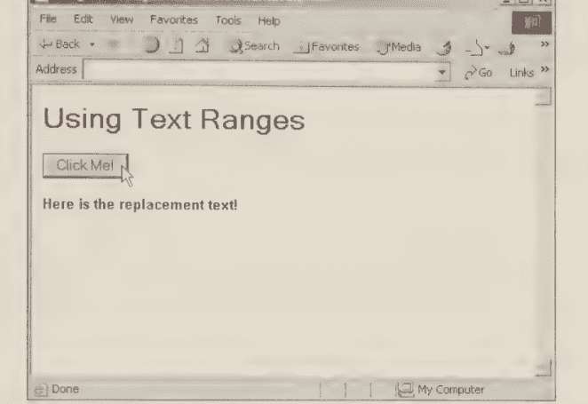

## `lang` 和 `language` 属性

`lang` 属性保存对象的语言（例如 `"en"` 表示英语），而 `language` 属性保存元素的脚本语言。你可以在表 5.32 中看到这些属性的支持情况。

### 表 5.32 `lang` 和 `language` 属性

| 属性 | NS2 | NS3 | NS4 | NS6 | IE3a | IE3b | IE4 | IE5 | IE5.5 | IE6 |
|---|---|---|---|---|---|---|---|---|---|---|
| `lang` | | | | X | | | X | X | X | X |
| | 可读/可写<br>类型：字符串 | | | | | | | | | |
| `language` | | | | | | | X | X | X | X |
| | 可读/可写<br>类型：字符串 | | | | | | | | | |

虽然这些属性主要是设计为可读的，但你可以写入它们；这是一个示例：

```javascript
document.all.germanLanguageDIV.lang = "de"
document.all.script1.language = "JavaScript"
```

# `length` 属性

我们已经使用过 `length` 属性，它返回数组或集合中的项目数量。你可以在表 5.33 中看到此属性的支持情况。

### 表 5.33 `length` 属性

| 属性 | NS2 | NS3 | NS4 | NS6 | IE3a | IE3b | IE4 | IE5 | IE5.5 | IE6 |
|---|---|---|---|---|---|---|---|---|---|---|
| `length` | x | x | x | x | x | x | x | x | x | x |
| 只读，类型：整数 | | | | | | | | | | |

这是本章前面的一个示例，我们使用 `children` 集合的 `length` 属性来循环遍历表单中所有的子 HTML 元素：

**(网站上的清单 05-05.html)**

```html
<HTML>
    <HEAD>
        <TITLE>Using the children Property</TITLE>
    </HEAD>
    <BODY>
        <H1 NAME="header1">Using the children Property</H1>
        <FORM NAME="form1">
            <INPUT NAME="button1" TYPE="BUTTON" ONCLICK="alerter()" VALUE="Click Me!">
            <INPUT NAME="text1" TYPE="TEXT">
        </FORM>
        <SCRIPT LANGUAGE="JavaScript">
            <!--
            for(var loopIndex=0; loopIndex < form1.children.length; loopIndex++){
                document.write(form1.children[loopIndex].name + "<BR>")
            }
            // -->
        </SCRIPT>
    </BODY>
</HTML>
```

# `localName`、`namespaceURI` 和 `prefix` 属性

你主要在使用命名空间的 XML 文档——或嵌入在 HTML 文档中的 XML——中使用 `localName`、`namespaceURI` 和 `prefix` 属性。本书不会过多涉及命名空间，但简要来说，你可以在 XML 中这样声明和使用命名空间：

```xml
<doc xmlns:ns="http://www.ns.com">
    <ns:myElement>Here is some data</ns:myElement>
</doc>
```

这里，`"ns"` 是命名空间的前缀，`"http://www.ns.com"` 是命名空间的 URI，而像 `<ns:myElement>` 这样的标签的本地名称就是不带命名空间前缀的部分，即 `"myElement"`。这些项目对应于 `localName`、`namespaceURI` 和 `prefix` 属性，你可以在表 5.34 中找到这些属性的支持情况。

> **提示**
> 有关 XML 的更多信息，请参见 W3C XML 规范 `www.w3.org/TR/REC-xml`。另请参阅本章中的 `scopeName` 属性。

### 表 5.34 `localName`、`namespaceURI` 和 `prefix` 属性

| 属性 | NS2 | NS3 | NS4 | NS6 | IE3a | IE3b | IE4 | IE5 | IE5.5 | IE6 |
|----------|-----|-----|-----|-----|------|------|-----|-----|-------|-----|
| `localName` | | | | x | | | | | | x |
| | 只读 类型：字符串 | | | | | | | | | |
| `namespaceURI` | | | | x | | | | | | x |
| | 只读 类型：字符串 | | | | | | | | | |
| `prefix` | | | | x | | | | | | x |
| | 只读 类型：字符串 | | | | | | | | | |

# `nextSibling` 和 `previousSibling` 属性

`nextSibling` 和 `previousSibling` 属性是 W3C DOM 属性，在将 HTML 文档作为节点树导航时非常有用，使你能够在兄弟节点之间导航（即在文档中处于同一级别的节点）。你可以在表 5.35 中看到这些属性的支持情况。

### 表 5.35 `nextSibling` 和 `previousSibling` 属性

| 属性 | NS2 | NS3 | NS4 | NS6 | IE3a | IE3b | IE4 | IE5 | IE5.5 | IE6 |
|----------|-----|-----|-----|-----|------|------|-----|-----|-------|-----|
| `nextSibling` | | | | x | | | | x | x | x |
| | 只读 类型：对象 | | | | | | | | | |
| `previousSibling` | | | | x | | | | x | x | x |
| | 只读 类型：对象 | | | | | | | | | |

> **提示**
> 请记住，正如第 4 章所讨论的，Internet Explorer 和 Netscape Navigator 可能会以不同方式处理空白文本节点，这在逐节点导航时会产生影响。

我们已经在上一章中看到了 `nextSibling` 属性的实际应用；此属性返回与当前节点处于同一级别的下一个节点，让我们可以这样浏览 HTML 文档：

**(网站上的清单 04-12.html)**

```html
<HTML>
  <HEAD>
    <TITLE>
      Accessing HTML Elements
    </TITLE>
    <SCRIPT LANGUAGE="JavaScript">
      <!--
      function getText()
      {
        if(navigator.appName == "Netscape") {
          var body1 = document.getElementById("body")
          var h1 = body1.childNodes[1]
          var form1 = h1.nextSibling.nextSibling
          var text1 = form1.childNodes[1]
          alert(text1.value)
        }
        if (navigator.appName == "Microsoft Internet Explorer") {
          var body1 = document.getElementById("body")
          var h1 = body1.childNodes[0]
          var form1 = h1.nextSibling
          var text1 = form1.childNodes[0]
          alert(text1.value)
        }
      }
      // -->
    </SCRIPT>
  </HEAD>
  <BODY ID="body">
    <H1>Accessing HTML Elements</H1>
    <FORM NAME="form1">
      <INPUT TYPE="TEXT" NAME="text1" ID="text1">
      <INPUT TYPE="BUTTON" VALUE="Click Me!" ONCLICK="getText()">
    </FORM>
  </BODY>
</HTML>
```

这是一个使用 `previousSibling` 属性的示例；在这种情况下，我使用 `previousSibling` 从按钮开始遍历表单中的元素，最终到达文本字段：

**(网站上的清单 05-16.html)**

```html
<HTML>
    <HEAD>
        <TITLE>
            Accessing HTML Elements
        </TITLE>
        <SCRIPT LANGUAGE="JavaScript">
            <!--
            function getText()
            {
                if(navigator.appName == "Netscape") {
                    var button1 = document.getElementById("button1")
                    var text1 = button1.previousSibling.previousSibling
                    alert(text1.value)
                }
                if (navigator.appName == "Microsoft Internet Explorer") {
                    var button1 = document.getElementById("button1")
                    var text1 = button1.previousSibling.previousSibling
                    alert(text1.value)
                }
            }
            // -->
        </SCRIPT>
    </HEAD>
    <BODY ID="body">
        <H1>Accessing HTML Elements</H1>
        <FORM NAME="form1">
            <INPUT TYPE="TEXT" NAME="text1" ID="text1">
            <INPUT TYPE="BUTTON" VALUE="Click Me!" ID="button1" ONCLICK="getText()">
        </FORM>
    </BODY>
</HTML>
```

# `nodeName` 属性

`nodeName` 属性给你节点的名称，这是你在将 HTML 文档视为 W3C DOM 节点树时会使用的属性。你可以在表 5.36 中看到此属性的支持情况。

### 表 5.36 `nodeName` 属性

| 属性 | NS2 | NS3 | NS4 | NS6 | IE3a | IE3b | IE4 | IE5 | IE5.5 | IE6 |
|---|---|---|---|---|---|---|---|---|---|---|
| `nodeName` | | | | x | | | | x | x | x |

只读
类型：字符串

元素的 `nodeName` 是元素的名称（就像 `tagName` 属性一样）。属性的 `nodeName` 是属性的名称。文本节点的 `nodeName` 是 `"#text"`，因为文本节点没有特定的名称。

这是一个使用 `nodeName`、`nodeType` 和 `nodeValue` 属性的示例。在这种情况下，我将查看文本节点的这些属性：

**(网站上的清单 05-17.html)**

```html
<HTML>
    <HEAD>
        <TITLE>
            Using the nodeName, nodeType, and nodeValue Properties
        </TITLE>
    </HEAD>
    <BODY>
        <H1>Using the nodeName, nodeType, and nodeValue Properties</H1>
        <P NAME="text1" ID="text1">
            Here's the text.
        </P>
        <SCRIPT LANGUAGE="JavaScript">
            <!--
            var node = document.getElementById("text1").firstChild
            document.write("node.nodeName = "
                + node.nodeName + "<BR>")
            document.write("node.nodeType = "
                + node.nodeType + "<BR>")
            document.write("node.nodeValue = "
                + node.nodeValue + "<BR>")
            // -->
        </SCRIPT>
    </BODY>
</HTML>
```

你可以在图 5.13 中看到结果，其中显示了文本节点的 `nodeName`、`nodeType` 和 `nodeValue` 属性。


## `nodeType` 属性

`nodeType` 属性返回一个表示节点类型的数字值。你可以在表 5.37 中查看对该属性的支持情况。

### 表 5.37 `nodeType` 属性

| 属性 | NS2 | NS3 | NS4 | NS6 | IE3a | IE3b | IE4 | IE5 | IE5.5 | IE6 |
|----------|-----|-----|-----|-----|------|------|-----|-----|-------|-----|
| `nodeType` | | | | x | | | x | x | x | |

可读/可写
类型：整数

你可以在表 5.38 中查看可能的节点类型值；这里，我包含了 XML 和 HTML 文档的所有可能值，因为你可以在 Internet Explorer 中混合使用 HTML 和 XML 文档（更多内容请参见第 22 章 "XML 和 XSLT"）。对于 HTML 节点，唯一有效的节点类型是 1、2、3、8、9、10 和 11。

### 表 5.38 W3C 节点类型

| 数字 | 含义 |
|--------|-------|
| 1 | 元素 |
| 2 | 属性 |
| 3 | 文本节点 |
| 4 | CDATA（字符数据）节 |
| 5 | 实体引用 |
| 6 | 实体节点 |
| 7 | 处理指令 |
| 8 | 注释 |
| 9 | 文档节点 |
| 10 | 文档类型定义（DTD） |
| 11 | 文档片段 |
| 12 | 符号 |

有关使用此属性的示例，请参见本章前面的 `nodeName` 主题。

## `nodeValue` 属性

`nodeValue` 属性返回一个节点的值——但请注意，这仅对文本节点（其中节点的值是文本本身）和属性节点（其中节点的值是分配给该属性的值）有意义。对于其他节点，例如元素节点，此属性为 `null`（在布尔条件中，例如你在 `if` 语句中使用的条件，它评估为 `false`）。你可以在表 5.39 中查看对该属性的支持情况。

### 表 5.39 `nodeValue` 属性

| 属性 | NS2 | NS3 | NS4 | NS6 | IE3a | IE3b | IE4 | IE5 | IE5.5 | IE6 |
|----------|-----|-----|-----|-----|------|------|-----|-----|-------|-----|
| `nodeValue` | | | x | | | | | x | x | x |
| | 可读/可写 | | | | | | | | | |
| | 类型：字符串、数字或 null | | | | | | | | | |

> **提示**
> 从技术上讲，此属性应始终返回一个字符串，并且在 Netscape Navigator 中它就是一个字符串；但是，如果属性值是数字，Internet Explorer 的 Windows 版本（不是 Mac 版本）会返回一个数字。

有关使用此属性的示例，请参见本章前面的 `nodeName` 主题。

## `offsetHeight`、`offsetWidth`、`offsetLeft`、`offsetRight` 和 `offsetParent` 属性

`offsetHeight`、`offsetWidth`、`offsetLeft` 和 `offsetRight` 属性以像素为单位给出对象相对于其父容器的偏移量（对于对象和父对象，原点 (0, 0) 都在左上角）。`offsetParent` 属性保存用于测量这些属性的父对象。你可以在表 5.40 中查看对该属性的支持情况。

### 表 5.40 `offsetHeight`、`offsetWidth`、`offsetLeft`、`offsetRight` 和 `offsetParent` 属性

| 属性 | NS2 | NS3 | NS4 | NS6 | IE3a | IE3b | IE4 | IE5 | IE5.5 | IE6 |
|----------|-----|-----|-----|-----|------|------|-----|-----|-------|-----|
| `offsetHeight` | | | x | | | | x | x | x | x |
| | 只读 | | | | | | | | | |
| | 类型：整数 | | | | | | | | | |
| `offsetWidth` | | | x | | | | x | x | x | x |
| | 只读 | | | | | | | | | |
| | 类型：整数 | | | | | | | | | |
| `offsetLeft` | | | x | | | | x | x | x | x |
| | 只读 | | | | | | | | | |
| | 类型：整数 | | | | | | | | | |
| `offsetTop` | | | x | | | | x | x | x | x |
| | 只读 | | | | | | | | | |
| | 类型：整数 | | | | | | | | | |
| `offsetParent` | | | x | | | | x | x | x | x |
| | 只读 | | | | | | | | | |
| | 类型：对象 | | | | | | | | | |

下面是一个使用这些属性的示例；在这个示例中，我报告了 `<H1>` 标题相对于其父对象的偏移量，并报告了父对象的标签名称（即 `"BODY"`）：

**(网站上的清单 05-18.html)**

```html
<HTML>
<HEAD>
<TITLE>
Using the Offset Properties
</TITLE>
</HEAD>
<BODY>
<H1 ID="Header">Using the Offset Properties</H1>
<SCRIPT LANGUAGE = "JavaScript">
<!--
alert("document.all.Header.offsetLeft = " + document.all.Header.offsetLeft)
alert("document.all.Header.offsetTop = " + document.all.Header.offsetTop)
alert("document.all.Header.offsetParent = " +
document.all.Header.offsetParent.tagName)
// -->
</SCRIPT>
</BODY>
</HTML>
```

你可以在图 5.14 中看到结果。

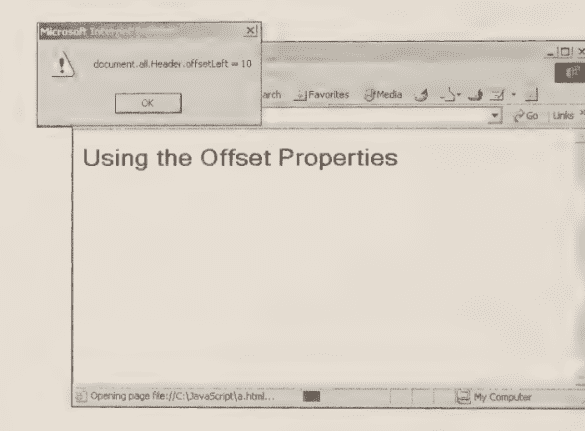

## `onOffBehavior` 属性

`onOffBehavior` 属性保存一个布尔值，指示特定的 Internet Explorer DirectAnimation 行为是否正在运行。此属性在 Internet Explorer 5.0 中引入，但被认为已弃用（换句话说，已过时，并且可能不会在未来得到支持）。你可以在表 5.41 中查看对该属性的支持情况。

### 表 5.41 `onOffBehavior` 属性

| 属性 | NS2 | NS3 | NS4 | NS6 | IE3a | IE3b | IE4 | IE5 | IE5.5 | IE6 |
|----------|-----|-----|-----|-----|------|------|-----|-----|-------|-----|
| `onOffBehavior` | | | | | | | | x | x | x |
| | 只读 | | | | | | | | | |
| | 类型：布尔值 | | | | | | | | | |

## `ownerDocument` 属性

与我们之前看到的 `document` 属性类似，`ownerDocument` 保存对节点或元素所包含的文档对象的引用。你可以在表 5.42 中查看对该属性的支持情况。

### 表 5.42 `ownerDocument` 属性

| 属性 | NS2 | NS3 | NS4 | NS6 | IE3a | IE3b | IE4 | IE5 | IE5.5 | IE6 |
|----------|-----|-----|-----|-----|------|------|-----|-----|-------|-----|
| `ownerDocument` | | | | x | | | | | | x |
| 只读 类型：对象 | | | | | | | | | | |

## `parentElement` 属性

`parentElement` 属性返回当前元素的父元素。与 `parentNode` 属性不同，你只能将此属性用于元素，而不能用于任何类型的节点。（节点可以包括文本节点、属性节点等。）你可以在表 5.43 中查看对该属性的支持情况。

### 表 5.43 `parentElement` 属性

| 属性 | NS2 | NS3 | NS4 | NS6 | IE3a | IE3b | IE4 | IE5 | IE5.5 | IE6 |
|----------|-----|-----|-----|-----|------|------|-----|-----|-------|-----|
| `parentElement` | | | | | | | x | x | x | x |
| 只读 类型：对象 | | | | | | | | | | |

下面是一个示例：

```javascript
var parentElement = document.getElementById("element1").parentElement
```

## `parentNode` 属性

`parentNode` 属性返回当前节点的父节点。与 `parentElement` 属性（见上一主题）不同，你可以将此属性用于任何 W3C 节点，而不仅仅是元素。你可以在表 5.44 中查看对该属性的支持情况。

### 表 5.44 `parentNode` 属性

| 属性 | NS2 | NS3 | NS4 | NS6 | IE3a | IE3b | IE4 | IE5 | IE5.5 | IE6 |
|----------|-----|-----|-----|-----|------|------|-----|-----|-------|-----|
| `parentNode` | | | | x | | | | x | x | x |
| | 只读 | | | | | | | | | |
| | 类型：节点对象 | | | | | | | | | |

下面是一个示例：

```javascript
var parentNode = document.getElementById("node1").parentNode
```

## `parentTextEdit` 属性

你可以在文本范围中使用此属性，我们将在第 11 章中看到。此属性使你能够找到包含当前对象的下一个最外层对象，该对象必须支持文本范围。如果存在这样的包含对象，`parentTextEdit` 返回该对象；否则它返回 `null` 以表示无结果。你可以在表 5.45 中查看对该属性的支持情况。

### 表 5.45 `parentTextEdit` 属性

| 属性 | NS2 | NS3 | NS4 | NS6 | IE3a | IE3b | IE4 | IE5 | IE5.5 | IE6 |
|----------|-----|-----|-----|-----|------|------|-----|-----|-------|-----|
| `parentTextEdit` | | | | | | | x | x | x | x |
| | 只读 | | | | | | | | | |
| | 类型：对象 | | | | | | | | | |

另请参见本章前面的 `isTextEdit` 属性。

## `readyState` 属性

`readyState` 属性为你提供对象加载其数据的进度指示。例如，一个 `` 元素可能需要一些时间来加载图像，你可以使用此属性来检查何时完成。你可以在表 5.46 中查看对该属性的支持情况。

### 表 5.46 `readyState` 属性

| 属性 | NS2 | NS3 | NS4 | NS6 | IE3a | IE3b | IE4 | IE5 | IE5.5 | IE6 |
|----------|-----|-----|-----|-----|------|------|-----|-----|-------|-----|
| `readyState` | | | | | | | x | x | x | x |
| | 只读 | | | | | | | | | |
| | 类型：字符串 | | | | | | | | | |

可能返回的字符串，例如 `"complete"` 或 `"loaded"`，出现在表 5.47 中。（`<OBJECT>` 元素返回数字而不是字符串，这些数字也列在表 5.47 中。）

### 表 5.47 `readyState` 属性值

| 值 | 含义 |
| :--- | :--- |
| `complete` | 所有数据已加载（`<OBJECT>` 值：4）。 |
| `interactive` | 并非所有数据都已加载，但对象可以与用户交互（`<OBJECT>` 值：3）。 |
| `loaded` | 所有数据已加载——但对象可能正忙于处理这些数据（`<OBJECT>` 值：2）。 |
| `loading` | 数据仍在加载中（`<OBJECT>` 值：1）。 |

例如，你可以像这样检查名为 `image1` 的图像的 `readyState` 属性：`document.all.image1.readyState`。尽管 Internet Explorer 4.0 仅对少数元素（如 ``、`<OBJECT>` 和 `<EMBED>`）支持此属性，但从 Internet Explorer 5.0 开始，你几乎可以在每个元素上使用此属性。

> **提示**
> 你无法使用 `readyState` 属性来检查元素本身是否已加载，只能检查其数据是否已加载——元素本身必须先存在，你才能使用 `readyState` 属性。

## `recordNumber` 属性

`recordNumber` 属性用于 Internet Explorer 中的数据绑定（有关数据绑定的更多信息，请参阅本章中的 `dataFld`、`dataFormatAs` 和 `dataSrc` 属性以及第 17 章），当你显示多条记录时，它会给出当前的记录编号。例如，要在表格中显示多条记录，Internet Explorer 会自动向默认表格添加行，每行将具有不同的 `recordNumber` 属性。你可以在表 5.48 中查看对此属性的支持情况。

### 表 5.48 `recordNumber` 属性

| 属性 | NS2 | NS3 | NS4 | NS6 | IE3a | IE3b | IE4 | IE5 | IE5.5 | IE6 |
| :--- | :---: | :---: | :---: | :---: | :---: | :---: | :---: | :---: | :---: | :---: |
| `recordNumber` | | | | | | | x | x | x | x |
| 只读 | | | | | | | | | | |
| 类型：整数 | | | | | | | | | | |

## `runtimeStyle` 属性

`runtimeStyle` 属性在页面加载时为你提供对象的默认样式属性，即在它们被更改之前。你可以在表 5.49 中查看对此属性的支持情况。

### 表 5.49 `runtimeStyle` 属性

| 属性 | NS2 | NS3 | NS4 | NS6 | IE3a | IE3b | IE4 | IE5 | IE5.5 | IE6 |
| :--- | :--- | :--- | :--- | :--- | :--- | :--- | :--- | :--- | :--- | :--- |
| `runtimeStyle` | | | | | | | | x | x | x |

只读
类型：对象

## `scopeName` 属性

你在 Internet Explorer 中将 `scopeName` 属性与嵌入 HTML 文档中的 XML 一起使用。由于你可以使用自己的标签创建 XML 元素，因此通常将它们分配给不同的命名空间，以避免具有相同标签名称的 XML 元素之间发生重叠。元素的 `scopeName` 属性给出其命名空间。你可以在表 5.50 中查看对此属性的支持情况。

### 表 5.50 `scopeName` 属性

| 属性 | NS2 | NS3 | NS4 | NS6 | IE3a | IE3b | IE4 | IE5 | IE5.5 | IE6 |
| :--- | :--- | :--- | :--- | :--- | :--- | :--- | :--- | :--- | :--- | :--- |
| `scopeName` | | | | | | | | x | x | x |

只读
类型：字符串

你还可以将 HTML 文档的命名空间设置为 `<HTML>` 元素的属性。默认命名空间是 `"HTML"`，但在这里我通过定义命名空间 `"NS"` 来更改它，在 `<P>` 元素中使用该命名空间，然后报告 `<P>` 元素的命名空间，如下所示：

**(网站上的 Listing 05-19.html)**

```html
<HTML XMLNS:NS='http://www.starpowder.com'>
<HEAD>
<TITLE>Using the scopeName Property</TITLE>
</HEAD>
<BODY>
<H1>Using the scopeName Property</H1>
<NS:P ID="data1">Here is a paragraph.</NS:P>
<SCRIPT LANGUAGE="JavaScript">
<!--
    document.write("<BR>Scope name of the paragraph: "
        + document.getElementById("data1").scopeName)
// -->
</SCRIPT>
</BODY>
</HTML>
```

你可以在图 5.15 中看到结果。


## `scrollHeight`、`scrollWidth`、`scrollLeft` 和 `scrollTop` 属性

你将 `scrollHeight`、`scrollWidth`、`scrollLeft` 和 `scrollTop` 属性与可滚动的元素一起使用，例如 `<BODY>` 和 `<TEXTAREA>` 元素。`scrollHeight` 和 `scrollWidth` 属性给出对象的实际高度和宽度（无论当前可见多少）。`scrollLeft` 和 `scrollTop` 属性给出从滚动区域的左上角到你要滚动的对象的左上角的像素距离。你可以在表 5.51 中查看对这些属性的支持情况。

### 表 5.51 `scrollHeight`、`scrollWidth`、`scrollLeft` 和 `scrollTop` 属性

| 属性 | NS2 | NS3 | NS4 | NS6 | IE3a | IE3b | IE4 | IE5 | IE5.5 | IE6 |
| :--- | :--- | :--- | :--- | :--- | :--- | :--- | :--- | :--- | :--- | :--- |
| `scrollHeight` | | | | | | | X | X | X | X |
| | 只读<br>类型：整数 | | | | | | | | | |
| `scrollWidth` | | | | | | | X | X | X | X |
| | 只读<br>类型：整数 | | | | | | | | | |
| `scrollLeft` | | | | | | | X | X | X | X |
| | 只读<br>类型：整数 | | | | | | | | | |
| `scrollTop` | | | | | | | X | X | X | X |
| | 只读<br>类型：整数 | | | | | | | | | |

> **提示**
> 在 Internet Explorer 中，只有少数对象支持此属性；现在几乎所有对象都支持。然而，如果对象实际上不支持滚动，这些属性的值将始终为 0。

## `sourceIndex` 属性

在 Internet Explorer 中，`sourceIndex` 属性返回对象在 `all` 集合中的数字索引。你可以在表 5.52 中查看对此属性的支持情况。

### 表 5.52 `sourceIndex` 属性

| 属性 | NS2 | NS3 | NS4 | NS6 | IE3a | IE3b | IE4 | IE5 | IE5.5 | IE6 |
| :--- | :--- | :--- | :--- | :--- | :--- | :--- | :--- | :--- | :--- | :--- |
| `sourceIndex` | | | | | | | X | X | X | X |
| | 只读<br>类型：整数 | | | | | | | | | |

这里有一个示例，我查找一个文本字段的数字索引，然后在 `document.all` 集合中使用该索引来获取文本字段中的文本：

**(网站上的 Listing 05-20.html)**

```html
<HTML>
  <HEAD>
    <TITLE>Using the sourceIndex Property</TITLE>
  </HEAD>
  <BODY>
    <H1>Using the sourceIndex Property</H1>
    <INPUT ID="text1" TYPE="TEXT" VALUE="Hello!">
    <SCRIPT LANGUAGE="JavaScript">
    <!--
        document.write("<BR>The text is: " +
        document.all[document.getElementById("text1").sourceIndex].value)
    // -->
    </SCRIPT>
  </BODY>
</HTML>
```

## `style` 属性

你可以使用 `style` 属性将 CSS 样式与元素关联。你可以在表 5.53 中查看对此属性的支持情况。

### 表 5.53 `style` 属性

| 属性 | NS2 | NS3 | NS4 | NS6 | IE3a | IE3b | IE4 | IE5 | IE5.5 | IE6 |
| :--- | :---: | :---: | :---: | :---: | :---: | :---: | :---: | :---: | :---: | :---: |
| `style` | | | | x | | | x | x | x | x |
| | 读/写<br>类型：对象 | | | | | | | | | |

`style` 属性有许多子属性，对应于我们将在第 21 章中看到的样式属性（如 `color`、`fontWeight` 和 `fontStyle`），但这里先预览一下。在此示例中，当用户单击按钮时，我将更改 `<H1>` 标题的样式为斜体：

**(网站上的 Listing 05-21.html)**

```html
<HTML>
<HEAD>
    <TITLE>Using the style Property</TITLE>
    <SCRIPT LANGUAGE="JavaScript">
    <!--
        function styler()
        {
            document.body.style.fontStyle = "italic"
        }
    // -->
    </SCRIPT>
</HEAD>
<BODY>
    <H1 NAME="header1">Using the style Property</H1>
    <FORM>
        <INPUT TYPE="BUTTON" ONCLICK="styler()" VALUE="Click Me!">
    </FORM>
</BODY>
</HTML>
```

你可以在图 5.16 中看到结果。


## `syncMaster` 属性

`syncMaster` 属性设置或获取一个布尔值，指示 Internet Explorer 时间容器是否必须与此元素同步播放。你可以在表 5.54 中查看对此属性的支持情况。另请参阅 `timeContainer` 属性。

### 表 5.54 `syncMaster` 属性

| 属性 | NS2 | NS3 | NS4 | NS6 | IE3a | IE3b | IE4 | IE5 | IE5.5 | IE6 |
|---|---|---|---|---|---|---|---|---|---|---|
| `syncMaster` | | | | | | | | | x | x |
| 读/写 | | | | | | | | | | |
| 类型：布尔值 | | | | | | | | | | |

## `tabIndex` 属性

你可以让用户仅通过按 Tab 键在网页中的元素之间移动。这样做时，焦点从一个元素移动到另一个元素——使用 `tabIndex` 属性，你可以指定页面中元素的 Tab 键顺序。你可以在表 5.55 中查找对此属性的支持情况。

### 表 5.55 `tabIndex` 属性

| 属性 | NS2 | NS3 | NS4 | NS6 | IE3a | IE3b | IE4 | IE5 | IE5.5 | IE6 |
|---|---|---|---|---|---|---|---|---|---|---|
| `tabIndex` | | | | x | | | x | x | x | x |

读/写
类型：整数

下面是一个重新排列网页中三个文本字段制表键顺序的示例：

**(网站上的代码清单 05-22.html)**

```html
<HTML>
    <HEAD>
        <TITLE>
            Using the tabIndex Property
        </TITLE>
    </HEAD>
    <BODY>
        <H1>
            Using the tabIndex Property
        </H1>
        <INPUT TYPE="TEXT" NAME="text1">
        <INPUT TYPE="TEXT" NAME="text2">
        <INPUT TYPE="TEXT" NAME="text3">
        <SCRIPT LANGUAGE="JavaScript">
            <!--
                document.all.text1.tabIndex = 2
                document.all.text2.tabIndex = 1
                document.all.text3.tabIndex = 0
            // -->
        </SCRIPT>
    </BODY>
</HTML>
```

当用户反复按下 Tab 键时，焦点会从制表键索引为 0 的元素移动到索引为 1 的元素，然后是索引为 2 的元素，以此类推。

## `tagName` 属性

我们知道，`tagName` 属性保存元素的标签名称——例如，一个 `<P>` 元素的 `tagName` 属性会保存 `"P"`。您可以在表 5.56 中查看对此属性的支持情况。

### 表 5.56 `tagName` 属性

| 属性 | NS2 | NS3 | NS4 | NS6 | IE3a | IE3b | IE4 | IE5 | IE5.5 | IE6 |
|---|---|---|---|---|---|---|---|---|---|---|
| `tagName` | | | | x | | | x | x | x | x |
| | 只读<br>类型：字符串 | | | | | | | | | |

我们已经见识过 `tagName` 属性的应用；这个来自第 4 章的示例展示了访问 HTML 元素的几种不同方法：

**(网站上的代码清单 04-10.html)**

```html
<HTML>
<HEAD>
<TITLE>
   Accessing HTML Elements
</TITLE>
<SCRIPT LANGUAGE="JavaScript">
<!--
function getText()
{
   if(navigator.appName == "Netscape") {
      alert("document.getElementsByName(\"text1\")[0].tagName= "
         + document.getElementsByName("text1")[0].tagName)
      alert("document.getElementsByTagName(\"P\")[0].tagName= "
         + document.getElementsByTagName("P")[0].tagName)
   }
   if (navigator.appName == "Microsoft Internet Explorer") {
      alert("document.all.text1.tagName = "
         + document.all.text1.tagName)
      alert("document.all[\"text1\"].tagName = "
         + document.all["text1"].tagName)
      alert("document.all.tags(\"P\").tagName = "
         + document.all.tags("P")[0].tagName)
      alert("document.getElementsByName(\"text1\")[0].tagName = "
         + document.getElementsByName("text1")[0].tagName)
      alert("document.getElementsByTagName(\"P\")[0].tagName = "
         + document.getElementsByTagName("P")[0].tagName)
   }
}
// -->
</SCRIPT>
</HEAD>
<BODY>
   <H1>Accessing HTML Elements</H1>
   <P NAME="text1" ID="text1">
      Here's the text.
   </P>
   <FORM NAME="form1">
      <INPUT TYPE="BUTTON" VALUE="Click Me!" ONCLICK="getText()">
   </FORM>
</BODY>
</HTML>
```

## `tagUrn` 属性

您可以将 `tagUrn` 属性与嵌入到 HTML 页面中的 XML 一起使用。（我们将在第 22 章中看到如何嵌入 XML。）此属性返回元素的命名空间统一资源名称（URN）。您可以在表 5.57 中查看对此属性的支持情况。

### 表 5.57 `tagUrn` 属性

| 属性 | NS2 | NS3 | NS4 | NS6 | IE3a | IE3b | IE4 | IE5 | IE5.5 | IE6 |
|---|---|---|---|---|---|---|---|---|---|---|
| `tagUrn` | | | | | | | | x | x | x |
| | 只读<br>类型：字符串 | | | | | | | | | |

## `timeContainer` 属性

`timeContainer` 属性设置或获取与 Internet Explorer 中定时元素关联的时间线类型。以下是可能的字符串值：

- `excl`。指示文档中的独占时间线容器元素。一次只能播放该元素的后代元素。
- `none`（默认值）。当前元素未定义本地时间线。
- `par`。此元素的所有后代具有独立的（也称为并行）时间安排。
- `seq`。指示一个顺序时间线容器元素。当一个元素的时间线完成时，序列中的下一个元素开始播放。

您可以在表 5.58 中查看对此属性的支持情况。

### 表 5.58 `timeContainer` 属性

| 属性 | NS2 | NS3 | NS4 | NS6 | IE3a | IE3b | IE4 | IE5 | IE5.5 | IE6 |
|---|---|---|---|---|---|---|---|---|---|---|
| `timeContainer` | | | | | | | | | x | x |
| | 读/写<br>类型：字符串 | | | | | | | | | |

## `title` 属性

`title` 属性是一个 W3C 属性，为 HTML 元素添加一些解释性数据。浏览器使用 `title` 属性作为工具提示（当鼠标悬停在对象上时弹出的带有描述性文本的小窗口）。您可以在表 5.59 中查看对此属性的支持情况。

### 表 5.59 `title` 属性

| 属性 | NS2 | NS3 | NS4 | NS6 | IE3a | IE3b | IE4 | IE5 | IE5.5 | IE6 |
| :--- | :--- | :--- | :--- | :--- | :--- | :--- | :--- | :--- | :--- | :--- |
| `title` | | | | x | | | x | x | x | x |

# 第 6 章 使用核心 HTML 方法和事件

## 表 6.1 续

| 方法 | 事件 |
|---|---|
| `click` | `onblur` |
| `cloneNode` | `onclick` |
| `componentFromPoint` | `oncontextmenu` |
| `contains` | `oncontrolselect` |
| `detachEvent` | `oncopy` |
| `dispatchEvent` | `oncut` |
| `dragDrop` | `ondblclick` |
| `fireEvent` | `ondeactivate` |
| `focus` | `ondrag` |
| `getAdjacentText` | `ondragend` |
| `getAttribute` | `ondragenter` |
| `getAttributeNode` | `ondragleave` |
| `getBoundingClientRect` | `ondragover` |
| `getClientRects` | `ondragstart` |
| `getElementsByTagName` | `ondrop` |
| `getExpression` | `onfilterchange` |
| `hasChildNodes` | `onfocus` |
| `insertAdjacentElement` | `onfocusin` |
| `insertAdjacentHTML` | `onfocusout` |
| `insertAdjacentText` | `onhelp` |
| `insertBefore` | `onkeydown` |
| `item` | `onkeypress` |
| `mergeAttributes` | `onkeyup` |
| `normalize` | `onlosecapture` |
| `releaseCapture` | `onmousedown` |
| `removeAttribute` | `onmouseenter` |
| `removeAttributeNode` | `onmouseleave` |
| `removeBehavior` | `onmousemove` |
| `removeChild` | `onmouseout` |
| `removeEventListener` | `onmouseover` |
| `removeExpression` | `onmouseup` |
| `removeNode` | `onmousewheel` |
| `replaceAdjacentText` | `onmove` |
| `replaceChild` | `onmoveend` |
| `replaceNode` | `onmovestart` |
| `scrollIntoView` | `onpaste` |
| `setActive` | `onpropertychange` |
| `setAttribute` | `onreadystatechange` |
| `setAttributeNode` | `onresize` |
| `setCapture` | `onresizeend` |
| `setExpression` | `onresizestart` |
| `supports` | `onselectstart` |
| `swapNode` | `ontimeerror` |
| `tags` | |
| `urns` | |

与前一章类似，本章部分用于参考；为了涵盖所有 JavaScript 核心 HTML 方法和事件，我们偶尔需要涉及一些尚未讨论、将在后续章节中才出现的内容，例如样式表或动态 HTML。与前一章一样，这在大多数情况下都不会有问题，但你可以随意跳过这些内容，直到在后面章节中进行编程需要时再来看。

## JavaScript 的核心 HTML 方法

我们已经见过一些核心 HTML 方法的实际应用，例如 `getElementsByTagName` 方法，它返回具有相同标签名的元素数组。以下是我们在第 4 章"处理浏览器环境"中看到的示例：

**(网站上的 Listing 04-11.html)**

```html
<HTML>
  <HEAD>
    <TITLE>
      Accessing HTML Elements
    </TITLE>
    <SCRIPT LANGUAGE="JavaScript">
    <!--
      function getText()
      {
        if(navigator.appName == "Netscape") {
          alert("document.form1.text1.value = " + document.form1.text1.value)
        }
      }
    // -->
    </SCRIPT>
  </HEAD>
  <BODY BGCOLOR="FFFFFF">
    <CENTER>
      <TABLE BORDER=1>
        <TR>
          <TD>
            <FORM NAME="form1">
              <INPUT TYPE="text" NAME="text1" VALUE="Type text here">
            </FORM>
          </TD>
          <TD>
            <INPUT TYPE="button" VALUE="Press Me" ONCLICK="getText()">
          </TD>
        </TR>
      </TABLE>
    </CENTER>
  </BODY>
</HTML>
```

```javascript
alert("document.forms[0].text1.value = " +
document.forms[0].text1.value)
alert("document.getElementsByName(\"text1\")[0].value = "
+ document.getElementsByName("text1")[0].value)
alert("document.getElementsByTagName(\"INPUT\")[0].value = "
+ document.getElementsByTagName("INPUT")[0].value)
}
if (navigator.appName == "Microsoft Internet Explorer") {
alert("document.form1.text1.value = " + document.form1.text1.value)
alert("document.forms[0].text1.value = "
+ document.forms[0].text1.value)
alert("document.all.text1.value = "
+ document.all.text1.value)
alert("document.all[\"text1\"].value = "
+ document.all["text1"].value)
alert("document.all.tags(\"INPUT\")[0].value = "
+ document.all.tags("INPUT")[0].value)
alert("document.getElementsByName(\"text1\")[0].value = "
+ document.getElementsByName("text1")[0].value)
alert("document.getElementsByTagName(\"INPUT\")[0].value = "
+ document.getElementsByTagName("INPUT")[0].value)
}
}
// -->
</SCRIPT>
</HEAD>
<BODY>
<H1>Accessing HTML Elements</H1>
<FORM NAME="form1">
<INPUT TYPE="TEXT" NAME="text1" ID="text1">
<INPUT TYPE="BUTTON" VALUE="Click Me!" ONCLICK="getText()">
</FORM>
</BODY>
</HTML>
```

如你在此代码中所见，我们还见到了 `getElementsByName` 方法，但该方法仅是 `document` 对象的方法，并非适用于所有 HTML 元素和浏览器对象的核心 HTML 方法。

使用 JavaScript 的核心 HTML 方法非常直接——你只需像使用任何其他方法一样向方法传递任何参数。另一方面，处理事件则是另一回事。

## 使用 JavaScript 的核心 HTML 事件

近年来，在 JavaScript 中处理事件变得复杂，因为现在你有三种方式可以做到：Netscape Navigator 方式、Internet Explorer 方式和 W3C 方式。我们将在第 15 章"处理鼠标、键盘和图像"中深入研究这些各种技术和事件处理，但我将在此介绍该主题。尽管存在复杂性，我们仍能在这章中涵盖至少 95% 的典型 JavaScript 事件处理。

### 使用事件属性连接事件处理器

我们已经见过如何处理事件的一般方法——你可以使用诸如 `ONCLICK` 之类的 HTML 事件属性将事件连接到 JavaScript 函数（称为事件处理器）。以下是第 1 章"JavaScript 基础"中的示例。在此示例中，我将按钮的 `ONCLICK` HTML 属性连接到名为 `alerter` 的 JavaScript 函数：

**(网站上的 Listing 01-04.html)**

```html
<HTML>
    <HEAD>
        <TITLE>
            Executing Scripts in Response to User Action
        </TITLE>
        <SCRIPT LANGUAGE="JavaScript">
            <!--
            function alerter()
            {
                window.alert("You clicked the button!")
            }
            // -->
        </SCRIPT>
    </HEAD>
    <BODY>
        <H1>Executing Scripts in Response to User Action</H1>
        <FORM>
            <INPUT TYPE="BUTTON" ONCLICK="alerter()" VALUE="Click Me!">
        </FORM>
    </BODY>
</HTML>
```

你可以在图 6.1 中看到结果，我已点击按钮，JavaScript 代码显示了一个警告框。

### 使用对象属性连接事件处理器

在前面的示例中，我使用了 HTML 事件属性 `ONCLICK` 将事件连接到事件处理器。（由于这是 HTML 属性，它可以是大小写字母的任意组合；然而，在本书中，我将 HTML 大写以区别于 JavaScript，因此此处为 `ONCLICK`。）在较新的浏览器（NS3+ 和 IE4+）中，你还可以在 JavaScript 代码中使用 JavaScript 的事件（如 `onclick`，全小写字母）连接事件处理器，这使你可以根据需要更改事件处理器。以下是使用 JavaScript 中 `onclick` 事件的示例，我将该事件连接到按钮和 `alerter` 函数：

```html
<HTML>
	<HEAD>
		<TITLE>
			Executing Scripts in Response to User Action
		</TITLE>
	</HEAD>
	<BODY>
		<H1>Executing Scripts in Response to User Action</H1>
		<FORM ID="form1" NAME="form1">
			<INPUT ID="button1" NAME="button1" TYPE="BUTTON" VALUE="Click Me!">
		</FORM>
		<SCRIPT LANGUAGE="JavaScript">
			<!--
			document.form1.button1.onclick = alerter
			function alerter()
			{
				window.alert("You clicked the button!")
			}
			// -->
		</SCRIPT>
	</BODY>
</HTML>
```

### 使用 `<SCRIPT FOR>` 连接事件处理器

在 Internet Explorer 4+ 中，你还可以使用 `<SCRIPT>` 元素的 `FOR` 属性将脚本连接到特定事件。我们在第 1 章中就见过这种方法；例如，以下是我如何将脚本连接到 HTML 按钮 `button1` 的 `onclick` 事件：

**(网站上的 Listing 01-06.html)**

```html
<HTML>
    <HEAD>
        <TITLE>
            Using the SCRIPT FOR Element
        </TITLE>
        <SCRIPT FOR="button1" EVENT="onclick" LANGUAGE="JavaScript">
            <!--
            alert("You clicked the button!")
            // -->
        </SCRIPT>
    </HEAD>
    <BODY>
        <H1>Using the SCRIPT FOR Element</H1>
        <FORM NAME="FORM1">
            <INPUT TYPE="BUTTON" NAME="button1" VALUE="Click Me!">
        </FORM>
    </BODY>
</HTML>
```

### 使用 `attachEvent` 方法连接事件处理器

还有另一种将事件处理器连接到事件的方法——你可以使用 Internet Explorer 的 `attachEvent` 方法（在 IE5+ 中可用）。你在想要附加事件处理器的 HTML 元素上使用此方法，传递要使用的事件名称（引号内）和事件处理器函数（不带引号），如下所示：

```html
<HTML>
    <HEAD>
        <TITLE>Using the attachEvent Method</TITLE>
    </HEAD>
    <BODY>
        <H1>Using the attachEvent Method</H1>
        <FORM NAME="form1">
            <INPUT TYPE="BUTTON" NAME="button1" VALUE="Click Me!">
        </FORM>
        <SCRIPT LANGUAGE="JavaScript">
            <!--
            document.form1.button1.attachEvent("onclick", alerter)
            function alerter()
            {
                alert("You clicked the button!")
            }
            // -->
        </SCRIPT>
    </BODY>
</HTML>
```

如你所见，你可以通过多种方式将事件连接到事件处理程序。事实上，这仅仅是个开始。在这里，我们只使用了简单的 `onclick` 事件。然而，事件通常带有更多相关数据——例如，当 `onmousedown` 事件发生时，你知道用户按下了鼠标按钮——但鼠标事件实际发生在何处呢？你可以通过使用事件对象来查明。

### 使用事件对象

Netscape Navigator 和 Internet Explorer 都有一个事件对象，你可以从这个对象中检索事件数据。然而，正如我们将在第15章中看到的，该对象的属性不仅因浏览器而异，还因版本而异。你可以在表6.2中按浏览器和版本查看一些常见事件对象属性的摘要。

### 表 6.2 事件对象属性

| NS4 | NS6 | IE4+ | 含义 |
| --- | --- | --- | --- |
| - | `clientX` | `clientX` | 窗口中的X坐标 |
| - | `clientY` | `clientY` | 窗口中的Y坐标 |
| `layerX` | `layerX` | `x` | 定位元素中的X坐标 |
| `layerY` | `layerY` | `y` | 定位元素中的Y坐标 |
| `modifiers` | `shiftKey` | `shiftKey` | 键盘修饰键 |
| | `altKey` | `altKey` | |
| | `ctrlKey` | `ctrlKey` | |
| - | - | `offsetX` | 容器中的X坐标 |
| - | - | `offsetY` | 容器中的Y坐标 |
| `pageX` | `pageX` | - | 页面中的X坐标 |
| `pageY` | `pageY` | - | 页面中的Y坐标 |
| `screenX` | `screenX` | `screenX` | 屏幕中的X坐标 |
| `screenY` | `screenY` | `screenY` | 屏幕中的Y坐标 |
| `target` | `target` | `srcElement` | 事件的目标元素 |
| `type` | `type` | `type` | 发生的事件类型 |
| - | - | `wheelDelta` | 滚轮按钮滚动的距离 |
| `which` | `keyCode` | `keyCode` | 导致事件的键盘按键 |
| `which` | `button` | `button` | 导致事件的鼠标按钮 |

> **提示**
> 这是 Internet Explorer 事件对象的另一个值得了解的好属性：`returnValue`。如果你在事件处理程序中将 `window.event.returnValue` 设置为 `false`，浏览器将不会执行该事件通常执行的默认操作。参见本章中的 `oncopy` 事件示例，我们在该示例中阻止了从网页复制文本的尝试。

### 跨浏览器事件处理

除了你在表6.2中看到的差异之外，还有另一个差异——在 Netscape Navigator 中，事件对象被传递给你的事件处理程序；然而，在 Internet Explorer 6.0 之前的版本中，事件对象是 `window` 对象的一部分，你将其引用为 `window.event`（换句话说，作为全局对象，而不是传递给事件处理程序）。为了应对这一差异，你过去常常使用如下代码，我将事件对象放在一个名为 `e` 的变量中——如果我们在 Netscape Navigator 中工作，我们将使用传递给事件处理程序的事件对象；否则我将把 `window.event` 赋值给 `e`，如下所示：

```javascript
function handler(e)
{
    //适用于 Internet Explorer 6.0 之前的浏览器
    if (!e){
        e = window.event
    }
    //事件处理代码
}
```

这里有一个例子；在这种情况下，我将使用 Netscape Navigator 和 Internet Explorer 中事件对象共有的 `clientX` 和 `clientY` 属性来发现鼠标按钮在何处被按下。`clientX` 和 `clientY` 的原点位于浏览器客户区的左上角。（客户区是显示区域，不包括工具栏、状态栏、菜单等。）代码如下：

**(网站上的 Listing 06-01.html)**

```html
<HTML>
  <HEAD>
    <TITLE>Handling Events</TITLE>
  </HEAD>
  <BODY ONMOUSEDOWN="display(event)">
    <H1>Handling Events: Click this Page!</H1>
    <FORM NAME="form1">
      <INPUT TYPE="TEXT" NAME="text1"></INPUT>
    </FORM>
    <SCRIPT LANGUAGE="JavaScript">
      <!--
      function display(e)
      {
        //适用于 Internet Explorer 6.0 之前的浏览器
        if (!e){
          e = window.event
        }
        document.form1.text1.value = "You clicked (" +
          e.clientX + ", " + e.clientY + ")"
      }
      // -->
    </SCRIPT>
  </BODY>
</HTML>
```

注意我如何在此处指定 Netscape Navigator 应将事件对象传递给事件处理程序，通过传递关键字 `"event"`：`<BODY ONMOUSEDOWN="display(event)">`。这确保了 Netscape Navigator 将事件对象传递给事件处理程序。另一方面，早期版本的 Internet Explorer 将在此处传递 `null`。你可以在图6.2中看到这个代码的结果。

> **提示**
> Netscape Navigator 对 `"event"` 参数特别重视。你可以像这样使用多个参数：`<BODY ONMOUSEDOWN="display(this, event)">`，Netscape Navigator 将在 `"event"` 参数指定的位置传递事件对象。


然而，在 Internet Explorer 6.0 中情况发生了变化，使得这种对象检测变得不太可靠。也许是因为微软意识到趋势正朝着将事件对象传递给事件处理程序的方向发展，而不是在 W3C DOM 第2级中使用全局事件对象（微软尚未实现），或者是为了让同时处理 Internet Explorer 和 Netscape Navigator 的程序员轻松一些，如果你在将事件处理程序连接到事件时指定 `"event"` 参数，Internet Explorer 6.0 中的事件处理程序现在会被传递一个事件对象（与 `window.event` 相同，它仍然存在且仍然可访问），如下所示：`<BODY ONMOUSEDOWN="display(event)">`。

这对于习惯于在事件处理程序中检查传递的事件对象以区分两种浏览器的脚本来说，让事情变得有点尴尬。在某些情况下，这些脚本必须更新为直接检查浏览器的名称（使用 `navigator.appName` 属性），我将在本章中经常使用这种技术。

这向我们介绍了 Netscape Navigator 和 Internet Explorer 中的事件处理；我们将在第15章中看到更多关于事件处理的内容，而且更深入。除了这种类型的事件处理之外，还有另一种类型：W3C DOM 类型。

### 在 W3C DOM 中处理事件

W3C 的事件处理技术，遵循 Java 的先例，是你必须使用监听器注册你想要捕获的事件，而监听器只是一个事件处理程序。

有几种监听器类型，每种事件类型一种，如你在表6.3中所见。这些监听器仅在 Netscape Navigator 6.0 中实现（而且并非全部实现）——事件处理仅在 W3C DOM 第2级中引入，而 Internet Explorer 仅完全支持 W3C DOM 第1级。请注意，W3C 事件比标准的 Internet Explorer 和 Netscape Navigator 事件（你在表6.1中看到的）少得多——还要注意，这些名称没有 `on` 前缀：例如，在这里，你使用 `click` 事件，而不是 `onclick` 事件。

### 表 6.3 W3C DOM 事件监听器类型

| 监听器 | | |
| --- | --- | --- |
| `abort` | `blur` | `change` |
| `click` | `DOMActivate` | `DOMAttrModified` |
| `DOMCharacterDataModified` | `DOMFocusIn` | `DOMFocusOut` |
| `DOMNodeInserted` | `DOMNodeInsertedIntoDocument` | `DOMNodeRemoved` |
| `DOMNodeRemovedFromDocument` | `DOMSubtreeModified` | `error` |
| `focus` | `load` | `mousedown` |
| `mousemove` | `mouseout` | `mouseover` |
| `mouseup` | `reset` | `resize` |
| `scroll` | `select` | `submit` |
| `unload` | | |

传递给 Netscape Navigator 中监听器函数的事件对象非常类似于标准的 NS6 事件对象。你可以在表6.4中看到 Netscape Navigator 中 W3C 事件对象的一些属性，你可以将它们与表6.2中的属性对应起来，并额外增加了 `currentTarget` 属性，它保存事件的当前目标元素——你以我们将在第15章中看到的方式路由的事件——`originalTarget` 属性，它保存事件的原始目标元素，用于处理元键事件的 `metaKey` 属性，以及 `timeStamp` 属性，它保存有关事件发生时间的信息。

### 表 6.4 一些 W3C DOM 事件对象属性

| 属性 | | |
| --- | --- | --- |
| `currentTarget` | `type` | `target` |
| `originalTarget` | `timeStamp` | `altKey` |
| `ctrlKey` | `shiftKey` | `metaKey` |
| `charCode` | `keyCode` | `screenX` |
| `screenY` | `clientX` | `clientY` |
| `button` | `layerX` | `layerY` |
| `pageX` | `pageY` | `which` |

> **提示**
> W3C DOM 事件对象有一个对应于 Internet Explorer 的 `returnValue` 属性的方法：`cancelDefault`。如果你调用事件对象的 `cancelDefault` 方法，浏览器就不会执行通常为该事件执行的默认操作。关于使用 Internet Explorer 的 `returnValue` 属性的示例，请参阅本章中的 `oncopy` 事件一节，我们在那里通过示例覆盖了从网页复制文本的尝试。

这里有一个示例。在这个例子中，我将为 `<SPAN>` 元素的 `click` 事件添加一个事件监听器，当用户单击该元素时显示该 `<SPAN>` 元素的 ID。为此，我将使用 `addEventListener` 方法，向该方法传递要监听的事件名称、事件处理函数以及一个值 `true`，表示我希望捕获此事件，而不是将其路由到另一个事件处理程序（此示例使用 `addEventListener` 方法，针对 Netscape Navigator 6.0）：

**(网站上的清单 06-02.html)**

```html
<HTML>
    <HEAD>
        <TITLE>Handling W3C Events</TITLE>
    </HEAD>
    <BODY>
        <H1>Handling W3C Events</H1>
        <P><SPAN ID="span1">Click Me.</SPAN></P>
        <FORM NAME="form1">
            <INPUT TYPE="TEXT" ID="text1"></INPUT>
        </FORM>
        <SCRIPT LANGUAGE="JavaScript">
            <!--
            document.getElementById("span1").addEventListener("click", display, true)
            function display(e)
            {
                document.form1.text1.value = "You clicked: " +
                    e.currentTarget.id
            }
            // -->
        </SCRIPT>
    </BODY>
</HTML>
```

你可以在图 6.3 中看到结果，我们在这里捕获了 `<SPAN>` 元素的 W3C `click` 事件。


## JavaScript 的核心 HTML 方法

这为我们概述了 JavaScript 事件处理的必要知识；现在是时候转向 JavaScript 的核心 HTML 方法和事件了。我将从核心方法开始。与前面的章节一样，这里的项目五花八门，无法将它们归入不同的编程主题。处理核心 HTML 方法和事件的最佳方式就是将它们一一列出，逐一解释。在接下来的章节中，当我们实际运用这些方法和事件时，你可以随时返回本章查看所有细节。

### `addBehavior` 方法

你可以使用 `addBehavior` 方法向对象添加新的 Internet Explorer 行为，向此方法传递行为的 URL。你可以在表 6.5 中看到对此方法的支持情况。

### 表 6.5 `addBehavior` 方法

| 方法 | NS2 | NS3 | NS4 | NS6 | IE3a | IE3b | IE4 | IE5 | IE5.5 | IE6 |
|---|---|---|---|---|---|---|---|---|---|---|
| `addBehavior(URL)` | | | | | | | | x | x | x |
| 返回值：整数 | | | | | | | | | | |

正如第 4 章所讨论的，行为是你可保存为外部文件的自定义脚本，它可以应用于任何 HTML 元素，并有权访问一些强大的技术。此方法返回一个行为 ID 值，你以后可以将其传递给 `removeBehavior`（本章稍后介绍）以移除该行为。我们将在第 17 章"动态 HTML：拖放、数据绑定和行为"中了解如何使用行为。

### `addEventListener` 方法

你可以使用 `addEventListener` 方法向对象添加 W3C 事件监听器，如本章前面所讨论（参见"在 W3C DOM 中处理事件"）。你可以在表 6.6 中看到对此方法的支持情况。

### 表 6.6 `addEventListener` 方法

| 方法 | NS2 | NS3 | NS4 | NS6 | IE3a | IE3b | IE4 | IE5 | IE5.5 | IE6 |
| :--- | :--- | :--- | :--- | :--- | :--- | :--- | :--- | :--- | :--- | :--- |
| `addEventListener(event, listenerFunction, capture)` | | | | x | | | | | | |
| 无返回值 | | | | | | | | | | |

要使用此方法，你需要传递你想要处理的 W3C 事件（参见表 6.3）、你希望用于处理事件的监听器函数，以及一个布尔值，如果你想让此事件"冒泡"（即向上移动到父对象，我们将在第 15 章中讨论），则设置为 `true`。这是我们在本章前面看到的示例，它使用 `addEventListener` 将监听器函数连接到 `<SPAN>` 元素的 W3C `click` 事件：

```html
<HTML>
    <HEAD>
        <TITLE>Handling W3C Events</TITLE>
    </HEAD>
    <BODY>
        <H1>Handling W3C Events</H1>
        <P><SPAN ID="span1">Click Me.</SPAN></P>
        <P><SPAN ID="span2">Click Me Too.</SPAN></P>
        <FORM NAME="form1">
            <INPUT TYPE="TEXT" ID="text1"></INPUT>
        </FORM>
        <SCRIPT LANGUAGE="JavaScript">
            <!--
            document.getElementById("span2").addEventListener("click", display, true)
            function display(e)
            {
                document.form1.text1.value = "You clicked: " +
                    e.currentTarget.id
            }
            // -->
        </SCRIPT>
    </BODY>
</HTML>
```

### `appendChild` 方法

`appendChild` 方法允许你将一个子 HTML 元素（不是节点）附加到另一个 HTML 元素。你可以在表 6.7 中看到对此方法的支持情况。

### 表 6.7 `appendChild` 方法

| 方法 | NS2 | NS3 | NS4 | NS6 | IE3a | IE3b | IE4 | IE5 | IE5.5 | IE6 |
|--------|-----|-----|-----|-----|------|------|-----|-----|-------|-----|
| `appendChild(node)` | | | | x | | | | x | x | x |

返回值：节点

我们将在第 16 章"动态 HTML：动态更改网页"中更详细地了解这类允许你动态更改文档结构的方法。这里有一个示例，它使用 `appendChild` 方法向无序 HTML 列表添加新项目，并使用 `replaceChild` 方法（本章稍后介绍）替换列表中的第一个项目。当用户单击"添加新项目"按钮时，`appendChild` 方法向无序 HTML 列表添加一个新项目：

**(网站上的清单 06-03.html)**

```html
<HTML>
  <HEAD>
    <TITLE>
      Using the appendChild and replaceChild Methods
    </TITLE>
    <SCRIPT LANGUAGE="JavaScript">
      <!--
      function adder()
      {
        var item1 = document.createElement("LI")
        item1.innerHTML = "Next item"
        document.getElementById("list1").appendChild(item1)
      }
      function replacer(form)
      {
        var item1 = document.createElement("LI")
        item1.innerHTML = "Newer First Item"
        var lastItem = document.getElementById("list1").firstChild
        document.getElementById("list1").replaceChild(item1, lastItem)
      }
      //-->
    </SCRIPT>
  </HEAD>
  <BODY>
    <H1>Using the appendChild and replaceChild Methods</H1>
    <FORM>
      <INPUT TYPE=BUTTON VALUE="Add New Item" onclick="adder()">
      <INPUT TYPE=BUTTON VALUE="Replace First Item" onclick="replacer()">
    </FORM>
    <UL ID="list1">
      <LI>First Item
      <LI>Second Item
    </UL>
  </BODY>
</HTML>
```

你可以在图 6.4 中看到结果。最初，列表只有两个项目，First Item 和 Second Item；但当你单击"添加新项目"按钮时，代码会向列表添加一个新项目，Next Item。


### `applyElement` 方法

`applyElement` 方法允许你在 Internet Explorer 中创建父元素或子元素。你可以在表 6.8 中看到对此方法的支持情况。

### 表 6.8 `applyElement` 方法

| 方法 | NS2 | NS3 | NS4 | NS6 | IE3a | IE3b | IE4 | IE5 | IE5.5 | IE6 |
| :--- | :--- | :--- | :--- | :--- | :--- | :--- | :--- | :--- | :--- | :--- |
| `applyElement(element [, type])` | | | | | | | | X | X | X |
| 无返回值 | | | | | | | | | | |

你首先使用 `document` 对象的 `createElement` 方法创建一个新元素，并将该元素传递给此方法，同时传递类型参数，该参数可以是以下两个字符串之一：

- `"outside"`（默认值）。指定的元素成为当前元素的父元素。
- `"inside"`。指定的元素成为当前元素的子元素——但包含当前元素的所有子元素。

### `attachEvent` 方法

你可以使用 `attachEvent` 方法在 Internet Explorer 中将事件处理程序附加到事件。如果事件处理程序连接成功，此方法返回 `true`。你可以在表 6.9 中看到对此方法的支持情况。

### 表 6.9 `attachEvent` 方法

| 方法 | NS2 | NS3 | NS4 | NS6 | IE3a | IE3b | IE4 | IE5 | IE5.5 | IE6 |
| :--- | :--- | :--- | :--- | :--- | :--- | :--- | :--- | :--- | :--- | :--- |
| `attachEvent(event, handlerFunction)` | | | | | | | | X | X | X |
| 返回值：布尔值 | | | | | | | | | | |

你向此方法传递要处理的事件（作为字符串）和处理函数。我们已经在本章开头看到一个使用 `attachEvent` 方法的示例；在那个示例中，我将一个事件处理程序附加到按钮的 `onclick` 事件：

```html
<HTML>
    <HEAD>
        <TITLE>Using the attachEvent Method</TITLE>
    </HEAD>
    <BODY>
        <H1>Using the attachEvent Method</H1>
        <FORM NAME="form1">
            <INPUT TYPE="BUTTON" NAME="button1" VALUE="Click Me!">
        </FORM>
        <SCRIPT LANGUAGE="JavaScript">
            <!--
            document.form1.button1.attachEvent("onclick", alerter)
            function alerter()
            {
                alert("You clicked the button!")
            }
            // -->
        </SCRIPT>
    </BODY>
</HTML>
```

### `blur` 方法

你可以使用 `blur` 方法从元素上移除焦点。（焦点移除后，该元素将不再作为键盘输入的目标。）你可以在表 6.10 中看到对该方法的支持情况。

### 表 6.10 `blur` 方法

| 方法 | NS2 | NS3 | NS4 | NS6 | IE3a | IE3b | IE4 | IE5 | IE5.5 | IE6 |
|---|---|---|---|---|---|---|---|---|---|---|
| `blur()` | x | x | x | x | x | x | x | x | x | x |
| 无返回值 | | | | | | | | | | |

该方法与 `focus` 方法配对使用，后者为元素设置焦点。（`focus` 方法将在本章后面介绍。）

### `clearAttributes` 方法

`clearAttributes` 方法删除 HTML 元素的所有属性，但保留 `NAME` 和 `ID` 属性。你可以在表 6.11 中看到对该方法的支持情况。

### 表 6.11 `clearAttributes` 方法

| 方法 | NS2 | NS3 | NS4 | NS6 | IE3a | IE3b | IE4 | IE5 | IE5.5 | IE6 |
|---|---|---|---|---|---|---|---|---|---|---|
| `clearAttributes()` | | | | | | | | X | X | X |
| 无返回值 | | | | | | | | | | |

### `click` 方法

调用对象的 `click` 方法几乎等同于触发该对象的 `click` 事件——但在 Netscape Navigator 4.0 和 Internet Explorer 4.0 之前，此方法不会调用对象的 `onclick` 事件处理程序。你可以在表 6.12 中看到对该方法的支持情况。

### 表 6.12 `click` 方法

| 方法 | NS2 | NS3 | NS4 | NS6 | IE3a | IE3b | IE4 | IE5 | IE5.5 | IE6 |
|---|---|---|---|---|---|---|---|---|---|---|
| `click()` | X | X | X | X | X | X | X | X | X | X |
| 无返回值 | | | | | | | | | | |

下面是一个示例；在本例中，当你点击页面上的第二个按钮时，会触发第一个按钮的 `onclick` 事件：

**(网站上的 Listing 06-04.html)**

```html
<HTML>
  <HEAD>
    <TITLE>Using the click Method</TITLE>
    <SCRIPT LANGUAGE="JavaScript">
    <!--
      function alerter()
      {
        alert("You clicked the button!")
      }
      function clicker()
      {
        document.form1.button1.click()
      }
    // -->
    </SCRIPT>
  </HEAD>
  <BODY>
    <H1>Using the click Method</H1>
    <FORM NAME="form1">
      <INPUT TYPE="BUTTON" NAME="button1" ONCLICK="alerter()" VALUE="Click Me!">
      <INPUT TYPE="BUTTON" ONCLICK="clicker()" VALUE="Click the Other Button!">
    </FORM>
  </BODY>
</HTML>
```

### `cloneNode` 方法

`cloneNode` 方法复制当前节点并返回指向该副本的新对象引用。你还可以传递一个布尔值参数 `deep`，如果将其设置为 `true`，则会同时复制该节点的所有子节点；设置为 `false` 则意味着仅复制节点本身。你可以在表 6.13 中看到对该方法的支持情况。

### 表 6.13 `cloneNode` 方法

| 方法 | NS2 | NS3 | NS4 | NS6 | IE3a | IE3b | IE4 | IE5 | IE5.5 | IE6 |
| --- | --- | --- | --- | --- | --- | --- | --- | --- | --- | --- |
| `cloneNode(deep)` | | | | x | | | | x | x | x |
| 返回值：指向节点的引用 | | | | | | | | | | |

### `componentFromPoint` 方法

`componentFromPoint` 方法返回位于指定坐标处的对象的组成部分。该方法自 Internet Explorer 5.0 起可用，可用于任何可以通过层叠样式表（CSS）获得滚动条的对象，用于确定一个点位于对象中的哪个位置。你可以在表 6.14 中看到对该方法的支持情况。

### 表 6.14 `componentFromPoint` 方法

| 方法 | NS2 | NS3 | NS4 | NS6 | IE3a | IE3b | IE4 | IE5 | IE5.5 | IE6 |
| --- | --- | --- | --- | --- | --- | --- | --- | --- | --- | --- |
| `componentFromPoint(x, y)` | | | | | | | | x | x | x |
| 返回值：字符串 | | | | | | | | | | |

你传入要检查的点的客户端窗口 X 和 Y 坐标，该方法返回以下字符串之一：

- `" "`。组件位于对象的客户端区域内。
- `"handleBottom"`。底部调整大小手柄位于指示位置。
- `"handleBottomLeft"`。左下调整大小手柄位于指示位置。
- `"handleBottomRight"`。右下调整大小手柄位于指示位置。
- `"handleLeft"`。左侧调整大小手柄位于指示位置。
- `"handleRight"`。右侧调整大小手柄位于指示位置。
- `"handleTop"`。顶部调整大小手柄位于指示位置。
- `"handleTopLeft"`。左上调整大小手柄位于指示位置。
- `"handleTopRight"`。右上调整大小手柄位于指示位置。
- `"outside"`。组件位于对象的边界之外。
- `"scrollbarDown"`。向下滚动箭头位于指示位置。
- `"scrollbarHThumb"`。水平滚动滑块或滚动框位于指示位置。
- `"scrollbarLeft"`。向左滚动箭头位于指示位置。
- `"scrollbarPageDown"`。向下翻页滚动条 shaft 位于指示位置。
- `"scrollbarPageLeft"`。向左翻页滚动条 shaft 位于指示位置。
- `"scrollbarPageRight"`。向右翻页滚动条 shaft 位于指示位置。
- `"scrollbarPageUp"`。向上翻页滚动条 shaft 位于指示位置。
- `"scrollbarRight"`。向右滚动箭头位于指示位置。
- `"scrollbarUp"`。向上滚动箭头位于指示位置。
- `"scrollbarVThumb"`。垂直滚动滑块或滚动框位于指示位置。

### `contains` 方法

`contains` 方法指示一个对象是否包含另一个对象（就嵌套 HTML 元素而言），如果是则返回 `true`，否则返回 `false`。你可以在表 6.15 中看到对该方法的支持情况。

### 表 6.15 `contains` 方法

| 方法 | NS2 | NS3 | NS4 | NS6 | IE3a | IE3b | IE4 | IE5 | IE5.5 | IE6 |
|---|---|---|---|---|---|---|---|---|---|---|
| `contains(object)` | | | | | | | x | x | x | x |
| 返回值：布尔值 | | | | | | | | | | |

下面是一个示例，我在此检查 `object1` 是否包含 `element1`：

```javascript
var contained = object1.contains(element1)
```

### `detachEvent` 方法

你可以使用 `detachEvent` 方法从事件上分离事件处理程序；该方法是 `attachEvent` 的补充函数（参见本章前面的内容）。你可以在表 6.16 中看到对该方法的支持情况。

### 表 6.16 `detachEvent` 方法

| 方法 | NS2 | NS3 | NS4 | NS6 | IE3a | IE3b | IE4 | IE5 | IE5.5 | IE6 |
| :--- | :--- | :--- | :--- | :--- | :--- | :--- | :--- | :--- | :--- | :--- |
| `detachEvent(event, handlerFunction)` | | | | | | | | x | x | x |
| 返回值：布尔值 | | | | | | | | | | |

与 `attachEvent` 方法类似，你需要向 `detachEvent` 方法传递要分离的事件（带引号）和要分离的处理函数（不带引号）。更多信息请参见 `attachEvent` 方法。

### `dispatchEvent` 方法

`dispatchEvent` 方法是 W3C 方法，使你能够将事件发送到对象。这是 W3C 触发事件的方式，与 `click` 方法等方法相对。你可以在表 6.17 中看到对该方法的支持情况。

### 表 6.17 `dispatchEvent` 方法

| 方法 | NS2 | NS3 | NS4 | NS6 | IE3a | IE3b | IE4 | IE5 | IE5.5 | IE6 |
| :--- | :--- | :--- | :--- | :--- | :--- | :--- | :--- | :--- | :--- | :--- |
| `dispatchEvent(eventObject)` | x | | | | | | | | | |
| 返回值：布尔值 | | | | | | | | | | |

要使用此方法，你需要使用 `document` 的 `createEvent` 方法创建一个事件对象，然后将该事件对象传递给要触发事件的对象。如果事件成功分发，则返回 `true`，否则返回 `false`。

### `dragDrop` 方法

`dragDrop` 方法创建一个拖动事件。有关拖放的更多信息，请参见第 17 章。你可以在表 6.18 中看到对该方法的支持情况。如果拖放操作成功，则返回 `true`，否则返回 `false`。

### 表 6.18 `dragDrop` 方法

| 方法 | NS2 | NS3 | NS4 | NS6 | IE3a | IE3b | IE4 | IE5 | IE5.5 | IE6 |
| :--- | :--- | :--- | :--- | :--- | :--- | :--- | :--- | :--- | :--- | :--- |
| `dragDrop()` | | | | | | | | x | x | x |
| 返回值：布尔值 | | | | | | | | | | |

### `fireEvent` 方法

`fireEvent` 方法在 Internet Explorer 中触发指定事件。你可以在表 6.19 中看到对该方法的支持情况。

### 表 6.19 `fireEvent` 方法

| 方法 | NS2 | NS3 | NS4 | NS6 | IE3a | IE3b | IE4 | IE5 | IE5.5 | IE6 |
| :--- | :--- | :--- | :--- | :--- | :--- | :--- | :--- | :--- | :--- | :--- |
| `fireEvent(event [, eventObject])` | | | | | | | | x | x | x |
| 返回值：布尔值 | | | | | | | | | | |

你向此方法传递要触发的事件名称（如 `"onclick"`）以及可选的事件对象。如果事件成功触发，则返回 `true`，否则返回 `false`。

### `focus` 方法

你可以使用 `focus` 方法为元素设置焦点（使其成为键盘输入的目标）。你可以在表 6.20 中看到对该方法的支持情况。

### 表 6.20 `focus` 方法

| 方法 | NS2 | NS3 | NS4 | NS6 | IE3a | IE3b | IE4 | IE5 | IE5.5 | IE6 |
|---|---|---|---|---|---|---|---|---|---|---|
| `focus()` | x | x | x | x | x | x | x | x | x | x |
| 无返回值 | | | | | | | | | | |

该方法与 `blur` 方法配对使用，后者从元素上移除焦点。

### `getAdjacentText` 方法

`getAdjacentText` 方法返回与指定元素相邻的文本。你可以在表 6.21 中看到对该方法的支持情况。

### 表 6.21 `getAdjacentText` 方法

| 方法 | NS2 | NS3 | NS4 | NS6 | IE3a | IE3b | IE4 | IE5 | IE5.5 | IE6 |
| :--- | :--- | :--- | :--- | :--- | :--- | :--- | :--- | :--- | :--- | :--- |
| `getAdjacentText(where)` | | | | | | | | x | x | x |
| 返回值：字符串 | | | | | | | | | | |

你向此方法传递以下字符串之一来指定要获取的文本：

- `"beforeBegin"`。元素开始标签之前的文本。
- `"afterBegin"`。元素开始标签之后的文本。
- `"beforeEnd"`。元素结束标签之前的文本。
- `"afterEnd"`。元素结束标签之后的文本。

### `getAttribute` 方法

`getAttribute` 方法返回指定属性的值。你可以在表 6.22 中看到对该方法的支持情况。

### 表 6.22 `getAttribute` 方法

| 方法 | NS2 | NS3 | NS4 | NS6 | IE3a | IE3b | IE4 | IE5 | IE5.5 | IE6 |
| :--- | :--- | :--- | :--- | :--- | :--- | :--- | :--- | :--- | :--- | :--- |
| `getAttribute(attributeName)` | | | | x | | | x | x | x | x |
| 返回值：字符串 | | | | | | | | | | |

你向此方法传递要获取的属性名称（如 `"href"`），它将返回该属性的值。

### `getAttributeNode` 方法

`getAttributeNode` 方法返回指定属性的属性节点。你可以在表 6.23 中看到对该方法的支持情况。

### 表 6.23 `getAttributeNode` 方法

| 方法 | NS2 | NS3 | NS4 | NS6 | IE3a | IE3b | IE4 | IE5 | IE5.5 | IE6 |
| :--- | :--- | :--- | :--- | :--- | :--- | :--- | :--- | :--- | :--- | :--- |
| `getAttributeNode(attributeName)` | | | | x | | | | x | x | x |
| 返回值：属性节点 | | | | | | | | | | |

你向此方法传递要获取的属性名称，它将返回该属性的属性节点。

### `getBoundingClientRect` 方法

`getBoundingClientRect` 方法返回一个对象，该对象包含指定元素相对于客户端窗口的边界矩形。你可以在表 6.24 中看到对该方法的支持情况。

### 表 6.24 `getBoundingClientRect` 方法

| 方法 | NS2 | NS3 | NS4 | NS6 | IE3a | IE3b | IE4 | IE5 | IE5.5 | IE6 |
| :--- | :--- | :--- | :--- | :--- | :--- | :--- | :--- | :--- | :--- | :--- |
| `getBoundingClientRect()` | | | | | | | | x | x | x |
| 返回值：对象 | | | | | | | | | | |

返回的对象包含 `top`、`left`、`right` 和 `bottom` 属性，这些属性以像素为单位给出元素相对于客户端窗口的位置。

### `getClientRects` 方法

`getClientRects` 方法返回一个集合，其中包含指定元素的客户端矩形。你可以在表 6.25 中看到对该方法的支持情况。

### 表 6.25 `getClientRects` 方法

| 方法 | NS2 | NS3 | NS4 | NS6 | IE3a | IE3b | IE4 | IE5 | IE5.5 | IE6 |
| :--- | :--- | :--- | :--- | :--- | :--- | :--- | :--- | :--- | :--- | :--- |
| `getClientRects()` | | | | | | | | x | x | x |
| 返回值：集合 | | | | | | | | | | |

### `getElementsByTagName` 方法

`getElementsByTagName` 方法返回具有指定标签名的元素集合。你可以在表 6.26 中看到对该方法的支持情况。

### 表 6.26 `getElementsByTagName` 方法

| 方法 | NS2 | NS3 | NS4 | NS6 | IE3a | IE3b | IE4 | IE5 | IE5.5 | IE6 |
| :--- | :--- | :--- | :--- | :--- | :--- | :--- | :--- | :--- | :--- | :--- |
| `getElementsByTagName(tagName)` | | | | x | | | x | x | x | x |
| 返回值：元素集合 | | | | | | | | | | |

你向此方法传递要查找的标签名（如 `"P"`），它将返回一个包含所有匹配元素的集合。

### `getExpression` 方法

`getExpression` 方法是一个 Internet Explorer 方法，用于返回使用 `setExpression` 方法（参见本章后面的 `setExpression` 方法）分配给某个属性的表达式文本。您可以在表 6.27 中查看对该方法的支持情况。

### 表 6.27 `getExpression` 方法

| 方法 | NS2 | NS3 | NS4 | NS6 | IE3a | IE3b | IE4 | IE5 | IE5.5 | IE6 |
|---|---|---|---|---|---|---|---|---|---|---|
| `getExpression(attribute)` | | | | | | | | x | x | x |
| 返回值：字符串 | | | | | | | | | | |

### `hasChildNodes` 方法

如果 W3C 节点拥有子节点，`hasChildNodes` 方法返回 `true`，否则返回 `false`。您可以在表 6.28 中查看对该方法的支持情况。

### 表 6.28 `hasChildNodes` 方法

| 方法 | NS2 | NS3 | NS4 | NS6 | IE3a | IE3b | IE4 | IE5 | IE5.5 | IE6 |
| :--- | :--- | :--- | :--- | :--- | :--- | :--- | :--- | :--- | :--- | :--- |
| `hasChildNodes()` | | | | x | | | | x | x | x |
| 返回值：布尔值 | | | | | | | | | | |

### `insertAdjacentElement` 方法

`insertAdjacentElement` 方法在指定位置插入一个元素。你可以在表 6.29 中看到对该方法的支持情况。

### 表 6.29 `insertAdjacentElement` 方法

| 方法 | NS2 | NS3 | NS4 | NS6 | IE3a | IE3b | IE4 | IE5 | IE5.5 | IE6 |
| :--- | :--- | :--- | :--- | :--- | :--- | :--- | :--- | :--- | :--- | :--- |
| `insertAdjacentElement(where, element)` | | | | | | | | x | x | x |
| 返回值：元素 | | | | | | | | | | |

你向此方法传递以下字符串之一来指定插入位置，以及要插入的元素：

- `"beforeBegin"`。在元素开始标签之前插入。
- `"afterBegin"`。在元素开始标签之后插入。
- `"beforeEnd"`。在元素结束标签之前插入。
- `"afterEnd"`。在元素结束标签之后插入。

### `insertAdjacentHTML` 方法

`insertAdjacentHTML` 方法在指定位置插入 HTML 文本。你可以在表 6.30 中看到对该方法的支持情况。

### 表 6.30 `insertAdjacentHTML` 方法

| 方法 | NS2 | NS3 | NS4 | NS6 | IE3a | IE3b | IE4 | IE5 | IE5.5 | IE6 |
| :--- | :--- | :--- | :--- | :--- | :--- | :--- | :--- | :--- | :--- | :--- |
| `insertAdjacentHTML(where, html)` | | | | | | | | x | x | x |
| 无返回值 | | | | | | | | | | |

你向此方法传递以下字符串之一来指定插入位置，以及要插入的 HTML 文本：

- `"beforeBegin"`。在元素开始标签之前插入。
- `"afterBegin"`。在元素开始标签之后插入。
- `"beforeEnd"`。在元素结束标签之前插入。
- `"afterEnd"`。在元素结束标签之后插入。

### `insertAdjacentText` 方法

`insertAdjacentText` 方法在指定位置插入文本。你可以在表 6.31 中看到对该方法的支持情况。

### 表 6.31 `insertAdjacentText` 方法

| 方法 | NS2 | NS3 | NS4 | NS6 | IE3a | IE3b | IE4 | IE5 | IE5.5 | IE6 |
| :--- | :--- | :--- | :--- | :--- | :--- | :--- | :--- | :--- | :--- | :--- |
| `insertAdjacentText(where, text)` | | | | | | | | x | x | x |
| 无返回值 | | | | | | | | | | |

你向此方法传递以下字符串之一来指定插入位置，以及要插入的文本：

- `"beforeBegin"`。在元素开始标签之前插入。
- `"afterBegin"`。在元素开始标签之后插入。
- `"beforeEnd"`。在元素结束标签之前插入。
- `"afterEnd"`。在元素结束标签之后插入。

### `insertBefore` 方法

`insertBefore` 方法在指定子节点之前插入一个新节点。你可以在表 6.32 中看到对该方法的支持情况。

### 表 6.32 `insertBefore` 方法

| 方法 | NS2 | NS3 | NS4 | NS6 | IE3a | IE3b | IE4 | IE5 | IE5.5 | IE6 |
| :--- | :--- | :--- | :--- | :--- | :--- | :--- | :--- | :--- | :--- | :--- |
| `insertBefore(newNode, referenceNode)` | | | | x | | | | x | x | x |
| 返回值：节点 | | | | | | | | | | |

你向此方法传递要插入的新节点和参考节点，新节点将被插入到参考节点之前。

### `item` 方法

`item` 方法返回集合中指定索引处的元素。你可以在表 6.33 中看到对该方法的支持情况。

### 表 6.33 `item` 方法

| 方法 | NS2 | NS3 | NS4 | NS6 | IE3a | IE3b | IE4 | IE5 | IE5.5 | IE6 |
| :--- | :--- | :--- | :--- | :--- | :--- | :--- | :--- | :--- | :--- | :--- |
| `item(index)` | | | | x | | | x | x | x | x |
| 返回值：元素 | | | | | | | | | | |

你向此方法传递要获取的元素的索引，它将返回该元素。

### `mergeAttributes` 方法

`mergeAttributes` 方法将指定对象的所有属性合并到当前元素中。你可以在表 6.34 中看到对该方法的支持情况。

### 表 6.34 `mergeAttributes` 方法

| 方法 | NS2 | NS3 | NS4 | NS6 | IE3a | IE3b | IE4 | IE5 | IE5.5 | IE6 |
|---|---|---|---|---|---|---|---|---|---|---|
| `mergeAttributes(Object)` | | | | | | | | x | x | x |
| 无返回值 | | | | | | | | | | |

### `normalize` 方法

`normalize` 方法使你能够将文档中相邻的文本节点合并为单个节点。有时，当你向文档中插入文本节点时，最终可能会得到两个或多个并排节点。这对 HTML 浏览器来说不是问题，但对 XML 浏览器可能会成为问题。要解决这个问题，你可以使用 `normalize` 方法合并相邻的文本节点。你可以在表 6.35 中看到对该方法的支持情况。

### 表 6.35 `normalize` 方法

| 方法 | NS2 | NS3 | NS4 | NS6 | IE3a | IE3b | IE4 | IE5 | IE5.5 | IE6 |
|---|---|---|---|---|---|---|---|---|---|---|
| `normalize()` | | | | x | | | | | | x |
| 无返回值 | | | | | | | | | | |

### `releaseCapture` 方法

你可以使用 `setCapture` 方法指示 Internet Explorer 捕获所有鼠标事件。当你对某个对象使用 `setCapture` 时，所有鼠标事件都会被引导到该对象；要停止捕获鼠标事件，你需要使用 `releaseCapture`。你可以在表 6.36 中看到对该方法的支持情况。

### 表 6.36 `releaseCapture` 方法

| 方法 | NS2 | NS3 | NS4 | NS6 | IE3a | IE3b | IE4 | IE5 | IE5.5 | IE6 |
|---|---|---|---|---|---|---|---|---|---|---|
| `releaseCapture()` | | | | | | | | x | x | x |
| 无返回值 | | | | | | | | | | |

### `removeAttribute` 方法

正如你从名称中可以猜到的那样，`removeAttribute` 方法使你能够从元素中移除一个属性。你可以在表 6.37 中看到对该方法的支持情况。

### 表 6.37 `removeAttribute` 方法

| 方法 | NS2 | NS3 | NS4 | NS6 | IE3a | IE3b | IE4 | IE5 | IE5.5 | IE6 |
| :--- | :---: | :---: | :---: | :---: | :---: | :---: | :---: | :---: | :---: | :---: |
| `removeAttribute(attributeName)` | | | | x | | | x | x | x | x |
| 无返回值 | | | | | | | | | | |

你向此方法传递要移除的属性名称。

### `removeAttributeNode` 方法

`removeAttributeNode` 方法从元素中移除指定的属性节点。你可以在表 6.38 中看到对该方法的支持情况。

### 表 6.38 `removeAttributeNode` 方法

| 方法 | NS2 | NS3 | NS4 | NS6 | IE3a | IE3b | IE4 | IE5 | IE5.5 | IE6 |
| :--- | :--- | :--- | :--- | :--- | :--- | :--- | :--- | :--- | :--- | :--- |
| `removeAttributeNode(attributeNode)` | | | | x | | | | x | x | x |
| 返回值：属性节点 | | | | | | | | | | |

你向此方法传递要移除的属性节点。

### `removeBehavior` 方法

`removeBehavior` 方法移除之前使用 `addBehavior` 方法添加的行为。你可以在表 6.39 中看到对该方法的支持情况。

### 表 6.39 `removeBehavior` 方法

| 方法 | NS2 | NS3 | NS4 | NS6 | IE3a | IE3b | IE4 | IE5 | IE5.5 | IE6 |
| :--- | :--- | :--- | :--- | :--- | :--- | :--- | :--- | :--- | :--- | :--- |
| `removeBehavior(behaviorID)` | | | | | | | | x | x | x |
| 无返回值 | | | | | | | | | | |

你向此方法传递之前由 `addBehavior` 方法返回的行为 ID。

### `removeChild` 方法

`removeChild` 方法从元素中移除指定的子节点。你可以在表 6.40 中看到对该方法的支持情况。

### 表 6.40 `removeChild` 方法

| 方法 | NS2 | NS3 | NS4 | NS6 | IE3a | IE3b | IE4 | IE5 | IE5.5 | IE6 |
| :--- | :--- | :--- | :--- | :--- | :--- | :--- | :--- | :--- | :--- | :--- |
| `removeChild(childNode)` | | | | x | | | | x | x | x |
| 返回值：节点 | | | | | | | | | | |

你向此方法传递要移除的子节点。

### `removeEventListener` 方法

`removeEventListener` 方法移除之前使用 `addEventListener` 方法添加的事件监听器。你可以在表 6.41 中看到对该方法的支持情况。

### 表 6.41 `removeEventListener` 方法

| 方法 | NS2 | NS3 | NS4 | NS6 | IE3a | IE3b | IE4 | IE5 | IE5.5 | IE6 |
| :--- | :--- | :--- | :--- | :--- | :--- | :--- | :--- | :--- | :--- | :--- |
| `removeEventListener(event, listenerFunction, capture)` | | | | x | | | | | | |
| 无返回值 | | | | | | | | | | |

你向此方法传递与 `addEventListener` 方法相同的参数。

### `removeExpression` 方法

`removeExpression` 方法移除之前使用 `setExpression` 方法设置的表达式。你可以在表 6.42 中看到对该方法的支持情况。

### 表 6.42 `removeExpression` 方法

| 方法 | NS2 | NS3 | NS4 | NS6 | IE3a | IE3b | IE4 | IE5 | IE5.5 | IE6 |
| :--- | :--- | :--- | :--- | :--- | :--- | :--- | :--- | :--- | :--- | :--- |
| `removeExpression(attribute)` | | | | | | | | x | x | x |
| 无返回值 | | | | | | | | | | |

你向此方法传递要移除表达式的属性名称。

### `removeNode` 方法

`removeNode` 方法从文档中移除当前节点。你可以在表 6.43 中看到对该方法的支持情况。

### 表 6.43 `removeNode` 方法

| 方法 | NS2 | NS3 | NS4 | NS6 | IE3a | IE3b | IE4 | IE5 | IE5.5 | IE6 |
| :--- | :--- | :--- | :--- | :--- | :--- | :--- | :--- | :--- | :--- | :--- |
| `removeNode(removeChildren)` | | | | | | | | x | x | x |
| 返回值：节点 | | | | | | | | | | |

你向此方法传递一个布尔值，指示是否同时移除子节点。

### `replaceAdjacentText` 方法

`replaceAdjacentText` 方法替换与指定元素相邻的文本。你可以在表 6.44 中看到对该方法的支持情况。

### 表 6.44 `replaceAdjacentText` 方法

| 方法 | NS2 | NS3 | NS4 | NS6 | IE3a | IE3b | IE4 | IE5 | IE5.5 | IE6 |
| :--- | :--- | :--- | :--- | :--- | :--- | :--- | :--- | :--- | :--- | :--- |
| `replaceAdjacentText(where, text)` | | | | | | | | x | x | x |
| 无返回值 | | | | | | | | | | |

你向此方法传递以下字符串之一来指定要替换的文本位置，以及要替换的文本：

- `"beforeBegin"`。替换元素开始标签之前的文本。
- `"afterBegin"`。替换元素开始标签之后的文本。
- `"beforeEnd"`。替换元素结束标签之前的文本。
- `"afterEnd"`。替换元素结束标签之后的文本。

### `replaceChild` 方法

`replaceChild` 方法用新节点替换指定的子节点。你可以在表 6.45 中看到对该方法的支持情况。

### 表 6.45 `replaceChild` 方法

| 方法 | NS2 | NS3 | NS4 | NS6 | IE3a | IE3b | IE4 | IE5 | IE5.5 | IE6 |
| :--- | :--- | :--- | :--- | :--- | :--- | :--- | :--- | :--- | :--- | :--- |
| `replaceChild(newNode, oldNode)` | | | | x | | | | x | x | x |
| 返回值：节点 | | | | | | | | | | |

你向此方法传递要插入的新节点和要替换的旧节点。

### `replaceNode` 方法

`replaceNode` 方法用新节点替换当前节点。你可以在表 6.46 中看到对该方法的支持情况。

### 表 6.46 `replaceNode` 方法

| 方法 | NS2 | NS3 | NS4 | NS6 | IE3a | IE3b | IE4 | IE5 | IE5.5 | IE6 |
| :--- | :--- | :--- | :--- | :--- | :--- | :--- | :--- | :--- | :--- | :--- |
| `replaceNode(newNode)` | | | | | | | | x | x | x |
| 返回值：节点 | | | | | | | | | | |

你向此方法传递要替换当前节点的新节点。

### `scrollIntoView` 方法

`scrollIntoView` 方法可使对象在 Internet Explorer 中滚动到可视区域，并根据你的指定将其对齐到窗口的顶部或底部。你可以在表 6.47 中查看此方法的支持情况。

### 表 6.47 `scrollIntoView` 方法

| 方法 | NS2 | NS3 | NS4 | NS6 | IE3a | IE3b | IE4 | IE5 | IE5.5 | IE6 |
| :--- | :--- | :--- | :--- | :--- | :--- | :--- | :--- | :--- | :--- | :--- |
| `scrollIntoView([alignTop])` | | | | | | | x | x | x | x |
| 无返回值 | | | | | | | | | | |

你向此方法传递一个可选的布尔值，指示是否将对象对齐到窗口顶部。

### `setActive` 方法

`setActive` 方法将指定元素设置为活动元素。你可以在表 6.48 中看到对该方法的支持情况。

### 表 6.48 `setActive` 方法

| 方法 | NS2 | NS3 | NS4 | NS6 | IE3a | IE3b | IE4 | IE5 | IE5.5 | IE6 |
| :--- | :--- | :--- | :--- | :--- | :--- | :--- | :--- | :--- | :--- | :--- |
| `setActive()` | | | | | | | | x | x | x |
| 无返回值 | | | | | | | | | | |

### `setAttribute` 方法

`setAttribute` 方法设置指定属性的值。你可以在表 6.49 中看到对该方法的支持情况。

### 表 6.49 `setAttribute` 方法

| 方法 | NS2 | NS3 | NS4 | NS6 | IE3a | IE3b | IE4 | IE5 | IE5.5 | IE6 |
| :--- | :--- | :--- | :--- | :--- | :--- | :--- | :--- | :--- | :--- | :--- |
| `setAttribute(attributeName, value)` | | | | x | | | x | x | x | x |
| 无返回值 | | | | | | | | | | |

你向此方法传递要设置的属性名称和值。

### `setAttributeNode` 方法

`setAttributeNode` 方法设置指定属性的属性节点。你可以在表 6.50 中看到对该方法的支持情况。

### 表 6.50 `setAttributeNode` 方法

| 方法 | NS2 | NS3 | NS4 | NS6 | IE3a | IE3b | IE4 | IE5 | IE5.5 | IE6 |
| :--- | :--- | :--- | :--- | :--- | :--- | :--- | :--- | :--- | :--- | :--- |
| `setAttributeNode(attributeNode)` | | | | x | | | | x | x | x |
| 返回值：属性节点 | | | | | | | | | | |

你向此方法传递要设置的属性节点。

### `setCapture` 方法

`setCapture` 方法指示 Internet Explorer 捕获所有鼠标事件。你可以在表 6.51 中看到对该方法的支持情况。

### 表 6.51 `setCapture` 方法

| 方法 | NS2 | NS3 | NS4 | NS6 | IE3a | IE3b | IE4 | IE5 | IE5.5 | IE6 |
| :--- | :--- | :--- | :--- | :--- | :--- | :--- | :--- | :--- | :--- | :--- |
| `setCapture([capture])` | | | | | | | | x | x | x |
| 无返回值 | | | | | | | | | | |

你向此方法传递一个可选的布尔值，指示是否捕获鼠标事件。

### `setExpression` 方法

`setExpression` 方法将表达式分配给指定属性。你可以在表 6.52 中看到对该方法的支持情况。

### 表 6.52 `setExpression` 方法

| 方法 | NS2 | NS3 | NS4 | NS6 | IE3a | IE3b | IE4 | IE5 | IE5.5 | IE6 |
| :--- | :--- | :--- | :--- | :--- | :--- | :--- | :--- | :--- | :--- | :--- |
| `setExpression(attribute, expression)` | | | | | | | | x | x | x |
| 无返回值 | | | | | | | | | | |

你向此方法传递要设置表达式的属性名称和表达式。

### `supports` 方法

`supports` 方法指示对象是否支持指定的功能。你可以在表 6.53 中看到对该方法的支持情况。

### 表 6.53 `supports` 方法

| 方法 | NS2 | NS3 | NS4 | NS6 | IE3a | IE3b | IE4 | IE5 | IE5.5 | IE6 |
| :--- | :--- | :--- | :--- | :--- | :--- | :--- | :--- | :--- | :--- | :--- |
| `supports(feature)` | | | | | | | | x | x | x |
| 返回值：布尔值 | | | | | | | | | | |

你向此方法传递要检查的功能名称，如果支持则返回 `true`，否则返回 `false`。

### `swapNode` 方法

`swapNode` 方法交换当前节点与指定节点。你可以在表 6.54 中看到对该方法的支持情况。

### 表 6.54 `swapNode` 方法

| 方法 | NS2 | NS3 | NS4 | NS6 | IE3a | IE3b | IE4 | IE5 | IE5.5 | IE6 |
| :--- | :--- | :--- | :--- | :--- | :--- | :--- | :--- | :--- | :--- | :--- |
| `swapNode(otherNode)` | | | | | | | | x | x | x |
| 返回值：节点 | | | | | | | | | | |

你向此方法传递要交换的节点。

### `tags` 方法

`tags` 方法返回具有指定标签名的元素集合。你可以在表 6.55 中看到对该方法的支持情况。

### 表 6.55 `tags` 方法

| 方法 | NS2 | NS3 | NS4 | NS6 | IE3a | IE3b | IE4 | IE5 | IE5.5 | IE6 |
| :--- | :--- | :--- | :--- | :--- | :--- | :--- | :--- | :--- | :--- | :--- |
| `tags(tagName)` | | | | | | | x | x | x | x |
| 返回值：元素集合 | | | | | | | | | | |

你向此方法传递要查找的标签名，它将返回一个包含所有匹配元素的集合。

### `urns` 方法

`urns` 方法用于检索所有附加了指定行为的对象集合。你可以在表 6.56 中查看此方法的支持情况。

### 表 6.56 `urns` 方法

| 方法 | NS2 | NS3 | NS4 | NS6 | IE3a | IE3b | IE4 | IE5 | IE5.5 | IE6 |
|--------|-----|-----|-----|-----|------|------|-----|-----|-------|-----|
| `urns(URN)` | | | | | | | | x | x | x |
| | | | | | | | | 返回：行为数组 | | |

你需要将 Internet Explorer 行为的统一资源标识符 (URN) 传递给此方法，它将返回一个数组，其中包含所有关联了该行为的对象。我们将在第 17 章中更详细地介绍 Internet Explorer 行为。

这就是 JavaScript 核心 HTML 方法的全部内容。接下来，我将探讨 JavaScript 的核心 HTML 事件。

## JavaScript 的核心 HTML 事件

在本章开头，我们了解了事件处理及其如何实现。JavaScript 中有许多核心 HTML 事件，接下来我们将逐一探讨。要了解如何处理这些事件，请参阅本章开头关于事件处理的信息——特别是表 6.2，其中列出了事件对象的属性，这些属性包含事件的数据，例如存储按键代码的 `keyCode` 属性。

### `onactivate`、`onbeforedeactivate` 和 `ondeactivate` 事件

当对象成为文档中的活动元素时（例如使用 `focus` 或 `setActive` 方法），会触发 `onactivate` 事件。当对象是活动元素并即将被停用时（例如另一个对象即将成为活动元素），会触发 `onbeforedeactivate` 事件。当对象被停用时，会触发 `ondeactivate` 事件。你可以在表 6.57 中查看这些事件的支持情况。

### 表 6.57 `onactivate`、`onbeforedeactivate` 和 `ondeactivate` 事件

| 事件 | NS2 | NS3 | NS4 | NS6 | IE3a | IE3b | IE4 | IE5 | IE5.5 | IE6 |
|--------|-----|-----|-----|-----|------|------|-----|-----|--------|-----|
| `onactivate` | | | | | | | | | x | x |
| `onbeforedeactivate` | | | | | | | | | x | x |
| `ondeactivate` | | | | | | | | | | x |

只有能够接受焦点的元素才能成为活动元素。除非你特别处理元素成为活动元素并获得焦点的情况（一个文档只能有一个活动元素，该元素存储在 `activeElement` 属性中），否则最好坚持使用 `onfocus` 和 `onblur` 事件。

### `onbeforecopy` 事件

在选区被复制到系统剪贴板之前（例如通过浏览器的"编辑 | 复制"菜单项，或在 Windows 中按 Ctrl+C），会触发 `onbeforecopy` 事件。你可以在表 6.58 中查看此事件的支持情况。

### 表 6.58 `onbeforecopy` 事件

| 事件 | NS2 | NS3 | NS4 | NS6 | IE3a | IE3b | IE4 | IE5 | IE5.5 | IE6 |
|--------|-----|-----|-----|-----|------|------|-----|-----|--------|-----|
| `onbeforecopy` | | | | | | | | x | x | x |

与 `onbeforecut` 等类似事件不同，此事件不会为表单输入元素触发。

> **提示**
> 有关使用剪贴板的示例，请参阅本章的 `oncopy` 事件。

### `onbeforecut` 事件

在选区被剪切之前（例如通过浏览器的"编辑 | 剪切"菜单项，或在 Windows 中按 Ctrl+X），会触发 `onbeforecut` 事件。你可以在表 6.59 中查看此事件的支持情况。

### 表 6.59 `onbeforecut` 事件

| 事件 | NS2 | NS3 | NS4 | NS6 | IE3a | IE3b | IE4 | IE5 | IE5.5 | IE6 |
|---|---|---|---|---|---|---|---|---|---|---|
| `onbeforecut` | | | | | | | | X | X | X |

有关使用复制和粘贴的示例，请参阅本章的 `oncopy` 事件。

### `onbeforeeditfocus` 事件

在 Internet Explorer 的 DHTML ActiveX 编辑控件中，或在 Internet Explorer 5.5+ 的可编辑文本中，内容即将被编辑之前，会触发 `onbeforeeditfocus` 事件。你可以在表 6.60 中查看此事件的支持情况。

### 表 6.60 `onbeforeeditfocus` 事件

| 事件 | NS2 | NS3 | NS4 | NS6 | IE3a | IE3b | IE4 | IE5 | IE5.5 | IE6 |
|---|---|---|---|---|---|---|---|---|---|---|
| `onbeforeeditfocus` | | | | | | | | X | X | X |

有关 Internet Explorer 5.5+ 中可编辑文本的更多信息，请参阅第 5 章"使用核心 HTML 属性"中的 `contentEditable` 属性。

### `onbeforepaste` 事件

在选区从系统剪贴板粘贴之前（例如当用户使用浏览器的"编辑 | 粘贴"菜单项，或在 Windows 中按 Ctrl+V），会触发 `onbeforepaste` 事件。你可以在表 6.61 中查看此事件的支持情况。

### 表 6.61 `onbeforepaste` 事件

| 事件 | NS2 | NS3 | NS4 | NS6 | IE3a | IE3b | IE4 | IE5 | IE5.5 | IE6 |
|---|---|---|---|---|---|---|---|---|---|---|
| `onbeforepaste` | | | | | | | | X | X | X |

> **提示**
> 有关使用剪贴板的示例，请参阅本章的 `oncopy` 事件。

### `onblur` 事件

当对象失去焦点时，会触发 `onblur` 事件。（其含义是，如果它失去了焦点，它必然是模糊的）。你可以在表 6.62 中查看此事件的支持情况。

### 表 6.62 `onblur` 事件

| 事件 | NS2 | NS3 | NS4 | NS6 | IE3a | IE3b | IE4 | IE5 | IE5.5 | IE6 |
|-------|-----|-----|-----|-----|------|------|-----|-----|-------|-----|
| `onblur` | x | x | x | x | x | x | x | x | x | x |

这是一个在用户向文本字段输入数字时进行数据验证的示例。如果用户在文本字段中输入的值不是数字（我们将使用第 2 章"JavaScript 语言：数据、运算符和分支"中看到的 `isNaN` 函数进行检查），然后点击文本字段外部导致其失去焦点，将会出现一个提示框，显示消息 **请输入一个数字！**：

**(示例 06-12.html 位于网站上)**

```html
<HTML>
  <HEAD>
    <TITLE>使用 onblur 事件</TITLE>
    <SCRIPT LANGUAGE="JavaScript">
      <!--
      function checker()
      {
        if(isNaN(document.form1.text1.value)){
          alert("请输入一个数字！")
        }
      }
      // -->
    </SCRIPT>
  </HEAD>
  <BODY>
    <H1>使用 onblur 事件</H1>
    <FORM NAME="form1">
      <INPUT TYPE="TEXT" ID="text1" SIZE="50" ONBLUR="checker()"></INPUT>
    </FORM>
  </BODY>
</HTML>
```

### `onclick` 事件

众所周知，当对象被点击时，会触发 `onclick` 事件。你可以在表 6.63 中查看此事件的支持情况。

### 表 6.63 `onclick` 事件

| 事件 | NS2 | NS3 | NS4 | NS6 | IE3a | IE3b | IE4 | IE5 | IE5.5 | IE6 |
|-------|-----|-----|-----|-----|------|------|-----|-----|-------|-----|
| `onclick` | x | x | x | x | x | x | x | x | x | x |

从 Internet Explorer 4.0 开始，几乎每个可见对象都可以拥有 `onclick` 处理程序，这比 Netscape Navigator 4.0 中可用的功能多得多（后者仅支持 `<INPUT>`、`<FORM>`、`<A>` 和 `<SELECT>` 元素的 `onclick`）。与 Internet Explorer 相比，Netscape Navigator 6.0 中对 `onclick` 的支持仍然有限——例如，Netscape Navigator 6.0 中的 `<H1>`-`<H6>` 标题没有 `onclick` 事件。

我们使用 `onclick` 事件已经很久了；这里有一个第 1 章的示例，当用户点击按钮时显示一个提示框（它是网站上的示例 01-04.html）：

```html
<HTML>
    <HEAD>
        <TITLE>
            响应用户操作执行脚本
        </TITLE>
        <SCRIPT LANGUAGE="JavaScript">
            <!--
            function alerter()
            {
                window.alert("你点击了按钮！")
            }
            // -->
        </SCRIPT>
    </HEAD>
    <BODY>
        <H1>响应用户操作执行脚本</H1>
        <FORM>
            <INPUT TYPE="BUTTON" ONCLICK="alerter()" VALUE="点我！">
        </FORM>
    </BODY>
</HTML>
```

> **提示**
> 你可以通过在 `onclick` 事件处理程序中返回 `false` 值，或在事件处理程序中设置 `window.event.returnValue` 为 `false`，来取消 Internet Explorer 中与点击相关的正常操作。

### `oncontextmenu` 事件

当用户在客户端区域点击鼠标右键打开上下文菜单时，会触发 `oncontextmenu` 事件。你可以在表 6.64 中查看此事件的支持情况。

### 表 6.64 `oncontextmenu` 事件

| 事件 | NS2 | NS3 | NS4 | NS6 | IE3a | IE3b | IE4 | IE5 | IE5.5 | IE6 |
|---|---|---|---|---|---|---|---|---|---|---|
| `oncontextmenu` | | | | | | | | X | X | X |

当用户用辅助鼠标按钮（通常是右键）点击对象时，会触发此事件，这会导致浏览器显示一个包含命令的上下文菜单。

> **提示**
> 你可以通过在 `oncontextmenu` 事件处理程序中返回 `false` 值，或在事件处理程序中设置 `window.event.returnValue` 为 `false`，来取消 Internet Explorer 中与右击相关的正常操作。这样做可以阻止用户从你的网页下载图片（假设用户没有在浏览器中禁用脚本）。

### `oncontrolselect` 事件

在 Internet Explorer 中，当用户单击控件一次以选中它时，会触发 `oncontrolselect` 事件。你可以在表 6.65 中查看此事件的支持情况。

### 表 6.65 `oncontrolselect` 事件

| 事件 | NS2 | NS3 | NS4 | NS6 | IE3a | IE3b | IE4 | IE5 | IE5.5 | IE6 |
|---|---|---|---|---|---|---|---|---|---|---|
| `oncontrolselect` | | | | | | | | | X | X |

### `oncopy` 事件

当用户复制对象或选区（例如通过浏览器的"编辑 | 复制"菜单项或在 Windows 中按 Ctrl+C）并将其添加到系统剪贴板时，会触发 `oncopy` 事件。你可以在表 6.66 中查看此事件的支持情况。

### 表 6.66 `oncopy` 事件

| 事件 | NS2 | NS3 | NS4 | NS6 | IE3a | IE3b | IE4 | IE5 | IE5.5 | IE6 |
| :--- | :--- | :--- | :--- | :--- | :--- | :--- | :--- | :--- | :--- | :--- |
| `oncopy` | | | | | | | | X | X | X |

在 Internet Explorer 中，`window` 对象有一个 `clipboardData` 对象，它包含 `setData` 和 `getData` 方法，使你能够处理剪贴板数据。你需要向 `setData` 传递数据格式（`"Text"` 或 `"URL"`）以及要放入剪贴板的数据。你需要向 `getData` 传递所需数据的格式，它会返回相应的数据。

这是一个使用 `oncopy` 和 `onpaste` 的示例：当用户从 `<SPAN>` 元素复制文本时，我们实际上取消了正常的复制操作（通过将 `event.returnValue` 设置为 `false`），并将我们自己的文本放入剪贴板（这使我们能够阻止用户复制敏感数据——假设用户未在浏览器中禁用脚本）。当用户将文本粘贴到文本字段时，我们也自己处理该操作：

**(网站上的清单 06-13.html)**

```html
<HTML>
<HEAD>
    <TITLE>Using the Clipboard</TITLE>
    <SCRIPT LANGUAGE="JavaScript">
        <!--
        function copy()
        {
            window.clipboardData.setData("Text", "Hello from JavaScript!")
            event.returnValue = false
        }
        function paste()
        {
            text1.value = window.clipboardData.getData("Text")
            event.returnValue = false
        }
        // -->
    </SCRIPT>
</HEAD>
<BODY>
    <H1>Using the Clipboard</H1>
    <SPAN oncopy="copy()">Here is some text to copy.</SPAN>
    <BR>
    <INPUT ID="text1" onpaste="paste()">
</BODY>
</HTML>
```

你可以在图 6.8 中看到结果，无论你从 `<SPAN>` 元素复制什么文本，当你将文本粘贴到文本字段时，都会看到 `Hello from JavaScript!`。


### `oncut` 事件

当用户从网页剪切对象或选择内容时（例如通过浏览器的"编辑 | 剪切"菜单项，或在 Windows 中按 Ctrl+X），会发生 `oncut` 事件。你可以在表 6.67 中找到对此事件的支持情况。

### 表 6.67 `oncut` 事件

| 事件 | NS2 | NS3 | NS4 | NS6 | IE3a | IE3b | IE4 | IE5 | IE5.5 | IE6 |
|-------|-----|-----|-----|-----|------|------|-----|-----|-------|-----|
| `oncut` | | | | | | | x | x | x | |

在 `oncut` 事件中，如果你想剪切页面上的文本或对象，则你的脚本负责执行此操作。你可以使用 `innerHTML` 和 `innerText` 等属性来完成。

### `ondblclick` 事件

当用户双击对象时，会发生 `ondblclick` 事件。你可以在表 6.68 中找到对此事件的支持情况。

### 表 6.68 `ondblclick` 事件

| 事件 | NS2 | NS3 | NS4 | NS6 | IE3a | IE3b | IE4 | IE5 | IE5.5 | IE6 |
|--------|-----|-----|-----|-----|------|------|-----|-----|-------|-----|
| `ondblclick` | | | x | x | | | x | x | x | x |

当用户双击元素时，第一次单击后会发生 `onclick` 事件，然后第二次单击后会发生 `ondblclick` 事件。从 4.0 版本开始的 Internet Explorer 中几乎所有可见对象都支持 `ondblclick`，但 Netscape Navigator 的支持则有限得多——例如，Netscape Navigator 4.0 仅对链接对象支持此事件。

这是一个在双击网页时显示消息进行响应的示例：

**(网站上的清单 06-14.html)**

```html
<HTML>
  <HEAD>
    <TITLE>Using the ondblclick Event</TITLE>
    <SCRIPT LANGUAGE="JavaScript">
      <!--
      function display()
      {
        document.form1.text1.value = "You double clicked this Web page!"
      }
      // -->
    </SCRIPT>
  </HEAD>
  <BODY ONDBLCLICK="display()" ID="body1">
    <H1>Using the ondblclick Event</H1>
    <FORM NAME="form1">
      <INPUT TYPE="TEXT" ID="text1" SIZE="60"></INPUT>
    </FORM>
  </BODY>
</HTML>
```

你可以在图 6.9 中看到结果。


### `ondrag`、`ondragend`、`ondragenter`、`ondragleave`、`ondragover`、`ondragstart` 和 `ondrop` 事件

这些事件用于拖放操作，我们将在第 17 章更详细地了解它们。你可以在表 6.69 中找到对这些事件的支持情况。

### 表 6.69 `ondrag`、`ondragend`、`ondragenter`、`ondragleave`、`ondragover`、`ondragstart` 和 `ondrop` 事件

| 事件 | NS2 | NS3 | NS4 | NS6 | IE3a | IE3b | IE4 | IE5 | IE5.5 | IE6 |
|-------|-----|-----|-----|-----|------|------|-----|-----|-------|-----|
| `ondrag` | | | | | | | | X | X | X |
| `ondragend` | | | | | | | | X | X | X |
| `ondragenter` | | | | | | | | X | X | X |
| `ondragleave` | | | | | | | | X | X | X |
| `ondragover` | | | | | | | | X | X | X |
| `ondragstart` | | | | | | X | X | X | X | X |
| `ondrop` | | | | | | | | X | X | X |

我们将在第 17 章看到更多关于拖放的内容，但这里先预览一下。在这个示例中，我将拖放不仅是一个可视对象，而且是数据。这里，我将一些文本数据与一个事件对象关联起来，让用户将该数据拖到目标并放下。我们将在第 17 章看到更多关于此工作原理的内容：

**(网站上的清单 06-15.html)**

```html
<HTML>
	<HEAD>
		<TITLE>
			Dragging and Dropping Data
		</TITLE>
		<SCRIPT LANGUAGE="JavaScript">
			<!--
			function startDrag()
			{
				event.dataTransfer.setData("Text",
					"The data was passed to the target!");
				event.dataTransfer.effectAllowed = "copy"
			}
			function endDrag()
			{
				event.returnValue = false
				event.dataTransfer.dropEffect = "copy"
				droptarget.innerHTML =
					event.dataTransfer.getData("Text")
			}
			function dragOver()
			{
				event.returnValue = false
				event.dataTransfer.dropEffect = "copy"
			}
			// -->
		</SCRIPT>
	</HEAD>
	<BODY>
		<H1>Dragging and Dropping Data</H1>
		
		<DIV ID="droptarget"
			style="background:green; width:300; height:100;"
			ondragenter="dragOver()" ondrop="endDrag()"
			ondragover="dragOver()">
		Drop the data here...
		</DIV>
	</BODY>
</HTML>
```

你可以在图 6.10 中看到结果，我正在将数据从顶部图像拖动到目标，图 6.11 显示我已放下文本数据——该文本出现在目标中。有关详细信息，请参阅第 17 章。


### `onfilterchange` 事件

当 Internet Explorer 可视过滤器状态改变或完成其效果时，会发生 `onfilterchange` 事件。你可以在表 6.70 中找到对此事件的支持情况。

### 表 6.70 `onfilterchange` 事件

| 事件 | NS2 | NS3 | NS4 | NS6 | IE3a | IE3b | IE4 | IE5 | IE5.5 | IE6 |
|---|---|---|---|---|---|---|---|---|---|---|
| `onfilterchange` | | | | | | | X | X | X | X |

有关 Internet Explorer 可视过滤器的更多信息，请参阅第 5 章中的 `filters` 属性，以及第 16 章。

### `onfocus` 事件

当对象获得焦点（即成为击键目标）时，会发生 `onfocus` 事件。你可以在表 6.71 中找到对此事件的支持情况。

### 表 6.71 `onfocus` 事件

| 事件 | NS2 | NS3 | NS4 | NS6 | IE3a | IE3b | IE4 | IE5 | IE5.5 | IE6 |
|---|---|---|---|---|---|---|---|---|---|---|
| `onfocus` | X | X | X | X | X | X | X | X | X | X |

这是一个使用 `onfocus` 事件向用户显示应输入何种数据的提示的示例。此示例是一个基于网页的计算器，用于添加数字，每次用户应输入整数的两个文本字段之一获得焦点时，此代码使用 `window.status` 属性在浏览器的状态栏中显示提示 **Enter an integer.**：

**(网站上的清单 06-16.html)**

```html
<HTML>
  <HEAD>
    <TITLE>An HTML Calculator</TITLE>
    <SCRIPT LANGUAGE="JavaScript">
    <!--
      function text1Prompt()
      {
        window.status = "Enter an integer."
      }
      function text2Prompt()
      {
        window.status = "Enter an integer."
      }
      function text3Prompt()
      {
        window.status = "The sum is displayed here."
      }
      function Add()
      {
        document.form1.text3.value =
          parseInt(document.form1.text1.value) +
          parseInt(document.form1.text2.value)
      }
      // -->
    </SCRIPT>
  </HEAD>
  <BODY>
    <H1>An HTML Calculator</H1>
    <FORM NAME="form1">
      <INPUT TYPE="TEXT" NAME="text1" ONFOCUS="text1Prompt()">
      +
      <INPUT TYPE="TEXT" NAME="text2" ONFOCUS="text2Prompt()">
      <INPUT TYPE="BUTTON" ONCLICK="Add()" VALUE = " = ">
      <INPUT TYPE="TEXT" NAME="text3" ONFOCUS="text3Prompt()">
    </FORM>
  </BODY>
</HTML>
```

你可以在图 6.12 中看到结果——注意状态栏中的消息 **Enter an integer.**。


### `onfocusin` 和 `onfocusout` 事件

`onfocusin` 事件在对象获得焦点之前触发。`onfocusout` 事件在焦点移动到另一个对象之后，为当前持有焦点的对象触发。你可以在表 6.72 中找到对这些事件的支持情况。

### 表 6.72 `onfocusin` 和 `onfocusout` 事件

| 事件 | NS2 | NS3 | NS4 | NS6 | IE3a | IE3b | IE4 | IE5 | IE5.5 | IE6 |
|---|---|---|---|---|---|---|---|---|---|---|
| `onfocusin` | | | | | | | | | | x |
| `onfocusout` | | | | | | | | | | x |

### `onhelp` 事件

当元素获得焦点且用户在 Windows 上按下 F1 键或在 Mac 上按下帮助键时，会触发 `onhelp` 事件。你可以在表 6.73 中找到对这个事件的支持情况。

### 表 6.73 `onhelp` 事件

| 事件 | NS2 | NS3 | NS4 | NS6 | IE3a | IE3b | IE4 | IE5 | IE5.5 | IE6 |
|---|---|---|---|---|---|---|---|---|---|---|
| `onhelp` | | | | | | | x | x | x | x |

> **提示**
> 你可以使用此事件来显示你自己的帮助信息。（当用户单击浏览器中的帮助按钮或选择帮助菜单项时，此事件不会触发。）

### `onkeydown`、`onkeypress` 和 `onkeyup` 事件

正如你可能猜到的，你使用 `onkeydown`、`onkeypress` 和 `onkeyup` 事件来处理按键操作。你可以在表 6.74 中找到对这些事件的支持情况。

### 表 6.74 `onkeydown`、`onkeypress` 和 `onkeyup` 事件

| 事件 | NS2 | NS3 | NS4 | NS6 | IE3a | IE3b | IE4 | IE5 | IE5.5 | IE6 |
|---|---|---|---|---|---|---|---|---|---|---|
| `onkeydown` | | | x | x | | | x | x | x | x |
| `onkeypress` | | | x | x | | | x | x | x | x |
| `onkeyup` | | | x | x | | | x | x | x | x |

像文本字段这样的表单输入控件本身就能处理按键；但如果你想创建自己的按键处理程序，你可以使用这些事件。我们将在第 15 章更详细地介绍这一点，因为它有点复杂。例如，有两种类型的代码：键码和字符码。键盘上的每个键都有一个键码，即使同时按下了像 Shift 键这样的修饰键，这个码也是一样的。另一方面，字符码对应于字符的 Unicode 码，并且包括大写和小写字符。以下是这三个按键事件、它们发生的顺序以及它们的作用：

- `onkeydown`。当按键被按下时发生，并且在按住不放时会重复触发（与 `onkeyup` 一起）。Internet Explorer：`event.keyCode` 包含该键的键码。Netscape Navigator：`event.keyCode` 包含键码，`event.charCode` 为零。
- `onkeypress`。当你按下字母数字键以及 `! @ # $ % ^ & * ( ) _ - + = < [ ] { } , . / ? \ | \` " " ~ Esc`、空格键和回车键时，在 `onkeydown` 之后、`onkeyup` 事件之前发生。Internet Explorer：`event.keyCode` 包含该键的字符码。Netscape Navigator：`event.charCode` 包含字符码，`event.keyCode` 为零。
- `onkeyup`。当按键被释放时发生，并且在按住键不放时会重复触发（与 `onkeydown` 一起）。Internet Explorer：`event.keyCode` 包含该键的键码。Netscape Navigator：`event.keyCode` 包含键码，`event.charCode` 为零。

当你处理字母数字键时，使用 `onkeypress`；当你处理非字母数字键（例如方向键）时，使用 `onkeydown` 和/或 `onkeyup`。在 `onkeydown` 和 `onkeyup` 中，像 Shift 键这样的修饰键还没有应用到该键上，你必须自己检查 `event.shiftKey` 等属性（参见表 6.2）来确定字符是否应该大写。

请注意，你得到的字符码和键码只是数字——你仍然需要将它们翻译成字符。以下是一个示例，它在两种浏览器中都使用 `<BODY>` 元素的 `ONKEYPRESS` 属性读取按键并显示你输入的内容——只需加载此页面并输入一些内容（不要将焦点给予文本字段）；你输入的按键将自动插入到文本字段中：

**(列表 06-17.html 在网站上)**

```html
<HTML>
    <HEAD>
        <TITLE>Reading Keys</TITLE>
        <SCRIPT LANGUAGE="JavaScript">
            <!--
            document.onkeypress = keyPress
            var instring = ""
            function keyPress(e)
            {
                if(navigator.appName == "Netscape") {
                    if(parseInt(navigator.appVersion) == 4) {
                        instring += unescape("%" + e.which.toString(16))
                        document.form1.text1.value = instring
                    }
                    if(parseInt(navigator.appVersion) > 4) {
                        instring += unescape("%" + e.charCode.toString(16))
                        document.form1.text1.value = instring
                    }
                }
                if (navigator.appName == "Microsoft Internet Explorer") {
                    instring += String.fromCharCode(window.event.keyCode)
                    document.form1.text1.value = instring
                }
            }
            // -->
        </SCRIPT>
    </HEAD>
    <BODY>
        <H1>Reading Keys Directly (Type some text!)</H1>
        <BR>
        <FORM NAME="form1">
            <INPUT NAME="text1" TYPE="TEXT" SIZE="20">
        </FORM>
    </BODY>
</HTML>
```

你可以在图 6.13 中看到结果——关于此代码的更多内容在第 15 章。

> **提示**
> 如果你想在 Internet Explorer 4+ 中取消按键操作，请在按键事件处理程序中将 `event.returnValue` 属性设置为 `false`。


### `onlosecapture` 事件

在 Internet Explorer 中，当对象失去鼠标捕获时，会触发 `onlosecapture` 事件。你可以在表 6.75 中找到对这个事件的支持情况。

### 表 6.75 `onlosecapture` 事件

| 事件 | NS2 | NS3 | NS4 | NS6 | IE3a | IE3b | IE4 | IE5 | IE5.5 | IE6 |
|---|---|---|---|---|---|---|---|---|---|---|
| `onlosecapture` | | | | | | | | x | x | x |

有关 Internet Explorer 中鼠标捕获的更多信息，请参见本章中的 `setCapture` 和 `releaseCapture` 方法，以及第 15 章。

### `onmousedown`、`onmouseenter`、`onmouseleave`、`onmousemove`、`onmouseout`、`onmouseover`、`onmouseup` 和 `onmousewheel` 事件

这些是鼠标事件，我们将在第 15 章更详细地介绍它们。你可以在表 6.76 中找到对这些事件的支持情况。

### 表 6.76 `onmousedown`、`onmouseenter`、`onmouseleave`、`onmousemove`、`onmouseout`、`onmouseover`、`onmouseup` 和 `onmousewheel` 事件

| 事件 | NS2 | NS3 | NS4 | NS6 | IE3a | IE3b | IE4 | IE5 | IE5.5 | IE6 |
|---|---|---|---|---|---|---|---|---|---|---|
| `onmousedown` | x | | x | x | | | x | x | x | x |
| `onmouseenter` | | | | | | | | | x | x |
| `onmouseleave` | | | | | | | | | x | x |
| `onmousemove` | | | x | x | | | x | x | x | x |
| `onmouseout` | x | x | x | x | x | x | x | x | x | x |
| `onmouseover` | x | x | x | x | x | x | x | x | x | x |
| `onmouseup` | | | x | x | | | x | x | x | x |
| `onmousewheel` | | | | | | | | | | x |

以下是这些事件发生的时刻：

- `onmousedown`。当主鼠标按钮被按下时发生。
- `onmouseenter`。当鼠标进入一个对象时发生。此事件在 Internet Explorer 5.5 中是新的，是 `onmouseover` 的替代方案。
- `onmouseleave`。当鼠标离开一个对象时发生。此事件在 Internet Explorer 5.5 中是新的，是 `onmouseout` 的替代方案。
- `onmousemove`。当鼠标移动时发生。
- `onmouseout`。当鼠标离开一个对象时发生（与 `onmouseleave` 类似）。
- `onmouseover`。当鼠标进入一个对象时发生（与 `onmouseenter` 类似）。
- `onmouseup`。当主鼠标按钮被释放时发生。
- `onmousewheel`。当鼠标滚轮按钮被旋转时发生。

我们将在第 15 章看到更多关于鼠标处理的内容，但这里有一个简单的例子。在这个例子中，我将只使用 `onmousedown` 事件并显示鼠标按钮在页面上的哪个位置被按下：

**(列表 06-18.html 在网站上)**

```html
<HTML>
    <HEAD>
        <TITLE>Using the onmousedown Event</TITLE>
        <SCRIPT LANGUAGE="JavaScript">
            <!--
            function display(e)
            {
                if (!e){
                    e = window.event
                }
                document.form1.text1.value = "You clicked (" +
                    e.clientX + ", " + e.clientY + ")"
            }
            // -->
        </SCRIPT>
    </HEAD>
    <BODY ONMOUSEDOWN="display(event)">
        <H1>Using the onmousedown Event</H1>
        <FORM NAME="form1">
            <INPUT TYPE="TEXT" NAME="text1"></INPUT>
        </FORM>
    </BODY>
</HTML>
```

### `onmove`、`onmoveend` 和 `onmovestart` 事件

当您移动对象时，以及移动结束和开始时，会分别触发 `onmove`、`onmoveend` 和 `onmovestart` 事件。您可以在表 6.77 中找到对这些事件的支持情况。

### 表 6.77 `onmove`、`onmoveend` 和 `onmovestart` 事件

| 事件 | NS2 | NS3 | NS4 | NS6 | IE3a | IE3b | IE4 | IE5 | IE5.5 | IE6 |
|---|---|---|---|---|---|---|---|---|---|---|
| `onmove` | | | X | | | | | | X | X |
| `onmoveend` | | | | | | | | X | X | X |
| `onmovestart` | | | | | | | | | X | X |

请注意，Netscape Navigator 4.0 中的 `onmove` 事件仅适用于 `window` 对象。

### `onpaste` 事件

当用户将数据从剪贴板粘贴到对象中时（例如使用"编辑 | 粘贴"菜单项，或在 Windows 中按 Ctrl+V），会触发 `onpaste` 事件。您可以在表 6.78 中找到对此事件的支持情况。

### 表 6.78 `onpaste` 事件

| 事件 | NS2 | NS3 | NS4 | NS6 | IE3a | IE3b | IE4 | IE5 | IE5.5 | IE6 |
|---|---|---|---|---|---|---|---|---|---|---|
| `onpaste` | | | | | | | | X | X | X |

有关使用此事件的示例，请参阅本章中的 `oncopy` 事件。

### `onpropertychange` 事件

当对象的属性值发生更改时，会触发 `onpropertychange` 事件。您可以在表 6.79 中找到对此事件的支持情况。

### 表 6.79 `onpropertychange` 事件

| 事件 | NS2 | NS3 | NS4 | NS6 | IE3a | IE3b | IE4 | IE5 | IE5.5 | IE6 |
|---|---|---|---|---|---|---|---|---|---|---|
| `onpropertychange` | | | | | | | | X | X | X |

这是一个很酷的事件，因为它使您能够监视各种对象的动态。请注意，更改子元素的 `innerText` 或 `innerHTML` 不会导致父元素中发生 `onpropertychange` 事件。

### `onreadystatechange` 事件

当对象的就绪状态发生变化时，会触发 `onreadystatechange` 事件。您可以在表 6.80 中找到对此事件的支持情况。

### 表 6.80 `onreadystatechange` 事件

| 事件 | NS2 | NS3 | NS4 | NS6 | IE3a | IE3b | IE4 | IE5 | IE5.5 | IE6 |
|---|---|---|---|---|---|---|---|---|---|---|
| `onreadystatechange` | | | | | | | x | x | x | x |

更多信息，请参阅第 5 章中的 `readyState` 属性。

### `onresize`、`onresizeend` 和 `onresizestart` 事件

顾名思义，当对象的大小即将发生变化时，会触发 `onresize` 事件。当调整大小操作开始时，会触发 `onresizestart` 事件；当调整大小操作结束时，会触发 `onresizeend` 事件。您可以在表 6.81 中找到对这些事件的支持情况。

### 表 6.81 `onresize`、`onresizeend` 和 `onresizestart` 事件

| 事件 | NS2 | NS3 | NS4 | NS6 | IE3a | IE3b | IE4 | IE5 | IE5.5 | IE6 |
|---|---|---|---|---|---|---|---|---|---|---|
| `onresize` | | | x | x | | | x | x | x | x |
| `onresizeend` | | | | | | | | x | x | x |
| `onresizestart` | | | | | | | | x | x | x |

### `onselectstart` 事件

当对象正被选中时，会触发 `onselectstart` 事件。您可以在表 6.82 中找到对此事件的支持情况。

### 表 6.82 `onselectstart` 事件

| 事件 | NS2 | NS3 | NS4 | NS6 | IE3a | IE3b | IE4 | IE5 | IE5.5 | IE6 |
|---|---|---|---|---|---|---|---|---|---|---|
| `onselectstart` | | | | | | | x | x | x | x |

### `ontimeerror` 事件

当 Internet Explorer 中发生与时间相关的错误时（通常是由于将属性设置为无效值），会触发此事件。您可以在表 6.83 中找到对此事件的支持情况。

### 表 6.83 `ontimeerror` 事件

| 事件 | NS2 | NS3 | NS4 | NS6 | IE3a | IE3b | IE4 | IE5 | IE5.5 | IE6 |
|---|---|---|---|---|---|---|---|---|---|---|
| `ontimeerror` | | | | | | | | | x | x |

至此，我们对 JavaScript 核心 HTML 方法和事件的讲解就结束了——现在我们可以开始研究共享这些方法和事件的对象，以及我们在上一章看到的核心属性了。在下一章中，我们将开始深入探讨 `window` 对象。

# 第 7 章 使用 `window` 和 `frame` 属性

在本章中，我们将开始使用浏览器对象和 HTML 元素，这些内容将在接下来的几章中详细讲解。使用 JavaScript 本质上就是与这些对象打交道，例如 `window` 浏览器对象或 `button` HTML 对象。JavaScript 中有成千上万的属性、方法和事件可供您使用，我们将在本书中深入讲解它们，以给您提供最大的编程优势。

本章从 `window` 对象的属性开始讲解，这是可用的最大的浏览器对象，同时也包括使用 `<FRAMESET>`、`<FRAME>` 和 `<IFRAME>` 元素创建的框架中窗口的属性。在下一章中，我们将看看这些对象的方法和事件。

## `window` 对象的属性

众所周知，`window` 对象是浏览器对象中的"大人物"，对应于浏览器窗口，并包含 `document`、`location` 和 `history` 等对象。这些对象可以通过 `window` 对象中同名的属性来访问；例如，我们已经看到如何使用 `location` 对象（它是 `window` 对象的一部分）将浏览器导航到用户输入的 URL，如下所示（这是网站上的清单 04-06.html——关于 `location` 对象的更多信息，请参阅第 10 章"使用 `navigator`、`location` 和 `history` 对象"）：

```html
<HTML>
    <HEAD>
        <TITLE>
            Navigate to an URL
        </TITLE>
        <SCRIPT LANGUAGE = "JavaScript">
            <!--
            function Jump()
            {
                window.location.href = document.form1.text1.value
            }
            // -->
        </SCRIPT>
    </HEAD>
    <BODY>
        <H1>Navigate to an URL</H1>
        <FORM NAME = "form1">
            <BR>
            <INPUT TYPE = TEXT NAME="text1" SIZE = 80>
            <BR>
            <BR>
            <INPUT TYPE = BUTTON Value="Navigate to URL" ONCLICK="Jump()">
        </FORM>
    </BODY>
</HTML>
```

> **提示**
> 由于 `window` 对象是浏览器中的总体包含对象，因此在使用其属性、事件和方法时，如果没有混淆的可能性，通常可以省略对它的引用。例如，我本可以将上面的 `window.location.href = document.form1.text1.value` 写成 `location.href = document.form1.text1.value`。

您可以在表 7.1 中找到 `window` 对象属性的概览（请注意，并非所有属性都适用于所有浏览器），并在表 7.2 中找到逐个属性的详细说明。在本章中，我们将讨论这些属性。

### 表 7.1 `window` 对象属性概览

| 属性 | | | |
|---|---|---|---|
| `appCore` | `clientInformation` | `clipboardData` | `closed` |
| `Components` | `controllers` | `crypto` | `defaultStatus` |
| `dialogArguments` | `dialogHeight` | `dialogLeft` | `dialogTop` |
| `dialogWidth` | `directories` | `document` | `event` |
| `external` | `frameElement` | `frames` | `history` |
| `innerHeight` | `innerWidth` | `length` | `loading` |
| `location` | `locationbar` | `menubar` | `name` |
| `navigator` | `offscreenBuffering` | `opener` | `outerHeight` |
| `outerWidth` | `pageXOffset` | `pageYOffset` | `parent` |
| `personalbar` | `pkcs11` | `prompter` | `returnValue` |
| `screen` | `screenLeft` | `screenTop` | `screenX` |
| `screenY` | `scrollbars` | `scrollX` | `scrollY` |
| `self` | `sidebar` | `status` | `statusbar` |
| `toolbar` | `top` | `window` | |

### 表 7.2 `window` 对象的属性

| 属性 | NS2 | NS3 | NS4 | NS6 | IE3a | IE3b | IE4 | IE5 | IE5.5 | IE6 |
|---|---|---|---|---|---|---|---|---|---|---|
| `appCore` | | | | x | | | | | | |

只读

此属性是 Netscape 6.0 的属性，允许通过脚本访问（称为 XPConnect）COM 对象和 Netscape 基于 XML 的 XUL 对象。详情请参阅 `www.mozilla.org/scriptable/`。

| `clientInformation` | | | | | | | x | x | x | x |

只读

Internet Explorer 中 `navigator` 对象的另一个名称。

| `clipboardData` | | | | | | | | x | x | x |

读/写

允许访问剪贴板。详情请参阅本章的"使用剪贴板"以及第 6 章"使用核心 HTML 方法和事件"中的 `oncopy` 事件。

| `closed` | | x | x | x | | | | x | x | x |

只读

如果窗口对象已关闭，则设置为 `true`，否则为 `false`。在同时处理多个窗口对象时很有用。示例请参阅本章的"使用新窗口"。

| `Components` | | | | x | | | | | | |

只读

此属性是 Netscape 6.0 的属性，允许通过脚本访问（称为 XPConnect）COM 对象和 Netscape 基于 XML 的 XUL 对象。详情请参阅 `www.mozilla.org/scriptable/`。

| `controllers` | | | | x | | | | | | |

只读

此属性是 Netscape 6.0 的属性，允许通过脚本访问（称为 XPConnect）COM 对象和 Netscape 基于 XML 的 XUL 对象。详情请参阅 `www.mozilla.org/scriptable/`。

| `crypto` | | | | x | | | | | | |

只读

此属性用于 Netscape 的公钥加密工作；更多详情请参阅 `www.mozilla.org/projects/security`。

| `defaultStatus` | x | x | x | x | x | x | x | x | x | x |

读/写

保存状态栏的默认文本（页面首次加载时可见）。如果鼠标移到链接上，默认文本将被临时替换，鼠标离开链接时恢复。示例请参阅本章的"访问状态栏"。

| `dialogArguments` | | | | | | x | x | x | x |

只读

保存传递给对话框的参数（用于初始化对话框），这些对话框是通过 Internet Explorer 方法 `showModalDialog` 和 `showModelessDialog` 打开的窗口。示例请参阅本章的"创建对话框"。关于 `showModalDialog` 和 `showModelessDialog` 方法的更多内容，请参阅第 8 章"使用 `window` 和 `frame` 方法及事件"。

| `dialogHeight` | | | | | | x | x | x | x |

读/写

设置或获取对话框的高度，这些对话框是通过 Internet Explorer 方法 `showModalDialog` 和 `showModelessDialog` 打开的窗口。示例请参阅本章的"创建对话框"。关于 `showModalDialog` 和 `showModelessDialog` 方法的更多内容，请参阅第 8 章。值可以包含 `"px"` 来表示像素度量，例如：`"300px"`。

| `dialogLeft` | | | | | | x | x | x | x |

读/写

设置对话框的左侧位置，这些对话框是通过 Internet Explorer 方法 `showModalDialog` 和 `showModelessDialog` 打开的窗口。示例请参阅本章的"创建对话框"。关于 `showModalDialog` 和 `showModelessDialog` 方法的更多内容，请参阅第 8 章。值可以包含 `"px"` 来表示像素度量，例如：`"300px"`。

| `dialogTop` | | | | | | x | x | x | x |

读/写

设置对话框的顶部位置，这些对话框是通过 Internet Explorer 方法 `showModalDialog` 和 `showModelessDialog` 打开的窗口。示例请参阅本章的"创建对话框"。关于 `showModalDialog` 和 `showModelessDialog` 方法的更多内容，请参阅第 8 章。值可以包含 `"px"` 来表示像素度量，例如：`"300px"`。

| `dialogWidth` | | | | | | x | x | x | x |

读/写

设置对话框的宽度，这些对话框是通过 Internet Explorer 方法 `showModalDialog` 和 `showModelessDialog` 打开的窗口。示例请参阅本章的"创建对话框"。关于 `showModalDialog` 和 `showModelessDialog` 方法的更多内容，请参阅第 8 章。值可以包含 `"px"` 来表示像素度量，例如：`"300px"`。

| `directories` | | x | x | | | | | | |

读/写

允许你通过显示或隐藏菜单栏、地址栏等来自定义 Netscape Navigator 外观的属性之一。请参阅本章的"显示和隐藏 Netscape Navigator 栏"。

| `document` | x | x | x | x | x | x | x | x | x | x |

只读

`document` 对象。详情请参阅第 9 章"使用 `document` 和 `body` 对象"。

| `event` | | | | | | x | x | x | x |

读/写

Internet Explorer 中的全局事件对象，保存有关已发生事件的数据。详情请参阅第 6 章。

| `external` | | | | | | x | x | x | x |

只读

当 Internet Explorer 从某个宿主应用程序运行时，此属性允许你访问该应用程序。此属性对应于 `external` 对象，它包含诸如 `AddDesktopComponent(URL, Type [, Left] [, Top] [, Width] [, Height])`（用于添加桌面组件，将 `Type` 设置为 `"website"` 或 `"image"`）和 `AddFavorite(URL [, Title])`（将 URL 添加到 Internet Explorer 的收藏夹列表）等方法。以下示例展示了如何使用 `AddFavorite`：`window.external.AddFavorite(location.href, document.title)`。

| `frameElement` | | | | | | | x | | x |

只读

如果窗口在框架中显示，则此属性返回父 `<FRAME>` 或 `<IFRAME>` 元素。

| `frames` | x | x | x | x | x | x | x | x | x | x |

只读

保存窗口包含的框架数组。示例请参阅本章的"使用框架属性"。

| `history` | x | x | x | x | x | x | x | x | x | x |

只读

`history` 对象，保存浏览器的历史访问位置。详情请参阅第 10 章。

| `innerHeight` | | | x | x | | | | | |

读/写

保存浏览器客户端区域（显示文档的区域）的高度。Netscape Navigator 允许你动态更改此属性。示例请参阅本章的"设置 Netscape Navigator 的尺寸"。

| `innerWidth` | | | x | x | | | | | |

读/写

保存浏览器客户端区域（显示文档的区域）的宽度。Netscape Navigator 允许你动态更改此属性。示例请参阅本章的"设置 Netscape Navigator 的尺寸"。

| `length` | | | | | | | | | |

JavaScript HTML 核心属性。详情请参阅第 5 章"使用核心 HTML 属性"。

| `loading` | | | x | | | | | | |

只读

如果窗口仍在加载中，则返回 `true`，否则返回 `false`。仅适用于 Netscape Navigator 4.0。

| `location` | x | x | x | x | x | x | x | x | x | x |

只读

`location` 对象，保存当前 URL 的信息。详情请参阅第 10 章。

| `locationbar` | | x | x | | | | | | |

读/写

允许你显示或隐藏 Netscape Navigator 的位置栏。请参阅本章的"显示和隐藏 Netscape Navigator 栏"。

| `menubar` | | x | x | | | | | | |

读/写

允许你显示或隐藏 Netscape Navigator 的菜单栏。请参阅本章的"显示和隐藏 Netscape Navigator 栏"。

| `name` | x | x | x | x | x | x | x | x | x | x |

读/写

保存窗口的名称。示例请参阅本章的"使用框架属性"。

| `navigator` | x | x | x | x | x | x | x | x | x | x |

只读

`navigator` 对象，保存有关浏览器的信息。详情请参阅第 10 章。

| `offscreenBuffering` | | | | | | | x | x | x | x |

读/写

如果设置为 `true`，Internet Explorer 将使用离屏缓冲来显示文档。

| `opener` | | x | x | x | | | x | x | x | x |

只读

保存打开当前窗口的窗口（即父窗口）。示例请参阅本章的"使用新窗口"。

| `outerHeight` | | | x | x | | | | | |

读/写

保存浏览器窗口的总高度（包括工具栏、状态栏等）。Netscape Navigator 允许你动态更改此属性。示例请参阅本章的"设置 Netscape Navigator 的尺寸"。

| `outerWidth` | | | x | x | | | | | |

读/写

保存浏览器窗口的总宽度（包括工具栏、状态栏等）。Netscape Navigator 允许你动态更改此属性。示例请参阅本章的"设置 Netscape Navigator 的尺寸"。

| `pageXOffset` | | | x | x | | | | | |

只读

保存文档在窗口中水平滚动的像素数。

| `pageYOffset` | | | x | x | | | | | |

只读

保存文档在窗口中垂直滚动的像素数。

| `parent` | x | x | x | x | x | x | x | x | x | x |

只读

保存当前窗口的父窗口。如果当前窗口不是框架的一部分，则 `parent` 属性与 `window` 对象相同。示例请参阅本章的"使用框架属性"。

| `personalbar` | | x | x | | | | | | |

读/写

允许你显示或隐藏 Netscape Navigator 的个人栏。请参阅本章的"显示和隐藏 Netscape Navigator 栏"。

| `pkcs11` | | | | x | | | | | | |

只读

此属性是 Netscape 6.0 的属性，用于公钥加密。详情请参阅 `www.mozilla.org/projects/security`。

| `prompter` | | | | x | | | | | | |

只读

此属性是 Netscape 6.0 的属性，允许通过脚本访问（称为 XPConnect）COM 对象和 Netscape 基于 XML 的 XUL 对象。详情请参阅 `www.mozilla.org/scriptable/`。

| `returnValue` | | | | | | | x | x | x | x |

读/写

保存从对话框返回的值。示例请参阅本章的"创建对话框"。

| `screen` | | x | x | x | | | x | x | x | x |

只读

`screen` 对象，保存有关屏幕尺寸和颜色能力的信息。详情请参阅本章的"`screen` 对象"。

| `screenLeft` | | | | | | | x | x | x | x |

只读

保存浏览器窗口左边缘相对于屏幕左边缘的 X 坐标。

| `screenTop` | | | | | | | x | x | x | x |

只读

保存浏览器窗口顶部边缘相对于屏幕顶部边缘的 Y 坐标。

| `screenX` | | | x | x | | | | | |

只读

保存浏览器窗口左边缘相对于屏幕左边缘的 X 坐标。

| `screenY` | | | x | x | | | | | |

只读

保存浏览器窗口顶部边缘相对于屏幕顶部边缘的 Y 坐标。

| `scrollbars` | | x | x | | | | | | |

读/写

允许你显示或隐藏 Netscape Navigator 的滚动条。请参阅本章的"显示和隐藏 Netscape Navigator 栏"。

| `scrollX` | | | | x | | | | | |

只读

保存文档在窗口中水平滚动的像素数。

| `scrollY` | | | | x | | | | | |

只读

保存文档在窗口中垂直滚动的像素数。

| `self` | x | x | x | x | x | x | x | x | x | x |

只读

保存当前窗口对象的引用。

| `sidebar` | | | | x | | | | | | |

只读

此属性是 Netscape 6.0 的属性，用于访问浏览器的侧边栏。

| `status` | x | x | x | x | x | x | x | x | x | x |

读/写

保存状态栏的当前文本。示例请参阅本章的"访问状态栏"。

| `statusbar` | | x | x | | | | | | |

读/写

允许你显示或隐藏 Netscape Navigator 的状态栏。请参阅本章的"显示和隐藏 Netscape Navigator 栏"。

| `toolbar` | | x | x | | | | | | |

读/写

允许你显示或隐藏 Netscape Navigator 的工具栏。请参阅本章的"显示和隐藏 Netscape Navigator 栏"。

| `top` | x | x | x | x | x | x | x | x | x | x |

只读

保存最顶层的窗口对象。如果当前窗口不是框架的一部分，则 `top` 属性与 `window` 对象相同。示例请参阅本章的"使用框架属性"。

| `window` | x | x | x | x | x | x | x | x | x | x |

只读

保存当前窗口对象的引用。

## 访问状态栏

`window` 对象的 `status` 属性使您能够访问浏览器的状态栏。您可以使用此属性在状态栏中显示消息，如下所示：

```html
<HTML>
<HEAD>
    <TITLE>Using the Status Bar</TITLE>
    <SCRIPT LANGUAGE="JavaScript">
    <!--
    function sayHello() {
        window.status = "Hello!"
        return true
    }
    function sayGoodBye() {
        window.status = "Good Bye!"
        return true
    }
    // -->
    </SCRIPT>
</HEAD>
<BODY>
    <H1>Using the Status Bar</H1>
    <A HREF="http://www.starpowder.com"
       ONMOUSEOVER="return sayHello()"
       ONMOUSEOUT="return sayGoodBye()">Here's my site!</A>
</BODY>
</HTML>
```

您可以在第 4 章的图 4.5 中看到此代码的结果。

这是另一种在状态栏中处理消息的流行方式——您可以使用方便的 `window` 对象的 `setTimeout` 方法（在下一章中讨论）来滚动此类消息。您向 `setTimeout` 传递一个要执行的表达式和一个以毫秒为单位的等待时间，然后再评估该表达式。在这种情况下，我可以使用 `setTimeout` 递归调用一个函数（即让同一个函数调用自身——参见第 2 章）：

**(网站上的 Listing 07-01.html)**

```html
<HTML>
<HEAD>
    <TITLE>Scrolling Status Bar Text</TITLE>
    <SCRIPT LANGUAGE="JavaScript">
    <!--
    var text = "Hello from JavaScript! Hello from JavaScript! "
    function scroller()
    {
        window.status = text
        text = text.substring(1, text.length) + text.substring(0, 1)
        setTimeout("scroller()", 150)
    }
    // -->
    </SCRIPT>
</HEAD>
<BODY ONLOAD="scroller()">
    <H1>Scrolling Status Bar Text</H1>
</BODY>
</HTML>
```

请注意，我使用 `<BODY>` 元素的 `ONLOAD` 属性（在第 9 章中介绍）在文档加载完成后立即开始滚动文本。处理状态栏中的文本，使其看起来像在滚动，如果您运行此示例就可以看到；您可以在图 7.1 中看到一个静态快照。


## 操作新窗口

在下一章关于窗口对象方法和事件的讲解中，我们将介绍使用窗口对象最流行的一种方式——使用 `window.open` 方法打开新的浏览器窗口。本章中的两个属性在操作已打开的新窗口时非常有用——`closed` 和 `opener`。`closed` 属性使您能够确定窗口是否已关闭，而 `opener` 属性则保存打开当前窗口的窗口（即父窗口）。

以下是一个运用这些属性的示例。在本例中，我将让用户使用按钮来打开和关闭新窗口。打开按钮会打开一个新窗口，当用户点击主窗口中的关闭按钮时，我将使用新窗口的 `closed` 属性来检查它是否已经被关闭——如果窗口已经关闭，就没有必要再次关闭它。

我还会通过 `opener` 属性让新窗口能够访问主窗口。在本例中，我将在新窗口中显示一个按钮，让用户可以通过执行 `window.opener.close()` 方法来关闭主窗口。代码如下所示（我们将在下一章中看到此代码中使用的窗口对象的 `open` 和 `close` 方法）：

**(网站上的 Listing 07-02.html)**

```html
<HTML>
<HEAD>
<TITLE>Using the closed and opener Properties</TITLE>
<SCRIPT LANGUAGE="JavaScript">
<!--
var window1
function openWindow()
{
    window1 = window.open("", "window1", "HEIGHT=300,WIDTH=300")
    window1.document.write("<HTML><BODY><H1>A New Window</H1><BR>" +
    "<FORM><INPUT TYPE='button' VALUE='Close the original window'" +
    "ONCLICK='window.opener.close()'>" +
    "</FORM></BODY></HTML>")
    window1.document.close()
}
function closeWindow()
{
    if (window1 && !window1.closed) {
        window1.close()
    }
}
// -->
</SCRIPT>
</HEAD>
<BODY>
<H1>Using the closed and opener Properties</H1>
<FORM>
    <INPUT TYPE="button" VALUE="Open New Window" ONCLICK="openWindow()">
    <INPUT TYPE="button" VALUE="Close New Window" ONCLICK="closeWindow()">
</FORM>
</BODY>
</HTML>
```

> **提示**
> 为什么我在这里写入新窗口后要使用 `window1.document.close()` 方法呢？这样做是为了关闭到新窗口的 HTML 流（由 `window1.document.write()` 方法打开的）——否则，即使在 Netscape Navigator 6.0 和 Internet Explorer 4.0 中新窗口已经完成加载，鼠标光标仍会不断显示等待图标。有关其原因的更多细节，请参阅第9章中的"写入文档"部分。

您可以在图 7.2 中看到结果，我们使用 `closed` 和 `opener` 属性让用户能够操作父窗口和子窗口——`closed` 属性使我们能够确定已打开的窗口是否已经关闭，而 `opener` 属性使我们能够访问新打开窗口的父窗口。在下一章中，我们将看到更多关于打开新窗口和向其写入 HTML 的内容。


> **提示**
> 当打开新窗口并向其中写入 HTML 时，正如我们在此处所做的，有时在打开新窗口后等待一段时间，确保该窗口准备就绪后再写入是明智的选择。您可以使用上一个主题中讨论过的 `setTimeout` 窗口方法来实现这一点。

## 创建对话框

Internet Explorer 使您能够使用我们将在下一章介绍的 `showModalDialog` 和 `showModelessDialog` 方法创建对话框。（模态对话框在打开时不允许用户切换回主窗口——您必须先处理它才能回到之前的工作——而非模态对话框则可以。）对话框只是一个在具有对话框样式框的窗口中打开的 HTML 文档，它使您能够在打开窗口和对话框之间传递信息。创建新对话框时，您可以使用 `dialogHeight`、`dialogLeft`、`dialogTop` 和 `dialogWidth` 属性来设置对话框的尺寸。

这里最重要的属性是 `dialogArguments`（使您能够向对话框传递数据）和 `returnValue`（使您能够从对话框返回数据）。例如，假设您想让用户通过对话框设置一些值。您可以使用 `dialogArguments` 属性将初始值传递给对话框的代码，这些值可以在对话框打开时显示，而 `returnValue` 属性则使用户点击 OK 按钮时能够将数据传回打开窗口。请注意，`dialogArguments` 和 `returnValue` 属性都可以接受值数组。

> **提示**
> 重要的是要认识到，您并不需要对话框就能在窗口之间传递和返回数据——Internet Explorer 只是出于方便提供了这种对话框功能。例如，正如我们将在下一章看到的，如果您创建了一个名为 `window2` 的新子窗口对象，您可以从父窗口的代码中访问该子窗口中的文本字段，如 `window2.document.form1.text1.value`。

以下是一个展示其工作原理的示例。在本例中，我将显示一个窗口，其中包含两个最初分别持有值 1 和 2 的文本字段。当用户点击按钮时，将打开一个对话框，显示这些原始数据值。如果用户更改了这些值并点击 OK，对话框将关闭，新值将出现在主窗口中。

让我们编写一些代码来实现这个功能。我将原始数据值存储在一个名为 `values` 的数组中，将其存储为 `"value1"` 和 `"value2"`。接下来，我将使用 `showModalDialog` 方法（我们将在下一章介绍）打开模态对话框，创建一个名为 `dialog1` 的新模态对话框，并将 `values` 数组传递给该对话框：

**(网站上的 Listing 07-03.html)**

```html
<HTML>
    <HEAD>
        <TITLE>Using Modal Dialogs</TITLE>
        <SCRIPT LANGUAGE="JavaScript">
            <!--
            function openDialog()
            {
                var values = new Array()
                if(document.form1.text1.value){
                    values["value1"] = document.form1.text1.value
                }
                if(document.form1.text2.value){
                    values["value2"] = document.form1.text2.value
                }

                var dialog1 = showModalDialog("07-04.html", values,
                    "dialogWidth:350px; dialogHeight:250px")
                if (dialog1) {
                    if (dialog1["value1"]) {
                        document.form1.text1.value = dialog1["value1"]
                    }
                    if (dialog1["value2"]) {
                        document.form1.text2.value = dialog1["value2"]
                    }
                }
            }
            // -->
        </SCRIPT>
    </HEAD>
    <BODY>
        <H1>Using Modal Dialogs</H1>
        <FORM NAME="form1">
            <INPUT TYPE="BUTTON" ONCLICK="openDialog()" VALUE="Open the dialog box">
            <BR>
            Enter the first value:
            <BR>
            <INPUT TYPE="TEXT" ID="text1" VALUE="1">
            <BR>
            Enter the second value:
            <BR>
            <INPUT TYPE="TEXT" ID="text2" VALUE="2">
            <BR>
        </FORM>
    </BODY>
</HTML>
```

现在我们打开的对话框（它是一个独立的 HTML 文档，拥有自己的代码）可以通过其 `dialogArguments` 属性访问 `values` 数组（这是对话框窗口对象的一个属性）。例如，在对话框代码中，您可以使用 `window.dialogArguments["value1"]` 来访问我刚刚存储的以 `"value1"` 命名的数据。

这意味着我可以从 `dialogArguments` 属性中恢复这两个数据项，并在对话框打开时在对话框的文本框中显示它们。为此，我将使用一个名为 `initialize` 的 JavaScript 函数，该函数在对话框加载完成后立即运行。（此函数连接到对话框的 `ONLOAD` 事件属性。）以下是在对话框代码中的实现：

**(网站上的 Listing 07-04.html)**

```html
<HTML>
    <HEAD>
        <TITLE>Modal Dialog Box</TITLE>
        <SCRIPT LANGUAGE="JavaScript">
            <!--
            function initialize()
            {
                if (window.dialogArguments) {
                    if (window.dialogArguments["value1"]) {
                        document.form1.text1.value = window.dialogArguments["value1"]
                    }
                    if (window.dialogArguments["value2"]) {
                        document.form1.text2.value = window.dialogArguments["value2"]
                    }
                }
            }
            // -->
        </SCRIPT>
    </HEAD>
    <BODY ONLOAD="initialize()">
        <H1>Modal Dialog Box</H1>
        <FORM NAME="form1">
            Enter the new first value:
            <BR>
            <INPUT TYPE="TEXT" NAME="text1">
            <BR>
            Enter the new second value:
            <BR>
            <INPUT TYPE="TEXT" NAME="text2">
            <BR>
            <INPUT TYPE="BUTTON" ONCLICK="handleOK()" VALUE="&nbsp;&nbsp;OK&nbsp;&nbsp;">
            <INPUT TYPE="BUTTON" ONCLICK="handleCancel()" VALUE="Cancel">
        </FORM>
    </BODY>
</HTML>
```

您可以在图 7.3 中看到目前为止的结果，在那里我点击了 "Open the dialog box" 按钮来打开对话框并显示初始数据，这些数据是从主窗口复制过来的。


当用户点击对话框中的 OK 按钮时，我所要做的就是把用户输入到对话框文本字段中的数据加载到一个数组中，并将该数组赋值给对话框窗口的 `returnValue` 属性——当我这样做时，主窗口中的代码就可以访问这些数据了。以下是在对话框代码中的实现方式（还要注意，如果用户点击了我添加到对话框中的 Cancel 按钮，我会将 `returnValue` 设置为空字符串，这样主窗口中的代码就可以检查这个条件）：

```html
<HTML>
    <HEAD>
        <TITLE>Modal Dialog Box</TITLE>
        <SCRIPT LANGUAGE="JavaScript">
            <!--
            function handleOK()
            {
                var returnValues = new Array()
                if (document.form1.text1.value) {
                    returnValues["value1"] = document.form1.text1.value
                }
                if (document.form1.text2.value) {
                    returnValues["value2"] = document.form1.text2.value
                }
                window.returnValue = returnValues
                window.close()
            }

            function handleCancel()
            {
                window.returnValue = ""
                window.close()
            }

            function initialize()
            {
                if (window.dialogArguments) {
                    if (window.dialogArguments["value1"]) {
                        document.form1.text1.value = window.dialogArguments["value1"]
                    }
                    if (window.dialogArguments["value2"]) {
                        document.form1.text2.value = window.dialogArguments["value2"]
                    }
                }
            }
            // -->
        </SCRIPT>
    </HEAD>
    <BODY ONLOAD="initialize()">
        <H1>Modal Dialog Box</H1>
        <FORM NAME="form1">
            Enter the new first value:
            <BR>
            <INPUT TYPE="TEXT" NAME="text1">
            <BR>
            Enter the new second value:
            <BR>
            <INPUT TYPE="TEXT" NAME="text2">
            <BR>
            <INPUT TYPE="BUTTON" ONCLICK="handleOK()"
                   VALUE="&nbsp;&nbsp;OK&nbsp;&nbsp;">
            <INPUT TYPE="BUTTON" ONCLICK="handleCancel()" VALUE="Cancel">
        </FORM>
    </BODY>
</HTML>
```

最后，在主窗口的代码中，我可以将返回的名为 `"value1"` 和 `"value2"` 的值简单地作为 `dialog1["value1"]` 和 `dialog1["value2"]` 来访问（其中 `dialog1` 是我们使用 `showModalDialog` 创建的对话框）。在这种情况下，我将在主窗口的代码中这样显示用户在对话框中输入的新值：

```html
<HTML>
<HEAD>
    <TITLE>Using Modal Dialogs</TITLE>
    <SCRIPT LANGUAGE="JavaScript">
    <!--
        function openDialog()
        {
            var values = new Array()
            if(document.form1.text1.value){
                values["value1"] = document.form1.text1.value
            }
            if(document.form1.text2.value){
                values["value2"] = document.form1.text2.value
            }

            var dialog1 = showModalDialog("07-04.html", values,
                "dialogWidth:350px; dialogHeight:250px")
            if (dialog1) {
                if (dialog1["value1"]) {
                    document.form1.text1.value = dialog1["value1"]
                }
                if (dialog1["value2"]) {
                    document.form1.text2.value = dialog1["value2"]
                }
            }
        }
    // -->
    </SCRIPT>
</HEAD>
<BODY>
    <H1>Using Modal Dialogs</H1>
    <FORM NAME="form1">
        <INPUT TYPE="BUTTON" ONCLICK="openDialog()" VALUE="Open the dialog box">
        <BR>
        Enter the first value:
        <BR>
        <INPUT TYPE="TEXT" ID="text1" VALUE="1">
        <BR>
        Enter the second value:
        <BR>
        <INPUT TYPE="TEXT" ID="text2" VALUE="2">
        <BR>
    </FORM>
</BODY>
</HTML>
```

让我们看看实际效果。在对话框打开后（见图 7.3），我将在对话框的文本字段中输入 3 和 4，然后关闭对话框。这些新值随后将出现在主窗口中，如图 7.4 所示。就这么简单——现在我们正在窗口和对话框之间传递和返回数据。


## 使用剪贴板

Internet Explorer 中一个有用的窗口属性是 `clipboardData` 属性，它保存复制到剪贴板的数据。我们在第 6 章的 `oncopy` 事件中了解了如何使用此属性。在那个主题中，我们看到了一个使用 `oncopy` 和 `onpaste` 的示例；当用户从 `<SPAN>` 元素复制文本时，我们通过将 `event.returnValue` 设置为 `false` 取消了正常的复制操作，并使用 `setData` 方法将我们自定义的文本放入剪贴板。当用户从剪贴板粘贴数据时，我们使用 `getData` 方法自行处理该操作。

**(网站上的 Listing 06-13.html)**

```html
<HTML>
    <HEAD>
        <TITLE>Using the Clipboard</TITLE>
        <SCRIPT LANGUAGE="JavaScript">
            <!--
            function copy()
            {
                window.clipboardData.setData("Text", "Hello from JavaScript!")
                event.returnValue = false
            }

            function paste()
            {
                text1.value = window.clipboardData.getData("Text")
                event.returnValue = false
            }
            // -->
        </SCRIPT>
    </HEAD>
    <BODY>
        <H1>Using the Clipboard</H1>
        <SPAN oncopy="copy()">Here is some text to copy.</SPAN>
        <BR>
        <INPUT ID="text1" onpaste="paste()">
    </BODY>
</HTML>
```

您可以在第 6 章的图 6.8 中看到结果。有关所有详细信息，请查看第 6 章的 `oncopy` 事件。

## `screen` 对象

`window` 对象的另一个有用属性是 `screen` 属性，它返回 `screen` 对象——该对象包含大量有关屏幕尺寸和颜色能力的信息。您可以在表 7.3 中看到 `screen` 对象的各种属性。

### 表 7.3 `screen` 对象的属性

| 属性 | NS2 | NS3 | NS4 | NS6 | IE3a | IE3b | IE4 | IE5 | IE5.5 | IE6 |
|---|---|---|---|---|---|---|---|---|---|---|
| `availHeight`, `availWidth` | | x | x | | | | x | x | x | x |
| | 只读 | | | | | | | | | |
| | 屏幕的可用高度和宽度（以像素为单位，不包括 Windows 任务栏等项目）。 | | | | | | | | | |
| `availLeft`, `availTop` | | x | x | | | | x | x | x | x |
| | 只读 | | | | | | | | | |
| | 屏幕上的可用左侧和顶部位置（以像素为单位，如果任务栏位于屏幕左边缘，则不包括该任务栏等）。 | | | | | | | | | |
| `bufferDepth` | | | | | | | x | x | x | x |
| | 读/写 | | | | | | | | | |
| | 如果你将此属性设置为 -1（默认值为 0），Internet Explorer 将其离屏缓冲区设置为与屏幕相同的颜色深度。 | | | | | | | | | |
| `colorDepth` | | x | x | | | | x | x | x | x |
| | 只读 | | | | | | | | | |
| | 保存用于在屏幕上存储颜色的位数。与 `pixelDepth` 相同。 | | | | | | | | | |
| `fontSmoothingEnabled` | | | | | | | x | x | x | x |
| | 读/写 | | | | | | | | | |
| | 如果启用了字体平滑则设置为 `true`，否则为 `false`。默认值为 `false`。 | | | | | | | | | |
| `height`, `width` | | x | x | | | | x | x | x | x |
| | 只读 | | | | | | | | | |
| | 屏幕的高度和宽度（以像素为单位）。 | | | | | | | | | |
| `pixelDepth` | | x | x | | | | x | x | x | x |
| | 读/写 | | | | | | | | | |
| | 保存用于在屏幕上存储颜色的位数。与 `colorDepth` 相同。 | | | | | | | | | |
| `updateInterval` | | x | x | | | | x | x | x | x |
| | 只读 | | | | | | | | | |
| | 保存屏幕更新之间的毫秒数。 | | | | | | | | | |

> **提示**
> `screen` 对象非常适合用于确定是否能够显示大型图形（例如，你可以检查屏幕的 `height` 和 `width` 属性）——如果不行，你可以加载较小的图形（例如，通过动态更改 `` 元素的 `SRC` 属性，甚至使用 `location.href` 属性导航到新页面）。

## 设置 Netscape Navigator 的尺寸

在 Netscape Navigator 中，你可以使用 `innerWidth`、`innerHeight`、`outerWidth` 和 `outerHeight` 属性动态调整浏览器大小（参见表 7.2）。以下是一个应用这些属性的示例，当你点击按钮时，浏览器会相应地调整大小：

**(网站上的清单 07-05.html)**

```html
<HTML>
  <HEAD>
    <TITLE>Setting Window Size</TITLE>
    <SCRIPT LANGUAGE="JavaScript">
      <!--
      var beginWidth = window.outerWidth
      var beginHeight = window.outerHeight
      function inner()
      {
          window.innerWidth = 400
          window.innerHeight = 400
      }
      function outer()
      {
          window.outerWidth = 400
          window.outerHeight = 400
      }
      function available()
      {
          window.outerWidth = screen.availWidth
          window.outerHeight = screen.availHeight
      }
      function restore()
      {
          window.outerWidth = beginWidth
          window.outerHeight = beginHeight
      }
      // -->
    </SCRIPT>
  </HEAD>
  <BODY>
  <H1>Setting Window Size</H1>
  <BR>
  <FORM>
    <INPUT TYPE="button" VALUE="Set inner dimensions" onClick="inner()"><BR>
    <INPUT TYPE="button" VALUE="Set outer dimensions" onClick="outer()"><BR>
    <INPUT TYPE="button" VALUE="Set available dimensions" onClick="available()"><BR>
    <INPUT TYPE="button" VALUE="Restore dimensions" onClick="restore()">
  </FORM>
</BODY>
</HTML>
```


## 显示和隐藏 Netscape Navigator 栏

这是 Netscape Navigator 的另一个功能——你可以使用窗口属性自定义此浏览器的外观。为此，你可以使用表 7.2 中看到的 `locationbar`、`menubar`、`personalbar`、`scrollbars`、`statusbar` 和 `toolbar` 属性。这些属性控制相应的栏是否显示。例如，如果你将 `menubar` 属性设置为 `false`，菜单栏就会消失。

以下是一个示例，它让你只需切换复选框（我们将在第 12 章“使用表单、按钮、复选框和单选按钮”中介绍）即可打开和关闭 Netscape Navigator 的各种栏。为了防止恶意脚本未经你同意就配置浏览器，诸如这样的脚本在处理这些栏之前需要特殊的权限，我将在这里使用 `netscape.security.PrivilegeManager.enablePrivilege` 方法设置所需的安全权限，然后稍后使用 `netscape.security.PrivilegeManager.revertPrivilege` 方法恢复到正常的权限级别。Netscape Navigator 会在授予脚本更高权限之前征询你的同意。以下是代码示例：

**(网站上的清单 07-06.html)**

```
<HTML>
    <HEAD>
        <TITLE>Toggling Navigator Bars</TITLE>
        <SCRIPT LANGUAGE="JavaScript">
            <!--
            function handleBar()
            {
                netscape.security.PrivilegeManager.enablePrivilege("UniversalBrowserWrite")
                window.locationbar.visible = document.form1.check01.checked
                window.menubar.visible = document.form1.check02.checked
                window.personalbar.visible = document.form1.check03.checked
                window.scrollbars.visible = document.form1.check04.checked
                window.statusbar.visible = document.form1.check05.checked
                window.toolbar.visible = document.form1.check06.checked
                netscape.security.PrivilegeManager.revertPrivilege("UniversalBrowserWrite")
            }
            // -->
        </SCRIPT>
    </HEAD>
    <BODY>
        <H1>Toggling Navigator Bars</H1>
        <FORM NAME="form1">
            <INPUT TYPE="CHECKBOX" ID="check01" ONCLICK="handleBar()" CHECKED>Location Bar
            <BR>
            <INPUT TYPE="CHECKBOX" ID="check02" ONCLICK="handleBar()" CHECKED>Menu Bar
            <BR>
            <INPUT TYPE="CHECKBOX" ID="check03" ONCLICK="handleBar()" CHECKED>Personal Bar
            <BR>
            <INPUT TYPE="CHECKBOX" ID="check04" ONCLICK="handleBar()" CHECKED>Scrollbars
            <BR>
            <INPUT TYPE="CHECKBOX" ID="check05" ONCLICK="handleBar()" CHECKED>Status Bar
            <BR>
            <INPUT TYPE="CHECKBOX" ID="check05" ONCLICK="handleBar()" CHECKED>Tool Bar
        </FORM>
    </BODY>
</HTML>
```

当你点击此文档中的复选框时，浏览器会通过“Internet Security”对话框征询你是否要授予脚本更高权限，如图 7.6 所示，其中我点击了菜单栏复选框。


如果你在 Internet Security 框中点击“是”，菜单栏将会消失，如图 7.7 所示。现在我们只需点击复选框即可配置 Netscape Navigator。


## 使用框架

窗口可以在 HTML 中以框架的形式出现。有些人喜欢框架，有些人讨厌它们，但毫无疑问它们会继续存在。你使用 `<FRAMESET>` 和 `<FRAME>` HTML 元素来创建框架，并且由于 `window` 对象有许多旨在与框架一起使用的属性，我将在本章中介绍 `<FRAMESET>` 和 `<FRAME>` 元素。

对框架感到生疏了吗？这里有一个例子让我们开始；这个例子，网站上的清单 07-07.html，使用 `<FRAMESET>` 和 `<FRAME>` 在不同的框架中显示三个 HTML 文档（清单 07-08.html、07-09.html 和 07-10.html）：

**(网站上的清单 07-07.html)**

```
<HTML>
    <HEAD>
        <TITLE>Working With Frames</TITLE>
    </HEAD>
    <FRAMESET COLS = "55%, 45%">
        <NOFRAMES>Sorry, your browser does not support frames!</NOFRAMES>
        <FRAMESET ROWS = "35%, 45%, 45%">
            <FRAME SRC="07-08.html">
            <FRAME SRC="07-09.html">
            <FRAME SRC="07-10.html">
        </FRAMESET>
        <FRAMESET ROWS = "25%, 25%, 50%">
            <FRAME SRC="07-08.html">
            <FRAME SRC="07-09.html">
            <FRAME SRC="07-10.html">
        </FRAMESET>
    </FRAMESET>
</HTML>
```

**(网站上的清单 07-08.html)**

```
<HTML>
    <HEAD>
        <TITLE>
            Page 1
        </TITLE>
    </HEAD>
    <BODY BGCOLOR="RED">
        <H1>
            Page 1
        </H1>
        This is page 1.
    </BODY>
</HTML>
```

**(网站上的清单 07-09.html)**

```
<HTML>
    <HEAD>
        <TITLE>
            Page 2
        </TITLE>
    </HEAD>
    <BODY BGCOLOR="YELLOW">
        <H1>
            Page 2
        </H1>
        This is page 2.
    </BODY>
</HTML>
```

**(网站上的清单 07-10.html)**

```
<HTML>
    <HEAD>
        <TITLE>
            Page 3
        </TITLE>
    </HEAD>
    <BODY BGCOLOR="CYAN">
        <H1>
            Page 3
        </H1>
        This is page 3.
    </BODY>
</HTML>
```

你可以在图 7.8 中看到结果，其中我们正在框架中显示各种文档。

主要的框架元素是 `<FRAMESET>` 元素，现在我将介绍如何在 JavaScript 中使用这个元素——包括如何完全在 JavaScript 中创建新的框架。

364 第 7 章 使用 `window` 和 `frame` 属性


图 7.8 使用框架。

## `<FRAMESET>` 元素

我将从 JavaScript 的角度来介绍 `<FRAMESET>` 元素。就像我们将看到的其他 HTML 元素一样，JavaScript 的核心 HTML 属性、方法和事件（在第 5 章和第 6 章中介绍）也适用于此元素。除了这些核心 HTML 属性外，`<FRAMESET>` 元素还支持你在表 7.4 中概览、在表 7.5 中详细了解的 JavaScript 属性。我们将在下一章看到该元素的方法和事件。

表 7.4 `<FRAMESET>` 元素的属性概览（也适用于此元素的 JavaScript 核心 HTML 属性、方法和事件，请参阅第 5 章和第 6 章。）

| 属性 |
|---|
| `border` | `borderColor` | `cols` | `frameBorder` |
| `frameSpacing` | `rows` |

表 7.5 `<FRAMESET>` 元素的属性（也适用于此元素的 JavaScript 核心 HTML 属性、方法和事件，请参阅第 5 章和第 6 章。）

| 属性 | NS2 | NS3 | NS4 | NS6 | IE3a | IE3b | IE4 | IE5 | IE5.5 | IE6 |
|---|---|---|---|---|---|---|---|---|---|---|
| `border` | | | | | | | x | x | x | x |
| `borderColor` | | | | | | | x | x | x | x |
| `cols` | | x | | | | | x | x | x | x |
| `frameBorder` | | | | | | | x | x | x | x |
| `frameSpacing` | | | | | | | x | x | x | x |
| `rows` | | x | | | | | x | x | x | x |

`border` — 可读写。保存框架边框的宽度，以像素为单位。

`borderColor` — 可读写。保存框架集边框的颜色（`BORDERCOLOR` 属性）。设置为浏览器可识别的颜色（颜色三元组或预定义颜色）。有关更多信息，请参见本表后的提示。

`cols` — 可读写。使用此值，你实际上可以更改 `<FRAMESET>` 元素的 `COLS` 属性，从而更改该元素中列的空间分布。将此属性设置为任何有效的 `COLS` 属性值（包括百分号和星号）。

`frameBorder` — 可读写。指定 `FRAMEBORDER` 属性的值。可以设置为 `"yes"`、`"no"`、`1` 或 `0`。

`frameSpacing` — 可读写。保存 `FRAMESPACING` 属性的值。设置框架之间的间距，以像素为单位。

`rows` — 可读写。使用此值，你实际上可以更改 `<FRAMESET>` 元素的 `ROWS` 属性，从而更改该元素中行的空间分布。将此属性设置为任何有效的 `ROWS` 属性值（包括百分号和星号）。

366 第 7 章 使用 `window` 和 `frame` 属性

### 提示

我们将在本书中看到的许多 JavaScript 属性，例如 `<FRAMESET>` 对象的 `borderColor` 属性，都对应于用于设置浏览器中显示颜色的 HTML 属性。你为这些属性分配浏览器可识别的颜色（使用与 HTML 颜色属性相同的值）——即十六进制颜色三元组或预定义颜色。以下是一些示例——十六进制颜色三元组 `"ff0000"` 是纯红色，`"ffffff"` 是亮白色，`"000000"` 是黑色，`"00ff00"` 是亮绿色，`"808080"` 是灰色。这里的红、绿、蓝值，`rr`、`gg` 和 `bb`（每个值在十六进制中可以从 `00` 到 `ff`）组合成一个颜色三元组：`rrggbb`。你也可以使用预定义颜色（因浏览器而异），如 `"red"`、`"yellow"`、`"blue"` 或 `"pink"`。

注意你在表 7.5 中拥有的能力——在 JavaScript 中使用 `<FRAMESET>` 对象的 `cols` 和 `rows` 属性，你可以修改 `<FRAMESET>` 元素的 `COLS` 和 `ROWS` 属性，从而动态地更改你的框架布局。

## `<FRAME>` 元素

与 `<FRAMESET>` 元素类似，用于创建单个框架的 `<FRAME>` 元素也共享我们在第 5 章和第 6 章介绍的 JavaScript 核心 HTML 属性、方法和事件。并且与 `<FRAMESET>` 元素类似，`<FRAME>` 元素除了核心属性外还有一些额外的属性，你可以在表 7.6 中概览它们，在表 7.7 中详细了解它们。我们将在下一章看到该元素的方法和事件。

表 7.6 `<FRAME>` 元素的属性概览（也适用于此元素的 JavaScript 核心 HTML 属性、方法和事件，请参阅第 5 章和第 6 章。）

| 属性 |
| --- |
| `allowTransparency` | `borderColor` | `contentDocument` |
| `contentWindow` | `frameBorder` | `height` |
| `longDesc` | `marginHeight` | `marginWidth` |
| `noResize` | `scrolling` | `src` |
| `width` | | |

表 7.7 `<FRAME>` 元素的属性（也适用于此元素的 JavaScript 核心 HTML 属性、方法和事件，请参阅第 5 章和第 6 章。）

| 属性 | NS2 | NS3 | NS4 | NS6 | IE3a | IE3b | IE4 | IE5 | IE5.5 | IE6 |
| --- | --- | --- | --- | --- | --- | --- | --- | --- | --- | --- |
| `allowTransparency` | | | | | | | | x | x | |
| `borderColor` | | | | | | x | x | x | | x |
| `contentDocument` | | | | x | | | | | | |
| `contentWindow` | | | | | | | | x | | x |
| `frameBorder` | | | | | | | x | x | x | x |
| `height` | | | | | | | x | x | x | x |
| `longDesc` | | | | x | | | | | | x |

`allowTransparency` — 可读写。指定框架是否可以透明。当该属性设置为 `false` 时，框架的 `backgroundColor` 样式属性只能是窗口的颜色。当该属性设置为 `true` 时，框架的 `backgroundColor` 属性可以设置为任何值，包括默认值 `transparent`。

`borderColor` — 可读写。保存框架边框的颜色（`BORDERCOLOR` 属性）。设置为浏览器可识别的颜色（颜色三元组或预定义颜色）。

`contentDocument` — 只读。保存与框架内容对应的文档对象。

`contentWindow` — 只读。检索指定框架的 `window` 对象。

`frameBorder` — 可读写。指定 `FRAMEBORDER` 属性的值。可以设置为 `"yes"`、`"no"`、`1`（表示是）或 `0`（表示否）。

`height` — 可读写。保存框架的高度，以像素为单位。

`longDesc` — 可读写。该属性对应于 `LONGDESC` 属性，保存描述该框架的长文档的 URL。

续表 ▶

**表 7.7 续**

| 属性 | NS2 | NS3 | NS4 | NS6 | IE3a | IE3b | IE4 | IE5 | IE5.5 | IE6 |
|---|---|---|---|---|---|---|---|---|---|---|
| `marginHeight` | | | x | | | x | x | x | x | |
| `marginWidth` | | | x | | | x | x | x | x | |
| `noResize` | | | x | | | x | x | x | x | |
| `scrolling` | | | x | | | x | x | x | x | |
| `src` | | | x | | | x | x | x | x | |
| `width` | | | | | | x | x | x | | |

`marginHeight` — 可读写。保存框架内容与其框架之间的上边距和下边距的高度，以像素为单位。

`marginWidth` — 可读写。保存框架内容与其框架之间的左边距和右边距的宽度，以像素为单位。

`noResize` — 可读写。设置为 `false` 允许用户调整框架大小，设置为 `true` 则不允许。对应于 `NORESIZE` 属性。

`scrolling` — 可读写。指示框架是否可以滚动（并在适当时显示滚动条）。可以设置为 `"yes"`、`"no"`、`1`（表示是）或 `0`（表示否）。

`src` — 可读写。允许你设置或读取框架的 `SRC` 属性，该属性设置源文档的 URL（类似于 `` 元素中的图片）。设置为一个 URL。

`width` — 可读写。保存框架的宽度，以像素为单位。

如你在表 7.7 中所见，你可以使用 JavaScript 对框架中发生的事情进行大量控制。有一点需要注意：你可以使用 `src` 属性来设置框架文档的源 URL，但这个 JavaScript 属性还相对较新，为了兼容旧浏览器，使用 `location.href` 属性可能更好。

## 使用框架属性

处理框架时，了解其运作方式非常重要——例如，当你在 `<FRAMESET>` 窗口中时，如何使用 JavaScript 访问子框架？当你在框架中时，如何访问父级 `<FRAMESET>` 窗口？以下窗口对象属性使你能够在框架与父窗口之间来回切换：

- `frames` — 该属性持有窗口中显示的框架数组。
- `name` — 该属性持有窗口的名称。（此属性没有默认值——它不对应 `<HEAD>` 部分中的 `<TITLE>` 元素。）
- `parent` — 当前窗口的父窗口——该属性非常适合查找包含当前框架的 `<FRAMESET>`。
- `self` — 引用当前窗口。
- `top` — 该属性持有显示的最顶层窗口。如果你有嵌套框架并且不想逐层回溯多个 `parent` 属性，这个属性非常好用——你可以直接通过该属性跳转到最顶层窗口（其中的 `<FRAMESET>` 元素包含了所有其余框架及其子框架）。

例如，当你在一个框架中时，如何引用另一个框架中的文档？你可以使用类似这样的语法：`parent.frames[2].document`。如何读取最顶层窗口的名称？你可以使用 `top.name`。如何获取子框架中文本字段的值？你可以使用类似 `frames[1].document.form1.text1.value` 的语法。下面这个示例在浏览器中展示了上述列表中的属性（注意，我在这里显式设置了顶层窗口的 `name` 属性——否则，该窗口的 `name` 属性将为空）：

**(网站上的清单 07-11.html)**

```
<HTML>
  <HEAD>
    <TITLE>Frame Properties</TITLE>
    <SCRIPT LANGUAGE="JavaScript">
      <!--
        self.name = "Top Dog"
      // -->
    </SCRIPT>
  </HEAD>
  <FRAMESET COLS="50%, 50%">
    <FRAME NAME="frame1" SRC="07-12.html">
    <FRAME NAME="frame2" SRC="07-12.html">
  </FRAMESET>
</HTML>
```

**(网站上的清单 07-12.html)**

```
<HTML>
    <HEAD>
        <TITLE>Frame</TITLE>
    </HEAD>
    <BODY>
        <H1>Frame Properties</H1>
        <SCRIPT LANGUAGE="JavaScript">
            <!--
            document.write(
                "window.name: " + window.name + "<BR>" +
                "parent.frames.length: " + parent.frames.length + "<BR>" +
                "parent.frames[0].name: " + parent.frames[0].name + "<BR>" +
                "parent.frames[1].name: " + parent.frames[1].name + "<BR>" +
                "window.name: " + window.name + "<BR>" +
                "self.name: " + self.name + "<BR>" +
                "self.document.title: " + self.document.title +
                "top.name: " + top.name + "<BR>" +
                "parent.name: " + parent.name + "<BR>" +
                "parent.document.title: " + parent.document.title + "<BR>"
            )
            // -->
        </SCRIPT>
    </BODY>
</HTML>
```

你可以在图 7.9 中看到结果，展示了使你能够在框架之间进行访问的属性。


图 7.9 在 Netscape Navigator 中查看框架属性。

## 强制使用框架

以下是 JavaScript 中框架的一个实用功能——如果你设计的窗口仅作为框架显示，可以使用类似以下的代码确保用户不会绕过框架直接查看：

```
<HTML>
    <HEAD>
        <TITLE>Welcome to my frame!</TITLE>
        <SCRIPT LANGUAGE="JavaScript">
        <!--
            if(self == top){
                top.location.href = "frames.html"
            }
        // -->
        </SCRIPT>
    </HEAD>
    <BODY>
        <H1>Welcome to my frame!</H1>
    </BODY>
</HTML>
```

## 防止被嵌入框架

相反，你可以确保文档不被嵌入框架中查看（例如当有人从使用框架的网站跳转到你的网站时）——代码可以这样写：

```
<HTML>
    <HEAD>
        <TITLE>Welcome to my page!</TITLE>
        <SCRIPT LANGUAGE="JavaScript">
            <!--
            if(self != top){
                top.location.href = self.location.href
            }
            // -->
        </SCRIPT>
    </HEAD>
    <BODY>
        <H1>Welcome to my page!</H1>
    </BODY>
</HTML>
```

## 使用 JavaScript 创建框架：JavaScript URL

加载到 `<FRAME>` 元素 `SRC` 属性中的文档不一定必须是实际的 HTML 文档。例如，你可以使用浏览器内置的 URL——`"about:blank"`——来显示空白页面：

```
<HTML>
    <HEAD>
        <TITLE>Frame Properties</TITLE>
    </HEAD>
    <FRAMESET COLS="50%, 50%">
        <FRAME NAME="frame1" SRC="frame1.html">
        <FRAME NAME="frame2" SRC="about:blank">
    </FRAMESET>
</HTML>
```

你也可以使用 JavaScript URL 创建要在框架中显示的文档。JavaScript URL 实际上是浏览器当作 URL 处理的 JavaScript 函数——你只需在函数名前加上 `"javascript:"` 即可。当浏览器跳转到该 URL 时，它就会执行该 JavaScript 函数。如果你想使用 JavaScript 函数创建框架文档，只需从该函数中返回你想在文档中显示的 HTML。

> **提示**
>
> 我们将在第 14 章“处理链接、列表和表格”中进一步了解 JavaScript URL。

这是一个示例——在这个例子中，我使用一个名为 `filler` 的 JavaScript 函数来创建一个新框架，其中包含一个 `<H1>` 标题，显示文本 A New Frame：

**(网站上的清单 07-13.html)**

```
<HTML>
<HEAD>
<TITLE>Frame Properties</TITLE>
<SCRIPT LANGUAGE="JavaScript">
<!--
self.name = "Top Dog"
function filler()
{
    return "<HTML><HEAD><TITLE>Frame</TITLE></HEAD>" +
           "<BODY><H1>A New Frame</H1></BODY></HTML>"
}
// -->
</SCRIPT>
</HEAD>
<FRAMESET COLS="50%, 50%">
    <FRAME NAME="frame1" SRC="07-12.html">
    <FRAME NAME="frame2" SRC="javascript:parent.filler()">
</FRAMESET>
</HTML>
```

你可以在图 7.10 中看到结果，其中我们使用 JavaScript 创建了右侧的框架。非常酷。


图 7.10 使用 JavaScript 创建框架。

> **提示**
>
> 注意，你也可以使用 `document.write` 方法动态重写框架的内容。

## `<IFRAME>` 元素

内联浮动框架（Iframe）在 Internet Explorer 4+ 和 Netscape Navigator 6 中通过 `<IFRAME>` 元素得到支持。这些框架可以“浮动”，不必仅与窗口边缘对齐。（在许多方面，它们非常类似于 Netscape Navigator 的图层。）以下是使用内联框架和 `<IFRAME>` 元素的示例：

**(网站上的清单 07-14.html)**

```
<HTML>
    <HEAD>
        <TITLE>
            Inline Frames!
        </TITLE>
    </HEAD>
    <BODY>
        <H1>Using the IFRAME Element</H1>
        <BR>
        <BR>
        <IFRAME WIDTH="50%" HEIGHT="25%" NAME="frame1"
            SRC="07-15.html" FRAMEBORDER="1" SCROLLING="NO" ALIGN="top">
        <BR>
        <BR>
    </BODY>
</HTML>
```

**(网站上的清单 07-15.html)**

```
<HTML>
    <HEAD>
        <TITLE>
            Inline Frames!
        </TITLE>
    </HEAD>
    <BODY>
        <H1>An Inline Frame</H1>
    </BODY>
</HTML>
```

你可以在图 7.11 中看到结果，其中我们创建了一个内联框架。


图 7.11 创建内联框架。

与其他 HTML 元素一样，`<IFRAME>` 支持我们在第 5 章和第 6 章中看到的 JavaScript 核心 HTML 属性、方法和事件。你可以在表 7.8 中看到 `<IFRAME>` 元素附加属性的概览，在表 7.9 中了解这些属性的详细信息。我们将在下一章中介绍该元素的方法和事件。

**表 7.8 `<IFRAME>` 元素属性概览**（同时适用于此元素的 JavaScript 核心 HTML 属性、方法和事件请参见第 5 章和第 6 章。）

| 属性 | | |
|---|---|---|
| `align` | `allowTransparency` | `contentDocument` |
| `contentWindow` | `frameBorder` | `frameSpacing` |
| `hspace` | `longDesc` | `marginHeight` |
| `marginWidth` | `scrolling` | `src` |
| `vspace` | | |

**表 7.9 `<IFRAME>` 元素的属性**（关于同样适用于此元素的 JavaScript 核心 HTML 属性、方法和事件，请参阅第 5 章和第 6 章。）

| 属性 | NS2 | NS3 | NS4 | NS6 | IE3a | IE3b | IE4 | IE5 | IE5.5 | IE6 |
|-----------|-----|-----|-----|-----|------|------|-----|-----|-------|-----|
| `align` | | | | x | | | x | x | x | x |

`align` — 可读/可写。设置 iframe 的对齐方式。可设置为 `"left"`（与可用空间的左边缘对齐）、`"center"`（与可用空间的中心对齐）或 `"right"`（与可用空间的右边缘对齐）。

| 属性 | NS2 | NS3 | NS4 | NS6 | IE3a | IE3b | IE4 | IE5 | IE5.5 | IE6 |
|-----------|-----|-----|-----|-----|------|------|-----|-----|-------|-----|
| `allowTransparency` | | | | | | | | | x | x |

`allowTransparency` — 可读/可写。指定框架是否可以透明。当该属性设置为 `false` 时，框架的 `backgroundColor` 样式属性只能是窗口的颜色。当该属性设置为 `true` 时，框架的 `backgroundColor` 属性可以设置为任何值，包括默认值 `transparent`。

| 属性 | NS2 | NS3 | NS4 | NS6 | IE3a | IE3b | IE4 | IE5 | IE5.5 | IE6 |
|-----------|-----|-----|-----|-----|------|------|-----|-----|-------|-----|
| `contentDocument` | | | | x | | | | | | |

`contentDocument` — 只读。保存与框架内容对应的 `document` 对象。

| 属性 | NS2 | NS3 | NS4 | NS6 | IE3a | IE3b | IE4 | IE5 | IE5.5 | IE6 |
|-----------|-----|-----|-----|-----|------|------|-----|-----|-------|-----|
| `contentWindow` | | | | | | | | | x | x |

`contentWindow` — 只读。检索指定框架的 `window` 对象。

| 属性 | NS2 | NS3 | NS4 | NS6 | IE3a | IE3b | IE4 | IE5 | IE5.5 | IE6 |
|-----------|-----|-----|-----|-----|------|------|-----|-----|-------|-----|
| `frameBorder` | | | | | | | x | x | x | x |

`frameBorder` — 可读/可写。指定 `FRAMEBORDER` 属性的值。可设置为 `"yes"`、`"no"`、`1`（表示是）或 `0`（表示否）。

| 属性 | NS2 | NS3 | NS4 | NS6 | IE3a | IE3b | IE4 | IE5 | IE5.5 | IE6 |
|-----------|-----|-----|-----|-----|------|------|-----|-----|-------|-----|
| `frameSpacing` | | | | | | | x | x | x | x |

`frameSpacing` — 尽管该属性自 IE4 起就被包含，但它对 iframe 没有意义。（一些程序员认为它最初是被错误地包含进来的，此后为了向后兼容而一直保留。）

| 属性 | NS2 | NS3 | NS4 | NS6 | IE3a | IE3b | IE4 | IE5 | IE5.5 | IE6 |
|-----------|-----|-----|-----|-----|------|------|-----|-----|-------|-----|
| `hspace` | | | | | | | x | x | x | x |

`hspace` — 可读/可写。对应 `HSPACE` 属性；设置 `<IFRAME>` 与周围内容之间的水平空间。

| 属性 | NS2 | NS3 | NS4 | NS6 | IE3a | IE3b | IE4 | IE5 | IE5.5 | IE6 |
|---|---|---|---|---|---|---|---|---|---|---|
| `longDesc` | | | x | | | | | | | x |
| `marginHeight` | | | x | | | | x | x | x | x |
| `marginWidth` | | | x | | | | x | x | x | x |
| `scrolling` | | | x | | | | x | x | x | x |
| `src` | | | x | | | | x | x | x | x |
| `vspace` | | | | | | | | x | x | x |

`longDesc` — 可读/可写。该属性对应 `LONGDESC` 属性，保存指向包含框架长描述的文档的 URL。

`marginHeight` — 可读/可写。保存框架内容与其框架之间边距的高度，以像素为单位。

`marginWidth` — 可读/可写。保存框架内容与其框架之间边距的宽度，以像素为单位。

`scrolling` — 可读/可写。指示框架是否可以滚动（并在适当时显示滚动条）。可设置为 `"yes"`、`"no"`、`1`（表示是）或 `0`（表示否）。

`src` — 可读/可写。允许您设置或读取框架的 `SRC` 属性，该属性设置源文档的 URL（如同 `` 元素中的图像）。设置为一个 URL。

`vspace` — 可读/可写。对应 `VSPACE` 属性；设置 `<IFRAME>` 与周围内容之间的垂直空间。

至此，我们已经完成了对 `window` 对象属性以及 `<FRAMESET>`、`<FRAME>` 和 `<IFRAME>` 元素的探讨。在下一章，我将转向 `window` 对象的方法和事件。

## 第 8 章 使用 `window` 和 `frame` 的方法与事件

在前一章中，我们探讨了 `window` 对象和框架元素的属性。在本章中，我们将探讨它们的方法和事件。首先，您可以在表 8.1 和 8.2 中概览 `window` 对象的方法和事件，并在表 8.3 和 8.4 中深入了解它们。我们将在本章中深入讨论这些方法和事件。

### 表 8.1 `window` 对象方法概览

| 方法 | | |
|:---|:---|:---|
| `alert` | `attachEvent` | `back` |
| `blur` | `captureEvents` | `clearInterval` |
| `clearTimeout` | `close` | `confirm` |
| `createPopup` | `detachEvent` | `disableExternalCapture` |
| `enableExternalCapture` | `execScript` | `find` |
| `fireEvent` | `focus` | `forward` |
| `getComputedStyle` | `GetAttention` | `getSelection` |
| `handleEvent` | `home` | `moveBy` |
| `moveTo` | `navigate` | `open` |
| `print` | `prompt` | `releaseEvents` |
| `resizeBy` | `resizeTo` | `routeEvent` |
| `scroll` | `scrollBy` | `scrollTo` |
| `scrollByLines` | `scrollByPages` | `setActive` |

表 8.1 **续**

| 方法 | | |
|---|---|---|
| `setCursor` | `setInterval` | `setTimeout` |
| `showHelp` | `showModalDialog` | `showModelessDialog` |
| `sizeToContent` | `stop` | |

### 表 8.2 `window` 对象事件概览

| 事件 | | |
|---|---|---|
| `onactivate` | `onafterprint` | `onbeforedeactivate` |
| `onbeforeprint` | `onbeforeunload` | `onblur` |
| `oncontrolselect` | `ondeactivate` | `onerror` |
| `onfocus` | `onhelp` | `onload` |
| `onmove` | `onmoveend` | `onmovestart` |
| `onresize` | `onscroll` | `onunload` |

### 表 8.3 `window` 对象的方法

| 方法 | NS2 | NS3 | NS4 | NS6 | IE3a | IE3b | IE4 | IE5 | IE5.5 | IE6 |
|---|---|---|---|---|---|---|---|---|---|---|
| `alert` | x | x | x | x | x | x | x | x | x | x |
| `attachEvent` | | | | | | | | x | x | x |
| `back` | | | x | x | | | | | | |
| `blur` | | | x | x | | | x | x | x | x |
| `captureEvents` | | | x | | | | | | | |
| `clearInterval` | | | x | x | | | x | x | x | x |
| `clearTimeout` | x | x | x | x | x | x | x | x | x | x |
| `close` | x | x | x | x | x | x | x | x | x | x |
| `confirm` | x | x | x | x | x | x | x | x | x | x |
| `createPopup` | | | | | | | | x | x | x |
| `detachEvent` | | | | | | | | x | x | x |
| `disableExternalCapture` | | | x | | | | | | | |
| `enableExternalCapture` | | | x | | | | | | | |
| `execScript` | | | | | | | x | x | x | x |
| `find` | | | x | | | | | | | |
| `fireEvent` | | | | | | | | x | x | x |
| `focus` | | | x | x | | | x | x | x | x |
| `forward` | | | x | x | | | | | | |
| `getComputedStyle` | | | | x | | | | | | |
| `GetAttention` | | | x | | | | | | | |
| `getSelection` | | | | x | | | | | | |
| `handleEvent` | | | x | | | | | | | |
| `home` | | | x | x | | | | | | |
| `moveBy` | | | x | x | | | x | x | x | x |
| `moveTo` | | | x | x | | | x | x | x | x |
| `navigate` | | | | x | x | x | x | x | x | |
| `open` | x | x | x | x | x | x | x | x | x | x |

`alert` — 返回值：无。显示一个带有消息的警报框。语法：`window.alert([msg])`，其中 `msg` 是要显示的消息。示例请参见本章的“警报、确认和提示”。

`attachEvent` — 返回值：布尔值。将事件处理程序附加到窗口。语法：`window.attachEvent(event, handler)`，其中 `event` 是事件名称（如 `"onload"`），`handler` 是事件处理程序函数。参见第 6 章。

`back` — 返回值：无。将浏览器导航到历史列表中的上一个 URL。语法：`back()`。参见第 10 章“使用 `navigator`、`location` 和 `history` 对象”。

`blur` — 返回值：无。将焦点从窗口移开。语法：`window.blur()`。参见第 6 章。

`captureEvents` — 返回值：无。此 Netscape Navigator 4.0 方法捕获指定类型的所有事件。语法：`captureEvents(eventTypeList)`，其中 `eventTypeList` 是要捕获的事件列表，使用按位或运算符连接，例如：`Event.CLICK | Event.MOUSEUP`。更多详情请参见第 15 章。

`clearInterval` — 返回值：无。清除使用 `setInterval` 设置的间隔。语法：`window.clearInterval(intervalID)`，其中 `intervalID` 是 `setInterval` 返回的 ID。示例请参见本章的“创建定时事件”。

`clearTimeout` — 返回值：无。清除使用 `setTimeout` 设置的超时。语法：`window.clearTimeout(timeoutID)`，其中 `timeoutID` 是 `setTimeout` 返回的 ID。示例请参见本章的“创建定时事件”。

`close` — 返回值：无。关闭窗口。语法：`window.close()`。示例请参见本章的“打开和关闭新窗口”。

`confirm` — 返回值：布尔值。显示一个带有“确定”和“取消”按钮的确认框。语法：`window.confirm([msg])`，其中 `msg` 是要显示的消息。如果用户点击“确定”则返回 `true`，点击“取消”则返回 `false`。示例请参见本章的“警报、确认和提示”。

`createPopup` — 返回值：弹出窗口对象。创建一个弹出窗口。语法：`window.createPopup([arguments])`。示例请参见本章的“创建弹出窗口”。

`detachEvent` — 返回值：无。从窗口分离事件处理程序。语法：`window.detachEvent(event, handler)`。参见第 6 章。

`disableExternalCapture` — 返回值：无。此 Netscape Navigator 4.0 方法禁用通过 `enableExternalCapture` 启用的外部事件捕获。语法：`disableExternalCapture()`。更多详情请参见第 15 章。

`enableExternalCapture` — 返回值：无。此 Netscape Navigator 4.0 方法允许捕获来自其他窗口的事件。语法：`enableExternalCapture(eventTypeList)`。更多详情请参见第 15 章。

`execScript` — 返回值：无。执行指定的脚本。语法：`window.execScript(code, language)`，其中 `code` 是要执行的代码，`language` 是脚本语言（如 `"JScript"` 或 `"VBScript"`）。

`find` — 返回值：布尔值。在窗口中搜索文本。语法：`window.find(text [, caseSensitive] [, backward])`。如果找到文本则返回 `true`。

`fireEvent` — 返回值：布尔值。触发指定的事件。语法：`window.fireEvent(event [, eventObject])`。参见第 6 章。

`focus` — 返回值：无。将焦点赋予窗口。语法：`window.focus()`。参见第 6 章。

`forward` — 返回值：无。将浏览器导航到历史列表中的下一个 URL。语法：`forward()`。参见第 10 章。

`getComputedStyle` — 返回值：样式对象。获取元素的当前计算样式。语法：`window.getComputedStyle(element, pseudoElement)`。参见第 16 章。

`GetAttention` — 返回值：无。此 Netscape Navigator 4.0 方法使窗口闪烁以吸引用户注意。语法：`GetAttention()`。

`getSelection` — 返回值：字符串。获取窗口中当前被选中（高亮显示）的文本。语法：`window.getSelection()`。它替代了已弃用的 `document.getSelection()`（在第 9 章“使用 `document` 和 `body` 对象”中讨论）。

`handleEvent` — 返回值：无。此 Netscape Navigator 4.0 方法处理通过 `captureEvents` 捕获的事件。语法：`handleEvent(event)`，其中 `event` 是一个事件类型，例如 `Event.CLICK`。更多详情请参见第 15 章。

`home` — 返回值：无。将 Netscape Navigator 导航至设置为首页的网页。语法：`home()`。

`moveBy` — 返回值：无。移动窗口。语法：`window.moveBy(iX, iY)`，其中 `iX` 是水平方向的像素变化量，`iY` 是垂直方向的像素变化量。更多详情请参见本章的“移动窗口”。

`moveTo` — 返回值：无。移动窗口。语法：`window.moveTo(iX, iY)`，其中 `iX` 是新的水平位置（以像素为单位），`iY` 是新的垂直位置（以像素为单位）。更多详情请参见本章的“移动窗口”。

`navigate` — 返回值：无。导航到新的 URL。语法：`navigate(URL)`，其中 `URL` 是要导航到的 URL。为了跨浏览器兼容性，最好使用 `window.location.href`。

`open` — 返回值：窗口对象或 `null`。打开一个新的浏览器窗口。这是一个重要的方法——具体细节和语法请参见本章的“打开和关闭新窗口”。

384 第 8 章 使用 `window` 和 `frame` 方法与事件

**表 8.3 续表**

| 方法 | NS2 | NS3 | NS4 | NS6 | IE3a | IE3b | IE4 | IE5 | IE5.5 | IE6 |
| :--- | :---: | :---: | :---: | :---: | :---: | :---: | :---: | :---: | :---: | :---: |
| `print` | | | x | x | | | | x | x | x |
| `prompt` | x | x | x | x | x | x | x | x | x | x |
| `releaseEvents` | | | x | | | | | | | |
| `resizeBy` | | | x | x | | | x | x | x | x |
| `resizeTo` | | | x | x | | | x | x | x | x |
| `routeEvent` | | | x | | | | | | | |

`print` — 返回值：无。打印窗口。语法：`print()`。请注意，Windows 版的 Netscape Navigator 4.0 只打印当前帧。Netscape Navigator 6.0 允许您打印所有帧。Internet Explorer 让您可以选择打印所有帧或特定帧。示例请参见本章的“打印”。

`prompt` — 返回值：文本或 `null`。显示一个提示框并返回用户输入的文本。语法：`window.prompt([msg] [, defaultValue])`，其中 `msg` 是要向用户显示的提示信息，`defaultValue` 是提示文本字段中最初显示的文本。如果用户输入了文本并点击了确定（而非取消），此方法将返回输入的文本。示例请参见“警告框、确认框和提示框”。

`releaseEvents` — 返回值：无。此 Netscape Navigator 方法释放事件捕获。语法：`releaseEvents(eventTypeList)`。此处，`eventTypeList` 包含要释放的事件列表，使用按位或运算符连接，例如：`Event.CLICK | Event.MOUSEUP`。更多详情请参见第 15 章。

`resizeBy` — 返回值：无。调整浏览器窗口大小。语法：`window.resizeBy(iX, iY)`，其中 `iX` 是水平尺寸的变化量（以像素为单位），`iY` 是垂直尺寸的变化量（以像素为单位）。

`resizeTo` — 返回值：无。调整浏览器窗口大小。语法：`window.resizeTo(iX, iY)`，其中 `iX` 是新的水平尺寸（以像素为单位），`iY` 是新的垂直尺寸（以像素为单位）。

`routeEvent` — 返回值：无。如果您在 Netscape Navigator 4.0 中开启了事件捕获，此方法允许您在处理完事件并希望将其传递给下一个事件处理器后，对该事件进行路由。语法：`routeEvent(event)`。更多详情请参见第 15 章。

| 方法 | NS2 | NS3 | NS4 | NS6 | IE3a | IE3b | IE4 | IE5 | IE5.5 | IE6 |
|--------|-----|-----|-----|-----|------|------|-----|-----|-------|-----|
| `scroll` | | x | x | x | | | x | x | x | x |
| `scrollBy` | | | x | x | | | | x | x | x |
| `scrollByLines` | | | | x | | | | | | |
| `scrollByPages` | | | | x | | | | | | |
| `scrollTo` | | | x | x | | | | x | x | x |
| `setActive` | | | | | | | | | | |
| `setCursor` | | | | x | | | | | | |

`scroll` — 返回值：无。滚动窗口。语法：`window.scroll(hCoordinate, vCoordinate)`，其中 `hCoordinate` 是新的水平位置（以像素为单位），`vCoordinate` 是新的垂直位置（以像素为单位）。此方法已逐渐被 `scrollTo` 取代，但仍可使用。更多详情请参见本章的“滚动窗口”。

`scrollBy` — 返回值：无。滚动窗口。语法：`window.scrollBy(hCoordinate, vCoordinate)`，其中 `hCoordinate` 是水平变化量（以像素为单位），`vCoordinate` 是垂直变化量（以像素为单位）。请参见本章的“滚动窗口”。

`scrollByLines` — 按指定行数滚动窗口。语法：`window.scrollByLines(lines)`，其中 `lines` 是要滚动的行数。请参见本章的“滚动窗口”。

`scrollByPages` — 按指定页数滚动窗口。语法：`window.scrollByPages(pages)`，其中 `pages` 是要滚动的页数。请参见本章的“滚动窗口”。

`scrollTo` — 返回值：无。滚动窗口。语法：`window.scrollTo(hCoordinate, vCoordinate)`，其中 `hCoordinate` 是新的水平位置（以像素为单位），`vCoordinate` 是新的垂直位置（以像素为单位）。请参见本章的“滚动窗口”。

`setActive` — 参见第 6 章。

`setCursor` — 返回值：无。在 Netscape Navigator 4.0 中设置光标。语法：`setCursor(type)`，其中 `type` 可以是以下值之一：`alias`、`auto`、`cell`、`context-menu`、`copy`、`count-down`、`count-up`、`count-up-down`、`crosshair`、`default`、`e-resize`、`grab`、`grabbing`、`help`、`move`、`n-resize`、`ne-resize`、`nw-resize`、`pointer`、`s-resize`、`se-resize`、`spinning`、`sw-resize`、`text`、`w-resize` 或 `wait`。

**表 8.3 续表**

| 方法 | NS2 | NS3 | NS4 | NS6 | IE3a | IE3b | IE4 | IE5 | IE5.5 | IE6 |
|--------|-----|-----|-----|-----|------|------|-----|-----|-------|-----|
| `setInterval` | | | x | x | | | x | x | x | x |
| `setTimeout` | x | x | x | x | x | x | x | x | x | x |
| `showHelp` | | | | | | | x | x | x | x |
| `showModalDialog` | | | | | | | x | x | x | x |
| `showModelessDialog` | | | | | | | x | x | x | x |

`setInterval` — 返回值：间隔 ID 值（整数）。设置一个间隔，用于重复调用函数或执行代码。语法：`window.setInterval(code, milliSeconds [, language])`。参数如下：`code` 是指定在指定间隔过后要执行的函数或代码文本字符串的代码，`milliSeconds` 是一个整数，指定执行之间的毫秒数，`language` 是一个字符串，指定 `LANGUAGE` 属性的任何可能值之一。（Netscape Navigator 不支持 `language` 参数。）返回一个用于与 `clearInterval` 配合使用的 ID 值。示例请参见本章的“创建定时事件”。

`setTimeout` — 返回值：ID 值。设置一个间隔，用于在未来某个时间调用函数或执行代码。语法：`window.setTimeout(code, milliSeconds [, language])`。参数如下：`code` 是指定在指定时间过后要执行的函数或代码文本字符串的代码，`milliSeconds` 是一个整数，指定执行前等待的毫秒数，`language` 是一个字符串，指定 `LANGUAGE` 属性的任何可能值之一。（Netscape Navigator 不支持 `language` 参数。）返回一个用于与 `clearTimeout` 配合使用的 ID 值。示例请参见本章的“创建定时事件”。

`showHelp` — 返回值：无。此 Internet Explorer 方法允许您显示用于 Windows .hlp 文件的 WinHelp 窗口。语法：`window.showHelp(URL [, ContextID])`，其中 `URL` 指定要显示为帮助文件的文件的 URL，`ContextID` 指定一个字符串或整数，表示帮助文件中的上下文标识符。

`showModalDialog` — 返回值：无。显示一个模态对话框。这是一个重要的方法——语法和细节请参见本章的“对话框”。

`showModelessDialog` — 返回值：无。显示一个非模态对话框。这是一个重要的方法——语法和细节请参见本章的“对话框”。

**表 8.3 续表**

| 方法 | NS2 | NS3 | NS4 | NS6 | IE3a | IE3b | IE4 | IE5 | IE5.5 | IE6 |
|---|---|---|---|---|---|---|---|---|---|---|
| `sizeToContent` | | | x | | | | | | | |
| `stop` | | | x | x | | | | | | |

`sizeToContent` — 返回：无。调整窗口大小，使窗口的所有内容均可见。语法：`sizeToContent()`。

`stop` — 返回：无。使用此方法等同于单击 Netscape Navigator 工具栏中的“停止”按钮。语法：`stop()`。

### 表 8.4 `window` 对象的事件

| 事件 | NS2 | NS3 | NS4 | NS6 | IE3a | IE3b | IE4 | IE5 | IE5.5 | IE6 |
|---|---|---|---|---|---|---|---|---|---|---|
| `onactivate` | 请参阅第 6 章。 | | | | | | | | | |
| `onafterprint` | | | | | | | | x | x | x |
| `onbeforedeactivate` | 请参阅第 6 章。 | | | | | | | | | |
| `onbeforeprint` | | | | | | | | x | x | x |
| `onbeforeunload` | | | | | | | x | x | x | x |
| `onblur` | 请参阅第 6 章。 | | | | | | | | | |
| `oncontrolselect` | 请参阅第 6 章。 | | | | | | | | | |
| `ondeactivate` | 请参阅第 6 章。 | | | | | | | | | |
| `onerror` | 请参阅第 3 章“JavaScript 语言：循环、函数与错误”。 | | | | | | | | | |
| `onfocus` | 请参阅第 6 章。 | | | | | | | | | |
| `onhelp` | 请参阅第 6 章。 | | | | | | | | | |
| `onload` | x | x | x | x | x | x | x | x | x | x |
| `onmove` | 请参阅第 6 章。 | | | | | | | | | |

`onafterprint` — 在文档打印或打印预览后立即发生。请参阅本章中的“打印”。

`onbeforeprint` — 在文档打印或打印预览前立即发生。请参阅本章中的“打印”。

`onbeforeunload` — 在页面卸载前发生。请参阅本章中的“窗口加载与卸载”。

`onload` — 在文档完全加载且所有部分都可用于脚本编写时发生。示例请参阅本章中的“窗口加载与卸载”。

**表 8.4 续**

| 事件 | NS2 | NS3 | NS4 | NS6 | IE3a | IE3b | IE4 | IE5 | IE5.5 | IE6 |
|---|---|---|---|---|---|---|---|---|---|---|
| `onmoveend` | 请参阅第 6 章。 | | | | | | | | | |
| `onmovestart` | 请参阅第 6 章。 | | | | | | | | | |
| `onresize` | 请参阅第 6 章。 | | | | | | | | | |
| `onscroll` | | | | | | | x | x | x | x |
| `onunload` | x | x | x | x | x | x | x | x | x | x |

`onscroll` — 在窗口滚动时发生。

`onunload` — 在文档卸载时发生。示例请参阅本章中的“窗口加载与卸载”。

## 警报、确认和提示

浏览器提供了一些预定义的窗口方法，使您能够显示对话框：`alert`、`confirm` 和 `prompt`。`alert` 方法只是显示一个带有消息的警报对话框：

```
window.alert([msg])
```

其中，`msg` 是一个字符串，用于指定对话框中显示的消息。我们早在第 1 章“JavaScript 基础”中就已了解如何使用警报框；以下是网站上的清单 01-03.html，它在页面加载时显示一个警报框：

```
<HTML>
    <HEAD>
        <TITLE>
            文档加载后执行脚本
        </TITLE>
        <SCRIPT LANGUAGE="JavaScript">
            <!--
            function alerter()
            {
                window.alert("All loaded.")
            }
            // -->
        </SCRIPT>
    </HEAD>
    <BODY ONLOAD="alerter()">
        <H1>文档加载后执行脚本</H1>
    </BODY>
</HTML>
```

您可以在图 8.1 中看到此代码的结果，其中显示警报框仅显示一个“确定”按钮，让用户确认该消息。


图 8.1 显示警报框。

`confirm` 方法允许用户单击“确定”按钮确认消息或单击“取消”按钮拒绝。以下是使用此方法的示例：

```
answerBoolean = window.confirm([msg])
```

`msg` 参数是确认框中显示的文本。如果用户单击“确定”按钮，此方法返回 `true`；如果用户单击“取消”按钮，则返回 `false`。下面是一个示例，显示一个确认框询问用户是否想要问候语，如果是，则在页面上写入 Hello！：

**(网站上的清单 08-01.html)**

```
<HTML>
<HEAD>
    <TITLE>使用 confirm 方法</TITLE>
</HEAD>
<BODY>
    <H1>使用 confirm 方法</H1>
    <SCRIPT LANGUAGE="JavaScript">
        <!--
        if(confirm("Do you want a greeting?")){
            document.write("Hello!")
        }
        // -->
    </SCRIPT>
</BODY>
</HTML>
```

您可以在图 8.2 中看到确认框，如果单击“确定”按钮，则结果如图 8.3 所示。

390 第 8 章 使用 `window` 和 `frame` 方法及事件


`prompt` 方法向用户显示提示并接受输入的文本，返回该文本。以下是使用此方法的示例：

```
text = window.prompt([msg [, defaultValue]])
```

其中，`msg` 是一个字符串，用于指定对话框中显示的消息（默认情况下设置为空字符串），`defaultValue` 是一个字符串，用于指定输入文本字段的默认值（默认情况下，此参数设置为 `"undefined"`）。以下是使用 `prompt` 方法的示例，让用户输入自己的姓名（此处的默认姓名是 Ralph）：

**(网站上的清单 08-02.html)**

```
<HTML>
  <HEAD>
    <TITLE>使用 prompt 方法</TITLE>
  </HEAD>
<BODY>
    <H1>使用 prompt 方法</H1>
    <SCRIPT LANGUAGE="JavaScript">
    <!--
        document.write("Hello " + prompt("What is your name?", "Ralph") + "!")
    // -->
    </SCRIPT>
</BODY>
</HTML>
```

您可以在图 8.4 中看到提示框，如果我输入 Steve 并单击“确定”按钮，则结果如图 8.5 所示。


## 创建弹出窗口

弹出窗口是通常用于对话框、消息框、工具提示和其他临时窗口的窗口；在 Internet Explorer 中，您可以使用 `createPopup` 方法创建弹出窗口：

```
window.createPopup([arguments])
```

可选的 `arguments` 参数实际上当前被忽略，仅保留供将来使用。此方法返回弹出窗口对象本身。您可以使用两个方法与弹出窗口交互：`show` 和 `hide`。`show` 方法显示弹出窗口：

```
popup.show(iX, iY, iWidth, iHeight [, element])
```

以下是此方法的参数：

- `iX` — 整数，指定弹出窗口的 x 坐标（以像素为单位）。
- `iY` — 整数，指定弹出窗口的 y 坐标（以像素为单位）。
- `iWidth` — 整数，指定弹出窗口的宽度（以像素为单位）。
- `iHeight` — 整数，指定弹出窗口的高度（以像素为单位）。
- `element` — 对象，指定 x、y 坐标相对于的元素。如果未给出，则 x、y 坐标相对于屏幕，其中 (0,0) 是左上角。

`hide` 方法只是隐藏弹出窗口，调用时不带参数：`popup.hide()`。

下面是一个示例，当用户单击按钮时，使用弹出窗口显示工具提示：

**(网站上的清单 08-03.html)**

```
<HTML>
    <HEAD>
        <TITLE>弹出窗口示例</TITLE>
        <SCRIPT LANGUAGE="JavaScript">
            <!--
            var popup = window.createPopup()
            function ButtonClick()
            {
                popup.document.body.style.backgroundColor = "lightyellow"
                popup.document.body.style.border = "solid black 1px"
                popup.document.body.innerHTML = "This is a popup! Click outside the popup to close it."
                popup.show(100, 100, 180, 40, document.body)
            }
            // -->
        </SCRIPT>
    </HEAD>
<BODY>
  <BUTTON ONCLICK="ButtonClick()">Click Me!</BUTTON>
</BODY>
</HTML>
```

您可以在图 8.6 中看到结果。


图 8.6 显示弹出窗口。

## 移动窗口

您可以使用 `moveBy` 和 `moveTo` 方法移动窗口。`moveBy` 方法将窗口移动给定的 X 和 Y 偏移量（正或负），而 `moveTo` 方法将窗口移动到特定的 X 和 Y 位置。这两个方法都接受两个参数——X 和 Y 偏移量（对于 `moveBy`）或新位置（对于 `moveTo`），以像素为单位。

`moveBy` 和 `moveTo` 方法的 X 和 Y 坐标以屏幕坐标为基准，其中 (0, 0) 是屏幕的左上角；正 X 表示向右，正 Y 表示向下。例如，要向下移动 10 像素并向左移动 5 像素，请使用 `moveBy(-5, 10)`。请注意，这对所有 JavaScript 图形方法都适用：(0, 0) 位于左上角（对于 `moveBy` 和 `moveTo` 方法是屏幕的左上角，但对于某些其他方法可能是其他窗口——例如浏览器窗口——的左上角），正 X 表示向右，正 Y 表示向下。

下面是一个将浏览器移动到屏幕左上角的示例：

**(网站上的清单 08-04.html)**

```
<HTML>
    <HEAD>
        <TITLE>移动窗口</TITLE>
        <SCRIPT LANGUAGE="JavaScript">
            <!--
            function mover()
            {
                window.moveTo(0, 0)
            }
            // -->
        </SCRIPT>
    </HEAD>
    <BODY>
        <H1>移动窗口</H1>
        <FORM>
            <INPUT TYPE="BUTTON" ONCLICK="mover()" VALUE="点击我！">
        </FORM>
    </BODY>
</HTML>
```

## 打开和关闭新窗口

`window.open` 方法是一个重要的方法，因为它使你能够打开新的浏览器窗口。以下是使用此方法的方式：

```
window.open( [URL] [, name] [, features] [, replace])
```

此方法返回新的窗口对象。该方法的参数是 `URL` 和 `name`。

`URL` 参数指定要显示的文档的 URL。如果未指定 URL 并传递一个空字符串（`""`），则会显示一个标题为 `about:blank` 的新窗口。

`name` 参数是一个字符串，用于指定窗口的名称。（该名称是 `NAME` 属性的单词名称——不是窗口的标题——此名称用作表单或元素的 `TARGET` 属性的值。）你也可以使用以下这些值：

- `_blank` — 文档被加载到一个新的、未命名的窗口中。
- `_media` — 文档被加载到 Internet Explorer 媒体栏的 HTML 内容区域中（在 Internet Explorer 6 或更高版本中可用）。
- `_parent` — 文档被加载到当前框架的父框架中。
- `_search` — 文档在浏览器的搜索窗格中打开（在 Internet Explorer 5 及更高版本中可用）。
- `_self` — 当前文档被指定的文档替换。
- `_top` — 文档替换任何可能已加载的框架集。（正如你所料，如果未定义框架集，则此值的作用与 `_self` 值相同。）

`features` 参数是一个以逗号分隔的项目字符串列表。每个项目由一个选项和一个值组成，用等号分隔（例如，`"fullscreen=yes,toolbar=yes"`，我们将在一两页后看到——注意你不应在这些项目之间使用空格，因为 NS4 无法处理这些空格）。你可以在表 8.5 中找到可能的值——除非另有说明，所有值都是布尔值，你将其设置为 `"yes"`、`"no"`、`1`（等同于 `yes`）或 `0`（等同于 `no`）。

**表 8.5 使用 `window.open` 方法打开的窗口的功能**

| 功能 | 含义 |
| :--- | :--- |
| `alwaysLowered` | 新窗口出现在其他浏览器窗口后面。(NS4+) |
| `alwaysRaised` | 新窗口出现在其他浏览器窗口前面。(NS4+) |
| `channelmode` | 指定是否以剧院模式显示窗口并显示频道栏。默认值为 `"no"`。(IE4+) |
| `copyhistory` | 复制新窗口的历史记录。(NS2+) |
| `dependent` | 如果打开它的窗口关闭，则新窗口也应关闭。(NS4+) |
| `directories` | 指定是否添加目录按钮。默认值为 `"yes"`。(NS2+, IE3+) |
| `fullscreen` | 指定是否以全屏模式显示浏览器。默认值为 `"no"`。(IE4+) |
| `height` | 指定窗口的高度（以像素为单位）。设置为整数——Internet Explorer 的最小值为 100。(NS2+, IE3+) |
| `hotkeys` | 当菜单栏不可见时，此项禁用菜单快捷键。(NS4+) |
| `innerHeight` | 客户区的高度。设置为整数。(NS4+) |
| `innerWidth` | 客户区的宽度。设置为整数。(NS4+) |
| `left` | 窗口左上角在屏幕坐标中的水平位置。设置为整数值，以像素为单位。(IE4+) |
| `location` | 指定是否显示用于直接在浏览器中输入 URL 的输入字段。默认值为 `"yes"`。(NS2+, IE3+) |
| `menubar` | 指定是否显示菜单栏。默认值为 `"yes"`。(NS2+, IE3+) |
| `outerHeight` | 窗口的外部高度。设置为整数值，以像素为单位。(NS4+) |
| `outerWidth` | 窗口的外部宽度。设置为整数值，以像素为单位。(NS4+) |
| `resizable` | 指定是否在窗口的角落显示调整大小的手柄。默认值为 `"yes"`。(NS2+, IE3+) |
| `screenX` | 窗口左上角在屏幕坐标中的水平位置。设置为整数值，以像素为单位。(NS4+) |
| `screenY` | 窗口左上角在屏幕坐标中的垂直位置。设置为整数值，以像素为单位。(NS4+) |
| `scrollbars` | 指定是否在需要时显示水平和垂直滚动条。默认值为 `"yes"`。(NS2+, IE3+) |
| `status` | 指定是否在新窗口的底部显示状态栏。(NS2+, IE3+) |
| `titlebar` | 指定是否为窗口显示标题栏。默认值为 `"yes"`。在 Internet Explorer 中，除非调用应用程序是 HTML 应用程序或受信任的对话框，否则此参数将被忽略。(NS4+, IE4+) |
| `toolbar` | 指定是否显示工具栏，显示诸如后退、前进和停止等按钮。默认值为 `"yes"`。(NS2+, IE3+) |
| `top` | 窗口左上角在屏幕坐标中的垂直位置。设置为整数值，以像素为单位。(IE4+) |
| `width` | 指定窗口的宽度（以像素为单位）。设置为整数——Internet Explorer 的最小值为 100。(NS2+, IE3+) |
| `z-lock` | 将新窗口层锁定在其他浏览器窗口下方。(NS4+) |

> **提示**
>
> 如果你以全屏模式显示新窗口，浏览器的控件将不可见，因此你应该提供一种让用户关闭浏览器的方式，或者至少让用户知道他们可以在 Internet Explorer 和 Netscape Navigator 中使用 Ctrl+W 关闭窗口。

最后，`replace` 参数是一个布尔值，如果新文档替换了历史列表中的当前文档，则为 `true`，如果新文档应在历史列表中创建新条目，则为 `false`。

我们已经在第 7 章“使用窗口和框架属性”中看到了 `open` 方法的应用，在此示例中（它是网站上的清单 07-02.html），我们打开了一个新的空白窗口，创建了窗口对象 `window1`，然后使用 `window1.document.write` 方法向新窗口写入内容，如下所示（请注意，我们在此设置的唯一功能是高度和宽度：`"height=300,width=300"`，但我们也可以这样做 `"height=300,width=300,scrollbars=yes,toolbar=no"` 等等）：

```
<HTML>
    <HEAD>
        <TITLE>Using the closed and opener Properties</TITLE>
        <SCRIPT LANGUAGE="JavaScript">
            <!--
            var window1
            function openWindow()
            {
                window1 = window.open("","window1", "height=300,width=300")
                window1.document.write("<HTML><BODY><H1>A New Window</H1><BR>" +
                "<FORM><INPUT TYPE='button' VALUE='Close the original window!'" +
                "ONCLICK='window.opener.close()'">" +
                "</FORM></BODY></HTML>")
                window1.document.close()
            }
            function closeWindow()
            {
                if (window1 && !window1.closed) {
                    window1.close()
                }
            }
            // -->
        </SCRIPT>
    </HEAD>
    <BODY>
        <H1>Using the closed and opener Properties</H1>
        <FORM>
            <INPUT TYPE="button" VALUE="Open New Window" ONCLICK="openWindow()">
            <INPUT TYPE="button" VALUE="Close New Window" ONCLICK="closeWindow()">
        </FORM>
    </BODY>
</HTML>
```

你可以在第 7 章的图 7.2 中看到结果。

> **提示**
>
> 当你打开新窗口并向它们写入 HTML 时（就像我们现在这样），在打开新窗口后等待一段时间以确保它已准备就绪（即完全加载）再向其写入内容（尤其是在 Internet Explorer 中）有时是明智的。你可以使用 `window` 的 `setTimeout` 方法来实现，该方法在前面的主题中已讨论过。

## 处理其他窗口

当你打开新窗口时，`open` 方法会返回一个窗口对象。当你有了这样一个窗口对象时，你可以通过像 `windowObject.document` 这样的表达式来访问新窗口内的文档。例如，以下是如何访问另一个窗口中的文本字段：`windowObject.document.form1.text1.value`。通过这种方式，你可以在代码中处理多个窗口。

这是一个示例，你可以用一个按钮打开一个新窗口，在新窗口的文本字段中输入文本，然后单击一个按钮（标记为“从新窗口获取文本”）来读取文本字段中的文本，并将其显示在主窗口中：

**(网站上的清单 08-05.html)**

```
<HTML>
    <HEAD>
        <TITLE>Working With Multiple Windows</TITLE>
        <SCRIPT LANGUAGE="JavaScript">
            <!--
            var window1
            function openWindow()
            {
                window1 = window.open("08-06.html", "window1", "HEIGHT=300, WIDTH=300")
            }
            function getText()
            {
                if (window1 && !window1.closed) {
                    document.form1.text1.value = window1.document.form1.text1.value
                }
            }
            function closeWindow()
            {
                if (window1 && !window1.closed) {
                    window1.close()
                }
            }
            // -->
        </SCRIPT>
    </HEAD>
    <BODY>
        <H1>处理多个窗口</H1>
        <FORM NAME="form1">
            <INPUT TYPE="BUTTON" VALUE="打开新窗口" ONCLICK="openWindow()">
            <INPUT TYPE="BUTTON" VALUE="从新窗口获取文本" ONCLICK="getText()">
            <INPUT TYPE="BUTTON" VALUE="关闭新窗口" ONCLICK="closeWindow()">
            <BR>
            <INPUT TYPE="TEXT" NAME="text1">
        </FORM>
    </BODY>
</HTML>
```

这是新窗口的 HTML 代码：

**(网站上的清单 08-06.html)**

```
<HTML>
<HEAD>
    <TITLE>新窗口</TITLE>
</HEAD>
<BODY>
    <H1>新窗口</H1>
    <FORM NAME="form1">
        输入一些文本：
        <INPUT TYPE="TEXT" NAME="text1">
    </FORM>
</BODY>
</HTML>
```

你可以参考图 8.7 查看结果，其中我在新窗口中输入了文本，并从主窗口中读取了它。


图 8.7 处理多个窗口。

## 打印

你也可以使用 `print` 方法来打印窗口和框架，如下所示：`window.print()`。

`print` 方法会打开“打印”对话框，提示用户更改打印设置并单击“确定”进行打印。Windows 版 Netscape Navigator 4.0 仅打印当前框架。Netscape Navigator 6.0 允许你使用 `<FRAMESET>` 窗口中的 `print` 方法来打印所有框架。Internet Explorer 则提供了打印所有框架或特定框架的选项。

### 提示

当用户在 Internet Explorer 的“打印”对话框中单击“确定”按钮时，会发生以下事件序列：`onbeforeprint` 事件发生，文档开始打印，然后 `onafterprint` 事件发生。Netscape Navigator 不支持这些事件。

以下是一个打印当前窗口的示例：

**(网站上的清单 08-07.html)**

```
<HTML>
    <HEAD>
        <TITLE>
            打印窗口
        </TITLE>
        <SCRIPT LANGUAGE="JavaScript">
            <!--
            function printer()
            {
                window.print()
            }
            // -->
        </SCRIPT>
    </HEAD>
    <BODY>
        <H1>打印窗口</H1>
        <FORM>
            <INPUT TYPE="BUTTON" ONCLICK="printer()" VALUE="点击我！">
        </FORM>
    </BODY>
</HTML>
```

## 滚动窗口

你可以使用 `scroll`、`scrollBy` 和 `scrollTo` 方法来滚动窗口的内容。以下是这些方法的用法：

```
window.scroll(iX, iY)
window.scrollBy(iX, iY)
window.scrollTo(iX, iY)
```

以下是这些方法的参数：

- `iX` — 整数，指定水平滚动偏移量 (`scrollBy`) 或新位置 (`scroll` 和 `scrollTo`)，单位为像素。正值使窗口向右滚动，负值使窗口向左滚动。
- `iY` — 整数，指定垂直滚动偏移量 (`scrollBy`) 或新位置 (`scroll` 和 `scrollTo`)，单位为像素。正值使窗口向下滚动，负值使窗口向上滚动。

以下是一个示例，当用户单击按钮时，使用 `scroll` 方法滚动窗口：

**(网站上的清单 08-08.html)**

```
<HTML>
    <HEAD>
        <TITLE>
            滚动窗口
        </TITLE>
        <SCRIPT LANGUAGE="JavaScript">
            <!--
            function scroller()
            {
                window.scroll(0, 100)
            }
            // -->
        </SCRIPT>
    </HEAD>
    <BODY>
        <H1>滚动窗口</H1>
        <FORM>
            <INPUT TYPE="BUTTON" ONCLICK="scroller()" VALUE="点击我！">
        </FORM>
        <BR>
        <BR>
        <BR>
        <BR>
        <BR>
        <BR>
        <BR>
        <BR>
        <BR>
        <BR>
        <BR>
        <BR>
        <BR>
        <BR>
        <BR>
        <BR>
    </BODY>
</HTML>
```

实际上，如今 `scroll` 方法或多或少已被 `scrollTo` 方法取代——它们功能相同——尽管 `scroll` 方法仍然可用。Netscape Navigator 还支持两个便捷方法：`scrollByLines` 和 `scrollByPages`，它们允许你按指定的行数和页数进行滚动。

## 创建定时事件

有时，让浏览器在稍后时间调用你的代码会很有用，例如当你想在状态栏中显示滚动文本或显示时钟时。JavaScript 提供了两种方法来实现这一点：使用 `setInterval`/`clearInterval` 方法和 `setTimeout`/`clearTimeout` 方法。

你使用 `setInterval` 来设置重复调用代码的时间间隔（以毫秒为单位，即千分之一秒），使用 `setTimeout` 来设置浏览器在多长时间后调用你的代码。也就是说，`setInterval` 旨在用于重复调用，而 `setTimeout` 仅用于将来某个时间的单次调用。然而，在实践中，`setTimeout`（比 `setInterval` 更早引入）也经常用于重复调用。

`setInterval` 方法返回一个 interval ID（一个整数），你可以将其传递给 `clearInterval` 以停止重复调用；`setTimeout` 方法返回一个 timer ID（也是一个整数），你可以将其传递给 `clearTimeout` 以取消对代码的未来调用。以下是使用这两种方法的方法：

```
window.setTimeout(code, milliSeconds [, language])
window.setInterval(code, milliSeconds [, language])
```

以下是这些方法的参数：

- `code` — 在指定时间过后要执行的函数或字符串。
- `milliSeconds` — 整数，指定要等待的毫秒数。
- `language` — 仅限 Internet Explorer。字符串，指定以下值之一：`"JScript"`、`"VBScript"`、`"JavaScript"`。

我们已经在第 7 章中看到过 `setTimeout` 方法在浏览器状态栏中显示滚动文本的例子，如下所示（网站上的清单 07-01.html）：

```
<HTML>
  <HEAD>
    <TITLE>滚动状态栏文本</TITLE>
    <SCRIPT LANGUAGE="JavaScript">
    <!--
    var text = "Hello from JavaScript! Hello from JavaScript! "
    function scroller()
    {
        window.status = text
        text = text.substring(1, text.length) + text.substring(0, 1)
        setTimeout("scroller()", 150)
    }
    // -->
    </SCRIPT>
  </HEAD>
  <BODY onLoad="scroller()">
    <H1>滚动状态栏文本</H1>
  </BODY>
</HTML>
```

以下是一个使用 `setInterval` 和 `clearInterval` 来显示时钟（每秒更新一次）的示例。为此，本示例使用了 `Date` 对象的 `toLocaleTimeString` 方法（在 NS4 或更早版本中不可用），我们将在第 18 章“日期、时间和字符串对象”中介绍——该方法返回一个包含本地时间的字符串。如果用户想停止时钟，只需单击按钮使用 `clearInterval` 方法（要再次启动时钟，必须使用 `setInterval` 获取一个新的 interval ID）：

**(网站上的清单 08-09.html)**

```
<HTML>
<HEAD>
    <TITLE>
        使用 setInterval 和 clearInterval
    </TITLE>
    <SCRIPT LANGUAGE="JavaScript">
        <!--
        var intervalID = ""
        intervalID = window.setInterval("showTime()", 1000)
        function showTime()
        {
            var d = new Date()
            document.form1.text1.value = d.toLocaleTimeString()
        }
        function stopCounting()
        {
            window.clearInterval(intervalID)
        }
        // -->
    </SCRIPT>
</HEAD>
<BODY>
    <H1>使用 setInterval 和 clearInterval</H1>
    <FORM NAME="form1">
        <INPUT TYPE="TEXT" NAME="text1">
        <INPUT TYPE="BUTTON" VALUE="停止计数" ONCLICK="stopCounting()">
    </FORM>
</BODY>
</HTML>
```

你可以参考图 8.8 查看结果。


图 8.8 显示时钟。

你还可以向 `setInterval` 和 `setTimeout` 传递参数，这些参数将被传递给被调用的函数。Netscape Navigator 4+ 允许你传递一个以逗号分隔的参数列表，传递给你正在调用的函数，如下所示：`setInterval(dataCrunch, 1000, value1, value2)`，其中 `value1` 和 `value2` 将被传递给 `dataCrunch` 函数。（请注意，第一个参数只是 `dataCrunch` 函数名，不带引号和括号。）但是，为了跨浏览器兼容性，这里有一个更好的方法：

```
interval = setInterval("dataCrunch(" + value1 + ", " + value2 + ")", 1000)
```

## 对话框

在 Internet Explorer 中，你可以使用 `showModalDialog` 显示模态对话框（用户必须关闭才能继续使用浏览器的对话框），使用 `showModelessDialog` 显示非模态对话框（用户可以在关闭前返回到浏览器）。以下是使用这两种方法的方法：

```
window.showModalDialog(URL [, arguments] [, features])
window.showModelessDialog(URL [, arguments] [, features])
```

`URL` 参数指定要加载和显示的文档的 URL。

`arguments` 参数指定显示对话框时使用的参数。使用此参数可以传递任何类型的值，包括值数组。对话框可以从 `window` 对象的 `dialogArguments` 属性中提取调用者传递的值。

`features` 参数指定如何配置对话框，使用以下一个或多个以分号分隔的值——除非另有说明，否则所有这些值都可以设置为布尔值，可设置为 `"yes"`、`"no"`、`1`（等同于 `yes`）或 `0`（等同于 `no`）：

- `dialogHeight` — 设置对话框窗口的高度。设置为以 px 结尾的像素值，如 `"250px"`。
- `dialogLeft` — 设置对话框窗口相对于桌面左上角的位置。设置为以 px 结尾的像素值，如 `"250px"`。
- `dialogTop` — 设置对话框窗口相对于桌面左上角的位置。设置为以 px 结尾的像素值，如 `"250px"`。
- `dialogWidth` — 设置对话框窗口的宽度。设置为以 px 结尾的像素值，如 `"250px"`。
- `center` — 指定是否在屏幕中居中显示对话框窗口。默认值为 `"yes"`。
- `dialogHide` — 指定在打印或使用打印预览时是否隐藏对话框窗口。默认值为 `"no"`。
- `edge` — 指定对话框窗口的边框样式。设置为 `"sunken"` 或 `"raised"`。默认值为 `"raised"`。
- `help` — 指定对话框窗口是否显示上下文相关的帮助图标。默认值为 `"yes"`。
- `resizable` — 指定对话框窗口是否可以调整大小。默认值为 `"no"`。
- `scroll` — 指定对话框窗口是否显示滚动条。默认值为 `"yes"`。
- `status` — 指定对话框窗口是否显示状态栏。对于不受信任的对话框窗口，默认值为 `"yes"`；对于 Internet Explorer 受信任的对话框窗口，默认值为 `"no"`。
- `unadorned` — 指定对话框窗口是否显示边框元素。此功能仅在从 Internet Explorer 受信任应用程序打开对话框时可用。默认值为 `"no"`。

您可以使用冒号和值本身来设置这些值；例如，以下是我们如何在第 7 章中创建宽 350 像素、高 250 像素的对话框：

```
var dialog1 = showModalDialog("07-04.html", values, "dialogWidth:350px; dialogHeight:250px")
```

我们已经在第 7 章中看到了如何使用这些方法。在该章中，我们使用 `showModalDialog` 来显示模态对话框。在该示例中，主窗口在文本字段中显示两个值；当用户打开对话框时，这些值被传递到该对话框并显示出来。用户可以输入新值，关闭对话框，新值将出现在主窗口中。以下是我们用于主窗口的代码：

**(网站上的 Listing 07-03.html)**

```
<HTML>
    <HEAD>
        <TITLE>Using Modal Dialogs</TITLE>
        <SCRIPT LANGUAGE="JavaScript">
            <!--
            function openDialog()
            {
                var values = new Array()
                if(document.form1.text1.value){
                    values["value1"] = document.form1.text1.value
                }
                if(document.form1.text2.value){
                    values["value2"] = document.form1.text2.value
                }
                var dialog1 = showModalDialog("07-04.html", values,
                    "dialogWidth:350px; dialogHeight:250px")
                if (dialog1) {
                    if (dialog1["value1"]) {
                        document.form1.text1.value = dialog1["value1"]
                    }
                    if (dialog1["value2"]) {
                        document.form1.text2.value = dialog1["value2"]
                    }
                }
            }
            // -->
        </SCRIPT>
    </HEAD>
    <BODY>
        <H1>Using Modal Dialogs</H1>
        <FORM NAME="form1">
            <INPUT TYPE="BUTTON" ONCLICK="openDialog()" VALUE="Open the dialog box">
            <BR>
            Enter the first value:
            <BR>
            <INPUT TYPE="TEXT" ID="text1" VALUE="1">
            <BR>
            Enter the second value:
            <BR>
            <INPUT TYPE="TEXT" ID="text2" VALUE="2">
            <BR>
        </FORM>
    </BODY>
</HTML>
```

以下是对话框的代码（网站上的 Listing 07-04.html）：

```
<HTML>
<HEAD>
    <TITLE>Modal Dialog Box</TITLE>
    <SCRIPT LANGUAGE="JavaScript">
        <!--
        function handleOK()
        {
            var returnValues = new Array()
            if (document.form1.text1.value) {
                returnValues["value1"] = document.form1.text1.value
            }
            if (document.form1.text2.value) {
                returnValues["value2"] = document.form1.text2.value
            }
            window.returnValue = returnValues
            window.close()
        }
        function handleCancel()
        {
            window.returnValue = ""
            window.close()
        }
        function initialize()
        {
            if (window.dialogArguments) {
                if (window.dialogArguments["value1"]) {
                    document.form1.text1.value = window.dialogArguments["value1"]
                }
                if (window.dialogArguments["value2"]) {
                    document.form1.text2.value = window.dialogArguments["value2"]
                }
            }
        }
        // -->
    </SCRIPT>
</HEAD>
<BODY ONLOAD="initialize()">
    <H1>Modal Dialog Box</H1>
    <FORM NAME="form1">
        Enter the new first value:
        <BR>
        <INPUT TYPE="TEXT" NAME="text1">
        <BR>
        Enter the new second value:
        <BR>
        <INPUT TYPE="TEXT" NAME="text2">
        <BR>
        <INPUT TYPE="BUTTON" ONCLICK="handleOK()"
            VALUE="&nbsp;&nbsp;OK&nbsp;&nbsp;">
        <INPUT TYPE="BUTTON" ONCLICK="handleCancel()" VALUE="Cancel">
    </FORM>
</BODY>
</HTML>
```

您可以在图 7.3 和 7.4 中查看此代码的结果。有关所有详细信息，请参阅第 7 章。

## 窗口加载和卸载

如您所知，在 JavaScript 中访问尚未加载的页面元素时必须小心。例如，尝试从 `<HEAD>` 写入页面的 `<BODY>` 可能会导致问题，因为主体可能尚未加载：

```
<HTML>
<HEAD>
    <TITLE>
        Writing to a Web page
    </TITLE>
    <SCRIPT LANGUAGE="JavaScript">
        <!--
        document.write("Hello!")
        // -->
    </SCRIPT>
</HEAD>
<BODY>
    <H1>Writing to a Web page</H1>
</BODY>
</HTML>
```

一种解决方案是将脚本嵌入页面的 `<BODY>` 中：

```
<HTML>
<HEAD>
    <TITLE>
        Writing to a Web page
    </TITLE>
</HEAD>
<BODY>
    <H1>Writing to a Web page</H1>
    <SCRIPT LANGUAGE="JavaScript">
        <!--
        document.write("Hello!")
        // -->
    </SCRIPT>
</BODY>
</HTML>
```

另一种解决方案是使用 `window` 对象的 `onload` 和 `onunload` 事件。`onload` 事件在窗口完全加载时触发（所有元素完全加载并运行后），`onunload` 事件在窗口从屏幕中移除之前触发。您可以使用 `<BODY>` 或 `<FRAMESET>` 元素为这些事件分配事件处理程序，事件处理程序将附加到相应 `window` 对象的事件。以下是面向 IE5+ 和 NS6+ 的代码示例：

```
<HTML>
    <HEAD>
        <TITLE>
            Writing to a Web page
        </TITLE>
        <SCRIPT LANGUAGE="JavaScript">
            <!--
            function writer()
            {
                document.write("Hello!")
            }
            // -->
        </SCRIPT>
    </HEAD>
    <BODY ONLOAD="writer()">
        <H1>Writing to a Web page</H1>
    </BODY>
</HTML>
```

Internet Explorer 4+ 中还有另一种选项（仅）——您可以使用 `<SCRIPT FOR>` 元素，我们在第 1 章中看到过：

```
<HTML>
    <HEAD>
        <TITLE>
            Writing to a Web page
        </TITLE>
        <SCRIPT FOR="window" EVENT="ONLOAD" LANGUAGE="JavaScript">
        <!--
        document.write("Hello!")
        // -->
        </SCRIPT>
    </HEAD>
    <BODY>
        <H1>Writing to a Web page</H1>
    </BODY>
</HTML>
```

### 提示

Internet Explorer 4+ 还有另一个值得关注的事件：`onbeforeunload`，它在卸载过程开始之前触发。

在 Internet Explorer 中，你还可以将 `onload` 和 `onunload` 事件与 `<FRAMESET>` 元素配合使用，如下所示：

```
<HTML>
  <HEAD>
    <TITLE>Working With Frames</TITLE>
    <SCRIPT LANGUAGE="JavaScript">
      <!--
      function alerter()
      {
        window.alert("All loaded.")
      }
      // -->
    </SCRIPT>
  </HEAD>
  <FRAMESET COLS = "55%, 45%" ONLOAD="alerter()">
    <NOFRAMES>Sorry, your browser does not support frames!</NOFRAMES>
    <FRAMESET ROWS = "35%, 45%, 45%">
      <FRAME SRC="frame1.html">
      <FRAME SRC="frame2.html">
      <FRAME SRC="frame3.html">
    </FRAMESET>
    <FRAMESET ROWS = "25%, 25%, 50%">
      <FRAME SRC="frame4.html">
      <FRAME SRC="frame5.html">
      <FRAME SRC="frame6.html">
    </FRAMESET>
  </FRAMESET>
</HTML>
```

## `<FRAMESET>` 元素的方法与事件

我们在第 6 章介绍的 JavaScript 核心 HTML 方法和事件同样适用于 `<FRAMESET>` 元素。此外，该元素还有一些额外的事件，概览详见表 8.6，详细信息详见表 8.7。（`<FRAMESET>` 元素没有任何非核心方法。）

**表 8.6 `<FRAMESET>` 元素事件概览**（同样适用于该元素的 JavaScript 核心 HTML 属性、方法和事件请参见第 5 章和第 6 章。）

| 事件 |
|---|
| `onafterprint`、`onbeforeprint`、`onload`、`onunload` |

**表 8.7 `<FRAMESET>` 元素的事件**（同样适用于该元素的 JavaScript 核心 HTML 属性、方法和事件请参见第 5 章和第 6 章。）

| 事件 | NS2 | NS3 | NS4 | NS6 | IE3a | IE3b | IE4 | IE5 | IE5.5 | IE6 |
|---|---|---|---|---|---|---|---|---|---|---|
| `onafterprint` | | | | | | | | x | x | x |
| `onbeforeprint` | | | | | | | | x | x | x |
| `onload` | | | | | | | | x | x | x |
| `onunload` | | | | | | | | x | x | x |

## `<FRAME>` 元素的方法与事件

与 `<FRAMESET>` 元素类似，我们在第 6 章介绍的 JavaScript 核心 HTML 方法和事件同样适用于 `<FRAME>` 元素。该元素在核心事件集的基础上还增加了一些额外事件，概览详见表 8.8，详细信息详见表 8.9。请注意，虽然存在 `onload` 事件（自 Internet Explorer 5.5 起），但没有 `onunload` 事件。（`<FRAME>` 元素没有任何非核心方法。）

**表 8.8 `<FRAME>` 元素事件概览**（同样适用于该元素的 JavaScript 核心 HTML 属性、方法和事件请参见第 5 章和第 6 章。）

| 事件 |
|---|
| `onafterupdate`、`onbeforeupdate`、`onerrorupdate`、`onload` |

**表 8.9 `<FRAME>` 元素的事件**（同样适用于该元素的 JavaScript 核心 HTML 属性、方法和事件请参见第 5 章和第 6 章。）

| 事件 | NS2 | NS3 | NS4 | NS6 | IE3a | IE3b | IE4 | IE5 | IE5.5 | IE6 |
|---|---|---|---|---|---|---|---|---|---|---|
| `onafterupdate` | | | | | | | x | x | x | x |
| `onbeforeupdate` | | | | | | | x | x | x | x |
| `onerrorupdate` | | | | | | | x | x | x | x |
| `onload` | | | | | | | | | x | x |

`onafterupdate` — 在 Internet Explorer 数据绑定对象中，当数据源对象中的数据更新完成后触发。有关数据绑定的更多信息，请参见第 17 章“动态 HTML：拖放、数据绑定和行为”。

`onbeforeupdate` — 在 Internet Explorer 数据绑定对象中，当数据源对象中的数据更新之前触发。有关数据绑定的更多信息，请参见第 17 章。

`onerrorupdate` — 在 Internet Explorer 数据绑定对象中，当数据源对象中的数据更新过程中发生错误时触发。有关数据绑定的更多信息，请参见第 17 章。

`onload` — 当框架的内容完全加载时触发。

## `<IFRAME>` 元素的方法与事件

与 `<FRAMESET>` 和 `<FRAME>` 元素类似，我们在第 6 章介绍的 JavaScript 核心 HTML 方法和事件同样适用于 `<IFRAME>` 元素。与 `<FRAME>` 元素一样，该元素在核心事件集的基础上还增加了一些额外事件，概览详见表 8.10，详细信息详见表 8.11。请注意，虽然存在 `onload` 事件（自 Internet Explorer 5.5 起），但没有 `onunload` 事件。（`<IFRAME>` 元素没有任何非核心方法。）

**表 8.10 `<IFRAME>` 元素事件概览**（同样适用于该元素的 JavaScript 核心 HTML 属性、方法和事件请参见第 5 章和第 6 章。）

| 事件 |
|---|
| `onafterupdate`、`onbeforeupdate`、`onerrorupdate`、`onload` |

**表 8.11 `<IFRAME>` 元素的事件**（同样适用于该元素的 JavaScript 核心 HTML 属性、方法和事件请参见第 5 章和第 6 章。）

| 事件 | NS2 | NS3 | NS4 | NS6 | IE3a | IE3b | IE4 | IE5 | IE5.5 | IE6 |
|---|---|---|---|---|---|---|---|---|---|---|
| `onafterupdate` | | | | | | | x | x | x | x |
| `onbeforeupdate` | | | | | | | x | x | x | x |
| `onerrorupdate` | | | | | | | x | x | x | x |
| `onload` | | | | | | | | | x | x |

`onafterupdate` — 在 Internet Explorer 数据绑定对象中，当数据源对象中的数据更新完成后触发。有关数据绑定的更多信息，请参见第 17 章。

`onbeforeupdate` — 在 Internet Explorer 数据绑定对象中，当数据源对象中的数据更新之前触发。有关数据绑定的更多信息，请参见第 17 章。

`onerrorupdate` — 在 Internet Explorer 数据绑定对象中，当数据源对象中的数据更新过程中发生错误时触发。有关数据绑定的更多信息，请参见第 17 章。

`onload` — 当框架的内容完全加载时触发。

以上就是全部内容。在本章和前面的章节中，我们已经了解了 `window` 对象和框架元素的属性、方法和事件——在下一章中，我们将对文档对象和 `<BODY>` 元素做同样的介绍。

## 第 9 章 使用 `document` 和 `body` 对象

在本章中，我们将介绍文档对象和 `<BODY>` 元素的 JavaScript 属性、方法和事件。在 JavaScript 的早期阶段，每个元素尚未成为 JavaScript 对象之前，文档对象使你可以访问实际上是 `<BODY>` 元素的许多方面——例如网页中使用的颜色。当你向网页写入内容时，你实际上是在向 `<BODY>` 元素写入。由于 JavaScript 程序员需要访问的不仅仅是 `<BODY>` 元素，文档对象因此不断扩展——例如，该对象还有一个 `title` 属性，使你可以访问 `<HEAD>` 中的 `<TITLE>` 元素；一个 `referrer` 属性，使你可以确定用户是如何到达当前页面的；甚至还有一个 `cookie` 属性，让你可以设置和检索 cookie 数据。

这就是文档对象在 Internet Explorer 4.0 之前的演变方式——它融合了属于各种 HTML 元素的属性、方法和事件。当 Internet Explorer 4.0 出现时，新的 DOM 使程序员可以直接访问网页中的每个元素——包括 `<HEAD>` 和 `<BODY>` 元素。然而到那时，JavaScript 程序员已经习惯了文档对象，而它不再对应于任何一个单独的元素。

这就引出了我们今天的状况。文档对象仍然是 JavaScript 程序员所熟知的那个庞大对象，但它提供的许多功能在 `<BODY>` 对象中同样可用——这就是我在本章中同时介绍这两个对象的原因。例如，文档对象的 `alinkColor` 属性与 `<BODY>` 元素的 `alink` 属性是相同的。而文档对象的 `linkColor` 属性与 `<BODY>` 元素的 `link` 属性相同，文档对象的 `fgColor` 属性是 `<BODY>` 元素的 `text` 属性，依此类推（不过有趣的是，`bgColor` 属性在两个对象中保持同名）。虽然 `<BODY>` 元素没有与流行的 `document.write` 对应的 `write` 方法，但你可以使用 `<BODY>` 元素的 `innerHTML`、`innerText`、`outerHTML` 和 `outerText` 属性执行几乎相同的操作。

尽管文档对象与 JavaScript 中的其他对象有重叠，但它并不会消失，因此完成特定任务通常会有两种方法。那么，你如何理清文档对象和 `<BODY>` 元素之间的所有功能呢？很简单——只需在你想做某事时参考本章，以找到合适的属性、方法或事件。我将在这里列出所有与文档对象和 `<BODY>` 元素相关的内容，你可以从中选择你需要的信息。

> **提示**
>
> 还要记住，文档对象在 JavaScript 中出现的时间远早于 `<BODY>` 元素可访问的时间；因此，如果你要使用旧版浏览器，请尽可能坚持使用文档对象的属性、方法和事件。

事实上，本章将引导我们开始逐个元素地处理真实的 HTML 网页。因此，我将首先快速查看页面中出现的其他主要 HTML 元素：`<HTML>`、`<HEAD>` 和 `<TITLE>` 元素。它们只需要简短的讨论，我将从它们开始。

## `<HTML>`、`<HEAD>` 和 `<TITLE>` 元素

事实证明，`<HTML>`、`<HEAD>` 和 `<TITLE>` 元素在关于 JavaScript 核心 HTML 属性的讨论中已经涵盖得很好了，见第 5 章“使用核心 HTML 属性”和第 6 章“使用核心 HTML 方法和事件”。（在 JavaScript 中，这些元素对应于 `html`、`head` 和 `title` 对象。）这些元素中的每一个都只有一个在上述章节中未涵盖的额外属性（没有额外的方法或事件）。

你如何在 JavaScript 中访问像 `<HTML>` 这样的元素？方法与你访问任何其他元素相同，例如给这个元素一个 ID，然后使用像 `getElementById` 这样的方法将其作为 JavaScript 中的对象访问。例如，如果你像这样给 `<HTML>` 元素分配 ID `"html1"`：`<HTML ID="html1">`，你可以这样访问它：`document.getElementById("html1")`，并像这样访问属性：`document.getElementById("html1").property`，以及像这样访问方法：`document.getElementById("html1").method(...)`。与其他任何元素一样，你可以将 `<HTML>` 元素视为一个对象，并像这样将其分配给变量：`var html1 = document.getElementById("html1")`。通过这种方式，网页中的任何元素都可以成为你在 JavaScript 中操作的对象。

除了核心 HTML 属性外，`<HTML>` 元素在 JavaScript 中还包括一个可读写的 `version` 属性（自 Netscape Navigator 6 和 Internet Explorer 6 起）。此属性设置或获取当前文档的 HTML 版本。事实上，尽管这个属性在两个浏览器中都是新的，但它已被 W3C 废弃——使其过时——W3C 表示你应该用 `<!DOCTYPE>` 元素来指示 HTML 版本。（如果使用，此元素是 HTML 文档中的第一个元素，甚至在 `<HTML>` 元素之前。）例如，这里是三个 `<!DOCTYPE>` 元素，它们分别指定 HTML 4.01 strict（严格遵守 HTML 4.01 建议）、HTML 4.01 transitional（包括对已废弃功能的支持）和 HTML 4.01 frameset（与 strict 版本相同，但包括对框架的支持）：

```
<!DOCTYPE HTML PUBLIC "-//W3C//DTD HTML 4.0//EN"
  "http://www.w3.org/TR/REC-html40/strict.dtd">
<!DOCTYPE HTML PUBLIC "-//W3C//DTD HTML 4.0 Transitional//EN"
  "http://www.w3.org/TR/REC-html40/loose.dtd">
<!DOCTYPE HTML PUBLIC "-//W3C//DTD HTML 4.0 Frameset//EN"
  "http://www.w3.org/TR/REC-html40/frameset.dtd">
```

`<HEAD>` 元素在 Netscape Navigator 6 和 Internet Explorer 6 中也包含一个可读写的 `profile` 属性。此属性设置或获取一个或多个统一资源标识符（URI），文档的属性及其值在此指定。如果这听起来很模糊，确实如此——目前还没有浏览器使用 `PROFILE` HTML 属性（它对应于 JavaScript 的 `profile` 属性），其真正用途尚未确定。

`<TITLE>` 元素也有一个可读写的 `text` 属性（自 Netscape Navigator 6 和 Internet Explorer 4.0 起），其中包含文档标题的文本。正如我们将在本章中看到的，传统上通过 `document.title` 访问该文本，但你也可以使用 `<TITLE>` 元素的 `text` 属性访问它。

这就是我们需要的基础框架。现在，我们准备开始处理巨大而重要的文档对象。

## 文档对象属性

我们从第 1 章“JavaScript 基础”开始就一直在使用文档对象，我们将在此查看该对象的属性。在第 3 章“JavaScript 语言：循环、函数和错误”中，我们查看了这段代码（网站上的清单 03-03.html），它遍历文档对象的所有属性并显示它们：

```
<HTML>
    <HEAD>
        <TITLE>
            Using the for...in Loop
        </TITLE>
    </HEAD>
    <BODY>
        <H1>Using the for...in Loop</H1>
        <SCRIPT LANGUAGE="JavaScript">
            <!--
            for (var property in document) {
                document.write(property + ": " + document[property] + "<BR>")
            }
            // -->
        </SCRIPT>
    </BODY>
</HTML>
```

你可以在第 3 章中看到此代码的结果——Netscape Navigator 的图 3.3 和 Internet Explorer 的图 3.4。在本章中，是时候详细查看这些属性了。你可以在表 9.1 中看到文档对象属性的概览，并在表 9.2 中看到详细信息。

**表 9.1 文档对象属性概览**

| 属性 | | |
| --- | --- | --- |
| `activeElement` | `alinkColor` | `all` |
| `anchors` | `applets` | `attributes` |
| `bgColor` | `body` | `charset` |
| `characterSet` | `childNodes` | `cookie` |
| `defaultCharset` | `designMode` | `doctype` |
| `documentElement` | `domain` | `embeds` |
| `expando` | `fgColor` | `fileCreatedDate` |
| `fileModifiedDate` | `fileSize` | `firstChild` |
| `forms` | `frames` | `height` |
| `ids` | `images` | `implementation` |
| `lastChild` | `lastModified` | `layers` |
| `linkColor` | `links` | `location` |
| `mimeType` | `namespaces` | `namespaceURI` |
| `nextSibling` | `nodeName` | `nodeType` |
| `ownerDocument` | `parentNode` | `parentWindow` |
| `plugins` | `previousSibling` | `protocol` |
| `readyState` | `referrer` | `scripts` |
| `security` | `selection` | `styleSheets` |
| `tags` | `title` | `uniqueID` |
| `URL` | `URLUnencoded` | `vlinkColor` |
| `width` | | |

**表 9.2 文档对象的属性**

| 属性 | NS2 | NS3 | NS4 | NS6 | IE3a | IE3b | IE4 | IE5 | IE5.5 | IE6 |
| :--- | :---: | :---: | :---: | :---: | :---: | :---: | :---: | :---: | :---: | :---: |
| `activeElement` | | | | | | | x | x | x | x |
| `alinkColor` | x | x | x | x | x | x | x | x | x | x |
| `all` | | | | | | | x | x | x | x |
| `anchors` | x | x | x | x | x | x | x | x | x | x |
| `applets` | x | x | x | x | x | x | x | x | x | x |
| `attributes` | | | | | | | | | | |
| `bgColor` | x | x | x | x | x | x | x | x | x | x |
| `body` | | | | x | | | x | x | x | |
| `charset` | | | | | | x | x | x | x | |
| `characterSet` | | | x | | | | | | | |
| `childNodes` | | | | | | | | | | |
| `cookie` | x | x | x | x | x | x | x | x | x | x |
| `defaultCharset` | | | | | | x | x | x | x | |
| `designMode` | | | | | | | | x | x | x |
| `doctype` | | | x | | | | | | | x |
| `documentElement` | | | x | | | | | x | x | x |
| `domain` | x | x | x | | | x | x | x | x | x |
| `embeds` | x | x | x | | | | x | x | x | x |
| `expando` | | | | | | | x | x | x | x |
| `fgColor` | x | x | x | x | x | x | x | x | x | x |
| `fileCreatedDate` | | | | | | | x | x | x | x |
| `fileModifiedDate` | | | | | | | x | x | x | x |
| `fileSize` | | | | | | | x | x | x | x |
| `firstChild` | | | | | | | | | | |
| `forms` | x | x | x | x | x | x | x | x | x | x |
| `frames` | | | | | | | x | x | x | x |
| `height` | | | x | x | | | | | | |
| `ids` | | | x | | | | | | | |
| `images` | | x | x | x | | | x | x | x | x |
| `implementation` | | | x | | | | | | | x |

`activeElement` — 只读。保存当前具有焦点的元素对象。

`alinkColor` — 可读/可写。保存网页中活动链接的颜色（即链接被点击时的颜色）。设置为浏览器颜色值——颜色三元组（如 `"ff0000"`）或预定义的浏览器颜色（如 `"cyan"`）。请参阅本章中的“设置颜色”。

`all` — 只读。保存文档中所有元素的数组。参见本章中的“文档对象集合”。

`anchors` — 只读。保存文档中所有锚点的数组（作为锚点对象）——即带有 `NAME` 属性的 `<A>` 元素（不同于保存所有 `<A>` 元素的 `links` 集合）。参见本章中的“文档对象集合”。

`applets` — 只读。保存文档中所有 `<APPLET>` 元素的数组。参见本章中的“文档对象集合”。

`attributes` — 参见第 5 章。

`bgColor` — 可读/可写。保存网页的背景颜色。应设置为有效的 HTML 颜色——颜色三元组或预定义的浏览器颜色，例如 `"cyan"`。请参阅本章中的“设置颜色”。

`body` — 可读/可写。引用 `<BODY>` 元素，如本章后面所述。此属性保存一个 JavaScript `body` 对象，并提供了一种便捷方式来访问该对象，而无需先为 `<BODY>` 元素分配名称或 ID。

`charset` — 可读/可写。以字符串形式保存 Internet Explorer 使用的字符集名称。在 HTML 4.01 规范中，W3C 表示您可以在 ftp://ftp.isi.edu/in-notes/iana/assignments/character-sets 获取已注册字符集的列表。

`characterSet` — 可读/可写。以字符串形式保存 Netscape Navigator 使用的字符集名称。在 HTML 4.01 规范中，W3C 表示您可以在 ftp://ftp.isi.edu/in-notes/iana/assignments/character-sets 获取已注册字符集的列表。参见第 5 章。

`childNodes` — 参见第 5 章。

`cookie` — 可读/可写。允许您创建和访问 cookie。这是一个很酷的功能——有关更多详细信息，请参阅本章中的“创建 cookie”，以及第 23 章“Cookie 与创建自定义对象”中的深入讲解。

`defaultCharset` — 可读/可写。以字符串形式保存 Internet Explorer 使用的默认字符集名称。在 HTML 4.01 规范中，W3C 表示您可以在 ftp://ftp.isi.edu/in-notes/iana/assignments/character-sets 获取已注册字符集的列表。如果 `charset` 属性已被更改，您可以使用此属性恢复它。

`designMode` — 可读/可写。设置或检索一个值，指示文档是否可编辑。它是一个字符串，可设置为 `"On"` 表示文档可编辑，或 `"Off" | "Inherit"`（默认值）表示文档不可编辑。

`doctype` — 只读。保存一个指定文档文档类型信息的对象。此属性在 XML 文档中使用更频繁；对于 Netscape Navigator 和 Internet Explorer 中的 HTML 文档，它被设置为 `null`。

`documentElement` — 只读。此属性返回文档的根节点——对于 HTML 文档，那就是 `<HTML>` 元素对象本身，此属性使您可以访问该元素对象。

`domain` — 可读/可写。此属性最初保存来自服务器的主机名（作为字符串）。如果一个站点有多个服务器，该站点可以出于安全考虑防止从不同服务器填充的帧之间进行访问。但是，您可以通过此属性分配一个域名后缀以允许帧之间共享页面。例如，来自 users.starpowder.com 的一个帧中的页面和来自 www.starpowder.com 的页面可能无法相互通信；但是，通过将两个页面的 `domain` 属性都设置为 `"starpowder.com"`，则两个页面都被视为安全，并且每个都可以访问另一个。

`embeds` — 只读。以 `embed` 对象数组的形式保存页面中的 `<EMBED>` 元素，其属性与 `<EMBED>` 元素的属性相同。此元素通常用于显示或播放多媒体文件。请参阅本章中的“文档对象集合”。

`expando` — 可读/可写。此布尔属性指示文档对象是否支持自定义（“可扩展”）属性。如果设置为 `true`，您可以像这样在自定义属性中存储和检索数据：`document.userNumber = 5`。如果为 `false`，则忽略自定义属性。

`fgColor` — 可读/可写。保存网页的前景色（文本颜色）。应设置为有效的 HTML 颜色——颜色三元组或预定义的浏览器颜色，例如 `"blue"`。请参阅本章中的“设置颜色”。

`fileCreatedDate` — 只读。以字符串形式保存文件的创建日期。（不要过分依赖此属性；许多服务器在此处提供的信息不准确。）请参阅本章中的“处理文件日期和大小”。

`fileModifiedDate` — 只读。以字符串形式保存文件的最后修改日期。（不要过分依赖此属性；许多服务器在此处提供的信息不准确。）请参阅本章中的“处理文件日期和大小”。

`fileSize` — 只读。以整数形式保存文件大小（以字节为单位）。（不要过分依赖此属性；许多服务器在此处提供的信息不准确。）请参阅本章中的“处理文件日期和大小”。

`firstChild` — 参见第 5 章。

`forms` — 只读。保存与页面中 `<FORM>` 元素对应的表单对象数组。您可以像这样访问表单中的控件：`document.forms[1].text1.value`。请参阅本章中的“文档对象集合”。

`frames` — 只读。保存与页面中 `<FRAME>` 元素对应的框架对象数组。数组中的每一项实际上是框架中的窗口对象，因此要访问特定框架的文档，您可以使用 `document.frames[2].document`。请参阅本章中的“文档对象集合”。（个人而言，我坚持使用 `window.frames` 属性，因为将 `<FRAMESET>` 页面视为包含文档感觉有点奇怪。）

`height` — 只读。保存文档在浏览器窗口中的高度。保存的值以像素为单位。

`ids` — 只读。此 Netscape Navigator 4.0 专有属性用于该浏览器的基于 JavaScript 的样式表语法，其功能类似于 Internet Explorer 的 `all` 集合。但是，基于 JavaScript 的样式表在很大程度上已被 CSS 样式表取代。

`images` — 只读。以 `img` 对象数组的形式保存页面中的 `` 元素。例如，您可以像这样访问图像的 `src` 属性：`document.images[5].src`。请参阅本章中的“文档对象集合”，并参见第 15 章“处理鼠标、键盘和图像”以获取更多关于图像处理的信息。

`implementation` — 此属性保存一个实现对象，该对象提供浏览器支持的 HTML 和/或 XML 标准的一些指示。实现对象不支持任何属性，只支持一个方法 `hasFeature`，如果浏览器支持特定的 W3C 功能，则返回 `true`，否则返回 `false`。例如，要检查是否支持 W3C HTML DOM 第 2 级，您可以调用 `document.implementation.hasFeature("HTML", "2.0")`。目前，您可以在 Netscape Navigator 6.0 中检查的功能是 `"HTML"`、`"XML"`、`"Views"`、`"Stylesheets"`、`"CSS"`、`"Events"`、`"MouseEvents"`、`"HTMLEvents"` 和 `"Range"`。可以检查的级别只能是 `"1.0"` 或 `"2.0"`。在 Internet Explorer 中，您只能检查这些功能：`"HTML"` 和 `"XML"`，并且 level 参数是可选的，目前只有设置为 `"1.0"` 的参数才能返回 `true` 值。

424 第 9 章 使用 `document` 和 `body` 对象

**表 9.2（续）**

| 属性 | NS2 | NS3 | NS4 | NS6 | IE3a | IE3b | IE4 | IE5 | IE5.5 | IE6 |
| :--- | :---: | :---: | :---: | :---: | :---: | :---: | :---: | :---: | :---: | :---: |
| `lastChild` | 参见第 5 章。 | | | | | | | | | |
| `lastModified` | x | x | x | x | x | x | x | x | x | x |
| `layers` | | | | x | | | | | | |
| `linkColor` | x | x | x | x | x | x | x | x | x | x |
| `links` | x | x | x | x | x | x | x | x | x | x |
| `location` | | x | x | x | | | x | x | x | x |
| `mimeType` | | | | | | | | x | x | x |
| `namespaces` | | | | | | | | | x | x |
| `namespaceURI` | 参见第 5 章。 | | | | | | | | | |
| `nextSibling` | 参见第 5 章。 | | | | | | | | | |
| `nodeName` | 参见第 5 章。 | | | | | | | | | |
| `nodeType` | 参见第 5 章。 | | | | | | | | | |
| `ownerDocument` | 参见第 5 章。 | | | | | | | | | |
| `parentNode` | 参见第 5 章。 | | | | | | | | | |
| `parentWindow` | | | | | | | | x | x | x |
| `plugins` | x | x | | | | | x | x | x | x |
| `previousSibling` | 参见第 5 章。 | | | | | | | | | |
| `protocol` | | | | | | | | x | x | x |
| `readyState` | 参见第 5 章。 | | | | | | | | | |
| `referrer` | x | x | x | x | x | x | x | x | x | x |
| `scripts` | | | | | | x | x | x | x | |
| `security` | | | | | | | | x | | x |
| `selection` | x | x | x | x | x | x | x | x | x | x |
| `styleSheets` | | | x | | | x | x | x | x | |
| `tags` | | | x | | | | | | | |
| `title` | x | x | x | x | x | x | x | x | x | x |
| `uniqueID` | | | | | | | | | | |
| `URL` | | x | x | x | | x | x | x | x | x |
| `URLUnencoded` | | | | | | | | x | x | |
| `vlinkColor` | x | x | x | x | x | x | x | x | x | x |
| `width` | | | x | x | | | | | | |

`lastModified` — 只读。返回文档最后修改的日期，以字符串形式表示。不像 `fileModifiedDate` 那样仅限于 Internet Explorer。

`layers` — 只读。以 `layer` 对象数组的形式保存文档中的图层。更多关于图层的信息，以及本章的“文档对象集合”，请参见第 16 章“动态 HTML：实时更改网页”。

`linkColor` — 读/写。保存网页中未访问链接的颜色。设置为一个有效的 HTML 颜色——一个颜色三元组或预定义的浏览器颜色，如 `"purple"`。参见本章的“设置颜色”。

`links` — 只读。保存文档中链接的数组（作为链接对象）——即带有 `HREF` 属性的 `<A>` 元素（不同于保存所有 `<A>` 元素的 `anchors` 集合）。参见本章的“文档对象集合”。

`location` — 读/写。以字符串形式保存网页的 URL。这不是 `location` 对象（即 `window.location`，而不是 `document.location`）！由于这种混淆（尤其是在你只使用 `location` 而不明确说明是 `window.location` 还是 `document.location` 时），此属性正逐步被 `document.URL` 取代。

`mimeType` — 只读。用于指示文档的 MIME（多用途互联网邮件扩展）类型，以字符串形式表示，但实际上非常不可靠。随着 XML 变得更加重要，未来可能会有更好的支持。

`namespaces` — 只读。保存文档中所有已声明的命名空间的数组，作为命名空间对象。主要用于 Internet Explorer 行为。参见本章的“文档对象集合”，以及第 17 章“动态 HTML：拖放、数据绑定和行为”以获取更多关于行为的信息。

`parentWindow` — 只读。保存包含当前文档的 `window` 对象。换句话说，`document.parentWindow` 与直接引用 `window` 对象相同。

`plugins` — 只读。与 `embeds` 属性相同——保存页面中 `<EMBED>` 元素的数组，作为 `embed` 对象（这些对象具有与 `<EMBED>` 元素属性相同的属性）。此元素通常用于显示或播放多媒体文件。此属性如今使用越来越少——plugin 是 Netscape Navigator 的术语，正逐渐被标准中的 embed 取代。

`protocol` — 读/写。保存一个字符串，其中包含用于检索文档的协议的全名。互联网上的文档报告“Hypertext Transfer Protocol”（超文本传输协议）；同一台机器上的本地文件报告“File Protocol”（文件协议）。

`referrer` — 只读。保存用户点击链接以到达当前页面的网页的 URL（作为字符串）。（用户必须点击了链接，此属性才会被填充。）请注意，一些程序员认为此属性在 Windows 版本的 Internet Explorer 3.0 和 4.0 中存在问题。参见本章的“跟踪用户导航”。

`scripts` — 只读。保存浏览器中 `<SCRIPT>` 元素的数组，作为 `script` 对象。参见本章的“文档对象集合”。

`security` — 只读。这实际上是 Internet Explorer 的一个未记录的功能（在 Internet Explorer 5.5 和 6.0 中都未记录），而且似乎在未来会得到更多使用。目前，唯一的返回值似乎是字符串：`"This type of document does not have a security certificate."`（此文档类型没有安全证书。）

`selection` — 只读。此属性保存页面中当前的文本选择（由用户选择）作为 `selection` 对象。参见本章的“获取选中文本”以了解如何使用此属性的示例。

`styleSheets` — 只读。保存页面中的样式表作为 `styleSheet` 对象数组。参见本章的“文档对象集合”。

`tags` — 只读。此 Netscape Navigator 4.0 专有属性与此浏览器中可用的 JavaScript 类型样式表一起使用，其工作方式与 `getElementsByTagName` 方法非常相似。然而，JavaScript 类型样式表如今很少使用，已被 CSS 样式表所取代。参见本章的“文档对象集合”。

`title` — 读/写。以字符串形式保存文档的标题（来自 `<TITLE>` 元素）。在 Internet Explorer 4.0 和 Netscape Navigator 中，此属性变为读/写；在此之前，它是只读的。

`uniqueID` — 只读。参见第 5 章。

`URL` — 读/写。以字符串形式保存文档的 URL。请注意，此属性返回一个编码后的 URL 字符串——例如，空格被替换为 `%20`（空格的十六进制字符代码），以便浏览器可以将 URL 视为一个连续的字符串。要获取未编码的 URL，请使用 `URLUnencoded` 属性。

`URLUnencoded` — 只读。以未编码的字符串形式保存文档的 URL（这意味着，例如，空格将是空格，而不是表示为十六进制字符代码 `%20`）。

`vlinkColor` — 读/写。保存网页中已访问链接的颜色。设置为一个有效的 HTML 颜色——一个颜色三元组或预定义的浏览器颜色，如 `"yellow"`。参见本章的“设置颜色”。

`width` — 只读。保存浏览器窗口中文档的宽度。保存以像素为单位的值。

## 文档对象集合

文档对象的一大优点是它让你能够访问网页中的对象，自上而下地组织事物。它不仅有 `getElementById`、`getElementsByName` 和 `getElementsByTagName` 方法，还支持表 9.3 中看到的集合（即对象数组）。（有关特定集合的定义，请参见表 9.2。）

**表 9.3 文档对象的集合**

| 属性 | | |
|---|---|---|
| `all` | `anchors` | `applets` |
| `childNodes` | `embeds` | `forms` |
| `frames` | `images` | `ids` |
| `layers` | `links` | `namespaces` |
| `scripts` | `styleSheets` | `tags` |

例如，以下是如何使用 `anchors` 集合访问特定锚点的 `href` 属性：

**(网站上的清单 09-01.html)**

```
<HTML>
  <HEAD>
    <TITLE>使用 anchors 集合</TITLE>
  </HEAD>
  <BODY>
    <H1>使用 anchors 集合</H1>
    看看 <A HREF="http://www.w3c.org" NAME="W3C">W3C</A>
    <BR>
    <SCRIPT LANGUAGE="JavaScript">
      <!--
      document.write("（链接的URL是 " + document.anchors[0].href + "）")
      // -->
    </SCRIPT>
  </BODY>
</HTML>
```

你可以在图 9.1 中看到结果。


图 9.1 使用 `anchors` 集合。

使用文档对象的集合，你可以获取网页中任何对象的句柄——我建议你查看表 9.3 以熟悉可用的对象。还要注意，你不仅可以通过数字索引来访问集合中的对象——如果一个元素具有 `NAME`（而非 `ID`）属性，你可以在 Netscape Navigator 的集合中使用该名称，例如：`document.anchors["anchor1"].href`。如果一个元素具有 `NAME` 或 `ID` 属性，你可以在 Internet Explorer 的集合中使用该属性的值，例如（注意这里使用的是圆括号，而不是方括号）：`document.anchors("anchor1").href`。

## 设置颜色

文档对象属性的另一个常见用途是使用 `fgColor`、`bgColor`、`linkColor`、`alinkColor` 和 `vlinkColor` 属性来交互式地设置页面中的颜色。下面是一个同时使用这五个属性的示例，其中我使用了 Netscape Navigator 和 Internet Explorer 中预定义的颜色：

**(网站上的代码清单 09-02.html)**

```
<HTML>
  <HEAD>
    <TITLE>设置颜色</TITLE>
    <SCRIPT LANGUAGE="JavaScript">
      <!--
      function setColors()
      {
        document.fgColor = "cyan"
        document.bgColor = "lightyellow"
        document.linkColor = "blue"
        document.alinkColor = "red"
        document.vlinkColor = "orange"
      }
      // -->
    </SCRIPT>
  </HEAD>
  <BODY>
    <H1>设置颜色</H1>
    请查看 <A HREF="w3c.org">W3C</A>
    <FORM>
      <INPUT TYPE="button" VALUE="设置颜色" ONCLICK="setColors()">
    </FORM>
  </BODY>
</HTML>
```

你可以在图 9.2（黑白效果）中看到结果。


图 9.2 在 Netscape Navigator 中设置颜色。

## 创建 Cookie

文档对象最强大的属性之一是 `cookie` 属性，它允许你设置和读取 Cookie。我们将在第 23 章“Cookie 与创建自定义对象”中看到如何使用 Cookie，但这里先做一个预览。`cookie` 属性保存计算机中 Cookie 的文本，因此你需要为你的 Cookie 起一个名字；这里我使用 `cookie1`，并为其设置一天的过期时间。当用户点击一个按钮时，代码将设置一个文本为 `"Here is the cookie text."` 的 Cookie，当用户点击另一个按钮时，代码会检索该 Cookie 的文本并显示它。下面是代码——有关使用 Cookie 的详细信息，请参阅第 23 章：

**(网站上的代码清单 09-03.html)**

```
<HTML>
    <HEAD>
        <TITLE>使用 Cookie</TITLE>
        <SCRIPT LANGUAGE="JavaScript">
            <!--
            function setCookieText()
            {
                var date1 = new Date()
                date1.setTime(date1.getTime() + 24 * 60 * 60 * 1000)
                document.cookie = "cookie1=Here is the cookie text.;expires="
                    + date1.toGMTString()
            }
            function getCookieText()
            {
                var cookieData = new String(document.cookie)
                var cookieHeader = "cookie1="
                var cookieStart = cookieData.indexOf(cookieHeader)
                if (cookieStart != -1){
                    document.form1.text1.value = cookieData.substring(cookieStart
                        + cookieHeader.length)
                }
                else{
                    document.form1.text1.value = "Could not find the cookie."
                }
            }
            // -->
        </SCRIPT>
    </HEAD>
    <BODY>
        <H1>使用 Cookie</H1>
        <FORM NAME="form1">
            <INPUT TYPE="TEXT" NAME="text1" SIZE="40">
            <BR>
            <INPUT TYPE="BUTTON" VALUE="创建一个 Cookie" ONCLICK="setCookieText()">
            <BR>
            <INPUT TYPE="BUTTON" VALUE="检索 Cookie 数据"
                ONCLICK="getCookieText()">
        </FORM>
    </BODY>
</HTML>
```

你可以在图 9.3 中看到结果，其中我创建了一个 Cookie 然后检索了它的文本。这只是一个开始——更多关于 Cookie 的内容将在第 23 章介绍。


图 9.3 使用 Cookie。

## 处理文件日期和大小

文档对象还通过 `fileCreatedDate`、`fileModifiedDate` 和 `fileSize` 属性，允许你在 Internet Explorer 中访问网页的日期和大小。（但请注意——并非所有服务器都会正确填写这些属性中的信息。）下面是一个使用这些属性的示例，用于显示文档的日期和大小（以字节为单位）：

**(网站上的代码清单 09-04.html)**

```
<HTML>
<HEAD>
<TITLE>获取文件大小和日期</TITLE>
<SCRIPT LANGUAGE="JavaScript">
<!--
function getSizesDates()
{
    document.writeln("文档创建时间: " + document.fileCreatedDate)
    document.writeln("最后修改时间: " + document.fileModifiedDate)
    document.writeln("文件大小: " + document.fileSize)
}
// -->
</SCRIPT>
</HEAD>
<BODY ONLOAD="getSizesDates()">
<H1>获取文件大小和日期</H1>
</BODY>
</HTML>
```

当你在浏览器中打开这个文档时，它将显示文档的创建时间、最后修改时间以及文件大小（以字节为单位）——前提是你的服务器填写了这些属性。

## 跟踪用户导航

你可以使用文档对象的 `referrer` 属性来确定用户是从哪个页面的链接导航到当前页面的。（此属性仅在用户通过前一页的链接到达当前页面时才持有非空值。）下面是一个示例——当你打开清单 09-05.html 时，你会看到一个指向下一个页面（清单 09-06.html）的链接；点击该链接会将你带到下一页，在那里显示你来自的 URL：

**(网站上的代码清单 09-05.html)**

```
<HTML>
    <HEAD>
        <TITLE>这是一个网页</TITLE>
    </HEAD>
    <BODY>
        <H1>这是一个网页</H1>
        <A HREF="09-06.html">转到下一个网页！</A>
    </BODY>
</HTML>
```

**(网站上的代码清单 09-06.html)**

```
<HTML>
    <HEAD>
        <TITLE>跟踪用户导航</TITLE>
    </HEAD>
    <BODY>
        <H1>跟踪用户导航</H1>
        <SCRIPT LANGUAGE="JavaScript">
            <!--
                document.write("你来自:" + document.referrer)
            // -->
        </SCRIPT>
    </BODY>
</HTML>
```

> **提示**
>
> 此属性仅在相关页面是由 Web 服务器提供时才有效，在本地硬盘上则无效。

## 文档对象的方法

最著名的文档对象方法是 `write` 方法，它允许你向网页写入内容。但是，该对象支持许多其他方法，如表 9.4 所概述，以及表 9.5 中的详细说明。

434 第 9 章 使用 `document` 和 `body` 对象

**表 9.4 文档对象方法概览**

| 方法 | | |
| :--- | :--- | :--- |
| `attachEvent` | `captureEvents` | `clear` |
| `clearAttributes` | `close` | `createAttribute` |
| `createComment` | `createDocumentFragment` | `createElement` |
| `createEventObject` | `createRange` | `createStyleSheet` |
| `createTextNode` | `detachEvent` | `elementFromPoint` |
| `execCommand` | `focus` | `getElementById` |
| `getElementsByName` | `getElementsByTagName` | `getSelection` |
| `handleEvent` | `hasFocus` | `mergeAttributes` |
| `open` | `queryCommandEnabled` | `queryCommandIndeterm` |
| `queryCommandState` | `queryCommandSupported` | `queryCommandValue` |
| `recalc` | `releaseCapture` | `releaseEvents` |
| `routeEvent` | `setActive` | `write` |
| `writeln` | | |

**表 9.5 文档对象的方法**

| 方法 | NS2 | NS3 | NS4 | NS6 | IE3a | IE3b | IE4 | IE5 | IE5.5 | IE6 |
| :--- | :---: | :---: | :---: | :---: | :---: | :---: | :---: | :---: | :---: | :---: |
| `attachEvent` | | | | | | | | x | x | x |
| `captureEvents` | | | x | | | | | | | |
| `clear` | x | x | x | x | x | x | x | x | x | x |
| `clearAttributes` | | | | | | | | x | x | x |
| `close` | x | x | x | x | x | x | x | x | x | x |
| `createAttribute` | | | | x | | | | | | x |
| `createComment` | | | | x | | | | | | |
| `createDocumentFragment` | | | | x | | | | | | |
| `createElement` | | | | x | | | x | x | x | x |
| `createEventObject` | | | | | | | | x | x | x |
| `createRange` | | | | | | | | x | x | x |
| `createStyleSheet` | | | | | | | x | x | x | x |
| `createTextNode` | | | | x | | | | x | x | x |
| `detachEvent` | | | | | | | | x | x | x |
| `elementFromPoint` | | | | | | | x | x | x | x |
| `execCommand` | | | | | | | x | x | x | x |
| `focus` | | | | | | | x | x | x | x |
| `getElementById` | | | | x | | | | x | x | x |
| `getElementsByName` | | | | x | | | | x | x | x |
| `getElementsByTagName` | | | | x | | | | x | x | x |
| `getSelection` | | | x | | | | | | | |
| `handleEvent` | | | x | | | | | | | |
| `hasFocus` | | | | | | | | x | x | x |
| `mergeAttributes` | | | | | | | | x | x | x |
| `open` | x | x | x | x | x | x | x | x | x | x |
| `queryCommandEnabled` | | | | | | | x | x | x | x |
| `queryCommandIndeterm` | | | | | | | x | x | x | x |
| `queryCommandState` | | | | | | | x | x | x | x |
| `queryCommandSupported` | | | | | | | x | x | x | x |
| `queryCommandValue` | | | | | | | x | x | x | x |
| `recalc` | | | | | | | | x | x | x |
| `releaseCapture` | | | | | | | | | | |
| `releaseEvents` | | | x | | | | | | | |
| `routeEvent` | | | x | | | | | | | |
| `setActive` | | | | | | | | | | |
| `write` | x | x | x | x | x | x | x | x | x | x |
| `writeln` | x | x | x | x | x | x | x | x | x | x |

`attachEvent` — 返回值：布尔值。将事件处理程序附加到文档。语法：`document.attachEvent(event, handler)`，其中 `event` 是事件名称（如 `"onclick"`），`handler` 是事件处理程序函数。参见第 6 章。

`captureEvents` — 返回值：无。此 Netscape Navigator 4.0 方法捕获指定类型的所有事件。语法：`captureEvents(eventTypeList)`。更多详情请参见第 15 章。

`clear` — 返回值：无。清除文档的内容。语法：`document.clear()`。此方法已被弃用，不应再使用。

`clearAttributes` — 返回值：无。清除元素的所有属性。语法：`document.clearAttributes()`。参见第 5 章。

`close` — 返回值：无。关闭文档流。语法：`document.close()`。示例请参见本章的“写入文档”。

`createAttribute` — 返回值：属性对象。创建一个新的属性对象。语法：`document.createAttribute(name)`，其中 `name` 是属性名称。

`createComment` — 返回值：注释对象。创建一个新的注释对象。语法：`document.createComment(text)`，其中 `text` 是注释文本。

`createDocumentFragment` — 返回值：文档片段对象。创建一个新的文档片段对象。语法：`document.createDocumentFragment()`。

`createElement` — 返回值：元素对象。创建一个新的元素对象。语法：`document.createElement(tagName)`，其中 `tagName` 是元素标签名称（如 `"P"` 或 `"DIV"`）。

`createEventObject` — 返回值：事件对象。创建一个新的事件对象。语法：`document.createEventObject()`。参见第 6 章。

`createRange` — 返回值：范围对象。创建一个新的范围对象。语法：`document.createRange()`。参见第 11 章。

`createStyleSheet` — 返回值：样式表对象。创建一个新的样式表。语法：`document.createStyleSheet([URL] [, index])`，其中 `URL` 是样式表的 URL，`index` 是样式表在集合中的位置。

`createTextNode` — 返回值：文本节点对象。创建一个新的文本节点。语法：`document.createTextNode(text)`，其中 `text` 是文本内容。

`detachEvent` — 返回值：无。从文档分离事件处理程序。语法：`document.detachEvent(event, handler)`。参见第 6 章。

`elementFromPoint` — 返回值：元素对象。返回位于指定坐标处的元素。语法：`document.elementFromPoint(x, y)`，其中 `x` 和 `y` 是坐标（以像素为单位）。示例请参见本章的“通过位置查找元素”。

`execCommand` — 返回值：布尔值。执行指定的命令。语法：`document.execCommand(command [, userInterface] [, value])`。示例请参见本章的“使用 `execCommand`”。

`focus` — 返回值：无。将焦点赋予文档。语法：`document.focus()`。参见第 6 章。

`getElementById` — 返回值：元素对象。通过 ID 获取元素。语法：`document.getElementById(id)`。参见第 5 章。

`getElementsByName` — 返回值：元素对象数组。通过名称获取元素。语法：`document.getElementsByName(name)`。参见第 5 章。

`getElementsByTagName` — 返回值：元素对象数组。通过标签名称获取元素。语法：`document.getElementsByTagName(tagName)`。参见第 5 章。

`getSelection` — 返回值：字符串。获取文档中当前选中的文本。语法：`document.getSelection()`。此方法已被 `window.getSelection()` 取代。

`handleEvent` — 返回值：无。此 Netscape Navigator 4.0 方法处理通过 `captureEvents` 捕获的事件。语法：`handleEvent(event)`。更多详情请参见第 15 章。

`hasFocus` — 返回值：布尔值。指示文档是否具有焦点。语法：`document.hasFocus()`。

`mergeAttributes` — 返回值：无。将源元素的所有属性合并到目标元素。语法：`document.mergeAttributes(sourceElement)`。参见第 5 章。

`open` — 返回值：无。打开文档流以进行写入。语法：`document.open()`。示例请参见本章的“写入文档”。

`queryCommandEnabled` — 返回值：布尔值。指示指定命令是否可用。语法：`document.queryCommandEnabled(command)`。

`queryCommandIndeterm` — 返回值：布尔值。指示指定命令是否处于不确定状态。语法：`document.queryCommandIndeterm(command)`。

`queryCommandState` — 返回值：布尔值。指示指定命令的状态。语法：`document.queryCommandState(command)`。

`queryCommandSupported` — 返回值：布尔值。指示浏览器是否支持指定命令。语法：`document.queryCommandSupported(command)`。

`queryCommandValue` — 返回值：字符串。返回指定命令的值。语法：`document.queryCommandValue(command)`。

`recalc` — 返回值：无。重新计算文档中的动态属性。语法：`document.recalc()`。参见第 17 章。

`releaseCapture` — 返回值：无。释放鼠标捕获。语法：`document.releaseCapture()`。参见第 6 章。

`releaseEvents` — 返回值：无。此 Netscape Navigator 方法释放事件捕获。语法：`releaseEvents(eventTypeList)`。更多详情请参见第 15 章。

`routeEvent` — 返回值：无。此 Netscape Navigator 方法路由事件。语法：`routeEvent(event)`。更多详情请参见第 15 章。

`setActive` — 返回值：无。将文档设置为活动状态。语法：`document.setActive()`。参见第 6 章。

`write` — 返回值：无。向文档写入文本。语法：`document.write(text)`。示例请参见本章的“写入文档”。

`writeln` — 返回值：无。向文档写入文本并添加换行符。语法：`document.writeln(text)`。示例请参见本章的“写入文档”。

**表 9.6 `execCommand` 方法的命令**

| 命令 | 功能 |
|------|------|
| `JustifyCenter` | 将当前选中内容居中对齐。 |
| `JustifyLeft` | 将当前选中内容左对齐。 |
| `JustifyRight` | 将当前选中内容右对齐。 |
| `MultipleSelection` | 允许用户一次选择多个元素（例如，用户可以在 Windows 中按住 Shift 或 Ctrl 键来实现）。 |
| `Outdent` | 将当前选中内容的缩进减少一个增量单位。 |
| `OverWrite` | 在插入模式和改写文本输入模式之间切换。 |
| `Paste` | 将当前选中内容粘贴到剪贴板。 |
| `Print` | 打印当前页面。 |
| `Refresh` | 刷新文档。 |
| `SaveAs` | 将网页保存为文件。 |
| `SelectAll` | 选择整个文档。 |
| `UnBookmark` | 从当前选中内容中移除所有书签。 |
| `Underline` | 在当前选中内容的下划线和普通（非下划线）文本之间切换。 |
| `Unlink` | 从当前选中内容中移除所有超链接。 |
| `Unselect` | 取消选择当前选中内容。 |

例如，要从网页中的当前选中内容创建新的超链接，可以使用 `CreateLink` 命令。下面是一个示例，演示的正是这个功能——当你在该网页中选择一些文本并点击按钮时，该文本就会被转换为超链接：

**(网站上的清单 09-08.html)**

```
<HTML>
  <HEAD>
    <TITLE>Creating a link</TITLE>
    <SCRIPT LANGUAGE="JavaScript">
      <!--
      function createLink()
      {
        document.execCommand("CreateLink")
      }
      // -->
    </SCRIPT>
  </HEAD>
  <BODY>
    <H1>Creating a link</H1>
    Here's some text. Select some and click the button to turn it into a
hyperlink.
    <BR>
    <BUTTON ONCLICK="createLink()">Click to create the link</BUTTON>
  </BODY>
</HTML>
```

你可以在图 9.5 中查看结果，我选择了部分文本并点击了按钮，打开了一个对话框，我在其中填写了超链接的相关信息。


当你关闭对话框后，新的超链接就会出现，如图 9.6 所示——请注意状态栏中显示的新超链接的 URL，它就是我在超链接对话框中设置的 URL。


446 第 9 章 使用 `document` 和 `body` 对象

## 写入文档

最常用的文档对象方法是 `write` 和 `writeln` 方法。这些方法使你能够向网页中写入文本；`writeln` 方法与 `write` 方法相同，只是它在写入的文本后添加一个换行符。请注意，换行符在网页中不会显示出来——你需要使用诸如 `<BR>` 元素之类的元素才能在浏览器显示的网页中跳到下一行。但是，换行符可以帮助格式化 HTML 文档的源代码，使其更易于阅读。以下是这些方法的语法：

```
write(text)
writeln(text)
```

其中，`text` 是要写入网页的文本。

请注意，尽管这些方法使你能够向网页写入内容，但我们在第 5 章中见过、并将在第 16 章中更深入了解的 `innerHTML`、`innerText`、`outerHTML` 和 `outerText` 属性能给你更高的精确度。也就是说，当你使用 `write` 方法时，很难精确控制浏览器何时写入网页，因为浏览器在遇到 `write` 语句时就会立即写入网页（如果网页的 body 部分可用且已加载）。

例如，当你加载网页时，文档会被打开，元素在遇到时就会显示。当浏览器遇到 `write` 语句——且文档处于打开状态——浏览器会立即将该语句中的文本写入网页，并将该文本嵌入到浏览器当前正在写入的位置。请看下面的代码，它询问用户是否需要图形密集型页面，然后相应地加载大图或小图：

```
<HTML>
    <HEAD>
        <TITLE>
            Self-modifying Web Pages
        </TITLE>
    </HEAD>
    <BODY>
        <H1>Self-modifying Web Pages</H1>
        <SCRIPT LANGUAGE="JavaScript">
            <!--
            if(confirm("Do you want a graphics intensive page?")) {
                document.write("<BR></IMG>")
            }
            else {
                document.write("<BR></IMG>")
            }
            // -->
        </SCRIPT>
    </BODY>
</HTML>
```

在这里，浏览器打开文档，写入 `<H1>` 标题，然后遇到我们的 `write` 语句，因此在这种情况下图像将被嵌入到 `<H1>` 标题之后的文档中。文档完成后，浏览器将其关闭。

由于浏览器在加载过程中遇到 `write` 语句时就会写入网页，因此有时要精确控制写入位置会有些棘手。例如，如果我们希望文本出现在这个网页的图像之后，最佳选择应该是从 `<SCRIPT>` 元素中写入文本，而不是直接将其嵌入到网页的 HTML 中，因为这里的页面 HTML 是在脚本运行之前加载的。

当你想完全重写或改写一个网页时，你拥有更多的控制权，因为你控制了整个写入过程。当你从头开始编写或重写页面时，可以使用 `document.open` 方法来打开文档（如果文档已存在则将其清除），然后用 `document.write` 写入内容，最后用 `document.close` 关闭。实际上，如果文档已关闭，而你对其使用 `document.write`，文档会自动打开（虽然在 Netscape Navigator 4.0 之前的版本中并非如此——你必须显式使用 `document.open` 来重新打开已关闭的文档）——你不需要使用 `document.open`。下面是一个示例，当用户点击按钮时，它会完全重写已经加载（因此已经关闭）的页面：

**(网站上的清单 09-09.html)**

```
<HTML>
<HEAD>
<TITLE>
Reopening and Rewriting a Web Page
</TITLE>
<SCRIPT LANGUAGE="JavaScript">
<!--
function rewrite()
{
document.write("You clicked the button!")
document.close()
}
// -->
</SCRIPT>
</HEAD>
<BODY>
    <H1>Reopening and Rewriting a Web Page</H1>
    <FORM>
        <INPUT TYPE="BUTTON" ONCLICK="rewrite()" VALUE="Click Me!">
    </FORM>
</BODY>
</HTML>
```

当你在这个示例中点击按钮时，示例中的代码会打开并重写整个文档，使其仅显示文本 You clicked the button!，如图 9.7 所示。


图 9.7 重写文档。

不要忘记，当你自己打开一个窗口并完成写入后，要使用 `document.close`。（如果是浏览器打开的窗口，它会自动调用 `document.close`。）下面是第 7 章“使用 `window` 和 `frame` 属性”中的一个示例，我们在其中关闭了自己打开并写入内容的窗口——如果在这里不使用 `document.close`，Netscape Navigator 将会显示一个永远不会消失的等待图标，因为它认为该窗口仍然处于打开写入状态（网站上的清单 07-02.html）：

```
<HTML>
    <HEAD>
        <TITLE>Using the closed and opener Properties</TITLE>
        <SCRIPT LANGUAGE="JavaScript">
            <!--
            var window1
            function openWindow()
            {
                window1 = window.open("","window1", "HEIGHT=188, WIDTH=188")
                window1.document.write("<HTML><BODY><H1>A New Window</H1><BR>" +
                "<FORM><INPUT TYPE='button' VALUE='Close the original window'" +
                "ONCLICK='window.opener.close()'>" +
                "</FORM></BODY></HTML>")
                window1.document.close()
            }
            function closeWindow()
            {
                if (window1 && !window1.closed) {
                    window1.close()
                }
            }
            // -->
        </SCRIPT>
    </HEAD>
    <BODY>
        <H1>Using the closed and opener Properties</H1>
        <FORM>
            <INPUT TYPE="button" VALUE="Open New Window" ONCLICK="openWindow()">
            <INPUT TYPE="button" VALUE="Close New Window" ONCLICK="closeWindow()">
        </FORM>
    </BODY>
</HTML>
```

## 通过位置查找元素

Internet Explorer（仅限）中的一个强大的文档对象方法是 `elementFromPoint` 方法。此方法使你能够根据元素在浏览器窗口中的 X 和 Y 位置来查找元素（其中 (0, 0) 位于左上角，所有度量单位均为像素）。你只需传入 X 和 Y 坐标，此方法就会返回对应的元素对象（如果在指定位置没有其他元素位于其上方，则返回 `<BODY>` 元素）。下面是一个示例，使你能够将鼠标移到不同的元素上，并显示鼠标当前所在元素的 ID：

**(网站上的清单 09-10.html)**

```
<HTML>
    <HEAD>
        <TITLE>Finding Elements by Location</TITLE>
        <SCRIPT LANGUAGE="JavaScript">
            <!--
            function displayID()
            {
                document.form1.text1.value =
                    document.elementFromPoint(window.event.clientX,
                    window.event.clientY).id
            }
            // -->
        </SCRIPT>
    </HEAD>
    <BODY ONMOUSEOVER="displayID()" ID="body1">
        <H1 ID="header1">Finding Elements by Location</H1>
        <FORM NAME="form1">
            <INPUT ID="button1" TYPE="BUTTON" VALUE="Button">
            <BR>
            <INPUT ID="check1" TYPE="CHECKBOX">
            <BR>
            <INPUT ID="radio1" TYPE="RADIO">
            <BR>
            The ID of the button the mouse is over is <INPUT TYPE="TEXT" NAME="text1">
        </FORM>
    </BODY>
</HTML>
```

你可以在图 9.8 中看到结果，图中我将鼠标移动到一个按钮上，该按钮的 ID 会显示在文本字段中。


图 9.8 通过位置查找元素。

## 文档对象的事件

文档对象也支持许多事件，如表 9.7 的概览所示，更详细的内容见表 9.8。从表 9.8 可以看出，我们在第 6 章中几乎已经涵盖了文档对象的所有事件。

**表 9.7 文档对象的事件**

| 事件 | | |
|---|---|---|
| `onactivate` | `onbeforeactivate` | `onbeforecut` |
| `onbeforedeactivate` | `onbeforeeditfocus` | `onbeforepaste` |
| `onclick` | `oncontextmenu` | `oncontrolselect` |
| `oncut` | `ondblclick` | `ondeactivate` |
| `ondrag` | `ondragend` | `ondragenter` |
| `ondragleave` | `ondragover` | `ondragstart` |
| `ondrop` | `onfocusin` | `onfocusout` |
| `onhelp` | `onkeydown` | `onkeypress` |
| `onkeyup` | `onmousedown` | `onmousemove` |
| `onmouseout` | `onmouseover` | `onmouseup` |
| `onmousewheel` | `onpaste` | `onpropertychange` |
| `onreadystatechange` | `onresizeend` | `onresizestart` |
| `onselectionchange` | `onstop` | |

**表 9.8 文档对象的事件**

| 事件 | NS2 | NS3 | NS4 | NS6 | IE3a | IE3b | IE4 | IE5 | IE5.5 | IE6 |
|---|---|---|---|---|---|---|---|---|---|---|
| `onactivate` | 参见第 6 章。 | | | | | | | | | |
| `onbeforeactivate` | 参见第 6 章。 | | | | | | | | | |
| `onbeforecut` | 参见第 6 章。 | | | | | | | | | |
| `onbeforedeactivate` | 参见第 6 章。 | | | | | | | | | |
| `onbeforeeditfocus` | 参见第 6 章。 | | | | | | | | | |
| `onbeforepaste` | 参见第 6 章。 | | | | | | | | | |
| `onclick` | 参见第 6 章。 | | | | | | | | | |
| `oncontextmenu` | 参见第 6 章。 | | | | | | | | | |
| `oncontrolselect` | 参见第 6 章。 | | | | | | | | | |
| `oncut` | 参见第 6 章。 | | | | | | | | | |
| `ondblclick` | 参见第 6 章。 | | | | | | | | | |
| `ondeactivate` | 参见第 6 章。 | | | | | | | | | |
| `ondrag` | 参见第 6 章。 | | | | | | | | | |
| `ondragend` | 参见第 6 章。 | | | | | | | | | |
| `ondragenter` | 参见第 6 章。 | | | | | | | | | |
| `ondragleave` | 参见第 6 章。 | | | | | | | | | |
| `ondragover` | 参见第 6 章。 | | | | | | | | | |
| `ondragstart` | 参见第 6 章。 | | | | | | | | | |
| `ondrop` | 参见第 6 章。 | | | | | | | | | |
| `onfocusin` | 参见第 6 章。 | | | | | | | | | |
| `onfocusout` | 参见第 6 章。 | | | | | | | | | |
| `onhelp` | 参见第 6 章。 | | | | | | | | | |
| `onkeydown` | 参见第 6 章。 | | | | | | | | | |
| `onkeypress` | 参见第 6 章。 | | | | | | | | | |
| `onkeyup` | 参见第 6 章。 | | | | | | | | | |
| `onmousedown` | 参见第 6 章。 | | | | | | | | | |
| `onmousemove` | 参见第 6 章。 | | | | | | | | | |
| `onmouseout` | 参见第 6 章。 | | | | | | | | | |
| `onmouseover` | 参见第 6 章。 | | | | | | | | | |
| `onmouseup` | 参见第 6 章。 | | | | | | | | | |
| `onmousewheel` | 参见第 6 章。 | | | | | | | | | |
| `onpaste` | 参见第 6 章。 | | | | | | | | | |
| `onpropertychange` | 参见第 6 章。 | | | | | | | | | |
| `onreadystatechange` | 参见第 6 章。 | | | | | | | | | |
| `onresizeend` | 参见第 6 章。 | | | | | | | | | |
| `onresizestart` | 参见第 6 章。 | | | | | | | | | |
| `onselectionchange` | | | | | | | | x | x | |
| `onstop` | | | | | | | | x | x | x |

`onselectionchange` — 当 Internet Explorer 处于编辑模式时，文本选择发生变化时触发。

`onstop` — 当用户点击浏览器的停止按钮时触发。参见本章的“使用 `onstop`”。

## 使用 `onstop`

`onstop` 事件在用户点击 Internet Explorer 的停止按钮时触发（该按钮通常用于停止加载文档）。你可以通过如下方式将函数连接到该事件：`document.onstop = handlerFunction`，或者这样：`<SCRIPT FOR="document" EVENT="onstop">`，或者在 `<BODY>` 元素中使用 `ONSTOP` 事件属性，该属性会将事件传递给文档。

下面是一个使用该事件的示例——在这里，我将修改清单 08-08.html，该文件显示一个每秒更新的时钟，使其在用户点击停止按钮时停止：

**(网站上的 Listing 09-11.html)**

```
<HTML>
    <HEAD>
        <TITLE>
            Using the onstop Method
        </TITLE>
        <SCRIPT LANGUAGE="JavaScript">
            <!--
            document.onstop=stopCounting
            var intervalID = ""
            intervalID = window.setInterval("showTime()", 1000)
            function showTime()
            {
                var d = new Date()
                document.form1.text1.value = d.toLocaleTimeString()
            }
            function stopCounting()
            {
                window.clearInterval(intervalID)
            }
            // -->
        </SCRIPT>
    </HEAD>
    <BODY>
        <H1>Using the onstop Method</H1>
        <FORM NAME="form1">
            <INPUT TYPE="TEXT" NAME="text1">
        </FORM>
    </BODY>
</HTML>
```

就这么简单——现在这个时钟和以前一样工作，但当你点击停止按钮时，时钟将会停止。

这结束了我们在本章中对文档对象的属性、方法和事件的探讨——现在是时候转向 `<BODY>` 元素了。

## `<BODY>` 元素

如本章开头所述，文档对象早于 `<BODY>` 元素出现，因此，`<BODY>` 元素中的许多特性——例如网页颜色——也是文档对象的特性，尽管通常名称不同。

事实上，`<BODY>` 元素直到 Internet Explorer 4.0 才在 JavaScript 中变得可见，而且它为脚本编写者提供了丰富的功能。你可以通过名称或 ID 访问 `<BODY>` 元素（使用 `getElementById` 等方法），或者使用文档对象的 `body` 属性，该属性保存 `body` 对象本身；你可以这样使用 `body` 对象：`document.body.alink = "cyan"`。现在我将查看 `<BODY>` 元素的 JavaScript 属性、方法和事件——在 JavaScript 中由 `body` 对象表示。

### `<BODY>` 元素的属性

你可以在表 9.9 中查看 `<BODY>` 元素的属性概览，并在表 9.10 中查看详细信息。请注意，第 5 章和第 6 章中介绍的 JavaScript 核心 HTML 属性、方法和事件也适用于此元素。

**表 9.9 `<BODY>` 元素的属性**（第 5 章和第 6 章中介绍的 JavaScript 核心 HTML 属性、方法和事件也适用于此元素。）

| 属性 | | | |
|---|---|---|---|
| `alink` | `background` | `bgColor` | `bgProperties` |
| `blockDirection` | `bottomMargin` | `leftMargin` | `link` |
| `noWrap` | `rightMargin` | `scroll` | `scrollLeft` |
| `scrollTop` | `text` | `topMargin` | `vLink` |

**表 9.10 `<BODY>` 元素的属性**（第 5 章和第 6 章中介绍的 JavaScript 核心 HTML 属性、方法和事件也适用于此元素。）

| 属性 | NS2 | NS3 | NS4 | NS6 | IE3a | IE3b | IE4 | IE5 | IE5.5 | IE6 |
|----------|-----|-----|-----|-----|------|------|-----|-----|-------|-----|
| `alink` | | | x | | | x | x | x | x | x |
| `background` | | | x | | | x | x | x | x | x |
| `bgColor` | | | x | | | x | x | x | x | x |
| `bgProperties` | | | | | | | x | x | x | x |
| `blockDirection` | | | | | | | | x | x | x |
| `bottomMargin` | | | | | | | x | x | x | x |

`alink` — 可读/可写。保存网页中活动链接的颜色（即链接被点击时的颜色）。设置为浏览器颜色值——颜色三元组（如 `"ff0000"`）或预定义的浏览器颜色（如 `"cyan"`）。

`background` — 可读/可写。保存要在浏览器中显示的背景图像的 URL；将此属性设置为 URL 文本字符串。要清除背景以恢复默认设置，将此属性设置为空字符串。

`bgColor` — 可读/可写。保存网页的背景颜色，与 `BGCOLOR` 属性相同。设置为浏览器颜色值——颜色三元组（如 `"ff0000"`）或预定义的浏览器颜色（如 `"green"`）。

`bgProperties` — 可读/可写。指定背景是随页面其余部分一起滚动还是保持静止（给人的印象是，当你滚动时，页面的内容像一片玻璃一样在背景上移动）。设置为 `"scroll"`（默认）或 `"fixed"`。

`blockDirection` — 只读。保存一个字符串值，指示块元素中的内容是从左到右流动，还是从右到左流动。设置为 `"ltr"` 使内容从左到右流动，设置为 `"rtl"` 则从右到左流动。

`bottomMargin` — 可读/可写。设置或检索整个页面底部的边距，以像素为单位测量。设置为整数。默认值为 15。默认情况下，当你设置此属性的值时，相对的边距会被设置为相同的值。

| 属性 | NS2 | NS3 | NS4 | NS6 | IE3a | IE3b | IE4 | IE5 | IE5.5 | IE6 |
|----------|-----|-----|-----|-----|------|------|-----|-----|-------|-----|
| `leftMargin` | | | | | | | x | x | x | x |
| `link` | | | x | | | | x | x | x | x |
| `noWrap` | | | | | | | x | x | x | x |
| `rightMargin` | | | | | | | x | x | x | x |
| `scroll` | | | | | | | x | x | x | x |
| `scrollLeft` | | | | | | | x | x | x | x |
| `scrollTop` | | | | | | | x | x | x | x |
| `text` | | | | x | | | x | x | x | x |
| `topMargin` | | | | | | | x | x | x | x |
| `vLink` | | | | x | | | x | x | x | x |

`leftMargin` — 读/写。设置或检索整个页面主体的左边距，覆盖默认边距。设置为整数。默认值为 10。默认情况下，当你设置此属性的值时，相对的边距也会被设置为相同的值。

`link` — 读/写。保存网页中超链接的颜色。设置为浏览器颜色值——一个颜色三元组（例如 `"ff0000"`）或一个预定义的浏览器颜色（例如 `"coral"`）。

`noWrap` — 读/写。这个布尔属性获取或设置 `<BODY>` 元素的 `NOWRAP` 属性值，该属性指定文本是否在显示区域的边缘换行。

`rightMargin` — 读/写。设置或检索整个页面主体的右边距。设置为整数。默认值为 10。默认情况下，当你设置此属性的值时，相对的边距也会被设置为相同的值。

`scroll` — 读/写。设置或检索一个值，指示滚动条是开启还是关闭。设置为 `"yes"`（默认值）、`"no"` 或 `"auto"`（这意味着浏览器将根据需要显示滚动条）。

`scrollLeft` — 读/写。设置或检索主体左边缘与当前可见内容最左侧部分之间的距离。设置为以像素为单位的整数。

`scrollTop` — 读/写。设置或检索主体顶部与当前可见内容最顶部部分之间的距离。设置为以像素为单位的整数。

`text` — 读/写。保存网页的前景色（用于文本的颜色）。设置为浏览器颜色值——一个颜色三元组（例如 `"ff0000"`）或一个预定义的浏览器颜色（例如 `"magenta"`）。

`topMargin` — 读/写。设置或检索页面顶部的边距。设置为整数。默认值为 15。默认情况下，当你设置此属性的值时，相对的边距也会被设置为相同的值。

`vLink` — 读/写。保存网页中已访问超链接的颜色。设置为浏览器颜色值——一个颜色三元组（例如 `"ff0000"`）或一个预定义的浏览器颜色（例如 `"lightyellow"`）。

## `<BODY>` 元素的方法

你可以在表 9.11 中概览 `<BODY>` 元素的方法，在表 9.12 中深入了解。请注意，第 5 章和第 6 章涵盖的 JavaScript 核心 HTML 属性、方法和事件也适用于此元素。

**表 9.11 `<BODY>` 元素的方法**（适用于此元素的 JavaScript 核心 HTML 属性、方法和事件，请参阅第 5 章和第 6 章。）

| 方法 | | |
| :--- | :--- | :--- |
| `createControlRange` | `createTextRange` | `doScroll` |

**表 9.12 `<BODY>` 元素的方法**（适用于此元素的 JavaScript 核心 HTML 属性、方法和事件，请参阅第 5 章和第 6 章。）

| 方法 | NS2 | NS3 | NS4 | NS6 | IE3a | IE3b | IE4 | IE5 | IE5.5 | IE6 |
|---|---|---|---|---|---|---|---|---|---|---|
| `createControlRange` | | | | | | | | x | x | x |
| `createTextRange` | | | | | | | x | x | x | x |
| `doScroll` | | | | | | | x | x | x | x |

`createControlRange` — 返回值：一个 `controlRange` 集合。创建一个包含所选控件的 `controlRange` 集合（与文本范围相对）。语法：`document.body.createControlRange()`。

`createTextRange` — 返回值：一个 `TextRange` 对象。为主体创建一个 `TextRange` 对象，它为你提供了一种处理文本的方式。语法：`document.body.createTextRange()`。我们将在第 11 章中更多地了解 `TextRange` 对象。

`doScroll` — 返回值：无。此方法模拟点击滚动条，使你能够滚动对象。语法：`document.body.doScroll([scrollAction])`。关于 `scrollAction` 的可能值，请参阅本章中的“使用 `doScroll`”。

## 使用 `doScroll`

在 Internet Explorer 中，`doScroll` 方法使你能够使用以下语法模拟鼠标点击滚动条：

```
document.body.doScroll([scrollAction])
```

这里，`scrollAction` 是一个字符串，可以取以下值之一：

- `scrollbarDown` — 默认值。与点击向下滚动箭头相同。
- `scrollbarHThumb` — 点击水平滚动滑块/框（不执行滚动）。
- `scrollbarLeft` — 与点击向左滚动箭头相同。
- `scrollbarPageDown` — 向下滚动一页。
- `scrollbarPageLeft` — 向左滚动一页。
- `scrollbarPageRight` — 向右滚动一页。
- `scrollbarPageUp` — 向上滚动一页。
- `scrollbarRight` — 与点击向右滚动箭头相同。
- `scrollbarUp` — 与点击向上滚动箭头相同。
- `scrollbarVThumb` — 点击垂直滚动滑块/框（不执行滚动）。
- `down` — 与 `scrollbarDown` 相同。
- `left` — 与 `scrollbarLeft` 相同。
- `pageDown` — 与 `scrollbarPageDown` 相同。
- `pageLeft` — 与 `scrollbarPageLeft` 相同。
- `pageRight` — 与 `scrollbarPageRight` 相同。
- `pageUp` — 与 `scrollbarPageUp` 相同。
- `right` — 与 `scrollbarRight` 相同。
- `up` — 与 `scrollbarUp` 相同。

以下是一个示例，当用户点击按钮时，网页向下滚动：

**(网站上的 Listing 09-12.html)**

```
<HTML>
    <HEAD>
        <TITLE>
            Using the doScroll Method
        </TITLE>
        <SCRIPT LANGUAGE="JavaScript">
            <!--
            function scroller()
            {
                document.body.doScroll("scrollbarDown")
            }
            // -->
        </SCRIPT>
    </HEAD>
    <BODY>
        <H1>Using the doScroll Method</H1>
        <FORM>
            <INPUT TYPE="BUTTON" ONCLICK="scroller()" VALUE="Click Me!">
        </FORM>
        <BR>
        <BR>
        <BR>
        <BR>
        <BR>
        <BR>
        <BR>
    </BODY>
</HTML>
```

## `<BODY>` 元素的事件

你可以在表 9.13 中概览 `<BODY>` 元素的事件，在表 9.14 中深入了解。请注意，第 5 章和第 6 章涵盖的 JavaScript 核心 HTML 属性、方法和事件也适用于此元素。

**表 9.13 `<BODY>` 元素的事件**（适用于此元素的 JavaScript 核心 HTML 属性、方法和事件，请参阅第 5 章和第 6 章。）

| 事件 |
|---|
| `onafterprint`、`onbeforeprint`、`onscroll` |

**表 9.14 `<BODY>` 元素的事件**（适用于此元素的 JavaScript 核心 HTML 属性、方法和事件，请参阅第 5 章和第 6 章。）

| 事件 | NS2 | NS3 | NS4 | NS6 | IE3a | IE3b | IE4 | IE5 | IE5.5 | IE6 |
|---|---|---|---|---|---|---|---|---|---|---|
| `onafterprint` | | | | | | | | x | x | x |
| `onbeforeprint` | | | | | | | | x | x | x |
| `onscroll` | | | | | | | x | x | x | x |

`onafterprint` — 在文档打印或打印预览后立即发生。请参阅第 8 章的“打印”。

`onbeforeprint` — 在文档打印或打印预览前立即发生。请参阅第 8 章的“打印”。

`onscroll` — 当用户重新定位滚动条中的滚动框（“滑块”）时发生。

至此，我们完成了本章对文档对象和 `<BODY>` 元素/主体对象的讨论。在下一章中，我们将看看如何使用导航器、位置和历史记录对象。

## 第 10 章 使用 `navigator`、`location` 和 `history` 对象

在本章中，我们将深入探讨 `navigator`、`location` 和 `history` 对象。我们之前已经见过这些对象，但这里将对它们进行深入分析。这些对象为你在 JavaScript 中提供了强大的能力。我将从 `navigator` 对象开始介绍。

### `navigator` 对象

`navigator` 对象，在 IE4++ 中也称为 `clientInformation` 对象，指的是浏览器本身。在早期版本的 Netscape Navigator 中，`navigator` 对象实际上充当顶层对象，尽管这个角色现在已被 `window` 对象取代。正如我们在前面章节中看到的，`navigator` 对象在跨浏览器编程中通常非常有用。早在第 1 章“JavaScript 基础”中，我们就使用过 `navigator` 对象的 `appName`、`appVersion` 和 `userAgent` 属性来获取浏览器信息，例如这个脚本（网站上的清单 01-07.html）显示了这些属性的值：

```
<HTML>
    <HEAD>
        <TITLE>
            Checking Your Browser Type
        </TITLE>
    </HEAD>
    <BODY>
        <SCRIPT LANGUAGE="JavaScript">
            document.write("navigator.appName: " + navigator.appName)
            document.write("<BR><BR>")
            document.write("navigator.appVersion: " + navigator.appVersion)
            document.write("<BR><BR>")
            document.write("navigator.userAgent: " + navigator.userAgent)
        </SCRIPT>

        <H1>Checking Your Browser Type</H1>
    </BODY>
</HTML>
```

你可以在第 1 章中看到这个脚本的结果；图 1.12 显示了 Internet Explorer 的结果，图 1.13 显示了 Netscape Navigator 的结果。请注意，尽管我在图 1.12 中使用的是 Internet Explorer 6.0，但 `appVersion` 属性显示的值是 4.0；而在图 1.13 中，尽管使用的是 Netscape Navigator 6.2，`appVersion` 属性显示的值却是 5.0。由此可见，`appVersion` 属性并不是获取实际浏览器版本的正确方式。你需要从 `userAgent` 属性中提取这些信息，这将在本章中介绍。

你可以在表 10.1 中找到 `navigator` 对象的属性和方法。（它没有事件。）当然，并非所有浏览器都支持所有属性和方法。

**表 10.1 `navigator` 对象的属性和方法**

| 属性 | 方法 |
|---|---|
| `appCodeName` | `javaEnabled` |
| `appMinorVersion` | `preference` |
| `appName` | `taintEnabled` |
| `appVersion` | |
| `browserLanguage` | |
| `cookieEnabled` | |
| `cpuClass` | |
| `language` | |
| `mimeTypes` | |
| `onLine` | |
| `oscpu` | |
| `platform` | |
| `plugins` | |
| `product` | |
| `productSub` | |
| `securityPolicy` | |
| `systemLanguage` | |
| `userAgent` | |
| `userLanguage` | |
| `userProfile` | |
| `vendor` | |
| `vendorSub` | |

是时候深入探讨这个对象了，首先从它的属性开始。

## `navigator` 对象的属性

你可以在表 10.2 中概览 `navigator` 对象的属性，并在表 10.3 中了解其详细信息。

**表 10.2 `navigator` 对象属性概览**

| 属性 | | |
|---|---|---|
| `appCodeName` | `appMinorVersion` | `appName` |
| `appVersion` | `browserLanguage` | `cookieEnabled` |
| `cpuClass` | `language` | `mimeTypes` |
| `onLine` | `oscpu` | `platform` |
| `plugins` | `product` | `productSub` |
| `securityPolicy` | `systemLanguage` | `userAgent` |
| `userLanguage` | `userProfile` | `vendor` |
| `vendorSub` | | |

**表 10.3 `navigator` 对象的属性**

| 属性 | NS2 | NS3 | NS4 | NS6 | IE3a | IE3b | IE4 | IE5 | IE5.5 | IE6 |
|---|---|---|---|---|---|---|---|---|---|---|
| `appCodeName` | x | x | x | x | x | x | x | x | x | x |
| `appMinorVersion` | | | | | | | x | x | x | x |
| `appName` | x | x | x | x | x | x | x | x | x | x |
| `appVersion` | x | x | x | x | x | x | x | x | x | x |
| `browserLanguage` | | | | | | | x | x | x | x |
| `cookieEnabled` | | | x | | | | x | x | x | x |
| `cpuClass` | | | | | | | x | x | x | x |

`appCodeName` — 只读。此属性保存一个字符串，该字符串应包含浏览器的名称。然而，它的实用性可能不如你想象的——Internet Explorer 和 Netscape Navigator 在这里都返回 `"Mozilla"`，这是 Netscape Navigator 以前的昵称，现在是其开发版浏览器的名称。

`appMinorVersion` — 只读。检索应用程序的次版本号。（例如，在值 6.2 中，2 是次版本号。）不幸的是，这个属性没什么用，因为它返回的是 `appVersion` 属性的次版本号，而 `appVersion` 并不包含真实的浏览器版本。例如，Internet Explorer 5.5 在 `appVersion` 中报告版本 4.0，这使得 `appMinorVersion` 为 0，而不是 5。请改用 `userAgent` 属性来查找此信息。

`appName` — 只读。保存浏览器的名称，返回 `"Netscape"` 或 `"Microsoft Internet Explorer"`。请参阅本章中的“检测浏览器和版本”。

`appVersion` — 只读。应该返回浏览器的版本，但实际上返回的是“Mozilla 兼容性”版本。例如，Internet Explorer 认为自己兼容 Mozilla（Netscape Navigator 的旧昵称，现在是其开发版浏览器的名称）4.0，因此这里报告 4.0（实际上返回类似 `"4.0 (compatible; MSIE 6.0; Windows NT 5.0; COM+ 1.0.2204)"` 的字符串）。最好使用 `userAgent` 属性。请参阅本章中的“检测浏览器和版本”。

`browserLanguage` — 只读。保存浏览器用作默认语言的语言。请参阅本章中的“使用 `browserLanguage`、`systemLanguage` 和 `userLanguage` 属性”。

`cookieEnabled` — 只读。如果浏览器启用了 cookie 则返回 `true`，否则返回 `false`。

`cpuClass` — 只读。这是 Internet Explorer 独有的属性，保存一个字符串，指定浏览器运行所在的 CPU 类型。保存以下值之一：`"x86"` 表示 Intel 处理器，`"68K"` 表示 Motorola 处理器，`"Alpha"` 表示 Digital 处理器，`"PPC"` 表示基于 Motorola 的 Power PC 处理器，`"Other"` 表示其他 CPU 类别（包括 Sun SPARC 等 CPU）。

**表 10.3 `navigator` 对象的属性（续）**

| 属性 | NS2 | NS3 | NS4 | NS6 | IE3a | IE3b | IE4 | IE5 | IE5.5 | IE6 |
|---|---|---|---|---|---|---|---|---|---|---|
| `language` | | | x | x | | | | | | |
| `mimeTypes` | | x | x | x | | | | | | |
| `onLine` | | | | | | x | x | x | x | |
| `oscpu` | | | x | | | | | | | |
| `platform` | | | x | x | | x | x | x | x | x |

`language` — 只读。保存浏览器为所编写的语言。仅适用于 Netscape Navigator 4+。

`mimeTypes` — 只读。保存浏览器可以支持的 MIME（多用途互联网邮件扩展）类型，如 JPEG、GIF 等，以字符串数组形式存储。你可以从 ftp://ftp.isi.edu/in-notes/iana/assignments/media-types/ 找到已注册 MIME 类型的列表。

`onLine` — 只读。指示系统是处于全局离线模式（此时 `onLine` 为 `false`）还是全局在线模式（此时 `onLine` 为 `true`）。Internet Explorer 使用此属性来确定计算机是否连接到 Internet——尽管通常可以在 Internet Explorer 中执行使其认为处于离线状态的操作，而实际上并非如此。如果 Internet Explorer 认为你处于离线状态，它甚至不会尝试访问 Internet，而是会先询问你是否应该连接。

`oscpu` — 只读。类似于 Internet Explorer 的 `cpuClass` 属性，此属性返回一个字符串，其中包含有关浏览器所在机器环境的信息。此属性可以提供相当多的信息，例如支持特定版本 UNIX 的硬件是什么。但是，你将获得的信息因操作系统而异。例如，在 Windows 2000 计算机上，此属性仅保存 `"Windows NT 5.0"`，这是 Microsoft 内部对 Windows 2000 的指定名称。

`platform` — 只读。以字符串形式保存操作平台。操作平台类似于操作系统，但不一定像完整的操作系统那样完整。例如，Windows 3x 被认为是操作平台，而不是操作系统。以下是一些可能的值：`"HP-UX"` 表示基于 HP UNIX 的计算机，`"MacPPC"` 表示基于 Macintosh PowerPC 的计算机，`"Mac68K"` 表示基于 Macintosh 68K 的计算机，`"SunOS"` 表示基于 Solaris 的计算机，`"Win32"` 表示 32 位 Windows，`"Win16"` 表示 16 位 Windows，`"WinCE"` 表示 Windows CE。

**表 10.3 续表**

| 属性 | NS2 | NS3 | NS4 | NS6 | IE3a | IE3b | IE4 | IE5 | IE5.5 | IE6 |
| :--- | :---: | :---: | :---: | :---: | :---: | :---: | :---: | :---: | :---: | :---: |
| `plugins` | | | x | x | x | | | x | x | x |
| `product` | | | | x | | | | | | |
| `productSub` | | | | x | | | | | | |
| `securityPolicy` | | x | x | | | | | | | |
| `systemLanguage` | | | | | | | x | x | x | x |

`plugins` — 只读。保存文档中所有 `<EMBED>` 元素的数组。实际上，这与文档对象的 `embeds` 属性相同，只是使用了 Netscape Navigator 的名称 plug-in，并包含在 Internet Explorer 中以保持兼容性。（Netscape Navigator 在 Internet Explorer 引入 `<EMBED>` 元素之前就引入了 plug-in，但 W3C 采用了 embed 这一术语。）

`product` — 只读。Netscape Navigator 6.0 是作为开源浏览器开发的，这意味着其他厂商可以自行适配该浏览器引擎。`product`、`productSub`、`vendor` 和 `vendorSub` 允许其他厂商填写自己的标识信息。`product` 和 `productSub`（sub 表示次要信息字段）保存有关浏览器本身的信息，而 `vendor` 和 `vendorSub` 保存有关厂商的信息。

`productSub` — 只读。Netscape Navigator 6.0 是作为开源浏览器开发的，这意味着其他厂商可以自行适配该浏览器引擎。`product`、`productSub`、`vendor` 和 `vendorSub` 允许其他厂商填写自己的标识信息。`product` 和 `productSub`（sub 表示次要信息字段）保存有关浏览器本身的信息，而 `vendor` 和 `vendorSub` 保存有关厂商的信息。

`securityPolicy` — 只读。保存一个字符串，指定浏览器使用的加密信息。在 Internet Explorer 中，使用 `document.security` 属性；参见第 9 章“使用 `document` 和 `body` 对象”。

`systemLanguage` — 只读。以字符串形式保存操作系统语言。参见本章中的“使用 `browserLanguage`、`systemLanguage` 和 `userLanguage` 属性”。

| 属性 | NS2 | NS3 | NS4 | NS6 | IE3a | IE3b | IE4 | IE5 | IE5.5 | IE6 |
| :--- | :---: | :---: | :---: | :---: | :---: | :---: | :---: | :---: | :---: | :---: |
| `userAgent` | x | x | x | x | x | x | x | x | x | x |
| `userLanguage` | | | | | | | x | x | x | x |
| `userProfile` | | | | | | | x | x | x | x |
| `vendor` | | | | x | | | | | | |
| `vendorSub` | | | | x | | | | | | |

`userAgent` — 只读。以字符串格式保存有关浏览器的信息。此属性通常是确定浏览器版本信息的最佳选择。详情请参见本章中的“检测浏览器和版本”以及“使用 `userAgent` 属性”。

`userLanguage` — 只读。以字符串形式检索操作系统的自然语言设置。参见本章中的“使用 `browserLanguage`、`systemLanguage` 和 `userLanguage` 属性”。

`userProfile` — 只读。允许你访问存储在计算机中的用户配置文件信息。此属性包含一个 `userProfile` 对象，提供诸如 `getAttribute(attr)` 之类的方法，该方法从用户配置文件中获取属性 `attr` 的值，以及 `setAttribute(attr, value [, flags])`，其中 `attr` 是属性名称，`value` 是你要为该属性设置的值，`flags` 为 1（默认值）表示属性区分大小写，为 0 则不区分大小写。

`vendor` — 只读。Netscape Navigator 6.0 是作为开源浏览器开发的，这意味着其他厂商可以自行适配该浏览器引擎。`product`、`productSub`、`vendor` 和 `vendorSub` 允许其他厂商填写自己的标识信息。`product` 和 `productSub`（sub 表示次要信息字段）保存有关浏览器本身的信息，而 `vendor` 和 `vendorSub` 保存有关厂商的信息。

`vendorSub` — 只读。Netscape Navigator 6.0 是作为开源浏览器开发的，这意味着其他厂商可以自行适配该浏览器引擎。`product`、`productSub`、`vendor` 和 `vendorSub` 允许其他厂商填写自己的标识信息。`product` 和 `productSub`（sub 表示次要信息字段）保存有关浏览器本身的信息，而 `vendor` 和 `vendorSub` 保存有关厂商的信息。

## 使用 `browserLanguage`、`systemLanguage` 和 `userLanguage` 属性

在国际化日益深入的今天，你可能希望根据用户使用的语言来定制脚本，这正是 Internet Explorer `browserLanguage`、`systemLanguage` 和 `userLanguage` 属性的用武之地（参见表 10.3）。这些属性的可能取值——如 `"en-us"` 表示美式英语，`"de"` 表示标准德语（即 "Deutsch"）等缩写——列于表 10.4 中。

**表 10.4 `navigator` 对象的 `browserLanguage`、`systemLanguage` 和 `userLanguage` 属性的语言缩写**

| 语言缩写 | |
|---|---|
| `af` 南非荷兰语 | `ar-ae` 阿拉伯语（阿联酋） |
| `ar-bh` 阿拉伯语（巴林） | `ar-dz` 阿拉伯语（阿尔及利亚） |
| `ar-eg` 阿拉伯语（埃及） | `ar-iq` 阿拉伯语（伊拉克） |
| `ar-jo` 阿拉伯语（约旦） | `ar-kw` 阿拉伯语（科威特） |
| `ar-lb` 阿拉伯语（黎巴嫩） | `ar-ly` 阿拉伯语（利比亚） |
| `ar-ma` 阿拉伯语（摩洛哥） | `ar-om` 阿拉伯语（阿曼） |
| `ar-qa` 阿拉伯语（卡塔尔） | `ar-sa` 阿拉伯语（沙特阿拉伯） |
| `ar-sy` 阿拉伯语（叙利亚） | `ar-tn` 阿拉伯语（突尼斯） |
| `ar-ye` 阿拉伯语（也门） | `be` 白俄罗斯语 |
| `bg` 保加利亚语 | `ca` 加泰罗尼亚语 |
| `cs` 捷克语 | `da` 丹麦语 |
| `de` 德语（标准） | `de-at` 德语（奥地利） |
| `de-ch` 德语（瑞士） | `de-li` 德语（列支敦士登） |
| `de-lu` 德语（卢森堡） | `el` 希腊语 |
| `en` 英语 | `en` 英语（加勒比） |
| `en-au` 英语（澳大利亚） | `en-bz` 英语（伯利兹） |
| `en-ca` 英语（加拿大） | `en-gb` 英语（英国） |
| `en-ie` 英语（爱尔兰） | `en-jm` 英语（牙买加） |
| `en-nz` 英语（新西兰） | `en-tt` 英语（特立尼达） |
| `en-us` 英语（美国） | `en-za` 英语（南非） |
| `es` 西班牙语（西班牙） | `es-ar` 西班牙语（阿根廷） |
| `es-bo` 西班牙语（玻利维亚） | `es-cl` 西班牙语（智利） |
| `es-co` 西班牙语（哥伦比亚） | `es-cr` 西班牙语（哥斯达黎加） |
| `es-do` 西班牙语（多米尼加共和国） | `es-ec` 西班牙语（厄瓜多尔） |
| `es-gt` 西班牙语（危地马拉） | `es-hn` 西班牙语（洪都拉斯） |
| `es-mx` 西班牙语（墨西哥） | `es-ni` 西班牙语（尼加拉瓜） |
| `es-pa` 西班牙语（巴拿马） | `es-pe` 西班牙语（秘鲁） |
| `es-pr` 西班牙语（波多黎各） | `es-py` 西班牙语（巴拉圭） |
| `es-sv` 西班牙语（萨尔瓦多） | `es-uy` 西班牙语（乌拉圭） |
| `es-ve` 西班牙语（委内瑞拉） | `et` 爱沙尼亚语 |
| `eu` 巴斯克语 | `fa` 波斯语 |
| `fi` 芬兰语 | `fo` 法罗语 |
| `fr` 法语（标准） | `fr-be` 法语（比利时） |
| `fr-ca` 法语（加拿大） | `fr-ch` 法语（瑞士） |
| `fr-lu` 法语（卢森堡） | `gd` 盖尔语（苏格兰） |
| `gd-ie` 盖尔语（爱尔兰） | `he` 希伯来语 |
| `hi` 印地语 | `hr` 克罗地亚语 |
| `hu` 匈牙利语 | `in` 印尼语 |
| `is` 冰岛语 | `it` 意大利语（标准） |
| `it-ch` 意大利语（瑞士） | `ja` 日语 |
| `ji` 意第绪语 | `ko` 韩语 |
| `ko` 韩语（Johab） | `lt` 立陶宛语 |
| `lv` 拉脱维亚语 | `mk` 前南斯拉夫马其顿语 |
| `ms` 马来语 | `mt` 马耳他语 |
| `nl` 荷兰语（标准） | `nl-be` 荷兰语（比利时） |
| `no` 挪威语（Bokmål） | `no` 挪威语（Nynorsk） |
| `pl` 波兰语 | `pt` 葡萄牙语（葡萄牙） |
| `pt-br` 葡萄牙语（巴西） | `rm` 罗曼什语 |
| `ro` 罗马尼亚语 | `ro-mo` 罗马尼亚语（摩尔多瓦） |
| `ru` 俄语 | `ru-mo` 俄语（摩尔多瓦） |
| `sb` 索布语 | `sk` 斯洛伐克语 |
| `sl` 斯洛文尼亚语 | `sq` 阿尔巴尼亚语 |
| `sr` 塞尔维亚语（西里尔字母） | `sr` 塞尔维亚语（拉丁字母） |
| `sv` 瑞典语 | `sv-fi` 瑞典语（芬兰） |
| `sx` 苏图语 | `sz` 萨米语（拉普语） |
| `th` 泰语 | `tn` 茨瓦纳语 |
| `tr` 土耳其语 | `ts` 宗加语 |
| `uk` 乌克兰语 | `ur` 乌尔都语 |
| `ve` 文达语 | `vi` 越南语 |
| `xh` 科萨语 | `zh-cn` 中文（中华人民共和国） |
| `zh-hk` 中文（香港特别行政区） | `zh-sg` 中文（新加坡） |
| `zh-tw` 中文（台湾） | `zu` 祖鲁语 |

## 使用 `userAgent` 属性

你能获取到的关于浏览器最全面的信息通常在 `navigator.userAgent` 属性中。遗憾的是，该字符串未被标准化，因此你必须使用 JavaScript 字符串方法来搜索所需信息（我们将在第 18 章“Date、Time 和 String 对象”中讨论这些方法）。以下是该字符串的一些可能取值及其含义——注意它们总是以 `"Mozilla"` 开头，因为在早期，脚本在确认标准 JavaScript 兼容性之前会先搜索该关键词：

- `"Mozilla/5.0 (Windows; U; Windows NT 5.0; en-US; rv:0.9.4) Gecko/20011019 Netscape6/6.2"` — 这是 Netscape Navigator 6.2 在美国版 Windows 2000 上返回的字符串。
- `"Mozilla/4.0 (compatible; MSIE 5.0; Windows 98; DigExt)"` — 这是 Internet Explorer 5.0 在启用了数字安全的 Windows 98 上返回的字符串。
- `"Mozilla/4.08 - (Win98; I ;Nav)"` — 这是 Netscape Navigator 4.08 在 Windows 98 上返回的字符串。
- `"Mozilla/4.0 (compatible; MSIE 6.0; Windows NT 5.0; COM+ 1.0.2204; .NET CLR 1.0.3512)"` — 这是 Internet Explorer 6.0 在安装了 .NET 的 Windows 2000 上返回的字符串。

要从 `userAgent` 属性中获取你需要的信息，你必须对其进行搜索——参见下一节内容。

## 检测浏览器和版本

由于 `userAgent` 属性的格式差异巨大，从中提取浏览器版本可能相当困难。以下是我们最初在第 4 章“处理浏览器环境”中看到的一个脚本。该脚本旨在解决此问题，将一个名为 `version` 的变量填充为浏览器的浮点版本号。它设计为适用于两个浏览器的所有可编写脚本的版本，从 Internet Explorer 的 3.0 版到 6.0 版，以及从 Netscape Navigator 的 2.0 版到 6.2 版，但无法保证百分之百兼容。每个浏览器的一些特殊版本或针对小众操作系统的版本，其 `userAgent` 属性可能使用不同的格式。以下是代码：

**(网站上的清单 10-01.html)**

```
<HTML>
    <HEAD>
        <TITLE>
            Detecting Browser and Version
        </TITLE>
        <SCRIPT LANGUAGE="JavaScript">
            <!--
            var version = 0
            if (navigator.appName == "Netscape") {
                if (navigator.userAgent.indexOf("Netscape6") >= 0) {
                    version = parseFloat(navigator.userAgent.substring(
                        navigator.userAgent.indexOf("Netscape6") + 9))
                }
                else if (navigator.userAgent.indexOf("Mozilla/5.0") >= 0) {
                    version = 5.0
                }
                else {
                    version = parseFloat(navigator.userAgent.substring(
                        navigator.userAgent.indexOf("Mozilla/") + 8))
                }
            }
            else if (navigator.appName == "Microsoft Internet Explorer") {
                if (navigator.userAgent.indexOf("MSIE") >= 0) {
                    version = parseFloat(navigator.userAgent.substring(
                        navigator.userAgent.indexOf("MSIE") + 5))
                }
            }
            document.write("Browser version: " + version)
            // -->
        </SCRIPT>
    </HEAD>
    <BODY>
        <H1>Detecting Browser and Version</H1>
    </BODY>
</HTML>
```


## 获取浏览器版本

```html
<HTML>
  <HEAD>
    <TITLE>
      获取浏览器版本
    </TITLE>
  </HEAD>

  <BODY>
    <H1>获取浏览器版本</H1>
    <SCRIPT LANGUAGE="JavaScript">
      <!--
      var start, end, version
      if(navigator.appName == "Netscape") {
        if(navigator.userAgent.indexOf("Netscape") < 0) {
          start = "Mozilla/".length
          end = navigator.userAgent.indexOf(" ", start)
          version = parseFloat(navigator.userAgent.substring(start, end))
          document.write("You are using Netscape Navigator " + version)
        } else {
          start = navigator.userAgent.indexOf("Netscape") +
          "Netscape".length + 2
          end = navigator.userAgent.length
          version = parseFloat(navigator.userAgent.substring(start, end))
          document.write("You are using Netscape Navigator " + version)
        }
      }

      if (navigator.appName == "Microsoft Internet Explorer") {
        start = navigator.userAgent.indexOf("MSIE ") + "MSIE ".length
        if(navigator.userAgent.indexOf(";", start) > 0) {
          end = navigator.userAgent.indexOf(";", start)
        } else {
          end = navigator.userAgent.indexOf(")", start)
        }
        version = parseFloat(navigator.userAgent.substring(start, end))
        document.write("You are using Internet Explorer " + version)
      }
      // -->
    </SCRIPT>
  </BODY>
</HTML>
```

你可以在图 10.1 中看到在 Netscape Navigator 中的运行结果。在本书中，我列出了每个 JavaScript 语句、属性、方法和事件按浏览器版本的支持情况，使用类似这样的脚本，你可以在尝试使用这些功能之前先检查版本信息。


## `navigator` 对象的方法

你可以在表 10.5 中概览 `navigator` 对象的方法，并在表 10.6 中了解其详细信息。

**表 10.5** `navigator` 对象方法概览

| 方法 |
|---|
| `javaEnabled` |
| `preference` |
| `taintEnabled` |

**表 10.6** `navigator` 对象的方法

| 方法 | NS2 | NS3 | NS4 | NS6 | IE3a | IE3b | IE4 | IE5 | IE5.5 | IE6 |
|---|---|---|---|---|---|---|---|---|---|---|
| `javaEnabled` | x | x | x | | | x | x | x | x | x |
| `preference` | | x | x | | | | | | | |
| `taintEnabled` | x | x | x | | | x | x | x | x | x |

### `javaEnabled`

返回值：布尔值

如果浏览器启用了 Java，此方法返回 `true`，否则返回 `false`。如果你想在需要时跳转到非 Java 页面，这是一个很好的方法。

语法：`navigator.javaEnabled()`。

### `preference`

返回值：无

此方法在 Netscape Navigator 中设置浏览器偏好设置。

语法：`preference(name [, value])`，其中 `name` 是偏好设置的名称，`value` 是该偏好设置的新值。详情和示例请参见本章的“设置 Netscape Navigator 偏好设置”。

### `taintEnabled`

返回值：无

Netscape Navigator 3.0 引入了一个称为 *数据污染* 的特性，效仿了 Perl 等语言。污染数据是可疑数据，由用户控制，可能被黑客篡改，甚至作为非法代码运行。然而，此方法已不再使用，现在始终返回 `false`。

## 设置 Netscape Navigator 偏好设置

你可以使用 `preference` 方法来设置 Netscape Navigator 的 *偏好设置*，例如浏览器是否应在接受 Cookie 前警告用户，以及使用什么屏幕颜色。Netscape 目前在 http://developer.netscape.com/docs/manuals/communicator/preferences/ 列出了大约 16 页的偏好设置及其可能的值。以下是一些示例供你参考：

- **browser.background_color.** 设置页面背景的默认颜色。设置为浏览器颜色三元组。
- **browser.cache.disk_cache_size.** 设置硬盘上网页缓存的大小。
- **browser.foreground_color.** 设置常规网页文本的默认颜色。设置为浏览器颜色三元组。
- **browser.startup.page.** 设置 Netscape Navigator 启动时显示哪个页面（如果有）。
- **browser.window_rect.** 以像素为单位指定浏览器窗口的位置和尺寸。
- **network.cookie.warnAboutCookies.** 在接受 Cookie 前警告用户。

更多详情和设置，请访问 http://developer.netscape.com/docs/manuals/communicator/preferences/。下面是一个示例，用于切换浏览器是否在接受 Cookie 前警告用户。请注意，要设置偏好设置，此脚本会启用和禁用 `UniversalPreferencesRead` 和 `UniversalPreferencesWrite` 安全特权。浏览器在更改此特权级别之前会使用对话框向用户确认。请注意，此示例使用了 `getElementById`，NS4 不支持该方法；如果你想在该浏览器中使用，可能需要将此代码改为将结果写入文本字段而不是 `<DIV>` 元素：

**（网站上的清单 10-02.html）**

```html
<HTML>
    <HEAD>
        <TITLE>设置 Netscape Navigator 偏好设置</TITLE>
        <SCRIPT LANGUAGE="JavaScript">
            <!--
            function getPref()
            {
                netscape.security.PrivilegeManager.enablePrivilege
                ("UniversalPreferencesRead")
                if(navigator.preference('network.cookie.warnAboutCookies')){
                    document.getElementById("div1").innerHTML = "将在接受 Cookie 前警告。"
                } else {
                    document.getElementById("div1").innerHTML = "将在接受 Cookie 时不警告。"
                }
                netscape.security.PrivilegeManager.revertPrivilege
                ("UniversalPreferencesRead")
            }
            function warnCookie()
            {
                netscape.security.PrivilegeManager.enablePrivilege
                ("UniversalPreferencesWrite")
                navigator.preference('network.cookie.warnAboutCookies', true)
                netscape.security.PrivilegeManager.revertPrivilege
                ("UniversalPreferencesWrite")
                getPref()
            }
            function noWarnCookie()
            {
                netscape.security.PrivilegeManager.enablePrivilege
                ("UniversalPreferencesWrite")
                navigator.preference('network.cookie.warnAboutCookies', false)
                netscape.security.PrivilegeManager.revertPrivilege
                ("UniversalPreferencesWrite")
                getPref()
            }
            // -->
        </SCRIPT>
    </HEAD>

    <BODY ONLOAD="getPref()">
        <H1>设置 Netscape Navigator 偏好设置</H1>
        <FORM>
            <INPUT TYPE="BUTTON" NAME="warn" ONCLICK="warnCookie()"
                VALUE="在接受 Cookie 前警告">
            <BR>
            <INPUT TYPE="BUTTON" NAME="nowarn" ONCLICK="noWarnCookie()"
                VALUE="在接受 Cookie 时不警告">
        </FORM>
        <BR>
        <DIV ID="div1"></DIV>
    </BODY>
</HTML>
```

你可以在图 10.2 中看到在 Netscape Navigator 中的结果，我已经将浏览器的默认行为更改为在接受 Cookie 前警告用户。


## `location` 对象

`location` 对象保存有关当前网页位置的信息，例如其 URL、域名、路径、服务器端口等。这个对象甚至允许你通过将 URL 赋值给 `location` 对象的 `href` 属性——或者在大多数浏览器中，甚至直接赋值给 `location` 对象本身（像这样，`window.location = "http://www.w3.org"`）——来导航到新的 URL。

`location` 对象不仅在 `href` 属性中保存了当前的位置，还允许你以一种方便的方式解析该 URL，使用多个属性，如 `hostname`（`www.name.com` 部分）、`host`（与 `hostname` 属性相同，但附加了端口号，例如在 URL `http://www.name.com:80/index.html` 中，`hostname` 是 `www.name.com:80`）、`href`（完整的当前 URL）、`hash`（URL 中哈希符号 `#` 之后的部分，如果有的话）以及 `pathname`（URL 中指定的文件名或路径）。例如，看看这个讨论 HTML 4.01 W3C 规范变化的 URL：

`http://www.w3.org/TR/html4/appendix/changes.html#19991224`

此 URL 的各种 `location` 属性的值如下：

- `hash`: `#19991224`
- `host`: `www.w3.org`
- `hostname`: `www.w3.org`
- `href`: `http://www.w3.org/TR/html4/appendix/changes.html#19991224`
- `pathname`: `/TR/html4/appendix/changes.html`
- `protocol`: `http:`

我们将在一两页后更详细地了解这些属性。你可以在表 10.7 中找到 `location` 对象的属性和方法（没有事件）。

**表 10.7** `location` 对象的属性和方法

| 属性 | 方法 |
|---|---|
| `hash` | `assign` |
| `host` | `reload` |
| `hostname` | `replace` |
| `href` | |
| `pathname` | |
| `port` | |
| `protocol` | |
| `search` | |

## `location` 对象的属性

你可以在表 10.8 中找到 `location` 对象的属性。

**表 10.8 `location` 对象的属性**

| Property | NS2 | NS3 | NS4 | NS6 | IE3a | IE3b | IE4 | IE5 | IE5.5 | IE6 |
|----------|-----|-----|-----|-----|------|------|-----|-----|-------|-----|
| `hash` | x | x | x | x | x | x | x | x | x | x |
| `host` | x | x | x | x | x | x | x | x | x | x |
| `hostname` | x | x | x | x | x | x | x | x | x | x |
| `href` | x | x | x | x | x | x | x | x | x | x |
| `pathname` | x | x | x | x | x | x | x | x | x | x |
| `port` | x | x | x | x | x | x | x | x | x | x |
| `protocol` | x | x | x | x | x | x | x | x | x | x |
| `search` | x | x | x | x | x | x | x | x | x | x |

**属性详情：**

- `hash`：读写。设置或获取 `href` 属性中位于井号（`#`）之后的部分（如果有的话），返回值为字符串。示例请参见本章中的“使用 location 对象的属性”。
- `host`：读写。将 `hostname` 和 `port` 属性用冒号连接起来（格式为 `hostname:port`），返回值为字符串。请参见本章中的“使用 location 对象的属性”。
- `hostname`：读写。设置或获取地址或 URL 中的主机名部分，返回值为字符串。请参见本章中的“使用 location 对象的属性”。
- `href`：读写。设置或获取当前完整的 URL，返回值为字符串。请参见本章中的“使用 location 对象的属性”。
- `pathname`：读写。设置或获取由对象指定的文件名或路径，返回值为字符串。请参见本章中的“使用 location 对象的属性”。
- `port`：读写。设置或获取 URL 的端口号，返回值为字符串。例如，在 URL `http://www.starpowder.com:80/hello.html` 中，端口是 `80`。请参见本章中的“使用 location 对象的属性”。
- `protocol`：读写。设置或获取 URL 的协议部分，例如 `http:`、`ftp:` 或 `file:`，返回值为字符串。请参见本章中的“使用 location 对象的属性”。
- `search`：读写。设置或获取 `href` 属性中位于问号之后的部分（如果有的话）。该属性为字符串类型。例如，在 URL `http://www.starpowder.com/inside.html?user=1` 中，该属性的值为 `"user=1"`。如果 URL 中没有问号，该属性的值为空字符串。

## 使用 location 对象的属性

让我们通过一个示例来实际运用 `location` 对象的属性。在这个例子中，代码将允许用户打开一个新窗口，在新窗口中导航到一个新 URL（使用浏览器的“文件 | 打开 Web 地址”菜单项），然后点击原始窗口中的一个按钮来显示新窗口 `location` 对象的详细信息。

在这个示例中，我将导航到之前看到的 URL：`http://www.w3.org/TR/html4/appendix/changes.html#19991224`。（我选择这个 URL 是因为它包含一个 `hash` 部分。）通常，浏览器不允许你获取另一个窗口中 `location` 对象的属性，但你可以在 Netscape Navigator 中启用 `UniversalBrowserRead` 权限来实现这一点，因此这个脚本专门针对该浏览器：

**（网站上的 Listing 10-03.html）**

```html
<HTML>
<HEAD>
  <TITLE>
    Using the location Object
  </TITLE>
</HEAD>

<BODY>
  <H1>Using the location Object</H1>
  <FORM>
    <INPUT TYPE="BUTTON" ONCLICK="openWindow()" VALUE="Open window">
    <INPUT TYPE="BUTTON" ONCLICK="getInfo()" VALUE="Get info">
  </FORM>
  <DIV ID="div1"></DIV>
  <SCRIPT LANGUAGE="JavaScript">
  <!--
  var window1
  function openWindow()
  {
      window1 = window.open("","window1", "height=300, width=300, menubar=yes")
  }

  function getInfo()
  {
      netscape.security.PrivilegeManager.enablePrivilege("UniversalBrowserRead")
      data = "hash: " + window1.location.hash + "<BR>"
      data += "host: " + window1.location.host + "<BR>"
      data += "hostname: " + window1.location.hostname + "<BR>"
      data += "href: " + window1.location.href + "<BR>"
      data += "pathname: " + window1.location.pathname + "<BR>"
      data += "port: " + window1.location.port + "<BR>"
      data += "protocol: " + window1.location.protocol + "<BR>"
      document.getElementById("div1").innerHTML = data
      netscape.security.PrivilegeManager.disablePrivilege("UniversalBrowserRead")
  }    // -->
  </SCRIPT>
</BODY>
</HTML>
```

你可以在图 10.3 中看到 Netscape Navigator 中的结果，其中我们查看了新打开窗口中 `location` 对象的属性。


**图 10.3 显示 location 对象的属性。**

**提示**：注意，要使这个示例正常工作，你必须在新打开的窗口中导航到某个 URL（例如我在这里使用的 `http://www.w3.org/TR/html4/appendix/changes.html#19991224`）；为此请使用“文件 | 打开 Web 地址”菜单项。

## 导航到一个新 URL

`location` 对象最广为人知的功能可能是让你导航到一个新 URL，我们在第 4 章就已经看到过这一点。下面是那个示例；在这个例子中，我们允许用户输入一个 URL，当她点击按钮时让浏览器导航到该 URL（网站上的 Listing 04-06.html）：

```html
<HTML>
    <HEAD>
        <TITLE>
            Navigate to a URL
        </TITLE>
        <SCRIPT LANGUAGE = "JavaScript">
            <!--
            function Jump()
            {
                window.location.href = document.form1.text1.value
            }
            // -->
        </SCRIPT>
    </HEAD>

    <BODY>
        <H1>Navigate to a URL</H1>
        <FORM NAME = "form1">
            <BR>
            <INPUT TYPE = TEXT NAME="text1" SIZE = 80>
            <BR>
            <BR>
            <INPUT TYPE = BUTTON Value="Navigate to URL" ONCLICK="Jump()">
        </FORM>
    </BODY>
</HTML>
```

你可以在 Chapter 4 的图 4.7 中看到这个脚本的工作情况，用户只需在文本字段中输入一个 URL 并点击按钮即可导航到该 URL。事实上，这是 JavaScript 最强大的方面之一——能够以编程方式控制浏览器进行导航。

### 重定向浏览器

你还可以使用 `location` 对象在页面加载时立即重定向浏览器——例如，重定向到包含浏览器特定代码的页面。我们在第 4 章也看到了如何做到这一点——这是网站上的 Listing 04-09.html（注意，这段代码还使用 `<META>` 元素重定向不支持脚本的浏览器）：

```html
<HTML>
    <HEAD>
        <TITLE>Redirecting Browsers</TITLE>
        <SCRIPT LANGUAGE="JavaScript">
            <!--
            if (navigator.appName == "Microsoft Internet Explorer") {
                window.location.href = "IE.html"
            }
            if(navigator.appName == "Netscape") {
                window.location.href = "NS.html"
            }
            //-->
        </SCRIPT>
        <META HTTP-EQUIV="refresh" CONTENT="0; URL=default.html">
    </HEAD>

    <BODY>
        <H1>Redirecting Browsers</H1>
    </BODY>
</HTML>
```

## `location` 对象的方法

你可以在表 10.9 中找到 `location` 对象的方法。

**表 10.9 `location` 对象的方法**

| Method | NS2 | NS3 | NS4 | NS6 | IE3a | IE3b | IE4 | IE5 | IE5.5 | IE6 |
|---|---|---|---|---|---|---|---|---|---|---|
| `assign` | x | x | x | x | x | x | x | x | x | x |
| `reload` | | x | x | x | | | x | x | x | x |
| `replace` | | x | x | x | | | x | x | x | x |

**方法详情：**

- `assign`：返回值：无。此方法执行的操作与将 URL 赋值给 `href` 属性相同。语法：`assign(URL)`，其中 `URL` 是新的 URL。
- `reload`：重新加载当前页面。语法：`location.reload([flag])`，其中 `flag` 为 `true` 时页面将从服务器重新加载，为 `false`（默认值）时页面将从浏览器缓存中重新加载（如果缓存仍然存在）。
- `replace`：通过从给定 URL 加载另一个文档来替换当前文档。语法：`location.replace(URL)`，其中 `URL` 是新的 URL。

## `history` 对象

`history` 对象保存着 Web 浏览器在当前会话中访问过的站点列表，称为*历史列表*。`history` 对象提供了让你在浏览器历史列表中前后移动的方法。你可以在表 10.10 中看到 `history` 对象的属性和方法。

**表 10.10** `history` 对象的属性和方法

| 属性 | 方法 |
| :--- | :--- |
| `current` | `back` |
| `length` | `forward` |
| `next` | `go` |
| `previous` | |

我们将在这里查看 `history` 对象的属性和方法，首先从其属性开始。

## `history` 对象的属性

你可以在表 10.11 中找到 `history` 对象的属性。

**表 10.11** `history` 对象的属性

| 属性 | NS2 | NS3 | NS4 | NS6 | IE3a | IE3b | IE4 | IE5 | IE5.5 | IE6 |
| :--- | :---: | :---: | :---: | :---: | :---: | :---: | :---: | :---: | :---: | :---: |
| `current` | | x | x | | | | | | | |
| `length` | x | x | x | x | x | x | x | x | x | x |
| `next` | | | x | x | | | | | | |
| `previous` | | | x | x | | | | | | |

- `current`：只读。以字符串形式保存当前 URL。此属性仅限于 Netscape Navigator 的签名脚本以及用户明确授权脚本使用的场景。
- `length`：只读。以整数形式保存历史列表的长度。对此要小心——人们自然倾向于将当前页面视为历史列表中最近的页面，并以此为基础进行导航，使用此属性来指示可以在历史列表中回溯多远。但请注意，当前页面实际上可以位于历史列表中的任何位置；它不一定是最近的页面。
- `next`：只读。以字符串形式保存历史列表中的下一个 URL。此属性仅限于 Netscape Navigator 的签名脚本以及用户明确授权脚本使用的场景。
- `previous`：只读。以字符串形式保存历史列表中的上一个 URL。此属性仅限于 Netscape Navigator 的签名脚本以及用户明确授权脚本使用的场景。

## `history` 对象的方法

你可以在表 10.12 中找到 `history` 对象的方法；这些方法使你能够随意在历史列表中导航。

**表 10.12** `history` 对象的方法

| 方法 | NS2 | NS3 | NS4 | NS6 | IE3a | IE3b | IE4 | IE5 | IE5.5 | IE6 |
|---|---|---|---|---|---|---|---|---|---|---|
| `back` | x | x | x | x | x | x | x | x | x | x |
| `forward` | x | x | x | x | x | x | x | x | x | x |
| `go` | x | x | x | x | x | x | x | x | x | x |

- `back`：返回值：无。在历史列表中向后导航一个位置。在 Netscape Navigator 4.0 之前，你可以在历史列表开头之前导航框架的内容，这是一个错误；但在 Netscape Navigator 4+ 中，这个问题已经修复。另一方面，在 Internet Explorer 中，`history` 对象不存储框架 URL，只存储整个页面的 URL。语法：`back()`。示例请参见本章“使用 `go`、`forward` 和 `back` 方法”。
- `forward`：返回值：无。在历史列表中向前导航一个位置，并在浏览器中显示该位置。语法：`forward()`。示例请参见本章“使用 `go`、`forward` 和 `back` 方法”。
- `go`：从历史列表中加载一个 URL。语法：`history.go(location)`，其中 `location` 是一个整数，指定你想导航到的历史列表中的相对位置，或是一个包含你想导航到的位置 URL 的字符串。（此 URL 必须已在历史列表中。）例如，要向后导航两个位置，使用 `history.go(-2)`。示例请参见本章“使用 `go`、`forward` 和 `back` 方法”。

## 使用 `go`、`forward` 和 `back` 方法

将 `history` 对象的方法投入使用很简单。事实上，我们已经在第 4 章中看到了如何做到这一点。在那个例子中（网站上的示例文件 04-05.html），我使用了 `back`、`forward` 和 `go` 方法在浏览器的历史记录中前后导航。代码如下所示：

```html
<HTML>
    <HEAD>
        <TITLE>Using the history object</TITLE>
        <SCRIPT LANGUAGE="JavaScript">
        <!--
        function back()
        {
            window.history.back()
        }
        function forward()
        {
            window.history.forward()
        }
        function back2()
        {
            window.history.go(-2)
        }
        function forward2()
        {
            window.history.go(2)
        }
        // -->
        </SCRIPT>
    </HEAD>

    <BODY>
        <H1>Using the history object</H1>
        <FORM>
            <BR>
            Click a button to go forward or back one page:
            <BR>
            <INPUT TYPE = BUTTON VALUE = "< Go back" ONCLICK = "back()">
            <INPUT TYPE = BUTTON VALUE = "Go forward >" ONCLICK = "forward()">
            <BR>
            <BR>
            Click a button to go forward or back two pages:
            <BR>
            <INPUT TYPE = BUTTON VALUE = "<< Go back 2" ONCLICK = "back2()">
            <INPUT TYPE = BUTTON VALUE = "Go forward 2 >>" ONCLICK = "forward2()">
        </FORM>
    </BODY>
</HTML>
```

你可以在第 4 章的图 4.6 中看到这段代码的实际运行效果。在这个例子中点击按钮，就像点击浏览器的前进和后退按钮一样——只不过我们还提供了让用户向任一方向移动两个页面的选项。

就是这样！这完成了我们在本章中对 `navigator`、`location` 和 `history` 对象的工作。如你所见，这些对象让你能够控制浏览器的内部工作，包括确定浏览器类型和版本、导航到新的 URL，以及在历史列表中前后移动。在下一章中，我们将离开浏览器对象，开始使用 JavaScript 处理 HTML 元素，从 HTML 文本元素开始。

## 使用 HTML 文本元素

在本章中，我们将探讨如何使用各种显示文本的 HTML 元素，以及如何使用 JavaScript 中的文本范围和文本节点来处理文本。

事实上，我们已经在第 5 章“使用核心 HTML 属性”和第 6 章“使用核心 HTML 方法和事件”中，通过 JavaScript 的核心 HTML 属性、方法和事件涵盖了许多处理文本的 HTML 元素。你可以在表 5.3 中看到这些章节中已涵盖的核心 HTML 元素——我将在表 11.1 中列出该表中的文本处理元素。这些都是我们已经涵盖的 HTML 文本元素。

**表 11.1 JavaScript 核心 HTML 文本元素**

| | | | |
|---|---|---|---|
| `ACRONYM` | `ADDRESS` | `B` | `BIG` |
| `CITE` | `CODE` | `DEL` | `DFN` |
| `EM` | `I` | `KBD` | `LISTING` |
| `P` | `PLAINTEXT` | `PRE` | `RT` |
| `RUBY` | `S` | `SAMP` | `SMALL` |
| `STRIKE` | `STRONG` | `SUB` | `SUP` |
| `TT` | `U` | `VAR` | |

然而，其他处理文本的元素，例如 Internet Explorer 的 `<MARQUEE>` 元素，除了核心属性、方法和事件之外，还具有额外的功能；我将在本章中深入探讨它们。

在讨论在网页中处理文本的主题时，我们还将探讨在本章中使用文本范围，包括 Internet Explorer 的 `TextRange` 和 `selection` 对象，以及 Netscape Navigator 的 `Range` 和 `selection` 对象。在将文本范围与网页中的某段文本关联后，你就可以使用 JavaScript 处理该文本，就像在程序中使用 `String` 对象处理文本一样。我们将在本章中看到的文本范围对象随着每个新浏览器版本的发布而变得越来越大，我们将在此掌握它们。我们还将从 W3C 文本节点的角度探讨在网页中处理文本。

我现在将从探讨那些具有超出 JavaScript 核心 HTML 属性、方法和事件功能的处理文本的 HTML 元素开始。其中一些元素，比如接下来要讲的 `<BLOCKQUOTE>`，并不是最令人兴奋的 HTML 元素，但为了完整性我们将涵盖它们。

## `<BLOCKQUOTE>` 元素

你使用 `<BLOCKQUOTE>` 元素来创建缩进的引用，大多数浏览器会自动缩进该元素中的文本。该元素对象除了我们在第 5 章涵盖的核心 HTML 属性外，还有两个属性——`blockDirection` 和 `cite`——你可以在表 11.2 中找到这些属性。与我们在本章和后续章节中涵盖的其他 HTML 元素一样，此元素也支持 JavaScript 的核心 HTML 属性、方法和事件。详情请参阅第 5 章和第 6 章。

**表 11.2** `<BLOCKQUOTE>` 元素的属性（同样适用于此元素的 JavaScript 核心 HTML 属性、方法和事件，请参见第 5 章和第 6 章。）

| 属性 | NS2 | NS3 | NS4 | NS6 | IE3a | IE3b | IE4 | IE5 | IE5.5 | IE6 |
|---|---|---|---|---|---|---|---|---|---|---|
| `blockDirection` | | | | | | | | X | X | X |
| `cite` | | | | | | | | | | x |

- `blockDirection`：只读。此属性指示块元素中的内容是从左到右还是从右到左流动。设置为字符串：`ltr` 表示从左到右的内容，或 `rtl` 表示从右到左的内容。
- `cite`：读写。此属性设置或检索关于对象的引用信息。将其设置为一个包含引用参考的 URL 字符串。（浏览器不会自动导航到该 URL，这与超链接不同。）

## `<BR>` 元素

`<BR>` 元素是 HTML 作者的最爱，它使你能够在页面中插入换行符。除了核心属性集之外，该元素只有一个属性——`clear`，如表 11.3 所示。

**表 11.3** `<BR>` 元素的属性（有关同样适用于此元素的 JavaScript 核心 HTML 属性、方法和事件，请参见第 5 章和第 6 章。）

| Property | NS2 | NS3 | NS4 | NS6 | IE3a | IE3b | IE4 | IE5 | IE5.5 | IE6 |
|----------|-----|-----|-----|-----|------|------|-----|-----|-------|-----|
| `clear` | | | | x | | | x | x | x | x |

读写。此属性指定在文档中插入换行时，浮动物体*不能*放置在哪一侧。将此属性设置为字符串——以下是可能的值：`all`（换行位于任意浮动对象下方）、`left`（换行位于左侧任意浮动对象下方）、`right`（换行位于右侧任意浮动对象下方）和 `none`（任意一侧都允许浮动物体）。

## `<FONT>` 元素

`<FONT>` 元素非常流行，尽管它在 HTML 4.01 中已被弃用，取而代之的是样式表。除了核心 HTML 属性之外，该元素还有一些额外的属性，如表 11.4 所示。

**表 11.4** `<FONT>` 元素的属性（有关同样适用于此元素的 JavaScript 核心 HTML 属性、方法和事件，请参见第 5 章和第 6 章。）

| Property | NS2 | NS3 | NS4 | NS6 | IE3a | IE3b | IE4 | IE5 | IE5.5 | IE6 |
|----------|-----|-----|-----|-----|------|------|-----|-----|-------|-----|
| `color` | | | | x | | | x | x | x | x |
| `face` | | | | x | | | x | x | x | x |
| `size` | | | | x | | | x | x | x | x |

- `color`：读写。指定字体的颜色，为一个字符串。设置为浏览器能识别的颜色三元组或预定义颜色名称。在 Internet Explorer 5 及更高版本中，你还可以使用 `setExpression` 将此属性设置为一个表达式。
- `face`：读写。此属性保存请求的字体族。将此属性设置为字符串，例如 `"courier"`。你可以指定以逗号分隔的字体列表，例如 `"courier, arial, times-roman"`，浏览器将选择它支持的第一个字体（从左到右读取）。
- `size`：读写。此属性设置或获取使用的字体大小。将此属性设置为 1 到 7 范围内的整数。（最大的字体是 7。）你还可以使用正负号指定相对字体大小，例如 `"+1"`，这会将字体大小从周围文本使用的值增加一。如果使用样式表，你对字体大小有更多控制。

## `<H1>`-`<H6>` 标题元素

标题元素 `<H1>` 到 `<H6>` 是块级 HTML 元素，这意味着浏览器会将它们单独显示在一行上。这些元素使你能够显示各种大小的标题，其中 `<H1>` 最大，`<H6>` 最小。这些元素支持 `align` 属性（但请注意，`ALIGN` HTML 属性实际上在 HTML 4.01 中已被弃用，取而代之的是样式表），如表 11.5 所示。

**表 11.5** `<H1>`-`<H6>` 元素的属性（有关同样适用于这些元素的 JavaScript 核心 HTML 属性、方法和事件，请参见第 5 章和第 6 章。）

| Property | NS2 | NS3 | NS4 | NS6 | IE3a | IE3b | IE4 | IE5 | IE5.5 | IE6 |
|----------|-----|-----|-----|-----|------|------|-----|-----|-------|-----|
| `align` | | | | x | | | x | x | x | x |

`align` — 读写。此属性设置或获取标题在其块中的对齐方式。设置为 `"center"`（居中对齐）、`"justify"`（左对齐和右对齐）、`"left"`（默认——左对齐）或 `"right"`（右对齐）。

## `<HR>` 元素

`<HR>` 元素在网页中显示一条水平线或分隔线，以视觉方式分隔页面元素。此对象除了核心属性集之外还有一些属性，你可以在表 11.6 中看到它们。

**表 11.6** `<HR>` 元素的属性（有关同样适用于此元素的 JavaScript 核心 HTML 属性、方法和事件，请参见第 5 章和第 6 章。）

| Property | NS2 | NS3 | NS4 | NS6 | IE3a | IE3b | IE4 | IE5 | IE5.5 | IE6 |
|----------|-----|-----|-----|-----|------|------|-----|-----|-------|-----|
| `align` | | | | x | | | x | x | x | x |
| `color` | | | | x | | | x | x | x | x |
| `noShade` | | | | x | | | x | x | x | x |
| `size` | | | | x | | | x | x | x | x |
| `width` | | | | x | | | x | x | x | x |

- `align` — 读写。此属性设置或获取分隔线的对齐方式。设置为 `"center"`（居中对齐）、`"justify"`（左对齐和右对齐）、`"left"`（默认——左对齐）或 `"right"`（右对齐）。
- `color` — 读写。指定分隔线的颜色，为一个字符串。设置为浏览器能识别的颜色三元组或预定义颜色名称。在 Internet Explorer 5 及更高版本中，你还可以使用 `setExpression` 将此属性设置为一个表达式。
- `noShade` — 读写。此属性设置或获取一个值，指示分隔线是否以三维阴影绘制。设置为 `true` 表示无三维阴影，或 `false`（默认）表示有三维阴影。
- `size` — 读写。此属性设置分隔线的高度，以像素为单位。设置为整数值。
- `width` — 读写。此属性设置分隔线的宽度。设置为整数以指定像素宽度，或设置为以百分号（`%`）结尾的字符串以表示分隔线容器（通常是浏览器的客户端区域）宽度的百分比。

## `<LABEL>` 元素

你使用 `<LABEL>` 元素为表单中的控件（如文本字段或按钮）指定标签。此元素有两个不在核心列表中的属性，你可以在表 11.7 中看到这两个属性。

**表 11.7** `<LABEL>` 元素的属性（有关同样适用于此元素的 JavaScript 核心 HTML 属性、方法和事件，请参见第 5 章和第 6 章。）

| Property | NS2 | NS3 | NS4 | NS6 | IE3a | IE3b | IE4 | IE5 | IE5.5 | IE6 |
|----------|-----|-----|-----|-----|------|------|-----|-----|-------|-----|
| `form` | | | | x | | | | | | x |
| `htmlFor` | | | | x | | | x | x | x | x |

- `form`：读写。此属性保存对控件所在表单对象的引用。
- `htmlFor`：读写。此属性设置或获取标签对象所分配到的对象。

## `<MARQUEE>` 元素

`<MARQUEE>` 元素在 Internet Explorer 程序员中很受欢迎。此元素使你能够轻松地显示滚动文本。以下是一个使用多个跑马灯的例子：

**（网站上的 Listing 11-01.html）**

```html
<HTML>
    <HEAD>
        <TITLE>
            Using the &lt;MARQUEE&gt; element
        </TITLE>
    </HEAD>

    <BODY>

        <MARQUEE ALIGN="TOP" LOOP="INFINITE" BEHAVIOR="BOUNCE"
            BGCOLOR="#00FF00" DIRECTION="RIGHT">
            <H2>
                Marquee number 1
            </H2>
        </MARQUEE>

        <H1>Using Marquees</H1>

        <MARQUEE ALIGN="LEFT" LOOP="INFINITE" BEHAVIOR="SCROLL"
            BGCOLOR="#FF0000" HEIGHT=40 WIDTH=300 DIRECTION="DOWN">
            <H2>
                Marquee number 2
            </H2>
        </MARQUEE>

        <MARQUEE ALIGN="TOP" LOOP="INFINITE" BEHAVIOR="SLIDE"
            BGCOLOR="#00FFFF" WIDTH=100% DIRECTION="RIGHT">
            <H2>
                Marquee number 3
            </H2>
        </MARQUEE>
    </BODY>
</HTML>
```

你可以在图 11.1 中看到这个代码的效果；各种跑马灯以不同的方向和颜色滚动。


**图 11.1 使用 Internet Explorer 的 marquee（走马灯）。**

`<MARQUEE>` 元素除了核心属性集之外，还有许多属性、方法和事件，详见表 11.8。

**表 11.8** `<MARQUEE>` 元素的属性、方法和事件（同时也适用于此元素的 JavaScript 核心 HTML 属性、方法和事件，请参见第 5 章和第 6 章。）

| 属性 | 方法 | 事件 |
|------|------|------|
| `behavior` | `start` | `onbounce` |
| `bgColor` | `stop` | `onfinish` |
| `direction` | | `onerrorupdate` |
| `height` | | `onstart` |
| `hspace` | | |
| `loop` | | |
| `scrollAmount` | | |
| `scrollDelay` | | |
| `trueSpeed` | | |
| `vspace` | | |
| `width` | | |

`<MARQUEE>` 元素的属性详见表 11.9，方法详见表 11.10，事件详见表 11.11。

### 表 11.9 `<MARQUEE>` 元素的属性

（同时也适用于此元素的 JavaScript 核心 HTML 属性、方法和事件，请参见第 5 章和第 6 章。）

| 属性 | NS2 | NS3 | NS4 | NS6 | IE3a | IE3b | IE4 | IE5 | IE5.5 | IE6 |
| :--- | :---: | :---: | :---: | :---: | :---: | :---: | :---: | :---: | :---: | :---: |
| `behavior` | | | | | | | x | x | x | x |
| `bgColor` | | | | | | | x | x | x | x |
| `direction` | | | | | | | x | x | x | x |
| `height` | | | | | | | x | x | x | x |
| `hspace` | | | | | | | x | x | x | x |
| `loop` | | | | | | | x | x | x | x |
| `scrollAmount` | | | | | | | X | X | X | X |
| `scrollDelay` | | | | | | | X | X | X | X |
| `trueSpeed` | | | | | | | X | X | X | X |
| `vspace` | | | | | | | X | X | X | X |
| `width` | | | | | | | X | X | X | X |

- `behavior` — 读/写。设置或获取文本在走马灯中的滚动方式。可设为以下字符串：`"scroll"`（默认值——走马灯将按 `direction` 属性指定的方向滚动——文本滚动到末尾后从头开始）、`"alternate"`（走马灯在文本到达边缘时反转滚动方向）或 `"slide"`（走马灯按 `direction` 属性指定的方向滚动，但文本滚动到末尾后停止）。
- `bgColor` — 读/写。以字符串形式指定走马灯的背景颜色。可设置为浏览器支持的颜色三元组或预定义颜色名称。在 Internet Explorer 5+ 中，你还可以使用 `setExpression` 将此属性设置为表达式。
- `direction` — 读/写。指定走马灯的滚动方向。可设为以下字符串之一：`"left"`（默认值——使走马灯向左滚动）、`"right"`（使走马灯向右滚动）、`"down"`（使走马灯向下滚动）或 `"up"`（使走马灯向上滚动）。
- `height` — 读/写。设置走马灯的高度。可设为以像素为单位的整数值，或以 `%` 结尾的字符串表示父元素高度的百分比。
- `hspace` — 读/写。设置或获取走马灯的水平边距。可设为以像素为单位的整数值。（默认值为 0。）
- `loop` — 读/写。设置或获取走马灯的播放次数。设为 0、-1 或 `INFINITE` 可使走马灯无限循环播放，或设为整数计数使走马灯播放指定次数。
- `scrollAmount` — 读/写。设置或获取走马灯每次重绘时文本滚动的像素数。默认值为 6。可设为整数。
- `scrollDelay` — 读/写。设置或获取走马灯的滚动速度（以毫秒为单位），即文本每次重绘之间的间隔时间。可设为整数；默认值为 85。
- `trueSpeed` — 读/写。设置或获取一个值，该值指示走马灯的位置是否使用 `scrollDelay` 和 `scrollAmount` 属性以及计算机时钟的时间来计算。设为 `false`（默认值）时，走马灯基于 60 毫秒的时钟周期来计算时间（意味着小于 60 的 `scrollDelay` 值会被忽略，走马灯每 60 毫秒前进 `scrollAmount` 的量）；设为 `true` 时，走马灯在 `scrollDelay` 指定的毫秒数后滚动 `scrollAmount` 的文本量。
- `vspace` — 读/写。设置或获取走马灯的垂直边距。可设为以像素为单位的整数值。（默认值为 0。）
- `width` — 读/写。此属性设置走马灯的宽度。可设为整数以指定像素宽度，或设为以百分号（`%`）结尾的字符串表示其容器（通常是浏览器的客户区）宽度的百分比。

### 表 11.10 `<MARQUEE>` 元素的方法

（同时也适用于此元素的 JavaScript 核心 HTML 属性、方法和事件，请参见第 5 章和第 6 章。）

| 方法 | NS2 | NS3 | NS4 | NS6 | IE3a | IE3b | IE4 | IE5 | IE5.5 | IE6 |
|------|-----|-----|-----|-----|------|------|-----|-----|-------|-----|
| `start` | | | | | | | x | x | x | x |
| `stop` | | | | | | | x | x | x | x |

- `start`：返回值：无。启动走马灯滚动。语法：`marquee.start()`。注意此方法不会触发 `onstart` 事件。
- `stop`：返回值：无。停止走马灯滚动。语法：`marquee.stop()`。

### 表 11.11 `<MARQUEE>` 元素的事件

（同时也适用于此元素的 JavaScript 核心 HTML 属性、方法和事件，请参见第 5 章和第 6 章。）

| 事件 | NS2 | NS3 | NS4 | NS6 | IE3a | IE3b | IE4 | IE5 | IE5.5 | IE6 |
|------|-----|-----|-----|-----|------|------|-----|-----|-------|-----|
| `onbounce` | | | | | | | x | x | x | x |
| `onerrorupdate` | | | | | | | x | x | x | x |
| `onfinish` | | | | | | | x | x | x | x |
| `onstart` | | | | | | | x | x | x | x |

- `onbounce`：当走马灯对象的 `behavior` 属性设置为 `"alternate"` 且走马灯内容到达边缘时触发。
- `onerrorupdate`：在数据绑定对象中，当更新数据源中的数据发生错误时触发。
- `onfinish`：当走马灯完成循环时触发。
- `onstart`：在走马灯每次循环开始时触发。

## `<Q>` 元素

`<Q>` 元素用于将引文与其他文本区分开来；与 `<BLOCKQUOTE>` 元素不同，此元素是行内元素而非块级元素（这意味着它不会独占一行）。此元素实际上只包含一个不属于 JavaScript 核心 HTML 属性集的属性——`cite`，详见表 11.12。

**表 11.12** `<Q>` 元素的属性

| 属性 | NS2 | NS3 | NS4 | NS6 | IE3a | IE3b | IE4 | IE5 | IE5.5 | IE6 |
|------|-----|-----|-----|-----|------|------|-----|-----|-------|-----|
| `cite` | | | | | | | | | | x |

读/写。此属性设置或获取关于对象的引用信息。你可将其设置为包含引用参考的 URL 字符串。（浏览器不会像对待超链接那样自动跳转到该 URL。）

以上就是我们对 HTML 文本元素的全部介绍。现在，是时候开始直接处理文本了，使用文本范围。

## `TextRange` 对象

Internet Explorer 的 `TextRange` 对象使你能够操作网页中的文本范围。实际上，我们在第 9 章“使用 `document` 和 `body` 对象”中已经看到过使用文本范围的示例——该示例使你能够访问用户在网页中用鼠标选中的文本。在 Internet Explorer 中，你使用 `document.selection` 属性，然后使用 `createRange` 方法从中创建文本范围，再使用文本范围的 `text` 属性获取选中的文本。以下是该示例的代码（网站上的 Listing 09-07.html）：

```html
<HTML>
  <HEAD>
    <TITLE>Reading Selected Text</TITLE>
    <SCRIPT LANGUAGE="JavaScript">
      <!--
      function getSelected()
      {
        if (navigator.appName == "Microsoft Internet Explorer") {
          document.form1.text1.value = document.selection.createRange().text
        }
        if(navigator.appName == "Netscape") {
          document.form1.text1.value = document.getSelection()
        }
      }
      // -->
    </SCRIPT>
  </HEAD>

  <BODY ONMOUSEUP="getSelected()">
    <H1>读取选中的文本</H1>
    选中此处的一些文本！
    <BR>
    <FORM NAME="form1">
        你选择了：<INPUT TYPE="TEXT" NAME="text1">
    </FORM>
  </BODY>
</HTML>
```

你可以在第 9 章图 9.4 中看到结果，图中我正在选择一些文本，而代码会显示被选中的文本。通过这种方式或类似的方法，`TextRange` 对象使你能够访问网页中的文本。你可以大致在表 11.13 中找到 `TextRange` 对象的属性和方法。你可以在表 11.14 中深入查找此对象的属性，在表 11.15 中查找其方法。

### 表 11.13 `TextRange` 对象的属性和方法概览

| 属性 | 方法 |
|---|---|
| `boundingHeight` | `collapse` |
| `boundingLeft` | `compareEndPoints` |
| `boundingTop` | `duplicate` |
| `boundingWidth` | `execCommand` |
| `htmlText` | `expand` |
| `offsetLeft` | `findText` |
| `offsetTop` | `getBookmark` |
| `text` | `getBoundingClientRect` |
| | `getClientRects` |
| | `inRange` |
| | `isEqual` |
| | `move` |
| | `moveEnd` |
| | `moveStart` |
| | `moveToBookmark` |
| | `moveToElementText` |
| | `moveToPoint` |
| | `parentElement` |
| | `pasteHTML` |
| | `queryCommandEnabled` |
| | `queryCommandIndeterm` |
| | `queryCommandState` |
| | `queryCommandSupported` |
| | `queryCommandValue` |
| | `scrollIntoView` |
| | `select` |
| | `setEndPoint` |

### 表 11.14 `TextRange` 对象的属性

| 属性 | NS2 | NS3 | NS4 | NS6 | IE3a | IE3b | IE4 | IE5 | IE5.5 | IE6 |
| :--- | :---: | :---: | :---: | :---: | :---: | :---: | :---: | :---: | :---: | :---: |
| `boundingHeight` | | | | | | | x | x | x | x |
| `boundingLeft` | | | | | | | x | x | x | x |
| `boundingTop` | | | | | | | x | x | x | x |
| `boundingWidth` | | | | | | | x | x | x | x |
| `htmlText` | | | | | | | x | x | x | x |
| `offsetLeft` | 参见第 5 章。 | | | | | | | | | |
| `offsetTop` | 参见第 5 章。 | | | | | | | | | |
| `text` | | | | | | | x | x | x | x |

- `boundingHeight`：只读。包含 `TextRange` 对象边界的矩形高度。这是一个以像素为单位的整数值。
- `boundingLeft`：只读。包含 `TextRange` 对象的对象的左边缘与 `TextRange` 对象左边界之间的距离。这是一个以像素为单位的整数值。
- `boundingTop`：只读。包含 `TextRange` 对象的对象的顶部与 `TextRange` 对象顶边界之间的距离。这是一个以像素为单位的整数值。
- `boundingWidth`：只读。包含 `TextRange` 对象边界的矩形宽度。这是一个以像素为单位的整数值。
- `htmlText`：只读。包含 `TextRange` 对象中文本的 HTML，作为有效 HTML 片段的字符串。
- `offsetLeft`：参见第 5 章。
- `offsetTop`：参见第 5 章。
- `text`：可读写。设置或获取范围中的文本，作为字符串。请参阅本章中的“创建文本范围”。

### 表 11.15 `TextRange` 对象的方法

| 方法 | NS2 | NS3 | NS4 | NS6 | IE3a | IE3b | IE4 | IE5 | IE5.5 | IE6 |
| :--- | :---: | :---: | :---: | :---: | :---: | :---: | :---: | :---: | :---: | :---: |
| `collapse` | | | | | | | x | x | x | x |
| `compareEndPoints` | | | | | | | x | x | x | x |
| `duplicate` | | | | | | | x | x | x | x |
| `execCommand` | | | | | | | x | x | x | x |
| `expand` | | | | | | | x | x | x | x |
| `findText` | | | | | | | x | x | x | x |
| `getBookmark` | | | | | | | x | x | x | x |
| `getBoundingClientRect` | | | | | | | | | | |
| `getClientRects` | | | | | | | | | | |
| `inRange` | | | | | | | x | x | x | x |
| `isEqual` | | | | | | | x | x | x | x |
| `move` | | | | | | | x | x | x | x |
| `moveEnd` | | | | | | | x | x | x | x |
| `moveStart` | | | | | | | x | x | x | x |
| `moveToBookmark` | | | | | | | x | x | x | x |
| `moveToElementText` | | | | | | | | x | x | x |
| `moveToPoint` | | | | | | | | x | x | x |
| `parentElement` | | | | | | | | x | x | x |
| `pasteHTML` | | | | | | | | x | x | x |
| `queryCommandEnabled` | 参见第 9 章（表 9.5）。 |
| `queryCommandIndeterm` | 参见第 9 章（表 9.5）。 |
| `queryCommandState` | 参见第 9 章（表 9.5）。 |
| `queryCommandSupported` | 参见第 9 章（表 9.5）。 |
| `queryCommandValue` | 参见第 9 章（表 9.5）。 |
| `scrollIntoView` | 参见第 6 章。 |
| `select` | | | | | | | | x | x | x |
| `setEndPoint` | | | | | x | x | x | x | x | x |

- `collapse`：返回：无。将文本范围缩小到一个插入点。语法：`TextRange.collapse([start])`。此处，`start` 可以是 `true`（默认值）将插入点移动到文本范围的开头，或 `false` 将插入点移动到文本范围的末尾。
- `compareEndPoints`：返回：整数。将 `TextRange` 对象的一个端点与另一个范围的端点进行比较。语法：`TextRange.compareEndPoints(type, range)`，其中 `type` 的可能值为 `StartToEnd`（将 `TextRange` 对象的起点与 `range` 参数的终点进行比较）、`StartToStart`（将 `TextRange` 对象的起点与 `range` 参数的起点进行比较）、`EndToStart`（将 `TextRange` 对象的终点与 `range` 参数的起点进行比较）、`EndToEnd`（将 `TextRange` 对象的终点与 `range` 参数的终点进行比较）。`range` 参数包含要与当前范围进行比较的范围。如果 `TextRange` 对象中的比较点在 `range` 中的比较点的左侧更远处，则返回 `-1`；如果两点位置相同，则返回 `0`；如果 `TextRange` 对象中的比较点在 `range` 中的比较点的右侧更远处，则返回 `1`。
- `duplicate`：返回：`TextRange` 对象。复制并返回文本范围的新副本。语法：`TextRange.duplicate()`。
- `execCommand`：返回：布尔值。这是一个重要方法——关于此方法的语法和可能的参数（列在表 9.6 中），请参见第 9 章中的“使用 `execCommand`”。
- `expand`：返回：布尔值。此方法扩展一个范围（即使它之前未被折叠）到下一个单词、字符等。语法：`TextRange.expand(unit)`，其中 `unit` 是 `"character"`（按字符扩展）、`"word"`（按单词扩展）、`"sentence"`（按句子扩展）或 `"textedit"`（扩展到包围整个范围）之一。如果成功，此方法返回 `true`，否则返回 `false`。
- `findText`：返回：布尔值。在范围中搜索文本。关于语法和示例，请参见本章中的“查找和替换文本”。
- `getBookmark`：返回：书签（字符串）。获取一个书签（字符串），你可以将其与 `moveToBookmark` 方法一起使用，以返回到相同的范围。语法：`TextRange.getBookmark()`。如果成功则返回书签，否则返回 `null`。
- `getBoundingClientRect`：参见第 6 章。
- `getClientRects`：参见第 6 章。
- `inRange`：返回：布尔值。返回一个值，指示一个范围是否包含在另一个范围内。语法：`TextRange.inRange(range)`。如果 `range` 在（或等于）`TextRange` 中，则返回 `true`，否则返回 `false`。
- `isEqual`：返回：布尔值。返回一个值，指示两个 `TextRange` 对象是否相等。语法：`TextRange.isEqual(range)`。如果两个范围相等，则返回 `true`，否则返回 `false`。
- `move`：返回：无。按指定的单位数移动文本范围的起点和终点。语法：`TextRange.move(unit, count)`，其中 `unit` 是 `"character"`、`"word"`、`"sentence"` 或 `"textedit"` 之一。`count` 参数是要移动的单位数（正数向前移动，负数向后移动）。
- `moveEnd`：返回：无。按指定的单位数移动文本范围的终点。语法：`TextRange.moveEnd(unit, count)`，其中 `unit` 和 `count` 与 `move` 中相同。
- `moveStart`：返回：无。按指定的单位数移动文本范围的起点。语法：`TextRange.moveStart(unit, count)`，其中 `unit` 和 `count` 与 `move` 中相同。
- `moveToBookmark`：返回：无。将文本范围的起点和终点移动到通过 `getBookmark` 方法获得的书签。语法：`TextRange.moveToBookmark(bookmark)`，其中 `bookmark` 是 `getBookmark` 返回的字符串。
- `moveToElementText`：返回：无。移动文本范围，使范围的起点和终点包围给定元素中的文本。语法：`TextRange.moveToElementText(element)`，其中 `element` 是你想要包围其文本的元素。
- `moveToPoint`：返回：无。将文本范围的起点和终点移动到给定的点，将范围折叠到该点。语法：`TextRange.moveToPoint(x, y)`，其中 `x` 和 `y` 给出要移动到的点的位置，相对于浏览器客户区左上角测量，以像素为单位。
- `parentElement`：返回：元素。如果成功，返回文本范围的父元素，否则返回 `null`。语法：`TextRange.parentElement()`。
- `pasteHTML`：将 HTML 文本粘贴到给定的文本范围中，替换范围中任何先前的文本和 HTML 元素。语法：`TextRange.pasteHTML(HTMLText)`，其中 `HTMLText` 是要粘贴到范围中的 HTML。关于示例，请参见本章中的“创建文本范围”。
- `select`：返回：无。选择文本范围的内容，使选择在浏览器中可见。语法：`TextRange.select()`。关于示例，请参见本章中的“选择文本”。
- `setEndPoint`：返回值：无。根据另一个文本区域的端点，设置当前文本区域的端点。语法：`TextRange.setEndPoint(type, range)`，其中 `type` 的可能值为 `StartToEnd`（将 `TextRange` 对象的起始点移动到 `range` 参数的末尾）、`StartToStart`（将 `TextRange` 对象的起始点移动到 `range` 参数的起始点）、`EndToStart`（将 `TextRange` 对象的末尾点移动到 `range` 参数的起始点）、`EndToEnd`（将 `TextRange` 对象的末尾点移动到 `range` 参数的末尾点）。`range` 参数是用于移动的基准文本区域。

这两个表格向我们详细介绍了文本区域。现在，让我们将它们付诸实践。

## 创建文本区域

要创建文本区域，可以使用 `<BODY>` 元素的 `createTextRange` 方法（参见表 9.12）。获得文本区域后，可以使用多种方法（如表 11.15 所示，包括 `move`、`moveStart`、`moveEnd`、`moveToElementText`、`expand` 等）来根据需要定位文本区域。

这是我们在第 5 章已经见过的一个例子——它是网站上的示例清单 05-15.html。在这个例子中，我创建一个文本区域，将其移动以包含元素的文本，然后使用文本区域的 `pasteHTML` 方法替换区域内的文本，所有这些都在用户点击按钮时完成：

```html
<HTML>
  <HEAD>
    <TITLE>
      Using Text Ranges
    </TITLE>
    <SCRIPT LANGUAGE="JavaScript">
      <!--
      function replaceText()
      {
        if(document.body.isTextEdit){
          var range = document.body.createTextRange()
          range.moveToElementText(div1)
          range.pasteHTML("Here is the replacement text!")
        }
      }
      // -->
    </SCRIPT>
  </HEAD>

  <BODY>
    <H1>Using Text Ranges</H1>
    <INPUT TYPE=BUTTON VALUE="Click Me!" onclick="replaceText()">
    <BR>
    <BR>
    <DIV ID="div1" STYLE="font-family:Arial, sans-serif; font-weight:bold">
        Click the button to replace all this text.
    </DIV>
  </BODY>
</HTML>
```

你可以在第 5 章的图 5.12 中看到结果，其中我点击了按钮，用新文本替换了原始文本。

你还可以为按钮、文本框、文本区域等控件创建文本区域。下面的例子创建了一个文本区域，对应于文档中第三个按钮的文本，并使用文本区域的 `text` 属性将按钮标题更改为 `"Click Me!"`：

```html
<SCRIPT LANGUAGE="JavaScript">
var buttons = document.all.tags("BUTTON")
var range = buttons[2].createTextRange()
range.text = "Click Me!"
</SCRIPT>
```

## 查找和替换文本

另一个强大的文本区域技术是使用 `findText` 方法搜索文本。该方法的工作原理如下：

```
TextRange.findText(text [, searchScope] [, flags])
```

以下是此方法使用的参数：

- `text`：包含要查找文本的字符串。
- `searchScope`：一个整数，表示要搜索的字符数（从区域的起始点开始）。正整数表示向前搜索，负整数表示向后搜索。
- `flags`：一个整数，用作标志以指示搜索类型（参见以下列表。）

以下是 `flags` 参数的可能值——你可以使用 JavaScript 按位或运算符 `|`（参见第 2 章“JavaScript 语言：数据、运算符与分支”）将这些值进行 OR 运算，以指定多个选项（例如 `2 | 4`，使 `findText` 仅搜索完整单词并区分大小写）：

- `0` 默认值。匹配部分单词。
- `1` 向后匹配。
- `2` 仅匹配完整单词。
- `4` 区分大小写。
- `131072` 匹配字节。
- `536870912` 匹配变音符号。
- `1073741824` 匹配 Kashida 字符。
- `2147483648` 匹配 AlefHamza 字符。

如果找到要搜索的文本，此方法返回 `true`，否则返回 `false`。下面是一个例子。在这个例子中，我将搜索整个文档中的文本 `Hi` 并将其替换为单词 `Hello`：

**（网站上的示例清单 11-02.html）**

```html
<HTML>
    <HEAD>
        <TITLE>Finding text in text ranges</TITLE>
        <SCRIPT LANGUAGE="JavaScript">
            <!--
            function hi()
            {
                var range1 = document.body.createTextRange()
                while(range1.findText("Hi")){
                    range1.text = "Hello"
                }
            }
            // -->
        </SCRIPT>
    </HEAD>
    <BODY ONLOAD="hi()">
        <H1>Finding text in text ranges</H1>
        <P>
            He said, "Hi there!"
        </P>
    </BODY>
</HTML>
```

你可以在图 11.2 中看到结果，其中代码在页面加载时将 `Hi` 替换为 `Hello`。


**图 11.2 使用文本区域查找和替换文本。**

## 选择文本

你可以使用 `select` 方法在 Web 浏览器中使用文本区域选择文本。下面的例子展示了它是如何工作的。当你点击此网页中的按钮时，代码会创建一个文本区域，将该文本区域移动到包含 `<SPAN>` 元素中的文本，然后选择该文本：

**（网站上的示例清单 11-03.html）**

```html
<HTML>
  <HEAD>
    <TITLE>
      Selecting Text
    </TITLE>
    <SCRIPT LANGUAGE="JavaScript">
      <!--
      function selectRange()
      {
          range = document.body.createTextRange()
          range.moveToElementText(text1)
          range.select()
      }
      // -->
    </SCRIPT>
  </HEAD>

  <BODY>
    <H1>
        Selecting Text
    </H1>
    <FORM>
        <INPUT TYPE="BUTTON" VALUE="Click Me" ONCLICK="selectRange()">
    </FORM>
    <BR>
    <SPAN ID="text1">Click the button to select this text.</SPAN>
  </BODY>
</HTML>
```

你可以在图 11.3 中看到结果，其中我通过点击按钮在浏览器中选择了文本。


处理选中文本是如此常见的操作，以至于你可以使用一个特殊的对象——`selection` 对象——来处理此类任务。

## `selection` 对象

Internet Explorer 和 Netscape Navigator 都支持 `selection` 对象，当然，它们是不同的。事实上，目前还没有 Netscape Navigator `selection` 对象的公开文档。你可以在表 11.16 中看到 Internet Explorer `selection` 对象的属性，在表 11.17 中看到其方法，在表 11.18 中看到其事件。你可以通过 `document` 对象的 `selection` 属性访问文档的此对象（参见表 9.1）。

**提示**

虽然 Netscape 尚未记录其 `selection` 对象，但我们确实知道它包含一个 `getRangeAt` 方法，我在本章后面的“使用区域”部分中使用了该方法。

**表 11.16 `selection` 对象的属性**

| 属性 | NS2 | NS3 | NS4 | NS6 | IE3a | IE3b | IE4 | IE5 | IE5.5 | IE6 |
|---|---|---|---|---|---|---|---|---|---|---|
| `type` | | | | | | | x | x | x | x |
| `typeDetail` | | | | | | | | | x | x |
| `TextRange` | | | | | | | | | x | x |

- `type` — 只读。以字符串形式检索选择的类型。可能的值：`"none"`（没有选择）、`"text"`（选择是文本选择）或 `"control"`（选择是控件）。
- `typeDetail` — 只读。一些非浏览器应用程序可以提供自定义选择，并可以为该属性设置指示选择类型的值。Internet Explorer 中此属性的实现返回 `undefined`。
- `TextRange` — 只读。包含选择中 `TextRange` 对象的数组。可以通过 `selection.TextRange(index [, subIndex])` 访问单个文本区域。此处，`index` 是一个整数或字符串，指示要获取的元素或集合。如果此参数是整数，此方法返回给定位置的文本区域。如果此参数是字符串，并且存在多个 `name` 或 `id` 属性等于该字符串的文本区域，此方法将所有匹配的元素作为数组返回。`subIndex` 参数在 `index` 是字符串且多个文本区域具有相同的 `name` 或 `id` 属性时使用，允许你指定要检索哪个文本区域。

**表 11.17 `selection` 对象的方法**

| 方法 | NS2 | NS3 | NS4 | NS6 | IE3a | IE3b | IE4 | IE5 | IE5.5 | IE6 |
|---|---|---|---|---|---|---|---|---|---|---|
| `clear` | | | | | | | x | x | x | x |
| `createRange` | | | | | | | x | x | x | x |
| `CreateRangeCollection` | | | | | | | | | x | x |
| `empty` | | | | | | x | x | x | x | x |

- `clear`：返回值：无。清除选择的内容。语法：`selection.clear()`。
- `createRange`：返回：`TextRange` 对象。从当前文本选区创建一个 `TextRange` 对象。语法：`selection.createRange()`。
- `CreateRangeCollection`：返回：`TextRange` 对象集合。从当前选区创建一个 `TextRange` 对象集合——目前，整个选区在一个 `TextRange` 对象中返回。理论上，非浏览器应用程序可以支持多个选区，并可以返回 `TextRange` 对象的集合。
- `empty`：返回：无。取消当前选区，将选区类型设置为 `none`，并将 `item` 属性设置为 `null`。语法：`selection.empty()`。

**表 11.18 `selection` 对象的事件**

| 属性 | NS2 | NS3 | NS4 | NS6 | IE3a | IE3b | IE4 | IE5 | IE5.5 | IE6 |
|----------|-----|-----|-----|-----|------|------|-----|-----|-------|-----|
| `ontimeerror` | 参见第 6 章。 | | | | | | | | | |

事实上，我们在第 9 章已经看到过如何使用 Internet Explorer 的 `selection` 对象（参见网站上的清单 09-07.html）。在那个示例中，你可以使用鼠标进行选择，一旦你完成选择，选中的文本就会出现在一个文本字段中。

以下是代码：

```html
<HTML>
    <HEAD>
        <TITLE>Reading Selected Text</TITLE>
        <SCRIPT LANGUAGE="JavaScript">
            <!--
            function getSelected()
            {
                if (navigator.appName == "Microsoft Internet Explorer") {
                    document.form1.text1.value = document.selection.createRange().text
                }
                if(navigator.appName == "Netscape") {
                    document.form1.text1.value = document.getSelection()
                }
            }
            // -->
        </SCRIPT>
    </HEAD>

    <BODY ONMOUSEUP="getSelected()">
        <H1>Reading Selected Text</H1>
        Select some of this text!
        <BR>
        <FORM NAME="form1">
            You selected: <INPUT TYPE="TEXT" NAME="text1">
        </FORM>
    </BODY>
</HTML>
```

你可以在第 9 章，图 9.4 中看到结果，在那里我选择了一些文本，代码显示了所选内容。

## `Range` 对象

Internet Explorer 的 `TextRange` 对象相当受欢迎，W3C 一直致力于将该对象泛化为 `Range` 对象——而 Internet Explorer 尚未（目前）实现该对象。`Range` 对象比文本范围更通用——它们可以包含网页中的 HTML 范围，包括元素和文本。使用这个对象可以让你以除 W3C 节点树之外的其他方式拆分文档，一些程序员发现 W3C 节点树难以使用。

在某种程度上，`Range` 对象已经在 Netscape Navigator 6 中实现。你可以在该浏览器中查看此对象的属性和方法的概述（表 11.19），以及详细介绍（表 11.20 和表 11.21）。

**表 11.19 `Range` 对象的属性和方法概览**

| 属性 | 方法 |
|---|---|
| `collapsed` | `cloneRange` |
| `commonAncestorContainer` | `collapse` |
| `endContainer` | `compareBoundaryPoints` |
| `endOffset` | `createContextualFragment` |
| `startContainer` | `deleteContents` |
| `startOffset` | `detach` |
| | `insertNode` |
| | `isValidFragment` |
| | `selectNode` |
| | `selectNodeContents` |
| | `setEnd` |
| | `setEndAfter` |
| | `setEndBefore` |
| | `setStart` |
| | `setStartAfter` |
| | `setStartBefore` |
| | `toString` |

### 表 11.20 `Range` 对象的属性

| 属性 | NS2 | NS3 | NS4 | NS6 | IE3a | IE3b | IE4 | IE5 | IE5.5 | IE6 |
|----------|-----|-----|-----|-----|------|------|-----|-----|-------|-----|
| `collapsed` | | | | x | | | | | | |
| `commonAncestorContainer` | | | | x | | | | | | |
| `endContainer` | | | | x | | | | | | |
| `endOffset` | | | | x | | | | | | |
| `startContainer` | | | | x | | | | | | |
| `startOffset` | | | | x | | | | | | |

- `collapsed`：只读。这是一个布尔值，如果为 `true`，表示范围的起始和结束在同一点，这意味着范围是“折叠的”。如果为 `false`，则范围未折叠。
- `commonAncestorContainer`：只读。保存对范围起始和结束共有的文档树节点的引用。
- `endContainer`：只读。保存对包含范围结尾的文档树节点的引用。
- `endOffset`：只读。保存范围结尾与其包含节点之间的字符数或节点数。
- `startContainer`：只读。保存对包含范围起始的文档树节点的引用。
- `startOffset`：只读。保存范围起始与其包含节点之间的字符数或节点数。

### 表 11.21 `Range` 对象的方法

| 方法 | NS2 | NS3 | NS4 | NS6 | IE3a | IE3b | IE4 | IE5 | IE5.5 | IE6 |
|---|---|---|---|---|---|---|---|---|---|---|
| `cloneRange` | | | | x | | | | | | |
| `collapse` | | | | x | | | | | | |
| `compareBoundaryPoints` | | | | x | | | | | | |
| `createContextualFragment` | | | | x | | | | | | |
| `deleteContents` | | | | x | | | | | | |
| `detach` | | | | x | | | | | | |
| `insertNode` | | | | x | | | | | | |
| `isValidFragment` | | | | x | | | | | | |
| `selectNode` | | | | x | | | | | | |
| `selectNodeContents` | | | | x | | | | | | |
| `setEnd` | | | | x | | | | | | |
| `setEndAfter` | | | | x | | | | | | |
| `setEndBefore` | | | | x | | | | | | |
| `setStart` | | | | x | | | | | | |
| `setStartAfter` | | | | x | | | | | | |
| `setStartBefore` | | | | x | | | | | | |
| `toString` | | | | x | | | | | | |

- `cloneRange`：返回：`Range` 对象。克隆一个范围并返回其新副本。语法：`Range.cloneContents()`。Netscape 还宣布了一个 `cloneContents` 方法，但 Netscape Navigator 6 尚未支持。
- `collapse`：返回：无。将一个范围折叠为单个插入点。语法：`Range.collapse(start)`。`start` 参数为 `true`（默认值）时，折叠后的范围对应于范围的起始位置；为 `false` 时，折叠后的范围对应于范围的结尾。
- `compareBoundaryPoints`：返回：整数。比较两个范围的起始和结束位置。语法：`Range.compareBoundaryPoints(type, range)`，其中 `type` 可以是 `Range.START_TO_END`（将 `Range` 对象的起始与 `range` 参数的结尾进行比较）、`Range.START_TO_START`（将 `Range` 对象的起始与 `range` 参数的起始进行比较）、`Range.END_TO_START`（将 `Range` 对象的结尾与 `range` 参数的起始进行比较）、`Range.END_TO_END`（将 `Range` 对象的结尾与 `range` 参数的结尾进行比较）。`range` 参数保存要与当前范围比较的范围。如果 `Range` 对象中的比较点在 `range` 中比较点的左侧，则返回 `-1`；如果 `Range` 对象中的比较点与 `range` 中比较点位置相同，则返回 `0`；如果 `Range` 对象中的比较点在 `range` 中比较点的右侧，则返回 `1`。
- `createContextualFragment`：返回：文档片段。此方法创建一个可以插入到节点树中的 HTML 字符串，无需使用 `createElement`、`createTextNode` 等方法。语法：`Range.createContextualFragment(text)`，其中 `text` 是新的 HTML 字符串。
- `deleteContents`：返回：无。从文档树中删除范围的内容。语法：`Range.deleteContents()`。
- `detach`：返回：无。从当前文档中消除 `Range` 对象。除非你想节省资源，否则无需执行此操作。当你分离一个 `Range` 对象时，它就消失了。语法：`Range.detach()`。
- `insertNode`：返回：无。此方法用于在范围的起始位置插入一个节点。不幸的是，它在 Netscape Navigator 6.0 中的实现无法正常工作。语法：`Range.insertNode(node)`，其中 `node` 是要插入的节点，例如文本或元素节点。
- `isValidFragment`：返回：布尔值。指示特定文本是否可以使用 `createContextFragment` 方法转换为有效的文档片段节点。语法：`Range.isValidFragment(text)`。如果可以则返回 `true`，否则返回 `false`。
- `selectNode`：返回：无。此方法使你能够用 `Range` 包围一个节点。语法：`Range.selectNode(node)`，其中 `node` 是要选择的节点。你可以使用此方法包围元素或文本节点。如果包围元素节点，新范围的起始和结束是其外层元素；如果包围文本节点，新范围的起始和结束是文本节点的父元素。
- `selectNodeContents`：返回：无。此方法使你能够用 `Range` 包围一个节点的内容。语法：`Range.selectNodeContents(node)`，其中 `node` 是要选择的节点。你可以使用此方法包围元素或文本节点。如果包围元素节点，新范围的起始和结束与你传递给此方法的元素节点相同；如果包围文本节点，新范围的起始和结束是文本节点本身，并且范围折叠在文本的开头。
- `setEnd`：返回值：无。此方法允许你设置范围的终点。语法：`Range.setEnd(node, offset)`，其中 `node` 是你用于设置终点的参考节点，`offset` 是范围新终点的偏移量。如果 `node` 是元素节点，则 `offset` 按子元素计算；如果 `node` 是文本节点，则 `offset` 按字符计算。
- `setEndAfter`：返回值：无。允许你在某个现有节点之后设置范围的终点。语法：`Range.setEndAfter(node)`，其中 `node` 是你用于设置位置的参考节点。
- `setEndBefore`：返回值：无。允许你在某个现有节点之前设置范围的终点。语法：`Range.setEndBefore(node)`，其中 `node` 是你用于设置位置的参考节点。
- `setStart`：返回值：无。此方法允许你设置范围的起点。语法：`Range.setStart(node, offset)`，其中 `node` 是你用于设置起点的参考节点，`offset` 是范围新起点的偏移量。如果 `node` 是元素节点，则 `offset` 按子元素计算；如果 `node` 是文本节点，则 `offset` 按字符计算。
- `setStartAfter`：返回值：无。允许你在某个现有节点之后设置范围的起点。语法：`Range.setStartAfter(node)`，其中 `node` 是你用于设置位置的参考节点。
- `setStartBefore`：返回值：无。允许你在某个现有节点之前设置范围的起点。语法：`Range.setStartBefore(node)`，其中 `node` 是你用于设置位置的参考节点。
- `toString`：返回值：字符串。以字符串形式返回范围主体中的文本。语法：`Range.toString()`。

## 使用 Range

要在 Netscape Navigator 中创建一个新的 `range`，你可以使用 `document` 对象的 `createRange` 方法。然后你可以使用各种方法来定位 `range`，例如 `setStart`、`setEnd`、`selectNode`、`selectNodeContents` 等等。你还可以使用表 11.20 和表 11.21 中的各种属性和方法来操作 `range`。（遗憾的是，其中最实用的方法之一——`insertNode`，它允许你在 `range` 中插入或替换文本——在 Netscape Navigator 中尚不可用。）

下面是一个例子。在这个例子中，我将在网页上显示一些文本，其中部分文本为粗体，并使用 `createRange` 创建一个对应于粗体文本的 `range`。接下来，我让用户选择一些文本，当用户做出选择后，创建一个新的 `range`，并使用 `Range` 对象的 `compareBoundaryPoints` 方法告知用户她的选区是在粗体文本之前、之后还是与其重叠。我们如何获取对应于当前选中文本的 `Range` 对象呢？关于 Netscape Navigator 的 `selection` 对象目前了解不多，但它确实有一个 `getRangeAt` 方法，我们可以通过调用 `selection.getRangeAt(0)` 获取一个从选区开头开始的 `Range` 对象。以下是代码示例（仅限 NS6+）。请注意，它在页面加载时就创建了第一个 `range`——`range1`，对应于粗体文本：

**（网站上的清单 11-04.html）**

```html
<HTML>
<HEAD>
<TITLE>Using the Range object</TITLE>
<SCRIPT LANGUAGE="JavaScript">
<!--
var range1
function display()
{
var test1, test2, test3, test4
var range2 = window.getSelection()
range2 = range2.getRangeAt(0)
test1 = range2.compareBoundaryPoints(Range.START_TO_START, range1)
test2 = range2.compareBoundaryPoints(Range.END_TO_START, range1)
test3 = range2.compareBoundaryPoints(Range.START_TO_END, range1)
test4 = range2.compareBoundaryPoints(Range.END_TO_END, range1)
if(test1 < 0 && test2 < 0 && test3 < 0 && test4 < 0){
    document.getElementById("p1").innerHTML =
        "Your selection was before the bold text."
} else if(test1 > 0 && test2 > 0 && test3 > 0 && test4 > 0){
    document.getElementById("p1").innerHTML =
        "Your selection was after the bold text."
} else {
    document.getElementById("p1").innerHTML =
        "Your selection includes the bold text."
}
}
function makeRange()
{
    range1 = document.createRange()
    range1.selectNodeContents(document.getElementById("span1").firstChild)
    range1.setEnd(range1.endContainer, 4)
}
// -->
</SCRIPT>
</HEAD>
<BODY ONLOAD="makeRange()">
<H1>Using the Range object</H1>
    <P ONMOUSEUP="display()">
        Select some <SPAN ID="span1"><B>text</B></SPAN> using the mouse.
    </P>
    <P ID="p1"> </P>
</BODY>
</HTML>
```

你可以在图 11.4 中看到结果；我已经选择了一些文本，代码准确地识别出了它的位置。


**图 11.4 使用 range 选择文本。**

## 文本节点

你也可以通过文本节点来处理网页中的文本。Netscape Navigator 和 W3C 将文本节点实现为 `Text` 对象，而 Internet Explorer 将其实现为 `TextNode` 对象。这些对象相似但当然并不完全相同。你可以在表 11.22 中查看 `Text` 对象的属性，在表 11.23 中查看其方法。你可以在表 11.24 中找到 `TextNode` 对象的属性，在表 11.25 中查看其方法。

**表 11.22 `Text` 对象的属性**

| 属性 | NS2 | NS3 | NS4 | NS6 | IE3a | IE3b | IE4 | IE5 | IE5.5 | IE6 |
|---|---|---|---|---|---|---|---|---|---|---|
| `attributes` | 参见第 5 章。 | | | | | | | | | |
| `childNodes` | 参见第 5 章。 | | | | | | | | | |
| `data` | | | | x | | | | | | |
| `firstChild` | 参见第 5 章。 | | | | | | | | | |
| `lastChild` | 参见第 5 章。 | | | | | | | | | |
| `length` | 参见第 5 章。 | | | | | | | | | |
| `localName` | 参见第 5 章。 | | | | | | | | | |
| `namespaceURI` | 参见第 5 章。 | | | | | | | | | |
| `nextSibling` | 参见第 5 章。 | | | | | | | | | |
| `nodeName` | 参见第 5 章。 | | | | | | | | | |
| `nodeType` | 参见第 5 章。 | | | | | | | | | |
| `nodeValue` | 参见第 5 章。 | | | | | | | | | |
| `ownerDocument` | 参见第 5 章。 | | | | | | | | | |
| `parentNode` | 参见第 5 章。 | | | | | | | | | |
| `prefix` | 参见第 5 章。 | | | | | | | | | |
| `previousSibling` | 参见第 5 章。 | | | | | | | | | |

`data`：读/写。此属性以字符串形式保存节点中的文本。

**表 11.23 `Text` 对象的方法**

| 方法 | NS2 | NS3 | NS4 | NS6 | IE3a | IE3b | IE4 | IE5 | IE5.5 | IE6 |
|---|---|---|---|---|---|---|---|---|---|---|
| `appendChild` | 参见第 6 章。 | | | | | | | | | |
| `appendData` | | | | x | | | | | | |
| `deleteData` | | | | x | | | | | | |
| `insertData` | | | | x | | | | | | |
| `replaceData` | | | | x | | | | | | |
| `splitText` | | | | x | | | | | | |
| `substringData` | | | | x | | | | | | |

- `appendData`：返回值：无。向文本节点追加文本。语法：`appendData(text)`，其中 `text` 是要追加到文本节点的文本。
- `deleteData`：返回值：无。语法：`deleteData(offset, length)`，其中 `offset` 是开始删除的偏移量，`length` 是要删除的字符数。
- `insertData`：返回值：无。向文本节点插入文本。语法：`insertData(offset, text)`，其中 `offset` 是要插入文本的偏移量（以字符为单位），`text` 是要插入的文本。
- `replaceData`：返回值：无。替换文本。语法：`replaceData(offset, length, text)`，其中 `offset` 是要替换文本的偏移量，`length` 是要替换的文本长度，`text` 是新的文本。
- `splitText`：返回值：无。将文本节点拆分为两个文本节点。语法：`splitText(offset)`，其中 `offset` 是拆分位置的偏移量。
- `substringData`：返回值：字符串。从文本节点中提取子字符串。语法：`substringData(offset, length)`，其中 `offset` 是开始提取的偏移量，`length` 是要提取的字符数。

**表 11.24 `TextNode` 对象的属性**

| 属性 | NS2 | NS3 | NS4 | NS6 | IE3a | IE3b | IE4 | IE5 | IE5.5 | IE6 |
|---|---|---|---|---|---|---|---|---|---|---|
| `data` | | | | | | | | X | X | X |
| `length` | 参见第 5 章。 |
| `nextSibling` | 参见第 5 章。 |
| `nodeName` | 参见第 5 章。 |
| `nodeType` | 参见第 5 章。 |
| `nodeValue` | 参见第 5 章。 |
| `ownerDocument` | 参见第 5 章。 |
| `parentNode` | 参见第 5 章。 |
| `previousSibling` | 参见第 5 章。 |

`data`：可读写。此属性以字符串形式保存节点中的文本。

**表 11.25 `TextNode` 对象的方法**

| 方法 | NS2 | NS3 | NS4 | NS6 | IE3a | IE3b | IE4 | IE5 | IE5.5 | IE6 |
|---|---|---|---|---|---|---|---|---|---|---|
| `appendData` | | | | | | | | | | X |
| `deleteData` | | | | | | | | | | X |
| `insertData` | | | | | | | | | | X |
| `replaceData` | | | | | | | | | | X |
| `splitText` | | | | | | | | | | X |
| `substringData` | | | | | | | | | | X |

- `appendData`：返回值：无。向文本节点追加文本。语法：`appendData(text)`，其中 `text` 是要追加到文本节点的文本。
- `deleteData`：返回值：无。语法：`deleteData(offset, length)`，其中 `offset` 是开始删除的偏移量，`length` 是要删除的字符数。
- `insertData`：返回值：无。向文本节点插入文本。语法：`insertData(offset, text)`，其中 `offset` 是要插入文本的偏移量（以字符为单位），`text` 是要插入的文本。
- `replaceData`：返回值：无。替换文本。语法：`replaceData(offset, length, text)`，其中 `offset` 是要替换文本的偏移量，`length` 是要替换的文本长度，`text` 是新的文本。
- `splitText`：返回值：无。将文本节点拆分为两个文本节点。语法：`splitText(offset)`，其中 `offset` 是拆分位置的偏移量。
- `substringData`：返回值：字符串。从文本节点中提取子字符串。语法：`substringData(offset, length)`，其中 `offset` 是开始提取的偏移量，`length` 是要提取的字符数。

早在第 6 章我们就已经使用过文本节点。你可以使用文档对象的 `createTextNode` 方法（在表 9.5 中介绍）来创建文本节点，不过在 Netscape Navigator 中你会得到一个 `Text` 对象，而在 Internet Explorer 中你会得到一个 `TextNode` 对象。在第 6 章的示例中（网站上的清单 06-09.html）——它在两个浏览器中都有效——我使用文档对象的 `createElement` 方法（该方法返回一个你也可以当作节点处理的元素对象）创建了一个新的 `<DIV>` 元素，并使用 `insertBefore` 将其他对象——文本和文本框——添加到该元素：

```html
<HTML>
    <HEAD>
        <TITLE>
            Creating New Elements
        </TITLE>
        <SCRIPT LANGUAGE="JavaScript">
            <!--
            function addMore()
            {
                var newDiv, newTextField, newText
                newDiv = document.createElement("DIV")
                newTextField = document.createElement("INPUT")
                newTextField.type = "TEXT"
                newTextField.value = "Hello!"
                newText = document.createTextNode('Here is a new text field: ')
                newDiv.insertBefore(newText, null)
                newDiv.insertBefore(newTextField, null)
                document.body.insertBefore(newDiv, null)
            }
            // -->
        </SCRIPT>
    </HEAD>

    <BODY>
        <H1>Creating New Elements</H1>
        <FORM>
            <INPUT TYPE=BUTTON VALUE="Click Me!" ONCLICK="addMore()">
        </FORM>
    </BODY>
</HTML>
```

这段代码会给你如图 6.6 所示的结果——现在我们正在创建新的文本节点并将其插入到文档中。

至此，我们对本章的 HTML 文本元素和文本范围的探讨就结束了。本章我们已经看到了相当多的内容，从 `<BLOCKQUOTE>` 和 `<MARQUEE>` 等元素，到 `TextRange` 和 `Range` 对象，一直到 `TextNode` 和 `Text` 对象。在下一章，我将开始探讨许多 JavaScript 程序员最初使用 JavaScript 的主要原因——当我们开始处理表单、按钮、复选框和单选按钮时。

## 使用表单、按钮、复选框和单选按钮

在本章中，我们将开始处理许多 JavaScript 程序员认为 JavaScript 全部内容所在的 HTML 控件（即 HTML 数据输入元素，如按钮、文本框等）。在这里，我们将看看如何使用表单、按钮、复选框和单选按钮。我们还将看看两个与表单使用密切相关的元素：`<FIELDSET>` 和 `<LEGEND>` 元素。

### `<FORM>` 元素

`<FORM>` 元素围绕用户在网页中交互的控件——按钮、单选按钮、复选框等。表单不仅包含你可以在 JavaScript 中使用的控件，还可以使用通用网关接口（CGI）编程将这些控件中的数据发送回服务器。在服务器端，你可以使用诸如 Perl 或 .NET，甚至是服务器端 JavaScript 等各种语言和平台，通过程序来解码这些数据并构建发送回浏览器的网页。我们将在第 24 章“.NET 与安全”中更详细地探讨这个主题，但这里我们也会看到一些服务器端编程的内容。

你可以在表 12.1 中看到 `<FORM>` 元素的属性、方法和事件，在表 12.2 中深入查看其属性，在表 12.3 中深入查看其方法，在表 12.4 中深入查看其事件。

> **提示**
> 除非你想将网页划分为不同的表单，否则在 Internet Explorer 中实际上不需要 `<FORM>` 元素就可以使用控件；然而，如果你希望这些控件在 Netscape Navigator 中工作，你确实需要将控件包含在 `<FORM>` 元素中。始终将所有 HTML 控件包含在表单中是一个好主意。

### 表 12.1 `<FORM>` 元素的属性、方法和事件概述

（适用于此元素的 JavaScript 核心 HTML 属性、方法和事件，请参见第 5 章和第 6 章。）

| 属性 | 方法 | 事件 |
| --- | --- | --- |
| `acceptCharset` | `handleEvent` | `onreset` |
| `action` | `reset` | `onsubmit` |
| `autocomplete` | `submit` | |
| `elements` | | |
| `encoding` | | |
| `enctype` | | |
| `length` | | |
| `method` | | |
| `name` | | |
| `target` | | |

### 表 12.2 `<FORM>` 元素的属性

| 属性 | NS2 | NS3 | NS4 | NS6 | IE3a | IE3b | IE4 | IE5 | IE5.5 | IE6 |
| --- | --- | --- | --- | --- | --- | --- | --- | --- | --- | --- |
| `acceptCharset` | | | X | | | | | X | X | X |
| `action` | X | X | X | X | X | X | X | X | X | X |
| `autocomplete` | | | | | | | | X | X | X |
| `elements` | X | X | X | X | X | X | X | X | X | X |
| `encoding` | X | X | X | X | X | X | X | X | X | X |
| `enctype` | | | | | | | X | | | X |
| `length` | X | X | X | X | X | X | X | X | X | X |
| `method` | X | X | X | X | X | X | X | X | X | X |
| `name` | x | x | x | x | x | x | x | x | x | x |
| `target` | x | x | x | x | x | x | x | x | x | x |

- `acceptCharset`：可读写。保存服务器必须接受以使用此表单的字符集名称，或以逗号分隔的字符集集合。在 HTML 4.01 规范中，W3C 表示你可以从 ftp://ftp.isi.edu/in-notes/iana/assignments/character-sets 获取已注册字符集的列表。
- `action`：可读写。对应于表单的 `ACTION` 属性，通常保存一个服务器端程序的 URL，用于将表单的数据发送到该程序进行 CGI 处理。你可以动态更改此属性，以指定要将表单数据发送到哪个 URL（以及对应的 CGI 程序）。设置为字符串。有关示例，请参见本章的“提交表单”。
- `autocomplete`：可读写。指示 Internet Explorer 的自动完成功能是否开启。此功能允许浏览器根据用户过去的输入，在文本框等控件中提示建议的文本。设置为 `on` 或 `off`。
- `elements`：只读。保存表单中的元素，并允许你访问它们。可以通过 `form.elements(index [, subIndex])` 访问单个元素。这里，`index` 是一个整数或字符串，用于指示要获取的元素。如果此参数是整数，此方法返回给定位置的元素。如果此参数是字符串，并且存在多个名称或 `id` 属性等于该字符串的元素，则此方法将所有匹配的元素作为数组返回。`subIndex` 参数（Netscape Navigator 不支持）在 `index` 是字符串且多个元素具有相同的名称或 `id` 属性时使用，它允许你指定要检索哪个元素。有关示例，请参见本章的“使用单选按钮”。
- `encoding`：可读写。设置或检索表单数据发送回服务器时的 MIME 编码，对应于表单的 `ENCTYPE` 属性。设置为字符串；默认值为 `"application/x-www-form-urlencoded"`。有关更多信息，请参见本章的“通过电子邮件发送表单”。
- `enctype`：可读写。这是 `encoding` 属性的 W3C 名称，现在在 Netscape Navigator 6 和 Internet Explorer 6 中受支持。
- `length`：只读。保存一个整数，给出表单 `elements` 数组的长度。换句话说，此属性告诉你表单中有多少个元素。
- `method`：可读写。此属性保存表单用于将其数据发送回服务器的方法，对应于表单的 `METHOD` 属性。将此属性设置为字符串——`"GET"` 或 `"POST"`。此属性决定数据如何中继回服务器；大多数 CGI 编程将需要此处为 `"POST"`。（没有默认值。）
- `name`：可读/可写。保存表单的名称，您可以在 JavaScript 中使用它来访问表单的内容。设置为一个名称字符串。
- `target`：可读/可写。此属性保存一个窗口或框架的名称，如果您希望将结果定向到特定的窗口或框架，服务器上的 CGI 程序应将其结果发送回该窗口或框架。设置为一个名称字符串。有关此处可以使用的预定义窗口/框架名称（如 `"_top"`）的信息，请参见第 9 章“使用 document 和 body 对象”中的“打开和关闭新窗口”。

### 表 12.3 `<FORM>` 元素的方法

（同样适用于此元素的 JavaScript 核心 HTML 属性、方法和事件，请参见第 5 章和第 6 章。）

| 方法 | NS2 | NS3 | NS4 | NS6 | IE3a | IE3b | IE4 | IE5 | IE5.5 | IE6 |
|---|---|---|---|---|---|---|---|---|---|---|
| `handleEvent` | | | x | | | | | | | |
| `reset` | | x | x | x | | | x | x | x | x |
| `submit` | x | x | x | x | x | x | x | x | x | x |

- `handleEvent`：返回值：无。此 Netscape Navigator 4.0 方法处理通过 `setCapture` 捕获的事件。语法：`handleEvent(event)`，其中 `event` 是事件类型，如 `Event.CLICK`。更多细节请参见第 15 章“处理鼠标、键盘和图像”。
- `reset`：返回值：无。此方法模拟点击表单中的重置按钮，该按钮将表单控件中的数据重置为其默认值（您可以使用大多数控件的 `VALUE` 属性来设置）。此方法会导致 `onreset` 事件发生。语法：`form.reset()`。
- `submit`：返回值：无。此方法模拟点击表单中的提交按钮，该按钮将表单的数据发送回服务器（根据 `action` 属性）进行处理。能够通过程序化控制来提交表单非常有用——例如，您可以先检查用户的数据，然后再将其发送回服务器，而不是显示一个提交按钮让用户点击。此方法*不会*导致 `onsubmit` 事件发生。示例请参见本章的“提交表单”。语法：`form.submit()`。

### 表 12.4 `<FORM>` 元素的事件

（同样适用于此元素的 JavaScript 核心 HTML 属性、方法和事件，请参见第 5 章和第 6 章。）

| 事件 | NS2 | NS3 | NS4 | NS6 | IE3a | IE3b | IE4 | IE5 | IE5.5 | IE6 |
|---|---|---|---|---|---|---|---|---|---|---|
| `onreset` | | x | x | x | | | x | x | x | x |
| `onsubmit` | x | x | x | x | x | x | x | x | x | x |

- `onreset`：当表单中的重置按钮（如果有的话）被点击，或调用了 `reset` 方法，并且表单控件中的数据被重置回其默认值时发生。
- `onsubmit`：当用户点击表单中的提交按钮（如果有的话）并且表单中的数据即将被发送回服务器时发生。如果您想在数据发送回服务器之前进行检查，这是一个需要自行处理的事件——从该事件的处理程序中返回 `false` 会取消向服务器的提交，而返回 `true` 则允许提交发生。示例请参见本章的“提交表单”。

## 使用表单

当您将 HTML 控件添加到网页时，它们应该放在一个表单中，您可以使用 `<FORM>` 元素来创建表单。表单本身只是 HTML 结构。它们没有自己的可视呈现（除非使用 `<FIELDSET>` 元素；本章末尾将讨论该元素）。自第 1 章“JavaScript 基础”以来，我们一直在使用表单，例如这个将 HTML 按钮控件放入表单的例子；当用户点击它时，JavaScript 会调用 `alerter` 方法来显示一个警告框。

**（网站上的代码清单 01-03.html）**

```html
<HTML>
    <HEAD>
        <TITLE>
            Executing Scripts in Response to User Action
        </TITLE>
        <SCRIPT LANGUAGE="JavaScript">
            <!--
            function alerter()
            {
                window.alert("You clicked the button!")
            }
            // -->
        </SCRIPT>
    </HEAD>

    <BODY>
        <H1>Executing Scripts in Response to User Action</H1>
        <FORM>
            <INPUT TYPE="BUTTON" ONCLICK="alerter()" VALUE="Click Me!">
        </FORM>
    </BODY>
</HTML>
```

那么，如何从 JavaScript 访问表单中的控件呢？如果您使用 `NAME`（而非 `ID`）HTML 属性为表单命名，就可以使用如下语法访问这些控件，正如我们之前所见：

```
document.form1.button1.value = "Clicked!"
```

在这个例子中，我设置的是名为 `form1` 的表单中名为 `button1` 的按钮的 `value` 属性。这是从代码中访问表单内控件的一种方式——`document.formName.controlName`。您也可以使用 `document` 对象的 `forms` 数组，它允许您通过编号或名称访问表单。这是一个例子，当用户点击按钮时，代码将按钮的标题从 `"Click Me!"` 改为 `"You clicked the button!"`（注意，在 Netscape Navigator 版本 6 之前，`forms` 数组不可用）：

**（网站上的代码清单 12-01.html）**

```html
<HTML>
    <HEAD>
        <TITLE>
            Executing Scripts in Response to User Action
        </TITLE>
        <SCRIPT LANGUAGE="JavaScript">
            <!--
            function alerter()
            {
                document.forms[0].text1.value = ("You clicked the button!")
            }
            // -->
        </SCRIPT>
    </HEAD>

    <BODY>
        <H1>Executing Scripts in Response to User Action</H1>
        <FORM>
            <INPUT TYPE="BUTTON" ONCLICK="alerter()" VALUE="Click Me!">
            <INPUT TYPE="TEXT" ID="text1" VALUE="">
        </FORM>
    </BODY>
</HTML>
```

您还可以使用表单的 `elements` 数组来访问表单中的元素；本章的“使用单选按钮”一节中有相关示例。（当然，您仍然可以使用 `getElementById` 方法和其他方法来访问表单中的控件。）

## 提交表单

虽然您可以在浏览器中将 JavaScript 与表单中的控件结合使用，创建出可工作、完整的程序，但表单最初是为了让您将数据发送回服务器而创建的。我将在这里通过一个例子来展示其工作原理。

在这个例子中，我将允许用户将其姓名发送回一个 Perl CGI 脚本。（Perl，全称是 *Practical Extraction and Reporting Language*，是服务器端 CGI 编程中常用的编程语言之一，我们将在第 24 章中看到更多相关内容。）有许多 CGI 选项可用，例如在服务器上使用 Microsoft 的 .NET 框架，甚至使用服务器端 JavaScript。该 CGI 脚本将创建一个新的网页显示用户的姓名，并将其发送回浏览器。为此，我将表单的 `METHOD` 属性设置为 `"POST"`，将 `ACTION` 属性设置为脚本的 URL（这是一个虚构的 URL）：

**（网站上的代码清单 12-02.html）**

```html
<HTML>
<HEAD>
<TITLE>CGI Example</TITLE>
</HEAD>
<BODY>
    <H1>Sending Data to the Server</H1>
    <FORM METHOD="POST" ACTION="http://www.starpowder.com/12-03.cgi">
        Please enter your name:
        <INPUT TYPE="text" NAME="text" VALUE="">
        <BR>
        <INPUT TYPE="SUBMIT" NAME="Submit" VALUE="Submit">
        <INPUT TYPE="RESET">
    </FORM>
</BODY>
</HTML>
```

请注意，我还包含了一个提交（`<INPUT TYPE="SUBMIT">`）和一个重置（`<INPUT TYPE="RESET">`）按钮。用户可以点击表单中的提交按钮，将表单中的数据——即文本字段中的用户名——发送回服务器，也可以点击重置按钮，将表单中所有控件的数据重置为其默认值。以下是服务器上的 Perl CGI 脚本 `12-03.cgi` 的样子（关于此类 Perl 脚本的工作原理以及如何编写它们，将在第 24 章中详细介绍）：

**（网站上的代码清单 12-03.html）**

```perl
#!/usr/local/bin/perl

use CGI;

$co = new CGI;

print $co->header,
$co->start_html(
    -title=>'CGI Example',
    -author=>'Steve',
    -meta=>{'keywords'=>'CGI Perl'},
),
$co->hr;

if ($co->param()) {
    print
        "Your name is: ",$co->em($co->param('text')), ".";
}

print $co->hr;
print $co->end_html;
```

用户现在可以在我们网页的文本字段中输入姓名，如图 12.1 所示。

当用户点击我们网页中的提交按钮时，表单中的数据，包括文本字段中的文本，会被发送到我在 `ACTION` 属性中指定的 URL，即我们的 CGI 脚本 `12-03.cgi` 的 URL。该 CGI 脚本处理我们发送的数据，并返回图 12.2 中所示的网页。


**图 12.1 向表单中输入数据。**


**图 12.2 从服务器端脚本获取网页。**

那么在将数据提交回服务器时，JavaScript 如何发挥作用呢？JavaScript 有很多参与方式。例如，你可以在将数据发送回服务器之前使用 JavaScript 检查用户的数据，这是 JavaScript 的常见用途。

你可以通过处理表单的 `onsubmit` 事件来在数据发送回服务器之前检查表单数据，该事件在用户点击提交按钮时触发。如果此事件处理函数返回 `true`，数据就会提交到服务器；如果返回 `false`，数据就不会提交（浏览器会继续显示当前页面）。

下面是一个例子；在这个例子中，我将在将数据发送回服务器之前，检查用户是否在应该填写姓名的文本字段中输入了任何文本。我首先将一个名为 `checkData` 的 JavaScript 函数连接到表单的 `ONSUBMIT` 属性，如下所示——请注意，因为浏览器需要使用此函数的返回值，所以我将文本 `"return checkData()"` 赋给 `ONSUBMIT` 属性，而不仅仅是 `"checkData()"`：

```html
<HTML>
    <HEAD>
        <TITLE>CGI Example</TITLE>
        <SCRIPT LANGUAGE="JavaScript">
            <!--
            function checkData()
            {
            .
            .
            .
            }
            // -->
        </SCRIPT>
    </HEAD>

    <BODY>
        <FORM ID="form1" METHOD="POST"
            ACTION="http://www.starpowder.com/steve/12-03.cgi"
            ONSUBMIT="return checkData()">
            Please enter your name:
            <INPUT TYPE="TEXT" ID="text1" VALUE="">
            <BR>
            <INPUT TYPE="SUBMIT" NAME="Submit" VALUE="Submit">
            <INPUT TYPE="RESET">
        </FORM>
    </BODY>
</HTML>
```

现在我只需检查用户是否输入了任何数据，如果未输入则提示用户，并根据情况将数据发送到服务器或不发送：

**（网站上的 Listing 12-04.html）**

```html
<HTML>
    <HEAD>
        <TITLE>CGI Example</TITLE>
        <SCRIPT LANGUAGE="JavaScript">
            <!--
            function checkData()
            {
                if(document.form1.text1.value == ""){
                    window.alert("Please enter your name.")
                    return false
                } else {
                    return true
                }
            }
            // -->
        </SCRIPT>
    </HEAD>

    <BODY>
        <FORM NAME="form1" METHOD="POST"
            ACTION="http://www.starpowder.com/steve/12-03.cgi"
            ONSUBMIT="return checkData()">
            Please enter your name:
            <INPUT TYPE="TEXT" NAME="text1" VALUE="">
            <BR>
            <INPUT TYPE="SUBMIT" NAME="Submit" VALUE="Submit">
            <INPUT TYPE="RESET">
        </FORM>
    </BODY>
</HTML>
```

你可以在图 12.3 中看到这是如何工作的，代码正在提示我输入姓名。在将用户数据发送回服务器之前进行检查，可以为你节省处理无价值数据的宝贵服务器时间——同时也能节省用户等待服务器往返的时间。


**图 12.3 使用 JavaScript 检查表单数据。**

除了使用 `ONSUBMIT`，你还可以使用 `ONRESET` 来警告用户，如果他们点击重置按钮，将清除所有表单数据。大致如下所示：

**（网站上的 Listing 12-05.html）**

```html
<HTML>
    <HEAD>
        <TITLE>CGI Example</TITLE>
        <SCRIPT LANGUAGE="JavaScript">
            <!--
            function checkData()
            {
                if(document.form1.text1.value == ""){
                    window.alert("Please enter your name.")
                    return false
                } else {
                    return true
                }
            }

            function checkReset()
            {
                if(window.confirm("Erase all data and reset to defaults?")){
                    return true
                } else {
                    return false
                }
            }
            // -->
        </SCRIPT>
    </HEAD>

    <BODY>
        <FORM NAME="form1" METHOD="POST"
            ACTION="http://www.starpowder.com/steve/12-03.cgi"
            ONSUBMIT="return checkData()" ONRESET="return checkReset()">
            Please enter your name:
            <INPUT TYPE="TEXT" ID="text1" VALUE="">
            <BR>
            <INPUT TYPE="SUBMIT" NAME="Submit" VALUE="Submit">
            <INPUT TYPE="RESET">
        </FORM>
    </BODY>
</HTML>
```

## 自行提交表单

JavaScript 不仅可以检查表单中的数据；它还可以使用表单的 `submit` 方法自行提交数据。如果你希望数据提交过程在你的控制之下，这非常好——你甚至不必在表单中显示提交按钮，所有操作都可以在 JavaScript 中处理。

下面是一个例子。在这个例子中，此网页中的提交按钮只是一个标准的 HTML 按钮——表单的数据由 JavaScript 代码在与用户确认后提交：

**（网站上的 Listing 12-06.html）**

```html
<HTML>
    <HEAD>
        <TITLE>CGI Example</TITLE>
        <SCRIPT LANGUAGE="JavaScript">
            <!--
            function checkData()
            {
                if(window.confirm("Upload your name?")){
                    document.form1.submit()
                }
            }
            //-->
        </SCRIPT>
    </HEAD>

    <BODY>
        <FORM NAME="form1" METHOD="POST" ACTION="http://www.starpowder.com/steve/12-03.cgi">
            Please enter your name:
            <INPUT TYPE="text" NAME="text1" VALUE="">
            <BR>
            <INPUT TYPE="BUTTON" VALUE="Submit" ONCLICK="checkData()">
            <INPUT TYPE="RESET">
        </FORM>
    </BODY>
</HTML>
```

### 提示

有一点需要了解——如果你调用了 `submit` 方法，不要在该方法调用之后执行任何代码，因为如果你这样做了，表单的数据将不会提交到服务器。

你可以在图 12.4 中看到这是如何工作的，代码在提交表单数据之前会先与用户确认。


**图 12.4 使用 JavaScript 与用户确认。**

## 通过电子邮件发送表单

如果你不想进行任何 CGI 编程，还有另一种处理表单数据的方法；由于本书的许多读者都不想做 CGI 编程，我在这里介绍一下这种其他技术。如果你将 `ACTION` 属性设置为 `mailto:` URL，就可以将表单中的数据通过*电子邮件*发送给你。

下面是一个例子。在这个例子中，我将把表单数据通过电子邮件发送给 `steve@starpowder.com`（一个虚构的电子邮件地址）。还要注意，我设置了 `ENCTYPE` 属性——表单数据的 MIME 编码——为 `"text/plain"`：

**（网站上的 Listing 12-07.html）**

```html
<HTML>
<HEAD>
    <TITLE>CGI Example</TITLE>
    <SCRIPT LANGUAGE="JavaScript">
    <!--
    function checkData()
    {
        if(document.forms[0].text1.value == ""){
            window.alert("Please enter your name.")
            return false
        } else {
            return true
        }
    }
    // -->
    </SCRIPT>
</HEAD>

<BODY>
    <FORM ID="form1" METHOD="POST"
        ACTION="mailto:steve@starpowder.com?subject=Web%20page%20email"
        ENCTYPE="text/plain">
        Please enter your name:
        <INPUT TYPE="TEXT" NAME="text1">
        <BR>
        <INPUT TYPE="SUBMIT" NAME="Submit" VALUE="Submit">
        <INPUT TYPE="RESET">
    </FORM>
</BODY>
</HTML>
```

以下是收到的电子邮件正文，由于我将 `ENCTYPE` 属性设置为 `"text/plain"`，因此是纯文本格式：

```
text=Hello
Submit=Submit
```

这就是数据在电子邮件中的到达方式——以 `name=value` 的形式，其中 `name` 是控件的名称，`value` 是控件中的数据。

> **提示**
> 出于安全原因，`submit` 方法不适用于 `mailto:` URL（这样 JavaScript 程序员就无法获取你的电子邮件地址，除非你同意）。

将表单数据发送回服务器上的程序是可以的；当然，你根本不需要将表单数据发送回服务器，你可以用 JavaScript 创建整个程序并在浏览器中运行，就像我们在本书中一直做的那样。

## 将表单传递给函数

虽然你可以通过表单的名称来访问表单中的数据（像这样：`document.form1.button1.value`），但如果你的网页中有多个表单需要操作，该怎么办？你如何知道某个控件是从哪个表单调用你的脚本的？为了让你的脚本在某个控件发生事件时知道该控件所在的表单，你可以使用控件的 `form` 属性将控件的表单传递给事件处理函数，如下所示：`this.form`。如果你使用的是表单本身的事件（例如 `onsubmit`），你可以直接使用表单的 `this` 属性来引用自身。

这里有一个例子。在这个例子中，我在一个网页上放置了两个表单，`form1` 和 `form2`，用于让用户输入姓名和年龄。我将两个表单的 `onsubmit` 事件连接到同一个函数 `checkData`，并将表单的 `this` 属性传递给该函数，如下所示：

```html
<HTML>
  <HEAD>
    <TITLE>CGI Example</TITLE>
    <SCRIPT LANGUAGE="JavaScript">
      <!--
      function checkData(form)
      {
        .
        .
        .
      }
      // -->
    </SCRIPT>
  </HEAD>

  <BODY>
    <FORM ID="form1" METHOD="POST"
          ACTION="http://www.starpowder.com/steve/12-03.cgi"
          ONSUBMIT="return checkData(this)">
      Please enter your name:
      <INPUT TYPE="TEXT" ID="text1" VALUE="">
      <BR>
      <INPUT TYPE="SUBMIT" NAME="Submit" VALUE="Submit">
      <INPUT TYPE="RESET">
    </FORM>
    <BR>
    <FORM ID="form2" METHOD="POST"
          ACTION="http://www.starpowder.com/steve/12-03.cgi"
          ONSUBMIT="return checkData(this)">
      Please enter your age:
      <INPUT TYPE="TEXT" ID="text1" VALUE="">
      <BR>
      <INPUT TYPE="SUBMIT" NAME="Submit" VALUE="Submit">
      <INPUT TYPE="RESET">
    </FORM>
  </BODY>
</HTML>
```

现在我可以通过检查传递给代码的表单的 `id` 属性来判断 `onsubmit` 事件发生在哪个表单上，如下所示（如果你使用的是 Netscape Navigator，则需要 6.0 以上版本）：

**（网站上的程序清单 12-08.html）**

```html
<HTML>
  <HEAD>
    <TITLE>CGI Example</TITLE>
    <SCRIPT LANGUAGE="JavaScript">
    <!--
    function checkData(form)
    {
        if(form.text1.value == ""){
            if(form.id == "form1"){
                window.alert("Please enter your name.")
                return false
            }
            if(form.id == "form2") {
                window.alert("Please enter your age.")
                return false
            }
        } else {
            return true
        }
    }
    // -->
    </SCRIPT>
  </HEAD>

  <BODY>
    <FORM ID="form1" METHOD="POST"
          ACTION="http://www.starpowder.com/steve/12-03.cgi"
          ONSUBMIT="return checkData(this)">
        Please enter your name:
        <INPUT TYPE="TEXT" ID="text1" VALUE="">
        <BR>
        <INPUT TYPE="SUBMIT" NAME="Submit" VALUE="Submit">
        <INPUT TYPE="RESET">
    </FORM>
    <BR>
    <FORM ID="form2" METHOD="POST"
          ACTION="http://www.starpowder.com/steve/12-03.cgi"
          ONSUBMIT="return checkData(this)">
        Please enter your age:
        <INPUT TYPE="TEXT" ID="text1" VALUE="">
        <BR>
        <INPUT TYPE="SUBMIT" NAME="Submit" VALUE="Submit">
        <INPUT TYPE="RESET">
    </FORM>
  </BODY>
</HTML>
```

关于表单的内容就到这里。接下来让我们转向 HTML 按钮。

## 按钮

除了文本框之外，按钮是网页中最常见的主要控件。你只需点击它们就能触发相应的操作。在 JavaScript 中，所有按钮的属性、方法和事件都是相同的。以下是各种按钮类型：

- **按钮。** `<BUTTON>`、`<BUTTON TYPE="BUTTON">`、`<INPUT TYPE="BUTTON">`。
- **提交按钮。** `<INPUT TYPE="SUBMIT">` 和 `<BUTTON TYPE="SUBMIT">`。
- **重置按钮。** `<INPUT TYPE="RESET">` 和 `<BUTTON TYPE="RESET">`。

你可以从表 12.5 中概览按钮的属性、方法和事件，从表 12.6 中详细了解其属性，从表 12.7 中详细了解其方法，从表 12.8 中了解其事件。请注意，JavaScript 的核心 HTML 属性、方法和事件（如 `onclick`）也适用于按钮，相关内容已在第 5 章“使用核心 HTML 属性”和第 6 章“使用核心 HTML 方法和事件”中介绍。

### 表 12.5 按钮元素的属性、方法和事件概览

（关于也适用于这些元素的 JavaScript 核心 HTML 属性、方法和事件，请参阅第 5 章和第 6 章。）

| 属性 | 方法 | 事件 |
|---|---|---|
| `defaultValue` | `click` | `onafterupdate` |
| `form` | `createTextRange` | `onbeforeupdate` |
| `name` | `select` | `onerrorupdate` |
| `size` | | |
| `type` | | |
| `value` | | |

### 表 12.6 按钮元素的属性

（关于也适用于这些元素的 JavaScript 核心 HTML 属性、方法和事件，请参阅第 5 章和第 6 章。）

| 属性 | NS2 | NS3 | NS4 | NS6 | IE3a | IE3b | IE4 | IE5 | IE5.5 | IE6 |
|---|---|---|---|---|---|---|---|---|---|---|
| `defaultValue` | x | x | x | x | x | x | x | x | x | x |
| `form` | x | x | x | x | x | x | x | x | x | x |
| `name` | x | x | x | x | x | x | x | x | x | x |
| `size` | x | x | x | x | x | x | x | x | x | x |
| `type` | | x | x | x | x | | x | x | x | x |
| `value` | x | x | x | x | x | x | x | x | x | x |

- `defaultValue`：可读/可写。以字符串形式保存按钮的默认值。这是表单被重置时按钮将显示的标题文本。
- `form`：只读。此属性保存按钮所属的表单对象。当你需要访问同一表单中的其他控件时非常有用。
- `name`：可读/可写。此属性以字符串形式保存按钮的名称，由 `NAME` 属性设置。请注意，你可以通过代码更改按钮的名称，因为此属性是可读/可写的。
- `size`：可读/可写。设置或获取控件的大小，以字符为单位。
- `type`：只读。此属性保存按钮的类型，由 `<INPUT>` 或 `<BUTTON>` 元素中的 `TYPE` 属性设置。保存的字符串值为 `"button"`、`"submit"` 或 `"reset"`。有关示例，请参阅本章中的“使用单选按钮”。从 Internet Explorer 5 开始，`type` 属性变为可读/可写，但仅限于使用 `createElement` 方法创建元素后、将其添加到文档之前的那一刻。
- `value`：可读/可写。保存按钮的标题文本。这是一个可读/可写的属性，因此你可以通过代码设置它。值为字符串。但请注意，Internet Explorer 4.0 之前的浏览器以及 Netscape Navigator 不会根据新的标题文本来调整按钮大小。请参阅本章中的“重置按钮标题”。

### 表 12.7 按钮元素的方法

（关于也适用于这些元素的 JavaScript 核心 HTML 属性、方法和事件，请参阅第 5 章和第 6 章。）

| 方法 | NS2 | NS3 | NS4 | NS6 | IE3a | IE3b | IE4 | IE5 | IE5.5 | IE6 |
|---|---|---|---|---|---|---|---|---|---|---|
| `click` | x | x | x | x | x | x | x | x | x | x |
| `createTextRange` | | | | | | | x | x | x | x |
| `select` | | | | | | | x | x | x | x |

- `click`：返回值：无。调用此按钮方法等同于点击按钮，它会触发 `onclick` 事件。请参阅本章中的“通过代码点击按钮”。
- `createTextRange`：返回值：`TextRange` 对象。为按钮创建一个 `TextRange` 对象。语法：`createTextRange()`。关于 `TextRange` 对象的更多信息，请参阅第 11 章“使用 HTML 文本元素”。
- `select`：返回值：无。选择该控件。语法：`select()`。

### 表 12.8 按钮元素的事件

（关于也适用于这些元素的 JavaScript 核心 HTML 属性、方法和事件，请参阅第 5 章和第 6 章。）

| 事件 | NS2 | NS3 | NS4 | NS6 | IE3a | IE3b | IE4 | IE5 | IE5.5 | IE6 |
|---|---|---|---|---|---|---|---|---|---|---|
| `onafterupdate` | | | | | | | x | x | x | x |
| `onbeforeupdate` | | | | | | | x | x | x | x |
| `onerrorupdate` | | | | | | | x | x | x | x |

- `onafterupdate`：在数据绑定对象中，当数据源中的数据更新完成后发生。
- `onbeforeupdate`：在数据绑定对象中，当数据源中的数据更新之前发生。
- `onerrorupdate`：在数据绑定对象中，当数据源中的数据更新过程中发生错误时发生。

## 使用按钮

从第 1 章开始我们就一直在接触按钮。下面是一个示例，它使用我们在那一章中看到的 `<INPUT>` 类型按钮的 `ONCLICK` 事件属性来显示一个警告框：

```html
<HTML>
    <HEAD>
        <TITLE>
            Executing Scripts in Response to User Action
        </TITLE>
        <SCRIPT LANGUAGE="JavaScript">
            <!--
            function alerter()
            {
                window.alert("You clicked the button!")
            }
            // -->
        </SCRIPT>
    </HEAD>

    <BODY>
        <H1>响应用户操作执行脚本</H1>
        <FORM>
            <INPUT TYPE="BUTTON" ONCLICK="alerter()" VALUE="点击我！">
        </FORM>
    </BODY>
</HTML>
```

以下是使用 `<BUTTON>` 类型元素的相同脚本（如果您使用 Netscape Navigator，则需要 6 或更高版本才能使用 `<BUTTON>` 元素）：

**（网站上的清单 12-09.html）**

```html
<HTML>
    <HEAD>
        <TITLE>
            响应用户操作执行脚本
        </TITLE>
        <SCRIPT LANGUAGE="JavaScript">
            <!--
            function alerter()
            {
                window.alert("您点击了按钮！")
            }
            // -->
        </SCRIPT>
    </HEAD>

    <BODY>
        <H1>响应用户操作执行脚本</H1>
        <FORM>
            <BUTTON ONCLICK="alerter()">点击我！</BUTTON>
        </FORM>
    </BODY>
</HTML>
```

这就是 JavaScript 中大多数按钮的使用方式，但您也可以直接从代码中点击按钮，我们接下来将看到这一点。

## 从代码中点击按钮

使用 `click` 方法，您可以模拟按钮点击。此方法也会导致 `onclick` 事件发生。下面是一个示例，当用户点击一个按钮时，我模拟点击另一个按钮（如果您使用 Netscape Navigator，则需要 6 或更高版本才能使用 `<BUTTON>` 元素）：

**（网站上的清单 12-10.html）**

```html
<HTML>
    <HEAD>
        <TITLE>
            响应用户操作执行脚本
        </TITLE>
        <SCRIPT LANGUAGE="JavaScript">
            <!--
            function alerter1()
            {
                window.alert("您点击了按钮！")
            }

            function alerter2()
            {
                document.form1.button1.click()
            }
            // -->
        </SCRIPT>
    </HEAD>

    <BODY>
        <H1>响应用户操作执行脚本</H1>
        <FORM NAME="form1">
            <INPUT TYPE="BUTTON" ID="button1" ONCLICK="alerter1()" VALUE="点击我！">
            <BR>
            <INPUT TYPE="BUTTON" ID="button2" ONCLICK="alerter2()" VALUE="也点击我！">
        </FORM>
    </BODY>
</HTML>
```

## 重置按钮标题

您还可以使用按钮的 `value` 属性动态更改按钮标题。下面是一个示例，当用户点击按钮时，我将按钮的标题从“点击我！”更改为“已点击！”：

**（网站上的清单 12-11.html）**

```html
<HTML>
    <HEAD>
        <TITLE>
            更改按钮标题
        </TITLE>
        <SCRIPT LANGUAGE="JavaScript">
            <!--
            function clicker()
            {
                document.form1.button1.value = "已点击！"
            }
            // -->
        </SCRIPT>
    </HEAD>

    <BODY>
        <H1>更改按钮标题</H1>
        <FORM NAME="form1">
            <INPUT TYPE="BUTTON" NAME="button1" ONCLICK="clicker()" VALUE="点击我！">
        </FORM>
    </BODY>
</HTML>
```

您可以在图 12.5 中看到这是如何工作的；在我点击该按钮后，代码更改了按钮的标题。


**图 12.5 更改按钮标题。**

## 复选框和单选按钮

所有网络用户都熟悉复选框和单选按钮——复选框允许您从列表中选择多个项目，而单选按钮允许您从列表中选择一个项目。您可以在表 12.9 中查看复选框和单选按钮的属性、方法和事件的概述，在表 12.10 中查看其属性的详细说明，在表 12.11 中查看其方法的详细说明，在表 12.12 中查看其事件的详细说明。请注意，JavaScript 的核心 HTML 属性、方法和事件（例如 `onclick`），如第 5 章和第 6 章所述，也适用于这些控件。

### 表 12.9 复选框和单选按钮元素的属性、方法和事件概述

（有关也适用于此元素的 JavaScript 核心 HTML 属性、方法和事件，请参见第 5 章和第 6 章。）

| 属性 | 方法 | 事件 |
|---|---|---|
| `checked` | `click` | `onafterupdate` |
| `defaultChecked` | `createTextRange` | `onbeforeupdate` |
| `defaultValue` | `select` | `onerrorupdate` |
| `form` | | |
| `indeterminate` | | |
| `name` | | |
| `size` | | |
| `status` | | |
| `type` | | |
| `value` | | |

### 表 12.10 复选框和单选按钮元素的属性

（有关也适用于此元素的 JavaScript 核心 HTML 属性、方法和事件，请参见第 5 章和第 6 章。）

| 属性 | NS2 | NS3 | NS4 | NS6 | IE3a | IE3b | IE4 | IE5 | IE5.5 | IE6 |
|---|---|---|---|---|---|---|---|---|---|---|
| `checked` | x | x | x | x | x | x | x | x | x | x |
| `defaultChecked` | x | x | x | x | x | x | x | x | x | x |
| `defaultValue` | x | x | x | x | x | x | x | x | x | x |
| `form` | x | x | x | x | x | x | x | x | x | x |
| `indeterminate` | | | | | | | x | x | x | x |
| `name` | x | x | x | x | x | x | x | x | x | x |
| `size` | x | x | x | x | x | x | x | x | x | x |
| `status` | | | | | | | x | x | x | x |
| `type` | | x | x | x | | | x | x | x | x |
| `value` | x | x | x | x | x | x | x | x | x | x |

- `checked` — 可读/可写。此布尔属性在复选框或单选按钮被选中时为 `true`，否则为 `false`。您可以在程序控制下设置此属性，这很酷。
- `defaultChecked` — 只读。布尔值，指示复选框或单选按钮最初是否显示为选中状态。
- `defaultValue` — 可读/可写。以字符串形式保存复选框或单选按钮的默认值。这是在表单中点击重置按钮（如果存在）时将使用的值。
- `form` — 只读。此属性保存复选框或单选按钮所属的表单。如果您想访问同一表单中的其他控件，这很有用。
- `indeterminate` — 可读/可写。将 `indeterminate` 属性设置为 `true` 会导致复选框显示为选中状态*并且*变灰，表示“不确定”状态。
- `name` — 可读/可写。此属性以字符串形式保存复选框或单选按钮的名称，如 `NAME` 属性所设置。请注意，您可以在代码中更改复选框或单选按钮的名称，因为此属性是可读/可写的。
- `size` — 可读/可写。设置或检索控件的大小，以字符为单位。设置为整数。
- `status` — 可读/可写。设置或获取指示复选框或单选按钮是否被选中的值。可以是具有以下值的布尔值：`false`（默认值 - 控件未被选中）、`true`（控件被选中）或 `null`（控件未初始化）。
- `type` — 只读。此属性保存控件的类型，如在 `<INPUT>` 元素的 `TYPE` 属性中设置。保存字符串 `"checkbox"` 或 `"radio"`。有关示例，请参见本章中的“使用单选按钮”。从 Internet Explorer 5 开始，`type` 属性是可读/可写的，但只能设置一次，即在使用 `createElement` 方法创建元素时以及将其添加到文档之前。
- `value` — 可读/可写。保存您希望与复选框或单选按钮关联的字符串，作为该控件的值。当表单发送到 CGI 脚本时，如果复选框或单选按钮被选中，则此字符串将作为复选框或单选按钮的值发送到 CGI 脚本。CGI 脚本能够从传递给它的数据中访问控件的值，该数据包含每个已命名控件的子字符串 `controlName=value`。通过这种方式，您可以传递每个复选框或单选按钮的数据（不仅仅是 `true`/`false` 值）——例如，如果您给一组单选按钮相同的名称（以使它们作为一个组操作），但给每个单选按钮不同的值（例如星期几），您可以确定哪个单选按钮被选中。

### 表 12.11 复选框和单选按钮元素的方法

（有关也适用于此元素的 JavaScript 核心 HTML 属性、方法和事件，请参见第 5 章和第 6 章。）

| 方法 | NS2 | NS3 | NS4 | NS6 | IE3a | IE3b | IE4 | IE5 | IE5.5 | IE6 |
|---|---|---|---|---|---|---|---|---|---|---|
| `click` | x | x | x | x | x | x | x | x | x | x |
| `createTextRange` | | | | | | | x | x | x | x |
| `select` | | | | | | | x | x | x | x |

- `click`：返回：无。模拟点击复选框或单选按钮。语法：`click()`。导致 `onclick` 事件发生。
- `createTextRange`：返回：`TextRange` 对象。为复选框或单选按钮创建一个 `TextRange` 对象。语法：`createTextRange()`。有关 `TextRange` 对象的更多信息，请参见第 11 章。
- `select`：返回：无。选择控件（不影响控件是否被选中）。语法：`select()`。

## 使用复选框

在代码中处理复选框相当容易。下面是一个示例，它显示多个复选框，并使用 `ONCLICK` 属性在单击复选框时显示一条消息，指示你单击了哪个复选框：

**（网站上的 Listing 12-12.html）**

```html
<HTML>
    <HEAD>
        <TITLE>Using Check Boxes</TITLE>
        <SCRIPT LANGUAGE="JavaScript">
            <!--
            function check1Clicked()
            {
                document.form1.text1.value = "You clicked check box 1."
            }

            function check2Clicked()
            {
                document.form1.text1.value = "You clicked check box 2."
            }

            function check3Clicked()
            {
                document.form1.text1.value = "You clicked check box 3."
            }

            function check4Clicked()
            {
                document.form1.text1.value = "You clicked check box 4."
            }

            function check5Clicked()
            {
                document.form1.text1.value = "You clicked check box 5."
            }
            // -->
        </SCRIPT>
    </HEAD>

    <BODY>
        <H1>Using Check Boxes</H1>
        <FORM NAME="form1">
            <TABLE BORDER BGCOLOR = CYAN WIDTH = 200>
                <TR><TD><INPUT TYPE = "CHECKBOX" NAME = "check1" ONCLICK = "check1Clicked()">Check 1</TD></TR>
                <TR><TD><INPUT TYPE = "CHECKBOX" NAME = "check2" ONCLICK = "check2Clicked()">Check 2</TD></TR>
                <TR><TD><INPUT TYPE = "CHECKBOX" NAME = "check3" ONCLICK = "check3Clicked()">Check 3</TD></TR>
                <TR><TD><INPUT TYPE = "CHECKBOX" NAME = "check4" ONCLICK = "check4Clicked()">Check 4</TD></TR>
                <TR><TD><INPUT TYPE = "CHECKBOX" NAME = "check5" ONCLICK = "check5Clicked()">Check 5</TD></TR>
            </TABLE>
            <BR>
            <BR>
            <INPUT TYPE="TEXT" NAME="text1" SIZE="30">
        </FORM>
    </BODY>
</HTML>
```

你可以在图 12.6 中看到这是如何工作的，我已经单击了一个复选框。

然而，这段代码并未区分已选中（显示勾选标记）和未选中的复选框。你可以使用 `checked` 属性来确定复选框是否被选中。事实上，我们在第 7 章“使用 window 和 frame 属性”中已经见过一个这样的例子（网站上的 Listing 07-06.html），该示例让用户通过复选框选择 Netscape Navigator 中应显示哪些元素。为了编写这个示例，我们使用了复选框的 `ONCLICK` 属性和 `checked` 属性：

```html
<HTML>
    <HEAD>
        <TITLE>Toggling Navigator Bars</TITLE>
        <SCRIPT LANGUAGE="JavaScript">
            <!--
            function handleBar()
            {
                netscape.security.PrivilegeManager.enablePrivilege("UniversalBrowserWrite")
                window.locationbar.visible = document.form1.check01.checked
                window.menubar.visible = document.form1.check02.checked
                window.personalbar.visible = document.form1.check03.checked
                window.scrollbars.visible = document.form1.check04.checked
                window.statusbar.visible = document.form1.check05.checked
                window.toolbar.visible = document.form1.check06.checked
                netscape.security.PrivilegeManager.revertPrivilege("UniversalBrowserWrite")
            }
            // -->
        </SCRIPT>
    </HEAD>

    <BODY>
        <H1>Toggling Navigator Bars</H1>
        <FORM NAME="form1">
            <INPUT TYPE="CHECKBOX" ID="check01" ONCLICK="handleBar()" CHECKED>Location Bar
            <BR>
            <INPUT TYPE="CHECKBOX" ID="check02" ONCLICK="handleBar()" CHECKED>Menu Bar
            <BR>
            <INPUT TYPE="CHECKBOX" ID="check03" ONCLICK="handleBar()" CHECKED>Personal Bar
            <BR>
            <INPUT TYPE="CHECKBOX" ID="check04" ONCLICK="handleBar()" CHECKED>Scrollbars
            <BR>
            <INPUT TYPE="CHECKBOX" ID="check05" ONCLICK="handleBar()" CHECKED>Status Bar
            <BR>
            <INPUT TYPE="CHECKBOX" ID="check06" ONCLICK="handleBar()" CHECKED>Tool Bar
        </FORM>
    </BODY>
</HTML>
```

你可以在图 7.6 和图 7.7 中看到这段代码的结果。下面是另一个示例，它让用户通过单击复选框来选择网页中显示哪些控件，从而切换两个按钮的可见性，这里使用了 `style` 属性的 `visibility` 属性和复选框的 `checked` 属性（如果你使用的是 Netscape Navigator，需要 6 以上版本）：

**（网站上的 Listing 12-13.html）**

```html
<HTML>
    <HEAD>
        <TITLE>Showing and hiding controls</TITLE>
        <SCRIPT LANGUAGE="JavaScript">
            <!--
            function checkClicked(check)
            {
                if(check.checked) {
                    document.form1.button1.style.visibility= "visible"
                    document.form1.button2.style.visibility= "visible"
                } else {
                    document.form1.button1.style.visibility= "hidden"
                    document.form1.button2.style.visibility= "hidden"
                }
            }
            // -->
        </SCRIPT>
    </HEAD>

    <BODY>
        <H1>Showing and hiding controls</H1>
        <FORM NAME="form1">
            <INPUT TYPE="BUTTON" VALUE="Check spelling" NAME="button1" STYLE="visibility:hidden">
            <INPUT TYPE="BUTTON" VALUE="Change case" NAME="button2" STYLE="visibility:hidden">
            <BR>
            <INPUT TYPE="TEXT" NAME="text1">
            <INPUT TYPE = "CHECKBOX" NAME = "check1" ONCLICK = "checkClicked(this)">Show all options
        </FORM>
    </BODY>
</HTML>
```

你可以在图 12.7 中看到这是如何工作的；我已经单击了复选框，使两个按钮显示出来。通过这种方式，你可以让用户使用复选框设置选项（例如是否显示其他控件）。


**图 12.7 使用复选框切换按钮可见性。**

在下一节关于单选按钮的内容中，我将再次讨论复选框，届时我们会将复选框和单选按钮一起使用。

## 使用单选按钮

单选按钮与复选框类似，但只允许用户从一组选项中选择一个（例如星期几）。你可以通过给它们相同的名称，使用 `NAME` 属性将单选按钮分组为一组。（可以在单个网页中有多个单选按钮组。）浏览器将只允许该组中一次选中一个单选按钮。下面是一个示例，它使用单选按钮的 `ONCLICK` 属性在单击单选按钮时显示一条消息：

**（网站上的 Listing 12-14.html）**

```html
<HTML>
<HEAD>
<TITLE>Using Radio Buttons</TITLE>
<SCRIPT LANGUAGE="JavaScript">
<!--
    function radio1Clicked()
    {
        document.form1.text1.value = "You clicked radio button 1."
    }

    function radio2Clicked()
    {
        document.form1.text1.value = "You clicked radio button 2."
    }

    function radio3Clicked()
    {
        document.form1.text1.value = "You clicked radio button 3."
    }

    function radio4Clicked()
    {
        document.form1.text1.value = "You clicked radio button 4."
    }

    function radio5Clicked()
    {
        document.form1.text1.value = "You clicked radio button 5."
    }
// -->
</SCRIPT>
</HEAD>
<BODY>
<H1>Using Radio Buttons</H1>
<FORM NAME="form1">
<TABLE BORDER BGCOLOR = CYAN WIDTH = 200>
<TR><TD><INPUT TYPE="RADIO" NAME = "radios" ONCLICK = "radio1Clicked()">Radio 1</TD></TR>
<TR><TD><INPUT TYPE="RADIO" NAME = "radios" ONCLICK = "radio2Clicked()">Radio 2</TD></TR>
<TR><TD><INPUT TYPE="RADIO" NAME = "radios" ONCLICK = "radio3Clicked()">Radio 3</TD></TR>
<TR><TD><INPUT TYPE="RADIO" NAME = "radios" ONCLICK = "radio4Clicked()">Radio 4</TD></TR>
<TR><TD><INPUT TYPE="RADIO" NAME = "radios" ONCLICK = "radio5Clicked()">Radio 5</TD></TR>
</TABLE>
<BR>
<BR>
<INPUT TYPE="TEXT" NAME="text1" SIZE="30">
</FORM>
</BODY>
</HTML>
```

你可以在图 12.8 中看到结果。

**提示**

当然，你不需要为每个单选按钮设置单独的功能。你可以给每个单选按钮一个不同的 `ID` 值（*不是*不同的 `NAME` 值，同一组中所有单选按钮的 `NAME` 值必须相同），然后将当前单击的单选按钮传递给 `onClick` 处理程序（像这样：`ONCLICK="radioClicked(this)"`），并使用单选按钮的 `id` 属性来发现哪个按钮被单击了，以及使用它的 `checked` 属性来查看是否已被选中。


**图 12.8 单击单选按钮。**

下面是一个更复杂的例子。在这种情况下，我将同时使用复选框和单选按钮让用户制作三明治，如图 12.9 所示。这里左侧的单选按钮选择预制的三明治，右侧的复选框显示该三明治中的默认配料，如图 12.9 所示。

当用户单击左侧的单选按钮选择预制三明治时，代码会设置右侧的复选框以显示该三明治中的内容。它首先调用一个名为 `clearSettings` 的函数来清除所有复选框（将它们的 `checked` 属性设置为 `false`），然后选中正确的复选框以显示三明治的配料，最后调用一个名为 `displayCost` 的函数来检查哪些配料复选框被选中并显示相应的费用，如下所示：

```javascript
function radio1Clicked()
{
    clearSettings()                    //清除复选框。
    document.form1.check1.checked = true   //显示此'三明治'中的项目。
    document.form1.check2.checked = true
    document.form1.check5.checked = true
    displayCost()                      //显示总费用。
}
```

`displayCost` 函数通过遍历表单中所有元素的 `elements` 数组，并检查每个元素的 `type` 属性以确保它是复选框且其 `checked` 属性为 `true`，从而循环检查所有复选框来工作（此代码还使用了 `Number` 对象的 `toPrecision` 方法将总费用格式化为两位小数；此方法仅在 Netscape Navigator 6+ 和 Internet Explorer 5.5+ 中可用）：

```javascript
function displayCost()
{
    var cost = 0

    for (var loopIndex = 0; loopIndex < document.form1.elements.length; loopIndex++) {
        if(document.form1.elements[loopIndex].type=="checkbox"
            && document.form1.elements[loopIndex].checked){
            cost += .50
        }
    }
    document.getElementById("div1").innerHTML = "Total cost: $" + cost.toPrecision(3)
}
```

### 提示

还有其他方法可以设置遍历表单中所有复选框的循环。例如，你可以使用 `getElementsByTagName` 方法来搜索 `<INPUT>` 元素，然后检查元素的 `type` 属性以仅选择复选框。或者，你可以给所有复选框相同的名称，并使用循环索引通过 `elements` 数组来访问它们，如下所示：`elements[name, loopIndex]`。（此第二种索引在 Netscape Navigator 中不受支持。）或者，如果你知道复选框在表单 `elements` 数组中的数字位置，你可以直接使用循环索引设置循环来遍历复选框，如下所示：`elements[loopIndex]`。

除了选择整个预制三明治外，用户还可以选择（或取消选择）额外的复选框来定制三明治。这样做使用复选框的 `ONCLICK` 属性来调用 `displayCost` 以重新计算三明治的价格：

```html
<INPUT TYPE="CHECKBOX" NAME="check1" ONCLICK="displayCost()">
```

就是这样！以下是完整的代码，它结合使用了复选框和单选按钮，以及这些控件的 `ONCLICK` 属性、`checked` 属性（用于设置复选标记以及查看哪些项目被选中）、`type` 属性和表单对象的 `elements` 属性（Netscape Navigator 6+ 和 Internet Explorer 5.5+）：

**（网站上的代码清单 12-15.html）**

```html
<HTML>
    <HEAD>
        <TITLE>Create your sandwich!</TITLE>
        <SCRIPT LANGUAGE="JavaScript">
            <!--
            function radio1Clicked()
            {
                clearSettings()
                document.form1.check1.checked = true
                document.form1.check2.checked = true
                document.form1.check5.checked = true
                displayCost()
            }

            function radio2Clicked()
            {
                clearSettings()
                document.form1.check2.checked = true
                document.form1.check4.checked = true
                displayCost()
            }

            function radio3Clicked()
            {
                clearSettings()
                document.form1.check1.checked = true
                document.form1.check2.checked = true
                document.form1.check3.checked = true
                displayCost()
            }

            function radio4Clicked()
            {
                clearSettings()
                document.form1.check1.checked = true
                document.form1.check2.checked = true
                document.form1.check3.checked = true
                document.form1.check4.checked = true
                displayCost()
            }

            function radio5Clicked()
            {
                clearSettings()
                document.form1.check1.checked = true
                document.form1.check2.checked = true
                document.form1.check3.checked = true
                document.form1.check4.checked = true
                document.form1.check5.checked = true
                displayCost()
            }

            function clearSettings()
            {
                for (var loopIndex = 0; loopIndex < document.form1.elements.length; loopIndex++) {
                    if(document.form1.elements[loopIndex].type=="checkbox") {
                        document.form1.elements[loopIndex].checked = false
                    }
                }
            }

            function displayCost()
            {
                var cost = 0

                for (var loopIndex = 0; loopIndex < document.form1.elements.length; loopIndex++) {
                    if(document.form1.elements[loopIndex].type=="checkbox" && document.form1.elements[loopIndex].checked){
                        cost += .50
                    }
                }
                document.getElementById("div1").innerHTML = "Total cost: $" + cost.toPrecision(3)
            }
            // -->
        </SCRIPT>
    </HEAD>

    <BODY>
      <H1>Create your sandwich!</H1>
      <BR>
      <FORM NAME="form1">
        <TABLE NAME="table1" BORDER BGCOLOR="cyan" WIDTH="300" ALIGN="LEFT">
          <TR><TD><INPUT TYPE="RADIO" NAME="radios" ONCLICK="radio1Clicked()">Turkey Sandwich</TD></TR>
          <TR><TD><INPUT TYPE="RADIO" NAME="radios" ONCLICK="radio2Clicked()">Cheese Sandwich</TD></TR>
          <TR><TD><INPUT TYPE="RADIO" NAME="radios" ONCLICK="radio3Clicked()">Sausage Sandwich</TD></TR>
          <TR><TD><INPUT TYPE="RADIO" NAME="radios" ONCLICK="radio4Clicked()">Special</TD></TR>
          <TR><TD><INPUT TYPE="RADIO" NAME="radios" ONCLICK="radio5Clicked()">Big One!</TD></TR>
        </TABLE>

        <TABLE NAME="table2" BORDER BGCOLOR="cyan" WIDTH="300" ALIGN="RIGHT">
          <TR><TD><INPUT TYPE="CHECKBOX" NAME="check1" ONCLICK="displayCost()">Lettuce</TD></TR>
          <TR><TD><INPUT TYPE="CHECKBOX" NAME="check2" ONCLICK="displayCost()">Tomato</TD></TR>
          <TR><TD><INPUT TYPE="CHECKBOX" NAME="check3" ONCLICK="displayCost()">Sausage</TD></TR>
          <TR><TD><INPUT TYPE="CHECKBOX" NAME="check4" ONCLICK="displayCost()">Cheese</TD></TR>
          <TR><TD><INPUT TYPE="CHECKBOX" NAME="check5" ONCLICK="displayCost()">Turkey</TD></TR>
        </TABLE>
        <BR CLEAR="ALL">
        <BR>
        <DIV ID="div1"> </DIV>
      </FORM>
    </BODY>
</HTML>
```

你可以在图 12.9 中看到结果。当你点击三明治单选按钮时，相应的配料会通过复选框显示出来。你也可以通过自己选择或取消选择复选框来定制三明治的内容。试试看吧！就是这样。本示例结束了我们在本章中关于复选框和单选按钮的学习。


**图 12.9 结合使用复选框和单选按钮。**

## `<FIELDSET>` 和 `<LEGEND>` 元素

`<FIELDSET>` 和 `<LEGEND>` 元素使你能够格式化表单中元素的外观，并且因为你将它们与表单一起使用，所以我将在本章中讨论它们。`<FIELDSET>` 元素在表单周围绘制一个矩形，而嵌套在该 `<FIELDSET>` 元素中的 `<LEGEND>` 元素使你能够为 `<FIELDSET>` 元素添加标题或图例。你可以在表 12.13 中看到这些元素的属性——注意，我们在第 5 章和第 6 章中看到的属性、方法和事件也适用于这些元素。表 12.14 列出了 `<LEGEND>` 元素的额外事件。

**表 12.13 `<FIELDSET>` 和 `<LEGEND>` 元素的属性**

（也适用于此元素的 JavaScript 核心 HTML 属性、方法和事件请参见第 5 章和第 6 章。）

| 属性 | NS2 | NS3 | NS4 | NS6 | IE3a | IE3b | IE4 | IE5 | IE5.5 | IE6 |
| :--- | :---: | :---: | :---: | :---: | :---: | :---: | :---: | :---: | :---: | :---: |
| `align` | | | x | | | | x | | x | x |
| `form` | | | | | x | | | | | x |

- `align`：可读写。此属性设置 `<FIELDSET>` 和 `<LEGEND>` 元素的对齐方式。`<LEGEND>` 元素的可能值包括 `"bottom"`（底部居中对齐）、`"center"`（居中对齐）、`"left"`（左对齐）、`"right"`（右对齐）和 `"top"`（顶部居中对齐）。Internet Explorer 为 `<FIELDSET>` 元素提供了更多可能的值，如下所示：`"absbottom"`（将 `<FIELDSET>` 的底部与周围文本的绝对底部对齐）、`"absmiddle"`（将 `<FIELDSET>` 的中部与周围文本的中部对齐）、`"baseline"`（将 `<FIELDSET>` 的底部与周围文本的基线对齐）、`"bottom"`（将 `<FIELDSET>` 的底部与周围文本的底部对齐）、`"left"`（默认值，将 `<FIELDSET>` 与周围文本左对齐）、`"middle"`（将 `<FIELDSET>` 的中部与周围文本对齐）、`"right"`（将 `<FIELDSET>` 与周围文本右对齐）和 `"top"`（将 `<FIELDSET>` 的顶部与文本顶部对齐）。
- `form`：只读。保存 `<FIELDSET>` 或 `<LEGEND>` 元素的表单对象。此属性为只读。

**表 12.14 `<LEGEND>` 元素的事件**

（同时适用于该元素的 JavaScript 核心 HTML 属性、方法和事件，请参阅第 5 章和第 6 章。）

| 事件 | NS2 | NS3 | NS4 | NS6 | IE3a | IE3b | IE4 | IE5 | IE5.5 | IE6 |
|---|---|---|---|---|---|---|---|---|---|---|
| `onafterupdate` | | | | | | | x | x | x | x |
| `onbeforeupdate` | | | | | | | x | x | x | x |
| `onerrorupdate` | | | | | | | x | x | x | x |

- `onafterupdate`：在数据绑定对象更新数据源中的数据之后发生。
- `onbeforeupdate`：在数据绑定对象更新数据源中的数据之前发生。
- `onerrorupdate`：在数据绑定对象更新数据源中的数据时发生错误。

以下是在 Internet Explorer 中使用的一个示例，它允许你通过点击标记为“右对齐”、“左对齐”或“居中”的按钮，动态设置 `<LEGEND>` 元素的 `align` 属性：

**（网页上的清单 12-16.html）**

```html
<HTML>
  <HEAD>
    <TITLE>
      Using &lt;FIELDSET&gt;, &lt;LEGEND&gt;, And &lt;LABEL&gt;
    </TITLE>
    <SCRIPT LANGUAGE="JavaScript">
      <!--
      function left()
      {
        document.getElementById("legend1").align = "left"
      }
      function center()
      {
        document.getElementById("legend1").align = "center"
      }
      function right()
      {
        document.getElementById("legend1").align = "right"
      }
      // -->
    </SCRIPT>
  </HEAD>

  <BODY>
    <H1>Using &lt;FIELDSET&gt;, &lt;LEGEND&gt;, And &lt;LABEL&gt;</H1>
    <FORM>
        <FIELDSET>
            <LEGEND ID="legend1" ACCESSKEY="L" TABINDEX="1" ALIGN="right">Answers</LEGEND>
            <LABEL ACCESSKEY="Y">
                <INPUT TYPE="RADIO" NAME="ANSWER" VALUE="YES">Yes
            </LABEL>
            <BR>
            <LABEL ACCESSKEY="N">
                <INPUT TYPE="RADIO" NAME="ANSWER" VALUE="NO">No
            </LABEL>
        </FIELDSET>
        <BUTTON VALUE="Right" ONCLICK="right()">Right</BUTTON>
        <BUTTON VALUE="Left" ONCLICK="center()">Center</BUTTON>
        <BUTTON VALUE="Right" ONCLICK="left()">Left</BUTTON>
    </FORM>
  </BODY>
</HTML>
```

你可以在图 12.10 中看到这个示例的实际效果，图中我点击了“右对齐”按钮，将图例“Answers”重新对齐到右侧。（默认是左对齐。）


**图 12.10 设置 `<LEGEND>` 元素的对齐方式。**

至此，本章关于按钮、复选框、单选按钮、字段集和图例的内容就结束了。我们已经开始了对 HTML 控件的学习——在下一章，我们将在此基础上，进一步探讨基于文本的 HTML 控件和选择控件。

## 使用文本和选择控件

在本章中，我们将探讨 HTML 文本和选择控件。这包括的内容可能比你想象的更多——文本框、密码控件、隐藏控件、文本区域、选择控件、选项元素、选项组元素等等。所有这些控件都是任何 JavaScript 程序员工具库的核心组成部分，因此我们这里看到的内容将构成我们 JavaScript 基础的重要部分，正如前一章中处理按钮控件一样。

例如，很难想象一个重要的基于 JavaScript 的网页，在不使用文本框的情况下接受用户的文本输入。从第 1 章“JavaScript 基础”开始，我们就一直在使用这个基本控件来显示和阅读文本，我们对像这样的代码并不陌生，它可以在用户点击按钮时在文本框中显示消息 `You clicked the button!`：

**（网页上的清单 13-01.html）**

```html
<HTML>
    <HEAD>
        <TITLE>
            Executing Scripts in Response to User Action
        </TITLE>
        <SCRIPT LANGUAGE="JavaScript">
            <!--
            function alerter()
            {
                document.form1.text1.value = "You clicked the button!"
            }
            // -->
        </SCRIPT>
    </HEAD>

    <BODY>
        <H1>Executing Scripts in Response to User Action</H1>
        <FORM NAME="form1">
            <INPUT TYPE="BUTTON" ONCLICK="alerter()" VALUE="Click Me!">
            <INPUT TYPE="TEXT" NAME="text1" SIZE="30">
        </FORM>
    </BODY>
</HTML>
```

你可以在图 13.1 中看到这段代码的实际效果。这很简单；但是如何处理文本控件中的选定文本，或者处理文本区域呢？如何处理选择控件中的用户选择——甚至是多重选择呢？我们将在本章中看到所有这些内容。事实上，除了文本框、密码控件和隐藏控件，我们还将看到另一种 `<INPUT>` 控件——`<INPUT TYPE="FILE">`，即文件上传控件——它允许你将文件上传到服务器。


### `<INPUT TYPE="TEXT">`、`<INPUT TYPE="PASSWORD">` 和 `<INPUT TYPE="HIDDEN">` 元素

基于 `<INPUT>` 元素的文本控件共享相同的属性、方法和事件（隐藏控件除外，因为它不出现在网页中，所以不能有诸如 `onclick` 这样的面向视觉的事件）。以下是这些控件：

- `<INPUT TYPE="TEXT">`：文本框。
- `<INPUT TYPE="PASSWORD">`：密码控件。
- `<INPUT TYPE="HIDDEN">`：隐藏文本控件，包含对用户不可见的文本，但可供你的代码存储文本使用。

你可以在表 13.1 中查看这些控件的属性、方法和事件概览，在表 13.2 中深入了解它们的属性，在表 13.3 中查看它们的方法，在表 13.4 中查看它们的事件。请注意，我们在第 5 章“使用核心 HTML 属性”和第 6 章“使用核心 HTML 方法和事件”中讨论的 JavaScript 核心 HTML 属性、方法和事件也适用于这些控件。

**表 13.1 `<INPUT TYPE="TEXT">`、`<INPUT TYPE="PASSWORD">` 和 `<INPUT TYPE="HIDDEN">` 元素的属性、方法和事件概览**

（同时适用于该元素的 JavaScript 核心 HTML 属性、方法和事件，请参阅第 5 章和第 6 章。）

| 属性 | 方法 | 事件 |
|---|---|---|
| `defaultValue` | `select` | `onafterupdate` |
| `form` | `createTextRange` | `onbeforeupdate` |
| `maxLength` | | `onchange` |
| `name` | | `onerrorupdate` |
| `readOnly` | | `onselect` |
| `size` | | |
| `type` | | |
| `value` | | |

**表 13.2 `<INPUT TYPE="TEXT">`、`<INPUT TYPE="PASSWORD">` 和 `<INPUT TYPE="HIDDEN">` 元素的属性**

（同时适用于该元素的 JavaScript 核心 HTML 属性、方法和事件，请参阅第 5 章和第 6 章。）

| 属性 | NS2 | NS3 | NS4 | NS6 | IE3a | IE3b | IE4 | IE5 | IE5.5 | IE6 |
|---|---|---|---|---|---|---|---|---|---|---|
| `defaultValue` | x | x | x | x | x | x | x | x | x | x |
| `form` | x | x | x | x | x | x | x | x | x | x |
| `maxLength` | | | | x | | | x | x | x | x |
| `name` | x | x | x | x | x | x | x | x | x | x |
| `readOnly` | | | | x | | | x | x | x | x |
| `size` | | | | x | | | x | x | x | x |
| `type` | | x | x | x | | x | x | x | x | x |
| `value` | x | x | x | x | x | x | x | x | x | x |

- `defaultValue`（读写）：保存控件的默认值——即当控件所在表单被重置时，控件中显示的值。设置为一个文本字符串。（然而，实际上，此属性似乎无法按预期工作。使用重置按钮或 `reset` 方法重置表单，并不会实际使此属性的值显示在文本控件中。）
- `form`（只读）：包含对控件所在表单的引用。如果你将一个控件传递给一个函数，并且需要访问同一表单中的其他控件，这会很方便。
- `maxLength`（读写）：设置控件可以同时包含和显示的最大字符数。设置为一个整数。这是一个非常方便的属性，用于限制你想要接受的输入量（对于限制黑客通过向服务器发送过多数据来破坏 CGI 程序也很有用）。
- `name`（读写）：保存控件的名称，用于代码中。由于是读写属性，可以在代码中更改。设置为一个名称字符串。
- `readOnly`（读写）：指定控件是否为只读。设置为 `true` 或 `false`。此属性可用于“禁用”文本控件（尽管你也可以使用 `disabled` 属性）。但是，如果你只是使用文本控件来显示文本，请考虑改用带有 `innerHTML` 属性的 `<DIV>` 或 `<SPAN>` 元素。
- `size`（读写）：设置控件的宽度，以字符为单位。如果你想要比默认更宽的文本控件，这是一个非常方便的属性。
- `type`：只读。保存文本控件的类型，作为字符串如 `"text"`、`"password"` 或 `"hidden"`。此属性反映控件的 `TYPE` 属性。从 Internet Explorer 5 开始，`type` 属性为可读写，但仅限一次——在使用 `createElement` 方法创建元素后、将其添加到文档之前。
- `value`：可读写。保存控件中的实际文本。设置为字符串。你可以使用此属性获取或设置文本控件中的文本。参见本章中的“使用文本控件”。

**表 13.3 `<INPUT TYPE="TEXT">`、`<INPUT TYPE="PASSWORD">` 和 `<INPUT TYPE="HIDDEN">` 元素的方法**

（第 5 章和第 6 章介绍了也适用于此元素的 JavaScript 核心 HTML 属性、方法和事件。）

| 方法 | NS2 | NS3 | NS4 | NS6 | IE3a | IE3b | IE4 | IE5 | IE5.5 | IE6 |
|------|-----|-----|-----|-----|------|------|-----|-----|-------|-----|
| `createTextRange` | | | | | | | x | x | x | x |
| `select` | | x | x | x | | | x | x | x | x |

- `createTextRange`：返回值：`TextRange` 对象。此方法为控件创建一个 `TextRange` 对象。语法：`createTextRange()`。有关文本范围的更多信息，请参见第 11 章“使用 HTML 文本元素”。
- `select`：返回值：无。选中控件中的文本。语法：`select()`。你可以将此方法与 `focus` 方法（参见第 6 章）结合使用，以高亮文本并为获取用户响应做准备。

**表 13.4 `<INPUT TYPE="TEXT">`、`<INPUT TYPE="PASSWORD">` 和 `<INPUT TYPE="HIDDEN">` 元素的事件**

（第 5 章和第 6 章介绍了也适用于此元素的 JavaScript 核心 HTML 属性、方法和事件。）

| 事件 | NS2 | NS3 | NS4 | NS6 | IE3a | IE3b | IE4 | IE5 | IE5.5 | IE6 |
|------|-----|-----|-----|-----|------|------|-----|-----|-------|-----|
| `onafterupdate` | | | | | | | X | X | X | X |
| `onbeforeupdate` | | | | | | | X | X | X | X |
| `onchange` | X | X | X | X | X | X | X | X | X | X |
| `onerrorupdate` | | | | | | | X | X | X | X |
| `onselect` | | | X | X | X | X | X | X | X | X |

- `onafterupdate`：在数据绑定对象中，更新数据源中的数据之后发生。
- `onbeforeupdate`：在数据绑定对象中，更新数据源中的数据之前发生。
- `onchange`：当用户更改了文本控件的内容，然后通过将焦点设置到其他位置（如点击另一个控件）离开该控件时发生。也就是说，用户通过移开控件来“提交”更改——此事件并非仅在用户输入文本时发生。（关于那部分，请参见第 6 章中的 `onkeydown`、`onkeypress` 和 `onkeyup`。）参见本章中的“使用文本控件”。
- `onerrorupdate`：在数据绑定对象中，更新数据源中的数据发生错误时发生。
- `onselect`：当控件中的文本被选中时发生。参见本章中的“使用文本区域”获取示例。

## 使用文本控件


我们在本书中已经了解了大量关于文本控件的内容，因此可以跳过使用`value`属性等基础知识。`onchange`事件是 JavaScript 程序员应该了解的一个有用事件。此事件在用户更改了文本控件中的文本，并通过将焦点移开控件（如点击另一个控件）来"提交"更改时发生。以下是一个使用`onchange`的示例——当用户在文本字段中输入文本然后点击文本字段外部时，文本字段中的文本会显示在一个`<DIV>`元素中（与其他使用`getElementById`的示例一样，如果你使用 Netscape Navigator，你需要 NS6+）：

## （网站上的清单 13-02.html）

```html
<HTML>
	<HEAD>
		<TITLE>Using the onchange Event</TITLE>
		<SCRIPT LANGUAGE="JavaScript">
			<!--
			function displayText()
			{
				document.getElementById("div1").innerHTML =
				"The text field holds: " + document.form1.text1.value
			}
			//-->
		</SCRIPT>
	</HEAD>

	<BODY>
		<H1>Using the onchange Event</H1>
		<FORM NAME="form1">
			<INPUT TYPE="TEXT" NAME="text1" ONCHANGE="displayText()">
			<BR>
			<DIV ID="div1">
		</FORM>
	</BODY>
</HTML>
```

### 提示

请注意，`onchange`事件并非在用户输入或编辑文本时发生——关于那部分，请参见第 6 章中的`onkeydown`、`onkeypress`和`onkeyup`。或者参见接下来关于处理回车符的讨论。

你可以在图 13.2 中看到此代码的结果。如果你想在用户刚刚完成输入时读取他在文本控件中输入的内容，`onchange`事件就是你应该使用的。

回车符（即按下 Enter 键）在文本字段中有其特殊地位。按照惯例，如果一个表单只有一个控件——一个文本字段，当文本字段获得焦点时按下 Enter 键等同于点击提交按钮——即使表单中没有提交按钮。因此，当用户按下 Enter 键时，你可能会惊讶地发现浏览器试图"提交"一个纯本地表单。（如果你没有通过表单的`ACTION`属性指定要提交到的 URL，浏览器会尝试将数据发送回当前页面的 URL，并将文本字段中的文本数据附加到 URL，格式如下：`URL?text1=hello!`，这里我假设文本字段的名称为`text1`，其中包含文本`"hello!"`。）


图 13.2 使用`onchange`事件。

你可以像处理任何单个按键一样处理文本字段中的 Enter 键——使用`onkeydown`、`onkeypress`和`onkeyup`事件。例如，要检测 Enter 键，你可以检查传递给`onkeydown`事件处理程序的按键代码——Enter 键的按键代码是 13（对应于回车符的 ASCII 和 Unicode 编码）。如果你从`onkeydown`事件处理程序返回`false`，浏览器将假定你已自行处理该按键，而不会对其进行任何处理。这就是你防止某个键出现在文本控件中的方法——从`onkeydown`事件处理程序返回`false`。（例如，如果你只希望用户输入数字数据，这很有用，因为你可以检查用户输入的内容并阻止任何非数字字符出现。）要防止浏览器在用户于文本字段中按下 Enter 键时发出蜂鸣声，请查看以下代码，它检测 Enter 键（因此可以在用户按下该键时触发某些操作，如提交表单），并在检测到该键时仅显示一条消息：

## （网站上的清单 13-03.html）

```html
<HTML>
<HEAD>
<TITLE>Handling the Enter key</TITLE>
<SCRIPT LANGUAGE="JavaScript">
<!--
function checkEnter(e)
{
    if(navigator.appName == "Netscape") {
        if(e.which == 13){
            document.form1.text2.value = "You pressed Enter"
            return false
        } else {
            return true
        }
    }
    if (navigator.appName == "Microsoft Internet Explorer") {
        if(window.event.keyCode == 13){
            document.form1.text2.value = "You pressed Enter"
            return false
        } else {
            return true
        }
    }
}
// -->
</SCRIPT>
</HEAD>
<BODY>
<H1>Handling the Enter key</H1>
<BR>
<FORM NAME="form1">
    <INPUT NAME="text1" TYPE="TEXT" SIZE="20" ONKEYDOWN="return checkEnter(event)">
    <BR>
    <INPUT NAME="text2" TYPE="TEXT" SIZE="20">
</FORM>
</BODY>
</HTML>
```

你可以在图 13.3 中看到此代码的结果。


## 图 13.3 检测 Enter 键。

以下是另一个文本控件示例，我们在第 6 章中首次看到过（网站上的清单 06-16.html）。此示例使用`onfocus`事件向用户显示关于应输入何种数据的提示；这是一个基于网页的加法计算器，每当用户应输入整数的两个文本字段之一获得焦点时，此代码使用`window.status`属性在浏览器的状态栏中显示提示"请输入一个整数。"：

```html
<HTML>
    <HEAD>
        <TITLE>An HTML Calculator</TITLE>
        <SCRIPT LANGUAGE="JavaScript">
            <!--
            function text1Prompt()
            {
                window.status = "Enter an integer."
            }
            function text2Prompt()
            {
                window.status = "Enter an integer."
            }
            function text3Prompt()
            {
                window.status = "The sum is displayed here."
            }
            function Add()
            {
                document.form1.text3.value =
                parseInt(document.form1.text1.value) +
                parseInt(document.form1.text2.value)
            }
            // -->
        </SCRIPT>
    </HEAD>

    <BODY>
        <H1>An HTML Calculator</H1>
        <FORM NAME="form1">
            <INPUT TYPE="TEXT" NAME="text1" ONFOCUS="text1Prompt()">
            +
            <INPUT TYPE="TEXT" NAME="text2" ONFOCUS="text2Prompt()">
            <INPUT TYPE="BUTTON" ONCLICK="Add()" VALUE=" = ">
            <INPUT TYPE="TEXT" NAME="text3" ONFOCUS="text3Prompt()">
        </FORM>
    </BODY>
</HTML>
```

你可以在图 6.12 中看到结果。（注意状态栏中的消息"请输入一个整数。"）

除了标准文本字段，文本控件还包括密码控件，它会使用星号（`*`）等字符来隐藏用户输入的内容。密码控件中输入的文本会被这种方式遮蔽——该控件不支持复制到剪贴板，因此用户无法复制控件内容并粘贴到其他地方查看实际文本。不过，代码可以通过`value`属性访问控件中的文本。以下是一个示例，当用户按下回车键时，它会读取并显示密码控件中的实际文本：

（网站上的示例 13-04.html）

```html
<HTML>
  <HEAD>
    <TITLE>Using Password Controls</TITLE>
    <SCRIPT LANGUAGE="JavaScript">
      <!--
        function checkEnter(e) {
          if(navigator.appName == "Netscape") {
            if(e.which == 13){
              document.form1.text2.value = "The password is: " +
                document.form1.text1.value
              return false
            } else {
              return true
            }
          }
          if (navigator.appName == "Microsoft Internet Explorer") {
            if(window.event.keyCode == 13){
              document.form1.text2.value = "The password is: " +
                document.form1.text1.value
              return false
            } else {
              return true
            }
          }
        }
      // -->
    </SCRIPT>
  </HEAD>

  <BODY>
    <H1>Type the password and press Enter</H1>
    <BR>
    <FORM NAME="form1">
      <INPUT NAME="text1" TYPE="PASSWORD" SIZE="20" ONKEYDOWN="return
        checkEnter(event)">
      <BR>
      <INPUT NAME="text2" TYPE="TEXT" SIZE="30">
    </FORM>
  </BODY>
</HTML>
```

你可以在图 13.4 中看到这段代码的运行结果。


**图 13.4** 使用密码控件。

另一种标准文本控件是隐藏控件，它不会出现在网页上，但可以保存文本。这种控件非常适合保存你不想让用户看到的页面数据。例如，如果用户的浏览器禁用了 Cookie，你可以将用户的当前购买信息保存在隐藏字段中。（但请注意，隐藏字段的安全性非常低，因为用户查看网页 HTML 源代码时就能看到字段内容。）隐藏控件为你提供了一个在网页中保存数据的好地方。以下是一个示例，我们在隐藏控件中存储一些默认文本，并在用户点击按钮时用它来恢复文本字段的原始文本：

（网站上的示例 13-05.html）

```html
<HTML>
    <HEAD>
        <TITLE>Using Hidden Controls</TITLE>
        <SCRIPT LANGUAGE = JavaScript>
            <!--
            function restoreData()
            {
                document.form1.text1.value = document.form1.hidden1.value
            }
            //-->
        </SCRIPT>
    </HEAD>

    <BODY>
        <H1>Using Hidden Controls</H1>
        Edit the text, then click the button to restore the original text!
        <FORM NAME="form1">
            <INPUT TYPE="TEXT" VALUE="Hello from JavaScript" NAME="text1" SIZE="25">
            <BR>
            <INPUT TYPE = BUTTON VALUE="Restore default text" ONCLICK="restoreData()">
            <INPUT TYPE = HIDDEN NAME="hidden1" VALUE = "Hello from JavaScript">
        </FORM>
    </BODY queried>
</HTML>
```

你可以在图 13.5 和 13.6 中看到这段代码的运行结果。加载此页面时，文本字段中会显示`"Hello from JavaScript"`，但我在图 13.5 中将其编辑为`"Hello from Java!"`。当我在图 13.6 中点击按钮时，原始文本`"Hello from JavaScript"`就从隐藏控件恢复到了文本字段中。


**图 13.5** 在文本字段中编辑文本。


**图 13.6** 使用隐藏控件中的数据恢复编辑的文本。

## `<TEXTAREA>`元素

另一种流行的文本控件是文本区域控件，与本章之前介绍的其他文本控件不同，它允许你处理多行文本。你可以在表 13.5 中概览`<TEXTAREA>`元素的属性、方法和事件，在表 13.6 中深入了解其属性，在表 13.7 中查看其方法，在表 13.8 中查看其事件。同时，也请参阅第 5 章和第 6 章，了解同样适用于此元素的 JavaScript 核心 HTML 属性、方法和事件。

**表 13.5** `<TEXTAREA>`元素属性、方法和事件概览（同样适用于此元素的 JavaScript 核心 HTML 属性、方法和事件，请参阅第 5 章和第 6 章。）

| 属性 | 方法 | 事件 |
|---|---|---|
| cols | createTextRange | onafterupdate |
| form | select | onbeforeupdate |
| name | | onchange |
| readOnly | | onerrorupdate |
| rows | | onselect |
| type | | |
| wrap | | |

**表 13.6** `<TEXTAREA>`元素的属性（同样适用于此元素的 JavaScript 核心 HTML 属性、方法和事件，请参阅第 5 章和第 6 章。）

| 属性 | NS2 | NS3 | NS4 | NS6 | IE3a | IE3b | IE4 | IE5 | IE5.5 | IE6 |
|---|---|---|---|---|---|---|---|---|---|---|
| cols | | | | x | | | x | x | x | x |
| form | x | x | x | x | x | x | | | | |

表 13.7 续

| 方法 | NS2 | NS3 | NS4 | NS6 | IE3a | IE3b | IE4 | IE5 | IE5.5 | IE6 |
|--------|-----|-----|-----|-----|------|------|-----|-----|-------|-----|
| select | x | x | x | x | x | x | | | | |

表 13.10 续表

| 属性 | NS2 | NS3 | NS4 | NS6 | IE3a | IE3b | IE4 | IE5 | IE5.5 | IE6 |
|----------|-----|-----|-----|-----|------|------|-----|-----|-------|-----|
| type | | x | x | x | | x | x | x | x | x |
| value | | | | | x | | | x | x | x |

**只读**

指定`<SELECT>`控件的类型为字符串。对于单选`<SELECT>`控件，其值为`"select-one"`；对于多选`<SELECT>`控件（即包含独立`MULTIPLE` HTML 属性的`<SELECT>`控件），其值为`"select-multiple"`。

**读/写**

在单选 select 控件中，它保存当前选中`<OPTION>`元素的`value`属性的内容。你可以为每个`<OPTION>`元素关联一个值，以存储该`<OPTION>`元素的数据。（例如，`value`属性可以保存患者 ID，而`<OPTION>`元素的`text`属性可以保存其姓名。）设置为一个字符串。

## 表 13.11 `<SELECT>`元素的方法

（有关也适用于此元素的 JavaScript 核心 HTML 属性、方法和事件，请参见第 5 章和第 6 章。）

| 方法 | NS2 | NS3 | NS4 | NS6 | IE3a | IE3b | IE4 | IE5 | IE5.5 | IE6 |
|--------|-----|-----|-----|-----|------|------|-----|-----|-------|-----|
| add | | | | x | | | | | | |
| remove | | | | x | | | | | | |
| item | | | | x | | | | | | |

返回值：无

在`<SELECT>`控件的特定索引处添加一个项目。

语法：`add(element, referenceElement)`，其中`element`是要添加的新`<OPTION>`元素，`referenceElement`是要在其前插入新元素的元素。要将新元素插入到`<SELECT>`控件的末尾，请将第二个参数设置为`null`。示例请参见本章中的"在`<SELECT>`控件中创建新选项"。

返回值：无

移除`<SELECT>`控件中特定索引处的项目。

语法：`remove(n)`，其中`n`是要移除的`<OPTION>`元素的索引。示例请参见本章中的"在`<SELECT>`控件中创建新选项"。

返回值：`<OPTION>`元素

返回`<SELECT>`元素中特定索引处的`<OPTION>`元素。

语法：`item(index)`，其中`index`是一个数字。这是一个最近仅限 Netscape 的方法；我建议改用`options`集合。

`<SELECT>`元素 587

| 方法 | NS2 | NS3 | NS4 | NS6 | IE3a | IE3b | IE4 | IE5 | IE5.5 | IE6 |
|--------|-----|-----|-----|-----|------|------|-----|-----|-------|-----|
| namedItem | | | x | | | | | | | |

返回值：`<OPTION>`元素

返回具有特定 ID 的`<OPTION>`元素。

语法：`item(ID)`，其中`ID`是一个保存`<OPTION>`元素 ID 的字符串。

这是一个最近仅限 Netscape 的方法；我建议改用`options`集合。

## 表 13.12 `<SELECT>`元素的事件

（有关也适用于此元素的 JavaScript 核心 HTML 属性、方法和事件，请参见第 5 章和第 6 章。）

| 事件 | NS2 | NS3 | NS4 | NS6 | IE3a | IE3b | IE4 | IE5 | IE5.5 | IE6 |
|-------|-----|-----|-----|-----|------|------|-----|-----|-------|-----|
| onafterupdate | | | | | | | x | x | x | x |

在数据源中的数据更新后，在数据绑定对象中发生。

| 事件 | NS2 | NS3 | NS4 | NS6 | IE3a | IE3b | IE4 | IE5 | IE5.5 | IE6 |
|-------|-----|-----|-----|-----|------|------|-----|-----|-------|-----|
| onbeforeupdate | | | | | | | x | x | x | x |

在数据源中的数据更新前，在数据绑定对象中发生。

| 事件 | NS2 | NS3 | NS4 | NS6 | IE3a | IE3b | IE4 | IE5 | IE5.5 | IE6 |
|-------|-----|-----|-----|-----|------|------|-----|-----|-------|-----|
| onchange | x | x | x | x | x | x | | | | |

```html
//-->
</SCRIPT>
</HEAD>

<BODY>
  <FORM NAME="form1">
    <H1>使用选择控件</H1>
    <INPUT NAME="text1" TYPE="TEXT" SIZE = "20">
    <BR>
    <SELECT NAME="select1" ONCHANGE="reportSelection()">
      <OPTION>选项 1
      <OPTION>选项 2
      <OPTION>选项 3
      <OPTION>选项 4
      <OPTION>选项 5
    </SELECT>
  </FORM>
</BODY>
</HTML>
```

你可以在图 13.9 中看到这段代码的运行结果。


# 图 13.9 在`<SELECT>`控件中进行选择。

请注意，这个`<SELECT>`控件显示为一个下拉列表。如果你使用`SIZE`属性，可以将其更改为一个同时显示多个项目的静态列表。例如，下面是同时显示三个项目的方法：

（网站上的清单 13-09.html）

```html
<HTML>
    <HEAD>
        <TITLE>
            使用选择控件
        </TITLE>
        <SCRIPT LANGUAGE = JavaScript>
            <!--
            function reportSelection()
            {
                document.form1.text1.value = "你选择了项目" +
                    (document.form1.select1.selectedIndex + 1);
            }
            //-->
        </SCRIPT>
    </HEAD>

    <BODY>
        <FORM NAME="form1">
            <H1>使用选择控件</H1>
            <INPUT NAME="text1" TYPE="TEXT" SIZE = "20">
            <BR>
            <SELECT NAME="select1" SIZE="3" ONCHANGE="reportSelection()">
                <OPTION>选项 1
                <OPTION>选项 2
                <OPTION>选项 3
                <OPTION>选项 4
                <OPTION>选项 5
            </SELECT>
        </FORM>
    </BODY>
</HTML>
```

你可以在图 13.10 中看到这段代码的运行结果。

你还可以使用`MULTIPLE` HTML 属性，允许`<SELECT>`控件处理多选。（例如，在 Windows 中，用户可以通过点击并使用 Shift 或 Ctrl 键来进行多选）。

当用户进行多选时，你不能再仅仅使用`<SELECT>`元素的`selectedIndex`属性，因为存在多个选择。相反，你必须遍历`options`集合中的项目，检查每个项目的`selected`属性以查看其是否被选中。下面是一个示例。请注意，我在`<SELECT>`控件中使用了`MULTIPLE` HTML 属性，使其成为多选控件：


图 13.10 在`<SELECT>`控件中显示多个项目。

（网站上的清单 13-10.html）

```html
<HTML>
    <HEAD>
        <TITLE>处理多选</TITLE>
        <SCRIPT LANGUAGE="JavaScript">
            <!--
            function selectionMade()
            {
                document.form1.textarea1.value = "你选择了：\n"

                with(document.form1.select1){
                    for(var loopIndex = 0; loopIndex < length; loopIndex++){
                        if (options[loopIndex].selected){
                            document.form1.textarea1.value +=
                            options[loopIndex].text + "\n"
                        }
                    }
                }
            }
            //-->
        </SCRIPT>
    </HEAD>
```

```html
<BODY>
  <H1>处理多选</H1>
  <FORM NAME="form1">
    <SELECT NAME="select1" ONCHANGE="selectionMade()" MULTIPLE>
      <OPTION>选项 1
      <OPTION>选项 2
      <OPTION>选项 3
      <OPTION>选项 4
      <OPTION>选项 5
    </SELECT>
    <BR>
    <TEXTAREA NAME="textarea1" COLS="20" ROWS="10"></TEXTAREA>
  </FORM>
</BODY>
</HTML>
```

你可以在图 13.11 中看到这段代码的运行结果。


图 13.11 在`<SELECT>`控件中处理多选。

## 在`<SELECT>`控件中创建新选项

你可以动态更改`<SELECT>`控件中的项目。你不仅可以更改`<SELECT>`控件中每个项目的`text`属性（因此也更改了标题），还可以使用`add`和`remove`方法添加或删除项目。这里需要注意的是，在 Netscape Navigator 中，`add`和`remove`方法是`<SELECT>`控件本身的方法（见表 13.11），而在 Internet Explorer 中，则是`options`集合的方法（见表 13.15）。

下面是一个示例，展示了当用户点击按钮时如何更改`<SELECT>`控件中的项目。这里的`<SELECT>`控件在首次出现时将显示一个包含三种颜色（红色、白色和蓝色）的列表，当你点击`"Colors"`按钮时，或者显示四个数字（1, 2, 3 和 4），当你点击`"Numbers"`按钮时。为了实现这一点，它需要根据需要添加和删除项目，同时使用 Netscape Navigator 6+（早期版本不支持`remove`和`createElement`等函数）和 Internet Explorer 的语法。代码如下所示：

（网站上的清单 13-11.html）

```html
<HTML>
<HEAD>
<TITLE>更改选择选项</TITLE>
<SCRIPT LANGUAGE="JavaScript">
<!--
function colors()
{
    document.form1.select1.options[0].text = "红色"
    document.form1.select1.options[1].text = "白色"
    document.form1.select1.options[2].text = "蓝色"
    if(navigator.appName == "Netscape") {
        document.form1.select1.remove(3)
    }
    if (navigator.appName == "Microsoft Internet Explorer") {
        document.form1.select1.options.remove(3)
    }
}

function numbers()
{
    document.form1.select1.options[0].text = "1"
    document.form1.select1.options[1].text = "2"
    document.form1.select1.options[2].text = "3"
    if(navigator.appName == "Netscape") {
        var option1 = document.createElement("OPTION")
        document.form1.select1.add(option1, null)
        option1.innerHTML = "4"
    }
    if (navigator.appName == "Microsoft Internet Explorer") {
        var option1 = document.createElement("OPTION")
        document.form1.select1.options.add(option1)
        option1.innerHTML = "4"
    }
}
//-->
</SCRIPT>
</HEAD>
```

```html
<BODY>
    <H1>更改选择选项</H1>
    <FORM NAME="form1">
        <SELECT NAME="select1">
            <OPTION SELECTED>红色
            <OPTION>白色
            <OPTION>蓝色
        </SELECT>
        <INPUT TYPE="BUTTON" VALUE="Colors" onClick="colors()">
        <INPUT TYPE="BUTTON" VALUE="Numbers" onClick="numbers()">
    </FORM>
</BODY>
</HTML>
```

你可以在图 13.12 中看到这段代码的运行结果，其中我点击了`"Numbers"`按钮，使`<SELECT>`控件显示数字列表。


图 13.12 动态更改`<SELECT>`控件中的项目。

## `<OPTGROUP>`元素

`<OPTGROUP>`元素允许你将`<SELECT>`控件的`<OPTION>`元素分组。你可以在表 13.17 中查看`<OPTGROUP>`元素的属性。

**表 13.17** `<OPTGROUP>`元素的属性（适用于此元素的 JavaScript 核心 HTML 属性、方法和事件，请参见第 5 章和第 6 章。）

| 属性 | NS2 | NS3 | NS4 | NS6 | IE3a | IE3b | IE4 | IE5 | IE5.5 | IE6 |
|----------|-----|-----|-----|-----|------|------|-----|-----|-------|-----|
| form | | | x | | | | | | | x |
| label | | | x | | | | | | | x |

`form` — 只读

包含对控件所属表单的引用。如果你将控件传递给函数并需要访问同一表单中的其他控件，这会很方便。

`label` — 读/写

设置或获取`<OPTGROUP>`元素的标题。设置为一个文本字符串。请参阅本章中的"使用`<OPTGROUP>`元素"。

### 使用`<OPTGROUP>`元素

下面是一个使用`<OPTGROUP>`元素的示例。在这种情况下，代码将显示三个标签，将`<OPTION>`元素的列表分成几组。你可以在代码中随时通过将文本分配给`<OPTGROUP>`元素的`label`属性来重置这些标签。下面展示了当用户点击按钮时如何在旧标签和新标签之间切换（如果使用 Netscape Navigator，则需要 NS6+）：

（网站上的清单 13-12.html）

```html
<HTML>
<HEAD>
    <TITLE>使用选项组</TITLE>
    <SCRIPT LANGUAGE="JavaScript">
    <!--
        function oldLabels()
        {
            var optionGroupElements = document.getElementsByTagName("OPTGROUP")
            optionGroupElements[0].label = "旧标签 1"
            optionGroupElements[1].label = "旧标签 2"
            optionGroupElements[2].label = "旧标签 3"
        }

        function newLabels()
        {
            var optionGroupElements = document.getElementsByTagName("OPTGROUP")
            optionGroupElements[0].label = "新标签 1"
            optionGroupElements[1].label = "新标签 2"
            optionGroupElements[2].label = "新标签 3"
        }
    }
```

```javascript
function displaySelection()
{
    document.getElementById("div1").innerHTML = "你所选项目的值为：" +
        document.form1.select1.options[document.form1.select1.selectedIndex].value
}
//-->
</SCRIPT>
</HEAD>

<BODY>
    <H1>使用选项组</H1>
    <FORM NAME="form1">
        <SELECT NAME="select1" ONCHANGE="displaySelection()">
            <OPTGROUP LABEL="旧标签 1">
                <OPTION value="1:1">组 1 项目 1
                <OPTION value="1:2">组 1 项目 2
                <OPTION value="1:3">组 1 项目 3
            </OPTGROUP>
            <OPTGROUP LABEL="旧标签 2">
                <OPTION value="2:1">组 2 项目 1
                <OPTION value="2:2">组 2 项目 2
                <OPTION value="2:3">组 2 项目 3
            </OPTGROUP>
            <OPTGROUP LABEL="旧标签 3">
                <OPTION value="3:1">组 3 项目 1
                <OPTION value="3:2">组 3 项目 2
                <OPTION value="3:3">组 3 项目 3
            </OPTGROUP>
        </SELECT>
        <BR>
        <INPUT TYPE="BUTTON" VALUE="新标签" ONCLICK="newLabels()">
        <INPUT TYPE="BUTTON" VALUE="旧标签" ONCLICK="oldLabels()">
    </FORM>
    <DIV ID="div1"></DIV>
</BODY>
</HTML>
```

你可以在图 13.13 中看到这段代码的结果，其中显示了原始的选项组标签；在图 13.14 中，我点击了"新标签"按钮，代码显示了新的选项组标签。

此示例还使用了`<OPTION>`元素的`value`属性。这个属性很有价值，因为它允许你为`<SELECT>`控件中的每个项目存储不可见的数据。例如，一个项目的标题可能显示员工姓名，而`value`属性则保存其 ID 值，你的代码实际操作的就是这个值。在这个示例中，我只是为每个`<OPTION>`元素分配了一个字符串，表示其组号和组内项目编号：

使用`<OPTGROUP>`元素 599


图 13.13 在`<SELECT>`控件中使用选项组。


图 13.14 在`<SELECT>`控件中设置新的选项组标签。

```html
<OPTGROUP LABEL="Old Label 1">
    <OPTION value="1:1">Group 1 Item 1
    <OPTION value="1:2">Group 1 Item 2
    <OPTION value="1:3">Group 1 Item 3
</OPTGROUP>
```

当你在网页本身进行选择时，此示例中的代码会显示所选项目`value`属性中的字符串，如图 13.15 所示。


图 13.15 在`<SELECT>`控件中使用`value`属性。

## 文件上传元素`<INPUT TYPE="FILE">`

本章我将研究的最后一个元素是文件上传元素，它允许用户将文件上传到服务器——前提是你的服务器端有代码来读取该文件。乍一看，这个元素如何融入我们本章已经见过的`<INPUT TYPE="TEXT">`、`<INPUT TYPE="PASSWORD">`和`<INPUT TYPE="HIDDEN">`元素可能并不明显，但文件上传元素只是另一个`<INPUT>`元素，这次`TYPE`属性设置为`"FILE"`：`<INPUT TYPE="FILE">`。你可以在表 13.18 中看到此控件的属性、方法和事件，其详细属性在表 13.19，详细方法在表 13.20，详细事件在表 13.21。

## 表 13.18 文件上传元素的属性和方法

| 属性 | 方法 | 事件 |
|---|---|---|
| defaultValue | select | onchange |
| form | | |
| name | | |
| readOnly | | |
| size | | |
| type | | |
| value | | |

## 表 13.19 `<INPUT TYPE="FILE">`元素的属性

（适用于此元素的 JavaScript 核心 HTML 属性、方法和事件，请参见第 5 章和第 6 章。）

| 属性 | NS2 | NS3 | NS4 | NS6 | IE3a | IE3b | IE4 | IE5 | IE5.5 | IE6 |
|---|---|---|---|---|---|---|---|---|---|---|
| defaultValue | x | x | x | x | x | x | x | x | x | x |
| form | x | x | x | x | x | x | x | x | x | x |
| name | x | x | x | x | x | x | x | x | x | x |
| readOnly | | | x | | x | x | x | x | x | x |

`defaultValue` (读/写)

保存控件的默认值——即控件表单重置时显示的值。设置为一个文本字符串。（然而，实际上此属性似乎并未按预期工作。重置表单，无论是通过重置按钮还是`reset`方法，都不会使此属性的值显示出来。）

`form` (只读)

包含对控件所属表单的引用。如果你将一个控件传递给一个函数，并且需要访问同一表单中的其他控件，这会很方便。

`name` (读/写)

保存控件的名称，用于代码中。可以在代码中更改，因为它是读/写的。设置为一个名称字符串。

`readOnly` (读/写)

指定控件是否为只读。设置为`true`或`false`。此属性可用于"禁用"文本控件（尽管你也可以使用`disabled`属性）。

602 第 13 章 使用文本和选择控件

表 13.19 续表

| 属性 | NS2 | NS3 | NS4 | NS6 | IE3a | IE3b | IE4 | IE5 | IE5.5 | IE6 |
|---|---|---|---|---|---|---|---|---|---|---|
| size | | | | x | | | x | x | x | x |
| type | x | x | x | | x | x | x | x | x | x |
| value | x | x | x | x | x | x | x | x | x | x |

`size`

读/写

设置控件的宽度，以字符为单位。如果你想要比默认值更宽的文本控件，这是一个非常方便的属性。

`type`

只读

保存文件控件的类型，作为字符串：`"file"`。此属性反映了控件的`TYPE`属性。从 Internet Explorer 5 开始，`type`属性是读/写的，但只能在元素通过`createElement`方法创建时，并在添加到文档之前，设置一次。

`value`

读/写

保存要上传的文件的名称。设置为一个字符串。

## 表 13.20 `<INPUT TYPE="FILE">`元素的方法

（适用于此元素的 JavaScript 核心 HTML 属性、方法和事件，请参见第 5 章和第 6 章。）

| 方法 | NS2 | NS3 | NS4 | NS6 | IE3a | IE3b | IE4 | IE5 | IE5.5 | IE6 |
|---|---|---|---|---|---|---|---|---|---|---|
| select | x | x | x | | | x | x | x | x | x |

`select`

返回值：无

选中控件中的文本。

语法：`select()`。你可以将此方法与`focus`方法（参见第 6 章）一起使用，以突出显示文本并为接收用户响应做好准备。

## 表 13.21 `<INPUT TYPE="FILE">`元素的事件

（适用于此元素的 JavaScript 核心 HTML 属性、方法和事件，请参见第 5 章和第 6 章。）

| 事件 | NS2 | NS3 | NS4 | NS6 | IE3a | IE3b | IE4 | IE5 | IE5.5 | IE6 |
|---|---|---|---|---|---|---|---|---|---|---|
| onchange | x | x | x | x | x | x | x | x | x | x |

`onchange`

当控件的内容发生变化，并且用户将焦点从控件移开时发生。

## 使用文件上传元素

这是一个使用文件上传元素的例子；在本例中，我将上传一个名为`file.txt`的文件，内容如下：

这是文件中的文本....

在此示例中，用户可以选择一个文件进行上传，并按下我们将提供的"上传"按钮。（此按钮只是一个提交按钮，用于上传表单的数据，包括文件控件中指定的文件。）当用户这样做时，代码会询问用户是否确定要上传该文件，从文件控件的`value`属性中读取文件名。代码如下所示：

**（网站上的代码清单 13-13.html）**

```html
<HTML>
    <HEAD>
        <TITLE>
            CGI File Upload Example
        </TITLE>
        <SCRIPT LANGUAGE="JavaScript">
            <!--
            function dataWarn()
            {
                if (confirm("Are you sure you want to upload " +
                    document.form1.filename.value + "?")) {
                    return true
                } else {
                    return false
                }
            }
            // -->
        </SCRIPT>
    </HEAD>

    <BODY>
        <H1>CGI File Upload Example</H1>
        <FORM METHOD="POST" NAME="form1"
            ACTION="http://www.starpowder.com/steve/cgiupload.cgi"
            ENCTYPE="multipart/form-data" ONSUBMIT="return dataWarn()">
            <INPUT TYPE="FILE" NAME="filename" SIZE="30">
            <BR>
            <INPUT TYPE="SUBMIT" NAME="submit" VALUE="Upload">
            <INPUT TYPE="RESET">
        </FORM>
    </BODY>
</HTML>
```

你可以在图 13.16 中看到这个页面的工作情况，其中代码正在询问用户是否真的要上传该文件。点击"确定"将上传文件，点击"取消"则取消操作。

当文件数据到达服务器时，我将使用一个 Perl CGI 脚本来处理它，该脚本的 URL 在我们示例表单的`ACTION`属性中给出。（该 URL 是虚构的。）以下是将读取文件内容并通过向浏览器发送网页来显示其内容的 Perl 代码（关于 Perl CGI 脚本的更多内容请参见第 24 章".NET 与安全"）：

**(在网站上的代码清单 13-14.cgi)**

```perl
#!/usr/local/bin/perl
use CGI;
$co = new CGI;

print $co->header,
$co->start_html(
    -title=>'CGI Example',
    -author=>'Steve',
    -meta=>{'keywords'=>'CGI Perl'},
);

$file = $co->param('filename');
@data = <$file>;

foreach (@data) {
    s/\n/<br>/g;
}

print
    $co->center($co->h2("Here's what was in $file:")),
    "@data";
print $co->end_html;
```

你可以在图 13.17 中看到结果，其中显示了从文件上传的文本。

上传文件的文本。

至此，本章内容就全部结束了。本章我们学习了许多内容，涉及处理文本控件，如文本字段、密码控件、隐藏控件、文本区域、选择控件和选项元素，以及现在的文件上传控件。在下一章中，我们将深入了解链接、列表以及在 JavaScript 中使用表格。

## 14 使用链接、列表和表格

在本章中，我们将开始处理超链接、列表和表格。其中，表格最为复杂，拥有丰富的 JavaScript 功能。HTML 表格之所以受欢迎，是因为它们允许你格式化页面中的文本和图像。理论上，你也可以使用样式表来实现同样的效果，但许多旧版浏览器不能很好地理解样式表；即使能，不同浏览器之间也会存在差异，因此表格非常受欢迎。我们将在本章深入探讨如何使用表格。我们还将从超链接开始，探讨另外两个流行的 HTML 结构——超链接和列表。我将从超链接开始。

### `<A>`元素：超链接与锚点

当然，你使用`<A>`元素来创建超链接，以及可以作为超链接目标的 HTML 锚点。与`location`对象（参见第 10 章"使用 navigator、location 和 history 对象"）类似，该元素不仅在`href`属性中保存超链接的目标，还使你能够方便地通过几个属性（如`hostname`（`www.name.com`部分）、`host`（与`hostname`属性相同，如果有的话还会附加端口号——例如，在 URL `http://www.name.com:80/index.html`中，`hostname`是`www.name.com:80`）、`href`（完整的当前 URL）、`hash`（URL 中井号（`#`）之后的部分，如果存在的话）和`pathname`（URL 中指定的文件名或路径）来剖析该 URL。以下是在第 10 章查看`location`对象时剖析的 URL（它讨论了 HTML 4.01 W3C 规范的变更）：

```
http://www.w3.org/TR/html4/appendix/changes.html#19991224
```

以下是此 URL 的各种`location`属性的值：

- `hash` `"#19991224"`.
- `host` `"www.w3.org"`.
- `hostname` `"www.w3.org"`.
- `href` `"http://www.w3.org/TR/html4/appendix/changes.html#19991224"`.
- `pathname` `"/TR/html4/appendix/changes.html"`.
- `protocol` `"http:"`.

有关这些属性的更多信息，请参阅表 10.8。现在让我们详细讨论`<A>`元素。你可以在表 14.1 中找到它的属性，在表 14.2 中找到它的事件。同样请注意，我们在第 5 章"使用核心 HTML 属性"和第 6 章"使用核心 HTML 方法和事件"中介绍的 JavaScript 核心 HTML 属性、方法和事件也适用于此元素。

**表 14.1** `<A>`元素的属性（也适用于此元素的 JavaScript 核心 HTML 属性、方法和事件参见第 5 章和第 6 章）

| 属性 | NS2 | NS3 | NS4 | NS6 | IE3a | IE3b | IE4 | IE5 | IE5.5 | IE6 |
|---|---|---|---|---|---|---|---|---|---|---|
| charset | | | | x | | | | | | x |

读/写。保存超链接所指向文档使用的字符集名称。在 HTML 4.01 规范中，W3C 表示你可以从`ftp://ftp.isi.edu/in-notes/iana/assignments/character-sets`获取已注册字符集的列表。尚未广泛使用。

| 属性 | NS2 | NS3 | NS4 | NS6 | IE3a | IE3b | IE4 | IE5 | IE5.5 | IE6 |
|---|---|---|---|---|---|---|---|---|---|---|
| coords | | | | x | | | | | | x |

读/写。此属性用于在图像中使用给定坐标创建图像映射。虽然列为受支持，但此属性在 Netscape Navigator 6.0 中实际上似乎不起作用。在 Internet Explorer 中，设置为包含图像映射坐标的字符串。

| 属性 | NS2 | NS3 | NS4 | NS6 | IE3a | IE3b | IE4 | IE5 | IE5.5 | IE6 |
|---|---|---|---|---|---|---|---|---|---|---|
| hash | x | x | x | x | x | x | x | x | x | x |
| host | x | x | x | x | x | x | x | x | x | x |
| hostname | x | x | x | x | x | x | x | x | x | x |
| href | x | x | x | x | x | x | x | x | x | x |
| hreflang | | | | | | | | x | | x |
| Methods | | | | | | | | x | x | x | x |
| name | | | x | x | | | x | x | | x |

`hash`

读/写

参见表 10.8。

`host`

读/写

参见表 10.8。

`hostname`

读/写

参见表 10.8。

`href`

读/写

此属性保存超链接的目标；将其设置为一个 URL 字符串。你可以即时更改此属性，这很酷，使你能够根据用户操作（例如在用不同语言编写的网页之间进行选择）来配置页面中的超链接。有关示例，包括使用 JavaScript URL，请参阅本章中的"使用超链接"。

`hreflang`

读/写

此属性保存此元素所指向的目标文档的语言。设置为字符串；有关可能的值，请参见第 10 章中的"使用 browserLanguage、systemLanguage 和 userLanguage 属性"。

`Methods`

读/写

设置或检索对象支持的 HTTP 方法列表。此处的大写`M`不是错误。这是少数几个以大写字母开头的属性之一，它也是 HTML 4.01 的一个罕见属性，不属于 W3C DOM。此属性对应于`<A>`元素的`METHODS`属性。设置为包含浏览器应使用的 HTTP 方法（用于访问目标文档）的字符串。请注意，Internet Explorer 实际上尚未使用此信息。

`name`

读/写

此属性对应于`<A>`元素的`NAME`属性。你需要设置`NAME`属性才能使`<A>`元素作为锚点。设置为一个名称字符串。

610 第 14 章 使用链接、列表和表格

**表 14.1 续表**

| 属性 | NS2 | NS3 | NS4 | NS6 | IE3a | IE3b | IE4 | IE5 | IE5.5 | IE6 |
|---|---|---|---|---|---|---|---|---|---|---|
| nameProp | | | | | | | x | x | x | x |

只读。此属性保存 HTML 文档的名称，该名称是从超链接（取自`href`属性）所指向的 URL 中提取的。（注意，如果有端口号，则该端口号将作为名称的一部分返回！）此属性是一个字符串。

| 属性 | NS2 | NS3 | NS4 | NS6 | IE3a | IE3b | IE4 | IE5 | IE5.5 | IE6 |
|---|---|---|---|---|---|---|---|---|---|---|
| pathname | x | x | x | x | x | x | x | x | x | x |

读/写。参见表 10.8。

| 属性 | NS2 | NS3 | NS4 | NS6 | IE3a | IE3b | IE4 | IE5 | IE5.5 | IE6 |
|---|---|---|---|---|---|---|---|---|---|---|
| port | x | x | x | x | x | x | x | x | x | x |

读/写。参见表 10.8。

| 属性 | NS2 | NS3 | NS4 | NS6 | IE3a | IE3b | IE4 | IE5 | IE5.5 | IE6 |
|---|---|---|---|---|---|---|---|---|---|---|
| protocol | x | x | x | x | x | x | x | x | x | x |

读/写。参见表 10.8。

| 属性 | NS2 | NS3 | NS4 | NS6 | IE3a | IE3b | IE4 | IE5 | IE5.5 | IE6 |
|---|---|---|---|---|---|---|---|---|---|---|
| rel | | | x | | | | x | x | x | x |

读/写。此属性设置或获取链接与其目标之间的关系，对应于`REL`属性。设置为一个字符串，包含`"Alternate"`、`"Appendix"`、`"Bookmark"`、`"Chapter"`、`"Contents"`、`"Copyright"`、`"Glossary"`、`"Help"`、`"Index"`、`"Next"`、`"Offline"`、`"Prev"`、`"Section"`、`"Shortcut Icon"`、`"Start"`、`"Stylesheet"`或`"Subsection"`。`rev`和`rel`属性相似，但它们指定的关系方向相反——由`rev`给出的从 A 到 B 的关系等同于由`rel`给出的从 B 到 A 的关系。

| 属性 | NS2 | NS3 | NS4 | NS6 | IE3a | IE3b | IE4 | IE5 | IE5.5 | IE6 |
|---|---|---|---|---|---|---|---|---|---|---|
| rev | | | x | | | | x | x | x | x |

读/写。此属性设置或获取链接与其目标之间的关系，对应于`REV`属性。设置为一个字符串，包含`"Alternate"`、`"Appendix"`、`"Bookmark"`、`"Chapter"`、`"Contents"`、`"Copyright"`、`"Glossary"`、`"Help"`、`"Index"`、`"Next"`、`"Offline"`、`"Prev"`、`"Section"`、`"Shortcut Icon"`、`"Start"`、`"Stylesheet"`或`"Subsection"`。`rev`和`rel`属性相似，但它们指定的关系方向相反——由`rev`给出的从 A 到 B 的关系等同于由`rel`给出的从 B 到 A 的关系。

## `<A>`元素：超链接与锚点

| 属性 | NS2 | NS3 | NS4 | NS6 | IE3a | IE3b | IE4 | IE5 | IE5.5 | IE6 |
|----------|-----|-----|-----|-----|------|------|-----|-----|-------|-----|
| search | x | x | x | x | x | x | x | x | x | x |
| shape | | | | | | x | | | | x |
| target | x | x | x | x | x | x | x | x | x | x |
| text | | | | x | | | | | | |
| type | | | | | x | | | | | x |
| urn | | | | | | | | x | x | x |

`search`

可读/写

参见表 10.8。

`shape`

可读/写

此属性用于创建不同形状的图像映射，例如多边形、圆形和矩形。尽管在支持列表中，但此属性在 Netscape Navigator 6.0 中实际上似乎并不起作用。

`target`

可读/写

保存代表此链接目标的窗口或框架名称——即，此链接指向的文档应加载到的位置。此属性保存一个字符串，对应于`<A>`元素的`TARGET`属性。

`text`

可读/写

Navigator 4.0 使你能够使用此属性读取网页中超链接的文本（即，用户单击以导航到超链接目标的`<A>`和`</A>`标签之间的文本）。设置为字符串。我建议你在较新的浏览器中改用`innerHTML`属性。

`type`

可读/写

保存超链接指向的目标文档的多用途互联网邮件扩展（MIME）类型。此属性对应于`<A>`元素的`TYPE`属性，该属性并未广泛使用——尽管你的脚本可以访问此属性，以防你需要以某种特殊方式处理目标文档。设置为包含 MIME 类型（例如`"text/plain"`）的字符串。

`urn`

可读/写

设置或获取目标文档的统一资源名称（URN）；URN 指示文档的身份（而不是指示文档位置的 URL）。设置为字符串。URN 目前尚未普遍使用。

**表 14.1 续**

| 属性 | NS2 | NS3 | NS4 | NS6 | IE3a | IE3b | IE4 | IE5 | IE5.5 | IE6 |
|----------|-----|-----|-----|-----|------|------|-----|-----|-------|-----|
| x | | | x | | | | | | | |
| y | | | | x | | | | | | |

`x` — 只读。保存超链接在页面中的 X 坐标——在 NS6 和 IE4+ 中，你应改用`offsetLeft`属性。设置为像素度量。参见第 5 章中的"offsetHeight、offsetWidth、offsetLeft、offsetRight 和 offsetParent 属性"。

`y` — 只读。保存超链接在页面中的 Y 坐标——在 NS6 和 IE4+ 中，你应改用`offsetTop`属性。设置为像素度量。参见第 5 章中的"offsetHeight、offsetWidth、offsetLeft、offsetRight 和 offsetParent 属性"。

### 表 14.2 `<A>`元素的事件

（同样适用于此元素的 JavaScript 核心 HTML 属性、方法和事件，参见第 5 章和第 6 章。）

| 事件 | NS2 | NS3 | NS4 | NS6 | IE3a | IE3b | IE4 | IE5 | IE5.5 | IE6 |
|-------|-----|-----|-----|-----|------|------|-----|-----|-------|-----|
| onafterupdate | | | | | | | x | x | x | x |
| onbeforeupdate | | | | | | | x | x | x | x |
| onerrorupdate | | | | | | | x | x | x | x |

`onafterupdate` — 在数据绑定对象中更新数据源中的数据后发生。

`onbeforeupdate` — 在数据绑定对象中更新数据源中的数据前发生。

`onerrorupdate` — 在数据绑定对象中更新数据源中的数据时发生错误。

## 使用超链接

使用 JavaScript，你可以轻松地操作页面中的超链接。例如，看看这个脚本，当用户单击按钮时，它会更改超链接的目标 URL（如果你使用 JavaScript，你需要 NS6+ 才能像这样使用`getElementById`）：

（网站上的代码清单 14-01.html）

```html
<HTML>
    <HEAD>
        <TITLE>
            Changing a link's URL
        </TITLE>
        <SCRIPT LANGUAGE="JavaScript">
            <!--
            function changeURL()
            {
                document.getElementById("link1").href = "http://www.w3c.org"
            }
            // -->
        </SCRIPT>
    </HEAD>

    <BODY>
        <H1>Changing a link's URL</H1>
        Want more information? <A ID="link1" HREF="http://www.microsoft.com">Click here.</A>
        <FORM>
            <INPUT TYPE="BUTTON" ONCLICK="changeURL()" VALUE="Click me to change the link's URL">
        </FORM>
    </BODY>
</HTML>
```

例如，如果你想要更改页面中的 URL 以指向你网站上不同语言版本的网页，这会很有用。

请注意，如果脚本已启用，`ONCLICK`属性会覆盖`HREF`属性。这意味着，例如，你可以让一个`<A>`元素根据需要将用户定向到启用或未启用 JavaScript 的页面，如下所示：

```html
<SCRIPT LANGUAGE="JavaScript">
    <!--
    function goTo()
    {
        location.href = "JSPage.html"
    }
    // -->
</SCRIPT>

.
.
.

<A HREF="nonJSPage.html" ONCLICK="goTo()">Click here to see my page.</A>
```

或者，你可以在页面加载时自动为启用 JavaScript 的浏览器更改超链接的 URL，并为未启用的浏览器使用默认 URL：

```html
<SCRIPT LANGUAGE="JavaScript">
   <!--
   document.getElementById("link1").href = "JSPage.html"
   // -->
</SCRIPT>
.
.
.
<A HREF="nonJSPage.html" ID="link1">Click here to see my page.</A>
```

## 使用 JavaScript URL

正如我们在第 7 章"使用 window 和 frame 属性"中所见，你也可以使用 JavaScript URL。JavaScript URL 实际上是浏览器视为 URL 的 JavaScript 函数——你只需在函数名前加上`"javascript:"`。当浏览器跳转到该 URL 时，它只会运行 JavaScript 函数。你可以将`<A>`元素的`HREF`属性连接到 JavaScript URL（就像我们在第 7 章中对`<FRAME>`元素的`SRC`属性所做的那样——参见该章中的"在 JavaScript 中创建框架：JavaScript URL"），这意味着你能够在用户单击链接时执行 JavaScript，就像他们单击按钮一样。

这是一个有用的示例。此代码在用户单击超链接时在新窗口中打开一个 URL，这意味着用户即使在单击超链接时也不必离开当前页面：

```html
<HTML>
   <HEAD>
      <TITLE>
         Opening New Windows Using Hyperlinks
      </TITLE>
      <SCRIPT LANGUAGE="JavaScript">
         <!--
         function opener()
         {
            window.open("http://www.w3.org")
         }
         // -->
      </SCRIPT>
   </HEAD>

   <BODY>
      <H1>Opening New Windows Using Hyperlinks</H1>
      <FORM>
         Take a look at <A HREF="javascript:opener()">W3C</A>.
      </FORM>
   </BODY>
</HTML>
```

这是另一个示例。这个示例使用带有超链接和框架的导航栏。在这种情况下，当用户单击导航栏中的超链接时，我将把现有文档加载到目标框架中。但是，当用户单击导航栏中第 3 页的链接时，JavaScript 函数将从头开始创建一个新文档，而不是加载预先存在的文档，并将该新文档加载到目标框架中。你可以在图 14.1 中看到这是什么样子，其中导航栏在左侧，我单击了第 3 页链接以在右侧的框架中创建并显示新文档。


以下是此示例的`<FRAMESET>`文档（你在图 14.1 中看到的）的样子——14-03.html 是导航栏，名为`"display"`的框架是将显示文档的目标框架：

（网站上的代码清单 14-02.html）

```html
<HTML>
    <HEAD>
        <TITLE>
            Targeted Frames
        </TITLE>
    </HEAD>

    <FRAMESET COLS="40%, 60%">
        <FRAME SRC="14-03.html">
        <FRAME NAME="display">
    </FRAMESET>
</HTML>
```

以下是导航栏页面 14-03.html，它完成了所有工作。请注意此处第 3 页`HREF`属性的 JavaScript URL：

（网站上的代码清单 14-03.html）

```html
<HTML>
    <HEAD>
        <SCRIPT LANGUAGE="JavaScript">
            <!--
            function page3()
            {
                top.frames[1].document.write("<HTML><HEAD><TITLE>Frame</TITLE></HEAD>" +
                    "<BODY><H1>Welcome to page 3!</H1></BODY></HTML>")
                parent.frames[1].document.close()
            }
            //-->
        </SCRIPT>
    </HEAD>
    <BODY>
        <OL>
            <LI>
                <A HREF="frame1.html" TARGET="display">
                Page 1
                </A>
            </LI>
            <LI>
                <A HREF="frame2.html" TARGET="display">
                Page 2
                </A>
            </LI>
            <LI>
                <A HREF="javascript:page3()">
                Page 3
                </A>
            </LI>
        </OL>
    </BODY>
</HTML>
```

> **提示**

从 NS3 和 IE4 开始，你也可以在 JavaScript 函数名前加上关键字`void`，以确保函数不会无意中导航浏览器到某处，如下所示：`HREF="javascript: void function1()"`。`void`关键字会丢弃函数的任何返回值。

事实上，有一个更简单的方法：你可以让函数返回新文档的 HTML，而不是执行函数将新文档写入显示框架。使用`<A>`元素的`TARGET`属性，浏览器会自动将该 HTML 放入命名的框架中。以下是这种情况下`<FRAMESET>`文档的样子（如果使用 Netscape Navigator，需要 NS6+ 版本）：

（网站上的清单 14-04.html）

```html
<HTML>
    <HEAD>
        <TITLE>
            目标框架
        </TITLE>
        <SCRIPT LANGUAGE="JavaScript">
            <!--
            function page3()
            {
                return "<HTML><HEAD><TITLE>框架</TITLE></HEAD>" +
                "<BODY><H1>欢迎来到第3页！</H1></BODY></HTML>"
            }
            //-->
        </SCRIPT>
    </HEAD>

    <FRAMESET COLS="40%, 60%">
        <FRAME SRC="14-05.html">
        <FRAME NAME="display">
    </FRAMESET>
</HTML>
```

以下是导航栏页面的样子。请注意，我已经将`<A>`元素的`TARGET`属性设置为了使用 JavaScript URL 的`display`框架：

（网站上的清单 14-05.html）

```html
<HTML>
    <HEAD>
        <TITLE>框架</TITLE>
    </HEAD>
    <BODY>
        <OL>
            <LI>
                <A HREF="frame1.html" TARGET="display">
                第1页
                </A>
            </LI>
            <LI>
                <A HREF="frame2.html" TARGET="display">
                第2页
                </A>
            </LI>
            <LI>
                <A HREF="javascript:parent.page3()" TARGET="display">
                第3页
                </A>
            </LI>
        </OL>
    </BODY>
</HTML>
```

就是这么简单。

请记住，文档中的超链接也可以使用文档对象的`links`和`anchors`集合来访问。`links`集合包含所有带有`HREF`属性的`<A>`元素，`anchors`集合包含所有带有`NAME`属性的`<A>`元素。例如，在清单 14.1 中，我们可以写成`document.links[0].href = "http://www.w3c.org"`，而不是`document.getElementById("link1").href = "http://www.w3c.org"`。有关这些集合的更多信息，请参阅第 9 章"使用 document 和 body 对象"中的表 9.2 和"document 对象集合"。

> 提示

> 请记住，超链接不仅可以持有 URL；它们也可以持有`mailto:` URL，例如`"mailto:steve@starpowder.com?subject=hello"`。

## `<OL>`元素：有序列表

你可以使用`<OL>`元素创建有序列表，这些列表显示带编号或字母的项目。（请注意，我们在清单 14.3 中刚刚看到了这样一个列表。）你使用`<LI>`元素创建列表中的每个项目。以下是一个显示此类列表的示例：

（网站上的清单 14-06.html）

```html
<HTML>
<HEAD>
<TITLE>
一个有序列表
</TITLE>
</HEAD>
<BODY>
<H1>
创建一个有序列表
</H1>
购买电脑？让我们考虑一下：
<OL>
<LI> 价格
<LI> CPU速度
<LI> 内存
<LI> 磁盘空间
<LI> CD-ROM/DVD速度
</OL>
</BODY>
</HTML>
```

你可以在图 14.2 中看到结果。


图 14.2 使用有序列表。

你可以在表 14.3 中找到`<OL>`元素的 JavaScript 属性。请记住，我们将在第 5 章和第 6 章中介绍的 JavaScript 核心 HTML 属性、方法和事件也适用于此元素。

表 14.3 `<OL>`元素的属性（有关也适用于此元素的 JavaScript 核心 HTML 属性、方法和事件，请参阅第 5 章和第 6 章。）

| 属性 | NS2 | NS3 | NS4 | NS6 | IE3a | IE3b | IE4 | IE5 | IE5.5 | IE6 |
|---|---|---|---|---|---|---|---|---|---|---|
| compact | | | | x | | | x | x | x | x |

读/写。据说会影响文本和列表编号/项目符号的间距，但事实上没有任何效果。在 HTML 4.01 中，`COMPACT`属性已被弃用。

| 属性 | NS2 | NS3 | NS4 | NS6 | IE3a | IE3b | IE4 | IE5 | IE5.5 | IE6 |
|---|---|---|---|---|---|---|---|---|---|---|
| start | | | | x | | | x | x | x | x |

读/写。设置或获取有序列表的起始编号。这是你希望列表编号开始的数字。设置为字符串。

| 属性 | NS2 | NS3 | NS4 | NS6 | IE3a | IE3b | IE4 | IE5 | IE5.5 | IE6 |
|---|---|---|---|---|---|---|---|---|---|---|
| type | | | | x | | | x | x | x | x |

读/写。指定列表项标签的类型；设置为`"A"`（大写字母）、`"a"`（小写字母）、`"I"`（大罗马数字）、`"i"`（小罗马数字）、`"1"`（默认编号方案）。在 HTML 4.01 中已被弃用。

## `<UL>`元素：无序列表

你使用`<UL>`元素来创建无序列表，这些列表通常具有一些视觉元素，例如每个项目前面的项目符号。以下是一个示例：

（网站上的清单 14-07.html）

```html
<HTML>
    <HEAD>
        <TITLE>
            一个无序列表
        </TITLE>
    </HEAD>

    <BODY>
        <H1>
            创建一个无序列表
        </H1>
        购买电脑？让我们考虑一下：
        <UL>
            <LI> 价格
            <LI> CPU速度
            <LI> 内存
            <LI> 磁盘空间
            <LI> CD-ROM/DVD速度
        </UL>
    </BODY>
</HTML>
```

你可以在图 14.3 中看到这个页面。


图 14.3 使用无序列表。

你可以在表 14.4 中找到`<UL>`元素的 JavaScript 属性。请记住，我们将在第 5 章和第 6 章中介绍的 JavaScript 核心 HTML 属性、方法和事件也适用于此元素。

### 表 14.4 `<UL>`元素的属性（有关也适用于此元素的 JavaScript 核心 HTML 属性、方法和事件，请参阅第 5 章和第 6 章。）

| 属性 | NS2 | NS3 | NS4 | NS6 | IE3a | IE3b | IE4 | IE5 | IE5.5 | IE6 |
|---|---|---|---|---|---|---|---|---|---|---|
| compact | | | | x | | | x | x | x | x |
| type | | | | x | | | x | x | x | x |

读/写。据说会影响文本和列表编号/项目符号的间距，但事实上没有任何效果。在 HTML 4.01 中，`COMPACT`属性已被弃用。

读/写。指定列表项标签的类型；设置为`"disc"`（默认实心项目符号）、`"square"`（实心方形）或`"circle"`（空心项目符号）。在 HTML 4.01 中已被弃用。

## `<LI>`元素：列表项

你使用`<LI>`元素来创建列表项；你将`<LI>`元素放在`<OL>`和`<UL>`元素内部，列表中的每个项目对应一个。你可以在表 14.5 中找到`<LI>`元素的 JavaScript 属性。请记住，我们将在第 5 章和第 6 章中介绍的 JavaScript 核心 HTML 属性、方法和事件也适用于此元素。

### 表 14.5 `<LI>`元素的属性（有关也适用于此元素的 JavaScript 核心 HTML 属性、方法和事件，请参阅第 5 章和第 6 章。）

| 属性 | NS2 | NS3 | NS4 | NS6 | IE3a | IE3b | IE4 | IE5 | IE5.5 | IE6 |
|---|---|---|---|---|---|---|---|---|---|---|
| type | | | | x | | | x | x | x | x |
| value | | | | x | | | x | x | x | x |

读/写。此属性指定列表项的标签，可以设置为`<OL>`和`<UL>`元素的任何类型值。请参阅表 14.3 和 14.4。

读/写。在有序列表中，`value`是标记列表项的数字或字母。请注意，更改项目的值也会更改所有后续项目的编号/字母。

## `<DL>`、`<DT>`、`<DD>`、`<DIR>`和`<MENU>`元素

`<DL>`、`<DT>`和`<DD>`元素使你能够设置定义列表，这些列表成对地列出术语及其定义。你使用`<DL>`元素创建定义列表，并使用`<DT>`元素来定义术语，使用`<DD>`元素来给出术语的定义，从而创建此列表中的项目。定义通常显示在正在定义的术语下方并缩进。以下是一个示例：

（网站上的清单 14-08.html）

```html
<HTML>
    <HEAD>
        <TITLE>
            一个定义列表
        </TITLE>
    </HEAD>
    <BODY>
        <H1>
            创建一个定义列表
        </H1>

        购买电脑？让我们考虑一下：
        <DL>
            <DT>价格<DD>尽量便宜！
            <DT>CPU速度<DD>处理器速度
            <DT>RAM<DD>随机存取存储器
            <DT>磁盘空间<DD>要足够的大！
            <DT>CD-ROM/DVD速度<DD>光盘的访问速度
        </DL>
    </BODY>
</HTML>
```

你可以在图 14.4 中看到这个页面。


图 14.4 使用定义列表。

还有更多的列表元素——`<DIR>`和`<MENU>`元素——但它们在 HTML 4.01 中已被弃用，只是被视为`<UL>`元素。你可以在表 14.6 中看到`<DL>`、`<DT>`和`<DD>`元素的属性。请记住，我们将在第 5 章和第 6 章中介绍的 JavaScript 核心 HTML 属性、方法和事件也适用于`<DL>`、`<DT>`和`<DD>`元素。

**表 14.6** `<DL>`、`<DT>`、`<DD>`、`<DIR>`和`<MENU>`元素的属性（适用于这些元素的 JavaScript 核心 HTML 属性、方法和事件，请参见第 5 章和第 6 章。）

| 属性 | NS2 | NS3 | NS4 | NS6 | IE3a | IE3b | IE4 | IE5 | IE5.5 | IE6 |
|---|---|---|---|---|---|---|---|---|---|---|
| compact | | | | x | | x | x | x | x | x |

可读/可写

设置或获取一个布尔值，该值指示是否应通过删除列表对象之间的额外空间来压缩列表。HTML 4.01 中已弃用`COMPACT`属性。在 Internet Explorer 中，此属性在 6.0 版中为`<DIR>`和`<MENU>`元素添加。

## 使用列表

列表实际上没有特定的方法让你动态配置它们；但你可以使用适用于所有 HTML 元素的方法（例如`appendChild`和`replaceChild`）来自己修改它们。下面是我们将在第 6 章中看到的示例（网站上的清单 06-03.html），它使用`appendChild`方法向无序列表添加新项目，并使用`replaceChild`方法替换列表中的第一个项目（如果使用 Netscape Navigator，需要 NS6+ 才能使用`appendChild`和`replaceChild`等方法）：

```html
<HTML>
  <HEAD>
    <TITLE>
      使用 appendChild 和 replaceChild 方法
    </TITLE>
    <SCRIPT LANGUAGE="JavaScript">
      <!--
      function adder()
      {
        var item1 = document.createElement("LI")
        item1.innerHTML = "Next item"
        document.getElementById("list1").appendChild(item1)
      }

      function replacer(form)
      {
        var item1 = document.createElement("LI")
        item1.innerHTML = "Newer First Item"
        var lastItem = document.getElementById("list1").firstChild
        document.getElementById("list1").replaceChild(item1, lastItem)
      }
-->
</SCRIPT>
</HEAD>
<BODY>
    <H1>使用 appendChild 和 replaceChild 方法</H1>
    <FORM>
        <INPUT TYPE=BUTTON VALUE="添加新项目" ONCLICK="adder()">
        <INPUT TYPE=BUTTON VALUE="替换第一个项目" ONCLICK="replacer()">
    </FORM>
    <UL ID="list1">
        <LI>First Item
        <LI>Second Item
    <UL>
</BODY>
</HTML>
```

使用此代码，用户可以添加新项目并替换列表中的第一个项目，所有这些都只需使用按钮。你可以在第 6 章的图 6.4 中看到此代码的结果。

## `<TABLE>`元素：创建表格

正如本章开头所提到的，表格非常适合让你格式化文本。表格最初只是包含文本的矩形单元格网格，但它们已经发展起来，现在支持图像、列组、页脚、页眉等。这里是一个基本的表格，让我们开始。你使用`<TABLE>`元素创建表格，使用`<TR>`元素创建表中的行，使用`<TH>`元素创建列标题，并使用`<TD>`元素在每个单元格中显示实际数据：

**（网站上的清单 14-09.html）**

```html
<HTML>
    <HEAD>
        <TITLE>
            HTML 表格
        </TITLE>
    </HEAD>

    <BODY>
        <H1>
            HTML 表格
        </H1>
        <TABLE BORDER="1">
            <TR>
                <TH ROWSPAN="3">Tic<BR>Tac<BR>Toe</TH>
                <TD>X</TD>
                <TD>O</TD>
                <TD>X</TD>
    </TR>
    <TR>
        <TD>O</TD>
        <TD>X</TD>
        <TD>O</TD>
    </TR>
    <TR>
        <TD>X</TD>
        <TD>O</TD>
        <TD>X</TD>
    </TR>
</TABLE>
</BODY>
</HTML>
```

你可以在图 14.5 中看到结果。


图 14.5 创建 HTML 表格。

我将从`<TABLE>`元素开始。你可以在表 14.7 中看到此元素的属性、方法和事件的概述，在表 14.8 中深入了解其属性，在表 14.9 中了解其方法，在表 14.10 中了解其事件。请记住，我们在第 5 章和第 6 章中介绍的 JavaScript 核心 HTML 属性、方法和事件也适用于`<TABLE>`元素。

**表 14.7** `<TABLE>`元素的属性、方法和事件概述（适用于此元素的 JavaScript 核心 HTML 属性、方法和事件，请参见第 5 章和第 6 章。）

| 属性 | 方法 | 事件 |
| --- | --- | --- |
| align | createCaption | onscroll |
| background | createTFoot | |
| bgColor | createTHead | |
| border | deleteCaption | |
| borderColor | deleteRow | |
| borderColorDark | deleteTFoot | |
| borderColorLight | deleteTHead | |
| caption | firstPage | |
| cellPadding | insertRow | |
| cellSpacing | lastPage | |
| cells | moveRow | |
| cols | nextPage | |
| dataPageSize | previousPage | |
| frame | refresh | |
| height | | |
| rows | | |
| rules | | |
| summary | | |
| tBodies | | |
| tFoot | | |
| tHead | | |
| width | | |

**表 14.8** `<TABLE>`元素的属性（适用于此元素的 JavaScript 核心 HTML 属性、方法和事件，请参见第 5 章和第 6 章。）

| 属性 | NS2 | NS3 | NS4 | NS6 | IE3a | IE3b | IE4 | IE5 | IE5.5 | IE6 |
|----------|-----|-----|-----|-----|------|------|-----|-----|-------|-----|
| align | | | | x | | | x | x | x | x |
| background | | | | | | | x | x | x | x |
| bgColor | | | | x | | | x | x | x | x |
| border | | | | x | | | x | x | x | x |
| borderColor | | | | | | | x | x | x | x |
| borderColorDark | | | | | | | x | x | x | x |
| borderColorLight | | | | | | | x | x | x | x |

可读/可写

设置表格在页面中的对齐方式。设置为`"right"`、`"left"`或`"center"`。HTML 中已弃用`<TABLE>`元素的`ALIGN`属性。

可读/可写

设置或获取表格中文本和图形后面的背景图片。设置为图像的 URL。

可读/可写

设置或获取表格的背景颜色。设置为三色组（例如`"ffffff"`）或浏览器识别的预定义颜色（例如`"magenta"`）。

可读/可写

对应于`BORDER`属性。设置或获取边框宽度。将此属性设置为以像素为单位的整数值；将其设置为零或省略`BORDER`属性会移除边框。

可读/可写

设置或获取边框颜色。设置为三色组（例如`"ffffff"`）或浏览器识别的预定义颜色（例如`"coral"`）。

可读/可写

保存用于阴影效果的颜色，使表格看起来"凸起"。设置为三色组（例如`"ffffff"`）或浏览器识别的预定义颜色（例如`"cyan"`）。

可读/可写

保存用于阴影效果的颜色，使表格看起来"凸起"。设置为三色组（例如`"ffffff"`）或浏览器识别的预定义颜色（例如`"paleblue"`）。

| 属性 | NS2 | NS3 | NS4 | NS6 | IE3a | IE3b | IE4 | IE5 | IE5.5 | IE6 |
|----------|-----|-----|-----|-----|------|------|-----|-----|-------|-----|
| caption | | | x | | | x | x | x | x | x |
| cellPadding | | | x | | | x | x | x | x | x |
| cellSpacing | | | x | | | x | x | x | x | x |
| cells | | | | | | | x | x | x | x |
| cols | | | | | | | x | x | x | x |
| dataPageSize | | | | | | | x | x | x | x |
| frame | | | x | | | x | x | x | x | x |
| height | | | x | | | x | x | x | x | x |

可读/可写

保存表格的标题，设置为文本字符串。

可读/可写

保存单元格内容与单元格边框之间的单元格填充。设置为以像素为单位的整数值。

可读/可写

保存单元格之间的间距。设置为以像素为单位的整数值。

只读

保存表格中所有单元格（即所有`<TD>`和`<TH>`元素）的集合。此集合使你能够单独处理每个单元格。

可读/可写

保存表格中的列数，对应于`COLS`属性。此属性保存一个整数。

可读/可写

设置或获取绑定到数据源的表格中显示的记录数。保存一个整数。

可读/可写

设置或获取围绕表格的边框框架的显示方式。保存`"void"`（默认值——移除所有外部表格边框）、`"above"`（在边框的顶部显示边框）、`"below"`（在表格的底部显示边框）、`"border"`（在表格的所有边显示边框）、`"box"`（在表格的所有边显示边框）、`"hsides"`（在表格的顶部和底部显示边框）、`"lhs"`（在表格的左侧显示边框）、`"rhs"`（在表格的右侧显示边框）或`"vsides"`（在表格的左侧和右侧显示边框）。

可读/可写

表格的高度，以像素为单位测量。设置为整数值。

630 第 14 章 处理链接、列表和表格

## 表 14.8 续表

| 属性 | NS2 | NS3 | NS4 | NS6 | IE3a | IE3b | IE4 | IE5 | IE5.5 | IE6 |
|---|---|---|---|---|---|---|---|---|---|---|
| rows | | | | x | | | x | x | x | x |
| rules | | | | x | | | x | x | x | x |
| summary | | | | x | | | | | | x |
| tBodies | | | | x | | | x | x | x | x |
| tFoot | | | | x | | | x | x | x | x |
| tHead | | | | x | | | x | x | x | x |
| width | | | | x | | | x | x | x | x |

## 表 14.9 `<TABLE>`元素的方法（关于同样适用于此元素的 JavaScript 核心 HTML 属性、方法和事件，请参见第 5 章和第 6 章。）

| 方法 | NS2 | NS3 | NS4 | NS6 | IE3a | IE3b | IE4 | IE5 | IE5.5 | IE6 |
|--------|-----|-----|-----|-----|------|------|-----|-----|-------|-----|
| createCaption | | | | x | | | x | x | x | x |
| createTFoot | | | | x | | | x | x | x | x |
| createTHead | | | | x | | | x | x | x | x |
| deleteCaption | | | | x | | | x | x | x | x |
| deleteRow | | | | x | | | x | x | x | x |
| deleteTFoot | | | | x | | | x | x | x | x |
| deleteTHead | | | | x | | | x | x | x | x |

### `createCaption`

返回：`<CAPTION>`对象

如果不存在标题，`createCaption`方法会创建一个空的表格标题，将其添加到表格中，并返回它。

语法：`table.createCaption()`。

### `createTFoot`

返回：`<TFOOT>`对象

为表格创建一个空的`<TFOOT>`元素。

语法：`table.createTFoot()`。

### `createTHead`

返回：`<THEAD>`对象

为表格创建一个空的`<THEAD>`元素。

语法：`table.createTHead()`。

### `deleteCaption`

返回：无

删除表格的标题。

语法：`table.deleteCaption()`。

### `deleteRow`

返回：无

从表格中以及`rows`集合中移除指定的行。

语法：`table.deleteRow([index])`，其中`index`是该行在`rows`集合中的索引。

### `deleteTFoot`

返回：无

删除此表格的`<TFOOT>`元素。

语法：`table.deleteTFoot()`。

### `deleteTHead`

返回：无

删除此表格的`<THEAD>`元素。

语法：`table.deleteTHead()`。

632 第 14 章 处理链接、列表和表格

## 表 14.9 续表

| 方法 | NS2 | NS3 | NS4 | NS6 | IE3a | IE3b | IE4 | IE5 | IE5.5 | IE6 |
|---|---|---|---|---|---|---|---|---|---|---|
| firstPage | | | | | | | | x | x | x |
| insertRow | | x | | | x | x | x | x | | x |
| lastPage | | | | | | | | x | x | x |
| moveRow | | | | | | | | x | x | x |
| nextPage | | | | | | | x | x | x | x |
| previousPage | | | | | | | x | x | x | x |
| refresh | | | | | | | x | x | x | x |

### `firstPage`

返回：无

显示表格所绑定数据集中的第一页记录。

语法：`table.firstPage()`。

### `insertRow`

返回：新行

在表格中插入一个新行。

语法：`table.insertRow(index)`，其中`index`是在`rows`集合中插入行的位置。将`index`设置为 -1 可在表格末尾追加一行。示例请参见本章中的"使用表格"。

### `lastPage`

返回：无

显示表格所绑定数据集中的最后一页记录。

语法：`table.lastPage()`。

### `moveRow`

返回：`<ROW>`元素

将一行移动到新位置。

语法：`table.moveRow(source, target)`，其中`source`是要移动的行在表格`rows`集合中的索引，`target`是指定该行应移动到`rows`集合中何处的索引。

### `nextPage`

返回：无

显示表格所绑定数据集中的下一页记录。

语法：`table.nextPage()`。

### `previousPage`

返回：无

显示表格所绑定数据集中的上一页记录。

语法：`table.previousPage()`。

### `refresh`

返回：无

刷新表格的内容并重新显示。

语法：`table.refresh()`。

## 表 14.10 `<TABLE>`元素的事件（关于同样适用于此元素的 JavaScript 核心 HTML 属性、方法和事件，请参见第 5 章和第 6 章。）

| 事件 | NS2 | NS3 | NS4 | NS6 | IE3a | IE3b | IE4 | IE5 | IE5.5 | IE6 |
|---|---|---|---|---|---|---|---|---|---|---|
| onscroll | | | x | | | x | | x | x | x |

当用户在滚动条中移动滑块/滚动框时发生。

## `<TR>`元素

使用`<TR>`元素在表格中创建行；你可以在表 14.11 中查看此元素属性和方法的概述，在表 14.12 中了解其属性，在表 14.13 中了解其方法。请记住，我们在第 5 章和第 6 章介绍过的 JavaScript 核心 HTML 属性、方法和事件也适用于`<TR>`元素。

### 表 14.11 `<TR>`元素的属性和方法概述（关于同样适用于此元素的 JavaScript 核心 HTML 属性、方法和事件，请参见第 5 章和第 6 章。）

| 属性 | 方法 |
|---|---|
| align | deleteCell |
| bgColor | insertCell |
| borderColor | |
| borderColorDark | |
| borderColorLight | |
| cells | |
| ch | |
| chOff | |
| height | |
| rowIndex | |
| sectionRowIndex | |
| vAlign | |

## 表 14.12 `<TR>`元素的属性（关于同样适用于此元素的 JavaScript 核心 HTML 属性、方法和事件，请参见第 5 章和第 6 章。）

| 属性 | NS2 | NS3 | NS4 | NS6 | IE3a | IE3b | IE4 | IE5 | IE5.5 | IE6 |
|---|---|---|---|---|---|---|---|---|---|---|
| align | | | | x | | x | x | x | x | x |
| bgColor | | | | x | | x | x | x | x | x |
| borderColor | | | | | | x | x | x | x | x |
| borderColorDark | | | | | | x | x | x | x | x |
| borderColorLight | | | | | | x | x | x | x | x |
| cells | | | | x | | | x | x | x | x |
| ch | | | | x | | | | | x | x |

### `align` — 读写

设置或获取行相对于表格的对齐方式。设置为`"center"`（居中对齐）、`"justify"`（两端对齐）、`"left"`（默认值——左对齐）或`"right"`（右对齐）。

### `bgColor` — 读写

设置或获取表格行的背景颜色。设置为一个三色组（例如`"ffffff"`）或浏览器能识别的预定义颜色（例如`"magenta"`）。

### `borderColor` — 读写

设置或获取边框颜色。设置为一个三色组（例如`"ffffff"`）或浏览器能识别的预定义颜色（例如`"coral"`）。

### `borderColorDark` — 读写

保存用于阴影效果以使表格看起来"凸起"的颜色。设置为一个三色组（例如`"ffffff"`）或浏览器能识别的预定义颜色（例如`"cyan"`）。

### `borderColorLight` — 读写

保存用于阴影效果以使表格看起来"凸起"的颜色。设置为一个三色组（例如`"ffffff"`）或浏览器能识别的预定义颜色（例如`"paleblue"`）。

### `cells` — 只读

保存行中所有单元格（即所有`<TD>`和`<TH>`元素）的集合。此属性使你能够单独处理每个单元格。

### `ch` — 读写

对应于`<TR>`元素中的`CHAR`属性，但目前在任何浏览器中实际上都不起作用。

| 属性 | NS2 | NS3 | NS4 | NS6 | IE3a | IE3b | IE4 | IE5 | IE5.5 | IE6 |
|----------|-----|-----|-----|-----|------|------|-----|-----|-------|-----|
| chOff | | | | x | | | | | | x |
| height | | | | | | | x | x | x | x |
| rowIndex | | | | x | | | x | x | x | x |
| sectionRowIndex | | | | | | | x | x | x | x |
| vAlign | | | | | | | x | x | x | x |

### `chOff` — 读写

对应于`<TR>`元素中的`CHAROFF`属性，但目前在任何浏览器中实际上都不起作用。

### `height` — 读写

行的高度，以像素为单位。设置为一个整数值。

### `rowIndex` — 只读

保存该行在`rows`集合中的位置。设置为一个整数。

### `sectionRowIndex` — 只读

以整数形式保存对象在`<TBODY>`、`<THEAD>`、`<TFOOT>`元素或`rows`集合中的位置。

### `vAlign` — 读写

设置或获取行内容在其所在行内的垂直对齐方式。设置为`"middle"`（默认值——文本居中对齐）、`"baseline"`（将第一行文本的基线与相邻对象的基线对齐）、`"bottom"`（文本底部对齐）或`"top"`（文本顶部对齐）。

## 表 14.13 `<TR>`元素的方法（关于同样适用于此元素的 JavaScript 核心 HTML 属性、方法和事件，请参见第 5 章和第 6 章。）

| 方法 | NS2 | NS3 | NS4 | NS6 | IE3a | IE3b | IE4 | IE5 | IE5.5 | IE6 |
|--------|-----|-----|-----|-----|------|------|-----|-----|-------|-----|
| deleteCell | | | | x | | | x | x | x | x |
| insertCell | | | | | | | x | x | x | x |

### `deleteCell`

返回：无

删除一个单元格。

语法：`tr.deleteCell([index])`，其中`index`是单元格在`cells`集合中的索引。如果省略`index`，此方法将删除`cells`集合中的最后一个单元格。

### `insertCell`

返回：新单元格

插入一个单元格。

语法：`tr.insertCell([index])`，其中`index`是要在`cells`集合中插入的单元格的索引。如果省略`index`，此方法将在`cells`集合的末尾插入一个新单元格。

## `<TD>`和`<TH>`元素

表格中的实际数据包含在`<TD>`和`<TH>`元素中。你可以在表 14.14 中找到`<TD>`和`<TH>`元素的属性。请记住，我们在第 5 章和第 6 章介绍过的 JavaScript 核心 HTML 属性、方法和事件也适用于`<TD>`和`<TH>`元素。

表 14.14 **`<TH>`和`<TD>`元素的属性**（关于同样适用于这些元素的 JavaScript 核心 HTML 属性、方法和事件，请参见第 5 章和第 6 章。）

| 属性 | NS2 | NS3 | NS4 | NS6 | IE3a | IE3b | IE4 | IE5 | IE5.5 | IE6 |
|---|---|---|---|---|---|---|---|---|---|---|
| abbr | | | | x | | | | | | x |
| align | x | x | x | x | x | x | x | x | x | x |
| axis | | | | x | | | | | | x |
| background | | | | | | | x | x | x | x |
| bgColor | | | x | | x | x | x | x | x | x |
| borderColor | | | | | | | x | x | x | x |
| borderColorDark | | | | | | | x | x | x | x |
| borderColorLight | | | | | | | x | x | x | x |
| cellIndex | | | x | | | x | x | x | x | |
| ch | | | x | | | | | | | x |
| chOff | | | x | | | | | | | x |
| colSpan | | | x | | | x | x | x | x | |
| headers | | | x | | | | | | | x |
| height | | | x | | | x | x | x | x | |
| noWrap | | | | x | | | x | x | x | x |
| rowSpan | | | | x | | | x | x | x | x |
| vAlign | | | | x | | | x | x | x | x |
| width | | | | x | | | x | x | x | x |

`abbr` — 可读写。设置或获取元素的缩写文本。设置为一个字符串。

`align` — 设置或获取单元格的对齐方式。设置为`"center"`（居中对齐）、`"justify"`（两端对齐）、`"left"`（默认值——左对齐）或`"right"`（右对齐）。

`axis` — 可读写。设置或获取与单元格关联的逗号分隔的类别列表（以文本形式）。此信息可用于非视觉媒体或盲文。

`background` — 可读写。设置或获取单元格后面的背景图片。设置为图像的 URL。

`bgColor` — 可读写。设置或获取单元格的背景颜色。设置为一个颜色三元组（如`"ffffff"`）或浏览器能识别的预定义颜色（如`"green"`）。

`borderColor` — 可读写。设置或获取边框颜色。设置为一个颜色三元组（如`"ffffff"`）或浏览器能识别的预定义颜色（如`"lightgreen"`）。

`borderColorDark` — 可读写。保存用于阴影效果的颜色，使表格看起来有"凸起"效果。设置为一个颜色三元组（如`"ffffff"`）或浏览器能识别的预定义颜色（如`"purple"`）。

`borderColorLight` — 可读写。保存用于阴影效果的颜色，使表格看起来有"凸起"效果。设置为一个颜色三元组（如`"ffffff"`）或浏览器能识别的预定义颜色（如`"rose"`）。

`cellIndex` — 只读。此单元格在`cells`集合中的索引。设置为一个整数。

`ch` — 可读写。对应于单元格的`CHAR`属性，但在两种浏览器中目前实际上都没有任何作用。

`chOff` — 可读写。对应于单元格的`CHAROFF`属性，但在两种浏览器中目前实际上都没有任何作用。

`colSpan` — 可读写。对应于`COLSPAN`属性，指示单元格跨越的列数。设置为一个整数。

`headers` — 可读写。设置或获取提供对象信息的标题单元格列表。此信息可用于非视觉媒体或盲文。

`height` — 可读写。保存单元格的高度（以像素为单位）。设置为一个整数。

`noWrap` — 可读写。指示单元格中的文本是否自动换行。设置为`true`（文本换行）或`false`（默认值——文本不换行）。

`rowSpan` — 可读写。对应于`ROWSPAN`属性，指示单元格跨越的行数。设置为一个整数。

`vAlign` — 可读写。设置或获取单元格内容的垂直对齐方式。设置为`"middle"`（默认值——文本居中对齐）、`"baseline"`（将第一行文本的基线与相邻对象的基线对齐）、`"bottom"`（文本在行底对齐）或`"top"`（文本在行顶对齐）。

`width` — 可读写。单元格的宽度（以像素为单位）。设置为一个整数。

## `<TBODY>`、`<TFOOT>`和`<THEAD>`元素

从早期开始，表格变得更加精细，增加了表头、表体和表脚元素，以及列组和行组。HTML 的所有细节超出了本书的范围，但这里有一个使用这些元素的示例（请注意，这里使用的所有功能仅在 Internet Explorer 中得到完全支持）：

（网站上的清单 14-10.html）

```html
<HTML>
	<HEAD>
		<TITLE>
			带有表体、标题和分组的表格
		</TITLE>
	</HEAD>
	<BODY>
		<CENTER>
			<H1>带有表体、标题和分组的表格</H1>
			<TABLE BORDER="2" WIDTH="90%" FRAME="HSIDES" RULES="GROUPS">
				<CAPTION>Racing Times</CAPTION>
				<COLGROUP WIDTH="25%">
				</COLGROUP>
				<COLGROUP ALIGN="CENTER">
					<COL SPAN="2" WIDTH="30%">
					<COL SPAN="1" WIDTH="15%">
				</COLGROUP>

				<THEAD>
					<TR>
						<TH>Car</TH>
						<TH>Race</TH>
						<TH>Owner</TH>
						<TH>Time</TH>
					</TR>
				</THEAD>

				<TFOOT>
					<TR>
						<TH>Car</TH>
						<TH>Race</TH>
						<TH>Owner</TH>
						<TH>Time</TH>
					</TR>
				</TFOOT>

				<TBODY>
					<TR>
						<TD ALIGN="CENTER">69</TD>
						<TD>Chicago Trials</TD>
						<TD>Johnson</TD>
						<TD>5:33</TD>
					</TR>
					<TR>
						<TD ALIGN="CENTER">73</TD>
						<TD>Chicago Trials</TD>
						<TD>Chalmo</TD>
						<TD>6:41</TD>
					</TR>
				</TBODY>

				<TBODY>
					<TR>
						<TD ALIGN="CENTER">99</TD>
						<TD>Lotus Bowl</TD>
						<TD>Preston</TD>
						<TD>9:29</TD>
					</TR>
					<TR>
						<TD ALIGN="CENTER">21</TD>
						<TD>Lotus Bowl</TD>
						<TD>Liston</TD>
						<TD>12:23</TD>
					</TR>
				</TBODY>
			</TABLE>
		</CENTER>
	</BODY>
</HTML>
```

你可以在图 14.6 中看到结果。

图 14.6 使用表体、标题和分组。

你可以在表 14.15 中找到`<TBODY>`、`<TFOOT>`和`<THEAD>`元素的属性和方法概述，在表 14.16 中找到它们的详细属性，在表 14.16 中找到它们的方法（注：原文此处应为表 14.17，但依据上下文保持与原文一致）。我们在第 5 章和第 6 章介绍过的 JavaScript 核心 HTML 属性、方法和事件也适用于`<TBODY>`、`<TFOOT>`和`<THEAD>`元素。

表 14.15 `<TBODY>`、`<TFOOT>`和`<THEAD>`元素的属性和方法概述（关于同样适用于这些元素的 JavaScript 核心 HTML 属性、方法和事件，请参见第 5 章和第 6 章。）

| 属性 | 方法 |
|---|---|
| align | deleteRow |
| bgColor | insertRow |
| ch | moveRow |
| chOff | |
| rows | |
| vAlign | |

表 14.16 `<TBODY>`、`<TFOOT>`和`<THEAD>`元素的属性（关于同样适用于这些元素的 JavaScript 核心 HTML 属性、方法和事件，请参见第 5 章和第 6 章。）

| 属性 | NS2 | NS3 | NS4 | NS6 | IE3a | IE3b | IE4 | IE5 | IE5.5 | IE6 |
|---|---|---|---|---|---|---|---|---|---|---|
| align | | | | x | | | x | x | x | x |
| bgColor | | | | x | | | x | x | x | x |
| ch | | | | x | | | | | | x |
| chOff | | | | x | | | | | | x |

`align` — 可读写。设置或获取元素的对齐方式。设置为`"center"`（居中对齐）、`"justify"`（两端对齐）、`"left"`（默认值——左对齐）或`"right"`（右对齐）。

`bgColor` — 可读写。设置或获取元素的背景颜色。设置为一个颜色三元组（如`"ffffff"`）或浏览器能识别的预定义颜色（如`"blue"`）。

`ch` — 可读写。对应于`CHAR`属性，但在两种浏览器中目前实际上都没有任何作用。

`chOff` — 可读写。对应于`CHAROFF`属性，但在两种浏览器中目前实际上都没有任何作用。

642 第 14 章 处理链接、列表和表格

表 14.16 **续**

| 属性 | NS2 | NS3 | NS4 | NS6 | IE3a | IE3b | IE4 | IE5 | IE5.5 | IE6 |
|---|---|---|---|---|---|---|---|---|---|---|
| rows | | | x | | | x | x | x | x | x |
| vAlign | | | x | | | x | x | x | x | x |

`rows`

只读

保存元素中所有行的集合（即所有`<TR>`元素）。此集合使你可以单独引用每一行。

`vAlign`

读/写

设置或获取内容在其所在行中的垂直对齐方式。可设置为`"middle"`（默认值——文本居中对齐）、`"baseline"`（基线对齐）、`"bottom"`（文本底部对齐）或`"top"`（文本顶部对齐）。

表 14.17 **`<TBODY>`、`<TFOOT>`和`<THEAD>`元素的方法**（同样适用于这些元素的 JavaScript 核心 HTML 属性、方法和事件，请参见第 5 章和第 6 章。）

| 方法 | NS2 | NS3 | NS4 | NS6 | IE3a | IE3b | IE4 | IE5 | IE5.5 | IE6 |
|---|---|---|---|---|---|---|---|---|---|---|
| deleteRow | | | x | | | x | x | x | x | x |
| insertRow | | | x | | | x | x | x | x | x |
| moveRow | | | | | | | x | x | x | |

`deleteRow`

返回值：无

从表格和`rows`集合中移除指定行。语法：`element.deleteRow([index])`，其中`index`是行在`rows`集合中的索引。

`insertRow`

返回值：新行

向表格中插入一行新行。语法：`element.insertRow(index)`，其中`index`是要在`rows`集合中插入行的位置。将`index`设置为 -1 可将行追加到表格末尾。示例请参见本章中的"使用表格"部分。

`moveRow`

返回值：`<TR>`元素

将一行移动到新位置。语法：`element.moveRow(source, target)`，其中`source`是要移动的行在表格`rows`集合中的索引，`target`是指定行应移动到的`rows`集合中的索引。

## `<CAPTION>`元素

你可以使用`<CAPTION>`元素为表格添加标题（示例见清单 14.10）。正如你所料，该元素有其自身的属性（见表 14.18）。我们在第 5 章和第 6 章介绍的 JavaScript 核心 HTML 属性、方法和事件同样适用于`<CAPTION>`元素。

表 14.18 **`<CAPTION>`元素的属性**

| 属性 | NS2 | NS3 | NS4 | NS6 | IE3a | IE3b | IE4 | IE5 | IE5.5 | IE6 |
|----------|-----|-----|-----|-----|------|------|-----|-----|-------|-----|
| align | | | | x | | | x | x | x | x |
| vAlign | | | | x | | | x | x | x | x |

`align`

读/写

设置或获取元素的对齐方式。可设置为`"center"`（居中对齐）、`"justify"`（两端对齐）、`"left"`（默认值——左对齐）或`"right"`（右对齐）。

`vAlign`

读/写

设置或获取内容在其所在行中的垂直对齐方式。可设置为`"middle"`（默认值——文本居中对齐）、`"baseline"`（基线对齐）、`"bottom"`（文本底部对齐）或`"top"`（文本顶部对齐）。

## `<COL>`和`<COLGROUP>`元素

`<COL>`和`<COLGROUP>`元素用于创建列并将列分组。尽管这些元素的深入 HTML 知识超出了本书范围，但你可以在清单 14.10 中看到使用`<COL>`和`<COLGROUP>`元素的示例，我在其中用`<COL>`元素创建了几列，并用`<COLGROUP>`元素将它们分组。你可以在表 14.19 中找到这些元素的属性。我们在第 5 章和第 6 章介绍的 JavaScript 核心 HTML 属性、方法和事件同样适用于这些元素。

表 14.19 **`<COL>`和`<COLGROUP>`元素的属性**（同样适用于此元素的 JavaScript 核心 HTML 属性、方法和事件，请参见第 5 章和第 6 章。）

| 属性 | NS2 | NS3 | NS4 | NS6 | IE3a | IE3b | IE4 | IE5 | IE5.5 | IE6 |
| :--- | :---: | :---: | :---: | :---: | :---: | :---: | :---: | :---: | :---: | :---: |
| align | | | x | | | | x | x | x | x |
| ch | | | x | | | | | | | x |
| chOff | | | x | | | | | | | x |
| span | | | x | | | | x | x | x | x |
| vAlign | | | x | | | | x | x | x | x |
| width | | | x | | | | x | x | x | x |

`align`

读/写

设置或获取元素的对齐方式。可设置为`"center"`（居中对齐）、`"justify"`（两端对齐）、`"left"`（默认值——左对齐）或`"right"`（右对齐）。

`ch`

读/写

对应`CHAR`属性，但目前在两种浏览器中实际上都没有任何效果。

`chOff`

读/写

对应`CHAROFF`属性，但目前在两种浏览器中实际上都没有任何效果。

`span`

读/写

设置或获取组中的列数。

`vAlign`

读/写

设置或获取内容的垂直对齐方式。可设置为`"middle"`（默认值——文本居中对齐）、`"baseline"`（基线对齐）、`"bottom"`（文本底部对齐）或`"top"`（文本顶部对齐）。

`width`

读/写

设置或获取元素的宽度，以像素为单位。设置为整数。

## 使用表格

从表 14.7 到 14.19 可以看出，JavaScript 对表格操作有丰富的支持。让我们看一些示例，展示 JavaScript 在此方面的强大功能。

下面是一个示例，用户购买商品时可以在表格单元格中使用`<SELECT>`控件来指定购买数量，页面中的代码会自动更新另一个单元格中的总价。你可以在图 14.7 中看到此代码的实际运行效果。当你在`<SELECT>`控件中选择一个数字时，代码会将该数字乘以单价，并在右侧的表格单元格中显示结果。


这个示例很容易实现。你只需使用`<SELECT>`控件的`ONCHANGE`属性来调用一个 JavaScript 函数（此处命名为`calculate`），该函数获取`<SELECT>`控件中选定的数字，执行乘法运算，然后使用`innerHTML`属性重写结果单元格的内容（要操作此类表格单元格，如果使用 Netscape Navigator 浏览器，你需要 NS6+ 版本）：

（网站上的清单 14-11.html）

```html
<HTML>
<HEAD>
	<TITLE>Setting Cell Contents</TITLE>
	<SCRIPT LANGUAGE="JavaScript">
		<!--
		function calculate(select1)
		{
			document.getElementById("td1").innerHTML = "$" + select1.options[select1.selectedIndex].value * 12
		}
		// -->
	</SCRIPT>
</HEAD>
<BODY>
	<H1>Setting Cell Contents</H1>
	<FORM>
		<TABLE BORDER=1>
			<TR>
				<TH>Number</TH>
				<TH>Price</TH>
				<TH>Cost</TH>
			</TR>
			<TR>
				<TD>
					<SELECT ONCHANGE="calculate(this)">
						<OPTION VALUE="0">0
						<OPTION VALUE="1">1
						<OPTION VALUE="2">2
						<OPTION VALUE="3">3
						<OPTION VALUE="4">4
						<OPTION VALUE="5">5
					</SELECT>
				</TD>
				<TD>
					$12
				</TD>
				<TD ID="td1">
					&nbsp;
				</TD>
			</TR>
		</TABLE>
	</FORM>
</BODY>
</HTML>
```

**提示**

请注意，我在前面的代码中结果单元格里放入了一个不换行的 HTML 空格字符（`&nbsp;`）；这样做是为了让该单元格不完全为空，这样在表格首次显示时，它就会像其他单元格一样拥有边框。

这里是另一个示例。这个示例展示了如何使用 Netscape Navigator 和 Internet Explorer 都能执行的代码来动态构建和修改表格。在这个示例中，你可以通过点击按钮来添加新行、删除行、添加新列、删除列、添加标题等等，所有这些都使用表格方法实现。

处理此类表格时，有用的表格属性和方法是`rows`和`cells`集合，它们允许你访问表格中的行和单元格；以及`insertRow`、`insertCell`、`deleteRow`和`deleteCell`方法，它们使你能够动态修改表格。对于这个示例，我将创建一个名为`table1`的空表格：

```html
<TABLE COLS="3" ID="table1" BORDER="1">
</TABLE>
```

当页面首次加载时，我将在一个名为`init`的函数中使用`insertRow`方法向该表格插入一行三个单元格，然后使用`insertCell`方法向该行插入三个单元格，如下所示（这里，我用交替的 x 和 o 填充新单元格）：

```javascript
function init()
{
    var table1 = document.getElementById("table1")
    var row1 = table1.insertRow(0)
    var cell1
    for (var loopIndex = 0; loopIndex < 3; loopIndex++) {
        cell1 = row1.insertCell(loopIndex)
        cell1.style.backgroundColor = "cyan"
        cell1.innerHTML = loopIndex % 2 ? "o" : "x"
    }
    numberCols = 3
}
```

这个示例使用类似的代码在用户点击按钮时向表格插入新行。要删除一行，我们只需使用`deleteRow`方法：

```javascript
function deleteRow()
{
    document.getElementById("table1").deleteRow(0)
}
```

由于没有`insertColumn`方法，要插入新列，我们可以使用`rows`集合遍历所有行，并用`insertCell`方法在每一行中插入一个新单元格（同时我们还需要增加存储在全局变量`numberCols`中的列数——Internet Explorer 的`<TABLE>`元素有一个`cols`属性可以保存列数，但 Netscape Navigator 不支持此属性，所以我们必须自己跟踪列数）：

```javascript
function insertColumn()
{
    var row1, cell1
    var table1 = document.getElementById("table1")
    for (var loopIndex = 0; loopIndex < table1.rows.length; loopIndex++) {
        row1 = table1.rows[loopIndex]
        cell1 = row1.insertCell(0)
        cell1.style.backgroundColor = "cyan"
        cell1.innerHTML = loopIndex % 2 ? "o" : "x"
    }
    numberCols++
}
```

如你所见，在 JavaScript 中表格是完全开放的。以下是本示例的完整代码（注意，要使用`insertRow`和`insertCell`等方法，如果使用 Netscape Navigator 则需要 NS6+）：

## 648 第 14 章 处理链接、列表和表格

（网站上的清单 14-12.html）

```html
<HTML>
<HEAD>
    <TITLE>
        Inserting and Altering Rows and Columns
    </TITLE>
    <SCRIPT LANGUAGE="JavaScript">
        <!--
        var numberCols
        function init()
        {
            var table1 = document.getElementById("table1")
            var row1 = table1.insertRow(0)
            var cell1
            for (var loopIndex = 0; loopIndex < 3; loopIndex++) {
                cell1 = row1.insertCell(loopIndex)
                cell1.style.backgroundColor = "cyan"
                cell1.innerHTML = loopIndex % 2 ? "o" : "x"
            }
            numberCols = 3
        }

        function createRow()
        {
            var table1 = document.getElementById("table1")
            var row1 = table1.insertRow(0)
            var cell1
            for (var loopIndex = 0; loopIndex < numberCols; loopIndex++) {
                cell1 = row1.insertCell(loopIndex)
                cell1.style.backgroundColor = "cyan"
                cell1.innerHTML = loopIndex % 2 ? "o" : "x"
            }
        }

        function insertRow()
        {
            var table1 = document.getElementById("table1")
            var row1 = table1.insertRow(1)
            var cell1
            for (var loopIndex = 0; loopIndex < numberCols; loopIndex++) {
                cell1 = row1.insertCell(loopIndex)
                cell1.style.backgroundColor = "cyan"
                cell1.innerHTML = loopIndex % 2 ? "x" : "o"
            }
        }

        function deleteRow()
        {
            document.getElementById("table1").deleteRow(0)
        }

        function createCaption()
        {
            var newCaption = document.getElementById("table1").createCaption()
            newCaption.innerHTML = "Here is a Caption"
        }

        function deleteCaption()
        {
            document.getElementById("table1").deleteCaption()
        }

        function insertColumn()
        {
            var row1, cell1
            var table1 = document.getElementById("table1")
            for (var loopIndex = 0; loopIndex < table1.rows.length; loopIndex++) {
                row1 = table1.rows[loopIndex]
                cell1 = row1.insertCell(0)
                cell1.style.backgroundColor = "cyan"
                cell1.innerHTML = loopIndex % 2 ? "o" : "x"
            }
            numberCols++
        }

        function deleteColumn(form)
        {
            var row1
            var table1 = document.getElementById("table1")
            for (var loopIndex = 0; loopIndex < table1.rows.length; loopIndex++) {
                row1 = table1.rows[loopIndex]
                row1.deleteCell(0)
            }
            numberCols--
        }
        // -->
    </SCRIPT>
</HEAD>

<BODY ONLOAD="init()">
    <H1>Inserting and Altering Rows and Columns</H1>
    <FORM>
        <INPUT TYPE="BUTTON" ONCLICK="createRow()" VALUE="Create a row">
        <INPUT TYPE="BUTTON" ONCLICK="insertRow()" VALUE="Insert new row 1">
        <INPUT TYPE="BUTTON" ONCLICK="deleteRow()" VALUE="Delete a row">
        <BR>
        <INPUT TYPE="BUTTON" ONCLICK="createCaption()" VALUE="Create a caption">
        <INPUT TYPE="BUTTON" ONCLICK="deleteCaption()" VALUE="Remove the caption">
        <BR>
        <INPUT TYPE="BUTTON" ONCLICK="insertColumn()" VALUE="Insert a column">
        <INPUT TYPE="BUTTON" ONCLICK="deleteColumn()" VALUE="Remove a column">
    </FORM>
    <TABLE COLS="3" ID="table1" BORDER="1">
    </TABLE>
</BODY>
</HTML>
```

你可以在图 14.8 中看到这段代码的实际效果，我点击了一个按钮向表格添加了新行；在图 14.9 中，我点击了一个按钮向表格添加了新列。你也可以通过点击按钮来删除行和列。同样，你还可以通过本示例中的按钮来添加和移除新的表格标题。


图 14.8 添加新的表格行。


图 14.9 添加新的表格列。

至此，本章关于超链接、列表和表格的内容就全部介绍完了。如我们所见，使用 JavaScript 时这些功能非常强大。在下一章中，我们将开始处理鼠标、键盘、图像——以及深入的事件处理。


## # 15 处理鼠标、键盘和图像

在本章中，我们将看到一些 JavaScript 的热门主题——处理鼠标、键盘、图像以及深入的事件处理。大多数可视元素都支持鼠标和键盘事件；为了了解它们的工作原理，我们将在本章中启用文档对象的鼠标和键盘事件，以便你可以在整个页面的任何位置使用键盘和鼠标。

在处理鼠标和键盘的过程中，我们会发现本章的真正关键在于事件处理。本章中讨论的事件处理随着浏览器版本的更迭发生了巨大变化，我们的代码中必须考虑几种不同的事件对象模型。事实上，这正是开始讨论的最佳切入点——从事件处理的概述开始。

## 处理事件

从第 1 章"JavaScript 基础"开始，我们一直在使用事件。然而，人们通常只是将事件作为简单的通知来使用——比如鼠标点击发生了——以便执行自己的代码。另一方面，当你需要读取按键或检测点击了哪个鼠标按钮时，你需要更多信息——你需要使用事件对象的属性。

随着浏览器的发展，事件对象发生了很大变化。第 6 章"使用核心 HTML 方法和事件"概述了三种主要的事件对象模型。我在此处将该信息复制到表 15.1 中，因为我们在本章中需要用到它。如你所见，三种主要的事件对象模型分别对应 Netscape Navigator 4.0、Internet Explorer 4+ 和 Netscape Navigator 6.0。例如，在 Netscape Navigator 4.0 中读取按键使用`which`属性，而在 Internet Explorer 4.0 中读取按键则使用`keyCode`属性。

| NS4 | NS6 | IE4+ | 含义 |
|---|---|---|---|
| - | clientX | clientX | 窗口中的 X 位置 |
| - | clientY | clientY | 窗口中的 Y 位置 |
| layerX | layerX | x | 定位元素中的 X 位置 |
| layerY | layerY | y | 定位元素中的 Y 位置 |
| modifiers | shiftKey | shiftKey | 键盘修饰键 |
| | altKey | altKey | |
| | ctrlKey | ctrlKey | |
| - | - | offsetX | 容器中的 X 位置 |
| - | - | offsetY | 容器中的 Y 位置 |
| pageX | pageX | - | 页面中的 X 位置 |
| pageY | pageY | - | 页面中的 Y 位置 |
| screenX | screenX | screenX | 屏幕中的 X 位置 |
| screenY | screenY | screenY | 屏幕中的 Y 位置 |
| target | target | srcElement | 事件指向的目标元素 |
| type | type | type | 所发生事件的类型 |
| - | - | wheelDelta | 滚轮滚动的距离 |
| which | keyCode | keyCode | 触发事件的键盘按键 |
| which | button | button | 触发事件的鼠标按钮 |

表 15.1 核心`event`对象属性

我们将在本章中深入探讨所有三种模型的`event`对象属性，这将使我们能够与鼠标和键盘等设备进行交互。让我们首先来看看如何处理鼠标。

## 鼠标

我们在第 6 章中了解了可用的鼠标事件，就像可用的键盘事件一样，包括哪个浏览器支持哪些事件。（例如，`onmousewheel`事件目前仅受 Internet Explorer 6.0 支持。）以下是这些事件的概述：

- `onmousedown`。当主鼠标按钮被按下时触发。
- `onmouseenter`。当鼠标进入对象时触发。此事件在 Internet Explorer 5.5 中是新增的，是`onmouseover`的替代方案。
- `onmouseleave`。当鼠标离开对象时触发。此事件在 Internet Explorer 5.5 中是新增的，是`onmouseout`的替代方案。
- `onmousemove`。当鼠标移动时触发。
- `onmouseout`。当鼠标离开对象时触发（与`onmouseleave`相同）。
- `onmouseover`。当鼠标进入对象时触发（与`onmouseenter`相同）。
- `onmouseup`。当主鼠标按钮被释放时触发。
- `onmousewheel`。当鼠标滚轮旋转时触发。

让我们来看一个示例。将鼠标连接到你的代码中并不难；在本例中，我们将通过代码`document.onmousedown = mouseDownHandler`将鼠标按下事件连接到文档对象。当然，你也可以将此事件的事件处理程序连接到其他元素；例如，你可以像这样使用按钮元素的`ONMOUSEDOWN`属性：`<INPUT TYPE="BUTTON" ONMOUSEDOWN="mouseDownHandler()">`。

**提示** 虽然我在这里以鼠标按下事件为例，但你使用的事件对象属性在鼠标抬起和鼠标移动事件中几乎相同。

难点在于细节——三种主要的事件模型在处理鼠标时各自不同。我将尝试在此示例中包含所有可能性，以阐明其工作原理，包括将 Shift、Ctrl 和 Alt 键与左右鼠标按钮配合使用。

例如，在 NS4 模型中，你使用事件对象的`which`属性来确定按下了哪个鼠标按钮，并使用`modifiers`属性来确定按下了哪些 Shift、Ctrl 和 Alt 键（如果有的话）。在 NS6 和 IE4+ 事件对象模型中，你使用`button`属性来确定按下了哪个鼠标按钮，并使用`shiftKey`、`altKey`和`ctrlKey`属性来检查还按下了哪些修饰键——但`button`属性在每个浏览器中为鼠标按钮保存的值不同。确定鼠标实际在何处按下也有所不同。

> **注意**

> 有关所有这些属性的详细介绍，请参阅本章末尾对三个`event`对象的讨论。

如你所见，这相当混乱。然而，正如在第 6 章中讨论的，W3C 通过引入其自己的`event`对象，已经为这种情况带来了一些秩序，而 NS6 事件模型试图实现的就是该对象，我们将在本章后面看到这一点。不过，与此同时，我们被三种不同的事件模型所困扰，而且必须全部处理它们。以下是此示例的代码，它指示按下了哪个鼠标按钮（左键或右键）、按下了哪些修饰键（Shift、Ctrl 或 Alt），以及鼠标按钮在页面中的何处按下：

## （网站上的 Listing 15-01.html）

```html
<HTML>
    <HEAD>
        <TITLE>Working with the mouse</TITLE>
    </HEAD>

    <BODY>
        <H1>Working with the mouse</H1>

        <FORM name="form1">
            <H2>Press a mouse button and Shift, Ctrl, or Alt</H2>
            <BR>
            <INPUT TYPE="text" NAME="text1" SIZE = 60>
        </FORM>

        <SCRIPT LANGUAGE= "JavaScript">
            <!--
            document.onmousedown = mouseDownHandler
            document.oncontextmenu = noclick
            ...
```

```javascript
function noclick()
{
    return false
}

function mouseDownHandler(e)
{
    var x, y, button

    if(navigator.appName == "Netscape" &&
        parseInt(navigator.appVersion) == 4) {

        switch(e.which){
            case 1:
                button = "left"
                break
            case 3:
                button = "right"
                break
        }

        switch(e.modifiers){
            case 0:
                document.form1.text1.value = button +
                " mouse button down at: " + e.pageX + ", " +
                e.pageY
                break
            case 1:
                document.form1.text1.value = "Alt key and " + button +
                " mouse button down at: " +
                e.pageX + ", " + e.pageY
                break
            case 2:
                document.form1.text1.value = "Ctrl key and " + button +
                " mouse button down at: " +
                e.pageX + ", " + e.pageY
                break
            case 4:
                document.form1.text1.value = "Shift key and " + button +
                " mouse button down at: " +
                e.pageX + ", " + e.pageY
                break
            case 6:
                document.form1.text1.value =
                document.form1.text1.value = "Shift and Ctrl keys and " +
                button + " mouse button down at: " +
                e.pageX + ", " + e.pageY
                break
        }
    }
```

## 658 第 15 章 使用鼠标、键盘和图像

```javascript
} else {
    if(!e){
        e = window.event
    }

    x = e.clientX
    y = e.clientY

    if(navigator.appName == "Netscape" &&
        parseInt(navigator.appVersion) > 4) {
        switch(e.button){
            case 0:
                button = "left"
                break
            case 2:
                button = "right"
                break
        }
    }

    if (navigator.appName == "Microsoft Internet Explorer") {
        switch(e.button){
            case 1:
                button = "left"
                break
            case 2:
                button = "right"
                break
        }
    }

    if(e.shiftKey && e.ctrlKey){
        document.form1.text1.value = "Shift and Ctrl keys and " + button + " mouse button down at: " + x + ", " + y
        return
    }

    if(e.shiftKey){
        document.form1.text1.value = "Shift key and " + button + " mouse button down at: " + x + ", " + y
        return
    }

    if(e.ctrlKey){
        document.form1.text1.value = "Ctrl key and " + button + " mouse button down at: " + x + ", " + y
        return
    }
}
```

```javascript
if(e.altKey){
document.form1.text1.value = "Alt key and " + button +
" mouse button down at: " + x + ", " + y
return
}

document.form1.text1.value = button +
" mouse button down at: " + x + ", " + y
}
}
//-->
</SCRIPT>
</BODY>
</HTML>
```

是的，这只是处理鼠标点击就需要大量代码；当然，问题在于检测你使用的是哪个事件对象，并为它们全部提供代码。你可以在图 15.1 Run Navigator 和图 15.2 Internet Explorer 中看到此代码的结果。

我介绍此示例的目的是希望你可以根据需要对其进行调整，用于你自己的鼠标处理——没有什么比一些可以运行的代码更能让你开始一个项目了。


图 15.1 在 Netscape Navigator 中使用鼠标。


图 15.2 在 Internet Explorer 中使用鼠标。

鼠标处理还有另一个流行的用途：禁用右键点击。这里的思路是用户无法通过右键点击你的页面，使用浏览器通常显示的弹出上下文菜单来下载图像。已经有很多针对 NS4 和 IE4+ 事件模型的此类代码，但我还没有看到任何适用于 NS6 模型的代码，这似乎让程序员们感到困惑；即使你处理了鼠标按下和鼠标抬起事件，从事件处理程序返回`false`以停止事件的进一步处理，上下文菜单在 NS6 中仍然会出现。（在 NS4 中不会出现。）要消除该菜单，你必须在 Netscape Navigator 6.0 中处理`oncontextmenu`事件。此代码实现了这一点，并且适用于所有三种事件模型，禁用鼠标右键点击，并在用户右键点击鼠标时显示一个包含错误消息的警告框：

**（网站上的 Listing 15-02.html）**

```html
<HTML>
    <HEAD>
        <TITLE>Disabling Right Clicks</TITLE>
    </HEAD>

    <BODY>
        <H1>Disabling Right Clicks</H1>
        
        <SCRIPT LANGUAGE= "JavaScript">
            <!--
```

## 键盘操作

使用键盘与使用鼠标非常相似——难点在于处理不同的事件模型。键盘只有三种击键事件。它们按发生顺序列出如下，及其功能：

- `onkeydown`（键盘按下事件）。当按下某个键或按住不放时触发，并且在按住期间会重复触发（与`onkeyup`事件同时发生）。Internet Explorer 浏览器中：`event.keyCode`属性保存按键的键码。Netscape Navigator 浏览器中：`event.keyCode`保存键码，`event.charCode`保存零值。

- `onkeypress`（按键事件）。在`onkeydown`事件之后、`onkeyup`事件之前触发，当你按下一个字母数字键时触发，同时也包括`! @ # $ % ^ & * ( ) _ - + = < [ ] { } , . / ? \ | ' " ~` Esc、空格键和回车键。Internet Explorer 浏览器中：`event.keyCode`保存按键的字符码。Netscape Navigator 浏览器中：`event.charCode`保存字符码，`event.keyCode`保存零值。

- `onkeyup`（键盘释放事件）。当松开某个键或按住不放时触发，并且在按住期间会重复触发（与`onkeydown`事件同时发生）。Internet Explorer 浏览器中：`event.keyCode`保存按键的键码。Netscape Navigator 浏览器中：`event.keyCode`保存键码，`event.charCode`保存零值。

正如第 6 章所讨论的，当你处理字母数字键时，应该使用`onkeypress`事件。当你处理非字母数字键（如方向键）时，则使用`onkeydown`和/或`onkeyup`事件。原因在于，在`onkeydown`和`onkeyup`事件中，你获得的是键码（对应于按键在键盘上的位置）和修饰键（如 Shift 键），这些尚未应用到你正在读取的按键上，因此你必须检查`event.shiftKey`等属性（参见表 15.1）来确定字符是否应该大写。而在`onkeypress`事件中，你获得的是实际的字符码（一个 ASCII/Unicode 码，对应于屏幕上显示的字符），它会根据情况保存大写或小写字符。

要处理非打印键（如方向键），你需要使用在`onkeydown`和`onkeyup`事件中获得的键码。这个键码，你可以在`onkeydown`和`onkeyup`事件的`keyCode`属性中读取到，它保存了一个对应于按键在键盘上位置的代码。但请注意，键码会因操作系统和机器类型（例如 PC 与 Mac）而异。那么如何查找键码呢？最简单的技巧是编写一个短脚本，在你按键时显示其键码。（例如，这里有一个文本框，在 Internet Explorer 和 Netscape Navigator 浏览器中，当你输入文本时，它会在一个警告框中显示键码：`<INPUT TYPE="TEXT" ONKEYDOWN="alert(event.keyCode)">`。）然后你只需按下你想知道键码的那些键。

大多数按键处理的 JavaScript 代码使用`onkeypress`事件和字符码。但请注意，你获得的字符码（和键码）只是数字——你仍然需要将它们转换为字符。我们在第 6 章中看到过一个这样的例子（网站上的清单 06-17.html）——即，允许用户直接输入；然后在我们处理文档对象的`onkeypress`事件时，他们输入的内容会被插入到一个文本框中（使用此示例时请确保文档具有焦点——如有必要请点击它）：

```html
<HTML>
<HEAD>
<TITLE>Reading Keys</TITLE>
<SCRIPT LANGUAGE="JavaScript">
<!--
document.onkeypress = keyPress

var instring = ""

function keyPress(e)
{
    if(navigator.appName == "Netscape") {
        if(parseInt(navigator.appVersion) == 4) {
            instring += unescape("%" + e.which.toString(16))
            document.form1.text1.value = instring
        }
        if(parseInt(navigator.appVersion) > 4) {
            instring += unescape("%" + e.charCode.toString(16))
            document.form1.text1.value = instring
        }
    }
    if (navigator.appName == "Microsoft Internet Explorer") {
        instring += String.fromCharCode(window.event.keyCode)
        document.form1.text1.value = instring
    }
}
// -->
</SCRIPT>
</HEAD>

<BODY>
    <H1>Reading Keys Directly (Type some text!)</H1>
    <BR>
    <FORM NAME="form1">
        <INPUT NAME="text1" TYPE="TEXT" SIZE="20">
    </FORM>
</BODY>
</HTML>
```

你可以在图 15.4 中看到此代码的运行结果。


如果你想取消一个事件，比如击键，该怎么做呢？这里有一个这样的示例；如果你尝试在此示例的文本框中输入文本，什么也不会出现（你可以在本章末尾的表 15.6 和 15.8 中找到关于仅在 NS6+ 中可用的`preventDefault`方法以及`returnValue`属性的详细信息）：

**（网站上的清单 15-03.html）**

```html
<HTML>
    <HEAD>
        <TITLE>
            Canceling Keystrokes
        </TITLE>
        <SCRIPT LANGUAGE="JavaScript">
            <!--
            function cancelKey(e)
            {
                if(navigator.appName == "Netscape"){
                    e.preventDefault()
                }
                if (navigator.appName == "Microsoft Internet Explorer") {
                    event.returnValue = false
                }
                return false
            }
            // -->
        </SCRIPT>
    </HEAD>

    <BODY>
        <H1>Canceling Keystrokes</H1>
        <FORM>
            <INPUT TYPE="TEXT" ONKEYPRESS="return cancelKey(event)">
        </FORM>
    </BODY>
</HTML>
```

**提示**

请注意，你可以通过在事件处理程序中更改`keyCode`和`charCode`属性来自由更改键入的键。

接下来，我将讨论一个让许多 JavaScript 程序员感到亲切而重要的话题：处理图像。

## ``元素

``元素在 HTML 中用于显示图像，与所有其他 HTML 元素一样，该标签在 HTML 中是活动的。你可以在表 15.2 中概览此元素的属性和事件，在表 15.3 中深入了解其属性，在表 15.4 中深入了解其事件。请注意，我们在第 5 章"使用核心 HTML 属性"和第 6 章"使用核心 HTML 方法和事件"中讨论的 JavaScript 核心 HTML 属性、方法和事件也适用于此元素。

表 15.2 ``元素属性和事件概览（也适用于此元素的 JavaScript 核心 HTML 属性、方法和事件，请参见第 5 章和第 6 章。）

| 属性 | 事件 |
| :--- | :--- |
| align | onabort |
| alt | onafterupdate |
| border | onerror |
| complete | onerrorupdate |
| dynsrc | onload |
| fileCreatedDate | |
| fileModifiedDate | |
| fileSize | |
| fileUpdatedDate | |
| galleryImg | |
| height | |
| hspace | |
| isMap | |
| longDesc | |
| loop | |
| lowsrc | |
| name | |
| nameProp | |
| protocol | |
| src | |
| start | |
| 属性 | 事件 |
|------------|--------|
| useMap | |
| vspace | |
| width | |
| x | |
| y | |

## 表 15.3 ``元素的属性

（适用于此元素的 JavaScript 核心 HTML 属性、方法和事件，请参阅第 5 章和第 6 章。）

| 属性 | NS2 | NS3 | NS4 | NS6 | IE3a | IE3b | IE4 | IE5 | IE5.5 | IE6 |
|----------|-----|-----|-----|-----|------|------|-----|-----|-------|-----|
| align | | | | x | | | x | x | x | x |

**可读/可写**

此属性设置``元素的对齐方式。可能的值有`"absbottom"`（将底部与周围文本的绝对底部对齐）、`"absmiddle"`（将中间与周围文本的中间对齐）、`"baseline"`（将底部与周围文本的基线对齐）、`"bottom"`（将底部与周围文本的底部对齐）、`"left"`（默认值，对齐到周围文本的左侧）、`"middle"`（将中间与周围文本对齐）、`"right"`（对齐到周围文本的右侧）和`"top"`（将顶部与文本的顶部对齐）。

| 属性 | NS2 | NS3 | NS4 | NS6 | IE3a | IE3b | IE4 | IE5 | IE5.5 | IE6 |
|----------|-----|-----|-----|-----|------|------|-----|-----|-------|-----|
| alt | | | | x | | | x | x | x | x |

**可读/可写**

设置或获取图形的替代文本，在鼠标悬停事件时显示，或在图像无法加载时显示。

| 属性 | NS2 | NS3 | NS4 | NS6 | IE3a | IE3b | IE4 | IE5 | IE5.5 | IE6 |
|----------|-----|-----|-----|-----|------|------|-----|-----|-------|-----|
| border | | x | x | x | | | x | x | x | x |

**可读/可写**

以像素为单位设置边框的厚度。如果在`<A>`超链接元素中使用图像且不希望出现边框，请将此属性设置为零。示例请参阅本章中的"鼠标悬停效果"。

| 属性 | NS2 | NS3 | NS4 | NS6 | IE3a | IE3b | IE4 | IE5 | IE5.5 | IE6 |
|----------|-----|-----|-----|-----|------|------|-----|-----|-------|-----|
| complete | | x | x | x | | | x | x | x | x |

**只读**

如果图像已完全加载，此属性为`true`，否则为`false`。如果指定了`LOWSRC`图像，则使用的是该图像；否则使用的是`SRC`图像。（因此，如果同时使用`SRC`和`LOWSRC`属性，不要依赖此属性来确保`SRC`图像已加载。）

*续 ▶*

## 第 15 章 使用鼠标、键盘和图像

### 表 15.3 续

| 属性 | NS2 | NS3 | NS4 | NS6 | IE3a | IE3b | IE4 | IE5 | IE5.5 | IE6 |
|----------|:---:|:---:|:---:|:---:|-----:|------:|-----:|------:|------:|------:|
| dynsrc | | | | | | | x | x | x | x |

**可读/可写**

设置或获取要在元素中显示的视频片段或 VRML 世界的地址。

| 属性 | NS2 | NS3 | NS4 | NS6 | IE3a | IE3b | IE4 | IE5 | IE5.5 | IE6 |
|----------|-----|-----|-----|-----|------|------|-----|-----|-------|-----|
| fileCreatedDate | | | | | | | x | x | x | x |

**只读**

以文本形式保存文件的创建日期，例如`"Sunday, December 07, 1997"`。不要依赖此属性；许多 Web 服务器不会提供此信息。

| 属性 | NS2 | NS3 | NS4 | NS6 | IE3a | IE3b | IE4 | IE5 | IE5.5 | IE6 |
|----------|-----|-----|-----|-----|------|------|-----|-----|-------|-----|
| fileModifiedDate | | | | | | | x | x | x | x |

**只读**

以文本形式保存文件的最后修改日期，例如`"Saturday, December 06, 1997"`。不要依赖此属性；许多 Web 服务器不会提供此信息。

| 属性 | NS2 | NS3 | NS4 | NS6 | IE3a | IE3b | IE4 | IE5 | IE5.5 | IE6 |
|----------|-----|-----|-----|-----|------|------|-----|-----|-------|-----|
| fileSize | | | | | | | x | x | x | x |

**只读**

保存图像文件的大小，以字节为单位。

| 属性 | NS2 | NS3 | NS4 | NS6 | IE3a | IE3b | IE4 | IE5 | IE5.5 | IE6 |
|----------|-----|-----|-----|-----|------|------|-----|-----|-------|-----|
| fileUpdatedDate | | | | | | | x | x | x | x |

**只读**

以文本形式保存文件的最后更新日期，例如`"Friday, December 05, 1997"`。不要依赖此属性；许多 Web 服务器不会提供此信息。

| 属性 | NS2 | NS3 | NS4 | NS6 | IE3a | IE3b | IE4 | IE5 | IE5.5 | IE6 |
|----------|-----|-----|-----|-----|------|------|-----|-----|-------|-----|
| galleryImg | | | | | | | | | | x |

**可读/可写**

设置或获取当前图像是否显示"我的图片"照片支持图像工具栏。设置为`yes`（或`true`；这是默认值）以启用图像的图像工具栏，或设置为`no`（或`false`）以禁用该图像的工具栏。

| 属性 | NS2 | NS3 | NS4 | NS6 | IE3a | IE3b | IE4 | IE5 | IE5.5 | IE6 |
|----------|-----|-----|-----|-----|------|------|-----|-----|-------|-----|
| height | x | x | x | | | | x | x | x | x |

**可读/可写**

保存图像的高度，以像素为单位。设置此属性可拉伸图像；示例请参阅本章中的"使用图像"。

| 属性 | NS2 | NS3 | NS4 | NS6 | IE3a | IE3b | IE4 | IE5 | IE5.5 | IE6 |
|----------|-----|-----|-----|-----|------|------|-----|-----|-------|-----|
| hspace | x | x | x | | | | x | x | x | x |

**可读/可写**

保存图像周围不可见边距的宽度，以像素为单位。

| 属性 | NS2 | NS3 | NS4 | NS6 | IE3a | IE3b | IE4 | IE5 | IE5.5 | IE6 |
|----------|-----|-----|-----|-----|------|------|-----|-----|-------|-----|
| isMap | | | | x | | | x | x | x | x |

**可读/可写**

如果图像是图像映射的一部分，此属性为`true`，否则为`false`。对应于`ISMAP`属性。

| 属性 | NS2 | NS3 | NS4 | NS6 | IE3a | IE3b | IE4 | IE5 | IE5.5 | IE6 |
|----------|-----|-----|-----|-----|------|------|-----|-----|-------|-----|
| longDesc | | | | x | | | | | | x |

**可读/可写**

用于提供图像的长描述，或提供可找到此类描述的 URL。不常用。保存文本。

| 属性 | NS2 | NS3 | NS4 | NS6 | IE3a | IE3b | IE4 | IE5 | IE5.5 | IE6 |
|----------|-----|-----|-----|-----|------|------|-----|-----|-------|-----|
| loop | | | | | | x | x | x | x | x |

**可读/可写**

保存视频片段应播放的次数。默认值为 1，将此值设置为 -1 可使循环不断播放。

| 属性 | NS2 | NS3 | NS4 | NS6 | IE3a | IE3b | IE4 | IE5 | IE5.5 | IE6 |
|----------|-----|-----|-----|-----|------|------|-----|-----|-------|-----|
| lowsrc | | x | x | x | | | x | x | x | x |

**可读/可写**

保存图像低分辨率版本的 URL，该版本在高分辨率版本（由`SRC`属性指定）加载时显示。设置为 URL 字符串。

| 属性 | NS2 | NS3 | NS4 | NS6 | IE3a | IE3b | IE4 | IE5 | IE5.5 | IE6 |
|----------|-----|-----|-----|-----|------|------|-----|-----|-------|-----|
| name | x | x | x | x | | | x | x | x | x |

**可读/可写**

以名称字符串形式保存控件的名称。

| 属性 | NS2 | NS3 | NS4 | NS6 | IE3a | IE3b | IE4 | IE5 | IE5.5 | IE6 |
|----------|-----|-----|-----|-----|------|------|-----|-----|-------|-----|
| nameProp | | | | | | | | x | x | x |

**只读**

保存图像文件的文件名（与`lowsrc`和`src`属性不同，后者保存完整的 URL）。包含一个名称字符串。

| 属性 | NS2 | NS3 | NS4 | NS6 | IE3a | IE3b | IE4 | IE5 | IE5.5 | IE6 |
|----------|-----|-----|-----|-----|------|------|-----|-----|-------|-----|
| protocol | | | | | | | x | x | x | x |

**只读**

保存获取文件所使用的协议——`"HyperText Transfer Protocol"`（用于 HTTP）或`"File Protocol"`（用于 FTP）。

| 属性 | NS2 | NS3 | NS4 | NS6 | IE3a | IE3b | IE4 | IE5 | IE5.5 | IE6 |
|----------|-----|-----|-----|-----|------|------|-----|-----|-------|-----|
| src | | x | x | x | | | x | x | x | x |

**可读/可写**

保存图像的源 URL。设置为 URL 字符串。请参阅本章中的"使用图像"。此属性也适用于图像预加载——请参阅本章中的"预加载图像和 Image 对象"。

| 属性 | NS2 | NS3 | NS4 | NS6 | IE3a | IE3b | IE4 | IE5 | IE5.5 | IE6 |
|----------|-----|-----|-----|-----|------|------|-----|-----|-------|-----|
| start | | | | | | x | x | x | x | |

**可读/可写**

指定视频片段何时开始播放。设置为`"fileopen"`（默认值）可使视频在加载完成后立即开始播放，或设置为`"mouseover"`可在用户将鼠标移到视频上时开始播放。

| 属性 | NS2 | NS3 | NS4 | NS6 | IE3a | IE3b | IE4 | IE5 | IE5.5 | IE6 |
|----------|-----|-----|-----|-----|------|------|-----|-----|-------|-----|
| useMap | | | x | | | x | x | x | x | |

**可读/可写**

设置或获取用作客户端图像映射的 URL（通常带有哈希扩展名，例如`#name`）。

| 属性 | NS2 | NS3 | NS4 | NS6 | IE3a | IE3b | IE4 | IE5 | IE5.5 | IE6 |
|----------|-----|-----|-----|-----|------|------|-----|-----|-------|-----|
| vspace | | x | x | | | x | x | x | x | |

**可读/可写**

保存图像周围不可见边距的高度，以像素为单位。

| 属性 | NS2 | NS3 | NS4 | NS6 | IE3a | IE3b | IE4 | IE5 | IE5.5 | IE6 |
|----------|-----|-----|-----|-----|------|------|-----|-----|-------|-----|
| width | | x | x | | | x | x | x | x | |

**可读/可写**

设置或获取图像的宽度，以像素为单位。请参阅本章中的"使用图像"。

| 属性 | NS2 | NS3 | NS4 | NS6 | IE3a | IE3b | IE4 | IE5 | IE5.5 | IE6 |
|----------|-----|-----|-----|-----|------|------|-----|-----|-------|-----|
| x | | | x | | | | | | | |

**只读**

保存``元素左上角的 X 坐标，以像素为单位。

| 属性 | NS2 | NS3 | NS4 | NS6 | IE3a | IE3b | IE4 | IE5 | IE5.5 | IE6 |
|----------|-----|-----|-----|-----|------|------|-----|-----|-------|-----|
| y | | | x | | | | | | | |

**只读**

保存``元素左上角的 Y 坐标，以像素为单位。

| 事件 | NS2 | NS3 | NS4 | NS6 | IE3a | IE3b | IE4 | IE5 | IE5.5 | IE6 |
|-------|-----|-----|-----|-----|------|------|-----|-----|-------|-----|
| onabort | | x | x | x | | | x | x | x | x |

**当用户停止加载图像时触发，例如单击"停止"按钮。**

| 事件 | NS2 | NS3 | NS4 | NS6 | IE3a | IE3b | IE4 | IE5 | IE5.5 | IE6 |
|-------|-----|-----|-----|-----|------|------|-----|-----|-------|-----|
| onafterupdate | | | | | | | x | x | x | x |

**在数据绑定对象中更新数据源中的数据之后触发。**

| 事件 | NS2 | NS3 | NS4 | NS6 | IE3a | IE3b | IE4 | IE5 | IE5.5 | IE6 |
|-------|-----|-----|-----|-----|------|------|-----|-----|-------|-----|
| onbeforeupdate | | | | | | | x | x | x | x |

**在数据绑定对象中更新数据源中的数据之前触发。**

| 事件 | NS2 | NS3 | NS4 | NS6 | IE3a | IE3b | IE4 | IE5 | IE5.5 | IE6 |
|-------|-----|-----|-----|-----|------|------|-----|-----|-------|-----|
| onerror | x | x | x | | | | x | x | x | x |

**当加载图像出现错误时触发。**

| 事件 | NS2 | NS3 | NS4 | NS6 | IE3a | IE3b | IE4 | IE5 | IE5.5 | IE6 |
|-------|-----|-----|-----|-----|------|------|-----|-----|-------|-----|
| onerrorupdate | | | | | | | x | x | x | x |

**当数据绑定对象在更新数据源中的数据时发生错误时触发。**

| 事件 | NS2 | NS3 | NS4 | NS6 | IE3a | IE3b | IE4 | IE5 | IE5.5 | IE6 |
|-------|-----|-----|-----|-----|------|------|-----|-----|-------|-----|
| onload | x | x | x | | | | x | x | x | x |

**当`LOWSRC`图像加载完成时触发；如果没有`LOWSRC`图像，则在`SRC`图像加载完成时触发。当动画 GIF 图像的每一帧显示时也会触发。**

## 使用图像

让我们看一些使用图像和 JavaScript 的示例。最基本的图像处理类型是使用`src`属性交换图像；以下示例中，页面加载时显示的图像显示文本 Image 1；但当你单击按钮时，代码加载一个新图像，显示 Image 2：

**(网站上的清单 15-04.html)**

```html
<HTML>
<HEAD>
	<TITLE>
		Reloading Images
	</TITLE>

	<SCRIPT LANGUAGE="JavaScript">
	<!--
	function newImage()
```

```javascript
{
    document.form1.img1.src = "image2.jpg"
}
//-->
</SCRIPT>
</HEAD>

<BODY>
    <H1>重新加载图像</H1>
    <FORM NAME="form1">
        
        <BR>
        <INPUT TYPE="BUTTON" Value="Load new image"
            ONCLICK="newImage()">
    </FORM>
</BODY>
</HTML>
```

你可以在图 15.5 中看到这段代码的运行结果，我已经点击按钮将一张新图像加载到``元素中。能够重新加载图像（以及能够加载和显示横幅广告）是 JavaScript 对许多程序员最具吸引力的特性之一。


图 15.5 将新图像加载到``元素中。

你也可以通过 document 对象的`images`集合来访问文档中的图像（参见第 9 章"使用 document 和 body 对象"中的"document 对象集合"，以及表 9.2）。下面是一个示例，通过遍历`images`集合将一张图像加载到文档中的所有``元素中：

**（网站上的 Listing 15-05.html）**

```html
<HTML>
  <HEAD>
    <TITLE>
      Reloading Images
    </TITLE>

    <SCRIPT LANGUAGE="JavaScript">
      <!--
      function newImages()
      {
        for(var loopIndex = 0; loopIndex < document.images.length;
          loopIndex++){
          document.images[loopIndex].src = "image2.jpg"
        }
      }
      //-->
    </SCRIPT>
  </HEAD>

  <BODY>
    <H1>Reloading Images</H1>
    <FORM NAME="form1">
      
      <BR>
      
      <BR>
      
      <BR>
      <INPUT TYPE="BUTTON" Value="Load new images"
        ONCLICK="newImages()">
    </FORM>
  </BODY>
</HTML>
```

你可以在图 15.6 中看到这段代码的运行结果。

# 674 第 15 章 处理鼠标、键盘和图像


你还可以使用`width`和`height`属性来动态更改图像的尺寸，对其进行拉伸。下面是一个示例，当你点击按钮时图像宽度会加倍（如果你使用 Netscape Navigator，则需要 6+ 版本）：

（网站上的 Listing 15-06.html）

```html
<HTML>
	<HEAD>
		<TITLE>Stretching Images</TITLE>
		<SCRIPT LANGUAGE="JavaScript">
			<!--
			function stretcher()
			{
				document.getElementById("img1").width = 432
			}
			// -->
		</SCRIPT>
	</HEAD>

	<BODY>
		<H1>Stretching Images</H1>
		
		<FORM>
			<INPUT TYPE="BUTTON" ONCLICK="stretcher()" VALUE="Click Me!">
		</FORM>
	</BODY>
</HTML>
```

你可以在图 15.7 中看到这段代码的运行结果。


**提示**

你可以在一定程度上使用 JavaScript 创建合成图像，方法是将``元素紧挨着放在一起以形成一张完整的图像。例如，如果你想创建一个网页访问计数器，可以使用 HTML

``

以及类似这样的 JavaScript：

`document.getElementById("img1").src='1.jpg'`

`document.getElementById("img2").src='2.jpg'`

`document.getElementById("img3").src='3.jpg'`

（其中`1.jpg`显示 1，`2.jpg`显示 2，依此类推，用来显示数字 123）。

## 鼠标悬停效果

JavaScript 流行起来的主要原因之一是它能够在鼠标移到图像上方时实时替换浏览器中的图像。下面是一个示例，展示了如何使用`mouseover`和`mouseout`事件来实现这一功能。你可以在``元素本身上处理这些事件，也可以在包含``元素的元素上处理。例如，下面我将一张图像放在一个超链接`<A>`元素中。请注意，我将``元素的`BORDER`属性设置为`"0"`，这样就不会显示超链接边框。当页面加载时，显示的图像显示文本"Image 1"，但当鼠标移到图像上方时，它会替换为显示文本"Image 2"的图像：

**（网站上的 Listing 15-07.html）**

```html
<HTML>
    <HEAD>
        <TITLE>Mouse Rollovers</TITLE>
        <SCRIPT LANGUAGE= JavaScript>
            <!--
            function ImgOver()
            {
                document.form1.img1.src="image2.jpg"
            }

            function ImgOut()
            {
                document.form1.img1.src="image1.jpg"
            }
            //-->
        </SCRIPT>
    </HEAD>

    <BODY>
        <H1>Mouse Rollovers</H1>
        <FORM NAME="form1">
            <A HREF="http://www.w3.org" NAME="link1"
                ONMOUSEOVER="ImgOver()" ONMOUSEOUT="ImgOut()">
                
            </A>
        </FORM>
    </BODY>
</HTML>
```

你可以在图 15.8 中看到这段代码的运行结果。通过替换图像来处理鼠标悬停效果是许多程序员最喜爱的 JavaScript 特性之一。我们还将在第 21 章"层叠样式表和 CGI 编程"中介绍如何处理文本的鼠标悬停效果。

请注意，当你快速交换图像时，最好让新图像已经下载完毕并保存在内存中。你可以通过预缓存图像来实现这一点。


图 15.8 处理鼠标悬停效果。

## 预缓存图像和`Image`对象

JavaScript 支持`Image`对象，该对象使你能够在内存中保存图像，并使用与``元素相同的许多属性来操作它们。`Image`对象的一个用途是下载稍后要使用的图像，以避免下载延迟，即预缓存这些图像。你可以通过创建一个`Image`对象，为要预缓存的图像设置其`height`和`width`属性，然后设置`Image`对象的`src`属性将图像加载到`Image`对象中来实现这一点。当你想在网页中显示预缓存的图像时，只需将图像的`src`属性设置为`Image`对象的`src`属性即可。下面是一个示例，展示其工作原理。请注意，第二张图像在页面加载后立即被预缓存，但只在用户点击按钮时才显示（如果你使用 Netscape Navigator，则需要 6+ 版本）：

**（网站上的 Listing 15-08.html）**

```html
<HTML>
    <HEAD>
        <TITLE>
            Precaching Images
        </TITLE>
        <SCRIPT LANGUAGE="JavaScript">
            <!--
            var precache = new Image(216, 72)
            precache.src = "image2.jpg"
            function display()
            {
                document.getElementById("img1").src = precache.src
            }
            // -->
        </SCRIPT>
    </HEAD>

    <BODY>
        <H1>Precaching Images</H1>
        
        <FORM>
            <INPUT TYPE="BUTTON" ONCLICK="display()" VALUE="Click Me!">
        </FORM>
    </BODY>
</HTML>
```

通过这种方式，使用`Image`对象，你可以将图像存储在内存中，并在需要时使用它们。这对于 JavaScript 支持的动画特别有用。

## 移动图像

以下是另一种处理图像的方式——你可以在网页中移动图像，将它们重新定位到你想要的位置。通常，浏览器负责处理图像在页面中的流动和放置，但你可以使用层叠样式（我们将在第 21 章中进一步介绍）来指定图像的精确位置。下面是一个示例，当你点击按钮时会更改图像的`left`和`top`样式，从而移动图像（同样，如果你使用 Netscape Navigator，则需要 6+ 版本才能以这种方式使用样式）：

（网站上的 Listing 15-09.html）

```html
<HTML>
    <HEAD>
        <TITLE>Moving Images</TITLE>
        <SCRIPT LANGUAGE="JavaScript">
            <!--
            function mover()
            {
                document.getElementById("div1").style.left = "150"
                document.getElementById("div1").style.top = "200"
            }
            // -->
```

## 移动图像

```html
// ..</SCRIPT>
</HEAD>

<BODY>
    <H1>Moving Images</H1>
    <DIV ID="div1" STYLE="POSITION:ABSOLUTE; LEFT:10; TOP:180; WIDTH:240;
    HEIGHT:300">
        
    </DIV>
    <DIV STYLE="POSITION:ABSOLUTE; LEFT:120; TOP:100; WIDTH:240; HEIGHT:250">
        
    </DIV>
    <FORM>
        <INPUT TYPE="BUTTON" ONCLICK="mover()" VALUE="Click Me!">
    </FORM>
</BODY>
</HTML>
```

你可以在图 15.9 中看到这段代码的效果，我已经点击按钮移动了第二张图片。这是另一种适用于 JavaScript 支持的动画的技术。


第 680 章 使用鼠标、键盘和图像

你可以扩展这个例子来创建"鼠标拖尾"效果，即一组图像跟随鼠标移动；只需使用`onmousemove`事件和`setInterval`方法，移动一个图像跟随鼠标光标即可。以下是一段实现此功能的代码（这只是一个简单的演示，针对 Internet Explorer 4+ 和 Netscape Navigator 6；如果你想在更早的浏览器版本中使用此示例，必须将`getElementById`等方法替换为它们早期的对应方法）：

（网页上的清单 15-10.html）

```html
<HTML>
  <HEAD>
    <TITLE>Mouse Trails!</TITLE>
    <SCRIPT LANGUAGE="JavaScript">
      <!--
      var xData, yData
      var oldX, oldY, timeout, counter
      var timer = setInterval("draw()", 20);

      function init()
      {
        xData = new Array(-1, -1, -1, -1, -1, -1)
        yData = new Array(-1, -1, -1, -1, -1, -1)
        timeout = 0
        counter = 0
        oldX = -1
        oldY = -1
      }

      document.onmousemove = mouseMove

      function draw()
      {
        var id
        for (loopIndex = 0; loopIndex < 6; loopIndex++) {
          id = "img" + parseInt(loopIndex)
          if((xData[0] == oldX) && (yData[0] == oldY)) {
            timeout++
          } else {
            timeout = 0
          }

          if(timeout > 20) {
            document.getElementById(id).style.visibility = "hidden"
            document.getElementById(id).style.left = 0
            document.getElementById(id).style.top = 2000
          } else {
            if((xData[loopIndex] > 0) && (yData[loopIndex] > 0)) {
              document.getElementById(id).style.visibility = "visible"
              document.getElementById(id).style.left = xData[loopIndex]
              document.getElementById(id).style.top = yData[loopIndex]
            }
          }
          oldX = xData[0]
          oldY = yData[0]
        }
    }

    function mouseMove(e)
    {
        counter++
        if(counter < 4) {
            return
        }
        counter = 0

        var newx, newy

        if(window.event){
            e = window.event
        }

        newx = e.clientX - 10
        newy = e.clientY - 10

        for(var loopIndex = 5; loopIndex >= 0; loopIndex--){
            xData[loopIndex + 1] = xData[loopIndex]
            yData[loopIndex + 1] = yData[loopIndex]
        }
        xData[0] = newx
        yData[0] = newy
    }
    //-->
</SCRIPT>
</HEAD>

<BODY BGCOLOR="BLACK" TEXT="ffffff" ONLOAD="init()">
    <H1>Mouse Trails!</H1>
    <DIV ID="img0" STYLE="POSITION:ABSOLUTE; LEFT:0; TOP:2000; VISIBILTY:hidden">
        
    </DIV>
    <DIV ID="img1" STYLE="POSITION:ABSOLUTE; LEFT:0; TOP:2000; VISIBILTY:hidden">
        
    </DIV>
    <DIV ID="img2" STYLE="POSITION:ABSOLUTE; LEFT:0; TOP:2000; VISIBILTY:hidden">
        
    </DIV>
    <DIV ID="img3" STYLE="POSITION:ABSOLUTE; LEFT:0; TOP:2000; VISIBILTY:hidden">
        
    </DIV>
    <DIV ID="img4" STYLE="POSITION:ABSOLUTE; LEFT:0; TOP:2000; VISIBILTY:hidden">
        
    </DIV>
    <DIV ID="img5" STYLE="POSITION:ABSOLUTE; LEFT:0; TOP:2000; VISIBLTY:hidden">
        
    </DIV>
</BODY>
</HTML>
```

你可以在图 15.10 中看到这段代码的效果，其中可以看到一串星星跟随鼠标移动。


图 15.10 鼠标拖尾效果。

提示

想让一个图像看起来像是在其他页面元素*下方*移动吗？只需为``元素包含样式`"z-index:-1"`，就能获得很酷的效果。

## 图像映射

JavaScript 与图像结合的另一个用途是处理图像映射。我们知道，你可以将 JavaScript URL 与`HREF`属性结合使用，并且你在图像映射中使用的`<AREA>`元素也支持`HREF`属性。通常，`<AREA>`元素的`HREF`属性指向当点击图像映射中相应区域时浏览器导航到的 URL，但你也可以执行 JavaScript 代码来代替。这里有一个示例展示其工作原理。当用户点击以下代码中的"Guest Book"标签时，一个 JavaScript 函数会显示一个警告框，文本为"The guest book is unavailable."：

（网页上的清单 15-11.html）

```html
<HTML>
  <HEAD>
    <TITLE>
      JavaScript and Image Maps
    </TITLE>

    <SCRIPT LANGUAGE="JavaScript">
      <!--
      function notify()
      {
        window.alert("The guest book is unavailable.")
      }
      //-->
    </SCRIPT>
  </HEAD>

  <BODY BGCOLOR="BLACK">
    
    <MAP NAME="MAP">
      <AREA SHAPE="RECT" COORDS="16,39 127,61"
        HREF="http://www.reuters.com" ALT="News">
      <AREA SHAPE="RECT" COORDS="62,71 173,93"
        HREF="http://www.starpowder.com/steve/search.html"
        ALT="Web search">
      <AREA SHAPE="RECT" COORDS="98,104 209,126"
        HREF="http://www.nnic.noaa.gov" ALT="Weather">
      <AREA SHAPE="RECT" COORDS="411,35 522,57"
        HREF="javascript:notify()"
        ALT="Guest book">
      <AREA SHAPE="RECT" COORDS="360,67 471,89"
        HREF="http://www.yahoo.com/Guides_and_Tutorials/"
        ALT="Create a Web page">
      <AREA SHAPE="RECT" COORDS="328,98 439,120"
        HREF="http://www.web21.com/services/hot100/index.html"
        "Hottest 100 sites">
      <AREA NAME="DEFAULT" SHAPE="DEFAULT"
        HREF=
        "http://www.starpowder.com/steve/index.html#mainmenu"
        ALT="Image map">
    </MAP>
  </BODY>
</HTML>
```

你可以在图 15.11 中看到这段代码的效果（此示例的图像`mainmenu.jpg`在网站上），其中我已经点击了"Guest Book"标签。


图 15.11 在图像映射中使用 JavaScript。

至此，本章关于图像的处理就完成了。接下来我将深入探讨事件处理。

## 处理事件

随着事件对象模型的变化和更多功能的添加，JavaScript 中处理事件的工作多年来变得越来越复杂。在 JavaScript 的事件处理中，你可以做各种各样的事情。这里有一个示例，展示如何动态重新分配事件处理程序（如果你使用 Netscape Navigator，需要版本 6 以上）：

（网页上的清单 15-12.html）

```html
<HTML>
    <HEAD>
        <TITLE>
            Reassigning Event Handlers
        </TITLE>
        <SCRIPT LANGUAGE="JavaScript">
            <!--
            function alerter()
            {
                window.alert("You clicked the button!")
            }

            function reassign()
            {
                document.getElementById("button1").onclick=alerter2
            }

            function alerter2()
            {
                window.alert("Here's a new message!")
            }
            // -->
        </SCRIPT>
    </HEAD>

    <BODY>
        <H1>Reassigning Event Handlers</H1>
        <FORM>
            <INPUT TYPE="BUTTON" ID="button1" ONCLICK="alerter()" VALUE="Click Me!">
            <INPUT TYPE="BUTTON" ONCLICK="reassign()" VALUE="Reassign event handler">
        </FORM>
    </BODY>
</HTML>
```

事件处理中的大部分复杂性来自于处理不同的事件对象模型，正如我们本章开头处理键盘和鼠标时所看到的。有三种事件模型——NS4、NS6 和 IE4+ 事件模型；我将在这里逐一介绍。

> **提示**

关于事件处理的基础知识，例如确保`event`对象被传递给事件处理程序等，请参阅第 6 章。关于 JavaScript 核心属性和方法（如`captureEvents`和`addEventListener`）的语法，这些可以与事件一起使用，请参阅第 5 章和第 6 章。我们将在本章中看到许多这些属性和方法的实际应用。

### NS4 `event`对象

你可以在表 15.5 中看到 Netscape Navigator 4.0 中使用的事件对象的属性。

**表 15.5 NS4 `event`对象的属性**

| 属性 | NS2 | NS3 | NS4 | NS6 | IE3a | IE3b | IE4 | IE5 | IE5.5 | IE6 |
| :--- | :--- | :--- | :--- | :--- | :--- | :--- | :--- | :--- | :--- | :--- |
| data | | | x | | | | | | | |

只读

保存与拖放操作关联的文本数据。使用此属性，你可以拖放文本数据。

## 第 686 章 第 15 章 使用鼠标、键盘和图像

表 15.5 续

| 属性 | NS2 | NS3 | NS4 | NS6 | IE3a | IE3b | IE4 | IE5 | IE5.5 | IE6 |
|---|---|---|---|---|---|---|---|---|---|---|
| layerX | | | x | | | | | | | |
| layerY | | | x | | | | | | | |
| modifiers | | | x | | | | | | | |
| pageX | | | x | | | | | | | |
| pageY | | | x | | | | | | | |
| screenX | | | x | | | | | | | |
| screenY | | | x | | | | | | | |
| target | | | x | | | | | | | |

`layerX`

只读

保存事件发生位置（通常是鼠标事件）在层中的 X 坐标。保存像素值，为整数。

`layerY`

只读

保存事件发生位置（通常是鼠标事件）在层中的 Y 坐标。保存像素值，为整数。

`modifiers`

只读

保存事件发生时按下的修饰键，如 Shift、Ctrl、Meta 或 Option 键。要检查这些键是否被按下，可以使用诸如`event.modifiers & Event.SHIFT_MASK`的表达式，如果 Shift 键被按下则为`true`，或者使用`event.modifiers & Event.ALT_MASK`，如果 Alt 键被按下则为`true`，等等。

`pageX`

只读

保存事件发生位置（通常是鼠标事件）在页面中的 X 坐标。保存像素值，为整数。

`pageY`

只读

保存事件发生位置（通常是鼠标事件）在页面中的 Y 坐标。保存像素值，为整数。

`screenX`

只读

保存事件发生位置（通常是鼠标事件）在屏幕中的 X 坐标。保存像素值，为整数。

`screenY`

只读

保存事件发生位置（通常是鼠标事件）在屏幕中的 Y 坐标。保存像素值，为整数。

`target`

只读

保存事件的目标，如按钮对象。包含对象引用。

| 属性 | NS2 | NS3 | NS4 | NS6 | IE3a | IE3b | IE4 | IE5 | IE5.5 | IE6 |
|---|---|---|---|---|---|---|---|---|---|---|
| type | | | x | | | | | | | |
| which | | | x | | | | | | | |

`type`

只读

保存事件类型，如`"click"`。包含文本字符串。

`which`

只读

包含鼠标事件的鼠标按钮或键盘事件的键码。左/主鼠标按钮为 1，右/次鼠标按钮为 3。中鼠标按钮为 2（如果有的话）。

## 使用 NS4 `event`对象

在 Netscape Navigator 4.0 中，你可以使用`captureEvents`、`disableExternalCapture`、`enableExternalCapture`、`handleEvent`、`releaseEvents`和`routeEvent`等方法来捕获和释放事件（参见第 6 章）。

以下是一个针对该浏览器的示例，展示如何捕获事件。默认情况下，在此示例中点击标有"Click Me!"的按钮时，会弹出一个警告框，显示消息"Button saw the event."。另一方面，在此浏览器中，事件从对象层次结构的顶部开始向下移动；因此，如果我们使用`captureEvent`方法在 document 对象中捕获事件，该事件将不会到达按钮。你可以通过点击"Enable Document Capture"按钮来实现这一点；执行此操作后，当你点击"Click Me!"按钮时，你只会看到一个警告框，显示消息"Captured by the document."。

**（网站上的 Listing 15-13.html）**

```html
<HTML>
    <HEAD>
        <TITLE>Capturing and releasing events in NS4</TITLE>
        <SCRIPT LANGUAGE="JavaScript">
            <!--
                document.onclick=click

                function capture()
                {
                    document.captureEvents(Event.CLICK)
                }

                function click(e)
                {
                    if (e.target.type == "button") {
                        alert("Captured by the document.")
                        document.releaseEvents(Event.CLICK)
                    }
                }
            //-->
        </SCRIPT>
    </HEAD>
    <BODY>
        <H1>Capturing and releasing events in NS4</H1>
        <FORM>
            <INPUT TYPE="BUTTON" ONCLICK="capture()" VALUE="Enable Document Capture">
            <BR>
            <INPUT TYPE="BUTTON" VALUE="Click Me!" ONCLICK="alert('Button saw the event.')">
        </FORM>
    </BODY>
</HTML>
```

这样，你可以在事件从对象层次结构顶部开始向下移动到其预期目标之前捕获它们。要停止捕获事件，可以使用`releaseCapture`方法。

## IE4+ `event`对象

你可以在表 15.6 中看到 Internet Explorer 4+ 中使用的`event`对象的属性。

表 15.6 IE4+ `event`对象的属性

| 属性 | NS2 | NS3 | NS4 | NS6 | IE3a | IE3b | IE4 | IE5 | IE5.5 | IE6 |
|---|---|---|---|---|---|---|---|---|---|---|
| abstract | | | | | | | | | | x |
| altKey | | | | | | | x | x | x | x |
| altLeft | | | | | | | | | x | x |
| Banner | | | | | | | | | | x |
| bookmarks | | | | | | | x | x | x | x |
| boundElements | | | | | | | x | x | x | x |


## 第15章 使用鼠标、键盘和图像

### 表15.6 续

| 属性 | NS2 | NS3 | NS4 | NS6 | IE3a | IE3b | IE4 | IE5 | IE5.5 | IE6 |
|---|---|---|---|---|---|---|---|---|---|---|
| button | | | | | | | x | x | x | x |
| cancelBubble | | | | | | | x | x | x | x |
| clientX | | | | | | | x | x | x | x |
| clientY | | | | | | | x | x | x | x |
| contentOverflow | | | | | | | | | x | x |

`abstract`

只读

保存高级流重定向器（ASX）文件中横幅的内容。包含文本。

`altKey`

只读

如果事件发生时按下了Alt键则为`true`，否则为`false`。

`altLeft`

只读

如果事件发生时按下了左Alt键则为`true`，否则为`false`。

`Banner`

只读

获取ASX文件中条目的横幅内容。

`bookmarks`

只读

保存ActiveX数据对象（ADO）书签的集合。

`boundElements`

只读

保存文档中绑定到数据集的所有元素的集合。

`button`

只读

指示按下或释放了哪个鼠标按钮。保存0（默认值，没有按钮被按下）、1（左按钮被按下）、2（右按钮被按下）、3（左按钮和右按钮都被按下）、4（中按钮被按下）、5（左按钮和中按钮都被按下）、6（右按钮和中按钮都被按下）或7（三个按钮都被按下）。

`cancelBubble`

读/写

设置或获取当前事件是否应该在事件处理程序层次结构中向上冒泡。设置为`false`（默认值，冒泡已启用，允许层次结构中的下一个事件处理程序获取事件）或`true`（此事件的冒泡被禁用，阻止层次结构中的下一个事件处理程序获取事件）。

`clientX`

读/写

保存事件在客户端区域坐标中的X坐标。要获取页面已滚动时页面中的实际位置，请将此值加上`document.body.scrollLeft`。

`clientY`

读/写

保存事件在客户端区域坐标中的Y坐标。要获取页面已滚动时页面中的实际位置，请将此值加上`document.body.scrollTop`。

`contentOverflow`

只读

保存一个值，指示文档是否包含超出当前布局的更多内容。如果是则为`true`，否则为`false`。

| 属性 | NS2 | NS3 | NS4 | NS6 | IE3a | IE3b | IE4 | IE5 | IE5.5 | IE6 |
|---|---|---|---|---|---|---|---|---|---|---|
| ctrlKey | | | | | | x | x | x | x | x |
| ctrlLeft | | | | | | | | | x | x |
| dataTransfer | | | | | | | | x | x | x |
| fromElement | | | | | | | x | x | x | x |
| keyCode | | | | | | | x | x | x | x |
| moreInfo | | | | | | | | | | x |
| nextPage | | | | | | | | | x | x |
| offsetX | | | | | | | x | x | x | x |
| offsetY | | | | | | | x | x | x | x |

`ctrlKey`

只读

如果事件发生时按下了Ctrl键则为`true`，否则为`false`。

`ctrlLeft`

只读

如果事件发生时按下了左Ctrl键则为`true`，否则为`false`。

`dataTransfer`

只读

让你访问预定义的剪贴板格式，用于拖放操作。此属性保存一个`dataTransfer`对象。有关此属性和`dataTransfer`对象的更多信息，请参见第17章“动态HTML：拖放、数据绑定和行为”。

`fromElement`

只读

保存鼠标进入导致事件的对象之前来自的对象。

`keyCode`

读/写

保存与键盘事件相关的键码或字符码。有关更多信息和示例，请参见本章中的“键盘”部分。

`moreInfo`

只读

保存ASX文件中横幅的MoreInfo内容。

`nextPage`

只读

保存打印模板中下一页的位置。

`offsetX`

读/写

保存事件在目标元素内部的X坐标。设置为像素度量，为整数。

`offsetY`

读/写

保存事件在目标元素内部的Y坐标。设置为像素度量，为整数。

| 属性 | NS2 | NS3 | NS4 | NS6 | IE3a | IE3b | IE4 | IE5 | IE5.5 | IE6 |
|---|---|---|---|---|---|---|---|---|---|---|
| propertyName | | | | | | | x | x | x | |
| qualifier | | | | | | | x | x | x | x |
| reason | | | | | | | x | x | x | x |
| recordset | | | | | | | x | x | x | x |
| repeat | | | | | | | x | x | x | |
| returnValue | | | | | | | x | x | x | x |
| saveType | | | | | | | | | x | x |
| screenX | | | | | | | x | x | x | x |

`propertyName`

只读

包含一个字符串，该字符串保存在此事件中其值将要更改的属性的名称。

`qualifier`

只读

保存数据源对象提供的数据成员的名称。

`reason`

只读

保存数据源对象的数据传输结果。该值为整数，表示0（数据传输成功）、1（数据传输中止）或2（数据传输错误）。

`recordset`

只读

保存对当前记录集的引用。

`repeat`

只读

指示`onkeydown`事件是否正在重复。如果是，则保存`true`，否则保存`false`。

`returnValue`

读/写

设置或获取事件的返回值。设置为`true`（默认值——继续正常处理）或`false`（取消事件在源对象上的默认操作）。您也可以从事件处理程序返回`false`以取消事件的正常处理。

`saveType`

只读

保存`oncontentsave`事件的剪贴板数据类型。保存`"HTML"`或`"TEXT"`。

`screenX`

读/写

保存事件在屏幕坐标中的X坐标。设置为像素测量值，整数。

## 第692页 第15章 使用鼠标、键盘和图像

### 表15.6 续

| 属性 | NS2 | NS3 | NS4 | NS6 | IE3a | IE3b | IE4 | IE5 | IE5.5 | IE6 |
|---|---|---|---|---|---|---|---|---|---|---|
| screenY | | | | | | | x | x | x | x |
| shiftKey | | | | | | | x | x | x | x |
| srcElement | | | | | | | x | x | x | x |
| srcFilter | | | | | | | x | x | x | x |
| toElement | | | | | | | x | x | x | x |
| type | | | | | | | x | x | x | x |
| x | | | | | | | x | x | x | x |
| y | | | | | | | x | x | x | x |

`screenY`

读/写

保存事件在屏幕坐标中的Y坐标。设置为像素测量值，整数。

`shiftKey`

只读

如果事件发生时按下了Shift键则为`true`，否则为`false`。

`srcElement`

只读

保存触发事件的对象。

`srcFilter`

只读

保存触发`onfilterchange`事件的滤镜对象。

`toElement`

只读

保存鼠标离开导致事件的对象之后进入的对象。

`type`

只读

以字符串形式保存事件类型，例如`"click"`或`"mouseup"`。

`x`

读/写

保存事件在父元素内部的X坐标。设置为像素度量，为整数。

`y`

读/写

保存事件在父元素内部的Y坐标。设置为像素度量，为整数。

### NS6+ 事件对象

| 属性 | NS2 | NS3 | NS4 | NS6 | IE3a | IE3b | IE4 | IE5 | IE5.5 | IE6 |
|---|---|---|---|---|---|---|---|---|---|---|
| pageX | | | | x | | | | | | |
| pageY | | | | x | | | | | | |
| relatedTarget | | | | x | | | | | | |
| screenX | | | | x | | | | | | |
| screenY | | | | x | | | | | | |
| shiftKey | | | | x | | | | | | |
| target | | | | x | | | | | | |
| timeStamp | | | | x | | | | | | |
| type | | | | x | | | | | | |
| view | | | | x | | | | | | |

`pageX`

只读。事件在文档中的X坐标，以像素为单位。

`pageY`

只读。事件在文档中的Y坐标，以像素为单位。

`relatedTarget`

只读。在`onmouseover`事件中，此属性保存对鼠标之前所在元素的引用。在`onmouseout`事件中，此属性保存对鼠标当前所在元素的引用。

`screenX`

只读。事件在屏幕坐标中的X坐标，以像素为单位。

`screenY`

只读。事件在屏幕坐标中的Y坐标，以像素为单位。

`shiftKey`

只读。如果事件发生时按下了Shift键则为`true`，否则为`false`。

`target`

只读。保存作为事件原始目标的对象。

`timeStamp`

只读。保存一个整数值，以与JavaScript `Date`对象相同的格式记录事件发生的时间。

`type`

只读。以字符串形式保存事件类型，例如`"click"`或`"mouseup"`。

`view`

只读。保存对事件发生所在窗口对象的引用。

### 表15.8 NS6事件对象的方法

| 方法 | NS2 | NS3 | NS4 | NS6 | IE3a | IE3b | IE4 | IE5 | IE5.5 | IE6 |
|---|---|---|---|---|---|---|---|---|---|---|
| preventDefault | | | | x | | | | | | |
| stopPropagation | | | | x | | | | | | |

`preventDefault`

返回值：无。虽然你可以通过从事件处理函数返回`false`来取消事件，但也可以使用此方法来取消事件，它会阻止浏览器执行该事件的默认动作（例如在文本字段中显示按下的键）。语法：`event.preventDefault()`。

`stopPropagation`

返回值：无。阻止事件进一步冒泡，并阻止进一步的事件监听器得知该事件。换句话说，在当前事件处理函数之后结束事件的进一步处理。语法：`event.stopPropagation()`。

在Netscape Navigator 6中，事件默认是冒泡的，就像在Internet Explorer中一样（与Netscape Navigator 4不同）。你也可以使用`addEventListener`方法（参见第6章“处理W3C DOM中的事件”和“`addEventListener`方法”部分）为选定的对象添加特定事件的事件监听器，从而配置代码中事件的路由方式。

这里有一个例子。在这个例子中，我将为这段代码中的`window`、`document`、`body`和`button`对象添加`onclick`事件处理函数，以指示事件是被监听器捕获还是正在冒泡。然后，我将按顺序为`document`和`form`对象添加`click`监听器。代码如下所示：

```
(网站上的清单 15-15.html)

<HTML>
    <HEAD>
        <TITLE>W3C Capture and Bubbling</TITLE>
    </HEAD>
    <BODY>
        <H1>W3C Capture and Bubbling</H1>
        <FORM NAME="form1">
            <INPUT TYPE="BUTTON" VALUE="Click Me!" ONCLICK="buttonClick(event)">
        </FORM>
        <SCRIPT LANGUAGE="JavaScript">
            <!--
            window.onclick = windowClick
            document.onclick = documentClick
            document.body.onclick = bodyClick

            document.addEventListener("click", documentClick, true)
            document.form1.addEventListener("click", formCapture, true)
            document.form1.addEventListener("click", formBubble, false)

            function buttonClick(e)
            {
                switch (e.eventPhase) {
                    case 1:
                        text = "Captured"
                        break
                    case 2:
                        text = "Seen"
                        break
                    case 3:
                        text = "Bubbling"
                        break
                }
                alert(text + " at the button level.")
            }

            function windowClick(e)
            {
                switch (e.eventPhase) {
                    case 1:
                        text = "Captured"
                        break
                    case 2:
                        text = "Seen"
                        break
                    case 3:
                        text = "Bubbling"
                        break
                }
                alert(text + " at the window level.")
            }

            function documentClick(e)
            {
                switch (e.eventPhase) {
                    case 1:
                        text = "Captured"
                        break
                    case 2:
                        text = "Seen"
                        break
                    case 3:
                        text = "Bubbling"
                        break
                }
                alert(text + " at the document level.")
            }

            function bodyClick(e)
            {
                switch (e.eventPhase) {
                    case 1:
                        text = "Captured"
                        break
                    case 2:
                        text = "Seen"
                        break
                    case 3:
                        text = "Bubbling"
                        break
                }
                alert(text + " at the body level.")
            }

            function formCapture(e)
            {
                alert("Captured at the form level.")
            }

            function formBubble(e)
            {
                alert("Bubbling at the form level.")
            }
            //-->
        </SCRIPT>
    </BODY>
</HTML>
```

在此示例中点击按钮时，你可以通过警报框观察事件的进展。由于我们为这些对象添加了事件监听器，事件首先被`document`和`form`对象捕获，然后从`button`向上冒泡经过`form`、`body`、`document`和`window`对象。你可以在图15.13中看到此示例的实际运行效果。


图15.13 Netscape Navigator 6中的事件处理。

如你所见，你可以在Netscape Navigator 6中使用事件冒泡以及事件监听器，按照你的需要跟踪事件。

本章到此结束。你已经看到了很多JavaScript内容，包括鼠标、键盘、图像和深入的事件处理。在下一章，我们将开始介绍另一个备受喜爱的JavaScript主题：动态HTML。

## 第16章 动态HTML：动态更改网页

JavaScript的大部分功能都是为了让网页“活起来”，在本章中，我们将专注于此，使用各种动态效果来动态更改你的网页。以下是我们将在这里看到的技术概览：

- 动态更改视觉属性
- 使用`document.write`方法重写文档
- 使用`insertAdjacentHTML`和`insertAdjacentText`方法
- 使用`innerHTML`、`innerText`、`outerHTML`和`outerText`属性重写文档
- 创建新元素
- 使用文本范围重写文档
- 使用Netscape Navigator图层移动元素
- 动态设置元素可见性
- 使用滤镜添加视觉效果
- 使用Internet Explorer视觉过渡
- 使用动态样式更改页面
- 使用矢量标记语言绘制图形
- 使用Internet Explorer直接动画

这些主题中有很多属于所谓的Dynamic HTML，它已成为动态视觉效果的统称。Dynamic HTML内容很多，我们将在本章和下一章中探讨这个主题——其中一些我们已经见过，大部分我们还没见过。

W3C还没有着手对Dynamic HTML进行标准化；你可以在www.w3.org/DOM找到W3C对Dynamic HTML的说明，内容如下：

> “Dynamic HTML”是一些供应商用来描述HTML、样式表和脚本的组合的术语，它允许文档被动画化。W3C已经收到了几个成员公司关于HTML文档对象模型应如何暴露给脚本的提交。这些提交没有提出任何新的HTML标签或样式表技术。W3C DOM工作组正在努力确保达成可互操作且与脚本语言无关的解决方案。

然而，W3C在此领域仅止步于此，这意味着浏览器制造商可以自由地朝不同方向发展。他们也确实这么做了。例如，Internet Explorer中的Dynamic HTML实现比你在Netscape Navigator中找到的要广泛得多。我将首先介绍Internet Explorer中Dynamic HTML的含义，然后再介绍Netscape Navigator中的含义。

### Internet Explorer中的动态HTML

你可以在http://msdn.microsoft.com/library/default.asp?url=/workshop/author/dhtml/dhtml_node_entry.asp找到有关Microsoft Dynamic HTML的信息。Internet Explorer中的Dynamic HTML非常广泛，几乎可以将网页变成无需返回服务器即可运行的完整应用程序。以下是Internet Explorer中Dynamic HTML的关键特性：

- **文档对象模型（DOM）**。众所周知，Microsoft DOM中的所有元素都可以在运行时被访问和更改。这本身就让你的网页活了起来。
- **动态内容**。在Internet Explorer中使用Dynamic HTML，你可以动态创建新的元素和属性，通过插入和删除元素来修改你的页面。
- **动态样式**。你可以在代码中更改任何样式表属性，包括颜色和字体。正如你在本章中将看到的，例如，当光标移过文本时，你可以更改文本的颜色或大小。

### Netscape Communicator中的动态HTML

Netscape对动态HTML的实现比Microsoft的更为有限，相关信息可在http://developer.netscape.com/docs/manuals/communicator/dynhtml/index.htm查阅。以下是Netscape版本动态HTML的关键元素：

- **文档对象模型（DOM）**。如前面章节所述，Microsoft的DOM比Netscape的更为广泛。尽管你可以在代码中访问许多元素，但其支持程度不如Internet Explorer。
- **动态内容**。与Internet Explorer一样，你可以在Netscape Navigator中更改元素的内容——但选项更为有限。Netscape Navigator不支持`insertAdjacentHTML`、`insertAdjacentText`等方法以及`innerText`、`innerHTML`、`outerText`和`outerHTML`等属性，仅支持`innerHTML`属性。
- **绝对定位**。与Internet Explorer一样，你可以使用样式表定位来移动元素，甚至创建动画效果。
- **可下载字体**。在Netscape Navigator中，你可以从互联网下载字体，并使用可下载字体将其安装到网页中。然而，这些功能并未被广泛使用。

如你所见，Netscape对动态HTML的实现比Microsoft的更为受限。这意味着本书及下一章中的许多主题仅适用于Internet Explorer。

## 更改属性

使网页动态化可以很简单，只需在运行时设置视觉属性——过去浏览器在你这样操作时不会改变其显示，但自IE4起，它们会了。下面是一个示例，当用户点击网页时，将其背景颜色更改为绿色（如果你使用的是Netscape Navigator，需要6.0以上版本）：

```
(网站上的Listing 16-01.html)

<HTML>
    <HEAD>
        <TITLE>
            Setting Background Color
        </TITLE>
    </HEAD>

    <BODY ONMOUSEDOWN="document.bgColor='green'">
        <H1>
            Click this page to turn it green.
        </H1>
    </BODY>
</HTML>
```

这是动态HTML最基本的层面——即时更改视觉属性，例如页面标题或文字颜色。

## 动态样式

随着时间的推移，样式变得越来越重要（我们将在第21章“层叠样式表与CGI编程”中介绍样式的使用），如今甚至取代了经典的HTML `<CENTER>`元素（根据W3C的规定，从HTML 4开始应使用样式来居中元素），并且在许多方面取代了本章稍后将看到的Netscape `<LAYER>`元素。

使用`style`属性，你可以在IE4+和NS6+等浏览器中在运行时更改页面的外观；你还可以即时定位元素。下面是一个示例，展示如何创建文字鼠标悬停效果（另见第15章“使用鼠标、键盘和图像”中的图形鼠标悬停效果）。在本例中，代码使文字在鼠标悬停时变大：

```
(网站上的Listing 16-02.html)

<HTML>
    <HEAD>
        <TITLE>
            Text Mouse Rollovers
        </TITLE>
    </HEAD>

    <BODY>
        <CENTER>
            <H1>
                Text Mouse Rollovers
            </H1>
            <SPAN ONMOUSEOVER="this.style.fontSize='48'"
                ONMOUSEOUT="this.style.fontSize='12'"
                STYLE="fontSize:36">
                This text gets big when the mouse is over it.
            </SPAN>
        </CENTER>
    </BODY>
</HTML>
```

你可以查看图16.1中的效果。


图16.1 使用动态样式使文字变大。

使文字变大可能是早期动态样式在鼠标悬停中最常见的用法，但看到文字因鼠标移动而变大并四处扭动，确实令人有些不安。最近，网页在鼠标悬停时只是更改文字颜色。下面是一个示例，当鼠标悬停时将文字颜色更改为红色（如果你使用的是Netscape Navigator，需要6.0以上版本）：

```
(网站上的Listing 16-03.html)

<HTML>
    <HEAD>
        <TITLE>
            Text Mouse Rollovers
        </TITLE>
    </HEAD>

    <BODY>
        <CENTER>
            <H1>
                Text Mouse Rollovers
            </H1>
            <SPAN ONMOUSEOVER="this.style.color='red'"
                  ONMOUSEOUT="this.style.color='black'">
                This text changes color when the mouse is over it.
            </SPAN>
        </CENTER>
    </BODY>
</HTML>
```

你可以查看图16.2中的效果，虽然是黑白的（但文字确实是红色的）。


图16.2 使用动态样式更改文字颜色。

你还可以使用样式在运行时定位元素，使你的网页更加生动；参见第15章中的“移动图像”获取示例，包括一个鼠标拖尾效果示例，当你移动鼠标时，一串星星会跟随鼠标移动。

## 使用`document.write`的自修改页面

我们在整本书中一直使用`document.write`方法（见表9.5）来即时更改文档，但在动态HTML章节中包含它也很重要。该方法在精确性方面有限，因为很难确定何时开始向文档写入。（请注意，依赖元素的加载顺序来估算包含`document.write`方法的`<SCRIPT>`元素何时执行并不可靠。）因此，程序员通常只在文档加载时或创建新文档时使用`document.write`。下面是第9章“使用`document`和`body`对象”中的一个示例，它向文档写入不同的HTML，让用户通过确认对话框选择查看大图片还是小图片：

```
<HTML>
    <HEAD>
        <TITLE>
            Self-modifying Web Pages
        </TITLE>
    </HEAD>

    <BODY>
        <H1>Self-modifying Web Pages</H1>
        <SCRIPT LANGUAGE="JavaScript">
            <!--
            if(confirm("Do you want a graphics intensive page?")) {
                document.write("<BR></IMG>")
            }
            else {
                document.write("<BR></IMG>")
            }
            // -->
        </SCRIPT>
    </BODY>
</HTML>
```

下面是另一个示例。这个——JavaScript咖啡馆——根据用户计算机的本地时间来显示三份菜单之一：早餐、午餐或晚餐：

```
(网站上的Listing 16-04.html)

<HTML>
    <HEAD>
        <TITLE>
            Welcome to the JavaScript Café
        </TITLE>
        <SCRIPT LANGUAGE="JavaScript">
            <!--
            var currentDate = new Date()
            var currentHour = currentDate.getHours()
            document.write( "<CENTER>")
            document.write( "<H1>")
            document.write( "Welcome to the JavaScript Café")
            document.write( "</H1>")
            document.write( "</CENTER>")

            if (currentHour < 5 || currentHour > 23){
                document.write( "<CENTER>")
                document.write( "<H1>")
                document.write( "Sorry, we're closed now." )
                document.write( "</H1>")
                document.write( "</CENTER>")
            }

            if (currentHour > 6 && currentHour < 12 ) {
                document.write( "<CENTER>")
                document.write( "<TABLE BORDER BGCOLOR='CYAN'>")
                document.write(
                    "<TR><TH COLSPAN = 2>Breakfast Menu</TH></TR>")
                document.write(
                    "<TR><TD>Two eggs</TD><TD>$2.50</TD></TR>")
                document.write(
                    "<TR><TD>Three eggs</TD><TD>$3.50</TD></TR>")
                document.write(
                    "<TR><TD>Pancakes</TD><TD>$2.00</TD></TR>")
                document.write(
                    "<TR><TD>Cereal</TD><TD>$1.00</TD></TR>")
                document.write( "</TABLE>")
                document.write( "</CENTER>")
            }

            if ( currentHour >= 12 && currentHour < 17 ) {
                document.write( "<CENTER>")
                document.write( "<TABLE BORDER BGCOLOR='CYAN'>")
                document.write(
                    "<TR><TH COLSPAN = 2>Lunch Menu</TH></TR>")
                document.write(
                    "<TR><TD>Lobster</TD><TD>$5.00</TD></TR>")
                document.write(
                    "<TR><TD>Frog legs</TD><TD>$3.50</TD></TR>")
                document.write(
                    "<TR><TD>Brie rollups</TD><TD>$3.00</TD></TR>")
                document.write(
                    "<TR><TD>Peacock flambé</TD><TD>$4.50</TD></TR>")
                document.write(
                    "<TR><TD>Chili</TD><TD>$2.00</TD></TR>")
                document.write(
                    "<TR><TD>Octopus Soup</TD><TD>$1.50</TD></TR>")
                document.write( "</TABLE>")
                document.write( "</CENTER>")
            }

            if ( currentHour >= 17 && currentHour < 22 ) {
                document.write( "<CENTER>")
                document.write( "<TABLE BORDER BGCOLOR='CYAN'>")
                document.write(
                    "<TR><TH COLSPAN = 2>Dinner Menu</TH></TR>")
                document.write(
                    "<TR><TD>Lobster Newburg</TD><TD>$9.50</TD></TR>")
                document.write(
                    "<TR><TD>Filet mignon</TD><TD>$9.00</TD></TR>")
                document.write(
                    "<TR><TD>Strip steak</TD><TD>$8.00</TD></TR>")
                document.write(
                    "<TR><TD>House salad</TD><TD>$2.50</TD></TR>")
                document.write(
                    "<TR><TD>Garlic potato</TD><TD>$1.50</TD></TR>")
                document.write(
                    "<TR><TD>Broccoli alfredo</TD><TD>$1.50</TD></TR>")
                document.write("</TABLE>")
                document.write("</CENTER>")
            }
            //-->
        </SCRIPT>
    </HEAD>

    <BODY>
    </BODY>
</HTML>
```

你可以在图16.3中查看午餐菜单的内容。使用这样的代码，你可以让网页根据一天中的时间做出响应。


图16.3 根据时间重写页面。

## `insertAdjacentHTML`和`insertAdjacentText`方法

Internet Explorer的`insertAdjacentHTML`和`insertAdjacentText`方法（其语法请参见第6章“使用核心HTML方法和事件”中的“`insertAdjacentHTML`和`insertAdjacentText`方法”）比`document.write`提供了更精细的控制，可以决定你插入页面的HTML放置的位置。

`insertAdjacentHTML`方法允许你在已有的元素旁边插入HTML，而`insertAdjacentText`方法允许你插入文本（该文本不会被当作HTML处理，而只是纯文本）。你可以通过向`insertAdjacentHTML`和`insertAdjacentText`传递常量`"BeforeBegin"`、`"AfterBegin"`、`"BeforeEnd"`或`"AfterEnd"`来确定新文本或HTML相对于已有元素的插入位置，如第6章所述。

这些方法对于动态更改网页非常有用；我们在第6章中已经见过这些方法。下面是Internet Explorer中的一个示例（即清单6.8），当用户点击按钮时插入文本和文本框：

```
<HTML>
    <HEAD>
        <TITLE>
            Using the insertAdjacentHTML Method
        </TITLE>
        <SCRIPT LANGUAGE="JavaScript">
            <!--
            function addMore()
            {
                div1.insertAdjacentHTML("afterEnd",
                "<P>Here is a new text field: <input type=text VALUE='Hello!'>");
            }
            // -->
        </SCRIPT>
    </HEAD>

    <BODY>
        <H1>Using the insertAdjacentHTML Method</H1>
        <DIV ID="div1">
            <INPUT TYPE=BUTTON VALUE="Click Me!" onclick="addMore()">
        </DIV>
    </BODY>
</HTML>
```

你可以在第6章的图6.6中查看结果。

## `innerHTML`、`innerText`、`outerHTML`和`outerText`属性

重写网页最精确的方式之一是使用`innerHTML`、`innerText`、`outerHTML`和`outerText`属性。（详见第5章“使用核心HTML属性”中的“`innerHTML`、`innerText`、`outerHTML`和`outerText`属性”。）以下是这些属性的功能。请注意，`innerHTML`是目前唯一被Netscape Navigator支持的属性：

- `innerHTML`更改元素开始标签和结束标签之间的内容，其中可能包含HTML。
- `innerText`允许你更改元素开始标签和结束标签之间的文本。
- `outerHTML`更改元素的内容，包括开始标签和结束标签，将文本当作HTML处理。
- `outerText`允许你更改元素的所有文本，包括开始标签和结束标签。

`innerHTML`属性（在NS6+和IE4+中可用）在本书中一直是我们的好伙伴。我们曾用它在`<DIV>`或`<SPAN>`元素中显示脚本的运行结果，但在Dynamic HTML章节中有必要再次提及它。下面是一个示例，展示如何在文本框中使用`onchange`事件：

```
(网站上的清单16-05.html)

<HTML>
    <HEAD>
        <TITLE>Using the onchange Event</TITLE>
        <SCRIPT LANGUAGE="JavaScript">
            <!--
            function displayText()
            {
                document.getElementById("div1").innerHTML =
                    "The text field holds: " + document.form1.text1.value
            }
            //-->
        </SCRIPT>
    </HEAD>

    <BODY>
        <H1>Using the onchange Event</H1>
        <FORM NAME="form1">
            <INPUT TYPE="TEXT" NAME="text1" ONCHANGE="displayText()">
            <BR>
            <DIV ID="div1">
        </FORM>
    </BODY>
</HTML>
```

下面是Internet Explorer中使用`outerHTML`属性的一个示例，它允许你完全重写某个元素的HTML。在这个例子中，当用户点击该标题时，我将一个`<H1>`标题更改为一个滚动的`<MARQUEE>`元素：

```
(网站上的清单16-06.html)

<HTML>
    <HEAD>
        <TITLE>
            Using the outerHTML Property
        </TITLE>

        <SCRIPT LANGUAGE = "JavaScript">
            <!--
            function rewriteHeader()
            {
                h1.outerHTML =
                    "<MARQUEE BGCOLOR='cyan' STYLE='font-size:54;text-decoration:underline'>Here's the new marquee!</MARQUEE>"
                span1.innerText = "You changed the header."
            }
            //-->
        </SCRIPT>
    </HEAD>
    <BODY>
        <H1 ID="h1" ONCLICK="rewriteHeader()">Using the outerHTML Property</H1>
        <SPAN ID="span1">Click the header to change it to a marquee</SPAN>
    </BODY>
</HTML>
```

你可以在图16.4中查看结果。


图16.4 使用`outerHTML`属性。

## 使用文本范围

在Internet Explorer中动态修改网页的另一种方式是使用`TextRange`对象，我们在第11章“使用HTML文本元素”中已经介绍过。在本章中，我将介绍`pasteHTML`方法，它允许你动态更改文本范围。下面是一个示例，我使用`createTextRange`方法创建一个文本范围，使用`moveToElementText`方法选中一个元素的文本（"No problem."），然后使用`pasteHTML`方法将该文本替换为（"No worries!"）：

```
(网站上的清单16-07.html)

<HTML>
    <HEAD>
        <TITLE>
            Using Text Ranges
        </TITLE>

        <SCRIPT LANGUAGE="JavaScript">
            <!--
            function replaceText()
            {
                if(document.body.isTextEdit){
                    var range = document.body.createTextRange()
                    range.moveToElementText(div1)
                    range.pasteHTML("No worries!")
                }
            }
            // -->
        </SCRIPT>
    </HEAD>

    <BODY>
        <H1>Using Text Ranges</H1>
        <INPUT TYPE=BUTTON VALUE="Click Me!" ONCLICK="replaceText()">
        <BR>
        <BR>
        <DIV ID="div1" STYLE="font-family:Arial, sans-serif; font-weight:bold">
            No problem.
        </DIV>
    </BODY>
</HTML>
```

你可以在图16.5中查看结果。如你所见，文本范围为你提供了另一种动态重写网页内容的方式。


图16.5 使用`pasteHTML`方法。

## `<LAYER>`元素

Netscape Navigator 4.0引入了`<LAYER>`元素，它允许你在网页中创建可定位的内容层。如今这一功能已很大程度上被样式表和诸如`<DIV>`之类的元素所取代，但图层曾一度非常流行。（Netscape Navigator 6已不再支持它们。）图层常用于定位和移动页面中的元素，因此我在动态页面这一章中来介绍它们。你可以在表16.1中查看`<LAYER>`元素的属性、方法和事件的概览，在表16.2中查看其属性的详细说明，在表16.3中查看其方法，在表16.4中查看其事件。

### 表16.1 `<LAYER>`元素的属性、方法和事件概览

| 属性 | 方法 | 事件 |
|---|---|---|
| above | captureEvents | onblur |
| background | handleEvent | onfocus |
| below | load | onload |
| bgcolor | moveAbove | onmouseout |
| clip | moveBelow | onmouseover |
| document | moveBy | |
| left | moveTo | |
| name | moveToAbsolute | |
| pageX | releaseEvents | |
| pageY | resizeBy | |
| parentLayer | resizeTo | |
| siblingAbove | routeEvent | |
| siblingBelow | | |
| src | | |
| top | | |
| visibility | | |
| zIndex | | |

### 表16.2 `<LAYER>`元素的属性

| 属性 | NS2 | NS3 | NS4 | NS6 | IE3a | IE3b | IE4 | IE5 | IE5.5 | IE6 |
|---|---|---|---|---|---|---|---|---|---|---|
| above | | | x | | | | | | | |
| background | | | x | | | | | | | |
| below | | | x | | | | | | | |
| bgcolor | | | x | | | | | | | |
| clip | | | x | | | | | | | |
| document | | | x | | | | | | | |
| left | | | x | | | | | | | |
| name | | | x | | | | | | | |
| pageX | | | x | | | | | | | |
| pageY | | | x | | | | | | | |
| parentLayer | | | x | | | | | | | |
| siblingAbove | | | x | | | | | | | |
| siblingBelow | | | x | | | | | | | |
| src | | | x | | | | | | | |
| top | | | x | | | | | | | |
| visibility | | | x | | | | | | | |
| zIndex | | | x | | | | | | | |

`above`

只读

保存位于此图层上方的图层对象（如果存在）。

`background`

只读

保存用作图层背景的图像的URL。

`below`

只读

保存位于此图层下方的图层对象（如果存在）。

`bgcolor`

只读

保存图层的背景颜色。

`clip`

只读

保存图层的裁剪区域。设置为一个`clip`对象。

`document`

只读

保存图层中的文档对象。

`left`

读/写

保存图层左上角的X坐标。设置为像素度量，为整数。

`name`

只读

保存图层的名称。

`pageX`

只读

对应于图层左上角相对于文档左上角的X坐标。以像素为单位进行设置。

`pageY`

只读

对应于图层左上角相对于文档左上角的Y坐标。以像素为单位进行设置。

`parentLayer`

只读

如果存在，则为包含当前图层的父图层。设置为一个`<LAYER>`对象。

`siblingAbove`

只读

保存位于此图层上方的同级图层（位于同一父级图层容器内）。

`siblingBelow`

只读

保存位于此图层下方的同级图层（位于同一父级图层容器内）。

`src`

读/写

要在当前图层中显示的文档。设置为一个URL。

`top`

读/写

对应于`<LAYER>`元素相对于其父级的TOP属性，给出图层左上角的Y坐标。以像素为单位进行设置。

`visibility`

读/写

设置图层的可见性——可以包含`"show"`、`"hide"`或`"inherit"`（表示继承父图层的此设置）。

`zIndex`

读/写

设置相对于其他图层的堆叠级别。（即，指定此图层位于哪些图层之上或之下。）设置为正整数。

### 表16.3 `<LAYER>`元素的方法

| 方法 | NS2 | NS3 | NS4 | NS6 | IE3a | IE3b | IE4 | IE5 | IE5.5 | IE6 |
|---|---|---|---|---|---|---|---|---|---|---|
| captureEvents | | | x | | | | | | | |
| handleEvent | | | x | | | | | | | |
| load | | | x | | | | | | | |
| moveAbove | | | x | | | | | | | |
| moveBelow | | | x | | | | | | | |
| moveBy | | | x | | | | | | | |
| moveTo | | | x | | | | | | | |
| moveToAbsolute | | | x | | | | | | | |
| releaseEvents | | | x | | | | | | | |
| resizeBy | | | x | | | | | | | |
| resizeTo | | | x | | | | | | | |
| routeEvent | | | x | | | | | | | |

`captureEvents`

返回：无

允许窗口对象在Netscape Navigator 4.0中捕获事件。

语法：`captureEvents(eventTypeList)`。此处，`eventTypeList`保存要捕获的事件列表，通过OR运算组合在一起，例如：`Event.CLICK | Event.MOUSEUP`。

`handleEvent`

返回：无

此Netscape Navigator 4.0方法处理通过`setCapture`捕获的事件。

语法：`handleEvent(event)`，其中`event`是一个事件类型，例如`Event.CLICK`。

`load`

返回：无

将新文档加载到图层中。

语法：`load(URL, width)`，其中`URL`是新文档的URL，`width`是新图层的宽度（以像素为单位）。

`moveAbove`

返回：无

将当前图层移动到另一个图层之上。

语法：`moveAbove(layer)`，其中`layer`是要将当前图层移动到其上方的图层。

`moveBelow`

返回：无

将当前图层移动到另一个图层之下。

语法：`moveBelow(layer)`，其中`layer`是要将当前图层移动到其下方的图层。

`moveBy`

返回：无

按指定量移动图层。

语法：`moveBy(changeInX, changeInY)`，其中`changeInX`是X坐标的变化量，`changeInY`是Y坐标的变化量。

`moveTo`

返回：无

将图层移动到相对于其容器坐标系的指定位置。

语法：`moveTo(X, Y)`，其中`X`是新的X坐标，`Y`是新的Y坐标。

`moveToAbsolute`

返回：无

将图层移动到相对于页面坐标系的指定位置。

语法：`moveToAbsolute(X, Y)`，其中`X`是新的X坐标，`Y`是新的Y坐标。

`releaseEvents`

返回：无

此Netscape Navigator方法释放事件捕获。

语法：`releaseEvents(eventTypeList)`。此处，`eventTypeList`保存要释放的事件列表，通过OR运算组合在一起，例如：`Event.CLICK | Event.MOUSEUP`。

`resizeBy`

返回：无

按指定量调整图层大小。

语法：`resizeBy(changeInX, changeInY)`，其中`changeInX`是宽度的变化量，`changeInY`是高度的变化量。

`resizeTo`

返回：无

调整图层大小。

语法：`resizeTo(X, Y)`，其中`X`是新的宽度，`Y`是新的高度。

`routeEvent`

返回：无

如果您在Netscape Navigator 4.0中开启了事件捕获，则此方法使您能够在处理完事件并希望将其传递给下一个事件处理程序后路由该事件。

语法：`routeEvent(event)`。

### 表16.4 `<LAYER>`元素的事件

| 事件 | NS2 | NS3 | NS4 | NS6 | IE3a | IE3b | IE4 | IE5 | IE5.5 | IE6 |
|---|---|---|---|---|---|---|---|---|---|---|
| onblur | | | x | | | | | | | |
| onfocus | | | x | | | | | | | |
| onload | | | x | | | | | | | |
| onmouseout | | | x | | | | | | | |
| onmouseover | | | x | | | | | | | |

`onblur`

当图层失去焦点时发生。

`onfocus`

当图层获得焦点时发生。

`onload`

当图层及其内容完全加载时发生。

`onmouseout`

当鼠标离开图层时发生。

`onmouseover`

当鼠标移动到图层上方时发生。

## 图层与鼠标

图层的一个流行用途是创建鼠标悬停效果。这里有一个示例，当鼠标移动到某些文本上方时，将文本后面的背景变为粉色（仅限Netscape Navigator 4.0，以便使用图层）：

```
(网站上的清单16-08.html)

<HTML>
    <HEAD>
        <TITLE>
            Using layers and the mouse
        </TITLE>
    </HEAD>
    <BODY>
        <LAYER BGCOLOR="white" TOP="40" LEFT="40"
            ONMOUSEOVER="this.bgColor='pink'" ONMOUSEOUT="this.bgColor='white'" >
            <H1>
                Using layers and the mouse
            </H1>
        </LAYER>
    </BODY>
</HTML>
```

您可以在图16.6中的Netscape Navigator 4.0中查看结果。


图16.6 在Netscape Navigator 4.0中使用图层。

## 实时移动图层

除了视觉效果，您还可以使用图层实时移动特定元素。这里有一个针对Netscape Navigator 4.0的示例，当用户单击按钮时，会稳步增加图层的`left`属性，将其向右移动：

```
(网站上的清单16-09.html)

<HTML>
    <HEAD>
        <TITLE>
            Moving layers
        </TITLE>
        <SCRIPT LANGUAGE="JavaScript">
            <!--
            function moveLayer()
            {
                document.layers['layer1'].left = document.layers['layer1'].left + 5
                if (document.layers['layer1'].left < 1000) {
                    setTimeout('moveLayer()', 40)
                }
            }
            //--> 
        </SCRIPT>
    </HEAD>

    <BODY>
        <H1>
            Moving layers
        </H1>
        <DIV STYLE="POSITION:absolute; TOP:60; LEFT:0">
            
        </DIV>

        <LAYER NAME=layer1 left="0" top="60">
            
        </LAYER>

        <DIV STYLE="POSITION:absolute; TOP:140; LEFT:40">
            <FORM>
                <INPUT TYPE="BUTTON" VALUE="Move the layer"
                    ONCLICK="moveLayer()">
            </FORM>
        </DIV>
    </BODY>
</HTML>
```

你可以在图16.7中看到结果，其中，尽管你看不到，图片2正在向右移动。


图16.7 实时移动图层。

## 实时设置元素可见性

使页面元素动态化的另一种方法是使用`visibility`样式属性，你可以将其设置为`visible`或`hidden`来显示或隐藏元素。下面是一个这样的例子，当用户点击按钮时显示或隐藏一些文本：

```
(网站上的清单16-10.html)

<HTML>
    <HEAD>
        <TITLE>
            Making elements visible using the visibility property
        </TITLE>

        <SCRIPT LANGUAGE="JAVASCRIPT">
            <!--
            function showAll()
            {
                document.getElementById("div1").style.visibility = "visible"
            }
            //-->
        </SCRIPT>
    </HEAD>

    <BODY>
        <H1>
            Making elements visible using the visibility property
        </H1>

        <FORM NAME="form1">
            <INPUT TYPE="BUTTON" VALUE="Click Me" ONCLICK="showAll()">
            <BR>
            <BR>
            <DIV ID="div1" STYLE="visibility:hidden">
                Here's some additional text!
            </DIV>
        </FORM>
    </BODY>
</HTML>
```

你可以在图16.8中看到结果。


图16.8 使不可见的文本可见。

实际上，你也可以使用`display`样式属性来做同样的事情。下面是一个例子，展示如何使用这个属性（而不是`visibility`属性）来显示或隐藏相同的文本（如果你使用Netscape Navigator，需要版本6+）：

```
(网站上的清单16-11.html)

<HTML>
    <HEAD>
        <TITLE>
            Making elements visible using the display property
        </TITLE>

        <SCRIPT LANGUAGE="JAVASCRIPT">
            <!--
            function showAll()
            {
                document.getElementById("div1").style.display = ""
            }
            //-->
        </SCRIPT>
    </HEAD>

    <BODY>
        <H1>
            Making elements visible using the display property
        </H1>

        <FORM>
            <INPUT TYPE="BUTTON" VALUE="Click Me" ONCLICK="showAll()">
            <BR>
            <BR>
            <DIV ID="div1" STYLE="display: none">
                Here's some additional text!
            </DIV>
        </FORM>
    </BODY>
</HTML>
```

你可以在图16.9中看到结果。


图16.9 在Netscape Navigator中使用`display`属性。

## 创建新元素

你也可以使用文档对象的`createElement`方法（参见表9.5）创建新元素，并在配置它们之后，使用诸如`insertBefore`（参见第6章“`insertBefore`方法”）之类的方法将它们实时插入到文档中。

我们之前已经接触过`createElement`，但我们还没有系统地研究过这个过程。重要的是要认识到，仅仅创建一个新元素并不会将该元素插入到文档中。相反，你首先使用各种属性（如`name`和`value`）配置新元素。当元素准备好使用时，你可以使用诸如`insertBefore`之类的方法将其插入到文档中。（此方法在Internet Explorer 5.0中引入，现在在Netscape Navigator 6.0中也得到了支持。）

下面是一个例子，我创建了一个新按钮，然后用`name`、`type`、`value`和`onclick`属性配置该按钮，将该按钮连接到一个显示警告框的事件处理程序。然后，我通过将另一个按钮作为`insertBefore`的引用节点传递，将该按钮插入到网页中另一个按钮之前（如果你使用Netscape Navigator来使用`createElement`方法，需要版本6+）：

```
(网站上的清单16-12.html)

<HTML>
    <HEAD>
        <TITLE>
            Creating New Elements
        </TITLE>

        <SCRIPT LANGUAGE="JavaScript">
            <!--
            function addMore()
            {
                var newButton
                newButton = document.createElement("INPUT")
                newButton.name = "button2"
                newButton.type = "BUTTON"
                newButton.value = "Click Me Too!"
                newButton.onclick = alerter
                document.form1.insertBefore(newButton, document.form1.button1)
            }

            function alerter()
            {
                alert("You clicked the button!")
            }
            // -->
        </SCRIPT>
    </HEAD>

    <BODY>
        <H1>Creating New Elements</H1>
        <FORM NAME="form1">
            <INPUT TYPE="BUTTON" NAME="button1" VALUE="Click Me!" ONCLICK="addMore()">
        </FORM>
    </BODY>
</HTML>
```

你可以在图16.10中看到结果。在该图中，我点击了“Click Me!”按钮，该按钮创建并显示了新的“Click Me Too!”按钮，当该按钮被点击时，会显示一个警告框。

你也可以使用Internet Explorer的方法`insertAdjacentElement`（参见第6章“`insertAdjacentElement`方法”）来插入元素；下面是使用该方法时`addMore`函数的样子：

```
function addMore()
{
    var newDiv, newTextField, newText
    newButton = document.createElement("INPUT")
    newButton.name = "button2"
    newButton.type = "BUTTON"
    newButton.value = "Click Me Too!"
    newButton.onclick = alerter
    document.form1.button1.insertAdjacentElement("beforeBegin", newButton)
}
```

图16.10 实时添加新元素。

下面是另一个例子，这个例子来自第13章“使用文本和选择控件”（清单13.11）；在这种情况下，当用户点击按钮时，我们添加和删除`<SELECT>`项（如果你使用Netscape Navigator来使用`createElement`方法，需要版本6+）：

```
<HTML>
    <HEAD>
        <TITLE>Changing Select Options</TITLE>
        <SCRIPT LANGUAGE="JavaScript">
            <!--
            function colors()
            {
                document.form1.select1.options[0].text = "Red"
                document.form1.select1.options[1].text = "White"
                document.form1.select1.options[2].text = "Blue"
                if(navigator.appName == "Netscape") {
                    document.form1.select1.remove(3)
                }
                if (navigator.appName == "Microsoft Internet Explorer") {
                    document.form1.select1.options.remove(3)
                }
            }

            function numbers()
            {
                document.form1.select1.options[0].text = "1"
                document.form1.select1.options[1].text = "2"
                document.form1.select1.options[2].text = "3"
                if(navigator.appName == "Netscape") {
                    var option1 = document.createElement("OPTION")
                    document.form1.select1.add(option1, null)
                    option1.innerHTML = "4"
                }
                if (navigator.appName == "Microsoft Internet Explorer") {
                    var option1 = document.createElement("OPTION")
                    document.form1.select1.options.add(option1)
                    option1.innerHTML = "4"
                }
            }
            //-->
        </SCRIPT>
    </HEAD>
    <BODY>
        <H1>Changing Select Options</H1>
        <FORM NAME="form1">
            <SELECT NAME="select1">
                <OPTION SELECTED>Red
                <OPTION>White
                <OPTION>Blue
            </SELECT>
            <INPUT TYPE="BUTTON" VALUE="Colors" onClick="colors()">
            <INPUT TYPE="BUTTON" VALUE="Numbers" onClick="numbers()">
        </FORM>
    </BODY>
</HTML>
```

你可以在第13章的图13.12中看到结果。这就是创建新元素并将其实时插入网页的工作原理：你创建新元素，配置它，然后将其插入到文档中。就这么简单！

## 滤镜

Internet Explorer有许多内置的动态HTML特性，例如滤镜。滤镜使你能够支持各种视觉效果；你通过对象`style`对象的`filter`属性来分配一个滤镜。

下面是一个示例，展示了Internet Explorer中可用的滤镜及其效果。当你使用单选按钮选择一个滤镜并点击按钮时，该滤镜将应用于一些文本：

```
(网站上的Listing 16-13.html)

<HTML>
    <HEAD>
        <TITLE>
            Using Filters
        </TITLE>

        <SCRIPT LANGUAGE="JavaScript">
            <!--
            function applyFilter()
            {
                div1.style.filter=""

                if (document.form1.radio01.checked) {
                    div1.style.filter = "fliph(enabled=1)"
                }
                if (document.form1.radio02.checked) {
                    div1.style.filter = "flipv(enabled=1)"
                }
                if (document.form1.radio03.checked) {
                    div1.style.filter = "gray(enabled=1)"
                }
                if (document.form1.radio04.checked) {
                    div1.style.filter = "invert(enabled=1)"
                }
                if (document.form1.radio05.checked) {
                    div1.style.filter = "xray(enabled=1)"
                }
                if (document.form1.radio06.checked){
                    var opacityValue = document.form1.opacity.value
                    div1.style.filter = "alpha(opacity=" + opacityValue + ", enabled=1)"
                }
                if (document.form1.radio07.checked) {
                    div1.style.filter = "blur(direction=45, strength=15, add=0, enabled=1)"
                }
                if (document.form1.radio08.checked) {
                    div1.style.filter = "chroma(color=#FFFF00, enabled=1)"
                }
                if (document.form1.radio09.checked) {
                    div1.style.filter = "dropshadow(offx=5, offy=9, " + "color=#008fff, enabled=1)"
                }
                if (document.form1.radio10.checked) {
                    div1.style.filter = "glow(strength=5, color=#ffff00, "
                    + "enabled=1) "
                }
                if (document.form1.radio11.checked) {
                    div1.style.filter = "mask(color=#FF0000 ,enabled=1)"
                }
                if (document.form1.radio12.checked) {
                    div1.style.filter =
                    "shadow(color=#FF0088, direction=320, enabled=1)"
                }
                if (document.form1.radio13.checked) {
                    div1.style.filter = "wave(freq=2, strength=6, phase=0, " +
                    "lightstrength=0, add=0, enabled=1)"
                }
            }
            // -->
        </SCRIPT>
    </HEAD>

    <BODY>
        <H1>Using Filters</H1>
        <FORM NAME="form1">
            <INPUT TYPE="RADIO" NAME="radiobuttons" ID="radio01">Flip Horizontal
            <INPUT TYPE="RADIO" NAME="radiobuttons" ID="radio02">Flip Vertical
            <INPUT TYPE="RADIO" NAME="radiobuttons" ID="radio03">Gray
            <INPUT TYPE="RADIO" NAME="radiobuttons" ID="radio04">Invert
            <INPUT TYPE="RADIO" NAME="radiobuttons" ID="radio05">XRay
            <BR>
            <BR>
            <INPUT TYPE="RADIO" NAME="radiobuttons" ID="radio06">
                Alpha&nbsp;&nbsp;&nbsp;Opacity:&nbsp;
            <INPUT TYPE="TEXT" ID="opacity" VALUE="60" SIZE="3">
            <BR>
            <BR>
            <INPUT TYPE="RADIO" NAME="radiobuttons" ID="radio07">Blur
            <INPUT TYPE="RADIO" NAME="radiobuttons" ID="radio08">Chroma
            <INPUT TYPE="RADIO" NAME="radiobuttons" ID="radio09">Drop Shadow
            <INPUT TYPE="RADIO" NAME="radiobuttons" ID="radio10">Glow
            <INPUT TYPE="RADIO" NAME="radiobuttons" ID="radio11">Mask
            <INPUT TYPE="RADIO" NAME="radiobuttons" ID="radio12">Shadow
            <INPUT TYPE="RADIO" NAME="radiobuttons" ID="radio13">Wave
            <BR>
            <BR>
            <INPUT TYPE="BUTTON" VALUE="Apply Filter" ONCLICK="applyFilter()">
        </FORM>

        <DIV ID="div1" STYLE="POSITION:absolute; WIDTH:250; HEIGHT:100;
            TOP:220; LEFT:30; font-size:24pt;font-family:arial;
            font-style:bold; color:red;">
            Here is the text!
        </DIV>
    </BODY>
</HTML>
```

你可以在图16.11中看到结果，代码正在显示发光滤镜。尝试使用这个示例来查看有哪些滤镜以及它们产生的效果是很有用的。


图16.11 在Internet Explorer中使用滤镜。

## 矢量标记语言

在Internet Explorer中，你还可以使用矢量标记语言（VML）在网页中绘制图形。VML通过Internet Explorer的行为（behavior）来支持，我们将在下一章中了解更多关于行为的内容。下面是一个使用VML绘制两个图形（一个椭圆和一个矩形）的示例：

```
网站上的Listing 16-14.html

<HTML xmlns:v="urn:schemas-microsoft-com:vml">
    <HEAD>
        <TITLE>
            Working With VML
        </TITLE>
        <STYLE>
            v\:* {behavior: url(#default#VML);}
        </STYLE>
    </HEAD>

    <BODY>
        <H1>
            Working With VML
        </H1>
        <BR>
        <v:oval STYLE="width:100pt; height:75pt"
            FILLCOLOR="red" STROKECOLOR="blue" STROKEWEIGHT="4pt"> </v:oval>
        <BR>
        <v:rect STYLE="width:100pt; height:75pt" FILLCOLOR="green"
            STROKECOLOR="red" STROKEWEIGHT="2pt"/>
    </BODY>
</HTML>
```

你可以在图16.12中看到结果。


图16.12 使用VML。

> **提示**
> 你可以在http://msdn.microsoft.com/library/default.asp?url=/workshop/author/vml/ref/default.asp上找到更多关于VML的信息。

## 视觉过渡

Internet Explorer还支持视觉过渡效果，帮助你的网页更加生动。共有24种过渡效果，它们使你能够使用“圆形收缩”、“向下擦除”等效果来淡出一个元素并淡入另一个元素。下面是一个示例，让你可以体验所有过渡效果。在这个示例中，代码在你从下拉列表中选择的过渡效果下，在红色方块和蓝色方块之间切换：

```
(网站上的Listing 16-15.html)

<HTML>
    <HEAD>
        <TITLE>
            Handling Visual Transitions
        </TITLE>
        <SCRIPT LANGUAGE="JavaScript">
            <!--
            var duration
            var direction
            var transitioning
            direction = 0
            duration = 4

            function filterChange()
            {
                transitioning = false
            }

            function doTransition()
            {
                if (transitioning){
                    return
                }

                div1.filters.item(0).apply()

                if (direction == 1){
                    direction = 2
                    image2.style.visibility = "visible"
                    image1.style.visibility = "hidden"
                }
                else {
                    direction = 1
                    image1.style.visibility = "visible"
                    image2.style.visibility = "hidden"
                }

                div1.filters.item(0).Transition = document.form1.select1.selectedIndex
                div1.filters(0).play(duration)
                transitioning = true
            }
            // -->
        </SCRIPT>
    </HEAD>

    <BODY>
        <H1>
            Handling Visual Transitions
        </H1>
        <DIV STYLE="POSITION:absolute;TOP:150;LEFT:320">
            <FORM NAME="form1">
                <SELECT ID="select1">
                    <OPTION>Box in</OPTION>
                    <OPTION>Box out</OPTION>
                    <OPTION>Circle in</OPTION>
                    <OPTION>Circle out</OPTION>
                    <OPTION>Wipe up</OPTION>
                    <OPTION>Wipe down</OPTION>
                    <OPTION>Wipe right</OPTION>
                    <OPTION>Wipe left</OPTION>
                    <OPTION>Vertical blinds</OPTION>
                    <OPTION>Horizontal blinds</OPTION>
                    <OPTION>Checker board across</OPTION>
                    <OPTION>Checker board down</OPTION>
                    <OPTION>Random dissolve</OPTION>
                    <OPTION>Split vertical in</OPTION>
                    <OPTION>Split vertical out</OPTION>
                    <OPTION>Split horizontal in</OPTION>
                    <OPTION>Split horizontal out</OPTION>
                    <OPTION>Strips left down</OPTION>
                    <OPTION>Strips left up</OPTION>
                    <OPTION>Strips right down</OPTION>
                    <OPTION>Strips right up</OPTION>
                    <OPTION>Random bars horizontal</OPTION>
                    <OPTION>Random bars vertical</OPTION>
                    <OPTION>Random</OPTION>
                </SELECT>
                <INPUT TYPE="BUTTON" VALUE="Do transition" ONCLICK="doTransition()">
            </FORM>
        </DIV>

        <DIV ID="div1"
             STYLE="POSITION:absolute; WIDTH:300;
                    HEIGHT:300;FILTER:revealTrans(Duration=1.0, Transition=1)"
             ONFILTERCHANGE="filterChange()">
            
            
        </DIV>
    </BODY>
</HTML>
```

你可以在图16.13中看到结果，我正在使用垂直百叶窗过渡效果。如果你想使用过渡效果，请查看这段代码，它展示了如何处理过渡的方向、设置持续时间等。


图16.13 使用视觉过渡效果。

## Internet Explorer直接动画

Internet Explorer提供了更强大的工具，例如直接动画（Direct Animation）。直接动画使你能够创建和移动极其复杂的图形与图像对象。事实上，许多人发现直接动画使用起来相当复杂，这可能解释了它为何未被广泛使用。（我从未在实际网页中见过使用它的案例。）在许多情况下，其功能也可以通过样式表或其他应用程序（如Macromedia Flash）来实现。

以下是一个使用直接动画的示例。在此示例中，代码创建了一个由三个盒子组成的图形，颜色各异——紫色、红色、绿色和蓝色——然后使该图形在页面其他元素上方缓慢旋转和移动，从而营造出悬浮的效果。请注意，此示例使用的是随Internet Explorer安装的直接动画ActiveX控件，并通过`<OBJECT>`元素访问：

```
(网站上的Listing 16-16.html)

<HTML>
    <HEAD>
        <TITLE>
            Using Direct Animation
        </TITLE>
        <SCRIPT LANGUAGE="JavaScript">
            <!--
            function animate()
            {
                var library = DAControl1.MeterLibrary
                var surface = library.NewDrawingSurface()

                surface.FillColor(library.ColorRgb(1, 0, 1))
                surface.FillPath(library.Polyline(Array(0, 0, 400, 0,
                    400, 400, 0, 400, 0, 0)))

                surface.FillColor(library.ColorRgb(1, 0, 0))
                surface.FillPath(library.Polyline(Array(200, 0, 0,
                    400, 400, 400, 200, 0)))

                surface.FillColor(library.ColorRgb(1, 0, 1))
                surface.FillPath(library.Polyline(Array(0, 0, -400,
                    0, -400, -400, 0, -400, 0, 0)))

                surface.FillColor(library.ColorRgb(0, 1, 0))
                surface.FillPath(library.Polyline(Array(-200, -400,
                    -400, 0, 0, 0, -200, -400)))

                surface.FillColor(library.ColorRgb(1, 0, 1))
                surface.FillPath(library.Polyline(Array(-400, -400, -800,
                    -400, -800, -800, -400, -800, -400, -400)))

                surface.FillColor(library.ColorRgb(0, 0, 1))
                surface.FillPath(library.Polyline(Array(-600, -800,
                    -800, -400, -400, -400, -600, -800)))

                var axis = library.Vector3(40, 40, 40)
                var startPoint = library.Point2(-2000, 0)
                var endPoint = library.Point2(4000, 0)

                var path = library.FollowPath(library.Line(startPoint,
                    endPoint), 10)

                var twist = library.Rotate3RateDegrees(axis,
                    180).Duration(10).ParallelTransform2()

                DAControl1.Image =
                    surface.Image.Transform(twist).
                    Transform(path).Transform(library.Scale2(1./30000., 1./30000.))

                DAControl1.Start()
            }
            //-->
        </SCRIPT>
    </HEAD>

    <BODY>
        <H1>
            Using Direct Animation
        </H1>

        <FORM>
            <INPUT TYPE="BUTTON" VALUE="Click me!" ONCLICK="animate()">
        </FORM>

        <OBJECT ID="DAControl1"
            STYLE="position:absolute; left:10%; top:10%; width:90%; height:90%"
            CLASSID="CLSID:B6FFC24C-7E13-11D0-9B47-00C04FC2F51D">
        </OBJECT>
        <BR>
        <BR>
        可以覆盖页面元素移动的动画图形...
    </BODY>
</HTML>
```

你可以在图16.14中看到结果，其中我创建的图形正在扭曲、旋转，并向右移动覆盖在底层文本之上。需要注意的是，随着.NET的推出，目前尚不清楚微软未来是否会继续支持直接动画（事实上，有迹象表明不会）。然而，直接动画自Internet Explorer 5.0时代就已存在，并且仍然包含在最新版本的Internet Explorer 6.0中。

至此，我们完成了本章关于使网页内容动态化的探讨。在下一章中，我们将探讨一些相关主题：拖放、数据绑定和行为，继续我们对动态HTML的探索。

## 第17章 动态HTML：拖放、数据绑定和行为

在本章中，我们将继续让网页变得生动起来，这次通过支持拖放、数据绑定和Internet Explorer行为来实现。

你可以通过两种主要方式实现拖放：实现可视化拖放和实现数据传输。可视化拖放涉及在网页中移动对象，而数据传输意味着拖放实际数据（从文本到图像），你可以在代码中处理这些数据。自然地，我们将看到这两种方式。

数据绑定在Internet Explorer中是一个重要主题，我们将在此探讨。你可以将各种格式的数据存储——纯文本、HTML格式，甚至XML文档（我们将在本章中看到所有这些格式）——并在浏览器中显示这些数据。我们将让用户通过按钮浏览数据的各个记录和字段，并且我们还将看到如何在表格中显示数据。

Internet行为代表了微软将数据与代码分离的尝试，这是当今编程的一个重要话题。当你将代码与数据分离时，生成的应用程序更整洁且更易于维护。行为使你可以将JavaScript代码放在扩展名为`.htc`的外部文件中，并且你可以使用样式将行为与HTML元素关联（正如我们将在本章中看到的）。你可以为行为提供自定义属性、方法和事件，就像HTML元素一样（我们也将在本章中看到）。

> **提示**
> 这些数据库解决方案是只读的，这意味着你无法在Internet Explorer中编辑显示的数据。如果你想在原始数据库文件中编辑数据，你必须在服务器上安装一些软件，例如远程数据服务器（RDS）支持、CGI脚本或Microsoft .NET框架。尽管就数据库处理而言，这些主题超出了本书的范围，但我们将在第24章“.NET与安全”中探讨.NET编程和CGI脚本。

> **注意**
> 更多关于样式表的内容将在我们的样式表章节，第21章“层叠样式表与CGI编程”中介绍。

## 拖放可视化元素

要拖放可视化元素，你可以自己编写代码；这并不困难。以下是针对IE4+和NS6+的示例。此示例使我们能够拖放图像。当鼠标按下时，我们将开始拖放操作；在鼠标移动事件中，我们可以移动图像以对应鼠标位置；在鼠标释放事件中，我们可以放下图像。

当鼠标按下时，我将记录鼠标在图像本身中的位置，并通过将名为`dragging`的变量设置为`true`来开始拖放操作：

```
var xDown, yDown, dragging = false

function mouseDown(e)
{
    if(window.event){
        e = window.event
    }
    xDown = e.clientX - document.getElementById("img1").offsetLeft
    yDown = e.clientY - document.getElementById("img1").offsetTop
    dragging = true

    return false
}
```

要处理鼠标移动事件，我首先检查是否正在进行拖放操作，如果是，则调整图像的位置以对应鼠标指针，同时考虑鼠标在图像中的位置，如下所示：

```
function mouseMove(e)
{
    if (!dragging){
        return
    }

    var newx, newy

    if(window.event){
        e = window.event
    }

    newx = e.clientX - xDown
    newy = e.clientY - yDown

    document.getElementById("img1").style.left = newx
    document.getElementById("img1").style.top = newy

    return false
}
```

最后，当鼠标释放时，我们可以通过将`dragging`设置为`false`来停止拖放操作：

```
function mouseUp(e)
{
    dragging = false

    return false
}
```

这就是全部所需。以下是完整代码：

```
(网站上的Listing 17-01.html)

<HTML>
    <HEAD>
        <TITLE>Dragging and Dropping</TITLE>
        <SCRIPT LANGUAGE="JavaScript">
            <!--
            var xDown, yDown, dragging = false

            document.onmousemove = mouseMove
            document.onmouseup = mouseUp

            function mouseDown(e)
            {
                if(window.event){
                    e = window.event
                }
                xDown = e.clientX - document.getElementById("img1").offsetLeft
                yDown = e.clientY - document.getElementById("img1").offsetTop
                dragging = true

                return false
            }

            function mouseMove(e)
            {
                if (!dragging){
                    return
                }

                var newx, newy

                if(window.event){
                    e = window.event
                }

                newx = e.clientX - xDown
                newy = e.clientY - yDown

                document.getElementById("img1").style.left = newx
                document.getElementById("img1").style.top = newy

                return false
            }

            function mouseUp(e)
            {
                dragging = false

                return false
            }
            //-->
        </SCRIPT>
    </HEAD>

    <BODY>
        <H1>Dragging and Dropping</H1>
        <DIV ID="img1" STYLE="POSITION:ABSOLUTE; LEFT:100; TOP:100">
            
        </DIV>
    </BODY>
</HTML>
```

你可以在图17.1中看到这段代码的效果。当你使用鼠标时，图像会平滑地跟随光标移动，直到你松开光标放下图像。


图17.1 拖放可视化元素。

## 拖放数据

除了拖放视觉元素之外，你还可以拖放数据。这在Netscape Navigator 4+和Internet Explorer 4+中已经在一定程度上实现了。例如，你可以在这两个浏览器中选择并拖动页面文本，然后将其拖放到另一个应用程序（如文字处理器）或同一页面中的文本控件内。下面这个示例只显示了一段文本和一个文本字段：

```
(网站上的Listing 17-02.html)

<HTML>
    <HEAD>
        <TITLE>Dragging Selected Text</TITLE>
    </HEAD>

    <BODY>
        <H1>Dragging Selected Text</H1>
        Select some of this text and drag it to the text field!
        <BR>
        <INPUT TYPE="TEXT" NAME="text1">
    </BODY>
</HTML>
```

你可以在图17.2中看到这段代码的效果，其中我已选择一些文本并正准备放下。你可以在该图中看到标准的拖放鼠标光标，表明拖放操作正在进行中。在图17.3中，我已将文本拖放到了文本字段中。


图17.2 在Netscape Navigator中拖动文本。


图17.3 在Netscape Navigator中放置文本。

在Internet Explorer中，你也可以使用`dataTransfer`对象自己实现这种操作（在Netscape Navigator中不可用，在Internet Explorer 5.0及以上版本中可用）。`dataTransfer`对象有两个属性；第一个是`dropEffect`，用于设置或获取拖放操作的类型以及要显示的光标类型。以下是可能的值：

- `"copy"`。显示复制光标。
- `"link"`。显示链接光标。
- `"move"`。显示移动光标。
- `"none"`。这是默认值。显示禁止放置光标。

第二个属性是`effectAllowed`，用于设置或获取对象允许的哪些数据传输操作。以下是可能的值：

- `"copy"`。复制选区。
- `"link"`。将选区链接到放置目标。
- `"move"`。放下时将选区移动到目标位置。
- `"copyLink"`。根据目标的默认值，复制或链接选区。
- `"copyMove"`。根据目标的默认值，复制或移动选区。
- `"linkMove"`。根据目标的默认值，链接或移动选区。
- `"all"`。支持所有放置效果。
- `"none"`。未启用放置，显示禁止放置光标。
- `"uninitialized"`。这是默认值。尚未通过`effectAllowed`属性设置任何值。在这种情况下，默认效果仍然有效。

`dataTransfer`对象还支持以下方法：

- `clearData`。清除剪贴板中特定数据格式的当前数据。

  语法：`dataTransfer.clearData([format])`，其中`format`为`"Text"`（文本数据）、`"URL"`（URL数据）、`"File"`（文件数据）、`"HTML"`（HTML数据）或`"Image"`（图像数据）之一。返回值：无。

- `getData`。获取剪贴板中特定数据格式的当前数据。

  语法：`dataTransfer.getData(format)`，其中`format`为`"Text"`（文本数据）或`"URL"`（URL数据）之一。返回值：包含获取数据的字符串。

- `setData`。设置剪贴板中特定数据格式的当前数据。

  语法：`dataTransfer.setData(format, data)`；其中`format`为`"Text"`（文本数据）或`"URL"`（URL数据）之一，`data`是要放入剪贴板的数据。此信息可以是文本、图像的源路径或URL。当传递`"URL"`作为`format`参数时，必须使用`data`参数指定要传输的对象的位置。返回值：成功返回`true`；否则返回`false`。

让我们通过一个示例来清楚地了解它的工作原理。在这个例子中，我会将一些文本数据与图像关联起来，当用户将图像拖到`<DIV>`元素时，我会将文本数据传输到该`<DIV>`。我们从图像的`ONDRAGSTART`属性开始，调用一个名为`beginDrag`的函数：

```

```

在`beginDrag`函数中，我会使用事件对象的`dataTransfer`属性，将允许的拖放操作设置为`"copy"`（这会设置鼠标光标），并将文本数据`"This is the text data for the drag operation."`添加到`dataTransfer`对象中：

```
function beginDrag()
{
    event.dataTransfer.effectAllowed = "copy"
    event.dataTransfer.setData("Text",
        "This is the text data for the drag operation.")
}
```

在这个示例中，我们将使用`<DIV>`元素作为放置目标。为此，我会使用`ONDRAGENTER`（鼠标首次进入本文时发生）、`ONDRAGOVER`（鼠标在对象上方移动时发生）和`ONDROP`（数据被放下时发生）属性。`<DIV>`元素如下所示：

```
<DIV ID="droptarget"
     STYLE="background:cyan; width:200; height:50;"
     ONDRAGENTER="dragEnter()" ONDROP="endDrag()"
     ONDRAGOVER="dragEnter()">
    Drag the image and drop it here...
</DIV>
```

对于`ONDRAGENTER`和`ONDRAGOVER`事件，我会使用同一个函数`dragEnter`，通过将事件对象的`dropEffect`属性设置为`"copy"`来表明`<DIV>`是一个有效的放置目标。这会将鼠标光标从圆形和横条的“禁止放置”符号变为你在图17.4中看到的光标：

```
function dragEnter()
{
    event.dataTransfer.dropEffect = "copy"
    event.returnValue = false
    return false
}
```


图17.4 在Internet Explorer中拖动数据。

当数据被拖放到`<DIV>`元素中时，代码会调用一个名为`endDrag`的函数。在该函数中，我使用`dataTransfer`对象的`getData`方法获取与拖放操作关联的文本，并将其显示在`<DIV>`元素中：

```
function endDrag()
{
    event.dataTransfer.dropEffect = "copy"
    droptarget.innerHTML = event.dataTransfer.getData("Text")
    event.returnValue = false
    return false
}
```

就是这么简单。你可以在图17.5中看到放置后的数据。现在我们正在Internet Explorer中进行数据拖放。


图17.5 在Internet Explorer中放置数据。

以下是这个示例的完整代码：

```
(网站上的Listing 17-03.html)

<HTML>
    <HEAD>
        <TITLE>
            Dragging And Dropping Data
        </TITLE>
        <SCRIPT>
            <!--
            function beginDrag()
            {
                event.dataTransfer.effectAllowed = "copy"
                event.dataTransfer.setData("Text",
                    "This is the text data for the drag operation.")
            }

            function dragEnter()
            {
                event.dataTransfer.dropEffect = "copy"
                event.returnValue = false
                return false
            }

            function endDrag()
            {
                event.dataTransfer.dropEffect = "copy"
                droptarget.innerHTML = event.dataTransfer.getData("Text")
                event.returnValue = false
                return false
            }
            //-->
        </SCRIPT>
    </HEAD>

    <BODY>
        <H1>Dragging And Dropping Data</H1>
        
        <DIV ID="droptarget"
            STYLE="background:cyan; width:200; height:50;"
            ONDRAGENTER="dragEnter()" ONDROP="endDrag()"
            ONDRAGOVER="dragEnter()">
            Drag the image and drop it here...
        </DIV>
    </BODY>
</HTML>
```

## 使用图层实现拖放

你还可以在Netscape Navigator 4.0中使用图层来实现拖放功能。以下示例正是这样做的。该示例通过在图层中使用`captureEvents`方法捕获鼠标的按下、移动和释放事件，并根据鼠标移动来移动图层（其中包含要拖动的图像）：

```
(网站上的Listing 17-04.html)

<HTML>
    <HEAD>
        <TITLE>
            Dragging and Dropping Using Layers
        </TITLE>
        <SCRIPT LANGUAGE="JavaScript">
            <!--
            function init()
            {
                document.layers.layer1.captureEvents(Event.MOUSEDOWN);
                document.layers.layer1.onmousedown = mouseDown
            }

            function mouseDown(e)
            {
                document.layers.layer1.offX = e.pageX-document.layers.layer1.pageX
                document.layers.layer1.offY = e.pageY-document.layers.layer1.pageY
                window.captureEvents(Event.MOUSEMOVE|Event.MOUSEUP)
                window.onmousemove = mouseDrag
                window.onmouseup = mouseUp
                return false
            }

            function mouseDrag(e)
            {
                document.layers.layer1.pageX = e.pageX-document.layers.layer1.offX
                document.layers.layer1.pageY = e.pageY-document.layers.layer1.offY
                return false
            }

            function mouseUp ()
            {
                window.releaseEvents(Event.MOUSEMOVE | Event.MOUSEUP)
                return false
            }
            //-->
        </SCRIPT>
    </HEAD>
    <BODY ONLOAD="init()">
        <H1>
            Dragging and Dropping Using Layers
        </H1>
        <LAYER NAME="layer1" LEFT="100" TOP="100">
            
        </LAYER>
    </BODY>
</HTML>
```

你可以在图17.6中看到这段代码在Netscape Navigator 4.0中的运行效果，其中我正在使用图层拖动图像。


图17.6 在Netscape Navigator 4.0中使用图层进行拖放。

## 数据绑定

Internet Explorer支持多种数据源对象（DSO），你可以使用它们将各种格式的数据绑定到网页中的元素。要将DSO绑定到元素，可以使用我们在第5章“使用核心HTML属性”中介绍的`DATASRC`、`DATAFLD`和`DATAFORMATAS`属性。（参见第5章中的“`dataFld`、`dataFormatAs`和`dataSrc`属性”。）然后，你可以将绑定到这些元素的数据视为一个记录集，该记录集具有一些方法，使你能够使用JavaScript浏览数据，稍后我们将会看到。

我们将要了解的三种Internet Explorer DSO是MSHTML控件、表格数据控件（TDC）和XML DSO。它们都已内置于Internet Explorer中。

### 使用MSHTML控件

使用MSHTML控件，你可以读取HTML格式的数据到记录集中。以下示例，我将其命名为`data.html`。该文档以HTML格式保存数据；我们这里使用的数据代表一组员工。我将数据划分为记录，每位员工作为一个记录。每个记录包含多个字段，例如`Name`用于保存员工姓名、`ID`用于保存其工号等。你可以通过存储多个字段来创建记录，而通过为`<SPAN>`元素指定一个名称并将数据作为该`<SPAN>`元素的文本存储来创建字段。以下是数据文档的样子，包含五条员工记录：

```
(网站上的data.html)

<HTML>
    <HEAD>
        <TITLE>
            A Data Document
        </TITLE>
    </HEAD>
    <BODY>
        <H1>
            This page holds data.
        </H1>
        Name: <SPAN ID="NAME">Frank</SPAN><BR>
        ID: <SPAN ID="ID">2314</SPAN><BR>
        Hire Date: <SPAN ID="HIRE_DATE">9-2-2003</SPAN><BR>
        Department: <SPAN ID="DEPARTMENT">Shipping</SPAN><BR>
        Title: <SPAN ID="TITLE">Packer</SPAN><BR>

        Name: <SPAN ID="NAME">Martin</SPAN><BR>
        ID: <SPAN ID="ID">2315</SPAN><BR>
        Hire Date: <SPAN ID="HIRE_DATE">9-2-2003</SPAN><BR>
        Department: <SPAN ID="DEPARTMENT">Packing</SPAN><BR>
        Title: <SPAN ID="TITLE">Programmer</SPAN><BR>

        Name: <SPAN ID="NAME">Tom</SPAN><BR>
        ID: <SPAN ID="ID">2316</SPAN><BR>
        Hire Date: <SPAN ID="HIRE_DATE">9-2-2003</SPAN><BR>
        Department: <SPAN ID="DEPARTMENT">Shipping</SPAN><BR>
        Title: <SPAN ID="TITLE">Packer</SPAN><BR>

        Name: <SPAN ID="NAME">Henry</SPAN><BR>
        ID: <SPAN ID="ID">2317</SPAN><BR>
        Hire Date: <SPAN ID="HIRE_DATE">9-2-2003</SPAN><BR>
        Department: <SPAN ID="DEPARTMENT">Shipping</SPAN><BR>
        Title: <SPAN ID="TITLE">Packer</SPAN><BR>

        Name: <SPAN ID="NAME">Paula</SPAN><BR>
        ID: <SPAN ID="ID">2318</SPAN><BR>
        Hire Date: <SPAN ID="HIRE_DATE">9-2-2003</SPAN><BR>
        Department: <SPAN ID="DEPARTMENT">Shipping</SPAN><BR>
        Title: <SPAN ID="TITLE">Packer</SPAN><BR>
    </BODY>
</HTML>
```

要使用MSHTML DSO，只需使用`<OBJECT>`元素并借助`DATA`属性指向HTML数据文档。以下是我如何创建一个名为`dso1`的MSHTML DSO，并使用`data.html`作为其数据来源：

```
<HTML>
    <HEAD>
        <TITLE>
            Using the MSHTML Control
        </TITLE>
    </HEAD>

    <BODY>
        <H1>
            Using The MSHTML Control
        </H1>
        <OBJECT ID="dso1" DATA="data.html" HEIGHT="0" WIDTH="0"></OBJECT>
        .
        .
        .
```

现在你可以将此DSO中的数据绑定到各种元素，如`<SPAN>`、`<DIV>`或文本字段元素，将`DATASRC`属性设置为`"dso1"`，并将`DATAFLD`属性设置为你希望在该元素中显示的数据字段。

如果绑定的元素只能显示单个项目，如`<SPAN>`、`<DIV>`或文本字段元素，则你指定的字段中的数据将显示在该元素中。数据来自DSO中当前记录的该字段。什么是当前记录？当DSO首次加载时，第一条记录即为当前记录，但你可以使用`MoveNext`和`MovePrevious`等方法移动到不同的记录，稍后我们将会看到。当你移动到新记录时，该记录即成为当前记录。如果绑定的元素可以显示多个项目，如表格，则所有记录中的数据将同时显示，我们稍后也会看到。

以下是我如何将`<SPAN>`元素绑定到`dso1`中当前记录的`Name`数据字段：

```
Name: <SPAN DATASRC="#dso1" DATAFLD="NAME"></SPAN>
```

同样，你可以使用`DATASRC`和`DATAFLD`属性将文本字段、按钮等绑定到DSO中的字段。

那么如何让用户从一条记录导航到另一条记录（这将自动更新任何绑定元素中的数据）？你可以访问DSO的`recordset`对象，从而直接访问DSO中的数据，然后使用`MoveFirst`（移动到第一条记录）、`MoveNext`（移动到下一条记录）、`MovePrevious`（移动到上一条记录）和`MoveLast`（移动到最后一条记录）等方法。以下是在网页中实现此功能的方法。在本例中，我将创建四个导航按钮，标题分别为`<<`、`<`、`>`和`>>`，用于浏览`data.html`中的数据：

```
<BUTTON ONCLICK="dso1.recordset.MoveFirst()">&lt;&lt;</BUTTON>
<BUTTON ONCLICK="if (!dso1.recordset.BOF)
    dso1.recordset.MovePrevious()">&lt;</BUTTON>
<BUTTON ONCLICK="if (!dso1.recordset.EOF)
    dso1.recordset.MoveNext()">&gt;</BUTTON>
<BUTTON ONCLICK="dso1.recordset.MoveLast()">&gt;&gt;</BUTTON>
```

以下是此示例的完整代码。该程序将`data.html`中的数据绑定到各种元素，并允许你使用导航按钮在记录之间移动，在绑定元素中显示每条记录字段的数据：

```
(网站上的Listing 17-05.html)

<HTML>
    <HEAD>
        <TITLE>
            Using the MSHTML Control
        </TITLE>
    </HEAD>

    <BODY>
        <H1>
            Using The MSHTML Control
        </H1>
        <OBJECT ID="dso1" DATA="data.html" HEIGHT="0" WIDTH="0"></OBJECT>

        Name: <SPAN DATASRC="#dso1" DATAFLD="NAME"></SPAN>
        <BR>
        ID: <SPAN DATASRC="#dso1" DATAFLD="ID"></SPAN>
        <BR>
        Department: <SELECT DATASRC="#dso1"
            DATAFLD="DEPARTMENT" SIZE=1>
            <OPTION VALUE="Shipping">Shipping
            <OPTION VALUE="Packing">Packing
            <OPTION VALUE="Accounting">Accounting
            <OPTION VALUE="Billing">Billing
        </SELECT>
        <BR>
        Title: <SPAN DATASRC="#dso1" DATAFLD="TITLE"></SPAN>
        <BR>
        Date hired: <SPAN DATASRC="#dso1" DATAFLD="HIRE_DATE"></SPAN><P>
        <BR>
        <BUTTON ONCLICK="dso1.recordset.MoveFirst()">&lt;&lt;</BUTTON>
        <BUTTON ONCLICK="if (!dso1.recordset.BOF)
            dso1.recordset.MovePrevious()">&lt;</BUTTON>
        <BUTTON ONCLICK="if (!dso1.recordset.EOF)
            dso1.recordset.MoveNext()">&gt;</BUTTON>
        <BUTTON ONCLICK="dso1.recordset.MoveLast()">&gt;&gt;</BUTTON>
    </BODY>
</HTML>
```

你可以在图17.7中看到这段代码的结果，我已经将`data.html`中的数据绑定到了各种元素上，并且可以使用你看到的导航按钮在`data.html`的记录中进行导航。


图17.7 使用MSHTML DSO。

你还可以将MSHTML DSO绑定到HTML表格，这样就能够同时显示记录集中所有记录的数据。要将DSO连接到表格，你需要使用`<TABLE>`元素的`DATASRC`属性：

```
<TABLE DATASRC="#dso1" CELLSPACING="10">
```

现在，DSO中的数据在整个表格中都可用。例如，要显示记录中各个字段的数据，你可以在表格单元格中使用`<SPAN>`元素（在这里，我使用`DATAFORMATAS`属性将绑定的数据格式指定为HTML，因为我们绑定的是`data.html`——事实上，HTML是默认格式，所以这种情况下你实际上不需要使用`DATAFORMATAS`属性）：

```
<TR>
    <TD><SPAN DATAFLD="NAME" DATAFORMATAS="HTML"></SPAN></TD>
    <TD><SPAN DATAFLD="ID" DATAFORMATAS="HTML"></SPAN></TD>
    <TD><SPAN DATAFLD="DEPARTMENT"
        DATAFORMATAS="HTML"></SPAN></TD>
    <TD><SPAN DATAFLD="TITLE"
        DATAFORMATAS="HTML"></SPAN></TD>
    <TD><SPAN DATAFLD="HIRE_DATE"
        DATAFORMATAS="HTML"></SPAN></TD>
</TR>
```

现在Internet Explorer会自动为`data.html`中的每条记录在表格中创建一行。代码如下所示：

```
(网站上的Listing 17-06.html)

<HTML>
    <HEAD>
        <TITLE>
            Using The MSHTML Control and a Table
        </TITLE>
    </HEAD>

    <BODY>
        <H1>
            Using The MSHTML Control and a Table
        </H1>

        <OBJECT ID="dso1" DATA="data.html" HEIGHT=0 WIDTH=0></OBJECT>

        <TABLE DATASRC="#dso1" CELLSPACING="10">
            <THEAD>
                <TR>
                    <TH>Name</TH>
                    <TH>ID</TH>
                    <TH>Department</TH>
                    <TH>Title</TH>
                    <TH>Date Hired</TH>
                </TR>
            </THEAD>
            <TBODY>
                <TR>
                    <TD><SPAN DATAFLD="NAME" DATAFORMATAS="HTML"></SPAN></TD>
                    <TD><SPAN DATAFLD="ID" DATAFORMATAS="HTML"></SPAN></TD>
                    <TD><SPAN DATAFLD="DEPARTMENT"
                        DATAFORMATAS="HTML"></SPAN></TD>
                    <TD><SPAN DATAFLD="TITLE"
                        DATAFORMATAS="HTML"></SPAN></TD>
                    <TD><SPAN DATAFLD="HIRE_DATE"
                        DATAFORMATAS="HTML"></SPAN></TD>
                </TR>
            </TBODY>
        </TABLE>
    </BODY>
</HTML>
```

你可以在图17.8中看到这段代码的结果，其中`data.html`中的所有数据都会同时显示出来。


图17.8 使用MSHTML DSO和表格。

### 使用表格数据控件

除了MSHTML DSO之外，Internet Explorer中还有另一个DSO，即表格数据控件（TDC）。TDC使你能够读取文本格式的数据。让我们看看它是如何工作的，将我们的员工数据放在一个文本文件`data.txt`中。你可以通过指明每个字段的名称及其类型来开始该文件，如下所示：

```
NAME:String;ID:Int;HIRE_DATE:Date;DEPARTMENT:String;TITLE:String
```

然后你可以逐字段地存储每条记录的数据，如下所示：

```
(网站上的data.txt)

NAME:String;ID:Int;HIRE_DATE:Date;DEPARTMENT:String;TITLE:String
Frank;2314;9-2-2003;Shipping;Packer
Martin;2315;9-2-2003;Packing;Programmer
Tom;2316;9-2-2003;Shipping;Packer
Henry;2317;9-2-2003;Shipping;Packer
Paula;2318;9-2-2003;Shipping;Packer
```

要使用TDC，你必须在`<OBJECT>`元素中使用`CLASSID`属性引用它的类ID。（每种ActiveX控件都有一个唯一的类ID。）在本例中，我将创建一个名为`dso1`的TDC。然后在`<OBJECT>`元素中使用`<PARAM>`元素配置TDC。在这里，我将TDC DSO的`DataURL`属性设置为`data.txt`，将`FieldDelim`属性——用于指定你在数据文件中使用的分隔字符——设置为`";"`，将`UseHeader`属性设置为`"True"`以指示DSO可以从`data.txt`的第一行获取字段名，并告诉DSO使用`Sort`属性按`ID`字段对数据进行排序：

```
<OBJECT CLASSID="clsid:333C7BC4-460F-11D0-BC04-0080C7055A83"
    ID="dso1" WIDTH=0 HEIGHT=0>
    <PARAM NAME="DataURL" VALUE="data.txt">
    <PARAM NAME="FieldDelim" VALUE=";">
    <PARAM NAME="UseHeader" VALUE="True">
    <PARAM NAME="Sort" VALUE="ID">
</OBJECT>
```

现在，正如我们对MSHTML DSO所做的那样，我可以将TDC DSO中当前记录的`Name`字段绑定到`<SPAN>`元素，如下所示：

```
Name: <SPAN DATASRC="#dso1" DATAFLD="NAME"></SPAN>
```

其余部分与MSHTML控件完全相同。你可以使用TDC DSO的`recordset`属性来访问数据，并使用`MoveFirst`和`MoveNext`等方法来导航，就像之前一样：

```
(网站上的Listing 17-07.html)

<HTML>
    <HEAD>
        <TITLE>
            Using the Tabular Data Control
        </TITLE>
    </HEAD>

    <BODY>
        <H1>
            Using the Tabular Data Control
        </H1>

        <OBJECT CLASSID="clsid:333C7BC4-460F-11D0-BC04-0080C7055A83"
            ID="dso1" WIDTH=0 HEIGHT=0>
            <PARAM NAME="DataURL" VALUE="data.txt">
            <PARAM NAME="FieldDelim" VALUE=";">
            <PARAM NAME="UseHeader" VALUE="True">
            <PARAM NAME="Sort" VALUE="ID">
        </OBJECT>

        Name: <SPAN DATASRC="#dso1" DATAFLD="NAME"></SPAN>
        <BR>
        ID: <SPAN DATASRC="#dso1" DATAFLD="ID"></SPAN>
        <BR>
        Department: <SELECT DATASRC="#dso1"
            DATAFLD="DEPARTMENT" SIZE=1>
            <OPTION VALUE="Shipping">Shipping
            <OPTION VALUE="Packing">Packing
            <OPTION VALUE="Accounting">Accounting
            <OPTION VALUE="Billing">Billing
        </SELECT>
        <BR>
        Title: <SPAN DATASRC="#dso1" DATAFLD="TITLE"></SPAN>
        <BR>
        Date hired: <SPAN DATASRC="#dso1" DATAFLD="HIRE_DATE"></SPAN><P>
        <BR>
        <BUTTON ONCLICK="dso1.recordset.MoveFirst()">&lt;&lt;</BUTTON>
        <BUTTON ONCLICK="if (!dso1.recordset.BOF)
            dso1.recordset.MovePrevious()">&lt;</BUTTON>
        <BUTTON ONCLICK="if (!dso1.recordset.EOF)
            dso1.recordset.MoveNext()">&gt;</BUTTON>
        <BUTTON ONCLICK="dso1.recordset.MoveLast()">&gt;&gt;</BUTTON>
    </BODY>
</HTML>
```

当你在Internet Explorer中运行此代码时，它看起来与你在图17.7中看到的结果完全一样——尽管我们使用的是一个完全不同的DSO，并且以完全不同的格式读取数据。

你还可以像使用MSHTML DSO一样，将TDC DSO绑定到HTML表格。以下是一个示例，展示了如何做到这一点：

```
(网站上的Listing 17-08.html)

<HTML>
    <HEAD>
        <TITLE>
            Using the Tabular Data Control and a Table
        </TITLE>
    </HEAD>

    <BODY>
        <H1>
            Using the Tabular Data Control and a Table
        </H1>

        <OBJECT CLASSID="clsid:333C7BC4-460F-11D0-BC04-0080C7055A83"
            ID="dso1" WIDTH=0 HEIGHT=0>
            <PARAM NAME="DataURL" VALUE="data.txt">
            <PARAM NAME="FieldDelim" VALUE=";">
            <PARAM NAME="UseHeader" VALUE="True">
            <PARAM NAME="Sort" VALUE="ID">
        </OBJECT>

        <TABLE DATASRC="#dso1" CELLSPACING="10">
            <THEAD>
                <TR>
                    <TH>Name</TH>
                    <TH>ID</TH>
                    <TH>Department</TH>
                    <TH>Title</TH>
                    <TH>Date hired</TH>
                </TR>
            </THEAD>
            <TBODY>
                <TR>
                    <TD><SPAN DATAFLD="NAME" DATAFORMATAS="HTML">
                    </SPAN></TD>
                    <TD><SPAN DATAFLD="ID" DATAFORMATAS="HTML">
                    </SPAN></TD>
                    <TD><SPAN DATAFLD="DEPARTMENT"
                        DATAFORMATAS="HTML"></SPAN></TD>
                    <TD><SPAN DATAFLD="TITLE"
                        DATAFORMATAS="HTML"></SPAN></TD>
                    <TD><SPAN DATAFLD="HIRE_DATE" DATAFORMATAS="HTML">
                    </SPAN></TD>
                </TR>
            </TBODY>
        </TABLE>
    </BODY>
</HTML>
```

与我们的导航按钮示例一样，当你在Internet Explorer中运行此代码时，它看起来与MSHTML DSO的结果完全相同，你可以在图17.8中看到。尽管结果看起来相同，但我们使用的是一个完全不同的DSO，并且以完全不同的格式读取数据。

### 使用XML DSO

你也可以使用Internet Explorer自带的XML DSO来处理XML格式的数据。我们将在第22章“XML和XSLT”中看到更多关于XML的内容。在XML文档中，你可以创建自己的标签和元素。在这里，我会将所有数据放在一个名为`<EMPLOYEES>`的元素中，并将每条记录放在一个名为`<ITEM>`的元素中。要为每条记录中的字段命名，你需要创建同名元素，例如用`<NAME>`表示姓名字段，`<ID>`表示ID字段，等等。基于以上说明，以下是我将员工数据存储为XML文档`data.xml`的方式：

```
(网站上的data.xml)

<?xml version="1.0"?>
<EMPLOYEES>
    <ITEM>
        <NAME>Frank</NAME>
        <ID>2314</ID>
        <DEPARTMENT>Shipping</DEPARTMENT>
        <TITLE>Packer</TITLE>
        <HIRE_DATE>9-2-2003</HIRE_DATE>
    </ITEM>
    <ITEM>
        <NAME>Martin</NAME>
        <ID>2315</ID>
        <DEPARTMENT>Packing</DEPARTMENT>
        <TITLE>Programmer</TITLE>
        <HIRE_DATE>9-2-2003</HIRE_DATE>
    </ITEM>
    <ITEM>
        <NAME>Tom</NAME>
        <ID>2316</ID>
        <DEPARTMENT>Shipping</DEPARTMENT>
        <TITLE>Packer</TITLE>
        <HIRE_DATE>9-2-2003</HIRE_DATE>
    </ITEM>
    <ITEM>
        <NAME>Henry</NAME>
        <ID>2317</ID>
        <DEPARTMENT>Shipping</DEPARTMENT>
        <TITLE>Packer</TITLE>
        <HIRE_DATE>9-2-2003</HIRE_DATE>
    </ITEM>
    <ITEM>
        <NAME>Paula</NAME>
        <ID>2318</ID>
        <DEPARTMENT>Shipping</DEPARTMENT>
        <TITLE>Packer</TITLE>
        <HIRE_DATE>9-2-2003</HIRE_DATE>
    </ITEM>
</EMPLOYEES>
```

XML DSO实际上是Internet Explorer附带的一个Java小程序。你可以使用`<APPLET>`元素通过该小程序创建DSO，如下所示，这里我创建了一个名为`dso1`的XML DSO，并用`data.xml`中的数据填充该DSO：

```
<APPLET CODE="com.ms.xml.dso.XMLDSO.class"
    ID="dso1" WIDTH="0" HEIGHT="0" MAYSCRIPT="true">
    <PARAM NAME="URL" VALUE="data.xml">
</APPLET>
```

现在我们可以像使用MSHTML和TDC DSO一样使用这个DSO。以下是一些让XML DSO工作的代码，将`data.xml`中的数据绑定到网页中的元素：

```
(网站上的Listing 17-09.html)

<HTML>
    <HEAD>
        <TITLE>
            Using the XML Data Source Control
        </TITLE>
    </HEAD>

    <BODY>
        <H1>
            Using the XML Data Source Control
        </H1>

        <APPLET CODE="com.ms.xml.dso.XMLDSO.class"
            ID="dso1" WIDTH="0" HEIGHT="0" MAYSCRIPT="true">
            <PARAM NAME="URL" VALUE="data.xml">
        </APPLET>

        Name: <SPAN DATASRC="#dso1" DATAFLD="NAME"></SPAN>
        <BR>
        ID: <SPAN DATASRC="#dso1" DATAFLD="ID"></SPAN>
        <BR>
        Department: <SELECT DATASRC="#dso1"
            DATAFLD="DEPARTMENT" SIZE=1>
            <OPTION VALUE="Shipping">Shipping
            <OPTION VALUE="Packing">Packing
            <OPTION VALUE="Accounting">Accounting
            <OPTION VALUE="Billing">Billing
        </SELECT>
        <BR>
        Title: <SPAN DATASRC="#dso1" DATAFLD="TITLE"></SPAN>
        <BR>
        Date hired: <SPAN DATASRC="#dso1" DATAFLD="HIRE_DATE"></SPAN><P>
        <BR>
        <BUTTON ONCLICK="dso1.recordset.MoveFirst()">&lt;&lt;</BUTTON>
        <BUTTON ONCLICK="if (!dso1.recordset.BOF)
            dso1.recordset.MovePrevious()">&lt;</BUTTON>
        <BUTTON ONCLICK="if (!dso1.recordset.EOF)
            dso1.recordset.MoveNext()">&gt;</BUTTON>
        <BUTTON ONCLICK="dso1.recordset.MoveLast()">&gt;&gt;</BUTTON>
    </BODY>
</HTML>
```

在Internet Explorer中的结果与你看到的图17.7完全相同，只是我们使用了不同的DSO；在这种情况下，我们将数据存储为XML格式，而不是文本或HTML。

你也可以将XML DSO绑定到HTML表格，就像使用MSHTML和TDC DSO一样。以下是在Internet Explorer中实现这一点的示例：

```
(网站上的Listing 17-10.html)

<HTML>
    <HEAD>
        <TITLE>
            Using the XML Data Source Control and a Table
        </TITLE>
    </HEAD>

    <BODY>
        <H1>
            Using the XML Data Source Control and a Table
        </H1>

        <APPLET CODE="com.ms.xml.dso.XMLDSO.class"
            ID="dso1" WIDTH="0" HEIGHT="0" MAYSCRIPT="true">
            <PARAM NAME="URL" VALUE="data.xml">
        </APPLET>

        <TABLE DATASRC="#dso1" CELLSPACING="10">
            <THEAD>
                <TR>
                    <TH>Name</TH>
                    <TH>ID</TH>
                    <TH>Department</TH>
                    <TH>Title</TH>
                    <TH>Date hired</TH>
                </TR>
            </THEAD>
            <TBODY>
                <TR>
                    <TD><SPAN DATAFLD="NAME" DATAFORMATAS="HTML">
                        </SPAN></TD>
                    <TD><SPAN DATAFLD="ID" DATAFORMATAS="HTML">
                        </SPAN></TD>
                    <TD><SPAN DATAFLD="DEPARTMENT"
                        DATAFORMATAS="HTML"></SPAN></TD>
                    <TD><SPAN DATAFLD="TITLE"
                        DATAFORMATAS="HTML"></SPAN></TD>
                    <TD><SPAN DATAFLD="HIRE_DATE" DATAFORMATAS="HTML">
                        </SPAN></TD>
                </TR>
            </TBODY>
        </TABLE>
    </BODY>
</HTML>
```

如前所述，结果与你看到的图17.8完全相同，只是我们使用了不同的DSO；在这种情况下，我们将数据存储为XML格式，而不是文本或HTML。

## Internet Explorer行为

Internet Explorer行为是在该浏览器的5.0版本中引入的，它们使你能够将JavaScript代码与网页中的数据分离开来。你的代码仍然可以访问网页中的元素并对其进行操作，但代码位于一个单独的文件中，扩展名为`.htc`。

> **提示**
> 你可以在http://msdn.microsoft.com/library/default.asp?url=/workshop/author/behaviors/reference/reference.asp了解更多关于Internet Explorer行为的信息。

### 将行为附加到事件

一个示例将使你更清楚地了解Internet Explorer行为的工作原理。在这个示例中，我将使用一个Internet Explorer行为，让你将鼠标悬停在`<DIV>`元素上时使其文本发光，如图17.9所示。

要实现这一点，我将给`<DIV>`元素一个样式类`class1`，该样式类将关联一个行为（我们将在第21章中看到这是如何工作的）：

```
<DIV CLASS="class1" STYLE="top:100; left:40">
    Move the mouse over this text.
</DIV>
```

我在这个样式类`class1`中使用`glow`滤镜（有关滤镜的更多信息，请参见第16章“动态HTML：即时更改网页”），但首先通过将其`enabled`属性设置为0来禁用它。我还将这个样式类关联一个名为`glower.htc`的行为，如下所示：

```
<STYLE>
    .class1 {font-size:36pt; font-weight:bold;
        color:white; position:absolute; cursor:hand;
        filter:glow(enabled=0);behavior:url(glower.htc)}
</STYLE>
```

在`glower.htc`中，我以行为`<PUBLIC:COMPONENT>`元素开头，以表明我正在创建一个行为：

```
<PUBLIC:COMPONENT>
    .
    .
    .
</PUBLIC:COMPONENT>
```

然后，我使用行为`<ATTACH>`元素将事件处理程序附加到这个行为所连接的元素，即`<DIV>`元素。在这种情况下，我将JavaScript函数`doGlow`连接到`onmouseover`事件，将函数`noGlow`连接到`onmouseout`事件，如下所示（`<ATTACH>`元素使用XML风格的结束标签，这意味着你可以用`/>`结束标签，而不需要闭合标签）：

```
<PUBLIC:COMPONENT>
    <ATTACH EVENT="onmouseover" FOR="element" HANDLER="doGlow" />
    <ATTACH EVENT="onmouseout" FOR="element" HANDLER="noGlow" />
    .
    .
    .
</PUBLIC:COMPONENT>
```

剩下的就是在`doGlow`和`noGlow`函数中编写JavaScript代码来启用和禁用`glow`滤镜，在函数中我可以直接将行为所作用的元素称为`element`。这些函数如下所示：

```
(网站上的glower.htc)

<PUBLIC:COMPONENT>
    <ATTACH EVENT="onmouseover" FOR="element" HANDLER="doGlow" />
    <ATTACH EVENT="onmouseout" FOR="element" HANDLER="noGlow" />

    <SCRIPT LANGUAGE="JavaScript">
        <!--
        function doGlow()
        {
            element.filters.glow.enabled = true
            element.filters.glow.color = 256 * 255 + 255  //Cyan
        }

        function noGlow()
        {
            element.filters.glow.enabled = false
        }
        //-->
    </SCRIPT>
</PUBLIC:COMPONENT>
```

`glower.htc`的全部内容就是这些。现在你可以在图17.9所示的Internet Explorer网页中使用它，当光标在`<DIV>`中的文本上滚动时，打开和关闭发光效果：

```
(网站上的Listing 17-11.html)

<HTML>
    <HEAD>
        <TITLE>
            Internet Explorer Behaviors
        </TITLE>
        <STYLE>
            .class1 {font-size:36pt; font-weight:bold;
                     color:white; position:absolute; cursor:hand;
                     filter:glow(enabled=0);behavior:url(glower.htc)}
        </STYLE>
    </HEAD>

    <BODY>
        <H1>
            Internet Explorer Behaviors
        </H1>
        <DIV CLASS="class1" STYLE="top:100; left:40">
            Move the mouse over this text.
        </DIV>
    </BODY>
</HTML>
```


图17.9 使用Internet Explorer行为。

### 创建行为属性、方法和事件

你也可以为行为添加属性、方法和事件。下面是一个示例。在此例中，行为会随着你的观看而放大文本。你可以使用行为的`text`属性来设置要放大的文本，使用其`enlargements`属性来确定文本放大的次数，并使用其`enlarge`方法来放大文本。当文本已被放大`enlargements`次后，行为将触发其事件（我将其称为`oncomplete`）；我们可以在主网页中处理该事件。

你可以在图17.10所示的主网页中看到此行为的工作效果，它将文本"Hello!"放大20次，使该文本在你观看时看起来像是在增长。当放大完成后，我们可以处理`oncomplete`事件，在主网页中显示文本"How's that?"，如图17.11所示。


图17.10 使用带属性的行为。


图17.11 处理行为事件。

这是主网页。注意，我正在将这个新行为`behavior.htc`连接到样式类`class1`，然后将该类连接到`<DIV>`元素。现在，我们可以将行为的属性、方法和事件作为`<DIV>`元素的属性、方法和事件来使用。这是主网页的样子。注意，我使用JavaScript的`setInterval`函数来重复调用行为的`enlarge`方法，以持续放大文本：

```
(网站上的清单17-12.html)

<HTML>
    <HEAD>
        <TITLE>
            Creating Internet Explorer Behaviors
        </TITLE>
        <STYLE>
            .class1 {font-size:12pt; behavior:url(behavior.htc);}
        </STYLE>
        <SCRIPT Language="JavaScript">
            <!--
            var timerID1
            var object1

            function doBehavior()
            {
                object1 = document.all("div1")
                object1.text = document.all("text1").value
                object1.enlargements = document.all("text2").value
                timerID1 = setInterval("object1.enlarge()", 100)
            }

            function finished()
            {
                timerID1 = null
                document.all("div2").innerText = "How's that?"
            }
            //--> 
        </SCRIPT>
    </HEAD>

    <BODY>
        <H1>
            Creating Internet Explorer Behaviors
        </H1>
        Text to enlarge:
        <INPUT TYPE="TEXT" ID="text1" VALUE="Hello!">
        <BR>
        Number of enlargements:
        <INPUT TYPE="TEXT" ID="text2" VALUE="20" SIZE=4>
        <BR>
        <DIV CLASS="class1" ID="div1" ONCOMPLETE="finished()"></DIV>
        <BR>
        <DIV ID="div2"></DIV>
        <BR>
        <INPUT TYPE="BUTTON" VALUE="Enlarge Text" ONCLICK="doBehavior()">
    </BODY>
</HTML>
```

你可以看到我们如何使用此行为，如何通过`ONCOMPLETE`属性处理其`oncomplete`事件，如何调用其`enlarge`方法，以及如何使用其属性。

剩下的就是创建行为`behavior.htc`本身，并支持其属性、方法和事件。我可以用行为的`<PUBLIC:PROPERTY>`元素创建`text`和`enlargements`属性，并使用`NAME`属性命名该属性。当设置属性值时，将调用`PUT`属性指定的函数，并将新值传递给该函数；当读取其值时，将调用`GET`属性指定的函数，然后返回属性的值。以下是我如何在`behavior.htc`中实现`text`和`enlargements`属性，并将这些属性的值存储在JavaScript变量中：

```
<PUBLIC:COMPONENT>
    <PUBLIC:PROPERTY NAME="text" PUT="setText"/>
    <PUBLIC:PROPERTY NAME="enlargements" PUT="setEnlargements"/>

    <SCRIPT LANGUAGE="JavaScript">
        <!--
        var loopIndex, loopMax, text

        function setText(value)
        {
            text = value
        }

        function setEnlargements(value)
        {
            loopIndex = 1
            loopMax = value
        }
        .
        .
        .
        //-->
    </SCRIPT>
</PUBLIC:COMPONENT>
```

每次调用`enlarge`方法时，我们都希望放大文本，因此我使用行为的`<PUBLIC:METHOD>`元素这样实现`enlarge`方法：

```
<PUBLIC:COMPONENT>
    <PUBLIC:PROPERTY NAME="text" PUT="setText"/>
    <PUBLIC:PROPERTY NAME="enlargements" PUT="setEnlargements"/>
    <PUBLIC:METHOD NAME="enlarge"/>

    <SCRIPT LANGUAGE="JavaScript">
        <!--
        var loopIndex, loopMax, text

        function setText(value)
        {
            text = value
        }

        function setEnlargements(value)
        {
            loopIndex = 1
            loopMax = value
        }

        function enlarge()
        {
            .
            .
            .
        }
        //-->
    </SCRIPT>
</PUBLIC:COMPONENT>
```

在`enlarge`方法的代码中，我们检查应执行的放大次数是否已经完成；如果是，我们调用`raiseEvent`函数。该函数会使行为的`oncomplete`事件发生，我们通过事件的`fireEvent`方法使其发生：

```
(网站上的behavior.htc)

<PUBLIC:COMPONENT>
    <PUBLIC:PROPERTY NAME="text" PUT="setText"/>
    <PUBLIC:PROPERTY NAME="enlargements" PUT="setEnlargements"/>
    <PUBLIC:METHOD NAME="enlarge"/>
    <PUBLIC:EVENT NAME="oncomplete" ID="completeEvent"/>

    <SCRIPT LANGUAGE="JavaScript">
        <!--
        var loopIndex, loopMax, text

        function setText(value)
        {
            text = value
        }

        function setEnlargements(value)
        {
            loopIndex = 1
            loopMax = value
        }

        function enlarge()
        {
            if (loopIndex < loopMax)
            {
                loopIndex++
                element.innerHTML = text
                element.style.fontSize = 5 * loopIndex
            }
            else {
                raiseEvent()
            }
        }

        function raiseEvent()
        {
            var event1 = createEventObject()
            completeEvent.fire(event1)
        }
        //-->
    </SCRIPT>
</PUBLIC:COMPONENT>
```

这就是我们需要的全部内容。现在我们已经为行为添加了属性、方法和事件，并在网页中投入使用。如果你想研究行为，请详细查看此例；理解起来并不困难。

### 使用默认行为

Internet Explorer附带了许多默认行为，你可以通过少量JavaScript代码使用它们。要使用默认行为，你需要在样式类中指定一个格式为`#default#behaviorName`的URL，其中`behaviorName`是你要使用的默认行为的名称。你可以在http://msdn.microsoft.com/workshop/author/behaviors/reference/reference.asp找到如何使用各种默认行为。以下是这些行为的概述：

- `anchor`。允许浏览器导航到一个文件夹。
- `anim`。在HTML文档中创建一个Microsoft Direct Animation查看器。
- `animation`。在HTML文档中创建一个定时动画元素。
- `audio`。在HTML文档中创建一个定时音频元素。
- `clientCaps`。保存有关当前版本的Microsoft Internet Explorer所支持功能的信息。
- `download`。下载文件并在下载完成时调用给定函数。
- `event`。创建一个自定义事件。
- `excl`。创建一个定时对象，允许子元素在任何给定时间播放。
- `homePage`。保存有关用户主页的信息。
- `httpFolder`。保存启用浏览器导航的脚本功能。
- `img`。创建一个定时图像元素。
- `media`。在HTML文档中创建一个通用的、定时的媒体元素。
- `par`。为独立定时的元素创建一个时间线容器。
- `saveFavorite`。允许对象将数据存储在收藏夹文件夹中。
- `saveHistory`。允许对象在浏览器历史记录中保存一些数据。
- `saveSnapshot`。允许对象在保存网页时保存数据。
- `seq`。在HTML文档中创建一个新的时间线容器，用于顺序定时的元素。
- `time`。为单个HTML元素创建一个活动时间线。
- `time2`。为单个HTML元素或一组元素创建一个活动时间线。
- `userData`。允许对象保存数据。
- `video`。在HTML文档中创建一个定时视频元素。

这是一个示例。在此例中，我将使用`userData`行为来存储和检索临时文本数据。我用此行为存储的数据保存在浏览器自身的临时存储中，因为这正是此行为的作用——让我们访问该临时存储。在此例中，我将创建一个名为`class1`的样式类，该类使用此行为：

```
<HTML>
    <HEAD>
        <TITLE>
            Using Default Behaviors
        </TITLE>
        <STYLE>
            .class1 {behavior:url(#default#USERDATA);}
        </STYLE>
        .
        .
        .
```

然后我将这个样式类`class1`连接到一个文本字段：

```
<INPUT CLASS="class1" TYPE="TEXT" ID="text1" VALUE="Hello!">
```

现在我可以添加两个按钮来将数据保存到临时存储并检索它，将这两个按钮连接到两个JavaScript方法`setData`和`getData`：

在`setData`函数中，我使用`userData`行为的方法将文本存储在浏览器的临时数据存储中的文本字段里，然后删除文本字段中的文本：

```
function setData()
{
    document.all("text1").setAttribute("savedText", document.all("text1").value)
    document.all("text1").save("savedData")
    document.all("text1").value = ""
}
```

在`getData`函数中，我检索该文本并将其显示在文本字段中，如下所示：

```
(网站上的示例17-13.html)

<HTML>
    <HEAD>
        <TITLE>
            Using Default Behaviors
        </TITLE>
        <STYLE>
            .class1 {behavior:url(#default#USERDATA);}
        </STYLE>
        <SCRIPT LANGUAGE="JavaScript">
            <!--
            function getData()
            {
                document.all("text1").load("savedData")
                document.all("text1").value = document.all("text1").getAttribute
                ("savedText")
            }

            function setData()
            {
                document.all("text1").setAttribute("savedText",
                document.all("text1").value)
                document.all("text1").save("savedData")
                document.all("text1").value = ""
            }
            //-->
        </SCRIPT>
    </HEAD>

    <BODY>
        <H1>
            Using Default Behaviors
        </H1>
        <INPUT CLASS="class1" TYPE="TEXT" ID="text1" VALUE="Hello!">
        <BR>
        <INPUT TYPE="BUTTON" VALUE="Save the text" ONCLICK="setData()">
        <BR>
        <INPUT TYPE="BUTTON" VALUE="Get the text" ONCLICK="getData()">
    </BODY>
</HTML>
```

你可以在图17.12中看到结果，其中输入到文本字段的文本在用户点击"Save the text"按钮时被存储，然后文本字段变为空白。当用户点击"Get the text"按钮时，文本从浏览器的临时数据存储中读取并恢复到文本字段中。就是这样；现在我们正在使用一个默认行为。


图17.12 使用默认行为。

本章到此结束。在这里，我们向我们的JavaScript武库中添加了许多东西，包括拖放、数据绑定和行为。在下一章中，我们将探讨JavaScript的`Date`、`Time`和`String`对象。

## 第18章 日期、时间和字符串对象

在本章中，我们将探讨两个重要的JavaScript对象：`Date`和`String`对象。两者都相当广泛，并且都很有用。正如你从它们的名字可以猜到的，`Date`对象使你能够处理日期，而`String`对象使你能够处理字符串。我将首先详细讨论`Date`对象。

### Date对象

`Date`对象存储日期并提供许多方法来提取日期的小时、分钟等部分。有多种不同的方法来创建`Date`对象，例如以下方式：

```
var date1 = new Date()
var date1 = new Date(dateVal)
var date1 = new Date(year, month, date[, hours[, minutes[, seconds[, ms]]]])
```

注意这里使用了关键字`new`。`Date`和`String`类型都是对象类型，你使用`new`关键字来创建对象，如第2章“JavaScript语言：数据、运算符和分支”中所讨论的。正如你在这里看到的，你可以向`Date`类型的构造函数传递值（构造函数在第2章中讨论；它们是创建对象的方法，并且与你正在创建的对象同名，例如`Date`）以指示如何配置新对象。以下是这些参数在此处的含义：

- `dateVal`。如果是一个数字，`dateVal`是从世界标准时间（UTC）的1970年1月1日午夜到你要使用的日期之间的毫秒数。如果是一个字符串，`dateVal`使用`Date`对象的`parse`方法进行解析。
- `year`。四位数的年份。
- `month`。月份（作为0到11之间的整数，其中January = 0）。
- `date`。月份中的某一天（作为1到31之间的整数）。
- `hours`。小时，作为从0到23的整数（对应于午夜到晚上11点）。
- `minutes`。分钟，作为整数（从0到59）。
- `seconds`。秒，作为整数（从0到59）。
- `ms`。从0到999的整数，表示毫秒（一秒的千分之一）。

如果你不向`Date`构造函数传递任何参数，创建的`Date`对象将对应于当前日期。当你创建一个新日期时，你可以使用各种`Date`对象方法来获取日期的各个部分，例如小时数：

```
var date1 = new Date()
var hours1 = date1.getHours()
```

你可以在表18.1中看到`Date`对象的方法。

### 表18.1 Date对象的方法

| 方法 | NS2 | NS3 | NS4 | NS6 | IE3a | IE3b | IE4 | IE5 | IE5.5 | IE6 |
|---|---|---|---|---|---|---|---|---|---|---|
| getDate | x | x | x | x | x | x | x | x | x | x |
| getDay | x | x | x | x | x | x | x | x | x | x |
| getFullYear | | | x | x | | x | x | x | x | x |
| getHours | x | x | x | x | x | x | x | x | x | x |
| getMilliseconds | | x | x | x | | x | x | x | x | x |
| getMinutes | x | x | x | x | x | x | x | x | x | x |
| getMonth | x | x | x | x | x | x | x | x | x | x |
| getSeconds | x | x | x | x | x | x | x | x | x | x |
| getTime | x | x | x | x | x | x | x | x | x | x |
| getTimezoneOffset | x | x | x | x | x | x | x | x | x | x |

`getDate`

返回：整数

返回月份中的某一天，1–31。

语法：`date.getDate()`。

`getDay`

返回：整数

返回星期几，0–6（其中Sunday = 0，Saturday = 6）。

语法：`date.getDay()`。

`getFullYear`

返回：整数

获取完整的四位数年份。

语法：`date.getFullYear()`。

`getHours`

返回：整数

获取从午夜开始的小时数，0–23。

语法：`date.getHours()`。

`getMilliseconds`

返回：整数

返回`Date`对象中使用本地时间的毫秒值。

语法：`date.getMilliseconds()`。

`getMinutes`

返回：整数

返回`Date`对象中使用本地时间的分钟值。

语法：`date.getMinutes()`。

`getMonth`

返回：整数

返回`Date`对象中使用本地时间的月份值，0–11（January = 0）。

语法：`date.getMonth()`。

`getSeconds`

返回：整数

返回`Date`对象中使用本地时间的秒值。返回0–59。

语法：`date.getSeconds()`。

`getTime`

返回：整数

返回一个整数值，表示从1970年1月1日午夜到`Date`对象中时间值之间的毫秒数。

在Internet Explorer中，日期的范围大约是从1970年1月1日午夜的两侧各285,616年。负数表示1970年之前的日期。

语法：`date.getTime()`。

`getTimezoneOffset`

返回：整数

返回计算机上的时间与UTC之间的分钟差值。

语法：`date.getTimezoneOffset()`。

### 表18.1 续

| 方法 | NS2 | NS3 | NS4 | NS6 | IE3a | IE3b | IE4 | IE5 | IE5.5 | IE6 |
|---|---|---|---|---|---|---|---|---|---|---|
| getUTCDate | | | x | x | | x | x | x | x | x |
| getUTCDay | | | x | x | | x | x | x | x | x |
| getUTCFullYear | | | x | x | | x | x | x | x | x |
| getUTCHours | | | x | x | | x | x | x | x | x |
| getUTCMilliseconds | | | x | x | | x | x | x | x | x |
| getUTCMinutes | | | x | x | | x | x | x | x | x |
| getUTCMonth | | | x | x | | x | x | x | x | x |
| getUTCSeconds | | | x | x | | x | x | x | x | x |

`getUTCDate`

返回：整数

返回`Date`对象中使用UTC的月份中的某一天。返回1–31。

语法：`date.getUTCDate()`。

`getUTCDay`

返回：整数

返回`Date`对象中使用UTC的星期几的值。返回0–6（其中0 = Sunday）。

语法：`date.getUTCDay()`。

`getUTCFullYear`

返回：整数

返回`Date`对象中使用UTC的四位数年份值。

语法：`date.getUTCFullYear()`。

`getUTCHours`

返回：整数

返回`Date`对象中使用UTC的小时值。返回0–23。

语法：`date.getUTCHours()`。

`getUTCMilliseconds`

返回：整数

返回`Date`对象中使用UTC的毫秒值。返回0–999。

语法：`date.getUTCMilliseconds()`。

`getUTCMinutes`

返回：整数

返回`Date`对象中使用UTC的分钟值。返回0–59。

语法：`date.getUTCMinutes()`。

`getUTCMonth`

返回：整数

返回`Date`对象中使用UTC的月份值。返回0–11（January = 0）。

语法：`date.getUTCMonth()`。

`getUTCSeconds`

返回：整数

返回`Date`对象中使用UTC的秒值。返回0–59。

语法：`date.getUTCSeconds()`。

### 表18.1 续

| 方法 | NS2 | NS3 | NS4 | NS6 | IE3a | IE3b | IE4 | IE5 | IE5.5 | IE6 |
|---|---|---|---|---|---|---|---|---|---|---|
| getVarDate | | | | | | | x | x | x | x |
| getYear | x | x | x | x | x | x | x | x | x | x |
| parse | x | x | x | x | x | x | x | x | x | x |
| setDate | x | x | x | x | x | x | x | x | x | x |
| setDay | x | x | x | x | x | x | x | x | x | x |
| setFullYear | x | x | | x | x | x | x | x | | |
| setHours | x | x | x | x | x | x | x | x | x | x |
| setMilliseconds | | | x | x | | x | x | x | x | x |
| setMinutes | x | x | x | x | x | x | x | x | x | x |
| setMonth | x | x | x | x | x | x | x | x | x | x |
| setSeconds | x | x | x | x | x | x | x | x | x | x |
| setTime | x | x | x | x | x | x | x | x | x | x |
| setUTCDate | | | x | x | | x | x | x | x | x |
| setUTCDay | | | x | x | | x | x | x | x | x |
| setUTCFullYear | | | x | x | | x | x | x | x | x |
| setUTCHours | | | x | x | | x | x | x | x | x |
| setUTCMilliseconds | | | x | x | | x | x | x | x | x |
| setUTCMinutes | | | x | x | | x | x | x | x | x |
| setUTCMonth | | | x | x | | x | x | x | x | x |
| setUTCSeconds | | | x | x | | x | x | x | x | x |
| setYear | x | x | x | x | x | x | x | x | x | x |
| toDateString | | | | | | | | | x | x |
| toGMTString | x | x | x | x | x | x | x | x | x | x |
| toLocaleString | | | | x | | | | | x | x |
| toLocaleDateString | | | | x | | | | | x | x |
| toLocaleTimeString | | | | x | | | | | x | x |
| toString | x | x | x | x | x | x | x | x | x | x |
| toTimeString | | | | x | | | | | x | x |
| toUTCString | | | x | x | | | x | x | x | x |
| UTC | x | x | x | x | x | x | x | x | x | x |
| valueOf | | x | x | x | | | x | x | x | x |

`getVarDate`

返回：日期对象

使用VT_DATE格式返回日期，当你在Internet Explorer中与COM对象、ActiveX对象或其他接受并返回VT_DATE格式日期值的对象交互时使用此格式。

语法：`date.getVarDate()`。

`getYear`

返回：整数

此方法已被视为过时；请改用`getFullYear`方法。

在Internet Explorer中，对于1900年至1999年的年份，年份是一个2位整数值，作为存储年份与1900年之差返回。对于该时间段之外的日期，则返回4位数的年份。在Netscape Navigator中，年份作为存储年份与1900年之差返回。

语法：`date.getYear()`。

`parse`

返回：整数

解析包含日期的字符串，并返回该日期与1970年1月1日午夜之间的毫秒数。可接受的日期格式因浏览器而异，例如`"December 15, 2003 11:20 AM"`。

语法：`Date.parse("dateString")`。请注意，这里不需要`Date`对象，只需`Date`名称即可。

`setDate`

返回：无

设置月份中的日期。

语法：`date.setDate(value)`，其中`value`为1–31。

`setDay`

返回：无

设置星期几。

语法：`date.setDay(value)`，其中`value`为0–6（星期日 = 0）。

`setFullYear`

返回：整数

设置四位数的年份。

语法：`date.setFullYear(year)`，其中`year`为四位数的年份。

`setHours`

返回：无

以24小时制设置一天中的小时。

语法：`date.setHours(value)`，其中`value`为0–23。

`setMilliseconds`

返回：无

设置毫秒数。

语法：`date.setMilliseconds(value)`，其中`value`为0–999。

`setMinutes`

返回：无

设置分钟数。

语法：`date.setMinutes(value)`，其中`value`为0–59。

`setMonth`

返回：无

设置日期中的月份。

语法：`date.setMonth(value)`，其中`value`为0–11（一月 = 0）。

`setSeconds`

返回：无

设置日期中的秒数。

语法：`date.setSeconds(value)`，其中`value`为0–59。

`setTime`

返回：无

使用毫秒值设置日期和时间。

语法：`date.setTime(value)`，其中`value`是一个表示自1970年1月1日格林威治标准时间（GMT）午夜以来经过的毫秒数的整数值。

`setUTCDate`

返回：无

使用UTC设置`Date`对象中的月份日期。

语法：`date.setUTCDate(value)`，其中`value`为1–31。

`setUTCDay`

返回：无

使用UTC设置`Date`对象中的星期几。

语法：`date.setUTCDay(value)`，其中`value`为0–6（星期日 = 0）。

`setUTCFullYear`

返回：无

使用UTC在`Date`对象中设置完整年份。

语法：`date.setUTCFullYear(value)`，其中`value`为四位数的年份。

`setUTCHours`

返回：无

使用UTC在`Date`对象中设置小时。

语法：`date.setUTCHours(value)`，其中`value`在24小时制中为0–23。

`setUTCMilliseconds`

返回：无

使用UTC在`Date`对象中设置毫秒值。

语法：`date.setUTCMilliseconds(value)`，其中`value`为0–999。

`setUTCMinutes`

返回：无

使用UTC在`Date`对象中设置分钟值。

语法：`date.setUTCMinutes(value)`，其中`value`为0–59。

`setUTCMonth`

返回：无

使用UTC在`Date`对象中设置月份值。

语法：`date.setUTCMonth(value)`，其中`value`为0–11（一月 = 0）。

`setUTCSeconds`

返回：无

使用UTC在`Date`对象中设置秒数值。

语法：`date.setUTCSeconds(value)`，其中`value`为0–59。

`setYear`

返回：无

此方法已被视为过时；请改用`setFullYear`。设置`Date`对象中的年份值。

语法：`date.setYear(value)`，其中`value`为年份。

`toDateString`

返回：字符串

返回包含日期（取决于浏览器）的字符串。

语法：`date.toDateString()`。

`toGMTString`

返回：字符串

返回包含GMT日期（取决于浏览器）的字符串。

语法：`date.toGMTString()`。

`toLocaleString`

返回：字符串

返回以本地格式包含本地日期（取决于浏览器）的字符串。

语法：`date.toLocaleString()`。

`toLocaleDateString`

返回：字符串

返回以UTC格式包含本地日期（取决于浏览器）的字符串。

语法：`date.toLocaleDateString()`。

`toLocaleTimeString`

返回：字符串

返回以本地格式包含本地时间（取决于浏览器）的字符串。

语法：`date.toLocaleTimeString()`。

`toString`

返回：字符串

返回包含本地时间（取决于浏览器）的字符串。

语法：`date.toString()`。

`toTimeString`

返回：字符串

返回包含时间（取决于浏览器）的字符串。

语法：`date.toTimeString()`。

`toUTCString`

返回：字符串

返回使用UTC转换为字符串的日期。

语法：`date.toUTCString()`。

`UTC`

返回：整数

返回1970年1月1日UTC（或GMT）午夜与给定日期之间的毫秒数。

语法：`Date.UTC(year, month, day[, hours[, minutes[, seconds[, ms]]]])`。请注意，这里不需要`Date`对象，只需`Date`名称即可。

`valueOf`

返回：字符串

返回使用UTC转换为字符串的日期。

语法：`date.valueOf()`。

> **提示**
> 请注意，在`Date`对象中，月份中的日期存储为1-31的值，但星期几存储为0-6的值，而非1-7。

### 使用日期对象

你可以在表18.1中看到`Date`对象的各种方法，它们非常适合处理日期。事实上，我们已经在第16章“动态HTML：即时更改网页”——JavaScript咖啡馆中使用了`Date`对象，该示例根据用户计算机的本地时间显示三个菜单之一：早餐、午餐或晚餐，使用的就是`Date`对象。其工作原理如下：当你在没有任何参数的情况下创建一个`Date`对象时，创建的日期对应于当前日期：

```
<HTML>
    <HEAD>
        <TITLE>
            Welcome to the JavaScript Café
        </TITLE>
        <SCRIPT LANGUAGE="JavaScript">
            <!--
            var currentDate = new Date()
            var currentHour = currentDate.getHours()
            document.write("<CENTER>")
            document.write("<H1>")
            document.write("Welcome to the JavaScript Café")
            document.write("</H1>")
            document.write("</CENTER>")

            if (currentHour < 5 || currentHour > 23){
                document.write( "<CENTER>")
                document.write( "<H1>")
                document.write( "Sorry, we're closed now." )
                document.write( "</H1>")
                document.write( "</CENTER>")
            }
            //-->
        </SCRIPT>
    </HEAD>
    <BODY>
    </BODY>
</HTML>
```

以下是另一个示例。在本例中，我将使用`Date`对象的各种方法来获取当前日期的月份、日期和年份，使用的是`getMonth`、`getDay`和`getYear`。然而，这会产生一个问题，因为Internet Explorer和Netscape Navigator对`getYear`返回的年份处理方式不同（参见表18.1），所以我们必须对它们进行区分处理。年份2003在Internet Explorer的`getYear`中返回2003，但在Netscape Navigator的`getYear`中返回103（距1900年的年数）。因此代码如下所示：

```
(网站上的Listing 18-01.html)

<HTML>
    <HEAD>
        <TITLE>Getting Today's Date</TITLE>
        <SCRIPT LANGUAGE="JavaScript">
            <!--
            function getDate()
            {
                alert(dateString())
            }

            function dateString()
            {
                var date, text = "Today is "
                date = new Date()
                text += (date.getMonth() + 1) + "/"
                text += date.getDate() + "/"
                if (navigator.appName == "Netscape") {
                    text += date.getYear() + 1900
                }
                if (navigator.appName == "Microsoft Internet Explorer") {
                    text += date.getYear()
                }
                return(text)
            }
            //-->
        </SCRIPT>
    </HEAD>

    <BODY>
        <H1>Getting Today's Date</H1>
        <FORM NAME="form1">
            <INPUT TYPE="BUTTON" VALUE="Get Date" ONCLICK="getDate()">
        </FORM>
    </BODY>
</HTML>
```

结果如图18.1所示。


图18.1 显示日期。

可以通过使用`getFullYear`代替`getYear`来解决这个问题，它返回完整的四位数年份。事实上，由于Y2K问题，`getYear`已被视为过时方法，因此应该使用`getFullYear`：

```
<HTML>
    <HEAD>
        <TITLE>Getting Today's Date</TITLE>
        <SCRIPT LANGUAGE="JavaScript">
            <!--
            function getDate()
            {
                alert(dateString())
            }

            function dateString()
            {
                var date, text = "Today is "
                date = new Date()
                text += (date.getMonth() + 1) + "/"
                text += date.getDate() + "/"
                text += date.getFullYear()
                return(text)
            }
            //--> 
        </SCRIPT>
    </HEAD>

    <BODY>
        <H1>Getting Today's Date</H1>
        <FORM NAME="form1">
            <INPUT TYPE="BUTTON" VALUE="Get Date" ONCLICK="getDate()">
        </FORM>
    </BODY>
</HTML>
```

在本示例中，我使用了`getMonth`等方法从`Date`对象中提取数据，但你也可以直接使用`toString`等方法以文本字符串格式获取日期：

```
function dateString()
{
    var date
    date = new Date()
    return(date.toString())
}
```

然而，此文本字符串的格式因浏览器而异。以下是你在Netscape Navigator中得到的结果：

```
Tue Mar 26 14:20:18 GMT-0500 (Eastern Standard Time) 2003
```

而在Internet Explorer中会得到：

```
Tue Mar 26 14:20:07 EST 2003
```

### 创建一个闹钟

`Date`对象对于许多需要跟踪时间的应用程序都非常有用。例如，下面是一个闹钟程序，你可以在图18.2中看到它的运行效果。本例仅为演示，因此它并未区分上午和下午，但会显示当前时间，并提供一个可用的“闹钟”功能，你可以通过左下方的单选按钮来开启和关闭。当闹钟开启且当前时间超过左侧文本框中设置的闹钟时间时，闹钟就会触发，页面会闪烁，在红白色背景之间交替变化，直到你关闭闹钟。


图18.2 一个闹钟。

下面是此示例的工作原理。我使用`setInterval`每半秒调用一次名为`showTime`的函数：

```
var intervalID = window.setInterval("showTime()", 500)
```

在`showTime`函数中，我们获取时间并将其显示在样式已设置为48磅字体的`<DIV>`元素中：

```
function showTime()
{
    var d = new Date()
    document.getElementById("div1").innerHTML = d.toLocaleTimeString()
    .
    .
    .
}
```

然后我们可以使用`getHour`、`getMinute`等将时间与闹钟设置进行比较；但在本例中，我将进行简单的字符串比较（这就是为什么你不应信任此演示来区分上午和下午的原因），以确定是否应该开启闹钟：

```
function showTime()
{
    var d = new Date()
    document.getElementById("div1").innerHTML = d.toLocaleTimeString()
    if(on && d.toLocaleTimeString() > document.form1.text1.value){
        if(color == "white"){
            color = "red"
        } else {
            color = "white"
        }
        document.body.bgColor = color
    }
}
```

就是这样。以下是完整代码，包括用于开启和关闭闹钟的单选按钮支持（如果你使用的是Netscape Navigator，必须使用版本6或更高版本）：

```
(网站上的Listing 18-02.html)

<HTML>
    <HEAD>
        <TITLE>
            Alarm Clock
        </TITLE>
        <SCRIPT LANGUAGE="JavaScript">
            <!--
            var intervalID = window.setInterval("showTime()", 500), on = false,
            color="white"

            function showTime()
            {
                var d = new Date()
                document.getElementById("div1").innerHTML = d.toLocaleTimeString()
                if(on && d.toLocaleTimeString() > document.form1.text1.value){
                    if(color == "white"){
                        color = "red"
                    } else {
                        color = "white"
                    }
                    document.body.bgColor = color
                }
            }

            function alarmOn()
            {
                on = true
            }

            function alarmOff()
            {
                on = false
                document.body.bgColor = "white"
            }
            // -->
        </SCRIPT>
    </HEAD>

    <BODY>
        <H1>Alarm Clock</H1>
        <FORM NAME="form1">
            <DIV ID="div1" STYLE="font-size:48pt"></DIV>
            <BR>
            Alarm Setting: <INPUT TYPE="TEXT" NAME="text1">
            <BR>
            <INPUT TYPE="RADIO" NAME="onoff" ONCLICK="alarmOn()">On</INPUT>
            <INPUT TYPE="RADIO" NAME="onoff" ONCLICK="alarmOff()" CHECKED>Off</INPUT>
        </FORM>
    </BODY>
</HTML>
```

### 日期的加减运算

使用`Date`对象的另一个有用方面是对日期进行加减运算。这通常通过将两个日期都转换为毫秒（使用`getTime`，它返回自1970年1月1日以来的总毫秒数）并处理这些值，然后将得到的毫秒数转换回时间。

要减去日期，只需减去毫秒值即可找到以毫秒为单位的时间差。要将指定的时间量加到日期上，可以将日期转换为毫秒，加上所需的毫秒数，然后通过创建新的`Date`对象（`var date1 = new Date(milliseconds)`）或在现有`Date`对象中设置日期（`date1.setTime(milliseconds)`）将结果转换回日期。

下面是一个示例——日期减法器，它可以让你用一个日期减去另一个日期，并给出间隔的天数。你可以在图18.3中看到该程序的运行效果，我将两个日期相减，得到以天为单位的时间差。


图18.3 日期的减法运算。

在这种情况下，我们只需将两个日期转换为自1970年1月1日以来的毫秒数。然后减去这些毫秒值（使用我们将在下一章中看到的`Math.abs`绝对值方法来获得正值），并将结果转换为天数（同样使用下一章中将要介绍的`Math.floor`方法进行取整）：

```
(网站上的Listing 18-03.html)

<HTML>
    <HEAD>
        <TITLE>
            Date Subtractor
        </TITLE>
        <SCRIPT LANGUAGE="JavaScript">
            <!--
            function showTime()
            {
                var date1, date2
                date1 = new Date(document.form1.text1.value)
                date2 = new Date(document.form1.text2.value)
                var difference
                difference = Math.abs(date1.getTime() - date2.getTime())
                document.form1.text3.value =
                    Math.floor(difference / (1000 * 60 * 60 * 24)) + " days"
            }
            // -->
        </SCRIPT>
    </HEAD>

    <BODY>
        <H1>Date Subtractor</H1>
        <FORM NAME="form1">
            <CENTER>
                <INPUT TYPE="TEXT" NAME="text1">
                <BR>
                -
                <BR>
                <INPUT TYPE="TEXT" NAME="text2">
                <BR>
                <INPUT TYPE="BUTTON" ONCLICK="showTime()"
                    VALUE="&nbsp;&nbsp;=&nbsp;&nbsp;">
                <BR>
                <INPUT TYPE="TEXT" NAME="text3">
            </CENTER>
        </FORM>
    </BODY>
</HTML>
```

就是这样。

### 处理日期字符串

某些JavaScript属性，例如`fileCreatedDate`、`lastModified`和`fileModifiedDate`（见表9.2），存储的是`Date`对象格式的日期字符串。在创建新的`Date`对象时，可以使用这些日期字符串，例如：

```
var lastUpdated = new Date(document.fileCreatedDate)
```

下面是一个为文档的最后修改日期执行此操作的示例。在此例中，代码只是显示文档的最后修改时间：

```
(网站上的清单18-04.html)

<HTML>
    <HEAD>
        <TITLE>获取最后更新日期</TITLE>
    </HEAD>

    <BODY>
        <H1>获取最后更新日期</H1>
        <FORM NAME="form1">
            <INPUT NAME="text1" SIZE="50"></INPUT>
        </FORM>
        <SCRIPT LANGUAGE="JavaScript">
            <!--
            var lastUpdated = new Date(document.lastModified)
            month = lastUpdated.getMonth() + 1
            date = lastUpdated.getDate()
            year = lastUpdated.getFullYear()
            document.form1.text1.value =
                "此文档的最后更新时间为 " + month + "/" + date + "/" + year
            //-->
        </SCRIPT>
    </BODY>
</HTML>
```

你可以在图18.4中看到结果，其中显示了文档的最后修改时间。


图18.4 显示文档的最后修改时间。

### 检查日期格式

在创建`Date`对象时（例如`var date1 = new Date(dateString)`）使用日期字符串之前，值得记住的是，并非所有格式的日期字符串都是JavaScript可接受的。检查日期字符串格式的一个好方法是使用正则表达式，我们将在第20章“`RegExp`对象：使用正则表达式”中看到。正则表达式使你能够指定匹配或不匹配文本的模式，从而让你知道文本是否符合你的要求。

例如，这里我只允许用户输入由一个或两个数字组成，后跟一个斜杠（`/`），然后是一个或两个数字，再跟一个斜杠，最后是两位或四位数字表示年份的日期字符串：

```
(网站上的清单18-05.html)
```


## 检查日期

```html
<HTML>
  <HEAD>
    <TITLE>检查日期</TITLE>
    <SCRIPT LANGUAGE="JavaScript">
      <!--
      function checker()
      {
        var regExp1 = /^(\d{1,2})\/(\d{1,2})\/(\d{2})$/
        var regExp2 = /^(\d{1,2})\/(\d{1,2})\/(\d{4})$/
        var resultArray1 = document.form1.text1.value.match(regExp1)
        var resultArray2 = document.form1.text1.value.match(regExp2)
        if (resultArray1 == null && resultArray2 == null) {
          alert("抱歉，这不是有效的日期格式。")
        } else {
          alert("这是有效的日期格式。")
        }
      }
      //-->
    </SCRIPT>
  </HEAD>

  <BODY>
    <H1>检查日期</H1>
    <FORM NAME="form1">
        <INPUT TYPE="TEXT" NAME="text1"></INPUT>
        <INPUT TYPE="BUTTON" VALUE="检查日期" ONCLICK="checker()">
    </FORM>
  </BODY>
</HTML>
```

你可以在图 18.5 中看到结果，代码表明用户输入的日期无效。（请注意，此示例并不检查日期是否完全有效——它不检查用户输入的月份是否为 13 等）。


图 18.5 检查日期格式。

## 创建自定义日期字符串

虽然你可以使用 `Date` 对象的方法（如 `toString`）来获取字符串格式的日期，但不同浏览器中的格式有所不同。如果希望在所有浏览器中保持一致，通常自己组合日期字符串更容易。以下示例组合了一个表示当前日期的日期字符串：

(网站上的清单 18-06.html)

```html
<HTML>
<HEAD>
    <TITLE>获取今天的日期</TITLE>
    <SCRIPT LANGUAGE="JavaScript">
        <!--
        function getDate()
        {
            month = new Array(12)
            day = new Array(7)
            month[0] = "一月"
            month[1] = "二月"
            month[2] = "三月"
            month[3] = "四月"
            month[4] = "五月"
            month[5] = "六月"
            month[6] = "七月"
            month[7] = "八月"
            month[8] = "九月"
            month[9] = "十月"
            month[10] = "十一月"
            month[11] = "十二月"
            day[0] = "星期日"
            day[1] = "星期一"
            day[2] = "星期二"
            day[3] = "星期三"
            day[4] = "星期四"
            day[5] = "星期五"
            day[6] = "星期六"
            var date = new Date()
            document.form1.text1.value = "今天是 " + day[date.getDay()] + "，"
                + month[date.getMonth()] + " "
                + date.getDate() + "日，" + date.getFullYear() + "年"
        }
        //-->
    </SCRIPT>
</HEAD>

<BODY>
    <H1>获取今天的日期</H1>
    <FORM NAME="form1">
        <INPUT TYPE="TEXT" NAME="text1" SIZE="60"></INPUT>
        <BR>
        <INPUT TYPE="BUTTON" VALUE="获取日期" ONCLICK="getDate()">
    </FORM>
</BODY>
</HTML>
```

你可以在图 18.6 中看到此代码的结果，其中代码以标准格式显示日期。


图 18.6 格式化日期字符串。

## String 对象

我们在整本书中都在使用字符串，但还没有正式介绍过 `String` 对象。事实上，当你在变量中使用字符串时，它们在 JavaScript 中会自动转换为 `String` 对象：

```javascript
var text = "现在是时候了。"
```

你也可以使用 `String` 构造函数来创建 `String` 对象：

```javascript
var text = new String("现在是时候了。")
```

> **提示**

> 在 JavaScript 中，赋给简单变量的字符串实际上并不被视为完整的 `String` 对象——例如，你无法像对完整的 `String` 对象那样，为它们添加属性和方法。更多相关内容将在第 23 章“Cookie 和创建自己的对象”中介绍。

你可以在表 18.2 中找到 `String` 对象的属性和方法，在表 18.3 中了解其属性的详细信息，在表 18.4 中了解其方法的详细信息。

## 表 18.2 String 对象的属性和方法

| 属性 | 方法 |
|---|---|
| constructor | anchor |
| length | big |
| prototype | blink |
| | bold |
| | charAt |
| | charCodeAt |
| | concat |
| | fixed |
| | fontcolor |
| | fontsize |
| | fromCharCode |
| | indexOf |
| | italics |
| | lastIndexOf |
| | link |
| | localeCompare |
| | match |
| | replace |
| | search |
| | slice |
| | small |
| | split |
| | strike |
| | sub |
| | substr |
| | substring |
| | sup |
| | toLocaleLowerCase |
| | toLocaleUpperCase |
| | toLowerCase |
| | toString |
| | toUpperCase |
| | valueOf |

## 表 18.3 String 对象的属性

| 属性 | NS2 | NS3 | NS4 | NS6 | IE3a | IE3b | IE4 | IE5 | IE5.5 | IE6 |
| :--- | :---: | :---: | :---: | :---: | :---: | :---: | :---: | :---: | :---: | :---: |
| constructor | x | x | x | x | x | x | x | x | x | x |
| length | x | x | x | x | x | x | x | x | x | x |
| prototype | x | x | x | x | x | x | x | x | x | x |

**constructor**

读/写

此属性指定创建对象的函数。

**length**

只读

此属性保存字符串的长度。

**prototype**

读/写

此属性返回对象原型的引用。你使用 `prototype` 属性为对象类提供基本功能。请参阅本章中的“使用 prototype 属性”。

## 表 18.4 String 对象的方法

| 方法 | NS2 | NS3 | NS4 | NS6 | IE3a | IE3b | IE4 | IE5 | IE5.5 | IE6 |
| :--- | :---: | :---: | :---: | :---: | :---: | :---: | :---: | :---: | :---: | :---: |
| anchor | x | x | x | x | x | x | x | x | x | x |
| big | x | x | x | x | x | x | x | x | x | x |
| blink | x | x | x | x | x | x | x | x | x | x |
| bold | x | x | x | x | x | x | x | x | x | x |
| charAt | x | x | x | x | x | x | x | x | x | x |
| charCodeAt | | x | x | | | | x | x | x | x |
| concat | | x | x | | | | x | x | x | x |
| fixed | x | x | x | x | x | x | x | x | x | x |
| fontcolor | x | x | x | x | x | x | x | x | x | x |
| fontsize | x | x | x | x | x | x | x | x | x | x |
| fromCharCode | | x | x | | | | x | x | x | x |
| indexOf | x | x | x | x | x | x | x | x | x | x |
| italics | x | x | x | x | x | x | x | x | x | x |
| lastIndexOf | x | x | x | x | x | x | x | x | x | x |
| link | x | x | x | x | x | x | x | x | x | x |
| localeCompare | | | | x | | | | | x | x |
| match | x | x | x | x | x | x | x | x | x | x |
| replace | | | x | x | | | x | x | x | x |
| search | | | x | x | | | x | x | x | x |
| slice | | | x | x | | | x | x | x | x |
| small | x | x | x | x | x | x | x | x | x | x |
| split | | x | x | x | | | x | x | x | x |
| strike | x | x | x | x | x | x | x | x | x | x |
| sub | x | x | x | x | x | x | x | x | x | x |
| substr | | | x | x | | | x | x | x | x |
| substring | x | x | x | x | x | x | x | x | x | x |
| sup | x | x | x | x | x | x | x | x | x | x |
| toLocaleLowerCase | | | | x | | | | | x | x |
| toLocaleUpperCase | | | | x | | | | | x | x |
| toLowerCase | x | x | x | x | x | x | x | x | x | x |
| toString | | | x | x | | x | x | x | x | x |
| toUpperCase | x | x | x | x | x | x | x | x | x | x |
| valueOf | | | x | x | | x | x | x | x | x |

**anchor**

此方法返回一个字符串，其中包含一个带有 `NAME` 属性的 HTML 锚点，该锚点包围着字符串对象中的文本。

语法：`string.anchor(name)`，其中 `name` 是锚点的名称。

**big**

此方法通过用 HTML `<BIG>` 标签将文本包围来将其更改为大号文本。

语法：`string.big()`。参见本章“格式化文本”部分。

**blink**

此方法通过用 HTML `<BLINK>` 标签将文本包围来将其更改为闪烁文本。

语法：`string.blink()`。参见本章“格式化文本”部分。

**bold**

此方法通过用 HTML `<B>` 标签将文本包围来将其更改为粗体。

语法：`string.bold()`。参见本章“格式化文本”部分。

**charAt**

返回：单个字符

此方法返回字符串对象中指定索引处的字符。

语法：`string.charAt(index)`，其中 `index` 是你想要获取的字符的索引。

**charCodeAt**

返回：整数字符代码

此方法返回字符串对象中指定索引处字符的字符代码。

语法：`string.charCodeAt(index)`，其中 `index` 是你想要获取其代码的字符的索引。

**concat**

返回：字符串

返回一个字符串值，其中包含当前字符串与任何给定字符串的拼接结果。

语法：`string.concat([string1 [ , ... [, stringN]]])`。

**fixed**

此方法通过用 HTML `<TT>` 标签将文本包围来将其更改为固定宽度文本。

语法：`string.fixed()`。参见本章“格式化文本”部分。

**fontcolor**

此方法通过添加 `<FONT>` 标签来设置字体颜色。

语法：`string.fontcolor(color)`，其中 `color` 是新颜色（可以是颜色三元组或浏览器识别的颜色名称）。

**fontsize**

此方法通过添加 `<FONT>` 标签来设置字体大小。

语法：`string.fontsize(size)`，其中 `size` 是用于 `<FONT>` 标签 `SIZE` 属性的整数。

**fromCharCode**

返回：字符串

此方法根据多个字符值返回一个字符串。

语法：`string.fromCharCode([code1 [ , ... [, codeN]]])`。

**indexOf**

返回：整数

此方法返回一个子字符串首次出现在字符串对象中的字符位置。

语法：`string.indexOf(subString)`，其中 `subString` 是你要搜索的字符串。参见本章“搜索字符串”部分。

**italics**

此方法通过用 HTML `<I>` 标签将文本包围来将其更改为斜体。

语法：`string.italics()`。参见本章“格式化文本”部分。

**lastIndexOf**

返回：整数

此方法返回一个子字符串最后一次出现在字符串对象中的字符位置。

语法：`string.lastIndexOf(subString)`，其中 `subString` 是你要搜索的字符串。参见本章“搜索字符串”部分。

**link**

此方法返回一个字符串，其中包含一个带有 `HREF` 属性的 HTML 锚点，该锚点包围着字符串对象中的文本。

语法：`string.link(href)`，其中 `href` 是超链接应指向的 URL。

**localeCompare**

返回：整数

此方法执行对字符串的区域敏感比较。根据系统默认区域设置的排序顺序，返回 −1、0 或 +1。

语法：`string1.localeCompare(string2)`。如果 `string1` 排在 `string2` 之前，则返回 −1；如果 `string1` 排在 `string2` 之后，则返回 1。返回 0 表示两个字符串相等。

**match**

返回：字符串数组

此方法在字符串上执行正则表达式匹配。

语法：`string.match(regExp)`。返回匹配结果的数组，如果没有匹配则返回 `null`。有关正则表达式的更多信息，请参见第 20 章。

**replace**

返回：字符串

此方法用于将子字符串替换为新字符串。

语法：`string.replace(regExp, replacementText)`，其中 `regExp` 是正则表达式，`replacementText` 用于替换与 `regExp` 匹配的内容。

**search**

返回：整数

此方法返回正则表达式搜索中第一个子串匹配的位置。

语法：`string.search(regExp)`，其中 `regExp` 是要匹配的正则表达式。

**slice**

返回：字符串

此方法返回字符串的一个片段。

语法：`string.slice(start [, end])`，其中 `start` 是片段的起始索引，`end` 是片段的结束索引。

**small**

此方法通过用 HTML `<SMALL>` 标签将文本包围来将其更改为小号文本。

语法：`string.small()`。参见本章“格式化文本”部分。

**split**

返回：字符串数组

此方法将字符串拆分为子字符串的数组。

语法：`string.split(separator [, limit])`，其中 `separator` 是用于拆分的字符或正则表达式，`limit` 是返回的最大数组元素数。

**strike**

此方法通过用 HTML `<STRIKE>` 标签将文本包围来将其更改为删除线文本。

语法：`string.strike()`。参见本章“格式化文本”部分。

**sub**

此方法通过用 HTML `<SUB>` 标签将文本包围来将其更改为下标文本。

语法：`string.sub()`。参见本章“格式化文本”部分。

**substr**

返回：字符串

此方法返回一个从指定位置开始、具有给定长度的子字符串。

语法：`string.substr(start [, length])`，其中 `start` 是子字符串的起始索引，`length` 是子字符串的长度。

**substring**

返回：字符串

此方法返回字符串对象中指定位置的子字符串。

语法：`string.substring(start [, end])`，其中 `start` 是子字符串的起始索引，`end` 是子字符串的结束索引。

**sup**

此方法通过用 HTML `<SUP>` 标签将文本包围来将其更改为上标文本。

语法：`string.sup()`。参见本章“格式化文本”部分。

**toLocaleLowerCase**

返回：字符串

此方法将字符串转换为区域敏感的小写形式。

语法：`string.toLocaleLowerCase()`。

**toLocaleUpperCase**

返回：字符串

此方法将字符串转换为区域敏感的大写形式。

语法：`string.toLocaleUpperCase()`。

**toLowerCase**

返回：字符串

此方法将字符串转换为小写形式。

语法：`string.toLowerCase()`。参见本章“更改大小写”部分。

**toString**

返回：字符串

此方法仅返回字符串本身。

语法：`string.toString()`。

**toUpperCase**

返回：字符串

此方法将字符串转换为大写形式。

语法：`string.toUpperCase()`。参见本章“更改大小写”部分。

**valueOf**

返回：字符串

此方法仅返回字符串本身。

语法：`string.valueOf()`。

## 使用字符串对象

使用字符串并不困难，我们将在这里看几个例子。值得注意的是，你可以使用“转义”代码来表示字符串中的特殊字符。以下是一些这样的代码，它们都以反斜杠（`\\`）开头：

- `\"` 双引号
- `\'` 单引号
- `\\` 反斜杠
- `\b` 退格符
- `\t` 制表符
- `\n` 换行符
- `\r` 回车符
- `\f` 换页符

例如，要在字符串中嵌入制表符，可以这样做：

`"Here\tthere."`（翻译为“Here[TAB]there.”）。现在让我们看几个字符串方法。

## 更改大小写

你可以使用字符串的 `toUpperCase` 和 `toLowerCase` 方法来更改文本的大小写。下面是一个示例，它允许你通过点击按钮来更改文本的大小写：

（网站上的清单 18-07.html）

```html
<HTML>
    <HEAD>
        <TITLE>
            更改大小写
        </TITLE>
        <SCRIPT LANGUAGE="JavaScript">
            <!--
            function lower()
            {
                document.form1.text1.value = document.form1.text1.value.toLowerCase()
            }

            function upper()
            {
                document.form1.text1.value = document.form1.text1.value.toUpperCase()
            }
            // -->
        </SCRIPT>
    </HEAD>

    <BODY>
        <H1>更改大小写</H1>
        <FORM NAME="form1">
            <INPUT TYPE="TEXT" NAME="text1" VALUE="Text">
            <BR>
            <INPUT TYPE="BUTTON" ONCLICK="lower()" VALUE="小写">
            <INPUT TYPE="BUTTON" ONCLICK="upper()" VALUE="大写">
        </FORM>
    </BODY>
</HTML>
```

你可以在图 18.7 中看到此代码的结果，其中我通过点击按钮将部分文本变成了大写。


图 18.7 更改大小写。

## 格式化文本

`String` 对象包含许多通过用 HTML 标签包围文本来格式化文本的方法。以下是一个示例，我使用 `bold`（粗体）、`italics`（斜体）、`strike`（删除线）和 `big`（大号）这些 `String` 方法来处理一些文本并显示它（如果你使用的是 Netscape Navigator，则需要 6 以上版本才能处理 `getElementById` 函数）：

（网站上的 Listing 18-08.html）

```html
<HTML>
  <HEAD>
    <TITLE>
      Searching Strings
    </TITLE>
    <SCRIPT LANGUAGE="JavaScript">
      <!--
      function formatter()
      {
          document.getElementById("div1").innerHTML = "Now ".bold() +
              "is ".italics() + "the ".strike() + "time.".big()
      }
      // -->
    </SCRIPT>
  </HEAD>

  <BODY>
    <H1>Searching Strings</H1>
    <FORM NAME="form1">
      <DIV ID="div1">Now is the time.</DIV>
      <BR>
      <INPUT TYPE="BUTTON" ONCLICK="formatter()" VALUE="Format Text">
    </FORM>
  </BODY>
</HTML>
```

你可以在图 18.8 中看到这段代码的结果，我只需点击一个按钮就可以格式化一些文本。


图 18.8 格式化文本。

## 拆分字符串

你还可以将字符串拆分为子字符串的数组，这很有用，例如，如果用户在同一个文本字符串中输入了一系列命令。为此，你可以使用 `split` 方法并指定你想要在其上拆分字符串的字符（或正则表达式）。例如，在空格上拆分字符串 `"Now is the time"` 将创建一个字符串数组，其元素为 `"Now"`、`"is"`、`"the"` 和 `"time"`。以下是一个示例，我正是这样做的，并在文本区域中显示生成的子字符串：

（网站上的 Listing 18-09.html）

```html
<HTML>
    <HEAD>
        <TITLE>
            Splitting Strings
        </TITLE>
        <SCRIPT LANGUAGE="JavaScript">
            <!--
            function split()
            {
                var stringArray = document.form1.text1.value.split(" ")
                var text = "You typed: \n"
                for (var loopIndex = 0; loopIndex < stringArray.length; loopIndex++){
                    text += stringArray[loopIndex] + "\n"
                }
                document.form1.textarea1.value = text
            }
            // -->
        </SCRIPT>
    </HEAD>

    <BODY>
        <H1>Splitting Strings</H1>
        <FORM NAME="form1">
            <INPUT TYPE="TEXT" NAME="text1" VALUE="Now is the time">
            <BR>
            <INPUT TYPE="BUTTON" ONCLICK="split()" VALUE="Split String">
            <BR>
            <TEXTAREA ROWS="6" NAME="textarea1"></TEXTAREA>
        </FORM>
    </BODY>
</HTML>
```

你可以在图 18.9 中看到这段代码的结果，我已经拆分了文本，代码显示了结果。


图 18.9 拆分字符串。

## 搜索字符串

你还可以使用 `indexOf` 和 `lastIndexOf` 方法来搜索字符串。`indexOf` 方法返回子字符串在主字符串中的第一个索引，而 `lastIndexOf` 方法返回子字符串在主字符串中的最后一个索引。以下是一个示例，它在文本 `"Now is the time"` 中搜索字母 *t*：

（网站上的 Listing 18-10.html）

```html
<HTML>
<HEAD>
<TITLE>
    Searching Strings
</TITLE>
<SCRIPT LANGUAGE="JavaScript">
<!--
    function findT()
    {
        var firstT = document.form1.text1.value.indexOf("t")
        var text = "First 't' found at index " + firstT + "\n"
        var lastT = document.form1.text1.value.lastIndexOf("t")
        text += 'Last \'t\' found at index ' + lastT + "\n"
        document.form1.textarea1.value = text
    }
// -->
</SCRIPT>
</HEAD>
<BODY>
<H1>Searching Strings</H1>
<FORM NAME="form1">
    <INPUT TYPE="TEXT" NAME="text1" VALUE="Now is the time">
    <BR>
    <INPUT TYPE="BUTTON" ONCLICK="findT()" VALUE="Find the letter 't'">
    <BR>
    <TEXTAREA ROWS="2" COLS="30" NAME="textarea1"></TEXTAREA>
</FORM>
</BODY>
</HTML>
```

你可以在图 18.10 中看到这段代码的结果，代码找到了文本中第一个和最后一个 *t*。


图 18.10 搜索字符串。

## 搜索和替换

你可以使用 `String` 对象的 `replace` 方法搜索字符串并将匹配项替换为另一个字符串。在这种情况下，你必须提供一个正则表达式（参见第 20 章），该表达式匹配你想要替换的子字符串，以及替换字符串。

以下是一个示例。在这种情况下，我们将在短语 `"Now is the time"` 中搜索文本 *is*，并将其替换为文本 *isn't*。代码如下所示（正则表达式中的 *g* 修饰符使搜索和替换操作全局化，使其匹配所有出现的 *is*）：

（网站上的 Listing 18-11.html）

```html
<HTML>
    <HEAD>
        <TITLE>
            Replacing Text
        </TITLE>
        <SCRIPT LANGUAGE="JavaScript">
            <!--
            function replacer()
            {
                var regExp = /is/g
                var text = document.form1.text1.value.replace(regExp, "isn't")
                document.form1.text1.value = text
            }
            // -->
        </SCRIPT>
    </HEAD>

    <BODY>
        <H1>Replacing Text</H1>
        <FORM NAME="form1">
            <INPUT TYPE="TEXT" NAME="text1" VALUE="Now is the time">
            <BR>
            <INPUT TYPE="BUTTON" ONCLICK="replacer()" VALUE="Replace Text">
        </FORM>
    </BODY>
</HTML>
```

你可以在图 18.11 中看到这段代码的结果，代码已经将 *is* 改为 *isn't*。就是这么简单。

这就完成了我们在本章中对 `Date` 和 `String` 对象的介绍。如你所见，这里有很多编程能力。在下一章中，我们将继续沿同一方向前进，来看看 `Math`、`Number`、`Boolean` 和 `Array` 对象。


图 18.11 替换文本。

# 19 Math、Number、Boolean 和 Array 对象

在本章中，我们将来看看 JavaScript 的 `Math`、`Number`、`Boolean` 和 `Array` 对象。除了 `Boolean` 对象之外，我们都已经见过这些对象了，但我们从未系统地看过它们并列出它们的所有属性和方法。我们将在本章中这样做，从 `Math` 对象开始。

## Math 对象

`Math` 对象让你能够访问强大的数学例程，例如 `log`、`sqrt` 和 `pow`（将值提升到各种幂）。我们已经在本书中不时地见过 `Math` 对象，当我们需要四舍五入数字或求绝对值时。你可以在表 19.1 中看到 `Math` 对象的属性（实际上，它们是只读常量，这就是为什么它们都是大写字母）和方法，在表 19.2 中深入了解其属性，并在表 19.3 中查看其方法。

> **提示**

> `Math` 对象的三角方法接受或返回弧度值。要将角度从度转换为弧度，将该角度乘以 pi 并除以 180。

## 表 19.1 Math 对象的属性和方法概览

| 属性 | 方法 |
| --- | --- |
| E | abs |
| LN2 | acos |
| LN10 | asin |
| LOG2E | atan |
| LOG10E | atan2 |
| PI | ceil |
| SQRT1_2 | cos |
| SQRT2 | exp |
| | floor |
| | log |
| | max |
| | min |
| | pow |
| | random |
| | round |
| | sin |
| | sqrt |
| | tan |

## 表 19.2 Math 对象的属性

| 属性 | NS2 | NS3 | NS4 | NS6 | IE3a | IE3b | IE4 | IE5 | IE5.5 | IE6 | 描述 |
| --- | --- | --- | --- | --- | --- | --- | --- | --- | --- | --- | --- |
| E | x | x | x | x | x | x | x | x | x | x | 只读。自然对数常量 e，在 JavaScript 中存储为 2.718281828459045091。 |
| LN2 | x | x | x | x | x | x | x | x | x | x | 只读。2 的自然对数，在 JavaScript 中存储为 0.6931471805599452862。 |
| LN10 | x | x | x | x | x | x | x | x | x | x | 只读。10 的自然对数，在 JavaScript 中存储为 2.302585092994045901。 |
| LOG2E | x | x | x | x | x | x | x | x | x | x | 只读。以 2 为底的 e 的对数，在 JavaScript 中存储为 1.44269504088963387。 |
| LOG10E | x | x | x | x | x | x | x | x | x | x | 只读。以 10 为底的 e 的对数，在 JavaScript 中存储为 0.4342944819032518167。 |
| PI | x | x | x | x | x | x | x | x | x | x | 只读。圆周率，在 JavaScript 中存储为 3.141592653589793116。 |
| SQRT1_2 | x | x | x | x | x | x | x | x | x | x | 只读。二分之一的平方根，在 JavaScript 中存储为 0.7071067811865475727。 |
| SQRT2 | x | x | x | x | x | x | x | x | x | x | 只读。2 的平方根，在 JavaScript 中存储为 1.414213562373095145。 |

## 表 19.3 Math 对象的方法

| 方法 | NS2 | NS3 | NS4 | NS6 | IE3a | IE3b | IE4 | IE5 | IE5.5 | IE6 |
| :--- | :---: | :---: | :---: | :---: | :---: | :---: | :---: | :---: | :---: | :---: |
| abs | x | x | x | x | x | x | x | x | x | x |
| acos | x | x | x | x | x | x | x | x | x | x |
| asin | x | x | x | x | x | x | x | x | x | x |
| atan | x | x | x | x | x | x | x | x | x | x |
| atan2 | x | x | x | x | x | x | x | x | x | x |
| ceil | x | x | x | x | x | x | x | x | x | x |
| cos | x | x | x | x | x | x | x | x | x | x |
| exp | x | x | x | x | x | x | x | x | x | x |
| floor | x | x | x | x | x | x | x | x | x | x |
| log | x | x | x | x | x | x | x | x | x | x |
| max | x | x | x | x | x | x | x | x | x | x |
| min | x | x | x | x | x | x | x | x | x | x |
| pow | x | x | x | x | x | x | x | x | x | x |
| random | x | x | x | x | x | x | x | x | x | x |
| round | x | x | x | x | x | x | x | x | x | x |
| sin | x | x | x | x | x | x | x | x | x | x |
| sqrt | x | x | x | x | x | x | x | x | x | x |
| tan | x | x | x | x | x | x | x | x | x | x |

**abs**

返回值：数字

返回一个数字的绝对值。

语法：`Math.abs(value)`，其中 `value` 是要取绝对值的数字。

**acos**

返回值：数字

返回一个值的反余弦值，单位为弧度。

语法：`Math.acos(value)`，其中 `value` 是要取反余弦值的值。

**asin**

返回值：数字

返回一个值的反正弦值，单位为弧度。

语法：`Math.asin(value)`，其中 `value` 是要取反正弦值的值。

**atan**

返回值：数字

返回一个值的反正切值，单位为弧度。

语法：`Math.atan(value)`，其中 `value` 是要取反正切值的值。

**atan2**

返回值：数字

返回从 X 轴到点 (*y*, *x*) 的角度（单位为弧度）。

语法：`Math.atan2(y, x)`。

**ceil**

返回值：数字

返回大于或等于你传入的值的最小整数。

语法：`Math.ceil(value)`，其中 `value` 是你想向上舍入的值。

**cos**

返回值：数字

返回一个值的余弦值。

语法：`Math.cos(value)`，其中 `value` 是要取余弦值的值，单位为弧度。

**exp**

返回值：数字

返回 *e* 的你指定的幂。

语法：`Math.exp(value)`，其中 `value` 是你想让 *e* 进行幂运算的值。

**floor**

返回值：数字

返回小于或等于你传入的值的最大整数。

语法：`Math.floor(value)`，其中 `value` 是你想向下舍入的值。

**log**

返回值：数字

返回以 *e* 为底的一个值的自然对数。

语法：`Math.log(value)`，其中 `value` 是你要取自然对数的值。

**max**

返回值：数字

返回你传入的两个值中较大的一个。

语法：`Math.max(value1, value2)`，其中 `value1` 和 `value2` 是你正在比较的值。

**min**

返回值：数字

返回你传入的两个值中较小的一个。

语法：`Math.min(value1, value2)`，其中 `value1` 和 `value2` 是你正在比较的值。

**pow**

返回值：数字

返回底数表达式提升到给定幂的值。

语法：`Math.pow(base, exponent)`。

**random**

返回值：数字

返回一个介于 0 和 1 之间的随机数。

语法：`Math.random()`。

**round**

返回值：数字

返回四舍五入到最接近整数的数值表达式。

语法：`Math.round(value)`。如果 `value` 的小数部分是 0.5 或更大，则返回值是仍然大于 `value` 的最小整数。否则，返回值是小于或等于 `value` 的最大整数。

**sin**

返回值：数字

返回一个值的正弦值。

语法：`Math.sin(value)`，其中 `value` 是要取正弦值的值，单位为弧度。

**sqrt**

返回值：数字

返回一个值的平方根。

语法：`Math.sqrt(value)`，其中 `value` 是要取平方根的值。

**tan**

返回值：数字

返回一个值的正切值。

语法：`Math.tan(value)`，其中 `value` 是要取正切值的值，单位为弧度。

## 使用 Math 对象

在使用 `Math` 对象之前，你不需要创建一个 `Math` 类型的对象，你可以直接使用预先创建的 `Math` 对象，就像这样，我使用 `pow` 方法来创建 2 的各种幂次：

```javascript
dim var1 = Math.pow(2, 10)
dim var2 = Math.pow(2, 11)
dim var3 = Math.pow(2, 12)
```

如果你要做大量的数学计算，你可能会想使用 `with` 语句（参见第 3 章“JavaScript 语言：循环、函数和错误”中的“with 语句”），这样你就不需要在 `Math` 对象的方法前面加上 `Math` 名称；下面是你可能的样子：

```javascript
with (Math)
{
    dim var1 = pow(2, 10)
    dim var2 = pow(2, 11)
    dim var3 = pow(2, 12)
}
```

我现在将介绍一些使用 `Math` 对象的方法。

## 执行计算

当你需要在 JavaScript 中执行数学计算时，你会转向 `Math` 对象。正如你在表 19.3 中看到的，这个对象内置了大量的数学方法，从 `log` 到 `exp`，远远超出了标准 JavaScript 运算符的范围。（有关 JavaScript 运算符及其功能，请参见表 2.3。）这里有一个例子，一个简单的计算器，它使用户能够点击按钮计算各种量，从绝对值到余弦值：

（网站上的清单 19-01.html）

```html
<HTML>
    <HEAD>
        <TITLE>
            The Easy Calculator
        </TITLE>
        <SCRIPT LANGUAGE="JavaScript">
            <!--
            function abs()
            {
                document.form1.text1.value = Math.abs(document.form1.text1.value)
            }
            function cos()
            {
                document.form1.text1.value = Math.cos(document.form1.text1.value)
            }
            function exp()
            {
                document.form1.text1.value = Math.exp(document.form1.text1.value)
            }
            function floor()
            {
                document.form1.text1.value = Math.floor(document.form1.text1.value)
            }
            function log()
            {
                document.form1.text1.value = Math.log(document.form1.text1.value)
            }
            function sqrt()
            {
                document.form1.text1.value = Math.sqrt(document.form1.text1.value)
            }
            // -->
        </SCRIPT>
    </HEAD>

    <BODY>
        <H1>The Easy Calculator</H1>
        <FORM NAME="form1">
            <INPUT TYPE="TEXT" NAME="text1">
            <BR>
            <INPUT TYPE="BUTTON" ONCLICK="abs()" VALUE="&nbsp;Abs&nbsp;">
            <INPUT TYPE="BUTTON" ONCLICK="cos()" VALUE="&nbsp;Cos&nbsp;">
            <INPUT TYPE="BUTTON" ONCLICK="exp()" VALUE="&nbsp;Exp&nbsp;">
            <BR>
            <INPUT TYPE="BUTTON" ONCLICK="floor()" VALUE="Floor">
            <INPUT TYPE="BUTTON" ONCLICK="log()" VALUE="&nbsp;Log&nbsp;">
            <INPUT TYPE="BUTTON" ONCLICK="sqrt()" VALUE="&nbsp;Sqrt">
        </FORM>
    </BODY>
</HTML>
```

你可以在图 19.1 中看到结果。


图 19.1 简易计算器。

## 随机数

你可以使用 `random` 方法创建 0 到 1 之间的随机数，这在各种用途中非常有用，从统计到游戏。

> **提示**

> 如果你需要一个介于 a 和 b 之间的随机数，可以使用表达式 `a + Math.random() * (b - a)`。

这是一个例子。在这个例子中，我将创建一个虚构的柱状图，显示某支股票未来几年的预测。我将使用单个红色的柱形图片 `piece.jpg` 反复拼接来构建这个柱状图——每个柱子中该图片显示的次数将由 `Math.random` 决定。

我将通过一个 `<DIV>` 元素 `div1` 来显示这个柱状图，使用该元素的 `innerHTML` 属性（请注意，此示例针对 NS6+ 和 IE4+，因为这里使用了 `getElementById` 方法）：

```javascript
function draw()
{
    html = "2003: " + doPieces()
    html += "2004: " + doPieces()
    html += "2005: " + doPieces()
    html += "2006: " + doPieces()
    document.getElementById("div1").innerHTML = html
}
```

`doPieces` 函数只是使用 `` 元素来构建图表中的每个柱子，并使用 `Math.random` 来决定每个柱子中要拼接多少个图片片段：

```javascript
function doPieces()
{
    var piece = "", text = ""
    var number = Math.floor(5 * Math.random()) + 1
    for (var loopIndex = 0; loopIndex < number; loopIndex++){
        text += piece
    }
    return text + "<BR>"
}
```

你可以在图 19.2 中看到结果。多点击几次按钮，就能看到完全不同的股票预测。


图 19.2 生成随机图表。

这是此示例的完整代码：

(网站上的 Listing 19-02.html)

```html
<HTML>
    <HEAD>
        <TITLE>
            Random Numbers
        </TITLE>
        <SCRIPT LANGUAGE="JavaScript">
        <!--
            function draw()
            {
                html = "2003: " + doPieces()
                html += "2004: " + doPieces()
                html += "2005: " + doPieces()
                html += "2006: " + doPieces()
                document.getElementById("div1").innerHTML = html
            }

            function doPieces()
            {
                var piece = "", text = ""
                var number = Math.floor(5 * Math.random()) + 1
                for (var loopIndex = 0; loopIndex < number; loopIndex++){
                    text += piece
                }
                return text + "<BR>"
            }
        // -->
        </SCRIPT>
    </HEAD>

    <BODY>
        <H1>Random Numbers</H1>
        SteveCo Stock Projection:
        <FORM NAME="form1">
            <DIV ID="div1"></DIV>
            <BR>
            <INPUT TYPE="BUTTON" ONCLICK="draw()" VALUE="Get New Stock Projection">
        </FORM>
    </BODY>
</HTML>
```

## 求绝对值和向下取整

`Math` 对象最大的两个用途是求绝对值和向下取整，为此你需要使用 `abs` 和 `floor` 方法。事实上，我们已经在第 18 章 "The Date, Time, and String Objects"（Listing 18-03.html）中见过这些方法的使用，当时我们通过相减两个日期来计算它们之间的天数：

```html
<HTML>
    <HEAD>
        <TITLE>
            Date Subtractor
        </TITLE>
        <SCRIPT LANGUAGE="JavaScript">
            <!--
            function showTime()
            {
                var date1, date2
                date1 = new Date(document.form1.text1.value)
                date2 = new Date(document.form1.text2.value)
                var difference
                difference = Math.abs(date1.getTime() - date2.getTime())

                document.form1.text3.value =
                    Math.floor(difference / (1000 * 60 * 60 * 24)) + " days"
            }
            // .. -->
        </SCRIPT>
    </HEAD>

    <BODY>
        <H1>Date Subtractor</H1>
        <FORM NAME="form1">
            <CENTER>
            <INPUT TYPE="TEXT" NAME="text1">
            <BR>
            .
            <BR>
            <INPUT TYPE="TEXT" NAME="text2">
            <BR>
            <INPUT TYPE="BUTTON" ONCLICK="showTime()"
            VALUE="&nbsp;&nbsp;&nbsp;&nbsp;">
            <BR>
            <INPUT TYPE="TEXT" NAME="text3">
            </CENTER>
        </FORM>
    </BODY>
</HTML>
```

## Number 对象

正如你从名字中可以猜到的，`Number` 对象处理数字。通常，很少需要直接使用这个对象，因为你可以直接使用简单数字，而 JavaScript 擅长处理这个。事实上，JavaScript 在需要时会自动从简单数字创建 `Number` 对象。了解 `Number` 对象的属性和方法仍然很有用，你可以在表 19.4 中查看其概览，在表 19.5 中查看其属性的详细信息，在表 19.6 中查看其方法的详细信息。

### 表 19.4 Number 对象属性和方法概览

| 属性 | 方法 |
|---|---|
| constructor | toExponential |
| MAX_VALUE | toFixed |
| MIN_VALUE | toLocaleString |
| NaN | toPrecision |
| NEGATIVE_INFINITY | toString |
| POSITIVE_INFINITY | valueOf |
| prototype | |

### 表 19.5 Number 对象的属性

| 属性 | NS2 | NS3 | NS4 | NS6 | IE3a | IE3b | IE4 | IE5 | IE5.5 | IE6 |
|---|---|---|---|---|---|---|---|---|---|---|
| constructor | | | x | | | | x | x | x | x |
| MAX_VALUE | x | x | x | | | x | x | x | x | x |
| MIN_VALUE | x | x | x | | | x | x | x | x | x |
| NaN | x | x | x | | | x | x | x | x | x |
| NEGATIVE_INFINITY | x | x | x | | | x | x | x | x | x |
| POSITIVE_INFINITY | x | x | x | | | x | x | x | x | x |
| prototype | | | x | x | | | x | x | x | x |

**constructor**

读/写

此属性指定创建对象的函数。

**MAX_VALUE**

只读

此属性保存 JavaScript 可以处理的最大数值，通常约为 1.79E+308。

**MIN_VALUE**

只读

此属性保存 JavaScript 可以处理的最小数值，通常约为 5.00E-324。

**NaN**

只读

此属性"Not a Number"（非数字）是一个特殊值，表示算术表达式返回的值不是一个数字。

**NEGATIVE_INFINITY**

只读

此属性是 JavaScript 指代负无穷大的方式。

**POSITIVE_INFINITY**

只读

此属性是 JavaScript 指代正无穷大的方式。

**prototype**

读/写

此属性返回对象原型的引用。你使用 `prototype` 属性为对象类提供基本功能。请参阅本章中的"使用 prototype 属性"。

### 表 19.6 Number 对象的方法

| 方法 | NS2 | NS3 | NS4 | NS6 | IE3a | IE3b | IE4 | IE5 | IE5.5 | IE6 |
|---|---|---|---|---|---|---|---|---|---|---|
| toExponential | | | x | | | | | x | x | x |
| toFixed | | | x | | | | | x | x | x |
| toLocaleString | | | x | | | | | x | x | x |
| toPrecision | | | x | | | | | x | x | x |
| toString | x | x | x | | | | x | x | x | x |
| valueOf | | | x | x | | | x | x | x | x |

**toExponential**

返回：字符串

此方法返回一个包含指数形式数字的字符串。

语法：`number.toExponential(digits)`，其中 `digits` 是小数点后的位数。

**toFixed**

返回：字符串

此方法返回一个包含定点表示法数字的字符串。

语法：`number.toFixed(digits)`，其中 `digits` 是小数点后的位数。

**toLocaleString**

返回：字符串

此方法返回使用当前区域设置转换为字符串的数字。

语法：`number.toLocaleString()`。

**toPrecision**

返回：字符串

此方法返回一个包含指定位数的数字的字符串，形式可以是指数形式或定点形式。

语法：`number.toPrecision(digits)`，其中 `digits` 是有效（总）位数。

**toString**

返回：字符串

此方法将数字作为字符串返回。

语法：`number.toString()`。

**valueOf**

返回：数字

此方法返回 `Number` 对象包含的数字值。

语法：`number.valueOf()`。

## 使用 Number 对象

你可以使用 `Number` 构造函数创建一个新的 `Number` 对象，如下所示：

```javascript
var number1 = new Number(5)
```

就是这样，现在你就可以使用 `Number` 对象的属性和方法了。我将在这里介绍其中几个。

## 设置精度

你可以使用 `toPrecision` 方法设置数值的精度，该方法设置有效数字（小数点前和后）的总数。我们已经在第 12 章 "Working with Forms, Buttons, Check Boxes, and Radio Buttons" 中见过此方法的使用，当时我们让用户点击单选按钮和复选框来选择三明治的价格。所有价格的形式都是 *n.nn*——即三个有效数字；因此为了确保价格有两位小数，我们使用了 `toPrecision(3)`，如你所见（Listing 12-14.html）：

```javascript
function displayCost()
{
    var cost = 0

    for (var loopIndex = 0; loopIndex < document.form1.elements.length;
    loopIndex++) {
        if(document.form1.elements[loopIndex].type=="checkbox"
            && document.form1.elements[loopIndex].checked){
            cost += .50
        }
    }
    document.getElementById("div1").innerHTML = "Total cost: $" + cost.toPrecision(3)
}
```

之所以这样可行，是因为每个价格都有三位有效数字。然而，如果价格的位数不固定，我们可以使用 `toFixed` 方法来确保保留两位小数，该方法可以显式设置小数位数，如下所示：

```javascript
function displayCost()
{
    var cost = 0

    for (var loopIndex = 0; loopIndex < document.form1.elements.length; loopIndex++) {
        if(document.form1.elements[loopIndex].type=="checkbox"
            && document.form1.elements[loopIndex].checked){
            cost += .50
        }
    }
    document.getElementById("div1").innerHTML = "Total cost: $" + cost.toFixed(2)
}
```

## 确定最大值和最小值

JavaScript 可在多种不同的机器和平台上运行。如果你需要知道代码中能处理的数值的大小范围，可以查看 `Number` 对象的 `MAX_VALUE` 和 `MIN_VALUE` 属性。（这些属性使用大写字母是为了明确表示它们是常量。）下面的示例展示了如何获取特定浏览器中 JavaScript 能处理的最大值和最小值：

（网站上的清单 19-03.html）

```html
<HTML>
    <HEAD>
        <TITLE>
            Maximum and Minimum Values
        </TITLE>
    </HEAD>

    <BODY>
        <H1>Maximum and Minimum Values</H1>
        <FORM NAME="form1">
            <INPUT TYPE="TEXT" NAME="text1" SIZE="40">
            <BR>
            <INPUT TYPE="TEXT" NAME="text2" SIZE="40">
        </FORM>
        <SCRIPT LANGUAGE="JavaScript">
        <!--
            document.form1.text1.value = "Max value = " + Number.MAX_VALUE
            document.form1.text2.value = "Min value = " + Number.MIN_VALUE
        // -->
        </SCRIPT>
    </BODY>
</HTML>
```

你可以在图 19.3 中看到结果，其中显示了 Internet Explorer 的 JScript 实现中可用的最大值和最小值。


图 19.3 确定最大和最小可能数值。

## 使用 prototype 属性

`Number` 对象最有用的属性之一是 `prototype` 属性，它允许你为 `Number` 对象添加自定义方法（与 `String` 对象的 `prototype` 属性类似）。当你以这种方式为 `Number` 对象添加方法时，该方法将被添加到所有 `Number` 对象中。

下面是一个例子。假设我想为所有 `Number` 对象添加一个名为 `sqrt` 的方法，用于返回该数字的平方根。在这种情况下，你可以像这样使用该方法：

```javascript
var n = new Number(5)
var squareRoot = n.sqrt()
```

具体做法如下。首先，为所有 `Number` 对象添加一个名为 `sqrt` 的原型，并将该原型与一个名为 `sqRoot` 的函数关联：

```javascript
Number.prototype.sqrt = sqRoot
```

在 `sqRoot` 函数中，我可以使用 `this` 关键字引用当前的 `Number` 对象，并使用 `this.valueOf()` 获取当前 `Number` 对象中存储的值。这意味着我可以在 `sqRoot` 函数中像这样返回当前数字的平方根：

```javascript
Number.prototype.sqrt = sqRoot

function sqRoot()
{
    return Math.sqrt(this.valueOf())
}
```

下面是一个完整的示例，用户可以在文本框中输入一个数字，然后点击按钮查看该数字的平方根：

（网站上的清单 19-04.html）

```html
<HTML>
    <HEAD>
        <TITLE>
            Using the prototype Property
        </TITLE>
        <SCRIPT LANGUAGE="JavaScript">
            <!--
            Number.prototype.sqrt = sqRoot

            function sqRoot()
            {
                return Math.sqrt(this.valueOf())
            }

            function display()
            {
                var n = new Number(document.form1.text1.value)
                document.form1.text1.value = n.sqrt()
            }
            // -->
        </SCRIPT>
    </HEAD>

    <BODY>
        <H1>Using the prototype Property</H1>
        <FORM NAME="form1">
            <INPUT TYPE="TEXT" NAME="text1">
            <INPUT TYPE="BUTTON" ONCLICK="display()" VALUE="Get the Square Root">
        </FORM>
    </BODY>
</HTML>
```

你可以在图 19.4 中看到结果，其中计算了 5 的平方根。


图 19.4 使用 prototype 属性。

可以想象，当你想要扩展 `String` 或 `Number` 等对象时，`prototype` 属性非常有用。

## Boolean 对象

顾名思义，`Boolean` 对象用于处理布尔值。这个对象其实并没有太多内容，但为了完整性我们还是应该介绍一下。你可以在表 19.7 中查看 `Boolean` 对象的属性，在表 19.8 中查看其方法。

**表 19.7 Boolean 对象的属性**

| 属性 | NS2 | NS3 | NS4 | NS6 | IE3a | IE3b | IE4 | IE5 | IE5.5 | IE6 |
|---|---|---|---|---|---|---|---|---|---|---|
| constructor | x | x | x | x | x | x | x | x | x | x |
| prototype | x | x | x | x | x | x | x | x | x | x |

- `constructor`（读/写）：该属性指定创建对象的函数。
- `prototype`（读/写）：该属性返回对象原型的引用。你使用 `prototype` 属性为一类对象提供基础功能。详见本章"使用 prototype 属性"一节。

**表 19.8 Boolean 对象的方法**

| 方法 | NS2 | NS3 | NS4 | NS6 | IE3a | IE3b | IE4 | IE5 | IE5.5 | IE6 |
|---|---|---|---|---|---|---|---|---|---|---|
| toString | x | x | x | | x | x | x | x | x | x |
| valueOf | x | x | x | | x | x | x | x | x | x |

- `toString`：返回：字符串。该方法返回字符串 `"true"` 或 `"false"`，以匹配对象的布尔值。语法：`boolean.toString()`。
- `valueOf`：返回：布尔值。该方法返回 `true` 或 `false` 的布尔值，以匹配对象的布尔值。语法：`boolean.valueOf()`。

## 使用 Boolean 对象

你可以使用 `Boolean` 构造函数创建 `Boolean` 对象，并传入 `true` 或 `false` 值来初始化对象，如下所示：

```javascript
var boolean1 = new Boolean(true)
```

然后你可以为 `Boolean` 对象赋予新的 `true` 或 `false` 值：

```javascript
var boolean1 = new Boolean(true)
boolean1 = false
```

下面是一个示例。在这个例子中，我将创建一个新的 `Boolean` 对象，并在用户点击按钮时使用 JavaScript 的非运算符 `!`（有关 `!` 运算符的更多信息，请参见表 2.3 以及第 2 章"JavaScript 语言：数据、运算符和分支"中的"逻辑运算符"一节）将其在 `true` 和 `false` 之间切换，该运算符会翻转其参数的逻辑含义：

```javascript
var boolean1 = new Boolean(true)

function toggler()
{
    document.form1.text1.value = "boolean1 = " + boolean1.valueOf()
    boolean1 = !boolean1
}
```

下面是该代码在完整示例中的样子：

（网站上的清单 19-05.html）

```html
<HTML>
    <HEAD>
        <TITLE>
            Toggling Boolean Values
        </TITLE>
        <SCRIPT LANGUAGE="JavaScript">
        <!--
        var boolean1 = new Boolean(true)

        function toggler()
        {
            document.form1.text1.value = "boolean1 = " + boolean1.valueOf()
            boolean1 = !boolean1
        }
        // -->
        </SCRIPT>
    </HEAD>

    <BODY>
        <H1>Toggling Boolean Values</H1>
        <FORM NAME="form1">
            <INPUT TYPE="TEXT" NAME="text1">
            <INPUT TYPE="BUTTON" ONCLICK="toggler()" VALUE="Click Me!">
        </FORM>
    </BODY>
</HTML>
```

你可以在图 19.5 中看到结果，其中 `Boolean` 变量的值在每次点击按钮时都会在 `true` 和 `false` 之间来回翻转。


图 19.5 切换 Boolean 对象的逻辑值。

## Array 对象

我们已经在第 2 章中见过 `Array` 对象（参见第 2 章"数组"一节），但还没有深入研究 `Array` 对象本身。我们将在本节中进行详细介绍。你可以在表 19.9 中查看 `Array` 对象属性和方法的概览，在表 19.10 中查看其属性的详细说明，在表 19.11 中查看其方法的详细说明。

**表 19.9 Array 对象属性和方法概览**

| 属性 | 方法 |
|---|---|
| constructor | concat |
| length | join |
| prototype | pop |
| | push |
| | reverse |
| | shift |
| | slice |
| | sort |
| | splice |
| | toLocaleString |
| | toString |
| | unshift |

**表 19.10 Array 对象的属性**

| 属性 | NS2 | NS3 | NS4 | NS6 | IE3a | IE3b | IE4 | IE5 | IE5.5 | IE6 |
|---|---|---|---|---|---|---|---|---|---|---|
| constructor | x | x | x | | x | x | x | x | x | x |
| length | x | x | x | | x | x | x | x | x | x |
| prototype | x | x | x | | x | x | x | x | x | x |

- `constructor`（读/写）：该属性指定创建对象的函数。
- `length`（读/写）：该属性保存一个整数值，其值比数组中最高索引元素的索引大 1。请注意，由于元素不必是连续的，该属性在技术上并不一定反映数组中元素的总数！
- `prototype`（读/写）：该属性返回对象原型的引用。你使用 `prototype` 属性为一类对象提供基础功能。详见本章"使用 prototype 属性"一节。

**表 19.11 Array 对象的方法**

| 方法 | NS2 | NS3 | NS4 | NS6 | IE3a | IE3b | IE4 | IE5 | IE5.5 | IE6 |
|---|---|---|---|---|---|---|---|---|---|---|
| concat | | x | x | | | | x | x | x | x |
| join | x | x | x | | x | x | x | x | x | x |
| pop | | | x | | | | | x | x | x |
| push | | | x | | | | | x | x | x |
| reverse | x | x | x | | x | x | x | x | x | x |
| shift | | | x | | | | | x | x | x |
| slice | | | x | | | | x | x | x | x |
| sort | x | x | x | | x | x | x | x | x | x |
| splice | | | x | | | | | x | x | x |
| toLocaleString | | | x | | | | | x | x | x |
| toString | x | x | x | | x | x | x | x | x | x |
| unshift | | | x | | | | | x | x | x |

**concat**

返回：数组

此方法返回一个新数组，其中包含当前数组与任何给定数组的拼接结果。

语法：`array.concat([array1 [ , ... [, arrayN]]])`。

**join**

返回：字符串

此方法返回一个字符串，其中包含数组中所有元素，元素之间用指定的分隔符连接。

语法：`array.join(separator)`，其中 `separator` 是用于分隔元素的字符串。

**pop**

返回：任意类型

此方法移除并返回数组的最后一个元素。

语法：`array.pop()`。

**push**

返回：整数

此方法将一个或多个元素追加到数组末尾，并返回数组的新长度。

语法：`array.push(element1 [ , ... [, elementN]])`。

**reverse**

返回：数组

此方法反转数组中元素的顺序。

语法：`array.reverse()`。

**shift**

返回：任意类型

此方法移除并返回数组的第一个元素。

语法：`array.shift()`。

**slice**

返回：数组

此方法返回数组的一个片段。

语法：`array.slice(start [, end])`，其中 `start` 是片段的起始索引，`end` 是片段的结束索引。

**sort**

返回：数组

此方法对数组的元素进行排序。

语法：`array.sort([compareFunction])`，其中 `compareFunction` 是用于确定元素顺序的函数。

**splice**

返回：数组

此方法从数组中添加和/或移除元素。

语法：`array.splice(start, deleteCount [, item1 [ , ... [, itemN]]])`。

**toLocaleString**

返回：字符串

此方法返回使用当前区域设置转换为字符串的数组。

语法：`array.toLocaleString()`。

**toString**

返回：字符串

此方法将数组作为字符串返回。

语法：`array.toString()`。

**unshift**

返回：整数

此方法将一个或多个元素添加到数组开头，并返回数组的新长度。

语法：`array.unshift(element1 [ , ... [, elementN]])`。

## 使用 Array 对象

你可以使用 `Array` 构造函数创建一个新的 `Array` 对象，如下所示：

```javascript
var array1 = new Array()
```

或者，你可以在创建数组时初始化它：

```javascript
var array1 = new Array("Ralph", "Ed", "Alice", "Trixie")
```

你还可以使用数组字面量语法：

```javascript
var array1 = ["Ralph", "Ed", "Alice", "Trixie"]
```

## 排序数组

你可以使用 `sort` 方法对数组进行排序。默认情况下，`sort` 方法按字母顺序对元素进行排序：

```javascript
var array1 = new Array("Ralph", "Ed", "Alice", "Trixie")
array1.sort()
```

你还可以提供一个比较函数来自定义排序顺序。以下是一个示例，它使用比较函数按逆序对数组进行排序：

（网站上的 Listing 19-07.html）

```html
<HTML>
    <HEAD>
        <TITLE>
            Sorting Arrays
        </TITLE>
    </HEAD>

    <BODY>
        <H1>Sorting Arrays</H1>
        <FORM NAME="form1">
            <TEXTAREA NAME="textarea1" ROWS="4"></TEXTAREA>
        </FORM>
        <SCRIPT LANGUAGE="JavaScript">
            <!--
            var array1 = new Array("Ralph", "Ed", "Alice", "Trixie")

            array1.sort(reverser)

            for(var loopIndex = 0; loopIndex < array1.length; loopIndex++){
                document.form1.textarea1.value += array1[loopIndex] + "\n"
            }

            function reverser(a, b)
            {
                if(a < b) return 1
                if(a > b) return -1
                return 0
            }
            // -->
        </SCRIPT>
    </BODY>
</HTML>
```

结果如图 19.7 所示，你可以看到数组按逆序排列。使用这样的排序函数，你可以对各种数据项创建各种排序方式，包括对象。


图 19.7 排序数组。

## 多维数组

JavaScript 的 `Array` 对象本质上是一维的——也就是说，数组中的所有元素都仅使用一个索引值进行索引。不过，你可以通过创建*数组的数组*来创建多维数组。

这是什么意思呢？让我们看一个例子。假设我想创建一个 4×3 的数组（即四行三列）。每一行可以存储名、姓和编号。我们可以通过将数组中的每个元素本身设为一个数组来创建这样的数组。以下是创建数组的数组的方法：

```javascript
var array1 = [new Array("Ralph", "Kramden", 1),
    new Array("Ed", "Norton", 2),
    new Array("Alice", "Kramden", 3),
    new Array("Trixie", "Norton", 4)]
```

如果你使用的是较新的浏览器（NS4+ 和 IE4+），你可以像这样使用 `[]` 数组构造函数：

```javascript
var array1 = [["Ralph", "Kramden", 1],
    ["Ed", "Norton", 2],
    ["Alice", "Kramden", 3],
    ["Trixie", "Norton", 4]]
```

这样就很清楚我们是如何设置和初始化这个二维数组的——四行，每行三列。每一行本身是主数组的一个子数组。

那么如何访问多维数组中的元素呢？你可以使用 `array[row][column]` 语法；其中 `row` 是行，`column` 是你要访问的元素所在的列。例如，如果我们想将数组 `array1` 中的名字和姓氏加载到 `<SELECT>` 控件 `select1` 中，代码可以这样写：

```javascript
document.form1.select1.options[0].text = array1[0][0] +
    " " + array1[0][1]
document.form1.select1.options[1].text = array1[1][0] +
    " " + array1[1][1]
document.form1.select1.options[2].text = array1[2][0] +
    " " + array1[2][1]
document.form1.select1.options[3].text = array1[3][0] +
    " " + array1[3][1]
```

以下示例使用上述代码，将数组中的名字和姓氏加载到 `<SELECT>` 控件中；当用户点击 `<SELECT>` 控件中的某个选项时，我们可以在文本字段中显示该人的编号，如下所示：

（网站上的 Listing 19-08.html）

```html
<HTML>
    <HEAD>
        <TITLE>
            Creating Multi-dimensional Arrays
        </TITLE>
    </HEAD>
    <BODY>
        <H1>Creating Multi-dimensional Arrays</H1>
        <FORM NAME="form1">
            <SELECT NAME="select1" ONCHANGE="reportID(this.selectedIndex)">
                <OPTION NAME="option1">
                <OPTION NAME="option2">
                <OPTION NAME="option3">
                <OPTION NAME="option4">
            </SELECT>
            <BR>
            <INPUT TYPE="TEXT" NAME="text1">
        </FORM>
        <SCRIPT LANGUAGE="JavaScript">
            <!--
            var array1 = [["Ralph",  "Kramden", 1],
                          ["Ed",     "Norton",  2],
                          ["Alice",  "Kramden", 3],
                          ["Trixie", "Norton",  4]]

            document.form1.select1.options[0].text = array1[0][0] +
                " " + array1[0][1]
            document.form1.select1.options[1].text = array1[1][0] +
                " " + array1[1][1]
            document.form1.select1.options[2].text = array1[2][0] +
                " " + array1[2][1]
            document.form1.select1.options[3].text = array1[3][0] +
                " " + array1[3][1]

            function reportID(id)
            {
                document.form1.text1.value = "That person's ID is " + (id + 1)
            }
            // -->
        </SCRIPT>
    </BODY>
</HTML>
```

结果如图 19.8 所示。


图 19.8 创建多维数组。

## 压入和弹出

处理数组时另一个常用的编程操作是*压入*和*弹出*元素。压入元素是将元素追加到数组末尾，弹出元素是从数组末尾移除元素。

以下是一个示例。在这个例子中，我将使用 `push` 方法将数字 0 到 5 依次压入数组：

```javascript
document.form1.text1.value = "Pushing "
for(var loopIndex = 0; loopIndex <= 5; loopIndex++){
    document.form1.text1.value += loopIndex + ", "
    array1.push(loopIndex)
}
```

接下来我将使用 `pop` 将它们弹出数组。注意它们会以逆序弹出，因为你将元素压入数组末尾，同时也从数组末尾弹出：

```javascript
document.form1.text2.value = "Popping "
for(var loopIndex = 0; loopIndex <= 5; loopIndex++){
    document.form1.text2.value += array1.pop() + ", "
}
```

> **提示**

> 像这样压入和弹出可以让你模拟一种叫做*栈*的编程结构。想要操作数组的开头而非末尾？请使用 `shift` 和 `unshift`，而不是 `push` 和 `pop`。参见表 19.11。

以下是本示例的完整代码，它将元素压入数组并显示被压入的元素，然后将它们弹出并按弹出顺序显示。所有操作都显示在文本字段中：

（网站上的 Listing 19-09.html）

```html
<HTML>
    <HEAD>
        <TITLE>
            Pushing and Popping
        </TITLE>
    </HEAD>

    <BODY>
        <H1>Pushing and Popping</H1>
        <FORM NAME="form1">
            <INPUT TYPE="TEXT" NAME="text1">
            <BR>
            <INPUT TYPE="TEXT" NAME="text2">
        </FORM>
        <SCRIPT LANGUAGE="JavaScript">
            <!--
            var array1 = new Array()

            document.form1.text1.value = "Pushing "
            for(var loopIndex = 0; loopIndex <= 5; loopIndex++){
                document.form1.text1.value += loopIndex + ", "
                array1.push(loopIndex)
            }

            document.form1.text2.value = "Popping "
            for(var loopIndex = 0; loopIndex <= 5; loopIndex++){
                document.form1.text2.value += array1.pop() + ", "
            }
            // -->
        </SCRIPT>
    </BODY>
</HTML>
```

结果如图 19.9 所示。


图 19.9 数组中元素的压入和弹出。

以上就是本章中关于 `Math`、`Number`、`Boolean` 和 `Array` 对象的全部内容。如你所见，这些实用对象提供了丰富的编程支持。在下一章中，我们将介绍一个在前面章节中已经遇到过的内容：正则表达式，它使你能够搜索和处理文本表达式。

# 20 RegExp 对象：使用正则表达式

JavaScript 的强大功能之一是其处理文本的能力。自 Internet Explorer 4.0 和 Netscape Navigator 4.0 以来，这又因能够使用*正则表达式*而得到了增强。正则表达式使你不仅可以将文本字符串作为变量来处理，还可以处理这些字符串的文本内容。

使用正则表达式，你可以指定要匹配和处理的文本子串类型。例如，以下是我如何使用正则表达式 `/[aeiou]/` 在文本字段中搜索元音字母，如果找到任何元音字母，就在文本字段中显示消息*是的，我们找到了元音字母！*：

（网站上的 Listing 20-01.html）

```html
<HTML>
    <HEAD>
        <TITLE>Checking for Vowels</TITLE>
        <SCRIPT LANGUAGE="JavaScript">
            <!--
            function checkVowels()
            {
                var regexp = /[aeiou]/

                var matches = regexp.exec(document.form1.text1.value)

                if (matches) {
                    document.form1.text2.value = "Yes, we got vowels!"
                } else {
                    document.form1.text2.value = "Sorry, no vowels!"
                }
            }
            // -->
        </SCRIPT>
    </HEAD>

    <BODY>
        <H1>Checking for Vowels</H1>
        <FORM NAME="form1">
            Type some text:
            <BR>
            <INPUT TYPE="TEXT" NAME="text1">
            <BR>
            <INPUT TYPE="BUTTON" VALUE="Check for Vowels" ONCLICK="checkVowels()">
            <BR>
            <INPUT TYPE="text" NAME="text2" SIZE="30">
        </FORM>
    </BODY>
</HTML>
```

你可以在图 20.1 中看到这段代码的运行结果，代码已经判断出确实存在元音字母。


图 20.1 检查元音字母。

本章将介绍如何在 JavaScript 中使用正则表达式，例如 `/[aeiou]/`。使用正则表达式主要有两种方式：查找匹配项和替换文本。我会先介绍这两种方式，然后我们再来看看如何创建正则表达式本身（这可能会相当复杂）。

## 查找匹配项

查找匹配项就是搜索文本。你创建一个正则表达式，也称为*模式*，然后查看该模式是否与你搜索的任何文本匹配。在 JavaScript 中，你可以通过以下几种方式使用正则表达式查找匹配项：

- `String` 对象的 `match` 方法。此方法在字符串中查找正则表达式匹配项。语法：`string.match(regExp)`。返回匹配项的数组，如果没有匹配则返回 `null`。更多信息请参阅第 18 章"日期、时间和字符串对象"。

- `String` 对象的 `search` 方法。此方法返回正则表达式搜索中第一个子串匹配的位置。语法：`string.search(regExp)`，其中 `regExp` 是要匹配的正则表达式。更多信息请参阅第 18 章。

- 正则表达式的 `exec` 方法。与 `String` 对象的 `match` 方法类似，此方法在字符串中查找正则表达式匹配项。语法：`regularExpression.exec(string)`，其中 `string` 是要搜索的字符串。返回匹配项的数组，如果没有匹配则返回 `null`。

例如，我们在第 18 章中已经看到过 `match` 方法的实际应用（在 Listing 18-05.html 中）。在那个例子中，我只允许用户输入由一位或两位数字、后跟斜杠（`/`）、后跟一位或两位数字、后跟斜杠、最后跟两位或四位年份数字组成的日期字符串。为此，我使用了两个正则表达式（我们将在本章稍后了解如何创建这些正则表达式）和 `match` 方法；如果两个匹配表达式都返回 `null`，则说明没有找到有效的日期：

```html
<HTML>
  <HEAD>
    <TITLE>Checking Dates</TITLE>
    <SCRIPT LANGUAGE="JavaScript">
      <!--
      function checker()
      {
        var regExp1 = /^(\d{1,2})\/(\d{1,2})\/(\d{2})$/
        var regExp2 = /^(\d{1,2})\/(\d{1,2})\/(\d{4})$/
        var resultArray1 = document.form1.text1.value.match(regExp1)
        var resultArray2 = document.form1.text1.value.match(regExp2)
        if (resultArray1 == null && resultArray2 == null) {
            alert("Sorry, that's not in valid date format.")
        } else {
            alert("That's in valid date format.")
        }
      }
      //-->
    </SCRIPT>
  </HEAD>
  <BODY>
    <H1>Checking Dates</H1>
    <FORM NAME="form1">
        <INPUT TYPE="TEXT" NAME="text1"></INPUT>
        <INPUT TYPE="BUTTON" VALUE="Check Date" ONCLICK="checker()">
    </FORM>
  </BODY>
</HTML>
```

你可以在第 18 章的图 18.5 中看到结果。这就引出了一个问题：如果确实存在与正则表达式的匹配，那么如何获取匹配的文本？换句话说，如何在你搜索的文本中找出哪些子串与你的正则表达式匹配？

如果你的正则表达式与被搜索字符串中的任何子串匹配，你会得到一个包含所有这些匹配项的数组。例如，要搜索仅使用小写字母的单词，你可以使用正则表达式 `/\b[^A-Z]+\b/`（意思是"单词边界后跟一个或多个不包含任何大写字母的字符，后跟一个单词边界"）。我们将在本章中了解如何创建这个正则表达式。下面是一个使用此正则表达式的例子，通过 `exec` 方法返回文本 `"JavaScript is the subject."` 中的小写单词数组：

（网站上的 Listing 20-02.html）

```html
<HTML>
<HEAD>
    <TITLE>Getting Lower Case Words</TITLE>
    <SCRIPT LANGUAGE="JavaScript">
        <!--
        function getLowers()
        {
            var regexp = /\b[^A-Z]+\b/
            var matches = regexp.exec(document.form1.text1.value)
            if (matches) {
                for (var loopIndex = 0; loopIndex < matches.length; loopIndex++){
                    document.form1.text2.value += matches[loopIndex] + " "
                }
            } else {
                document.form1.text2.value = "Sorry, no lower case words."
            }
        }
        //-->
    </SCRIPT>
</HEAD>

<BODY>
    <H1>Getting Lower Case Words</H1>
    <FORM NAME="form1">
        <INPUT TYPE="TEXT" NAME="text1" VALUE="JavaScript is the subject."
        SIZE="30">
        <BR>
        <INPUT TYPE="BUTTON" VALUE="Get Lower Case Words" ONCLICK="getLowers()">
        <BR>
        <INPUT TYPE="text" NAME="text2" SIZE="30">
    </FORM>
</BODY>
</HTML>
```

你可以在图 20.2 中看到这段代码的运行结果，代码通过遍历 `exec` 方法返回的数组来显示所有小写单词。

如果你的正则表达式打算反复使用以查找多个匹配项，如本例所示，那么这种技术是可行的。然而，你也可以使用具有各种*子匹配*的正则表达式。

例如，假设你想从 `"MM/DD/YYYY"` 字符串中提取月、日和年。你可以使用一个正则表达式来匹配这三个项目。在这种情况下，我将使用以下正则表达式来匹配 `"MM/DD/YYYY"` 格式的日期（我们将在本章中了解如何创建这样的正则表达式）：

```javascript
var regexp = /^(0?[1-9]|1[0-2])\/(0?[1-9]|[12][0-9]|3[01])\/((18|19|20)\d{2})$/
```

注意我放在正则表达式某些部分周围的括号，这些部分我想作为子匹配来处理。第一个括号中的表达式是 `(0?[1-9]|1[0-2])`，它将匹配月份；下一个是 `(0?[1-9]|[12][0-9]|3[01])`，匹配日期；最后一个是 `((18|19|20)\d{2})`，匹配年份。（`(18|19|20)` 周围的括号用于匹配年份的前两位数字为 18、19 或 20，本章稍后讨论，不用于子匹配。）由于这些表达式被括号括起来，我们可以访问它们匹配的文本。（这样的文本称为*子匹配*。）


图 20.2 获取正则表达式的匹配项。

例如，假设我将此正则表达式用于日期 `"09/02/1957"`。`exec` 方法将返回一个包含我们正则表达式匹配项的数组。数组中的第一个元素将是整个正则表达式的匹配项（`"09/02/1957"`），下一个将是第一组括号中表达式的匹配项（`"09"`），再下一个是第二组括号中表达式的匹配项（`"02"`），最后一个是第三组括号中表达式的匹配项（`"1957"`）。下面是一个通过提取用户输入的日期的各部分来展示这一切的例子：

（网站上的 Listing 20-03.html）

```html
<HTML>
    <HEAD>
        <TITLE>Getting Match Data</TITLE>
        <SCRIPT LANGUAGE="JavaScript">
            <!--
            function getDate()
            {
                var regexp = /^(0?[1-9]|1[0-2])\/(0?[1-9]|[12][0-9]|3[01])\/((18|19|20)\d{2})$/

                var matches = regexp.exec(document.form1.text1.value)

                if (matches) {
                    var month = matches[1]
                    var date = matches[2]
                    var year = matches[3]
                    document.form1.text2.value = "Month: " + month +
                        " Day: " + date + " Year: " + year
                }
            }
            //-->
        </SCRIPT>
    </HEAD>

    <BODY>
        <H1>Getting Match Data</H1>
        <FORM NAME="form1">
            Type a date (MM/DD/YYYY):
            <BR>
            <INPUT TYPE="TEXT" NAME="text1">
            <BR>
            <INPUT TYPE="BUTTON" VALUE="Get Date" ONCLICK="getDate()">
            <BR>
            <INPUT TYPE="text" NAME="text2" SIZE="30">
        </FORM>
    </BODY>
</HTML>
```

你可以在图 20.3 中看到这段代码的运行结果，我们通过使用带括号的子匹配将日期分解为其组成部分。


图 20.3 解析日期。

## 替换文本

除了使用正则表达式进行匹配搜索外，你还可以使用字符串对象的 `replace` 方法进行文本替换：

- `String` 对象的 `replace` 方法。此方法用于将子字符串替换为新字符串。语法：`string.replace(regExp, replacementText)`；其中 `regExp` 是正则表达式，`replacementText` 用于替换与 `regExp` 匹配的内容。（如果 `regExp` 包含 `g` 修饰符，则所有匹配项都会被替换。）更多信息请参阅第 18 章。

我们在第 18 章已经见过此方法的示例。在那个例子中，我们在短语 `"Now is the time"` 中搜索文本 *is* 并将其替换为文本 *isn't*。代码如下所示（网站上的代码清单 18-11.html）；正则表达式中的 `g` 修饰符使搜索替换操作全局生效，从而匹配搜索字符串中所有出现的 *is*：

```html
<HTML>
    <HEAD>
        <TITLE>
            Replacing Text
        </TITLE>
        <SCRIPT LANGUAGE="JavaScript">
            <!--
            function replacer()
            {
                var regExp = /is/g
                var text = document.form1.text1.value.replace(regExp, "isn't")
                document.form1.text1.value = text
            }
            // -->
        </SCRIPT>
    </HEAD>

    <BODY>
        <H1>Replacing Text</H1>
        <FORM NAME="form1">
            <INPUT TYPE="TEXT" NAME="text1" VALUE="Now is the time">
            <BR>
            <INPUT TYPE="BUTTON" ONCLICK="replacer()" VALUE="Replace Text">
        </FORM>
    </BODY>
</HTML>
```

你可以在第 18 章的图 18.11 中看到此代码运行的结果，其中我们将 `"Now is the time"` 更改为 `"Now isn't the time"`。

以上是在 JavaScript 中使用正则表达式的两种方式：搜索文本和替换文本。然而，正则表达式的实际语法在此时仍然显得神秘。你究竟如何创建——更不用说理解——像 `/^(0?[1-9]|1[0-2])\/(0?[1-9]|[12][0-9]|3[01])\/((18|19|20)\d{2})$/` 这样的表达式？现在，我将介绍如何创建正则表达式。

## 创建正则表达式

在 JavaScript 中，正则表达式是用正斜杠 (`/`) 括起来的表达式，例如我们已经见过的那些（例如，`/\b[^A-Z]+\b/`）；它们也可以在最后一个斜杠后面跟上修饰符字符（例如，`/\b[^A-Z]+\b/g`，它使用 `g` 修饰符使搜索全局生效）。通常，这样的正则表达式可以由以下部分组成：

- 字符
- 字符类
- 备选匹配模式
- 量词
- 断言
- 反向引用
- 正则表达式扩展

以下各节将讨论所有这些部分。请注意，正则表达式可能很快变得非常复杂，并且非常非常紧凑。在你成为专家之前，处理它们通常需要一些耐心。我将首先从正则表达式中的字符开始介绍。

## 正则表达式：字符

在正则表达式中，任何单个字符都与自身匹配（除非它是特殊字符，如 `$` 或 `^`，我们稍后会看到，因为这些字符具有特殊含义）。例如，我可以通过匹配正则表达式 `/exit/` 来检查用户是否键入了单词 *exit*；如果是，则显示一条消息：

```javascript
function checker()
{
    var regexp = /exit/
    var matches = document.form1.text1.value.match(regexp)
    document.form1.text2.value = "You typed exit."
}
```

事实上，确保用户只键入了 *exit*，而不是例如 *Don't exit!!!*，可能是个好主意。我们可以通过确保我们检查的文本只包含 *exit* 而不包含其他内容来实现。我们可以使用正则表达式 `/^exit$/i` 来实现。特殊字符 `^` 匹配一行文本的开头，字符 `$` 匹配一行文本的结尾，而 `i` 修饰符使匹配不区分大小写（因此用户可以键入 *exit*、*EXIT*、*ExIt* 等等）。这样，你就明白了如何构建一个正则表达式——从左到右，逐个部分地构建。以下是我们如何匹配行首，后跟 *exit*，再后跟行尾：

```javascript
function checker()
{
    var regexp = /^exit$/i
    var matches = document.form1.text1.value.match(regexp)
    document.form1.text2.value = "You typed exit."
}
```

除了普通字符，JavaScript 还定义了可以在正则表达式中使用的这些特殊字符。请注意，你通过在它们前面加反斜杠来“转义”这些字符：

- `\077` 八进制字符代码
- `\a` 警报（响铃）
- `\cX` 控制字符（`\cX` 是 `^X`，`\cC` 是 `^C`，依此类推）
- `\d` 匹配一个数字字符
- `\D` 匹配一个非数字字符
- `\f` 换页符
- `\n` 换行符
- `\r` 回车符
- `\S` 匹配一个非空白字符
- `\s` 匹配一个空白字符
- `\t` 制表符
- `\w` 匹配一个单词字符（字母、数字和“_”）
- `\W` 匹配一个非单词字符
- `\x1A` 十六进制字符代码 1A

通常，如果在字符前加上反斜杠，JavaScript 会将该字符视为其本身，而不会尝试将其解释为任何特殊代码。例如，如果你确实想匹配美元符号而不是行尾，请使用 `\$`，而不是 `$`。

请注意这里一些有用的字符——例如 `\w`，它匹配一个单词字符。请注意，`\w` 只匹配 *一个* 字母数字字符，而不是整个单词。要匹配一个单词，你需要使用表达式 `\w+` 来匹配一个或多个单词字符；这里的加号 (`+`) 表示“一个或多个匹配”。（有关如何使用加号的更多信息，请参阅“正则表达式：量词”部分。）例如，以下是我们如何匹配文本 `"Here is the text."` 中的第一个单词并将该单词（即 *Here*）替换为 *There*：

（网站上的代码清单 20-04.html）

```html
<HTML>
    <HEAD>
        <TITLE>Replacing Words</TITLE>
        <SCRIPT LANGUAGE="JavaScript">
            <!--
            function displayer()
            {
                var regexp = /\w+/
                document.form1.text2.value =
                document.form1.text1.value.replace(regexp, "There")
            }
            // -->
        </SCRIPT>
    </HEAD>

    <BODY>
        <H1>Replacing Words</H1>
        <FORM NAME="form1">
            <INPUT TYPE="TEXT" NAME="text1" VALUE="Here is the text.">
            <BR>
            <INPUT TYPE="BUTTON" VALUE="Replace First Word" ONCLICK="displayer()">
            <BR>
            <INPUT TYPE="TEXT" NAME="text2">
        </FORM>
    </BODY>
</HTML>
```

你可以在图 20.4 中看到此代码运行的结果，其中我们正在替换输入文本中的第一个单词（从 *Here* 到 *There*）。


图 20.4 替换单词。

## 匹配任意字符

正则表达式中一个非常强大的字符是点号 (`.`)。此字符匹配除换行符 (`\n`) 之外的任何字符。例如，我可以像这样用星号 (`*`) 替换字符串 `"JavaScript is the subject."` 中的所有字符，其中我使用 `g` 修饰符使替换操作全局生效：

（网站上的代码清单 20-05.html）

```html
<HTML>
    <HEAD>
        <TITLE>Replacing Characters</TITLE>
        <SCRIPT LANGUAGE="JavaScript">
            <!--
            function replacer()
            {
                var regexp = /./g
                document.form1.text2.value =
                document.form1.text1.value.replace(regexp, "*")
            }
            //-->
        </SCRIPT>
    </HEAD>

    <BODY>
        <H1>Replacing Characters</H1>
        <FORM NAME="form1">
            <INPUT TYPE="TEXT" NAME="text1" VALUE="JavaScript is the subject."
            SIZE="30">
            <BR>
            <INPUT TYPE="BUTTON" VALUE="Replace All Text" ONCLICK="replacer()">
            <BR>
            <INPUT TYPE="TEXT" NAME="text2" SIZE="30">
        </FORM>
    </BODY>
</HTML>
```

你可以在图 20.5 中看到此代码运行的结果，其中我们正在将所有文本 `"JavaScript is the subject."` 替换为星号。


图 20.5 替换文本。

如果你真的想匹配一个点号（即句点）呢？具有特殊含义的字符，如点号，称为 *元字符*（元字符包括：`\` `|` `(` `)` `[` `{` `^` `$` `*` `+` `?` `.`），你可以在它们中的任何一个前面加上反斜杠，使其被按字面意思解释，而不是作为元字符。以下是一个示例，我通过实际匹配文本 `".Now is the time."` 开头的句点来删除句子开头的句点：

（网站上的代码清单 20-06.html）

```html
<HTML>
<HEAD>
<TITLE>Replacing Characters</TITLE>
<SCRIPT LANGUAGE="JavaScript">
<!--
    function displayer()
    {
        var regexp = /^\./
        document.form1.text2.value =
            document.form1.text1.value.replace(regexp, "")
    }
//-->
</SCRIPT>
</HEAD>

<BODY>
    <H1>Replacing Characters</H1>
    <FORM NAME="form1">
        <INPUT TYPE="TEXT" NAME="text1" VALUE=".Now is the time." SIZE="30">
        <BR>
        <INPUT TYPE="BUTTON" VALUE="Replace Leading Period" ONCLICK="displayer()">
        <BR>
        <INPUT TYPE="TEXT" NAME="text2">
    </FORM>
</BODY>
</HTML>
```

## 正则表达式：字符类

你还可以将若干字符放入一个*字符类*中。这样的字符类会匹配其中任意一个字符。要创建字符类，需将若干字符用方括号括起来。我们已经见过这个例子，在其中搜索任意元音字母：

```html
<HTML>
    <HEAD>
        <TITLE>Checking for Vowels</TITLE>
        <SCRIPT LANGUAGE="JavaScript">
            <!--
            function checkVowels()
            {
                var regexp = /[aeiou]/

                var matches = regexp.exec(document.form1.text1.value)

                if (matches) {
                    document.form1.text2.value = "Yes, we got vowels!"
                } else {
                    document.form1.text2.value = "Sorry, no vowels!"
                }
            }
            //-->
        </SCRIPT>
    </HEAD>

    <BODY>
        <H1>Checking for Vowels</H1>
        <FORM NAME="form1">
            Type some text:
            <BR>
            <INPUT TYPE="TEXT" NAME="text1">
            <BR>
            <INPUT TYPE="BUTTON" VALUE="Check for Vowels" ONCLICK="checkVowels()">
            <BR>
            <INPUT TYPE="text" NAME="text2" SIZE="30">
        </FORM>
    </BODY>
</HTML>
```

你还可以在字符类中使用连字符（`-`）指定字符范围，如下例所示，匹配任意大写字母：`[A-Z]`。（如果你确实想要匹配连字符本身，应该将其转义为 `\-`。）

此外，你可以将 `^` 作为字符类中的第一个字符——如果这样做，该字符表示"非"（而不是在字符类外时所表示的行首），意味着该字符类匹配*不在*字符类中的任何字符。下面是本章开头见过的一个例子，该技术现在我们可以理解了（`\b` 表示"单词边界"，匹配空白字符与单词字符之间的边界，或单词字符与后续空白字符之间的边界）：

```html
<HTML>
<HEAD>
    <TITLE>Getting Lower Case Words</TITLE>
    <SCRIPT LANGUAGE="JavaScript">
    <!--
    function getLowers()
    {
        var regexp = /\b[^A-Z]+\b/

        var matches = regexp.exec(document.form1.text1.value)

        if (matches) {
            for (var loopIndex = 0; loopIndex < matches.length; loopIndex++){
                document.form1.text2.value += matches[loopIndex] + " "
            }
        } else {
            document.form1.text2.value = "Sorry, no lower case words."
        }
    }
    // -->
    </SCRIPT>
</HEAD>

<BODY>
    <H1>Getting Lower Case Words</H1>
    <FORM NAME="form1">
        <INPUT TYPE="TEXT" NAME="text1" VALUE="JavaScript is the subject."
               SIZE="30">
        <BR>
        <INPUT TYPE="BUTTON" VALUE="Get Lower Case Words" ONCLICK="getLowers()">
        <BR>
        <INPUT TYPE="text" NAME="text2" SIZE="30">
    </FORM>
</BODY>
</HTML>
```

## 正则表达式：备选匹配模式

你还可以使用*备选匹配模式*，这使你能够指定若干不同的模式作为可能的匹配项。你可以使用竖线（`|`）分隔它们来指定备选方案。下面是一个例子——用户可以输入 *exit*、*quit* 或 *stop* 来匹配此模式：

```javascript
function checker()
{
    var regexp = /exit|quit|stop/
    var matches = document.form1.text1.value.match(regexp)
    document.form1.text2.value = "You want to quit?"
}
```

> **提示**

> 备选匹配模式从左到右进行检查，使用第一个匹配的模式。因此请注意，如果前面的模式已经匹配，那么一个本来可以匹配的模式可能不会被使用（例如，如果后面未使用的模式使用括号返回各种子字符串，而前面匹配的模式没有这样做，那么了解这一点就很重要）。

为了更清楚地表明若干模式构成了各种备选方案，通常会将它们放在括号中，以免干扰正则表达式的其余部分。当使用 `|` 字符指定备选匹配模式时，封闭括号仅用于包围备选匹配模式，不会创建子匹配（就像括号在匹配模式中通常所做的那样）：

```javascript
function checker()
{
    var regexp = /(exit|quit|stop)/
    var matches = document.form1.text1.value.match(regexp)
    document.form1.text2.value = "You want to quit?"
}
```

现在我们可以更好地理解本章前面见过的这个匹配模式（Listing 20-03.html）来匹配日期——`18|19|20` 周围的括号实际上只是为了分组备选匹配模式，以便我们可以匹配以 18、19 或 20 开头的年份：

```javascript
var regexp = /^(0?[1-9]|1[0-2])\/(0?[1-9]|[12][0-9]|3[01])\/((18|19|20)\d{2})$/
```

> **提示**

> 请注意，你可以使用 `|` 在括号内指定备选匹配，但不能在方括号内这样做，因为方括号创建的是字符类。例如，字符类 `[18|19|20]` 等同于 `[01289|]`，因为其中的所有字符都被视为字面字符，而非特殊字符。

## 正则表达式：量词

如果你想匹配数量未知的字符该怎么办？例如，如果你尝试匹配长度可变的单词该怎么办？你可以使用*量词*来实现。

例如，模式 `\w` 匹配单个单词字符（任何字母数字字符和"_"）。要连续匹配一个或多个单词字符（即整个单词），你可以使用表达式 `\w+`，因为 `+` 是一个表示"一个或多个"的量词。

下面是另一个例子。在这种情况下，我想将一个或多个 *a* 字符替换为单个 *a* 字符，将 *JaaaaaaaavaScript* 改为 *JavaScript*。我可以用模式 `a+` 来匹配所有这些 *a* 字符：

（网站上的 Listing 20-07.html）

```html
<HTML>
    <HEAD>
        <TITLE>Replacing Characters</TITLE>
        <SCRIPT LANGUAGE="JavaScript">
            <!--
            function replacer()
            {
                var regexp = /a+/g
                document.form1.text2.value =
                    document.form1.text1.value.replace(regexp, "a")
            }
            //-->
        </SCRIPT>
    </HEAD>

    <BODY>
        <H1>Replacing Characters</H1>
        <FORM NAME="form1">
            <INPUT TYPE="TEXT" NAME="text1" VALUE="JaaaaaaavaScript is the subject." SIZE="30">
            <BR>
            <INPUT TYPE="BUTTON" VALUE="Replace Characters" ONCLICK="replacer()">
            <BR>
            <INPUT TYPE="TEXT" NAME="text2" SIZE="30">
        </FORM>
    </BODY>
</HTML>
```

你可以在图 20.6 中看到这段代码的结果。


图 20.6 替换字符。

那么有哪些量词可用呢？如下所示：

- `*` 匹配零次或多次
- `+` 匹配一次或多次
- `?` 匹配一次或零次
- `{n}` 匹配 *n* 次
- `{n,}` 至少匹配 *n* 次
- `{n,m}` 至少匹配 *n* 次——但不超过 *m* 次

下面是另一个例子，我确保用户输入至少 20 个字符的行，使用点号（`.`）特殊字符匹配任何字符，并使用量词 `{20,}`：

（网站上的 Listing 20-08.html）

```html
<HTML>
    <HEAD>
        <TITLE>Checking Text Length</TITLE>
        <SCRIPT LANGUAGE="JavaScript">
            <!--
            function checkText()
            {
                var regexp = /.{20,}/
                var matches = regexp.exec(document.form1.text1.value)
                if (!matches) {
                    alert("Please type longer sentences...")
                }
            }
            // -->
        </SCRIPT>
    </HEAD>
    <BODY>
        <H1>Checking Text Length</H1>
        <FORM NAME="form1">
            <INPUT TYPE="TEXT" NAME="text1">
            <BR>
            <INPUT TYPE="BUTTON" VALUE="Check Text" ONCLICK="checkText()">
        </FORM>
    </BODY>
</HTML>
```

正则表达式量词是"贪婪的"，这意味着它们会返回尽可能长的匹配。这是什么意思？下面是一个例子。假设我们想将 `"That is some text, isn't it?"` 改为 `"That's some text, isn't it?"`，通过将 *That is* 替换为 *That's*。你可能会尝试这样做，搜索任意数量的字符后跟 *is*，像这样：`".*is"`，希望它能匹配 *That is*，这样你就可以将匹配项替换为 *That's*：

```html
<HTML>
    <HEAD>
        <TITLE>Replacing Characters</TITLE>
        <SCRIPT LANGUAGE="JavaScript">
            <!--
            function displayer()
            {
                var regexp = /.*is/
                document.form1.text2.value =
                    document.form1.text1.value.replace(regexp, "That's")
            }
            // -->
        </SCRIPT>
    </HEAD>

    <BODY>
        <H1>Replacing Characters</H1>
        <FORM NAME="form1">
            <INPUT TYPE="TEXT" NAME="text1" VALUE="That is some text, isn't it?"
            SIZE="30">
            <BR>
            <INPUT TYPE="BUTTON" VALUE="Find First Word" ONCLICK="displayer()">
            <BR>
            <INPUT TYPE="TEXT" NAME="text2">
        </FORM>
    </BODY>
</HTML>
```

问题在于，由于量词是贪婪的，它们会尽可能多地匹配，这意味着 JavaScript 会使用 *is* 前面的 `.*` 来匹配文本中直到最后一个 *is* 的所有字符。这使得上面代码的输出结果为 `"That'sn't it?"`——并非我们预期的结果。然而，你*可以*通过让量词减少贪婪性来修复这个问题；请参阅本章后面的"量词贪婪性"一节。

## 正则表达式：断言

你使用正则表达式断言（有时称为*锚点*）来匹配文本中的某个条件，而非实际的文本。例如，`^` 断言匹配行的开头，这一点我们已经见过了。断言是"零宽"的，这意味着它们完全不会扩展匹配的字符串。（换句话说，你匹配的是文本中的一个条件，而不是具体的字符。）以下是所有可用的断言，其中一些我们已经见过：

- `^` 匹配行的开头
- `$` 匹配行的末尾（或末尾换行符之前的位置）
- `\b` 匹配单词边界
- `\B` 匹配非单词边界

最常用的断言之一是 `\b`，它匹配单词边界。例如，以下是我们匹配仅由小写字母组成的单词的方式：

```javascript
var regexp = /\b[^A-Z]+\b/
```

## 正则表达式：反向引用

你可以在代码中使用 `$1`、`$2`、`$3` 直到 `$9` 来引用搜索字符串所产生的子匹配（即正则表达式的某一部分被括号括起来时返回的文本），其中 `$1` 保存第一个子匹配的文本，`$2` 保存第二个子匹配的文本，以此类推。这些 `$1` 到 `$9` 的值被称为*反向引用*。（它们实际上是 `RegExp` 对象的属性，正如本章末尾所讨论的那样。）

下面是一个示例，展示如何使用 `$1`、`$2`、`$3` 等。在这个例子中，我使用正则表达式 `/(\w+)\s*(\w+)\s*(\w+)/` 来匹配三个由空格分隔的单词（空格使用 `\s` 代码匹配）。因为我已将匹配到的三个单词分别用括号括起来，所以我可以在代码中直接以 `$1`、`$2` 和 `$3` 来引用这些单词，这意味着要反转这些单词的顺序，我只需按照相反的顺序使用这些匹配来拼接替换字符串：

（网站上的示例 20-09.html）

```html
<HTML>
    <HEAD>
        <TITLE>The Reverser</TITLE>
        <SCRIPT LANGUAGE="JavaScript">
            <!--
            function reversem()
            {
                var regexp =/(\w+)\s*(\w+)\s*(\w+)/
                document.form1.text1.value =
                document.form1.text1.value.replace(regexp, "$3 $2 $1")
            }
            //-->
        </SCRIPT>
    </HEAD>

    <BODY>
        <H1>The Reverser</H1>
        <FORM NAME="form1">
            Type three words:
            <BR>
            <INPUT TYPE="TEXT" NAME="text1">
            <BR>
            <INPUT TYPE="BUTTON" VALUE="Reverse Order" ONCLICK="reversem()">
        </FORM>
    </BODY>
</HTML>
```

你可以在图 20.7 中看到这段代码的运行结果。请注意，你并不一定要使用 `$1`、`$2`、`$3` 直到 `$9` 来引用子匹配——你也可以使用 `exec` 或 `match` 方法返回的数组（它可以容纳远超九个子匹配）。然而，`$1`、`$2` 和 `$3` 与 Perl 等语言中的正则表达式语法一致，而这种语法在 JavaScript 中同样可用。


图 20.7 反转单词顺序。

## 正则表达式：正则表达式扩展

正则表达式还支持一种使用括号加问号的"扩展"语法（Netscape Navigator 尚不支持此语法）：

- `(?:pattern)` 将子表达式分组，效果与 `( )` 相同，但不会像 `( )` 那样创建子匹配。
- `(?=EXPR)` 正向前瞻断言；当 *EXPR* 能匹配后续内容时匹配成功。
- `(?!EXPR)` 负向前瞻断言；当 *EXPR* 不能匹配后续内容时匹配成功。

`(?=...)` 和 `(?!...)` 断言被称为前瞻断言。这些断言针对的是下一个可能发生的匹配进行判断，但实际的匹配并不会发生。也就是说，这些断言的结果不会被添加到当前正在进行的匹配中；它们只是测试条件。

由于这些断言不会成为正在进行的匹配的一部分，因此它们非常有用。假设你在查找 Rome、Paris 和 London 这些城市名称，但不知道它们会以什么顺序出现。使用标准模式可能会有问题——例如，如果你在搜索 `"I'm going to Rome, London, and Paris."`，模式 `/.*Rome.*Paris.*London/` 会匹配失败，因为它找到 Paris 之后，已经越过了 London 并且无法回退，所以无法匹配到这三个城市：

```html
<HTML>
    <HEAD>
        <TITLE>Find Cities</TITLE>
        <SCRIPT LANGUAGE="JavaScript">
        <!--
        function findThem()
        {
            var regexp = /.*Rome.*Paris.*London/

            var matches = regexp.exec(document.form1.text1.value)

            if (matches) {
                document.form1.text2.value = "Found them all!"
            }
        }
        //-->
        </SCRIPT>
    </HEAD>

    <BODY>
        <H1>Getting Match Data</H1>
        <FORM NAME="form1">
            <INPUT TYPE="TEXT" NAME="text1" VALUE="I'm going to Rome, London, and Paris." SIZE="40">
            <BR>
            <INPUT TYPE="BUTTON" VALUE="Find Cities" ONCLICK="findThem()">
            <BR>
            <INPUT TYPE="text" NAME="text2">
        </FORM>
    </BODY>
</HTML>
```

然而，前瞻断言不会成为匹配的一部分（因此也不会扩展匹配范围），因此可以用来从字符串的开头反复进行搜索。这意味着以下正则表达式也能实现相同的搜索功能（Netscape Navigator 不支持此语法）：

（网站上的示例 20-10.html）

```html
<HTML>
    <HEAD>
        <TITLE>Find Cities</TITLE>
        <SCRIPT LANGUAGE="JavaScript">
            <!--
            function findThem()
            {
                var regexp = /(?=.*Rome)(?=.*Paris)(?=.*London)/

                var matches = regexp.exec(document.form1.text1.value)

                if (matches) {
                    document.form1.text2.value = "Found them all!"
                }
            }
            //-->
        </SCRIPT>
    </HEAD>

    <BODY>
        <H1>Getting Match Data</H1>
        <FORM NAME="form1">
            <INPUT TYPE="TEXT" NAME="text1" VALUE="I'm going to Rome, London, and Paris." SIZE="40">
            <BR>
            <INPUT TYPE="BUTTON" VALUE="Find Cities" ONCLICK="findThem()">
            <BR>
            <INPUT TYPE="text" NAME="text2">
        </FORM>
    </BODY>
</HTML>
```

你可以在图 20.8 中看到这段代码的运行结果，我们成功找到了所有三个城市。


图 20.8 使用前瞻断言。

## 使用修饰符

JavaScript 支持多种可以与正则表达式一起使用的修饰符。这些修饰符是单个字符，如 `g` 修饰符，放置在正则表达式的末尾，例如：`/\bHeLlo\b/g`。以下是 JavaScript 目前支持的修饰符：

- `i` 忽略字母大小写
- `g` 全局执行所有可能的操作
- `m` 让 `^` 和 `$` 匹配嵌入的 `\n` 字符，以处理多行文本（`m` 表示"多行"）

以下是我们已经见过的一个示例（示例 20-05.html），但现在可以理解其含义了；在这个例子中，我们使用全局 `g` 修饰符将字符串中的所有字符替换为星号：

```html
<HTML>
  <HEAD>
    <TITLE>Replacing Characters</TITLE>
    <SCRIPT LANGUAGE="JavaScript">
    <!--
      function displayer()
      {
        var regexp = /./g
        document.form1.text2.value =
        document.form1.text1.value.replace(regexp, "*")
      }
    -->
    </SCRIPT>
  </HEAD>
  <BODY>
    <CENTER>
    <FORM NAME="form1">
      <INPUT TYPE="text" NAME="text1" VALUE="JavaScript" SIZE="20">
      <BR><BR>
      <INPUT TYPE="button" VALUE="Replace Characters" ONCLICK="displayer()">
      <BR><BR>
      <INPUT TYPE="text" NAME="text2" SIZE="20">
    </FORM>
    </CENTER>
  </BODY>
</HTML>
```

如果使用正则表达式 `/./` 而不是 `/./g`，则只会替换第一个字符。

> **提示**

> 在 JavaScript 中，通常只需在 `replace` 方法中使用 `g` 修饰符——`exec` 和 `match` 方法默认全局应用正则表达式，会返回尽可能多的匹配结果。

## 匹配单词

有一个常见任务值得研究——匹配整个单词——因为实现方式有多种。例如，你可以使用 `\S` 来匹配单词，`\S` 匹配非空白字符。下面的示例就使用了这种方式，匹配并显示文本中的第一个单词：

```html
<HTML>
    <HEAD>
        <TITLE>Finding Words</TITLE>
        <SCRIPT LANGUAGE="JavaScript">
            <!--
            function displayer()
            {
                var regexp = /\S+/
                var matches = document.form1.text1.value.match(regexp)
                document.form1.text2.value = matches[0]
            }
            //-->
        </SCRIPT>
    </HEAD>
    <BODY>
        <H1>Finding Words</H1>
        <FORM NAME="form1">
            <INPUT TYPE="TEXT" NAME="text1" VALUE="JavaScript is the subject."
                  SIZE="30">
            <BR>
            <INPUT TYPE="BUTTON" VALUE="Find First Word" ONCLICK="displayer()">
            <BR>
            <INPUT TYPE="TEXT" NAME="text2">
        </FORM>
    </BODY>
</HTML>
```

另一方面，`\S` 可以匹配许多非字母数字字符，而你可能对这些并不感兴趣。你可以改用 `\w` 来避免这个问题，`\w` 匹配所有字母数字字符和下划线（`_`）：

```html
<HTML>
    <HEAD>
        <TITLE>Finding Words</TITLE>
        <SCRIPT LANGUAGE="JavaScript">
            <!--
                function displayer()
                {
                    var regexp = /\w+/
                    var matches = document.form1.text1.value.match(regexp)
                    document.form1.text2.value = matches[0]
                }
            // -->
        </SCRIPT>
    </HEAD>

    <BODY>
        <H1>Finding Words</H1>
        <FORM NAME="form1">
            <INPUT TYPE="TEXT" NAME="text1" VALUE="JavaScript is the subject."
                  SIZE="30">
            <BR>
            <INPUT TYPE="BUTTON" VALUE="Find First Word" ONCLICK="displayer()">
            <BR>
            <INPUT TYPE="TEXT" NAME="text2">
        </FORM>
    </BODY>
</HTML>
```

还有其他选择。例如，你可以使用字符类仅匹配由大小写字母组成的单词：

```html
<HTML>
    <HEAD>
        <TITLE>Finding Words</TITLE>
        <SCRIPT LANGUAGE="JavaScript">
            <!--
            function displayer()
            {
                var regexp = /([A-Za-z]+)/
                var matches = document.form1.text1.value.match(regexp)
                document.form1.text2.value = matches[0]
            }
            //-->
        </SCRIPT>
    </HEAD>
    <BODY>
        <H1>Finding Words</H1>
        <FORM NAME="form1">
            <INPUT TYPE="TEXT" NAME="text1" VALUE="JavaScript is the subject."
            SIZE="30">
            <BR>
            <INPUT TYPE="BUTTON" VALUE="Find First Word" ONCLICK="displayer()">
            <BR>
            <INPUT TYPE="TEXT" NAME="text2">
        </FORM>
    </BODY>
</HTML>
```

实际上，为了更加安全，你还应该使用 `\b` 词边界断言来包围你的匹配内容：

（网站上的 清单 20-11.html）

```html
<HTML>
    <HEAD>
        <TITLE>Finding Words</TITLE>
        <SCRIPT LANGUAGE="JavaScript">
            <!--
                function displayer()
                {
                    var regexp = /\b([A-Za-z]+)\b/
                    var matches = document.form1.text1.value.match(regexp)
                    document.form1.text2.value = matches[0]
                }
            //-->
        </SCRIPT>
    </HEAD>
    <BODY>
        <H1>Finding Words</H1>
        <FORM NAME="form1">
            <INPUT TYPE="TEXT" NAME="text1" VALUE="JavaScript is the subject."
            SIZE="30">
            <BR>
            <INPUT TYPE="BUTTON" VALUE="Find First Word" ONCLICK="displayer()">
            <BR>
            <INPUT TYPE="TEXT" NAME="text2">
        </FORM>
    </BODY>
</HTML>
```

`\b` 断言匹配的是零宽过渡（不是实际字符），即单词字符（也就是 `\w`，匹配所有字母数字字符和"_"字符）与非单词字符（`\W`，匹配除单词字符外的*所有*字符）之间的过渡。

> **提示**

> 还存在一个非词边界断言 `\B`，它匹配除词边界之外的所有内容。

如你所见，使用正则表达式匹配单词有多种方式。

## 匹配数字

正则表达式在 JavaScript 中的另一大用途是从文本中提取数字（包括日期，正如我们在本章中已经做过的）。你可以使用 `\d` 和 `\D` 断言来检查数字，例如，验证用户输入是否为数字。`\D` 特殊字符匹配除数字外的*任何*字符，因此你可以通过这种方式检查字符串是否不是有效的数字：

（网站上的 清单 20-12.html）

```html
<HTML>
<HEAD>
<TITLE>Checking Numbers</TITLE>
<SCRIPT LANGUAGE="JavaScript">
<!--
function checkNumber()
{
    var regexp = /\D/

    var matches = regexp.exec(document.form1.text1.value)

    if (matches) {
        document.form1.text2.value = "That's not a number."
    } else {
        document.form1.text2.value = "OK."
    }
}
// -->
</SCRIPT>
</HEAD>
<BODY>
    <H1>Checking Numbers</H1>
    <FORM NAME="form1">
        Type a number:
        <BR>
        <INPUT TYPE="TEXT" NAME="text1">
        <BR>
        <INPUT TYPE="BUTTON" VALUE="Check Number" ONCLICK="checkNumber()">
        <BR>
        <INPUT TYPE="text" NAME="text2" SIZE="30">
    </FORM>
</BODY>
</HTML>
```

你可以在图 20.9 中看到此代码的运行结果。


图 20.9 检查有效数字。

`\d` 特殊字符匹配单个数字，正如我们之前见过的匹配 12/31/1960 格式日期的模式：

```javascript
var regexp = /^(\d{1,2})\/(\d{1,2})\/(\d{4})$/
```

你也可以创建自定义格式。例如，你可能需要处理至少一位数字后跟一个小数点，以及小数点后若干位可选数字的情况。写法如下：

```javascript
var regexp = /^\d+\.\d*$/
```

想匹配十六进制数字？试试这个：

```javascript
var regexp = /^[\da-f]+$/i
```

## 量词的贪婪性

正如我们已经看到的，JavaScript 量词默认是"贪婪的"。这意味着它们会匹配尽可能多的字符，同时仍符合所在正则表达式的要求。例如，我们曾尝试将文本 `"That is some text, isn't it?"` 通过将正则表达式 `/.*is/` 的匹配结果替换为 `That's` 来变为 `"That's some text, isn't it?"`。然而，`/.*is/` 匹配的不是 `That is`，而是 `That is some text, is`，因为量词是贪婪的。这导致代码的运行结果是 `"That'sn't it?"`，这并非我们想要的。

要解决这个问题，你可以让量词不那么贪婪。实际上，为了匹配*最少*次数，你只需在量词后面加上问号（`?`）：

- `*?` 匹配 0 次或多次
- `+?` 匹配 1 次或多次
- `??` 匹配 0 次或 1 次
- `{n}?` 匹配 n 次
- `{n,}?` 匹配至少 n 次
- `{n,m}?` 匹配至少 n 次但不超过 m 次

这意味着在我们的示例中应该使用正则表达式 `/.*?is/` 来匹配 `That is` 而不是 `That is some text, is`。代码如下：

（网站上的 清单 20-13.html）

```html
<HTML>
  <HEAD>
    <TITLE>Handling Quantifier Greediness</TITLE>
    <SCRIPT LANGUAGE="JavaScript">
    <!--
      function displayer()
      {
        var regexp = /.*?is/
        document.form1.text2.value =
          document.form1.text1.value.replace(regexp, "That's")
      }
    // -->
    </SCRIPT>
  </HEAD>

  <BODY>
    <H1>Handling Quantifier Greediness</H1>
    <FORM NAME="form1">
      <INPUT TYPE="TEXT" NAME="text1" VALUE="That is some text, isn't it?"
      SIZE="30">
      <BR>
      <INPUT TYPE="BUTTON" VALUE="Find First Word" ONCLICK="displayer()">
      <BR>
      <INPUT TYPE="TEXT" NAME="text2">
    </FORM>
  </BODY>
</HTML>
```

你可以在图 20.10 中看到此代码的结果，其中我们只匹配了所需的文本。


图 20.10 降低量词的贪婪性。

## 去除前导和尾随空格

正则表达式的另一个用途是——去除前导或尾随空格。例如，我可以使用正则表达式 `/^\s+/` 匹配前导空格，并通过 `replace` 删除它，如下所示：

（网站上的清单 20-14.html）

```html
<HTML>
    <HEAD>
        <TITLE>Trimming Leading White Space</TITLE>
        <SCRIPT LANGUAGE="JavaScript">
            <!--
            function trimmer()
            {
                var regexp = /^\s+/
                document.form1.text2.value =
                document.form1.text1.value.replace(regexp, "")
            }
            //-->
        </SCRIPT>
    </HEAD>

    <BODY>
        <H1>Trimming Leading White Space</H1>
        <FORM NAME="form1">
            <INPUT TYPE="TEXT" NAME="text1" VALUE="   JavaScript is the subject."
            SIZE="30">
            <BR>
            <INPUT TYPE="BUTTON" VALUE="Trim White Space" ONCLICK="trimmer()">
            <BR>
            <INPUT TYPE="TEXT" NAME="text2" SIZE="30">
        </FORM>
    </BODY>
</HTML>
```

你可以在图 20.11 中看到此代码的结果。


图 20.11 去除空格。

要去除尾随空格，你可以使用如下正则表达式：

（网站上的清单 20-15.html）

```html
<HTML>
    <HEAD>
        <TITLE>Trimming Trailing White Space</TITLE>
        <SCRIPT LANGUAGE="JavaScript">
            <!--
            function trimmer()
            {
                var regexp = /\s+$/
                document.form1.text2.value =
                document.form1.text1.value.replace(regexp, "")
            }
            //-->
        </SCRIPT>
    </HEAD>

    <BODY>
        <H1>Trimming Trailing White Space</H1>
        <FORM NAME="form1">
            <INPUT TYPE="TEXT" NAME="text1" VALUE="JavaScript is the subject.     "
            SIZE="30">
            <BR>
            <INPUT TYPE="BUTTON" VALUE="Trim White Space" ONCLICK="trimmer()">
            <BR>
            <INPUT TYPE="TEXT" NAME="text2" SIZE="30">
        </FORM>
    </BODY>
</HTML>
```

就这么简单。

## 正则表达式对象

我们一直在使用的正则表达式实际上在 JavaScript 中被视为*正则表达式对象*。有两种方式创建此类对象——直接将模式赋值给变量（就像我们一直在做的），或者使用 `new` 运算符显式创建新的正则表达式对象：

```javascript
var regexp = /pattern/[modifiers]
var regexp = new RegExp("pattern",["modifiers"])
```

我们已经看到，可以将正则表达式对象传递给 `match` 等方法，或者使用此类对象的方法，如 `exec`。现在让我们更系统地了解一下正则表达式对象。你可以在表 20.1 中概览它们的属性和方法，在表 20.2 中深入了解它们的属性，在表 20.3 中概览它们的方法。

**表 20.1 正则表达式对象的属性和方法**

| 属性 | 方法 |
|------------|---------|
| constructor | compile |
| global | exec |
| ignoreCase | test |
| lastIndex | |
| multiline | |
| source | |

**表 20.2 正则表达式对象的属性**

| 属性 | NS2 | NS3 | NS4 | NS6 | IE3a | IE3b | IE4 | IE5 | IE5.5 | IE6 |
|----------|-----|-----|-----|-----|------|------|-----|-----|-------|-----|
| constructor | | | x | x | | | x | | x | x |
| global | | | x | x | | | | | x | x |
| ignoreCase | | | x | x | | | | | x | x |
| lastIndex | | | x | x | | | | | x | x |
| multiline | | | x | x | | | | | x | x |
| source | | | x | x | | | x | x | x | x |

**constructor**

只读

此属性指定创建对象的函数。

**global**

只读

此属性保存 `g` 修饰符的布尔设置。

**ignoreCase**

只读

此属性保存 `i` 修饰符的布尔设置。

**lastIndex**

读/写

此属性保存在搜索字符串中下一次匹配开始的位置。

**multiline**

只读

此属性保存一个布尔值，指示正则表达式所使用的多行修饰符 `m` 的状态。默认值为 `false`。

**source**

只读

此属性保存正则表达式模式本身的文本。

**表 20.3 正则表达式对象的方法**

| 方法 | NS2 | NS3 | NS4 | NS6 | IE3a | IE3b | IE4 | IE5 | IE5.5 | IE6 |
| :--- | :---: | :---: | :---: | :---: | :---: | :---: | :---: | :---: | :---: | :---: |
| compile | | x | x | | | x | x | x | x | x |
| exec | | x | x | | | x | x | x | x | x |
| test | | x | x | | | x | x | x | x | x |

**compile**

返回值：正则表达式对象

此方法将正则表达式编译为内部格式，以加快执行速度。

语法：`regexp.compile(pattern, [modifiers])`；其中 `pattern` 是正则表达式模式，`modifiers` 是要使用的修饰符（如 `"ig"`）。

**exec**

返回值：匹配结果数组

返回与正则表达式匹配的数组，如果没有匹配则返回 `null`。如果使用括号进行捕获，数组中的第一个元素是整个匹配，后续元素是正则表达式中括号内各部分的子匹配。

语法：`regexp.exec(string)`，其中 `string` 是要处理的文本。注意，`exec` 方法返回的数组有三个属性：`input`、`index` 和 `lastIndex`。`input` 属性保存被搜索的字符串，`index` 属性保存匹配子串在被搜索字符串中的位置，`lastIndex` 属性是匹配中最后一个字符之后的位置。

**test**

返回值：布尔值

返回一个布尔值，指示在搜索字符串中是否存在匹配模式。

语法：`regexp.test(string)`，其中 `string` 是要搜索的文本。如果匹配成功返回 `true`，否则返回 `false`。

### RegExp 对象

除了正则表达式对象之外，还有一个名为 `RegExp` 的全局对象，它保存最近一次正则表达式操作的数据。此对象始终存在——不要将它与刚才介绍的正则表达式对象混淆。全局 `RegExp` 对象保存最近一次正则表达式操作的数据，而正则表达式对象保存各自特定正则表达式操作的数据。你可以在表 20.4 中找到 `RegExp` 对象的属性。

**表 20.4 RegExp 对象的属性**

| 属性 | NS2 | NS3 | NS4 | NS6 | IE3a | IE3b | IE4 | IE5 | IE5.5 | IE6 |
|---|---|---|---|---|---|---|---|---|---|---|
| `index` | | | | | | | x | x | x | x |
| `input` | | x | x | | | | | x | | x |
| `lastIndex` | | | | | | | x | x | x | x |
| `lastMatch` | | x | x | | | | | | x | x |
| `lastParen` | | x | x | | | | | | x | x |
| `leftContext` | | x | x | | | | | | x | x |
| `rightContext` | | x | x | | | | | | x | x |
| `$1...$9` | | x | x | | | x | x | x | x | x |

**index**

只读

此属性保存在被搜索字符串中首次成功匹配开始的字符位置。

**input**

读/写

此属性保存执行正则表达式搜索的字符串。遵循 Perl 语言，此属性有一个快捷方式：`$_`（即你可以通过 `RegExp.input` 或 `RegExp.$_` 访问此属性的值）。

**lastIndex**

只读

返回在搜索字符串中下一次匹配开始的字符位置。

**lastMatch**

只读

此属性保存任何正则表达式搜索中最后匹配的字符。

**lastParen**

只读

此属性保存任何正则表达式搜索中最后的带括号子匹配。

**leftContext**

只读

此属性保存从字符串开头到最后匹配开始位置之前的字符。

**rightContext**

只读

此属性保存从最后匹配之后的位置到字符串末尾的字符。

**$1...$9**

只读

这些属性保存与正则表达式中括号匹配部分相对应的各个反向引用子匹配。

`RegExp` 对象是一个全局对象，要使用诸如 `$1` 到 `$9` 这样的属性（它们指代带括号的子匹配项），你可以直接在代码中使用 `$1` 到 `$9`。事实上，我们已经在反转三个单词顺序时看到过这一点（来自 Listing 20-09.html）：

```html
<HTML>
  <HEAD>
    <TITLE>The Reverser</TITLE>
    <SCRIPT LANGUAGE="JavaScript">
      <!--
      function reversem()
      {
        var regexp =/(\w+)\s*(\w+)\s*(\w+)/
        document.form1.text1.value =
        document.form1.text1.value.replace(regexp, "$3 $2 $1")
      }
      //-->
    </SCRIPT>
  </HEAD>
  .
  .
  .
</HTML>
```

以上就是本章关于正则表达式的全部内容。正如你所见，如果你需要进行文本匹配和提取，正则表达式提供了极其强大的功能——同时也具有相当的复杂性。在下一章中，我们将继续探讨文本处理——以及图像等其他元素的处理——我们将深入研究*层叠样式表*（CSS）。

# 21 层叠样式表与 CGI 编程

在本章中，我将介绍如何使用*层叠样式表*（CSS）。CSS 与 JavaScript 结合得很好，因为样式如今是动态的，这意味着你可以即时更改它们，正如我们在本章中将看到的那样。

你可以使用*样式属性*来设置样式——例如，下面是我如何使用 `color` 样式属性将文档中的文本颜色设置为珊瑚色：

```html
<BODY STYLE="color: coral">
.
.
.
</BODY>
```

令人兴奋的是，你可以从 JavaScript 访问样式属性。我们在某种程度上已经看到过这一点。例如，这是 Listing 16-01.html，当光标移动到文本上时会将文本颜色变为红色（如果使用 Netscape Navigator，你需要 6.0 或更高版本）：

```html
<HTML>
  <HEAD>
    <TITLE>
      Text Mouse Rollovers
    </TITLE>
  </HEAD>

  <BODY>
    <H1>
      Text Mouse Rollovers
    </H1>

    <SPAN ONMOUSEOVER="this.style.color='red'"
        ONMOUSEOUT="this.style.color='black'">
        This text changes color when the mouse is over it.
    </SPAN>
  </BODY>
</HTML>
```

这样做之所以有效，是因为通过 JavaScript，我们可以访问包含要更改颜色文本的 `<SPAN>` 元素的 CSS `color` 样式属性。就像 HTML 属性一样，我们也可以处理样式属性，它们在 JavaScript 中会成为属性。你在样式表和内联 HTML `STYLE` 属性中使用*属性*，而在 JavaScript 代码中使用对应的样式*属性*。

这里有一个例子。假设我们有一个 `<SPAN>` 元素，我们想确保元素中文本的颜色是黑色。我们可以像这样用样式 `color` *属性*来设置该颜色：

```html
<SPAN NAME="span1" STYLE="color: black">Hello from JavaScript!</SPAN>
```

颜色样式属性在 JavaScript 中会成为 `<SPAN>` 元素的 `style` 对象的 `color` *属性*。要访问此属性，你可以像这样使用带有 `color` 属性的 JavaScript 语法，将文本变为红色：

```javascript
document.all.span1.style.color = "red"
```

这样，你就可以在 JavaScript 中将各个样式属性作为样式属性来访问——在这种情况下，`color` 样式属性在代码中变成了 `color` 样式属性。对于所有 CSS 样式属性来说，这几乎就是这么简单，只有一件事例外——许多样式属性有带连字符的名称，例如 `text-decoration`（它设置文本的"装饰"，如下划线——对于超链接将此属性设置为 `"none"` 会移除其下划线，例如）。然而，JavaScript 不允许名称中包含连字符，因此样式属性 `text-decoration` 在 JavaScript 中变成了样式属性 `textDecoration`。这就是它的工作方式——如果你想在代码中使用带连字符的样式属性，请通过移除连字符并使用标准的 JavaScript 大小写规范来改变它。

CSS 是*万维网联盟*（W3C）的规范，我们将在这里介绍层叠样式表规范 1（名为 CSS1）和 2（名为 CSS2）两者。两个规范的部分内容都受到两种浏览器的支持，当然，我会列出哪些样式属性在哪种浏览器中受到支持。（你也可以在线找到更多信息，例如 *http://www.webreview.com/style/css1/charts/mastergrid.shtml*。）但请注意，样式属性实在太多，无法在这里全部涵盖，因此在本章中我只介绍最常见和最强大的样式表属性。

### 提示

你可以在 http://www.w3.org/TR/REC-CSS1 找到 CSS1 的完整规范列表，在 http://www.w3.org/TR/REC-CSS2 找到 CSS2 的完整规范列表。你可以在那里找到所有的样式表属性（但找不到哪些浏览器支持哪些属性）。

使用 CSS 是许多 JavaScript 程序员不太熟悉的事情，因此在本章中，我将首先简要介绍一下将样式连接到元素的各种方式，然后介绍有哪些样式属性，接着深入探讨许多示例以使你能做什么变得清晰明了。

### 内联样式

使用样式的一种方式是使用*内联*样式，即只将样式应用于一个 HTML 元素。要创建内联样式，你可以使用大多数 HTML 元素都有的 `STYLE` 属性。这是我们在第 6 章"使用核心 HTML 方法和事件"中看到的一个例子（Listing 06-15.html），适用于 Internet Explorer，其中我们使用内联样式为用作放置目标的 `<DIV>` 元素设置颜色和大小：

```html
<HTML>
<HEAD>
    <TITLE>
        Dragging and Dropping Data
    </TITLE>

    <SCRIPT LANGUAGE="JavaScript">
        <!--
        function startDrag()
        {
            event.dataTransfer.setData("Text",
                "The data was passed to the target!");
            event.dataTransfer.effectAllowed = "copy"
        }

        function endDrag()
        {
            event.returnValue = false
            event.dataTransfer.dropEffect = "copy"
            droptarget.innerHTML =
                event.dataTransfer.getData("Text")
        }

        function dragOver()
        {
            event.returnValue = false
            event.dataTransfer.dropEffect = "copy"
        }
        // -->
    </SCRIPT>
</HEAD>
<BODY>
    <H1>Dragging and Dropping Data</H1>
    
    <DIV ID="droptarget"
        STYLE="background:pink; width:300; height:100;"
        ONDRAGENTER="dragOver()" ondrop="endDrag()"
        ONDRAGOVER="dragOver()">
        Drop the data here...
    </DIV>
</BODY>
</HTML>
```

这就是你如何使用内联样式设置样式属性，像这样使用 HTML `STYLE` 属性：`STYLE="style-attribute: value; style-attribute: value; ..."`。这种由 `style-attribute: value` 对组成的文本称为样式规则。你可以像这样将样式规则分配给各个元素的 `STYLE` 属性，或者你可以将文档的所有样式规则分组到一个 `<STYLE>` 元素中，正如我们接下来将看到的那样。

### 嵌入式样式表

除了内联样式，你还可以使用 HTML `<STYLE>` 元素为文档设置样式，创建*嵌入式样式表*。此元素通常放在网页的 head 中；下面是一个例子，我在其中设置文档中 `<BODY>` 的样式，使其显示黑底白字，以及 `<P>` 元素的样式，使其显示斜体文本：

（网站上的 Listing 21-01.html）

```html
<HTML>
    <HEAD>
        <TITLE>Using the &lt;STYLE&gt; Element</TITLE>
        <STYLE TYPE="text/css">
            BODY {background: black; color: white}
            P {font-style: italic}
        </STYLE>
    </HEAD>
    <BODY>
        <H1>
            Using the &lt;STYLE&gt; Element
        </H1>
        <P>
            This text is italic.
        </P>
    </BODY>
</HTML>
```

你可以在图 21.1 中看到结果。


图 21.1 使用 `<STYLE>` 元素。

### 外部样式表

你可以使用外部样式表来指定样式，通过 `<LINK>` 元素将其连接到页面，如下所示：

（网站上的 Listing 21-02.html）

```html
<HTML>
    <HEAD>
        <TITLE>Using the &lt;STYLE&gt; Element</TITLE>
        <LINK REL="stylesheet" HREF="21-03.css">
    </HEAD>
    <BODY>
        <H1>
            Using the &lt;STYLE&gt; Element
        </H1>
        <P>
            This text is italic.
        </P>
    </BODY>
</HTML>
```

此 HTML 将网页链接到外部样式表 `21-03.css`。该样式表的内容如下所示：

```css
BODY {background: black; color: white}
P {font-style: italic}
```

### 样式类

你还可以创建样式*类*，其中包含各种样式规则。然后，你可以通过使用这些元素的 `CLASS` 属性来将这些样式应用于元素。

这里有一个例子，我创建了一个名为 `underlinedText` 的样式类，用于为应用它的元素添加下划线。为了表明我正在创建一个类，我在 `<STYLE>` 元素中以点（`.`）开头命名类，然后我可以在 `<SPAN>` 元素的 `CLASS` 属性中使用该类：

（网站上的代码清单 21-04.html）

```html
<HTML>
    <HEAD>
        <TITLE>
            样式类
        </TITLE>
        <STYLE>
            .underlinedText {text-decoration: underline}
        </STYLE>
    </HEAD>

    <BODY>
        <H1>
            样式类
        </H1>
        <SPAN CLASS="underlinedText">
            此文本带有下划线。
        </SPAN>
    </BODY>
</HTML>
```

实际上，我们在第 17 章“动态 HTML：拖放、数据绑定和行为”中已经使用了样式类，当时我们使用了 Internet Explorer 的行为。这里是代码清单 17-11，它创建了一个名为 `class1` 的样式类，该类使用了 `glower.htc` 行为：

```html
<HTML>
    <HEAD>
        <TITLE>
            Internet Explorer 行为
        </TITLE>
        <STYLE>
            .class1 {font-size:36pt; font-weight:bold;
            color:white; position:absolute; cursor:hand;
            filter:glow(enabled=0);behavior:url(glower.htc)}
        </STYLE>
    </HEAD>

    <BODY BGCOLOR="BLACK">
        <H1 STYLE="color:white">
            Internet Explorer 行为
        </H1>
        <DIV CLASS="class1" STYLE="top:100; left:40">
            将鼠标悬停在此文本上。
        </DIV>
    </BODY>
</HTML>
```

还有其他方法可以为 HTML 元素分配样式，但我们在这里已经了解了主要方法——使用 HTML `STYLE` 属性的内联样式、使用 `<STYLE>` 元素的嵌入式样式表、使用 `<LINK>` 元素的外部样式表，以及创建通过 HTML `CLASS` 属性使用的样式类。

下一步是查看可用的样式属性。它们有数百个；与其一个接一个地罗列，不如先概览一下会更好；我现在就来做这个。请注意，这只是一个概览。我们将在本章后面看到你可以为这些样式属性设置的可能值。

## 使用字体样式：字体、字体大小、字体粗细、字体风格

以下是你可以与字体一起使用的一些属性：

- `font-family` 指定字体，例如 Arial 或 Helvetica。你可以列出备选字体，以防主计算机不支持你的首选字体。为此，请以逗号分隔的列表形式指定字体名称，例如：`{font-family: Arial, Helvetica}`。

- `font-style` 指示文本是否应使用正常、斜体或倾斜字体显示。

- `font-variant` 指示文本是否应使用小写字母的正常字母显示，或者使用小型大写字母显示。

- `font-weight` 指定字符的粗细或轻细。

- `font-stretch` 指定文本是否应扩展。

- `line-height` 指定行高。

- `font-size` 指字体的大小。

这里有一个使用其中一些样式属性来显示斜体、粗体和下划线文本的示例：

（网站上的代码清单 21-05.html）

```html
<HTML>
    <HEAD>
        <TITLE>
            文本样式
        </TITLE>
        <STYLE>
            P {font-size:12pt; font-style:italic; font-family:
                Arial; text-align:center}
        </STYLE>
    </HEAD>
    <BODY>
        <H1>
            文本样式
        </H1>
        <P>
            这是一些
            <SPAN STYLE="font-weight: bold">粗体</SPAN>
            和
            <SPAN STYLE="text-decoration: underline">
            带下划线</SPAN> 的文本。
        </P>
    </BODY>
</HTML>
```

## 使用颜色和背景

以下是你用来设置颜色和背景的样式属性：

- `color` 指定前景色。
- `background-color` 指定背景色。
- `background-image` 指定背景图像。
- `background-repeat` 指定背景图像是否应平铺。
- `background-attachment` 指定背景是否随文档其余部分滚动。
- `background-position` 指定背景的初始位置。

这里有一个例子。在这个例子中，我同时设置了文档的背景色和前景色：

（网站上的代码清单 21-06.html）

```html
<HTML>
    <HEAD>
        <TITLE>
            颜色样式
        </TITLE>
    </HEAD>

    <BODY STYLE="background-color: cyan">
        <H1>
            颜色样式
        </H1>

        <DIV STYLE="color: red">
            使用颜色样式！
        </DIV>
    </BODY>
</HTML>
```

你可以在图 21.2 中看到结果。


图 21.2 使用颜色样式。

## 使用外边距、缩进和对齐样式

以下是你用来处理外边距、缩进和对齐的一些属性：

- `margin-left` 指定左外边距。
- `margin-right` 指定右外边距。
- `margin-top` 指定顶部外边距。
- `text-indent` 指定文本缩进。
- `text-align` 指定文本对齐。

这里有一个示例，展示如何使用其中一些属性：

（网站上的代码清单 21-07.html）

```html
<HTML>
    <HEAD>
        <TITLE>
            外边距和对齐样式
        </TITLE>

        <STYLE type="text/css">
            BODY {margin-left: 15px}
            P {text-indent: 30px}
            H1 {text-align: center}
        </STYLE>
    </HEAD>

    <BODY>
        <H1>
            外边距和对齐样式
        </H1>
        <P>
            这是一个缩进的段落。
        </P>
    </BODY>
</HTML>
```

你可以在图 21.3 中看到结果。


图 21.3 使用外边距样式。

## 使用超链接样式

你可以使用这些*伪类*来设置超链接的颜色：

- `A:link` 指超链接最初显示时的样式，即在访问之前。
- `A:visited` 指已访问过的超链接。
- `A:hover` 指鼠标悬停在其上的超链接。
- `A:active` 指活动的超链接，即正在被点击的链接。

伪类的工作方式类似于类；你在 `<STYLE>` 元素中设置它。例如，要将已访问超链接的颜色设置为紫色，你可以将 `A:visited` 的 `color` 属性赋值为 `"purple"`。

> **提示**

> 特别注意悬停伪类，它允许你设置鼠标悬停时超链接的颜色，而无需额外的编程。

这里有一个例子。在这个例子中，我将超链接的颜色设置为绿色，已访问的链接设置为黄色，鼠标悬停的链接设置为红色，活动链接（正在被点击时）设置为蓝色：

（网站上的代码清单 21-08.html）

```html
<HTML>
    <HEAD>
        <TITLE>设置超链接颜色</TITLE>
        <STYLE type="text/css">
            A:link {color: green}
            A:visited {color: yellow}
            A:hover {color: red}
            A:active {color: blue}
        </STYLE>
    </HEAD>

    <BODY>
        <H1>
            设置超链接颜色
        </H1>
        这是一个链接：<A HREF="http://www.w3c.org">W3C</A>。
    </BODY>
</HTML>
```

## 使用绝对定位

这是一个强大的功能。你可以使用 `position` 属性来设置网页中元素的位置。在本节中，我将介绍绝对定位项目，在下一节中介绍相对定位项目。以下是处理定位时通常使用的属性：

- `position` 指定你想要的定位类型：绝对定位（`absolute`）或相对定位（`relative`）。
- `top` 指定元素顶部的偏移量。
- `bottom` 指定元素底部的偏移量。
- `left` 指定元素左边缘的偏移量。
- `right` 指定元素右边缘的偏移量。

这里有一个例子，我将 `position` 设置为 `absolute`，然后为两个包含图像的 `<DIV>` 元素分别指定 `top` 和 `left` 属性：

（网站上的代码清单 21-09.html）

```html
<HTML>
    <HEAD>
        <TITLE>
            使用样式的绝对定位
        </TITLE>
    </HEAD>

    <BODY>
        <H1>
            Absolute Positioning With Styles
        </H1>
        <DIV STYLE="position:absolute; left:10; top:60; border-width:thick">
            
        </DIV>
        <DIV STYLE="position:absolute; left:300; top:160; border-width:thick">
            
        </DIV>
    </BODY>
</HTML>
```

你可以在图 21.4 中看到结果，我们按照需要的位置摆放了这两张图片。


图 21.4 使用绝对定位。

你可以在代码中设置元素的位置，通过使用 `left` 和 `top` 等属性来随意移动它们。我们在第 15 章“处理鼠标、键盘和图像”中的鼠标轨迹示例（清单 15-10.html）中就是这样做的；以下是使一串星星跟随鼠标移动的代码：

```javascript
function draw()
{
    var id
    for (loopIndex = 0; loopIndex < 6; loopIndex++) {
        id = "img" + parseInt(loopIndex)
        if((xData[0] == oldX) && (yData[0] == oldY)) {
            timeout++
        } else {
            timeout = 0
        }

        if(timeout > 20) {
            document.getElementById(id).style.visibility = "hidden"
            document.getElementById(id).style.left = 0
            document.getElementById(id).style.top = 2000
        } else {
            if((xData[loopIndex] > 0) && (yData[loopIndex] > 0)) {
                document.getElementById(id).style.visibility = "visible"
                document.getElementById(id).style.left = xData[loopIndex]
                document.getElementById(id).style.top = yData[loopIndex]
            }
        }
        oldX = xData[0]
        oldY = yData[0]
    }
}
```

## 使用相对定位

你也可以采用相对方式定位元素，即相对于它们在网页浏览器正常文档流中的位置进行定位。要相对定位项目，你需要将 `position` 样式属性设置为 `relative`，然后设置 `left` 和 `top` 等属性来指定新的相对位置。元素是相对于什么定位的？它是相对于如果你没有移动它，浏览器通常显示该元素的位置进行定位的。

这里有一个例子。在这个例子中，我将一些文本从浏览器通常放置的位置向上移动了 6 像素，将另一些文本向下移动了 6 像素：

（网站上的清单 21-10.html）

```html
<HTML>
    <HEAD>
        <TITLE>
            Relative Positioning With Styles
        </TITLE>
    </HEAD>

    <BODY>
        <H1>
            Relative Positioning With Styles
        </H1>
        I like
        <SPAN STYLE="position:relative; top:-6">roller</SPAN>
        <SPAN STYLE="position:relative; top:6">coasters,</SPAN> don't you?
    </BODY>
</HTML>
```

你可以在图 21.5 中看到结果，我们按照需要的位置摆放了这两个单词——在其他文本的上方和下方。


图 21.5 使用相对定位。

## 样式规范

我们现在已经概览了许多样式属性，是时候更系统地看看有哪些属性可供使用了。我们将在表格中看到许多这样的属性，了解如何理解这些表格将很重要。例如，看看表 21.1 这个单项表格，它展示了 `background-color` 属性。

**表 21.1 样式规范示例**

| 属性 | NS2 | NS3 | NS4 | NS6 | IE3a | IE3b | IE4 | IE5 | IE5.5 | IE6 |
|---|---|---|---|---|---|---|---|---|---|---|
| background-color | | | x | x | | | x | x | x | x |

CSS1: `<color>` | `transparent`

CSS2: `inherit`

默认值：`transparent`

适用于：所有元素

指定元素的背景颜色，可以是 `<color>` 值或关键字 `transparent`，后者使底层颜色显现出来。

正如你在表 21.1 中看到的，我将列出你可以在哪些浏览器中使用该样式属性，以及每个样式属性在 CSS1 中可能的取值和 CSS2 中新增的值。（如果你只想使用浏览器版本信息，可以不必关注 CSS 版本。）例如，在表 21.1 中，你看到 CSS1 支持 `background-color` 属性的 `<color>` | `transparent`，CSS2 增加了 `inherit`（这意味着 `background-color` 属性将从其包含元素*继承*设置）。请注意，我还会列出样式属性的默认值（如果有的话）以及该样式属性适用于哪些 HTML 元素。

另请注意，在接下来的样式属性表中，我将使用 W3C 描述样式属性时使用的相同语法。（你可能从上一章关于正则表达式的讨论中认出了一些语法。）

- 尖括号中的术语，`<>`，表示表 21.2 中列出的特定数据格式。
- 用竖线符号分隔的值，`|`，提供替代选项，但一次只能使用一个。
- 用双竖线符号分隔的值，`||`，提供替代选项，但必须使用一个或多个。
- 方括号，`[]`，将语句组合在一起。
- 星号，`*`，表示前面的术语可以出现零次或多次。
- 加号，`+`，表示前面的术语应出现一次或多次。
- 问号，`?`，表示前面的术语是可选的。
- 花括号，`{}`，包围一个术语可能出现的最小和最大次数（例如 `{1, 4}`）。

表 21.1 列出了 `background-color` 属性的可能值为 `<color>` | `transparent`，我们现在知道这意味着 `<color>` 或 `transparent`。但 `<color>` 周围的尖括号是什么意思？它们表示一种数据格式，你可以在表 21.2 中找到可能的数据格式，我们从中了解到 `<color>` 可以是预定义颜色值（如 `"cyan"`）或 RGB 三元组颜色值（如 `"ffffff"`）。你可以为样式属性分配从整数到百分比等各种不同的数据，你可以在表 21.2 中找到可能的数据格式。

**表 21.2 样式属性数据格式**

| 数据格式 | 含义 |
|---|---|
| `<absolute-size>` | 绝对字号。可以是 `xx-small`、`x-small`、`small`、`medium`、`large`、`x-large`、`xx-large`。 |
| `<angle>` | 角度。可以是 `deg`、`grad` 或 `rad`。 |
| `<border-style>` | 框的边框。可以是 `none`、`dotted`、`dashed`、`solid`、`double`、`groove`、`ridge`、`inset` 或 `outset`。 |
| `<border-width>` | 设置边框宽度。可以是 `thin`、`medium`、`thick` 或明确的长度值。 |
| `<color>` | 颜色。可以用预定义颜色值或 RGB 三元组颜色值指定。 |
| `<family-name>` | 字体族名称，例如 Arial、Times New Roman 或 Courier。 |
| `<frequency>` | 频率值，单位可以是 Hz 或 KHz。 |
| `<generic-family>` | 当浏览器找不到特定字体时，你用作后备的通用字体名称。例如 `serif`、`sans-serif` 和 `monospace`。 |
| `<generic-voice>` | 声音。可以是 `male`、`female` 或 `child`。 |
| `<integer>` | 整数值。 |
| `<length>` | 长度。可以以 `+` 或 `-` 开头，后跟一个数字（可包含小数点），再跟一个单位标识符，单位可以是 `em`（相关字体的字号）、`ex`（字体的 x 高度）、`px`（相对于观看设备的像素）、`pt`（磅，1/72 英寸）、`in`（英寸）、`cm`（厘米）、`mm`（毫米）或 `pc`（皮卡，1/6 英寸）。 |
| `<number>` | 数字。可以包含符号和小数点。 |
| `<percentage>` | 百分比度量。一个数字（可包含符号）后跟百分号 (`%`)。 |
| `<relative-size>` | 相对于父元素的字号。可以是 `larger` 或 `smaller`。 |
| `<shape>` | 可以指定一个矩形，例如：`rect(<top> <right> <bottom> <left>)`。 |
| `<time>` | 时间。指定为一个数字后跟 `ms`（毫秒）或 `s`（秒）。 |
| `<uri>` | 统一资源标识符（URI）。这是页面元素（如图像）的网络地址。 |

在我们开始查看各种样式属性的正式用法之前，你还需要知道 *box* 这个术语。在处理样式时，元素的 box 是包围该元素的不可见矩形，元素就在其中绘制。因为许多样式属性与边距和边框有关，所以它们会引用元素的 box。另一个需要了解的术语是 *block*。块级 HTML 元素在浏览器中默认占据自己的行——或块——，例如 `<BR>` 或 `<H1>`。某些样式属性（如 `clear`）仅适用于块级元素，我会加以说明。

现在我们准备深入研究样式属性，包括你可以将它们设置为什么值以及它们适用于哪些元素。

## 背景和颜色属性

许多样式属性使你能够处理背景和颜色，你可以在表 21.3 中看到它们的示例。

**表 21.3 背景和颜色样式属性**

| 属性 | NS2 | NS3 | NS4 | NS6 | IE3a | IE3b | IE4 | IE5 | IE5.5 | IE6 |
|---|---|---|---|---|---|---|---|---|---|---|
| background | | | x | x | x | x | x | x | x | x |
| background-attachment | | | | | x | | x | x | x | x |
| background-color | | | | x | x | | x | x | x | x |
| background-image | | x | x | | | x | x | x | x | x |
| background-position | | | | x | | | x | x | x | x |
| background-repeat | | x | x | | | x | x | x | x | x |
| color | | | x | x | | x | x | x | x | x |

**background**

CSS1: `[<background-color> || <background-image> || <background-repeat> || <background-attachment> || <background-position>]`

CSS2: `inherit`

适用于：所有元素

这是一个简写属性，用于一次设置背景属性，包括 `background-color`、`background-image`、`background-repeat`、`background-attachment` 和 `background-position`。

**background-attachment**

CSS1: `scroll` | `fixed`

CSS2: `inherit`

默认值：`scroll`

适用于：所有元素

指定背景图像是固定的，还是在用户滚动页面其余部分时随之滚动。

**background-color**

CSS1: `<color>` | `transparent`

CSS2: `inherit`

默认值：`transparent`

适用于：所有元素

定义元素的背景颜色。

**background-image**

CSS1: `<uri>` | `none`

CSS2: `inherit`

默认值：`none`

适用于：所有元素

定义元素的背景图像。

**background-position**

CSS1: `[ [<percentage> | <length> ]{1,2} | [ [top | center | bottom] ] || [left | center | right] ]`

CSS2: `inherit`

默认值：`0% 0%`

适用于：块级元素

设置背景图像的初始位置。

**background-repeat**

CSS1: `repeat` | `repeat-x` | `repeat-y` | `no-repeat`

CSS2: `inherit`

默认值：`repeat`

适用于：所有元素

定义背景图像应如何平铺（重复）。

**color**

CSS1: `<color>`

CSS2: `inherit`

默认值：取决于浏览器

适用于：所有元素

设置文本元素的前景色。

## 定位和块属性

样式表的一个常见用途是在页面中定位元素，我们在本章中已经讨论了相对定位和绝对定位。你可以在表 21.4 中找到一些定位和块样式属性。

**表 21.4 定位和块样式属性**

| 属性 | NS2 | NS3 | NS4 | NS6 | IE3a | IE3b | IE4 | IE5 | IE5.5 | IE6 |
|---|---|---|---|---|---|---|---|---|---|---|
| bottom, top, left, right | | | x | x | x | x | x | x | x | x |
| direction | | | | | | | x | x | x | |
| display | | | x | x | | | x | x | x | x |
| float | | | x | x | | | x | x | x | x |
| position | | | x | x | | | x | x | x | x |
| z-index | | | x | x | | | x | x | x | x |

**bottom, top, left, right**

CSS2: `<length>` | `<percentage>` | `auto` | `inherit`

默认值：`auto`

适用于：所有元素

你使用这些属性来定位一个盒子，它们指定盒子的底部、顶部、左侧或右侧内容边缘应与其包含区域相距多远。

**direction**

CSS1: `ltr` | `rtl`

CSS2: `inherit`

默认值：`ltr`

适用于：所有元素

为 Unicode 双向算法指定 HTML 块的书写方向（从左到右或从右到左）。

**display**

CSS1: `inline` | `block` | `list-item`

CSS2: `run-in` | `compact` | `marker` | `table` | `inline-table` | `table-row-group` | `table-header-group` | `table-footer-group` | `table-row` | `table-column-group` | `table-column` | `table-cell` | `table-caption` | `none` | `inherit`

默认值：`inline`

适用于：所有元素

定义各种元素应如何显示。请注意，目前该属性的实现尚不完善。

**float**

CSS1: `left` | `right` | `none`

CSS2: `inherit`

默认值：`none`

适用于：除定位元素外的所有元素

指定一个盒子是否应根据需要向左或向右浮动。

**position**

CSS2: `static` | `relative` | `absolute` | `fixed` | `inherit`

默认值：`static`

适用于：所有元素

指定如何定位一个元素（这会影响浏览器如何使用诸如 `left` 和 `top` 之类的属性）。

**z-index**

CSS2: `auto` | `<integer>` | `inherit`

默认值：`auto`

适用于：定位元素

设置盒子在定位盒子的堆叠顺序中的层级。使你可以指定哪些元素出现在其他元素之上。

## HTML 元素盒属性

许多样式属性使你能够处理元素所绘制的盒子，例如 `border`，它允许你在元素周围绘制边框。你可以在表 21.5 中看到此类属性的一些示例。

**表 21.5 HTML 元素盒样式属性**

| 属性 | NS2 | NS3 | NS4 | NS6 | IE3a | IE3b | IE4 | IE5 | IE5.5 | IE6 |
|---|---|---|---|---|---|---|---|---|---|---|
| border | | | x | x | | | x | x | x | x |
| border-top, border-right, border-bottom, border-left | | | x | | | | x | x | x | x |
| border-color | x | x | | | | | x | x | x | x |
| border-top-color, border-right-color, border-bottom-color, border-left-color | x | x | | | | | x | x | x | x |
| border-style | x | x | | | | | x | x | x | x |
| border-top-style, border-right-style, border-bottom-style, border-left-style | x | x | | | | | x | x | x | x |
| border-width | x | x | | | | | x | x | x | x |
| border-top-width, border-right-width, border-bottom-width, border-left-width | x | x | | | | | x | x | x | x |

**border**

CSS1: `[ <border-width> || <border-style> || <color> ]`

CSS2: `inherit`

默认值：不定

适用于：所有元素

这是一个简写属性，允许你一次设置盒子四个边框的宽度、颜色和样式。

**border-top, border-right, border-bottom, border-left**

CSS1: `[ <border-top-width> || <border-style> || <color> ]`

CSS2: `inherit`

默认值：不定

适用于：所有元素

设置盒子顶部、右侧、底部和左侧边框的宽度、样式和颜色。

**border-color**

CSS1: `<color>{1,4}` | `transparent`

CSS2: `inherit`

默认值：不定

适用于：所有元素

设置盒子边框的颜色。

**border-top-color, border-right-color, border-bottom-color, border-left-color**

CSS1: `<color>`

CSS2: `inherit`

默认值：不定

适用于：所有元素

指定盒子特定边框的颜色。

**border-style**

CSS1: `<border-style>{1,4}`

CSS2: `inherit`

默认值：不定

适用于：所有元素

指定盒子四个边框的样式。你可以同时给出一到四个值。

**border-top-style, border-right-style, border-bottom-style, border-left-style**

CSS1: `<border-style>`

CSS2: `inherit`

默认值：`none`

适用于：所有元素

指定盒子特定边框的样式。

**border-width**

CSS1: `<border-width>{1,4}`

CSS2: `inherit`

默认值：未定义

适用于：所有元素

可继承：否

这是一个用于一次性设置 `border-top-width`、`border-right-width`、`border-bottom-width` 和 `border-left-width` 属性的简写属性。

**border-top-width, border-right-width, border-bottom-width, border-left-width**

CSS1: `<border-width>`

CSS2: `inherit`

默认值：`medium`

适用于：所有元素

指定盒子特定边框的宽度。


## 边框属性

| 属性 | NS2 | NS3 | NS4 | NS6 | IE3a | IE3b | IE4 | IE5 | IE5.5 | IE6 |
|---|---|---|---|---|---|---|---|---|---|---|
| border-top-width, border-right-width, border-bottom-width, border-left-width | | x | x | | x | x | x | x | | x |

CSS1: `<border-width>`

CSS2: `inherit`

默认值: `medium`

适用于: 所有元素

设置盒子各边边框的宽度。

### clear

| 属性 | NS2 | NS3 | NS4 | NS6 | IE3a | IE3b | IE4 | IE5 | IE5.5 | IE6 |
|---|---|---|---|---|---|---|---|---|---|---|
| clear | | x | x | | x | x | x | x | | x |

CSS1: `none` | `left` | `right` | `both`

CSS2: `inherit`

默认值: `none`

适用于: 块级元素

此属性告知浏览器，元素盒子的两侧不应与之前的浮动盒子相邻。

### height, width

| 属性 | NS2 | NS3 | NS4 | NS6 | IE3a | IE3b | IE4 | IE5 | IE5.5 | IE6 |
|---|---|---|---|---|---|---|---|---|---|---|
| height, width | | x | x | | x | x | x | x | | x |

CSS1: `<length>` | `<percentage>` | `auto`

CSS2: `inherit`

默认值: `auto`

适用于: 除内联元素、表格列和列组以外的所有元素

设置盒子的高度或宽度。

### margin

| 属性 | NS2 | NS3 | NS4 | NS6 | IE3a | IE3b | IE4 | IE5 | IE5.5 | IE6 |
|---|---|---|---|---|---|---|---|---|---|---|
| margin | | x | x | x | x | x | x | x | | x |

CSS1: `<margin-width>{1,4}`

CSS2: `inherit`

默认值: 未定义

适用于: 所有元素

此属性是一个简写属性，用于一次性指定 `margin-top`、`margin-right`、`margin-bottom` 和 `margin-left` 属性。

### margin-top, margin-right, margin-bottom, margin-left

| 属性 | NS2 | NS3 | NS4 | NS6 | IE3a | IE3b | IE4 | IE5 | IE5.5 | IE6 |
|---|---|---|---|---|---|---|---|---|---|---|
| margin-top, margin-right, margin-bottom, margin-left | | x | x | x | x | x | x | x | | x |

CSS1: `<margin-width>`

CSS2: `inherit`

默认值: `0`

适用于: 所有元素

对应于盒子的上、右、下、左外边距。

### 表 21.5 续

| 属性 | NS2 | NS3 | NS4 | NS6 | IE3a | IE3b | IE4 | IE5 | IE5.5 | IE6 |
| :--- | :---: | :---: | :---: | :---: | :---: | :---: | :---: | :---: | :---: | :---: |
| max-height, max-width | | | | | | | | X | X | X |
| min-height, min-width | | | | | | | | X | X | X |
| padding | | | X | X | | | | X | X | X |
| padding-top, padding-right, padding-bottom, padding-left | | | X | X | | | | X | X | X |

## 字体属性

你还可以使用许多字体样式属性——请参阅表 21.6 了解示例。

### 表 21.6 字体样式属性

| 属性 | NS2 | NS3 | NS4 | NS6 | IE3a | IE3b | IE4 | IE5 | IE5.5 | IE6 |
|---|---|---|---|---|---|---|---|---|---|---|
| font | | | x | x | x | x | x | x | x | x |
| font-family | | | x | x | x | x | x | x | x | x |
| font-size | | | x | x | x | x | x | x | x | x |
| font-stretch | | | | | | | x | x | x | x |

### font

CSS1: `[ [ <font-style> || <font-variant> || <font-weight> ]? <font-size> [ / <line-height> ]? <font-family>`

CSS2: `caption | icon | menu | message-box | small-caption | status-bar | inherit`

默认值： 因浏览器而异

适用于： 所有元素

这是一个简写属性，可以让你一次性设置 `font-style`、`font-variant`、`font-weight`、`font-size`、`line-height` 和 `font-family` 属性。你需要按照这个顺序指定这些属性的值，并且不要使用逗号。

### font-family

CSS1: `[ [ <family-name> | <generic-family> ],]* [<family-name> | <generic-family>]`

CSS2: `inherit`

默认值： 取决于浏览器

适用于： 所有元素

表示字体族名称和/或通用族名称的列表。使用逗号分隔你想要使用的字体名称；浏览器将从列表的第一个字体开始，使用它能找到的第一个字体。

### font-size

CSS1: `<absolute-size> | <relative-size> | <length> | <percentage>`

CSS2: `inherit`

默认值： `medium`

适用于： 所有元素

设置字体的大小。

### font-stretch

CSS2: `normal | wider | narrower | ultra-condensed | extra-condensed | condensed | semi-condensed | semi-expanded | expanded | extra-expanded | ultra-expanded | inherit`

默认值： `normal`

适用于： 所有元素

设置法线、压缩或扩展的字体字面。

### 表 21.6 续

| 属性 | NS2 | NS3 | NS4 | NS6 | IE3a | IE3b | IE4 | IE5 | IE5.5 | IE6 |
| :--- | :---: | :---: | :---: | :---: | :---: | :---: | :---: | :---: | :---: | :---: |
| font-style | | | x | x | x | x | x | x | x | x |
| font-variant | | | | | | | x | x | x | x |
| font-weight | | | x | x | x | x | x | x | x | x |

### font-style

CSS1: `normal | italic | oblique`

CSS2: `inherit`

默认值： `normal`

适用于： 所有元素

使你能够从法线（也称为 Roman 或 upright）、斜体（italic）和倾斜（oblique）字体字面中进行选择。

### font-variant

CSS1: `normal | small-caps`

CSS2: `inherit`

默认值： `normal`

适用于： 所有元素

指示字体是否为小型大写字体（由小型大写字母组成）。

### font-weight

CSS1: `normal | bold | bolder | lighter | 100 | 200 | 300 | 400 | 500 | 600 | 700 | 800 | 900`

CSS2: `inherit`

默认值： `normal`

适用于： 所有元素

给出字体的"粗细"，例如法线或粗体。

## 文本属性

还有一些样式属性可用于文本，你可以在表 21.7 中看到它们的示例。

### 表 21.7 文本样式属性

| 属性 | NS2 | NS3 | NS4 | NS6 | IE3a | IE3b | IE4 | IE5 | IE5.5 | IE6 |
| :--- | :---: | :---: | :---: | :---: | :---: | :---: | :---: | :---: | :---: | :---: |
| letter-spacing | | | x | | | | x | x | x | x |
| line-height | X | X | X | X | X | X | X | X | | X |
| text-align | X | X | X | X | X | X | X | X | | X |
| text-decoration | X | X | X | X | X | X | X | X | | X |
| text-indent | X | X | X | X | X | X | X | X | | X |
| text-shadow | | | | | | | | X | X | X |
| vertical-align | | | x | | | | x | x | x | x |
| white-space | | | x | x | | | | | | x |

### letter-spacing

CSS1: `normal | <length>`

CSS2: `inherit`

默认值： `normal`

适用于： 所有元素

此属性使你能够设置文本字符之间的间距。

### line-height

CSS1: `normal | <number> | <length> | <percentage>`

CSS2: `inherit`

默认值： `normal`

适用于： 所有元素

给出元素盒子的最小高度。

### text-align

CSS1: `left | right | center | justify`

CSS2: `<string> | inherit`

默认值： 因浏览器而异

适用于： 块级元素

设置块级内容的对齐方式：左对齐、右对齐、居中对齐或两端对齐。

CSS2 使你能够指定一个字符串，文本将相对于该字符串对齐。

### text-decoration

CSS1: `none | [ underline || overline || line-through || blink ]`

CSS2: `inherit`

默认值： `none`

适用于： 所有元素

给出元素中文本的"装饰"，如下划线、上划线和删除线（也称为 strike-through）。

### text-indent

CSS1: `<length> | <percentage>`

CSS2: `inherit`

默认值： `0`

适用于： 块级元素

指定块级元素中文本首行的缩进。

### text-shadow

CSS2: `none | [<color> || <length> <length> <length>? ,]* [<color> || <length> <length> <length>?] | inherit`

默认值： `none`

适用于： 所有元素

继承： 否

使你能够提供一个以逗号分隔的阴影效果列表，应用于元素中的文本。

### vertical-align

### white-space

## 视觉效果属性

CSS2 支持一些新的视觉效果，例如使元素可见或不可见。你可以在表 21.8 中看到一个示例。

### 表 21.8 视觉效果属性

| 属性 | NS2 | NS3 | NS4 | NS6 | IE3a | IE3b | IE4 | IE5 | IE5.5 | IE6 |
|-----------|-----|-----|-----|-----|------|------|-----|-----|-------|-----|
| clip | | | | | | | x | x | x |
| overflow | | | | | | | x | x | x |
| visibility | | | | x | | | | x | x | x |

### visibility

CSS2: `visible | hidden | collapse | inherit`

默认值： `inherit`

适用于： 所有元素

设置元素是显示还是隐藏。

现在让我们使用 JavaScript 来运用一些我们已经看到的样式属性。

## 文本鼠标悬停效果

样式可以动态更改，这就是 JavaScript 发挥作用的地方。例如，我们已经看到，当鼠标悬停在文本上时，你可以更改其样式。以下是清单 16-02.html——现在我们知道这是如何工作的了（像这样的动态样式在 Netscape Navigator 6 之前的版本中不起作用）：

```html
<HTML>
  <HEAD>
    <TITLE>
      Text Mouse Rollovers
    </TITLE>
  </HEAD>
  <BODY>
    <CENTER>
      <H1>
        Text Mouse Rollovers
      </H1>
      <SPAN ONMOUSEOVER="this.style.fontSize='48'"
            ONMOUSEOUT="this.style.fontSize='12'"
            STYLE="fontSize:36">
        This text gets big when the mouse is over it.
      </SPAN>
    </CENTER>
  </BODY>
</HTML>
```

你也可以在鼠标悬停在文本上时更改其他样式属性，例如文本颜色，在这种情况下，我们将文本颜色更改为红色：

```html
<HTML>
  <HEAD>
    <TITLE>
      Text Mouse Rollovers
    </TITLE>
  </HEAD>
  <BODY>
    <CENTER>
      <H1>
        Text Mouse Rollovers
      </H1>
      <SPAN ONMOUSEOVER="this.style.color='red'"
            ONMOUSEOUT="this.style.color='black'">
        This text changes color when the mouse is over it.
      </SPAN>
    </CENTER>
  </BODY>
</HTML>
```

## 动态更改样式类

在前面的两个示例中，我们更改了单个样式属性。但如果你在样式类中设置了数十个样式属性呢？

事实证明，你可以在 JavaScript 中动态更改元素的样式类。你可能会期望使用名为 `class` 的属性来匹配 HTML `CLASS` 属性，但 `class` 这个词在 JavaScript 中已经被保留了，因此你需要使用名为 `className` 的属性。以下是一个示例，展示了这是如何工作的。在这种情况下，当鼠标移到元素上时，我将把 `<DIV>` 元素的样式类从蓝色文本更改为红色文本：

（网站上的清单 21-11.html）

```html
<HTML>
    <HEAD>
        <TITLE>
            Text Mouse Rollovers Using Style Classes
        </TITLE>
        <STYLE>
            .red {color:red}
            .blue {color:blue}
        </STYLE>
    </HEAD>
    <BODY>
        <H1>
            Text Mouse Rollovers Using Style Classes
        </H1>
        <DIV CLASS=blue ONMOUSEOVER="this.className='red'"
             ONMOUSEOUT="this.className='blue'">
            Change this text's color with the mouse!
        </DIV>
    </BODY>
</HTML>
```

你可以在图 21.6 中看到结果。


图 21.6 使用动态样式类

## 动态切换样式表

在 Internet Explorer 中，文档对象包含一个可用样式表的集合，即 `styleSheets` 集合。你可以通过样式表的 `disabled` 属性来选择哪个样式表处于激活状态。（将要激活的样式表的此属性设置为 `false`，其余的设置为 `true`。）下面的示例让你只需点击按钮就能在两个样式表之间切换：

（网站上的 Listing 21-12.html）

```html
<HTML>
    <HEAD>
        <TITLE>
            Dynamic Style Sheets
        </TITLE>

        <STYLE ID="WOW">
            body {font-family:verdana; color:white; background-color:black}
        </STYLE>

        <STYLE ID="NORMAL" DISABLED="TRUE">
            body {font-family:'times new roman'; color:black;
                background-color:white}
        </STYLE>
        <SCRIPT LANGUAGE="JavaScript">
        <!--
        function style1()
        {
            document.styleSheets["NORMAL"].disabled = false
            document.styleSheets["WOW"].disabled = true
        }
        function style2()
        {
            document.styleSheets["NORMAL"].disabled = true
            document.styleSheets["WOW"].disabled = false
        }
        //-->
        </SCRIPT>
    </HEAD>

    <BODY>
        <H1>
            Dynamic Style Sheets
        </H1>
        <INPUT TYPE=BUTTON VALUE="Style 1" ONCLICK="style1()">
        <INPUT TYPE=BUTTON VALUE="Style 2" ONCLICK="style2()">
        <BR>
        Set the style sheet for this document with the above buttons!
    </BODY>
</HTML>
```

你可以在图 21.7 中看到结果，其中我已切换到"WOW"样式表。


图 21.7 切换样式表

## 更改鼠标光标

这里还有一个实用的技巧：你可以使用 `cursor` 属性来更改 Internet Explorer 中的鼠标光标。下面的示例使得当鼠标移到某些文本上方时，浏览器显示手形光标而非默认光标：

（网站上的 Listing 21-13.html）

```html
<HTML>
    <HEAD>
        <TITLE>
            Setting Mouse Cursors
        </TITLE>
    </HEAD>

    <BODY>
        <H1>
            Setting Mouse Cursors
        </H1>
        <DIV ONMOUSEOVER="this.style.cursor = 'hand'"
             ONMOUSEOUT="this.style.cursor = 'default'">
            Change the cursor with the mouse.
        </DIV>
    </BODY>
</HTML>
```

你可以在图 21.8 中看到结果。


## 显示和隐藏元素

JavaScript 开发者还经常使用 `visibility` 属性，它可以让你切换元素的可见性。下面是我们如何在第 12 章"使用表单、按钮、复选框和单选按钮"（Listing 12-13.html）中使用该属性来显示和隐藏一些额外的控件（如果使用 Netscape Navigator，则需要 6.0 或更高版本）：

```html
<HTML>
    <HEAD>
        <TITLE>Showing and hiding controls</TITLE>
        <SCRIPT LANGUAGE="JavaScript">
        <!--
            function checkClicked(check)
            {
                if(check.checked) {
                    document.form1.button1.style.visibility= "visible"
                    document.form1.button2.style.visibility= "visible"
                } else {
                    document.form1.button1.style.visibility= "hidden"
                    document.form1.button2.style.visibility= "hidden"
                }
            }

            function hideButtons()
            {
                document.form1.button1.style.visible = false
                document.form1.button2.style.visible = false
            }
        // -->
        </SCRIPT>
    </HEAD>

    <BODY>
        <H1>Showing and hiding controls</H1>

        <FORM NAME="form1">
            <INPUT TYPE="BUTTON" VALUE="Check spelling" NAME="button1"
                STYLE="visibility:hidden">
            <INPUT TYPE="BUTTON" VALUE="Change case" NAME="button2"
                STYLE="visibility:hidden">
            <BR>
            <INPUT TYPE="TEXT" NAME="text1">
            <INPUT TYPE = "CHECKBOX" NAME = "check1" ONCLICK =
                "checkClicked(this)">Show all options
        </FORM>
    </BODY>
</HTML>
```

## 菜单

你甚至可以使用样式在网页内部搭建一个菜单系统。为此，你需要一个支持 `visibility` 样式属性的浏览器（虽然也可以通过 `left` 和 `top` 属性使菜单"出现"和"消失"，将其移入或移出屏幕）。

下面是一个针对 IE5+ 的演示菜单程序（更早的版本不支持 CSS2 的 `visibility` 属性）。这里的菜单实际上是一个 `<DIV>`，其中包含一个 `<TABLE>` 元素（用于确保菜单项逐个排列显示）。当用户点击菜单名称（File）时，菜单通过使包含菜单的 `<DIV>` 可见来打开。（如果用户在菜单外点击而未进行选择，菜单将关闭。）菜单中的每一项实际上都是一个指向 JavaScript URL 的超链接（其 `TEXT-DECORATION` 样式属性设置为 `none` 以去除下划线），你可以将用户点击该菜单项时要执行的代码放在对应的 JavaScript 函数中。

在这个示例中，代码只是显示一条消息表明你选择了哪个菜单项。代码如下：

（网站上的 Listing 21-14.html）

```html
<HTML>
    <HEAD>
        <TITLE>Menus</TITLE>
        <SCRIPT LANGUAGE="JavaScript">
            <!--
            function showMenu(e)
            {
                document.getElementById("div2").style.visibility = "visible"
            }
            function hideMenu(e)
            {
                var id = e.srcElement.id
                if(id != "div1"){
                    document.getElementById("div2").style.visibility = "hidden"
                }
            }
            function open()
            {
                document.getElementById("div3").innerText = "You clicked the open item."
            }
            function save()
            {
                document.getElementById("div3").innerText = "You clicked the save item."
            }
            function close()
            {
                document.getElementById("div3").innerText = "You clicked the close item."
            }
        -->
        </SCRIPT>
    </HEAD>
    <BODY ONCLICK="hideMenu(event)">
        <H1>Menus</H1>
        <FORM NAME="form1">
            <DIV ID="div1" ONMOUSEDOWN="showMenu(event)"
                ONMOUSEOVER="this.style.cursor = 'hand'"
                ONMOUSEOUT="this.style.cursor = 'default'"
                STYLE="FONT-FAMILY:Arial; FONT-SIZE:12; POSITION:ABSOLUTE; LEFT:10;
                TOP:100; WIDTH:25; HEIGHT:18; BACKGROUND-COLOR:YELLOW">
                File
            </DIV>
            <DIV ID="div2"
                STYLE="POSITION:ABSOLUTE; LEFT:15; TOP:118; WIDTH:60; HEIGHT:40;
                BACKGROUND-COLOR:YELLOW; VISIBILITY:HIDDEN">
                <TABLE BORDER="0">
                    <TR>
                        <TD><A HREF="javascript:save()" STYLE="FONT-FAMILY:Arial;
                        FONT-SIZE:12; TEXT-DECORATION:NONE;
                        COLOR:BLACK">Save</A></TD>
                    </TR>
                    <TR>
                        <TD><A HREF="javascript:open()" STYLE="FONT-FAMILY:Arial;
                        FONT-SIZE:12; TEXT-DECORATION:NONE;
                        COLOR:BLACK">Open</A></TD>
                    </TR>
                    <TR>
                        <TD><A HREF="javascript:close()" STYLE="FONT-FAMILY:Arial;
                        FONT-SIZE:12; TEXT-DECORATION:NONE;
                        COLOR:BLACK">Close</A></TD>
                    </TR>
                </TABLE>
            </DIV>
            <DIV ID="div3">
            </DIV>
        </FORM>
    </BODY>
</HTML>
```

你可以在图 21.9 中看到结果，其中点击 File 项已打开了菜单；在图 21.10 中，我选择了 Close 项，代码正在报告这一事实。非常酷，所有这一切都得益于动态样式和 JavaScript。

## 21.9 创建基于 JavaScript 的菜单

图 21.9 创建基于 JavaScript 的菜单。

图 21.10 创建基于 JavaScript 的菜单。

以上就是本章中我们关于 CSS 的全部工作。正如你所见，对于 JavaScript 程序员的武器库来说，这里蕴含着巨大的潜力。在下一章中，我们将探讨如何将 JavaScript 与 XML 和 XSLT 结合使用。

## 22 XML 和 XSLT

在本章中，我们将探讨如何将 JavaScript 与 XML 和 XSLT 结合使用。你可能对 XML（*可扩展标记语言*）至少在名称上有所了解。在 XML 中，你可以创建自己的标记标签，例如 `<PERSON>` 或 `<PHONE_NUMBER>`。不过，你可能对 XSLT（*可扩展样式表语言转换*）不那么熟悉。使用 XSLT，你可以将 XML 文档转换为其他格式，例如 HTML 或纯文本——或者是具有不同结构的其他 HTML 文档。我们将在本章中探讨这两者。

请注意，虽然 Netscape Navigator 在一定程度上可以处理 XML，但 Internet Explorer 已经允许你以高级方式使用 JavaScript 来处理 XML 和 XSLT，因此本章内容仅适用于 Internet Explorer。

XML 和 XSLT 的详细深入内容超出了本书的范围——在一本关于 JavaScript 的书中，实在没有空间讨论 XML 和 XSLT 的所有细节。然而，即使你对这些主题完全不熟悉，仅通过阅读本章，你可能也能掌握其基本思想——尽管诸如如何构造 XML *文档类型定义*（DTD）等细节仍然会难以捉摸。XML 和 XSLT 都是由 W3C 标准化的，你可以在 www.w3.org/TR/REC-xml 查看 XML 的 W3C 建议，在 www.w3.org/TR/xslt20 查看 XSLT 的 W3C 建议。

### 提示

有关 XML 的更多信息，请参阅 New Rider 出版的 *Inside XML*。有关 XSLT 的更多信息，请参阅 New Rider 出版的 *Inside XSLT*。

## XML

与 HTML 不同，在 XML 文档中，你可以自由创建自己的标签——不受 HTML 浏览器已理解的标签（如 `<P>` 和 `<INPUT>`）的限制。这既是解放也是约束——虽然你现在可以自由地从上到下构建自己的文档，但同样真实的是，像 Internet Explorer 这样的浏览器将不知道如何处理你 XML 文档中的元素。例如，浏览器无法知道你意图让 `<RED>` 标签表示红色文本——除非你使用 JavaScript 在代码中处理该文档（或者像我们本章后面将要做的那样，使用 XSLT 和 JavaScript 将文档转换为 HTML）。因此，要想在 Internet Explorer 中真正使用 XML 文档，你必须使用 JavaScript 等脚本语言来解释 XML 并对其进行操作。

让我们从一个 XML 文档开始介绍。此类文档以 XML 声明 `<?xml version="1.0"?>` 开头，文档中的所有其他元素都必须包含在一个称为 *文档元素* 的单一元素中。在 HTML 中，文档元素是 `<HTML>`；但在 XML 中，该元素可以是任何你想要的内容。以下是我们示例 XML 文档的样子——我将使其成为公关日程簿的一部分，用于跟踪各种宣传活动和参与人员：

```xml
<?xml version="1.0"?>
<EVENTS>
    <EVENT TYPE="informal">
        <EVENT_TITLE>15th Award Ceremony</EVENT_TITLE>
        <EVENT_NUMBER>1207</EVENT_NUMBER>
        <SUBJECT>Gala Event</SUBJECT>
        <DATE>7/4/2003</DATE>
        <PEOPLE>
            <PERSON ATTENDENCE="present">
                <FIRST_NAME>Sam</FIRST_NAME>
                <LAST_NAME>Edwards</LAST_NAME>
            </PERSON>
            <PERSON ATTENDENCE="absent">
                <FIRST_NAME>Sally</FIRST_NAME>
                <LAST_NAME>Jackson</LAST_NAME>
            </PERSON>
            <PERSON ATTENDENCE="present">
                <FIRST_NAME>Cary</FIRST_NAME>
                <LAST_NAME>Grant</LAST_NAME>
            </PERSON>
        </PEOPLE>
    </EVENT>
</EVENTS>
```

请注意，这看起来非常像 HTML 文档，其中元素可以包含其他元素。当元素嵌套正确时（例如，没有元素像这样与其他元素重叠 `<ELEM1><ELEM2>text</ELEM1></ELEM2>`），该文档被称为 *格式良好*。

除了格式良好之外，XML 文档通常还要求它们是 *有效* 的。因为你可以为 XML 文档创建整个标签语法，所以显示它的浏览器无法像检查 HTML 文档那样检查该语法——除非你告诉浏览器该语法是什么。例如，你可以告诉浏览器哪些元素可以包含哪些其他元素、元素必须出现的顺序、哪些元素可以具有哪些属性等等。有几种方法可以做到这一点，我们将在这里探讨最常见的一种——使用 DTD。使用 DTD，浏览器可以检查你的 XML 文档并确保其符合你指定的语法规则。我们将在本章接近尾声时看到 Internet Explorer 如何做到这一点。

设置 DTD 的细节复杂且超出本书范围，但这里有一个 DTD，我将其添加到我们的示例 XML 文档中，以准确定义其语法：

（网站上的代码清单 22-01.xml）

```xml
<?xml version="1.0"?>
<!DOCTYPE EVENTS [
<!ELEMENT EVENTS (EVENT*)>
<!ELEMENT EVENT (EVENT_TITLE, EVENT_NUMBER, SUBJECT, DATE, PEOPLE*)>
<!ELEMENT EVENT_TITLE (#PCDATA)>
<!ELEMENT EVENT_NUMBER (#PCDATA)>
<!ELEMENT SUBJECT (#PCDATA)>
<!ELEMENT DATE (#PCDATA)>
<!ELEMENT FIRST_NAME (#PCDATA)>
<!ELEMENT LAST_NAME (#PCDATA)>
<!ELEMENT PEOPLE (PERSON*)>
<!ELEMENT PERSON (FIRST_NAME,LAST_NAME)>
<!ATTLIST EVENT
    TYPE CDATA #IMPLIED>
<!ATTLIST PERSON
    ATTENDENCE CDATA #IMPLIED>
]>
<EVENTS>
    <EVENT TYPE="informal">
        <EVENT_TITLE>15th Award Ceremony</EVENT_TITLE>
        <EVENT_NUMBER>1207</EVENT_NUMBER>
        <SUBJECT>Gala Event</SUBJECT>
        <DATE>7/4/2003</DATE>
        <PEOPLE>
            <PERSON ATTENDENCE="present">
                <FIRST_NAME>Sam</FIRST_NAME>
                <LAST_NAME>Edwards</LAST_NAME>
            </PERSON>
            <PERSON ATTENDENCE="absent">
                <FIRST_NAME>Sally</FIRST_NAME>
                <LAST_NAME>Jackson</LAST_NAME>
            </PERSON>
            <PERSON ATTENDENCE="present">
                <FIRST_NAME>Cary</FIRST_NAME>
                <LAST_NAME>Grant</LAST_NAME>
            </PERSON>
        </PEOPLE>
    </EVENT>
</EVENTS>
```

事实上，Internet Explorer 允许你直接查看此类 XML 文档，如图 22.1 所示。你可以点击出现在 XML 文档左侧的小加号（+）和减号（-）来展开和折叠 XML 元素。

> 图 22.1 在 Internet Explorer 中显示 XML 文档。

虽然在 Internet Explorer 中查看我们的 XML 文档是好事，但其用途有限。XML 文档旨在存储数据，而使用该数据的第一步是访问它——你可以使用 JavaScript 来做到这一点。

## 访问 XML 文档

你可以通过多种方式使用 JavaScript 访问 XML 文档中的数据，我将在这里探讨这些方法。核心思想是，你在后台加载 XML 文档，通过提取所需数据来处理它，然后使用 HTML 显示结果。

为了展示其工作原理，我将在本章中一直使用我们的 XML 文档 22-01.xml。我将提取的数据是第三位参加活动的人的姓名（姓和名），我们将此人视为主要嘉宾——在我们的例子中，是 Cary Grant：

```xml
<?xml version="1.0"?>
<EVENTS>
    <EVENT TYPE="informal">
        <EVENT_TITLE>15th Award Ceremony</EVENT_TITLE>
        <EVENT_NUMBER>1207</EVENT_NUMBER>
        <SUBJECT>Gala Event</SUBJECT>
        <DATE>7/4/2003</DATE>
        <PEOPLE>
            <PERSON ATTENDENCE="present">
                <FIRST_NAME>Sam</FIRST_NAME>
                <LAST_NAME>Edwards</LAST_NAME>
            </PERSON>
            <PERSON ATTENDENCE="absent">
                <FIRST_NAME>Sally</FIRST_NAME>
                <LAST_NAME>Jackson</LAST_NAME>
            </PERSON>
            <PERSON ATTENDENCE="present">
                <FIRST_NAME>Cary</FIRST_NAME>
                <LAST_NAME>Grant</LAST_NAME>
            </PERSON>
        </PEOPLE>
    </EVENT>
</EVENTS>
```

将此文档加载到 Internet Explorer 中的一种方式是使用名为 `Microsoft.XMLDOM` 的 Internet Explorer ActiveX 对象。（也有更新的 ActiveX XML 对象可用；有关讨论，请参见本章末尾关于 XSLT 的部分。）首先，我创建此类对象，然后使用其 `load` 方法加载我们的 XML 文档 22-01.xml（你可以将任何 URL 传递给 `load` 方法）：

## 926 第22章 XML与XSLT

```javascript
var document1
document1 = new ActiveXObject("Microsoft.XMLDOM")
document1.load("22-01.xml")
```

这行代码将XML文档加载到内存中。下一步是访问XML文档中的文档元素，即最外层的 `<EVENTS>` 元素。你可以通过 `documentElement` 属性引用该元素——一旦你访问了文档元素，就等于访问了整个文档。例如，我们现在可以使用第5章"使用核心HTML属性"中介绍的W3C节点导航属性，如 `firstChild`、`lastChild`、`nextSibling` 等，来遍历XML文档，定位到需要提取数据的节点：

```javascript
var document1, eventsNode, eventNode, peopleNode
var firstNameNode, lastNameNode, displayText
document1 = new ActiveXObject("Microsoft.XMLDOM")
document1.load("22-01.xml")

eventsNode = document1.documentElement
eventNode = eventsNode.firstChild
peopleNode = eventNode.lastChild
personNode = peopleNode.lastChild
firstNameNode = personNode.firstChild
lastNameNode = firstNameNode.nextSibling
```

要实际从现在已访问的节点中获取所需数据，只需使用 `nodeValue` 属性即可：

（网页上的代码清单 22-02.html）

```html
<HTML>
    <HEAD>
        <TITLE>
            访问XML元素
        </TITLE>

        <SCRIPT LANGUAGE="JavaScript">
            <!--
            function reader()
            {
var document1, eventsNode, eventNode, peopleNode
var firstNameNode, lastNameNode, displayText
document1 = new ActiveXObject("Microsoft.XMLDOM")
document1.load("22-01.xml")

eventsNode = document1.documentElement
eventNode = eventsNode.firstChild
peopleNode = eventNode.lastChild
personNode = peopleNode.lastChild
firstNameNode = personNode.firstChild
lastNameNode = firstNameNode.nextSibling

displayText = "主要嘉宾是: " +
              firstNameNode.firstChild.nodeValue + ' '
              + lastNameNode.firstChild.nodeValue
div1.innerHTML=displayText
}
//-->
        </SCRIPT>
    </HEAD>

    <BODY>
        <H1>
            访问XML元素
        </H1>

        <INPUT TYPE="BUTTON" VALUE="获取主要嘉宾的姓名"
            ONCLICK="reader()">
        <BR>
        <DIV ID="div1"></DIV>
    </BODY>
</HTML>
```

就是这样——当用户点击标题为"获取主要嘉宾的姓名"的按钮时，我们的JavaScript代码将加载XML文档，导航到所需数据，并将该数据显示在 `<DIV>` 元素中。你可以在图22.2的Internet Explorer中看到这段代码的实际效果。当用户点击按钮时，系统读取并解析XML文档 22-01.xml，我们检索并显示第三个人的姓名。现在我们正在访问XML文档中的数据。


## 使用XML数据岛

从Internet Explorer第5版开始，你还可以使用 *XML数据岛* 将XML实际嵌入到HTML页面中。Internet Explorer支持一个HTML `<XML>` 元素（这不是HTML标准的一部分），你可以直接将XML文档包含在其中，如下所示：

```html
<XML ID="message1">
  <DOCUMENT>
    <MESSAGE>Hello XML!</MESSAGE>
  </DOCUMENT>
</XML>
```

Internet Explorer 的 `<XML>` 元素有一些值得注意的属性：

- **ID**。你可以在代码中用来引用 `<XML>` 元素的ID。设置为一个字母数字字符串。

- **NS**。XML内容使用的XML命名空间的URI。设置为一个URL。

- **SRC**。XML文档的来源（如果该XML文档是外部的）。设置为一个URL。

使用此元素时，你在代码中通过其ID值来访问它。例如，要访问该元素，你可以使用 `all` 集合并传入你赋予该元素的ID，就像前面这个例子：`document.all("message")`。要获取与XML文档对应的文档对象，你可以使用 `XMLDocument` 属性。以下是我如何将前面的示例转换为使用数据岛而不是 `Microsoft.XMLDOM` 对象：

（网页上的代码清单 22-03.html）

```html
<HTML>
    <HEAD>
        <TITLE>
            使用XML数据岛获取XML元素
        </TITLE>
        
        <XML ID="xml1" SRC="22-01.xml"></XML>
        
        <SCRIPT LANGUAGE="JavaScript">
            <!--
            function reader()
            {
                var document1, eventsNode, eventNode, peopleNode
                var firstNameNode, lastNameNode, displayText
                
                document1= document.all("xml1").XMLDocument
                
                eventsNode = document1.documentElement
                eventNode = eventsNode.firstChild
                peopleNode = eventNode.lastChild
                personNode = peopleNode.lastChild
                firstNameNode = personNode.firstChild
                lastNameNode = firstNameNode.nextSibling
                
                displayText = "主要嘉宾是: " +
                    firstNameNode.firstChild.nodeValue + ' '
                    + lastNameNode.firstChild.nodeValue
                div1.innerHTML=displayText
            }
            // -->
        </SCRIPT>
    </HEAD>
    
    <BODY>
        <CENTER>
            <H1>
                使用XML数据岛获取XML元素
            </H1>
            
            <INPUT TYPE="BUTTON" VALUE="获取主要嘉宾的姓名"
                ONCLICK="reader()">
            <P>
            <DIV ID="div1"></DIV>
        </CENTER>
    </BODY>
</HTML>
```

第930页 第22章 XML与XSLT

此示例的工作方式与上一个示例相同（代码清单 22-02.html）。

另外需要知道的是。在这个示例中，我使用了外部XML文档 22-01.xml，并通过 `<XML>` 元素的 `SRC` 属性进行访问；但你也可以像这样将整个XML文档包含在 `<XML>` 元素中：

（网页上的代码清单 22-04.html）

```html
<HTML>
    <HEAD>
        <TITLE>
            创建XML数据岛
        </TITLE>

        <XML ID="xml1">
            <?xml version="1.0"?>
            <EVENTS>
                <EVENT TYPE="informal">
                    <EVENT_TITLE>第15届颁奖典礼</EVENT_TITLE>
                    <EVENT_NUMBER>1207</EVENT_NUMBER>
                    <SUBJECT>盛典活动</SUBJECT>
                    <DATE>2003年7月4日</DATE>
                    <PEOPLE>
                        <PERSON ATTENDENCE="present">
                            <FIRST_NAME>Sam</FIRST_NAME>
                            <LAST_NAME>Edwards</LAST_NAME>
                        </PERSON>
                        <PERSON ATTENDENCE="absent">
                            <FIRST_NAME>Sally</FIRST_NAME>
                            <LAST_NAME>Jackson</LAST_NAME>
                        </PERSON>
                        <PERSON ATTENDENCE="present">
                            <FIRST_NAME>Cary</FIRST_NAME>
                            <LAST_NAME>Grant</LAST_NAME>
                        </PERSON>
                    </PEOPLE>
                </EVENT>
            </EVENTS>
        </XML>

        <SCRIPT LANGUAGE="JavaScript">
            <!--
            function reader()
            {
                var document1, eventsNode, eventNode, peopleNode
                var firstNameNode, lastNameNode, displayText

                document1= document.all("xml1").XMLDocument

                eventsNode = document1.documentElement
                eventNode = eventsNode.firstChild
                peopleNode = eventNode.lastChild
                personNode = peopleNode.lastChild
                firstNameNode = personNode.firstChild
                lastNameNode = firstNameNode.nextSibling

                displayText = "主要嘉宾是: " +
                    firstNameNode.firstChild.nodeValue + ' ' +
                    lastNameNode.firstChild.nodeValue
                div1.innerHTML=displayText
            }
            // -->
        </SCRIPT>
    </HEAD>

    <BODY>
        <CENTER>
            <H1>
                使用XML数据岛获取XML元素
            </H1>

            <INPUT TYPE="BUTTON" VALUE="获取主要嘉宾的姓名"
                ONCLICK="reader()">
            <P>
            <DIV ID="div1"></DIV>
        </CENTER>
    </BODY>
</HTML>
```

到目前为止，我一直使用对应于XML数据岛的对象的 `XMLDocument` 属性来获取文档对象，但你也可以直接使用数据岛的 `documentElement` 属性来获取XML文档的根元素，如下所示：

```html
<HTML>
    <HEAD>
        <TITLE>
            读取XML数据值
        </TITLE>

        <XML ID="xml1" SRC="22-01.xml"></XML>

        <SCRIPT LANGUAGE="JavaScript">
            <!--
            function reader()
            {
                var document1, eventsNode, eventNode, peopleNode
                var firstNameNode, lastNameNode, displayText

                eventsNode = xml1.documentElement
                eventNode = eventsNode.firstChild
```

## 通过名称访问 XML 元素

我们已使用 `nextSibling` 和 `nextChild` 等属性来遍历 XML 文档。不过，你也可以通过 `getElementsByTagName` 等方法按名称搜索来获取单个元素。

下面是一个示例。在本例中，我将完成与使用 `nextSibling` 和 `nextChild` 等属性时相同的操作——在 Listing 22-01.xml 中找到第三个人的姓名。首先，我需要获取该 XML 文档的 document 对象：

```javascript
document1 = new ActiveXObject("Microsoft.XMLDOM")
document1.load("22-01.xml")
```

现在，我们可以在此 document 对象上使用 `getElementsByTagName`。在本例中，我们想要从文档中的 `<FIRST_NAME>` 和 `<LAST_NAME>` 元素提取信息，因此可以像这样获取这些元素的数组：

```javascript
document1 = new ActiveXObject("Microsoft.XMLDOM")
document1.load("22-01.xml")
firstNameNodes = document1.getElementsByTagName("FIRST_NAME")
lastNameNodes = document1.getElementsByTagName("LAST_NAME")
```

我们要找的是 XML 文档中第三个人的数据，这对应于基于 0 的数组中的第 2 号元素。我们可以这样做：

```javascript
document1 = new ActiveXObject("Microsoft.XMLDOM")
document1.load("22-01.xml")
firstNameNodes = document1.getElementsByTagName("FIRST_NAME")
lastNameNodes = document1.getElementsByTagName("LAST_NAME")
var displayText = "The main guest was: " + firstNameNodes(2).firstChild.nodeValue + ' ' + lastNameNodes(2).firstChild.nodeValue
div1.innerHTML = displayText
```

以下是完整代码：

（网站上的 Listing 22-05.html）

```html
<HTML>
    <HEAD>
        <TITLE>
            Accessing XML Element Values
        </TITLE>

        <SCRIPT LANGUAGE="JavaScript">
            <!--
            function reader()
            {
                var document1, firstNameNodes, lastNameNodes

                document1 = new ActiveXObject("Microsoft.XMLDOM")
                document1.load("22-01.xml")

                firstNameNodes = document1.getElementsByTagName("FIRST_NAME")
                lastNameNodes = document1.getElementsByTagName("LAST_NAME")

                var displayText = "The main guest was: " +
                    firstNameNodes(2).firstChild.nodeValue + ' ' +
                    lastNameNodes(2).firstChild.nodeValue
                div1.innerHTML = displayText
            }
            //-->
        </SCRIPT>
    </HEAD>

    <BODY>
        <H1>
            Accessing XML Element Values
        </H1>

        <INPUT TYPE="BUTTON" VALUE="Get the name of the main guest"
            ONCLICK="reader()">
        <BR>
        <DIV ID="div1"></DIV>
    </BODY>
</HTML>
```

这给出了我们之前已经看到过的相同结果（例如，参见图 22.2）。到目前为止，我们已经看到了多种访问 XML 元素内容的方法，但还不止这些。那 XML 元素的*属性*呢？接下来我将研究这个问题。

与 HTML 元素类似，XML 元素也可以有属性。为了展示如何从 XML 文档中读取属性值，我将创建一个新示例来读取 XML 文档 22-01.xml 中第三个人的 `ATTENDENCE` 属性的值：

```xml
<?xml version="1.0"?>
<EVENTS>
    <EVENT TYPE="informal">
        <EVENT_TITLE>15th Award Ceremony</EVENT_TITLE>
        <EVENT_NUMBER>1207</EVENT_NUMBER>
        <SUBJECT>Gala Event</SUBJECT>
        <DATE>7/4/2003</DATE>
        <PEOPLE>
            <PERSON ATTENDENCE="present">
                <FIRST_NAME>Sam</FIRST_NAME>
                <LAST_NAME>Edwards</LAST_NAME>
            </PERSON>
            <PERSON ATTENDENCE="absent">
                <FIRST_NAME>Sally</FIRST_NAME>
                <LAST_NAME>Jackson</LAST_NAME>
            </PERSON>
            <PERSON ATTENDENCE="present">
                <FIRST_NAME>Cary</FIRST_NAME>
                <LAST_NAME>Grant</LAST_NAME>
            </PERSON>
        </PEOPLE>
    </EVENT>
</EVENTS>
```

如何读取属性值？首先要使用该元素的 `attributes` 属性获取当前元素的属性集合。在本例中，我们想要第三个 `<PERSON>` 元素的属性，通过导航到该元素，我们可以这样获取属性集合：

```javascript
var document1, eventsNode, eventNode, peopleNode

var firstNameNode, lastNameNode, displayText
var attributes, attendencePerson

document1 = document.all("xml1").XMLDocument

eventsNode = document1.documentElement
eventNode = eventsNode.firstChild
peopleNode = eventNode.lastChild
personNode = peopleNode.lastChild
firstNameNode = personNode.firstChild
lastNameNode = firstNameNode.nextSibling
attributes = personNode.attributes
```

现在我们可以使用属性集合的 `getNamedItem` 方法来获取 `ATTENDENCE` 属性的值，向它传递属性名称。这返回的不是你希望直接得到的属性值，而是一个属性对象，你必须使用该对象的 `value` 属性来获取属性的值：

```javascript
var document1, eventsNode, eventNode, peopleNode
var firstNameNode, lastNameNode, displayText
var attributes, attendancePerson

document1 = document.all("xml1").XMLDocument

eventsNode = document1.documentElement
eventNode = eventsNode.firstChild
peopleNode = eventNode.lastChild
personNode = peopleNode.lastChild
firstNameNode = personNode.firstChild
lastNameNode = firstNameNode.nextSibling

attributes = personNode.attributes
attendancePerson = attributes.getNamedItem("ATTENDENCE")
displayText = firstNameNode.firstChild.nodeValue
   + ' ' + lastNameNode.firstChild.nodeValue
   + " was " + attendancePerson.value
div1.innerHTML = displayText
```

以下是完整代码的样子：

（网站上的 Listing 22-06.html）

```html
<HTML>
    <HEAD>
        <TITLE>
            Reading XML Element Attribute Values
        </TITLE>

        <XML ID="xml1" SRC="22-01.xml"></XML>

        <SCRIPT LANGUAGE="JavaScript">
            <!--
            function readXMLDocument()
            {
                var document1, eventsNode, eventNode, peopleNode
                var firstNameNode, lastNameNode, displayText
                var attributes, attendancePerson

                document1 = document.all("xml1").XMLDocument

                eventsNode = document1.documentElement
                eventNode = eventsNode.firstChild
                peopleNode = eventNode.lastChild
                personNode = peopleNode.lastChild
                firstNameNode = personNode.firstChild
                lastNameNode = firstNameNode.nextSibling
                attributes = personNode.attributes
                attendancePerson = attributes.getNamedItem("ATTENDENCE")
                displayText = firstNameNode.firstChild.nodeValue
                    + ' ' + lastNameNode.firstChild.nodeValue
                    + " was " + attendancePerson.value
                div1.innerHTML = displayText
            }
            //-->
        </SCRIPT>
    </HEAD>

    <BODY>
        <H1>
            Reading XML Element Attribute Values
        </H1>

        <INPUT TYPE="BUTTON" VALUE="Get Attendance of the Main Guest"
            ONCLICK="readXMLDocument()">
        <BR>
        <DIV ID="div1"></DIV>
    </BODY>
</HTML>
```

你可以在图 22.3 中看到结果，其中我们显示了一个属性的值。


图 22.3 显示来自 XML 文档的属性值。

## 在代码中解析 XML 文档

我们已经了解了如何访问 XML 文档中的单个元素，现在让我们更进一步——一次性解析（即读取和解释）整个 XML 文档。

为此，我将创建一个新的示例，它将显示 XML 文档的完整结构。在本例中，我将把解析文档的函数命名为 `parse`。你向此函数传递一个节点，它将自动遍历该节点所包含的所有节点。因此，要解析整个文档，只需将文档元素传递给 `parse`，如下所示，这里我们用的是 XML 文档 22-01.xml：

```html
<HTML>
    <HEAD>
        <TITLE>
            Parsing XML Documents
        </TITLE>

        <XML ID="xml1" SRC="22-01.xml"></XML>

        <SCRIPT LANGUAGE="JavaScript">
            <!--
            function parseDocument()
            {
                documentXML = document.all("xml1").XMLDocument
                div1.innerHTML = parse(documentXML, "")
            }
            -->
        </SCRIPT>

        <INPUT TYPE="BUTTON" VALUE="Parse XML document" ONCLICK="parseDocument()">
        <DIV ID="div1"></DIV>
    </HEAD>
</HTML>
```

`parse` 函数本身将创建一个字符串，给出 XML 文档中每个节点的所有详细信息。我还会对输出进行缩进，以显示哪些节点包含在其他节点中。

这就是它的工作原理。我将一个节点传递给 `parse` 以遍历该节点所包含的所有节点，同时传递一个缩进字符串，每当我们深入到一组嵌套节点时递增该字符串，以进一步缩进输出。要获取当前节点的名称，我们可以使用 `nodeName` 属性；要获取其值，我们可以使用 `nodeValue` 属性（这两个属性在第5章中有所介绍——此外，在此代码中，你会看到用于非换行空格的HTML代码——`&nbsp;`——以确保浏览器按照我们的意愿保留缩进）：

```html
<HTML>
<HEAD>
    <TITLE>
        Parsing XML Documents
    </TITLE>

    <XML ID="xml1" SRC="22-01.xml"></XML>

    <SCRIPT LANGUAGE="JavaScript">
    <!--
    function parseDocument()
    {
        documentXML = document.all("xml1").XMLDocument
        div1.innerHTML = parse(documentXML, "")
    }

    function parse(node1, indent)
    {
        var text

        if (node1.nodeValue != null) {
            text = indent + node1.nodeName
            + "&nbsp; = " + node1.nodeValue
        } else {
            text = indent + node1.nodeName
        }

        text += "<BR>"

        if (node1.childNodes.length > 0) {
            for (var loopIndex = 0; loopIndex <
            node1.childNodes.length; loopIndex++) {
                text += parse(node1.childNodes(loopIndex),
                indent + "&nbsp;&nbsp;&nbsp;&nbsp;")
            }
        }
        return text
    }
    //-->
    </SCRIPT>
</HEAD>

<BODY>
    .
    .
    .
</BODY>
</HTML>
```

请注意，在代码的最后，我们检查是否有任何子节点（使用 `childNodes` 属性；参见第5章的"`childNodes` 属性"），如果有，则对每个子节点再次调用 `parse`。这样，`parse` 函数不仅会解析每个子节点，还会解析每个子节点的子节点（如果有的话）。通过这种方式，我们递归调用 `parse`（参见第3章"JavaScript语言：循环、函数和错误"中的"处理递归"）来遍历整个XML文档，而无需事先了解该文档的结构。

到目前为止，我们已经指出了每个节点的类型和值，但我们还可以做得更多。我们还可以通过检查 `nodeType` 属性（参见第5章）来指明我们显示的每个节点的类型。以下是XML文档中此属性的可能值：

- 1—元素

- 2—属性

- 3—文本

- 4—CDATA节

- 5—实体引用

- 6—实体

- 7—处理指令

- 8—注释

- 9—文档

- 10—文档类型

- 11—文档片段

- 12—记号

现在我们可以使用 `switch` 语句确定每个节点的类型，并像这样显示该信息：

```html
<HTML>
  <HEAD>
    <TITLE>
      Parsing XML Documents
    </TITLE>
  </HEAD>
  <XML ID="xml1" SRC="22-01.xml"></XML>
  <SCRIPT LANGUAGE="JavaScript">
    <!--
      .
      .
      .
```

## 940 第22章 XML和XSLT

```javascript
function parse(node1, indent)
{
    var type

    switch (node1.nodeType) {
        case 1:
            type = "element"
            break
        case 2:
            type = "attribute"
            break
        case 3:
            type = "text"
            break
        case 4:
            type = "CDATA section"
            break
        case 5:
            type = "entity reference"
            break
        case 6:
            type = "entity"
            break
        case 7:
            type = "processing instruction"
            break
        case 8:
            type = "comment"
            break
        case 9:
            type = "document"
            break
        case 10:
            type = "document type"
            break
        case 11:
            type = "document fragment"
            break
        case 12:
            type = "notation"
    }
    var text

    if (node1.nodeValue != null) {
        text = indent + node1.nodeName
        + "&nbsp; = " + node1.nodeValue
        + "&nbsp; (Node type: " + type
        + ")"
    } else {
        text = indent + node1.nodeName
            + "&nbsp; (Node type: " + type
            + ")"
        }
        
        text += "<BR>"
        .
        .
        .
        return text
    }
    //-->
</SCRIPT>
</HEAD>
<BODY>
    .
    .
    .
</BODY>
</HTML>
```

我们还可以显示每个节点的属性（如果有的话），我们已经见过如何为此使用 `attributes` 集合：

```html
<HTML>
    <HEAD>
        <TITLE>
            Parsing XML Documents
        </TITLE>
        
        <XML ID="xml1" SRC="22-01.xml"></XML>
        
        <SCRIPT LANGUAGE="JavaScript">
            <!--
            .
            .
            .
            function parse(node1, indent)
            {
                var type
                .
                .
                .
                if (node1.nodeValue != null) {
                    text = indent + node1.nodeName
                        + "&nbsp; = " + node1.nodeValue
                        + "&nbsp; (Node type: " + type
                        + ")"
                } else {
                    text = indent + node1.nodeName
                        + "&nbsp; (Node type: " + type
                        + ")"
                }
```

```javascript
if (node1.attributes != null) {
    if (node1.attributes.length > 0) {
        for (var loopIndex = 0; loopIndex <
            node1.attributes.length; loopIndex++) {
            text += " (Attribute: " +
                node1.attributes(loopIndex).nodeName +
                " = \"" +
                node1.attributes(loopIndex).nodeValue
                + "\")"
        }
    }
}
...
return text
}
//--> 
</SCRIPT>
</HEAD>
<BODY>
.
.
</BODY>
</HTML>
```

就是这样！你可以在图22.4中看到结果，其中我们完全展示了XML文档的整个结构。


图22.4 解析XML文档。

以下是完整代码：

（网站上的清单22-07.html）

```html
<HTML>
  <HEAD>
    <TITLE>
      Parsing XML Documents
    </TITLE>

    <XML ID="xml1" SRC="22-01.xml"></XML>

    <SCRIPT LANGUAGE="JavaScript">
    <!--
      function parseDocument()
      {
        documentXML = document.all("xml1").XMLDocument
        div1.innerHTML = parse(documentXML, "")
      }

      function parse(node1, indent)
      {
        var type

        switch (node1.nodeType) {
            case 1:
                type = "element"
                break
            case 2:
                type = "attribute"
                break
            case 3:
                type = "text"
                break
            case 4:
                type = "CDATA section"
                break
            case 5:
                type = "entity reference"
                break
            case 6:
                type = "entity"
                break
            case 7:
                type = "processing instruction"
                break
            case 8:
                type = "comment"
                break
            case 9:
                type = "document"
                break
            case 10:
                type = "document type"
                break
            case 11:
                type = "document fragment"
                break
            case 12:
                type = "notation"
        }

        var text

        if (node1.nodeValue != null) {
            text = indent + node1.nodeName
            + "&nbsp; = " + node1.nodeValue
            + "&nbsp; (Node type: " + type
            + ")"
        } else {
            text = indent + node1.nodeName
            + "&nbsp; (Node type: " + type
            + ")"
        }

        if (node1.attributes != null) {
            if (node1.attributes.length > 0) {
                for (var loopIndex = 0; loopIndex <
                    node1.attributes.length; loopIndex++) {
                    text += " (Attribute: " +
                        node1.attributes(loopIndex).nodeName +
                        " = \"" +
                        node1.attributes(loopIndex).nodeValue
                        + "\")"
                }
            }
        }

        text += "<BR>"

        if (node1.childNodes.length > 0) {
            for (var loopIndex = 0; loopIndex <
                node1.childNodes.length; loopIndex++) {
                text += parse(node1.childNodes(loopIndex),
                    indent + "&nbsp;&nbsp;&nbsp;&nbsp;")
            }
        }

        return text
      }
    //-->
    </SCRIPT>
  </HEAD>

  <BODY>
    <H1>
      Parsing XML Documents
    </H1>

    <INPUT TYPE="BUTTON" VALUE="Parse XML document"
           ONCLICK="parseDocument()">

    <DIV ID="div1"></DIV>
  </BODY>
</HTML>
```

至此，我们已经很好地掌握了如何处理XML文档的内容。当你知道如何访问这些内容时，你就可以从XML文档中读取所有需要的数据，并可以使用JavaScript来处理这些数据。例如，XML文档可能会告诉你在页面中创建哪些HTML元素以及将它们放置在哪里，或者它可能会给你提供数据来填充如 `select` 控件等控件。

> **提示**

你也可以编写XML文档，但不能直接使用Internet Explorer（它无法从代码将数据写入用户磁盘）。相反，你应该使用HTML表单将数据发送回服务器，并在服务器上创建或安装软件来编写XML文档并将其发送回来。

## 处理 XML 文档事件

与HTML文档一样，了解XML文档何时加载以及其数据何时可用可能很重要。Internet Explorer实际上使你能够跟踪XML文档在加载过程中的进度。在这种情况下，你可以使用 `onreadystatechange` 和 `ondataavailable` 事件。当来自XML文档的数据可供使用时，`ondataavailable` 事件发生，你可以像这样将事件处理程序连接到此事件：

```javascript
document1.ondataavailable = dataAvailable

function dataAvailable()
{
    div1.innerHTML = "The data is now available!"
}
```

## 946 第 22 章 XML 与 XSLT

`onreadystatechange` 事件中的 `readyState` 属性可以让你了解文档数据的当前状态。你也可以为该事件绑定一个事件处理程序，并通过检查 `readyState` 属性来了解当前的加载情况：

```javascript
document1.onreadystatechange = stateChange
```

```javascript
function stateChange()
{
    switch (document1.readyState)
    {
        case 1:
            div1.innerHTML = "The data is uninitialized."
            break
        case 2:
            div1.innerHTML = "The data is being loaded."
            break
        case 3:
            div1.innerHTML = "The data is loaded."
            break
        case 4:
            div1.innerHTML = "The data loading process is done."
            if (document1.parseError.errorCode != 0) {
                div1.innerHTML = "Error."
            }
            else {
                div1.innerHTML = "The data loaded OK."
            }
            break
    }
}
```

下面是一个将此类代码付诸实践的示例，使我们能够观察 XML 文档的加载进度：

（网站上的清单 22-08.html）

```html
<HTML>
    <HEAD>
        <TITLE>
            Loading XML Documents
        </TITLE>

        <SCRIPT LANGUAGE="JavaScript">
            <!--
            var document1

            function loader()
            {
                document1 = new ActiveXObject("microsoft.XMLDOM")
                document1.ondataavailable = dataAvailable
                document1.onreadystatechange = stateChange

                document1.load('22-01.xml')
            }

            function dataAvailable()
            {
                div1.innerHTML += "The data is now available!<BR>"
            }

            function stateChange()
            {
                switch (document1.readyState)
                {
                    case 1:
                        div1.innerHTML += "The data is uninitialized.<BR>"
                        break
                    case 2:
                        div1.innerHTML += "The data is being loaded.<BR>"
                        break
                    case 3:
                        div1.innerHTML += "The data is loaded.<BR>"
                        break
                    case 4:
                        div1.innerHTML += "The data loading process is done.<BR>"
                        if (document1.parseError.errorCode != 0) {
                            div1.innerHTML += "Error.<BR>"
                        }
                        else {
                            div1.innerHTML += "The data loaded OK.<BR>"
                        }
                        break
                }
            }
            //-->
        </SCRIPT>
    </HEAD>

    <BODY>
        <H1>
            Loading XML Documents
        </H1>

        <INPUT TYPE="BUTTON" VALUE="Load XML Document"
            ONCLICK="loader()">
        <DIV ID="div1"></DIV>
    </BODY>
</HTML>
```

该网页的显示结果如图 22.5 所示，你可以看到 Internet Explorer 在该页面中加载我们的 XML 文档时的进度。


图 22.5 在 Internet Explorer 中加载 XML 文档。

## 处理 XML 文档事件 947

正如本章开头所述，你可以自行指定 XML 文档的语法。通常可以通过 DTD 或 XML 架构来实现（本书不涉及此内容；更多信息请参阅 www.w3.org/TR/xmlschema-0/）。Internet Explorer 在加载 XML 文档时确实会尝试对其进行验证，检查文档是否符合你指定的语法；但除非你检查 `parseError` 对象，否则不会看到任何验证错误。让我们看看这是如何运作的。

**提示**

你还可以通过文档对象的 `validateOnParse` 属性来开启或关闭验证。该属性默认值为 `true`，但如果将其设置为 `false`，验证就会被关闭。

下面是一个示例，我将故意在示例 XML 文档 22-01.xml 中引入一个错误。该文档有一个 DTD，指定了文档内容的语法；例如，`<EVENT>` 元素的 DTD 条目表明该元素应包含一个 `<EVENT_TITLE>` 元素、一个 `<EVENT_NUMBER>` 元素、一个 `<SUBJECT>` 元素和一个 `<DATE>` 元素，后面跟零个或多个 `<PEOPLE>` 元素，且顺序如上：

```
<!ELEMENT EVENT (EVENT_TITLE, EVENT_NUMBER, SUBJECT, DATE, PEOPLE*)>
```

```xml
<?xml version="1.0"?>
<!DOCTYPE EVENTS [
<!ELEMENT EVENTS (EVENT*)>
<!ELEMENT EVENT (EVENT_TITLE, EVENT_NUMBER, SUBJECT, DATE, PEOPLE*)>
<!ELEMENT EVENT_TITLE (#PCDATA)>
<!ELEMENT EVENT_NUMBER (#PCDATA)>
<!ELEMENT SUBJECT (#PCDATA)>
<!ELEMENT DATE (#PCDATA)>
<!ELEMENT FIRST_NAME (#PCDATA)>
<!ELEMENT LAST_NAME (#PCDATA)>
<!ELEMENT PEOPLE (PERSON*)>
<!ELEMENT PERSON (FIRST_NAME,LAST_NAME)>
<!ATTLIST EVENT
    TYPE CDATA #IMPLIED>
<!ATTLIST PERSON
    ATTENDENCE CDATA #IMPLIED>
]>
<EVENTS>
    <EVENT TYPE="informal">
        <EVENT_TITLE>15th Award Ceremony</EVENT_TITLE>
        <EVENT_NUMBER>1207</EVENT_NUMBER>
        <SUBJECT>Gala Event</SUBJECT>
        .
        .
        .
```

现在我将修改 DTD，从 `<EVENT>` 元素的规范中移除 `<EVENT_NUMBER>` 元素，创建一个新的 XML 文档 22-09.xml：

（网站上的清单 22-09.xml）

```xml
<?xml version="1.0"?>
<!DOCTYPE EVENTS [
<!ELEMENT EVENTS (EVENT*)>
<!ELEMENT EVENT (EVENT_TITLE, SUBJECT, DATE, PEOPLE*)>
<!ELEMENT EVENT_TITLE (#PCDATA)>
<!ELEMENT EVENT_NUMBER (#PCDATA)>
<!ELEMENT SUBJECT (#PCDATA)>
<!ELEMENT DATE (#PCDATA)>
<!ELEMENT FIRST_NAME (#PCDATA)>
<!ELEMENT LAST_NAME (#PCDATA)>
<!ELEMENT PEOPLE (PERSON*)>
<!ELEMENT PERSON (FIRST_NAME,LAST_NAME)>
<!ATTLIST EVENT
    TYPE CDATA #IMPLIED>
<!ATTLIST PERSON
    ATTENDENCE CDATA #IMPLIED>
]>
<EVENTS>
<EVENT TYPE="informal">
    <EVENT_TITLE>15th Award Ceremony</EVENT_TITLE>
    <EVENT_NUMBER>1207</EVENT_NUMBER>
    <SUBJECT>Gala Event</SUBJECT>
    <DATE>7/4/2003</DATE>
    <PEOPLE>
        <PERSON ATTENDENCE="present">
            <FIRST_NAME>Sam</FIRST_NAME>
            <LAST_NAME>Edwards</LAST_NAME>
        </PERSON>
        <PERSON ATTENDENCE="absent">
            <FIRST_NAME>Sally</FIRST_NAME>
            <LAST_NAME>Jackson</LAST_NAME>
        </PERSON>
        <PERSON ATTENDENCE="present">
            <FIRST_NAME>Cary</FIRST_NAME>
            <LAST_NAME>Grant</LAST_NAME>
        </PERSON>
    </PEOPLE>
</EVENT>
</EVENTS>
```

使用这个新的 XML 文档后，Internet Explorer 会期望 `<EVENT_TITLE>` 元素后面紧跟 `<SUBJECT>` 元素，而不是实际数据中的 `<EVENT_NUMBER>` 元素。

那么，我们如何获取验证错误的所有详细信息呢？

我们可以通过检查 `readyState` 属性是否设置为 4 来判断是否发生了错误，如果是，则可以通过 `parseError` 对象的 `errorCode`、`url`、`line`、`linepos`、`errorString` 和 `reason` 属性获取错误的所有详细信息：

```javascript
if(document1.readyState == 4){
    var errorString = document1.parseError.srcText
    if (document1.parseError.errorCode != 0) {
        div1.innerText = "Error in " +
        document1.parseError.url +
        " line " + document1.parseError.line +
        " position " + document1.parseError.linepos +
        ".\nError source: " + errorString +
        "\n" + document1.parseError.reason +
        "\n" +  "Error: " +
        document1.parseError.errorCode
    }
    else {
        div1.innerText = "The document loaded OK.\n"
    }
}
```

以下是如何在示例中使用此代码来读取包含 DTD 错误的 XML 文档 22-09.xml：

## 950 第 22 章 XML 与 XSLT

（网站上的清单 22-10.xml）

```html
<HTML>
<HEAD>
<TITLE>
Validating an XML Document
</TITLE>

<SCRIPT LANGUAGE="JavaScript">
<!--
var document1

function loader()
{
    document1 = new ActiveXObject("microsoft.XMLDOM")
    document1.onreadystatechange = stateChange
    document1.ondataavailable = dataAvailable
    document1.load('22-09.xml')
}

function dataAvailable()
{
    div1.innerHTML += "The data is available.<BR>"
}

function stateChange()
{
    if(document1.readyState == 4){
        var errorString = document1.parseError.srcText
        if (document1.parseError.errorCode != 0) {
            div1.innerText = "Error in " +
            document1.parseError.url +
            " line " + document1.parseError.line +
            " position " + document1.parseError.linepos +
            ".\nError source: " + errorString +
            "\n" + document1.parseError.reason +
            "\n" + "Error: " +
            document1.parseError.errorCode
        }
        else {
            div1.innerText = "The document loaded OK.\n"
        }
    }
}
//-->
</SCRIPT>
</HEAD>
```

## 验证 XML 文档

```html
<BODY>
    <H1>
        验证 XML 文档
    </H1>

    <INPUT TYPE="BUTTON" VALUE="检查文档"
        ONCLICK="loader()">
    <DIV ID="div1"></DIV>
</BODY>
</HTML>
```

你可以在图 22.6 中看到结果，其中详细报告了验证错误。


至此，我们完成了本章对标准 XML 的探讨；接下来我将介绍 XSLT。

## XSLT

可扩展样式语言扩展转换 (Extensible Style Language Extensions Transformations) 为你提供了一种将 XML 文档转换为其他格式的方法，包括（但不限于）HTML、XHTML（W3C 的基于 XML 的 HTML 版本，你可以在 www.w3.org/TR/xhtml1 了解到所有相关信息）、纯文本、RTF（*富文本格式*，Microsoft Word 等文字处理软件可以使用），甚至是重新格式化的 XML。

XSLT 的内部工作原理超出了本书的范围，但我们仍然可以看一个例子。在这个例子中，我将把 XML 文档的数据转换为 HTML 形式，并在一个 HTML 表格中显示。以下是在 Internet Explorer 中实现此功能的 HTML 文档。注意，我加载了 XML 文档和 XSL *样式表*，然后使用 `transformNode` 方法将 XML 转换为 HTML：

（网站上的清单 22-11.html）

```html
<HTML>
  <HEAD>
    <TITLE>使用 XSLT</TITLE>

    <SCRIPT LANGUAGE="JavaScript">
      <!--
      function xslt()
      {
        var XMLdocument1 = new ActiveXObject("Microsoft.XMLDOM")
        var XSLdocument1 = new ActiveXObject("Microsoft.XMLDOM")
        var div1 = document.all['div1']

        XMLdocument1.load('22-12.xml')
        XSLdocument1.load('22-13.xsl')
        div1.innerHTML = XMLdocument1.transformNode(XSLdocument1)
      }
      //-->
    </SCRIPT>
  </HEAD>

  <BODY ONLOAD="xslt()">
    <DIV ID="div1">
    </DIV>
  </BODY>
</HTML>
```

以下是保存数据的 XML 文档。在本例中，该文档仅保存了一些行星的数据——它们与太阳的距离、半径等：

（网站上的清单 22-12.xml）

```xml
<?xml version="1.0"?>
<PLANETS>
  <PLANET>
    <NAME>Mercury</NAME>
    <MASS UNITS="(Earth = 1)">.0553</MASS>
    <DAY UNITS="days">58.65</DAY>
    <RADIUS UNITS="miles">1516</RADIUS>
    <DENSITY UNITS="(Earth = 1)">.983</DENSITY>
    <DISTANCE UNITS="million miles">43.4</DISTANCE><!--At perihelion-->
  </PLANET>

  <PLANET>
    <NAME>Venus</NAME>
    <MASS UNITS="(Earth = 1)">.815</MASS>
    <DAY UNITS="days">116.75</DAY>
    <RADIUS UNITS="miles">3716</RADIUS>
    <DENSITY UNITS="(Earth = 1)">.943</DENSITY>
    <DISTANCE UNITS="million miles">66.8</DISTANCE><!--At perihelion-->
  </PLANET>

  <PLANET>
    <NAME>Earth</NAME>
    <MASS UNITS="(Earth = 1)">1</MASS>
    <DAY UNITS="days">1</DAY>
    <RADIUS UNITS="miles">2107</RADIUS>
    <DENSITY UNITS="(Earth = 1)">1</DENSITY>
    <DISTANCE UNITS="million miles">128.4</DISTANCE><!--At perihelion-->
  </PLANET>
</PLANETS>
```

以下是 Internet Explorer 用于执行 XML 到 HTML 转换的 XSLT 样式表。XSLT 样式表通过设置名为模板的样式表规则来工作，这些规则匹配各种 XML 元素，使你能够访问它们的数据并重新格式化该数据：

（网站上的清单 22-13.xsl）

```xml
<?xml version="1.0"?>
<xsl:stylesheet version="1.1"
xmlns:xsl="http://www.w3.org/1999/XSL/Transform">
    <xsl:template match="/PLANETS">
        <HTML>
            <HEAD>
                <TITLE>
                    使用 XSLT
                </TITLE>
            </HEAD>
            <BODY>
                <H1>
                    使用 XSLT
                </H1>
                <TABLE BORDER="2">
                    <TR>
                        <TD>名称</TD>
                        <TD>质量</TD>
                        <TD>半径</TD>
                        <TD>日长</TD>
                    </TR>
                    <xsl:apply-templates/>
                </TABLE>
            </BODY>
        </HTML>
    </xsl:template>

    <xsl:template match="PLANET">
        <TR>
            <TD><xsl:value-of select="NAME"/></TD>
            <TD><xsl:apply-templates select="MASS"/></TD>
            <TD><xsl:apply-templates select="RADIUS"/></TD>
            <TD><xsl:apply-templates select="DAY"/></TD>
        </TR>
    </xsl:template>

    <xsl:template match="MASS">
        <xsl:value-of select="."/>
        <xsl:text> </xsl:text>
        <xsl:value-of select="@UNITS"/>
    </xsl:template>

    <xsl:template match="RADIUS">
        <xsl:value-of select="."/>
        <xsl:text> </xsl:text>
        <xsl:value-of select="@UNITS"/>
    </xsl:template>

    <xsl:template match="DAY">
        <xsl:value-of select="."/>
        <xsl:text> </xsl:text>
        <xsl:value-of select="@UNITS"/>
    </xsl:template>

</xsl:stylesheet>
```

就是这样！你可以在图 22.7 中看到结果。现在我们正在使用 XSLT 和 JavaScript 将 XML 重新格式化为 HTML。


图 22.7 在 Internet Explorer 中将 XML 文档转换为 HTML。

### 提示

如果此示例不起作用，你可能需要安装更新版本的 Microsoft XML 解析器。MS XML 解析器版本 3.0 完全支持 XSLT，你可以从 http://msdn.microsoft.com/downloads/default.asp?URL=/code/sample.asp?url=/msdn-files/027/001/469/msdncompositedoc.xml 下载它。然后将清单 22-11.html 中的 `var XMLdocument1 = new ActiveXObject("Microsoft.XMLDOM")` 和 `var XSLdocument1 = new ActiveXObject("Microsoft.XMLDOM")` 替换为 `var XMLdocument1 = new ActiveXObject("MSXML2.DOMDocument.3.0")` 和 `var XSLdocument1 = new ActiveXObject("MSXML2.DOMDocument.3.0")`。

至此，我们完成了本章对 JavaScript 中 XML 和 XSLT 的探讨。正如你所看到的，我们只是浅尝辄止。有关 Microsoft 对这些主题的更多覆盖信息，请访问 http://msdn.microsoft.com 并搜索 "XML" 和 "XSLT"，或查阅《Inside XML》和《Inside XSLT》等书籍。在下一章中，我们将探讨如何在 JavaScript 中使用 cookie 和创建你自己的对象。

## 23 Cookie 与创建你自己的对象

在本章中，我们将探讨两个对 JavaScript 程序员来说至关重要的话题：使用 cookie 和创建你自己的对象。

每个人都知道 *cookie*——它们是你可以存储在某人计算机上的数据项。你可以存储从用户的姓名（如果他们提供的话）到他们当前购买的商品及其总金额的所有内容。在 JavaScript 中使用 cookie 比你想象的要容易，我们将在本章中探讨如何使用它们。我们将不仅了解如何创建和存储 cookie，还将了解在稍后读取它们时涉及的事项。我们还将看到如何指定 cookie 的过期时间——即浏览器应何时删除它。以及我们将看到如何自己删除 cookie。

我们还将在本章中探讨如何创建自定义对象。JavaScript 使用对象，但它不是真正的面向对象语言，因为它不支持真正的 *面向对象编程* (OOP) 所需的所有元素，如类、继承、多态等。

相反，有些人认为 JavaScript 是 *基于对象的*。也就是说，JavaScript 不是支持所有 OOP 的形式，而是让你能够使用许多预先存在的对象，例如内置对象如 `String`、`Array`、`Boolean` 等，以及让你能够访问浏览器对象如 `document`、`navigator` 和 `window` 对象。

### Cookie

尽管如此，你可以在 JavaScript 中创建自己的对象，我们将在这里了解如何做到这一点。我们将创建不仅支持属性，还支持方法的新对象。我们甚至将看到如何创建构造函数，你可以向其传递数据以初始化你的对象。

这就是本章的计划——使用 cookie 和自定义对象。这两个都是 JavaScript 程序员最喜欢的话题，我们将在本章中获得所有细节。

Cookie——你要么爱它们，要么恨它们。程序员通常不会站在恨它们的一边，因为 cookie 通过使你能够存储浏览器环境（一个出了名的短暂环境）可以使用的数据，在很大程度上帮助了编程过程。你可以使用 cookie 为特定用户自定义你网站的外观——例如，获取和显示经济数据，或者设置背景颜色——或者存储与单个会话但多个页面相关的数据。

然而，从用户的角度来看，你在他们的计算机上存储了数据。更糟糕的是，他们无法控制这些数据。尽管 cookie 现在已被广泛接受，但安全问题依然存在，包括黑客能够在 cookie 中存储由浏览器执行的代码（尽管此类安全漏洞一旦被发现，浏览器制造商就会大力修补）。

JavaScript 代码实际存储的 cookie 只是文本，它存储在 `document.cookie` 属性中。这使得访问 cookie 非常容易，正如我们将看到的。实际的 cookie 文本本身由 `name=value;` 对组成。（每对有时被称为一个 *crumb*，每对应以分号结尾。）例如，如果你想将值 555 存储为 cookie 的 ID，你可能会使用像这样的对 `id=555;`。在 JavaScript 中，你可以在一个 cookie 字符串中存储多达 20 个这样的对。

一些对已经被浏览器解释，包括以下内容：

- **expires=date**；设置 cookie 的过期日期。使用 GMT 格式指定日期。请注意，不为 cookie 设置过期日期将使其在浏览器关闭时过期。另一方面，如果你为未来的某个时间设置了过期日期，cookie 将被保存到那时。然而，如果你设置了过去的过期日期，cookie 将被删除。

- **domain=domainname**；设置 cookie 的域。这并不常用——设置 cookie 的域允许来自一个由多个服务器组成的域的页面共享一个 cookie。

- **path=path;** 设置 cookie 的路径。为 cookie 设置路径允许当前页面与同一域名下的其他页面共享 cookie 信息，因为 cookie 是根据路径存储的。

- **secure;** 使 cookie 成为安全 cookie。使 cookie 成为安全 cookie 意味着该 cookie 信息只能在安全环境中被读取或设置。

浏览器每个页面只存储一个 cookie。当你重新加载该页面时，浏览器会根据你加载的页面（包括该页面的路径）来确定让你访问哪个 cookie，然后你会在 `document.cookie` 属性中获得该页面完整的 cookie 文本。你需要自己在该 cookie 文本中搜索想要的数据对。让我们来看一个示例。

## 创建 Cookie

在这个例子中，我将创建一个示例，使我们能够存储 cookie、检索 cookie 和删除 cookie。出于十足的创意，我将这个 cookie 命名为 `cookie1`，并赋予它文本 `Here is the cookie data!`。要设置这个 cookie，我将创建一个名为 `setCookie` 的函数，只需将 cookie 数据对赋值给 `document.cookie`：

```javascript
function setCookie()
{
    document.cookie =
        "cookie1=Here is the cookie data!;"
        .
        .
        .
}
```

现在，当我想搜索 cookie 的数据时（比如页面稍后重新加载时），我只需在 `document.cookie` 中搜索 `cookie1=`，然后就知道该 cookie 的数据紧随其后。

实际上，很少以这种方式设置 cookie，因为这样 cookie 会在浏览器关闭时立即过期。相反，你通常使用 `expires=date;` 数据对来自己设置过期日期。例如，我可以使 cookie 在 24 小时后过期，方法是将 24 * 60 * 60 * 1000 毫秒加到当前时间上，并将该值设置为过期日期（使用 `toGMTString` 方法将其转换为 GMT 时间后）。以下是代码中的样子。请注意，我还显示了一个警报框来表示 cookie 已创建：

```javascript
function setCookie()
{
var cookieDate = new Date()
cookieDate.setTime(cookieDate.getTime() + 24 * 60 * 60 * 1000)
document.cookie =
"cookie1=Here is the cookie data!;expires="
+ cookieDate.toGMTString()
alert("Cookie created!")
}
```

以下是一个示例，当用户点击按钮时使用此代码设置 `cookie1`：

（网站上的 Listing 23-01.html）

```html
<HTML>
<HEAD>
<TITLE>
Working With Cookies
</TITLE>
<SCRIPT LANGUAGE="JavaScript">
<!--
function setCookie()
{
var cookieDate = new Date()
cookieDate.setTime(cookieDate.getTime() + 24 * 60 * 60 * 1000)
document.cookie =
"cookie1=Here is the cookie data!;expires="
+ cookieDate.toGMTString()
alert("Cookie created!")
}
//-->
</SCRIPT>
</HEAD>
<BODY>
<H1>
Working With Cookies
</H1>
<FORM NAME="form1">
<INPUT TYPE = BUTTON Value = "Create the cookie"
ONCLICK = "setCookie()">
</FORM>
</BODY>
</HTML>
```

你可以在图 23.1 中看到结果，我已经点击了按钮并创建了 cookie。


图 23.1 创建 cookie。

下一步是读取 cookie 数据，我现在就来看一下。

## 读取 Cookie

现在我们已经设置了 cookie，可以将其数据读回来。这需要使用 `document.cookie` 属性——浏览器会自动将之前设置的页面的 cookie 文本填充到该属性中。

在上一节中，我们使用了 `setCookie` 函数来设置一个名为 `cookie1` 的 cookie。当我们再次检查该属性时（即使在重新加载同一页面之后），我们会看到 `document.cookie` 保存着 `"cookie1=Here is the cookie data!"`。请注意，该文本不包含我们在 `setCookie` 中设置的 `expires=date;` 数据对，因为该数据对是供浏览器本身使用的。

在这个示例中，`document.cookie` 只包含一个数据对（`"cookie1=Here is the cookie data!"`），但我会展示如何一般性地提取 cookie 数据，即使你的 cookie 包含许多这样的数据对。为了检索 cookie 的数据，我将创建一个名为 `getCookie` 的函数。我首先复制 `document.cookie` 的副本，这样我们就不会意外地更改该属性。接下来，我通过搜索以分号终止的 cookie 数据对来确定分配给 `cookie1` 的文本的起始和结束位置（即 `Here is the cookie data!`）（请注意，如果你搜索的数据位于 cookie 字符串的最末尾，某些浏览器会省略最后的分号，我在代码中也处理了这种情况）：

```javascript
function getCookie()
{
    var cookieData = new String(document.cookie)
    var cookieHeader = "cookie1="
    var cookieStart = cookieData.indexOf(cookieHeader) + cookieHeader.length
    var cookieEnd = cookieData.indexOf(";", cookieStart)
    if(cookieEnd == -1 ) {
        cookieEnd = cookieData.length
    }
    .
    .
    .
}
```

现在我们有了 cookie 字符串中数据的起始和结束索引；剩下的就是使用 `substring` 方法提取数据本身。以下是实现方式。请注意，我还处理了未找到 cookie 的情况（大概是因为未设置或已过期）：

```javascript
function getCookie()
{
    var cookieData = new String(document.cookie)
    var cookieHeader = "cookie1="
    var cookieStart = cookieData.indexOf(cookieHeader) + cookieHeader.length
    var cookieEnd = cookieData.indexOf(";", cookieStart)
    if(cookieEnd == -1 ) {
        cookieEnd = cookieData.length
    }

    if (cookieData.indexOf(cookieHeader) != -1){
        document.form1.text1.value =
            cookieData.substring(cookieStart, cookieEnd)
    }
    else{
        document.form1.text1.value = "Could not find the cookie."
    }
}
```

以下是一个使用该代码的示例，使我们能够在文本框中检索并显示 cookie 的文本：

（网站上的 Listing 23-02.html）

```html
<HTML>
    <HEAD>
        <TITLE>
            Working With Cookies
        </TITLE>
        <SCRIPT LANGUAGE="JavaScript">
            <!--
            function setCookie()
            {
var cookieDate = new Date()
cookieDate.setTime(cookieDate.getTime() + 24 * 60 * 60 * 1000)
document.cookie =
    "cookie1=Here is the cookie data!;expires="
    + cookieDate.toGMTString()
alert("Cookie created!")
}
```

```javascript
function getCookie()
{
    var cookieData = new String(document.cookie)
    var cookieHeader = "cookie1="
    var cookieStart = cookieData.indexOf(cookieHeader) + cookieHeader.length
    var cookieEnd = cookieData.indexOf(";", cookieStart)
    if(cookieEnd == -1 ) {
        cookieEnd = cookieData.length
    }

    if (cookieData.indexOf(cookieHeader) != -1){
        document.form1.text1.value =
            cookieData.substring(cookieStart, cookieEnd)
    }
    else{
        document.form1.text1.value = "Could not find the cookie."
    }
}
//--> 
</SCRIPT>
</HEAD>
```

```html
<BODY>
<H1>
    Working With Cookies
</H1>
<FORM NAME="form1">
    <INPUT TYPE = BUTTON Value = "Create the cookie"
        ONCLICK = "setCookie()">
    <BR>
    <INPUT TYPE="text1" NAME="text1" SIZE="30">
    <BR>
    <INPUT TYPE = BUTTON Value = "Get the cookie"
        ONCLICK = "getCookie()">
</FORM>
</BODY>
</HTML>
```

你可以在图 23.2 中看到结果，我们正在读取分配给 cookie 的文本。现在我们正在使用 cookie。请注意，你可以在一个会话中设置 cookie，关闭浏览器，再次打开它，加载同一页面，然后点击"Get the cookie"按钮来读取和查看 cookie 的数据（当然，只要 cookie 尚未过期）。


图 23.2 读取 cookie 数据。

现在我们已经设置了一个 cookie 并将其读取回来，解读了它的数据。但是 cookie 维护呢？你能在需要时删除 cookie 吗？我将在下一节中看一下这个问题。

## 删除 Cookie

浏览器会在 cookie 过期时将其删除（尽管浏览器可能需要一点时间来执行此操作）。这意味着我们只需重置 `cookie1` 的过期时间即可删除它。下面是一个名为 `deleteCookie` 的函数，它正是这样做的，将 cookie 的过期日期设置为过去的某个时间：

```javascript
function deleteCookie()
{
    document.cookie =
    "cookie1=Here is the cookie data!;expires=Fri, 31 Dec 1999 23:00:00 GMT;"
    document.form1.text1.value = ""
    window.alert("Cookie will be deleted!")
}
```

以上就是全部内容。下面介绍如何将这个函数添加到我们的 cookie 示例中：

（网站上的 Listing 23-03.html）

```html
<HTML>
<HEAD>
<TITLE>
Working With Cookies
</TITLE>
<SCRIPT LANGUAGE="JavaScript">
<!--
function setCookie()
{
var cookieDate = new Date()
cookieDate.setTime(cookieDate.getTime() + 24 * 60 * 60 *
1000)
document.cookie =
"cookie1=Here is the cookie data!;expires="
+ cookieDate.toGMTString()
alert("Cookie created!")
}

function getCookie()
{
var cookieData = new String(document.cookie)
var cookieHeader = "cookie1="
var cookieStart = cookieData.indexOf(cookieHeader) +
cookieHeader.length
var cookieEnd = cookieData.indexOf(";", cookieStart)
if(cookieEnd == -1 ) {
cookieEnd = cookieData.length
}

if (cookieData.indexOf(cookieHeader) != -1){
document.form1.text1.value =
cookieData.substring(cookieStart, cookieEnd)
}
else{
document.form1.text1.value = "Could not find the cookie."
}
}

function deleteCookie()
{
document.cookie =
"cookie1=Here is the cookie data!;expires=Fri, 31 Dec 1999
23:00:00 GMT;"
document.form1.text1.value = ""

window.alert("Cookie will be deleted!")
}
```

## 使用 Cookie

```javascript
//-->
</SCRIPT>
</HEAD>

<BODY>
  <H1>
    Working With Cookies
  </H1>
  <FORM NAME="form1">
    <INPUT TYPE = BUTTON Value = "Create the cookie"
      ONCLICK = "setCookie()">
    <BR>
    <INPUT TYPE="text1" NAME="text1" SIZE="30">
    <BR>
    <INPUT TYPE = BUTTON Value = "Get the cookie"
      ONCLICK = "getCookie()">
    <BR>
    <INPUT TYPE = BUTTON Value = "Delete the cookie"
      ONCLICK = "deleteCookie()">
    <BR>
    <INPUT TYPE = BUTTON Value = "Get the cookie"
      ONCLICK = "getCookie()">
  </FORM>
</BODY>
</HTML>
```

你可以在图 23.3 中看到结果。在这个例子中，我先点击了"Delete the cookie"按钮，然后点击了"Get the cookie"按钮。如图所示，cookie 确实已被删除。


现在，我们已经对 cookie 的使用有了很好的初步了解。我们已经看到了如何根据需要设置、读取和删除 cookie。在下一节中，我将介绍如何使用 cookie 配合能够自我修改的页面，这些页面可以读取并使用存储在 cookie 中的数据。

## 响应 Cookie 数据的自我修改页面

这是另一个 cookie 示例。这次，你将看到两个不同的页面，具体取决于 cookie 是否被设置。如果 cookie 未设置，页面将自我修改以询问用户的姓名；如果包含该姓名的 cookie 已被设置，页面将显示使用该姓名的欢迎消息。

其工作原理如下。我们首先检查名为 `name1` 的 cookie 是否已设置，如果是，则使用该姓名在网页上写入欢迎消息：

```javascript
var cookieData = new String(document.cookie)
var cookieHeader = "name1="
var cookieStart = cookieData.indexOf(cookieHeader) + cookieHeader.length
var cookieEnd = cookieData.indexOf(";", cookieStart)
if(cookieEnd == -1 ) {
    cookieEnd = cookieData.length
}

if (cookieData.indexOf(cookieHeader) != -1){
    var name = cookieData.substring(cookieStart, cookieEnd)
    document.write("<BR><H1>Welcome " + name + "!</H1>")
}
```

另一方面，如果 cookie 不存在，我们将显示一个页面，邀请用户设置 cookie，展示一个提示、一个用于输入姓名的文本字段和一个按钮：

```javascript
if (cookieData.indexOf(cookieHeader) != -1){
    var name = cookieData.substring(cookieStart, cookieEnd)
    document.write("<BR><H1>Welcome " + name + "!</H1>")
}
else{
    document.write("<BR>")
    document.write("<H1>")
    document.write("Enter your name and click the button.")
    document.write("</H1>")
    document.write("<BR>")
    document.write("<FORM NAME='form1'>")
    document.write("<INPUT TYPE='TEXT' NAME='text1' SIZE='40'>")
```

```javascript
document.write("<BR><BR>")
document.write("<INPUT TYPE='BUTTON' VALUE='Store Name' ONCLICK='setCookie()'>")
document.write("</FORM>")
}
```

当用户输入姓名并点击按钮时，调用 `setCookie` 函数，我们只需设置一个临时 cookie，它将在一天后过期，使用 `name1` 作为名称：

```javascript
function setCookie()
{
    var then = new Date()
    then.setTime(then.getTime() + 24 * 60 * 60 * 1000)
    document.cookie = "name1=" + document.form1.text1.value + ";expires="
    + then.toGMTString()
    alert("The cookie was set!")
}
```

以下是此页面的完整代码，它会根据 cookie 是否被设置来自我修改：

（网站上的 Listing 23-04.html）

```html
<HTML>
<HEAD>
    <TITLE>Self-Modifying Pages That Respond to Cookies</TITLE>
</HEAD>
<BODY>
    <SCRIPT LANGUAGE="JavaScript">
    <!--
        var cookieData = new String(document.cookie)
        var cookieHeader = "name="
        var cookieStart = cookieData.indexOf(cookieHeader) + cookieHeader.length
        var cookieEnd = cookieData.indexOf(";", cookieStart)
        if(cookieEnd == -1 ) {
            cookieEnd = cookieData.length
        }

        if (cookieData.indexOf(cookieHeader) != -1){
            var name = cookieData.substring(cookieStart, cookieEnd)
            document.write("<BR><H1>Welcome " + name + "!</H1>")
        }
        else{
            document.write("<BR>")
            document.write("<H1>")
            document.write("Enter your name and click the button.")
            document.write("</H1>")
            document.write("<BR>")
            document.write("<FORM NAME='form1'>")
            document.write("<INPUT TYPE='TEXT' NAME='text1' SIZE='40'>")
            document.write("<BR><BR>")
```

```javascript
document.write("<INPUT TYPE='BUTTON' VALUE='Store Name' ONCLICK='setCookie()'>")
document.write("</FORM>")
}

function setCookie()
{
    var then = new Date()
    then.setTime(then.getTime() + 24 * 60 * 60 * 1000)
    document.cookie = "name1=" + document.form1.text1.value +
    ";expires=" + then.toGMTString()
    alert("The cookie was set!")
}
//-->
</SCRIPT>
</BODY>
</HTML>
```

你可以在初次加载页面时看到图 23.4 中的结果。在该图中，你可以看到代码要求输入一个要存储的姓名。当我存储了我的姓名并在稍后重新加载页面时（直到 cookie 过期），页面会显示使用我姓名的欢迎消息，如图 23.5 所示。


图 23.5 基于 cookie 内容修改页面。

这就是本章关于 cookie 的全部内容。正如你所见，理论上这并不困难；你只需将数据对添加到 cookie 字符串，当页面再次加载且 cookie 仍然可用时，该 cookie 字符串就会在 `document.cookie` 属性中提供给你。请记住，并非所有用户都能接受 cookie，有些人甚至可能将浏览器设置为不接受 cookie，在这种情况下，你应该提供替代方案，例如将数据存储在隐藏的 HTML 字段中。

## 访问磁盘

这是一个简短的示例，我将其放在 cookie 之后介绍，因为它涉及从用户硬盘访问信息。这只是一个小话题，不太适合放在本书的其他地方，但这是一个值得了解的小技巧。

通过在 Internet Explorer 中将 `ACTION` 属性设置为 `file:` URL，你可以访问 Windows 中用户的硬盘，显示文件结构。以下是一个示例：

（网站上的 Listing 23-05.html）

```html
<HTML>
  <HEAD>
    <TITLE>Accessing the Disk</TITLE>
  </HEAD>

  <BODY>
    <H1>Accessing the Disk</H1>
    <FORM ACTION="file:///c|/">
      <INPUT TYPE="submit" VALUE="See C: Drive">
    </FORM>
  </BODY>
</HTML>
```

你可以在图 23.6 中看到结果，其中显示了 C: 驱动器的文件结构。


图 23.6 访问磁盘。

现在是时候转向本章要涵盖的另一个主题了：创建自定义对象。正如本章开头所述，一些程序员说 JavaScript 与其说是面向对象的，不如说是基于对象的。当你想要创建自己的对象时也是如此——你可以逐个对象地组合它们。你不会创建 Java 或 C++ 等真正的 OOP 语言所使用的 OOP 类。相反，你可以通过赋值的方式一次一个地向对象添加属性。你也可以用同样的方式添加方法——将方法赋值给对象——我们将会看到。

这并不是说你不能同时向整个对象集合添加新属性或方法——使用原型，你可以做到，我们在此将会看到。然而，你仍然不像在真正的 OOP 语言中那样从类开始然后创建对象；你从最开始就直接使用对象。

让我们现在来看一下这个，从创建自定义对象并赋予它们属性开始。

## 创建自定义对象：属性

假设我们想要跟踪一些朋友的信息，包括他们的姓名、电话号码以及我们自己对他们的个人排名。遗憾的是，JavaScript 并没有内置带有这些属性的 `friend` 对象，但我们可以创建一个。

那么，你如何创建一个自定义对象呢？一种方法是创建一个与你想创建的对象类型同名的函数，并将该函数视为对象的构造函数，用它来创建该类型的对象。（我们早在第2章"JavaScript语言：数据、运算符和分支"中就讨论过构造函数。）例如，以下是我们如何为朋友对象创建一个构造函数，其中我们传入朋友的姓名、电话和我们对该朋友的评级：

```javascript
function friend(name, phone, rank)
{
    .
    .
    .
}
```

然后你可以像这样将朋友的姓名、电话和你的评级存储在对象中：

```javascript
function friend(name, phone, rank)
{
    this.name = name
    this.phone = phone
    this.rank = rank
}
```

这就是全部所需。现在你可以在使用 `new` 关键字时使用此构造函数来创建对象。以下是一个示例，我创建一个朋友对象的数组 `array1`：

```javascript
var array1 = new Array(4)
array1[0] = new friend("Ed", "555-1111", 4)
array1[1] = new friend("Harold", "555-2222", 1)
array1[2] = new friend("Nancy", "555-3333", 3)
array1[3] = new friend("Sandy", "555-4444", 2)
```

以下是一些将这一切整合起来的代码。在这个例子中，我将创建朋友对象的数组，然后遍历该数组，在文本区域中显示每个朋友对象的每个属性。请注意，我现在可以使用标准语法 `object.property` 来引用每个属性：

（网站上的清单 23-06.html）

```html
<HTML>
    <HEAD>
        <TITLE>
            Creating Custom Objects
        </TITLE>
    </HEAD>
    <BODY>
        <H1>Creating Custom Objects</H1>
<FORM NAME="form1">
    <TEXTAREA NAME="textarea1" ROWS="5" COLS="40"></TEXTAREA>
</FORM>
<SCRIPT LANGUAGE="JavaScript">
    <!--
    function friend(name, phone, rank)
    {
        this.name = name
        this.phone = phone
        this.rank = rank
    }

    var array1 = new Array(4)
    array1[0] = new friend("Ed", "555-1111", 4)
    array1[1] = new friend("Harold", "555-2222", 1)
    array1[2] = new friend("Nancy", "555-3333", 3)
    array1[3] = new friend("Sandy", "555-4444", 2)

    for(var loopIndex = 0; loopIndex < array1.length; loopIndex++){
        document.form1.textarea1.value += "Name: " + array1[loopIndex].name
        + " "
        document.form1.textarea1.value += "Phone: " + array1[loopIndex].phone
        + " "
        document.form1.textarea1.value += "Rank: " + array1[loopIndex].rank
        + "\n"
    }
    // -->
</SCRIPT>
</BODY>
</HTML>
```

你可以在图23.7中看到结果，其中数组中的所有对象都已初始化、创建，然后逐个对象、逐个属性地显示。


图23.7 向自定义对象添加属性。

## 974 第23章 Cookies与创建自己的对象

**提示**

到目前为止，我们是逐个地向对象添加属性，但你也可以使用原型一次性向一整组对象添加属性；请参阅本章后面的"向现有对象添加方法"。

另一件要知道的事情：你还可以在像我们正在使用的这种构造函数中为属性设置默认值。

## 设置默认属性值

在NS4+和IE4+中，你可以使用以下语法在构造函数中指定属性的默认值，其中默认值作为每个OR表达式（使用JavaScript的 `||` 运算符）的第二项出现：

```javascript
function friend(name, phone, rank)
{
    this.name = name || "George"
    this.phone = phone || "555-1212"
    this.rank = rank || 10
}
```

现在你可以向此构造函数传递空字符串或 `null` 作为参数，系统将使用相应的默认值代替。事实上，你甚至可以省略参数，构造函数将应用默认值，前提是默认参数位于你传递的参数列表的最末尾（这样构造函数就知道哪些参数被省略了）。以下是一个示例，我在创建一个对象时调用此构造函数时省略了"rank"参数：

（网站上的清单 23-07.html）

```html
<HTML>
<HEAD>
<TITLE>
    Creating Custom Objects
</TITLE>
</HEAD>
<BODY>
<H1>Creating Custom Objects</H1>
<FORM NAME="form1">
    <TEXTAREA NAME="textarea1" ROWS="5" COLS="40"></TEXTAREA>
</FORM>
<SCRIPT LANGUAGE="JavaScript">
<!--
function friend(name, phone, rank)
{
this.name = name || "George"
this.phone = phone || "555-1212"
this.rank = rank || 10
}

var array1 = new Array(4)
array1[0] = new friend("Ed", "555-1111", 4)
array1[1] = new friend("Harold", "555-2222", 1)
array1[2] = new friend("Nancy", "555-3333", 3)
array1[3] = new friend("Sandy", "555-4444")

for(var loopIndex = 0; loopIndex < array1.length; loopIndex++){
    document.form1.textarea1.value += "Name: " + array1[loopIndex].name
    + " "
    document.form1.textarea1.value += "Phone: " + array1[loopIndex].phone
    + " "
    document.form1.textarea1.value += "Rank: " + array1[loopIndex].rank
    + "\n"
}
// -->
</SCRIPT>
</BODY>
</HTML>
```

你可以在图23.8中看到结果。注意Sandy的最后一个条目——你可以看到该对象中 `rank` 属性的默认值10已设置。


图23.8 使用默认属性。

除了向自定义对象添加属性外，你还可以添加方法。接下来我将介绍这一点。

## 创建自定义对象：方法

要创建自定义方法，你只需像添加属性一样将其添加到对象中。例如，假设你想向一个 `friend` 对象添加一个名为 `display` 的方法，该方法在警报框中显示此人的姓名；你可以这样做：

```javascript
function friend(name, phone, rank)
{
    this.name = name
    this.phone = phone
    this.rank = rank
    this.display = display
}
```

在 `display` 方法中，你可以使用 `this` 关键字引用当前对象；因此，以下是你如何在警报框中显示对象的姓名：

```javascript
function display()
{
    window.alert("Name: " + this.name)
}
```

为了使用这个新方法，我将在示例中添加一个文本字段，使用户可以输入要查找的朋友的评级，当用户点击按钮时，我们可以使用此函数获取具有该评级的朋友，并使用 `display` 方法显示该人的姓名：

```javascript
function getName()
{
    for(var loopIndex = 0; loopIndex < array1.length; loopIndex++){
        if(array1[loopIndex].rank == document.form1.text1.value) {
            array1[loopIndex].display()
        }
    }
}
```

以下是代码示例：

（网站上的清单 23-08.html）

```html
<HTML>
    <HEAD>
        <TITLE>
            Creating Custom Objects
        </TITLE>
    </HEAD>
    <BODY>
        <H1>Creating Custom Objects</H1>
        <FORM NAME="form1">
            <TEXTAREA NAME="textarea1" ROWS="5" COLS="40"></TEXTAREA>
            <BR>
Friend Rank: <INPUT TYPE="TEXT" NAME="text1">
<INPUT TYPE="BUTTON" ONCLICK="getName()" VALUE="Get Name">
</FORM>
<SCRIPT LANGUAGE="JavaScript">
	<!--
	function friend(name, phone, rank)
	{
		this.name = name
		this.phone = phone
		this.rank = rank
		this.display = display
	}

	function display()
	{
		window.alert("Name: " + this.name)
	}

	var array1 = new Array(4)
	array1[0] = new friend("Ed", "555-1111", 4)
	array1[1] = new friend("Harold", "555-2222", 1)
	array1[2] = new friend("Nancy", "555-3333", 3)
	array1[3] = new friend("Sandy", "555-4444", 2)

	for(var loopIndex = 0; loopIndex < array1.length; loopIndex++){
		document.form1.textarea1.value += "Name: " + array1[loopIndex].name + " "
		document.form1.textarea1.value += "Phone: " + array1[loopIndex].phone + " "
		document.form1.textarea1.value += "Rank: " + array1[loopIndex].rank + "\n"
	}

	function getName()
	{
		for(var loopIndex = 0; loopIndex < array1.length; loopIndex++){
			if(array1[loopIndex].rank == document.form1.text1.value) {
				array1[loopIndex].display()
			}
		}
	}
	// -->
</SCRIPT>
</BODY>
</HTML>
```

你可以在图23.9中看到结果，其中我输入了评级1，代码显示了对应朋友的姓名：Harold。

## 第23章 Cookie 与创建自定义对象


图23.9 创建自定义对象方法

## 自定义对象数组的排序

假设你想按照为每个对象分配的等级对已创建的自定义朋友对象数组进行排序。你可以使用排序函数在JavaScript中轻松实现（详见第19章"Math、Number、Boolean和Array对象"中的"数组排序"）。在本例中，我将添加一个标题为"按等级排序"的按钮，该按钮调用此函数，该函数使用名为 `sorter` 的排序函数对对象数组 `array1` 进行排序，并在文本区域显示排序后的对象数组：

```javascript
function sort()
{
    array1.sort(sorter)
    document.form1.textarea1.value = ""
    for(var loopIndex = 0; loopIndex < array1.length; loopIndex++){
        document.form1.textarea1.value += "Name: " + array1[loopIndex].name + " "
        document.form1.textarea1.value += "Phone: " + array1[loopIndex].phone + " "
        document.form1.textarea1.value += "Rank: " + array1[loopIndex].rank + "\n"
    }
}
```

以下是排序函数 `sorter`（关于字符串函数的详细信息，请参见第19章"数组排序"主题），它允许JavaScript根据 `rank` 属性对我们的对象进行排序：

```javascript
function sorter(a, b)
{
    if(a.rank < b.rank) return -1
    if(a.rank > b.rank) return 1
    return 0
}
```

以下是新的代码：

（网站上的清单 23-09.html）

```html
<HTML>
    <HEAD>
        <TITLE>
            Creating Custom Objects
        </TITLE>
    </HEAD>

    <BODY>
        <H1>Creating Custom Objects</H1>
        <FORM NAME="form1">
            <TEXTAREA NAME="textarea1" ROWS="5" COLS="40"></TEXTAREA>
            <BR>
            Friend Rank: <INPUT TYPE="TEXT" NAME="text1">
            <INPUT TYPE="BUTTON" ONCLICK="getName()" VALUE="Get Name">
            <BR>
            <INPUT TYPE="BUTTON" ONCLICK="sort()" VALUE="Sort by Rank">
        </FORM>
        <SCRIPT LANGUAGE="JavaScript">
            <!--
            function friend(name, phone, rank)
            {
                this.name = name
                this.phone = phone
                this.rank = rank
                this.display = display
            }

            function display()
            {
                window.alert("Name: " + this.name)
            }

            var array1 = new Array(4)
            array1[0] = new friend("Ed", "555-1111", 4)
            array1[1] = new friend("Harold", "555-2222", 1)
            array1[2] = new friend("Nancy", "555-3333", 3)
            array1[3] = new friend("Sandy", "555-4444", 2)

            for(var loopIndex = 0; loopIndex < array1.length; loopIndex++){
                document.form1.textarea1.value += "Name: " + array1[loopIndex].name + " "
                document.form1.textarea1.value += "Phone: " + array1[loopIndex].phone + " "
                document.form1.textarea1.value += "Rank: " + array1[loopIndex].rank + "\n"
            }

            function getName()
            {
                for(var loopIndex = 0; loopIndex < array1.length; loopIndex++){
                    if(array1[loopIndex].rank == document.form1.text1.value) {
                        array1[loopIndex].display()
                    }
                }
            }

            function sort()
            {
                array1.sort(sorter)
                document.form1.textarea1.value = ""
                for(var loopIndex = 0; loopIndex < array1.length; loopIndex++){
                    document.form1.textarea1.value += "Name: " +
                        array1[loopIndex].name + " "
                    document.form1.textarea1.value += "Phone: " +
                        array1[loopIndex].phone + " "
                    document.form1.textarea1.value += "Rank: " +
                        array1[loopIndex].rank + "\n"
                }
            }

            function sorter(a, b)
            {
                if(a.rank < b.rank) return -1
                if(a.rank > b.rank) return 1
                return 0
            }
            // -->
        </SCRIPT>
    </BODY>
</HTML>
```

你可以在图23.10中看到结果，点击"按等级排序"按钮可以对朋友进行排序并按等级显示。


## JavaScript Object 对象

从 Netscape Navigator 3 和 Internet Explorer 4 开始，这是创建自定义对象的另一种方式：你可以明确地基于 JavaScript `Object` 对象来创建它们。事实上，现在所有 JavaScript 对象都基于 `Object` 对象，这意味着你使用 `new` 运算符创建的任何对象。

例如，以下是我如何创建一个新对象 `object1`，为其添加一个属性 `value`，然后在该属性中存储一个数字并显示存储的值：

（网站上的清单 23-10.html）

```html
<HTML>
<HEAD>
<TITLE>
Creating a Custom Object
</TITLE>
<SCRIPT LANGUAGE="JavaScript">
<!--
function creator()
{
    var object1 = new Object()
    object1.value = 5
    document.form1.text1.value = "object1.value = " + object1.value
}
// -->
</SCRIPT>
</HEAD>

<BODY>
<H1>Creating a Custom Object</H1>
<FORM NAME="form1">
    <INPUT TYPE="BUTTON" ONCLICK="creator()" VALUE="Click Me!">
    <BR>
    <INPUT TYPE="TEXT" NAME="text1">
</FORM>
</BODY>
</HTML>
```

你可以在图23.11中看到结果，其中我们使用 JavaScript `Object` 对象创建了一个新对象，为其添加了一个属性，在该属性中存储了一个值，并显示了存储的值。

## 982 第23章 Cookie 与创建自定义对象


图23.11 使用 JavaScript `Object` 对象创建新对象。

你可以在表23.1中概览 `Object` 对象的属性和方法，在表23.2中深入了解其属性，在表23.3中深入了解其方法。

### 表 23.1 `Object` 对象的属性和方法概述

| 属性 | 方法 |
| :--- | :--- |
| constructor | hasOwnProperty |
| propertyIsEnumerable | isPrototypeOf |
| prototype | toLocaleString |
| | toString |
| | valueOf |

### 表 23.2 `Object` 对象的属性

| 属性 | NS2 | NS3 | NS4 | NS6 | IE3a | IE3b | IE4 | IE5 | IE5.5 | IE6 |
| :--- | :--- | :--- | :--- | :--- | :--- | :--- | :--- | :--- | :--- | :--- |
| constructor | | x | x | x | | x | x | x | x | x |
| propertyIsEnumerable | | | x | | | | | x | x | |

`constructor` 读/写 此属性指定创建对象的函数。

`propertyIsEnumerable` 读/写 此属性的使用方式如下：`object.propertyIsEnumerable(property)`。（它看起来更像一个方法，但微软称之为属性。）如果 *property* 存在于 *object* 中并且可以使用 `for...in` 循环遍历，则此属性为 `true`，否则为 `false`。

| 属性 | NS2 | NS3 | NS4 | NS6 | IE3a | IE3b | IE4 | IE5 | IE5.5 | IE6 |
| :--- | :--- | :--- | :--- | :--- | :--- | :--- | :--- | :--- | :--- | :--- |
| prototype | x | x | x | | | | x | x | x | x |

读/写

此属性返回对象原型的引用。你可以使用 `prototype` 属性为一组对象提供基本功能。更多信息，请参见本章中的"向现有对象添加方法"。

### 表 23.3 `Object` 对象的方法

| 方法 | NS2 | NS3 | NS4 | NS6 | IE3a | IE3b | IE4 | IE5 | IE5.5 | IE6 |
| :--- | :--- | :--- | :--- | :--- | :--- | :--- | :--- | :--- | :--- | :--- |
| hasOwnProperty | | | | x | | | | x | | x |
| isPrototypeOf | | | | x | | | | x | | x |
| toLocaleString | | | | x | | | | x | | x |
| toString | | | | x | | | | x | | x |
| valueOf | | | | x | | | | x | | x |

`hasOwnProperty`

返回：布尔值

如果对象具有指定名称的属性，则此方法返回 `true`，否则返回 `false`。语法：`object.hasOwnProperty(name)`，其中 *name* 是你要检查的属性名称。

`isPrototypeOf`

返回：布尔值

如果对象在其原型集中包含当前对象，则此方法返回 `true`。语法：`object.isPrototypeOf(name)`，其中 *name* 是你要检查的对象名称。

`toLocaleString`

返回：字符串

返回使用当前区域设置将对象数据转换为字符串的结果。语法：`object.toLocaleString()`。

`toString`

返回：字符串

返回将对象数据转换为字符串的结果。语法：`object.toString()`。

`valueOf`

返回：对象

返回对象的数据。语法：`object.valueOf()`。

## 使用 JavaScript Object 对象

我们可以将之前的示例（清单 23-08）改写为使用 `Object` 对象。以下是改写后的效果。请注意，现在每次在构造函数中创建新对象时，我们都使用 `new` 运算符来创建一个新的 `Object` 对象，然后向该对象添加属性并返回新对象：

（清单 23-11.html，可在网上找到）

```html
<HTML>
    <HEAD>
        <TITLE>
            Creating Custom Objects
        </TITLE>
    </HEAD>

    <BODY>
        <H1>Creating Custom Objects</H1>
        <FORM NAME="form1">
            <TEXTAREA NAME="textarea1" ROWS="5" COLS="40"></TEXTAREA>
            <BR>
            Friend Rank: <INPUT TYPE="TEXT" NAME="text1">
            <INPUT TYPE="BUTTON" ONCLICK="getName()" VALUE="Get Name">
            <BR>
            <INPUT TYPE="BUTTON" ONCLICK="sort()" VALUE="Sort by Rank">
        </FORM>
        <SCRIPT LANGUAGE="JavaScript">
            <!--
            function friend(name, phone, rank)
            {
                var object1 = new Object()
                object1.name = name
                object1.phone = phone
                object1.rank = rank
                object1.display = display
                return object1
            }

            function display()
            {
                window.alert("Name: " + this.name)
            }

            var array1 = new Array(4)
            array1[0] = friend("Ed", "555-1111", 4)
            array1[1] = friend("Harold", "555-2222", 1)
            array1[2] = friend("Nancy", "555-3333", 3)
            array1[3] = friend("Sandy", "555-4444", 2)

            for(var loopIndex = 0; loopIndex < array1.length; loopIndex++){
                document.form1.textarea1.value += "Name: " + array1[loopIndex].name + " "
                document.form1.textarea1.value += "Phone: " + array1[loopIndex].phone + " "
                document.form1.textarea1.value += "Rank: " + array1[loopIndex].rank + "\n"
            }
```

```javascript
function getName()
{
    for(var loopIndex = 0; loopIndex < array1.length; loopIndex++){
        if(array1[loopIndex].rank == document.form1.text1.value) {
            array1[loopIndex].display()
        }
    }
}
```

```javascript
function sort2()
{
    array1.sort(sorter)
    document.form1.textarea1.value = ""
    for(var loopIndex = 0; loopIndex < array1.length; loopIndex++){
        document.form1.textarea1.value += "Name: " + 
        array1[loopIndex].name + " "
        document.form1.textarea1.value += "Phone: " + 
        array1[loopIndex].phone + " "
        document.form1.textarea1.value += "Rank: " + 
        array1[loopIndex].rank + "\n"
    }
}
```

```javascript
function sorter(a, b)
{
    if(a.rank < b.rank) return -1
    if(a.rank > b.rank) return 1
    return 0
}
```

```javascript
            // -->
        </SCRIPT>
    </BODY>
</HTML>
```

这就是全部的改动。现在我们的对象是使用 JavaScript `Object` 对象显式创建的。这段代码的运行结果与图 23.7 至 23.10 相同（除了默认属性值，本示例未实现该功能）。

## 向现有对象添加属性

你也可以在 JavaScript 中向现有对象添加属性，只需像该属性已经存在一样直接为其赋值即可。要实现这一点，你所操作的对象必须是一个真正的对象，也就是说你必须使用 `new` 运算符来创建它。

下面是一个例子。在这个例子中，我将创建一个包含问候语的新字符串，向该字符串添加一个名为 `purpose` 的新属性，并将该字符串的 `purpose` 设置为 `"greeting"`：

```javascript
var string1 = new String("Hello from JavaScript!")
string1.purpose = "greeting"
```

下面是一个使用此代码并在文本字段中显示新属性值的示例：

（清单 23-12.html，可在网上找到）

```html
<HTML>
	<HEAD>
		<TITLE>
			Creating Custom Properties for Existing Objects
		</TITLE>
		<SCRIPT LANGUAGE="JavaScript">
			<!--
			function display()
			{
				var string1 = new String("Hello from JavaScript!")
				string1.purpose = "greeting"
				document.form1.text1.value = "The string's purpose is to be a " +
				string1.purpose
			}
			// -->
		</SCRIPT>
	</HEAD>

	<BODY>
		<H1>Creating Custom Properties for Existing Objects</H1>
		<FORM NAME="form1">
			<INPUT TYPE="TEXT" NAME="text1" SIZE="40">
			<BR>
			<INPUT TYPE="BUTTON" ONCLICK="display()" VALUE="Get Custom Property Value">
		</FORM>
	</BODY>
</HTML>
```

你可以在图 23.12 中看到这段代码的运行结果，我们已向一个现有对象添加了属性。


图 23.12 向现有对象添加属性。

## 向现有对象添加方法

你也可以用与上一节添加属性相同的方式向现有对象添加方法；只需将一个函数名赋值给你想要定义的方法名称即可，例如：`object.method = function`。

我们之前一直是一次一个地向对象添加属性和方法，但你也可以使用原型（prototype）同时为某一特定类型的所有对象添加属性或方法。我们在第 19 章中见过这样的例子。在那个例子中，我想向所有 `Number` 对象添加一个名为 `sqrt` 的方法，该方法返回该数字的平方根。例如，你可以像这样使用该方法：

```javascript
var n = new Number(5)
var squareRoot = n.sqrt()
```

为了实现这个功能，我向所有 `Number` 对象添加了一个名为 `sqrt` 的原型。此外，我将该原型连接到一个名为 `sqRoot` 的函数，如下所示：

```javascript
Number.prototype.sqrt = sqRoot
```

与其他任何方法一样，在 `sqRoot` 方法中，我可以通过 `this` 关键字访问当前的 `Number` 对象，通过 `this.valueOf()` 获取存储在当前 `Number` 对象中的值。要返回该数字的平方根，我可以在 `sqRoot` 函数中使用以下代码：

```javascript
Number.prototype.sqrt = sqRoot

function sqRoot()
{
    return Math.sqrt(this.valueOf())
}
```

我们在第 19 章的清单 19-04.html 中看到了它的实际运行效果。在那个示例中，用户可以在文本字段中输入一个数字，然后点击按钮，在另一个文本字段中查看该数字的平方根：

```html
<HTML>
    <HEAD>
        <TITLE>
            Using the prototype Property
        </TITLE>
        <SCRIPT LANGUAGE="JavaScript">
            <!--
            Number.prototype.sqrt = sqRoot

            function sqRoot()
            {
                return Math.sqrt(this.valueOf())
            }

            function display()
            {
                var n = new Number(document.form1.text1.value)
                document.form1.text1.value = n.sqrt()
            }
            // -->
        </SCRIPT>
    </HEAD>

    <BODY>
        <H1>Using the prototype Property</H1>
        <FORM NAME="form1">
            <INPUT TYPE="TEXT" NAME="text1">
            <INPUT TYPE="BUTTON" ONCLICK="display()" VALUE="Get the Square Root">
        </FORM>
    </BODY>
</HTML>
```

你可以在第 19 章的图 19.4 中看到运行结果，该代码计算了 5 的平方根并将结果显示在文本字段中。

正如你所想象的，`prototype` 属性在你想增强 `String` 或 `Number` 对象，或你创建的任何其他自定义对象时非常有用。当你使用 `prototype` 属性时，你可以自动地同时为所有这些对象添加属性和方法。

本章关于 cookie 和自定义对象的内容到此结束。在下一章中，我们将看看服务器端的内容，探讨服务器端编程，例如编写与 JavaScript 交互的 Perl 脚本。

## 第 24 章 .NET 与安全

在本章中，我们将探讨服务器端的内容。JavaScript 在浏览器中表现出色，但它也用于与服务器通信。例如，我们一直在使用 HTML 表单来支持 JavaScript 中使用的 HTML 控件，但这些表单最初的设计目的是将数据发送回服务器。在这里，我们将看到当数据被发送回服务器时如何进行处理。

将代码部署到服务器上有多种方式。在本章中，我们将了解其中两种方式：Microsoft 的 .NET 计划；以及 Perl（即 *Practical Extraction and Reporting Language*，实用提取与报告语言），它是最流行的 *Common Gateway Interface*（通用网关接口，CGI）编程语言之一。

Microsoft 的 .NET 计划是一项庞大的工程，涉及众多编程包以及对 Microsoft Windows 的根本性改变。通常，你在 .NET Web 应用程序中使用的代码留在服务器端，所有内容都需要经过一次往返服务器才能被处理。不过，有一种方法可以将 JavaScript 添加到 .NET 页面中，从而避免这种往返——这是许多 .NET 程序员不了解的一种方法。我们将在本章中学习如何在 .NET 中使用 JavaScript。

Perl 是用于服务器端 CGI 编程的流行编程语言之一。它既是免费的，又已经预装在大多数基于 UNIX 的 Web 服务器上，因此你很可能已经可以使用它了。我们将在本章中对 Perl 进行入门介绍，足以让你编写 Perl 代码，从支持 JavaScript 的网页中读取数据，并根据用户输入的数据返回新的网页。

截至本文撰写时，Tripod 网络 (www.tripod.lycos.com) 提供包含 Perl 访问权限的免费网站。

我将首先介绍如何将 JavaScript 与 .NET 编程结合使用。

## .NET 与 JavaScript

除其他功能外，Microsoft .NET 计划的一项工作是让服务器端编程变得更简单。例如，Visual Basic .NET 为你提供了一个编程环境，使你在开发代码时能够保持与服务器的连接。你可以在图 24.1 中看到 Visual Basic .NET 开发环境，其中我正在开发一个 .NET Web 应用程序。.NET 应用程序主要有两种——Windows 应用程序和 Web 应用程序——JavaScript 编程可以帮助处理我们将在此处看到的这类 Web 应用程序。


图 24.1 Visual Basic .NET 环境。

在图 24.1 中，我已经在 Web 服务器上创建了一个新的 Visual Basic .NET 项目——尽管我是在自己的本地机器上工作——并且我正在向 .NET Web 表单添加控件。在这种情况下，我添加了一个按钮和一个文本字段。请注意每个控件左上角的小图标，这表明它们是服务器端控件——它们的代码位于服务器上，每次你点击按钮时，Web 表单中的所有数据都会被发送回服务器并在那里进行处理。

在 Visual Basic .NET 中，你可以使用左侧的"工具箱"向 Web 表单添加文本字段和按钮等控件，我正在从 Web Forms 选项卡中选择控件；这些控件由服务器处理——也就是说，它们的代码驻留在服务器上，而不是浏览器中。如果你双击该按钮，将显示用于支持 Web 页面、位于服务器上的 Visual Basic 代码 Webform1.aspx.vb（见图 24.2）。


如我们这样双击按钮，会使 Visual Basic .NET 在该 Web 表单的服务器端代码中为该按钮创建一个 click 事件处理程序，如你在图 24.2 中所见：

```vb
Private Sub Button1_Click(ByVal sender As System.Object, ByVal e As System.EventArgs)
    Handles Button1.Click

End Sub
```

我们可以通过添加以下代码，使默认名为 `TextBox1` 的文本字段显示消息 `Hello from .NET!`，如你在图 24.2 中所见：

```vb
Private Sub Button1_Click(ByVal sender As System.Object, ByVal e As System.EventArgs)
    Handles Button1.Click
    TextBox1.Text = "Hello from .NET!"
End Sub
```

这就是使此 Web 应用程序完整所需的全部内容。以下是此 Web 页面的服务器端 Visual Basic 代码：

（网站上的清单 24-01.aspx.vb）

```vb
Public Class WebForm1
    Inherits System.Web.UI.Page
    Protected WithEvents Button1 As System.Web.UI.WebControls.Button
    Protected WithEvents TextBox1 As System.Web.UI.WebControls.TextBox

#Region " Web Form Designer Generated Code "

    'This call is required by the Web Form Designer.
    <System.Diagnostics.DebuggerStepThrough()> Private Sub InitializeComponent()

    End Sub

    Private Sub Page_Init(ByVal sender As System.Object, ByVal e As System.EventArgs) Handles MyBase.Init
        'CODEGEN: This method call is required by the Web Form Designer
        'Do not modify it using the code editor.
        InitializeComponent()
    End Sub

#End Region

    Private Sub Page_Load(ByVal sender As System.Object, ByVal e As System.EventArgs) Handles MyBase.Load
        'Put user code to initialize the page here
    End Sub

    Private Sub Button1_Click(ByVal sender As System.Object, ByVal e As System.EventArgs) Handles Button1.Click
        TextBox1.Text = "Hello from .NET!"
    End Sub
End Class
```

你可以在图 24.3 中看到结果，其中我在服务器上运行了该应用程序，并且可以在 Internet Explorer 中看到新创建的 Web 页面。当你点击按钮时，消息 `Hello from .NET!` 出现在文本字段中，如你在图 24.3 中所见。


请注意，所有这些代码都运行良好；但是，为了在文本字段中放置一些文本，我们不得不将所有数据发送回服务器。我们放在服务器上的代码执行，创建一个新的 Web 页面，并将该页面发送回浏览器。这在 .NET 应用程序中可能是一个问题，因为这都需要时间。如果用户期望更即时的结果，服务器往返可能会非常烦人。

这就是 JavaScript 可以提供帮助的地方。许多 .NET 程序员没有意识到你可以在 .NET 应用程序中使用 JavaScript；但你可以——它可以帮助加快速度，因为 JavaScript 代码在浏览器中执行。这并不是说你想用 JavaScript 编写整个 .NET 应用程序——那样的话就没有理由有任何服务器端 .NET 代码——但 JavaScript 可以帮助执行许多不需要服务器往返的任务。并且 JavaScript 放置到控件中的数据将在用户使用服务器端控件时发送回服务器。

让我们看一个例子。在这个例子中，我们将创建你在图 24.3 中看到的相同结果；然而，这次我们将使用 JavaScript 来完成。

你可以在图 24.4 中看到这个新应用程序的开发。我已经在这个新应用程序的新 Web 表单中添加了一个按钮和一个文本字段；但这次，我使用的是工具箱的 HTML（不是 Web Forms）选项卡中的控件。使用此选项卡添加的控件是标准的 HTML 控件，并非旨在服务器端处理。如你在图中所见，这些控件的左上角没有小图标；它们不是为了在服务器端处理而设计的。

## 996 第 24 章 .NET 与安全性


图 24.4 向 .NET 应用程序添加 HTML 控件。

那么如何使用这些控件呢？你可以使用图 24.4 右下角所示的属性窗口为 HTML 控件命名；在这种情况下，我将文本字段命名为 `Text1`，将按钮命名为 `Button1`。

现在我们可以通过编辑 Web 表单本身的 HTML，将一个名为 `clicker` 的 JavaScript 函数连接到按钮上。为此，只需单击图 24.5 中所示的 HTML 选项卡。这将打开 Web 表单 Webform1.aspx 的 HTML 代码，如你在图 24.5 中所见。


图 24.5 向 .NET 应用程序添加 JavaScript。

此代码文件 Webform1.aspx 是一个 *Active Server Pages* (ASP) 页面。（你需要一个 ASP 服务器来运行 Web 表单。）你可以直接将 HTML 嵌入此文件，它将出现在浏览器显示的 HTML 页面中。这是我们在 Webform1.aspx 中按钮现在的样子：

```html
<INPUT ID="Button1" STYLE="Z-INDEX: 101; LEFT: 125px; POSITION: absolute; TOP: 85px" TYPE="button" VALUE="Click me">
```

我们可以像这样将其连接到名为 `clicker` 的 JavaScript 函数：

```html
<INPUT ID="Button1" STYLE="Z-INDEX: 101; LEFT: 125px; POSITION: absolute; TOP: 85px" TYPE="button" VALUE="Click me" LANGUAGE="JavaScript" ONCLICK="return clicker()">
```

以下是 `clicker` 函数的样子。你可以通过像这样输入此函数的代码，直接将此函数添加到 Webform1.aspx：

```javascript
function clicker()
{
    document.Form1.Text1.value = "Hello from .NET!"
}
```

这就是所需的全部。以下是新应用程序的代码，包含我们添加的 JavaScript：

（网站上的清单 24-02.aspx）

```html
<%@ Page Language="vb" AutoEventWireup="false"
Codebehind="WebForm1.aspx.vb" Inherits="ClientEvents.WebForm1"%>
<!DOCTYPE HTML PUBLIC "-//W3C//DTD HTML 4.0 Transitional//EN">
<HTML>
    <HEAD>
        <title>Hello from .NET!</title>
        <meta name="GENERATOR" content="Microsoft Visual Studio.NET 7.0">
        <meta name="CODE_LANGUAGE" content="Visual Basic 7.0">
        <meta name=vs_defaultClientScript content="JavaScript">
        <meta name=vs_targetSchema
content="http://schemas.microsoft.com/intellisense/ie5">
        <script id=clientEventHandlersJS language=javascript>
        <!--
            function clicker()
            {
                document.Form1.Text1.value = "Hello from .NET!"
            }
        //-->
        </script>
    </HEAD>

    <body MS_POSITIONING="GridLayout">
        <form id="Form1" method="post" runat="server">
            <INPUT id="Button1"
                style="Z-INDEX: 101; LEFT: 125px; POSITION: absolute; TOP: 85px"
                TYPE="button" VALUE="Click me" LANGUAGE="JavaScript"
                ONCLICK="return clicker()">
```

## Perl 与 JavaScript

我们在第12章"使用表单、按钮、复选框和单选按钮"中已简要介绍了JavaScript和Perl的使用。在该章的一个示例中，我们允许用户将其姓名发送回一个Perl CGI脚本。你可以在图24.7中看到我们将要使用的网页。


图 24.7 在网页中输入数据。

当用户点击我们网页中的提交按钮时，表单中的数据（包括文本框中的文本）会被发送到我在 `ACTION` 属性中指定的URL，也就是我们CGI脚本的URL。该CGI脚本会处理我们发送的数据，并返回如图24.8所示的网页。


图 24.8 显示来自服务器端脚本的网页。

为了实现这一功能，我在图24.7所示的HTML页面（清单12-02.html）中，将表单的 `METHOD` 属性设置为"POST"，并将 `ACTION` 属性设置为脚本的URL（这是一个虚构的URL——如果你想使用此示例，请将其替换为你Web服务器上Perl脚本的实际URL）：

```html
<HTML>
    <HEAD>
        <TITLE>CGI Example</TITLE>
    </HEAD>

    <BODY>
        <H1>Sending Data to the Server</H1>
        <FORM METHOD="POST" ACTION="http://www.starpowder.com/12-03.cgi">
            Please enter your name:
            <INPUT TYPE="text" NAME="text" VALUE="">
            <BR>
            <INPUT TYPE="SUBMIT" NAME="Submit" VALUE="Submit">
            <INPUT TYPE="RESET">
        </FORM>
    </BODY>
</HTML>
```

同时请注意，我还包含了一个提交按钮（`<INPUT TYPE="SUBMIT">`）和一个重置按钮（`<INPUT TYPE="RESET">`）。用户可以点击表单中的提交按钮，将表单中的数据（即文本框中用户的姓名）发送回服务器，也可以点击重置按钮，将表单中所有控件的数据重置为默认值。（在大多数情况下，这用于清除表单，以便用户在输入错误数据后可以重新开始。）以下是服务器上的Perl CGI脚本内容（清单12-03.cgi）：

```perl
#!/usr/local/bin/perl
use CGI;
$co = new CGI;

print $co->header,
$co->start_html(
    -title=>'CGI Example',
    -author=>'Steve',
    -meta=>{'keywords'=>'CGI Perl'},
),
$co->hr;
if ($co->param()) {
    print
    "Your name is: ",$co->em($co->param('text')), ".";
}
print $co->hr;
print $co->end_html;
```

现在我们可以将这个Perl脚本分解开来，理解其工作原理。

像这样的CGI脚本存储在服务器上，必须经过特别启用才能运行。具体细节取决于你的Web服务器；Perl可以在多种服务器上运行，包括基于UNIX和Windows的服务器，你必须将脚本上传到服务器。（这通常使用FTP——*文件传输协议*程序完成，你可以在线免费找到此类程序。）

当脚本上传并存储在服务器上后，你还必须赋予它一个UNIX权限设置，使其在浏览器访问时能够运行。一个常见的权限设置是755，这允许你读取、写入和执行你的Perl脚本，同时允许其他所有人读取和执行它们。有关在服务器上安装Perl脚本的更多详细信息，请咨询你的服务器技术支持。

让我们看看如何编写这个Perl脚本。你用这样一行来开始一个脚本，指明服务器计算机本身可以在哪里找到Perl——Perl的位置因服务器而异，但一个常见位置是 `/usr/local/bin` 目录：

```perl
#!/usr/local/bin/perl
.
.
.
```

为了处理CGI脚本，我们将使用内置的Perl CGI模块，我们通过 `use CGI;` 语句将其包含在代码中。（Perl语句总是以一个非必需的分号结尾。）我将用 `$co = new CGI;` 这一行创建一个新的CGI对象引用 `$co`（在Perl中，简单变量以 `$` 开头，表明它们不是数组这样更复杂的结构），如下所示：

```perl
#!/usr/local/bin/perl
use CGI;
$co = new CGI;
.
.
.
```

那么，我们如何将数据发送回浏览器呢？CGI对象 `$co` 为大多数HTML标签内置了一个方法。例如，要创建一个 `<HR>` 元素，你只需要调用 `$co->hr()` 方法。`$co->hr()` 方法返回 `<HR>` 元素的HTML文本（即简单的"`<HR>`"）；要将其发送回浏览器，你只需要使用Perl的 `print` 语句，因为你从Perl CGI脚本打印的所有内容都会自动返回给浏览器。

以下是我如何使用 `$co` 对象的方法开始创建一个要发送给浏览器的新页面。在这种情况下，我将HTML头部（一个 `<!DOCTYPE>` 元素）发送回浏览器，以及一个包含 `<TITLE>` 元素的 `<HEAD>` 部分的 `<HTML>` 元素，和一个 `<HR>` 元素（箭头操作符 `->` 使你能够访问Perl中对象引用的方法）：

```perl
#!/usr/local/bin/perl
use CGI;
$co = new CGI;
```

## 1002 第24章 .NET 与安全

```perl
print $co->header,
$co->start_html(
    -title=>'CGI Example',
    -author=>'Steve',
    -meta=>{'keywords'=>'CGI Perl'},
),
$co->hr;
```

这开始了如图24.8所示网页的创建。我们如何读取用户输入到我们命名为 `text` 的文本框中的数据呢？你可以使用 `$co` 对象的 `param` 方法来访问该文本框中的文本。如果你在没有传递任何参数的情况下调用此方法，并且用户在HTML页面的控件中输入了数据，该方法将返回 `true`。这意味着我们的第一步是使用Perl的 `if` 语句（与JavaScript的 `if` 语句非常相似）来检查是否确实有待处理的数据：

```perl
#!/usr/local/bin/perl
use CGI;
$co = new CGI;

print $co->header,
$co->start_html(
    -title=>'CGI Example',
    -author=>'Steve',
    -meta=>{'keywords'=>'CGI Perl'},
),
$co->hr;

if ($co->param()) {
    ...
}
```

如果名为 `text` 的文本框中有文本，我们可以通过 `$co->param('text')` 来访问它。在这个例子中，我将用HTML的 `<EM>` 标签将该文本括起来，使其变为斜体——所有这些意味着这就是我们显示用户输入到文本框中文本的方式：

```perl
#!/usr/local/bin/perl
use CGI;
$co = new CGI;

print $co->header,
```

```perl
$co->start_html(
    -title=>'CGI Example',
    -author=>'Steve',
    -meta=>{'keywords'=>'CGI Perl'},
),
$co->hr;

if ($co->param()) {
    print
        "Your name is: ",$co->em($co->param('text')), ".";
}
.
.
.
```

最后，我们添加另一个 `<HR>` 元素，并使用 `end_html` 方法结束我们发送回浏览器的HTML文档：

```perl
#!/usr/local/bin/perl
use CGI;
$co = new CGI;

print $co->header,
$co->start_html(
    -title=>'CGI Example',
    -author=>'Steve',
    -meta=>{'keywords'=>'CGI Perl'},
),
$co->hr;
if ($co->param()) {
    print
        "Your name is: ",$co->em($co->param('text')), ".";
}
print $co->hr;
print $co->end_html;
```

就是这样。这就是我们需要创建如图24.8所示结果的Perl脚本。

> 想了解更多关于Perl语法的信息吗？请查看 www.perldoc.com 获取Perl文档。也可以查看 www.cpan.org，综合Perl存档网络，获取下载（包括Perl本身）、文档以及所有Perl相关内容的讨论。另一个不错的是 www.perl.com。

正如我们在第12章中看到的，你可以通过处理表单的 `onsubmit` 事件（当用户点击提交按钮时发生），使用JavaScript在数据发送回服务器之前检查表单数据。如果你从该事件处理程序返回 `true`，数据就会被提交到服务器；如果你返回 `false`，数据就不会被提交：

```html
<HTML>
    <HEAD>
        <TITLE>CGI 示例</TITLE>
        <SCRIPT LANGUAGE="JavaScript">
            <!--
            function checkData()
            {
                if(document.forms[0].text1.value == ""){
                    window.alert("请输入您的姓名。")
                    return false
                } else {
                    return true
                }
            }
            // -->
        </SCRIPT>
    </HEAD>

    <BODY>
        <FORM ID="form1" METHOD="POST"
            ACTION="http://www.starpowder.com/steve/12-03.cgi"
            ONSUBMIT="return checkData()">
            请输入您的姓名：
            <INPUT TYPE="TEXT" ID="text1" VALUE="">
            <BR>
            <INPUT TYPE="SUBMIT" NAME="Submit" VALUE="提交">
            <INPUT TYPE="RESET">
        </FORM>
    </BODY>
</HTML>
```

为了更深入地了解服务器端编程，我们现在来看一个新示例，该示例使你能够与最常见的 HTML 控件进行交互，并从中读取数据。

## Perl 与 HTML 控件

在这个示例中，我们将学习如何结合 Perl 使用多种 HTML 控件。当你想创建功能完整的 Web 应用程序时——不仅要使用 JavaScript，还要将数据发送回服务器——具备一些服务器端开发经验是一个好主意。毕竟，JavaScript 的主要用途之一就是在将数据发送回服务器之前对用户输入进行验证。

在这个示例中，我们将创建一个反馈表单，使用户能够提交对网站的评论，然后使用 Perl 脚本对用户输入的数据进行汇总，并将结果显示给用户。通过这个过程，我们将获得使用 Perl 在服务器端从 HTML 控件中读取数据的经验。

**提示**

你同样可以将用户的数据存储在服务器上的文件中。有关 Perl 中文件处理的信息，请参阅 www.perldoc.com。（目前，文件处理函数出现在 www.perldoc.com/perl5.6.1/pod/perlfunc.html。）

你可以在图 24.9（反馈表单的上半部分）和图 24.10（反馈表单的下半部分）中看到反馈表单本身。如这些图所示，我们将从文本字段、文本区域、选择控件、复选框、单选按钮和密码控件中读取数据——这是 CGI 编程一个不错的起点。


图 24.9 反馈表单的上半部分。


图 24.10 反馈表单的下半部分。

以下是反馈表单的 HTML 代码。请注意，`ACTION` 属性中的 URL 是虚构的；你需要将其替换为你的服务器上脚本的实际 URL：

（网站上的清单 24-03.html）

```html
<HTML>
    <HEAD>
        <TITLE>CGI 示例</TITLE>
    </HEAD>

    <BODY>
        <H1>欢迎使用反馈表单！</H1>
        <FORM METHOD="POST" ACTION="http://www.starpowder.com/24-04.cgi"
            ENCTYPE="application/x-www-form-urlencoded">

            请输入您的姓名：<INPUT TYPE="text" NAME="text" VALUE="">
            <BR>
            <BR>

            请输入您的反馈：
            <BR>
            <TEXTAREA NAME="textarea" ROWS=5 COLS=50>做得好！</TEXTAREA>
            <BR>
            <BR>

            请指出您最喜欢本网站的哪些页面：
            <BR>
            <INPUT TYPE="checkbox" NAME="checkboxes" VALUE="Introduction"
                CHECKED>简介
            <INPUT TYPE="checkbox" NAME="checkboxes" VALUE="Photo Pages">照片页面
            <INPUT TYPE="checkbox" NAME="checkboxes" VALUE="Links">链接
            <INPUT TYPE="checkbox" NAME="checkboxes" VALUE="Feedback Form">反馈
                表单
            <BR>
            <BR>

            请表明您对我网站的评价：
            <BR>
            <SELECT NAME="list" SIZE=4>
                <OPTION VALUE="Greatest">极好
                <OPTION SELECTED VALUE="Great">很好
                <OPTION VALUE="Very Good">非常好
                <OPTION VALUE="Good">好
            </SELECT>
            <BR>
            <BR>

            请表明您填写此表单的日期：
            <BR>
            <INPUT TYPE="radio" NAME="radios" VALUE="Sunday " CHECKED>星期日
            <INPUT TYPE="radio" NAME="radios" VALUE="Monday ">星期一
            <INPUT TYPE="radio" NAME="radios" VALUE="Tuesday ">星期二
            <INPUT TYPE="radio" NAME="radios" VALUE="Wednesday ">星期三
            <INPUT TYPE="radio" NAME="radios" VALUE="Thursday ">星期四
            <INPUT TYPE="radio" NAME="radios" VALUE="Friday ">星期五
            <INPUT TYPE="radio" NAME="radios" VALUE="Saturday">星期六
            <BR>
            <BR>

            请输入您的密码：
            <BR>
            <INPUT TYPE="password" NAME="password" VALUE="open sesame" SIZE=30>
            <BR>
            <BR>

            请表明您愿意给我多少资金：
            <SELECT NAME="popupmenu">
                <OPTION VALUE="Very much">非常多
                <OPTION VALUE="A lot">很多
                <OPTION VALUE="Not so much">不太多
                <OPTION VALUE="None">没有
            </SELECT>
            <BR>
            <BR>

            感谢您给我们发送反馈！
            <INPUT TYPE="hidden" NAME="hiddendata" VALUE="Feedback Form 1">

            <INPUT TYPE="submit" NAME="Submit" VALUE="提交">
            <INPUT TYPE="reset">
        </FORM>
    </BODY>
</HTML>
```

以下是我们将开发的 Perl 脚本（请注意，要使用此脚本，你需要将脚本文件的 UNIX 文件权限设置为 755，并且可能需要将 `#!/usr/local/bin/perl` 这一行修改为指向你服务器上 Perl 的安装路径）：

（网站上的清单 24-04.cgi）

```perl
#!/usr/local/bin/perl
use CGI;
$co = new CGI;

print $co->header,
$co->start_html(
    -title=>'CGI Example',
    -author=>'Steve',
    -meta=>{'keywords'=>'CGI Perl'},
),
$co->hr;

if ($co->param()) {
    print
        "Your name is: ",$co->em($co->param('text')), ".";
    print "<BR>";
    print
        "Your feedback: ",$co->em($co->param('textarea')), ".";
    print "<BR>";
    print
        "Your favorite pages: ",$co->em($co->param('checkboxes')), ".";
    print "<BR>";
    print
        "Your rating: ",$co->em($co->param('list')), ".";
    print "<BR>";
    print
        "The day you filled out the form: ",$co->em($co->param('radios')), ".";
    print "<BR>";
    print
        "Your password: ",$co->em($co->param('password')), ".";
    print "<BR>";
    print
        "The amount you want to give me: ",$co->em($co->param('popupmenu')), ".";
    print "<BR>";
    print
        "Hidden data: ",$co->em($co->param('hiddendata')), ".";
}
print $co->hr;
print $co->end_html;
```

你可以在图 24.11 中看到结果，其中 Perl 脚本汇总了用户输入的所有数据并将其显示回给用户。


图 24.11 显示来自反馈表单的数据。

这就是本章关于服务器端编程的内容。正如你所看到的，JavaScript 在浏览器中表现出色，但当你需要将数据发送回服务器时，你需要使用服务器端编程语言，如 Perl 或 .NET 语言。在下一章中，我们将探讨如何在 JavaScript 中使用 cookie 和创建你自己的对象。

## 第 25 章 总结

在本书中，我们已经涵盖了大量内容。我们从 JavaScript 的基础知识开始，包括它的语法、运算符、分支和循环。然后我们探讨了 JavaScript 语言的核心——函数、对象、数组和字符串。接着我们深入研究了浏览器对象模型，包括 `window`、`document`、`navigator` 和 `location` 对象。我们还学习了如何使用 HTML 控件、表单、按钮、复选框和单选按钮。然后我们探讨了如何使用 JavaScript 处理事件、创建动态样式、使用 cookie、创建自定义对象、处理 XML 和 XSLT，以及进行服务器端编程。

JavaScript 是一种强大的语言，它使你能够创建动态的、交互式的网页。随着 Web 的发展，JavaScript 的重要性只会继续增长。我们希望本书能够为你提供一个坚实的基础，使你能够继续探索 JavaScript 的无限可能性。

感谢你阅读本书！


```
#!/usr/local/bin/perl
use CGI;
$co = new CGI;

print $co->header,
$co->start_html(
    .title=>'CGI 示例',
    .author=>'Steve',
    .meta=>{'keywords'=>'CGI Perl'},
    .BGCOLOR=>'white',
    .LINK=>'red'
),

$co->center($co->h1('感谢您给我们发送反馈。')),
$co->h3('以下是您填写的内容...'),
$co->hr;

if ($co->param()) {
    print
        "您的姓名是：", $co->param('text'), "。", $co->p,
        "您的反馈是：", $co->param('textarea'), "。", $co->p,
        "您最喜欢的页面：", join(", ",$co->param('checkboxes')), "。", $co->p,
        "您对我网站的评价：", $co->param('list'), "。", $co->p,
        "今天是", $co->param('radios'), "。", $co->p,
        "您的密码是：", $co->param('password'), "。", $co->p,
        "您愿意提供的资金：", $co->param('popupmenu'), "。", $co->p,
        "隐藏数据是：\"", join(", ", $co->param('hiddendata')), "\"。";
}

print $co->hr;
print $co->end_html;
```

当用户在图 24.9 和图 24.10 所示的反馈表单中输入数据并点击提交按钮时，这些数据会被发送到服务器上我们的 Perl 脚本。Perl 脚本读取发送过来的数据，并创建一个新页面来汇总这些数据，然后将其发送回浏览器。你可以在图 24.11 中看到该汇总页面。


图 24.11 用户反馈数据的汇总页面。

这就是我们的目标——一个使用 CGI 脚本汇总用户输入数据的可用反馈表单。要使其正常工作，我们需要正确设置两个组件：反馈表单中的 HTML 表单及其控件，以及 Perl 脚本。我将从设置包含我们要使用的控件的 HTML 表单开始。

## 设置表单

要将数据发送回服务器，浏览器需要知道发送到哪里。你可以通过反馈表单中 `<FORM>` 元素的 `ACTION` 属性来指定（请将此处的 URL 替换为你服务器上 Perl 脚本的实际 URL）：

```
<FORM METHOD="POST" ACTION="http://www.starpowder.com/24-04.cgi"
     ENCTYPE="application/x-www-form-urlencoded">
     .
     .
     .
</FORM>
```

在表单末尾，我们添加提交和重置按钮（如第 12 章所讨论的）：

```
<FORM METHOD="POST" ACTION="http://www.starpowder.com/24-04.cgi"
     ENCTYPE="application/x-www-form-urlencoded">
     .
     .
     .
     <INPUT TYPE="submit" NAME="Submit" VALUE="提交">
     <INPUT TYPE="reset">
</FORM>
```

现在当用户点击提交按钮时，此表单中控件的数据将被发送到我们的 CGI 脚本进行处理。接下来的步骤就是将 HTML 控件添加到此表单中——并了解如何在 Perl 中使用它们。

### 使用文本字段

我可以这样向 HTML 表单添加一个用于保存用户姓名的文本字段：

```
<HTML>
    <HEAD>
        <TITLE>CGI 示例</TITLE>
    </HEAD>

    <BODY>
        <H1>欢迎使用反馈表单！</H1>
        <FORM METHOD="POST" ACTION="http://www.starpowder.com/24-04.cgi"
             ENCTYPE="application/x-www-form-urlencoded">
```

现在让我们来看一下如何在 Perl 中从这个文本字段中提取数据。我将按照我们之前已经做过的方式，先创建一个新的网页，然后使用 Perl 的 `print` 语句将该页面的标题发送回浏览器：

```perl
#!/usr/local/bin/perl
use CGI;
$co = new CGI;

print $co->header,
$co->start_html(
    -title=>'CGI Example',
    -author=>'Steve',
    -meta=>{'keywords'=>'CGI Perl'},
    -BGCOLOR=>'white',
    -LINK=>'red'
);
```

接下来，我将添加您在图 24.11 顶部摘要页面看到的文本；在这里，CGI 的 `h1` 方法创建一个 `<H1>` 标题、`h3` 方法创建一个 `<H3>` 标题、`center` 方法创建一个 `<CENTER>` 元素，而 `hr` 方法创建一个 `<HR>` 水平分隔线：

```perl
#!/usr/local/bin/perl
use CGI;
$co = new CGI;

print $co->header,
$co->start_html(
    -title=>'CGI Example',
    -author=>'Steve',
    -meta=>{'keywords'=>'CGI Perl'},
    -BGCOLOR=>'white',
    -LINK=>'red'
),

$co->center($co->h1('Thanks for sending us feedback.')),
$co->h3('Here is what you wrote...'),
$co->hr;
```

我们已经看过如何从文本字段中提取文本；在本例中，我们的文本字段名为 `text`，所以我可以获取该文本字段中的文本，并在摘要页面中这样显示（CGI 的 `p` 方法创建一个 `<P>` 元素）：

```perl
#!/usr/local/bin/perl
use CGI;
$co = new CGI;

print $co->header,
$co->start_html(
    -title=>'CGI Example',
    -author=>'Steve',
    -meta=>{'keywords'=>'CGI Perl'},
    -BGCOLOR=>'white',
    -LINK=>'red'
),

$co->center($co->h1('Thanks for sending us feedback.')),
$co->h3('Here is what you wrote...'),
$co->hr;

if ($co->param()) {
    print
        "Your name is: ", $co->param('text'), ".", $co->p,
        .
        .
        .
}

print $co->hr;
print $co->end_html;
```

就是这样。接下来我将看一下如何处理文本区域。

## 使用文本区域

为了使用户能够输入她的反馈，我将使用一个名为 `textarea` 的文本区域，为这个控件添加一些补充的默认文本：

```html
<HTML>
    <HEAD>
        <TITLE>CGI Example</TITLE>
    </HEAD>
    <BODY>
        <H1>Welcome to the Feedback Form!</H1>
        <FORM METHOD="POST" ACTION="http://www.starpowder.com/24-04.cgi"
              ENCTYPE="application/x-www-form-urlencoded">
            .
            .
            .
            Please enter your feedback:
            <BR>
            <TEXTAREA NAME="textarea" ROWS="5" COLS="50">Good Job!</TEXTAREA>
            <BR>
            <BR>
            .
            .
            .
            <INPUT TYPE="submit" NAME="Submit" VALUE="Submit">
            <INPUT TYPE="reset">
        </FORM>
    </BODY>
</HTML>
```

在 Perl 中处理文本区域与处理文本字段非常相似——您只需将控件的名称传递给 `param` 方法，即可从中获取文本。以下是在 Perl 脚本中的实现方式，我在摘要页面中显示文本区域中的文本：

```perl
#!/usr/local/bin/perl
use CGI;
$co = new CGI;

print $co->header,
$co->start_html(
    -title=>'CGI Example',
    -author=>'Steve',
    -meta=>{'keywords'=>'CGI Perl'},
    -BGCOLOR=>'white',
    -LINK=>'red'
),

$co->center($co->h1('Thanks for sending us feedback.')),
$co->h3('Here is what you wrote...'),
$co->hr;

if ($co->param()) {
    print
        .
        .
        .
        .
        "Your feedback is: ", $co->param('textarea'), ".", $co->p,
        .
        .
        .
}

print $co->hr;
print $co->end_html;
```

## 使用复选框

复选框与文本字段和文本区域略有不同。以下是我如何添加一组复选框，使用户能够指出她最喜欢网站中的哪个页面。请注意，我给所有复选框都赋予了相同的名称 `checkboxes`：

```html
<HTML>
  <HEAD>
    <TITLE>CGI Example</TITLE>
  </HEAD>

  <BODY>
    <H1>Welcome to the Feedback Form!</H1>
    <FORM METHOD="POST" ACTION="http://www.starpowder.com/24-04.cgi"
          ENCTYPE="application/x-www-form-urlencoded">
    .
    .
    .
        Please indicate which pages in my site you liked best:
        <BR>
        <INPUT TYPE="checkbox" NAME="checkboxes" VALUE="Introduction"
               CHECKED>Introduction
        <INPUT TYPE="checkbox" NAME="checkboxes" VALUE="Photo Pages">Photo Pages
        <INPUT TYPE="checkbox" NAME="checkboxes" VALUE="Links">Links
        <INPUT TYPE="checkbox" NAME="checkboxes" VALUE="Feedback Form">Feedback Form
        <BR>
        <BR>
    .
    .
    .
        <INPUT TYPE="submit" NAME="Submit" VALUE="Submit">
        <INPUT TYPE="reset">
    </FORM>
  </BODY>
</HTML>
```

当我在 Perl 脚本中向 `param` 方法传递名称 `checkboxes` 时，我将获得一个被选中复选框的列表。Perl 列表是一种使您能够同时处理多个项的结构（在 Perl 中，列表和数组在许多方面可以互换使用），我可以使用 `join` 函数将列表中的所有文本项连接在一起。

以下是我实现这一功能的方式，在所有被选中的复选框名称之间放置一个逗号：

```perl
#!/usr/local/bin/perl
use CGI;
$co = new CGI;

print $co->header,
$co->start_html(
    -title=>'CGI Example',
    -author=>'Steve',
    -meta=>{'keywords'=>'CGI Perl'},
    -BGCOLOR=>'white',
    -LINK=>'red'
),

$co->center($co->h1('Thanks for sending us feedback.')),
$co->h3('Here is what you wrote...'),
$co->hr;

if ($co->param()) {
    print
        .
        .
        .
        "Your favorite pages: ", join(", ",$co->param('checkboxes')), ".", $co->p,
        .
        .
        .
}

print $co->hr;
print $co->end_html;
```

就是这么简单。现在用户选中的复选框将显示在反馈表单中，如图 24.11 所示。

## 使用选择控件

我们还可以在反馈表单中添加选择控件。此选择控件使用户能够使用从 "Good" 到 "Greatest" 的可能值来评价我们的网站：

```html
<HTML>
    <HEAD>
        <TITLE>CGI Example</TITLE>
    </HEAD>

    <BODY>
        <H1>Welcome to the Feedback Form!</H1>
        <FORM METHOD="POST" ACTION="http://www.starpowder.com/24-04.cgi"
              ENCTYPE="application/x-www-form-urlencoded">
            Please indicate what you think of my site:
            <BR>
            <SELECT NAME="list" SIZE="4">
                <OPTION VALUE="Greatest">Greatest
                <OPTION SELECTED VALUE="Great">Great
                <OPTION VALUE="Very Good">Very Good
                <OPTION VALUE="Good">Good
            </SELECT>
            <BR>
            <BR>
            <INPUT TYPE="submit" NAME="Submit" VALUE="Submit">
            <INPUT TYPE="reset">
        </FORM>
    </BODY>
</HTML>
```

在多选选择控件中，您将获得一个已选项的列表；但由于此选择控件仅允许单项选择，因此当我们将此控件的名称 `list` 传递给 `param` 方法时，我们将获得单个已选项的值：

```perl
#!/usr/local/bin/perl
use CGI;
$co = new CGI;

print $co->header,
$co->start_html(
    -title=>'CGI Example',
    -author=>'Steve',
    -meta=>{'keywords'=>'CGI Perl'},
    -BGCOLOR=>'white',
    -LINK=>'red'
),

$co->center($co->h1('Thanks for sending us feedback.')),
$co->h3('Here is what you wrote...'),
$co->hr;

if ($co->param()) {
    print
        "You think my site is: ", $co->param('list'), ".", $co->p,
        .
        .
}

print $co->hr;
print $co->end_html;
```

您可以在图 24.11 中看到结果，摘要页面显示用户认为这个网站很棒。

## 使用单选按钮

使用单选按钮与使用复选框有些相似；您对想要组合在一起的所有单选按钮使用相同的名称。以下是在名为 `radios` 的单选按钮组中的实现，我使用户能够指出今天是星期几：

```html
<HTML>
  <HEAD>
    <TITLE>CGI Example</TITLE>
  </HEAD>

  <BODY>
    <H1>Welcome to the Feedback Form!</H1>
    <FORM METHOD="POST" ACTION="http://www.starpowder.com/24-04.cgi" ENCTYPE="application/x-www-form-urlencoded">
    .
    .
    Please indicate the day you're writing this on:
    <BR>
    <INPUT TYPE="radio" NAME="radios" VALUE="Sunday " CHECKED>Sunday
    <INPUT TYPE="radio" NAME="radios" VALUE="Monday ">Monday
    <INPUT TYPE="radio" NAME="radios" VALUE="Tuesday ">Tuesday
    <INPUT TYPE="radio" NAME="radios" VALUE="Wednesday ">Wednesday
    <INPUT TYPE="radio" NAME="radios" VALUE="Thursday ">Thursday
    <INPUT TYPE="radio" NAME="radios" VALUE="Friday ">Friday
    <INPUT TYPE="radio" NAME="radios" VALUE="Saturday">Saturday
    .
    .
    <INPUT TYPE="submit" NAME="Submit" VALUE="Submit">
    <INPUT TYPE="reset">
    </FORM>
  </BODY>
</HTML>
```

由于一组单选按钮中一次只能选中一个，我们可以获取 `radios` 组中选中单选按钮的值，并在摘要页面中这样显示：

```perl
#!/usr/local/bin/perl
use CGI;
$co = new CGI;

print $co->header,
$co->start_html(
    -title=>'CGI Example',
    -author=>'Steve',
    -meta=>{'keywords'=>'CGI Perl'},
    -BGCOLOR=>'white',
    -LINK=>'red'
),

$co->center($co->h1('Thanks for sending us feedback.')),
$co->h3('Here is what you wrote...'),
$co->hr;

if ($co->param()) {
    print
        .
        .
        .
        "Today is ", $co->param('radios'), ".", $co->p,
        .
        .
        .
}

print $co->hr;
print $co->end_html;
```

您可以在图 24.11 中看到结果。

## 使用密码控件

密码控件与文本字段非常相似，只是它们会掩盖您输入的内容。以下是我们如何向反馈表单添加一个名为 `password` 的密码控件：

```html
<HTML>
    <HEAD>
        <TITLE>CGI Example</TITLE>
    </HEAD>
    <BODY>
        <H1>Welcome to the Feedback Form!</H1>
        <FORM METHOD="POST" ACTION="http://www.starpowder.com/24-04.cgi"
```

从 Perl 的角度来看，处理密码控件就像处理文本字段一样。我们只需将控件的名称 `password` 传递给 `param` 方法，即可获取用户在此控件中输入的文本：

```perl
#!/usr/local/bin/perl
use CGI;
$co = new CGI;

print $co->header,
$co->start_html(
    -title=>'CGI Example',
    -author=>'Steve',
    -meta=>{'keywords'=>'CGI Perl'},
    -BGCOLOR=>'white',
    -LINK=>'red'
);

$co->center($co->h1('Thanks for sending us feedback.')),
$co->h3('Here is what you wrote...'),
$co->hr;

if ($co->param()) {
    print
        .
        .
        .
        .
        "Your password is: ", $co->param('password'), ".", $co->p,
        .
        .
        .
}

print $co->hr;
print $co->end_html;
```

## 使用下拉列表

如果您不为 `SIZE` 属性指定任何内容，则可以使选择控件显示为下拉列表。以下是我如何使用一个下拉列表来实现这一点，该下拉列表使用户能够表明他想发送多少资金以感谢我们的网站（将此 HTML 与本章“使用选择控件”主题中的选择控件进行比较，其中 `SIZE` 属性设置为 4，这意味着该控件将一次显示所有四个项目）：

```html
<HTML>
    <HEAD>
        <TITLE>CGI Example</TITLE>
    </HEAD>
    <BODY>
        <H1>Welcome to the Feedback Form!</H1>
        <FORM METHOD="POST" ACTION="http://www.starpowder.com/24-04.cgi"
            ENCTYPE="application/x-www-form-urlencoded">
        .
        .
        .
        Please indicate how much money you'd like to send me:
        <SELECT NAME="popupmenu">
            <OPTION  VALUE="Very much">Very much
            <OPTION  VALUE="A lot">A lot
            <OPTION  VALUE="Not so much">Not so much
            <OPTION  VALUE="None">None
        </SELECT>
        .
        .
        .
        </FORM>
    </BODY>
</HTML>
```

您可以在图 24.10 底部附近看到此下拉列表控件。由于下拉列表仅允许单项选择，我们可以获取该选择并这样显示：

```perl
#!/usr/local/bin/perl
use CGI;
$co = new CGI;

print $co->header,
$co->start_html(
    -title=>'CGI Example',
    -author=>'Steve',
    -meta=>{'keywords'=>'CGI Perl'},
    -BGCOLOR=>'white',
    -LINK=>'red'
),

$co->center($co->h1('Thanks for sending us feedback.')),
$co->h3('Here is what you wrote...'),
$co->hr;

if ($co->param()) {
    print
        .
        .
        .
        "How much money you want to send: ", $co->param('popupmenu'), ".", $co->p,
        .
        .
        .
}

print $co->hr;
print $co->end_html;
```

仅此而已。您可以在图 24.11 中看到结果。

## 使用隐藏数据字段

我将在这里讨论的最后一个 HTML 控件是隐藏控件，也称为隐藏数据字段。您使用隐藏控件来存储对用户不直接可见的数据（尽管他们可以通过查看页面源代码看到这些数据）。在本例中，反馈表单在一个名为 `hiddendata` 的隐藏控件中存储数据，如下所示：

```html
<HTML>
    <HEAD>
        <TITLE>CGI Example</TITLE>
    </HEAD>
    <BODY>
        <H1>Welcome to the Feedback Form!</H1>
        <FORM METHOD="POST" ACTION="http://www.starpowder.com/24-04.cgi"
            ENCTYPE="application/x-www-form-urlencoded">
        .
        .
        .
            <INPUT TYPE="hidden" NAME="hiddendata" VALUE="Feedback Form 1">
        .
        .
            <INPUT TYPE="submit" NAME="Submit" VALUE="Submit">
            <INPUT TYPE="reset">
        </FORM>
    </BODY>
</HTML>
```

此外，我们可以通过将其名称传递给 Perl 脚本中的 `param` 方法来恢复隐藏控件中的文本，如下所示：

```perl
#!/usr/local/bin/perl
use CGI;
$co = new CGI;

print $co->header,
$co->start_html(
    -title=>'CGI Example',
    -author=>'Steve',
    -meta=>{'keywords'=>'CGI Perl'},
    -BGCOLOR=>'white',
    -LINK=>'red'
),

$co->center($co->h1('Thanks for sending us feedback.')),
$co->h3('Here is what you wrote...'),
$co->hr;

if ($co->param()) {
    print
        .
        .
        .
        "The hidden data is: \"", join(", ", $co->param('hiddendata')), "\".";
}

print $co->hr;
print $co->end_html;
```

您可以在图 24.11 底部看到我们从隐藏控件中恢复的文本。

就是这样。我们的 Perl CGI 示例到此完成。在此示例中，我们已经了解了如何显示多种 HTML 控件——文本字段、文本区域、选择控件、复选框、单选按钮和密码控件——使用户能够将数据输入到这些控件中，然后使用 Perl 方法读取该数据并在摘要页面中显示。这是 CGI 编程的一个良好开端。

Perl 只是 CGI 编程的一种选择，但它是一个不错的选择。Perl 是免费的，并且已安装在大多数基于 UNIX 的服务器上。Perl 和 UNIX 都是稳健的服务器平台。Perl 文档和示例可在线免费获取。正如我们所见，只需少量 CGI 代码，您就可以处理服务器端的工作。在本书中，我们一直在浏览器中使用代码进行工作，使用像 Perl 这样广泛可用的工具在服务器端做一些工作也是很好的。

## 第 24 章 .NET 与安全

这就是我们在本章中对服务器端的探讨——也是本书的结尾。我们已经看到了大量的 JavaScript 编程，从最基础的内容一直到使用内置浏览器对象、内置 JavaScript 对象、HTML 控件、鼠标、键盘、图像和跨浏览器问题。我们还使用了动态 HTML、动态更改网页、动态样式、拖放、行为、数据绑定、正则表达式、XML 和 XSLT、cookie、创建您自己的 JavaScript 对象等等。剩下的就是将这些编程能力用于您自己的工作中！祝您所有的 Web 项目一切顺利。

## 索引

### 符号

- `+` - 2D-Position 命令（`execCommand` 方法），442
- `?`（问号）条件运算符，82-83

### A

- `<A>` 元素，180
  - 事件，612
  - 超链接
    - 创建，607-612
    - 使用，612-618
  - 属性，608
- `accessKey` 属性（HTML），210-211
- `<ACRONYM>` 元素，180
- Active Server Pages (ASP)。参见 ASP (Active Server Pages)
- `ActiveXObject` 对象，38
- 添加日期，791-792
- `<ABBR>` 元素，180
- 绝对定位（CSS），894-895
- 绝对值，查找，`Math` 对象，822
- `<ADDRESS>` 元素，180
- 闹钟，创建，788-790
- 警告框，24
- `alert` 方法（`window` 对象），206，380，388-389
- `align` 属性（`IFRAME` 元素），376
- `align` 属性（`TD` 元素），636
- `align` 属性（`TH` 元素），636
- `AbsolutePosition` 命令（`execCommand` 方法），442
- 对齐样式（CSS），892-893
- `alink` 属性（`BODY` 元素），455
- `alinkColor` 属性（`document` 对象），429
- 访问
  - 数组，63-64
  - 硬盘，cookie，970-971
  - HTML 元素，193-198
  - W3C DOM，198-204
  - 状态栏，345-347
  - XML 文档，925-928
  - XML 元素
    - 属性值，934-936
    - 按名称，932-933
- `all` 属性（HTML），211-214
- `allowTransparency` 属性（`FRAME` 元素），367
- `allowTransparency` 属性（`IFRAME` 元素），376
- 替代匹配模式，正则表达式，860-861

### alwaysLowered 特性（`window.open` 方法）

- `alwaysLowered` 特性（`window.open` 方法），395
- `alwaysRaised` 特性（`window.open` 方法），395
- 锚点行为（Internet Explorer），773
- 锚点集合（`document` 对象），429
- 锚点。参见断言
- 动画行为（Internet Explorer），773
- `appCore` 属性（`window` 对象），337
- `appendChild` 方法（`Text` 对象），519
- `<APPLET>` 元素，181
- 应用程序（.NET）
  - 添加 HTML 控件，996
  - 添加 JavaScript，996
  - 运行，995
  - 使用 JavaScript，998
- `<AREA>` 元素，181
  - 图像映射，682-684
- 参数
  - 参数列表，121
  - `clearInterval`，402
  - `clearTimeout`，402
  - `createPopup` 方法，392
  - 传递，121
  - 滚动方法，401
  - `setInterval`，402
  - `setTimeout`，402
  - `window.open` 方法，394-397
- 算术运算符，67，72
- `Array` 对象，38，833-844
  - 方法，834-836
  - 属性，833-834
- 数组，62-65
  - 访问，63-64
  - 关联数组，64
  - 构造函数，63
  - 自定义对象，排序，978-980
  - 元素，压入和弹出，842-844
  - `for` 循环，105-106
  - 初始化，836-837
  - 长度，确定，64-65
  - 多维数组，840-842
  - 排序，837-839
  - 字符串，59
- ASP (Active Server Pages)，5，997
- 断言，正则表达式，864
- 赋值运算符，51，68，71
- 关联数组，64
- `attachEvent` 方法，事件处理程序，连接，271-272
- `attachEvent` 方法（`window` 对象），206
- 属性值，XML 元素，访问，934-936
- 属性
  - 事件属性，事件处理程序连接，269-270
  - HTML 属性，207-210
  - `<NOSCRIPT>` 元素，15
  - `<SCRIPT>` 元素，11
  - `style` 属性（CSS），883
- `style` 属性（CSS），超链接样式，893
- 音频行为（Internet Explorer），773
- `availHeight` 属性（`screen` 对象），357
- `availLeft` 属性（`screen` 对象），357
- `availTop` 属性（`screen` 对象），357
- `availWidth` 属性（`screen` 对象），357

### B

- `<B>` 元素，181
- `back` 方法（`window` 对象），206，380
- `BackColor` 命令（`execCommand` 方法），442
- 背景样式（CSS），890-891，900-901
- 反向引用，正则表达式，865-866
- 工具栏，Navigator，显示和隐藏，359-362
- `<BASE>` 元素，181
- `<BASEFONT>` 元素，181
- `<BDO>` 元素，181
- `begin` 属性（HTML），214
- 行为，Internet Explorer，765-776
  - 附加到事件，765-767
  - 默认，773-776
  - 事件，768-773
  - 方法，768-773
  - 属性，768-773
- `behaviorUrns` 属性（HTML），214-215
- `bgColor` 属性（`document` 对象），429
- `<BGSOUND>` 元素，181
- `<BIG>` 元素，181
- 二进制值，80
- 位运算符，67，80-82
- `blank` 值，`name` 参数，`window.open` 方法，394
- `<BLINK>` 元素，181
- `blink` 方法（`String` 对象），799
- 块样式（CSS），902-903
- 块文本（`DIV`）元素，181
- `<BLOCKQUOTE>` 元素，181，488
  - 属性，488
- 块，复合语句，94
- `<BODY>` 元素，181，415-416，454-460
  - 事件，460
  - 方法，457
    - `doScroll`，458-459
  - `ONLOAD` 属性，24
  - 属性，454
    - `alink`，455
  - 窗口，加载/卸载，408-410
- `Bold` 命令（`execCommand` 方法），442
- `bold` 方法（`String` 对象），799
- `Boolean` 对象，38，830-832
  - 方法，831
  - 属性，830
- 布尔值，50
- `border` 属性（`FRAMESET` 元素），365
- `borderColor` 属性（`FRAME` 元素），367
- `borderColor` 属性（`FRAMESET` 元素），365
- `borderColorLight` 属性（`TABLE` 元素），628
- `borderColorLight` 属性（`TR` 元素），634
- `<BR>` 元素，181
  - 属性，489
- 分支，语句，92
- `break` 语句，99
- 浏览器对象模型
  - `document` 对象，170-172
  - `form` 对象，173
  - `history` 对象，176-178
  - `location` 对象，178-179
  - `window` 对象，165-168
- `browserLanguage` 属性（`navigator` 对象），468-470
- 浏览器
  - 跨浏览器编程，37-44，186-193
    - 内置对象，38-39
    - 不同的对象模型，37-38
    - 语言问题，39-42
    - 脚本库，193
  - 检测，471-472
  - DOM（文档对象模型），152-163
    - DOM 0，153
    - DOM 0+图像，153-154
    - IE4 扩展，155-156
    - IE5 扩展，156-157
    - NS4 扩展，154-155
    - 版本 6 扩展，157
    - 版本，153
    - W3C，157-163
  - HTML 元素，180-186
  - Mozilla 浏览器，44
  - Navigator
    - 显示和隐藏工具栏，359-362
    - 设置尺寸，358-359
  - `navigator` 对象，163-165
  - 对象检测，190-191
  - 对象，4，31-33
    - 创建，192
    - 事件，15，33-37
    - 方法，33-37
    - 模型，32，37-38
    - 属性，15，33-37
    - 运算符，70
    - 重定向，192，481
    - 脚本，隐藏，12-13
    - 选择，8
    - 版本检测，187-189
  - 冒泡，IE 事件，693
  - `bufferDepth` 属性（`screen` 对象），357
  - 错误，脚本，查看，28-30
  - 内置函数，133-137
  - 内置对象，跨浏览器编程，38-39
  - `<BUTTON>` 元素，181，544-545
    - 标题，重置，546-547
    - 点击，代码，545
  - 按钮，541
    - 标题，重置，546-547
    - 点击，代码，545
    - 单选按钮，547-551
      - 使用，555-561
    - 类型，541
    - 使用，544-545

### C

- 缓存图像，预缓存，677-678
- 计算，执行，`Math` 对象，818，820
- `canHaveChildren` 属性（HTML），215-216
- `canHaveHTML` 属性（HTML），216-218
- `<CAPTION>` 元素，181，643
- `<COLGROUP>` 元素，1027
- 标题，按钮，重置，546-547
- `captureEvents` 方法（`window` 对象），380
- 层叠样式表（CSS）。参见 CSS（层叠样式表）
- 大小写，更改，804-805
- 大小写敏感性，JavaScript，16
- `catch` 语句
  - 条件 `catch` 语句，144-145
  - 错误处理，141-145
  - 无条件 `catch` 语句，142
- 单元格，表格，更新，645
- `<CENTER>` 元素，181
- `center` 特性（`window` 对象），405
- CGI（通用网关接口），5，525，991
  - 客户端 CGI，6
- `channelmode` 特性（`window.open` 方法），395
- 字符，正则表达式，853-856
  - 替代匹配模式，860-861
  - 断言，864
  - 类，858-859
  - 匹配，856-857
  - 量词，861-864
- `CHARSET` 属性（`SCRIPT` 元素），11
- 复选框，547-551
  - 元素
    - 方法，550
    - 属性，548
  - PERL 反馈表单，1013-1014
  - 使用，551-555
- `children` 属性（HTML），218-219
- `<CITE>` 元素，181
- `CLASS` 属性（`NOSCRIPT` 元素），15
- `CLASS` 属性（`SCRIPT` 元素），11
- 类，字符，正则表达式，858-859
- `className` 属性（HTML），219-221
- `clearInterval` 方法（`window` 对象），381，402-404
- `clearTimeout` 方法（`window` 对象），402-404
- `client` 属性（HTML），221-222
- 客户端 CGI，6
- `clientCaps` 行为（Internet Explorer），773
- `clientInformation` 属性（`window` 对象），337
- 剪贴板，使用，356
- `clipboardData` 属性（`window` 对象），337
- 时钟，显示，404
- `close` 方法（`window` 对象），381
- `closed` 属性（`window` 对象），337
- `closeTimeout` 方法（`window` 对象），381
- 关闭窗口，394-398
- 代码，解析，XML 文档，937-945
- `code` 参数，402
- `<CODE>` 元素，181
- 代码。参见脚本
- `<COL>` 元素，181，643-644
- `<COLGROUP>` 元素，181，643-644
- 集合
  - 锚点集合，429
  - `document` 对象，427-429
  - `options` 集合，属性，588-590
- `color` 样式属性（CSS），883，900-901
- `colorDepth` 属性，357
- 颜色，设置
  - CSS，890-891
  - `document` 对象，429
- `cols` 属性（`FRAMESET` 元素），365
- 逗号运算符，84
- 命令，`execCommand` 方法（`document` 对象），442-444
- 注释，脚本，17-18
- 通用网关接口（CGI）。参见 CGI（通用网关接口）
- `commonAncestorContainer` 属性（`Range` 对象），513
- Communicator，动态 HTML，705-706
- `compareBoundaryPoints` 方法（`Range` 对象），514
- 比较运算符，69，74-77
- `Components` 属性（`window` 对象），337
- 复合语句，94
- 连接，字符串，58
- 条件（`for` 循环），102
- 条件 `catch` 语句，144-145
- 条件
  - `do...while` 循环，111
  - `while` 循环，109
- `confirm` 方法（`window` 对象），381，389-390
- 连接，事件处理程序
  - `attachEvent` 方法，271-272
  - 事件属性，269-270
  - 对象属性，270
  - `<SCRIPT FOR>` 元素，271
- `const` 语句，55
- 常量，55-56
- 构造函数，63
- `contentDocument` 属性（`FRAME` 元素），367
- `contentDocument` 属性（`IFRAME` 元素），376
- `contentEditable` 属性（HTML），222-223
- `contentWindow` 属性（`FRAME` 元素），367
- `contentWindow` 属性（`IFRAME` 元素），376
- 继续循环，115，117
- `controllers` 属性（`window` 对象），338
- 控件，565
  - .NET 应用程序，添加到，996
  - PERL，1004-1022
  - `SELECT`，590-594，645
    - 选项，594-596
  - 文本控件，使用，570-573，575-577
- 转换，数据转换，59-61
- `cookie` 属性（`document` 对象），415，430-431
- cookie，6，957-959
  - 创建，430-431，959-961
  - 碎屑，958
  - 删除，964，966-967
  - 硬盘，访问，970-971
  - 名称/值对，958
  - 读取，961-962、964
  - 检索，431
  - 自修改页面，在其中设置，967-970
- `Copy` 命令（`execCommand` 方法），442
- `copyhistory` 功能（`window.open` 方法），395
- 核心 HTML 元素。另请参见元素
  - `<BLOCKQUOTE>`，488
  - `<BR>`，489
  - `<FONT>`，489-490
  - 标题元素，490
  - `<HR>`，491-492
  - `<LABEL>`，492
  - `<MARQUEE>`
    - 事件，497
    - 方法，497
    - 属性，493-496
  - `<Q>`，498
- 核心 HTML 事件，268-278
  - `onactive` 事件，311-312
  - `onbeforecopy` 事件，312
  - `onbeforecut` 事件，312-313
  - `onbeforedeactivate` 事件，311-312
  - `onbeforeeditfocus` 事件，313
  - `onbeforepaste` 事件，313
  - `onblur` 事件，314
  - `onclick` 事件，314-315
  - `oncontextmenu` 事件，316
  - `oncontrolselect` 事件，316
  - `oncopy` 事件，316-318
  - `oncut` 事件，318
  - `ondblclick` 事件，319-320
  - `ondeactivate` 事件，311-312
  - `ondrag` 事件，320-322
  - `ondrop` 事件，320-322
  - `onfilterchange` 事件，323
  - `onfocus` 事件，323-324
  - `onfocusin` 事件，325
  - `onfocusout` 事件，325
  - `onhelp` 事件，325
  - `onkey` 事件，325-328
  - `onlosecapture` 事件，328
  - `onmouse` 事件，328-331
  - `onmove` 事件，332
  - `onpaste` 事件，332
  - `onpropertychange` 事件，332-333
  - `onreadystatechange` 事件，333
  - `onresize` 事件，333
  - `onselectstart` 事件，334
  - `ontimeerror` 事件，334
- 核心 HTML 方法，267-268、278
  - `addBehavior` 方法，278-279
  - `addEventListener` 方法，279
  - `appendChild` 方法，280-281
  - `applyElement` 方法，282
  - `attachEvent` 方法，282
  - `blur` 方法，283
  - `clearAttributes` 方法，283
  - `click` 方法，284
  - `cloneNode` 方法，285
  - `componentFromPoint` 方法，285-286
  - `contains` 方法，286
  - `detachEvent` 方法，287
  - `dispatchEvent` 方法，287
  - `dragDrop` 方法，287
  - `fireEvent` 方法，288-289
  - `focus` 方法，289
  - `getAdjacentText` 方法，290
  - `getAttribute` 方法，290-291
  - `getAttributeNode` 方法，292
  - `getBoundingClientRect` 方法，292
  - `getElementsByTagName` 方法，293
  - `getExpression` 方法，294
  - `hasChildNodes` 方法，294-295
  - `insertAdjacentElement` 方法，295
  - `insertAdjacentHTML` 方法，296-297
  - `insertBefore` 方法，298-299
  - `item` 方法，299
  - `mergeAttributes` 方法，299
  - `normalize` 方法，300
  - `releaseCapture` 方法，300
  - `removeAttribute` 方法，301
  - `removeAttributeNode` 方法，301
  - `removeBehavior` 方法，301
  - `removeChild` 方法，302
  - `removeEventListener` 方法，302
  - `removeExpression` 方法，302-303
  - `removeNode` 方法，303
  - `replaceAdjacentText` 方法，303-304
  - `replaceChild` 方法，304
  - `replaceNode` 方法，304
  - `scrollIntoView` 方法，305
  - `setActive` 方法，306
  - `setAttribute` 方法，306-307
  - `setAttributeNode` 方法，308
  - `setCapture` 方法，308
  - `setExpression` 方法，308-309
  - `swapNode` 方法，309
  - `tags` 方法，309-310
  - `urns` 方法，311
- 核心 HTML 属性，207-210
  - `accessKey` 属性，210-211
  - `all` 属性，211-214
  - `begin` 属性，214
  - `behaviorUrns` 属性，214-215
  - `canHaveChildren` 属性，215-216
  - `canHaveHTML` 属性，216-218
  - `children` 属性，218-219
  - `className` 属性，219-221
  - `client` 属性，221-222
  - `contentEditable` 属性，222-223
  - `currentStyle` 属性，224
  - `data` 属性，224-227
  - `dir` 属性，227-228
  - `disabled` 属性，228-229
  - `document` 属性，229
  - `end` 属性，230
  - `filters` 属性，230、232-233
  - `firstChild` 属性，233-234
  - `hasMedia` 属性，235
  - `height` 属性，235
  - `hideFocus` 属性，235
  - `id` 属性，236
  - `inner` 属性，236-238
  - `isContentEditable` 属性，238
  - `isDisabled` 属性，239
  - `isMultiLine` 属性，239
  - `isTextEdit` 属性，239-241
  - `language` 属性，241
  - `lastChild` 属性，233-234
  - `length` 属性，242
  - `localName` 属性，242-243
  - `namespaceURI` 属性，242-243
  - `nextSibling` 属性，243-244
  - `nodeName` 属性，245-247
  - `nodeType` 属性，247-248
  - `nodeValue` 属性，248
  - `offset` 属性，249-250
  - `onOffBehavior` 属性，250
  - `ownerDocument` 属性，251
  - `parentElement` 属性，251
  - `parentNode` 属性，251
  - `parentTextEdit` 属性，252
  - `prefix` 属性，242-243
  - `previousSibling` 属性，243-244
  - `readyState` 属性，252-253
  - `recordNumber` 属性，253
  - `runtimeStyle` 属性，254
  - `scopeName` 属性，254-255
  - `scroll` 属性，255-256
  - `sourceIndex` 属性，256
  - `style` 属性，257-258
  - `syncMaster` 属性，258
  - `tabIndex` 属性，258-259
  - `tagName` 属性，259-260
  - `tagUrn` 属性，261
  - `timeContainer` 属性，261
  - `title` 属性，262-263
  - `uniqueID` 属性，263-264
  - `width` 属性，235
- 计数器、循环，103
- `CreateBookmark` 命令（`execCommand` 方法），442
- `createCaption` 方法（`TABLE` 元素），631
- `createContextualFragment` 方法（`Range` 对象），514
- `createElement` 方法（`document` 对象），441-442
- `CreateLink` 命令（`execCommand` 方法），443
- `createPopup` 方法（`window` 对象），381、392-393
- `createRange` 方法（`document` 对象），440-441
- `CreateRangeCollection` 方法（`selection` 对象），511
- `createStyleSheet` 方法（`document` 对象），436
- `createTextNode` 方法（`document` 对象），441-442
- `createTextRange` 方法（`BODY` 元素），505-506
- 跨浏览器事件处理，273-278
- 跨浏览器编程，37-44、186-193
  - 内置对象，38-39
  - 不同的对象模型，37-38
  - 语言问题，39-42
  - 对象检测，190-191
  - 创建对象，192
  - 脚本库，193
  - 版本检测，187、189
- 碎屑，cookie，958
- `crypto` 属性（`window` 对象），338
- CSS（层叠样式表），219、882-884
  - 绝对定位，894-895
  - 显示/隐藏元素，916
  - 创建嵌入式样式表，886-887
  - 创建外部样式表，887-888
  - 内联样式，885-886
  - 创建菜单，917-919
  - 更改鼠标光标，915
  - 相对定位，896-897
  - 样式属性，883
    - 对齐样式，892-893
    - 背景样式，900-901
    - 背景，890-891
    - 块级样式，902-903
    - 颜色样式属性，883
    - 颜色样式，900-901
    - 颜色，890-891
    - 数据格式，899
    - 元素框样式，903-906
    - 字体样式，906-908
    - 字体，889-890
    - 超链接样式，893
    - 缩进样式，892-893
    - 外边距样式，892-893
    - 定位样式，894-897
    - 定位样式，902-903
    - 规范，897-900
    - 语法，898
    - 文本样式，908-910
    - 视觉效果样式，910-911
  - 样式类
    - 动态更改，912-913
    - 创建，888-889
  - 动态更改样式表，913-914
  - 文本鼠标悬停效果，911
  - W3C（万维网联盟）
    - 规范，884
- 花括号，`if` 语句，省略，93
- `currentStyle` 属性（HTML），224
- 光标，CSS（层叠样式表），更改，915
- 自定义对象
  - 数组，排序，978-980
  - 创建，方法，976-978
- `Cut` 命令（`execCommand` 方法），443

### D

- 数据绑定，动态 HTML，752-765
- 数据转换，59-61
- 数据录入验证，5
- 数据格式，样式，CSS，899
- 数据岛，XML，928-931
- `data` 属性（HTML），224-227
- 数据源对象（DSO）。请参见 DSO（数据源对象）
- 数据类型，49-50
- `dataTransfer` 对象，746
  - 方法，747
  - 属性，746
  - 值，747
- `Date` 对象，38-39、777-778、785-788
  - 创建闹钟，788-790
  - 检查日期格式，793、795
  - 日期字符串
    - 创建，795-797
    - 处理，793-794
  - 日期的加减运算，791-792
  - 方法，778
- 日期字符串
  - 创建自定义日期字符串，795-797
  - 处理，793-794
- 日期
  - 加减运算，791-792
  - 文件处理，432
  - 格式检查，793、795
- `<DD>` 元素，181、622-624
- 声明变量，51
- `decodeURI` 函数，133
- `decodeURIComponent` 函数，133
- 递减运算符，74
- 默认行为，Internet Explorer，773-776
- 设置对象的默认属性值，974-975
- `defaultChecked` 属性（复选框和单选按钮元素），548
- `defaultSelected` 属性（`OPTION` 元素），589
- `defaultSelected` 属性（`options` 集合），588
- `defaultStatus` 属性（`window` 对象），338
- `DEFER` 属性（`SCRIPT` 元素），11
- 定义列表（`DD`）元素，181
- 定义列表，创建，`<DL>` 元素，622–624
- `<DEL>` 元素，181
- `Delete` 命令（`execCommand` 方法），443
- `delete` 运算符，84–86
- 删除 cookie，964，966–967
- `dependent` 特性（`window.open` 方法），395
- 已废弃的列表（`DIR`）元素，181
- 已废弃的方法，440
- `description` 属性（`Error` 对象），146
- `<DFN>` 元素，181
- DHTML（动态 HTML）。参见动态 HTML（DHTML）
- 对话框
  - `alert`，388–389
  - `confirm`，389–390
  - 创建，349–355
  - 显示，404–408
  - 模态对话框，显示，404–408
  - 非模态对话框，显示，404–408
  - 弹出窗口，创建，392–393
  - 打印，Internet Explorer，400
  - `prompt`，390–391
- `dialogArguments` 属性（`window` 对象），338
- `dialogHeight` 属性（`window` 对象），338，405
- `dialogHide` 属性（`window` 对象），405
- `dialogLeft` 属性（`window` 对象），338，405
- `dialogTop` 属性（`window` 对象），339，405
- `dialogWidth` 属性（`window` 对象），339，405
- `Dictionary` 对象，39
- `DIR` 属性（`NOSCRIPT` 元素），15
- `<DIR>` 元素，181，622–624
- `dir` 属性（HTML），227–228
- Direct Animation，动态 HTML，737–739
- `directories` 属性（`window` 对象），339，395
- `disableExternalCapture` 方法（`window` 对象），381
- `disabled` 属性（HTML），228–229
- 禁用右键单击，Netscape Navigator，662
- 磁盘，访问，cookie，970–971
- 显示
  - 工具栏，Navigator，359，361–362
  - 时钟，404
  - 对话框，404–408
  - 图像，666–671
  - 弹出窗口，393
  - 网页，服务器端脚本，999
- `<DIV>` 元素，181
- `<DL>` 元素，181，622–624
- `document` 对象（浏览器），32，170，172，415–416
  - `<BODY>` 元素，454–460
  - 集合，427–429
  - 颜色，设置，429
  - 事件，450–452
    - `onselectionchange`，452
    - `onstop`，452–454
  - 方法
    - `createElement`，441–442
    - `createRange`，440–441
    - `createStyleSheet`，436
    - `createTextNode`，441–442
    - `elementFromPoint`，449–450
    - `execCommand`，442–445
    - `getSelection`，440–441
    - `handleEvent`，437
    - `insertBefore`，441–442
    - `write`，446–448
    - `writeln`，446–448
  - 旧版浏览器，416
  - 属性，418–427
    - `alinkColor`，429
    - `bgColor`，429
    - `cookie`，415，430–431
    - `fgColor`，429
    - `fileCreatedDate`，432
    - `fileModifiedDate`，432
    - `fileSize`，432
    - `implementation`，423
    - `linkColor`，429
    - `referrer`，432–433
    - `title`，415
    - `vlinkColor`，429
- 文档对象模型（DOM）。参见 DOM（文档对象模型）
- `document` 对象，方法，433–439
- `document` 属性（HTML），229
- `document` 属性（`window` 对象），339
- `document.bgcolor` 属性（浏览器对象），34
- `document.fgcolor` 属性（浏览器对象），34
- `document.lastmodified` 属性（浏览器对象），34
- `document.title` 属性（浏览器对象），34
- `document.write` 方法（浏览器对象），33
  - `<SCRIPT>` 元素，自修改页面，709–712
- `document.writeln` 方法（浏览器对象），33
- 文档，JavaScript，45
- 文档
  - 写入，446–448
  - XML
    - 访问，925–928
    - 事件处理，945–948
    - HTML 转换，955
    - 代码中解析，937–945
    - 验证，948–952
- `domain=domainname` 对（cookie），958
- DOM（文档对象模型），4，152–163，704
  - DOM 0，153
  - DOM 0+Images，153–154
  - IE4 扩展，155–156
  - IE5 扩展，156–157
  - NS4 扩展，154–155
  - 资源，45
  - 版本 6 扩展，157
  - 版本，153
  - W3C，157–159
    - 节点，159–163
- `doScroll` 方法（`BODY` 元素），458–459
- `download` 行为（Internet Explorer），773
- `do...while` 循环，111
- 拖放，动态 HTML
  - 数据，745–750
  - 层，751–752
  - 视觉元素，742–745
- 下拉列表，PERL 反馈表单，1019–1020
- DSO（数据源对象），752
  - MSHTML 控件，753–758
  - TDC（表格数据控件），758–761
  - XML DSO，762–765
- `<DT>` 元素，181，622–624
- 动态 HTML（DHTML），5，703–704，741–742
  - 行为，Internet Explorer，765–776
  - 数据绑定，752–765
  - Direct Animation，737，739
  - 拖放
    - 数据，745–750
    - 层，751–752
    - 视觉元素，742–745
  - DSO
    - MSHTML 控件，753–758
    - TDC（表格数据控件），758–761
    - XML DSO，762–765
  - 元素可见性，动态设置，724–727
  - 元素，创建，727–730
  - 滤镜，730，733
  - `insertAdjacentHTML` 方法，712–713
  - `insertAdjacentText` 方法，712–713
  - Internet Explorer，704–705
  - `<LAYER>` 元素，717–720，722–724
  - 层
    - `mouseover` 效果，722–723
    - 移动，723–724
  - Netscape Communicator，705–706
  - 属性
    - 更改，706
    - `innerHTML`，713–715
    - `innerText`，713–715
    - `outerHTML`，713–715
    - `outerText`，713–715
  - 自修改页面，`document.write` 方法，709–712
  - 样式，706–709
  - 文本范围，715–716
  - 视觉过渡，734–737
  - VML（矢量标记语言），733–734

### E

- ECMA（欧洲计算机制造商协会），3
- ECMAScript，3
  - 资源，45
- `edge` 特性（`window` 对象），405
- Eich, Brendan，2
- `element` 参数（`createPopup` 方法），392
- 元素框样式（CSS），903–906
- 元素可见性，动态 HTML，动态设置，724–727
- `elementFromPoint` 方法（`document` 对象），449–450
- 元素（HTML），180
  - `<A>`，180，607–618
  - `<ABBR>`，180
    - 访问，193–198
      - W3C DOM，198–204
  - `<ACRONYM>`，180
  - `<ADDRESS>`，180
  - `<APPLET>`，181
  - `<AREA>`，181，682–684
  - 数组，压入和弹出，842–844
  - `<B>`，181
  - `<BASE>`，181
  - `<BASEFONT>`，181
  - `<BDO>`，181
  - `<BGSOUND>`，181
  - `<BIG>`，181
  - `<BLINK>`，181
  - `<BLOCKQUOTE>`，181，488
  - `<BODY>`，181，408–410，415–416，454–460
  - `<BR>`，181
    - 属性，489
  - `<BUTTON>`，181，544–547
  - `<CAPTION>`，181，643
  - `<CENTER>`，181
  - 复选框元素，548
  - `<CITE>`，181
  - `<CODE>`，181
  - `<COL>`，181，643–644
  - `<COLGROUP>`，181，643–644
  - 创建，441–442
  - CSS（层叠样式表），显示，916
  - `<DD>`，181，622–624
  - `<DEL>`，181
  - `<DFN>`，181
  - `<DIR>`，181，622–624
  - `<DIV>`，181
  - `<DL>`，181，622–624
  - `<DT>`，181，622–624
  - 动态 HTML，创建，727–730
  - `<EM>`，181
  - `<EMBED>`，181
  - `<FIELDSET>`，181，562–564
  - 文件上传元素，600–601，603–605
  - 按位置查找，449–450
  - `<FONT>`，181
    - 属性，489–490
  - `<FORM>`，181，525–526，529–541
  - `<FRAME>`，181，362，366–368，412
  - `<FRAMESET>`，181，362–366
  - `<H1>`，181
  - `<HEAD>`，182，408–410，415–417
  - 标题元素，属性，490
  - `<HR>`，182
    - 属性，491–492
  - HTML，180–186，416–417
  - `<I>`，182
  - `<IFRAME>`，182，374–377，413
  - `<ILAYER>`，182
  - ``，182，666–682
  - `<INPUT>`，567–570
  - `<INS>`，182
  - `<ISINDEX>`，182
  - `<KBD>`，182
  - `<KEYGEN>`，182
  - `<LABEL>`，182
    - 属性，492
  - `<LAYER>`，182，717–724
  - `<LEGEND>`，182，562–564
  - `<LI>`，182，622，624–625
  - `<LINK>`，182，887–888
  - `<MAP>`，182
  - `<MARQUEE>`，182
    - 事件，497
    - 方法，497
    - 属性，493–496
  - `<MENU>`，182，622–624
  - `<META>`，182
  - `<MULTICOL>`，182
  - `<NOBR>`，182
  - `<NOEMBED>`，183
  - `<NOLAYER>`，183
  - `<NOSCRIPT>`，13–15，183
  - `<OBJECT>`，183
  - `<OL>`，183，618–620
  - `<ONLOAD>`，24
  - `<OPTGROUP>`，183，596–600
  - `<OPTION>`，183，589
  - `<P>`，183
  - `<PARAM>`，183
  - `<PRE>`，183
  - `<Q>`，183
    - 属性，498
  - 单选按钮元素，548
  - `<RT>`，183
  - `<RUBY>`，183
  - `<SAMP>`，183
  - `<SCRIPT>`，11–13，18–23，26–27，183，709–712
  - `<SCRIPT FOR>`，27–28，409
    - 事件处理器连接，271
  - `<SELECT>`，183，583–590
  - `<SERVER>`，183
  - `<SMALL>`，183
  - `<SPACER>`，183
  - `<SPAN>`，183
  - `<STRIKE>`，183
  - `<STRONG>`，183
  - `<STYLE>`，183，886–887
  - `<SUB>`，183
  - `<SUP>`，183
  - `<TABLE>`，183，625–633
  - `<TBODY>`，183，638–642
  - `<TD>`，183，636–638
  - `<TEXTAREA>`，183，578–583
  - `<TFOOT>`，183，638–642
  - `<TH>`，183，636–638
  - `<THEAD>`，183，638–642
  - `<TITLE>`，183，415–417
  - `<TR>`，184，633–635
  - `<TT>`，184
  - `<U>`，184
  - `<UL>`，184，620–621
  - `<VAR>`，184
  - 视觉元素，拖放，742–745
  - `<WBR>`，184
  - `<XML>`，184
    - 访问属性值，934–936
    - 按名称访问，932–933
- `else` 子句，95
- `else` 语句，阶梯，95
- `<EM>` 元素，181
- 电子邮件表单，538–539
- `<EMBED>` 元素，181
- 嵌入式样式表（CSS），创建，886–887
- 嵌入脚本，10–11
- 空字符串，61
- `enableExternalCapture` 方法（`window` 对象），381
- `encodeURI` 函数，133
- `encodeURIComponent` 函数，133
- `end` 属性（HTML），230
- 结束循环，114–115
- 无限循环，115
- `Enumerator` 对象，39
- 环境，编程环境，创建，8–9
- `Error` 对象，39
  - 错误，处理，145–146
  - 属性，146
- 错误
  - 处理，137–149
    - `catch` 语句，141–145
    - `Error` 对象，145–146
    - `finally` 语句，146
    - `onerror` 事件处理程序，138–141
    - `try` 语句，141–145
  - 查看脚本，28–30
  - `input` 元素，570
- `escape` 函数，134
- Internet Explorer 行为
  - 附加到，765–767
  - 冒泡，693
  - 创建，768–773
- `eval` 函数，134
- 键盘，662–665
- `EVENT` 属性（`SCRIPT` 元素），12
- `<LAYER>` 元素，722
- `<LEGEND>` 元素，563
- 事件属性、事件处理程序，连接，269–270
- `<MARQUEE>` 元素，497
- 事件行为（Internet Explorer），773
- 鼠标，655–656，659–662
- 事件处理程序
  - 鼠标悬停，675–677
  - `attachEvent` 方法，271–272
  - 事件属性，269–270
  - 对象属性，270
  - `<SCRIPT FOR>` 元素，271
  - `onactive` 事件，311–312
  - `onbeforecopy` 事件，312
  - `onbeforecut` 事件，312–313
  - `onbeforedeactivate` 事件，311–312
  - `onbeforeeditfocus` 事件，313
  - `onbeforepaste` 事件，313
  - `onblur` 事件，314
  - `onclick` 事件，314–315
  - `oncontextmenu` 事件，316
  - `oncontrolselect` 事件，316
  - `oncopy` 事件，316–318
  - `oncut` 事件，318
  - `ondblclick` 事件，319–320
  - `ondeactivate` 事件，311–312
  - `ondrag` 事件，320–322
  - `ondrop` 事件，320–322
  - `onfilterchange` 事件，323
  - `onfocus` 事件，323–324
  - `onfocusin` 事件，325
  - `onfocusout` 事件，325
  - `onhelp` 事件，325
  - `onkey` 事件，325–328
  - `onlosecapture` 事件，328
  - `onmouse` 事件，328–331
  - `onmove` 事件，332
  - `onpaste` 事件，332
  - `onpropertychange` 事件，332–333
  - `onreadystatechange` 事件，333
  - `onresize` 事件，333
  - `onselectstart` 事件，334
  - `ontimeerror` 事件，334
- `event` 对象，272–273
  - 事件处理，684–685
  - 属性，654
- `event` 属性（`window` 对象），339
- 事件，23
  - `<A>` 元素，612
  - `<BODY>` 元素，460
  - 浏览器对象，15，33–37
  - 跨浏览器事件处理，273–278
  - 文档对象，450–452
    - `onselectionchange`，452
    - `onstop`，452–454
  - `<SELECT>` 元素，587
  - `selection` 对象，511
  - `<TABLE>` 元素，633
  - `<TEXTAREA>` 元素，580
  - W3C DOM 节点，161–163
  - `window` 对象，380，387–388
    - `onafterprint`，387
    - `onbeforeunload`，387
    - `onbeforeprint`，387
    - `onload`，387，408–410
    - `onscroll`，388
    - `onunload`，388，408–410
  - 使用，653–654
  - XML 文档，处理，945–946，948
- 异常，抛出，147–149
- `excl` 行为（Internet Explorer），773
- `exec` 方法，正则表达式，847
- `execCommand` 方法（`document` 对象），442–445
- `execScript` 方法（`window` 对象），382
- `expires=date` 键值对（cookie），958
- Explorer（Internet）
  - 行为，765–776
    - 附加到事件，765–767
    - 默认，773–776
    - 事件，768–773
    - 方法，768–773
    - 属性，768–773
  - DSO（数据源对象），752
    - MSHTML 控件，753–758
    - TDC（表格数据控件），758–761
    - XML DSO，762–765
  - 动态 HTML，704–705
    - Direct Animation，737，739
    - `insertAdjacentHTML` 方法，712–713
    - `insertAdjacentText` 方法，712–713
    - 视觉过渡，734，736–737
  - 事件，冒泡，693
  - 鼠标事件，660
  - 保留字，40
  - 脚本错误，查看，29
  - VML（矢量标记语言），733–734
- 表达式（正则），70，845–847
  - 备选匹配模式，860–861
  - 断言，864
  - 反向引用，865–866
  - 字符，853–859
  - 创建，853–869
  - 扩展，866–869
  - 匹配，847–851
  - 匹配数字，873–875
  - 匹配单词，870–873
  - 修饰符，869–870
  - 量词，861–864，875–876
  - 文本替换，852–853
  - 元音字母，846
  - 空白字符，876–878
- 可扩展标记语言（XML）。参见 XML（可扩展标记语言）
- 可扩展样式表语言转换（XSLT）。参见 XSLT（可扩展样式表语言转换）
- 扩展，正则表达式，866–869
- `external` 属性（`window` 对象），340
- 外部样式表（CSS），创建，887–888

### F

- `features` 参数，`window.open` 方法，395
- 反馈表单（PERL），1005，1007–1008
  - 复选框，1013–1014
  - 下拉列表，1019–1020
  - 隐藏数据字段，1020–1022
  - 密码控件，1017–1018
  - 单选按钮，1016–1017
  - 选择控件，1014–1015
  - 设置，1009
  - 文本区域，1011–1012
  - 文本字段，1009–1011
  - 用户摘要，1008
- `fgColor` 属性（`document` 对象），429
- `<FIELDSET>` 元素，181，562–564
  - 事件，563
- 文件传输协议（FTP）。参见 FTP（文件传输协议）
- 文件上传元素，600–605
- `fileCreatedDate` 属性（`document` 对象），432
- `fileModifiedDate` 属性（`document` 对象），432
- `fileName` 属性（`Error` 对象），146
- 文件
  - 日期，处理，432
  - 大小，处理，432
- `fileSize` 属性（`document` 对象），432
- `FileSystemObject` 对象，39
- 滤镜，动态 HTML，730，733
- `filters` 属性（HTML），230–233
- `finally` 语句，错误处理，146
- `find` 方法（`window` 对象），382
- 查找
  - 绝对值，`Math` 对象，822
  - 按位置查找元素，449–450
  - 文本，506–508
- `firstChild` 属性（HTML），233–234
- `fixed` 方法（`String` 对象），800
- 浮动框架，内联浮动框架，374–377
- `<FONT>` 元素，181
  - 属性，489–490
- 字体样式（CSS），889–890，906–908
- `fontcolor` 方法（`String` 对象），800
- `FontSize` 命令（`execCommand` 方法），443
- `fontsize` 方法（`String` 对象），800
- `fontSmoothingEnabled` 属性（`screen` 对象），357
- `FOR` 属性（`SCRIPT` 元素），12
- `for` 循环，102–106
  - 数组，105–106
  - 局部变量，105
- `ForeColor` 命令（`execCommand` 方法），443
- `<FORM>` 元素，181，525–531
- 表单
  - 电子邮件发送，538–539
  - 传递给函数，539–541
  - 提交，531–538
  - 使用，529–531
- `forward` 方法（`window` 对象），382
- `for...in` 循环，107–109
- `<FRAME>` 元素，181，362，366–368
  - 事件，412
  - 方法，412
- `frame` 对象（浏览器），33
- `frameBorder` 属性（`FRAME` 元素），367
- `frameBorder` 属性（`FRAMESET` 元素），365
- `frameBorder` 属性（`IFRAME` 元素），376
- `frameElement` 属性（`window` 对象），340
- 框架
  - 避免使用，372
  - 创建，JavaScript URL，372–373
  - 强制使用，371
  - 内联浮动框架，374–377
  - 属性，369，371
  - 使用，362–377
- `frames` 属性（`window` 对象），340，369
- `<FRAMESET>` 元素，181，364–366
  - 事件，411
  - 方法，411
  - 属性，365
  - 窗口，加载/卸载，410
- `frameSpacing` 属性（`FRAMESET` 元素），365
- `frameSpacing` 属性（`IFRAME` 元素），376
- `<FRAMESET>` 元素，362
- `fromCharCode` 方法（`String` 对象），800
- `FrontName` 命令（`execCommand` 方法），函数是 JavaScript 编程的基础组成部分。它们允许你将代码封装成可重用的代码块。以下是关于函数的一些要点：
- `Function` 对象，38–39，127–129
- `function` 运算符，129–130
- `function` 语句，117
- 函数，24，50，117–125
  - 内置函数，133–137
  - 表单，传递给，539–541
  - 全局函数，133–134
  - 按引用传递，122–124
  - 递归，处理，124–125
  - 值
    - 传递给，121–122
    - 返回，119–121

### G

- `getAttention` 方法（`window` 对象），382
- `getComputedStyle` 方法（`window` 对象），382
- `getSelection` 方法（`document` 对象），440–441
- `getSelection` 方法（`window` 对象），383
- `getTimezoneOffset` 方法（`Date` 对象），779
- `getUTCMilliseconds` 方法（`Date` 对象），780
- 全局函数，133–134
- `Global` 对象，39
- `go` 方法（`history` 对象），484
- 图形。参见图像
- 贪婪，量词，正则表达式，875–876

### H

- `<H1>` 元素，181
- `handleEvent` 方法（`document` 对象），437
- `handleEvent` 方法（`window` 对象），383
- 处理
  - 日期字符串，793–794
  - 错误，137–149
    - `catch` 语句，141–145
    - `Error` 对象，145–146
    - `finally` 语句，146
    - `onerror` 事件处理程序，138–141
    - `try` 语句，141–145
  - 事件，684–685
    - 跨浏览器事件处理，273–278
    - XML 文档，945–946，948
  - 函数递归，124–125
- 硬盘，访问，cookie，970–971
- `hasMedia` 属性（HTML），235
- `<HEAD>` 元素，182，415–417，490
  - 窗口，加载/卸载，408–410
- 标题，表格，创建，636–638
- `height` 特性（`window.open` 方法），395
- `height` 属性（`FRAME` 元素），367
- `height` 属性（HTML），235
- `height` 属性（`screen` 对象），357
- `help` 特性（`window` 对象），405
- 隐藏数据字段，PERL 反馈表单，1020–1022
- `hide` 方法（`window` 对象），392
- `hideFocus` 属性（HTML），235
- 隐藏
  - 工具栏，Navigator，359–362
  - 元素，CSS（层叠样式表），916
  - 向旧浏览器隐藏脚本，12–13
- `history` 对象（浏览器），33，176–178，482–485
  - 方法，483–484
- `history` 属性（`window` 对象），340
- `history.go` 方法（浏览器对象），34
- `home` 方法（`window` 对象），383
- `homePage` 行为（Internet Explorer），773
- 水平线（`HR`）元素，182
- `hotkeys` 特性（`window.open` 方法），395
- `<HR>` 元素，182
  - 属性，491–492
- `hspace` 属性（`IFRAME` 元素），376
- HTML（超文本标记语言）
  - 另请参见动态 HTML，5
  - 属性，207–210
  - 动态 HTML，703–704，741–742
    - 更改属性，706
    - 拖放，742–750
    - 数据绑定，752–765
    - 直接动画，737–739
    - `document.write` 方法，709–712
    - 元素创建，727–730
    - 元素可见性，724–727
    - 滤镜，730–733
    - `insertAdjacentHTML`，712–713
    - `insertAdjacentText`，712–713
    - Internet Explorer，704–705
    - Internet Explorer 行为，765–776
    - `LAYER` 元素，717–724
    - Netscape Communicator，705–706
    - 属性，713–715
    - 样式，706–709
    - 文本范围，715–716
    - 可视化过渡，734–737
    - VML（矢量可标记语言），733–734
  - 元素，180–186
    - 访问，193–204
  - 事件，268–278
    - `onactive`，311–312
    - `onbeforecopy`，312
    - `onbeforecut`，312–313
    - `onbeforedeactivate`，311–312
    - `onbeforeeditfocus`，313
    - `onbeforepaste`，313
    - `onblur`，314
    - `onclick`，314–315
    - `oncontextmenu`，316
    - `oncontrolselect`，316
    - `oncopy`，316–318
    - `oncut`，318
    - `ondblclick`，319–320
    - `ondeactivate`，311–312
    - `ondrag`，320–322
    - `ondrop`，320–322
    - `onfilterchange`，323
    - `onfocus`，323–324
    - `onfocusin`，325
    - `onfocusout`，325
    - `onhelp`，325
    - `onkey`，325–328
    - `onlosecapture`，328
    - `onmouse`，328–331
    - `onmove`，332
    - `onpaste`，332
    - `onpropertychange`，332–333
    - `onreadystatechange`，333
    - `onresize`，333
    - `onselectstart`，334
    - `ontimeerror`，334
  - 方法，267–268，278
    - `addBehavior` 方法，278–279
    - `addEventListener` 方法，279
    - `appendChild` 方法，280–281
    - `applyElement` 方法，282
    - `attachEvent` 方法，282
    - `blur` 方法，283
    - `clearAttributes` 方法，283
    - `click` 方法，284
    - `cloneNode` 方法，285
    - `componentFromPoint` 方法，285–286
    - `contains` 方法，286
    - `detachEvent` 方法，287
    - `dispatchEvent` 方法，287
    - `dragDrop` 方法，287
    - `fireEvent` 方法，288–289
    - `focus` 方法，289
    - `getAdjacentText` 方法，290
    - `getAttribute` 方法，290–291
    - `getAttributeNode` 方法，292
    - `getBoundingClientRect` 方法，292
    - `getElementsByTagName` 方法，293
    - `getExpression` 方法，294
    - `hasChildNodes` 方法，294–295
    - `insertAdjacentElement` 方法，295
    - `insertAdjacentHTML` 方法，296–297
    - `insertBefore` 方法，298–299
    - `item` 方法，299
    - `mergeAttributes` 方法，299
    - `normalize` 方法，300
    - `releaseCapture` 方法，300
    - `removeAttribute` 方法，301
    - `removeAttributeNode` 方法，301
    - `removeBehavior` 方法，301
    - `removeChild` 方法，302
    - `removeEventListener` 方法，302
    - `removeExpression` 方法，302–303
    - `removeNode` 方法，303
    - `replaceAdjacentText` 方法，303–304
    - `replaceChild` 方法，304
    - `replaceNode` 方法，304
    - `scrollIntoView` 方法，305
    - `setActive` 方法，306
    - `setAttribute` 方法，306–307
    - `setAttributeNode` 方法，308
    - `setCapture` 方法，308
    - `setExpression` 方法，308–309
    - `swapNode` 方法，309
    - `tags` 方法，309–310
    - `urns` 方法，311
  - 属性，207–210
    - `accessKey` 属性，210–211
    - `all` 属性，211–214
    - `begin` 属性，214
    - `behaviorUrns` 属性，214–215
    - `canHaveChildren` 属性，215–216
    - `canHaveHTML` 属性，216–218
    - `children` 属性，218–219
    - `className` 属性，219–221
    - 客户端属性，221–222
    - `contentEditable` 属性，222–223
    - `currentStyle` 属性，224
    - 数据属性，224–227
    - `dir` 属性，227–228
    - `disabled` 属性，228–229
    - `document` 属性，229
    - `end` 属性，230
    - `filters` 属性，230，232–233
    - `firstChild` 属性，233–234
    - `hasMedia` 属性，235
    - `height` 属性，235
    - `hideFocus` 属性，235
    - `id` 属性，236
    - 内部属性，236–238
    - `isContentEditable` 属性，238
    - `isDisabled` 属性，239
    - `isMultiLine` 属性，239
    - `isTextEdit` 属性，239–241
    - `language` 属性，241
    - `lastChild` 属性，233–234
    - `length` 属性，242
    - `localName` 属性，242–243
    - `namespaceURI` 属性，242–243
    - `nextSibling` 属性，243–244
    - `nodeName` 属性，245–247
    - `nodeType` 属性，247–248
    - `nodeValue` 属性，248
    - 偏移属性，249–250
    - `onOffBehavior` 属性，250
    - `ownerDocument` 属性，251
    - `parentElement` 属性，251
    - `parentNode` 属性，251
    - `parentTextEdit` 属性，252
    - `prefix` 属性，242–243
    - `previousSibling` 属性，243–244
    - `readyState` 属性，252–253
    - `recordNumber` 属性，253
    - `runtimeStyle` 属性，254
    - `scopeName` 属性，254–255
    - 滚动属性，255–256
    - `sourceIndex` 属性，256
    - `style` 属性，257–258
    - `syncMaster` 属性，258
    - `tabIndex` 属性，258–259
    - `tagName` 属性，259–260
    - `tagUrn` 属性，261
    - `timeContainer` 属性，261
    - `title` 属性，262–263
    - `uniqueID` 属性，263–264
    - `width` 属性，235
  - 脚本，9–10
  - 文本，565
- HTML 控件
  - .NET 应用程序，添加到，996
  - PERL，1004–1022
- HTML 文档，编写，446–448
- HTML 元素，182，416–417
- `httpFolder` 行为（Internet Explorer），774
- 超链接样式（CSS），893
- 超链接
  - 创建，444–445，607–612
  - JavaScript URL，614–618
  - 使用，612–618

### I

- `<I>` 元素，182
- `ID` 属性（`NOSCRIPT` 元素），15
- `ID` 属性（`SCRIPT` 元素），12
- `id` 属性（HTML），236
- IE4 扩展，155–156
- IE4+ 事件对象
  - 属性，688–693
  - 使用，693–694
- IE5 扩展，156–157
- `if` 语句，92–99
  - 阶梯式，95
- `<IFRAME>` 元素，182，374–377
  - 事件，413
  - 方法，413
- `iHeight` 参数（`createPopup` 方法），392
- `<ILAYER>` 元素，182
- 图像映射，682–684
- `Image` 对象，677–678
- 图像
  - 显示，666–671
  - 加载，672，674
  - 移动，678–680，682
  - 预缓存，677–678
  - 重载，672，674
  - 拉伸，675
  - 使用，671–672，674–675
- `img` 行为（Internet Explorer），774
- `` 元素，182，666–675
  - 事件，670–671
- 图像
  - 移动，678–682
  - 预缓存，677–678
  - 鼠标悬停，675–677
  - 属性，667–670
- `implementation` 属性（`document` 对象），423
- `in` 运算符，86
- 递增运算符，72–73
- 增量表达式（`for` 循环），102
- 增量命令（`execCommand` 方法），443
- 缩进样式（CSS），892–893
- 索引，循环，103
- 初始表达式（`for` 循环），102
- 初始化
  - 数组，836–837
  - 变量，54
- 内联浮动框架，374–377
- 内联脚本，26–27，35
- `<INPUT TYPE=RESET>` 元素，182
- 内联样式（CSS），885–886
- `<INPUT TYPE=SUBMIT>` 元素，182
- 内部属性（HTML），236–238
- `<INPUT TYPE=TEXT>` 元素，182
- `innerHeight` 特性（`window.open` 方法），395
- `<INS>` 元素，182
- `innerHeight` 属性（`window` 对象），340
- `insertAdjacentHTML` 方法，Internet Explorer，动态 HTML，712–713
- `innerHTML` 属性（动态 HTML），713–715
- `insertAdjacentText` 方法，Internet Explorer，动态 HTML，712–713
- `innerText` 属性（动态 HTML），713–715
- `insertBefore` 方法（`document` 对象），441–442
- `innerWidth` 特性（`window.open` 方法），395
- `InsertButton` 命令（`execCommand` 方法），443
- `innerWidth` 属性（`window` 对象），340
- `InsertFrame` 命令（`execCommand` 方法），443
- `INPUT` 元素，182，567–570，601
- `InsertHorizontalRule` 命令（`execCommand` 方法），443
- `<INPUT TYPE="FILE">` 元素，601
- `InsertImage` 命令（`execCommand` 方法），443
- `<INPUT TYPE="HIDDEN">` 元素，567–570
- `InsertInputButton` 命令（`execCommand` 方法），443
- `<INPUT TYPE="PASSWORD">` 元素，567–570
- `InsertInputCheckbox` 命令（`execCommand` 方法），443
- `<INPUT TYPE="TEXT">` 元素，567–570
- `InsertInputFileUpdate` 命令（`execCommand` 方法），443
- `<INPUT TYPE=BUTTON>` 元素，182
- `InsertInputHidden` 命令（`execCommand` 方法），443
- `<INPUT TYPE=CHECKBOX>` 元素，182
- `InsertInputImage` 命令（`execCommand` 方法），443
- `<INPUT TYPE=FILE>` 元素，182
- `InsertInputPassword` 命令（`execCommand` 方法），443
- `<INPUT TYPE=HIDDEN>` 元素，182
- `InsertInputRadio` 命令（`execCommand` 方法），443
- `<INPUT TYPE=IMAGE>` 元素，182
- `<INPUT TYPE=PASSWORD>` 元素，182
- `InsertInputReset` 命令（`execCommand` 方法），443
- `<INPUT TYPE=RADIO>` 元素，182
- `InsertInputSubmit` 命令（`execCommand` 方法），443
- `InsertInputText` 命令（`execCommand` 方法），443
- `InsertMarquee` 命令（`execCommand` 方法），443
- `InsertOrderList` 命令（`execCommand` 方法），443
- `InsertParagraph` 命令（`execCommand` 方法），443
- `InsertSelectDropdown` 命令（`execCommand` 方法），443
- `InsertSelectListbox` 命令（`execCommand` 方法），443
- `InsertTextArea` 命令（`execCommand` 方法），443
- `InsertUnorderedList` 命令（`execCommand` 方法），443
- Inside XML，956
- Inside XSLT，956
- `instanceof` 运算符，86–87
- Internet Explorer
  - 行为，765–776
    - 附加到事件，765–767
    - 默认，773–776
    - 事件，768–773
    - 方法，768–773
    - 属性，768–773
  - DSO（数据源对象），752
    - MSHTML 控件，753–758
    - TDC（制表符数据控件），758–761
    - XML DSO，762–765
  - 动态 HTML，704–705
    - 直接动画，737，739
    - `insertAdjacentHTML` 方法，712–713
    - `insertAdjacentText` 方法，712–713
    - 可视化过渡，734，736–737
  - 事件，冒泡，693
  - 鼠标事件，660
  - VML（矢量可标记语言），733–734
- `isContentEditable` 属性（HTML），238
- `isDisabled` 属性（HTML），239
- `isFinite` 函数，134
- `<ISINDEX>` 元素，182
- `isMultiLine` 属性（HTML），239
- `isNaN` 函数，134
- `isTextEdit` 属性（HTML），239–241
- `Italic` 命令（`execCommand` 方法），443
- `italics` 方法（`String` 对象），801
- 迭代，循环，103
- `iWidth` 参数（`createPopup` 方法），392
- `iX` 参数（`createPopup` 方法），392
- `iX` 参数（`scroll` 方法），401
- `iY`（`scroll` 方法），401
- `iY` 参数（`createPopup` 方法），392

### J-K

- Java Server Pages (JSP)。参见 JSP (Java Server Pages)
- JavaScript，1–3
  - 优点，5–6
  - 历史，2–5
  - 资源，44–47
  - 服务器端 JavaScript，30–31
- JavaScript URL，614–618
  - 创建框架，372–373
- JSP (Java Server Pages)，5
- `JustifyCenter` 命令（`execCommand` 方法），444
- `JustifyLeft` 命令（`execCommand` 方法），444
- `JustifyRight` 命令（`execCommand` 方法），444
- `<KBD>` 元素，182
- 键盘事件，662–665
- `<KEYGEN>` 元素，182
- 读取键，Netscape Navigator，664

### L

- `<LABEL>` 元素，182
  - 属性，492
- 带标签语句，循环，116–117
- 阶梯式的连续 `if` 和 `else` 语句，95
- `LANG` 属性（`<NOSCRIPT>` 元素），15
- `language` 参数，402
- `LANGUAGE` 属性（`<SCRIPT>` 元素），12，187
- `language` 属性（HTML），241
- 语言
  - 跨浏览器编程，39–42
  - 指定版本，21–26
- `lastChild` 属性（HTML），233–234
- `<LAYER>` 元素，182，717–724
  - 事件，722
  - 方法，720
  - 属性，718
- 层，动态 HTML
  - 拖放，751–752
  - 鼠标悬停效果，722–723
  - 移动，723–724
- 前导空格，正则表达式，移除，876–878
- `left` 特性（`window.open` 方法），395
- `<LEGEND>` 元素，182，562–564
  - 事件，563
- 长度，数组，确定，64–65
- `length` 属性（HTML），242
- `length` 属性（`window` 对象），340
- `<LI>` 元素，182，622–625
  - 属性，622
- 换行，创建，181
- `lineNumber` 属性（`Error` 对象），146
- `<LINK>` 元素，182
  - 创建外部样式表，887–888
- `link` 方法（`String` 对象），801
- `linkColor` 属性（`document` 对象），429
- 链接
  - 创建，444–445，607–612
  - JavaScript URL，614–618
  - 跟踪，432–433
  - 使用，612–618
- 列表
  - 参数列表，121
  - 创建，622
  - 创建定义列表，622–624
  - 创建有序列表，618–620
  - 创建无序列表，620–621
  - 使用，624–625
- LiveScript，2
- 加载
  - 图像，672，674
  - 窗口，408–410
- `loading` 属性（`window` 对象），340
- 局部变量，`for` 循环，105
- `localName` 属性（HTML），242–243
- `location` 特性（`window.open` 方法），396
- `location` 对象（浏览器），33，178–179，476–477
  - 方法，481–482
  - 属性，477–480
  - URL 导航，480
- `location` 属性（`window` 对象），341
- `location.hostname` 属性（浏览器对象），34
- `locationbar` 属性（`window` 对象），341
- 通过位置查找元素，449–450
- 逻辑运算符，77–79
- `longDesc` 属性（`FRAME` 元素），367
- `longDesc` 属性（`IFRAME` 元素），377
- 循环索引，103
- 循环，64，101
  - 继续，115，117
  - `do...while` 循环，111
  - 提前结束，114–115
  - 无限循环，115
  - `for` 循环，102–106
  - `for...in` 循环，107–109
  - 迭代，103
  - 带标签语句，116–117
  - `while` 循环，109–111
  - `with` 循环，113

### M

- `<MAP>` 元素，182
- 边距样式（CSS），892–893
- `marginHeight` 属性（`FRAME` 元素），368
- `marginHeight` 属性（`IFRAME` 元素），377
- `marginWidth` 属性（`FRAME` 元素），368
- `marginWidth` 属性（`IFRAME` 元素），377
- `<MARQUEE>` 元素，182
  - 事件，497
  - 方法，497
  - 属性，493–496
- `match` 方法，`String` 对象，847
- 匹配项，正则表达式，查找，847–848，850–851
- 匹配
  - 字符，正则表达式，856–857
  - 数字，正则表达式，873–875
  - 单词，正则表达式，870–873
- `Math` 对象，38–39，813–814，818
  - 查找绝对值，822
  - 执行计算，818，820
  - 方法，815–816，818
  - 属性，814
  - 生成随机数，820–821
  - 向下取整，822
- 确定最大值，827–828
- `media` 行为（Internet Explorer），774
- `media` 值，`name` 参数，`window.open` 方法，394
- 菜单栏，Navigator，显示和隐藏，359–362
- `<MENU>` 元素，182，622–624
- `menubar` 特性（`window.open` 方法），396
- `menubar` 属性（`window` 对象），341
- 菜单，CSS（层叠样式表），创建，917–919
- 消息框，弹出窗口，创建，392–393
- `message` 属性（`Error` 对象），146
- `<META>` 元素，182
- 方法
  - `addBehavior` 方法，278–279
  - `addEventListener` 方法，279
  - `appendChild` 方法，280–281
  - `applyElement` 方法，282
  - `Array` 对象，834，836
  - `attachEvent` 方法，282
    - 事件处理程序连接，271–272
  - `blur` 方法，283
  - `<BODY>` 元素，457–459
  - `Boolean` 对象，831
  - 浏览器对象，33–37
  - 复选框元素，550
  - `clearAttributes` 方法，283
  - `click` 方法，284
  - `cloneNode` 方法，285
  - `componentFromPoint` 方法，285–286
  - `contains` 方法，286
  - 创建自定义对象，976–978
  - `dataTransfer` 对象，747
  - `Date` 对象，778
  - 已弃用的方法，440
  - `detachEvent` 方法，287
  - `dispatchEvent` 方法，287
  - `document` 对象
    - `createElement`，441–442
    - `createRange`，440–441
    - `createStyleSheet`，436
    - `createTextNode`，441–442
    - `elementFromPoint`，449–450
    - `execCommand`，442–445
    - `getSelection`，440–441
    - `handleEvent`，437
    - `insertBefore`，441–442
    - `write`，446–448
    - `writeln`，446–448
  - `dragDrop` 方法，287
  - `fireEvent` 方法，288–289
  - `focus` 方法，289
  - `<FRAME>` 元素，412
  - `<FRAMESET>` 元素，411
  - `getAdjacentText` 方法，290
  - `getAttribute` 方法，290–291
  - `getAttributeNode` 方法，292
  - `getBoundingClientRect` 方法，292
  - `getElementsByTagName` 方法，293
  - `getExpression` 方法，294
  - `hasChildNodes` 方法，294–295
  - `history` 对象，483–484
  - HTML，267–268，278
  - `<IFRAME>` 元素，413
  - 输入元素，569
  - `insertAdjacentElement` 方法，295
  - `insertAdjacentHTML` 方法，296–297
  - `insertBefore` 方法，298–299
  - Internet Explorer
    - 创建行为，768–773
    - `insertAdjacentHTML` 方法，712–713
    - `insertAdjacentText` 方法，712–713
  - `item` 方法，299
  - `<LAYER>` 元素，720
  - `location` 对象，481–482
  - `<MARQUEE>` 元素，497
  - `Math` 对象，815–816，818
  - `mergeAttributes` 方法，299
  - `navigator` 对象，472–473
  - `normalize` 方法，300
  - NS6 事件对象，698，700–701
  - `Number` 对象，825–826
  - `Object` 对象，983
  - 向对象添加，987–989
  - 单选按钮元素，550
  - `Range` 对象，514–517
  - 正则表达式对象，880
  - `releaseCapture` 方法，300
  - `removeAttribute` 方法，301
  - `removeAttributeNode` 方法，301
  - `removeBehavior` 方法，301
  - `removeChild` 方法，302
  - `removeEventListener` 方法，302
  - `removeExpression` 方法，302–303
  - `removeNode` 方法，303
  - `replaceAdjacentText` 方法，303–304
  - `replaceChild` 方法，304
  - `replaceNode` 方法，304
  - `<SCRIPT>` 元素，`document.write` 方法，709–712
  - `scrollIntoView` 方法，305
  - `<SELECT>` 元素，586
  - `selection` 对象，510
  - `setActive` 方法，306
  - `setAttribute` 方法，306–307
  - `setAttributeNode` 方法，308
  - `setCapture` 方法，308
  - `setExpression` 方法，308–309
  - `String` 对象，799–804
  - `swapNode` 方法，309
  - `<TABLE>` 元素，631
  - `tags` 方法，309–310
  - `<TBODY>` 元素，642
  - `Text` 对象，519–520
  - `<TEXTAREA>` 元素，579
  - `TextNode` 对象，521–522
  - `TextRange` 对象，501–505
  - `<TFOOT>` 元素，642
  - `<THEAD>` 元素，642
  - `<TR>` 元素，635
  - `urns` 方法，311
  - W3C DOM 节点，161–163
  - `window` 对象，206，379–387
    - `alert`，380，388–389
    - `back`，380
    - `captureEvents`，380
    - `clearInterval`，381，402–404
    - `clearTimeout`，402–404
    - `close`，381
    - `closeTimeout`，381
    - `confirm`，381，389–390
    - `createPopup`，381，392–393
    - `disableExternalCapture`，381
    - `enableExternalCapture`，381
    - `execScript`，382
    - `find`，382
    - `forward`，382
    - `getAttention`，382
    - `getComputedStyle`，382
    - `getSelection`，383
    - `handleEvent`，383
    - `hide`，392
    - `home`，383
    - `moveBy`，383，393
    - `moveTo`，383，393
    - `navigate`，383
    - `open`，383，398–399
    - `print`，384，400
    - `prompt`，384，390–391
    - `releaseEvents`，384
    - `resizeBy`，384
    - `resizeTo`，384
    - `routeEvent`，384
    - `scroll`，385，400–402
    - `scrollBy`，385，400–402
    - `scrollByLines`，385
    - `scrollByPages`，385
    - `scrollTo`，385，400–402
    - `setCursor`，385
    - `setInterval`，386，402–404
    - `setTimeout`，386，402–404
    - `showHelp`，386
    - `showModalDialog`，386，404–408
    - `showModelessDialog`，386，404–408
    - `sizeToContent`，387
    - `stop`，387
    - `window.open`，394–398
- 毫秒参数，402
- MIME（多用途互联网邮件扩展），12
- 确定最小值，827–828
- 模态对话框，显示，404–408
- 非模态对话框，显示，404–408
- 模型，浏览器对象，32，37–38
- 修饰符，正则表达式，869–870
- 鼠标
  - 悬停，675–677
  - 轨迹，682
- 鼠标光标，CSS（层叠样式表），更改，915
- 鼠标事件，655–662
- 鼠标悬停效果，层，动态 HTML，722–723
- `moveBy` 方法（`window` 对象），383，393
- `moveTo` 方法（`window` 对象），383，393
- 移动
  - 图像，678–682
  - 窗口，393
- Mozilla 浏览器，44
- MSHTML 控件，DSO，753–758
- `<MULTICOL>` 元素，182
- 多维数组，840，842
- 多窗口，处理，398–399
- `MultipleSelection` 命令（`execCommand` 方法），444
- 多用途互联网邮件扩展（MIME）。参见 MIME（多用途互联网邮件扩展）

### N

- `name` 参数，`window.open` 方法，394
- `name` 属性（`Error` 对象），146
- `name` 属性（框架），369
- `name` 属性（`window` 对象），341
- `name=value` 对，cookie，958
- `namespaceURI` 属性（HTML），242–243
- 命名变量，53–54
- `navigate` 方法（`window` 对象），383
- 导航
  - URL，480
  - 跟踪用户，432–433
- Navigator
  - 栏，显示和隐藏，359–362
  - 尺寸，设置，358–359
  - 拖放，层，751–752
  - 动态 HTML，`<LAYER>` 元素，717–720，722–724
  - 关键事件，读取，644
  - 鼠标事件，659
  - 首选项，设置，473–475
  - 保留字，40
  - 禁用右键单击，662
  - 查看脚本错误，30
- `new` 运算符，87–88
- 新窗口，使用，347–349
- `nextSibling` 属性（HTML），243–244
- `<NOBR>` 元素，182
- `nodeName` 属性（HTML），245–247
- `navigator` 对象（浏览器），33，163–165，461–463
  - 方法，472–473
  - 属性，463–467
    - `browserLanguage` 属性，468，470
    - `systemLanguage` 属性，468，470
    - `userAgent` 属性，470–472
    - `userLanguage` 属性，468，470
- 节点
  - 创建，441–442
  - W3C DOM，159–163
- `nodeType` 属性（HTML），247–248
- `nodeValue` 属性（HTML），248
- `<NOEMBED>` 元素，183
- `<NOLAYER>` 元素，183
- `noResize` 属性（`FRAME` 元素），368
- `navigator` 属性（`window` 对象），341
- `<NOSCRIPT>` 元素，13–15，183
- `navigator.appName` 属性（浏览器对象），34
- NS4 事件对象
  - 属性，685–687
  - 使用，687–688
- .NET，991–995
  - 应用程序
    - 添加 HTML 控件到，996
    - 添加 JavaScript 到，996
    - 运行，995
    - 在其中使用 JavaScript，998
  - 环境，992
  - 网页，服务器端代码，993
- NS4 扩展，154–155
- NS6 事件对象
  - 方法，698–701
  - 属性，695–701
- `null` 值，50
- `Number` 函数，134
- `Number` 对象，38–39，823–830
  - 方法，825–826
  - 属性，824–830
- Netscape Communicator，动态 HTML，705–706
- Netscape Navigator
  - 工具栏，显示和隐藏，359，361–362
  - 尺寸，设置，358–359
  - 拖放，层，751–752
  - 动态 HTML，717–724
  - 关键事件，读取，664
  - 鼠标事件，659
  - 首选项，设置，473–475
  - 禁用右键单击，662
- `number` 属性（`Error` 对象），146
- 数字，50
  - 匹配，正则表达式，873–875
- 数值，精度，设置，826–827

### O

- `<OBJECT>` 元素，183
- `Object` 对象，38–39
  - 方法，983
  - 对象，创建，981–985
  - 属性，982
- 对象属性，事件处理程序，连接，270
- 面向对象编程（OOP）。参见 OOP（面向对象编程）
- 对象，50
  - `Array` 对象，833–844
    - 方法，834，836
    - 属性，833–834
  - 数组，排序，978–980
  - `Boolean` 对象，830–832
    - 方法，831
    - 属性，830
  - 浏览器对象模型
    - `document` 对象，170，172
    - `form` 对象，173
    - `history` 对象，176–178
    - `location` 对象，178–179
    - `window` 对象，165–168
  - 浏览器，4，31–33
    - 检测，190–191
    - 事件，15，33–37
    - 方法，33–37
    - 模型，32，37–38
    - 属性，15，33–37
  - 创建
    - 基于浏览器，192
    - 方法，976–978
    - `Object` 对象，981–985
    - 属性，971–974
  - `dataTransfer`，746
  - `Date` 对象，777–778，785–788
    - 添加和减去日期，791–792
    - 闹钟，788–790
    - 日期字符串，793–797
    - 格式
      - 检查，793，795
      - 方法，778
  - `document` 对象，415–416
    - `BODY` 元素，454–460
    - 集合，427–429
    - 事件，450–452
    - 方法，433–439
    - 属性，418–427
  - DOM（文档对象模型），152–160，162–163
    - DOM 0，153
    - DOM 0+Images，153–154
    - IE4 扩展，155–156
    - IE5 扩展，156–157
    - NS4 扩展，154–155
    - 版本 6 扩展，157
    - 版本，153
    - W3C，157–163
  - DSO（数据源对象），752
    - MSHTML 控件，753–758
    - TDC（表格数据控件），758–761
    - XML DSO，762–765
  - `Error` 对象，145–146
  - 事件对象
    - 事件处理，684–685
    - 属性，654
  - `event` 对象，272–273
  - `for...in` 循环，107
  - `function` 对象，127–129
  - `history` 对象，方法，483–484
  - `history` 对象，482–485
  - IE4+ 事件对象，688–694
  - `Image` 对象，677–678
  - `location` 对象
    - 方法，481–482
    - 属性，477–480
  - `location` 对象，476–477
  - `Math` 对象，813–814，818
    - 绝对值，822
    - 计算，818，820
    - 方法，815–816，818
    - 属性，814
    - 随机数，820–821
    - 向下取整，822
  - 方法，添加到，987–989
  - `navigator` 对象，163–165，461–463
    - 方法，472–473
    - 属性，463–467
  - NS4 事件对象，687–688
    - 事件处理，685–687
  - NS6 事件对象，695，697–698，700–701
  - `Number` 对象，823–830
    - 方法，825–826
    - 属性，824
  - `Object` 对象，981–985
  - 对象引用，123
  - 属性
    - 添加到，985–987
    - 设置默认值，974–975
  - `Range` 对象，512，517–518
    - 方法，514–517
    - 属性，513
  - `RegExp` 对象，845–847，853–869
    - 替代匹配模式，860–861
    - 断言，864
    - 反向引用，865–866
    - 字符，853–859
    - 扩展，866–869
    - 匹配，847–848，850–851
    - 匹配数字，873–875
    - 匹配单词，870–873
    - 修饰符，869–870
    - 量词，861–864，875–876
    - 文本替换，852–853
    - 元音字母，846
    - 空白字符，876–878
  - 正则表达式，878–880，882
  - `screen` 对象，356–358
  - `selection` 对象，509
    - 事件，511
    - 方法，510
    - 属性，510
  - `String` 对象，797，804，847，852
    - 更改大小写，804–805
    - 方法，799–804
    - 属性，799
    - 字符串搜索，808–809
    - 字符串搜索和替换，809–811
    - 字符串分割，806，808
    - 文本格式化，806–807
  - `Text` 对象，519–523
  - `TextNode` 对象，519–523
  - `TextRange` 对象，498–499
    - 方法，501–505
    - 属性，500–501
  - `window` 对象
    - 方法，206，388–398
    - 属性，335–345
  - `window` 对象
    - 事件，380，387–388
    - 方法，379–387
- `offscreenBuffering` 属性（`window` 对象），341
- `offset` 属性（HTML），249–250
- `<OL>` 元素，183，618–620
  - 属性，619
- `ONABORT` 事件（浏览器对象），36
- `onafterprint` 事件（`<BODY>` 元素），460
- `onafterprint` 事件（`window` 对象），387
- `onafterprint` 方法（`<FRAMESET>` 元素），411
- `onafterupdate` 事件（`<FRAME>` 元素），412
- `onafterupdate` 事件（`<IFRAME>` 元素），413
- `onbeforecopy` 事件，312
- `onbeforecut` 事件，312–313
- `onbeforeeditfocus` 事件，313
- `onbeforeunload` 事件（`window` 对象），387
- `onbeforepaste` 事件，313
- `onbeforeprint` 事件（`<BODY>` 元素），460
- `onbeforeprint` 事件（`window` 对象），387
- `onbeforeprint` 方法（`<FRAMESET>` 元素），411
- `onbeforeupdate` 事件（`<FRAME>` 元素），412
- `onbeforeupdate` 事件（`<IFRAME>` 元素），413
- `ONBLUR` 事件（浏览器对象），36，314
- `onbounce` 事件（`<MARQUEE>` 元素），497
- `ONCHANGE` 事件（浏览器对象），36
- `ONCLICK` 事件（浏览器对象），36，314–315
- `oncontextmenu` 事件，316
- `oncontrolselect` 事件，316
- `oncopy` 事件，316–318
- `oncut` 事件，318
- `ondblclick` 事件，319–320
- `ONDBLCLICK` 事件（浏览器对象），36
- `ondrag` 事件，320–322
- `ONDRAGDROP` 事件（浏览器对象），36
- `ondrop` 事件，320–322
- `ONERROR` 事件（浏览器对象），36
- `onerror` 事件处理程序，138–141
- `onerrorupdate` 事件（`<FRAME>` 元素），412
- `onerrorupdate` 事件（`<IFRAME>` 元素），413
- `onerrorupdate` 事件（`<MARQUEE>` 元素），497
- `onfilterchange` 事件，323
- `onfinish` 事件（`<MARQUEE>` 元素），497
- `ONFOCUS` 事件（浏览器对象），36，323–324
- `onfocusin` 事件，325
- `onfocusout` 事件，325
- `onhelp` 事件，325
- `onkey` 事件，325–328
- `ONKEYDOWN` 事件（浏览器对象），36，662
- `ONKEYPRESS` 事件（浏览器对象），36，662
- `onkeyup` 事件，662
- `ONKEYUP` 事件（浏览器对象），36
- `ONLOAD` 属性（`BODY` 元素），24
- `ONLOAD` 事件（浏览器对象），36
- `onload` 事件（`FRAME` 元素），412
- `onload` 事件（`IFRAME` 元素），413
- `onload` 事件（`window` 对象），387，408–410
- `onload` 方法（`FRAMESET` 元素），411
- `onlosecapture` 事件，328
- `onmouse` 事件，328–331
- `ONMOUSEDOWN` 事件（浏览器对象），36，665
- `onmouseenter` 事件，655
- `onmouseleave` 事件，655
- `ONMOUSEMOVE` 事件（浏览器对象），36，665
- `ONMOUSEOUT` 事件（浏览器对象），36，665
- `ONMOUSEOVER` 事件（浏览器对象），36，665
- `ONMOUSEUP` 事件（浏览器对象），36
- `onmousewheel` 事件，655
- `onmove` 事件，332
- `onOffBehavior` 属性（HTML），250
- `onpaste` 事件，332
- `onpropertychange` 事件，332–333
- `onreadystatechange` 事件，333
- `ONRESET` 事件（浏览器对象），36
- `ONRESIZE` 事件（浏览器对象），37，333
- `onscroll` 事件（`BODY` 元素），460
- `onscroll` 事件（`window` 对象），388
- `onselectionchange` 事件（`document` 对象），452
- `onselectstart` 事件，334
- `onstart` 事件（`MARQUEE` 元素），497
- `onstop` 事件（`document` 对象），452–454
- `ONSUBMIT` 事件（浏览器对象），37
- `ontimererror` 事件，334
- `ontimererror`（`selection` 对象），511
- `ONUNLOAD` 事件（浏览器对象），37
- `onunload` 事件（`FRAMESET` 元素），411
- `onunload` 事件（`window` 对象），388，408–410
- OOP（面向对象编程），957
- `open` 方法（`window` 对象），383，398–399
- `opener` 属性（`window` 对象），342
- 打开
  - 时钟，404
  - 对话框，404–408
  - 窗口，394–398
    - 全屏模式，396
    - 将 HTML 写入其中，398
- 操作数，70
- 运算符，65–67
  - 算术运算符，67，72
  - 赋值运算符，68，71
  - 位运算符，67，80–82
  - 浏览器，70
  - 比较运算符，69，74–77
  - 条件运算符，82–83
  - 递减运算符，74
  - 函数运算符，129–130
  - 递增运算符，72–73
  - 逻辑运算符，77–79
  - 优先级，89–91
  - 短路运算符，79
  - 特殊运算符，69，82–89
    - 逗号运算符，84
    - `delete` 运算符，84–86
    - `in` 运算符，86
    - `instanceof` 运算符，86–87
    - `new` 运算符，87–88
    - `typeof` 运算符，88–89
    - `void` 运算符，89
  - 字符串运算符，79–80
  - 字符串，58
  - 一元取反运算符，74
- `<OPTGROUP>` 元素，183，596–600
- `<OPTION>` 元素，183，589
- 选项集合，属性，588–590
- 有序列表，创建，183，618–620
- `Outdent` 命令（`execCommand` 方法），444
- `outerHeight` 特性（`window.open` 方法），342，396
- `outerHTML` 属性（动态 HTML），713–715
- `outerText` 属性（动态 HTML），713–715
- `outerWidth` 特性（`window.open` 方法），396
- `outerWidth` 属性（`window` 对象），342
- 使用外部脚本文件，20–21
- `OverWrite` 命令（`execCommand` 方法），444
- `ownerDocument` 属性（HTML），251

### P

- `<P>` 元素，183
- `pageXOffset` 属性（`window` 对象），342
- `pageYOffset` 属性（`window` 对象），342
- `par` 行为（Internet Explorer），774
- `<PARAM>` 元素，183
- 传递参数，121
- `parent` 属性（框架），369
- `parent` 属性（`window` 对象），342
- `parentElement` 方法（`TextRange` 对象），251，504
- `parentNode` 属性（HTML），251
- `parentTextEdit` 属性（HTML），252
- `parseFloat` 函数，134
- `parseInt` 函数，134
- 解析，XML 文档，在代码中，937–945
- 传递
  - 参数，121
  - 表单给函数，539–541
  - 按引用传递函数，122–124
  - 值给函数，121–122
- 密码控件，PERL 反馈表单，1017–1018
- `Paste` 命令（`execCommand` 方法），444
- `pasteHTML` 方法（`TextRange` 对象），504
- `path=path` 对（cookie），959
- 模式。参见正则表达式
- PERL（实际提取与报告语言），991，998–1004
  - 反馈表单，1005，1007–1008
    - 复选框，1013–1014
    - 下拉列表，1019–1020
    - 隐藏数据字段，1020–1022
    - 密码控件，1017–1018
    - 单选按钮，1016–1017
    - 选择控件，1014–1015
    - 设置，1009
    - 文本区域，1011–1012
    - 文本字段，1009–1011
    - 用户摘要，1008
  - 文件处理资源，1005
  - HTML 控件，1004–1005，1007–1022
  - 语法，Perl 文档，1003
  - 网页
    - 从服务器端脚本显示，999
    - 在其中输入数据，999
- `personalbar` 属性（`window` 对象），342
- `pixelDepth` 属性（`screen` 对象），357
- `pkcs11` 属性（`window` 对象），343
- 占位符，变量，54
- 弹出元素，数组，842–844
- 弹出窗口
  - 创建，392–393
  - 显示，393
- 定位样式（CSS），894–903
- 实际提取与报告语言（PERL）。参见 PERL（实际提取与报告语言）
- `<PRE>` 元素，183
- 预缓存图像，677–678
- 优先级，运算符，89–91
- 精度，数值，设置，826–827
- 首选项，Netscape Navigator，设置，473–475
- `prefix` 属性（HTML），242–243
- `previousSibling` 属性（HTML），243–244
- 预编写的 JavaScript 脚本，资源，46
- `Print` 命令（`execCommand` 方法），444
- 打印对话框，Internet Explorer，400
- `print` 方法（`window` 对象），384，400
- 打印窗口，400
- 编程，跨浏览器编程，37–44，186–193
  - 内置对象，38–39
  - 不同的对象模型，37–38
  - 语言问题，39–42
- 编程环境，创建，8–9
- `prompt` 方法（`window` 对象），384，390–391
- `prompter` 属性（`window` 对象），343
- 属性
  - `<A>` 元素，608
  - `Array` 对象，833–834
  - 背景，设置，890–891
  - `<BLOCKQUOTE>` 元素，488
  - `<BODY>` 元素，454–455
  - `Boolean` 对象，830
  - `<BR>` 元素，489
  - 浏览器对象，15，33–37
  - `<CAPTION>` 元素，643
  - `<COL>` 元素，644
  - `<COLGROUP>` 元素，644
  - 颜色，设置，890–891
  - CSS 样式属性
    - 对齐样式，892–893
    - 缩进样式，892–893
    - 外边距样式，892–893
  - 自定义对象
    - 添加到，971–974
    - 设置默认值，974–975
  - `dataTransfer` 对象，746
  - `<DD>` 元素，624
  - `<DIR>` 元素，624
  - `<DL>` 元素，624
  - `document` 对象，418–427
    - `alinkColor`，429
    - `bgColor`，429
    - `cookie`，415，430–431
    - `fgColor`，429
    - `fileCreatedDate`，432
    - `fileModifiedDate`，432
    - `fileSize`，432
    - `implementation`，423
    - `linkColor`，429
    - `referrer`，432–433
    - `title`，415
    - `vlinkColor`，429
  - `<DT>` 元素，624
  - 动态 HTML
    - 更改，706
    - `innerHTML`，713–715
    - `innerText`，713–715
    - `outerHTML`，713–715
    - `outerText`，713–715
  - `Error` 对象，146
  - `event` 对象，654
  - `<FIELDSET>` 元素，562
  - `<FONT>` 元素，490
  - 字体样式（CSS），889–890
  - 框架，369，371
  - `<FRAMESET>` 元素，365
  - 标题元素，490
  - `<HR>` 元素，491–492
  - HTML，207–210
    - `accessKey` 属性，210–211
    - `all` 属性，211–214
    - `begin` 属性，214
    - `behaviorUrns` 属性，214–215
    - `canHaveChildren` 属性，215–216
    - `canHaveHTML` 属性，216–218
    - `children` 属性，218–219
    - `className` 属性，219–221
    - 客户端属性，221–222
    - `contentEditable` 属性，222–223
    - `currentStyle` 属性，224
    - 数据属性，224–227
    - `dir` 属性，227–228
    - `disabled` 属性，228–229
    - `document` 属性，229
    - `end` 属性，230
    - `filters` 属性，230，232–233
    - `firstChild` 属性，233–234
    - `hasMedia` 属性，235
    - `height` 属性，235
    - `hideFocus` 属性，235
    - `id` 属性，236
    - 内部属性，236–238
    - `isContentEditable` 属性，238
    - `isDisabled` 属性，239
    - `isMultiLine` 属性，239
    - `isTextEdit` 属性，239–241
    - `language` 属性，241
    - `lastChild` 属性，233–234
    - `length` 属性，242
    - `localName` 属性，242–243
    - `namespaceURI` 属性，242–243
    - `nextSibling` 属性，243–244
    - `nodeName` 属性，245–247
    - `nodeType` 属性，247–248
    - `nodeValue` 属性，248
    - 偏移属性，249–250
    - `onOffBehavior` 属性，250
    - `ownerDocument` 属性，251
    - `parentElement` 属性，251
    - `parentNode` 属性，251
    - `parentTextEdit` 属性，252
    - `prefix` 属性，242–243
    - `previousSibling` 属性，243–244
    - `readyState` 属性，252–253
    - `recordNumber` 属性，253
    - `runtimeStyle` 属性，254
    - `scopeName` 属性，254–255
    - 滚动属性，255–256
    - `sourceIndex` 属性，256
    - `style` 属性，257–258
    - `syncMaster` 属性，258
    - `tabIndex` 属性，258–259
    - `tagName` 属性，259–260
    - `tagUrn` 属性，261
    - `timeContainer` 属性，261
    - `title` 属性，262–263
    - `uniqueID` 属性，263–264
    - `width` 属性，235
  - IE4+ `event` 对象，688–693
  - `` 元素，667–670
  - `<INPUT TYPE="FILE">` 元素，601
  - Internet Explorer 行为，创建，768–773
  - `<LABEL>` 元素，492
  - `<LAYER>` 元素，718
  - `<LEGEND>` 元素，562
  - `<LI>` 元素，622
  - `location` 对象，477–480
  - `<MARQUEE>` 元素，493–496
  - `Math` 对象，814
  - `<MENU>` 元素，624
  - `navigator` 对象，463–467
  - NS4 `event` 对象，685–687
  - NS6 `event` 对象，695，697–698，700–701
  - `Number` 对象，824
  - `Object` 对象，982
  - 对象属性，事件处理程序连接，270
  - 对象，添加到，985–987
  - `<OL>` 元素，619
  - `OPTGROUP`，597
  - `<OPTION>` 元素，589
  - 选项集合，588–590
  - `<Q>` 元素，498
  - `Range` 对象，513
  - `Appear` 对象，881
  - 正则表达式对象，879
  - `<SELECT>` 元素，584
  - `selection` 对象，510
  - `String` 对象，799
  - `<TABLE>` 元素，628
  - `<TBODY>` 元素，641
  - `<TD>` 元素，636
  - `Text` 对象，519
  - `<TEXTAREA>` 元素，578
  - `TextNode` 对象，521
  - `TextRange` 对象，500–501
  - `<TFOOT>` 元素，641
  - `<TH>` 元素，636
  - `<THEAD>` 元素，641
  - `<TR>` 元素，634
  - `<UL>` 元素，621
  - W3C DOM 节点，161–163
  - `window` 对象，335–345
- `prototype` 属性（`Number` 对象），828–830
- 伪类，超链接，893
- 压入元素，数组，842–844

### Q-R

- `<Q>` 元素，183
  - 属性，498
- 量词
  - 贪婪性，正则表达式，875–876
  - 正则表达式，861–864
- 引号，183
  - 文本字符串，57
- 单选按钮，547–551
  - 元素
    - 方法，550
    - 属性，548
  - PERL 反馈表单，1016–1017
  - 使用，555–561
- 基数，61
- 随机数
  - 创建，`Math` 对象，820–821
- `Range` 对象，512，517–518
  - 方法，514–517
  - 属性，513
- 范围
  - 文本，创建，505–506
  - 使用，517–518
- RDS（远程数据服务器），742
- 读取
  - cookie，961–962，964
  - 按键，Netscape Navigator，664
- `readyState` 属性（HTML），252–253
- `recordNumber` 属性（HTML），253
- 递归
  - 函数，处理，124–125
- 重定向浏览器，192，481
- 引用
  - 函数，按引用传递，122–124
  - 对象，123
- `referrer` 属性（`document` 对象），432–433
- `Refresh` 命令（`execCommand` 方法），444
- `RegExp` 对象，38–39，845–847，878–882
  - 替代匹配模式，860–861
  - 断言，864
  - 反向引用，865–866
  - 字符，853–856
    - 类，858–859
    - 匹配，856–857
  - 扩展，866–869
  - 查找匹配，847–851
  - 修饰符，869–870
  - 匹配数字，873–875
  - 属性，881
  - 量词
    - 贪婪性，875–876
  - 创建正则表达式，853–869
  - 替换文本，852–853
  - 检查元音字母，846
  - 移除空白字符，876–878
  - 匹配单词，870–873
- 正则表达式，845–847
  - 替代匹配模式，860–861
  - 断言，864
  - 反向引用，865–866
  - 字符，853–856
    - 类，858–859
    - 匹配，856–857
  - 创建，853–869
  - `exec` 方法，847
  - 扩展，866–869
  - 查找匹配，847–848，850–851
  - 修饰符，869–870
  - 匹配数字，873–875
  - 对象
    - 方法，880
    - 属性，879
  - 量词，861–864
    - 贪婪模式，875–876
  - 文本，替换，852–853
  - 元音，检查，846
  - 空白，移除，876–878
  - 单词，匹配，870–873
  - 正则表达式，对象，878–882
- 相对定位（CSS），896–897
- `releaseEvents` 方法（`window` 对象），384
- `reload` 方法（`location` 对象），481
- 重新加载图像，672，674
- 远程数据服务器（RDS）。参见 RDS（远程数据服务器）
- `replace` 参数（`window.open` 方法），396
- `replace` 方法，`String` 对象，852
- `replace` 方法（`location` 对象），482
- `replace` 值，`name` 参数，`window.open` 方法，394
- 替换
  - 字符串，809–811
  - 文本，506–508
    - 正则表达式，852–853
- 保留字，浏览器，40
- 重置标题，按钮，546–547
- `resizable` 特性（`window` 对象），405
- `resizable` 特性（`window.open` 方法），396
- `resizeBy` 方法（`window` 对象），384
- `resizeTo` 方法（`window` 对象），384
- 资源，JavaScript，44–47
- 返回值，函数，119–121
- `returnValue` 属性（`window` 对象），343
- 富文本格式（RTF）。参见 RTF（富文本格式）
- 右键点击，禁用，Netscape Navigator，662
- 鼠标悬停效果，675–677
- 向下取整，`Math` 对象，822
- `routeEvent` 方法（`window` 对象），384
- 行，表格
  - 添加，650
  - 创建，633–635
- `rows` 属性（`FRAMESET` 元素），365
- `<RT>` 元素，183
- RTF（富文本格式），952
- `<RUBY>` 元素，183
- 运行
  - .NET 应用程序，995
  - 脚本，22–26
- `runtimeStyle` 属性（HTML），254

### S

- `<SAMP>` 元素，183
- `SaveAs` 命令（`execCommand` 方法），444
- `saveFavorite` 行为（Internet Explorer），774
- `saveHistory` 行为（Internet Explorer），774
- `saveSnapshot` 行为（Internet Explorer），774
- 作用域，变量，125–127
- `scopeName` 属性（HTML），254–255
- `screen` 对象（Netscape Navigator）
  - 显示和隐藏栏，359–362
  - 设置尺寸，358–359
- `screen` 属性（`window` 对象），343
- `screenLeft` 属性（`window` 对象），343
- `screenTop` 属性（`window` 对象），343
- `screenX` 特性（`window.open` 方法），396
- `screenX` 属性（`window` 对象），343
- `screenY` 特性（`window.open` 方法），396
- `screenY` 属性（`window` 对象），344
- `<SCRIPT>` 元素，11–27，183
  - 属性，11
  - 目标位置，18–20
  - `document.write` 方法，709–712
  - `LANGUAGE` 属性，187
- `<SCRIPT FOR>` 元素，27–28，409
  - 事件处理程序，连接，271
- 脚本库，跨浏览器编程，193
- 脚本
  - 注释，17–18
  - 创建，6–11
  - 跨浏览器编程，37–44
    - 内置对象，38–39
    - 不同的对象模型，37–38
    - 语言问题，39–42
  - 剖析，11–28
  - 嵌入，10–11
  - 错误
    - 查看，28–30
  - 隐藏
    - 对旧浏览器隐藏，12–13
  - 内联脚本，26–27，35
  - 语言版本，指定，21–26
  - 运行，22–26
  - 分号，16–17
  - 使用单独的脚本文件，20–21
  - 服务器端 JavaScript，30–31
  - 编写，15–16
- `scroll` 特性（`window` 对象），405
- `scroll` 方法（`window` 对象），385，400–402
- `scroll` 属性（HTML），255–256
- `scrollbars` 特性（`window.open` 方法），396
- `scrollbars` 属性（`window` 对象），344
- `scrollBy` 方法（`window` 对象），385，400–402
- `scrollByLines` 方法（`window` 对象），385
- `scrollByPages` 方法（`window` 对象），385
- 滚动，窗口，400–402
- `scrolling` 属性（`<FRAME>` 元素），368
- `scrolling` 属性（`<IFRAME>` 元素），377
- `scrollTo` 方法（`window` 对象），385，400–402
- `scrollX` 属性（`window` 对象），344
- `scrollY` 属性（`window` 对象），344
- `search` 方法，`String` 对象，847
- `search` 值，`name` 参数，`window.open` 方法，395
- 搜索，字符串，808–811
- `sectionRowIndex` 属性（`TR` 元素），635
- 安全对（cookie），959
- `SELECT` 控件，590–596
  - PERL 反馈表单，1014–1015
- `<SELECT>` 元素，183，583–590
  - 事件，587
  - 方法，586
  - 属性，584
- `select` 方法（`SPAN` 元素），508–509
- `SelectAll` 命令（`execCommand` 方法），444
- 选中的文本，检索，440–441
- 选择文本，508–509
- `selection` 对象，509
  - 事件，511
  - 方法，510
  - 属性，510
- `selectNodeContents` 方法（`Range` 对象），515
- `self` 属性（框架），369
- `self` 属性（`window` 对象），344
- `self` 值，`name` 参数，`window.open` 方法，395
- 自修改页面
  - cookie，在其中设置，967–970
  - 动态 HTML，`document.write` 方法，709–712
- 分号，脚本编写，16–17
- 通过电子邮件发送表单，538–539
- `seq` 行为（Internet Explorer），774
- `<SERVER>` 元素，183
- 服务器端代码，.NET 网页，993
- 服务器端 JavaScript，30–31
- 服务器端脚本，网页，显示，999
- `setCursor` 方法（`window` 对象），385
- `setInterval` 方法（`window` 对象），386，402–404
- `setTimeout` 方法（`window` 对象），386，402–404
- 短路运算符，79
- `showHelp` 方法（`window` 对象），386
- `showModalDialog` 方法（`window` 对象），386，404–408
- `showModelessDialog` 方法（`window` 对象），404–408
- `showModelessDialog` 方法（`window` 对象），386
- `sidebar` 属性（`window` 对象），344
- 大小，文件，处理，432
- `sizeToContent` 方法（`window` 对象），387
- `<SMALL>` 元素，183
- `small` 方法（`String` 对象），802
- 排序数组，837–839
  - 自定义对象，978–980
- `sourceIndex` 属性（HTML），256
- `<SPACER>` 元素，183
- `<SPAN>` 元素，183
- 特殊运算符，69，82–89
  - 逗号运算符，84
  - 条件运算符，82–83
  - `delete` 运算符，84–86
  - `in` 运算符，86
  - `instanceof` 运算符，86–87
  - `new` 运算符，87–88
  - `typeof` 运算符，88–89
  - `void` 运算符，89
- 规范，样式，CSS，897–900
- 拆分字符串，806，808
- `SRC` 属性（`SCRIPT` 元素），12
- `src` 属性（`FRAME` 元素），368
- `src` 属性（`IFRAME` 元素），377
- 语句
  - 分支语句，92
  - `break` 语句，99
  - `catch` 语句，141–145
  - 复合语句，94
  - `const`，55
  - 控制 `for` 循环，102
  - `do...while` 循环，111
  - `finally` 语句，146
  - `for` 循环，102
  - `for...in` 循环，107
  - `function` 语句，117
  - `if` 语句，92–99
  - 标签语句，循环，116–117
  - `switch` 语句，96–99
  - `throw` 语句，147–149
  - `try` 语句，141–145
  - `var`，51–55
  - `while` 循环，109
  - `with` 语句，112–113
- `status` 特性（`window.open` 方法），396
- `status` 属性（`window` 对象），344，405
- `statusbar` 属性（`window` 对象），344
- `stop` 方法（`window` 对象），387
- 拉伸图像，675
- `<STRIKE>` 元素，183
- `strike` 方法（`String` 对象），802
- 字符串字面量，56
- `String` 对象，38–39
  - `match` 方法，847
  - `replace` 方法，852
  - `search` 方法，847
- `String` 对象，797，804
  - 大小写，更改，804–805
  - 方法，799–804
  - 属性，799
  - 字符串
    - 搜索，808–809
    - 搜索和替换，809–811
    - 拆分，806，808
    - 文本，格式化，806–807
- 字符串运算符，58，79–80
- 字符串
  - 空字符串，61
  - 搜索，808–809
  - 搜索和替换，809–811
  - 拆分，806，808
  - 文本，50，56–59
    - 数组，59
    - 连接，58
    - 运算符，58
    - 引号，57
- `<STRONG>` 元素，183
- 状态栏，访问，345–347
- `STYLE` 属性（`NOSCRIPT` 元素），15
- `style` 属性（CSS），883
  - 对齐样式，892–893
  - 背景样式，900–901
  - 背景，890–891
  - 块样式，902–903
  - 颜色样式属性，883
  - 颜色样式，900–901
  - 颜色，890–891
  - 数据格式，899
  - 元素框样式，903–906
  - 字体样式，906–908
  - 字体，889–890
  - 缩进样式，892–893
  - 边距样式，892–893
  - 位置样式，894–897，902–903
  - 规范，897–900
  - 语法，898
  - 文本样式，908–910
  - 视觉效果样式，910–911
- `style` 类（CSS）
  - 动态更改，912–913
  - 创建，888–889
- `<STYLE>` 元素，183
  - 嵌入式样式表，创建，886–887
  - `style` 类，创建，888–889
- `style` 属性（HTML），257–258
- 样式表（CSS），动态更改，913–914
- 样式，动态 HTML，706–709
- `<SUB>` 元素，183
- `sub` 方法（`String` 对象），803
- 提交表单，531–538
- 日期相减，791–792
- 摘要，PERL 反馈表单，1008
- `<SUP>` 元素，183
- `sup` 方法（`String` 对象），803
- `switch` 语句，96–99
- `syncMaster` 属性（HTML），258
- 语法
  - PERL，1003
  - 样式，CSS，898
- `systemLanguage` 属性（`navigator` 对象），468–470

### T

- `tabIndex` 属性（HTML），258–259
- `<TABLE>` 元素，183
  - 事件，633
  - 方法，631
  - 属性，628
  - 表格，创建，625–633
- 表格
  - 单元格，更新，645
  - 创建，625–633
  - 标题，创建，636–638
  - 行
    - 添加，650
    - 创建，633–635
  - 使用，644–647，650–651
- 表格数据控件（TDC）。参见 TDC（表格数据控件）
- `tagName` 属性（HTML），259–260
- 标签。参见元素
- `tagUrn` 属性（HTML），261
- `<TBODY>` 元素，183，638–642
  - 方法，642
  - 属性，641
- `<TD>` 元素，183，636–638
- TDC（表格数据控件），DSO，758–761
- 模板，XSLT，954
- 文本，565
  - 查找，506–508
  - 格式化，806–807
  - 正则表达式，替换，852–853
  - 替换，506–508，809–811
  - 搜索，808–809
  - 选中的文本，获取，440–441
  - 选择，508–509
  - 操作，567–570
- 文本区域
  - PERL 反馈表单，1011–1012
  - 使用，581–583
- `<THEAD>` 元素，183，638，640–642
  - 方法，642
  - 属性，641
- 文本大小写，更改，804–805
- `this` 关键字，130–132
- 文本控件，使用，570–577
- `throw` 语句，异常，抛出，147–149
- 文本编辑器，选择，7–8
- `time` 行为（Internet Explorer），774
- 文本字段，PERL 反馈表单，1009–1011
- `time2` 行为（Internet Explorer），774
- 文本鼠标悬停效果，CSS（层叠样式表），911
- `timeContainer` 属性（HTML），261
- 定时事件，创建，402–404
- `Text` 对象，519–523
  - 方法，519–520
  - 属性，519
- `TITLE` 属性（`<NOSCRIPT>` 元素），15
- `TITLE` 属性（`<SCRIPT>` 元素），12
- 文本范围
  - 创建，505–506
  - 动态 HTML，715–716
- `<TITLE>` 元素，183，415–417
- `title` 属性，`document` 对象，262–263，415
- 文本字符串，50，56–59
  - 数组，59
  - 连接，58
  - 运算符，58
  - 引号，57
- `titlebar` 特性（`window.open` 方法），396
- `toolbar` 特性（`window.open` 方法），396
- 文本样式（CSS），908–910
- `<TEXTAREA>` 元素，183，578–583
  - 事件，580
  - 方法，579
  - 属性，578
- `toolbar` 属性（`window` 对象），345
- 工具提示，弹出窗口，创建，392–393
- `top` 特性（`window.open` 方法），396
- `top` 属性（框架），369
- `TextNode` 对象，519–523
  - 方法，521–522
  - 属性，521
- `top` 属性（`window` 对象），345
- `top` 值，`name` 参数，`window.open` 方法，395
- `TextRange` 对象，498–499
  - 方法，501–505
  - 属性，500–501
- `toString` 函数，135
- `<TFOOT>` 元素，183，638–642
  - 方法，642
  - 属性，641
- `<TR>` 元素，184，633–635
  - 方法，635
  - 属性，634
- `<TH>` 元素，183，636–638
- 跟踪用户导航，432–433
- 尾部空白，正则表达式，删除，876–878
- 轨迹，鼠标，682
- Tripod 网络，992
- `try` 语句，错误处理，141–145
- `<TT>` 元素，184
- 教程，JavaScript，46
- `TYPE` 属性（`<SCRIPT>` 元素），12
- `typeof` 运算符，88–89
- 更新单元格，表格，645
- `URL` 参数，`window.open` 方法，394
- URL（统一资源定位符），614–618
  - 框架创建，372–373
  - 导航到，480
- URN（统一资源名称），214
- `userAgent` 属性（`navigator` 对象），470–472
- `userData` 行为（Internet Explorer），774
- `userLanguage` 属性（`navigator` 对象），468，470
- 用户，导航，跟踪，432–433

### U

- `<U>` 元素，184
- `<UL>` 元素，184，620–621
- `unadorned` 特性（`window` 对象），405
- 一元否定运算符，74
- `UnBookmark` 命令（`execCommand` 方法），444
- 无条件 `catch` 语句，142
- `Underline` 命令（`execCommand` 方法），444
- `unescape` 函数，135
- 统一资源名称（URN）。参见 URN（统一资源名称）
- `uniqueID` 属性（HTML），263–264
- `Unlink` 命令（`execCommand` 方法），444
- 卸载窗口，408–410
- 无序列表，创建，620–621
- `Unselect` 命令（`execCommand` 方法），444
- `unwatch` 函数，135
- `updateInterval` 属性（`screen` 对象），357

### V

- 验证，XML 文档，948–950，952
- 值
  - `dataTransfer` 对象，747
  - 最大/最小值，确定，827–828
  - 传递给函数，121–122
  - 返回，函数，119–121
- `<VAR>` 元素，184
- `var` 语句，51–55
- 变量，51–55
  - 赋值运算符，51
  - 更改，51
  - 数据，初始化，54
  - 声明，51
  - `for...in` 循环，107
  - 位置，55
  - 命名，53–54
  - 占位符，54
  - 作用域，125–127
- `VBArray` 对象，39
- VBScript，3
- 矢量标记语言（VML）。参见 VML（矢量标记语言）
- 版本 6 扩展，157
- 版本
  - 浏览器，检测，187–189，471–472
  - DOM，153
    - DOM 0，153
    - DOM 0+Images，153–154
    - IE4 扩展，155–156
    - IE5 扩展，156–157
    - NS4 扩展，154–155
    - 版本 6 扩展，157
    - W3C，157–163
  - 语言，指定，21–26
- `Video` 行为（Internet Explorer），774
- 查看脚本，错误，28–30
- 视觉效果样式（CSS），910–911
- 视觉过渡，动态 HTML，734，736–737
- `vlinkColor` 属性（`document` 对象），429
- VML（矢量标记语言），733–734
- `void` 运算符，89
- 元音，正则表达式，检查，846
- `vspace` 属性（`IFRAME` 元素），377

### W

- W3C（万维网联盟），4，884
- W3C DOM，157–159
  - HTML 元素，访问，198–204
  - 节点，159–163
- `watch` 函数，135
- `<WBR>` 元素，184
- 网页
  - 数据，输入，999
  - 显示，服务器端脚本，999
- 网站，JavaScript 资源，44–47
- `while` 循环，109–111
- 空白，删除，正则表达式，876–878
- `width` 特性（`window.open` 方法），396
- `width` 属性（`FRAME` 元素），368
- `width` 属性（HTML），235
- `width` 属性（`screen` 对象），357
- `window` 对象（浏览器），33，165–168
  - 剪贴板，使用，356
  - 对话框，创建，349–352，354–355
  - 事件，380，387–388
    - `onafterprint`，387
    - `onbeforeload`，387
    - `onbeforeprint`，387
    - `onload`，387，408–410
    - `onscroll`，388
    - `onunload`，388，408–410
  - 方法，206，379–387
    - `alert`，380，388–389
    - `back`，380
    - `captureEvents`，380
    - `clearInterval`，381，402–404
    - `clearTimeout`，402–404
    - `close`，381
    - `closeTimeout`，381
    - `confirm`，381，389–390
    - `createPopup`，381，392–393
    - `disableExternalCapture`，381
    - `enableExternalCapture`，381
    - `execScript`，382
    - `find`，382
    - `forward`，382
    - `getAttention`，382
    - `getComputedStyle`，382
    - `getSelection`，383
    - `handleEvent`，383
    - `hide`，392
    - `home`，383
    - `moveBy`，383，393
    - `moveTo`，383，393
    - `navigate`，383
    - `open`，383，398–399
    - `print`，384，400
    - `prompt`，384，390–391
    - `releaseEvents`，384
    - `resizeBy`，384
    - `resizeTo`，384
    - `routeEvent`，384
    - `scroll`，385，400–402
    - `scrollBy`，385，400–402
    - `scrollByLines`，385
    - `scrollByPages`，385
    - `scrollTo`，385，400–402
    - `setCursor`，385
    - `setInterval`，386，402–404
    - `setTimeout`，386，402–404
    - `showHelp`，386
    - `showModalDialog`，386，404–408
    - `showModelessDialog`，386，404–408
    - `sizeToContent`，387
    - `stop`，387
    - `window.open`，394–398
  - 新窗口，操作，347–349
  - 属性，335–345
- `window` 属性（`window` 对象），345
- `window.alert` 方法（浏览器对象），34
- `window.open` 方法（`window` 对象），34，394–398
  - 参数，394–397
- 窗口
  - 关闭，394–398
  - 加载，408–410
  - 移动，393
  - 多个，操作，398–399
  - 新窗口，操作，347–349
  - 打开，394–398
    - 全屏模式，396
    - 写入 HTML，398
  - 打印，400
  - 滚动，400–402
  - 定时事件，创建，402–404
  - 卸载，408–410
- `with` 循环，113
- `with` 语句，112–113
- 单词，匹配，正则表达式，870–873
- 万维网联盟（W3C），4，884
- `write` 方法（`document` 对象），446–448
- `writeln` 方法（`document` 对象），446–448
- 写入
  - 文档，446–448
  - 脚本编写，15–16

### X–Z

- XML（可扩展标记语言），921–925
  - 数据岛，928–931
  - 文档
    - 访问，925–928
    - 事件处理，945–946，948
    - HTML 转换，955
    - 在代码中解析，937，939，941–943，945
    - 验证，948–950，952
  - 元素
    - 访问属性值，934–936
    - 按名称访问，932–933
- XML DSO，762–765
- `<XML>` 元素，184
- XSLT（可扩展样式表语言转换），921，952–956
  - 模板，954
- `z-lock` 特性（`window.open` 方法），396

## 如何联系我们


## 访问我们的网站

WWW.NEWRIDERS.COM

在我们的网站上，您可以找到有关我们的其他图书、作者、目录和勘误表的信息。您还可以找到有关图书注册的信息，以及如何在国内和国际上购买我们的图书。


## 给我们发邮件

联系方式：`nrfeedback@newriders.com`

- 如果您对本书有意见或问题
- 报告您在本书中发现的错误
- 如果您有图书提案要提交，或者有兴趣为 New Riders 撰稿
- 如果您是计算机主题或技术方面的专家，并且有兴趣担任技术编辑，审查稿件的技术准确性


联系方式：`nreducation@newriders.com`

- 如果您是来自教育机构、希望预览 New Riders 图书以供课堂使用的教师。邮件应包括您的姓名、职称、学校、院系、地址、电话号码、办公日/时间、使用的教材和注册人数，以及您对样书/考试用书和/或额外信息的请求。


联系方式：`nrmedia@newriders.com`

- 如果您是媒体成员，有兴趣评论 New Riders 图书的样书。请发送您的姓名、邮寄地址和电子邮件地址，以及您工作的出版物或网站的名称。


## 批量采购/企业销售

出版商对本图书的批量采购和特别销售提供折扣。美国境内的销售，请联系：企业与政府销售部 (800) 382-3419 或 `corpsales@pearson-techgroup.com`。美国境外，请联系：国际销售部 (317) 581-3793 或 `international@pearson-techgroup.com`。


## 给我们写信

New Riders Publishing

201 W. 103rd St.

Indianapolis, IN 46290-1097


## 致电/传真给我们

免费电话 (800) 571-5840

如果在美境外 (317) 581-3500

请找 New Riders

传真：(317) 581-4663


## 发布重要的声音

web开发 · 设计 · photoshop · 新媒体 · 3-D · 服务器技术

你已经知道New Riders为你带来了重要的声音。

但这意味着什么呢？这意味着New Riders为你带来了那些挑战你固有观念、将你的才能提升到新高度，或者只是帮助你更好地理解我们所处的复杂技术世界的声音。

访问 `www.newriders.com` 即可发现：

- 所有图书购买可享 10%折扣 和 免运费
- 从未出版过的章节
- 样章与摘录
- 作者简介与访谈
- 比赛与有奖参与活动
- 最新的行业活动信息
- 图书评论
- 来自我们朋友与合作伙伴的特别优惠
- 关于如何加入我们用户组计划的信息
- 让你的声音被听见的方法

## 来自你所知且信赖的专家的解决方案。

www.informit.com

### 操作系统

New Riders已与InformIT.com合作，将技术信息带到你的桌面。借助New Riders的作者和评审员，就你感兴趣的主题提供额外信息，InformIT.com提供了其他地方无法找到的免费、深入的信息。

- 在需要时掌握所需技能
- 调用业界一些最优秀人才的资源
- 在需要时获得答案，使用InformIT的综合图书馆或在线专家
- 超越你在New Riders图书中所能找到的，扩展你的知识

### WEB开发

### 编程

### 网络

### 认证

### 以及更多...

## 专家通道。免费内容。

作为InformIT的合作伙伴，New Riders已在线与你分享了我们作者的智慧与知识。访问InformIT.com，看看你错过了什么。

InformIT www.informit.com ▪ www.newriders.com New Riders

## 版权页

本书使用Microsoft Word编写和编辑，并在QuarkXPress中排版。正文使用的字体是Bembo和Mono。它印刷于密苏里州欧文斯维尔的VonHoffmann, Inc.，使用50磅Husky Offset Smooth纸张。印前处理采用PostScript计算机直接制版技术（无胶片工艺）。封面印刷于印第安纳州特雷霍特的Moore Langen Printing，使用12 pt.单面涂布纸。

| ISBN | 作者 | 价格 |
| :--- | :--- | :--- |
| 0735711674 | William B. Sanders | US$44.99 |
| 073571245X | Eric Meyer | US$45.00 |
| 0735712638 | Christopher Schmitt | US$29.99 |
| 0735709726 | Lynda Weinman, William Weinman | US$39.99 |
| 0735710201 | Steven Holzner | US$49.99 |

## 重要的声音™

New Riders为你带来来自重要声音的Web设计与开发专业知识。

## 深入JavaScript

这是你唯一需要的JavaScript图书。本书旨在成为目前最全面的JavaScript图书，包含数百个实用示例，涵盖了从最基本的语法到最高级的互联网编程的JavaScript 1.5（以及JScript 5.6）。

从使用cookie到打印，从显示状态栏文本到创建炫目的视觉效果，从创建鼠标轨迹到处理动态HTML，从确定浏览器版本到打开对话框，从发送电子邮件到打印、鼠标悬停、粘贴到剪贴板、交互式图形以及动态样式表——所有内容尽在其中。

本书旨在涵盖比其他任何JavaScript图书都多的内容。每个主题都至少用一个完整的实用示例进行了说明。为每种浏览器类型和版本的JavaScript的各个方面提供了支持，让你能够轻松应对浏览器之争。

这位屡获殊荣的作者以许多人喜爱的教学风格，将他所知道的所有JavaScript知识倾囊相授。结合New Riders的风格，你手中所握的已成为JavaScript内容的高度完整且易于理解的新标准，堪称典范。

**Steven Holzner**自JavaScript诞生以来就一直致力于撰写相关著作。他是75本编程图书的获奖作者，曾担任*PC Magazine*的特约编辑。他的许多图书都是编程畅销书，已被翻译成16种语言在全球销售，总销量超过150万册。他获得了康奈尔大学的博士学位，并曾任职于康奈尔大学和麻省理工学院。他的爱好包括旅行、国际象棋、古典音乐和撰写哲学书籍。

通过*深入JavaScript*，你将学到：

- 完整的JavaScript语法
- 跨浏览器问题：你在使用哪种浏览器？
- 动态HTML
- 重定向浏览器
- 访问HTML元素
- 访问状态栏
- 创建对话框
- 使用剪贴板
- 警告、确认和提示
- 移动窗口
- 打开和关闭新窗口
- 打印
- 创建Cookie
- 跟踪用户导航
- 创建新的HTML元素
- 导航到新的URL
- 发送电子邮件数据
- 使用所有HTML控件——按钮、复选框、单选按钮、文本区域、图像映射、选择控件等等

www.newriders.com

**JavaScript**

$49.99 美元 / $77.99 加元 / £38.99 英镑 净价

ISBN 0-7357-1285-9

54999

New Riders 重要的声音

7 52064 71285 5

9 780735 712850
