# Javascripts 即学即用指南


## 引言

本书大致分为两部分。第一部分主要介绍 JavaScript 的不同组件，从基本的数学表达式到使用 cookie 在页面之间存储持久状态。本节中的每一章都详细探讨了围绕这些组件的各种可能性，通过实用、日常、可复用的示例应用程序展示如何使用这些组件。本节包括的章节有：

## 第2章—数学与数字

本章介绍用 JavaScript 编写的两个计算器：一个标准计算器和一个科学计算器。展示如何使用随机数生成器显示随机引用。包含多个数字 utility 函数，这些函数在本书后续部分被多次复用。

## 第3章—字符串与正则表达式

本章展示如何在其他字符串中查找和替换字符串，并配有版权声明模板的实际演示。还展示如何创建滚动文本链接、如何操作联系人列表，以及如何操作字符串以应用 Gourad 着色。本章介绍如何解析文本字符串，最后介绍如何使用正则表达式验证表单数据输入。

## 第4章—数组与对象

本章展示如何将数据保存为对象以及如何将对象保存在数组中，以演示如何在自动浏览中访问众多网站之一。还探讨如何搜索数据库中保存的数据，附带一个多项选择题测试，最后介绍如何对对象数组进行排序。


# 第5章——定位与链接

本章介绍如何与当前位置交互以实现自动跳转到新位置，展示如何在不同页面间自动切换"上一页"和"下一页"按钮，以及如何在同一页的不同部分之间创建自动链接，还介绍了如何使用 JavaScript 管理一组相关网站的循环链接。本章还展示如何提取浏览器的首选语言并加载相应语言版本的网页。此外，还提供了如何对资源进行密码保护和验证输入密码的信息，最后介绍了如何编写 JavaScript 链接爬虫来爬取一组相互关联页面中的所有链接。

# 第6章——窗口与框架

本章展示如何将表单下拉列表中的选项定向到框架集中的各个窗口。介绍了如何读取目录列表中的条目，以及一个用于创建自定义弹出窗口的工具。本章还演示了弹出窗口在词典查询中的应用，以及如何利用框架在页面视图间保存数据来实现家谱应用。本章还讨论了如何使用弹出窗口来调试自己的应用程序，随后介绍了一个弹出式日期选择器应用，最后提供了防止其他网站将你的页面嵌入其框架的代码，同时提供了确保你的页面在其自身框架集中正确显示的方法。

# 第7章——日期与时间

本章探索如何处理和操作当前日期和时间。展示了如何提取任意日期的星期几、如何验证输入的日期，以及根据一天中的时间显示不同页面。介绍了如何显示年度日历、如何向前和向后计算不同日期、如何以年、月、日计算年龄，以及如何使用星座日历和中国农历。本章包含了显示与某个日期相关的事件、宗教节日和生日的应用程序，最后展示了如何计算全球任意地点的当前时间。

# 第8章——表单

本章首先展示 HTML 表单和 JavaScript 如何交互，并包含演示如何发送邮件表单、如何与下拉菜单交互，以及如何将数据从一个表单传递到另一个表单的应用程序。介绍了如何在表单提交后提供通用且动态的感谢页面，以及如何通过 Cookie 和电子邮件将数据从一个表单传递到另一个表单的应用程序。描述了如何在 HTML 4 中禁用表单字段，以及控制表单数据输入的技巧。还涵盖了如何过滤数据输入，以及如何生成一个可以按列表上下滚动日期值的新表单组件，最后展示了如何提供一个通用的销售订单表单来计算小计、总计以及所有必要的税费。

# 第9章——图像

本章涵盖了常见的图像高亮效果，以及图像翻转的快速实现，还包括图像淡入淡出的变体。演示了如何使用图像映射，以及展示图像幻灯片和柱状图生成的应用程序。还展示了如何统计已下载图像的数量、使用弹出窗口显示图像（包括图像计数器）、随机横幅广告以及图像工具栏。

# 第10章——Cookie

本章介绍了用于保存、检索和删除 Cookie 的通用 Cookie 函数，以及如何将 Cookie 与 HTML 结合使用来标记新项目。还介绍了能够在浏览器中禁用 Cookie 时避免持续写入 Cookie 的智能 Cookie 机制。本章的 Cookie 追踪应用演示了如何使用 Cookie 跟踪访客在网站上的浏览路径，个人日历应用则展示了如何使用 Cookie 存储个性化信息。

本书的第二部分在第一部分的基础上构建更加复杂的应用程序，同时建立一个跨浏览器代码库，以支持 Netscape Navigator（4 版和 6 版）和 Internet Explorer（4 版和 5 版）中的动态 HTML 技术。本节的章节包括：

# 第11章——动态 HTML

本章介绍了文档对象模型（DOM），包括 Internet Explorer 5 和 Netscape Navigator 6 中可用的部分。构建了一个跨浏览器兼容的 DOM 操作库。演示了如何使用跨浏览器库来折叠内容、动态更改用于显示页面的层叠样式表、显示浮动在文档上方的工具提示、处理多对话框表单以及带有下拉内容的工具栏菜单。该库还用于从文档中的标题标签自动生成目录、从文档侧边滑出标签页内容，以及一个可以展开和折叠以显示树结构中不同叶节点的层级菜单结构。最后一个应用演示了一个与用户交互的动态广告。

# 第12章——应用

本章展示了成熟的应用程序，包括两个版本的购物车应用——一个使用简单的超链接和表单按钮与用户交互，另一个使用拖放技术。myPage.com 应用展示了用户如何自定义其页面视图。电脑组装器/选择器演示了如何从一个简单的产品和组件数据库生成多种产品的不同复杂视图。图书目录应用展示了 JavaScript 如何在一个应用程序中与 XML 文档、DOM 和样式表进行交互。

# 第13章——实用工具

本章介绍了 JavaScript 的各种用途。取色器允许你作为作者尝试混合背景色和前景色。屏幕键盘展示了即使在没有键盘的情况下用户如何与页面交互。自动滚动应用演示了如何在无需用户干预的情况下自动滚动页面。主页脚本可用于将当前页面设置为用户的默认主页。最后一个应用展示了如何检测对插件和 ActiveX 组件的支持，这两者都能扩展浏览器的基本功能。

# 第14章——趣味应用

最后一章涵盖了 JavaScript 更有趣的内容，包括三个 JavaScript 游戏——从简单的图标匹配游戏到更有趣的俄罗斯方块和魔法宝石 JavaScript 版本。有趣的鼠标轨迹应用展示了如何使用有趣的 DHTML 技术让屏幕上的内容跟随鼠标指针移动，而本书的最后一个应用——性格测试，可以用来评估用户的性格特征。

本书中的所有示例都如其名：示例。这些示例可以根据你的需求进行改编，或许能为你展示 JavaScript 的能力提供灵感。本书并非一本枯燥乏味的 JavaScript 参考书，而是展示了近百个 JavaScript 应用，这些应用可以直接使用，也可以在此基础上构建更加复杂和有趣的程序。

# 随书光盘


所有示例代码，包括各应用程序，均收录于随书光盘中，如光盘图标所示。你无需手动输入代码。但如果你决定手动输入，建议先核对光盘上的代码，然后在遇到问题时再进行反馈。

如果你在使用光盘上的代码时遇到问题，或者发现了书中的错误、遗漏，或者对本书未来版本的改进有任何建议，请通过 `martin@irt.org` 联系 Martin Webb。本书出版后发现的任何更新或勘误将在支持网页 `http://www.irt.org/instant/` 上详细列出。

随着本书内容的深入，书中呈现的代码会越来越少。这样做一是为了突出代码中最重要的方面，二是为了控制本书的总体篇幅。不过，随书光盘中包含了所有应用程序的完整代码。本书的前几章则包含了所有必要的 JavaScript 代码和 HTML 标记。


# 第 **1** 章

# JavaScript 概述

### JavaScript、JScript、DHTML
与 DOM

Brendan Eich 于 1995 年为 Netscape Navigator 2 创建了 JavaScript。引入该语言的目的是让客户端浏览器能够动态生成 HTML，并执行 JavaScript 代码，从而呈现用户看到或与之交互的页面。嵌入在 HTML 页面中的 JavaScript 语句可以响应用户事件，例如鼠标点击、表单输入和页面导航。特定术语 *JavaScript* 隐含指 Netscape 在其 Netscape Navigator 浏览器中的实现，而 *JScript* 则是微软在 Internet Explorer 中对 JavaScript 的实现。本书涵盖了 Netscape 的 JavaScript 和微软的 JScript，分别用于 Netscape Navigator 和 Internet Explorer。本书后续将使用通用术语 *JavaScript* 来指代两者。

动态 HTML（DHTML）虽然没有一个定义明确的术语，但通常被接受为是 HTML、JavaScript、文档对象模型（DOM）和层叠样式表（CSS）的组合。DHTML 在第 11 章"动态 HTML"中有详细论述，并在第 12 章"应用程序"中通过进一步的 DHTML 应用加以支持。万维网联盟（W3C）指出："文档对象模型是一种平台和语言中立的接口，它将允许程序和脚本动态访问和更新文档的内容、结构和样式。"

JavaScript 不是 Java，同样地，Java 也不是 JavaScript。JavaScript 是独立于 Java 开发的。它最初开发时的产品名为 LiveScript，但在 Netscape 宣布 Netscape Navigator 2.0 支持 Java 时更名为 JavaScript。JavaScript 是一种脚本语言，通常由浏览器内的 JavaScript 解释器在运行时解释执行。代码可以嵌入在 HTML 页面中，或作为外部 JavaScript 文件。另一方面，Java 被编译为字节码，然后在 Java 虚拟机（JVM）中运行，可以是独立的，也可以再次在浏览器中运行。JavaScript 不是一种纯粹的 100% 面向对象语言，尽管它可以很容易地描述为基于对象的语言。Java 则是一种纯粹的面向对象语言。

两者的语法非常相似，但并非完全相同。在 Netscape Navigator 中，可以从 JavaScript 中调用 Java 代码——这一特性被称为 LiveConnect。Java 和 LiveConnect 均不在本书讨论范围内。

### JavaScript 标准

欧洲标准机构 ECMA 发布了 ECMAScript 语言规范。首个版本基于 Netscape 的 JavaScript 1.1 实现。最新的版本是第 3 版，基于 Netscape 的 JavaScript 1.5 实现，于 1999 年 12 月发布。它以 Microsoft Word 文档（*http://www.mozilla.org/js/language/E262-3.doc*）或 Acrobat PDF 文件（*http://www.mozilla.org/js/language/E262-3.pdf*）的形式提供。ECMA-262 也已被 ISO/IEC JTC 1 采纳为 ISO/IEC 16262。ECMAScript 是一种语言规范，因此其本身并未定义对象模型（除了一小部分"原生对象"之外）。

Web 浏览器的对象模型（即 DOM），已被 W3C 标准化（*http://www.w3.org*）。DOM 共有三个级别：Level 0 DOM 是 Netscape Navigator 3.x 和 Internet Explorer 3.x 中提供的对象模型；Level 1 DOM 是当前的 W3C 推荐标准（*http://www.w3.org/TR/REC-DOM-Level-1*）；Level 2 DOM 也是当前的 W3C 推荐标准（*http://www.irt.org/TR/*）。第三级 DOM 目前是 W3C 的工作草案。

除了 ECMAScript 和 W3C 的文档之外，最相关的文档可能当属浏览器厂商自身的 JavaScript 文档。JScript 在微软网站上有文档说明：*http://msdn.microsoft.com/scripting/default.htm?/scripting/jscript/default.htm*，JavaScript 在 Netscape 网站上有文档说明：*http://developer.netscape.com/tech/javascript/index.html*。

### JavaScript 代码放置位置

JavaScript 在页面中究竟放在哪里？这通常是有人初次接触 JavaScript 时首先提出的问题。简单的答案是，JavaScript 位于开标签和闭标签 script 之间。我们的第一段 JavaScript 示例代码可能如下所示：

chapter1/examples/sample.htm

```
<html>
<head>
<title>Sample Code</title>
</head>
<body>
<script language="JavaScript"><!--
document.write('Hello World');
//--></script>
</body>
</html>
```

字符 <!-- 和 //--> 是 HTML 注释开始标签（<!）和结束标签（-->）与 JavaScript 注释字符（//）的组合，用于有效地将 script 标签中的内容隐藏起来，避免不支持 JavaScript 的浏览器显示这些内容。如果省略这些内容，那么在不支持 JavaScript 的浏览器上，script 标签中的内容将作为普通文本显示在页面上。

JavaScript 代码的放置位置取决于你希望该代码实现什么功能。如果你只是希望 JavaScript 代码在页面加载时执行一些处理，并可能影响页面在屏幕上的渲染方式，如上所示，那么答案是在页面 body 中的 script 元素之间包含内联 JavaScript 代码。然而，如果你希望定义可重用的 JavaScript 代码块，这些代码可能在页面的整个生命周期中被多次使用，那么将 JavaScript 代码放在函数块中（可能声明在文档 head 中的 script 标签之间）是更合适的位置。如果你希望 JavaScript 响应用户触发的事件，那么将 JavaScript 代码放在适当 HTML 标签的 HTML 属性中是另一种可能的选择，或许还可以配合函数块中的 JavaScript 代码。另一种可能性（本书中 extensively 使用）是将可重用的 JavaScript 代码放在外部 JavaScript 源代码库中。所有这些可能性都将进一步解释和说明。

建议任何不向文档写入输出的 JavaScript 代码都应放在文档的 head 中。在以下示例中，我们将一块代码（实际上只有一行）定义为 functionName()。只需引用其名称后跟一对空括号即可调用此代码。还定义了一个名为 text 的 JavaScript 变量，并将其初始化为文本字符串值 Hello World。由于这两者都不影响页面的渲染，因此将它们放在文档 head 中是合适的。

此示例中 JavaScript 代码的第二个用途是在 body 元素标签之间生成 HTML 标记输出。这种 JavaScript 用法可能是 JavaScript 更常用的方面（即，基于运行时设置生成 HTML 标记——例如，使用的浏览器、时间以及 URL 中传递的信息）。

> 注意。由于 JavaScript 代码在页面渲染过程中向页面写入内容，因此代码必须在页面完成加载之前执行；否则，如果 JavaScript 在页面加载后用于写入文档，那么当前页面、HTML 标记和当前正在执行的 JavaScript 代码都将被新生成的输出替换。这可能是所需的效果，但这通常是不熟悉 JavaScript 的人首先遇到的问题。

写入文档的标记的实际内容也说明了 JavaScript 的第三种用途。按钮表单字段的 onClick 属性检测用户点击表单按钮的动作，并通过调用在文档 head 中定义的 nameFunction() 函数来拦截该动作：


# chapter1/examples/functionName.htm

```
<html>

<head>

<script language="JavaScript"><!--
function functionName() {
    alert(text);
}

var text = 'Hello World';
//--></script>

</head>

<body>

<script language="JavaScript"><!--
document.write(
    '<form>' +
    '<input type="button" value="Click Here" ' +
    'onClick="functionName()"></form>'
);
//--></script>

</body>

</html>
```


# 第一章

在文档的`<head>`标签内定义 JavaScript 函数，可以确保这些函数定义在浏览器需要它们之前就已经加载完成。同时，如果 JavaScript 代码总是在文档的`<head>`部分找到，那么维护起来也会稍微容易一些。

从 Netscape Navigator 3 和 Microsoft Internet Explorer 3.01 开始，可以使用 JavaScript 源文件将 JavaScript 代码存放在外部的 JavaScript 文件中，该文件可以被一个或多个 HTML 文件引入。其好处在于，一旦被下载到浏览器的缓存中，其他 HTML 页面可以立即重用它。

JavaScript 源文件实际上起到了可重用 JavaScript 代码库的作用。然而，在 HTML 文件中使用源文件内的代码之前，应进行测试以确保源文件确实已加载，且其内容可供使用。这里我们再次使用事件处理程序，仅在页面完全加载且名为 `library.js` 的 JavaScript 源文件已加载（即存在名为 `hello` 的属性）时，才调用 `hello()` 函数。换句话说，名为 `hello()` 的函数已被声明并定义为当前窗口的一个属性：

```
chapter1/examples/library.htm

<html>

<head>
<title>JavaScript Source File</title>
<script src="library.js"></script>
</head>

<body onLoad="if (window.hello) hello()">
</body>

</html>
```

然后，在 `library.js` JavaScript 源文件中，只需通过以下 JavaScript 代码即可定义该函数，并省略通常的开始和结束 `<script>` 标签：

```
chapter1/examples/library.js

function hello() {
    alert('Hello World');
}
```

> **注意。** 在 Microsoft Internet Explorer 3.01 中使用 JavaScript 源文件时必须小心，因为从外部源文件中使用 `document.write()` 不会写入文档，并且在某些情况下可能导致浏览器崩溃。

> **注意。** 如果您必须开发代码，或者希望使用本书中利用 JavaScript 源文件的应用程序，但目标浏览器不支持 JavaScript 源文件，只需将外部 JavaScript 源文件的内容剪切并粘贴到文档`<head>`部分的开始和结束 `<script>` 标签之间即可。

## 客户端 JavaScript 特有的问题

在大多数编程语言中，源代码在一台机器上编译，然后在同一台机器或可能在另一台目标机器上执行。无论哪种情况，生成的程序都将在已知且稳定的环境中运行。

JavaScript 源代码在客户端计算机上使用时才被解释（或编译）。在编写 JavaScript 源代码时，很难准确预测将使用什么样的硬件、操作系统或浏览器。这意味着您不能期望编写的 JavaScript 代码使用具备所有最新功能的最新版本 JavaScript，然后指望它在当前使用的所有浏览器上都能运行，因为少数人可能仍在使用旧版本。因此，我们有必要要么将自己限制在 JavaScript 1.0 可用的那些方面，要么编写能够在支持较低版本 JavaScript 代码的浏览器中安全降级的代码。同样重要的是要注意，今天编写的 JavaScript 代码在 5 年或 10 年后可能仍会被使用，运行在当时无法想象的浏览器上。因此，编写尽可能与浏览器无关的代码极为重要。在第 9 章“图像”中，我们在“图像高亮”应用程序中描述了当为支持特定浏览器而编写的代码在浏览器下一个版本发布时出现故障的问题，以及其他浏览器发布并支持图像交换技术时，如何需要修改代码以“启用”对额外浏览器的支持。

这些问题在其他编程语言中也存在，但远不及 JavaScript 代码在全球众多网页和网站上使用的程度之广，这些页面可以被任何地方的任何人使用多种硬件平台、操作系统和网络浏览器的组合在任何客户端机器上查看和处理。网页应该具有真正的通用性。JavaScript 代码的使用也应如此。

### JavaScript 版本

目前可能至少有两打版本的 JavaScript 在使用。表 1-1 详细列出了两大浏览器厂商使用的主要 JavaScript 版本。

Microsoft Internet Explorer 中的 JavaScript 引擎可以独立于浏览器版本进行更新。此外，根据浏览器使用的平台不同，版本也存在差异。例如，Mac 上的 Microsoft Internet Explorer 存在许多不完整或有缺陷的 JScript 版本。您可能想知道为什么 Netscape Navigator 5 没有出现在表 1-1 中；这是因为版本 5 是 Netscape 发布给 Mozilla 组织 (http://www.mozilla.org) 的源代码的版本号，该组织随后实际上从头开始重写了浏览器。这个重写的浏览器随后由 Netscape 作为 Netscape Navigator 6 发布。

在 HTML 4.01 中，`<script>` 元素内的 `language` 属性——例如 `<script language="JavaScript">`——已被弃用。尽管在本书中我们始终尝试遵循适当的标准，但忽略这一特定弃用是有充分理由的。我们使用此属性来明确声明所需的脚本语言是 JavaScript，而不是其他支持的替代脚本语言，如 VBScript。我们还使用此属性来指定 `<script>` 标签内代码所需的 JavaScript 语言版本：

# chapter1/examples/version.htm

```html
<html>
<head>
<title>JavaScript Version</title>
</head>
<body>
<script language="JavaScript"><!--
document.write('<p>Supports JavaScript</p>');
//--></script>
<script language="JavaScript1.1"><!--
document.write('<p>Supports JavaScript 1.1</p>');
//--></script>
<script language="JavaScript1.2"><!--
document.write('<p>Supports JavaScript 1.2</p>');
//--></script>
<script language="JavaScript1.3"><!--
document.write('<p>Supports JavaScript 1.3</p>');
//--></script>
<script language="JavaScript1.4"><!--
document.write('<p>Supports JavaScript 1.4</p>');
//--></script>
<script language="JavaScript1.5"><!--
document.write('<p>Supports JavaScript 1.5</p>');
//--></script>
</body>
</html>
```

虽然可以通过推荐的替代属性 `type="text/javascript"` 来明确指定脚本语言，但无法使用它来在所有浏览器中一致地指定语言版本。然而，在将来浏览器厂商提供一致的检测语言版本的机制时，将 `language="JavaScript"` 转换为 `type="text/javascript"` 是一件简单直接的事情。

### JavaScript 基础

以下是对 JavaScript 基础知识的简要介绍。有关每种浏览器可用和支持的所有语句、对象、方法和属性的完整描述，您应查阅浏览器厂商自身的文档，如前面“JavaScript 标准”部分所述。

#### 表达式和变量

JavaScript 表达式在运行时求值，通常表达式的结果会被赋值给一个变量，或作为某些其他表达式、函数或方法的输入。在本章目前展示的一些示例中，我们已经见过表达式的使用。例如，最后使用的代码将一个文本字符串 *添加* 到 `navigator.appName` 返回的值中。以下展示了更常见的示例，其中表达式的结果被赋值给一个变量，然后这些变量本身又在进一步的表达式中使用：

```
chapter1/examples/expressions.htm

<html>
<head>
<title>Expressions</title>
</head>
<body>
<script language="JavaScript"><!--
var x = 2 + 2;
var y = x * 2;
var z = x * y / 10;
//--></script>
</body>
</html>
```

在运行时，表达式 `2 + 2` 将等于 4。这个值随后被赋值给变量 `x`。表达式 `x * 2` 将等于 8，然后被赋值给变量 `y`。表达式 `x * y / 10` 将等于 8。

表 1-1

| 厂商 | 浏览器 | 浏览器版本 | JavaScript 版本 |
| --- | --- | --- | --- |
| Netscape | Navigator | 2.x | JavaScript 1.0 |
| Netscape | Navigator | 3.x | JavaScript 1.1 |
| Netscape | Navigator | 4.0x | JavaScript 1.2 |
| Netscape | Navigator | 4.5x | JavaScript 1.3 |
| Netscape | Navigator | 4.7x | JavaScript 1.4 |
| Netscape | Navigator | 6.x | JavaScript 1.5 |
| Microsoft | Internet Explorer | 3.x | JScript 1.x、3.x 或 5.x |
| Microsoft | Internet Explorer | 4.x | JScript 3.x 或 5.x |
| Microsoft | Internet Explorer | 5.x | JScript 5.x |
| Microsoft | Internet Explorer | 5.5 | JScript 5.5 |


#### 语句

如前一节所述，JavaScript 表达式在运行时实际上只是被求值，而不会执行任何实际操作。要真正执行操作，需要 JavaScript 语句。JavaScript 语句可以是单行代码，也可以是用花括号括起来的多行代码块。例如，以下语句会在文档上显示文本 *Hello World*：

```
chapter1/examples/statement.htm
```

```
<html>
<head>
<title>Statement</title>
</head>
<body>
<script language="JavaScript"><!--
document.write('Hello World');
//--></script>
</body>
</html>
```

多行代码块也被视为一个语句。例如，以下语句块使用三条单行语句，在文档上显示有关浏览器的信息：

```
chapter1/examples/block.htm
```

```
<html>
<head>
<title>Statement block</title>
</head>
<body>
<script language="JavaScript"><!--
{
  document.write('Browser vendor: ' + navigator.appName);
  document.write('<br>');
  document.write('Browser version: ' + navigator.appVersion);
}
//-->
</script>
</body>
</html>
```

为何要使用语句块而不是两条单行代码语句，我们将在稍后讨论条件和函数时变得更加清晰。

> 注意。当我们嵌套代码时——例如，在语句块中——为了清晰和可读性，我们会将代码缩进两个空格。代码的实际布局不影响其处理过程。这样做纯粹是为了帮助理解代码。

#### 条件

JavaScript 条件允许在运行时执行测试，从而改变程序的流程。例如，以下代码将在文档上显示浏览器的名称，但仅限于 Internet Explorer。否则，代码将显示一条替代消息：

```
chapter1/examples/if.htm
```

```
<html>
<head>
<title>If condition</title>
</head>
<body>
<script language="JavaScript"><!--
if (navigator.appName == 'Microsoft Internet Explorer')
    document.write(navigator.appName);
else
    document.write('You are not using a Microsoft browser');
//--></script>
</body>
</html>
```

> **注意：** *赋值运算符（=）将运算符右侧的结果赋给运算符左侧。换句话说，在语句 `var x = 3 + 4` 中，表达式 `3 + 4` 被求值为 7，然后将值 7 赋给变量 `x`。而等值运算符（==）则执行布尔测试，比较运算符右侧与左侧是否相等，如果相等则返回布尔值 `true`，否则返回 `false`。*

JavaScript 条件将根据条件的结果执行一条语句或另一条语句。如前所述，语句可以是语句块。因此，我们可以通过将几行 JavaScript 代码包装在语句块中来执行更有趣的流程。在这样做之前，让我们先看看将前面的示例改为使用花括号来表示语句块的结果：

```
<script language="JavaScript"><!--
if (navigator.appName == 'Microsoft Internet Explorer') {
    document.write(navigator.appName);
}
else {
    document.write('You are not using a Microsoft browser');
}
//--></script>
```

如你所见，唯一的改变是在每个语句周围添加了开始和结束花括号。一个更复杂的多行语句块示例如下：

```
chapter1/examples/if-block.htm
```

```
<html>

<head>
<title>If condition block</title>
</head>

<body>

<script language="JavaScript"><!--
if (navigator.appName == 'Microsoft Internet Explorer') {
  document.write(navigator.appName);
  document.write(' version: ' + navigator.appVersion);
}
else {
  document.write('You are not using a Microsoft browser');
  document.write(' instead you are using ');
  document.write(navigator.appName);
}
//--></script>

</body>

</html>
```

由于 JavaScript 条件本身也是语句，因此可以在条件语句块内包含嵌套条件。

#### 循环

JavaScript 如果没有循环语句的能力就不完整。JavaScript 支持常见的循环语句，如 `for`、`while` 等。例如，循环遍历文本字符串的长度并逐个打印字母，可以简单地实现如下：

```
chapter1/examples/for.htm
```

```
<html>

<head>
<title>for loop</title>
</head>

<body>

<script language="JavaScript"><!--
var message = 'Hello World';
for (var i = 0; i < message.length; i++) {
  document.write(message.substring(i, i+1) + '<br>');
}
//--></script>

</body>

</html>
```

`for` 循环首先定义并初始化一个变量 `i` 为零，然后当 `i` 的值小于 `message` 变量的长度时，循环执行后面的语句（在本例中是一个单行语句块）。在每个循环结束时，变量 `i` 的值增加 1。在每个循环开始时（包括第一次），都会再次执行测试。因此，如果 `message` 变量是空字符串，则代码根本不会执行循环，而是跳转到语句块之后的行。示例代码使用字符串方法从 `message` 变量中一次提取一个字符。第 3 章“字符串与正则表达式”将更详细地介绍字符串方法的使用。

#### 函数

如前所述，函数允许将代码块通过名称标识，然后通过使用函数名称来调用它们。函数还可以接受固定或可变数量的参数或参数，并可以选择向调用该函数的语句返回一个值。例如，以下代码演示了一个名为 `product` 的函数，它接受两个参数 `a` 和 `b`，然后返回这两个参数的乘积：

```
chapter1/examples/function.htm
```

```
<html>

<head>
<title>Function</title>
</head>

<body>

<script language="JavaScript"><!--
function product(a, b) {
var p = a * b;
return p;
}

document.write(product(2, 2));
document.write(product(product(4, 5), 6));
if (product(10, 10) == 100) document.write('100!');
//--></script>

</body>

</html>
```

第一次使用 `product()` 函数只是简单地将返回结果（`4`）显示在文档上。在下一次使用中，返回值（`20`）作为输入传递给另一个 `product()` 函数调用，然后将其返回结果（`120`）显示在文档上。在最后一次使用中，`product()` 函数在 `if` 表达式中返回结果（`100`）。

#### 对象

HTML 文档中的大多数组件在内部浏览器对象模型中也表示为对象。每个对象都附加到一个对象层次结构中，最顶层的对象是当前窗口的 `window` 对象。例如，窗口中的所有框架也包含在 `frames` 对象数组中，可以通过 `window.frames` 访问。代表浏览器窗口中文档的对象是 `document` 对象，在模型中通过 `window.document` 访问。JavaScript 可以通过对象模型控制浏览器提供的这一对象层次结构。图 1-1 显示了 JavaScript 1.0、1.1 和 1.2 可访问的对象。

使用此对象模型作为参考，可以快速编写代码来遍历窗口或文档中的对象。例如，要检查当前浏览器窗口包含多少个链接，我们只需通过 `window` 对象的 `document` 对象检查 `links` 对象的 `length` 属性。这通过在每个对象或属性之间放置一个句点字符（.）来实现——例如，`window.document.links.length`。

```
<html>
<head>
<title>Number of links</title>
</head>
<body>
<a href="http://www.microsoft.com">Microsoft</a><br>
<a href="http://www.netscape.com">Netscape</a><br>

<script language="JavaScript"><!--
document.write('Links = ' + window.document.links.length);//--></script>
</body>
</html>
```

但是，在访问图 1-1 中显示的对象时，你应该注意以下几点：

- Anchor 对象在 JavaScript 1.0 中提供的功能很少。应优先使用 Link 对象。
- Image 对象在 Microsoft Internet Explorer 4 之前的版本中不受完全支持。
- Layer、Plugin 和 MimeType 对象在 Microsoft Internet Explorer 中不受支持。
- All 对象在 Netscape Navigator 中不受支持。
- Arguments、Applet 和 Embed 对象仅在 JavaScript 1.1 及更高版本中可用。

对于自 JavaScript 1.0 以来引入对象模型的对象，在尝试使用该对象之前，应首先确认浏览器对其的支持情况。例如，在使用特定于供应商的 All 或 Layer 对象之前，应通过检查 `document` 对象是否具有 `all` 或 `layers` 数组属性来测试其支持：


## 第一章

chapter1/examples/object.htm

```html
<html>
<head>
<title>Object detection</title>
</head>
<body>
<script language="JavaScript"><!--
if (window.document.all) {
    document.write('Supports the All object');
}
else if (window.document.layers) {
    document.write('Supports the Layer object');
}
//-->
</script>
</body>
</html>
```

这为未来浏览器版本提供额外对象支持时提供了一定程度的兼容性。

#### 对象属性

对象属性本质上是被分配给对象实例属性的 JavaScript 变量。例如，window 对象有一个 title 属性：window.title。浏览器打开的每个窗口都有一个关联的 window 对象，每个对象都有其唯一的 title 属性。

并非所有对象属性在所有 JavaScript 版本中都可用。随着 JavaScript 的调整和扩展，对象及其属性也随之发展。如果你无法将自己限制在 JavaScript 1.0 以来可用的对象属性内，那么请确保你的代码不会在不支持你正在使用的对象属性的浏览器中执行。检查方法与前面的对象检测示例类似。例如，要测试当前浏览器是否支持 navigator 对象的 language 或 browserLanguage 属性：

chapter1/examples/property.htm

## JavaScript 概述

```html
<html>

<head>
<title>Properties test</title>
</head>

<body>

<script language="JavaScript"><!--
if (navigator.language) {
  document.write('Preferred language ');
  document.write(navigator.language);
}
else if (navigator.browserLanguage) {
  document.write('Preferred language ');
  document.write(navigator.browserLanguage);
}
//--></script>

</body>

</html>
```

#### 对象方法

对象方法本质上是被分配给某种对象类型作为函数的 JavaScript 函数。换句话说，该方法是针对特定对象类型（例如 document 对象）定义一次，然后该类型的所有实例都可以使用。我们已经看到并使用了 document 对象的 write() 方法。与属性一样，每个 JavaScript 版本都会引入新的方法。因此，在尝试使用非 JavaScript 1.0 的对象方法之前，你需要测试其支持情况。以下代码通过测试 window 对象的 print() 方法是否受支持来说明这一点，然后再尝试使用该方法打印当前文档：


chapter1/examples/method.htm

```html
<html>

<head>
<title>Method test</title>
</head>

<body>

<script language="JavaScript"><!--
if (window.print) {
alert('Printing document...');
window.print();
}
//--></script>
</body>
</html>
```

和以前一样，在使用 window 方法时可以省略 window 引用——例如，alert('Hello world')。然而，在某些情况下，你应该避免省略 window 引用——例如，当使用 open() 方法时，因为 document 和 window 对象都有 open() 方法。在这种情况下，详细指定正确的对象层次结构非常重要——例如，window.open() 或 document.open()。

#### 事件和事件处理程序

JavaScript 中的事件是由浏览器完成某项操作（例如文档完全加载）或用户与浏览器交互（例如点击表单按钮）触发的。事件有相关的事件处理程序。例如，文档加载到浏览器完成时会触发一个 *load* 事件，该事件可以通过在 HTML body 元素中包含 `onLoad` 事件处理程序来被 JavaScript 拦截：

**chapter1/examples/event.htm**

```html
<html>
<head>
<title>Event handler</title>
</head>
<body onLoad="alert('Page completely loaded')">
</body>
</html>
```

每个浏览器版本都会引入越来越多的事件和事件处理程序。幸运的是，由于 HTML 属性在不被识别时会被忽略的方式，你可以包含并非所有浏览器都支持的事件处理程序。例如，以下代码虽然在语法上是正确的，但不会导致 JavaScript 错误消息，并且实际上永远不会导致包含的 JavaScript 代码被执行（当然，除非水壶开始嵌入 JavaScript 代码）：

```html
<a href="page.htm"
   onKettleBoiled="alert('Hello World')">Click Here</a>
```

然而，重要的是要认识到 JavaScript 代码是区分大小写的。因此，事件处理程序的大小写必须正确，否则浏览器可能无法识别它们。例如，onMouseover 是不正确的，而 onMouseOver 是正确的。同样重要的是要注意，JavaScript 事件处理程序是 HTML 标签属性的一部分，因此它们应该是 HTML 4.0 规范（*http://www.w3.org/TR/html401/*）中定义的有效事件处理程序。无效的事件处理程序可能会在未来的浏览器版本中引起问题。

#### 双引号和单引号

为 HTML 属性使用双引号 (")，为 JavaScript 文本字符串使用单引号 (')。编写 HTML 时，通常的做法是为标签属性使用双引号。例如：

```html

```

编写 JavaScript 时，通常的做法是为文本字符串使用单引号：

```javascript
<script language="JavaScript"><!--
document.write('Hello World');
//--></script>
```

通常，当你使用 JavaScript 输出 HTML 时，这些引号样式是相辅相成的：

```javascript
<script language="JavaScript"><!--
document.write('');
//--></script>
```

需要嵌套引号时，使用转义字符 (\) 转义引号：

```javascript
<script language="JavaScript"><!--
document.write('Don\'t forget to escape apostrophes');
//--></script>
```

#### noscript 标签

使用 noscript 标签为禁用 JavaScript 的浏览器提供替代文本。只有当浏览器不支持 JavaScript 从而无法识别 noscript 标签时，noscript 标签内的 HTML 标记才会被渲染。支持 JavaScript 的浏览器应该忽略 noscript 标签的内容。

chapter1/examples/noscript.htm

```html
<html>

<head>
<title>noscript</title>
</head>

<body>

<script language="JavaScript"><!--
document.write('Last modified: ');
document.write(document.lastModified);
//--></script>

<noscript>
Last modified: January 2001
</noscript>

</body>

</html>
```

### 总结

本书不是一本放在书架上的 JavaScript 参考书。相反，它是一本专注于提供你可以使用或拆解以构建其他应用程序的即时 JavaScript 的书籍。光盘上的代码让你可以专注于本书中描述代码如何工作——它为什么这样做的解释，而无需担心手动输入代码然后调试此过程中引入的任何错误。本章解释了什么是 JavaScript，代码在文档中的位置，以及本书其余部分所依据的基本原理。事不宜迟，让我们进入应用部分。

## 第二章

## 数学和数字

数学和数字构成了大多数 JavaScript 应用程序中大量工作的内容——加法、减法、循环遍历项目列表等等。在本章中，我们将介绍 JavaScript `Math` 对象及其数学方法。我们将描述一个基本和高级计算器，可以作为桌面计算器的替代品。我们将研究如何将字符串转换为数字以及将数字转换为字符串，以及如何在十进制和十六进制数字基数中使用数字。

然后我们讨论如何利用随机数来显示随机引文。最后，本章以包含多个用于以各种方式格式化数字的数字实用函数结束。

- 标准计算器: ../chapter2/calculator/standard.htm
- 科学计算器: ../chapter2/calculator/scientific.htm
- 每日随机引文: ../chapter2/quotes/quote.htm
- 数字实用程序: ../chapter2/number/utilities

### 标准计算器

标准计算器是对 JavaScript 的一个简单但有效的介绍。它利用图像链接作为计算器按钮，使用表单字段作为计算器显示，并使用 `Math` 和 `String` 对象执行后台计算。

尽管在计算器中使用字符串可能看起来很奇怪，但它们为存储用户输入提供了便捷的位置，这些输入是逐位输入的，需要逐位相加。这正是字符串连接——即一个文本字符串加到另一个字符串——的优势所在。将两个数字相加将得到两个数字的和。例如，`3 + 4` 的结果将是数值 7。而连接两个文本字符串将得到一个更大的文本字符串。例如，`'3' + '4'` 的结果将是字符串值 `'34'`。

将字符串值转换回数字值有两种方法：教科书式的方法使用 `parseInt()` 和 `parseFloat()` 全局方法——例如，`parseInt('3')` 将得到整数值 3——或者代码黑客式的方法是减去零。从字符串中减去零会将字符串转换为数字——只要字符串代表一个有效的数字。


## 数学与数字

如果是一个有效的数字，那就不会有问题。例如，`'3' - 0` 的结果将是数值 3。全局方法 `parseFloat()` 用于从字符串中提取浮点数。例如，`parseFloat('3.05xxxxx')` 的结果将是数值 3.05，而 `parseInt('3.05xxxxx')` 的结果将是整数值 3。

将数字转换为字符串同样有两种方式：教科书式的方式是使用 Number 对象的 `toString()` 方法——例如 `(3+4).toString()`，其结果将是字符串值 7——或者黑客式的方式是加上一个空字符串——例如 `'' + (3 + 4)`，结果同样是字符串值 7。需要提醒注意的是：如果我们将最后一个例子改为 `'' + 3 + 4`，那么结果将是字符串值 34。换句话说，3 在 4 被相加之前就已经被转换成了字符串。这是因为运算符优先级的缘故。使用括号可以确保数字在相加之后再将结果转换为字符串。

另一个极其有用的方法是全局 `eval()` 方法，它会对传入的字符串参数进行求值。例如，如果变量 `lhs` 和 `rhs` 分别被赋值为 2 和 3，而 `op` 变量被赋值为 `*`，那么表达式 `eval(lhs + op + rhs)` 将产生数值 6。换句话说，字符串值 2*3 会被传递给 `eval()` 函数，该函数会将其作为 JavaScript 表达式进行求值。这使得对运行时表达式进行求值成为可能，用户可以控制完整的数学表达式，然后通过 `eval()` 进行解释执行。

## 图 2-1

标准计算器——显示 2 的平方根。

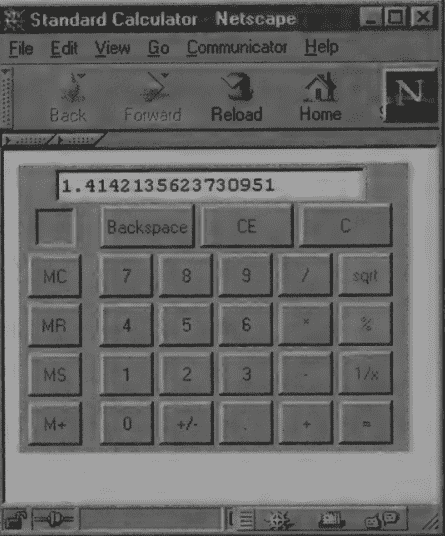

由于这是一个相当复杂的应用程序，调试代码可能比较困难。为了辅助 JavaScript 应用程序的调试，可以采用多种技术。最简单的方法是精心放置 `alert()` 语句，以便在代码运行时突出显示变量的状态。

标准计算器中采用的另一种方案是使用表单来保存内部设置的可见副本。计算器利用多个内部设置来描述当前状态：`lhs` 表示数学表达式左侧的数值，`op` 表达式中间的操作符，`rhs` 表示操作符右侧的数值，`res` 表示表达式的结果，`mem` 表示计算器的内存值，`old` 表示 `res` 的前一个值。还有一个 `done` 设置，用于指示用户是否已完成左侧或右侧数值的输入。这七个值在调试应用程序时极其有用。因此，能够查看当前值可以帮助你理解代码中开始出现问题时发生了什么。代码中包含一个调试表单，每个值对应一个表单字段。每当代码中的主流程更新内部设置时，也会同步更新调试表单字段。启用调试表单只需将调试变量设置为 true 或 false 即可。这使我们可以在之后对计算器进行调试，而无需重新引入调试代码。

## 图 2-2

标准计算器——显示调试表单。

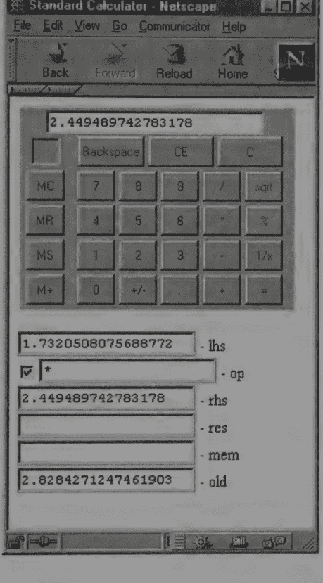

## 标准计算器源代码


```
../chapter2/calculator/standard.htm

<html>
<head>
<title>Standard Calculator</title>
```

## 第二章

这里我们使用样式表来定义所有表格元素的背景颜色：

```
<style><!--
table { background:#cccccc; }
//--></style>
```

这里我们使用 script 元素在 HTML 中嵌入 JavaScript 代码：

```
<script language="JavaScript"><!--
```

我们首先定义几个全局变量——所谓全局，是指它们在当前页面的所有 JavaScript 代码中都可用。`debug` 布尔变量设置为 `false`，控制是否在屏幕上显示诊断数据，这在最初创建应用程序时非常有用：

```
var debug = false;
```

`nan` 布尔变量用于捕获无效的数学值（例如除以零，会产生特殊的 `Infinity` 值，或者不确定的情况如零乘以"无穷大"，可能产生特殊的 `NaN` 值——即 Not a Number），并在用户取消当前显示之前阻止其继续操作：

```
var nan = false;
```

我们可以一次性定义和初始化多个变量以节省空间。这里我们将 `lhs`、`op`、`rhs`、`res`、`mem` 和 `old` 变量全部定义并初始化为空字符串值：

```
var lhs = op = rhs = res = mem = old = '';
```

`done` 布尔变量控制用户是否可以输入前导零。这可以避免生成八进制数（八进制数——基数为 8——通过前导零来标识）：

```
var done = false;
```

`update()` 函数是整个标准计算器代码中的关键流程。它更新计算器的显示，并可选择性地更新调试表单字段：

```
function update() {
```

仅当 `debug` 设置为 `true` 时，我们才会更新调试表单字段。六个内部计算器变量（`lhs`、`op`、`rhs`、`res`、`mem`、`old` 和 `mem`）以及 `done` 变量，每个都有一个对应的调试表单字段，通过表单层次结构 `document.formName.formFieldName.value` 进行更新：

```
if (debug) {
    document.debug.lhs.value = lhs;
    document.debug.op.value = op;
    document.debug.rhs.value = rhs;
    document.debug.res.value = res;
    document.debug.mem.value = mem;
    document.debug.old.value = old;
    document.debug.done.checked = done;
}
```

第 8 章"表单"详细介绍了在 JavaScript 中使用表单的相关内容。为了在计算器显示中显示适当的值，我们使用局部变量 `dis`。`dis` 变量在 `update()` 函数的作用域内是局部的——也就是说，`dis` 变量及其值在 `update()` 函数作用域之外的任何 JavaScript 代码中都不可用。其初始值设为零，表示空白显示：

```
var dis = '0';
```

然后根据 `res`、`rhs` 或 `lhs` 变量的值，将 `dis` 变量更新为第一个不包含空字符串的变量的值：

```
if (res != '') dis = res;
else if (rhs != '') dis = rhs;
else if (lhs != '' && op == '') dis = lhs;
```

在最后一行中，我们还检查了 `op` 变量的值是否为空字符串。这允许保持 `dis` 的初始零值——并阻止 `dis` 被设为空字符串。

由于大多数计算器会在数值后显示一个小数点，我们也将这样做。不过，首先我们需要检查 `dis` 变量是否已经包含浮点数。我们先通过在前面加上空字符串确保 `dis` 是字符串，然后使用 `String` 对象的 `indexOf()` 方法在 `dis` 中查找第一个小数点。如果未找到，则 `indexOf()` 方法返回 -1。如果没有找到——即 `indexOf()` 方法返回的值小于 (<) 零——我们就使用 += 运算符添加一个小数点：

```
if (('' + dis).indexOf('.') < 0) dis += '.';
```

表达式 `dis += '.'` 是 `dis = dis + '.'` 的简写形式。它在 JavaScript 中被频繁使用。字符串将在第 3 章"字符串与正则表达式"中详细介绍。

然后我们通过将 `calc` 表单的 `result` 表单字段的 `value` 属性更新为 `dis` 的值来更新计算器显示：

```
document.calc.result.value = dis;
```


在继续之前，我们会检查当前显示的值是否显示了一个非数字值——换句话说，表达式计算错误或除以零的结果。如果表达式使用了非数字输入，那么结果将产生 `NaN` 值。如果发生除以零，那么结果将产生 `Infinity` 或 `-Infinity`。如果 `dis` 的值等于 `NaN.`（注意末尾的小数点）或者 `dis` 包含子字符串 `Infinity`，我们就将 `nan` 布尔变量设置为 `true`：

```
if (dis == 'NaN.' || dis.indexOf('Infinity') > -1)
    nan = true;
```

最后，无论哪个函数调用了 `update()` 函数，我们都返回 `false`：

```
return false;
}
```

`e()` 函数用于评估当前的计算器设置。当按下计算器的等号（`=`）时，它会被调用：

```
function e() {
```

与几乎所有剩余函数一样，我们首先检查 `nan` 布尔变量。如果它是 `true`，那么我们只需返回 `false`——实际上取消了用户的操作：

```
if (nan) return false;
```

我们现在使用 `eval()` 全局方法来评估 `res`，如果 `rhs` 不为空，则使用表达式 `lhs + op + rhs`：

```
if (rhs != '')    res = '' + eval(lhs + op + rhs);
```

或者如果 `op` 不为空，则使用表达式 `lhs + op + lhs`：

```
else if (op != '') res = '' + eval(lhs + op + lhs);
```

或者如果 `lhs` 不为空，则简单地使用表达式 `lhs`：

```
else if (lhs != '') res = '' + eval(lhs);
```

`eval()` 全局方法评估包含 JavaScript 代码的字符串。例如，如果 `lhs` 包含字符串 `9`，`op` 包含 `+`，`rhs` 包含 `10`，那么传递给 `eval()` 的字符串将是 `9+10`，`eval()` 将其评估为数值 `19`。

我们将 `lhs`、`op` 和 `rhs` 变量设置为空字符串，为下一次计算做好准备：

```
lhs = op = rhs = '';
```

表达式求值后，我们最后将 `done` 布尔值设置为 `true`，调用 `update()` 函数以更新显示，将 `old` 设置为 `res` 的当前值，将 `res` 设置为空字符串，最后返回 `false`：

```
done = true;
update();
old = res;
res = '';
return false;
}
```

`o()` 函数用于处理一种独特的选项——在这种情况下，是百分比计算。当用户按下 `%` 键时，一个包含字符 `%` 的字符串作为选项参数传递：

```
function o(option) {
  if (nan) return false;
```

如果传递的选项是 `%` 字符，我们根据 `rhs`、`op` 和 `lhs` 变量中哪些不为空来计算百分比值：

```
if (option == '%') {
  if (rhs != '')      rhs = '' + (lhs*rhs/100), res = rhs;
  else if (op != '')  rhs = '' + (lhs*lhs/100), res = lhs;
  else if (lhs != '') lhs = '';
}
```

请注意，我们通过附加一个空字符串来确保表达式的结果被转换回字符串。

```
done = true;
return update();
}
```

我们将在本章后面的“科学计算器”部分扩展 `o()` 函数。

## 第二章

`f()` 函数用于计算各种数学函数，具体取决于传递的 `func` 参数的值。目前，当用户按下 `sqrt` 或 `1/x` 键时，只会传递 `sqrt` 和 `1/x`：

```
function f(func) {
  if (nan) return false;
```

与其在执行计算时确定使用 `rhs`、`lhs`、`res` 或 `old` 中的哪个变量，我们在每个单独的数学函数中提前计算出来，然后将变量的值存储在本地 `tmp` 变量中：

```
var tmp;
if (rhs != '') tmp = rhs;
else if (lhs != '') tmp = lhs;
else if (res != '') tmp = res;
else if (old != '') tmp = old;
else tmp = 0;
```

现在，我们不是以几种不同的方式执行计算，而是只使用 `tmp` 值执行一次计算。

对于 `sqrt` 请求，我们使用 `Math` 对象的 `sqrt()` 方法，将 `tmp` 作为参数传递，并将结果赋值回 `tmp` 变量：

```
if (func == 'sqrt')      tmp = Math.sqrt(tmp);
```

对于 `1/x` 请求，我们只需将 1 除以 `tmp`：

```
else if (func == '1/x') tmp = 1 / tmp;
```

然后我们执行与 `f()` 函数开始时检查相反的操作，将 `tmp` 的值转换为字符串并设置相应的 `rhs` 或 `lhs` 变量：

```
if (rhs != '')      rhs = '' + tmp;
else if (lhs != '') lhs = '' + tmp;
else if (res != '') lhs = '' + tmp;
else lhs = tmp;

done = true;
return update();
}
```

`m()` 函数用于控制计算器的内存存储。传递的 `memory` 参数可以具有 `MC`、`MR`、`MS` 或 `M+` 的值：

```
function m(memory) {
  if (nan) return false;
```

## 数学与数字

如果 `MC`（内存清除），我们只需将全局 `mem` 变量设置为空字符串：

```
if (memory == 'MC') mem = '';
```

如果 `MR`（内存调用），我们将 `lhs` 或 `rhs` 的值设置为 `mem`：

```
else if (memory == 'MR') {
    if (op == '') lhs = mem; else rhs = mem;
}
```

如果 `MS`（内存存储），我们将 `mem` 的值设置为 `rhs`、`lhs` 或 `res`：

```
else if (memory == 'MS') {
    if (rhs != '')     mem = rhs;
    else if (lhs != '') mem = lhs;
    else if (res != '') mem = res;
}
```

如果 `M+`（内存相加），我们将 `rhs`、`lhs` 或 `res` 添加到 `mem` 的现有值中，确保通过从每个值中减去零将其转换为数字：

```
else if (memory == 'M+') {
    if (rhs != '')     mem = (mem - 0) + (rhs - 0);
    else if (lhs != '') mem = (mem - 0) + (lhs - 0);
    else if (res != '') mem = (mem - 0) + (res - 0);
    mem += '';
}
```

为了向用户表明计算器内存中保存了一个值，我们将内存图像的 `src` 属性更改为 `*empty.gif*` 或 `*full.gif*`——但仅适用于支持 `Image` 对象的浏览器（图像将在第 9 章“图像”中详细介绍）：

```
if (document.images && mem == '')
    document.images.memory.src = 'empty.gif';
if (document.images && mem != '')
    document.images.memory.src = 'full.gif';
```

```
done = true;
return update();
}
```

`n()` 函数用于处理用户对数字键的选择，以及取反键（`+/-`）和小数点键：

```
function n(num) {
    if (nan) return false;
```

## 第二章

取反键（`+/-`）用于在 `lhs`、`rhs` 或 `res` 变量前添加减号（`-`）或移除前导减号，使用 `indexOf()` 方法检查字符串中是否已存在，并使用 `String` 对象的 `substring()` 方法，参数值为 `1` 以返回减去字符串第一个字符的字符串值：

```
if (num == '+/-') {
  if (op == '' && lhs != '') {
    if (lhs.indexOf('-') < 0) lhs = '-' + lhs;
    else lhs = lhs.substring(1);
  }
  else if (rhs != '') {
    if (rhs.indexOf('-') < 0) rhs = '-' + rhs;
    else rhs = rhs.substring(1);
  }
  else lhs = (res * (-1)) + '', res = '';
}
```

同样，只有在 `lhs`、`rhs` 或 `res` 变量末尾尚未存在小数点时，才将其附加到末尾：

```
else if (num == '.') {
  if (op == '') {
    if (lhs.indexOf('.') < 0) {
      if (lhs == '') lhs = '0'; lhs += '.';
    }
  }
  else if (rhs.indexOf('.') < 0) {
    if (rhs == '') rhs = '0'; rhs += '.';
  }
}
```

最后，我们处理数字键 0 到 9。如果 `done` 布尔变量设置为 `true`，我们将传递的 `num` 值设置为 `lhs` 或 `rhs` 变量的值，但仅当 `num` 值不为零时：

```
else if (done) {
  if (op == '') { if (num != '0') lhs = '' + num; }
  else { if (num != '0') rhs = '' + num; }
}
```

否则，我们将传递的 `num` 值附加到 `lhs` 或 `rhs` 变量，但如果现有变量值为空且传递的 `num` 值为零，则不附加：

```
else {
  if (op == '') {
    if (!(lhs == '' && num == '0')) lhs += num;
  }
  else {
    if (!(rhs == '' && num == '0')) rhs += num;
  }
}
```

## 数学与数字

如前面的代码所示，`done` 布尔变量可防止用户输入前导零。现在 `lhs` 或 `rhs` 的值包含一个值，我们将 `done` 布尔变量设置为 `false`：

```
done = false;
return update();
}
```

`s()` 函数处理所有操作数键的按下：`+`、`-`、`/` 和 `*`：

```
function s(sign) {
  if (nan) return false;
```

如果 `lhs` 变量为空但 `old` 变量不为空，我们首先将 `old` 变量带到 `lhs` 变量中，然后将 `old` 重置为空，再将传递的 `sign` 参数赋值给 `op` 变量：

```
if (lhs == '' && old != '') lhs = old, old = '', op = sign;
```

但是，如果 `lhs` 和 `rhs` 变量都已包含值，我们直接调用 `e()` 函数来评估数学表达式，然后按上一行设置 `lhs`、`old` 和 `op` 的值：

```
else if (lhs != '' && rhs != '') {
  e(); lhs = old, res = '', op = sign;
}
```

最后，只要 `lhs` 变量不为空，我们就简单地将 `sign` 的值赋给 `op` 变量：

```
else if (lhs != '') op = sign;

done = true;
return update();
}
```

`c()` 函数处理用户取消或清除计算器内部设置的请求。用户可以使用 Backspace 按钮删除最后输入的数字，使用 CE 按钮清除显示的数字，或使用 C 按钮清除当前计算：

```
function c(cancel) {
```

当用户按下 Backspace 键时，传递的 `cancel` 参数包含 `back`：

```
if (cancel == 'back') {
```


## 第二章

到目前为止，如果 `nan` 布尔变量被设置为 true，我们总是通过返回 false 来放弃函数。而这里，我们仅在用户尝试删除最后输入的数字时才这样做：

```
if (nan) return false;
```

如果 `rhs` 变量不为空，我们使用 String 对象的 `substring()` 方法修剪掉最后一个字符。从第一个字符开始，我们提取 `rhs` 字符串起始位置的所有字符，长度为字符串长度减 1：

```
if (rhs != '')
    rhs = rhs.substring(0,rhs.length-1);
else if (lhs != '' && op == '')
```

我们对 `lhs` 变量执行同样的操作，但仅在 `op` 变量未被通过调用 `s()` 函数填入操作符时：

```
lhs = lhs.substring(0,lhs.length-1);
}
```

当传入的 `cancel` 参数包含 CE 时，我们需要清除当前的 `lhs` 或 `rhs` 变量：

```
else if (cancel == 'CE') {
```

然而，如果 `nan` 布尔值被设置为 true，我们将 CE 键视为 C 键——并清除所有内容：

```
if (nan) lhs = op = rhs = res = old = '';
else if (rhs != '') rhs = '';
else lhs = op = '';
}
```

最后，如果用户按下 C 键，我们清除所有内容：

```
else if (cancel == 'C') {
    lhs = op = rhs = res = old = '';
}

done = false;
nan = false;
return update();
}
//--></script>
</head>
```

既然我们已经讨论完了所有的 JavaScript 代码，让我们将注意力转向 HTML。我们在 body 元素中使用一个加载事件处理程序（`onLoad`），在页面完全加载时调用 `update()` 函数。这确保了计算器设置被正确初始化：

```
<body onLoad="update()">
```

使用一个表单将计算器显示为文本输入字段。为了能够正确识别该文本表单字段，我们使用 `name` 属性将表单命名为 `calc`：

```
<form name="calc">
<table border="0" width="265">
<tr><td>
<center>
```

文本输入表单字段被命名为 `result`，同样使用 `name` 属性。它还使用 `onFocus` 事件处理程序捕获焦点事件，该事件在用户用鼠标点击文本字段时触发。事件处理程序使用对当前文本字段的引用（`this`）来调用其上的 `blur()` 方法，使文本字段失去焦点，以防止用户在文本区域中输入：

```
<input type="text" size="25" name="result"
  onFocus="this.blur()">
<br>
```

使用 `empty.gif` 图像来表示计算器的内存为空。为了更改图像，我们使用 `name` 属性将该图像命名为 `memory`：

```

&nbsp;
```

然后，我们使用图像链接来表示计算器的每个按钮，使用 `a` 元素的 `onClick` 事件处理程序捕获点击事件，以调用适当的 JavaScript 函数，将函数的返回值（每种情况下都是 `false`）返回给原始的点击事件。这样就取消了事件的默认动作，即跳转到当前页面中的锚点：

```
<a href="#" onClick="return c('back')"></a>
<a href="#" onClick="return c('CE')"></a>
<a href="#" onClick="return c('C')"></a>
<br>
<a href="#" onClick="return m('MC')"></a>
&nbsp;
<a href="#" onClick="return n(7)"></a>
<a href="#" onClick="return n(8)"></a>
<a href="#" onClick="return n(9)"></a>
<a href="#" onClick="return s('/')"></a>
<a href="#" onClick="return f('sqrt')"></a>
<br>
<a href="#" onClick="return m('MR')"></a>
&nbsp;
<a href="#" onClick="return n(4)"></a>
<a href="#" onClick="return n(5)"></a>
<a href="#" onClick="return n(6)"></a>
<a href="#" onClick="return s('*')"></a>
<a href="#" onClick="return o('%')"></a>
<br>
<a href="#" onClick="return m('MS')"></a>
&nbsp;
<a href="#" onClick="return n(1)"></a>
<a href="#" onClick="return n(2)"></a>
<a href="#" onClick="return n(3)"></a>
<a href="#" onClick="return s('-')"></a>
<a href="#" onClick="return f('1/x')"></a>
<br>
<a href="#" onClick="return m('M+')"></a>
&nbsp;
<a href="#" onClick="return n(0)"></a>
<a href="#" onClick="return n('+/-')"></a>
<a href="#" onClick="return n('.')"></a>
<a href="#" onClick="return s('+')"></a>
<a href="#" onClick="return e()"></a>
</center>
</td></tr>
</table>
</form>
```

注意，为了避免每个图像链接周围出现蓝色边框，可以在每个 img 标签中额外包含一个值为零的 border 属性。

最后，我们可以选择性地使用 JavaScript 向页面写入一个单独的表单。这可以在应用程序开发过程中快速帮助测试和调试：

```
<script language="JavaScript"><!--
```

我们仅在 `debug` 布尔变量设置为 true 时才写入该表单：

```
if (debug) {
```

我们使用 document 对象的 `write()` 方法将一串文本（在本例中是一个名为 debug 的表单）写入到 document 中：

```
document.write(
    '<form name="debug">' +
    '<input type="text" name="lhs"> - lhs<br>' +
    '<input type="checkbox" name="done">' +
    '<input type="text" name="op"> - op<br>' +
    '<input type="text" name="rhs"> - rhs<br>' +
    '<input type="text" name="res"> - res<br>' +
    '<input type="text" name="mem"> - mem<br>' +
    '<input type="text" name="old"> - old' +
    '</form>'
);
```

`update()` 函数更新各个调试表单中的 `lhs`、`rhs`、`res`、`mem` 和 `old` 文本表单字段以及 `done` 复选框的值——具体取决于 `debug` 布尔变量的值。

```
//--></script>

</body>
</html>
```

### 科学计算器

标准计算器——顾名思义——相当标准。你可能会在互联网上找到几个类似外观的计算器实例。然而，科学计算器则更难找到——如果它甚至存在的话。图 2-3 展示了科学计算器。

如标准计算器中所见，JavaScript 提供了一个 Math 对象实例——即一个已经存在的对象——包含几个静态函数和常量。静态函数的完整列表如表 2-1 所示。

除一个函数外，所有函数自 JavaScript 首次发布以来就已可用——`Math.random()` 方法是在 JavaScript 1.1 中引入的。在 JavaScript 1.1 之前，我们必须编写自己的伪随机数函数。幸运的是，支持 JavaScript 1.0 浏览器的日子早已远去。

表 2-2 展示了 Math 对象常量的完整列表。

我们在科学计算器中使用了许多静态方法和几个常量。我们甚至创建了一个阶乘函数来计算传入参数的阶乘。凭借数学表达式和方程的知识，可以为计算器添加更多功能。

### 图 2-3

十进制模式下的科学计算器。

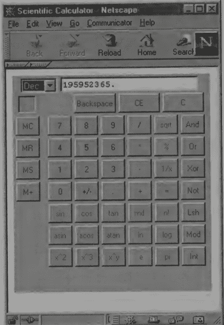

科学计算器还可以在两种基数数字系统中工作：十进制和十六进制。十进制基数系统很简单——只需使用 0 到 9 的数字。十六进制数在 JavaScript 中也受到支持。十六进制数通过添加前导的 0x 序列来表示。例如，十进制 255 在十六进制中表示为 `0xFF` 或 `0xff`。如标准计算器中所示，我们将内部计算器设置存储在字符串中。在科学计算器中，这一基础使得字母字符 A 到 F 的轻松包含成为可能；我们只需将这些字符拼接到现有的内部设置中。

困难的部分出现在我们需要将字符串值 FF 转换为适合在表达式中使用的值时。这可以通过将 `0x` 与 FF 拼接，然后使用 `eval()` 方法来计算该字符串来实现。例如，`eval('0x'+'FF')` 将返回值 255。图 2-4 展示了十六进制模式下的计算器。如你所


 ## 数学与数字

### 表 2-1

Math 对象的静态函数。

| 函数 | 描述 |
|-----------|-------------|
| Math.abs() | 返回数字的绝对值。 |
| Math.acos() | 返回数字的反余弦值。 |
| Math.asin() | 返回数字的反正弦值。 |
| Math.atan() | 返回数字的反正切值。 |
| Math.atan2() | 返回其参数的商的反正切值。 |
| Math.ceil() | 返回大于或等于该数字的最小整数。 |
| Math.cos() | 返回数字的余弦值。 |
| Math.exp() | 返回 *e* 的指数，即 *e*^{x}。 |
| Math.floor() | 返回小于或等于数字的最大整数。 |
| Math.log() | 返回数字的自然对数。 |
| Math.max() | 返回两个数中的较大者。 |
| Math.min() | 返回两个数中的较小者。 |
| Math.pow() | 返回 *x* 的 *y* 次幂，即 *x*^{y}。 |
| Math.random() | 返回 0 到 1 之间的随机数。 |
| Math.round() | 返回数字四舍五入到最接近的整数后的值。 |
| Math.sin() | 返回数字的正弦值。 |
| Math.sqrt() | 返回数字的平方根。 |
| Math.tan() | 返回数字的正切值。 |

### 表 2-2

Math 对象的常量。

| 常量 | 描述 |
|-----------|-------------|
| Math.E | 常量 *e*，自然对数的底 |
| Math.LN10 | 10 的自然对数 |
| Math.LN2 | 2 的自然对数 |
| Math.LOG10E | *e* 的以 10 为底的对数 |
| Math.LOG2E | *e* 的以 2 为底的对数 |
| Math.PI | 常量 ∏——圆的周长与直径之比 |
| Math.SQRT1_2 | 1/2 的平方根；等价于 1 除以 2 的平方根 |
| Math.SQRT2 | 2 的平方根 |

如你所见，在十进制模式下可见的多个按钮被隐藏，而字符 A 到 F 的按钮现在变为可见。这使用了图像交换技术，详细内容在第 9 章"图像"中介绍。

## 科学计算器源代码

```
../chapter2/calculator/scientific.htm
```

由于科学计算器的源代码建立在标准计算器代码的基础上，我们将只关注两者之间的差异：

```
<html>

<head>
<title>Scientific Calculator</title>

<style><!--
table { background:#cccccc; }
//--></style>

<script language="JavaScript"><!--
var debug = false;
var nan = false;
var lhs = op = rhs = res = mem = old = '';
var done = false;
```

定义了两个全局整型变量：`base` 用于指示当前使用的数字进制（十进制 -10，或十六进制 - 16）和 `oldbase` 用于指示 `base` 的先前值，并指示数字进制是否最近发生了改变：

```
var base = 10;
var oldbase = 16;
```

还定义了两个新的全局字符串变量：`noHex`，它是一个字符串，包含当不使用十六进制（base 16）时不可接受的按键列表；以及 `noDec`，它是一个字符串，包含当不使用十进制（base 10）时不可接受的按键列表：

```
var noHex = 'ABCDEF';
var noDec = 'sqrt % 1/x dot rnd asin acos atan e pi';

function update() {
  if (debug) {
    document.debug.lhs.value = lhs;
    document.debug.op.value = op;
    document.debug.rhs.value = rhs;
    document.debug.res.value = res;
    document.debug.mem.value = mem;
    document.debug.old.value = old;
    document.debug.done.checked = done;
  }

  var dis = '0';
  if (res != '') dis = res;
  else if (rhs != '') dis = rhs;
  else if (lhs != '' && op == '') dis = lhs;
```

计算器显示中包含了一个新的表单字段。这次包含了一个选择选项列表，允许用户选择十进制或十六进制计算器显示。我们使用层级结构 `document.formName.fieldName` 获取名为 `base` 的选择选项列表的引用，并将该引用赋值给 `what` 变量：

```
var what = document.calc.base;
```

使用引用 `what`，我们检索 `base` 选择字段选中选项的字符串值，从中减去零将其转换为数值，然后将该值赋值给全局变量 `base`：

```
base = what.options[what.selectedIndex].value - 0;

if (('' + dis).indexOf('.') < 0) dis += '.';
dis = ('' + dis).toUpperCase();

document.calc.result.value = dis;
if (dis == 'NAN.' || dis.indexOf('INFINITY') > -1)
    nan = true;
```

如果 `base` 的当前值不等于 `oldbase` 的当前值，那么用户刚刚对进制系统进行了更改——调用 `set()` 函数，将 `what` 引用作为输入参数传递：

```
if (base != oldbase) set(what);

return false;
}
```

为了避免 JavaScript 代码中多次将数字从十进制格式转换为十六进制格式以及反向转换，定义了两个实用函数。`dec()` 函数将字符串转换为十进制数字：

```
function dec(h) {
```

传递的 `h` 字符串参数首先加上前缀 `0x` 以表示十六进制字符串，然后使用 `eval()` 方法进行求值。这将十六进制字符串转换为十进制数字，然后通过添加空字符串前缀将其转换为字符串：

```
var d = '' + eval('0x'+h);
```

如果结果为 0，则将其替换为空字符串：

```
if (d == '0') d = '';
return d;
}
```

`hex()` 函数将字符串转换为十进制数字：

```
function hex(d) {
```

传递的 `d` 字符串参数通过从中减去零转换为数字。然后使用 Number 对象的 `toString()` 方法，输入参数为 16——指示要使用的数字进制：

```
var h = (d-0).toString(16);
if (h == '0') h = '';
```

返回的结果首先使用 String 对象的 `toUpperCase()` 方法转换为大写。这确保将字母 a 到 f 转换为 A 到 F：

```
return h.toUpperCase();
}
```

`ox()` 函数用于在数字开头添加 `0x` 字符串前缀——但仅当当前数字进制为 16 且传递的 `h` 字符串参数不为空时：

```
function ox(h) {
  if (base == 16 && h != '') return '0x' + h; return h;
}
```

每当检测到进制变化时，就会调用 `set()` 函数。它用于隐藏或显示不适合十进制或十六进制模式的多个计算器按钮，并将内部计算器设置从十进制转换为十六进制或反向转换：

```
function set(what) {
```

使用传递的 `what` 表单字段引用参数，从 `base` 选择选项中检索当前进制值：

```
base = what.options[what.selectedIndex].value - 0;

if (base == 16) {
```

如果进制值为 16，则使用 `hex()` 函数将内部计算器设置从十进制转换为十六进制：

```
lhs = hex(lhs);
rhs = hex(rhs);
res = hex(res);
```

如果浏览器支持图像对象，则将命名图像 A、B、C、D、E 和 F 的 `src` 属性更改，以显示十六进制计算器按钮：

```
if (document.images) {
    document.images['A'].src = 'A.gif';
    document.images['B'].src = 'B.gif';
    document.images['C'].src = 'C.gif';
    document.images['D'].src = 'D.gif';
    document.images['E'].src = 'E.gif';
    document.images['F'].src = 'F.gif';
```

多个科学计算图像的 `src` 属性被更改，使其隐藏于视野之外，每个图像都用 *space.gif* 图像替换：

```
document.images['sqrt'].src = 'space.gif';
document.images['percent'].src = 'space.gif';
document.images['1divx'].src = 'space.gif';
document.images['dot'].src = 'space.gif';
document.images['sin'].src = 'space.gif';
document.images['cos'].src = 'space.gif';
document.images['tan'].src = 'space.gif';
document.images['rnd'].src = 'space.gif';
document.images['asin'].src = 'space.gif';
document.images['acos'].src = 'space.gif';
document.images['atan'].src = 'space.gif';
document.images['ee'].src = 'space.gif';
document.images['pi'].src = 'space.gif';
}
}
else {
```

如果 `base` 值为 10，则使用 `dec()` 函数将内部计算器设置从十六进制转换为十进制：

```
lhs = dec(lhs);
rhs = dec(rhs);
res = dec(res);

if (document.images) {
```

如果浏览器支持图像对象，则将命名图像 A、B、C、D、E 和 F 的 `src` 属性更改，以隐藏十六进制计算器按钮，每个图像都用 *space.gif* 图像替换：

```
document.images['A'].src = 'space.gif';
document.images['B'].src = 'space.gif';
document.images['C'].src = 'space.gif';
document.images['D'].src = 'space.gif';
document.images['E'].src = 'space.gif';
document.images['F'].src = 'space.gif';
```

多个科学计算图像的 `src` 属性被更改，使其显示出来：


# 数学与数字

## 第二章

document.images['sqrt'].src = 'sqrt.gif';
document.images['percent'].src = 'percent.gif';
document.images['1divx'].src = '1divx.gif';
document.images['dot'].src = 'dot.gif';
document.images['sin'].src = 'sin.gif';
document.images['cos'].src = 'cos.gif';
document.images['tan'].src = 'tan.gif';
document.images['rnd'].src = 'rnd.gif';
document.images['asin'].src = 'asin.gif';
document.images['acos'].src = 'acos.gif';
document.images['atan'].src = 'atan.gif';
document.images['ee'].src = 'ee.gif';
document.images['pi'].src = 'pi.gif';

最后，将 base 的值复制到 oldbase 中：

```
oldbase = base;
}

function e() {
  if (nan) return false;
```

在计算 e() 函数中的表达式之前，我们首先使用 ox() 函数将 lhs 和 rhs 的值从字符串转换为数值——如果需要，该函数会将 lhs 或 rhs 中包含的十六进制字符串转换为十进制值：

```
lhs = ox(lhs), rhs = ox(rhs);
```

计算器中包含了一个新的求值表达式 x^y。这用于将 lhs 提升到 rhs 的幂，或者使用 Math 对象的 pow() 方法将 lhs 提升到自身的幂：

```
if (op == 'x^y') {
  if (rhs != '')    res = '' + Math.pow(lhs, rhs);
  else if (lhs != '') res = '' + Math.pow(lhs, lhs);
  lhs = op = rhs = '';
}
else {
  if (rhs != '')    res = '' + eval(lhs + op + rhs);
  else if (op != '') res = '' + eval(lhs + op + lhs);
  else if (lhs != '') res = '' + eval(lhs);
  lhs = op = rhs = '';
}
```

如果基数为 16，则使用 hex() 函数将 res 变量转换为十六进制字符串值：

```
if (base == 16) res = hex(res);
done = true;
update();
old = res;
res = '';
return false;
}

function o(option) {
  if (nan) return false;
```

在允许用户使用 o() 函数中的某项一次性选项之前，我们首先检查它是否是十六进制模式下的有效选项。如果传入的 option 参数出现在 noDec 字符串中，则返回 false：

```
if (base == 16 && noDec.indexOf(option) > -1) return false;
```

在一次性表达式中使用 lhs 和 rhs 变量之前，我们再次使用 ox() 函数：

```
lhs = ox(lhs), rhs = ox(rhs);

if (option == '%') {
  if (rhs != '')      rhs = '' + (lhs*rhs/100), res = rhs;
  else if (op != '')  rhs = '' + (lhs*lhs/100), res = lhs;
  else if (lhs != '') lhs = '';
```

包含了几个新的一次性选项。rnd 选项使用 Math 对象的 random() 方法生成 0 到 1 之间的随机数：

```
else if (option == 'rnd') {
  if (lhs == '' || op == '') lhs = '' + Math.random();
  else rhs = '' + Math.random();
}
```

pi 选项使用 Math 对象的 PI 常量返回常量 Π 的值：

```
else if (option == 'pi') {
  if (lhs == '' || op == '') lhs = '' + Math.PI;
  else rhs = '' + Math.PI;
}
```

e 选项使用 Math 对象的 E 常量返回常量 e 的值：

```
else if (option == 'e') {
  if (lhs == '' || op == '') lhs = '' + Math.E;
  else rhs = '' + Math.E;
}
```

同样，如果基数为 16，则使用 hex() 函数将 res 变量转换为十六进制字符串值：

```
if (base == 16) res = hex(res);

done = true;
return update();
}

function f(func,y) {
  if (nan) return false;
```

同样，我们限制十六进制模式下可用的函数：

```
if (base == 16 && noDec.indexOf(func) > -1) return false;

var tmp;
if (rhs != '') tmp = rhs;
else if (lhs != '') tmp = lhs;
else if (res != '') tmp = res;
else if (old != '') tmp = old;
else tmp = 0;
```

这一次，如果在十六进制模式下，我们在 tmp 变量前加上 0x 前缀：

```
tmp = ox(tmp);

if (func == 'sqrt')    tmp = Math.sqrt(tmp);
else if (func == '1/x') tmp = 1 / tmp;
```

包含了多个新的科学函数，使用相应的 Math 对象方法计算正弦、余弦、正切、反正弦、反余弦和反正切值：

```
else if (func == 'sin') tmp = Math.sin(tmp);
else if (func == 'cos') tmp = Math.cos(tmp);
else if (func == 'tan') tmp = Math.tan(tmp);
else if (func == 'asin') tmp = Math.asin(tmp);
else if (func == 'acos') tmp = Math.acos(tmp);
else if (func == 'atan') tmp = Math.atan(tmp);
```

按位非运算符使用一元 ~ 运算符来反转 tmp 变量中的所有位：

```
else if (func == 'Not') tmp = (~tmp);
```

使用 Math 对象的 floor() 方法将数字向下取整：

```
else if (func == 'Int') tmp = Math.floor(tmp);
```

使用 Math 对象的 log() 方法计算自然对数：

```
else if (func == 'ln') tmp = Math.log(tmp);
```

使用额外传入的 y 参数计算 tmp 的平方或立方值：

```
else if (func == 'pow') tmp = Math.pow(tmp,y);
```

使用 Math 对象的 LOG10E 常量和 log() 方法计算以 10 为底的自然对数：

```
else if (func == 'log') tmp = (Math.LOG10E * Math.log(tmp));
```

使用 factorial() 函数计算 tmp 的阶乘值，但首先捕获负数并将其结果值设置为 NaN：

```
else if (func == 'fac') {
    if (tmp < 0) tmp = NaN;
    else tmp = factorial(tmp-0);
}

if (base == 16) tmp = hex(tmp);

if (rhs != '')      rhs = '' + tmp;
else if (lhs != '') lhs = '' + tmp;
else if (res != '') lhs = '' + tmp;
else lhs = tmp;

done = true;
return update();
}

function m(memory) {
    if (nan) return false;

if (memory == 'MC') mem = '';
else if (memory == 'MR') {
    if (op == '') lhs = mem; else rhs = mem;
}
else if (memory == 'MS') {
    if (rhs != '')      mem = rhs;
    else if (lhs != '') mem = lhs;
    else if (res != '') mem = res;
}
else if (memory == 'M+') {
```

在将值添加到现有的 mem 存储中时，如果在十六进制模式下，我们使用 ox() 函数为值添加 0x 前缀：

```
if (rhs != '')      mem = (ox(mem) - 0) + (ox(rhs) - 0);
else if (lhs != '') mem = (ox(mem) - 0) + (ox(lhs) - 0);
else if (res != '') mem = (ox(mem) - 0) + (ox(res) - 0);
if (base == 16) mem = hex(mem);
mem += '';
}

if (document.images && mem == '')
  document.images.memory.src = 'empty.gif';
if (document.images && mem != '')
  document.images.memory.src = 'full.gif';

done = true;
return update();
}

function n(num) {
  if (nan) return false;
```

在十进制模式下，我们限制十六进制键 A 到 F 的使用：

```
if (base == 10 && noHex.indexOf(num) > -1) return false;

if (num == '+/-') {
  if (op == '' && lhs != '') {
    if (lhs.indexOf('-') < 0) lhs = '-' + lhs;
    else lhs = lhs.substring(1);
  }
  else if (rhs != '') {
    if (rhs.indexOf('-') < 0) rhs = '-' + rhs;
    else rhs = rhs.substring(1);
  }
  else lhs = (res * (-1)) + '', res = '';
}
else if (num == '.') {
  if (op == '') {
    if (lhs.indexOf('.') < 0) {
      if (lhs == '') lhs = '0'; lhs += '.';
    }
  }
  else if (rhs.indexOf('.') < 0) {
    if (rhs == '') rhs = '0'; rhs += '.';
  }
}
else if (done) {
  if (op == '') { if (num != '0') lhs = '' + num; }
  else { if (num != '0') rhs = '' + num; }
    }
    else {
        if (op == '') {
            if (!(lhs == '' && num == '0')) lhs += num;
        }
        else {
            if (!(rhs == '' && num == '0')) rhs += num;
        }
    }

    done = false;
    return update();
}

function s(sign) {
    if (nan) return false;

    if (lhs == '' && old != '') lhs = old, old = '', op = sign;
    else if (lhs != '' && rhs != '') {
        e(); lhs = old, res = '', op = sign;
    }
    else if (lhs != '') op = sign;

    done = true;
    return update();
}

function c(cancel) {
    if (cancel == 'back') {
        if (nan) return false;

        if (rhs != '')
            rhs = rhs.substring(0,rhs.length-1);
        else if (lhs != '' && op == '')
            lhs = lhs.substring(0,lhs.length-1);
    }
    else if (cancel == 'CE') {
        if (nan) lhs = op = rhs = res = '';
        else if (rhs != '') rhs = '';
        else lhs = op = '';
    }
    else if (cancel == 'C') {
        lhs = op = rhs = res = '';
    }

    done = false;
    nan = false;
    return update();
}
```

factorial() 函数通过简单地从 1 循环到 n 并将每个值相乘来计算传入 n 参数的阶乘值，然后返回该值：

```
function factorial(n) {
    var r=1; for (var i = 1; i<=n; i++) r *= i; return r;
}
```

## 数学与数字

代码 `i++` 使用后缀自增运算符将 i 的值增加 1。这是 `i = i + 1` 的简写形式：

```
//--></script>
</head>
```

在 body 元素内的 `onLoad` 事件处理器中有一个小改动，它会在调用 `update()` 函数之前（与标准计算器中一样）先调用 `set()` 函数，并传递对计算器表单的 base 选择字段的引用：

```
<body onLoad="set(document.calc.base);update()">

<form name="calc">

<table border="0" width="300">
<tr><td>
<center>
```

额外的 `select` 元素允许用户在十进制和十六进制模式之间切换——每个 option 元素的 value 属性用于指示数字进制。`select` 元素的 `onChange` 事件处理器捕获用户更改所选选项时触发的 change 事件，该事件会调用 `set()` 函数，并传递对自身的引用（`this`），然后调用 `update()` 函数：

```
<select name="base" onChange="set(this);update()">
<option value="10" selected>Dec</option>
<option value="16">Hex</option>
</select>
<input type="text" size="25" name="result"
  onFocus="this.blur()">
<br>

&nbsp;

```

额外的 `img` 标签用于表示更多的计算器按钮：

```
<a href="#" onClick="return c('back')"></a>
<a href="#" onClick="return c('CE')"></a>
<a href="#" onClick="return c('C')"></a>
<br>
<a href="#" onClick="return m('MC')"></a>
&nbsp;
<a href="#" onClick="return n(7)"></a>
<a href="#" onClick="return n(8)"></a>
<a href="#" onClick="return n(9)"></a>
<a href="#" onClick="return s('/')"></a>
```

## 第二章

需要根据使用的模式进行隐藏的图片，具有额外的 `name` 属性以唯一标识该图片。图片和图片操作在第 9 章 “图片” 中有详细介绍。

```
<a href="#" onClick="return f('sqrt')"></a>
<a href="#" onClick="return s('&')"></a>
<br>
<a href="#" onClick="return m('MR')"></a>
&nbsp;
<a href="#" onClick="return n(4)"></a>
<a href="#" onClick="return n(5)"></a>
<a href="#" onClick="return n(6)"></a>
<a href="#" onClick="return s('*')"></a>
<a href="#" onClick="return o('%')"></a>
<a href="#" onClick="return s('|')"></a>
<br>
<a href="#" onClick="return m('MS')"></a>
&nbsp;
<a href="#" onClick="return n(1)"></a>
<a href="#" onClick="return n(2)"></a>
<a href="#" onClick="return n(3)"></a>
<a href="#" onClick="return s('-')"></a>
<a href="#" onClick="return f('1/x')"></a>
<a href="#" onClick="return s('^')"></a>
<br>
<a href="#" onClick="return m('M+')"></a>
&nbsp;
<a href="#" onClick="return n(0)"></a>
<a href="#" onClick="return n('+/-')"></a>
<a href="#" onClick="return n('.')"></a>
<a href="#" onClick="return s('+')"></a>
<a href="#" onClick="return e()"></a>
<a href="#" onClick="return f('Not')"></a>
<br>

&nbsp;
<a href="#" onClick="return f('sin')"></a>
<a href="#" onClick="return f('cos')"></a>
<a href="#" onClick="return f('tan')"></a>
<a href="#" onClick="return o('rnd')"></a>
<a href="#" onClick="return f('fac')"></a>
<a href="#" onClick="return s('<<')"></a>
<br>

&nbsp;
<a href="#" onClick="return f('asin')"></a>
<a href="#" onClick="return f('acos')"></a>
<a href="#" onClick="return f('atan')"></a>
<a href="#" onClick="return f('ln')"></a>
<a href="#" onClick="return f('log')"></a>
<a href="#" onClick="return s('%')"></a>
<br>

&nbsp;
<a href="#" onClick="return f('pow',2)"></a>
<a href="#" onClick="return f('pow',3)"></a>
<a href="#" onClick="return s('x^y')"></a>
<a href="#" onClick="return o('e')"></a>
<a href="#" onClick="return o('pi')"></a>
<a href="#" onClick="return f('Int')"></a>
<br>

&nbsp;
<a href="#" onClick="return n('A')"></a>
<a href="#" onClick="return n('B')"></a>
<a href="#" onClick="return n('C')"></a>
<a href="#" onClick="return n('D')"></a>
<a href="#" onClick="return n('E')"></a>
<a href="#" onClick="return n('F')"></a>
</center>
</td></tr>
</table>

</form>
```

```
<script language="JavaScript"><!--
if (debug) {
  document.write(
    '<form name="debug">' +
    '<input type="text" name="lhs"> - lhs<br>' +
    '<input type="checkbox" name="done">' +
    '<input type="text" name="op"> - op<br>' +
    '<input type="text" name="rhs"> - rhs<br>' +
    '<input type="text" name="res"> - res<br>' +
    '<input type="text" name="mem"> - mem<br>' +
    '<input type="text" name="old"> - old' +
    '</form>'
  );
}
//>--></script>

</body>
</html>
```

稍加思考，科学计算器可以扩展以使用其他数字进制。Number 对象的 `toString()` 方法支持从 2 到 36 的数字进制。除了十进制和十六进制数字，JavaScript 还支持八进制——通过前导零表示。例如，使用二进制将需要简单的 JavaScript 函数将十进制数字转换为由 1 和 0 组成的字符串，然后再转换回来。

### 每日随机引言

每次用户访问时呈现不同的页面内容，会给人一种页面在不断变化的印象——从而鼓励人们再次访问。使用 JavaScript 添加随机功能，可以为原本静态的网页添加简单而有效的内容变化。显示随机的幽默引言可能会鼓励访客继续浏览网站，以捕捉下一个随机引言。图 2-5 和图 2-6 显示了在原本单调的页面上显示的典型随机引言。
使用一个简单的文本字符串数组，我们可以使用 Math 对象的 `random()` 方法随机选择一个字符串进行显示。技巧在于将 0 到 1 之间的随机浮点数转换为一个整数，该整数代表我们字符串数组中的一个项目。
“每日随机引言”代码提供的随机引言数量略超过 500 条。将所有这些引言都存放在嵌入在页面中的 JavaScript 代码中，不仅会增加 **巨大的开销**（大约 22 Kb 的数据），还意味着如果将其添加到另一个页面，会再次增加巨大的开销。**这就是使用外部 JavaScript 源文件派上用场的地方。**

到目前为止，我们一直将 JavaScript 代码直接嵌入在 `SCRIPT` 标签之间的页面中。除了这样做，我们还可以使用 HTML 语法引用外部 JavaScript 源文件：`<script language="JavaScript" src="quote.js"></script>`。请注意，我们仍然需要使用关闭的 `script` 标签。`quote.js` 文件中的代码在 HTML 加载的同时被检索，然后在 `script` 标签出现的位置被包含在页面中。`quote.js` 文件中的代码是纯 JavaScript 代码——文件本身不需要使用 `script` 标签。

使用外部 JavaScript 源文件的好处是，我们可以在其他页面中重用 `quote.js` 文件。一旦文件被加载到浏览器的缓存中，它就可以立即再次用于其他页面，而用户无需等待它从服务器下载。

由于我们希望用户经常回访，我们确实需要限制他们在任何一天能看到的引言数量。这可以通过使用单独的外部 JavaScript 文件轻松实现，每个文件都有不同的文件名，对应于每月的每一天——例如，从 `quote1.js` 到 `quote31.js`。


*quote31.js*。接下来，我们只需在 HTML 页面中加载相应的文件即可。与其每天都去更新 HTML 来更改文件名，我们可以使用 JavaScript 来自动完成这项工作。

JavaScript 代码可以在页面渲染到浏览器的过程中向页面输出 HTML，也可以用于向页面写入 script 标签。这种技术被用来动态写入相应的 script 标签，以请求当前日期对应的外部 JavaScript 源文件。

### 随机引言语句源代码


每日随机引言语句仅由几行 JavaScript 代码控制。这段代码可以放置在任意数量的页面中。它由两个基本部分组成。第一部分放置在 HTML 的 head 中，用于加载相应的外部 JavaScript 源文件。第二部分将其中一条引言语句输出到文档中。第二部分可以在页面中多次使用，例如在页面的顶部和底部放置随机引言语句，或者在较长文档的不同位置显示。

```
<html>

<head>
<title>Random Quote of the Day</title>

<script language="JavaScript"><!--
```

`rndInteger()` 函数用于返回从零到传入参数 n 值之间的任意随机整数：

```
function rndInteger(n) {
```

Math 对象的 `random()` 方法用于生成一个 0 到 1 之间的随机浮点数。然后将其与 n 的值相乘——得到一个 0 到 n 之间的浮点数。接着将其作为输入传递给 Math 对象的 `floor()` 函数，该函数会将数字向下取整。最后返回结果：

```
    return Math.floor(Math.random() * n);
}
```

## 数学与数字

要获取当前月份的日期，我们首先使用 `Date()` 对象构造函数（不传任何参数）创建一个新的 `Date` 对象来表示当前日期：

```
var today = new Date();
```

使用 `Date` 对象的 `getDate()` 方法，我们可以获取月份中的日期（1 到 31）：

```
var day = today.getDate();
```

然后 `file` 变量就包含了当前日期对应的外部 JavaScript 源代码文件名：

```
var file = 'quote' + day + '.js';
```

我们在向文档写入 script 标签时使用这个变量：

```
document.write(
  '<script language="JavaScript" src="' + file + '"><\/script>'
);
//--></script>
</head>

<body>
```

请注意，我们使用反斜杠字符（\）转义了 `write()` 方法中的正斜杠字符（/）。否则，浏览器可能会将其视为当前 JavaScript 代码的结束。

外部 JavaScript 源文件的内容随后会被包含在当前页面的这个位置。如后文所示，每个外部 JavaScript 源引言文件都定义了一个 `qs` 字符串数组。如果文件加载成功，那么当前页面中就会定义一个 `qs` 变量。如果由于某种原因引言文件未被加载，那么 `qs` 变量将不会被定义。

在尝试使用 `qs` 变量之前，我们首先检查它是否作为当前 window 对象的属性存在：

```
<script language="JavaScript"><!--
if (window.qs) {
```

如果 `qs` 变量存在，那么我们使用 `rndInteger()` 函数生成一个随机整数，将 `qs` 数组的 `length` 属性作为输入传入。这将生成一个从零到 `length` 属性值之间的随机整数，并将其赋值给 `rnd` 变量：

```
var rnd = rndInteger(qs.length);
```

使用 rnd 变量，我们检索 qs 数组中该位置的字符串值并将其输出到文档中：

```
document.write(qs[rnd]);
```

```
}//--></script>
</body>
</html>
```

## JavaScript quote1.js 源代码

```
../chapter2/quotes/quote1.js
```

以下是 31 个不同引言文件之一——quote1.js 的完整源代码。请注意，该文件仅包含 JavaScript 源代码，没有任何 HTML 标签。文件中只有一行 JavaScript 代码，用于创建一个字符串数组。数组将在第 4 章"数组与对象"中详细介绍。

在这个特定的文件中，qs 数组包含 16 条不同的引言语句。qs 数组中的项目数量可以通过 length 属性获取——即 qs.length。这将返回值 16。qs 数组中的第一个项目位于索引位置零——数组通常从位置零开始。最后一个项目位于位置 15。检索其中一个字符串的值通过 qs[position] 实现，其中 position 的范围从零到 15。因此，qs[5] 包含字符串 The early worm gets the bird。

```
var qs = new Array(
"There is much Obi-Wan did not tell you.",
"The bozos are coming.",
"The heart is wiser than the intellect.",
"The greatest remedy for anger is delay.",
"The future lies ahead.",
"The early worm gets the bird.",
"The die is cast.",
"The coast was clear.",
"The bigger the theory, the better.",
"The better part of valour is discretion.",
"The best prophet of the future is the past.",
"The adverb always follows the verb.",
"That that is is not that that is not.",
"TANSTAAFL.",
"Talkers are no good doers.",
"SYSTEM RESTARTING, WAIT."
);
```

### 数字工具函数

JavaScript 在提供数字格式化函数方面尤其薄弱。在结束本章之前，我们将介绍几个实用函数，以便轻松地格式化数字。这些函数可以被放入任何脚本中并随意重复使用。

#### 将数字四舍五入到指定小数位

在处理数字时，尤其是 JavaScript 语言对浮点数进行计算时，结果的小数点后面可能会有过多的位数。以下 `round()` 函数将数字向下舍入到指定的小数位数。例如，`round(9.909, 2)` 将产生结果 9.9，而 `round(1.234567, 3)` 将产生结果 1.234。


```
function round(number,x) {
    return Math.round(number * Math.pow(10,x)) / Math.pow(10,x);
}
```

#### 显示货币金额

向用户显示价格——可能是在计算税费和配送费用之后——可能会导致数值没有正确格式化为所需的小数位数。例如，一美元二十分可能最终显示为 1.2——这是一个不规范的货币金额。以下 `cents()` 函数接受数字或字符串值，然后复用前面的 `round()` 函数将金额四舍五入到两位小数。最后，它用所需数量的尾随零填充金额，返回一个字符串值：

```
function cents(amount) {
  amount -= 0;

  amount = round(amount, 2);

  if (amount == 0)
    amount += '.00';
  else if (amount == Math.floor(amount))
    amount += '.00';
  else if (amount*10 == Math.floor(amount*10))
    amount += '0';

  return '' + amount;
}
```

#### 为大数字添加逗号分隔符

传统上，大数字会按每三位一组进行分隔并用逗号隔开。例如，7562309476 是一个视觉上难以识别的大数字，如果格式化为 7,562,309,476 则更容易理解。以下 commas() 函数正是用于此目的；它接受一个整数，然后返回一个字符串值。

```
function commas(integer) {
  integer = '' + Math.round(integer);

  if (integer.length > 3) {
    var mod = integer.length%3;

    var output = (mod > 0 ? (integer.substring(0,mod)) : '');

    for (i=0 ; i < Math.floor(integer.length/3) ; i++) {
      if ((mod ==0) && (i ==0))
        output+= integer.substring(mod+3*i,mod+3*i+3);
      else
        output+= ',' + integer.substring(mod+3*i,mod+3*i+3);
    }
    return output;
  }
  return integer;
}
```

#### 为货币金额添加逗号分隔符

虽然前面的 commas() 函数可以为大整数添加逗号分隔符，但它无法处理浮点值。它实际上在添加逗号之前将金额舍入为整数。以下 monetary() 函数复用了 cents() 和 commas() 函数，将两者结合以生成格式化的货币金额：

```
function monetary(amount) {
  var integer = Math.floor(amount);
  var floating = amount - integer;
  return commas(integer) + cents(floating);
}
```

#### 将 99 格式化为 Ninety-Nine

以下 tu() 函数将一个十位和个位数字（即从零到 99 的任意数字）转换为其对应的英文文本。代码定义了一个 numbers 数组来保存文本字符串，表示从一到十九，然后从二十到九十：

```
var numbers = new Array(
  '', 'one', 'two', 'three', 'four', 'five', 'six', 'seven',
  'eight', 'nine', 'ten', 'eleven', 'twelve', 'thirteen', 'fourteen',
  'fifteen', 'sixteen', 'seventeen', 'eighteen', 'nineteen',
  '', '', 'twenty', 'thirty', 'fourty', 'fifty', 'sixty', 'seventy',
  'eighty', 'ninety'
);

function tu(u) {
  var t = 0;
  if (u>=20) t = (u - u % 10) / 10, u = u - (u - u % 10);
  return numbers[t+20] + ((t>0 && u>0) ? '-' : '') + numbers[u];
}
```


#### 将 999 格式化为 Nine Hundred and Ninety-Nine

以下 `htu()` 函数——即 hundreds（百位）、tens（十位）和 units（个位）——复用了之前的 `tu()` 函数，可将任意 0 到 999 的数字转换为对应的文本形式：

../chapter2/number/utilites.htm

```
function htu(number) {
  var hs = (number - number % 100) / 100;
  var tus = number - hs * 100;

  return tu(hs) + (hs>0 ? ' hundred' : '') +
         (tus>0 && hs>0 ? ' ':'') + tu(tus);
}
```

`htu()` 函数使用了三元运算符，之所以这样称呼是因为它接受三个操作数——一个条件和两个备选值。三元运算符的语法为 `condition ? truevalue : falsevalue`。表达式 `hs>0 ? ' hundred' : ''` 在 `hs` 大于零时返回文本字符串 `'hundred'`；否则返回空字符串。当你需要在表达式中包含两个值中的一个时，三元运算符非常高效。

#### 将大额货币金额格式化为文本字符串

以下 `monetaryText()` 函数返回大额货币金额（最高可达数千亿）的文本字符串值。例如，1566324599.99 会被格式化为 One billion, five hundred sixty-six million, three hundred twenty-four thousand, five hundred ninety-nine dollars and ninety-nine cents。`monetaryText()` 函数使用了 `HTU()` 函数，而 `HTU()` 函数复用了之前的 `htu()` 函数。

../chapter2/number/utilites.htm

## 数学与数字

```
function monetaryText(input) {
  var dollars = Math.floor(input - 0);
  var cents = Math.floor(input*100 - dollars*100);

  var billions = (dollars - dollars % 1000000000) / 1000000000;
  dollars -= billions * 1000000000;
  var millions = (dollars - dollars % 1000000) / 1000000;
  dollars -= millions * 1000000;
  var thousands = (dollars - dollars % 1000) / 1000;
  dollars -= thousands * 1000;

  var o = '';

  o += HTU(billions, ' billion', ', ');
  o += HTU(millions, ' million', ', ');
  o += HTU(thousands, ' thousand', ', ');
  o += HTU(dollars, ' dollars', ', ');
  o += HTU(cents, ' cents', ' and ');

  and = false;

  return o.substring(0,1).toUpperCase() + o.substring(1);
}

var and = false;

function HTU(number, text, add) {
  if (number <= 0) return '';
  var output = '';
  if (and) output += add;
  output += htu(number) + text;
  and = true;
  return output;
}
```

现在需要的只是这些数字工具函数的使用示例。以下简单的 HTML 表单使用了所有数字工具函数，用于接受用户输入的数字，然后以两种不同的可用格式显示出来。


../chapter2/number/utilites.htm

```
<form>
<input type="text" name="i">
<br>
<input type="text" name="o1">
<br>
<input type="button" value="Convert"
  onClick="this.form.o1.value=monetary(this.form.i.value);
         this.form.o2.value=monetaryString(this.form.i.value)">
<br>
<textarea name="o2" rows="5" cols="70" wrap="virtual">
</textarea>
</form>
```

### 数字工具函数

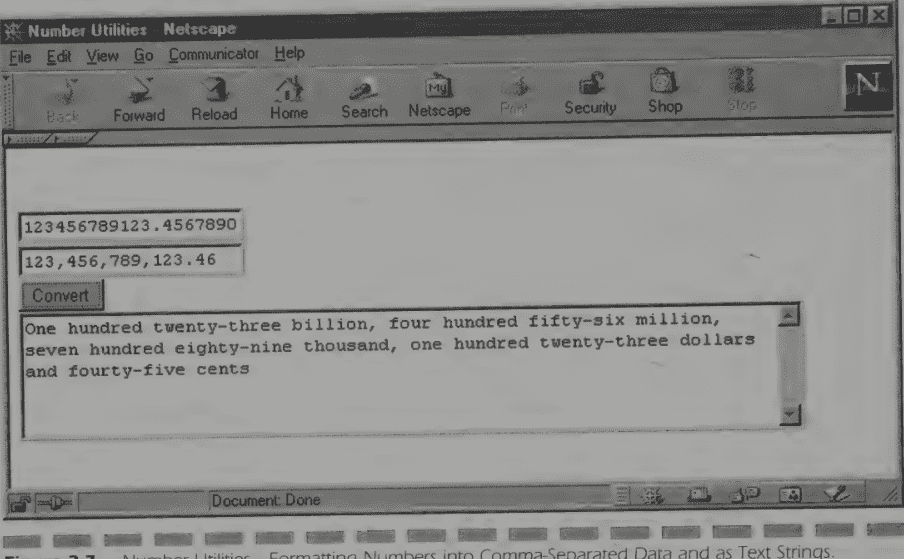

图 2-7 展示了输入一个大额数字后，按下表单的"转换"按钮将该值转换为两种不同格式的结果。

> 注意：请注意，在这个简单的表单示例中，并未对用户输入进行验证。因此，很容易输入会导致数字工具函数出错的数据。在第 3 章"字符串与正则表达式"中，我们将介绍如何使用正则表达式来验证文本字符串。

希望最后这几个工具函数能够说明，只要仔细编写，就可以在 JavaScript 中快速构建一个可复用的函数库。一旦某个函数开发完成并经过充分测试，就可以在其他 JavaScript 应用中反复使用，从而大幅缩短开发时间。

### 总结

本章展示了数学如何成为 JavaScript 应用中大部分工作的基础。虽然我们在本章中展示了数学计算器，但数学的真正用途体现在最后几个工具函数中——我们通过它们操作了数字和字符串的内容。随着你继续阅读本书后续章节，你会一次又一次地看到类似的例子。

## 第 3 章

## 字符串与正则表达式

## 第三章

在浏览器环境中工作时，绝大多数时候我们处理的是用户能看到的内容——而这些内容大多基于文本。能够管理文本字符串，无论它们存储在数组中、表单字段中，还是简单的字符串对象中，都能让 JavaScript 开发者控制用户可以看到或执行的内容。

本章涵盖在字符串中查找和替换内容、使用通用模板文本生成特定的文本输出、滚动文本链接、可以多种方式查看的联系人列表、使用 Gourad 着色为文本字符串和表格单元格着色、解析文本字符串以提取不同元素，以及使用正则表达式验证字符串模式。

毫不奇怪，字符串的操作并不止于本章。本书后续的许多示例都将基于本章介绍和使用的部分技术。

-   查找和替换 ./chapter3/replace/replace.htm
-   版权模板 ./chapter3/replace/copyright.htm
-   滚动文本 ./chapter3/scroll/text.htm
-   滚动文本链接 ./chapter3/scroll/links.htm
-   联系人列表 ./chapter3/contact/database.htm
-   字符串 Gourad 着色 ./chapter3/gourad/string.htm
-   表格 Gourad 着色 ./chapter3/gourad/table.htm
-   解析字符串 ./chapter3/parse/literal.htm
-   验证字符串 ./chapter3/validate/form.htm

### 查找和替换

在 JavaScript 中有很多场景需要将一个字符串或字符替换为另一个。通常这种替换必须在较长字符串的中间进行——例如，将单词 *Draft* 的实例替换为 *Issue*，或者将双引号字符 (") 替换为单引号字符 (')。本示例将介绍 *String* 对象的方法，这些方法可以轻松地执行查找和替换操作。一旦编写完成，该函数就可以在其他应用中复用，节省开发和测试时间。

## 查找和替换的源代码

我们使用 `String` 对象的 `indexOf()` 或 `lastIndexOf()` 方法在另一个字符串（目标字符串）中查找字符串或字符（搜索内容）。这两个方法返回搜索字符串在目标字符串中的位置，如果未找到则返回 -1。结合搜索字符串的长度，我们就可以找到目标字符串中的起始和结束位置。

找到之后，我们不能直接原地更新字符，因为没有相应的 `String` 对象方法可以做到这一点。我们必须使用 `String` 对象的 `substring()` 方法将目标字符串拆分为三个子字符串：搜索字符串之前的子字符串、搜索字符串本身，以及搜索字符串之后的子字符串。利用第一个和最后一个子字符串，我们可以通过将第一个子字符串与替换字符串以及最后一个子字符串拼接来创建一个新字符串。

```
../chapter3/replace/replace.htm
```

```
<script language="JavaScript"><!--
```

我们首先定义一个名为 `replace()` 的 JavaScript 函数，它接受三个参数：要操作的目标 `string`、要被替换的搜索 `text`，以及用来替换它的文本（`by`）：

```
function replace(string, text, by) {
```

首先要做的是使用 `String` 对象的 `length` 属性来获取目标 `string` 和搜索 `text` 的长度：

```
var strLength = string.length;
var txtLength = text.length;
```

如果任一为空，则函数原样返回搜索字符串：

```
if ((strLength == 0) || (txtLength == 0))
    return string;
```

`String` 对象的 `indexOf()` 方法用于在目标 `string` 中查找搜索 `text` 的第一次出现。返回的值随后存储在变量 `i` 中：


## 字符串与正则表达式

```javascript
var i = string.indexOf(text);
```

如果在目标字符串中未找到搜索文本，则 indexOf() 方法返回 -1，此时我们直接返回未修改的原字符串：

```javascript
if (i == -1)
    return string;
```

至此我们已找到匹配项。现在需要将替换字符串添加到目标子字符串中，直到找到的位置。使用 String 对象的 substring() 方法，我们将从字符位置 0（字符串开头）到找到位置 (i) 的子字符串与替换字符串连接起来，创建一个新字符串 (newstr)：

```javascript
var newstr = string.substring(0,i) + by;
```

此时我们已将首次出现的内容替换为目标字符串。然而，在目标字符串的剩余部分很可能还有更多匹配项。此时我们需要做的是，在目标字符串中将所有出现的搜索文本替换为替换字符串。听起来很熟悉？我们刚刚编写并解释了一个执行此功能的函数，何不重用它呢？这正是我们所做的。我们在 replace() 函数内部调用 replace() 函数，这次传入的是目标字符串的剩余部分——使用 substring() 方法提取从找到的搜索文本之后到目标字符串长度 (strLength) 的子字符串，其结果连接到 newstr 变量的末尾：

```javascript
newstr +=
    replace(string.substring(i+txtLength,strLength),text,by);
```

这个过程称为迭代，在 JavaScript 中经常用于遍历字符串，多次执行相同操作，直到整个字符串处理完毕。

最后，我们返回结果：

```javascript
return newstr;
}
//--></script>
```

以下代码展示了如何简单地使用 replace() 函数：首先将 message1 字符串中首次出现的 Draft 替换为 Issued，然后将结果输出到文档；接着将 message2 中所有双引号替换为单引号，再次将结果输出到文档：

```javascript
<script language="JavaScript"><!--
var message1 = 'The status of this document is Draft.';

document.write(replace(message1,'Draft','Issued') + '<br>');

var message2 = '"quoted" text can be "useful"';

document.write(replace(message2,'"','\'') + '<br>');
//--></script>
```

文本替换可以变得非常灵活，将一次替换的结果作为另一次替换的输入。以下示例将所有小写元音字母逐个替换为大写元音字母，从字母 a 开始，到字母 u 结束：

```javascript
<script language="JavaScript"><!--
var message3 = 'This message uses vowels';

document.write(
  replace(
    replace(
      replace(
        replace(
          replace(message3,'a','A'),
          'e','E'),
        'i','I'),
      'o','O'),
    'u','U')
  + '<br>'
);
//--></script>
```

replace() 函数的一个潜在用途是高亮显示特定短语。例如，以下示例使用辅助函数 highlight() 间接调用 replace() 函数，它不是简单地将一个字符串替换为另一个，而是使用 String 对象的 bold() 方法将其替换为自身的一个变体，该方法用 `<b>` 和 `</b>` 标签包裹字符串：

```javascript
<script language="JavaScript"><!--
function highlight(string,phrase) {
  return replace(string,phrase,phrase.bold());
}

var message4 = 'JavaScript is extremely versatile';

document.write(highlight(message4,'JavaScript') + '<br>');
//--></script>
```

另一个用途是从字符串中移除项目。下一个示例移除所有小写 o 字符：

```javascript
<script language="JavaScript"><!--
document.write(replace('oOOoOoOOoOOoOOo','o','')) + '<br>');
// --></script>
```

所有上述脚本的结果如下所示：

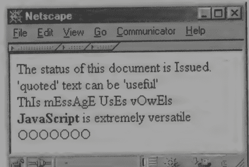

### 版权声明样板

为了展示查找和替换函数的用法，我们展示一个简单的版权声明样板，它可以被自动化以显示类似产品的不同版权信息。本示例不仅演示了如何通过模板替换通用术语，还演示了如何使用 String 对象方法高亮显示文本，以及如何用 HTML 标签替换特殊字符（例如换行符 (\n)）。

## 版权声明样板源代码

```javascript
<script language="JavaScript"><!--
function replace(string,text,by) {
    var strLength = string.length;
    var txtLength = text.length;

    if ((strLength == 0) || (txtLength == 0))
        return string;

    var i = string.indexOf(text);

    if (i == -1)
        return string;

    var newstr = string.substring(0,i) + by;

    newstr +=
        replace(string.substring(i+txtLength,strLength),text,by);

    return newstr;
}
```

包含 `replace()` 函数后，我们首先定义版权声明样板字符串。文本 `$YEAR`、`$NAME` 和 `$PRODUCT` 都是通用术语，可以根据当前描述的产品替换为特定术语。换行符 (\n) 通常在表单 textarea 中用于将文本换行到多行：

```javascript
var copyright = 
    '\n\nCopyright (c) $YEAR by $NAME\n\n' + 
    'Please freely copy and distribute $PRODUCT.\n\n' + 
    '$PRODUCT is distributed on an "AS IS" basis, WITHOUT ' + 
    'WARRANTY OF ANY KIND, either express or implied.\n\n' + 
    'The Original is $PRODUCT.';
```

接下来，我们定义变量以存储当前产品的特定术语：

```javascript
var year = 2000;
var name = 'ABC Company';
var product = 'This Copyright Statement';
```

现在我们只需要使用 `replace()` 函数将通用术语查找并替换为特定值：

```javascript
copyright = replace(copyright,'$YEAR',year);
copyright = replace(copyright,'$NAME',name);
copyright = replace(copyright,'$PRODUCT',product.bold());
copyright = replace(copyright,'\n','<br>');
```

最后，我们显示版权声明：

```javascript
document.write(copyright);
//--></script>
```

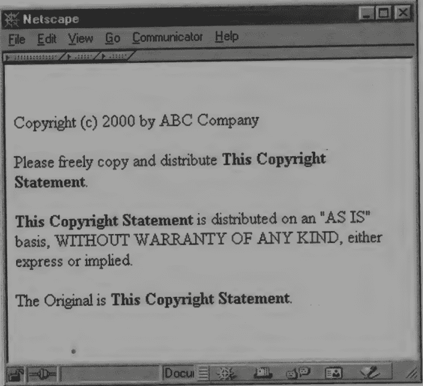

当需要为另一个产品显示版权声明时，只需更改定义 year、name 和 product 特定值的这三行代码。这对大规模文档管理有直接影响；当上述 JavaScript 代码用于一个被多个 HTML 和 XHTML 1.0 文档外部引用的文件时，可以轻松进行全局更改。

### 字符串方法

表 3-1 描述了 String 对象的一些方法。String 对象只有一个属性：length。

**表 3-1**
String 对象方法。

| 方法 | 描述 |
| --- | --- |
| indexOf | 在字符串中搜索一个字符或子字符串。例如：`var s = 'abcabc'; var p = s.indexOf('b');` p 将等于 1。 |
| lastIndexOf | 从后向前在字符串中搜索一个字符或子字符串。例如：`var s = 'abcabc'; var p = s.lastIndexOf('b');` p 将等于 4。 |
| substring | 提取字符串的一个子字符串。例如：`var s = 'abcdef'; var p = s.substring(1,3);` p 将等于 bc。 |
| toLowerCase | 返回字符串的小写副本。例如：`var s = 'ABCdef'; var p = s.toLowerCase();` s 将等于 ABCdef，p 将等于 abcdef。 |
| toUpperCase | 返回字符串的大写副本。例如：`var s = 'ABCdef'; var p = s.toUpperCase();` s 将等于 ABCdef，p 将等于 ABCDEF。 |
| replace | 执行搜索和替换操作。例如：`var s = 'abcabc'; var p = s.replace('b', 'B');` s 将等于 abcabc，p 将等于 aBcabc。也使用正则表达式执行搜索和替换。例如：`var s = 'abcabc'; var p = s.replace(new RegExp('b', 'g'), 'B');` s 将等于 abcabc，p 将等于 aBaBc。 |
| split | 将字符串拆分为字符串数组。例如：`var s = 'abc 123 xyz'; var p = s.split(' ');` s 将等于 abc 123 xyz，p[0] 将等于 abc，p[1] 将等于 123，p[2] 将等于 xyz。也可以使用正则表达式进行拆分。 |


### 滚动文本链接

`../chapter3/scroll/text.htm`

股票行情自动收录器、新闻简报、天气预报、体育比赛结果——内容太多，无法在页面上完全显示——非常适合滚动。滚动文本是一个相对简单的技巧。你获取一个字符串，显示它，然后从字符串开头移除一两个字符并将其附加到末尾，然后重新显示字符串。然后你*无休止地*重复这个过程。能够显示上下文敏感的滚动文本，并且在点击时带你到


## 第三章

启用新页面会稍微困难一些；你需要考虑文本链接被分成两部分，分别位于较长字符串的两端。

此示例使用动态 HTML 技术写入绝对定位的文档图层。因此，它仅在 Internet Explorer 4 和 5 以及 Netscape Navigator 4 上有效。要将此示例扩展到 Netscape Navigator 6 上运行，需要对第 11 章“动态 HTML”中介绍的文档对象模型有深入了解。目前我们将保持代码简洁易懂。

## 图 3-1

滚动文本链接——运行效果。

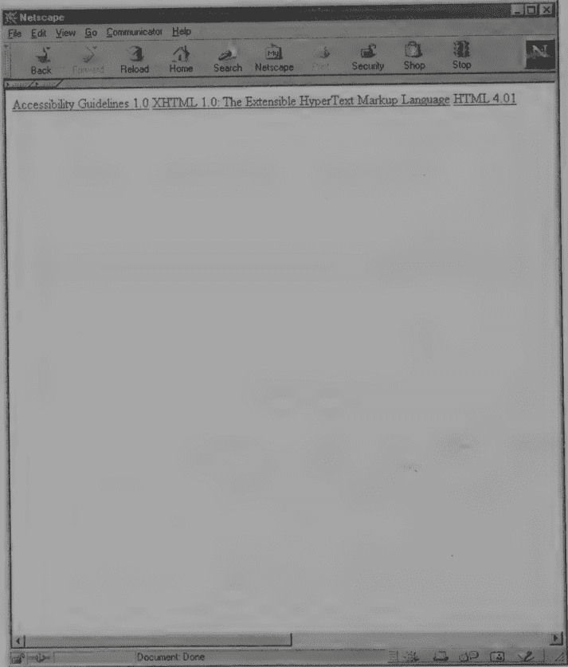

## 滚动文本链接源代码

../chapter3/scroll/links.htm

```
<script language="JavaScript"><!--
```

首先，我们定义两个数组：`textArray` 用于存储所有链接的文本值，`urlArray` 用于存储所有链接的 URL：

```
var textArray = new Array();
var urlArray = new Array();
```

接下来，我们初始化一个 `links` 计数器：

```
var links = 0;
```

我们将 `currentLink` 初始化为 -1，它将在 `prepareLinks()` 函数中使用，该函数的第一个操作就是将 `currentLink` 的值递增——即变为 0，这对应于两个数组中的第一个元素：

```
var currentLink = -1;
```

我们定义并初始化三个全局变量——`string1`、`string2` 和 `string3`：

```
var string1 = string2 = string3 = '';
```

布尔变量 `scrolling` 初始设置为 `false`；它稍后用于控制滚动文本链接的暂停：

```
var scrolling = false;
```

我们声明但未初始化 `timer` 变量，它稍后用于设置和取消运行中的计时器：

```
var timer;
```

我们声明一个 `link()` 函数，它接受两个参数：文本和链接，用于填充 `textArray` 和 `urlArray`，然后递增 `links` 计数：

```
function link(text, link) {
  textArray[links] = text;
  urlArray[links] = link;
  links++;
}
```

接下来，我们使用 link() 函数添加所有链接，传入要在链接中显示的文本，以及相对或绝对 URL：

```
link(
  "Authoring Tool Accessibility Guidelines 1.0",
  "http://www.w3.org/TR/ATAG10"
);
link(
  "XHTML 1.0: The Extensible HyperText Markup Language",
  "http://www.w3.org/TR/xhtml1"
);
link(
  "HTML 4.01 Specification",
  "http://www.w3.org/TR/html401"
);
link(
  "XSL Transformations (XSLT) Version 1.0",
  "http://www.w3.org/TR/xslt"
);
link(
  "XML Path Language (XPath) Version 1.0",
  "http://www.w3.org/TR/xpath"
);
link(
  "Associating Style Sheets with XML documents",
  "http://www.w3.org/TR/xml-stylesheet"
);
link(
  "Web Content Accessibility Guidelines 1.0",
  "http://www.w3.org/TR/WAI-WEBCONTENT"
);
link(
  "Resource Description Framework (RDF) Model",
  "http://www.w3.org/TR/REC-rdf-syntax"
);
link(
  "WebCGM Profile",
  "http://www.w3.org/TR/REC-WebCGM"
);
link(
  "Namespaces in XML",
  "http://www.w3.org/TR/REC-xml-names"
);
link(
  "Document Object Model (DOM) Level 1",
  "http://www.w3.org/TR/REC-DOM-Level-1"
);
link(
  "Synchronized Multimedia Integration Language (SMIL) 1.0",
  "http://www.w3.org/TR/REC-smil/"
);
link(
  "PICS Signed Labels (DSig) 1.0 Specification",
  "http://www.w3.org/TR/REC-DSig-label/"
);
link(
  "Cascading Style Sheets, level 2 (CSS2) Specification",
  "http://www.w3.org/TR/REC-CSS2"
);
link(
  "Extensible Markup Language (XML) 1.0 Specification",
  "http://www.w3.org/TR/REC-xml"
);
link(
  "PICSRules 1.1 Specification",
  "http://www.w3.org/TR/REC-PICSRules"
);
link(
  "HTML 3.2 Reference Specification",
  "http://www.w3.org/TR/REC-html32"
);
link(
  "Cascading Style Sheets (CSS1) Level 1 Specification",
  "http://www.w3.org/TR/REC-CSS1"
);
link(
  "PICS 1.1 Rating Services and Rating Systems",
  "http://www.w3.org/TR/REC-PICS-services"
);
link(
  "PICS 1.1 Label Distribution",
  "http://www.w3.org/TR/REC-PICS-labels"
);
link(
  "PNG (Portable Network Graphics) Specification",
  "http://www.w3.org/TR/REC-png"
);
```

`formatLink()` 函数返回一个字符串，表示由传入的 `text` 和 `link` 参数构成的文本链接。我们包含两个事件处理器——onMouseover，调用 `stopScroll()` 函数；以及 onMouseout，调用 `startScroll()` 函数：

```
function formatLink(text,link) {
    return '<a href="' + link + '"' +
           ' onMouseover="stopScroll()"' +
           ' onMouseout="startScroll()">' +
           text + '<\/a> ';
}
```

每当新链接出现在滚动文本的起始位置时，就会调用 `prepareLinks()` 函数。它更新三个全局字符串变量：`string1`、`string2` 和 `string3`。`string1` 包含滚动文本起始位置链接的完整文本，`string2` 包含所有其他链接（每个都使用 `formatLink()` 函数创建），而 `string3` 保持为空。

```
function prepareLinks() {
```

首先，我们使用前置递增运算符递增 currentLink 的值，然后使用取模运算符（%）计算 currentLink 除以链接数量后的余数。这确保了 currentLink 在达到链接数量时回绕到零：

```
currentLink = ++currentLink % links;
```

接下来，我们将 string1 的值设置为 textArray[] 数组中 currentLink 元素的值：

```
string1 = textArray[currentLink];
```

string2 和 string3 的值设置为空字符串：

```
string2 = '';
string3 = '';
```

现在，我们使用 formatLink() 函数为 textArray[] 数组（及相应的 urlArray[] 数组）中所有剩下的元素添加文本链接，从 currentLink 之后的元素开始：

```
var i=currentLink + 1;
while (i < links) {
    string2 += formatLink(textArray[i], urlArray[i]);
    i++;
}
```

现在，我们使用 formatLink() 函数为 textArray[] 数组（及相应的 urlArray[] 数组）中所有前面的元素添加文本链接，从第一个元素（即位置零）到 currentLink 之前的元素：

```
var i = 0;
while (i<currentLink) {
    string2 += formatLink(textArray[i], urlArray[i]);
    i++;
}
```

调用 prepareLinks() 函数来设置 string1 和 string2 的初始值，并再次初始化 string3：

```
prepareLinks();
```

## 字符串与正则表达式

随着 Netscape Navigator 4 和 Internet Explorer 4 的推出，级联样式表（**CSS**）支持被引入。这意味着可以使用 HTML 标签的 `style` 属性来指示样式，而不必使用表现型 HTML 标签（例如，font、i、b）来标记页面内容的表现形式。例如，要指示一段文本应以红色粗体 Arial 字体渲染，可以使用如下代码：`<p style="font-weight: bold; font-family: Arial; color: red;">This is red bold Arial</p>`。CSS 不仅提供了对内容表现形式的更多控制，而且消除了使用 HTML 标签来实现它的需要，让 HTML 标签仅仅用于构建内容结构——这正是 HTML 的最初设计意图。

在 Netscape Navigator 4 中，创建绝对定位元素会创建另一个文档图层，可以使用文档对象的 `write()` 方法向其中写入内容。我们已经见过 `document.write()` 语句被用于写入当前文档。然而，如果在文档完全加载后使用此方法，其效果将是用我们写入文档的内容替换当前文档。因此，我们不能单独使用简单的 `document.write()` 来动态更改内容。我们必须写入另一个窗口或框架，或者在 Netscape Navigator 4 的情况下，写入另一个文档图层。

在 Netscape Navigator 4 中，访问文档图层是通过文档对象的 layers 对象数组实现的，语法为 `document.layers[]`。在我们的例子中，由于我们将使用带有 `id` 属性的 `div` 元素，我们可以使用 `document.layers['myDiv']` 访问文档图层。要向文档图层写入内容，我们可以使用 `document.layers['myDiv'].document.write()`。

与 Netscape Navigator 4 不同，Internet Explorer 不使用文档对象的 `write()` 方法向文档图层写入内容。相反，Internet Explorer 允许我们使用 `innerHTML` 和 `innerText` 属性更改 HTML 元素的内容。事实上，Internet Explorer 不需要绝对定位元素或文档图层，因为它可以使用这些属性更新任何 HTML 标签。在 Internet Explorer 4 和 5 中，Microsoft 提供了一种访问 HTML 标签的替代方法，使用文档对象的 `all` 对象数组。此方法使用语法 `document.all[]`，在我们的例子中可以写作 `document.all['myDiv']`。

请注意，这两种方法完全互不兼容。在一种浏览器上有效的代码在另一种浏览器上无法工作。

`update()` 函数提供了一种通用方式，用于在 Internet Explorer 4 和 5 中更新 HTML 标签的内容，以及更新绝对定位


## 第三章

Netscape Navigator 4 中的文档层。传递给 `update()` 函数的两个参数是 `what`（代表要更新的 HTML 标签或层的 `id` 属性值，在我们的例子中是 `myDiv`）和 `output`（新的内容）：

```javascript
function update(what,output) {
```

由于这两种方法彼此不兼容，我们首先需要检测用户正在使用哪个浏览器。测试浏览器是否支持某个特定对象是检测浏览器是否支持某一特性最简单（通常也是最可靠）的方法之一。我们首先测试浏览器是否支持文档对象的 `all` 对象：

```javascript
if (document.all) {
```

如果正在使用的浏览器是 Internet Explorer 4 或 5，那么该表达式将求值为 `true`。在这种情况下，我们使用 `innerHTML` 属性更新元素的内容。换句话说，我们用新内容替换 `myDiv` 元素的当前内容：

```javascript
document.all[what].innerHTML = output;
}
```

如果正在使用的浏览器是 Netscape Navigator 4，那么第二个测试（测试浏览器是否支持文档对象的 `layers` 对象）将求值为 `true`：

```javascript
else if (document.layers) {
```

在这种情况下，我们首先使用 `open()` 方法打开 `layers` 文档：

```javascript
document.layers[what].document.open();
```

然后使用 `write()` 方法将新内容写入文档：

```javascript
document.layers[what].document.write(output);
```

最后，使用 `close()` 方法关闭文档：

```javascript
document.layers[what].document.close();
}
}
```

## 字符串与正则表达式

注意，我们需要引用似乎是两个文档：当前文档的 `layer`，然后是该 `layer` 内的文档。起初可能令人困惑，但一旦理解，它就允许我们创建真正动态的内容。

`scrollLinks()` 函数控制滚动链接文本：

```javascript
function scrollLinks() {
```

局部变量 `scrollingText` 的值由三个部分构成：

```javascript
var scrollingText =
```

将 `string1` 变量和 `urlArray[]` 数组的 `currentLink` 值传递给 `formatLink()` 函数的结果，该函数使用 `string1` 变量中保存的任何文本来创建一个文本链接：

```javascript
formatLink(string1, urlArray[currentLink]) +
```

加上已经准备好的、保存在 `string2` 中的文本链接：

```javascript
string2 +
```

加上将 `string3` 变量和 `urlArray[]` 数组的 `currentLink` 值传递给 `formatLink()` 函数的结果，该函数使用 `string3` 变量中保存的任何文本来创建一个文本链接：

```javascript
formatLink(string3, urlArray[currentLink]);
```

然后我们将 `scrollingText` 变量的值传递给 `update()` 函数，以更新 `myDiv` div 元素的内容：

```javascript
update('myDiv', scrollingText);
```

现在我们使用 `substring()` 方法，从 `string1` 的开头移出一个字符并添加到 `string3` 的末尾，但前提是 `string1` 不为空（即我们还有内容可以移动）：

```javascript
if (string1 != '') {
  string3 += string1.substring(0,1);
  string1 = string1.substring(1);
}
```

如果没有剩余内容可移动，那么我们调用 `prepareLinks()` 方法，为下一个要拆分的文本链接准备全局变量 `string1`、`string2` 和 `string3`：

```javascript
else {
  prepareLinks();
}
```

为了让滚动文本链接以合理的速度在屏幕上滚动，并让浏览器有机会更新屏幕，我们需要停止当前正在运行的 JavaScript 代码，然后在短暂的间隔后重新启动它。在间隔后启动脚本很简单。我们只需使用 `setTimeout()` 方法设置一个计时器，向其传递一个要评估的字符串和一个以毫秒为单位的延迟间隔。下面这行代码实际上意味着“在 50 毫秒后再次执行 `scrollLinks()` 函数。” 对正在运行的计时器的引用由 `setTimeout()` 方法返回，并保存在全局变量 `timer` 中：

```javascript
timer = setTimeout('scrollLinks()',50);
}
```

使用 `formatLink()` 函数创建的链接包含了 `onMouseout` 和 `onMouseover` 事件处理程序，分别调用 `startScroll()` 和 `stopScroll()` 函数。`startScroll()` 函数检查我们是否尚未开始滚动，然后将布尔变量 `scrolling` 设置为 `true` 并调用 `scrollLinks()` 函数：

```javascript
function startScroll() {
  if (!scrolling) {
    scrolling = true;
    scrollLinks();
  }
}
```

`stopScroll()` 函数检查我们是否正在滚动，然后将布尔变量 `scrolling` 设置为 `false` 并调用 `clearTimeout()` 方法来取消正在运行的计时器。

```javascript
function stopScroll() {
  if (scrolling)
    clearTimeout(timer);

  scrolling = false;
}
//--></script>
</head>
```

`body` 标签包含一个 `onLoad` 事件处理程序，通过调用 `startScroll()` 函数来启动滚动文本链接：

```html
<body onLoad="startScroll()">
```

页面的内容极其简单，只有一个 `div` 元素：

```html
<div id="myDiv"
    STYLE="position:absolute; clip:rect(0px 1280px 20px 0px);">
</div>

</body>

</html>
```

这个唯一的 `div` 元素提供了巨大的潜力。起始 `div` 标签有一个值为 `myDiv` 的 `id` 属性，以及一个对某些人来说可能看起来奇怪的样式属性值 `position:absolute; clip:rect(0px 1280px 20px 0px);`。样式属性值 `position:absolute;` 声明 `div` 元素的内容将被绝对定位在页面上。样式属性值 `clip:rect(0px 1280px 20px 0px);` 将 `div` 元素的可见区域裁剪为一个 20 像素高、1280 像素宽的短而宽的区域。这起到了仅显示 `div` 元素内第一行文本——隐藏其余部分的效果。

### 联系人列表

利用表单 `textarea` 中保存的数据，我们可以使用 `String` 对象的几个方法将数据分割成字符串，将它们放入字符串数组，然后进一步操作以重新排列内容。此示例将演示一个非常简单的“联系人列表”，可用于保存组织或团队中人员的姓名、电子邮件地址和电话号码详细信息。图 3-2 显示了联系人列表的初始状态。联系人列表允许用户按不同列对数据进行排序，还允许用户通过输入搜索字符串来筛选数据。图 3-3 显示了按联系人电子邮件地址排序的结果。所有结果都在文本区域内重新显示，因此此示例可在所有支持 JavaScript 1.1 `String` 对象的浏览器上运行。图 3-4 显示了首先按电话号码排序，然后按字符串 "John" 进行筛选的结果。

第三章

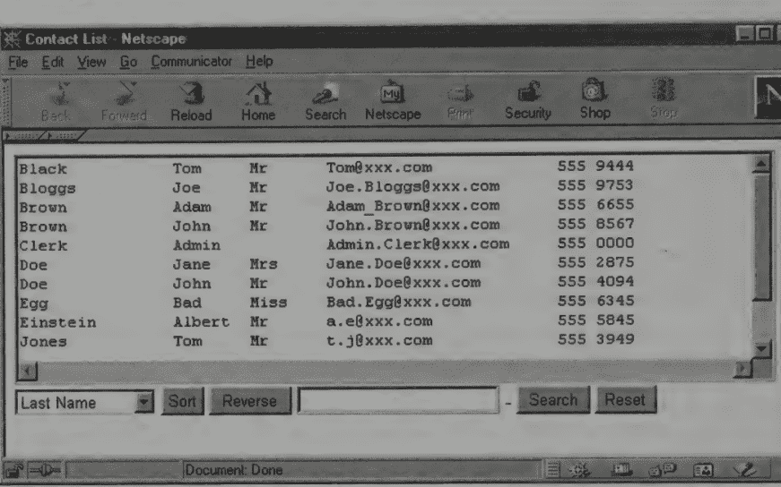

图 3-2 联系人列表 — 初始视图。

## 联系人列表源代码

在 CD 上的  ../chapter3/contact/database.htm

```html
<html>

<head>
<title>Contact List</title>
</head>
<body>
```

`contactForm` 表单的 `onSubmit` 事件处理程序调用 `doSearch()` 函数，然后通过向 `submit` 事件返回 `false` 来取消表单提交：

```html
<form name="contactForm" onSubmit="doSearch();return false">
```

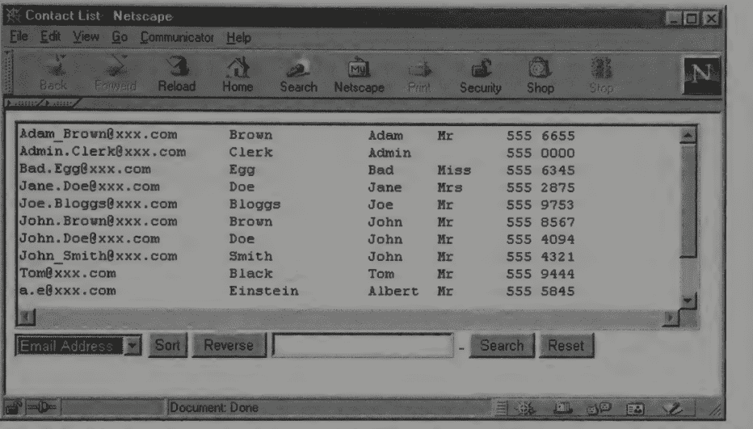

图 3-3 联系人列表 — 按电子邮件地址排序。

该表单包含一个名为 `data` 的 `textarea` 元素，其中包含以逗号分隔的字符串形式存储的联系人详细信息，并用空格填充，以便数据正确对齐：

```html
<textarea name="data" cols="78" rows="10">
Black ,Tom ,Mr ,Tom@xxx.com ,555 9444
Bloggs ,Joe ,Mr ,Joe.Bloggs@xxx.com ,555 9753
Brown ,Adam ,Mr ,Adam_Brown@xxx.com ,555 6655
Brown ,John ,Mr ,John.Brown@xxx.com ,555 8567
Clerk ,Admin , ,Admin.Clerk@xxx.com ,555 0000
Doe ,Jane ,Mrs ,Jane.Doe@xxx.com ,555 2875
Doe ,John ,Mr ,John.Doe@xxx.com ,555 4094
Egg ,Bad ,Miss,Bad.Egg@xxx.com ,555 6345
Einstein ,Albert,Mr ,a.e@xxx.com ,555 5845
Jones ,Tom ,Mr ,t.j@xxx.com ,555 3949
Smith ,John ,Mr ,John_Smith@xxx.com ,555 4321
T ,Cue ,Miss,cutie@xxx.com ,555 4984
</textarea>
```

名为 `item` 的 `select` 选项列表中的 `onChange` 事件处理程序调用 `doFormat()` 函数，并传递一个对自身的引用


## 字符串与正则表达式

点击搜索按钮时会调用 doSearch() 函数，该函数将使用名为 search 的文本字段内容：

```
<input type="text" name="search">
<input type="button" onClick="doSearch()" value="Search">
```

点击重置按钮时会调用 doReset() 函数：

```
<input type="button" onClick="doReset()" value="Reset">
</form>

<script language="JavaScript"><!--
```

我们包含了之前“查找与替换”示例中讨论过的通用 replace() 函数：

```
function replace(string,text,by) {
  var strLength = string.length;
  var txtLength = text.length;

  if ((strLength == 0) || (txtLength == 0))
    return string;

  var i = string.indexOf(text);

  if (i == -1)
    return string;

  var newstr = string.substring(0,i) + by;

  newstr +=
    replace(string.substring(i+txtLength,strLength),text,by);

  return newstr;
}
```

我们定义并初始化了几个全局变量的值。search 变量保存当前搜索请求的值。当为空时，它会匹配每个联系人条目：

```
var search = '';
```

item 变量保存所选选项的索引值（selectedIndex），用于控制 textarea 元素中首先显示哪一列，以及因此使用哪一列对数据进行排序：

```
var item;
```

rawdata 变量用于保存 contactForm 表单的 data textarea 值的原始内容，但在此之前需使用 replace() 函数将每个出现的逗号字符（,）替换为制表符（\t）：

```
var rawdata = replace(document.contactForm.data.value,',','\t');
```

然后使用此修改后的值更新 contactForm 表单的 data textarea 值：

```
document.contactForm.data.value = rawdata;
```

String 对象的 split() 方法用于将 rawdata 变量的值拆分为一个字符串数组（contacts[]），在每个回车符（\r）和换行符（\n）处分割：

```
var contacts = rawdata.split('\r\n');
```

接下来，我们声明所有剩余的函数：当用户在 item 选择列表中选择一个选项时，会调用 doFormat() 函数：

```
function doFormat(what) {
```

what 参数接受从 onChange 事件处理程序传递的 this 引用，允许 doFormat() 函数检索 item 选择列表的 selectedIndex 值：

```
item = what.selectedIndex;
```

我们声明并初始化一个局部 output 变量：

```
var output = '';
```

我们重新将 rawdata 字符串拆分为字符串数组——即 contacts[] 数组：

```
var contacts = rawdata.split('\r\n');
```

然后我们使用 length 属性遍历 contacts[] 数组中的每个字符串，以知道何时到达循环末尾：

```
for (var i=0; i<contacts.length; i++) {
```

表单 data textarea 中的最后一行数据可能会在 `contacts[]` 数组中生成一个空字符串。为避免使用此空字符串，我们在继续之前检查 `contacts[]` 数组中当前字符串的 `length` 是否不为零：

```
if (contacts[i].length != 0) {
```

然后使用 `split()` 方法，按每个制表符（`\t`）将 `contacts[]` 数组中当前处理的字符串拆分为一个 `splitString[]` 数组：

```
var splitString = contacts[i].split('\t');
```

`splitString[]` 数组中与所选 `item` 选项对应的字符串元素随后作为第一个项目添加到 output 变量中：

```
output += splitString[item];
```

然后我们遍历 `splitString[]` 数组中的每个字符串，将制表符（`\t`）和字符串元素添加到 output 变量的末尾——即除了已添加到 output 变量开头的那个元素之外的所有元素：

```
for (var j=0; j<splitString.length; j++) {
  if (j != item)
    output += '\t' + splitString[j];
}
```

然后将回车符（`\r`）和换行符（`\n`）添加到 output 变量的末尾：

```
output += '\r\n';
  }
}
```

最后，我们使用 `String` 对象的 `split()` 方法，在回车符（`\r`）和换行符（`\n`）处拆分 `output` 变量，使用 `Array` 对象的 `sort()` 方法对生成的数组进行排序，并将结果返回给 `onChange` 事件处理程序——该处理程序使用返回的结果更新全局 `contacts[]` 数组的值：

```
return output.split('\r\n').sort();
}
```

`redisplay()` 函数在多个地方用于更新 `data` textarea 的值：

```
function redisplay() {
```

我们声明并初始化一个 output 变量：

```
var output = '';
```

然后我们遍历 contacts[] 数组中的每个条目：

```
for (var i=0; i<contacts.length; i++) {
```

我们检查该条目是否非空：

```
if (contacts[i].length != 0)
```

然后我们使用 String 对象的 indexOf() 方法检查 search 字符串是否出现在当前 contacts[] 数组元素的小写值中（该小写值使用 String 对象的 toLowerCase() 方法创建）：

```
if (contacts[i].toLowerCase().indexOf(search) > -1)
```

如果出现，我们将当前 contacts[] 元素的值加上必需的回车符（\r）和换行符（\n）追加到 output 变量中：

```
output += contacts[i] + '\r\n';
}
```

然后使用 output 变量更新 contactForm 表单的 data textarea 值：

```
document.contactForm.data.value = output;
}
```

doSort() 函数使用 Array 对象的 sort() 方法对 contacts[] 数组进行排序，然后调用 redisplay() 函数：

```
function doSort() {
  contacts.sort();
  redisplay();
}
```

doReverse() 函数使用 Array 对象的 reverse() 方法将 contacts[] 数组反向排序，然后调用 redisplay() 函数：

```
function doReverse() {
  contacts.reverse();
  redisplay();
}
```

doSearch() 函数将 contactForm 表单的 search 文本字段的值检索到全局 search 变量中，然后调用 redisplay() 函数：

```
function doSearch() {
  search = document.contactForm.search.value.toLowerCase();
  redisplay();
}
```

doReset() 函数将所有内容重置回初始状态，然后调用 redisplay() 函数：

```
function doReset() {
  document.contactForm.search.value = '';
  document.contactForm.item.selectedIndex = 0;
  search = '';
  contacts = rawdata.split('\r\n');
  redisplay();
}
//--></script>

</body>
</html>
```

### Gourad 着色

*Gourad 着色* 是指两种颜色通过从一端到另一端的渐变融合在一起，使得两种端点颜色看起来是缓慢合并的。使用 JavaScript 将 HTML 内容写入文档，我们能够设置文本和表格单元格的 `font`（字体）和 `bgcolor`（背景色）属性。通过为字符串的每个字符或每个表格单元格应用不同的颜色，我们能够创造出令人惊叹的视觉效果。

我们提供了两个示例。第一个使用字符串在整个字符串长度上执行 *Gourad 着色*，如图 3-5 所示。第二个稍作修改的版本使用表格创建各种大小和颜色的 Gourad 着色表格单元格，如图 3-6 所示。

在深入研究代码之前，关于颜色简单说明几点。在 HTML 中，我们可以通过两种方式设置颜色：使用命名颜色——例如 `<font color="red">`——或使用十六进制颜色格式——例如 `<font color="#FFCC99">`。十六进制数 FFCC99 表示


## 图 3-5
字符串高洛德着色（String Gourad shading）。

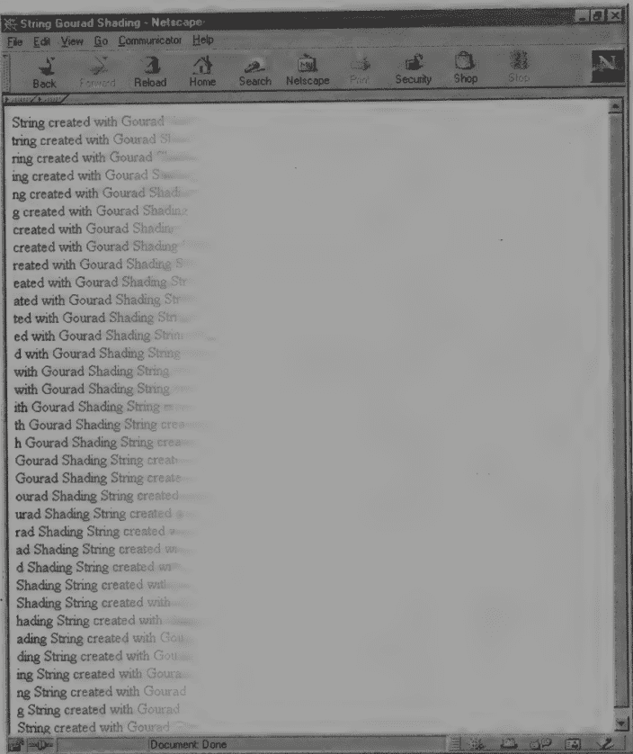

三原色红、绿、蓝的各种强度。前两个字符（FF）代表红色，中间两个（CC）代表绿色，最后两个（99）代表蓝色。数值越大，该原色的强度越高。因此，FFCC99 所代表的颜色中红色多于绿色，绿色又多于蓝色。每种原色的强度范围可以从 0x00 到 0xFF（或十进制的 0 到 255）。由于黑色是没有任何颜色的状态，其值为 000000；而白色是三种原色都以全强度组合而成，其值为 FFFFFF。在 HTML 标签属性中，我们用 # 前缀来指定十六进制颜色。在 JavaScript 代码中，我们用 0x 前缀来指定十六进制数。因此，在 JavaScript 中，代表白色的整数是 0xFFFFFF。记住这些之后，下面的两个示例应该更容易理解了。

## 图 3-6
表格高洛德着色（Table Gourad shading）。


## 字符串高洛德着色源代码

这里首先展示的是字符串高洛德着色示例，它接受一个字符串、一个起始颜色和一个结束颜色，然后对字符串中的每个字母进行修改，使用起始颜色和结束颜色之间的众多颜色之一进行着色，从而产生颜色渐变。修改后的字符串随后被写入文档。

```
../chapter3/gourad/string.htm

<html>

<head>
<title>String Gourad Shading</title>

<script language="JavaScript"><!--
```

`gradient()` 函数接受三个命名参数：`string`、`startcolor` 和 `endcolor`（两种颜色都以十六进制数传递）：

```
function gradient(string, startcolor, endcolor) {
```

我们首先获取 `string` 的 `length` 并将其值赋给局部变量 `len`（注意，超过 256 个字符的字符串将不会应用高洛德着色，因为每个颜色分量最多只有 256 种色调，即红、绿、蓝）：

```
var len = string.length;
```

局部变量 `output` 被声明并初始化：

```
var output = '';
```

接下来，我们将传入的 `startcolor` 十六进制数分解为代表红、绿、蓝的颜色分量：

```
var red     = startcolor >> 16;
var green   = (startcolor & 0x00FF00) >> 8;
var blue    = startcolor & 0x0000FF;
```

这段代码需要进一步解释。右移运算符（`>>`）将 startcolor 的二进制值向右移动 16 位。例如，十六进制数 0xFF0000（代表颜色 #FF0000）的二进制值为 111111110000000000000000，向右移动 16 位后产生新值 000000000000000011111111。该值的十六进制为 0xFF，即红色分量的值。

绿色分量的值稍有不同。我们首先需要使用按位与运算符（&）去除红色成分，注意这与逻辑与运算符（&&）不同，然后使用右移运算符（`>>`）将二进制值向右移动 8 位。

使用按位 & 运算符对两个二进制整数的每一位执行布尔 AND 运算，从而产生一个新的整数。例如，表达式 0xAAAAAA & 0x00FF00 产生结果 0x00AA00。表 3-2 解释了这背后的数学原理。

第二个整数就像一个掩码，只允许第二个字节中设置为 1 的位通过到结果中。最后，绿色分量只需应用 & 按位运算符来掩码最后 8 位即可获取。

对 endcolor 变量执行完全相同的操作，以设置 ered、egreen 和 eblue 变量的值：

```
var ered  = endcolor >> 16;
var egreen = (endcolor & 0x00FF00) >> 8;
var eblue = endcolor & 0x0000FF;
```

接下来，我们计算起始颜色和结束颜色之间所需的步进值，以便在字符串长度范围内逐步从一种颜色过渡到另一种颜色。我们用结束颜色减去起始颜色，将结果除以比 len 变量小 1 的数，然后使用 Math 对象的 round() 方法将结果四舍五入到最近的整数：

```
var ired  = Math.round((ered - red) / (len - 1));
var igreen = Math.round((egreen - green) / (len - 1));
var iblue  = Math.round((eblue - blue) / (len - 1));
```

| 符号 | 十六进制运算 | 二进制表示 |
| :--- | :--- | :--- |
| | 0xAAAAAA | 101010101010101010101010 |
| & | 0x00FF00 | 000000001111111100000000 |
| = | 0x00AA00 | 000000001010101000000000 |

## 第三章

现在我们只需遍历字符串的长度，用适当的 color 属性为每个字符包裹 font 标签。

```
for (var x=0; x<len; x++) {
```

color 变量使用红、绿、蓝颜色变量的当前值构建，使用左移运算符（`<<`）将红色分量的二进制值左移 16 位，绿色分量左移 8 位。然后我们用按位或运算符（`|`）对所有三个值执行布尔 OR 运算。最后，我们使用 Number 对象的 toString() 方法，以 16 为基数将整数转换为十六进制字符串：

```
var color = (red << 16 | green << 8 | blue).toString(16);
```

使用按位 | 运算符对二进制整数的每一位执行布尔 OR 运算，从而产生一个新的整数。例如，表达式 0xFF0000 | 0x00FF00 | 0x0000FF 产生结果 0xFFFFFF。表 3-3 解释了这背后的数学原理。

使用 Number 对象的 toString() 方法以 16 为基数的结果是将十进制整数转换为表示其十六进制值的字符串，因此 (1044480).toString(16) 产生字符串 FF0000。不幸的是，我们不能使用这个十六进制值来表示颜色，因为它太短了。我们必须有六位的十六进制数，在适当的位置有前导零。下面这行代码正是这么做的；它向颜色字符串变量的开头添加额外的前导零，最多六个：

```
color = ('000000').substring(0, 6 - color.length) + color;
```

最后，我们现在可以在 output 变量中使用 color 字符串变量来设置 string 变量中当前字符的字体颜色，使用 String 对象的 charAt() 方法检索位置 x 处的当前字符：

```
for (var i=0; i<text.length; i++) {
```

我们调用 gradient() 函数，传入文本字符串以及起始和结束颜色值，两者都是十六进制格式。结果被写入文档：

```
document.write(gradient(text, 0x000000, 0xFFFFFF) + '<BR>');
```

然后我们将文本字符串的第一个字符移到文本字符串的末尾（让人想起本章前面滚动文本链接的示例）：

```
text = text.substring(1) + text.substring(0,1);
}
//-->
</script>
</body>
</html>
```

## 表格高洛德着色源代码

我们不仅限于对文本字符串进行着色。我们还可以通过对原始源代码做一些调整，将相同的技术应用于表格单元格的背景颜色。


### ./chapter3/gourad/table.htm

```
<html>
<head>
<title>Table Gourad Shading</title>
<script language="JavaScript"><!--
```

修改后的 gradient() 函数现在接受四个命名参数：起始颜色、结束颜色、列数和表格行的高度：

```
function gradient(startcolor, endcolor, numCol, rowHeight) {
```

在原始代码中，我们使用字符串参数的长度来设置局部 len 变量，而这里我们使用 numCol 参数的值：

### 表 3-3
使用 | 按位运算符的结果

| 符号 | 十六进制运算 | 二进制表示 |
|--------|----------------------|----------------------|
| | 0xFF0000 | 111111110000000000000000 |
| | 0x00FF00 | 000000001111111100000000 |
| | 0x0000FF | 000000000000000011111111 |
| = | 0xFFFFFF | 111111111111111111111111 |


## 字符串与正则表达式

```javascript
var len = numCol;
var output = '';

var red    = startcolor >> 16;
var green  = (startcolor & 0x00FF00) >> 8;
var blue   = startcolor & 0x0000FF;

var ered   = endcolor >> 16;
var egreen = (endcolor & 0x00FF00) >> 8;
var eblue  = endcolor & 0x0000FF;

var ired   = Math.round((ered - red) / (len - 1));
var igreen = Math.round((egreen - green) / (len - 1));
var iblue  = Math.round((eblue - blue) / (len - 1));
```

在开始混合颜色之前，我们首先将必要的 HTML 标签添加到 `output` 变量中，以定义表格的设置，其中包括设置为 `rowHeight` 参数的 `height` 属性：

```javascript
output += '<table border="0" cellpadding="0" ' +
         'cellspacing="0" width="100%" height="' +
         rowHeight + '"><tr>';
for (var x=0; x<len; x++) {
  var color = (red << 16 | green << 8 | blue).toString(16);
  color = ('000000').substring(0, 6 - color.length) + color;
```

我们不是设置当前字符的字体颜色，而是使用 `td` 标签向 `output` 变量添加一个表格单元格，并将 `bgcolor` 属性设置为 `color` 变量的值：

```javascript
  output += '<td bgcolor="#' + color + '">&nbsp;</td>';

  red   = add(red + ired);
  green = add(green + igreen);
  blue  = add(blue + iblue);
}
```

我们需要确保使用适当的 HTML 表格标签来关闭表格：

```javascript
  output += '</tr></table>';
  return output;
}

function add(color) {
  if (color < 0) return 0;
  if (color > 255) return 255;
  return color;
}
// --></script>

</head>
```

## 第三章

```html
<body>

<script language="JavaScript"><!--
```

直到我们开始使用 `gradient()` 函数的表格版本时，代码才出现显著变化。下面两行代码使用不同的起始和结束颜色创建两个表格，但都指定了 32 列，尽管每种情况下的行高不同：

```javascript
document.write(gradient(0xFF0000, 0xFFFF00, 32, 10));
document.write(gradient(0xFFFF00, 0xFF0000, 32, 30));
```

下面的代码调用 `gradient()` 函数 32 次，每次指定略有不同的起始和结束颜色：

```javascript
var output = '';
for (var i=0; i<32; i++) {
  output +=
    gradient(0xFF0000 + i*16/2, 0xFFFF00 - (i*32 << 16), 32, 10);
}
document.write(output);
//--></script>

</body>
</html>
```

### 解析字符串

支持 JavaScript 1.1 的浏览器受益于新增的正则表达式支持。在 Perl 及其他类似语言中流行的正则表达式提供了在字符串中匹配、搜索和替换模式的能力。最简单的功能是能够搜索字符串或字符，而最复杂的功能则几乎没有不可能，除了受限于你的想象力，更重要的是，你对正则表达式的理解。

本示例介绍了一个简单的正则表达式，它允许将一个字符串解析为其各个组成部分。字面字符串 `a list of (key words) or "a phrase"` 可以说有六个组成部分。如果我们使用 String 对象的 `split()`、`substring()` 和 `indexOf()` 方法，很可能也能将这个字面字符串分解，但这需要大量 JavaScript 代码才能完成。这正是正则表达式的用武之地。

## 解析字符串源代码


```
../chapter3/parse/literal.htm
```

```html
<script language="JavaScript"><!--
```

首先，我们声明并初始化字符串字面量：

```javascript
var string = 'a list of (key words) or "a phrase"';
```

接下来，我们创建一个名为 `re` 的正则表达式变量：

```javascript
var re = /"[^"]*"|\([^()]*\)|\w+/g;
```

请注意，正则表达式不需要引号。相反，它使用正斜杠字符 (`/`) 作为定界符。上面的 `re` 正则表达式将匹配三个不同的子字符串，因为它使用交替字符 (`|`) 来在三个匹配之间进行选择。第一个匹配是 `"[^"]*"`，其含义是：匹配一个双引号字符 (`"`)，后跟任何非双引号字符 (`[^"]`)，匹配多次 (`*`)。第二个可能的匹配是 `\([^()]*\)`，其含义是：匹配一个左括号字符 (`\(`)，后跟任何非左括号字符 (`[^(`)，匹配多次 (`*`)。第三个可能的匹配是 `\w+`，其含义是：匹配任何单词字符 (`\w`)，匹配一次或多次 (`+`)。`re` 正则表达式还使用了一个正则表达式属性，本例中是 `g`，表示执行全局匹配。换句话说，在整个目标字符串中查找所有匹配项，而不是在找到第一个匹配后就停止——如果我们省略该属性，就会发生这种情况。

接下来，我们声明一个 `splitArray` 变量，并将 `string.match(re)` 的结果赋值给它，即以 `re` 正则表达式作为输入传递给 `match()` 方法。这将返回一个包含所有找到的匹配项的数组：

```javascript
var splitArray = string.match(re);
```

然后，我们循环遍历 `splitArray[]` 数组中的所有字符串元素，并将每个元素写入文档：

```javascript
for (var i=0; i<splitArray.length; i++) {
    document.write(splitArray[i] + '<br>');
}
//--></script>
```

下图显示了解析字符串字面量 `a list of (key words) or "a phrase"` 的结果：

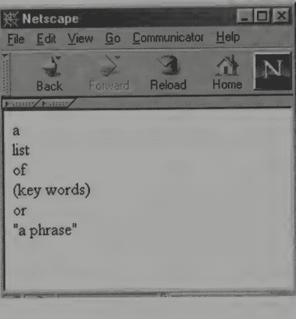

### 使用正则表达式验证字符串

确保用户输入的数据有效并遵循某些标准，有助于消除传递和处理到服务器上的损坏数据。在用户输入数据时告知其数据无效，可以让用户立即纠正错误。如果不使用正则表达式，验证字符串数据需要 JavaScript 代码逐个测试字符串中的每一个字符。编写这样的代码既繁琐又容易出错。使用正则表达式，我们可以指定可用于验证数据的模式。如果数据符合模式，则数据被标记为有效；否则，数据可以被突出显示为无效。

在客户端执行数据验证可以减轻服务器的负担，因为这首先减少了到达服务器的无效数据量，并且减少了返回给浏览器进行纠正的失败次数。然而，这并不能消除在服务器上重新验证数据的需要。在服务器上再次验证数据是一种良好的做法，因为如果 JavaScript 被禁用或浏览器不支持 JavaScript，浏览器可能会跳过验证。

此处显示的示例验证了典型的用户数据：名字、姓氏、年龄、电话号码、 IP 地址、电子邮件地址和信用卡号，如图 3-7 所示。如果数据以任何方式无效，则所有未通过验证的数据项都将被突出显示，如图 3-8 所示。

## 图 3-7

验证字符串—有效的表单数据。

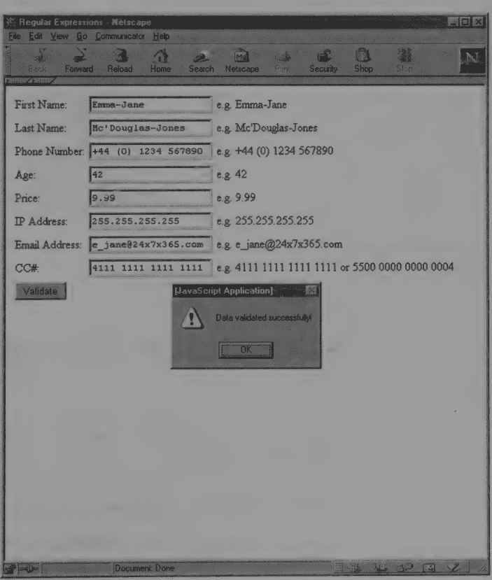

## 图 3-8

验证字符串—无效的表单数据。

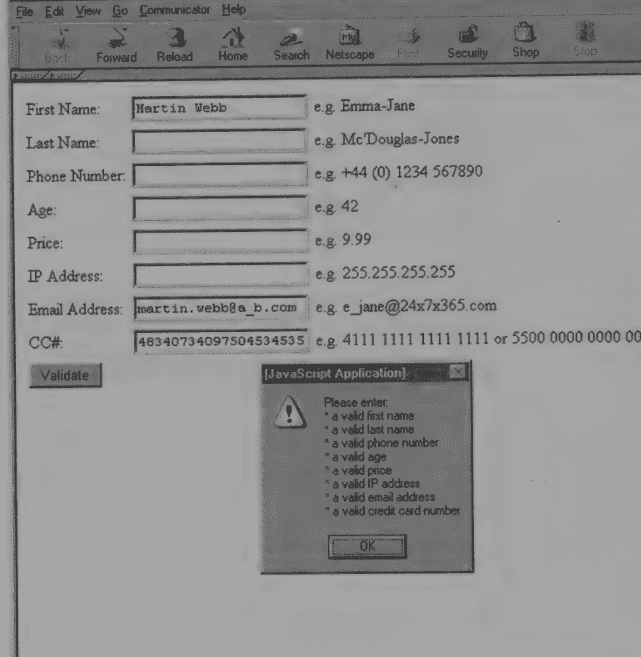

掌握了这些从简单到复杂的正则表达式后，你可以进一步调整它们，以匹配你需要验证的任何奇特而美妙的数据模式。

## 验证字符串源代码

```
../chapter3/validate/form.htm
```

```html
<html>

<head>
<title>Regular Expressions</title>
```

正则表达式仅在 JavaScript 1.2 中受支持。因此，我们将 `script` 标签的 `language` 属性设置为 `JavaScript1.2`。将其设置为 `JavaScript1.2` 意味着只允许支持 JavaScript 1.2 的浏览器处理包含的 JavaScript 代码：

```html
<script language="JavaScript1.2"><!--
```

**名字** 我们使用正斜杠字符作为定界符来定义几个正则表达式。第一个正则表达式 `isFirstName` 可以用来匹配任何字母字符或连字符 (`-`)。元字符 `^` 表示字符串的开头，元字符 `$` 表示字符串的结尾。方括号（`[` 和 `]`）表示一个有效的字面字符范围：`A-Z` 表示从 A 到 Z 的所有大写字母字符，`a-z` 表示从 a 到 z 的所有小写字母字符。要允许连字符 (`-`) 出现在范围内，我们必须使用反斜杠字符 (`\`) 对其进行转义。

```javascript
isFirstName = /^[A-Za-z\-]+$/;
```

反斜杠字符可用于转义那些在正则表达式中会被视为元字符的字符，以产生字面字符。例如：`\/`、`\\`、`\.`、`\*`、`\+`、`\?`、`\|`、`\(`、`\)`、`\[`、`\]`、`\{` 和 `\}`。

**姓氏** `isLastName` 正则表达式与 `isFirstName` 类似，不同之处在于它还允许字符串中包含单引号字符 (`'`)：

```javascript
isLastName = /^[A-Za-z'\-]+$/;
```

**电话号码** `isPhone` 正则表达式可用于匹配国际电话号码：

```javascript
isPhone = /^(\+\d+ )?(\(\d+\) )?[\d ]+$/;
```

数字 0、1、2、3、4、5、6、7、8 和 9 使用字符类 `\d` 表示。重复字符说明前一个


第三章

字符或字符组可以出现在匹配中的此位置。字符`?`——仅匹配零次或一次出现，`+`——匹配一次或多次出现，`*`——匹配零次或多次出现。

圆括号——即 `(` 和 `)`——允许字符在表达式中分组在一起。这样元字符就可以作用于整个组，而不仅仅是前一个字符。因此，在 `isPhone` 正则表达式中，部分 `^(\+\d+ )?` 表示字符串的开头可以有零次或一次出现：一个加号字符后跟一个或多个数字，再跟一个空格字符。

下一部分 `(\(\d+\) )?` 表示字符串的下一部分（甚至可以是字符串的开头）可以包含零次或一次出现：一组括号内的一个或多个数字，后跟一个空格字符。

最后一部分 `[\d ]+$` 表示字符串结尾必须包含一个或多个：数字或空格。

#### 年龄

`isAge` 正则表达式匹配包含数值 0 到 129 的任何字符串——任何合理的年龄。它使用 `|` 字符允许在两种替代方案之一上匹配：`1[0-2]\d` 一个 1 后跟 0、1 或 2，再跟任何数字，或 `\d{1,2}` 任何数字后跟一个或两个其他数字。花括号——即 `{` 和 `}`——允许精确指定重复字符，在这种情况下，前一个或多个字符的最少一次和最多两次：

```
isAge = /^(1[0-2]\d|\d{1,2})$/;
```

#### 货币

`isMoney` 正则表达式匹配小数点前至少有一位数字、小数点后恰好有两位的浮点数：

```
isMoney = /^\d+\.\d{2}$/;
```

#### 电子邮件地址

电子邮件地址的验证使用了稍有不同的方法。我们指定两个独立的正则表达式，`isEmail1` 和 `isEmail2`，以及一个 `isEmail()` 函数，该函数展示了字符串（s）如何使用 `RegExp` 对象的 `test()` 方法来测试其正则表达式是否与传入的字符串匹配。使用逻辑与运算符（`&&`），我们可以同时测试两者，如果两者都匹配则返回 `true`，如果第一个不匹配，或者第一个匹配但第二个不匹配，则返回 `false`：

```
function isEmail(s) {
  return (isEmail1.test(s) && isEmail2.test(s));
}
```

# 字符串与正则表达式

`isEmail1` 正则表达式用于快速匹配电子邮件地址中的字母字符组，由字符类 `\w` 表示——即一个单词字符，等价于 `[a-zA-Z0-9_]`，由连字符或句点分隔：

```
isEmail1    = /^\w+([\.\-]\w+)*@\w+([\.\-]\w+)*\.\w+$/;
```

将此表达式分阶段分解：

- `^\w+` 表示电子邮件地址必须以一个或多个单词字符开头。
- `([\.\-]\w+)*@` 表示在 `@` 字符之前必须有零次或多次出现：一个连字符或句点字符后跟一个或多个单词字符。
- `\w+` 表示 `@` 字符后必须跟一个或多个单词字符。
- `([\.\-]\w+)*` 表示必须有零次或多次出现：一个连字符或句点字符后跟一个或多个单词字符。
- `\\.\w+$` — 表示电子邮件地址必须以一个句点后跟一个单词字符结尾。

不幸的是，单词字符类 `\w` 包含了下划线字符（`_`），这在域名中是无效的。按照 `isEmail1` 目前的情况，它会错误地允许格式为 `first.second@domain_name.com` 的电子邮件地址通过，其中 `domain_name.com` 是无效的。`isEmail2` 正则表达式通过在 `@` 字符后不允许出现下划线字符来解决这个问题：

```
isEmail2    = /^.*@[^_]*$/;
```

我们首先使用 `^.*@` 匹配 `@` 字符之前的所有字符。句点元字符匹配任何字符，`*` 重复字符匹配前一个字符的零次或多次出现（即句点元字符）。然后我们使用脱字符号（`^`）进行否定字符范围，来否定范围内的所有字符——在这种情况下，只是下划线字符（`_`）——这样我们就从 `@` 字符到字符串末尾匹配除下划线字符以外的任何字符。

如果你认为这会捕获所有有效和无效的电子邮件地址，那再想想。它只会审查最简单的电子邮件地址形式，但这对于我们的目的来说应该足够了。

#### IP 地址

`isIPAddress` 正则表达式使用了另一种方法来创建正则表达式。IP 地址的基本形式为 255.255.255.255，其中四个数字可以是 0 到 255 之间的任何值。似乎有很多重复，因此我们不必手工创建长正则表达式，而是可以使用 RegExp 对象构造函数，用小字符串组件构建大型正则表达式。

首先，我们定义一个 `ip` 字符串，其中包含表示 0 到 255 数字的正则表达式。注意，由于它是字符串，我们必须用前面的反斜杠字符来转义任何反斜杠字符：

```
ip = '(25[0-5]|2[0-4]\d|1\d\d|[1-9]?\d)';
```

接下来，我们定义一个 `ipdot` 字符串，表示 IP 数字后跟句点字符的正则表达式。同样，反斜杠字符必须转义：

```
ipdot = ip + '\\.';
```

然后我们使用 RegExp 对象构造函数组合三个 `ipdot` 字符串和一个 `ip` 字符串来创建正则表达式：

```
isIPaddress = new RegExp('^'+ipdot+ipdot+ipdot+ip+'$');
```

#### 信用卡号码

我们甚至可以创建正则表达式来验证信用卡号码的模式。

Visa 卡号码以 4 开头，后跟 14 或 15 位其他数字：

```
isCCvisa     = /^4\d{14,15}$/;
```

MasterCard 号码以 51、52、53、54 或 55 开头，后跟 14 位其他数字：

```
isCCmastercard = /^5[1-5]\d{14}$/;
```

American Express 号码以 34 或 37 开头，后跟 13 位其他数字：

```
isCCamex     = /^3[47]\d{13}$/;
```

Diners Club 卡号码以 300、301、302、304、305、360 或 380 开头，后跟 11 位其他数字：

```
isCCdinerscard = /^(30[0-5]|360|380)\d{11}$/;
```

# 字符串与正则表达式

Discover 卡号码以 `6011` 开头，后跟 12 位其他数字：

```
isCCdiscover = /^6011\d{12}$/;
```

enRoute 卡号码以 `2014` 或 `2149` 开头，后跟 11 位其他数字：

```
isCCenroute = /^(2014|2149)\d{11}$/;
```

JCB 卡号码以 `2131` 或 `1800` 开头，后跟 11 位其他数字，或者以 `3` 开头，后跟 15 位其他数字：

```
isCCjcb = /^(?:(2131|1800)\d{11})|(3\d{15})/;
```

`isCC()` 函数不是先接受一种信用卡类型然后再用适当的正则表达式验证，而是接受一个字符串参数 `s` 作为信用卡号码，然后使用每一个正则表达式来尝试查找匹配的信用卡公司。

```
function isCC(s) {
```

在使用任何正则表达式查找匹配之前，使用 RegExp 对象的 `replace()` 方法，使用 `\s` 字符类将任何空白字符替换为空字符串：

```
s = s.replace(/\s/g,'');
```

使用 RegExp 对象的 `test()` 方法测试每个信用卡正则表达式。如果找到匹配，`test()` 方法返回 `true`。在这种情况下，对于除 enRoute 以外的所有信用卡公司，我们返回调用 `isLUHN()` 方法的结果，将 `s` 字符串作为输入：

```
if (isCCvisa.test(s))     return isLUHN(s);
if (isCCmastercard.test(s)) return isLUHN(s);
if (isCCamex.test(s))     return isLUHN(s);
if (isCCdinerscard.test(s)) return isLUHN(s);
if (isCCdiscover.test(s))  return isLUHN(s);
if (isCCenroute.test(s))   return true;
if (isCCjcb.test(s))      return isLUHN(s);
```

最后，如果没有匹配的信用卡公司，我们只需返回调用 `isLUHN()` 函数的结果，再次将 `s` 字符串作为输入：

```
return isLUHN(s);
}
```

#### LUHN 公式（模 10）

要测试信用卡号码是否有效，我们需要使用 LUHN 公式（模 10）。从信用卡号码右侧第二个数字开始，将每隔一个数字的值翻倍。将翻倍后的数字的各位相加。然后加上信用卡号码中未使用的数字。如果总和能被 10 整除，则该信用卡号码通过 LUHN 公式验证。

这正是 `isLUHN()` 函数所做的：

```
function isLUHN(s) {
```

声明并初始化一个局部字符串变量 x：

```
var x = '';
```

声明并初始化一个局部整数变量 l，用于保存传入的 s 参数的长度：

```
var l = s.length;
```

声明并初始化一个局部整数变量 t，用于保存总和：

```
var t = 0;
```

遍历 s 字符串的整个长度：

```
for (var i=0; i<l; i++)
```

我们使用 String 对象的 `charAt()` 方法将 s 字符串中的当前数字追加到 x 字符串，或者追加翻倍后的当前数字值，这取决于我们是否处于交替数字上。这由字符串长度（l）减去字符串中的当前位置（i）的模 2 值决定：

```
if ((l-i)%2) x+=s.charAt(i); else x+=''+s.charAt(i)*2;
```

此时，我们在一个长的连接字符串（x）中有了所有交替翻倍的数字和所有未使用的数字。我们只需遍历 x 字符串，将所有数字加到 t 整数上：

```
for (var i=0; i<x.length; i++)
    t += x.charAt(i) - 0;
```


 ## 验证表单数据

当单击表单的“验证”按钮时，会调用 `validate()` 函数，并将表单引用作为 `what` 参数传入。该函数使用先前定义的正则表达式来验证表单字段中输入的数据：

```
function validate(what) {
```

我们声明并初始化一个错误消息字符串，初始值为空：

```
var message = '';
```

将表单的 `firstname` 字段值作为参数传递给 `isFirstName` 正则表达式对象的 `test()` 方法。如果匹配成功，则数据有效；如果没有匹配成功（`!`），则将错误字符串附加到 `message` 变量：

```
if (!isFirstName.test(what.firstname.value))
    message += '* a valid first name\n';
```

对 `lastname`、`phone`、`age`、`price` 和 `ipaddress` 表单字段执行完全相同的操作：

```
if (!isLastName.test(what.lastname.value))
    message += '* a valid last name\n';

if (!isPhone.test(what.phone.value))
    message += '* a valid phone number\n';

if (!isAge.test(what.age.value))
    message += '* a valid age\n';

if (!isMoney.test(what.price.value))
    message += '* a valid price\n';

if (!isIPaddress.test(what.ipaddress.value))
    message += '* a valid IP address\n';
```

对于 `email` 表单字段，我们不是直接测试正则表达式，而是调用 `isEmail()` 函数来执行测试，并传递 `email` 表单字段的值：

```
if (!isEmail(what.email.value))
    message += '* a valid email address\n';
```

同样处理 `creditcard` 表单字段，这次使用 `isCC()` 函数：

```
if (!isCC(what.creditcard.value))
    message += '* a valid credit card number\n';
```

如果任何测试失败，则本地 `message` 变量将包含要显示的错误消息。否则，`message` 变量为空，此时我们显示成功消息：

```
if (message == '')
    alert("Data validated successfully!")
else
    alert('Please enter:\n' + message);
}
//--></script>

</head>

<body>
```

剩余代码在页面上显示一个包含输入表单字段的表单：

```
<form>

<table>
<tr>
<td>First Name:</td>
<td><input type="text" name="firstname"></td>
<td>e.g. Emma-Jane</td>
</tr><tr>
<td>Last Name:</td>
<td><input type="text" name="lastname"></td>
<td>e.g. Mc'Douglas-Jones</td>
</tr><tr>
<td>Phone Number:</td>
<td><input type="text" name="phone"></td>
<td>e.g. +44 (0) 1234 567890</td>
</tr><tr>
<td>Age:</td>
<td><input type="text" name="age"></td>
<td>e.g. 42</td>
</tr><tr>
<td>Price:</td>
<td><input type="text" name="price"></td>
<td>e.g. 9.99</td>
</tr><tr>
<td>IP Address:</td>
<td><input type="text" name="ipaddress"></td>
<td>e.g. 255.255.255.255</td>
</tr><tr>
<td>Email Address:</td>
<td><input type="text" name="email"></td>
<td>e.g. e_jane@24x7x365.com</td>
</tr><tr>
<td>cc#:</td>
<td><input type="text" name="creditcard"></td>
<td>e.g. 4111 1111 1111 1111 or 5500 0000 0000 0004</td>
</tr><tr>
```

当单击“验证”表单按钮时，我们首先检查 `validate` 是否为真——然后调用 `validate()` 函数，并传递当前（`this`）输入字段的表单引用。只有当浏览器支持 JavaScript 1.2 时，对 `validate` 的测试才会返回真，此时 `validate()` 函数已定义。如果浏览器不支持 JavaScript 1.2，JavaScript 代码将被跳过，`validate()` 函数未定义，因此对 `validate` 的测试将导致假：

```
<td><input type="button" value="Validate"
    onClick="if (validate) validate(this.form)"></td>
</tr>
</table>

</form>

</body>
</html>
```

### 正则表达式

锚点字符，如表 3-4 所示，规定了在字符串中可以进行匹配的位置。字符类别，如表 3-5 所示，允许组合一系列字符。重复字符，如表 3-6 所示，控制一个字符或一组字符出现的最少和最多次数。

**表 3-4**
正则表达式锚点字符。

| 锚点字符 | 描述 |
|---|---|
| ^ | 匹配字符串的开头 |
| $ | 匹配字符串的结尾 |

**表 3-5**
正则表达式字符类别。

| 字符类别 | 描述 |
| --- | --- |
| . | 匹配任意字符 |
| \w | 匹配单词字符，即 A-Z、a-z、0-9 和下划线字符 |
| \W | 匹配非单词字符 |
| \w+ | 匹配整个单词，即所有单词字符直到空白字符 |
| \s | 匹配空白字符，例如换行符（\n）、制表符（\t）、回车符（\r）、换页符（\f）或垂直制表符（\v） |
| \S | 匹配非空白字符 |
| x\|y | 匹配 x 或 y |
| \d | 匹配一个从 0 到 9 的数字字符 |
| \D | 匹配一个非数字字符 |
| [abc] | 匹配 a 或 b 或 c |
| [0-9] | 匹配一个数字字符，范围从 0 到 9 |
| [A-Za-z] | 匹配一个字母字符，大写或小写 |
| [^A-Za-z] | 匹配一个非字母字符 |

**表 3-6**
重复字符。

| 重复字符 | 描述 |
| --- | --- |
| ? | 匹配前一个字符一次或零次 |
| + | 匹配前一个字符一次或多次 |
| * | 匹配前一个字符零次或多次 |
| {x,y} | 匹配前一个字符最少 x 次，最多 y 次 |

**表 3-7**
分组。

| 括号 | 描述 |
| --- | --- |
| (abc)+ | 匹配一个或多个 abc 的出现 |

如表 3-7 所示，括号允许将字符分组在一起。

## 字符串与正则表达式

**表 3-8**
转义字符。

| 转义字符 | 描述 |
| --- | --- |
| \/ | 匹配 / |
| \\ | 匹配 \ |
| \\. | 匹配 . |
| \\* | 匹配 * |
| \\+ | 匹配 + |
| \\? | 匹配 ? |
| \\| | 匹配 \| |
| \\(| | 匹配 ( |
| \\) | 匹配 ) |
| \\[ | 匹配 [ |
| \\] | 匹配 ] |
| \\{ | 匹配 { |
| \\} | 匹配 } |

**表 3-9**
正则表达式修饰符。

| 修饰符 | 描述 |
| --- | --- |
| /abc/g | 全局——匹配所有 abc 的实例 |
| /abc/i | 忽略大小写——匹配第一个 abc 或 ABC |
| /abc/gi | 全局且忽略大小写——匹配所有 abc 或 ABC 的实例 |

如果要搜索特殊字符之一，必须先使用反斜杠字符（\\）对其进行转义，如表 3-8 所示。

如表 3-9 所示，修饰符可以添加到正则表达式之后，以控制其在字符串中的搜索方式。

### 小结

虽然数学是 JavaScript 应用程序背后的幕后工作者，但字符串通常是被操作的数据，无论是表单字段的字符串值还是当前窗口位置的字符串值。这些字符串都需要被操作、处理和搜索。即使在我们进入下一章更复杂的数组和对象时，仍然需要使用本章和前几章中介绍的基本数学和字符串处理技术。

# 第 4 章

## 数组与对象

能够存储和操作数据是 JavaScript 最基本的方面之一。虽然从技术上讲它不是面向对象的编程语言，但在 JavaScript 中几乎 everything 都可以被视为对象，从最基本的数据类型（如 Number、String 和 Boolean）到专门的数据类型（如 Date、RegExp、Math、Function、Array 和 Event），再到专门的浏览器对象（如 window、document、history、location、image 和 link）。

但这还没有结束。JavaScript 允许创建用户自定义对象。创建用户自定义对象只需要一个构造函数方法和一个 `new` 语句来创建对象的新实例。与大多数对象一样，单个对象实例本身并不能给我们带来什么重大成就。只有当我们拥有许多相同类型的对象，每个对象代表对象类的不同实例（例如，一辆汽车、一个出生日期或一篇技术文章的描述）时，我们才能开始体会创建自己的用户自定义对象的用处。当我们创建了许多对象实例后，我们需要能够管理和保存它们。内置的 JavaScript 数组对象是最适合这样做的机制。

本章介绍用户自定义对象和对象数组。它展示了如何使用构造函数创建对象实例，如何将对象存储在数组中，如何检索对象属性的值，以及最后如何对对象数组进行排序。

- 浏览网站 ../chapter4/tour/tour.htm
- 搜索数据库（框架版本） ../chapter4/search1/search.htm
- 搜索数据库（非框架版本） ../chapter4/search2/search.htm
- 多项选择 ../chapter4/multiple/choice.htm
- 对象数组排序 ../chapter4/sort/sort.htm

## 浏览网站

如果不提供 URL 列表，向人们展示你最喜欢的网络位置可能会很困难。一旦你这样做了，如果不和你的受众坐下来解释你觉得每个页面有趣的地方，就无法对每个 URL 提供任何评论。不幸的是，我们并非都有时间和精力提供这种水平的客户服务。本示例展示了如何准备 URL 列表，将它们链接在一起——即使它们之间可能没有物理连接——同时还能提供连续的评


### 网站导览组件

该示例由几个基本的HTML文件组成：

- **tour.htm**，作为容器框架集（用于容纳导航工具栏和工作区）
- **tour-nav.htm**，包含导航按钮
- **tour-comment.htm**，包含另一个框架集（用于容纳评论和书籍页面）
- 我们的补充书评文件
- 导览中要访问的Amazon.com书籍

请注意，这些文件不一定需要使用这些名称。它们只是我们在本示例中使用的名称。此外，组成导览的文件可以位于任何地方——可以在您自己的网站上，也可以在完全独立且不相关的网站上。组成导览的文件数量也没有限制。

## 网站导览框架集结构

导览使用框架来容纳所有内容：一个框架用于容纳导航表单按钮，使用户能够在导览中前进和后退；一个框架用于容纳实时评论；一个框架用于容纳导览中的当前页面。

我们通过将一个框架集嵌套在另一个框架集中，以便能够将可选的评论页面与实际导览页面一起显示。框架集结构如图4-1所示。

然而，由于Web上大多数其他网站可能更希望其内容不被框在其他网站中，我们提供了一个选项，将导览中的当前页面显示在单独的弹出窗口中。该选项的框架集结构如图4-2所示。

因此，根据JavaScript代码中选择的选项，结果可能看起来不同。图4-3展示了仅使用简单框架集结构的导览可能是什么样子，而图4-4则展示了将导览页面放在单独弹出窗口中的选项。

图4-1 网站导览框架集结构。

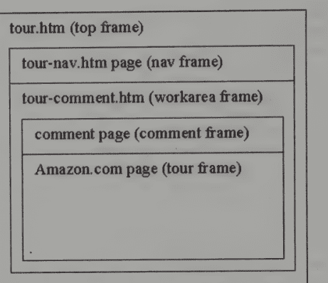

图4-2 网站导览的替代框架集结构，带有弹出窗口。

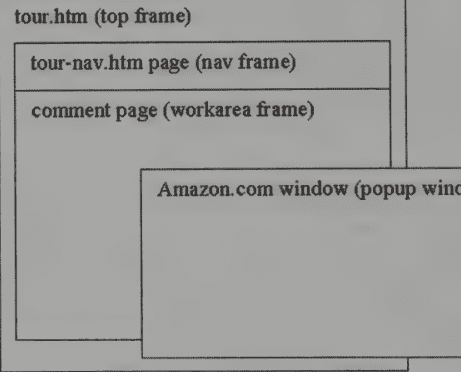

## 网站导览源代码

tour.htm的源代码

..chapter4/replace/tour.htm

*tour.htm*文件包含用于定义两个框架的大小、位置和初始内容的HTML，定义要导览的页面的数据，以及几乎所有控制导览导航所需的JavaScript代码。

## 数组和对象

图4-3 示例网站导览框架集。

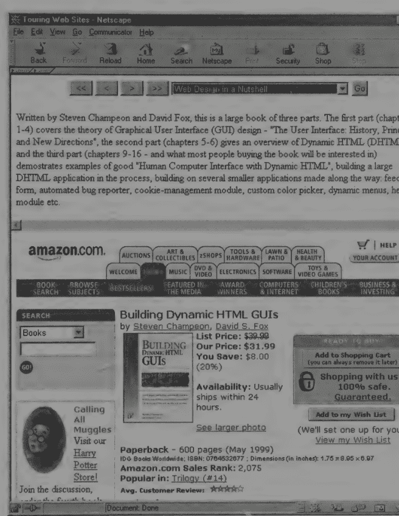

usePopup布尔变量设置为false。这意味着代码将使用框架（将其更改为true将导致代码使用弹出窗口）：

```
var usePopup = false;
```

Link()函数用作对象构造函数。要创建一个新的Link()对象，我们只需使用new运算符并将结果分配给一个变量。例如，var myObject = new Link();。我们的

Link()构造函数接受三个参数：href、text和commentary。与所有对象构造函数一样，对新创建的Link对象的引用被传递给Link对象构造函数，并保存在this关键字中。Link对象构造函数使用三个输入参数以及this引用来为当前正在构建的Link对象声明、定义和分配三个Link对象属性——href、text和commentary：

```
function Link(href, text, commentary) {
  this.commentary = commentary;
  this.href = href;
  this.text = text;
}
```

setLink()函数创建Link对象，并将每个对象添加到MyLink[]数组的末尾：

```
function setLink(href, text, commentary) {
  myLink[item++] = new Link(href, text, commentary);
}
```

代码item++使用后缀增量运算符，在当前语句中使用item后将其值加1。例如，如果item的当前值为10，则new Link()返回的对象引用被放入MyLink[]对象数组的第十个位置。然后item的值增加1，变为11。

我们将item的初始值定义并声明为0（与大多数计算机语言一样，数组从索引位置0开始）：

```
var item = 0;
```

在这里，我们使用内置的JavaScript Array构造函数定义一个空的Array对象，并将其分配给myLink变量：

```
var myLink = new Array();
```

我们创建五个Link对象来保存每个导览页面的数据。调用setLink()函数，将导览页面的绝对URL传递给href参数，将字符串注释传递给text参数，将本地相对URL传递给commentary参数：

```
setLink(
  'http://www.amazon.com/exec/obidos/ISBN=0764532677/',
  'Building Dynamic HTML GUIs',
  'comment1.htm'
);
setLink(
  'http://www.amazon.com/exec/obidos/ISBN=1565923928/',
  'JavaScript : The Definitive Guide 3rd Edition',
  'comment2.htm'
);
setLink(
  'http://www.amazon.com/exec/obidos/ISBN=0201442078/',
  'Creating Dynamic Web Sites',
  'comment3.htm'
);
setLink(
  'http://www.amazon.com/exec/obidos/ISBN=1565925157/',
  'Web Design in a Nutshell',
  'comment4.htm'
);
setLink(
  'http://www.amazon.com/exec/obidos/ISBN=1565921496/',
  'Programming Perl, 2nd Edition',
  'comment5.htm'
);
```

我们现在可以通过使用语法myLink[index].property来检索任何Link对象属性的值，其中index是myLink[]对象数组中的索引位置（例如，0到4），property是href、text或commentary之一。例如，myLink[1].text的字符串值为JavaScript : The Definitive Guide 3rd Edition。

变量n用于保存导览中的当前位置。它被定义并声明为值0——即导览中的第一个位置：

```
var n = 0;
```

go()函数控制导览和相关评论页面的加载：

```
function go() {
```

我们测试usePopup布尔变量的值：

```
if (usePopup) {
```

如果为true，我们使用window对象的open方法创建一个新窗口，传递三个参数——myLink[]对象数组中第n个Link对象的href属性作为要加载到弹出窗口中的页面，弹出窗口的名称（myPopup），以及弹出窗口的宽度和高度：

```
window.open(myLink[n].href, 'myPopup', 'width=640,height=480');
```

然后，我们使用myLink[]对象数组中第n个Link对象的commentary属性，将相关的评论页面加载到工作区框架中：

```
self.workarea.location.href = myLink[n].commentary;
}
else {
```

然而，由于我们将usePopup布尔变量定义为false，我们改为将工作区框架位置的href属性设置为tour-comment.htm?加上n变量的当前值（即导览中的位置）。这会将*tour-comment.htm*页面加载到当前窗口的下半部分：

```
self.workarea.location.href = 'tour-comment.htm?' + n;
}
}
```

在导览开始时，这将导致位置为*tour-comment.htm?0*，随着我们逐步进行导览，这会变为*comment.htm?1*、*comment.htm?2*、*comment.htm?3*，最后是*comment.htm?4*。如后所述，*tour-comment.htm*页面中的JavaScript代码使用问号（?）字符后的数据将适当的导览和评论页面加载到其自己的框架集中。

四个函数`goFirst()`、`goBack()`、`goForward()`和`goLast()`稍后在*tour-nav.htm*页面中使用，用于在导览页面中前后导航：

```
function goFirst() {
  if (n != 0) { n = 0; go(); }
}

function goBack() {
  if (n != 0) { n--; go(); }
}

function goForward() {
  if (n != (item - 1)) { n++; go(); }
}

function goLast() {
  if (n != item - 1) { n = item - 1; go(); }
}
```

每个函数中都进行检查，以确保不会超出导览的末端。然后相应地更改n变量的值。最后，调用`go()`方法以加载适当的页面。

除了*tour-nav.htm*页面中用于在导览页面中前后导航的表单按钮外，还有一个表单选择选项列表，列出了所有导览页面，用户可以使用它跳转到任意页面。*tour-nav.htm*页面中的选择选项列表使用*tour.htm*页面中的`goTo()`函数。选择选项的引用（对象）被传递给`goTo()`函数：

```
function goTo(object) {
```


## tour-nav.htm 的源代码

tour-nav.htm 文件包含一个允许用户在导览中导航的表单：

如果 form1 表单被提交，onSubmit 事件处理程序会捕获提交事件并调用父框架中的 goTo() 函数：

```
onSubmit="return parent.goTo(document.form1.select1)">
```

tour-nav.htm 页面被加载到 nav 框架中。因此，父框架包含 tour.htm 页面。对 goTo() 函数的调用包含一个对 form1 表单的 select1 元素的引用，其中 select1 是后面在表单中给 select 选项列表的名称。goTo() 函数（如 tour.htm 页面中详细描述的）获取 select 选项列表的 selectedIndex 值，并使用该值跳转到适当的导览页面。从 goTo() 函数返回的值（false）被交还给 submit 事件以取消表单提交。

标记为 <<、<、> 和 >> 的四个按钮用于在导览中向后和向前导航。每个按钮的 onClick 事件处理程序捕获鼠标点击并调用父框架中的适当函数以在导览中导航。然后它们将 form1 表单的 select1 select 选项列表的 selectedIndex 值设置为父框架的 n 变量的新值——从而更新 select 列表以显示反映当前导览页面的选项：

```
<input type="button" value=" << " onClick="parent.goFirst(); document.form1.select1.selectedIndex = parent.n">
```

```
<input type="button" value=" < " onClick="parent.goBack(); document.form1.select1.selectedIndex = parent.n">
```

```
<input type="button" value=" > " onClick="parent.goForward(); document.form1.select1.selectedIndex = parent.n">
```

```
<input type="button" value=" >> " onClick="parent.goLast(); document.form1.select1.selectedIndex = parent.n">
```

select1 select 选项列表中的实际选项是从父框架的 myLink[] 对象数组动态构建的：

```
<select name="select1">
<script language="JavaScript"><!--
```

我们使用父框架的 item 变量来控制循环的结束，遍历 myLink[] 中的每个对象：

```
for (var i=0; i < parent.item; i++)
```

我们使用 document 对象的 write() 方法为每个 Link 对象写一个 option 标签到文档中，将选项关联的文本设置为等于该 Link 对象的 text 属性：

```
document.write('<option>' +
                        parent.myLink[i].text +
                        '</option>');
//--></script>
</select>
```

表单的 Submit 按钮允许用户在列表中选择一个选项，然后点击 Go 按钮触发提交事件：

```
<input type="submit" value="Go">
```

当页面最初加载时，我们确保 form1 表单的 select1 select 选项的 selectedIndex 被设置为高亮显示导览中的当前页面：

```
<body onLoad="document.form1.select1.selectedIndex = parent.n">
```

## tour-comment.htm 的源代码

最后是 tour-comment.htm 页面，如果 usePopup 布尔变量设置为 false，则该页面被加载到 workarea 框架中，用于定义另一个 frameset，包含最初为空的 commentary 和 tour 框架，以及必要的 JavaScript 代码来解释当前页面的 URL 并加载适当的 commentary 和 tour 页面。

load() 函数从 frameset 标签的 onLoad 事件处理程序中调用：

```
function load() {
```

首先，我们使用 `location` 对象的 `search` 属性提取 URL 中问号 (?) 字符之后传递的数据。我们使用 `String` 对象的 `substring` 方法移除实际的问号字符：

```
var n = location.search.substring(1);
```

实际上，`substring(1)` 表示"给我从索引位置 1 开始的字符串部分"。例如，`var s = "01234"; var t = s.substring(1);` 将导致 `t` 持有值 1234。使用 `var n = location.search.substring(1)` 检索附加到 URL 的 `n` 值，因此 URL 为 `comment.htm?0` 时将检索 0，`comment.htm?1` 时将检索 1，依此类推。

基于传递的 `search` 值，我们将适当的 commentary 页面加载到 comment 框架中：

```
self.comment.location.href = top.myLink[n].commentary;
```

并将适当的 tour 页面加载到 tour 框架中：

```
self.tour.location.href = top.myLink[n].href;
}
```

注意，我们使用 `top` 框架的 `myLink[]` 对象数组来检索第 n 个 `Link` 对象的 `commentary` 和 `href` 属性。到目前为止，我们一直在使用 `parent` 引用来获取父框架中的变量、数组和对象。然而，现在我们有一个框架嵌套在另一个框架中，我们要么使用 `parent.parent` 引用，要么直接使用 `top` 直达顶层框架。

当 `comment` 和 `tour` 框架都完全加载了 *about:blank* 页面后，`onLoad` 事件处理程序调用 `load()` 函数：

```
<frameset frameborder="0" framespacing="0" rows="200,*"
onLoad="load()">
```

### 搜索数据库

在之前的"游览网站"代码中，我们展示了如何创建自己的 JavaScript 对象（`Link` 对象）及其自己的属性（`href`、`text` 和 `commentary`），以及如何将这些对象存储在对象数组中。这使我们能够使用任何 `Link` 对象的属性将不同的页面加载到浏览器中。

## 第四章

在本节中，我们将展示如何搜索对象数组的属性，并使用结果将我们的发现输出写入浏览器，提供让用户搜索客户端技术文章数据库的能力。我们将演示两个版本的代码，一个使用框架工作（类似于"游览网站"示例），另一个版本不使用框架。

与许多客户端应用程序一样，数据必须首先下载到客户端。当然，如果要下载的数据非常大，这可能会导致问题，这就是为什么这两个示例应谨慎使用。如果数据太大，用户可能会在看到客户端搜索应用程序的完整优势之前离开。客户端搜索应用程序相对于服务器端搜索应用程序的优势在于，一旦数据下载完成，用户就不再需要连接到互联网。事实上，当用户查询数据库时，没有任何请求返回到服务器，这意味着查询的响应时间是即时的。

#### 基于框架的搜索

基于框架的组件层次结构由一个父框架（*search.htm*）和两个名为 *tools* 和 *results* 的子框架组成。*tools* 框架（*tools.htm*）保存导航表单元素，*results* 框架（*results.htm*）最初显示完整的客户端数据库，如图 4-5 所示。但它随后被重用，以显示用户数据库查询的结果。

该代码允许用户选择搜索结果中显示的详细程度——从所有详细信息（标题、URL、描述、技术和日期，如图 4-6 所示）到部分选择（标题和日期，如图 4-7 所示）。

## 框架源代码

**search.htm 的源代码**

```
../chapter4/search1/search.htm
```

*search.htm* 页面构成了父框架集 *tools.htm* 和 *results.htm* 页面。它包含使用对象


## 图 4-5

数据库搜索——初始显示。

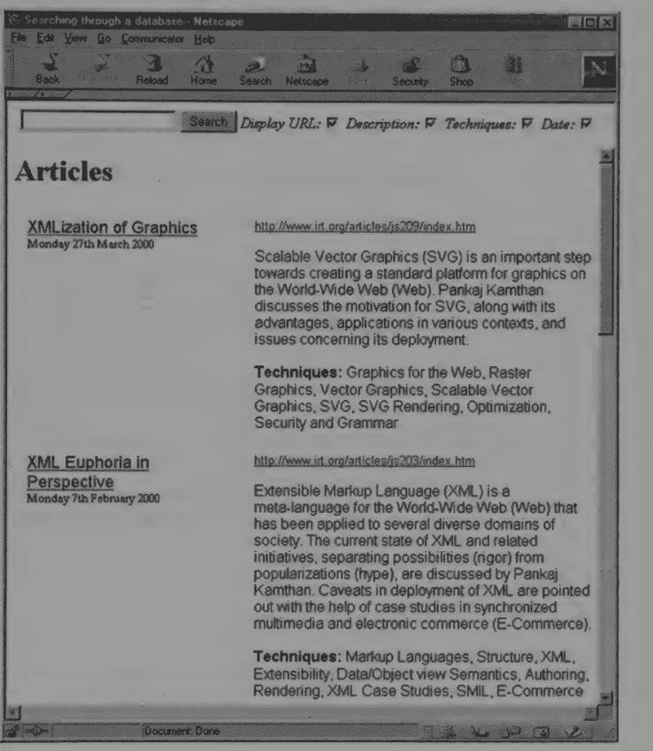

一个类似于“浏览网站示例”中使用的数组。*search.htm* 中还包含几个用于控制搜索输出的变量。

这四个布尔变量（vhref、vdesc、vtech 和 vdate）最初都被定义并声明为 true——这意味着搜索结果显示 URL、描述、技术和日期属性，以及始终显示的标题链接：

## 图 4-6

数据库搜索——关于“RDF”的完整搜索查询结果。

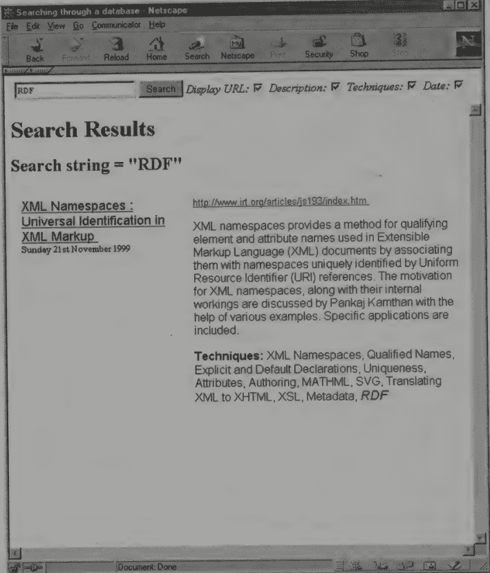

```
var vhref = true;
var vdesc = true;
var vtech = true;
var vdate = true;
```

searchtext 字符串变量被初始化为空字符串。这具有匹配数据库中所有项目的效用，因此当初始加载时，数据库中的所有项目都会显示：

```
var searchtext = '';
```


我们创建两个数组来存放星期几和月份。

```
var days = new Array(
  'Sunday', 'Monday', 'Tuesday', 'Wednesday', 'Thursday',
  'Friday', 'Saturday'
);

var months = new Array(
  'January', 'February', 'March', 'April', 'May', 'June', 'July',
  'August', 'September', 'October', 'November', 'December'
);
```

## 第四章

articleObject() 构造函数不仅根据传递的参数创建典型属性，还创建其他属性：

```
function articleObject(href,text,desc,tech,date) {
  this.href = href;
  this.text = text;
  this.desc = desc;
  this.tech = tech;
```

date 属性并非直接从传递的 date 参数初始化，而是使用该参数调用 convert_date() 函数：

```
this.date = convert_date(date);
```

附加的 HREF、TEXT、DESC、TECH 和 DATE 属性只是小写版本的大写形式，使用 String 对象的 toUpperCase() 方法创建：

```
this.HREF = href.toUpperCase();
this.TEXT = text.toUpperCase();
this.DESC = desc.toUpperCase();
this.TECH = tech.toUpperCase();
this.DATE = this.date.toUpperCase();
}
```

convert_date() 函数将日期字符串从其 YYYYMMDD 格式转换为完整的人类可读日期字符串（例如，它将字符串 20000207 转换为 Monday 7th February 2000）：

```
function convert_date(string) {
```

使用 String 对象的 substring() 方法，convert_date() 函数提取传递字符串的 YYYY、MM 和 DD 部分，以创建一个新的 Date 对象：

```
var date = new Date(string.substring(0,4),
                    (string.substring(4,6)-1),
                    string.substring(6,8));
```

最终返回使用新构建的 date 对象调用 fullDate() 函数的结果：

```
return fullDate(date);
}
```

Date 构造函数（除其他组合外）接受三个参数：年份、月份（从零开始）和月份中的日期。例如，new Date(2000,1,7); 将为 2000 年 2 月 7 日创建一个日期对象。fullDate() 函数格式化传递的 date 对象：

### 数组和对象

139

```
function fullDate(date) {
```

days 数组用于获取星期几的完整名称：

```
return days[date.getDay()] + ' ' +
```

date 对象的 getDate() 方法返回月份中的日期：

```
date.getDate() +
```

nths() 函数用于计算日期序数词（例如，1st、2nd、3rd 或 4th）：

```
nths(date.getDate()) + ' ' +
```

months 数组用于获取一年中月份的完整名称：

```
months[date.getMonth()] + ' ' +
```

y2k() 函数用于确保显示完全符合 Y2K 标准的年份：

```
(y2k(date.getYear()));
}
```

有关如何进一步操作日期的详细信息将在第 9 章“图像”中介绍。

## tools.htm 的源代码

```
../chapter4/search1/tools.htm
```

tools.htm 文件包含一个表单，允许用户输入搜索查询字符串并指定搜索结果显示的详细程度。goSearch() 函数的 form 参数保存着传递的表单引用：

```
function goSearch(form) {
```

表单的复选框和文本字段都有各自的名称（vhref、vdesc、vtech、vdate 和 searchtext），这使得 goSearch() 函数能够使用传递的 form 参数来更新父框架中同名的布尔变量和字符串变量：

```
parent.vhref = form.vhref.checked;
parent.vdesc = form.vdesc.checked;
parent.vtech = form.vtech.checked;
parent.vdate = form.vdate.checked;
parent.searchtext = form.searchtext.value;
```

然后，将 *results.htm* 页面重新加载到结果框架中：

```
parent.results.location.href = "results.htm";
}
```

表单标签中的 `onSubmit` 事件处理程序调用 goSearch() 函数（传递 this 表单引用）并返回 false 以取消表单的提交事件：

```
<form onSubmit="goSearch(this);return false">
```

## results.htm 的源代码


```
../chapter4/search1/results.htm
```

*results.htm* 页面在每次用户输入查询时都会重新加载。它遍历父框架 articleArray[] 数组中保存的每个 articleObject，并根据父框架的 searchtext 进行匹配。

首先，我们定义并初始化几个全局变量——之所以称它们为全局变量，是因为它们在整个页面的 JavaScript 代码中都可用，即使在函数内部也是如此：

```
var position = 0;
var old = 0;
var last = 0;
var out = '';
var OUT = '';
```

接下来，从父框架检索 searchtext 并将其放入一个全局 searchtext 变量中：

```
var searchtext = parent.searchtext;
```

### 数组和对象

我们检查是否已输入搜索查询：

```
if (parent.searchtext != '') {
```

如果已输入搜索查询，则向文档写入两行 HTML 标记，一行使用 h1 元素，另一行使用 h2 元素：

```
document.write('<h1>Search Results<\/h1>');
document.write('<h2>Search string = \'"+searchtext+"\'<\/h2>');
} else {
```

如果未输入搜索查询，我们只需使用单个 h1 元素将内容写入文档：

```
document.write('<h1>Articles<\/h1>');
}
```

现在我们已经完成显示 searchtext 的值，我们将它的值转换为大写，以便后续的任何字符串比较忽略潜在的大小写差异：

```
searchtext = searchtext.toUpperCase();
```

输出显示在一个表格中，因此向文档写入表格标签：

```
document.write('<table>');
```

然后，代码遍历父框架 articleArray[] 中的所有 `articleObject` 对象：

```
for (var i=0; i < parent.articleIndex; i++) {
```

我们测试 `searchtext` 变量的值是否存在于 `articleObject` 属性 `HREF`、`TEXT`、`DESC`、`TECH` 或 (`||`) `DATE` 的大写版本中：

```
if (
    (parent.articleArray[i].HREF.indexOf(searchtext) != -1) ||
    (parent.articleArray[i].TEXT.indexOf(searchtext) != -1) ||
    (parent.articleArray[i].DESC.indexOf(searchtext) != -1) ||
    (parent.articleArray[i].TECH.indexOf(searchtext) != -1) ||
    (parent.articleArray[i].DATE.indexOf(searchtext) != -1)
)
```

如果找到，则调用 `output()` 函数：

```
) output();
}
```

String 对象的 `indexOf()` 方法返回 `searchtext` 值在字符串中首次出现的位置。如果未找到，则 `indexOf()` 方法返回 -1。请注意，由于 `searchtext` 值最初是空字符串 ('')，因此前面的测试将匹配所有 `articleObject` 对象，因此 `output()` 函数将被调用。因此，当代码初始加载时，所有文章都会显示。

最后，关闭表格标签：

```
document.write('<\/table>');
```

当找到匹配项时调用的 `output()` 函数控制 `articleObject` 如何在文档上显示。首先，检索 `articleObject` 属性 `href`、`desc`、`text`、`tech` 和 `date` 属性的小写版本值，并将其保存在局部变量中——之所以称它们为局部变量，是因为它们只在当前函数的作用域内可用：

```
function output() {
    var href = parent.articleArray[i].href;
    var desc = parent.articleArray[i].desc;
    var text = parent.articleArray[i].text;
    var tech = parent.articleArray[i].tech;
    var date = parent.articleArray[i].date;
}
```

我们将 output 字符串变量初始化为空字符串：

```
var output = '';
```

然后我们开始构建 output 字符串，使其包含要写入文档的所有 HTML 代码：

```
output += '<tr>';
output += '<td valign="top">';
output += '<font face="Arial, Helvetica" size="4">';
```

在这里，我们使用局部 `href` 和 `text` 变量向 output 字符串追加一个文本链接：

```
output += '<a href="' + href + '" target="_parent">';
output += show(text) + '<\/a>';
output += '<\/font>';
```


## 数组与对象

但请注意，我们实际上使用了 `show()` 函数的结果，以 `text` 作为输入参数来编写链接的文本内容。

在这里，我们测试父框架的 `vdate` 布尔变量的值：

```
if (parent.vdate)
```

如果为 `true`，我们将追加调用 `show()` 函数的结果，这次传入 `date`：

```
output += '<font size="2"><br>'+show(date)+'<\/font>';
output += '<\/td>';
output += '<td valign="top">';
output += '<font face="Arial" size="3">';
```

如果用户取消勾选了日期复选框，则输出中将不会包含日期。

同样，如果父框架的 `vhref` 布尔变量为 `true`，我们将在链接中显示本地 `href` 属性，并再次使用 `show()` 函数，这次传入 `href`：

```
if (parent.vhref)
    output += '<font size="2">' +
               '<a href="' + href + '" target="_parent">' +
               show(href) +
               '<\/a>' +
               '<\/font>';
```

## `desc` 变量的处理方式类似：

```
if (parent.vdesc)
    output += '<p>' +show(desc) + '<\/p>';
```

## `tech` 变量也是如此：

```
if (parent.vtech)
    output += '<p><b>Techniques:<\/b> ' + show(tech) + '<\/p>';

output += '<\/font>';
output += '<\/td>';
output += '<\/tr>';
```

最后，将 output 字符串的值写入文档：

```
document.write(output);
}
```

我们本可以逐步将显示文章所需的所有 HTML 格式直接写入文档，但我们没有这样做，而是将所有内容放入 `output` 字符串变量中，不断向其拼接更多信息，直到最后在 `output()` 函数末尾将内容写入文档。一次性将大量信息写入文档，远比逐段逐段地单独写入要快得多。

字符串拼接运算符（`+=`）将运算符右侧的字符串表达式添加到运算符左侧字符串变量的值中，并将结果存入该字符串变量。例如，`var x = 'abc'; var y = 'def'; x+=y;` 将使 `x` 的值变为 `abcdef`。这是 `x = x + y` 的简写形式，在 JavaScript 代码中非常常用。

我们在 `output()` 函数中多次使用的 `show()` 函数，用于高亮显示传入属性中所有匹配 `searchtext` 的内容：

```
function show(property) {
```

如果 `searchtext` 为空字符串，我们直接返回未修改的属性值：

```
if (searchtext == '') return property;
```

我们将全局变量 `out` 的值更新为传入的 `property` 参数：

```
out = property;
```

我们将全局变量 `OUT` 的值更新为传入的 `property` 参数的大写版本：

```
OUT = property.toUpperCase();
```

我们将全局变量 `position` 的值更新为 `searchtext` 在 `OUT` 中首次出现的位置，将 `last` 的值更新为最后一次出现的位置：

```
position = OUT.indexOf(searchtext);
last = OUT.lastIndexOf(searchtext);
old = -(property.length);
```

同时，我们将全局变量 `old` 的值更新为 `searchtext` 字符串长度的负值。

如果找到了匹配项，我们返回 `find()` 函数的结果。否则，我们再次返回未修改的 `property`：

```
if (position != -1) return find(); else return property;
}
```

`find()` 函数高亮显示找到的字符串的首次出现，然后不断调用自身（递归），直到所有出现的实例都被找到并高亮显示：

```
function find() {
```

在这里，我们使用 `substring()` 方法提取找到的搜索文本，将其包裹在 HTML 标签中以使用大号蓝色字体进行高亮，并将结果赋值给局部字符串变量。

```
var string = out.substring(old+searchtext.length,position) +
'<i><font color="#0000FF" size="+1">' +
out.substring(position,position+searchtext.length) +
'<\/font><\/i>';
```

将 old 位置设置为当前位置的值：

```
old = position;
```

我们尝试定位下一次出现的位置：

```
position = OUT.indexOf(searchtext,position+searchtext.length);
```

如果找到了另一个匹配项，则 `find()` 函数调用自身以重复执行上述操作：

```
if ((position != -1) && (old != last))
string += find();
```

请注意，`find()` 方法的结果被追加到字符串变量中：

```
else
```

否则，我们将 `out` 字符串的剩余部分追加到字符串变量中：

```
string += out.substring(old+searchtext.length,out.length);
```

最后返回结果——返回给 `show()` 函数，或返回给调用当前 `find()` 函数实例的任何上一层 `find()` 函数：

```
return string;
}
```

#### 基于非框架的搜索

基于框架的搜索应用程序有几个优点。它几乎适用于所有版本的 JavaScript。此外，页面下载完成后，它不需要与服务器进行任何交互，因此速度非常快。

然而，使用框架也有缺点——即搜索引擎允许访问者从任何层级进入网站，结果就是你的应用程序正常运行所需的正确框架集结构并未被加载。目前，基于框架的搜索应用程序只允许用户搜索一个关键词。尝试输入多个关键词，除非这些关键词在搜索表单中以完全相同的顺序依次相邻出现，否则你将找不到它们。

我们展示的下一个版本克服了这一限制，因为它利用了 JavaScript 1.2 中引入的正则表达式。我们现在可以使用多个关键词进行搜索，如图 4-8 所示。

Internet Explorer 4 和 Netscape Navigator 4 都引入了对 JavaScript 1.2 的支持。因此，该脚本将无法在这两个浏览器的早期版本中运行。我们借此机会在为更高版本的 JavaScript 编写代码时，利用之前版本中不可用的新特性——例如外部 JavaScript 源文件以及 JavaScript 1.2 的 String 对象方法 `replace()` 和 `split()`。

使用外部 JavaScript 源文件允许我们将部分或全部 JavaScript 代码提取出来，放入一个扩展名为 .js 的库文件中。对于这个基于非框架的搜索应用程序，我们将从 HTML 中移除文章数据库，并将其放入 `database.js` 文件中。然后我们只需要使用 script 标签的变体将其包含在页面中：

```
<script language="JavaScript" src="database.js"></script>
```

基于非框架的搜索应用程序的一个缺点是 HTML 需要不断从服务器加载。这是因为每次用户提交表单请求时，URL 都会发生变化。浏览器不知道我们实际上不需要回到服务器，但仍然会这样做。将数据库存储在单独的外部 JavaScript 源文件中有助于减少下载文件的大小，因为不断下载的只是通用的 HTML 和 JavaScript 代码，而不是数据库本身。

另一个缺点是该代码在 Internet Explorer 中无法从本地硬盘运行。然而，一旦放到线上，它将正常工作。

## 非框架源代码

`database.js` 的源代码

`../chapter4/search2/database.js`

`database.js` 文件仅包含数据库相关的数据。它依赖于之前在代码中定义的 `setArticle()` 函数。请注意，`database.js` 不包含任何 HTML 标签——甚至连 script 标签都没有：

```
setArticle(
    'http://www.irt.org/articles/js209/index.htm',
    'XMLization of Graphics',
    'Scalable Vector Graphics (SVG) is an important step ...',
    'Graphics for the Web, Raster Graphics, Vector Graphics ...',
    '20000327'
);
```

```
setArticle(
    'http://www.irt.org/articles/js203/index.htm',
    'XML Euphoria in Perspective',
    'Extensible Markup Language (XML) is a meta-language ...',
    'Markup Languages, Structure, XML, Extensibility ...',
    '20000207'
);
```

```
setArticle(
    'http://www.irt.org/articles/js198/index.htm',
    'XML and CSS : Structured Markup with Display Semantics',
    'Extensible Markup Language (XML) is a standard for ...',
    'XML, Extensible Hypertext Markup, CSS, Cascading...',
    '20000102'
);
```

```
setArticle(
    'http://www.irt.org/articles/js193/index.htm',
    'XML Namespaces : Universal Identification in XML Markup',
    'XML namespaces provides a method for qualifying...',
    'XML Namespaces, Qualified Names, Explicit and Default...',
    '19991121'
);
```

```
setArticle(
    'http://www.irt.org/articles/js192/index.htm',
    'The Emperor has New Clothes : HTML as an XML Application',
    'HTML (Hypertext Markup Language), the definitive...',
    'XHTML, SGML, HTML, XML, XHTML Syntax and Semantics...',
    '20000130'
);
```

# search.htm 的源代码


../chapter4/search2/search.htm

首先，以下是完整的 search.htm 源代码列表：

```html
<html>

<head>
<script language="JavaScript1.2"><!--

var days = new Array(
  'Sunday','Monday','Tuesday','Wednesday','Thursday',
  'Friday','Saturday'
);

var months = new Array(
  'January','February','March','April','May','June','July',
  'August','September','October','November','December'
);

function nths(day) {
  if (day == 1 || day == 21 || day == 31)
    return 'st';
  else
    if (day == 2 || day == 22)
      return 'nd';
    if (day == 3 || day == 23)
      return 'rd';
    else return 'th';
}

function y2k(number) {
  return (number < 1000) ? number + 1900 : number;
}

function fullDate(date) {
  return days[date.getDay()] + ' ' +
         date.getDate() +
         nths(date.getDate()) + ' ' +
         months[date.getMonth()] + ' ' +
         (y2k(date.getYear()));
}

function convert_date(string) {
  var date = new Date(string.substring(0,4),
                        (string.substring(4,6)-1),
                        string.substring(6,8));
  return fullDate(date);
}

function articleObject(href,text,desc,tech,date) {
  this.href = href;
  this.text = text;
  this.desc = desc;
  this.tech = tech;
  this.date = convert_date(date);

  this.HREF = href.toUpperCase();
  this.TEXT = text.toUpperCase();
  this.DESC = desc.toUpperCase();
  this.TECH = tech.toUpperCase();
  this.DATE = this.date.toUpperCase();
}

var articleIndex = 0;

var articleArray = new Array();

function setArticle(href,text,desc,tech,date) {
  articleArray[articleIndex++] =
    new articleObject(href,text,desc,tech,date);
}
//--></script>
```

```html
<script language="JavaScript1.2" src="database.js"></script>
```

```html
<script language="JavaScript1.2"><!--
function show(property) {
  for (var j=0; j < splitUp.length; j++) {
    property = property.replace(
        new RegExp(splitUp[j], 'g'),
        '{' + splitUp[j] + '}'
    );
  }

  property = property.replace(
        new RegExp('{','g'),
        '<i><font color="#0000FF" size="+1">'
  );
  property = property.replace(
        new RegExp('}','g'),
        '<\/font><\/i>'
  );

  return property;
}

function output() {
  var href = articleArray[i].href;
  var desc = articleArray[i].desc;
  var text = articleArray[i].text;
  var tech = articleArray[i].tech;
  var date = articleArray[i].date;

  var output = '';
  output += '<tr>';
  output += '<td valign="top">';
  output += '<font face="Arial, Helvetica" size="4">';

  output += '<a href="' + href + '" target="_parent">';
  output += show(text)+"<\/a>";

  output += '<\/font>';

  output += '<font size="2"><br>'+show(date)+'<\/font>';

  output += '<\/td>';
  output += '<td valign="TOP">';
  output += '<font face="Arial" size="3">';

  output += '<font size="2">' + 
           '<a href="' + href + '" target="_parent">' +
           show(href) + 
           '<\/a>' + 
           '<\/font>';

  output += '<p>' +show(desc) + '<\/p>';

  output += '<p><b>Techniques:<\/b> ' + show(tech) + '<\/p>';

  output += '<\/font>';
  output += '<\/td>';
  output += '<\/tr>';

var searchtext = window.location.search;
searchtext = unescape(searchtext);
searchtext = searchtext.substring(12);
while (searchtext.indexOf('+')>-1)
    searchtext = searchtext.replace('+','');

var splitUp = searchtext.toUpperCase().split(' ');
//--><\/script>

<\/head>
<body>

<form name="form1" method="get">
<input type="text" name="searchtext" value="">
<input type="submit" value="Search">
<\/form>

<script language="JavaScript1.2"><!--
document.form1.searchtext.value = searchtext;

if (searchtext != '') {
    document.write('<h1>Search Results<\/h1>');
    document.write('<h2>Search string = \"'+searchtext+'\"<\/h2>');
}
else {
    document.write('<h1>Articles<\/h1>');
}

document.write('<table>');

for (var i=0; i < articleIndex; i++) {
    var Found = true;
    if (searchtext != '') {
        Found = false;
        for (var j=0; j < splitUp.length; j++) {
            if (
                (articleArray[i].HREF.indexOf(splitUp[j]) != -1) ||
                (articleArray[i].DESC.indexOf(splitUp[j]) != -1) ||
                (articleArray[i].TEXT.indexOf(splitUp[j]) != -1) ||
                (articleArray[i].TECH.indexOf(splitUp[j]) != -1) ||
                (articleArray[i].DATE.indexOf(splitUp[j]) != -1)
            ) {
                Found = true;
                continue;
            }
        }
        if (Found) output()
    }
}

document.write('</table>');
//--></script>

</body>
</html>
```

## 数组和对象

*search.htm* 页面包含未更改的日期函数、articleObject() 构造函数、articleIndex 属性、articleArray[] 数组和 setArticle() 函数。

*database.js* 文件的内容被加载到页面的当前位置：

```html
<script language="JavaScript1.2" src="database.js"></script>
```

此时，代码使用 setArticle() 函数来创建所有 articleObject 对象。

我们检索任何传递过来的搜索字符串：

```javascript
var searchtext = window.location.search;
```

JavaScript 的 unescape() 全局函数用于对 searchtext 字符串进行反转义：

```javascript
searchtext = unescape(searchtext);
```

当使用 get 方法提交表单数据时，浏览器会自动将任何非 ASCII 字母字符转义成 %xx 的形式（其中 xx 是该字符的 Latin-1 编码），以便数据可以在互联网上传输。例如，字符串 "Hello World" 会被传递为 %22Hello+World%22，双引号字符 (") 被转换为 %22，空格字符被转换为加号字符 (+)。请注意，这与 JavaScript 的 escape() 全局函数类似，后者也执行类似的效果。例如，escape('"Hello World"') 的结果是 %22Hello%20World%22，区别在于加号字符 (+) 被转换为 %20。

如前所述，substring() 方法可用于提取字符串的剩余部分。这里我们用它来提取 searchtext 字符串中第 12 个字符之后的任何部分，这样 ?searchtext=abc 就会得到 abc：

```javascript
searchtext = searchtext.substring(12);
```

我们使用 JavaScript 1.2 的字符串 replace() 方法，将所有加号字符 (+) 替换为空格字符：

```javascript
searchtext = searchtext.replace(new RegExp('\\+','g'),' ');
```

replace() 方法接受两个参数：第一个是要被替换的字符串或正则表达式，第二个是用于替换的字符串。我们使用一个正则表达式作为被替换的项目，该正则表达式通过 RegExp() 对象构造函数创建。RegExp() 构造函数接受一个或两个参数。第一个是正则表达式——在本例中是一个加号字符，必须使用前导反斜杠字符 (\) 进行转义。否则，加号字符会被视为正则表达式的重复字符；单独使用时，加号字符用于表示正则表达式应匹配前一项的一个或多个。第二个可选参数是正则表达式属性——在本例中是 g，用于执行全局匹配。

我们使用 JavaScript 1.2 的字符串 split() 方法，以空格字符作为分隔符，将大写的 searchtext 分割成一个字符串数组：

```javascript
var splitUp = searchtext.toUpperCase().split(' ');
```

我们显示一个名为 form1 的简单表单，当表单提交时，它将重新加载当前页面到浏览器，同时将任何输入的表单数据作为 location 对象 search 属性的一部分传递：

```html
<form name="form1" method="get">
<input type="text" name="searchtext" value="">
<input type="submit" value="Search">
</form>
```

当表单提交时，它将任何命名的表单字段及其内容传递给 action 属性指定的下一个页面。如果我们没有指定任何 action 属性，则默认操作是加载当前页面。因此，例如，如果用户在 searchtext 表单字段中输入文本 **XML XSL** 然后提交表单，操作将是加载页面：

```
http://www.somewhere.com/pathname/search.htm?searchtext=XML+XSL
```

如前所述，我们可以在新加载的页面中检索此搜索字符串数据，作为 JavaScript 代码的输入。

我们处理 `searchtext` 后首先做的一件事之一是重新填充 searchtext 表单字段。这使用户可以轻松地修改并重新提交他们的搜索查询，而无需重新输入原始搜索查询：

```javascript
document.form1.searchtext.value = searchtext;
```

与基于框架的版本一样，我们循环遍历 `articleArray[]` 数组中的所有 `articleObject` 对象：

```javascript
for (var i=0; i < articleIndex; i++) {
```

然而，这一次，我们不是测试单个 searchtext，而是需要测试 searchtext 字符串中的任何子字符串是否出现在对象的任何属性中——也就是说，这里使用了一个隐含的布尔 OR，例如 **XML OR XSL**。首先，我们定义并声明一个布尔变量 Found 为 `true`：

```javascript
var Found = true;
```

如果 `searchtext` 不为空，我们首先将 `Found` 设置为 `false`。换句话说，除非我们明确找到匹配项，否则我们不会显示文章：

```javascript
if (searchtext != '') {
    Found = false;
```

然后我们继续循环遍历 `splitUp[]` 数组中的每个字符串：

```javascript
for (var j=0; j < splitUp.length; j++) {
```

我们将当前 `articleObject` 对象的每个属性与当前 `splitUp[]` 数组元素进行测试：

```javascript
if (
    (articleArray[i].HREF.indexOf(splitUp[j]) != -1) ||
```


## 数组与对象

```javascript
(articleArray[i].DESC.indexOf(splitUp[j]) != -1) ||
(articleArray[i].TEXT.indexOf(splitUp[j]) != -1) ||
(articleArray[i].TECH.indexOf(splitUp[j]) != -1) ||
(articleArray[i].DATE.indexOf(splitUp[j]) != -1)
) {
```

如果匹配成功，我们将 `Found` 设为 `true`，并使用 `continue` 语句立即退出循环：

```javascript
Found = true;
continue;
}
}
```

如果 `Found` 被设置为 `true`，无论是因为匹配成功还是搜索文本为空，我们都会调用 `output()` 函数来显示文章：

```javascript
if (Found) output()
}
```

`output()` 函数几乎没有变化。但是，用于高亮显示搜索查询中任何匹配项的 `show()` 函数已经更改，以利用正则表达式：

```javascript
function show(property) {
```

首先，我们再次遍历 `splitUp[]` 数组中的所有字符串：

```javascript
for (var j=0; j < splitUp.length; j++) {
```

然后，我们使用 `replace()` 方法将当前 `splitUp[]` 字符串的所有出现替换为该字符串本身，但这次用花括号将其包裹：

```javascript
property = property.replace(
    new RegExp(splitUp[j], 'g'),
    '{' + splitUp[j] + '}'
);
}
```

如果用户搜索的关键字是 XML，那么属性值 `this article describes XML in detail` 在此时将产生 `this article describes {XML} in detail`。这使我们能够替换所有搜索文本子字符串的出现，而不会在属性中引入任何额外的文本，否则可能会导致错误匹配。

一旦所有匹配项都用花括号高亮显示，我们再将所有花括号替换为 HTML 代码来高亮显示匹配项——同样使用正则表达式：

```javascript
property = property.replace(
    new RegExp('{','g'),
    '<i><font color="#0000FF" size="+1">'
);
property = property.replace(
    new RegExp('}','g'),
    '<\/font><\/i>'
);
```

最后，返回高亮显示的属性字符串：

```javascript
return property;
}
```

### 扩展搜索数据库代码

通过简单地更改外部 JavaScript 源文件的加载方式，就可以非常容易地扩展该代码以支持不同的文章数据库。目前，我们使用以下静态 HTML 代码行来加载数据库：

```html
<script language="JavaScript1.2" src="database.js"></script>
```

我们可以使用 JavaScript 代码本身来写出这行 HTML 代码：

```html
<script language="JavaScript1.2"><!--
document.write(
    '<script language="JavaScript1.2" src="database.js"><\/script>'
);
//--></script>
```

在这种情况下，我们可以选择加载不同的外部 JavaScript 源文件，也许是根据搜索文本字符串中的第一个子字符串来决定：

```html
<script language="JavaScript1.2"><!--
document.write(
    '<script language="JavaScript1.2" src="' + 
    splitUp[0] + '.js"><\/script>'
);
//--></script>
```

注意：如果你的数据库在数据中包含花括号，你需要使用其他字符来包裹匹配项。两个万无一失的字符是

### 选择题测试

到现在为止，你应该已经很好地理解了如何创建自己的对象以及如何将它们存储在对象数组中。这个示例演示了如何向用户呈现一个选择题测试。我们再次使用外部 JavaScript 源文件来存放数据库——这次是问题和答案的数据库。这不仅使我们能够创建一个通用的 HTML 页面，可以用于任何一组问题和答案，而且还使用户更难看到问题的答案。用户无法简单地查看页面源代码来获取答案；相反，他们必须从浏览器的缓存中提取 JavaScript 源文件——这并非易事。

在这个示例中，我们将引入少量的动态 HTML——即在不重新加载页面的情况下更新当前文档的能力。到目前为止，我们已经展示了如何将信息加载到当前文档的另一个框架中，以及如何重新加载当前文档以不同的方式重新显示页面。能够在不重新加载页面的情况下更新显示的内容是一项非常有用的技术。

为了保持代码的简洁和可读性，我们将只提供一个在 Internet Explorer 4 和 5 以及 Netscape Navigator 4 中有效的解决方案。编写在 Netscape Navigator 6 中运行的代码会使代码本身变得复杂。我们将在后面的章节中介绍 Netscape Navigator 6 的解决方案。

## 选择题测试源代码

### questions.js 的源代码

```
../chapter4/multiple/questions.js
```

在这里，我们使用了一种略有不同的方法来创建对象。之前我们使用辅助函数来创建对象并递增项目对象计数，而这里我们直接创建选择对象，使用后置递增运算符（++）来递增项目对象计数。虽然这意味着我们失去了在辅助函数中重用代码的能力，但这种方法确实给我们带来了更多的灵活性。在之前的示例中，对象构造函数的参数数量是固定的。而这里我们使用了可变数量的参数，这使我们能够传递问题、正确答案的编号以及未知数量的选择题答案：

```javascript
myChoice[item++] = new Choice(
    'What is JavaScript?',
    3,
    'A cut down version of Java',
    'Just a server side scripting language',
    'A client and server side scripting language'
);

myChoice[item++] = new Choice(
    'Which browsers support the Image object?',
    4,
    'All browsers',
    'Internet Explorer only',
    'Netscape Navigator 2 and Internet Explorer 3 up',
    'Netscape Navigator 3 and Internet Explorer 4 up'
);

myChoice[item++] = new Choice(
    'How do you open a new popup window in JavaScript?',
    2,
    "window.open('page.htm','myWindow','width=480, height=640'",
    "window.open('page.htm')",
    "open.window('page.htm','myWindow')",
    "open.window('page.htm','myWindow','width=480,height=640')"
);

myChoice[item++] = new Choice(
    'Can JavaScript count how many people visit a page?',
    1,
    'No',
    'Yes',
    'Only in Netscape Navigator'
);
```

前面的第一个和最后一个问题都有三个可能的答案，而第二个和第三个问题有四个。因此，在此代码的实际实现中，设置问题和答案的人员可以灵活地包含任意数量的错误答案和一个正确答案，而无需以任何方式修改对象构造函数。

### choice.htm 的源代码


```
../chapter4/multiple/choice.htm
```

`choice.htm` 页面控制整个选择题测试，显示问题和多个答案，审查用户的输入，记录正确答案的得分，最后显示总分以及用户的正确和错误答案。

`Choice()` 对象构造函数的不同之处在于它只接受两个命名参数 `question` 和 `correct`：

```javascript
function Choice(question, correct) {
    this.question = question;
```

为了使这个示例保持简单，我们允许出题者将正确答案的值作为数字整数传入，其中 1 表示第一个选择题答案是正确的，4 表示第四个是正确的。由于数组通常从零开始，我们实际上将 `correct` 属性的值设置为传入参数减 1：

```javascript
this.correct = correct - 1;
```

我们将 `answers[]` 数组作为 `Choice` 对象的属性之一。它不是简单的字符串或整数属性，而是一个实际持有字符串的数组属性：

```javascript
this.answers = new Array();
```

要访问任何其他非命名参数，我们使用 `Choice` 构造函数的 `arguments[]` 数组。每个函数、方法和构造函数都有一个 `arguments[]` 数组，可以用来访问传递给它的参数。参数按传递的顺序保存在数组中。因此，例如，`Choice.arguments[0]` 将持有与命名参数 `question` 相同的值。因此，`Choice()` 构造函数参数数组中的前两个条目已经得到处理。我们所要做的就是检查 `arguments[]` 数组的长度以获取剩余的参数：

```javascript
for (var i=2; i<Choice.arguments.length; i++) {
```

对于每个传入的额外参数，我们将其值放入 `answers[]` 数组中：

```javascript
this.answers[i-2] = Choice.arguments[i];
}
```

最后，我们声明并定义一个额外的 `answer` 属性，其值为 -1。`answer` 属性将保存用户所选择的答案

多项选择答案。它最初设置为 -1，这样我们就可以轻松测试用户是否已选择答案：

```
this.answer = -1;
}
```

这段代码定义并声明了一个当前问题计数器 `q`，用于指示我们正在进行到哪一题：

```
var q = 0;
```

随着测试的进行，`q` 的值会递增，然后用于判断我们是否已经问完最后一题。

页面的内容非常简单，只有一个 div 标签：

```
<div id="myDiv" style="position:absolute; left:100; top:30;"></div>
```

body 标签中的 onLoad 事件处理程序通过调用 show() 函数来启动多项选择测试：

```
<body onLoad="show()">
```

show() 函数有多个用途。它显示一道多项选择题，验证答案，并最终显示测试结果：

```
function show() {
```

我们首先检查测试是否已结束——即问题计数器 (q) 是否等于问题数量 (myChoice.length)：

```
if (q < myChoice.length) {
```

在测试尚未结束时，我们使用 output 变量来构建下一道题：

```
var output = '';
output += '<form>';
```

我们包含当前 Choice 对象的 question 属性（即题目文本本身）：

```
output += '<b>' + myChoice[q].question + '<\/b><br>';
```

```
for (var i=0; i<myChoice[q].answers.length; i++) {
```

对于每个多项选择答案，我们都包含一个表单单选按钮和答案字符串：

```
output +=
    '<input type="radio" name="answer"' +
```

该单选按钮有一个动态生成的 onClick 事件处理程序，当点击单选按钮时，它会将当前问题 (q) 的 answer 属性设置为当前多项选择答案 (i) 的值：

```
'onClick="myChoice[' + q + '].answer=' + i + '">' +
myChoice[q].answers[i] + '<BR>';
}
```

我们包含一个表单按钮，让用户可以表示已完成答题：

```
output +=
    '<input type="button" value="Next" ' +
```

该表单按钮有一个动态生成的 onClick 事件处理程序，它在继续下一题或测试结束之前，先检查当前问题 (q) 的 answer 属性是否不再是 -1，条件满足时调用 show() 函数：

```
'onClick="if (myChoice[' + q + '].answer!=-1) show()">';
output += '<\/form>';
```

然后使用通用的 update() 函数将输出写入 myDiv div 标签中：

```
update('myDiv',output);
```

当前问题计数器递增：

```
q++;
}
else {
```

如果已到达测试末尾，我们不再显示另一道题。而是显示测试结果。我们首先初始化 score 和 output 变量：

```
var score = 0;
```
```
var output = '';
```

然后对每个问题，我们统计分数并构建输出响应：

```
for (var i=0; i<myChoice.length; i++) {
```

我们首先显示 question 属性：

```
output += '<p>Q: ' + myChoice[i].question
```

如果用户的答案等于正确答案，则我们增加分数：

```
if (myChoice[i].answer == myChoice[i].correct) {
    score++;
```

我们还显示用户从 answers[] 数组中选择的答案：

```
output += '<br>You correctly answered: ' +
           myChoice[i].answers[myChoice[i].answer];
```

```
else {
```

如果用户回答错误，则我们同时显示他或她的错误答案以及 answers[] 数组中的正确答案：

```
output += '<br>You incorrectly answered: ' +
           myChoice[i].answers[myChoice[i].answer] +
           '<br>The correct answer was: ' +
           myChoice[i].answers[myChoice[i].correct];
```

```
}
var output = '<h1>You scored ' +
              score +
              ' out of ' +
              myChoice.length +
              '</h1>' +
              output;
```

最后，我们使用通用的 update() 函数将测试结果显示到 myDiv div 标签中：

```
update('myDiv',output);
    }
}
```

该多项选择测试的设计方式允许用户改变主意并选择另一个答案。它坚持要求用户在进入下一题之前必须选择一个答案。示例测试和结果页面如图 4-9 和 4-10 所示。

## 数组与对象

Figure 4-9

一个示例多项选择测试。

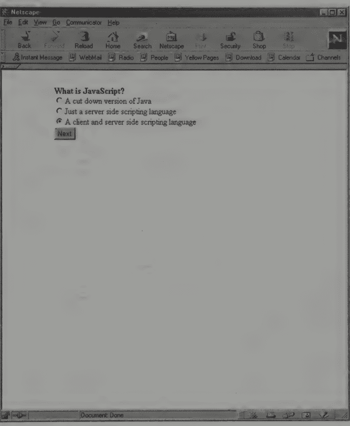

### 对象数组排序

到目前为止，在本章中我们总是按照创建对象的顺序来显示对象数组的输出。这可能并不总是显示数据的最佳方式。接下来的示例展示了如何对对象数组进行排序，这看似可以用 JavaScript 1.1 Array 对象的 sort() 方法轻松完成。然而，很快就会发现对象数组无法使用此方法。在深入代码之前，需要对 sort() 方法做一个简要的解释。

JavaScript 1.1 引入了对 Array 对象 sort() 方法的支持。在 JavaScript 1.1 之前，我们必须编写自己的代码来对数组进行排序——可能是一个简单的冒泡排序函数。有了 JavaScript 1.1，数组排序变得相对容易，同时极其灵活。考虑以下代码片段：

```
<script language="JavaScript"><!--
function show() {
  var string = myArray.join(' ');
  document.write(string + '<br>');
}

var myArray = new Array(
  'Red', 'Orange', 'Yellow', 'Green', 'Blue', 'Indigo', 'Violet'
);

show();

myArray.sort();
show();

function reverse(a, b) { return a<b; }
myArray.sort(reverse)
show();

function length(a, b) { return a.length-b.length }
myArray.sort(length)
show();
//--></script>
```

我们首先创建一个简单的字符串数组（碰巧是彩虹的颜色），然后使用 `show()` 方法将每个数组元素按当前顺序输出到文档中。第一次使用 `sort()` 数组方法只是按字典顺序对数组进行排序——因此，Blue 排在 Green 之前，依此类推。

第二次使用 `sort()` 数组方法时使用了 `reverse` 函数字面量（即先前声明的 `reverse()` 函数的名称）。`sort()` 方法随后在比较每个数组元素时使用 `reverse()` 函数。`reverse()` 函数在第一个参数 (a) 应出现在第二个参数 (b) 之前时返回负数，在第一个参数 (a) 应出现在第二个参数 (b) 之后时返回正数，如果顺序无关紧要则返回零。在 `reverse()` 函数中，表达式 `a<b` 在 a 小于 b 时等于 `true` (1)，此时它们的顺序会被交换，或者如果 a 大于或等于 b 则等于 `false` (0)——此时它们的顺序保持不变。因此，Green 排在 Blue 之前。

第三次使用 `sort()` 数组方法时使用了 `length` 函数字面量。`length()` 函数允许我们使用数组元素的长度来对数组元素进行排序。因此，Blue 排在 Green 之前，因为它的值更短。我们的代码片段结果如下：

Array object sort() results

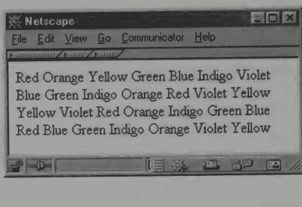

然而，当涉及对象数组排序时，数组元素的值是 [object Object]——也就是说，它的值表明它是 Object 类型的对象，或者是用户定义的对象。我们可以通过为对象提供 toString() 方法来解决这个问题。sort() 方法在将对象的值转换为字符串时会使用任何可用的 toString() 方法。

本示例的其余部分将展示如何向对象添加动态的 toString() 方法，以及如何根据不同的对象属性对名人出生日期数据库进行排序。图 4-11 显示了对象数组排序代码的初始输出。默认情况下，对象数组按姓名排序。

## birthdays.js 源代码

../chapter4/sort/birthday.js

JavaScript 源文件 birthdays.js 包含所有出生日期的数据。与其展示整个文件，我们只展示前四行——每行都调用 setBirthday() 函数，传入一个表示出生日期的整数（格式为 YYYYMMDD）和该人的姓名。

```
setBirthday(18820118, "A.A. Milne");
setBirthday(18090212, "Abraham Lincoln");
setBirthday(18890420, "Adolf Hitler");
setBirthday(18900915, "Agatha Christie");
```


# 数组与对象

## 图 4-11

对象数组排序——按名称排序。

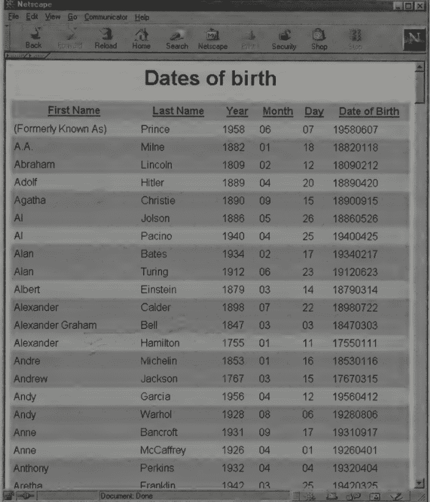

## sort.htm 的源代码

```
../chapter4/sort/sort.js
```

*sort.htm* 页面定义了 `Birthday` 对象构造函数，引入了外部 JavaScript 源文件 *birthdays.js*，创建了一个 `Birthday` 对象数组，然后显示了一个排序后的出生日期表格：

```html
<html>

<head>
<script language="JavaScript"><!--
function Birthday(dob,who) {
  this.dob = dob;
  this.who = who;

  this.firstname =
    who.substring(0,who.lastIndexOf(' '));
  this.lastname =
    who.substring(who.lastIndexOf(' '),who.length);

  this.year = dob.toString().substring(0,4);
  this.month = dob.toString().substring(4,6);
  this.day = dob.toString().substring(6,8);
}

function setBirthday(dob,who) {
  myBirthday[birthdayIndex++] = new Birthday(dob,who);
}
var birthdayIndex = 0;

var myBirthday = new Array();
//--></script>

<script language="JavaScript" SRC="birthdays.js"></script>

<style type="TEXT/CSS"><!--
h1, td, th { font-family: Arial; }
tr.color0 { background: #ccffcc; }
tr.color1 { background: #ccccff; }
tr.color2 { background: #ffcccc; }
//--></style>
</head>

<body>

<h1>Dates of birth</h1>

<table border="0" cellspacing="0" cellpadding="5" width="100%">

<tr class="color2">
<th><a href="sort.htm?firstname">First Name</a></th>
<th><a href="sort.htm?lastname">Last Name</a></th>
<th><a href="sort.htm?year">Year</a></th>
<th><a href="sort.htm?month">Month</a></th>
<th><a href="sort.htm?day">Day</a></th>
<th><a href="sort.htm?dob">Date of Birth</a></th>
</tr>

<script language="JavaScript"><!--
var output = '';

var searchtext = location.search.substring(1);

if (searchtext == '')
  Birthday.prototype.toString = new Function('return this.who');
else
Birthday.prototype.toString =
  new Function('return this.' + searchtext + ';');

function mySort(a,b) { return a>b; }

myBirthday.sort(mySort);

for (var i=0; i < birthdayIndex; i++) {
  output += '<tr class="color' + i%3 + '">';
  output += '<td>' + myBirthday[i].firstname + '<\/td>';
  output += '<td>' + myBirthday[i].lastname + '<\/td>';
  output += '<td>' + myBirthday[i].year + '<\/td>';
  output += '<td>' + myBirthday[i].month + '<\/td>';
  output += '<td>' + myBirthday[i].day + '<\/td>';
  output += '<td>' + myBirthday[i].dob  + '<\/td>';
  output += '<\/tr>';
}

document.write(output);
//--></script>
</table>
</body>
</html>
```

**Birthday** 对象构造函数接受出生日期（`dob`）和人物姓名（`who`）：

```javascript
function Birthday (dob,who) {
  this.dob = dob;
  this.who = who;
```

利用 `who` 参数，通过 `who` 参数中最后一个空格字符将其拆分为两部分，生成 `firstname` 和 `lastname` 属性：

```javascript
this.firstname =
  who.substring(0,who.lastIndexOf(' '));
this.lastname =
  who.substring(who.lastIndexOf(' '),who.length);
```

最后三个属性的构造方式是：首先使用内置的 `Integer` 对象的 `toString()` 方法将 `dob` 整数值转换为字符串，然后使用 `String` 对象的 `substring()` 方法提取日期的相关部分：

```javascript
this.year = dob.toString().substring(0,4);
this.month = dob.toString().substring(4,6);
this.day = dob.toString().substring(6,8);
}
```

随后 *birthdays.js* 文件的内容被加载到文档中——这会使得所有 Birthday 对象被构造出来：

```html
<script language="JavaScript" src="birthdays.js"></script>
```

我们在前面的例子中提到过使用 CSS 样式属性。这里我们使用 *style* 标签声明了一个内联样式表：

```html
<style type="TEXT/CSS"><!--
```

第一行表明任何 *h1*、*td* 或 *th* 标签内容的字体族应为 Arial：

```css
h1, td, th { font-family: Arial; }
```

接下来的三行声明了三个具有不同背景色值的 *tr* 标签类样式。这三个 *tr* 类样式可以通过在任何 *tr* 标签中使用匹配的 *class* 属性来引用：

```css
tr.color0 { background: #ccffcc; }
tr.color1 { background: #ccccff; }
tr.color2 { background: #ffcccc; }
//--></style>
```

所有出生日期都通过表格显示在页面上。表格列标题不仅指示了每列包含数据的说明，而且还包含一个文本链接，点击该链接会重新加载 *sort.htm* 页面，并且链接中已经硬编码了搜索数据：

```html
<tr class="color2">
<th><a href="sort.htm?firstname">First Name</a></th>
<th><a href="sort.htm?lastname">Last Name</a></th>
<th><a href="sort.htm?year">Year</a></th>
<th><a href="sort.htm?month">Month</a></th>
<th><a href="sort.htm?day">Day</a></th>
<th><a href="sort.htm?dob">Date of Birth</a></th>
</tr>
```

六个硬编码的搜索数据值与六个 Birthday 对象属性相匹配，允许用户选择按哪个属性进行排序。这一特定的表格行使用了值为 *color2* 的 *class* 属性。这与前面定义的 *color2* 类相匹配，使得整个表格行的背景色被设置为 #ffcccc——一种淡红色。

我们检索传递的任何搜索数据值，并将其放入 *searchtext* 变量中：

```javascript
var searchtext = location.search.substring(1);
```

然后我们检查 searchtext 字符串是否为空字符串：

```javascript
if (searchtext == '')
```

如果 searchtext 是空字符串，则为 Birthday 对象添加一个 toString() 原型对象方法。我们使用 Function 构造函数（即 new Function()）创建一个 toString() 方法，该方法返回当前（this）Birthday 对象的 who 属性的值：

```javascript
Birthday.prototype.toString = new Function('return this.who');
```

每个构造函数类（即构造函数定义），无论是内置对象还是用户定义对象，都有一个原型对象。利用这个对象，我们可以为内置对象（例如 Date、String）或用户定义对象添加属性或方法。该属性或方法不是保存在每个对象实例中，而是由每个对象实例继承。这意味着在我们的例子中，尽管 Birthday 对象的 toString() 方法只有一份副本，但它被所有 Birthday 对象的实例共享。

如果 searchtext 不是空字符串，我们再次为 Birthday 对象添加一个 toString() 原型对象方法。但这一次，toString() 方法返回当前（this）Birthday 对象中与 searchtext 变量对应的属性：

```javascript
else
    Birthday.prototype.toString =
        new Function('return this.' + searchtext + ';');
```

例如，如果当前 URL 是 sort.htm?dob，那么该方法将包含 return this.dob;。

我们定义了一个 mySort() 函数，将 a 和 b 值按字典顺序排序：

```javascript
function mySort(a,b) { return a>b; }
```

然后我们使用 mySort 函数字面量对 myBirthday[] 对象数组进行排序：

```javascript
myBirthday.sort(mySort);
```

传入 mySort() 函数的实际 a 和 b 值基于 Birthday 对象的 toString() 方法。根据 toString() 方法的内容，不同的字符串值会被传入 mySort() 函数。

sort.htm 代码的其余部分只是遍历排序后的 myBirthday[] 对象数组中的所有 Birthday 对象，创建一行表格，显示七个 Birthday 对象属性中的六个：

```javascript
for (var i=0; i < birthdayIndex; i++) {
```

一个值得注意的细节是使用 JavaScript 设置 tr 标签的 class。我们将字符串 color 与 i%3 返回的值拼接起来，其中 % 是取模运算符——返回 i 除以 3 的余数。这只会返回 0、1 或 2，从而使用三个 tr 类样式之一——color0、color1 或 color2：

```javascript
output += '<tr class="color' + i%3 + '">';
output += '<td>' + myBirthday[i].firstname + '<\/td>';
output += '<td>' + myBirthday[i].lastname + '<\/td>';
output += '<td>' + myBirthday[i].year + '<\/td>';
output += '<td>' + myBirthday[i].month + '<\/td>';
output += '<td>' + myBirthday[i].day + '<\/td>';
output += '<td>' + myBirthday[i].dob + '<\/td>';
output += '<\/tr>';
}

document.write(output);
```

图 4-12 展示了用户选择按出生日期排序数据的结果。

### 数组方法

我们已经使用过 join() 和 sort() 数组方法，但还有其他几个 JavaScript 1.1 的 Array 对象方法，如表 4-1 所示。与 String 对象一样，Array 对象也只有一个属性：length。

### 小结

一旦我们不再局限于简单的字符串或数字，能够在对象中保存多个属性值，就可以在我们的代码中传递单一的对象引用，而不是多个变量。对象构造函数可以用来初始化对象，使它们都具


## 数组与对象

### 图 4-12

对象数组排序——按出生日期排序。

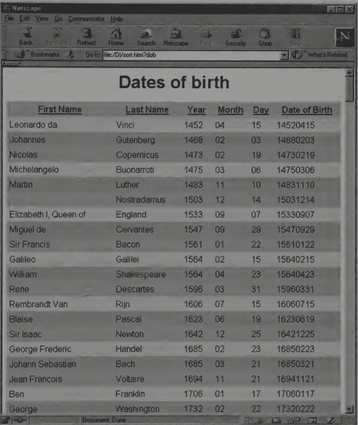

能够轻松且一致地获取具有相同属性（可能值不同）的对象。使用数组来保存对象完善了这一等式，因为它允许我们通过简单地引用数组中特定位置的对象，来随时操作多个不同对象中的一个。

## 第四章

174

表 4-1
JavaScript 1.1
数组对象方法。

| 方法 | 描述 |
| --- | --- |
| join | 将数组元素连接成字符串，可使用可选的分隔符。例如，在以下代码中：var a = new Array('A', 'B', 'C'); var b = a.join('-'); a 仍将包含数组元素 A、B 和 C，但 b 将包含字符串值 A-B-C。 |
| reverse | 反转数组中的元素。例如，在以下代码中：var a = new Array('A', 'B', 'C'); a.reverse(); a 现在将包含数组元素 C、B 和 A。 |
| sort | 对数组中的元素进行排序。例如，在以下代码中：var a = new Array(321, 2345, 62345, 54); a.sort(); a 现在将包含数组元素 2345、321、62345 和 54——即按字母顺序排序。也可接受一个可选的函数字面量来指定排序标准。例如，在以下代码中：function numericsort(a, b) { return a-b; } var a = new Array(321, 2345, 62345, 54); a.sort(numericsort); a 现在将包含数组元素 54、321、2345 和 62345——即按数字顺序排序。 |
| toString | 将数组元素返回为逗号分隔的字符串值。例如，在以下代码中：var a = new Array('a', 'b', 'c'); var b = a.toString(); a 仍将包含数组元素 a、b 和 c，但 b 将包含字符串 a, b, c。 |

## 第 5 章
### 位置与链接

## 第五章

在万维网（WWW）上，位置至关重要——特别是 HTML 页面的位置。从一个页面引用另一个页面可以通过链接实现，链接使用完全绝对引用（指定协议、服务器、目录和文件名本身）或相对引用（即相对于当前源页面，例如向上一级目录、向下进入另一目录，然后到文件名）将源页面链接到目标页面。

无论页面如何链接，一旦加载到浏览器中，浏览器就会填充一个 `location` 对象，将不同属性设置为保存例如 `protocol`（协议）、`hostname`（主机名）、完整的绝对 `href`（超链接）以及作为链接一部分传递的 `search`（查询）参数或 hash 锚点名称。当页面加载到浏览器时，浏览器还会填充一个 `links` 数组，保存页面中找到的所有链接的每个 `href` 属性。

本章详细讨论了 `location` 对象和 `links` 数组，并展示了如何：

- 将浏览器从一个域上的当前页面重定向到其在另一个域上的新位置
- 自动在同名页面或当前页面两侧的同名目录中添加上一页和下一页按钮，作为同名文章列表的一部分
- 在页面内添加自动锚点和链接，以便在长页面中不同内容部分之间更容易导航
- 仅使用客户端 JavaScript 创建网站环
- 获取浏览器的首选语言并显示预翻译版本的不同页面
- 允许通过密码输入表单访问隐藏页面，该表单验证密码并在密码无效时显示美观的错误页面
- 爬取相关网页的所有链接。


- 自动重定向 ../chapter5/redirection/index.htm
- 自动链接（文本版本） ../chapter5/links/text.htm
- 自动链接（图像版本） ../chapter5/links/image.htm
- JavaScript 网站环 ../chapter5/webring/test.htm
- 您使用的是什么语言？ ../chapter5/language/index-en.htm
- 密码保护与验证 ../chapter5/password/ index.htm
- 网站链接爬虫 ../chapter5/crawler/index.htm

### 自动重定向

随着时间的推移，网站会从一个位置迁移到另一个位置，可能是获得了个性域名，也可能是由于越来越受欢迎。这时就会出现一个问题：人们浏览器中保存的旧书签或似乎不愿更新新位置的搜索引擎仍然将人们引导到旧位置。可以使用非 JavaScript 技术通过 `meta` 标签自动将浏览器引导到新位置：

```
<meta http-equiv="Refresh"
      content="URL=http://www.newdomain.com/">
```

这将在浏览器读取 `meta` 信息立即将浏览器重定向到新域。

然而，这种方法存在一些问题。如果用户点击浏览器的后退按钮，浏览器会重新读取 `meta` 标签并重定向回新位置——实际上将用户困在浏览器循环中。这可以通过添加一个小延迟来补救：

```
<meta http-equiv="Refresh"
      content="15;URL=http://www.newdomain.com/">
```

这个版本的 `meta` 标签将在 15 秒后重定向。

就 `meta` 标签目前的状况而言，它会将浏览器重定向到 URL `http://www.newdomain.com/`。如果您需要旧位置的旧页面重定向到新位置的不同页面，那么每个 `meta` 标签都必须手动制作以指向新位置。例如，从旧的 *page1.htm* 到新的 *page1.htm*：

```
<meta http-equiv="Refresh"
      content="15;URL=http://www.newdomain.com/page1.htm">
```

从旧的 *page2.htm* 到新的 *page2.htm*：

```
<meta http-equiv="Refresh"
      content="15;URL=http://www.newdomain.com/page2.htm">
```

可以在 Apache Web 服务器上使用 *.htaccess* 文件在一个文件中详细说明旧到新的映射。但是，如果您无权访问此文件，那么此处提供的 JavaScript 代码允许根据当前目录路径和文件名从旧位置智能重定向到新位置。图 5-1 显示了自动重定向前呈现给用户的页面。

178

第五章

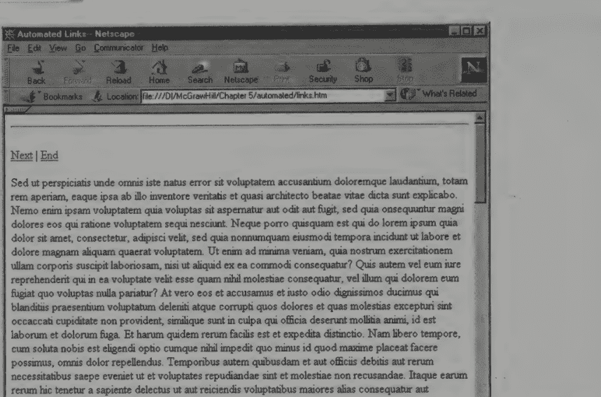

图 5-1 自动重定向——页面位置已更改的警告消息。

## 自动重定向源代码


../chapter5/redirection/index.htm

首先，需要重定向的页面的 HTML：

```
<html>
<head>
<title>Automatic Redirection</title>
```

我们包含一行来加载外部 JavaScript 源文件 *redirect.js*：

```
<script language="JavaScript" src="redirect.js"></script>
</head>
<body>
```

## 位置与链接

如果 message 对象存在（即仅当在 redirect.js 文件中加载时），则调用 message() 函数：

```
<script language="JavaScript"><!--
if (window.message) message();
//--></script>
</body>

</html>
```

外部 JavaScript 源文件 redirect.js 控制完整的 JavaScript 重定向代码。该文件可以位于要重定向的页面的相对路径（如此例所示），也可以使用绝对 URL 引用旧域上的文件，或者为了便于控制而引用新域上的文件。


../chapter5/redirection/redirect.js

redirect.js 文件首先定义并初始化几个全局变量。newDomain 变量保存新域的 URL：

```
var newDomain  = 'http://www.newdomain.com';
```

thisPage 变量保存当前窗口 location 对象的 pathname 属性：

```
var thisPage   = window.location.pathname;
```

newLocation 变量保存 newDomain 和 thisPage 变量连接后的值：

```
var newLocation = newDomain + thisPage;
```

go_now() 函数在被调用时，会将当前窗口 location 对象的 href 属性更改为 newLocation 变量的值。这实际上将新位置加载到浏览器中：

```
function go_now () {
  window.location.href = newLocation;
}
```

message() 函数用于显示一条消息，告知用户页面已移动位置，并给用户机会

 nity to click through to the new location straight away without having to wait for the delayed automatic redirection to kick in:

```
function message() {
    var out = '<h1>Location Changed<\/h1>';
    
    out += '<p>';
    out += 'Please note the new location of this page is:';
    out += '<br>';
    out += '<a href="' + newLocation + '">' + newLocation + '<\/a>';
    out += '<\/p>';
    
    out += '<p>';
    out += 'This page will automatically redirect in 10 seconds.';
    out += '<\/p>';
    
    document.write(out);
}
```

Finally, to kick the automatic redirection off, the `setTimeout()` method is used to set a timer running, which after 10 seconds, will invoke the `go_now()` function to load the new page:

```
setTimeout("go_now()",10000);
```

这个简单的脚本中使用的 `location` 对象提供了对组成当前窗口位置的各种组件的访问，其格式如下：

```
protocol://hostname:port/pathname?search#hash
```

对于一个假设的 URL：

```
http://www.xxx.com:80/dir/subdir/file.htm?name=value#anchorname
```

可以使用相应的 `location` 对象属性提取各种元素，如表 5-1 所示。

### 自动化的上一页和下一页按钮

JavaScript 不仅可以用来为网站添加更丰富的功能，还可以帮助维护网站。例如，一些定期发布的文档。你可能每日、每周或每月发布材料。访问者会看到最新的材料，但你需要提供链接返回到之前的项目，或跳转到列表中的下一个项目。

例如，如果你发布一系列页面——例如 page1.htm，然后 page2.htm 和 page3.htm，它们之间唯一的区别就是递增的数字序列。另一方面，如果你将材料发布到单独的目录中——例如 folder001/index.htm、folder002/index.htm 和 folder003/index.htm，那么文件夹名称中的三位数字同样构成了递增的数字序列。

在这两个例子中，我们都可以轻松提供链接到当前页面之前和之后的页面。我们只需计算出当前页码，然后减去 1 得到前一页，加上 1 得到后一页。困难出现在到达列表两端时——即，阻止代码指向不存在的页面。

此处包含的代码提供了在同一目录中同名文件之间，或在同名目录中相同名称文件之间进行链接的能力，而不会超出列表范围。图 5-2、5-3 和 5-4 展示了 10 个页面系列中的首页、下一页和末页。

## 自动化的上一页和下一页按钮源代码

将按钮添加到页面非常简单。有两个版本，一个适用于同一目录中的文件，另一个适用于单独目录中的文件。首先，让我们考虑同一目录的情况。在页面的 head 部分包含以下行即可加载外部 JavaScript 源库 *buttons.js*。

```
../chapter5/nextprev/page1.htm
```

```
    <script language="JavaScript" src="buttons.js"></script>
```

要显示按钮，我们调用 `showButtons()` 函数，但前提是当前页面中存在 `showButtons` 对象（即 `showbuttons()` 函数声明）：

```
    <script language="JavaScript"><!--
    if (window.showButtons) showButtons();
    //--></script>
```

这三行可以放置在页面中的任何位置，可以放置任意次数。

不同目录版本使用不同的外部 JavaScript 源库——这次是位于父目录（由开头的 `../` 表示）的 *directories.js* 文件：

```
../chapter5/nextprev/folder098/index.htm
```

```
<script language="JavaScript" src="../directories.js"></script>
```

要显示按钮，这次我们调用 `showDirectoryButtons()` 函数：

```
<script language="JavaScript"><!--
if (window.showDirectoryButtons) showDirectoryButtons();
//--></script>
```

## 自动化的上一页和下一页按钮 buttons.js 源代码

外部 JavaScript 源库 button.js 输出一个表格，其中包含指向当前目录中上一页和下一页的适当图像链接。定义并初始化了两个变量 first 和 last，用于指示系列中的首页和末页。每当向系列中添加新页面时，唯一需要做的更改就是更新 last 变量，以便新页面自动包含在内：

```
../chapter5/nextprev/button.js
```

```
var first = 1;
var last  = 10;
```

两个变量 prefix 和 suffix 用于保存相对文件名中位于顺序页码两侧的部分——例如 page9.htm：

```
var prefix = 'page';
var suffix = '.htm';
```

prev 和 next 变量保存用于 img 标签的 src 和 alt 字符串文本：

```
var prev = 'src="prev.gif" alt="previous page"';
var next = 'src="next.gif" alt="next page"';
```

要从当前（即 self）窗口位置的 href 属性中提取文件名，我们使用 String 对象的 indexOf() 方法定位 prefix 和 suffix 字符串，然后提取当前顺序数字作为 num：

```
var url  = self.location.href;
var pos1 = url.indexOf(prefix);
var pos2 = url.indexOf(suffix);

var num = url.substring(pos1 + prefix.length, pos2) - 0;
```

调用 `showButtons()` 函数来显示按钮图像链接：

```
function showButtons() {
  var o = '';
  
  o += '<table width="100%" border="0"><tr>';
```

如果 num 的值大于系列中首个项目的值，那么我们显示包裹在指向上一项（num-1）链接中的 prev 图像：

```
if (num > first) {
  o += '<td>';
  o += '<a href="' + prefix + (num-1) + suffix + '">';
  o += '</a>';
  o += '<\/td>';
}

o += '<td width="100%">&nbsp;<\/td>';
```

如果 num 的值小于系列中末个项目的值，那么我们显示包裹在指向下一项（num+1）链接中的 next 图像：

```
if (num < last) {
  o += '<td>';
  o += '<a href="' + prefix + (num+1) + suffix + '">';
  o += '</a>';
  o += '<\/td>';
}
o += '<\/tr><\/table>';
```

然后我们将 HTML 代码写入文档：

```
document.write(o);
}
```

## 自动化的上一页和下一页按钮 directories.js 源代码

外部 JavaScript 源文件 *directories.js* 与之前的 *buttons.js* 文件几乎完全相同。它用于链接单独目录中的 index 页面。

定义并声明了两个变量 `first` 和 `last`，但与之前的代码中 `first` 变量从 1 开始不同，此处我们说明 `first` 变量不必从 1 开始。只要 `first` 小于或等于 `last`，所有文件之间的导航就能正确工作。

```
../chapter5/nextprev/directories.js
```

```
var first = 98;
var last  = 111;
```

同样，两个变量 `prefix` 和 `suffix` 用于保存相对目录和文件名中位于顺序页码两侧的部分——例如 `folder999/index.htm`：

```
var prefix = 'folder';
var suffix = '/index.htm';
```

`prev` 和 `next` 变量保存用于 `img` 标签的 `src` 和 `alt` 字符串文本。注意图像位于父目录（由 `../` 前缀表示）。这使我们只需提供一份图像副本，而不是每个目录各一份：

```
var prev = 'src="../prevdir.gif" alt="previous directory"';
var next = 'src="../nextdir.gif" alt="next directory"';
```

我们再次从 location 对象的 `href` 属性中提取顺序数字：

```
var url  = self.location.href;
var pos1 = url.indexOf(prefix);
var pos2 = url.indexOf(symourfix);

var num = url.substring(pos1 + prefix.length, pos2) - 0;
```


`pad()`函数用于确保我们得到一个三位数的顺序编号，必要时会在前面补一个或两个零：

```
function pad(num, size) {
  num = '' + num;
  while (num.length < size) num = '0' + num;
  return num;
}
```

`showDirectories()`函数被调用以显示按钮图片链接：

```
function showDirectoryButtons() {
  var o = '';

  o += '<table width="100%" border="0"><tr>';

  if (num > first) {
    o += '<td>';
```

第一个改动是使用对父目录的引用(`../`)，以便在导航到相关同级目录时使用，并使用`pad()`函数对传入的`num`参数进行填充：

```
  o += '<a href="../' + prefix + pad(num-1,3) + suffix + '">';
  o += '<\/a>';
  o += '<\/td>';
}

o += '<td width="100%">&nbsp;<\/td>';

if (num < last) {
  o += '<td>';
```

第二个改动同样是引用父目录并使用`pad()`函数：

```
  o += '<a href="../' + prefix + pad(num+1,3) + suffix + '">';
  o += '<\/a>';
  o += '<\/td>';
}

o += '<\/tr><\/table>';

document.write(o);
}
```

如果目录名称仅使用顺序目录编号且不带任何前导零，那么可以省略上述代码中`pad()`函数的使用，或者简单地将`pad()`函数的第二个参数替换为值1。

### 自动链接

大型文档可能难以导航。提供指向文档顶部和底部的链接可以通过包含两个命名锚点来轻松实现——例如，`<a name="top"></a>`和`<a name="end"></a>`。如果在每个主要段落末尾放置链接，用户就可以快速跳转到文档的顶部或底部——例如，`<a href="#top">top</a>`和`<a href="#end">end</a>`。

这并不能帮助用户每次向前或向后导航一个段落。一种解决方案是在整个文档中手动编写单独的锚点，为每个锚点赋予唯一标签，然后包含链接以跳转到前一个或后一个段落。这种方法的问题在于，它不仅繁琐，而且容易出现人为错误，例如忘记递增锚点名称或出现输入错误。如果将来在文档中加入额外段落，这种方法也很可能失效。

此处提供的脚本会在每个段落后动态添加适当的锚点和文本链接。只需剪切并粘贴一行简单的代码即可。我们还提供了一个增强版本的代码，使用图像链接代替文本链接。

图5-5展示了文档加载时的初始状态；地址栏以`text.htm`结尾。图5-6展示了点击文档中第一个`next`文本链接后的文档状态；地址栏变为以`text.htm#1`结尾——即文档中名为1的锚点——文档被重新定位到该锚点之后的位置。图5-7展示了点击任一`end`文本链接的效果；地址栏以`text.htm#end`结尾，文档被重新定位到文档末尾。图5-8展示了使用图像链接代替文本链接的增强版本。

## 自动链接源代码——文本版本

`../chapter5/links/text.htm`

```
<html>
<head>
<title>Automated Links</title>
<script language="JavaScript"><!--
```

## 位置和链接

### 图 5-5

自动链接——文档顶部。

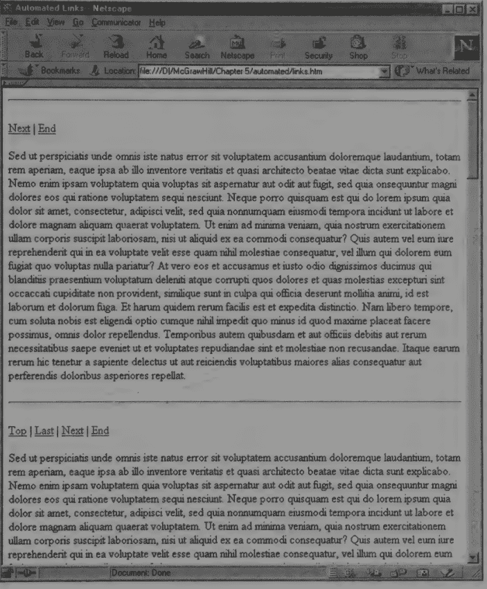

全局变量`textlink`用于为整个文档中的每个锚点赋予唯一编号：

```
var textlink = 0;
```

`textlinks()`函数用于输出一组锚点和文本链接。它接受一个可选参数——`last`——这是一个布尔值，表示要输出结束锚点。这是整个过程中唯一复杂的部分；你必须记住确保文档中最后一次使用`textlinks()`函数时传递一个true布尔值。

```
function textlinks(last) {
```

初始化一个局部输出变量：

```
var output = '';
```

第五章

### 图 5-6

自动链接——跳转到#1。

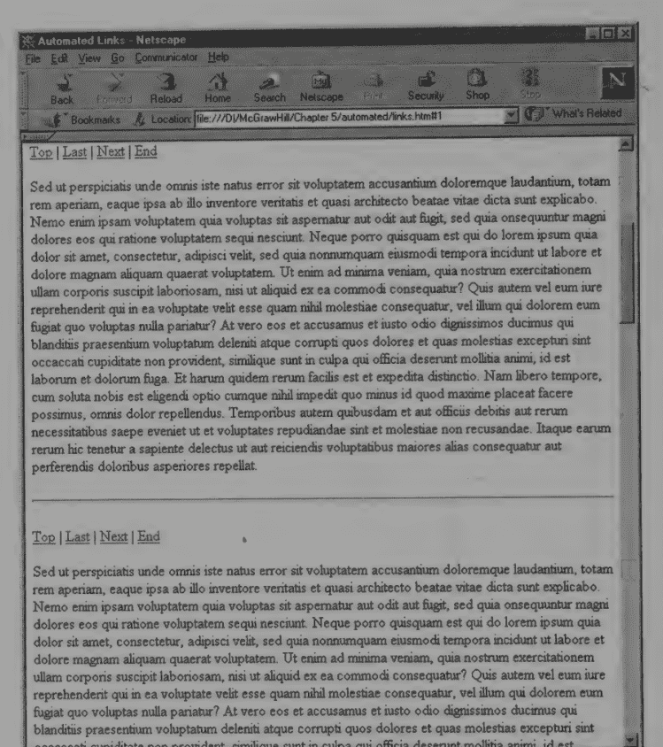

## 位置和链接

图 5-7 自动链接——跳转到#end。

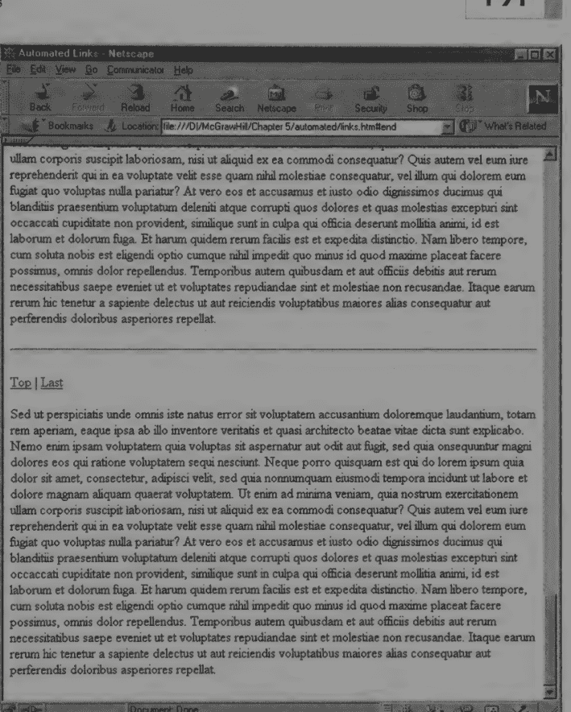

如果最后一个布尔变量为true，我们将适当的结束锚点标签追加到输出变量：

```
if (last) output += '<a name="end"><\/a>';
```

一条水平线也会被追加到输出变量。如果不需要，可以省略：

```
output += '<hr><p>';
```

### 图 5-8

自动链接——使用图像链接的增强版本。

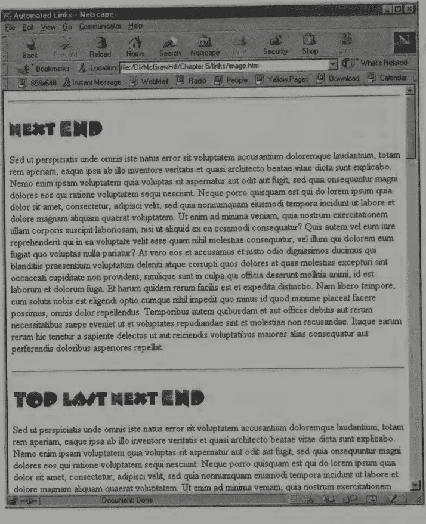

如果textlink变量不为零——即这不是对`textlinks()`函数的第一次调用——那么我们追加一个指向顶部锚点的链接，后跟一个指向前一个锚点(textlink-1)的文本链接。注意，竖线(|)被用作两个链接之间的视觉分隔符：

```
if (textlink != 0) {
  output += '<a href="#top">Top<\/a> | ';
  output += '<a href="#' + (textlink-1) + '">Last<\/a>';
}
```

如果textlink变量不为零且last布尔变量不为true，那么另一个竖线被追加到输出变量：

```
if ((textlink != 0) && (!last)) output += ' | ';
```

一个锚点被追加到输出变量，其name属性值设置为textlink变量的当前值，然后进行后递增（即在其用于当前表达式之后，值才递增）：

```
output += '<a name="' + (textlink++) + '"></a>';
```

如果last布尔变量不为true，那么一个指向下一个（尚未写入的）锚点的链接被追加，后跟一个指向（尚未写入的）结束锚点的链接：

```
if (!last) {
    output += '<a href="#' + textlink + '">Next</a> | ';
    output += '<a href="#end">End</a>';
}

output += '</p>';
```

最后，我们将输出变量写入文档：

```
document.write(output);
}
//--></script>

</head>

<body>
```

在整个文档主体中使用`textlinks()`函数非常直接。只需在需要出现锚点和文本链接的地方添加以下代码行：

```
<script language="JavaScript">textlinks();</script>
```

但是请注意，最后一次调用`textlinks()`函数时必须传递一个true布尔值。否则，结束锚点将永远不会被写入文档，这将导致整个文档中的链接断裂：

```
<script language="JavaScript">textlinks(true);</script>
```

## 自动链接源代码——图像版本


`../chapter5/links/image.htm`

代码的增强版本使用图像链接代替文本链接：

```
<html>

<head>
<title>Automated Links</title>

<script language="JavaScript"><!--
```

我们初始化一个全局`imagelink`变量：

```
var imagelink = 0;
```

定义四个额外的全局变量来保存四个所需图像的HTML代码——`topImage`、`lastImage`、`nextImage`和`endImage`：

```
var topImage  = '';
var lastImage = '';
var nextImage = '';
var endImage  = '';
```

不使用`textlinks()`函数，而是使用`imagelinks()`函数：

```
function imagelinks(last) {
    var output = '';

    if (last) output += '<a name="end"><\/a>';

    output += '<hr><p>';

    if (imagelink != 0) {
```

不使用文本链接，而是使用`topImage`和`lastImage`变量追加图像链接：

```
output += '<a href="#top">' + topImage +'<\/a> ';
output += '<a href="#' + (imagelink-1) + '">' + lastImage + '<\/a>';
}
```

```
output += '<a name="' + (imagelink++) + '"></a>';

if (!last) {
```

同样，不使用文本链接，而是使用`nextImage`和`endImage`变量追加图像链接：

```
output += '<a href="' + imagelink + '">' + nextImage + '</a>';
output += '<a href="#end">' + endImage + '</a>';
}

output += '</p>';

document.write(output);
}
//-->
```

```
</head>

<body>
```

使用`imagelinks()`函数与`textlinks()`函数一样简单。当你想要出现锚点和图像链接时，在文档中添加以下代码行：

```
<script language="JavaScript">imagelinks();</script>
```

记得在最后一次`imagelinks()`调用中传递布尔值`true`：

```
<script language="JavaScript">imagelinks(true);</script>
```

请注意，在Netscape Navigator 3中，如果你将JavaScript代码放置在表格单元格内，可能会出现问题——页面无法正确渲染。如果你需要支持Netscape Navigator 3，并且需要将JavaScript代码放置在表格单元格内，请修改`imagelinks()`或`textlinks()`函数以输出完整的表格行。换句话说，在`output`变量前添加前缀`<tr><td>`，并在`output`变量后添加`</td></tr>`。

### JavaScript 网站环

"建好它，他们就会来"这句话对于网站来说并不总是成立。你可以建立一个壮观的网站，却没有人访问。在WWW中，关键词是*Web*。万维网从其定义上来说就是一个由从一个网站到另一个网站的交织链接组成的网络。除非人们

如果不了解你的网站，他们就不会知道它的存在，也就不会来访。

在实际创建网站之后，真正吸引访客访问你的网站是最困难的部分。这可以通过多种方式解决：推广、在搜索引擎注册、口碑传播、网站之间的相互链接，以及最后但同样重要的一点是网络环（web ring）。

网络环已在相关网站群体中变得流行——例如，音乐粉丝网站、 specialized interest groups（专业兴趣小组）和体育网站。绝大多数网络环群组都是通过服务器端进程来运作的。你在页面上放置指向中央 Web 服务器的硬编码 HTML 链接，然后由服务器端处理访客点击这些链接的操作，将访客带到环中的下一个或上一个网站。服务器端进程通常需要访问服务器上的 CGI 脚本。不幸的是，并非每个人都有管理员级别的权限来运行 CGI 脚本，因此，如果你想创建自己的网络环，你可能不得不依赖第三方来为你托管它。

本节中的示例展示了如何使用客户端 JavaScript 代码完全控制网络环。所需的一切只是一个持有公开可用 JavaScript 源文件的中央网站，并且环中的每个站点都从其 HTML 页面中引用该文件。因为这个 JavaScript 源文件只是一个任何服务器都可以提供的静态文件，所以你可以自己托管这个文件；你不需要第三方。图 5-9 显示了此特定网络环使用的图像。你可以替换这些图像——事实上，我们建议你这样做。图 5-10 展示了典型网络环中某个站点上的图像链接可能的样子。

## JavaScript 网络环源代码——剪切并粘贴 HTML

以下三行 HTML 就是每个网络环站点需要放置在其 HTML 中的全部内容。这只是加载了 src 属性中的外部 JavaScript 源引用。网站管理员希望网络环 HTML 出现在其页面中的什么位置，就在那里粘贴以下 HTML。

```
<script language="JavaScript"
	src="http://www.irt.org/webring/webring.js">
</script>
```

请注意，src 属性的值需要修改为你自己的网络环的实际位置。

## JavaScript 网络环源代码——webring.js JavaScript

webring.js 文件的实际内容需要针对你自己的网络环实例进行调整。需要将你网络环中每个站点的 URL 添加进来，以替代此版本源代码中使用的四个示例。

首先，我们声明并初始化几个全局变量。WhereInRing 变量用于指示脚本是从网络环中的哪个位置被调用的。这使代码能够计算相对于当前位置的下一个和上一个站点：

```
var WhereInRing = 0;
```

NumInWebRing 变量用于保存网络环中的站点数量：

```
var NumInWebRing = 0;
```

WebRing 数组用于保存网络环中所有站点的 URL：

```
var WebRing = new Array();
```

base 变量包含控制 webring.js 文件的硬编码位置/目录。这需要修改以匹配你自己的网络环的位置/目录：

```
var base = 'http://www.irt.org/webring/';
```

与大多数脚本一样，output 变量用于保存准备写入文档的 HTML 代码：

```
var output = '';
```

WebRingObject() 函数是一个构造函数，用于创建 WebRingObject。每个 WebRingObject 只包含一个属性——href：

```
function WebRingObject(href) {
    this.href = href;
}
```

Add() 函数使用 href 参数作为 WebRingObject() 构造函数的输入参数来创建 WebRingObject 的实例：

```
function Add(href) {
```

构造函数返回的对象被附加到 WebRing[] 数组，然后将 NumInWebRing 的值增加 1：

```
WebRing[NumInWebRing++] = new WebRingObject(href);
```

检查 href 参数的值是否作为子字符串出现在 location 对象的当前 href 属性中（即当前窗口的 URL）。如果是，则将 WhereInRing 设置为 NumInWebRing 的值：

```
if (location.href.indexOf(href) > -1)
    WhereInRing = NumInWebRing;
}
```

接下来，我们使用 Add() 函数添加网络环中的所有网站。此列表可以根据需要任意长，但必须至少有三个条目：

```
Add("http://www.btinternet.com/~aredfern/");
Add("http://www.btinternet.com/~michael.coppins/");
Add("http://www.btinternet.com/~red.dragon/");
Add("http://www.btinternet.com/~markrsmith/");
```

接下来，我们计算网络环中当前站点两侧的网站。PrevInRing 变量根据我们处于网络环的开头还是其他位置，设置为比 NumInWebRing 或 WhereInRing 变量少 1：

```
if (WhereInRing == 0)
    PrevInRing = NumInWebRing - 1;
else
    PrevInRing = WhereInRing - 1;
```

NextInRing 变量根据我们处于网络环的末尾还是其他位置，设置为 0 或比 WhereInRing 多 1：

```
if (WhereInRing == NumInWebRing - 1)
    NextInRing = 0;
else
    NextInRing = WhereInRing + 1;
```

检测网络环的起点和终点完成了网站环，因此无论特定站点位于网络环中的什么位置都不重要。该站点将始终链接到，并被网络环中其两侧站点所链接。

最后，我们只需要创建指向网络环中上一个和下一个站点的图像链接：

```
var output =
```

WebRing 数组中索引为 PrevInRing 的 WebRingObject 对象的 href 属性，用作返回上一个站点的图像链接的 href 属性：

```
'<center>' +
    '<a href="' + WebRing[PrevInRing].href + '" target="_top">' +
    '</a>' +
```

我们还额外提供了一种让新网站加入网络环的方式，即提供指向 base 网站中 index.htm 页面的链接：

```
'<a href="' + base + 'index.htm" target="_top">' +
    '</a>' +
```

WebRing 数组中索引为 NextInRing 的 WebRingObject 对象的 href 属性，用作指向下一个站点的图像链接的 href 属性：

```
'<a href="' + WebRing[NextInRing].href + '" target="_top">' +
    '</a>' +
    '<center>';
```

最后，HTML 被写入文档：

```
document.write(output);
```

img 标签的 src 属性使用 base 变量作为图像文件名的前缀。这样，无论浏览器访问网络环中的多少个站点，都只会加载一次这些图像。

### 您的语言是什么？

全球受众需要全球化的网站。并非每个人都能或都想要阅读英语。提供使用其他语言的替代页面可以扩大你的潜在访客数量。此示例并未展示如何从英语翻译为另一种语言；这是你的责任。它所做的是展示如何检测访客浏览器中设置的首选语言，然后切换到匹配该语言偏好的适当页面，让访客有机会以他们偏好的语言阅读你的网站。

随着 Netscape Navigator 4 的推出，Netscape 为 `navigator` 对象提供了一个名为 `language` 的新属性的支持。与此同时，Internet Explorer 4 也为 `navigator` 对象提供了一个新属性的支持，但名为 `browserLanguage`。幸运的是，我们可以测试当前浏览器是否最低支持 JavaScript 1.2（这两个浏览器版本都支持），然后根据正在使用的浏览器（即 Netscape Navigator 或 Internet Explorer）来分支代码。

`language` 或 `browserLanguage` 属性提供了对浏览器配置为在请求页面时向服务器提供的首选语言的简单访问。此设置使服务器能够提供以不同语言编写的页面。表 5-2 显示了 `language` 或 `browserLanguage` 属性可以持有的所有值，以及它们所代表的实际语言的说明。

对于我们这里展示的示例，我们将限制自己检测以下语言前缀：`fr`、`de`、`it`、`en`、`es` 和 `pt`，它们分别代表法语、德语、意大利语、英语、西班牙语和葡萄牙语这些通用语言。

## "您的语言是什么？"源代码

```
./chapter5/language/index-en.htm
```

以下文件是名为 *index-en.htm* 的欢迎页的英语版本。还需要有另外五个版本，每种其他语言各一个：*index-fr.htm*、*index-de.htm*、*index-it.htm*、*index-es.htm* 和 *index-pt.htm*。这另外五个版本不需要包含检测首选语言所需的 JavaScript 代码，因为希望


## 第五章

### 表 5-2
language 与 browserLanguage 的值及其含义。

| 值 | 含义 |
|---|---|
| af | 南非荷兰语 |
| ar-ae | 阿拉伯语（阿联酋） |
| ar-bh | 阿拉伯语（巴林） |
| ar-dz | 阿拉伯语（阿尔及利亚） |
| ar-eg | 阿拉伯语（埃及） |
| ar-iq | 阿拉伯语（伊拉克） |
| ar-jo | 阿拉伯语（约旦） |
| ar-kw | 阿拉伯语（科威特） |
| ar-lb | 阿拉伯语（黎巴嫩） |
| ar-ly | 阿拉伯语（利比亚） |
| ar-ma | 阿拉伯语（摩洛哥） |
| ar-om | 阿拉伯语（阿曼） |
| ar-qa | 阿拉伯语（卡塔尔） |
| ar-sa | 阿拉伯语（沙特阿拉伯） |
| ar-sy | 阿拉伯语（叙利亚） |
| ar-tn | 阿拉伯语（突尼斯） |
| ar-ye | 阿拉伯语（也门） |
| be | 白俄罗斯语 |
| bg | 保加利亚语 |
| ca | 加泰罗尼亚语 |
| cs | 捷克语 |
| da | 丹麦语 |
| de-at | 德语（奥地利） |
| de-ch | 德语（瑞士） |
| de-li | 德语（列支敦士登） |
| de-lu | 德语（卢森堡） |
| de | 德语（标准） |
| el | 希腊语 |
| en-au | 英语（澳大利亚） |
| en-bz | 英语（伯利兹） |
| en-ca | 英语（加拿大） |
| en-gb | 英语（英国） |
| en-ie | 英语（爱尔兰） |
| en-jm | 英语（牙买加） |
| en-nz | 英语（新西兰） |
| en-tt | 英语（特立尼达） |
| en-us | 英语（美国） |
| en-za | 英语（南非） |
| en | 英语 |
| en | 英语（加勒比地区） |
| es-ar | 西班牙语（阿根廷） |
| es-bo | 西班牙语（玻利维亚） |
| es-cl | 西班牙语（智利） |
| es-co | 西班牙语（哥伦比亚） |
| es-cr | 西班牙语（哥斯达黎加） |
| es-do | 西班牙语（多米尼加共和国） |
| es-ec | 西班牙语（厄瓜多尔） |
| es-gt | 西班牙语（危地马拉） |
| es-hn | 西班牙语（洪都拉斯） |
| es-mx | 西班牙语（墨西哥） |
| es-ni | 西班牙语（尼加拉瓜） |
| es-pa | 西班牙语（巴拿马） |
| es-pe | 西班牙语（秘鲁） |
| es-pr | 西班牙语（波多黎各） |
| es-py | 西班牙语（巴拉圭） |
| es-sv | 西班牙语（萨尔瓦多） |
| es-uy | 西班牙语（乌拉圭） |
| es-ve | 西班牙语（委内瑞拉） |
| es | 西班牙语（西班牙—现代分类） |
| es | 西班牙语（西班牙—传统分类） |
| et | 爱沙尼亚语 |
| eu | 巴斯克语 |
| fa | 波斯语 |
| fi | 芬兰语 |
| fo | 法罗语 |
| fr-be | 法语（比利时） |
| fr-ca | 法语（加拿大） |
| fr-ch | 法语（瑞士） |
| fr-lu | 法语（卢森堡） |
| fr | 法语（标准） |
| gd-ie | 盖尔语（爱尔兰） |
| gd | 盖尔语（苏格兰） |
| he | 希伯来语 |
| hi | 印地语 |
| hr | 克罗地亚语 |
| hu | 匈牙利语 |
| in | 印度尼西亚语 |
| is | 冰岛语 |
| it-ch | 意大利语（瑞士） |
| it | 意大利语（标准） |
| ja | 日语 |
| ji | 意第绪语 |
| ko | 韩语 |
| ko | 韩语（Johab） |
| lt | 立陶宛语 |
| lv | 拉脱维亚语 |
| mk | 马其顿语 |
| ms | 马来语 |
| mt | 马耳他语 |
| nl-be | 荷兰语（比利时） |
| nl | 荷兰语（标准） |
| no | 挪威语（Bokmal） |
| no | 挪威语（Nynorsk） |
| pl | 波兰语 |
| pt-br | 葡萄牙语（巴西） |
| pt | 葡萄牙语（标准） |
| rm | 罗曼什语 |
| ro-mo | 罗马尼亚语（摩尔多瓦） |
| ro | 罗马尼亚语 |
| ru-mo | 俄语（摩尔多瓦） |
| ru | 俄语 |
| sr | 塞尔维亚语（西里尔文） |
| sb | 索布语 |
| sk | 斯洛伐克语 |
| sl | 斯洛文尼亚语 |
| sq | 阿尔巴尼亚语 |
| sr | 塞尔维亚语（拉丁文） |
| sv-fi | 瑞典语（芬兰） |
| sv | 瑞典语 |
| sx | 苏图语 |
| sz | 萨米语（拉普兰语） |
| th | 泰语 |
| tn | 茨瓦纳语 |
| tr | 土耳其语 |
| ts | 聪加语 |
| uk | 乌克兰语 |
| ur | 乌尔都语 |
| ve | 文达语 |
| vi | 越南语 |
| xh | 科萨语 |
| zh-cn | 中文（中国大陆） |
| zh-hk | 中文（香港） |
| zh-sg | 中文（新加坡） |
| zh-tw | 中文（台湾） |
| zu | 祖鲁语 |

> 来源：ISO 639:1988 (E) "语言的名称表示代码"，ISO，日内瓦，1988年。

## 位置与链接

当我们接触到它们时已经完全理解，用户首选语言已经被检测到了。

我们首先需要做的是将 JavaScript 代码的执行限制在至少支持 JavaScript 1.2 的浏览器上。通过提供 `language` 属性（尽管在 HTML 4 中已弃用），并将其值设为 `JavaScript1.2`，我们可以确保只有支持 JavaScript 1.2 及以上的浏览器才会执行 `script` 标签内的代码：

```javascript
<script language="JavaScript1.2"><!--
```

`getFileName()` 函数是一个简单的可复用工具函数，当传入一个 URL（例如 `http://www.domainname.com/foldername/filename.ext`）时，它只返回文件名（例如 `filename.ext`）。由于该代码既可能在线运行，也可能离线运行，因此它包含了对正斜杠字符（`/`）和转义后的反斜杠字符（`\`）在 `s` 参数中的检查，返回字符串中最后一个找到的字符之后的所有内容：

```javascript
function getFileName(s) {
    if (s.indexOf('/') != -1)
        return s.substring(s.lastIndexOf('/') + 1, s.length);
    else
        return s.substring(s.lastIndexOf('\\\') + 1, s.length);
}
```

`showpage()` 函数接收一个表示浏览器首选语言设置的两字符字符串，并利用它将替代页面加载到浏览器中：

```javascript
function showpage(code) {
    var file = getFileName(window.location.href);
    var dash = file.indexOf('-');
    var prefix = '';
    var suffix = '';
    
    if (dash > -1) {
        prefix = file.substring(0, dash + 1);
    } else {
        prefix = file.substring(0, file.indexOf('.')) + '-';
    }
    
    suffix = file.substring(file.indexOf('.'), file.length);
    window.location.href = prefix + code + suffix;
}
```

获取当前窗口 `location` 对象的 `href` 属性。这对应于当前 URL，然后将其传递给 `getFileName()` 函数。该函数随后返回当前文档的文件名：

文件名中第一个短横线字符（`-`）的位置保存在局部变量 `dash` 中。

定义并初始化了两个局部变量 `prefix` 和 `suffix`。

如果在文件名中找到了短横线字符，那么 prefix 变量被设置为从第一个字符到并包括短横线字符的文件名子串。

否则，prefix 变量被设置为从第一个字符到第一个点字符（.）的文件名子串，并追加一个短横线字符。

suffix 变量被设置为从第一个点字符之后的字符到最后一个字符的子串。

因此，例如，如果文件名包含 index-es.htm，那么 prefix 将包含 index-，suffix 将包含 .htm。另一方面，如果文件名包含 index.htm，那么 prefix 将包含 index-，suffix 将包含 .htm。

然后，当前窗口 location 对象的 href 属性被更改为加载由 prefix、code 和 suffix 三个变量连接构建的页面。

因此，在我们之前的文件示例中，如果两字符字符串 xx 被传递给 showpage() 函数，那么页面 index-xx.htm 将被加载到当前窗口。

在页面加载时，我们检测浏览器的首选语言，使用 Netscape Navigator 的 navigator 对象的 language 属性，或者替代地使用 navigator 对象的 browserLanguage 属性，将结果存储在 language 变量中：

```javascript
if (navigator.appName == 'Netscape')
    var language = navigator.language;
else
    var language = navigator.browserLanguage;
```

一旦获取，就提取 `language` 变量的前两个字符，并将其放入变量中：

```javascript
var l = language.substring(0,2);
```

只有当 `l` 变量等于 `fr`、`de`、`it`、`es` 或 `pt` 时，才会随后将其作为输入参数传递给 `showpage()` 函数：

```javascript
if (l=='fr' || l=='de' || l=='it' || l=='es' || l=='pt')
    showpage(l);
//--></script>
```

页面的其余部分则是默认的英文版本，如果首选语言与五种替代语言之一不匹配，或者如果首选语言恰好是英语，则显示该版本。

如果你需要在所有页面上捕获首选语言，那么将上述 JavaScript 代码（不包括实际的 `script` 标签）放入一个外部 JavaScript 源文件中——例如 `language.js`——然后在每页的 head 标签之间包含以下 HTML：

```html
<script language="JavaScript1.2" src="library.js"></script>
```

这将只与支持 JavaScript 1.2 的浏览器一起加载 *library.js* 源文件，并使页面重定向到当前页面的替代翻译版本。同样，你的页面翻译需要自己完成，尽管你可以利用 AltaVista 翻译服务，地址为 *http://babelfish.altavista.digital.com*，该服务可用于准备预先翻译好的英语到法语、德语、意大利语、西班牙语和葡萄牙语。AltaVista 翻译服务不是很准确，因为它在翻译时不考虑文本上下文，但它仍然可以作为一个有用的起点。

### 密码保护与验证

限制对网站上信息的访问似乎是一个常见的需求。最可靠的解决方案是使用服务器端机制对特定目录进行密码保护——例如，在 Apache Web 服务器上，在需要密码保护的目录中放置一个 _.htaccess_ 文件，其中包含允许访问的用户名


 位置与链接

访问。当请求文档中的文件时，服务器会要求验证后才会提供页面，导致浏览器提示用户输入用户名和密码。验证通过后，页面才会被提供给浏览器。任何后续的文件请求都会直接提供，无需再与用户交互，因为浏览器会在会话期间缓存用户名和密码详细信息。

许多托管网站不支持 .htaccess 文件。因此，无法对目录进行密码保护。于是，人们转而采用“隐匿即安全”的方式。换句话说，如果你不知道文件名，就无法请求它。这是一种很差的文件保护机制，因为一旦文件名公开，文件就不再受保护了。为了确保有一定程度的保护，文件名必须不惜一切代价保密：

- 该文件不得从其他页面链接到。否则，可以通过间接方式访问它，甚至可能是搜索引擎通过爬取各种链接到达你的受保护页面。
- 文件名不得隐藏在页面源代码中。如果有人阅读了你页面的源代码，他们就会找到你"隐藏"的密码。

一旦通过不透露文件名隐藏了你的页面，你就需要为持有密码的人提供访问权限。这通常通过创建一个包含两个表单字段的页面来实现：一个用于用户身份，一个用于密码。提交后，表单获取用户输入的两个值，并将它们用作指向实际受保护文件的 URL 的一部分。例如，如果用户身份是 martin，密码是 abracadabra，那么这些可能用于检索位于 http://www.domain.com/martin/abracadabra.htm 的文档。只要目录名 martin 和文件名 abracadabra.htm 除了持有身份 martin 和密码 abracadabra 的用户外无人知晓，那么该页面就具有一定形式的保护。

当用户输入错误信息或有人试图猜测访问详情时，问题就会出现；映射到不正确详情的文档通常不存在，服务器将返回 404 错误代码，浏览器随后显示浏览器特定的未找到消息。图 5-11 显示了 Netscape Navigator 显示的未找到消息。图 5-12 显示了 Internet Explorer 显示的未找到消息。

## 图 5-12
Internet Explorer
404—页面
无法找到。

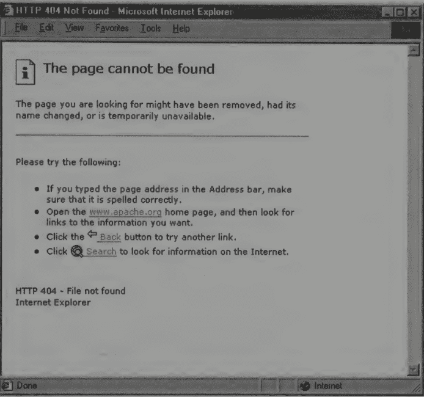

这个示例不仅演示了如何创建必要的表单和 JavaScript 代码来基于用户身份和密码加载页面，还捕获了结果页面实际上不存在的情况，并告知用户其凭据无效。这为原本会导致服务器特定错误消息的情况提供了有吸引力的用户界面。因此，你可以让捕获的错误页面与你精心设计网站的其余部分保持一致的视觉效果。参见图 5-13。

在深入代码之前，有必要解释一下各个组件及其交互方式。首先，我们有 *index.htm* 页面。它包含供用户输入凭据的表单。它还加载 *blank.gif* 图像作为 1 像素宽、1 像素高、背景透明的图像。当用户输入其凭据并提交表单时，JavaScript 代码拦截表单提交，从表单中获取身份和密码值，并尝试使用相对 URL 格式 `identity/password.gif` 加载图像文件。如果图像成功加载，图像的 `onLoad` 事件处理程序会使用相对 URL 格式 `identity/password.htm` 加载受密码保护的页面。如果图像加载失败，可能是因为用户输入了错误的凭据信息从而请求了一个不存在的图像，那么图像的 `onError` 事件处理程序会触发加载 `error.htm` 页面，告知用户输入了错误的凭据并请重试。

## **图 5-13**
捕获的 404 错误响应。

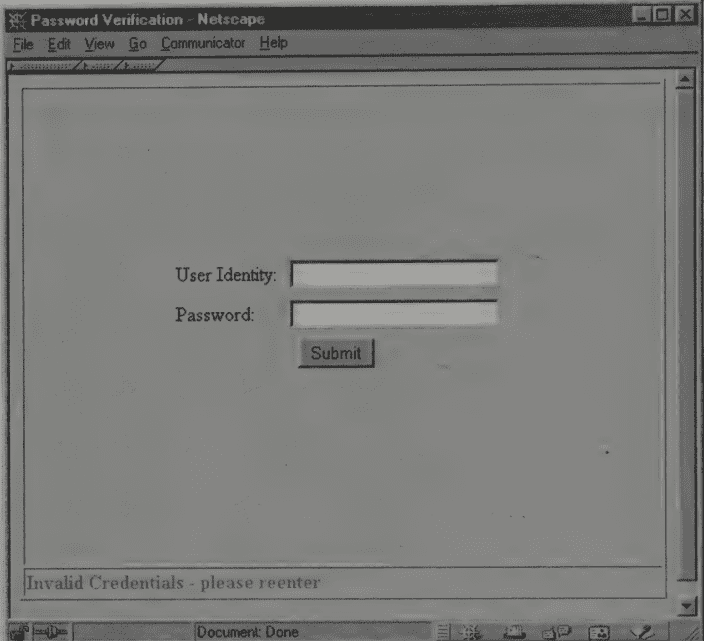

该代码额外提供了对 Internet Explorer 3 的支持，该浏览器不支持从 JavaScript 内部操作图像。解决方案需要使用内联框架——即嵌入 `index.htm` 页面本身的框架。这最初包含一个 `blank.htm` 页面，当用户提交表单时，会被使用相对 URL 格式 `identity/epassword.htm` 的临时辅助页面替换。该页面的内容随后使用相对 URL 格式 `identity/password.htm` 将受密码保护的页面加载到父框架中。同样，如果用户输入了错误的凭据，那么临时辅助页面将不会被加载到内联框架中。虽然这种失败无法使用 JavaScript 检测，但它至少避免了浏览器显示默认的 404 错误页面。希望需要使用 Internet Explorer 3 进行密码访问的人数一直在不断减少。

因此，系统成功运行需要以下文件：

- *index.htm*—身份和密码输入页面
- *blank.gif*—透明 1x1 图像
- *blank.htm*—由 Internet Explorer 3 加载到内联框架中的空页面
- *error.htm*—略作修改的 index.htm 版本
- *identity/password.gif*—受密码保护的透明 1x1 图像
- *identity/password.htm*—受密码保护的页面
- *identity/epassword.htm*—Internet Explorer 3 使用的临时辅助页面

## 密码保护与验证源代码

*index.htm* 页面包含一个登录表单，允许用户输入其身份和密码：

> ./chapter5/password/index.htm

```
<form name="logon" onSubmit="return testForIt()">
用户身份:
<input type="password" name="identity" value="">
密码:
<input type="password" name="password" value="">
<input type="submit" value="Submit">
</form>
```

当点击提交按钮时，表单标签的 onSubmit 事件处理程序调用 testForIt() 函数，将结果返回给事件处理程序。如果结果为 false，则表单提交将被有效取消。

定义并初始化为 false 的几个全局布尔变量——request - 表示用户是否已提交其凭据进行验证，useImage - 表示浏览器是否支持图像，useFrame - 表示浏览器是否为 Internet Explorer 3，应使用内联框架代替图像：

```
var request = false;
var useImage = false;
var useFrame = false;
```

接下来，代码检测对 document 对象的 images 属性的支持，如果存在，则将全局 useImage 布尔变量设置为 true：

```
if (document.images)
    useImage = true;
```

否则，如果浏览器是 Internet Explorer 3，通过 navigator 对象的 appVersion 属性中的子字符串 MSIE 3 识别，则将全局 useFrame 布尔变量设置为 true：

```
else
    if (navigator.appVersion.indexOf('MSIE 3') > -1)
        useFrame = true;
```

如果 useImage 设置为 true，代码会输出显示透明 1x1 blank.gif 图像（名为 testImage）所需的 HTML，并带有分别调用 loadIt() 和 failIt() 函数的 onLoad 和 onError 事件处理程序：

```
if (useImage)
    document.write(
        ''
    );
```

否则，如果 useFrame 设置为 true，代码会输出显示隐藏的 1x1 内联框架所需的 HTML，其内容为 blank.htm：

```
else if (useFrame)
    document.write(
        '<iframe src="blank.htm" marginheight="0" marginwidth="0"' +
        ' frameborder="0" width="1" height="1"></iframe>'
    );
```

当用户点击登录表单的提交按钮时，调用 testForIt() 函数：

```
function testForIt() {
```

只有当身份和密码表单字段的值都非空时，我们才尝试加载受密码保护的页面：

```
if (document.logon.identity.value != '' &&
    document.logon.password.value != '') {
```

如果全局 useImage 布尔变量为 true，我们尝试加载与受密码保护页面关联的图像：

```
if (useImage) {
```


## 位置与链接

首先，将全局布尔变量 `request` 设置为 `true`，以表示用户刚刚请求对其凭据进行身份验证：

```
request = true;
```

接下来，通过更改 `testImage` 图像的 `src` 属性，尝试加载密码保护的图像：

```
document.images["testImage"].src =
    document.logon.identity.value + '/' +
    document.logon.password.value + '.gif';
}
```

但是，如果全局布尔变量 `useFrame` 被设置为 `true`，则通过更改内联框架 `location` 对象的 `href` 属性，将临时辅助页面加载到隐藏的内联框架中：

```
else if (useFrame) {
    document.frames[0].location.href =
        document.logon.identity.value + '/' +
        'e' + document.logon.password.value + '.htm';
}
```

如果两个全局布尔变量 `useImage` 和 `useFrame` 都未被设置为 `true`，则尝试加载密码保护的页面。这确保了任何启用了 JavaScript 但不支持图像对象脚本处理的浏览器至少会尝试加载密码保护的页面，只是不会预先检查该页面是否存在：

```
else {
    location.href =
        document.logon.identity.value + '/' +
        document.logon.password.value + '.htm';
}
}
```

`testForIt()` 函数总是向 `logon` 表单的 `onSubmit` 事件处理程序返回 `false`，从而取消表单提交：

```
return false;
}
```

每当 `testImage` 图像的 `onLoad` 事件处理程序被触发时，就会调用 `loadIt()` 函数。由于 `img` 标签的 `onLoad` 事件处理程序在图像完全加载时触发，因此对于每次成功的凭据验证，它至少会触发两次：一次是在初始的 *blank.gif* 加载时，另一次是在密码保护的图像加载时。因此，代码必须区分这两次调用。第一次发生在浏览器加载凭据输入页面时；第二次发生在用户提交表单时，此时 `testForIt()` 函数会将全局布尔变量 `request` 设置为 `true`。`loadIt()` 函数正是测试这个布尔值，以确保对 `loadIt()` 函数的调用是由用户提交表单引起的：

```
function loadIt() {
```

只有当全局布尔变量 `request` 为 `true` 时，函数的其余部分才会被执行：

```
if (request) {
```

首先，将 `request` 设置为 `false`：

```
request = false;
```

然后加载密码保护的页面：

```
window.location.href =
    document.logon.identity.value + '/' +
    document.logon.password.value + '.htm';
}
```

当用户提供无效的凭据时——即 `identify` 和 `password` 的组合未能成功加载密码保护的图像时——`failIt()` 函数会被调用：

```
function failIt() {
```

只有当 `request` 被设置为 `true` 时，我们才会高亮显示凭据验证失败：

```
if (request) {
```

首先，将 `request` 重置为 `false`：

```
request = false;
```

其次，使用 `bgColor` 属性将文档对象的背景颜色更改为浅红色：

```
document.bgColor = '#FFCCCC';
```

接下来，加载 *error.htm* 页面。我们先更改颜色，以便在等待错误页面加载的过程中给用户一个视觉提示，表明出了问题：

```
window.location.href = 'error.htm';
}
```

最后，清除表单字段中保存的不正确的验证信息：

```
document.logon.identity.value = '';
document.logon.password.value = '';
}
```

## ./chapter5/password/error.htm

*error.htm* 页面几乎是 *index.htm* 页面的精确副本。唯一的区别是不同的背景颜色（与 *failIt()* 函数中所做的背景颜色更改相匹配）：

```
<body bgcolor="#FFCCCC">
```

并且它不是在 *failIt()* 函数中加载错误页面，而是使用 *alert* 警告用户其再次未能输入正确的凭据信息：

```
alert('Incorrect credentials - please reenter');
```

剩下需要解释的是 Internet Explorer 3 中使用的相应临时辅助页面的内容。由于我们在 Internet Explorer 3 中无法使用图像，因此我们尝试加载一个与密码保护页面几乎相同的页面。例如，如果密码保护页面保存在名为 *abracadabra.htm* 的文件中，则需要一个名为 *eabracadabra.htm* 的等效临时辅助页面。其内容相当简短。它只是将密码保护的页面加载到父框架中，使用登录表单的 *identity* 和 *password* 字段的值属性作为文件名的基础：

## ./chapter5/password/martin/eabracadabra.htm

```
parent.location.href =
    parent.document.logon.identity.value + '/' +
    parent.document.logon.password.value + '.htm';
```

### 站点链接爬虫

爬取网站或网站部分中的所有链接，报告页面数量、链接数量、重复链接数量以及一个页面与另一个页面之间关系的信息，可以提供有关网站结构的极有价值的信息。这个简单的站点链接爬虫可用于爬取本地存储的文件或特定网站的所有链接，前提是站点链接爬虫位于网站本身上，或者位于任何远程网站的 Netscape Navigator 4 中（在请求额外的浏览器权限后）。当在本地运行时，Netscape Navigator 会在无法链接到某个页面时礼貌地发出指示，如图 5-14 所示。这展示了站点链接爬虫如何用于在将页面上传到在线之前查找断开的链接。

通常，在来自一个域名的页面中运行的脚本无法访问来自另一个域名的页面的数据（脚本、对象、方法、变量等）。这是为了防止恶意脚本隐藏在隐藏的框架或窗口中并监视用户的浏览习惯。供应商在其产品中采用安全模型来阻止这种情况发生。通常，在在线新闻媒体中经常被突出显示的浏览器安全漏洞，是由于供应商的安全模型之一被证明无法提供必要的安全级别，以阻止极具天赋的 JavaScript 编程人员访问他们不应该被允许访问的信息。

图 5-14
当 Netscape Navigator 无法在本地文件系统上找到文件时显示的错误消息。

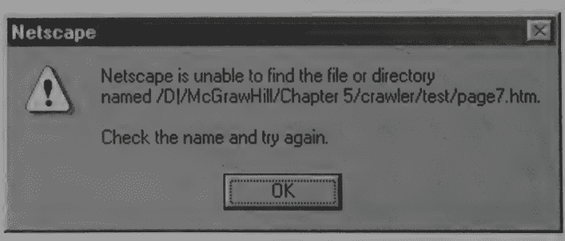

## 位置与链接

不幸的是，安全模型的缺点是，用 JavaScript 提供极其复杂的接口以允许来自不同域名的两个页面之间进行交互，即使不是不可能，也变得更加困难。幸运的是，Netscape Navigator 4 中采用的安全模型支持 Java Capabilities API（*netscape.security* 包），该 API 允许 JavaScript 中的内联 Java 代码向用户请求额外的浏览器权限，然后用户可以授予或拒绝这些权限。

例如，可以编写 JavaScript 代码在 Netscape Navigator 4 中读取通用浏览器数据。在代码被允许访问通用浏览器数据（一个原本受保护的数据源）之前，代码必须首先请求启用 `UniversalBrowserRead` 权限。此请求会提示用户，如图 5-15 所示，以授予或拒绝所请求的权限。基于用户对请求额外权限的网站的经验、所请求权限的类型，以及其对拒绝请求导致功能损失的理解，用户有望做出明智的决定，决定是否授予或拒绝该请求。在做出决定之前，用户可以查询请求的详细信息，如图 5-16 所示，以查看授予请求会产生什么影响。

一旦权限被授予，在以下


JavaScript 代码请求对通用浏览器数据的读取访问权限。

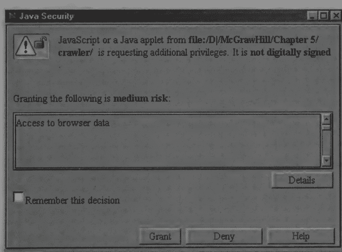


浏览器会话期间——但仅限于已请求该权限的特定 JavaScript 代码。如果其他 JavaScript 代码请求类似的权限，那么它也需要获得用户的同意。

请求额外权限非常简单，以下 Java 代码调用 `PrivilegeManager` 类的 `enablePrivilege` 方法来请求启用 `UniversalBrowserRead` 权限：

```
netscape.security.PrivilegeManager.enablePrivilege(
"UniversalBrowserRead"
);
```

使用完毕后，应通过调用 `PrivilegeManager` 类的 `disablePrivilege` 方法来禁用 `UniversalBrowserRead` 权限：

```
netscape.security.PrivilegeManager.disablePrivilege(
"UniversalBrowserRead"
);
```

Internet Explorer 支持一种安全模型，允许在 Java 中请求额外权限（使用 `com.ms.security` 包）。然而，Internet Explorer 无法在 JavaScript 中包含内联 Java 代码——解决方案是将所有处理包含在 Java 小程序中，这超出了本书的范围。尽管如此，此处的代码仍然可以在 Internet Explorer 中工作，但它只允许抓取本地或相对文件。

图 5-17 展示了爬虫的实际运行情况，它正在抓取名为 `file:///D|/McGrawHill/Chapter 5/crawler/` 的本地文件中的可访问链接，并详细显示了一个快照：总共搜索 4 个页面，其中 1 个已完成，3 个待处理，3 个被拒绝，12 个重复链接。图 5-18 展示了完整结果，在向下滚动底部框架的内容后，显示了每个搜索页面的所有引用来源。

## 站点链接爬虫源代码——index.htm

`index.htm` 页面定义了三个主要框架，用于容纳输入表单（`inputFrame`）、当前正在抓取的页面的输出显示（`contentFrame`）以及完整抓取的输出日志（outputFrame）。请注意，初始时，contentFrame 和 outputFrame 都加载一个 blank.htm 页面，该页面基本上是空的：

```
<html>

<head>
<title>Site Link Crawler</title>
</head>

<frameset rows="125,200,*">
	<frame src="input.htm" name="inputFrame">
	<frame src="blank.htm" name="contentFrame">
	<frame src="blank.htm" name="outputFrame">
</frameset>

</html>
```

## 站点链接爬虫源代码——input.htm

加载到 *inputFrame* 框架中的 *input.htm* 页面是唯一最初显示任何内容的页面。它用于允许用户选择他们希望站点链接爬虫从哪个 URL 开始，以及应该应用什么目录路径掩码，以避免站点链接爬虫偏离预期的目录路径。例如，用户可以选择从页面 *file:///D|/test/page1.htm* 开始，并将抓取限制在目录路径 *file:///D|/test/* 内的页面。*inputForm* 表单的基本 HTML 包含几个输入字段：

```
<form name="inputForm" onSubmit="return false">
```

第一个（*url*）是一个隐藏输入字段（即，不在页面上显示），用于跟踪 *crawl* 中的当前位置：

```
<input name="url" type="hidden">
```

*visible* 输入字段允许用户输入抓取的起始位置：

```
<input name="visible" type="text" size="70"> - URL
```

*mask* 输入字段允许用户输入在抓取时决定跟随哪些链接时使用的掩码：

```
<input name="mask" type="text" size="70"> - Mask
```

单击时，Crawl 表单按钮调用 *startcrawl()* 函数，传递当前表单（*this.form*）的 *visible* 表单字段的 *value* 属性：

```
<input type="button" value="Crawl"
onClick="startcrawl(this.form.visible.value)">
```

还有五个额外的输入字段（*total*、*done*、*todo*、*rejected* 和 *duplicate*），每个字段都有一个 *onFocus* 事件处理程序，调用当前输入字段（*this*）的 *onBlur()* 方法——有效地阻止用户修改这五个输入字段的内容：

```
Total: <input type="text" name="total" size="4"
  onFocus="this.blur()">
Done: <input type="text" name="done" size="4"
  onFocus="this.blur()">
```

```
To do: <input type="text" name="todo" size="4" onFocus="this.blur()">
Rejected: <input type="text" name="rejected" size="4" onFocus="this.blur()">
Duplicate: <input type="text" name="duplicate" size="4" onFocus="this.blur()">
</form>
```

全局变量 startat 保存默认抓取的相对 URL——例如，test/page1.htm。这可以根据您自己的需求进行更改：

```
var startat = 'test/page1.htm';
```

为了避免重复使用对另外两个兄弟框架（outputFrame 和 contentFrame）的长引用，这两个框架都必须通过父框架引用，我们定义了两个全局变量 of 和 cf：

```
var of = parent.outputFrame;
var cf = parent.contentFrame;
```

一旦表单的 HTML 完全定义了表单，从那时起就可以通过 JavaScript 访问该表单。同样，为了避免重复使用长表单引用，定义了一个全局变量 form：

```
var form = document.inputForm;
```

调用 getFullPath() 函数，传递当前窗口的 location 对象的 href 属性，将结果赋值给全局 mask 变量。

```
var mask = getFullPath(window.location.href);
```

表单的 mask 输入字段的值将更新为全局 mask 变量的值：

```
form.mask.value = mask;
```

表单的 visible 输入字段的值将更新为全局 mask 变量和 startat 变量的连接值：

```
form.visible.value = mask + startat;
```

由于最后这两行代码，表单被初始化，以便用户无需执行任何操作即可开始测试抓取，只需按 Crawl 按钮。

myEntry 数组用于保存已抓取或将要抓取的所有页面的 URL：

```
var myEntry = new Array();
var entryIndex = 0;
```

定义并初始化了两个全局变量（rejected 和 duplicate）。它们用于保存因不适合跟随而被拒绝的页面数量以及重复页面（即已添加到 myEntry 数组中的页面）的数量：

```
var rejected = 0;
var duplicate = 0;
```

为了将抓取路径限制得比掩码提供的更进一步，有必要将某些类型的 URL 声明为禁止访问——例如，任何包含 javascript: 的 URL，这是一个 JavaScript 链接。rejectList 数组包含示例字符串，如果 URL 中存在这些字符串，则将该 URL 标记为不适合跟随：

```
var rejectList = new Array(
    'res:',
    'javascript:',
    'about:',
    'mailto:'
);
```

提供不适合的字符串列表并不能阻止跟随尚未定义的不良 URL。acceptList 数组包含示例字符串，如果 URL 中存在这些字符串，则将该 URL 标记为适合跟随。URL 中必须至少存在 acceptList 数组中的一个字符串；否则，该 URL 将再次标记为不适合：

```
var acceptList = new Array(
    '.htm'
);
```

前面用于填充全局 base 变量值的 getFullPath() 函数返回其 s 输入参数的值（通常是一个 URL），减去文件名。换句话说，它与上一节密码保护和验证代码中描述的 getFileName() 函数相反：

function getFullPath(s) {
    if (s.indexOf('/') != -1)
        return s.substring(0, s.lastIndexOf('/') + 1);
    else
        return s.substring(0, s.lastIndexOf('\\') + 1);
}

`startcrawl()` 函数在用户点击"爬取"按钮时被调用，它以传入的 `url` 参数作为起始点，启动爬虫开始它的探索之旅：

```
function startcrawl(url) {
```

输出帧的文档被打开，准备直接将内容写入其中。输出帧原有的任何内容都会被立即清除：

```
of.document.open();
```

隐藏的 `url` 表单字段的值被更新为可见表单字段 `visible` 的值：

```
form.url.value =
    form.visible.value;
```

如果全局变量 `entryIndex` 不等于零，则 `myEntry` 数组中的每个条目都会被设为 `null`——实际上就是删除数组中的每个元素：

```
if (entryIndex != 0)
    for (var i=0; i<entryIndex; i++)
        myEntry[i] = null;
```

三个全局变量 `entryIndex`、`rejected` 和 `duplicate` 被重新初始化：

```
entryIndex = 0;
rejected = 0;
duplicate = 0;
```

`crawl()` 函数被调用，将 `url` 参数作为输入参数传入：

```
crawl(url);
}
```

`crawl()` 函数虽然只有一行，但需要与前面的 `startcrawl()` 函数分开，因为它在代码中的不同位置被调用——一次在开始时，另一次则是在遍历每个爬取页面寻找链接时。它只是将 *frame.htm* 页面加载到 `cf` 帧中：

```
function crawl(url) {
    cf.location.href = 'frame.htm';
}
```

现在或许是一个跳到 *frame.htm* 页面说明的好时机。理解之后再跳回这里，继续阅读 *input.htm* 页面的剩余说明。

如果你已经跳到过 *frame.htm* 页面，那么你就知道该页面在 `cf` 帧中加载了一个框架集。一个帧是 *search.htm* 页面，另一个帧则是使用 `url` 表单字段的当前值加载的页面。加载完成后，*search.htm* 页面读取 `links` 数组中的所有链接，将每个 `url` 依次作为输入传递给 `addEntry()` 函数，同时传入 `title`、`links` 的数量以及一个布尔值 `searched`。`addEntry()` 函数至少被调用一次——通常是两次，有时更多——每当*爬虫*爬取一个页面时都会调用：一次是在另一个页面中发现了指向该页面的链接时，另一次是在该页面最终被加载并扫描其中的链接时。在第一种情况下，`searched` 参数被设为 `false`。在另一种情况下，它被设为 `true`。其他情况通常是由于存在指向同一页面的重复链接。

```
function addEntry(url, title, links, searched) {
```

`url` 参数作为输入传递给 `tidyupURL()` 函数，其结果被赋回给 `url`：

```
url = tidyupURL(url)
```

整理后的 `url` 值作为输入传递给 `unAcceptable()` 函数，其结果在 `if` 语句中作为布尔值处理：

```
if (unAcceptable(url)) {
```

如果 `unAcceptable()` 函数返回 `true`，则调用 `rejectEntry()` 函数：

```
rejectEntry();
```

当前的 `addEntry()` 函数结束，返回到调用它的地方：

```
return;
}
```

如果 `unAcceptable()` 函数返回 `false`，则会检查 `myEntry` 数组中的每个条目，以确保该 `url` 尚未被添加到数组中。代码依次遍历每个条目：

```
for (var entry=0; entry<entryIndex; entry++) {
```

`myEntry` 数组包含的是稍后会看到的、使用 `Entry()` 对象构造函数创建的 Entry 对象。每个对象都有多个属性。其中一些属性——例如 `url`——由构造函数填充。其他属性——例如 `title`、`links`——则简单地初始化为空格或零。这是必要的，因为当一个 URL 被添加到数组时，我们知道它的 URL，但不知道页面的标题或包含多少链接。

`myEntry` 数组中每个 Entry 对象的 `url` 属性都会与当前的 `url` 参数进行比较：

```
if (myEntry[entry].url == url) {
```

如果当前 `url` 与某个 Entry 对象的 `url` 属性匹配，并且该 Entry 对象的 `links` 属性为零，则使用 `addEntry()` 函数的 `title` 和 `links` 输入参数更新 `title` 和 `links` 属性：

```
if (myEntry[entry].links == 0) {
    myEntry[entry].title = title;
    myEntry[entry].links = links;
}
```

如果 Entry 对象的 `searched` 属性被设为 `false`，则使用 `addEntry()` 函数的 `searched` 输入参数更新该属性：

```
if (!myEntry[entry].searched) {
    myEntry[entry].searched = searched;
}
```

如果 `searched` 参数为 `false`，则此次函数调用是在页面中发现了该链接的结果。在这种情况下，既然我们已经在 `myEntry` 数组中找到了这个 `url`，这就是一个重复链接。每个 Entry 对象包含一个 `referURLs` 数组。当前的 `url` 被追加到该数组中，`referrers` 属性递增，然后调用 `duplicateEntry()` 函数：

```
if (!searched) {
    myEntry[entry].referURLs[myEntry[entry].referrers++] =
        form.url.value;
    duplicateEntry();
}
```

最后，由于我们在遍历 `myEntry` 数组中的所有条目时找到了匹配项，我们使用 `return` 语句跳出循环并退出函数：

```
return;
    }
}
```

如果没有找到匹配项，则调用 `setEntry()` 函数：

```
setEntry(url, title, links, searched)
}
```

`tidyupURL()` 函数只是去除 `url` 参数末尾的任何锚点（hash）或搜索参数。例如，如果 `url` 包含 `http://www.domain.com/page.htm#anchor` 或 `http://www.domain.com/page.htm?search`，则返回的结果将只包含 `http://www.domain.com/page.htm`。这避免了爬虫多次爬取同一页面但带有不同的锚点或搜索参数的问题。

```
function tidyupURL(url) {
    var hash = url.indexOf('#');
    var question = url.indexOf('?');

    if (hash > -1) url = url.substring(0, hash);

    if (question > -1) url = url.substring(0, question);

    return url;
}
```

`unAcceptable()` 函数在 `url` 不适合爬取时返回 `true`，在适合时返回 `false`：

```
function unAcceptable(url) {
```

第一个测试是确保 `url` 参数在位置零处包含 `mask` 表单字段的值：

```
if (url.indexOf(form.mask.value) != 0)
```

如果不包含，则该 `url` 不是可接受的。因此，函数返回 `true`：

```
return true;
```

接下来，测试 `rejectList` 数组中的每个条目：

```
for (var i=0; i<rejectList.length; i++)
    if (url.indexOf(rejectList[i]) > -1)
```

如果在 `url` 参数中找到了某个条目，则同样不可接受，函数返回 `true`：

```
return true;
```

接下来，测试 `acceptList` 数组中的每个条目：

```
for (var i=0; i<acceptList.length; i++)
    if (url.indexOf(acceptList[i]) > -1)
```

如果在 `url` 参数中找到了任何一个条目，则此次它被认为是可接受的，函数返回 `false`：

```
return false;
```

最后，如果在 `acceptList` 数组中没有找到匹配项，该 `url` 默认被视为不可接受，函数返回 `true`：

```
return true;
}
```

`rejectEntry()` 函数将 HTML 输出追加到输出帧的末尾，然后递增 `rejected` 变量的值，并将新值赋给 `rejected` 表单字段的值：

```
function rejectEntry() {
    of.document.write(
        '<font color="#FF0000"><b> - Rejected<\/b><\/font><br>'
    );
    form.rejected.value = ++rejected;
}
```

同样地，`duplicateEntry()` 函数将 HTML 输出追加到 `of` 帧的末尾，然后递增 `duplicate` 变量的值，并将新值赋给 `duplicated` 表单字段的值：

```
function duplicateEntry() {
    of.document.write(
```


 位置与链接

```
'<font color="#FF9933"><b> - 重复<\/b><\/font><br>'
);
form.duplicate.value = ++duplicate;
}
```

由 `search.htm` 页面调用的 `finishedSearch()` 函数，在将所有链接传递给 `addEntry()` 函数完成后，检查 `myElement` 数组中所有当前的条目是否都已被搜索。如果没有，它会启动爬虫去抓取下一个页面；否则，它会调用 `displayEntries()` 函数来展示爬虫的运行结果：

```
function finishedSearch() {
```

通过查找第一个 `searched` 属性为 `false` 的条目，可以找到 `myEntry` 数组中第一个未搜索的 `Entry` 对象：

```
var entry=0;
while (entry<entryIndex && myEntry[entry].searched)
    entry++;
```

`done` 和 `todo` 两个表单字段的值都会被更新，分别对应已搜索的条目数（`entry`）和当前剩余待搜索的条目数（`entryIndex - entry`）：

```
form.done.value = entry;
form.todo.value = entryIndex - entry;
```

如果 `entry` 小于 `entryIndex`，则至少还有一页需要搜索：

```
if (entry<entryIndex) {
```

在这种情况下，隐藏字段 `url` 的值会用第一个未搜索的 `Entry` 对象的 `url` 属性来更新：

```
form.url.value = myEntry[entry].url;
```

然后调用 `crawl()` 函数来启动另一次搜索：

```
crawl(myEntry[entry].url);
}
else {
```

否则，所有 `Entry` 对象都已被搜索完毕，此时调用 `displayEntries()` 函数来显示结果：

## 第五章

`displayEntries()` 函数简单地遍历 myEntry 数组中的所有 Entry 对象，将 HTML 追加到 output 变量中：

```
function displayEntries() {
    var output = '<H1>结果：<\/H1>';

    for (var entry=0; entry<entryIndex; entry++) {
        output += '<p>';

        output +=
            '<b>URL：<\/b> ' + myEntry[entry].url + '<br>' +
            '<b>标题：<\/b> ' + myEntry[entry].title + '<br>' +
            '<b>链接：<\/b> ' + myEntry[entry].links + ', ' +
            '<b>引用：<\/b> ' + myEntry[entry].referrers + ':<br>';

        for (var i=0; i<myEntry[entry].referrers; i++)
            output += '<i>' + myEntry[entry].referURLs[i] + '<\/i><br>';

        output += '<\/p>';
    }
```

打开 cf 框架（这会清除当前内容），并输出一个 Finished 标题：

```
cf.document.open();
cf.document.write('<h1>已完成<\/h1>');
cf.document.close();
```

output 变量中的 HTML 内容最终被写入 of 框架：

```
of.document.write(output);
of.document.close();
}
```

`Entry()` 函数实际上是 Entry 对象的构造函数。它根据传入的参数创建并初始化 Entry 对象：

```
function Entry(url, title, links, searched) {
    this.url = url;
    this.title = title;
    this.links = links;
    this.searched = searched;
    this.referrers = 0;
}
```

Entry 对象的其中一个属性（referURLs）实际上是一个空数组，随后会逐步填充指向该 Entry 实例所代表的 URL 的所有引用页面的列表：

```
this.referURLs = new Array();
```

Entry 构造函数实际上会用表单 url 字段的值来填充 referURLs 数组的第一个元素：

```
this.referURLs[this.referrers++] = form.url.value;
}
```

`setEntry()` 函数在 `addEntry()` 函数中被调用，每当一个 url 通过重复和重复检查后，就会通过调用 Entry 构造函数来创建 Entry 对象，并将生成的对象引用追加到 myEntry 数组中。同时，表单的 total 字段的值也会用 entryIndex 变量的值来更新：

```
function setEntry(url, title, links, searched) {
    myEntry[entryIndex++] =
        new Entry(url, title, links, searched);
    form.total.value = entryIndex;
}
```

## 站点链接爬虫源代码——frame.htm

```
../chapter5/crawler/frame.htm
```

如前所述，每当爬虫需要加载一个要搜索链接的 url 页面时，它会将 frame.htm 页面加载到 cf 框架中。乍一看这似乎是一种奇怪的加载 url 页面的方式，但它实际上允许代码在无需以任何方式修改 url 页面的情况下，获知 url 页面已成功加载——这一点在 url 页面位于你无法控制的站点上时尤其有用。

通常，body 标签中的 onLoad 事件处理程序用于指示页面何时完全加载。frameset 标签也有 onLoad 事件处理程序，用于指示框架集中所有框架何时完全加载。

由于创建 frame.htm 页面的代码时还不知道 url 页面是什么，因此 JavaScript 代码需要基于父框架的 inputFrame 框架中隐藏的 url 表单字段的值，动态构建 frameset 的 HTML。frame.htm 页面定义了两个框架：searchFrame 和 dataFrame。searchFrame 最初包含 loading.htm 页面，其中只有一个"正在加载……"的提示信息。一旦 `url` 页面完全加载到 `dataFrame` 中，`frameset` 标签的 `onLoad` 事件处理程序就会将 `search.htm` 页面加载到 `searchFrame` 中：

```
var output = '';

output += '<frameset rows="100%,*" ' +
  'onLoad="this.searchFrame.location = \'search.htm\'">' +
  '<frame src="loading.htm" name="searchFrame">' +
  '<frame src="' +
  parent.inputFrame.document.inputForm.url.value +
  '" name="dataFrame"><\/frameset>';

document.write(output);
```

## 站点链接爬虫源代码——search.htm

```
../chapter5/crawler/search.htm
```

`search.htm` 页面遍历包含在同级 `dataFrame` 框架中的页面的 `links` 数组的所有元素。正如站点链接爬虫介绍开头所述，Netscape Navigator 4 支持 Java 能力 API，允许请求和启用额外的权限。为了允许爬虫访问来自与 `search.htm` 页面不同域的页面的属性，我们可以请求用户授予 `UniversalBrowserRead` 权限给 `search.htm` 中的 JavaScript 代码。因此，`search.htm` 页面的第一页正是这样做的。

首先，我们通过检查 `navigator` 对象的 `appName`（应用程序名称）属性是否包含值"netscape"来测试浏览器是否为 Netscape Navigator：

```
if (navigator.appName == "Netscape" &&
```

此外，我们使用 `navigator` 对象的 `javaEnabled()` 方法来检查 Java 是否已启用，如果启用则返回 `true`，如果禁用则返回 `false`：

```
navigator.javaEnabled()) {
```

最后调用 `netscape.security` 包的 `PrivilegeManager` 类的 `enablePrivilege()` 方法，请求用户授予 `UniversalBrowserRead` 权限：

位置与链接

```
netscape.security.PrivilegeManager.enablePrivilege(
  "UniversalBrowserRead"
);
}
```

如果用户授予了所需的权限，那么对原本受保护的数据的任何访问都会成功；如果没有授予，则对原本受保护的数据的访问将失败，并显示"access disallowed from scripts at search.htm to documents at another domain"错误消息，如图 5-19 所示。

与 *input.htm* 页面一样，我们为其他框架提供快捷引用：

```
var df = parent.dataFrame;
var of = top.outputFrame;
```

url 变量保存 df 框架的 location 对象的 href 属性：

```
var url = df.location.href;
```

**图 5-19**
当用户拒绝权限请求时在 Netscape Navigator 中产生的 JavaScript 错误。

title 变量保存 df 框架的 document 对象的 title 属性：

```
var title = df.document.title;
```

links 变量保存 df 框架的 document 对象中 links 数组的引用：

```
var links = df.document.links;
```

length 变量保存 links 数组引用中 links 的数量：

```
var length = links.length;
```

HTML 输出直接写入 `of` 框架，显示到目前为止捕获的关于 `df` 框架内容的详细信息：

```
of.document.write('<p>');
of.document.write('<b>正在搜索：<\/b> ' + url + '<br>');
of.document.write('<b>标题：<\/b> ' + title + '<br>');
of.document.write('<b>包含：<\/b> ' + length + '<br>');
of.document.write('<b>链接<\/b>：');
of.document.write('<\/p>');
```

调用保存在 `top` 框架的 `inputFrame` 子框架中的 `addEntry()` 函数，传递 `url`（转换为字符串）、`title` 和 `length` 变量以及一个 `true` 布尔变量，表示这个特定的 `url` 已被搜索：

```
top.inputFrame.addEntry(
  url.toString(), title, length, true
);
```

然后代码遍历 `links` 数组引用的所有元素，调用保存在 `top` 框架的 `inputFrame` 子框架中的 `addEntry()` 函数，传递 `href` 属性、空字符串和零——分别对应 `addEntry()` 函数的 `title` 和 `length` 参数：

```
for (var i=0; i<length; i++) {
  of.document.write(i + ' : ' + links[i].href);
  top.inputFrame.addEntry(links[i].href, '', 0);
}
```

为了完全整洁，我们禁用 UniversalBrowserRead 权限：


## 定位和链接

```javascript
if (netscape) {
    netscape.security.PrivilegeManager.disablePrivilege(
        "UniversalBrowserRead"
    );
}
```

最后，调用顶层框架的`inputFrame`子框架中保存的`finishedSearch()`函数：

```javascript
top.inputFrame.finishedSearch();
```

Internet Explorer 无法用于爬取其他域上的页面。尝试时会产生"Permission denied"错误，由浏览器窗口左下角的黄色感叹号警告标志指示。双击该图标会显示错误信息，如图 5-20 所示。

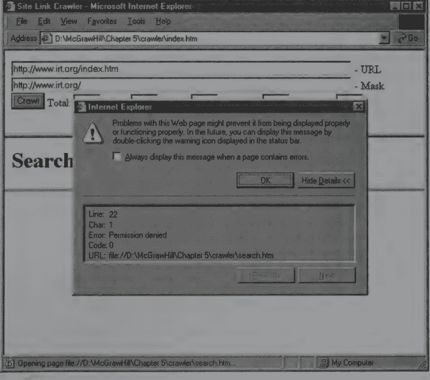

图 5-20 — 在 Internet Explorer 中尝试访问来自其他域的页面属性时显示的"Permission denied"错误信息。

### 小结

由于 JavaScript 可以访问当前 URL 的属性，它可以根据当前页面在站点结构中的位置做出决策，引用周围的其他页面，也可以通过修改`href`属性的值来直接影响加载到当前窗口或其他框架/窗口中的页面。

能够访问 HTML 页面中的链接，不仅允许 JavaScript 逐步遍历页面中的所有链接，还提供了以另一种视图展示页面中链接的能力。这将在第 6 章的"Reading a Directory"应用程序中得到很好的展示。

通过使用外部 JavaScript 源文件，我们可以开始了解代码如何在多个页面之间共享和重用。我们将在本书的剩余部分广泛看到外部 JavaScript 源文件的使用。

## 窗口和框架

第 6 章

并非所有网站都驻留在单个窗口或单个窗口的单个框架中。有些网站使用框架将网站划分为菜单框架和内容框架，从而减少在每个页面中放置导航菜单的开销。有些网站会打开与主浏览器窗口分离的远程窗口或弹出窗口。框架和额外窗口的组合允许网页设计者模拟更传统的客户端应用程序，提供丰富的对话框来辅助用户（也可能分散用户）与其网站的交互。

本章包括弹出窗口和多框架的有用应用。第一个是跳转框工具，展示如何使用 JavaScript 从表单选择下拉框定位不同的框架和窗口。Reading a Directory 应用程序展示如何读取隐藏的框架目录列表，然后以我们选择的任何形式重新显示，例如按文件类型过滤。

弹出窗口生成器是一个有用的 JavaScript 工具，你可以用它来定义应用程序的完美弹出窗口。定义完成后，你可以剪切并粘贴 JavaScript 代码以在主代码中使用。Dictionary Pop-up 展示如何在主窗口和弹出窗口之间传递数据以影响弹出窗口的内容，提供字典查找功能。

Family Tree 应用程序展示了功能丰富的应用程序如何动态更改页面视图并显示复杂家族树中许多人的详细信息，JavaScript 代码和变量数据保存在不可见的父框架中，不会被覆盖。

随着 JavaScript 程序变得越来越复杂，调试它们也变得越来越困难。JavaScript 调试窗口展示了将调试信息写入单独的弹出窗口的技术，当禁用时，不会影响被调试应用程序的工作或性能。弹出日期选择器展示了如何在弹出窗口应用程序中使用通用日历库（在第 7 章"日期和时间"中进一步讨论），而库本身不需要了解任何关于弹出窗口的信息。

最后，标题古怪的取消框架和重新框架示例展示了如何克服框架的一些更令人讨厌的特性——例如，未保存在其框架集中的页面、保存在他人框架集中的页面，以及未包含正确周围框架的页面。

- 跳转框工具 ../chapter6/jumpbox/index.htm
- 读取目录 ../chapter6/directory/index2.htm
- 弹出窗口生成器 ../chapter6/generator/index.htm
- 字典弹出窗口 ../chapter6/dictionary/index.htm
- 家族树 ../chapter6/tree/index.htm
- JavaScript 调试窗口 ../chapter6/debug/index.htm
- 弹出日期选择器 ../chapter6/selector/index.htm
- 取消框架和重新框架 ../chapter6/unframing/frameset.htm

### 跳转框工具

这个特定的脚本解决了我最初对 JavaScript 产生兴趣的问题。我的问题是将多个页面之一加载到另一个框架中，但同时允许用户选择页面出现在哪个框架中——例如，浏览器显示区域顶部的框架或底部的另一个框架。（我从未解决这个问题——不是因为它无法解决，而是因为我接下来四年被更复杂的 JavaScript 代码分散了注意力）。

此处展示的代码使用下拉选择表单字段来保存多个页面的描述和位置。选择后，用户可以按"Go"按钮将相关页面加载到所需的框架中，或额外加载到新窗口中。

图 6-1 展示了首先将 Microsoft 的 MSDN 站点加载到顶部框架、将 Netscape 的 DevEdge 站点加载到底部框架的效果。

## 跳转框工具源代码—index.htm

```
../chapter6/jumpbox/index.htm
```

index.htm 页面定义了一个简单的框架集来保存 control.htm 页面，以及两个最初为空的目标框架 frame1 和 frame2。注意基本上有两个框架集，一个嵌套在另一个内部。这允许我们指定第一个框架集应由列组成，一列宽 200 像素，另一列占据剩余的


图 6-1 — 跳转框工具—顶部框架中的 MSDN；底部框架中的 DevEdge。

浏览器窗口宽度（用 \* 表示）。它还允许我们指定这第二个区域应由两行组成的两个框架构成，各占可用高度的 50%：

```html
<frameset cols="200,*">
  <frame src="control.htm">
  <frameset rows="50%,50%">
    <frame src="about:blank" name="frame1">
    <frame src="about:blank" name="frame2">
  </frameset>
</frameset>
```

加载 index.htm 页面并定义框架集后，浏览器将使用三个 window 对象填充当前窗口对象的 frames 数组，每个对象对应三个框架元素中的一个

## 跳转框工具源代码—control.htm

index.htm 页面。使用 window.frames[n]，其中 n 为 0、1 或 2，我们能够直接访问与加载到三个框架中的三个页面相关的 window 对象。

```
../chapter6/jumpbox/control.htm
```

control.htm 页面包含必要的 JavaScript 和表单 HTML，允许用户指定应将选定的页面加载到哪个框架中。它还允许用户指示应改用新窗口。首先，让我们关注表单的 HTML 标记。

跳转表单包含三个名为 where 的单选按钮，其 value 属性稍后用于指示页面应加载的位置。当单选按钮包含在表单中时，结果表单对象使用以单选按钮名称命名的数组来保存对每个单选按钮的引用。因此，跳转表单对象保存一个包含三个条目的 where 数组，每个条目对应三个单选按钮：

```html
<form name="jump">
    <input type="radio" name="where" value="frame1"> - Frame 1
    <input type="radio" name="where" value="frame2"> - Frame 2
    <input type="radio" name="where" value="popup"> - 新窗口
```

places 选择下拉列表使用 option 标签来保存 URL 的值和要加载的页面的文本描述。请注意，某些 option 标签没有与之关联的值：

```html
<select name="places">
    <option>Select:
    <option>==========
    <option value="http://www.irt.org/">irt.org
    <option value="http://msdn.microsoft.com/">MSDN
    <option value="http://developer.netscape.com/">DevEdge
    <option value="http://www.w3.org/">W3C
    <option>==========
    <option value="http://webreview.com/">webreview.com
    <option value="http://developer.earthweb.com/">developer.com
</select>
```


## 第六章

用户从列表中选择一个选项，然后按下述的"Go"表单按钮，该按钮会调用 onClick 事件处理程序，进而调用 go() 函数，并传入对当前表单的引用：

```
<input type="button" value="Go" onClick="go(this.form)">
</form>
```

如果你更喜欢使用图片而非表单按钮，以下附加代码可实现类似功能。当用户点击图片链接时，onClick 事件处理程序会调用 go() 函数，传入对 document 对象的 jump 表单的引用：

```
<a href="#" onClick="return go(document.jump)"
   onMouseOver="mouseOver(document.jump);return true"
   onMouseOut="mouseOut();return true"
   ></a>
```

图片链接在 onMouseOver 和 onMouseOut 事件处理程序被触发时，还会额外调用 mouseOver() 和 mouseOut() 函数。由于这两个函数会更改窗口的状态栏，这两个事件处理程序必须向触发该处理程序的事件返回布尔值 true；否则，更改将被忽略。

go() 函数首先确保用户已选择有效的选项，即具有非空 value 属性的选项，然后控制页面的加载位置。传入 go() 函数的表单引用保存在 what 参数中：

```
function go(what) {
```

通过将 what 表单的 places 选择对象引用传递给 getAnOptionValue() 函数，来获取所选选项的 value 属性：

```
var URL = getAnOptionValue(what.places);
```

仅当 URL 变量的返回值非空时，我们才尝试加载页面：

```
if (URL != '') {
```

根据选中的单选按钮不同，我们以四种可能方式之一加载 URL 变量引用的页面。如果选中了第一个或第二个单选按钮（即 what.where[0] 或 what.where[1] 的 checked 属性值为布尔值 true），则调用 loadFrame() 函数，传入 URL 和与其 value 属性属性对应的单选按钮的 value 属性：

```
if (what.where[0].checked)
    loadFrame(URL, what.where[0].value);

else if (what.where[1].checked)
    loadFrame(URL, what.where[1].value);
```

如果选中了第三个单选按钮，则调用 loadPopup() 函数，同样传入 URL 和 value 属性：

```
else if (what.where[2].checked)
    loadPopup(URL, what.where[2].value);
```

最后，如果没有选中任何单选按钮，则调用 loadPage() 函数，仅传入 URL：

```
else
    loadPage(URL);
}

return false;
}
```

loadPage() 函数将传入的 url 参数引用的页面加载到当前页面：

```
function loadPage(url) {
    location.href = url;
}
```

loadFrame() 函数将页面加载到父框架的 frames 数组中的某个框架中，使用传入的 frame 参数指定要使用的框架名称：

```
function loadFrame(url, frame) {
    parent.frames[frame].location.href = url;
}
```

loadPopup() 函数使用 window 对象的 open() 方法创建一个新窗口来加载页面：

```
function loadPopup(url, name) {
    window.open(url, name, 'width=640,height=480,scrollbars=1');
}
```

getAnOptionValue() 函数返回所选选项的 value 属性。传入的 what 参数引用选择对象，因此 what.options 引用选择对象的 options 数组，而 what.options.selectedIndex 的值指示当前选中的选项：

```
function getAnOptionValue(what) {
    return what.options[what.options.selectedIndex].value;
}
```

getAnOptionText() 函数同样返回所选选项的 text 属性：

```
function getAnOptionText(what) {
    return what.options[what.options.selectedIndex].text;
}
```

mouseOver() 函数获取并在窗口状态栏中显示当前所选选项的 text 属性，方法是更新当前窗口对象的 status 属性，但仅当所选选项的 value 属性非空时：

```
function mouseOver(what) {
    if (getAnOptionValue(what.places) != '') {
        var text = getAnOptionText(what.places);
        window.status = text;
    }
}
```

mouseOut() 函数只是重置窗口的状态栏：

```
function mouseOut() {
    window.status = '';
}
```

### 读取目录

如果服务器允许，当输入的 URL 以我们希望查看内容的目录名结尾时，可以显示该目录中所有文件的目录列表。例如，如果我们输入 http://www.domain.com/directoryname，则可能可以看到目录 directoryname 中存放的所有文件。图 6-2 显示了在 Netscape Navigator 中显示本地文件系统目录的结果。

如你所见，对于目录中的每个文件，都有一个指向该文件的链接条目，以及一个返回目录树中上一级目录的链接。实际的目录列表是一个动态生成的 HTML 页面，带有指向目录中文件的链接。

然而，在 Internet Explorer 中执行时，结果完全不同。Windows 操作系统显示的不是包含文件链接的网页，而是使用文件资源管理器显示的目录视图，如图 6-3 所示。

实际的目录显示取决于所使用的浏览器和操作系统，或者在显示远程服务器目录时，取决于 Web 服务器本身。详细信息的数量——例如，文件大小、时间戳和文件描述——可能因 Web 服务器而异。但有一个不变的是文件名和指向文件本身的链接。

**图 6-2**
Netscape Navigator 中本地文件系统的目录列表。

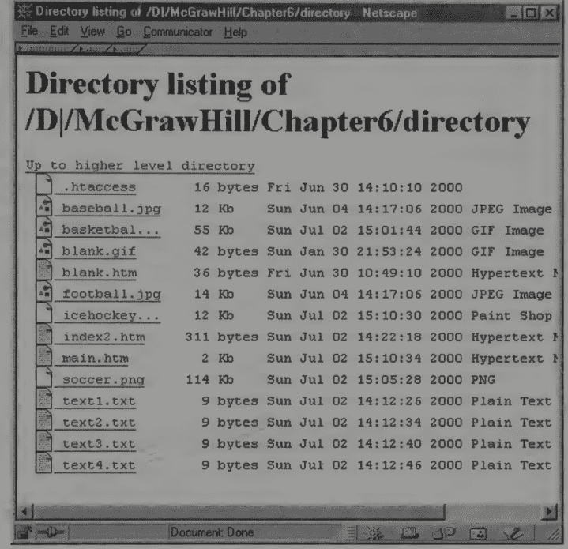

**图 6-3**
Internet Explorer 中本地文件系统的目录列表。

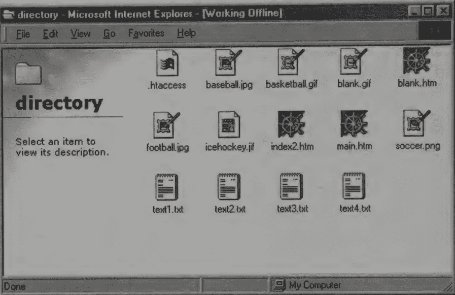

Web 服务器是否显示目录列表取决于服务器的配置方式以及目录包含的内容。通常，如果目录包含名为 *index.htm* 或 *index.html* 的文件，则服务器会显示该文件，而不是显示目录列表。即使目录不包含这些或其他类似配置的文件名，服务器也可能配置为拒绝显示目录列表，如图 6-4 所示。在这种情况下，如果服务器是 Apache Web 服务器，则可以通过在目录中放置包含以下服务器指令的 *.htaccess* 文件来覆盖此服务器范围的配置：`Options +Indexes`。

JavaScript 本身可能无法执行目录查询，但可以用于读取页面中的链接，如第 5 章"位置与链接"中的网站爬虫应用程序所示。该应用程序将演示如何在一个隐藏框架中读取目录列表的链接，然后使用这些结果以有趣的方式有选择地显示链接。图 6-5 显示了此处描述的应用程序对前述目录列表的效果。

## 读取目录源代码——index2.htm

*index2.htm* 页面（注意它不是 index.htm——因为这会阻止显示目录列表）包含一个由 main 和 directory 两个框架组成的框架集：


**../chapter6/directory/index2.htm**

```
<frameset rows="100%,*" onLoad="reload_main()">
<frame src="about:blank" name="main">
<frame src="../directory/" name="directory">
</frameset>
```

main 框架最初包含一个空白页面，占用浏览器窗口可用空间的 100%；由于没有剩余可用空间，directory 框架（包含当前目录的目录列表，向上到父目录一级，即 ../，然后再进入 directory/）显示在浏览器窗口的最底部。


## 第六章

图 6-5
读取目录——
读取并选择性地
显示文件的结果。

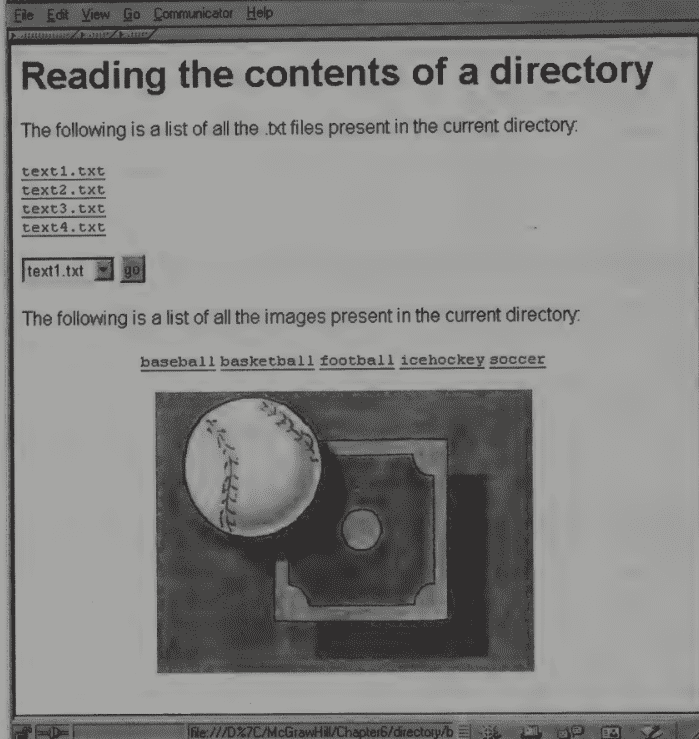

向下——实际上不可见。当框架集（frameset）中的所有页面都成功加载后，会触发 `onLoad` 事件处理程序，调用 `reload_main()` 函数将 main.htm 页面加载到主框架中：

```
function reload_main() {
  window.main.location.href = "main.htm";
}
```

**读取目录源代码——main.htm**

一旦 index.htm 框架集中的 `onLoad` 事件处理程序被触发，并将 main.htm 页面加载到主框架中，我们就可以确定目录框架（directory frame）中包含一个列出相关目录文件的文档。现在，我们只需要访问目录框架中文档的 links 数组。与其简单地循环遍历 links 数组中的所有条目，这里展示的代码使用了一个字符串数组，每个字符串都用作筛选器，以筛选我们想在 main.htm 页面中使用的有效文件。


**../chapter6/directory/main.htm**

例如，以下代码创建了一个文件扩展名的筛选数组，然后将其传递给 `vetLinks()` 函数。`vetLinks()` 函数使用传入的筛选数组，筛选加载到目录框架集（directory frameset）中文档的所有链接，返回一个仅包含与传入文件扩展名之一匹配的链接的 files 数组。目录框架（directory frame）中列出的目录位置的 `href` 属性与文件一起被传递给 `showLinks()` 和 `showOptions()` 函数，这些函数使用数据将筛选后的 files 数组输出为文本链接列表或下拉选择列表中的选项：

```
var filter = new Array('.txt');
var files = vetLinks(filter);
showLinks(parent.directory.location.href, files);
showOptions(parent.directory.location.href, files);
```

以下代码以类似的方式工作。筛选数组是图像所有可接受文件类型的列表。筛选后，files 数组被传递给 `showImages()` 函数，该函数将输出格式化为带有适当的 `onMouseOver` 和 `onMouseOut` 事件处理程序的链接，这些事件处理程序会交换一个空白占位图片的 `src` 属性：

```
var filter = new Array('.jpg', '.gif', '.png', '.jif');
var files = vetLinks(filter);
showImages(parent.directory.location.href, files);
```

**vetLinks()** 函数接受传入的文件扩展名 `filter` 数组，并返回一个包含所有匹配文件名的 files 数组：

```
function vetLinks(filter) {
  var files = new Array();
  var index = 0;
  var length = parent.directory.document.links.length;
```

该函数遍历父框架的 **directory** 框架的 `links` 数组中的所有条目，使用 `links` 数组的 `length` 来控制循环：

```
for (var i = 0; i < length ; i++) {
```

然后，使用第五章"你的语言是什么？"一节中先前描述的 **getFileName()** 函数，获取 `links` 数组中当前条目的文件名（去掉目录路径部分），并将其保存在 `file` 变量中：

```
var link = parent.directory.document.links[i].href;
var file = getFileName(link);
```

在外部循环之内，有一个内部循环，遍历 `filter` 数组中的所有条目，检查 `filter` 中的当前条目是否出现在 `links` 数组的当前条目中：

```
for (var j = 0; j<filter.length; j++) {
```

如果是，则将 `file` 的值追加到 `files` 数组的末尾，然后跳出内部循环：

```
if (file.indexOf(filter[j]) > -1) {
    files[index++] = file;
    break;
  }
}
```

一旦外部循环结束，就将 `files` 数组返回给函数的调用者：

```
return files;
}
```

**showLinks()** 函数接收目录位置作为 `dir`，并接收筛选后的 `files` 数组，只需遍历每个条目，为每个条目输出一个文本链接：

```
function showLinks(dir, files) {
  for (var i = 0; i < files.length; i++)
    document.write(
      '<a href="' + dir + files[i] + '">' + files[i] + '</a>' +
      '<br>'
    );
}
```

另一方面，`showOptions()` 函数输出一个新的表单（form）和一个下拉选择列表（select），其中每个筛选后的文件数组条目对应一个选项：

```
function showOptions(dir, files) {
  document.write('<form><select name="list">');

  for (var i = 0; i < files.length; i++)
    document.write(
      '<option name="list" value="' + dir + files[i] + '">' +
      files[i] + '<\/option>'
    );
  document.write(
    '<\/select> <input type="button" value="go" ' +
    'onClick="go(this.form.list)"><\/form>'
  );
}
```

前述 `showOptions()` 函数生成的 HTML 使用以下 `go()` 函数，当用户点击 Go 表单按钮时，将选中的文件加载到当前窗口：

```
function go(what) {
  location.href =
    what.options[what.options.selectedIndex].value;
}
```

`showImages()` 函数格式化传入的筛选后的 files 数组，为每个条目生成一个 img 元素，并带有适当的 `onMouseOut` 和 `onMouseOver` 事件处理程序，这些事件处理程序调用 `show()` 函数，在鼠标指针移过的链接相关联的图像与页面中持有的空白图像之间进行图像交换：

```
function showImages(dir, files) {
  for (var i = 0; i < files.length; i++)
    if (files[i] != 'blank.gif')
      document.write(
        '<a href="' + dir + files[i] + '" ' +
        'onMouseover="show(\'' + dir + files[i] + '\')" ' +
        'onMouseout="show(\'blank.gif\')">' +
        files[i].substring(0,files[i].indexOf('.')) + '<\/a> '
      );
}
```

注意反斜杠字符（\\）如何用于转义 img 元素的 `onMouseOver` 和 `onMouseOut` 属性中嵌套引号所需的单引号字符（'）。

前面 `showImages()` 函数生成的 HTML 使用以下 `show()` 函数，将 sports 图像中持有的图像与传入的 img 图像进行交换：

```
function show(img) {
  if (document.images)
    document.images['sports'].src = img;
}
```

以下 HTML 定义了一个空白的 sports 图像，然后由前面的 `show()` 函数将其与适当的图像进行交换：

```

```

图像交换技术在第九章"图像"中有详细讲解。

关于 `showLinks()`、`showOptions()` 和 `showImages()` 函数，需要注意的重要一点是，一旦将筛选后的文件列表传递给函数，函数执行的 HTML 格式化是完全灵活的。你可以更改、调整或创建新函数以满足自己的格式需求。

### 弹出窗口生成器

这里展示的弹出窗口生成器可用于交互式地调整 Internet Explorer 和 Netscape Navigator 在创建远程弹出窗口时提供的所有设置。图 6-6 展示了弹出窗口生成器的工作状态，图 6-7 展示了由生成器创建并打开的一个示例弹出窗口。

弹出窗口生成器使用彩色背景来指示每个浏览器支持的内容。因此，它可以用来快速生成所需的 JavaScript 代码（显示在 textarea 中），以支持两大主流浏览器厂商的浏览器。然后，可以将 JavaScript 代码剪切并粘贴到你自己的脚本中，以创建理想的弹出窗口。

图 6-7 中所示的示例弹出窗口没有任何工具栏、状态栏或滚动条，宽 200 像素，高 200 像素。正如前面的示例所见，window 对象的 `open()` 方法的语法相当直观：

## 窗口和框架

### 图 6-6
弹出窗口生成器正在工作。

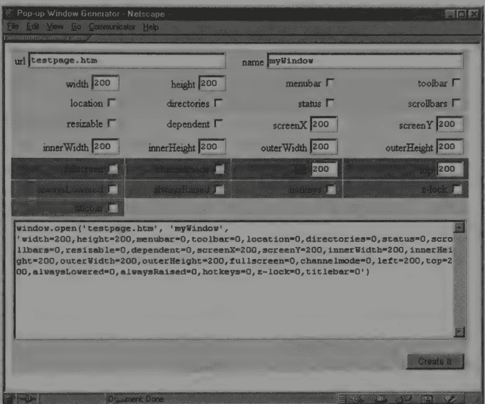

### 图 6-7
一个生成的弹出窗口。

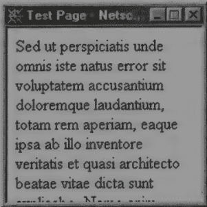

```
handle = window.open(URL, name, features)
```

这三个参数分别指定要在弹出窗口中加载的 URL、弹出窗口的名称以及弹出窗口的特性。创建后，会返回弹出窗口的引用或句柄（handle），


由`open()`方法返回。例如，以下 JavaScript 代码将创建一个新窗口，命名为 myWindow 并加载 myPage.htm，宽度为 640 像素，高度为 480 像素：

```javascript
var handle = window.open(
    'myPage.htm',
    'myWindow',
    'width=640,height=480'
);
```

存储在 handle 变量中的窗口引用可用于在稍后关闭窗口：

```javascript
handle.close();
```

也可以检测窗口的状态，查看窗口是否已关闭：

```javascript
if (handle.closed) { ... }
```

或者是否仍然打开：

```javascript
if (!handle.closed) { ... }
```

可以使用以下代码更改窗口的内容：

```javascript
handle.href = 'another.htm';
```

窗口的名称可以用作链接中的目标：

```html
<a href="more.htm" target="myWindow">text link</a>
```

features 参数需要进一步解释。它是一个由逗号分隔的名称/值对列表字符串。每一对指定特定窗口功能的名称和值——例如宽度和高度、是否显示工具栏等。请注意，在 features 字符串参数中**不能有空格**，这一点极其重要。

## 弹出窗口生成器源代码

../chapter6/generator/index.htm

# 窗口与框架

`index.htm` 页面包含两个表单，允许用户指定窗口功能，并让生成器显示可复制粘贴的代码，以及读取表单值并生成弹出窗口本身的 JavaScript 代码。

全局变量 `windowHandler` 之后用于保存 `open()` 方法返回的引用。它需要是全局变量，而不是某个函数内的局部变量。否则，一旦函数结束，引用就会丢失：

```javascript
var windowHandle;
```

`createWindow()` 函数接受两个参数，分别引用 `input` 和 `output` 表单，并构建用于创建弹出窗口的数据：

```javascript
function createWindow(input, output) {
```

首先，获取 `url` 表单字段的 value 属性，并保存在局部变量 `url` 中：

```javascript
var url = input.url.value;
```

然后获取 `name` 表单字段的 value 属性，并保存在局部变量 `name` 中：

```javascript
var name = input.name.value;
```

初始化局部变量 `features`：

```javascript
var features = '';
```

然后，函数循环遍历 `input` 表单中的所有元素，将 `name` 属性和值（对于类型为 checkbox 的表单字段，使用其 `checked` 属性的值；对于类型为 text 且名称不是 `url` 或 `name` 的表单字段，使用其 value 属性的值）追加到局部变量 `features` 中，每个值前都加上一个逗号（`,`）：

```javascript
for (var i=0; i<input.elements.length; i++) {
    if (input.elements[i].type == 'checkbox')
        features += ',' + input.elements[i].name + '=' +
                   (input.elements[i].checked - 0);

    if (input.elements[i].type == 'text' &&
        input.elements[i].name != 'url' &&
        input.elements[i].name != 'name')
        features += ',' + input.elements[i].name + '=' +
                   (input.elements[i].value);
}
```

从 features 变量值的开头移除第一个逗号字符：

```javascript
features = features.substring(1);
```

如果生成器已经打开了一个弹出窗口——即 windowHandle 不为 null 且全局变量 windowHandle 引用的窗口尚未关闭——则使用 window 对象的 close() 方法关闭该窗口：

```javascript
if (windowHandle && !windowHandle.closed)
    windowHandle.close();
```

然后，使用局部变量 url、name 和 features 的值打开弹出窗口，并将返回的窗口引用赋给全局变量 windowHandle：

```javascript
windowHandle = window.open(url, name, features);
```

最后，更新 output 表单的 debug 表单字段的值，以显示打开具有所需窗口功能的弹出窗口所需的典型 JavaScript 代码：

```javascript
output.debug.value =
    'window.open(\'' + url + '\', \'' +
    name + '\', \'' + features + '\')';
}
```

input 表单（不包含表格 HTML 标记）简单地包含多个文本和复选框表单字段，每个字段的名称都对应于 `open()` 方法的参数或其代表的窗口功能：

```html
<form name="input">
<input type="text" size="35" name="url" value="testpage.htm">
<input type="text" size="35" name="name" value="myWindow">
<input type="text" size="4" name="width" value="200">
<input type="text" size="4" name="height" value="200">
<input type="checkbox" name="menubar">
<input type="checkbox" name="toolbar">
<input type="checkbox" name="location">
<input type="checkbox" name="directories">
<input type="checkbox" name="status">
<input type="checkbox" name="scrollbars">
<input type="checkbox" name="resizable">
<input type="checkbox" name="dependent">
<input type="text" size="4" name="screenX" value="200">
<input type="text" size="4" name="screenY" value="200">
<input type="text" size="4" name="innerWidth" value="200">
<input type="text" size="4" name="innerHeight" value="200">
<input type="text" size="4" name="outerWidth" value="200">
<input type="text" size="4" name="outerHeight" value="200">
<input type="checkbox" name="fullscreen">
<input type="checkbox" name="channelmode">
<input type="text" size="4" name="left" value="200">
<input type="text" size="4" name="top" value="200">
<input type="checkbox" name="alwaysLowered">
<input type="checkbox" name="alwaysRaised">
<input type="checkbox" name="hotkeys">
<input type="checkbox" name="z-lock">
<input type="checkbox" name="titlebar">
</form>
```

output 表单包含一个名为 debug 的 textarea 用于保存生成的 JavaScript 代码，以及一个按钮表单字段，点击时调用 `createWindow()` 函数，并传递 input 和 output 表单的引用：

```html
<form name="output">
<textarea name="debug" rows="10" cols="80" wrap="virtual">
</textarea>
<input type="button" value=" Create It "
onClick="createWindow(document.input, this.form)">
</form>
```

弹出窗口生成器可以反复使用，以尝试不同的窗口功能设置，然后立即应用以查看结果。

### 窗口功能

表 6-1 显示了所有可用窗口功能的完整列表，以及支持它们的 JavaScript 或浏览器版本。

### 词典弹出窗口

词典弹出窗口应用程序展示了如何利用弹出窗口在超文本链接中显示单词或短语的字典定义。它不是将整个新页面加载到当前窗口来显示字典定义，而是允许用户在弹出窗口中查看定义，而不会丢失其在主窗口中的位置。

# 表 6-1

窗口对象的 `open()` 方法中使用的所有窗口功能的完整列表。

| 功能 | 支持版本 | 描述 |
| :--- | :--- | :--- |
| width | JavaScript 1.0 | 以像素为单位指定窗口的宽度。在 Navigator 中，需要 UniversalBrowserWrite 权限才能将值设置为小于 100。 |
| height | JavaScript 1.0 | 以像素为单位指定窗口的高度。在 Navigator 中，需要 UniversalBrowserWrite 权限才能将值设置为小于 100。 |
| menubar | JavaScript 1.0 | 控制菜单栏的显示。值可以是 1、0、yes 或 no。 |
| toolbar | JavaScript 1.0 | 控制工具栏的显示。值可以是 1、0、yes 或 no。 |
| location | JavaScript 1.0 | 控制地址栏的显示。值可以是 1、0、yes 或 no。 |
| directories | JavaScript 1.0 | 控制目录栏的显示。值可以是 1、0、yes 或 no。 |
| status | JavaScript 1.0 | 控制状态栏的显示。值可以是 1、0、yes 或 no。 |
| scrollbars | JavaScript 1.0 | 控制滚动条的显示。值可以是 1、0、yes 或 no。 |
| resizable | JavaScript 1.0 | 指定窗口是否可以调整大小。值可以是 1、0、yes 或 no。 |
| dependent | Navigator 4 | 指定当打开窗口关闭时，弹出窗口是否自动关闭。值可以是 1、0、yes 或 no。 |
| screenX | Navigator 4 | 以像素为单位指定窗口的 x 坐标。需要 UniversalBrowserWrite 权限才能将窗口放置在屏幕外。 |
| screenY | Navigator 4 | 以像素为单位指定窗口的 y 坐标。需要 UniversalBrowserWrite 权限才能将窗口放置在屏幕外。 |
| innerWidth | Navigator 4 | 以像素为单位指定文档的宽度。 |
| innerHeight | Navigator 4 | 以像素为单位指定文档的高度。 |
| outerWidth | Navigator 4 | 以像素为单位指定窗口的总宽度。 |
| outerHeight | Navigator 4 | 以像素为单位指定窗口的总高度。 |
| fullscreen | Explorer 4 | 指定窗口是否以全屏模式打开。值可以是 1、0、yes 或 no。 |


## 窗口和框架

| 特性 | 支持者 | 描述 |
|---------|-------------|-------------|
| channelmode | Explorer 4 | 指定窗口是否以频道模式打开。值为 1、0、yes 或 no。 |
| left | Explorer 4 | 指定窗口的 x 坐标（以像素为单位）。 |
| top | Explorer 4 | 指定窗口的 y 坐标（以像素为单位）。 |
| alwaysLowered | Navigator 4 | 指定窗口是否应始终保持在所有其他窗口之下。值为 1、0、yes 或 no。需要 UniversalBrowserWrite 权限。 |
| alwaysRaised | Navigator 4 | 指定窗口是否应始终保持在所有其他窗口之上。值为 1、0、yes 或 no。需要 UniversalBrowserWrite 权限。 |
| hotkeys | Navigator 4 | 指定是否应启用键盘快捷键。值为 1、0、yes 或 no。需要 UniversalBrowserWrite 权限。 |
| z-lock | Navigator 4 | 值为 1、0、yes 或 no。需要 UniversalBrowserWrite 权限。 |
| titlebar | Navigator 4 | 指定窗口是否应始终保持在其当前相对于其他窗口的上下位置。值为 1、0、yes 或 no。需要 UniversalBrowserWrite 权限。 |

该应用程序会识别超链接中的文本。它首先打开弹出窗口，然后加载众多不同的外部 JavaScript 源文件之一，每个源文件包含一组单词或短语的定义。这样可以避免在用户只关心一个单词的定义时加载整个字典。


> **注意：** 由于*字典弹出窗口*应用程序使用 URL 的 search 属性将数据从主窗口传递到弹出窗口，因此它在 Internet Explorer 中无法离线工作。

## 字典弹出窗口源代码——index.htm

../chapter6/dictionary/index.htm

*index.htm* 页面只是一个典型的网页，包含多个超链接，这些链接不是加载普通页面，而是使用 `onClick` 事件处理程序来调用 `d()` 函数，并传递当前链接的引用：

```
<a href="#" onClick="return d(this)">connect</a> a
<a href="#" onClick="return d(this)">telephone line</a> to a
<a href="#" onClick="return d(this)">computer</a> using a
<a href="#" onClick="return d(this)">modem</a> to enable you to
<a href="#" onClick="return d(this)">send</a> electronic
<a href="#" onClick="return d(this)">messages</a>
<a href="#" onClick="return d(this)">around</a> the world
```

`d()` 函数打开一个弹出窗口，用于显示所传递链接引用的 `text` 属性的字典定义。首先使用全局 `escape()` 方法对 `text` 属性进行转义（将任何非字母数字字符转换为等效的 Latin-1 编码字符），然后将其附加到 URL `define.htm?` 之后，再将该 URL 作为 `window` 对象 `open()` 方法的第一个参数：

```
function d(what) {
  myFloater = window.open(
    'define.htm' + '?' + escape(what.text),
    'myWindow',
    'width=300,height=300'
  )
```

`d()` 函数向 `onClick` 事件处理程序返回 `false`，以取消链接的默认操作——即跳转到当前页面顶部：

```
return false;
}
```

如果用户点击 `telephone line` 的超链接，`d()` 函数会将 URL `define.htm?telephone%20line` 加载到弹出窗口中。空格字符已被全局 `escape()` 函数转换为 `%20`。

图 6-8 展示了一个包含超链接的页面以及显示 `modem` 字典定义的弹出窗口。

## 图 6-8

字典弹出窗口显示 modem 的字典定义。

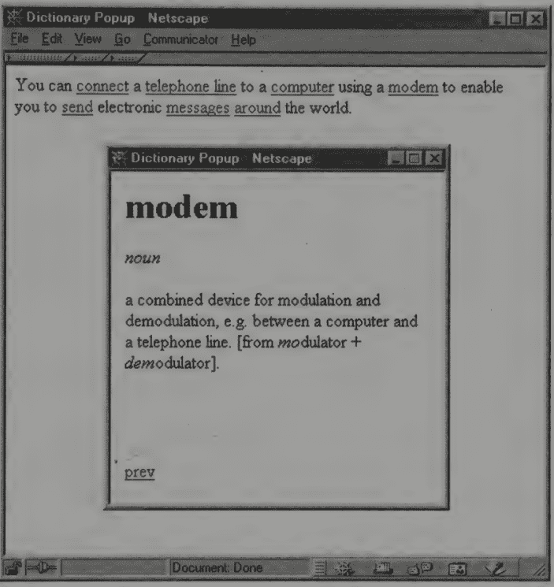

## 字典弹出窗口源代码——define.htm

```
./chapter6/dictionary/define.htm
```

加载到弹出窗口中的 *define.htm* 页面会提取传递的 search 属性，加载包含字典定义的相应外部 JavaScript 源文件，然后显示定义。

每个外部 JavaScript 源文件都创建 `Def` 对象的多个实例。*define.htm* 页面同时包含了 `Def` 对象构造函数和一个 myDef 数组，用于保存由某个外部 JavaScript 源文件创建的所有 Def 对象。第 4 章"数组和对象"详细解释了如何定义和使用对象构造函数。Def 对象构造函数接受三个参数——word、type 和 def，每个参数用于初始化同名属性的值：

```
function Def(word, type, def) {
  this.word = word;
  this.type = type;
  this.def  = def
}

function setDef(word, type, def) {
  myDef[item++] = new Def(word, type, def);
}

var item = 0;

var myDef = new Array();
```

获取当前 window 对象的 location 的 search 属性，然后使用全局 unescape() 方法进行反转义，结果赋值给全局 word 变量：

```
var word = unescape(window.location.search.substring(1));
```

使用 String 对象的 substring() 方法获取 word 变量的第一个字符，并赋值给全局 letter 变量：

```
var letter = word.substring(0,1);
```

然后将 letter 变量加上后缀 .js 作为 script 开始标签的 src 属性，写入文档：

```
document.write(
  '<script language="JavaScript" src="' + letter + '.js">' +
  '<\/script>'
);
//--></script>
```

此时，现有 JavaScript 代码通过 script 结束标签结束。这会强制浏览器立即加载并运行外部 JavaScript 源文件。一旦外部 JavaScript 源文件加载完毕并创建了所有必要的 Def 对象，我们就可以继续执行 *define.htm* 页面中的其余 JavaScript 代码：

```
<script language="JavaScript"><!--
```

一个全局布尔型 found 变量被初始化为 false：

```
var found = false;
```

然后代码遍历 myDef 数组中保存的每个 Def 对象，直到到达数组末尾或全局布尔型 found 变量不再为 false：

```
for (var i=0; i<item || !found; i++) {
```

如果在当前 Def 对象的 word 属性中找到全局 word 变量，则将全局布尔型 found 变量设置为 true。同时，局部 output 变量被构建为包含显示当前 Def 对象字典定义所需的 HTML 标记，然后写入文档，最后使用 break 语句跳出循环：

```
if (word.indexOf(myDef[i].word) != -1) {
    found = true;

    var output = '';

    output +=
        '<table width="100%" height="100%">' +
        '<tr><td valign="top">' +
        '<h1>' + myDef[i].word + '</h1>' +
        '<p><em>' + myDef[i].type + '</em></p>' +
        '<p>' + myDef[i].def + '</p>' +
        '</td></tr></table>';

    document.write(output);
    break;
}
```

循环结束后，如果未找到字典定义，则显示"Definition not found"（未找到定义）消息：

```
if (!found)
    document.write(
        '<h1>' + word + '</h1>' +
        '<p>Definition not found</p>'
    );
```

需要注意的是，第一次成功匹配就会结束循环。因此，如果为具有相似词根的单词（例如 telephone、telephone line 和 telephone call）都包含了定义，并且你希望 telephone 的超链接给出 telephone 的定义而不是 telephone line 的定义，那么 telephone 的定义必须出现在相应外部 JavaScript 源文件中 telephone line 的定义之前。

## 字典弹出窗口源代码——外部 JavaScript 源文件

```
../chapter6/dictionary/*.js
```

典型的外部 JavaScript 源文件仅包含对 *define.htm* 页面中 setDef() 函数的一次或多次调用，该函数调用 Def 构造函数，然后将新创建的 Def 对象添加到 myDef 数组中：

```
setDef(
    'computer',
    'noun',
    'an electronic machine that arranges information and ' +
    'stores it on disks or tapes, using a set of instructions ' +
    'called a program.'
);
setDef(
    'connect',
    '</em><strong>connects connecting connected</strong><em> verb',
    'to link up two things.<p><em><strong>Connecting</strong> ' +
    'telephone to a computer</em>.'
);
```

CD-ROM 上的字典弹出窗口源代码还允许用户在当前加载的外部 JavaScript 源代码中的所有字典定义之间前后导航。

### 家谱

家谱应用程序使用两个框架来显示代表家谱中每个人的两个视图。浏览器的上半部分包含一个框架，显示当前查看的人的父亲、母亲、配偶和子女。浏览器的下半部分包含一个页面，显示当前人物的详细信息——例如出生/死亡日期和地点、以年、月、日为单位的年龄，以及配偶和子女的姓名。当鼠标指针移过


很快就会发现，在特定的家谱中，所有人之间存在着数据重复——例如，一个人的父亲同时也是另一个人的儿子、兄弟或配偶。与其在完整家谱所需的每一页中都保存这些重复信息，不如使用一个 `Person` 对象来表示家谱中的每一个人。

一旦为每个人都创建了 `Person` 对象，我们就通过先引用其父亲、母亲、配偶和子女的 `Person` 对象，然后更新每个 `Person` 对象的属性以包含其亲属关系属性的详细信息，来解析每个人的关系。例如，一个 `Person` 对象的 `father` 属性的值会被更新为代表其父亲的那个 `Person` 对象的 `name` 属性的值。

## 第六章

点击浏览器窗口上半部分的一个超文本链接，下半部分的详细信息就会更新为超文本链接所代表的人的信息。当点击超文本链接时，上半部分显示的树结构会被替换为被点击者的树结构，浏览器下半部分也会更新以显示被点击者的详细信息。

图 6-9 展示了家谱应用程序的实际运行效果，显示了伊丽莎白二世女王及其所有直系亲属的详细信息，包括母亲、父亲、配偶和子女。

图 6-10 展示了将鼠标指针移动到伊丽莎白女王配偶（即菲利普亲王）的超文本链接上方时的效果。

图 6-11 展示了点击伊丽莎白女王长子（即查尔斯王子）的超文本链接时的效果。

图 6-9
伊丽莎白女王的核心家谱。


## 窗口与框架

## 图 6-11

查尔斯王子的核心家谱。


## 家谱源代码——index.htm

*index.htm* 包含了框架集定义以及家谱应用程序中几乎所有的 JavaScript 代码。一个外部 JavaScript 源文件包含了生成特定家谱所需的所有代码——这里是英国王室——它被加载到 *index.htm* 中。由于在应用程序运行期间，两个框架都会被覆盖重写，因此有必要在页面被覆盖时安全地保存代码和对象引用；否则，代码和对象引用将会丢失。因此，我们将代码和对象引用保存在顶层框架集容器文档中，因为它在应用程序运行期间不会被覆盖或替换。

## 第六章

../chapter6/tree/index.htm

前面示例中出现过并描述过的 pad() 和 y2k() 实用函数在家谱应用程序中也有使用，但为节省空间此处不再展示。
由于家谱应用程序需要计算并显示树中每个人的年龄，因此一个名为 months 的数组保存了一年中的所有月份名称：

```javascript
var months = new Array(
    'Jan','Feb','Mar','Apr','May','Jun',
    'Jul','Aug','Sep','Oct','Nov','Dec'
);
```

当前日期和时间通过 Date 构造函数赋值给全局变量 today，然后用于提取当前年份 (thisYear)、当前月份 (thisMonth) 和当月当前日期 (thisDay)：

```javascript
var today     = new Date();
var thisYear  = y2k(today.getFullYear());
var thisMonth =today.getMonth()+1;
var thisDay   = today.getDate();
```

HowOld() 实用函数接受两个独立日期的日、月、年参数，返回两个日期之间的差值（即年龄），以年、月、日表示：

```javascript
function HowOld(day,month,year,Day,Month,Year) {
    var years = Year - year, months = days = 0;

    if (Month >= month) months = Month - month;
    else { years--; months = Month + 12 - month; }

    if (Day >= day) days = Day - day;
    else {
        if (months > 0) months--;
        else { years--; months+=11; }
        days = Day + 31 - day;
    }

    if (years < 0) return '';
    if ((years == 0) && (months == 0) && (days == 0)) return '';

    return years  + ' years, ' +
           months + ' months, ' +
           days   + ' days';
}
```

第七章"日期和时间"将更详细地描述 HowOld() 函数以及其他日期和时间函数。

setPerson() 函数被调用以使用 Person 对象构造函数创建 Person 对象，并将生成的对象引用追加到 PersonArray 数组中：

```javascript
function setPerson(
    name, dobDay, dobMonth, dobYear, dobLocation,
    dodDay, dodMonth, dodYear, dodLocation) {
    return PersonArray[PersonArrayIndex++] =
        new Person(name, dobDay, dobMonth, dobYear, dobLocation,
                   dodDay, dodMonth, dodYear, dodLocation);
}
```

Person 对象构造函数根据传入的参数初始化 Person 对象：

```javascript
function Person(
    name, dobDay, dobMonth, dobYear, dobLocation,
    dodDay, dodMonth, dodYear, dodLocation) {
```

No 属性被设置为该 Person 对象在 PersonArray 数组中的位置。这将在稍后用于允许超文本链接通过编号而非对象引用来引用 Person 对象：

```javascript
this.No = PersonArrayIndex - 1;
this.name = name;
```

如果 dobDay、dobMonth 和 dobYear 这三个出生日期参数都非零（即已知出生日期），则 birth 属性被设置为格式化的日期字符串。否则，它被设置为 'unknown'：

```javascript
if (dobDay != 0 && dobMonth !=0 && dobYear !=0)
    this.birth =
        pad(dobDay,2) + '-' + months[dobMonth] + '-' +
        y2k(dobYear) + ' <strong>in</strong> ' + dodLocation;
else
    this.birth = 'unknown';
```

死亡日期也是如此，不同的是，如果出生日期已知（由 birth 属性未被设置为 'unknown' 表示），则使用此人的死亡日期或当前日期计算其年龄，并通过 HowOld() 函数赋值给 age 属性：

```javascript
if (dodDay != 0 && dodMonth !=0 && dodYear !=0) {
    this.death =
        pad(dodDay,2) + '-' + months[dodMonth] + '-' +
        y2k(dodYear) + ' <strong>in</strong> ' + dodLocation;
    if (this.birth != 'unknown')
        this.age = HowOld(dobDay, dobMonth, dobYear,
                          dodDay, dodMonth, dodYear);
    else
        this.age = 'unknown';
}
else {
    this.death = 'N/A';
    if (this.birth != 'unknown')
        this.age = HowOld(dobDay, dobMonth, dobYear,
                          thisDay, thisMonth, thisYear);
    else
        this.age = 'unknown';
}
```

此时，当创建 Person 对象时，其直系亲属的 Person 对象很可能尚未构建。因此，与该人的父亲、母亲、配偶和子女相关的属性仅被初始化为空字符串或零。一旦所有 Person 对象都创建完成，每个 Person 对象的亲属关系将被解析：

```javascript
// 以下详细信息将在稍后解析：

this.father = ''; this.fatherNo = 0;
this.mother = ''; this.motherNo = 0;
this.spouse = ''; this.spouseNo = 0;
this.children = 0;
```

details 属性仅被初始化为最基本的 HTML 标记。稍后它将更新为显示该人所有直系亲属所需的 HTML 标记：

```javascript
this.details = '<body bgcolor="papayawhip"></body>';
```

这里我们看到了首次使用我们自己的对象方法。setRelations 属性被设置为另一个 JavaScript 函数的名称——这里是 resolveRelations()。因此，每当使用 Person 对象的 setRelations() 方法时，resolveRelations() 函数就会被调用。不同之处在于，每当使用方法时，它会传递一个对其所使用对象的引用——即 this 引用：

```javascript
this.setRelations = resolveRelations;
}
```

resolveRelations() 函数是在调用 Person 对象的 setRelations() 方法时使用的函数。它用于

解析部分初始化的 Person 对象的属性，因此对每个 Person 对象使用该方法，并传入代表父亲、母亲、配偶和子女的每个 Person 对象的引用：

```
function resolveRelations(father, mother, spouse) {
```

乍一看，我们似乎只是接受 father、mother 和 spouse 参数，但实际情况并非如此，稍后将会看到。

除了亚当和夏娃之外，每个曾经活过的人都有一位母亲和父亲。一个人的母亲或父亲可能不为人知——在这种情况下会使用匿名的 Person 对象。然而，作为最低要求，似乎总是期望传入 father 和 mother 对象引用，并可选择性地传入 spouse 对象引用作为 resolveRelations() 函数的输入，这是合理的。

该函数使用 father 和 mother 对象的 name 和 No 属性更新 this 对象的 father、mother、fatherNo 和 motherNo 属性：

```
this.father   = father.name;
this.fatherNo = father.No;
this.mother   = mother.name;
this.motherNo = mother.No;
```

如果将 spouse 对象引用作为输入传递给函数（即 spouse 参数不为 null），则该函数使用 spouse 对象的 name 和 No 属性更新 this 对象的 spouse 和 spouseNo 属性：

```
if (spouse) {
    this.spouse   = spouse.name;
    this.spouseNo = spouse.No;
}
```

与一个人的母亲和父亲不同（在家族树中通常只登记各一位），一个人通常有零个、一个或多个子女。这种数量不定的子女对象引用使得为函数输入指定固定数量的命名参数变得困难。因此，我们转而使用未命名的函数参数或 arguments。每个函数都有一个 arguments 数组，每个元素直接与传入的输入参数相关联。要访问 arguments 数组，我们只需使用函数名称后跟 arguments 数组——例如 resolveRelations.arguments。由于 father、mother 和 spouse 参数直接与数组的前三个元素相关（即 resolveRelations.arguments[0]、resolveRelations.arguments[1] 和 resolveRelations.arguments[2]），我们从下一个可能的元素（即 resolveRelations.arguments[3]）开始，使用 arguments 数组的 length 属性循环到数组末尾：

```
var length = resolveRelations.arguments.length;
for (var i = 3; i < length; i++, this.children++) {
```

对于作为输入传递给函数的每个额外对象引用，都会向 this 对象添加额外的 childXX 和 childXXNo 属性，其中 XX 是一个递增的整数，其值为当前 arguments 对象引用的 name 和 No 属性的值：

```
this['child' + this.children] =
  resolveRelations.arguments[i].name;
this['child' + this.children + 'No'] =
  resolveRelations.arguments[i].No;
}
```

至此，Person 对象的所有直系亲属都已解析完毕。接下来只需用显示个人所有详细信息所需的 HTML 标记填充 details 属性：

```
var details =
  '<center><h1><font face="Arial">' +
  this.name + '</font></h1><hr><table>' +

  '<tr><td valign="top"><font face="Arial">' +
  '<strong>Date&nbsp;of&nbsp;Birth:</strong>' +
  '</font></td><td valign="top"><font face="Arial">' +
  this.birth +
  '</font></td></tr>' +

  '<tr><td valign="top"><font face="Arial">' +
  '<strong>Date&nbsp;of&nbsp;Death:</strong>' +
  '</font></td><td valign="top"><font face="Arial">' +
  this.death +
  '</font></td></tr>' +

  '<tr><td valign="top"><font face="Arial">' +
  '<strong>Age:</strong>' +
  '</font></td><td valign="top"><font face="Arial">' +
  this.age +
  '</font></td></tr>' +

  '<tr><td valign="top"><font face="Arial">' +
  '<strong>Spouse:</strong>' +
  '</font></td><td valign="top"><font face="Arial">' +
  this.spouse +
  '</font></td></tr>' +
```

## Windows 和 Frames

```
'<tr><td valign="top"><font face="Arial">' +
'<strong>Children:</strong>' +
'</font></td><td valign="top"><font face="Arial">';

for (var i=0; i<this.children; i++)
    details += this['child' + i] + '<br>';

details += '</font></td></tr></table></center><hr>';

this.details =
    '<body bgcolor="papayawhip">' + details + '</body>';
```

现在只需创建要保存在家族树中的所有 Person 对象。在此之前，为了使日期能够作为易于识别的值输入，我们为一年中的每个月定义整型变量。这允许使用格式 4, Jan, 1965（即 1965 年 1 月 4 日）将出生日期和死亡日期作为输入传递给 setPerson() 函数：

```
var Jan=1, Feb=2, Mar=3, Apr=4, May=5, Jun=6,
    Jul=7, Aug=8, Sep=9, Oct=10, Nov=11, Dec=12;
```

PersonArrayIndex 变量和 PersonArray 数组被初始化：

```
var PersonArrayIndex = 0;
var PersonArray = new Array();
```

An512

 ```
if (index != 0) {
    PersonToShow = index;
    window.topFrame.location.href = 'topframe.htm';
    window.botFrame.location.href = 'botframe.htm';
}
}
```

# 家谱源代码 - royal.js

```
../chapter6/tree/royal.js
```

外部源文件 *royal.js* 包含特定家谱所需的所有代码——在本例中，是英国王室家谱。对于你自己的应用，你只需要将这个文件替换为另一个文件，并更新 *index.htm* 页面，使其指向你自己的源文件。

我们首先使用 `setPerson()` 函数，传入人的姓名；出生年、月、日；出生地；逝世年、月、日；以及最终逝世地点，来定义整个家谱中的所有 `Person` 对象。我们使用友好的全局变量名来保存返回的对象引用，在本例中是 `gVI`，代表 *乔治六世*。这使得后续解析关系变得更容易：

```
var gVI = setPerson(
    '乔治六世·温莎, <em>英国国王</em>',
    14,12月,1895,
    '英国诺福克郡桑德灵厄姆的约克小屋',
    6,2月,1952,
    '英国诺福克郡桑德灵厄姆'
);
```

对于仍在世的人，其逝世的年、月、日都作为零传入，逝世地作为空字符串传入：

```
var e_a_m = setPerson(
    '<em>夫人</em> 伊丽莎白·安吉拉·玛格丽特·鲍斯-莱昂',
    4,8月,1900,
    '英国伦敦',
    0,0,0,
    ''
);

var eII = setPerson(
    '伊丽莎白二世·亚历山德拉·玛丽·温莎, <em>英国女王</em>',
    21,4月,1926,
    '英国伦敦W1区布鲁顿街17号',
    0,0,0,
    ''
);
```

```
var pp = setPerson(
    '<em>王子</em> 菲利普·蒙巴顿',
    10,6月,1921,
    '希腊科孚岛克基拉岛的蒙瑞波斯',
    0,0,0,
    ''
);
```

```
var pc = setPerson(
    '<em>王子</em> 查尔斯·菲利普·阿瑟·温莎',
    14,11月,1948,
    '英国伦敦白金汉宫',
    0,0,0,
    ''
);
```

```
var psa = setPerson(
    '<em>公主</em> 安妮·伊丽莎白·爱丽丝·温莎',
    15,8月,1950,
    '英国圣詹姆斯克拉伦斯府',
    0,0,0,
    ''
);
```

```
var pa = setPerson(
    '安德鲁·阿尔伯特·克里斯蒂安·温莎, <em>约克公爵</em>',
    19,2月,1960,
    '英国白金汉宫比利时套房',
    0,0,0,
    ''
);
```

```
var pe = setPerson(
    '<em>王子</em> 爱德华·安东尼·理查德·温莎',
    10,3月,1964,
    '英国伦敦白金汉宫',
    0,0,0,
    ''
);
```

一旦所有的 Person 对象都定义完毕，我们现在需要解析每个人的关系。为了表示边界，我们使用匿名的 anon 终结者 Person 对象作为乔治六世 (gVI) 和王太后 (e_a_m) 的父亲和母亲对象引用，但我们传入王太后 (e_a_m) 作为乔治六世的配偶，然后传入乔治六世作为王太后的配偶，接着传入伊丽莎白女王 (eII) 和玛格丽特公主 (psm) 作为乔治六世和王太后的子女：

```
gVI.setRelations(anon, anon, e_a_m, eII, psm);
e_a_m.setRelations(anon, anon, gVI, eII, psm);
```

对于 *伊丽莎白女王*，我们分别传入 *乔治六世* 和 *王太后* 作为父亲和母亲，传入 *菲利普王子* (pp) 作为配偶，然后传入四个子女的引用：*查尔斯王子* (pc)、*安妮公主* (psa)、*安德鲁王子* (pa) 和 *爱德华王子* (pe)：

```
eII.setRelations(gVI, e_a_m, pp, pc, psa, pa, pe);
```

一旦树中所有人的所有亲属关系都解析完毕，我们选择最初应显示的默认人物，并将其值保存在全局变量 details 和 PersonToShow 中，在本例中是 *伊丽莎白女王*：

```
var details = PersonToShow = eII.No;
```

# 家谱源代码—topframe.htm


加载到 topFrame 框架中的 *topframe.htm* 页面执行三个目的。它调用父框架的 showTree() 函数，传入父框架的 PersonToShow 全局变量，然后将返回值写入文档——从而显示围绕中心人物的家谱。

当鼠标指针悬停在文档上输出的任何超文本链接上时，会调用 updateDetails() 函数，该函数打开、写入然后关闭父框架的 botFrame 框架，使用父框架的 PersonArray 数组索引条目 Person 对象的 details 属性值作为输出，但仅在父框架的 details 全局变量不等于 index 时才会执行，然后将其设置为该值：

```
function updateDetails(index) {
    if (index != parent.details) {
        parent.botFrame.document.open();
        parent.botFrame.document.write(
            parent.PersonArray[index].details
        );
        parent.botFrame.document.close();
        parent.details = index;
    }
}

document.write(parent.showTree(parent.PersonToShow));
```

作为框架内容被 index.htm 中的 show() 函数重新加载的间接结果，整个页面根据父框架 PersonToShow 全局变量的新值被重写。

# 家谱源代码—botframe.htm

```
../chapter6/tree/botframe.htm
```

加载到 botFrame 框架中的 botframe.htm 页面有两个目的。首次加载时，它将父框架的 PersonArray 数组中 parent.PersonToShow 条目的 Person 对象的 details 属性值写入文档：

```
document.write(
    parent.PersonArray[parent.PersonToShow].details
);
```

同样，作为框架内容被 index.htm 中的 show() 函数重新加载的间接结果，整个页面根据父框架 PersonToShow 全局变量的新值被重写。CD-ROM 上的家谱应用程序包含一个扩展版的英国王室家谱。

### 一个 JavaScript 调试窗口

编写像前面家谱这样复杂的应用程序有时会非常痛苦。如果不知道代码内部发生了什么，调试和修复代码中的错误可能会极其困难。一种可能的解决方案是在代码中包含 `document.write()` 语句，以突出显示变量、对象属性和函数输入参数的状态，但这会影响页面渲染，并且当页面重新加载时，可见的信息可能会丢失。另一种选择是使用 `alert()` 语句来突出显示信息。当在循环中使用时，这很快就会变得令人烦恼，因为无法关闭不断增多的 alert 消息窗口。

## 第六章

这时调试窗口就派上用场了。我们不是为每个需要查看的调试信息创建单独的 alert 消息，而是创建一个调试窗口。我们不是将信息写入当前窗口，而是将其写入调试窗口。

调试窗口代码被编写为一个外部 JavaScript 源文件。这可以随后包含在任何应用程序代码中，然后使用表 6-2 中列出的公开可用的调试函数进行调用。

如果以后从应用程序代码中移除了 debug.js，由于函数调用总是以测试窗口对象的 debug 属性开始，因此不会调用调试函数，从而不会生成 JavaScript 错误。

### 表 6-2

**debug.js 调试函数。**

| 函数 | 描述 |
| --- | --- |
| `debug(msg)` | 在调试窗口中显示可选的 msg 消息。如果在函数内部调用，还包括函数名称。<br><br>用法：<br><br>`if (window.debug) debug('Starting... ');` |
| `forinDebug(ref, msg)` | 在调试窗口中显示传入的 ref 对象引用的所有可访问属性以及可选的 msg 消息。如果在函数内部调用，还包括函数名称。<br><br>用法：<br><br>`if (window.debug) forinDebug(window.frames, 'frames!');` |
| `startDebug()` | 如果在函数内部调用，包括函数名称和所有传入参数值的列表。同时增加调试窗口输出的缩进。<br><br>用法：<br><br>`if (window.debug) startDebug();` |
| `endDebug()` | 如果在函数内部调用，包括函数名称。同时减少调试窗口输出的缩进。<br><br>用法：<br><br>`if (window.debug) endDebug();` |
```


## 窗口与框架

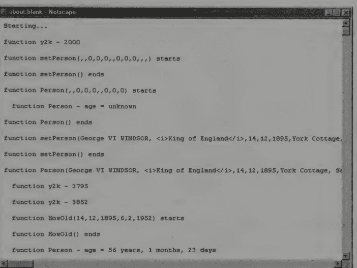

图 6-12 展示了调试窗口的运行情况，显示了从家谱应用程序输出的初始调试信息。

图 6-13 展示了调试窗口，这次显示的是家谱应用程序在调用 `resolveRelations()` 函数/方法时的状态，以及在一个 Person 对象上执行 `forinDebug()` 的结果。

## JavaScript 调试窗口源代码

./chapter6/debug/debug.js

尽管以下所有全局变量都包含在 *debug.js* 外部 JavaScript 源文件中，但它们同样可以包含在被调试的应用程序中。在这种情况下，你可以为不同的应用程序提供不同的值。

`doDebug` 全局布尔变量用于开启或关闭调试，为 `true` 时开启调试，为 `false` 时关闭调试：

```javascript
var doDebug = true;
```

`htmlDebug` 全局布尔变量用于将左右尖括号转换为 &lt; 和 &gt; HTML 实体，以便在调试生成的 HTML 标记时使用，为 `true` 时启用此功能，为 `false` 时保持原样不变：

```javascript
var htmlDebug = true;
```

`maxDebug` 全局整数变量用于控制在调试自动停止之前可以输出多少条调试信息：

```javascript
var maxDebug = 2000;
```

`cntDebug` 全局整数变量用于记录已经输出了多少条调试信息：

```javascript
var cntDebug = 0;
```

`nstDebug` 全局字符串变量用于保存当前要在所有调试信息之前添加的前缀值。它用于在调试信息中嵌套调试信息：

```javascript
var nstDebug = '';
```

`txtDebug` 全局字符串变量定义要附加到 nstDebug 字符串的字符串前缀：

```javascript
var txtDebug = '  ';
```

`winDebug` 全局变量用于保存调试窗口的窗口引用，该窗口稍后将在代码中打开：

```javascript
var winDebug;
```

`preDebug` 全局布尔变量用于指示是否已向调试窗口输出了起始前缀标签（即 `<pre>`）：

```javascript
var preDebug = false;
```

`nameDebug` 全局字符串变量用于保存调试窗口的名称，该窗口稍后将在代码中打开：

```javascript
var nameDebug = 'windowName';
```

如果 `doDebug` 全局布尔变量为 true，则会使用 `nameDebug` 中保存的名称打开一个新的弹出窗口。它将生成的窗口对象引用赋值给 `winDebug`，然后打开 `winDebug` 窗口的文档以便进行写入操作。这是通过文档对象的 `open()` 方法实现的：

```javascript
if (doDebug) {
  winDebug = window.open(
    'about:blank',
    nameDebug,
    'width=700,height=500,scrollbars=1,resize=1'
  );

  winDebug.document.open();
}
```

`updateDebug()` 函数不应由任何应用程序代码直接调用，它将传递的 text 参数输出到 `winDebug` 窗口：

```javascript
function updateDebug(text) {
```

如果 `preDebug` 全局布尔值为 false，则首先输出一个 pre 标签——这只会在第一次时发生：

```javascript
if (!preDebug) {
    preDebug = true;
    winDebug.document.write('<pre>');
}
```

如果 `htmlDebug` 全局布尔值为 true，则所有左尖括号（<）和右尖括号（>）都会被替换为 &lt; 和 &gt; HTML 实体：

```javascript
if (htmlDebug) {
    text = text.replace(/</g,'&lt;');
    text = text.replace(/>/g,'&gt;');
}
```

最后，`text` 变量的值被输出到 `winDebug` 窗口：

```javascript
winDebug.document.write(text + '\n\n');
}
```

`debugging()` 函数用于测试当前是否启用了调试，它将重复测试集中在一处，从而避免在公开可用的调试方法中到处进行重复测试。这使得该测试可以在日后扩展，而不会影响所有的调试功能。目前，当 `doDebug` 为 true、`cntDebug` 小于 `maxDebug` 且 `winDebug` 窗口未关闭时，返回 true：

```javascript
function debugging() {
    return (doDebug && (cntDebug++ < maxDebug) && !winDebug.closed);
}
```

`debug()` 函数与其他公开可用的调试函数类似，它尝试获取调用函数的名称，并调用 `updateDebug()` 函数来输出结果：

```javascript
function debug(msg) {
```

如果 `debugging()` 返回 false，则退出该函数：

```javascript
if (!debugging()) return;
```

如果未传递 `msg` 参数（即其为 null），则将 `msg` 设置为空字符串：

```javascript
if (!msg) msg = '';
```

初始化一个局部变量 `c`：

```javascript
var c = '';
```

每个函数都有一个 `caller` 属性，用于提供对当前函数调用者的访问。`caller` 属性通过对象引用访问，该对象引用与当前函数的名称相同——例如，`debug.caller`。

如果该函数被另一个函数调用，则 `caller` 属性不为 null。在这种情况下，`caller` 属性的值通过其 `toString()` 方法转换为字符串。换句话说，它返回函数的定义，然后该定义被用于正则表达式 `match()` 方法中，以检索 "function" 文本后的第一个单词（即调用函数的名称）：

```javascript
if (debug.caller)
    c = 'function ' +
        debug.caller.toString().match(/function (\w*)/)[1] +
        ' - ';
}
```

如果可获得函数名称，则将其与 `msg` 参数值一起传递给 `updateDebug()` 函数，并在前面加上当前 `nstDebug` 字符串的值：

```javascript
updateDebug(nstDebug + c + msg);
```

`forinDebug()` 函数遍历传递的 `x` 对象引用中的所有可访问属性，构建属性名称和值的列表，然后将其与可选的 `msg` 参数一起显示：

```javascript
function forinDebug(x, msg) {
    if (!debugging()) return;
    if (!msg) msg = '';

    var o = nstDebug;

    if (forinDebug.caller)
        o += forinDebug.caller.toString().match(/function (\w*)/)[1] +
            ' - ';

    o += msg;
```

`for (i in x)` 语句是一种特殊的 `for` 循环。它遍历 `x` 对象中的每个属性，将属性名称赋值给 `i` 变量。属性值可以使用属性名称（即 `i`）在关联数组中（例如 `x[i]`）获取，而不是使用更常见的 `x.propertyName` 语法来访问属性值。

```javascript
for (var in x) {
    o += '\n' + nstDebug;
```

将当前循环中的属性名称（即 `i`）追加到 `o` 变量：

```javascript
o += i;
```

`typeof` 语句返回一个字符串，指示其操作数的数据类型。这里 `typeof(c[i])` 用于将当前属性值的数据类型追加到 `o`：

```javascript
o += '[' + typeof(x[i]) + ']';
```

如果属性值不为 null 且数据类型不是 function，则将属性值追加到 `o`：

```javascript
if (x[i] != null && typeof(x[i]) != 'function') {
    o += '=' + x[i];
}
```

否则，如果为 null，则向 `o` 追加一个说明该情况的字符串：

```javascript
else if (x[i] != null) {
    o += '= null';
}
```

最后，使用 `updateDebug()` 函数更新调试窗口：

```javascript
updateDebug(o);
}
```

`startDebug()` 函数作为函数内的第一行使用，将函数名称及其所有参数值输出到调试窗口，然后将 `nstDebug` 的值增加 `txtDebug` 的值，以确保从现在到函数结束之间输出的任何调试信息都会缩进：

```javascript
function startDebug() {
    if (!debugging()) return;

    var a = c = '';
```

```javascript
if (startDebug.caller) {
    c = 'function ' +
        startDebug.caller.toString().match(/function (\w*)/)[1];
```

我们遍历 `startDebug()` 函数的调用者函数的 arguments 数组中的所有条目，将数组条目的值追加到 `a` 变量：

```javascript
for (var i=0; i<startDebug.caller.arguments.length; i++) {
    a += startDebug.caller.arguments[i] + ',';
}
```

为了整洁，我们从 `a` 变量的末尾删除最后一个字符（一个逗号字符）：

```javascript
if (a.length > 0) a = a.substring(0,a.length-1);
```

使用 `updateDebug()` 更新调试窗口：

```javascript
updateDebug(nstDebug + c + '(' + a + ') starts');

nstDebug += txtDebug;
}
```

`endDebug()` 函数在任何函数退出之前立即使用（可能有多处，即多个 return 语句），将 `nstDebug` 的值减去 `txtDebug` 的值，以结束当前的缩进级别，然后输出刚刚结束的函数名称：

```javascript
function endDebug() {
    if (!debugging()) return;

    var c = '';

    if (endDebug.caller)
        c = 'function ' +
            endDebug.caller.toString().match(/function (\w*)/)[1];

    if (nstDebug.indexOf(txtDebug) > -1)
        nstDebug = nstDebug.substring(txtDebug.length);

    updateDebug(nstDebug + c + '() ends');
}
```

CD-ROM 上的调试窗口代码使用了一个经过修改的家谱应用程序版本来展示调试的实际运行。


## 第六章

### 弹出式日期选择器

弹出式日期选择器使用弹出窗口让用户从日历中选择日期——类似于个人信息管理应用程序（如 Microsoft Outlook）中提供的日历。实际的日历应用程序将在第 7 章"日期和时间"中详细介绍。弹出式日期选择器应用程序将重点讲解主窗口与弹出窗口之间的公共接口。

弹出式日期选择器可用于以 dd/mm/yyyy 格式将预格式化的日期值填入表单字段；不过，这可以轻松更改以满足你自己的需求。该选择器可用于填充页面上的多个表单字段之一，并不限于仅一个表单字段。因此，它可以在整个页面中反复使用，例如用于填写订单日期、配送日期和账单日期。一旦选择了日期，应用程序会记住所选日期，因此如果用户需要更新日期，选择器会将日历重新定位到相同的月份和年份。

图 6-14 显示了包含多个带独立表单按钮的日期表单字段的主页面。当点击表单按钮时，将启动弹出式日期选择器，如图 6-15 所示。当用户完成选择后，主窗口中的表单字段将被更新，弹出窗口关闭。

## 弹出式日期选择器源代码——index.htm


```
./chapter6/selector/index.htm
```

index.htm 页面包含用于显示日期的表单字段和用于启动弹出式日期选择器的表单按钮。在本示例中，我们有四个表单字段和四个表单按钮。每个表单字段使用 onFocus 事件处理程序来阻止表单字段获取文本光标——从而防止用户直接输入日期。每个表单按钮在点击时调用 `cal()` 函数，并传递指向要更新的当前表单文本字段的引用：

```
<form>
<input type="text" name="date1" size="10" onFocus="this.blur()">
<input type="button" value="Date" onClick="cal(this.form.date1)">
<br>
<input type="text" name="date2" size="10" onFocus="this.blur()">
```

## 窗口和框架

### 图 6-14

主页面已完成四个日期中的三个的填写。

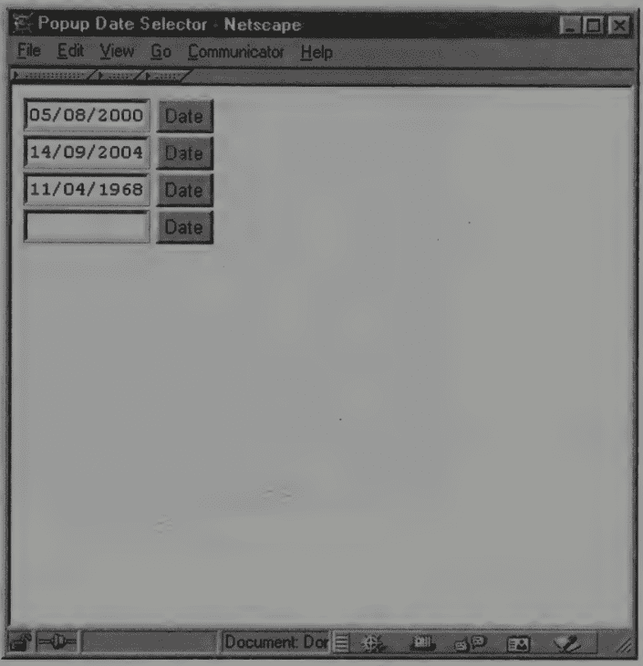

```
<input type="button" value="Date" onClick="cal(this.form.date2)">
<br>
<input type="text" name="date3" size="10" onFocus="this.blur()">
<input type="button" value="Date" onClick="cal(this.form.date3)">
<br>
<input type="text" name="date4" size="10" onFocus="this.blur()">
<input type="button" value="Date" onClick="cal(this.form.date4)">
</form>
```

在页面加载过程中定义了几个全局变量：`today` 保存当前日期和时间，`day` 保存月份中的日期，`month` 保存年份中的月份，`year` 保存当前年份：

```
var today = new Date();
var day   = today.getDate();
var month = today.getMonth() + 1;
var year  = y2k(today.getYear());
```

`whichFormField` 全局变量已定义但未初始化，用于保存指向文本表单字段的引用，该字段需要在弹出式日期选择器用于选择日期后进行更新：

```
var whichFormField;
```

`popupCalendar` 全局变量用于保存弹出式日期选择器窗口的窗口引用：

```
var popupCalendar;
```

`cal()` 函数在四个表单按钮之一被点击时调用，首先检查当前是否已经打开了弹出式日期选择器窗口。如果已经打开，则使用 return 语句退出函数：

```
function cal(field) {
    if (popupCalendar && !popupCalendar.closed) return;
```

该函数接受表单文本字段引用作为 `field`，然后将其赋值给全局 `whichFormField` 变量：

```
whichFormField = field;
```

如果 `field` 表单字段的当前值为 10 个字符长（对应 dd/mm/yyyy 的 10 个字符），我们提取日、月、年的组成部分，并将值赋给全局变量 `day`、`month` 和 `year`：

```
if (field.value.length == 10) {
    day = field.value.substring(0,2) - 0;
    month = field.value.substring(3,5) - 0;
    year = field.value.substring(6,10) - 0;
}
```

打开一个包含 cal.htm 的新窗口。返回的窗口引用被赋给全局 `popupCalendar` 变量：

```
popupCalendar = window.open(
    'cal.htm',
    'myname',
    'resizable=no,width=350,height=270'
);
```

一旦用户在弹出式日期选择器中选择了日期，应用程序就会调用 opener 窗口中的 `restart()` 函数（即来自主窗口中的 index.htm 页面）。

```
function restart() {
```

`restart()` 函数使用包含 `day`、`month` 和 `year` 全局变量的格式化日期来更新由全局 `whichFormField` 变量引用的表单文本字段的值。它使用了第 5 章"位置和链接"中描述的 `pad()` 工具函数。

```
whichFormField.value = '' + pad(day, 2) +
    '/' + pad(month, 2) + '/' + year;
```

最后，关闭弹出窗口：

```
popupCalendar.close();
}
```

注意，虽然我们使用了表单文本字段来保存所选日期，但并非必须这样做。我们也可以简单地将日期保存在隐藏表单字段、变量、数组甚至 cookie 中。

## 弹出式日期选择器源代码——cal.htm

## ../chapter6/selector/cal.htm

当四个表单按钮之一被点击时，cal.htm 页面会被加载到弹出窗口中。cal.htm 页面使用了 calendar.js 外部 JavaScript 源文件，该文件包含用于显示日历的通用代码：

```
<script language="JavaScript" src="calendar.js"></script>
```

该 calendar.js 库的内容在第 7 章"日期和时间"中介绍。calendar.js 库期望使用它的代码定义三个函数：`changeMonth()`、`changeYear()` 和 `changeDay()`。每当用户更改月份或年份，或从日历中选择一天时，这三个函数就会被调用。将这三个函数放在 calendar.js 库之外，可以使库保持通用性，而三个函数的具体实现由使用 calendar.js 库的开发者决定。这里的三个函数 `changeMonth()`、`changeYear()` 和 `changeDay()` 接受 calendar.js 库的 `CalendarMonth`、`CalendarYear` 和 `CalendarDay` 全局变量的值，并更新 opener 窗口的 `month`、`year` 和 `day` 全局变量。`changeMonth()` 和 `changeYear()` 函数都在弹出窗口内重新加载 cal.htm 页面，使日历根据 opener 窗口的 `month` 和 `year` 变量的新值重新绘制。而 `changeDay()` 函数则在关闭当前（self）弹出窗口之前，先调用 opener 窗口的 `restart()` 函数：

```
function changeMonth() {
  opener.month = CalendarMonth + '';
  location.href = 'cal.htm';
}

function changeYear() {
  opener.year = CalendarYear + '';
  location.href = "cal.htm";
}

function changeDay(day,month,year) {
  opener.day = CalendarDay + ' ';
  opener.restart();
  self.close();
}
```

上述函数避免了 *calendar.js* 库了解它是在弹出窗口中使用的这一事实，以及更改会影响弹出窗口的 `opener` 窗口。这将通用的 *calendar.js* 库与其特定应用解耦。这使得在框架或 Dynamic HTML 应用程序中更容易复用 *calendar.js* 库，在这些场景中可能始终只有一个主窗口。

定义全局变量并初始化为对应 `opener` 窗口变量的值：

```
var day = opener.day;
var month = opener.month;
var year = opener.year;
```

最后，调用实际的 `CalendarSelect()` 方法（包含在 *calendar.js* 库中），传入 `opener` 窗口的 `month` 和 `year` 全局变量的值，以及一个星期第一天的指示值。换句话说，0 表示星期日是一周的第一天，1 表示星期一是一周的第一天，以此类推，一直到 6，表示星期六是一周的第一天。`CalendarSelect()` 函数构建并返回必要的 HTML 标记，用于描述所需月份和年份以及所需一周第一天的月历，然后将其写入弹出窗口的文档：

```
if (window.CalendarSelect)
  document.write(CalendarSelect(opener.month,opener.year,0));
```

## 弹出式日期选择器源代码——calendar.js

../chapter6/selector/calendar.js

*calendar.js* 库中包含的代码在第 7 章"日期和时间"中详细介绍。


### 解除框架与重新框架

本应用程序旨在解决以下几个不同问题：

-   检测页面是否在正确的框架集内被框架化
-   检测页面是否在错误/陌生的框架集内被框架化，并在其正确的框架集中重新加载它
-   检测页面是否未被框架化，然后将其加载到正确的框架集中
-   检测页面是否正在被打印，并保持原样
-   加载不同的标题和菜单框架，以补充当前的主框架
-   提供一种在支持 JavaScript 或已禁用 JavaScript 的浏览器中能优雅降级的解决方案
-   提供一种在尽可能多的 Netscape Navigator 和 Internet Explorer 版本上无误工作的解决方案
-   提供一种可扩展的解决方案——换句话说，可以调整以包含任意数量的框架

要解释本应用程序解决的问题，假设你有一个精心布局、尺寸正确的框架集，用于容纳框架化的菜单页面，为整个站点提供快速导航访问，这些框架对于站点的正确运行至关重要。然后，你的站点被搜索引擎索引、从其他站点链接，或者 URL 被某人提供，但所有这些都不是指向框架集的正确页面，而是指向你站点内的某个非框架化页面。也许这些框架对正在查看的主页很敏感，或者你的页面被包含在其他站点的框架集中，破坏了你站点精心设计的外观和感觉。

本应用程序检测所有这些问题，并在页面加载后，继续跳出陌生框架集，并在你自己的框架集中重新加载用户请求的页面以及所需的周边框架。

非常感谢两位帮助开发本特定应用程序的人：首先是 Jan Ehrhardt，他至今仍在 Usenet 新闻组 news:comp.lang.javascript 上回答常被问到的问题“我如何确保我的页面在被...引用时正确加载在其框架集中”，并帮助在各种平台上测试此应用程序；其次是 Ivan Peters，他为日益复杂的脚本提出了一些增强建议。

## 解除框架与重新框架源代码——frameset.htm


../chapter6/unframing/frameset.htm

*frameset.htm* 页面是一个非典型的框架集页面。它包含必要的 JavaScript 代码来检测框架集本身是否未被框架化，如果是，它会解除自身框架化。它使用 JavaScript 创建框架集定义，并为每个包含唯一或关键前缀的框架提供名称——该前缀用于稍后检测你自己的页面是否被你自己的框架集框架化。它还包含一个 synchronize() 函数，框架集内的页面可以使用该函数来同步框架集中其他框架的内容。

```
<html>

<script language="JavaScript"><!--
```

全局键变量包含一个唯一的随机字符序列。因此，你应该修改其值以及每次出现的 ergi87143548_ 字符序列，替换为你自己的唯一字符序列。否则，如果太多人使用 ergi87143548_ 序列，那么该应用程序将无法兑现其承诺。

```
var key = 'ergi87143548_';
```

定义了将加载到三个框架（menu、title 和 main）中的默认页面：

```
var menu = 'menu.htm';
var title = 'title.htm';
var main = 'main.htm';
```

location 对象的 search 属性被赋值给变量 s，并声明了一个 tmp 变量：

```
var s = location.search;
var tmp;
```

## 第六章

location 对象的 search 属性用于将数据传回 frameset.htm 文档，指示应将哪些页面加载到哪些框架中。因此，对 frameset.htm?menu=menu.htm&title=title.htm&main=main.htm 的 URL 请求表示 menu.htm 应加载到菜单框架中，title.htm 应加载到标题框架中，main.htm 应加载到主框架中。

对于框架集中的每个框架，都会调用一次 getParm() 函数，传递 s 的值以及要从 s 变量中检索的框架名称。如果返回值 tmp 不是空字符串，则使用此值更新全局变量 menu、title 和 main 的值——即用 search 属性中传递的值覆盖默认值：

```
tmp = getParm(s, 'menu'); if (tmp != '') menu = tmp;
tmp = getParm(s, 'title'); if (tmp != '') title = tmp;
tmp = getParm(s, 'main'); if (tmp != '') main = tmp;
```

getParm() 函数搜索传递的字符串参数，查找作为 name=value 对一部分的传递的 parm 参数，如果找到则返回该 name=value 对的值。否则，返回空字符串：

```
function getParm(string, parm) {
```

检索 parm 变量值在字符串 string 中等号前的位置，并赋值给局部变量 startPos：

```
var startPos = 0 + string.indexOf(parm + '=');
```

如果找到，则函数继续提取 name=value 对的值：

```
if (startPos > -1) {
```

计算字符串 string 中等号后第一个字符的位置，并赋值给 startPos 变量：

```
startPos = startPos + parm.length + 1;
```

查找字符串 string 中当前 startPos 位置后第一个 & 字符的位置，并赋值给 endPos 变量：

## 窗口与框架

```
var endPos = 0 + string.indexOf('&',startPos);
```

如果未找到 & 字符，则将 endPos 变量的值设置为字符串 string 的长度：

```
if (endPos == -1)
  endPos = string.length;
```

然后 getParm() 函数返回字符串 string 中从 startPos 开始到 endPos 结束的子串的未转义值：

```
return unescape(string.substring(startPos,endPos));
}
```

否则，返回空字符串：

```
return '';
}
```

启动一个计时器，10 秒后调用 checkframed() 函数：

```
setTimeout('checkframed()',10000);
```

然后我们使用 JavaScript 输出完整的框架集，动态分配每个框架的 name 和 src 属性，以便将关键字符序列作为每个框架名称的前缀，并包含默认框架页面或作为 location 对象 search 属性一部分提供的页面：

```
document.write(
  '<frameset onLoad="checkframed()" cols="150,*">' +
  '<frame name="' + key + 'menu" src="' + menu + '">' +
  '<frameset rows="150,*">' +
  '<frame name="' + key + 'title" src="' + title + '">' +
  '<frame name="' + key + 'main" src="' + main + '">' +
  '</frameset>' +
  '</frameset>'
);
```

请注意，外部框架集元素包含一个 onLoad 事件处理程序，以便在框架内容完全加载时调用 checkframed() 函数。以防浏览器不支持 JavaScript，我们在 `<noscript>` 和 `</noscript>` 标签内包含一个正常的框架集定义：

```
<noscript>
<frameset cols="150,*">
<frame name="ergi87143548_menu" src="menu.htm">
<frameset rows="150,*">
<frame name="ergi87143548_title" src="title.htm">
<frame name="ergi87143548_main" src="main.htm">
</frameset>
</frameset>
</noscript>
```

checkframed() 函数在 10 秒计时器到期后或所有框架内容加载完毕后调用，检查确保当前页面未包含在框架集中。它通过比较当前或 self 窗口对象引用与 top 窗口对象引用来完成此操作。如果它们相同，则当前窗口是窗口层次结构中最顶层的窗口。如果不是，则当前窗口包含在框架集中，在这种情况下，调用 loadtop() 函数将当前页面加载到顶层窗口中：

```
function checkframed() {
  if (top != self) loadtop(self.location.href);
}
```

loadtop() 函数将由传递的 url 参数表示的页面加载到顶层窗口中：

```
function loadtop(url) {
```

如果浏览器支持文档对象的 images 属性，则假定它也支持 location 对象的 replace() 方法。在这种情况下，使用 location 对象的 replace() 方法将 url 页面加载到顶层窗口，同时用请求的页面替换顶层窗口 history 对象中的当前条目：

```
if (document.images)
  top.location.replace(url);
```

窗口对象的 history 对象包含已访问页面的历史记录。当用户按下“后退”按钮时，浏览器会加载 history 对象中的前一个条目。通过用新条目替换当前条目，我们有效地从历史记录中移除了最后访问的页面。这将那个持有我们页面的有问题的框架集页面从浏览器历史记录中移除。

如果不支持 replace() 方法，我们只需将顶层窗口 location 对象的 href 属性更改为等于 url 参数的值：


## 窗口和框架

```javascript
else
    top.location.href = url;
}
```

`synchronize()`函数在`frameset.htm`页面中实际上并未使用，而是由加载到主框架中的页面用来同步菜单框架和标题框架的内容。传入的`menu`和`title`参数包含要加载的页面：

```javascript
function synchronize(menu, title) {
```

如果两个框架的当前内容与传入的参数不同，则将新页面加载到框架中：

```javascript
if (window[key +'menu'].location.href.indexOf(menu) == -1)
    window[key +'menu'].location.href = menu;
if (window[key +'title'].location.href.indexOf(title) == -1)
    window[key +'title'].location.href = title;
}
```

## 取消框架与重新框架源代码——main.htm


`../chapter6/unframing/main.htm`

`main.htm`页面与所有加载到主框架中的其他页面一样，首先定义了几个全局变量。全局变量`frame`包含框架的名称：

```javascript
var frame = 'main';
```

全局变量`key`包含的值与`frameset.htm`页面中包含的唯一键值相同：

```javascript
var key = 'ergi87143548_';
```

全局变量`search`包含的值，会在发现当前页面未正确嵌入框架、且应将`frameset.htm`页面加载到顶层窗口时，作为`location`对象`search`属性的一部分进行传递：

```javascript
var search = 'menu=menu.htm&title=title.htm&main=main.htm';
```

`redirect()`函数在调用时实际执行重新加载，将绝对路径的`frameset.htm` URL 传递给`frameset.htm`页面中保存的`loadtop()`函数副本，并将全局变量`search`的值附加到 URL 中作为问号后的搜索参数：

```javascript
function redirect() {
  loadtop(
    self.location.protocol + '//' + self.location.host +
    getFullPath(self.location.pathname) + 'frameset.htm?' +
    search
  );
}
```

`body`元素中的`onLoad`事件处理程序在页面完全加载时调用`checkforframe()`：

```html
<body onLoad="checkforframe()">
```

`checkforframe()`在决定是否应该调用`redirect()`函数将`frameset.htm`页面加载到顶层窗口之前，执行了几项测试：

```javascript
function checkforframe() {
```

如果使用 Netscape Navigator 4 打印包含 JavaScript 代码的页面，令人惊讶的是代码会被执行。这可能会导致一个小问题，因为重定向代码会尝试将正在打印的页面加载到框架中。这需要被阻止。为此需要检测`document`对象的`images`和`layers`属性。如果这两个属性存在，那么测试当前窗口或`self`窗口的`innerHeight`和`innerWidth`属性是否为零，即可表明页面正在打印。在这种情况下，我们使用`return`语句退出函数：

```javascript
  if (document.images && document.layers)
    if (self.innerHeight == 0 && self.innerWidth == 0)
      return;
```

如果当前窗口或`self`窗口等同于顶层窗口，那么当前窗口在应该嵌入框架时却未嵌入。因此，调用`redirect()`函数：

```javascript
  if (top == self) redirect();
```

否则，如果该窗口的名称不包含唯一的键字符序列，或者不包含全局变量`frame`的值，那么尽管页面已嵌入框架，但它要么不是由我们的框架集嵌入的，要么被包含在错误的框架中。在这种情况下，调用`redirect()`函数：

```javascript
else if (this.name.indexOf(key) == -1 ||
        this.name.indexOf(frame) == -1) redirect();
```

否则，框架嵌入正确，此时调用父框架的`synchronize()`函数，将`menu.htm`加载到菜单框架，将`title.htm`加载到标题框架：

```javascript
else parent.synchronize('menu.htm', 'title.htm');
}
```

对于加载到主框架中的其他页面，你将包含以上所有代码，但可能需要更改对`synchronize()`函数的调用，以便将其他页面加载到菜单框架和标题框架中。

## 取消框架与重新框架源代码——title.htm


`../chapter6/unframing/title.htm`

`title.htm`和`menu.htm`页面包含与`main.htm`页面类似的 JavaScript 代码。不过，这里存在一两个差异。下面我们只展示对`title.htm`页面所做的更改。

其中包含一个`base`标签，其`target`属性指定了以唯一键字符序列作为前缀的主框架。这样可以确保该框架中的任何超文本链接都将结果定位到主框架：

```html
<base target="ergi87143548_main">
```

如果当前页面正在打印，`checkforframe()`会退出；但只有在`self`框架等同于顶层框架时，才会调用`redirect()`函数：

```javascript
function checkforframe() {
  if (document.images && document.layers)
    if (self.innerHeight == 0 && self.innerWidth == 0)
      return;

  if (top == self) redirect();
}
```

### 小结

本章为你提供了框架和弹出窗口多种实际用途的基础知识。请谨慎使用两者，因为过度使用任何一种都可能冒犯访问者的感受。它们应出于特定且充分合理的意图而使用。

## 日期和时间

## 第七章

本章介绍在 JavaScript 中使用日期和时间的方法。内置的`Date`对象可以方便地生成公历日期。"当前日期和时间"部分详细介绍了`Date`对象的构造函数及其方法。尽管如此，在许多情况下，使用内置的`Date`对象并不必要或不切实际，而可以使用算法代替。在这种情况下，可能只需要使用`Date`对象来创建当前日期和时间的日期。

某些旧版本的 Netscape Navigator 和 Internet Explorer 在`Date`对象方面存在一些特性或 bug。例如，以下脚本尝试创建并显示 1960 年 2 月的`Date`对象，但在 Netscape 2 中，这将导致问题：

```javascript
var date = new Date(1960,1,1);
document.write(date);
```

这会导致问题，因为 JavaScript 第一版中的内置`Date`对象在内部将日期存储为自 1970 年 1 月 1 日 00:00:00 以来的毫秒数。实际的 JavaScript 文档指出："1970 年之前的日期是不允许的。"

1999 年之后的日期在旧浏览器中也会引发问题。以下脚本尝试创建并显示 2000 年 2 月 1 日的`Date`对象，但在 Microsoft Internet Explorer 3 中，这可能会产生一个负值：

```javascript
var date = new Date(2000,1,1);
document.write(date);
```

本章中的许多应用程序都使用了可重用的外部 JavaScript 源文件，其中包含函数库、对象构造函数、数组和全局变量。

本章还解释了族谱应用程序中使用的`HowOld()`函数，以及第 6 章"窗口和框架"中弹出日期选择器应用程序使用的`calendar.js`库。


-   当前日期和时间 `../chapter7/current/index.htm`
-   星期一出生的孩子面容姣好 `../chapter7/monday/index.htm`
-   有效日期 `../chapter7/validate/index.htm`
-   一天中的时间 `../chapter7/timeofday/nightandday.htm`
-   年历 `../chapter7/calendar/index.htm`

## 日期和时间

-   日期倒计时 `../chapter7/countdown/index.htm`
-   32 年 8 个月零 24 天 `../chapter7/howold/index.htm`
-   你是什么星座？ `../chapter7/zodiac/index.htm`
-   中国新年 `../chapter7/chinese/index.htm`
-   出生于 7 月 4 日 `../chapter7/july4th/index.htm`
-   11 月的第三个星期六 `../chapter7/saturday/index.htm`
-   计算复活节 `../chapter7/easter/index.htm`
-   24 小时制时钟 `../chapter7/clock24/index.htm`


### 当前日期和时间

本节讨论`Date`对象的构造函数、它的一些方法、如何通过额外的原型方法增强内置的`Date`对象，以及如何格式化日期字符串的输出。

`../chapter7/current/test.htm`

内置的`Date`构造函数可以通过多种方式调用。当不向`Date`对象构造函数传递参数时，将返回当前日期和时间：

```javascript
var date = new Date();
document.write(date);
```

当传入零作为参数时，将返回元年，即 1970 年 1 月 1 日 00:00:00——也就是自元年以来的毫秒数：

```javascript
var date = new Date(0);
document.write(date);
```

可以将年、月和日作为输入参数传入。但请注意，月份参数的值表示为 0——一月，1——二月，2——三月，3——四月，4——五月，5——六月，6——七月，7——八月，8——九月，9——十月，10——十一月和 11——十二月。因此，可以使用以下代码生成 2000 年 12 月 25 日的`Date`对象：

```javascript
var date = new Date(2000,11,25);
document.write(date);
```


## 第七章

此外，时、分、秒和毫秒也可以作为输入参数传入。因此，使用以下代码可以生成2001年1月1日 02:03:04.005的Date对象：

```
var date = new Date(2001,0,1,2,3,4,5);
document.write(date);
```

除了具体的数值参数外，表示日期的字符串也可以作为输入参数传入：

```
var date = new Date('Fri, 21 July 2000 21:57:46');
document.write(date);
```

document对象的`lastModified`属性返回一个表示文档最后修改日期的字符串。因此，这可以作为输入传递给Date对象的构造函数：

```
var date = new Date(document.lastModified);
document.write(date);
```

创建Date对象的意义在于能够检索组成日期的各个部分。一旦创建，就可以使用Date对象的get方法来检索年、月、日、时、分和秒：

```
var date = new Date();
document.write(
  'Year = ' + date.getFullYear() + ' ' +
  'Month = ' + date.getMonth() + ' ' +
  'Day = ' + date.getDate() + ' ' +
  'Hours = ' + date.getHours() + ' ' +
  'Minutes = ' + date.getMinutes() + ' ' +
  'Seconds = ' + date.getSeconds() + ' ' +
  'Time = ' + date.getTime() + ' ' +
  'Day = ' + date.getDay()
);
```

你还可以使用Date对象的一些方法来直接设置它所表示日期的各个部分——例如年、月、日、时、分和秒——使用相应的set方法。以下代码首先创建一个Date对象（初始保存当前日期和时间），然后将其修改为1999年1月1日 23:59:59：

```
var date = new Date();
date.setFullYear(1999);
date.setMonth(0);
date.setDate(1);
date.setHours(23);
date.setMinutes(59);
date.setSeconds(59);
document.write(date);
```

`getTime()`方法可用于检索自起始时间以来的毫秒数：

```
var date = new Date();
document.write('Time = ' + date.getTime());
```

`setTime()`方法可用于根据输入参数（表示自起始时间以来的秒数）来设置时间：

```
var date = new Date();
date.setTime(0);
document.write('Time = ' + date.getTime());
```

当使用`Date`对象构造函数创建日期时，结果日期基于浏览器所在操作系统的本地时间设置。例如，当在GMT+0100的Windows 98上运行以下代码时，显示的日期为Fri Jul 21 21:57:46 GMT+0100 (GMT Daylight Time) 2000：

```
var date = new Date(2000,6,21,21,57,46);
document.write('Local date/time: ' + date);
```

使用`Date`对象的`UTC()`静态方法，你可以生成以毫秒为单位的时间，当用作`Date`对象构造函数的输入时，会创建一个基于本地时间设置的日期，但该日期基于GMT（格林尼治标准时间）时区或UTC（协调世界时）的时间。当在GMT+0100的Windows 98上运行以下代码时，显示的日期为Fri Jul 21 22:57:46 GMT+0100 (GMT Daylight Time) 2000。也就是说，本地时区GMT+0100的时间比UTC快一小时：

```
var date = new Date(Date.UTC(2000,6,21,21,57,46));
document.write('UTC date/time: ' + date);
```

`Date`对象的`getTimezoneOffset()`方法检索本地时区与UTC相差的分钟数：

```
var date = new Date();
document.write('Timezone = ' + date.getTimezoneOffset());
```

之前所有脚本片段的结果如图7-1所示。

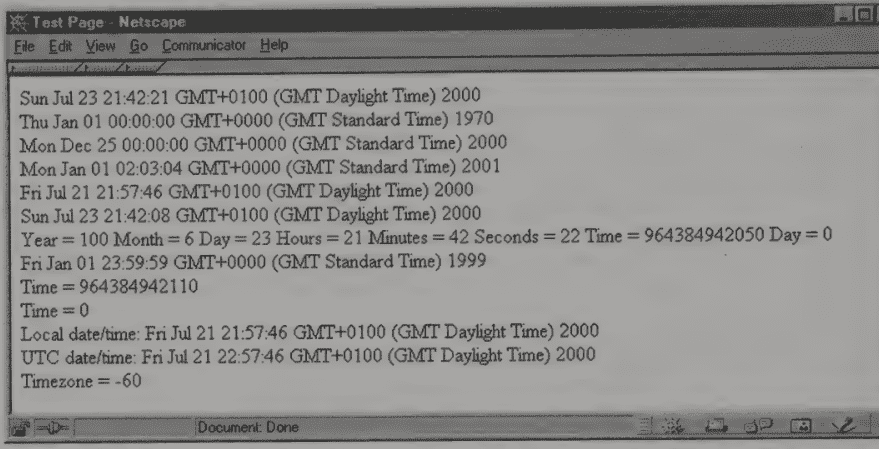

图7-1 使用Date对象构造函数创建和显示日期。

本节的其余部分展示了如何操作Date对象方法的返回值，以格式化日期并输出到页面。由于这些函数中的许多将在本章的其余部分重复使用，它们以及其他函数被包含在外部JavaScript源文件中，然后可以嵌入到任何HTML页面中。图7-2显示了Date对象值的显示结果，以及使用手工制作的函数接受年、月、日值生成的三种不同格式。

## 当前日期和时间源代码——current.js


## 日期和时间

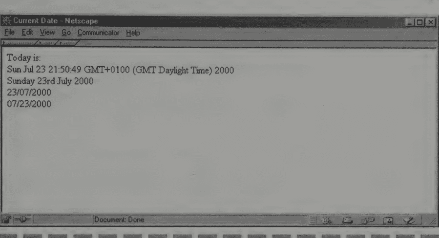

**图7-2** 当前日期和时间——三种格式化日期。

getFullYear()和getMilliseconds()这两个Date对象方法都是在JavaScript 1.2中引入的。但是，我们可以使用对象的prototype属性向现有对象添加自己的对象方法。首先，我们定义一个函数来替代缺失的方法——在本例中是getFullYear()函数。该函数使用Date对象已弃用的getYear()方法来检索被引用的this对象的年份。然后，如果年份小于900，则将1900加到年份上，再返回修正后的值：

```
function getFullYear() {
  var year = this.getYear();
  if (year < 1000) year += 1900;
  return year;
}
```

然后我们使用Date对象的prototype属性将getFullYear对象引用设置为getFullYear函数名，但仅在Date对象尚未定义getFullYear方法时才这样做：

```
if (!Date.getFullYear)
  Date.prototype.getFullYear = getFullYear;
```

同样地，对于getMilliseconds()函数，它从使用零毫秒输入参数创建的日期的getTime()方法返回的值中，减去被引用的this对象的getTime()方法返回的值：

```
function getMilliseconds() {
    var date = new Date(
        this.getFullYear(), this.getMonth(), this.getDate(),
        this.getHours(), this.getMinutes(), this.getSeconds(), 0
    );
    return this.getTime() - date.getTime();
}
```

同样，使用Date对象的prototype属性将getMilliseconds对象引用设置为`getMilliseconds`函数名：

```
if (!Date.getMilliseconds)
    Date.prototype.getMilliseconds = getMilliseconds;
```

一周中各天的实际名称无法通过Date对象访问。因此，我们创建自己的`daysOfWeek`数组来保存完整名称：

```
var daysOfWeek = new Array(
    'Sunday','Monday','Tuesday','Wednesday',
    'Thursday','Friday','Saturday'
);
```

同样，我们对一年中的各月份也使用`monthsOfYear`数组：

```
var monthsOfYear = new Array(
    'January','February','March','April','May','June',
    'July','August','September','October','November','December'
);
```

虽然可以使用`getDay()`方法从Date对象中检索星期几，该方法返回的值0表示星期日，1表示星期一，2表示星期二，3表示星期三，4表示星期四，5表示星期五，6表示星期六，但有时需要先创建Date对象，然后使用`getDay()`方法检索星期几，这并不方便。以下内容摘自http://www.tondering.dk/claus/calendar.html的《日历常见问题》：

要计算特定日期落在星期几，可以使用以下算法（除法为整数除法，余数被丢弃）：

```
a = (14 - month) / 12
y = year - a
m = month + 12*a - 2
d = (day + y + y/4 - y/100 + y/400 + (31*m/12)) % 7
d的值为0表示星期日，1表示星期一，2表示星期二，以此类推。
```

## 日期和时间

这个以及其他算法可以很容易地转换为JavaScript，以创建以下dayOfWeek()函数，该函数返回任何日、月、年输入参数的星期几：

```
function dayOfWeek(day,month,year) {
  var a = Math.floor((14 - month)/12);
  var y = year - a;
  var m = month + 12*a - 2;
  var d = (day + y + Math.floor(y/4) - Math.floor(y/100) +
           Math.floor(y/400) + Math.floor((31*m)/12)) % 7;
  return d;
}
```

nths()函数返回传入的日整数参数的日期序数——即st、th、nd或rd，如1st、2nd、3rd或4th，一直到31st：

```
function nths(day) {
  if (day == 1 || day == 21 || day == 31) return 'st';
  if (day == 2 || day == 22) return 'nd';
  if (day == 3 || day == 23) return 'rd';
  return 'th';
}
```

formatFullDate()函数使用之前的dayOfWeek()和nth()函数，以及daysOfWeek和monthsOfYear数组来返回完全格式化的日期字符串——例如，25th December 2000：

```
function formatFullDate(day,month,year) {
  var dow = dayOfWeek(day,month,year);
  return daysOfWeek[dow] + ' ' +
         day + nths(day) + ' ' +
         monthsOfYear[month-1] +' '+ year;
}
```

formatShortDate()函数使用无处不在的padout()函数来返回短格式日期——例如，25/12/2000：

```
function formatShortDate(day,month,year) {
  return padout(day) + '/' + padout(month) + '/' + year;
}
```

另一方面，formatShortDateUS()函数以美国短日期格式返回日期——即月份在日之前，如12/25/2000：

```
function formatShortDateUS(day,month,year) {
  return padout(month) + '/' + padout(day) + '/' + year;
}
```


一旦掌握了将字符串与日期、月份和年份整数拼接起来的基本概念，就很容易理解如何创建进一步的日期格式化函数。

## 当前日期和时间源代码—index.htm

剩下的就是编写一个应用程序，以使用 current.js 文件中的格式化函数。

在 CD 上

`./chapter7/current/index.htm`

首先，我们包含外部 JavaScript 源文件 current.js 中包含的所有 JavaScript 代码：

```
<script src="current.js" language="JavaScript"></script>
```

在使用 current.js 库中的任何函数之前，我们首先检查当前窗口是否具有 formatFullDate 属性——即一个已定义的 formatFullDate() 函数：

```
if (window.formatFullDate) {
```

如果存在，则我们继续执行代码，首先获取当前日期和时间的日期、月份和年份：

```
var date = new Date();
var day = date.getDate();
var month = date.getMonth() + 1;
var year = date.getFullYear();
```

然后将这些值全部作为输入传递给 formatFullDate()、formatShortDate() 和 formatShortDateUS() 函数，它们的返回值作为 document.write() 语句的一部分输出：

```
document.write(
  'Today is:<br>' +
  date + '<br>' +
  formatFullDate(day,month,year) + '<br>' +
  formatShortDate(day,month,year) + '<br>' +
  formatShortDateUS(day,month,year) + '<br>'
);
```

## 日期和时间

### 周一的孩子面容姣好

这个简短而精美的示例展示了如何使用上一个“当前日期和时间”示例中描述的 dayOfWeek() 函数来获取星期几，并以此从下面的“周一的孩子”诗歌中检索相关行：

> 周一的孩子面容姣好，
> 周二的孩子优雅十足，
> 周三的孩子满心忧愁，
> 周四的孩子任重道远，
> 周五的孩子博爱奉献，
> 周六的孩子辛勤谋生，
> 而在安息日出生的孩子，
> 则快乐、活泼、善良又开朗。

图 7-3 显示了在 2000 年 7 月 24 日星期一运行此示例的结果。

## 周一的孩子面容姣好源代码—monday.js

monday.js 库包含一个 child 数组（其中保存了前面诗歌中的相关摘录）和一个 childOfWeek() 函数（该函数根据传入的 dayofweek 参数返回 child 数组中的相关条目）：

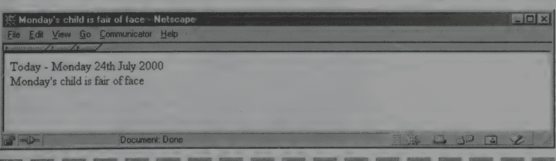

图 7-3 周一的孩子——在 2000 年 7 月 24 日星期一运行。

```
../chapter7/monday/monday.js
```

```
var child = new Array(
  'is bonny and blithe and good and gay',
  'is fair of face',
  'is full of grace',
  'is full of woe',
  'has far to go',
  'is loving and giving',
  'works hard for a living'
);
```

childOfWeek() 函数接受一个 dayofweek 参数作为输入：

```
function childOfWeek(dayOfWeek) {
```

dayofweek 参数用于检索 daysOfWeek（在前面的“当前日期和时间”示例中描述）和 child 数组中的相应条目，然后返回一个代表诗歌中条目的字符串：

```
    return daysOfWeek[dayofweek] + '\'s child ' +
           child[dayofweek];
}
```

## 周一的孩子面容姣好源代码—index.htm

```
../chapter7/monday/index.htm
```

要在我们的代码中使用此示例，我们必须在代码中同时包含 current.js 和 monday.js 库：

```
<script src="current.js" language="JavaScript"></script>
<script src="monday.js" language="JavaScript"></script>
```

只有当 window 对象具有 formatFullDate 和 dayOfWeek 属性时——即 formatFullDate() 和 dayOfWeek() 函数定义都从外部 JavaScript 源代码库加载时——代码主体才会被处理：

```
if (window.formatFullDate && window.dayOfWeek) {
```

使用默认的 Date 对象构造函数获取今天的日期，然后检索日期、月份和年份值：

```
var today = new Date();
var day   = today.getDate();
var month = today.getMonth() + 1;
var year  = today.getFullYear();
```

将 childOfWeek() 函数的返回值输出到文档，使用 dayOfWeek() 函数的返回值作为输入参数：

```
document.write(
  'Today - ' + formatFullDate(day,month,year) + '<br>' +
  childOfWeek(dayOfWeek(day,month,year)) + '<br>'
);
```

### 有效日期

验证用户输入的日期可能会引起问题。例如，当用户输入日期为 01/02/03 时，谁能确定他们的意思是 2003 年 2 月 1 日还是 1903 年 1 月 2 日？除非明确告知用户应使用何种格式输入日期（例如 MM/DD/YYYY），否则很难预测他们会输入什么。即便如此，用户仍可能输入无效日期——例如 2 月 30 日，或者超出我们预期范围的年份，如 1899 年或 9999 年。本节将解释如何控制用户输入日期以及如何验证日期。

图 7-4 显示了一个用于控制用户如何输入日期的简单界面。它使用了三个选择列表，分别用于日、月和年。默认情况下，它在初始状态显示当前日期，并允许用户选择当前日期前后 50 年内的任何日期。

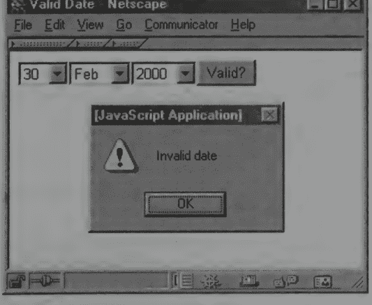

图 7-4 有效日期界面。

用户不可能输入错误格式的日期。但是，他们仍然有可能输入无效日期，例如 9 月 31 日。本节的其余部分将展示如何使用 JavaScript 构建表单界面，以及如何确保只选择有效的日期组合。

在我们深入研究代码之前，让我们先看一些关于日期的已知事实。一年包含 12 个月。每个月都有固定数量的天数——当然，二月除外，它在闰年有 29 天——如表 7-1 所示。每个能被 4 整除的年份都是闰年，但能被 100 整除的年份除外；这些年份只有能被 400 整除时才是闰年。因此，2000 年是闰年，而 2100 年则不是。

### 表 7-1：每个月的天数。

| 月份 | 每月天数 | 月份 | 每月天数 |
|---|---|---|---|
| 一月 | 31 | 七月 | 31 |
| 二月 | 28—闰年 29 天 | 八月 | 31 |
| 三月 | 31 | 九月 | 30 |
| 四月 | 30 | 十月 | 31 |
| 五月 | 31 | 十一月 | 30 |
| 六月 | 30 | 十二月 | 31 |

## 有效日期源代码—validate.js

*validate.js* 库包含验证日期所需的数组和函数。

`../chapter7/validate/validate.js`

daysOfMonth 数组保存非闰年每个月的天数：

```
var daysOfMonth = new Array(
    31, 28, 31, 30, 31, 30, 31, 31, 30, 31, 30, 31
);
```

daysOfMonthLY 数组保存闰年每个月的天数：

```
var daysOfMonthLY = new Array(
    31, 29, 31, 30, 31, 30, 31, 31, 30, 31, 30, 31
);
```

isLeapYear() 函数返回一个布尔值 true 或 false，指示传入的年份参数是否能被 4 整除且不能被 100 整除，除非它也能被 400 整除：

```
function isLeapYear(year) {
    // ...
}
```

首先，我们通过减去零来确保将任何年份字符串值转换为整数值：

```
year = year - 0;
```

如果年份除以 4 的浮点值不等于年份除以 4 的整数值（即使用 Math 对象的 floor() 方法向下舍入到最近的整数值），则返回 false：

```
if ((year/4) != Math.floor(year/4)) return false;
```

如果年份除以 100 的浮点值不等于年份除以 100 的整数值，则返回 true：

```
if ((year/100) != Math.floor(year/100)) return true;
```

如果年份除以 400 的浮点值不等于年份除以 400 的整数值，则返回 false：

```
if ((year/400) != Math.floor(year/400)) return false;
```

否则，返回 true：

```
return true;
}
```

isValidDate() 函数返回一个布尔值 true 或 false，指示传入的 day、month 和 year 参数是否代表一个有效日期：


## 第七章

```
function isValidDate(day, month, year) {
```

首先，参数通过减去零被转换为整数：

```
day = day - 0; month = month - 0; year = year - 0;
```

如果 `isLeapYear()` 函数返回 `true` *并且* `day` 的值大于 `daysOfMonthLY` 数组中对应条目的值，*或者* `isLeapYear()` 函数返回 `true` *并且* `day` 的值大于 `daysOfMonth` 数组中对应条目的值，则该函数返回 `false`：

```
if ((isLeapYear(year) && day > daysOfMonthLY[month-1]) ||
    (!isLeapYear(year) && day > daysOfMonth[month-1]))
    return false;
```

否则，函数返回 `true`：

```
else
    return true;
}
```

## 有效日期源代码——index.htm

../chapter7/validate/index.htm

要使用 `validate.js` 库中定义的数组和函数，我们必须同时在应用程序中包含 `validate.js` 和 `current.js` 库：

```
<script src="current.js" language="JavaScript"></script>
<script src="validate.js" language="JavaScript"></script>
```

select-option 列表使用 `mthsOfYear` 数组中定义的月份缩写：

```
var mthsOfYear = new Array(
    'Jan','Feb','Mar','Apr','May','Jun',
    'Jul','Aug','Sep','Oct','Nov','Dec'
);
```

定义并初始化一个 `output` 变量：

```
var output = '';
```

只有当 window 对象同时具有 `formatFullDate` 和 `isValidDate` 属性时，JavaScript 代码体才会被处理：

```
if (window.formatFullDate && window.isValidDate) {
    var today = new Date();
    var month = today.getMonth();
    var day   = today.getDate();
    var year  = today.getFullYear();
```

用于显示三个 select option 表单字段的 HTML 代码通过 `output` 变量逐步构建：

```
output += '<form>';
```

创建一个名为 `day` 的 select option 列表：

```
output += '<select name="day">';
```

包含三十一个 option 元素；每个 option 的值设置为当月日期编号（使用无处不在的 `padout()` 函数）：

```
for (var days=1; days <= 31; days++) {
    output += '<option value="' + padout(days) + '"';
```

对应当前日期的 option 元素被设置为默认选中项：

```
    if (days == day) output += ' selected';
    output += '>' + days;
}
output += '</select>';
```

创建一个名为 `month` 的 select option 列表：

```
output += '<select name="month">';
```

包含一年中每个月份对应的 option 元素；每个 option 的值设置为该月份的值：

```
for (var months=0; months<12; months++) {
    output += '<option value="' + padout(months+1) + '"';
```

对应当前月份的 option 元素被设置为默认选中项：

```
if (months == month) output += ' selected';
	output += '>' + mthsOfYear[months];
}
output += '</select>';
```

创建一个名为 `year` 的 select 列表：

```
output += '<select name="year">';
```

包含当前年份前后各 50 年的 option 元素：

```
for (var years=year-50; years<year+50; years++) {
	output += '<option value="' + years + '"';
```

当前年份被设置为默认选中项：

```
if (years == year) output += ' selected';
	output += '>' + years;
}
output += '</select>';
```

输入按钮的 HTML 被追加到 output 变量。onClick 事件处理程序调用 `valid()` 函数，并将当前表单的引用（this.form）作为输入参数传入：

```
output += '<input type="button" value="Valid?" '
	+ 'onClick="valid(this.form)">';
output += '</form>';
```

当需要验证日期时，会调用 `valid()` 函数。它接收一个指向待验证表单的引用（即 what）：

```
function valid(what) {
```

它使用第 6 章“跳转框工具”一节中描述的 `getAnOptionValue()` 函数，获取所选选项的日、月、年值：

```
var day = getAnOptionValue(what.day);
var month = getAnOptionValue(what.month);
var year = getAnOptionValue(what.year);
```

日、月、年作为输入传递给 `isValidDate()` 函数，如果日期有效，该函数返回 true；否则返回 false。

```
if (isValidDate(day, month, year))
    alert('Valid date');
else
    alert('Invalid date');
}
```

在 `output` 变量中构建好的 HTML 被写入到文档中：

```
document.write(output);
```

`valid()` 函数的修改版本可用于取消用户的表单提交，提示用户更正日期选择，从而仅在选择了有效日期时才允许提交表单。表单取消的示例包含在第 8 章“表单”中。

### 一天中的时间

前面的章节展示了如何格式化日期。本节展示如何格式化时间。第一个示例说明如何更新表单字段以三种不同格式显示当前时间。获取当前时间后，第二个示例演示如何利用它影响页面显示。第三个示例展示如何在页面上使用图像显示数字时钟。

## 一天中的时间源代码——form.htm

`form.htm` 页面包含一个带有三个文本输入字段的表单。每个字段的值都会更新为以下格式的当前时间：00:00:00 - 23:59:59，即完整 24 小时制，显示时、分、秒；00:00 - 23:59，即完整 24 小时制，但不显示秒；以及 0:00 - 12:59，即 12 小时制，不显示秒。图 7-5 展示了 `form.htm` 的结果。

../chapter7/timeofday/form.htm

`updateClock()` 函数获取当前时间，处理这些值，然后更新表单的文本输入字段：

```
function updateClock() {
```

使用默认的 Date 对象构造函数获取当前日期和时间，并将其赋值给 time 变量：

```
var time = new Date();
```

获取秒、分、时的值，并分别赋值给 s、m 和 h 变量。`padout()` 函数用于确保每个值在原始值小于 10 时，前面补零：

```
var s = padout(time.getSeconds());
var m = padout(time.getMinutes());
var h = padout(time.getHours());
```

`display1` 变量保存当前时间，表示包含时、分、秒的完整 24 小时制时间：

```
var display1 = h + ':' + m + ':' + s;
```

clock 表单的 time1 输入字段使用 display1 的值进行更新，但仅在当前输入字段的值不等于 display1 的值时才更新。这样可以避免反复写入相同值时产生闪烁：

```
if (document.clock.time1.value != display1)
    document.clock.time1.value = display1;
```

`display2` 变量保存当前时间，表示不包含秒的完整 24 小时制时间。

```
var display2 = h + ':' + m ;
```

同样，如果 time2 输入字段尚未包含 display2 的值，则进行更新：

```
if (document.clock.time2.value != display2)
    document.clock.time2.value = display2;
```

`display3` 变量表示不包含秒的 12 小时制时间。为此，对 h 的值进行三元测试。如果 h 大于 12（即下午），则将 h 减去 12；否则，保持 h 不变。

```
var display3 = ((h > 12) ? h-12 : h) + ':' + m;
```

同样，如果 time3 输入字段尚未包含 display3 的值，则进行更新：

```
if (document.clock.time3.value != display3)
    document.clock.time3.value = display3;
```

最后，`updateClock()` 函数启动一个定时器，在 100 毫秒后再次调用 `updateClock()` 函数：

```
setTimeout('updateClock()', 100);
}
```

对 `updateClock()` 函数的初始调用来自 body 元素的 onLoad 事件处理程序。这确保只有在生成表单的 HTML 并且所有 JavaScript 代码都已定义后，才会调用该函数：

```
<body onLoad="updateClock()">
```

最后，时钟表单的 HTML 代码被包含在页面中：

```
<form name="clock">
<input type="text" name="time1" size="8"> 00:00:00 - 23:59:59
```

 <br>
<input type="text" name="time2" size="5"> 00:00 - 23:59
<br>
<input type="text" name="time3" size="5"> 0:00 - 12:59
</form>
```

## 昼夜源代码— composition 语言保留原样 nightandday.htm

*nightandday.htm* 页面检测当前时间，然后输出不同的标题标签，加载不同的外部级联样式表，并根据时间是在上午 6:00 至下午 6:00 之间（即白天）还是下午 6:01 至上午 5:59 之间（即夜间）来显示不同的图片。图 7-6 显示了在上午 6:00 至下午 6:00 之间加载页面时的效果，图 7-7 显示了同一页面在下午 6:01 至上午 5:59 之间加载时的效果。


## 图 7-6
白天——
上午 6:00 至
下午 6:00 之间

日期和时间

327


随书光盘……/chapter7/timeofday/nightandday.htm

首先，使用默认的 Date 对象构造函数获取当前日期和时间，并将结果赋值给 date 变量：

```
var date = new Date();
```

接下来，使用 getHours() 方法获取小时值：

```
var hours = date.getHours();
```

定义一个布尔型变量 daytime 并初始化为 true：

```
var daytime = true;
```

如果 hours 的值小于 6 或大于 18，则将布尔型变量 daytime 设为 false：

第七章

```
if ((hours < 6) || (hours > 18))
    daytime = false;
```

如果 daytime 为 true，代码输出一个标题指示 *Day*，以及一个引用外部 *day.css* 级联样式表的 link 元素：

```
if (daytime) {
    document.write('<title>Day</title>');
    document.write('<link rel="stylesheet" href="day.css" >');
}
```

否则，代码输出一个标题指示 *Night*，以及一个引用外部 *night.css* 级联样式表的 line 元素：

```
else {
    document.write('<title>Night</title>');
    document.write('<link rel="stylesheet" href="night.css" >');
}
```

之后，在代码中，在 body 开始标签之后，包含更多的 JavaScript 代码，如果 daytime 为 true，则输出左对齐的 *sun.gif* 图片。否则，输出右对齐的 *moon.gif* 图片：

```
if (daytime)
    document.write('');
else
    document.write('')
```

如你所见，检测时间并在页面加载时改变显示的代码非常简单。它可以轻松扩展为检测一天中的特定小时，或使用 *location* 对象的 *href* 属性来加载不同的页面。

## 昼夜源代码—timeofday.js

"昼夜"示例使用两个文件：此处介绍的 *timeofday.js* 库，以及稍后介绍的 *timeofday.htm* 页面。图 7-8 显示了"昼夜"应用程序的一个快照——随着时间推移，时钟会自动更新。

../chapter7/timeofday/timeofday.js

日期和时间

329

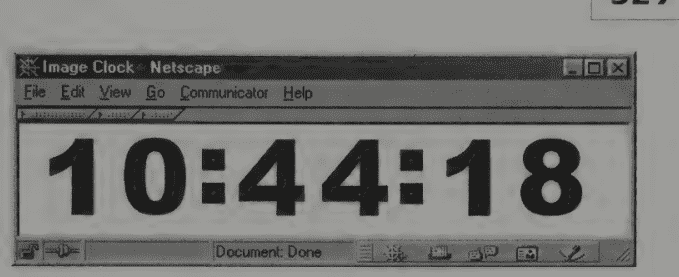

*timeofday.js* 库包含预加载数字时钟中使用的所有图片所需的代码，以及更新时钟所需的函数。首先，代码定义了一个 myImages 数组：

```
var myImages = new Array();
```

如果 document 对象具有 images 属性——表示该文档支持当前文档中持有的图片数组——代码将继续使用 Image 对象构造函数将 10 张图片加载到 myImages 数组中，并传递每张图片的宽度和高度：

```
if (document.images) {
  myImages[0] = new Image(64,64);
  myImages[0].src = "0.gif";
  myImages[1] = new Image(64,64);
  myImages[1].src = "1.gif";
  myImages[2] = new Image(64,64);
  myImages[2].src = "2.gif";
  myImages[3] = new Image(64,64);
  myImages[3].src = "3.gif";
  myImages[4] = new Image(64,64);
  myImages[4].src = "4.gif";
  myImages[5] = new Image(64,64);
  myImages[5].src = "5.gif";
  myImages[6] = new Image(64,64);
  myImages[6].src = "6.gif";
  myImages[7] = new Image(64,64);
  myImages[7].src = "7.gif";
  myImages[8] = new Image(64,64);
  myImages[8].src = "8.gif";
  myImages[9] = new Image(64,64);
  myImages[9].src = "9.gif";
}
```

第九章"图片"将更详细地介绍 Image 构造函数和图片切换技术的使用。

第七章

`updateClock()` 函数获取当前日期和时间，提取当前时间的各个数字，然后将 `timeofday.htm` 页面中显示的现有图片替换为反映当前时间的图片：

```
function updateClock() {
```

将当前日期和时间赋值给 `time` 变量：

```
var time = new Date();
```

`s1` 变量保存秒数对 10 取模的结果：

```
var s1 = time.getSeconds() % 10;
```

`s10` 变量保存秒数除以 10 并向下取整到最近整数的结果：

```
var s10 = Math.floor(time.getSeconds() / 10);
```

`m1` 变量保存分钟数对 10 取模的结果：

```
var m1 = time.getMinutes() % 10;
```

`m10` 变量保存分钟数除以 10 并向下取整到最近整数的结果：

```
var m10 = Math.floor(time.getMinutes() / 10);
```

`h1` 变量保存小时数对 10 取模的结果：

```
var h1 = time.getHours() % 10;
```

`h10` 变量保存小时数除以 10 并向下取整到最近整数的结果：

```
var h10 = Math.floor(time.getHours() / 10);
```

同样，如果 `document` 对象支持 `images` 属性，函数将继续交换名为 `s1`、`s10`、`m1`、`m10`、`h1` 和 `h10` 的图片，使用 `s1`、`s10`、`m1`、`m10`、`h1` 和 `h10` 的新值，来引用 `myImages` 数组中的适当图片：

## 昼夜源代码—image.htm

*image.htm* 页面包含初始数字时钟图片的 HTML。首先，加载 *timeofday.js* 库：

```
<script src="timeofday.js" language="JavaScript"></script>
```

开始 body 标签从 onLoad 事件处理程序中调用 updateClock() 函数，当且仅当 window 对象具有 updateClock 属性时。换句话说，*timeofday.js* 库中包含的 updateClock() 函数定义已成功加载到页面中：

```
<body onLoad="if (window.updateClock) updateClock()">
```

命名的图片 h10、h1、m10、m1、s10 和 s1 的 HTML img 元素通过 JavaScript 写入文档——如果 document 对象支持 images 属性且 window 对象包含 updateClock 属性：

```
if (document.images && window.updateClock) {
  document.write(
    '' +
    '' +
    '' +
    '' +
    '' +
    '' +
    '' +
    ''
);
}
```

此测试确保在浏览器不支持 Images 对象或 JavaScript 已被禁用的情况下，默认的 0.gif 图片不会显示在页面上。这避免了用户看到浏览器不支持的内容。

### 年度日历

"年度日历"项目以 4×3 网格显示当年 1 月至 12 月的 12 个月日历，并突出显示当前年 的当前日。它使用了第 6 章"弹出日期选择器"项目中简要提到的 *calendar.js* 库。*calendar.js* 库完全可重用。它可以用于显示任意一年的单月，如"弹出日期选择器"中所示，任意一年的全部 12 个月，或你希望显示的任何其他组合。

*calendar.js* 库提供三个基本的可重用函数：

- **CalendarHead (Month, Year, Select)** 返回用于显示日历月份标题的 HTML，由 Month 和 Year 参数指示。布尔型 Select 参数控制是否包含两个下拉选项列表，用于选择其他月份和年份。

- **CalendarMonth (M, Y, offset)** 返回由 M 和 Y 参数指示的实际日历月份的 HTML。offset 参数控制一周的第一天。例如，0 表示周日为一周第一天，1 表示周一，6 表示周六。

- **CalendarSelect (Month, Year, offset)** 返回用于显示日历月份的 HTML，包括用于选择其他月份和年份的下拉选项列表。它重用 CalendarHead() 和 CalendarMonth() 函数。

第 6 章的"弹出日期选择器"项目使用 CalendarSelect() 函数，传递要显示的月份和年份，以及 0 作为一周第一天的偏移量。生成的 HTML 包含一个带有两个下拉

## 日期与时间

select-option 列表。图 7-9 展示了多次使用 `CalendarHead()` 函数（Select 参数为 false）和 `CalendarMonth()` 函数（offset 参数为零）来显示一个年历。请注意年历的外观与弹出式日期选择器完全不同。这是由于使用了单独的外部级联样式表——本例中为 calendar.css——以及用 index.htm 页面中不同的值覆盖了 calendar.js 库中持有的某些数组。

图 7-9 年历——2000 年的 12 个月。

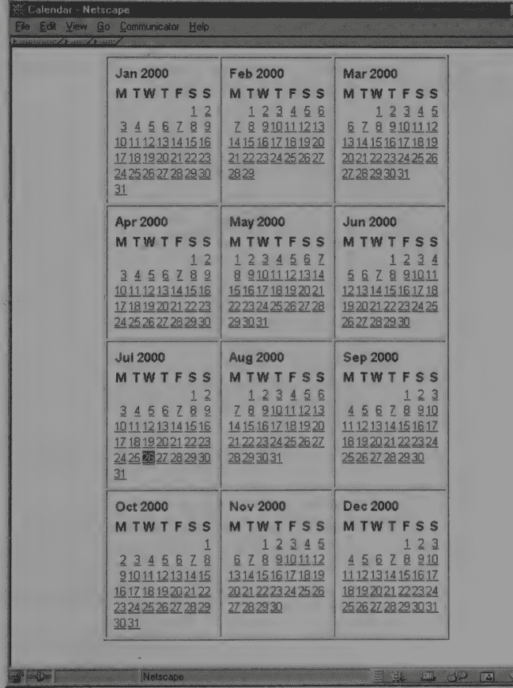

## 年历源代码——calendar.js

calendar.js 库包含多个数组的默认值；三个用于保存当前选定日、月、年的全局变量；三个用于将日历应用与任何周围应用解耦的辅助函数（如弹出式日期选择器中所示）；以及构建 HTML 所需的三个函数。

../chapter7/calendar/calendar.js

moy 数组保存要在日历应用中显示的月份名称。默认情况下，这些值是月份的完整名称：

```
var moy = new Array(
  'January','February','March',
  'April','May','June','July',
  'August','September','October',
  'November','December'
);
```

dow 数组保存要在日历应用中使用的日期名称。默认情况下，这些值是日期名称的缩写。请注意，该数组保存了额外的条目。这使得使用 offset 参数更加方便：

```
var dow = new Array('临,码,上方:)},
```

The global size variable holds a string indicating the width and height attributes to be used for each table cell:

```
var size = impo//width="50" height="30'";
```

The global border variable holds the border attribute to be used for each table:
```
对外非法内容出口 

var border = 'border="1"';
```

The three global variables CalendarMonth, CalendarYear, and CalendarDay are defined. They are used by the helper functions to enable the decoupling of the calendar application from any surrounding application:

```
var CalendarMonth;
var CalendarYear;
var CalendarDay;
```

The three helper functions CalMonth(), CalYear(), and CalDay() are invoked whenever the calendar application detects the user selecting a different month, year, or day. The three helper functions extract the value of the changed item, update the value of the corresponding global variable, and then invoke user-supplied functions. In other words, the changeMonth(), changeYear(), and changeDay() functions, if present, will be invoked by the calendar application. The three functions are provided independently of the calendar application.

The CalMonth() helper function retrieves the value of the selected Month option from the Cal form, using the getAnOptionValue() utility function, subtracts zero to convert the string value to a numerical value, assigns the result to the global CalendarMonth variable, and then invokes the changeMonth() function, passing the value of CalendarMonth as an input parameter:

```
function CalMonth() {
	CalendarMonth = getAnOptionValue(document.Cal.Month) - 0;
	changeMonth(CalendarMonth);
}
```

The CalYear() helper function does a similar job to the CalMonth() function but uses the year instead of the month:

```
function CalYear() {
	CalendarYear = getAnOptionValue(document.Cal.Year) - 0;
	changeYear(CalendarYear);
}
```

The CalDay() helper function accepts three parameters—day, month, and year—assigns the values to the CalendarDay, CalendarMonth, and CalendarYear global variables, and then invokes the changeDay() function, passing the three global variables as input parameters:

```
function CalDay(day, month, year) {
	CalendarDay = day;
	CalendarMonth = month;
	CalendarYear = year;
	changeDay(CalendarDay, CalendarMonth, CalendarYear);
}
```

The CalendarSelect() function is used to generate a complete header with two drop-down select-option lists for months and years, and a month calendar, using the passed Month and Year parameters to indicate the month to be displayed, and the passed offset parameter to indicate the first day of the week:

```
function CalendarSelect(Month, Year, offset) {
```

If the offset parameter is null (i.e., a value has not been passed), then the offset variable is defaulted to zero:

```
if (offset == null) offset = 0;
```

The HTML output generated by the CalendarSelect() function requires the three user-defined functions changeMonth(), changeYear(), and changeDay() to have been declared prior to invoking the function. If the window object does not contain a property for any of the three functions, then a suitable error message is sent to the user (or more usually the developer of the JavaScript application making use of the calendar.js library), and the function immediately exits:

```
if (window.changeMonth) { }
else {
  alert('A changeMonth() function has not been defined');
  return '';
}

if (window.changeYear) { }
else {
  alert('A changeYear() function has not been defined');
  return '';
}

if (window.changeDay) { }
else {
  alert('A changeDay() function has not been defined');
  return '';
}
```

An output variable is defined and initialized:

```
var output = '';
```

The output variable is appended with the HTML necessary to build a form named Cal, plus the return value of the CalendarHead() and CalendarMonth() functions:

```
output += '<form name="Cal">';
output += CalendarHead(Month, Year, true);
output += CalendarMonth(Month, Year, offset);
output += '</form>';
```

The call to the CalendarHead() function passes as input the value of the Month and Year parameters, along with a third parameter set to true.

The value of the output variable is returned back to whomever called the CalendarSelect() function:

```
return output;
}
```

The CalendarHead() function builds up the table to hold the month calendar, and optionally includes two drop-down select-option lists. The function accepts three parameters, Month, Year, and Select:

```
function CalendarHead(Month, Year, Select) {
```

An output variable is defined and initialized:

```
var output = '';
```

The HTML necessary to build a table around the header information is appended. The first cell of the first row contains the name of the month using the moy array and the value of the Month parameter, followed by the value of the Year parameter:

```
output +=
  '<table cellspacing="0" class="cal">' +
  '<tr><td align="left" width="100%" class="head">' +
  moy[Month-1] + ' ' + Year +
  '</td>';
```

If the third input parameter, Select, is true, then the HTML to build the two select-option lists is additionally appended:

```
if (Select) {
```

First, a select element named Month is appended. It has an onChange event handler that invokes the CalMonth() helper function when the user changes the current selection in the list:

```
output += '<td width="50%" align="right">' +
          '<select name="Month" onChange="CalMonth()">';
```

An option element for each month of the year is appended. The element that corresponds to the current value of Month is selected as the default option:

```
for (var month=1; month<=12; month++) {
    output += '<option value="' + month + '"';
    if (month == Month) output += ' selected';
    output += '>' + moy[month-1] + '</option>';
}
```

Next, a select element named Year is appended. It also has an onChange event handler, but this time it invokes the CalYear() function. Again, an option element for each year from 1900 to 2100 is appended, and the entry that corresponds to the current value of Year is selected as the default option:

```
output += '</select>' +
          '<select name="Year" onChange="CalYear();">';

for (var year=1900; year<=2100; year++) {
    output += '<option value="' + year + '"';
    if (year == Year) output += ' selected';
    output += '>' + year + '</option>';
}

output += '</select>';
}
```

Finally, the HTML for the table is closed, and the value of output is returned:

```
output += '</td></tr></table>';
return output;
}
```

The CalendarMonth() function builds and returns the HTML necessary to display a month calendar using the passed M and Y parameters as the month and year to be displayed, as well as the offset variable to indicate the first day of the week:

```
function CalendarMonth(M, Y, offset) {
```

As with the CalendarSelect() function, if the offset parameter is null (i.e., a value has not been passed), then the offset variable is defaulted to zero:


# 第七章

## 日期与时间

```
if (offset == null) offset = 0;
```

月份第一天的日期，即 `startDay`，通过 `dayOfWeek()` 函数获取：

```
var startDay = dayOfWeek(1,M,Y);
```

如果该值小于 `offset` 的值，则将 `startDay` 增加 7。

```
if (startDay < offset) startDay += 7;
```

定义一个局部变量 `days`，并为其赋值 `daysOfMonth` 数组引用的副本：

```
var days = daysOfMonth;
```

如果由 `isLeapYear()` 函数判断出 `Y` 年是闰年，则用 `daysOfMonthLY` 数组的副本更新局部变量 `days`：

```
if (isLeapYear(Y)) days = daysOfMonthLY;
```

定义一个输出变量并进行初始化：

```
var output = '';
```

函数的剩余部分用于构建显示月历所需的 HTML 表格：

```
output +=
    '<table ' + border + ' cellpadding="0" class="cal"><tr>';
```

第一行表格包含来自 `dow` 数组的每周各天名称：

```
for (var i=0; i<7; i++)
    output += '<td ' + size + ' class="days">' +
              dow[i + offset] + '</td>';

output += '</tr><tr>';
```

第二行开始显示当月的日期。然而，第二行可能包含上个月的日期，在这种情况下，需要先包含这些日期，然后才能开始显示当月日期。上个月的值（`lastM`）通过从 `M` 中减去 1 来计算。

如果结果为 0，则将其更改为 12（即当前月份是 1 月；因此上个月是 12 月）：

```
var column = 0;
var lastM = M - 1;
if (lastM == 0) lastM = 12;
```

对于从上个月侵入到本月第一个不完整周的每一天，将一个表格单元格追加到输出变量中：

```
for (var i=0+offset; i<startDay; i++, column++)
    output += '<td ' + size + ' class="grey">' +
    (days[lastM-1]-startDay+i+1) + '</td>';
```

完成后，代码可以继续将当月的每一天追加到输出变量中：

```
for (var i=1; i<=days[M-1]; i++, column++) {
```

一个局部变量 `style` 保存用于所有包含当月日期的表格单元格的 class 属性：

```
var style = ' class="links"';
```

但是，如果当前正在追加的单元格（由局部变量 `i`、`M` 和 `Y` 标识）与当前日期（由全局变量 `day`、`month` 和 `year` 标识）相同，则 `style` 变量将被替换为另一个值。这会在当前年份的当前月份内突出显示当前日期：

```
if (day == i && month == M && year == Y)
    style = ' class="today"';
```

如果用户提供了 `changeDay()` 函数——即 `window` 对象具有 `changeDay` 属性——那么表格单元格将包含一个超文本链接，当点击该链接时，会调用 `CalDay()` 辅助函数，并将 `i`、`M` 和 `Y` 的值作为输入参数传递：

```
if (window.changeDay)
    output += '<td ' + size + '>' +
    '<a href="javascript:CalDay('+i+','+M+','+Y+')"' +
    style + '>' + i + '</a></td>';
```

否则，单元格仅包含当月的日期值：

```
else
    output += '<td ' + size + style + '>' + i + '</td>';
```

每七个表格单元格（一行）之后，追加一个新的表格行：

```
if (column == 6) {
    output += '</tr><tr>';
    column = -1;
}
```

与月初一样，下个月的日期也可能出现在当月的最后一周。为每个这样的日期追加一个表格单元格：

```
if (column > 0) {
    for (var i=1; column<7; i++, column++)
        output += '<td ' + size + ' class="grey">' + i + '</td>';
}
```

最后，关闭 HTML 表格，并返回 `output` 变量的值：

```
output += '</tr></table>';

return output;
}
```

## 年历源代码—calendar.css

```
./chapter7/calendar/calendar.css
```

请注意，代码使用了各种 HTML class 属性：`cal`、`head`、`grey`、`links`、`today` 和 `days`。这些 class 样式的定义保存在 *calendar.css* 文件中。通过修改 class 样式的定义，可以在不修改 JavaScript 代码的情况下独立地影响日历的呈现方式：

```
.cal {
    background-color: #ffffff;
}

.head {
    color: #bb0000;
    font-family: Arial;
    font-weight: bold;
    text-align: left;
}

.days {
  color: #0000bb;
  font-family: Arial;
  font-weight: bold;
  text-align: right;
}

.grey {
  color: #ffffff;
  font-family: Arial;
  font-size: small;
  text-align: right;
}

.links {
  color: #ff0000;
  font-family: Arial;
  font-size: small;
  text-align: right;
}

.today {
  color: #ffffff;
  background-color: #ff0000;
  font-family: Arial;
  font-size: small;
  text-align: right;
}
```

## 年历源代码—index.htm

*index.htm* 页面，就像第 6 章中详述的弹出式日期选择器的 *index.htm* 页面一样，是一个包装应用程序，它利用 *calendar.js* 库中的通用代码。与弹出式日期选择器包装应用程序不同，年历包装应用程序只是使用 *calendar.js* 库来显示当前年份的所有月份，如图 7-9 所示。

首先我们包含 *calendar.css* 样式表：

```
<link rel="stylesheet" href="calendar.css" type="text/css">
```

接下来，我们包含 *current.js* 和 *calendar.js* 库：

```
<script language="JavaScript" src="current.js"></script>
<script language="JavaScript" src="calendar.js"></script>
```

然后我们使用我们首选的值覆盖全局变量 `size`、`border` 以及 `dow` 和 `moy` 数组的值：

```
size = '';
border = 'border="0"';
dow = new Array('S','M','T','W','T','F','S',
                'S','M','T','W','T','F');
moy = new Array(
  'Jan','Feb','Mar','Apr','May','Jun',
  'Jul','Aug','Sep','Oct','Nov','Dec'
);
```

我们仅定义 `changeDay()` 函数。这个用户定义的函数在此特定包装应用程序中是可选的，它只是使用传入的 `day`、`month` 和 `year` 参数值创建一个 `Date` 对象，然后使用 `alert` 突出显示其值：

```
function changeDay(day, month, year) {
  alert(new Date(year, month, day));
}
```

定义一个输出变量并进行初始化：

```
var output = '';
```

仅当两个 JavaScript 库都成功加载时，才会处理代码的主体部分：

```
if (window.formatFullDate && window.CalendarSelect) {
```

使用当前日期定义和初始化全局变量 `day`、`month` 和 `year`：

```
var today = new Date();
var day   = today.getDate();
var month = today.getMonth() + 1;
var year  = today.getFullYear();
```

然后，代码开始构建一个三列四行的 HTML 表格。每个表格单元格包含调用 `CalendarHead()` 和 `CalendarMonth()` 函数的结果，并将结果追加到 `output` 变量中。代码循环 12 次，每年的每个月一次，每次递增局部变量 `i` 的值。`i` 的值用作 `CalendarHead()` 和 `CalendarMonth()` 函数的 Month 输入参数。由于 `CalendarHead()` 函数的第三个参数（Select 参数）缺失，因此函数返回值中不包含下拉选择列表。`CalendarMonth()` 函数的第三个参数（offset 参数）传递为数值 1。这表明该函数应使用星期一作为每周的第一天。

```
output +=
  '<table class="cal" border="1"><tr><td valign="top">';
for (var i = 1; i <= 12; i++) {
  output += '<table><tr><td>' +
    CalendarHead(i,year) +
    CalendarMonth(i,year,1) +
    '</td></tr></table>';

  if (i != 12) {
    if (i % 3 == 0)
      output += '</td></tr><tr><td valign="top">';
    else
      output += '</td><td valign="top">';
  }
}

output += '</td></tr></table>';
}
```

所有 HTML 构建完成后，将 `output` 变量的值写入文档：

```
document.write(output);
```

当用户点击日历中的某一天时产生的操作是完全灵活的。你只需修改 `changeDay()` 函数，删除 `alert()` 消息，并将其替换为你自己选择的内容，也许是一个显示该特定日期事件的弹出窗口。

### 日期倒计时

在 1999 年 12 月 31 日之前的最后几年，许多网站都有从 1999 年到 2000 年的简单日期倒计时。既然 2000 年 1 月 1 日已经到来又过去，许多这些倒计时仍在运行，但现在错误地显示距离 2000 年 1 月 1 日的剩余时间为负值。此处提供的代码展示了如何使用通用代码从一个任意日期进行倒计时或正计时。图 7-10 显示了四个不同日期的倒计时和正计时计时器。


## 日期倒计时源代码——countdown.js

*countdown.js* 库包含后续 *index.htm* 页面中使用的通用 JavaScript 函数。

**在光盘上** .../chapter7/countdown/countdown.js

`formatObjectDate()` 函数充当通用对象方法。它将 `this` 对象引用的 days、hours、minutes 和 seconds 属性作为格式化字符串返回：

```
function formatObjectDate() {
  return ((this.days != 0) ? this.days + ' days ' : '') +
    ((this.hours != 0) ? this.hours + ' hours ' : '') +
    ((this.minutes != 0) ? this.minutes + ' minutes ' : '') +
    ((this.seconds != 0) ? this.seconds + ' seconds ' : '');
}
```

`countdown()` 函数接收传入的 `when` `Date` 对象参数，将其与另一个表示当前时间的 `Date` 对象一起作为输入传递给 `difference()` 函数。然后使用返回的对象引用的 `formatDate()` 方法来格式化距离 `when` 日期和时间的剩余时间：

```
function countdown(when) {
    return difference(when, new Date()).formatDate();
}
```

`countup()` 函数的处理过程相同，只是传递给 `difference()` 函数的输入参数顺序相反：

```
function countup(when) {
    return difference(new Date(), when).formatDate();
}
```

`difference()` 函数接受两个 `Date` 对象参数——`older` 和 `newer`——并创建一个默认的 `myObject` 对象。然后计算较旧日期和较新日期之间相差的天数、小时数、分钟数和秒数，并将值赋给 `myObject` 对象的属性：

```
function difference(older, newer) {
```

首先，`difference()` 函数使用通用的 `Object` 构造函数创建一个没有固有属性或方法的 `Object` 对象，并将对象引用赋给 `myObject` 变量：

```
var myObject = new Object();
```

两个日期之间的时间差（`dif`）以毫秒为单位，通过使用 `getTime()` 方法获取的毫秒数相互减去来计算：

```
var dif = older.getTime() - newer.getTime();
```

两个日期之间的天数差通过将 `dif` 变量除以 86,400,000 毫秒（即一整天的毫秒数：1000 毫秒 × 60 秒 × 60 分钟 × 24 小时）得出。然后将结果向下取整为最近的整数，再赋给 `myObject` 对象的 `days` 属性：

```
myObject.days = Math.floor(dif / 1000 / 60 / 60 / 24);
```

然后修正 `dif` 变量，将其减去天数差对应的毫秒数：

```
dif = dif - myObject.days * 1000 * 60 * 60 * 24;
```

同样，执行相同类型的计算来获取两个日期之间的小时差、分钟差和秒差：

```
myObject.hours = Math.floor(dif / 1000 / 60 / 60);
dif = dif - myObject.hours * 1000 * 60 * 60;
myObject.minutes = Math.floor(dif / 1000 / 60);
dif = dif - myObject.minutes * 1000 * 60;
myObject.seconds = Math.floor(dif / 1000);
```

`myObject` 对象的 `formatDate` 属性被赋值为 `formatObjectDate()` 函数的引用。这使得 `formatDate()` 成为 `myObject` 对象的一个方法：

```
myObject.formatDate = formatObjectDate;
```

最后，返回 `myObject` 对象引用：

```
return myObject;
}
```

## 日期倒计时源代码——index.htm

`index.htm` 页面包含显示四个不同且互不相关的日期倒计时并排运行所需的 HTML 和特定 JavaScript 代码。

```
../chapter7/countdown/index.htm
```

首先，在页面中引入 `countdown.js` 库：

```
<script src="countdown.js" language="JavaScript"></script>
```

创建四个独立的日期对象并赋值给四个全局变量——`time1` 表示 2100 年 1 月 1 日，`time2` 表示 2000 年 1 月 1 日，`time3` 表示 3000 年 1 月 1 日，`time4` 表示文档的最后修改日期：

```
var time1 = new Date(2100, 0, 1);
var time2 = new Date(2000, 0, 1);
var time3 = new Date(3000, 0, 1);
var time4 = new Date(document.lastModified);
```

`autoUpdate()` 函数使用先前定义的全局时间变量作为输入参数来调用 `countdown()` 和 `countup()` 函数。返回值随后用于更新四个不同输入表单字段的值：

```
function autoUpdate() {
```

只有当 `countdown()` 和 `countup()` 函数已从 `countdown.js` 库中成功加载时，才会处理 `autoUpdate()` 函数的主体：

```
if (window.countdown && window.countup) {
```

第一个计时器使用 `countdown()` 函数来检索并格式化距离 `time1` 的剩余时间：

```
var dif1 = countdown(time1);
if (document.timeForm.field1.value != dif1)
    document.timeForm.field1.value = dif1;
```

第二个计时器使用 `countup()` 函数来检索并格式化自 `time2` 以来经过的时间：

```
var dif2 = countup(time2);
if (document.timeForm.field2.value != dif2)
    document.timeForm.field2.value = dif2;
```

第三个计时器使用 `countdown()` 函数来检索并格式化距离 `time3` 的剩余时间：

```
var dif3 = countdown(time3);
if (document.timeForm.field3.value != dif3)
    document.timeForm.field3.value = dif3;
```

第四个计时器使用 `countup()` 函数来检索并格式化自 `time4` 以来经过的时间：

```
var dif4 = countup(time4);
if (document.timeForm.field4.value != dif4)
    document.timeForm.field4.value = dif4;
```

在每种情况下，只有当值发生变化时才会更新相关的表单字段值。`autoUpdate()` 函数随后启动一个计时器，在 500 毫秒后重新调用 `autoUpdate()` 函数：

```
setTimeout('autoUpdate()', 500);
}
}
```

起始 `<body>` 标签中的 `onLoad` 事件处理程序在整个页面完全加载后调用 `autoUpdate()` 函数，从而启动整个流程：

```
<body onLoad="autoUpdate()">
```

### 32 年 8 个月零 24 天

此应用程序展示了如何计算两个日期之间相差的年数、月数和天数。此应用程序中描述和使用的 `HowOld()` 函数之前曾在第 6 章的"家谱"部分中使用过。

计算两个日期之间的差值可以使用前一个日期倒计时应用程序中所示的技术。然而，`HowOld()` 函数中的代码通过简单地将一个日期的年数、月数和天数从另一个日期中减去来计算差值。图 7-11 显示了当页面于 2000 年 7 月 26 日加载到浏览器中时，计算 1965 年 1 月 4 日出生的人的年龄所得出的结果。

## 32 年 8 个月零 24 天源代码——howold.js

*howold.js* 库包含单个 `HowOld()` 函数。该函数使用简单的减法来确定两个日期之间相差的年数、月数和天数。

**在光盘上**

```
../chapter7/howold/howold.js
```

`HowOld()` 函数接受六个参数：`day`、`month` 和 `year` 表示较旧的日期（例如出生日期），`Day`、`Month` 和 `Year` 表示较新的日期（例如今天的日期）。

```
function HowOld(day, month, year, Day, Month, Year) {
```

定义三个局部变量 `years`、`months` 和 `days`。立即将 `years` 的值设置为 `Year` 减去 `year` 的差值，将 `months` 和 `days` 的值设置为零：

```
var years = Year - year, months = days = 0;
```

计算 `Month` 和 `month` 之间的差值。如有需要，从 `years` 中借一年并作为 12 个月加到 `Month` 上：

```
if (Month >= month) months = Month - month;
else { years--; months = Month + 12 - month; }
```

同样，计算 `Day` 和 `day` 之间的差值并赋给 `days`，只是这次可能不仅需要从 `months` 中借一个月并作为 31 天加到 `day` 上，还需要从 `years` 中借一年并作为 11 个月加到 `months` 上，然后再将 31 天加到 `Day` 上：

```
if (Day >= day) days = Day - day;
else {
    if (months > 0) months--;
    else { years--; months += 11; }
    days = Day + 31 - day;
}
```


日期和时间

如果任何计算结果得到的年份小于零，或者年份、月份和天数都等于零，则假定输入数据不正确，在这种情况下，返回一个空字符串。

```
if (years < 0) return '';
if ((years == 0) && (months == 0) && (days == 0)) return '';
```

否则，返回一个格式化的字符串，表示年份、月份和天数的差异：

```
return years + ' years, ' +
       months + ' months, ' +
       days + ' days';
}
```

## 32年8个月24天源代码——index.htm

*index.htm* 页面展示了如何使用 *howold.js* 库来计算某人（出生于1965年1月4日）的年龄。


../chapter7/howold/index.htm

*current.js* 和 *howold.js* 两个库都被加载到页面中：

```
<script src="current.js" language="JavaScript"></script>
<script src="howold.js" language="JavaScript"></script>
```

只有在两个库都成功加载后，代码才会被处理：

```
if (window.formatFullDate && window.HowOld) {
```

day、month 和 year 变量保存1965年1月4日的日期。

```
var day   = 4;
var month = 1;
var year  = 1965;
```

*formatFullDate()* 函数用于显示出生日期：

```
document.write(
    'Birthday - ' + formatFullDate(day, month, year) + '<br>'
);
```

`today` 变量保存使用默认 `Date` 对象构造函数创建的当前日期和时间：

```
var today = new Date();
```

`Day`、`Month` 和 `Year` 变量保存从 `today` 日期中检索到的 `day`、`month` 和 `year` 值：

```
var Day    = today.getDate();
var Month  = today.getMonth()+1;
var Year   = today.getFullYear();
```

`formatFullDate()` 函数用于显示今天的日期：

```
document.write(
    'Today - ' + formatFullDate(Day, Month, Year) + '<br>'
);
```

最后，两组日期作为输入传递给 `HowOld()` 函数。然后将返回值输出到文档：

```
document.write(
    'Age - ' + HowOld(day,month,year,Day,Month,Year)
);
};
```

第6章中描述的族谱应用程序展示了如何使用 `HowOld()` 函数的返回值来更新对象属性的值，然后用于显示族谱中人物的年龄。

### 你的星座是什么？

许多人对星座、他们的出生日期、他们属于哪个星座以及今天的当前星座很感兴趣。此应用程序展示了如何确定特定日期属于哪个星座，包括通常与星座相关的符号、诞生石和特质，并为特定星座生成日期范围。图7-12显示了该应用程序在2000年7月27日运行的结果。


图7-12 星座——2000年7月27日。

## 你的星座是什么？源代码——zodiac.js

*zodiac.js* 库包含计算任何日期星座所需的对象构造函数、数组和函数。

../chapter7/zodiac/zodiac.js

`zodiac()` 函数实际上是 Zodiac 对象的构造函数。它将传递的参数分配为 Zodiac 对象的属性，每个属性对应星座的**结束日**、**星座名称**、**符号**、**诞生石**和**特质**：

```
function Zodiac(day, sign, symbol, birthstone, quality) {
    this.day = day;
    this.sign = sign;
    this.symbol = symbol;
    this.birthstone = birthstone;
    this.quality = quality;
}
```

`setZodiac()` 函数用于创建 Zodiac 对象的实例，并将对象引用分配给 *myZodiac* 对象数组。

```
function setZodiac(day, sign, symbol, birthstone, quality) {
    myZodiac[zodiacIndex++] =
        new Zodiac(day, sign, symbol, birthstone, quality);
}
```

zodiacIndex 数组索引和 myZodiac 数组被定义并初始化：

```
var zodiacIndex = 0;
var myZodiac = new Array();
```

然后调用 setZodiac() 函数12次，每个星座一次：

```
setZodiac(20,'Capricorn','Goat','Garnet','Constancy');
setZodiac(19,'Aquarius','Water Bearer','Amethyst','Sincerity');
setZodiac(
    21,'Pisces','Fishes','Aquamarine, Bloodstone','Courage');
setZodiac(21,'Aries','Ram','Diamond','Innocence');
setZodiac(21,'Taurus','Bull','Emerald','Love, success');
setZodiac(
    21,'Gemini','Twins','Pearl, Alexandrite, Moonstone','Health'
);
setZodiac(22,'Cancer','Crab','Ruby','Contentment');
setZodiac(
    22,'Leo','Lion','Peridot, Sardonyx','Married happiness');
setZodiac(22,'Virgo','Virgin','Sapphire','Clear thinking');
setZodiac(23,'Libra','Balance','Opal, Tourmaline','Hope');
setZodiac(22,'Scorpio','Scorpion','Topaz','Fidelity');
setZodiac(
    21,'Sagittarius','Archer','Turquoise, Zircon','Prosperity');
```

starSign() 函数用于返回一个对应于输入的日和月的星座数字值（例如，摩羯座为0，射手座为11，依此类推）：

```
function starSign(day,month) {
```

一个局部变量 zodiac 被赋予月份参数的值：

```
var zodiac = month;
```

如果传递的 day 参数小于对应于传递的 month 参数的 Zodiac 对象的 day 属性，则 zodiac 变量减1：

```
if (day < myZodiac[month-1].day) zodiac--;
```

如果 zodiac 变量的值仍然等于12，那么该星座必须属于下一个星座周期，在这种情况下，zodiac 的值被调整为0（即摩羯座）：

```
if (zodiac==12) zodiac=0;
```

返回 zodiac 变量的值：

```
return zodiac;
}
```

starDateRange() 函数返回一个包含两个格式化日期的字符串，表示传递的日、月、年日期所属星座的开始和结束日期：

```
function starDateRange(day,month,year) {
```

局部变量 beginYear、endYear 和 beginMonth、endMonth 被初始化为传递的 year 和 month 参数的值：

```
var beginYear = endYear = year;
var beginMonth = endMonth = month;
```

如果月份中的日期早于相关 Zodiac 对象的 day 属性，则 beginMonth 变量减1；否则，endMonth 变量加1：

```
if (day < myZodiac[month-1].day)
    beginMonth--; else endMonth++;
```

如果 beginMonth 等于0，则 beginMonth 和 beginYear 被调整为上一年的最后一个月。否则，如果 endMonth 等于13，则 endMonth 和 endYear 被调整为下一年的第一个月：

```
if (beginMonth == 0) {
    beginMonth = 12; beginYear--;
}
else if (endMonth == 13) {
    endMonth = 1; endYear++;
}
```

beginDay 和 endDay 变量都被赋予相关 Zodiac 对象的 day 属性或 day 属性减1：

```
beginDay = myZodiac[beginMonth-1].day;
endDay = myZodiac[endMonth-1].day - 1;
```

最后，返回一个包含格式化的开始和结束日期的字符串：

```
return formatFullDate(beginDay,beginMonth,beginYear) +
       ' - ' +
       formatFullDate(endDay,endMonth,endYear);
}
```

## 你的星座是什么？源代码——index.htm

*index.htm* 页面显示了当前日期的星座详情。


./chapter7/zodiac/index.htm

*current.js* 和 *zodiac.js* 两个库都被加载到页面中：

```
<script src="current.js" language="JavaScript"></script>
<script src="zodiac.js" language="JavaScript"></script>
```

只有在两个库都成功加载后，代码才会被处理：

```
if (window.formatFullDate && window.Zodiac) {
```

day、month 和 year 变量被赋予当前日期的值：

```
var today = new Date();
var day   = today.getDate();
var month = today.getMonth() + 1;
var year  = today.getFullYear();
```

`starsign()` 函数接收 day 和 month 输入参数，结果被赋给 star 变量：

```
var star = starSign(day,month);
```

位于 `myZodiac` 对象数组中位置 star 的 `Zodiac` 对象的相关属性被写入文档，以及 `starDateRange()` 函数的返回值：


### 中国农历新年

这个特定的应用程序与之前的"你是什么星座？"应用程序类似，因为它显示了特定日期的详细信息以及该日期与中国农历的关系。中国农历新年在公历的1月10日至2月19日之间的某个日期。当前60年周期的初始年（*甲子年*）始于1984年2月2日。完整的六十甲子年名称列表如表7-2所示。

| 年份 | 年份名称 | 年份 | 年份名称 | 年份 | 年份名称 | 年份 | 年份名称 |
|------|----------|------|----------|------|----------|------|----------|
| '84 | jia-zi | '99 | ji-mao | '14 | jia-wu | '29 | ji-you |
| '85 | yi-chou | '00 | geng-chen | '15 | yi-wei | '30 | geng-xu |
| '86 | bing-yin | '01 | xin-si | '16 | bing-shen | '31 | xin-hai |
| '87 | ding-mao | '02 | ren-wu | '17 | ding-you | '32 | ren-zi |
| '88 | wu-chen | '03 | gui-wei | '18 | wu-xu | '33 | gui-chou |
| '89 | ji-si | '04 | jia-shen | '19 | ji-hai | '34 | jia-yin |
| '90 | geng-wu | '05 | yi-you | '20 | geng-zi | '35 | yi-mao |
| '91 | xin-wei | '06 | bing-xu | '21 | xin-chou | '36 | bing-chen |
| '92 | ren-shen | '07 | ding-hai | '22 | ren-yin | '37 | ding-si |
| '93 | gui-you | '08 | wu-zi | '23 | gui-mao | '38 | wu-wu |
| '94 | jia-xu | '09 | ji-chou | '24 | jia-chen | '39 | ji-wei |
| '95 | yi-hai | '10 | geng-yin | '25 | yi-si | '40 | geng-shen |
| '96 | bing-zi | '11 | xin-mao | '26 | bing-wu | '41 | xin-you |
| '97 | ding-chou | '12 | ren-chen | '27 | ding-wei | '42 | ren-xu |
| '98 | wu-yin | '13 | gui-si | '28 | wu-shen | '43 | gui-hai |

## 第七章

年份名称是通过12个*地支*（子、丑、寅、卯等）和10个*天干*（甲、乙、丙等）的循环获得的。地支是中国对12年西方化动物名称的等价物。图7-13显示了2000年2月5日至2001年1月23日之间任意日期的结果。

## 中国农历新年源代码——chinese.js

*chinese.js*库包含计算和返回任意日期详细信息所需的所有函数和数组。

../chapter7/chinese/chinese.js

`Chinese()`函数充当中国对象构造函数，将传入的每个参数分配为`this`对象引用的属性：

```javascript
function Chinese(animal,animalI,branch,branchI,stem,stemI) {
  this.animal = animal; this.animalImage = animalI;
  this.branch = branch; this.branchImage = branchI;
  this.stem = stem; this.stemImage = stemI;
}
```

`setChinese()`函数创建Chinese对象的实例，并将对象引用赋值给`myChinese`对象数组的下一个条目：

```javascript
function setChinese(animal, animalI, branch, branchI, stem, stemI) {
    myChinese[chineseIndex++] = new Chinese(animal, animalI, branch, branchI, stem, stemI);
}
```

chineseIndex变量和myChinese数组被定义和初始化：

```javascript
var chineseIndex = 0;
var myChinese = new Array();
```

setChinese()函数被调用了12次，每个中国地支调用一次，传入西方化的动物名称、动物图片名称、地支名称、地支图片名称、天干名称和天干图片名称：

```javascript
setChinese(
    'Pig', 'pig.gif', 'hai', 'hai4.gif', 'gui', 'gui3.gif');
setChinese('Rat', 'rat.gif', 'zi', 'zi3.gif', 'jia', 'jia3.gif');
setChinese('Ox', 'ox.gif', 'chou', 'chou3.gif', 'yi', 'yi3.gif');
setChinese(
    'Tiger', 'tiger.gif', 'yin', 'yin2.gif', 'bing', 'bing3.gif');
setChinese(
    'Rabbit', 'rabbit.gif', 'mao', 'mao3.gif', 'ding', 'ding1.gif');
setChinese(
    'Dragon', 'dragon.gif', 'chen', 'chen2.gif', 'wu', 'wu4.gif');
setChinese('Snake', 'snake.gif', 'si', 'si4.gif', 'ji', 'ji3.gif');
setChinese(
    'Horse', 'horse.gif', 'wu', 'wu3.gif', 'geng', 'geng1.gif');
setChinese(
    'Goat', 'goat.gif', 'wei', 'wei4.gif', 'xin', 'xin1.gif');
setChinese(
    'Monkey', 'monkey.gif', 'shen', 'shen1.gif', 'ren', 'ren2.gif');
setChinese('Rooster', 'rooster.gif', 'you', 'you3.gif');
setChinese('Dog', 'dog.gif', 'xu', 'xu1.gif');
```

> 注意：请注意，尽管地支和天干之间不是一对一的映射关系，但我们没有为天干信息创建单独的数组，而是复用了myChinese数组的前10个条目来保存天干信息。

四张额外的图片用于英文短语*地支*和*天干*的中文等价物：

```javascript
var branchImage1 = 'di4.gif';
var branchImage2 = 'zhi1.gif';
var stemImage1 = 'tian1.gif';
var stemImage2 = 'gan1.gif';
```

## 第七章

与其计算每年的农历新年日期——这需要利用月相进行复杂的计算——我们预计算了1900年至2051年的农历新年日期，并将这些值存储在cnys数组中：

```javascript
var cnys = new Array(
    1.31, 2.19, 2.08, 1.29, 2.16, 2.04, 1.25, 2.13, 2.02, 1.22,
    2.10, 1.30, 2.18, 2.06, 1.26, 2.14, 2.03, 1.23, 2.11, 2.01,
    2.20, 2.08, 1.28, 2.16, 2.05, 1.25, 2.13, 2.02, 1.23, 2.10,
    1.30, 2.17, 2.06, 1.26, 2.14, 2.04, 1.24, 2.11, 1.31, 2.19,
    2.08, 1.27, 2.15, 2.05, 1.25, 2.13, 2.02, 1.22, 2.10, 1.29,
    2.17, 2.06, 1.27, 2.14, 2.03, 1.24, 2.12, 1.31, 2.18, 2.08,
    1.28, 2.15, 2.05, 1.25, 2.13, 2.02, 1.21, 2.09, 1.30, 2.17,
    2.06, 1.27, 2.15, 2.03, 1.23, 2.11, 1.31, 2.18, 2.07, 1.28,
    2.16, 2.05, 1.25, 2.13, 2.02, 2.20, 2.09, 1.29, 2.17, 2.06,
    1.27, 2.15, 2.04, 1.23, 2.10, 1.31, 2.19, 2.07, 1.28, 2.16,
    2.05, 1.24, 2.12, 2.01, 1.22, 2.09, 1.29, 2.18, 2.07, 1.26,
    2.10, 2.03, 1.23, 2.10, 1.31, 2.19, 2.09, 1.28, 2.16, 2.05,
    1.25, 2.12, 2.01, 1.22, 2.10, 1.29, 2.17, 2.06, 1.26, 2.13,
    2.03, 1.23, 2.11, 1.31, 2.19, 2.08, 1.28, 2.15, 2.04, 1.24,
    2.12, 2.01, 1.22, 2.10, 1.30, 2.17, 2.06, 1.26, 2.14, 2.02,
    1.23, 2.11
);
```

月份和日期以浮点数形式保存，整数部分表示月份，小数部分表示日期（例如，2.11表示2月11日）。

CNY()对象构造函数计算特定日期（通过d、m、y传入）的所有信息，并将信息赋值给this对象引用的属性：

```javascript
function CNY(d,m,y) {
```

start和end属性用于保存传入日期所属农历年的开始和结束日期，它们被定义并初始化：

```javascript
this.start = '';
this.end = '';
```

只有当传入的y年在1900到2051的范围内时，才能计算开始和结束日期：

```javascript
if ((y > 1900) && (y < 2051)) {
```

从cnys数组中检索代表农历新年月份和日期的浮点值，将y参数减去1900以获得数组中的正确位置，将值赋给newYear变量：

```javascript
var newYear = cnys[y - 1900];
```

提取newYear变量的整数部分和小数部分，并分别赋给newMonth和newDay变量：

```javascript
var newMonth = Math.floor(newYear);
var newDay = Math.round((newYear*100)-(newMonth*100));
```

要计算中国地支，必须先将年份减去3，然后除以12，以确定与该年份对应的动物：branch = (year - 3)%12。例如，对于1997年，(1997 - 3)%12返回整数值2。要检索中国天干，需要将年份减去3，然后除以10：stem = (year - 3)%10。因此，对于1997年，(1997 - 3)%10返回整数值4。所以，1997年的中国年份是丑丁年，也就是牛年——即myChinese[2].branch、myChinese[4].stem和myChinese[2].animal。然而，生活并没有这么简单。如前所述，中国农历新年的开始日期在1月10日至2月19日之间变化。人们总是认为因为我出生在1965年，所以我是蛇年出生的。但因为我出生在1月4日，实际上我是龙年出生的。

因此，代码会判断m参数的值是否大于newMonth变量。如果是，则代码继续基于传入的y参数计算开始日期属性，并基于y+1（即下一年）计算结束日期属性：

```javascript
if ((m > newMonth) ||
    ((m == newMonth) && (d >= newDay))) {
  // this year
  this.branch = (y-3) % 12;
  this.stem = (y-3) % 10;

  var nextYear = cnys[y - 1900 + 1];
  var nextMonth = Math.floor(nextYear);
  var nextDay = Math.round((nextYear*100)-(nextMonth*100));

  var lastDay = nextDay - 1;
  if (lastDay == 0) {
    lastMonth = nextMonth - 1;
    lastDay = 31;
  }
  else lastMonth = nextMonth;

  this.start = formatFullDate(newDay,newMonth,y);
  this.end   = formatFullDate(lastDay,lastMonth,y+1);
}
```


## 农历新年 源代码——index.htm

否则，代码将根据 y 参数减 1（即上一年）的值计算开始日期属性，并根据 y 参数计算结束日期属性：

```
else {
  // last year
  this.branch = (y-4) % 12;
  this.stem = (y-4) % 10;

  var oldYear = cnys[y - 1900 - 1];
  var oldMonth = Math.floor(oldYear);
  var oldDay = Math.round((oldYear*100)-(oldMonth*100));

  var lastDay = newDay - 1;
  if (lastDay == 0) {
    lastMonth = newMonth - 1;
    lastDay = 31;
  }
  else lastMonth = newMonth;

  this.start = formatFullDate(oldDay,oldMonth,y-1);
  this.end   = formatFullDate(lastDay,lastMonth,y);
}
```

如果 y 参数超出或位于 1900 到 2051 范围的边界上，则仅计算该年整体的通用地支和天干属性：

```
else {
  this.branch = (y-3) % 12;
  this.stem = (y-3) % 10;
}
```

*index.htm* 页面显示当前日期的农历年份详情。

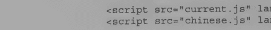

*current.js* 和 *chinese.js* 两个库都被加载到页面中：

```
<script src="current.js" language="JavaScript"></script>
<script src="chinese.js" language="JavaScript"></script>
```

只有在两个库都成功加载后，代码才会执行：

```
if (window.formatFullDate && window.CNY) {
```

获取当前日期：

```
var today = new Date();
var day = today.getDate();
var month = today.getMonth() + 1;
var year = today.getFullYear();
```

创建一个 CNY 对象，将 day、month 和 year 变量的值作为输入传递，并赋值给 cny 变量：

```
var cny = new CNY(day,month,year);
```

检索 cny 对象引用的各种属性，并将其输出到文档中，作为文本或作为 img 元素的 src 属性：

```
document.write(
  '' +
  '' +
  '' +
  '' +
  '' +
  '' +
  '' +
  '<br>Chinese year of the ' + myChinese[cny.branch].animal +
  ' (' + myChinese[cny.stem].stem + '-' +
  '<br>Chinese year of the ' + myChinese[cny.branch].animal +
  '<br>(' + cny.start + ' - ' + cny.end + ')'
);
}
```

### 生于七月四日

本节的主题是存储名人的出生日期以及全年发生的宗教节日或假日。出生日期和其他固定日期可以简单地存储在数组中。我们只需要月份中的日期、月份和年份（对于出生日期而言），或者对于重复出现的宗教活动或假日，只需要月份中的日期和月份。宗教活动或其他日期每年变化的情况——例如，依赖于某月第 *n* 天的日期——或依赖于农历月份的日期——例如复活节，是本章后面"十一月的第三个星期六和复活节"应用的主题。

## 生于七月四日 源代码——july4th.js

*july4th.js* 库包含构建出生日期和活动日期数组所需的对象构造函数和函数。该库还包含构建与每个宗教活动和特别假日相关联的对象所需的数据。用于构建出生日期对象的日期包含在其他的小型库文件中——一年中每个月对应一个文件。


../chapter7/july4th/july4th.js

`Event()` 对象构造函数、`setEvent()` 函数、`eventIndex` 和 `myEvent` 数组定义了构建 Event 对象并将其保存在 `myEvent` 数组中的必要代码：

```
function Event (day,month,what) {
  this.day = day;
  this.month = month;
  this.what = what;
}

function setEvent (day,month,what) {
  myEvent[eventIndex++] = new Event (day,month,what);
}

var eventIndex = 0;
var myEvent = new Array();
```

然后使用 `setEvent()` 函数来填充 `myEvent` 数组，使其包含日历活动：

```
setEvent( 1, 1,'New Year\'s Day');
setEvent( 1, 1,'Mary - Mother of God');
setEvent( 6, 1,'Epiphany');
setEvent( 2, 2,'Groundhog Day');
setEvent(12, 2,'Lincoln\'s Birthday');
setEvent(14, 2,'Valentine\'s Day');
setEvent(22, 2,'Washington\'s Birthday');
setEvent(29, 2,'Leap Year\'s Day');
setEvent(17, 3,'St. Patrick\'s Day');
setEvent(19, 3,'St. Joseph');
setEvent( 1, 4,'April Fools\'s Day');
setEvent(15, 4,'Tax Day');
setEvent(14, 6,'Flag Day');
setEvent(29, 6,'St. Peter & St. Paul');
setEvent( 4, 7,'Independence Day');
setEvent(12, 7,'Battle of the Boyne (N. Ireland)');
setEvent(15, 8,'Assumption');
setEvent(12,10,'Columbus Day');
setEvent(24,10,'United Nations Day');
setEvent(31,10,'Halloween');
setEvent( 1,11,'All Saint\'s Day');
setEvent( 5,11,'Guy Fawkes Night');
setEvent(11,11,'Veteran\'s Day');
setEvent( 8,12,'Immaculate Conception');
setEvent(24,12,'Christmas Eve');
setEvent(25,12,'Christmas Day');
setEvent(26,12,'Boxing Day - St Stephen\'s Day');
setEvent(31,12,'New Year\'s Eve');
```

`showEvent()` 函数可用于检索与提供的日期和月份输入参数匹配的所有活动：

```
function showEvent(day,month) {
  var output = '';
  for (var i=0; i < eventIndex; i++) {
    if ((day == myEvent[i].day) && (month == myEvent[i].month))
      output += myEvent[i].what + '<br>';
  }
  return output;
}
```

`Birthday()` 构造函数、`setBirthday()` 函数、`birthdayIndex` 变量和 `myBirthday` 数组执行与活动版本类似的功能：

```
function Birthday(day,month,year,who) {
  this.day = day; this.month = month; this.year = year;
  this.who = who;
}

function setBirthday(day,month,year,who) {
  myBirthday[birthdayIndex++] = new Birthday(day,month,year,who);
}

var birthdayIndex = 0;
var myBirthday = new Array();
```

`showBirthday()` 函数可用于检索与传入的日期和月份输入参数同一天出生的所有人的姓名和出生日期：

```
function showBirthday(day, month) {
  var output = '';
  for (var i=0; i < birthdayIndex; i++) {
    var birthDay = myBirthday[i].day;
    var birthMonth = myBirthday[i].month;
    var birthYear = myBirthday[i].year;
    var who = myBirthday[i].who;
    if (day == birthDay && month == birthMonth) {
      output += who + ' (' +
        formatFullDate(birthDay,birthMonth,birthYear) +
        ')<br>';
    }
  }
  return output;
}
```

请注意，此时我们实际上还没有创建任何 Birthday 对象。这将在后面进行。图 7-14 显示了在 2000 年 12 月 25 日运行此脚本的结果。

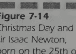

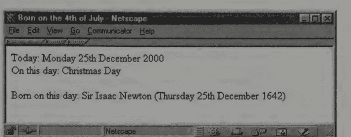

## 生于七月四日 源代码——index.htm

*index.htm* 页面获取当前日期，并加载外部 JavaScript 源文件以创建在当前月份出生的每个人的 Birthday 对象。这些对象与通用定义的 Event 对象一起使用，以显示今天发生的任何特别活动或生日。


./chapter7/july4th/index.htm

*current.js* 和 *july4th.js* 两个库都被加载到当前页面中：

```
<script src="current.js" language="JavaScript"></script>
<script src="july4th.js" language="JavaScript"></script>
```

只有在 *current.js* 和 *july4th.js* 两个库都成功加载后，代码才会执行：

```
if (window.formatFullDate && window.setBirthday) {
```

首先，我们获取当前日期的日、月、年值：

```
var today = new Date();
var day   = today.getDate();
var month = today.getMonth()+1;
var year  = today.getFullYear();
```


接下来，加载外部 JavaScript 源文件，其中包含对当月`setBirthday()`函数的调用。文件名分别为`birthjan.js`、`birthfeb.js`、`birthmar.js`、`birthapr.js`、`birthmay.js`、`birthjun.js`、`birthjul.js`、`birthaug.js`、`birthsep.js`、`birthoct.js`、`birthnov.js`和`birthdec.js`。从`monthsOfYear`数组中获取当前月份的三字符月份名（`m`）作为子字符串，然后转换为小写：

```
var m = monthsOfYear[month-1].substring(0,3).toLowerCase();
```

向文档中写入一个 script 元素以加载所需的`birthXXX.js`库：

```
document.write(
    '<script src="birth' + m + '.js"><\/script>'
);
}
```

为了确保库被立即加载和处理，当前 JavaScript 代码以结束`script`标签结尾：

```
//--></script>
```

一旦相关的`birthXXX.js`库加载完成并定义了所有`Birthday`对象，页面将继续输出当天的详细信息，同样仅在`current.js`和`july4th.js`库都成功加载的情况下：

```
if (window.formatFullDate && window.setBirthday) {
```

首先，格式化当前日期并输出到页面：

```
document.write(
    'Today: ' + formatFullDate(day, month, year) + '<br>'
);
```

使用当前日期和月份变量调用`showEvent()`函数。结果赋值给`events`变量：

```
var events = showEvent(day,month);
```

如果`events`字符串变量不为空，则将其内容输出到文档：

```
if (events != '')
    document.write(
        'On this day: ' +
        events + '<br>'
    );
```

接下来，再次使用当前日期和月份变量调用`showBirthday()`函数，结果赋值给`births`变量：

```
var births = showBirthday(day,month);
```

同样，如果`births`变量不为空，则将其内容输出到文档：

```
if (births != '')
    document.write(
        'Born on this day: ' +
        births + '<br>'
    );
}
```

## 7月4日出生源代码——birthjan.js

为了展示 birthXXX.js 库如何创建 Birthday 对象，下面展示了 birthjan.js 库的一段代码片段。


```
../chapter7/july4th/birthjan.js
```

为每个一月出生的人调用`setBirthday()`函数：

```
setBirthday(01,01,1895,"J. Edgar Hoover");
setBirthday(02,01,1920,"Isaac Asimov");
setBirthday(03,01,1892,"J.R.R. Tolkien");
...
...
setBirthday(28,01,1912,"Jackson Pollock");
setBirthday(29,01,1880,"W.C. Fields");
setBirthday(30,01,1882,"Franklin D. Roosevelt");
```

### 11月的第3个星期六

本应用程序展示如何计算任何月份的第1、2、3、4、5个以及最后一个工作日。然后用于计算各种可变日历事件或特殊假日的日期。例如，感恩节在每年11月的第四个星期四——无论哪一年。

## 11月的第3个星期六源代码——saturday.js

*Saturday.js*库包含`nthDay()`函数，该函数返回对应于特定年份和月份的第*n*个星期几的日期。它还包含可用于简化函数使用的全局变量。例如，不必使用`nthDay(3, 3, 12, 2000)`，我们可以使用`nthDay(third, tue, dec, 2000)`——更容易识别为请求2000年12月的第3个星期二。


```
../chapter7/saturday/saturday.js
```

该库定义了所有全局变量。首先是工作日：

```
var sun=1, mon=2, tue=3, wed=4, thu=5, fri=6, sat=7;
```

然后是月份：

```
var jan=1, feb=2, mar=3, apr=4, may=5, jun=6,
jul=7, aug=8, sep=9, oct=10, nov=11, dec=12;
```

接着是第一到第五以及最后一个变量：

```
var first=1, second=2, third=3, fourth=4, fifth=5, last=-1;
```

如前所述，`nthDay()`函数返回对应于请求的年份和月份的第*n*个星期几的日期：

```
function nthDay(nth, weekday, month, year) {
```

如果 nth 输入参数大于零——即我们未被要求返回该月的最后一个工作日——则使用的数学算法返回相关的日期：

```
if (nth > 0)
    return (nth-1)*7 + 1 +
        (7 + weekday - dayOfWeek((nth-1)*7 + 1,month,year)-1)%7;
```

如果请求的是该月的最后一个工作日，则函数必须首先考虑 year 参数可能是闰年的情况：

```
if (isLeapYear(year))
    var days = daysOfMonthLY[month];
else
    var days = daysOfMonth[month];
```

然后，修改后的数学算法版本返回该月的最后一个相关日期：

```
return days -
    (dayOfWeek(days,month + 1,year) - weekday + 7)%7;
}
```

## 11月的第3个星期六源代码——index.htm

*index.htm*页面使用`saturday.js`库中的`nth`函数计算以下特殊日期的日期：

- 马丁·路德·金纪念日——1月的第3个星期一
- 夏令时开始——4月的第1个星期日
- 母亲节——5月的第2个星期日
- 武装部队日——5月的第3个星期六
- 感恩节——11月的第4个星期四
- 夏令时结束——10月的最后一个星期日

图7-15显示了该页面在2000年的结果。

372

第七章

图7-15
11月的第3个星期六——输出结果。

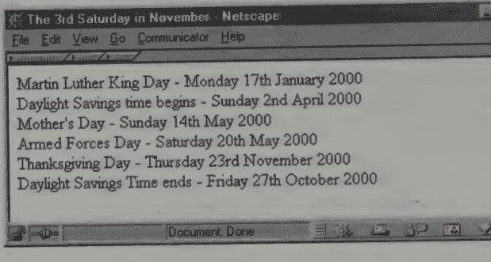

页面加载*current.js*、*validate.js*和*saturday.js*库的内容：

```
<script src="current.js" language="JavaScript"></script>
<script src="validate.js" language="JavaScript"></script>
<script src="saturday.js" language="JavaScript"></script>
SO
```

只有在三个库都成功加载的情况下，代码才会被处理：

```
if (window.formatFullDate && window.nthDay
    && window.isLeapYear) {
```

获取当前日期：

```
var today = new Date();
var day    = today.getDate();
var month  = today.getMonth() + 1;
var year   = today.getFullYear();
```

对于每个特殊假日，`nthDay()`函数的输出用作`formatFullDate()`函数的输入。然后将此输出写入文档：

```
document.write(
    'Martin Luther King Day - ' +
    formatFullDate(nthDay(third,mon,jan,year),jan,year) +
    '<br>'
);

document.write(
```

```
'Daylight Savings time begins - ' +
formatFullDate(nthDay(first,sun,apr,year),apr,year) +
'<br>'
);

document.write(
'Mother\'s Day - ' +
formatFullDate(nthDay(second,sun,may,year),may,year) +
'<br>'
);

document.write(
'Armed Forces Day - ' +
formatFullDate(nthDay(third,sat,may,year),may,year) +
'<br>'
);

document.write(
'Thanksgiving Day - ' +
formatFullDate(nthDay(fourth,thu,nov,year),nov,year) +
'<br>'
);

document.write(
'Daylight Savings Time ends - ' +
formatFullDate(nthDay(last,sun,oct,year),oct,year) +
'<br>'
);
}
```

### 计算复活节

本示例展示如何计算*复活节星期日*的日期，根据*《牛津英语词典》*，它是"在3月或4月的某个可变星期日举行"。然后使用此日期计算依赖于复活节星期日的其他宗教节日的日期。图7-16显示了2000年复活节星期日的日期以及复活节周围所有其他宗教节日的日期。

## 计算复活节源代码——easter.js

*easter.js*库包含计算复活节星期日日期及所有相关日期所需的数组、对象构造函数和函数。

374

# 第七章

图7-16 计算复活节——复活节星期日及其他宗教节日的日期。


在CD上

```
./chapter7/easter/easter.js
```

两个数组 julian 和 julianLY 包含一年中每个月的累加天数。例如，对于普通年份，3月1日之前有59天（数组中的第三个条目），而对于闰年，3月1日之前有60天：

```
var julian =
    new Array(0,31,59,90,120,151,181,212,243,273,304,334);
var julianLY =
    new Array(0,31,60,91,121,152,182,213,244,274,305,335);
```

以下算法取自http://astro.nmsu.edu/~lhuber-leaphist.html的*Calendars and Their History*：

以下计算复活节日期的算法基于Oudin（1940）的算法。它对任何公历年Y都有效。所有变量


所有变量均为整数，所有除法的余数均被舍去。最终日期由 M（月份）和 D（当月的日期）给出。

```
C = Y/100,
N = Y - 19*(Y/19),
K = (C - 17)/25,
I = C - C/4 - (C - K)/3 + 19*N + 15,
I = I - 30*(I/30),
I = I - (I/28)*(1 - (I/28)*(29/(I + 1))*((21 - N)/11)),
J = Y + Y/4 + I + 2 - C + C/4,
J = J - 7*(J/7),
L = I - J,
M = 3 + (L + 40)/44,
D = L + 28 - 31*(M/4).
```

这可以转换为以下 `Easter()` 对象构造函数，其中 `Math` 对象的 `floor()` 方法用于将浮点数转换为整数：

```
function Easter(Y) {
    var C = Math.floor(Y/100);
    var N = Y - 19*Math.floor(Y/19);
    var K = Math.floor((C - 17)/25);
    var I = C - Math.floor(C/4) -
           Math.floor((C - K)/3) + 19*N + 15;
    I = I - 30*Math.floor((I/30));
    I = I - Math.floor(I/28)*
        (1 - Math.floor(I/28) * Math.floor(29/(I + 1)) *
         Math.floor((21 - N)/11));
    var J = Y + Math.floor(Y/4) + I + 2 - C + Math.floor(C/4);
    J = J - 7*Math.floor(J/7);
    var L = I - J;
    var M = 3 + Math.floor((L + 40)/44);
    var D = L + 28 - 31*Math.floor(M/4);
```

在计算出 D 和 M 的值之后，`Easter()` 对象构造函数将 `this` 对象引用的 day、month 和 year 属性分别设置为 D、M 和 Y 变量的值，然后将 `formatFullDate()` 函数调用的结果赋给 date 属性：

```
this.day = D;
this.month = M;
this.year = Y;
this.date = formatFullDate(D,M,Y)
}
```

`daysInYear()` 函数返回传入的 year 参数所代表的年份中的天数——闰年为 366 天，平年为 365 天：

## 第七章

```
function daysInYear(year) {
    if (isLeapYear(year)) return 366; else return 365;
}
```

`addDays()` 对象构造函数用于计算复活节星期日前后各相关日期。`addDays()` 函数接受四个参数——由 day、month 和 year 参数表示的日期，以及要加到该日期上的天数（`addition`）：

```
function addDays(day, month, year, addition) {
```

当前日期被转换为 NASA 所使用的儒略日格式——即自年初以来的天数。函数首先测试是否为闰年，然后用 day 参数的值加上 `julianLY` 或 `julian` 数组中 `month` 减 1 的条目值，再加上额外的 `addition` 参数值，来更新局部变量 `number`：

```
if (isLeapYear(year))
    var number = day + julianLY[month-1] + addition;
else
    var number = day + julian[month-1] + addition;
```

`year` 参数所代表的年份中的天数通过 `daysInYear()` 函数获取，并赋给局部变量 `days`：

```
var days = daysInYear(year);
```

如果 `number` 的值大于 `days`，则函数不断递增 `year` 的值并调整 `days` 的值，直到更新后的 `year` 变量中的天数小于或等于更新后的 `number` 变量：

```
while (number > days) {
    number -= days;
    days = daysInYear(++year);
}
```

另一方面，如果 `addition` 参数的值为负数，则需要执行相反的过程来递减 `year` 的值并增大 `number` 的值，直到 `number` 的值大于或等于 1：

```
while (number < 1) {
    days = daysInYear(--year);
    number += days;
}
```

此时，我们得到了正确的年份值，但儒略日期仅包含当前年份的信息（即自年初以来的天数）。函数现在需要将其转换为年中的月份和日期。month 变量初始化为：

```
month = 1;
```

根据 year 是否代表闰年，函数随后不断递增 month 的值，直到 number 的值不再大于 `julianLY` 或 `julian` 数组中的相应条目。然后将 day 变量设置为 number 与 `julianLY` 或 `julian` 数组中条目之间的差值：

```
if (isLeapYear(year)) {
    while (number > julianLY[month-1]) { month++; }
    day = number - julianLY[month-1];
} else {
    while (number > julian[month-1]) { month++; }
    day = number - julian[month-1];
}
```

一旦新日期计算完成，`this` 对象引用的 day、month 和 year 属性将被更新，同时 date 属性被设置为 `formatFullDate()` 函数的返回值：

```
this.day = day;
this.month = month;
this.year = year;
this.date = formatFullDate(day,month,year)
}
```

> 注意：`addDays()` 对象构造函数可以用于从任意日期加上或减去任意天数。它不仅限于计算复活节星期日前后的日期。

## 复活节计算源代码——index.htm

index.htm 页面使用 `Easter()` 对象构造函数计算当前年份的复活节星期日日期，然后利用 Easter 对象的属性以及 `addDays()` 对象构造函数来计算复活节星期日前后的其他宗教节日日期。

./chapter7/easter/index.htm

页面中同时加载了 *current.js* 和 *easter.js* 两个库：

```
<script src="current.js" language="JavaScript"></script>
<script src="easter.js" language="JavaScript"></script>
```

只有当两个库都成功加载后，才会处理剩余的代码：

```
if (window.formatFullDate && window.Easter) {
```

获取当前日期的详细信息：

```
var today = new Date();
var day   = today.getDate();
var month = today.getMonth() + 1;
var year  = today.getFullYear();
```

使用 `Easter()` 对象构造函数为当前年份创建一个 Easter 对象，然后将其赋给 easter 对象引用：

```
var easter = new Easter(year);
```

然后将 easter 对象的 date 属性值输出到文档：

```
document.write('Easter Sunday - ' + easter.date + '<br>');
```

将 easter 对象的 day 和 month 属性、year 变量的值以及相应的 addition 参数值（-63）传递给 `addDays()` 对象构造函数，为七旬主日创建一个 addDays 对象，然后将其赋给 when 对象引用：

```
var when = new addDays(easter.day,easter.month,year,-63);
```

然后将 when 对象的 date 属性值输出到文档：

```
document.write('Septuagesima Sunday - ' + when.date +'<br>');
```

对剩余的宗教节日重复此过程：

## 日期与时间

```
var when = new addDays(easter.day,easter.month,year,-56);
document.write('Sexagesima Sunday - ' + when.date +'<br>');

var when = new addDays(easter.day,easter.month,year,-49);
document.write('Shrove Sunday - ' + when.date +'<br>');

var when = new addDays(easter.day,easter.month,year,-47);
document.write('Shrove Tuesday - ' + when.date +'<br>');

var when = new addDays(easter.day,easter.month,year,-46);
document.write('Ash Wednesday - ' + when.date +'<br>');

var when = new addDays(easter.day,easter.month,year,-14);
document.write('Passion Sunday - ' + when.date +'<br>');

var when = new addDays(easter.day,easter.month,year,-7);
document.write('Palm Sunday - ' + when.date +'<br>');

var when = new addDays(easter.day,easter.month,year,-3);
document.write('Maundy Thursday - ' + when.date +'<br>');

var when = new addDays(easter.day,easter.month,year,-2);
document.write('Good Friday - ' + when.date +'<br>');

document.write('Easter Sunday - ' + easter.date +'<br>');

var when = new addDays(easter.day,easter.month,year,35);
document.write('Rogation Sunday - ' + when.date +'<br>');

var when = new addDays(easter.day,easter.month,year,39);
document.write('Ascension Day - ' + when.date +'<br>');

var when = new addDays(easter.day,easter.month,year,49);
document.write('Pentecost - ' + when.date +'<br>');

var when = new addDays(easter.day,easter.month,year,50);
document.write('Whitmundy - ' + when.date +'<br>');

var when = new addDays(easter.day,easter.month,year,56);
document.write('Trinity Sunday - ' + when.date +'<br>');

var when = new addDays(easter.day,easter.month,year,60);
document.write('Corpus Christi - ' + when.date +'<br>');

var when = new addDays(easter.day,easter.month,year,63);
document.write('Corpus Christi (US) - ' + when.date +'<br>');
}
```

### 24 小时时钟

本应用展示了如何使用 Date 对象的时间组件——以及通过 Date 对象的 `getTimezoneOffset()` 方法获取的时区偏移量——来显示世界任何地方的时间。


## 日期与时间

`getTimezoneOffset()` 方法返回的值是 GMT 或 UTC 时区与浏览器运行所在操作系统的本地时区之间的分钟数差值。如果本地时区比 GMT 提前（即位于英格兰格林威治以东，该地位于经度 0°，被称为本初子午线），则 `getTimezoneOffset()` 方法返回的值将为负数。否则，对于落后于 GMT 的时区（即位于本初子午线以西），该值将为正数。一旦获取了偏移量，就可以将其添加到本地时间中，以计算本初子午线处的时间。然后就可以计算世界上任何已知时区的时间。

每个国际时区跨越 15° 经度，总共分为 24 个国际时区。每个时区内的所有时钟都设置为相同的时间。每个时区通常以 GMT 为基准进行参考。例如，英格兰位于 GMT+0000 时区，美国纽约位于 GMT-0500 时区（即比 GMT 慢 5 小时，或在 GMT 以西），日本东京位于 GMT+0900 时区（即比 GMT 快 9 小时，或在 GMT 以东）。不过，由于边界、国界以及经济和社会等原因，存在一些变体。

以 GMT 计算的时间不考虑夏令时或夏季时间。例如，在夏季使用时，GMT+0000 返回的时间比伦敦的实际时间慢一小时。由于各国时钟在调快一小时或调慢一小时的日期上存在差异，因此没有一种准确的方法来计算全球所有国家夏令时的开始和结束时间。为了解决这个问题，以下代码包含了一个复选框，可以用于开关额外一小时的夏令时设置。图 7-17 和图 7-18 展示了在亚利桑那州显示当前时间的效果，分别是夏令时复选框未勾选和已勾选的情况。

## 图 7-17

亚利桑那州时间——无夏令时


## 图 7-18

亚利桑那州时间——夏令时


## 24 小时制时钟源代码——index.htm

*index.htm* 页面包含了所有必要的 JavaScript 代码和 HTML，允许用户选择众多不同地区中的一个。选择后，表单字段中显示的时间将自动更新，以反映所选地区的时间。


../chapter7/clock24/index.htm

使用 HTML 输出了一个名为 zone 的表单。它包含一个名为 offset 的 select-option 列表，其中每个地区对应一个 option 元素。每个 option 元素包含一个 value 属性，以小时为单位存储相对于 GMT 的时区偏移值：

```
<form name="zone">
<select name="offset">
<option value="4">Abu Dhabi</option>
<option value="9.5">Adelaide</option>
<option value="-9">Alaska</option>
<option value="6">Almaty</option>
<option value="1">Amsterdam</option>
<option value="-7">Arizona</option>
```

为了节省空间，我们只展示前六个和后六个 option 元素。

```
<option value="1">Vienna</option>
<option value="10">Vladivostok</option>
<option value="4">Volgograd</option>
<option value="1">Warsaw</option>
<option value="12">Wellington</option>
<option value="9">Yakutsk</option>
</select>
```

该表单还包含一个名为 time 的 input 文本字段：

```
<input type="text" size="8" name="time">
```

以及一个名为 summer 的复选框字段：

```
Summer Time: <input type="checkbox" name="summer">
</form>
```

ampm() 函数返回传入的 h 和 m 参数的格式化值，分别表示小时和分钟，以 am 或 pm 格式显示（例如 9:15am 或 10:45pm）：

```
function ampm(h, m) {
    var a = (h==0)?12:((h<13)?h:h-12);
    var output =
        ((a<10)?' ':'')+a+':'+padout(m)+((h<12)?' am':' pm');
    return output;
}
```

updateForm() 函数更新表单显示，以展示所选地区的当前时间：

```
function updateForm() {
```

首先，获取当前的本地日期和时间：

```
var date = new Date();
```

接下来，使用 Date 对象的 getTimezoneOffset() 方法检索时区偏移值：

```
var TimezoneOffset = date.getTimezoneOffset();
```

使用通用的 getAnOptionValue() 函数，获取 zone 表单的 offset 选中选项的值，通过减去零转换为数值，然后赋值给 gmt 变量：

```
var gmt = getAnOptionValue(document.zone.offset) - 0;
```

接下来，使用 Date 对象的 setTime() 方法，通过以下值更新日期和时间：getTime() 方法返回的值加上从分钟转换为毫秒的时区偏移值，加上转换为毫秒的 gmt 变量值，以及如果 zone 表单的 summer 复选框被选中则加上额外的 60 分钟（转换为毫秒）：

```
date.setTime(
  date.getTime() + TimezoneOffset*60*1000 + gmt*60*60*1000 +
  ((document.zone.summer.checked) ? 60*60*1000 : 0)
);
```

然后调用 ampm() 函数，传入 date 对象引用的 getHours() 和 getMinutes() 方法返回值，将结果赋值给 time 变量：

```
var time = ampm(date.getHours(), date.getMinutes());
```

如果 zone 表单的 time input 文本字段的值不等于 time 的值，则更新表单字段的值：

```
if (document.zone.time.value != time)
  document.zone.time.value = time;
```

然后 updateForm() 函数启动一个计时器，在半秒后再次调用 updateForm() 函数：

```
setTimeout("updateForm()", 500);
}
```

一旦表单 HTML 输出到文档中且所有 JavaScript 代码都已定义完毕，通过首次调用 updateForm() 函数来启动自更新的时区显示：

```
updateForm();
```

### 总结

正如本章所述，示例广泛使用了函数库、对象构造函数、数组和全局变量。在许多情况下，在一个示例中定义的函数库在后续示例中被反复使用。通过复用已经建立和测试过的代码库，你可以基于小型、离散但通用的代码基础快速构建更复杂的应用程序。

## 单元 5 与单元 6（预备课程）

### 单元 5

1. 它是……不是我……以及……的……用于……

三楼……3 号商铺……在……中有一个房间，用于……前往……

### 单元 6

……到……在……主要……的……

我们……那就是……的……以及……前往……的……

……这个……是……的……

……一个……以及……是……在……上的……

……为……一个……以便……前往……的……在……中……

……的……前往……

P.O.

……为一个……前往……的……到……的……以及……

……前往……以便……前往……以及……在……中……的……

……的……在……中的……的……在……中……

……前往……的……的……在……中……

……的……用于……

以及……在……中的……在……中……的……

……的……用于……在……中的……在……中……在……

……在……中的……用于……在……中……以及……的……

……用于……在……中……的……在……中……的……的……在……中……

……在……中的……用于……在……中……以及……的……

## 第 8 章：表单

表单是一种交互方式，用户可以在其中输入文本，类似于纸质表单上的内容。表单随后在客户端或服务器端进行处理。JavaScript 为客户端的表单处理提供了强大的补充。通过拦截用户与表单提供的图形用户界面（GUI）的交互，JavaScript 可以用于验证用户的输入并响应某些事件，例如鼠标点击按钮或在 select 列表中选择一个选项时加载另一个页面。JavaScript 还可以用于填充表单字段，通过更新文本字段的 value 属性以及添加、修改或更新 select 列表中的条目。交互的范围是无限的。

由于表单提供了 JavaScript 非常直观的应用场景，几乎本书的每一章都可以找到表单的示例。本章提供了许多 JavaScript 与表单及用户交互的实例。这些示例应用程序可以在其他更大的应用程序中被复用，以构建非常复杂的 GUI。本章还复用了前面章节的代码，特别是第 7 章"日期与时间"中使用的 *current.js* 库以及第 2 章"数字工具"中的数字格式化函数。


- **JavaScript 与表单** ./chapter8/general/index.htm
- **从表单发送邮件** ./mailto/simple.htm 和 ./chapter8/mailto/multiple.htm
- **动态下拉菜单** ./chapter8/dynamic/single.htm 和 ./chapter8/dynamic/multiple.htm 和 ./chapter8/dynamic/transfer.htm 和 ./chapter8/dynamic/colors.htm
- **将数据从一个表单传递到另一个表单** ./chapter8/passing/index.htm
- **动态感谢页面** ./chapter8/thankyou/index.htm
- **表单 -> Cookie -> 表单** ./chapter8/cookie/index.htm
- **表单 -> 邮件 -> 表单** ./chapter8/mailform/index.htm
- **禁用表单字段** ./chapter8/disable/index.htm
- **使用表单字段控制数据输入** ./chapter8/entry/index.htm
- **过滤数据输入** ./chapter8/filter/index.htm
- **日期选择器** ./chapter8/spinner/index.htm 和 ./chapter8/spinner/index2.htm
- **销售订单表单** ./chapter8/sales/index.htm


### JavaScript 与表单

在深入探讨本章中的应用之前，先简要概述一下在我们的情境中表单和表单字段的重要方面。表单是一个广泛的话题，要涵盖所有可能的 HTML 属性及其潜在值，需要单独用一整章来讲解。我们将只关注常用的事件处理程序。

chapter8/general/index.htm

以下是本节中讨论的一个典型表单实例：

```html
<form name="myform" action="index.htm" method="GET"
    enctype="application/x-www-form-urlencoded">

<input type="text" name="t1" value="">
<input type="password" name="t2" value="">
<input type="hidden" name="t3" value="">
<input type="file" name="t4" value="">

<input type="checkbox" name="c1" value="on"> - on
<input type="checkbox" name="c2" value="off"> - off

<input type="radio" name="r1" value="1" checked> - 1
<input type="radio" name="r1" value="10"> - 10
<input type="radio" name="r1" value="100"> - 100
<input type="radio" name="r1" value="1000"> - 1000

<select name="s1">
<option value="r">Red     <option value="o">Orange
<option value="y">Yellow  <option value="g">Green
<option value="b">Blue    <option value="i">Indigo
<option value="v">Violet
</select>

<select name="s2" multiple size="3">
<option value="r">Red     <option value="o">Orange
<option value="y">Yellow  <option value="g">Green
<option value="b">Blue    <option value="i">Indigo
<option value="v">Violet
</select>

<textarea name="t4" cols="60" rows="10" wrap="virtual"></textarea>

<input type="button" name="b1" value="Show Multiple"
    onClick="showMultiple(this.form)">

<input type="button" name="b1" value="Show Radio"
    onClick="showRadio(this.form)">

<input type="reset" name="b2" value="Reset">

<input type="submit" name="b3" value="Submit">

</form>
```

HTML 页面中包含的每个表单都会被录入文档对象的 forms 数组中。该数组允许通过表单的名称（如果已指定）或页面中的顺序来访问表单。因此，要访问名为 myform 的表单，我们可以使用 document.forms['myform']，或者使用替代形式 document.forms.myform，因为 myform 对象也是 forms 对象的一个属性。要访问页面中的第三个表单，我们可以使用 document.forms[2]，记住数组是从零开始计数的。表单也可以在表单元素的事件处理程序中使用 this 关键字来引用自身。因此，onSubmit 事件处理程序可以将当前表单的引用传递给一个函数。例如：

```html
<form onSubmit="formFunction(this)">
```

请注意，如果我们从不按名称引用表单，则无需为表单指定名称。表单中的表单字段也可以使用 this 关键字来引用自身。例如，文本字段可以在 onChange 事件处理程序中使用以下方式将其引用传递给函数：

```html
<input type="text" onChange="fieldFunction(this)">
```

表单字段还可以使用 this 关键字的 form 属性来引用其所在的表单。例如：

```html
<input type="text" onChange="formFunction(this.form)">
```

这将包含表单的引用传递给函数，而不是表单字段的引用。

一旦我们获得了对表单或表单字段的引用，就可以访问该表单或表单字段的所有属性。例如，在以下 fieldFunction() 中（它接收一个表单字段的引用），我们可以使用表单引用的 value 属性来更新其值：

```javascript
function fieldFunction(field) {
    field.value = 'The quick brown fox...';
}
```

我们不仅可以修改表单字段的属性，还可以修改表单本身的属性。例如，表单元素可以包含 action、method 和 enctype 属性，它们分别指定表单的目标操作、提交表单时使用的方法以及要使用的编码方式。这三个属性可以通过表单对象的 action、method 和 encoding 属性来访问。本章后面的"从表单发送邮件"一节将对此进行详细介绍。

action 属性可以包含几种不同的值：典型的 HTTP schema URL（使用绝对或相对 URL），或者 mailto schema。method 属性可以包含 POST 或 GET。POST 用于将数据发布到服务器端处理程序，而 GET 用于检索文档，尽管它们的实际使用往往界限模糊。enctype 属性指定浏览器应如何编码数据：

- 标准的 application/x-www-form-urlencoded 编码将所有空格转换为加号字符，将所有非字母数字字符转换为 %xx 的形式（其中 xx 是该字符的 Latin-1 编码）。此编码与 GET 方法配合使用。
- multipart/form-data 编码用于 POST 方法，将每个表单字段封装在单独的 MIME 消息中。
- text/plain 编码可以可选地与 GET 方法和 mailto schema URL 配合使用，它将每个表单字段的名称和值以等号分隔的形式放在生成的电子邮件的单独行中。当目标受众是人类时，此编码更为适合。

表单中的每个表单字段都出现在表单对象的 elements 数组中，可以通过表单字段的名称或其在表单中的位置来访问。表单 myform 中名为 t1 的表单字段可以通过 document.myform.elements['t1'] 访问，或通过 document.myform.t1 访问（因为该字段是表单的属性），如果是表单中的第一个字段，也可以使用 document.myform.elements[0]。

有两种类型的表单字段可以选择自己的对象数组。代表选择列表的 select 对象包含所有包含的选项的数组。名为 s1 的选择列表包含一个 options 数组，可以通过 document.myform['s1'].options 或 document.myform.s1.options 来访问。数组中选项的数量可以通过其 length 属性访问。数组中的第一个选项可以通过 document.myform.s1.options[0] 访问，最后一个可以通过 document.myform.s1.options[document.myform.s1.options.length-1] 访问。

选项的文本描述可以使用 text 属性检索。例如，document.myform.s1.options[3].text 检索第四个条目（Green）的文本。同样，选项的值可以使用 value 属性检索。例如，document.myform.s1.options[5].value 检索第六个条目（i）的值。

单选选择列表中当前选中的选项可以使用 options 数组的 selectedIndex 属性检索——例如 document.myform.s1.options.selectedIndex。多选选择列表稍微复杂一些，因为可能有多个选项被选中。在这种情况下，我们需要遍历所有选项，测试每个选项对象的 selected 属性：

```javascript
function multipleSelect(fRef) {
    var output = '';
    for (var i=0; i<fRef.s2.options.length; i++) {
        if (fRef.s2.options[i].selected)
            output += i + ' ';
    }
    alert('options selected: ' + output);
}
```

radio 对象也包含一个包含所有同名单选按钮的数组。单选按钮按组工作——实际上就像奶奶的无线收音机上的按钮一样，按下一个按钮意味着之前选中的按钮会弹起。将单选按钮分组要求它们具有相同的名称。正是这个名称构成了 radio 对象数组的名称。要查找组内当前选中的单选按钮，我们需要遍历数组中的所有 radio 对象：

```javascript
function showRadio(fRef) {
    for (var i=0; i<fRef.r1.length; i++) {
        if (fRef.r1[i].checked)
            alert('radio button checked: ' + i)
    }
}
```

事件处理程序可以用于所有不同类型的表单字段，以捕获用户与表单的交互。表 8-1 显示了不同的表单元素及其支持的事件处理程序。在我们的示例 HTML 标记中，两个按钮表单字段中的 onClick 事件处理程序用于调用 showMultiple() 和 showRadio() 函数。

### 从表单发送邮件

此特定应用展示了如何使用表单将邮件发送到几个不同电子邮件地址之一，可能是发送到销售或支持


## 表单

## 表格 8-1

表单元素及其事件处理程序。

| HTML 元素 | 事件处理程序 |
| --- | --- |
| form | onSubmit, onReset |
| text | onFocus, onBlur, onKeyDown, onKeyUp, onChange |
| hidden |  |
| password | onFocus, onBlur, onKeyDown, onKeyUp, onChange |
| textarea | onFocus, onBlur, onKeyDown, onKeyUp, onChange |
| file | onFocus, onBlur, onChange |
| radio | onFocus, onBlur, onClick |
| checkbox | onFocus, onBlur, onClick |
| button | onFocus, onBlur, onClick, onDblClick, onMouseDown, onMouseUp |
| submit | onFocus, onBlur, onClick, onDblClick, onMouseDown, onMouseUp |
| reset | onFocus, onBlur, onClick, onDblClick, onMouseDown, onMouseUp |
| select | onFocus, onBlur, onChange |

## 图 8-1

简单的邮件表单。


部门。用户无需为每个部门创建单独的表单，而是在同一个表单上输入其通信内容，然后将表单内容提交给相应的部门。

这里介绍了两个示例：一个*简单*版本，将表单发送到一个电子邮件地址，如图 8-1 所示；另一个*多选*示例，允许用户从下拉列表中选择一个或多个地址，并额外在一个文本输入字段中输入另一个地址，如图 8-2 所示。

两个示例都利用 onClick 事件处理程序来更新表单的 action 属性。由于 Microsoft Internet Explorer 3 中只读此 action 属性，因此这些示例在该特定浏览器上无法工作。

## 图 8-2

多选邮件表单。


## 从表单发送邮件源代码 — simple.htm

chapter8/mailto/simple.htm

`alter()` 函数更新传入的对象表单引用的 encoding、action 和 method 属性。这三个属性分别对应于 form 元素的 enctype、action 和 method 属性。action 属性使用传入的 where 参数值进行更新：

```
function alter(object,where) {
  object.encoding = 'text/plain';
  object.action = where;
  object.method = 'POST';
}
```

form 元素包含空的 action、method 和 enctype 属性，尽管 method 和 enctype 属性本可以预填充为 POST 和 text/plain 的值：

```
<form action="" method="" enctype="">
```

该表单包含两个 submit input 元素，两者都包含 onClick 事件处理程序，以便在单击提交按钮时调用 `alter()` 函数。提交按钮的 click 事件发生在表单的 submit 事件之前。因此，在表单提交之前，其 action 属性会被修改。这会在提交表单之前，立即将传递给 `alter()` 函数的 mailto 方案 URL 更新到 form 元素的 action 属性中。表单的动作随后会请求注册的邮件代理程序将表单详情发送到 mailto: URL 中的电子邮件地址。

```
<input type="submit" value="Sales"
       onClick="alter(this.form,'mailto:yy@yy.yy.yy')">
<input type="submit" value="Support"
       onClick="alter(this.form,'mailto:zz@zz.zz.zz')">
```

此示例显示了两个提交按钮，但当然，该示例可以扩展为拥有许多不同的提交按钮，或者如下一个示例所示，使用其他类型的输入字段。

## 从表单发送邮件源代码 — multiple.htm

此多选邮件示例使用两个独立的表单：一个允许用户选择所需的收件人（控件表单），另一个包含要传输给所选收件人的数据（电子邮件表单）。当表单被提交时，每个命名的表单字段及其值都会作为提交数据的一部分发送——例如，所选电子邮件地址列表——我们需要要么让表单字段不命名，要么在我们希望通过名称访问表单字段时，将该表单字段放在一个永远不会被提交的完全独立的表单中。此示例采用了后一种方法。

**chapter8/mailto/multiple.htm**

控件表单包含一个下拉列表 (selectName)，其中包含一个 option 元素，对应于我们可能希望发送电子邮件的每个电子邮件地址。to 文本输入字段用于保存当前正在发送的电子邮件的电子邮件地址。它使用 onFocus 事件处理程序来捕获用户尝试在此字段中输入文本，并立即通过调用文本字段（引用为 this）的 `blur()` 方法失去焦点（即文本插入符）。还有一个单独的文本输入字段 (subject)，供用户输入生成的电子邮件的主题标题：

```
<form name="controlForm">
<select multiple name="selectName">
<option value="martin@irt.org">martin@irt.org
<option value="martin.webb@irt.org">martin.webb@irt.org
<option value="irt@irt.com">irt@irt.com
</select>
<input type="text" name="to" size="72" onFocus="this.blur()">
<input type="text" name="subject" size="72">
</form>
```

电子邮件表单（实际被提交的表单）包含一个用于用户评论的 textarea，以及提交和重置按钮。表单的 action 属性留空，由 onSubmit 事件处理程序调用的 `sendEmail()` 函数内部设置：

```
<form name="emailForm" action="" method="POST"
enctype="text/plain" onSubmit="sendEmail()">
<textarea name="content" cols="72" ROWS="10"></textarea>
<input type="submit" name="mysubmit" value="Send eMail">
<input type="reset" value="Reset">
</form>
```

该代码遍历下拉列表中的所有条目，寻找选中的条目。为了记住其在循环中的位置，定义并初始化了当前全局变量：

```
var current = 0;
```

`sendEmail()` 函数，类似于单个邮件示例中的 `alter()` 函数，更新表单的 action 属性。然而，与 `alter()` 函数不同，此函数被多次调用，列表中的每个电子邮件调用一次。而在简单邮件示例中，我们生成一封电子邮件，这里我们为从列表中选择的每个电子邮件地址生成一封电子邮件。为了能够从一个表单发送多封电子邮件，我们必须延迟每次表单提交足够的时间，以允许前一次表单提交成功完成。因此，当电子邮件表单被提交时调用的 `sendemail()` 函数会设置一个计时器，在五秒延迟后重新提交电子邮件表单。只要用户的邮件应用程序在五秒内成功发送了前一封电子邮件，就不应该有问题。不幸的是，JavaScript 内部没有可用的机制来检测表单提交的成功或失败。因此，如果确实发生故障或网络出现较大延迟，则无法捕获和重发：

```
function sendEmail() {
```

`sendEmail()` 函数第一次被调用时，`current` 的值为零。如果控件表单的 select 列表中的当前选项被选中，则更新电子邮件表单的 action 属性，递增 `current` 变量，并且如果它小于 select 列表中的选项条目数，则设置一个计时器，在五秒延迟后以编程方式“单击”控件表单的提交按钮。否则，`current` 变量被重新初始化：

```
if (document.controlForm.selectName[current].selected) {
    document.emailForm.action =
        'mailto:' +
        document.controlForm.selectName[current].value +
        '?subject=' +
        document.controlForm.subject.value;
    document.controlForm.to.value =
        document.controlForm.selectName[current].value;
    current++;
    if (current < document.controlForm.selectName.length)
        setTimeout('document.emailForm.mysubmit.click()', 5000);
    else current = 0;
}
```

如果当前选项未被选中，则递增 `current` 变量，并且如果小于 select 列表中的选项条目数，则立即“单击”控件表单的提交按钮。否则，`current` 变量被重新初始化：


## 第八章

```
else {
    current++;
    if (current < document.controlForm.selectName.length)
        document.emailForm.mysubmit.click();
    else current = 0;
}
}
```

请注意，这里我们使用提交按钮的 `click` 方法，而不是更直观的 `submit` 方法，因为 `submit` 方法无法保证一定会触发表单的 `onSubmit` 事件处理器。我们必须触发 `onSubmit` 事件处理器，因为正是它调用了 `sendEmail()` 函数。

电子邮件表单的 `action` 属性是在 `sendEmail()` 函数中设置的。与之前*简单*的邮件示例中将 action 设置为 `mailto:name@exampledomain.com` 格式不同，本示例扩展了 mailto 协议 URL，使用 `mailto:name@exampledomain.com?subject=text` 格式来包含电子邮件的主题。这会将生成的电子邮件的主题标题设置为控制表单的 `subject` 文本输入字段的值。也可以直接设置 `to`、`cc` 和 `bcc` 头：

```
mailto:?to=name@exampledomain.com
mailto:?cc=name@exampledomain.com
mailto:?bcc=name@exampledomain.com
mailto:?newsgroups=comp.javascript.lang
```

还可以使用 & 字符将所有这些组合在一起：

```
mailto:name@exampledomain.com&cc=name2@exampledomain.com&bcc=name3@exampledomain.com&newsgroups=comp.javascript.lang&subject=Important
```

### 动态下拉菜单

到目前为止，我们一直在处理定义后就保持静态的下拉菜单；然而，你也可以向选择列表中添加额外的选项，以及删除和修改现有选项。这使得生成有趣的用户界面成为可能，例如允许用户向现有的选项列表中添加额外的条目，或将选项从一个列表移动到另一个列表。

本节使用四个示例：*single*，如图 8-3 所示，使用下拉列表一次添加、删除或更新单个条目；*multiple*，如图 8-4 所示，功能相同但在多选表单字段中处理多个条目；*transfer*，如图 8-5 所示，允许用户在两个选择列表之间来回移动选项；以及 *color*，如图 8-6 所示，允许用户从第一个下拉列表中选择一种主色调，然后从动态的第二个下拉列表中选择特定的色度来更改文档的背景颜色。

### 动态下拉菜单源代码——*single.htm*

chapter8/dynamic/single.htm

本示例中使用的 HTML 标记包含一个表单，其中有一个选择列表（select1）、两个文本输入字段（text1 和 value1），以及三个分别用于删除、添加和替换选项的按钮。选择列表包含一个 onChange 事件处理器，调用 onChange() 函数，并传入此表单的引用、选择列表的名称和文本输入字段。onChange() 函数使用当前选中的列表选项的 value 和 text 属性来更新两个文本输入字段的内容。三个按钮包含 onClick 事件处理器，用于调用相应的 deleteOption()、addOption() 和 replaceOption() 函数，同样传入此表单的引用和选择列表的名称，对于添加和替换函数，还会传入两个文本输入字段的值。这些值在创建新选项或修改现有选项时使用。

```
<form>
<select name="select1"
  onChange="onChange(this.form, 'select1', 'text1', 'value1')">
<option value="Option 0" selected>Entry 0
<option value="Option 1">Entry 1
<option value="Option 2">Entry 2
<option value="Option 3">Entry 3
<option value="Option 4">Entry 4
<option value="Option 5">Entry 5
</select>
<input name="text1" type="text" value=""> - text
<input name="value1" type="text" value=""> - value
<input type="button" value="Delete"
  onClick="deleteOption(this.form, 'select1')">
<input type="button" value="Add"
  onClick="addOption(this.form, 'select1',
    this.form['text1'].value, this.form['value1'].value)">
<input type="button" value="Replace"
  onClick="replaceOption(this.form, 'select1',
    this.form['text1'].value, this.form['value1'].value)">
</form>
```

onChange() 函数获取 fRef 表单中 sName 选择列表的 selectedIndex 属性值，并将该值赋给局部变量 i。然后获取选中的第 i 个选项的 text 和 value 属性，用于更新 tName 和 vName 文本输入字段的 value 属性：

```
function onChange(fRef, sName, tName, vName) {
  var i = fRef[sName].selectedIndex;
  fRef[tName].value = fRef[sName].options[i].text;
  fRef[vName].value = fRef[sName].options[i].value;
}
```

deleteOption() 函数同样获取选中的选项，然后将选中的选项对象设置为 null。换句话说，整个选项对象被置为空——而不仅仅是它的某个属性。这实际上会将该选项从选择列表中移除：

```
function deleteOption(fRef, sName) {
  var i = fRef[sName].selectedIndex;
  fRef[sName].options[i] = null;
}
```

addOption() 函数使用 Option() 构造函数创建一个新的 Option 对象。Option() 构造函数接受四个可选参数：text 属性的值、value 属性的值、指定 defaultSelected 属性的布尔值，以及指定 selected 属性的布尔值。获取传入的 fRef 表单的 sName 选择列表的当前长度，并将新创建的 Option 追加到列表中当前选项的末尾：

```
function addOption(fRef, sName, sText, sValue) {
    var def = true;
    var sel = true;
    var optionName = new Option(sText, sValue, def, sel);
    var length = fRef[sName].length;
    fRef[sName].options[length] = optionName;
}
```

replaceOption() 函数使用传入的 sText 和 sValue 参数更新当前选中选项的 text 和 value 属性：

```
function replaceOption(fRef, sName, sText, sValue) {
    var i = fRef[sName].selectedIndex;
    fRef[sName].options[i].text = sText;
    fRef[sName].options[i].value = sValue;
}
```

### 动态下拉菜单源代码——multiple.htm

chapter8/dynamic/multiple.htm

这个 multiple 示例使用了与前面 single 示例类似的表单。主要区别在于 select 元素中使用了 multiple 属性。这允许用户选择选择列表中的一个或多个选项。由于用户现在可能选择多个选项，我们用于删除和替换选项的函数必须适应这一点。不过，我们可以复用 single 示例中使用的 onChange() 和 addOption() 函数。删除和替换按钮分别调用 deleteOptions() 和 replaceOptions() 函数：

```
<form>
    <select name="select1" multiple
        onChange="onChange(this.form, 'select1', 'text1', 'value1')">
        <option value="Option 0" selected>Entry 0
    </select>
    <input name="text1" type="text" value=""> - text
    <input name="value1" type="text" value=""> - value

    <input type="button" value="Delete"
      onClick="deleteOptions(this.form, 'select1')">

    <input type="button" value="Add"
      onClick="addOption(this.form, 'select1',
        this.form['text1'].value, this.form['value1'].value)">

    <input type="button" value="Replace"
      onClick="replaceOptions(this.form, 'select1',
        this.form['text1'].value, this.form['value1'].value)">

</form>
```

deleteOptions() 函数需要遍历传入的 fRef 表单的 sName 选择列表中的每个选项，检查每个选项的 selected 属性，如果等于 true，则将该选项设置为 null。然而，如果我们从第一个选项向前循环到最后一个，那么随着列表中选项被删除，列表会缩短，我们就有遇到列表末尾的风险。因此，代码从最后一个条目向第一个条目反向循环：

```
function deleteOptions(fRef, sName) {
  for (var i=0; i<fRef[sName].options.length; i++) {
    if (fRef[sName].options[i].selected) {
      fRef[sName].options[i] = null;
      length--;
      i--;
    }
  }
}
```

replaceOptions() 函数遍历传入的 fRef 表单的 sName 选择列表中的所有选项，使用传入的 sText 和 sValue 参数更新每个选中选项的 text 和 value 属性：

```
function replaceOptions(fRef,sName,sText,sValue) {
  for (var i=0; i<fRef[sName].options.length; i++) {
    if (fRef[sName].options[i].selected) {
      fRef[sName].options[i].text = sText;
      fRef[sName].options[i].value = sValue;
    }
  }
}
```

### 动态下拉菜单源代码——*transfer.htm*

**chapter8/dynamic/transfer.htm**

这个 *transfer* 示例允许用户在两个 cis_argsAsSelect 列表之间来回移动选项，可以选择只移动所有选中的选项或所有


无论是否被选中，列表中的选项都会受到影响。该表单包含四个按钮，分别标记为 <<、<、> 和 >>。<< 按钮将 select2 列表中的所有选项移动到 select1，而 >> 将 select1 列表中的所有选项移动到 select2。< 按钮将 select2 列表中所有*已选中*的选项移动到 select1，> 将 select1 列表中所有*已选中*的选项移动到 select2。

每个按钮的 onClick 事件处理程序都会调用 moveOption() 函数，但参数不同：当前表单、要从中移出选项的 select 列表名称、要移入选项的 select 列表名称，以及一个布尔值，指示是否忽略选项的 selected 属性来移动所有选项：

```
<form>
<select name="select1" multiple>
<option value="Option 0" selected>Entry 0
</select>
<input type="button" value=" << "
  onClick="moveOption(this.form,'select2','select1',true)">
<input type="button" value=" < "
  onClick="moveOption(this.form,'select2','select1',false)">
<input type="button" value=" > "
  onClick="moveOption(this.form,'select1','select2',false)">
<input type="button" value=" >> "
  onClick="moveOption(this.form,'select1','select2',true)">
<select name="select2" multiple>
<option value="Option 0" selected>Entry 0
<option value="Option 1">Entry 1
</select>
</form>
```

moveOption() 函数遍历传入的 fRef 表单中 sNameFrom select 列表，调用 addOption() 函数——条件是当前选项被选中或 force 参数为 true——并将 fRef 参数、选项要添加到的 select 列表名称（即 sNameTo select 列表），以及循环中当前选项的 text 和 value 属性传递给前面*单选*示例中描述的 addOption() 函数。一旦所有选项都已从一个列表复制到另一个列表，就会调用 deleteOptions() 函数，并传入传入的 fRef、sNameFrom 和 force 参数作为参数。

```
function moveOption(fRef, sNameFrom, sNameTo, force) {
  for (var i=0; i<fRef[sNameFrom].options.length; i++) {
    if (fRef[sNameFrom].options[i].selected || force) {
      addOption(
        fRef,sNameTo,
        fRef[sNameFrom].options[i].text,
        fRef[sNameFrom].options[i].value
      );
```

```
deleteOptions(fRef,sNameFrom,force);
```

修改后的 deleteOptions() 函数接受额外的 force 参数，并继续删除传入的 fRef 表单中 sName select 列表的所有已选中选项，或者当传入的 force 参数等于 true 时删除所有选项：

```
function deleteOptions(fRef, sName, force) {
    var length = fRef[sName].options.length;
    for (var i=0; i<fRef[sName].options.length; i++) {
        if (fRef[sName].options[i].selected || force) {
            fRef[sName].options[i] = null;
            length--;
            i--;
        }
    }
}
```

## 动态下拉菜单源代码——colors.htm


chapter8/dynamic/colors.htm

接下来的 colors 示例包含两个 select 列表。select1 select 列表包含一个颜色列表——Black、Blue、Brown、Gray、Green、Orange、Red、Violet、White 和 Yellow——而 select2 select 列表最初只包含一个条目，其中填充了不间断空格（即 `&nbsp;` HTML 实体），用于填充原本非常窄的 select 列表。

当用户在 select1 中选择一个颜色选项时，select 元素的 onChange 事件处理程序调用 updateColors() 函数，用一长串颜色名称和十六进制颜色值填充 select2 列表，所有这些数据都保存在 10 个数组之一中。

```
<form>
    <select name="select1" size="10"
        onChange="updateColors(this.form, 'select1', 'select2')">
    <option value="black">Black
    <option value="blue">Blue
    <option value="brown">Brown
    <option value="gray">Gray
    <option value="green">Green
    <option value="orange">Orange
    <option value="red">Red
    <option value="violet">Violet
    <option value="white">White
    <option value="yellow">Yellow
</select>
```

当用户随后在 select2 中选择一个选项时，select 元素的 onChange 事件处理程序调用 showColor() 函数，将文档的背景色更改为与所选选项匹配的颜色：

```
<select name="select2" size="10"
  onChange="showColor(this.form, 'select2')">
<option>
&nbsp;&nbsp;&nbsp;&nbsp;&nbsp;&nbsp;&nbsp;&nbsp;&nbsp;&nbsp;&nbsp;&nbsp;&nbsp;&nbsp;&nbsp;&nbsp;&nbsp;&nbsp;&nbsp;
&nbsp;&nbsp;&nbsp;&nbsp;&nbsp;&nbsp;&nbsp;&nbsp;&nbsp;&nbsp;&nbsp;&nbsp;&nbsp;&nbsp;&nbsp;&nbsp;&nbsp;&nbsp;&nbsp;
&nbsp;&nbsp;&nbsp;&nbsp;&nbsp;&nbsp;&nbsp;&nbsp;&nbsp;&nbsp;&nbsp;&nbsp;&nbsp;&nbsp;&nbsp;&nbsp;&nbsp;&nbsp;&nbsp;
&nbsp;&nbsp;&nbsp;&nbsp;&nbsp;&nbsp;&nbsp;&nbsp;&nbsp;&nbsp;&nbsp;&nbsp;&nbsp;&nbsp;&nbsp;&nbsp;&nbsp;&nbsp;&nbsp;
</option>
</select>
</form>
```

CD-ROM 上的 JavaScript 代码包含以下每个数组的完整颜色列表和十六进制颜色值。为节省篇幅，我们仅展示了每个数组的前几个条目。

```
var black = new Array('black', '#000000', ...);
var blue = new Array('AliceBlue', '#F0F8FF', ...);
var brown = new Array ('RosyBrown', '#BC8F8F', ...);
var gray = new Array ('DarkSlateGray', '#2F4F4F', ...);
var green = new Array ('DarkGreen', '#006400', ...);
var orange = new Array ('DarkOrange', '#FF8C00', ...);
var red = new Array ('DeepPink', '#FF1493', ...);
var violet = new Array ('DarkOrchid', '#9932CC', ...);
var white = new Array ('AntiqueWhite', '#FAEBD7', ...);
var yellow = new Array ('BlanchedAlmond', '#FFEBCD', ...);
```

前面章节中介绍的 getAnOptionValue() 工具函数用于检索 select 列表中已选中选项的 value 属性：

```
function getAnOptionValue(what) {
  return what.options[what.options.selectedIndex].value;
}
```

updateColors() 函数首先使用前面传输示例中的 deleteOptions 函数，删除传入的 fRef 表单中 sName2 select 列表的所有条目。它为 force 参数传入 true 值，因此会忽略 selected 属性的值来删除所有选项。然后，该函数使用 getAnOptionValue() 函数检索 sName1 select 列表中已选中选项的值，再使用返回的颜色值根据相应的颜色数组创建一个 colorObject 数组。eval() 语句将颜色字符串值转换为同名的颜色数组。换句话说，它求值字符串表达式——例如 "red"——结果是将前面定义的 red 数组赋值给 colorObject 变量。然后，该函数遍历 colorObject 数组中的每隔一个条目，调用 addOption() 函数向 sName2 select 列表添加一个选项，使用十六进制颜色值和颜色名称作为 text 属性，十六进制颜色值作为新选项的 value 属性。最后，选中列表中的第一个条目，并调用 showColor() 函数：

```
function updateColors(fRef, sName1, sName2) {
  deleteOptions(fRef,sName2,true);

  var color = getAnOptionValue(fRef[sName1]);
  var colorObject = eval(color);

  for (var i=0; i<colorObject.length;i+=2) {
    addOption(fRef, sName2, colorObject[i+1] + ' ' +
      colorObject[i], colorObject[i+1]);
  }
  fRef[sName2].options.selectedIndex = 0;
  showColor(fRef, sName2);
}
```

showColor() 函数从 fRef 表单的 sName select 列表中检索当前选中选项的值，如果不是空字符串，则使用它来更新 document 对象的 bgColor 属性——即文档的背景色：

```
function showColor(fRef, sName) {
  var sValue = getAnOptionValue(fRef[sName]);
  if (sValue != '') document.bgColor = sValue;
}
```

### 从一个表单向另一个表单传递数据

当表单被提交时，数据可以通过两种不同的方法之一进行提交：POST，将数据发送到表单的 action 属性中指定的服务端程序进行服务端处理，或

GET 方法将数据作为 URL 的一部分传递给表单 action 属性所标识的页面或程序。

使用 GET 时，数据以编码后的名称/值对形式包含在 URL 中。例如，以下表单提交后会请求如下 URL：

```
program?title=Passing+%27Data%27&name=Martin+Webb.
```

浏览器已将空格转换为加号，并将单引号字符编码为两位十六进制的 Latin-1 编码值。然后由目标程序或页面负责对 URL 中传递的数据进行解码：

```
<form action="program" method="get">
<input type="text" name="title" value="Passing 'Data'">
<input type="text" name="name" value="Martin Webb">
<input type="submit">
</form>
```

使用 POST 时，编码后的名称/值对作为独立的 HTTP 请求头跟随在 URL 之后。只能通过服务器上的程序来检索这些数据。

以下应用程序展示了如何使用 POST 提交输入表单，其 action 指向一个包含 JavaScript 代码的输出 HTML 页面。当下载到浏览器时，URL 中传递的数据会被提取出来，如图 8-7 所示。

## 在表单之间传递数据 源代码——index.htm

chapter8/passing/index.htm

为节省篇幅，我们不展示输入页面的完整 HTML 标记。CD-ROM 上的示例包含了每种不同表单字段类型的表单字段。只要表单目标为 output.htm 页面，并且默认使用 GET 方法，那么主要工作都在 output.htm 页面中完成：

```
<form name="formname" action="output.htm">
```

408

第八章

## 在表单之间传递数据 源代码——output.htm

chapter8/passing/output.htm

同样，为节省篇幅，我们不展示输出表单的 HTML 标记。`getNthParm()` 函数从传递的字符串参数中检索第 *nth* 个名称/值对。例如，如果字符串参数包含 `a=1&b=2&a=3`，且 `parm` 设置为 `a`，`nth` 设置为 1，则返回值为 3——即两个 `a` 名称/值对中第二个的值。

## 表单

```
function getNthParm(string,parm,nth) {
  if (!string) return '';
  var count = 1;
  var startPos = 0 + string.indexOf(parm + '=');
  while (startPos > -1) {
    startPos = startPos + parm.length + 1;
    var endPos = 0 + string.indexOf('&',startPos);
    if (endPos == -1)
      endPos = string.length;
    if (count == nth)
      return unescape(string.substring(startPos,endPos));
    startPos = 0 + string.indexOf(parm + '=',endPos);
    count++;
  }
  return '';
}
```

检索 location 对象的 `search` 属性并赋值给传递的变量。然后去除前导问号，如果长度大于零——即 URL 中已传递数据——则调用 `reloadForm()` 函数，传入 `formname` 表单的引用，以及将所有加号字符转换回空格字符后的传递变量值：

```
var passed = location.search;
passed = passed.substring(1);
if (passed.length > 0)
  reloadForm(document.formname, passed.replace(/\+/g,' '));
```

`reloadForm()` 函数使用 `getNthParm()` 函数从传递参数中持有的适当名称/值对中检索所需值，然后将返回值赋给相应的 `fRef` 表单字段。文本（text）、文本区域（textarea）和密码（password）类型的表单字段相当直接；`getNthParm()` 函数的返回值直接赋给相应表单字段的 `value` 属性。同样，复选框（checkbox）也很直接；`getNthParm()` 函数返回的值赋给复选框的 `checked` 属性。单选和多选列表，以及单选按钮组，需要不同的处理方式。`getNthParm()` 函数返回的值用于在 `options` 或 `radio` 数组中查找匹配的条目，如果找到，则将匹配条目的 `selected` 或 `checked` 属性设置为 `true`。对于多选列表，由于可能有多个选项被选中，代码会对选择列表中的每个选项条目调用一次 `getNthParm()` 函数，每次递增 `nth` 输入参数，以在传递变量中查找下一个同名的名称/值。

```
function reloadForm(fRef, passed) {
  fRef.textname.value = getNthParm(passed,'textname',1);
```

410

第八章

```
fRef.textareaname.value = getNthParm(passed, 'textareaname',1);
fRef.passwordname.value = getNthParm(passed, 'passwordname',1);
fRef.checkboxname.checked = getNthParm(passed, 'checkboxname',1);

var value = getNthParm(passed, 'selectname',1);
if (value != '') {
    for (var i=0; i<fRef.selectname.length; i++) {
        if (fRef.selectname[i].value == value) {
            fRef.selectname[i].selected = true;
        }
    }
}

for (var i=1; i<=fRef.multipleselectname.length; i++) {
    var value = getNthParm(passed, 'multipleselectname',i);
    if (value != '') {
        for (var j=0; j<fRef.multipleselectname.length; j++) {
            if (fRef.multipleselectname[j].value == value) {
                fRef.multipleselectname[j].selected = true;
            }
        }
    }
}

var value = getNthParm(passed, 'radioname',1);
if (value != '') {
    for (var i=0; i<fRef.radioname.length; i++) {
        if (fRef.radioname[i].value == value) {
            fRef.radioname[i].checked = true;
        }
    }
}
```

这个应用程序可以很容易地扩展为将一系列表单串联起来，将先前表单传递的数据放入隐藏表单字段中。这些字段随后与新数据一起传递到下一个表单，直到最终收集完所有数据。然后可以将其发布到服务器端程序进行处理。

### 动态感谢页面

到目前为止，我们只使用了表单提交到另一个页面。然而，在实际应用中，许多表单会提交到服务器端程序以收集和存储数据。本应用程序使用 Perl 编写的 CGI 脚本来生成包含提交数据的电子邮件，然后将输出重定向到包含 JavaScript 的 HTML 页面，向用户显示已成功接收和处理的数据。

不幸的是，正如第五章"位置与链接"中提到的，并非每个人都有管理员权限来运行 CGI 脚本。不用担心。许多网络托管账户包含一个简单的 CGI 脚本，可接受表单提交，生成电子邮件，然后将输出重定向到您选择的页面。只要 CGI 脚本支持 GET 方法，本应用程序就应该可以在您的网络托管账户上工作。

如果您没有这样的 CGI 脚本，但具有运行 CGI 脚本的管理员权限，我们还包含了一个简单的 CGI 脚本供您使用。

## 动态感谢页面 源代码——index.htm

chapter8/thankyou/index.htm

本应用程序可与任何输入表单配合使用。所需的一切只是 CGI 脚本的位置（例如，/cgi-bin/userform.cgi）、两个用于收集用户电子邮件地址和姓名的文本输入字段，以及一个名为 `redirect` 的隐藏表单字段，其值为输出页面的相对或绝对位置（例如，/thanks.htm）：

```
<form method="GET"
  action="/cgi-bin/userform.cgi">
<input type="text" name="name">
<input type="text" name="email">
<input type="hidden" name="redirect" value="/thanks.htm">
...
</form>
```

图 8-8 显示了本示例中使用的输入表单。

## 动态感谢页面 源代码——userform.cgi

chapter8/thankyou/userform.cgi

这个简单的 CGI 脚本足以将任何输入表单的输出通过管道传输到邮件应用程序，然后将浏览器重定向到另一个页面。图 8-9 显示了此 CGI 脚本生成的电子邮件。

## 图 8-8
动态感谢页面输入表单。

```
#!/usr/bin/perl

use strict;
use CGI qw(:standard);
use CGI::Carp qw(fatalsToBrowser);

my $query = new CGI;
my @names = $query->param;

my $email = param("email");
my $name = param("name");
my $redirect = param("redirect");

open (MAIL, "|/usr/lib/sendmail -t") or die "error: $!";

print MAIL "To: martin@irt.org\n";
print MAIL "From: $email ($name)\n";
print MAIL "Subject: Dynamic Thank You Page\n";

print MAIL "Output of Dynamic Thank You Page:\n";
print MAIL "-" x 75 . "\n\n";
```


 # 第八章

## 表单

```
my $name;
my $value;

foreach $name (@names) {
    my @values = $query->param($name);
    foreach $value (@values) {
        print MAIL "$name=$value\n\n";
    }
}

print MAIL "-" x 75 . "\n\n";
close MAIL;
    print "Location: $redirect\n\n";

exit;
```

> 如需进一步阅读，我推荐 Shishir Gundavaram 所著的 *CGI Programming on the World Wide Web*（ISBN 1-56592-419-3，O'Reilly & Associates 出版，2000 年）。

## 动态感谢页面源代码——thanks.htm

chapter8/thankyou/thanks.htm

thanks.htm 页面应位于与 userform.cgi 脚本同一服务器的根目录下，其中包含 JavaScript 代码用于提取通过 URL 传递的数据。由于原始输入表单使用 GET 方法提交到服务器，因此输入表单中包含的每个命名字段都会以编码的 name/value 对形式通过 URL 传递。我们可以使用与前面"从一个表单向另一个表单传递数据"应用中类似的 JavaScript 代码，但与之前应用不同的是，此处的代码将提取通过 URL 传递的任何数据。图 8-10 展示了此页面生成的输出。

**图 8-10**
动态感谢页面输出结果。

首先，定义并初始化六个全局变量。如果 `location` 对象的 `search` 属性的 `length` 大于零，则将其值（去掉前导问号）赋给 `input` 变量。然后将所有加号字符转换回空格。当 `input` 变量的长度保持大于零时，代码继续按顺序提取 `input` 变量中的每个 name/value 对，使用等号作为名称结束的标志，使用 & 字符（或缺少 & 字符）作为值结束的标志。名称和值使用全局 `unescape()` 函数进行解码。然后，所有 &、大于号或小于号字符在最终写入文档之前都会转换为其对应的 HTML 实体。

```
var input = output = name = value = equal = ampersand = '';

if (location.search.length > 0)
  input = location.search.substring(1);

input = input.replace(/\+/g, ' ');

while (input.length > 0) {
  equal = input.indexOf('=');
  name = unescape(input.substring(0,equal));
  input = input.substring(input.indexOf('=')+1);

  ampersand = input.indexOf('&');
  value = input.substring(0,ampersand);
  input = input.substring(input.indexOf('&')+1);

  if (value == '' && ampersand == -1) {
    value = input;
    input = '';
  }

  value = unescape(value);
  value = value.replace(/&/g,'&amp');
  value = value.replace(/</g,'&lt;');
  value = value.replace(/>/g,'&gt;');

  if (name != 'redirect')
    output += '<p><b>' + name + '=<\/b>' + value + '<\/p>';
}

document.write(output);
```

### 表单 -> Cookie -> 表单

Cookie 是浏览器代表网站保存的数据项。只有注册到该 cookie 的域才能检索 cookie 中保存的数据。最初，只有服务器端程序在返回请求响应时才能写入 cookie，但随着 JavaScript 的引入，写入 cookie 的能力扩展到了下载到浏览器的页面。第 10 章"Cookie"将更详细地介绍 cookie。

借助从 JavaScript 内部读写 cookie 的能力，表单可以与 cookie 进行交互。此处展示的应用在表单提交前立即写入一个 cookie——捕获表单的状态。当页面重新加载时，如果 cookie 已存在，则使用 cookie 中保存的数据重新填充表单。图 8-11 显示了用于捕获用户输入的表单，以及在重新加载时从 cookie 重新显示数据的界面。

## 表单 -> Cookie -> 表单源代码——index.htm

光盘 chapter8/cookie/index.htm

此应用使用了三个通用的 cookie 函数：getCookie()、setCookie() 和 deleteCookie()，这些函数都在第 10 章"Cookie"中有详细介绍。该应用还重用了本章前面"从一个表单向另一个表单传递数据"应用中介绍的 getNthParm() 函数。cookie 函数保存在外部 JavaScript 库 cookie.js 中。此应用加载该库：

```
<script language="JavaScript" src="cookie.js"></script>
```

代码尝试执行的第一个任务是检索任何现有 userProfile cookie 的值，并将其赋给全局 userProfile 变量。如果该名称的 cookie 不存在，则 getCookie() 函数简单地返回 null 值：

```
var userProfile;

if (window.Cookie)
    userProfile = getCookie("userProfile");
```

请注意，在尝试使用 cookie.js 库中的任何 cookie 函数之前，会先检查以确保库已加载并在 window 对象上定义了 Cookie 属性。

如果 userProfile cookie 不存在，则代码输出一条通用欢迎消息：

```
if (!userProfile) {
    document.write(
        '<p>欢迎，根据您的记录，您尚未设置' +
        ' 您的用户配置文件：</p>'
    );
}
```

如果 cookie 确实存在，则代码输出另一条不同的消息：

```
else {
    document.write(
        '<p>欢迎回来，根据您的记录，您的配置文件中保存了以下' +
        ' 设置：</p>'
    );
}
```

当页面完全加载后，body 元素中的 onLoad 事件处理程序调用 setupForm() 函数，传递 pForm 表单的引用和 userProfile 变量的值：

```
<body onLoad="setupForm(document.pForm, userProfile)">
```

`setupForm()` 函数使用传递给它的任何 name/value 对字符串来填充任何表单。由于代码会遍历所传递的 `fRef` 表单引用中的所有元素，并从所传递的 `string` 参数中提取同名的 name/value 对，将值赋给表单元素，因此无需为你自己的表单修改此函数：

```
function setupForm(fRef, string) {
```

每个表单都有一个 `elements` 数组，每个表单元素对应一个条目。这个 `elements` 数组允许通过索引和名称访问表单字段。`setupForm()` 函数遍历 `elements` 数组中的所有条目，首先检索 name 属性的值：

```
for (var e=0; e<fRef.elements.length; e++) {
    name = fRef.elements[e].name;
```

自 JavaScript 1.1 起，每个表单字段都包含一个 `type` 属性。这是一个只读属性，用于指定表单元素的类型：`button`、`checkbox`、`file`、`hidden`、`password`、`radio`、`reset`、`select-one`、`select-multiple`、`submit`、`text` 和 `textarea`。

`switch` 语句允许代码根据表单元素 `type` 属性的值切换到一个或多个 case 标签：

```
switch (fRef.elements[e].type) {
```

每个 case 标签前面都有一块代码，使用 `getNthParm()` 函数从 name/value 对的 `string` 变量中检索适当的值。然后根据元素类型，将值赋给表单字段的 `value`、`checked`、`selected` 或 `selectedIndex`。

纯文本类型的表单元素的 `value` 属性会使用 `getNthParm()` 返回的值进行更新，在所有情况下，该函数都会接收 `string` 变量和表单元素 `name` 属性的值。`break` 语句确保代码跳过剩余的 case 代码块并跳转到 `switch` 语句的末尾：

```
case 'text':
case 'textarea':
case 'password':
case 'hidden':
    fRef.elements[e].value = getNthParm(string,name,1);
    break;
```

对于复选框，如果 getNthParm() 函数返回的值不是空字符串（即值存在），则将复选框的 checked 属性设置为 true：

```
case 'checkbox':
    if (getNthParm(string,name,1) != '')
        fRef.elements[e].checked = true;
    break;
```

对于单选按钮，如果 getNthParm() 函数返回的值减去零的结果不为零，则将 radio 对象数组中 i 对象条目的 checked 属性设置为 true：

```
case 'radio':
    var i = getNthParm(string,name,1) - 0;
    if (value != 0) fRef[name][i].checked = true;
    break;
```

对于下拉列表，getNthParm() 函数返回的值减去零后用于更新 selectedIndex 属性：

```
case 'select-one':
    fRef[name].selectedIndex = getNthParm(string,name,1) - 0;
    break;
```

对于多选列表，代码遍历下拉列表中的每个选项，调用 getNthParm() 函数检索 name/value 对字符串中第 n 个条目的值。如果 v 变量不是空字符串，则将 selected 属性设置为 true；否则，设置为 false：

```
case 'select-multiple':
    for (var i=0; i<fRef[name].length; i++) {
        var v = getNthParm(string,name,i+1);
        if (v != '') fRef[name][v - 0].selected = true;
    }
    break;
}
```

saveForm() 函数执行与 setupForm() 函数相反的操作，它遍历 elements 数组中的所有表单元素，提取每个表单字段的名称和值以创建 name/value 对字符串，然后使用该字符串创建 userProfile cookie：

```
function saveForm(fRef) {
    var string = ''
```


## 第八章

```
for (var e=0; e<fRef.elements.length; e++) {
    name = fRef.elements[e].name;

    switch (fRef.elements[e].type) {

        case 'text':
        case 'textarea':
        case 'password':
        case 'hidden':
            if (string != '') string += '&';
            string += name + '=' + fRef.elements[e].value;
            break;
        case 'checkbox':
            if (fRef.elements[e].checked) {
                if (string != '') string += '&';
                string += name + '=' + fRef.elements[e].value;
            }
            break

        case 'radio':
            for (var i=0; i<fRef[name].length; i++) {
                if (fRef[name][i].checked) {
                    if (string != '') string += '&';
                    string += name + '=' + fRef[name][i].value;
                }
            }
            break;

        case 'select-one':
            if (string != '') string += '&';
            string += name + '=' + fRef[name].selectedIndex;
            break;

        case 'select-multiple':
            for (var i=0; i<fRef[name].length; i++) {
                if (fRef[name][i].selected) {
                    if (string != '') string += '&';
                    string += name + '=' + fRef[name][i].value;
                }
            }
            break;
    }
}
```

编写 cookie 时，我们需要设置过期日期。如果没有指定过期日期，则 cookie 将在当前浏览器会话结束时过期。`saveForm()` 函数基于当前日期加上 365 天（其中 1 天等于 86,400,000 毫秒）来定义一个 expires 变量：

```
var today = new Date();
var expires = new Date(today.getTime() + (365 * 86400000));
```

调用 `setCookie()` 工具函数，使用 `string` 变量的值和 `expires` 过期日期来创建一个名为 `userProfile` 的 cookie：

```
if (window.Cookie)
    setCookie("userProfile",string,expires);
}
```

实际的表单 HTML 标记与功能无关，重要的是 onSubmit 事件处理程序，它调用 saveForm() 函数并传递对此表单的引用，以及重置按钮，它调用 deleteCookie() 工具函数来删除 userProfile cookie：

```
<form name="pForm" action="index.htm"
      onSubmit="saveForm(this)">
...
<input type="reset" value="Delete Profile"
       onClick="if (window.Cookie) deleteCookie('userProfile')">
<input type="submit" value="Update Profile">
</form>
```

### 表单 -> 电子邮件 -> 表单

这个特定应用与前面的示例大不相同。该应用生成的电子邮件在正文中包含 JavaScript 代码，一旦将这些代码剪切并粘贴到文件中，然后在浏览器中加载，将向你展示用户所见的表单。然后可以修改该表单，或许将更多信息添加到第一个用户输入的内容中，然后转发给另一个人。

由于 HTML 页面无法向电子邮件添加附件，因此该应用程序是在不依赖服务器端程序的情况下，最接近于向文档添加附件的方法。

### 表单 -> 电子邮件 -> 表单源代码——index.htm

```
chapter8/mailform/index.htm
```

为了避免结果电子邮件中包含大量 HTML 标记，显示表单所需的所有代码都包含在外部 JavaScript 源文件 mailform.js 中。因此，HTML 标记只需要包含这个文件以及设置每个表单字段值所需的任何其他 JavaScript 代码。实际上，生成的电子邮件内容看起来非常像 *index.htm* 页面的内容。*index.htm* 页面中使用的输入函数都在 *mailform.js* 文件中定义。每个函数接受表单字段的名称和要分配给它的值。用于在多选列表中选择选项的 inputMultiple() 函数，还接受要选择的多选列表的索引：

```
<script src="mailform.js"></script>

<script language="JavaScript"><!--
inputText("to","someone@somewhere.com");
inputText("subject","This is a test subject");
inputText("name","John Doe");
inputText("email","john@doe.com");
inputSelect("country",62);
inputSelect("age",8);
inputMultiple("hobbies",false, 0);
inputMultiple("hobbies",true, 1);
inputMultiple("hobbies",true, 2);
inputMultiple("hobbies",true, 3);
inputMultiple("hobbies",false, 4);
inputMultiple("hobbies",false, 5);
inputMultiple("hobbies",false, 6);
inputMultiple("hobbies",false, 7);
inputCheckBox("i0",true);
inputCheckBox("i1",false);
inputCheckBox("i2",false);
inputCheckBox("i3",true);
inputCheckBox("i4",true);
inputCheckBox("i5",false);
inputCheckBox("i6",false);
inputCheckBox("i7",true);

inputRadio("sex",true,0);
inputRadio("sex",false,1);
//--></script>
```

### 表单 -> 电子邮件 -> 表单源代码——*mailform.js*

**chapter8/mailform/mailform.js**

*mailform.js* 库包含显示两个表单所需的 JavaScript 代码：*data* 表单和 *email* 表单。data 表单是收集用户所有必需输入的表单，因此可以包含任何相关的 HTML 标记。为节省空间，我们仅显示了开始和结束的 `form` 标签：

```
document.write(
    '<form name="data">' +
    '</form>'
);
```

email 表单是实际提交的表单。它包含一个重置按钮和一个提交按钮，以及一个名为 <script src 的隐藏表单字段。由于这是一个非常不寻常的表单字段名（包含一个小于号和一个空格字符），因此需要使用表单的 elements 数组来访问此表单字段的属性。

请记住，当提交表单时，每个*命名的*表单字段都会包含在表单提交中，包括表单字段的名称。这里我们使用表单字段本身的名称来启动将嵌入到结果电子邮件中的部分 JavaScript 代码。浏览器会将等号附加到表单字段的名称后面，然后是表单字段的值。由于电子邮件表单中只有一个命名的表单字段，因此生成的电子邮件将包含表单字段的名称，后跟等号，然后是隐藏表单字段的值：

```
document.write(
    '<form name="emailForm" method="post" enctype="text/plain">' +
    '<input type="button" value=" Reset " onClick="' +
    'document.data.reset();document.emailForm.reset()"> ' +
    '<input type="submit" value=" Send " onClick="populate()"> ' +
    '<input type="hidden" name="<script src">' +
    '</form>'
)
```

当提交电子邮件表单时，提交按钮中的 onClick 事件处理程序调用 populate() 函数。请注意，电子邮件表单中的重置按钮会重置 data 表单中可见字段和电子邮件表单中隐藏字段的内容。

populate() 函数从 data 表单中提取数据，并首先使用 mailto: 协议以及 data 表单的 to 和 subject 表单字段的值来更新 email 表单的 action 属性：

```
function populate() {
    document.emailForm.action =
        'mailto:' + document.data.to.value +
        '?subject=' + document.data.subject.value;
```

使用一个局部 output 变量来拼接要用于更新这个命名奇特的 <script src 隐藏表单字段的值：

```
var output = '';
```

首先将 *mailform.js* 库的绝对位置附加到 output 变量。由于结果电子邮件最终可能在任何浏览器中加载，因此 HTML 标记需要包含 JavaScript 源文件的完整绝对位置：

```
output += '"http://www.domain.com/mailform.js"><\/SCRIPT>';
```

接下来，将一个开始的 script 标签附加到 output 变量：

```
output += '<script language="JavaScript">';
```

然后，将针对 data 表单中每个命名表单字段的多个函数调用结果附加到 output 变量：

```
output += outputText('emailAddress');
output += outputText('subjectField');
output += outputText('name');
output += outputText('email');
output += outputSelect('country');
output += outputSelect('age');
output += outputMultiple('hobbies');
output += outputCheckBox('i0');
output += outputCheckBox('i1');
output += outputCheckBox('i2');
output += outputCheckBox('i3');
output += outputCheckBox('i4');
output += outputCheckBox('i5');
output += outputCheckBox('i6');
output += outputCheckBox('i7');
output += outputRadio('sex');
```

最后，将一个结束的 script 标签附加到 output 变量：

```
output += '<\/script>';
```

然后，将 output 变量的值赋给 <script src 表单字段的 value 属性：

```
document.emailForm.elements["<script src"].value = output;
}
```

前面 populate() 函数中使用的输出函数，每个函数都接受 data 表单中一个表单字段的名称，并获取

 根据它们所代表的表单字段类型，使用 value、selectedIndex、checked 或 selected 属性，并返回一个字符串值，该值等同于调用对应 input 函数所需的 JavaScript 代码。例如，当调用 `outputText()` 函数并传入参数 `to` 时，返回的字符串如下：

```
inputText("to", "martin@irt.org")
```

其中 `martin@irt.org` 是 `to` 表单字段的值。

```
function outputText(name) {
    var value = document.data.elements[name].value;
    return '\ninputText("' + name + '", "' + value + '")';
}

function outputSelect(name) {
    var value = document.data.elements[name].selectedIndex;
    return '\ninputSelect("' + name + '", ' + value + ')';
}

function outputCheckBox(name) {
    var value = document.data.elements[name].checked;
    return '\ninputCheckBox("' + name + '", ' + value + ')';
}

function outputRadio(name) {
    var output = '', value;
    for (var i=0; i<document.data.elements[name].length; i++) {
        value = document.data.elements[name][i].checked;
        output += '\ninputRadio("' + name + '", ' + value + ', ' + i + ')';
    }
    return output;
}

function outputMultiple(name) {
    var output = '', value;
    var length = document.data.elements[name].options.length;
    for (var i=0; i<length; i++) {
        value = document.data.elements[name].options[i].selected;
        output += '\ninputMultiple("' + name + '", ' + value + ', ' + i + ')';
    }
    return output;
}
```

input 函数在 *index.htm* 页面中使用，并最终在本应用生成的电子邮件中使用；它们使用传入的 value 参数来更新 data 表单中名为传入 name 参数的表单字段：

```
function inputText(name, value) {
    document.data.elements[name].value = value;
}

function inputSelect(name, value) {
    document.data.elements[name].selectedIndex = value;
}

function inputCheckBox(name,value) {
    document.data.elements[name].checked = value;
}

function inputRadio(name,value,index) {
    document.data.elements[name][index].checked = value;
}

function inputMultiple(name,value,i) {
    document.data.elements[name].options[i].selected = value;
}
```

图 8-12 展示了本应用生成的电子邮件的典型内容。

### 禁用表单字段

随着 HTML 4 标准的引入，现在可以禁用表单字段，使用户无法与之交互。可以在 `input`、`select` 或 `textarea` HTML 元素中添加新的 `disabled` 属性。这样可以确保表单字段默认处于禁用状态。不过，你也可以使用 JavaScript 在每个代表表单字段的对象上设置和取消 `disabled` 属性。Netscape Navigator 6 和 Internet Explorer 4 及以上版本完全支持 `disabled` 属性；遗憾的是，早期浏览器版本不支持。图 8-13 和图 8-14 分别展示了 Netscape Navigator 6 和 Internet Explorer 5 中禁用的表单字段（灰色显示）。

## 禁用表单字段源代码——*index.htm*

**chapter8/disable/index.htm**

本示例应用在 `data` 表单中使用了每一种不同类型的表单字段，不过示例中使用的 JavaScript 函数可以不经任何修改地复用于任何表单字段组合：

```
<SCRIPT SRC="http://www.domain.com/mailform.js"></SCRIPT>
<SCRIPT LANGUAGE="JavaScript">
inputText("to","martin@irt.org");
inputText("subject","This is a test subject");
inputText("name","John Doe");
inputText("email","john@doe.com");
inputSelect("country",62);
inputSelect("age",8);
inputMultiple("hobbies",false,0);
inputMultiple("hobbies",true,1);
inputMultiple("hobbies",true,2);
inputMultiple("hobbies",true,3);
inputMultiple("hobbies",false,4);
inputMultiple("hobbies",false,5);
inputMultiple("hobbies",false,6);
inputMultiple("hobbies",false,7);
inputMultiple("hobbies",false,8);
inputCheckBox("i0",true);
inputCheckBox("i1",false);
inputCheckBox("i2",false);
inputCheckBox("i3",true);
inputCheckBox("i4",true);
inputCheckBox("i5",false);
inputCheckBox("i6",false);
inputCheckBox("i7",true);
inputRadio("sex",true,0);
inputRadio("sex",false,1);
</SCRIPT>
```

```
<form name="data">
Button <input name="button" type="button" value="Button">
Checkbox <input name="checkbox" type="checkbox">
File <input name="file" type="file">
Password <input name="password" type="password">
Radio <input name="radio" type="radio">
<input name="radio" type="radio">
```

```
Select object <select name="select">
<option>1<option>2<option>3
</select>
Text <input name="text" type="text">
Textarea <textarea name="textarea"></textarea>
Reset <input name="reset" type="reset">
Submit <input name="submit" type="submit">
</form>
```

另一个表单用于控制 data 表单的禁用状态：

```
<form>
```

Toggle Form 按钮调用 `toggleForm()` 函数，并传入 data 表单的引用：

```
<input type="button" value="Toggle Form"
       onClick="toggleForm(document.data)">
```

Suspend Form 按钮调用 `ableForm()` 函数，传入 data 表单的引用和布尔值 `true`：

```
<input type="button" value="Suspend Form"
       onClick="ableForm(document.data,true)">
```

Resume Form 按钮调用 `ableForm()` 函数，传入 data 表单的引用和布尔值 `false`：

```
<input type="button" value="Resume Form"
       onClick="ableForm(document.data,false)">
</form>
```

`ableForm()` 函数首先检查浏览器是否支持 document 对象的 `getElementById` 或 `all` 属性。如果支持，则代码假定该浏览器支持 HTML 4 标准，尤其是 `disabled` 表单字段属性。然后，该函数遍历传入的 `fRef` 表单引用的 `elements` 数组中的所有表单字段，将每个表单字段的 `disabled` 属性设置为传入的 `disable` 参数的值：

```
function ableForm(fRef, disable) {
  if (document.getElementById || document.all) {
    for (var i=0; i<fRef.elements.length; i++) {
      fRef.elements[i].disabled = disable;
    }
  }
}
```

`toggleForm()` 函数的工作方式与 `ableForm()` 函数类似，只不过它会反转表单字段自身 `disabled` 属性的值：

```
function toggleForm(fRef) {
  if (document.getElementById || document.all) {
    for (var i=0; i<fRef.elements.length; i++) {
      var disable = fRef.elements[i].disabled;
      fRef.elements[i].disabled = !disable;
    }
  }
}
```

### 使用表单字段控制数据输入

本应用展示了控制数据输入可能有多困难。代码演示了逐个字符捕获一个 11 个字符的字符串或数字——可能是电话号码或社会保障号码。每个字符都输入到各自的表单字段中。当用户在表单字段中输入一个字符后，焦点会立即从当前表单字段移动到序列中的下一个字段。对用户而言，无需在字段之间按 Tab 键就能输入全部 11 个字符，因为这一步会自动完成。图 8-15 展示了用户在输入所需数据中途的状态。

## 使用表单字段控制数据输入源代码——index.htm

**chapter8/entry/index.htm**

`myForm` 表单包含 11 个文本输入字段，每个字段的 `maxlength` 和 `size` 属性都设置为 1。每个字段都使用 `onKeyUp` 事件处理程序调用 `advance()` 函数，传入当前表单字段的引用以及要跳转到的下一个表单字段的名称：

```
<form name="myForm">

<input type="text" maxlength="1" name="f1" size="1"
    onKeyUp="advance(this,'f2')"
><input type="text" maxlength="1" name="f2" size="1"
    onKeyUp="advance(this,'f3')"
><input type="text" maxlength="1" name="f3" size="1"
    onKeyUp="advance(this,'f4')">
<input type="text" maxlength="1" name="f4" size="1"
    onKeyUp="advance(this,'f5')"

><input type="text" maxlength="1" name="f5" size="1"
    onKeyUp="advance(this,'f6')"
><input type="text" maxlength="1" name="f6" size="1"
    onKeyUp="advance(this,'f7')"
><input type="text" maxlength="1" name="f7" size="1"
    onKeyUp="advance(this,'f8')">

<input type="text" maxlength="1" name="f8" size="1"
    onKeyUp="advance(this,'f9')"
```


## 第八章

```html
<input type="text" maxlength="1" name="f9" size="1"
      onKeyUp="advance(this, 'f10')">
<input type="text" maxlength="1" name="f10" size="1"
      onKeyUp="advance(this, 'f11')">
<input type="text" maxlength="1" name="f11" size="1">
</form>
```

代码包含 `currentField` 和 `nextField` 全局变量：

```javascript
var currentField, nextField;
```

`advance()` 函数接受 `this` 表单引用作为 `c` 参数，并将下一个表单字段的名称作为 `n` 参数：

```javascript
function advance(c,n) {
```

全局变量 `currentField` 和 `nextField` 用局部参数 `c` 和 `n` 的值更新：

```javascript
currentField = c, nextField = n;
```

`myForm` 表单的 `f11` 输入字段通过其 `focus()` 方法获得当前焦点——也就是说，文本光标离开当前表单字段并移动到 `f11` 表单字段：

```javascript
document.myForm['f11'].focus();
```

启动一个定时器，在一毫秒延迟后（最短可能的延迟）调用 `effect()` 函数。当前 JavaScript"线程"随之结束，让浏览器有机会更新自身。这能确保在 Netscape Navigator 中，当前表单字段的 `value` 属性正确更新为用户刚刚输入的文本：

```javascript
setTimeout('effect()',1);
}
```

延迟一毫秒后，`effect()` 函数被调用时，检查全局变量 `currentField` 引用的表单字段的 `value` 属性的 `length`。如果等于 1，则由全局变量 `nextField` 保存名称的表单字段通过其 `focus()` 方法获得文本焦点；否则，原始表单字段重新获得焦点：

```javascript
function effect() {
    if (currentField.value.length == 1)
        document.myForm[nextField].focus();
    else currentField.focus();
}
```

### 过滤数据输入

表单中的文本区域可以充当一个非常简单的文本编辑器。这里展示的应用程序说明了如何创建简单的过滤器，用于在发布前搜索和替换不合适的词语，或替换常见的拼写或输入错误，以及展开缩写和修正名词的大小写。

## 过滤数据输入源代码——index.htm

```
chapter8/filter/index.htm
```

三个过滤器数组填充了成对的正则表达式模式和文本字符串。使用两个正则表达式属性 g 和 i 来表示要替换所有匹配项（g），且不区分大小写（i）：

```javascript
var filter1 = new Array(
    /terrible/gi,     'nice',
    /bad/gi,          'sweet',
    /awful/gi,        'innocent',
    /nasty/gi,        'lovely'
);

var filter2 = new Array(
    /teh/gi,          'the',
    /mispelt/gi,      'misspelt',
    /isn;t/gi,        'isn\'t',
    /wot/gi,          'what',
    /dun/gi,          'done'
);

var filter3 = new Array(
    /javascript/gi,   'JavaScript',
    /(\W)re(\W)/gi,   '$1Regular Expressions$2'
);
```

最后一个正则表达式模式需要解释一下。该模式匹配任何由非单词（即 `\W`）字符包围的 `re` 文本。

`re` 文本两侧的非单词字符在括号中分组为子表达式。前九个子表达式的值可以在替换字符串中使用 `$1`、`$2`、...、`$9` 来引用和使用。

`filterText()` 函数接受一个文本字符串参数和一个过滤器数组引用。该函数每次循环遍历过滤器数组中的一对正则表达式模式和文本字符串，使用 String 对象的 `replace()` 方法将所有正则表达式模式匹配项替换为替换字符串，最后返回修改后的文本字符串的值：

```javascript
function filterText(text, filter) {
    for (var i = 0 ; i < filter.length ; i +=2) {
        text = text.replace(filter[i], filter[i+1]);
    }
    return text;
}
```

示例应用程序包含一个文本区域表单字段，预先填充了拼写错误和输入错误，以及不合适的词语、缩写和需要大写的单词：

```html
<form>
<textarea name="input" cols="70" rows="10" wrap="virtual">
This text area is prefilled with a selection of bad, awful,
nasty, terrible words in amongst some innocuous words. By
pressing teh filter button teh bads words are replaced with
good words. Not only can this be used to replace bad words
but also words that are commonly misspelt or mistyped,
abbreviated or in the wrong case. There isn;t a limit to
wot can be dun. Even words that are in upper case (e.g. BAD,
AWFUL, NASTY, or Bad, Awful, nASTY) will be replaced. This
is all done using javascript and re
</textarea>
```

三个按钮输入字段使用 `onClick` 事件处理器来调用 `filterText()` 函数，传递输入文本区域的 `value` 属性和三个过滤器数组之一。`filterText()` 函数返回的字符串值用于更新输入文本区域的属性值：

```html
<input type="button" value="Bad -> Nice"
    onClick="this.form.input.value=
    filterText(this.form.input.value,filter1)">
<input type="button" value="Spellings & typos"
    onClick="this.form.input.value=
    filterText(this.form.input.value,filter2)">
<input type="button" value="Caps. & Abbs."
       onClick="this.form.input.value=
       filterText(this.form.input.value,filter3)">
</form>
```

当然，更合适的方式可能是从表单元素的 `onSubmit` 事件处理器中调用 `filterText()` 函数，在表单提交前立即执行。

### 日期选择器

尽管看起来我们只能使用 11 种不同类型的表单字段来创建图形用户界面（GUI），但借助图像，我们可以创建自己的"按钮"。本节中的两个示例应用程序展示了如何使用图像和图像映射（如图 8-16 所示）以及使用传统图像链接（如图 8-17 所示）来制作表单控件，控制文本表单字段中显示的日期。


创建具有传统表单字段灰色背景色的图像，使我们能够创建多样化且有趣的界面。在第 11 章"动态 HTML"中，我们将展示如何制作滑块控件。

## 日期选择器源代码——*index.htm*


```
chapter8/spinner/index.htm
```

两个示例应用程序都复用了第 7 章"日期和时间"中介绍的 `current.js` 库：

```html
<script src="current.js" language="JavaScript"></script>
```

日期表单包含一个名为 `spinner` 的文本输入字段、一个带有 `onMouseOver` 事件处理器以重置 window 对象的 `status` 属性的图像链接，以及一个 `usemap` 属性设置为 `#spinner-map` 的图像：

```html
<form name="date">
<input name="spinner" type="text" size="10" value="9999-99-99">
<a href="JavaScript:" onMouseOver="self.status='';return true">
</a>
</form>
```

`usemap` 属性表示该图像是一个特殊的"鼠标可选"图像，具有一个或多个在客户端 `map` 元素中定义的超文本链接，在本例中，它位于当前文档中（由井字符指定）。

下面的 `map` 元素定义了 `spinner-map` 映射中的"鼠标可选"区域。定义了两个矩形 `area` 元素，第一个区域从坐标 0,0 到 18,10，第二个从 0,12 到 18,23。每个 `area` 元素包含一个 `href` 属性，其中包含 javascript 架构 URL，用于调用 `nextDay()` 或 `prevDay()` 函数，并重置 window 对象的 `status` 属性：

```html
<map name="spinner-map">
<area shape="rect" coords="0,0,18,10"
href="javascript:nextDay()"
onMouseOver="self.status='';return true">
<area shape="rect" coords="0,12,18,23"
href="javascript:prevDay()"
onMouseOver="self.status='';return true">
</map>
```


 ## 表单

获取当前时间的毫秒数，并将其赋值给全局变量 `milliseconds`：

```
var date = new Date();
var milliseconds = date.getTime();
```

`formatDate()` 函数使用全局变量 `milliseconds` 的值来创建一个新的 `Date` 对象。然后获取新日期的年、月、日，并进行格式化，最后用于更新 `spinner` 文本输入字段的 `value` 属性：

```
function formatDate() {
    date = new Date(milliseconds);
    var year = date.getYear();
    var month = date.getMonth() + 1;
    var day = date.getDate();
    document.date.spinner.value =
        year + '-' + padout(month) + '-' + padout(day);
}
```

`prevDay()` 函数将全局变量 `milliseconds` 的值减少 86,400,000 毫秒（即一天），然后调用 `formatDate()` 函数，以新的毫秒值更新 spinner 表单字段：

```
function prevDay() {
    milliseconds -= 86400000;
    formatDate();
}
```

`nextDay()` 函数执行类似的操作，但将全局变量 `milliseconds` 的值增加 86,400,000 毫秒：

```
function nextDay() {
    milliseconds += 86400000;
    formatDate();
}
```

为了初始化 `spinner` 表单字段的值，`body` 元素的 `onLoad` 事件处理程序会在页面完全加载后调用 `formatDate()` 函数：

```
<body onLoad="formatDate()">
```

当用户点击“可用鼠标选择”图像中的两个区域之一时，会调用 `prevDay()` 或 `nextDay()` 函数，将 `spinner` 表单字段的内容在两侧当前值的基础上增加或减少一天。

## 日期微调器源代码—*index2.htm*

chapter8/spinner/index2.htm

第二个示例应用程序的唯一区别在于，它没有使用图像映射，而是使用两个单独的图片链接，并分别绑定 onClick 事件处理程序：一个调用 `prevDay()` 函数，另一个调用 `nextDay()` 函数：

```
<form name="date">
<a href="#" onMouseOver="self.status='';return true"
    onClick="prevDay();return false"
    ></a
    ><input name="spinner" type="text" size="10"
    value="9999-99-99"
    ><a href="#" onMouseOver="self.status='';return true"
    onClick="nextDay();return false"
    ></a>
</form>
```

### 销售订单表单

通过互联网接受产品订单的需求与日俱增。B2C（企业对消费者）以及 B2B（企业对企业）的交易额每年已达数十亿美元，并且预计在未来几个月内，B2B 将远远超过 B2C。在将订单提交到服务器之前，能够在客户端计算产品小计、小计合计、税额和总计，可以让用户在输入订单时立即看到因果关系。

此处介绍的应用程序如图 8-18 所示，演示了如何选择多种不同产品的不同数量，并且所有总计都会自动更新——几乎就像一个电子表格软件。

## 销售订单表单源代码—*index.htm*

chapter8/sales/index.htm

`products` 数组包含成对的产品描述和价格。要根据你的需求调整这个应用程序，只需修改、删除或添加 `products` 数组中的条目即可：

```
var products = new Array(
  'Pencil', 0.50,
  'Notepad', 1.99,
  'Diary (Week per Page)', 2.99,
  'Diary (Day per Page)', 3.99,
  'Desk Diary', 4.99,
  'Realm of paper', 2.55,
  'Dictionary', 9.98
);
```

定义并初始化一个全局的 output 变量：

```
var output = '';
```

然后，代码循环遍历 products 数组中的描述和价格对，每次将 i 循环整数增加 2。j 循环整数用于计算 products 数组中对的数量，因此每次循环时增加 1：

```
for (var i=0, j=0; i<products.length; i+=2, j++) {
```

对于 products 数组中的每个产品，将表格行的 HTML 标记追加到 output 变量：

```
output +=
```

该行包含产品描述：

```
'<tr><td>' + products[i] + '</td><td>' +
```

文本输入字段的名称由 quantity 前缀加上 j 整数的值组成，其中包含一个 onChange 事件处理程序，用于调用 calc() 函数并传递对当前表单的引用：

```
'<input type="text" name="quantity' + j + '" ' +
' size="2" maxlength="2" onChange="calc(this.form)">' +
```

产品价格使用 cents() 函数进行格式化：

```
'</td><td>$' + cents(products[i+1]) +
```

隐藏文本字段的名称由 price 前缀加上 j 整数的值组成，其 value 属性设置为产品价格：

```
'<input type="hidden" name="price' + j + '" value="' +
products[i+1] + '">' +
'</td><td>' +
```

禁用的文本输入字段的名称由 total 前缀加上 j 整数的值组成：

```
'$<input type="text" name="total' + j +
'" size="9" disabled>' +
'</td></tr>';
}
```

HTML 标记被写入文档：

```
document.write(output);
```

其中包含多个文本输入字段。其中有三个禁用字段，分别名为 subTotal、taxTotal 和 grandTotal，还有一个名为 tax 的文本字段，包含一个 onChange 事件处理程序，用于调用 calc() 函数，并再次传递对当前表单的引用：

```
<input type="text" name="subTotal" size="9" disabled>
<input type="text" name="tax" value="7" size="4" maxlength="4"
  onChange="calc(this.form)">
<input type="text" name="taxTotal" size="9" disabled>
<input type="text" name="grandTotal" size="9" disabled>
</form>
```

当任一输入表单字段的 `onChange` 事件处理程序检测到订购产品数量或税率发生变化时，会调用 `calc()` 函数。该函数对应用程序中的每个产品循环一次，首先使用 `cents()` 函数计算产品总价并格式化结果，然后更新相应的 `total` 表单字段。它将该总价累加到累计的 `subTotal` 中，然后更新 `subTotal` 表单字段的 value 属性。接着从 `tax` 输入字段的 value 属性中获取税率，并用其计算 `taxTotal` 金额。最后，计算 `grandTotal` 并用于更新 `grandTotal` 表单字段的 value 属性：

```
function calc(what) {
    var subTotal = 0;
    for (var i=0;i<products.length/2;i++) {
        var quantity = what.elements['quantity' + i].value - 0;
        var price = what.elements['price' + i].value - 0;
        var total = quantity * price;
        total = cents(total);
        what['total' + i].value = padwith(total,9,' ');
        subTotal += total - 0;
    }
    subTotal = cents(subTotal);
    what.subTotal.value = padwith(subTotal,9,' ');
    var taxrate = what.tax.value - 0
    var taxTotal = cents((subTotal - 0) / 100 * taxrate);
    what.taxTotal.value = padwith(taxTotal,9,' ');
    var grandTotal = cents((subTotal - 0) + (taxTotal - 0));
    what.grandTotal.value = padwith(grandTotal,9,' ');
}
```

注意，每次从表单字段中获取值时，都会通过减零的方式将其从字符串转换为整数。每次更新表单字段时，都会先使用 `cents()` 函数对值进行格式化，然后使用 `padwith()` 函数在左侧填充空格：

```
function padwith(num, size, chr) {
    num = '' + num;
    while (num.length < size) num = chr + num;
    return num;
}
```

本应用程序中使用的 `cents()` 函数在第 2 章“数字工具”中有详细描述。

### 小结

在开发应用程序时，表单可以提供一个有用的框架，允许用户输入和选择数据。表单可以与 Cookie 以及从上一页传递的数据进行交互。它们也可以简单地用于捕获数据，以便由服务器端进程处理，或简单地作为电子邮件发送。此外，借助 JavaScript，表单可以成为真正意义上的应用程序——例如，将第 2 章中的计算器示例与 Windows 提供的桌面计算器进行比较，或将前面的“销售订单表单”与简单的电子表格应用程序进行比较。

使用动态 HTML（DHTML）技术，表单界面可以变得更加复杂，表单字段可以随意显示和隐藏。此外，通过使用图像，可以创建新的 *widget* 来扩展现有的表单字段类型。示例请参见第 11 章“动态 HTML”。


## 第九章

## 图像

本章展示了图像与JavaScript的多种不同用途——从简单的图像高亮代码到复杂的渐变图像。与自动化Microsoft PowerPoint演示文稿并无二致的幻灯片放映，也可以使用JavaScript实现。尽管JavaScript在创建图形方面功能非常有限，但我们将展示如何借助1x1像素大小的图像来创建水平和垂直条形图。本章包含示例，展示了一个简单但有效的计数器，以及显示图像下载到浏览器缓存的进度显示。本章最后介绍了两种不同的图像工具栏，其中一种只需要一行HTML代码就能应用到所有需要显示工具栏的页面。

- **高亮图像** ../chapter9/highlight/index.htm
- **快速图像翻转** ../chapter9/fast/index.htm
- **图像淡入淡出** ../chapter9/fade/index.htm
- **图像映射** ../chapter9/imagemap/index.htm
- **幻灯片放映** ../chapter9/slide/index.htm
- **条形图** ../chapter9/barchart/index.htm
- **图像下载百分比** ../chapter9/download/index.htm
- **图像弹出窗口** ../chapter9/popup/index.htm
- **图像计数器** ../chapter9/counter/index.htm
- **随机横幅广告** ../chapter9/banner/index.htm
- **图像工具栏** ../chapter9/toolbar1/section-a.htm 和 ../chapter9/toolbar2/section-a.htm

### 高亮图像

高亮图像或“图像交换”可能是JavaScript最著名的用途之一。随着Netscape Navigator 3中Image对象的引入，开发者们一夜之间就能够使他们的页面变得活跃，当鼠标指针移动到原本是静态图像链接的位置时，将一个图像替换为另一个。不幸的是，当时的Internet Explorer版本（Internet Explorer 3）并不支持Image对象。因此，开发者加入了代码来检测正在使用的浏览器。如果浏览器是Netscape Navigator 3，则允许图像交换。如果不是，则跳过代码。

当然，当Netscape Navigator 4出现时，使用这种方法的图像交换代码突然停止工作。同样，当Internet Explorer 4发布并支持Image对象时，图像交换仍然没有发生。这仅仅是因为对特定版本特定浏览器的检查，而实际上，对Image对象的测试本已足够。

此处提供的代码是一个通用的图像高亮代码，可用于使用锚元素中的`onMouseOver`和`onMouseOut`事件处理程序来更改图像的`src`属性，适用于任何支持Image对象的浏览器。图9-1显示了鼠标指针在HTML标记中包含的多个图像链接之一上移动的效果。


## 高亮图像源代码—index.htm

chapter9/highlight/index.htm

*index.htm*页面中的JavaScript代码首先尝试预加载*circle-off.gif*和*circle-on.gif*图像。测试浏览器是否支持`document`对象的`images`数组。`images`数组包含当前文档中所有图像的Image对象引用。如果该数组存在，我们假设浏览器支持Image对象。这可能是一个错误的假设，因为文档中的其他JavaScript代码可能已经创建了一个名为`images`的`document`属性（一个变量、方法、对象或数组）。必须注意不要创建一个名为`images`的`document`属性，而你后来又测试Image对象支持。另一个测试方法或许是测试`window`对象的Image对象构造函数，但由于对`document`对象`images`数组的测试更为常见，因此优先使用此方法。

如果`document`对象包含`images`属性，代码将创建两个Image对象，将图像的`width`和`height`指定为Image构造函数的参数，并将对象引用分配给全局变量`circleOff`和`circleOn`。在每个Image对象创建后，Image对象的`src`属性会使用图像文件的相对URL进行更新。这将导致浏览器将图像从服务器下载到浏览器的缓存中，以便立即可供使用。

```
if (document.images) {
  var circleOff = new Image(50,50)
  circleOff.src = 'circle-off.gif';
  var circleOn = new Image(50,50)
  circleOn.src = 'circle-on.gif';
}
```

如果我们没有预加载图像，那么在首次将图像的`src`属性交换为浏览器缓存中尚未有的图像时，可能会出现可察觉的延迟，因为要等待从服务器下载图像。一旦下载到浏览器缓存中，就没有延迟了。

为了简化代码，我们只展示前四个图像链接。以下四个链接中的每一个都在锚标签内包含`onMouseOver`和`onMouseOut`事件处理程序。`onMouseOver`事件处理程序调用`swapOn()`函数，传递一个整数，该整数表示`img`元素`name`属性的一部分——`onMouseOut`事件处理程序同理，它们调用`swapOff()`函数。

请注意，每个图像链接包含两个图像——一个有名称，一个无名称。当鼠标移到图像链接中的任一图像上时，有名称的图像将被交换。

第一个图像链接包含一个名为c0的图像；传递给`swapOn()`和`swapOff()`函数的值都是0：

```
<a href="1.htm" onMouseOver="swapOn(0)" onMouseOut="swapOff(0)"
></a>
```

第二个图像链接包含一个名为c1的图像；传递给`swapOn()`和`swapOff()`函数的值都是1：

```
<a href="2.htm" onMouseOver="swapOn(1)" onMouseOut="swapOff(1)"
></a>
```

第三个图像链接包含一个名为c2的图像；传递给`swapOn()`和`swapOff()`函数的值都是2：

```
<a href="3.htm" onMouseOver="swapOn(2)" onMouseOut="swapOff(2)"
></a>
```

最后一个图像链接包含一个名为c3的图像；传递给`swapOn()`和`swapOff()`函数的值都是3：

```
<a href="4.htm" onMouseOver="swapOn(3)" onMouseOut="swapOff(3)"
></a>
```

`swapOn()`函数由四个`onMouseOver`事件处理程序之一调用，它接受传递的整数作为name参数。再次检查以确保支持`document`对象的`images`数组。如果支持，则`document`对象的`images`数组中包含的某个Image对象的`src`属性将更改为`circleOn`对象Image引用的`src`属性：

```
function swapOn(name) {
    if (document.images) {
        document.images['c' + name].src = circleOn.src;
    }
}
```

实际被更改的Image对象取决于字符串值'c'加上name参数的整数值的拼接结果。换言之，如果将0传递给`swapOn()`函数，则`c0`图像的`src`属性会被更改。

> **注意。** *可以使用`images`数组中图像的索引位置，但这在Netscape Navigator早期版本中存在问题，并且当文档更改且图像在文档中的相对位置发生变化时，可能会导致问题。*

`swapOff()`函数与`swapOn()`函数几乎相同，只是它将“高亮”图像的`src`属性更改为`circleOff`对象Image引用的`src`属性：

```
function swapOff(name) {
    if (document.images) {
        document.images['c' + name].src = circleOff.src;
    }
}
```

> **注意。** *没有必要交换图像链接中的图像之一。页面中任何有名称的图像都可以在任何位置被交换。*

### 快速图像翻转

在前面的“高亮图像”示例中，我们将图像交换限制为仅两个图像：*circle-on.gif*和*circle-off.gif*。预加载这两个小图像（大约1KB大小）不会对页面其余部分的加载产生任何影响。但是，如果预加载大量较大的图像以备图像交换所需，那么下载这些图像所需的时间可能会有很大差异，有时会导致“高亮”版本的图像在“未高亮”版本之前就可用。这会导致图像交换非常不稳定，`onMouseOver`事件显示“高亮”图像，但随后不会被尚未可用的“未高亮”图像通过`onMouseOut`事件替换。

此处提供的代码使用了技术，仅在页面完全加载（即文档已渲染且“未高亮”图像已下载并显示）后才下载图像的“高亮”版本，然后仅执行图像交换。


## 图像

## 449

### 图 9-2 快速图像翻转——交换图像链接中两个图像的 src 属性。


如果“高亮”版本的预加载已经开始，那么当鼠标悬停在图像上时，代码现在会交换每个图像链接中的两个图像，如图 9-2 所示。

### 快速图像翻转源代码——index.htm

```
chapter9/fast/index.htm
```

全局 `loaded` 变量被定义并初始化为 `false` 布尔值。一旦页面完全加载，此变量就被设置为 `true`；它用于控制图像交换：

var loaded = false;

定义了一个 `imageOff` 数组。它用于保存所有“未高亮”图像的 Image 对象引用。这与文档对象的 `images` 数组类似，不同之处在于它与文档中包含的图像无关，只包含我们打算预加载的图像：

var imageOn = new Array();

如果文档对象的 `images` 数组被支持，代码将继续预加载原始的 `circle-off.gif` 和 `circle-on.gif` 图像：

```
if (document.images) {
    var circleOff = new Image(50,50)
    circleOff.src = 'circle-off.gif';
    var circleOn = new Image(50,50)
    circleOn.src = 'circle-on.gif';
}
```

接下来，代码加载 15 张图像，首先使用 `Image` 对象构造函数创建一个新的 `Image` 对象，并将对象引用分配给 `imageOff` 数组中的当前位置，然后继续预加载 15 张名为 `chapter0off.gif` 到 `chapter14off.gif` 的图像之一：

```
for (var i=0; i<15; i++) {
    imageOff[i] = new Image(200,50);
    imageOff[i].src = 'chapter' + (i+1) + 'off.gif';
}
```

然后定义一个 `imageOn` 数组来保存所有“高亮”图像的 `Image` 对象引用：

var imageOn = new Array();

这些图像不会立即预加载；预加载它们的代码包含在 `imageLoad()` 函数中，该函数还将全局 `loaded` 变量设置为 `true`，表示现在允许进行图像交换：

```
function imageLoad() {
    if (document.images) {
        for (var i=0; i<15; i++) {
            imageOn[i] = new Image(200,50);
            imageOn[i].src = 'chapter' + (i+1) + '.gif';
        }
    }
    loaded = true;
}
```

## 图像

修改后的 `swapOn()` 函数像以前一样交换原始图像（名称前缀为 c），但现在还额外交换较大的图像（名称前缀为 ch），但仅当 `loaded` 变量设置为 `true` 时：

```
function swapOn(name) {
  if (document.images) {
    document.images['c' + name].src = circleOn.src;
    if (loaded)
      document.images['ch' + name].src = imageOn[name].src;
  }
}
```

同样，修改后的 `swapOff()` 函数：

```
function swapOff(name) {
  if (document.images) {
    document.images['c' + name].src = circleOff.src;
    if (loaded)
      document.images['ch' + name].src = imageOff[name].src;
  }
}
```

启动所有“高亮”图像预加载的 `imageLoad()` 函数，由 `<body>` 元素中的 `onLoad` 事件处理程序触发。`onLoad` 事件通常在所有 HTML 标记、内联图像以及其他相关内联文件完全下载后触发。这确保了文档的默认静态状态在尝试下载图像交换所需的“额外”图像之前完全可见：

```
<body onLoad="imageLoad()">
```

与之前一样，我们只显示完整示例中包含的前四个图像链接。它们都已修改，在所有图像链接的第二个图像中包含一个 `name` 属性，命名为 `ch0` 到 `ch3`，或 CD-ROM 上完整示例中的 `c14`：

```
<a href="1.htm" onMouseOver="swapOn(0)" onMouseOut="swapOff(0)"
></a>

<a href="2.htm" onMouseOver="swapOn(1)" onMouseOut="swapOff(1)"
></a>

<a href="3.htm" onMouseOver="swapOn(2)" onMouseOut="swapOff(2)"
></a>

<a href="4.htm" onMouseOver="swapOn(3)" onMouseOut="swapOff(3)"
></a>
```

### 图像淡入淡出

图像交换技术不仅用于在两个不同状态之间简单地交换一两张图像。它们还可以用于在许多不同状态之间交换，也许可以随时间用之前图像的稍有不同的版本替换图像。下一个示例中使用的图像显示了每张图像之间的颜色渐变。然而，这个示例同样可以用于在两个略有不同的图像之间变形的图像。

技巧是使用一个定时器，在设定的延迟后反复调用图像“高亮”交换代码，直到序列完成，但如果鼠标移开图像，则取消该定时器，并替换为另一个定时器，该定时器反复调用图像“未高亮”交换代码——同样在设定的延迟后，直到序列返回其原始状态。

第二个技巧是记住，当一张图像可能通过图像序列向上淡入时，一张或多张其他图像可能通过序列向下淡出，如图 9-3 所示。因此，这需要对多个定时器和多个状态进行复杂的管理。

### 图像淡入淡出源代码——index.htm

为了方便管理多个定时器和多个状态，我们定义了一个 `Rollover` 对象构造函数，用于为图像链接创建一个 `Rollover` 对象，以在图像序列中向上和向下淡入淡出，每个图像最初都定义了默认属性：`i` 表示当前图像序列，`inFade` 和 `outFade` 布尔值，当设置为 `true` 时指示图像正在向上淡入或向下淡出图像序列，以及 `inTimeout` 和 `outTimeout`，用于保存控制向上和向下淡入图像序列的定时器的引用：

```
function Rollover() {
    this.i = 0;
    this.inFade = false;
}
```

## 图像

453


```
this.outFade = false;
this.inTimeout = null;
this.outTimeout = null;
}
```

如果文档对象的 `images` 数组被支持，则定义一个 `image` 数组来保存六张预加载的图像，名为 `circle-0.gif` 到 `circle-1.gif`：

```
if (document.images) {
var image = new Array();
for (var i=0; i<6; i++) {
image[i] = new Image(50,50);
image[i].src = 'circle-' + i + '.gif';
}
}
```

## 454

### 第九章

然后定义一个 `rollovers` 数组来保存使用 `Rollover()` 对象构造函数创建的 15 个 `Rollover` 对象引用，一个用于完整示例中使用的每个图像链接：

```
var rollovers = new Array();
for (var i=0; i<15; i++) rollovers[i] = new Rollover();
}
```

每当从任何图像链接的 `onMouseOver` 事件处理程序调用 `swapOn()` 函数时，整数 `name` 参数后缀用于指定要交换的命名图像，`window` 对象的 `clearTimeout()` 方法会被调用，以使用 `rollovers` 数组中相关 `Rollover` 对象的 `outTimeout` 属性来取消 `fadeOut()` 函数中启动的任何先前的定时器。这立即停止任何现有的淡出序列。在调用 `fadeIn()` 函数之前，`inFade` 属性被设置为 `true`，`outFade` 属性被设置为 `false`，并将 `name` 参数作为输入传递：

```
function swapOn(name) {
  if (document.images) {
    clearTimeout(rollovers[name].outTimeout);
    rollovers[name].inFade = true;
    rollovers[name].outFade = false;
    fadeIn(name);
  }
}
```

`swapOff()` 函数执行类似的角色，不同之处在于它取消 `fadeIn()` 函数中启动的任何定时器，将 `outFade` 属性设置为 `true`，并将 `inFade` 属性设置为 `false`，然后调用 `fadeOut()` 函数：

```
function swapOff(name) {
  if (document.images) {
    clearTimeout(rollovers[name].inTimeout);
    rollovers[name].outFade = true;
    rollovers[name].inFade = false;
    fadeOut(name);
  }
}
```

`fadeIn()` 函数执行向上淡入图像交换，根据 `Rollover` 对象的 `i` 属性的值，将所需图像的 `src` 交换到序列中的下一张图像，每次调用 `fadeIn()` 函数时 `i` 属性都会递增，只要 `inFade` 属性仍设置为 `true` 且 `i` 属性的值小于 5。然后，使用 `window` 对象的 `setTimeout()` 函数创建一个定时器，以便在 50 毫

## 图像

毫秒为单位，将`n`参数的当前值作为输入传递，并将生成的计时器引用赋值给`Rollover`对象的`inTimeout`属性。`fadeIn()`函数的反复调用会使图像从序列中的第一张逐渐淡入到最后一张，除非鼠标指针移出图像链接，此时`onMouseOut`事件处理程序会调用`swapOff()`函数，清除由`inTimeout`属性引用的计时器：

```
function fadeIn(n) {
  if (rollovers[n].inFade && rollovers[n].i<5) {
    document.images['c' + n].src = image[++rollovers[n].i].src;
    rollovers[n].inTimeout = setTimeout('fadeIn("'+n+'")',50);
  }
}
```

`fadeOut()`函数执行*反向*图像切换，根据`Rollover`对象的`i`属性的值，将所需图像的`src`切换为序列中的*前一张*图像，每次调用`fadeOut()`函数时`i`属性的值会*递减*，只要`outFade`属性仍设置为`true`且`i`属性的值*大于*零。然后使用window对象的`setTimeout()`函数创建一个计时器，在150毫秒后重新调用`fadeOut()`函数，将`n`参数的当前值作为输入传递，并将生成的计时器引用赋值给`Rollover`对象的`outTimeout`属性。`fadeOut()`函数的反复使用会使图像从序列中的*最后一张**反向下淡*到*第一张*。然而，如果鼠标指针*重新移回*图像链接上方，`onMouseOver`事件处理程序会再次调用`swapOver()`函数，清除由`outTimeout`属性引用的计时器：

```
function fadeOut(n) {
  if (rollovers[n].outFade && rollovers[n].i>0) {
    document.images['c' + n].src = image[--rollovers[n].i].src;
    rollovers[n].outTimeout = setTimeout('fadeOut("'+n+'")',150);
  }
}
```

实际的图像链接只需将命名图像的适当整数后缀值作为输入传递给`swapOn()`和`swapOff()`函数，如前面的示例所示。完整示例中只显示了前四个图像链接：

```
<a href="1.htm" onMouseOver="swapOn(0)" onMouseOut="swapOff(0)"
></a>

<a href="2.htm" onMouseOver="swapOn(1)"
onMouseOut="swapOff(1)"
></a>

<a href="3.htm" onMouseOver="swapOn(2)" onMouseOut="swapOff(2)"
></a>

<a href="4.htm" onMouseOver="swapOn(3)" onMouseOut="swapOff(3)"
></a>
```

### 图像映射

``元素中的`usemap`属性表明该图像是一个或多个超链接的"可点击图像"，称为*图像映射*。

在某些情况下，我们只需要在鼠标移动到图像内的某个小区域时才切换图像。在图像链接的锚元素中使用`onMouseOver`和`onMouseOut`事件处理程序无法实现这种更细粒度的控制；它会在鼠标指针移动到图像链接包含的图像上任何位置时都会切换图像。解决方案是使用图像映射。我们定义一个或多个"热点"的映射——即，我们需要交互发生的区域。图像映射可以包含`onMouseOver`和`onMouseOut`事件处理程序，以便当鼠标指针移动到其中一个热点上时，可以使用这些事件处理程序来交换图像的源。

在这个例子中，我们有一个看似非常大的图像的错觉，如图9-4所示，它实际上是由许多较小的图像组成的，我们只会在鼠标指针移动到图像的白色背景区域时才执行图像切换。由于这些区域的形状从非常简单（圆形）到非常复杂（两端有凹面和凸面的矩形），我们定义了几个不同的区域。

与前面的示例一样，该示例由两个基本图像组成。第一个基本图像是点图像（*circle-off.gif*）。

*circle-off.gif*的白色背景形成了两个不同的区域：图像中间的简单圆形形状，以及图像右侧边缘的更复杂的区域。定义这些区域 HTML `<map>` 标记如下：

```
<map name="map-name">
<area shape="circle" coords="25,25,12">
<area shape="poly" coords="47,13,49,13,49,18">
<area shape="poly" coords="49,31,47,37,49,37">
</map>
```

图9-4：图像映射，使用热点交换图像。


circle-off.gif


我们实际上使用了三个 area 元素来定义三个形状区域：一个圆心坐标为 25:25、半径为 12 像素的圆形，以及两个多边形，每个多边形有三组 x:y 坐标来标记多边形的边界。

两个基本图像中的第二个（有许多不同版本）可以用 chapter1.gif 来说明。


chapter1.gif 包含一个白色背景区域，尽管我们在 HTML 映射标记中使用了两个 area 元素：

```
<map name="map-name">
<area shape="rect" coords="0,13,178,37">
<area shape="circle" coords="175,25,12">
</map>
```

区域重叠并不重要。

area 元素可以包含一个 `href` 属性，指定单击地图的该区域时要加载的目标页面，以及 `onMouseOver` 和 `onMouseOut` 事件处理程序。

### 图像映射源代码——index.htm

执行实际图像交换所需的 JavaScript 代码与前面"突出显示图像"示例中使用的代码相同。我们首先预加载要交换的图像的"高亮"和"取消高亮"版本：

```
if (document.images) {
    var circleOff = new Image(50,50)
    circleOff.src = 'circle-off.gif';
    var circleOn = new Image(50,50)
    circleOn.src = 'circle-on.gif';
}
```

`swapOn()` 函数只是简单地将所需图像的 `src` 属性更新为"高亮"图像的 `src` 属性：

```
function swapOn(name) {
  if (document.images) {
    document.images['c' + name].src = circleOn.src;
  }
}
```

`swapOff()` 函数只是简单地将所需图像的 `src` 属性更新为"取消高亮"图像的 `src` 属性：

```
function swapOff(name) {
  if (document.images) {
    document.images['c' + name].src = circleOff.src;
  }
}
```

在前面的示例中，我们使用了图像链接，其中锚元素使用 `onMouseOut` 和 `onMouseOver` 事件处理程序来调用 `swapOn()` 和 `swapOff()` 函数，而这里我们省略了锚元素，而是在每个 `img` 元素中包含一个 `usemap` 属性，引用相对的映射定义：

```


```

每个图像都引用一个唯一的映射定义。这是必需的，因为 `onMouseOver` 和 `onMouseOut` 事件处理程序需要为 `swapOn()` 和 `swapOff()` 函数提供不同的参数。

`circle1` 和 `bar1` 映射将整数值 0 传递给 `swapOn()` 和 `swapOff()` 函数，并包含 `href` 属性，指定当用户单击热点时加载的目标页面为 1.htm：

```
<map name="circle1">
<area shape="circle" coords="25,25,12" href="1.htm"
onMouseOver="swapOn(0)" onMouseOut="swapOff(0)">
<area shape="poly" coords="47,13,49,13,49,18" href="1.htm"
onMouseOver="swapOn(0)" onMouseOut="swapOff(0)">
<area shape="poly" coords="49,31,47,37,49,37" href="1.htm"
onMouseOver="swapOn(0)" onMouseOut="swapOff(0)">
</map>
```


# 第九章

```
<map name="bar1">
<area shape="rect" coords="0,13,178,37" href="1.htm"
onMouseOver="swapOn(0)" onMouseOut="swapOff(0)">
<area shape="circle" coords="175,25,12" href="1.htm"
onMouseOver="swapOn(0)" onMouseOut="swapOff(0)">
</map>
```

circle2 和 bar2 映射将整数值 1 传递给 `swapOn()` 和 `swapOff()` 函数，并包含指定 2.htm 作为用户点击热点时加载的目标页面的 `href` 属性：

```
<map name="circle2">
<area shape="circle" coords="25,25,12" href="2.htm"
onMouseOver="swapOn(1)" onMouseOut="swapOff(1)">
<area shape="poly" coords="47,13,49,13,49,18" href="2.htm"
onMouseOver="swapOn(1)" onMouseOut="swapOff(1)">
<area shape="poly" coords="49,31,47,37,49,37" href="2.htm"
onMouseOver="swapOn(1)" onMouseOut="swapOff(1)">
</map>
```

```
<map name="bar2">
<area shape="rect" coords="0,13,178,37" href="2.htm"
onMouseOver="swapOn(1)" onMouseOut="swapOff(1)">
<area shape="circle" coords="175,25,12" href="2.htm"
onMouseOver="swapOn(1)" onMouseOut="swapOff(1)">
</map>
```

circle3 和 bar3 映射将整数值 2 传递给 `swapOn()` 和 `swapOff()` 函数，并包含指定 3.htm 作为用户点击热点时加载的目标页面的 `href` 属性：

```
<map name="circle3">
<area shape="circle" coords="25,25,12" href="3.htm"
onMouseOver="swapOn(2)" onMouseOut="swapOff(2)">
<area shape="poly" coords="47,13,49,13,49,18" href="3.htm"
onMouseOver="swapOn(2)" onMouseOut="swapOff(2)">
<area shape="poly" coords="49,31,47,37,49,37" href="3.htm"
onMouseOver="swapOn(2)" onMouseOut="swapOff(2)">
</map>
```

```
<map name="bar3">
<area shape="rect" coords="0,13,178,37" href="3.htm"
onMouseOver="swapOn(2)" onMouseOut="swapOff(2)">
<area shape="circle" coords="175,25,12" href="3.htm"
onMouseOver="swapOn(2)" onMouseOut="swapOff(2)">
</map>
```

circle4 和 bar4 映射将整数值 3 传递给 `swapOn()` 和 `swapOff()` 函数，并包含指定 4.htm 作为用户点击热点时加载的目标页面的 `href` 属性：

```
<map name="circle4">
<area shape="circle" coords="25,25,12" href="4.htm" onMouseOver="swapOn(3)" onMouseOut="swapOff(3)">
<area shape="poly" coords="47,13,49,13,49,18" href="4.htm" onMouseOver="swapOn(3)" onMouseOut="swapOff(3)">
<area shape="poly" coords="49,31,47,37,49,37" href="4.htm" onMouseOver="swapOn(3)" onMouseOut="swapOff(3)">
</map>

<map name="bar4">
<area shape="rect" coords="0,13,178,37" href="4.htm" onMouseOver="swapOn(3)" onMouseOut="swapOff(3)">
<area shape="circle" coords="175,25,12" href="4.htm" onMouseOver="swapOn(3)" onMouseOut="swapOff(3)">
</map>
```

传递给 `swapOn()` 和 `swapOff()` 函数的整数值决定了哪个命名图像的 `src` 属性会被修改。显然，在完整示例中支持 15 组不同图像所需的 HTML 标记非常重复，但可以想象一下这样一种可能性：一组图像表格——也许是某个州的地图——每个都带有不同的图像映射和隐藏热点，可以显示当前鼠标指针所在位置的信息。

### 幻灯片展示

幻灯片演示能够通过图像非常有效地传达大量信息。此处展示的代码演示了如何让读者按自己的节奏浏览一系列图像，或者对于需要自动播放的用户，采用"无人操作"的方式。

代码完全在单个页面内控制幻灯片展示。因此，无需等待下一页下载，不会产生延迟，也无需在每张幻灯片之间重新渲染页面。代码使用图像替换技术将当前幻灯片替换为另一张，并更新当前在幻灯片序列中位置的视觉指示。还使用了图像预加载技术，确保幻灯片按照在幻灯片展示中出现的顺序逐张加载。

作为额外的功能，代码还会检查用于加载页面的 URL，以便可以外部引用序列中的特定幻灯片。例如，可以使用相对 URL `index.htm?3` 显示第三张幻灯片。这也允许代码通过在 URL 的搜索部分指定值来重新加载页面，为那些不支持 Image 对象的旧浏览器（即 Internet Explorer 3 和 Netscape Navigator 2 及以下版本）提供了替代方案。

## 462 第九章

图 9-5 显示了五张序列中的第三张幻灯片，其中第三个按钮图像处于高亮状态。如果用户点击五个按钮图像中的任意一个，则会显示相应的幻灯片。如果用户点击第六个按钮（自动播放按钮），则代码会自动显示序列中的下一张幻灯片，直到序列结束。

图 9-5 幻灯片展示——序列中的第三张幻灯片。


## 463


## 幻灯片展示源代码——index.htm

在光盘 chapter9/slide/index.htm 中

为了存储图像的详细信息，首先创建一个图像数组，然后用 `myImage()` 函数返回的对象引用来填充它，每次调用都传入图像 URL 的相对位置以及数组中的前一个条目：

```
var image = new Array();

image[0] = myImage('image1.jpg', null);
image[1] = myImage('image2.jpg', image[0]);
image[2] = myImage('image3.jpg', image[1]);
image[3] = myImage('image4.jpg', image[2]);
image[4] = myImage('image5.jpg', image[3]);
```

第一次调用 `myImage()` 函数时，第二个参数传入 `null` 值，因为数组中没有前一个条目可以传递给函数。

`myImage()` 函数接收传入的 `url` 和 `last` 参数，然后创建一个新的 Image 对象（如果浏览器支持的话），设置刚创建的 Image 对象的各种属性，最后返回 Image 对象引用或 `null`（如果浏览器不支持）。img 对象的 `url` 属性被设置为 `url` 参数，`onLoad` 事件处理程序被定义为调用 `imageLoaded()` 函数，`next` 属性初始设置为 `null`。

如果传入的 `last` 参数不为 `null`（记住，第一个调用时总是 `null`），则图像数组中的最后一个对象条目的 `next` 属性会被更新为当前 img 对象的引用。这实际上通过对象的 `next` 属性将图像数组中的每个对象与数组中的下一个对象链接起来——类似于 C 编程语言中常见的链表：

```
function myImage(url, last) {
  if (document.images) {
    var img = new Image();
    img.url = url;
    img.onload = imageLoaded;
    img.next = null;
    if (last) last.next = img;
    return img;
  }
  return null;
}
```

`url` 和 `next` 属性都是用户添加的 Image 对象属性。换句话说，除非 `myImage()` 函数将它们添加到对象上，否则它们不会存在。

然后，图像数组中的第一个 Image 对象的 `src` 属性会被更新为其 `url` 属性的值。这将触发图像开始从服务器下载：

```
if (document.images)
  image[0].src = image[0].url;
```

## 图像

当图像加载完成后，`onLoad` 事件处理程序（在 `myImage()` 函数中定义的）会执行 `imageLoaded()` 函数。该函数使用传入的 `this` 对象引用来开始下载下一张图像，方法是将 `next` 对象引用的 `src` 属性更新为其 `url` 属性的值：

```
function imageLoaded(e) {
    if (this.next != null) this.next.src = this.next.url;
}
```

这种编码方式确保了一张图像的成功下载会触发下一张图像的下载，直到最后一张待下载图像的 `next` 属性为 `null` 时停止。

任何传入的搜索参数的值从 `location` 对象的 `search` 属性中获取，并赋值给 `number` 变量：

```
var search = location.search.substring(1);
var number = 0;
if (search != '') number = search - 1;
```

由于数组从零开始，`number` 的值被设置为传入值减 1。如果没有传入值，则 `number` 默认为零。

然后向文档输出一个 `img` 元素，使用 `image` 数组中 `number` 对象的 `url` 属性作为其 `src` 属性，并将其命名为 `slide`：

```
document.write(
    ''
);
```

定义并初始化一个 `output` 变量：

```
var output = '';
```

对于 `image` 数组中的每个对象，将一个图像链接的 HTML 标记添加到 `output` 变量中，每个链接包含一个 `href` 属性（用于以搜索参数等于 `i` 变量值的方式重新加载当前页面）、一个 `onClick` 事件处理程序（调用 `load()` 函数并传递 `i` 变量的值），以及一个 `onFocus` 事件处理程序（调用链接的 `blur()` 方法，以避免在 Internet Explorer 中点击图像链接时出现难看的虚线轮廓）：


## 第九章

```javascript
for (var i=0; i<image.length; i++) {
  (i == number) ? img = 'on.gif': img = 'off.gif';
  output +=
    '<a href="index.htm?'+i+'" ' +
    'onClick="return load('+i+')" onFocus="this.blur()">' +
    '</a>';
}
```

前面的代码中包含了额外的编码，以便在变量 *i* 的值等于变量 *number* 的值时使用 *on.gif* 图像，否则使用 *off.gif* 图像。这确保了如果页面加载时通过URL传递了值，相关按钮图像的初始状态会高亮显示。

仅当 `document` 对象的 `images` 数组受支持时，才会将自动播放按钮所需的HTML标记添加到 `output` 变量中。该标记包含一个带有 `onClick` 事件处理程序的锚点元素，该处理程序调用 `show()` 函数以启动自动播放功能，以及一个名为 `play` 的 `img` 元素：

```javascript
if (document.images)
  output +=
    '<a href="#" onClick="return show()" onFocus="this.blur()">' +
    '</a>';

document.write(output);
```

当点击某个按钮图像时，调用的 `load()` 函数接受传递的 `name` 参数，并将其值赋给全局 `number` 变量，使其可用于页面中的其他代码。然后，使用 `image` 数组中 `name` 对象的 `src` 属性更新 `slide` 图像的 `src` 属性。接着，通过将所有按钮图像切换为 *off.gif* 图像，将它们重置为“未高亮”状态，然后将当前幻灯片按钮图像切换为 *on.gif* 图像，设置为“高亮”状态。如果 `document` 对象的 `images` 数组受支持，则该函数向事件处理程序返回 `false`，从而取消链接的正常操作；否则，该函数返回 `true`，并加载链接 `href` 属性中指定的页面：

```javascript
function load(name) {
  if (document.images) {
    number = name;
    document.images['slide'].src = image[name].src;
    for (var i=0; i<image.length; i++)
      document.images['d'+i].src = 'off.gif';
    document.images['d'+name].src = 'on.gif';
    return false;
  }
  return true;
}
```

自动播放功能需要两个全局变量：*playing* 表示状态，*timeout* 保存计时器引用：

```javascript
var playing = false;
var timeout = null;
```

当点击自动播放按钮时，调用的 `show()` 函数首先切换 `playing` 变量的值，然后根据 `playing` 变量的新值，将 `play` 图像的 `src` 属性设置为两种状态之一。如果设置为 `true`，则图像切换为 `play-on.gif` 图像，并调用 `nextSlide()` 函数。否则，如果为 `false`，则图像切换为 `play-off.gif` 图像，并使用 `window` 对象的 `clearTimeout()` 方法取消在 `nextSlide()` 函数中设置的任何超时计时器：

```javascript
function show() {
  playing = !playing;
  if (document.images) {
    if (playing) {
      document.images['play'].src = 'play-on.gif';
      nextSlide();
    }
    else {
      document.images['play'].src = 'play-off.gif';
      clearTimeout(timeout);
    }
  }
  return false;
}
```

`nextSlide()` 函数递增全局 `number` 变量的值，如果它现在等于幻灯片总数，则在将值传递给 `load()` 函数之前，将该值重置为零。`load()` 函数加载所需的幻灯片并调整按钮图像的状态。然后，`nextSlide()` 函数使用 `window` 对象的 `setTimeout()` 函数启动一个延迟计时器，在1000毫秒后重新调用自身，并将返回的引用赋给全局 `timeout` 变量：

```javascript
function nextSlide() {
  number++;
  if (number == image.length) number = 0;
  load(number);
  timeout = setTimeout('nextSlide()', 1000);
}
```

### 条形图

JavaScript 在像素级别处理图形方面的支持非常有限。从 Netscape Navigator 2 开始，Netscape 支持 XBM，一种脚本化的单色图形格式，但这种格式过于复杂且功能有限，不适合偶尔的商务图表。Java 小程序更适合用于跨浏览器兼容的图形应用，但你需要找到、购买或编写一个小程序——对于当前服务器负载的条形图来说，这可能有点小题大做。

要在 JavaScript 中创建条形图，我们需要一些可以水平和垂直拉伸的东西。表格单元格元素的 `colspan` 和 `bgcolor` 属性非常适合制作水平条，而单像素 GIF 图像可用于水平或垂直条形。

选择使用表格单元格元素属性还是 GIF 图像进行尺寸调整，可能取决于你期望渲染的行数或列数。在格式化图表方面，我们有几种选择。由于 Internet Explorer 会折叠空的表格单元格元素（除非指定了高度属性），我们可以在表格行元素中指定一个。Netscape Navigator 通常会忽略这一点，因此，如果我们想指定非默认高度（即非换行空格实体 `&nbsp;` 的默认高度），我们需要一个有尺寸的 1x1 像素透明 GIF 图像。但是，如果你试图渲染大量行，一些浏览器（尤其是 Netscape Navigator 3）可能会变得非常缓慢。

在开始编写输出 HTML 标记的 JavaScript 代码时，我们首先创建 HTML，然后将其拆分，用占位符替换变量部分：

```html
<table width="200" bgcolor="#FFFFCC">
<tr>
<td bgcolor="red" colspan="12">
123
</td>
</tr>
</table>
```

在 JavaScript 中，我们可以使用类似以下方式生成类似的 HTML 标记：

```javascript
output +=
    '<table width=' + w + ' bgcolor="' + tbbg + '">' +
    '<tr>' +
    '<td bgcolor="' + tdbg + '" colspan="' + tdcs + '">' +
    data +
    '</td>' +
    '</tr>' +
    '</table>';
```

其中，变量 w、tbbg、tdbg 和 tdcs 的值将在运行时提供。我们必须决定要脚本化多少属性以及赋予脚本多少功能。在这个例子中，我们选择将大多数属性参数化，以使 JavaScript 代码尽可能可重用。

## 条形图源代码——barchart.js

chapter9/slide/barchart.js

所有可重用的 JavaScript 代码都位于外部的 barchart.js 库中。`setParms` 对象构造函数使用三元运算符 (test ? true_value : false_value) 来分配默认值。换句话说，如果传递的任何参数为空，则相关的属性值设置为硬编码的字面值，否则我们使用提供的参数值：

```javascript
function setParms(spacing, width, cellWidth, cellType, bgColor){
    this.spacing   = (spacing)   ? spacing   : 1;
    this.width     = (width)     ? width     : 100;
    this.cellWidth = (cellWidth) ? cellWidth : 5;
    this.cellType  = (cellType)  ? cellType  : 'i';
    this.bgColor   = (bgColor)   ? bgColor   : '#FFFFFF';
    this.defaultColor = "#000000";
}
```

`cellWidthType` 属性默认为 'i'，表示图像。唯一可能的其他设置是 'w'，表示宽度。辅助函数 `getCellWidth()` 创建表格间距单元格行，使用传递的 `width` 参数控制一个循环，该循环创建带有 `width` 属性（如果类型等于 w）或包含 `w.gif` 图像（如果类型等于 i）的表格单元格。否则，创建一个包含字符 ----+-----+ 的表格单元格：

```javascript
function getCellWidth(width,cellWidth,type) {
    var text = '';
    for (var i=1;i<=width;i++) {
        if (type=='w')
            text += '<td width="' + cellWidth + '">';
        else if (type == 'i')
            text += '<td>' + 
                '';
        else {
            text += '<td>';
            if (i%10==0)
                text += i.toString().substring(0,1);
            else if (i%5==0)
                text += '+';
            else
                text += '-';
        }
        text += '</td>';
    }

    return text;
}
```

水平图表函数 `hChart()` 接受一个值数组 (`vals`)、一个指示表格宽度的值 (`maxVal`) 和一个颜色数组 (`barColor`)：

```javascript
function hChart(vals, maxVal, barColor) {
```

首先，我们调用 `getCellWidth()` 函数获取一行表格间距单元格所需的 HTML 标记，并将返回的结果赋给变量 `cellWidthText`，输入参数为 `maxVal` 参数和全局 `parms` 对象引用的 `cellWidth` 和 `cellType` 属性：

```javascript
var cellWidthText =
    getCellWidth(maxVal, parms.cellWidth, parms.cellType);
```

如果两个数组 `barColor` 和 `vals` 的长度不匹配，则用全局 `parms` 对象的 `defaultColor` 属性的颜色值填充 `barColor` 数组：

```javascript
if (barColor.length != vals.length)
    for (var i=0; i<vals.length; i++)
        barColor[i] = parms.defaultColor;
```

然后，函数继续构建显示图表所需的 HTML 标记：

```javascript
var text = '';
```

表格的第一行保存间距单元格的 HTML。这创建了一个表格，其表格单元格数量足以容纳 `vals` 数组中的最大值：

```javascript
text +=
    '<table border="0" cellspacing="' + parms.spacing + '"' +
    ' cellpadding="0" width="' + parms.width + '"' +
    ' bgcolor="' + parms.bgColor + '">' +
    '<tr>' + cellWidthText + '</tr>';
```

## 柱状图源代码——index.htm

**在配套光盘中**

```
chapter9/slide/index.htm
```

然后代码会遍历 vals 的长度，为 vals 数组中的每个条目添加一个新的表格行元素，其中每行只包含两个表格单元格元素。第一个表格单元格元素包含一个 colspan 属性，其值设置为 vals 数组中当前条目的值，以及一个 bgcolor 属性，设置为 barColor 数组中当前条目的值。这会使该表格单元格跨越 spacer 行中的一个或多个表格单元格。第二个表格单元格则通过 colspan 属性跨越剩余的表格单元格，其值设置为 maxVal 减去 vals 数组中当前条目的值，同时 bgcolor 属性设置为全局 parms 对象引用的 bgColor 属性：

```
for (var i=0, n=vals.length;i<n;i++) {
  text +=
    '<tr><td bgcolor="' + barColor[i] + '"' +
    ' colspan="' + vals[i] + '">&nbsp;</td>' +
    '<td bgcolor="' + parms.bgColor + '"' +
    ' colspan="' + (maxVal-vals[i]) + '">' + vals[i] +
    '</td></tr>';
}

text += '</table>';

return text;
}
```

垂直图表 vChart() 函数的工作方式大致相同。它接受一个值数组（vals）、一个最大值（maxVal）、一个像素数（units），以及顶部和底部图例的布尔值（topLegends 和 bottomLegends）：

```
function vChart(vals,maxVal,units,topLegends,bottomLegends) {
```

如果未指定 units 参数，则默认为 1 像素

```
units = (units) ? units : 1;

var text = '';
```

创建表格 HTML 标记的开头部分，使用全局 parms 变量的各种属性来设置属性值：

```
text +=
  '<table border="0" cellspacing="' + parms.spacing + '"' +
  ' cellpadding="0" width="' + parms.width + '"' +
  ' bgcolor="' + parms.bgColor + '">';
```

如果 topLegends 布尔参数设置为 true，则会创建一个表格行元素，其中每个表格单元格元素包含 vals 数组中的各个值：

```
if (topLegends) {
  text +=
    '<tr valign="bottom" bgcolor="' + parms.bgColor + '"' +
    ' align="center">' +
    '<td></td>';

  for (var i=0;i<vals.length;i++) {
    text += '<td class="t">' + vals[i] + '</td>';
  }
  text += '</tr>';
}
```

然后代码继续创建包含表格单元格元素的表格行，这些表格单元格元素代表 vals 数组中各个值的可视化组件。注意 valign 属性的使用。当其值设置为 bottom 时，每个表格单元格元素的内容将底部对齐：

```
text +=
  '<tr valign="bottom" bgcolor="' + parms.bgColor + '"' +
  ' align="center">';
```

首先，创建一个表格间距单元格元素，其 height 属性设置为 maxVal 参数的值乘以 units 参数的值。这确保该行中所有后续的表格单元格继承此高度：

```
text +=
  '<td></td>';
```

然后为 vals 数组中的每个值创建一个表格单元格元素。每个单元格包含一个 r.gif 图像，其 width 属性设置为全局 parms 对象的 width 属性，更重要的是，height 属性设置为当前 vals 数组值乘以 units 的值：

```
for (var i=0;i<vals.length;i++) {
  text +=
    '<td></td>';
}

text += '</tr>';
```

如果 bottomLegends 布尔参数设置为 true，则会创建一个表格行元素，其中每个表格单元格元素包含列编号：

```
if (bottomLegends) {
    text += '<tr><td></td>'

    for (var i=0;i<vals.length;i++) {
        text += '<td>' + (i+1) + '</td>'
    }

    text += '</tr>';
}

text += '</table>'

return text;
}
```

请求生成柱状图所需的代码相当简单。首先需要确保 barchart.js 库已加载：

```
<script language="JavaScript" src="barchart.js"></script>
```

接下来，使用 setParms 对象构造函数创建一个 setParms 对象，其结果赋值给 parms 全局变量，但前提是 barchart.js 库已成功加载并定义了该对象构造函数：

```
if (window.setParms)
    var parms = new setParms();
```

setParms 对象构造函数接受五个可选参数值（单元格间距、宽度、单元格宽度、单元格宽度类型和背景颜色）。如果任何参数未提供或设置为 null，则 setParms 对象构造函数使用内置的默认值来设置缺失的值。因此，要将参数设置为使用 5 像素的单元格间距和红色背景颜色，可以使用以下代码：

```
if (window.setParms)
    var parms = new setParms(5, null, null, null, 'red');
```

首先，要使用默认参数生成水平图表（如图 9-7 所示），以下 JavaScript 代码创建一个 chartValues 数组，将其与 maxValue 为 20 和一个空的 barColor 数组一起传递给 hChart() 函数，其返回值被写入文档：

```
<script language="JavaScript"><!--
if (window.setParms)
    var parms = new setParms();

var chartValues = new Array(12,2,3,5,14);

if (window.hChart)
    document.write(hChart(chartValues,20,new Array()));
//--></script>
```

我们可以通过向 setParms 对象构造函数提供参数并创建一个包含每行颜色的 barColor 数组，非常简单地生成另一个具有不同参数和不同颜色的水平图表（如图 9-8 所示）：

```
<script language="JavaScript"><!--
if (window.setParms)
    var parms = new setParms(2,200,null,'w','beige');

var barColor = new Array(
    'Red','ForestGreen','Blue','SandyBrown','DeepPink','lightgrey'
);

var chartValues = new Array(120,5,81,114,150,136);
if (window.hChart)
    document.write(hChart(chartValues,170,barColor));
//--></script>
```

如图 9-9 所示的使用默认设置的垂直图表，可以使用 vChart() 函数创建，传入 chartValues 数组、maxVal 为 200、units 乘数为 1，以及 topLegends 和 bottomLegends 参数的布尔值 true 或 false：

```
<script language="JavaScript"><!--
if (window.setParms)
    var parms = new setParms();

var chartValues = new Array(120,5,81,114,150,136,119);

if (window.vChart)
    document.write(vChart(chartValues,200,1,false,true));
//--></script>
```

如图 9-10 所示的垂直图表也可以在 setParms 对象构造函数中使用用户提供的参数：

```
<script language="JavaScript"><!--
if (window.setParms)
    var parms = new setParms(2,30,null,null,'lightgrey');

var chartValues = new Array(120,5,81,114,150,136,119);

if (window.vChart)
    document.write(vChart(chartValues,200,2,true,true));
//--></script>
```

**图 9-9**
默认垂直图表。


**图 9-10**


### 图像百分比下载

没有什么比用户在等待页面下载时放弃并决定去其他地方更糟糕的了。当图像正在下载到浏览器时，提供某种视觉指示，告诉用户页面准备好之前还需要等待多长时间，可以防止用户放弃。

这里展示的代码下载了 36 张图像。在下载过程中，如图 9-11 所示的弹出窗口会指示已下载图像的百分比。一旦所有图像下载完成，一个简单的图像切换应用程序会立即开始运行（参见图 9-12）。

在图像下载期间，图像切换应用程序处于非活动状态。这样做的目的是为了让任何缺失的图像不会影响视觉效果。这样做的副作用是用户可能会觉得页面出了问题。而弹出窗口则表明了相反的情况。


## 图片

图 9-11
显示已下载图片百分比的弹出窗口。


图 9-12
所有图片下载完毕后运行的图片切换应用程序。


## 图片百分比下载源代码——index.htm

chapter9/download/index.htm

定义并初始化了几个全局变量：`count` 用于保存已下载的图片数量，`percent` 用于保存已下载图片的百分比值，布尔变量 `imagesLoaded` 和 `bodyLoaded` 用于指示所有图片是否已加载完毕以及初始静态页面是否已加载完毕：

```
var count = 0;
var percent = 0;
var imagesLoaded = bodyLoaded = false;
```

创建了一个全局 `popup` 对象。我们创建对象而非变量，是因为我们希望将 `popup` 对象的 `closed` 属性设置为 `true`。`popup` 对象之后将被复用为保存窗口对象引用的变量。为了能够检测窗口是否仍然打开，我们通常需要测试其 `closed` 属性的值。然而，在窗口第一次打开之前，不存在具有 `closed` 属性的窗口对象引用。因此，我们伪造了一个：

```
var popup = new Object();
popup.closed = true;
```

定义了一个图片数组来保存 36 张图片：

```
var image = new Array(36);
```

如果支持文档对象的 `images` 数组，则对于图片数组的长度，使用 `Image` 对象构造函数创建一个新的 `Image` 对象，并赋值给当前图片数组条目。然后设置该对象的属性：将 `onload` 事件处理程序属性设置为调用名为 `imageLoad` 的函数，将 `src` 属性更新为从 `0.gif` 到 `35.gif` 的相对图片文件名，并将 `no` 属性（一个用户自定义属性）通过第 2 章"每日随机引语"应用程序中描述的 `rndInteger()` 函数设置为 0 到 35 之间的随机整数：

```
if (document.images) {
    for (var i=0; i<image.length; i++) {
        image[i] = new Image();
        image[i].onload = imageLoad;
        image[i].src = i + '.gif';
        image[i].no = rndInteger(image.length);
    }
}
```

每当 `image` 数组中持有的 `Image` 对象的 `onload` 事件处理程序属性被触发时，就会调用 `imageLoad()` 函数。该函数递增全局 `count` 变量，然后据此计算成功下载的图片百分比数值，将结果存储在全局 `percent` 变量中，接着打开一个引用为 `popup` 的新窗口来显示 `percent` 的值。如果 `count` 的新值等于 `image` 数组的 `length`，则说明所有图片都已成功下载。在这种情况下，只要 `body` 元素中的 `onLoad` 事件处理程序已将全局变量 `bodyLoaded` 设置为 `true`，就会调用 `start()` 函数来启动图片切换应用程序；否则，将全局布尔变量 `imagesLoaded` 设置为 `true`：

```
function imageLoad() {
  percent = Math.floor(100 * (count+1) / image.length);
  popup =
    window.open('about:blank','wName','width=100,height=100');
  popup.document.open();
  popup.document.write(percent + '%');
  popup.document.close();

  count++;
  if (count == image.length) {
    if (bodyLoaded) start();
    else imagesLoaded = true;
  }
}
```

`start()` 函数由 `imageLoad()` 函数或 `body` 元素中的 `onLoad` 事件处理程序调用，它使用 `popup` 窗口引用关闭任何已打开的窗口，然后调用 `play()` 函数：

```
function start() {
  if (!popup.closed) popup.close();
  play();
}
```

`play()` 函数由 `start()` 函数调用，它将名为 `image0` 到 `image35` 的每个命名图片的 `src` 属性更改为序列中的下一张图片——使用 `image` 数组中相关 `Image` 对象的 `no` 属性来决定下一张显示的图片。然后使用窗口对象的 `setTimeout()` 方法在尽可能短的延迟后（1 毫秒——尽管实际延迟远大于此）重新调用 `play()` 函数：

```
function play() {
    for (var i=0; i<image.length; i++) {
        var no = image[i].no;
        no = (++no) % image.length;
        image[i].no = no;
        document.images['image' + i].src = image[no].src;
    }
    setTimeout('play()',1);
}
```

`body` 元素中的 `onLoad` 事件处理程序在 `imagesLoaded` 布尔值为 `true` 时调用 `start()` 函数。换句话说，如果所有图片已经加载完毕，就启动图片切换应用程序。否则，将 `bodyLoaded` 布尔值设置为 `true`，这将延迟图片切换应用程序的启动，直到前面描述的 `imageLoad()` 函数检测到所有图片随后加载完毕：

```
<body onLoad="if (imagesLoaded) start(); else bodyLoaded = true">
```

文档的正文使用 JavaScript 创建。它包含一个六行六列的表格，每个表格单元格包含一个从 `image0` 到 `image35` 命名的图片：

```
var output = '';

var i=0;

for (var x=0; x<6; x++) {
    output += '<tr><td>';
    for (var y=0; y<6; y++)
        output +=
            '';
}

document.write(output);
```

### 图片弹出窗口

如何打开远程窗口并精确调整其大小以适应其中显示的图片，这是一个经常被提出的需求。这里展示的代码展示了两种不同的技术，用于打开一个远程窗口，使其大小精确匹配一张或多张不同尺寸的图片。第一种技术使用 `Image` 对象的 `width` 和 `height` 属性，将远程窗口打开为所需的大小。第二种技术先打开一个远程窗口，然后在远程窗口内部调整窗口大小以适应图片。

图 9-13 展示了主窗口，其中包含两个选择列表，可以使用两种不同的技术之一在远程窗口中加载几张图片中的一张，远程窗口的大小经过调整以容纳所包含的图片。

### 图片弹出窗口源代码——index.htm


chapter9/popup/index.htm


图 9-13 图片弹出窗口——远程窗口大小调整为图片尺寸。

与前面的"图片百分比下载"示例一样，代码定义了一个 `popup` 对象，其 `closed` 属性设置为 `true`，以伪造一个已关闭的远程窗口引用：

```
var popup = new Object();
popup.closed = true;
```

在我们的示例中，使用 `Image` 对象构造函数预加载了四张图片。然后将图片保存在 `image` 数组中：

```
var image = new Array();

if (document.images) {
  image[0] = new Image(378,475);
  image[0].src = 'book.gif';

  image[1] = new Image(595,231);
  image[1].src = 'irt.png';

  image[2] = new Image(400,400);
  image[2].src = 'lake.jpg';

  image[3] = new Image(591,221);
  image[3].src = 'survey.gif';
}
```

表单包含两个选择列表，两者都有 `onChange()` 事件处理程序，用于检测用户何时选择了某个选项。然后表单调用 `loadUsingImage()` 或 `loadUsingName()` 函数，在每种情况下都传递一个 `this` 对象引用——即相应选择对象的对象引用：

```
<form>
<select onChange="loadUsingImage(this)">
<option value="">Select:
<option value="0">Instant ASP book cover
<option value="1">irt.org Logo
<option value="2">Picture of a Lake
<option value="3">Server survey
</select>
```

前面的选择列表使用递增的整数作为选项元素的 `value` 属性，而第二个使用图片的相对 URL：

```
<select onChange="loadUsingName(this)">
<option value="">Select:
<option value="book.gif">Instant ASP book cover
<option value="irt.png">irt.org Logo
<option value="lake.jpg">Picture of a Lake
<option value="survey.gif">Server survey
</select>
</form>
```


`openPopup()`函数首先关闭所有已打开的弹出窗口引用，然后使用传入的`file`参数作为要加载的文件，`width`和`height`参数作为新窗口的宽度和高度，来打开一个新的弹出窗口：

```
function openPopup(file, width, height) {
    if (!popup.closed) popup.close();
    popup = window.open(file, 'wName',
        'width=' + width + ',height=' + height + ',resizable');
}
```

定义并初始化了一个全局`display`变量，用于`loadUsingImage()`函数。它被用来保存主窗口和远程窗口之间共享的数据：

```
var display = null;
```

`loadUsingImage()`函数将传入的`what`参数作为已更改选择对象的引用，并使用它来获取所选选项的`value`属性值（由选择对象的`selectedIndex`属性值标识），该值被赋给局部变量`i`。如果文档对象的`images`数组受支持，且`i`变量的值不是空字符串，那么就会构造一个新的`Image`对象并赋值给全局`display`变量。`Image`对象构造函数接收`image`数组中相关`Image`对象的`width`和`height`属性。然后设置`display`对象的`onload`事件处理程序属性来调用`openPopup()`函数（传递三个参数：'popup.htm'，以及全局`display` `Image`对象的`width`和`height`属性），并将其`src`属性设置为存储在`image`数组中的`Image`对象的`src`属性。这确保了`openPopup()`函数的调用被延迟到图像实际加载完成后：

```
function loadUsingImage(what) {
    var i = what.options[what.selectedIndex].value;
    if (document.images && i != '') {
        what.selectedIndex = 0;
        display = new Image(image[i].width, image[i].height);
        display.src = image[i].src;
        display.onload =
            openPopup('popup.htm', display.width, display.height);
    }
}
```

Internet Related Technologies     http://www.irt.org/
                                http://developer.irt.org/

定义并初始化了一个全局`filename`变量，用于`loadUsingName()`函数。它也用于保存主窗口和远程窗口之间共享的数据：

```
var filename = null;
```

`loadUsingName()`函数同样将传入的`what`参数作为已更改选择对象的引用。它获取所选`option`对象的`value`属性中保存的相对URL，并将该值赋给全局`filename`变量。如果`document`对象的`images`数组受支持，且`filename`的值不是空字符串，那么该函数首先取消选中的条目，然后调用`openPopup()`函数，传递三个参数：`'resize.htm'`（要在远程窗口中打开的文件），以及`width`和`height`属性，两者名义上都设置为100像素：

```
function loadUsingName(what) {
  filename = what.options[what.selectedIndex].value;

  if (document.images && filename != '') {
    what.selectedIndex = 0;
    openPopup('resize.htm', 100, 100);
  }
}
南开大学的计算机教学
```

## 图像弹出源代码——popup.htm

第一种技术在`index.htm`的`loadUsingImage()`函数中使用，将`popup.htm`页面加载到一个远程窗口中，该窗口的宽度和高度与要显示的图像相同。

**chapter9/popup/popup.htm**

为了确保图像周围没有白色边距，body元素的`margin`属性都设置为0：

```
<body topmargin="0" leftmargin="0"
      marginwidth="0" marginheight="0">
```

然后使用JavaScript代码向文档写入显示图像所需的HTML标记，使用远程窗口的`opener`窗口中保存的`display`对象的`src`属性作为`src`属性值：

```
document.write('');
```

最后，为了整洁起见，如果支持窗口对象的screen对象，则将远程窗口重新定位到屏幕中心：

```
if (window.screen)
    self.moveTo(
        (screen.availWidth - opener.display.width)/2,
        (screen.availHeight - opener.display.height)/2
    );
```

## 图像弹出源代码——resize.htm

第二种技术在`index.htm`的`loadUsingName()`函数中使用，将`resize.htm`页面加载到一个初始的100 × 100像素的远程窗口中。

**chapter9/popup/resize.htm**

远程窗口的`opener`属性的`filename`属性值被赋给全局`img`变量：

```
var img = opener.filename;
```

同样，为了确保图像周围没有白色边距，body元素的边距属性都设置为0。此外，`onLoad`事件处理程序调用`resizeMe()`函数，但仅在支持`document`对象的`images`数组时：

```
<body topmargin="0" leftmargin="0"
  marginwidth="0" marginheight="0"
  onLoad="if (document.images) resizeMe();">
```

然后向文档输出显示`img`图像所需的HTML标记：

```
document.write('');
```

`resizeMe()`函数获取名为`img1`的图像的`width`和`height`属性，并将其赋给局部变量`width`和`height`。如果使用的是Internet Explorer，则调整`width`和`height`变量的值（这是必需的，因为Internet Explorer在调整大小时包含窗口边框的大小），然后使用`resizeTo()`方法调整远程窗口（`self`）的大小。同样为了整洁起见，窗口被居中：

```
function resizeMe() {
  var width = document.images['img1'].width;
  var height = document.images['img1'].height;

  if (document.all) {
    width += 10; height += 25;
  }

  self.resizeTo(width, height);

  if (window.screen)
    self.moveTo(
      (screen.availWidth - width)/2,
      (screen.availHeight - height)/2
    );
}
```

### 图像计数器

图像计数器的想法源于几年前，当时我想制作一个启动页面，展示一个虚构PC经销商的虚假启动界面。我想要一个内存计数器计数到256 MB RAM（在1998年是尖端配置），我很快意识到这意味着要么是非常大的动画GIF图像，要么是操纵多个较小图像的JavaScript。下图展示了图像计数器计数到256 MB RAM：

以下脚本可用于任何你想要自己设计的数字动态变化的场景——例如，时钟、货币金额或游戏计数器。

## 图像计数器源代码——*index.htm*

**chapter9/counter/index.htm**

定义并初始化了几个全局变量：九个（`maxImages`）图像以容纳最大理论显示值999,999,999，计数从0开始，上限为256 MB（`bytes`），速度为5毫秒，增量为1 MB。

```
var maxImages = 9;
var count = 0;
var bytes = 256 * 1024 * 1024;
var speed = 5;
var increment = 1024 * 1024;
```

使用`pics`数组来保存10个图像，以表示数字0到9：

```
var pics = new Array(9);
```

代码预加载所有10个图像，但仅在支持`document`对象的`images`数组时：

```
if (document.images) {
    for (i=0; i<=9; i++) {
        pics[i] = new Image();
        pics[i].src = '' + i + '.gif';
    }
```

额外的`ok`和`blank`图像也被预加载，以便在需要时立即出现：

```
    pics['ok'] = new Image();
    pics['ok'].src = 'ok.gif';
    pics['blank'] = new Image();
    pics['blank'].src = 'blank.gif';
}
```

计数在页面完全加载后开始——这意味着所有图像的预加载也已完成，所有图像都应该在浏览器的缓存中可用。`body`元素中的`onLoad`事件处理程序触发`countUp()`函数：

```
<body onLoad="if (document.images) countUp()">
```

我们重用全局`maxImages`变量的值，将所需数量的图像输出到文档中，命名为从`count0`到`countN`（其中N是`maxImages`的值减1）：

```
for (i=0;i<maxImages;i++)
    document.write(
        ''
    );
```

HTML标记中还包含一个`blank.gif`图像，命名为`ok`。这是`ok.gif`图像在计数完成后将出现的位置：

```

```

`countUp`函数从`body`元素的`onLoad`事件处理程序调用，使用图像交换技术来更新计数器中所有图像的`src`属性：

```
function countUp() {
```


# 图像

全局变量 count 的值会加上全局变量 increment 的值。然后定义两个局部变量：theDigitPos 表示字符串中每个字符的位置，theDigitValue 表示该字符的值：

```
count += increment;
var theDigitPos;
var theDigitValue;
```

接着，count 变量的值被转换为字符串并保存在局部变量 Counter 中，然后在其前面补零，使其长度扩展到最多 maxImages 个字符：

```
var Counter = '' + count;
for (var j=0; Counter.length < maxImages; j++)
    Counter = '0' + Counter;
```

随后，函数遍历九位数字字符串的长度，使用 String 对象的 charAt() 方法在每个位置（theDigitPos）提取字符的值（theDigitValue）：

```
for (j=0; j<Counter.length; j++) {
    theDigitPos   = Counter.length - j - 1;
    theDigitValue = Counter.charAt(theDigitPos);
```

然后利用这些值来更改对应名称图像的 src 属性：

```
    document.images['count' + theDigitPos].src =
        pics[theDigitValue].src;
}
```

一旦达到全局变量 bytes 的限制，名为 ok 的图像的 src 属性就会更改为 ok.gif 图像，并使用 return 语句结束该函数：

```
if (count >= bytes) {
    document.images['ok'].src = 'ok.gif';
    return;
}
```

如果未达到限制，则使用 setTimeout() 方法在若干毫秒（speed）后重新调用 countUp() 函数：

```
    setTimeout('countUp()', speed);
}
```

### 随机横幅广告

本章包含了许多示例，展示了更改命名图像的 src 属性是多么容易。此处的代码还展示了如何更改 surrounding 锚点元素的 href 属性，这样不仅可以更改可见图像，还可以更改用户点击图像链接时要加载的目标页面。此应用的一个理想用途是旋转或随机横幅广告——图像和目标页面每隔几秒都会变化。

我们可以使用图像的 name 属性来标识图像，但要尽可能兼容更多浏览器来识别围绕横幅图像的锚点元素，唯一的方法是检测 document 对象的 links 数组中所有链接的 href 属性，搜索一个已知的值。links 数组在第5章"位置与链接"中有详细介绍。

图 9-14 展示了三个横幅广告。其中三个中的中间一个每隔几秒就会更改其图像和目标页面。

**图 9-14** 随机横幅广告——三个广告，其中一个不断变化。


# 随机横幅广告源代码——index.htm


chapter9/banner/index.htm

为了保存所有横幅图像的详细信息，定义了一个 Banner 对象构造函数。它接受 href、src 和 text 参数，用于填充同名属性的值：

```
function Banner(href, src, text) {
  this.href = href;
  this.src = src;
  this.text = text;
}
```

setBanner() 函数用于创建 Banner 对象，将对象引用赋给 myBanner 数组中的下一个条目：

```
function setBanner(href, src, text) {
  myBanner[bannerItems++] = new Banner(href, src, text);
}
```

然后定义一个 myBanner 数组，并使用 setBanner() 函数创建多个 Banner 对象来填充它。每次调用 setBanner() 函数时，都包含要加载页面的 URL、要显示图像的 URL 以及要在窗口状态栏中显示的文本值：

```
var bannerItems = 0;
var myBanner = new Array();

setBanner('1.htm','banner1.gif','Events');
setBanner('2.htm','banner2.gif','Location');
setBanner('3.htm','banner3.gif','Source');
setBanner('4.htm','banner4.gif','Windows');
setBanner('5.htm','banner5.gif','Mail');
setBanner('6.htm','banner6.gif','Date and Time');
setBanner('7.htm','banner7.gif','Forms');
setBanner('8.htm','banner8.gif','Images');
setBanner('9.htm','banner9.gif','Password');
setBanner('10.htm','banner10.gif','Cookies');
```

定义两个全局变量（random 和 lastrandom）并初始化为 -1：

```
var random = lastrandom = -1;
```

再定义两个全局变量：bannerLink，它是横幅广告锚点元素在 links 数组中的位置；以及 bannerStatus，用于保存当前要在窗口状态栏中显示的文本值：

```
var bannerLink = -1;
var bannerStatus = 'Advert';
```

页面完全加载后，调用稍后介绍的 startBanners() 函数：

```
<body onLoad="startBanners()">
```

此示例代码中包含三个图像链接。只有其中一个图像链接作为随机横幅广告；第一个和最后一个图像链接是静态横幅广告。第二个图像链接包含一个 href 属性值为 javascript:bannerWait()。如果用户在应用程序完成初始化之前点击此图像链接，则 bannerWait() 函数会输出"Please wait"消息：

```
<a href="dummy.htm" name="banner"
  onMouseOver="window.status='';return true"
  onMouseOut="window.status='';return true"
></a>

<a href="javascript:bannerWait()" name="banner"
  onMouseOver="window.status=bannerStatus;return true"
  onMouseOut="window.status='';return true"
></a>

<a href="dummy.htm" name="banner"
  onMouseOver="window.status=bannerStatus;return true"
  onMouseOut="window.status='';return true"
></a>
```

从 body 元素的 onLoad 事件处理程序调用的 startBanners() 函数，遍历 document 对象 links 数组中的每个条目，将每个条目的 href 属性与字符串值 javascript:bannerWait()（随机横幅图像链接中 href 属性的值）进行测试。找到后，将全局变量 bannerLink 的值设置为其在 links 数组中的位置（i）。如果支持 document 对象的 images 数组且 bannerLink 的值不为 -1，则调用 bannerReplace() 函数：

```
function startBanners() {
  for (var i=0; i<document.links.length; i++) {
    if (document.links[i].href == 'javascript:bannerWait()') {
      bannerLink = i;
        break;
    }
}

if (document.images && bannerLink != -1)
    bannerReplace();
}
```

从 `startBanners()` 函数调用的 `bannerReplace()` 函数，首先使用第2章"每日随机引用"应用中介绍的 `rndInteger()` 函数生成一个随机整数。该函数反复创建随机数，直到返回的值等于全局变量 `lastrandom` 的值：

```
function bannerReplace() {
    while (random == lastrandom)
        random = rndInteger(bannerItems);
```

名为 `banner` 的图像的 `src` 属性和 `bannerLink` 链接的 `href` 属性，都会被替换为 `myBanner` 数组中随机 `Banner` 对象的 `src` 和 `href` 属性。全局变量 `bannerStatus` 的值也会用 `Banner` 对象的 `text` 属性进行更新：

```
document.images['banner'].src    = myBanner[random].src;
document.links[bannerLink].href = myBanner[random].href;
bannerStatus = myBanner[random].text;
```

使用 `setTimeout()` 方法每隔1秒持续重新调用 `bannerReplace()` 函数：

```
setTimeout('bannerReplace()', 1000);
```

然后将 `lastrandom` 变量的值更新为 `random` 变量的值。这可确保不会连续两次显示相同的横幅广告：

```
lastrandom = random;
}
```

如果在页面完全加载之前点击随机横幅图像链接，则会调用 `bannerWait()` 函数，它只是请求用户"please wait"。这可以替换为其他功能：

```
function bannerWait() {
    alert('Please wait');
}
```


### 图像工具栏

本章中进行的大多数图像切换都是将图像从其“未高亮”状态切换到“高亮”状态，除了“淡入淡出图像”示例，该示例中图像在几种不同状态之间变化。此处展示的两个示例说明了如何使用第三种状态来指示最后选择的工具栏图像。

图 9-15 展示了第一种类型的图像工具栏，其中 *B 节* 已加载，且 *C 节* 的图像处于“高亮”状态；图 9-16 展示了另一种基于 JavaScript 库的图像工具栏，其中 *C 节* 已加载，且 *D 节* 的图像处于“高亮”状态。

### 图像工具栏 #1 源代码 — *section-a.htm*

**chapter9/toolbar1/index.htm**

两个图像工具栏中的第一个在每个显示该工具栏的页面中都包含以下 JavaScript 代码副本。`swapOn()` 和 `swapOff()` 函数通过 `onMouseOver` 和 `onMouseOut` 事件处理程序将图像从，例如，`a-off.gif` 图像切换到 `a-over.gif` 图像，再切换回来：

```
function swapOn(name) {
  if (document.images) {
    document.images[name].src = name + '-over.gif';
  }
}

function swapOff(name) {
  if (document.images) {
    document.images[name].src = name + '-off.gif';
  }
}
```

对于 *A 节*，我们简单地显示 `a-on.gif` 工具栏图像，而无需外围锚点元素：

```

```

其余工具栏图像则包含在带有 `onMouseOver` 和 `onMouseOut` 事件处理程序的锚点元素中，这些处理程序调用 `swapOn()` 和 `swapOff()` 函数，并传递要切换的图像名称：

```
<a href="section-b.htm"
onMouseOver="swapOn('b')" onMouseOut="swapOff('b')"
></a>

<a href="section-c.htm"
onMouseOver="swapOn('c')" onMouseOut="swapOff('c')"
></a>

<a href="section-d.htm"
onMouseOver="swapOn('d')" onMouseOut="swapOff('d')"
></a>

<a href="section-e.htm"
onMouseOver="swapOn('e')" onMouseOut="swapOff('e')"
></a>
```

### 图像工具栏 #1 源代码 — *section-b.htm*

**chapter9/toolbar1/section-b.htm**

下一个部分，*B 节*，与 *A 节* 几乎相同，区别在于 *A 节* 的工具栏图像现在被适当的锚点元素包围，而 *B 节* 的工具栏图像则没有：

```
<a href="section-a.htm"
onMouseOver="swapOn('a')" onMouseOut="swapOff('a')"
></a>


<a href="section-c.htm"
onMouseOver="swapOn('c')" onMouseOut="swapOff('c')"
></a>
<a href="section-d.htm"
onMouseOver="swapOn('d')" onMouseOut="swapOff('d')"
></a>
<a href="section-e.htm"
onMouseOver="swapOn('e')" onMouseOut="swapOff('e')"
></a>
```

### 图像工具栏 #2 源代码 — *section-a.htm*

**chapter9/toolbar2/section-a.htm**

两个图像工具栏中的第二个使用外部 JavaScript 源文件来保存所有必要的 JavaScript 代码，以控制工具栏并首先显示它。因此，在每个需要显示工具栏的页面中，只需包含以下对 *toolbar.js* 库的引用：

```
<script language="JavaScript" src="toolbar.js"></script>
```

### 图像工具栏 #2 源代码 — *toolbar.js*

**chapter9/toolbar2/toolbar.js**

*toolbar.js* 库包含两个略有修改的 `swapOn()` 和 `swapOff()` 函数副本。函数内部不再保存要切换到的图像名称，而是将名称保存在 Image 对象的数组（`imageOver` 和 `ImageOff`）中：

```
function swapOn(name) {
  if (document.images) {
    document.images[name].src = imageOver[name].src;
  }
}

function swapOff(name) {
  if (document.images) {
    document.images[name].src = imageOff[name].src;
  }
}
```

该库还包含一个额外的 `swapClick()` 函数，从 `onClick` 事件处理程序调用，用于使用 `imageOn` 图像数组，将工具栏图像从其初始“高亮”状态暂时切换到其第三种状态：

```
function swapClick(name) {
  if (document.images) {
    document.images['s' + name].src = imageOn[name].src;
  }
}
```

创建三个 Image 对象数组以预加载图像工具栏所需的所有图像（`imageOff`、`imageOver` 和 `imageOn`）。`imageOff` 数组中持有的 Image 对象具有一个额外的用户提供属性（`href`），该属性设置为单击工具栏图像时要加载的目标页面的相对 URL：

```
if (document.images) {
var imageOff = new Array();
imageOff[0] = new Image(97,22);
imageOff[0].src = 'a-off.gif';
imageOff[0].href = 'section-a.htm';
imageOff[1] = new Image(97,22);
imageOff[1].src = 'b-off.gif';
imageOff[1].href = 'section-b.htm';
imageOff[2] = new Image(97,22);
imageOff[2].src = 'c-off.gif';
imageOff[2].href = 'section-c.htm';
imageOff[3] = new Image(97,22);
imageOff[3].src = 'd-off.gif';
imageOff[3].href = 'section-d.htm';
imageOff[4] = new Image(97,22);
imageOff[4].src = 'e-off.gif';
imageOff[4].href = 'section-e.htm';

var imageOver = new Array();
imageOver[0] = new Image(97,22);
imageOver[0].src = 'a-over.gif';
imageOver[1] = new Image(97,22);
imageOver[1].src = 'b-over.gif';
imageOver[2] = new Image(97,22);
imageOver[2].src = 'c-over.gif';
imageOver[3] = new Image(97,22);
imageOver[3].src = 'd-over.gif';
imageOver[4] = new Image(97,22);
imageOver[4].src = 'e-over.gif';

var imageOn = new Array();
imageOn[0] = new Image(97,22);
imageOn[0].src = 'a-on.gif';
imageOn[1] = new Image(97,22);
imageOn[1].src = 'b-on.gif';
imageOn[2] = new Image(97,22);
imageOn[2].src = 'c-on.gif';
imageOn[3] = new Image(97,22);
imageOn[3].src = 'd-on.gif';
imageOn[4] = new Image(97,22);
imageOn[4].src = 'e-on.gif';
```

定义并初始化了一个输出变量：

```
var output = '';
```

window珍品


secure 属性存在时，表示该 cookie 仅在使用安全的 HTTP-over-SSL（安全套接层）连接时才应传回域名。例如，一个名为 myCookie、值为 Hello World、于 2000 年 9 月 17 日过期、属于 example.com 域名、仅能从该域名的 /directory1/ 目录访问、且必须在安全连接下才能传回域名的 cookie，可用以下字符串值表示：

```
Set-Cookie: myCookie=Hello%20World; expires=Sunday, 17-Sep-00 23:12:40 GMT; domain=example.com; path=/directory1/; secure
```

请注意，cookie 名称或值中的非字母数字字符通常会编码为对应的 Latin-1 编码。使用 JavaScript 生成的 cookie 尤其如此。

任何支持 JavaScript 的浏览器也可以通过 document 对象的 cookie 属性使用 JavaScript 来存储、检索和删除 cookie，正如第 8 章"Form -> Cookie -> Form"应用程序中所见。本章展示如何使用 cookie 记录访客上次访问页面的时间，以及如何在访客下次返回时使用它来突出显示自上次访问以来的新内容。

由于 cookie 中保存的数据可能具有敏感性质，防止泄露极其重要。浏览器厂商竭尽全力防止泄露，但过去曾出现过浏览器漏洞导致安全漏洞、允许访问 cookie 的情况。由于浏览器厂商永远无法 100% 保证未来漏洞不会暴露更多安全漏洞——无论是通过现有未发现的漏洞，还是由于浏览器新版本中的代码变更——少数安全意识较强的用户会使用浏览器禁用或警告 cookie 的功能。通过这样做，他们可以完全拒绝 cookie，或逐案接受 cookie。本章的"Intelligent Cookies"应用程序涵盖了避免用多个 cookie 警告打扰用户的技术。

本章还展示如何使用 cookie 跟踪访客在网站上的活动，以及如何个性化第 7 章"Date and Time"中描述的"Year Calendar"应用程序来存储日记活动。

## 第十章

- 通用 JavaScript Cookie 例程 ../chapter10/cookie/index.htm
- Cookies and Auto New ../chapter10/autonew/index.htm
- Intelligent Cookies ../chapter10/intelligent/index.htm
- Cookie Tracker ../chapter10/tracker/index.htm
- Personal Calendar ../chapter10/calendar/index.htm

### 通用 JavaScript Cookie 例程

任何特定页面可用的 cookie 都可以通过 document 对象的 cookie 属性访问。例如，与文档关联的 cookie 可以通过以下方式高亮显示：

```javascript
alert(document.cookie);
```

cookie 属性提供一个字符串值，包含所有对当前文档有效的 cookie 的 name=value 对，以分号分隔。这意味着与一个域关联的 cookie 不会提供给来自另一个域的页面。cookie 属性充当浏览器实际保存的 cookie 的过滤器。

这里展示的简单应用程序演示如何使用保存在外部 JavaScript 库中的通用 JavaScript 函数来存储、检索和删除 cookie。这些函数随后在本章剩余部分的更高级应用程序中使用。

### 通用 JavaScript Cookie 例程源代码—*index.htm*

chapter10/index.htm

要使用通用 JavaScript cookie 例程，必须首先将 *cookie.js* 库加载到当前页面：

```html
<script language="JavaScript" src="cookie.js"></script>
```

## Cookies

该库创建一个 `Cookie` 对象，我们可以使用它来检查库是否已成功加载，然后再继续：

```javascript
if (window.Cookie) {
```

在存储持久性 cookie 之前——即比当前浏览器会话更持久的 cookie——我们首先需要创建过期日期。以下两行代码创建当前日期和时间的 `Date` 对象。然后使用 `Cookie` 对象的 `year` 属性创建一个名为 `expires` 的 `Date` 对象，设置为一年后：

```javascript
var today = new Date()
var expires = new Date(today.getTime() + Cookie.year);
```

`cookie.js` 库中包含的 `setCookie()` 函数随后可用于存储 cookie——在本例中，一个名为 `myCookie`、值为 `Hello World` 的 cookie，以及一个名为 `myOtherCookie`、值为 `123456789.00` 的 cookie，两者都设置为一年后过期：

```javascript
setCookie('myCookie', 'Hello World', expires);
setCookie('myOtherCookie', '123456789.00', expires);
```

要查看 cookie 是否实际成功存储，我们可以检查 `document` 对象的 `cookie` 属性：

```javascript
document.write(document.cookie + '<br>');
```

要检索 cookie 的值，我们可以使用 `cookie.js` 库中的 `getCookie()` 函数。只需要提供要检索的 cookie 的名称：

```javascript
var myCookie = getCookie('myCookie');
document.write(myCookie + '<br>');
```

同样，要删除 cookie，我们可以使用 `deleteCookie()` 函数：

```javascript
deleteCookie('myCookie');
```

该 cookie 现在将不再出现在 `document` 对象的 `cookie` 属性中：

```javascript
document.write(document.cookie + '<br>');
}
```

index.htm 页面的结果


### 通用 JavaScript Cookie 例程源代码—*cookie.js*

chapter10/cookie.js

*cookie.js* 库首先创建一个名为 Cookie 的新 Object，然后设置四个属性，分别等于一天、一周、一个月和一年中的毫秒数：

```javascript
var Cookie   = new Object();
Cookie.day   = 86400000;
Cookie.week  = Cookie.day * 7;
Cookie.month = Cookie.day * 31;
Cookie.year  = Cookie.day * 365;
```

首先，setCookie() 函数接受构成 cookie 的六个参数。name 和 value 是必需参数，而 expires、path、domain 和 secure 参数是可选的。value 参数首先被转换，使用 escape() 方法将任何非字母数字字符转换为对应的 Latin-1 值。然后使用三元运算符为四个可选参数添加其适当的标识符前缀（如果传入了非空值）。否则，它们仅被设置为空字符串值。格式化的 cookie 字符串随后被赋给 document 对象的 cookies 属性：

```javascript
function setCookie(name, value, expires, path, domain, secure) {
    value = escape(value);
    expires = (expires) ? ';expires=' + expires.toGMTString() : '';
    path     = (path)     ? ';path='     + path               : '';
    domain   = (domain)   ? ';domain='   + domain             : '';
    secure   = (secure)   ? ';secure'                        : '';
    document.cookie =
        name + '=' + value + expires + path + domain + secure;
}
```

getCookie() 函数尝试从 document 对象的 cookie 属性中提取匹配 cookie 名称的值。由于 cookie 属性可能包含零个、一个或多个 name=value 对，因此需要使用字符串操作技术来提取字符串的相关部分，然后使用 unescape() 函数将任何 Latin-1 编码的字符替换为原始字符。如果找不到指定的 cookie，则返回 null 值。否则，返回 cookie 的值。请注意，无法从非匹配域或路径存储的 cookie 中提取数据，并且只能提取保存的 cookie 的名称及其 value 属性：

```javascript
function getCookie(name) {
    var cookies = document.cookie;
    var start = cookies.indexOf(name + '=');
    if (start == -1) return null;
    var len = start + name.length + 1;
    var end = cookies.indexOf(';', len);
    if (end == -1) end = cookies.length;
    return unescape(cookies.substring(len, end));
}
```

deleteCookie() 函数只是将 cookie 的 expires 属性设置为 year dot——即 1970 年 1 月 1 日之后 1 秒。这会导致 cookie 立即过期。由于 cookie 可能使用不同的 path 和 domain 属性值存储，因此该函数还选择性地接受这些作为输入参数。在使用 getCookie() 函数检查确保我们不会尝试删除不存在的 cookie 后，最终将格式化的 cookie 字符串赋给 document 对象的 cookie 属性：

```javascript
function deleteCookie(name, path, domain) {
    var expires = ';expires=Thu, 01-Jan-70 00:00:01 GMT';
    (path)    ? ';path='    + path                  : '';
    (domain)  ? ';domain='  + domain                : '';

    if (getCookie(name))
        document.cookie = name + '=' + expires + path + domain;
}
```

请注意，除了无法检索数据外，我们也不能更新或删除另一个域存储的 cookie。这是一个明智的安全机制，可防止数据从一个域泄露到另一个域。但是，如果您有两个具有不同第三层级的域——例如 aaa.example.com 和 bbb.example.com——那么您可以共享 cookie


### Cookies 与自动更新

当前日期和时间可以轻松地存储在 Cookie 中，只需使用自1970年1月1日午夜以来的毫秒数即可。每当用户访问你网站的主页时，你都可以将当前时间存储在一个 Cookie 中，并利用该 Cookie 中之前保存的任何值来突出显示自用户上次访问以来添加到网站的新内容。

此处展示的应用程序会突出显示自用户上次访问以来添加的新内容，如图10-1所示。

## Cookies 与自动更新源代码—index.htm

chapter10/autonew/index.htm


图10-1 Cookies 与自动更新—突出显示新内容。

本章前面介绍的 `cookie.js` 库和第7章“当前日期和时间”应用程序中介绍的 `calendar.js` 库都加载到当前页面中：

```
<script language="JavaScript" src="cookie.js"></script>
<script language="JavaScript" src="current.js"></script>
```

用于预格式化存储在 Cookie 中值的 `formatValue()` 函数，接受三个传入参数 `today`、`last` 和 `visit`，并返回一个文本字符串，该字符串是这三个值用逗号分隔符连接在一起的结果：

```
function formatValue(today,last,visit) {
  return today + ',' + last + ',' + visit;
}
```

`getLastHere()` 函数尝试使用 `getCookie()` 函数检索任何现有 `autoNew` Cookie 的值。

```
function getLastHere(delay) {
```

该函数首先检索当前日期（`now`）和自纪元以来的时间（`today`），并使用它创建一个新的日期对象（`expires`），该对象基于当前时间加上传入输入参数（`delay`）的值：

```
var now = new Date();
var today = now.getTime();
var expires = new Date(today + delay);
```

检索 `autoNew` Cookie 的值：

```
var autoNew = getCookie('autoNew');
```

如果该 Cookie 尚不存在，则使用 `setCookie()` 函数创建一个新 Cookie，其值通过 `formatValue()` 函数生成，传入 `today`、`last`（设置为 `today` 减去 `delay`）和 `visit`（初始化为 1）的值。然后函数通过返回一个表示最后日期的新 `Date` 对象来终止：

```
如果 (!autoNew) {
    var last = today - delay;
    var value = formatValue(today, last, visit=1);
    setCookie('autoNew', value, expires);
    return new Date(last);
}
```

如果该 Cookie 存在，则使用逗号字符作为分隔符提取三个组成部分 `last`、`previous` 和 `visit`。如果 `today` 的值不等于 `last`，则使用新的 `today`、`last` 和 `visit` 值更新该 Cookie。此检查避免了在同一天内更新 Cookie 两次的风险——即，同一天的所有访问都被计为一次访问。然后函数通过返回一个表示用户上次访问日期的新 `Date` 对象来终止：

```
else {
    var comma1 = autoNew.indexOf(',');
    var comma2 = autoNew.lastIndexOf(',');

    var last = autoNew.substring(0,comma1) - 0;
    var previous = autoNew.substring(comma1 + 1,comma2) - 0;
    visit = autoNew.substring(comma2 + 1,autoNew.length) - 0;

    if (today != last) {
        var value = formatValue(today, last, ++visit);
        setCookie('autoNew', value, expires);
    }
    return new Date(previous);
}
}
```

`isNew()` 函数比较两个传入的日期对象，使用 `Date` 对象的 `getTime()` 方法返回的值，如果 `date1` 大于或等于 `date2`，则返回一个 `true` 布尔值。否则，该函数返回一个 `false` 布尔值：

```
function isNew(date1, date2) {
    if (date1.getTime() >= date2.getTime())
        return true;
    return false;
}
```

`formatDate()` 函数使用 `calendar.js` 库中的 `formatFullDate()` 函数（在“当前日期和时间”应用程序中有详细描述）来生成 HTML 标记以突出显示传入的日期参数，但仅当 `calendar.js` 库已成功加载并定义了 `formatFullDate()` 函数时才有效：

```
function formatDate(date) {
    if (window.formatFullDate)
        return '<b>' +
            formatFullDate(
                date.getDate(),
                date.getMonth()+1,
                date.getFullYear()) +
            '</b>';
    return '';
}
```

定义一个全局变量 `visit` 并初始化为 0。此变量用于保存用户访问此页面的次数。定义一个全局变量 `autoNewDate` 并初始化为 `null`：

```
var visit = 0;
var autoNewDate = null;
```

如果 `window` 对象的 `Cookie` 属性已通过加载 `cookie.js` 库成功创建，则调用 `getLastHere()` 函数，并传入 14 天的毫秒数作为输入。该函数返回一个表示用户上次访问日期的 `Date` 对象，然后将其赋值给 `autoNewDate` 变量：

```
if (window.Cookie)
    autoNewDate = getLastHere(14 * Cookie.day);
```

要突出显示内容，首先必须定义内容添加到文档的日期。`itemDate` 变量用于保存一个 `Date` 对象引用，表示任意指定的日期 2001年12月25日：

```
var itemDate = new Date(2001,12-1,25);
```

使用 `isNew()` 函数来指示 `itemDate` 变量中保存的日期是否大于或等于 `autoNewDate` 变量中保存的日期。如果该函数返回一个 `true` 布尔值，则将 `new.gif` 图像写入文档：

```
if (isNew(itemDate, autoNewDate)) {
  document.write('');
}
```

将 `formatDate()` 函数的输出（传入 `itemDate` 变量的值）也写入文档：

```
document.write(formatDate(itemDate));
```

### 智能 Cookies

Cookie 在合理使用的情况下，在网站中占有一席之地——例如，用于存储用户偏好设置。然而，由第三方网站（通常是横幅广告机构）提供的 Cookie 可用于在共享同一广告机构的广大网站网络中跟踪用户的浏览习惯。因此，用户可能不情愿完全同意网站写入 Cookie。这些用户可能完全拒绝 Cookie，或者希望在 Cookie 添加到其浏览器之前收到警告。无论哪种情况，用户都处于控制地位。

然而，许多网站可能会用 Cookie 淹没用户，每一个 Cookie 都可能提示用户有关 Cookie 即将写入的警告。示例如图10-2所示。用户可能随时拒绝其中一个或多个 Cookie。不幸的是，设计不佳的网站不会注意到这一点，并可能继续请求用户不希望的 Cookie。这可能导致用户很快对该网站失去耐心，并且不再访问。

此应用程序展示了如何在你的网站中使用多个 Cookie，而不会将 Cookie 强加给那些不希望接受它们的访问者。在写入每个 Cookie 后，都会执行检查以确保该 Cookie 确实存在。如果存在，那么我们继续设置更多的 Cookie。如果不存在，我们则提示用户，说明 Cookie 是必不可少的


## 智能 Cookie

图 10-3 智能 Cookie——在用户拒绝 Cookie 后进行提示


请求允许我们再次尝试写入 Cookie，如图 10-3 所示。如果用户同意，则再次写入 Cookie。如果用户不同意，我们便不再打扰用户。

为了能够在多个页面或多次访问网站时满足用户对 Cookie 的偏好，我们需要存储至少一个 Cookie，即主 Cookie。当用户接受 Cookie 时，主 Cookie 的值被设置为 yesCookies。如果用户不接受 Cookie，代码将尝试仅设置这一个主 Cookie，其值为 noCookies。用户被告知这个 Cookie 是必需的，以避免将来再次出现 Cookie 警告提示。

## 智能 Cookie 源代码——index.htm

在 CD 中

chapter10/intelligent/index.htm

其中包含了 cookie.js 库，以及一个扩展 Cookie 功能的 intelligent.js 库：

```html
<script language="JavaScript" src="cookie.js"></script>
<script language="JavaScript" src="intelligent.js"></script>
```

如果两个库都已正确加载，那么 window 对象将同时具有 Cookie 和 setMCookie 属性。在这种情况下，可以安全地调用 setMCookie() 函数来尝试存储主 Cookie，然后使用 setICookie() 函数尝试存储多个示例 Cookie，传入要存储的 Cookie 的名称和值。这两个函数都位于 *intelligent.js* 库中：

```javascript
if (window.Cookie && window.setMCookie) {
    setMCookie();

    setICookie('cookie_name1','cookie value 1');
    setICookie('cookie_name2','cookie value 2');
    setICookie('cookie_name3','cookie value 3');
    setICookie('cookie_name4','cookie value 4');
    setICookie('cookie_name5','cookie value 5');
    setICookie('cookie_name6','cookie value 6');
    setICookie('cookie_name7','cookie value 7');
}
```

## 智能 Cookie 源代码——intelligent.js

chapter10/intelligent/intelligent.js

*intelligent.js* 库扩展了 *cookie.js* 库中的功能。因此，从 HTML 页面加载时，*intelligent.js* 库必须位于 *cookie.js* 库之后。

现有的 Cookie 对象通过定义新的属性进行扩展：一个 MExpires 日期属性，设置为 2099 年 12 月 31 日 23:59:59；一个 excepts 属性，设置为 false 布尔值；以及一个 question 字符串属性：

```javascript
Cookie.MExpires = new Date(2099,11,31,23,59,59);

Cookie.excepts = false;

Cookie.question = 
    'We have detected that you do not allow cookies.\n' + 
    'However, for this application to work correctly\n' + 
    'cookies must be stored.\n\n' + 
    'Please click \'OK\' to try again or \'Cancel\' to\n' + 
    'set one preference cookie so that no further cookies\n' + 
    'will be written by this site.';
```

setMCookie() 函数用于创建主 Cookie。它首先尝试检索已有的主 Cookie（MCookie）的值。如果不存在，则尝试创建一个新的主 Cookie，其值为 yesCookie，并使用 Cookie 对象的 MExpires 属性值作为 expires 输入参数。然后使用 getCookie() 函数检索刚创建的 Cookie 的值，并将结果赋给本地变量 MCookie。如果 MCookie 存在且其值等于 yesCookies，则 Cookie 对象的 excepts 属性被设置为 true 布尔值，覆盖其默认的 false 值：

```javascript
function setMCookie() {
  if (!getCookie('MCookie'))
    setCookie('MCookie', 'yesCookies', Cookie.MExpires);

  var MCookie = getCookie('MCookie')

  if (MCookie && MCookie == 'yesCookies')
    Cookie.excepts = true;
}
```

为了智能地创建 Cookie，我们不能直接使用 cookie.js 库中提供的 setCookie() 函数，而必须使用 setICookie() 函数。setICookie() 函数接受与 setCookie() 函数相同的 name、value、expires、path、domain 和 secure 参数，并实际上将这些参数作为输入传递给 setCookie() 函数。

```javascript
function setICookie(name, value, expires, path, domain, secure) {
```

首先检索主 Cookie 的值并赋给本地变量 MCookie。如果 Cookie 对象的 excepts 属性设置为 true，MCookie 对象存在且其值等于 yesCookies，则函数继续存储所请求的智能 Cookie：

```javascript
var MCookie = getCookie('MCookie')

if (Cookie.excepts && MCookie && MCookie == 'yesCookies') {
```

使用 getCookie() 函数尝试检索请求写入的 Cookie 的值。

```javascript
var ICookie = getCookie(name);
```

如果该 Cookie 不存在，或其现有值不等于新值，则函数继续使用 setCookie() 函数存储 Cookie。这可以避免在 Cookie 已存在且值符合要求时重复存储——从而避免用户可能拒绝的一种警告：

```javascript
if ((!ICookie) || (ICookie != value)) {
  setCookie(name, value, expires, path, domain, secure);
```

然后立即使用 getCookie() 函数检索该 Cookie 的值：

```javascript
ICookie = getCookie(name);
```

如果该 Cookie 不存在或其值与预期不同，则使用 window 对象的 `confirm()` 方法打开确认窗口，并传入 Cookie 对象 `question` 属性的值。这将创建一个弹出窗口，显示 question 属性的文本，下方带有"确定"和"取消"按钮。如果用户点击"确定"按钮，`confirm()` 方法返回 true 值。如果用户点击"取消"按钮，该方法返回 false 值：

```javascript
if ((!ICookie) || (ICookie != value)) {
    var tryAgain = confirm(Cookie.question);
}
```

此外，如果用户点击"确定"按钮，代码将尝试再次使用 `setCookie()` 函数存储 Cookie，然后使用 `getCookie()` 函数再次检索其值。如果 Cookie 仍然不存在或其值仍不符合预期，则代码在此处放弃，并将 Cookie 对象的 `excepts` 属性设置为 false，从而阻止代码存储任何后续 Cookie：

```javascript
if (tryAgain) {
    setCookie(name, value, expires, path, domain, secure);
    var temp = getCookie(name);
    if (!temp || temp != value)
        Cookie.excepts = false;
}
```

如果用户点击"取消"按钮，则代码尝试存储主 Cookie，但这次的值为 `noCookies`，并将 Cookie 对象的 `excepts` 属性设置为 false，同样阻止存储任何后续 Cookie：

```javascript
else {
    setCookie('MCookie', 'noCookies', Cookie.MExpires);
    Cookie.excepts = false;
}
}
}
}
```

如果用户阻止了主 Cookie 的存储，那么代码仍会避免存储任何后续 Cookie，但仅在当前页面加载期间有效。如果页面被重新加载，或者用户访问网站的后续页面，或在之后重新访问该网站，由于主 Cookie 缺失，下一个使用智能 Cookie 的页面将再次尝试存储主 Cookie。

### Cookie 跟踪器

能够跟踪一个用户访问过的页面，可以为推荐该用户在浏览过程中可能遗漏的额外页面提供机会。将信息存储在 Cookie 中，可以使数据在整个网站的所有页面中可用，无论用户采取什么路由（从而避免需要通过 location 的 search 属性传递数据），并且可以在以后的日期使用。使用一个 Cookie 存储一个已访问页面的详细信息很快就会变得不可行，因为浏览器很快就会丢弃较旧的 Cookie 以为新的 Cookie 腾出空间。因此，我们需要使用压缩技术在一个 Cookie 中存储多个已访问页面的信息。

当在单个 Cookie 中存储多个独立数据项时，我们必须使用一种便于轻松提取数据的技术。一种方法是使用固定长度的数据项——例如，每个数据项为 4 字节长。然后我们可以使用字符串拼接技术来提取数据。必须注意确保搜索数据时在单词边界处匹配。例如，如果使用固定为 4 字节长的数据，那么在字符串 212344451234 中搜索 1234 时，可能会在子串 212344451234 上错误匹配，而应该匹配的是 21234445**1234**。

另一种方法是使用分隔符字符（例如逗号或分号），这样就可以使用分隔符字符作为终止字符进行搜索。还必须注意确保不会出现错误匹配。例如，在字符串 33;93;3; 中搜索短语 3; 时，可能会匹配到 33;93;3; 子串，而我们实际需要的匹配是 33;93;**3;**。

为了确保避免这两种方法固有的问题，我们使用两者的混合方式：以分隔符字符结尾的固定长度数据项。为了在一个 Cookie 中存储尽可能多的数据项，数据项的长度必须尽可能短，同时又要提供足够大的值范围。一个四位数整数可以提供 10,000 个不同的值（0000 到 9999），但它首先需要前导零将数字填充到四位字符，并且加上分隔符字符后，在 4KB Cookie（4096 除以 5）中最多只能容纳 819 个数据项。使用由字母数字字符（即 0 到 9、A 到 Z 和 a 到 z）组成的两个字符的数据项，可以提供 2116 个不同的值（46 乘以 46），并在一个 Cookie 中最多容纳 1365 个数据项（4096 除以 3）。

为了确保存储在 Cookie 中的数据不会增长到


## Cookie Tracker 源代码——index1.htm

chapter10/tracker/index1.htm

每个需要更新 cookieTracker cookie 的页面都必须同时包含 *cookie.js* 和 *tracker.js* 库：

```html
<script language="JavaScript" src="cookie.js"></script>
<script language="JavaScript" src="tracker.js"></script>
```

若要向 cookieTracker cookie 添加一个双字符代码，页面只需调用 addCookieCode() 函数，并传入双字符代码的值，但首先需要检查两个外部库是否都已成功加载：

```javascript
if (window.Cookie && window.addCookieCode)
    addCookieCode('00');
```

任何希望显示已访问页面的页面都可以简单地包含示例 *tracking.js* 库：

```html
<script language="JavaScript" src="tracking.js"></script>
```

## Cookie Tracker 源代码——index2.htm

chapter10/tracker/index2.htm

每个需要更新 cookieTracker cookie 的页面中的代码几乎完全相同。*index1.htm* 中所示代码唯一需要更改的地方，就是将原始双字符代码替换为不同的值：

```javascript
if (window.Cookie && window.addCookieCode)
    addCookieCode('63');
```

## Cookie Tracker 源代码——tracker.js

chapter10/tracker/tracker.js

tracker.js 库扩展了 cookie.js 库中定义的对象，因此必须在 cookie.js 库之后加载。如果 Cookie 对象存在，则 getCookie() 函数会检索任何现有的 cookieTracker 值，并将其赋值给 Cookie 对象的 tracker 属性。如果 cookie 尚不存在，则将 tracker 属性设置为空字符串：

```javascript
if (window.Cookie) {
  Cookie.tracker = getCookie('cookieTracker');
  if (!Cookie.tracker)
    Cookie.tracker = '';
}
```

定义了一个 expires 变量，并将其初始化为一年后的日期：

```javascript
var today = new Date();
var expires = new Date(today.getTime() + Cookie.year);
```

当页面需要被添加到 cookieTracker cookie 时，会调用 addCookieCode() 函数。该函数接受传入的 code 参数，并将其与分隔符加号一起前缀到 Cookie 对象 tracker 属性的现有值上。如果 tracker 属性值的长度大于 4096 字节减去 cookieTracker 名称的长度，则从 tracker 属性的末尾截去最后三个字符。然后使用 setCookie() 函数存储该 cookie，将字符串 '/' 作为 path 参数的输入。这表示该 cookie 可由从根目录向下的任何位置的任何页面更新，最后使用 getCookie() 函数检索：

```javascript
function addCookieCode(code) {
  Cookie.tracker = code + '+' + Cookie.tracker;

  if (Cookie.tracker.length > (4096 - 13))
    Cookie.tracker =
      Cookie.tracker.subString(0, Cookie.tracker.length - 3);

  setCookie('cookieTracker', Cookie.tracker, expires, '/');
  Cookie.tracker = getCookie('cookieTracker');
}
```

## Cookie Tracker 源代码——tracking.js

在 CD 上

chapter10/tracker/tracking.js

# Cookies

tracking.js 库中包含的代码是一个非常简单的示例，展示了如何通过检查 cookieTracker cookie 中的条目来构建两个列表：一个已访问链接列表和一个未访问链接列表。该代码创建了一个用户定义的 Link 对象数组，每个对象包含三个属性：href、text 和 code。然后检查每个 Link 对象的 code 属性与 Cookie 对象的 tracker 属性值是否匹配：

```javascript
function Link(href, text, code) {
  this.link = '<a href="' + href + '">' + text + '</a><br>';
  this.code = code + '+';
}

function setLink(href, text, code) {
  myLink[item++] = new Link(href, text, code);
}

var item = 0;
var myLink = new Array();

setLink('index1.htm','Index page 1','00');
setLink('index2.htm','Index page 2','63');
setLink('index3.htm','Index page 3','AC');
setLink('index4.htm','Index page 4','B4');
setLink('index5.htm','Index page 5','F0');
setLink('index6.htm','Index page 6','Za');
setLink('index7.htm','Index page 7','aB');
setLink('index8.htm','Index page 8','df');
setLink('index9.htm','Index page 9','4h');

var newLinks = oldLinks = '';

for (var i=0; i<myLink.length; i++) {
  if (window.Cookie &&
    Cookie.tracker.indexOf(myLink[i].code) > -1)
    oldLinks += myLink[i].link;
  else
    newLinks += myLink[i].link;
}

if (newLinks != '')
  document.write('<h1>Links to visit:</h1>' + newLinks);
if (oldLinks != '')
  document.write('<h1>Links visited:</h1>' + oldLinks);
```

### 个人日历

本应用程序将第 6 章"弹出式日期选择器"应用程序和第 7 章"年度日历"应用程序中描述的日历应用程序与 cookie 相结合，创建了一个个性化日历，用于存储日历中任何一天的活动。图 10-5 显示了 2000 年 12 月若干天的典型条目。图中显示日历显示下方有八个条目，日历中包含条目的每一天都以更大的字体突出显示。

用户可以点击可见月份中的任何一天，打开一个新窗口来添加、更新或删除该天的条目，如图 10-6 所示。


图 10-5 个人日历——2000 年 12 月的典型条目。

个人日历使用与前面"Cookie Tracker"应用程序类似的存储技术，将当前月的所有条目存储在一个 cookie 中。这允许最多存储 20 个月的条目。在前面的应用程序中，加号字符用作终止分隔符，但由于用户很可能在条目中输入加号字符，因此我们必须使用用户不太可能输入的字符序列。由于应用程序需要确定条目存储在当月的哪一天，因此月份中的日期也必须作为分隔符的一部分。因此，本应用程序使用字符序列 @@ 后跟月份中的日期作为分隔符，后跟等号——例如 @@17=。存储的每个 cookie 的名称由年和月构成。因此，对于 2000 年 9 月，存储的 cookie 将命名为 200009。当超过浏览器可为任何单个域持有的最大 cookie 数量时，浏览器会自动首先删除最早的 cookie。


图 10-6 个人日历——2000 年 9 月 18 日的条目。

### 个人日历源代码——index.htm

chapter10/calendar/index.htm

与第 7 章的"弹出式日期选择器"应用程序不同，本应用程序位于主窗口中。但是，当用户从日历中选择另一个月份或年份，或当用户在日历中添加、更新或删除条目时，它会重新加载此窗口的内容。页面使用 location 对象的 search 属性将年和月值从一个页面传递到下一个页面，但如果需要，该应用程序可以改编为位于弹出窗口中，如"弹出式日期选择器"应用程序一样，用于在 Internet Explorer 中离线使用——Internet Explorer 在离线时不支持在 URL 中传递数据。

index.htm 页面使用 calendar.css 样式表来定义日历中要使用的样式：

```html
<link rel="stylesheet" href="calendar.css" type="text/css">
```

加载了第 7 章"年度日历"应用程序中描述的 calendar.js 库和 cookie.js 库：

```html
<script language="JavaScript" src="calendar.js"></script>
<script language="JavaScript" src="cookie.js"></script>
```

定义了一个 entries 数组，用于保存最多 31 天的条目：

```javascript
var entries = new Array(31);
```

getPersonal() 函数传入适当的年和月值，用于提取存储在该年该月 cookie 中的任何条目。该函数使用 getCookie() 函数检索具有年和月参数名称（例如 2000 年 9 月的 200009）的 cookie 值，并将返回的值赋给 monthValue 局部变量。然后代码尝试使用 @@ 字符序列以及月份中的日期和等号，从 monthValue 变量中检索最多 31 个条目。如果未找到条目，则将 dayValue 变量设置为空字符串。否则，将其设置为分隔符序列之后的值，直到下一个分隔符序列或直到 monthValue 变量值的末尾。然后将 dayValue 变量的值赋给 entries 数组中的相应条目。

```javascript
function getPersonal(year,month) {
    var monthValue;

    if (window.Cookie)
        monthValue = getCookie(year + pad(month,2));

    if (monthValue == null) monthValue = '';
        var dayValue;

    for (var i=1; i<=31; i++) {
```


## Cookies（Cookie）

```javascript
var start = monthValue.indexOf('@@' + i + '=');
var len = start + ('@@' + i + '=').length;
if (start == -1) dayValue = '';
else {
    var end = monthValue.indexOf('@@', len);
    if (end == -1) end = monthValue.length;
    dayValue = monthValue.substring(len, end);
}
entries[i] = dayValue;
```

如第7章所述，“年历”应用程序需要定义三个函数，以支持用户更改年份或月份，或点击代表日期的超文本链接。以下 `changeMonth()` 和 `changeYear()` 函数拦截用户更改月份或年份的操作，并重新加载 `index.htm` 页面，将新的年份和月份值作为URL中保存的数据传递：

```javascript
function changeMonth() {
    location.href =
    'index.htm?year=' + year + '&month=' + CalendarMonth;
}

function changeYear() {
    location.href =
    'index.htm?year=' + CalendarYear + '&month=' + month;
}
```

`changeDay()` 函数在用户点击超文本链接时被调用。它首先检查 `window` 对象是否有一个 `Cookie` 属性，如果有，则打开一个新窗口来加载 `cookie.htm` 页面。该函数还将全局变量 `day` 的值更新为“年历”应用程序中 `CalendarDay` 变量的值：

```javascript
function changeDay() {
    if (window.Cookie) {
        day = CalendarDay;
        var popupCookie =
        window.open('cookie.htm', 'cookie', 'width=200,height=150');
        if (popupCookie.opener == null)
            popupCookie.opener = self;
    }
}
```

此应用程序定义了三个全局变量，用于上述三个更改函数：`day`、`month` 和 `year`。最初，它们都被设置为今天的日期。但是，如果数据已通过URL传递，则使用第8章“从一个表单向另一个表单传递数据”中描述的 `getNthParm()` 函数，从 `location` 对象的 `search` 属性中检索 `year` 和 `month` 的值：

```javascript
var today = new Date();
var day   = today.getDate();
var month = today.getMonth() + 1;
var year  = y2k(today.getFullYear());

var search = location.search;

if (search.length > 1) {
    year  = getNthParm(search, 'year', 1);
    month = getNthParm(search, 'month', 1);
}
```

调用 `getPersonal()` 函数，用已传递年份和月份的日历条目填充 `entries` 数组：

```javascript
getPersonal(year, month);
```

调用“年历”应用程序的 `CalendarSelect()` 函数，为已传递的月份和年份生成HTML标记：

```javascript
if (window.CalendarSelect)
    document.write(CalendarSelect(month, year, 0));
```

然后，使用无处不在的 `pad()` 函数对 `entries` 数组中的所有条目进行格式化以供输出，该函数用前导零字符填充 `day` 和 `month` 变量的值：

```javascript
var output = '';

for (var i=1; i <= 31; i++) {
    var dayValue = entries[i];

    if (dayValue != '')
        output += pad(i, 2) + '/' + pad(month, 2) + '/' + year +
                 ' - ' + dayValue + '<br>';
}
document.write('<p>' + output + '</p>');
```

## 个人日历源代码—calendar.js

需要对第7章“年历”应用程序中描述的 `calendar.js` 库进行一处小改动。高亮日历中当前日期的代码被注释掉了：

```javascript
// if (day == i && month == M+1 && year == Y)
//     style = ' class="today"';
```

然后，它被替换为高亮本月任何一天的代码，条件是 `entries` 数组中包含一个非空字符串，并使用样式类属性 `cookie`：

```javascript
if (entries[i] != '')
    style = ' class="cookie"';
```

## 个人日历源代码—calendar.css


同样，`calendar.css` 样式表包含一个新的 `cookie` 类，用于以大字体高亮日历中的条目：

```css
.cookie {
    color: #0000FF;
    font-family: Arial;
    font-size: large;
    text-align: center;
}
```

## 个人日历源代码—cookie.htm


每当用户点击日历中的超文本链接时，`cookie.htm` 页面就会加载到一个小弹出窗口中。这允许用户使用文本表单字段输入、更新或删除条目。

为了节省在弹出窗口中重新加载 `cookie.js` 库的时间，并节省创建另一个 `entries` 数组然后必须用相关cookie中的所有条目填充它的时间，`cookie.htm` 页面中的代码只要 `opener` 属性包含一个非空对象引用，就会重用 `opener` 窗口中保存的对象、方法、函数和变量：

```javascript
if (opener) {
  var Cookie = opener.Cookie;
  var setCookie = opener.setCookie;

  var entries = opener.entries;

  var pad = opener.pad;

  var year  = opener.year;
  var month = opener.month;
  var day   = opener.day;
}
```

`setPersonal()` 函数执行与 *index.htm* 页面中 `getPersonal()` 函数相反的操作。它首先用传递的 `value` 参数更新 `entries` 数组中的日期条目，然后使用 @@ 字符序列、月份中的日期和等号将 `entries` 数组中的所有条目连接在一起，最后使用 `setCookie()` 函数为年份和月份创建或更新现有的cookie：

```javascript
function setPersonal(year, month, value) {
  entries[day] = value;

  var monthValue = '';
  for (var i=1; i<=31; i++) {
    if (entries[i] != '')
      monthValue += '@@' + i + '=' + entries[i];
  }

  if (window.Cookie) {
    var today = new Date();
    var expires = new Date(today.getTime() + Cookie.year);

    setCookie(year + '' + pad(month, 2), monthValue, expires);
  }
}
```

`showEntry()` 函数将 `form1` 表单的 `data` 表单字段的值更新为 `entries` 数组中日期条目的值，前提是当前窗口具有非空的 `opener` 属性，并且 `opener` 窗口的 `entries` 数组存在：

```javascript
function showEntry(day) {
  if (opener && entries)
    document.form1.data.value = entries[day];
}
```

`saveEntry()` 函数调用 `setPersonal()` 函数，根据 `form1` 表单的 `data` 表单字段的值更新 `entries` 数组中的当前日期条目。然后，它重新加载 `opener` 窗口中的页面，最后关闭当前（self）窗口。请注意，仅当 `opener` 和 `entries` 对象引用都非空，且 `entries` 数组中的现有条目不等于表单字段的值时，才会调用 `setPersonal()` 函数并重新加载 `opener` 窗口：

```javascript
function saveEntry(year, month) {
    if (opener && entries &&
        entries[day] != document.form1.data.value) {
        setPersonal(year, month, document.form1.data.value);
        opener.location.href = opener.location.href;
    }
    self.close();
}
```

`deleteEntry()` 函数的作用与 `saveEntry()` 函数类似，不同之处在于它不是使用表单字段的值，而是使用一个空字符串值：

```javascript
function deleteEntry(year, month) {
    if (opener && entries[day] != '') {
        setPersonal(year, month, '');
        opener.location.href = opener.location.href;
    }
    self.close();
}
```

`showEntry()` 函数从 `body` 元素的 `onLoad` 事件处理程序调用，以将 `entries` 数组中当前日期条目的值加载到可见的表单字段中。`onBlur` 事件处理程序确保弹出窗口始终保持在所有其他浏览器窗口之上：

```html
<body onLoad="showEntry(day)" onBlur="this.focus()">
```

`form1` 表单包含一个名为 `data` 的 `textarea`，以及三个按钮，它们要么关闭当前（self）窗口，要么调用 `deleteEntry()` 或 `saveEntry()` 函数：

```html
<form name="form1">
<textarea name="data" cols="20" rows="3" wrap="virtual"></textarea>
<br>
<input type="button" value="Cancel" onClick="self.close()">
<input type="button" value="Delete"
       onClick="deleteEntry(year, month, day)">
<input type="button" value="Save"
       onClick="saveEntry(year, month, day)">
</form>
```

### 总结

Cookie 是跨多个页面和多次访问存储及共享持久数据的理想机制。捕获用户偏好并将其存储在 Cookie 中，然后利用这些数据提供个性化的网站视图，可能会吸引用户反复回访。

Cookie 的使用为用户在各种情况下打开了便利的新天地。对于频繁访问的用户，它允许无需重复登录即可快速访问网站的受限区域，从而节省时间。对于网络购物者，它提供了在门户站点上舒适地浏览（和挑选商品）而不丢失进度的体验。对于狂热的读者，一旦他或她登出，它有助于将从在线图书馆选择的电子书列表维护到个人账户中。对于有视觉障碍的用户，它使环境易于访问（通过维持字体和颜色偏好）。因此，当今许多成功的门户站点广泛实施 Cookie 就不足为奇了。

尽管 Cookie 功能强大且使用广泛，但它们也存在一些缺点（除了用户可能一开始就拒绝你存储它们的可能性之外），包括任何单个域可以存储的 Cookie 数量限制（20 个）以及 Cookie 的最大大小（4 千字节）。因此，Cookie 不适合存储大量关键数据，因为它们随后可能会被删除以腾出空间给其他 Cookie。

Cookie 在第 11 章“动态 HTML”的“动态样式表”应用程序和第 12 章“应用程序”的购物车应用程序中使用。

## 第 11 章

## 动态 HTML

## 第十一章

HTML、JavaScript、层叠样式表和文档对象模型的组合统称为动态 HTML，或 DHTML。在本章之前，我们主要集中于 JavaScript 与表单、图像、Cookie 等的使用。在本章中，我们将注意力转向能够访问不仅仅是这些对象，而是构成页面本身的对象的模型。特别是使用最新的浏览器（Internet Explorer 5 和 Netscape Navigator 6），可以利用万维网联盟（W3C）的文档对象模型（DOM）规范通过文档对象模型访问 HTML 标记、元素和属性的任何组件。存在各种辅助方法，以提供对模型中元素或节点的轻松访问。该模型非常像一棵树，每个节点都有附加的其他节点，直到最终到达分支的末端，那里可能找到一个文本节点。

W3C DOM 工作的目标是提供一种标准的、非专有的方式来访问文档的对象（节点），并且独立于任何软件实现（例如浏览器或其他方式）或编程语言。W3C DOM 的绑定存在于 ECMA Script（JavaScript 的标准化）以及其他语言中。

本章仅简要介绍了 W3C DOM 规范中可用的功能，并专注于生成可在尽可能多的浏览器上工作的应用程序。不幸的是，当今使用的浏览器之间存在根本差异。因此，与其要求应用程序只与一种浏览器兼容——或者更糟的是，需要三倍的编码工作量来兼容现有的三种主要模型——我们首先介绍一个文档对象模型接口。由此产生的 *dom.js* 库希望能够隐藏应用程序层不必要的复杂性，而是通过理解一个简单的接口来轻松创建应用程序。

本章介绍了一个可折叠的分层网页，可用于显示大页面的较小部分。它展示了如何动态更改页面的样式表以及如何将动态工具提示相对于超文本链接放置。

此外，本章演示了如何将表单分成几个部分，但在不向服务器请求下一个部分的情况下将每个部分显示在同一页面上，并且仍然允许用户返回并修改任何先前的表单，而不丢失已输入的数据。

本章还涵盖了一个带有下拉菜单的工具栏菜单，以及如何从文档中已存在的标题元素生成自动目录。展示了从页面顶部和侧面滑动内容的技术，以及如何显示和控制动态菜单系统，最后以一个比当今使用的大多数横幅广告更有趣的广告结束。本章涵盖的所有应用程序都可在 Netscape Navigator 4 和 6 以及 Internet Explorer 4 和 5 上运行，除了“动态样式表”和“自动目录”应用程序，尽管它们能优雅地降级，但由于这些特定浏览器上有限的 DOM 支持，它们无法在 Netscape Navigator 4 或 Internet Explorer 4 上工作。


- **可折叠内容** ../chapter11/content/index.htm
- **动态样式表** ../chapter11/stylesheet/index.htm
- **浮动工具提示** ../chapter11/tooltips/index.htm
- **多对话框表单** ../chapter11/Dialog/index.htm
- **工具栏菜单** ../chapter11/toolbar/index.htm
- **自动目录** ../chapter11/toc/index.htm
- **标签页滑块** ../chapter11/slide/index.htm
- **菜单系统** ../chapter11/menu/index.htm
- **动态广告** ../chapter11/advert/index.htm

### 文档对象模型接口

当今使用的浏览器支持三种不同的文档对象模型：Netscape Navigator 4 中简单的“层”方法，Internet Explorer 4 中更高级的“all”对象，以及 Netscape Navigator 6 和 Internet Explorer 5 中都支持的标准化 W3C DOM。

为了提供对旧版浏览器的支持，有必要提供三种解决方案，因为所有三种模型彼此之间都存在差异。只有 Netscape Navigator 4 支持由绝对定位的 `layer` 和 `ilayer` 元素生成的“层”内容，而只有 Internet Explorer 4 和 5 拥有一个 `all` 对象，该对象允许基于它们在 `all` 对象中的位置或通过其 `id` 属性访问几乎所有元素。

例如，要在 Netscape Navigator 4 中访问一个元素，我们必须首先使用 `style` 属性使该元素绝对定位：
`<div id="myDiv" style="position: absolute;">....</div>`

要访问标识为 `myDiv` 的 `div` 元素，我们必须根据正在使用的浏览器使用三种不同机制中的一种。对于 Netscape Navigator 4：

`document.layers['myDiv']`

对于 Internet Explorer 4 或 5：

`document.all['myDiv']`

对于 Internet Explorer 5 和 Netscape Navigator 6：

`document.getElementById('myDiv')`

当编写可以在任何浏览器上运行的代码时，我们需要在尝试使用上述任何一种机制之前检测对特定对象的支持：

```
if (document.layers) {
  // Internet Explorer 4 and 5
}
else if (document.all) {
  // Netscape Navigator 4 only
}
else if (document.getElementById) {
  // W3C DOM - Internet Explorer 5 and Netscape Navigator 6
}
```

与其在你编写的每个应用程序中编码三个单独的解决方案，更实际的做法是为这三个模型编写一个通用接口——一次编写，仅此一次——然后使用这个接口而不是直接使用三个模型。

本节介绍了 *dom.js* 库，它在本章的剩余部分中使用，提供对象和函数以隐藏每个模型之间的差异。学习如何利用该接口，你就不需要担心其中的细节。

## 文档对象模型接口源代码——*dom.js*


chapter11/dom.js

*dom.js* 库定义了一个全局 DOMObjects 对象数组。这首先用于检测浏览器是否已成功加载 *dom.js* 库，然后用于保存对 DHTML 应用程序感兴趣的对象：


## 动态 HTML

```javascript
var DOMObjects = new Object();
```

`DOMInitialize()` 函数由动态 HTML 应用程序调用，用于将匹配传入 type 参数的元素填充到 `DOMObjects` 数组中。例如，某个应用程序可能需要访问所有的 `div` 元素，此时可以调用 `DOMInitialize('div')`。在这种情况下，如果支持 W3C DOM，则使用 `getElementsByTagName()` 方法将文档中所有 `div` 元素的引用填充到 `DOMObjects` 对象数组中。但是，如果仅支持 Internet Explorer 的 `all` 对象，则使用 `all` 对象的 `tags` 方法来获取 `div` 元素。最后，如果仅支持 Netscape Navigator 的 "layers" 模型，则将 `layers` 对象的引用赋给 `DOMObjects` 对象。因此，在 Netscape Navigator 4 中，`type` 参数被忽略，只有 `layers` 对象中出现的那些绝对定位对象可供使用。如果以上对象模型均不受支持，则将 `DOMObjects` 设置为 null：

```javascript
function DOMInitialize(type) {
    if (document.getElementById)
        DOMObjects = document.getElementsByTagName(type);
    else if (document.all) DOMObjects = document.all.tags(type);
    else if (document.layers) DOMObjects = document.layers;
    else DOMObjects = null;
}
```

应用程序调用 `DOMInitialize()` 函数后，必须对 `DOMObjects` 对象进行进一步检查，确保其不为 null，然后才能使用 *dom.js* 库中的任何函数。为节省篇幅，此处仅介绍 *dom.js* 库中少量较常用的函数。其余函数只是同一主题的变体，可通过阅读 *dom.js* 库的源代码来了解。

`DOMElementHide()` 函数可用于隐藏元素。它接受一个对象引用 (o)，然后检测浏览器对三种对象模型的支持情况。如果支持 `getElementById()` 方法或 `all` 对象，则将 o 对象的 `style` 属性中的 `visibility` 和 `display` 分别设置为 `hidden` 和 `none`，从而使元素消失。否则，如果支持 `layers` 对象，则将 o 对象的 `visibility` 属性设置为 `hidden`：

```javascript
function DOMElementHide(o) {
    if (document.getElementById || document.all) {
        o.style.visibility = 'hidden';
        o.style.display = 'none';
    }
    else if (document.layers) o.visibility = 'hidden';
}
```

`DOMElementShow()` 函数执行与 `DOMElementHide()` 函数相反的操作：

```javascript
function DOMElementShow(o) {
    if (document.getElementById || document.all) {
        o.style.visibility = 'visible';
        o.style.display = 'block';
    }
    else if (document.layers) o.visibility = 'visible';
}
```

`DOMElementSetTop()` 函数将 o 对象的 top 属性设置为传入的 val 变量的值。这会使对象（无论可见与否）重新定位到新位置，而 `DOMElementGetTop()` 则用于获取 top 属性的值：

```javascript
function DOMElementSetTop(o, val) {
    if (document.getElementById) o.style.top = val;
    else if (document.all) o.style.top = val;
    else if (document.layers) o.top = val;
}
```

```javascript
function DOMElementGetTop(o) {
    if (document.getElementById) return o.style.top;
    else if (document.all) return o.style.top;
    else if (document.layers) return o.top;
}
```

`DOMElementSetInnerHTML()` 函数使用传入的 html 参数值来更新 o 对象的内容，替换为新的 HTML 标记——这对于将屏幕上现有的内容替换为新内容极为有用：

```javascript
function DOMElementSetInnerHTML(o, html) {
    if (document.getElementById) o.innerHTML = html;
    else if (document.all) o.innerHTML = html;
    else if (document.layers) {
        o.document.open();
        o.document.write(html);
        o.document.close();
    }
}
```

除了一个应用外，其余所有应用都使用了 CD-ROM 上 *dom.js* 库的扩展版本。编写并调试一次该库，可以确保使用它的更复杂的应用程序不仅更简单，而且比在一个浏览器上开发的程序更不容易在不同的浏览器上出问题。它们的维护也更加容易，因为当发现两个或多个对象模型之间的差异时，只需修改库即可。

### 可折叠内容

本应用演示了三种不同的显示和隐藏页面内容的用途。只要页面内容放置在 class 属性设置为 1 的 HTML div 标签内，该内容就会以可折叠结构显示。div 标签的 id 属性指示了内容可以显示的层级、在结构中的位置以及所属的部分。

在本应用中，div 标签的 id 属性值由三个独立的部分组成。例如，`<div id="L321-0/0+" class="1">` 这个 div 标签指示了 div 标签内容显示的各种层级——在本例中，是层级 3、2 和 1 中的任何一个。它还指示了其在结构中的位置——在本例中，是第零项（即第一个位置）。最后，它指示了内容所属的部分——同样在本例中，是第 0 部分。字符 L、-、/ 和 + 用作分隔符，以便 JavaScript 代码智能地从 id 属性中提取信息。

`<div id="L32-6/1+" class="1">` 这个 div 标签表示它在层级 3 和 2 中可见，是第 6 项，位于第 1 部分。`<div id="L3-10/5+" class="1">` 这个 div 标签表示它仅在层级 3 中可见，是第 10 项，位于第 5 部分。

图 11-1 展示了该应用的运行情况。页面顶部的超文本链接允许用户根据内容的层级、项目编号或部分编号来显示内容。图 11-1 当前仅显示匹配层级 1 的内容，即那些 id 属性以序列 L321 开头的 div 标签。所有其他 div 标签都被隐藏，而剩余的内容被紧凑排列，依次显示在页面上。

## 可折叠内容源代码——index.htm

chapter11/content/index.htm

## 第十一章

### 538

图 11-1 可折叠内容——仅显示层级 1 的内容。


*dom.js* 库被加载到 *index.htm* 页面中。这确保了上一节中描述的所有函数可供页面其余部分的 JavaScript 代码使用：

```html
<script language="JavaScript" src="dom.js"></script>
```

三个全局变量被初始化：第一个可见内容距页面顶部的偏移量，以及 I 和 S 的初始值，即项目值和部分值：

```javascript
var offset = 50, I = S = -1;
```

`reveal()` 函数接受 level 和 type 参数，用于隐藏或显示由全局 DOMObjects 数组中的条目表示的可见项目：

```javascript
function reveal(level, type) {
```

首先检查以确保 window 对象的 DOMObjects 属性已定义且不等于 null：

```javascript
if (window.DOMObjects) {
```

### 539

动态 HTML

```javascript
for (var i=0; i<DOMObjects.length; i++)
    DOMElementHide(DOMObjects[i]);
```

全局 offset 变量被重新初始化为 50：

```javascript
offset = 50;
```

代码再次循环遍历所有 DOMObjects 条目，尝试将条目的 id 属性与传入的 level 参数进行匹配。如果传入的 type 为 l（即按层级匹配），则 level 值在 L 字符之后立即查找；或者如果 type 为 i（即按项目编号匹配），则 level 值在 - 和 / 字符之间查找；或者如果 type 为 s（即按部分编号匹配），则 level 值在 / 和 + 字符之间查找，然后使用 `DOMElementSetTop()` 和 `DOMElementShow()` 函数将项目重新定位到 offset 位置并显示项目内容，最后将 offset 的值增加 `DOMElementGetHeight()` 函数返回的值：

```javascript
for (var i=0; i<DOMObjects.length; i++) {
    var id = DOMObjects[i].id;
    if ((type == 'l' && id.indexOf('L'+level)>=0) ||
        (type == 'i' && id.indexOf('-'+level+'/')>=0) ||
        (type == 's' && id.indexOf('/'+level+'+')>=0)) {
        DOMElementSetTop(DOMObjects[i], offset);
        DOMElementShow(DOMObjects[i]);
        offset += DOMElementGetHeight(DOMObjects[i]);
    }
}
return false;
}
```

`start()` 函数由 body 标签的 onLoad 事件处理程序调用，它调用 `DOMInitialize()` 函数，传入一个包含要加载到 DOMObjects 数组中的 HTML 标记标签的字符串：

```javascript
function start() {
    if (window.DOMObjects)
        DOMInitialize('div');
}
```

内联 l 类样式用于立即隐藏所有 class 属性设置为 l 的动态 HTML 标记：

```css
.l { position: absolute; visibility: hidden; display: block; }
```


## 第十一章

在 Netscape Navigator 4 中，尽管支持 DHTML 技术，但浏览器不会重新渲染页面以适应变化。需要确保初始页面长度足够长，以便在可见时能够显示所有内容。因此，向文档输出一个 `img` 标签，其宽度非常窄，但高度非常长，足以容纳可见但初始折叠内容的最大长度：

```
if (document.layers)
    document.write(
        ''
    );
```

超文本链接包含 `onClick` 事件处理程序，用于将必要的层级和类型参数传递给 `reveal()` 函数：

```
[Level: <a href="" onClick="return reveal(321,'l')">1</a>
<a href="" onClick="return reveal(32,'l')">1&2</a>
<a href="" onClick="return reveal(3,'l')">1&2&3</a> ]

[<a href="" onClick="return reveal(++I,'i')">Next Item</a> -
<a href="" onClick="return reveal(--I,'i')">Prev Item</a> ]

[<a href="" onClick="return reveal(++S,'s')">Next Section</a> -
<a href="" onClick="return reveal(--S,'s')">Prev Section</a> ]
```

请注意，条目和章节链接使用前缀自增和自减运算符，在将 `I` 和 `S` 全局变量的值传递给函数之前先对其进行调整。

剩下的工作是将页面分为若干层级、条目和章节：

```
<div id="L321-0/0+" class="l">
<h1>Heading 0</h1>
...
</div>

<div id="L321-1/1+" class="l">
<h1>Heading 1</h1>
...
</div>

<div id="L32-2/1+" class="l">
<h2>Heading 1.1</h2>
...
</div>

<div id="L32-3/1+" class="l">
<h2>Heading 1.2</h2>
...
</div>

<div id="L3-4/1+" class="l">
<h3>Heading 1.2.1</h3>
...
</div>
<div id="L3-5/1+" class="l">
<h3>Heading 1.2.2</h3>
...
</div>
...
```

### 动态样式表

随着 Internet Explorer 4 和 Netscape Navigator 6 的推出，可以使用 `document` 对象的 `stylesheets` 数组访问文档中加载的样式表，然后使用 `disabled` 属性禁用或启用一个或多个已加载的样式表。

任何使用 `rel` 属性设置为 `style` 的 `link` 标签加载的外部样式表，以及在各个 `style` 标签内定义的内联样式，都通过 `document` 对象的 `styleSheet` 数组中的条目进行引用。此应用程序将该功能与 cookie 结合使用，以便用户可以选择将任何已加载的样式表中的哪一个作为站点其余部分的默认样式表。图 11-2 显示了用户选择一个选项后的初始效果。

图 11-2
动态样式表——样式表一。


图 11-3
动态样式表——样式表四。


图 11-3 显示了用户选择不同选项、保存所选样式并进入不同页面后的效果。每次用户选择一个样式表时，除了所选样式表外，所有其他样式表都会被禁用。当用户点击"保存"按钮时，会写入一个 cookie 以记住当前的选择。

## 动态样式表源代码——*index.htm*

见光盘

chapter11/stylesheet/index.htm

*index.htm* 页面首先加载三个独立的外部样式表，然后使用 *style* 元素定义内联样式。请注意，每个样式表使用 *title* 属性以 *styleX* 的语法（其中 *X* 是从 1 开始递增的整数值）来标识每个独立的样式表：

```
<link rel="stylesheet" href="style1.css" title="style1">
<link rel="stylesheet" href="style2.css" title="style2">
<link rel="stylesheet" href="style3.css" title="style3">
```

## 动态 HTML

```
<style title="style4"><!--
...
//--></style>
```

*cookie.js* 库（在第十章"Cookies"中有详细介绍）与一个新的 *stylesheet.js* 库（本节稍后解释）一起加载：

```
<script language="JavaScript" src="cookie.js"></script>
<script language="JavaScript" src="stylesheet.js"></script>
```

`update()` 函数从选择列表的 `onChange` 事件处理程序中调用，获取所选选项的值，将该值赋给全局 `mySheet` 变量，然后调用 `enableStyle()` 函数，并将 `mySheet` 变量的值传递给该函数。`mySheet` 全局变量和 `enableStyle()` 函数均在 *stylesheet.js* 库中定义：

```
function update(o) {
  if (window.enableStyle)
    enableStyle(mySheet = o.options[o.selectedIndex].value);
}
```

`save()` 函数从"保存"按钮的 `onClick` 事件处理程序中调用，使用 `setCookie()` 函数存储一个名为 `stylesheet` 的 cookie，其值为 `mySheet` 全局变量的值：

```
function save() {
  if (window.Cookie && mySheet)
    setCookie('stylesheet', mySheet, expires, '/');
}
```

*index.htm* 页面中其余的 JavaScript 代码创建必要的 HTML 标记，以输出包含选择列表和"保存"按钮的表单，使用 `mySheet` 全局变量的值来高亮显示当前保存的样式表偏好。`stylesheet` 对象的 `title` 属性用作 `option` 元素的 `value` 属性的值：

```
var output = '';
if (document.styleSheets) {
  output +=
    '<form>' +
    '<select name="style" onChange="update(this)">' +
    '<option value="" selected>Choose a stylesheet:';
  
  for (var i=0; i<document.styleSheets.length; i++) {
    var title = document.styleSheets[i].title;
    var selected = (title == mySheet) ? 'selected' : '';
    output +=
        '<option value="' + title + '"' + selected + '>' + title;
  }

  output +=
    '</select>' +
    ' <input type="button" value="Save" onClick="save()">' +
    '</form>';
}
document.write(output);
```

## 动态样式表源代码——*stylesheet.js*

*stylesheet.js* 库包含所有用于检索现有样式表偏好，然后禁用和启用 *stylesheets* 数组中某个样式表的代码。首先，定义 *mySheet* 全局变量：

```
var mySheet;
```

如果 *cookie.js* 库已加载，则定义一个过期日期（从现在起一年），并检索任何现有 *stylesheet* cookie 的值：

```
if (window.Cookie) {
    var today = new Date();
    var expires = new Date(today.getTime() + Cookie.year);
    mySheet = getCookie('stylesheet');
}
```

*enableStyle()* 函数接受从 *index.htm* 页面的 *update()* 函数传递的 *title* 参数，然后如果传入的 *title* 参数不等于样式表对象的 *title* 属性，则将 *stylesheet* 对象的 *disabled* 属性设置为 true。否则，*disabled* 属性设置为 false，因为两个标题匹配：

```
function enableStyle(title) {
    if (document.styleSheets) {
        for (var i=0; i<document.styleSheets.length; i++) {
            document.styleSheets[i].disabled =
                (document.styleSheets[i].title != title);
        }
    }
}
```

然后使用 `enableStyle()` 函数仅启用与 `mySheet` 全局变量的非空值对应的样式表。这将立即禁用除首选样式表之外的所有样式表：

```
if (mySheet) enableStyle(mySheet);
```

请注意，`mySheet` 全局变量的值以及存储在 `stylesheet` cookie 中的值与某个样式表的 `title` 属性值相匹配。

## 动态样式表源代码——next.htm

为确保用户的样式表偏好在整个网站的其余部分中生效，所有样式表都需要被包含并使用 `title` 属性进行标识，然后依次包含 `cookie.js` 和 *stylesheet.js* 库：

```
<link rel="stylesheet" href="style1.css" title="style1">
<link rel="stylesheet" href="style2.css" title="style2">
<link rel="stylesheet" href="style3.css" title="style3">

<style title="style4"><!--
...
//--></style>

<script language="JavaScript" src="cookie.js"></script>
<script language="JavaScript" src="stylesheet.js"></script>
```

### 浮动工具提示

浮动工具提示出现在几乎所有应用程序中，甚至包括浏览器，尤其是 Internet Explorer 中链接元素的 `title` 属性。然而，Internet Explorer 中可用的工具提示功能有限，因为它不允许在属性元素中使用 HTML 标记。

这里展示的应用程序演示了如何使用一个定位元素来包含任何 HTML 标记，当鼠标指针移过"敏感"超文本链接时，该标记就会显示出来。代码会调整工具提示的位置，以考虑链接相对于浏览器窗口边缘的位置。

图 11-4 显示了鼠标指针移过"accusantium"超文本链接后的典型工具提示效果。


# 第十一章

图 11-4
浮动工具提示——
"accusantium" 超文本链接的工具提示。


## 浮动工具提示源代码——*index.htm*

**chapter11/tooltip/index.htm**

*index.htm* 页面使用了 *dom.js* 库：

```
<script language="JavaScript" src="dom.js"></script>
```

show() 函数由 onMouseOver 事件处理程序调用，用于先使工具提示可见，然后将工具提示定位到鼠标指针所在位置的相对位置。show() 函数接受 id 和 e 两个参数，分别表示工具提示的 id 属性和窗口对象的 event 对象，后者包含触发 onMouseOver 事件处理程序的 mouse-over 事件的所有属性：

```
function show(id,e) {
  if (window.DOMObjects) {
```

首先，使用 `DOMElementShow()` 函数使工具提示可见：

```
DOMElementShow(DOMObjects[id]);
```

接下来，使用 `DOMEventGetOffsetX()` 和 `DOMEventGetOffsetY()` 函数获取 mouse-over 事件的 x 和 y 坐标，并分别加上 50 像素的偏移量，这样默认情况下，工具提示将出现在鼠标悬停位置的下方并略微偏右：

```
var x = DOMEventGetOffsetX(e) + 50;
var y = DOMEventGetOffsetY(e) + 50;
```

然后使用 *dom.js* 库中的各种函数获取工具提示的宽度和距页面顶部的偏移量，以及浏览器窗口的内部宽度：

```
var width = DOMElementGetWidth(DOMObjects[id]);
var innerWidth = DOMWindowGetInnerWidth();
var xOffset = DOMWindowGetXOffset();
```

同时获取工具提示的高度、距页面左侧的偏移量以及浏览器窗口的内部高度：

```
var height = DOMElementGetHeight(DOMObjects[id]);
var innerHeight = DOMWindowGetInnerHeight();
var yOffset = DOMWindowGetYOffset();
```

如果当前位置的左侧和下方没有足够的空间容纳工具提示，则调整 x 和 y 坐标的值，使工具提示显示在超文本链接的上方或右侧：

```
if (x > innerWidth + xOffset - width)
    x = innerWidth + xOffset - width - 25;

if (y > innerHeight + yOffset - height)
    y = y - height - 75;
```

最后，使用 `DOMElementSetLeft()` 和 `DOMElementSetTop()` 函数将工具提示重新定位到新的 x 和 y 坐标：

```
DOMElementSetLeft(DOMObjects[id], x);
DOMElementSetTop(DOMObjects[id], y);
}
}
```

hide() 函数由 onMouseOut 事件处理程序调用，用于遍历 DOMObjects 数组中的所有对象，并使用 DOMElementHide() 函数隐藏每个已定位的元素：

```
function hide() {
  if (DOMObjects && DOMObjects.length>0)
    for (var i=0; i<DOMObjects.length; i++)
      DOMElementHide(DOMObjects[i]);
}
```

start() 函数由 body 元素的 onLoad 事件处理程序调用，它会调用 DOMInitialize() 函数来填充 DOMObjects 数组：

```
function start() {
  if (window.DOMObjects)
    DOMInitialize('div');
}
```

为了初始隐藏所有工具提示，定义了 l 类样式，然后在每个 div 元素的 class 属性中使用：

```
.l { position: absolute; visibility: hidden; display: block; }
```

每个工具提示都包含在各自的 div 元素中。class 属性与前面定义的 l 类样式匹配。style 属性指定了工具提示的大致宽度和高度，这使得 show() 函数能够根据工具提示内容的大小调整其位置。工具提示可以包含 HTML 标记。在以下四个示例中，包含了表格 HTML 标记：

```
<div id="myLayer1" class="l" style="width:350; height:75">
<table bgcolor="#c0c0c0" width="350"><tr><td>
...
</td></tr></table></div>

<div id="myLayer2" class="l" style="width:300; height:200">
<table bgcolor="#c0c0c0" width="300"><tr><td>
...
</td></tr></table></div>

<div id="myLayer3" class="l" style="width:350; height:75">
<table bgcolor="#c0c0c0" width="350"><tr><td>
...
</td></tr></table></div>

<div id="myLayer4" class="l" style="width:350; height:75">
<table bgcolor="#c0c0c0" width="350"><tr><td>
...
</td></tr></table></div>
```

最后，为了使用工具提示，使用 onMouseOver 和 onMouseOut 事件处理程序分别调用 show() 和 hide() 函数。在 show() 函数调用中，需要传递工具提示所需的 id 属性值以及窗口对象的 event 对象：

```
<a href="..." onMouseOver="show('myLayer1',event)" onMouseOut="hide()">...</a>
<a href="..." onMouseOver="show('myLayer2',event)" onMouseOut="hide()">...</a>
<a href="..." onMouseOver="show('myLayer3',event)" onMouseOut="hide()">...</a>
<a href="..." onMouseOver="show('myLayer4',event)" onMouseOut="hide()">...</a>
```

### 多对话框表单

良好的网页设计要求页面精简，将最重要的信息放在页面首次可见的部分。从用户那里收集信息（例如姓名和地址、偏好设置等）可能需要占据大量的页面空间。要求用户填写一个冗长且数据密集的表单，可能会让他们连开始填写的意愿都没有。将表单拆分成更小、更易于消化的部分是更好的做法。

这样做的缺点是，每个"部分"之间都需要与服务器进行一次往返，既要发送当前表单的结果，又要获取下一个表单的页面。网络延迟可能导致这个过程比预期更长。此外，用户如果需要回退几个页面来修正数据中的错误或遗漏，然后在不重新输入中间页面所有数据的情况下向前翻页，这也是很困难的，甚至不可能实现。

此处展示的"多对话框表单"应用克服了这两个问题。它首先确保 HTML 标记在单个页面中一次性加载，然后使用动态 HTML 技术，通过标签式对话框用户界面（类似于大多数现代应用程序中使用的界面），将表单以可管理的块呈现给用户，允许用户按任意顺序浏览各个对话框。图 11-5 显示了用户当前正在"技能"对话框标签中输入数据。

图 11-5 多对话框表单——显示"技能"标签对话框。


## 多对话框表单源代码——*index.htm*

在光盘 chapter11/dialog/index.htm 中

首先，加载 *dom.js* 库：

```
<script language="JavaScript" src="dom.js"></script>
```

全局变量 tab 保存当前可见对话框的值：

```
var tab = 1;
```

copyForm() 函数将数据从任意表单（引用为 fRef1）复制到任意其他表单（引用为 fRef2）。它与第八章"表单 -> Cookie -> 表单"应用中的 setupForm() 函数类似但不完全相同，后者用于从字符串中的名称/值对填充表单。这里的区别在于，第二个表单（fRef2）必须为第一个表单（fRef1）中的每个字段包含一个同名字段：

```
function copyForm(fRef1, fRef2) {
  for (var e=0; e<fRef1.elements.length; e++) {
    var name = fRef1.elements[e].name;

    switch (fRef1.elements[e].type) {
      case 'text':
      case 'textarea':
      case 'password':
      case 'hidden':
        fRef2[name].value = fRef1.elements[e].value;
        break;

      case 'checkbox':
        if (fRef1.elements[e].checked)
          fRef2[name].value = fRef1.elements[e].name;
        break;

      case 'radio':
        for (var i=0; i<fRef1[name].length; i++)
          if (fRef1[name][i].checked)
            fRef2[name].value = fRef1[name][i].value;
        break;

      case 'select-one':
        fRef2[name].value =
          fRef1[name].options[fRef1[name].selectedIndex].text;
        break;

      case 'select-multiple':
        var output = '';
        for (var i=0; i<fRef1[name].length; i++)
          if (fRef1[name][i].selected)
            fRef2[name].value = fRef1[name][i].text + ',';
        fRef2[name].value = output;
        break;
    }
  }
}
```

输入表单实际上由包含在 div 元素中的多个独立表单组成，每个 div 元素都有一个 id 属性和一个设置为 l 的 class 属性。每个表单包含一个唯一的 name 属性值：

```
<div id="div1" class="l"><form name="form1">
...
</form></div>

<div id="div2" class="l"><form name="form2">
...
</form></div>

<div id="div3" class="l"><form name="form3">
...
</form></div>
```


前面的代码中，`copyForm()`函数用于将前面各表单的内容复制到一个名为`hiddenForm`的隐藏表单中。提交给服务器的就是这个表单。同样，它也没有提交按钮：

```
<form name="hiddenForm" method="get">
...
</form>
```

实际的对话框标签页由图像文本链接构成。前四个标签页对应四个可见的表单对话框。`onClick`事件处理程序调用`change()`函数，传递全局`tab`变量的值以及要显示的对话框编号（一到五）。最后一个标签页是提交标签页，它调用`submit()`函数：

```
<a href="" onClick="return change(tab,1)">
<a href="" onClick="return change(tab,2)">
<a href="" onClick="return change(tab,3)">
<a href="" onClick="return change(tab,4)">
<a href="" onClick="return submit(tab,5)">
```

`change()`函数接受`tab`变量的当前/旧值作为`o`，以及`tab`变量的下一个/新值作为`n`。然后它调用`update()`函数将当前/旧可见表单的内容复制到隐藏表单，调用`show()`函数显示刚刚点击的标签页的下一个/新对话框，调用`swapOff()`和`swapOn()`函数对标签页图像进行简单的图像交换，最后将全局`tab`变量的值更新为`n`参数的值：

```
function change(o,n) {
  update(o);
  show(n);
  swapOff(o);
  swapOn(n);
  tab = n;

  return false;
}
```

`submit()`函数执行类似的任务，但不同的是，它不再显示不同的对话框，而是调用隐藏表单的`submit()`方法，使表单及其内容被提交回服务器：

```
function submit(o,n) {
    update(o);
    swapOff(o);
    swapOn(n);
    tab = n;

    document.hiddenForm.submit();

    return false;
}
```

从`change()`函数调用的`update()`函数实际上是`copyFrom()`函数的一个包装器。在Netscape Navigator 4中，容纳对话框表单的div元素会生成各自独立的document对象。因此，对象引用与Netscape Navigator 6和Internet Explorer中的稍有不同。代码对document对象的layers对象进行了检测，该对象仅在Netscape Navigator 4中受支持。如果存在layers对象，则`copyForm()`函数的输入使用指向div元素的document的引用作为第一个参数：

```
function update(o) {
    if (document.layers)
        copyForm(document['div' + o].document['form' + o],
                 document.hiddenForm);
    else
        copyForm(document['form' + o], document.hiddenForm);
}
```

`show()`函数使用*dom.js*库中的`DOMElementHide()`函数先隐藏所有div元素，然后使用`DOMElementShow()`函数显示下一个/新对话框：

```
function show(n) {
    if (window.DOMObjects) {
        for (var i=0; i<DOMObjects.length; i++)
            DOMElementHide(DOMObjects[i]);

        DOMElementShow(DOMObjects['div' + n]);
    }
}
```

`start()`函数从body元素的`onLoad`事件处理程序调用，它通过调用`DOMInitialize()`函数来初始化应用程序，然后调用`show()`函数显示四个对话框中的第一个：

```
function start() {
    if (window.DOMObjects)
        DOMInitialize('div');

    if (window.DOMObjects)
        show(1);
}
```

## 第十一章

### 工具栏菜单

本应用程序展示了如何从工具栏生成下拉菜单，当鼠标指针移动到工具栏上时，菜单会下拉显示。该应用程序采用了多种技术，以确保菜单始终与工具栏对齐，并且即使鼠标移出菜单后又在一段时间内移回，菜单仍保持打开状态。代码允许对工具栏进行绝对定位，这样可以在工具栏上方预留空间用于放置横幅广告或公司徽标等项目。图11-6展示了示例应用程序中的一个活动菜单。

图11-6
工具栏菜单——显示"软件"工具栏项对应的菜单。


## 工具栏菜单源代码——index.htm

chapter11/toolbar/index.htm

dom.js库中的代码被加载到index.htm页面中：

```
<script language="JavaScript" src="dom.js"></script>
```

首先，我们来看工具栏。它由包含在span元素中的图像链接组成，该span元素的id为toolbar。工具栏的class属性设置为v，style属性指定了工具栏的top和left位置。链接包含`onMouseOver`和`onMouseOut`事件处理程序，分别调用`openMenu()`和`closeMenu()`函数。`openMenu()`函数被传递要打开的菜单名称，以及相对于工具栏的x和y偏移量：

```
<span id="toolbar" class="v" style="top: 77; left: 5;">
<a href="..." onMouseOver="openMenu('menu1',0,20)"
onMouseOut="closeMenu()"></a>
<a href="..." onMouseOver="openMenu('menu2',100,20)"
onMouseOut="closeMenu()"></a>
<a href="..." onMouseOver="openMenu('menu3',200,20)"
onMouseOut="closeMenu()"></a>
<a href="..." onMouseOver="openMenu('menu4',300,20)"
onMouseOut="closeMenu()"></a>
</span>
```

所有菜单都包含在span元素中，而span元素中又包含layer元素，layer元素中包含table元素。这种复杂的结构是确保应用程序在所有主流浏览器上正常工作所必需的。layer和table元素都包含`onMouseOver`和`onMouseOut`事件处理程序，分别调用`keepOpen()`和`closeMenu()`函数。两者都是必需的，因为Netscape Navigator 4不支持table元素中的事件处理程序，而Internet Explorer不支持layer元素。每个span元素的class属性设置为l，id属性用于标识菜单。菜单项由简单的超文本链接构成：

```
<span id="menu1" class="l">
<layer onMouseOver="keepOpen()" onMouseOut="closeMenu()">
<table onMouseOut="closeMenu()" onMouseOver="keepOpen()"><tr><td>
<a href="...">...</a><br>
...
```

```
</td></tr></table></layer></span>

<span id="menu2" class="l">
<layer onMouseOver="keepOpen()" onMouseOut="closeMenu()">
<table onMouseOut="closeMenu()" onMouseOver="keepOpen()"><tr><td>
<a href="...">...</a><br>
...
</td></tr></table></layer></span>

<span id="menu3" class="l">
<layer onMouseOver="keepOpen()" onMouseOut="closeMenu()">
<table onMouseOut="closeMenu()" onMouseOver="keepOpen()"><tr><td>
<a href="...">...</a><br>
...
</td></tr></table></layer></span>

<span id="menu4" class="l">
<layer onMouseOver="keepOpen()" onMouseOut="closeMenu()">
<table onMouseOut="closeMenu()" onMouseOver="keepOpen()"><tr><td>
<a href="...">...</a><br>
...
</td></tr></table></layer></span>
```

本应用程序中使用了两个内联样式类。l类立即隐藏所有菜单，而v类用于将工具栏标记为绝对定位——这对Netscape Navigator 4至关重要：

```
.l { position: absolute; visibility: hidden; display: block; }
.v { position: absolute; visibility: visible; display: block; }
```

`start()`函数从body元素的`onLoad`事件处理程序调用，它首先使用dom.js库中的`DOMInitialize()`函数初始化应用程序，然后获取工具栏的left和top位置，并将这些值赋给全局变量`xOffset`和`yOffset`：

```
var xOffset = yOffset = 0;

function start() {
    if (window.DOMObjects)
        DOMInitialize('span');

    if (window.DOMObjects) {
        xOffset = DOMElementGetOffsetLeft(DOMObjects['toolbar']);
        yOffset = DOMElementGetOffsetTop(DOMObjects['toolbar']);
    }
}
翻番"The `openMenu()` function, invoked from one of the onMouseOver event handlers in the toolbar image links, accepts the name of the menu, along with the x and y offset from the toolbar. It first loops through all the items in the DOMObjects array and uses the DOMElementHide()


 # 动态 HTML

函数会在 id 属性与当前打开的工具栏或菜单不匹配时隐藏该项。然后调用 `keepOpen()` 函数，在使用 `DOMElementSetLeft()` 和 `DOMElementSetTop()` 函数定位菜单之前，传递 x 和 y 参数的值加上全局变量 `xOffset` 和 `yOffset` 的值，随后使用 `DOMElementShow()` 函数显示菜单：

```
function openMenu(menu, x, y) {
  if (window.DOMObjects) {
    for (var i=0; i<DOMObjects.length; i++)
      if (DOMObjects[i].id != 'toolbar' &&
          DOMObjects[i].id != menu)
        DOMElementHide(DOMObjects[i]);

    keepOpen();

    DOMElementSetLeft(DOMObjects[menu],xOffset + x);
    DOMElementSetTop(DOMObjects[menu],yOffset + y);
    DOMElementShow(DOMObjects[menu]);
  }
}
```

此外还定义了两个 Further 全局变量：`timer`，用于保存使用 `setTimeout()` 函数创建的计时器的引用；以及 `closing`，一个布尔值，指示菜单是否正在关闭过程中：

```
var timer, closing = true;
```

`keepOpen()` 函数用于将全局变量 `closing` 设置为 false，并取消任何正在运行的计时器：

```
function keepOpen() {
  closing = false;
  clearTimeout(timer);
}
```

`closeMenu()` 函数用于将全局变量 `closing` 设置为 true，并启动一个计时器，在 500 毫秒延迟后调用 `closeMenuAll()` 函数：

```
function closeMenu() {
  closing = true;
  timer = setTimeout('closeMenuAll()',500);
}
```

`closeMenuAll()` 函数会关闭所有菜单，前提是全局变量 `closing` 仍设置为 true。注意，该函数会检查 `DOMObjects` 数组中每个项的 id 属性，以确保不会意外隐藏 `toolbar`：

```
function closeMenuAll() {
    if (window.DOMObjects && closing) {
        for (var i=0; i<DOMObjects.length; i++) {
            if (DOMObjects[i].id != 'toolbar')
                DOMElementHide(DOMObjects[i]);
        }
    }
}
```

### 自动目录

你是否曾经写过带有许多层级标题的长页面，然后不得不在文档开头手动构建目录？那么，这个应用程序将演示如何自动化此过程。它的工作方式类似于 Microsoft Word 在 Word 文档中插入目录的方式。

该应用程序使用了 W3C DOM 规范中介绍的技术，Microsoft Internet Explorer 5 和 Netscape Navigator 6 均支持该技术。因此，该应用程序无法在这些浏览器的早期版本上运行。

代码会遍历 DOM 中表示当前页面的节点，提取找到的任何标题元素的信息，以及任何嵌套的锚点元素，并构建必要的 HTML 标记，以创建指向文档中每个标题的嵌套文本链接列表。图 11-7 显示了文档顶部动态生成的目录。

## 自动目录源代码— *index.htm*

同样，我们引入了 `dom.js` 库：

```
<script language="JavaScript" src="dom.js"></script>
```

559

图 11-7
自动目录—从 H1–H6 HTML 标记标签动态生成。


定义了三个全局变量：`anchor` 用于保存任何嵌套锚点名称的详细信息，`level` 保存当前标题的深度，`headings` 保存适合目录的标题元素列表。注意，前导两个空格是必需的，因为标题元素的位置除以 2 即可得到标题的深度：

```
var anchor, level = 0, headings = ' H1H2H3H4H5H6';
```

`retrieveToc()` 函数从 `start()` 函数调用，接收 DOM"树"中的一个 `node`，函数将从该节点开始搜索标题元素。该函数递归地（即反复调用自身）向下遍历此"树"的所有低级分支（由当前 `node` 的 `childNodes` 数组中 `nodeType` 为 1 的节点表示），查找全局 `headings` 属性中列出的标题元素。找到后，该函数会构建目录的 HTML 标记输出，由嵌套无序列表中的文本或超文本链接组成：

```
function retrieveToc(node) {
    var output = '';
```

该函数遍历当前节点的 childNodes 数组中的所有条目，将每个节点传递给另一个 `retrieveToc()` 函数实例，其输出被追加到本地 output 变量：

```
for (var i=0; i<node.childNodes.length; i++)
    output += retrieveToc(node.childNodes[i]);
```

如果当前节点的 nodeType 属性等于 1（即它是一个元素节点，而不是文本节点，文本节点的值为 3），则检查该节点的 nodeName 属性，看它是否是合适的标题元素：

```
if (node.nodeType == 1) {
```

nodeName 值在全局字符串变量 headings 中的位置除以 2，并赋值给 sublevel 变量。如果 nodeName 未出现在该字符串中，则 sublevel 值将设置为 0：

```
var sublevel = headings.indexOf(node.nodeName) / 2;
```

如果 sublevel 的值大于零，则表示找到了合适的标题元素。在这种情况下，output 变量会追加所需的无序列表和列表项 HTML 标记，然后调用 `retrieveText()` 函数，传递当前节点作为输入：

```
if (sublevel > 0) {
    if (sublevel > level)
        output += '<ul>\n';
    else
        output += '</li>\n';

    if (sublevel < level)
        output += '</ul>\n';
    level = sublevel;
    output += '<li>';
    anchor = null;
    var text = retrieveText(node);
```

下文描述的 `retrieveText()` 函数会从标题元素中提取文本，并提取任何封闭锚点元素的名称，并将其赋值给全局 `anchor` 变量。如果 `anchor` 变量不为 null，则 output 变量会追加一个指向该标题的合适超文本链接。否则，仅追加标题的文本：

```
if (anchor != null)
    output += '<a href="' + anchor + '">' + text + '</a>';
else
    output += text;
}
```

由于 `retrieveToc()` 函数为遇到的每个元素节点调用自身，因此一个 `retrieveToc()` 函数实例返回的输出会追加到调用函数的输出中：

```
return output;
}
```

`retrieveText()` 函数接收表示找到的标题元素的节点，有效地检索找到标题中的所有文本，无论标题中包含什么 HTML 标记。同时，它识别任何锚点元素。该函数会遍历节点 `childNodes` 数组中的每个节点，查找锚点元素（`nodeType` 为 1 且 `nodeName` 为 A）。找到后，该函数调用 `retrieveAnchor()` 函数，传递当前节点作为输入，并查找文本节点（`nodeType` 为 3），将 `nodeValue` 属性的值追加到本地 output 变量：

```
function retrieveText(node) {
    var output = '';

    for (var i=0; i<node.childNodes.length; i++)
        output += retrieveText(node.childNodes[i]);

    if (node.nodeType == 1 && node.nodeName == 'A')
        retrieveAnchor(node);

    if (node.nodeType == 3)
        output += node.nodeValue;

    return output;
}
```

`retrieveAnchor()` 函数接收表示找到的锚点元素的节点，遍历 `attributes` 数组中的每个条目，查找 `nodeName` 属性等于 name 的项（即锚点的 name 属性），然后将 `nodeValue` 的值赋值给全局 `anchor` 变量：

```
function retrieveAnchor(node) {
    for (var i=0; i<node.attributes.length; i++) {
        if (node.attributes[i].nodeName == 'name') {
            anchor = node.attributes[i].nodeValue;
        }
    }
}
```

`start()` 函数从 body 元素的 onLoad 事件处理程序调用，测试 document 对象的 getElementById 属性是否受支持。如果受支持，则将 `retrieveToc()` 函数的输出（传递 document 对象的 body 节点）添加到必要数量的关闭列表项和无序列表标签（与当前深度级别一样多），然后用于使用 `DOMElementSetInnerHTML()` 函数更新 toc 元素的内容：

```
function start() {
    if (document.getElementById) {
        var output = retrieveToc(document.body);

        for (var i=level; i>0; i--)
            output += '</li>\n</ul>\n';
        if (output != '')
            output = '<h1>Table of Contents</h1>' + output;

        var toc = document.getElementById('toc');
        DOMElementSetInnerHTML(toc, output);
    }
}
```

id 属性为 toc 的 div 元素用作初始占位符。随后，它会被应用程序生成的 HTML 标记更新：

```
<div id="toc"></div>
```

页面的其余部分包含正常的页面内容，其中散布着包含可选锚点元素的标题元素：

```
<h1><a name="1">Heading</a></h1>
...
<h2><a name="1.1">Sub-Heading</a></h2>
...
<h2><a name="1.2">Sub-Heading</a></h2>
...
<h3><a name="1.2.1">Sub-sub-heading</a></h3>
...
<h3><a name="1.2.2">Sub-sub-heading</a></h3>
...
<h2><a name="1.3">Sub-Heading</a></h2>
...
```


### 标签滑块

想象一下，能够构建额外的用户界面来补充现有的浏览器工具栏。这正是这个应用程序所做的。图 11-8 展示了三个附加在浏览器窗口侧边和顶部的内容项。三个中只有两实际处于打开状态，但点击三个标签中的任意一个，都会使内容从页面边缘优雅地滑出或滑回。

这里展示的示例应用程序使用简单的文本作为滑块的内容，但它完全可以是更有趣的内容，例如反馈表单或导航工具栏。

## 标签滑块源代码——index.htm

chapter11/slide/index.htm

dom.js 库中的代码被加载到 index.htm 页面中：

```html
<script language="JavaScript" src="dom.js"></script>
```

本示例中使用的三个标签滑块包含在单独的 div 元素中，每个元素都有 id、class 和 style 属性。id 属性便于识别 div 元素，class 属性值为 1 会使内容初始时不可见，style 属性使用正的 top 或 left 值以及相应的负 left 或 top 值来定位内容。那些具有正 top 样式值的 div 元素将附加到文档的侧边，而那些具有正 left 样式值的 div 元素将附加到文档的顶部。每个 div 元素包含一个 bar-x.gif 或 bar-y.gif 图片的图像文本链接，每个链接都有一个 onClick 事件处理程序，调用 slide() 函数，传递一个表示该 div 元素在 DOMObjects 数组中位置的整数，以及指示滑块移动方向的参数（x 轴或 y 轴方向）：

```html
<div id="tab01" class="1" style="top: 70; left: -1;">
<table width="200" border="0" cellspacing="0" cellpadding="0">
<tr><td>
…
</td><td valign="top">
<a href="" onClick="return slide(0,'x')"></a>
</td></tr></table>
</div>
```

```html
<div id="tab1" class="1" style="top: 140; left: -1;">
<table width="150" border="0" cellspacing="0" cellpadding="0">
<tr><td>
…
</td><td valign="top">
<a href="" onClick="return slide(1,'x')"></a>
</td></tr></table>
</div>
```

```html
<div id="tab2" class="1" style="top: -1; left: 300;">
<table width="200" border="0" cellspacing="0" cellpadding="0">
<tr><td>
...</td></tr>
<tr><td align="right">
<a href="" onClick="return slide(2,'y')"></a>
</td></tr></table>
</div>
```

从 body 元素的 onLoad 事件处理程序调用的 start() 函数初始化应用程序，首先调用 dom.js 库中的 DOMInitialize() 函数。然后该函数遍历 DOMObjects 数组中的每一项，使用 DOMElementGetOffsetLeft() 和 DOMElementGetOffsetTop() 函数获取该项的 x 和 y 偏移值，使用 DOMElementGetWidth() 和 DOMElementGetHeight() 函数获取宽度和高度。如果 x 或 y 偏移小于零，则分别将其修正为 9 减去宽度或高度的值，并使用 DOMElementSetLeft() 和 DOMElementSetTop() 函数用新值更新属性。这确保了无论内容有多宽或多长，它始终位于文档侧边或顶部外凸 9 像素的位置。最后，调用 DOMElementShow() 函数在新位置显示内容，然后创建一个 Slider 对象，传入的值为宽度和高度减去标签图片的 9 像素：

```javascript
function start() {
    if (window.DOMObjects)
        DOMInitialize('div');

    if (window.DOMObjects) {
        for (var i=0; i<DOMObjects.length; i++) {
            var xOffset = DOMElementGetOffsetLeft(DOMObjects[i]);
            var yOffset = DOMElementGetOffsetTop(DOMObjects[i]);

            var width = DOMElementGetWidth(DOMObjects[i]);
            var height = DOMElementGetHeight(DOMObjects[i]);
            if (xOffset < 0) xOffset = 9 - width;
            if (yOffset < 0) yOffset = 9 - height;

            DOMElementSetLeft(DOMObjects[i], xOffset);
            DOMElementSetTop(DOMObjects[i], yOffset);
            DOMElementShow(DOMObjects[i]);

            sliders[i] = new Slider(width-9,height-9);
        }
    }
}
```

Slider() 对象构造函数根据传入的 width 和 height 参数创建一个 Slider 对象。该 Slider 对象包含额外的属性来保存每个滑块内容的状态：

```javascript
function Slider(width,height) {
    this.inSlide = false;
    this.outSlide = false;
    this.timeout = null;
    this.width = width;
    this.height = height;
}
```

定义了一个全局的 sliders 数组来保存 Slider 对象：

```javascript
var sliders = new Array();
```

点击标签图片时调用的 slide() 函数控制滑块的移动。首先获取 x 和 y 偏移的当前值，并将 Slider 对象的 inSlide 和 outSlide 属性设置为 false。如果传入的 dir 参数设置为字符串 x，则调用 slideX() 函数并传入 n 整数参数。否则，调用 slideY() 函数。如果 x 或 y 偏移中有任何一个小于零，则假定用户点击了部分隐藏的滑块标签，需要让滑块向内滑动。因此，将 inSlide 属性设置为 true。否则，将 outSlide 属性设置为 true：

```javascript
function slide(n,dir) {
    if (window.DOMObjects) {
        var xOffset = DOMElementGetOffsetLeft(DOMObjects[n]);
        var yOffset = DOMElementGetOffsetTop(DOMObjects[n]);

        sliders[n].inSlide = false;
        sliders[n].outSlide = false;

        if (dir == 'x') {
            if (xOffset < 0)
                sliders[n].inSlide = true;
            else
                sliders[n].outSlide = true;
            slideX(n);
        }
        else {
            if(yOffset < 0)
                sliders[n].inSlide = true;
            else
                sliders[n].outSlide = true;
            slideY(n)
        }
    }

    return false;
}
```

从 `slide()` 函数调用的 `slideX()` 函数接受传入的 `n` 整数参数，并使用它通过 `DOMElementGetOffsetLeft()` 函数获取 `DOMObjects` 数组中相关项的 `x` 偏移量。函数的其余部分则操作 `xOffset` 变量的值，根据 `inSlide` 和 `outSlide` 属性的值，以小步幅向内或向外移动内容。该函数还启动一个计时器，在短延迟后调用 `slideX()` 函数，反复执行直到滑块达到完全展开或隐藏状态。这使得内容在用户面前平滑地滑过页面。最后，使用 `DOMElementSetLeft()` 函数根据 `xOffset` 变量的新值重新定位内容：

```javascript
function slideX(n) {
    var xOffset = DOMElementGetOffsetLeft(DOMObjects[n]);

    if (sliders[n].inSlide && xOffset < 0) {
        xOffset += sliders[n].width/10;
        if (xOffset > 0) xOffset = 0;
        sliders[n].timeout = setTimeout('slideX("'+n+'")',5);
    }
    else if (sliders[n].outSlide && xOffset > -sliders[n].width) {
        xOffset -= sliders[n].width/10;
        if (xOffset < -sliders[n].width)
            xOffset = -sliders[n].width;
        sliders[n].timeout = setTimeout('slideX("'+n+'")',5);
    }

    DOMElementSetLeft(DOMObjects[n], xOffset);
}
```

`slideY()` 函数与 `slideX()` 函数的作用类似，只不过它在 `y` 轴上工作：

```javascript
function slideY(n) {
    var yOffset = DOMElementGetOffsetTop(DOMObjects[n]);

    if (sliders[n].inSlide && yOffset < 0) {
        yOffset += sliders[n].height/10;
        if (yOffset > 0) yOffset = 0;
        sliders[n].timeout = setTimeout('slideY("'+n+'")',5);
    }
    else if (sliders[n].outSlide && yOffset > -sliders[n].height) {
        yOffset -= sliders[n].height/10;
        if (yOffset < -sliders[n].height)
            yOffset = -sliders[n].height;
        sliders[n].timeout = setTimeout('slideY("'+n+'")',5);
    }

    DOMElementSetTop(DOMObjects[n], yOffset);
}
```

第十一章

图 11-9
菜单系统——
一个动态菜单，
“主页”菜单和“文档”
子菜单均已打开。


### 菜单系统

此处展示的“菜单系统”应用程序，与本章前面展示的“动态目录”并非毫无相似之处。主要区别在于，菜单内容是由 JavaScript 对象构建而成，而非解析文档内容，并且该菜单是交互式的——即，菜单系统可用于打开和关闭菜单项。图 11-9 展示了该应用程序可以生成的一个典型菜单。初始关闭的“文档”子菜单随后已被用户打开。

## 菜单系统源代码——*menu.js*

“菜单系统”应用程序使用一个外部 *menu.js* 库来存放所有特定于应用程序的代码。它包含用于 Menu 和 File 对象的对象构造函数、一个用于将 File 和 Menu 对象添加到其他 Menu 对象的 `add()` 方法、一个用于递归遍历菜单系统中所有菜单、子菜单和菜单项的 `show()` 函数，以构建显示系统当前状态所需的 HTML 标记，以及一个用于在请求重建并重新显示整个菜单系统之前切换特定菜单打开状态的 `openMenu()` 函数。

**随书附赠光盘** chapter11/menu/menu.js

File 对象构造函数接受三个参数：href，即生成的图像和文本链接的 href 属性；出现在超文本链接中的名称；以及菜单项的类型。有几种可用类型，每种类型都有其自己的图像，作为“菜单系统”应用程序的一部分提供：binary、image、index、movie、sound、telnet、text 和 unknown。File 构造函数最多创建两个对象属性——如果传入了非空的 type，则创建 imageLink 属性，以及一个 textLink 属性：

```javascript
function File(href,name,type) {
    if (type != null) {
        var image = '';
        this.imageLink = '<a href="' + href + '">' + image + '</a>';
    }
    else
        this.imageLink = '&nbsp;';

    this.textLink = '<a href="' + href + '">' + name + '</a>';
}
```

`add()` 函数作为 Menu 对象的一个方法使用，用于将一个对象引用添加到 Menu 对象的 Contents 数组中：

```javascript
function add(obj) {
    this.Contents[this.index++] = obj;
}
```

Menu 对象构造函数接受三个参数：ref，这是一个与对象引用文本表示相同的字符串，用于使对象能够引用自身；出现在超文本链接中的名称；以及打开状态，true 或 false。该构造函数创建了两个 textLink 和 imageLink 属性（与 File 构造函数类似），但它还定义了几个其他属性：ref 和 open，被赋值为同名参数值；一个被赋值为 `add()` 函数引用的 add 方法；一个索引属性（初始为零）；以及一个空的 Object 对象，用于允许使用 `add()` 方法将子菜单和菜单项添加到 Menu 对象中。请注意，文本和图像链接的 href 属性是一个对 `openMenu()` 函数的 JavaScript 调用，传递一个字符串 ref 值：

```javascript
function Menu(ref,name,open) {
    var href = 'javascript:openMenu(' + ref + ')';
    var image = '';

    this.textLink = '<a href="' + href + '">' + name + '</a>';
    this.imageLink = '<a href="' + href + '">' + image + '</a>';

    this.ref = ref;
    this.open = open;
    this.add = add;
    this.index = 0;
    this.Contents = new Object();
}
```

`show()` 函数在需要重建菜单系统的 HTML 标记时被调用，它递归地遍历所有打开的菜单，为每个菜单和后续子菜单创建嵌套表格，并为每个菜单项创建表格行。它使用传入的 obj 对象的 imageLink 和 textLink 属性作为表格单元格的内容。如果发现一个子菜单的 open 属性设置为 true，则依次在该子菜单 Contents 数组中的每个条目上调用 `show()` 方法，并将其返回值附加到 output 变量：

```javascript
function show(obj) {
    var output = 
        '<table><tr><td valign="top" width="20">' + obj.imageLink + 
        '</td><td class="menulink">' + obj.textLink;
    if (obj.open)
        for (var i=0; i<obj.index; i++)
            output += show(obj.Contents[i]);
    
    return output + '</td></tr></table>';
}
```

`openMenu()` 函数由菜单和子菜单的超文本链接调用，在调用下一节中 index.htm 页面定义的 `updateMenu()` 函数之前，切换传入的 obj 对象的 open 属性值。这将导致菜单系统在页面上以被点击菜单的新 open 属性值进行重建和重新显示：

```javascript
function openMenu(obj) {
    obj.open = !obj.open;
    updateMenu();
}
```

## 菜单系统源代码——index.htm

chapter11/menu/index.htm

要在页面中使用“菜单系统”应用程序，必须加载 dom.js 和 menu.js 两个库：

```html
<script language="JavaScript" src="dom.js"></script>
<script language="JavaScript" src="menu.js"></script>
```

一个 `menulink` 类用于定义菜单中出现的链接的样式：

```css
.menulink { font-family: Arial; }
```

`updateMenu()` 函数（在本节稍后描述的 `start()` 函数以及菜单系统的 `openMenu()` 函数中调用）调用 `show()` 函数，并将 `rootMenu` 引用作为输入传递。然后，它使用该函数的返回值作为输入传递给 `DOMElementSetInnerHTML()`，以更新 `menu` 对象的内容：

```javascript
function updateMenu() {
    DOMElementSetInnerHTML(DOMObjects['menu'], show(rootMenu));
}
```

如果 `menu.js` 库已成功加载——即，`window` 对象具有 `Menu` 属性——则使用 `menu.js` 库中包含的 `Menu()` 和 `File()` 对象构造函数来构建菜单（`rootMenu` 和 `docMenu`），然后构建菜单项。随后通过使用其 `add()` 方法将 `docMenu` 作为 `rootMenu` 的子菜单。菜单项也通过使用 `add()` 方法分配给所需的 `Menu` 对象：

```javascript
if (window.Menu) {
    rootMenu = new Menu('rootMenu','home',true);

    docMenu = new Menu('docMenu','documents',false);

    docMenu.add(new File('logo.gif','logo','image'));

    docMenu.add(new File('readme.txt','readme','text'));

    rootMenu.add(docMenu);
    rootMenu.add(new File('mailto:xxx@yyy.zzz','email','text'));
    rootMenu.add(new File('index.htm','index'));
}
```

> **注意。** 要在不同页面上使用不同的菜单，只需调整前面的 JavaScript 代码以生成所需的菜单和菜单项即可。

`start()` 函数（从 `body` 元素的 `onLoad` 事件处理程序调用）通过调用 `DOMInitialize()` 函数来初始化应用程序，然后调用 `updateMenu()` 函数，但仅限于两个外部库已成功加载的情况下：

```javascript
function start() {
    if (window.DOMObjects)
        DOMInitialize('div');

    if (window.Menu && window.DOMObjects)
        updateMenu();
}
```

容纳菜单系统输出的 div 元素通过 `id` 属性 menu 进行标识，并位于一个足够宽以容纳最深子菜单的表格单元格中：

```html
<table><tr><td valign="top" width="180">
<div id="menu" align="left"></div>
</td><td valign="top">
...
</td></tr></table>
```

### 动态广告

横幅广告通常使用动画 GIF 图像，试图向访问者传达信息。此处展示的应用程序利用动态 HTML 为用户提供更交互式的体验。当鼠标移过一个看起来像典型横幅广告的区域（如图 11-10 所示）时，另一个区域会立即在横幅广告下方无缝连接地显示出来，如图 11-11 所示。

**图 11-10**
动态广告——横幅广告的初始状态。


## 动态 HTML

573


图 11-11
动态广告——当鼠标移动到横幅广告上时展开。

## 动态广告源代码—index.htm

chapter11/advert/index.htm

首先，将 *dom.js* 库加载到 *index.htm* 页面中：

```
<script language="JavaScript" src="dom.js"></script>
```

初始横幅广告包含在一个 span 元素中，其 id 属性设置为 advert，class 属性设置为 v，style 属性包含初始的 top 和 left 值。图像链接包含 onMouseOver 和 onMouseOut 事件处理程序，用于调用 openAdvert() 和 closeAdvert() 函数：

```
<span id="advert" class="v" style="top: 5; left: 100;">
<table><tr><td>
<a href="..." onMouseOver="openAdvert()" onMouseOut="closeAdvert()">
</a>
</td></tr></table></span>
```

横幅广告的动态部分也包含在一个 span 元素中，但其 id 属性设置为 dynamic，class 属性设置为 l。该 span 元素包含一个 layer 元素，layer 元素内又包含一个 table 元素，两者都包含 onMouseOver 和 onMouseOut 事件处理程序，用于调用 keepOpen() 和 closeAdvert() 函数。layer 元素是 Netscape Navigator 4 所必需的，因为它不支持 table 元素中的事件处理程序；table 元素是 Internet Explorer 和 Netscape Navigator 6 所必需的，因为它们不支持 layer 元素：

```
<span id="dynamic" class="l" style="top: 65; left: 100;">
<layer onMouseOver="keepOpen()" onMouseOut="closeAdvert()">
<table onMouseOver="keepOpen()" onMouseOut="closeAdvert()">
<tr><td>
...
</td></tr></table></layer></span>
```

定义了两个全局变量：`timer`，它保存一个在 `closeAdvert()` 函数中设置的计时器的引用，该计时器在 500 毫秒后关闭动态广告；以及布尔值 `closing` 变量，用于指示动态广告正在关闭：

```
var timer, closing = true;
```

`start()` 函数从 `body` 元素的 `onLoad` 事件处理程序中调用，通过调用 `DOMInitialize()` 函数来初始化应用程序，然后继续重新定位 advert 和 dynamic span 元素，使它们在页面的可视区域内居中显示。代码利用 `dom.js` 库中的 `DOMWindowGetInnerWidth()` 函数来获取窗口的内部宽度，以及 `DOMElementGetWidth()` 函数来获取广告的宽度。然后使用 `DOMElementSetLeft()` 函数重新定位这两个 span 元素：

```
function start() {
  if (window.DOMObjects)
    DOMInitialize('span');

  if (window.DOMObjects) {
    var innerWidth = DOMWindowGetInnerWidth();
    var width = DOMElementGetWidth(DOMObjects['advert']);
    var x = (innerWidth - width) / 2;

    DOMElementSetLeft(DOMObjects['advert'], x);
    DOMElementSetLeft(DOMObjects['dynamic'], x);
  }
}
```

`closeAdvert()` 函数由 `onMouseOut` 事件处理程序调用，它将全局 `closing` 布尔变量设置为 `true`，然后创建一个计时器并将其赋值给全局 `timer` 变量，以便在 500 毫秒的延迟后调用 `closeDynamic()` 函数：

```
function closeAdvert() {
  closing = true;
  timer = setTimeout('closeDynamic()', 500);
}
```

`keepOpen()` 函数由动态广告中的 `onMouseOver` 事件处理程序调用，它将全局 `closing` 变量设置为 `false` 并取消计时器：

```
function keepOpen() {
  closing = false;
  clearTimeout(timer);
}
```

`closeDynamic()` 函数在 500 毫秒的延迟后被调用，只要全局 `closing` 变量仍设置为 `true`，它就会使用 `DOMElementHide()` 函数来隐藏动态广告：

```
function closeDynamic() {
  if (window.DOMObjects && closing) {
    DOMElementHide(DOMObjects['dynamic']);
  }
}
```

`openAdvert()` 函数从静态广告的 `onMouseOver` 事件处理程序中调用，它调用 `keepOpen()` 函数以取消任何可能正在运行的现有计时器，然后使用 `DOMElementShow()` 函数来显示动态广告：

```
function openAdvert() {
  if (window.DOMObjects) {
    keepOpen();
    DOMElementShow(DOMObjects['dynamic']);
  }
}
```

### 总结

尽管 DHTML 应用程序起初可能有些复杂和精巧，但一旦编写并掌握了 DOM 接口库，创建应用程序就只是将各种 DOM 函数组合起来以构建所需功能的问题。

DOM 实现（因此客户端上的预期行为）在不同浏览器之间可能有所不同。通过使用浏览器共同的功能，可以某种程度上避免这些特殊性。

本章仅触及了 W3C DOM 能力的表面。如需更多信息，请参考在线 W3C DOM 文档：http://www.w3.org/DOM/。

## 第 12 章

## 应用程序

## 第十二章

本章展示了如何基于我们在前面章节中构建的众多可重用 JavaScript 代码库来创建更大的应用程序。本章中成熟的应用程序展示了如何在客户端浏览器上存储持久数据以表示在线购物篮，如何将项目拖放到页面上的购物车中，如何将网页转换为组件以允许用户根据自己的偏好重新配置网页，以及如何构建相关产品部件的数据库，允许客户选择和配置几种基础产品中的一种。

本章介绍的最后一个应用程序与常规有所不同。它在 XML 文档中使用 JavaScript，这在 Internet Explorer 5 和 Netscape Navigator 6 中现在已成为可能，以展示如何使用 JavaScript 来处理并非由我们通常处理的 HTML 元素组成的文档对象模型。

本章还使用了 `for/in` 语句，例如：`for (var propertyName in objectName)`。这种类型的 `for` 循环不是遍历对象的长度，而是遍历对象的所有属性。


- **购物篮** ../chapter12/basket/index.htm
- **拖放购物车** ../chapter12/dragdrop/index.htm
- **myPage.com** ../chapter12/mypage/index.htm
- **在线计算机配置器** ../chapter12/builder/index.htm
- **图书目录—XML、DOM 和样式表** ../chapter12/catalog/catalog.xml

### 购物篮

网上购物，作为 B2C（企业对客户）的一个方面，在过去几年中迅速扩张。Amazon.com 就是一个主要的例子，人们可以在那里订购书籍、CD、软件等，并送货上门。当客户在在线网站上选择商品时，他们的选择会被放入一个虚拟购物篮或购物车中，让人联想到超市中使用的购物车。

我们之前在第 10 章“Cookies”中看到，cookies 可以在客户端计算机上存储信息。这个应用程序使用 cookies 在客户端浏览器上存储持久数据。如果用户在应用程序使用的 14 天有效期内返回，那么数据仍将保存在购物篮中。

图 12-1 显示了本应用程序中使用的“结账”页面。第一个页面允许用户向购物篮中添加和删除商品，“结账”页面允许用户确认商品，并可选择在提交订单前添加或删除更多产品。


## 购物篮—*shopping.js*

chapter12/shopping/shopping.js

*shopping.js* 库使用 *cookie.js* 库将购物篮中的所有商品保存在一个 cookie 中。cookies 在第 10 章中有详细介绍。一个全局 *expiryDate* 变量初始化为当前日期后 14 天：

```
var today = new Date();
var expiryDate = new Date(today.getTime() + (2 * Cookie.week));
```

声明了一个局部变量 *totamt*。它用于保存当前购物篮中所有产品的总价：

```
var totamt;
```

声明并初始化了一个全局布尔变量 *basket* 为 *false*。它用于指示 *shopping.js* 库是用于捕获还是显示购物篮内容：

```
var basket = false;
```

为了保存待售的单独商品，我们创建了一个 *product* 对象构造函数。*product()* 函数接受六个参数，每个参数都成为新 *product* 对象的属性：一个标识号（*pid*）、一个产品名称、一个图像 URL（*img*）、图像的宽度和高度（*w* 和 *h*）以及一个产品 *price*。构造函数初始化了一个额外的 *quantity* 属性并声明了两个方法——*add()* 和 *remove()*，它们随后由 *add()* 和 *remove()* 函数定义：

```
function product(pid, name, img, w, h, price) {
    this.pid        = pid;
    this.name       = name;
    this.img        = img;
    this.w          = w;
    this.h          = h;
    this.price      = price;
    this.quantity    = 0;
    this.add        = add;
    this.remove     = remove;
}
```

## 应用

然后我们创建一个目录数组，用于存放由产品构造函数创建的所有产品对象：

```javascript
catalog = new Array(
  new product(0, 'Furby', 'furby.gif', 132, 150, 25.99),
  new product(1, 'Helicopter', 'helicopter.gif', 150, 141, 3.99),
  ...
)
```

产品对象的 `add()` 方法会增加产品对象的 `quantity` 属性，并调用 `saveBasket()` 函数。`remove()` 方法则减少 `quantity` 属性，并调用 `saveBasket()` 函数：

```javascript
function add() {
  this.quantity++;
  if (window.Cookie) saveBasket();
}

function remove() {
  this.quantity--;
  if (this.quantity < 0) this.quantity = 0;
  if (window.Cookie) saveBasket();
}
```

`getPage()` 函数构建并返回 HTML 标记，以显示购物车和目录数组中的所有产品对象。该函数首先初始化全局变量 `totamt` 的值，然后通过首先添加一个名为 `basket` 的 `form` 元素来启动 `output` 局部变量的 HTML 标记构建，该表单用于调用服务器端的 CGI 进程 `billing.cgi`。

由于本书是关于 JavaScript 的，`billing.cgi` 的实际实现超出了本书的范围；因此，`onSubmit` 事件处理程序通过返回 `false` 来捕获并取消表单提交：

```javascript
function getPage(basket) {
  totamt = 0;

  var output =
    '<form name="basket" action="billing.cgi"' +
    ' onSubmit="alert(\'We should send the form to billing\');' +
    'return false">';
```

然后，该函数遍历目录数组中的所有产品对象，构建必要的 HTML 标记，以显示图像和文本链接，从而能够一次一个地将产品添加或移除购物车。每个链接的 `onClick` 事件处理程序调用目录数组中相应产品的 `add()` 或 `remove()` 方法，然后调用 `setAmt()` 函数更新全局变量 `totamt`。`onMouseOver` 和 `onMouseOut` 事件处理程序调用 `show()` 函数来更新窗口的状态栏文本。

```javascript
for (var i = 0; i < catalog.length; i++) {
    var link1 =
        '<a href="javascript:" +
        ' onClick="catalog[\'' + i + '\'].add();setAmt(\'' + i + '\');' +
        'return false"' +
        ' onMouseOver="return ' +
        'show(\'Add \'' + catalog[i].name + ')"' +
        ' onMouseOut="return show(\'\')"'>;

    var link2 =
        '<a href="javascript:" +
        ' onClick="catalog[\'' + i + '\'].remove();setAmt(\'' + i + '\');' +
        'return false"' +
        ' onMouseOver="return ' +
        'show(\'Remove \'' + catalog[i].name + ')"' +
        ' onMouseOut="return show(\'\')"'>;

    output +=
        link1 + '</a>' +
        link1 + 'Add</a> or ' +
        link2 + 'Remove</a> ' + catalog[i].name +
        '$' + cents(catalog[i].price);
```

然后，该函数计算每个项目的金额并将其添加到 `totamt` 变量：

```javascript
var amt = catalog[i].quantity * catalog[i].price;
totamt += amt;
```

只有当某个项目出现在购物车中时，它才会在结账页面上显示：

```javascript
if (!basket || (basket && catalog[i].quantity > 0)) {
```

如果请求脚本的页面是实际的“结账”购物车，那么该函数还会为目录数组中的每个产品包含一个小计表单字段，以显示 `amt` 局部变量在传递给 `cents()` 函数后的值。表单字段的名称包括一个 `pid` 字符串前缀，后跟对象的 `pid` 属性值：

```javascript
if (basket) {
    output +=
        '<input type="text" size="8"' +
        ' name="pid' + catalog[i].pid + '"' +
        ' value="' + cents(amt) + '">';
}
}
```

该函数包含一个 `totamt` 表单字段，以显示全局变量 `totamt` 在传递给 `cents()` 函数后的值：

```javascript
output +=
    'Total: <input type="text" size="8"' +
    ' name="totamt" value="' + cents(totamt) + '">';
```

如果 `basket` 变量设置为 `true`，则会包含一个提交表单按钮。这通常会将表单数据发送到服务器端的 `basket.cgi` 进程：

```javascript
if (basket)
    output += '<input type="submit" value="Submit order">';

output += '</form>';
return output;
}
```

`setAmt()` 函数由 `getPage()` 函数生成的图像和文本链接中的 `onClick` 事件处理程序调用，它首先确认购物车表单包含用于由传入参数 `idx` 标识的产品对象的文本表单字段，如果不存在，则使用 `return` 语句退出。然后，该函数使用所识别产品的 `price` 属性值乘以 `quantity` 属性值，更新购物车表单中相关表单字段的 `value` 属性。接着，该函数调用 `setTotAmt()` 函数：

```javascript
function setAmt(idx) {
    if (!document.basket['pid' + idx]) return;
    document.basket['pid' + idx].value =
        cents(catalog[idx].quantity * catalog[idx].price);
    setTotAmt();
}
```

`setTotAmt()` 函数在代码的多处被调用，它首先确认购物车表单包含一个 `totamt` 文本表单字段，然后重新初始化全局变量 `totamt`，并遍历目录数组中的每个产品对象，用 `price` 属性乘以 `quantity` 属性的总和更新 `totamt` 变量，最后用 `cents()` 函数的输出更新相关表单字段的 `value`：

```javascript
function setTotAmt() {
  if (!document.basket.totamt) return;
  totamt = 0;
  for (var i = 0; i < catalog.length; i++) {
    totamt += catalog[i].quantity * catalog[i].price;
  }
  document.basket.totamt.value = cents(totamt);
}
```

`show()` 函数由 `onMouseOver` 事件处理程序调用，用于更新 `window` 对象的 `status` 属性：

```javascript
function show(msg) {
  status = msg;
  return true;
}
```

`cents()` 和 `round()` 函数（此处未显示，但包含在 CD-ROM 中）相互配合，将传入的输入值格式化并返回为适合显示货币金额的两位小数。

`saveBasket()` 函数在每次向购物车添加或移除项目时被调用，它首先使用 `isCookieEnabled()` 函数测试 Cookie 是否启用。如果返回结果为 `false`，则函数立即退出。如果 Cookie 已启用，则该函数继续构建一个名为 `saved` 的局部字符串变量，该变量由用竖线字符（`|`）分隔的 `name=value` 对组成，其中 `name` 代表产品对象的 `pid` 属性，`value` 代表 `quantity` 属性，适用于目录数组中每个 `quantity` 属性非零的产品。然后使用 `setCookie()` 函数存储 `cat` Cookie，并调用 `setTotAmt()` 函数更新 `totamt` 变量：

```javascript
function saveBasket() {
  if (!isCookieEnabled()) return;

  totamt = 0;
  var saved = '';
  for (var i = 0; i < catalog.length; i++)
    if (catalog[i].quantity > 0)
      saved += '|' + catalog[i].pid + '=' + catalog[i].quantity;
  if (saved.length > 0)
    setCookie('cat', saved.substring(1), expiryDate);

  setTotAmt();
}
```

`getBasket()` 函数用于检索 Cookie 中项目的详细信息。`String` 对象的 `split()` 方法首先在每个竖线字符（`|`）处拆分字符串，得到各个 *name=value* 对，并将结果存储在 `catArray` 数组中。然后，在遍历该数组中的所有条目时，再次使用 `split()` 方法在等号字符（`=`）处拆分 *name=value* 对，并将结果存储在 `catItem` 数组中。目录数组中由 `name` 标识的产品对象的 `quantity` 属性会用 *name=value* 对的 `value` 进行更新：

```javascript
function getBasket() {
  var saved = getCookie('cat');
  if (!saved) return;

  var catArray = saved.split('|');
  for (var i = 0; i < catArray.length; i++) {
    var catItem = catArray[i].split('=');
    catalog[catItem[0]].quantity = catItem[1];
  }
}
```

## 购物车—cookie.js


chapter12/shopping/cookie.js

`cookie.js` 库包含一个尚未见过的函数。`isCookieEnabled()` 函数用于在尝试存储任何更多 Cookie 之前，测试浏览器和用户是否允许存储 Cookie。`isCookieEnabled()` 函数利用了 Internet Explorer 支持的 `navigator` 对象的 `cookieEnabled` 属性。如果 `document` 对象支持 `all` 属性（换句话说，使用的浏览器是 Internet Explorer），则返回 `cookieEnabled` 属性的值。对于不支持 `cookieEnabled` 属性的浏览器，则存储并检索一个测试 Cookie，并将其值与当前时间进行比较。然后，使用此测试的结果生成一个新的 `navigator` 对象属性（`cookieEnabled`），以及另一个属性（`tested`），该属性设置为 `true` 以表示不需要再次执行此测试：

```javascript
function isCookieEnabled() {
  if (document.all || navigator.tested)
    return navigator.cookieEnabled;
  setCookie('testcookie', today.getTime());
  navigator.tested = true;
  navigator.cookieEnabled =
```


```
    (getCookie('testcookie') == today.getTime());
    return navigator.cookieEnabled;
}
```

## 购物篮—*index.htm*

chapter12/shopping/index.htm

*index.htm* 页面允许顾客向购物篮中添加或移除商品。完成后，顾客可以进入 *basket.htm* 页面确认购买内容，并可继续添加或移除购物篮中的商品。

*cookie.js* 和 *shopping.js* 库会加载到 *index.htm* 页面中：

```
<script language="JavaScript" src="cookie.js"></script>
<script language="JavaScript" src="shopping.js"></script>
```

然后，使用 `getBasket()` 函数检索任何现有的 cookie 数据，并通过将 `getPage()` 函数的返回值写入文档来生成页面主体：

```
if (window.getBasket && window.Cookie) {
    getBasket();
    document.write(getPage());
}
```

使用一个"结账"图片链接，允许顾客进入"结账" *basket.htm* 页面：

```
<a href="basket.htm">Check out</a>
```

## 购物篮—*basket.htm*

chapter12/shopping/basket.htm

*basket.htm* 页面检索在 *index.htm* 页面中添加到购物车的商品详情，并显示结果，以便顾客确认订单，或添加/移除更多商品。

同样，*cookie.js* 和 *shopping.js* 库被加载：

```
<script language="JavaScript" src="cookie.js"></script>
<script language="JavaScript" src="shopping.js"></script>
```

使用 `getBasket()` 函数检索添加到购物篮的商品，并初始化总价（totamt）。将 `basket` 变量设置为 `true`，以向 `getPage()` 函数表明它是在 `basket.htm` 页面内使用，并且输出应包含购物篮中商品的小计详情和一个提交表单按钮：

```
if (window.getBasket && window.Cookie) {
    getBasket();
    var totamt = 0;
    var basket = true;
    document.write(getPage());
}
```

> **注意：** 关于如何使用 CGI 处理表单数据，我推荐 Scott Guelich、Shishir Gundavaram 和 Gunther Birznieks 所著的《Perl CGI 编程》（ISBN 1-56592-419-3，由 O'Reilly & Associates 出版，2000 年）。

### 拖放购物车

这里介绍的应用程序将购物车的概念更进一步，允许顾客将鼠标指针点击产品图像，然后将其拖放到一个可视化的购物车中。购物车随后会展开，显示一个较小的产品图像版本。一旦产品进入购物车，顾客可以通过再次将图像拖放到购物车外来移除该产品。此应用程序还包含一个表单选择列表，为顾客提供另一种从购物车中移除商品的方式。此应用程序不使用 cookies 来保存持久化数据；相反，数据通过表单提交在页面之间传递。

图 12-2 显示了一个典型的会话进行中，顾客已将产品拖入购物车。

### 拖放购物车

## 拖放—*index.htm*

```
chapter12/dragdrop/index.htm
```

第 11 章讨论的 `dom.js` 库在此应用程序中被重用：

```
<script language="JavaScript" src="dom.js"></script>
```

定义并初始化了几个全局变量：`code` 和 `anti` 用于保存当前正在拖入或拖出购物车的商品的产品代码。`fRef` 变量用于保存对本应用程序中使用的表单的简单引用。`id` 变量被硬编码为 `cart`，即购物车的标识符。`dndPrefix` 和 `dndAnti` 变量保存附加在可以拖入或拖回购物车的项目上的字符串前缀：

```
var code = anti = null;
var fRef;
var id = 'cart';
var dndPrefix = 'DND-';
var dndAnti = 'dnd-';
```

定义了两个数组：`catalog` 是页面上显示的所有产品的列表，而 `products` 是当前在购物车中的所有产品的列表：

```
var catalog = new Array();
var products = new Array();
```

`catalog` 数组保存产品对象的实例，每个对象都使用以下 `product()` 构造函数构建。为每个传递的参数定义了一个属性，另外还有两个额外的 `miniWidth` 和 `miniHeight` 属性，它们被设置为传递的 `width` 和 `height` 参数的三分之一：

```
function product(code, name, src, width, height) {
  this.code = code;
  this.name = name;
  this.src = src;
  this.width = width;
  this.height = height;
  this.miniWidth = Math.floor(width/3);
  this.miniHeight = Math.floor(height/3);
}
```

`addProduct()` 函数用于将 `product()` 构造函数创建的产品对象赋值给 `catalog` 数组，使用 `code` 参数的值。换句话说，我们不是创建一个简单的索引对象数组，而是创建一个命名对象数组，可以通过它们在数组中的名称访问。在 Perl 和其他语言中，这被称为哈希表：

```
function addProduct(code, name, src, width, height) {
  catalog[code] = new product(code, name, src, width, height);
}
```

然后使用 `addProduct()` 函数创建六个产品：

```
addProduct('fby', 'Furby',          'furby.gif',      132, 150);
addProduct('hlc', 'Helicopter',     'helicopter.gif', 150, 141);
...
```

在 Netscape Navigator 4 中，我们需要捕获所有鼠标按下或鼠标释放事件，并调用相应的 `down()` 或 `up()` 函数。执行此操作的代码被包装在对 document 对象的 `layers` 属性的测试中，该属性仅在 Netscape Navigator 4 中受支持。对于其他浏览器，我们可以简单地在 body 元素中使用事件处理程序：

```
if (document.layers) {
  window.captureEvents(Event.MOUSEDOWN | Event.MOUSEUP);
  window.onmousedown=down, window.onmouseup=up;
}
```

`down()` 函数在用户每次点击鼠标按钮时被调用，用于捕获鼠标指针所点击的对象的名称（如果可用）。`dom.js` 库中的 `DOMEventGetName()` 函数执行此操作。如果返回的名称在位置零包含 `dndPrefix` 字符串，则该对象适合拖动，因此全局 `code` 变量被设置为去除前导 `dndPrefix` 字符串的 `name` 值。否则，如果名称包含 `dndAnti` 前缀，则该对象适合从购物车中拖出，因此改为设置全局 `anti` 变量。在任何一种情况下，该函数都返回一个 false 值以取消鼠标按下事件的效果：

```
function down(e) {
  if (window.DOMObjects) {
    var name = DOMEventGetName(e);

    if (name && name.indexOf(dndPrefix) == 0) {
      code = name.substring(dndPrefix.length);
      return false;
    }

    if (name && name.indexOf(dndAnti) == 0) {
```

`up()` 函数在用户随后释放鼠标按钮时被调用，尝试确定鼠标指针相对于购物车的 x 和 y 坐标。如果全局 `code` 变量已被设置，并且鼠标指针在购物车的边界内，则将产品添加到购物车。但是，如果设置了全局 `anti` 变量，并且鼠标指针在购物车的边界外，则从购物车中移除该产品；否则，忽略拖放过程。*dom.js* 库中的几个函数用于使用传递给函数的 `e` 事件以及购物车（`id`）对象的左上角和右下角 x 和 y 坐标来查找鼠标指针的位置。

当将产品添加到购物车时，调用 `addOption()` 函数，传递对表单的引用、选择列表的名称（cart）、目录产品的 `name` 属性和产品代码。然后调用 `refresh()` 函数更新购物车的内容。

当从购物车中移除产品时，调用 `select()` 函数，传递产品 `anti` 代码。此外，调用 `deleteOptions()` 函数，传递一个 from 引用、选择列表名称和一个 `false` 值，然后调用 `refresh()` 函数。

`up()` 函数的最后工作是将全局变量 `code` 和 `anti` 重置为 `null`：

```
function up(e) {
  if (window.DOMObjects) {
    var x = DOMEventGetClientX(e);
    var y = DOMEventGetClientY(e);

    var x1 = DOMElementGetOffsetLeft(DOMObjects[window.id]);
    var y1 = DOMElementGetOffsetTop(DOMObjects[window.id]);

    var x2 = x1 + DOMElementGetWidth(DOMObjects[window.id]);
    var y2 = y1 + DOMElementGetHeight(DOMObjects[window.id]);

    if (x>=x1 && x<=x2 && y>=y1 && y<=y2) {
      if (code && !products[code]) {
        addOption(fRef, 'cart', catalog[code].name, code);
        refresh();
      }
    }
    else if (anti) {
      select(anti);
```


deleteOptions(fRef, 'cart', false);
refresh();
}
code = anti = null;
}

本应用程序Sys包含了第8章“动态下拉菜单”应用程序中的`addOption()`、`deleteOptions()`和`deleteOption()`函数。它们的作用是将选中的选项添加到表单选择列表中，或从中移除。不过，这些函数经过了调整：在`addOption()`函数中额外填充`products`数组，在`deleteOptions()`和`deleteOption()`函数中将`products`数组中相应的条目设置为null：

```
function addOption(fRef, sName, sText, sValue) {
  var def = false;
  var sel = false;
  var optionName = new Option(sText, sValue, def, sel);
  var length = fRef[sName].length;
  fRef[sName].options[length] = optionName;
  fRef[sName].options[length].selected = false;
  products[sValue] = sValue;
}
```

```
function deleteOptions(fRef, sName, force) {
  var length = fRef[sName].options.length;
  for (var i=0; i<fRef[sName].options.length; i++) {
    if (fRef[sName].options[i].selected || force) {
      if (products[fRef[sName].options[i].value])
        products[fRef[sName].options[i].value = null;
      fRef[sName].options[i] = null;
      length--;
      i--;
    }
  }
}
```

```
function deleteOption(fRef, sName) {
  var i = fRef[sName].selectedIndex;
  if (products[fRef[sName].options[i].value])
    products[fRef[sName].options[i].value] = null;
  fRef[sName].options[i] = null;
}
```

`highlight()`函数通过将`selected`属性设置为`true`，确保购物车选择列表中除第一个选项外的所有选项都被选中：

```
function highlight() {
  for (var i=1; i<fRef.cart.length; i++)
    fRef.cart[i].selected = true;
}
```

`select()`函数通过将`selected`属性设置为当前选择选项所代表的目录产品的`code`属性与`sValue`参数值的比较结果（布尔值），确保购物车选择列表中只有与传入的`sValue`匹配的选项被选中：

```
function select(sValue) {
  for (var i=1; i<fRef.cart.length; i++)
    fRef.cart[i].selected =
      (catalog[fRef.cart[i].value].code == sValue);
}
```

`remove()`函数首先将购物车选择列表中第一个选项的`selected`属性设置为`false`，然后调用`deleteOptions()`函数从购物车中移除剩余已选选择选项所代表的产品。接着调用`refresh()`函数更新购物车的可见显示：

```
function remove() {
  fRef['cart'].options[0].selected = false;
  deleteOptions(fRef, 'cart', false);
  refresh();
}
```

`wipe()`函数用于从购物车中移除所有产品。它调用`highlight()`函数选择选择列表中除第一个选项外的所有选项，然后调用`remove()`函数移除所有已选中的产品：

```
function wipe() {
  highlight();
  remove();
}
```

`refresh()`函数在每次购物车中添加或移除产品时被调用，它遍历`products`数组中的所有条目，构建HTML标记，并使用dom.js库中的`DOMElementSetInnerHTML()`函数更新id购物车：

```
function refresh() {
  var output = '';

  for (var i in products)
    if (products[i] != null)
      output += '';
}
```

## 第十二章

```
if (output != '') output =
    '</td><td><table><tr><td>' + output + '</td></tr></table>';

var html = '<table><tr><td>' +
    output + '</td></tr></table>';

DOMElementSetInnerHTML(DOMObjects, html)
}
```

`start()`函数从body元素的`onLoad`事件处理程序中调用，它用文档中所有的`span`元素初始化`DOMObjects`对象，并将全局`fRef`变量设置为购物表单——对于Netscape Navigator通过`content`层，对于所有其他浏览器则直接设置。调用`wipe()`函数来初始化购物表单和id购物车：

```
function start() {
    if (window.DOMObjects)
        DOMInitialize('span');

    if (document.layers)
        fRef = document.content.document.shopping;
    else
        fRef = document.shopping;

    wipe();
}
```

样式类（`a`）被定义并在整个HTML标记中使用，以指示绝对定位的元素。这实际上只是为Netscape Navigator 4所需的，因为它要求元素必须绝对定位才能被包含在文档对象的`layers`对象数组中：

```
.a { position: absolute; }
```

body元素充斥着事件处理程序。最特别的是`onDragOver`，在Microsoft Internet Explorer中支持，用于将`window`对象的`event`对象的`returnValue`设置为`false`，从而允许在目标对象上方放开（或释放鼠标按钮）。`onLoad`事件处理程序调用`start()`函数初始化应用程序，各种`onMouseOver`、`onMouseUp`和`onDrop`事件处理程序调用相应的`down()`或`up()`函数，传递`window`对象的`event`对象引用：

```
<body onLoad="start()" onMouseDown="down(event)"
      onMouseUp="up(event)" onDrop="up(event)"
      onDragOver="window.event.returnValue = false">
```

购物车位于一个绝对定位的（class="a"）span元素 sharing the id `cart`：

```
<span class="a" id="cart">
<table><tr><td>

</td></tr></table>
</span>
```

由于购物车是绝对定位的，它不会在文档中预留任何空间。因此，以下内容也必须定位（同样，绝对定位）。文档的其余内容位于一个绝对定位的（class="a"）div元素中，其style属性指定了绝对的top和left样式值：

```
<div id="content" class="a" style="top: 250px; left: 8px;">
```

购物表单用于将购物车内容提交到下一页（*next.htm*未被本应用程序实现，尽管你可以使用与第8章“动态感谢页面”中讨论的技术类似的方法），并在动态选择选项列表中显示购物车中的产品。`onSubmit`事件处理程序在用户单击Submit按钮时调用，确保购物车选择列表中除第一个描述性选项外的所有选项都被选中，从而转发到action目标。Remove按钮调用`remove()`函数，从购物车中移除任何已选选项。另一方面，Reset按钮调用`wipe()`函数从购物车中移除所有产品：

```
<form name="shopping" action="next.htm" onSubmit="highlight()">
<select name="cart" multiple size="7">
<option value="">Shopping Cart Contents:</option>
</select>
<input type="button" value="Remove" onClick="remove()">
<input type="button" value="Reset" onClick="wipe()">
<input type="submit" value="Submit">
</form>
```

与其硬编码所有可以拖入购物车的产品，不如使用`catalog`数组中持有的产品对象的各种属性来生成必要的HTML标记。使用不常见的`for/in`语句循环遍历`catalog`数组的内容。`for/in`语句循环遍历`catalog`对象的所有属性。由于每个属性对应`catalog`数组中的一个命名对象，因此返回的属性值依次对应数组中每个对象的名称，这些名称被分配给`i`变量。`catalog`数组中的每个产品对象用于构建图像的HTML标记，其`src`属性设置为产品的`src`属性，`name`属性设置为全局`dndPrefix`字符串变量的值加上`i`变量字符串值：

```
var output = '';

for (var i in catalog)
    output += '';

document.write(output);
```

最后，关闭div元素：

```
</div>
```

### myPage.com

一旦访问者到达你的网站，让他们留下来就至关重要。"粘性"是一个术语，用于表示用户会停留的网站，可以通过多种方式实现。本应用程序是一个网站个性化的演示，展示了如何让myPage.com网页可由访问者根据自己的偏好进行配置——类似于现存的许多my.acme.com网站（例如my.yahoo.com）。

一旦访问者花时间按自己的偏好配置页面，那么他们很可能一次又一次地回来。图12-3显示了一个自定义页面，其中访问者决定折叠标题一、三、七和八的内容，并关闭了标题四的内容。每次用户与内容标题交互时，存储用户偏好的cookie会自动更新，以便当访问者返回时，内容会按他们离开时的样子重新显示。

本应用程序使用内联框架，使用`iframe`元素生成。因此，这个特定的应用程序在Netscape Navigator 4中不起作用，因为内联框架支持是作为浏览器特定功能在Internet Explorer 4和5中引入的。此后它已被


## 应用程序

### myPage.com—*index.htm*

在光盘中：**chapter12/dragdrop/index.htm**

myPage.com 应用程序使用了第 11 章和第 10 章分别介绍的 *dom.js* 和 *cookie.js* 库中的代码：

```html
<script language="JavaScript" src="dom.js"></script>
<script language="JavaScript" src="cookie.js"></script>
```

定义并初始化了两个全局变量：myPage 是一个布尔变量，用于声明应用程序的就绪状态，初始值为 false，以及一个条目数组：

```javascript
var myPage = false;
var item = new Array();
```

定义了若干函数来控制用户点击每个标题栏右上角三个图标之一时的效果。每个函数接收一个参数，赋值给变量 i。

toggle() 函数在用户点击折叠或展开图标时被调用，用于在内容的展开和折叠状态之间切换。如果应用程序已就绪（即 myPage 设置为 true），则获取以传入的 i 变量加上后缀 -a 命名的图像的 src 属性。如果其中包含字符串 shrink.gif，则由于当前显示的是收缩图像，说明内容当前处于展开状态，此时调用 shrink() 函数来折叠内容。否则调用 expand() 函数，两种情况下都将 i 变量的值作为输入传入。随后 toggle() 函数返回 false 以取消鼠标点击的默认操作：

```javascript
function toggle(i) {
    if (myPage) {
        var src = document.images[i+'-a'].src;

        if (src.indexOf('shrink.gif') > -1)
            shrink(i);
        else
            expand(i);
    }

    return false;
}
```

kill() 函数在访客点击关闭图标时被调用，同样会检测应用程序的就绪状态。如果已就绪，它会将被点击图像（以传入的 i 参数值加上 -b 后缀命名）的 src 属性更改为 close.gif，将 item 数组中的对应条目设置为 closed，调用 setPrefs() 函数，调用 hide() 函数并将 i 参数的值作为输入传入，最后返回 false 以取消鼠标点击的默认操作：

```javascript
function kill(i) {
    if (myPage) {
        document.images[i+'-b'].src = 'close.gif';
        item[i] = 'closed';
        setPrefs();
        hide(i);
    }

    return false;
}
```

expand() 和 shrink() 函数分别将被点击图像的 src 设置为 shrink.gif 和 open.gif。它们还将对应的 item 数组条目设置为 open 或 small，然后调用 setPrefs() 函数，接着分别调用 show() 或 hide() 函数，传入 i 参数的值与 -f 后缀拼接后的值：

```javascript
function expand(i) {
    document.images[i+'-a'].src = 'shrink.gif';
    item[i] = 'open';
    setPrefs();
    show(i+'-f');
}

function shrink(i) {
    document.images[i+'-a'].src = 'open.gif';
    item[i] = 'small';
    setPrefs();
    hide(i+'-f');
}
```

start() 函数从 body 元素的 onLoad 事件处理程序中调用，首先检查浏览器是否支持图像、是否已加载 cookie.js 库，以及页面是否包含至少一个嵌入式框架。它通过测试 document 对象的 frames 对象的 length 属性来实现。如果其中任一条件为 false，则应用程序不会被就绪，因此默认情况下功能不会启用。如果三个条件都为 true，则将全局 myPage 布尔变量设置为 true 以使应用程序就绪，然后调用 getPrefs() 函数：

```javascript
function start() {
    if (document.images && window.Cookie &&
        window.frames.length > 0) {
        myPage = true;
        getPrefs();
    }
}
```

hide() 和 show() 函数使用 dom.js 库中的 DOMElementHide() 和 DOMElementShow() 函数来隐藏或显示由传入的 i 参数表示的内容。如果 document 对象支持 getElementById() 方法，则将具有匹配 id 属性的元素作为输入传递给这两个 dom.js 函数；否则，如果使用的浏览器是 Internet Explorer 4（即仅支持 document 对象的 all 对象），则将 all 对象中与传入的 i 参数对应的条目作为输入传递：

```javascript
function hide(i) {
  if (document.getElementById)
    DOMElementHide(document.getElementById(i));
  else if (document.all)
    DOMElementHide(document.all(i));
}

function show(i) {
  if (document.getElementById)
    DOMElementShow(document.getElementById(i));
  else if (document.all)
    DOMElementShow(document.all(i));
}
```

该应用程序使用了第 8 章"在一个表单向另一个表单传递数据"应用程序中讨论的 getNthParm() 函数的一个略微修改版本。它使用分号（;）分隔符替代了与号（&）分隔符：

```javascript
function getNthParm(string,parm,nth) {
  if (!string) return "";
  var count = 1;
  var startPos = 0 + string.indexOf(parm + '=');
  while (startPos > -1) {
    startPos = startPos + parm.length + 1;
    var endPos = 0 + string.indexOf(';',startPos);
    if (endPos == -1)
      endPos = string.length;
    if (count == nth)
      return unescape(string.substring(startPos,endPos));
    startPos = 0 + string.indexOf(parm + '=',endPos);
    count++;
  }
  return '';
}
```

getPrefs() 函数从 start() 函数中调用，获取浏览器存储的任何 mypage.com cookie 的值，将其赋值给局部变量 myCookie，然后从该 cookie 中提取每个内容标题的状态以填充 item 数组。该函数遍历 document 对象的 images 数组的内容，测试每个图像的 src 属性是否包含字符串 dot-a.gif。找到后，将图像的 name 属性去掉最后两个字符后赋值给局部变量 name，然后将局部变量 pref 初始化为 open。如果局部变量 myCookie 不为 null，则使用 getNthParm() 函数从 myCookie 变量的 unescape 值中检索任何匹配的名称/值对的第一个值，并将其赋值给 pref 变量。然后根据 pref 变量的值，调用 expand()、shrink() 或 kill() 三个函数之一，将 name 变量的值作为输入传入。

```javascript
function getPrefs() {
    var myCookie = getCookie('mypage.com');

    for (var i=0; i<document.images.length; i++) {
        var src = document.images[i].src;

        if (src.indexOf('dot-a.gif') > -1) {
            var name = document.images[i].name;
            name = name.substring(0,name.length-2);
            var pref = 'open';

            if (myCookie)
                pref = getNthParm(unescape(myCookie),name,1);

            if (pref == 'open')       expand(name);
            else if (pref == 'small') shrink(name);
            else if (pref == 'closed') kill(name);
        }

        else if (src.indexOf('dot-b.gif') > -1)
            document.images[i].src = 'close.gif';
    }
}
```

然而，如果图像的 src 属性包含字符串 dot-b.gif，则将该图像的 src 属性更改为 close.gif。

setPrefs() 函数在任何标题图标图像被点击时调用，使用 item 数组中当前保存的值更新 mypage.com cookie：

```javascript
function setPrefs() {
    var myCookie = '';

    for (var i in item)
        myCookie += i + '=' + item[i] + ';';

    var today = new Date()
    var expires = new Date(today.getTime() + Cookie.year);
    setCookie('mypage.com',escape(myCookie), expires);
}
```

## 第十二章

通过调用 show() 函数来处理 item 数组中所有设置为 closed 的条目。然后调用 getPrefs() 函数，由于 mypage.com cookie 刚刚被删除，该函数将以默认展开状态显示所有内容：

```javascript
function resetPrefs() {
  if (myPage) {
    deleteCookie('mypage.com');

    for (var i in item) {
      document.images[i+'-a'].src = 'dot-a.gif';
      if (item[i] == 'closed')
        show(i);
    }
  }

  getPrefs();
}
```

使用内联样式表将所有 iframe 元素的 display 样式初始设置为 none，使其不可见：

```css
iframe { display: none; }
```

body 元素的 onLoad 事件处理程序调用 start() 函数：

```html
<body onLoad="start()">
```

该应用程序中的每个可定制项目都包含在一个 table 元素中，每个 table 的 id 属性设置为从 1 开始递增的整数，前缀为 x。为节省空间，此处仅展示前三个表格，并省略了表格行和单元格标签。第一个表格（x1）包含两个名为 x1-a 和 x1-b 的图像链接以及一个名为 x1-f 的 iframe 元素。图像链接包含图像 dot-a.gif 和 dot-b.gif。iframe 元素的实际内容从一个单独的外部 x1.htm 文件加载（尽管该文件可以命名为任何名称，甚至可以是指向相同或不同服务器的绝对 URL）：

```html
<table id="x1">
  <a href="#" onClick="return toggle('x1')">
    </a>
    <a href="#" onClick="return kill('x1')">
      </a>
    <iframe src="x1.htm" id="x1-f"></iframe>
</table>
```

第二个表格（x2）包含两个名为 x2-a 和 x2-b 的图像链接以及一个名为 x2-f 的 iframe 元素，它加载外部的 x2.htm 文件：


## 应用

```
<table id="x2">
<a href="#" onClick="return toggle('x2')">
</a>
<a href="#" onClick="return kill('x2')">
</a>
<iframe src="x2.htm" id="x2-f"></iframe>
</table>
```

第三个表格（x3）包含两个名为 x3-a 和 x3-b 的图像链接，以及一个名为 x3-f 的 iframe 元素，该元素加载外部文件 x3.htm：

```
<table id="x3">
<a href="#" onClick="return toggle('x3')">
</a>
<a href="#" onClick="return kill('x3')">
</a>
<iframe src="x3.htm" id="x3-f"></iframe>
</table>
```

> **注意：** 可以在 iframe 的开始和结束标签之间放置 HTML 标记，这些内容将被那些不支持内联框架的旧版浏览器（例如 Netscape Navigator 4）显示，作为一种回退的静态页面。

为了允许访问者重置他们的偏好设置，包含了一个带有 onClick 事件处理程序的简单表单按钮，该处理程序调用 resetPrefs() 函数：

```
<form>
<input type="button" value="Reset" onClick="resetPrefs()">
</form>
```

在用于开发此特定应用程序的 Netscape Navigator 6 测试版中存在一个功能，该功能在正式版中可能存在也可能不存在。当 iframe 元素通过内联样式表将其 display 样式设置为 none 而全部折叠时，内联框架将无法再通过文档对象的 frames 对象访问。这意味着在 start() 函数中使用 document.frames.length 时，返回的值将为零。这将导致 start() 函数错误地将浏览器标识为不支持内联框架。为避免此问题，我们包含了一个额外的 iframe 元素，它通过 style 属性将 display 样式覆盖为 block。为确保这个原本多余的内联框架不影响页面的视觉效果，width、height 和 frameborder 属性均设置为零：

```
<iframe style="display:block" src="blank.htm" width="0" height="0" frameborder="0"></iframe>
```

## 第十二章

### 在线计算机配置器/选择器

许多在线商店都提供了基于可选子组件来配置产品的功能。例如，戴尔（Dell）PC 制造商允许潜在买家选择众多基础 PC 系统中的一种，然后在每个基础系统提供的选项中进行选择。当用户进行更改时，当前价格会重新加载到一个单独的框架中。

这里介绍的应用程序采用了这一概念并进行了调整。它没有使用框架，而是将价格动态输出到当前页面的一个区域。为避免在许多类似页面中重复，产品和可配置选项的数据库保存在一个单独的 JavaScript 外部文件（*database.js*）中。数据库进一步由单独的 JavaScript 文件（*windows.js*、*redhat.js*、*cobalt.js* 和 *solaris.js*）补充，每个基础产品对应一个文件。

此应用程序允许用户选择和配置一个虚拟 Web 服务器。图 12-4 显示了允许用户选择四种基本服务器之一的初始页面。

**图 12-4** 配置器——选择配置。

## 在线计算机配置器/选择器——builder.js

*chapter12/builder/builder.js*

*builder.js* 库包含了用于用户定义的 Form、Option 和 Select 对象的对象构造函数，这些对象分别对应于表单（form）、选择列表（select）和选项（option）元素。对象构造函数定义了 add() 方法，允许 Select 对象附加到 Option 对象，Option 对象附加到 Form 对象，并定义了 getHTML1() 和 getHTML2() 方法，以检索构建可视化对象表示所需的表单元素 HTML 标记。还定义了 getString1() 和 getString2() 方法，用于检索在表格元素中将对象显示为简单文本的 HTML 标记。

Form() 对象构造函数从传递的 name 和 action 参数填充 name 和 action 属性，声明了一个由 addSelect() 函数定义的 add() 方法，并定义了一个名为 Contents 的对象数组，用于后续保存 Option 对象。然后它声明了四个方法 getHTML1()、getHTML2()、getString1() 和 getString2()，这些方法分别由函数 formHTML1() 和 formHTML2() 定义：

```
function Form(name, action) {
    this.name = name;
    this.action = action;

    this.add = addSelect;
    this.index = 0;
    this.Contents = new Object();

    this.getHTML1 = formHTML1;
    this.getHTML2 = formHTML2;

    this.getString1 = formHTML1;
    this.getString2 = formHTML2;
}
```

addSelect() 函数实现了 Form 对象的 add() 方法。它将传递的 Select 对象 code 添加到当前（this）Form 对象的 Contents 数组中，然后将 Select 对象的 value 属性设置为传递的 value 参数：

```
function addSelect(code, value) {
    this.Contents[this.index++] = selects[code];
    selects[code].value = value;
}
```

`formHTML1()` 函数实现了 Form 对象的 `getHTML1()` 和 `getString1()` 方法。它返回用于生成表单开始标签和表格开始标签所需的 HTML 标记，其中表单标签的 name 和 action 属性被设置为 Form 对象的 name 和 action 属性：

```
function formHTML1() {
  return '<form name="' + this.name +
    '" action="' + this.action + '"><table>\n';
}
```

同样，`formHTML2()` 函数实现了 Form 对象的 `getHTML2()` 和 `getString2()` 方法。它返回用于生成提交按钮（位于其自己的表格行内）、表格结束标签和表单结束标签所需的 HTML 标记：

```
function formHTML2() {
  return '<tr><td colspan="2" align="right">' +
    '<input type="submit" value="Submit">' +
    '</td></tr>\n</table></form>\n';
}
```

`createSelect()` 函数用于创建新的 Select 对象，并将对象引用赋值给 selects 对象数组：

```
function createSelect(code, text) {
  selects[code] = new Select(code, text);
}
```

`Select()` 对象构造函数类似于 `Form()` 对象构造函数，它填充 `code` 和 `text` 属性，将 `value` 属性初始化为零，声明了一个由 `addOption()` 函数定义的 `add()` 方法，定义了一个名为 `Contents` 的对象数组，用于后续保存 Option 对象，然后声明了四个方法 `getHTML1()`、`getHTML2()`、`getString1()` 和 `getString2()`，这些方法分别由四个函数 `selectHTML1()`、`selectHTML2()`、`selectString1()` 和 `selectString2()` 定义：

```
function Select(code, text) {
  this.code = code;
  this.text = text;

  this.value = 0;

  this.add = addOption;
  this.index = 0;
  this.Contents = new Object();

  this.getHTML1 = selectHTML1;
  this.getHTML2 = selectHTML2;

  this.getString1 = selectString1;
  this.getString2 = selectString2;
}
```

addOption() 函数实现了 Select 对象的 add() 方法。它将传递的 Option 对象 code 添加到当前（this）Select 对象的 Contents 数组中，然后将 Option 对象的 selectCode 属性设置为 Select 对象的 code 属性，并且如果传递的 selected 参数值也为 true，则将 selected 属性设置为 true。最后，函数返回 Option 对象的 value 属性的值：

```
function addOption(code, selected) {
    this.Contents[this.index++] = options[code];
    options[code].selectCode = this.code;
    if (selected) options[code].selected = true;
    return options[code].value;
}
```

selectHTML1() 函数实现了 Select 对象的 getHTML1() 方法。它返回用于生成包含两列的表格行所需的 HTML 标记，其中一列包含 Select 对象的 text 属性，另一列包含一个 select 开始标签，该标签的 name 属性设置为 code 属性，并包含一个 onChange 事件处理程序以调用 total() 函数，并传递对表单的引用（this.form）：

```
function selectHTML1() {
    return '<tr><td>' + this.text + '</td><td>' +
    '<select name="' + this.code +
    '" onChange="total(this.form)">\n';
}
```

selectHTML2() 函数实现了 Select 对象的 getHTML2() 方法。它返回用于生成结束 select、结束表格单元格和结束表格行标签所需的 HTML 标记：

```
function selectHTML2() {
    return '</select></td></tr>\n';
}
```

selectString1() 函数实现了 Select 对象的 getString1() 方法。它返回包装在表格标签中的 Select 对象的 text 属性：

```
function selectString1() {
    return '<tr><td>' + this.text + '</td><td>';
}
```

`selectString2()` 函数实现了 Select 对象的 `getString2()` 方法。它返回闭合的表格单元格和行标签：

```
function selectString2() {
  return '</td></tr>\n';
}
```

`createOption()` 函数用于创建新的 Option 对象，并将对象引用分配给 options 对象数组：

```
function createOption(code, text, value) {
  options[code] = new Option(code, text, value);
}
```

与 Form() 和 Select() 对象构造函数一样，Option() 构造函数填充多个属性，每个传递参数对应一个属性，以及另外两个属性 `selectCode` 和 `selected`，分别初始化为空字符串和 false。该构造函数声明了通常的四个 get 方法：

```
function Option(code, text, value) {
  this.code = code;
  this.text = text;
  this.value = value;
  this.selectCode = '';
  this.selected = false;

  this.getHTML1 = optionHTML1;
  this.getHTML2 = optionHTML2;

  this.getString1 = optionString1;
  this.getString2 = optionString2;
}
```

`optionHTML1()` 函数实现了 Option 对象的 `getHTML1()` 方法。它返回 option 开始标签的 HTML 标记。value 属性设置为 Option 对象的 code 属性，如果 selected 属性设置为 true，则添加 selected 属性。追加 Option 对象的 text 属性以显示为 option 标签的可见文本组件，如果 value 属性不是空字符串，value 属性也会作为括号内的价格追加：

```
function optionHTML1() {
  var output = '<option value="' + this.code + '"';
  if (this.selected) output += ' selected';
  output += '>' + this.text;
  if (this.value != '') output += ' (Add $' + this.value + ')';
  return output;
}
```

## 应用

`optionHTML2()` 函数实现了 Option 对象的 `getHTML2()` 方法。它只是返回一个闭合的 option 标签：

```
function optionHTML2() {
  return '</option>\n';
}
```

`optionString1()` 函数实现了 Option 对象的 `getString1()` 方法。它返回隐藏表单字段所需的 HTML 标记，而不是 `optionHTML1()` 函数中返回的 option 开始标签，以及可见的文本组件：

```
function optionString1() {
  var output = '<input type="hidden" name="' + this.selectCode +
  '" value="' + this.code + '">' + this.text;
  if (this.value != '') output += ' (Add $' + this.value + ')';
  return output;
}
```

`optionString2()` 函数实现了 Option 对象的 `getString2()` 方法，它只是返回一个空字符串：

```
function optionString2() {
  return '';
}
```

`showHTML()` 函数遍历传递的 obj 对象的 Contents 数组中包含的所有嵌套对象。当给定 Form 对象引用时，该函数将向下遍历所有附加的 Select 对象，然后遍历它们所有附加的 Option 对象，使用 `getHTML1()` 和 `getHTML2()` 对象方法来检索生成各种对象中保存的表单数据的视觉表示所需的 HTML 标记：

```
function showHTML(obj) {
  var output = obj.getHTML1();

  for (var i=0; i<obj.index; i++)
    output += showHTML(obj.Contents[i]);

  return output + obj.getHTML2();
}
```

`showString()` 函数执行与 `showHTML()` 函数类似的功能，只是它不使用 `getHTML1()` 和 `getHTML2()` 对象方法，而是使用 `getString1()` 和 `getString2()` 对象方法，从而返回对象数据的非表单视觉表示的 HTML 标记：

```
function showString(obj) {
  var output = obj.getString1();

  for (var i=0; i<obj.index; i++)
    output += showString(obj.Contents[i]);

  return output + obj.getString2();
}
```

`total()` 函数由各种生成的 select 元素中的 onChange 事件处理程序调用。这会捕获用户进行的配置更改，这些更改会影响基础产品的价格。`total()` 函数被传递一个表单对象引用：

```
function total(form) {
```

定义了两个局部变量 `monthly` 和 `setup`，并初始化为零；它们分别保存月费和初始设置费：

```
var monthly = 0;
var setup = 0;
```

然后，该函数遍历表单对象中的所有元素。在此应用程序中，我们只对单选 select 元素（select-one）或隐藏元素感兴趣。对于 select 元素，首先识别选中的选项。对于 select 和隐藏元素，value 属性分配给局部 `code` 变量，select 元素的 name 属性分配给局部 `selectCode` 变量：

```
for (var i = 0; i<form.elements.length; i++) {
  var code = '';
  var selectCode = '';
  if (form.elements[i].type == 'select-one') {
    var selected = form.elements[i].selectedIndex;
    code = form.elements[i].options[selected].value;
    selectCode = form.elements[i].name;
  }
  else if (form.elements[i].type == 'hidden') {
    code = form.elements[i].value;
    selectCode = form.elements[i].name;
  }
```

如果 `code` 和 `selectCode` 变量都是非空字符串，则根据 code Option 对象的 value 属性的数值，递增 `setup` 或 `monthly` 局部变量。如果 `selectCode`（即 select 元素的名称）与字符串 `setup` 匹配，则更新设置费。否则，更新月费：

```
if (code != '' && selectCode != '') {
    if (selectCode == 'setup')
        setup += options[code].value - 0;
    else
        monthly += options[code].value - 0;
}
```

检查完所有表单元素后，局部 `total` 变量会更新为 `monthly` 和 `setup` 值的总和：

```
var total = monthly + setup;
```

如果 *money.js* 库中包含的 `formatMoney()` 函数已成功加载，则该函数用于将 `monthly`、`setup` 和 `total` 数值格式化为完全格式化的货币字符串（例如，从 `9999.99` 到 `$9,999.00`）：

```
if (window.formatMoney) {
    monthly = formatMoney(monthly);
    setup = formatMoney(setup);
    total = formatMoney(total);
}
```

然后，该函数使用 *dom.js* 库中包含的 `DOMElementSetInnerHTML()` 和 `DOMElementShow()` 函数更新页面的动态区域（如果 `DOMObjects` 对象不为 null），或者更新 `outputForm` 表单的 `monthly`、`setup` 和 `total` 输入表单字段的 value 属性：

```
if (window.DOMObjects) {
    var html = '<p>Setup: ' + setup +
        ' Monthly: ' + monthly + ' Total: ' + total + '</p>';
    DOMElementSetInnerHTML(DOMObjects['dynamicArea'], html)
    DOMElementShow(DOMObjects['dynamicArea']);
}
else if (document.outputForm) {
    document.outputForm.monthly.value = monthly;
    document.outputForm.setup.value = setup;
    document.outputForm.total.value = total;
}
```

## 第十二章

## 在线计算机构建器/选择器——database.js

chapter12/builder/database.js

database.js 库为各种基础产品中可用的每个选择列表构建对象，以及为选择列表中出现的每个选项构建对象。它首先确保 builder.js 库中的 Select() 对象构造函数可用，然后再继续：

```
if (window.Select) {
```

定义了一个全局 `selects` 数组：

```
var selects = new Array();
```

然后使用 `createSelect()` 函数创建所有 Select 对象，该函数使用 Select() 对象构造函数首先创建 Select 对象，然后将其添加到 `selects` 对象数组中。每个 Select 对象都被赋予 code 和 text 属性：

```
createSelect('choice', 'Configuration');
createSelect('setup', 'Setup');
createSelect('os', 'Operating System');
createSelect('procs', 'Processor');
createSelect('mem', 'Memory');
createSelect('hd1', 'Hard Drive');
createSelect('hd2', '2nd Hard Drive');
createSelect('hd3', '3rd Hard Drive');
createSelect('hd4', '4th Hard Drive');
createSelect('data', 'Data Transfer');
```

定义了一个全局 `options` 数组：

```
var options = new Array();
```

然后使用 `createOption()` 函数创建所有 Option 对象，该函数使用 Option() 对象构造函数首先创建 Option 对象，然后将其添加到 `options` 对象数组中。每个 Option 对象都被赋予 code、text 和 value 属性：

```
createOption('setupNT', 'Setup', '250.00');
createOption('setupRH', 'Setup', '250.00');
...
```


createOption('osNT4.0', 'Windows NT 4.0', '');
createOption('osRH7.0', 'Red Hat 7.0', '');
...

createOption('p600', '600 Mhz', '70.00');
createOption('p700', '700 Mhz', '100.00');
...

createOption('m64', '64Mb RAM', '10.00');
createOption('m128', '128Mb RAM', '20.00');
...

createOption('--', '--', '');
createOption('h10eide', '10 Gb EIDE', '40.00');
createOption('h20eide', '20 Gb EIDE', '80.00');
...

createOption('b10', '10Gb/Month', '');
createOption('b25', '25Gb/Month', '25.00');
...

## 在线电脑装机/选择器——*index.htm*

chapter12/builder/index.htm

*index.htm*页面展示了一个表单选择列表，其中包含所有基础产品。用户选择后，将被引导至*choice.htm*页面来配置所选的基础产品。*builder.js*和*database.js*库被包含在*confirm.htm*页面中：

```
<script language="JavaScript" src="builder.js"></script>
<script language="JavaScript" src="database.js"></script>
```

如果*builder.js*库中的`Select()`对象构造函数已成功加载，那么页面就可以被构建。使用*builder.js*库中的`Form()`构造函数创建一个用户自定义的Form对象，传递表单名称（`form`）和所需的action属性值（`choice.htm`），并将该对象赋值给全局`form`变量。然后使用Select对象的add()方法向choice Select对象添加Option对象，再通过Form对象的add()方法将其本身添加到form对象中：

```
if (window.Select) {
    var form = new Form('form', 'choice.htm');
    selects['choice'].add('osNT4.0');
    selects['choice'].add('osRH7.0');
    selects['choice'].add('osRAQ4');
    selects['choice'].add('osSOL7');
    form.add('choice', 0);
}
```

然后将`form`对象引用传递给`showHTML()`函数生成的HTML标记写入文档。这实际上是为包含名为`choice`的`select`元素的`form`元素生成HTML标记，该select元素包含四个`option`元素：

```
if (window.form) document.write(showHTML(form));
```

## 在线电脑装机/选择器——*windows.js*


*windows.js*库是四个相似但不同的库之一，用于构建四种基础产品。它们包含一个可由应用程序调用的函数，用于创建`Form`对象，然后该对象用于添加不同的`Select`对象组合，这些Select对象随后用于添加不同的`Option`对象组合。

与*index.htm*页面中的JavaScript代码类似，如果*builder.js*库中的`Select()`对象构造函数已成功加载，那么页面就可以被构建。使用*builder.js*库中的`Form()`构造函数创建一个用户定义的`Form`对象，传递表单的名称（`form`）和所需的action属性值（`confirm.htm`），并将该对象赋值给全局`form`变量：

```
function buildWindows () {
    if (window.Select) {
        var value;

        var form = new Form('form', 'confirm.htm');
```

然后使用`Select`对象的`add()`方法将`setupNT` `Option`对象添加到`setup` `Select`对象中，再通过`Form`对象的`add()`方法将其本身添加到`form`对象中。`Select`对象的`add()`方法被传递了第二个参数，设置为`true`。这向该方法表明此选项应默认选中。该方法的返回值随后用作Form对象add()方法的第二个参数：

```
value = selects['setup'].add('setupNT', true);
form.add('setup', value);
```

对osNT4.0 Option对象也是如此；不过，它是添加到os Select对象中的：

```
value = selects['os'].add('osNT4.0', true);
form.add('os', value);
```

一个更有趣的例子是将多个Option对象添加到同一个Select对象中。只有第一个添加到Select对象的Option对象传递了设置为true的第二个参数，因为在select-one类型的选择列表中只能有一个选项被选中。在这个例子中，Option对象被添加到procs Select对象中，同样只有第一个add()方法的返回值被捕获并传递给Form对象的add()方法：

```
value = selects['procs'].add('p600', true);
selects['procs'].add('p700');
...
form.add('procs', value);
```

下一个例子与前面的类似，唯一的区别是Option对象被添加到了mem Select对象中：

```
value = selects['mem'].add('m64', true);
selects['mem'].add('m128');
...
form.add('mem', value);
```

多个不同的Select对象可以重用相同的Option对象。以下示例在将各种硬盘Option对象添加到四个独立的hd1、hd2、hd3和hd4 Select对象时重用了这些Option对象：

```
value = selects['hd1'].add('h10eide', true);
selects['hd1'].add('h20eide');
...
form.add('hd1', value);

value = selects['hd2'].add('--', true);
selects['hd2'].add('h20eide');
...
form.add('hd2', value);

value = selects['hd3'].add('--', true);
selects['hd3'].add('h20eide');
...
form.add('hd3', value);

value = selects['hd4'].add('--', true);
selects['hd4'].add('h20eide');
...
form.add('hd4', value);
```

最后，为这个基础产品添加最后一个Select对象（data）的自有Option对象：

```
value = selects['data'].add('b10', true);
selects['data'].add('b25');
...
formSouth = form.add('data', value);
}
```

然后返回form对象引用：

```
return form;
}
```

另外三个外部JavaScript库*redhat.js*、*cobalt.js*和*solaris.js*执行类似的职责。不过，附加到Form对象的选项和选择在每种情况下都不同，函数名称也不同，以反映它们正在生成的基础产品：`buildRedHat()`、`buildCobalt()`和`buildSolaris()`。

## 在线电脑装机/选择器——*choice.htm*

**chapter12/builder/choice.htm**

用户在*index.htm*页面中选择一个基础产品并提交表单到*choice.htm*页面。该页面从URL中提取所选的基础产品，然后调用四个库（*windows.js*、*redhat.js*、*cobalt.js*和*solaris.js*）中的一个*builder*函数来构建对象层次结构，以表示用户可配置的选择和对象。构建完成后，使用`showHTML()`函数来构建Form、Select和Option对象视觉表现的HTML标记，如图12-5所示。当用户配置基础产品时，如图12-6所示，设置、月费和总价会不断更新并重新显示。

## 应用

**图 12-5**
生成器——默认配置设置。


使用内联样式表定义了一个`l`类，作为隐藏、折叠和绝对定位的样式：

```
.l { position: absolute; visibility: hidden; display: block; }
```

*builder.js*、*database.js*、*dom.js*和*money.js*库都包含在*confirm.htm*页面中：

```
<script language="JavaScript" src="builder.js"></script>
<script language="JavaScript" src="database.js"></script>
<script language="JavaScript" src="dom.js"></script>
<script language="JavaScript" src="money.js"></script>
```

以及额外的*windows.js*、*redhat.js*、*cobalt.js*和*solaris.js*库，每一个都代表一个不同的可配置基础产品：

```
<script language="JavaScript" src="windows.js"></script>
<script language="JavaScript" src="redhat.js"></script>
<script language="JavaScript" src="cobalt.js"></script>
<script language="JavaScript" src="solaris.js"></script>
```

## 第十二章

图 12-6
生成器——已覆盖的设置。


location对象的search属性被去除前导问号字符后赋值给全局passed变量：

```
var passed = location.search.substring(1);
```

只要*builder.js*库中包含的`Select()`对象构造函数已成功加载，那么页面就可以被构建。根据passed变量的值以及所需的构建函数是否已成功加载，调用相关的构建函数并将返回值赋值给全局form变量。如果未找到匹配项，则默认使用`buildWindows()`函数：

```
if (window.Select) {
    if (passed == "choice=osNT4.0" && window.buildWindows)
        var form = buildWindows();
    else if (passed == "choice=osRH7.0" && window.buildRedHat)
        var form = buildRedHat();
    else if (passed == "choice=osRAQ4" && window.buildCobalt)
```


## 应用

619

```
var form = buildCobalt();
else if (passed == "choice=osSOL7" && window.buildSolaris)
    var form = buildSolaris();
else if (window.buildWindows)
    var form = buildWindows();
}
```

`start()` 函数由 `body` 元素的 `onLoad` 事件处理程序调用，用于初始化应用程序。如果全局 `form` 对象变量已定义并初始化，并且 `total()` 函数已从 `builder.js` 库中加载，则调用 `total()` 函数，并将 `form.name` 表单的引用作为输入参数传入。这会更新动态内容，显示设置值、月付值和总值：

```
function start() {
    if (window.DOMObjects)
        DOMInitialize('div');

    if (window.form && window.total)
        total(document.forms[form.name]);
}
```

`body` 元素的 `onLoad` 事件处理程序调用 `start()` 方法：

```
<body onLoad="start()">
```

如果全局 `form` 对象变量已定义并初始化，则调用 `showHTML()` 函数，将表单对象引用作为输入参数传入，并将返回的结果写入文档：

```
if (window.form) document.write(showHTML(form));
```

包含一个名为 `dynamicArea` 的 `div` 元素，以及一个备用的 `outputForm` 表单，用于显示月付值、设置值和总值。如果浏览器足够高级以支持此功能，则会从 `total()` 函数内部用 HTML 标记覆盖 `dynamicArea` 的内容，以用简单的文本输出替换备用的 `outputForm` 表单：

```
<div id="dynamicArea" class="1">
<form name="outputForm">
<input type="text" name="monthly" size="10">
<input type="text" name="setup" size="10">
<input type="text" name="total" size="10">
</form>
</div>
```

## 在线计算机配置器/选择器 — confirm.htm

chapter12/builder/confirm.htm

一旦用户根据 `choice.htm` 页面显示的基础产品配置好了所需规格，用户就会将表单提交到 `confirm.htm` 页面。此页面从 URL 中提取传递的数据，然后构建一个更简单的 `Form`、`Select` 和 `Option` 对象版本，仅使用两个页面之间传递的数据，而不是任何单个基础产品的完整数据。然后，它使用 `builder.js` 库中的 `showString()` 函数，以非表单视图显示所选选项，如图 12-7 所示。如果用户对确认屏幕上显示的详细信息满意，则可以将结果提交到服务器端进程（此处未包含）进行处理。


`builder.js`、`database.js`、`dom.js` 和 `money.js` 库均包含在 `confirm.htm` 页面中：

```
<script language="JavaScript" src="builder.js"></script>
<script language="JavaScript" src="database.js"></script>
<script language="JavaScript" src="dom.js"></script>
<script language="JavaScript" src="money.js"></script>
```

使用 `builder.js` 库中的 `Form()` 构造函数创建一个用户定义的 `Form` 对象，传递表单名称 (`form`) 和所需的 `action` 属性值 (`nextpage.htm`——尽管此应用程序中尚未实现)，并将其赋值给全局 `form` 变量：

```
var form = new Form('form', 'nextpage.htm');
```

以下代码几乎是第 8 章中“动态感谢页面”应用程序所用代码的精确副本。唯一的区别在于，它没有将传递的名称/值对输出到文档，而是使用 `add()` 方法将值添加到相应的名称 `selects` 对象数组中，并检索价格。然后，连同 `name` 对象一起，使用 `Form` 对象的 `add()` 方法将值添加到表单中：

```
var input = output = name = value = equal = ampersand = '';
if (location.search.length > 0)
  input = location.search.substring(1);

input = input.replace(/\+/g, ' ');

while (input.length > 0) {
  equal = input.indexOf('=');
  name = unescape(input.substring(0,equal));
  input = input.substring(input.indexOf('=')+1);

  ampersand = input.indexOf('&');
  value = input.substring(0, ampersand);
  input = input.substring(input.indexOf('&')+1);

  if (value == '' && ampersand == -1) {
    value = input;
    input = '';
  }

  value = unescape(value);
  value = value.replace(/&/g, '&amp');
  value = value.replace(/</g, '&lt;');
  value = value.replace(/>/g, '&gt;');

  if (value != '--') {
    var price = selects[name].add(value);
    form.add(name, price);
  }
}
```

`start()` 函数由 `body` 元素的 `onLoad` 事件处理程序调用，用于初始化应用程序。只要 `form` 对象和 `total()` 函数都已定义并加载，`start()` 函数就会调用 `total()` 函数，并将具有 `form` 对象 `name` 属性值的表单引用作为输入参数传入：

```
function start() {
  if (window.DOMObjects)
    DOMInitialize('div');

  if (window.form && window.total)
    total(document.forms[form.name]);
}
```

`body` 元素的 `onLoad` 事件处理程序调用 `start()` 函数：

```
<body onLoad="start()">
```

如果 `form` 对象存在（因此所有外部 JavaScript 库都已成功加载），则 `showString()` 函数的输出（将表单对象引用作为输入参数）将被写入文档：

```
if (window.form) document.write(showString(form));
```

与 `choice.htm` 页面一样，包含一个名为 `dynamicArea` 的 `div` 元素，以及一个备用的 `outputForm` 表单，用于显示月付值、设置值和总值：

```
<div id="dynamicArea" class="1">
<form name="outputForm">
...
</form>
</div>
```

## 在线计算机配置器/选择器 — money.js

chapter12/builder/money.js

`money.js` 库包含第 2 章描述的 `commas()`、`round()` 和 `cents()` 函数的副本，以及以下 `formatMoney()` 函数。该函数使用前述函数将传递的 `amount` 参数格式化为可识别的货币格式（例如，从 9999.99 到 $9,999.00）：

```
function formatMoney(amount) {
  return '$' + commas(Math.floor(amount)) +
         cents(amount - Math.floor(amount)).substring(1);
}
```

### 书目目录 — XML、DOM 和样式表

JavaScript 不仅限于处理 HTML。随着 Internet Explorer 5 和 Netscape Navigator 6 中引入 XML 支持，它也可以处理 XML 文件。这两个浏览器支持的 W3C 文档对象模型 (DOM) 使 JavaScript 能够访问文档中的任何节点。

此处介绍的“书目目录”应用程序展示了如何使用 JavaScript 处理 XML 数据结构，通过遍历构成页面的节点从文件中提取数据，以便用户搜索目录。JavaScript 代码还用于隐藏和显示 XML 结构的部分内容，隐藏目录中不符合搜索条件的书籍。

应用程序中包含四个层叠样式表，以改变 XML 数据的视觉呈现方式。加载的第一个样式表 (*catalog1.css*) 最初隐藏所有书籍，如图 12-8 所示。执行搜索时，使用第二个样式表 (*Coe) 来显示所有未被隐藏的书籍，如图 12-9 所示。最后两个样式表 (*catalog3.css* 和 *catalog4.css*) 允许用户以不同的格式查看搜索结果。

**图 12-8**

书目目录 — 使用 stylesheet1 的初始显示。


第十二章


## 书目目录 — catalog.xml

**chapter12/catalog/catalog.xml**

由于此应用程序使用 XML，文件扩展名必须是 *.xml*，并且文档应包含一个 XML 声明，指定所使用的 XML 版本：

```
<?xml version="1.0" encoding="UTF-8"?>
```

我们将使用特定的 XML 词汇表 XHTML 1.0，它是 XML 形式的 HTML 4 重新表述，可以说是介于 HTML 的宽松定义和用法与 XML 更面向数据的用法之间的一个过渡。

使用 `xml-stylesheet` 处理指令包含四个外部层叠样式表：


 # 应用场景

```
<?xml NamedNodeMap-stylesheet type="text/css" href="catalog1.css"?>
<?xml-stylesheet type="text/css" href="catalog2.css"?>
<?xml-stylesheet type="text/css" href="catalog3.css"?>
<?xml-stylesheet type="text/css" href="catalog4.css"?>
```

XML 文档必须是*格式良好的（well formed）*。这意味着，尽管 HTML 中（由于其 SGML 遗产）可以省略标签（例如 `</p>` 标签），但在 XML 中，开始标签和结束标签都必须包含（简而言之，XML 中不允许标签最小化）。还应提及的是，属性最小化也不被允许——也就是说，属性必须使用引号括起来。所有开始标签和结束标签必须在其父元素内正确嵌套——也就是说，XML 标记 `<a><b></a></b>` 是无效的，而 `<a><b></b></a>` 是有效的。

此应用程序使用一个 `html` 根元素，该元素指定所有带有 `html:` 前缀的元素都属于 W3C XHTML 命名空间；这允许在 XML 中嵌入 HTML。如果没有定义命名空间，浏览器就不知道 HTML 元素应该按照 XHTML 文档模板定义来渲染——例如，`p` 元素是一个段落，`script` 元素包含或引用脚本语言：

```
<html xmlns:html="http://www.w3.org/1999/xhtml">
```

*catalog.xml* 文件中其余所有的 HTML 元素，除了最后的关闭 `html` 元素外，都前缀以 `html`。例如，以下元素被标识为 HTML `title` 元素，由 `html` 命名空间指定：

```
<html:title>Book Catalog - XML the DOM and style sheets</html:title>
```

包含了一个 HTML body 开始元素：

```
<html:body>
```

在 XML 文档中包含了一个空的 HTML `div` 元素，其标识为 `picker`。该 `div` 元素的内容随后由 JavaScript 代码更新，以包含用于显示搜索表单的 HTML 标记：

```
<html:div id="picker"></html:div>
```

包含了一个 HTML `script` 元素，用于加载外部 *catalog.js* 库：

```
<html:script src="catalog.js"></html:script>
```

每本书的定义都包含在一个 HTML div 元素中，该元素包含一个嵌套结构的 XML 元素，将书籍的详细信息标记为一种未确定但可识别的格式。image 元素包含一个嵌套的 HTML img 元素，这使得在 XML 文档中渲染图像变得容易。请注意，img 元素是一个空元素——也就是说，它不包含任何其他元素——以空格字符和 `/>` 结尾。在 XML 中，`` 是 `</img>` 的缩写；然而，与后者不同，前者在旧版浏览器上兼容：

```
<html:div>
  <book>
    <isbn>0072127309</isbn>
    <title>Instant ASP Scripts</title>
    <image>
      <html:img src="0072127309.jpg" width="110" height="140" />
    </image>
    <synopsis>
      Active Server Pages (ASP) technology represents...
    </synopsis>
    <authors>
      <author>Buczek, Greg</author>
    </authors>
    <pages>928pp</pages>
    <price>$49.99</price>
    <publisher>Osborne McGraw-Hill</publisher>
  </book>
</html:div>
```

在随附 CD-ROM 的代码中，总共定义了四本书。为了节省空间，我们只展示两本。第二个示例在 authors 元素内包含三个 author 元素，并省略了 synopsis 和 image 元素：

```
<html:div>
  <book>
    <isbn>007212994x</isbn>
    <title>Instant JavaScripts</title>
    <authors>
      <author>Webb, Martin</author>
      <author>Plungjan, Michel</author>
      <author>Drakard, Keith</author>
    </authors>
    <pages>700pp</pages>
    <price>$edata49.99</price>
    <publisher>Osborne McGraw-Hill</publisher>
  </book>
</html:div>
```

最后，包含了关闭的 body 和 html 元素：

```
</html:body>
</html>
```

# 图书目录——catalog.js

chapter12/catalog/catalog.js

catalog.js 库包含与 XML 目录交互所需的所有 JavaScript 代码。catalog.xml 文件在声明了四个外部样式表后加载它。该代码使用了一个改编的 enableStyle() 函数，在第 11 章的动态样式表应用中讨论过。它不再接受代表要启用样式表的标题字符串，而是接受一个整数 j 值，指定文档对象的 styleSheets 数组中应该启用哪个样式表：

```
function enableStyle(j) {
  if (j != 0 && document.styleSheets) {
    for (var i=0; i<document.styleSheets.length; i++) {
      if (i == j-1)
        document.styleSheets[i].disabled = false;
      else
        document.styleSheets[i].disabled = true;
    }
  }
}
```

然后通过调用 enableStyle() 函数启用第一个样式表，同时禁用剩余的样式表：

```
enableStyle(1);
```

DOM 中的每个节点都有一个 nodeType 属性，指示节点的类型（例如，元素代码或文本节点）。这可以与 Node 对象的定义常量进行比较。然而，某些版本的 Internet Explorer 不包含 window 对象的 Node 对象；因此，代码会对此进行测试，并使用 Object 构造函数创建一个 Node 对象，然后定义完整的常量列表：

```
if (!window.Node) {
  var Node = new Object();
  Node.ELEMENT_NODE = 1;
  Node.ATTRIBUTE_NODE = 2;
  ...
}
```

# 第十二章

当用户提交查询时调用的 `query()` 函数，使用 `getElementById()` 方法从具有相同标识的元素中提取 ISBN、标题和作者值，并将这些值赋给本地变量 `iisbn`、`ititle` 和 `iauthor`：

```
function query() {
    var iisbn = document.getElementById('isbn').value;
    var ititle = document.getElementById('title').value;
    var iauthor = document.getElementById('author').value;
```

使用 `getElementsByTagName()` 方法获取所有 book 元素/标签的对象数组，并赋给本地变量 `books`：

```
var books = document.getElementsByTagName('book');
```

然后使用 `item()` 方法依次检查 `books` 数组中的每个对象引用，以检索每个 book 对象引用：

```
for (var i=0; i<books.length; i++) {
    var book = books.item(i);
    var title = isbn = author = '';
```

只要 `getAttribute()` 方法返回的 `id` 属性不等于 `picker`，这是一个谨慎但必要的检查，代码就会遍历 `book` 对象引用的所有子节点，从而提取标题、ISBN 和作者详细信息。如果发现某个节点是另一个元素节点（`nodeType` 等于 `Node.ELEMENT_NODE`），则代码继续遍历该节点的子节点。该代码特定于 `catalog.xml` 文件中使用的书籍结构：

```
if (book.getAttribute('id') != 'picker') {
    var attributes = book.childNodes;

    for (var j=0; j<attributes.length; j++) {
        var attribute = attributes[j];

        if (attribute.nodeType == Node.ELEMENT_NODE) {

            if (attribute.tagName == 'title')
                title = attribute.firstChild.data;
            else if (attribute.tagName == 'isbn')
                isbn = attribute.firstChild.data;
            else if (attribute.tagName == 'authors') {
                authors = attribute.childNodes;

                for (var k=0; k<authors.length; k++) {
                    var attribute = authors[k];
```

```
if (attribute.nodeType == Node.ELEMENT_NODE) {
    if (attribute.tagName == 'author') {
        author += attribute.firstChild.data + '\n';
    }
}
```

在检查完一个特定 book 元素的所有节点后，将检索到的 ISBN、标题和作者详细信息与查询数据进行比较。如果有任何匹配，则将该 book 元素的父节点（parentNode；即包含的 div 元素）的 style 对象的 display 属性设置为 block。否则，设置为 none，从而将内容折叠隐藏：

```
if (
    (iisbn != '' && isbn.indexOf(iisbn) > -1) ||
    (ititle != '' && title.indexOf(ititle) > -1) ||
    (iauthor != '' && author.indexOf(iauthor) > -1)
)
    book.parentNode.style.display = 'block';
else
    book.parentNode.style.display = 'none';
}
```

无论是否有任何匹配，都会启用第二个样式表，以列出所有找到的书籍，如前面图 12-9 所示：

```
enableStyle(2);
}
```

在页面仍在加载时，将显示查询表单所需的 HTML 标记添加到 output 变量：

```
var output =
    '<form name="search">' +
    '<input type="text" id="title" value="" /> - Title' +
    '<input type="text" id="isbn" /> - ISBN' +
    '<input type="text" id="author" /> - Author';
```

如果支持 styleSheets 对象，则允许用户选择四个样式表之一的 HTML 标记将附加到 output 变量。添加一个 select 元素，其 onChange 事件处理程序调用 enableStyle() 函数，传递


## 第十二章

所选索引的值。然后代码循环遍历 styleSheets 对象数组中的条目，为每个条目添加一个 option 元素，value 属性设置为样式表在数组中的索引位置，可见文本部分设置为样式表的文件名，去掉域名和目录路径：

```
if (document.styleSheets) {
    output +=
        '<select onchange="enableStyle(this.selectedIndex)">' +
        '<option value="">Choose a stylesheet:</option>';

    for (var i=0; i<document.styleSheets.length; i++) {
        var href = document.styleSheets[i].href;
        var text = href.substring(href.lastIndexOf('/')+1);
        output +=
            '<option value="' + i + '">' + text + '</option>';
    }
    output +=
        '</select>';
}
```

然后，output 变量追加一个按钮表单字段的 HTML 标记，该字段带有 onclick 事件处理程序（注意使用小写的 onclick，而不是通常的 onClick），用于调用 query() 函数：

```
output +=
    '<input type="button" value="Query" onclick="query()" />' +
    '</form>';
```

最后，id 为 picker 的 div 元素的 innerHTML 属性被更新为 output 变量的值。这将替换 div 元素中的现有节点为新的 HTML 标记：

```
document.getElementById('picker').innerHTML = output;
```

## 书籍目录—catalog1.css

chapter12/catalog/catalog1.css

级联样式表 catalog1.css 是默认样式表，最初隐藏所有 book 元素及其内容，因为 book 元素的 display 属性设置为 none：

```
root { display: block; }
book { display: none; }
root { margin: 1em; }
```

## 书籍目录—catalog2.css

chapter12/catalog/catalog2.css

当启用 *catalog2.css* 样式表时，会显示 book 的内容。该样式表还定义了 XML 文件中所有其余元素的样式：

```
root, book, title, synopsis { display: block; }
author, image { display: inline; }
isbn, pages, price, publisher { display: none; }
root { margin: 1em; }
book { text-align: justify; width: 300px; margin: 10px; }
image { float: right; margin: 10px; }
title { font-size: x-large; color: #009900; }
synopsis { color: #999900; }
author { color: #009999; }
```

另外两个样式表 *catalog3.css* 和 *catalog4.css* 执行类似的功能，但其余元素的样式有所不同，以不同的方式显示 XML 标记，如图 12-10 和图 12-11 所示。

### 小结


书籍目录—应用样式表3后的搜索结果。

## 图 12-11

书籍目录—应用样式表4后的搜索结果。


本章演示了如何基于较小的可重用 JavaScript 代码库构建复杂的应用程序。构建复杂应用程序所需的代码量通常可以很短。你应该能够通过改编或重用本章中使用的思想和技术来构建更复杂的应用程序。

# 第13章

## 实用工具

## 第十三章

到目前为止，我们已经探讨了 JavaScript 的各个方面，从数学和字符串操作到动态 HTML 的更高级用法。上一章展示了如何轻松使用本书中学到的技术来构建复杂的应用程序。本章中的应用程序代表了 JavaScript 的不同用途的混合，从简单的颜色选择器到检测插件和 ActiveX 支持，这些功能扩展了浏览器的基本功能。

- 颜色选择器 ../chapter13/color/index.htm
- 屏幕键盘 ../chapter13/keyboard/index.htm
- 自动滚动 ../chapter13/autoscroll/index.htm
- 主页脚本 ../chapter13/homepage/index.htm
- 检测插件和 ActiveX 组件 ../chapter13/plugin/index.htm

### 颜色选择器

近来，让用户自定义访问网站的体验变得越来越重要。如果你运营门户网站，这一点尤其重要。以下是一个旨在捕获用户对前景色和背景色偏好的脚本。当用户点击偏好页面上的链接时，会弹出一个窗口，允许用户选择前景色和背景色，尝试他们选择的颜色，最后更新主页上的颜色。

我们坚持使用所谓的 Netscape 颜色立方体中的 216 种浏览器安全色。如果你只使用这些颜色，你的页面在低色彩深度的屏幕上就不会出现抖动。这 216 种颜色代表颜色值 0、51、102、153 和 204，用于每个原色（即红色、绿色和蓝色）。与十进制值对应的十六进制值是 0×00、0×33、0×66、0×99、0×CC 和 0×FF。因此，在 HTML 颜色属性中，黑色是 #000000，纯绿色是 #00FF00，而白色是 #FFFFFF。图 13-1 显示了颜色选择器的实际效果，用户已选择 #0033CC 作为前景色，#FFCC33 作为背景色。


图 13-1
颜色选择器—
前景色 #0033CC 和背景色 #FFCC33。

## 颜色选择器—index.htm

在 CD 上

```
chapter13/color/index.htm
```

首先加载 dom.js 库，这在第11章"动态 HTML"中讨论过：

```
<script language="JavaScript" src="dom.js"></script>
```

定义了一个绝对定位的类样式 (1)：

```
.l { position: absolute; display: block; }
```

全局 text 变量保存示例文本，稍后用于显示用户偏好的前景色和背景色：

```
var text =
'Sed ut perspiciatis unde omnis iste natus error sit' +
...
'consequatur aut perferendis doloribus asperiores repellat.';
```

调用 setColor() 函数时，会传递前景色 (fg) 和背景色 (bg) 的值。只要 dom.js 库已加载，该函数就会继续构建 html 变量，以包含一个表格，在选定的颜色中显示 text 变量的值，然后使用 DOMElementSetInnerHTML() 函数更新 id 为 dynamicArea 的 HTML 元素的内容：

```
function setColor(fg,bg) {
    if (window.DOMObjects) {

        var html =
            '<table style="background-color:' + bg + ';">' +
            '<tr><td><font color="' + fg + '">' +
            text + '</font></td></tr></table>';
        DOMElementSetInnerHTML(DOMObjects['dynamicArea'],html)
    }
}
```

getCol() 函数打开一个新的弹出窗口来显示 picker.htm 页面，并返回 false 以取消用于调用此函数的事件处理程序的默认操作：

```
function getCol() {
    window.open('picker.htm','colmap','width=640,height=480');
    return false;
}
```

页面加载时调用的 start() 函数初始化 dom.js 库：

```
function start() {
    if (window.DOMObjects) DOMInitialize('div');
}
```

要调用颜色选择器，页面中包含一个简单的文本链接，点击时会从 onClick 事件处理程序调用 getCol() 函数：

```
<a href="#" onClick="return getCol()">选择颜色</a>
```

包含一个绝对定位的元素 (dynamicArea) 来显示用户偏好的结果：

```
<div id="dynamicArea" class="l" style="width: 100%;"></div>
```


## 颜色选择器—picker.htm

chapter13/color/picker.htm

当用户点击"选择颜色"文本链接时，*index.htm* 页面将 *picker.htm* 页面加载到弹出窗口中。该页面首先加载 *dom.js* 库：

```
<script language="JavaScript" src="dom.js"></script>
```

定义了一个绝对定位的类样式 (1)：

```
.1 { position: absolute; display: block; }
```

locked 全局变量用于指示当前前景色或背景色是否被锁定，初始化为 false，颜色 *fg* 和 *bg* 的初始值被设置：

```
var locked = false;
var bg = '#ffffff', fg = '#000000';
```

全局 *text* 变量被设置为一个简单的消息字符串：

```
var text =
    'Move your mouse around to change colors<br>' +
    'Click to lock color - click again to unlock';
```

每当用户在页面上的可见颜色上移动鼠标时，就会调用 *updateColor()* 函数。该函数首先检查用户是否没有锁定当前前景色或背景色，如果没有锁定，则继续将传入的 *rgb* 颜色显示为背景色 (*bg*)（如果 *what* 单选组的第一个条目被选中）或前景色 (*fg*)，使用的技术类似于 *index.htm* 页面中 *setColor()* 函数所使用的技术：

```
function updateColor(rgb) {
    if (!locked) {
        if (document.what.color[0].checked)
            bg = rgb; else fg = rgb;
        document.bgColor = bg;
        if (window.DOMObjects) {
```


 ```
var html =
    '<p align="center"><font color="' + fg + '">' +
    '<strong>' + passed + '</strong><br>' +
    'foreground = ' + fg + ', background = ' + bg +
    '</font></p>';

DOMElementSetInnerHTML(DOMObjects['dynamicArea'],html)
            }
            return true;
}
```

`toggleLock()` 函数在用户点击页面上可见的颜色时被调用，它切换 `locked` 全局变量的值，并返回一个 false 值以取消调用此函数的事件处理程序的默认操作：

```
function toggleLock(col) {
    locked = !locked;
    return false;
}
```

`start()` 函数在页面加载时被调用，将当前弹出窗口设为聚焦窗口——即将其置于窗口堆栈的最顶层——然后初始化 dom.js 库：

```
function start() {
    window.focus();

    if (window.DOMObjects) DOMInitialize('div');
}
```

随后代码以 51（十六进制 33）为增量，对三种颜色进行循环：红色（r）、绿色（g）和蓝色（b），将十进制值转换为十六进制值，并构建用于容纳 216 种颜色各自的表格单元格所需的输出 HTML。每种颜色包含一个带有 `onMouseOver` 和 `onClick` 事件处理程序的图片链接，分别调用 `updateColor()` 和 `toggle()` 函数。在每种情况下，代码将当前颜色的值（`col`）作为输入传递给这些函数：

```
var count = 0;
var output = '';

for (var r = 0 ; r <= 255; r += 51) {
    for (var g = 0; g <= 255; g += 51) {
        for (var b = 0; b <= 255; b += 51) {
            if (count == 18) {
                document.write(output + '</tr>\n<tr>');
                count = 0;
```

```
output = '';
}

var col = '#' +
  ((r==0) ? '00' : r.toString(16).toUpperCase()) +
  ((g==0) ? '00' : g.toString(16).toUpperCase()) +
  ((b==0) ? '00' : b.toString(16).toUpperCase());

output +=
  '<td bgcolor="' + col + '">' +
  '<a href="#" onClick="return toggleLock(\''+col+'\')"' +
  ' onMouseOver="return updateColor(\''+col+'\')">' +
  '</a></td>';

count++;
}
}
```

然后将 `output` 变量的值写入文档：

```
document.write(output);
```

两个处于同一单选按钮组（**color**）中的单选表单按钮，用于控制更改的是前景色还是背景色：

```
<input type="radio" name="color" onClick="locked=false" checked>
- Background
<input type="radio" name="color" onClick="locked=false">
- Foreground
```

"Done" 按钮被点击时，会在 `opener` 窗口存在且仍然包含 `setColor()` 函数的前提下，调用该窗口中的 `setColor()` 函数。随后按钮关闭当前弹出窗口：

```
<input type="button"
  onClick="if (opener && opener.setColor) opener.setColor(fg,bg);
  self.close()" value="Done">
```

绝对定位的元素（`dynamicArea`）用于显示用户偏好的中间结果：

```
<div id="dynamicArea" class="l" style="width: 100%;">
<p align="center"><strong>
Move your mouse around to change colors<br>
Click to lock color - click again to unlock
</strong></p>
</div>
```

### 屏幕键盘

并非所有计算机都配有键盘。互联网亭——即位于公共场所的网络浏览器——可能配备的是触摸屏。此处介绍的应用程序演示了如何在不使用键盘的情况下允许用户输入文本数据。图 13-2 展示了一个由表单字段构成的键盘。当用户通过触摸屏或跟踪/指针设备与键盘交互时，键盘应用程序会将相应的字符插入文本输入框中。

图 13-3 展示了选择 Caps Lock 键（由 /\ 表单按钮表示）对应用程序产生的效果。该应用程序允许用户在键盘的小写和大写视图之间切换。显然，此应用程序可以扩展以提供任何你需要的字符键。

**图 13-2**
屏幕键盘——
Caps Lock 关闭时的
小写视图。


**图 13-3**
屏幕键盘——Caps Lock 开启时的大写视图。


### 屏幕键盘——*index.htm*

参见光盘

chapter13/keyboard/index.htm

*index.htm* 页面包含两个独立的表单。第一个（search）用于存放用户输入的数据。它可以被修改为将数据提交给搜索引擎；不过目前它只是向用户弹出显示数据的值，然后通过返回 false 来取消表单提交：

## 第十三章

```
<form name="search" onSubmit="alert(this.data.value);return false">
    <input name="data" size="20">
    <input type="submit" value="Send">
    <input type="reset" value="Clear">
</form>
```

第二个表单（keyboard）包含所有的键盘表单按钮字段。屏幕键盘背后的全部交互都通过每个表单按钮字段中的 `onClick` 事件处理程序来实现。点击时，每个表单按钮字段向 `add()` 函数传递一个包含两个字符的字符串。第一个字符在 Caps Lock 关闭时使用，第二个字符在 Caps Lock 开启时使用。例如，a 或 A 按钮使用的是：

```
<input typebtw


### 自动滚动

本应用是前一个屏幕键盘应用的一个亮眼伴侣。它不需要用户与浏览器交互来向下滚动页面，而是自动滚动浏览整个文档。当滚动到底部时，它会开始向上滚动回到顶部。目前，本应用会无限循环此过程。该应用可以轻松调整为仅滚动一次，或改变滚动速度，甚至改为水平轴滚动而非垂直轴滚动。

## 自动滚动——*index.htm*

chapter13/autoscroll/index.htm

为了使所有浏览器都能正确识别文档的长度，页面的可见内容必须包含在一个绝对定位的 div 元素中。*dom.js* 库包含获取元素长度的函数，它被引入到 *index.htm* 页面中：

```
<script language="JavaScript" src="dom.js"></script>
```

定义了一个绝对定位的类（1）：

```
.1 { position: absolute; display: block; }
```

本应用使用四个全局变量：yLength 用于保存文档的长度，yPosition 用于保存 y 轴上的当前位置，scrollAmount 用于保存每次滚动的量，scrollInterval 用于保存每次滚动之间的延迟：

```
var yLength;
var yPosition = 0;
var scrollAmount = 15;
var scrollInterval = 100;
```

myScroll() 函数控制整个滚动过程。yPosition 全局变量每次递增 scrollAmount 的值。window 对象的 scroll() 方法用于将文档重新定位到新坐标（由零和 yPosition 确定）。如果已到达文档末尾，则将 scrollAmount 的值乘以 -1 以改变滚动方向。最后，setTimeout() 方法用于在 scrollInterval 全局变量指定的延迟后调用 myScroll() 函数：

```
function myScroll() {
  yPosition += scrollAmount;
  window.scroll(0,yPosition);
  if (yPosition > yLength || yPosition == 0)
    scrollAmount *= -1;
  setTimeout('myScroll()',scrollInterval);
}
```

start() 函数在页面加载时被调用，首先初始化 *dom.js* 库，然后通过将 DOMWindowGetInnerHeight() 函数返回的值从 DOMElementGetHeight() 函数返回的值中减去来计算可见文档的长度，这两个函数都包含在 *dom.js* 库中。随后通过调用 myScroll() 函数启动整个自动滚动过程：

```
function start() {
  if (window.DOMObjects) DOMInitialize('div');

  if (window.DOMObjects) {
    yLength = DOMElementGetHeight(DOMObjects['bodyArea']) -
      DOMWindowGetInnerHeight();
    myScroll();
  }
}
```

前面调用 DOMElementGetHeight() 函数时使用了 DOMObjects 数组中的 bodyArea 条目作为输入。它映射到以下绝对定位的 div 元素，该元素用于容纳文档的所有可见内容：

```
<div id="bodyArea" class="1" style="width: 100%;">
...
</div>
```

### 主页脚本

如果你有一个门户网站，你可能希望允许访客将你的页面设为他们打开浏览器时看到的默认主页。不过不要担心，本应用不会强制设置主页；浏览器仍然会（独立于本应用）确认你作为浏览器用户是否希望允许更新默认主页偏好设置。

Internet Explorer 随时间添加了若干行为，其中之一是 url(#default#homepage)，在 Internet Explorer 5 中支持，它使被点击对象的行为将默认主页设置为请求的 URL。Netscape Navigator 4 允许更新 prefs.js 文件中保存的偏好设置，前提是 JavaScript 代码请求并获得用户的额外权限。在 Netscape Navigator 中请求权限的详细内容在第 5 章"位置与链接"的站点链接爬虫应用中已有介绍。这里所需的权限是 UniversalPreferencesWrite 权限，顾名思义，它允许对浏览器的偏好设置进行全局写入访问。

图 13-4 显示了使用 url(#default#homepage) 行为时弹出的浏览器对话框。它允许用户有机会拒绝该请求。

图 13-5 显示了在 Netscape Navigator 6 中请求 UniversalPreferencesWrite 权限时弹出的浏览器对话框。

不幸的是，请求的详细信息不如 Internet Explorer 版本那样清晰。因此，主页脚本应用在请求额外权限之前先向用户确认，告知用户为何需要征询其意见。图 13-6 显示了由 JavaScript 生成的提示窗口。
如果用户取消了初始确认窗口，则应用不会尝试请求额外权限。

## 主页脚本——*index.htm*

随书光盘

chapter13/homepage/index.htm

## 第十三章

设置默认主页的可重用代码位于外部 *homepage.js* 库中，然后由 *index.htm* 页面加载：

```
<script language="JavaScript" src="homepage.js"></script>
```

*index.htm* 页面包含一个超文本链接，用于调用设置默认主页的代码。我们不是不顾浏览器类型直接显示此链接，而是先检测是否支持所需功能，然后仅在能够设置默认主页的浏览器中显示该链接。首先，获取 `top` 框架中 URL 的 `location` 对象的 `href` 属性，并赋值给全局 `page` 变量。这确保我们使用的是外部框架集的 URL，而不是某个框架的 URL：

```
var page = top.location.href;
```

如果 *homepage.js* 库已成功加载，代码会检测浏览器是否支持 `document` 对象的 `layers` 属性（Netscape Navigator 4）或 `document` 对象的 `getElementById` 属性（Internet Explorer 5 和 Netscape Navigator 6）。只有满足条件时，我们才向文档输出一个超文本链接，该链接在被点击时调用 *homepage.js* 库中的 `setHomepage()` 函数，传递当前链接对象的引用（`this`）和全局 `page` 变量的值：

```
if (window.setHomepage) {
  if (document.layers || document.getElementById) {
    document.write(
      '<p>' +
      '<a href="#" onClick="return setHomepage(this, page)">' +
      'Make this page your Home Page</a>' +
      '</p>'
    );
  }
}
```

`setHomepage()` 函数返回 `false` 值，用于取消上述 `onClick` 事件处理器的默认动作。

## 主页脚本——*homepage.js*

chapter13/homepage/homepage.js

由于 Netscape Navigator 和 Internet Explorer 这两个浏览器使用完全不同的机制来设置默认主页，`setHomePage()` 函数只需检测当前使用的浏览器，然后在 `setHomepageExplorer()` 或 `setHomePageNetscape()` 函数之间进行切换，并将输入参数 what 和 url 传递下去：

```
function setHomepage(what, url) {
  if (navigator.appName == 'Microsoft Internet Explorer'
    && document.getElementById)
    setHomepageExplorer(what, url);
  else if (document.layers || document.getElementById)
    setHomepageNetscape(what, url);
  return false;
}
```

`setHomepageNetscape()` 函数首先使用 window 对象的 `confirm()` 方法向用户发出警告，该方法的返回值在用户点击确定时为 `true`，点击取消时为 `false`。只有当 `confirm()` 方法返回 true 时，才会执行启用 UniversalPreferencesWrite 权限的请求。然后使用 navigator 对象的 `prevement()` 方法将传递的 url 参数值更新为 browser.startup.homepage 偏好设置的值，最后禁用该权限：

```
function setHomepageNetscape(what, url) {
  var warn =
    'Due to Netscapes security handling, making this page ' +
    'your homepage, will show you a dialog with a warning.' +
    'If you do not wish to grant this site the access to ' +
    'your browser settings, you can manually copy the ' +
    'current location and paste it in the location field in ' +
    'Edit|Preferences|Navigator.';

  if (confirm(warn)) {
    netscape.security.PrivilegeManager.enablePrivilege(
      "UniversalPreferencesWrite"
    );

    navigator.preference('browser.startup.homepage', url);

    netscape.security.PrivilegeManager.disablePrivilege(
      "UniversalPreferencesWrite"
    );
  }
}
```

`setHomepageExplorer()` 函数首先将传递的 what 对象引用的 style 对象的 behavior 属性设置为 url(#default#homepage) 行为，然后调用 what 对象的

function setHomepageExplorer(what, url) {
    what.style.behavior = 'url(#default#homepage)';
    what.setHomePage(url);
}


> 注意：行为提供了一种扩展 Internet Explorer 当前对象模型的方法。Internet Explorer 5 包含了一系列已实现的行为（称为默认行为），详细信息请参见 http://msdn.microsoft.com/workshop/author/behaviors/reference/reference.asp。

### 检测插件和 ActiveX 组件

浏览器原生支持的文件类型有限，例如 HTML、TEXT、GIF 和 JPEG。如果遇到它不支持的文件类型，它会查看浏览器是否安装了针对该不支持的文件类型的额外插件或辅助应用程序。插件和辅助应用程序的区别在于，插件会在浏览器窗口中获得一个区域来渲染其输出，而辅助应用程序通常会在浏览器窗口外打开。插件扩展了浏览器的功能，而辅助应用程序则没有。辅助应用程序是驻留在客户端计算机上的程序，能够以某种方式处理相应的文件格式（例如，渲染它）。

插件是 Netscape Navigator 特有的功能，虽然 Internet Explorer 在技术上支持它，但对 JavaScript 开发人员来说用处不大，因为 Internet Explorer 不提供检测已安装插件的能力。因此，在 Internet Explorer 中，您必须检测是否安装了给定的 ActiveX。ActiveX 是 Microsoft 对 Netscape 插件的替代方案，在大多数情况下，其工作原理相同。

此处展示的应用程序检测浏览器是否支持 Macromedia 非常流行的 Shockwave Flash 播放器。它将此与对支持的 Flash 版本的测试结合起来，然后加载相应的 Flash 文件进行播放。图 13-7 显示了一个简单的 Shockwave Flash 动画，而图 13-8 显示了浏览器不支持 Flash 时的效果。

在描述 Shockwave Flash 检测器之前，我们将首先描述如何使用 plugins 对象。

图 13-7
检测插件和 ActiveX 组件——一个示例 Flash 动画。


图 13-8
检测插件和 ActiveX 组件——不支持 Flash。


## 检查 plugins 数组

Internet Explorer 和 Netscape Navigator 都有一个带有 plugins 属性的 navigator 对象。在 Netscape Navigator 中，此属性是一个包含所有已安装 Plugin 对象的数组。不幸的是，在 Internet Explorer 中，它仅为兼容性原因而存在，并未被填充。表 13-1 显示了 Plugin 对象的所有属性。对于 Netscape Navigator，您可以循环遍历 plugins 数组，查找所需的信息。

一个循环，用于显示 Netscape Navigator 中支持的所有 Plugin 对象，包括它们的 name、filename 和 description 属性的值，以及它们各自支持的 MimeType 对象列表，如下所示：


> chapter13/plugins/plugin1.htm

```javascript
for (var i = 0; i < navigator.plugins.length; i++) {
    var output = '';

    output += '<strong>Name of Plugin:</strong> ';
    output += navigator.plugins[i].name;
    output += '<br><strong>File name:</strong> ';
    output += navigator.plugins[i].filename;
    output += '<br><strong>Description:</strong> ';
    output += navigator.plugins[i].description;
    for (var j = 0; j < navigator.plugins[i].length; j++) {
        output += '<br>' + navigator.plugins[i][j].type;
    }
    output += '<hr>';
    document.write(output);
}
```

| 插件属性 | 描述 |
|---|---|
| description | 供应商提供的插件描述。例如，“Netscape Navigator Plug-in for Acrobat”。 |
| filename | 插件的完整文件名。在 Windows 平台上，通常为 c:\program files\netscape\communicator\program\plugins\npxxxxxx.dll，其中对于 Adobe Acrobat 插件，xxxxxxx 为 pdf32。 |
| length | 支持的 mime 类型数量 |
| name | 供应商为插件指定的名称，例如，PDF 对应的“Adobe Acrobat”。 |
| mimetype | 插件处理的文件的 mime 类型。这是一个对象数组，可以使用 navigator.plugins[x][y] 访问，其中 y 的范围从 0 到 navigator.plugins.length。 |

Plugin 对象的所有属性。

要检测是否支持特定插件，可以使用以下代码：


chapter13/plugins/plugin2.htm

```javascript
function retrievePlugin(Plugin) {
    for (var i = 0; i < navigator.plugins.length; i++) {
        if (navigator.plugins[i].name == Plugin) {
            return true;
        }
    }
    return false;
}

var Plugin = 'Shockwave Flash';

if (retrievePlugin(Plugin))
    document.write(
        'Plugin <strong>' + Plugin + '</strong> is supported.'
    );
else
    document.write(
        'Plugin <strong>' + Plugin + '</strong> is not supported.'
    )
```

或者，您可以使用 navigator 对象的 mimetypes 属性，它是一个包含所有 MimeType 对象的数组。如果您知道 mime 类型（例如，处理 text/pdf 的插件），可以通过测试 navigator.mimeTypes['text/pdf'] 及其 enabledPlugin 属性的存在性来查找支持它的插件。如果存在已启用的插件，enabledPlugin 属性是对 plugins 数组中某个 Plugin 对象的引用；否则为 null。表 13-2 显示了 MimeType 对象的所有属性。

一个循环，用于显示 Netscape Navigator 中支持的所有 MimeType 对象，包括它们的 type、suffixes 和 description 属性的值，以及任何支持的 enabledPlugin 对象，如下所示：

## 表 13-2

MimeType 对象的所有属性。

| MimeType 属性 | 描述 |
| --- | --- |
| description | 供应商提供的插件描述。例如，“FutureSplash Player”。 |
| enabledPlugin | 如果可用，则为 Plugin 对象。 |
| suffixes | 支持的文件扩展名。 |
| type | Mime 类型。 |


```javascript
for (var i = 0; i < navigator.mimeTypes.length; i++) {
    var output = '';
    output += "<strong>Type of mime type:</strong> ";
    output += navigator.mimeTypes[i].type;

    output += "<br><strong>Suffixes:</strong> ";
    output += navigator.mimeTypes[i].suffixes;

    output += "<br><strong>Description:</strong> ";
    output += navigator.mimeTypes[i].description;

    if (navigator.mimeTypes[i].enabledPlugin)
        output +=  navigator.mimeTypes[i].enabledPlugin.name;
    else output += ' N/A';

    output += "<hr>";
    document.write(output);
}
```

如果您只知道文件类型扩展名，或者怀疑插件的名称可能会改变，您可以循环遍历 mimeTypes 数组中的所有元素，将文件类型扩展名与 suffixes 属性中保存的逗号分隔的后缀列表进行比较，以找出哪个插件支持哪个文件类型扩展名。

以下代码展示了如何使用文件类型扩展名（例如 swf）来检索支持它的 Plugin 对象的名称：


```javascript
function retrieveMimeType (suffix) {
    for (var i = 0; i < navigator.mimeTypes.length; i++) {
        var suffixes = navigator.mimeTypes[i].suffixes;
        if (suffixes.indexOf(suffix) != -1 &&
            navigator.mimeTypes[i].enabledPlugin)
            return navigator.mimeTypes[i].enabledPlugin.name;
    }
    return '';
}

var suffix = 'swf';

var plugin = retrieveMimeType (suffix);

if (plugin != '')
    document.write(
        'The file type extension <strong>' + suffix +
        '</strong> is supported by the <strong>' +
        plugin + '</strong> plugin.<br>'
    );
else
    document.write(
        'The file type extension <strong>' + suffix +
        '</strong> is not supported.<br>'
    )
```

## 检测 ActiveX 组件

在 Internet Explorer 中，您首先需要为要支持的文件类型创建一个 ActiveX 对象，然后测试创建是否成功。在 Internet Explorer 4 中，我们还有一个额外的问题，即缺乏全面的错误处理。我们缺少的是一个本地化的 on error resume next 结构。由于创建 ActiveX 对象的失败尝试会导致错误消息，我们需要在测试时忽略任何错误。在 Internet Explorer 4 中，我们只有一个选择：VBScript。因此，要创建对象，我们使用以下 VBScript：

chapter13/plugins/plugin4.htm

```vbscript
<script language="VBScript"><!--
Dim object
object = "rmocx.RealPlayer G2 Control"
on error resume next
RealPlayerG2 = (NOT IsNull(CreateObject(object)))
//--></script>
```

这里的语法与 JavaScript 非常相似。IsNull() 是一个内置函数，用于测试对象创建的结果，使用内置


`CreateObject()` 函数尝试创建一个 ActiveX 对象，并使用 ActiveX 供应商在 Windows 注册表中注册其产品时所使用的标识。

在 JavaScript 中，我们可以通过以下方式测试上述对象创建的结果：

```html
<script language="JavaScript"><!--
if (window.RealPlayerG2)
  document.write('RealPlayer found');
else
  document.write('RealPlayer NOT found');
//--></script>
```

## 检测插件和 ActiveX 组件——index.htm


chapter13/plugins/index.htm

代码初始化了一个 Flash 版本变量（`ver`），然后检测页面是否加载在 Macintosh 计算机上。遗憾的是，Mac 上的 Internet Explorer 不支持 ActiveX 对象：

```javascript
var ver = -1;
var mac =
  (navigator.appVersion.toLowerCase().indexOf('mac') != -1);
```

对于 Netscape Navigator，我们使用插件检测：

```javascript
if (navigator.appName == 'Netscape') {
  if (navigator.plugins["Shockwave Flash 2.0"]) ver = 2;
  else if (navigator.plugins["Shockwave Flash"]) {
    var desc = navigator.plugins["Shockwave Flash"].description;
    var verPos = desc.lastIndexOf('.');
    ver = parseInt(desc.substring(verPos - 1, verPos));
  }
}
```

对于 Internet Explorer，我们使用 VBScript 来检测存在哪些对象支持：

```html
<script language="VBScript"><!--
Dim shockwave
shockwave = "ShockwaveFlash.ShockwaveFlash."
on error resume next

if (NOT IsNull(CreateObject(shockwave & "2"))) Then ver=2
if (NOT IsNull(CreateObject(shockwave & "3"))) Then ver=3
if (NOT IsNull(CreateObject(shockwave & "4"))) Then ver=4
if (NOT IsNull(CreateObject(shockwave & "5"))) Then ver=5
//--></script>
```

现在，我们可以利用到目前为止获得的知识来加载合适的 Flash 文件。对于 Internet Explorer，代码输出一个 ActiveX 对象的 `object` 元素，但前提是页面不是在 Macintosh 上加载的。该 `object` 元素的 `classid` 属性值是从 Macromedia 网站的支持页面收集而来的。对于 Netscape Navigator，则输出一个 `embed` 元素：

```javascript
if (ver > -1) {
    if (navigator.appName == 'Microsoft Internet Explorer') {
        if (!mac)
            document.write(
                '<object classid="clsid:' +
                'D27CDB6E-AE6D-11cf-96B8-444553540000">' +
                '<param name="movie" value="flash' +ver+ '.swf">' +
                '<param name="play" value="true">' +
                '<param name="loop" value="true">' +
                '</object>'
            );
    }
    else if (navigator.appName == 'Netscape') {
        document.write(
            '<embed src="flash' + ver + '.swf">'
        );
    }
}
```

在每种情况下，使用的 Flash 文件名都包含版本号。例如，对于支持 Flash 4 的浏览器，将加载影片 *flash4.swf*。

如果不支持 Flash，代码会输出 HTML 标记，请求用户从 Macromedia 网站下载 Flash：

```javascript
else {
    document.write(
        '<a href="http://www.macromedia.com/go/getflashplayer/">' +
        '</a>'
    );
}
```

一个特殊的 `noscript` 元素为脚本收尾，以防浏览器不支持 JavaScript 或用户禁用了 JavaScript 支持：

```html
<noscript>

</noscript>
```

## 第十三章

### 总结

本章展示了 JavaScript 不仅仅是处理基本的文档对象模型。JavaScript 可以改变人们看待或与浏览器交互的方式，尤其是在屏幕键盘和自动滚动应用程序中。颜色选择器展示了如何使用 JavaScript 为开发者生成工具。这类应用程序很可能永远不会对网站用户可见，但该工具可以很容易地用来决定哪两种颜色搭配起来效果好。

## 第 14 章

### 有趣的内容

## 第十四章

如果你已经读到这里，那么你已经学到了一些有用的 JavaScript 技术和原则。创建游戏是将这些知识付诸实践并开发解决编码问题新方法的好方法，我们将在本章中进行。

本章描述了几个可以用 JavaScript 实现的游戏，并展示了一次编写的代码如何在后续游戏中重复使用。它还演示了普通的图像交换如何能在《俄罗斯方块》和《_columns_》等游戏中产生运动的外观。

**随书光盘**

- 图标匹配 ../chapter14/match/index.htm
- 图标匹配 2人模式 ../chapter14/match/index2.htm
- 俄罗斯方块 ../chapter14/tetris/index.htm
- Columns ../chapter14/columns/index.htm
- 鼠标轨迹 ../chapter14/trail/index.htm
- 性格测试 ../chapter14/personality/index.htm

### 图标匹配

基于一种古老的纸牌游戏，这个游戏包括将各种成对的图标匹配在一起。图标在网格上随机排列，面朝下。然后玩家每次选择两个图标，试图以最少的移动次数找到所有匹配的对。这个游戏的 JavaScript 版本相当直接，因为游戏不涉及在屏幕上移动任何碎片——点击一个网格方块显示一个图标，然后点击另一个方块显示第二个图标。如果第二个图标与第一个匹配，则将两者都移除；如果不匹配，则再次隐藏两个图标。重复此过程，直到所有图标都从网格中移除。图 14-1 显示了一个正在进行的图标匹配游戏。

光盘上还包含这个游戏的双人版本，以及一组示例图标。如果你想创建自己的自定义图标，可以尝试围绕一个主题进行设计。如果你想让游戏更难，可以使用形状相似的图标，并使用多组不同颜色的图标。图 14-2 显示了双人版的图标匹配。

### 图标匹配——*index.htm*

chapter14/match/index.htm

**图 14-1**
图标匹配——正在进行的单人游戏。


我们将从游戏中使用的主要变量开始。最初，我们将游戏状态（是否正在运行）和匹配图标计数器清零，并将当前选中的图块设置为表示“无”。然后我们定义图块保持显示状态的时间长度，并说明我们有若干组图标（通常是相同图块的颜色变体）以及每组中的图标数量。

为了给玩家一些灵活性，我们允许通过 URL 传递难度级别（`diff`），正如第 8 章“从一个表单传递数据到另一个表单”应用程序中所讨论的。如果没有传递难度级别，则默认设置为中间难度。然后我们使用难度级别来确定游戏中图块的数量和棋盘的尺寸。需要注意的一点是，`howmany * 2` 必须等于 `width * height`。

**图 14-2**
图标匹配——正在进行的双人游戏。


```javascript
var running = 0;
var count;
var tiles = 6;
var sets = 4;
var howmany;
var width;
var height;

var passed = window.location.search.substring(1);
var diff = getParm(passed,'d') - 0;
if (diff == 0) diff =2;

if (diff == 1) {
  howmany = tiles * (sets - 2);
  width = 6;
  var height = 4;
}
else if (diff == 2) {
  howmany = tiles * (sets - 1);
  width = 6;
  var height = 6;
}
else {
  howmany = tiles * sets;
  width = 6;
  var height = 8;
}

var board = new Array(width * height);
var sel = -1;
var delay = 750;
```

`preload()` 函数预加载图像并设置好棋盘，为新游戏做好准备。一个图像用于表示隐藏的图标（`tile[0]`），一个用于表示已移除的图标（`blank`），其余图像则通过加载格式为 `s_t.gif` 的图标文件来获得，其中 `s` 是组号，`t` 是图标号：

```javascript
function preload() {
  if (document.images) {
    tile = new makeArray(tiles * sets + 1);
    tile[0].src = 'images/tileup.gif';

    for (var s = 1; s <= sets; s++) {
      for (var t = 1; t <= tiles; t++) {
        tile[((s-1)*tiles)+t].src = 'images/'+s+'_'+t+'.gif';
      }
    }

    blank = new Image();
    blank.src = 'images/blank.gif';

  }
}
```

`newgame()` 函数在每次开始新游戏时被调用。通常情况下，我们只需重置所有变量并将棋盘恢复到起始位置即可。然而，我们需要检测玩家是否更改了 `tmp_d` 难度级别，因为这意味着我们需要创建一个不同尺寸的棋盘。最简单的方法是直接重新加载页面，并在 URL 中传递新的难度级别。另一方面，如果不需要重新加载页面，那么我们可以只清除棋盘的内部表示和玩家实际看到的图像。然后我们只需隐藏棋盘上所有的图标及其对应的配对。

用于隐藏这些图标的方法有点过于复杂——实际上没有必要随机选择一个图标，然后将其随机隐藏在棋盘上。在准确跟踪我们已经放置了哪些图标的同时，我们遍历可用的图标（随机选择），并在未占用的棋盘空间中隐藏两个副本。请注意，我们不仅仅是将棋盘方块标记为已占用；而是准确记住哪个图标占据了它。这在比较两个方块时非常方便，因为它消除了查找额外变量的需要。在我们放置完所有


通过点击棋盘上的图标，我们通过重置三个游戏变量并首次引用用户界面来完成新游戏的设置——确保玩家看到的已进行回合数显示为零：

```
function newgame() {
  var index = document.user.diff.selectedIndex;
  var tmp_d = document.user.diff.options[index].value;
  if (tmp_d != diff) {
    window.location.href = 'index.htm?d=' + tmp_d;
  }
  else {
    for (var i = 0; i < (width*height); i++) {
      board[i] = 0;
      document.images['' + i].src = tile[0].src;
    }

    var temp = new Array(tiles * sets + 1);
    for (var i = 0; i < tiles * sets + 1; i++)
      temp[i] = 0;
    var what = (rand(sets) * tiles) + rand(tiles) + 1;
    var where = rand(width * height);

    for (var i = 0; i < howmany; i++) {
      while (temp[what])
        what= (rand(sets) * tiles) + rand(tiles) + 1;
      temp[what] = 1;
      while (board[where])
        where = rand(width * height);
      board[where] = what;
      while (board[where])
        where = rand(width*height);
      board[where] = what;
    }

    document.user.goes.value = 0;
    sel = -1;
    count = 0;
    running = 1;
  }
}
```

在设置完所有变量并创建棋盘之后，我们就可以开始游戏的主函数了。首先，由于 JavaScript 和 HTML 的工作方式，我们无法确定 `select()` 函数是在游戏的哪个阶段被调用的，因此我们需要检查当前是否正在进行游戏，如果不是则退出函数。

确认正在游戏后，我们会查看当前回合选择的是第一个还是第二个图标。如果是本回合的第一个图标，我们只需要检查玩家是否试图选择一个空白方格，向玩家显示该图标，并记住当前已有选中项。

当玩家选择第二个图标时，就到了 `select()` 函数的关键部分。重要的是要尽可能涵盖玩家在任何时刻可能进行的所有操作——在这种情况下，我们需要查看玩家是否尝试选择一个之前已经揭示过的图标。如果玩家实际上选择的是一个隐藏的图块，我们会检查它是否与前一个图标匹配。如果匹配，则增加已找到的数量，并查看是否已找到所有图标。无论哪种情况，我们都会向玩家显示第二个图标，然后重置当前选中的图块，并记录又进行了一回合。

我们还设置了一个定时器来调用 `clear()` 函数，该函数要么将选中的一对图标从玩家视线中隐藏，要么将它们从棋盘上移除。由于在此函数激活之前有一个延迟（以便给玩家时间看到第二个图标），我们再次需要保持警惕，这次是防止玩家在延迟期间选择了另一个图标。为了解决这个问题，我们在设置定时器调用 `clear()` 函数之前将游戏的运行状态设为 0，然后在 `clear()` 函数完成后将其恢复为 1：

```
function select(pos) {
    if (!running) return;

    if (sel>= 0) {

        if (document.images['' + pos].src == tile[0].src) {

            document.images['' + pos].src = tile[board[pos]].src;

            if (board[pos] == board[sel]) {
                running = 0;
                document.user.goes.value++;
                count++;
                setTimeout('clear(' + sel + ',' + pos + ',1)', delay);
                if (count == howmany) {
                    setTimeout('alert("Well done!\n")', delay+10);
                }
            }
            else {
                running = 0;
                document.user.goes.value++;
                setTimeout('clear(' + sel + ',' + pos + ',0)', delay);
            }
            sel = -1;
        }

    }

    else if (document.images[pos].src != blank.src) {

        document.images['' + pos].src = tile[board[pos]].src;
        sel = pos;
    }
}
```

## 第十四章

`clear()` 函数用于移除或隐藏一对图标，它将棋盘上的两个位置设置为空白或恢复为"隐藏图块"图像。最后，它将游戏的运行状态重置回 1：

```
function clear(posA, posB, flag) {
  var clear = (flag) ? blank.src : tile[0].src
  document.images['' + posA].src = clear;
  document.images['' + posB].src = clear;
  running = 1;
}
```

还有一些在整个游戏中使用的杂项函数。其一是与第 2 章"数学与数字"中描述的相同的随机数生成器：

```
function rand(n) {
  return Math.floor(Math.random() * n);
}
```

此外还有两个通用函数，我们可以复用它们来轻松创建所有图标图像以及提取 URL 中传递的任何参数，例如难度级别：

```
function makeArray(n) {
  this.length = n;
  for (i = 0; i < n; i++)
    this[i] = new Image();
  return this;
}

function getParm(string,parm) {
  var startPos = string.indexOf(parm + '=');
  if (startPos > -1) {
    startPos = startPos + 2;
    var endPos = string.indexOf("&",startPos);
    if (endPos == -1) endPos = string.length;
    return unescape(string.substring(startPos,endPos));
  }
  return '';
}
```

游戏的可视化前端是目前唯一剩下的部分，它只是简单地将游戏棋盘包裹在一个表格和一个用于用户界面的表单中。与其每隔几行就调用一次 `document.write()`，不如将所有需要的输出存储在一个变量中，然后在最后一次性写出来，这样更简单（也更快）。

棋盘的创建方式是循环遍历游戏开始时设置的高度和宽度变量的值，在每个网格方块上放置一个"隐藏图块"图像。每个图像都有一个名称，并在其周围放置一个链接，调用 `select()` 函数时传入其在棋盘上的位置，位置通过表达式 `(y*width)+x` 计算得出：

```
var output = '';

for (y = 0; y < height; y++) {
  for (x = 0; x < width; x++) {
    pos = (y * width) + x;
    if (x == 0) output += '<tr>';
    output += '<td><a href="javascript:select('+pos')">';
    output += '</td>';
    if (x == width - 1) output += '</tr>';
  }
}

document.write(output);
```

额外的表单字段用于保存和显示游戏状态，以及允许玩家开始新游戏，这些字段在写入文档之前被追加到 output 变量中，虽然此处未展示，但光盘版本中包含此代码。

游戏通过调用 `preload()` 函数来预加载图像，然后调用 `newgame()` 函数来初始化游戏，准备好与玩家交互：

```
preload();
newgame();
```

## 图标配对——index.htm2

如前所述，光盘上还有一个双人版本的图标配对游戏，相比单人版本提供了更多功能。

### 俄罗斯方块

作为桌面经典游戏，俄罗斯方块（最初由阿列克谢·帕基特诺夫创作）展示了一个简单的想法如何能拥有良好的可玩性，而且极易让人上瘾。简要回顾一下这款游戏：俄罗斯方块需要引导一系列下落的方块，以尽可能多地组成完整的行。当一行被填满后，该行会被移除，上方的所有方块下落填补空位。随着分数的增加，方块下落得越来越快，直到方块下落得太快并到达游戏区域的顶部。图 14-3 展示了一局进行中的俄罗斯方块游戏。

### 图 14-3

俄罗斯方块——一局进行中的游戏。


## 俄罗斯方块——index.htm


chapter14/tetris/index.htm

我们首先从整个游戏中使用的全局变量开始。首先，我们设置两个游戏状态变量来表示游戏尚未开始以及游戏未被暂停。然后我们定义了游戏区域的宽度和高度，以及方块的尺寸。接下来，我们为下落方块的信息创建存储空间——当前方块的颜色以及下一个方块的颜色和形状。当前方块的形状需要比仅仅一个数字更详细地表示；我们需要知道它在游戏区域中的位置。我们还设置了方块的"堆叠区"——即方块到达底部时落下的位置。

在为玩家可以对下落方块执行的各种方向和旋转操作分配了相应的 ASCII 键值之后，我们保留一个变量来保存方块从棋盘的一行下落到下一行之间的时间间隔（为了暂停游戏，我们还需要一个东西来标识用于此目的的定时器）。最后，我们设置关卡（或者用游戏术语来说，方块下落的速度），以及一个数组来保存到达下一关所需的分数：

```
var running = 0;
var paused = 0;
var width = 10;
var height = 21;
var tilex = tiley = 18;
var c_color;
var nextp; var nextc;
var heap = new Array(width * height);
var DOWN = 50;
var LEFT = 52;
var RIGHT = 54;
var ROTATE_C = 56;
var ROTATE_A = 53;
var interval;
var id;
var level = 1;
var lev = new Array(0,20,45,90,200,400,800,1600,3200,6400,9800);
```

我们省略了 `preload()` 函数的定义，因为它与本书中使用的其他图像预加载函数几乎完全相同。在这种情况下，我们读入一个透明的 1 像素 GIF 和七个彩色的单像素 GIF 到一个名为 `color[]` 的数组中。

为了尽可能还原原版游戏的效果，有必要使用 JavaScript 1.2 的 `onKeyPress` 事件。不幸的是，在撰写本文时，Netscape Navigator 和 Internet Explorer 使用不同的方式来捕获按键信息，因此我们需要同时兼容两者。对于 Internet Explorer 和 Netscape Navigator 6，`keyPress()` 函数通过 body 元素中的 `onKeyPress` 处理程序被调用，同时传递 window 对象的 event 对象引用和事件处理程序的 event 对象引用（Netscape Navigator 6 需要后者）：

```
<body onKeyPress="keyPress(window.event, event)">
```


对于6.0版本之前的Netscape Navigator浏览器，我们需要以下代码来捕获按键事件，并将窗口对象的onKeyPress事件处理器设置为调用keyPress()函数：

```
if (navigator.appName == 'Netscape' && !document.getElementById) {
    window.captureEvents(Event.KEYPRESS);
    window.onKeyPress = keyPress;
}
```

KeyPress()函数将按下的键值传递给play()函数。对于Internet Explorer，窗口对象的event对象的keyCode属性包含按下的键值。在6.0版本之前的Netscape Navigator中，传递的e事件对象引用的which属性包含该值，而在Netscape Navigator 6中，该值存在于传递的event对象的which属性中：

```
function keyPress(e, event) {
    if (running) {
        if (window.event && window.event.keyCode)
            play(window.event.keyCode);
        else if (e && e.which)
            play(e.which);
        else if (event && event.which)
            play(event.which);
    }
}
```

play()函数通过调用移动或旋转函数之一，来确定传递的key参数对当前方块产生什么结果（如果有的话）：

```
function play(key) {
    if (key == LEFT) move(-1);
    if (key == RIGHT) move(1);
    if (key == DOWN) move_down();
    if (key == ROTATE_C) rotate(1);
    if (key == ROTATE_A) rotate(-1);
}
```

与更静态的游戏（如图标匹配）不同，每当开始新游戏时，我们需要持续移动方块。在JavaScript中，我们可以通过一个函数在执行后调用自身来实现这一点，使用计时器，这样游戏对玩家来说就不会快得离谱。

step()函数充当主游戏循环。如果一个方块正在游戏中，那么它向下移动一行，然后再次调用step()函数。否则，我们尝试创建一个新方块并重复整个过程。然而，如果我们检测到棋盘顶部没有更多空间来创建新方块，那么newpiece()函数将失败，游戏结束。因此，方块堆被变成单一颜色，预览屏幕被清空，并且与当前方块变量一起，游戏的运行状态被重置：

```
function step() {
  if (block[0] != -1) {
    move_down();
    id = setTimeout('step()', interval);
  }
  else {
    if (newpiece(nextp)) {
      nextp = rand(7);
      nextc = rand(7);
      preview();
      id = setTimeout('step()', interval);
    }
    else {
      c_color = rand(7);
      for (c = 0; c < width * height; c++)
        if (heap[c])
          document.images['' + c].src = color[c_color].src;
      for (i = 0; i < 8; i++)
        document.images['preview' + i].src = color[0].src;
      document.user.b.value = ' New Game ';
      running = 0;
      block = null;
    }
  }
}
```

newpiece()函数通常从step()函数调用，参数是下一个要创建的方块的值。一旦方块被创建，并且block[]数组被设置为方块的形状，我们就将方块从默认位置移动一个随机量。如果这导致它与现有的方块堆发生冲突，那么游戏结束，我们返回零。否则，我们在棋盘上显示方块并成功退出函数：

```
function newpiece(flag) {
  var w = (flag) ? flag : rand(7)
  var m = rand(width - 3);

  switch (w) {
```

但作为玩家，只要观察当前下落的方块形状，结合按键操作让方块堆叠整齐，就能享受游戏乐趣。

```
  switch (w) {
    case 1 :
      block[0] = 8;
      block[1] = 18;
      block[2] = 28;
      block[3] = 38;
      break;
    case 2 :
      block[0] = 7;
      block[1] = 8;
      block[2] = 9;
      block[3] = 17;
```

```
break;
case 3 :
  block[0] = 7;
  block[1] = 8;
  block[2] = 9;
  block[3] = 19;
  break;
case 4 :
  block[0] = 8;
  block[1] = 17;
  block[2] = 18;
  block[3] = 28;
  break;
case 5 :
  block[0] = 7;
  block[1] = 17;
  block[2] = 18;
  block[3] = 28;
  break;
case 6 :
  block[0] = 8;
  block[1] = 17;
  block[2] = 18;
  block[3] = 27;
  break;
case 7 :
  block[0] = 7;
  block[1] = 8;
  block[2] = 17;
  block[3] = 18;
}

for (i = 0; i < 4; i++) {
  block[i] -= m;
  if (heap[block[i]]) return(0);
}

if (flag) {
  c_color = nextc;
  for (i = 0; i < 4; i++)
    document.images['' + block[i]].src = color[c_color].src;
}
return(w);
```

下一组函数是从play()函数调用的，用于控制下落方块的运动。当按下左或右键时调用move()函数。与所有运动函数一样，我们首先检查是否有方块在游戏中，或者是否处于方块之间的短暂间隙。假设一个方块仍在下落，我们模拟组成俄罗斯方块方块的四个组成部分方格中的每一个的期望方向。如果任何方格随后会与棋盘边缘或先前方块的堆相交，我们则跳出测试，不采取任何操作。否则，我们知道我们可以安全地执行该动作，并重新显示该方块：

## 趣味知识

```
function move(dir) {
    if (block[0] == -1) return(0);

    for (i = 0; i < 4; i++) {
        edge = (dir==1) ? ((block[i] % width) == width-1)
                        : ((block[i] % width) == 0)
        if (edge || heap[block[i] + dir]) return(0);
    }

    display(dir);
    return(1);
}
```

move_down()函数与前一个函数大致相似，我们检查是否到达棋盘边缘（在这种情况下是游戏区域的底部）或者是否在堆上停了下来。然而，我们不是不执行动作，而是将方块合并到堆的其余部分。

一个关键点是传递给display()函数的参数。方块在棋盘上的表示方式直接影响操作这些方块的难易程度。我们不是将棋盘和方块描述为一组x和y值，而是简单地为每个方格连续编号，从左上角的0开始，到右下角的宽度与高度的乘积结束。根据这种表示，我们可以用-1的方向调用move()函数。如果移动是安全的，则使用相同的参数调用display()函数，从方块的所有方格中减去1，方块向左移动一个方格。

或者，我们可以用棋盘的宽度（作为正值）调用它，实际上就是将方块向下移动一行：

```
function move_down() {
    if (block[0] == -1) return(0);

    for (var i = 0; i < 4; i++) {
        if ((block[i] >= (height - 1) * width) ||
            (heap[block[i] + width])) {
            if (document.user.scoring.checked)
                document.user.score.value =
                    document.user.score.value * 1 + level;
            merge();
            return(0);
        }
    }

    display(width);
    return(1);
}
```

旋转方块比仅仅改变方块每个坐标的相同值稍微复杂一些。要旋转一个方块，我们需要根据组成它的方格位置计算出一个枢轴点。然后我们可以对每个方格应用一个简单的变换，使方块旋转。

枢轴点是通过将描述方块位置的四个单值转换为四对x和y坐标，然后计算平均值来计算的。然后，枢轴与四个方格中每一个的差值根据我们旋转的方向被加上或减去。最后，像以前一样，我们检查此移动是否使方块进入棋盘边缘或堆上。如果移动可以继续，那么我们在新位置重新显示该方块：

```
function rotate(dir) {
  if (block[0] == -1) return(0);

  var x = new Array(3);
  var y = new Array(3);
  var xt = 0;
  var xp;
  var xn;
  var yt = 0;
  var yp;
  var yn;
  var pos;
  var newpos = new Array(3);

  for (i = 0; i < 4; i++) {
    x[i]= (block[i] % width);
    xt += x[i];
    y[i]= Math.floor(block[i] / width);
    yt += y[i];
  }
  xp = Math.floor((xt / 4) + 0.5);
  yp = Math.floor((yt / 4) + 0.5);

  for (i = 0; i < 4; i++) {
    xn = (dir == 1) ? (xp - (y[i] - yp)) : (xp + (y[i] - yp))
    yn = (dir == 1) ? (yp + (x[i] - xp)) : (yp - (x[i] - xp))
    pos = (yn * width) + xn;
    if ((xn<0 || xn>=width) || (yn<0 || yn>=height) ||
    heap[pos]) return(0);
    newpos[i] = pos;
  }

  for (i = 0; i < 4; i++)
    document. images['' + block[i]].src = color[0].src;
  for (i = 0; i < 4; i++) {
    block[i] = newpos[i];
    document.images['' + newpos[i]].src = color[c_color].src;
  }

  return(1);
}
```

display()函数仅被水平和垂直移动函数使用，因为rotate()函数需要自己近乎相同的显示。


## 趣味功能

方法，因为该方块的四个方格的位置修饰符各不相同。然而，其原理在每种情况下都是相同的——清除所有旧位置，将方块移动到新位置，然后重新显示：

```javascript
function display(modifier) {
  for (i = 0; i < 4; i++)
    document.images['' + block[i]].src = color[0].src;

  for (i = 0; i < 4; i++) {
    block[i] += modifier;
    document.images['' + block[i]].src = color[c_color].src;
  }
}
```

当一个方块静止后，它会合并到堆叠的其余部分中。将方块合并到堆叠中很简单——在堆叠上标记该方块的位置，重置当前方块，并测试添加这个新方块后是否形成了完整的行。如果形成了完整的行，那么我们需要将其消除。首先，我们可以通过让整行变色来给玩家一些反馈（变为完成该行的那个方块的颜色）。然后我们对这一行进行计分并删除它，在游戏继续之前给玩家足够的时间注意到颜色变化：

```javascript
function merge() {
  var count;
  var x = 0;

  for (i = 0; i < 4; i++) {
    heap[block[i]] = 1;
    block[i] = -1;
  }

  for (y = 0; y < height; y++) {
    count = 0;
    while (heap[(y * width) + x]) { count++; x++; }

    if (count >= width) {
      for (x = (y * width); x < (y * width) + width; x++)
        document.images['' + x].src = color[c_color].src;
      score(height - y);
      setTimeout('del(' + y + ')', 50);
    }
    x = 0;
  }
}
```

`del()` 函数接受要删除的行的 y 坐标，从堆叠和屏幕上移除该行，然后查看被移除行的每个 x 坐标上方是否有需要向下移动的方块：

```javascript
function del(y) {
  var ymod;
  for (x = (y * width); x < (y * width) + width; x++) {
    document.images['' + x].src = color[0].src;
    heap[x] = 0;
  }

  for (c = (y * width) - 1; c >= 0; c--) {
    if (heap[c]) {
      while (!heap[c + width]) {
        document.images['' + (c+width)].src =
          document.images['' + c].src;
        document.images['' + c].src = color[0].src;
        heap[c + width] = 1;
        heap[c] = 0;
      }
    }
  }
}
```

`score()` 函数接收刚完成的行的高度作为参数。根据玩家是否启用了计分选项，该函数要么仅计算已消除的行数，要么综合行的高度、当前关卡以及是否启用了"预览方块"选项来确定得分：

```javascript
function score(modifier) {
  var cs = (document.user.score.value) * 1;

  if (document.user.scoring.checked) {
    var score = (Math.floor(modifier / 5) + 1) * level;
    if (document.user.preview.checked)
      score = Math.floor(score / 2 + 0.5);

    cs += score;
    if (cs > lev[level] && level < 12)
      level++;
  }
  else {
    cs += 1;
    if (cs > ((lev[level] / 10) * 3) && level < 12)
      level++;
  }

  document.user.score.value = cs;
  document.user.level.value = level;

  interval = 300 - (20 * level);
}
```

俄罗斯方块包含一个查看下一个将要掉落的方块的选项——即前面提到的预览功能。由于玩家可以在游戏过程中开启或关闭此预览功能，因此我们需要始终清除预览屏幕，然后检查是否需要重绘。如果需要重绘，则预览区域中的一些方格需要被设置为反映下一个方块的形状。

我们可以利用它们在 `newpiece()` 函数中的出现方式以及这些形状的实际构成，更轻松地实现这一点：

```javascript
function preview() {
    var c = color[nextc].src;
    for (i = 0; i < 8; i++)
        document.images['preview' + i].src = color[0].src;

    if (!document.user.preview.checked) return(0);

    if (nextp != 5) document.images['preview0'].src = c;
    document.images['preview1'].src = c;
    if (nextp < 6) document.images['preview2'].src = c;
    if (nextp == 1) document.images['preview3'].src = c;
    if (nextp == 2 || nextp == 5 || nextp == 7)
        document.images['preview4'].src = c;
    if (nextp > 3) document.images['preview5'].src = c;
    if (nextp % 3 == 0) document.images['preview6'].src = c;

    return(1);
}
```

`newgame()` 函数同时充当暂停（以及继续）游戏的功能。所有这些都通过一个表单按钮来调用，该按钮的文本会根据游戏的运行状态而变化。如果该函数要暂停游戏，那么我们只需要清除主循环定时器。如果我们需要继续游戏，那么我们就重新启动这个定时器（使用正常间隔的两倍时间，以便给玩家一个从暂停游戏过渡到重新游戏的机会）：

```javascript
function newgame() {
    if (! document.images) return(0);

    if (! running) {
        if (! paused) {
            document.user.score.value = 0;
            document.user.level.value = 1;
            block = new Array(3);
            for (i = 0; i < 4; i++) block[i] = -1;
            for (c = 0; c < width * height; c++) {
                document.images['' + c].src = color[0].src;
                heap[c] = 0;
            }
            nextc = rand(7);
            newpiece(rand(7));
            nextp = rand(7);
            nextc = rand(7);
            preview(nextp);
            level = 1;
            interval = 300;
        }
        running = 1;
        paused = 0;
        document.user.b.value = ' Pause ';
        id = setTimeout('step()', interval * 2);
    }
    else {
        running = 0;
        paused = 1;
        document.user.b.value = ' Continue ';
        clearTimeout(id);
    }
}
```

与大多数 JavaScript 游戏一样，创建游戏区域最简单的方法是在表格中遍历棋盘的 x 和 y 维度：

```javascript
for (y = 0; y < height; y++) {
    for (x = 0; x < width; x++) {
        if (x == 0)
            output += '<tr>';
        output += '<td></td>';
        if (x == width - 1)
            output += '</tr>\n';
    }
}
```

预览屏幕区域的创建方式也大致相同：

```javascript
output += '<tr>';
for (i = 0; i < 8; i++) {
    output += '<td></td>';
    if (i == 3)
        output += '</tr>\n<tr>';
}
output += '</tr>\n';
```

游戏的最后一部分是 HTML 表单，它提供了关于游戏分数和当前关卡的反馈，并允许用户暂停或开始游戏，以及选择是否预览新的方块以及是否启用计分：

```javascript
output += 'Score: <input type="text" size="4" name="score"';
output += ' value="0" onFocus="blur()">\n';
output += 'Level: <input type="text" size="2" NAME="level"';
output += ' value="1" onFocus="blur()">\n';
output += '<input type="button" name="b" value=" New Game " ';
output += ' onClick="newgame()" onFocus="blur()">\n';
output += 'Preview? <input type="checkbox" size="2"';
output += ' name="preview" checked onFocus="blur()">\n';
output += 'Scoring? <input type="checkbox" size="2"';
output += ' name="scoring" checked onFocus="blur()">\n';
```

这些表单元素需要有一个 `onFocus` 事件处理程序来模糊当前焦点。否则，如果用户用鼠标选中了其中任何一个元素，Netscape Navigator 将无法检测到按键，这在用户开始玩游戏时会带来一个小问题。

### 七宝（Columns）

俄罗斯方块有许多变体，现在可以在不必从头重新编写所有代码的情况下制作。这个版本的不同之处在于，每个方块是一条由三个方块组成的线，每个方块可以是不同的颜色。消除方块的方式是形成三个或更多相同颜色的方块组成的线，方向不限。最后，如果方块下方有空位，那么方块就会下落，从而在新行形成和消除时引发级联效果。图 14-4 展示了正在进行中的七宝游戏。

图 14-4 七宝——正在进行中的游戏。


## 第十四章

设置照常进行——游戏状态被设定，棋盘和方块大小被定义，并为堆栈分配空间。`remove`数组在行检测函数中用于标记哪些方块需要从游戏中移除。相对于原始的俄罗斯方块框架，一个增强功能是添加了额外的按键设置，因此玩家不必被迫使用数字小键盘按键。变量`keychoice`反映了玩家正在使用的设置——更改此变量将改变按键/变量映射：

```
var running = 0;
var paused = 0;
var width = 8;
var height = 16;
var tilex = tiley = 24;
var heap = new Array(width * height);
var remove = new Array(width * height);
var timeout_id;
var keychoice = 1;
var DOWN = 50;
var LEFT = 52;
var RIGHT = 54;
var ROTATE_C = 56;
var ROTATE_A = 53;
var interval;
var level = 0;
var lev = new Array(0,10,70,140,210,270,340,410);
```

这就是我们可以开始重用俄罗斯方块代码片段的地方。这里我们只需要从`step()`函数中移除冗余的预览代码，主循环就编写完成了。从循环中调用的`newpiece()`函数在原理上类似于相应的俄罗斯方块函数，但现在只有一个形状需要移动到棋盘顶部的随机起始位置。用于选择起始修改器和三种颜色的`rand()`函数，现在已出现在本章的所有三个游戏中：

```
function newpiece() {
	var m = rand(width);
	block[0] = 8;
	block[1] = 8 + width;
	block[2] = 8 + (2 * width);
	for (var i = 0; i < 3; i++) {
		block[i] -= m;
		if (heap[block[i]]) return(0);
	}

	cblock[0] = rand(7);
	cblock[1] = rand(7);
	cblock[2] = rand(7);
	for (var i = 0; i < 3; i++)
		document.images['' + block[i]].src = color[cblock[i]].src;

	return(1);
}
```

像主循环一样，我们可以重用大部分先前的移动函数，只需很少的更改。检测和响应按键的方法没有改变——尽管我们不再旋转形状，而是现在循环切换三种颜色的上下顺序：

```
function rotate(dir) {
  if (block[0] == -1) return(0);

  if (dir == 1) {
    var temp = cblock[0];
    cblock[0] = cblock[1];
    cblock[1] = cblock[2];
    cblock[2] = temp;
  } else {
    var temp = cblock[2];
    cblock[2] = cblock[1];
    cblock[1] = cblock[0];
    cblock[0] = temp;
  }

  display(0);
  return(1);
}
```

`move()`函数保持不变，`move_down()`函数的唯一更改是移除得分检查，并且只循环三个方块而不是四个。同样，`display()`函数也只需要进行这一更改。

### 堆栈控制

Columns与俄罗斯方块的主要内部区别在于形状完成移动后发生的事情。在俄罗斯方块中，检测完成的行只是水平扫描是否存在空缺。然而在这里，我们必须检查八个方向，并跟踪堆栈中每个方块的颜色。形状落地后，堆栈中的位置会用每个方块的颜色进行标记，然后游戏会短暂暂停，以便玩家在下一个形状落下之前，能够注意到方块已被删除，之后才会检查棋盘上是否有完成的行：

```
function merge() {
  for (var i = 0; i < 3; i++) {
    heap[block[i]] = cblock[i];
    block[i] = -1;
    cblock[i] = -1;
  }
  paused = 1;
  setTimeout('mycheck()', 100);
}
```

实际的行检查函数是从`mycheck()`父函数内部调用的。如果发现任何由三个或更多相同颜色组成的行，它们将被计分并删除，然后函数会再次调用自身以检查新形成的行。否则，控制权将交还给玩家，游戏恢复：

```
function mycheck() {
  var howmany = check();
  if (howmany > 0) {
    score(howmany);
    del();
    setTimeout('mycheck()', 100);
  }
  else
    paused = 0;
}
```

理论上可以只检查形状周围，然后检查任何掉入空缺位置的方块周围。然而，以现代计算能力来看，最简单的检查方法是直接扫描整个棋盘。

`check()`函数向四个方向查找——分别是水平方向、从左上到右下、垂直方向，以及从右上到左下——这覆盖了所有可能的行。循环通过获取这些x和y坐标并将它们转换为内部棋盘表示中使用的定位数字来工作。四个`diff`设置控制扫描方向——该数字的倍数将被加到原始位置上，以给出行中下一个方块的位置。由于棋盘的形状以及`chk()`函数的工作方式，对角线需要两次单独的扫描——一次针对来自棋盘顶部的行，一次针对来自侧面的行：

```
function check() {
  var pos;
  var diff;
  var count = 0;

  diff = 1;
  for (var y = 0; y < height; y++) {
    for (var x = 2; x < width; x++) {
      pos = (y * width) + x;
      count += chk(pos, diff);
    }
  }

  diff = 1 + width;
  for (var i = 1; i < width - 2; i++) {
    for (var j = 2; j < Math.min(width, width - i); j++) {
      pos = i + (j * diff);
      count += chk(pos, diff);
    }
  }
```

## 趣味环节

```
}
for (var i = 0; i <= (height-1) * width; i += width) {
  for (var j=2; j < Math.min(width, height-(i/width)); j++) {
    pos = i + (j * diff);
    count += chk(pos, diff);
  }
}

diff = width;
for (var x = 0; x < width; x++) {
  for (var y = 2; y < height; y++) {
    pos = (y * width) + x;
    count += chk(pos, diff);
  }
}

diff = width - 1;
for (var i = 2; i < width; i++) {
  for (var j = 2; j < Math.min(width, width - i); j++) {
    pos = i + (j * diff);
    count += chk(pos, diff);
  }
}

for (var i = width - 1; i < height * width; i += width) {
  for (var j=2; j < Math.min(width, height-(i/width)); j++) {
    pos = i + (j * diff);
    count += chk(pos, diff);
  }
}

return (count);
}
```

最后，`chk()`函数是实际比较各个方块的函数。它接受棋盘上的一个位置和一个方向修改器，并使用这两个数字从传入位置向前回溯两个方块。匹配的方块会被标记以进行删除并计数，假设我们之前没有刚刚匹配过它们：

```
function chk(p, d) {
  var c = 0;
  if (heap[p]==heap[p-d] && heap[p-d]==heap[p-(2*d)] &&
      heap[p]!=0) {
    if (remove[p] != 1)
      remove[p] = 1;
    c++;
    if (remove[p - d] != 1)
      remove[p - d] = 1;
    c++;
    if (remove[p - (2 * d)] != 1)
      remove[p - (2*d)] = 1;
    c++;
  }
  return (c);
}
```

在棋盘被检查并且计数返回给父函数之后，任何匹配的行都会被设置为待删除。同样，游戏会暂停以保证可玩性，然后方块从棋盘上移除。在当前轮次的删除结束时，会调用`gravity()`函数，以确保没有方块停留在空位上方：

```
function del() {
  pause(200);
  for (var i = 0; i < width * height; i++) {
    if (remove[i] == 1) {
      document.images['' + i].src = color[0].src;
      remove[i] = 0;
      heap[i] = 0;
    }
  }
  gravity();
}
```

`gravity()`函数从棋盘的底部到顶部扫描每一列，寻找空白方块。如果找到一个，它会记住它的高度，然后在它上方寻找非空白方块。找到一个填充的方块会导致这两个方块被交换，并且空白空间的高度向上移动一位：

```
function gravity() {
  var mark, pos, oldpos;
  for (var x = 0; x < width; x++) {
    mark = -1;
    for (var y = height - 1; y >= 0; y--) {
      pos = (y * width) + x;
      if (mark == -1 && heap[pos] == 0)
        mark = y;
      else if (mark > -1 && heap[pos] > 0) {
        oldpos = (mark * width) + x;
        document.images['' + oldpos].src =
          document.images['' + pos].src;
        heap[oldpos] = heap[pos];
        mark--;
        document.images['' + pos].src = color[0].src;
        heap[pos] = 0;
      }
    }
  }
}
```

像俄罗斯方块一样，还有几个尚未涉及的杂项函数。`score()`和`newgame()`函数与之前的函数大致相似，唯一的区别是使用了简化的计分系统，并且在开始新游戏时会检测玩家的按键选择。`pause()`函数仅从`del()`函数内部调用，它被单独列出作为一个函数，是因为它也曾


可重复使用，但并非来自 Tetris。它接受一个参数——以毫秒为单位的延迟时间——然后在循环中等待，直到延迟结束：

```
function pause(ms) {
  var when = new Date();
  var then = when.getTime() + ms;
  var now;
  do {
    when = new Date();
    now = when.getTime();
  } while (now < then);
}
```

另一段代码是从 Tetris 中复用的，即表单 HTML，只是增加了一个选择框来选择按键组合：

```
output+= 'Keys: <select name="keychoice"><option value="1"';
output+= (keychoice == 1) ? ' SELECTED>' : '>'
output+= 'numpad';
output+= '<option value="2"';
output+= (keychoice == 2) ? ' SELECTED>' : '>'
output+= 'a-x-d-s-w';
output+= '<option value="3"';
output+= (keychoice == 3) ? ' SELECTED>' : '>'
output+= 'j-m-l-k-i</select>\n';
```

### 鼠标轨迹

此应用程序在浏览器窗口中跟踪鼠标指针，在其当前位置周围放置闪烁的星形图像。然后这些图像逐渐向静止的指针移动，直到最终全部聚集在指针周围并消失。一旦用户移动鼠标指针，星形图像就会立即开始重新跟踪。这个特定的应用程序没有实际的用途，但它展示了如何跟踪鼠标指针并在其周围定位内容。此应用程序是否适合您的网站取决于目标受众，儿童网站可能很理想，而新闻网站可能就不适合。图 14-5 显示了星形图像跟踪鼠标指针的效果。

### 鼠标轨迹——*index.htm*

chapter14/trail/index.htm

*index.htm* 页面中包含了无处不在的 *dom.js* 库：

```
<script language="JavaScript" src="dom.js"></script>
```

定义了一个绝对定位且初始隐藏的类 (1)：

```
.l { position: absolute; visibility: hidden; display: block; }
```

全局变量 masterscale 和 scale 决定了与鼠标指针的最大距离，timer 用于保存正在运行的计时器的引用，x 和 y 则是鼠标指针当前最新的坐标：

```
var masterscale = scale = 50;
var timer;
var x, y;
```

Netscape Navigator 4（支持 layers 对象）使用 document 对象的 captureEvents() 方法来注册要在文档对象上捕获的事件——在此特定应用程序中是鼠标移动事件——但请注意，该事件必须以大写形式作为 Event 对象的属性出现：

```
if (document.layers) document.captureEvents(Event.MOUSEMOVE);
```

document 对象的 onmousemove 属性被赋值为 trackMouse 对象引用。换句话说，每当 document 对象的 onMouseMove 事件处理程序被触发时，就会调用 trackMouse() 函数：

```
document.onmousemove = trackMouse;
```

trackMouse() 函数——在 Netscape Navigator 中传递一个事件对象，该对象被接受为 e 参数——使用 dom.js 库中的 DOMEventGetX() 和 DOMEventGetY() 函数获取鼠标指针的坐标。然后该函数将这些值赋给全局变量 x 和 y。如果全局变量 timer 的值未设置为 false（即当前正在运行计时器），则使用 clearTimeout() 方法清除当前计时器，并将全局变量 scale 的值重置为 masterscale 值。最后，该函数调用 mouseTrail() 函数，传递全局变量 x 和 y 的值：

```
function trackMouse(e) {
  if (window.DOMObjects) {
    x = DOMEventGetX(e);
    y = DOMEventGetY(e);

    if (timer) {
      clearTimeout(timer);
      scale = masterscale;
    }

    mouseTrail(x, y);
  }
}
```

mouseTrail() 函数从 trackMouse() 函数调用，遍历 DOMObjects 数组中的所有元素条目，为每个条目生成范围为 -scale 到 +scale 之间的随机数 rndX 和 rndY。然后使用这些值来设置标识为 star0 到 star5 的元素位置（此鼠标轨迹示例应用程序使用六个不同的元素），围绕鼠标指针的 x 和 y 坐标，使用 dom.js 库中的 DOMElementSetLeft() 和 DOMElementSetTop() 函数。如果全局变量 timer 不等于 false，则使用 DOMElementShow() 函数显示隐藏的元素。最后，使用 setTimeout() 方法启动一个计时器，在 100 毫秒延迟后调用 clusterTrail() 函数：

```
function mouseTrail(x, y) {
    for (var i = 0; i < DOMObjects.length; i++) {
        var rndX = Math.floor(Math.random() * 2 * scale) - scale;
        var rndY = Math.floor(Math.random() * 2 * scale) - scale;

        DOMElementSetLeft(DOMObjects['star' + i], x + rndX);
        DOMElementSetTop(DOMObjects['star' + i], y + rndY);

        if (!timer)
            DOMElementShow(DOMObjects['star' + i]);
    }

    timer = setTimeout('clusterTrail()', 100);
}
```

clusterTrail() 函数在 100 毫秒延迟后被调用，将 scale 值除以 2 并调用 mouseTrail() 函数，传递全局 x 和 y 值，只要 scale 的值大于或等于 1。因此，mouseTrail() 和 clusterTrail() 函数不断相互触发，直到 scale 的值小于 1。这会产生将元素逐渐居中于鼠标指针坐标的效果。当最终到达该位置时，全局变量 scale 被重置为 masterscale 的值，计时器被设置为 null，并使用 DOMElementHide() 函数隐藏 DOMObjects 数组中的每个元素：

```
function clusterTrail() {
    if (scale >= 1) {
        scale = scale / 2;
        mouseTrail(x, y);
    }
    else {
        scale = masterscale;
        timer = null;

        for (var i = 0; i < DOMObjects.length; i++) {
            DOMElementHide(DOMObjects['star' + i]);
        }
    }
}
```

start() 函数在页面完全加载时被调用，初始化 dom.js 库：

```
function start() {
    if (window.DOMObjects) DOMInitialize('div');
}
```

标识为 star0 到 star5 的 div 元素都使用 l 作为 class 属性值，在页面加载时最初都是隐藏的。一旦鼠标指针开始移动，包含在每个 div 元素中的 star.gif 图像副本就会跟随并聚集在鼠标指针周围：

```
<div id="star0" class="l"></div>
<div id="star1" class="l"></div>
<div id="star2" class="l"></div>
<div id="star3" class="l"></div>
<div id="star4" class="l"></div>
<div id="star5" class="l"></div>
```

> **注意：** 在鼠标轨迹应用程序中，您可以随意使用任意数量的图像，也可以为每个 div 元素使用不同的图像，只要这些 div 元素以 star 为前缀标识，并从零开始按顺序编号。

### 个性测试

此应用程序与第 4 章中的多项选择测试应用程序类似。然而，多项选择测试统计的是正确答案的总数，而此应用程序为每个潜在答案赋予一个分数。然后最终汇总各个分数，用于给出一个简单的个性评分。另一个主要区别是，此应用程序使用 *dom.js* 库以尽可能兼容更多的浏览器，而多项选择测试应用程序是专门编写以仅适用于 Netscape Navigator 4 和 Internet Explorer。通过比较这两个应用程序，您可以体会到使用浏览器兼容函数库而不是为单个浏览器单独编写解决方案的简便性。图 14-6 显示了测验中某个问题的输出。

本章旨在带来乐趣；因此，我们建议您不要把个性测试的结果太当真。

### 个性测试——*index.htm*

chapter14/personality/index.htm

该测验使用 *dom.js* 库一次在页显示一个问题，同时使用 *personality.js* 库，其中包含驱动测验的大部分 JavaScript 代码：

```
<script language="JavaScript" src="dom.js"></script>
<script language="JavaScript" src="personality.js"></script>
```


 图 14-6
性格测验——测验中的一道题目。


定义了一个绝对定位的类 (1)：

```
.1 { position: absolute; display: block; }
```

页面完全加载时调用的 start() 函数，首先初始化 dom.js 库，然后调用 show() 函数来显示测验中的第一道题：

```
function start() {
  if (window.DOMObjects) DOMInitialize('div');

  if (window.DOMObjects && window.tallyScore && window.show)
    show();
}
```

加载了包含所有题目的 questions.js 库：

```
<script language="JavaScript" src="questions.js"></script>
```

id 为 myDiv 的 div 元素用作题目的占位符：

```
<div id="myDiv" class="1" style="left:100; top:30;"></div>
```

## 性格测验——*personality.js*

chapter14/personality/personality.js

*personality.js* 库包含驱动该测验所需的全部 JavaScript 代码。该代码与多项选择测试应用中使用的代码相似，但并不完全相同。因此，这里仅重点介绍主要差异。

`Choice()` 对象构造函数不包含 correct 属性，但包含一个额外的数组来存储每道题的分数。除第一个参数外，传递给该函数的其余参数成对使用，用于填充 scores 数组和 answers 数组：

```
function Choice(question) {
  this.question = question;
  this.answer = -1;
  this.scores = new Array();
  this.answers = new Array();

  for (var i=0; i < (Choice.arguments.length - 1)/2; i++) {
    this.scores[i] = Choice.arguments[i*2 + 1];
    this.answers[i] = Choice.arguments[i*2 + 2];
  }
}

var item = 0;
var myChoice = new Array();
var q = 0;
```

`show()` 函数用于生成每道题及其答案选项的 HTML 标记，并显示测验结果。该函数进行了许多小的修改，以适应跟踪每道题分数的需求，其中最主要的是在 `input` 元素中使用 `onclick` 事件处理程序来更新 answers 数组中选定答案的分数。最大的变化是使用了 *dom.js* 库中的 `DOMElementSetInnerHTML()` 函数，先逐题显示问题，最后在测验结束时显示性格特征。这替代了多项选择测试应用中使用的 `update()` 函数，后者最初仅支持 Netscape Navigator 4 和 Internet Explorer：

```
function show() {
  var output = '';
  var score = 0;

  if (q < myChoice.length) {
    output +=
      '<form><b>' + myChoice[q].question + '<\/b><br>';
    for (var i=0; i<myChoice[q].answers.length; i++) {
      output +=
        '<input type="radio" name="answer"' +
        'onClick="myChoice[' + q + '].answer=' +
        myChoice[q].scores[i] + '"' +
        myChoice[q].answers[i] + '<br>';
    }
    output +=
      '<input type="button" value="Next" ' +
      'onClick="if (myChoice[' + q + '].answer!=-1) show()">';
    output += '<\/form>';
    q++;
  }
  else {
    for (var i=0; i<myChoice.length; i++)
      score += myChoice[i].answer
    output = tallyScore(score);
  }

  DOMElementSetInnerHTML(DOMObjects['myDiv'], output)
Frontier()
}
```

## 性格测验——questions.js


### chapter14/personality/questions.js

*questions.js* 库包含一套完整的测验题目和性格特征。每道题都使用 *personality.js* 库中的 `Choice()` 构造函数构建。每个构造函数接收题目参数，随后是成对的分数和答案。返回的 Choice 对象引用随后被添加到 myChoice 对象数组中：

```
myChoice[item++] = new Choice(
    'How often do you play Tetris?',
    2, 'every day',
    4, 'every week',
    6, 'never'
);

myChoice[item++] = new Choice(
    'You usually walk',
    6, 'fairly fast, with long steps',
    4, 'fairly fast, with short, quick steps',
    7, 'less fast head up, looking the world in the face',
    2, 'less fast, head down',
    1, 'very slowly'
);
```

...

## 趣味内容

693

图 14-7 性格测验——基于用户输入的可能性格特征。


测验结束时调用的 tallyScore() 函数，简单地测试传入的 score 参数的值，并返回相应的性格特征，如图 14-7 所示：

```
function tallyScore(score) {
  if (score < 21) output = 'People think you are...';
  else if (score < 31) output = 'Your friends see you as...';
  else if (score < 41) output = 'Others see you as...';
  else if (score < 51) output = 'Others see you as...';
  else if (score < 61) output = 'Others see you as...';
  else output = 'Others see you as...';

  return output;
}
```

### 总结

本章展示了我们可以用 JavaScript 来娱乐，并且 JavaScript 可以用来增强访客的网站体验。虽然娱乐、游戏或特效可能不是访客首先访问你网站的原因；然而，它们可能会让访客感到愉悦并吸引他们的注意力，使他们停留更久。然而，没有什么能替代访客正在寻找的有趣信息，因此 JavaScript 效果应在适当的地方使用。希望本章中的游戏能激励你编写自己的游戏。如果你这样做了，请告诉我们。

游戏编程虽然主要用于娱乐，但通常很复杂。它也可以作为衡量语言能力的有效测试平台。独立的游戏程序需要大量资源，包括编程专业知识，并且往往强烈依赖于客户端平台。正如你在本章中看到的，借助 HTML 对界面元素的支持和 JavaScript 的脚本功能，你可以轻松编写利用浏览器用户界面运行的游戏脚本。

## 第十四章

692

---

# 索引

### A

- `ableForm()` 函数（禁用表单字段），429–430
- ActiveX，650
- `add()` 函数：
  - JavaScript 网站环，199
  - 菜单系统，568，569
  - 屏幕键盘，642
- `add()` 方法：
  - 菜单系统，571
  - 在线电脑组装/选择器，605，606，613–615，621
  - 购物篮，580–582
- `addCookieCode()` 函数（Cookie 追踪器），519，520
- `addDays()` 函数（计算复活节），376–379
- `addEntry()` 函数（网站链接爬虫），227，228，236
- `addOption()` 函数：
  - 拖放购物车，591，592
  - 动态下拉菜单，398，400，401，403，406
  - 在线电脑组装/选择器，606，607
- `addProduct()` 函数（拖放购物车），590
- `addSelect()` 函数（在线电脑组装/选择器），605
- `advance()` 函数（使用表单字段控制数据输入），431–432
- `alert()` 语句：
  - JavaScript 调试窗口，281
  - 标准计算器，25
  - 年度日历，344
- `alter()` 函数（从表单发送邮件），393
- `ampm()` 函数（24 小时制时钟），382，383
- 应用，578–632
  - 图书目录，623–632
  - 拖放购物车，587–596
  - 引言，578
  - myPage.com，596–604
  - 在线电脑组装/选择器，604–623
  - 购物篮，578–587
- 数组与对象，122–174
  - 多项选择测试，157–164
  - 对象数组排序，163–173
  - 搜索数据库，133–157
  - 网站浏览，122–133
- `articleObject()` 构造函数（搜索数据库），138
- 自动化链接，188–195
  - 关于，188–192
  - 源代码（图像版本），194–195
  - 源代码（文本版本），188–193
- 自动化上一页和下一页按钮，180–187
  - 关于，180–183
  - buttons.js 源代码，184–186
  - directories.js 源代码，186–187
  - 源代码，181，183–184
- 自动滚动，644–646
  - 关于，644
  - 源代码（index.htm），644–646
- 自动目录，558–563
  - 关于，558，559
  - 源代码（index.htm），558–563
- 自动重定向，177–180
  - 关于，177–178
  - 源代码，178–180
- `autoUpdate()` 函数（日期倒计时），348，349

### B

- `bannerReplace()` 函数（随机横幅广告），492–493


+   - **bannerWait() 函数**（随机横幅广告），492，493
- **柱状图**，468–476
  - 关于，468–469
  - 源代码 (barchart.js)，469–473
  - 源代码 (index.htm)，473–476
- **barchart.js**，469–473
- **basket.htm 页面**（购物篮），586–587
- **Birthday() 构造函数**（对象数组排序），169
- **birthday.js 源文件**（对象数组排序），166
- **birthjan.js**（7月4日出生），369
- **blur() 方法**：
  - 从表单发送邮件，394
  - 幻灯片放映，465
  - 标准计算器，37
- **bold() 方法**（查找与替换），73
- **图书目录**，623–632
  - 关于，623–624
  - 源代码 (catalog1.css)，630–631
  - 源代码 (catalog2.css)，631–632
  - 源代码 (catalog.js)，627–630
  - 源代码 (catalog.xml)，624–627
- **7月4日出生**，363–369
  - 关于，363–364
  - 源代码 (birthjan.js)，369
  - 源代码 (index.htm)，367–369
  - 源代码 (july4th.js)，364–367
- **botframe.htm 页面**（家谱），281
- **browserLanguage 属性**（参见“你的语言是什么？”）
- **builder.js 库**（在线电脑构建器/选择器），605–611
- **buildWindows() 函数**（在线电脑构建器/选择器），618–619

# C

+   - **c() 函数**（标准计算器），35
- **cal() 函数**（弹出式日期选择器），290，292–293
- **calc() 函数**（销售订单表单），440–441
- **计算复活节日期**，373–379
  - 关于，373，374
  - 源代码 (easter.js)，373–377
  - 源代码 (index.htm)，377–379

+   - **计算器，科学计算器**，39–56
  - 关于，39–42
  - 源代码 (scientific.htm)，42–56
- **计算器，标准计算器**，24–39
  - 关于，24–26
  - 源代码 (standard.htm)，26–39
- **CalDay() 函数**（年历），335，340
- **calendar.css 样式表**（个人日历），527
- **calendar.css**（年历），341–342
- **CalendarHead() 函数**（年历），332，333，337，343
- **calendar.js**：
  - 弹出式日期选择器，294，295
  - 年历，334–341
- **calendar.js 库**：
  - Cookies 与自动更新，511
  - 个人日历，526–527
- **CalendarMonth() 函数**（年历），332，333，338，343，344
- **CalendarSelect() 函数**：
  - 个人日历，526
  - 弹出式日期选择器，295
  - 年历，332，336，337，338
- **CalendarSelect() 方法**（弹出式日期选择器），295
- **cal.htm 页面**（弹出式日期选择器），294–295
- **CalMonth() 函数**（年历），335，337–338
- **CalYear() 函数**（年历），335，338
- **captureEvents() 方法**（鼠标轨迹），686–687
- **catalog1.css 样式表**（图书目录），630–631
- **catalog2.css 样式表**（图书目录），631–632
- **catalog.js 库**（图书目录），627–630
- **catalog.xml**（图书目录），624–627
- **cents() 函数**：
  - 数字工具，61–63
  - 在线电脑构建器/选择器，622
  - 销售订单表单，440，441
  - 购物篮，582–584
- **change() 函数**（多对话框表单），552，553
- **changeDay() 函数**：
  - 个人日历，525
  - 弹出式日期选择器，294
  - 年历，335，336，340，343，344
- **changeMonth() 函数**：
  - 个人日历，525
  - 弹出式日期选择器，294
  - 年历，335，336
- **changeYear() 函数**：
  - 个人日历，525
  - 弹出式日期选择器，294
  - 年历，335，336
- **charAt() 方法**：
  - 高洛德着色，101
  - 图像计数器，489
  - 使用正则表达式验证字符串，114
- **check() 函数**（列），682–683
- **checkforframe() 函数**（取消框架与重新框架），302–304
- **checkframed() 函数**（取消框架与重新框架），299–300
- **childOfWeek() 函数**（周一的孩子长得好），315–317
- **Chinese() 函数**（中国新年），358
- **中国新年**，357–363
  - 关于，357–358
  - 源代码 (chinese.js)，358–362
  - 源代码 (index.htm)，362–363
- **chinese.js**，358–362
- **chk() 函数**（列），682，683
- **choice() 对象构造函数**：
  - 多项选择题测试，159
  - 性格测验，691，692
- **choice.htm 页面**：
  - 多项选择题测试，158–164
  - 在线电脑构建器/选择器，616–619
- **clear() 函数**（图标匹配），665–666
- **clearTimeout() 方法**：
  - 图像淡入淡出，454
  - 滚动文本链接，86
  - 幻灯片放映，467
- **close() 方法**：
  - 弹出窗口生成器，258
  - 滚动文本链接，84
- **closeAdvert() 函数**（动态广告），573–574
- **closeDynamic() 函数**（动态广告），574，575
- **closeMenu() 函数**（工具栏菜单），555–557
- **closeMenuAll() 函数**（工具栏菜单），557–558
- **clusterTrail() 函数**（鼠标轨迹），687，688
- **CNY() 函数**（中国新年），360
- **可折叠内容**，537–541
  - 关于，537，538
  - 源代码 (index.htm)，537–541
- **颜色选择器**，634–639
  - 关于，634–635
  - 源代码 (index.htm)，635–636
  - 源代码 (picker.htm)，637–639
- **colors.htm**（动态下拉菜单），404–406
- **Columns（游戏）**，679–685
- **commas() 函数**：
  - 数字工具，62，63
  - 在线电脑构建器/选择器，622
- **条件**，12–14
- **confirm() 方法**：
  - 主页脚本，649
  - 智能Cookies，516
- **confirm.htm 页面**（在线电脑构建器/选择器），620–622
- **联系人列表**，87–95
  - 关于，87–89
  - 源代码 (database.htm)，88–95
- **control.htm 页面**（跳转框工具），243–246
- **使用表单字段控制数据输入**，430–433
  - 关于，430–431
  - 源代码 (index.htm)，431–433
- **convert_date() 函数**（搜索数据库），138
- **Cookie跟踪器**，517–521
  - 关于，517–518
  - 源代码 (index1.htm)，519
  - 源代码 (index2.htm)，519
  - 源代码 (tracker.js)，519–520
  - 源代码 (tracking.js)，520–521
- **cookie.htm 页面**（个人日历），527–529
- **cookie.js 库**：
  - 动态样式表，543，545
  - 通用JavaScript Cookie例程，504，506–508
  - 智能Cookies，513
  - myPage.com，597–598
  - 购物篮，580，585–587
- **Cookies**，502–530
  - Cookie跟踪器，517–521
  - Cookies与自动更新，508–512
  - 通用JavaScript Cookie例程，504–508
  - 智能Cookies，512–516
  - 个人日历，521–529
- **Cookies与自动更新**，508–512
  - 关于，508，509
  - 源代码 (index.htm)，508–512
- **copyForm() 函数**（多对话框表单），550–553
- **版权样板**，74–77
  - 关于，74
  - 源代码 (copyright.htm)，74–76
- **copyright.htm 页面**（版权样板），74–76
- **countdown() 函数**（日期倒计时），345–346，348
- **countdown.js**（日期倒计时），345–347，347
- **countUp() 函数**：
  - 日期倒计时，346，348
  - 图像计数器，488，489
- **crawl() 函数**（网站链接爬虫），226，231
- **CreateObject() 函数**（检测ActiveX组件），656
- **createOption() 函数**（在线电脑构建器/选择器），608
- **createSelect() 函数**（在线电脑构建器/选择器），606
- **createWindow() 函数**（弹出窗口生成器），257，259
- **当前日期和时间**，307–314
  - 关于，307–311
  - 源代码 (index.htm)，314
  - 源代码 (current.js)，310–314
- **current.js**：
  - 7月4日出生，367
  - 计算复活节日期，378
  - 当前日期和时间，310–314
  - 周一的孩子长得好，316
  - 11月的第三个星期六，372
  - 有效日期，320
  - 你的星座是什么？，356

# D

+   - **数据库，搜索**，133–134。（另见基于框架的数据库搜索；非基于框架的数据库搜索）
- **database.htm 页面**（联系人列表），88–95
- **database.js 库**：
  - 数据库搜索（非基于框架），148–149
  - 在线电脑构建器/选择器，612–613
- **日期和时间**，306–383
  - 7月4日出生，363–369
  - 计算复活节日期，373–379
  - 中国新年，357–363
  - 当前日期和时间，307–314
  - 日期倒计时，344–349
  - 周一的孩子长得好，315–317
  - 11月的第三个星期六，370–373
  - 32年8个月零24天，349–352
  - 一天中的时间，323–332
  - 24小时制时钟，379–383
  - 有效日期，317–323
  - 你的星座是什么？，352–357
  - 年历，332–344
- **Date() 构造函数**（每日随机引语），59
- **日期倒计时**，344–349
  - 关于，344–345
  - 源代码 (countdown.js)，345–347
  - 源代码 (index.htm)，347–349
- **日期微调器**，435–438
  - 关于，435–436
  - 源代码 (index2.htm)，438
  - 源代码 (index.htm)，436–437
- **date.get...() 方法**（当前日期和时间），308
- **dayOfWeek() 函数**：
  - 当前日期和时间，313
  - 周一的孩子长得好，316
  - 年历，339
- **daysInYear() 函数**（计算复活节日期），375–376
- **debug() 函数**（JavaScript调试窗口），286
- **debugging() 函数**（JavaScript调试窗口），286
- **debug.js**，282，283
- **dec() 函数**（科学计算器），44，46

+   - **d() 函数**（字典弹出窗口），262


 ## 索引

define.htm 页面（字典弹出窗口），263–266

- **del() 函数：**
  - Columns（游戏），684
  - 屏幕键盘，642、643
  - Tetris（游戏），675

- **deleteCookie() 函数：**
  - Form -> Cookie -> Form，417、421
  - 通用 JavaScript Cookie 例程，505、507

- **deleteEntry() 函数（个人日历），** 529

- **deleteOption() 函数：**
  - 拖放购物车，592
  - 动态下拉菜单，398、400–402

- **deleteOptions() 函数：**
  - 拖放购物车，591–593
  - 动态下拉菜单，403–404

- **检测插件和 ActiveX 组件，** 650–658
  - 简介，650–651
  - 源代码（index.htm），656–658
  - 源代码—plugin.htm，652–658

**DHTML**（*参见* 动态 HTML）

- **字典弹出窗口，** 259–266
  - 关于，259–261
  - 源代码—define.htm，263–266
  - 源代码—外部 JavaScript 源文件，266
  - 源代码—index.htm，262–263

- **.difference() 函数（日期倒计时），** 346

- **禁用表单字段，** 426–430
  - 关于，426
  - 源代码（index.htm），426–430

- **display() 函数：**
  - Columns（游戏），681
  - Tetris（游戏），673、674

- **displayEntries() 函数（站点链接爬虫），** 231–232

- **文档对象模型接口，** 533–537
  - 关于，533–534
  - 源代码（dom.js），534–537

- **document.write() 语句：**
  - 当前日期和时间，314
  - JavaScript 调试窗口，281

- **doFormat() 函数（联系人列表），** 89–90、92

- **DOMElementGetHeight() 函数：**
  - 自动滚动，645、646
  - 标签滑块，565

- **DOMElementGetInnerWidth() 函数（动态广告），** 574

- **DOMElementGetOffsetLeft() 函数（标签滑块），** 565、567

- **DOMElementGetOffsetTop() 函数（标签滑块），** 565

- **DOMElementGetTop() 函数（文档对象模型接口），** 536

- **DOMElementGetWidth() 函数：**
  - 动态广告，574
  - 标签滑块，565

- **DOMElementHide() 函数：**
  - 文档对象模型接口，535–536
  - 动态广告，575
  - 浮动工具提示，548
  - 鼠标轨迹，688
  - 多对话框表单，553
  - myPage.com，599、600
  - 工具栏菜单，556–557

- **DOMElementSetInnerHTML() 函数：**
  - 自动目录，562
  - 文档对象模型接口，536
  - 拖放购物车，593–594
  - 菜单系统，571
  - 在线计算机配置器/选择器，611
  - 性格测验，691

- **DOMElementSetLeft() 函数：**
  - 动态广告，574
  - 浮动工具提示，547
  - 鼠标轨迹，687
  - 标签滑块，565、567
  - 工具栏菜单，557

- **DOMElementSetTop() 函数：**
  - 可折叠内容，539
  - 文档对象模型接口，536
  - 浮动工具提示，547
  - 鼠标轨迹，687
  - 标签滑块，565
  - 工具栏菜单，557

- **DOMElementGetHeight() 函数（可折叠内容），** 539

- **DOMElementShow() 函数：**
  - 可折叠内容，539
  - 文档对象模型接口，536
  - 动态广告，575
  - 浮动工具提示，547
  - 鼠标轨迹，687
  - 多对话框表单，553
  - myPage.com，599、600
  - 在线计算机配置器/选择器，611
  - 标签滑块，565
  - 工具栏菜单，557

- **DOMEventGetName() 函数（拖放购物车），** 590

- **DOMEventGetOffsetX() 函数（浮动工具提示），** 547

- **DOMEventGetOffsetY() 函数（浮动工具提示），** 547

- **DOMEventGetX() 函数（鼠标轨迹），** 687

- **DOMEventGetY() 函数（鼠标轨迹），** 687

- **DOMInitialize() 函数：**
  - 可折叠内容，539
  - 文档对象模型接口，535
  - 动态广告，574
  - 浮动工具提示，548
  - 菜单系统，571–572
  - 多对话框表单，553–554
  - 标签滑块，565
  - 工具栏菜单，556

- **dom.js 库：**
  - 自动滚动，645
  - 自动目录，558
  - 可折叠内容，538
  - 颜色选择器，635、637
  - 文档对象模型接口，534–537
  - 动态广告，573
 weather; 浮动工具提示，547
  - 菜单系统，570–571
  - 鼠标轨迹，686
  - myPage.com，597–599
  - 性格测验，689
  - 标签滑块，564
  - 工具栏菜单，555

- **DOMWindowGetInnerWidth() 函数：**
  - 自动滚动，645
  - 动态广告，574

- **doReset() 函数（联系人列表），** 91、95

- **doReverse() 函数（联系人列表），** 90、94–95

- **doSearch() 函数（联系人列表），** 88、91、95

- **doSort() 函数（联系人列表），** 90、94

- **down() 函数（拖放购物车），** 590、594

- **拖放购物车，** 587–596
  - 关于，587–588
  - 源代码（index.htm），589–596

- **duplicateEntry() 函数（站点链接爬虫），** 228–230

- **动态广告，** 572–575
  - 关于，572–573
  - 源代码（index.htm），573–575

- **动态下拉菜单，** 396–406
  - 关于，396–400
  - 源代码（colors.htm），404–406
  - 源代码（multiple.htm），401–402
  - 源代码（single.htm），397–401
  - 源代码（transfer.htm），402–404

- **动态 HTML（DHTML），** 2、532–575
  - 公认定义，2
  - 自动目录，558–563
  - 可折叠内容，537–541
  - 文档对象模型接口，533–537
  - 动态广告，572–575
  - 动态样式表，541–545
  - 浮动工具提示，545–549
  - 菜单系统，568–572
  - 多对话框表单，549–554
  - 标签滑块，563–567
  - 工具栏菜单，554–558

- **动态样式表，** 541–545
  - 关于，541–542
  - 源代码（index.htm），542–544
  - 源代码（next.htm），545
  - 源代码（stylesheet.js），544–545

- **动态感谢页面，** 410–415
  - 关于，410–411
  - 源代码（index.htm），411、412
  - 源代码（thanks.htm），414–415
  - 源代码（userform.cgi），411–413

## E

- **e() 函数：**
  - 科学计算器，47
  - 标准计算器，30、35

- **Easter() 函数（计算复活节），** 375、377–379

- **easter.js（计算复活节），** 373–378

- **ECMA，** 3

- **ECMAScript，** 3

- **effect() 函数（使用表单字段控制数据输入），** 432

- **Eich, Brendan，** 2

- **enablePrivilege() 方法（站点链接爬虫），** 234–235

- **enableStyle() 函数：**
  - 图书目录，627、629–630
  - 动态样式表，543–545

- **enableStyle(1) 函数（图书目录），** 627

- **endDebug() 函数（JavaScript 调试窗口），** 289

- **Entry() 函数（站点链接爬虫），** 232

- **escape() 函数：**
  - 字典弹出窗口，262
  - 动态感谢页面，415

- **escape() 方法：**
  - 字典弹出窗口，262
  - 通用 JavaScript Cookie 例程，506

- **eval() 方法：**
  - 科学计算器，40、44
  - 标准计算器，25、30–31

- **eval() 语句（动态下拉菜单），** 406

- **事件和事件处理器，** 20–21

- **expand() 函数（myPage.com），** 598、599、601

- **表达式，** 10–11

## F

- **f() 函数（标准计算器），** 32

- **factorial() 函数（科学计算器），** 50–52

- **fadeIn() 函数（图像淡入淡出），** 454、455

- **fadeOut() 函数（图像淡入淡出），** 454、455

- **图像淡入淡出，** 452–456
  - 关于，452、453
  - 源代码（index.htm），452–456

- **failIt() 函数（密码保护与验证），** 214、216、217

- **家族树，** 266–281
  - 关于，266–269
  - 源代码（botframe.htm），281
  - 源代码（index.htm），269–278
  - 源代码（royal.js），278–280
  - 源代码（topframe.htm），280–281

- **快速图像翻转效果，** 448–451
  - 关于，448–449
  - 源代码（index.htm），449–451

- **fieldFunction() 函数（JavaScript 与表单），** 387

- **过滤数据输入，** 433–435
  - 关于，433
  - 源代码（index.htm），433–435

- **filterText() 函数（过滤数据输入），** 434–435

- **查找和替换，** 70–74
  - 关于，70
  - 源代码（replace.htm），71–74

- **find() 函数（搜索数据库（基于框架）），** 144–145

- **finishedSearch() 函数（站点链接爬虫），** 231、237

- **fix() 函数（Gouraud 着色），** 101

- **浮动工具提示，** 545–549
  - 关于，545–546
  - 源代码（index.htm），546–549

- **floor() 函数（每日随机名言），** 58

- **floor() 方法：**
  - 计算复活节，375
  - 科学计算器，50
  - 有效日期，319

- **focus() 方法（使用表单字段控制数据输入），** 432–433

- **外语**（*参见* What Is Your Language?）

- **forinDebug() 函数（JavaScript 调试窗口），** 283、287

- **Form -> Cookie -> Form，** 415–421
  - 关于，415–416
  - 源代码（index.htm），416–421

- **Form -> Email -> Form，** 421–427
  - 关于，421
  - 源代码（index.htm），421–422
  - 源代码（mailform.js），422–426

- **Form() 构造函数（在线计算机配置器/选择器），** 613、614、621

- **Form() 对象构造函数（在线计算机配置器/选择器），** 605

- **formatDate() 函数：**
  - Cookie 和自动刷新，511、512
  - 日期选择器，437

- **formatDate() 方法（日期倒计时），** 346、347

- **formatFullDate() 函数：**
  - 计算复活节，375、377
  - Cookie 和自动刷新，511
  - 当前日期和时间，313、314


 702

# 索引

formatFullDate() 函数（续）：Monday's Child Is Fair of Face, 316 11月的第3个星期六, 372–373 32年8个月零24天, 351–352

趣味内容, 660–694 栏目, 679–685 图标配对, 660–667 鼠标轨迹, 685–689 性格测试, 689–693 俄罗斯方块, 667–678

formatLink() 函数（滚动文字链接）, 81, 82, 85, 86 formatMoney() 函数（在线电脑组装/选择器）, 611, 622–623

Function() 构造器（对象数组排序）, 171 函数, 15–16

formatObjectDate() 函数（日期倒计时）, 345, 347

### G

formatShortDate() 函数（当前日期和时间）, 313, 314 formatShortDateUS() 函数（当前日期和时间）, 313, 314

通用 JavaScript Cookie 例程, 504–508 关于, 504 源代码 (cookie.js), 506–508 源代码 (index.htm), 504–506

formatValue() 函数（Cookie 与自动刷新）, 508–509, 510

getAnOptionText() 函数（跳转框工具）, 246

form.htm：一天中的时间, 323–326 使用正则表达式验证字符串, 108–117

getAnOptionValue() 函数：动态下拉菜单, 405 跳转框工具, 244, 246 24小时制时钟, 382 有效日期, 322

formHTML1() 方法（在线电脑组装/选择器）, 606 formHTML2() 方法（在线电脑组装/选择器）, 606

getAttribute() 方法（书目）, 628–629

表单, 386–442 使用表单字段控制数据输入, 430–433 日期微调器, 435–438 禁用表单字段, 426–430 动态下拉菜单, 396–406 动态感谢页面, 410–415 过滤数据输入, 433–435 表单 -> Cookie -> 表单, 415–421 表单 -> 邮件 -> 表单, 421–427 JavaScript 与表单, 387–390 在一个表单与另一个表单之间传递数据, 406–410 销售订单表单, 438–441 从表单发送邮件, 390–396 frame.htm（站点链接爬虫）, 233–234 基于帧的数据库搜索, 134–145 源代码 (results.htm), 140–145 源代码 (search.htm), 134–139 源代码 (tools.htm), 139–140 frameset.htm 页面（取消框架与重新框架）, 297–301 fulldate() 函数（数据库搜索（基于帧））, 138–139

getBasket()乙酰化的function (Shopping Basket), 585, 587 getCellWidth() function (Bar Charts), 469, 470 getCol() 函数（颜色选择器）, 636 getColor() 函数（颜色选择器）, 636

getCookie() 函数：Cookie 追踪器, 520 Cookie 与自动刷新, 509, 510 表单 -> Cookie -> 表单, 417 通用 JavaScript Cookie 例程, 507 智能 Cookie, 513, 515–516 个人日历, 524 getDate() 函数（数据库搜索（基于帧））, 139 getDate() 方法（每日随机名言）, 59 getDay() 方法（当前日期和时间）, 312 getElementById() 方法：书目, 628 文档对象模型接口, 535 myPage.com, 600

703

- getElementsByTagName() 方法：
  - 书目, 628
  - 文档对象模型接口, 535
- getFileName() 函数：
  - 读取目录, 252
  - 你的语言是什么？, 206
- getFullPath() 函数（站点链接爬虫）, 224, 225
- getFullYear() 函数（当前日期和时间 sneak peek）, 311
- getHours() 方法：
  - 一天中的时间, 327
  - 24小时制时钟, 383
- getHTML1() 方法（在线电脑组装/选择器）, 605–609
- getHTML2() 方法（在线电脑组装/选择器）, 605, 606, 607, 609
- getLastHere() 函数（Cookie 与自动刷新）, 509–511
- getMilliseconds() 函数（当前日期和时间）, 311, 312
- getMinutes() 方法（24小时制时钟）, 383
- getNthParm() 函数：
  - 表单 -> Cookie -> 表单, 417–419
  - myPage.com, 600, 601
  - 在一个表单与另一个表单之间传递数据, 408–410
  - 个人日历, 526
- getPage() 函数（购物篮）, 581, 583, 586, 587
- getParm() 函数（取消框架与重新框架）, 298–299
- getPersonal() 函数（个人日历）, 524, 526
- getPrefs() 函数（myPage.com）, 599, 600, 602
- getString1() 方法（在线电脑组装/选择器）, 605, 606, 607, 609
- getString2() 方法（在线电脑组装/选择器）, 605, 606, 609
- getTime() 方法：
  - Cookie 与自动刷新, 510
  - 当前日期和时间, 309, 311
  - 日期倒计时, 346
  - 24小时制时钟, 382–383
- getTimezoneOffset() 方法：
  - 当前日期和时间, 309
  - 24小时制时钟, 379–380, 382

- getYear() 方法（当前日期和时间）, 311
- go() 函数：
  - 跳转框工具, 244
  - 读取目录, 253
  - 网站漫游, 128–130
- goBack() 函数（网站漫游）, 129
- goFirst() 函数（网站漫游）, 129
- goForward() 函数（网站漫游）, 129
- goLast() 函数（网站漫游）, 129
- go_now() 函数（自动重定向）, 179, 180
- goSearch() 函数（数据库搜索（基于帧））, 139–140
- goTo() 函数（网站漫游）, 129–131
- Gourad 着色, 95–104
  - 关于, 95–97
  - 源代码 (string.htm), 98–102
  - 源代码 (table.htm), 102–104

### H

- gradient() 函数（Gourad 着色）, 98, 101–102, 104
- gravity() 函数（栏目）, 684
- hChart() 函数（条形图）, 470, 474
- 堆控制（栏目 vs. 俄罗斯方块）, 681–685
- hello() 函数, 6
- hex() 函数（科学计算器）, 44, 45, 47–49
- hide() 函数：
  - 浮动工具提示, 548, 549
  - myPage.com, 598–600
- highlight() 函数：
  - 拖放购物车, 592, 593
  - 查找与替换, 73
- 图像高亮显示, 444–448
  - 关于, 444–445
  - 源代码 (index.htm), 446–448
- 主页脚本, 646–650
  - 关于, 646–647
  - 源代码 (homepage.js), 648–650
  - 源代码 (index.htm), 647–648

704

# 索引

homepage.js 库, 648–650

HowOld() 函数：
- 日期与时间, 306
- 家谱, 270–272
- 32年8个月零24天, 349–350, 352

howold.js（32年8个月零24天）, 350–351

HTML 与 XML 的比较, 625

HTU() 函数（数字工具）, 64–65

htu() 函数（数字工具）, 64

### I

图标配对（游戏）, 660–667
- 关于, 660–662
- 源代码 (index.htm), 661–667

图像计数器, 486–489
- 关于, 486–487
- 源代码 (index.htm), 487–489

图像映射, 456–461
- 关于, 456–458
- 源代码 (index.htm), 458–461

图像百分比下载, 476–indxbj率达到 10 字符限制，继续输出

age Download, 476–480
- about, 476–477
- source code (index.htm), 478–480

Image Pop-Up, 480–486
- about, 480–481
- source code (index.htm), 481–484
- source code (popup.htm), 484–485
- source code (resize.htm), 485–486

Image Toolbar, 494–499
- about, 494, 495
- source code (section-a.htm), 494–497
- source code (section-b.htm), 496
- source code (toolbar.js), 497–499

image.htm page (Time of Day), 331–332

imagelinks() function (Automated Links), 194–195

imageLoad() function:
- Fast Image Rollovers, 450, 451
- Image Percentage Download, 479, 480

imageLoaded() function (Slide Show), 464, 465

Images, 444–499
- Bar Charts, 468–476
- Fading Images In and Out, 452–456
- Fast Image Rollovers, 448–451
- Highlighting Images, 444–448
- Image Counter, 486–489

Images (Cont.):
- Image Maps, 456–461
- Image Percentage Download, 476–480
- Image Pop-Up, 480–486
- Image Toolbar, 494–499
- Random Banner Adverts, 490–493
- Slide Show, 461–467

index1.htm page (Cookie Tracker), 519

index2.htm page:
- Cookie Tracker, 519
- Date Spinner, 438
- Reading a Directory, 249–250

index.htm page:
- Automated Scrolling, 644–646
- Automated Table of Contents, 558–563
- Bar Charts, 473–476
- Born on the 4th of July, 367–369
- Calculating Easter, 377–379
- The Chinese New Year, 362–363
- Collapsible Content, 537–541
- Color Picker, 635–636
- Controlling Data Entry Using Form Fields, 431–433
- Cookies and Auto New, 508–512
- Current Date and Time, 314
- Date Countdown, 347–349
- Date Spinner, 436–437
- Detecting Plug-ins and ActiveX Components, 656–658
- Dictionary Pop-up, 262
- Disabling Form Fields, 426–430
- Drag 'n Drop Shopping Cart, 589–596
- Dynamic Adverts, 573–575
- Dynamic Style Sheets, 542–544
- Fading Images In and Out, 452–456
- Family Tree, 269–278
- Fast Image Rollovers, 449–451
- Filtering Data Input, 433–435
- Floating Tool Tips, 546–549
- Form -> Cookie -> Form, 416–421
- Form -> Email -> Form, 421–422
- General-Purpose JavaScript Cookie Routines, 504–506
- Highlighting Images, 446–448
- Home Page Script, 647–648
- Icon Match (game), 661–667
- Image Counter, 487–489
- Image Maps, 458–461
- Image Percentage Download, 478–480
- Image Pop-Up, 481–484
- Intelligent Cookies, 513–514
- JavaScript and Forms, 387


# 索引

- index.htm 页面（续）：
  - 跳转框工具，241–243
  - 菜单系统，570–572
  - 星期一的孩纸美如花（Monday's Child Is Fair of Face），316–317
  - 鼠标轨迹，685–689
  - 多对话框表单，550–554
  - myPage.com，597–604
  - 在线电脑组装/选择器，613–614
  - 屏幕键盘，641–644
  - 从一个表单传递数据到另一个表单，407
  - 个人日历，523–526
  - 性格测试，689–690
  - 弹出式日期选择器，290–294
  - 弹出窗口生成器，257
  - 随机横幅广告，491–493
  - 销售订单表单，439–441
  - 幻灯片，463–467
  - 标签滑块，564–567
  - 俄罗斯方块（游戏），668–678
  - 11月的第3个星期六，371–373
  - 32年8个月24天，351–352
  - 工具栏菜单，555–558
  - 24小时时钟，381–383
  - 有效日期，320–323
  - 你是什么星座？，356–357
  - 年历，342–344

- indexOf() 方法：
  - 自动上一页和下一页按钮，185
  - 联系人列表，94
  - 定义，77
  - 查找和替换，71–72
  - 与正则表达式对比，104
  - 搜索数据库（基于框架），142
  - 标准计算器，29，34

- input.htm（站点链接爬虫），222–233

- inputMultiple() 函数（表单 -> 邮件 -> 表单），422

- 智能 Cookie，512–516
  - 关于，512–513
  - 源代码（intelligent.js），514–516

- intelligent.js 库（智能 Cookie），513–516

- Internet Explorer，与 Netscape Navigator 对比，83–84，650，652，656–657

- isAge 正则表达式（使用正则表达式验证字符串），110

- isCC() 函数（使用正则表达式验证字符串），113，116

- isCC... 正则表达式，112–114

- isCookieEnabled() 函数（购物篮），584，585–586

- isEmail() 函数（使用正则表达式验证字符串），110，115–116

- isEmail 正则表达式（使用正则表达式验证字符串），110–111

- isFirstName 正则表达式（使用正则表达式验证字符串），109

- isIPAddress 正则表达式（使用正则表达式验证字符串），112

- isLastName 正则表达式（使用正则表达式验证字符串），109

- isLeapYear() 函数：
  - 有效日期，319，320
  - 年历，339

- isLUHN() 方法（使用正则表达式验证字符串），113–115

- isMoney 正则表达式（使用正则表达式验证字符串），110

- isNew() 函数（Cookie 与自动更新），510–512

- IsNull() 函数（检测 ActiveX 组件），655

- isPhone 正则表达式（使用正则表达式验证字符串），109–110

- isValidateDate() 函数（有效日期），319–320，322–323

- item() 方法（图书目录），628

## J

- Java，2

- Java 虚拟机（JVM），2

- javaEnabled() 方法（站点链接爬虫），234

- **JavaScript**：
  - 客户端问题，7–8
  - 代码的放置位置，3–7
  - 其中的表单，387–390
  - 与 Java 对比，2
  - 概述，2–22
  - 标准，3
  - 版本，8–9

- **JavaScript 调试窗口**，281–290
  - 关于，281–284
  - 源代码，283–289

- **JavaScript 网站环**，195–200
  - 关于，195–197
  - 源代码，196，198–200

- **july4th.js**（生于7月4日），364–367

- **跳转框工具**，241–246
  - 关于，241，242
  - 源代码-control.htm，243–246
  - 源代码-index.htm，241–243

- **JVM**（Java 虚拟机），2

## K

- **keepOpen() 函数**：
  - 动态广告，573–575
  - 工具栏菜单，555–557

- **keypress() 函数**（俄罗斯方块），669–670

- **kill() 函数**（myPage.com），598–599，601

## L

- **language**（参见"您的语言是什么？"）

- **language/browserLanguage 值**，202–205

- **lastIndexOf() 方法**：
  - 定义，77
  - 查找和替换，71

- **length() 函数**（对象数组排序），165

- **link() 函数**：
  - 滚动文本链接，79–81
  - 网站漫游，125–127

- **自动链接**（参见自动链接）

- **literal.htm**（解析字符串），105–106

- **load() 函数**：
  - 幻灯片，465–467
  - 网站漫游，132，133

- **loadFrame() 函数**（跳转框工具），245

- **loadIt() 函数**（密码保护与验证），214–216

- **loadPage() 函数**（跳转框工具），245

- **loadPopup() 函数**（跳转框工具），245

- **loadtop() 函数**（取消框架和重新框架），300，302

- **loadUsingImage() 函数**（图片弹出），482–484

- **loadUsingName() 函数**（图片弹出），482–485

- **位置与链接**，176–238
  - 自动链接，188–195
  - 自动上一页和下一页按钮，180–187
  - 自动重定向，177–180
  - JavaScript 网站环，195–200
  - 密码保护与验证，208–218
  - 站点链接爬虫，218–237
  - 您的语言是什么？，201–208

- **Location() 对象**（自动重定向），180

- **log() 方法**（科学计算器），50

- **循环**，14–15

## M

- **m() 函数**（标准计算器），32

- **mailform.js 库**（表单 -> 邮件 -> 表单），422–426

- **main.htm 页面**：
  - 读取目录，251–254
  - 取消框架和重新框架，301–303

- **match() 方法**：
  - JavaScript 调试窗口，287
  - 解析字符串，105

- **Math 对象**：
  - 常量，41
  - 方法，49
  - 静态函数，41

- **数学与数字**，24–67
  - 数字工具，61–66
  - 每日随机引用，56–61
  - 科学计算器，39–56
  - 标准计算器，24–39

- **Math.random() 方法**（科学计算器），39

- **菜单系统**，568–572
  - 关于，568
  - 源代码（index.htm），570–572
  - 源代码（menu.js），568–570

- **menu.js 库**，568–571

- **message() 函数**（自动重定向），179–180

- **方法**，19–20

- **monday.js**（星期ertext的孩纸美如花），315–316

- **星期一's Child Is Fair of Face**，315–317
  - 关于，315
  - 源代码（index.htm），316–317
  - 源代码（monday.js），315–316

- **monetary() 函数**（数字工具），63

- **monetaryText() 函数**（数字工具），64–65

- **金额显示**，61–62
  - 带逗号，63
  - 作为文本字符串，64–66

- **money.js 库**（在线电脑组装/选择器），622–623

- **鼠标轨迹**，685–689
  - 关于，685
  - 源代码（index.htm），685–689

- **mouseOut() 函数**（跳转框工具），246

- **mouseOver() 函数**（跳转框工具），246

- **mouseTrail() 函数**，687–688

- **move() 函数**：
  - 俄罗斯方块（游戏），681
  - 俄罗斯方块（游戏），672–673

- **move_down() 函数**：
  - 俄罗斯方块（游戏），681
  - 俄罗斯方块（游戏），673

- **moveOption() 函数**（动态下拉菜单），403

- **多对话框表单**，549–554
  - 关于，549–550
  - 源代码（index.htm），550–554

- **多项选择测试**，157–164
  - 关于，157
  - 源代码（choice.htm），158–164
  - 源代码（questions.js），157–158

- **multiple.htm**：
  - 动态下拉菜单，401–402
  - 从表单发送邮件，393–396

- **mycheck() 函数**（俄罗斯方块），682

- **myImage() 函数**（幻灯片），463–465

- **mylink() 函数**（网站漫游），127

- **myPage.com**，596–604
  - 关于，596–597
  - 源代码（index.htm），597–604

- **myScroll() 函数**（自动滚动），645–646

- **mySort() 函数**（对象数组排序），171

## N

- **n() 函数**（标准计算器），33

- **nameFunction() 函数**：
  - 代码放置位置，5

- **Netscape Navigator**，与 Internet Explorer 对比，83–84，650，652，656–657

- **newgame() 函数**：
  - 俄罗斯方块（游戏），684
  - 图标匹配（游戏），663–664，667
  - 俄罗斯方块（游戏），677–678

- **newpiece() 函数**：
  - 俄罗斯方块（游戏），680
  - 俄罗斯方块（游戏），670，671，677

- **下一页按钮**（参见自动上一页和下一页按钮）

- **nextDay() 函数**（日期微调器），436–438

- **next.htm 页面**（动态样式表），545

- **nextSlide() 函数**（幻灯片），467

- **nightandday.htm 页面**（一天中的时间），326–328

- **非框架式数据库搜索**，146–156
  - 关于，146–147
  - 源代码（database.js），148–149
  - 源代码（search.htm），149–156

- **noscript 标签**，22

- **nthDay() 函数**（11月的第3个星期六），370–372

- **nths() 函数**：
  - 当前日期和时间，313
  - 搜索数据库（基于框架），139

- **数字工具**，61–66
  - 显示金额，61–62
  - 将99格式化为"九十九"，63
  - 将999格式化为"九百九十九"，64
  - 将大额金额格式化为文本字符串，64–66
  - 用逗号格式化大数字，62
  - 用逗号格式化金额，63
  - 将数字四舍五入到小数点后几位，61

## O

- **o() 函数**：
  - 科学计算器，48
  - 标准计算器，31

- **对象数组排序**，163–173
  - 关于，163–167
  - 数组方法，172
  - 源代码（birthday.js），166
  - 源代码（sort.htm），167–173

- **对象方法**，19–20

- **对象属性**，18–19

- **objectArticle() 构造器**（非框架式数据库搜索），152

- **对象**，16–18。（另见数组和对象）

- **onChange() 函数**：
  - 动态下拉菜单，398，399，401
  - 图片弹出，482

- **在线电脑组装/选择器**，604–623
  - 关于，604
  - 源代码（builder.js），605–611
  - 源代码（choice.htm），616–619
  - 源代码（confirm.htm），620–622
  - 源代码（database.js），612–613
  - 源代码（index.htm），613–614
  - 源代码（money.js），622–623
  - 源代码（windows.js），614–616

- **屏幕键盘**，640–644
  - 关于，640–641
  - 源代码（index.htm），641–644

- **open() 方法**：
  - 字典弹出，262
  - JavaScript 调试窗口，285

- **open() 方法**（续）：
  - 弹出窗口生成器，257，258
  - 滚动文本链接，84
  - 窗口特性，260–261

- **openAdvert() 函数**（动态广告），573，575

- **openMenu() 函数**：
  - 菜单系统，568–571
  - 工具栏菜单，555–557

- **openPopup() 函数**（图片弹出），483，484

- **Option() 构造器**（在线电脑组装/选择器），608，612–613

- **optionHTML1() 函数**（在线电脑组装/选择器），608，609

- **optionHTML2() 函数**（在线电脑组装/选择器），609

- **optionString1() 函数**（在线电脑组装/选择器），609

- **optionString2() 函数**（在线电脑组装/选择器），609

- **output() 函数**：
  - 非框架式数据库搜索，155
  - 搜索数据库（基于框架），141–142，144

- **output.htm**（从一个表单传递数据到另一个表单），408–410

- **outputText() 函数**（表单 -> 邮件 -> 表单），425

- **ox() 函数**（科学计算器），45，47，48，51

## P

- **pad() 函数**：
  - 自动上一页和下一页按钮，187
  - 家族树，270
  - 个人日历，526
  - 弹出式日期选择器，293

- **padout() 函数**：
  - 一天中的时间，324
  - 有效日期，321

- **padwith() 函数**（销售订单表单），441

- **parseFloat() 方法**（标准计算器），24，25


# 索引

709

- parseInt() 方法（标准计算器），24，25
- 解析字符串，104–106
    - 关于，104
    - 源代码（literal.htm），105–106
- 从一个表单传递数据到另一个表单，406–410
    - 关于，406–408
    - 源代码（index.htm），407
    - 源代码（output.htm），408–410
- 密码保护与验证，208–218
    - 关于，208–213
    - 源代码，213–218
- pause() 函数（Columns），684–685
- 个人日历，521–529
    - 关于，521–523
    - 源代码（calendar.css），527
    - 源代码（calendar.js），526–527
    - 源代码（cookie.htm），527–529
    - 源代码（index.htm），523–526
- 性格测试，689–693
    - 关于，689
    - 源代码（index.htm），689–690
    - 源代码（personality.js），691–692
    - 源代码（questions.js），692–693
- personality.js 库（性格测试），691–692
- picker.htm 页面（颜色选择器），637–639
- play() 函数：
    - 图像百分比下载，479–480
    - 俄罗斯方块（游戏），670，672
- plugin.htm：
    - 检测 ActiveX 组件，655–658
    - 检测插件，652–655
- 插件，650，652–655
- populate() 函数（表单 -> 电子邮件 -> 表单），424
- 弹出式日期选择器，290–295
    - 关于，290–292
    - 源代码（calendar.js），295
    - 源代码（cal.htm），294–295
    - 源代码（index.htm），290–294
- 弹出窗口生成器，254–259
    - 关于，254–256
    - 源代码，256–259
- popup.htm 页面（图像弹出），484–485
- pow() 方法（科学计算器），47
- preference() 方法（主页脚本），649
- preload() 函数：
    - 图标匹配（游戏），663，667
    - 俄罗斯方块（游戏），669
- prepareLinks() 函数（滚动文本链接），79，81–82
- prepareLinks() 方法（滚动文本链接），85–86
- prevDay() 函数（日期微调器），436–438
- 上一个和下一个按钮（参见**自动上一个和下一个按钮**）
- product() 构造函数（拖放购物车），589，590
- product() 函数（购物篮），580
- 属性，18–19

## Q

- query() 函数（图书目录），628，630
- questions.js 库：
    - 多项选择测试，157–158
    - 性格测试，692–693
- quote1.js 文件（每日随机引用），60–61
- quote.htm 页面（每日随机引用），58–60
- quote.js 文件（每日随机引用），57
- 引号，单/双，21

## R

- rand() 函数（Columns），680
- 随机横幅广告，490–493
    - 关于，490
    - 源代码（index.htm），491–493
- random() 方法：
    - 每日随机引用，56，58
    - 科学计算器，48
- 每日随机引用，56–61
    - 关于，56–58
    - 源代码（quote1.js），60–61
    - 源代码（quote.htm），58–60
- 读取目录，246–254
    - 关于，246–250
    - 源代码—index2.htm，249–250
    - 源代码—main.htm，251–254
- redirect() 函数（取消框架和重新框架），302–304
- 重定向，自动，177–180
- redisplay() 函数（联系人列表），93–95
- refresh() 函数（拖放购物车），591，593
- RegExp() 构造函数（数据库搜索（非基于框架的）），153
- 正则表达式，109–119
    - 锚点字符，117
    - 字符类，118
    - 转义字符，119
    - 分组，118
    - 正则表达式修饰符，119
    - 重复字符，118
- rejectEntry() 函数（网站链接爬虫），227，230
- reloadForm() 函数（从一个表单传递数据到另一个表单），409
- reload_main() 函数（读取目录），250
- remove() 函数（拖放购物车），593，595
- remove() 方法（购物篮），580–582
- replace() 函数：
    - 联系人列表，91，92
    - 版权模板，75
    - 查找和替换，71–73
- replace() 方法：
    - 数据库搜索（非基于框架的），153，155–156
    - 定义，77
    - 过滤数据输入，434
    - 取消框架和重新框架，300
    - 使用正则表达式验证字符串，113
- replace.htm 页面（查找和替换），71–74
- replaceOption() 函数（动态下拉菜单），398，401，402
- resetPrefs() 函数（myPage.com），601–603
- resize.htm 页面（图像弹出），485–486
- resizeMe() 函数（图像弹出），485
- resizeTo() 方法（图像弹出），486
- resolveRelations() 函数：
    - 家谱，272–273，275
    - JavaScript 调试窗口，283
- restart() 函数（弹出式日期选择器），293，294
- results.htm 页面（搜索数据库（基于框架的）），140–145
- retrieveAnchor() 函数（自动目录），561–562
- retrieveText() 函数（自动目录），560，561
- retrieveToc() 函数（自动目录），559–562
- reveal() 函数（可折叠内容），538，540
- reverse() 函数（对象数组排序），165
- reverse() 方法（联系人列表），94
- rndInteger() 函数：
    - 图像百分比下载，478
    - 随机横幅广告，493
    - 每日随机引用，58–60
- Rollover() 函数（图像淡入淡出），452，454
- rootMenu() 函数（菜单系统），571
- rotate() 函数（俄罗斯方块），674
- round() 函数：
    - 数字工具，61，62
    - 在线电脑构建/选择器，622
    - 购物篮，584
- round() 方法（Gourad 着色），99
- 将数字四舍五入到多位小数，61
- royal.js 源文件（家谱），278–280

## S

- s() 函数（标准计算器），35，36
- 销售订单表单，438–441
    - 关于，438，439
    - 源代码（index.htm），439–441
- saturday.js（11月的第3个星期六），370–372
- save() 函数（动态样式表），543
- saveBasket() 函数（购物篮），581，584
- saveEntry() 函数（个人日历），528–529
- saveForm() 函数（表单 -> Cookie -> 表单），419–421
- 科学计算器，39–56
    - 关于，39–42
    - 源代码（scientific.htm），42–56
- scientific.htm 页面（科学计算器），42–56
- score() 函数：
    - Columns（游戏），684
    - 俄罗斯方块（游戏），676
- scroll() 方法（自动滚动），645
- 自动滚动，644–646
    - 关于，644
    - 源代码（index.htm），644–646
- 滚动文本链接，77–87
    - 关于，77–78
    - 源代码（text.htm），79–87
- scrollLinks() 函数（滚动文本链接），85，86
- search.htm：
    - 搜索数据库（基于框架的），134–139
    - 搜索数据库（非基于框架的），149–156
    - 网站链接爬虫，234–237
- 搜索数据库，133–134。（另见**基于框架的数据库搜索**；**非基于框架的数据库搜索**）
- section-a.htm 页面（图像工具栏），494–497
- select() 函数：
    - 拖放购物车，593
    - 图标匹配（游戏），664–665，667
- Select() 对象构造函数（在线电脑构建/选择器），606–607，612，613，618
- selectHTML1() 方法（在线电脑构建/选择器），606，607
- selectHTML2() 函数（在线电脑构建/选择器），607
- selectHTML2() 方法（在线电脑构建/选择器），606
- selectString1() 函数（在线电脑构建/选择器），607
- selectString1() 方法（在线电脑构建/选择器），606
- selectString2()，函数（在线电脑构建/选择器），608
- selectString2() 方法（在线电脑构建/选择器），606
- sendEmail() 函数（从表单发送邮件），394–396
- 从表单发送邮件，390–396
    - 关于，390–392
    - 源代码（multiple.htm），393–396
    - 源代码（simple.htm），392–393
- set() 函数（科学计算器），44，45，53
- setAmt() 函数（购物篮），582，583
- setArticle() 函数（数据库搜索（非基于框架的）），148–149，152
- setBanner() 函数（随机横幅广告），491
- setBanners() 函数（随机横幅广告），492
- setBirthday() 函数：
    - 生于7月4日，365–366，368，369
    - 对象数组排序，166
- setChinese() 函数（中国新年），358–359
- setColor() 函数（颜色选择器），636，637，639
- setCookie() 函数：
    - Cookie 跟踪器，520
    - 动态样式表，543
    - 表单 -> Cookie -> 表单，417，420–421
    - 通用 JavaScript Cookie 例程，505，506
    - 智能 Cookie，515，516
    - 个人日历，528
    - 购物篮，584
- setDef() 函数（词典弹窗），266
- setEntry() 函数（网站链接爬虫），233
- setEvent() 函数（生于7月4日），364–365
- setHomePage() 函数（主页脚本），648，649，650
- setHomePageExplorer() 函数（主页脚本），649–650
- setHomePageNetscape() 函数（主页脚本），649
- setICookie() 函数（智能 Cookie），514，515


# 索引

- `setlink()` 函数（网站游览），127–128
- `setMCookie()` 函数（智能 Cookie），513–515
- `setParms()` 函数（条形图），469
- `setPerson()` 函数（家族树），271, 275, 278–279
- `setPersonal()` 函数（个人日历），528, 529
- `setPrefs()` 函数（myPage.com），598, 599, 601
- `setRelations()` 函数（家族树），272
- `setTime()` 方法：
  - 当前日期和时间，309
  - 24 小时时钟，382–383
- `setTimeout()` 函数：
  - 自动重定向，180
  - 图像淡入淡出，454
  - 鼠标轨迹，687
  - 幻灯片放映，467
  - 工具栏菜单，557
- `setTimeout()` 方法：
  - 自动滚动，645
  - 图像计数器，489
  - 图像下载百分比，480
  - 随机横幅广告，493
  - 滚动文本链接，86
- `setToAmt()` 函数（购物篮），583–584
- `setupForm()` 函数（表单 -> Cookie -> 表单），417–418
- `setZodiac()` 函数（你是什么星座？），353–354
- Shopping Basket（购物篮），578–587
  - 关于，578–579
  - 源代码（basket.htm），586–587
  - 源代码（cookie.js 库），585–586
  - 源代码（index.htm），586
  - 源代码（shopping.js），580–585
  - shopping.js 库（购物篮），580–587
- `show()` 函数：
  - 数据库搜索（非框架版），155
  - 家族树，276, 277, 281
  - 浮动工具提示，546, 548, 549
  - 菜单系统，568, 570, 571
  - 多对话框表单，552–554
  - 多项选择题测试，160, 161
  - myPage.com，599, 600
  - 性格测验，690–692
  - 读取目录，253, 254
  - 数据库搜索（框架版），143, 144
  - 购物篮，582, 584
  - 幻灯片放映，466, 467
- `showBirthday()` 函数（生于 7 月 4 日），366, 369
- `showButtons()` 函数（自动化上一页和下一页按钮），183
- `showColor()` 函数（动态下拉菜单），405, 406
- `showDirectories()` 函数（自动化上一页和下一页按钮），187
- `showDirectoryButtons()` 函数（自动化上一页和下一页按钮），184, 185
- `showEntry()` 函数（个人日历），528, 529
- `showEvent()` 函数（生于 7 月 4 日），365, 368
- `showHTML()` 函数（在线电脑组装/选择器），609, 614, 616, 619
- `showImages()` 函数（读取目录），251, 253, 254
- `showLinks()` 函数（读取目录），251–254
- `showOptions()` 函数（读取目录），251, 253, 254
- `showpage()` 函数（你的语言是什么？），207
- `showString()` 函数（在线电脑组装/选择器），609–610, 620, 622
- `showTree()` 函数（家族树），276, 280
- `shrink()` 函数（myPage.com），598, 599, 601
- simple.htm（从表单发送邮件），392–393
- single.htm（动态下拉菜单），397–401
- Site Link Crawler（站点链接爬虫），218–237
  - 关于，218–221
  - 源代码（frame.htm），233–234
  - 源代码（index.htm），220, 222–233
  - 源代码（search.htm），234–237
- `slide()` 函数（标签滑块），566
- Slide Show（幻灯片放映），461–467
  - 关于，461–463
  - 源代码（index.htm），463–467
- `Slider()` 函数（标签滑块），565–566
- `slideX()` 函数（标签滑块），566, 567
- `slideY()` 函数（标签滑块），566, 567
- `sort()` 方法：
  - 联系人列表，93, 94
  - 对象数组排序，164–167
- sort.htm 页面（对象数组排序），167–173
- `split()` 方法：
  - 联系人列表，92, 93
  - 数据库搜索（非框架版），153
  - 定义，77
  - 与正则表达式对比，104
  - 购物篮，585
- `sqrt()` 方法（标准计算器），32
- standard.htm 页面（标准计算器），26–39
- `starDateRange()` 函数（你是什么星座？），355–357
- `starSign()` 函数（你是什么星座？），354–356
- `start()` 函数：
  - 自动滚动，645
  - 自动目录，559, 562
  - 可折叠内容，539
  - 颜色选择器，636, 638
  - 拖放购物车，594
  - 动态广告，574
  - 图像下载百分比，479, 480
  - 菜单系统，571–572
  - 鼠标轨迹，688
  - 多对话框表单，553–554
  - myPage.com，599, 600, 602, 603
  - 在线电脑组装/选择器，619, 622
  - 性格测验，690
  - 标签滑块，565
  - 工具栏菜单，556
- `start()` 方法（在线电脑组装/选择器），619
- `startBanners()` 函数（随机横幅广告），493
- `startcrawl()` 函数（站点链接爬虫），223, 226
- `startDebug()` 函数（JavaScript 调试窗口），288–289
- `startScroll()` 函数（滚动文本链接），86–87
- 语句，11–12
- `step()` 函数：
  - 俄罗斯方块（游戏），670–671
  - 列（游戏），680
- `stopScroll()` 函数（滚动文本链接），86
- String 对象方法，76–77
- string.htm（高洛德着色），98–102
- 字符串与正则表达式，69–120
  - 联系人列表，87–95
  - 版权样板，74–77
  - 查找和替换，70–74
  - 高洛德着色，95–104
  - 解析字符串，104–106
  - 滚动文本链接，77–87
  - 使用正则表达式验证字符串，106–117
- stylesheet.js 库（动态样式表），543–545
- `submit()` 函数（多对话框表单），552–553
- `substring()` 方法：
  - 数据库搜索（非框架版），153
  - 定义，77
  - 词典弹出框，264
  - 查找和替换，71, 72
  - 对象数组排序，169
  - 与正则表达式对比，104
  - 滚动文本链接，85
  - 数据库搜索（框架版），138, 145
  - 标准计算器，34, 36
- `swapClick()` 函数（图像工具栏），497, 507, 497
- `swapOff()` 函数：
  - 图像淡入淡出，454–456
  - 快速图像翻转，451
  - 图像高亮，447, 448
  - 图像映射，459–461
  - 图像工具栏，494–495, 497
  - 多对话框表单，552
- `swapOn()` 函数：
  - 图像淡入淡出，454–456
  - 快速图像翻转，451
  - 图像高亮，446–448
  - 图像映射，459
  - 图像工具栏，494–495, 497
  - 多对话框表单，552
- `swapOver()` 函数（图像淡入淡出），455
- `synchronize()` 函数（取消框架和重新设置框架），297, 301, 303
- Tab Slider（标签滑块），563–567
  - 关于，563–564
  - 源代码（index.htm），564–567
- Table of Contents, Automated（自动目录），558–563
  - 关于，558, 559
  - 源代码（index.htm），558–563
- table.htm（高洛德着色），102–104
- `tallyScore()` 函数（性格测验），693
- `test()` 方法（使用正则表达式验证字符串），110, 113, 115
- `testForIt()` 函数（密码保护和验证），213–216
- Tetris (game)（俄罗斯方块（游戏）），667–678
  - 关于，667–668
  - 源代码（index.htm），668–678
- text.htm 页面（滚动文本链接），79–87
- `textLinks()` 函数（自动化链接），189–193
- thanks.htm（动态感谢页面），414–415
- The 3rd Saturday in November（11 月的第 3 个星期六），370–373
  - 关于，370
  - 源代码（index.htm），371–373
  - 源代码（saturday.js），370–371
- 32 Years 8 Months and 24 Days（32 年 8 个月零 24 天），349–352
  - 关于，349–350
  - 源代码（howold.js），350–351
  - 源代码（index.htm），351–352
- `tidyupURL()` 函数（站点链接爬虫），229
- Time of Day（一天中的时间），323–332
  - 关于，323
  - 源代码（form.htm），323–326
  - 源代码（image.htm），331–332
  - 源代码（nightandday.htm），326–328
  - 源代码（timeofday.js），328–331
- timeofday.js，328–331
- title.htm 页面（取消框架和重新设置框架），303–304
- `toggle()` 函数：
  - 颜色选择器，638
  - myPage.com，598
  - 屏幕键盘，642, 643
- `toggleForm()` 函数（禁用表单字段），428–430
- `toggleLock()` 函数（颜色选择器），638
- `toLowerCase()` 方法：
  - 联系人列表，94
  - 定义，77
- Toolbar Menus（工具栏菜单），554–558
  - 关于，554
  - 源代码（index.htm），555–558
- toolbar.js（图像工具栏），497–499
- tools.htm 文件（数据库搜索（框架版）），139–140
- topframe.htm 页面（家族树），280–281
- `toString()` 方法：
  - 高洛德着色，100
  - JavaScript 调试窗口，287
  - 对象数组排序，166, 169, 171
  - 科学计算器，45, 55
  - 标准计算器，25
- `total()` 函数（在线电脑组装/选择器），607, 610, 619, 622
- `toUpperCase()` 函数（屏幕键盘），643–644
- `toUpperCase()` 方法：
  - 定义，77
  - 科学计算器，45
  - 数据库搜索（框架版），138
- tour-comment.htm 页面（网站游览），132–133
- tour.htm 文件（网站游览），124–130
- Touring Web Sites（网站游览），122–133
  - 关于，122–126
  - 源代码（tour-comment.htm），132–133
  - 源代码（tour.htm），124–130
  - 源代码（tour-nav.htm），130–132
- tour-nav.htm 文件（网站游览），130–132
- tracker.js 库（Cookie 追踪器），519–520
- tracking.js 库（Cookie 追踪器），520–521


索引

- trackMouse()函数（鼠标轨迹），687
- transfer.htm（动态下拉菜单），402–404
- 翻译网站（参见“你的语言是什么？”）
- tu()函数（数字工具），63
- 24小时时钟，379–383
  - 关于，379–381
  - 源代码（index.htm），381–383
- userform.cgi（动态感谢页面），411–413
- UTC()方法（当前日期和时间），309
- 工具程序，634–658
  - 自动滚动，644–646
  - 颜色选择器，634–639
  - 检测插件和ActiveX组件，650–658
  - 主页脚本，646–650
  - 屏幕键盘，640–644

## U

## V

- unAcceptable()函数（站点链接爬虫），227–229
- unescape()函数：
  - 数据库搜索（非框架式），152
  - 通用JavaScript Cookie例程，507
- unescape()方法（弹出式词典），264
- 取消框架与重新框架，296–304
  - 关于，296–297
  - 源代码—frameset.htm，297–301
  - 源代码—main.htm，301–303
  - 源代码—title.htm，303–304
- up()函数（拖放式购物车），590、591、594
- update()函数：
  - 动态样式表，543、544
  - 多对话框表单，552、553
  - 多项选择题，161、162
  - 个性测验，691
  - 科学计算器，53
  - 滚动文本链接，83–84、85
  - 标准计算器，28–31、37、39
- updateClock()函数（一天中的时间），323–325、330–331
- updateColor()函数（颜色选择器），637、638
- updateColors()函数（动态下拉菜单），404、405
- updateDebug()函数（JavaScript调试窗口），285–288
- updateDetails()函数（家族树），276、280
- updateForm()函数（24小时时钟），382
- updateMenu()函数（菜单系统），571、572
- 有效日期，317–323
  - 关于，317–318
  - 源代码（index.htm），320–323
  - 源代码（validate.js），318–320
- valid()函数（有效日期），322、323
- validate()函数（使用正则表达式验证字符串），115、117
- validate.js：
  - 11月的第3个星期六，372
  - 有效日期，318–320
- 使用正则表达式验证字符串，106–117
  - 关于，106–108
  - 源代码（form.htm），108–117
- 变量，10–11
- vChart()函数（柱状图），471、475
- vetLinks()函数（读取目录），251、252

## W

- WebRingObject()函数（JavaScript网站环），198
- 你的语言是什么？：
  - 关于，201–205
  - 源代码，201、206–208
- 你是什么星座？，352–357
  - 关于，352–353
  - 源代码（index.htm），356–357
  - 源代码（zodiac.js），353–356
- 窗口与框架，240–304
  - 弹出式词典，259–266
  - 家族树，266–281
  - JavaScript调试窗口，281–290
  - 跳转框工具，241–246
  - 弹出式日期选择器，290–295
  - 弹出式窗口生成器，254–259
  - 读取目录，246–254
  - 取消框架与重新框架，296–304
- windows.js库（在线计算机构建/选择器），614–616
- wipe()函数（拖放式购物车），593–595
- write()方法：
  - 每日随机名言，59
  - 滚动文本链接，83、84
  - 标准计算器，38–39
  - 网站浏览，132

## X

XML与HTML，625

## Y

- y2k()函数：
  - 家族树，270
  - 搜索数据库（框架式），139
- 年历，332–344
  - 关于，332–334
  - 源代码（calendar.css），341–342
  - 源代码（calendar.js），334–341
  - 源代码（index.htm），342–344

## Z

- Zodiac()函数（你是什么星座？），353
- zodiac.js（你是什么星座？），353–356

-fetch_lications/raw-true

# 软件和信息许可协议

此软盘上的软件和资料（以下统称“产品”）是The McGraw-Hill Companies, Inc.（“麦格劳-希尔”）的财产，受美国版权法和国际版权条约保护。您必须像对待一本书一样对待此产品，但您可以将其复制到计算机中使用，并且可以制作存档副本，其**唯一目的**是备份我们的软件以及保护您的投资免遭损失。

麦格劳-希尔所说的“像一本书一样”，例如是指该产品可由任意数量的人使用，并且可以自由地从一台计算机转移到另一台计算机，但**前提是**产品（或产品的任何部分）在一个地点或一台计算机上使用时，不可能同时在另一个地点使用。就像一本书不能被两个不同的人在两个不同的地方同时阅读一样，产品也不能被两个不同的人在两个不同的地方同时使用（当然，除非麦格劳-希尔的权利正在受到侵犯）。

麦格劳-希尔保留随时更改或修改产品内容的权利。

本协议在终止前有效。如果您未能遵守本协议的任何条款，本协议将自动终止，恕不另行通知。如果因您的违约而导致协议终止，您将销毁或删除安装在任何计算机系统上的所有产品副本或为备份目的制作的所有副本，并从您的数据存储设备中删除该产品。

# 有限保证

麦格劳-希尔保证所附软盘在材料和工艺方面无缺陷，保证期为购买之日起**六十天**。如果麦格劳-希尔在保修期内收到有关材料或工艺缺陷的书面通知，且该通知经麦格劳-希尔核实属实，麦格劳-希尔将更换有缺陷的软盘。请将请求发送至：

客户服务
McGraw-Hill
Gahanna Industrial Park
860 Taylor Station Road
Blacklick, OH 43004-9615

违反本有限保证的全部及唯一责任和补救措施仅限于更换有缺陷的软盘，不包括也不延伸至任何其他损害的索赔或权利，包括但不限于利润损失、数据丢失或软件使用权的丧失，或特殊、附带或后果性损害或其他类似索赔，即使麦格劳-希尔已被告知可能发生此类损害的可能性。无论如何，麦格劳-希尔对您或任何其他人的任何损害赔偿责任，均不会超过所建议的标价或许可使用产品的实际价格中的较低者，无论索赔的形式如何。

**THE McGRAW-HILL COMPANIES, INC.**明确声明放弃所有其他明示或默示的保证，包括但不限于任何适销性或特定用途适用性的默示保证。具体而言，麦格劳-希尔不保证产品适合任何特定目的，且任何适销性的默示保证仅限于涵盖物理软盘的有限保证的**六十天**期限之内（不适用于软件或资料），除此之外明确且具体地予以否认。

本有限保证赋予您特定的法律权利；您可能还拥有其他权利，各州可能有所不同。某些州不允许排除附带或后果性损害，或限制默示保证的持续时间，因此上述某些条款可能不适用于您。

本协议构成双方就产品使用达成的完整协议。任何采购订单的条款对本协议的条款不产生影响。麦格劳-希尔未能随时坚持严格遵守本协议，不构成对本协议项下任何权利的放弃。本协议应依照纽约州法律进行解释和管辖。如果本协议的任何条款被判定为与法律相抵触，该条款将在最大可允许范围内执行，其余条款仍将继续有效并具有约束力。

## 即用型代码和专家技巧的终极合集

使用这本独特的现成脚本手册，利用JavaScript构建交互式网页。本书内含及随附CD中提供了**超过125个脚本**，向您展示如何创建广泛的应用程序——从横幅广告和其他Web图形到表单和框架——以及更多内容。此外，您还将获得关于在不同环境中定制和扩展脚本的详细实践信息。本指南还包括DHTML、插件、安全问题和电子商务应用程序的创建——另外，书中贯穿始终的易识别图标标明了CD上的内容，便于快速参考。

- 显示随机横幅广告
- 滚动文本
- 搜索数据库
- 在整个文档中添加自动链接
- 框架和弹出窗口
- 图像处理和幻灯片

涵盖的其他关键主题包括：

通过将分步说明与您所需的所有代码相结合，本书为您节省了大量的开发时间。如果您正在使用JavaScript并希望构建动态网站，那么这是您**唯一需要**的书。

# 关于作者

**Martin Webb**是英国一家大型电信公司的Java技术顾问。他是www.irt.org的创始人，这是一个成功的非营利性网站，致力于讨论互联网相关技术（特别是JavaScript）。

**Michel Plungjan**自1986年起全职从事计算机工作，自1995年以来专注于互联网/企业内联网技术，包括JavaScript、(D)HTML、Java、CGI、XML和XSL。他还负责维护www.irt.org的问答区。

**Keith Drakard**是英国一家领先Web开发公司的首席程序员，负责将ColdFusion和PHP功能与SQL数据库连接起来，并构建易于维护的网站的模板。他还是www.irt.org的编辑，负责管理和撰写游戏版块。

## 超值CD-ROM包含：

- 按类型组织的**超过125个**即用型脚本
- 本书的所有源代码

## 涵盖内容包括：

- 计算日期和时间
- 密码验证/保护
- 站点爬虫
- 图像映射
- 购物车和在线目录
- 游戏版块
