# 与 Web 标准交互：Web 设计的整体方法


*与 Web 标准互动* 献给那些为改善网络教育现状贡献资源的人们，以及支持他们努力的家人、朋友和同事。


## 第一部分：准备与背景知识

任何创造性的技能，在你能够直接上手并创作出杰作之前，都需要经历一定程度的理论学习和准备，网页设计也不例外。在本书的这一部分，我们将为你提供开始规划和实施网站所需的背景知识。你将首先了解InterACT的使命，以及网络标准为何如此重要，然后我们将探讨网页设计所需的工具集。

第3章“在网上海洋中学习”随后将探讨如何有效地利用网络作为资源，以寻找学习辅助工具、获取帮助、融入网络社区以及管理你的资源。接着，我们将审视互联网基础知识——网络运作的基本原理——最后通过学习如何为网络写作来结束本部分。有效的网络文案与印刷文案截然不同，因为人们在阅读和从网络学习的方式上有所不同。

总结来说，本部分包含以下主题：

- InterACT的使命
- 为何网络标准至关重要
- 你需要的工具
- 在网络上寻找答案
- 与时俱进，了解最新的网络动态
- 保持高效
- 网络社区，以及如何积极地为其做贡献
- 网络历史
- 网络架构
- 网络服务器如何工作
- 为网络撰写优秀文案


Leslie Jensen-Inman，田纳西大学查塔努加分校的助理教授，通过诸如Teach the Web、开放网络教育联盟、WE Rock Summit and Tour以及InterACT等倡议，践行着她改善网络教育的热情。她是一位作家、演讲者和创意总监，在设计和商业领域拥有独特的背景，包括曾担任一部大型电影的平面设计师，并拥有自己的设计、营销和公共关系公司。

- http://teachtheweb.com
- http://interact.webstandards.org
- http://morellc.com
- http://twitter.com/jenseninman

### 第一章：InterACT

作者：Leslie Jensen-Inman

*《通过网络标准互动》* 汇集了来自世界各地的十位作者，聚焦于前端网页设计与开发主题。每位作者都运用其独特的视角、风格和经验，创作出一套全面且内容丰富的技术与资源集合。本书旨在辅助网络教育——无论是在课堂的指导下，还是在家庭或办公室的自主学习。作者们致力于改善网络教育。

#### 本书面向谁

你正在学习如何设计网站吗？你正在教授如何设计网站吗？如果以上任一问题的答案为“是”，那么本书可能就是你正在寻找的。如果你喜欢阅读来自不同作者的准确信息，并以对话式的语气呈现，那么这本书会很适合你。*《通过网络标准互动》* 是为学习者和教育者精心组织的。本书的撰写和设计旨在提升学习效果，让学习者能够轻松吸收信息并实践他们刚刚学习的内容。通过引导式的“动手实践”部分，我们鼓励你定期暂停阅读，练习刚刚读到的技术，帮助你通过实践强化学习，并增强你的技能和信心。

*《通过网络标准互动》* 以网络标准为核心，探讨前端网页设计与开发。通过阅读并完成练习，你应该能对互联网基础、网站规划、HTML和CSS有一个扎实的理解。本书借鉴了行业专家和杰出教育者的经验，撰写出既易于阅读和理解，又能深入探讨概念和技术的章节，从而帮助你牢固掌握前端网页设计与开发。

#### 如何使用本书

本书的设计和内容旨在使学习前端网页设计与开发成为一种愉快的体验。信息是逐步递进的。本书应按顺序阅读：从头开始，读到结尾。我们建议你阅读内容，然后当遇到“动手实践！”部分时，暂停下来进行练习，提升技能。许多“动手实践！”部分需要你使用计算机、互联网和特定软件。如果在阅读本书时无法使用这些工具，请务必记下，以便在能够使用时返回到该部分进行实践。

> **提示：** 阅读书中的所有内容；不要跳过提示、资源和其他由色块突出显示的部分。阅读这些部分对于全面掌握主题非常重要。

第25章汇集了全书讲解的所有概念和技术。整章基本上是一个大型的“动手实践！”部分，为你提供了一个将所学内容融会贯通的好方法。它也将帮助你评估哪些信息已掌握，哪些信息可能需要复习。

为了真正理解你正在阅读的信息，你必须将你刚刚读到的技术付诸实践。如果你花时间阅读*并*练习，你将从本书中获得最大收益。请务必复习任何你感到不确定的材料，并将本书作为资源，以便在未来的项目中运用你新获得或更新后的技能。

> **提示：** 本书分为三个部分；每个部分都用不同颜色编码，每个部分内的章节也保持相同的颜色编码。使用页面边缘的章节标签可以快速导航到各部分内的章节。

#### 图例

我们认为，学习者在吸收了某个主题的信息后立即实践所学内容，这是非常有帮助的。基于此，本书将信息划分为易于消化的模块，并使用颜色帮助学习者轻松理解所提供的信息。例如，我们在全书中对标记语言（HTML）和表现语言（CSS）使用了颜色编码。HTML标签为橙色，CSS规则为紫色。

我们还使用颜色来突出显示书中特定类型的信息。这些部分采用不同的颜色处理，并各配有图标。以下是图标图例：

> **资源**
> 提供的补充来源，以促进知识和技能的增长。这些资源尽可能地也在本书的配套网站 http://interactwithwebstandards.com/ 上提供了链接。利用这些资源更全面地掌握概念和技术。也将这些资源作为你未来进行前端网页设计与开发工作的工具包的一部分。

> **提示：** 提供额外信息以帮助你更好地理解材料。

> **动手实践！**
> 完成这些练习，以实践你刚刚学到的技术。

> **警告：** 标出的区域提示你最好谨慎操作。

#### 致教育者

本书的设计和内容不仅旨在使学习前端网页设计与开发成为一种愉快的体验，也旨在使教授这些主题变得愉快。通常很难找到一本适合课堂使用的专业书籍；一本考虑学生学习和记忆信息方式的书；一本考虑课程如何被分成较短时间段的书；一本能提供学生所需教育以及教育者必须拥有的支持，以使本书在课程中成为成功工具的书。*《通过网络标准互动》* 努力满足这些要求。本书的组织方式便于在课堂环境中采用，设计方式也吸引学习者。我们已尽一切努力确保本书既适合学习者

#### 如何使用本书

以及教育工作者。我们希望让网页设计的学习和教学尽可能轻松愉快。

我们能够简化网络教育的方式之一，是将本书与 InterACT 课程体系（http://interact.webstandards.org）对齐。InterACT 是一个基于网络标准和最佳实践的、动态的、开放的课程体系，旨在向学生传授网络专业人士所需的技能。在 InterACT 网站上，你会发现内容完善的课程，包括：能力要求、作业、考试题目、资源和学习模块。甚至还有可下载的评分标准，以便于对作业进行评分。InterACT 课程体系专门为你快速轻松地开发符合标准的课程而创建。该课程体系中的课程按照专业方向组织：

-   基础知识
-   前端开发
-   设计
-   用户科学
-   服务器端开发
-   专业实践

你可以利用这些信息来补充和构建你的课程。InterACT 课程体系免费使用，并采用知识共享署名 3.0 美国许可协议授权，这意味着你可以分享和改编该作品，只要注明原作品的出处（http://creativecommons.org/licenses/by/3.0/us/）。我们鼓励你分享你将 InterACT 和你自己的材料融入课堂的方式，成为 InterACT 社区的一部分，并在 InterACT 论坛（http://interact.webstandards.org/forums/）上参与讨论。我们所有人相互交流，共同改善网络教育的现状，这一点至关重要。

Opera 的网络标准课程（http://www.opera.com/company/education/curriculum/）包含超过 50 篇专题文章，涉及基于标准的网页设计、HTML、CSS 和 JavaScript 等主题。这些文章补充了书中的信息，可用于为学生提供关于关键网页设计和开发主题的额外资源。

提示：配套网站还将本书内容与 InterACT 课程体系以及 Opera 网络标准课程体系联系起来。

### 关于本书

本书的内容创作和设计都考虑了学习者和教育工作者的需求。本书在内容处理方式和设计方法上独具特色。

本书也有助于网络教育的未来，因为**作者收益的 25%** 将捐赠给开放网络教育联盟（http://www.w3.org/2009/02/owea-xg-charter.html）。

### 作者

每位作者的简介可以在他们各自部分的第一章开头找到。尽管作者们有着相似的理念，但他们的语调和风格可能大不相同。我们保留了作者的原声，以便你能体验到他们各自的个性。我们也保留了英语在地区用语上的差异，以保留每位作者的独特声音。例如，一位来自美国的作者可能会使用 *color* 这个词，而一位来自英国的作者可能会使用 *colour*。InterACT 由来自世界各地的众多人士组成，他们团结一致，致力于改善网络教育的现状。InterACT 具有独特的能力，能够将一个多元化的群体融合在一起，支持单一的事业，同时仍保持每个人的个性。《*InterACT with Web Standards*》的写作体现了团队的综合精神，同时颂扬每位作者的独特性。

尽管将十位作者聚集在一起写一本书并非易事，但项目经理 **Aarron Walter** 以其卓越的领导力带领着这个项目。Aarron 是《*Building Findable Websites: Web Standards, SEO, and Beyond*》（New Riders, 2008）http://buildingfindablewebsites.com 的作者，也是 MailChimp 的首席用户体验设计师。十多年来，Aarron 一直忙于为客户构建网站，并在美国的学院和大学教授交互设计课程。作为网络标准项目（The Web Standards Project）的成员，Aarron 是 WaSP InterACT 课程项目的负责人。你可以在 [http://aarronwalter.com](http://aarronwalter.com) 上找到更多关于 Aarron 的信息，或者在 Twitter 上找到他 [http://twitter.com/aarron](http://twitter.com/aarron)。Aarron 认识到，“尽管网络对我们的经济、政治、文化和日常生活产生了巨大影响，但世界各地的学校仍在努力为其课程中找到研究这一年轻媒介的合适位置。网络可以说是人类历史上最复杂的传播渠道，但它通常只被赋予一两门附属于现有学位的课程，而不是被视为其本身复杂的、值得独立研究的媒介。”Aarron 相信，“通过改进网络教育，我们可以使网络及其驱动的产业在未来几个世纪保持可持续性，从而带来远超我们想象的通信进步。”


## 设计师

作为一名拥有印刷和网络经验的设计师，同时也是一名教育工作者，我处于领导本书创意方向的独特位置。我与我的前学生之一 Jessi Taylor 一起工作。你不会在章节开头找到 Jessi 的简介，但你会在本书的每一个元素中发现她对设计和网络教育的热情与奉献。以防你想了解更多：


**Jessi Taylor** 是一名平面设计师，居住和工作在查塔努加大区。当她不设计时，你可以在相机镜头后找到她。

Jessi 在田纳西大学查塔努加分校就读期间，作为设计研究员的一部分，开始为网络标准项目教育工作组（WaSP EduTF）设计。我和 Jessi 一起创建了 InterACT 的视觉风格。Jessi 继续她与 WaSP EduTF 的工作，并协助引导 InterACT 品牌的演变。你也可以在 [http://www.jessitaylordesign.com](http://www.jessitaylordesign.com) 上找到更多关于 Jessi 的信息，或者在 Twitter 上关注她 [http://twitter.com/JessiTaylor](http://twitter.com/JessiTaylor)。


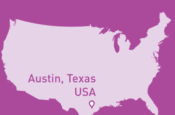

Christopher Schmitt 是 Heat Vision 的创始人，这是一家位于德克萨斯州奥斯汀的新兴媒体出版和设计公司。Christopher 是一位网络设计专家，自 1993 年以来一直从事网络工作。

作为一名备受欢迎的演讲者和培训师，Christopher 经常展示基于标准的实用设计的使用和优势。他是网络标准项目 Adobe 工作组的联合负责人，同时也是其教育工作组的贡献成员。

http://christopherschmitt.com/
http://heatvision.com/
http://environmentsforhumans.com/
http://twitter.com/teleject

### 第 2 章：工具

作者：Christopher Schmitt

要创建和管理一个网站，你真正*需要*的只是最简单的文本编辑器和一个 FTP 客户端。然而，你的 Web 项目越复杂，涉及的协作者越多，你成为的开发者越专业，你就越会欣赏专业级工具的效率和强大功能。

要成功开发和维护一个网站，你不需要急着去买最昂贵、最强大的开发工具。如果你能使用免费或更便宜版本的产品，或者功能较少的产品来完成工作，你绝对应该这样做。

它们不仅对你的钱包更友好，而且更简单的程序意味着更平缓的学习曲线，而且通常使用起来更高效。

然而，如果一个功能更丰富的应用程序是完成工作所必需的，那么花钱并花时间学习该软件可能对你最有利。

你怎么知道你需要哪些应用程序和功能？

#### 了解你想要完成什么

通常，网站规模越小、复杂性越低，你就越有可能使用更简单的工具完成工作。

如果你正在开发一个只有几页和少量图片的五页网站，你可能可以使用更简单的文本和图像编辑器，而不会察觉到差异。但是，如果你正在创建一个包含数据库、数百页和图片的网站，那么你就会欣赏一个优秀的 MySQL 客户端以及 Photoshop 的批量图像处理能力。

简而言之，要知道你需要什么工具，你需要知道项目的最终产品是什么样子，以及你需要做什么来实现那个最终目标。

你还需要很好地了解你自己的技能组合：熟悉手动编码的人可能需要与偏好 WYSIWYG（所见即所得）编辑的人不同类型的软件。完全精通编程的人可能不需要图形界面 MySQL 客户端，而我们其他人则需要。

了解特定项目需要什么工具以及理解自身技能的程度需要经验。在此期间，从获取和学习一些基本的 Web 开发工具开始，然后从那里着手。

#### 了解你的工具

如果你只会用 Adobe Photoshop 调整大小和裁剪，那你就在浪费很多钱。Photoshop 拥有丰富的专业功能，但要使用它们，你需要学习如何操作。

这同样适用于我们在这里讨论的所有工具。拥有最强大、最复杂的 Web 开发软件固然好，但如果你不完全理解如何使用它，那对你用处不大。了解你的文本编辑器的键盘快捷键，如何使用图像编辑器的图层和蒙版，以及如何使用 Web 开发者工具栏调试 JavaScript，会使你成为一个更高效、更有能力的开发者。但这也需要你花时间去学习软件。

查看网络上关于你手头工具的大量软件教程。阅读手册。购买一本关于该主题的书。最重要的是，深入实践并使用这些软件。掌握应用程序的方方面面起初可能需要花费一些时间和精力，但长远来看，它所能节省的时间和努力是完全值得的。

#### 文本编辑器

一个好的文本编辑器能让编码工作更轻松。它通过代码高亮和缩进使项目文件易于管理、代码更易阅读；它能自动化完成常用任务，比如自动补全你的标记语言；它还能让网站变更易于追踪和实施。这些特性解释了为什么大多数编码者不会考虑使用 TextEdit 来完成工作，也解释了为什么许多人愿意用辛苦赚来的钱购买一个能让生活更轻松的文本编辑器。

#### 图形编辑器

图像在增强你的文本方面扮演着重要角色。从品牌标识到自定义图标项目符号，图形有助于为网页设计增添光彩。

你需要一个图形编辑器，它不仅能处理图形的创建，还能将你的图像导出为适合网页的格式，如 GIF、JPEG 和 PNG。

#### FTP 客户端

在你创建了网页杰作之后，你需要一种方法将其发布到网络上。你会需要一个 FTP 客户端。**FTP**（代表 **File Transfer Protocol**，即文件传输协议）只做一件事：在你的本地文件和在线服务器（通常是你的虚拟主机）之间来回传输文件。

它执行此任务的速度和可靠性，以及它让你更新和同步文件变得多么容易，都取决于所使用的 FTP 客户端。

#### 数据库

专业网页开发者在某个阶段会发现自己需要处理 MySQL，这是最流行的数据库管理系统，适用于简单项目。MySQL 最常与 PHP 结合使用，以创建数据库驱动的网站。而且，除非你想通过命令行与 MySQL 交互，否则你需要结交一个图形界面客户端，以便妥善管理你的数据库。

#### 验证器

无论你的文本编辑器或网页制作软件多么高级，你都会犯错误。当你犯错时，你需要配备合适的工具，以便更容易地发现和纠正这些错误。

#### 故障排除工具

让你的网页外观和行为符合预期，通常不像让它们通过验证成为合格的 HTML 和 CSS 那么简单。即使是有效的文档也可能无法按你希望的那样渲染，需要进一步调整。此外，你可能需要调试包含在 HTML 文档中或链接到 HTML 文档的任何 JavaScript 代码。

幸运的是，有各种强大且免费的工具可以帮助调整和排除网页故障。请注意，一些网页制作应用程序中也包含类似的工具。

然而，如果你没有这些应用程序，或者你更喜欢在浏览器中使用其中一些工具，对于任何流行的浏览器都有很棒的选项可供选择。

### 管理你的工作

在开发一个复杂的网站时，跟踪你的项目可能会变得很棘手。你修改了一组文件，然后将这些更改的文件上传到服务器，同时手头保留一份网站文件的旧版本，以防更改效果不佳。

或者，更棘手的情况是，有多个人在同一个网站上工作：跟踪谁在什么时候做了什么更改可能是一场噩梦。

#### 版本控制软件

这就是版本控制软件派上用场的时候。虽然像 CVS、Subversion 或 Git 这样的版本控制系统通常在团队共同开发软件时使用，但它们在网页开发中也很有用。

版本控制系统跟踪更改，存储项目的先前版本，并将项目的“仓库”副本与你的本地（工作副本）文件同步。

版本控制允许协作者对网站文件进行更改，在安全的环境中测试这些更改，然后将所有这些更改一次性提交到你的服务器。如果结果不如预期，你可以恢复到网站的先前版本。你可以查看谁对项目进行了更改，并保存和查看详细的日志，说明进行这些更改的原因。

如果你开始从事大型而复杂的网页项目，或者你有一个完整的开发团队在网站上工作，那么版本控制软件是无价的。

#### 书中网站的工具链接和评论

关于具体工具，我们还可以继续讨论下去，事实上，我们确实这样做了。

你可以在配套网站 http://interactwithwebstandards.com 上找到软件的链接和各种工具的详细评论。


Denise R. Jacobs 从1996年开始自学 HTML，此后曾以多种身份与网络合作，从本地化项目管理到教授网页设计/开发。目前，Denise 是佛罗里达州迈阿密的一位网络解决方案顾问，帮助企业转型其网络形象。除了撰写关于网络的文章，她还为网络标准项目 (WaSP) 教育工作组开发课程，并且是南佛罗里达社交媒体俱乐部的组织成员。

- http://www.denisejacobs.com
- http://www.cssdetectiveguide.com
- http://www.papilloneffect.com
- http://twitter.com/denisejacobs

# 第 3 章
## 在网络上学习

**作者：Denise Jacobs**

仅仅因为你每天都在使用一个工具，并不一定意味着你使用得很好——特别是如果你从未学过“使用得好”意味着什么。对于计算机来说肯定如此，因为有无数人每天使用计算机，但仅限于他们有限的知识范围。网络也是如此，许多人——甚至包括那些在熟悉书籍之前就熟悉计算机的几代人——可能没有充分利用网络及其包含的海量有用工具。

本章旨在提供一个指南，教你如何更好地使用网络，以便更高效地找到你自己问题的答案，定位新的信息来源并记住这些新信息。此外，我们将探讨寻求帮助的合理理由和场所，了解如何在线参与、建立和维护联系、整理找到的信息、组织你自己，并通过与他人合作来扩展你的学习。

### 关于学习

我猜，如果你已经开始踏上成为网页专业人士的道路，那么你对学习并不陌生。然而，有吸收信息，然后才有*学习*。区别在哪里？我认为学习是一个愉快的过程，在这个过程中，你主动寻找你需要的信息，找到绝佳的来源，并轻松地将新知识融入你当前的知识储备中，使其具有持久性。不幸的是，太多被称作学习的行为——比如为了通过考试而将不感兴趣的信息塞进脑袋，或者参与并不能真正激发兴趣并让我们想要获取更多知识的学术活动——并不符合这个模式。

在我看来，真正的学习是令人愉悦的，而真正的核心在于追随并滋养你天生的好奇心，对知识保持渴望。对你学习的科目充满热情和浓厚兴趣，不仅能让你有能力学习更多关于它们的知识，还能在学习过程中获得极大的乐趣。

#### 了解你的学习风格

了解你如何学习效果最好，能确保你能够记住并轻松获取你获得的任何信息——同时享受这个过程。踏上一项努力，比如为新职业或爱好学习新技能，需要主动性，而如果你知道如何为自己收集信息以便更好地吸收，这将变得容易得多。

让我们看看最基本的学习风格，看看哪一种最像你。

##### 视觉型和书面型学习者

你是否发现自己想坐在房间最前排，以免错过任何东西？你是否从印刷文本、图表和讲义中收获很多？你是否倾向于用图像思考？恭喜你，你是一个视觉型学习者。


那么，如何让这种学习风格为你所用呢？以下是一些建议：

-   将你听到的信息可视化为具有代表性的图片或文字。
-   将你的想法以图片或图表的形式勾勒出来。
-   做大量笔记，并使用颜色来突出重点。
-   在没有声音干扰的地方阅读和学习。

#### 听觉型学习者

你是否记得别人对你说过的话，而且往往是逐字逐句的？你是否不太在意在教室里坐在哪里，只要你能听到别人在说什么？你是否通过口头表达来理清思路，并从讨论中获得大量理解？如果这听起来像你，那么你就是一个听觉型学习者。

你可能从书面文字中获取的信息不太多，除非有人读给你听，而且你可能喜欢有声读物。你也可能有音乐天赋，对音调、音高和调性有很好的感知力。

那么，如何让这种学习风格为你所用呢？以下是一些建议：

-   积极参与讨论，并创造机会谈论相关主题。
-   录制课程，或者获取讲座的音频或视频录音。
-   大声朗读文本，以便你能听到它。
-   用口头方式表达你的想法，并用故事和类比加以强调。

#### 动觉型学习者

你是否发现很难长时间安静地坐着？在教室里时，你是否希望所有人都停止阅读和讨论学科内容，而是真正地*做*一些事情？你在说话时是否容易被动作和手势分散注意力？这些特质意味着你是一个动觉型学习者，通过实践、运动和触摸来学习效果最好。

你可能在坐着时会不自觉地抖脚，或者喜欢身体活动。如果有人向你演示一次如何做某事，你能毫无困难地复现，而且可能还会加以改进。

那么，如何让这种学习风格发挥最大效果呢？

-   先快速浏览一遍阅读材料，然后再详细阅读。
-   站着阅读或学习，同时做一些体力活动（比如在健身器材上），或者边嚼口香糖边学习。
-   学习时手头做点事情（比如捏塑、折纸等）。
-   在学习休息时起来走动一下。

一旦你了解了自己的最佳学习方式，你就能更清楚在寻找网络信息时，哪些类型的资料来源对你最有价值。然而，学习风格并不是决定你吸收信息效果的唯一因素。我们的大脑天生在投入、放松、更多感官受到刺激以及顺应探索本能时，学习效果会更好。

## 找到答案

现在，你有了想要深入了解的东西，正在求知的道路上。让我们来看看一些能帮助你更轻松找到所需信息的方法。

### 高效的网络搜索

我相信你已经使用过 Google 上千次了，但你是否能快速获得想要的结果？以下是一些关于如何高效搜索网络以找到答案的技巧。

#### 搜索类型

最常见的搜索使用关键词和短语。然而，通过使用搜索运算符或针对特定网站，你可以获得更精确的结果。让我们逐一了解这些方法。

#### 关键词，关键词，关键词

关键词是网络搜索的基石。确保你设计出最佳的关键词组合，可以产生巨大的效果，就像用霰弹枪和用激光打靶之间的区别一样。

为了让你的关键词达到更精准的激光般效果，以下是 Google 本身提供的一些建议：

-   每个词都很重要，所以最好保持简洁。
-   使用可能出现在你所找网页上的词语。
-   使用描述性词语，并且尽量精简。

#### 短语

有时你寻找的是一组特定的词语组合。为了缩小搜索结果范围，将你搜索的词语组成一个短语（也称为字符串）会很有帮助。短语是一系列用引号括起来的词语，搜索引擎会按给出的精确顺序生成包含该短语的结果。例如，如果你专门寻找包含 *web design resources* 这一短语的页面，那么你的搜索短语应该是 "web design resources"，结果将是内容中包含该完整短语的页面。

#### 你好？运算符？

为了进一步缩小搜索结果范围，使用运算符来为搜索设置有用的参数也很有帮助。

-   精确匹配你输入的词条：+。当你希望某个精确的词条（而非该词加上同义词）作为搜索参数时，在词语前面直接使用加号（+）。例如：`+css ie hacks`。
-   排除词条：-。使用减号（-）从搜索结果中排除某些词条。例如：`web conference -california`。
-   通配符/填空：*。使用星号（*）来查找你的词条以及与之相关的其他词条。例如：`illustrator tutorial *`。
-   二选一：OR。使用 OR 可以查找包含其中一个词条或另一个词条的结果。例如：`web design OR webdesign`。

#### 指定网站

你已经知道内容所在的网站，只是不知道如何找到它吗？那么你也可以在搜索参数中指定这一点，输入搜索词条后，在你想限定的网站名称前加上 **site:**。例如，要在 smashingmagazine.com 上查找包含 *design trends* 这些词的文章，你可以输入：`design trends site:smashingmagazine.com` 作为搜索短语。

#### 筛选搜索结果

一旦你生成了一些有前途的链接，以下是一些关于选择哪些链接进行查看的建议：

1.  **阅读简短描述：** 这是从网页中直接提取的文字，能让你了解内容是否相关。

2.  **查看页面的 URL：** 在看到页面之前先看 URL，能让你了解来源网站的很多信息。你可以粗略扫一眼，看看它是否来自一个可识别的或权威的来源，从而避免访问不提供你所需信息的网站。

3.  **查看页面的"缓存"版本：** 描述看起来不错，URL 似乎也合理，但你想直奔主题。通过缓存页面，你可以轻松搜索关键词，关键词会以不同颜色高亮显示。这是一种快速判断页面是否值得认真阅读的好方法。

好，你已经决定打开一个链接并进入了页面。以下是一些检查内容是否对你有价值的方法：

1.  **查看作者及其资质：** 如果文章有关于作者的介绍部分，读一读，看看他或她的背景是否赋予了其权威性。如果网站由单个作者运营，如果有的话，也请阅读关于页面，理由相同。

2.  **查看内容的日期：** 有时你访问了一篇看起来很棒的文章，却发现它是十年前写的。有时信息是不受时间限制的，但当你希望获取最新信息时，你可能想忽略较旧的来源。小心那些完全没有日期的内容，因为你无法判断它的相关性和时效性。

3.  **不要以貌取人：** 虽然检查内容日期很重要，但不要完全忽视那些设计不佳、没有最新图形或缺乏最新外观和风格的页面。内容可能仍然相关且值得一读。

#### 来源类型

最适合你的来源类型取决于你正在寻找什么信息，以及再次强调，你如何最有效地吸收信息。网络上的几乎所有内容都可以算作合法的信息来源，只要你记录其出处：文章、PDF、幻灯片、视频、播客和图片。因此，如果你是视觉型学习者，文章对你来说就很好；如果你更偏向听觉型，那么播客或有声读物可能更好。如果你更偏向动觉型，那么观看视频或屏幕录制教程可能是吸收信息的最佳方式。

> 提示：http://Easybib.com 是一个很棒的在线引用来源工具。

## 做笔记

世界上所有的资源对你都没有太大用处，除非你记录下其中哪些部分真正对你有用。秉承学习的悠久传统，做笔记对于获取和利用你收集的所有信息至关重要。让我们来看看一些组织和保存重要信息以便将来使用的方法。

### 保存到"云端"

我相信你在谈到网络时已经听过**云端**这个术语。在这里，我用*云端*指的是存储在网络服务器上（而非你的电脑硬盘）并通过网络浏览器和各种设备访问的信息，使其实际上具有无限的可扩展性**（图 3.1）**。

保存到云端非常强大，因为它使你不必依赖单台机器来访问你的内容，无论内容是什么。任何

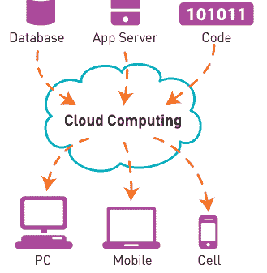

记笔记

一台能访问互联网的设备可以让你查阅已保存的信息，相应地，也能让你修改和补充这些信息。你可以看到，这对管理和标注你的信息是多么有用。

#### 博客

博客是记笔记、保存进一步资源的参考链接、对信息进行分类的好方法，无论你身在何处，都能访问到这些信息，并且还可以与设备无关。由于博客设置非常简单，并且具有许多帮助你组织文章的功能，它们成为在可靠位置（而非电脑硬盘）记笔记和保存信息的自然选择。

Wordpress、Blogger 和 TypePad 都是很棒的免费在线博客平台。

> **提示：** http://www.scribefire.com/ 是一个很棒的 Firefox 插件，可以让你无需登录就能快速更新博客。

#### 书签网站

书签网站是管理和访问书签的好方法，无需绑定到你的计算机。有些网站甚至提供浏览器扩展，允许你在将书签保存到浏览器的同时，也保存到书签网站。

许多管理书签的网站实际上是社交书签网站，旨在围绕收藏的页面建立社区和共同兴趣。随着像 Twitter 和 Facebook 这样兼具社交书签功能的微博客网站的兴起，这些网站的这项功能正在失去人气。然而，它们仍然非常适合其核心用途：保存和标记书签以供日后使用。通过许多这样的网站，你还可以设置一个订阅源，将你保存的书签发布到你的其他社交媒体账户。

顶级的书签网站是 [http://Delicious.com](http://Delicious.com) 和 [http://Gnolia.com](http://Gnolia.com)（原 Ma.gnolia）。

### 在线笔记本

除了用博客保存笔记，你也可以使用在线笔记本。在线笔记本的工作方式类似于现实世界中的便签和纸片：你可以保存和组织任何长度的信息片段，以备后用。然而，在线笔记本可以让你以多种格式保存笔记：文本、屏幕截图、网页片段，甚至手机照片。一旦你的笔记保存在应用程序中，你就可以通过关键词、标题和标签进行搜索。这不是很酷吗？

在科技人士中最受欢迎的一些在线笔记本包括 Evernote（其优势在于拥有网络、桌面和手机应用程序，并且可以同步）、Google Notebook, http://google.com/notebook（不过，Google 已经停止了对 Notebook 代码的开发）以及 Zoho, http://notebook.zoho.com。

你通常可以将这些工具连接到其他在线应用程序以导入信息。例如，Evernote, http://evernote.com，可以从 Delicious 导入收藏的页面。

### 模拟笔记——老派方法

记笔记的资源数不胜数，所以我认为没有必要在这里重新讨论它们。我真正想谈谈的是如何捕捉你的想法，以便它们在未来对你来说易于访问和使用。

#### 手写笔记

用来记录想法的物品种类繁多。诀窍在于找到适合你的那一款。虽然许多设计师是 Moleskine 笔记本的忠实拥趸，有些人喜欢艺术家速写本，有些人喜欢有横线的笔记本纸，还有些人喜欢方格纸。如果你有环保意识，可以重新利用复印纸空白的背面来做笔记。

组织信息也是一个个人风格的问题。笔记通常包含一种或多种混合技巧：提纲、使用关键词和速记、捕捉主要概念、突出和划出关键思想。思维导图——一种视觉化和概念化收集思想的方法——将图像和文字结合，传达丰富的意义和即时的冲击力 **（图 3.2）**：

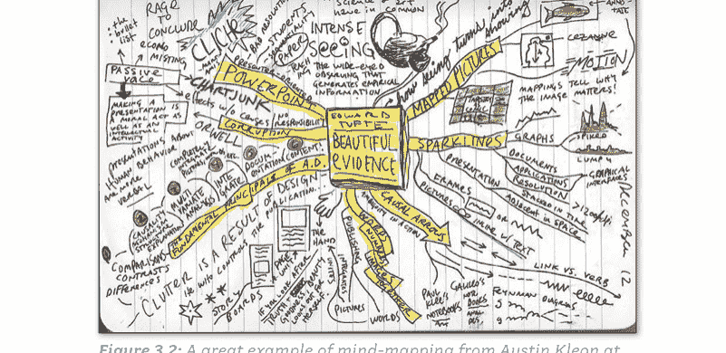

另一种具有强烈视觉冲击力的记笔记方式是用文字和图片一起做，也称为“笔记速写” **（图 3.3）**。

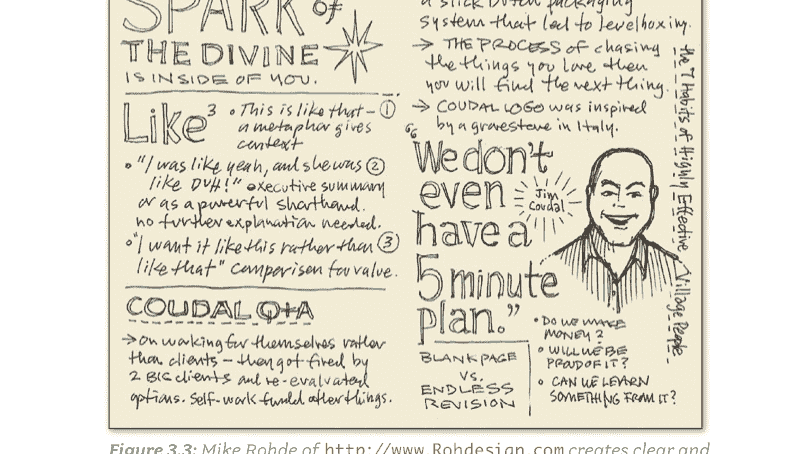

你不必在笔记上花费大量时间和精力使其美观——这不是重点。目标是准确地记录并从心理上对你想要吸收的信息进行分类，其格式要能让你在需要时轻松再次获取。

#### 文本文件

也许你更希望将笔记以电子文本形式保存，并且也想在硬盘上保留一份。使用简单的文本编辑器、Word 或任何其他文字处理应用程序来保存和管理你的笔记，这并没有什么不好意思。如果你想确保以后能从网络上访问它们，可以将它们保存在 Google docs（或任何其他文档保存库）中，以备后用。

### 保持更新

网络上的资源和信息以令人目眩的数量产生，并且每时每刻都在指数级增长。你如何跟上所有新产生的、相关的信息？记住这一点：你无法跟上所有事情——这既不可能，也没有必要。为了管理你吸收的信息量，选择 3-5 个最重要的领域，然后只吸收与这些领域相关的信息，至少在一段时间内是这样。RSS 订阅源、播客和电子邮件订阅都是帮助你跟上你喜爱网站信息的绝佳工具。

### RSS 订阅源

正如你可能已经知道的，RSS 代表“Really Simple Syndication”（真正简单的聚合），是跟踪你喜爱的网站和博客上发布的新文章的最佳工具之一。虽然很多人知道 RSS 是什么，但他们并没有充分利用它作为保持信息更新的途径。

如果你已经有一个 Google 账户，那么 Google Reader 作为你的 RSS 订阅源阅读器是自然的选择。如果你不依赖 Google，那么一些替代方案是 [http://Bloglines.com](http://Bloglines.com) 和 Firefox 的 Live Bookmarks 扩展。

#### 播客

如果你是听觉学习者，那么播客是你获取新信息并使其真正扎根于心的理想方式。有几种方法可以访问播客，它们实际上基于 RSS。最常见的方法是通过 iTunes 获取。你也可以通过播客客户端访问播客，例如 gPodder, http://gpodder.org/。

播客涵盖所有主题。如果你是动觉学习者，那么播客很棒，因为你可以在进行活动（如在健身房锻炼）时收听它们。

#### 电子邮件订阅

大多数网站都提供一个区域，你可以在其中提交你的电子邮件地址，加入他们的列表，通过电子邮件接收新闻通讯和更新。如果你更倾向于电子邮件，并且不觉得当前的邮件量已经超载，这可能是一个适合你的方法，因为更新将直接发送到你的收件箱。

电子邮件订阅的一个问题是，它们不如 RSS 通知可靠，因为它们依赖于网站作者主动整理和发送新闻通讯。另一个问题是相反的情况：有时网站作者产出过多，你的邮件更新最终感觉就像不断袭来的垃圾营销信息。

## 保持专注

学习新技能不仅仅是获取信息，还包括将其付诸实践。随着你的知识增长，会发生几件事：虽然你开始掌握某些主题，但你也看到了需要进一步获取材料和专门知识的领域。你如何跟踪你“待办事项”列表中所有需要学习的东西的动态，以便推进到下一步？

别害怕。建立一个任务优先级排序和管理任务的系统可以极大地促进这一过程。

### 高效系统

我们大多数人都能相当成功地完成任务。然而，你可能曾受到旧习惯的拖累，比如拖延，或者因不知道下一步而陷入停滞，这阻碍了你实现最终目标。当你有大量要在给定时间段内或长期实现的目标时，建立一个高效的系统（并且你确实实践它）将帮助你实现目标。

你可能会感到惊讶，但高效是一种技能——是处理信息、注意力和任务的方法与习惯的结合。像任何技能一样，高效需要学习、发展和磨练，才能表现良好。

高效系统作为学习和灌输新习惯、打破阻碍效率的旧有倾向的方法非常有用。市面上有许多高效的系统，但网络社区中人们推崇的有：

- Getting Things Done（通常简称为 GTD）
    http://en.wikipedia.org/wiki/Getting_Things_Done
- 43Folders
    http://www.43folders.com/
- Zen to Done，GTD 的简化版本
    http://zenhabits.net/2007/04/zen-to-done-ztd-the-ultimate-simple-productivity-system/

在缺乏既定高效系统的情况下，这里有一些提高效率的技巧：

- 了解你的工作习惯。
- 了解你的自然周期。
- 理解大多数高效系统运作的基本原理，并努力将其中一些习惯融入你的生活。
- 大多数系统都有一个类似于以下步骤的过程：把脑子里的所有东西都倒出来，整理你的想法，把想法分解成带有行动动词的行动，对行动进行优先级排序，制定切实可行的行动清单，执行清单但对意外情况保持灵活性。
- 目标是简单。


#### 任务管理器和日历

一旦你确定了你的系统，就需要一种方法来跟踪你的任务。这就像选择将你所做的任何笔记保存在云端还是坚持写在纸上一样，你可以选择使用在线任务管理器或以书面形式来跟踪它们。

Mashable.com 提供了一份出色的（虽然可能有点令人眼花缭乱）在线最佳任务管理器列表，可以帮助你完成任务。该链接列在 interactwithwebstandards.com 的第三章推荐阅读中。一些流行的应用程序包括 Things（仅限 Mac）、Google Tasks 和 Remember the Milk，但还有很多很多其他你可能觉得更有用的应用程序。

生产力的第一部分是关于学习新的习惯，以便更好地管理你的任务，另一部分则是关于更好地管理你的时间。通过一个良好的日历，你可以最好地掌控并准确控制你一天中的时间安排。Google 日历是最好的，也是最容易获得的选择之一。你甚至可以自定义它并与他人共享。和所有事情一样，有些人——即使是网络人士——更喜欢打印日历，或者将日期和时间写在他们的笔记本上，作为他们的低技术日历。

## 从他人那里找到答案

很容易感到自己像一座孤岛，朝着成为网络专业人士或至少获得一定水平熟练程度的目标努力工作。但当然，你并不孤单；你实际上只需点击一下，就能接触到无数的人。这就是你的学习从独自一人转变为基于社区的地方。

### 众包

网络搜索并不是获取信息的唯一方式。众包是一种因其速度和有效性而日益流行的研究方法。众包是利用一个大型社区人群的知识来产生想法、解决问题和创造解决方案。

众包的兴起与社交媒体的繁荣同步。事实上，几乎没有更好的方式可以接触到无数有相似兴趣的人。众包的主要渠道是任何有大量人群阅读信息并能与你互动的地方，例如通过 Twitter 和 Facebook 等社交媒体渠道、博客、论坛、维基和邮件列表。

你如何做到这一点？首先，简单地寻求答案、资源、意见或分享经验。你可以提供激励，但通常人们会自愿回应。如果你曾在 Twitter 上提出一个问题，并在几分钟内收到大量回应，或者写了一篇博客文章并得到了回答，那么你就体验过众包了。

进行众包时请记住这一点：答案的质量取决于信息来源。回应你请求的人越多越好，因为这样，你将能够筛选回应，找到最适合情况的那些，或者大众会审查回应并给你最好的解决方案。

### 提供答案

在网络上活跃不仅关乎你能从中获取什么信息和从他人那里获得什么。为了成为网络生态系统中健康的一部分，重要的是尝试用你获得的同等数量的帮助和资源来回馈网络。

## 做一个良好的在线公民

网络存在一种“业力”——你的言行（或不作为）的影响可能比你所知道的更为深远，并且很可能会以某种方式、形态或形式回报到你身上。因此，记住关于在网络上成为积极公民的几个关键点是个好主意：

-   网络上发生的事情，会永远留在网络上——无限期地（或近似如此）。你在博客、论坛、维基以及现在的 Twitter、Facebook 和其他社交网站上的评论都是公开的、可搜索的和被存档的。

### 提供答案

-   尽管网络似乎浩瀚无边，但就像人与人之间的现实世界一样，一旦你开始基于共同兴趣频繁访问某些地方，它实际上是一个非常小的世界。因此，你无法真正匿名。在某些社区中，人们彼此认识，一旦你加入并让自己被看到，他们也会开始认识你。希望你会努力以积极的形象被看到。
-   与离线世界类似，在网络上，你有一个基于你的言行的可见身份，而且越来越多的是，你的网络身份甚至取代了你的现实身份，因为网络可能是某人第一次了解你的途径——而你甚至还不知道。在开始发表不当或负面评论之前，意识到这一点很重要（除非匿名进行）。这些评论在搜索你的名字时很容易出现。

> 资源 // 建立和管理你的网络身份

我相信你现在已经明白了：你有一个网络身份，并且它随着你在网络上的活动而增长和扩展。要开始建立你的“品牌”，对你想要因何而闻名有个概念，然后开始做出支持它的贡献是有帮助的。

例如，如果你想因你的 Illustrator 专业知识而闻名，那么你的许多博客文章应该是关于 Illustrator 提示和技巧的，你的社交媒体帖子可以提供 Illustrator 资源，你可以为网站撰写 Illustrator 教程，并参与关于设计和创建矢量的论坛和列表。

### 使用良好的网络礼仪

无论何时与人打交道，总有一些关于互动应如何进行的准则，在网络上也不例外。在网络中与他人良好协作的标志是什么？以下是一些需要牢记的良好的网络礼仪建议：

-   在你投入之前，花些时间观察。
-   当你确实要提供一些东西时，要清楚自己在谈论什么，并且谈论时要合理。
-   公开分享你的知识和专业知识。
-   链接到补充信息。
-   注明你的信息来源——想法、故事、图片。
-   留下富有洞察力和帮助性的评论，并仔细检查你的措辞，以确保信息清晰。

> **提示：** 发表评论时，尤其是那些不太友好的评论，即使说的是事实，也一定要缓和你信息的语气。粗鲁或不必要的苛刻对任何人都没有好处——而且最终会给你自己带来不好的影响。想想如果同样的评论是对你做出的，你会有什么感觉。

-   限制无端的自我推广和无休止的自言自语。人们被信息淹没，不关心你每一秒都在做什么。
-   原谅他人的错误。

### 回馈

既然你已经掌握了一些在线行为良好的基本规则，是时候为网络注入你自己的贡献了。让我们看看你可以通过哪些方式来做到这一点。

#### 通过博客评论

在博客文章上添加评论是一个很好的方式，可以同时做几件事：通过提供额外的信息和资源来回馈，提高你的可见度以及人们对你是谁和你知道什么的认识，最后引导人们访问你自己的网站，并有可能有机会同时回馈和扩大你的在线形象。虽然“我也是”的评论无害，但它们确实不会像一个深思熟虑、信息丰富的回应那样真正提升你的声誉。相反，实践良好的网络礼仪，在投入之前先观察其他评论，分享你的信息并做到合理，最后，提供相关信息并链接到它。

#### 通过论坛和列表

与博客文章不同，在论坛和列表上，人们是主动寻求答案和分享资源的。与博客文章类似，这些场所都是你解决问题、提供解决方案、分享你的专业知识、知识和资源的好机会——并在此过程中积极建立你的声誉。

通过社交媒体

你很可能已经拥有多个社交媒体账户，比如Twitter和Facebook，但你的信息中有多少与提供对他人有帮助的内容相关？

社交媒体专业人士给初学者的最大建议之一就是“提供价值”。这是什么意思？这意味着，虽然关于你猫咪的帖子可能会让一些粉丝觉得有趣，但对大多数粉丝来说，这只是构成他们社交媒体信息流中无穷无尽的无用闲聊的一部分。为了让你的信息流变得有价值，请提供对你的粉丝来说既有信息量又有用的帖子。资源、技巧和文章链接都是提供价值的好方法。

通过你自己的博客或网站

通过你自己的网站，你可以百分之百地控制向世界展示什么信息，跟随你的灵感创作内容，并在你的专业知识增长过程中分享它。

协作

当你与他人合作时，学习和提升技能的机会会急剧增加。在协作环境中工作，积极交流想法，已被证明可以增强批判性思维，促进更高水平的表现，并更好地保留信息。此外，与他人合作可能非常有趣，并能创造一个让你探索和发展自己的学习、工作和沟通风格的环境。

学习和灵感

讽刺的是，你将进行的一些最重要的学习，并非来自主动追求知识，而是来自阅读、学习和练习新技能之间的空闲时间。如前所述，大脑在放松时最能吸收信息。鉴于此，为自己安排休息时间，并留出一些时间——即使表面上看起你没做什么——是非常重要的。这是你的大脑忙于将所有你最近吸收的东西建立联系，并开始为未来的想法迸发新的灵感火花的时候。

当你受到启发时，你的大脑也最能吸收信息，所以要养成定期寻求灵感的习惯。对周围所有的灵感来源保持开放和觉察，无论是视觉设计、音乐、食物、对话话题、喜剧节目、电影、织物还是其他人。灵感可能在任何时候以任何形式出现，所以最好的做法是在它出现时准备好捕捉它。

另一种更具结构化的产生灵感的方法是创建一个“灵感库”文件。“灵感库”文件在文案撰写行业已使用多年，其做法是保存巧妙的文案片段、绝佳的标题和有力的短语，以便日后用作想法来源。你也可以这样做，但当然，你不必局限于文案——任何你能保存的、能捕捉和激发你想象力的东西，都值得放入你的灵感库文件中。

某个在线笔记程序将是存储你的灵感库文件的完美工具：截图、图片、文本片段、扫描的草图等。稍后，当你基于灵感库中的某个项目进行设计时，你可能会非常高兴你保存了所有那些曾经启发过你的东西。

总结

就像任何事情一样，在网络上有效学习需要一套超越在Google中构建扎实关键词搜索的技能（尽管那是一个很好的开始）。了解你的学习风格，不仅为你应该寻求什么类型的信息奠定了基础，也为你如何捕获和记录这些信息以便将来使用奠定了基础。

有无数优秀的在线工具可用于做笔记、收藏书签、跟踪信息以及组织任务和时间。你选择哪一个取决于它们与你的思维方式和工作风格的契合程度。

身处网络，意味着成为遍布全球的更大社区的一部分。利用网络上的巨大资源，将网络上的其他人视为你的同行、导师和未来自我的映射，与他们建立联系。然而，也要记得付出一些你自己的东西——无论是建议、技巧还是你自己的网站。

最后，积极地用网络之外的灵感滋养你的大脑。给自己机会，捕捉你周围世界中的神奇片段，并将它们编织成你自己独特的视野。

## 资源 // 推荐阅读

本章的以下推荐阅读内容可在 http://interactwithwebstandards.com 找到。

- 25个免费在线资源和网络应用，面向终身学习者 http://www.missiontolearn.com/2009/06/lifelong-learner-free-resources/
- GoogleGuide的高级搜索运算符 http://www.googleguide.com/advanced_operators.html
- 网络礼仪主页 http://www.albion.com/netiquette/
- 在互联网上发生的事情，永远留在互联网上。http://www.isound.com/artist_blog/what_happens_on_the_internet_stays_on_the_internet

### 在线笔记本

- 17个值得注意的Google Notebook替代品 http://mashable.com/2009/01/25/notetaking-alternatives/
- 笔记软件对比 http://en.wikipedia.org/wiki/Comparison_of_notetaking_software
- Instapaper：一个保存网页供稍后阅读的简单工具 http://www.instapaper.com/
- VizThink：视觉思考者实践视觉沟通 http://vizthink.com/

## 资源 // 推荐阅读 *（续）*

### 事务处理与任务管理器

- GTD工具箱：100+资源助你高效完成事务 http://mashable.com/2009/01/29/getting-things-done/
- 待办事项列表：12个在线工具组织你的任务 http://www.sitepoint.com/blogs/2009/08/06/online-to-do-list-tools/
- 15个免费工具，用于基于网络的协作 http://sixrevisions.com/tools/15-free-tools-for-web-based-collaboration/
- 按需灵感：创建一个灵感库文件 http://writetodone.com/2008/11/17/inspiration-on-demand-create-a-swipe-file/

# # 第四章
## 互联网基础知识

**作者：拉尔斯·冈瑟**

当为网络进行开发时，了解一点它的历史和工作原理是至关重要的。太多设计师仍然认为网页设计与平面设计完全一样，或者认为网络只能在台式机或笔记本电脑上查看。本章将提供一些历史背景，并对网络及其构建技术的近期未来进行有依据的推测。（这个叫做互联网的东西到底是什么？）

它还将探讨关于网络服务器、网络服务以及我们用来参与的设备的术语。但网络不仅仅是技术。它正在塑造我们的社会、文化和日常生活。事实上，它已经以我们可能没有意识到的方式渗透到我们的生活中。我们必须认真审视作为开发者所面临的社会学和伦理挑战，以及其中的可能性。

### 计算机、用户界面和计算机通信的简史

第一代计算机体积庞大、沉重且非常昂贵。早在20世纪50年代和60年代，甚至到70年代末，人们都很难想象有朝一日，小到可以放在桌子上——或口袋里——的计算机将成为主流类型。更不用说所有这些计算机会连接在一个恰如其分地被称为“万维网”的网络中。那么，我们是如何走到今天这一步的？我们现在身处何处？又将走向何方？

马克·韦泽，从1988年到1999年担任著名计算机实验室施乐帕洛阿尔托研究中心的首席计算机科学家，描述了计算的三个时代：

1. 一台计算机对应多个用户的时代（1:n）。
2. 一台计算机对应一个用户的时代（1:1）。
3. **普适计算**时代，每个用户对应多台计算机（n:1）。

这不仅仅是一个数学问题。韦泽告诉我们，我们将被计算机包围，但由于它们将是直观且无形的，我们不会把它们视为“计算机”。我们的计算体验将是无缝且透明的。

从40年代到70年代，计算机是“大型铁块”，只有一小部分人真正使用它们。那些使用它们的人坐在“哑巴”**终端**前，成百上千甚至几千个用户共享一个**CPU**（中央处理器）。

**集成电路**的发展使得将整个CPU集成到单个芯片上成为可能。这些计算机具有**命令行界面**（CLI），并与**文本用户界面**（TUI）配对。Windows中的DOS提示符，以及Linux和Mac OS X中的终端就是CLI的例子。这种界面通常被“高级用户”使用。与此同时，施乐帕洛阿尔托研究中心发展出这样一种理念：用户界面应该是图形化的，并涉及使用窗口、图标、菜单和指针（WIMP）。苹果公司通过Macintosh计算机将这一理念推向主流。**图形**

**用户界面**（GUI）如今已成为常态，且足够友好，使得*台式机*或*笔记本电脑*成为大多数人敢于使用的设备。

随着*移动电话*变得"智能"，普适计算的时代正悄然来临。我们完全有理由期待，几年之内，通过手机上网的人数将超过通过个人电脑上网的人数。智能手机是迈向"始终连接"体验的第一步。计算机也越来越多地被*嵌入*到各种设备中。

"我现在坐在电脑前，下一刻可能就离开了"或许不再是未来的思考方式。一切都将与无处不在的计算机交互。只是我们不会将它们视为"计算机"。它们甚至可能不被看作小工具。它们将是墙壁，是家具，是绷带，是你佩戴的眼镜，甚至是植入你体内的装置。

> **提示：** "最深刻的技术是那些消失的技术。它们将自身编织进日常生活的结构中，直到与之不可区分。"（引用自马克·韦泽的开创性工作《21世纪的计算机》，可在 [http://www.ubiq.com/hypertext/weiser/SciAmDraft3.html](http://www.ubiq.com/hypertext/weiser/SciAmDraft3.html) 获取）。


可以肯定的是，网络将成为主要的推动者，使所有这些计算机协同工作，提供无缝的用户体验。另一种看待这个问题的方式是描述网络经历的三个阶段，每个阶段都在前一个阶段的基础上增加了新的方面：

- 计算机网络，机器相互连接。
- 人际网络，我们人类相互连接。这是我们目前正在探索的阶段。
- 万物网络，一切将被连接，每一条计算机化的信息都将以某种形式存在于网络上。

未来的Web开发者必须为这样的环境做好准备。而最好的准备方式就是打好基础！

第四章

互联网核心技术

UUCP和Usenet发明于1979年。Fidonet始于1984年。也许在20世纪80年代，在我们使用今天的技术之前，许多大学的Unix用户通过**Unix到Unix拷贝**（UUCP）相互连接。讨论可以在**Usenet**组（也称为**新闻组**）中进行。

20世纪70年代末的个人计算机用户找到了使用调制解调器相互连接的方法，不久之后，**电子公告板系统**（BBS）诞生了。BBS找到了使用每日数据交换系统**Fidonet**共享信息的方法。一些BBS，如CompuServe、America Online或Prodigy，发展到了拥有数百万用户的规模。（当MSN启动时，它最初就打算成为一个BBS。）但其模式仍然是分离的网络。

如果一个网络节点能够联系到另一个节点，每个节点都必须有一个**地址**，并且必须有一种约定的方式来格式化数据、发送命令和控制传输。也就是说，它们必须遵守**协议**。一组协同工作的协议称为**协议栈**。

美国军方、政府和大学决定开发一个通用的协议栈，现在被称为**互联网协议套件**，有时也称为**TCP/IP栈**。其他解决方案已逐渐消失。如今，几乎所有网络都使用IP。

在新兴互联网开始兴起的大学里，主流的**操作系统**（OS）是Unix。因此，当万维网的创造者蒂姆·伯纳斯-李开始讨论一个使用超链接的信息交换系统时，最初的实现是在Unix系统上进行的（而讨论本身发生在Usenet上），这并不奇怪。

超链接自20世纪60年代就已存在，由泰德·纳尔逊和道格拉斯·恩格尔巴特发明。然而，万维网将超文本的使用提升到了一个全新的维度。导航不仅限于系统内部，还包括系统之间的导航。如今我们称之为**外部链接**并习以为常，但在1989年，这确实是一场革命。

字符、字符集和编码

字符编码是计算机通信中的一个棘手领域。计算机以二进制（0和1）工作，但究竟应该用什么0和1的序列来表示一个A（大写拉丁字母A）、一个百分号或一个空格？在Web早期，字符使用**US-ASCII**编码，它只使用7位，因此只有127个字符，其中30个是不可打印的控制字符。这意味着没有空间容纳像åäö这样的棘手北欧字符、德语ü、法语ô，更不用说为中日韩（CJK）语言的众多字符留出空间了。

> **提示：** 说英语的人通常完全意识不到编码问题，但对其他所有人来说，从第一天起就是明显的。

一个解决方案是使用**ISO-8859**系列编码。它将为所有最常用的语言提供编码。其中一些编码使用每字符一个字节，有些则使用更多。ISO-8859-1，也称为Latin-1，包含西欧使用的所有字母字符。然而，当微软推出Windows时，它实现了自己版本的ISO-8859-1，既扩展又破坏了其功能。由于Windows的主导地位，浏览器进行了调整，并将**Windows-1252**作为其默认编码。这种事实上的标准已在HTML5（大多数网页背后的主要语言的最新版本）中正式确立。事实上，即使你明确指定ISO-8859-1，浏览器也会——并且根据HTML5也应当——将其视为Win-1252。

只要我们使用的网站编码不允许我们指定任何给定语言中的字符，某些字符就必须使用**实体**（见第10章"HTML入门"）来指定。这不是最佳的解决方案，为了解决这个问题，语言专家与计算机科学家合作创建了**Unicode**。Unicode已经识别并分类了几乎人类已知的每一个字形，包括中日韩语言、泰语、各种印度语言、楔形文字、克林贡语以及*指环王*中的语言！

**UTF-8**是一种使用可变数量的字节来表示一个字符的编码，并且能够编码整个Unicode字符集。

Web技术

对于任何新项目，都应该使用UTF-8。UTF-8（像windows-1252一样）与ASCII兼容。这意味着前127个字符使用完全相同的0和1序列。

UTF-8是一种**编码**（或实际上是**字符编码方案**）。然而，在HTML和HTTP中，它被称为**字符集（charset）**，这在Unicode中有不同的含义。不幸的是，Web技术和Unicode没有共享一个共同的术语表，但这是我们不得不接受的问题。

Web由（且始终由）三项核心技术组成：

1.  **HTTP**，用于客户端（通常是Web浏览器）和服务器之间通信的协议。
2.  **HTML**，用于标记页面内容的语言。
3.  **统一资源定位符（URL）**，Web上页面的地址。

URL的含义后来被更改为**统一资源定位符**，而后者在技术上是**统一资源标识符（URI）**的一个子集。

> URL、URI和URN的确切定义是计算机科学界的一大谜团。

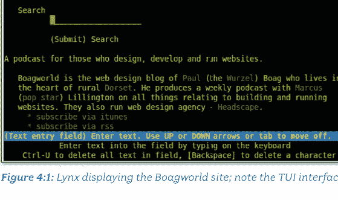

最早的Web浏览器具有文本用户界面。其中之一，Lynx **（图4.1）**，至今仍然存在，可以轻松地安装在Unix、Linux甚至Mac计算机上。移植到Windows的版本有些不稳定。

#### 浏览器及其战争

1993年，第一批图形用户界面（GUI）Web浏览器之一NCSA Mosaic发布。它最初运行在Unix机器上的X Window系统上，但也被移植到了Windows和Mac OS上。Mosaic由马克·安德森领导的团队开发。

Mosaic是开启Web革命的浏览器。然而，在1994年，安德森加入了一家名为Netscape的新公司。他们在同年发布了一款名为Netscape Navigator的浏览器。它很快成为最受欢迎的浏览器，甚至在测试版期间也是如此，但也开始了一种推动HTML专有扩展的趋势。在1995年至1999年间，在网站上看到"最佳浏览效果请使用Netscape Navigator"的标识并不少见。

微软最终赢得了90年代末的"浏览器战争"。凭借预装其浏览器Internet Explorer的力量，以及到版本5时可以说拥有更好的产品，微软也推动了HTML和浏览器的专有技术。这使得制作兼容所有浏览器的网站变得非常困难。

正是在这种情况下，既在许多方面实现了又讽刺了蒂姆·伯纳斯-李关于一个开放、人人可访问的Web的愿景，Web标准项目应运而生，呼吁供应商采用标准、作者使用标准。当Netscape将其浏览器开源时，这一战斗口号得到了极大帮助。人们决定不使用旧代码库，而是从头重写，并遵循标准而非供应商特定的偏差或附加内容——即使这意味着不支持Netscape自己的内容！

重写花了很长时间，久到Netscape没能幸存下来。从它的灰烬中崛起了Mozilla基金会，但直到2004年Firefox的推出，这个浏览器项目才成为成功。Firefox开创了浏览器扩展，其中许多是为开发者构建的（示例请参见本书的配套网站：http://interactwithwebstandards.com）。

> **提示：** Mozilla 于 2004 年推出了一款名为 Phoenix 的浏览器。此后它曾两次更名，先是改为 Firebird，然后又改为 Firefox。

基于标准的 Web 开发的突破也意味着，我们今天可以构建网站，并且有充分的信心相信它们能在所有现代浏览器、所有操作系统和所有平台上正常运行。其他值得一提但尚未提及的浏览器包括 Opera、Konqueror、Google Chrome 和 Apple Safari。

## 互联网与 Web 架构

在互联网上共享、接收或传输数据包的设备被称为**主机**。每个主机都有一个 **IP 地址**。当数据包在互联网上传输时，它们包含一个头部信息，其中包含目的地址和源地址等。后者是用于实现回复所必需的。今天我们使用的是第四版互联网协议，即 **IPv4**，它使用四个字节来表示一个地址，总共约有 40 亿个地址。随着互联网在北美和西欧之外不断扩展，以及越来越多地通过移动设备访问——未来甚至可以通过所有可想象的设备访问——我们将需要更多地址。我们正慢慢看到向 **IPv6** 的过渡，它使用 16 个字节进行地址编码，等于 2¹²⁸ 或 3.4 × 10²⁷ 个可能的地址，比撒哈拉沙漠中的沙粒或你身体中的分子还要多。

IPv4 地址使用**十进制**表示法书写，例如 114.32.197.18。IPv6 地址使用**十六进制**表示法书写，例如 00C2:0000:0000:0000:0123:ABCD:0011:F34B，这又可以通过省略前导零缩短为 C2::123:ABCD:11:F34B。

### 域名系统

IP 地址很难记住，并且对主机的描述性不强。因此，主机也有名称，这些名称按**域**进行分组。为了跟踪哪个域映射到哪个 IP 地址，我们有了**域名系统 (DNS)**。

如果你想拥有自己的域名，第一步通常是检查它是否可用。你可以使用名为 "whois" 的工具执行此检查。如果你觉得运行命令行版本太 geeky，有很多网站可以提供此信息。

第二步是联系一个适当的、被授权为你注册域名的**注册商**。他们通常也提供 DNS 托管服务。所有域名都必须至少有两个**权威名称服务器**来保存记录。这些名称服务器又会在**顶级域 (TLD)** 名称服务器处注册。

每个国家都有一个 TLD，例如，瑞典有 **se**，挪威有 **no**，皮特凯恩群岛有 **pn**。除此之外，还有通用顶级域，如 **com**、**org**、**net**、**edu** 和 **museum**。

> **资源 // 域**
> 顶级域的官方列表在 http://data.iana.org/TLD/tlds-alpha-by-domain.txt

当客户端（如 Web 浏览器）访问一个主机时，它首先会向最近的**缓存名称服务器**查询该主机的 IP 地址。缓存名称服务器只将记录保留很短时间，时间由域记录的 **生存时间 (TTL)** 设置指定，如果缓存过期（=太旧）或内存中没有记录，它必须“向上级查询”，即查询其最近的名称服务器，该服务器可能又会查询另一个，如此继续，直到查询到达 TLD 服务器，该服务器会告知哪些名称服务器是权威的，从而拥有持久的域到 IP 映射——除非发生了严重的错误！

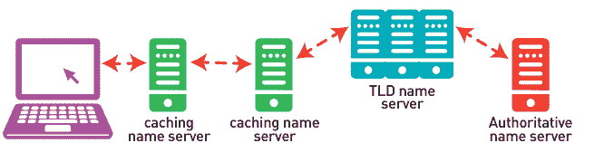

*图 4.2：DNS 查询如何工作* (http://www.istockphoto.com/user_view.php?id=1997052)。

这个系统使域的所有者可以更改他的记录，而无需将变更通知世界上每一个 DNS 服务器。然而，这也意味着变更可能需要一段时间才能生效，特别是对于热门网站，因为它们的记录在各处都被缓存了。

最重要的 DNS 记录类型有：

- A：将主机名映射到 IPv4 地址。
- AAAA：将主机名映射到 IPv6 地址。
- MX (Mail eXchange)：如果邮件应由特定服务器处理，则使用此类型的记录。
- CNAME：“规范名称”是一个别名，是域的替代名称。


> ## 亲自试试！
> 想象一下你正在为你所了解的一家公司推出一个网站。试着为这个网站找一个合适的域名。

### IP 协议套件

确定了对方主机的 IP 地址后，连接就建立起来了。连接通常由**传输控制协议 (TCP)** 或**用户数据报协议 (UDP)** 处理。前者功能更强，能确保可靠交付，按正确顺序重组所有数据包（它们并不总是按发送时的确切顺序到达），并且具有流量控制功能。后者更简单，更适合实时游戏、网络广播和电话——也称为 **IP 语音 (VoIP)** 等事物。

实际的 Web 资源请求和响应，例如页面、样式表、脚本、用于 Ajax 的数据片段、图像、音频片段、视频等，都是使用 HTTP 协议处理的。

### 客户端/服务器与对等网络

在应用层，主机之间主要有两种交互方式。最常见的是 Web 上使用的**客户端/服务器**模式，其中一个主机为其他主机提供内容。当流量增加时，服务器可能无法处理所有请求。事实上，如果服务器遭受拒绝服务 (DOS) 攻击，即被请求淹没，它可能会变得完全不可访问。一种数据共享均匀分布在所有主机中的系统称为**对等网络 (peer-to-peer)**。对等网络的主要优势在于，随着更多主机参与，其容量会增长，使其具有完美的**可扩展性**。对等网络应用的例子包括 Bittorrent、大多数 VoIP 系统（包括 Skype）以及音乐服务 Spotify。

### 互联网接入

提供互联网接入服务的公司称为**互联网服务提供商 (ISP)**。良好的连接提供高带宽和低延迟。**带宽**是衡量每秒到达多少数据的量度，以比特每秒 (bps) 为单位。**延迟**是从请求发出到第一个比特到达所需的时间。它以毫秒为单位（希望如此）。

### Web 服务器

在 Web 的早期，描述 Web 服务器很容易。它主要从文件系统向客户端提供文件。

如今，许多内容是动态生成的，即从数据库和其他存储方式中获取，并在请求时进行组装。但静态文件仍然有一席之地：CSS、JavaScript、图像、动画、音频和视频通常是静态的。提供静态文件比动态内容快得多，这意味着特别是高流量的网站应该努力保持很少更改的内容为静态。有些网站甚至将静态内容转移到独立子域名上的特殊服务器，以避免速度瓶颈。

缓存是另一种加速静态内容的技术。当浏览器向服务器查询资源时，它通常会明确询问自上次访问以来是否被修改过。如果没有，服务器可以只返回一个“未修改”的 **HTTP 头**，即“304”。动态生成的内容默认不会被缓存，为此类内容构建缓存机制并非易事！

### Web 服务

传统上，每当用户点击链接时，都会将整个网页加载到浏览器中，但今天网页通常使用来自服务器的新鲜内容进行部分更新。小片段信息被发送，浏览器将使用 JavaScript 将它们放入现有页面中。这种客户端/服务器交互模型称为 Ajax。

如今，信息不仅被使用浏览器的最终用户消费，也被其他服务器消费。例如，一个服务器可以提供实时体育赛事结果，其他网站又可以获取这些数据并将其显示在自己的页面上。一个更简单的例子是新闻阅读器获取 RSS 或 Atom 订阅源，并显示故事的聚合视图。

还有一个通常不被认为使用 Web 技术的例子，就是不同设备之间的日历和联系人同步。

所有这些都是 **Web 服务**的例子，即通过 Web 进行的机器对机器交互。Web 服务的定义在于有一个 **API (应用程序接口)** 可供客户端软件使用。这些 API 还允许网站拥有桌面或手机上的专用客户端。正是 API 让我能在智能手机上拍摄一张照片，只需按几个按钮就能将其上传到 Facebook、Flickr 或 Evernote。

### Web 体验

到目前为止，主要从技术角度描述了 Web。但我们也必须问：这一切对你我这些用户意味着什么？Web 如何影响学习、工作、社交、生活以及“最终的死亡”（当你离开后，谁会照顾你的在线身份？）？

Web 的最初愿景是关于社区和共享的。HTTP 协议旨在促进一个可读写的 Web。在几年时间里，写作方面需要如此高的技术熟练度，以至于普通人除了阅读几乎不做任何事情。除了联系表单（所有网站至今仍应有！），几乎没有从用户到网站所有者的沟通。然后我们有了访客


[content]
### 民主化的网络

**内容管理系统（CMS）** 的出现，使得在 Web 上发布内容变得容易了许多。最初的受益者是大型组织、媒体和政府。当小型 CMS 出现，使人们能够拥有 **博客（网络日志）** 时，Web 很快便让信息的 **民主化** 成为现实。尽管博客上的许多信息是虚假、平庸甚至恶毒的，但也存在大量相反的例子。特别是在网页设计和开发领域，有许多值得关注的博客。

如今，互联网体验比以往任何时候都更由参与其中的人们所塑造。然而，那种被感知的匿名性和缺乏社会约束，也可能激发人性中最恶劣的一面。

如果你维护一个网站——任何类型的网站——你必须以身作则，并推行你希望与之关联的价值观。

博客之间互动的一种方式是通过 **回链**（反向引用、引用通知和 ping 通知）。这些是用于察觉有人在自己的博客上引用了你的博客文章的手段。这是许多博客内置的便捷功能，但它也有一个陷阱——垃圾信息。

还有其他解决方案，例如使用专门的博客搜索服务，如 Technorati。这些服务通常使用标签机制；你用关键词给你的文章打标签，并显示一个链接到使用相同关键词的其他博客。一旦博客更新，这些搜索服务就可以被 ping 通知，并近乎实时地更新。如果你的博客软件不包含自动 ping 功能，有许多 ping 服务可以提供帮助。这些服务还会通知最常见的博客聚合网站，你的内容也会在那里发布。

博客凸显了我们使用 Web 方式的一种转变。运营博客不仅是为了吸引人们访问你自己的网站，也是为了将你的文字传播到其他网站。如今，我们分享的是信息本身，而非“页面”。网站所有者最好注意一个缺点：如果你依赖的收入模式需要人们访问你的页面，你必须为访问者提供一些有价值的东西，这些是他们仅通过第三方服务阅读你的内容所无法获得的。

在结束博客话题之前，还有一点需要指出。博客可以作为一种公民新闻的形式，对媒体进行监督。的确，Web 上的战场之一，是传统媒体努力适应信息民主化与博客作者视自己为政治正确建制派对立面之间的较量。需要指出的是，这并非 everywhere 的模式。在瑞典，媒体和博客大多找到了共生共存的方式。一个例子是领先的本地博客搜索服务 Twingly，它允许报纸在文章中加入指向博客的链接，从而双向引导流量。

### 网络体验

留言簿，提供了一种广义上打招呼的方式。留言簿并不意味着对特定页面的主题进行评论，也不意味着进行讨论。

然而，留言簿很快吸引了垃圾信息发送者。是的，他们从网络诞生之初就存在，至今仍没有百分之百的解决方案来根除这个祸害。

> 小贴士：顺便说一句，Spam（垃圾信息）是一种罐装火腿，因蒙提·派森的一个小品而不朽，该术语从此被借用来描述这种特定形式的无用“广告”。

受 BBS 启发，Usenet 论坛也迅速出现。确实，许多论坛软件名称中仍然带有字母 BB。例如 phpBB（可能是所有论坛中最流行的）、bbPress、OvBB、PunBB、WBB。论坛基本上是一个讨论的场所。一个流畅的对话称为一个主题。对于网页设计师或开发者来说，论坛是一个金矿。如果你找不到问题的解决方案，你可以在像 SitePoint（[http://www.sitepoint.com/forums/](http://www.sitepoint.com/forums/)）这样的论坛中提问。其他提问的地方还有邮件列表和互联网中继聊天（IRC）上的专用频道。（建议的论坛、列表和频道，请参见配套网站。）

> 亲自试试看！

找出五个专注于网页开发的论坛。调查每个论坛的社区活跃度，以及你是否能从中获得合格且权威的答案。

### 集体智慧

第3章“在网络学习”中讨论的社交书签服务，是用户如何互相帮助查找好内容的一个例子。随着页面被标记，一种信息的 **大众分类法**（folksonomy，folk + taxonomy）便形成了。早期网络上的链接集合，如90年代由付费员工创建的原始雅虎目录，或由志愿者创建的开放目录项目（DMOZ），使用 **本体论** 对信息进行组织；链接被分类到分层结构中，这是一种不太灵活的方式。目录也存在规模问题。随着网络规模和信息速度的增长，单靠员工团队几乎不可能跟上信息的添加、修改和删除。

一些网站将链接推荐的概念更进一步。用户可以提交链接，工作人员将审核他们的提交并向他人推荐。这是 Fark（[http://fark.com](http://fark.com)）和 Slashdot（[http://slashdot.org](http://slashdot.org)）背后的理念。这些网站也提供类似论坛的评论区。而像 Digg（[http://digg.com](http://digg.com)）和 Reddit（[http://reddit.com](http://reddit.com)）这样的网站没有专门的审核团队。相反，它们依靠社区来“挖掘”或对链接进行投票支持或反对。

社交书签和社交新闻服务依赖于大众的集体智慧来发现和审查信息。这可以被视为一种 **众包** 形式。利用大量人群来产生高质量信息，或执行非常庞大的任务，是社交网络的另一个现象。reCaptcha 是另一个利用人群解决大型任务的例子。对用户来说，它似乎是一个 CAPTCHA（验证码），用于防止垃圾机器人登录或提交评论，但它实际上做得更多。它将展示来自一本书的两个词，该书通过光学字符识别（OCR）被扫描并转换为文本格式。第一个词是已知的，但 OCR 在第二个词上失败了。已知的词作为垃圾信息的屏障，而第二个词则用于生成完整的文本（**图 4.3**）。

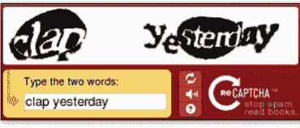

*图 4.3：reCAPTCHA 的一个测试。*

在这个例子中，用户可能在不知不觉中贡献了信息。利用集体知识的其他方式是通过观察行为。在一个领先的购物网站上，用户会看到诸如“购买这本书的用户还购买了”或“查看此商品后，顾客最终购买了什么”的信息。亚马逊（[http://amazon.com](http://amazon.com)）还允许用户通过发布用户评论、推荐列表和评分来进行有意识的贡献。另一个让用户以类似方式做出贡献的网站是互联网电影数据库（IMDB）。

维基百科可能是 **公民科学** 最清晰的例子。在 Web 出现之前，百科全书的主要观点是，由少数精选且知识渊博的作者为我们其他人撰写。而维基（Wiki）则让所有用户都可以贡献，不是通过评论或投票，而是让他们能够实际编辑文章。由数百名爱好者集体撰写、经过数千次个人编辑的文章，通常能达到非常高的质量。另一方面，读者必须注意，并非每篇文章都达到了那个水平。维基百科作为研究的起点很有用，但在需要专业知识的领域，如医学，最好用可信的来源核实自己的发现。

### 网络上的社区与网络作为社区

早在 Web 出现之前，计算机就促进了社会互动。在70年代末和80年代初，一台服务于数百名用户的 Unix 计算机可以通过 .plan 文件让他们展示自己和正在进行的工作，通过 talk 命令发送实时消息，当然也可以发送电子邮件。与当今领先的社区 Facebook 相比，很少有概念是全新的，然而一切都已不同。


#### 实时网络

到2010年，网络已成为实时互动的场所，同时也是人们阅读经典著作的地方。它既是古腾堡计划（http://www.gutenberg.org/）的家园，也是**微博**服务Twitter（http://twitter.com/）的所在地。Twitter让用户只要信息不超过140个字符——足够放入一条短信——就能畅所欲言或分享链接。除Twitter外，还有其他微博示例，如Jaiku（http://www.jaiku.com/）或Identi.ca（http://identi.ca/）。这些服务常在手机上使用，便于快速反应。专用客户端软件通常也集成了来自Facebook或其他社区的状态更新。

手机也让人们只需点击几下就能即时分享图片和视频。事件可以进行**直播**，视频可以进行流媒体传输。事情发生的同时就被传到网上，新闻传播速度前所未有地快。当然，虚假谣言和彻头彻尾的谎言也能迅速传播。不幸的是，调查谣言背后的真相往往是个耗时的过程。

当没有时间调查或运用批判性思维时，信任和诚信问题就更加凸显。如今作为网络内容提供者的用户们，最好要明白长期的信任比成为“最快的发布者”——那个什么都抢先说出来的人——更为重要。

*今天，我们的生活正在互联网上发生。我们在网上做什么、不做什么，构成了我们定义自身的一部分。*

社交网络和众包的负面之处在于，它不一定被用于善途。2009年伊朗要求公平选举的示威活动后，反动领导人利用众包让他们的支持者指认抗议者，从而导致这些人被逮捕和惩罚。最终，网络揭示而非改变人性。因此，它既非人类的救世主，也非其末日。它正成为我们自身的延伸，体现着我们的光荣与苦难。

## 总结

互联网，尤其是网络，已发展成为我们学习、开展业务、娱乐和社交方式的基础组成部分。我们看到越来越多地使用手机访问网络，但这很可能只是迈向未来的一个步骤，在那个未来中，网络将成为每一种可能（以及不可能）的设备不可或缺的一部分。

所有这些都依赖于一些核心技术，而这些技术又必须根据可靠的标准运行。没有这些，就不会有数据交换，相应地也不会有人际互动。

关键标准包括：IP协议套件、DNS、UTF-8和其他字符编码、HTTP、URL、HTML、CSS以及DOM + ECMAScript（JavaScript）。

虽然没有经过重度标准化——由于它们在受控环境中运行，这并非必需——但用于服务器端脚本的语言补充了客户端技术，使网站能够动态化，并让各种用户代理能够使用Web服务。即使是前端开发人员或设计师也应该意识到这些技术的存在，并对其作用有基本的了解。

## 资源 // 推荐阅读

- 视频："用通俗英语讲解万维网" http://commoncraft.com/world-wide-web
- 视频：Douglas Crockford—*Crockford论JavaScript，第1卷：早期岁月*（该视频是JavaScript简介，但实际上是关于计算机历史本身） http://developer.yahoo.com/yui/theater/video.php?v=crockonjs-1
- 什么是浏览器？ http://googlesystem.blogspot.com/2009/10/google-explains-what-browser-is.html
- 什么是Unicode？ http://www.unicode.org

Erin Anderson是Brain Traffic的创意服务总监，这是一家全国知名的内容策略机构。自2005年加入公司以来，她为全球数百个网络内容项目领航，客户包括Medtronic、MSD和UnitedHealth Group。

Erin是网络写作最佳实践公认的专家，并定期在美国各地举办研讨会和演讲。她居住在明尼苏达州明尼阿波利斯市密西西比河畔。

http://braintraffic.com
http://twitter.com/erinarie

# 第5章
## 网络写作

**Erin Anderson** 著

无论最初是什么吸引你来到这里，每个网站、移动应用、小部件和基于网络的视频游戏都有一个共同点：文字。

想想看。即使你正在浏览在线照片画廊，你仍然依赖于文本提示来查看图片、上传新文件、与朋友分享内容、打印图像、创建个人资料、标记或发表评论等。

最终，每个网站都必须帮助其访客（即网络用户）完成某种任务。也许这个任务是收集数据。或是完成一笔交易。或是发送一条消息。无论如何，正是这些网站上的文字——说明、提示、信息——影响着用户完成目标的速度（或迟缓程度）。

好吧。既然网上有这么多文字，我们就需要聪明、精明的人才来知道如何完成工作。

### 面向印刷品写作与网络写作：有什么区别？

在我开始为网络写作之前，我是一名杂志编辑、自由记者和印刷品文案撰稿人。所以我懂得如何写作。但花了我很长时间才理解那些使网络写作不仅仅是页面上排列正确词语的练习的要素。

根据我的经验，网络写手不仅需要写得好。我们还需要理解网络设计和开发的细节，以及用户体验。

因此，即使我们从未被要求设计网页、创建网站分类法或编写HTML代码，我们也至少需要对将所有这些元素联系起来所涉及的原则有基本的掌握。并且我们必须通过所写的文字让这些知识发挥作用。

### 网络写作超越了你在屏幕上看到的文案

无论你从事何种文案工作，成功都取决于你解决内容问题、组织信息以及遵循良好写作规则的能力。你必须创作出符合客户品牌、语气、语调、风格、业务目标和客户目标的文案。

网络写手还必须有能力以清晰简洁、让每个用户都能理解的方式传达密集的技术概念。我们必须与平面设计师、信息架构师、内容策略师和网络开发人员密切合作。我们必须懂得如何解读线框图和网站地图。最后，我们必须考虑发布计划、法规要求和可用性实践。

如你所见，在我们为网络（或任何其他交互式数字媒体，如电子邮件、移动设备、小部件或基于网络的应用程序）写下第一个字之前，我们有一些严肃的战略规划要做。


## 网络写作面临着一系列独特的挑战

网络写作者所处理的项目可能极其庞大复杂。想象一个拥有数百页内容、充斥着陈旧信息的网站，其中许多内容已超过十年之久，宛如一头长满鳞片和獠牙的巨兽，大部分内容正在腐烂。而客户团队则忙于日常业务运营，无暇停下脚步，思考该从何处着手。

换言之，网络写作可能令人精疲力竭。它要求以创造性的方式解决难题，从而为使用你所撰写内容的网站用户带来便利。

以下是实现这一目标面临的一些最大障碍：

### 有太多需要关注的内容

作为网络写作者，我们的职责是组织和撰写文案，为网站内容创建合理、直观、符合用户期望的路径。我们必须让人们能够轻松地在线完成任务。但鉴于每个页面上都有如此多的元素，这可能会变得相当棘手。

#### 网页的构成

网页内容可能包含以下任何一种或所有类型的内容（**图 5.1**）：

印刷品写作与网络写作：有何不同？

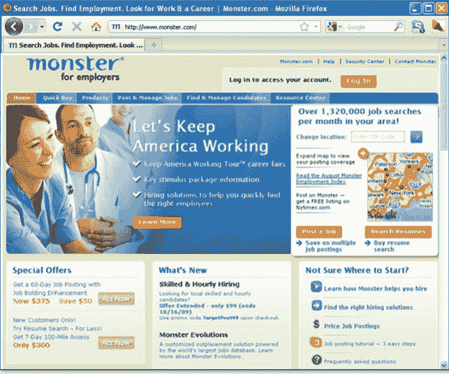

图 5.1：大多数网页都包含多种需要协同工作的文本内容类型。

- 文章摘要/预告文案（“正在寻找本地的技能型和按小时计费的候选人？”）
- 全局导航标签（“资源中心”，“发布与管理职位”）
- 标题（“让我们保持美国的工作运转”）
- 副标题（“不知从何开始？”）
- 超链接（“找到合适的招聘解决方案”，“职位发布教程——只需3个简单步骤”）
- 操作按钮（“发布职位”，“搜索简历”）
- 任务说明（“登录以访问您的账户”）
- 登录字段（“输入邮政编码”）

而这仅仅是页面本身可见的内容（还有更多）。

#### 幕后：元数据

您在网上看到的页面、文档、图像和文件的各种文本描述，被写入 HTML 代码和/或显示在网页的属性信息中（**图 5.2**）。

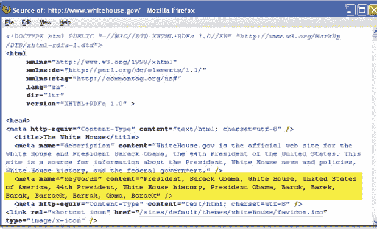

*图 5.2：网络写作者为网页提供的元数据出现在 HTML 源信息中。*

这种**元数据**（关于数据的数据）使得搜索引擎能够准确地索引并“查询”（搜索）这些元素。

网络写作者通常被要求在内容文档中为每个网页提供元数据，包括：

- **元描述：** 特定网页内容的单行摘要。元描述会出现在搜索引擎结果中。
- **元关键词：** 与页面主题相关的术语和短语（稍后会详细介绍关键词）。
- **页面标题：** 内容页面的标题，会出现在该页面的属性信息以及浏览器窗口的顶部。
- **替代文本：** 网站上的每个图像或图形元素都应有一个描述性的文本等效物，该文本会被包含在页面的标记中（稍后也会详细介绍替代文本）。

## 很少有人“负责”内容

当“内容”指的是印刷品文案（例如，目录、股东报告、宣传册或直邮明信片）时，拥有编辑决定权的个人或团队来自恰好支付印刷费用的业务部门。

但当“内容”指的是网站时，每个人（至少在中型到大型组织中）——因此也没有特定的人——都在为其买单。这种去中心化常常导致编辑监督的真空。这意味着网络写作者缺乏明确的领导。

> 这种情况的危险在于，网络写作者突然需要向多个利益相互竞争的方面汇报，他们都觊觎宝贵的网站空间。如果不能被赋予维护我们专业技能的权力，我们很快就会沦为试图满足多个内容所有者要求的文案接单员。

#### 它不像广告文案那样性感，后者以大创意为王

想想你最喜欢的电视广告或杂志广告。它很巧妙吗？有趣吗？鼓舞人心吗？它可能兼具这三者，而且很可能始于文案撰稿人和艺术总监之间一整天的头脑风暴。

在很大程度上，网络文案并非如此。营销网络内容通常不专注于单一的活动、创意或口号。其中大部分内容本质上是指令性、信息性或技术性的。

网络写作者可能不会与设计师或艺术总监进行头脑风暴，而是会与信息架构师和用户体验设计专家等人会面，以确定在页面上呈现内容的最佳方式。

例如，网络写作者可能会为保险网站创建导航标签，以便保单持有人可以更轻松地更新其账户信息。或者他可能会撰写文章解释各种类型经济援助选项之间的区别，以便即将上大学的孩子知道她有资格申请哪些奖学金。

## 网络写作为何如此出色？

网络写作在最佳状态下可以做一些非常了不起的事情。例如：

### 它可以促进对话

那些平衡用户需求（用户在寻找什么？）和商业目标（公司如何长期成长和繁荣？）的网站，消除了组织与其客户之间的沟通障碍。

### 它可以在公司与其服务的人群之间建立稳固、持久的关系

如果用户在某个特定网站上找到可靠、文笔优美的内容，她更有可能认为该内容背后的组织值得信赖……因此也值得其惠顾。

### 它可以帮助组织兑现其品牌承诺

写得好的网站为致力于提供优质客户服务的企业提供了另一个宝贵的机会，让他们的客户生活更轻松一些。

### 它甚至可以解决商业问题

如果用户能够在网站上找到他想要的东西，他可能就不需要致电公司的服务中心。他节省了时间和金钱，公司也是如此。

### 网络写作融合了许多不同的学科和技能

在内容创建过程中，网络写作者可能需要身兼数职。以下只是网络写作在任何给定项目中所融合的部分技能：

- **出版：** 与总编辑类似，网络写作者必须确保整个网站的内容在主题、结构和风格上保持一致。
- **新闻：** 网络写作者写作是为了以清晰、简洁、尊重的方式告知和教育其受众。
- **创意写作：** 网络写作者必须讲述一个引人入胜、精心构思的关于特定公司、产品或服务的故事。
- **技术写作：** 网络写作者通常必须以大多数网络用户能够理解的术语来传达困难或复杂的概念和信息。
- **营销：** 优秀的网络写作通过平衡用户需求和商业目标，在公司与其服务的人群之间建立信任并加强关系。
- **广告/销售：** 优秀的网络写作说服并激励网络用户采取某种行动（例如，购买产品、注册通讯）。
- **公共关系：** 优秀的网络写作可以帮助公司树立专业、平易近人的形象。
- **项目管理：** 优秀的网络写作遵循一个精确而严谨的过程，涉及大量人员、大量文档和大量截止日期。
- **用户体验：** 优秀的网络写作在每个网页上组织和呈现信息，使用户能够尽可能快地找到他们想要的东西。
- **信息科学：** 网络写作者必须理解内容类别之间的层次结构和关系，以及适当的标签系统。

## 谁能成为优秀的网络写作者？

当然是你！也就是说，如果你恰好具备以下素质：

- 扎实的组织能力和理解信息分类学（分类）技术的诀窍。
- 能够根据不同的受众，灵活调整写作风格和语气。
- 有兴趣让网络对每个人来说都更易于使用。
- 渴望与一群非常聪明的人合作。
- 有厚脸皮（能承受批评）。
- 能够将客户的反馈转化为网络内容的黄金。
- 有幽默感。
- 有冒险精神。

# 理解在线用户体验

也许你很好奇，为网站写作究竟能有多么独特。毕竟，无论媒介如何，好的写作总是清晰、简洁、连贯的。对吗？

对的。但在线读者的目标和期望与离线读者的目标和期望在某些相当显著的方面存在差异。网络写作者需要根据这些差异来精心打造内容。

以下是我的意思：

## 人们在线阅读方式不同

并非没有人在线阅读是为了享受。也并非没有人带着明确目标去阅读印刷材料。但总的来说，网络的互动性往往会改变用户对营销文案的态度和行为。

### 线下读者是放松且被动的读者

人们阅读印刷材料是为了吸收信息，而非立即采取行动。因此，线下读者通常比线上读者更投入、更专注文本。也许他们正在享受片刻闲暇，或在等待叫号就诊。总之，他们是被动阅读，只是接收呈现给他们的信息。

### 线上读者是缺乏耐心且任务导向的读者

线上读者通常只关心如何完成特定任务的信息。他们容易分心。他们在同时处理多项任务。他们在想：“我该点击哪里？”他们试图快速进入、完成某事、然后离开。他们主动阅读，因为他们准备好要采取某种行动。

> 亲自试试看！
>
> 注意你自己的内容期望是如何随着阅读场景变化而变化的：阅读网站、广告牌、杂志、宣传册、注册新闻通讯、查看今日头条或在零售网站购物。
>
> 记录你的发现。你接触到这些内容时身处何地？是几点钟？什么季节？是否存在某些期望，无论你阅读什么或为何阅读，它们都不会改变？
>
> 最后，将你的发现总结成一篇博客文章。

### 网站用户不阅读。他们扫读。

2006年，波因特学院新闻学院进行了一项研究，探索印刷版与在线版新闻阅读的差异。

波因特EyeTrack07项目（[http://eyetrack.poynter.org/](http://eyetrack.poynter.org/)）监测了近600名参与者在阅读各种出版物的印刷版和在线版时的眼动轨迹。

研究表明，约50%的受试者在网上阅读信息时并非逐字逐句、从上到下阅读（不像你阅读书籍或杂志那样）。

相反，他们会跳跃式阅读，快速扫视以寻找有趣或有用的内容。

例如，如果一个用户来查看银行账户余额，他不想浪费宝贵的屏幕时间去费力阅读诸如“欢迎来到大银行。我们很高兴您选择了我们，等等”之类的冗长信息。

他只想知道一两个词关于如何访问他的账户，了解一下需要多少步骤，并提示整个过程可能需要多长时间。其他任何东西都会妨碍他。这会让他想把业务转移到别处。

> **资源 // 史蒂夫·克鲁格**
>
> 史蒂夫·克鲁格对于设身处地为用户着想有很多见解。他的著作《*点石成金：访客至上的Web设计艺术*》（New Riders，2006年）是用户体验领域的权威之作。

### 网站并非线性结构

大多数书籍有明确的开头、中间和结尾。而网站则不然。用户可能通过主页进入网站。或者她可能从其他网站链接过来，或通过搜索引擎结果到达。但无论她最初落在网站的哪个位置，她都必须能够快速定位自己。

网络写手有责任确保用户理解她所处的位置，并留下导航线索。这些线索可能以指向其他相关主题页面的超链接形式出现。或者出现在全局导航菜单中。

而所有这些线索都必须经过仔细规划和呈现，考虑到该内容宇宙中所有其他页面的关系。

例如，网络写手必须思考从用户当前所在的页面链接到哪些页面最为重要。（只有真正理解网站用户的需求以及他们最迫切需要什么时，你才能回答这个问题。）

### 网站比印刷材料更难阅读

长时间盯着屏幕（正如我们许多人每天所做的那样）对我们的眼睛很不友好。

这就是为什么网络写手必须帮助确保屏幕上呈现信息的方式在视觉上尽可能宽容。在线上，这意味着通过将文本分解成比书籍中更小、更易于扫读的块状结构来最大限度地减少视觉疲劳。

例如，网页上的段落不应超过60个单词。标题应在八个单词或以下。每个主题或新想法都应有一个副标题，提示用户如果决定继续阅读，将在该部分找到什么内容。

（你将在“十大网络写作技巧”部分找到更多类似的特定指南。）

### 网站必须让视力受损的用户也能访问

我们大多数人将网络视为视觉媒介。我们没有考虑没有视力或视力低下的用户如何浏览网站。

这些用户通常会借助屏幕阅读器的帮助，这种设备可以电子扫描网页，然后提供模拟语音输出或打印盲文页面。使用屏幕阅读器的人可以编程其设备，只“朗读”标题、副标题和链接……或者朗读页面上的所有信息。

### 视力受损的网站用户也扫读信息。他们只是用耳朵或指尖来扫读。

根据玛丽·弗朗西斯·西奥法诺斯和金妮·雷迪什的研究（http://www.redish.net/content/papers/interactions.html），2001年全球约有1.8亿盲人或视力受损者。仅在美国就有770万人。这是相当庞大的一个群体。

该研究指出，视力受损的用户“扫读”信息的方式与视觉用户非常相似：通过只听每个标题、副标题或页面的足够部分，来决定是继续阅读还是跳到另一个项目。（他们也经常提高阅读速度以“略读”段落。）

因此，当视觉用户在扫读整个页面时可能“偶然”发现一个感兴趣的词，而通过屏幕阅读器体验同一页面的用户，如果网络写手没有策略性地将该词放在链接或文本行的开头，可能会错过这个短语。

### 因此网络写手需要用相关信息引领内容

借助屏幕阅读器的用户无法一次性浏览整个屏幕，也无法像视觉用户那样快速跳转页面。因此，网络写手必须始终将最相关的词语和短语放在标题、链接和段落的开头。

（我们无论如何都应该这样做。这只是为了让阅读体验更好。）

### 网络写手还必须学习如何编写替代文本

屏幕阅读器只扫描文本。它们无法解释图表、照片或颜色编码等图形元素。因此，网络写手必须为这些图像提供文本替代（“替代文本”）。网站上的每个图像或图形元素都应有一个描述性文本等效物，并包含在该页面的标记中。

网站开发者将使用替代文本信息来编写HTML代码，屏幕阅读器（以及搜索引擎，以及选择在浏览器中禁用图形的用户）可以使用你的描述来解读这些代码。

### 网站用户会反馈

网络是一个完成事务的地方：用户填写表格、下载PDF、点击链接提交个人信息。他们还与客户服务代表实时聊天。他们一有想法就写博客谈论他们喜欢（和不喜欢）的东西。他们与朋友分享评论，并通常在任何地方留下他们的印记。

### 网站应成为促进客户反馈的工具

网站实现了公司与其客户之间的双向对话。这个论坛使公司能够以有意义的方式与客户互动。它也让公司暴露在高度可访问（且可无限重复）的审查之下。

因此，网络内容固有的曝光风险也是一个绝佳的机会。鉴于我们的客户处于如此脆弱（但潜在回报丰厚）的位置，网络写手必须将这些网站转变为易于访问和接近的客户意见与反馈论坛。

我指的不一定是一个专门的用户评论区。我只是说，对于我们撰写的每一段内容，我们都需要预测客户需求（以便客户从一开始就能感受到被倾听和理解）。我们还需要在网站上的显眼位置发布客户服务信息。

### 网站应在用户目标与商业目标之间取得平衡

网络写手的另一项任务是将用户需求与商业目标并列或结合考虑。

为满足用户需求，网络写手必须：
-   考虑他们的关切、希望和期望。
-   考虑他们期望的任务。
-   提供支持决策的信息。
-   撰写易于理解的任务说明。

为满足商业目标，网络写手必须考虑：


## 有效（或无效）的网络写作

市面上充斥着大量劣质写作，无论是线下还是线上。有时，识别出糟糕的写作能帮助我们定义什么才是真正有效的写作。

所以，让我们从无效的写作开始。

### 糟糕的网络写作是什么样的？

糟糕的网络写作（以及糟糕的写作总体来说是）：

- **过于冗长。** 充斥着冗长、啰嗦的句子和非必要信息。
- **在拼写和语法上懒惰敷衍。** 这表明网站运营者并未关注细节。
- **结构松散。** 缺乏重点，似乎没有明确的主导目的或核心观点。
- **难以付诸行动。** 让用户无法确定下一步该做什么。
- **充满营销术语和不必要的复杂措辞。** 迫使用户去搜索上下文，并可能让她感到被排斥或被居高临下地对待。
- **只顾公司而不够关注用户。** 不考虑用户需求，用信息淹没用户。

### 优质的网络写作是什么样的？

所有优质的网络写作都具备四个特点。它是**有用的**、**可用的**、**引人入胜的**和**可被发现的**。

让我们来逐一分析。

#### 优质的网络写作是有用的

撰写有用的文案意味着你将：

- **了解用户想要什么样的信息（以及她希望以何种方式呈现）。** 然后毫不费力地将其提供给她。

#### 优质的网络写作是可用的

撰写可用的文案意味着你将：

- **撰写清晰的导航提示。** 检查标签、菜单项、页面标题和链接是否符合网站目标。
- **避免不必要的（重复的、冗余的、多余的）文案。** 无需多言。
- **撰写描述性标题。** 如果穿插着撰写精良的标题，向用户提示他们即将花时间阅读的内容，用户愿意阅读更长的文案。

#### 优质的网络写作是引人入胜的

撰写引人入胜的文案意味着你将：

- **写作时让你的用户感到自己聪明（而不是为了让自己显得聪明）。** 这并不意味着"简化"你的文案。只是意味着以直接、务实的方式呈现信息。
- **富有人情味。** 想象自己坐在某人对面，大声朗读你写出的文字。你会感到尴尬吗？你的听众会认真对待你吗？你听起来自然吗？
- **真诚真实，而非过分专断。** 你会通过找到一种方式，用简单直接的方式传达即使复杂的概念，而不居高临下地对待用户，来展示你的专业性。
- **避免"营销腔"。** 记住你在对谁说话，以及他们对你所呈现主题的经验水平。要热情好客。要平易近人。要令人安心、积极向上，而不是自作聪明或卖弄技巧。要专业且富有人情味。

#### 优质的网络写作是可被发现的

撰写可被发现的文案意味着你将：

- **将相关关键词放在首要位置。** 在标题、链接、副标题和开篇句中这样做（它们在这些位置对搜索排名的价值更高）。
- **在整个页面或网站中使用关键词的同义词。** 例如，如果一个关键词是"vintage"，你可以将其与"retro"互换，以打破重复词语的单调，并捕捉用户可能搜索的另一个词。只需确保同义词的使用在文案流中感觉自然，且不影响一致性。
- **绝不为了可搜索性牺牲可读性。** 确保关键词就位后，你的文案不会听起来不自然。

75 有效（或无效）的网络写作

##### **可发现性**是什么意思？

**可发现性**指的是网络用户能在多大程度上轻松找到他们在特定网页中寻找的信息（即，内容的可扫描性如何？组织得如何？）。可发现性还指网站在搜索引擎排名中的位置。

以下是搜索引擎优化（SEO）的快速回顾：

##### 搜索引擎是如何工作的？

搜索引擎（如Google、Bing或Yahoo!）是响应用户查询（你在浏览器中输入的词语或短语）的程序。输入"Art Deco"这个短语，搜索引擎可能会返回包含古董经纪人链接、建筑历史概览和家具博客的结果。

搜索引擎通过定期使用称为"蜘蛛"或"机器人"的索引程序来"爬取"互联网，从而创建这些数据库。早期的搜索引擎通常要求页面在能被爬取之前先提交给它们。如今，大多数可搜索的信息都被通过其他页面链接进行爬取的蜘蛛和机器人索引。

##### 搜索引擎如何对搜索结果进行排名？

像Google这样的搜索引擎如何决定索引网站的显示顺序？结果是基于以下因素的组合：

- **网站年龄：** 只要它也符合其他标准，较老的网站可能比新网站排名更高。
- **内容数量：** 大型公司或国际知名组织（如BBC）的网站可能因为在搜索排名中包含的内容 sheer volume 大而排名更高。
- **入站链接的数量/质量：** 经常被高评级网站链接的网站将在搜索排名中上升。
- **受欢迎程度/趋势：** 如果某个网站突然获得大量用户点击，它将在搜索排名中上升（至少是暂时的）。
- **搜索引擎优化（SEO）：** 在标题、链接、域名、标题和页面内容中频繁出现搜索词的网站往往在搜索排名中表现良好。

##### **网络写作者可以通过SEO（搜索引擎优化）影响网站的可发现性**

为网络写作的挑战之一是，确保网站内容在搜索排名中表现良好，以便用户在找到竞争对手网站之前找到它。

为了确保良好的排名，网络写作者必须首先从客户那里获取关键词列表。关键词是通过测试或用户研究证明代表组织提供的各类产品和服务的词语和短语。通常，网站的每个页面都有自己的关键词组，尽管有些关键词可能适用于不止一个页面。

例如，一家古董经销商的关键词列表可能包括"high quality"、"vintage"、"mid-century modern"、"collectibles"、"estate sale"和"auction"等词语。

##### **一切都始于关键词**

网络写作者的目标是尽可能多地在整个页面或网站中多次使用这些关键词。如果关键词用于页面标题、标题、副标题、链接和图片说明中，它们对搜索结果的影响更大。这是因为蜘蛛和机器人对出现在这些高度可见位置的关键词赋予更高价值。（顺便说一下，你的读者也是如此。）

##### **注意：SEO和用户体验（UX）并不总是兼容的**

你可能一直在想："为了获得良好的搜索排名而反复使用相同的词语，难道不会让实际使用网站的人觉得可读性降低吗？"

在开始写作之前，你需要一些工具……

> 这确实是一条需要谨慎把握的细线。即使是SEO专家也对如何最好地平衡可读性与可用性存在分歧。但这正是网络写作者的另一个目标：确保网页的可读性不会为了其可发现性/可搜索性而牺牲。最终目标不是为搜索引擎写作。而是为使用搜索引擎的人写作。

## 在开始写作之前，你需要一些工具。一个流程。还有一个团队。

不幸的是，网络写作者往往在信息架构（网站结构）和设计（网站美学）流程已经进行得相当深入之后，才被引入内容创作流程。即使是经验丰富的网络从业者有时也会错误地以为，写作者可以"只是添加文字"到几乎完成的网站上……

### 工具/文档

无论你是在流程早期就获得一席之地，还是在最后一分钟才被拉进来，网络写作者都可以使用一些实用工具和文档，使内容创作流程尽可能顺畅高效。

#### 文案稿本

文案稿本是网络写作者的圣经。通常是一份MS Word文档，包含网络写作者撰写、编辑或以其他方式影响的所有文本元素。正是这份文档在写作者与网页设计师、网页开发人员和客户审阅者团队之间来回传递以供讨论。

当然，来自不同方面的所有这些输入，使得这些文案稿本文件（及其迭代版本）的清晰标注变得绝对关键。

#### 内容审计/清单

内容审计或"清单"是一份电子表格，记录网站当前状态，包括页面标题、对应的URL以及组织需要关注的任何其他重要事项（表5.1）。


| 页面 ID | 页面名称 | 网址 | 备注 |
|---|---|---|---|
| 0.0 | 首页 | http://www.braintraffic.com/ | |
| 1.0 | 服务 | http://www.braintraffic.com/services/ | |
| 1.1 | 审计与评估 | http://www.braintraffic.com/services/audit-assessment/ | |
| 1.2 | 战略与整合 | http://www.braintraffic.com/services/strategy-integration/ | |
| 1.3 | 治理与规范 | http://www.braintraffic.com/services/governance-guidelines/ | |
| 1.4 | 编辑服务与支持 | http://www.braintraffic.com/services/editorial-services-support/ | |
| 2.0 | 公司 | http://www.braintraffic.com/company/ | |
| 3.0 | 客户 | http://www.braintraffic.com/clients/ | 客户列表；可添加案例研究链接 |
| 4.0 | 博客 | http://blog.braintraffic.com/ | 按时间顺序列出最近的帖子；包含主题分类和按作者分类的链接；页面还包括演讲活动的链接 |
| 5.0 | 联系我们 | http://www.braintraffic.com/contact/ | 电子邮件地址和 Twitter 地址的链接 |
| 6.0 | 隐私政策 | http://www.braintraffic.com/privacy/ | |
| 7.0 | 网站地图 | http://www.braintraffic.com/sitemap/ | |
| 8.0 | RSS | http://blog.braintraffic.com/feed/ | |

*表 5.1：内容审计/盘点是一个电子表格，展示网站上所有页面的当前状态。它可能包含页面标题、源文档、可下载文件和作者备注等信息。*

你在这里看到的这种审计称为**定量审计**。它可以回答一些相当重要的问题。例如：

- 你的客户拥有哪些内容？
- 谁创建这些内容？（编辑团队？业务部门？营销团队？区域分支机构？用户？）
- 这些内容存放在哪里？（宣传册中？服务器上？员工的集体记忆中？）

在撰写之前，你需要一些工具……

- 如果已有网站，内容是如何组织的？
- 包含哪些类型的文件（例如，pdf、视频、表单）？

如果有帮助，你可以在电子表格中添加信息字段，使其成为**定性审计**。换句话说，你可以对部分数据进行分析，并回答以下问题：

- 这些内容说了什么？
- 它是否准确且有用？
- 它写得好吗？用户友好吗？
- 元数据效果如何？它的编写方式是否能让搜索引擎和内容管理系统在用户最需要的时候组织并交付内容？

等等。盘点中的每个页面对应一个特定的线框图（我们马上会讲到这些）。

#### 风格指南

从客户那里获取一份编辑风格指南也很有帮助，用于记录用词偏好、语气和语调规范等。你不会想在写作时不断怀疑自己的直觉，或者不得不去弄清楚副标题应该用标题大小写还是句首大小写……那只是浪费宝贵的写作时间。

风格指南越明确、越详细，创作内容就越容易。风格指南可能包含描述性语言，总体说明所有文案应该如何撰写。

或者它可能更详细，通过示例展示哪些词汇适合特定网站的语气和语调，并与不适用的词汇进行对比。例如，也许*跳过*这个词适合某个特定网站，而*消除*则不适合。

#### 线框图

线框图大致勾勒网页在浏览器中的布局，但没有所有最终的设计元素**（图 5.3）**。一些线框图还描述了内容元素（文本、图像、链接等）之间的关系。

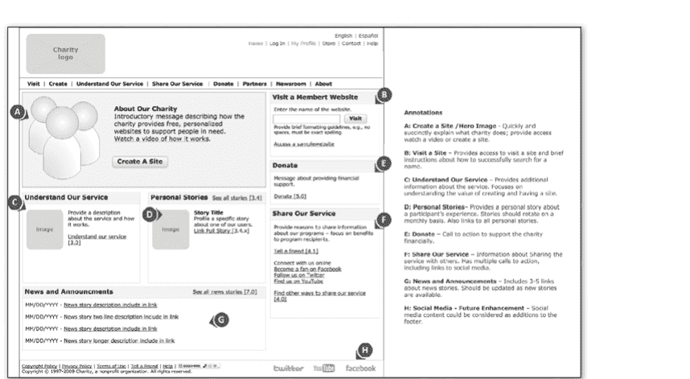

*图 5.3：线框图是网页设计完成后外观的粗略草图。这些草图帮助作者将其文案可视化，了解它在网站上的最终形态。*

网页作者通常会收到线框图（而非完成的设计），作为确定大致需要撰写多少文案以及页面哪些区域需要文案的主要模板。

理想情况下，创建线框图的人深刻理解信息需要以何种方式呈现才能实现最佳用户体验。他或她会说明为什么包含特定元素或主题，以及它们之间如何关联。

#### 网站地图

网站地图展示网站的层次结构。它让作者、设计师或开发人员一目了然地看到网站所有页面之间的关系**（图 5.4）**：

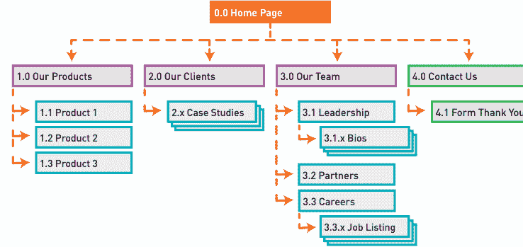

*图 5.4：此网站地图展示了一个具有四个全局/顶级导航项和主题子集的网站。*

### 网页内容从何而来？

当客户说"我们想让你重写我们的 200 页网站"时，你的回答（紧接在"我迫不及待要开始了！"之后）应该是"那么我的源内容都在哪里？"

很可能，他们会告诉你内容存放在当前网站、宣传册、股东报告、用户画像、可用性报告、视频文件、音频文件、pdf……等等地方。

或者也许他们从未发布过网站，因此谈不上有现有的源内容。在这种情况下，你可以通过访谈公司创始人来获取信息。或者研究竞争对手的网站，然后确切了解你的客户如何超越并击败竞争对手。

#### 你的内容创作团队有哪些人？

无论网站的规模或范围如何，最好有人担任以下每个角色，即使某些角色可能重叠。你（是的，就是你）可能会根据你的独特技能和经验承担几个角色。

- **内容审核员：** 这些人可能是客户编辑团队的成员。他们也可能是主题专家或法务部门的人员。他们审阅你的文案草稿，检查准确性、编辑质量以及是否符合品牌标准。
- **内容策略师：** 这个人是你在内容创作中的合作伙伴。他或她与客户合作，为网页内容流程制定可操作、有用的策略。策略师还与网页作者和客户团队合作，确保这些策略得到有效实施。
- **设计师（又称"网页设计师"）：** 设计师确定网站的外观和感觉。他们可能会构建页面，或者让开发人员处理实际的编码。许多（但并非所有）设计师更关注网站的审美而非功能。
- **开发人员（又称"网页开发人员"）：** 网页开发人员使用各种代码让内容在线上栩栩如生。
- **执行编辑：** 执行网络编辑制定内容创作标准，分配项目和截止日期，并总体上让所有内容负责人对其负责的网站部分负责。
- **信息架构师（IA）：** 信息架构师处理网站上信息的结构，和/或定义该结构。他们还可能影响组织、标签、视觉设计和写作等元素。
- **主题专家（SME）：** 主题专家是熟悉所发布主题内容的客户联系人。
- **网页作者：** 网页作者运用创造力和策略来撰写有用、可用、可查找且引人入胜的网站内容。（参见：你！）


*资源 // Kristina Halvorson*

Kristina Halvorson 的*《网页内容策略》*讨论了如何整合创造更好网页内容所需的人员、流程和计划（New Riders，2009）。

## 十大网页写作技巧

好了。我们已经介绍了一些关于用户体验、优秀网页写作的样子，以及如何在写作前整理你的内容。

这意味着是时候深入探讨一些重要的网页写作技巧了。准备好了吗？开始吧：

### 1. 热爱倒金字塔结构

- 首先，从你的结论开始。
- 然后提供支持性信息。
- 最后，给出背景和技术细节。

倒金字塔结构你们大多数人应该都很熟悉。这是新闻报道的写法（许多研究论文也是如此）。你的论点首先出现，谁-什么-何时-何地-为什么-如何之类的信息也是如此。随着文章的展开，内容逐步构建并支持那个主要论点陈述。

### 2. 相信少即是（几乎总是）多

- 不要压倒用户。
- 删除所有不必要的词语。（然后再删更多。）
- 不要妨碍用户。

网页作者最有价值的技能之一就是能够用尽可能少的文字传达一个想法。记住：用户可能不是来这里娱乐阅读的。她是来收集信息并完成任务的。

### 3. 避免听起来像电视购物广告

- 保持简单。写作是为了告知，而不是为了炫耀。
- 不要害怕使用缩略形式和第一人称结构。
- 说话要平实，但要具体。
- 避免使用感叹号（大多数时候）。
- 限制使用粗体和斜体文字。

网站是组织与其网站用户之间的对话。网页作者帮助促成这种对话的最佳方式是以我们跟认识并尊重的人说话的口吻来写作。换句话说，我们应该*真实*且*引人入胜*。


### 4. 让你的文案易于浏览

让内容易于浏览的最简单方法之一，就是将信息分割成易于消化的小块。

以下是一些经验法则：

- **段落应控制在60词以内。** 当用户阅读较长的内容时，给他们一个“喘口气”的机会非常重要。
- **标题应控制在8词以内。** 这既是设计上的考虑（文字太多，大号字体在页面上放不下），也是语境上的考虑。标题的作用其实就是告诉读者他来对了地方。
- **副标题应控制在12-14词以内。** 与标题类似，副标题的存在是为了概括随后的信息。因此，它们应当简短有力。
- **页面长度取决于多种因素。** 归根结底，是为用户创造一致的体验。例如，如果在某个医疗网站上，关于不同心脏状况的大多数页面大约有300个词，但其中一个页面只有50个词的有用信息，那么你就该问问客户为什么会这样。（是那个话题信息不够吗？是应该与其他页面合并吗？还是应该重新考虑信息呈现的结构？）
- **项目符号列表是处理包含大量信息的冗长段落的好方法。** 记住：列表不能让内容变得相关，它只能让内容更易读。如果能删减不必要的文案，请在放入列表之前就删掉。
- **编号列表应谨慎使用。** 编号列表是项目符号列表的一种特殊形式。仅在需要体现“顺序”的任务中使用编号列表，例如描述流程步骤、对项目进行排名，或呈现总数很重要的信息（例如，十大榜单）。
- **有策略地使用标题来引导用户浏览页面。** 标题展示层次结构，并传达页面上主题的相对重要性。它们能吸引用户的注意力到主要思想上，并提供关于下一步往哪里看的线索。

### 5. 写出出色的标题

- 记住：以任务为导向的读者不会阅读，他们是在浏览。
- 告诉他们能找到什么——要清晰，而不是耍小聪明。
- 使用关键词。

大多数时候，用户不会阅读你的文案，他们是在浏览。所以要写出引人注目且忠实反映后续内容的标题。并且记住，要在标题中嵌入满满的SEO关键词（只要不破坏内容的流畅性），以最大化可发现性。


> 资源 // Ginny Redish

Ginny Redish 在《**删词删到删无可删**》（Morgan Kaufmann Publishers, 2007）一书中阐述了为什么用户不会阅读网络上的每一个字。对于任何致力于写出能吸引用户正面关注的链接、标题和长文案的作家来说，这本书都是必读之作。

### 6. 用主动语态开头

- 尽可能以动词开头来撰写标题、链接和短语。
- 使用主动语态结构（尽可能避免使用“to be”动词）。
- 开门见山。不要浪费宝贵的版面去铺垫。

看看这则虚构的促销广告：

> 每次登录 SweetDealsNow.com，你都知道能买到超值优惠。我们提供每日低价、超棒的省钱优惠和您喜爱的所有产品，全天候在线。

这里面有一些好东西：超值优惠、低价、省钱优惠、心仪产品等等。但是它的表达方式如何？我们怎样能让它更主动一些？

如果我们去掉像“你知道你能”、“我们提供”、“每次你登录”这样的填充短语，剩下的内容可能看起来像这样：

> 想获得超值优惠和每日低价？请全天候访问 SweetDealsNow.com 在线购物。

现在“超值优惠”和“每日低价”稍微突出了一点。信息被精简了，而且我们没有丢失第一个例子中的任何重要内容。我们仍然获得了相同的信息，只是以一种更有说服力、更主动的方式。

我们能否进一步简化并使其更生动？比如：

> 省更多钱。上 SweetDealsNow.com 购物

主要信息（“省钱”）保持不变。此外，我们为用户创造了一个更具主动性、更有吸引力的信息。而我们在此案例中所做的，仅仅是使用动词开头并削减了不必要的文案。搞定。

## 自己试试看！

选择一个你比较熟悉的网站。尝试精简其中一部分文案，使其留下的内容既主动又引人注目。

### 7. 使用简单句

- 让动词和名词成为你最好的朋友。
- 谨慎使用形容词和副词。
- 千万避免使用分号。改用逗号。或者更好：大胆使用句号。
- 注意，当逗号太多时，往往意味着文案对网络来说过于复杂。

有些人认为冗长、复杂的句子和大词等于深刻的内容。未必如此。如果你的写作清晰简洁，信息无需华丽的词汇或复杂的结构就能更有效地传达。而且，用户更容易快速浏览。

### 8. 信守承诺

- 确保链接和标签与章节/页面标题匹配。（不要在链接或标题中引用后续正文中没有出现的内容。）
- 不要让读者无所适从。

没有什么比点击一个写着“投资方式”的链接，却跳转到一个标题为（例如）“共同基金”的页面更糟糕的了。这让你感觉如何？难道“投资方式”的链接没有给你留下一种你会看到多种投资方式概述的印象，而不是仅仅关于一种投资的信息吗？

你会惊讶于这种疏忽在原本写得很好的网站上频繁发生。许多不一致之处是网站更新的结果，其中一些（但不是全部）页面被刷新、改进和添加了内容。有时则仅仅是粗心大意。这个故事的寓意是，要始终仔细检查你的工作。

记住：网络用户通常以任务为导向，寻找可以点击的地方。所以确保你为他们提供——每个页面至少一两个操作。

### 9. 建立审阅流程

- 不要自己当自己的编辑。让其他撰稿人或客户团队成员参与进来。
- 安排充足的时间，对你交付的每一份文档进行审阅。

与任何写作或出版一样，建立并严格遵守一个审阅流程非常重要。你需要让了解主题内情的人参与进来，也需要让熟悉优秀网络写作规则的人参与进来。（有时一个人可以身兼两职。）

## 10. 从优秀的网站“借鉴”（某种程度上）

- 开始点评你访问的网站。
- 列出哪些网站做得好，哪些做得不好。与朋友或同事讨论这些网站之间的差异。

## 自己试试看！

搜索一个特别优秀的网站，思考你喜欢它的原因。在你看来，它好在哪里？是否简洁？是否易于导航？是否让你感觉聪明？有参与感？像是社区的一部分？

现在找一个让你感觉特别不受欢迎的网站。为什么会有这种感觉？写作方式如何影响了这种氛围？怎样才能让它变得更好？你会如何以不同的方式来写？

### 资源 // Gerry McGovern

Gerry McGovern 是公认的网络文案写作专家，擅长写出能引发用户响应的文案。请查阅《**杀手级网络内容**》（A & C Black, 2006）。

## 通过例行更新保持网络内容新鲜

像洗衣一样，一个网站永远不会真正完工。你必须不时地运行“漂洗周期”，以防止它闻起来像臭汗袜子。这意味着要定期检查，确保内容仍然相关，链接仍然有效。

确保这项维护工作最终是客户的责任，但网络文案撰写者通常会参与其中。而且，在会议室里主动举手提出这个重要——却经常被忽视——的流程，永远不会是件坏事。

### 执行定期内容审核

在撰写阶段及以后，保持内容审核/清单电子表格（**表5.1**）的更新，将其作为一个“活”文档，你可以随时添加或删除条目。这样你就能始终准确掌握网站上有什么内容。

### 使用编辑日历

编辑日历是以电子表格形式呈现的时间表，列出了可能触发网站内容更新的活动、节日、行业趋势、品牌活动、公司变动等。

当这些触发事件被规划出来后，就能更容易地提前规划内容更新，使其变得有用、可用、有吸引力且易于找到。

### 建立内容责任人清单

明智的做法是维护一份清单，指明组织内哪些人员负责哪个页面或哪部分内容。这样，如果某个特定页面出现问题，该页面的“负责人”就能就更改的价值或风险发表意见。

你可能需要制作一个电子表格来跟踪这些信息。包括更新频率、撰稿人、审阅人、审批人和发布人等列。


### 扮演网站执行编辑（或找出谁担任此职）

选择一个能对网站发布内容（或不发布的内容）有最终决定权的人至关重要。对这个人来说，内容质量是首要任务。他或她为内容创作设定标准，分配项目和截止日期，并总体上要求所有内容负责人对其各自负责的内容板块负责。

## 总结

为网络写作的一大妙处在于，作为网络用户，我们自己都理解糟糕的网络文案带来的后果：故事总是以一个沮丧的用户离开网站、咒骂设备屏幕，或者告诉他所有朋友他有多糟糕的体验而告终。（顺便说一句，这些结果对业务都没有好处。）

归根结底，每个网络写手都只是试图为其他网络用户打造一个更愉快、更便捷、更有用的网络的网络用户。实现这一目标的规则随着网络本身的发展而演变，网络总是以印刷材料永远不会有的方式不断增长和变化。

而你曾以为我说网络写手需要冒险精神是在夸张，对吧？

嘿，我是个网络写手。我字字当真。

## 资源 // 推荐阅读

- 充满活力的词语
  http://www.alistapart.com/articles/words-that-zing/
- 语法女孩
  http://grammar.quickanddirtytips.com/
- 你的“关于”页面是一个机器人
  http://www.alistapart.com/articles/aboutpagerobot/
- 与在线客户清晰沟通
  http://blog.braintraffic.com/2009/11/communicate-clearly-with-online-customers/
- 为网络写作
  http://www.useit.com/papers/webwriting/
- 为活态网络写作的10条建议
  http://www.alistapart.com/articles/writeliving

## **第二部分：** 规划一个网站

准备工作完成后，现在是时候开始规划和规划你的网站了。但请稍等——此时你不应该只是打开编辑器就开始编码！每个优秀的网站在实施之前，都投入了大量规划工作——确定网站的目标受众及其需求、网站应具有什么结构、用户应如何与网站互动等等。这正是本部分将要涵盖的内容。

我们将从探讨**信息架构**的角色开始，这基本上意味着规划网站的结构。接下来我们将定义网站项目，包括：主要业务目标、目标受众以及项目任务时间线（也称为工作分解结构）。关于内容分析的下一节涵盖了此过程的另一个重要部分——分析目标受众需要什么功能、确定你已有的内容以及查看竞争对手的内容。在最后一部分，我们将学习如何为网站制定内容策略，以帮助项目团队专注于业务目标和受众需求。内容策略包括经批准的内容大纲和信息架构图，这些是网站整体工作流程和结构的蓝图。

简而言之，本部分涵盖：

- 信息架构简介
- 信息架构定义
- 信息架构师的角色和工具
- 网站规划
- 定义网站的主要目标和目标受众
- 起草技术要求和维护计划
- 定义项目时间线（工作分解结构）
- 内容分析
- 进行竞争分析
- 使用网络分析
- 内容策略
- 制定页面描述图、线框图和故事板


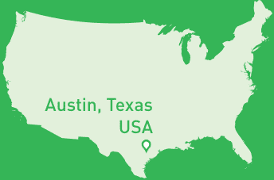

格伦达·西姆斯是 Knowbility（一家致力于“无障碍 IT”的非营利组织）的无障碍顾问和培训师。她也是德克萨斯大学的网络标准和无障碍传播者。

她通过志愿参与 Web Standards InterACT 项目和 W3C 开放网络教育联盟孵化小组来回馈网络。格伦达，也被称为 goodwitch，很高兴将德克萨斯州的奥斯汀称为她的家。

- http://www.glendathegood.com/blog
- http://interact.webstandards.org
- http://www.knowbility.org
- http://www.utexas.edu
- http://twitter.com/goodwitch

## 第6章 信息架构导论

**作者：格伦达·西姆斯**

试图在没有计划的情况下构建网站，就像试图在没有建筑蓝图的情况下建造房屋一样。要始终如一地设计和构建高质量网站，你需要一个网站规划流程。本章首先概述网站规划流程，然后解释信息架构师如何通过坚实的内容分析和策略基础，贡献于平衡的设计。

### 规划流程

问任何一位成功的网络专业人士，他们从“我需要一个网站”到“你为我构建的网站很棒！”所走的路径（**图 6.1**），你会发现一个包含任何成功项目基本步骤的规划流程：

1.  定义项目需求
2.  进行研究和分析
3.  制定设计
4.  构建
5.  测试
6.  部署
7.  维护

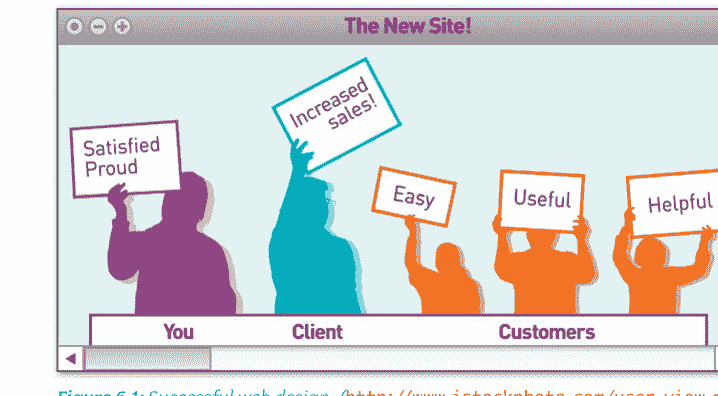

虽然项目管理的方法有很多——例如传统的（**图 6.2**）、迭代的或敏捷的——但所有项目通常都包括以下主要阶段：**启动**、**规划**、**构建**、**测试**和**收尾**。

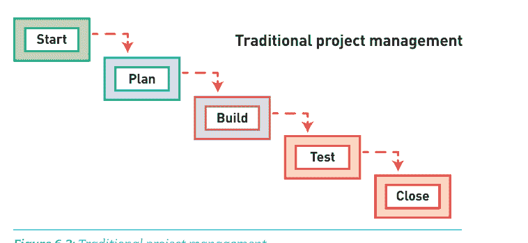

*图 6.2：传统项目管理。*

在传统的项目管理方法中，步骤以线性方式依次发生。这对于小型、定义明确的项目可能是成功的。

分阶段项目管理（**图 6.3**）更灵活，具有多个反馈循环和更短的可交付成果时间框架。敏捷和极限项目管理就是分阶段方法。

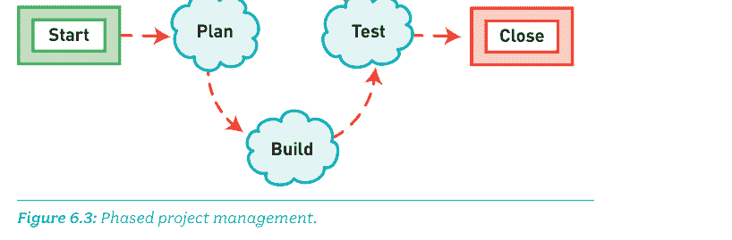

*图 6.3：分阶段项目管理。*

#### "即兴设计"的危险

当你不花时间规划一个新网站时会发生什么？你可能会遇到以下问题：

#### 仅为你自己设计网站

当项目定义不明确时，你最终可能会基于自己的偏好做出许多假设。记住，你是独特的，很少有人与你想法完全一致。如果你不澄清期望，你就有可能让客户失望。困境：

- 客户不喜欢新网站。
- 客户不使用该网站。

#### 仅为客户设计网站

即使你花时间仔细倾听客户的需求和愿望，也可能发生一个更微妙的危险。你记录了所有项目要求并获得了客户的全力支持。但你没有考虑客户客户的期望和目标。困境：

- 客户喜欢新网站。
- 客户不使用该网站。

#### 仅为客户设计网站

客户总是对的，对吧？你花了很多时间研究客户的客户，并构建了网站以让客户欣喜若狂。但客户的目标与你客户的业务目标相冲突。困境：

- 客户不满意。
- 客户使用该网站并喜欢它。

### 平衡设计

如果你不能只为了取悦自己、客户或客户而设计，你是否必须接受每个人都不能完全满意的结果？恰恰相反，挑战在于收集来自每个不同视角的所有需求、愿望和要求，并找到一个互惠互利的解决方案。

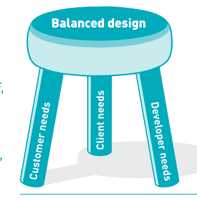


如果你把这三个视角放在一个平面上，就会发生一场无休止的拉锯战。但是，如果你将问题提升到三维空间，那么每个视角都可以作为解决方案的支撑腿（**图 6.4**）。

### 项目角色

网站规划流程需要一组专业角色。把这些角色想象成不同的帽子。你可以同时戴多顶帽子。

1.  **项目经理**
    项目经理是客户的联系人。职责包括：领导团队、帮助团队取得成功、制定项目定义、管理任务列表和时间线、帮助团队保持专注并促进沟通。

2.  **信息架构师**
    信息架构师分析、组织和标记网络上的信息，使其直观且可用。

3.  **可用性分析师**
    可用性分析师创建可用性测试计划，执行测试，并优先处理和向团队传达可用性问题。

4.  **写手/内容经理**
    写手/内容经理专门为网络编写和调整内容。

5.  **视觉设计师**
    视觉设计师根据设计原则（平衡、韵律、比例、主导）、设计元素（点、线、形状、颜色、字体排印）和以用户为中心的设计（可用性）的知识，开发符合项目目标的设计方案。

6.  **开发人员**
    开发人员构建网站的前端（HTML、CSS、JavaScript）和后端（服务器端脚本、数据库）。

7.  **质量测试员**
    质量测试员创建现实的测试计划，执行测试，并优先处理和向团队传达质量问题。


#### 什么是信息架构师？

**资源 // 角色太多，力不从心？**

一位新晋网页设计师的问题：我正尝试以顾问身份设计和开发网站。没想到需要身兼数职。我担心自己一个人无法胜任所有工作。

身兼数职确实充满挑战，但只要借助一些来自行业专家朋友的帮助，你就能成功胜任多个角色。我们确实建议你不要试图独自承担所有职责。

-   项目经理与信息架构师——*Web ReDesign 2.0: Workflow that Works*，作者 Emily Cotler 和 Kelly Goto。Peachpit Press 出版。
-   信息架构师——*Information Architecture: Blueprints for the Web*，作者 Austin Govella 和 Christina Wodtke。New Riders Press 出版。
-   可用性——*Don't Make Me Think: A Common Sense Approach to Web Usability*，作者 Steve Krug。New Riders Press 出版。
-   撰稿人/内容经理——*Letting Go of the Words: Writing Web Content that Works*，作者 Janice (Ginny) Redish。Morgan Kaufmann 出版。
-   视觉设计师——*Universal Principles of Design*，作者 Jill Butler, Kritina Holden 和 William Lidwell。Rockport Publishers 出版。
-   开发者——*Developing with Web Standards*，作者 John Allsopp。New Riders Press 出版。
-   质量测试员——*The Software Test Engineer's Handbook*，作者 Graham Bath 和 Judy McKay。Rocky Nook 出版。

#### 什么是信息架构师？

在所有这些角色和职责中，信息架构师是最新的一个。信息架构协会将**信息架构**定义为：

-   共享信息环境的结构设计。
-   组织和标记网站、内网、在线社区和软件以支持可用性和可发现性的艺术与科学。
-   一个新兴的实践社群，专注于将设计和建筑原则应用于数字领域。

那么，信息架构师具体做什么？分析、组织和标记网站上的信息，让普通人（非网站设计参与者）能够真正找到他们想要的内容。

听听用户如何描述基于扎实信息架构和随意信息架构构建的网站：

-   **扎实的信息架构**——组织良好、导航清晰、直观、逻辑性强、易于找到答案并完成任务。
-   **随意的信息架构**——令人困惑、沮丧、晦涩难懂、前后不一、难以使用。

*信息架构*这一术语由 Richard Saul Wurman 于 1975 年首次提出。他认识到内容泛滥导致的信息过载是一个普遍问题。他意识到需要一门新的学科来帮助人们理解信息 (http://www.interaction-design.org/encyclopedia/information_architecture.html)。

如今，许多学校 (http://iainstitute.org/en/learn/education/schools_teaching_ia.php) 在不同学科下开设了信息架构学位课程，这些学科包括：

-   计算机科学
-   图形与信息设计
-   人机交互设计
-   图书馆学
-   技术写作
-   可用性工程

信息架构连接了所有这些领域，旨在帮助网站变得可发现且可用。

> **自己试试看！**

通过在 Twitter 上关注 @boxesandarrows，每次用 140 个字符将信息架构知识添加到你的大脑中。Boxes and Arrows 是专注于 IA 的领先在线期刊之一。


### 信息架构的边界

信息架构是良好网页设计和开发的基础。然而，它并不比网站的内容、视觉设计、代码、可用性和质量测试更重要。

信息架构**不是**：

-   项目管理
-   文案撰写
-   可用性测试
-   视觉设计
-   网页开发
-   质量测试

### 信息架构的职责

那么，信息架构师究竟如何为网站规划过程做出贡献？本章末尾的**表 6.1** 阐明了项目五个主要阶段中的十个主要角色。

### 信息架构的交付成果

当信息架构师参与网站规划过程时，他/她将制作以下文档：主要受众目标、用户画像、当前内容清单、竞争分析、内容策略声明、内容大纲、内容差距分析、网站结构图、页面描述图和线框图。

#### 主要受众目标

定义网站的主要受众对于成功至关重要。在以用户为中心的设计中，主要受众的需求（以及业务目标）将有助于指导项目。需要问的问题：

-   这个网站的主要目标受众是谁？
-   这群受众如何（将如何）使用这个网站？
-   他们的目标是什么？

##### 用户画像

因为你的主要受众不会在设计过程中与你的团队坐在一起，你需要通过用户画像让他们变得鲜活起来。**用户画像**是创建来代表重要受众的虚构角色。

#### 当前内容清单

已经有哪些内容？进行全面的内容审查，包括文本、图像和媒体。

#### 竞争分析

你正在构建的网站不会存在于真空中。理解竞争对手很重要，这样你才能比较功能、使用共同词汇、识别最佳实践，并找出获得竞争优势的机会。

### 内容策略声明

内容撰写者和编辑将如何专注于受众的需求？应该使用何种写作风格来补充网站的品牌和战略目标？准备一份关于内容目的的高层摘要，包括关键主题、主要话题、语气和搜索引擎优化目标。

### 内容大纲

网站上线时将提供哪些内容？为新网站所需的所有内容创建详细列表。

#### 内容差距分析

哪些内容需要创建或修订？开发一份包含所有现有内容、需要编辑以符合内容策略的内容以及需要填补的内容缺口的列表。

#### 网站结构图

网站的高层架构蓝图。规划出网站主要区域的组织和标记方式。**图 6.5** 显示了一个大学网站的简单结构图。

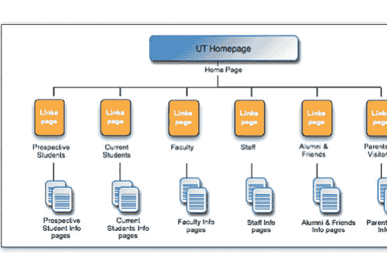

*图 6.5：网站结构图。*

#### 页面描述图

对顶层页面的书面描述，指定了页面上应包含哪些内容/功能，以及每个内容/功能块的优先级。**图 6.6** 展示了页面描述图最常见的布局。

| 最高优先级项目 | | 最低优先级项目 |
| :--- | :--- | :--- |
| **餐厅标志** | **品牌信息**<br>顶级美食 | **地址** |
| **主导航链接**<br>- 关于我们<br>- 菜单<br>- 照片<br>- 预订 | **引人入胜的描述**<br>简短的首页文案，与品牌相呼应 | **电话号码**<br><br>**营业时间**<br><br>**版权信息**<br>这是页面上优先级最低的项目。 |
| **特色菜品照片** | | |

*图 6.6：页面描述图。*

#### 线框图

网页的简单布局，不包含任何视觉设计元素。它是信息架构师尝试将 PDD 中列出的所有元素布局到页面上的工具。**图 6.7** 是一个手绘线框图的示例。

## 总结

设计网站是一个充满歧义的复杂过程。通过使用网站规划流程，你可以大大提高成功的机会。制作网站类似于制作任何项目，其关键阶段包括启动、规划、构建、测试和收尾。制作一个高质量的网站需要多种技能，包括项目管理、信息架构、可用性测试、写作、编辑、视觉设计、开发和质量测试。

信息架构是网页设计中的一个新兴专业领域。IA 通过用户画像、内容清单、竞争分析、内容策略、内容大纲、内容差距分析、网站结构图、页面描述图和线框图，为构建成功网站提供了蓝图。

在接下来的几章中，我们将介绍每种 IA 交付成果的示例，并让你有机会尝试创建自己的网站蓝图。

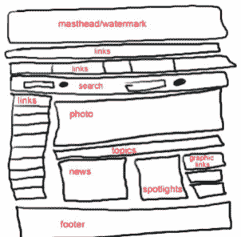

> 图 6.7：手绘线框图。

## 资源 // 推荐阅读

想了解信息架构师在现实世界中如何为网站规划过程做出贡献吗？请查看以下文章：

-   网页设计流程：http://www.utexas.edu/learn/designprocess/
-   信息架构——规划网站：http://dev.opera.com/articles/view/6-information-architecture-planning-o/
-   我是信息架构师吗？：http://iainstitute.org/documents/learn/Am_I_an_IA.pdf


# 信息架构师的十大主要角色

| | 启动 | 规划 | 构建 | 测试 | 收尾 |
|---|---|---|---|---|---|
| **步骤** | 定义项目需求。 | 1. 进行调研。<br>2. 起草设计方案并选定设计。 | 制作设计。 | QA 测试 | 1. 部署<br>2. 维护 |
| **项目管理** | 定义项目目标、预期成果、交付物、时间线和资源。 | 促进沟通，保持团队专注，记录进度，让客户知情。 | | | |
| **信息架构师** | 1. 主要受众目标 | 2. 用户画像<br>3. 现有内容清单<br>4. 竞品分析<br>5. 内容策略<br>6. 内容大纲<br>7. 内容差距分析<br>8. 网站结构图<br>9. 页面描述图表<br>10. 线框图 | 倡导可用性和可寻性。 | | |
| **可用性测试员** | 主要受众目标 | 用户画像 | 倡导可用性和可寻性。 | 1. 进行可用性测试。<br>2. 将问题按优先级排序并向团队报告。 | |
| **内容经理** | 确定语气和风格指南。 | 1. 提供对现有内容的访问权限。<br>2. 为网络撰写并调整内容。<br>3. 提供视觉设计师要求的内容。 | 将内容填充到网站中。 | 审查内容的准确性和语法。 | 保持内容更新。 |
| **视觉设计师** | 确定品牌和感知目标。 | 1. 进行创意调研。<br>2. 开发视觉设计。 | 编写 HTML 和 CSS 模板（由开发人员完成）。 | 解决测试过程中发现的设计问题。 | 将网站投入生产环境。 |
| **开发人员** | 确定功能和技术规格。 | 研究满足功能和技术规格的方案。 | 1. 编写 HTML 和 CSS 模板（由设计师完成）。<br>2. 开发后端脚本和数据库。 | 解决测试过程中发现的代码和功能问题。 | 将网站投入生产环境。 |
| **质量测试员** | 确定 QA 指标并与团队沟通。 | | | 1. 进行技术、功能、安全测试。<br>2. 将问题按优先级排序并向团队报告。 | |

*表 6.1：网站规划过程，详述信息架构职责。*

# 第七章

## 网站规划

作者：Glenda Sims

> 我有六位忠实的仆人
> （他们教会了我一切）；
> 他们的名字是何、为何、何时、
> 如何、何地以及何人。
> ——鲁德亚德·吉卜林

网站规划过程中最关键的步骤是定义项目。除非你已经发现了五个 W 和一个 H（何地、何时、为何、何人、何事以及如何）的答案，否则你并未完全定义一个项目。

- **何地**？网站将部署在哪里？（URL）
- **何时**？网站需要何时上线？（时间线）
- **为何**？为什么需要这个网站？（业务目标）
- **何人**？网站的主要受众是谁？（受众）
- **何事**？网站上需要提供哪些信息/功能？（内容/技术）
- **如何**？网站将如何被发现并保持更新？（营销和维护）

在本章中，你将学习如何与客户面谈，并收集清晰定义项目目标和主要受众需求所需的信息。你还将了解如何设计详细的项目计划，包括工作分解结构、功能和技术规格以及维护策略。

### 明确项目定义

想象一下，一位音乐家刚刚来找你说：“我需要一个网站来推广我的音乐。你能为我制作一个网站吗？”你回答：“当然！我很乐意这么做。”然后你心想：“我该从哪里开始？”

请记住，任何成功项目的七个步骤是：

1. 定义项目需求
2. 进行调研和分析
3. 开发设计
4. 构建
5. 测试
6. 部署
7. 维护

因此，让我们重点关注如何创建项目定义。

1.  与客户面谈，以明确项目的目的、目标受众、品牌/感知目标、内容来源、技术规格和沟通策略。
2.  根据客户调查中收集的信息，撰写一份一页纸的项目简报。项目简报应清晰地陈述目的、目标、主要受众和关键交付物。
3.  记录技术规格，明确确立要求，如屏幕分辨率、浏览器兼容性、下载时间、网络标准、可访问性、服务器端语言和数据库。
4.  制定维护计划，记录网站将如何定期更新和审查。
5.  制定工作分解结构。确定项目每个阶段的交付物和任务的时间线。分配截止日期和资源。

#### 与客户面谈

进行客户面谈的最佳方式是准备好一套面谈问题。如果可能，提前将这些问题分享给客户，以便他们有机会思考。当面进行面谈将使你有机会根据客户的回答调整问题。让我们来看一套基于五个 W 和一个 H 模型（何地、何时、为何、何人、何事以及如何）的客户面谈问题。

##### 客户面谈——网站规划

项目名称：

本项目联系人：（姓名、电子邮件、电话）

1.  何地？
    I.  首选/现有域名（URL）：
    II. 域名是否已注册：是/否
    III. 首选/现有网络服务器：
2.  何时？
    I.  新网站上线的首选目标日期：
    II. 任何影响/左右时间表的外部因素：
3.  为何？
    I.  您希望用此网站解决的业务问题：
    II. 该网站的主要业务目标/目的：
        （目标应是可衡量的）
4.  何人？
    I.  主要客户/目标受众：
    II. 目标受众描述（年龄、性别、教育程度、职业、
        收入、首选浏览器、计算机设备、互联网技能水平……）
5.  何事？
    I.  功能
        A.  您的客户为什么需要您？您提供的最重要的
           益处是什么（从客户角度出发）？
        B.  您的直接竞争对手是谁？（包括 URL）
        C.  您提供什么与竞争对手不同的服务？
        D.  客户如何（将会）使用您的网站？他们的目标是什么？
    II. 感知
        A.  用形容词描述您希望访问者如何看待新网站。
        B.  这与他们当前的认知有何不同？
        C.  您喜欢的网站的 URL。您喜欢这些网站的哪些方面？
    III. 内容
        A.  您是否有网站的现有内容，或者您将创建新内容？谁将撰写新内容？
        B.  您希望从当前网站或营销材料中使用的任何视觉元素或内容（徽标、配色方案、导航、命名约定等）？
    IV. 技术
        A.  您是否已有内容管理系统？
        B.  您是否已有数据库中的内容？数据库类型（Access、MySQL、Oracle……）？
        C.  列出您希望网站具有的特殊功能。对于每项中级或高级技术，解释该功能将如何解决主要业务目标，并为目标受众及其目标带来益处。
            a. 基础：搜索引擎
            b. 中级：
                1. 博客
                2. 公告板
                3. 登录（用于限制区域）
                4. 调查/投票
                5. Wiki
            c. 高级：
                1. 用户定制/个性化
                2. 数据库/动态内容
                3. 电子商务
                4. 富互联网应用程序（AJAX、Flash、Java、Silverlight）
                5. 安全性
        D.  任何额外的编程/功能要求？
6.  您将如何利用资源来支付、推广和维护网站？
    I.  **预算**
        A.  三选二：低成本、快速时间线、功能齐全
    II. **营销**
        A.  您是否有推广此项目的营销策略？如果有，能否描述一下？
    III. **维护**
        A.  您计划如何保持网站内容的时效性？
        B.  您的网站内容应多久更新一次？
        C.  谁负责提供和更新内容？

在您审视这些问题时，您可能会感觉询问客户关于“何地”和“何时”的问题很自在。您可能也对询问“何事”部分的技术问题充满信心。不要只问简单的问题。为了让自己感觉更自在，请随意修改这些问题的措辞，以适应您的风格和需求。请一个朋友让你练习为一个虚构的网站进行面谈。

无论如何，*不要自己回答问题！* 这些是需要客户回答的客户面谈问题。不要假定你知道客户会如何回答这些问题。为了清晰起见，请向他们提问。

但如果客户征求您的建议怎么办？您可以与客户一起进行头脑风暴，并给出您的意见。帮助他们思考问题和可能的答案是有益的。假定你知道答案而从不向客户提问，是制造麻烦的根源。

##### 危险信号

如果你的客户不愿意思考并回答你关于何地、何时、为何、何人、何事以及如何的问题，你该怎么办？也许他们认为这是浪费时间，你应该能够快速开发一个演示，而不是问这么多问题。嗯，除非你有通灵能力，否则我建议你让客户明白，一个成功网站的基础是清晰明确的项目定义。在模糊和假设的基础上构建网站，等同于在流沙上建房子。


 # 项目概要——宏观视角

现在是时候将你在客户访谈中学到的内容浓缩成一页纸的项目概要了。项目概要的目的有二。首先，你将用它来确认你理解了客户所说的期望/需求。其次，你将用它与参与项目的任何人分享全局图景。项目概要减少了模糊性，并有助于让项目团队专注于宏观大局。

以下是项目概要的组成部分：

1.  项目名称：
2.  宏观大局：
3.  项目摘要：用一两句话描述项目。想象你必须在电梯里快速向同事解释你的项目。
4.  业务目标：在客户访谈中发现的可衡量的目标和指标的简明列表。
5.  客户期望的发布日期：能否满足此目标日期仍取决于预算和功能的最终协议。
6.  目标受众：
    I. 受众描述：年龄、性别、教育程度、职业、收入、偏好的操作系统、浏览器、计算机设备、互联网技能水平……
    II. 受众目标：受众想要和/或需要什么？
7.  感知策略：
    I. 当前感知：列出三个描述当前受众感知的形容词。
    II. 期望感知：列出三个描述期望的受众感知的形容词。
    III. 策略：简要描述新网站将如何产生期望的感知。
8.  信息策略：
    I. 核心信息：你想向目标受众传达的核心信息是什么（用一个简短的句子或短语）？
    II. 策略：简要描述新网站将如何传达核心信息。
9.  竞争优势：列出能带来竞争优势的关键业务强项。

### 明确项目定义

请记住，如果项目概要超过一页纸，它就不算“概要”！如果你在撰写概要时遇到困难，请毫不犹豫地联系客户并提出更多问题。将概要草案与客户分享也是获取更多信息并确保你方向正确的良策。

## 进入技术环节：技术规格

接下来，我们需要发现并记录项目任何已知的技术要求。在此项目阶段，以下任何问题的答案都可能是“待定”。最好现在就提出这些问题，以避免任何不必要的意外。

### 初步技术调查

1.  **域名与主机/Web服务器**
    I. 首选域名：
    II. 需要注册域名吗？是/否
    III. 首选主机/Web服务器：
    IV. 需要建立新账户吗？是/否
2.  **必需的软件/系统：** 列出此项目预先确定的任何软件或系统（CMS、博客、论坛、调查投票、Wiki、购物车……）。
3.  **服务器要求：** 对大磁盘空间的需求：初始网站内容会很大吗，比如数百小时的在线视频？
    I. 对高带宽的需求：预计初始网站流量会非常高吗，比如一所主要大学在线报名的第一天？
    II. 数据库：由所需软件决定。也可能受Web开发人员的经验、偏好以及长期维护考虑的影响。
    III. 编程语言/框架：由所需软件决定。也可能受Web开发人员的经验、偏好以及长期维护考虑的影响。
    IV. 多媒体流：列出预计从网站提供的任何类型的多媒体，例如Flash、QuickTime、Real Media、Windows Media……
    V. 安全性：列出预先确定的安全功能需求，如SFTP、SSL安全证书和VPN访问。
    VI. 偏好一键安装/自动升级功能：列出所需功能（如内容管理系统、博客、论坛、调查/投票、Wiki、购物车……）的软件。

4.  **Web代码要求：**
    I. 无障碍性：指明代码将依据哪些Web无障碍法律/指南进行验证，例如W3C WCAG 2.0或美国联邦508条款。
    II. CSS版本：指明代码将依据哪个版本的CSS进行验证。
    III. 样式表类型：指明是否需要多个版本的CSS来支持高对比度、移动设备或打印等功能。
    IV. HTML版本：指明代码将依据哪个版本的HTML进行验证。

5.  **支持的终端用户平台：** 查看当前统计数据，确定要支持的操作系统、屏幕分辨率和浏览器的合适列表。如果你没有当前的统计数据，可以使用Market Share (http://marketshare.hitslink.com) 等服务的报告作为指南。
    I. 桌面端
        - 操作系统
        - 屏幕分辨率
        - 浏览器版本
        - 连接速度
    II. 移动端
        - 操作系统
        - 屏幕分辨率
        - 浏览器版本
        - 连接速度

    通过指定网站将针对哪些浏览器进行优化，你有助于项目有效地集中资源。但是，不在此支持列表上的浏览器也不应被完全忽视。采用优雅降级或渐进增强的开发方法，以确保网站可供最广泛的受众访问。这也将有助于网站在未来新浏览器和浏览器版本发布时保持功能性。关于这些Web开发方法，请阅读Opera的Web标准课程文章《优雅降级与渐进增强》(http://dev.opera.com/articles/view/graceful-degradation-progressive-enhance/) 了解更多。

请记住，在这个项目的早期阶段，在任何这些问题上注明“待定”是完全可以接受的。通过早期审查技术规格，你将避免遗漏客户做出的假设。

### 维护计划

当客户找到你，希望重新设计或新建一个网站时，人们很容易只专注于在目标日期前制作完美网站的计划。但如果网站的内容没有保持完整、最新和准确，很少有网站能保持吸引力。澄清网站将如何维护以及谁负责维护非常重要。是客户自己维护网站吗？他们希望你为他们维护吗？

1.  **网站维护计划——保持新鲜**
2.  **内容计划表：** 网站的哪些区域将更新，频率如何？
3.  **内容贡献者：** 谁是内容贡献者？（列出姓名、头衔、每周/每月小时数、负责的网页/版块）
4.  **贡献/更新方法**
    I. 网站将如何更新？（HTML编辑器、所见即所得编辑器、CMS……）
    II. 内容贡献者是否需要培训和/或软件？
    III. 是否有自动化流程来更改网站任何页面上的内容？（列出页面、流程和技术联系人姓名）
    IV. 谁将维护和优化搜索引擎？
5.  **质量审查**
    I. 谁将至少每年进行一次质量审查，内容包括：
        - 无障碍性
        - 断链
        - HTML/CSS验证
        - 安全性
        - 网站指南（模板、品牌……）
    II. 谁负责批准网站扩展时的外观和感觉变更，以确保网站质量得以维持？
    III. 你预计多久会向网站添加新部分？
    IV. 新部分将使用相同的模板还是需要额外的设计模板？

6.  **技术支持：** 谁将负责未来的
    I. HTML/CSS更改
    II. 图形更改
    III. 软件/系统升级和补丁

现在提出关于持续维护的问题，目的是确定客户是希望你提供这些服务，还是他们能够用自己的内部资源来处理。这也是让客户意识到保持网站新鲜的重要性（以及所需资源）的一个机会。

### 工作分解结构（WBS）

工作分解结构（WBS）是为实现项目目标而需要完成的任务和里程碑的详细列表。WBS将项目分解为可管理的任务。每项任务包括要完成工作的简要说明、分配的资源、完成任务的估计时间以及截止日期。

**表8.1** 展示了一个构建网站的基本的高层次WBS。


## 发现项目定义

| 任务ID | 任务 | 工时预估 | 资源 | 截止日期 | 完成! |
| :--- | :--- | :--- | :--- | :--- | :--- |
| 1 | 定义项目 | | 项目经理 | | |
| 1.1 | 客户访谈 | | 客户和项目经理 | | |
| 1.2 | 项目简介 | | 项目经理 | | |
| 1.3 | 初步技术规格 | | 项目经理 | | |
| 1.4 | 维护计划 | | 项目经理 | | |
| 1.5 | 项目时间表（工作分解结构） | | 项目经理 | | |
| 1.6 | 预算/成本估算 | | 项目经理 | | |
| 1.7 | 合同/工作范围 | | 项目经理 | | |
| 1.8 | 签订合同 | | 客户 | | |
| 2 | 信息架构 | | 信息架构师 | | |
| 2.1 | 研究/基准测试 | | 信息架构师 | | |
| 2.2 | 用户画像与场景 | | 信息架构师 | | |
| 2.3 | 提议的内容大纲 | | 信息架构师 | | |
| 2.4 | 提议的站点图 | | 信息架构师 | | |
| 2.5 | 直接用户输入——访谈、调查、卡片分类 | | 信息架构师 | | |
| 2.6 | 内容模型与IA策略 | | 信息架构师 | | |
| 2.7 | 页面描述图 | | 信息架构师 | | |
| 2.8 | 内容开发 | | 内容经理 | | |
| 2.9 | 线框图 | | 信息架构师 | | |
| 3.0 | 视觉设计 | | 视觉设计师 | | |
| 3.1 | 第一轮设计 | | 视觉设计师 | | |
| 3.2 | 反馈 | | 客户和项目经理 | | |
| 3.3 | 第二轮设计 | | 视觉设计师 | | |
| 3.4 | 反馈 | | 客户和项目经理 | | |
| 3.5 | 最终确定设计 | | 视觉设计师 | | |
| 3.6 | 批准设计 | | 客户和项目经理 | | |
| **4.0** | **开发** | | **开发人员** | | |
| 4.1 | 审查/调整技术规格和功能要求 | | 开发人员和项目经理 | | |
| 4.2 | 更新项目计划/时间表，并进一步定义任何额外的编码和集成任务。审查时间估算和资源。 | | 开发人员和项目经理 | | |
| 4.3 | 批准工作范围的任何新增内容。 | | 客户 | | |
| 4.4 | 构建与集成站点 | | 开发人员 | | |
| 4.5 | 在此插入具体的编码任务，包括后端编程、软件安装、集成、搜索... | | 开发人员 | | |
| 4.6 | 使用Web标准构建模板。 | | 开发人员 | | |
| 4.7 | 将内容输入模板 | | 内容团队 | | |
| **5.0** | **测试** | | **质量测试员** | | |
| 5.1 | 内容审查 | | 撰写/编辑/内容经理 | | |
| 5.2 | 功能审查 | | 质量测试员 | | |
| 5.3 | 代码验证 | | 质量测试员 | | |
| 5.4 | 无障碍审查 | | 质量测试员 | | |
| 5.5 | 浏览器/操作系统分辨率测试 | | 质量测试员 | | |
| 5.6 | 连接速度与负载测试 | | 质量测试员 | | |
| 5.7 | 可用性测试 | | 质量测试员 | | |
| 5.8 | 搜索引擎优化 | | 质量测试员 | | |
| 5.9 | 安全审查 | | 质量测试员 | | |
| **6.0** | **制作完成** | | **团队** | | |
| 6.1 | 样式指南 | | 团队 | | |
| 6.2 | 站点上线 | | 团队 | | |
| 6.3 | 初始故障排除 | | 团队 | | |
| 6.4 | 庆祝 | | 团队 | | |
| 6.5 | 维护 | | 客户 | | |

表8.1：工作分解结构。

理想情况下，每项任务都应明确定义为可交付成果或计划成果。任务越精细、越独立，估算完成所需时间就越容易。小任务也更容易让个人集中精力并完成。

准确估算任务所需时间起初可能看起来令人生畏。但每次你都会做得更好。为了提高你的估算能力，你应该：

- 将任务分解成小块。
- 询问被分配到该任务的人员，他们认为需要多少工时才能完成。
- 如果你完全不知道任务可能需要多长时间，就猜一下，随便写点什么。
- 记录实际完成任务所花费的时间。
- 注意你的估算倾向并尝试调整。你是否总是低估？那就增加你的估算。
- 与另一位有项目管理经验的人一起审查你的估算，以进行现实性检查。
- 记住……估算并非精确！

请注意，没有“完成百分比”列，而是有“完成!”列。跟踪完成百分比用处不大，因为任务通常能在短时间内达到60-80%的完成度，但要达到完全完成却似乎需要永远。我建议你只为已完成的任务打分，不要浪费时间去跟踪完成百分比。

制定工作分解结构、估算时间和管理Web项目都是重要的专业技能，值得专门写一本书来阐述。Kelly Goto和Emily Cotler的著作*《Web Redesign 2.0: Workflow that Works》*是任何管理Web项目的人的必读书目（http://www.web-redesign.com/）。

## 总结

你可能在想，工作分解结构以及所有这些任务，比如项目定义、信息架构、测试和上线，正在妨碍你深入到真正的视觉设计和Web开发工作中。

**请注意！如果你跳过任何这些主要步骤，你很可能最终会面临以下一个或多个问题：**

- 出乎意料的需求让你不得不通宵赶工。
- 服务器无法支持你需要使用的软件。
- 在最好的CMS中有一个漂亮的CSS模板，但没有内容，因为你的客户无法提供图片、文案和多媒体。
- 站点对你来说运行正常，但在主要目标受众的浏览器上失败。
- 一位愤怒的客户因为网站不符合Web无障碍法律而拒绝付款。
- 客户在半夜打电话给你“只是更新一下页面”，并在你几个月前为他们完成网站后给你发送大量小的变更请求。

通过使用网站规划流程，你可以避免痛苦，并实际节省时间。

## 资源 // 推荐阅读

- 采访Kelly Goto http://www.wise-women.org/features/kelly_goto/
- *Web Redesign 2.0: Workflow that Works* http://www.web-redesign.com
- *Real Web Project Management: Case Studies and Best Practices from the Trenches* http://www.realwebprojects.com/projectbook/

# 第八章
## 内容分析

作者：Glenda Sims

在Web项目的早期阶段，你很少能获得网站的所有内容。使用填充文本作为占位符直到实际内容可用是一种常见做法。填充文本的默认标准是*Lorem Ipsum*。甚至有一个方便的Lorem Ipsum生成器在http://www.lipsum.com/上，让你的生活更轻松。但不要被迷惑，以为你可以在不了解填充内容的性质、大小和来源的情况下设计网站。在本章中，我们将重点深入了解你的受众及其内容需求，并进行内容分析。在本章结束时，你将知道如何使用特定的信息架构工具来找到这些重要问题的答案（**表8.1**）。

| 问题 | 信息架构工具 |
| :--- | :--- |
| 内容确切是为谁准备的，他们想要/需要什么？ | 1. 用户调查和访谈<br>2. 用户画像和基于任务的场景 |
| 我们已经拥有哪些内容？ | 内容分析：内容清单 |
| 每个内容的来源是什么？ | |
| 用户正在使用哪些内容？ | 内容分析：网站分析 |
| “竞争对手”有什么？ | 内容分析：竞争审查 |
| 我们希望在上线时拥有哪些内容？ | 提议的内容大纲 |
| 用户会如何组织和标记我们提议的内容？ | 卡片分类 |

表8.1：内容问题与信息架构工具。

### 以用户为中心

网站应该为谁设计？目标受众应该处于所有设计决策的中心，并与客户的业务目标以及Web设计师/开发人员的需求保持平衡。在定义、设计和构建网站的过程中，开发人员和客户在决策时是实际存在的。但目标受众很少有机会在网站投产之前发表意见。我们如何确保设计专注于最终用户的需求？我们密切关注用户在**访谈**和**调查**中所说的话，然后制定关键的**用户画像**和**基于任务的场景**，以清晰地定义受众任务。

- 进行**用户访谈和/或调查**。通过在线访谈或调查直接询问用户，准确了解他们的需求。
- 制定关键的受众**用户画像**。**用户画像**（图8.1）是一个虚构的角色，用于代表主要受众。用户画像是基于通过用户访谈和/或调查发现的数据制定的。通过将一个想象中的受众成员带入现实，用户画像有助于让项目专注于用户的需求。
- 编写**基于任务的场景**。确定促使目标受众访问你的网站以完成特定任务的最常见情况（前10到20个）。这些场景将指导网站的设计，并作为可用性测试的基础。


#### 访谈与调查

除非你正在为单一受众（且该受众就是你自己）设计网站，否则你需要花些时间更好地了解目标受众。切勿假设你已了解用户的需求或想法。与目标受众成员进行访谈和/或调查，将提供构建有效用户画像所需的重要数据与洞察。

无论你是进行面对面访谈还是开展在线调查，你试图发掘的信息包括：

- 你对这家公司的**看法**如何？{当前印象}
- 你与这家公司的产品/服务有过怎样的**经历**？{历史}
- 你对此类产品/服务**了解**多少？{知识水平}
- 你现在使用这家公司网站时，**想要**达成什么？{目标}
- 你现在在这家公司网站上通常**做**什么？{任务}
- 你对该公司网站**最喜欢/最不喜欢**什么？{满意度}
- 你会如何**排序**网站拟推出的以下新功能？{优先级}
- 你对改进网站有何**建议**？{改进机会}

如果你的客户目前没有网站，你可以将问题聚焦于类似网站（例如主要竞争对手的网站）。

##### 访谈/调查应持续多长时间？

将访谈时间控制在一小时或更短，理想情况下应在用户环境中进行，以便有机会在自然状态下观察他们。尽量将在线调查控制在10分钟或更短以内。简短精炼的在线调查更可能被用户完成。

##### 应访谈/调查多少人？

访谈更耗时，但能获取更深入的信息。针对每个目标受众访谈五个人，通常能提供足够的定性数据来构建用户画像。在线调查则需要高得多的回复数量。一个经验法则是，针对每种目标受众类型至少要有100份调查回复。请记住，除非你拥有极度忠诚且参与度高的受众，否则调查的平均回复率通常只有2%至3%。

访谈和调查都是深入了解用户的宝贵方法。SurveyMonkey和Zoomerang等工具提供了用于收集和分析数据的免费软件选项。关于设计和开展用户访谈与调查的详细信息，请参考Steve Mulder的著作《用户永远是对的》（*The User is Always Right*）。

##### 用户画像

**用户画像**是你将创建的虚构角色，用以代表主要目标受众。用户画像应包含以下基本要素：

1. 基本人口统计信息
    - 年龄
    - 职业
    - 教育背景
    - 收入
2. 个人信息
    - 姓名
    - 照片
    - 描述
3. 技术特征
    - 偏好的操作系统
    - 偏好的浏览器
    - 网络技能水平
    - 常用网站
4. **受众目标**：用户想要做什么？该用户在网站上最想完成的三到十项任务。
5. **商业目标**：客户希望用户做什么？针对该受众的前三大业务目标。

基本信息通常在与客户的初次访谈中收集。询问客户他们是否已有用于当前品牌推广或营销活动的用户画像。如果有，请从他们已建立的用户画像入手，并为本次特定项目添加任何额外细节（如技术特征、基于任务的情景以及具体的商业目标）。

根据客户为你描述的该目标受众特征，选择一个名字和一张照片来代表此用户画像。姓名和照片应与该用户画像的设定年龄相符。你可以使用像“Baby Name Voyager”这样的工具来帮助你查找该年龄段的常见名字：http://www.babynamewizard.com/voyager。考虑从图库照片服务或Flickr等平台选择更随意的照片。请尊重知识产权和版权法，在需要时获取使用照片的许可。不要使用项目团队认识的人的姓名或照片。

> 资源 // 用户画像价值连城
>
> 问：说真的？为什么我需要创建一个虚构人物，给他们名字和面貌（照片）？我不能直接定义主要受众就完事了吗？
>
> 答：在设计和开发阶段，如果没有详细的用户画像，你往往会倾向于假设受众需求与你自己相同。通过创建一个带有名字、照片和详细描述的用户画像，你将目标受众引入了你的设计过程。

对于“受众目标”部分，使用你从用户访谈/调查中收集的数据，来确定目标受众将在网站上执行的最重要任务。任务的重要性应基于用户的视角。要现实地看待用户想要做什么。例如，在音乐家的网站上，用户可能想查找关于艺术家或特定歌曲的信息；而音乐家的商业目标可能是让这个用户画像经常访问网站（增加网站流量）、在Facebook上加为好友（增加营销机会）、购买/下载歌曲（促进销售）。客户对用户的目标应当是现实且互惠互利的。

##### 基于任务的情景

**情景**只是一个简短的描述，描绘了一个用户带着特定目标或任务访问网站的现实场景。情景有助于你将设计过程聚焦于目标受众真正的需求和期望。

- **示例：** 我今年在SXSW上听了歌手John Pointer的演出，我想知道什么时候能再次现场听他的歌。他在德克萨斯州中部的下一场演出是什么时候、在哪里？
- **示例：** 我需要为我的学习小组找一个开会的地方。我想在图书馆预订一个房间。如何预订自习室？

可以创建更详细的情景，以帮助开发者更深入地理解用户。详细情景是一到两段的故事，包括用户的任务目标以及他们的想法、顾虑、过往经历和倾向。

- **示例：** Jeremy正在考虑申请X大学。他精通技术，曾使用HTML、CSS和JavaScript构建过几个个人网站。他有一部iPhone，无法想象没有Facebook的生活。他的父亲曾就读于X大学，并极力推动Jeremy也去。他的母亲每天鼓励他申请X、Y和Z大学，但他总是拖延。他预期在线申请过程会既乏味又笨拙。他认为自己能设计一个更好的网站。他希望快速完成申请流程，以便能回到他最喜欢的多人在线游戏中去。他担心自己是否会在X大学过得开心并融入其中。

基于任务的情景用于设计阶段（开发开始前）以及可用性测试阶段，以衡量目标受众在实现网站主要目标方面的满意度。

## 内容——网站的主体

> “重新设计网站就像改造厨房：在规划布局、放置电器和插座、选择瓷砖、窗帘和台面之前，你必须先弄清楚你需要哪些功能和特性，以及你将如何使用它们。”——Kelly Goto，《网站重设计2.0》（*Web Redesign 2.0*）

你可能已经迫不及待地想要开始后端编码或视觉设计，但明智的网页开发者坚持首先明确网站上线时将提供哪些内容。客户常常存在误解，认为他们只需要一个漂亮的网站，这就能神奇地解决所有问题。然而，创建内容所需的时间往往与设计和开发网站相当。因此，花时间使用以下工具来规划内容和功能需求非常重要：

- **内容清单/审计**——我们已有哪些内容？
- **网络分析**——用户实际在使用什么？
- **竞品分析**——竞争对手有哪些内容？
- **拟议内容大纲**——我们计划提供哪些内容？
- **卡片分类法**——用户会如何组织和标记内容？

### 内容清单——我们有什么？

发现客户已有的内容是内容清单的目标。这项任务最好由客户完成，因为他们最了解自己的内容。如果客户认为没有必要做内容清单，请强调内容是网站的核心。如果对现有内容没有充分了解，也没有创建新内容的策略，网站就有可能陷入内容不全、过时或不准确的境地。

让我们来看一个某大学旧版移动网站的模拟内容清单（**表8.2**）。


聚焦用户

128

# 第八章

| ID | 链接名称 | 当前来源 | 内容负责人 | 保留、升级、移除 |
| :--- | :--- | :--- | :--- | :--- |
| **1.0** | **课程** | `https://utdirect.utexas.edu/diia/hub/` | DIIA | 保留 |
| 1.1 | 移动黑板 | `http://m.courses.utexas.edu/` | DIIA | 保留 |
| 1.2 | 电子成绩册 | `https://utdirect.utexas.edu/diia/egb/` | DIIA | 保留 |
| **2.0** | **图书馆** | `http://lib.utexas.edu/m/` | 图书馆 | 保留 |
| 2.1 | 开放时间 | `http://lib.utexas.edu/m/hours/` | 图书馆 | 保留 |
| 2.2 | 目录搜索 | `http://lib.utexas.edu/m/catalog/` | 图书馆 | 保留 |
| **3.0** | **地图** | `http://www.utexas.mobi/maps/` | ITS | 升级 |
| 3.1 | 建筑列表 | `http://mobile.utexas.edu/maps/index.html` | ITS | 升级 |
| 3.2 | 以UT塔为起点的地图 | `http://mobile.utexas.edu/maps/coord_search.php?area=3b` | ITS | 升级 |
| 3.3 | 车库列表 | `http://mobile.utexas.edu/maps/garages.html` | ITS | 升级 |
| **4.0** | **体育** | `http://mobile.utexas.edu/sports/` | 体育部 | 升级 |
| 4.1 | 橄榄球 | `http://mobile.utexas.edu/sports/schedule.php?sport=football` | 体育部 | 升级 |
| 4.2 | 棒球 | `http://mobile.utexas.edu/sports/schedule.php?sport=base-m` | 体育部 | 升级 |
| **5.0** | **奥斯汀/全球** | `http://mobile.utexas.edu/austin_world/` | ITS | 移除 |
| 5.1 | 奥斯汀天气 | `http://mobile.weather.gov/port_mp_ns.php?CityName=Austin&site=EWX&State=TX&warnzone=TXZ192` | 外部 | 移除 |
| 5.2 | BBC移动 | `http://www.bbc.co.uk/mobile/web/` | 外部 | 移除 |

*表 8.2：内容清单示例。*

如你在前面的示例中所见，简单的内容清单包括：

- **内容 ID**——用于在纲要中引用和定位内容。选择任何你喜欢的标识方案，只要它是明确无歧义的即可。
- **链接名称**——该内容的当前或拟议链接名称。此时不必过于纠结链接名称是否完美。目前，只需确保它是唯一且具有描述性的。
- **当前来源**——指明内容当前所在的位置。如果内容已在线可用，请列出 URL。
- **内容负责人**——负责撰写和维护此内容的人员或团队。
- **保留/升级/移除**——指明此内容是否完美无缺（保留）、需要改进（升级），或是否需要从新网站中移除，因为它冗余、过时或琐碎（移除）。

创建内容清单并不光鲜亮丽，但它是良好信息设计的必要步骤。若想以幽默而深刻的角度了解这一过程，请参阅杰夫·维恩的文章《进行内容清单（或，穿越你网站的令人麻木的详细奥德赛）》，网址为 http://www.adaptivepath.com/ideas/essays/archives/000040.php。

# 网站分析——访客在做什么？

哪些页面浏览量最高？人们从哪里进入和离开网站？哪些关键词经常被用来搜索网站？网站分析工具可以为这些问题提供答案，帮助你更好地了解网站的效能。

许多网络托管公司在其服务中提供统计软件包。例如，MediaTemple 在其基础账户上提供免费的 Urchin Analytics，Dreamhost 提供免费的 Analog 统计。如果你的服务器尚未安装分析工具，或者你想要比现有更多的功能，你可以考虑使用 Google Analytics，它在每月 500 万次页面浏览以内是免费的。如果你超出了免费选项的范围，付费可以使用最强大的分析服务，包括 ClickTracks、WebSideStory 和 WebTrends。

一旦你获得网站的统计数据，从哪里开始看起呢？网站分析有点像考古学：你实际上并没有观察人们及其行为。你是在筛选他们留下的踪迹。让我们看看六项基本的网络统计数据，以及它们能为内容分析提供什么洞见：

1. **点击量**——对服务器文件的请求次数。这个统计数据对内容分析不太有用，因为它不仅包括页面的点击量，还包括图片、JavaScript、CSS 以及网页中嵌入的任何其他文件的点击量。

2. **页面浏览量**——对网页的服务器请求次数。这是一个非常有用的统计数据，可以向你展示哪些页面被浏览得最多。

3. **入口页面**——每个访客进入网站的页面列表。关键入口页面是你预期的吗？不要假设用户只通过主页进入网站。这些入口页面的设计是否有助于用户实现他们的目标？

4. **退出页面**——每个访客最后浏览的页面。访客是否在意外的地方离开？访客是否在关键步骤放弃了流程？统计数据不会告诉你他们为什么离开，但会促使你调查是什么导致了问题。

5. **跳出率**——在单页进入并在未访问网站其他任何页面的情况下从同一页面退出的访客百分比。阿维纳什·考希克在《跳出率：最性感的网络指标？》中分享了他的观点，网址为 http://www.mpdailyfix.com/bounce-rate-sexiest-web-metric-ever/。

6. **关键词**——人们在外部搜索引擎中使用以找到你网站的词语和短语。这些关键词统计数据帮助你了解访客与你网站相关的词汇。

## 资源 // 网站分析警告

网站分析只是全貌的一半。这些网络统计数据向你展示了发生了什么，但它们没有告诉你为什么发生（或根据这些数据应采取什么步骤）。例如，一个页面浏览量很低可能是由于以下任何原因：

- 用户不需要这些信息（删除页面）。
- 用户需要这些信息，但由于可用性问题找不到（保留页面并提高可查找性）。
- 少数用户需要这些信息并觉得非常有用（保留页面）。

回到内容清单，让我们添加两列用于页面浏览量和跳出率。然后重新审查你对每个页面保留、升级或移除的决定。确保你没有计划移除那些页面浏览量很高的页面（而没有为用户提供便捷的过渡路径）。

你可能需要考虑升级那些在退出页面统计数据中意外偏高或跳出率较高（超过 35%）的页面。仔细审查被列为高入口页面的页面（及其内容），确保它们有帮助且用户友好。检查访客通过外部搜索引擎找到你网站所使用的关键词是否反映在你的链接命名中（**表 8.3**）。

| ID | 链接名称 | 当前来源 | 内容负责人 | 保留、升级、移除 | 页面浏览量 2008/12-2009/11 | 跳出率 |
|---|---|---|---|---|---|---|
| 0.0 | UT 移动 | http://mobile.utexas.edu | ITS | 升级 | 39,643 | **30%** |
| 4.0 | 体育 | http://mobile.utexas.edu/sports/ | 体育部 | 升级 | 64,689 | **24%** |
| 5.0 | 奥斯汀/全球 | http://mobile.utexas.edu/austin_world/ | ITS | 移除 | 6,864 | **82.32%** |

*表 8.3：带有网站分析数据的内容清单。*

我们在此关注的网络分析指标只是监控网站活动时应考虑的最明显统计数据中的一小部分。如果你想深入了解这一领域，我推荐阅读阿维纳什·考希克的著作《*网站分析：每天一小时*》。请记住，网络统计数据只是所发生事件的报告。一旦你知道如何根据客户行为和业务成果来分析和解释数据，它们就能帮助你验证某些活动并发现潜在的问题区域。

# 竞品分析——其他人在做什么？

对主要竞争对手进行高水平分析对网站的成功至关重要。在最终确定网站策略之前，最好了解竞争对手的优势和劣势。以下是进行竞品分析的基本步骤：

1. **识别竞争对手**——询问客户他们的主要竞争对手是谁。使用 Alexa 等服务来发现客户可能未意识到的竞争对手（http://www.alexa.com/siteinfo）。如果可能，确定七到十个主要竞争对手进行审查。至少，审查三个竞争对手。

2. **决定分析什么**——审查竞争对手有很多好处，包括增加对该行业的了解、共同词汇、最佳实践，以及显而易见的竞争对手优势和劣势。你可能收集的信息类型包括：
    I. 功能/特性的高层次清单
    II. 视觉设计特征
    III. 标签和组织方案
    IV. 可用性启发式评估

3. **制定竞争调查**——制定一系列客观问题。你在审查每个竞争对手时越一致，从这次分析中获得的收益就越多。关于要收集的数据的实际示例，请参阅贾森·威思罗的文章《竞品分析：理解市场背景》，网址为 http://www.boxesandarrows.com/view/competitive_analysis_understanding_the_market_context，以及托马斯·迈尔的文章《如何进行网站竞品分析》，网址为 http://www.ibm.com/developerworks/webservices/library/us-analysis.html。

4. **为每个竞争对手回答调查**

5. **分析调查数据**

6. **撰写调查结果和建议报告**

调查竞争对手的经验是一种无价的现实检验，如果做得好，会增加设计成功网站的可能性。

## 拟议内容纲要

现在有趣的部分开始了。综合你从用户调查/访谈、人物角色、基于任务的场景、内容清单、网站分析和竞品分析中所学到的一切，起草新网站的内容和功能建议清单。开始以你认为对目标受众有意义的方式对清单进行分组和分类。不要

不必过于追求完美，只需根据迄今为止从研究和分析中学到的所有知识，尽力而为即可。将提议的内容大纲与项目团队和客户一起审阅。让他们知道你正在努力确保拥有一个完整的内容大纲，并具有合理的组织结构。根据内部反馈对提议的内容大纲进行调整。提醒所有人，大纲只是一个草稿，因为下一步是获取目标受众的直接反馈。

### 卡片分类

自从我们邀请真实用户参与这个设计过程以来，已经有一段时间了。尽管人物角色和基于任务的情境可能很有用，但没有什么比实际用户的反馈更好。卡片分类是一种低成本的方式，让目标受众告诉我们他们如何准确地标记和组织网站提议的内容。

卡片分类分为开放式和封闭式两种。两种类型都始于一套卡片，每张卡片代表提议内容大纲中列出的一个内容项目。

- **开放式卡片分类**——参与者被要求将网站内容卡片分类到对他们有意义的组别中。参与者不会获得预先定义的组别或类别。

- **封闭式卡片分类**——参与者被要求将网站内容卡片分类到预先定义的类别中。

- **什么时候进行卡片分类最有价值？** 卡片分类在设计新网站或重新设计旧网站时非常有用。

- **我应该有多少张卡片？** 尽量至少有20张卡片，不超过50张。少于20张卡片则不足以进行分类。超过50张卡片，分类可能会耗时且/或令人沮丧。

- **我应该测试多少人？** Jakob Nielsen建议测试15人。参见他的文章"Card Sorting: How Many Users to Test" [http://www.useit.com/alertbox/20040719.html](http://www.useit.com/alertbox/20040719.html)。

- **我应该使用开放式还是封闭式分类？** 从开放式分类开始，以产生关于内容如何组织或标记的想法。考虑使用封闭式分类来评估预定类别的有效性。但要注意不要过度依赖封闭式分类。对信息进行分类与查找信息并不是同一活动。阅读Donna Spencer的文章"Closed Card Sorting—I finally found a use for it" [http://maadmob.net/donna/blog/2005/closed-card-sorting-i-finally-found-a-use-for-it](http://maadmob.net/donna/blog/2005/closed-card-sorting-i-finally-found-a-use-for-it)。

你可以亲自进行卡片分类，使用索引卡片，也可以使用软件来帮助你进行远程卡片分类。像OptimalSort和WebSort这样的服务提供免费计划以及按使用付费的选项。

> **提示：** 有关如何规划、进行和分析卡片分类的详细说明，请参见 http://www.usability.gov/methods/design_site/cardsort.html。

## 总结

通过在制定内容策略之前花时间分析提议的网站内容，你可以使自己成为一名高效的Web专业人士（参见第9章"内容策略"）。当客户对你说"我们大部分内容都有了"时，请他们展示给你看。如果他们建议"我们可以在有了视觉设计之后再关注内容"，回应说网站需要设计以适应内容。当他们说"我们的传播团队会撰写内容"时，邀请他们参加下一次会议。当他们说"创建内容很容易"时，让他们知道网站经常因为内容未准备好而延迟上线。

有用且可用的内容不会凭空产生。

## 资源 // 推荐阅读

- Contextual interviews http://www.usability.gov/methods/analyze_current/learn/contextual.html
- User surveys http://www.usability.gov/methods/analyze_current/learn/surveys.html
- Developing personas http://www.usability.gov/methods/analyze_current/personas.html
- Task-based scenarios http://www.usability.gov/methods/analyze_current/scenarios.html
- "Content analysis: a practical approach" by Colleen Jones http://www.uxmatters.com/mt/archives/2009/08/content-analysis-a-practical-approach.php
- Content inventory http://www.usability.gov/methods/design_site/inventory.html

(continued)

- "A few good web analytic tools: measuring your website's success" by Laura Quinn http://www.techsoup.org/learningcenter/internet/page6760.cfm
- "How to conduct a website competitive analysis" by Thomas Myer http://www.ibm.com/developerworks/webservices/library/us-analysis.html
- "Card sorting: a definitive guide" by Donna Spencer and Todd Warfel http://www.boxesandarrows.com/view/card_sorting_a_definitive_guide
- Card sorting: designing usable categories by Donna Spencer http://rosenfeldmedia.com/books/cardsorting/blog/card_sort_analysis_spreadsheet/
- Content Strategy for the Web by Kristina Halvorson

# # 第9章
### 内容策略

**Glenda Sims 著**

在本章中，你将学习如何为网站最终确定信息架构计划。基于项目定义（第7章"网站规划"）和内容分析（第8章"内容分析"），你将了解如何制定一个内容策略，作为开发人员、设计师和作者开始构建网站的蓝图。内容策略将包括：

- 内容策略声明
- 经批准的内容大纲
- 差距分析
- 内容地图
- 页面描述图
- 线框图
- 交互设计的故事板

### Chez Sous le Vent：客户

想象一下，你最近与两位朋友Steph和George一起创立了Smart Web Design公司。一位名叫Aarron Walter的杰出厨师请你在几个月内为他即将开业的新餐厅创建一个网站。这家餐厅的名字将是Chez Sous le Vent。

Steph和George采访了客户并做了详细的笔记。他们还创建了项目简介、主要目标受众的人物角色（**图9.1**）以及提议的内容大纲（**表9.1**）。让我们来看看这些文件，以了解这个项目的内容。

## Chez Sous le Vent 项目简介

**项目名称：Chez Sous le Vent 网站**

1. **大局：**
   - **项目摘要**：为Chez Sous le Vent建立网络存在感，这是德克萨斯州奥斯汀的一家新法国餐厅。
   - **业务目标/目的：**
     - 与Chez Sous le Vent的品牌/信息相匹配的网站。
     - 在Google上针对"Austin French restaurant"一词获得高排名。
     - 能够在线接受预订。
   - 客户期望的上线日期：2015年4月15日。

2. **目标受众：**
   - **受众描述**：城市专业人士。30-40岁，大学学位，中高收入，精通技术的移动互联网用户。
   - **受众目标/目的**：查看菜单、价格、位置、营业时间和联系信息。能够在线预订。

3. **感知策略：**
   - **当前感知**：未知。
   - **期望感知**：精致、悠闲、带有德克萨斯风味的法式风格。
   - **策略**：与Lion Advertising合作，我们将选择能够展现Chez Sous le Vent个性的图像、排版和配色方案。

4. **信息策略：**
   - **主要信息**：至尊美食——法国奥斯汀融合，带有德克萨斯风味的当代法国美食。
   - **策略**：我们将与Lion Advertising合作制定写作风格指南。Lion将提供文案和图片。

5. **竞争优势：**
   - 杰出的厨师（参见新闻资料）。
   - 轻松、亲密、浪漫的氛围。
   - 非凡的葡萄酒单。
   - 强调本地食材——奥斯汀新鲜食材。

*表9.1：Chez Sous le Vent 提议的内容清单。*

### 内容策略声明

内容策略声明是为网站创建或编辑内容的任何人的指导方针。它是对内容分析（第8章）中所学内容的高层总结，以及一套向作者和编辑澄清的指导方针：

- 内容为谁以及为什么？——主要受众及其目标。
- 什么内容？——高层内容主题。
- 什么风格？——总体品牌、信息和基调。
- 可发现的内容？——搜索引擎优化考虑。

内容策略声明可以是一份简单的一页文档。Leen Jones在[http://www.leenjones.com/2008/08/what-is-content-strategy-part-ii-examples/](http://www.leenjones.com/2008/08/what-is-content-strategy-part-ii-examples/)分享了一些内容策略声明示例。基于我们的发现，这里是一个Chez Sous的内容策略示例。

#### Chez Sous le Vent 的内容策略

1. **内容为谁以及为什么？**
   - 谁：精致的城市专业人士（Michaela人物角色）
   - 为什么：受众和业务目标
     - Michaela希望能够：
       - 查看菜单/价格。
       - 感受餐厅的氛围。
       - 决定Chez Sous是否值得光顾。
       - 获取路线。
       - 进行预订。
     - 我们希望Michaela：
       - 将Chez Sous视为精致、悠闲、带有德克萨斯风味的法式美食。
       - 在线预订。
       - 向他人推荐Chez Sous。


2. 核心内容
3. 菜单
4. 营业时间/地址
5. 联系我们
6. 预订
7. 餐厅理念与主厨简介
8. 风格
9. **品牌：**现代法式料理，融合德州风味。
10. **信息：**顶级美食——法奥斯汀融合菜。
11. **语气：**精致而随性，热情友好，不矫揉造作，引人入胜，对话式。
12. **可查找性/搜索引擎优化：**针对以下关键词审核内容："French Fusion"、"Chez Sous"、"Austin French restaurant"。

### 经批准的内容大纲

现在是时候为 Chez Sous le Vent 确定最终内容大纲了。根据内容分析的调研和发现（第8章）调整主题和链接名称。在竞争性审查中，一个发现是增加 Chez Sous 的照片游览颇具价值，类似于 Olivia's 网站上的内容，http://olivia-austin.com/pictures/。照片游览有助于实现让 Michaela 感受餐厅氛围这一商业目标。因此，内容大纲经过调整，新增了一个名为"Photos"的游览板块。

客户最初还要求主导航链接使用图标而非文字。你对此要求感到担忧，并决定从目标受众那里收集反馈。通过使用这些图标进行封闭卡片分类活动，你了解到繁忙的城市专业人士发现图标导航并不直观。测试对象反复说道："我没时间去猜导航栏上的这些图片是什么意思。我只想找菜单和预订方式。"你在卡片分类中收集的研究帮助客户理解，他们对图标的个人偏好并不能为网站访客带来愉悦的用户体验**（表 9.2）**。

为了正式确定内容大纲，安排与客户会面进行审核和批准。请客户确定其组织中谁最适合提供新的或编辑过的内容。将这些任务分配记录到内容大纲中。在内容大纲获批后进行添加时应谨慎，以避免项目膨胀。

> **提示：**项目膨胀，也称为范围蔓延或功能膨胀，是指项目交付物增加，却没有相应增加成本/资源的预算，而且往往忽视用户需求。不要成为蔓延的受害者！

### 差距分析与内容创建计划

在我们花时间绘制网站信息架构图之前，需要确保客户希望在网站上展示的内容能够在网站上线前实际准备就绪。好的内容离不开周密的计划。

| ID | 链接名称 | 当前来源 | 内容负责人 |
|------|-----------|----------------|---------------|
| **0.0** | **首页** | 文案/图片由 Lion Advertising 提供 | Mike（经理） |
| **1.0** | **关于我们** | 商业计划中的理念部分 | Mike（经理） |
| 1.1 | 简介 | 文案/图片由 Lion Advertising 提供 | Mike（经理） |
| **2.0** | **菜单** | | Chef Aarron |
| 2.1 | 晚餐 | Aarron 笔记本电脑上的 Word 文档 | Chef Aarron |
| 2.2 | 酒单 | Aarron 笔记本电脑上的 Word 文档 | Chef Aarron |
| **3.0** | **照片** | 看看 Lion Advertising 是否愿意做 | |
| **4.0** | **预订** | http://www.opentable.com | Mike（经理） |
| **5.0** | **联系我们** | Mike 将通过电子邮件发送信息 | Mike（经理） |

*表 9.2：Chez Sous le Vent 的经批准内容大纲。*

制定内容创建计划的第一步是通过差距分析识别缺失的内容。要进行差距分析，只需取出经批准的内容大纲，添加一个标注为"Gap"的新列。与客户合作，确定大纲中哪些项目需要创建或编辑。

你可能在想："为什么要我做内容差距分析？这不是客户的责任吗？"在理想世界中，答案是肯定的，客户应该负责差距分析和内容创建计划。作为信息架构师，你的部分职责是帮助客户理解开发和维护优质内容的重要性。通过帮助客户意识到需要创建或编辑哪些内容，并在项目早期分配这些任务，给予客户最佳的成功机会。

## 好的内容不会凭空产生

当客户对你说"我们大部分内容都有了"时，请他们展示给你。如果他们提议"我们可以在有了视觉设计后再关注内容"，回应说网站需要围绕内容来设计。当他们说"我们的传播团队会写内容"时，要求邀请这些团队成员参加下次会议。当他们说"创建内容很容易"时，让他们知道网站经常因为内容未准备好而延迟上线。


优质内容是优秀网站的核心。不要等到项目最后才发现所需的高质量内容无处可寻。要明智。坚持要求一个包含内容开发、创建、编辑、优化和维护计划的内容策略。

请客户指定一名职工作为内容经理，负责创建和管理所有内容创建与编辑的项目计划。如果客户不愿承担此责任，你可以将内容创建和编辑任务整合到整体网站项目计划中，但让客户知道内容创建和管理是客户的一项永久性责任，它能防止网站迅速变得不准确、不完整和无效。在项目初期就让负责保持网站新鲜感的客户员工参与进来，是最佳实践，也是明智的投资**（表 9.3）**。

| ID | 链接名称 | 当前来源 | 内容负责人 | Gap |
|------|-----------|----------------|---------------|------|
| **0.0** | **首页** | 文案/图片由 Lion Advertising 提供 | Mike（经理） | gap |
| **1.0** | **关于我们** | 商业计划中的理念部分 | Mike（经理） | |
| 1.1 | 简介 | 文案/图片由 Lion Advertising 提供 | Mike（经理） | gap |
| **2.0** | **菜单** | | Chef Aarron | |
| 2.1 | 晚餐 | Aarron 笔记本电脑上的 Word 文档 | Chef Aarron | |
| 2.2 | 酒单 | Aarron 笔记本电脑上的 Word 文档 | Chef Aarron | |
| **3.0** | **照片** | 看看 Lion Advertising 是否愿意做 | | gap |
| **4.0** | **预订** | http://www.opentable.com | Mike（经理） | gap |
| **5.0** | **联系我们** | Mike 将通过电子邮件发送信息 | Mike（经理） | |

*表 9.3：Chez Sous le Vent 的差距分析。*

### 蓝图：信息架构图

网站内容开始成形。到目前为止，我们一直在用文字来定义目的、受众、高层内容主题和建议。在本节中，我们将转向信息架构师用来绘制网站结构的工具——方框和箭头。我们将介绍的四种图表类型是：

1. **内容地图**——经批准内容大纲的图形化表示。
2. **页面描述图**——页面所需内容模块及其优先级的轻量化表示。
3. **线框图**——页面所需内容和功能的极简布局。根据定义，线框图不包含任何颜色、排版或视觉图像的参考。
4. **故事板**——主要用户场景的可视化图表，用以展示用户体验。

#### 内容地图

我们为 Chez Sous le Vent 制定的经批准内容大纲简短且易于可视化。然而，你可能会遇到内容大纲多达数百行的情况。当你需要处理大量内容时，从不同角度审视数据会非常有启发性。

OmniGraffle（Mac）和 Visio（PC）等软件可以非常方便地将你的内容大纲转换为**内容地图**。OmniGraffle 的大纲视图（**图 9.2**）是一种简单的方式，你可以输入层级化的纯文本大纲，软件会自动绘制内容地图。Stephen Turbek 在他的文章"The Lazy IA's Guide to Making Sitemaps"中提供了使用 Excel 和 Visio 的分步说明，该文章发布于 Boxes and Arrows [http://www.boxesandarrows.com/view/the_lazy_ia_s_guide_to_making_sitemaps](http://www.boxesandarrows.com/view/the_lazy_ia_s_guide_to_making_sitemaps)。

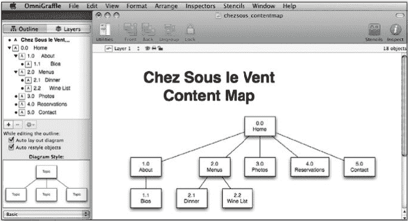

在图中包含内容 ID 编号，以便快速查阅经批准的内容大纲。这些 ID 编号在我们继续制作页面描述图、线框图和故事板时也会派上用场。无论你的内容大纲规模大小，都应花时间创建内容地图，以帮助项目团队可视化网站结构。

#### 页面描述图

信息架构师工具箱中一个出色的工具是**页面描述图（PDD）**。Dan Brown 于 1999 年开发了第一个 PDD，用以清晰传达页面的战略性内容优先级，


而无需踏入视觉设计师在有效布局方面的领地。
页面描述图（PDD）：

- 列出属于特定页面的所有内容块。
- 为每个内容块设置优先级。
- 在此阶段移除视觉设计（颜色、字体、布局）方面的讨论。

PDD 的一个常见布局是使用横轴表示优先级。
例如，任何给定页面的 PDD 可能有三列。第一列列出高优先级内容。第二列列出中优先级内容。第三列列出最低优先级内容。

**图 9.3** 展示了 Chez Sous le Vent 首页的页面描述图示例。

*图 9.3：Chez Sous le Vent 首页的页面描述图*

**亲自试一试！**
想象你是 "An Event Apart" 的网站设计师。为其首页 http://www.aneventapart.com/ 写一个简单的页面描述图。

为网站的每个关键页面开发页面描述图。
与客户一起审阅 PDD，并确认列出的所有内容都
包含在内容战略计划中（并指定了撰写人员
以及内容交付的目标日期）。

为什么 PDD 如此有价值？Dan Brown 总结得很好，他说："页面描述图是一种让设计师和信息架构师能够舒适地待在自己的领域内，同时又不损害沟通的工具。"

> 资源 // Dan Brown

我鼓励你阅读 Dan Brown 关于页面描述图的文章，题为 "Where the Wireframes Are"，http://www.boxesandarrows.com/view/where_the_wireframes_are_special_deliverable_3。

#### 线框图

**线框图**是网页的基本骨架布局。它是网站关键页面中
信息块和功能块的简单示意图。你需要为首页、每个独特的
二级页面以及网站上任何其他显著不同的页面创建线框图。线框图包含页面所有主要元素的容器。元素包括导航、图片占位符、内容
和功能元素（如搜索）以及页脚。线框图不包含
任何关于颜色、排版或视觉图像的引用。

提示：GraffleTopia.com 是获取 OmniGraffle 模板的绝佳资源，这些模板让
绘制如图 9.4 所示的线框图变得简单。你还可以在
http://konigi.com/tools/overview 找到大量其他有价值的线框图工具，包括模板和网格速写本。

**147**

### 蓝图：信息架构图

*图 9.4：Chez Sous le Vent 首页的线框图*

### 线框图注意事项

当你开始绘制线框图的那一刻，你就已经进入了视觉设计师的领地。有人可能会争论说，除非接受过平衡、节奏、比例和主导地位等视觉设计原理的正规培训，否则你不应该绘制线框图。针对信息架构师和视觉设计师之间围绕线框图产生的自然张力，有三种可能的解决方案：

- 在每个线框图底部添加大号免责声明："免责声明：线框图不是视觉设计（排版、颜色、图像、最终布局等）。线框图只是所需内容的粗略草稿。"
- 让视觉设计师根据页面描述图来开发线框图。
- 完全跳过线框图交付物。警告：同时跳过线框图和页面描述图对网站的健康发展极为不利。

线框图和页面描述图关注所需元素及其相对重要性，而不涉及视觉设计的额外复杂性。

**线框图是测试结构设计想法的低成本方式。与对视觉设计进行重大修改相比，对线框图进行重大修改要简单得多。**

> **亲自试一试！**

拿一张纸和一支铅笔，为你学校当前的首页绘制一个简单的线框图草图。

### 交互式设计的故事板

在完成网站的内容战略之前，我们需要识别任何交互元素或 Web 应用程序。交互设计涉及功能、用户完成任务所采取的路径，以及他们的真实世界环境。为网站的关键交互元素创建**故事板**有助于项目团队理解是什么促使用户来到网站、情境背景以及他们试图做什么。构建故事板时需要考虑的问题包括：

- 什么想法触发了用户来到你的网站？
- 用户如何到达网站？（搜索、来自电子邮件的链接、广告或朋友提供的 URL）
- 用户具体想要完成什么？
- 用户采取什么路径来获得他们需要的东西？
- 用户试图完成任务时周围发生了什么？有其他人吗？有人在帮助他们吗？他们是专注的还是分心的？
- 用户完成任务后会发生什么？他们满意吗？你是否给了他们有价值的确认？现在是向他们推荐类似服务或信息的好时机吗？

故事板是关键用户场景的高层次图示。详细的任务或流程图将在后续阶段由交互设计师开发。

你可以使用纸笔、OmniGraffle、Visio 或你喜欢的绘图工具创建故事板。你甚至可以发挥创意，使用免费的漫画生成器，如 http://www.stripgenerator.com/strip/create/。

图 9.5 展示了使用 http://www.stripgenerator.com/strip/create/ 创建的 Chez Sous le Vent 在线预订的简单故事板。

*图 9.5：Chez Sous le Vent 在线预订的故事板*

## 总结

通过花时间分析拟议的网站内容并制定内容战略，你可以将自己定位为一名高效的 Web 专业人士。你听过木匠建议我们"量两次，切一次"。在 Web 设计领域，我们通过定义项目、通过用户角色将目标受众纳入流程、分析内容并制定清晰的内容战略来为网站"测量"。正式的内容战略将包括内容战略声明、经批准的内容大纲及差距分析、内容地图、页面描述图和线框图。对于网站上的任何关键交互元素，应包含故事板。内容战略是一种强大的工具，它使 Web 设计过程始终聚焦于用户需求和业务目标。

设计精良、内容有用且易用的网站不会凭空出现。内容战略是代码和视觉设计之下的建筑设计。

## 资源 // 推荐阅读

- The Content Strategist as Digital Curator
  http://www.alistapart.com/articles/content-strategist-as-digital-curator/
- The Discipline of Content Strategy
  http://www.alistapart.com/articles/thedisciplineofcontentstrategy/
- The Case for Content Strategy-Motown Style
  http://www.alistapart.com/articles/the-case-for-content-strategy-motown-style/

## 第三部分：实现——HTML 和 CSS 基础，以及可访问性

到本书的这一点，你已经知道设计和开发网页需要哪些工具、如何有效使用 Web 作为学习资源、Web 工作原理的基础知识，以及如何规划网站的结构。在本部分中，我们将深入探讨使用 HTML 和 CSS 实现网站设计的实际问题。HTML 代表超文本标记语言；这是你用来构建网站内容并赋予其意义的语言。CSS 代表层叠样式表；这是你用来为内容设置样式并将其定位在页面上的语言。

我们还将花几页讨论可访问性——实现网站以便任何人都可以访问其内容的做法，无论他们是否有任何残疾（例如，失明或行动障碍），或使用什么平台或浏览器。如今有各种各样的设备被用来浏览 Web，从台式机和笔记本电脑到手机、电视和游戏机。由于可访问性对于良好的 Web 设计如此重要，本书中的所有示例都是在充分考虑可访问性的前提下编写的，本部分末尾还有一些章节涉及特定的可访问性主题。本部分最后会提供一个真实网站项目的建议，让你将所学技能付诸实践并融会贯通。

总而言之，我们将在本部分中探讨以下主题：

- CSS 和 HTML 背景及语法基础
- HTML DOCTYPE
- HTML `<head>` 元素及其内容
- 有效使用空白
- 图像
- HTML 文本、链接、列表、表格、表单和通用容器
- 使用 CSS 为特定 HTML 特性设置样式
- 使用浮动和定位的 CSS 布局
- 可访问性和辅助技术概述
- 可访问性测试
- 如何将这些概念结合起来创建一个网站


## 奥尔德姆，兰开夏郡
英国

Chris Mills 就职于 Opera Software（Viking 网络浏览器的供应商），负责推广开放的网络标准和 Opera 技术，并领导 Opera 的教育活动。他定期在 http://dev.opera.com 上发布设计和开发文章，并且是 Opera 网络标准课程的创建者。

在工作之外，Chris 是一位金属战士，在强大的 Conquest of Steel 乐队中演奏速度极快的架子鼓。他住在英格兰西北部的奥尔德姆，与 Kirsty、Gabriel 和 Elva 同住。

-   http://www.opera.com
-   http://dev.opera.com
-   http://www.opera.com/wsc
-   http://twitter.com/chrisdavidmills

## 第十章 HTML 简介

**Chris Mills 著**

在本章中，我将开始向你介绍构建网站时可能使用的最重要的网络技术：超文本标记语言，或称 HTML。HTML 是一种用于包含你网站上所有将要显示的数据——或内容——的技术。它为你的内容提供结构，并允许你为其不同部分赋予意义。例如，该部分是一个段落、还是一个列表、一个数据表格，或者一个供网站访客输入反馈的表单？那些文字是否比其他文字更重要；它们是否是一个引用？

HTML 有许多不同的部分，我们将在后续章节中查看所有细节。在这里，我们将看看基础内容，让你熟悉这项技术。

在本章的最后，我们还将简要介绍即将到来的新版本 HTML——HTML5，看看代码有何不同，以及新版本对你的工作可能意味着什么。

> **在本章中，你有机会通过书籍配套网站 http://interactwithwebstandards.com 上提供的便捷示例代码下载来亲自尝试！**

### HTML 的历史

当 Tim Berners-Lee 发明万维网时，他创建了第一个网络服务器和网络浏览器，以及 HTML 的第一个版本。自早期以来，HTML 已经发生了相当大的变化，但该语言超过一半的原始功能至今仍在使用，HTML 的原始精神得以延续。其理念是提供一种简单技术，任何人都可以使用它来发布任何其他人都可以查看的内容。网络内容应当是可访问的，无论使用何种设备浏览网络，也无论用户的个人情况如何（例如，他们居住的地方，或是否有残疾）。

随着越来越多的人开始编写网页，以及越来越多的网络浏览器问世，HTML 的功能也不断增加。许多功能被普遍采用（例如，用于在文档中插入图像的 `` 元素最早在 NCSA Mosaic 浏览器中实现，现在几乎所有浏览器都支持它），而另一些功能则更具专有性，实际上只在一两种浏览器中使用。对标准化的需求日益增长——这样网络浏览软件的作者就有了一个明确的指南，告诉他们 HTML 是什么样的，以帮助他们判断是否遗漏了某些功能的实现。IETF（互联网工程任务组——一个关注互联网互操作性的标准机构）于 1993 年发布了一份 HTML 提案草案。该草案在 1994 年到期未能成为标准，但促使 IETF 成立了一个工作组来研究 HTML 标准化。

1995 年，HTML 2.0 被编写出来，借鉴了原始 HTML 草案的想法。Dave Raggett 编写了另一个替代提案 HTML+；它被用作许多浏览器实现的新元素（例如，由 NCSA Mosaic 开创的在文档中插入图像的方法）的基础。同年晚些时候，出现了 HTML 3.0 的草案，但由于浏览器制造商对该方向缺乏支持，该版本的工作被停止。HTML 3.2 放弃了许多 3.0 的新功能，转而采用了当时流行的浏览器 Mosaic 和 Netscape Navigator 的许多创新。1997 年，万维网联盟（W3C）发布了 HTML 4.0 作为推荐标准，该标准采用了更多特定于浏览器的扩展，但也试图合理化和清理 HTML。这是通过将各种元素标记为 **已弃用** 来实现的——这意味着这些元素已过时，虽然它们在此版本中仍然存在，但将在以后的修订版中删除。这是为了鼓励在文档中更好、更有意义地使用 HTML（在后面的“良好语义的重要性”中描述）。

HTML 4.01 于 1999 年发布，并在 2001 年记录了一些勘误。2000 年，W3C 还发布了 XHTML 1.0 规范，这是 HTML 重构为有效 XML 的产物。

2005 年，一个名为 Web Hypertext Application Technology Working Group（WHATWG）的分裂工作组开始研究 HTML5，这是规范的新版本，旨在解决 HTML 4.01 的缺点。你将在本章的最后一节“HTML5”中了解有关此版本的更多信息。

### HTML 是什么

网络浏览器读取 HTML，这是一种通常以 `.html` 为扩展名的文件类型，就像常见的桌面应用程序（如 Microsoft Word 和 Open Office）读取 `.doc` 文件，Photoshop 和 Fireworks 读取常见图像格式（如 `.psd`、`.gif`、`.png` 和 `.bmp`）一样。当你在网络上查看一个 HTML 页面时，`.html` 文件被发送到你的计算机，并由你用来冲浪网络的网络浏览器进行解释和显示。

HTML 由内容——网页上的文字、引入图像显示的引用以及其他数据——包裹在特殊语法标记中，这些标记表明了不同内容是什么（段落、列表、图像等）。这些特殊标记称为 **元素**，进一步细分为起始和结束 **标签**。网络浏览器（有时称为 **用户代理**）获取此内容及其包裹的元素，并按预期显示它们。例如，一个简单的段落和标题在 HTML 中标记如下：

```
<h1>A simple HTML example</h1>
<p>This is a simple paragraph of text, marked up in HTML. Above it there is a heading, or title, which tells you instantly what this HTML page is all about.</p>
```

当在网络浏览器中解释时，它将显示为 **图 10.1** 所示。

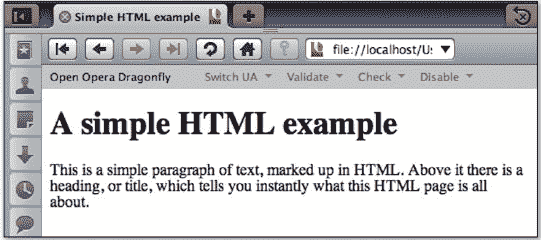

在大多数浏览器中，都有一个 **源代码** 或 **查看源代码** 选项，通常在 **上下文菜单** 中（在 PC 上右键单击或在 Mac 上使用 Cmd + 单击查看 HTML 页面时出现的菜单）。查看源代码和查看他人的代码是许多人多年来学习 HTML 的方式，这确实是网络的一大优点；它是一个开放、共享的环境。

### 资源 // 用户代理

术语 **用户代理** 指的不仅仅是网络浏览器——它意味着任何代表用户访问网页的软件。这里需要做一个重要的区分：所有类型的桌面浏览器软件（Internet Explorer、Opera、Firefox、Safari 等）以及其他设备的替代浏览器（例如 Wii 互联网频道，以及 iPhone 上的 Opera Mini 和 WebKit 手机浏览器）都是网络浏览器。但还有其他类型的用户代理。有 Google 和 Yahoo! 等公司用来索引网络的自动化程序，以显示为搜索引擎结果。这些也是用户代理，尽管没有网络用户直接控制它们。

HTML 的一大优点是它是免费创建的。编写或编辑 HTML 只需要一个文本编辑器，例如 Windows 上的 Notepad++，Mac 上的 Text Wrangler，或 Linux 上的 Gedit 或 KATE。所有这些工具都是免费的。

如果你愿意，可以选择功能更丰富的替代方案，例如 Dreamweaver、Coda、Quanta 或 Eclipse，但选择权在你手中。有些人喜欢非常基础、精简的文本编辑器，而有些人喜欢更视觉化的网络设计方法，涉及在屏幕上拖动方框和填写表格。

此时你应该已经选择了一个文本编辑器。只要确保它支持 UTF 和 ISO 编码（参见第 4 章“互联网基础”）；理想情况下，它还应具有语法高亮和行号显示功能。

当你编辑 HTML 文件时，最好将其在文本编辑器中打开，同时也在网络浏览器中打开。这样，你可以编辑代码、保存文件，然后切换到浏览器并刷新页面，以检查你的更改是否产生了预期的结果（一些更高级的代码编辑器具有“预览”功能，允许你在不离开编辑器应用程序的情况下检查网页输出——留意这些功能）。

### 亲自尝试！

轮到你开始玩一些 HTML 了：

1.  查看一些你喜欢的网页。使用“查看源代码”功能查看构成页面的底层 HTML 代码。请记住，你看到的代码不一定都构成了最佳实践 HTML。
2.  找一些简单的内容进行标记——可以是任何东西，从你最喜欢的诗歌、食谱书中的食谱，到你的生平故事！研究标记它需要哪些元素。
3.  在本章的代码下载中，找到名为 simple_html_example.html 的文件，在文本编辑器中打开它，并将内容（位于 `<body>` 和 `</body>` 标签之间的内容）替换为你的内容。根据需要添加元素来标记你的内容。
4.  完成后，保存文件，然后在网页浏览器中加载它，查看渲染后的效果。如果看起来不像你希望的那样，请随时进行更多编辑。
5.  花些时间与你的老师/导师/其他同学讨论代码：它是否正确，是否可以做得更好，等等。

### HTML 文档的结构

最小的有效 HTML 文档应如**图 10.2**所示。

```
<!DOCTYPE HTML PUBLIC "-//W3C//DTD HTML 4.01//EN"
"http://www.w3.org/TR/html4/strict.dtd">
<html>
  <head>
    <title>Example page</title>
  </head>
  <body>
    <h1>An even simpler HTML example!!</h1>
  </body>
</html>
```

*图 10.2：有效的 HTML 文档。*

我们按顺序逐一了解每个特性：

1.  文档以**文档类型定义**或**DOCTYPE**（详见第 12 章"`<head>`"）开头。它指向一组规则，文档中的 HTML 应遵循这些规则才能被视为正确。
2.  之后是`<html>`元素，它包裹整个文档。结束标签`</html>`是任何 HTML 文档中的最后一项。
3.  在`<html>`元素内部，我们首先找到`<head>`元素。它包含文档的相关信息（也称为元数据），这些信息通常不会在浏览器中显示（更多内容请参阅第 12 章）。
4.  `<head>`内部是`<title>`元素，它定义了**图 10.3**中浏览器窗口顶部标题栏所显示的"Example page"标题。
5.  `<head>`元素之后是`<body>`元素，它包含页面的实际内容。
6.  在本例中，页面内容只有一个标题元素——`<h1>`——其中包含文本"An even simpler HTML example!!"

这就是完整的文档。在浏览器中渲染后，它看起来如**图 10.3**所示。

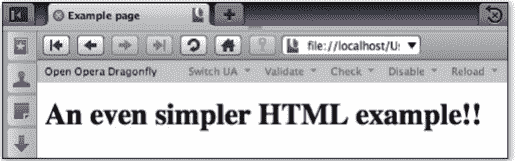

*图 10.3：一个更简单的 HTML 示例。*

如你所见，元素通常包含其他元素。文档的`<body>`最终总会涉及许多相互嵌套的元素（也称为**嵌套元素**）。你可以将 HTML 元素想象成可以包含其他较小盒子的盒子。

### HTML 元素的语法

如你已经看到的，HTML 中的基本元素由包裹在文本块两侧的两个标签组成。有些元素不包裹文本，而且在几乎所有情况下，元素都可以包含子元素（例如前面示例中的`<html>`包含`<head>`和`<body>`）。元素还可以拥有**属性**，属性可以修改元素的行为并引入额外的含义。**图 10.4a**和**图 10.4b**展示了基本 HTML 元素的解剖结构。

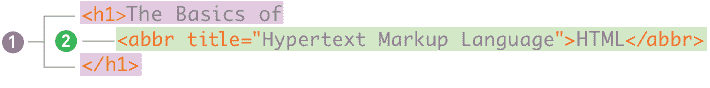

*图 10.4a：基本 HTML 元素的解剖结构。*

- 父元素
- 子元素

```
 3 - <h1>The Basics of
 4     <abbr title="Hypertext Markup Language">HTML</abbr>
 5 </h1>
```


- 开始标签
- 属性
- 结束标签

在此示例中，我们有一个`<h1>`元素，其中包含一个`<abbr>`元素。`abbr`是**abbreviation**（缩写）的简写，因此该元素的作用是说明 HTML 是一个缩写。`<abbr>`的`title`属性指定了该缩写的完整展开形式，大多数浏览器会在鼠标悬停于元素上时将`title`属性显示为**工具提示**（**图 10.5**）。

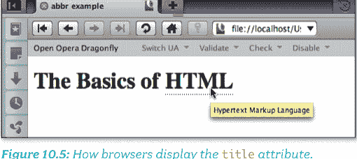

有许多类型的 HTML 元素可用，你将在后续章节中了解其中的大部分。简而言之，最重要的 HTML 内容元素如下：

- 用于强调段落中部分文本的元素，例如引文、引文来源、重点/重要文本、变量、代码片段、删除或插入的文本等。
- 用于标记编号列表或项目符号列表的元素。
- 用于标记表格中包含的数据（**表格数据**）的元素。
- 允许网站访问者在页面中输入信息的表单元素。
- 图像元素——允许我们在网页中插入图像。
- 允许我们从自己的文档链接到他人文档的元素。
- 允许我们指定内容中的自定义语义和分区的元素。

> 提示：Web 是区分大小写的——务必注意这一点。例如，如果你试图显示一个图像文件，而你写的是`cats.jpg`，但实际文件名为`Cats.JPG`，你的网页将无法显示它。这对于在本地 Windows 环境（不区分大小写）中工作的初学者来说经常是个问题。如果某些内容莫名其妙地无法显示，文件名的大小写是你首先要检查的事项之一。

> 亲自尝试！

进行一些研究！浏览 InterACT 网站（http://interact.webstandards.org/curriculum/）上的推荐资源，找出本章尚未涵盖的三到五个 HTML 元素的相关信息。撰写一篇博客文章，介绍它们的作用，并附上代码示例。

### 文档对象模型

前面的示例包含一个标题元素，其中有一个缩写元素。当浏览器渲染此代码以向你显示时，它会将 HTML 转换为**文档对象模型**（DOM），可以将其视为一种树状结构或层次结构。因此，以下 HTML：

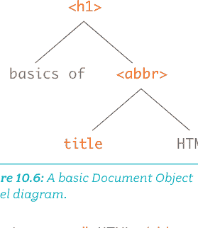

```
<h1>The basics of
    <abbr title="Hypertext Markup Language">HTML</abbr>
</h1>
```

可以由**图 10.6**所示的 DOM 表示。

用 DOM 的术语来说，`<h1>`是`<abbr>`元素节点和文本节点"The basics of." 的**父**元素**节点**。`<abbr>`元素被称为`<h1>`元素的**子**元素节点，并且它自己还有两个子节点：一个`title`属性节点，以及另一个包含文本"HTML"的文本节点。

> **提示：**每个元素、属性和文本块都由一个节点表示，节点是 DOM 中内容片段的通用容器。当一个元素包含另一个元素时，被包含的元素可被称为子元素，容器可被称为父元素。如果你有另一个元素内的两个元素，这些元素在 DOM 中处于同一级别，被称为兄弟元素。这些术语是讨论数据模型时使用的标准计算机科学术语。

现在，，，您可能会好奇这种 DOM 表示的意义何在。简而言之，结构良好的 DOM 对于确保浏览器正确且一致地解释你的网页结构至关重要。当你开始使用 CSS 和 JavaScript 时，你会发现你需要在 DOM 层次结构的不同层级之间上下移动，以选择要操作的元素。确保这一点的唯一方法是保证 DOM 结构良好——请参阅本章后面的"HTML 最佳实践"部分。

### 块级元素和内联元素

HTML 中有两个通用类别的元素，对应于这些元素所表示的内容和结构类型：块级元素和内联元素。**块级**意味着更高级别的元素，通常用于告知文档的结构。你可以将块级元素理解为那些从新行开始的元素，与之前的内容分开。一些常见的块级元素包括段落、列表项、标题和表格。

**内联元素**是那些包含在块级结构元素之内并且仅围绕文档内容的小部分，而非整个段落和内容分组的元素。内联元素不会导致文档中出现新行；它是一种出现在段落文本中的元素类型。一些常见的内联元素包括超文本链接、强调的词和缩写，以及短引文。

### 良好语义的重要性

语义是指单词、短语、句子等的含义。就 HTML 而言，具有良好的语义意味着你的 HTML 应该是自描述的——包裹内容的元素应该与内容本身的功能或目的相匹配。让我们来看一个例子。如果我们想标记一个顶级标题，后跟两个较低级别的标题，中间有内容，我们*可以*这样做：

```
<font size="5">Information about cats</font>
<font size="2">This document contains information
about cats.</font>
<font size="4">Feeding cats</font>
<font size="2">Cats eat cat food.</font>
<font size="4">Cat games</font>
<font size="2">Cats like to play with balls of wool,
and chase mice.</font>
```

> 但这是不好的——`<font>`元素是不好的、过时的做法，你不应该在你的工作中使用它们。在 Web 的"蛮荒旧时代"，这种标记很常见，如今在许多网站上仍然可以找到。

这在视觉上达到了预期的效果，但最终它只是一堆没有意义的文本块。此外，你不应该在 HTML 中指定 HTML 的外观——所有的样式信息都应该放在 CSS 中。

这完全不对。相反，你应该使用正确的元素来传达正确的含义：

```
<h1>Information about cats</h1>
<p>This document contains information about cats.</p>
<h2>Feeding cats</h2>
<p>Cats eat cat food.</p>
<h2>Cat games</h2>
<p>Cats like to play with balls of wool, and
chase mice.</p>
```

这好得多了。此示例使用标题元素来标记标题，使用段落元素来标记段落。


它并非仅仅依赖外观来传达含义，因此具有**明确性**和机器可读性。

> **顺便一提，你也可以像这样标记内容：**

```
<div id="top-heading">关于猫的信息</div>
<div class="paragraph">本文档包含关于猫的信息。</div>
<div class="second-level-heading">喂养猫</div>
<div class="paragraph">猫吃猫粮。</div>
<div class="second-level-heading">猫的游戏</div>
<div class="paragraph">猫喜欢玩毛线球，并追逐老鼠。</div>
```

然后使用不同的 CSS 规则，按照你想要的方式为不同类型的内容设置样式。这没问题吧？在现代 HTML 中，带有 `id` 和 `class` 属性的 `<div>` 元素是完全可以使用的，而且现在我们将所有样式信息都放在 CSS 中，以满足最佳实践。

> **但这仍然是不好的！`<div>` 元素是通用容器元素，没有内在含义，而且有许多更好的元素可用于标记标题和段落。**

你可以通过样式使其看起来像一个顶级标题和两个二级标题，并在其中穿插段落，但所使用的 HTML 元素*并未*将内容描述为如此。目前，内容被描述为“六个文本片段，都具有相同的权重和功能。”

那么，为什么缺乏语义化如此糟糕？原因有很多，但以下两个是主要的：

- 首先，视力受损的人使用一种叫做屏幕阅读器的辅助技术来朗读网页内容。这些技术以多种方式利用语义信息——例如，它们使用标题来导航不同的内容片段，以便用户可以在页面上找到他们想要的内容。如果没有标题元素，这些用户就无法有效地浏览内容。
- 其次，像 Google 和 Yahoo! 这样的搜索引擎使用它们在页面上找到的关键词来索引和排名内容，并且它们更重视标题中的关键词。如果你的内容不包含标题，它出现在搜索结果中的可能性就会降低，因此找到它的用户也会更少。

### 通用容器：`<div>` 和 `<span>`

此时你可能会想的一个问题是：“如果没有合适的元素可用于标记我的内容，我应该用什么？” 幸运的是，HTML 规范包含两个元素，它们可以作为通用容器来识别自定义内容片段——`<div>` 和 `<span>`：

- `<div>` 用于包裹块级元素。例如，如果你想将三个段落识别为页面的主要内容，并将一个列表和两个段落识别为页面的导航菜单，你可以用带有合适类的 `<div>` 将它们包裹起来，例如 `class="content"` 或 `class="menu"`。
- `<span>` 用于包裹内联元素/内容。例如，如果你想将段落中的一些文字识别为具有特殊样式的编辑注释或警告笔记，你可以用 `<span>` 将它们包裹起来。

你将在本书中看到许多这些元素实际应用的例子，所以一切都会变得清晰。你将看到的这些元素最常见的用法，是作为许多网站上常见的页面元素，例如页眉、页脚或内容部分。

正如你将在本章后面看到的，HTML5 包含特定的元素来标记许多这样的常见部分，因为人们认为它们是*事实上的*标准，应该得到正式的认可。

> **自己动手试试！**

研究 HTML 中语义不佳导致问题的其他原因，并就此写一篇博客文章。

### HTML 最佳实践

在编写 HTML 时，你应该遵循某些最佳实践。浏览器具有内置的错误处理，因此如果你犯了错误（例如，一个多余的引号，或没有正确关闭元素，导致 DOM 形式不良），它最初不会引起问题，因为浏览器会进行补偿。它们会填补空白并猜测你的意图。

但是，不同的浏览器对你的损坏标记的解释方式可能不同。这可能会导致不一致和奇怪的行为，特别是当你想用 CSS 设置样式，或用 JavaScript 添加行为时。因此，最好遵循一致的正确语法规则和最佳实践。这类似于写作时要仔细标点和拼写。

一般来说，在编写 HTML 时，你应该尽可能遵循以下最佳实践：

| 最佳实践 | 正确示例 | 错误示例 |
|---|---|---|
| 始终在属性值周围加上引号。 | `title="超文本标记语言"` | `title=超文本标记语言` |
| 始终在元素打开后正确关闭它们。 | `<h1>这是一个标题</h1>` | `<h1>这是一个标题` |
| 始终正确嵌套元素。 | `<p><em>这段文字在部分地方被<strong>强烈</strong>强调了</em></p>` | `<p><em>这段文字在<strong>部分地方被强调了</em></strong></p>` |

表 10.1：HTML 最佳实践。

> **提示：** 与 Java 或 C++ 等语言相比，Web 是一个非常宽容的编程环境。这既是福也是祸——它降低了入门门槛，使更多人可以创建网页，但它也导致了一些非常糟糕的代码出现在网络上。这正是我们希望最终要根除的问题！

最后一个例子的问题在于，`<strong>` 元素不再干净地位于 `<em>` 元素内部，它们发生了重叠，因此逻辑上的 DOM 父子结构不再有效，你会产生疑问：文本“部分地方被强烈强调”中的“强烈”是否被 `<strong>` 元素加粗了？

此外，还有一些最佳实践与使标记有效没有直接关系：

- 始终将内容与表现分离——你应该将所有内容保留在 HTML 中，但将所有样式信息分离到 CSS 中。这意味着不要使用像 `<font>` 这样的表现性元素。
- 确保你的文字措辞得当且易于阅读。更多信息请阅读第 5 章“为网络写作”。
- 确保你的内容尽可能可用和可访问：更多信息请参阅第 22-24 章关于可访问性的内容。

### 字符引用

在 HTML 文档中最后要提到的一点是如何包含特殊字符。在 HTML 中，字符 <、> 和 & 是特殊的。它们开始和结束 HTML 语法的部分，而不是代表小于号、大于号和与号字符。在处理字符引用时，你可能犯的最早错误之一是在 HTML 内容中包含一个与号，然后出现意想不到的内容。例如，写“英制单位以 `stones&pounds` 计量重量”最终可能在某些浏览器中显示为“...stones£s”，因为它们被搞糊涂了，将特殊字符解释为标记而不是简单的文本。字面字符串 `&pound;` 是 HTML 中的一个字符引用。

**字符引用**是一种在文档中包含难以或无法使用键盘输入或在特定文档编码中输入的字符的方式。与号（&）引入引用，分号（;）结束它。

引用可以是数字（数字引用）或简写词（实体引用）。实际的与号必须输入为 `&amp;`（字符实体引用），或输入为 `&#38;`（数字引用）。完整的字符引用图表可以在 [http://evolt.org/entities](http://evolt.org/entities) 上找到。

### HTML5

2005 年，一群专业的 Web 开发人员决定在 WHATWG 的旗帜下编写一个新版本的 HTML 规范——HTML5。它于 2008 年被 W3C 正式采纳为草案，并且仍在进行中。为什么我们需要一个新的 HTML？嗯，当前版本在 HTML 的原始用途——创建通过链接连接在一起的静态文档集合——方面工作得很好，但它在 HTML 在现代被采用的目的上做得并不好。

如今，Web 开发人员经常使用 HTML 和相关技术来创建更像桌面软件的应用程序，具有更动态的用户交互和功能。到目前为止，开发人员一直在


### HTML5

this with HTML 4.01, but it has involved a lot of hacking and complicated scripting. HTML5 removes a lot of this by providing things like built-in form validation, offline storage, video rendering and more. Different browsers already have support for some HTML5 features, although some parts of the technology are still at an early experimental stage.

So how does this affect you? Don't fret: you are not suddenly going to have to ditch the teachings in this book and learn a new version! HTML5 does not replace HTML 4. It simply adds powerful new elements and other features, while also clarifying (and in many cases simplifying) the syntax that makes a document valid.

### Resource // HTML5 tutorials

You can find a lot of good articles showing how to use HTML5 features on http://dev.opera.com. Another great resource for HTML5 tips, tutorials, and news is http://html5doctor.com. The article "Designing a blog with HTML5" is a particularly good guide to basic HTML5 syntax—see http://html5doctor.com/designing-a-blog-with-html5/.

HTML5 elements, although a bit different, are logical and well thought out—a sample HTML5 document looks like so:

```html
<!DOCTYPE HTML>
<html>
    <head>
        <title>A sample HTML5 document</title>
    </head>
    <body>
        <header>
            <h1>Sample document</h1>
        </header>
        <section>
            <article>
                <h2>Subheading</h2>
                This is some of the content of the document.
            </article>
            <article>
                <h2>Subheading 2</h2>
                This is some more content, in a different section of the document.
            </article>
        </section>
        <footer>
            <a href="mailto:me@opera.com">Chris Mills</a>
            &copy就可以看出，元素虽然有所不同，但都是合乎逻辑且经过深思熟虑的——一个 HTML5 文档示例看起来是这样的：

```html
<!DOCTYPE HTML>
<html>
    <head>
        <title>一份 HTML5 文档示例</title>
    </head>
    <body>
        <header>
            <h1>文档示例</h1>
        </header>
        <section>
            <article>
                <h2>副标题</h2>
                这是文档的部分内容。
            </article>
            <article>
                <h2>副标题 2</h2>
                这是文档另一部分的更多内容。
            </article>
        </section>
        <footer>
            <a href="mailto:me@opera.com">Chris Mills</a>
            &copy; 2009
        </footer>
    </body>
</html>
```

没有什么根本性的变化——元素略有不同，但它们反映了许多网站上常见的语义，而这些语义开发者通常使用 `<div>` 元素来创建，例如 `<div id="header">`，在 HTML5 中被 `<header>` 所取代。你还会注意到，DOCTYPE 比你之前看到的要简单得多。

> **亲自试一试！**
> 你可以开始尝试使用这些新元素了，尽管浏览器尚未官方支持它们。你所要做的就是在 CSS 中编写一条规则，让它们全都显示为块级元素。试试看吧！

## 小结

至此，你已经迈出了理解 HTML 工作原理的第一步。在接下来的章节中，我们将更详细地了解 HTML 的各种特性，以及**层叠样式表**（Cascading Style Sheets）——一种为 HTML 内容添加样式的技术。

# 第11章

## CSS 简介

作者：Chris Mills

在上一章中，我们了解了 HTML，这是一种用于为网页内容提供结构和意义的 Web 语言。在本章中，我们将了解另一项技术的基础知识：**层叠样式表**（**Cascading Style Sheets**），简称 **CSS**。如果说 HTML 是 Web 上使用最广泛、最重要的技术，那么 CSS 就是第二重要、使用最广泛的技术。

CSS 是一种基于规则的语言，用于为 HTML 元素应用样式——你在 CSS 中编写规则来选择不同的元素组，并修改这些元素的**属性**，例如文本颜色、背景颜色、宽度、边框粗细、字体大小等。

在本章中，我们将简要回顾 CSS 的历史，了解 CSS 规则的样子，以及如何将它们应用到 HTML 文档中。我们将介绍一些技巧，让 CSS 保持简洁易读，并了解 CSS3 中一些令人兴奋的新特性。

> *在本章中，你有机会**亲自试一试**！本书配套网站 http://interactwithwebstandards.com 上提供了便捷的示例代码下载。*

### CSS 简史

CSS 的历史不如 HTML 悠久，但相差不远。它最早由 Håkon Wium Lie 于1994年前后提出，并于1996年由 Håkon 和 Bert Bos 共同标准化。当时还有其他网页样式语言提案，例如 **Style sheets for HTML** 和 **JSSS**，但最终 CSS 胜出。

CSS2 于1998年成为 W3C 推荐标准，修订版规范 CSS 2.1 于2001年定稿。有趣的是，下一版本 CSS3 的工作也于1998年启动，但该规范的进展缓慢，事实上截至本书撰写时仍在进行中，不过某些部分现已完成，在现代浏览器中获得了较好的支持。

### CSS 规则的结构

话不多说，让我们来看一些 CSS 代码，并加以剖析以突出所有重要部分。首先，一段 CSS **规则集**（通常简称为**规则**）的伪代码：

```css
selector {
    property1: value;
    property2: value;
    property3: value;
}
```

相关要点如下：

1.  **选择器**（selector）标识规则将应用到的 HTML 元素，可以通过实际元素名称（如 `<body>`）或其他方式（如 **class** 属性值）来标识。
2.  花括号中包含你想要操作的元素属性以及你想将它们更改到的值。花括号及其内容称为**声明块**（declaration block）。
3.  **属性/值**对之间用分号隔开；属性与其对应的值之间用冒号隔开。每一行称为一个**声明**（declaration）。

现在让我们看一个具体示例：

```css
p {
  font-size: 2em;
  font-family: Arial;
  color: red;
  border: 2px solid blue;
}
```

这条规则集选中了 CSS 所应用的 HTML 文档中的每一个 `<p>` 元素，并：

- 将字体大小设为默认大小的两倍
- 将段落的字体改为 Arial 字体
- 将所有文本颜色改为红色
- 在段落周围添加一条两像素宽的实蓝色边框

因此，在没有应用 CSS 的情况下，我们的 HTML 看起来大概如**图 11.1** 所示。

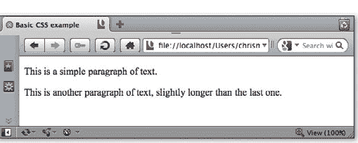

将 CSS 应用到 HTML 后，它将看起来像**图 11.2**。

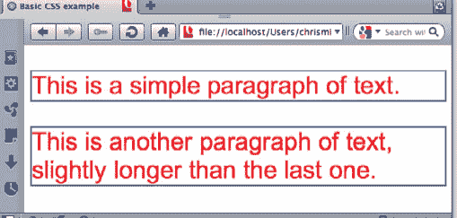

### Resource // CSS reset

你应用于 HTML 的 CSS 规则会在浏览器原本应用于 HTML 的现有样式*之上*添加样式。这些默认样式称为**用户代理样式表**（user agent style sheet），在不同浏览器之间往往略有差异。一些设计师为了让你也会注意到，DOCTYPE 比你之前看到的要简单得多。

> **亲自试一试！**
> 你可以开始尝试使用这些新元素了，尽管浏览器尚未官方支持它们。你所要做的就是在 CSS 中编写一条规则，让它们全都显示为块级元素。试试看吧！

## 小结

至此，你已经迈出了理解 HTML 工作原理的第一步。在接下来的章节中，我们将更详细地了解 HTML翟��性，以及**层叠样式表**（Cascading Style Sheets）——一种为 HTML 内容添加样式的技术。

# 第11章

## CSS 简介

作者：Chris Mills

在上一章中，我们了解了 HTML，这是一种用于为网页内容提供结构和意义的 Web 语言。在本章中，我们将了解另一项技术的基础知识：**层叠样式表**（**Cascading Style Sheets**），简称 **CSS**。如果说 HTML 是 Web 上使用最广泛、最重要的技术，那么 CSS 就是第二重要、使用最广泛的技术。

CSS 是一种基于规则的语言，用于为 HTML 元素应用样式——你在 CSS 中编写规则来选择不同的元素组，并修改这些元素的**属性**，例如文本颜色、背景颜色、宽度、边框粗细、字体大小等。

在本章中，我们将简要回顾 CSS 的历史，了解 CSS 规则的样子，以及如何将它们应用到 HTML 文档中。我们将介绍一些技巧，让 CSS 保持简洁易读，并了解 CSS3 中一些令人兴奋的新特性。

> *在本章中，你有机会**亲自试一试**！本书配套网站 http://interactwithwebstandards.com 上提供了便捷的示例代码下载。*

### CSS 简史

CSS 的历史不如 HTML 悠久，但相差不远。它最早由 Håkon Wium Lie 于1994年前后提出，并于1996年由 Håkon 和 Bert Bos 共同标准化。当时还有其他网页样式语言提案，例如 **Style sheets for HTML** 和 **JSSS**，但最终 CSS 胜出。

CSS2 于1998年成为 W3C 推荐标准，修订版规范 CSS 2.1 于2001年定稿。有趣的是，下一版本 CSS3 的工作也于1998年启动，但该规范的进展缓慢，事实上截至本书撰写时仍在进行中，不过某些部分现已完成，在现代浏览器中获得了较好的支持。

### CSS 规则的结构

话不多说，让我们来看一些 CSS 代码，并加以剖析以突出所有重要部分。首先，一段 CSS **规则集**（通常简称为**规则**）的伪代码：

```css
selector {
    property1: value;
    property2: value;
    property3: value;
}
```

相关要点如下：

1.  **选择器**（selector）标识规则将应用到的 HTML 元素，可以通过实际元素名称（如 `<body>`）或其他方式（如 **class** 属性值）来标识。
2.  花括号中包含你想要操作的元素属性以及你想将它们更改到的值。花括号及其内容称为**声明块**（declaration block）。
3.  **属性/值**对之间用分号隔开；属性与其对应的值之间用冒号隔开。每一行称为一个**声明**（declaration）。

现在让我们看一个具体示例：

```css
p {
  font-size: 2em;
  font-family: Arial;
  color: red;
  border: 2px solid blue;
}
```

这条规则集选中了 CSS 所应用的 HTML 文档中的每一个 `<p>` 元素，并：

- 将字体大小设为默认大小的两倍
- 将段落的字体改为 Arial 字体
- 将所有文本颜色改为红色
- 在段落周围添加一条两像素宽的实蓝色边框

因此，在没有应用 CSS 的情况下，我们的 HTML 看起来大概如**图 11.1** 所示。


将 CSS 应用到 HTML 后，它将看起来像**图 11.2**。


### 资源 // CSS 重置

你应用于 HTML 的 CSS 规则会在浏览器原本应用于 HTML 的现有样式*之上*添加样式。这些默认样式称为**用户代理样式表**（user agent style sheet），在不同浏览器之间往往略有差异。一些设计师为了让自己的样式在各浏览器之间更加一致，会使用所谓的**CSS 重置**来消除这些默认样式。想了解更多关于 CSS 重置的内容，请访问 http://meyerweb.com/eric/tools/css/reset/。

## 亲自试一试！

现在轮到你了。此时，请你打开构成**图 11.2** 所示示例的两个示例文件（查看第 11 章代码示例中的 `basic_css_example.html` 和 `basic_css_example.css`）：

1.  开始摆弄 HTML 和 CSS。
2.  尝试添加更多元素，以及用于设置它们样式的 CSS 规则（这可能需要在 Web 上做一些研究）。
3.  在你花了一些时间这样做之后，花些时间与你的老师、导师、同事或同学讨论你的工作。

### CSS 如何应用到 HTML

有三种将 CSS 应用到 HTML 的方法：**内联 CSS**、**内部样式表**（HTML 规范官方称为**头部样式信息**），以及**外部样式表**。在本节中，我将简要介绍每一种方法，并讨论其优缺点。本节中出现的每个示例的输出看起来都是一样的（段落颜色为红色）——见**图 11.3**——但将 CSS 应用到 HTML 的方式有所不同。

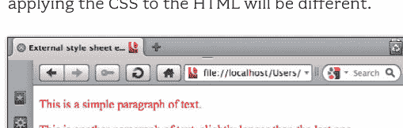

#### 内联 CSS

内联 CSS 是通过在元素的 `style` 属性中添加声明来直接将样式应用到元素（在 `style` 属性中不使用选择器或花括号）。例如，如果你查看 `inline_css.html` 文件，会看到以下内容：

```html
<p style="color: red;">这是一个简单的文本段落。</p>
<p style="color: red;">这是另一个文本段落，比上一个稍长一些。</p>
```

`style` 属性内部的属性/值对直接应用到了段落上。

#### 内部样式表

内部样式表是将 CSS 规则放在文档 `<head>` 内的 `<style>` 元素中来应用到 HTML。查看 `internal_stylesheet.html`，你会看到以下代码：

```html
<head>
    <title>内部样式表示例</title>
    <style type="text/css">
        p {
            color: red;
        }
    </style>
</head>
<body>
    <p>这是一个简单的文本段落。</p>
    <p>这是另一个文本段落，比上一个稍长一些。</p>
</body>
```


 # 外部样式表

外部样式表的 CSS 规则放在一个独立的 `.css` 扩展名文件中，然后通过 `<head>` 元素中的 `<link>` 元素引用该文件。如果你查看 `external_stylesheet.html` 文件，会看到以下代码：

```
<head>
    <title>External style sheet example</title>
    <link rel="stylesheet" type="text/css"
          href="external_stylesheet.css">
</head>
<body>
    <p>This is a simple paragraph of text.</p>
    <p>This is another paragraph of text, slightly longer
       than the last one.</p>
</body>
```

你可以在文本编辑器中打开 `external_stylesheet.css` 文件，查看通过 `<link>` 元素应用到 HTML 的 CSS。

#### 资源 // 使用 @import 应用样式

有一类 CSS 结构称为 **@规则**，或 **at-规则**。它们只是将一组 CSS 规则封装起来，并以特定方式应用。我们不会在这本书中深入介绍这些内容，因为它们是你在日常使用中不常遇到的高级 CSS 特性。不过，在这部分的阅读过程中，我们还是会看几个例子。

你可以通过阅读 Patrick Griffiths 的 At-Rules 文章来了解更多关于 at-规则的细节——`http://htmldog.com/guides/cssadvanced/atrules/`。Sitepoint 关于 `@import` 的参考也很不错：`http://reference.sitepoint.com/css/at-import`。

`@import` 规则允许你将一个样式表导入到另一组样式中。代码下载中的 `import_example.html` 文件在 `<head>` 元素内使用了 `@import` 规则，如下所示（如果你愿意，也可以在外部样式表中使用它们）：

```
<head>
    <title>@import example</title>
    <style type="text/css">
      @import url("external_stylesheet.css") screen;
      /*...other import statements or CSS styles could
      go here...*/
    </style>
</head>
```

你有时会看到不带括号的 import 语句，尽管这并没有什么实际区别——两种语法同样有效。另一件需要注意的事是，`@import` 应该始终放在样式表的最前面。最后，你可以在 import 语句末尾指定媒体类型，来让导入的样式表仅应用于某些特定媒体类型：`screen`、`print`、`tv` 等。

那么为什么要使用 `<link>` 元素呢？这被认为是更好的实践，因为某些旧版浏览器，例如 Internet Explorer 4 和 Netscape 4（Internet Explorer 6 不支持在语句末尾添加媒体类型），不支持 `@import`。话虽如此，一些网页设计师也故意使用 `@import` 来向这些浏览器隐藏样式。

对于 Internet Explorer 来说，更好的策略是使用条件注释来向它提供特定的样式。Bruce Lawson 的这篇文章 `http://dev.opera.com/articles/view/supporting-ie-with-conditional-comments/` 很好地介绍了如何使用条件注释向 Internet Explorer 提供特定内容。

#### 该用哪一个？

说实话，你很少会使用内联 CSS，除非你想覆盖（参见后面的"解决冲突——继承与层叠"部分）包含在内部或外部样式表中的 CSS。这违背了将内容与表现分离的最佳实践，而且效率不高——你必须为每个想要设置样式的元素添加单独的样式声明。

内部样式表要好一些——你可以用一个规则为多个元素设置样式，还能利用层叠（参见后面）。你也只需要在文档中的一个地方更新样式信息。但它仍然在 HTML 里面！

外部样式表是最好的——它们能让你将样式信息从 HTML 中完全分离出来，而且你可以用单个样式表为多个 HTML 文档设置样式，从而从一个地方控制整个网站的样式！

> **提示：** 请记住，你并非总能控制一个网站的所有样式信息，例如你被要求为使用第三方内容管理系统的网站添加内容时。在这种情况下，你可能不得不使用内联样式来勉强让页面成型，虽然这并不理想。在不完美的情况下，你只能尽自己所能。

### 动手试试！

- 1. 创建你自己的 HTML 示例，并使用外部、内部和内联样式为其应用样式。
- 2. 使用 `@import` 规则为文档添加更多样式。
- 3. 研究不同类型的 at-规则，并写一篇关于它们的博客文章。

### CSS 注释

早期需要学习的一件事是如何在 CSS 中添加注释。你可以将注释内容放在 /* 和 */ 之间来添加注释。注释可以跨越多行，浏览器会忽略这些行：

```
/* These are basic element selectors */
selector {
    property1: value;
    property2: value;
    property3: value;
}
```

你可以在规则之间添加注释，也可以在声明块内部添加注释——例如在下面的 CSS 中，第二个和第三个属性被包含在注释分隔符内，因此它们会被浏览器忽略。当你想检查 CSS 的某些部分对网页有什么影响时，这很有用；只需将它们注释掉，保存 CSS，然后重新加载 HTML。

```
selector {
    property1: value;
    /* property2: value;
    property3: value; */
}
```

与其他语言不同，CSS 只有块级注释——单行注释并不存在。当然，如果你愿意，可以将注释限制在单行内，但你仍然需要包含注释的开始和结束分隔符。

### CSS 简写

有几种不同的 CSS 属性可以合并为单个声明，从而减少你需要编写的代码量——这被称为 CSS **简写**。例如，我们在上面的例子中已经看到了简写的示例：

```
border: 2px solid blue;
```

这实际上是以下代码的简写等价形式：

```
border-width: 2px;
border-style: solid;
border-color: blue;
```

事实上，这些代码行都是对元素四边的边框进行设置，它们本身也是简写形式。例如，下面这行：

```
border-color: blue;
```

可以进一步分解为：

```
border-bottom-color:
border-top-color:
border-left-color:
border-right-color:
```

来单独操作不同边的边框。你还可以通过在单行上依次指定不同的值，为四边的边框应用不同的值，如下所示：

```
border-color: blue red green yellow;
```

这类规则中边的指定顺序是上、右、下、左（记住它的妙招是联想*顺时针，从顶部开始*）。还要注意，你可以使用双值声明，如下所示：

```
border-color: blue red;
```

第一个值指定上下，第二个值指定左右。

在 CSS 的学习之旅中，你会遇到许多不同类型的 CSS 简写，我们将在后续章节中更详细地探讨网页设计的不同方面时逐一介绍。目前，重要的是要知道 CSS 简写是存在的，并对尝试使用它保持浓厚的兴趣！

### 动手试试！

- 1. 以 `external_stylesheet.html` 和 `external_stylesheet.css` 为基础，保存一份副本，准备好动手实践。
- 2. 为段落的每一边应用不同颜色的边框。
- 3. 为什么只使用 `border-color` 声明时边框不出现？你还需要做什么？
- 4. 研究 `padding` 属性及其语法。尝试它的长写法和简写法，并让其中一边的 `padding` 值与其他边不同。
- 5. `background` 是另一个常用于块级元素的简写特性。研究 `background` 属性，尝试为段落应用一个水平重复的背景图片。

### CSS 度量单位

当在 CSS 中指定任何尺寸时——例如 `width`、`font-size`、`margin` 等——你有许多可用的选项来进行

你指定度量单位的测量值。本章中你已经见过两种：像素（px）和排版em（em）。**表 11.1** 展示了你在日常工作中最可能使用的单位，以及它们的描述和示例。

| 单位 | 描述 | 示例 |
|------|------|------|
| 像素（px） | 像素是计算机显示器上的一个点。 | `width: 200px;` |
| Em（em） | 一个 em 等于页面的默认字体大小。因此，如果默认字体是 16px，那么 1em = 16px。 | `font-size: 2em;` |
| 点（pt） | 一个点等于 1/72 英寸，尽管这在不同平台之间并不完全可靠。 | `line-height: 36pt;` |
| 百分比（%） | 你指定的测量值将等于包含元素中可用空间的百分比。 | `width: 50%; /* 元素的宽度将始终等于其父元素宽度的 50% */` |
| 英寸（in）、厘米（cm）、毫米（mm） | 等同于你现实生活中预期的测量单位。像这样的物理尺寸通常只在为印刷品设置样式时才是可靠的。 | `height: 12in;` |

**表 11.1：** *常用 CSS 单位*

> **提示：** *还有其他单位，但你很少会找到使用它们的理由。其余的我就留给你自己去研究吧！*

在后续章节中，我们将更深入地探讨在何时使用何种单位的最佳实践。目前，你需要知道不同的单位适用于不同的情况。例如：

- 通常最好使用 em 来设置文本大小，因为当使用浏览器调整大小控件时，文本将与其周围环境成比例地调整大小，即使在较旧的浏览器（如 Internet Explorer 6）中也是如此。
- 如果你希望一列内容始终保持相同的大小，那么像素通常就足够了。
- 如果你希望一列内容与浏览器宽度成比例地调整大小，那么百分比是理想的选择。

### CSS 中的颜色

在本章中，你已经看到了几个设置颜色的 CSS 属性示例，例如边框或文本的颜色。了解到像 CSS 中的许多事情一样，在 CSS 中有许多不同的设置颜色的方式，这也许并不会让你感到惊讶。在下面的小节中，我将逐一介绍。

#### 关键字

在 CSS 中指定颜色的最易读方式是使用**关键字**。你可以按名称指定常见颜色，例如：

```css
p { color: red; }
h1 { color: fuchsia; }
h2 { color: black; }
```

你可以使用 17 个这样的颜色关键字；完整列表可在 [http://reference.sitepoint.com/css/colorvalues](http://reference.sitepoint.com/css/colorvalues) 找到。你可能会使用更常见的颜色，如黑色和白色。然而，对于更详细的设计，你将需要更精确地控制显示的颜色，并拥有更多颜色选择。毕竟，现代计算机能够显示大约 1670 万种颜色！

#### 十六进制值

**十六进制值**是专业网页设计师指定颜色的最常见方式。十六进制是**十六进制数**的缩写，其思想是指定六个十六进制值，每个颜色通道（红、绿、蓝）各两个，前面加上井号或磅符号。例如：

```css
p { color: #ff0000; }
/* 这等同于关键字 red */
```

此系统允许你精确设置颜色。每个十六进制值有 16 种可能的值（0 到 9，然后 a 到 f）。三个颜色通道（R、G 和 B）中的每一个都有 256 种可能的值（16 x 16）。因此，你可以选择的总颜色数量为 256 x 256 x 256 = 16,777,216：这就是前面首先提到的 1670 万种颜色值。

> 提示：你可以在 http://colorschemedesigner.com/ 找到一个不错的配色方案选择器，在 http://www.321webmaster.com/hex-to-rgb 找到一个十六进制到 RGB 的转换器。

#### RGB(a)

RGB 代表**红绿蓝**；这个颜色系统与上述十六进制值系统非常相似，只是你使用十进制整数或百分比来指定 R、G 和 B 的值。这比十六进制值稍微容易一些，对设计师来说也更符合逻辑。例如：

```css
p { color: rgb(255,0,0); } /* 这种颜色等同于 #ff0000 */
p { color: rgb(100%,0,0); } /* 这个也是 */
```

纯红色的整数值是 255——你使用 0 到 255 范围内的数字来覆盖 256 种可能的值范围。

除了定义颜色之外，CSS3 还提供了一种定义颜色**透明度**的方式，即*它有多透明*。这就是 RGB(a) 末尾的 (a) 的含义——(a) 代表 **alpha**，这是透明度的另一种说法。你会遇到的另一个术语是**不透明度**，它是透明度的反面。它是颜色实心程度的一种度量——一个完全**不透明**的颜色是完全实心的，而一个完全**透明**的颜色根本看不见！

因此，要指定包含透明度的颜色，你需要指定红色、绿色和蓝色通道的值，外加一个介于 0 和 1 之间的 alpha 通道值。0 表示完全透明，而 1 表示完全不透明。例如：

```css
p { color: rgba(255,0,0,0.25); } /* 这种颜色非常透明…… */
p { color: rgba(255,0,0,0.7); } /* ……这个没那么透明…… */
p { color: rgba(255,0,0,0.95); } /* ……而这个几乎是完全不透明的 */
```

在**图 11.4** 中，我在页面上添加了一个图案背景，并包含了设置了不同程度透明背景颜色的段落，以向你展示通过操纵 alpha 通道可以获得什么效果。

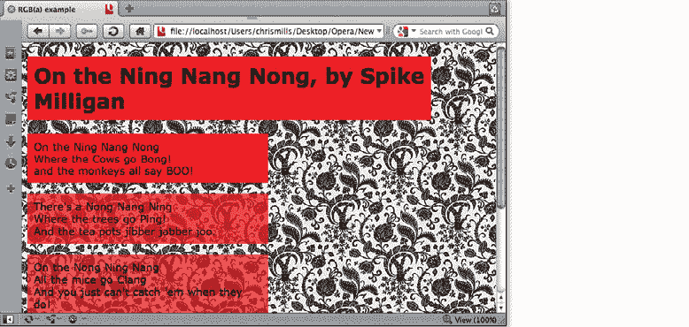

*图 11.4：RGB(a) 颜色，以及操纵 alpha 通道的效果。*

你可以通过微妙地使用透明度来创建一些不错的设计特性。

#### HSL(a)

HSL(a) 的工作方式与 RGB(a) 非常相似，只是计算颜色的方式不同。HSL 代表**色相、饱和度、亮度**——有些人认为这对于设计师来说是一个更合乎逻辑的颜色系统，因为你可以通过简单地增加饱和度或亮度值来选择颜色的变体。例如：

```css
#p1 { background-color: hsl(0,100%,50%); }
#p2 { background-color: hsl(0,100%,60%); }
#p3 { background-color: hsl(0,100%,70%); }
#p4 { background-color: hsl(0,100%,80%); }
```

色相接受 0 到 360 之间的整数作为值，而饱和度和亮度值接受百分比——0% 到 100%。将这些颜色值应用于连续的段落，你会得到**图 11.5** 所示的结果。

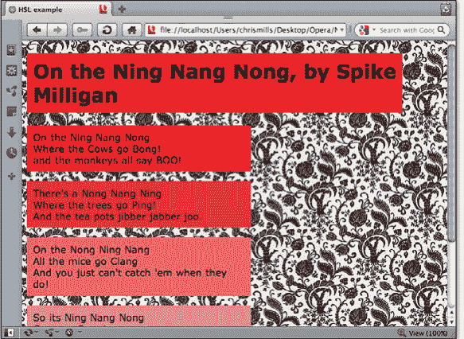

*图 11.5：通过改变亮度百分比轻松选择相同 HSL 颜色的不同变体。*

Alpha 通道的工作方式与之前完全相同，例如：

```css
p { color: hsla(100,50%,20%,0.5); }
```

> 提示：RGB(a) 和 HSL(a) 颜色在大多数现代浏览器中都受支持，Internet Explorer 除外。你可以在 http://dev.opera.com/articles/view/color-in-opera-10-hsl-rgb-and-alpha-transparency/ 找到 Molly Holzschlag 撰写的关于 RGB(a) 和 HSL(a) 的更详细分析。

#### CSS 选择器指南

到目前为止，本章中你只看到了最基本的 CSS 选择器——简单的元素选择器，它匹配选择器指定的元素，例如：

```css
p { color: red; }
```

但还有许多其他可用的选择器，允许你选择更具体的元素组。表 11.3 详细列出了不同类型的选择器。

| 选择器类型 | 示例 | 描述 |
| :--- | :--- | :--- |
| 元素选择器 | `p { color: red; }`<br><br>`<p>一个段落。</p>` | 选择选择器中指定的元素。 |
| 类选择器 | `.summary { color: red; }`<br><br>`<p class="summary">一个段落。</p>` | 选择任何 `class` 属性等于选择器中指定值的元素。 |
| ID 选择器 | `#author-bio { color: red; }`<br><br>`<p id="author-bio">一个段落。</p>` | 选择页面上 `id` 属性等于选择器中指定值的元素（每个 HTML 页面中每个 ID 只能有一个）。 |
| 通配符选择器 | `* { color: red; }` | 选择页面上的每一个元素。 |
| 属性选择器 | `img[alt] { border-color: red; }`<br><br>`img[src="image.png"] { border-color: red; }`<br><br>`` | 选择方括号内指定属性的任何元素。你可以只选择属性类型，或者选择具有特定值的属性。 |
| 子代选择器 | `li > p { color: red; }`<br><br>`<li><p>一个段落。</p></li>`<br><br>但不包括<br><br>`<p>一个段落。</p>` | 仅当选择器中的右侧元素是左侧元素的直接子元素时，才选择右侧元素。 |
| 后代选择器 | `li p { color: red; }`<br><br>`<li><p>一个段落。</p></li>`<br><br>以及<br><br>`<li><div><p>一个段落。</p></div></li>`<br><br>但不包括<br><br>`<p>一个段落。</p>` | 类似于子代选择器，只是右侧元素不必是左侧元素的直接子元素——它也会选择 DOM 层次结构中更靠下的元素。 |

*表 11.3：CSS 选择器类型*


## CSS选择器指南

| 选择器类型 | 示例 | 描述 |
|-------------|---------|-------------|
| 相邻兄弟选择器 | `h2 + p { color: red; }`<br><br>`<h2>Heading</h2>`<br>`<p>A paragraph.</p>`<br><br>但不是<br><br>`<p>A paragraph.</p>`<br><br>或<br><br>`<h1>Heading</h1>`<br>`<p>A paragraph.</p>` | 这里的逻辑是：**父级** 指DOM层次结构中高一级的元素；**子级** 指低一级的元素；因此**兄弟**指的是DOM层次结构中同一级别的元素。<br><br>此选择器会选择选择器右侧的元素，但仅当该元素在同一DOM层次级别上，其紧邻的左侧有选择器左侧的元素实例时。<br><br>**警告：Internet Explorer 6 及更早版本不支持这些选择器。** |
| 伪类 | `a:hover { color: red; }`<br><br>将规则应用于所有 `<a>` 元素，但仅当鼠标悬停时。<br><br>`a:focus { color: red; }`<br><br>将规则应用于所有 `<a>` 元素，但仅当它们获得焦点时，例如通过键盘导航。<br><br>`a:visited { color: red; }`<br><br>将规则应用于当前浏览器历史记录中所有已访问过的 `<a>` 元素。 | 这些选择器允许你根据元素的状态（例如，是否被悬停，或是否已被访问）而不是元素本身的类型来设置样式。 |
| 伪元素 | `p:first-letter { font-size: 300% }`<br><br>将页面上每个段落首字母的大小增加为三倍。<br><br>`p:first-line { font-weight: bold; }`<br><br>将页面上每个段落的第一行加粗。 | 这些选择器允许你为元素的特定部分（例如该元素内的首字母）设置样式，而不是整个元素；它们也允许你在特定元素之前或之后插入内容。 |

表 11.3：CSS选择器类型

随着本书的深入，你将看到更复杂选择器的示例。但如果一开始无法完全理解，也请不要担心——随着你在网页样式设计方面经验的积累，你终将掌握它们！在自己的实践中，最好从表格开头的前三个简单选择器开始，然后随着信心的增强再尝试其他选择器。

### 资源 // 分组选择器

你还可以将不同的选择器分组。假设你想将相同样式应用于 `<h1>` 和 `<p>`——你可以编写以下CSS：

```
h1 { color: red; }
p { color: red; }
```

但这相当重复，因此并不理想。不过有个解决方法——你可以通过逗号（如果分组超过两个，则使用多个逗号）将选择器组合在单个规则中，从而缩短CSS代码，该规则将应用于所有选择器：

```
h1, p { color: red; }
```

还需注意，你可以组合一些选择器来定义更具体的规则。例如：

```
p.warning { color: red; }
```

匹配所有 `class` 为 `warning` 的段落，而：

```
div#example { color: red; }
```

匹配 `id` 属性为 `example` 的元素，但仅当它是 `<div>` 元素时。

本节讨论的两种技术可以结合使用。以下是一个同时匹配 `class` 为 `info` 的段落 *和* `class` 为 `highlight` 的列表项的规则，并将它们的文本颜色设为红色：

```
p.info, li.highlight { color: red; }
```

### 动手试试！

在本练习中，你将从一些现成的HTML开始，并编写一些CSS来解决下列问题中提出的问题。你可以在文件 `selectors_challenge.html` 中找到现成的HTML。请从代码下载中获取此文件的副本。

189

### 动手试试！（续）

- 1. 编写一条规则，将Georgia字体应用于网页上的每个元素。使用你认为最好的任何方法将此规则应用于HTML。
2. 为所有 `<div>` 元素设置浅色背景（自选），并在内容与 `<div>` 边缘之间应用10像素的内边距。
3. 将内容宽度设置为500像素。
4. 为 `<div>` 元素应用深色边框（颜色和样式自选）。
5. 仅针对标题覆盖之前的字体设置——让每个标题使用Helvetica字体（或你选择的其他无衬线字体）。
6. 使用属性选择器编写一个测试，将没有 `title` 属性的链接高亮显示为红色。
7. （高级）为链接应用伪类，使其颜色与其余文本不同，当鼠标悬停时，下划线消失。
8. （高级）使用CSS3选择器为 `<div>` 元素添加圆角和微妙的投影。相关属性在旧版浏览器中可能无效。

### 解决冲突——继承与层叠

学习CSS时常让人困惑的另一个问题是：“当存在冲突，且两个或多个冲突的样式应用于同一个元素时，最终应用哪种样式是如何决定的？” 要理解这一点，你必须理解**继承**和**层叠**：

- **继承**是某些属性从父元素传递给其子元素的机制。它与遗传学中的继承非常相似：如果父母是蓝眼睛，他们的孩子很可能也是蓝眼睛。

- **层叠**是一个非常重要的概念——CSS的大部分名称正是来源于此。它是控制当多个冲突且重叠的CSS声明应用于同一元素时最终结果的机制。

#### 继承

继承很有道理。如果它不存在，你每次编写网页时都必须为每个HTML元素指定每个属性。实际上，很多事情都在幕后为你完成了！能够，例如，在 `<body>` 元素上设置默认字体，并知道它将被所有 `<body>` 的子元素继承，这使事情变得容易得多。如果需要，你随后可以为特定元素覆盖此声明：

```
body { font-family: georgia; }
h1, h2, h3 { font-family: helvetica; } /* 这条规则覆盖了第一条，因为它在代码中出现得更晚 */
```

注意上面的注释——记住这一点！你将在本章后面找到更多关于覆盖的内容。

HTML文档中除根元素（`<html>`，它没有父级）之外的每个元素，都将从其父级继承所有可继承的属性。并非所有CSS属性都是可继承的，因为那没有意义。例如，外边距（margin）不会被继承，因为子元素不太可能需要与父级相同的外边距。在大多数情况下，常识会告诉你哪些属性是可继承的，哪些不是。

> **提示：** 你可以在CSS 2.1规范属性摘要表中查找哪些CSS属性是可继承的，网址为 http://www.w3.org/TR/CSS21/propidx.html。

#### 层叠

层叠由三个主要概念组成，它们控制着CSS声明的应用顺序：

- 重要性
- 特异性
- 源顺序

重要性最……呃……重要。如果两个声明具有相同的重要性，则规则的特异性决定哪个将应用。如果规则具有相同的特异性，则源顺序控制哪个规则将胜出。

我将在下面逐一探讨这些概念。

#### 重要性

CSS声明的**重要性**取决于它被指定的*位置*。冲突的声明将按以下顺序应用；后面的会覆盖前面的：

1.  用户代理样式表
2.  作者样式表中的普通声明
3.  用户样式表中的普通声明
4.  作者样式表中的重要声明
5.  用户样式表中的重要声明

**用户代理样式表**是浏览器的内置样式表，如本章前面所述。例如，未访问的链接默认是蓝色且带下划线的。

**用户样式表**是*用户*指定的样式表。并非所有浏览器都支持用户样式表，但它们可能非常有用，特别是对于有某些类型残疾的用户。例如，阅读障碍者可以使用指定了有助于阅读的特定字体和颜色的用户样式表。

**作者样式表**就是我们通常所说的“样式表”。它是文档作者（或者更可能是网站设计师）编写的，并将网站的HTML链接到该样式表。

**普通声明**就是普通声明。其反面是**重要声明**，即后跟 `!important` 指令的声明（`*` 选择所有元素）：

```
* { font-family: "Helvetica" !important; }
```


在这种情况下，无论 CSS 中其他部分指定了什么，所有内容都将以 Helvetica 字体显示。如果用户觉得这种字体更容易阅读，他们可能会将此规则添加到他们的用户样式表中。

默认的浏览器渲染仅在那些声明未被用户样式表或作者样式表中的任何规则覆盖时才会应用，因为用户代理样式表具有最低的优先级。

> **提示：** 说实话，大多数设计师不必过多考虑重要性（importance），因为我们对此无能为力。我们无法知道用户是否定义了一个会覆盖我们 CSS 的用户样式表。如果他们确实定义了，他们可能有非常充分的理由。尽管如此，了解什么是重要性以及它可能如何影响我们文档的呈现还是很有好处的。


#### 特异性

**特异性（Specificity）** 是每个 CSS 作者都需要理解并思考的东西。它可以被视为衡量规则选择器有多具体的一个指标。特异性低的选择器可能匹配许多元素（比如 *p*，它匹配文档中的每个段落），而特异性高的选择器可能只匹配页面上的单个元素（比如 *#nav*，它只匹配 id 为 *nav* 的元素）。

选择器的特异性很容易计算。如果两条或多条规则冲突，并且它们具有相同的重要性，那么具有最具体选择器的规则将胜出。

特异性有四个组成部分；我们将它们称为 *a*、*b*、*c* 和 *d*。分量 “*a*” 区分度最高，“*d*” 区分度最低。

-   分量 “*a*” 相当简单：对于 *style* 属性中的声明，它是 1，否则为 0。
-   分量 “*b*” 是选择器中 *id* 选择器（那些以 # 开头的选择器）的数量。
-   分量 “*c*” 是属性选择器、*class* 选择器和伪类的数量。
-   分量 “*d*” 是选择器中元素选择器和伪元素的数量。

你可以将这四个分量串联起来计算任何规则的特异性。`style` 属性中的 CSS 声明没有选择器，因此它们的特异性始终是 1,0,0,0。

**表 11.2** 显示了一些示例——在此之后，它的工作原理应该相当清楚了。

| 选择器 | A | B | C | D | 特异性 |
| :--- | :---: | :---: | :---: | :---: | :---: |
| `h1` | 0 | 0 | 0 | 1 | 0,0,0,1 |
| `.foo` | 0 | 0 | 1 | 0 | 0,0,1,0 |
| `#bar` | 0 | 1 | 0 | 0 | 0,1,0,0 |
| `ul#nav a:link` | 0 | 1 | 1 | 2 | 0,1,1,2 |

*表 11.2：计算 CSS 选择器特异性的示例*

值得注意的是，组合符（如 `>`、`+` 和空格）不会影响选择器的特异性。通配符选择器（`*`）也不会影响特异性。

同样值得注意的是，`id` 选择器和恰好引用 `id` 属性的属性选择器之间存在特异性差异。尽管它们匹配相同的元素，但它们的特异性非常不同。`#nav` 的特异性是 0,1,0,0，而 `[id="nav"]` 的特异性仅为 0,0,1,0。

#### 源码顺序

如果两条声明影响同一个元素，并且具有相同的重要性和相同的特异性，那么最终的区分标志是**源码顺序（source order）**。在样式表中出现较后的声明将胜出。

如果你有一个单独的外部样式表，那么如果发生冲突，文件末尾的声明将覆盖文件中较早出现的声明。冲突的声明也可能出现在不同的样式表中。在这种情况下，样式表被链接、包含或导入的顺序决定了哪个声明将被应用。因此，如果你在文档的 `<head>` 中链接了两个样式表，最后链接的那个将覆盖最先链接的那个。

> **提示：** 你可以在 Tommy Olsson 的文章 http://dev.opera.com/articles/view/28-inheritance-and-cascade/ 中找到关于本节所有概念的更多细节。Andy Clarke 的《星球大战特异性选择器》——http://www.stuffandnonsense.co.uk/archives/css_specificity_wars.html——也非常有用（而且有趣）。

在继续之前，还有一件事要提一下，那就是长格式值可用于覆盖简写值的特定部分。例如，你可以使用以下声明指定边框宽度、颜色和样式：

```
border: 1px black solid;
```

然后在样式表的后面部分，你可以指定以下内容来仅覆盖边框宽度：

```
border-width: 2px;
```

### 浏览器对 CSS 的支持

十年前，浏览器对网络标准的支持充其量只能说参差不齐。Firefox 还不存在，Safari 和 Chrome 也没有，Opera 的标准支持虽不完善但正在改进，而网络上的主要浏览器巨头——Internet Explorer 和 Netscape（已逝）——正处于一场争夺霸权的战斗中，双方都在试图通过实现对方没有的、听起来令人兴奋的新特性，或者以不兼容的方式实现相同的特性来赢得用户。结果对网页开发者来说是一场噩梦，他们常常只能选择编写仅在单一浏览器中有效的网站，或者为两个主流浏览器维护两个独立版本的网站，这显然会成为维护的噩梦。

如今情况容易多了。你会发现任何浏览器中都有一两个奇特的网络标准支持特性，但至少在过去几个版本的 Internet Explorer、Firefox、Opera、Safari 和 Chrome 中，对 HTML 4.01、CSS 2.1 和 JavaScript 的支持相当不错。

主要问题在于必须支持旧版本的浏览器，尤其是 Internet Explorer。你无法保证所有网络用户都会升级到最新版本。有些人不如我们精通网络，可能不知道如何升级；另一些人则由于公司政策（例如，关键软件的兼容性要求，或担心安全漏洞）被迫坚持使用旧版浏览器。

Internet Explorer 6 仍然拥有庞大的用户群，但它对 CSS 的支持确实存在问题（HTML 支持问题不大）——忽略它会很好，但你无法忽视那么多用户。他们的浏览器无法正确解释你的 CSS 并不是他们的错，他们也不会明白问题是什么，也不应该期望他们明白。如果访问你网站的访客遇到问题，他们很可能会责怪你的网站，而不是他们使用的浏览器。

我们不会在这里详细讨论浏览器支持的怪癖，但我们会在其他章节的适当地方提及它们。

### CSS 的未来——CSS3

CSS3 是一个新规范，它为 CSS 添加了新功能，以解决以前只能通过 hack 或脚本才能实现的问题和常见设计模式。

如前所述，CSS3 规范的工作始于 1998 年，但直到最近几年，CSS3 的任何部分才接近完成，或在浏览器中得到支持。然而，CSS3 的许多部分现在在大多数现代浏览器中都能工作。

CSS3 是模块化的，这意味着规范的不同部分被组织成相关功能的模块，因此更容易开发和学习。在撰写本书时，在现代浏览器中有相当多支持的模块在 **表 11.4** 中详述。

| CSS3 模块 | 描述 |
| --- | --- |
| 背景和边框 | 控制与背景和边框相关的新功能。 |
| 媒体查询 | 媒体查询是一种根据对不同条件的评估（例如最大或最小浏览器窗口宽度或高度、宽高比、分辨率等）来选择性地应用 CSS 的方法。 |
| 网页字体 | 定义了一种允许你将自定义字体应用于网页的方法。 |
| 多列布局 | 提供了一种在 CSS 中创建多列布局的官方方法。 |
| 2D 变换 | 允许仅使用 CSS 修改元素，例如缩放或旋转。 |
| 过渡 | 使我们能够仅使用 CSS 创建动画。 |

*表 11.4：具有合理浏览器支持的 CSS3 模块*

> **提示：** 我建议你开始在工作中研究和试验 CSS3 功能，并跟上最新的发展。http://css3.info 和 http://dev.opera.com 是 CSS3 教程和新闻的良好资源。

## 总结

我们在本章中涵盖了很多内容，篇幅很短，所以可能看起来很多，但如果第一次没有全部理解，请不要担心。事实上，我建议你立即再通读几遍本章，并在阅读其他章节时不断回顾它，因为它包含了理解 CSS 至关重要的许多基本概念。

在第三部分的其余章节中，我们将详细研究构成典型网站的特定 HTML 和 CSS 构造。


# 第12章
## `<head>` 元素

作者：克里斯·米尔斯

本章不会教你如何向HTML文档中添加内容。相反，它关注的是位于文档顶部的`<head>`元素内部的不同特性。这些特性不会作为可见内容显示在你的HTML页面上（或许`<title>`元素是个例外）——它们是元数据，即“描述数据的数据”。它们提供关于你的HTML文档的有用数据，或者可被你的HTML文档所使用。

下面我们将探讨文档类型定义（DOCTYPE）、HTML与XHTML的区别、为浏览器窗口添加标题、指定文档使用的字符集和语言、为搜索引擎索引器等用户代理提供描述和关键词以描述你的文档、为你的HTML应用样式和脚本，以及在你的网站中使用自定义网站图标（favicon）。

*在本章中，你有机会通过书籍配套网站 http://interactwithwebstandards.com 上提供的便捷示例代码下载，来动手实践！*

每一个HTML页面都应有一个DOCTYPE才能成为有效的HTML（或XHTML）——这就是出现在本书代码下载中每个HTML文件顶部的那一行（好吧，它实际上并不在`<head>`元素内部——所以别告我），例如：

```
<!DOCTYPE HTML PUBLIC "-//W3C//DTD HTML 4.01//EN" "http://www.w3.org/TR/html4/strict.dtd">
```

这一行指向一组HTML文档应遵循的规则，以确保其正确性（即作者使用的是哪个版本的HTML），并告诉Web浏览器在渲染每个HTML文档时应使用何种渲染模式。你可以通过W3C HTML验证器 http://validator.w3.org/ 检查你的HTML是否正确遵守了DOCTYPE中概述的规则。

> **提示：** 你可以在布莱恩·威尔逊的文章 http://www.blooberry.com/indexdot/html/tagpages/d/doctype.htm 中找到关于DOCTYPE各部分含义的更多详细信息。

**DOCTYPE** 是 *Document Type Definition*（文档类型定义）的缩写，有时也缩写为 *DTD*。它们都指代相同的事物。

### DOCTYPE切换与渲染模式

如果你不提供DOCTYPE，浏览器无论如何都会处理并渲染文档——它们需要尝试渲染在Web上遇到的所有奇怪内容。但由于缺少DOCTYPE，结果可能并非你所预期，这是因为一种称为 **DOCTYPE嗅探（DOCTYPE sniffing）** 或 **DOCTYPE切换（DOCTYPE switching）** 的机制。

21世纪发布的大多数Web浏览器会查看遇到的任何HTML文档的DOCTYPE，并以此判断该文档的作者是否根据Web标准规范地编写了他们的HTML和CSS。

如果它们发现一个表明文档编写良好的DOCTYPE，就会在布局页面时使用一种称为 **标准模式（Standards mode）** 的方式。在标准模式下，浏览器通常会尝试根据HTML和CSS规范来渲染页面——它们相信创建该文档的人知道自己在做什么。

另一方面，如果它们发现一个过时或不完整的DOCTYPE，则会使用 **怪异模式（Quirks mode）**，这种模式与本书未教授的、陈旧的不良做法以及旧浏览器具有更好的向后兼容性。怪异模式假定文档是老旧的，或者不是按照Web标准创建的——这意味着网页仍会渲染，但容易出错，并且更可能在不同浏览器中呈现不同的效果。

这些差异主要与CSS的渲染方式有关，仅在少数情况下涉及实际HTML的处理方式。作为Web设计师或开发者，通过确保所有浏览器都使用其标准渲染模式，你将获得最一致的结果，因此你应该坚持Web标准，并使用正确的DOCTYPE！

### 动手实践！

- 1. 浏览器中存在另一种称为 **近乎标准模式（Almost Standards mode）** 的模式。研究这种模式，并写一篇博客文章介绍它是什么以及它与标准模式有何不同。
- 2. （可选）我上面的描述相当简化，涵盖了你现在真正需要了解的所有内容。如果你想了解更多，可以自由进行一些研究，并写一篇关于所有不同渲染模式的博客文章。

### 选择DOCTYPE

那么你应该选择哪个DOCTYPE呢？你在工作中可能使用的四种主要DOCTYPE将在下一节中描述。

我个人在我的文档中坚持使用HTML 4.01 strict（严格），除非有特殊任务要求使用其他类型，原因将在下面的类型1和2中解释。但我在标记中使用了许多XHTML约定——例如，将所有元素和属性名称小写，确保在属性值周围加上引号，以及正确关闭元素。我认为使用XHTML DOCTYPE并不值得，特别是在你实际上将其作为HTML提供时。更多细节请参见“XHTML与HTML”部分。

还有框架集（frameset）DOCTYPE可用，它们专门允许在HTML中使用框架集。但这是一种非常糟糕的旧做法，所以我们不会在本书中教你如何使用它们！不要使用框架集DOCTYPE。

#### 1. HTML 4.01 strict（严格）

如果你的内容是HTML，那么你真的应该使用这个DOCTYPE。它不允许使用已弃用的HTML，因此与按照标准和最佳实践编写的HTML非常匹配。

```
<!DOCTYPE html PUBLIC "-//W3C//DTD HTML 4.01//EN"
"http://www.w3.org/TR/html4/strict.dtd">
```

#### 2. HTML 4.01 transitional（过渡）

这个DOCTYPE比第一个稍宽松一些，确实允许一些已弃用的HTML。如果你真的希望你的页面通过验证，但该页面又将由用户或其他内容贡献者插入内容，因此你无法保证内容质量时，有时使用这个DOCTYPE是值得的。然而，验证并非一切——还有其他因素对网页的可用性和可访问性很重要，虽然验证是有用的调试工具，格式良好的DOM很重要，但几个小的验证错误通常不会造成太大影响。

```
<!DOCTYPE HTML PUBLIC "-//W3C//DTD HTML 4.01
Transitional//EN" "http://www.w3.org/TR/html4/loose.dtd">
```

#### 3. XHTML 1.0 strict（严格）

这是严格DOCTYPE的XHTML版本，因此同样的严格性适用，同样不允许使用已弃用的元素。有关XHTML与HTML的更多区别，请参阅下一节。

```
<!DOCTYPE html PUBLIC "-//W3C//DTD XHTML 1.0 Strict//EN"
"http://www.w3.org/TR/xhtml1/DTD/xhtml1-strict.dtd">
```

#### 4. XHTML 1.0 transitional（过渡）

这是过渡DOCTYPE的XHTML版本，因此同样的严格性适用——允许使用已弃用的元素。有关XHTML与HTML的更多区别，请参阅下一节。


# 文档类型

```
<!DOCTYPE html PUBLIC "-//W3C//DTD XHTML 1.0 Transitional//EN" "http://www.w3.org/TR/xhtml1/DTD/xhtml1-transitional.dtd">
```

## 动手试一试！

打开随书代码下载中的 `doctypes_example.html` 文件查看。它目前在顶部使用了 HTML 4.01 transitional 的 DOCTYPE。

1.  将代码输入到 W3C HTML 验证器（[http://validator.w3.org/](http://validator.w3.org/)），点击 Validate，看看得到什么输出。
2.  将当前的 DOCTYPE 替换为 HTML 4.01 strict DOCTYPE，再看看 HTML 验证器给你什么输出。
3.  现在给示例文件添加 XHTML strict DOCTYPE，看看从 HTML 验证器得到什么输出。
4.  最后，完全移除 DOCTYPE，看看验证器给你什么输出。

# XHTML 与 HTML 对比

在第 10 章"HTML 简介"中，我们讨论了 HTML 的历史及其起源。XHTML 在这个拼图中处于什么位置，它又是什么呢？HTML（超文本标记语言）是一项独立的技术，而 **XHTML**（可扩展超文本标记语言）实际上是 XML（可扩展标记语言）。XML 是一种允许你创建自己的自定义标记语言的技术，称为**词汇表**。XHTML 是将 HTML 重新表述为 XML 词汇表（SVG 和 MathML 也是如此——去查查看！），因此它比 HTML 严格得多。你必须使用小写的元素和属性，确保所有元素都正确关闭、属性值用引号括起来，并正确编码所有实体，否则 XHTML 页面甚至无法显示。

这凸显了 XHTML 的问题所在——有些人认为网络是一个有点无法无天的地方，充斥着大量劣质代码，更严格一些更好。但这正是网络最初如此伟大的原因——它足够宽容，几乎任何人都能写个页面并让它以某种形式显示出来。XHTML（XML）并不真正符合网络的精神。如果你的博客每次因为一个小小的标记错误就崩溃并拒绝显示任何内容，你肯定不喜欢这样。

此外，大多数所谓的 XHTML 实际上只是应用了 XHTML 规则的 HTML。要真正以 XHTML 提供内容，你需要：

- 在文档开头、DOCTYPE *之前*放置一个 **XML 声明**。每个 XML 文档都需要这个，而 XHTML 就是 XML：

  `<?xml version="1.0" encoding="UTF-8"?>`

- 将文档的 content-type 设置为 `application/xhtml+xml`（默认值是 `text/html`）。

> 但这里存在问题——首先，Internet Explorer 6 在你包含 XML 声明时会切换到怪癖模式。更严重的是，如果你使用 XHTML 正确的 MIME 类型——application/xhtml+xml——Internet Explorer 不会显示你的内容；它会提示你的网站访客下载它。你绝对不想那样！

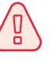

你可以省略 XML 声明并使用 `text/html` MIME 类型，*本着正确做事™的精神*，我认为还是坚持使用 HTML 更好。

## 设置文档的主要语言

`<html>` 元素的 `lang` 属性允许你设置文档的人类语言——法语、泰语、俄语、英语等。这首先有助于屏幕阅读器——例如，单词 six 在英语中发音为"sicks"，在法语中发音为"seece"，尽管两种语言中的拼写相同。`lang` 属性还能帮助搜索引擎在试图适当索引不同语言的内容时更加准确。

定义文档的主要语言是个好主意，尤其是当你为国际受众编写页面时，尽管在当今的网络上并不常看到这个属性。HTML 看起来像这样：

```
<html lang="en-GB">
  ...
</html>
```

属性值的第一个部分是主要语言——**en** 表示"English（英语）"。第二个可选部分是语言的子分类。这里是 **GB**——英式英语，但也可以设置为 **US** 或 **CA**，表示美式英语或加拿大英语。有关 HTML 语言代码的参考列表，请查看 Sitepoint HTML 参考（[http://reference.sitepoint.com/html/lang-codes](http://reference.sitepoint.com/html/lang-codes)）。W3C 国际化（I18n）活动主页上也有许多有用的资源——参见 [http://www.w3.org/International/](http://www.w3.org/International/)。

注意，你也可以通过在其他元素上使用 `lang` 属性来设置文档子部分的语言，例如：`<span lang="fr">Bonjour</span>`。还要注意，用于设置语言的属性取决于文档的 DOCTYPE。对于 HTML，你只使用 `lang` 属性；对于以 `text/html` 提供的 XHTML 1.0，使用 `lang` 和 `xml:lang` 属性；对于以 XML 提供的 XHTML，只使用 `xml:lang` 属性。有关更多信息和 Links 的 W3C 语言标签参考，请参见 [http://www.w3.org/International/articles/language-tags/](http://www.w3.org/International/articles/language-tags/)。

## 为文档添加 `<title>`

`<head>` 中最重要的元素之一是 `<title>`。几乎所有用户代理/浏览器都会在浏览器应用程序标题栏中显示 `<title>` 中包含的文本（即**图 12.1** 中浏览器窗口顶部边缘的栏）。

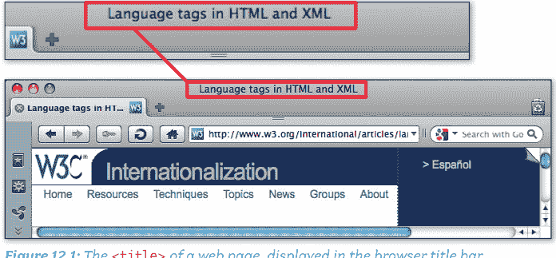

*图 12.1：网页的 `<title>`，显示在浏览器标题栏中。*

`<title>` 是网站访问者访问你的网站时首先看到的内容，因此非常重要。屏幕阅读器等辅助技术（为视障用户朗读网页的软件）会将其作为访客可以期待文档内容的第一个提示。请记住，搜索引擎会从 `<title>` 中获取搜索词来分类你的页面，因此当你使用一个可读性强且包含正确关键词的好标题时，你在网上被发现的概率会大幅提高。而且当你收藏页面时，浏览器会使用 `title` 属性作为该书签的文本标签。

网上有许多关于如何编写好的文档标题的教程，其中大部分与搜索引擎优化（SEO）相关。不要过度尝试，试图用大量关键词欺骗搜索引擎以显示膨胀的搜索结果——你仍然应该写一个简洁、可读的标题，说明文档的内容。"Breeding Dogs—Tips About Alsatians"比"Dogs, Alsatian, Breeding, Dog, Tips, Free, Pet"更易读得多。

## 添加关键词和描述

你可以考虑添加到下一件 HTML 文档中的东西是描述和关键词。这两个都添加到 `<head>` 内的 `<meta>` 元素中。以下示例取自 Yahoo! Eurosport 网站。

```
<!DOCTYPE HTML PUBLIC "-//W3C//DTD HTML 4.01//EN" "http://www.w3.org/TR/html4/strict.dtd">
<html>
  <head>
    <title>Yahoo! UK & Ireland Eurosport–Sports News | Live Scores | Sport</title>
    <meta name="description" content="Latest sports news and live scores from Yahoo! Eurosport UK. Complete sport coverage with Football results, Cricket scores, F1, Golf, Rugby, Tennis and more.">
    <meta name="keywords" content="eurosport,sports,sport,sports news,live scores,football,cricket,f1,golf,rugby,tennis,uk,yahoo">
</head>
<body>
...
</body>
</html>
```

> 提示：注意 name 属性指定了 `<meta>` 元素包含的元信息类型。有关 `<meta>` 元素其他用途的更多信息，请参见 http://en.wikipedia.org/wiki/Meta_element。

当上面的示例上线时，元信息被搜索引擎索引并现在正在使用（图 12.2）。

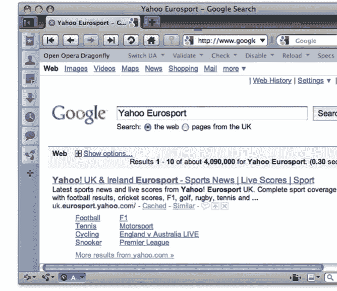


这可能是网页用户正在寻找的关键信息，也是他或她点击进入你网站的原因。描述还有另一个用途：当您将文档添加到收藏夹/书签时，某些浏览器会将描述显示为附加信息（**图 12.3**）。

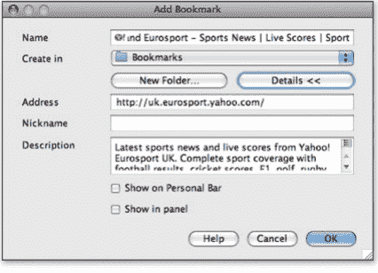

图 12.3：将文档添加为收藏夹/书签时，某些浏览器中会显示描述。

> 提示：多年来垃圾邮件发送者的滥用导致搜索引擎不再那么重视关键词，因此关键词和描述不再像以前那样重要。

## 添加样式和脚本

从网页设计和开发的角度来看，`<head>` 中最重要的功能可能是允许你将 CSS 样式和 JavaScript 应用到 HTML 中，从而为网页设置样式并添加动态功能。你已经在第 11 章"CSS 简介"中看到了如何将 CSS 应用到文档中，但为了完整性我们来回顾一下。首先是内部样式表：

```
<style type="text/css" media="screen">
    p {
        color: red;
    }
</style>
```

接下来是指向外部样式表的链接：

```
<link rel="stylesheet" type="text/css" href="external_stylesheet.css" media="all">
```

## 媒体类型

注意前面的 `media` 属性——这是我们之前没有太多讨论过的一个功能。这被称为**媒体类型**，它允许你指定此 CSS 将应用于哪种类型的媒体。最常见的值有：

- `all`：CSS 适用于所有媒体类型；如果未提供 `media` 属性，这是默认行为。
- `screen`：仅在屏幕上，即当你的浏览器在桌面计算机上显示页面时。
- `print`：仅在打印文档时应用的样式。
- `handheld`：一些支持网页的手持设备浏览器在默认情况下使用 `handheld` 媒体（如果检测到的话），但是，大多数较新的设备不这样做，因为许多移动浏览器现在能够显示与桌面计算机相同的网站。此外，`handheld` 媒体开始被开发者滥用，为移动浏览器提供一套简化的样式，以期轻松支持移动设备，这对那些在移动中浏览的用户来说是不公平的。
- `projection`：此选项的初衷是为 HTML 幻灯片演示提供特定的样式，尽管这很少使用。查看 Opera 的 Opera Show 功能，了解 `projection` 的一个非常好的用例（参见 http://dev.opera.com/articles/view/html-css-slideshows/）。


> 动手试试！
> 1. 如果你有一个带有导航侧边栏和主要内容栏的网页，你如何使用媒体类型在打印页面时隐藏导航菜单？
> 2. 创建一个实现此功能的示例页面。

本书不会详细讨论 JavaScript，但我需要在本节中提及 `<script>` 元素——你使用它将 JavaScript 添加到 HTML 文档中。当浏览器遇到 `<script>` 元素时，它会放下所有其他内容，暂停解析文档的其余部分，同时尝试执行其中的代码。例如：

```
<head>
  ...
  <script>
    function leave() {
      return confirm("This will take you to another
site,\n are you sure you want to go?")
    }
  </script>
  ...
</head>
```

> **提示：** 你实际上不必将 `<script>` 元素放在文档的 `<head>` 中，尽管它们最常见于此处。在某些情况下，将脚本放在 `</body>` 标签之后实际上更有意义。阅读 http://stackoverflow.com/questions/855077/does-putting-scripts-on-the-bottom-of-a-web-page-speed-up-page-load 上的讨论以了解更多关于此主题的信息。


与外部 CSS 相同的方式，你可以将外部 JavaScript 加载到页面中。语法如下：

```
<script src="example.js" type="text/javascript"></script>
```

## Link 元素

`<link>` 元素可用于定义当前文档与其他文档或文件之间的关系。我们已经看到它用于指向外部样式表，然而 `<link>` 还有许多其他用途，我们将在本节中回顾其中几个。

## 订阅源

**订阅源**是一个包含按时间顺序排列的网站新增内容摘要信息的文档。用户可以订阅它，了解网站最近的更改，而无需访问网站。他们通过使用订阅源阅读器（如 Google Reader、Netvibes 或 Bloglines）来实现这一点。一些现代浏览器（如 Opera）和电子邮件客户端（如 Mac Mail 或 Windows 上的 Outlook）也可以处理和显示订阅源。你可以通过 URL 旁边的 RSS 图标来识别网站是否提供订阅源（**图 12.4**）。

订阅源页面使用 HTML 或 XML 格式（如 RSS 或 Atom）构建，而且几乎从不手工创建。大多数情况下，个人发布系统（如 WordPress）会为你完成这项工作，你只需在文档 `<head>` 中使用正确的 `<link>` 元素链接到 XML 文档，就可以向世界提供你网站的订阅源。以下是 http://dev.opera.com 的 `<head>` 的摘录；这两行提供了最新文章订阅源的 RSS 和 Atom 版本：

```
<link rel="alternate" type="application/rss+xml" title="New articles - RSS 2.0 Feed" href="/feeds/rss/articles" />
```

```
<link rel="alternate" type="application/atom+xml" title="New articles - Atom 1.0 Feed" href="/feeds/atom/articles" />
```

提供订阅源对于经常更新的内容密集型网站（如博客或照片网站）来说很有意义——读者可以更快速、更轻松地通过订阅源阅读工具跟踪这些变化。

如果你的网站更新不那么频繁，但内容很多，并且希望人们能直观地记住你的网站，那么你可能需要考虑使用快捷图标来在人们的书签列表中脱颖而出。这就是我将在下一节中介绍的内容。

## 让收藏更有趣——使用网站图标

我们在这里要涵盖的最后一个主题是快捷图标，也称为 **favicon**。这些是小图像，通常使用 .ico 文件格式，因为 Internet Explorer 不支持其他格式（其他浏览器也可以使用 .png 和其他格式作为 favicon）。如果你将一个放在 Web 服务器上并在文档 `<head>` 中添加相关的 `<link>` 元素，当有人访问该页面时，该图标将显示在浏览器地址栏中 URL 的左侧以及该网站所在标签页中（以及浏览器书签列表中该网站旁边）（**图 12.4**）。

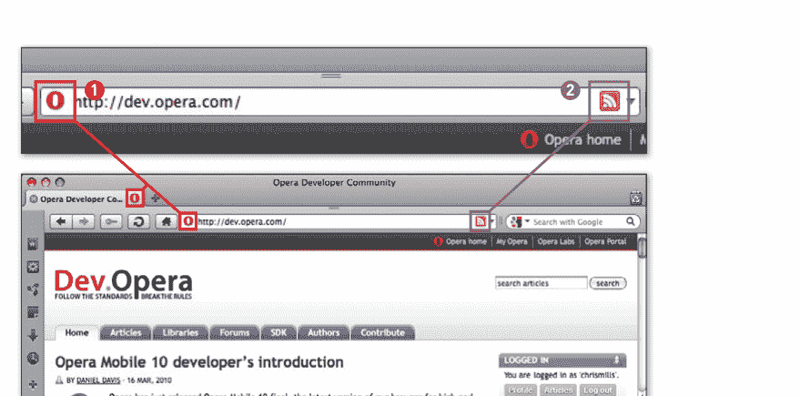

| | |
|:---|:---|
| 1. | 网站图标 |
| 2. | RSS 图标 |

你可以通过使用带有 `rel="Shortcut Icon"` 属性的 `<link>` 元素来引用它，从而将 favicon 添加到你的网站，如以下示例所示。`href` 属性应指向你服务器上 favicon 的位置。

```
<head>
    ...
    <link rel="Shortcut Icon" href="favicon.ico"
          type="image/x-icon">
    ...
</head>
```

> 添加图标最大的障碍是以正确的格式创建它，因为没有多少图形软件包支持 `.ico` 格式。一个选择是使用免费的在线工具 genfavicon（`http://www.genfavicon.com/`）。另请注意，你需要将其命名为 `favicon.ico`，因为 Internet Explorer 始终会查找这个特定的文件名。

### 动手试试！

现在是时候将你自己的 favicon 添加到页面了。

- 1. 找一个示例页面来添加 favicon。任何页面都可以——也许是前面章节中的一个示例？
- 2. 想想你希望你的 favicon 是什么样的。它应该是一个相当简单的图形，不要太复杂；毕竟，你只有 16 x 16 像素的图像可用。你的首字母，或者一个非常简单的小形状，可能会很好用。死星的建筑蓝图就不行了。你不必在 16 x 16 像素的文件中工作，但最终它会被转换为这个尺寸。
- 3. 制作好图形后，将其转换为 `.ico` 格式。
- 4. 将 favicon 保存在与示例 HTML 文件相同的目录中。
- 5. 使用相应的 `<link>` 元素引用你的 favicon。
- 6. 保存所有文件，然后试一试。

如果你成功完成了这些操作，你的浏览器应该会在地址工具栏和页面所在标签页中的 URL 旁边显示你的图标。如果你将其添加到书签中，相同的图标将出现在书签旁边。

## 总结

这个简单的章节带你了解了所有可以添加到 HTML 文档 `<head>` 中的最重要内容。这些信息不会出现在你的网站上，但正确设置至关重要，以确保你的网站有最大的机会被目标受众找到、应用正确的 CSS 和 JavaScript 等。在下一章中，我们将进入 `<body>` 元素，了解文本样式的基础知识。


## 标题与段落

作者：克里斯·米尔斯

既然我们已经介绍了使用HTML和CSS来构建和美化网页的一些通用基础知识，接下来我们将深入探讨如何实现具体的网页功能。还有什么比从最基本的纯文本开始更好的呢？毕竟，文本是大多数网页的核心，因此学习如何处理它至关重要。

本章我们将探讨标记文本时所需最重要元素的正确使用方法，涵盖段落、标题，以及引文、下标、上标和强调等稍专业的功能。我们还将介绍用于设置基本文本样式的最重要CSS属性。

我们将*不会*在本章讨论为这些元素添加边距、内边距等的CSS相关内容。这些将在第14章“空白”中讨论。

*在本章中，你可以通过本书配套网站（http://interactwithwebstandards.com）提供的便捷示例代码下载，获得***动手实践的机会！****

## 复习！标题与段落

如前几章所述，HTML文档最重要的部分在于标题和其他内容（其中很多是段落）的简洁、逻辑化的结构。

> **提示：** 在HTML中可以使用六个级别的标题——从`<h1>`到`<h6>`——但对于大多数文档来说，通常只需要三到四个级别。

类似下面这样的结构是比较理想的：

```
<h1>Pets</h1>
<p>This page provides information on different animals that are suitable for keeping as pets.</p>
<h2>Cats</h2>
<p>Cats are very independent creatures, and tend to have servants rather than owners. They becoming loving and loyal if treated with respect.</p>
<h2>Guinea Pigs</h2>
<p>A type of rodent, guinea pigs come in many different colorful varieties, and are cute and cuddly, if a little jumpy. They make ideal pets for young children, and breeding them is fun, as long as you don't let it get out of hand!</p>
<h2>Parrots</h2>
<p>Parrots are colorful birds that typically come from hot climates. Some of them can learn human words, so they provide great company. They can also live for a long period of time, typically 30 years or more. Varieties of parrot are as follows.</p>
<h3>African Gray</h3>
<p>One of the most common species to be domesticated, African Grays are good natured and learn words easily.</p>
```

```
<h3>Norwegian Blue</h3>
<p>A rare and very exotic species. Beautiful plumage.</p>
```

> 提示：这个示例将在本章中被用来演示不同的元素。我们会在讲解过程中逐步完善它，原始文件可以在 http://interactwithwebstandards.com 的 headings_paragraphs1.html 中找到。

## 优质内容与文档结构的重要性

我们之前已经讨论过这一点，这里简单回顾一下——你的内容必须简洁且结构良好，才能：

- 对所有用户普遍可用且易于理解。
- 使使用辅助技术浏览网页的残障用户能够无障碍访问。
- 易于使用CSS和JavaScript进行操控。
- 易于被搜索引擎索引，从而在网络上容易被找到。

## 文本的通用样式

目前，我们的内容看起来像**图13.1**，这还不错，但实际阅读起来却有不少问题。

文本行太长不便于阅读，且参差不齐，标题层级也不易区分，加上默认字体让它看起来很像90年代的网络。简而言之，有点杂乱。

页面默认的外观是由应用的浏览器默认样式决定的。这些样式在不同浏览器间会有所差异，但效果通常大同小异。我们可以用一些简单的CSS样式来改善。现在让我们来看看样式设置。

## 文本的通用样式

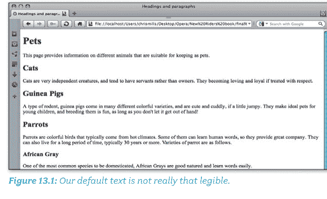

## 行长度

让内容更易读的一个简单方法是使其变窄。一个通用准则是将文本列长度控制在约60-70个字符，以便于阅读。这可以通过`width`属性轻松实现。你最常用的是像素和百分比——前者用于需要固定宽度（也称为“静态”）的内容列，后者（%）用于需要内容列始终占据浏览器窗口宽度相同比例，并随窗口缩放而调整大小（也称为“流动”）的情况。还有一种称为“弹性”的第三种选择，它使用em作为内容宽度的单位。由于em与文本大小相关，这些度量会随着文本大小的增加而变大。它们不如前两种常用。

`width`用法示例如下：

```
width: 500px;
width: 60%;
```

在我们的网站示例中，我在主要内容（不包括作为页面标题的`<h1>`）周围放置了一个`id`为`main_content`的`<div>`，以便将整个内容列作为一个整体来控制宽度。然后我给这个`<div>`设置了50%的宽度，这样行长度就更易读，并且会随浏览器宽度缩放。

```
main_content {
    width: 50%;
}
```

内容现在看起来像**图13.2** ([headings_paragraphs2.html](http://headings_paragraphs2.html))。

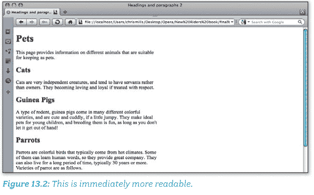

*图13.2：这样立即更具可读性。*

你也可以使用`max-width`和`min-width`属性来设置你希望元素具有的最大或最小宽度。将百分比宽度与固定的像素`min-width`和/或`max-width`结合使用可能很有效。例如：

```
main_content {
    width: 50%;
    min-width: 300px;
    max-width: 600px;
}
```

这可以防止内容变得过长或过短而难以阅读。但问题是这些属性不被Internet Explorer 6及更早版本支持。幸运的是IE6现在已不那么流行。请检查你网站的统计数据，看看你的用户是否仍在使用它。

## 资源 // 通用网站布局

在许多网站中，你会有一列或多列内容，以及一列包含导航菜单的内容，它们夹在顶部的页眉（包含精美图形、公司标志、网站标题等）和底部的页脚（通常包含网站范围的补充信息，如版权声明、法律信息、无障碍声明、联系方式等）之间。大多数网站都遵循这种通用布局，尽管有些会稍微不那么传统。

页眉、页脚和导航菜单通常在你网站的每个页面上都相同，而内容则会随着你导航到网站的不同区域而在每个页面上变化。在本章的示例中，我们只关注单列内容——我们将在本书接近末尾的章节中（参见第20-21章）讨论如何实现布局。

## 设置字体

你可以使用`font-family`属性在网页中设置字体。当有人访问你的网站时，浏览器会在用户的计算机上找到字体文件，并根据CSS的指示应用它。你可以指定单个字体应用于给定的元素选择：

```
p {
    font-family: Helvetica;
}
```

或者你可以指定一个以逗号分隔的字体列表：

```
p {
    font-family: "Trebuchet MS", "Times New Roman",
    Georgia, serif;
}
```

在这种情况下，浏览器会尝试查找第一种字体，然后是下一个，再下一个，直到找到列表中的一种字体来使用。如果都找不到，最后一个字体声明会告诉浏览器应用系统的通用衬线字体，无论那是什么（你也可以在无衬线字体列表的末尾使用`sans-serif`）。注意名称中包含多个单词的字体需要用单引号括起来。

请记住，你指定的任何字体都需要在用户的计算机上可用，这就是为什么最好坚持使用在


图 13.3 — 这些“网页安全”字体是指可以保证在 Windows、Mac 和 Linux 系统上都已安装的字体。

| Andale Mono | Verdana | Trebuchet MS |
| --- | --- | --- |
| Times New Roman | Arial | Comic Sans |
| Georgia | Courier New | Impact |

*图 13.3：经典的“网页安全”字体列表。*

传统的最佳实践通常建议标题使用无衬线字体，正文使用衬线字体，以提升可读性。然而，在较小的正文字号下，衬线可能变得模糊不清；同样，当用于大号标题时，衬线也能充分展现其美感。这完全取决于你想要实现的外观、感受和目标受众。Times New Roman 可能更适合严肃的新闻内容，而 Verdana 可能更适合音乐或电子游戏网站的文本。请帮个忙，在使用 Comic Sans 时务必谨慎——它适合儿童网站，或者你想让某段文字看起来像用粉笔在黑板上书写的效果。但它在网页上的许多使用方式都*非常糟糕*。

## 自己动手试试！

1.  复制我们的示例文件 `headings_paragraphs2.html`。
2.  为不同元素设置字体，动手玩一玩。
3.  最后一步，使用两条规则，为所有段落设置无衬线字体，为所有标题设置衬线字体（图 13.4）。

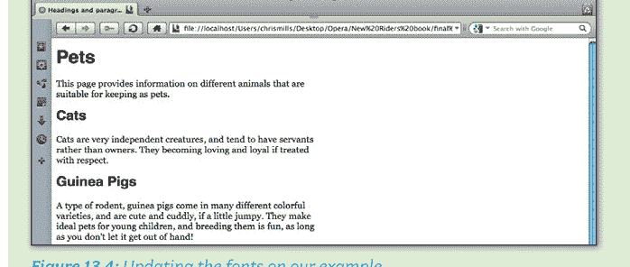

*图 13.4：更新我们示例中的字体。*

## 资源 // 网页字体

CSS3 规范中一个相当令人兴奋的模块是网页字体。它通过允许你指定机器上的字体文件随网页一起下载并应用，从而解决了跨平台可用字体集有限的问题。例如，**图 13.5** 展示了一个使用网页字体的网页（你可以在第 20 章“浮动”中查看示例实现并了解更多信息）。

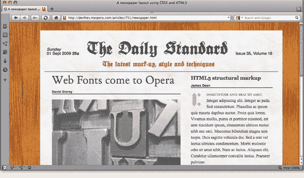

*图 13.5：网页字体让你的网页排版更出彩！*

你可以在 [http://dev.opera.com/articles/view/seven-web-fonts-showcases/](http://dev.opera.com/articles/view/seven-web-fonts-showcases/) 找到更多精彩示例和信息。

## 文本尺寸

接下来我们要做的是调整文本大小；这可以通过 `font-size` 属性完成，你可以使用几乎任何你想要的 CSS 单位，尽管建议使用百分比或 em，而不是像素。前两种选项会根据默认文本大小相对调整文本大小，而后者则会给出文本一个绝对大小，不受其他设置的影响。这通常会导致问题，因为如果设计师想增大整个页面的整体大小，使用像素设置的单独元素大小将保持不变，开始显得比例失调。

此外，一些用户会希望使用浏览器功能调整你网站上的文本大小以便阅读。一些较旧的浏览器在使用浏览器缩放功能时不会调整整个页面的大小，而只调整文本——这些浏览器将无法调整使用像素设置的文本大小。这现在已不是什么大问题，因为所有现代浏览器都会调整整个页面的大小，不受像素大小的影响，但你不应该依赖所有目标受众都使用现代浏览器。

让我们进入实际操作。有时你会想改变整个网站的相对文本大小，使其比浏览器默认值更大或更小，这取决于你想要实现的外观。可以使用类似以下的方法完成：

```
body {
    font-size: 0.8em;
}
```

然后你可能需要调整标题大小。使用 em 或百分比都可以有效地完成，但坚持使用 em 更为一致：

```
h1 {
    font-size: 3em;
}
h2 {
    font-size: 2em;
}
h3 {
    font-size: 1.3em;
}
```

em 是一个可伸缩的网页度量单位，始终等于文档当前的字体大小，因此，例如，如果段落当前使用 16px 的默认字体大小，那么 16px 等于 1em。设置字体大小为 2em 总会使字体大小变为默认大小的两倍。这里还有另一个等效关系需要注意——由于 2em 使字体大小翻倍，2em 等于将大小设置为 200%，而 80% 等于 0.8em，100% 等于 1em，依此类推。

## 文本的通用样式

> 提示：要深入了解使用 em 的更多信息，请查看 Rich Rutter 的精彩文章“如何使用 em 设置文本大小”——请访问 http://www.clagnut.com/blog/348/。

## 资源 // 计算值与指定值

在我们的示例中，`<body>` 元素的字体大小设置为 0.8em，或 80%——但这是 80% 的什么？标题和段落的字体大小不应该是 `<body>` 的 80% 吗？继承的值不是**指定值**——我们在样式表中写的值——而是称为**计算值**的东西。如果继承的是*指定值*，*每个后续的子元素文本都会越来越小——80% x 80% x 80%……等等！*

在字体大小的情况下，计算值是一个以像素为单位的绝对值。字体大小的百分比值与浏览器中设置的默认字体大小相关。大多数现代浏览器的默认字体大小设置为 16px。因为 16 的 80% 是 12.8，所以 `<body>` 元素的字体大小的计算值可能是 13px。这就是段落继承的值。标题的字体大小，即使在我们应用自定义大小设置之前，也更大，因为浏览器会应用一些内置样式。

相对字体大小调整可能会让你头疼。Richard Rutter 在 A List Apart 上更详细地探讨了这个问题，网址为 http://www.alistapart.com/articles/howtosizetextincss/。

## 其他文本属性

CSS 中可用的其他文本属性你可能不会经常使用，如下所示：

-   `font-weight` 指定文本的粗细/粗体，可以接受 100、200、300、400、500、600、700、800 或 900 的值（每个值依次递增粗细），或者可以接受更简单的可读值如 `lighter`、`normal`（默认值）、`bold`、`bolder`。请记住，并非所有字体都接受所有这些值，因此你可能需要做一些实验。
-   `font-style` 指定应使用字体的哪种变体，接受 `italic`、`oblique` 或 `normal`（默认值）的值。这可能只在你绝对需要将某些内容设置为斜体但不想要相关的语义强调时使用。`oblique` 类似于 `italic`，区别在于 `italic` 使用所用字体系列中任何可用的斜体字体，而 `oblique` 只是取正常字体并添加倾斜。
-   `font-variant` 指定应用字体的小型大写字母变体的使用，其中大写字母正常渲染，小写字母渲染为大写字母的较小版本。要在元素上设置此项，请使用声明 `font-variant: small-caps;`。
-   `line-height` 指定每行文本的高度（仅指文本所在的行；不包括文本本身），使用你选择的单位。你可以在下一章中看到其使用。
-   `text-transform` 转换元素的文本内容。可能的值包括 `capitalize`（将所有单词首字母大写）、`lowercase`（将所有字母变为小写）和 `uppercase`（将所有字母变为大写）。
-   `text-decoration` 指定元素文本内容的不同类型的装饰。可能的值包括 `blink`（使文本闪烁）、`underline`（在文本下画线）、`overline`（在文本上画线）和 `line-through`（在文本上画删除线）。

## 资源 // font 简写


你实际上可以将几个字体相关的属性组合成 CSS 中的一个 `font` 声明。例如，以下 CSS：

```
p {
    font: 2em/1.3em bold italic Georgia, serif;
}
```

等同于

```
p {
    font-size: 2em;
    line-height: 1.3em;
    font-weight: bold;
    font-style: italic;
    font-family: Georgia, serif;
}
```

这个简写除非你指定了 `font-size` 和 `font-family`，否则不会起作用——如果缺少任何一个，CSS 规则将被完全忽略。

# 第 13 章


将前面的 `font-size` 规则应用到我们的示例中，将会得到如**图 13.6** (`headings_paragraphs4.html`) 所示的显示效果。

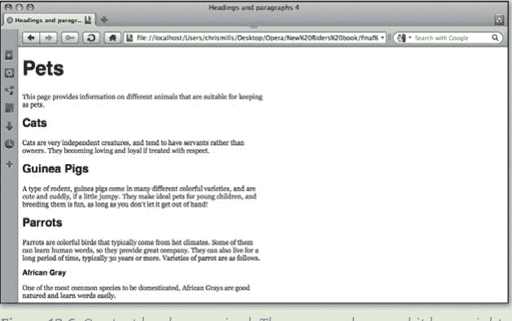

1.  好好把玩一下我提供的示例中的文本缩放，以习惯不同的单位以及它们如何协同工作。
2.  尝试“其他文本属性”部分涵盖的 CSS 属性，看看它们对我们示例中的文本有什么影响。

## 用于赋予文本意义的其他 HTML 元素

在本节中，我将介绍你可能至少会经常用来改善 HTML 语义的最常见的其他元素。请注意，本节中的所有示例都可以在代码示例文件 `headings_paragraphs5.html` 中找到（最终示例见**图 13.7**）。当然，你可以随心所欲地设置任何这些元素的样式，但通常浏览器的默认样式就足够好了。

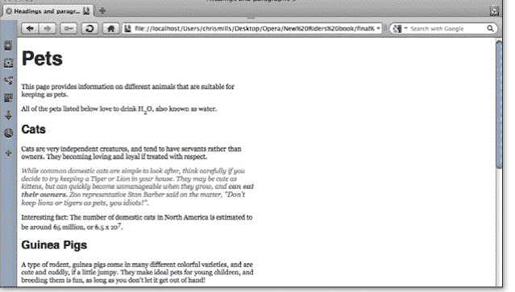

图 13.7：最终示例添加了许多语义元素。请注意，并非所有这些元素默认都会带来太多视觉变化。

### 强调—`<em>` 和 `<strong>`

HTML 包含两个元素，用于指示其内的文本需要向用户强调，因为它更重要或只是不同。对于视觉浏览器，这通常意味着应用不同的颜色、字体，或使文本加粗或斜体。对于屏幕阅读器用户，这可能导致不同的语音或其他听觉效果。

对于需要强调的文本，你可以使用 `<em>` 元素，如下所示：

```
<p><em>虽然普通的家猫很容易照顾，但如果你决定尝试在家里养一只老虎或狮子，请仔细考虑。它们小时候可能很可爱，但长大后很快就会变得难以管理</em>。</p>
```

如果需要强调整个句子，但该句子中仍有一个点需要进一步强调，则可以使用 `<strong>` 元素来指示比正常更强烈的强调，如下所示：

```
<p><em>虽然普通的家猫很容易照顾，但如果你决定尝试在家里养一只老虎或狮子，请仔细考虑。它们小时候可能很可爱，但长大后很快就会变得难以管理，并且<strong>可能吃掉主人</strong></em>。</p>
```

### 引用其他来源—`<blockquote>`、`<q>` 和 `<cite>`

文章、博客文章和参考文档经常会引用其他文档。在 HTML 中，有两个处理引用的元素。

第一个，`<blockquote>`，用于冗长的引用，如整个句子、段落、列表等。它看起来像这样：

```
<blockquote><p>只需注意观察你的豚鼠的性别以及它们的繁殖速度。我们不想让我们的豚鼠繁殖，所以我们打算买两只公豚鼠。不幸的是，宠物店老板搞错了，我们的豚鼠家庭在短短几个月内就增加了两倍！</p></blockquote>` 
```

`<blockquote>` 内部必须直接包含其他块级元素。你应该使用与原始文档中相同的块级元素，例如，如果你引用的是一个段落文本，就使用段落。

你可以使用 `<cite>` 元素来命名被引用的人/来源，例如：

```
<blockquote><p>只需注意观察你的豚鼠的性别以及它们的繁殖速度。我们不想让我们的豚鼠繁殖，所以我们打算买两只公豚鼠。不幸的是，宠物店老板搞错了，我们的豚鼠家庭在短短几个月内就增加了两倍！<cite>-- W 女士，肯塔基州松树镇</cite></p></blockquote>
```

在普通句子或段落中使用的短引文包含在 `<q>` 元素内：

```
<p>动物园代表 <cite>Stan Barber</cite> 在这个问题上说，<q>不要把狮子或老虎当宠物养，你们这些白痴！</q></p>
```

### 为页面作者提供联系信息—`<address>`

`<address>` 元素可能是 HTML 中命名最差、最容易被误解的元素。乍一看，名称 “address” 似乎意味着它用于封装地址：电子邮件、邮政或其他。这只是部分情况。

`<address>` 的实际意义是提供页面或页面主要部分的*作者或作者们*的联系信息。这可以采用姓名、电子邮件地址、邮政地址或指向另一个具有更多联系信息的页面的链接等形式。例如：

```
<address>此页面由<strong>我们热爱宠物基金会</strong>维护。如果您有任何问题或想了解更多信息，请通过 contact@example.com 联系我们，或致电 555-666-7777。</address>
```

> 资源 // 微格式
> 
> 对于任何通用地址，你可以使用称为 **微格式** 的东西来指示段落包含一个地址。有关更多信息，请查看微格式主页 http://microformats.org/。在 http://en.wikipedia.org/wiki/Microformat 上有一篇很好的微格式介绍文章。

### 换行

由于 HTML 定义空白的方式，仅通过在编写文本时按回车键无法控制文本的换行位置（你将在下一章中阅读更多相关内容）。

可以使用 `<br>` 元素在文档中引入换行符。但是，这只应用于在需要的地方强制换行，而永远不要用于在文档中的段落或其他元素之间应用更多垂直间距——这更适当地通过 CSS 完成。

一个常见的错误是使用双换行符——`<br><br>`——来定义段落的开始和结束：

```
<br><br>
第一段。
<br><br>
第二段。
<br><br>
```

请，千万不要这样做。只需使用 `<p>` 就像你本该做的那样！

因此，例如，你可以在我们的联系信息中添加一个联系地址，如下所示：

```
<p>此页面由<strong>我们热爱宠物基金会</strong>维护。如果您有任何问题或想了解更多信息，请通过电子邮件 contact@example.com 联系我们，致电 555-666-7777，或写信给我们：</p>
<address>我们热爱宠物<br>
Kitty 街 400 号<br>
洛杉矶，加利福尼亚州 23456</address>
```

> 提示：如果你编写的是 XHTML 而不是 HTML，该元素应该是自闭合的，如下所示：`<br />`。这适用于所有不需要闭合标签的元素——`<br />`、`<hr>`、`<link>`、`<meta>`、`` 等。

### 水平分隔线—`<hr>`

在 HTML 中，水平分隔线使用 `<hr>` 元素创建。它在文档中插入一条水平线，代表文档不同部分之间的边界。

虽然有些人认为这本质上是非语义的、纯粹的视觉呈现效果，但实际上文学中有先例存在这样的元素。在一个章节（可以描述为书中的一节）内，水平分隔线可能出现在发生在不同时间和/或地点的场景之间。此外，诗歌可以使用装饰性分隔来分隔诗的不同诗节。

这两种用法都不能证明需要一个新的标题元素，而标题元素是标记文档部分之间边界的公认方式。`<hr>` 元素没有不常见的属性，如果默认外观不满意，应使用 CSS 进行样式设置。

> **提示：** 与换行符一样，如果你编写的是 XHTML 而不是 HTML，请使用自闭合形式—`<hr />`。

### 缩写

`<abbr>` 和 `<acronym>` 元素用于指示缩写出现的位置，并提供一种在不不必要地中断文档流程的情况下展开它们的方法。缩写文本被包装在 `<abbr>`/`<acronym>` 元素中，完整版本放在 `title` 属性中，如下所示：

```
...鹦鹉的体重范围可以从 10
<acronym title="克">g</acronym> 到 4<acronym title="千克">kg</acronym>，它们的寿命
<abbr title="大约">约</abbr> 50 年...
```

#### 资源 // `<acronym>`

虽然 HTML 4.01 规范允许使用 `<abbr>` 和 `<acronym>` 元素，但关于在哪里使用哪个，通常存在一些困惑。

首字母缩略词是一种缩写形式，由全称的首字母组成，作为一个单词发音，而不是拼写出来（例如，scuba——“自携式水下呼吸器”的首字母缩略词）。首字母缩略词是缩写的一个子集，严格来说，使用 `<acronym>` 元素来标记像“HTML”这样的东西是不正确的（那是首字母缩写词！）。

Internet Explorer（7 之前的版本，7 不像其他浏览器那样在缩写下提供虚线下划线）不支持 `<acronym>` 元素，但确实识别 `<abbr>`。

此外，在 HTML5 草稿中，`<acronym>` 元素已被删除，取而代之的是标准化地使用 `<abbr>` 来表示两者，因为任何首字母缩略词也是有效的缩写。最好的做法是避免使用 `<acronym>`，只在你的代码中坚持使用 `<abbr>`。


 ## 上标与下标

要将文本的某一部分标记为上标或下标（与文本其余部分相比略微升高或降低），你需要使用 `<sup>` 和 `<sub>` 元素。某些语言需要这些元素来正确显示缩写，也可以在标记少量数学或化学相关内容时使用，例如：

```
<p>All of the pets listed below love to drink H<sub>2</sub>O, also known as water.</p>
<p>Interesting fact: The number of domestic cats in North America is estimated to be around 65 million, or 6.5 x 10<sup>7</sup>.</p>
```

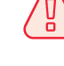

你不应该仅为视觉效果而使用 `<sup>` 和 `<sub>`。

### 文档的变更（插入和删除）

如果文档自首次发布以来有所更改，你可以标记这些变更，以便回访者或自动化进程了解发生了什么变化，以及何时发生的。

新增文本（插入内容）应使用 `<ins>` 元素标记。已删除的文本应使用 `<del>` 元素标记。如果在文档中的同一位置同时进行了删除和插入，良好的做法是将删除的文本放在前面，然后是插入的内容。

这两个元素都可以接受两个属性，以赋予编辑更多的含义：

- cite：如果变更的原因在页面中或 Web 其他位置有说明，你应该在 cite 属性中引用该文档或片段。这实际上是在说"这次变更是因为这个原因。"
- datetime：你还可以使用 datetime 属性来指示变更发生的时间。其值应为 ISO 标准时间戳，通常格式为 YYYY-MM-DD HH:MM:SS ±HH:MM（更多信息请参阅 http://en.wikipedia.org/wiki/ISO_8601）。

以下是一个同时使用了这两个属性的示例：

```
<p><del cite="edit_log.html" datetime="2010-01-04 00:26:55 Z">The most common species of parrot to be domesticated, African Grays are of good nature and they can learn many human words</del>
<ins datetime="2010-01-04 00:41:36 Z">One of the most common species to be domesticated, African Grays are good natured and learn words easily</ins>.</p>
```

**提示：** 浏览器目前不会对 `cite` 和 `datetime` 属性执行任何操作，但你可以将它们与 JavaScript 或 CSS 结合使用来实现有用的功能，而且未来的支持可能会得到改善。


### 代码和变量

`<code>` 元素用于在页面中表示计算机代码——你只需将该元素包裹在代码片段周围，如下所示：

```
<p>I am starting to write notes here on how to maintain this page. Surround each separate paragraph with the tags <code>&lt;p&gt;</code> and <code>&lt;/p&gt;</code>.</p>
```

`<var>` 元素用于在文本内容中表示变量。这可以用于代数数学表达式或编程代码中。例如：

```
<p>The value of <var>x</var> in 3<var>x</var> +2=14 is 4.</p>
```

请记住，如果你想在文本内容中使用代码中出现的特殊字符，需要对这些字符进行转义，否则浏览器会尝试将其作为代码渲染，从而导致错误。最常用的转义字符有：

- `<`——使用 `&lt;` 转义
- `&`——使用 `&amp;` 转义
- `>`——使用 `&gt;` 转义

### 表现性元素——切勿使用

HTML 规范中包含若干被广泛描述为"表现性"的元素，因为它们只指定其中内容的显示样式，而不表示其含义。

> 其中一些已在规范中被标记为已弃用（deprecated）。这意味着它们已被更新的方法所取代，以实现相同的效果。我将在下面简要介绍它们，但请注意这主要是为了历史参考——这些元素绝对不应该出现在任何现代网页中。

```
<font face="..." size="...">
```

其中的文本使用与默认字体不同的字体渲染——应该使用 CSS 来设置字体和字号。

```
<b>
```

其中的文本以粗体显示——这几乎总是意味着文本已被强调，因此你应该使用前面所示的 `<em>` 或 `<strong>`。

> `<b>` 和 `<strong>`（以及 `<i>` 和 `<em>`）在大多数视觉浏览器中的视觉效果几乎相同，但屏幕阅读器不会传达两者之间的任何差异。粗体和斜体纯粹是视觉效果，而 strong 和 emphasis 则表示文本应以某种方式被强调。因此，坚持使用 `<strong>` 和 `<em>`。

```
<s> and <strike>
```

其中的文本被删除线划掉——如果这只是表现性效果，应该使用 CSS 实现。或者，如果文本实际上是标记为已删除，则应使用本章前面所述的 `<del>` 元素进行标记。

#### `<u>`

其中的文本带有下划线——这几乎总是视觉效果，因此应该使用 CSS 实现。另外请注意，带下划线的文本通常表示可以点击的链接，因此可能会让 Web 用户感到困惑。

#### `<tt>`

其中的文本以"打字机"或等宽字体呈现——这应该使用 CSS 或更合适的语义元素（如 `<pre>`）来实现，这将在下一章讨论。

#### `<big>` 和 `<small>`

其中的文本字号变大或变小——这应该使用 CSS 实现。

## 小结

本章探讨了标记和样式化标准文本的来龙去脉。在下一章中，我们将继续探讨 HTML 中如何处理空白，以及如何使用 CSS 控制内容之间的间距。

# 第14章

## 空白（Whitespace）

作者：Chris Mills

现在你已经很好地理解了如何标记并为标题和段落添加含义和样式，让我们来看看如何控制不同内容片段之间的间距。这听起来可能微不足道，但在设计页面时，这与内容本身同样重要。显然，你需要仔细考虑网站的内容——因此，你的导航菜单、标题结构和写作风格等应创造出可用且舒适的用户体验——但即使是世界上最好的内容，如果全部被挤在一起、塞进狭小空间，也会让人难以浏览！

在本章中，我们将探讨如何使用 CSS 来控制**空白**。我将为你深入讲解 **CSS 盒模型**，它控制 CSS 中内容的间距方式；然后探讨内边距、外边距、行高、字间距以及其他相关主题。

*在本章中，你将有机会**亲自尝试！**利用本书配套网站上的便捷示例代码下载——http://interactwithwebstandards.com。*

### 重申空白的重要性

本章和上一章介绍的许多理论都植根于传统平面设计，网页设计对此欠了很多债。想想报纸排版——不同的故事和其他内容被组织成细长的栏目，以便读者更容易消化（**图 14.1**）。

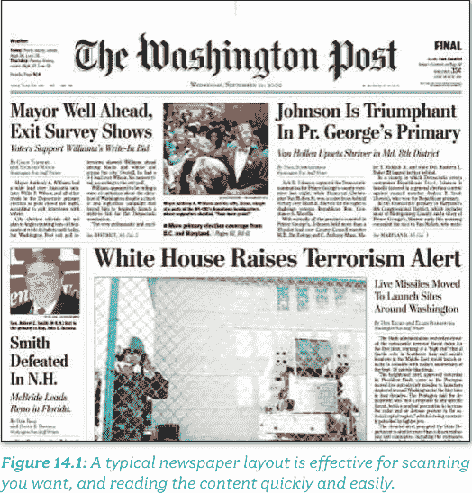

如果所有内容都放在一个宽栏目中，没有空白分隔，阅读起来会困难得多。另一个值得一看的好例子是经典瑞士平面设计，它以大量使用空白和极简主义设计而闻名，产生了巨大的视觉冲击力。访问 <http://www.flickr.com/groups/swisslegacy/pool/> 可以查看瑞士设计的精彩示例。

将其应用到 Web 媒介中，你可以很容易看出，一个杂乱、内容繁多的网站（**图 14.2**）会给读者带来多大困难。

### 重申空白的重要性

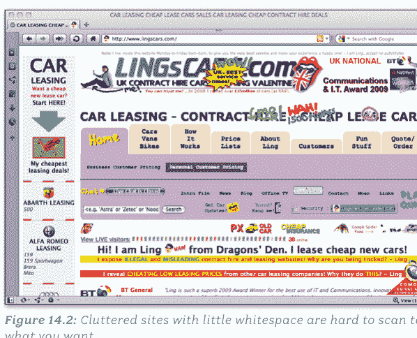

尤其是当你将它与 Dan Cederholm 的网站这样宽敞舒适的设计（**图 14.3**）进行比较时。

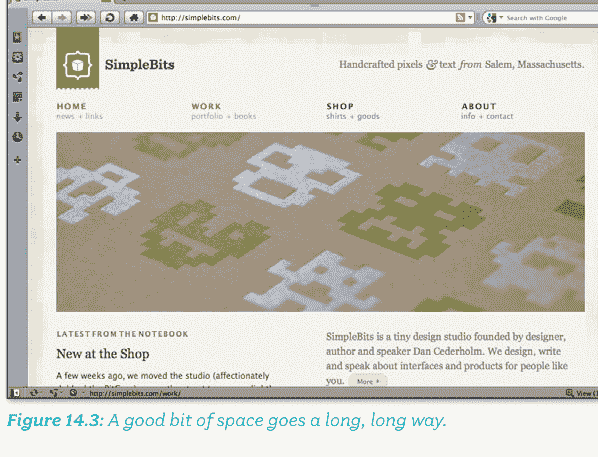


当然，我这里使用了极端的反差来证明我的观点。有些人会认为这些网站上的内容类型差异很大，就像拿苹果和橘子做比较，因此并不公平。但这确实说明了一个道理：如果你的页面开始看起来像**图 14.2**，你就真的应该考虑重新组织你的内容了。

> 提示：关于如何合理地组织网页内容，Steve Krug 的精彩著作*《Don't Make Me Think》*是一本必读之书。更多信息请访问 [http://www.sensible.com/dmmt.html](http://www.sensible.com/dmmt.html)。

+   动手试一试！

在印刷出版物中找出三个好的和三个不好的内容排版示例（任何类型的都可以）。用数码相机或其他成像设备拍照，然后写一篇博客文章，把这些图片放进去，讨论这些排版好在哪里或不好在哪里。

对网站也做同样的事情——三个好的和三个不好的。

### 浏览器如何渲染 HTML 中的空白字符

正如你所猜到的，*空白字符*（whitespace）这个词的含义不言自明——它指的是内容之间任何未被占用的空间，而非内容本身。实际的空格字符，就像你敲击键盘空格键时得到的字符，是最常见的，但还有其他字符，比如制表符以及文档中两行之间的标记（称为回车或换行）。

在 HTML 中，浏览器（几乎）总是将这些字符的多次出现视为单个空格字符，除非使用 `<pre>`，我们将在本章后面看到这一点。例如，代码下载文件 [white_space_example.html](white_space_example.html) 包含 `<body>` 中的以下内容：

```
<p>There
      is
                only one
    thing
            in life
                        worse
    than being
                    talked
    about, and
                        that is
                                    not
being
                talked
                                about.</p>
```

尽管其中有很多多余的空白字符，但网页浏览器将其解释并显示为**图 14.4** 所示。

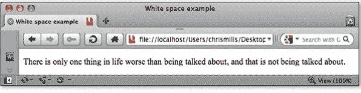

### 使用 `<pre>` 覆盖规则

上述规则有一个例外，那就是当你使用 `<pre>` 元素来标记文本时（*pre* 是 *preformatted* 的缩写）。如果你想在浏览器的最终输出中刻意显示源代码中的空白字符，这个元素就很有用。作为一名技术写作者，我主要在 HTML 文档中展示代码示例时使用它，但它还有其他用途，例如显示短行诗歌。`preformatted_example.html` 的 `<body>` 内容的第一部分如下——这是一个 HTML 代码示例：

```
<pre><code>&lt;body&gt;
  &lt;div id="actor_profile"&gt;
    &lt;h1&gt;Hugo Weaving&lt;/h1&gt;
    &lt;p&gt;Hugo Weaving is a really cool actor,
    known for very varied roles including Agent Smith
    in The Matrix, Lord Elrond in Lord of the Rings,
    and Mitzi in The Adventures of Priscilla, Queen of
    the Desert!&lt;/p&gt;
    &lt;p&gt;He was born in Nigeria, but now lives
    in Australia.&lt;/p&gt;
  &lt;/div&gt;
&lt;/body&gt;</code></pre>
```

`<body>` 内容的第二部分与第一部分完全相同，只是 `<code>` 元素被包裹在 `<p>` 元素中，而不是 `<pre>` 和 `<code>` 中。这部分内容在浏览器中的显示如**图 14.5** 所示——注意 `<pre>` 带来的差异！

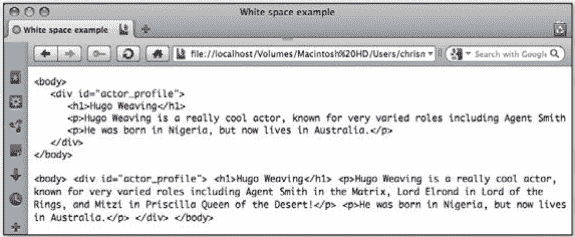

图 14.5：`<pre>` 元素的实际效果，与段落元素中的相同内容进行对比。

我使用了 `&lt;` 和 `&gt;` 来转义 HTML 尖括号 `<` 和 `>`，因为如果我不这样做，浏览器会尝试将这些元素解释为代码，而不是仅仅在页面上显示它们。

> **提示：** 为什么我还要把这段内容包裹在 `<code>` 里面，而不仅仅是 `<pre>`？因为 `<pre>` 并不描述内容的含义——它只是保留空白字符。`<code>` 元素为内容添加了语义。另外请记住，`<code>` 需要放在 `<pre>`（或其他块级元素）内部。`<code>` 是内联元素，而 `<pre>` 是块级元素。块级元素不能放在内联元素内部。

## 盒模型

既然我们这里在讨论布局，是时候介绍另一个在使用 HTML 和 CSS 时应该理解的基本概念了：**盒模型**（box model）。这是浏览器用来计算 HTML 元素在页面上占用多少空间，以及在它们之间放置多少空间的模型。

默认情况下，HTML 中的块级元素按照你在文档中放置的顺序一个接一个地出现（也称为源代码顺序），其间有一些默认的边距分隔，并应用了其他默认样式（参见**图 14.6** 的演示）。

内联元素被放置在块级元素内部，一个接一个地排列，有点像把一些小盒子放在一个大盒子里面。

The box model

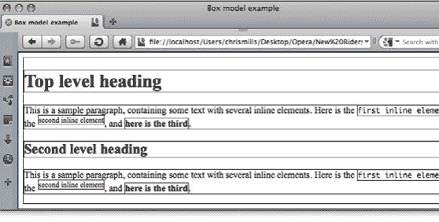

图 14.6：*块级元素和内联元素的默认排列方式（查看 `box_model1.html`）。我给每个元素添加了边框，让你了解盒模型所占据的区域。*

> 提示：块级元素可以放在其他块级元素内部，内联元素可以放在其他内联元素以及块级元素内部，但你绝不能将块级元素放在内联元素内部，正如我们前面提到的。

如你所见，标题和段落的上下方都有一些默认的边距。最外层的盒子是 `<body>` 元素。你可以使用 CSS 来改变元素周围的空白字符，我们将在后面看到。

### 块级元素周围的空间

现在让我们集中关注单个块级元素。元素内容周围有三层，有点像洋葱的层次。**图 14.7** 展示了这些层次。

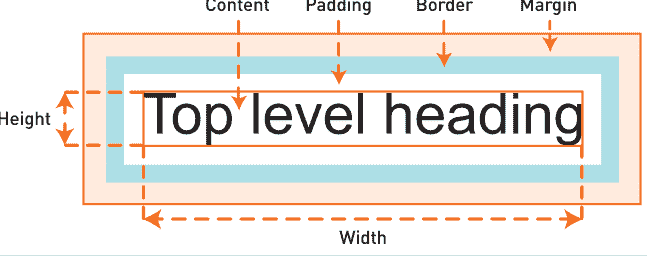

图 14.7：*盒模型中的层次。*

所以盒模型中的层次是内容（content）、内边距（padding）、边框（border）和外边距（margin）。还要注意此图中的高度和宽度。当你设置元素的 `width` 和 `height` 属性时，实际上只是设置了内容的宽度和高度。所有其他层次都会在此基础上增加额外的宽度和高度。

仔细研究这一点，记住它们的顺序——这将在将来帮助你解决内容放置问题时更加轻松！

#### 当两个外边距相遇时

当两个垂直外边距相遇时——例如，当一个元素上设置了底部外边距，而它正下方的元素上设置了顶部外边距——这些外边距会相互折叠，最终的外边距大小与两个原始外边距中较大的那个相同。

#### 旧版浏览器中的盒模型问题

困扰网页设计师多年的一个问题是，旧版浏览器错误地实现了盒模型。随着旧版浏览器的市场份额下降到微不足道的地步，这个问题近年来已经有所减轻，在撰写本书时，版本 5 及以下的浏览器肯定属于这一范畴（Netscape 4 和 Internet Explorer 5 的盒模型实现 notoriously 不佳）。

在这方面，我们唯一真正还需要担心的浏览器是 Internet Explorer 6。如**图 14.7** 所示，正确的盒模型实现将 `width` 和 `height` 定义为*仅是内容的宽度和高度*。而在 Internet Explorer 6 中，`width` 和 `height` 是*内容加上内边距的宽度和高度*，因此你的布局在 Internet Explorer 6 中会与其他浏览器略有不同。你可能不在乎这一点，但使用 Internet Explorer 6 的网站访问者会在乎，所以你必须想办法为该浏览器提供不同的 CSS 来修复这个问题，例如通过 JavaScript、CSS hack 或条件注释。我个人认为条件注释是解决这个问题的最佳方式，因为它们不需要 JavaScript，而且不那么，嗯，*hack* 感——参见 http://dev.opera.com/articles/view/supporting-ie-with-conditional-comments/。


现代浏览器与旧版浏览器在盒模型工作方式上还有一些微妙的差异，但在此阶段对你的学习而言并非至关重要，故不在此展开。

### 通过 CSS 设置 padding、border 和 margin

要设置元素的内边距、边框和外边距，可以使用 `padding`、`border` 和 `margin` 这几组 CSS 属性。

#### padding

CSS 中仅有五个内边距属性：毫不意外地，`padding-top`、`padding-right`、`padding-bottom` 和 `padding-left` 分别设置元素四边的内边距大小。最常用于设置内边距的单位是像素和百分比。`padding` 是一个简写属性，允许你一次性设置四边的内边距——你可以使用不同的简写方式：

- `padding: 10px 0px 20px 30px;` 分别设置四边的内边距，顺序从上开始，然后是右、下，最后是左（想象 *顺时针方向，从顶部开始*）。
- `padding: 10px 20px;` 为上下两边设置相等的内边距，然后为左右两边设置相等的内边距。
- `padding: 10px 20px 5px;` 为顶部设置内边距（`10px`），为左右两边设置相等的内边距（`20px`），最后为底部设置内边距（`5px`）。
- `padding: 10px;` 用一个值为四边设置相等的内边距。

你也可以将 `padding`（和 `margin`）设置为 `auto`，这会使其在父元素内其他声明占用空间后，占据所有剩余可用空间。

### 动手试试！

为了演示我们正在讨论的属性效果，我将使用 box_model1.html 的修改版本。查看代码下载中的 box_model2.html 和 box_model2.css——其默认外观如**图 14.8** 所示。

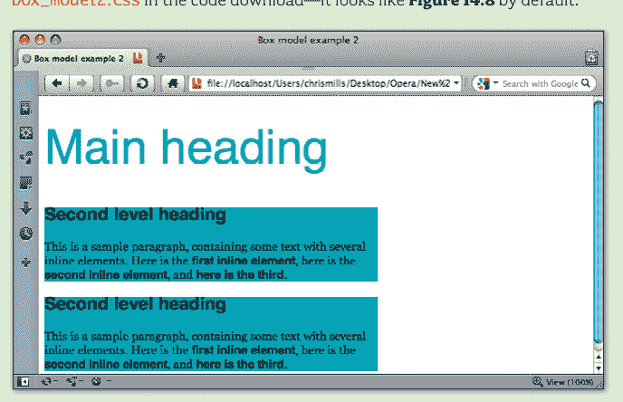

*图 14.8：我们示例的起点。*

目前，章节框的文本紧贴背景色边缘，看起来不太美观。复制示例代码，为内容添加一些内边距值以改善其外观。尝试在不同边设置不同的内边距组合，看看你认为哪种效果最好。

#### border

`border` 系列值设置元素边框的不同方面，本节将对此进行说明。

- `border-color`：这是设置元素边框颜色的简写属性——你可以使用十六进制、关键字或其他任何 CSS 支持的颜色值。你也可以使用单个声明为特定边设置颜色，例如，`border-color: red blue white black;` 或 `border-color: black white;`，或者使用更具体的声明——`border-bottom-color`、`border-top-color`、`border-left-color` 和 `border-right-color`。
- `border-style`：这是设置边框样式的简写属性——如虚线、点线、双线、凹槽、脊线等。与 `border-color` 一样，这可以分解为特定边的属性，例如 `border-right-style`，或者你可以为不同边设置不同的样式，例如 `border-style: dotted dashed;`。
- `border-width`：这是设置边框宽度的简写属性，例如 1px。与 `border-color` 一样，这可以分解为特定边的属性，例如 `border-right-width`，或者你可以为不同边设置不同的宽度，例如 `border-width: 1px 2px;`。
- `border`：这是一个超级简写属性，允许你通过一个简单的声明设置元素四边边框的宽度、颜色和样式，例如，`border: solid 1px black;`。

### 动手试试！

你的内容框现在应该看起来像 box_model3.html 和 box_model3.css（图 14.9）。

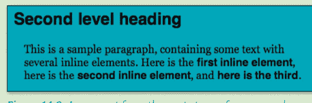

你的下一个任务是为内容框添加符合设计的边框。尝试不同的样式和颜色组合，看看你能创造出什么效果。

#### margin

与内边距一样，只有五个外边距属性：`margin-top`、`margin-right`、`margin-bottom`、`margin-left` 和简写属性 `margin`。它们的工作方式与 `padding` 属性完全相同，只是它们设置的是外边距值！请参考上面的内边距部分作为指导，并记住相邻的外边距会发生合并（collapse），如前所述。

### 动手试试！

现在你需要调整示例中的外边距以完成它。获取示例文件，根据你的判断添加外边距值。

如果你想查看我在本节和上一节中的操作，请查看**图 14.10**。


*图 14.10：示例已完成（目前），更新了外边距和边框（见 box_model4.html）。*

## 控制段落内的间距

有一些属性可用于控制段落内的间距——`text-align`、`letter-spacing`、`word-spacing` 和 `line-height`。我将在以下小节中一一介绍。

#### text-align

`text-align` 控制文本的对齐方式。类似于文字处理应用程序，你可以选择 `left`（左对齐）、`right`（右对齐）、`center`（居中）或 `justify`（两端对齐，通过调整每行单词之间的间距使每行文本长度完全相同）。**图 14.11** 展示了不同设置的效果。

```
text-align: left;
```

```
text-align: right;
```

Oh! I do like to be beside the seaside! I do like to be beside the sea! I do like to stroll upon the Prom, Prom, Prom! Where the brass bands play "Tiddely-om-pom-pom!"

Oh! I do like to be beside the seaside! I do like to be beside the sea! I do like to stroll upon the Prom, Prom, Prom! Where the brass bands play "Tiddely-om-pom-pom!"

```
text-align: center;
```

```
text-align: justify;
```

Oh! I do like to be beside the seaside! I do like to be beside the sea! I do like to stroll upon the Prom, Prom, Prom! Where the brass bands play "Tiddely-om-pom-pom!"

Oh! I do like to be beside the seaside! I do like to be beside the sea! I do like to stroll upon the Prom, Prom, Prom! Where the brass bands play "Tiddely-om-pom-pom!"

*图 14.11：不同的 text-align 设置——左对齐（默认）、右对齐、居中和两端对齐。*

#### letter-spacing

`letter-spacing` 改变每个字母之间的水平间距，类似于印刷设计/排版中的 *字距调整* 或 *字间距* 效果。**图 14.12** 展示了对示例段落应用不同字母间距的效果。请记住，1em 是一个字符的大小，因此你可能需要将此设置更改为一个 em 的分数或一个小的百分比。默认设置为 0——如果你想让字母靠得非常近甚至可能重叠，可以为 `letter-spacing` 使用负值。

```
letter-spacing: 0em;
```

```
letter-spacing: 0.5em;
```

Oh! I do like to be beside the seaside! I do like to be beside the sea! I do like to stroll upon the Prom, Prom, Prom! Where the brass bands play "Tiddely-om-pom-pom!"

O h ! I d o l i k e t o b e b e s i d e t h e s e a s i d e ! I d o l i k e t o b e b e s i d e t h e s e a ! I d o l i k e t o s t r o l l u p o n t h e P r o m , P r o m , P r o m ! W h e r e t h e b r a s s b a n d s p l a y " T i d d e l e y - o m - p o m - p o m ! "

```
letter-spacing: 0.1em;
```

Oh! I do like to be beside the seaside! I do like to be beside the sea! I do like to stroll upon the Prom, Prom, Prom! Where the brass bands play "Tiddely-om-pom-pom!"

*图 14.12：增加字母间距的效果。*

#### word-spacing

`word-spacing` 的工作方式与 `letter-spacing` 完全相同，只是它改变的是每个单词之间的水平间距——**图 14.13** 说明了其效果。默认设置为 0——如果你想让单词靠得非常近甚至可能重叠，可以为 `word-spacing` 使用负值。


#### line-height

`line-height` 同样以前两个属性相同的方式工作，只是它改变的是每行之间的垂直间距；在印刷设计/排版中通常称为行距。与字母间距一样，你需要为此使用一个较小的值。`line-height` 的默认设置是 `1em`——每个文本字符的绝对高度。如果你想让行与行之间靠得更近，可以使用小于 1em（或小于 100%）的值，但设置过低会导致混乱；如果设置为 0，所有文本行将出现在同一行上！

**图 14.14** 展示了此属性的效果。


## 控制段落内的间距

```
line-height: 0.7em;
```

```
line-height: 1.5em;
```

哦！我真喜欢待在海边！我真喜欢待在大海旁！我真喜欢在滨海大道上漫步，漫步，漫步！铜管乐队奏响"咚-咚-咚-啪-啪-啪！"

哦！我真喜欢待在海边！我真喜欢待在大海旁！我真喜欢在滨海大道上漫步，漫步，漫步！铜管乐队奏响"咚-咚-咚-啪-啪-啪！"

```
line-height: 1em;
```

哦！我真喜欢待在海边！我真喜欢待在大海旁！我真喜欢在滨海大道上漫步，漫步，漫步！铜管乐队奏响"咚-咚-咚-啪-啪-啪！"

## 图 14.14：增加行高的效果。

### 动手试试！

- 1. 找一个示例页面，试验上述属性。这些属性可以为你带来一些很酷的效果，具体取决于你想为页面呈现的外观。稍微增加字母间距和单词间距也可以提高可读性。

- 2. 现在打开 `box_model4.html` 和 `box_model4.css`，进行一些修改：
  - 将段落中的文本设置为两端对齐。
  - 稍微增加行距和字母间距以提高可读性。

我最终得到了如**图 14.15** 所示的结果（查看代码下载中的 `box_model5.html`）。


## 图 14.15：添加了字母间距、行间距和两端对齐的示例效果。

## 在页面上居中内容

使用外边距的一个非常常见的用途是为网站提供一种简便的方式在浏览器中水平居中。为此，你需要在代码中添加两个东西。首先，你需要在整个内容外面包裹一个 `<div>` 包装器，如下所示：

```
<body>
    <div id="wrapper">
        /* Your content */
    </div>
</body>
```

然后你需要在 CSS 中对其进行如下样式设置：

```
#wrapper {
    width: 450px;
    /* This can vary according to how wide your want
       your site to be */
    margin: 0 auto;
    /* auto forces the left and right margins to share
       the available space outside the wrapper <div> equally
       between them */
}
```

这些添加会使你的网站发生变化，如**图 14.16** 所示。

## 总结


*图 14.16：在浏览器中居中你的内容。*

## 总结

阅读完本章后，你将了解 HTML 中空白的处理方式、文档布局的工作原理，以及如何使用 CSS 来操控空白。在下一章中，我们将继续学习超链接的标记和样式设置。

## 第 15 章
链接

作者：Chris Mills

链接（其全称为**超链接**）可以说是 HTML 中*最*重要的元素——正是链接让万维网成为了一个*网络*。这是万维网最重要的特性：它允许我们在全球网络服务器上托管的不同资源之间创建路径，从而形成一个可无限扩展的通信和信息网络，供不同国籍、不同能力的人们访问。

万维网中使用的两种链接类型是：

- 在文档 `<head>` 中使用 `<link>` 元素创建的链接，例如用于将外部 CSS 和 JavaScript 应用到 HTML 文件的链接。我们已经在第 11 章"CSS 简介"和第 12 章"`<head>`"中介绍了这些内容。

- 出现在文档 `<body>` 中的链接，使用 `<a>` 元素创建。这些链接供网站访问者点击，从我们的 HTML 文档跳转到网络上的其他资源，包括其他 HTML 文档、文本文件、PDF、图片、Word 文档以及人们发布到网络上的任何其他内容。这些被称为**锚点链接**。

在本章中，我们将了解不同类型锚点链接的 HTML 语法（从这里开始我们将只使用**链接**一词）、链接最佳实践以及如何使用 CSS 来为链接设置样式。

> *在本章中，你有机会利用书籍配套网站上提供的便捷示例代码下载来**动手试试！**——http://interactwithwebstandards.com。*

## 链接语法

你可以通过用 `<a>` 元素包裹文档中的任何文本或内联元素，将其转变为锚点链接。例如，以下代码片段包含两个链接，分别指向与所链接主题相关的其他资源：

```
<p>Hello and welcome to the UK personal satisfaction and
well-being pages. Be sure to visit our newest feature pages
for more information on <a href="features/bad_weather.
html">coping with bad weather</a> and <a href="features/
losing_at_sport.html">losing at cricket (and every other
sport we invented)</a>.</p>
```

这将产生如**图 15.1** 所示的 HTML 输出。


*图 15.1：两个基本链接。*

访问者通过点击链接（使用鼠标）、键盘选择链接，在某些情况下甚至通过语音激活链接，都会使浏览器离开当前页面并加载 `href` 属性中指定的页面。

### 链接属性

你常用的一些链接属性如下：

- `href`：如上面的示例所示，`href` 包含链接指向文件的路径。

- `title`：如果需要，你可以将有关外部资源的额外信息放入此属性中，例如更详细的描述、作者或其他需要的信息。这不应用于存放关键信息，因为在某些情况下可能不会暴露给用户——你不应依赖它。例如，某些浏览器可能不会将其显示为工具提示（有关更多信息，请参阅以下材料）。

- `id` 或 `class`：如前面章节所述，如果你想为 HTML 文档中的特定链接设置样式，可以使用 `id` 或 `class` 作为钩子。

让我们来看一个使用了所有这些属性的更新版示例：

```
<p>Hello and welcome to the UK personal satisfaction and well-being pages. Be sure to visit our newest feature pages for more information on <a href="features/bad_weather.html" title="rain and wind is manageable, but snow brings the country to a standstill" class="feature">coping with bad weather</a> and <a href="features/losing_at_sport.html" title="With coverage of cricket, soccer, and athletics" class="feature">losing at cricket (and every other sport we invented)</a>.</p>
```

`title` 属性使我们的链接在鼠标悬停时显示工具提示，如**图 15.2** 所示（请查看书籍网站上的 `links_example2.html`）。


*图 15.2：更新后的链接，带有类名和标题。*

### 资源 // title 属性

`title` 属性应仅包含有用的辅助信息，这些信息不是绝对必需的，也不应长到像《*指环王*》一样。使用屏幕阅读器的盲人无法感知这些信息，因为屏幕阅读器朗读 `title` 属性内容的功能默认情况下通常是关闭的。此外，仅使用键盘浏览的用户通常也不会看到 `title` 属性中的信息，因为键盘导航不会触发工具提示。有些人在 `title` 属性中精确描述资源的内容，但如果链接文本本身已经足够有描述性，这就没有必要了。有关编写良好链接文本的更多信息，请参阅后面的链接最佳实践部分。

### 不同类型的链接目标

`<a>` 元素可以通过不同的方式链接到资源，具体取决于 `href` 属性中的值类型。我们将在本节中解释不同的方式。

#### 绝对链接

首先是**绝对链接**。这些链接可以从任何起点将你带到目标资源。你可以使用绝对路径链接到另一台服务器上的文件，甚至同一台服务器上的文件。要访问这些文件，你需要指向它的完整 URL。一些示例：

- http://www.amazon.com/
- http://interact.webstandards.org/curriculum/front-end-development/
- http://mywebsite.co.uk/resources/form1.pdf

#### 相对链接

还有**相对链接**，这些链接与当前页面位于同一台服务器上，并标识了一个到达最终目的地的起始点。这有点像给别人指路时说："往前走一个街区，再过两个街区。"这些指引只有在你从正确的位置出发时才有效。你不需要指定这些页面的完整 URL——而是指定要链接文件的**文件路径**。请考虑如**图 15.3** 所示的目录结构。


### 不同类型的链接目标


> 图 15.3：一个示例目录结构。

我们假设文件 `file_to_link_from.html` 是你正在从中创建链接的文件。因此，举例来说：

- 如果你想链接到 `link.html` 文件——它和当前文件在同一目录中——你只需要文件名：`link.html`。
- 如果你想链接到 `link2.html`，它位于与当前文件在同一目录的一个文件夹内，你需要使用 `folder/link2.html`。这告诉浏览器“进入 *folder* 目录，然后你就能找到你要找的文件。”
- 如果你需要向上进入当前文件所在文件夹的父目录来查找要链接的文件——例如 `link3.html` 位于 `file_to_link_from.html` 所在的 *当前目录* 文件夹的上一级目录中——你可以使用两个点来表示“向上一级”，像这样：`../link3.html`。
- 如果你要链接的文件位于网站的顶层目录（即 **根目录**），你只需在文件路径开头添加一个斜杠就能到达那里。例如，我们也可以使用 `/link3.html` 来链接到 `link3.html`。以 `/` 开头的文件路径将始终相对于服务器的根目录。

> 提示：如果你要链接到同一服务器上的文件，并且你确实想使用绝对链接，这仍然是可以的，但这不如使用等效的相对链接高效，因为你告诉浏览器先去找到服务器，然后再去找文件。如果你已经在正确的服务器上，这部分操作就是不必要的。

### 片段标识符

要提到的第三种链接是 **片段标识符**。你使用它来链接到 *同一* 文档中的另一部分。要使文档中的某个元素可被链接，你只需给它一个 `id`。例如：

```
<h2 id="cats-and-dogs">倾盆大雨</h2>
```

然后要链接到这个标题，你需要在 `id` 前加上井号：

```
<p>稍后了解更多关于<a href="#cats-and-dogs">倾盆大雨</a>的信息。</p>
```

### 混合链接类型

本节最后要提到的是，你可以将绝对链接与片段混合使用，也可以将相对链接与片段混合使用：

- http://example.com/features/bad_weather.html/#cats-and-dogs
- ../features/bad_weather.html/#cats-and-dogs

## 自己动手试试！

现在让我们看几个展示这些不同链接类型实际应用的例子。打开 `links_example3.html` 并动手尝试一下。我希望你能创建一些新的例子：

- 一个指向外部网站的可用绝对链接。
- 一个指向外部网站文档片段的可用绝对链接（稍微浏览一下周围的页面）。
- 一个指向高一级目录，然后再向下三级目录的文件的可用相对链接（遵循一个与之前不同的目录路径）。你需要创建一些目录和一个新的 HTML 文件。
- 一个指向非 HTML 文件资源的绝对或相对链接。

## 链接最佳实践

在 HTML 页面上放置链接时，你应该遵循一些最佳实践。这些并不难遵循，一旦你创建了几个网页，它们就应该开始成为你的第二天性。最重要的是，你希望给网站访客提供一种易于使用且值得信赖的用户体验，否则你会失去可信度，他们会去其他地方浏览。

### 链接文本应简洁并描述你链接的内容

确保你的内容编写得当，这样你就可以从一段易于理解、对页面独特且有效描述所链接内容的文本中链接到更多资源。例如，这是 **非常糟糕** 的做法：

```
<p>关于鲸鱼的更多信息，<a href="info_pages/info1.html">点击这里</a>。</p>
<p>关于老虎的更多信息，<a href="info_pages/info2.html">点击这里</a>。</p>
<p>关于儒艮的更多信息，<a href="info_pages/info3.html">点击这里</a>。</p>
```

首先，使用屏幕阅读器等辅助技术浏览你网站的用户，通常会通过浏览页面上的所有链接列表来找到他们想要的链接，因此对他们来说，链接需要脱离上下文也能理解。对于这些链接，他们得到的是：

> “点击这里”
> “点击这里”
> “点击这里”

这显然会让人困惑且毫无帮助。

其次，索引你网站的搜索引擎通常也会使用链接文本作为重要的关键词以及标题，因此包含这样糟糕的链接文本，也会让你的网站更难被用户找到。

第三，无论用户是否有障碍，这样的文本对所有用户来说都更难使用。记住，用户不会阅读你网页的每一部分；他们会快速扫描，寻找他们想要的信息。几乎所有能让网页更易用的小事都是值得的。

这些链接如果这样写会更好：

```
<p><a href="info_pages/whales.html">关于鲸鱼的更多信息</a>。</p>
<p><a href="info_pages/tigers.html">关于老虎的更多信息</a>。</p>
<p><a href="info_pages/dugongs.html">关于儒艮的更多信息</a>。</p>
```

或者甚至像这样：

```
<p>我们有关于
<a href="info_pages/whales.html">鲸鱼</a>、
<a href="info_pages/tigers.html">老虎</a>和
<a href="info_pages/dugongs.html">儒艮</a>的更多信息。</p>
```

### 提醒用户注意大型或非常规文件

当用户点击一个链接时，他们期望能快速进入另一个 HTML 页面，除非另有说明。因此，在文档中提供额外信息以提醒用户注意任何异常情况是个好主意。这里有一些好的例子（参见 links_example4.html）：

```
<p>下载我们关于<a href="info_pages/whales.pdf">鲸鱼的资料文件（PDF 文档，4.3mb）</a>、<a href="info_pages/tigers.pdf">老虎的资料文件（PDF 文档，6.1mb）</a>和<a href="info_pages/dugongs.pdf">儒艮的资料文件（PDF 文档，5mb）</a>。</p>
```

```
<p>想在这里工作吗？<a href="application_form.doc">下载我们的求职申请表（Word 文档）</a>。</p>
```

```
<p>要查找更多地点，请<a href="interactive_locator.html">使用我们的交互式地图（2.5mb，包含 Flash）</a>。要使用它，如果你还没有安装，可能需要<a href="http://get.adobe.com/flashplayer/">安装 Flash 插件</a>。或者你可以使用我们的<a href="address_list.html">非交互式地址列表</a>（适合移动用户或网络连接较慢的用户）。</p>
```

这在浏览器中看起来像 **图 15.4**。

</a>. To use it, you may need to <a href="http://get.adobe.com/flashplayer/">install the Flash plugin</a&g

## 不要用意外的行为惊吓用户

如果你想让你的用户知道你的链接是可以点击的，请确保它们看起来像链接！由于浏览器的默认样式，用户通常期望带下划线的文本是可以点击的链接，当然，用户也期望像一组明显的导航按钮这样的东西是可点击的链接，所以这在一定程度上取决于上下文。只是不要将它们的样式设置得与这些公认的惯例大相径庭。反过来，也不要把不是链接的东西加上下划线。

Web 开发人员经常使用 JavaScript 来劫持链接的功能，使它们打开或关闭界面的不同部分、充当导航菜单、更改应用于页面的样式，或在选项卡式界面中显示不同的面板（有关下拉菜单示例，请参见 **图 15.5**）。如果你使用链接做不同的事情，不要让它们看起来和你的“普通”链接一样。你将在本章后面了解更多关于链接样式的内容。


*图 15.5：一个涉及多个链接的下拉菜单示例。*

## 框架、新窗口和弹出窗口——请拒绝使用

既害怕失去访问者到其他网站，又想链接到它们，这种担忧催生了 Web 开发中的一些发明，这些发明多年来一直是可用网站的眼中钉：框架和弹出窗口。


## 链接样式

使用 HTML 框架意味着你在浏览器中显示的页面被分割成多个不同的文档，同时在不同的窗格中显示。好处在于你可以将来自不同服务器的不同页面组合在一起，同时作为一个单一页面显示。然而，这就是它的全部用处了——框架的用户体验很差，实际上还有害：

-   搜索引擎永远无法索引整个框架页面，反而可能在搜索结果中显示一些脱离上下文、毫无意义的页面片段。
-   访客无法收藏该页面——下次打开收藏夹时，他们会得到框架集的初始状态，而不是他们离开时的页面。
-   依赖辅助技术的访客在框架集中导航非常困难。
-   第三方网站可能不喜欢被放在框架集内显示，会使用“框架破坏者”脚本，当你试图嵌入它们时，会用真实 URL 替换框架集。这是为了防止犯罪分子引诱互联网用户在看起来像银行网站但*不是*（所谓的“钓鱼”）的网站上输入信用卡信息。

框架集内的链接使用 `<a>` 元素的 `target` 属性来定位正确的框架。框架集中的每个框架都有一个特定的名称，激活链接会在该框架中打开 `href` 属性定义的文档。如果框架集不可用（例如，当访客通过搜索引擎找到包含链接的文档时），每个链接将在新的浏览器实例中打开。

打开新的浏览器实例是链接到第三方网站的另一种常见方式——要么通过脚本化的弹出窗口，要么通过值为 `_blank` 的 `target` 属性。每个现代浏览器都自带弹出窗口拦截器这一事实，应该能让你了解人们有多不喜欢被弹出窗口“问候”——他们*根本*不喜欢！

> 框架和 `target="blank"` 属性除非使用框架集文档类型，否则也是无效的 HTML。

## 链接样式

我们将在本书后续部分（以及本系列的其他书籍中）介绍链接的其他更复杂用途的样式，例如导航菜单，但现在我们将看看如何为链接到其他地方的普通老式链接设置样式！一般来说，对链接样式保持相对保守是个好主意——只要它们有足够的线索表明它们是可点击/可聚焦的，从而是链接，就不必让它们看起来与段落中的普通文本有很大不同。记住我之前说过的，要让链接看起来像用户期望的那样。

当然，不要发疯似的把它们设计成 400% 的闪烁彩虹文字加上跳舞的独角兽图形。否则，我会亲自追捕你。

这里需要理解的最重要一点是，链接有几个不同的**状态**需要注意：

-   **link**：默认状态——它定义了链接在首次出现时的默认外观。默认情况下，未访问的链接为蓝色。
-   **visited**：已访问（点击过或跟随过）的链接的样式。默认情况下，已访问的链接为紫色。
-   **hover**：鼠标悬停在链接上时的样式。
-   **focus**：链接通过鼠标以外的手段（例如，用户使用键盘导航到链接）*获得焦点*时的样式。请注意，旧版本的 Internet Explorer 不支持 **focus** 状态，而是使用 **active** 代替 **focus**。
-   **active**：链接被激活时的样式，即当指针悬停在链接上时按住鼠标按钮（释放鼠标按钮时状态变为 :focus）；当你通过浏览器历史记录返回原始文档时，它也是最后一个激活链接的样式。

> **提示：** 你可能会在不同的网络来源中遇到类似于 <a name=""> 的代码结构。这是一种老式的链接风格，用于网络早期，现在已废弃。

**图 15.6** 显示了 **link**、**visited** 和 **focus** 的默认链接样式。**hover** 和 **active** 的默认样式与 **link/visited** 基本相同。


*图 15.6：`link`（顶部）、`visited`（中间）和 `focus`（底部）的默认样式。*

**自己动手试试！**

访问一些你最喜欢的网站，尝试点击一些链接，返回原始页面，然后使用键盘导航选择链接。密切关注链接在每个阶段的外观。

**提示：** 大多数浏览器都内置了使用键盘在链接和表单元素之间导航的机制。例如，Firefox 允许你通过按 Tab 键来实现，Safari 的等效键是 Alt + Tab，而 Opera 具有空间导航功能，允许你通过按住 Shift 键并使用箭头键来导航这些元素。

## 链接 CSS

用于为不同链接状态设置样式的 CSS 使用了我们在第 11 章中首次提到的伪类，附加到你用于选择链接的选择器上，例如：

```
a:link { color: red; }
a.resources:visited { color: green; }
a.resources:hover { background-color: yellow; }
```

理想情况下，你应该为所有这些状态都指定 CSS。每种状态都向用户传达了他们正在与链接交互的信息。

如果对 focus、hover 和 active 有疑问，你可以简单地以相同的方式设置 focus 和 hover 的样式，因为它们的功能非常相似。然后你可以为 active 添加一些简单的变化，例如，将文本设置为斜体，或者甚至将 active 的样式设置得与 hover 和 focus 相同。（我发现这通常能满足大多数网站的需求——参见下面的示例。）

然而，link 和 visited 可能应该赋予独特的样式，因为它们扮演着重要且不同的角色。

这些状态并非全部互斥。虽然一个链接不可能同时是未访问和已访问的，但一个链接完全可以同时被悬停、激活和访问。

让我们看一个例子。我采用了我们之前的例子，添加了一些基本样式和一些精选的 CSS3 属性，使其看起来更有趣——参见 **图 15.7**（查看 [links_example5.html](links_example5.html) 和 [links_example5.css](links_example5.css) 以查看完成的文件）。


*图 15.7：为我们的最后一个例子添加了一些基本样式。*

就链接状态而言，我保留了下划线，只是稍微改变了颜色，以便用户能熟悉它们是链接。链接 CSS 如下：

```
a:link {
    color: #00A6B9;
    text-decoration: underline;
}
```

*visited* 状态显示在 **图 15.8** 中——注意 "Tigers" 链接。


*图 15.8：我们示例中的链接访问状态。*

其 CSS 只是设置了更深的文本颜色：

```
a:visited {
    color: #177380;
}
```

有趣的部分是当你看到设置 *hover*、*focus* 和 *active* 状态下链接样式的规则时：

```
a:hover, a:focus, a:active {
    text-shadow: 1px 1px 2px #00A6B9;
    text-decoration: none;
}
```

这里我使用 `text-decoration: none;` 移除了下划线，并设置了微妙的 CSS3 `text-shadow`，使得链接在通过鼠标或键盘交互时更具感知性和响应性（**图 15.9**）。


*图 15.9：我们链接的 hover/focus/active 状态。*

## 爱恨交加的关系

在继续之前，还有一点需要提及——你需要按照*那个*顺序指定 `link`、`visited`、`hover`（和 `focus`）以及 `active`。注意我在 CSS 文件中放置规则的顺序。

为什么？

因为继承关系，以及浏览器触发不同状态的顺序。

首先，你希望 `link` 状态具有基本样式，而其他状态在此基础上以各种方式进行构建。你不会希望 `link` 从 `hover` 继承样式，因为这会使链接看起来完全错误，不符合你的意图。

其次，想想状态触发的顺序。你悬停在链接上以显示点击意图，点击链接使其获得焦点，并在按住鼠标按钮时处于激活状态。以不同的顺序进行样式设置可能也会因为这个原因而无法正常工作。

幸运的是，有一个方法可以记住你必须将它们放置的顺序——**LoVe HAte** 助记法（`link` ... `visited` ... `hover`/`focus` ... `active`）。只需记住 `:focus` 总是紧挨着 `:hover`。

**自己动手试试！**

从本节中获取示例文件，创建你自己的链接样式系统——玩得开心，尽情尝试吧！

**资源 // 谨慎使用颜色**

在为链接设置样式时，小心不要完全依赖颜色来区分链接状态。并非每个人对颜色的感知都相同（例如，色盲人群），因此你应该结合颜色使用 `text-decoration`、`outline`、`border` 等属性。

你还应该检查你的颜色选择是否有足够的对比度——使用像色彩对比度分析器（`http://www.paciellogroup.com/resources/contrast-analyser.html`）这样的工具非常容易做到这一点。


## 为链接添加图标

你可以采用的另一个好方法是根据链接的类型为其附加图标，以进一步区分不同的链接。例如，查看 [links_example6.html/links_example6.css](links_example6.html/links_example6.css)，其结果如**图 15.10** 所示。


*图 15.10：本章最后一个示例使用图标来突出页面上的外部链接——一个箭头（通常从方框中向外指出）是网络上公认的外部链接惯例。*

这很容易实现。你只需要一个图标、一点点 CSS，以及 HTML 中的一个额外类名。这个类名被添加到每个外部链接上，也就是你想要添加图标的链接：

```
<a href="http://animals.nationalgeographic.co.uk/"
class="external">National Geographic animals home
page</a>
```

图标应保存在靠近 HTML 和 CSS 文件的合适位置；将其添加到页面的 CSS 如下：

```
.external {
    background: #94D7E3 url("arrow.png") center right
    no-repeat;
    padding-right: 17px;
}
```

第一条声明是我们在第 11 章首次见到的简写属性。它设置一个与段落背景色相同的背景色，将图标附加到每个 .external 链接，然后指定将其放置在元素的中右位置，并且不重复。

第二条声明在每个链接的右侧创建一些空白。视觉效果是将每个链接向左推一点，为图标腾出空间；否则图标会覆盖在链接上方。确保你的图标不要太高，否则它可能会与文字行重叠并被截断。

> **提示：** 如果你不想花时间自己制作图标，可以在网上找到几个免版税的图标。

+   **动手试一试！**

1. 首先，创建或找到能够代表不同动物的图标，并将它们附加到第一组链接中不同生物的链接上。
2. 接下来，思考另一个将图标作为背景图像附加到元素上的实际应用场景。

## 小结

在本章中，你已经学习了在网页中添加链接的来龙去脉，包括最佳实践以及使用 CSS 进行样式设置。在本书的其余部分，你会一次又一次地看到链接出现——它们可以说是我们使用的最重要的工具。所以，走出去，去构建一个 Web 吧！

# 第 16 章：图像

作者：Chris Mills

最初，只有文本，于是，Web 相当无聊。但后来图像出现了，它们说："这地方太单调了，伙计们，我们来开个派对——呜呼！"

换句话说，Web 诞生之初只有文本，别无其他。它的主要目的是提供一种共享政府和学术文档的方法。20 世纪 90 年代初，Mosaic 浏览器引入了 `` 元素，图像首次出现在 Web 上。突然间，网页融入了照片、艺术品、装饰！大约在世纪之交，使用 CSS 在元素上添加背景图像的能力也随之而来。

如今，图像在 Web 上大量用于多种用途——如我们在第 15 章"链接"中看到的图标、自定义项目符号、装饰性背景、页眉和页脚、自定义标题，等等。

在本章中，我们将带你全面了解在 Web 上放置图像所需的一切，包括 HTML 和 CSS 图像语法、不同的图像格式、图像最佳实践，以及特定的技术，如标题的图像替换、CSS 精灵、背景平铺和渐变。

*在本章中，你有机会动手实践！本书配套网站 http://interactwithwebstandards.com 上提供了便捷的示例代码下载。*

## HTML `` 语法

图像是通过 HTML 中的 `` 元素插入到文档中的。这是一个内联元素，最少必须包含一个 `src` 属性，该属性保存你想要插入的图像的路径：

```

```

> **提示：** 这是一个空元素——它没有任何文本内容，你也不需要包含闭合的 `</img>` 标签，不过如果你编写的是 XHTML，你会通过写作 `` 使该元素自闭合。

只要相关图像与 HTML 位于同一文件夹中，这就会渲染为**图 16.1** 所示的样子（查看 `images_example1.html`）。


> **提示：** `src` 属性中的图像路径与链接的 `href` 属性中使用的路径工作方式完全相同——更多详情请参见第 15 章。

### 使用 alt 提供文本描述

图像是美妙的，但它们也带来了一些问题：

- 使用屏幕阅读器访问内容的视障用户看不到它们！
- 谷歌和雅虎等搜索引擎无法索引图像中的任何文本内容，因为它们看不到图像内部的文本，因此这会对网站的可查找性产生负面影响。
- 一些网速极慢的用户可能会关闭图像以减少需要下载的数据量。
- 图像可能由于某些原因不可用，例如，如果图像路径拼写错误或文件已损坏。

### 图像中包含过多内容的弊端

> 我真的需要重申，图像中包含过多内容是不好的。非常不好。从无障碍性的角度来看，这很糟糕，除非你提供文本替代，而且这对搜索引擎索引也非常不利。我曾见过一个页面因为没有出现在搜索引擎中，因为所有文本内容都存储在一个巨大的图像里！请永远不要这样做，或者如果你这样做了，永远不要承认是这本书把这个想法放进了你的脑袋里……

如果你的图像不是内容的一部分，而仅仅是作为装饰使用，那么上述问题就不太严重。但如果它们包含内容（无论它们展示的是你正在撰写的人物或地点，还是饼图或柱状图等数据），那么这就成了一个问题。

但帮助就在眼前。`alt` 属性允许你包含图像的文本描述，屏幕阅读器会朗读它，搜索引擎会索引它，如果图像不可用，它也会显示出来。例如：

```

```

当图像不可用时，输出如**图 16.2** 所示。


*图 16.2：alt 属性的实际应用。*

你永远不应该像有些人那样将这种替代文本称为 alt 标签——没有这样的标签。它是一个 alt 属性，或称为"alt 文本"。

alt 属性的内容只应在图像不可用时显示，而不应作为附加信息显示在图像旁边（某些版本的 Internet Explorer 错误地在鼠标悬停图像时将 alt 文本显示为工具提示）。随图像提供额外信息是 title 属性的工作，我们将在下面介绍。

### 资源 // alt 和 longdesc 的局限性

需要注意的一点是，你不应该在 alt 属性中放入大量内容——多个段落之类。你无法在 alt 属性内部对其进行结构化，所以它只会以一长串纯文本的形式输出。而且根据访问内容的浏览器或辅助技术（例如屏幕阅读器）的不同，它可能会被截断或无法完整读出，从而限制了其实用性。

一种解决方案是在图像上包含一个 longdesc 属性，其值应为包含相同数据的文本表示的页面路径。

例如，如果你有一个图像，其中包含一个饼图，显示了无子女家庭、有一个孩子、有两个孩子、有三个孩子以及有四个或更多孩子的家庭的百分比，你可以使用 longdesc 属性链接到包含以 HTML 表格表示相同信息的页面（参见第 18 章），甚至是以段落形式。图像代码如下所示：

```

```

辅助技术随后会让用户知道该图像有此替代的信息表示可用，并让他们选择是否访问它。


### 资源 // `alt` 和 `longdesc` 的局限性

然而，这引出了 `longdesc` 的局限性——不使用辅助技术的用户将无法访问替代数据表示形式，甚至不会被告知该替代数据存在。这是一个缺点，因为该表格可能对任何用户都有用，例如，如果有人想要复制和粘贴数据，或者某人只是发现替代版本更容易理解。

因此，更有意义的做法是不使用 `longdesc` 属性，而是直接将替代数据表示形式放在与图片相同的页面上（或通过普通的 `<a>` 元素从页面链接）。`longdesc` 使用得并不多，而且在 HTML5 中可能会被弃用。

## 用于补充信息的 title 属性

`title` 属性对我们来说肯定不陌生——我们在前面的章节中已经看到其他元素也能够拥有 `title` 属性，并且它对所有元素的作用都是一样的——提供额外的补充信息，这些信息可能会很有用。正如你之前所见，它的使用很简单：

```

```

它还会给我们一个工具提示，如**图 16.3** 所示，而且大多数浏览器也会在浏览器窗口底部显示 `title` 文本。


*图 16.3：*`title` 属性的实际效果。

## 使用 width 和 height 定义图片尺寸

当浏览器在 HTML 中发现 `` 元素时，它会开始加载 `src` 属性指向的图片。默认情况下，它不知道图片的尺寸，所以它会先将所有文本集中显示在一起，然后在图片最终加载并显示时，调整文档布局为图片腾出空间。这会降低页面加载速度，而且对你的网站访客来说看起来有些混乱，因为布局可能会突然"跳动"并重新排列自己。为了防止这种情况发生，你可以使用 `width` 和 `height` 属性告诉浏览器在图片加载之前为图片分配适当的空间：

```

```

这会在图片加载前显示一个占位符，占据适当的空间，避免了前面提到的难看的布局偏移。

> 资源 // 图片尺寸调整

你也可以使用这些属性来调整图片大小（尝试将 `images_example1.html` 中的属性值减半，保存，然后重新加载页面），但这不是一个好主意，因为图像质量通常会下降，而且肯定不如在 Photoshop 等应用程序中调整大小那么流畅，此外，无论图片被调整为多大，文件大小仍然保持不变（如果你一开始就在服务器上将图片做成正确的尺寸，就可以节省大量下载时间）。

## CSS 背景图片语法

将图片插入网页的另一种方式是通过 CSS 的 `background-image` 属性，它以与 `` 元素的 `src` 属性大致相同的方式包含图片的路径（请记住，这个路径是相对于样式表的，而不是 HTML 页面）。你可以使用这个属性为任何元素应用背景图片：

```
p {
    background-image: url(tile2.png);
}
```

出现这个示例的 ([images_example2.html](images_example2.html)) 看起来如**图 16.4** 所示。


*图 16.4：一个简单的 CSS 背景图片。*

> **提示：** 正如你可能预期的，背景图片完全位于元素的背景中，所以元素的内容不会位移图片，而是绘制在图片的上方。默认情况下，图片从内容区域的左上角开始绘制（即元素边框内部的区域）。

## 控制图片重复

你可能已经注意到，上一个示例中的图片在水平和垂直方向上重复自身以填充段落的背景。我们可以使用 `background-repeat` 属性来控制这一点，它可以取以下值之一：

- **repeat：** 默认值，如果没有指定的话——这会在水平和垂直方向上重复图片。你也会听到人们说"沿 x 轴和 y 轴"和"在 x 方向和 y 方向上"。
- **no-repeat：** 完全不重复图片。
- **repeat-x：** 仅水平重复。
- **repeat-y：** 仅垂直重复。

在你的浏览器中查看 `images_example3.html`，它在段落上设置了 `background-repeat: no-repeat;`——你会看到类似**图 16.5** 的内容。


*图 16.5：使用 `background-repeat: no-repeat;` 只会使图片的单个副本出现在段落背景中。*

> ### 自己动手试试！
>
> 复制 `images_example3.html`/`images3.css` 示例文件，并尝试可能的值，看看它们对图片有什么效果。

## 定位背景图片

现在我们将探索另一个背景属性——你可以使用 `background-position` 将背景图片定位到元素内部的不同位置（参见**图 16.6**）。设置位置值的可用方式如下：如果你愿意，可以尝试你自己的文本和背景图片。

- **关键字：** 相当不言自明，可用的值有 `left top`、`top`、`right top`、`left`、`center`、`right`、`left bottom`、`bottom`、`right bottom`。
- **CSS 单位：** 你可以使用任何可用的 CSS 单位来设置背景图片的位置，例如，`10% 30%`、`100px 200px`、`5em 7em`。每种情况中的第一个值是从左上角开始的水平距离，第二个是垂直距离。
- **混合：** 你也可以选择混合单位和关键字，例如 `200px top`。


*图 16.6：在我们的背景图片上设置 `background-position: right top;` 的效果。*

> **提示：** 如果你只指定一个 CSS 单位值——例如，`background-position: 0px;`——这将充当水平值，而垂直值将被设置为 50%。

**自己动手试试！**

获取示例文件 `images_example4.html` 和 `images4.css`，并尝试在 `background-position` 属性上设置不同的值。

1. 请记住背景图片的尺寸为 400 像素 x 350 像素，你如何使用像素值将图片放到与 `right top` 相同的位置？
2. 如何使用 % 值将图片设置到与 `left` 相同的位置？
3. 当你将重复的背景图片定位到不同位置时会发生什么？写一篇博客文章，谈谈你认为产生的效果是否有用。

## background-attachment

在继续之前，我们要讨论的最后一个属性是 `background-attachment`。这控制当你滚动内容时背景是否移动。

`background-attachment` 的两个可用值是：

1. `scroll`：默认值，这会使背景随内容一起滚动。
2. `fixed`：这个值会使背景固定在位置上，所以只有内容滚动。这可以产生一些相当不错的效果。

> **自己动手试试！**
>
> 要查看实际效果，请在浏览器中加载 `scrolling_example.html`。尝试在 `fixed` 和 `scroll` 之间更改 `background-attachment` 属性值，看看区别是什么。

## background 简写

有一种方法可以将所有背景属性合并到一个单独的 `background` 属性中。各个属性如下：

```
background-color: color;
background-image: url(image.png);
background-repeat: repeat;
background-position: x y;
background-attachment: scroll/fixed;
```

所有这些属性都可以合并到一个单独的 `background` 属性中：

```
background: color url(image.png) repeat x y scroll/fixed;
```

## background-color

最后但同样重要的是，你可以使用 `background-color` 属性为任何元素设置纯背景色，如下所示：

```
background-color: red;
```

你可以使用 CSS 中可用的任何类型的颜色值，甚至可以设置透明值使其透明（这也是默认值）。你会在本书中的许多示例中多次看到 `background-color` 的使用。


如果你在**背景**声明中省略了部分值，浏览器将使用以下默认值：

```
background-color: transparent;
background-image: none;
background-repeat: repeat;
background-position: top left;
background-attachment: scroll;
```

## `` 标签与 CSS：何时使用哪种？

这里有一个相当简单的规则可以遵循：如果图像对文档内容至关重要，例如作者的照片或显示某些数据的图表，则应将其作为 `` 元素添加，并提供适当的替代文本。

如果图像仅用作装饰（“视觉糖果”或“点缀”），你应该使用 CSS 背景图像。这些图像不需要替代文本，事实上也不应该有——“漂亮的背景渐变”对盲人有什么用呢？此外，与 HTML 相比，CSS 提供了更多对图像外观的控制，而*装饰*这个词应该给你一个提示——这些图像属于页面样式的一部分，而不是内容。

## 图像格式速成课

图像格式有许多不同类型——其中一些适合在网络上使用，而另一些则不适合。当你想要适合打印的图像格式时，你需要的是能够处理高分辨率、很好地保留细节、且清晰锐利的东西，比如 `.tif`。文件大小不是那么重要，因为内容将以印刷形式呈现给消费者。而当你寻找合适的网络格式时，大小就很重要——你需要在可接受的质量（使你的内容看起来不那么糟糕）和较小的文件大小（使你的网站访问者不必等待数小时（好吧，他们可能在10秒后就会感到沮丧）来下载你的网站）之间取得平衡。

在本节中，我将快速总结你在为网络图形选择图像格式时需要知道的所有内容。实际教你设计技术来创建这些图形超出了本章的范围！

> 提示：有关为网络设计图形的更多信息，请参阅我们的 InterACT 设计课程——见 http://interact.webstandards.org/curriculum/design/。

有许多优秀的图像应用程序可用于创建和保存你的网络图形。我推荐使用 Adobe Fireworks 来制作网络图形——Adobe Photoshop 功能更强大、更全面，但并非专门针对网络图形，也更复杂。也有一些免费的替代品，比如 GIMP (http://www.gimp.org/) 和 Inkscape (http://www.inkscape.org/)，你可以看看。你可能会在 Web 上遇到的图像格式如下所述：

### .bmp

`.bmp`（位图）是 Microsoft Windows 文件格式，但由于 Windows 和 Internet Explorer 的市场主导地位，它们在网络上也有广泛使用。它们通常未经压缩，支持1670万种颜色，因此对于显示照片来说相当不错，但它们也相当大，所以有更好格式可供选择。

### .gif

`.gif`（图形交换格式）是一种流行但功能相当有限的图形格式。它使用**无损压缩**，这意味着它可以压缩到更小的文件而不会降低质量，适合简单的图表、形状和卡通。然而，它只支持8位颜色调色板，意味着每张图像最多256种颜色，因此不适合需要多种颜色的图像，例如照片。当你以 `.gif` 格式保存图像副本时，其颜色会被抖动到256色，这可能导致细节难看地丢失。

`.gif` 支持1位透明度，这意味着你可以在图像中将一种颜色设为透明色。当你在网页上使用它时，背景颜色将透过透明色显示出来。然而，在许多情况下这并不是那么有用。许多透明效果需要多种透明色才能有效——例如，抗锯齿（见**图16.7**），即通过使用透明像素使对角边缘看起来更平滑的做法，在 `.gif` 图像上效果不佳。

*图16.7：当你放大一张包含平滑曲线边缘的图像时，你就能明白抗锯齿是如何工作的。这些边缘包含具有不同程度透明度的颜色。*

> **提示：** 有关抗锯齿的更多信息，请阅读 http://www.lunaloca.com/tutorials/antialiasing/。

`.gif` 还支持动画——你可以使用某些图形软件包让单个 `.gif` 文件包含多帧，当图像显示时（例如在网页浏览器中）按顺序播放。这些近来已经过时了，除非你是在表示简单信息并能有效地在 alt 属性中提供细节，否则真的只应将其用于装饰效果。请不要尝试使用动画 `.gif` 来呈现复杂的关键信息，否则无障碍警察会把你抓起来。

### .jpg

JPEG（联合图像专家小组）实际上本身不是一种图像格式，而是一种压缩格式——文件实际上是以 JFIF（JPEG 文件交换格式）存储的，尽管文件扩展名是 `.jpg` 或 `.jpeg`（我知道这令人困惑）。`.jpg` 支持1670万种颜色（24位），文件大小相对较小，适合照片，尽管如果过度压缩图像或反复编辑和保存，质量确实会受损。同样，这是在可接受的质量和可接受的文件大小之间的权衡。

> **提示：** 你可以选择不同的质量级别来保存 `.jpg`（从0-100），从而微调保留多少细节。

### .png

`.png`（便携式网络图形）被宣传为 `.gif` 的开源继承者，可能是网络上最好的全能图形格式，尽管仍然建议对照片使用 `.jpg`，因为文件会更小，并且旧浏览器（如 Internet Explorer 6）并不完全支持 `.png`。

`.png` 在大多数用途上都很出色。它支持1670万种颜色（24位）和8位透明度（你可以有256种透明色）。如果你的图像只需要少量颜色，你可以选择以低颜色深度保存它们以获得真正小的文件，例如，PNG-8是8位PNG（总共256种颜色）——你可以在大多数图像应用程序中找到这个选项。

### .svg

你有时会在网站上看到 `.svg`（可缩放矢量图形）文件——这是一种矢量图形格式（其他都是光栅格式），允许你使用类似于HTML的标记来创建图形（虽然稍微复杂一点）。例如，创建一个简单圆圈的代码是：

```
<circle cx="200" cy="200" r="50" stroke="black" stroke-width="2" fill="blue"/>
```

这定义了一个圆圈，位于父元素左上角200像素宽、200像素高的位置，半径为50像素，黑色边框（在图形应用程序中通常称为轮廓或描边）宽2像素，填充色为蓝色。除了绘制非常小且清晰的图表外，SVG还可以支持动画、文本、视频等，而且由于它是标记语言，可以使用CSS进行样式设计，使用JavaScript进行脚本编写。

更详细地讨论SVG超出了本书的范围，但你可以在以下地址找到更多信息、教程等：

- http://dev.opera.com/articles/svg/
- https://www.mozilla.org/projects/svg/
- http://www.w3.org/Graphics/SVG/
- http://en.wikipedia.org/wiki/Scalable_Vector_Graphics

有一个名为 Inkscape 的开源矢量图形编辑器，可以生成和编辑 `.svg` 文件——见 http://www.inkscape.org/。

> 资源 // 光栅图形与矢量图形

光栅图形格式（例如 `.bmp`、`.gif`、`.jpg`、`.png`）分别存储图像中每个像素的信息。另一方面，矢量图形（例如 `.svg`）使用数学算法生成图像，以创建图像中的不同形状。因此，对于像标志这样的几何图像，矢量图形将比等效的光栅图形文件更小，并且当你放大它们时，它们也会保持清晰。

然而，矢量图形不太适合照片，并且并非所有浏览器都支持（例如 Internet Explorer），这就是为什么光栅图形更常用，而 `.svg` 尚未得到更广泛采用的原因。

**图16.8** 展示了一个为什么不应该对照片使用 `.gifs` 或其他低颜色深度格式的示例：


图 16.8：左侧是一张放大后保存为 .jpg 格式的照片。右侧是 .gif 格式。注意 .gif 格式出现的像素化和失真。

## 图像最佳实践

在网站上使用大量图像非常诱人。图像是营造访客情绪的绝佳方式，而插图则是让复杂信息更易于吸收的不错方法。然而，有一些最佳实践需要遵循——每张图像的使用都应经过深思熟虑——没有什么比一个充满宇宙感、色彩刺眼、令人困惑、图像繁多的网站更糟糕的了。

### 将图像中的信息量保持在最低限度！

将图像传达的信息量保持在最低限度，原因如下：

*   在移动设备上浏览的用户可能会因为屏幕小、下载速度慢以及数据费用高而关闭图像显示。
*   访问您网站的访客可能失明或有其他视觉障碍，无法正常看到您的图像。
*   搜索引擎只索引文本——它们（目前）不分析图像，这意味着存储在图像中的信息无法被找到和索引。

提示：为图像添加良好的 `alt` 文本可以减少或消除这里讨论的问题，但您仍应记住这些要点。


### 优化您的图像

优化您的图像以保持文件尽可能小——总的来说，如今人们的互联网连接速度更快，但即使如此，每一点节省都有帮助。此外，您的网络主机可能会给您每月/每年的带宽限制，或者根据下载量以某种方式收费。如果我们谈论的是一个低调的个人网站，那么我们只关心少数用户下载几 Kb 的内容，但想想 google.com、yahoo.com 或 bbc.co.uk 有多少用户——几 Kb 乘以数千万用户会产生巨大的差异！

### 选择合适的格式

选择适合您处理的图像的合适图像格式。通常，.jpg 格式更适合照片，而 .gif 或 .png 格式更适合非照片类图像。

### 始终提供备用内容

始终为任何包含有用内容的图像提供备用内容，无论是 `alt` 属性、单独页面上的更长描述等。

### 平铺和渐变

背景图像的一个非常常见的用途是为网站的各个部分创建规则的平铺背景。这种技术允许您使用一个非常小的图像，通过 `background-repeat` 重复多次来覆盖大面积区域。我为本节创建的示例名为 `tiles_gradients.html`/`tiles_gradients.css`。

第一个有趣的 CSS 应用是在 `<body>` 元素上：

```
body {
    background-image: url(tile.gif);
    font-family: Verdana;
}
```

一个小的平铺图像在水平和垂直方向上重复，创建出完整的背景（**图 16.9**）。


要使此效果工作，您需要使用一个在所有边都能无缝拼接的图像。规则的图案很容易以这种方式工作，但不规则的则不然。

接下来，我们将在标题上添加一个重复图像。这次将是一个薄片，我们只在水平方向上重复它。CSS 如下：

```
h1 {
    font-family: Georgia;
    padding: 20px 20px 0px 20px;
    background-image: url(gradient.png);
    background-repeat: repeat-x;
}
```

这将产生如 **图 16.10** 所示的效果——我设置的颜色渐变以与背景完全相同的颜色结束，并以一个相当相似的色调开始，这样过渡就不会太突兀，并且与 `<div>` 的配色方案相匹配。


**图 16.10：** *应用于标题的水平重复渐变切片可以营造出不错的深度错觉。*

这产生了非常好的效果，而且渐变的文件大小只有 1Kb！

> **提示：** 您可以在网上找到许多提供共享软件/免费软件图形供您使用的网站。还有一个非常好的渐变切片生成器，可在 http://www.allcrunchy.com/Web_Stuff/Gradient_Generator/ 获取。

## 图像替换

在第 13 章“标题和段落”中，我们讨论了跨平台常用字体的数量，以及这对网页设计师造成的限制。您*可以*在图形编辑器中使用您想要的字体创建文本，然后将其作为图像放在您的网站上，但这会带来可访问性和搜索引擎索引的问题，如前所述（使用良好的 `alt` 文本可以缓解这个问题）。

一个解决这两个问题的常见解决方案是**图像替换 (IR)**——其思想是将您的文本放置在网站上，为该元素附加一个包含您希望显示的文本的背景图像，然后使用 CSS 技巧将 HTML 文本推到屏幕边缘之外。这样您的用户将看到您想要的文本，而 HTML 不会妨碍它，但 HTML 文本仍然存在于页面上（尽管定位在屏幕外），因此屏幕阅读器和搜索引擎仍然可以读取它。

> 请注意，网页设计师通常只将此方法用于短文本，如标题，因为对整个网站使用图像替换会非常繁琐和笨拙！旧版浏览器无法调整任何文本的大小，而且每次您想调整任何文本时，都必须打开图像应用程序并手动更改。这是噩梦——千万别这样，呃，朋友。

这个过程用一个例子更容易理解，所以让我们开始吧！首先，我们将采用渐变/平铺示例（**图 16.10**）并进一步修改。

我们需要创建一个图像来替换标题，该图像要适合标题占据的空间——这可以只是用自定义字体显示的相同文本，甚至是公司徽标。我将使用自定义字体显示的文本（**图 16.11**）。我将其创建为大约合适的大小，以适合我们标题占据的空间，并将其保存为具有透明背景的 `.png`，使其灵活、质量高且文件大小小。请查看示例文件中的 `image_replacement.png`。


*图 16.11：我们将用于替换文本的图像。*

下一步是将其应用于标题。现在我们这里有一个小问题——我们*已经*为标题附加了渐变背景图像，而 CSS 不允许我们在每个元素上使用多个背景图像（好吧，CSS3 允许多个背景图像，但这尚未得到所有主要浏览器的支持）。

那么我们该怎么办呢？嗯，没有什么可以阻止我们为父元素 `<div>` 附加另一个图像！我已经调整了设置，使背景渐变附加到 `<div>`，而图像替换标题附加到标题。我还调整了一些内边距，并在标题背景图像上设置了一些定位，使其更好地悬挂在空间中。

`<div>` 和标题的 CSS 现在如下所示：

```
#content {
    width: 480px;
    background-color: #00a6b9;
    background-image: url(gradient.png);
    background-repeat: repeat-x;
}

h1 {
    font-family: Georgia;
    background-image: url(image_replacement.png);
    background-repeat: no-repeat;
    background-position: 5px 25px;
}
```

但还有一个需要克服的问题，如 **图 16.12** 所示：我们现在同时显示了两个标题！


*图 16.12：徽标加上原始标题文本——不好看。*

这看起来不太好，但我们可以通过添加一个较大的负 `text-indent` 值来将原始文本推到屏幕外，并固定 `height` 以防止标题区域因此而折叠来补救：

```
h1 {
    font-family: Georgia;
    background-image: url(image_replacement.png);
    background-repeat: no-repeat;
    background-position: 5px 25px;
    height: 80px;
    text-indent: -2000px;
}
```

这产生了如 **图 16.13** 所示的最终效果。


*图 16.13：最终效果——好多了。*

所以这就是结果——它看起来很酷，而且具有可访问性，尽管它仍然不完美。任何关闭了 CSS 的视力正常的用户将无法看到标题。


## 图像替换

> **提示：** 有多种 CSS 图像替换方法，但没有一种是完美的。Dave Shea 撰写了一篇非常深入的文章，对比了不同可用的 IR 类型——请查看 http://www.mezzoblue.com/tests/revised-image-replacement/。

## 动手试一试！

现在你已经读完了本节，请阅读上面引用的 Dave Shea 的文章，并自己动手写一个图像替换示例。尽情发挥你的创意，尝试混合搭配不同的 IR 技术，看看哪种最适合你。

你能想出一种方法，让标题（或某些替代文本）在 CSS 关闭时显示出来吗？

## 资源 // IR 的巧妙替代方案

还有一些图像替换技术利用了其他技术。这些技术往往比之前展示的那种简单 IR 技术更复杂、更灵活。

**sIFR：** 可伸缩 Inman Flash 替换（Scalable Inman Flash Replacement），涉及将文本替换为 Flash 影片。一些巧妙的 JavaScript 允许控制一些基本文本属性，如颜色。这很酷，但如果你不想依赖 Flash，那就不太合适了，而且使用多个 sIFR 影片可能会显著降低你的网站速度。更多信息请查看 http://dev.opera.com/articles/view/custom-web-fonts-with-sifr/。

**Cufón：** Cufón 将字体文件信息转换为一个包含所有视觉数据的 JavaScript 文件，然后作为 SVG（或在 Internet Explorer 中作为矢量标记语言）在浏览器中渲染，并替换目标文本。使用 JavaScript 来确保原始文本仍然可读。更多详情请参见 http://cufon.shoqolate.com/generate/。

使用 sIFR 时，你使用的是 Flash，字体嵌入在 Flash 中，因此人们无法从你的网站上获取它们。使用 Cufón 时，字体存储在单独的文件中，因此可以轻松访问和下载。

## CSS "精灵图"

另一种近年来流行的常见技术是 **CSS 精灵图**。其思路是，如果你的网站上有很多相同尺寸的图片，例如几个图标，你可以将它们放在同一个文件中（一长条图标），这样就只需要一次下载。除了节省文件大小，这还大大减少了所需的 HTTP 请求数量——下载你的网站需要进行多少次服务器往返。这对提升网站性能非常有帮助，因为获取一张中等大小的图片要比获取 20—30 张小图片高效得多。一些大型网站使用的 CSS 精灵图文件包含数百个图标！

> **提示：** CSS 精灵图的名称借鉴自老式电脑游戏，那些游戏将图形（如宇宙飞船、爆炸效果、地形片段）存储在一张大图中。然后需要时将单独的部分裁剪出来显示。这些被称为精灵图。

要在页面中包含这些图片，你可以像往常一样使用 `background` 属性。要控制显示哪个单独的图标，你可以调整 `background-position` 属性，使页面的该部分显示单张图片的不同部分。另一个重要的要点是，HTML 中附加图片的容器（无论是 `<div>`、`<p>` 等）需要设置正确的尺寸大小来容纳精灵图。

换个方式理解，容器就像一个饼干切割器，而 `background-position` 属性将"饼干切割器"定位到图片的正确部分以裁剪出来（**图 16. Vic**）。


## CSS "精灵图"

来看一个示例——我将创建一个简单页面，包含三种动物的一些摘要描述。我不会过多解释 HTML，因为这只是三个段落，每个都有单独的 id。关于段落需要注意的一点是，每个都设置了 55 像素的固定高度。我们将制作 55 x 55 像素的精灵图。段落左侧添加了一些内边距，为背景图片留出空间。此时示例看起来像**图 16.15**——查看 css_sprites.html/css_sprites.css 以了解代码是什么样的。


然后使用 CSS 提供基本样式，并为每个段落附加背景图片。CSS 精灵图片看起来像 **图 16.16**。不同图标之间有 10 像素的间隙。其相关性将在后面变得清晰。

然后添加以下 CSS 规则，将 CSS 精灵图片附加到每个段落：

```css
#butterfly {
    background-image: url(css_sprites.jpg);
    background-repeat: no-repeat;
}
#dugong {
    background-image: url(css_sprites.jpg);
    background-repeat: no-repeat;
}
#wombat {
    background-image: url(css_sprites.jpg);
    background-repeat: no-repeat;
}
```

此时图片已附加到段落上，但有一个问题：没有任何定位的情况下，图片位于段落的左上角，而且在所有三种情况下都只显示第一个图标。在每种情况下，我们需要添加不同的垂直定位值来将图片向上移动，以便显示正确的图标（水平定位在每种情况下保持不变）：

```css
#butterfly {
    background-image: url(css_sprites.jpg);
    background-repeat: no-repeat;
    background-position: 5px 0px;
}
#dugong {
    background-image: url(css_sprites.jpg);
    background-repeat: no-repeat;
    background-position: 5px -65px;
}
#wombat {
    background-image: url(css_sprites.jpg);
    background-repeat: no-repeat;
    background-position: 5px -130px;
}
```

> **提示：** 仔细看看 background-position 的值。水平值都是 5px，以便在图标四周留出漂亮的 5 像素间隙。第一个垂直值是 0——因为第一个图标从图片顶部开始。精灵图片中每个图标的顶部与下一个图标相距 65 像素（10 像素间隙加上 55 像素高的图标），所以要移动到每个连续的图标，你需要将其*向上*移动 65 像素。为此，你需要使用*负值*定位。

这样就达到了我们想要的效果（**图 16.17**）。


## Chez Sous Le Vent 案例研究

我们的 Chez Sous Le Vent 案例研究示例站点（**图 16.18**）包含许多以不同方式使用的图片。


图 16.18：Chez Sous Le Vent 案例研究站点中包含许多图片。

> ### 动手试一试！
>
> 查看案例研究站点，仔细研究图片，看看能从中学到什么。找出以下示例：
>
> 1. 使用 `` 元素插入的图片
> 2. 使用 `background-image` 插入的图片
> 3. 图像替换
>
> 并撰写一篇关于所用技术的博客文章。

## 小结

这大致涵盖了 Web 上图片的基础知识。还有更多技术可以探索，随着你创建网页的经验增加，还有更多东西需要学习，但这基本为你提供了开始所需知道的一切。

# 第 17 章：列表

作者：Chris Mills

HTML 列表的目的是将相关的信息片段组合在一起，使它们清楚地相互关联且易于阅读——想想购物清单、食谱中的步骤，或者你最喜欢的乐队即将举办的音乐会列表。

在本章中，我们将介绍可用的不同 HTML 列表类型以及何时以及如何使用它们，讲解列表样式的最佳实践，然后看一些稍微高级一些的示例。**图 17.1** 展示了一个典型的 HTML 列表示例，用于显示一些内容项。


*图 17.1：一个典型的 HTML 列表。*

*在本章中，你有机会动手试一试！本书配套网站上提供了方便的示例代码下载——`http://interactwithwebstandards.com`。*


 但它们的用途并不止于此。在现代 Web 开发中，列表是常用的基础元素，广泛用于导航菜单、标签页内容以及其他网站功能。**图 17.2** 展示了这样一种用户界面元素的示例。


*图 17.2：基于 HTML 列表的用户界面功能。*

## 三种列表类型

HTML 中有三种列表类型。每种列表类型都有特定的用途和含义——它们不可互换使用：

| 列表类型 | 描述 |
| :--- | :--- |
| 无序列表 | 用于将一组相关项目归为一类，没有特定的顺序。 |
| 有序列表 | 用于将一组相关项目归为一类，有特定的顺序。 |
| 定义列表 | 用于定义一组术语及其相关的定义。 |

*表 一定影响：三种列表类型。*

现在让我们逐一详细查看每种列表类型。

### 无序列表

**无序列表**，也称项目符号列表，适用于所列项目可以按任意顺序排列的情况。购物清单就是一个例子（**图 17.3**）。尝试在浏览器中打开代码下载中的 `simple_shopping_list1.html`。

#### 无序列表标记


*图 17.3：一个简单的购物清单。*

- 1. 项目符号——保持内容整洁的符号，表示这是一个无序列表。
2. 列表项——列表中的各个项目。

为了演示其无序特性，你可以将项目按任意顺序排列，列表依然有意义（**图 17.4**）（[simple_shopping_list2.html](simple_shopping_list2.html)）：


*图 17.4：同样的购物清单，但项目重新排列——仍然有意义。*

你可以使用 CSS 将项目符号更改为几种默认样式之一，使用自定义图片，甚至显示没有项目符号的列表——我们将在后面的"列表样式"部分介绍如何操作。

无序列表使用一组 `<ul></ul>` 标签，其中包含多组 `<li></li>` 标签，如下所示：

```
<ul>
    <li>bread</li>
    <li>coffee beans</li>
    <li>milk</li>
    <li>butter</li>
</ul>
```

### 有序列表

**有序列表**，也称编号列表，用于显示需要按特定顺序排列的项目列表。例如烹饪步骤说明，必须按顺序完成才能成功制作菜肴——参见**图 17.5**（recipe1.html）。


如果将列表项目调整为不同的顺序，信息就不再有意义了（**图 17.6**）（recipe2.html）。

#### 有序列表标记

有序列表使用一组 <ol></ol> 标签，其中包含多组 <li></li> 标签：

```
<ol>
    <li>Gather ingredients</li>
    <li>Mix ingredients together</li>
    <li>Place ingredients in a baking dish</li>
    <li>Bake in oven for an hour</li>
</ol>
```

```
<li>Remove from oven</li>
<li>Allow to stand for ten minutes</li>
<li>Serve</li>
</ol>
```

#### 从非 1 的数字开始有序列表

可以让有序列表从非 1（或非 i、非 I 等）的数字开始。这通过 `start` 属性实现，该属性接受一个数值。当你有一个连续的项目列表，但需要用某种说明或其他相关信息将列表打断时，这非常有用。例如，我们可以对之前的示例这样操作（参见代码下载中的 recipe3.html）：

```
<ol>
  <li>Gather ingredients</li>
  <li>Mix ingredients together</li>
  <li>Place ingredients in a baking dish</li>
</ol>
```

```
<p class="note">Before you place the ingredients in the baking dish, preheat the oven to 180 degrees centigrade/350 degrees Fahrenheit in readiness for the next step</p>
```


```
<ol start="4">
  <li>Bake in oven for an hour</li>
  <li>Remove from oven</li>
  <li>Allow to stand for ten minutes</li>
  <li>Serve</li>
</ol>
```

**图 17.7：** 一个从非 1 的数字开始的编号列表。

其效果如**图 17.7**（recipe3.html）所示。

#### 资源 // 用 CSS 代替编号？

`start` 属性在最新版本的 HTML 规范中实际上已被弃用，这意味着使用严格 DOCTYPE 时，该属性会导致页面验证失败。这看起来可能很奇怪，因为该属性确实合理使用，而且没有直接对应的 CSS 等效方式。这说明验证 HTML 是一个值得追求的理想目标，但并非永远是绝对的终极标准。此外，`start` 属性在 HTML5 规范中不再被视为已弃用（"HTML5 differences from HTML 4"文档可以证明这一点——参见 http://www.w3.org/TR/2008/WD-html5-diff-20080122/）。

如果你想在 HTML 4 Strict 页面中使用此功能，且页面必须通过验证，你可以改用 CSS 计数器来实现，尽管这种做法存在争议，因为有人会认为编号属于内容，应该放在 HTML 中。关于 CSS 计数器的更多信息，请访问 http://dev.opera.com/articles/view/automatic-numbering-with-css-counters/。

### 定义列表

**定义列表**在列表中关联特定项目及其定义。例如，如果你想为购物清单中的项目添加定义，可以如**图 17.8** 所示操作（参见代码下载中的 [definition1.html](definition1.html)）。


*图 17.8：一个基本的定义列表。*

每个定义和术语构成一个定义组（或名称-值组）。你可以拥有任意多的定义组，但每个组中必须至少有一个术语和至少一个定义。不能有术语没有定义，也不能有定义没有术语。

你可以将多个术语关联到一个定义，反之亦然。例如，术语 *coffee* 可以有多个含义，你可以将它们依次展示，如**图 17.9** 所示（[definition2.html](definition2.html)）。

或者，你可以将多个术语关联到同一个定义。这对于展示一个术语的不同变体非常有用，它们的含义相同，如**图 17.10** 所示（[definition3.html](definition3.html)）。


*图 17.9：（左）一个项目有多个定义。图 17.10：（右）多个项目有相同的定义。*

一般来说，将多个术语关联到单个定义并不常见，但了解这种可能性以便在需要时使用还是很有用的。

#### 定义列表标记

定义列表与其他类型的列表不同，因为它使用定义术语和定义描述，而不是列表项。

定义列表使用一组 <dl></dl> 标签，其中包含多组 <dt></dt> 和 <dd></dd> 标签。你必须将至少一个 <dt></dt> 与至少一个 <dd></dd> 配对；<dt></dt> 在源码顺序中应始终在前。

让我们来看一下上述示例的代码。**图 17.8** 所示示例的代码（参见 `definition1.html`）如下：

```
<dl>
<dt>milk</dt>
<dd>A white, liquid dairy product.</dd>
<dt>bread</dt>
<dd>A baked food made of flour or meal.</dd>
<dt>butter</dt>
<dd>A yellow, solid dairy product.</dd>
<dt>coffee beans</dt>
<dd>The seeds of the fruit from certain coffee trees.</dd>
</dl>
```

### 动手试试！

尝试以下示例练习。使用代码下载中提供的示例模板（example_template.html）作为起点：

- 1. 使用上述知识，不参考定义列表代码示例，为**图 17.9** 和**图 17.10** 中的示例编写代码。
2. 想出自己的无序列表示例，并正确地标记它。看看你所在的房间，或者在街上走走时想想。比如你文具抽屉里的彩色铅笔，或者停在你家外面的汽车？
3. 想出自己的有序列表示例，并正确地标记它。比如你附近商场中的店铺，按出现的顺序列出？
4. 想出自己的定义列表示例，并正确地标记它。比如你的老师或同事的名字及其担任的角色，或者你喜欢的电视节目的播出时间和名称？

## 在列表类型之间选择

当试图决定使用哪种列表类型时，通常可以通过回答两个简单的问题来做出决定：

- 1. 我是在定义术语（或关联其他名称/值对）吗？
   如果是，使用定义列表。
   如果不是，不使用定义列表——继续下一个问题。
2. 列表项目的顺序重要吗？
   如果是，使用有序列表。
   如果不是，使用无序列表。

## HTML 列表与文本的区别

你可能想知道 HTML 列表与手动输入的带项目符号或编号的文本有什么区别。使用 HTML 列表有几个优点：

- 1. 如果你需要更改有序列表中项目的顺序，只需在 HTML 中移动它们即可。如果你手动输入了编号，你就必须逐一修改每个项目的编号来纠正顺序——这至少可以说是非常繁琐的！


 +   2. 使用 HTML 列表可以让你正确地设置列表样式——你可以使用 CSS 仅对列表元素进行样式设置。如果你只是使用段落，你会发现很难以任何有用的方式对各个项目进行样式设置，因为所使用的元素将与用于其他每个段落的元素相同。
3. 使用 HTML 列表可以为内容提供恰当的语义结构，以及"列表式"的视觉效果。这有重要的好处，例如让屏幕阅读器能够告诉有视觉障碍的用户他们正在阅读一个列表，并提供额外的信息，如列表中的项目数量以及他们当前所处的项目，而不是仅仅读出一堆混乱的文本和数字。

换句话说：*文本和列表不是一回事*。使用文本代替列表会增加你的工作量，并可能给文档的读者带来问题。所以如果你的文档需要一个列表，你应该使用正确的 HTML 列表元素。

## 嵌套列表

一个列表项可以包含另一个完整的列表——这被称为**嵌套**列表。它对于目录之类的东西很有用，如**图 17.11** 所示 (nested.html)。


嵌套列表的关键是要记住，嵌套的列表应该与一个特定的列表项相关联。为了在代码中体现这一点，嵌套列表被包含在该列表项内部。前面列表的代码如下所示：

```
<ol>
  <li>Chapter One
    <ul>
      <li>Introduction</li>
      <li>The way to succeed</li>
      <li>Gathering your tools</li>
    </ul>
  </li>
  <li>Chapter Two</li>
  <li>Chapter Three</li>
</ol>
```

注意嵌套列表是如何在包含列表项的 `<li>` 和文本（"Chapter One"）之后开始的；然后在包含列表项的 `</li>` 之前结束。嵌套列表通常构成网站导航菜单的基础，因为它们是建模网站结构的好方法。

理论上你可以嵌套任意多的列表，尽管在实践中，嵌套得太深可能会变得混乱。对于非常大的列表，你最好将内容拆分成几个带标题的列表，甚至将其拆分到不同的页面。

## 自己动手试试！

取前面所示的 `nested.html` 示例，并在层次结构中再添加一级。在 "Introduction"、"The way to succeed" 和 "Gathering your tools" 标题下添加一些子标题。

## 列表样式

在本节中，我们将以一个基本的列表示例为例，并对其进行一些样式设置以改善其展示效果。在开始学习导航菜单等更复杂的内容之前，设置列表样式并没有什么特别复杂的地方。我们将要设置样式的列表是上一节中的嵌套列表——`nested.html`。目前，渲染时它看起来很单调，所以我们要对它进行一些精心照料。

> 提示：列表样式灵感的最佳来源之一是 Russ Weakley 的 Listamatic，可在 http://css.maxdesign.com.au/listamatic/ 找到。

### 进行基本改进

那么，让我们先从给列表添加一些基本样式开始。我们已经介绍过 padding、font-size、font-family 以及其他 CSS 基础知识，所以我会简要地提一下这些。我已将以下 CSS 应用到我们的嵌套列表（nested_style1.css），并添加了一些额外的文本，只是为了让它看起来更生动一些。

```
ol {
  background-color: #FF9393;
  width: 20em;
  padding-top: 1em;
  padding-bottom: 1em;
  font-family: Helvetica, Arial, sans-serif;
  border: 2px solid #A60000;
}

ol > li {
  margin: 1em 1em 1em 0.5em;
  font-weight: bold;
}

ul > li {
  margin-top: 0.5em;
  margin-left: -24px;
  font-size: 0.8em;
  color: #A60000;
  font-weight: normal;
}
```

当我们的列表在浏览器中渲染时，这给出了**图 17.12** 所示的输出（nested_Style1.html）。


*图 17.12：经过一些基本样式设置后的嵌套列表。*

现在让我们继续学习一些列表专用的 CSS 属性。

### 更改项目符号/数字类型

你可以在 `<ul>` 元素上使用 `list-style-type` 来更改所使用的项目符号样式。无序列表的选项如下：

- `square`：将项目符号变为方形
- `circle`：默认值——圆形
- `disc`：使项目符号变成空心圆形
- `none`：完全移除项目符号

有序列表可以使用几种数字或字母系统之一来显示——即数字或字母。大多数浏览器中的默认设置是十进制数字，但还有更多选项，如下面的列表所示。

#### 字母

- `lower-alpha`：小写 ASCII 字母 (a, b, c…)
- `upper-alpha`：大写 ASCII 字母 (A, B, C…)
- `lower-greek`：小写古典希腊字母：(α, β, γ…)

#### 数字

- 默认值（或 `decimal`）：十进制数字 (1, 2, 3...)
- `decimal-leading-zero`：带前导零的十进制数字 (01, 02, 03...)
- `lower-roman`：小写罗马数字 (i, ii, iii...)
- `upper-roman`：大写罗马数字 (I, II, III...)
- `georgian`：传统格鲁吉亚数字 (an, ban, gan...)
- `armenian`：传统亚美尼亚数字 (mek, yerku, yerek...)

> 提示：将值设置为 `none` 会完全移除数字，这与它移除无序列表中的项目符号的方式相同。

要将列表更改为使用不同的数字类型，将 `list-style-type` 属性应用到 `<ol>` 元素，例如：

`list-style-type: upper-roman;`

考虑到这一点，我对代码做了一些补充，使我的示例呈现出**图 17.13** 所示的外观（`nested_style2.html`）。


## 自己动手试试！

1. 取 `nested_style1.css` 文件中的 CSS 并对其进行修改，使 `nested_style1.html` 示例文件呈现出**图 17.13** 所示的效果。
2. 除了我在本章中列出的内容之外，还有更多更改数字类型编号的选项。探索一些其他选项，并写出一两个使用其中一些选项的示例。

## 使用你自己的自定义项目符号图像

**图 17.13** 看起来还可以，但我们开始想念子列表中的项目符号了，不是吗？是时候使用我们自己的自定义项目符号了！你可以使用 `list-style-image` 属性来实现这一点。将其应用到 `<ul>` 元素会使其采用自定义项目符号，图形的路径指定如下：

```
list-style-image: url(bullet.gif);
```

我已将自定义项目符号应用到示例中，结果可以在**图 17.14** 中看到（另请查看 `nested_style3.html`）。


**图 17.14**：*应用到无序列表的自定义项目符号。*

你需要确保你的自定义项目符号图像不要太大，否则它可能会被截断，或者导致难看的重叠。此外，在页面中使用罗马数字、图像或其他特殊项目符号类型时要小心。例如，如果你使用罗马数字，然后在文本中引用它们（例如，"see section XII"），而你的项目符号由于浏览器不支持它们或图像损坏而没有显示，那么你的文本将没有意义。因此，在这些情况下，引用章节名称而不是数字是个好主意。

## 自己动手试试！

尝试使用自定义项目符号：

1. 在网上搜索一些提供免费项目符号图标的网站。下载一些你喜欢的（或者，如果你有这个意愿，可以自己制作一些）。
2. 创建你自己的项目符号列表。
3. 将这些项目符号中的一些应用到你的列表上，看看使用较大和较小的项目符号会产生什么样的效果。

## list-style-position

我要介绍的最后一个列表属性是 `list-style-position`，它可以取两个值，`inside` 和 `outside`。`outside` 是默认值，使项目符号位于项目符号文本的外部。另一方面，`inside` 使项目符号移到项目符号文本内部：

```
ul {
    list-style-position: inside;
}
```

**图 17.15** 展示了将上述规则应用到我们的列表示例时的效果（参见 `nested_style4.html`）。


## 列表样式简写形式

你可能不太惊讶地发现，可以使用 `list-style` 简写形式在一行中声明上述所有属性：

```
list-style: url(bullet.gif) none inside;
```

这一行等效于：

```
list-style-image: url(bullet.gif);
list-style-type: none;
list-style-position: inside;
```

## 使用列表构建导航菜单

现在我们已经相当详细地探讨了内容项列表，接下来让我们关注列表在网页上的另一个主要用途——朴实无华的导航菜单。由于导航菜单通常是链接列表，将其基于列表构建在语义上是合理的，而且你通常会希望以非常相似的方式为不同的列表项设置样式。

你可以让导航菜单看起来随心所欲——不同的菜单选项可以是简单的文本链接，也可以是列表项内可点击的不同图像。有一点可以肯定——几乎每个导航菜单都会从一个列表和一些链接的组合开始，类似于这样：

```
<ul id="nav">
    <li><a href="#">Home</a></li>
    <li><a href="#">Site map</a></li>
    <li><a href="#">Photos</a></li>
    <li><a href="#">Tour map</a></li>
    <li><a href="#">Contact</a></li>
</ul>
```

如果你希望导航是垂直的链接列表，那么从位置上讲它通常已经是了。但是，如果你希望菜单是位于内容顶部的水平链接列表，那么你需要运用一点小技巧：

```
ul#nav li {
    display: inline;
}
```

这将导致列表项内容按内联元素（而非块级元素）显示，因此链接会依次排列在一行上。然后只需添加一些样式即可让它们良好显示：

```
ul#nav li {
    font-size: 0.75em;
    font-family: Helvetica, Arial, sans-serif;
    display: inline;
    margin: 0.05em;
}

ul#nav {
    margin-left: -2.45em;
}
```

```
ul#nav li a:link {
  padding: 0.8em;
  text-decoration: none;
  color: #A60000;
  font-weight: bold;
}

ul#nav li a:hover, ul#nav li a:focus, ul#nav li a:active {
  color: #A66666;
}
```

这里没有什么复杂的东西——都是你之前见过的。我为链接设置了样式，使其与页面上其余文本的外观相匹配，使用边距和内边距进行定位，并使用伪类使链接在悬停或使用键盘获得焦点时改变颜色。这个简单的菜单看起来如**图17.16**所示（参见`simple_navigation_menu.html`）。

*图17.16：一个简单快捷的导航菜单示例。*

使用列表构建导航菜单

再次以 Chez Sous Le Vent 网站案例研究为例，你会看到 Christopher Schmitt 实现了类似的导航菜单（**图17.17**）。

左侧的餐厅名称（一个`<h1>`）充当返回主页的链接，菜单由一个无序列表构成：

```
<h1><a href="index.html">Chez Sous le Vent</a></h1>
<div id="nav">
<ul>
    <li><a href="about/index.html">About</a></li>
    <li><a href="menus/index.html">Menus</a></li>
    <li><a href="reservations/index.html">
        Reservations</a></li>
    <li><a href="contact/index.html">Contact</a></li>
</ul>
</div><!-- /end #nav -->
```

菜单的 CSS 如下：

```
#nav {
    font-size: 1.4em;
    position: absolute;
    right: 160px;
    bottom: 3px;
}

#nav ul {
    list-style-type: none;
}
```

```
#nav ul li {
    float: left;
    font-family: Verdana, Helvetica, Arial, sans-serif;
    text-transform: uppercase;
    font-weight: 700;
    background-image: url(-/img/nav-bkgd.gif);
    background-position: 4px 50%;
    background-repeat: no-repeat;
}

#nav ul li:first-child {
    background-image: none;
}

#nav ul li a {
    display: block;
    color: #656158;
    margin-left: 20px;
    border-radius: 4px;
    -webkit-border-radius: 4px;
    -moz-border-radius: 4px;
    -o-border-radius: 4px;
    -webkit-transition: all .2s ease-in-out;
    -o-transition: all .2s ease-in-out;
    border-top: 1px solid #FFF;
    padding: 4px 6px 5px;
}

#nav ul li a:link:hover {
    background-color: #67645d;
    color: #FFF;
    border-radius: 4px;
    border-top: 1px solid #67645d;
    -webkit-border-radius: 4px;
    -moz-border-radius: 4px;
    -o-border-radius: 4px;
    text-shadow: 0 0 1px #656158;
}
```

## 总结

除了样式比我简单的示例复杂一些之外，该技术基本相同。要点包括使用`border-radius`为焦点/悬停高亮效果添加圆角，使用过渡效果使该高亮平滑动画显示，以及使用`:first-child`使自定义项目符号图像不出现在第一个菜单项之前。

> ### 自己试试看！
在案例研究站点中试用一下菜单——仔细研究 CSS 以更好地理解其工作原理，并尝试更改设计。

> ### 资源 // 推荐阅读
* A List Apart: 驯服列表: [http://www.alistapart.com/articles/taminglists/](http://www.alistapart.com/articles/taminglists/)
* W3C CSS2: list-style-type 定义: [http://www.w3.org/TR/REC-CSS2/generate.html#lists](http://www.w3.org/TR/REC-CSS2/generate.html#lists)
* 使用 jQuery 创建基于列表的选项卡界面: [http://net.tutsplus.com/javascript-ajax/create-a-tabbed-interface-using-jquery/](http://net.tutsplus.com/javascript-ajax/create-a-tabbed-interface-using-jquery/)

## 总结

至此，你应该已经清楚地理解了 HTML 中的三种不同列表类型。通过循序渐进的示例，你应该已经创建了所有三种类型，并学会了如何在列表项内嵌套列表。

# 第18章
# 表格

作者：Chris Mills

从列车时刻表到元素周期表，再到电话簿和电子表格，如果你对筛选按行列线性排列的大量数据感到兴奋，那么这一章正适合你。请继续阅读，但也请抽出时间培养另一个爱好……比如学习弹吉他之类的。

我们如何在 HTML 中表示数据表？你可能认为这是通过某种精心调整大小和定位的段落系统来完成的，这听起来既乏味又困难。但不要害怕——HTML 有一组专门的元素用于标记表格数据。

本章将涵盖基本的表格元素，然后是添加更多含义和提高可访问性的高级表格元素。最后，我们将仔细探讨如何使用 CSS 为表格设置样式，使其更具视觉吸引力（相信我，默认的表格样式并不美观）。

*在本章中，你可以通过书中配套网站 http://interactwithwebstandards.com 上提供的便捷示例代码下载来**自己试试看！**。*

## 基本表格元素

要创建一个功能性的 HTML 表格，你只需要三个元素：

- `<table>`：包裹整个表格；将其定义为数据表
- `<tr>`：定义表格的每一行
- `<td>`：包含每个单元格的内容——每个`<tr>`内部包含多个`<td>`

让我们看一个例子来展示如何做到这一点（向所有企鹅和猫女爱好者道歉——我真的不是粉丝）：

```
<table>
    <tr>
        <td>Villain</td>
        <td>Main weapons/abilities</td>
        <td>Height</td>
        <td>Real name</td>
        <td>First published</td>
    </tr>
    <tr>
        <td>Poison Ivy</td>
        <td>Can control plant life...</td>
        <td>5' 8" (1.73m)</td>
        <td>Pamela Isley</td>
        <td>1966</td>
    </tr>
    <tr>
        <td>The Joker</td>
        <td>Regularly employs Joker Toxin...</td>
        <td>6' (1.83m)</td>
        <td>Unknown</td>
        <td>1940</td>
    </tr>
</table>
```


| 反派 | 超人类力量…… | 身高 | 真实姓名 | 首次出版 |
|---|---|---|---|---|
| 杀手鳄 | 超人类力量…… | 11' (3.35m) | 韦伦·琼斯 | 1984 |
| 谜语人 | 天才级别的智力…… | 6' 1" (1.85m) | 爱德华·尼格玛 | 1948 |
| 稻草人 | 引发恐惧的气体…… | 6' (1.83m) | 乔纳森·克兰博士 | 1941 |
| 贝恩 | 毒液类固醇…… | 6' 8" (2.03m) | 未知 | 1993 |

在浏览器中，这看起来会像**图 18.1**（参见 [tables_example1.html](tables_example1.html)）。


*图 18.1：我们那默认的、略显辉煌的表格布局。*

至少可以说，这可读性不高，视觉上也不怎么吸引人，但在着手修复之前，让我们先把其他元素就位。

## 用表格做布局？欢迎来到地狱！

Web 和网页设计的历史中散布着许多黑暗的秘密，许多当时被认为是好点子的糟糕想法，许多其创作者此后试图掩盖的"创新"。这听起来像不像你高中毕业舞会晚上的照片？你穿的那身衣服，以及它和你的青春痘、牙套多么相得益彰？如果是这样，你就知道我在说什么了。

不幸的是，Web 上所说所做的东西往往会永远留存，你今天仍然会发现许多糟糕的"老"做法在被使用，即使那些被所谓的现代 Web 从业人员使用。一个与 `<table>` 相关的话题就是**用表格做布局**。与将表格用于表格数据、将 CSS 用于布局（我们将在本章末尾介绍）不同，他们使用表格单元格来固定内容框、列、页眉、页脚等不同部分的内容位置，经常将表格嵌套好几层。之所以这么做，是因为以前 CSS 的支持在浏览器之间参差不齐、不一致，而使用表格单元格被认为是更容易实现跨浏览器布局的选择。

但这是**错误**的！这不是表格的正确语义用法——它*看起来还行*，但对于任何试图使用这些数据的程序来说，这是无用的甚至更糟，比如试图朗读页面的屏幕阅读器，或者试图记录数据以便以其他方式重用的应用程序。我敦促你不要走上这条黑暗的道路，既然现在我们在各浏览器上都有良好的 CSS 支持了。如果我逮到你用表格做布局，我会派杀手鳄去吃掉你的金鱼……

## 高级表格元素

本节讨论一些稍微更有趣的元素，它们可以赋予我们的表格更多的语义。目前，这对于视力正常的读者和依赖屏幕阅读器等辅助技术的人来说，都是一团难以阅读的东西——但援手就在手边。

## 表格表头

一个问题是，目前很难将表格表头与其他行区分开来。这可以很容易地通过使用表格表头——`<th>` 元素来解决。要将任何普通表格行提升为表格表头，你只需将 `<td>` 替换为 `<th>`：

```
<tr>
    <th>反派</th>
    <th>主要武器/能力</th>
    <th>身高</th>
    <th>真实姓名</th>
    <th>首次出版</th>
</tr>
<tr>
    <th>毒藤女</th>
    <td>能够控制植物生命并释放诱人的信息素。通过皮肤分泌致命毒素。</td>
    <td>5' 8" (1.73m)</td>
    <td>帕梅拉·艾斯利</td>
    <td>1966</td>
</tr>
<!-- 其他数据行也做同样处理…… -->
```

但这还不是你能做的全部。还有一个非常有用的 `<th>` 属性叫做 `scope`，它可以取值为 `row` 或 `col`。这分别定义了该表头是与一行还是一列相关联：

```
<tr>
    <th scope="col">反派</th>
    <th scope="col">主要武器/能力</th>
    <th scope="col">身高</th>
    <th scope="col">真实姓名</th>
    <th scope="col">首次出版</th>
</tr>
<tr>
    <th scope="row">毒藤女</th>
    <td>能够控制植物生命……</td>
    <td>5' 8" (1.73m)</td>
    <td>帕梅拉·艾斯利</td>
    <td>1966</td>
</tr>
<!-- 其他数据行也做同样处理…… -->
```

这产生了**图 18.2** 所示的视觉效果（参见 `tables_example2.html` 查看本节讨论的所有特性）。


*图 18.2：表格表头现在以粗体显示，居中对齐，并且周围有额外的内边距。*

这种视觉效果很有帮助，而不同的元素也很有用，可以作为 CSS 样式的钩子，但更重要的是，表头被语义地定义为行或列的表头。这意味着屏幕阅读器用户将被告知每个表格单元格适用的表头，因此他们可以更容易地理解表格中的信息。

## 为表格添加标题

你还可以使用 `<caption>` 元素为表格添加标题。这应该包含对所示数据的简短摘要：

```
<body>
  <table>
    <caption>蝙蝠侠反派：万恶之最</caption>
    ...
</code>
```

图 18.3 显示了浏览器中的结果。


*图 18.3：为表格添加标题。*

## 使用 `<thead>`、`<tbody>`、`<tfoot>`、colgroup 添加额外的表格结构

还有另外三个值得提及的元素，它们可以为你的表格提供额外的结构：`<thead>`、`<tbody>` 和 `<tfoot>`。你可以这样使用它们：

```
<table>
  <caption>蝙蝠侠反派：万恶之最</caption>
  <thead>
    <tr>
      <th scope="col">反派</th>
      <th scope="col">主要武器/能力</th>
      <th scope="col">身高</th>
      <th scope="col">真实姓名</th>
      <th scope="col">首次出版</th>
    </tr>
  </thead>
  <tfoot>
    <tr>
      <td colspan="5">数据由克里斯·米尔斯于2009年汇编。</td>
    </tr>
  </tfoot>
  <tbody>
    <tr>
      <th scope="row">毒藤女</th>
      <td>能够控制植物生命并释放诱人的信息素。通过皮肤分泌致命毒素。</td>
      <td>5' 8" (1.73m)</td>
      <td>帕梅拉·艾斯利</td>
      <td>1966</td>
    </tr>

    <!-- ……其余数据…… -->

  </tbody>
</table>
```

我还在页脚内部的表格单元格上使用了 `colspan` 属性，使其横跨所有五列（也可以使用 `rowspan` 使一列跨越多行，但据我所知，这很少使用）。

这最后一步标记给了我们**图 18.4** 所示的表格。注意，尽管页脚在标记中直接放在表头下方，但浏览器会将其渲染在表格底部。


## 表格样式

我们的表格基本完成了，但看起来太糟糕了！我们 desperately 需要一些 CSS 样式来让事情亮堂一点。查看 `tables_example3.html` 和 `tables_example3.css`，看看本节讨论的 CSS 的实际效果。

> 提示：你已经学到了很多有效设计表格样式所需的知识。你可以像对其他块级元素一样，对表格应用边框、空白、文本样式、背景图片等。我们将在本节中再次看到其中许多内容，以及一些表格特定的技巧。与网页设计中的所有内容一样，多实验，找到最适合你的方式，为你的用户 delivered 设计精良、无障碍的内容。

### 整体布局

首先，我们从一些整体布局组织开始。设计表格样式时（在几乎所有情况下）你需要做的第一件事是消除单元格行边框之间的所有默认间距。你之前没有注意到这个，因为颜色目前都设置为白色，但如果你尝试为默认表格的单元格设置背景色，你会看到单元格之间有白色间隙——不太好看。你可以使用以下规则的第一个属性来消除这种间距：

```
table {
    border-collapse: collapse;
    text-align: left;
    width: 800px;
}
```

我还将文本左对齐，因为我认为默认居中的表头在这种情况下看起来不整洁，并且给表格设置了固定宽度，因为如果拉伸到高分辨率显示器上会很糟糕，或者在狭窄的浏览器窗口中也会显得拥挤。

下一个需要处理的问题是内容都挤在一起；为了解决这个问题，我将在单元格上设置一些内边距：

```
th, td {
    padding: 0.5em;
}
```

我还会强制"主要武器/能力"列的宽度更小，因为它不需要那么多空间，而且列窄一些可读性更好，加上"身高"值被断成两行，看起来很难看。以下规则将强制该列始终占据表格宽度的 40%，其余空间由其他列共享：

```
.narrow_width {
    width: 40%;
}
```

（当然，前提是你给该列的所有单元格都赋予了适当的类——查看源代码看看我是怎么做的。）

最后，在本节中，我将使用属性选择器为列标题元素添加更多的顶部和底部内边距，即具有 `scope="col"` 属性的元素：


## 样式化表格

让我们来看一下当前的设计效果（**图 18.5**）。


## 添加颜色和图形

现在我们已经处理好了结构，接下来就来添加一些颜色！首先，我使用了在线配色方案设计器工具（[http://colorschemedesigner.com/](http://colorschemedesigner.com/)）生成了一个配色方案。然后，出于后文将解释的原因，我将其给出的十六进制颜色值转换为 RGB 颜色值。为此，我使用了在线工具 [http://www.javascripter.net/faq/hextorgb.htm](http://www.javascripter.net/faq/hextorgb.htm)。

## 添加背景颜色和图形

我做的第一件事是为元素应用背景。`<table>` 元素被添加了一个漂亮的背景图片：

```css
table {
    ...
    background: rgb(7,8,45) url(comic_bg.jpg) no-repeat top left;
}
```

列标题被应用了渐变效果，文本被设置为较浅的颜色以便于阅读：

```css
th[scope="col"] {
    ...
    background: rgb(9,3,29) url(header_gradient.png)
    repeat-x top left;
    color: rgb(99,83,150);
}
```

最后，我在页脚设置了渐变效果，并调整了文本颜色：

```css
tfoot td {
    background: rgb(9,3,29) url(footer_gradient.png)
    repeat-x top left;
    color: rgb(99,83,150);
}
```

## 添加斑马条纹

下一部分非常有趣，并解释了为何需要使用 RGB 颜色。我在表格主体内的所有行上设置了背景颜色。注意这里使用了后代选择器来精确选中主体内的行；在这个示例中，这种选择器被使用了几次：

```css
tbody tr {
    background-color: rgba(80,58,150,0.3);
}
```

有趣之处在于我使用了 RGBa 颜色——我只为背景颜色设置了透明度，以便让附加到 `<table>` 元素的背景图片能够透出来。然后，我使用了 `:nth-child` 伪类选择器来仅选中偶数行，并为它们设置不同的颜色。

```css
tbody tr:nth-child(even) {
    background-color: rgba(99,83,150,0.5);
}
```

## 资源 // :nth-child

将交替行设置为不同颜色的做法被称为斑马条纹，通常这样做是为了提高可读性。使用 CSS3 的 `:nth-child` 可以轻松实现，它允许你选择奇数或偶数行（odd 或 even），甚至每隔第三个元素（3n），或每隔第四个元素加一（4n+1），等等。

目前，除了 Internet Explorer，大多数浏览器都支持它。如果你需要确保对 Internet Explorer 的支持，那么你需要使用旧方法，即为你想要设置不同颜色的每一行添加一个类，例如 `even` 或 `alternate`，然后针对该类应用样式。这样做的问题是缺乏灵活性：如果你向表格添加更多行，那么你需要手动更改类的位置以使效果仍然有效。还要注意，`:nth-child` 不仅仅影响表格：你可以将其应用于任何重复的元素序列，例如 `<li>` 甚至 `<p>`。有关 `:nth-child` 的更多信息，请查看 http://dev.opera.com/articles/view/zebra-striping-tables-with-css3/。

## 使用 CSS3 过渡效果

为了最后一点乐趣，我决定为表格主体的行添加一个 CSS 过渡效果，这样当鼠标悬停时，它们会呈现出平滑的发光动画。这是通过 CSS3 过渡实现的。更新后的规则如下所示：

```css
tbody tr {
    background-color: rgba(80,58,150,0.3);
    -o-transition-property: background-color;
    -o-transition-duration: 1s;
    -moz-transition-property: background-color;
    -moz-transition-duration: 1s;
    -webkit-transition-property: background-color;
    -webkit-transition-duration: 1s;
}

tbody tr:nth-child(even) {
    background-color: rgba(99,83,150,0.5);
    -o-transition-property: background-color;
    -o-transition-duration: 1s;
    -moz-transition-property: background-color;
    -moz-transition-duration: 1s;
    -webkit-transition-property: background-color;
    -webkit-transition-duration: 1s;
}

tbody tr:hover {
    background-color: rgba(80,58,150,1);
}

tbody tr:nth-child(even):hover {
    background-color: rgba(99,83,150,1);
}
```

## 资源 // 浏览器前缀

你可能想知道一些 CSS3 属性前面添加的 `-o-`、`-moz-` 和 `-webkit-` 部分是什么意思。这些被称为**浏览器前缀**，它们指定了各浏览器厂商对这些属性的特定实现（分别对应 Opera、Mozilla 的 Gecko 引擎（驱动 Firefox 和其他一些浏览器）、以及 Webkit 引擎（驱动 Safari 和其他一些浏览器）），而不是无前缀的最终版本。

这些前缀之所以存在，是因为 CSS3 标准仍处于不断变化中——它们为浏览器厂商提供了一个安全的试验场来实现这些属性，确信它们不会与其他厂商的实现（可能有所不同）以及最终版本发生冲突，而最终版本可能与厂商最初开始实现时不同。

因此，CSS 过渡目前尚未定稿，但一旦定稿，所有浏览器厂商*应该*会收敛到相同的无前缀实现。我目前已经包含了所有带前缀的版本，以便我可以在所有这些不同的浏览器中获得此功能。

让我们来了解这是如何工作的。首先，声明你想要从一个值过渡到另一个值的属性：

```css
-o-transition-property: background-color;
```

然后声明你希望过渡发生的时间：

```css
-o-transition-duration: 1s;
```

基本上就是这样了。过渡已经设置好并准备就绪——它只需要一个状态改变发生，以及所选属性需要过渡到的目标值。这由以下规则提供：

```css
tbody tr:hover {
    background-color: rgba(80,58,150,1);
}
```

因此，当鼠标悬停在行上时，其作用是在 1 秒内将背景颜色的透明度从 0.5 过渡到 1，为行提供了不错的发光效果。自己试试看吧！

注意第二个过渡上的选择器——`tbody tr:nth-child(even):hover;`。请记住，你可以将伪类链接在一起。还要注意，你需要将状态改变的规则放在设置过渡的规则之后；截至本文撰写时，Safari 4、Chrome 4、Firefox 3.6 和 Opera 10.50 支持过渡。

## `<caption>` 元素

决定如何处理 `<caption>` 元素相当困难，因此我选择了一些基本的样式和定位。我认为在这个例子上，我已经面临足够的“设计过度”的风险了。

```css
caption {
    font-size: 1.5em;
    text-align: left;
    color: rgb(7,8,45);
}
```

所有这些完成后，我们的示例表格现在看起来非常不同了（图 18.6）。


图 18.6：天啊，蝙蝠侠，这样式！这还是同一张表格吗？

## 亲自试一试！

- 1. 选择一些基本数据进行标记，并将其放入三个基本的表格元素中。选择一些有趣的东西，比如你最喜欢的乐队或体育明星。我们可以证明 HTML 表格不一定是枯燥的。
- 2. 添加更多语义——标题、主体、页脚、标题说明等。
- 3. 为你的表格添加一些吸引人的样式。
- 4. 写一篇关于你示例的博客文章。
- 5. 作为那篇博客文章的一部分，论证你为表格使用的配色方案，并评论我最终示例的配色方案——如何改进？（提示：查阅可访问性章节获取思路。）
- 6. 查看 Chez Sous Le Vent 示例网站中用于菜单的表格，看看它是如何工作的（参见**图 18.7**）。这是一个在样式上更简单的示例，但在融入整体网站设计方面非常有效。

（继续）

## 总结

## 自己动手试试！

（续）

## 菜单

Lorem ipsum dolor sit amet, consectetuer adipiscing elit, sed diam nonummy nibh euismod tincidunt ut laoreet dolore magna aliquam erat volutpat. Ut wisi enim ad minim veniam, quis nostrud exerci tation ullamcorper suscipit lobortis nisl ut aliquip ex ea commodo consequat.

**开胃菜**

| 菜品 | 描述 | 价格 |
| :--- | :--- | :--- |
| 当日例汤 | 家制每日例汤 | $6.50 |
| 奶酪拼盘 | 奶酪配新鲜水果 | $15.00 |
| 勃艮第焗蜗牛 | 配白蘑菇、传统大蒜欧芹黄油焗烤 | $8.50 |

**沙拉**

| 菜品 | 描述 | 价格 |
| :--- | :--- | :--- |
| 绿色沙拉 | 混合绿叶沙拉，配圣女果、甜椒和青葱，淋上香槟油醋汁 | $7.50 |
| 本店特色沙拉 | 混合绿叶沙拉，配煎烤葡萄、烟熏鸭胸、红洋葱薄片 | $9.50 |

图 18.7：*Chez Sous Le Vent 餐厅菜单——又一个 HTML 表格应用的良好示例。*

## 总结

至此，我们对如何使用 HTML 和 CSS 标记及设置表格数据的样式进行了探讨。我们研究了基本的表格元素，然后为其增添了更多的结构和语义，以助力可访问性这一至关重要的目标。最后，我们为表格添加了精美的样式，包括 CSS3 过渡效果和 `:nth-child` 伪类——这一点很重要，能让表格与整体设计协调统一。

我们还有很多内容需要探讨，所以让我们继续前进——接下来是 HTML 表单，它们在实现可访问性和视觉吸引力方面同样是个挑战。趁这个机会，您可以去倒杯茶。

# 第 19 章

# 表单

作者：**克里斯·米尔斯**

到目前为止，在本书中，我们与网络的互动基本上是单向的（除非你把网站访客或客户打电话来批评你的设计也算作网络互动）。我们将数据发布到网络上，网站访客接收并利用这些数据。

然而，迟早你会想要从访客那里收集数据，无论是在线购物时的地址和信用卡详情（当然，需采取适当的安全措施），还是客户反馈、博客评论，或者是他们在查找活动信息时提供的时间、日期和地点。这是通过 **HTML 表单**实现的。

在本章中，我将带你了解所有你需要知道的 HTML 表单元素，为你提供一份表单最佳实践清单，然后探讨表单样式设计的基础知识（这本身就是一门真正的艺术，且不易掌握）。

这是一本关于前端网页设计的书，因此讨论表单数据提交到服务器后会发生什么，超出了我的职责范围。关于服务器端编程，我推荐一些优秀的 PHP、Ruby 或 Python 入门书籍。

*在本章中，你有机会利用本书配套网站（http://interactwithwebstandards.com）上提供的便捷示例代码下载，**自己动手试试！***

## 表单最佳实践

回想一下你在网上填写过的各种表单，比如预订机票、登录购物网站或购买商品。你不得不承认，这些体验并不愉快。像登录表单这样的小表单还好，但任何更长的表单都可能让人感到沮丧。**图 19.1** 展示了几个例子。


> 图 19.1：一个短表单和一个长表单。哪个更有趣？答案请写在明信片上寄给我们。

作为前端设计师，你的工作不是让网站访客在填写你的网页表单时喜极而泣。相反，这更像是一种损害控制的角色——你希望尽可能让这个任务变得不那么令人沮丧、快捷且轻松。如果一个网站访客在填写你的表单时需要费尽周折，他们很可能会转向网络上的其他地方，这可能意味着销售的流失，或是负面反馈，进而损害你的声誉和诚信。本节列出了设计表单时需要遵循（或至少了解）的一些最佳实践（其中一些可能与你在一个网站项目中的角色不直接相关，但你仍应了解大局）。

### 仔细考虑你需要收集哪些数据，以及如何询问

这听起来是显而易见的，但我见过一些网站的表单，会让你想“他们到底为什么需要这个？”或“他们在这里问我什么？”。确保不要要求提供超出实际需要的数据，并确保使用清晰的语言和公认的惯例来请求数据。同时要记住，不同地区的惯例可能不同。例如，如果你的客户包括英国人和美国人，请同时提供“ZIP code or postcode”以确保双方都能理解要求。

### 将大表单分解成多个页面

如果你的表单很长，请将其分解成多个页面。页面布局会更容易设计，而处理小块的、易于处理的内容块也会对用户产生积极的心理影响。你可以通过添加进度指示器（例如百分比或逐渐填充的进度条）来进一步改善体验，或者在每个页面后给每位用户来个背部按摩。选择权在你。

### 先在纸上规划你的表单

好的，这应该是对整个网站的建议，但表单尤其复杂且繁琐，所以先从草图画起，勾勒出表单应该是什么样子。表单容器应该多大？表单元素之间应该间隔多远？

### 允许人们使用鼠标或键盘选择，而不是必须打字

例如，当他们在选择居住国家或地址时，如果可能，提供一个下拉列表而不是让他们手动输入。这个下拉列表可以包含网站访客在之前访问时输入的最近几次选择，或者可能是所有网站用户最常选择的五个选项，外加一个输入其他选项的选项。

## 表单最佳实践

此外，确保你的表单控件既能通过鼠标也能通过键盘进行访问，可以使用浏览器默认设置或自定义控制键。这些增强功能对所有人都有益，但某些群体受益更多：

- 一些有行动障碍的网络用户发现使用键盘或鼠标都很困难，甚至不可能。
- 使用移动设备访问你网站的用户会发现向你的网站输入文本要麻烦得多，而且他们可能没有虚拟鼠标可用。

### 接受不同的数据格式要灵活

你不应该让用户过多地思考他们输入数据的确切格式。即使你提供了诸如“请按 123-456-7890 的格式输入电话号码”之类的帮助信息，不同的人也会有不同的输入方式，因此你应该允许用户输入 123-456-7890、123 456 7890、1234567890、123-456 (7890) 等格式的电话号码。你总可以让开发人员编写代码，在服务器端将输入重新格式化为你想要的确切格式。但你应该进行这种思考，这样用户就不必思考了。

在模棱两可的情况下，比如日期，请清楚说明你期望的数据格式（例如 DD-MM-YY 或 MM-DD-YY）。

最后，你不应该违背用户在网上已经习惯的惯例。例如，几乎每个网站都期望电话号码输入在一个文本字段中，所以不要开始期望用户在单独的文本字段中输入国际代码、主号码和分机号。

### 使错误消息有意义

确保你的错误消息使用清晰的语言编写。例如，如果访客忘记在表单中输入他们的电子邮件地址（这是一个必填字段），不要给他们一个错误消息，说“表单中发生了错误”（或者更糟的是，什么都不说）——在表单旁边打印一个清晰的高亮错误消息，内容类似于“您需要在此处输入您的电子邮件地址。请确保输入正确。”并例如用粗体轮廓突出显示表单。

### 不要仅通过颜色传达信息

我经常看到表单上的错误消息写着诸如“红色突出显示的字段包含错误”之类的话。这不仅不够清晰，而且这条消息还依赖于颜色来让用户找到错误并纠正它。有些用户是色盲，所以这对他们完全没有用——你应该用星号和可能的粗体边框来补充高亮显示。

### 采取适当的安全措施

确保你的开发人员在表单安全方面知道自己在做什么。网站黑客/破解者常用的攻击方法是在表单字段中输入恶意代码，希望它能在服务器上执行，可能删除你的数据库或让他们访问你的系统。

所有来自外部来源的数据都需要经过验证，以便任何恶意代码都能被中和——永远不要信任任何外部数据，永远。

### 在服务器端和客户端都进行数据验证

你可以使用 JavaScript 在用户输入的数据离开浏览器之前就对其进行验证，例如检查他是否在必填字段中输入了数据，检查他的电子邮件地址是否是有效的电子邮件地址，检查他的电话号码是否具有正确的位数等等。在数据发送到服务器之前，在客户端进行简单的检查是很好的，因为它可以减少一些往返服务器的次数，为用户节省一些时间。

然而，每个浏览器都有关闭 JavaScript 的能力，所以任何人都可以在他们愿意的情况下关闭你的客户端验证！因此你也应该在服务器端检查数据。

> 提示：HTML5 有一些功能对客户端验证帮助很大——详见本章末尾的“HTML5 表单”部分。


 ## 表单的 HTML

与表格类似，表单也包含在一个主包装元素内——`<form>` 元素内的所有内容都是表单的一部分。然后，为了创建不同的表单功能，你需要将它们放在表单内部，同时放置任何其他需要的元素来赋予表单结构，并提供描述以帮助你的网站访问者成功填写。有一些特殊的表单元素可用于提供结构和描述，但你也可以用标准元素（如段落和列表）来补充这些。

## 表单包装器

这就是表单包装器的语法，包含你需要的所有表单特定属性：

```
<form action="processing-script.php" method="post">
  <!-- 你的所有表单内容放在这里 -->
</form>
```

- **action**：该属性定义服务器端脚本，在数据被**提交**后将处理这些数据（参见后面的"提交数据"部分），例如验证数据或将其存储到数据库中。
- **method**：定义数据将如何提交到服务器端脚本——可能的两个值是 `post` 和 `get`。`post` 方法在提交数据时将数据放在发送到服务器的请求头内部，而 `get` 方法在提交时将数据作为名称/值对放在页面的 URL 中。（下次使用网页时，请留意你所浏览的 URL 末尾长长的链式字符串，类似于：`country=uk&city=London&shop=hairdressers`。）

在继续之前，请查看 http://interactwithwebstandards.com 代码下载中的 **forms1.html**——它包含了本节的所有 HTML。我构建了一个简单的注册类型表单，包含了你需要了解的所有最重要元素的示例，仅使用列表元素赋予表单一些基本结构。这在语义上是完全合理的，因为列表包含了多个相关的表单元素。基本的未样式化表单如**图 19.2**所示。


所以我想你会同意这个表单现在丑得无法形容。浏览器默认的表单样式不幸非常丑陋，而且在不同浏览器之间相当不一致。但不用担心：我们将在本章后面讨论表单的样式。此时，重要的是确保表单结构良好、可用且可访问。在本节的其余部分，我将详细介绍上面示例中包含的所有其他表单特定元素。

## 单行文本输入框

你将使用的最常见的表单元素是 humble 的单行文本输入框：

```
<input type="text" name="email" value="">
```

`<input>` 元素可以为其 type 属性接受许多不同的值，这可以将其变成许多不同的东西；值为 text 时将其变成单行文本输入框，如**图 19.3**所示。


这就是它创建的全部内容——任何标签都必须使用文本添加在旁边。此外，它不允许你设置是否为必填，或只接受某些字符范围；所有表单元素都是如此。要添加这样的验证功能，你必须使用 JavaScript、服务器端脚本或 HTML5 表单。

> 提示：maxlength 属性允许你设置在表单元素中可以输入的最大字符数。

我们已经解释了 type 属性；其他属性如下：

- **name**：指定表单提交后输入到此表单元素中的数据的标识名称。它将在数据处理期间使用，例如在服务器上将其插入数据库时。
- **value**：指定表单元素在浏览器中首次加载时包含的默认值。我将我的留空，因为在这种情况下我不需要任何默认值。

## 密码

密码表单元素看起来像这样：

```
<input type="password" name="pwd" value="">
```

这只是单行文本输入框的一个专门版本。两者之间的唯一区别是，使用普通的单行文本输入框时，你输入的文本会显示出来。使用密码输入框时，你输入的任何文本在屏幕上都会伪装成星号或圆点，如**图 19.4**所示。


这存在的原因只有一个——作为一项安全措施。隐藏你网站访问者的密码，不让任何可能在她身后看着屏幕的人看到，是个好主意。

## 复选框

如果你想让网站访问者对不同选项选择是或否，你可以包含复选框，让用户在选中和未选中之间切换，如下所示：

```
<p>你最喜欢做什么与香蕉相关的活动？（勾选所有适用的）：</p>
<ul>
<li><input type="checkbox" name="peeling" id="peeling" value="peeling"> <label for="peeling">剥皮</label></li>
<li><input type="checkbox" name="eating" id="eating" value="eating"> <label for="eating">食用</label></li>
</ul>
```


## 单选按钮

单选按钮为用户提供多个选项，用于从单一数值中进行选择——在每个选项组中，你只能选择其中一项。这个名称来源于老式的收音机或电视机，它们带有物理按压按钮来选择频道，而且同一时间只能按下一个。

其语法如下所示：

```
<ul>
    <li><input type="radio" name="agerange" value="under18" id="au18"> <label for="au18">Under 18</label></li>
    <li><input type="radio" name="agerange" value="18-24" id="a1824"> <label for="a1824">18-24</label></li>
    <li><input type="radio" name="agerange" value="25-34" id="a2534"> <label for="a2534">25-34</label></li>
    <li><input type="radio" name="agerange" value="35-44" id="a3544"> <label for="a3544">35-44</label></li>
    <li><input type="radio" name="agerange" value="45-54" id="a4554"> <label for="a4554">45-54</label></li>
    <li><input type="radio" name="agerange" value="55-64" id="a5564"> <label for="a5564">55-64</label></li>
    <li><input type="radio" name="agerange" value="65plus" id="ao65"> <label for="ao65">65 and over</label></li>
</ul>
```

这里没有什么难以理解的地方，不过请注意，`name`属性的值都是相同的——你需要这样做才能将所有的单选按钮关联到同一个选项组中。

这会创建出**图 19.6**所示的视觉效果。

## 文件上传

接下来这种输入类型会创建一个文件选择器，让用户可以选择要上传的文件：

```
<input type="file" name="image_upload">
```

图 19.7 展示了该元素的视觉效果。


正如你所预料的，点击*选择...*按钮会打开文件选择对话框，让用户导航到他们选择的文件。而控制允许上传哪类文件、以及允许的文件大小，则取决于你（或你的开发人员）。

## 提交数据

这是我们要介绍的最后一种`<input>`元素类型。经典的*提交*按钮应该始终位于表单的底部，点击它会将数据发送到你为`<form>`元素的`action`属性指定的数据处理文件中。

```
<input type="submit" value="Submit">
```

这会创建出类似于**图 19.8**的视觉效果。

在这种情况下，`value`属性控制按钮上的标签文字。你可以将其设置为任何喜欢的内容，即使是*cheesy bananas*（感谢 MailChimp 的创意），但通常最好将其设置为直观且适合表单的文字，例如*发送邮件*或*确认下单*。

> 你也可能会遇到**重置按钮**，即带有`type="reset"`的`<input>`元素。它们用于清空表单内容。我强烈建议你不要使用这些按钮，因为它们似乎只会惹恼那些不小心点击到的用户——当他们想要提交表单时，结果却是不得不从头再来一遍！

## 多行文本输入

有时你需要收集跨越多行的文本数据，例如个人简介或反馈表单上的评论。允许这种输入的元素——`<textarea>`——看起来与我们之前见过的有所不同：

```
<textarea name="banana_col" id="banana_col" cols="30" rows="6"></textarea>
```

`cols`和`rows`属性指定了文本输入框在屏幕上的列数和行数大小。尽管这些值只是设置了`<textarea>`在屏幕上的大小，并不限制用户输入的文本量，但你仍然应该留出足够的空间，让大多数用户能够畅所欲言，而不会填满空间导致滚动条出现。该文本区域看起来如**图 19.9**所示。


## 下拉选择列表

如果希望用户从选项列表中进行选择，但又想节省空间，那么下拉`<select>`列表是个不错的选择——默认情况下它显示为单行，但点击后会展开以显示其中的选项。如果选项很多，会出现滚动条。**图 19.10**展示了这一表单功能的特性。


*图 19.10：`<select>`元素，闭合和展开状态。*

我们在表单示例中看到的该功能代码如下所示：

```
<select id="country" name="country">
    <option value="">Select country</option>
    <option value="AF">Afghanistan</option>
    <option value="AX">Aland Islands</option>
    <option value="AL">Albania</option>

    <!-- Actual code has 245 additional options -->

</select>
```

`value`属性包含`<select>`列表中每个选项的数据值。请注意最顶部的那一项，它的`value`属性为空，且标签为`Select country`。这是一种常用技巧，用于为用户提供更多引导。你可以确保这个选项会始终默认显示，因为它位于`<options>`列表的顶部。

显然，对于如此庞大的`<select>`列表，从头开始编写将是一项艰巨的任务。我建议你使用某种代码共享网站上的现成模板（可以随意改编我示例中的模板）。

## 使用 <label> 提升可访问性

我在代码中包含了<label>元素，如下所示：

```
<li><label for="email">E-mail address:</label> <input type="text" name="email" value=""></li>
```

每一段指出表单字段应包含什么数据的标签文本都包裹在这些元素中。`for`属性的值与表单字段的`name`属性相同，这样做的效果是将标签与表单字段关联起来。这不会影响表单的视觉外观，但有利于可访问性——使用辅助技术（如屏幕阅读器）的用户现在会被告知哪些标签与哪些表单字段相关，因此不会产生混淆。

## 使用 <legend> 和 <fieldset> 添加结构

我使用的最后一个 HTML 功能是`<fieldset>`和`<legend>`元素的组合，用于将表单结构化为三个逻辑数据组：*登录详情*、*个人详情*和*香蕉信息*。这主要目的是让数据管理更轻松，但为了额外的样式钩子（styling hooks）和额外信息，这也是值得做的。`<fieldset>`包裹每个逻辑分组，而`<legend>`则为每个分组提供标题或标题栏：

```
<fieldset>
    <legend>Login details</legend>
    <!-- Rest of form section... -->
</fieldset>
```

这会创建出**图 19.11**所示的视觉效果。


**图 19.11**：*<fieldset>*和*<legend>*的实际应用。

你还会注意到，我将复选框用带有`<legend>`的`<fieldset>`包围起来，并且对单选按钮也做了同样的处理。这是这些表单功能通用的最佳实践，通过<legend>提供更多结构和描述，并将描述性段落（"What banana-related activities…"）与复选框关联起来。

> ### 亲自尝试！
1. 使用上述部分或全部元素创建你自己的表单。想做得有趣或严肃都可以。
2. 为此写一篇博客文章。


## 表单样式

到目前为止派对还尽兴吗？好吧，现在我们要面对棘手的部分了。这是派对中你父母提前回家的那一刻，发现你那些所谓的朋友已经清空了酒柜并把客厅弄得一团糟。

简而言之，HTML 表单样式确实是个挑战，因为有很多细小的元素需要处理，一开始就有许多不太友好的默认浏览器样式，而且这些默认样式在不同浏览器之间差异很大。如果你不相信，可以看看 Christopher Schmitt 的[http://webformelements.com](http://webformelements.com)资源，这是一个包含 3,500 张截图的集合，记录了不同浏览器如何默认设置表单元素的样式，以及 CSS 在这些浏览器中如何应用于表单元素。这是一个在设置表单样式时非常实用的资源，值得常备手边。

在本节中，我将分阶段介绍如何为我们的示例表单设置样式——你可以在下载文件中的`forms2.html`和`forms2.css`中找到完成的作品。

### 通用样式

首先，我将设置一些通用的 body 样式，如下所示：


## 样式化表单

```css
body {
    font-size: 62.5%;
    font-family: Helvetica, Arial, sans-serif;
    line-height: 1.7em;
}

h2 {
    font-size: 1.5em;
}

li {
    list-style-type: none;
}
```

这里没什么特别的——在第一条规则中，我将字体大小设置为62.5%，这样在大多数浏览器中它将是10px，这是一个很好的数值，使得在调整元素大小时更容易进行进一步的计算。我还设置了字体和行高，以稍微改善一下美观度。

第二条规则为二级标题设置了一个基于`em`的大小，第三条规则去掉了列表项目符号。下一条规则更有趣：

```css
#wrapper {
    width: 480px;
    margin: 0 auto;
}
```

这里我使用了我们在第14章“空白”中首次看到的内容包装器技巧，将内容在页面上居中。整个表单的宽度设置为480px，将水平边距设置为`auto`会强制它们平均分享包装器父元素剩余的宽度。

**图19.12**展示了表单现在的样子。


*图19.12: 我们已经看到了一些改进。*

## 对齐标签和输入框

接下来的任务是使标签和表单元素对齐。目前它们看起来很拥挤、糟糕，而且杂乱无章。我们需要的CSS如下：

```css
label {
    float: left;
    clear: left;
    width: 200px;
    text-align: right;
}

input {
    margin-left: 1em;
}

p {
    margin-left: 1.1em;
}
```

第19章

## 样式化表单

三个最重要的属性是：

- 1. `display`：这个属性允许你强制一个块级元素在布局上表现得像内联元素，反之亦然。在这种情况下，我们使所有*内联*的`label`元素表现得像*块级*元素，这样它们现在就占据了自己的一个框，我们可以设置它们的宽度，而旁边的其他元素就会围绕它们流动。
- 2. `float`：你以前没见过这个属性，它在第20章“浮动”中会被详细讨论。现在，我们只需知道`float`允许你让一个元素浮动在下方内容旁边，而不是坐在它上面——例如，如果你希望一篇文章的文字围绕一张图片流动，如**图19.13**所示。
- 3. `clear`：`clear`是你还没见过的另一个属性，它也将在第20章讨论。这个属性基本上是告诉一个浮动停止生效。在浮动开始后，你可以在后续元素上设置`clear`以阻止任何进一步的内容围绕被浮动的元素流动。

添加`float`之前：


之后：`img { float: left; }`


> 图19.13: 给元素添加浮动的效果。

在这个例子中，我为标签设置了固定的宽度，将文本对齐到元素的右边缘，并将它们浮动到输入框的左边，这样它们就可以在一列中整齐地对齐。然后我清除了浮动，这样就不会有其他内容围绕每个输入框浮动（如果不这样做，你会得到一些非常奇怪的布局结果）。

第二条规则将`<input>`元素向右推了一点，在它们和各自的标签之间创造了空间，这样它们就不会挤压在一起，而第三条规则将段落向右移动了一点。

完成这些操作后，我回头给`<li>`添加了一些边距，在垂直方向上将它们稍微分开一点，并使它们看起来更居中：

```css
li {
    list-style-type: none;
    margin-bottom: 15px;
    margin-left: -50px;
}
```

示例表单现在看起来像**图19.14**。


## 修复异常项

在我可以满意地进行下一步，为表单添加一些多彩的炫酷效果之前，还有一些奇怪的布局异常需要处理。

### 嵌套项目符号

嵌套的项目符号（即单选按钮和复选框）彼此之间有点远，因为它们受到了之前将所有列表项垂直分开的规则的影响，所以下一步要做的是仅针对嵌套列表项覆盖此规则：

```css
li ul li {
    margin-bottom: 0;
}
}
```

我还减小了`<h2>`元素的左边距，使它们与段落对齐：

```css
h2 {
    font-size: 1.5em;
    margin-left: 0.8em;
}
```

### `<select>`、`<textarea>`和文件上传

比标准`<input>`元素更宽，这些元素也需要一些额外的关注才能让它们看起来正确，但这同样不难——我只需为它们设置相同的宽度和左边距：

```css
select {
    margin-left: 10px;
    width: 200px;
}

textarea {
    margin-left: 10px;
    width: 200px;
}

input[type=file] {
    margin-left: 10px;
    width: 200px;
}
```

宽度使所有这些较长的表单元素彼此对齐，而左边距使它们的左侧与所有其他表单元素的左侧对齐。

干得漂亮——这给了我们一个至少可以勉强展示给网站访客的表单。当然，下一步是添加一些颜色和图形，让它真正出色。

## 自己动手试试！

- 1. 除了我上面使用的float/clear技术，你还可以使用**CSS表格**来对齐`<label>`和`<input>`元素。复制我的示例文件，研究如何做到这一点，并使用CSS表格制作一个新版本。这里有一些规则可以帮助你研究：

```css
li {
    display: table-row;
}

label, input {
    display: table-cell;
}
```

- 2. CSS表格方法似乎容易得多，那么为什么我的例子要用另一种方式？为什么在生产网站上不这样做？
- 3. 为什么不应该使用CSS表格来布局表格数据？是的，这是个令人困惑的问题！我在开玩笑吗？不是。这是CSS规范的一个缺陷吗？很可能是。没有什么是完美的。
- 4. 写一篇关于你工作的博客文章。


## 颜色和图形

首先要考虑的是配色方案。由于这是一个关于香蕉的表单，我决定以香蕉黄为基础是合理的，所以我找了一张香蕉图片，将其加载到Fireworks中，使用滴管工具找出主要的黄色值，然后将其放入<http://colorschemegenerator.com>以获得互补的配色方案。我还保留了香蕉图片用作背景图像！

### 通用背景

那么让我们从添加背景图像开始：

```css
body {
    font-size: 62.5%;
    font-family: Helvetica, Arial, sans-serif;
    line-height: 1.7em;
    background-image: url(banana_bg.jpg);
}
```

接下来我将创建一个规则，为`<fieldset>`添加背景色，并在其之间留出一些空间，让部分香蕉图案得以展现：

```css
fieldset {
    background-color: #fbcb42;
    margin-bottom: 20px;
}
```

### 样式化`<legend>`和边框

现在我将把注意力集中在`<legend>`以及穿过它们的边框上。将`<legend>`设置为与边框相同的颜色会产生一个相当不错的效果：

```css
fieldset {
    background-color: #fbcb42;
    margin-bottom: 20px;
    border: 4px solid #a07701;
}
```

```css
legend {
    background-color: #a07701;
    padding: 7px 10px 5px 10px;
    font-size: 1.3em;
}
```

我还让`<legend>`文本稍微大一点，让它更突出一些。

### 为标题着色

我也决定将标题设置为与边框/图例背景相同的颜色。这里没什么复杂的：

```css
h2 {
    font-size: 1.5em;
    margin-left: 0.8em;
    color: #a07701;
}
```

表单现在看起来像**图19.15**。


*图19.15: 我们已经走了很长一段路，宝贝！*

### 样式化嵌套的`<fieldset>`

目前，我们有一个明显的样式问题，即嵌套的`<fieldset>`看起来相当奇怪和凌乱（看看**图19.15**的底部，你就明白我的意思了）。为了解决这个问题，我将添加一些规则来移除丑陋的嵌套边框，并使`<legend>`看起来与`<h2>`元素完全相同。毕竟，它们是作为单选按钮和复选框的节标题使用的——这不会对语义产生负面影响，并且会使设计更加一致。


## 表单样式化

规则如下：

```
li fieldset {
    border-color: transparent;
    margin-left: 0.5em;
}

li fieldset legend {
    border-color: transparent;
    background-color: transparent;
    font-size: 1.5em;
    font-weight: bold;
    color: #a07701;
}
```

这里没有什么太令人意外的。注意使用透明色来覆盖当前的背景和边框设置，使它们实际上消失，这样背后的颜色就能透出来。

## 一些额外的调整

现在看起来已经相当不错了，但我还有几件额外的事情想做。首先，我决定自定义所有表单元素的外观，给它们添加彩色边框并将背景色设为白色（我希望它们在所有浏览器中默认为白色；有些浏览器会从父级 `<fieldset>` 继承背景色，有些则不会）：

```
input, textarea, select {
    border: 2px solid #a07701;
    background-color: white;
}
```

接下来，我添加了视觉提示，让你知道当前鼠标悬停在哪个表单元素上或选中了哪个元素——你可以使用伪类在表单元素上实现这一点，就像我们在第 15 章"链接"中对链接所做的那样：

```
input:hover, input:focus, textarea:hover, textarea:focus,
select:hover, select:focus {
    background-color: #f7b704;
}
```

与链接一样，重要的是除了 `hover` 还要包含 `focus`，这样对于使用键盘导航表单的用户来说，这个功能也同样有用。

最后，我决定改善*提交*按钮和文件上传按钮的外观，因为它们目前看起来有点平淡，不太像按钮。我只需增大文字尺寸并添加一些额外的内边距：

```
input[type=file] {
    padding: 6px 0px;
    font-size: 1.3em;
}

input[type=submit] {
    padding: 6px 8px;
    font-size: 1.3em;
}
```

作为最后一点小乐趣，我为除复选框之外的所有表单元素添加了微妙的圆角（有人可能会说这是自相矛盾的说法）（否则在允许对复选框和单选按钮进行样式设置的浏览器中，它们会与单选按钮混淆）：

```
input[type=text], input[type=submit], input[type=file],
input[type=password], input[type=radio], textarea,
legend, fieldset, select {
    border-radius: 5px;
    -o-border-radius: 5px;
    -moz-border-radius: 5px;
    -webkit-border-radius: 5px;
}
```

就这样，全部完成了！最终的表单效果如**图 19.16** 所示。


## 自己动手试试！

- 1. 复制我的示例文件（或你自己的示例），然后：
  - 将*提交*按钮替换为图片，使其看起来更美观。
  - 使用图片替换技术，用更有吸引力的字体和图标替换 `<h1>`。
  - 使用不同的技术（不是图片替换）来替换 `<h1>`——是的，确实有其他方法，但你需要自己去研究是什么。
- 2. 使用一些其他 CSS3 特性来进一步美化表单，注意不要过度使用而让表单看起来太花哨（如果你觉得圆角太俗气，可以去掉它们）。
- 3. 写一篇关于你作品的博客文章。
- 4. 哪些浏览器不支持单选按钮和复选框的样式设置？它们为什么不支持？

## HTML5 表单

HTML5 规范相比 HTML 4 表单提供了许多改进。在本节中我们将了解其中一部分。（你可以在 html5_forms.html 中找到代码示例。）

请记住，HTML5 表单在各浏览器中的支持有限（截至本书撰写时），因此在实际项目中你仍然应该包含 JavaScript 和服务端验证。

首先，表单的一个常见抱怨一直是不使用脚本就无法进行验证/错误处理。在 HTML5 中，你可以通过在元素上添加 `required` 属性来使其成为必填项：

```
<input type="text" name="search" id="search" required="required">
```

这会在你尝试提交表单而未填写该字段时弹出错误消息，如图 19.17 所示。

接下来，现有的表单规范无法实现元素自动聚焦——这也需要脚本。在 HTML5 中，这通过 `autofocus` 属性来处理：

```
<input type="text" name="search" id="search" required="required" autofocus="autofocus">
```

还有一些新的 `<input>` 元素类型可用，例如 url、email、range 和 date：

```
<input type="url" name="web-site" id="web-site" required="required">
<input type="email" name="email" id="email" required="required">
<input type="range" name="price" id="price" required="required">
<input type="date" name="depart" id="depart" required="required">
```


图 19.17：HTML5 中的必填字段。

## 小结

这些新类型会产生如**图 19.18** 所示的输出。

引入这些类型是因为它们提供了一种简单的方式来创建在网络上非常常用的设计模式，而目前这些模式必须使用 CSS/脚本来创建。


最后，简要说明一下 CSS：还有新的伪类可用于样式化表单状态，例如 `invalid`、`valid`、`checked` 等。例如：

```
input:invalid { ... }
input:valid { ... }
input:checked { ... }
```

**自己动手试试！**
- 1. 复制我的示例文件（或你自己的示例），并添加一些 HTML5 表单特性。不必局限于我在这里介绍的内容——你可以查阅 HTML5 规范，发现其他可用的特性。
- 2. 写一篇关于你作品的博客文章。

## 总结

以上就是我们关于 HTML 表单的完整讲解——我带你了解了表单的最佳实践，详细介绍了你应该知道的所有表单元素，并向你展示了如何样式化表单，使它们不会让你的网站访问者望而却步。我还简要介绍了 HTML5 表单中提供的改进。

在接下来的章节中，我们将更深入地研究 CSS，探索使用浮动和定位的布局技术。

# 第 20 章
## 浮动

作者：克里斯·米尔斯

浮动？清除？这些术语一开始可能让你感到陌生。不，我不是在谈论漂浮，也不是在帮你洗清被冤枉的罪名（是你偷了这本书吗？）我谈论的是 `float` 和 `clear` CSS 属性，你已经在第 19 章"表单"中见过它们的实际应用了。本章将更详细地讨论这些属性，包括它们最常见的一些用途，比如让文字围绕图片浮动以及创建多列布局。

*在本章中，你有机会利用书籍配套网站 http://interactwithwebstandards.com 上便捷的示例代码下载来**自己动手试试！**。*

### 元素间的相互浮动


这才是浮动和清除最初真正设计的用途：让网页设计师能够创建文字围绕图片流动的文档，就像你在印刷出版物中看到的那样。图 20.1 展示了一个示例（你也可以在任何你喜欢的杂志或报纸中找到多个类似例子）。

在本节中，我们将使用 HTML 和 CSS 创建一个类似的示例。我们将从一个简单的例子开始。从 http://interactwithwebstandards.com 下载代码示例，然后打开 floats_clearing1.html 和 floats_clearing1.css，如图 20.2 所示。

图 20.1：印刷出版物中的浮动效果。


图 20.2：我示例的起点。

这里包含一张简单的图片和几段文字。在样式化页面方面我没有做任何特殊处理，只是引入了一个网络字体（见资源部分）。

### 资源 // 网络字体

在我的示例中，我决定使用网络字体来增加一些趣味。网络字体是一项 CSS3 特性，允许你将自定义字体随网页一起下载，并在 CSS 中使用——解决了我在第 13 章"标题和段落"中提到的网站上可用的"安全字体"非常有限的问题。在我的示例中，你会看到如下构造：

```
@font-face {
  src: url(MINYN___.ttf) format("truetype");
  font-family: "Minya Nouvelle";
  font-style: normal;
  /* Larabie fonts license agreement:
     http://devfiles.myopera.com/articles/593/license.txt */
}
```

第一行指定了字体文件的 URL 和字体类型，接下来的几行指定了字体名称和文件包含的 `font-style`（有些字体可能包含各种不同的文件，用于不同的字型和字重——如粗体、斜体、小型大写字母和其他变体）。这应该放在 CSS 的顶部，以确保在使用字体时它肯定已经被导入了。你可以像使用任何其他字体一样使用它：

```
font-family: "Minya Nouvelle";
```

目前 Opera、Firefox 和 Safari 支持 TrueType（`.ttf`）和 OpenType（`.otf`）字体，Opera 还支持 SVG 字体（`.svg`）。Internet Explorer 不支持这些格式，但它支持一种称为嵌入式开放类型（`.eot`）的专有字体格式，因此要在 Internet Explorer 中使用该字体，你需要包含一个额外的字体声明（与上面类似），指向该字体的 `.eot` 版本。

你可以使用各种转换工具将其他字体格式转换为 `.eot` 字体——在 Google 上搜索"convert to eot"。

网络字体对网页设计师来说是一个巨大的进步，但有一个重要的注意事项：并非所有字体都可以自由使用和分享。字体设计师的作品通常受版权保护，而且我们才刚刚开始研究适用于网络的授权方案（如 TypeKit 和 FontDeck 等解决方案逐渐出现）。最好的选择是在 [http://larabiefonts.com](http://larabiefonts.com) 和 [http://dafont.com](http://dafont.com) 等网站上寻找免费字体使用，并附上相应的授权协议。


### 图片浮动

图片浮动非常简单。你只需要一条包含 `float` 属性的简单规则：

```
img {
    float: left;
    border: 1px solid black;
    margin: 0 10px 10px 0;
}
```

我还为图片添加了细黑色边框使其看起来更整洁，以及一些右侧和底部的间距，防止图片紧贴文本（那样看起来相当不整洁）。结果如**图 20.3**所示。


*图 20.3：浮动效果演示。*

> **提示：**如果你希望图片浮动到内容父元素（在本例中是 `<div>` 包裹器）的右侧，也可以使用 `float: right;`。

### 清除段落

效果看起来很不错，但有一个小问题：第二段的顶部有一小段残留文字，看起来有些杂乱。我们可以通过为图片下方的第二段添加一个特殊类，使用 `clear` 属性让该段落完全显示在图片下方：

```
.clear {
    clear: left;
}
```

这条规则的作用是"停止该元素左侧的所有浮动"。结果如**图 20.4**所示。


*图 20.4：清除第二段。*

`clear` 属性的可选值有：

- `left`：停止浮动元素左侧的浮动。
- `right`：停止元素右侧的浮动。
- `both`：停止元素两侧的浮动。

这显然是一个非常简单的例子；接下来我们将进一步了解浮动的更多高级用法。

> **提示：**你可以在任何块级元素上使用浮动，不仅仅是图片（尽管 `` 实际上可以是块级或内联元素，取决于上下文。不必太担心这个！）。

> ### 动手试试！
>
> 创建一些你自己的内容，尝试使用浮动和清除来创建一些有趣的布局。

## 使用浮动创建多列布局

在上一节中，我们了解了浮动和清除的基本预期用途。在本节中，我们将介绍一种超出原始预期用途的浮动用法：多列布局！在网页设计的早期，当网页设计师使用表格单元格来定位页面上的内容部分时，创建一个包含页头、页脚和多列的网站相当容易。这对应为一个三行表格，第一行和最后一行横跨所有列且只包含一个单元格，中间行的多个单元格用于各个内容列（**图 20.5**）。


*图 20.5：使用表格进行布局。如今这已不再推荐，但过去曾被视为最佳实践。*

当我们更加意识到使用表格进行布局的缺点（语义不佳、可访问性问题等），以及 CSS 在各浏览器中得到更好的支持和更一致的实现后，网页设计师开始寻找创建此类布局的新方法。在现代，浮动整个内容区域来创建多列布局已成为常见做法，本节我将向你展示如何实现。

请记住，浮动布局仍然不完美。由于旧版浏览器中的盒模型问题（详见第 14 章"空白"），它们有时会出现问题，而且如果你无法控制列中有多少内容，它们可能会比较脆弱（除非你很小心）。然而，它们是我们目前拥有的跨浏览器兼容性最好的方案。

> **提示：**上一章简要提到的 CSS 表格也非常适合创建多列布局，但在 Internet Explorer 8 及以下版本中不受支持。此外，CSS3 规范中有一个名为 **CSS 多列布局** 的模块，提供了一组用于创建此类布局的实用属性。在撰写本文时，该模块在主要浏览器中的支持有限。

### 从单列开始...

首先我们要为示例页面创建一些新的标记。最终布局将包含一个页头、一个页脚以及夹在中间的两列内容。但在现阶段，所有内容部分将以单列堆叠在一起，直到我们稍后用 CSS 进行指定。

这是一个非常好的学习示例，因为当今网页上的许多页面都是这样构建的。你可以在 `floats_clearing2.html` 文件中查看完整的 HTML，但为了节省篇幅，这里我只给出 `<body>` 内 `<div>` 元素的结构——理解这个结构是掌握布局的关键。

```
<div id="wrapper">
    <div id="header">
    </div>
    <div id="navigation_sidebar">
    </div>
    <div id="main_content">
    </div>
    <div id="footer">
    </div>
</div>
```

## 使用浮动创建多列布局

与前一个示例一样，包裹器包装了整个页面，但这次它将页面的四个主要区域放在独立的 `<div>` 元素中。为了在示例中清楚地表明它们的功能，我为它们取了较为冗长的 ID 名称。目前，所有 `<div>` 元素都按顺序排列在正常的文档流中，如**图 20.6**左侧所示。**图 20.6**右侧展示了我们想要实现的效果。


那么我们该如何实现呢？下一节将详细说明。

## 浮动列

本节讨论的 CSS 位于 `floats_clearing2.css` 文件中标记为 *Laying out the page* 的部分。我在样式表中添加了一些内边距和外边距，以便更清晰地划分内容框并使示例更加整洁，但目前你只需专注于这一节即可。

在这个示例中，我将样式保持得非常简单，以便我们能专注于布局。欢迎使用我的模板并将它们应用到你的设计中！

### 资源：CSS 标记旗

CSS **标记旗（flags）** 是一种标记 CSS 文件各部分内容的方式，使其更便于搜索，尤其对于大型文件。这不是官方 CSS 规范的一部分，只是设计师巧妙利用注释的一种技巧。如果你查看我的文件，会发现其中一些包含注释（标记旗），以明确每部分 CSS 的作用。如果你大致知道标记旗的含义，这些标记旗就很好用（例如，搜索像 *layout* 或 *image* 这样的词通常是个好办法），但你还可以更进一步，在每个标记旗的开头添加一个永远不会出现在任何规则中的唯一字符序列（例如 `=|=`），然后搜索这个序列即可在各标记旗之间循环跳转。你可以在文件开头添加一条注释说明搜索字符串是什么。更多信息请阅读 Doug Bowman 的经典文章"CSS Organization Tip 1: Flags"，链接为 http://stopdesign.com/archive/2005/05/03/css-tip-flags.html。

本节的第一条规则为包裹器设置了一个固定宽度——无论浏览器窗口如何调整大小，它始终保持这个宽度：

```
#wrapper {
    margin: 0 auto;
    width: 960px;
}
```

接下来，我们为页头设置背景色，以便可以看到它所覆盖的区域：

```
#header {
    background-color: #aaaaaa;
}
```

> **提示：**在创建或调试布局时，为所有元素设置纯色背景或边框非常有用，这样你可以清楚地看到每个块的边界在哪里，从而更容易找到修复方案。你也可以使用 outline 属性，它的工作方式与 border 完全相同，只是它位于布局之上且不占用空间。有些人认为这更好，因为它完全不影响布局。

接下来，我们为侧边栏设置一个百分比宽度，以确定它在包裹器中延伸的范围，并将其设为左浮动，使其位于主内容区的侧面：

```
#navigation_sidebar {
    width: 29%;
    float: left;
    background-color: #cccccc;
    margin-bottom: 20px;
}
```

此时我们遇到一个问题：主内容区会在到达侧边栏底部时溢出到侧边栏下方。为了防止这种情况，我们使用以下规则，为主内容区设置一个大于侧边栏宽度的左边距，从而将侧边栏统一推向右侧形成整齐的一列。换句话说，我们留出一定的空间让导航栏能够舒适地浮动到其中：

```
#main_content {
    margin-left: 30%;
    background-color: #cccccc;
}
```

最后一条规则设置了清除属性，以确保页脚始终位于其余内容的下方：

```
#footer {
    clear: both;
    background-color: #aaaaaa;
    height: 50px;
}
```

最终效果如**图 20.7**所示。


## 使用流式列和伪列实现备选的双栏布局

上述布局固然好用，但如果你希望内容宽度能随浏览器窗口宽度变化而变化呢？如果你希望导航栏看起来和内容栏一样长呢？我的第二个示例（参见 floats_clearing3.html / floats_clearing3.css）乍一看与前一个非常相似，但差异很快就会显现出来。

外层容器的 `width` 被设置为 body 宽度的百分比，这样内容就能随着浏览器窗口大小的调整而自动适应：

```
#wrapper {
    margin: 0 auto;
    width: 90%;
    min-width: 700px;
    background: #aaaaaa url(faux_column.png) repeat-y 0 0;
}
```

此外，还使用了一个新属性——min-width——来设置内容的最小宽度。这是因为如果主内容区域变得太窄，段落文字就会溢出到导航菜单中，导致布局崩溃。

> 你还可以使用 max-width 来设置最大宽度，使用 max-height 和 min-height 来设置内容框的最大或最小高度。但需要注意的是，这些属性在 IE6 或 IE7 中不受支持。另外还要注意，如果用户仅仅调整了文字大小——例如使用 Internet Explorer 6 等较旧的浏览器或使用用户样式表——布局也会因为内容溢出而被破坏。除非你能始终控制各栏中的内容量，否则最好不要设置固定高度。

这条 CSS 规则中最有趣的部分是 `background` 属性。这就是**伪列（faux-columns）**的核心。伪列是一种非常流行的技术，在许多文章中都有记载（例如 Dan Cederholm 的经典文章"Faux Columns"，发表于 <http://www.wistapart.com/articles/fauxcolumns/>）。

其思路是通过"造假"来让不同的列看起来等高——在各列后面起界定列空间作用的外层 `<div>` 上应用一张背景图片。该图片被设置为垂直平铺，因此无论各列的实际长度如何，背景都会延伸到整个内容区域的底部。

接下来，让我们看看两个内容列的规则：

```
#navigation_sidebar {
    width: 150px;
    float: left;
}

#main_content {
    background-color: transparent;
    margin-left: 23%;
}
```

侧边栏有一个固定宽度。而主内容区域则没有设置任何宽度——因此它将占据侧边栏右侧与浏览器窗口边缘之间所有剩余的水平空间，直到达到最小宽度为止，届时窗口边缘将开始遮挡内容。主内容区域与之前一样设置了左边距，以便为导航留出空间。

这个示例看起来如**图 20.8** 所示。

*图 20.8：我简单的伪列示例。*

> **动手试试！！**

我有意让伪列示例保持非常简单，以便你清楚地看到它是如何工作的。我希望你使用伪列技术创建一个类似的双栏示例，并让各列更加美观。

## 三栏布局

为了结束本章，我将向你展示如何扩展上一个示例来创建三栏布局。这实际上相当简单，只是你需要记得调整各列的宽度，使它们都能在空间内容纳而不致布局崩溃。

在我的最后一个示例——`floats_clearing4.html` / `floats_clearing4.css` 中，我添加了一个 ID 为 `adspace` 的第三个内容列 `<div>`。布局内容的 CSS 规则如下：

## 使用浮动创建多栏布局

```
#wrapper {
    min-width: 780px;
}

#header {
    background-color: #aaaaaa;
    height: 60px;
}

#navigation_sidebar {
    width: 130px;
    float: left;
    background-color: #cccccc;
}

#main_content {
    width: 60%;
    float: left;
    background-color: #cccccc;
    margin: 0 20px;
}

#adspace {
    width: 130px;
    float: left;
    background-color: #cccccc;
}

#footer {
    clear: both;
    background-color: #aaaaaa;
    height: 50px;
}
```

所有列都向左浮动。侧边栏和广告列被设置了固定宽度，主内容列没有设置宽度，因此像之前一样填充剩余空间。三栏示例如**图 20.9** 所示。

*图 20.9：三栏布局，两个固定宽度的侧栏和一个流式主栏。*

### 动手试试！

现在我希望你对这个三栏示例进行美化。对三栏统一使用伪列技术。在当前状态下，由于流式列的存在，效果可能不太好。请解释原因，并做出必要的调整。

### 关于浮动布局的最后几点

你大概会同意，本章比前几章要复杂得多，但不用担心——浮动布局是 CSS 中最复杂的主题之一。如果你一开始没弄明白，再多看几遍示例，一切就会变得清晰起来。

### 资源 // 浮动指南

当你开始尝试自己的布局时，不可避免地会发现一些略显怪异的行为。请继续实验，并参考以下资源获取更多示例和指导：

- Floatutorial，作者 Russ Weakley：http://css.maxdesign.com.au/floatutorial/
- CSS 浮动理论：http://www.smashingmagazine.com/2007/05/01/css-float-theory-things-you-should-know/
- HTML Dog 页面布局：http://htmldog.com/guides/cssadvanced/layout/
- Quirksmode——清除浮动：http://www.quirksmode.org/css/clearing.html
- Westciv——浮动布局：http://www.westciv.com/style_master/house/tutorials/quick/floated_layout/index.html

### 动手试试！

创建一个看起来像报纸的页面：

1.  包含多列文本。
2.  包含一个页眉，带有合适的标题、价格、日期和版次号。
3.  包含一张图片，并让文字环绕其周围。
4.  为了让效果更酷炫，使用一两种网络字体使示例看起来更像报纸。你至少应该为大标题选择一个好看的字体。
5.  研究并使用 CSS 表格创建类似的布局。
6.  研究并使用 CSS3 多栏布局模块创建类似的布局。
7.  撰写关于你作品的博客文章。
8.  查看 Chez Sous Le Vent 案例研究网站的页面布局。研究其运作方式，并撰写一篇博客文章。

## 总结

在本章中，我们介绍了浮动和清除，探讨了其基本用法和目的，然后进一步研究了一些更高级的浮动用法示例。多栏布局和伪列很可能会成为你 CSS 工具箱中常用的工具，因此要经常练习这些技术。

在下一章中，我们将探讨另一组重要的 CSS 布局属性——**定位（positioning）**。

## 第 21 章：定位

**Chris Mills 著**

在上一章攻克了浮动和清除的难题之后，现在我们将把注意力转向你应该熟悉的第二个高级布局相关主题：**定位**。CSS 的这一特性允许你将元素从**正常文档流**（即在任何 CSS 应用之前元素默认所在的位置）中取出，并将它们向左、向右、向上、向下移动，放置到完全不同的位置。这对于各种布局目的都很有用，例如多栏布局、为图片添加说明文字、将菜单或标题等元素固定在屏幕上的同一位置而不受浏览器滚动影响，等等。

在本章中，我们将通过实际示例来探索定位技术。

*在本章中，你可以通过本书配套网站——http://interactwithwebstandards.com——提供的便捷示例代码下载来动手实践！*


## 定位基础

定位有四种类型：

1. `static`：如果不应用定位，这就是默认值——它只是按照文档流中的正常方式布局元素。因此，我们无需过多讨论这个值。你会使用这个值来覆盖样式表中先前设置的定位。
2. `relative`：这会将元素放置在它在文档流中通常所在的位置，然后根据你给出的移动值，将其定位在相对于其正常位置的其他地方。
3. `absolute`：这会将元素完全移出文档流（因此它上方和下方的元素将彼此相邻出现，就像被定位的元素不存在一样），然后将其相对于最近的已定位祖先元素（父元素、父元素的父元素等）的边进行定位。这通常是 `<body>` 元素，尽管你稍后会看到你可以将其设置为任何你想要的东西。
4. `fixed`：这会将元素完全移出文档流，就像 `absolute` 定位一样，但它不是相对于最近的已定位祖先元素进行定位，而是相对于浏览器窗口本身进行定位，这意味着无论你滚动内容多少，元素将始终停留在屏幕上的同一位置。

应用定位的方法很简单。你在要定位的元素上使用 `position` 属性：

```
img {
    position: relative;
}
```

然后你使用 `left`、`right`、`top` 和 `bottom` 属性来指定你想要定位的位置：

> **提示：** 同时指定 `top` 和 `bottom` 属性，或者同时指定 `left` 和 `right` 属性是没有意义的。

```
img {
    position: relative;
    left: 150px;
    top: 150px;
}
```

使用相对定位时，这些值指定元素应距离其*原始*位置的左侧和顶部边缘多远。（其他类型的工作方式略有不同，如下所示。）效果类似于**图 21.1**。


*图 21.1：一个简单的相对定位示例，为了清晰起见，说明了元素的原始位置。*

> **提示：** 你可以使用任何你喜欢的 CSS 单位来指定定位值。还要注意，你可以对内联和块级元素使用定位。

了解了基础知识后，让我们依次看看每种定位类型。

### 相对定位

使用 `position: relative;`，你可以将受影响元素的位置从其在文档流中的正常位置偏移你指定的量（**图 21.2**）。你设置的移动值（使用 `top`、`bottom`、`left`、`right`）会使方框相对于你正在移动的元素的当前位置进行偏移，尽管它们的工作方式可能与你预期的相反，因为这些属性指的是你为移动元素而推挤的元素侧边，而不是移动方向。所以，要：

- 向右移动元素，你为 `left` 属性设置一个正值（或为 `right` 属性设置一个负值）。
- 向左移动元素，你为 `right` 属性设置一个正值（或为 `left` 属性设置一个负值）。
- 向上移动元素，你为 `bottom` 属性设置一个正值（或为 `top` 属性设置一个负值）。
- 向下移动元素，你为 `top` 属性设置一个正值（或为 `bottom` 属性设置一个负值）。


*图 21.2：一个相对定位的元素，根据你指定的值从其在文档流中的原始位置偏移。*

这起初看起来确实有点反直觉，但你很快就会习惯。

请记住，元素在文档结构中的位置保持不变——移动其位置纯粹是一种视觉效果。

那么这有什么用呢？嗯，如果你因为设计目的想要偏移某些元素的位置（同时保留元素通常占据的空间并保持文档流），你会发现它非常有用，就像我在 relative_positioning1.html 中对图像和标题所做的那样，你可以从 http://interactwithwebstandards.com 下载它。这是一个包含段落和图像的简单单栏布局，但我使用了相对定位将元素向左移动，创造出一种有趣的“打破常规”类型的效果，这是通过操作内边距和外边距无法实现的。相关规则如下所示：

```
h1 {
    font-family: Futura, Helvetica, Arial, sans-serif;
    margin-top: 0;
    position: relative;
    right: 150px;
    width: 26em;
}

img {
    border: 2px solid black;
    position: relative;
    right: 4em;
}
```

相对定位用于将图像和标题的右边缘向左移动，从而产生**图 21.3** 中看到的效果。


*图 21.3：使用相对定位将图像和标题向左移动，产生漂亮的“打破常规”效果。*

## 自己动手试试！

1. 在互联网上做一些研究，尝试找到一些相对定位的良好用法。
2. 将这些写在一篇博客文章中，并与你的同学/老师/同事讨论它们。
3. 整天将 Web 称为 *The Interwebs*（互联网的戏称）。这个幽默的爱称肯定会惹恼你更严肃的同事或老师。
4. 创建一个使用相对定位的示例，类似于我上面的那个，但使用你自己的设计和内容。

## 绝对定位

绝对定位的工作方式与相对定位有很大不同，但它实际上并不更复杂。当你在元素上设置 `position: absolute;` 时，它会完全移出文档流，因此它实际上不占据任何空间——它下方的元素会向上移动以填补空隙。你包含的 `top`、`bottom`、`left` 和 `right` 值指定了元素距离最近的已定位祖先元素（通常是 `<body>` 元素）四个相应边缘的距离。有关此说明，请参见**图 21.4**。


*图 21.4：一个绝对定位的元素被移出文档流，并定位在距离最近的已定位祖先元素的边一定距离的位置。现在 .img02 在文档流中不占据任何空间，因此 .img01 和 .img03 现在在页面上彼此相邻。*

让我们看一个例子。我们将创建一个类似于上一章的两栏布局，但使用绝对定位而不是浮动——请查看配套网站上的 absolute_positioning1.html，地址是 http://interactwithwebstandards.com。这是一个简单的布局，包含页眉、页脚、菜单和主内容栏。没有定位时，它看起来像图 21.5。


*图 21.5：一个两栏布局的雏形，但我们还没完成。*

首先，让我们尝试绝对定位导航菜单：

```
#navigation_sidebar {
    width: 200px;
    background-color: #ffffff;
    border: 2px solid black;
    margin-bottom: 20px;
    position: absolute;
}
```

这会给我们带来**图 21.6** 中所示的结果。


*图 21.6：哎呀——我们现在有一个导航菜单位于内容之上。*

在我们的菜单上设置 `position: absolute;` 使其脱离了文档流，因此主内容向上跳动以填补空隙。但是菜单没有空间，我们也没有告诉它去其他地方，所以它就坐在内容的顶部。

为了解决这个问题，我们将在内容的左侧设置一些内边距，将其向右推一点，为菜单腾出一些空间，并在菜单上设置 `top` 和 `left` 值，将其向下和向右移动一点，使其顺利到位：

这样效果很好——最终布局如**图 21.7**所示。


图 21.7：菜单和内容现在有了呼吸的空间——好多了。

## 动手试一试！

- 1. 创建一个与本例类似的示例网页，尝试使用定位将其转换为两栏布局。
- 2. 添加另一栏内容，并调整设计，最终形成三栏布局。
- 3. 在两个侧边栏与主内容栏之间添加垂直边框。记住，三栏都是浮动的，因此包装元素的高度已经折叠为零。

## 让定位相对于 \<body\> 以外的元素发生

如前所述，绝对定位是相对于最近的已定位祖先元素进行的，通常是指 `<body>` 元素，但如果层级结构中更下方的元素设置了定位，则会以该元素为参照。这意味着——非常有用——你可以通过在子元素上设置 `position: absolute;`，并在其父元素上设置另一种定位方式，从而将任何元素相对于其父元素进行绝对定位。

这很有用——有人说是必不可少的——用于微调各种网站功能的布局，尤其是复杂的内容框或导航菜单项的布局。


让我们来看一个基本示例来说明我的意思。我们将回到本章的第一个示例，并在图片上方添加内嵌标题（在本节完成的示例中，请查看 `http://interactwithwebstandards.com` 代码下载中的 `absolute_positioning2.html`）。首先，我会在图片下方的段落中添加标题文字，如**图 21.8**所示。

## 让定位相对于 \<body\> 以外的元素发生

显然我们需要以某种方式定位这些内容，但相对定位对标题来说并不合适——我们不希望在图片下方留下标题原本所在位置的大片空白。我们需要的是绝对定位！

但这带来了一个复杂的问题：默认情况下，绝对定位的元素是相对于 `<body>` 元素来定位的。由于图片和标题在 `<body>` 中的位置不同，我将不得不为所有标题设置不同的垂直位置，并为它们分配不同的 id 来应用这些样式。对于两张图片来说，这听起来还不算太糟，但考虑一下可扩展性——如果我们的网站很受欢迎，最终有了成千上万的图片和标题，都用同样的方式定位呢？

为了解决这个问题，我首先会在每个图片/标题组合周围添加一个相同的包装 `<div>`：

```
<div class="image_wrapper">

<p class="caption">Weird cow sign</p>
</div>
```

然后，我会移除图片上的相对定位，改为相对定位图片包装器：

```
.image_wrapper {
    position: relative;
    right: 4em;
}
```

最后，我来为标题设置样式。我将文字大小设置得比标准段落字体稍小一些，并给它添加了边框和背景。然后到了有趣的部分：使用绝对定位将标题定位到图片的右下角。

```
.caption {
    font-size: 80%;
    border: 2px solid black;
    background-color: white;
    width: 110px;
    height: 17px;
    position: absolute;
    top: 174px;
    left: 130px;
}
```


标题现在相对于图片包装器而非 `<body>` 进行定位，因为相对定位应用在了作为标题父元素的 `#image_wrapper` `<div>` 上。由于所有图片尺寸相同，我现在可以将所有标题在水平*和*垂直方向上移动相同的距离来达到理想效果，这样就只需要更少的 `id` 和更少的计算。这给了我们如**图 21.9**所示的最终结果。

## 资源 // Internet Explorer 漏洞

在已定位元素内部使用定位而非浮动还有另一个好处：它可以解决不少 Internet Explorer 的漏洞。IE8 的 CSS 支持实际上非常好，但之前的版本对浮动和有时对定位的处理非常奇怪。Internet Explorer 的布局由一个名为 `hasLayout` 的属性控制，当处理未将该属性设置为 `yes` 的元素时，布局经常会失败。对元素设置定位会自动完成这一点。

想了解更多关于 Internet Explorer 布局漏洞和 `hasLayout` 的信息，请阅读 Ingo Chao 等人的精彩文章"On having layout"——[http://www.satza­nsatz.de/cssd/onhavinglayout.html](http://www.satzansatz.de/cssd/onhavinglayout.html)。另请查看 [http://www.position­iseverything.net/explorer.html](http://www.positioniseverything.net/explorer.html) 上的 "Explorer Exposed!"。

## 动手试一试！

- 1. 使用与本节讨论的技巧类似的方法，创建一个导航菜单：使用单个包含八个列表项的无序列表，但将它们排列成两行，每行四个。为菜单"按钮"使用一个漂亮的背景图片。
- 2. 研究 Internet Explorer 6 的浮动和定位漏洞，并撰写一篇关于它们的博客文章。

## 固定定位

现在我们来到了本章的最后部分，介绍固定定位。`position: fixed;` 的定位方式与 `position: absolute;` 类似，都会将元素从文档流中移除。区别在于，它不是将元素相对于最近的已定位祖先元素进行定位，而是相对于浏览器窗口进行定位，因此无论页面滚动多少，它们始终会保持在窗口中的同一位置（**图 21.10**）。


**图 21.10：** *固定定位将元素的位置固定为相对于浏览器窗口，因此现在 .img02 将始终停留在同一位置，无论你滚动多少内容。*

## 固定定位

> 固定定位对于一些出色的效果非常有用，但 Internet Explorer 6 及以下版本不支持它；-（

**图 21.11** 展示了固定定位的一个良好应用——这是 `http://www.hicksdesign.co.uk/journal` 的截图，即设计师 Jon 和 Leigh Hicks 的博客。右侧的导航使用了 `position: fixed;` 进行定位，因此它将始终保持在同一位置。你可以亲自查看该页面，并订阅 Hicks 的 RSS 订阅源——上面有很多很棒的内容。


*图 21.11：`position: fixed;` 的良好应用——http://www.hicksdesign.co.uk/journal。*

让我们尝试创建类似的东西。我将以上一个示例为基础，在右侧添加一个导航菜单，当页面滚动时始终保持在同一位置。我还将固定页眉的位置，使其具有相同的效果。你可以通过从 `http://interactwithwebstandards.com` 的代码下载中加载 `fixed_positioning1.html` 来查看完成的示例。

## 对 HTML 进行初步修改

为了使这个设计生效，我必须对 HTML 做一些修改。我首先将页眉放入其自己的 `<div>` 中，放在主内容包装器之外：

```
<div id="header">
  <h1>Simple fixed positioning</h1>
</div>
```

它需要放在外面，因为我希望其余内容在它下方滚动，同时我希望它横跨 `<body>` 的整个宽度。然后使用 CSS 使其呈现我想要的外观：

```
h1 {
    font-family: Futura, Helvetica, Arial, sans-serif;
    margin-top: 0;
    padding-top: 0.6em;
    padding-left: 0.6em;
    text-shadow: 2px 2px 2px #94d7e3;
}

#header {
    height: 100px;
    background-color: #00A6B9;
    width: 110%;
    margin-top: 官网上
}
```

接下来要做的是在主要内容顶部添加导航菜单：

```
<div id="navigation_menu">
   <ul>
      <li><a href="#">Home</a></li>
      <li><a href="#">Articles</a></li>
      <li><a href="#">Tour map</a></li>
      <li><a href="#">Photos</a></li>
      <li><a href="#">Contact</a></li>
   </ul>
</div>
```


## 固定定位

图21.12展示了当前的页面外观。


*图21.12：我们的新添加内容，位于项目开始部分附近。*

我还在页面末尾添加了一些额外内容，为你提供更多的空间来测试滚动效果。

### 固定页眉和导航菜单的位置

下一步是固定页眉和导航菜单的位置。这通过以下规则实现：

```css
#header {
    height: 100px;
    background-color: #00A6B9;
    width: 110%;
    margin-top: 0;
    position: fixed;
}

#navigation_menu {
    position: fixed;
    top: 5.5em;
    left: 36.5em;
}
```

第一条规则没什么需要过多解释的——#header规则只是添加了一个`position: fixed;`声明；我们并不想改变它的位置——我们只是想让它固定在原地。

对于#navigation_menu，情况稍微复杂一些。我给它添加了`position: fixed;`，但还使用了`top`和`left`来确保它定位在右列中。

这能让元素定位到我们想要的位置，但存在一些问题（**图21.13**）。首先，将页眉和导航设置为`position: fixed;`会使它们脱离文档流，因此内容顶部一开始会被隐藏在页眉下方！其次，当你开始向上滚动内容时，你会看到图片实际上会滚动到页眉上方！


*图21.13a：我们的内容一开始被隐藏了。*


*图21.13b：现在图片滚动到了页眉上方。*

首先，我们来解决内容重叠的问题。这很容易解决——我给内容的第一段添加了一个ID `#first`，并给它设置了上内边距，将其向下移动，使其从页眉下方开始：

```css
#first {
    padding-top: 100px;
}
```

现在我们来处理图片问题。这自然引出了**z-index**的话题。“z-index到底是什么？”我仿佛听到了你的疑问。请继续往下读，兄弟们；请继续往下读，姐妹们……

### 理解 z-index——第三维度

这是一个相当高级的主题，你只会在处理定位时才会真正遇到，因此在本书接近尾声时讲解它是很自然的。如果你认为HTML和CSS网页是二维的，那你就不太准确了。事实上，不同的元素在彼此之间处于不同的深度，当你看着屏幕时，它们离你的鼻子有近有远；可以称之为z轴。我们谈论的仍然是扁平的内容，但它们在屏幕上呈现的顺序（HTML中的源码顺序）决定了默认情况下哪个元素覆盖哪个元素。

稍微详细地解释一下，定位元素（包括相对定位元素）是在一个称为**层叠上下文**的东西内渲染的。层叠上下文内的元素在z轴上具有相同的参考点。你可以使用`z-index`属性更改定位元素在z轴上的位置——也称为**z轴位置**或**层叠级别**。

`z-index`接受一个正整数或负整数作为值——整数值越高，元素离你的鼻子越近。默认值是`auto`，这意味着元素将与其父元素具有相同的层叠级别。你应该注意，你只能指定z轴上的索引位置——你不能让一个元素出现在另一个元素后面19像素或前面5厘米的地方！可以把它想象成一副扑克牌：你可以把牌叠起来，并决定黑桃A应该放在方块3的上面。

*设置一个非常高的z-index值不会导致你的网页戳到访问者的眼睛。*

如果你将`z-index`指定为正整数，你就将它分配到了同一层叠上下文中其他层叠级别较低的元素的前面。负整数值的z-index则将层叠级别分配在父元素层叠级别的后面。当同一层叠上下文中的两个元素具有相同的层叠级别时，在源代码中出现较后的元素将出现在其前面的兄弟元素之上。浏览器从`z-index`最低的元素开始在页面上绘制元素，一直绘制到`z-index`最高的元素。

实际上，一个层叠上下文中最多可以有七层，并且这些层中可以有任意多不同的z-index，但不用担心——你不太可能需要处理层叠上下文中的七层。一个层叠上下文中的所有元素（不仅仅是定位元素）从后到前的渲染顺序如下：

1.  形成层叠上下文的元素的背景和边框。
2.  **具有负层叠级别的定位后代。**
3.  正常流中的块级后代。
4.  浮动后代。
5.  正常流中的行内级后代。
6.  **层叠级别设置为auto或0（零）的定位后代。**
7.  **具有正层叠级别的定位后代。**

加粗的条目是我们可以使用`z-index`属性更改其层叠级别的元素。

> **提示：** 需要澄清的是——`z-index`实际上不会使内容看起来更大或更小——更近或更远。它只是规定了当不同的块级元素出现在屏幕上同一位置时，内容将如何重叠。具有最高`z-index`值的元素将出现在堆的顶部——没有任何东西能覆盖它。

回到我们的例子，为了让我们的图片表现好一点，保持在页眉后面，我们只需要给页眉设置一个更高的z-index值：

```css
#header {
    height: 100px;
    background-color: #00a6b9;
    width: 110%;
    margin-top: 0;
    position: fixed;
    z-index: 3;
}
```

这解决了我们的问题（**图21.14**）。


### 添加额外的修饰

代码中还有一些其他特性我还没有讲到，所以我们现在来看看。首先，我给导航菜单的两个列表项添加了一个类`shifted`：

```html
<ul>
    <li><a href="#">首页</a></li>
    <li class="shifted"><a href="#">文章</a></li>
    <li><a href="#">旅行地图</a></li>
    <li class="shifted"><a href="#">照片</a></li>
    <li><a href="#">联系我们</a></li>
</ul>
```

然后，我为这些项目应用了一个规则，使用相对定位稍微将它们向左偏移：

```css
.shifted {
    position: relative;
    right: 10px;
}
```

我还决定稍微修饰一下菜单项，去掉项目符号并将它们设置为银灰色：

```css
#navigation_menu li a {
    color: gray;
}

#navigation_menu li {
    list-style-type: none;
}
```

这创造了**图21.15**中看到的效果。正如我在本章中多次提到的，这种在定位内部进行定位的组合可以用来创建一些非常精确的不规则布局/设计特征。一如既往，探索这些技术可能性的最佳方式就是亲自尝试！


*图21.15：一个活泼的导航。*

第二个特点有点像隐藏的宝藏。要发现它，请尝试缓慢而稳定地缩小浏览器窗口。如果你使用的是Firefox、Opera或Safari，最终你会看到**图21.16**中记录的变化。

## 固定定位


*图21.16：神奇的菜单移动效果。*

这是因为在CSS的底部，我实现了一个CSS3媒体查询：

```css
@media all and (max-width: 760px) {
    #navigation_menu {
        top: 2.6em;
        left: 0em;
        z-index: 4;
        min-width: 600px;
    }

    #header {
        min-width: 600px;
    }
}
```


 ```
#navigation_menu li {
    display: inline;
}

#navigation_menu li a {
    color: grey;
}

.shifted {
    right: 0px;
}
```

这是一项 CSS3 功能，允许你根据是否满足特定条件来有选择地应用 CSS 规则。在本例中，上面的代码块表示"如果浏览器宽度低于 760 像素，则应用 @media 块内的规则。"

## 资源 // 媒体查询

媒体查询存在于 CSS3 规范的独立模块中。它们基本上是增强版的媒体类型。你不仅可以说"如果页面在屏幕上显示或打印出来，则应用此 CSS"，还可以设置更具体的条件，例如页面是某种特定媒体类型且具有特定的屏幕宽度、屏幕高度、分辨率或纵横比。要使用媒体查询，你需要在 CSS 中插入一个 @media 块，如下所示：

```
@media all and (max-width: 760px) {
    ...
}
```

你将所有希望在条件满足时应用的规则放在括号内。仅使用 CSS 就能创建如此动态变化的布局真的很酷，而在过去这只能通过复杂的 JavaScript 来实现。这种方法在小屏幕设备上变得尤为强大，因为狭窄的视图区域确实能从优化的布局中受益匪浅。

此功能在 Opera、Firefox 和 Safari 的桌面版和移动版中均受支持，虽然 Internet Explorer 尚未支持，但现在就开始使用这些功能是非常值得的，可以在支持它们的浏览器中优化布局。那些尚不支持的浏览器会静默忽略这些规则，因此在大多数情况下仍然应该能显示相当可用的内容。要了解更多关于媒体查询以及可以测试哪些其他条件的信息，请查看媒体查询规范 http://www.w3.org/TR/css3-mediaqueries/。

## 自己动手试试！

- 1. 撰写一篇关于 z-index 及其工作原理的博客文章。
- 2. 将 z-index 与 :hover 伪类结合使用，创建一个"卡牌堆叠"设计，其中卡牌叠放在一起，当鼠标悬停时每张卡牌会移到最上方。
- 3. 撰写一篇博客文章，介绍 CSS3 规范中媒体查询可以测试的不同条件，以及目前各浏览器的支持情况。
- 4. 编写一个三列布局示例，使用媒体查询在支持媒体查询的移动浏览器（如 Opera Mobile、Opera Mini 或 iPhone Webkit 浏览器）中切换为单列布局。
- 5. 你需要使用 max-device-width 而不是 max-width 来使你的媒体查询在移动设备上生效。这是为什么？
- 6. 再看看 Chez Sous Le Vent 案例研究网站，思考如何使用本章讨论的技术来进一步改进它。例如，添加媒体查询使其在移动设备上更好地工作，或者添加某种有用的固定定位功能怎么样？

## 总结

在本章中，我介绍了定位——CSS 中最难掌握的概念之一。不仅如此，我还额外介绍了 z-index 和媒体查询的相关知识，作为特别的进阶内容。如果你第一次没有完全理解，不用担心——你很快就会掌握的。如果你第一次就全部理解了，那么你距离成为 CSS 忍者大约已经完成了 31.67854%。

## 资源 // 推荐阅读

- Position is Everything http://www.positioniseverything.net/
- Five Simple Steps to Designing Grid Systems http://www.markboulton.co.uk/journal/comments/five-simple-steps-to-designing-grid-systems-part-3
- Faux Absolute Positioning http://www.alistapart.com/articles/fauxabsolutepositioning/
- Revised Image Replacement http://www.mezzoblue.com/tests/revised-image-replacement/
- Sitepoint CSS Reference http://reference.sitepoint.com/css

加拿大渥太华

Derek Featherstone 是国际知名的演讲者、创意网页开发者和用户体验从业者，专注于无障碍访问领域。2000 年，他创立了 Further Ahead，其团队提供无障碍网页设计与开发、用户体验咨询以及关于网络无障碍访问各个方面的培训课程。他们最近重新推出了 Simply Accessible，作为其无障碍访问工作的平台。

- http://boxofchocolates.ca
- http://furtherahead.com
- http://ironfeathers.ca
- http://www.simplyaccessible.com
- http://twitter.com/feather

## 第 22 章 无障碍访问简介

作者：Derek Featherstone

Web 无障碍访问是指使网站可以被所有能力和残障人士使用的实践。当网站被正确地设计、开发和编辑时，我们为所有用户提供了平等获取信息和功能的机会。

Web 无障碍访问的基础在于人权和道德义务。Web 不应歧视用户的能力。正如万维网的创始人 Tim Berners-Lee 所言，Web 正是建立在这一理念之上：

> Web 的力量在于其普适性。无论是否存在障碍，每个人都能访问是其基本要素。

无障碍访问是一个重要议题。它值得特别提及——它需要作为一个独立的主题来强调。同时，它也融入了本书的每一个部分。它是每个话题的一部分，触及一切，因为它是对人们有影响的事物——而这正是我们最初想要构建网站和应用的原因。我们构建它们是为了经受时间的考验，并让所有人充分参与社会。我们使它们对所有能力的人都可访问。

### 理解无障碍访问

虽然我将这些章节作为独立的专题编写，但你会发现我的许多同事也在他们的章节中涉及了无障碍访问的一些方面。这没关系——这些话题很重要，值得反复强调，以不同的方式阅读将帮助你更好地理解它们，从而使你更有能力创建无障碍访问方面的典范网站。你还会发现，在这几章关于无障碍访问的内容中，我们正在打开通往更广阔领域的大门。事实上，无障碍访问是一个影响深远的话题，已经有专门的书籍对其进行阐述。

就本书而言，我们希望为你提供足够的无障碍访问知识，以便完成两件事：1）创建考虑到各种无障碍访问需求的网站和应用；2）激励你进一步学习如何将无障碍访问方面的考量融入你的工作中。

以下是我希望提供给你而其他章节未涵盖的内容：

- **无障碍访问是什么**、不是什么，以及无障碍访问与可用性之间界限模糊之处的概述。
- 关于*人们**不同的无障碍访问需求***特征的详细说明，这些需求如何影响他们使用计算机和 Web 的方式，以及作为设计者和开发者我们应如何应对。
- 讨论在现实生活中对残障人士有效的**技术**，包括实施那些"应该"能提供更多无障碍访问的技术时可能遇到的一些陷阱。
- 详细审视你作为开发者或设计者应该采用的**测试工具和策略**，以确保你构建的任何内容都是可访问的。

### 理解无障碍访问

我们都知道，使用一个由于某种原因就是无法正常工作的网站或应用程序会有多令人沮丧。你最近使用的网站中是否遇到过这种情况？想一想，让那种感觉慢慢沉淀。

深入地感受。让那种感觉达到你想扯掉头发、把头撞向墙壁、或把电脑扔出窗外的程度。

感受到了吗？

现在，想象那种感觉放大十倍。或者一百倍。字面意思。如果你无法看到那个网站，使用它会有多沮丧？或者只能看到一小部分内容？或者每 3 秒只能输入一个字符？或者通过向计算机发出语音命令来使用网站，而由于某种未知原因，计算机无法正确解读屏幕上的内容？

这就是数百万残障人士每天使用计算机时的体验。当然，沮丧的程度各不相同——有时可能只是网站做了某些烦人的事情，比如使用 JavaScript 不加区分地清除你已完成的工作；或者可能更复杂和令人沮丧，比如不允许你点击屏幕上可见的某个内容；又或者更严重，比如把一个本可以一步完成的流程变成了四步。但无论哪种情况，"用户友好性"的缺失都可能因残障而被放大。

我们的目标是确保所有人都能使用我们的网站。作为设计者和开发者，我们必须牢记，每个人的能力都处于从能毫不费力地做某事到完全无法做某事的连续谱系上的某个位置，以及两者之间的所有过渡状态。

**我们怎么强调这个概念都不为过。无障碍访问不是非此即彼、全有或全无、非黑即白的。我们有介于两者之间的所有灰色地带。你如何看待这一观点，将决定你关于无障碍访问所学习和所做的一切。**

通常，我们在考虑无障碍访问时会想到四个关键领域。

## 视觉障碍

这可以涵盖从完全失明、低视力到色盲。

## 行动或灵活性障碍

人们可能面临更严重的行动挑战，如截瘫/四肢瘫痪、脑瘫或多发性硬化症，或者由于关节炎、帕金森病甚至仅仅是年老而难以进行精细运动控制。
```


**听觉障碍**

完全或部分听力损失的人在访问特定类型网站的内容时可能会遇到极大困难。

**认知障碍**

这是网页可访问性中最不为人所理解的领域，其范围从严重的学习障碍到低读写能力或计算能力、阅读障碍，以及文化和语言差异。这个领域的能力范围之大令人难以置信。这使得我们在工作中更难理解并加以适应。

> **自己试试看！**

既然你已经思考了这些不同类型的障碍，花点时间想想，如果缺乏某种特定能力，你会如何改变使用网站的方式。如果你看不见或听不见，或者使用鼠标有困难，网络世界对你来说会是什么样子？你会错过什么？又有哪些方法可以让你绕过这些问题？

把它记下来。写博客，或者和你的同行讨论一下。你认识有残疾的人吗？问问他们是如何使用网络的——你可能会对自己的发现感到惊讶！

## 什么是可访问性

就本书而言，我们将大部分关于可访问性的讨论限定在它对残障人士的影响上，尽管实际上可访问性的影响范围要广泛得多。随着你作为网页设计师或开发者获得更多经验，你会发现我们为实现可访问性所采用的许多概念和技术，对*没有*残疾的人群也有积极影响。

你见过人行道上的“路缘石坡道”吗？你知道的——就是人行横道或人行道其他边缘附近内置的斜坡，方便轮椅使用者、使用助行器或电动代步车的人轻松进入人行道。它们是为了残障人士而存在的，但许多其他人也发现它们很有用：推婴儿车的父母、需要使用手推车运送重物的搬运工，甚至滑板和轮滑爱好者，每天都在利用这些路缘石坡道。

然而，我们必须记住，路缘石坡道的存在*首要*是为了残障人士。

在阅读接下来的章节时，请留意那些重叠的部分——即我们为可访问性所做的工作如何为其他群体带来额外益处。但永远要记住：创建可访问网站的首要原因是确保残障人士能够访问。

## 通用设计

如果可访问性设计是指创建对残障人士易于访问和使用的产品、物理空间和数字媒体的过程，那么通用设计就是一种实践，它接受了这样一个理念：为可访问性而设计，实际上是为每个人提供更好的设计。可访问性设计的焦点往往在残障人士身上，而通用设计的焦点则在于具有全方位能力的所有人。

通用设计的概念似乎是从“无障碍设计”演变而来，但增加了其他特征：侧重于可访问性和外观（http://en.wikipedia.org/wiki/Universal_design）。

通用设计也有其局限性。我们出于可访问性原因所做的一些事情只对残障人士有益。我们可能会添加隐藏文本，为屏幕阅读器用户提供额外的上下文，因为他们有非常特殊的需求，无法通过设计的其他部分来满足。我们会提供包含手语的视频版本——这只会让聋哑或听力障碍且通过手语交流的人受益。在这些领域，通用设计并不完全适用。这些额外的功能并不会让其他人受益。

抛开哲学辩论不谈，在数字世界中，这通常是大多数经验丰富的从业者处理可访问性的方式。我们想要创造既美观又可访问的设计。过去，一个典型但不理想的解决方案是提供网站的“可访问版本”。这些版本往往被视为“次要版本”，缺乏原始网站的吸引力。随着时间的推移，可访问版本被整合到了主网站中，消除了不同版本带来的必要性，而这种不同版本的存在本身就助长了“可访问性设计很丑陋”的迷思。

实际上，不可访问的设计才是丑陋的。

## 可用性

在本章的第一部分，我们谈论了当网站无法正常工作时我们所感受到的沮丧。通常，“无法正常工作”意味着存在某种类型的可用性问题。当网站不按我们预期的方式工作，或者难以理解，或者充满了极其繁琐的流程时，我们就遇到了可用性问题——这个问题会因可访问性问题而被放大。

可用性和可访问性紧密交织在一起——以至于有人认为它们是同一回事。如果你问任何与残障人士合作过一段时间的人，他们很可能会告诉你，他们是在与具有特定需求群体一起从事用户体验或可用性工作。

可访问性在哪里结束，可用性从哪里开始，没有明确的界限。残障人士要能够使用你的网站或应用程序，两者都需要。如果它不可访问，那么它就不可能可用。它可能可访问，但仍然可能不可用。

## 可访问性不是什么

我们已经概述了什么是可访问性。现在让我们转向可访问性不是什么。在你的职业生涯中，你会了解到其他与可访问性相关但并非可访问性的领域。

## 搜索引擎优化（SEO）

搜索引擎优化（SEO）的实践传统上被认为是采用编码、设计和写作技术，旨在让你的网站和内容在搜索引擎列表中名列前茅。SEO有着悠久的历史，其中一些技术受到了批评。不道德的SEO活动采用了试图“操纵系统”的技术——让本不应排在前列的网站出现在搜索结果顶部。这个话题最好留给其他书籍讨论。关于搜索引擎优化，推荐阅读Shari Thurow和Nick Musica的《When Search Meets Web Usability》（New Riders, 2009）。我最喜欢的一句话？

> 搜索引擎优化不是为搜索引擎优化网站。相反，SEO是为使用搜索引擎的人优化网站。

这个话题之所以在可访问性圈子里被提及，是因为我们常听到“世界上最大的盲人用户是谷歌”。我们需要澄清一些事实：

- 谷歌不是用户。它不是一个人。
- 谷歌不是盲人。它不可能是。

当你想让老板或经理重视并证明你将在网站构建中使用可访问性技术时，这个类比可能很有说服力。但不要自欺欺人。归根结底，我们为了可访问性而采用的许多技术恰好也对搜索引擎优化有益。但是，就像路缘石坡道一样，这些技术主要是为了确保残障人士的访问。它们对SEO的额外帮助是次要的，是一个美妙的额外好处。

## 为移动环境设计

移动网络已经爆发式增长，并将继续发展。

与搜索引擎优化一样，可访问性设计的许多特性也为移动环境提供了额外的益处。可访问性设计注重简洁性，并确保我们拥有结构良好的网站。为可访问性而关注这些方面的细节，也使那些使用较旧浏览器或现代智能手机通过移动网络上网的人受益。

> **提示：**有关移动与可访问性交叉领域的更多详细信息，请参阅万维网联盟的“Web Content Accessibility and Mobile Web: Making a Web Site Accessible Both for People with Disabilities and for Mobile Devices”，网址为http://www.w3.org/WAI/mobile/。

## 互操作性

**互操作性**是一个通用原则，即我们的网站应该能在任何设备、任何浏览器（用户代理）、任何计算机平台（Linux、Windows、Mac OS）上工作。在20世纪90年代，我们经历了浏览器大战——当时网景导航器是网络上使用最广泛的浏览器，而微软的Internet Explorer则占少数。由于不同浏览器渲染网页的方式不同，设计师和开发者感到沮丧，开始在网页上放置类似“在网景浏览器中效果最佳”或“在Internet Explorer中效果最佳”的声明。这导致了网络的碎片化。由于这些网站的编写和测试方式——仅在特定浏览器中工作，你需要一个工具来查看网站A，另一个工具来查看网站B。

这在很大程度上是由于缺乏对标准的一致性实现。网景导航器以一种特定方式解释HTML、CSS和JavaScript，而Internet Explorer则以另一种方式解释。

看到这种做法的徒劳无益，Jeffrey Zeldman向我们所有人疾呼“去他的糟糕浏览器”（http://www.alistapart.com/articles/tohell/），通往一致性实现的道路开始了。我们不会在这里记录整个历史，但归根结底是，我们现在有了好得多的标准实现。这意味着，如果你编写的代码在基于标准的现代浏览器中有效，那么几乎不需要做任何事情来确保它在其他环境中也能工作。我们当然不需要为网境浏览器写一个版本，再为Internet Explorer写另一个版本。

是的，互操作性原则与可访问性有关。然而，它们并非同一回事。确保你的网页在所有浏览器、所有平台、所有设备上都能工作，是关于确保互操作性，这与残疾关系不大。可以这样想：如果一个网站在Linux平台上对某人无法工作，

例如，那个人是否残疾有关系吗？不，没有。如果有人因为使用 Linux 而无法使用网站，这与那个人的能力无关。

**提示：** 我们从未说过，构建无障碍网站意味着让你的网站与任何特定类型的辅助技术兼容。我们不想制作仅对 JAWS 友好的网站，或特别适配苹果 VoiceOver 屏幕阅读器的网站。我们的目标是遵循既定的、不针对任何特定辅助技术的原则。


## 总结

以上就是对无障碍性的简要概述，以及随着本节内容的深入，你将学到什么。

接下来，我们将深入探讨无障碍性真正关乎的对象，以及帮助实现 Web 对所有人无障碍的各种特定硬件和软件。

## 无障碍性的作用

作者：Derek Featherstone

这听起来可能有些老套，但描述有无障碍需求的人群的最佳方式是：他们是人，和你我一样的人。他们用电脑进行网上银行操作、购买生日礼物。他们编写或购买书籍。他们录制、编辑和观看电影、音乐或其他多媒体内容。他们在 Twitter、Facebook、LinkedIn 或其他社交网站上与朋友联系和保持联系。我们必须理解，有残疾的人和我们每个人是一样的。

## 以人为本

他们可能使用不同的工具，如定制键盘或鼠标，或者可能有专门的软件来帮助他们完成想做的事情。但归根结底，他们想完成的事情和我们一样，无论是工作、娱乐，还是其他完全不同的事情。

这听起来像是一个非常简单的表述，但它为我们如何处理网络无障碍性这一主题奠定了基础和基调。为什么？因为如果我们理解一个人的动机、需求和目标，我们就能更好地理解如何为他们在网络上提供出色的体验。

理解这一点有助于我们评估我们的工作成果，不是基于一个人可能具有或不具有的身体特征，而是基于实现某个目标的根本需求。

> ### 资源 // 以人为本的语言
> 当我们谈论有残疾的人时，我们应该使用“以人为本”的语言。我们不应说“一个盲人”，而应称他们为“一个有视力障碍的人”。很简单：把人放在首位。关于以人为本的语言的更多详情，请参阅：
> http://en.wikipedia.org/wiki/Disability#People_First_Language


在上一章，我们简要介绍了四种关键类型的残疾。还记得吗？我们将尽最大努力，提供一个对每个人都有效的网站，无论他们是否有视力障碍、行动或灵活性障碍、听力障碍，还是认知方面的困难。

让我们更详细地了解每一种情况。现在，请做好准备——在本节中，我们将请你花些时间思考，如果你自身存在一些我们将探讨的身体、感官或认知方面的挑战，那对你意味着什么。

## 视力障碍

**视力障碍** 涵盖了广泛的身体特征。一个人可能色盲，因此无法准确感知某些颜色或颜色组合之间的差异。由于各种原因，一个人的视力可能在 20/60 到 20/160 之间（被认为是中度低视力），或者更严重，范围达到 20/1,000（被认为是重度或极重度低视力）。在极端情况下，视力低于 20/1,000（完全没有光感）被认为是完全失明。

请注意，当我们谈论视力障碍时，我们不仅仅是在谈论一个二元的情景。它并非简单地是能看见或不能看见——严格来说，它不是“非黑即白”，而是包含了其间的所有灰色地带。

低视力的典型原因包括白内障、青光眼、与年龄相关的黄斑变性、色素性视网膜炎和糖尿病视网膜病变。归根结底，它们都有类似的影响：视力减退。

最简单的情况是，一个人可能天生完全失明，或者随着一个人经历不同的低视力阶段而逐渐失明。

> ### 资源 // 视力
> 在维基百科和其他在线资源中，有大量关于视力（本质上，是视觉清晰度）、不同程度的低视力及其原因的资源和详细信息：
> 
> 1. 眼健康与研究，美国国家眼科研究所：
>    - http://www.nei.nih.gov/
> 2. 低视力：
>    - http://en.wikipedia.org/wiki/Low_vision
>    - http://www.lowvision.org/
> 3. 视力：
>    - http://en.wikipedia.org/wiki/Visual_acuity

那么，这一切对于你作为网页设计师或开发者的工作意味着什么呢？

这意味着：一个失明的人可以使用电脑，但他们看不到屏幕。他们看不到你选择的颜色。他们看不到你输入的文字。他们看不到你为创造情感、氛围或某种“感觉”而精选的美丽图像。

这听起来确实有点可怕，不是吗？无论是从那个人的角度，还是从你的角度来看都是如此。如果他们看不见，你能为他们做什么？请放心，他们可以使用可用的工具来访问你编写的文本。继续阅读，你将了解更多关于这些工具的信息。

思考一下：如果你完全看不见，你与电脑的互动会是什么样子？

如果你无法区分红色和绿色？或者黄色和蓝色？或者根本无法感知颜色，你会有什么体验？

最后，想想这对于需要将电脑屏幕放大才能看清任何东西的低视力者意味着什么？对于因色素性视网膜炎而经历“管状视野”的人，或者视力因糖尿病视网膜病变而部分受阻的人来说，这意味着什么？

当我们第一次访问一个网页时，我们倾向于快速浏览页面以了解其内容。低视力者一次可能只能看到屏幕的一小部分，这使得视觉上扫描页面变得更加困难。

> **自己试试看！**
> 
> 有许多不同的辅助工具和模拟器可以帮助你理解低视力可能是什么感觉。一些在线商店提供廉价的硬纸板眼镜，你可以在日常活动中使用，以感受低视力生活的可能情况。搜索“低视力模拟眼镜”，你肯定能找到它们。
> 
> 想获得在线体验，请使用 WebAIM 的低视力模拟，网址为：[http://www.webaim.org/simulations/lowvision.php](http://www.webaim.org/simulations/lowvision.php)
> 
> 你将在这里体验到各种各样的问题，这将帮助你了解低视力如何影响电脑使用。

这些人到底如何使用电脑？没错。正如我们在本章开头所说，他们使用电脑的方式和我们一样。他们只是额外拥有一套工具来帮助他们。

## 行动或灵活性障碍

当我们想到 **行动障碍** 时，脑海中浮现的往往是坐在轮椅上的人。这对那个人使用电脑的能力几乎没有（如果有的话）影响。我们在这里感兴趣的是那些影响电脑使用的情景。

那么，这些人可能是谁呢？

- 手臂活动受限的人。
- 可能只能使用一只手的人。
- 难以控制精细动作的人。
- 持握鼠标有困难的人。
- 手部颤抖或抖动的人。

是的，所有这些人，以及更多。请注意，我们上面描述的情况没有提及任何具体原因或残疾？如果你没注意到，请回去再读一遍。它们都是由多种原因导致的情景。

一个只能使用一只手的人，可能手部被截肢，可能中风，或者可能患有非常严重的腕管综合征。一个经历控制精细动作困难的人，可能包括脑瘫患者、帕金森病患者，或者也许是严重关节炎患者。

我们的工作是确保在构建网站时，我们考虑到所有这些类型的情景。

这些人如何使用电脑？与某些形式的视力障碍者类似，我们有一系列的硬件和软件来帮助完成工作——不仅用于与网络交互，也用于与电脑进行一般性交互。

**自己试试看！**

如果你想亲身体验一下控制电脑的困难，可以使用我最喜欢的工具之一：一只烤箱手套。


## 自己试试看！

（续）

戴上烤箱手套，尝试控制你的电脑。浏览网页。使用网络应用。点击、双击、精细移动都变得更加困难且令人沮丧。

想体验点别的吗？试试仅用一根手指填写表格。更进一步，想想你该如何输入大写字母，或者使用快捷键，比如 Mac 上的 Cmd + X 或 Windows/Linux 上的 Ctrl + X——这些快捷键需要你同时按下两个键！

## 听觉障碍

多年来，人们一直认为网络是一种视觉媒介，因此，我们面临的最大无障碍挑战在于盲人。但近年来表明，网络远不止是一种视觉媒介。

看看 YouTube 的成功、iPod 销量的飙升，以及 iTunes 商店的内容销售。我们正在成为不仅仅是视觉内容的消费者。网络及我们通过网络传递的内容越来越需要吸引所有感官。没有音频的视频真的不一样，对吧？

确实如此。

而这正是耳聋人士所面临的状况。当然，他们或许能观看视频，但如果听不到呢？视频是否会失去意义？

播客或音频采访呢？通过网络传递的这些内容给听障人士带来了挑战。虽然并非不可逾越，但确实是个挑战。

## 自己试试看！

拔掉扬声器或调低音量。然后去听一个播客或看一些 YouTube 视频。

你能理解内容吗？

视频或音频是否有某种替代形式？

与视觉障碍类似，听力也不存在简单的开/关开关。听力部分受损的人通常被描述为“听力困难”，他们在特定分贝水平下难以听清声音。

听力损失的程度可能从轻度或中度到重度或极重度不等。轻度听力损失的人可能在听音频时困难不大，听力可以通过助听器增强。而听力损失更严重的人可能几乎什么也听不到，必须依赖其他沟通方式，如读唇或手语。

天生失聪的人可能对语言的理解与后天失聪的人不同。手语的“语法”与美国手语（ASL）或其他变体，如澳大利亚手语、英国手语或其他手语，有很大不同。虽然这对语言和文本的理解影响更大，但在构建网站时，这仍然是我们必须尝试解决的问题。

## 认知困难

如果你认为视觉、行动或听觉障碍存在灰色地带，那么等到你了解认知障碍领域的情况时，你就会明白等待你的是什么！

当我们谈论认知障碍时，通常指的是某些因素影响了大脑的功能。这些“因素”可能是个人大脑的生理特征、遗传因素，也可能是某种创伤或损伤所致。导致认知障碍的“病症”或医学诊断范围极广。看看下面这些你可能听过的临床术语——它们中的每一个都与网络专业人士息息相关。

> **提示：** 这不是一份穷尽所有可能影响个人使用网络或电脑方式的情景或诊断的清单。请将其视为对我们设计中需要考虑的一些特征背后原因的介绍。

- **阅读障碍**通常导致阅读和/或言语困难。阅读可能变得缓慢或不准确，因为个人可能跳过单词、顺序错乱，或难以理解所读内容的含义。
- **自闭症**可能导致社交互动困难、沟通障碍和重复行为。
- **唐氏综合症**患者通常认知能力低于平均水平，并且精细运动技能的发展可能迟缓。
- **注意力缺陷障碍（ADD）**的特点是注意力不集中、多动和冲动行为。

你注意到这个列表有什么特点了吗？再看一遍，去掉关于“诊断”的引用，只读最终结果。

阅读可能变得缓慢或不准确。难以理解所读内容的含义。社交互动困难或重复行为。精细运动技能发展迟缓。注意力不集中、多动和冲动行为。

即使没有这些症状背后的原因，我们仍然看到这些特征影响着人们的行为或使用电脑的方式。

而当我们研究认知障碍时，这正是关键所在：重要的不是确切的诊断，而是所表现出的功能特征。作为构建网站的人，这些特征才是我们真正关心的。

与其担心每一个可能的诊断，我们可以关注少数几个特征。大多数认知障碍会影响以下一个或多个功能领域：

- **记忆相关**问题包括短期和长期记忆。例如，个人可能难以记住如何到达你网站上的特定页面，或者难以记住在你的注册过程中已经完成的步骤。
- **解决问题**的能力对于任何交易型网站都至关重要。我们一直在使用这些技能来确定界面要求我们做什么、有哪些可用选项以及接下来应该做什么。在这个领域有困难的人可能更容易犯错或做出导致错误的决策。
- **注意力缺陷**往往导致对手头任务的困惑或分心。繁忙的网页如果不专注于用户的特定目标，可能会带来问题。
- **阅读、语言和言语理解**困难的原因多种多样，包括那些本身并非残疾的原因。非网站语言的母语者或非熟练使用者在理解包含术语的较长文本段落时，可能会遇到与言语理解困难者类似的问题。个人可能仅仅因为大量文本而不知所措，难以阅读某些短语，或者不容易理解所读词语如何融入段落、文章或整个网站的大局。他们可能需要图像来辅助页面上的文字内容。

- **数学理解**可能对网站产生潜在影响，尤其是交易型和电子商务网站。在不太遥远的过去，我们曾在网站上看到要求用户自行计算税费、运费和订单总额的订单表格。有数学困难的人将面临巨大挑战。

- **视觉理解**当我们以过度视觉化的方式呈现网站时，也可能给人们带来挑战。有些人对空间定向有困难，或者不理解颜色在你网站设计中的意义。你可能认识这样的人：他们更容易理解书面指示如何到达约会地点，而不是通过地图到达同一地点。这个人可能只是偏好书面指示，但将此推向极端，我们看到有些人根本无法像处理语言信息那样处理视觉信息。

注意到这个列表中的冲突领域了吗？一些帮助特定挑战人群的问题可能对其他人没有帮助。例如，有言语理解问题的人需要视觉辅助和概念的图形表示来帮助理解。另一方面，有视觉理解问题的人则需要更多的语言解释。

我们如何构建同时满足这两类人的网站？

我们应该遵循的指导原则是平衡。想象一个完全视觉化的网站和一个完全文本化的网站作为两个极端。在设计时，找到一个中间地带，提供简单、清晰的文字，既得到图形元素的支持，也支持图形元素。回想一下关于通用设计的简短讨论。这里有一个案例，即出于无障碍原因提供互补元素实际上对每个人都有帮助——甚至包括没有残疾的人。


人们常说，一图胜千言。有些人需要那千言，有些人需要那幅图，而有些人则两者兼需。

## 辅助技术与工具

我们已经介绍了四种主要的残疾类型，以及它们如何影响一个人对计算机和网络的使用。希望你在阅读的过程中已经问过自己一些重要的问题：我们该如何构建网站，以兼顾所有这些能力上的差异？我需要做些什么，才能确保自己不会将残疾人拒之门外？

我们会解答这些问题。

但在那之前，我们需要再了解这个方程式中的另一个关键部分。我们已经概述了残疾人在使用我们的网站时所面临的挑战。现在，我们需要看看他们用来让生活更便捷的工具。

**辅助技术**是一个术语，用来描述残疾人用来帮助自己与计算机交互的一套工具。仅此而已，不多不少。这些工具通常分为两大类：硬件和软件。

### 硬件

为满足无障碍需求而提供的硬件，其种类之丰富，一如它所服务的多样化人群。

触摸屏、头控和口控操作杆、开关、定制单手键盘、键盘覆盖层、大而易用的鼠标以及轨迹球，这些都是行动或灵巧性障碍人士可能会使用的工具。为什么？因为他们的困难不在于看、听或理解，而在于计算机的*操作*。

还有一类定制键盘是为认知障碍人士设计的。这些键盘采用大号、高对比度的按键，并配有非常清晰的功能标签——例如用放大镜或手电筒图标代表搜索功能，或用房屋图标代表通过键盘导航到主页，而不必记住一串晦涩难记的按键组合。

### 动手试试！

现在来体验一些不同的技术吧！研究至少三种市售的替代键盘或鼠标。它们满足了什么需求？人们如何使用它们？

要更深入地探索，可以查找你所在地区的大学或学院的残障学生服务中心。他们很可能拥有各种不同的硬件供你参观——你一定会大开眼界。更进一步，还可以预约一次演示，了解这些硬件如何与你将在下一节中学到的软件配合使用！

## 软件

所有运行在你计算机上的操作系统都内置了为使用者提供无障碍选项的设置。这些设置让残疾人能够更轻松地操作计算机，从而顺利地在线工作。

对于视力障碍者，操作系统可以提供自定义配色方案的能力，方便色盲用户使用；或者允许用户进入"高对比度"模式，将背景色和前景色互换，以帮助低视力用户。

还有一项帮助低视力者的功能——操作系统提供了增大字体和图标尺寸的能力，以及设置显卡分辨率的选项，你可以将字体设置为正常大小的两倍，并在 27 英寸的显示器上设置 800 像素乘 600 像素的桌面分辨率。Windows 和 Mac OS X 默认还包含屏幕放大镜——即放大整个屏幕或屏幕部分内容的软件。

对于完全失明的人，大多数操作系统都包含内置的屏幕阅读器——这是操作系统的一部分功能，能在用户使用键盘在屏幕上导航时，将屏幕内容朗读出来。Windows、Mac OS 和基于 Linux 的操作系统都默认包含这些功能。例如，Windows 使用一个叫做"讲述人"的组件，Mac OS X 包含 VoiceOver，而许多 Linux 发行版则原生支持语音朗读功能或可通过额外软件包实现。虽然"讲述人"的功能远不及完整的屏幕阅读器，但它确实能将屏幕上的内容朗读出来。它至少提供了基本的无障碍功能，对于有认知困难的人来说，可能比对盲人更为实用。

### 动手试试！

"讲述人"和 VoiceOver 是专注于视觉障碍的工具。看看你的计算机，研究一下它有哪些无障碍功能可以帮助其他类型的障碍人士。

入门时，可以研究 Windows 上的"粘滞键"、Windows 或 Mac OS X 上的放大镜、任何操作系统上都有的屏幕键盘，以及大多数计算机在发生错误时发出噪音警报的视觉替代方案。

这些操作系统级别的无障碍功能中，有许多可以惠及不止一个群体。例如，屏幕阅读组件的主要用途可能是服务于视觉障碍者，但它对有阅读困难的人也可能很有帮助。听文本朗读结合自己阅读文本，可以让文本更容易理解。操作系统内置的语音和命令识别功能（如 Windows 中的功能），也可能对任何有行动或灵巧性障碍的人有所帮助。

鉴于世界上个体的多样性，操作系统内置的简单工具无法满足每个人的需求，这也不足为奇。在网络世界中，我们通过浏览器访问网站。这些浏览器同样内置了无障碍功能，包括调整文本大小、创建自定义配色方案、禁用图片显示，或创建自己的样式表来覆盖网页作者的预设样式。

例如，Opera 浏览器包含了一系列出色的键盘功能，使得必须使用键盘操作的人能够更轻松地浏览网页。

## 总结

除了浏览器之外，还有许多第三方免费和商业软件包可以帮助人们完全无障碍地使用计算机。

这些工具包括用于视觉障碍的屏幕阅读器（JAWS、Window-Eyes、Supernova、Orca 等）；用于低视力的屏幕放大镜（ZoomText、Magic、Lunar 等）；用于行动/灵巧性障碍的语音识别软件（Dragon Naturally Speaking、MacSpeech Scribe 等）；以及像 Kurzweil 3000 这样的学习、阅读和写作辅助软件，专为有理解困难的人设计。

这绝非详尽无遗的清单，但它将帮助你开始理解无障碍的本质，以及人们用来完成工作的各种工具。

## 总结

现在你已经对我们努力构建无障碍网站和应用程序时所面向的用户群体有了基本的了解。我们希望确保尽最大努力帮助他们完成想要完成的任务，无论他们有什么样的残疾。

在下一章中，我们将介绍帮助你规划、设计和构建网络的权威资源。我们将研究一套工具，帮助你测试自己的工作，确保你达到目标。

## 第 24 章
## 无障碍测试

**Derek Featherstone**

在无障碍世界的探索之旅中，你的感受如何？*不知所措*是人们在深入研究无障碍问题时常用来形容自己感受的词。如果你也有这种感觉，不必担心。你并不孤单。无障碍似乎属于那种知道得越多，就越意识到自己不知道的越多的领域。每当你学到新东西，就会被带入一条充满转折和死胡同的道路。你有时会觉得自己寸步难行。归根结底？需要了解的东西太多了！

在过去的两章中，我们讨论了残疾人如何使用他们的计算机和网络。希望你觉得对各类残疾人在使用我们为他们构建的网站和应用程序时所面临的挑战有了更多了解。

此时你也应该有很多疑问，其中最大的一个就是"这一切对我意味着什么？"你想了解更多关于如何确保无障碍性的内容。正如我们在关于无障碍的第一章中所说，你已经在本书中零散地看到了相关内容。

当你学习 HTML 图像时，你了解到它们需要 `alt` 文本，以确保看不见的人也能以某种方式获取图像中的信息。

当我们学习表单时，你了解了表单 `<label>` 元素，它可以将表单控件与相关文本关联起来，同时也为有运动控制障碍的人提供了更大的可点击区域。

当我们学习音频和视频等多媒体时，我们了解到需要为听不见的人提供文字记录和字幕。

我们还了解了确保文档具有完善语义结构的策略。这有助于将内容分解为更易管理的部分——对于有学习或认知困难的人来说，这是一个关键要素。

所有这些技术都有助于确保我们创建无障碍的网站。它们能涵盖所有可能性吗？并不能。我们难道不应该与残疾人一起测试，以确保为每个人提供无障碍的网站吗？当然应该！这也许是我们应该努力追求的理想，但要测试每一个编码和设计决策对每一种可能的残疾的影响，这在实践中是不可行的。我们不可能了解关于残疾及其对网络使用影响的一切。正如我们在本章开头所说，需要了解的东西太多了！


### Web Content Accessibility Guidelines (WCAG 2.0)

Because there is too much for any one person to know, and because we know that not everyone gets the chance to test their designs with people with disabilities, we rely on guidance from others. We can't possibly know everything about user behaviour for every type of disability. Many have stood before us and studied accessibility, how people with disabilities use the Web, and how they interact with their assistive technology.

We need not reinvent the wheel.

When we are building sites and applications, we turn to the most widely recognized guidance available: the World Wide Web Consortium's (W3C) Web Content Accessibility Guidelines (WCAG). The most recent version of these guidelines was released as an approved W3C standard in December 2008 and was designed to stand the test of time—whether we are building HTML-based websites, creating PDF documents, Flash or Silverlight content, or something that hasn't been invented yet.

**资源 // 无障碍指南的世界**

Many countries have their own guidelines in place to govern accessibility for the Web for their government sites and businesses. In the United Kingdom we have the Disability Discrimination Act (DDA). The United States has Section 508 of the Rehabilitation Act. Government of Canada websites are subject to the Common Look and Feel requirements, which include accessibility. The Province of Ontario in Canada has the Accessibility for Ontarians with Disabilities Act. The Australian Government Information Management Office (AGIMO) announced that all Australian government agencies will be required to meet WCAG 2. In March 2009, New Zealand adopted WCAG 2 as its standard for accessibility. Ultimately, almost all of the legislation for each country or even region is based on WCAG to some degree. The W3C maintains a list of policies on accessibility at http://www.w3.org/WAI/Policy/

While many view WCAG as a simple checklist for compliance with accessibility guidelines, it is much more. In addition to detail about requirements and techniques, it also serves as a set of principles that should guide your development. In fact, that distinction is important: this isn't a set of things to check after you've built your site; it is a set of principles that you should be familiar with *before* you start building.

There are four main principles in the Web Content Accessibility Guidelines. These are broken down further into 12 main guidelines for your work. They provide the basic objective for each area of accessibility. Within each guideline, there are several "success criteria." These provide detailed, testable statements that help you to 1) build your websites and applications, and 2) test to make sure that you've provided an accessible solution. Each success criterion states a level of conformance (A, AA, or AAA, with A being the lowest level of accessibility and AAA being the highest). Providing a site that meets the Level A success criteria meets the basic need for accessibility. A site that meets Level AA fulfills additional accessibility criteria. A site that meets Level AAA meets as many needs as possible based on the existing guidance available.

Along with the testable success criteria, you'll find other documentation and guidance to help you to understand the intent of the success criteria and techniques that can be used to-status them. Use this additional documentation to help you understand more about the need for accessibility and to discover techniques to provide accessible solutions.

#### 资源 // 指南

The main guidelines can be found at http://www.w3.org/TR/WCAG20/

Additional useful information can be found in the supporting documents:

- [Understanding WCAG 2.0](http://www.w3.org/TR/UNDERSTANDING-WCAG20/)
- [How to meet WCAG 2.0](http://www.w3.org/WAI/WCAG20/quickref/)
- [Techniques for WCAG 2.0](http://www.w3.org/TR/WCAG20-TECHS/)

#### 指导原则

Building accessible sites is founded on four key principles, designed to help us provide an accessible experience to the main types of disabilities we discussed in Chapter 23, "Accessibility Helps," (visual impairment, auditory impairment, mobility or dexterity impairment, and cognitive impairment). Each principle relates to what you've been learning in the rest of this book. Yes, that's right, we've been teaching the fundamentals of what you need to know for accessibility all the way along. Sneaky? Maybe. Effective? We hope so!

With that, here are the brief details on each of the four main principles and their associated guidelines.

##### Principle 1: perceivable

Information and user interface components must be presentable to users in ways they can perceive.

This ensures that people who have difficulty with their senses—sight and hearing, in particular—can have access to the content.

Your goals for creating content that is perceivable are summarized in the following four guidelines from WCAG 2.0:

**1.1 Provide text alternatives for any non-text content so that it can be changed into other forms people need, such as large print, Braille, speech, symbols, or simpler language.**

This guideline requires a text alternative for anything that isn't in a text format. Why? Text is incredibly flexible and can be transformed into many other formats such as Braille, large print, and others as mentioned in the guideline. This flexibility means that text-based content is more readily able to meet the needs of everyone. Contrast this with non-textual content such as images, video, and audio. utterly formats are "fixed" and only available through one sense. Providing an alternative for an image, video, audio, or other form of content removes that barrier—allowing everyone to access the content.

**1.2 Provide alternatives for time-based media.**

This guideline focuses on the "time-based" aspect of media, meaning that we're interested in providing some type of alternative for the content in cases where timing is important. These include content that is audio only, video only, audio and video, or any of these combined with interaction.

There are different requirements for providing an alternative based on whether the content is pre-recorded or live. Consult the guidelines for the full details. What does this really mean? In a nutshell, the alternative we provide must reflect the content completely. For example, we need to provide a transcript for our podcasts or other audio recordings and captions and audio description for pre-recorded videos. There are many other requirements, depending on the level of conformance you are aiming for (Level A, AA, or AAA). A sign language alternative for audio content would be required, for example, to reach level AAA. As you can imagine, providing sign language versions for all of your content may have significant financial requirements and be beyond the level of conformance your project requires. Remember, a signed version is a level AAA requirement. It definitely helps with accessibility but might not always be required.

##### 1.3 Create content that can be presented in different ways (for example, simpler layout) without losing information or structure.

This guideline is similar to Guideline 1.1 in that its purpose is to ensure that content is flexible enough so that it can be transformed and presented in ways that are optimized for a particular person. You have heard this before: we must write our web pages such that we keep our structure and presentation separate. Doing so means that users can specify their own presentation (with a custom style sheet, for instance) and still make sense of the content because it is specified in the semantics of the document through the use of headings, lists, and other HTML markup. When the presentation changes, the relationships found in the content can still be determined.

We don't want any of our content to be tied closely to a particular presentation format, whether it is visual layout, audio, or otherwise. We don't want to rely on any single particular presentation ("the fields on the left are required" or "one beep indicates your answer was correct, two bee

### Web Content Accessibility Guidelines (WCAG 2.0)

Because there is too much for any one person to know, and because we know that not everyone gets the chance to test their designs with people with disabilities, we rely on guidance from others. We can't possibly know everything about user behaviour for every type of disability. Many have stood before us and studied accessibility, how people with disabilities use the Web, and how they interact with their assistive technology.

We need not reinvent the wheel.

When we are building sites and applications, we turn to the most widely recognized guidance available: the World Wide Web Consortium's (W3C) Web Content Accessibility Guidelines (WCAG). The most recent version of these guidelines was released as an approved W3C standard in December 2008 and was designed to stand the test of time—whether we are building HTML-based websites, creating PDF documents, Flash or Silverlight content, or something that hasn't been invented yet.

**资源 // 无障碍指南的世界**

Many countries have their own guidelines in place to govern accessibility for the Web for their government sites and businesses. In the United Kingdom we have the Disability Discrimination Act (DDA). The United States has Section 508 of the Rehabilitation Act. Government of Canada websites are subject to the Common Look and Feel requirements, which include accessibility. The Province of Ontario in Canada has the Accessibility for Ontarians with Disabilities Act. The Australian Government Information Management Office (AGIMO) announced that all Australian government agencies will be required to meet WCAG 2. In March 2009, New Zealand adopted WCAG 2 as its standard for accessibility. Ultimately, almost all of the legislation for each country or even region is based on WCAG to some degree. The W3C maintains a list of policies on accessibility at http://www.w3.org/WAI/Policy/

While many view WCAG as a simple checklist for compliance with accessibility guidelines, it is much more. In addition to detail about requirements and techniques, it also serves as a set of principles that should guide your development. In fact, that distinction is important: this isn't a set of things to check after you've built your site; it is a set of principles that you should be familiar with *before* you start building.

There are four main principles in the Web Content Accessibility Guidelines. These are broken down further into 12

### Web 内容可访问性指南（WCAG 2.0）

由于一个人不可能知晓所有知识，而且并非每个人都有机会与残障人士一起测试自己的设计，因此我们需要借助他人的指导。我们不可能了解每种残障类型下的用户行为。许多先行者已经研究过无障碍性，研究了残障人士如何使用网络，以及他们如何与辅助技术进行交互。

我们不必重新发明轮子。

在构建网站和应用程序时，我们会求助于最广泛认可的指导：万维网联盟（W3C）的 Web 内容可访问性指南（WCAG）。这些指南的最新版本于 2008 年 12 月作为经批准的 W3C 标准发布，并且旨在经受住时间的考验——无论我们是在构建基于 HTML 的网站、创建 PDF 文档、Flash 或 Silverlight 内容，还是尚未发明出来的某种技术。

**资源 // 无障碍指南的世界**

许多国家都制定了自己的指南来规范其政府网站和企业的网络可访问性。在英国，有《残疾歧视法》（DDA）。美国则有《康复法》第 508 条。加拿大政府网站须遵守《统一外观与感觉要求》，其中包含可访问性要求。加拿大安大略省有《安大略省残障人士可及性法案》。澳大利亚政府信息管理办公室（AGIMO）宣布所有澳大利亚政府机构 Mayo 须满足 WCAG 2。2009 年 3 月，新西兰将 WCAG 2 采纳为其可访问性标准。最终，几乎每个国家甚至地区的法规都在某种程度上基于 WCAG。W3C 在 http://www.w3.org/WAI/Policy/ 维护了有关可访问性的政策列表。

虽然许多人将 WCAG 视为遵守无障碍指南的简单检查清单，但它的意义远不止于此。除了有关要求和技术的详细信息外，它还可作为指导开发的一套原则。事实上，这种区别很重要：这不是在你构建完网站后检查的事项清单；而是你在开始构建之前就应该熟悉的*一套原则*。

Web 内容可访问性指南中有四项主要原则。这些原则进一步细分为 12 条主要工作指南。它们为每个可访问性领域提供了基本目标。在每条指南中，都有若干“成功标准”。这些标准提供了详细的、可测试的陈述，帮助你 1）构建网站和应用程序，以及 2）测试以确保你提供了可访问的解决方案。每个成功标准都说明了符合性级别（A、AA 或 AAA，其中 A 为最低可访问性级别，AAA 为最高）。提供符合 A 级成功标准的网站即满足基本可访问性需求。符合 AA 级的网站满足了额外的可访问性标准。符合 AAA 级的网站则基于现有指导意见尽可能满足更多需求。

除了可测试的成功标准外，你还可以找到其他文档和指导，帮助你理解成功标准的意图以及可用于满足这些标准的技术。利用这些额外文档来帮助你深入理解可访问性的需求，并发现提供可访问解决方案的技术。

#### 资源 // 指南

主要指南可在 http://www.w3.org/TR/WCAG20/ 找到。

其他有用的信息可在支持文档中找到：

- [理解 WCAG 2.0](http://www.w3.org/TR/UNDERSTANDING-WCAG20/)
- [如何满足 WCAG 2.0](http://www.w3.org/WAI/WCAG20/quickref/)
- [WCAG 2.0 技术](http://www.w3.org/TR/WCAG20-TECHS/)

#### 指导原则

构建可访问网站基于四项关键原则，旨在帮助我们为第 23 章“可访问性的帮助”中讨论的主要残障类型（视觉障碍、听觉障碍、行动或灵巧性障碍以及认知障碍）提供可访问的体验。每项原则都与你在这本书其余部分所学到的内容相关。是的，没错，我们一直在教你关于可访问性需要了解的基础知识。狡猾吗？也许。有效吗? 我们希望如此!

有了这些，以下是四项主要原则及其相关指南的详细说明。

##### 原则 1：可感知

信息和用户界面组件必须以用户能够感知的方式呈现。

这确保了感官有困难的人——特别是视力和听力——能够访问内容。

你在创建可感知内容方面的目标在 WCAG 2.0 的以下四条指南中得到了总结：

**1.1 为任何非文本内容提供文本替代，以便将其转换为人们需要的其他形式，如大字体、盲文、语音、符号或更简单的语言。**

本指南要求为任何非文本格式的内容提供文本替代。为什么？文本非常灵活，可以转换为许多其他格式，如指南中提到的盲文、大字体等。这种灵活性意味着基于文本的内容更容易满足每个人的需求。将此与图像、视频和音频等非文本内容进行对比。这些格式是“固定的”，只能通过一种感官获取。为图像、视频、音频或其他形式的内容提供替代方案消除了这一障碍——让每个人都能访问内容。

**1.2 为基于时间的媒体提供替代方案。**

本指南侧重于媒体的“基于时间”方面，这意味着我们感兴趣的是在时间很重要的情况下为内容提供某种替代方案。这些内容仅包括音频、仅视频、音频和视频，或任何这些与交互的组合。

提供替代方案有不同的要求，具体取决于内容是预录制还是直播。详情请查阅指南。这到底意味着什么？简而言之，我们提供的替代方案必须完整体现内容。例如，我们需要为播客或其他音频录音提供文字记录，为预录制视频提供字幕和音频描述。根据你目标追求的符合性级别（A 级、AA 级或 AAA 级），还有许多其他要求。例如，要达到 AAA 级，需要为音频内容提供手语替代方案。如你所想，为所有内容提供手语版本可能需要大量资金投入，并超出项目所需的符合性级别。请记住，手语版本是 AAA 级要求。它肯定有助于可访问性，但并非总是必需的。

##### 1.3 创建能够以不同方式呈现的内容（例如，更简单的布局），而不会丢失信息或结构。

本指南与指南 1.1 相似，其目的是确保内容足够灵活，以便可以转换为针对特定人员优化的呈现方式。你以前听过这个：我们必须编写网页，将结构和演示分开。这样做意味着用户可以指定自己的演示（例如，使用自定义样式表），并且仍然能够理解内容，因为它是通过标题、列表和其他 HTML 标记在文档的语义中指定的。当演示发生变化时，内容中体现的关系仍然可以确定。

我们不希望任何内容与特定的演示格式紧密绑定，无论是视觉布局、音频还是其他形式。我们不想依赖任何单一的特定演示（“左侧的字段是必需的”或“一声哔表示你的答案正确，两声哔表示错误”），因为这个人可能无法感知该演示。然而，如果信息以不*依赖*该演示的方式提供，并且有其他机制可用于提供相同的含义，他们就可以获得该信息（“表单左列的前五个字段是必需的”，或“一个对勾标记表示……”）


一声“嘟”表示你的回答正确；一个标有“错误”的图标和两声“嘟”表示你的回答不正确。" Web的本质特性允许用户覆盖你所呈现的样式。提供不依赖于任何单一呈现属性的内容有助于确保我们能够支持所有人感知我们创建的内容。

## 1.4 使用户更容易看到和听到内容，包括将前景与背景分离。

虽然本节中的其他指南是关于为内容提供替代方案，以便任何人都能感知它们，但这条指南是关于确保内容能够*尽可能容易*地被感知。这意味着我们需要选择前景和背景之间对比度足够高的配色方案，以便文字易于阅读；选择色盲人士不易混淆的颜色组合；并确保音频和/或视频的前景声音足够大于背景噪音。

## 原则 2：可操作

用户界面组件和导航必须是可操作的。

这确保了无论人们使用何种设备（鼠标、键盘、开关、语音识别或任何其他输入设备）来操作计算机，或者他们操作设备的精确度如何，每个人都能使用该界面。

接下来的四个 WCAG 2.0 准则有助于确保我们创建的内容是可操作的：

### 2.1 使所有功能均可通过键盘操作。

这是最关键的无障碍特性之一。简单地说，一个人必须能够仅使用键盘完成所有任务/功能。这一基本要求允许访问所有模拟键盘功能的不同类型的输入设备（回顾第 23 章，我们考察了屏幕键盘、语音识别软件等输入设备）。

### 2.2 给用户足够的时间阅读和使用内容。

基于你在第 23 章学到的关于残疾人如何使用 Web 的知识——无论是使用不同的输入设备、各种辅助技术，还是在输入行为本身存在特定困难（想想用嘴咬着指示棒在屏幕键盘上打字的人）——我们必须考虑到人们可能需要更多时间来阅读、定位或理解内容，或者对网页中的提示做出响应。

### 2.3 不要以已知会导致癫痫发作的方式设计内容。

某些类型的内容可能会引发光敏性癫痫患者的癫痫发作。通常，我们应该避免每秒闪烁超过三次的内容。更多细节，请参阅 http://www.w3.org/TR/UNDERSTANDING-WCAG20/seizure.html 中的具体成功标准。

### 2.4 提供帮助用户导航、查找内容以及确定当前位置的方法。

残疾人可能需要更多时间或精力来确定他们在哪个页面或如何在该页面上导航。我们应尽一切努力让用户更容易在页面内和页面间导航，并且让他们容易确定方向。

使用结构良好、语义标记的页面对此大有帮助。这样做可以提供标题来帮助人们理解页面结构。在列表中标记链接和导航有助于让人们轻松浏览页面，并理解导航栏中有多少链接，例如。

## 原则 3：可理解

信息和用户界面的操作必须是可理解的。

这确保了我们使用最清晰的界面和内容，让所有人，包括有认知障碍的人，都能理解我们的网站。可理解性包含 WCAG 2.0 的这 3 个准则：

### 3.1 使文本内容可读且易于理解。

我们需要确保网页使用的语言可以通过编程方式确定（在页面中使用 lang 属性），使用最清晰、最简单的术语，并在页面内容中定义行话、缩写和其他难以理解的词语。

### 3.2 使网页以可预测的方式呈现和操作。

这条准则的关键是**一致性**。有些人对变化的容忍度低于其他人，常规操作可以在残疾人使用 Web 时提供安全感和信心。我们不应打破用户的期望，也不应通过改变上下文的行为（比如打开一个新窗口？）来“惊吓”用户。如果我们确实选择使用新窗口，我们至少有义务提前告知使用我们网站的用户，或者根本不用弹出窗口，除非它们对用户体验有显著的正面贡献。

### 3.3 帮助用户避免和纠正错误。

这条准则要求我们确保用户的期望是明确的。他们能否轻松确定在哪个表单字段输入什么数据？当发生错误时，他们是否容易理解存在问题，并且是否有明确的说明来纠正错误？

## 原则 4：健壮性

内容必须足够健壮，能够被各种用户代理（包括辅助技术）可靠地解释。

这确保了最大的兼容性，跨越过去、现在和未来的浏览器、辅助技术和设备。

这最后一个 WCAG 2.0 准则确保我们创建一个健壮的解决方案：

### 4.1 最大化与当前和未来用户代理的兼容性，包括辅助技术。

满足此准则最简单的方法是确保你发布的 HTML 通过验证。如果你验证了你的 HTML，你就按照 HTML 的规则清晰地编写了它。如果你做到了这一点，你就确保了在基本层面上，你的代码是健壮的，并且可以被那些基于这些规范构建的浏览器和辅助技术等用户代理正确显示。

现在我们已经了解了原则和准则，接下来让我们看看如何将其实际应用到你的工作中。

## 审判日

总有那么一刻，你需要确定你正在制作的作品是否具有无障碍性。事实上，在许多时候你都需要测试你的作品。无障碍性测试不应该是在漫长的开发过程结束时才做的事情，而应该贯穿整个开发生命周期。

为什么？

你越早发现和纠正错误，越早将无障碍性纳入你的项目，花费的时间就越少。在项目后期进行更改的成本与前期相比是巨大的。

> **资源 // 为无障碍测试做准备**

本节中的工具和技术侧重于基于 HTML 的网站，因为这是 Web 上最常用的技术。但请记住，WCAG 2.0 的原则和准则是技术无关的。它们的灵活性允许你使用任何技术创建无障碍内容，只要你对该技术的实现符合成功标准。无论你是在测试 HTML、Flash、Silverlight、PDF 还是其他东西，请记住成功标准是基于残疾人的需求的。

WCAG 不再是关于使用一系列获得无障碍性批准的特定技术——它更多的是关于确保每个人都能轻松使用你创建的内容。你应该始终参考最新版本的 "Techniques for WCAG 2.0" (http://www.w3.org/TR/WCAG20-TECHS)。它们不是强制性的技术，但它们信息量很大，并为确保你在工作中满足成功标准以及某些技术为何不符合成功标准提供了极好的指导。本文档将随着技术和技术的更新而更新。

你可以通过尽可能早地进行测试来避免昂贵的返工。当你为网站准备模型或创意设计时，你应该尽快检查你的颜色组合的对比度。你最不希望发生的事情是有人批准了一个设计，后来却因为颜色对比度不够而需要更改。

在构建网站模板时，你应该检查并确保你使用了语义标记，包括适当的标题、列表、必要时使用的合适表格，以及为图像使用了准确且有用的替代文本。

当你有了一个功能演示版本的网站时，你还应该确保你能够仅使用键盘完成所有任务和功能。

评估无障碍性最重要的工具是你自己的大脑。为什么？因为你必须运用自己的判断来确定你正在构建的网页是否具有无障碍性。在本节中，我们将介绍几个帮助你做出此决定的工具，但请注意，这些工具不能替你做出决定。你必须解释工具显示的结果。你必须思考设计的意图。你必须与网页本身互动，而不是与工具互动。并且你必须始终记住你在第 23 章“无障碍性大有裨益”中学到的内容。残疾人实际上使用并互动于 Web。在本章的剩余部分，我们将介绍一系列你应该开始使用的工具和测试。

## 第 24 章


## 使用浏览器进行测试

所有网页都是通过浏览器呈现的。这使得浏览器成为测试创建无障碍网站基础知识的完美工具。

在本章前面，我们看到了几个讨论人们能够调整和改造网页以更贴近自身需求的场景。其中之一就是字体大小。有些用户需要调整文本大小以便于阅读。在第13章"标题和段落"关于文本大小的章节中，我们了解到应避免将文本大小固定为像素值，以便用户可以根据需要调整文本大小。

这一用户需求在WCAG 2.0的成功标准1.4.4中有明确规定："除标题和文本图像外，文本可以在不借助辅助技术的情况下放大至200%而不丢失内容或功能。"

实际上，这意味着你应该能够将文本大小加倍而不会丢失任何内容或功能——内容不应突然消失，链接和表单也不应停止正常工作。

### 动手试试！

回顾一下你创建的示例和样例，或者浏览一个热门媒体网站。你能将文本大小加倍吗？在Internet Explorer中使用"视图"菜单中的"文本大小"选项。如果你无法调整文本大小，那么就找出罪魁祸首——通常是CSS中固定的字体大小。而且，在任何浏览器中，当你将文本大小加倍时，页面上的其他项目是否会开始相互重叠，遮挡彼此？文本是否会换行到多行而突然变得难以阅读？如果是这样，你可能需要在CSS中使用更灵活的度量单位，以便为导航栏、侧边栏或其他文本区域提供灵活的高度容器。

看到它是如何运作的了吗？虽然在你学习内容的可感知性、可操作性、可理解性和健壮性时，这些要求可能看起来像是随机的要求，但这些准则都是基于残障人士的需求。

因此，请务必在你的工作中使用无障碍准则。详细审查这些准则——我们无法在这里涵盖所有的成功标准，但我们会为你提供入门指导。

### 用于测试的浏览器插件

我最喜欢的一些测试工具是浏览器插件。它们具有令人难以置信的功能，扩展了浏览器的能力，帮助你轻松发现无障碍问题。

Chris Pederick为Firefox开发的扩展——Web Developer's Toolbar（http://chrispederick.com/work/web-developer/）不仅是网页开发的优秀工具，也非常适合测试无障碍性。虽然它并非专门为测试无障碍性而设计，但它包含了一套工具，使无障碍测试变得更加容易。

在**图24.1**中，你可以看到许多用于检查图片替代文本的有用工具——该工具栏允许你勾画出没有`alt`属性的图片、勾画出`alt`属性为空的图片（`alt=""`），或在页面上显示`alt`属性，以便你轻松检查它们是否恰当。


一个非常有用的功能是"查看图片信息"——该功能在Firefox中打开一个新标签页，显示页面中所有图片及其尺寸、`src`属性和`alt`属性（如果存在）。这使你可以轻松扫描页面，确保`alt`文本存在且准确，以满足成功标准1.1.1（非文本内容）。请记住：像这样的工具只能告诉你`alt`文本是否存在。它无法告诉你是否恰当。你需要自己做出判断。如果一张图片显示的是*联系我们*这个短语，但代码显示的是`alt="Comments"`，那就存在准确性问题。

Web Developer Toolbar的另一个我喜爱的功能是"禁用样式"设置。它会阻止作者样式在页面上生效，从而清晰地呈现底层HTML结构。这使你能够查看标题、列表、引用块和其他语义化标记，以便判断文档是否具有合理的结构。

比较**图24.2**和**图24.3**。**图24.2**显示了Google对"web standards"这一搜索词的前三条搜索结果，使用的是Google的默认样式。**图24.3**显示的是同一个页面，但禁用了作者的样式。你可以立即看到Google为每个搜索结果使用了标题，并将它们呈现在有序列表中，因为这是一个排名列表，顺序很重要。


**图24.2：** 应用Google默认样式的"web standards"前三条搜索结果。

将此视图与禁用样式后的视图进行比较（**图24.3**）。


**图24.3：** 使用Web Developer Toolbar禁用CSS后的"web standards"前三条搜索结果。

其他无障碍工具栏也具有类似的功能。一些比较流行的包括：

- **WAT工具栏**，来自Web Accessibility Tools Consortium（http://www.wat-c.org/tools/）。它包含适用于Internet Explorer和Opera浏览器的版本。
- **AIS网页无障碍工具栏**，来自Vision Australia（http://www.visionaustralia.org.au/ais/toolbar/）

### 自动化工具

这些工具栏中有许多还利用了自动化工具来帮助你检查无障碍性——你会在Web Developer Toolbar、WAT工具栏或AIS工具栏中看到这些工具。这里使用的工具有两种类型：一种是单独检查小部分无障碍性问题的工具，另一种是将你的网页通过一系列测试一次性运行的工具。

无论你使用哪种工具，在解释结果时都需要运用你的判断力。为什么？我们必须始终记住，无障碍性并非非黑即白——我们可以按照规则测试网站，但这并不总是足够的。

#### 颜色对比度

当我们把内容放到页面上时，我们总是希望确保内容是可感知的，符合原则1。这意味着我们需要确保前景色和背景色之间有足够的对比度，以便文字可以阅读、星号可以被看到、图标可以从周围环境中区分出来。

作为一个简单的测试，想象白色文字在白色背景上和白色文字在黑色背景上是两个对比度的极端。现在设想在中间的某个位置，你可能有灰色文字在灰色背景上的组合。其中一些组合可能易于阅读，但许多对于低视力者或患有不同类型色盲的人来说将难以阅读。我们如何知道哪些组合合适，哪些不合适？

颜色对比度可以通过数学公式来确定，最好交给工具来完成——我们要构建的是网站和应用程序，而不是做数学题。一些用于检查颜色对比度的最佳工具包括：

- **Juicy Studio颜色对比度分析器Firefox扩展**非常适合测试已经构建好的页面。它会对HTML和CSS中指定的颜色进行数学计算（https://addons.mozilla.org/en-US/firefox/addon/7313）。
- **WAT-C颜色对比度分析器**是适用于Windows和Mac计算机的独立应用程序。这些工具使用类似吸管的工具来测试颜色对比度，允许你测试无法获取十六进制或RGB颜色值的网页图形模型（http://wat-c.org/tools/）。
- 最后，一个更强大的工具叫做**aDesigner**，最初是IBM的工具，现在是无障碍工具框架的一部分，它不仅允许你测试颜色组合，还可以可视化页面在低视力者或不同程度色盲者眼中的呈现效果（http://www.eclipse.org/actf/）。

#### 验证

工具栏通常提供一个快捷方式，允许你将当前页面发送到HTML验证器。这对于快速发现错误非常有用，例如缺失的`alt`文本、错误嵌套的标签和无效的属性。


-   **W3C 验证器**作为一项服务运行，使您能够快速在线验证您的文档。它还提供了高级选项，允许您覆盖特定的默认值，例如字符集甚至文档类型定义 (DOCTYPE)，从而为您提供更大的测试灵活性（[http://validator.w3.org/](http://validator.w3.org/)）。
-   **Firefox 的 HTML Tidy 扩展**位于浏览器的状态栏中，并在您访问每个页面时自动运行。它会告知您页面是否有效，或者是否包含错误或警告。然后，单击状态栏中的图标将为您高亮显示验证错误，并且在许多情况下会告诉您如何修复它们（[https://addons.mozilla.org/en-US/firefox/addon/249](https://addons.mozilla.org/en-US/firefox/addon/249)）。
-   **Validator.nu** 是一个更现代但有些实验性的验证工具。它支持 HTML5 和 ARIA 属性（[http://validator.nu/](http://validator.nu/)）。

> **资源 // 无障碍富互联网应用 (ARIA)**
> ARIA 是 W3C 的一项新兴规范，是一项由多家公司支持的无障碍工作。这项工作旨在为尚不存在程序化无障碍功能的地方提供一定程度的程序化无障碍访问。可以这样理解：我们构建到网站中的许多小部件和高级控件，仅仅是由没有语义意义的 `<div>` 和 `<span>` 元素组成的。使用 ARIA 最终将使我们能够可靠地告诉辅助技术“这个 `div` 实际上是一个对话框”或“这个有序链接列表实际上是一个选择菜单”或“这组 `div`、图像和 `span` 是一个进度条”。

> 有关更多详细信息并进一步探索 ARIA，请参见 [http://www.w3.org/WAI intro/aria](http://www.w3.org/WAI intro/aria)。要了解更多关于 ARIA 技术如何帮助您满足 WCAG 2.0 成功标准，请参阅：[http://www.w3.org/TR/2008/NOTE-WCAG20 TECHS-20081211/aria.html](http://www.w3.org/TR/2008/NOTE-WCAG20 TECHS-20081211/aria.html)。


### 阅读水平

正如我们之前看到的，无障碍访问的一个重要组成部分是可理解性。通常建议，为普通大众设计的内容，其目标阅读水平不应高于初中教育水平。

这些测试并非万无一失，但通过 Flesch-Kincaid 可读性测试（[http://en.wikipedia.org/wiki/Flesch-Kincaid_readability_test](http://en.wikipedia.org/wiki/Flesch-Kincaid_readability_test)）或 Gunning fog 指数（[http://en.wikipedia.org/wiki/wiki/Gunning_fog_index](http://en.wikipedia.org/wiki/wiki/Gunning_fog_index)）测试运行您的内容，将大致告诉您内容的阅读水平目标（至少对于英语内容而言）。

这些测试可以通过各种文字处理工具运行，或者您可以在多个在线平台运行它们，例如：

-   Translated.net Labs 的可读性分析器 (http://labs.translated.net/text-readability/)。
-   Edit Central 的写作检查器 (http://www.editcentral.com/gwt1/EditCentral.html)。
-   David Simpson 的可读性测试工具 (http://www.read-able.com/)。
-   The Juicy Studio 可读性测试 (http://juicystudio.com/services/readability.php)。

## 测试强力工具

我们刚才提到的工具测试的是非常具体和细小的无障碍访问片段。现在我们应该看看一些无障碍访问测试的强力工具。这些软件使您能够快速识别已知的无障碍问题，更重要的是，识别*潜在的*问题区域。然后，需要分析这些工具提供的报告，以确定实际上是否存在需要纠正的无障碍错误。为什么？无障碍访问不是非黑即白的。这些工具都不可能测试满足特定成功标准的所有可能方式。这些工具必须应用它们自己的一套“规则”，因此有时会向您展示可能出错的领域，而不是错误列表。

自动化测试基于一组定义的规则，并且通常是可变的，让您可以根据 WCAG 2.0 (A、AA 或 AAA)、Section 508 或在某些情况下您自己的自定义测试集来测试您的页面。这些测试让您了解页面的总体无障碍水平。当我们将这些测试应用于多个页面时，我们可以了解整个站点的总体无障碍水平。当我们在一段时间内将这些测试应用于多个页面时，我们可以了解一个组织的总体无障碍水平。

从逐页测试工具开始，我们将看看一些基于网络的服务。

### WebAIM 的 WAVE

WebAIM 作为一家专注于无障碍访问的组织，拥有悠久的历史和良好的声誉。他们不仅相信网络上的所有内容都需要对残疾人无障碍；他们还致力于培训、倡导和构建有帮助的工具。WAVE 网页无障碍评估工具是一个在线工具，旨在为您的作品中发现的无障碍问题和潜在问题提供可视化参考。

当您运行该服务时，您会看到原始网页，顶部带有 WAVE 标题。页面看起来可能不完全相同，但所有元素都会在那里。已知错误将用红色图标和错误文本标识。潜在错误或需要进一步调查的区域将用黄色图标和文本显示。注释和其他积极功能用绿色图标显示。

**图 24.4** 显示了 WAVE 服务对流行的 CNN.com 网站分析的截图。像这样的大型企业网站往往会不时出现一些小问题。CNN.com 也不例外，在运行此测试时包含了 40 个无障碍错误。让我们来看看 WAVE 告诉我们什么。


图 24.4：在 WebAIM 的 WAVE 中显示的 CNN.com 主页共有 40 个无障碍错误。

有许多蓝色区域表示存在某些标记特性。您会在**图 24.4** 中看到所有导航区域都使用无序列表。您还可以看到导航项在 `title` 属性中提供附加信息的位置。

绿色图标代表已添加到标记中的积极无障碍特性，例如空 `alt` 属性。这些 `alt` 属性被设置为空，大概是因为这些图像本质上是装饰性的，不会为页面贡献意义。

黄色图标代表警报——您应该更详细地查看这些区域，以确定是否存在确实需要解决的无障碍问题。还记得我们说过无障碍测试需要判断吗？现在就是时候了。虽然 WAVE 识别了可能存在问题的区域，但深入挖掘取决于您。

红色图标代表需要修复的已知无障碍错误。

当您将鼠标悬停在如**图 24.5** 至**图 24.8** 所示的每个图标上时，您将获得图标所代表内容的更详细解释：


**图 24.5：** 蓝色图标，带有详细信息，显示“存在无序（项目符号）列表（`<ul>` 元素）。”

**图 24.6：** 绿色功能图标，显示“空或空的 `alt` 文本。替代文本为空或为空（例如 `alt=""`）。”


图 24.7：红色错误图标，文本显示“错误：链接图像缺少 `alt` 文本。未为作为链接唯一内容的图像提供替代文本。”

图 24.8：黄色警报图标表示“警报：事件处理程序。存在事件处理程序”。

参考**图 24.4**，您可以看到 WAVE 工具有多个选项卡。这些图标显示在默认选项卡“错误、功能和警报”中。其他选项卡包括“结构/顺序”、“仅文本”和“大纲”。

“结构/顺序”选项卡允许您查看页面从上到下以线性顺序呈现时的外观。这适用于例如使用屏幕阅读器的人。您应该寻找线性顺序与页面内容视觉顺序不匹配的区域。

“仅文本”选项卡提供没有任何图像的表示。

“大纲”选项卡尝试从页面生成文档大纲，并允许您查看页面是否具有合理的结构。您应该查看大纲，并确定仅从大纲是否能理解页面。如果可以，那么页面模板和内容可能编写和编码良好。如果不行，那么编写和/或编码需要改进。

> **亲自尝试！**
> 前往 http://wave.webaim.org 并输入您最喜欢页面的 URL。它可以是您学校的主页、政府网站或您居住地附近的公司。运行该报告，记录发现的错误数量。您将看到 WAVE 发现问题和潜在问题的可视化表示。查看每个区域，并根据您现在对无障碍访问的了解，尝试确定解决问题的最佳方法。有关代码和其他建议，请参考其他章节。


### HiSoftware 的 Cynthia Says

Cynthia Says (http://cynthiasays.com) 是 HiSoftware 公司 AccVerify 产品的在线版本。我们不会在这里详细介绍它的功能，但它是一款可靠的工县。它没有 HiSoftware 完整版 AccVerify 产品那么灵活，但确实能让你了解该工具的特点。与 WebAIM 的 WAVE 相比，它的视觉化程度较低，但能生成完整的报告，帮助你判断网站是否符合运行测试时选择的可访问性标准。

### 企业级测试产品

市面上也存在不少企业级的可访问性测试软件工具。你可以用它们来测试单个页面，但它们真正的优势在于快速执行大量测试，针对大量页面，并且可以持续进行。

这些测试能帮助你快速识别问题区域——这与简单的 HTML 验证让你发现 HTML 问题的方式类似。到现在你应该已经清楚，可访问性并非非黑即白的任务。这些工具通过检查网页或网站的代码，帮助你识别可能存在问题的区域。报告会促使你深入挖掘。

当前有三款工具：

- Deque Worldspace (http://www.deque.com/products/worldspace)
- HiSoftware AccVerify (http://www.hisoftware.com/products/accverify.html)
- IBM Rational Policy Tester（在被 IBM 收购前称为 Watchfire 的 WebXM）(http://ibm.com/software/awdtools/tester/policy/accessibility/index.html)

所有这些商业产品都各有优势。Jim Thatcher 是最知名的可访问性倡导者、作者和实践者之一，他曾广泛撰写关于使用自动化工具测试可访问性的文章。你可以在 http://jimthatcher.com/testing.htm 查看他的研究结果。

使用任何这些自动化工具都将有助于你在构建更易访问的网站和应用程序的道路上前进。

## 总结

你现在已经了解了一些你需要掌握的测试工具的详细信息，并且在创建可访问性解决方案的道路上已经走得很好了。将这本基础的可访问性知识与你在本书其余部分学到的技术结合起来，应用到你的所有工作中。

请记住，你的可访问性测试确实应该始终包含真实的人以及我们在这里讨论过的工具。无论你选择哪些工具来协助完成测试，始终要记住，可访问性首先且最重要的是关于一件事：

人。


Virginia DeBolt 居住在美国新墨西哥州的阿尔伯克基。她曾是教育工作者，对网页设计和网页开发的教学方式有着持久的兴趣。她撰写过多本书籍，包括 *Mastering Integrated HTML and CSS*（Sybex, 2007）。她的博客 *Web Teacher* 充满了关于网页设计教学与学习的技巧和观察。

- http://www.webteacher.ws/
- http://www.vdebolt.com
- http://twitter.com/vdebolt

# 第 25 章
## 综合运用

作者：Virginia DeBolt

在本章中，你将整合从前面章节中学到的所有信息来构建一个小型网站。你将经历从最初规划阶段到上传和测试新网站的完整流程。本书中从初始规划步骤到编写代码的所有知识，都将在这个 culminating activity 中得到实际应用。这是你展示新技能的机会。

你将获得一些网站创意的建议，以及一些回顾从头开始创建网站的流程的指导，还有关于网站完成后进行测试和部署的提示。

> 在本章中，你有机会亲自尝试！本书配套网站 http://interactwithwebstandards.com 上提供了便捷的示例代码下载。

### 项目

你将创建一个包含多个页面的网站来展示本书所学的基于 Web 标准的网页设计原则和实践。这将让你获得规划、构建和部署完整、可用网站的最佳实践的实际操作经验。完成后，你将展示自己规划、创建、部署和测试基于 Web 标准的网站的能力。

每个人都要吃饭。我们的建议是创建一个与食物相关的网站。这里有一些可能激发你灵感的主意：

- 一个餐厅网站（餐厅可以是虚拟的）。
- 一个食品市场或农贸市场（可以是虚拟的）。
- 一个食谱网站。
- 你所在地区的美食指南。
- 寻找你所在地区本地种植食品的资源。

你可以自己想出一个基于食物的网站创意。或者也可以根据自己选择的主题创建网站。

## 项目要求

你的网站需要包含哪些内容才能展示对本书内容的掌握？以下是一份简要清单，列出了你应该包含的内容。在本章后面，你将获得关于清单中各项的更详细提醒。为了展示你在本书中学到的技能，需要满足以下基本要求：

1. **提前规划**：确定网站目的、网站导航、信息组织、受众以及内容开发。规划最终应形成一组功能需求、故事板或线框图、内容描述和页面描述（参见第 6–9 章）。
2. **网站，无论是否与食物相关，都应符合以下标准：**
   A. 一个主页，在内容和外观方面清晰定义网站目的（参见第 7 章"网站规划"和第 8 章"内容分析"）。你还需要四到五个额外的内容页面。
   B. 支持用户交互的导航，提供清晰的引导（参见第 7–9 章和第 15 章"链接"）。
   C. 合理使用你学到的 HTML 元素，包括标题、段落、列表、表格、链接等（参见第 10–18 章）。
   D. 一个表单，用于预订、订购食品、提供联系方式、安排宴会，或根据你创建的内容以其他方式让网站访问者与网站互动（参见第 19 章"表单"）。该表单不必是功能性的，因为服务器端脚本超出了本书的范围。
   E. 在 HTML 中正确使用 `div` 和 `span` 元素、`id` 和 `class` 以支持在样式表中创建的样式（参见第 20 章"浮动"）。
   F. 外部样式表中的呈现规则，包括布局、颜色、背景图片、链接外观以及网站外观的每个其他方面（参见第 11–21 章）。
   G. 确保可访问性（参见第 22–24 章）。
3. 包括验证和可访问性测试的质量保证测试。
4. 上传到服务器，网站的每个方面都能按预期正常工作和显示。

## 开始准备

你应该已经准备好了所有需要的工具。如果你还没有为 Firefox 浏览器添加 Web Developer Toolbar，或者还没有下载 Transmit 或 CuteFTP 之类的 FTP 工具，现在是时候完成了。

你需要在电脑上建立一个新的文件夹或目录，用于存放新网站中将使用的文件和资料。

### 你的网站内容

你的第一个重大决定是要创建什么类型的网站。如果建议在食物主题时你没有立刻想到相关创意，可以尝试查看 [http://www.morguefile.com](http://www.morguefile.com) 上所有免费的食物图片来获取灵感。那里有大量的图片，可以用来创建三明治店、有机水果市场、食谱网站或高档餐厅的网站。

## 开始准备

对于这个项目，你需要自己开发所有内容。在现实世界中，你会为想要为其现有主题或内容创建网站的客户工作。

选择一个你在烹饪、饮食、购买或销售食物方面感到自在、能够清晰写作的方面，这将帮助你放松对内容的要求，从而可以集中精力规划和构建网站的页面。

收集和组织你的内容。确保你清楚内容的目的，你的内容已经过梳理，并且你有内容所需的每个网站页面的页面计划。

### 你的网站规划

带着你的内容回顾第 6–9 章。你最初在第 7 章"网站规划"中看到过这个图表。在创建项目时，你将经历所有这些步骤。不要遗漏任何步骤（**表 25.1**）。

| 阶段 | 步骤 |
| :--- | :--- |
| 启动 | 定义项目需求 |
| 规划 | 1. 进行调研和分析<br>2. 起草设计方案并选择设计 |
| 构建 | 制作设计 |
| 测试 | 质量保证测试 |
| 收尾 | 1. 部署<br>2. 维护 |

*表 25.1：项目管理阶段和步骤。*

花些时间思考如何构建网站、如何组织内容、如何呈现导航选项。对于这样小的项目，一个简单的包含指向每个页面链接的 global navigation system 是合理的选择。导航文字的选择对于确保用户理解每个菜单选项的作用至关重要。


使用第6章中提到的人物角色的概念，涵盖网站访问者的所有潜在场景。例如，假设这是一个餐厅网站。网站访问者会寻找什么？也许访客想了解位置、地图、电话号码、预订表单、菜单、评论、餐饮或外卖等信息。如果用户在搜索某个特定街区的餐厅，或者某种风格的餐厅，或者像餐饮这样的特定服务，他们能否识别出你的网站符合他们的需求？

创建你网站的线框图或故事板。

### 你的视觉设计

在你已经清晰构思好信息架构、目标受众和网站目标之后，是时候开始为你的信息赋予视觉外观了。你的线框图工作将在这里为你提供指导。

为了遵循内容与表现分离的原则，所有的视觉设计决策都在样式表中设定。你的HTML应该是语义化HTML，并偶尔使用`id`或`class`来为CSS创建样式钩子。你对网站的所有视觉渲染想法都通过样式规则来表达。

## 逐页进行

我们来看看新网站的逐页需求。这将帮助你运用本书中学到的各种HTML和CSS技术与工具。你已经准备好开始构建网站了。

### 组织网站结构

在你的电脑上为将构成你网站的文件设置一个组织架构。请记住，你在电脑上使用的文件和文件夹名称将在实时Web服务器上完全重复。使用描述性名称，不要有空格。需要图片文件夹？命名为"images"。需要脚本文件夹？命名为"js"或"scripts"。需要网站信息文件夹？命名为"about"。需要菜单文件夹？命名为"menus"。

## 逐页进行

保存单个文件时，使用同样清晰且信息丰富的文件名。文件名中不要使用空格，但可以使用连字符或下划线。对于一个美食网站，你可能会保存这样名称的文件：[nut-brownies.html](nut-brownies.html)、[rhubarb-pie.html](rhubarb-pie.html)、[catering.html](catering.html)、[about-us.html](about-us.html)、[produce.html](produce.html)、[grains.html](grains.html)、[reservations.html](reservations.html)以及其他类似名称。记住：文件名会成为页面URL的一部分。

> **提示：** 文件名`index.html`、`index.htm`和`default.htm`在Web服务器的文件夹中时会被默认渲染。具体的默认选择取决于服务器配置。这些文件名不需要包含在URL中。例如，`http://www.vdebolt.com/`会自动打开`http://www.vdebolt.com/index.html`，而无需将其包含在URL中。

在这个小项目中你不会有很多文件，但请设想一下这个网站就像是一个有许多文件的大型项目，并据此进行组织。现在构建网站结构，当你创建网站页面时，将各种文件保存在适当的文件夹中。

正如你在第15章中学到的，图片、HTML页面、CSS文件和脚本的链接都是写在你的网站中指向特定文件夹内特定文件的路径。提前规划好文件夹结构，并在构建页面和创建链接时保持不变。如果你将网站组织作为初始步骤创建并保持不变，你将避免许多断链问题。

## 隐藏的决定

你现在做出的一些决定将隐藏在网站表面之下。我指的是文档头部和你在第5章"为网络写作"以及第12章"`<head>`"中学到的信息。

### DOCTYPE

从DOCTYPE选择开始。你可以选择HTML 4.01、XHTML或HTML5。选择权在你。选择一个，然后按照你为自已设定的规则编写代码。

### 标题

每个页面都需要一个**标题**。你可能在初步规划阶段进行页面规划时就已经想好了页面标题。现在需要考虑的一件事是如何将网站名称融入各个页面的**标题**元素中。如果你的餐厅是Battle Hill Bistro，而你创建了一个名为"周日早午餐特供"的页面，如何将两者都放入页面标题中？可以是`<title>Battle Hill Bistro: Sunday Brunch Specials</title>`，也可以是`<title>Sunday Brunch Specials - Battle Hill Bistro</title>`。制定一个计划，并在每个页面上保持一致。有关示例，请参见**图25.1**。


图25.1：这个热门食谱网站Simply Recipes选择将页面标题和网站名称共同显示为页面标题。页面标题在浏览器顶栏中可见：Albondigas Soup Recipe | Simply Recipes。

用于分隔页面名称和网站名称的排版元素通常是冒号（:）、尖括号（<）、连字符（-）或竖线（|）。

### Meta元素

你在第5章中读到的关键词、描述和meta元素需要在这里添加。如果你使用关键词，你需要针对它们所在的具体页面进行个性化设置，因此在创建每个新页面时，你需要重新审阅使用的任何meta元素。

## 主页

从主页开始。该页面保存为index.html，存储在你网站结构的顶层，不在任何子文件夹中。

现在是时候制作将代表整个网站的设计，并创建实现该设计的HTML和CSS了。这个页面的设计通常比内页花费更长的时间来完成。内页进行得更快，因为大部分决策已经确定。相比之下，链接到你的样式表并为每个新页面填入新内容进行得相当迅速。

主页也需要更多时间，因为你需要准备将使用的图形元素。你需要图形元素，如徽标、设计装饰，可能还有背景图片。任何你将使用的图片都必须收集并准备好用于Web。

图片命名也需要一些思考。例如，假设你的网站有一个页面或部分展示了餐厅供应的三种煎饼。给图片起能帮助你识别它们的名称——例如pancakes_blueberry.jpg、pancakes_gingerbread.jpg和pancakes_chocchip.jpg。这种命名约定永远有用，而像008452.jpg或gingerpc.jpg这样的图片名称就不太有帮助了。

当主页完成并链接了CSS文件后，你将拥有一个可以重复应用于每个新增页面的布局和外观。你在新页面上需要做的就是保持你在主页上使用的结构和CSS。导航将已经设置好样式，并且应该在网站的每个页面上保持一致。网站的外观和感觉应该保持一致。各个页面将有不同的文件名、不同的标题和内容块中的不同内容，但许多 surrounding chunks（环绕区块）如页眉、徽标、导航和页脚将逐页保持一致。

在非常真实的意义上，设计主页就是设计网站。主页建立了将用于整个网站的某些设计元素。

关于背景颜色或图片、颜色、行高、字体选择、各种元素的边距和/或填充、导航样式、对齐选择、标题和段落字体大小、列表项样式显示等方面的CSS决策现在确定。当然，你可以为内页上的特定信息块添加额外的CSS规则，但许多决策都是在这里做出的。

### 页眉

你的页眉区域至少应包含网站名称和任何识别性图形，如徽标。你可能还想包含一行描述网站的文字，让访问者快速了解网站的用途。例如，"Battle Hill Bistro: 为Battle Hill地区提供休闲餐饮、外带服务和全面的派对餐饮服务。"

> **提示：** 网站名称或网站徽标通常链接到主页。Web用户理解这一惯例。如果你的菜单中没有"主页"链接，用户会期望通过点击页眉中的网站名称或网站徽标来访问主页。你可以两者都做：设置一个"主页"链接，同时将徽标用作链接。

页眉可能包含网站搜索表单。这在大型网站上的重要性可能超过你的小型项目网站，但这通常是新访客首先寻找的东西，以便快速找到他们想要的内容。

页眉可能包含全局导航。这取决于你的设计。全局导航将以水平菜单形式显示在页面顶部，还是以侧栏中的垂直菜单形式显示？如果你选择在页面顶部使用水平导航系统，那么你需要决定它是作为页眉的一部分最合适，还是放在专门用于导航的`div`中更合适。

根据你网站的用途，你可能希望在页眉区域包含地址和电话号码。


## 逐页工作

### 内容区块

内容区块有一些通用的选项。你会使用两栏吗？三栏？你的导航会放在这里吗？

除了这些通用问题之外，你对内容区块的处理方式取决于你网站的目的。每一栏的目的是什么？你将如何把内容组织成层级结构？这些决策应该已经在你的线框图练习中制定和规划好了。

嵌套在页面主要内容区域内的小内容区块的数量，在主页和内页上通常是不同的。在一个食谱网站上，主页可能有几个小的部分，每个部分都展示一张美味食物的照片和一个引人入胜的简介，带有一个链接，引导用户进入包含完整食谱的内页。

在一个餐厅网站上，你可能需要在主要内容区域内设置几个分区，用于展示特色菜、邀请用户加入邮件列表、展示食物或场所的照片，或者展示带有简介和链接的美味食物照片，链接指向外卖菜单或餐饮服务的内页。

在一个有机市场网站上，主页可能有突出展示本周新鲜作物、供应市场的有机农民或有机农产品烹饪技巧的部分。

### 页脚

页脚是放置不常用内容的常规位置，例如版权声明以及指向法律声明或隐私声明的链接。最近，网站构建者重新发现了页脚，并将其用于远不止版权声明和网站管理员链接的用途。你可能会发现来自 Flickr 的照片展示、指向网站相关项目的链接（如 Twitter 账户或 Facebook 粉丝页面）、广告、书签链接（如 Delicious 或 Digg），以及各种“辅助”内容。

考虑在页脚区域包含一个 hCard（**图 25.2**）。根据你的设计，hCard 放在侧边栏栏位也是合理的。一个营业场所绝对应该在网站的“关于我们”或“联系我们”页面上放置 hCard，但将其放在每个页面上也没有坏处。由于你可能会在网站的每个页面上使用相同的页脚，这是放置 hCard 联系信息的好地方。参见**图 25.2** 和侧边栏“关于 hCard 的更多信息”。


*图 25.2：浏览器中显示的 hCard 示例，该示例位于本书的示例网站上，你可以通过 http://interactwithwebstandards.com 访问。*

#### 资源 // 关于 hCard 的更多信息

hCard 是一种微格式，是名片的电子等价物。它可以从你的网页下载到访问者的地址簿或手机联系人列表中。像 Firefox Operator 工具栏这样的浏览器插件被用于下载 hCard 信息。这为你的客户提供了一种简便的方式来获取打电话预订、下订单或找到你的实际地址所需的联系信息。

微格式使用语义化的 HTML，并结合一些标准的 class 指定来标识信息为 hCard。并非每个 hCard 都需要包含你在示例中看到的所有元素。例如，在一个食谱网站上，你可能希望包含你的姓名和电子邮件地址，但不需要物理街道地址。

查看 hCard 的代码示例。它包含了潜在客户需要致电给你、找到你的地址或通过移动设备找到你的网站所需的一切。这是一种让您的业务易于联系的标准化方式。

```
<div class="vcard">
    <p class="fn org">Battle Hill Bistro</p>
    <p class="adr"><span class="street-address">555 Battle Hill Blvd.</span>, <span class="locality">Big City</span>, <abbr class="region" title="Virginia">VA</abbr> <span class="postal-code">00000</span></p>
```

（续）

```
<ul>
    <li class="tel"><span class="value">555-555-5555
    </span>
    </li>
    <li><a class="email" href="mailto:bistro@battlehillbistro.com">Email Us</a></li>
    <li><a class="url" href="http://www.battlehillbistro.com">battlehillbistro.com</a></li>
</ul>
</div>
```

获取 hCard 信息的两个好资源是 http://www.ablognotlimited.com/articles/getting-semantic-with-microformats-part-3-hcard/ 和 http://microformats.org/code/hcard/creator。在 microformats.org 上，你可以只填写你希望分享的信息，然后获取代码来复制和粘贴。

## 内页

如网站要求部分所述，你需要构建四到五个内页来展示你对语义化 HTML 的掌握。对于这个项目，你需要构建*足够*的页面，以证明你能将所学知识运用到至少一个示例中。制作至少一种列表、至少一个表格、至少一个表单，创建可工作的链接，添加图像，编写段落和标题，并用一个链接的 CSS 文件来设置所有这些的样式。

> **提示：** 在 http://www.codegent.com/blog/2010/1/how_to_build_an_effective_sign_up_form 可以找到创建电子邮件通讯注册表单的示例和技巧。

对于一个关于餐厅的项目，只需一个格式正确的页面，比如午餐菜单，就足够了。你不需要制作早餐菜单页面和晚餐菜单页面。对于一个食谱网站，只需一个格式正确的食谱页面就足够了。你可以创建一个看起来拥有不止一个菜单、不止一个食谱的主页，但你不需要构建几十个页面来制造这种假象。

一个表格可以用来提供营业时间、列出每周特价商品或绘制新鲜农产品供应情况图表。一个格式正确的表格就足以满足要求。回顾第 18 章“表格”，确保你理解标题、摘要、表头单元格和其他表格元素。

正如你在第 5 章“为网络写作”中读到的，网络用户喜欢互动。他们希望提供反馈，或者通过在线操作完成某项任务，比如预订晚餐。这可以通过表单来完成。一个表单就足够了。它可以用来接收预订、销售每月的食谱日历、收集邮寄列表的地址，或征求访问者的反馈。如果你包含一个搜索表单，只有一个输入字段，那也可以。然而，需要一个更实质性的表单，使用标签和字段集来关注多种字段类型。复习第 19 章以获取有关表单元素的信息。

## 不起眼的列表

考虑一下列表。正如你在第 5 章所看到的，浏览网站的人很匆忙。你只有不到 2 分钟的时间将潜在用户转化为用户。列表有助于此。它们易于浏览。它们可以用无穷无尽的方式进行样式化。列表是网络的主力（见**图 25.3**）。


**图 25.3：** *本书的示例网站（http://interactwithwebstandards.com）上可以研究两种无序列表样式。网站顶部水平显示的全局菜单是一个列表，高级菜肴部分中提到的三个项目也是如此。这些列表中的图形装饰是用 CSS background-image 创建的。*

463 逐页工作

你需要找到一种语义化的方式来展示所有三种类型的列表：无序、有序和定义列表。无序列表通常用于创建导航元素，所以包含它很容易。有序列表适用于分步说明，例如食谱、规划派对食品订单的清单，以及最佳或前十名列表，如“食用新鲜洋蓟的十种方法”。更多样式化的列表示例请参见**图 25.4**。


*图 25.4：* 星巴克网站上的这个有效 HTML 页面使用列表来创建导航元素，并在右侧为每种全豆咖啡创建小图片和描述。

我想稍微扩展一下定义列表的主题，因为这些似乎让许多想知道如何以语义适当的方式使用它们的人感到困惑。一个定义列表可以用于餐厅菜单。表格也是一种展示菜单数据的语义方式，但请允许我为定义列表做一番论证。一个特定的食物项目，比如“黑麦火鸡鲁本三明治”，将是 `dt` 或定义术语。`dd` 或定义描述将是该食物项目的描述。由于每个 `dt` 可以有多个 `dd` 元素，因此有很多 CSS 机会来样式化和安排包含成分、卡路里、价格和其他信息的菜单描述。

> **提示：** 一些带样式的定义列表示例可参考 http://www.maxdesign.com.au/presentation/definition/index.htm 和 http://moronicbajebus.com/playground/cssplay/dl/files/。

以下部分将建议几个可能的内页。这仅仅是一些建议。关于网站内页需要哪些内容，最终决定权在你手中。如果觉得这些建议有帮助，请采纳。如果觉得没用，请自行寻找其他方式来包含各种 HTML 元素。

## 主要内容页

至少两到三个内页应填充能体现网站目的的内容。在构建页面时，请思考如何呈现你的内容，以便能创建多种文本格式的示例，例如各种类型的列表（及嵌套列表）、标题、段落、强调、链接以及其他文本元素的语义化使用。

为你页面中的所有内联链接使用良好的链接文本。良好的链接文本能帮助用户了解点击后会看到什么内容。

在适当的情况下，使用排版实体代码来表示引号或版权符号等。

使用图像来增强页面上的信息。务必为图像编写合适的 `alt` 文本。即使你使用的布局不依赖于浮动内容块——或者即使依赖——图像也为你提供了展示 `float` 属性使用能力的机会。所使用的图像应尺寸适当，并为最大化下载速度进行优化。

如果你还没有在其他地方用到数据表格，你需要在一个内容页面中加入一个数据表格。在本书的示例网站中，使用表格来显示菜单（**图 25.5**）。

465 逐页工作

## 菜单

Lorem ipsum dolor sit amet, consectetuer adipiscing elit, sed diam nonummy nibh euismod tincidunt ut laoreet dolore magna aliquam erat volutpat. Ut wisi enim ad minim veniam, quis nostrud exerci tation ullamcorper suscipit lobortis nisl ut aliquip ex ea commodo consequat.

**开胃菜**

| 菜品 | 描述 | 价格 |
|---|---|---|
| 例汤 | 每日自制汤品 | $6.50 |
| 奶酪拼盘 | 奶酪与新鲜水果 | $15.00 |
| 勃艮第蜗牛 | 烘烤蜗牛，配以钮扣蘑菇及传统大蒜欧芹黄油 | $8.50 |

**沙拉**

| 菜品 | 描述 | 价格 |
|---|---|---|
| 绿叶沙拉 | 混合生菜，拌以葡萄番茄、甜椒和青葱，淋上香槟油醋汁 | $7.50 |
| 本店特色沙拉 | 混合生菜，配以煎葡萄、烟熏鸭胸肉、切片红洋葱 | $9.50 |

图 25.5：来自本书示例网站的表格，使用 `<th>` 元素标识菜品、描述和价格数据。

在你的一个主要内容页上构建表单的机会非常好。任何形式都可以，从为特定日期、时间和人数的咖啡馆预订，到订购杂货以备取货，再到提交针对个别食谱的反馈和评论。

## “关于我们”/“联系我们”

每个网站都需要这类信息。对于小型网站，你或许可以将两者合并到一个页面。也可以为每个部分创建单独的页面。

在“关于我们”页面上对网站进行简明描述。解释谁拥有该网站——或许可以提供一个包含联系信息的 hCard。

你的网站是否展示一家具有实体地址的商家？如果你没有在首页放置位置地图，可以在这里添加一个。

“联系我们”页面是放置表单的一个潜在位置。许多公司使用表单来收集客户的反馈和评论，以此替代在网页纯文本中公开一个容易被垃圾邮件骚扰的邮箱地址 **（图 25.6）**。


*图 25.6：本书示例网站上可以看到的一个基本联系表单。*

**图 25.6** 中的示例表单未包含 fieldset。请想办法在你的表单中至少包含一个 fieldset。

“联系我们”页面不一定必须包含表单。表单可以放在其他页面，而“联系我们”页面上可以只放一个简单的电子邮件联系链接。

## 评论/反馈/推荐语

来自（虚构的）外部新闻来源的评论以及客户反馈或推荐语可以整合到一个页面中。这类页面将为你提供一个展示标题、链接、引文、引用和引用块的平台。另一种展示来自满意客户的一系列热情推荐语的方式是使用定义列表。

## 质量保证测试

质量保证测试的范围从基础级别的测试到针对你网站的详尽检查。有些测试需要在网站构建过程中频繁进行；其他测试则可以等到项目完成，进行最终调试和检查时进行。

### 检查、核查与检查清单

每完成一个页面的构建，请将执行质量检查作为最佳实践。

尝试一切。检查每个链接。运行每个脚本。确保图像正常显示。这一点在网站仍存储在你的硬盘上时以及上传到服务器后都很重要。在你电脑上可能一切正常，但网站上传后可能会出现错误：一个坏链接、一个错误的文件路径、一个忘记上传的文件。

#### 拼写和语法

对每个页面的内容进行拼写和语法检查。这听起来像是件微不足道的小事，但拼写和语法错误会给网站访客留下非常糟糕的印象。此类错误会向访客大声宣告“不专业”，并引发对网站可信度的质疑。如果用户推断，对如此基本的事情都不够关注，那么对更重要的事情可能也缺乏关注，这甚至可能赶走访客。

校对很重要。拼写检查无法捕获像把 *your* 用作 *you're* 或其他常用错误词这样的错误。

#### 验证

使用验证工具。有一个 HTML 验证器在 http://validator.w3.org/，另一个在 http://validator.nu 用于检查 HTML。关于验证页面的完整细节，请查阅第 22 章，“无障碍入门”。

> > **资源 // 验证很重要，但非必需**
>
> 有效代码可确保你的页面在各种浏览器和环境下都能按照网页标准正常工作。通过验证的代码已符合该页面所编写的特定类型 HTML 或 CSS 的规范。验证可以帮助你发现编码错误，例如未关闭的标签或标签嵌套错误。有效性是你要努力达成的目标，但并非一个无论如何*必须*达成的目标。
>
> *（续）*

### 资源 // 验证很重要，但非必需

*（续）*

编写有效代码并不能保证页面能最佳地使用元素，也不能保证布局选择以及 `ids` 和类的使用是最高效的，或者正确的语义元素已被用来描述内容。有效代码并不意味着页面是可用或可访问的，尽管可用且可访问的页面通常以有效代码为特征。

有时你需要页面上的某些项目无法通过验证。你可能希望在页面上放置一个 Google 地图小部件——它对网站访客和你的业务可能很重要。如果它无法通过验证，那么选择你需要的这个小部件，而非追求页面验证的目标，也并非世界末日。

使用位于 [http://jigsaw.w3.org/css-validator/](http://jigsaw.w3.org/css-validator/) 的 CSS 验证器。此验证器会检查你的 CSS 中的错误和失误，并帮助你进行更正。

HTML 和 CSS 验证器都可以通过输入 URL 来检查互联网上的页面，也可以通过上传硬盘上尚未发布的文档进行检查。

#### 视觉和浏览器检查

在多种不同的浏览器中对每个页面进行视觉检查。它看起来是否符合你的预期？你不需要在每个浏览器中都达到像素级的完美匹配，但网站的功能和组织在每个浏览器中都应该是清晰且可用的。

位于 [http://developer.yahoo.com/yui/articles/gbs/](http://developer.yahoo.com/yui/articles/gbs/) 的雅虎开发者网络开发了一套分级浏览器支持系统，可以指导你确定在测试中应使用哪些浏览器，以及在不同浏览器中测试什么内容。雅虎分级系统强调“渐进增强”，这是一种将内容可访问性置于浏览器支持核心，高于视觉外观的方法。

#### 无障碍检查

使用第 24 章“无障碍测试”中解释的工具测试无障碍性。从 WebAIM 测试资源开始。


http://www.webaim.org/resources/evalquickref/ 上的评估清单是一个很好的辅助工具。通读这份清单可以提醒你进行必要的检查，以及应采取的步骤来使网站具备无障碍性。该清单提供了资源链接。想知道在哪里以及如何检查页面的颜色对比度吗？清单中有相应的链接。

WebAIM 在 http://www.webaim.org/articles/screenreader_testing/ 提供了一套关于屏幕阅读器的有用资料。除非您打算购买并学习使用屏幕阅读器技术，否则此页面中最重要的信息可能是如何用免费的方法来近似模拟屏幕阅读器体验。例如，在 Mac OS X 上，您可以使用 VoiceOver。您可以下载 JAWS 和 Window-Eyes 的限时评估版本。您可以使用 WAVE 或 Firefox 的 Web Developer Toolbar 来生成文档的纯文本版本。

WAVE (http://wave.webaim.org/) 是 WebAIM 提供的一款帮助评估网站无障碍性的工具。给该工具提供一个 URL 或从硬盘上传一个页面。然后该工具会显示页面，并在每个元素旁边显示图标。如果存在无障碍性问题，错误图标很容易被发现。将鼠标悬停在页面上的任何图标上，都会在弹出提示中显示更多信息。参见资源"Glenda Watson Hyatt"和**图 25.7**。


*图 25.7：* WAVE 在我的主页上运行。Facebook 徽章旁边的图标表示该图像现在通过了无障碍性测试，因为存在 alt 文本，WAVE 也显示了该文本。

在资源"Validation is important but not essential"中提到，复制到网页的第三方代码可能会导致验证错误。有时您可以修复这些错误，有时则不能。缺少 `alt` 文本是一个容易修复的问题，但如果不对页面运行 WAVE 等检查，这个错误在从第三方来源复制代码时可能会被忽略。

> **提示：** 对于 Dreamweaver 用户，WebAIM 提供了一个可以添加到 Adobe Dreamweaver 软件中的 WAVE Dreamweaver 扩展。通过该扩展，可以在 Dreamweaver 中工作时用 WAVE 评估页面。这个免费扩展可以在 [http://wave.webaim.org/blog/wave-dreamweaver-extension/](http://wave.webaim.org/blog/wave-dreamweaver-extension/) 下载。

WebAIM 在 [http://www.webaim.org/standards/wcag/checklist](http://www.webaim.org/standards/wcag/checklist) 提供了一份 WCAG 清单，帮助阐明和解释 W3C 的 Web 内容无障碍性指南 (WCAG)。

> **资源 // Glenda Watson Hyatt**

来自 [http://doitmyselfblog.com](http://doitmyselfblog.com) 的 Glenda Watson Hyatt 有一本关于博客无障碍性的可下载 PDF 电子书，名为"How POUR Is Your Blog?"。可以在 [http://www.blogaccessibility.com/](http://www.blogaccessibility.com/) 获取。POUR 代表可感知 (Perceivable)、可操作 (Operable)、可理解 (Understandable) 和健壮 (Robust)。

Glenda Watson Hyatt 在电子书中关于良好 alt 文本的建议是：

> 判断文本等价物是否有用的一个好方法是，想象你在电话中朗读你的博客。当遇到图像时，你会说什么来让你的听众理解页面内容？

### Firefox Web Developer Toolbar

Firefox Web Developer Toolbar 可以帮助你执行大量页面检查。使用它，你可以禁用 CSS 来查看内容在没有样式的情况下如何工作（**图 25.8**）。用它来禁用 JavaScript，看看网站在没有任何脚本增强的情况下是否可用。


*图 25.8：Web Developer Toolbar 的示例菜单。CSS 菜单提供了在网页上编辑、查看或禁用 CSS 的选项。*

## 质量保证测试

在 Toolbar 的 Images 菜单中，你可以检查 **alt** 属性，并查看图像不可见时页面的样子。使用 Information 菜单，你可以检查任何缩写元素，确保 title 属性提供了缩写或首字母缩略词的完整文字。

Tools 菜单中有几个非常有用的选项。

Web Developer Toolbar 的 Tools 菜单提供了一种使用 Speed Report 检查网站下载速度的方法。使用 Speed Report 来确定你对图像的优化程度，以及页面下载等待时间是否会造成不利影响。结果显示了各种连接速度下的等待时间。速度检查会查看 HTML 文件、CSS 文件、图像、脚本和多媒体，并评估页面每个部分的下载速度。

在 Tools 菜单中，你可以找到 Validate Section 508 和 Validate WAI。Section 508 指的是美国政府的《残疾人法案》以及网站必须满足的法律要求。WAI 是 W3C 的 Web 无障碍性倡议 (Web Accessibility Initiative)。这些测试的结果来自 Cynthia Says。

Tools 菜单中包含 HTML 和 CSS 验证器的链接。

## 一次检查不够

在构建页面时进行测试很重要。如果你不会因为未进行质量检查而将错误从一个页面传播到另一个页面，那么修复错误并顺利推进构建过程会容易得多。

然而，这还不是全部。在网站上传和部署之后，你还需要再次检查所有内容。即使你在自己的电脑上确信一切运行完美，在 newly uploaded site 中发现 bug 和错误也是很常见的。

在网站对外分享之前留出充足的时间进行测试和调试是专业网页工作的一个重要方面。

## 部署

你已经准备好了。你已经完成了硬盘上的规划、构建和测试。现在是时候将你的"宝贝"上传到万维网了。

### 你要把它放在哪里？

对于一个虚构企业的学生项目或使用虚构内容的项目来说，在互联网上找到可以发布文件的地方总是一个挑战。你不想为一个可能不真实、项目完成后不会保留的项目购买域名。

这里有一些可能的位置。注意选择免费计划。不要为了测试项目就报名参加付费托管。我不一定认可以下任何一个，但它们提供了此类项目所需的免费网络存储空间。

- Free Web Space [http://www.freewebspace.com/](http://www.freewebspace.com/)
- Tripod [http://www.tripod.lycos.com/](http://www.tripod.lycos.com/)
- Free Space [http://www.free-space.net/](http://www.free-space.net/)

如果这些不合你意，网络上还有许多其他类似的地方。你需要一个允许通过 FTP 上传的网络位置，而这三个都支持。许多地方允许你在线登录账户，使用在线控制面板 (cPanel) 设置电子邮件转发和进行其他与账户相关的操作。列出的三个网站都提供此功能。你也许还可以使用 cPanel 上传文件，但对于这个项目，请坚持使用 FTP。

找到你的托管服务。注册免费账户。保存好他们在你注册时发送给你的信息。这封信息邮件告诉了你关键信息，如你的 FTP 地址、登录名称、放置公共文件的位置以及你需要记录的其他有用信息。

### 设置你的 FTP 软件

所有 FTP (文件传输协议) 工具都执行相同的任务。它们都需要相同的信息才能将文件从一个地方传输到另一个地方。首先设置与你新托管空间的连接（**图 25.9**）。

如果你能填写初始路径，将节省你一些点击操作，并有助于消除将文件放错位置的可能性。大多数情况下，初始路径的名称类似于 `public_html`、`www` 或 `htdocs`。无论它叫什么，它都是存储文件以便公众查看的地方。这个在服务器上的文件夹（或目录）——`public_html` 或无论它叫什么——对应于你硬盘上存储网站所有文件和子文件夹的文件夹。


*图 25.9：通过 FTP 建立新连接需要服务器名称（FTP 地址）、用户名和密码。你可能还可以包含初始路径（或初始目录）和端口。大多数情况下是 21 端口，如图所示。所示示例来自 Mac FTP 软件应用 Transit。*

大多数 FTP 软件在一个窗口中显示你的硬盘。在另一个窗口中，你可以看到服务器上的内容。你才刚刚开始，所以服务器上不会看到太多内容。你硬盘上的内容外观应该与上传后服务器上的内容完全匹配（**图 25.10**）。


*图 25.10：一些来自家庭计算机的文件不需要或没有上传到服务器。除此之外，目录结构和组织是相同的。所示示例来自 Mac FTP 软件应用 Transit。*


## 拖放操作需谨慎

如果你在主窗口或服务器窗口中双击一个文件夹，该文件夹会打开并显示其中包含的文件。通常你只需通过拖放操作即可将文件从一个位置移动到另一个位置。有时你需要选中一个文件，然后点击箭头按钮来上传或下载它，具体取决于你所使用的 FTP 工具。

在 FTP 应用程序中拖放文件时请务必小心。被移动的文件会覆盖同名的已有文件。如果你修改了主页并想将更改上传到服务器，这是件好事。新文件会覆盖旧文件。看，主页就更新了。如果你不小心反向操作了——即把旧的 `index.html` 文件下载到了硬盘上——那么你对主页所做的所有更改都会被从服务器下载的旧页面覆盖。你的修改将丢失。FTP 可以上传（put）或下载（get）文件。每次拖放操作时，请确保你清楚自己在执行哪种操作。


你可以在服务器端添加文件夹。通常在 FTP 窗口的服务器端区域右键单击或 Cmd + 单击会打开一个上下文菜单。该菜单允许你创建新文件夹以及执行其他一些任务。你创建的新文件夹名称应与硬盘上的文件夹名称完全一致。

## 上传或放置文件

你的服务器空间中可能已经存在一个占位索引页面，由托管公司放置。你应该能在浏览器的互联网上看到这个占位页面。这就是你要替换的第一个页面。

在将你自己的 `index.html` 页面上传（或放置）到服务器之前，请先进行一些其他上传操作。将 CSS 文件上传到服务器。上传你的图片文件夹。这些文件是网站所有页面所需的，所以先把它们放好。记住，你必须在服务器上重新创建与硬盘上相同的文件和文件夹结构（**图 25.10**）。

接下来，上传 `index.html` 页面。在浏览器中查看，重新加载（刷新）页面，你应该能看到自己的网页，而不是托管公司的占位页面。

当你确认所有文件都在正确的位置，并且在你期望的地方正常显示在网页上后，就可以完成剩余工作了。在 FTP 应用程序中，双击文件夹打开它，然后开始将相应的文件从你的计算机拖放到服务器上。

上传剩余的 HTML 文件以及网站使用的其他文件，如 JavaScript 文件。

## 测试

是的，再来一次。测试、调试、检查。

使用以下检查清单：

- 链接是否有效？
- 图片是否正常显示？
- 网页标题是否正确？
- 是否有拼写或语法错误？
- 如果有脚本，它们是否正常工作？
- 如果有插件，它们是否正常工作？
- HTML 是否有效？
- CSS 是否有效？
- 是否通过了无障碍检查？
- 在 Opera、Firefox、Safari、Internet Explorer、Chrome 或你使用的其他浏览器中，外观是否大致相同？
- 页面加载是否快速？
- 在禁用 CSS 和 JavaScript 的情况下是否可用？

## 修复错误

你可能会发现错误。这很正常。

假设你的"关于我们"页面出了问题。也许某张图片没有显示出来。从硬盘上打开该页面，查找错误。可能的问题多种多样：

- 文件路径错误。
- 拼写错误，比如缺少引号、等号或括号。
- 人为失误，比如代码粘贴位置不对或标签未闭合。
- 你需要的资源（如图片）是否真的在服务器上浏览器所查找的位置？

HTML 是一项注重细节的工作。检查所有细节。一个有用的技巧是：如果你在网页上出错的位置找不到 HTML 中的问题，请查看错误位置之前的代码。通常问题出在更前面的某个地方——一个被遗忘的引号或一个未闭合的标签才是真正的罪魁祸首。

当你认为已经找到了问题，按以下步骤操作：

1. 进行修改。
2. 保存页面。
3. 上传页面。
4. 打开浏览器，在互联网上检查页面。如果页面已经加载在浏览器中，请重新加载（刷新）它。

如果仍然不对，就需要重新查找错误了。

### 文本编辑器的调试辅助功能

许多文本编辑器以颜色编码的方式为程序员提供辅助，对各种标签、属性和 HTML 的其他部分进行高亮显示。参见**图 25.11**，这是文本编辑器 BBEdit 的截图。

```
<p>I can't pick out a div to use as the ancestor for our descendant selector, because the page is in a table. The most logical ancestor to use is the table cell holding the paragraphs, or the <code>td</code> element.</p>
```

**图 25.11：** *文本编辑器中显示的颜色可以作为查找错误的线索。注意 width="209 之后缺少了引号。在错误之后，你会看到这段代码显示为绿色：255" class="leftfloat" />。它本应是红色的，与 img 的其他属性颜色一致。绿色提示说明有问题存在。*

HTML 验证器也可以帮助你查找编码中的错误。

## 宣传推广

有一点需要注意：如果你的项目是一个虚构的业务或想法，并不希望被真正找到，那你不会为项目网站做这些推广。但当你创建第一个真实网站时，请使用这些方法来宣传推广。

你的网站已经上线。你知道一切正常运行，可以对外公开了。"只要你建好，他们就会来"在小说和电影 *梦幻之地* 中可能管用，但在互联网上，你需要主动帮助人们找到你的网站。

第一步是让搜索引擎知道你的存在。你可以通过注册你的网站来实现。这不会立即生效；完成注册后，你可能需要等待数天或数周才能看到网站被搜索引擎收录。

要在 Google 上注册，请访问 <http://google.com>。点击"About Google"链接。找到"Submit your content to Google"链接（**图 25.12**）。


*图 25.12：在 Google 的 About Google 页面上，你会找到 Submitting Your Site 链接。使用它来注册你的网站。*

点击"Submit your content to Google"链接，按照说明操作，请求将你的网站添加到搜索引擎中。要注册到搜索目录（如 Yahoo! 或 Open Directory Project（<http://www.dmoz.org>）），请访问相应目录，逐级浏览分类层次，直到找到适合你网站的正确类别。找到最佳类别后，点击 DMOZ 上的"Suggest URL"或 Yahoo! 页面顶部的"Suggest a Site"。填写你的信息，然后期待你的网站被收录到目录中。

### 推广或广告

你可以发送新闻稿或宣传材料。如果你经营一家社区小酒馆，可以向社区报纸发送新闻稿，宣布网站为顾客提供的各项服务。

如果有预算，你可以购买广告。在能够为你的网站带来流量的地方投放横幅广告。购买与你的网站相关的关键词的 Google 广告。

### 社交媒体

使用你能使用的所有社交媒体工具。在 Twitter 上发布你的特色内容，并附上网站链接。为你的网站创建 Facebook 粉丝专页。利用社交媒体推广特别活动或优惠。

也许你是一家有机市场，链接到种植者的网站。这类合作伙伴通常愿意为你提供链接作为回报。向你的合作伙伴请求交换链接。

### 传统广告

在所有传统广告材料上包含你的网址。把它印在名片上、外卖菜单上、广播和报纸广告中，放在你的橱窗和户外招牌上。像万圣节分发糖果一样广泛传播你的网址。

## 评估效果

观察网站上线后的表现。你是否获得了想要的效果？使用网站的人提出了什么问题？你的统计数据如何——是否获得了所需的流量？

你能做出哪些改变来改善效果？网络的一大优势在于，修改既简单又即时。


让网站上线并运行起来，只是长期维护网站的开始——要保持网站的更新、新鲜感和相关性。这不是一个可以完成后就撒手不管的一次性活动。

## 小结

基于 Web 标准的网站应该能长期为你提供requerido良好的服务。它应该能够随着浏览器的变化和新技术的引入而持续表现良好。

然而技术确实在不断变化。WaSP InterAct 网站（<http://interact.webstandards.org>）上的课程能够帮助你保持与时俱进。这是 InterAct 小组出版的第一本书。请留意其他将帮助你创建基于标准的网站和应用的出版物。

享受学习的乐趣，期待你将来将要创建的所有新网站！

本页有意留白

# 索引

## 符号

- & (and 符号), 168
- @import, 176–177
- < (尖括号), 456
- : (冒号), 172, 456
- /* */ (注释分隔符), 178–179
- {} (花括号), 172
- - (连字符), 456
- ; (分号), 168, 172
- | (竖线), 456

## A

- <a> 元素
    - 关于锚点链接, 250
    - 其中的绝对链接, 253, 254
    - 示例, 251
    - 相对链接, 253–254
- <abbr> 元素, 228
- 文本中的缩写, 228
- 关于本书, 5–10
- "关于我们"表单, 226, 459–460, 465–466
- 绝对链接, 253, 254
- 绝对定位, 379, 383–386, 387, 388
- 无障碍性。另见 WCAG 2.0；以及特定障碍
    - 关于, 404–409
    - 替代文本与, 71, 269–270, 282
    - 辅助技术, 422–425
    - 伯纳斯-李的愿景, 46
    - 颜色测试, 441
    - 易混淆的概念, 409–412
    - 内容指南, 430–432
    - 纠正错误, 338, 434
    - Cynthia Says 测试, 447
    - 数据输入选项, 336–337
    - 错误消息颜色, 338
    - 相关练习, 407, 416–417, 423, 426, 437, 446
    - 指南, 428–435, 471
    - 互操作性, 411–412
    - 表单的 <label> 元素, 347
    - 链接文本, 253, 264
    - 导航, 432–433
    - 以用户为先, 413–414
    - 测试, 435–448
    - 障碍类型, 406–407
    - 通用设计, 404, 408–409
    - 可用性, 409
    - 验证工具, 441–442
    - WAVE 测试, 444–446, 468–470
    - 内容撰写, 70–71
- 无障碍富互联网应用 (ARIA), 442
- <acronym> 元素, 228
- action 属性, 339
- 激活状态, 260, 264
- 主动词汇, 85–86
- <address> 元素, 226
- 地址。另见 URL
    - DNS 与, 47–49
    - 包含作者联系信息, 226
    - IP, 47
    - 网络, 43
- aDesigner, 441
- 广告网站, 478
- AIS Web 无障碍工具栏, 440
- 对齐
    - 表单标签和输入框, 350–352
    - 文本, 244–245
- 准标准模式, 199
- alpha (透明度), 183
- 替代文本
    - 关于, 64
    - 无障碍性, 430–431
    - longdesc 属性与, 270–271
    - 浏览器测试, 438–440
    - 撰写, 71, 269–270, 282
- and 符号 (&), 168
- 锚点链接。见链接
- 艾琳·安德森 (Anderson, Erin), 58–89
- 动画, 279, 329–331
- 答案
    - 查找, 21–24, 31–32
    - 提供, 32–35
- 抗锯齿, 279
- API（应用程序接口）, 51
- ARIA（无障碍富互联网应用）, 442
- 辅助技术, 422–425
- at-rules, 176–177
- 属性
    - 关于, 160
    - 显示工具提示, 161
    - 链接属性, 251–253
    - 标记插入和删除文本, 229–230
    - <name>, 205
    - 设置语言, 202–203
    - 指定媒体类型, 207–208
    - target="blank", 259
- 受众
    - 定义, 101
    - 记录目标受众, 112
    - 用户画像, 124–126
- 听觉障碍, 407, 418–419
- 权威名称服务器, 48
- 作者
    - 检查页面资质, 23
    - 网站联系信息, 226
    - 样式表, 191

## B

- background-attachment 属性, 275–276
- 背景图像, 272–277
    - background-attachment 属性, 275–276
    - 颜色, 276–277
    - 组合属性, 276
    - 表单, 354–355
    - 定位, 274–275
    - 重复, 273–274
    - 表格使用, 327–328
    - 平铺和渐变, 283–285
    - 使用, 272–273
- 带宽, 50
- <b> 元素, 231
- 最佳实践。见编码最佳实践
- <big> 元素, 232
- 块级元素
    - 关于, 163, 238–239
    - 定位, 380
    - 周围空间, 239–240
- <blockquote> 元素, 225
- 博客
    - 无障碍性, 470
    - 向他人博客添加评论, 34
    - 开发自己的博客, 35, 53–54
    - 微博, 56–57
    - 起源, 52–53
    - 保存笔记, 25
- .bmp 文件格式, 278, 281
- <body> 元素
    - 相对于其定位, 379, 383, 387
    - 设置字体大小, 220–221
- 书签
    - 框架集, 259
    - 社交书签服务, 25, 54
- 边框
    - 调整边框值, 242–243
    - 调整表单, 355
    - 设计期间为布局划定边界, 370
- 盒模型
    - 关于, 233
    - 元素边框值, 242–243
    - 浏览器错误实现, 240–241
    - 定义, 238–239
    - 外边距属性, 243–244
    - 外边距相遇, 240
    - 设置 padding 属性, 241–242
    - 块级元素周围空间, 239–240
- 花括号 {}, 456
- <br> 元素, 226–227
- 浏览器
    - 插件, 438–440
    - 浏览器大战, 46–47, 194
    - CSS 支持, 194–195
    - 表单样式差异, 348
    - 将属性显示为工具提示, 161
    - 显示斑马纹表格, 329
    - DOCTYPE 渲染模式, 198–199
    - 固定定位支持, 390
    - 渲染 HTML, 157, 162–163
    - HTML5 表单改进, 360–361
    - 错误实现盒模型, 240–241
    - Internet Explorer 布局缺陷, 389
    - 媒体查询支持, 400–401
    - 渲染空白, 236–237
    - 重置默认样式, 174
    - RGB(a) 和 HSL(a) 支持, 185
    - 技术规范, 114
    - 测试文本缩放, 437–438
    - 文本用户界面, 45–46
    - 多列布局, 368
    - 供应商前缀, 330
    - 查看源代码, 157
    - 目视检查页面, 468
    - Web 字体支持, 364
- 构建网站。另见编码最佳实践
    - 部署完成的站点, 472–475
    - 首页, 457–458
    - 示例页面, 461–462
    - 上传文件到服务器, 474–475
    - 你的网络身份, 32–33
- 电子公告板系统 (BBS), 43, 52
- 项目符号
    - 自定义图像, 308–309
    - 定义, 297
    - 列表项, 306
    - HTML 与文本列表, 302–303
    - 嵌套, 352–353
    - 定位, 309–310
    - 无序列表使用, 296–297
- 业务目标, 72–73, 112
- 按钮
    - 单选, 343–344
    - 重置, 345
    - 提交, 344–345

## C

- 缓存, 48, 50
- 日历, 31
- 标题
    - 图像标题, 387–389
    - 表格标题, 322, 331–332
- 卡片分类, 133–134
- 层叠样式表。见 CSS
- Web 的大小写敏感性, 162
- 单元格
    - 格式化文本, 326–327
    - 标记内容, 317–318
    - 拉伸表格, 323
- 文本居中, 245, 248–249
- 中央处理器 (CPU), 41
- 字符
    - 字符引用, 168
    - 字符集, 45
    - 编码方案, 44–45
    - 转义, 230
- 复Parms复选框
    - 调整, 352–353
    - 默认选择, 344
    - 语法, 342–343
- 清单
    - 调试, 476
    - 测试, 467, 475
- Chez Sous Le Vent 案例研究
    - 内容策略, 136–149
    - 菜单表格格式化, 332–333
    - 图像, 293–294
    - 导航菜单, 313–315
- 子元素节点, 163
- 信息分块, 84
- <cite> 属性, 229–230
- <cite> 元素, 225
- class 属性, 252
- 清除段落, 351, 363, 365–366
- 客户端/服务器主机, 49–50
- 客户端表单验证, 338, 360–361
- 客户
    - 平衡用户和客户需求, 72–73
    - 创建项目简报, 137–138
    - 与客户制定内容计划, 142
    - 访谈客户, 108–111
    - 仅为客户设计的网站, 97
- CLI（命令行界面）, 41
- 云, 24
- <code> 元素, 230, 238
- 编码最佳实践
    - 避免使用表格布局, 319, 367
    - 表单, 335–338
    - HTML, 166–167
    - 图像, 282–283
    - 链接, 255–259
    - 页面验证, 467–468
    - 技术规范, 114
- 认知障碍, 407, 419–422
- 冒号 (:), 172, 456
- 颜色
    - 背景色, 276–277
    - 自定义表单, 357
    - 区分链接状态, 244, 264
    - 表单错误消息, 338
    - 十六进制值, 182
    - HSL(a), 184–185
    - 关键字, 182
    - 不透明和透明, 183
    - 选择资源, 183
    - RGB(a), 183–184
    - 选择表单配色方案, 354
    - 设置 CSS 属性, 182–185
    - 测试无障碍性, 441
    - 表单标题使用, 335–336
    - 斑马纹和表格, 327–329
- 颜色编码的图书章节, 6
- colspan 属性, 322–324
- 列
    - 绝对定位, 384–386
    - 相关练习, 374, 376, 377
    - 伪列, 373–374
    - 固定宽度双列布局, 369–372
    - 浮动多列布局, 367–368
    - 流式列, 372–373
    - 单列标记, 368–369
    - 跨列拉伸单元格, 323
- 组合属性
    - 背景图像, 276
    - CSS 元素, 179–180
    - 字体属性, 222
    - list-style 声明, 310
- 命令行界面 (CLI), 41
- 注释
    - 向博客添加评论, 34
    - CSS 注释, 178–179
- 社区, 56
- 竞争性网站评审, 102, 131–132
- 计算机
    - 浏览器规范, 114
    - 浏览器大战, 46–47, 194
    - 互联网历史, 41–42, 51–52
    - 施乐 PARC 实验室的影响, 41–42
    - 互操作性, 411–412
- 连接
    - 访问互联网, 50
    - IP 协议套件处理, 49
    - 智能手机, 42
- 联系我们表单, 226, 459–460, 465–466
- 容器, 166
- 内容。另见盒模型；内容分析；内容大纲；内容策略
    - 无障碍性指南, 430–435
    - 主动词汇, 85–86
    - 审计, 77–79, 88, 102
    - 检查日期, 23
    - 信息分块, 84
    - 内容审计, 77–79, 88, 102
    - 内容块, 459
    - 连续性, 69–70
    - 分散控制, 64–65
    - 设计页面, 464–465
    - 复核, 86–87
    - 动态和静态, 50
    - 简洁, 83, 85–86
    - 图像回退, 283
    - 指南, 432–433
    - 访谈客户, 110
    - 清单, 127–131, 138
    - 倒金字塔, 83
    - 定位来源, 81
    - 模型, 87
    - 起源, 81
    - 拟定大纲, 132–133
    - 所有者列表, 88
    - 占位符, 121
    - 规划网站内容, 452–453
    - 撰写流程, 65
    - 提供元数据, 63–64, 457
    - 审核流程, 82, 87, 115–116
    - 扫描, 68–69, 71, 84–85
    - 背景单独滚动, 275–276
    - 句子风格, 86
    - 策略和大纲, 102
    - 构建, 214
    - 创作团队, 81–82
    - 测试无障碍性, 442–443
    - 基调, 83
    - 规划工具, 127–134
    - 类型, 62–63
    - 更新, 88–89
    - 空白, 233–236
    - 撰写标准, 73–77
- 内容分析。另见内容清单
    - 卡片分类, 133–134
    - 进行竞争性评审, 131–132

-   内容差距分析，102，141-143
-   内容清单，127-129，130-131，138
-   信息架构工具，122
-   必要性，121
-   概述提议内容，132-133
-   用户画像，123，124-126
-   推荐阅读，129，130，132，134-135
-   用户访谈与调查，122，123-124
-   使用网络分析，129-131
-   编写基于任务的场景，122，126

### 内容审计

-   执行，88，102
-   使用，77-79

### 内容清单

-   整合网络分析，130-131
-   提供，127-129
-   示例，138

### 内容管理系统（CMS），52

内容经理，98，106

内容地图，143-144

### 内容大纲

-   转换为内容地图，144
-   创建，102，132-133
-   最终确定，140-141

### 内容策略

-   内容映射，143-144
-   内容策略陈述，102
-   所需数据，137-138
-   定义，139
-   最终确定内容大纲，140-141
-   差距分析与创建计划，102，141-143
-   页面描述图表，103，143，144-146
-   推荐阅读，144，146
-   示例，139-140
-   故事板，148-149

### 内容包装器

-   使用其居中内容，248-249
-   将标题置于其外部，391-393
-   设置空白，349

上下文菜单，157

## D

### 数据

-   接受各种格式，337
-   考虑所需内容，336
-   在表单中输入，336-337
-   使用 `<legend>` 和 `<fieldset>` 元素分组，347-348
-   提供提交按钮，344-345
-   验证表单数据，338，360-361

数据库，15

`<datetime>` 属性，229-230

DeBolt, Virginia，449-479

### 调试

-   预留时间，471
-   检查清单，476
-   文本编辑器，476

声明
-   定义，172
-   重要性，191-192
-   源代码顺序，193-194
-   特异性，192-193
-   XML，202

定义列表，300-301，302，463-464

`<del>` 元素，229-230

已删除文本，229-230

## E

经济性内容，83，85-86

编辑
-   内容，85-86
-   HTML 文件，158
-   嵌套字段集，356-357

编辑日历，88

元素
-   向 `<style>` 添加 CSS 规则，175
-   应用内联 CSS，175
-   基本表格，317-319
-   块级，163，238-240，380
-   边框值，242-243
-   定义，156
-   `<div>` 和 `<span>`，166
-   在 HTML 文档中查找，159-160
-   HTML 继承，190
-   内联，163，238-239
-   创建链接，254
-   嵌套，160
-   定位，379-380，387-389
-   自关闭 XHTML，227，229
-   HTML 语义，164-165
-   设置填充属性，241-242
-   定位元素的堆叠上下文，395，396
-   HTML 语法，160-162
-   类型，161-162

电子邮件订阅，29

`<em>` 元素，224-225，231

强调文本，223-225

ems，220-221

最终用户平台
-   浏览器规范，114
-   互操作性，411-412

吸引用户，74

实体，44

错误
-   修正可访问性错误，338，434
-   修复网站错误，475-476
-   拼写和语法错误，467
-   分析可访问性的工具，444-446
-   验证错误，467-468，469
-   编写有意义的消息，337

转义字符，230

网络使用伦理，57

网络执行编辑，82，89

可扩展超文本。*参见* XHTML

可扩展标记语言（XML），201

外部链接，43

外部样式表，175，178

## F

Facebook，56

伪列，373-374

网站图标，209-211

Featherstone, Derek，403-448

源。*参见* RSS 源

`<fieldset>` 元素
-   调整嵌套，356-357
-   构建表单结构，347-348

文件传输协议。*参见* FTP

文件
-   网站图标，209
-   图像文件，277-282，283
-   大型文件的链接警告，257
-   管理网站文件，15-16
-   组织网站文件，454-455
-   上传文件，344，353-354，358，474-475

可发现性，74-76

Firefox
-   浏览器分析，440-441
-   调试工具，436-437
-   功能特性，12-13，400
-   Web Developer Toolbar，438-439，470-471

固定定位
-   浏览器支持，391
-   定义，379，390-400
-   图示，390，393
-   将标题置于内容包装器外部，391-393
-   滚动，390
-   设置 z-index 值，395-397
-   使用移位类进行细化，397-399

CSS 文件中的标记，370

Flesch-Kincaid 可读性测试，442

浮动布局
-   概述，376
-   清除段落浮动，351，363，365-366
-   创建多列布局，367-368
-   相关练习，367，374，376，377
-   固定宽度两栏布局，369-372
-   浮动图像，365
-   Internet Explorer 布局错误，389
-   推荐阅读，376-377
-   三栏布局，374-376
-   用途，363
-   使用伪列，373-374
-   变化列宽，372-373

浮动属性，351，363

焦点状态，260，261，262，263，264

大众分类法，54

`<font face>` 元素，231

字体
-   附加属性，221-222
-   尝试，223
-   图像替换，285-289
-   标记强调文本，223-225，231
-   设置，217-219
-   调整大小，219-221
-   指定 Web 字体，364
-   更新，218
-   Web 字体，219，364
-   “网络安全”字体，218

页脚，459-460

表单
-   概述，334
-   调整嵌套列表项，352-353
-   对齐标签和输入框，350-352
-   应用样式，348-350
-   背景图像，354-355
-   最佳实践，335-338
-   复选框，342-343，344，352-353
-   配色方案，354
-   联系我们，226，459-460，465-466
-   使用颜色自定义，357
-   数据格式，337
-   数据验证，338
-   设计用户反馈表单，72
-   下拉选择列表，346
-   编辑嵌套字段集，356-357
-   输入数据，336-337
-   错误消息，337-338
-   练习，354，359，361
-   文件上传，344，358
-   标题颜色，355-356
-   悬停链接，357-358
-   HTML5，360-361
-   改进可访问性，347
-   图例文本和边框，355
-   多页表单，336
-   多行输入框，345
-   导航表单，261
-   密码输入框，341-342
-   规划，336
-   单选按钮，343-344，352-353
-   重置按钮，345
-   圆角，358-359
-   安全性，338
-   设置标准，452

### CSS（层叠样式表）

-   概述，171-172
-   使用 `@import` 应用样式，176-177
-   背景图像，272-277
-   背景平铺和渐变，283-285
-   元素的边框值，242-243
-   浏览器支持，194-195，368
-   层叠，189，190-194
-   颜色属性设置，182-185
-   组合属性，179-180
-   HTML 列表计数器，300
-   CSS 重置，174
-   文档流和定位，378
-   编写练习，188-189
-   伪列，373-374
-   文件中的标记，370
-   字体，217-219，364
-   表单样式，348-359
-   通用网站布局，217
-   `<head>` 元素，206-207
-   与 HTML 配合使用，174-178
-   空白的重要性，233-236
-   包含注释，178-179
-   继承，189，190
-   行长度，215-216
-   链接样式，259-263
-   列表样式，304-310
-   计量单位，180-181
-   媒体查询，399-401
-   多列布局，368
-   导航菜单，313-315
-   填充属性，241-242
-   解决冲突，189
-   规则集，172-174
-   选择器，185-188
-   设置页面标准，457-458
-   精灵图，290-293
-   表格样式，324-332
-   表格过渡效果，329-331
-   使用 `` 与之对比，277
-   验证，467-468
-   变化列宽，372-373
-   Web 字体规范，364
-   z-index 值，395-397

### CSS3

-   概述，172
-   功能特性，195-196
-   Web 字体，219，364

Cufón，289

花括号（`{ }`），172

课程开发，8-9

客户反馈表单，72，466

Cynthia Says，447

十进制表示法，47

声明块，172

定义列表，300-301，302，463-464

`<del>` 元素，229-230

已删除文本，229-230

信息民主化，52-54

部署网站，472-475

已弃用的 HTML 元素
-   格式化元素，231-232
-   链接，260
-   表现元素，155-156
-   start 属性，300

`<head>` 元素中的描述，204-206

网站设计
-   平衡设计，97-98
-   内容块，459
-   表单设计，335
-   熟悉设计工具，13-15
-   主页 CSS 标准，457-458
-   为内容布局页面，464-465
-   内容占位符，121
-   规划内容块，459
-   规划网站页脚，459-460
-   “即兴”设计，96-97
-   设计步骤，95-96
-   通用访问与设计，404，408-409

开发者
-   与客户制定内容计划，142
-   仅为开发者设计网站，97
-   帮助客户规划，111
-   角色，82，98，106

灵巧性障碍，417-418

残疾。*参见* 可访问性；障碍

显示属性，351

`<div>` 元素
-   使用包装器居中内容，248-249
-   标准用途，452
-   使用其转换布局，368-369
-   使用，165

DNS（域名系统）
-   概述，47-49
-   图示，48
-   域名规范，113

文档类型定义（DOCTYPE）
-   概述，159，198
-   选择类型，199-201
-   选择网站 DOCTYPE，455
-   切换与渲染模式，198-199
-   使用，201

文档流
-   绝对定位，383-386
-   固定定位，379，390-400
-   定位，378
-   相对定位，380-383

文档对象模型（DOM），162-163

文档类型定义。*参见* DOCTYPE

文档
-   内容审计，77-79，88
-   内容副本集，77
-   标记插入和删除的文本，229-230
-   编写内容所需的文档，77-81
-   项目简介，108，112-113
-   将笔记保存为文本，28
-   设置文档主要语言，202-203
-   有效 HTML 文档的结构，159-160

样式指南，79

技术规范，108，113-115

DOM（文档对象模型），162-163

域名系统。*参见* DNS

域名，47

下载 hCard 信息，460

Dreamweaver 扩展程序（用于 WAVE），470

下拉选择列表，346

哑终端，41


 ## Fo-Ht

- 表单（续）
  - 单行输入，340–341
  - 结构化，347–348
  - 样式化，347–348
  - 提交按钮，344–345，358
  - 类型，335
  - HTML 包装器语法，339–340
- 论坛和列表，34，52
- 片段标识符，254
- 框架，259
- FTP（文件传输协议）
  - 关于，14
  - 网站部署软件，472–474
- FTP 客户端，14

## G

- .gif 文件格式，278–279，281，282
- 政府可访问性标准，428，471
- 渐变
  - 图像，283–285
  - 用于表格，327–328
- 语法检查，467
- 图形用户界面（GUI），41–42
- 图形
  - 图像格式，277–282
  - 栅格与矢量，281
- 图形编辑器，14
- 分组
  - 使用 `<legend>` 和 `<fieldset>` 元素对数据进行分组，347–348
  - 选择器，188
- GUI（图形用户界面），41–42
- 冈宁迷雾指数，442
- Gunther, Lars，39–58

## H

- 手写笔记，26–28
- 手持设备。参见移动电话
- 辅助功能硬件，422–423
- hCard，459–461
- 页眉
  - 在其中应用内部样式表，174，175，177–178
  - 固定定位，391–395
  - 放置于内容包装器外部，391–393
  - 设置项目的，458
  - 表格页眉，320–322
  - 用于导航，458
- `<head>` 元素
  - 关于文档类型，198–202
  - 添加文档标题，203–204
  - 在其中应用样式，206–207
  - 描述和关键词，204–206
  - 收藏夹图标，209–211
  - 馈送，208–209
  - 设置主要语言，202–203
  - 指定媒体类型，207–208
- 标题。另见 `<head>` 元素；文本
  - 关于，213–214
  - 为表单标题添加颜色，355–356
  - 调整大小，219–221
  - 替换，285–288
  - 撰写标题，70，84–85
- 高度
  - 关于盒模型，239，240
  - 定义 `` 的，272
  - 设置行高，246–247
- 十六进制记法，47，182
- 历史
  - CSS 历史，172
  - HTML 历史，155–156
  - 互联网和 Web 历史，41–42，51–52
  - 图像的使用，267
- 主页
  - 构建，457–458
  - 页面描述图，145
- 水平线，227–228
- 主机
  - 客户端/服务器和对等，49–50
  - 定义，47
  - 查找，472
  - 对等，50
- 悬停状态，260，261，263，264，357–358
- href 属性，251
- `<hr>` 元素，227–228
- HSL(a) 颜色属性，184–185
- HTML（超文本标记语言）。另见元素；HTML5；文本；以及特定的 HTML 组件
  - 关于，156–158
  - 使用 HTML 实现可访问性，435，441–442
  - 将 CSS 应用于 HTML，174–178
  - 最佳实践，166–167
  - 字符集，45
  - 选择文档类型，199–201
  - 定义，45
  - 已弃用的表现元素，231–232
  - 文档对象模型，162–163
  - 文档结构，159–160
  - 强调文本，223–225，231
  - 使用 HTML 的练习，158
  - `<head>` 元素，199–211
  - 标题，213–214
  - 历史，155–156
  - `` 语法，268–277
  - 指示代码和变量，230
  - 换行，226–227
  - 标记插入和删除的文本，229–230
  - 有序列表，298–299，302，306–308，463
  - 规划页面需求，455–466
  - 引用文本，225–226
  - 示例代码下载，154
  - 语义，164–165
  - 设置项目需求，452
  - 特殊字符，168
  - 样式化表单，348–359
  - 上标和下标，229
  - 提供联系信息，226
  - 元素语法，160–162
  - 表格元素，317–319
  - 列表类型，296
  - 无序列表，296–298，302，362–363
  - 使用 HTML `` 与 CSS 处理图像，277
  - 验证，441–442，467–468
  - 空白，236–237
  - 表单包装器语法，339–340
  - 为 HTML 编写 CSS，188–189
  - XHTML 与 HTML，201–202
  - z-index 值，395–397

**HTML Tidy 扩展（Firefox）**，442

**HTML5**
- 关于，156，168–170
- 缩写编码，228
- 表单改进，360–361
- start 属性，300

**HTTP 字符集**，45

**HTTP 标头**，50

**Hyaira, Glenda Watson**，470

**超链接**。参见链接

**连字符（-）**，456

**IAs**。参见信息架构师

**图标**
- 添加到链接，265–266
- 本书的，7
- 收藏夹图标，209–211
- 免版税图标，266，309

**id 属性**，252

**`<i>` 元素**，231

**图像替换（IR）**，285–289

**图像包装器**，388–389

**图像**。另见背景图像；`` 元素
- 关于，268
- 在下方添加标题，387–389
- 图像替换的替代方案，289
- 基本定位，379–380
- 最佳实践，282–283
- 控制背景重复，273–274
- CSS 背景图像，272–277
- 自定义项目符号，308–309
- 浮动，365
- 表单背景，354–355
- 格式，277–282，283
- 图像替换，285–289
- `` 语法，268–277
- 命名站点图像，457
- 背景定位，274–275
- 推荐阅读，289
- 调整大小，272
- 平铺和渐变，283–285
- 使用 CSS 精灵图，290–293
- 使用 HTML `` 与 CSS 处理图像，277

**`` 元素**
- 关于，268
- 定义宽度和高度，272
- 文本描述，269–271
- title 属性，270，271
- 使用 CSS 与其对比，277

**障碍**。另见辅助功能
- 辅助技术，422–425
- 听觉障碍，407，418–419
- 认知障碍，407，419–420
- 行动或灵巧障碍，406，417–418
- 用户友好设计，429–435
- 视觉障碍，70–71，269，406，414–416

**声明的重要性**，191–192

**导入样式表**，176–177

**index.html 文件**，457

**信息**
- 分块，84
- 民主化，52–54
- 即时共享，57

**信息架构师（IAs）**
- 定义，82，98
- 作用，82，98，99–100，105

**信息架构**。另见内容策略；网站设计
- 平衡设计，97–98
- 卡片分类，133–134
- 竞品分析，131–132
- 内容分析工具，122
- 定义，101
- 开发站点地图，80–81，103
- 页面描述图，103
- 规划流程，95–97
- 开发项目角色，98–99
- 建议的内容大纲，132–133
- 推荐阅读，104
- 职责，101–104，105–106
- 基于任务的场景，122，126
- 用户访谈和调查，122，123–124
- 线框图，79–80，104，146–148

**CSS 继承**，189，190

**内联 CSS**，174，175，177

**内联元素**，163，238–239，380

**`<input>` 元素**
- 调整宽度和边距，353–354
- 对齐表单，350–352
- 多行文本，345
- 单行输入，340–341
- 表单类型，360–361

**插入的文本**，229–230

**`<ins>` 元素**，229–230

**灵感来源网站**，35–36

**集成电路**，41

**InterACT 课程**，8，9

**内部 CSS 样式表**，174，175，177–178

**互联网**。另见博客；网站
- 访问，50
- 地址，47
- 浏览器大战，46–47
- 客户端/服务器和对等主机，49–50
- 核心技术，43–46
- 域名系统，47–49
- 使用体验，51–57
- 历史，41–42，51–52

---

# 索引

## J

- Jacobs, Denise R.，17–38
- Jensen-Inman, Leslie，3–10
- .jpg 文件格式，280，281，282
- Juicy Studio 色彩对比度分析器，441

## K

- 文字字距调整，245
- 键盘功能，432
- 关键词
  - 添加到 `<head>` 元素，204–206
  - meta 关键词，64，457
  - 搜索引擎优化，76
  - 关键词堆砌，206
  - 使用精确，22

## L

- 标签，347，350–352
- 延迟，50
- 发布日期，112
- 布局。另见浮动布局；空白
  - 调整表格间距，324–326
  - 创建多列，367–368
  - 设计期间划分元素边框，370
  - 文档流和定位，378，379，380–386，390–400
  - 一般网站布局，217
  - 使用 `<pre>` 覆盖空白规则，237–238
  - 定位布局，378–380
  - 展示标准，452
- 行距，246–247
- 学习
  - 关于，19，36–38
  - 协作学习，35
  - 众包学习，31–32，54–55
  - 电子邮件订阅，29
  - 信息过载，100
  - 灵感资源，35–36
  - 管理生产力，29–31
  - 记笔记，24–28
  - 播客，29
  - 为他人提供答案，32–35
  - 推荐阅读，37–38
  - RSS 订阅，28
  - 网上搜索答案，21–24
  - 学习风格，19–21
- `<legend>` 元素
  - 调整，355，356–357
  - 使用其分组数据，347–348
- letter-spacing 属性，245
- 列表的字母，306–308
- line-height 属性，246–247
- 行
  - 调整行距，246–247
  - 文本换行，226–227
  - 长度，215–216
- 链接状态，260，261–262，264
- 链接回指，53
- 链接
  - 关于，250
  - 绝对链接，253
  - 添加图标，265–266
  - 提醒用户大文件，257
  - 属性，251–253
  - 避免框架和弹出窗口，258–259
  - 最佳实践，255–259
  - 定义馈送链接，208–209
  - 开发用户友好链接，258
  - 收藏夹图标，209–211
  - 指向同一服务器上的文件，254
  - 片段标识符，254
  - "主页"和徽标，458
  - 发明，43
  - 混合类型，255
  - 在表单元素和链接之间导航，261
  - 状态排序，264
  - 规划，464
  - 相对链接，253–254
  - 状态，260，261–263
  - 样式化，259–261
  - 状态样式化，261–263
  - 语法，251
  - 类型，250
- list-style-position 属性，309–310
- 列表
  - 关于 HTML 列表，295–296
  - 调整项目符号和编号，306–308
  - 在声明中组合属性，310
  - 使用 CSS 计数，300
  - 定义列表，300–301，302，463–464
  - 练习，302
  - HTML 文本与列表，302–303
  - 使用列表的导航菜单，296，310–312
  - 嵌套，303–304
  - 有序列表，298–299，302，306–308，463
  - 规划站点使用，462–464
  - 定位项目符号，309–310
  - 推荐阅读，315
  - 导航菜单代码示例，313–315


 - 以 1 以外的数字开头，299
- 样式设计，304–310
- HTML 的类型，296
- 无序列表，296–298，302，362–363
- 使用，84

- 实时博客事件，57
- longdesc 属性，270–271
- *Lorem Ipsum*，121
- 无损压缩，278
- Lynx，45–46

# M

- 维护计划，108，115–116
- 外边距
  - 盒模型，240
  - 图示，239
  - margin 属性，243–244
  - 为表单元素设置，353
- 标记文本。另见 text
- `max-width` 元素，373
- `maxlength` 属性，341
- 计量单位
  - CSS，180–181
  - em，220–221
- 媒体查询，389–401
- 媒体类型，207–208
- 菜单
  - 上下文菜单，157
  - 固定位置，393–395
  - 导航菜单，296，310–312
  - 移动位置，397–399
- 元数据
  - 关于，197
  - 提供，63–64，457
- method 属性，339
- 微格式，226
- Microsoft，46，194
- Mills, Chris，153–401
- `min-width` 元素，373
- 思维导图，27
- 减号（–），22
- 混合链接类型，255
- 手机
  - 无障碍设计，410–411
  - 互联网连接，42
  - 分享媒体，57
- 行动障碍，406，417–418
- MySQL，15

# N

- `<name>` 属性，205，341
- 命名
  - 文件，454–455
  - 页面，456
  - 网站图片，457
- 导航。另见 navigation menus
  - 无障碍指南，432–433
  - 内容连续性，69–70
  - 标题作为辅助，84
  - 链接与表单元素之间，261
  - 设置项目需求，452
  - 使用页头，458
- 导航菜单
  - 固定定位，392–394
  - 移动定位，397–399
  - 使用列表，296，310–312
- 嵌套项目符号，352–353
- 嵌套元素，160
- 嵌套列表，303–304
- 新闻组，43
- DOM 表示中的节点，163
- 常规声明，191
- 笔记记录，24–28
- `:nth-child` 伪元素选择器，328–329
- 编号列表
  - 以 1 以外的数字开头，299
  - 数字和字母样式，306–308
  - 使用和标记，298–299
  - 使用 HTML 与文本，302–303
  - 何时使用，302

# O

- 在线体验
  - 无障碍，405–407
  - 对写作风格的影响，67–70
  - 在线和离线阅读，68–69，70
  - 使用互联网，51–57
  - 使用在线笔记本，26，37
- 本体论，54
- 不透明度，183
- 开放目录项目（DMOZ），54，477–478
- Opera 网络教育联盟，9
- Opera 网络标准课程，8，9
- 操作系统。另见 computers
  - 无障碍辅助工具，423–424
  - 互联网和 Unix，43
- 网络搜索运算符，22
- 优化图片，283
- OR 运算符，22
- 有序列表
  - 以 1 以外的数字开头，299
  - 数字和字母样式，306–308
  - 使用和标记，298–299
  - 何时使用，302，463
- 内容所有者列表，88

# P

- `padding` 属性，241–242
- 页面描述图（PDDs），103，143，144–146
- 段落。另见 text
  - 关于，213–214
  - 清除，351，363，365–366
  - 控制间距，244–247
  - 使用微格式处理地址，226
  - 撰写网页段落，70，84
- 父元素节点，162
- 表单的密码输入，341–342
- 点对点主机，50
- 以人为本语言，414

## 491 Pe-Qu

- **个人生产力**
  - 提升，30
  - 任务管理器和日历，31
- **人物角色**
  - 开发，122，123
  - 要素，124–126
  - 示例，123，138
  - 使用，102
- **网络钓鱼，259**
- **网络搜索短语，22**
- **内容占位符，121**
- **网站规划。** 另见 content strategy
  - 分析内容，121–135
  - 定义网站需求，108–119，451–452
  - 部署，472–475
  - 设计页脚，459–460
  - 制定维护计划，108，115–116
  - 表单设计，336
  - 客户访谈，108–111
  - 主内容页设计，464–465
  - 页面命名，456
  - 规划视觉设计，454
  - 项目简报，108，112–113
  - 问题，107
  - 推荐阅读，120
  - 审阅和反馈，466
  - 设置 HTML 页面需求，455–466
  - 网站列表，462–464
  - 步骤，120，453–454
  - 故事板，148–149
  - 提供联系信息，226，465–466
  - 工作分解结构，108，116–119
- **加号（+），22**
- **.png 文件格式，280，281**
- **播客，29**
- **弹窗，258–259**
- **position 属性，379**
- **定位**
  - 关于，378
  - 绝对定位，379，383–386，387，388
  - 背景图片，274–275
  - 列表中的项目符号，309–310
  - CSS 精灵，290–293
  - 练习，383，387，390，401
  - 固定定位，379，390–400
  - Internet Explorer 错误影响，389
  - 媒体查询浏览器支持，400–401
  - 相对定位，379，380–383，387–389
  - 类型，379–380
- **Poynter 研究所，68–69**
- **`<p>` 元素，227**
- **`<pre>` 元素，237–238**
- **主要受众目标，101**
- **生产力系统，30**
- **项目膨胀，141**
- **项目简报**
  - 定义，108
  - 要素，112–113
  - 示例，137–138
- **项目管理，450–479。** 另见 testing
  - 构建示例页面，461–462
  - 测试清单，467，475
  - 内容决策，452–453
  - 确定 HTML 页面需求，455–466
  - 定义项目需求，108–119，451–452
  - 部署网站，472–475
  - 设计内容块，459
  - 评估网站流量，478–479
  - 修复错误，475–476
  - 主页设计，457–458
  - 组织网站结构，454–455
  - 规划网站列表，462–464
  - 准备审阅和反馈，466
  - 项目经理，98
  - 推广网站，477–478
  - 推荐阅读，119，120
  - 角色，105
  - 设置项目标准，451–452
  - 传统和分阶段，96
  - 上传文件到服务器，474–475
- **视觉设计计划，454**
- **项目**
  - 无障碍测试，435–436
  - 构建页面，454–466
  - 定义，108–119，451–454
  - 估算任务和工作量，108，116–119
  - 修复错误，475–476
  - 主页设计，457–458
  - 项目膨胀，141
- **属性。** 另见 combining properties；以及具体属性
  - 字体族，217–222
  - HSL(a) 颜色，184–185
  - 继承的 CSS，189，190
  - RGB(a) 颜色，183–184
  - 文本宽度，216
- **属性/值对，172，175**
- **协议栈，43**
- **协议**
  - IP 协议套件的组成，43，49
  - 定义，43
  - FTP，14
- **`<q>` 元素，225–226**
- **定性审计，79**
- **质量保证测试，466–471**
  - 清单，467，475
  - 要求，452
  - 测试员角色，98，106
  - 拼写和语法检查，467
  - 测试内容无障碍，442–443，470
  - 验证错误，467–468，469
  - WAVE，444–446，468–470
- **定量审计，78–79**
- **问题**
  - 基本规划，107
  - 客户访谈，108–111
  - 内容问题，122
  - 用户访谈，123

## Qu–Sh 492

Quirks 模式，199
引用文本，225–226

# R

- **单选按钮**
  - 调整，352–353
  - 创建默认选择，344
  - 语法，343–344
- **栅格图形，281**
- **阅读**
  - 平衡网站可读性和 SEO，76–77
  - 无障碍内容设计，433
  - 测试内容无障碍，442–443，470
  - 网页设计和阅读习惯，68–69，70
  - 空白和阅读便利性，234–236
- **简易供稿。** 见 RSS feeds
- **reCAPTCHA，54–55**
- **推荐阅读**
  - 内容分析，129，130，132，134–135
  - 内容策略，144，146
  - 浮动，376–377
  - 图片替换方法，289
  - 信息架构，104
  - 学习，37–38
  - 列表，315
  - 网站规划，120
  - 项目管理，119，120
  - 项目角色，99
  - 可用性，69
  - 网络，58
  - 空白，236
  - 撰写和阅读网页，82，85，87
- **记录**
  - TTL 设置，48
  - DNS 类型，49
- **注册商，48**
- **相对链接，253–254**
- **相对定位，379，380–383**
- 重复背景图片，273–274
- **表单重置按钮，345**
- **网络搜索结果，23**
- **审阅内容，82，87，115–116**
- **网站上的评论，466**
- **RGB[a] 颜色属性，183–184**
- **列表的罗马数字，306–307，309**
- **表单圆角，358–359**
- **行**
  - 添加发光效果，328–329
  - 调整间距，324–326
  - 交替着色，328–329
  - 定义，317–318
  - 制作标题，320–322
  - 跨列，323
  - 在表格中使用，316
- **免版税图标，266，309**
- **RSS 供稿**
  - 图标，210
  - 作为学习资源，28
  - 放置在 `<head>` 元素中，208–209
- **规则**
  - at-rules，176–177
  - CSS 规则，172–174
  - 水平线，227–228
  - 覆盖，237–238
  - 网站设计规划，454
  - 设置媒体查询规则，400

# S

- **保存到云端**
  - 关于，24–25
  - 收藏网站，25
  - 图示，24
  - 在线笔记本，26，37
  - 使用博客，25
- **可扩展性，50**
- **可缩放 Inman Flash 替换（sIFR），289**
- **扫描内容**
  - 信息分块，84
  - 用户方法，68–69，71
  - 撰写标题，84–85
- **进度安排**
  - 制定工作分解结构，108，116–119
  - 编辑日历，88
  - 设定上线日期，112
- **Schmitt, Christopher，11–16**
- **屏幕阅读器，70–71**
- **`<script>` 元素，207–208**
- **滚动**
  - 背景图片，275–276
  - 固定定位和，390
- **搜索引擎优化（SEO）**
  - 关于，75–76
  - 与无障碍对比，409–410
  - 平衡可读性和，76–77
  - 排名和，75–76，477–478
- **搜索引擎。** 另见 web searching
  - 可查找的文案，75–76
  - 框架和，259
  - 最佳链接文本，253，255–256
  - 注册网站，477–478
- **表单安全，338**
- **选择器**
  - 定义，172
  - 分组，188
  - 特异性，192–193
  - 类型，185–187
- **`<select>` 元素，353–354**
- **`<select>` 列表，346**
- **HTML 语义化，164–165**
- **分号（;），168，172**
- **内容的句子式风格，86**
- **SEO。** 见 search engine optimization
- **服务器端表单验证，338**
- **服务器**
  - 缓存和权威名称，48
  - 链接到同一服务器上的文件，254
  - 技术规格，113
  - TLD，48
  - 上传网站到服务器，474–475
  - 网络服务器，50–51
- **移动菜单，397–399**


## 493 Si-Te

**索引**

- sIFR (可缩放的Inman Flash替换技术), 289
- Sims, Glenda, 93–149
- 站点地图, 80–81, 103
- 尺寸设置
  - 字体, 219–221
  - 图像, 272
- \<small\> 元素, 232
- 智能手机。参见 移动电话
- 社会化书签服务, 25, 54
- 社交媒体, 35, 478
- 软件。另见 浏览器
  - 可访问性, 423–425, 447–448
  - FTP, 472–474
  - 版本控制, 15–16
- 源代码, HTML, 157
- 源顺序, 193–194, 238
- 垃圾信息
  - 关于, 52
  - 屏蔽, 54–55
  - 关键字和, 206
- \<span\> 元素, 166, 452
- CSS 选择器的特异性, 192–193
- 拼写检查, 467
- 精灵图, 290–293
- src 属性, 268
- \<s\> 元素, 231
- 层级级别, 395
- 层叠上下文, 395
- 标准
  - 内容, 73–77
  - 确定项目的, 451–452
  - 政府可访问性, 428, 471
  - UTF-8 编码, 44–45
- 标准模式, 198–199
- start 属性, 300
- 链接的状态, 260, 261–264
- 静态定位, 379
- 故事板, 148–149
- \<strike\> 元素, 231
- \<strong\> 元素, 224–225, 231
- 样式指南, 79
- \<style\> 元素, 175
- 样式。参见 CSS

- 表单的提交按钮, 344–345, 358
- 下标, 229
- 上标, 229
- 调查问卷, 122, 123–124
- .svg 文件格式, 280–281
- 灵感文件, 36
- 语法
  - CSS 背景图像, 272–277
  - 表单包装器, 339–340
  - HTML 元素, 160–162
  - \, 268–277
  - 链接, 251
  - 单选按钮, 343–344

## T

- 表格
  - 关于, 316
  - 为其添加 CSS 过渡效果, 329–331
  - 调整行间距, 324–326
  - 避免使用表格进行布局, 319, 367
  - 基本元素, 317–319
  - 为表格添加标题, 322, 331–332
  - 表格练习, 332
  - 格式化文本, 326–327
  - 表头, 320–322
  - 规划, 464–465
  - 样式设置, 324–332
  - 用于布局的表格, 319
- \<table\> 元素, 317
- 标签
  - 关于, 156
  - 标记列表, 297–299, 301
  - 为页面添加标签, 54
  - 为文章添加标签, 53
  - 验证, 467–468
- target="blank" 属性, 259
- 基于任务的情景, 122, 126
- 任务管理器, 31, 38
- Taylor, Jessi, 10
- \<tbody\> 元素, 322–324
- TCP/IP 协议栈, 43
- TCP (传输控制协议), 49
- \<td\> 元素, 317
- 团队
  - 项目团队角色, 98–99, 105–106
  - 作为团队进行写作, 81–82
- 技术规范, 108, 113–115
- 终端, 哑终端, 41
- 测试
  - 部署网站后的测试, 475–476
  - 自动化页面测试, 443–447
  - 浏览器文本大小调整测试, 437–438
  - 测试清单, 467, 475
  - 使用 Cynthia Says 进行测试, 447
  - 企业软件测试, 447–448
  - 为可访问性做准备, 435–436
  - 质量保证, 98, 106, 452, 466–471
  - 测试要求, 452
  - 测试人员角色, 98, 106
  - 使用 WAVE 进行测试, 444–446, 468–470
- 文本。另见 空白
  - 缩写, 228
  - 附加的字体属性, 221–222
  - 调整表单图例, 355
  - 对齐, 244–245
  - 居中, 245, 248–249
  - 联系信息, 226
  - 伪装密码, 341–342
  - 强调, 223–225
  - 格式化表格文本, 326–327
  - 水平线, 227–228
  - HTML 列表与文本, 302–303
  - HTML 样式, 214–215
  - 表示代码和变量, 230
  - 字距调整和字距微调, 245
  - 行距和 line-height 属性, 246–247
  - 行长度, 215–216
  - 换行, 226–227
  - 标记插入和删除, 229–230
  - 多行表单输入, 345
  - 表示性元素, 231–232
  - 引用来源, 225–226
  - 调整大小, 219–221
  - 设置字体, 217–219
  - 单行表单输入, 340–341
  - 设置字体大小, 219–221
  - 段落内间距, 244–247
  - 上标和下标, 229
  - 测试浏览器文本大小调整, 437–438
  - 词间距, 246
  - 撰写链接文本, 253, 255–256
- text-align 属性, 244–245
- 文本编辑器
  - 选择 HTML 编辑器, 157–158
  - 使用文本编辑器调试, 476
  - 寻找优秀的编辑器, 14
- 文本用户界面 (TUI), 41, 45–46
- \<textarea\> 元素, 353–354
- \<tfoot\> 元素, 322–324
- \<thead\> 元素, 322–324
- \<th\> 元素, 320–322
- 平铺背景, 283–285
- 生存时间 (TTL) 设置, 48
- title 属性
  - 带有 title 的图像, 270, 271
  - 为页面提供 title, 456
  - 使用, 252, 253
- \<title\> 元素, 203–204
- 工具提示
  - 将属性显示为工具提示, 161
  - 图像的 title 属性, 270, 271
- 顶级域 (TLD) 名称服务器, 48
- 字距微调, 245
- 表格的过渡效果, 329–331
- 传输控制协议 (TCP), 49
- 透明度, 183
- 故障排除工具, 15
- \<tr\> 元素, 317
- "自己动手试试！" 部分, 5, 7
- TTL (生存时间) 设置, 48
- \<tt\> 元素, 232
- TUI (文本用户界面), 41, 45–46
- Twitter, 56–57

## U

- 普适计算时代, 41, 42
- Unicode, 44
- Unix 到 Unix 复制 (UUCP), 43
- 无序列表, 296–298, 302, 362–363
- 更新字体, 218
- 上传
  - 文件, 344, 353–354
  - 通过表单上传, 344, 358
  - 网站到服务器, 474–475
- URI (通用资源标识符), 45
- URL (通用资源定位符)
  - 作为绝对链接的 URL, 253
  - 检查页面 URL, 23
- 用户代理样式表, 174, 191
- 用户代理, 156, 157
- 用户数据报协议 (UDP), 49
- 用户界面
  - 可访问性指南, 430–435
  - 命令行界面, 41
  - 在用户界面中显示文本, 45–46
  - 图形用户界面, 41–42
- 用户样式表, 191
- 用户。另见 可访问性；在线体验
  - 有可访问性需求的用户, 413–414
  - 提醒用户大文件, 257
  - 分析网站使用情况, 129–131
  - 平衡业务和用户需求, 72–73
  - 捕捉用户信息, 55
  - 处理表单和用户反馈, 72
  - 定义目标用户群体, 101, 112
  - 仅为用户设计网站, 97
  - 为用户开发链接, 258
  - 吸引用户, 74
  - 在表单中输入数据, 336–337
  - 从用户收集数据的表单, 334
  - 保证用户的访问权限, 404, 408–409
  - 访谈和调查用户, 122, 123–124
  - 用户扫描页面, 68–69, 71, 84, 85
  - SEO 和网站对用户的可读性, 76–77
- UTF-8 编码标准, 44–45
- \<u\> 元素, 232

## V

- 验证
  - 代码, 467–468, 469
  - 表单数据, 338, 360–361
  - HTML 可访问性, 441–442
- 验证器, 15, 442
- 值, 计算值与指定值, 221
- value 属性, 341
- \<var\> 元素, 230
- 矢量图形, 281
- 浏览器厂商前缀, 330
- 版本
  - CSS, 172, 195–196, 219, 364
  - HTML, 155–156, 168–170
- 竖线 (|), 456
- 视力障碍
  - 替代文本和, 70–71, 269
  - 定义, 406
  - 范围, 414–416
- 已访问状态, 260, 261–263
- 视觉设计师。另见 设计网站
  - 规划设计, 454
  - 角色, 98, 106
  - 线框图和角色, 147–148
- XML 中的词汇表, 201
- IP 语音 (VoIP), 49

## W

- W3C (万维网联盟), 428, 442
- Walter, Arron, 9–10
- WAT-C 颜色对比度分析器, 441
- WAT 工具栏, 440
- WCAG 2.0 (网页内容可访问性指南), 428–435
  - 可操作界面和导航, 432–433
  - 概述, 428–429
  - 提供可感知内容, 430–432
  - 使用 WCAG 测试网站, 435–436
- Web。参见 万维网
- 网页浏览器。参见 浏览器
- Web Developer 工具栏, 438–439, 470–471
- 网页字体, 219, 364
- 网页。另见 网站
  - 结构剖析, 62–63
  - 避免页面上的不一致, 86–87
  - 构建示例网页, 461–462
  - 主页, 145, 457–458
  - 页面长度, 84
  - 页面上的 Logo 和“主页”链接, 458
  - 页面描述图, 103, 143, 144–146
  - 提供联系信息, 226, 459–460, 465–466
  - 测试网页可访问性, 443–447
  - 为所有页面添加标题, 456
  - 网页用户分析, 129–131
  - 视觉检查网页, 468
  - 网页线框图, 79–80, 104
- “网络安全”字体, 218
- 网页搜索
  - 关于, 21
  - 筛选搜索结果, 23
  - 评估来源类型, 24
  - 关键字, 22
  - 搜索运算符, 22
  - 搜索短语, 22
  - 站点特定搜索, 23
- 网页服务器。参见 服务器
- 网络服务, 51
- 网页标准项目, The, 46
- WebAIM 的 WAVE, 444–446, 468–470
- 网站。另见 可访问性；规划网站；网页搜索
  - 平衡用户和业务需求, 72–73
  - 收藏网站, 25
  - 网站上的集体智慧, 54–55
  - 调试, 471, 476
  - 定义目标用户群体, 101
  - 部署, 472–475
  - 在网站上推行价值观, 53
  - 评估网站流量, 478–479
  - 网站通用布局, 217
  - 网站的互操作性, 411–412
  - 管理网站文件, 15–16
  - 网站导航, 69–70
  - 组织网站结构, 454–455
  - 推广网站, 477–478
  - 网站可读性, 70
  - 审查竞争网站, 102, 131–132
  - 搜索引擎排名, 75–76, 477–478
  - 网站搜索技术, 21–24
  - 网站地图, 80–81, 103
  - 从网站做笔记, 24–28
  - 上传网站到服务器, 474–475
- 网络礼仪, 33–34
- 空白
  - 调整边框值, 242–243
  - 调整表格行间距, 324–326
  - 对齐文本, 244–245
  - 浏览器渲染空白, 236–237
  - 文本居中, 245, 248–249
  - 控制段落内间距, 244–247
  - 重要性, 233–236
  - 字距调整和字距微调文本, 245
  - 盒模型中的层和空白, 239–240
  - 行距和 line-height 属性, 246–247
  - 使用 \<pre\> 覆盖规则, 237–238
  - 推荐阅读, 236
  - 设置表单的空白, 355
  - 设置外边距属性, 243–244
  - 设置内边距属性, 241–242
  - 词间距, 246
- 宽度
  - 盒模型内容宽度, 239, 240
  - 定义 \ 宽度, 272
  - 文本宽度属性, 216
  - 为表单元素设置宽度, 353
  - 变化的列宽, 372–373
- 维基百科, 55


Windows-1252编码标准, 44

线框图, 79–80, 104

- 使用注意事项, 147–148
- 定义, 146
- 图解说明, 147
- 用于线框图的模板, 146
- 创建时机, 454

`word-spacing`属性, 246

### 工作分解结构（WBS）

- 定义, 116
- 制定, 108, 116–119
- 跳过制定, 120

### 万维网

另请参阅：链接；网站

- 可访问性与可移动性, 410–411
- 浏览器战争, 46–47, 194
- 大小写敏感性, 162
- 社区与, 55–57
- 核心技术, 45–46
- 使用伦理, 57
- 网络礼仪与, 33–34
- 使用体验, 51–57
- 论坛与邮件列表, 34, 52
- 历史, 41–42, 51–52, 155–156
- 推荐阅读, 58
- 网络身份, 32–33

万维网联盟（W3C）, 428, 442

### 包装器

- 列布局, 368–369
- 内容包装器, 248–249, 349
- 内容中的标头放置, 391–393
- 流体列包装器, 372–373
- 图像的相对定位, 388–389
- 表单语法, 339–340

### 写作者

- 特征, 67
- 内容策略陈述, 102
- 角色, 98, 106

### 写作

61–89. 另请参阅：内容；文档；在线体验；写作者

- 可访问性问题, 70–71
- 使用主动语态, 85–86
- 平衡用户与业务需求, 72–73
- 网络写作的挑战, 61–63
- 内容创作团队, 81–82
- 内容的连续性, 69–70
- 内容的去中心化控制, 64–65
- 所需学科与技能, 66–67
- 复核, 86–87
- 精简内容, 83, 85–86
- 反馈表单, 72
- 倒金字塔结构, 83
- 链接文本, 253, 255–256
- 定位源内容, 81
- 维护计划, 115–116
- 参考其他网站建模, 87
- 屏幕可读性与写作, 68–69, 70
- 流程与重要性, 65–66
- 项目简介, 108, 112–113
- 拟定内容大纲, 132–133
- 提供元数据, 63–64, 457
- 审阅流程, 82, 87, 115–116
- 使用简单句子, 86
- 标准, 73–77
- 针对在线体验进行调整, 67–72
_temp_05content here基于任务的场景, 122, 126
- 技术规范, 108, 113–115
- 测试可访问性, 442–443
- 技巧, 82–87
- 语气, 83
- 所需工具/文档, 77–81
- 内容类型, 62–63
- 更新, 88–89

# X

## XHTML（可扩展超文本标记语言）

- 选择DOCTYPE, 199–201
- HTML与XHTML对比, 201–202
- 自闭合元素, 227, 229

XML声明, 202

XML（可扩展标记语言）, 201

# Y

雅虎开发者网络, 468

# Z

- `z-index`值, 395–397
- `z`轴位置, 395
- 斑马条纹样式, 328–329
