# VBScript 和 JavaScript 互联网编程

```html
<HTML>
<HEAD>
<TITLE>使用数组</TITLE>
</HEAD>
<BODY>
<H1 ALIGN="CENTER">
<SCRIPT LANGUAGE=
```

奥克顿社区学院

## 致谢

这本书从一开始就是团队努力的成果。特别感谢 developmental editor（developmental editor）林恩·劳利，她帮助我成为更好的作者。非常感谢高级产品经理詹妮弗·穆罗夫，感谢她的所有支持和指导。感谢你花时间倾听并让我参与这个项目。我还要感谢执行主编詹妮弗·诺曼丁；策划编辑克里斯汀·吉弗诺；制作编辑詹妮弗·戈根；质量保证测试员约翰·弗雷塔斯，以及整个团队，感谢他们帮助这本书变得更好。

感谢在本书开发过程中提供宝贵意见和建议的审稿人：大卫·布朗菲尔德，圣克莱尔山学院；布拉德·亨特，南平原学院；安妮·纳尔逊博士，高点大学；丹尼斯·鲁宾逊，印第安山社区学院；乔伊斯·迪克，东北爱荷华社区学院；布雷特·迪基，斯波坎社区学院；劳雷尔·赫尔姆，东华盛顿大学；以及葆拉·沃辛顿，北弗吉尼亚社区学院。

## 开始之前请阅读

### 致读者

你可以使用自己的电脑来完成本书中的教程、实践项目和案例项目。要使用自己的电脑，你需要以下配置：

- **Microsoft Windows 95、Windows 98、Windows NT Workstation 或 Windows 2000 Professional**。你的电脑必须配置为可以连接到 Internet。你的电脑上必须已安装 TCP/IP 软件。

- **Microsoft Access 2000**，用于创建数据库表和查询。

- **Microsoft Internet Explorer 5.0** 或更高版本。你可以在微软下载中心免费下载 Internet Explorer（[http://www.microsoft.com/downloads/search.asp?](http://www.microsoft.com/downloads/search.asp?)）。

- **文本编辑器，如记事本**。这些教程和项目也可以使用各种网页编辑器创建，如 Microsoft FrontPage 或 Macromedia Dreamweaver。本书不解释如何使用这些网页编辑器。

- **数据目录**。你需要一个地方来存储你的网页。建议你在软盘或硬盘上为每一章创建一个文件夹（Chapter1、Chapter2、Chapter3、... Chapter13）。每一章都将此目录称为你的数据目录。在每一章中，当你进行教程、实践项目和案例项目时，你会创建许多文件。建议你将这些文件存储在该章的数据目录中（Chapter1、Chapter2、Chapter3、Chapter13）。

- **兼容 ASP 的 Web 服务器，如 Microsoft Personal Web Server 4.0 (PWS) 或 Internet Information Server (IIS)**。

# 个人 Web 服务器

PWS 是最常用的本地 Web 服务器，包含在多种程序中，例如 Visual InterDev、FrontPage、Visual Studio 和 Windows 98。PWS 允许 Web 开发人员在桌面上预览其服务器端脚本，而无需连接到 Internet。Internet Information Service 5.0 不单独提供给 Windows 95 或 Windows 98。在 Windows NT Workstation 上运行的 PWS 称为 Peer Web Services。PWS 不适用于 Windows 2000 Professional。安装 PWS 之前，你需要安装 IE 4.01 或更高版本的 IE。

你可以从 Microsoft 免费下载 Microsoft Personal Web Server 版本 4.0，网址为 http://www.microsoft.com/windows/ie/pws/default.htm。你也可以从 Windows NT 4.0 附带的 Windows NT Option Pack 安装 PWS。请按照以下步骤下载、安装和配置 Personal Web Server。请注意，这些步骤会因你使用的操作系统、计算机网络和安装软件位置的不同而有所变化。

在 Windows 95、98 和 Windows NT Workstation 中下载和安装 Personal Web Server：

- 1. 要从 Microsoft 网站下载 PWS 副本，请启动浏览器并转到 http://www.microsoft.com/windows/ie/pws/default.htm 页面。

- 2. 单击 **Download Microsoft Personal Web Server 4.0 for Windows 95**，然后单击 **Option 1**。

- 3. 从列表框中选择你的操作系统，然后单击 **Next**。如果你运行的是 Windows 98，请选择 **Windows NT Option Pack Download Wizard for Windows 95**。

- 4. 单击链接 **download.exe** 下载软件。文件下载对话框将打开。

- 5. 单击 **Save this program to disk** 并单击 **OK** 按钮下载软件并将文件保存到硬盘。虽然你可以直接下载程序并安装，但也可以稍后执行安装。

- 6. 将文件保存为 **download.exe** 到你的硬盘。download.exe 程序包含下载 PWS 所需的文件，大小约为 521 KB。

- 7. 文件下载完成后，打开包含 download.exe 文件的文件夹。双击该文件开始下载 PWS。

- 8. 最终用户许可协议将打开。单击 **Yes** 接受许可协议。

- 9. 你有两个下载选项可供选择：Install 和 Download Only。选择 **Download Only** 并单击 **Next**。再次单击 **Next**。

- 10. 有三种安装类型：Typical、Minimum 和 Full Installation。选择 **Typical Installation** 并单击 **Next**。

- 11. 指定将文件下载到硬盘的哪个位置，然后单击 **Next**。

- 12. 单击 **Next** 继续。

- 13. 将出现一个安全警告对话框。单击 **Yes** 继续。

- 14. 当文件下载完成时，将出现一个对话框通知你。*（注意：文件大小约为 24 MB，根据你的 Internet 连接速度，可能需要一段时间才能下载。）*

- 15. 单击 **OK** 继续。

- 16. 打开包含下载文件的文件夹。

- 17. 双击 **setup.exe** 开始安装文件。Microsoft Windows Personal Web Server Setup 对话框将出现。

- 18. 单击 **Next** 继续。

- 19. 阅读许可协议，然后单击 **Accept**。PWS Server Setup 对话框将打开。

- 20. 选择你希望安装 PWS 的目录。默认目录为 `C:\InetPub\wwwroot`。在 Microsoft Personal Web Server Setup 对话框中选择 **typical** 安装。*（注意：稍后你可以使用位于 Control Panel 中的 Add/Remove 程序添加或删除任何这些组件。）*

- 21. 单击 **Next**，然后单击 **Finish**。*（注意：如果你收到与 Microsoft Transaction Server (MTS) 相关的错误消息，你应该阅读 http://support.microsoft.com/support/kb/articles/Q2460/81.ASP 处的支持文档。你需要在启动 PWS 之前重新启动计算机。然后，PWS 图标将出现在任务栏上。）*

- 22. 双击任务栏上的 **PWS 图标**打开 Personal Web Manager。使用 Personal Web Manager，你可以在本地计算机上管理你的 Web 站点和虚拟目录。首次打开 Personal Web Manager 时，Tip of the Day 对话框将打开。

- 23. 单击 **Close** 关闭 Tip of the Day 对话框。Personal Web Manager 现在可见。Personal Web Manager 显示你的个人服务器的状态。如果 Web 服务器软件安装正确，你将在 *http://yourcomputername* 看到主页的位置，其中 "yourcomputername" 是 Network Settings 窗口中 Identification 选项卡中的计算机名称。

- 24. 单击 **Properties** 菜单，然后单击 **Exit** 关闭 Personal Web Manager。关闭窗口不会停止本地 Web 服务器。只有在 Personal Web Manager 中单击 Stop 才会停止 Web 服务。同样，如果 Web 服务已停止，你可以单击 Start 启动 Web 服务。

安装 Personal Web Server 并启动 Web 服务后，你可以使用浏览器在本地计算机上查看你的网页。如果你运行的是 PWS 或 IIS，本地 Web 站点的默认目录是 `c:\inetpub\wwwroot`。如果你将名为 test.htm 的文件保存到该目录，可以通过在 Web 浏览器的 URL 文本框中输入 *http://yourcomputername/test.htm* 来查看网页。

> 为了使 Web 服务器能够处理 ASP 页面，必须授予页面读取和脚本权限。系统管理员可以为网站分配读取和脚本权限。PWS 默认设置为所有文件分配读取和脚本权限。

> 某些程序（如 Visual InterDev）会为你提供 FrontPage Extensions。如果你安装 Visual InterDev，应该使用 Visual InterDev 软件附带的扩展。然后你将能够升级到 Data Access Components 2.0，这将允许你将网页连接到数据库。Microsoft Office 2000 附带了 FrontPage 扩展的一个超集，称为 Office 2000 扩展。你仍然可以将 PWS 与 Office 2000 一起安装。

# Internet Information Server

Personal Web Server 无法在 Windows NT Server 4.0、Windows 2000 Professional 或 Windows 2000 Server 上运行。Windows 2000 Professional 的文档可在 http://windows.microsoft.com/windows2000/en/professional/help/ 获取。作为 PWS 的替代方案，你可以运行一个名为 Internet Information Server (IIS) 的 Web 服务。虽然 Windows 2000 Professional 默认不安装 IIS，但如果你之前安装了 PWS 然后将系统升级到 Windows 2000 Professional，PWS 将被升级为 IIS。Windows 2000 Professional 上的 IIS 限于 10 个连接、一个 Web 服务器和一个 FTP 服务器。你无法使用 IIS 创建其他虚拟 Web 或 FTP 服务器。Windows 2000 Professional 的 IIS 5.0 的完整文档可在 http://windows.microsoft.com/windows2000/en/professional/iis/ 获取。有几种方法可以安装 IIS。你可以在安装 Windows 2000 时安装 IIS 5.0，也可以稍后添加它。

在 Windows 2000 Professional 系统上安装 IIS：

- 1. 单击 **Start**，指向 **Settings**，然后单击 **Control Panel**。

- 2. 单击 **Add/Remove Programs**。

- 3. 选择 **Add/Remove Windows Components**。

- 4. 选择 **Internet Information Services (IIS)**。

- 5. 单击 **Next**。

- 6. 单击 **Finish**。

在 Windows NT Server 或 Windows 2000 Server 上，IIS 可用于在同一物理服务器上托管多个 Web 站点。安装 Windows NT Server 4.0 时，你可以选择安装 IIS 版本 2.0。你应该安装版本 4.0，而不是版本 2.0，该版本可从 Microsoft 免费获取。你可以从 http://www.microsoft.com/NTWorkstation/downloads/Recommended/ServicePacks/NT4OptPk/ 下载 IIS 4.0。在 IIS 4.0 中，管理 Web 服务器的工具称为 Internet Server Manager (ISM)。安装 IIS 后，Internet Services Manager (ISM) 将添加到 Windows Administrative

“工具”菜单。ISM（Internet 服务管理器）会启动预装了 Internet 信息服务管理单元的 Microsoft 管理控制台 (MMC)。安装 IIS 后，您也可以在 `c:\winnt\Help\iisHelp` 查看帮助文件。有关 IIS 4.0 的更多信息，请访问 http://www.microsoft.com/ntserver/web/default.asp/。

在 Windows 2000 Server 上，您可以运行 Internet Information Server 5.0 (IIS)，该组件包含在 Windows 2000 Professional 的 CD-ROM 中。IIS 5.0 在 Windows 2000 Server 上默认安装。对于 Windows NT 和 Windows 2000，IIS 可执行文件位于 `c:\winnt\system32\Inetsrv`。在 IIS 5.0 中，用于管理 Web 服务器的工具称为 Internet Information Server 管理单元。您可以通过打开 IIS 管理单元来验证 IIS 是否已安装。要打开 IIS 管理单元，请单击“开始”，指向“设置”，然后单击“控制面板”。您可以双击“管理工具”文件夹，然后双击“计算机管理”。在“服务和应用程序”模式下，您就可以展开“Internet 信息服务”。Windows 2000 Server 的 IIS 5.0 的完整文档可在 http://windows.microsoft.com/windows2000/en/server/iis/ 获取。

## 访问我们的万维网站点

专为您设计的补充材料可能可在万维网上的您的课程中找到。请访问 http://www.course.com。定期搜索本站点以获取有关本书标题的更多详细信息。

## 第 1 章

## 互联网与万维网

- **在本章中，您将：**

  - 了解互联网如何从 ARPANET 演变而来

  - 识别用于在互联网上传输数据的协议

  - 识别可用于定位网站信息的 TCP/IP 实用程序

  - 使用 HTML 标记创建网页

  - 使用文本编辑器创建网页

为了学习互联网编程，您必须首先了解您的计算机如何与互联网交互。本章将描述域名、IP 地址、域名服务器、Web 服务器以及各种互联网协议如何组合在一起形成万维网。您还将学习如何定位和选择网站托管服务提供商，以及如何使用 HTML 创建基本的网页。整个章节将为您提供许多关于互联网架构、HTML 和创建基本网页的互联网资源链接。

### 互联网的历史

如今，大多数人使用一种称为 **Web 浏览器** 的应用程序访问互联网。最常见的 Web 浏览器是 Internet Explorer 和 Netscape Navigator。浏览器允许您在互联网上查看网页，是 **客户端应用程序** 的一个例子。客户端应用程序在您的本地计算机上运行，允许您的计算机与互联网上的其他计算机进行通信。互联网上的许多计算机是 **服务器**，它们向客户端提供程序。基于服务器的程序示例包括电子邮件和网页发布。诸如 Outlook Express 之类的电子邮件客户端允许您访问电子邮件服务器上的电子邮件。Web 浏览器允许您访问存储在 Web 服务器上的网页。使客户端应用程序能够在网络中与服务器应用程序通信的编程被称为 **客户端-服务器编程**。如今，互联网是一个网络的网络，并支持多种类型的客户端-服务器程序。然而，互联网并非一直支持客户端-服务器编程。

最初的互联网（当时称为 ARPANET）由连接政府机构和少数几所参与大学的相对少量的计算机组成。互联网主要用于科学、研究和教育。1969 年 9 月，ARPANET 由 UCLA、UCSB、犹他大学和斯坦福研究所之间的单一网络组成，主要是一个主机到主机的网络。每台计算机被称为 **主机**。图 1-1 显示了主机如何相互连接。每个主机包含自己的一组程序。个人需要登录主机才能访问存储在主机上的程序。在这种网络方案中没有客户端。到 1971 年，ARPANET 通过不到两打大学遍布美国。1976 年，互联网向商业通信开放。此时，互联网主要用于电子邮件和 Telnet。电子邮件程序允许您通过互联网向其他人发送电子消息。Telnet 程序允许您通过互联网使用 Telnet 协议远程访问计算机。Telnet 允许学生和研究人员远程登录网络上的主机。许多主要大学的学生通常使用 Telnet 从本地终端访问网络。后来，FTP（文件传输协议）成为一种常用的应用程序。FTP 服务器允许 FTP 客户端在服务器上上传和下载文件。通过互联网发送的文件通过文件转换程序转换为可用格式。FTP 是称为 **TCP/IP**（传输控制协议/互联网协议）的一套协议的一部分。

到 1980 年代后期，互联网上的主机数量已增长到 100,000 台。TCP/IP 成为互联网协议的既成事实标准。TCP/IP 包含一套协议，允许其他程序（如电子邮件、Telnet 和 FTP）通过互联网在计算机之间提供通信。这些新的互联网程序依赖 TCP/IP 来路由和传递信息。通过解决信息如何在互联网上传递的问题，TCP/IP 使程序员能够创建更多的应用程序。随着更多 **互联网服务提供商 (ISP)**（如 CompuServe）为更多人提供互联网接入，互联网也随之增长。ISP 提供客户端软件，为非学生或政府雇员的个人提供互联网接入。一些 ISP（如 Prodigy 和 America Online）向其客户提供专有的客户端软件。互联网不再是一个小型的计算机网络；它已发展成为最大的网络之网络。

但互联网才刚刚开始增长。1991 年 6 月 12 日，一项新技术提供了一种轻松定位和访问互联网上跨平台文档的方法。这些跨平台文档称为 **超文本文档**，无论您使用何种计算机平台都可以查看。这项技术涉及一种新的语言标准，称为 **超文本标记语言 (HTML)**，以及一种新的协议，称为 **超文本传输协议 (HTTP)**。HTML 指令称为 **标记**，它指示 Web 浏览器如何格式化和处理超文本文档。1993 年，伊利诺伊大学国家超级计算应用中心 (NCSA) 发布了 NCSA Mosaic (*http://www.ncsa.uiuc.edu/SDG/Software/WinMosaic/HomePage.html*)，这是第一个商业 Web 浏览器。

两种最常用的浏览器是 Microsoft Internet Explorer 和 Netscape Navigator。HTTP 是互联网用于传输超文本文档的通信协议。在互联网上共享的超文本文档称为 **网页**，这些文档的位置地址称为 **统一资源定位符 (URL)**。网页通常包含文本、图形、多媒体以及指向其他网页的链接。目前，万维网联盟 (*http://www.w3c.org*) 定义和维护 HTML 和 HTTP 标准，以及许多其他互联网标准。

如今，互联网被描述为一个使用 TCP/IP 提供通信服务的全球信息系统。互联网应用程序不仅限于电子邮件和 Web 发布服务。互联网还用于发送传真、观看电影和提供实时消息服务。一些 ISP 为客户提供通过互联网传输语音流量的能力。许多公司目前正在开发基于互联网的应用程序以促进电子商务

交易。企业对消费者应用包括购物车、信用卡处理和会员服务。企业对企业应用包括订单处理和库存管理。

> 企业对消费者应用通常被称为“B to C”。企业对企业应用被称为“B to B”或“B2B”。

互联网流量的图形化视图可从 Internet Weather (http://www.internetweather.com) 获取。Internet Weather 网站有助于识别互联网流量拥堵的区域。像 MCI WorldCom 和 AT&T 这样现在拥有互联网大部分份额的公司，正在升级互联网基础设施，以便互联网能够处理流量的大幅增长。

### 互联网如何工作

互联网不仅仅是一组同构计算机相互通信。互联网上的计算机使用不同的硬件、软件、程序和操作系统。正如你刚才所学，为了在互联网上通信，计算机使用称为 TCP/IP 的协议套件。TCP/IP 包括多种其他协议，如 TCP、IP、telnet、FTP、HTTP、简单邮件传输协议 (SMTP) 和网络新闻传输协议 (NNTP)。虽然 TCP/IP 建立了互联网通信的基本规则，但其他**网络协议**，如 NetBEUI 和 IPX/SPX，建立了称为**内网**的私有网络中计算机之间通信的规则。然而，这些网络协议不允许计算机通过互联网进行通信。所有连接到互联网的计算机，无论是客户端还是服务器，都必须使用 TCP/IP 协议。因为 TCP/IP 是一个可扩展的网络协议，可用于局域网 (LANs) 和广域网 (WANs)，所以大多数操作系统都内置了 TCP/IP 软件。如果你可以直接访问互联网，那么你的计算机上就有一份 TCP/IP 软件的副本。

#### 传输控制协议 (TCP)

传输控制协议 (TCP) 控制互联网数据的物理传输。TCP 将传输分成小的数据包，这些数据包通过互联网发送到目标计算机。目标计算机上的 TCP 软件将数据包重新组装成原始传输。在前往目标计算机的途中，每个数据包会在沿途的一台或多台计算机上进行若干次停留，称为**跃点**。每次停留点的计算机有时被称为**网关**计算机，因为它规划旅程的下一段并发送数据包。这个过程在每个网关计算机上重复进行，直到数据包到达其目的地。

##### 互联网协议 (IP)

互联网协议使用寻址方案来管理每个单独数据包的寻址，以确保所有数据包都到达其最终目的地。网关计算机使用 IP 地址来确定如何规划数据包的下一个去向。因此，每个数据包可能通过互联网采取不同的路径，但它们都会在同一个地方汇合，并重新组装成原始消息。实际上，所有互联网流量都通过这种 IP 路由模型传输。

##### IP 地址

连接到互联网的每台计算机，包括客户端计算机，都有一个关联的 **IP 地址**。互联网上的路由服务器使用 IP 地址来确定如何路由和传递互联网数据包。每个 Web 服务器都有一个唯一的计算机编号，例如 207.252.246.222，这就是它的 IP 地址。互联网服务提供商 (ISPs) 在每次客户端计算机连接到互联网时分配一个静态或动态 IP 地址。动态 IP 地址是每次计算机连接到互联网时都会更改的 IP 地址。静态 IP 地址分配给特定计算机，不会更改。大多数大型 ISP 为其客户分配动态 IP 地址。Web 服务器必须有一个静态地址，以便互联网上的路由服务器始终知道该网站的 IP 地址。分配的 IP 地址遵循在 IP 协议版本 4.0 中定义的 IP 寻址方案。

IP 协议将 IP 地址定义为一个 32 位数字，由四个用句点分隔的数字组组成。这四个数字的范围从 0 到 255。IP 地址代表一个较长的二进制数字的简短版本。一些 IP 地址被保留用于特殊目的。例如，IP 地址 127.0.0.1 没有分配给互联网上的任何计算机；它被称为**本地主机**，用于将数据包路由到本地计算机。此 IP 地址通常用于测试 TCP/IP 是否正确安装，以及网络接口卡是否正常工作。互联网程序员在开发过程中使用本地主机 IP 地址来表示本地 Web 服务器。在浏览器中输入 *http://127.0.0.1* 或 *http://localhost* 将引导用户访问位于本地计算机上的 Web 服务器。当 Web 程序员使用此地址引用其本地 Web 服务器时，他们是在本地查看其网页，而不是在互联网上。

静态 IP 地址是从大型 ISP 购买或租用的。由于可用的 IP 地址数量有限，IP 协议正在升级到更新版本（版本 6.0），该版本可以支持更多 IP 地址。

##### HTTP 协议

HTTP 协议用于通过互联网发送 HTML 文档。HTTP 协议使用 TCP/IP 以数据包的形式发送 HTML 文档。对于每个数据包，HTTP 协议附加一个标头，其中包含所请求页面的名称和位置、包含该网页的远程服务器的名称和 IP 地址、本地客户端的 IP 地址、HTTP 版本号以及引用页面的 URL 等信息。此信息称为服务器变量。互联网程序员能够使用将在后续章节中讨论的技术来检索标头中的值。

需要了解的是，HTTP 版本 1.0 是一个**无状态协议**。这意味着当客户端向 Web 服务器请求文档时，服务器会将网页返回给客户端，并终止与客户端的所有通信。如果客户端请求另一个页面，Web 服务器通常无法知道客户端之前是否访问过该网站。但是，通过使用 cookie、会话变量、文本文件和数据库等方法，服务器可以维护状态——即识别多个事务中的客户端——从而记住每个事务的信息，并将其与特定客户端关联起来。这些技术将在后续章节中讨论。

在 HTTP 版本 1.1 中，Web 服务器和客户端可以在不同网页之间保持其连接。称为 Internet Information Server 的 NT Web 服务器可以配置为支持此“保持活动”HTTP 1.1 功能。

### TCP/IP 实用程序

当您（客户端）从互联网上的另一台计算机（服务器）请求服务（例如，发送网页）时，您正在通过 TCP/IP 使用客户端/服务器模型。有许多 TCP/IP 实用程序用于监视网络。您可以使用这些实用程序对您的网站执行一些基本诊断测试。例如，如果客户无法查看您的网站，您可以使用 ping 实用程序来确定 Web 服务器是否连接到互联网。如果 Web 服务器已停止、崩溃或关闭，或者将数据包路由到 Web 服务器的路由服务器不可用，那么该网站就不再连接到互联网。两个更重要的 TCP/IP 实用程序包括 ping 和 tracert。

#### Ping

可以使用名为 **ping** 的 TCP/IP 实用程序查找网站的 IP 地址。Ping 是一个用于测试网络连接性的实用程序（参见图 1-2）。当您 ping 一个网站时，会向该 IP 地址发送四个数据包。如果该网站正常运行并连接到互联网，ping 将提供其 IP 地址。如果该网站未连接，则会出现“请求超时”消息。例如，如果您 ping *www.visualinterdev.org*，您会发现所有四个数据包都已返回，并且 IP 地址是 206.67.49.94，表明该网站已连接到互联网。要使用 ping 实用程序，请通过单击任务栏上的“开始”，然后单击“运行”转到“命令提示符”窗口。在文本框中键入 Command Prompt，然后单击“确定”。命令窗口将出现。输入命令 ping，一个空格，以及网站的域名。按下回车键后，ping 实用程序将指示该网站是否已连接，并提供该网站的 IP 地址。

#### Tracert

另一个用于定位 Web 服务器的 TCP/IP 工具是称为 **tracert** 的数据包跟踪工具。Tracert 显示了 Internet 数据包从客户端到达服务器的传输路径（参见图 1-3）。tracert 可执行文件通常位于系统目录中，在 Windows 98 中为 `C:\Windows\tracert.exe`，在 Windows NT 中为 `C:\WINNT\system32\tracert.exe`。所有 Internet 通信都是以称为数据包的小片段发送的。当数据包到达网关服务器时，服务器会确定数据包接下来应该走哪条路径。Tracert 列出每一个停靠点或跳数，表明数据包已被路由到另一台服务器（或路由器）。列表中的最后一个跳数表示 Web 站点的 IP 地址。当星号 (*) 出现在列表中时，表示数据包在该服务器上遇到了延迟。因此，tracert 工具可以帮助你检测路由数据包到 Web 站点时的延迟或延时。作为响应，大型服务器会通过其他路由服务器重新路由数据包。如果你对 `www.visualinterdev.org` 执行 tracert，你会发现 IP 地址是 206.67.49.94。跳数会有所不同。要使用 tracert 工具，点击任务栏上的"开始"按钮，然后点击"运行"。在文本框中输入 Command Prompt 并点击"确定"。命令窗口将出现。输入命令 tracert、一个空格和 Web 站点的域名。按回车键后，tracert 工具将显示 Web 站点的 IP 地址。

如果你没有 DOS 命令提示符来访问 ping 或 tracert，你可以使用一些在线 Web 工具。在 `http://www.net.cmu.edu/cgi-bin/netops.cgi`，卡内基梅隆大学允许你 ping 或 tracert 到其他网络上的主机。在 `http://networking.cais.net/gateways.html`，CAIS Internet 为网络管理员提供工具，包括 ping 和 tracert。

在 Windows 2000 中，several 网络工具已被修改。你可以使用 Path Ping 工具（`c:\WINNT\system32\Pathping.exe`）代替 tracert 和 ping，它结合了 tracert 和 ping 的功能。你可以在以下网址了解更多关于 Windows 2000 网络工具的信息：`http://www.microsoft.com/windows2000/library/resources/reskit/samplechapters/pref/pref_tts_omfx.asp`

### TCP/IP 客户端网络软件

要使你的计算机成为 Internet 上的客户端，必须安装 TCP/IP 网络客户端软件。Client for Microsoft Networks 是基于 Windows 的计算机使用的网络客户端软件。该软件可能已经安装在你的计算机上。如果未安装，你需要安装它才能在本地计算机上完成本书中的许多活动。

在 Windows 2000 Professional 系统中，默认安装并启用 Client for Microsoft Networks，如果检测到网络接口卡，TCP/IP 将作为默认网络协议安装。

要验证 Client for Microsoft Networks 是否已安装在你的 Windows 98 或 Windows NT 计算机上：

1. 点击**开始**，然后指向**设置**，再点击**控制面板**。

2. 双击**网络**图标打开"网络"对话框。这将打开"配置"选项卡（参见图 1-4）。

3. "主网络登录"列表框应包含"Client for Microsoft Networks"条目。如果没有，点击列表箭头并选择它。如果列表中没有"Client for Microsoft Networks"，则需要安装它。

**图 1-4** "网络"对话框的"配置"选项卡

要在 Windows 98 或 Windows NT 计算机上安装 Client for Microsoft Networks，请从上一步继续。

1. 在"配置"选项卡上点击**添加**按钮，打开"选择网络组件类型"对话框（参见图 1-5）。

**图 1-5** "选择网络组件类型"对话框

2. 点击**客户端**以选择客户端。

3. 点击**添加**打开"选择网络客户端"对话框（参见图 1-6）。

4. 在对话框左侧的"制造商"菜单中点击 **Microsoft**。

5. 在对话框右侧"网络客户端"部分的列表中点击 **Client for Microsoft Networks**。

**图 1-6** "选择网络客户端"对话框

6. 点击**确定**。你可能需要插入 Windows 操作系统光盘，并在软件安装后重新启动计算机。

7. 计算机重新启动后，点击**开始**菜单。

8. 指向**设置**，然后点击**控制面板**。

9. 双击**网络**图标打开"网络"对话框。这将打开"配置"选项卡。按照上述指示验证 Client for Microsoft Networks 已安装。

10. 点击**标识**选项卡以查看你的计算机名称。图 1-7 显示了"标识"选项卡中的计算机名称"Sunshine"。

#### IP 配置工具

TCP/IP 设置（如客户端的 IP 地址）是通过控制面板中的"网络"程序分配的。Windows 操作系统提供了检测这些 TCP/IP 设置的工具。**Winipcfg** 是用于 Windows 95 和 Windows 98 计算机的工具。**Ipconfig** 是用于 Windows NT 计算机的工具。这两个工具都会显示本地计算机的 TCP/IP 设置。要使用 Winipcfg 工具，点击任务栏上的"开始"按钮，然后点击"运行"。在文本框中输入 winipcfg 并点击"确定"。IP 配置窗口将出现并显示本地计算机的 IP 地址。如果点击"更多信息"按钮，你可以获得额外的 IP 配置信息，用于帮助路由进出本地计算机的数据包。这两个 IP 配置工具也都可以通过命令提示符访问。

**图 1-7** "网络"对话框的"标识"选项卡

Windows 2000 Professional 继续提供 several TCP/IP 工具，包括 ping 和 ipconfig。关于如何使用这些工具的信息可以在 Windows 2000 Professional 文档网站（`http://windows.microsoft.com/windows2000/en/professional/help/`）上找到。

### 域名

一组相关的 Web 页面、文件和目录——称为 **Web 站点**——存储在 Internet 上的 **Web 服务器**中。Web 服务器是包含允许你在 Internet 上托管 Web 页面软件的计算机。Web 服务器可以在同一台物理计算机上托管多个 Web 站点。Web 服务器软件能够为每个 Web 站点使用不同的 IP 地址和域名，从而区分不同的 Web 站点。

Web 站点可以通过其 IP 地址或域名来识别。例如，输入 `http://206.67.49.94` 或 `http://www.visualinterdev.org` 会带你到同一个 Web 站点。**域名**在 Internet 上唯一标识一个 Web 站点。域名的例子有 www.visualinterdev.org 和 www.microsoft.com。用户可以使用域名，而不是不太容易记忆的 IP 地址。所有域名都注册在一个称为 **注册表** 的全球数据库中。在 1990 年代初期，Web 站点赞助商需要向 **InterNIC**（`http://www.InterNIC.net/`）注册域名。InterNIC 处理所有注册并维护注册表数据库。1992 年，InterNIC 将域名注册和注册表维护职责转移给一家名为 Network Solutions（`http://www.networksolutions.com`）的公司。虽然 Network Solutions 目前维护着注册表，但有许多称为 **注册商** 的公司可以在注册表数据库中注册 Web 站点域名。InterNIC 在 `http://www.InterNIC.net/alpha.html` 提供了这些注册商的列表。许多注册商，如 TUCOWS.com（`http://www.tucows.com`）和 Tierranet（`http://www.tierranet.com`），允许第三方公司以象征性费用注册 .com、.net 和 .org 等二级域名。

#### 注册域名

要注册域名，访问其中一个注册商的网站，如 Network Solutions（`http://www.networksolutions.com`）。注册商会有一个表单来查询数据库，以确定你的域名是否可用。找到可用的域名后，你需要填写请求表单来注册域名。每个注册商的表单会略有不同，表单可能跨越多个 Web 页面。但是，所有表单至少需要以下信息：

- 域名（如 course.com）

- 注册人的姓名、地址和电子邮件

- 管理联系人的姓名、地址和电子邮件

- 技术联系人的姓名、地址和电子邮件

- 账单联系人的姓名、地址和电子邮件

- 主 DNS 服务器和辅助 DNS 服务器的名称和 IP 地址（路由服务器）

- 在线支付的账单信息

> **注册人**是域名的合法所有者。如果你的 Web 站点将提供在线电子商务交易，更改域名注册人（域名所有者）是一个漫长的过程。正确输入名称至关重要。要更改域名所有者，你需要在线获取域名转让表格，然后在公证人面前签署。域名转让可能需要长达六周的时间。

此前已在数据库中输入的管理、技术或账单联系人将有一个 **InterNIC 句柄**。InterNIC 句柄，也称为 NIC 句柄，用于在数据库中识别个人或组织。使用 InterNIC 句柄简化了注册过程。你第一次注册域名时，你的名字会被分配一个 InterNIC 句柄。在后续域名注册中，你只需要输入你的 InterNIC 句柄。你不需要重新输入你的联系信息。

#### 域名服务服务器（DNS 服务器）

由于一个网络服务器可以托管多个 Web 服务器，因此网络服务器需要一种方法来识别网络上的 Web 服务器。**域名服务（DNS）**是一种将域名转换为 IP 地址的网络服务。每个 Web 服务器都被分配一个 IP 地址和域名。当你注册域名时，你并不提供网站的 IP 地址。相反，你提供的是 DNS 服务器的名称和 IP 地址。DNS 服务器包含域名及其关联 IP 地址的列表。托管你网站的 ISP 会在其 DNS 服务器中输入你的域名和 IP 地址。当客户端请求一个网页时，例如通过输入 URL，客户端的网络服务器会定位相关的 DNS 服务器，然后该服务器会提供相应的 IP 地址。

#### Whois 工具

要定位网站的 DNS 服务器、InterNIC 处理号或注册人信息，你可以使用 **whois** 工具。whois 工具用于在注册表中查找与个人、域名和 DNS 服务器相关联的信息。你可以通过 http://www.networksolutions.com/cgi-bin/whois/whois 访问 whois 工具。

使用 whois 工具定位网站的注册人、InterNIC 处理号和 DNS 服务器：

1.  启动你的 Web 浏览器。

2.  在地址栏中，输入 **http://www.networksolutions.com/cgi-bin/whois/whois** 以访问 whois 工具网页。

3.  在文本框中输入 **visualinterdev.org**。

4.  单击 **Search** 按钮，打开显示该网站信息的网页。

5.  识别网页上列出的注册人。*（提示：注册人是紧跟在 "Registrant:" 一词之后出现的名称。）*

**注册人是域名的所有者**

**KSK27 是管理联系人的 InterNIC 处理号**

**注册表每天更新一次**

**列出了 2 个 DNS 服务器**

> 你也可以使用位于 http://www.internic.net/whois.html 的 InterNIC whois 工具来查找有关注册域名的注册商信息。

### 万维网服务

**网络服务器**是一种提供与网络相关的服务的网络软件应用程序，例如电子邮件、数据库、消息传递、文件和打印服务。正如你之前所学，存储网页和处理网页请求的网络软件被称为 Web 服务器（有时也称为**万维网（WWW）服务**）。网络管理员可以在同一台服务器上定义多个网站，这些网站被称为**虚拟 Web 服务器**。托管你网站的 Web 服务器可能位于你的本地网络上，也可能位于世界的另一端。许多公司提供托管服务，在同一台计算机上托管多个网站。提供托管服务的公司被称为**托管服务提供商（HSP）**。

> 一些 HSP 允许你拥有**子网站（Subwebs）**。子网站是网站的子目录。HSP 可以将一个不同的域名映射到子网站。对于外部世界，子网站域名看起来像一个独立的域名；实际上，它物理上位于另一个域名的子目录内。开发人员通常使用子网站以较低的费率托管多个网站。

你的 Internet 应用程序的架构将取决于你正在开发的应用程序类型。Internet 编程之所以被称为客户端/服务器编程，是因为客户端应用程序与服务器应用程序进行通信。浏览器从客户端机器发送对存在于远程 Web 服务器上的 Internet 文档的请求。客户端通过网络服务器与 Internet 的其余部分进行通信。在许多情况下，网络服务器是 ISP 的服务器。客户端的网络服务器将请求数据包路由到包含你网页的 Web 服务器。网络服务器将数据包路由回客户端的浏览器。浏览器接收并处理请求，并**渲染**（或显示）请求的 Web 文档。图 1-9 说明了浏览器如何从服务器接收网页。如今，由于 Internet 上应用程序的数量和类型，这个基本模型变得更加复杂。Internet 应用程序不再局限于单个服务器。电子商务 Internet 应用程序通常与数据库服务器通信，而这些服务器与 Web 服务器不在同一物理网络服务器上。因此，除了客户端/服务器编程之外，服务器还与其他服务器通信。

**图 1-9** 使用 Web 浏览器和 Web 服务器的客户端/服务器编程

#### Web 服务器

尽管存在许多不同类型的 Web 服务器，但最常见的是 Apache 和 Internet Information Server。在 UNIX 操作系统上，Apache 是最常见的 Web 服务器。在 Windows NT 平台上，Internet Information Server 是最常见的。在运行 Windows 98 的桌面 Windows 计算机上工作时，开发人员经常使用 Microsoft Personal Web Server 在构建网站时创建一个用于测试的 Web 环境。市场上还有许多其他 Web 服务器软件产品。位于 *http://www.netcraft.co.uk/Survey/whats/* 的 Netcraft 网站提供了一个实用程序，可以检测网站正在使用的 Web 服务器和操作系统的类型。

### 托管服务提供商

在你选择域名并向其中一个 InterNIC 注册商注册后，你需要一个服务提供商来托管你的网站。Internet 服务提供商（ISP）提供 Internet 服务，可能包括将客户端连接到 Internet 的拨号服务，以及网站托管。并非所有 ISP 都提供高质量的托管服务。Web 程序员还需要访问其他资源，例如 Web 编程文档和对 Web 开发工具的支持。托管服务提供商（HSP）是专门从事网站托管的 ISP。HSP 也被称为 Web 展示提供商。一些 HSP 专门与 Internet 程序员合作，而另一些则只提供通用的 Web 托管服务。虽然许多公司拥有自己的 Web 服务器，但小公司通常使用托管服务提供商建立初步的 Internet 展示。一些 HSP 提供托管（colocation），即他们维护将服务器连接到 Internet 的设备，但维护服务器软件的责任仍由公司承担。维护 Web 服务器的人被称为网站管理员（Webmaster）；在没有网站管理员的小公司中，Internet 程序员通常负责维护 Web 服务器。

#### 托管标准

在寻找 HSP 之前，确定你将用来评估他们的标准。列出你认为对网站成功至关重要的功能列表。然后，按优先级顺序排列该列表。Internet 上的一些网站允许你搜索 HSP 通常提供的功能。编制评估标准检查清单将帮助你找到适合你需求的合适 HSP。一些可以帮助你评估 HSP 的问题包括：

- 客户支持是否提供 24 小时/天，7 天/周，365 天/年的服务？

- HSP 是否有免费电话号码来联系客户支持？

- 是否有客户支持团队的电子邮件地址？

- 它提供哪些文档？文档是否基于 Web？是否可以打印供参考？

- 它是否为常见的客户支持问题提供论坛或讨论板？

- 它的 Internet 连接是否可靠？

- 它是否有三重冗余，以便当一条连接中断时，有备份可用？

- 它是否为你备份网站？

- 它是否提供网络监控工具，例如原始数据日志文件或第三方网站工具，如 WebTrends (http://www.webtrends.com/flash.htm)？

- 它使用什么操作系统？

### 寻找主机服务提供商

在制定评估标准后，您应该比较至少十家不同的主机服务提供商。互联网上有许多主机服务提供商列表。其中许多列表根据所提供的功能或会员反馈对主机服务提供商进行排名。CNET（http://www.cnet.com）在 http://webhostlist.internetlist.com/ 提供了详细的主机服务提供商列表。以下网站也提供了额外的主机服务提供商列表。

- HostIndex — http://www.hostindex.com/

- TopHosts.Com — http://www.tophosts.com/pages/topover.htm

- The List — http://thelist.internet.com/

- 是否提供免费的域名服务器列表？

- 是否提供虚拟主机服务，以便您可以使用自己的域名？例如 www.mycompany.com 或 yourcompany.thehspcompany.com？

- 是否提供子网站？

- 是否提供免费域名注册？

- 是否提供多个用户账户来访问网站？

- 是否提供账户控制面板或其他工具，允许您更改文件和目录的权限？

- 是否支持安全套接层（SSL）证书？（SSL 用于加密数据包，以保护信用卡号等敏感信息在互联网传输过程中不被窃取。）

- 是否允许服务器端包含（SSI）？（SSI 是可以包含在多个网页中的文件。它们通常用于集中管理页眉和页脚信息，以便在多个页面中重复使用。）

- 是否允许您自定义错误消息？（例如，通用错误消息如 404 文件未找到错误消息可以被自定义，以将用户引导至其他网页。）

- 是否提供在线文件管理工具？

- 是否提供 FTP 和 telnet 等实用工具的访问？

- 是否支持使用 Dreamweaver 或 FrontPage 等 HTML 编辑器发布？

- 是否支持 FrontPage 2000 服务器扩展，以便使用 FrontPage 的高级功能？

- 提供多少个客户端电子邮件账户（称为 POP 电子邮件账户）？

- 是否提供网页邮件界面作为使用客户端电子邮件程序的替代方案？

- 是否提供无限别名、邮件转发和自动回复等电子邮件服务？

- 是否提供邮件列表服务，如 Ipswitch（http://www.ipswitch.com）的 IMail 或 Lyris（http://www.lyris.com/）的 List Manager？

- 支持哪些数据库应用程序（SQL、Oracle、Access、mySQL、DSN）？

- 支持哪些第三方电子商务应用程序？常见的电子商务应用程序包括 Miva 的 Miva Merchant（http://www.miva.com/）和 AbleCommerce（http://ablecommerce.com）。

- 支持哪些电子商务支付机制？一些常见的支付机制有 CyberCash（http://www.cybercash.com）和 Authorize.Net（http://www.authorizenet.com）。

- 与哪些其他软件供应商建立了合作伙伴关系以提供额外服务？（例如，公告板和聊天室软件，如 Volano（http://www.volano.com）或 e-Share（http://www.eshare.com）。）

- 是否提供经销商或联盟计划？

- 提供多少硬盘空间？（硬盘空间决定了网站可以支持多少文档、网页和图片。）

- 设置费用和月费分别是多少？

- 对公共网关接口（CGI）提供哪些支持（例如 Perl、cgi-bin 目录、免费 CGI 脚本、页面计数器）？

- 是否支持动态服务器页面（ASP）？

- 是否支持流式音视频或会议等高级多媒体功能？

### 互联网编程用户组

最后，您应该询问同事对您的主机服务提供商选择的意见。其他互联网程序员是如何评价这家主机服务提供商的？虽然某家主机服务提供商可能声称提供 24 小时可用服务，但您实际上可能会发现其经常出现网络缓慢和中断的情况。如果您不认识任何互联网程序员，有许多用户组可以提供帮助。例如，eGroups（www.egroups.com）提供了多个讨论互联网编程的列表。JavaScript 群组讨论客户端编程，网址为 http://www.egroups.com/group/javascript。初学者 ASP 群组讨论使用 ASP 进行服务器端编程。ASP 初学者列表可在以下地址获取：http://www.egroups.com/group/asp-beginner/info.html。还有一个面向更高级 ASP 程序员的用户组，网址为 http://www.w3.org/TR/html401/。

### 创建网页

网页是使用由 HTML 协议确立的 HTML 语言创建的。最新版本 HTML 4.01 的规范可在 http://www.w3.org/TR/html401/ 获取。本书假设您具有使用 HTML 创建网页的一些经验。以下章节回顾了如何创建基本网页以及如何使用基本 HTML 标签。网页可以使用简单的文本编辑器程序（如 Notepad、vi 或 BBEdit）创建，也可以使用**网页编辑器**（如 FrontPage 或 Dreamweaver）创建。网页编辑器提供图形用户界面，让您轻松操作网页中的布局、设计和功能。以下列出了最常见的网页开发工具。

#### 网页开发工具

在互联网早期，公司通常创建相互独立的静态网页，通常是其广告和印刷材料的翻版。公司聘请使用 Notepad 等文本编辑器的网页开发人员来创建这些网页。HotDog（http://www.sausage.com/）和 HTMLPro 等网页工具为程序员提供了用于创建 HTML 代码的图形用户界面。然而，随着互联网技术的发展，公司希望为其页面添加交互性。为了创建这些更复杂的网页，开发人员开始使用网页编辑器和网站管理工具来创建和维护网站。一些常见的网页开发工具包括：

- Microsoft Visual InterDev（http://msdn.microsoft.com/vinterdev/ 和 http://msdn.microsoft.com/vstudio/）

- Microsoft FrontPage（http://www.microsoft.com/frontpage/）

- Adobe PageMill（http://www.adobe.com/products/pagemill/main.html）

- Allaire HomeSite（http://www.allaire.com/products/homesite/index.cfm）

- Macromedia Dreamweaver（http://www.macromedia.com/software/dreamweaver/）

- Bare Bones BBEdit for Macintosh（http://www.barebones.com/products/bbedit/bbedit.html）

这些网页编辑器中的每一个都可用于开发小型或大型网站。大多数供应商还提供额外的工具，允许互联网程序员创建更强大的互联网应用程序。例如，Visual InterDev 与 FrontPage 和 Visual Studio 高度集成。Dreamweaver 与 Macromedia Flash 和 Fireworks 高度集成。Allaire 开发了一款名为 Cold Fusion 的产品，允许您创建支持数据库的网页。如今，甚至 Microsoft Office（http://www.microsoft.com/office/）也允许您轻松地从 Word、Access、PowerPoint 和 Excel 中创建网页。您使用哪种网页编辑器取决于您要创建的网页类型和您的经验水平。

对于本书中的示例和练习，您可以使用任何文本编辑器（如 Notepad）或网页编辑器（如 Visual InterDev 6、FrontPage 2000 或 Dreamweaver 3.0）。但是，本书不会提供有关如何使用这些网页编辑器的说明。

本书中的示例是使用 Notepad 和 FrontPage 2000 创建的。

#### HTML 标签

HTML 是一种标记语言，使用标签来指示浏览器如何格式化（或渲染）网页。HTML 标签始终包含在尖括号（< >）内。大多数标签需要一个开始标签和一个结束标签。结束标签通过正斜杠（/）字符与开始标签区分。被标签操作的内容必须位于两个标签之间。所有 HTML 页面都以 `<html>` 标签（开始标签）开头，以 `</html>` 标签（结束标签）结尾。网页分为两个部分：**头部区域**和**主体区域**。头部区域由一对 head 标签（`<head>` 和 `</head>`）标识，而主体区域由一对 body 标签（`<body>` 和 `</body>`）标识。常用 HTML 标签列表可在附录 A 中找到。完整的 HTML 标签和语法列表可在万维网联盟网站 http://www.w3.org/TR/html4/index/elements.html 获取。

> 虽然标签不区分大小写，但许多程序员倾向于将标签名全部大写或全部小写，以便更容易识别。在本书中，所有 HTML 标签和属性均以小写形式书写。

#### 头部区域中使用的标签

许多标签可以在网页的头部区域中使用。表 1-1 列出了网页头部区域中常用的 HTML 标签。

表 1-1 常用 HTML 头部标签

| HTML 标签 | 用途 |

|---|---|

| `<head>` | 标识头部区域 |

| `<title>` | 在标题栏、历史列表和浏览器应用程序的收藏夹列表中标识页面 |

| `<meta>` | 包含以名称/值对形式提供的附加信息，如作者和关键词 |

| `<link>` | 将另一个文档链接到网页，如样式表或 JavaScript 页面 |

| `<style>` | 包含网页文档中标签的样式信息 |

| `<script>` | 标识使用脚本语言（如 JavaScript 或 VBScript）编写的客户端和服务器端脚本；也可出现在主体区域中 |

##### 标题标签

标题部分可以包含嵌套的 HTML 标签，例如 title 标签。成对的 title 标签（`<title>` 和 `</title>`）用于标识页面的名称。当用户将网页添加到收藏夹时，此标题会显示在浏览器的标题栏、历史记录列表和收藏夹列表中。在以下示例中，页面的标题是"My Home Page"。整个标题名称位于 title 的开始标签和结束标签之间。

```
<title> My Home Page </title>
```

##### Meta 标签

meta 标签允许你提供关于页面的附加信息，这些信息在浏览器中不可见。用户定义的变量通过 meta 标签的 name 属性来标识。content 属性用于标识该变量的值。你可以在同一个网页中包含多个 meta 标签。meta 标签始终放置在网页的标题部分内。

```
<meta name="variable" content="value">
```

例如，meta 标签可用于标识作者姓名。在下面的示例代码中，变量的名称是 author，值是 Caitlin Murphy。如今，meta 标签经常被用于标识描述网站的关键词。可以列出一个或多个关键词，多个关键词之间用逗号分隔。搜索引擎使用这些关键词来对网站进行分类编目。由于大多数搜索引擎会将关键词数量限制在 25 个以内，因此选择能准确描述网站的关键词非常重要。以下示例展示了如何使用 meta 标签来标识作者姓名和关键词。

```
<meta name="Author" content="Caitlin Murphy">
<meta name="Keywords" content="Store, Pens">
```

在大多数浏览器中，用户可以通过点击标有 Reload 或 Refresh 的按钮来重新加载页面。Refresh 常用于那些频繁更改的页面，例如包含实时视频或突发新闻的页面。meta 标签可用于强制浏览器重新加载页面。由于 meta 标签定义的是系统级变量，因此使用的 meta 属性是 http-equiv。用于重新加载页面的 meta 命令称为 refresh。Refresh 会使网页重新加载，就像用户点击了浏览器上的 Reload 或 Refresh 按钮一样。

Refresh 也可以通过添加新页面的 URL 来在浏览器窗口中加载新页面。content 属性标识了网页的 URL 以及浏览器在重新加载网页之前等待的秒数。等待时间和 URL 之间用分号分隔。将新页面加载到浏览器中的过程称为**客户端重定向**。访问者会意识到他们正在被重定向到另一个网页。可以将秒数设置为零，以强制网页快速重新加载。

以下示例代码展示了如何使用 meta 标签将客户端重定向到另一个网站。

```
<meta http-equiv="refresh"
content="3;url=http://www.visualinterdev.org">
```

#### 主体部分使用的标签

主体部分通过一对 body 标签（`<body>` 和 `</body>`）来标识。网页的主体部分可以包含许多 HTML 标签。有些标签用于格式化字符和段落；其他标签则用于插入图像、表格和表单。常用 HTML 标签列表可在附录 A 中找到。表 1-2 列出了网页主体部分常用的标签。

主体部分使用的 heading 标签与用于标识标题部分的 head 标签不同。heading 标签用于主体中，以预定义格式格式化一行文本。共有六种预定义的 heading 标签，分别由字母 h 和一个数字（一到六）标识。heading 1 标签（`<h1>`）使用大号粗体字体格式化文本行。heading 6 标签（`<h6>`）使用较小的字体格式化文本行。bold、italic、underline 和 font 标签用于修改字体特征。

##### 表 1-2 常用 HTML 主体标签

| 标签名称 | HTML 标签 | 用途 |

|---|---|---|

| Body | `<body>` | 标识主体部分 |

| Paragraph | `<p>` | 定义段落 |

| Heading | `<h1>`, `<h2>`, `<h3>`, `<h4>`, `<h5>`, `<h6>` | 预定义的格式样式，常用于网页中的标题 |

| Bold | `<b>` | 将文本格式化为粗体 |

| Italic | `<i>` | 将文本斜体化 |

| Underline | `<u>` | 为文本添加下划线 |

| Font | `<font>` | 格式化文本的字体样式、颜色、大小、类型及其他属性 |

| Center | `<center>` | 将文本、图像或其他内容居中 |

| Break | `<br>` | 插入换行符 |

| Horizontal Ruler | `<hr>` | 插入水平线 |

| Image | `` | 插入图形 |

| Map | `<map>` | 标识客户端图像映射上的坐标和链接 |

| Blockquote | `<blockquote>` | 缩进行 |

| Anchor | `<a>` | 创建指向另一个文档或网页内目标的超链接 |

| Comment | `<!-- comment -->` | 在浏览器窗口中隐藏文本（注释不会从源代码视图中隐藏） |

#### HTML 标签属性

在许多 HTML 标签中，你可以指定额外的属性。这些属性提供了以某种方式修改标签的手段。例如，段落标签 `<p>` 允许你插入段落。默认情况下，段落与网页的左侧对齐。段落标签的 align 属性允许你将段落对齐到左侧、右侧或居中，或对其进行两端对齐。使用等号（=）将值赋给属性。你应该将属性值放在引号内。如果没有引号，某些浏览器将无法识别属性值。可以使用一对单引号或双引号。有些属性是多个 HTML 标签共有的。例如，width 是一个标识元素宽度的属性。width 属性可用于多个标签，包括图像标签。

要添加 HTML 标签，请使用以下语法。

```
<tagname attribute="value">web content</tagname>
```

例如：

```
<p align="center">Welcome!</p>
```

> 当你创建简单的网页时，HTML 标签被称为标签，而属性是这些标签的属性。然而，当你将标签作为实体来引用时，它被称为 HTML 元素。HTML 标签被称为网页元素或网页对象，而属性则被称为这些网页对象的属性。

#### 使用 HTML 创建基本网页

以下是一个名为 storehome.htm 的基本网页示例，该网页是在记事本中创建的。此网页在标题部分包含一个标题，在主体部分包含一个段落。请注意 head 和 body 标签的位置，title、heading 和 paragraph 标签的位置，以及每个 HTML 标签都有开始标签和结束标签。title 标签嵌套在 head 标签内部，而 heading 和 paragraph 标签则嵌套在 body 标签内。bold 标签（`<b>`）嵌套在 paragraph 标签内。

```
<html><head>
<title>Store Home</title>
</head>
<body>
<h1>Home Page</h1>
<p><b>Welcome</b> to our Store!</p>
</body></html>
```

#### 其他 HTML 标签

如前所述，主体部分可以包含许多标签。用于标识主体部分的 body 标签可以通过多个属性进行修改。image 标签用于插入图像。anchor 标签用于插入指向其他页面或网站的超链接。form 标签用于插入表单。以下部分描述了如何使用这些标签来增强你的网页。

##### Body 标签

body 标签用于更改整个文档的格式。body 标签包含多个属性。最初，网页的背景默认是灰色的。如今，body 标签包含一个名为 bgColor 的属性，允许程序员更改背景颜色。颜色值可以通过颜色名称或与该颜色关联的十六进制数字来标识。

例如，下面的代码将背景颜色更改为白色。请注意，与白色关联的十六进制数字是 #FFFFFF。虽然该值也可以使用颜色名称 white 来标识，但某些浏览器不支持将颜色名称作为属性的值。因此，最好使用与颜色关联的十六进制数字。

```
<body bgcolor="#FFFFFF">
```

如需查看有关浏览器安全色、背景颜色以及使用十六进制数字标识颜色的网站列表，请访问 Life Beyond Yahoo 的 Web Backgrounds 页面，网址为 http://www.lifebeyondyahoo.com/，选择 Color Page。

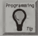

body 标签还有其他几个常用属性。body 标签的 background 属性可用于为网页指定背景图像。浏览器通常支持的图像具有 .gif 或 .jpg 扩展名。text 属性标识文本的颜色。默认的文本颜色是黑色。超链接的默认颜色是：未访问的链接为蓝色，已访问的链接为紫色，活动链接为红色。这些默认颜色可以使用 link、vlink 和 alink 属性进行更改。link 属性定义未访问超链接的默认颜色；vlink 属性标识已访问超链接的默认颜色；alink 标识活动超链接的默认颜色。下面是 body 标签常用属性的语法。

```
<body bgcolor="color" background="URL/imagenname.gif" link="color" text="color" vlink="color" alink="color">
```

##### 列表标签

列表可以使用无序列表标签、有序列表标签或定义列表标签进行格式化。无序列表使用项目符号来标识每个列表项，而有序列表则使用字母数字字符来标识。你可以修改使用的项目符号或字符类型。这两种列表都使用列表项标签来标识列表中的项目。定义列表使用定义标签来标识列表中的项目。定义在定义术语下方缩进。表 1-3 标识了常用的列表标签。以下示例代码演示了如何将无序列表添加到网页中。请注意列表项如何包含嵌套的 italic 标签，这些标签用于格式化列表项标签内的文本。

```
<p>January Products</p>
<ul>
<li><i>Folders</i></li>
<li><i>Notebooks</i></li>
</ul>
```

##### 用于列表的 HTML 标签

| 标签名称 | HTML 标签 | 用途 |

|----------|----------|---------|

| 无序列表 | `<ul>` | 创建一个项目符号列表，即无序列表 |

| 列表项 | `<li>` | 标识列表中的项目 |

| 有序列表 | `<ol>` | 创建一个顺序列表，即有序列表 |

| 定义列表 | `<dl>` | 创建一个不带项目符号或数字的列表 |

| 定义术语 | `<dt>` | 定义列表中的术语 |

| 定义 | `<dd>` | 定义，显示在定义术语下方并缩进 |

##### 图像标签

图像标签用于在网页中添加图形图像。图像标签包含多个属性。表 1-4 列出了图像标签的常用属性。需要注意的是，`src` 属性可以是对完整 URL 的**绝对引用**。例如，*http://www.visualinterdev.org/js/bluedisk.gif* 将显示一个蓝色圆盘的图形图像。**相对地址**则不包含协议名（http）或域名（*www.visualinterdev.org*）。相对地址包含图像文件相对于当前网页的位置。例如，如果网页名为 bluedisk.htm 且位于同一目录中，则相对 URL 为 "bluedisk.gif"。带有属性的图像标签语法如下所示。

```html

```

##### 锚点标签

锚点标签最常用于创建指向另一个文档的超链接。当用户点击锚点标签之间的内容时，浏览器会打开由 `HREF` 属性指定的页面。`HREF` 属性指示超链接的 URL。URL 可以是绝对地址或相对地址。以下示例代码创建了一个指向另一个文档的超链接。

```html
<a href="http://www.visualinterdev.org/">
Visual InterDev
</a>
```

###### 表 1-4：图像标签的属性

| 标签名称 | 示例 | 用途 |

| :--- | :--- | :--- |

| 源 | `src="ship.gif"` | 显示图像的 URL 路径和名称。该 URL 可以是绝对引用或相对引用。 |

| 替代文本 | `alt="welcome"` | 如果图像未在浏览器或客户端软件中显示，则显示替代文本。在新版浏览器中，当用户将指针悬停在图像上时，也会显示 `alt` 属性。 |

| 对齐 | `align="center"` | 更改图像相对于周围元素的对齐方式。例如，如果将 `align` 属性设置为 "left"，则文字将环绕在图像的右侧。`align` 属性值包括 top、bottom、middle、left、right、texttop、absmiddle、baseline 和 absbottom。 |

| 高度和宽度 | `height="100" width="400"` | 确定图像的尺寸，以像素为单位。 |

| 边框 | `border="2"` | 在图像周围显示边框。边框大小以像素为单位指定。如果边框为 "0"，则不显示边框。 |

| 水平间距和垂直间距 | `hspace="5" vspace="5"` | 指定环绕空间的像素值。环绕空间就像图像周围的相框，用于在文本和图像之间创建空间。`hspace` 用于标识图像两侧的空间，而 `vspace` 用于标识图像顶部和底部的空间。 |

| 用户映射 | `usemap="#home"` | 标识用于此图像的图像映射名称。图像映射是包含多个超链接的图像。图像映射的坐标和链接由 `map` 标签定义。 |

你可以通过指定目标窗口来强制浏览器在新窗口中打开网页。目标窗口也可以在 URL 中标识。目标窗口可以标识为 `_blank`、`_self`、`_parent` 或 `_top`。以下示例代码在新窗口中打开网页，置于现有窗口之上。

```html
<a href="http://www.visualinterdev.org/" target="_top">
Visual InterDev
</a>
```

你可以使用锚点标签在网页内创建书签。书签用于指定网页内的位置。`name` 属性用于标识书签的名称。以下示例代码将创建一个名为 `test` 的书签。

```html
<a name="test">
```

你可以通过使用锚点标签链接到网页内的书签。URL 属性附加有井号（`#`）和书签名称。要链接到同一页面内的特定目标，可以省略 URL；只需使用井号和目标名称即可。以下示例演示了如何创建指向名为 `test` 的书签的超链接。

```html
<a href="http://www.visualinterdev.org/ip/anchor.htm#test">
Visual InterDev
</a>
```

##### 表格标签

表格标签用于在网页上创建表格。表 1-5 列出了用于创建表格的主要标签。表格标签的 `border` 属性用于在表格的所有单元格周围创建边框。表格标签的 `width` 属性可用于以像素或浏览器窗口百分比的形式指定表格宽度。`bgcolor` 属性用于为整个表格分配颜色。表格行标签用于定义行的开始和结束。表格单元格标签嵌套在表格行标签内，指示单元格在表格中的放置位置。以下示例代码创建了一个包含四个单元格的表格。表格标签的语法和可用属性列表可在 http://www.w3.org/TR/html4/struct/tables.html#edef-TABLE 找到。

```html
<table align="center" border="0" width="200"
bgcolor="#C0C0C0" cellspacing="0" cellpadding="5">
<tr>
<td width="50" valign="top">1</td>
<td width="50" valign="top">2</td>
</tr>
<tr>
<td width="50" valign="top">3</td>
<td width="50" valign="top">4</td>
</tr>
</table>
```

###### 表 1-5：表格标签

| 标签名称 | HTML 标签 | 用途 |

|----------|----------|---------|

| 表格 | `<table>` | 插入一个表格 |

| 表格行 | `<tr>` | 在表格中插入一个新行 |

| 表格单元格 | `<td>` | 在表格行内插入一个新单元格 |

##### 表单标签

表单用于从用户那里接收信息。表单通常用于允许用户在网站上注册、登录网站、订购产品和发送反馈。表单标签用于创建表单。表 1-6 列出了用于创建表单和表单字段的一些标签。表单标签的 `name` 属性用于命名表单。表单的名称在脚本中引用表单时使用。表单包含多种类型的表单元素，如文本框、单选按钮、复选框和下拉列表。每个表单字段都通过 `name` 属性分配名称。用户在文本框中输入值，或从单选按钮、复选框和下拉列表中进行选择。他们输入或选择的值将与表单字段的名称一起传递给 Web 服务器。

`action` 属性标识将处理表单的程序或脚本。通常 action 会是用一种名为 Perl 的编程语言编写的 CGI 程序的名称，或者是 ASP 页面的名称。（在第 7 章中，你将学习如何创建 ASP 页面，在第 8 章中，你将学习如何使用 ASP 处理表单。）你可以指定绝对 URL 或相对 URL。

表单标签的 `method` 属性用于标识表单字段名称和值将如何发送到服务器。`get` 方法会将表单元素的名称及其值附加到 URL。`post` 方法会在 TCP/IP 数据包中发送表单字段的名称和值。由于 post 方法不会显示在浏览器的地址栏中，因此是将表单字段结果发送到 Web 服务器的首选方法。要添加表单标签，请使用以下基本语法。method 的值可以是 `get` 或 `post`。

```html
<form method="methodName" action="scriptName" name="formName">
```

###### 表 1-6：表单相关标签

| 标签名称 | HTML 标签 | 用途 |

| --- | --- | --- |

| 表单 | `<form>` | 插入一个表单，包含一个或多个表单元素 |

| 输入 | `<input>` | 创建表单元素，如文本框和密码框、隐藏字段、单选按钮、复选框、提交和重置按钮、图像、文件和按钮 |

| 选择 | `<select>` | 创建下拉列表和列表框等元素 |

| 文本区域 | `<textarea>` | 在表单中创建一个多行文本框 |

##### 输入标签属性

输入标签创建一个可以检索信息的表单元素。`name` 属性用于命名输入元素。输入元素的名称在脚本中引用输入元素时使用。

`type` 属性标识输入标签的格式。可能的类型属性包括 `text`、`password`、`hidden`、`checkbox`、`submit`、`reset`、`file`、`image` 和 `button`。`type="text"` 属性创建一个文本框字段。`type="hidden"` 属性创建一个在浏览器中不可见的表单字段。`type="submit"` 属性创建一个提交按钮。当用户点击提交按钮时，表单将被发送到表单标签的 action 属性中标识的 ASP 页面或 CGI 程序。

`value` 属性为输入标签提供默认值。该值将随表单元素一起显示在浏览器中。输入标签还可用其他属性

各种类型的输入元素。以下是表单中几个表单字段元素的示例。

```
<form name="frm" method="post" action="form.asp">
Name <input type="text" name="name" size="20"
    value="Type your name here"><br><br>
Email <input type="text" name="email" size="20"
    value="Type your e-mail here"><br><br>
<input type="checkbox" name="chkYes" value="on">
Yes I want to be on the e-mail list.<br><br>
<input type="submit" value="Send" name="btnSubmit">
<input type="reset" value="Clear" name="btnReset"></p>
</form>
```

#### 其他资源

前面的章节仅涵盖了一些较常见的 HTML 元素及其属性。更多 HTML 元素及其属性列于附录 A 中。不过，您可以在 Life Beyond Yahoo（*http://www.lifebeyondyahoo.com/*）的 *http://www.lifebeyondyahoo.com/life/html.asp* 找到其他互联网资源，其中包括涵盖 HTML 标签及其属性的在线教程。

### 发布您的网页

使用 Web 开发工具创建网页后，必须将其发布到 Web 服务器上才能查看。一些 Web 开发工具（包括 FrontPage、InterDev 和 Dreamweaver）允许您直接将网页发布到 Web 服务器。但是，如果您使用的是文本编辑器，则需要一个程序将文件复制到 Web 服务器。您可以使用 FTP 软件（例如 Ipswitch 公司的 WS_FTP Pro（*http://www.ipswitch.com*）），将文件从客户端计算机传输到 Web 服务器。互联网上有许多 FTP 软件程序。要查找 FTP 程序，请访问 Tucows 网站 *http://www.tucows.com/*。

## 本章小结

### 互联网的历史

- 早期的互联网称为 ARPANET，由政府机构和大学用于研究和教育。第一个浏览器由伊利诺伊大学国家超级计算应用中心创建，名为 NCSA Mosaic。超文本文档称为网页。HTML 用于创建网页。万维网联盟定义了 HTML 和 HTTP 标准。

### 互联网的工作原理

- 互联网使用 TCP/IP 将数据包从一台计算机路由和传送到另一台计算机。IP 协议使用 IP 地址方案来路由数据包。互联网上的每台计算机都有一个 IP 地址。ping 工具用于测试网络连接。tracert 工具可以检测网站是否缓慢或与互联网断开连接。TCP/IP 安装在互联网上的每台计算机上，以便计算机之间可以相互通信。所有域名都注册在域名注册表中。InterNIC 允许多个注册商注册域名。Network Solutions 目前维护注册表数据库。注册人是网站的合法所有者。InterNIC 句柄用于识别注册表中列出的个人、公司和服务器。注册域名时，您需要拥有包含网站路由信息的 DNS 服务器的 IP 地址。whois 工具可以识别有关网站所有者和 DNS 服务器的信息。万维网服务是安装在网络上服务器中的 Web 服务器软件的另一名称。托管服务提供商是托管多个网站的公司。

### 创建网页

您可以使用文本编辑器或网页编辑器创建网页。HTML 文档由标题部分和正文部分组成，分别由 head 和 body 标签标识。使用各种 HTML 标签来格式化网页的呈现方式。个人 Web 服务器（PWS）由 Microsoft 免费提供，允许您在本地开发和测试网页。您还可以使用网页编辑器内置的发布功能将网页发布到互联网。网上有许多资源可用于学习如何使用 HTML 创建基本网页。

## 复习题

1. 第一个浏览器软件称为：

   - a. Mosaic

   - b. Internet Explorer

   - c. Netscape Navigator

   - d. FrontPage

2. 哪种协议允许您将文件上传到 Web 服务器？

   - a. HTTP

   - b. HTML

   - c. FTP

   - d. NNTP

3. 哪种标记语言广泛用于创建网页？

   - a. Java

   - b. JavaScript

   - c. VBScript

   - d. HTML

4. 服务器从何处获取网站的 IP 地址？

   - a. InterNIC

   - b. Network Solutions

   - c. Web 服务器

   - d. 域名服务器

5. 哪个 IP 地址代表本地 Web 服务器？

   - a. 127.0.0.1

   - b. 1.0.0.127

   - c. 1.27.0.1

   - d. 27.0.0.1

6. 本地 Web 服务器的名称是什么？

   - a. localserver

   - b. mycomputer

   - c. localhost

   - d. hostname

7. 显示网页的服务名称是什么？

   - a. 万维网服务

   - b. 文件传输协议服务

   - c. 事务服务

   - d. Web 托管服务

8. 客户端和服务器能够在互联网上通信所需的协议是什么？

   - a. TCP/IP

   - b. DNS

   - c. NetBeui

   - d. IPX/SPX

9. 哪个 TCP/IP 工具提供数据包在互联网上传输的跃点位置？

   - a. ping

   - b. router

   - c. tracert

   - d. Winipcfg

10. 哪个组织维护可以注册域名的注册商列表？

    - a. InterNIC

    - b. Network Solutions

    - c. ARPANET

    - d. 以上都不是

11. 哪对 HTML 标签在网页的开头和结尾是必需的？

    - a. `<html></html>`

    - b. `<head></head>`

    - c. `<title></title>`

    - d. `<http></http>`

12. meta 标签位于_________________。

    - a. 标题部分

    - b. 正文部分

    - c. title 标签中

    - d. http 部分

13. 哪个属性将更改网页的颜色？

    - a. color

    - b. bgcolor

    - c. background

    - d. bkgroundcolor

14. 有多少个标题标签？

    - a. 1

    - b. 3

    - c. 6

    - d. 无限数量

15. 属性的另一个名称是什么？

    - a. 标签

    - b. 元素

    - c. 属性

    - d. 值

16. 搜索引擎使用哪个 meta 标签来编目网站？

    - a. title

    - b. keywords

    - c. refresh

    - d. expires

17. 哪个是绝对 URL 的示例？

    - a. /images/bluedisk.gif

    - b. bluedisk.gif

    - c. ../../bluedisk.gif

    - d. http://www.visualinterdev.org/images/bluedisk.gif

18. 以下哪项可以正确地在网页中插入图像？

    - a. ``

    - b. ``

    - c. `<image = "bluedisk.gif">`

    - d. ``

19. 以下哪项可以正确地创建指向网页的超链接？

    - a. `<a href= "http://www.visualinterdev.org/ "> 点击这里 </a>`

    - b. `<a name= "http://www.visualinterdev.org/ "> 点击这里 </a>`

    - c. `<a name= "#default"> 点击这里 </a>`

    - d. `<a href= "# http://www.visualinterdev.org/ "> 点击这里 </a>`

20. 用于创建目标的锚标签属性是哪个？

    - a. bookmark

    - b. target

    - c. name

    - d. #

21. 哪种类型的程序可以用来创建网页？

    - a. 记事本

    - b. Visual InterDev

    - c. Dreamweaver

    - d. 以上所有

22. 在安装个人 Web 服务器之前需要安装什么软件？

    - a. Microsoft 网络客户端

    - b. FrontPage

    - c. Visual InterDev

    - d. America Online

23. 以下哪个标签创建项目符号列表？

    - a. `<ul>`

    - b. `<li>`

    - c. `<ol>`

    - d. `<dd>`

24. 以下哪个标签缩进该部分？

    - a. `<br>`

    - b. `<p>`

    - c. `<indent>`

    - d. `<blockquote>`

## 实践项目

### 项目 1-1

在本项目中，您将使用 ping 工具获取网站的 IP 地址。Ping 向远程计算机发送四个数据包，如果远程计算机连接到网络，则会收到四个响应。

- 单击**开始**，然后单击**运行**。

- 如果您使用的是 Windows 95 或 Windows 98 计算机，请在文本框中键入**Command Prompt**。如果您使用的是 Windows NT 或 Windows 2000 计算机，请键入**cmd**。将打开一个 MS-DOS 窗口。

- 键入**ping www.visualinterdev.org**，然后按**Enter**。您将看到四个响应，标识 Web 服务器的 IP 地址以及收到响应所花费的时间。读取显示的 IP 地址。该网站的 IP 地址是什么？

- 尝试 ping 其他网站（每个网站只 ping 一次）。

- 在某些网站上，您将看到"Request Timed Out"。写一份简短的说明来解释此响应的含义。

### 项目 1-2

在本项目中，您将使用 tracert 工具程序来跟踪互联网数据包在互联网上的跃点路径。

- 单击**开始**，然后单击**运行**。

- 如果您使用的是 Windows 95 或 Windows 98 计算机，请在文本框中键入**Command Prompt**。如果您使用的是 Windows NT 或 Windows 2000 计算机，请键入**cmd**。将打开一个 MS-DOS 窗口。

- 键入**tracert www.visualinterdev.org**，然后按**Enter**。您将看到最多 30 个响应，标识数据包传递到的每个跃点（或路由器）的 IP 地址以及收到响应所花费的时间。

- 读取显示的 IP 地址。该网站的 IP 地址是什么？（*提示*：它是显示的最后 IP 地址，因为它是数据包的最终目的地。）

- 从另一台计算机对同一网站重复上述步骤。数据包的路由方式相同吗？为什么相同或不同？

- 尝试 tracert 其他网站（每个网站只 tracert 一次）。对另一个网站重复上述步骤。某些跃点将显示"*"。解释星号的含义。

### 项目 1-3

在本项目中，你将使用基本的 HTML 标签和一个文本编辑器来创建一个基础的网页。如果你对某些标签或属性不熟悉，请参阅 http://www.w3.org/TR/html4/index/elements.html 上的相关文档。

- 1. 启动记事本。在大多数系统上，你可以点击**开始**，将鼠标指向**程序**，再指向**附件**，然后点击**记事本**。你自己为记事本程序创建的快捷方式可能与此不同。

- 2. 输入页面的主要 HTML 标签，包括标题区段和主体区段。

- 3. 在标题区段输入标题。页面的标题应该是 **District 129**。

- 4. 在主体区段输入页面上的标题。页面的标题应该是 **School Supplies for District 129**，并且应该使用 H1 标题标签。

- 5. 添加一个段落，告知家长何时需要购买学习用品。段落内容应该是 **Please purchase:**。

- 6. 在页面标题下方立即添加一条水平线。

- 7. 在主体区段中，输入家长需要购买的学习用品的项目符号列表。用品列表将包括 **2 blue pens**、**4 pencils**、**6 notebooks**、**1 pencil case** 和 **1 eraser**。

- 8. 在页面上的列表下方立即添加另一条水平线。

- 9. 添加一个指向办公用品商店的链接。显示的文本将是 **Click here to visit our office supply store partner.** 该链接将指向 http://www.officemax.com。

- 10. 将网页保存为 **schoolsupplylist.htm**。请务必用引号括住文件名。将页面保存到你的数据目录。

- 11. 将文件复制或通过 FTP 上传到你的 Web 服务器。这可以是位于 wwwroot 的本地 Web 服务器，也可以是互联网上的 Web 服务器。

- 12. 在浏览器中查看你的网页。

### 项目 1-4

在本项目中，你将使用文本编辑器创建一个使用标签属性的网页。如果你对某些标签或属性不熟悉，请参阅 http://www.w3.org/TR/html4/index/elements.html 上的相关文档。

- 1. 打开记事本。

- 2. 输入主要的 HTML 标签。

- 3. 在标题区段输入标题。页面的标题应该是 **District 129**。

- 4. 修改页面的背景属性。网页的新背景颜色应该是 **#99FF99**。将网页的默认文本颜色更改为 **#800000**。

- 5. 在主体区段输入页面上的标题。页面的标题应该是 **School Fees for District 129**。标题应使用 h1 标题标签。修改 h1 标签以使用 align 属性。将对齐方式更改为 **center**。

# 第 1 章 互联网与万维网

6. 使用 font 标签修改上面的 h1 标签，使其使用不同的颜色。将颜色更改为 **#000080**。

7. 添加一条水平线。修改水平线标签，使其宽度为窗口大小的 **50%**。（使用 width 属性。）水平线的厚度为 **4**。（使用 size 属性。）水平线的颜色为 **#800000**。（使用 color 属性。）

8. 添加一个段落，说明 **Please pay the school fees by October 1st**。使用 align 属性将对齐方式修改为居中。

9. 使用 font 标签修改字体。将颜色更改为 **#000080**。使用 face 属性将字体更改为 **Verdana**。

10. 使用 table 标签创建一个表格。修改表格属性。表格边框应为 0。使用 border 属性。单元格之间的间距应为 0。使用 cellspacing 属性。单元格与单元格内容之间的内边距应为 **5**。使用 cellpadding 属性。表格的宽度应为 **300** 像素。表格应在页面中居中。使用 align 属性使表格居中。使用 bgcolor 属性将背景颜色更改为 **FFFF99**。

11. 使用表格行标签创建一行。同时使用开始和结束表格行标签，`<tr></tr>`。

12. 在一对表格行标签内创建一个表格单元格。在两个单元格标签之间输入费用描述。费用描述是 **PTA dues**。使用单元格属性修改该单元格。使用 width 属性将宽度更改为 **155** 像素。

13. 在一对表格行标签内创建第二个表格单元格。

14. 在两个单元格标签之间输入费用金额，即 **$5.00**。使用 width 属性将宽度更改为 **93** 像素。使用 align 属性将文本对齐方式更改为 **right**。

15. 使用表格行标签创建第二、第三、第四和第五行。

16. 在每行中创建两个单元格。在每行内使用 `<td></td><td></td>`。

17. 根据以下列表填充每个单元格。描述放在第一个单元格，费用放在第二个单元格。

- a. **Book Fee**，$75.00

- b. **Room Supplies**，$10.00

- c. **Field Trip Fee**，$10.00

- d. **Total**，$100.00

18. 修改每行中的第一个单元格。使用 width 属性将宽度更改为 **155** 像素。

19. 修改每行中的第二个单元格。使用 width 属性将宽度更改为 **93** 像素。使用 align 属性将文本对齐方式更改为 **right**。

20. 添加一个居中对齐的段落，内容为 **Click here to visit our school textbook partner.** 将短语 "textbook partner" 链接到另一个网站。使用锚点标签的 HREF 属性链接到 *http://www.course.com*。

21. 将网页保存为 **schoolfees.htm**。请务必用引号括住文件名。将页面保存到你的数据目录。

22. 将文件复制或通过 FTP 上传到你的 Web 服务器。

23. 在浏览器中查看网页。

### 项目 1-5

在本项目中，你将访问 InterNIC 网站 *http://www.InterNIC.net*，以了解更多关于注册商和域名注册的信息。

- 1. 打开你的浏览器，前往 InterNIC 主页 *http://www.InterNIC.net*。

- 2. 点击 **The Accredited Registrar Directory** 链接，查看 .com、.net 和 .org 域名的注册商列表。

- 3. 点击 **List by Language Supported**。

- 4. 向下滚动列表，查看支持英语以外语言的注册商。

- 5. 向下滚动列表，查看支持法语域名注册的注册商。

- 6. 点击 **Back** 按钮。

- 7. 点击 **Listing by Location of Registrar**。哪些注册商位于加拿大？哪些注册商位于美国？讨论为什么美国的注册商比其他任何国家都多。

- 8. 点击 **Back** 按钮。

- 9. 点击页面顶部的 **Whois** 链接，使用 InterNIC 的 whois 工具。

- 10. 输入 **shea-family.com** 并点击 **Submit Query**。

- 11. 哪个注册商维护着这个网站的域名注册？

### 项目 1-6

在本项目中，你将创建一个使用 meta 标签将客户端重定向到另一个网站的网页。

- 1. 打开记事本并输入主要的 HTML 标签。

- 2. 输入页面的标题，**Client-Side Redirection Using the Meta Tag**。

- 3. 在标题区段添加一个 meta 标签。修改 meta 标签以使用 refresh 命令。页面应被重定向到的 URL 是 *http://www.course.com*。重定向客户端所需的时间是 **5** 秒。

- 4. 在页面上添加一个标题。标题应该是 **This page is being redirected to the Course Technology Web site**。使用 heading 2 标签来格式化标题。修改 heading 2 标签，使用 align 属性使其居中对齐。

5. 在标题下方添加一个超链接。超链接应该是 **Click here to go directly to the Course Technology Web site**。该超链接应指向 *http://www.course.com*。

6. 将页面保存到你的数据目录，文件名为 **courselink.htm**。

7. 将你的页面复制或 FTP 上传到你的文件夹。

8. 在浏览器中查看网页。

## 案例项目

### 墨菲办公用品：注册域名

你已被墨菲办公用品公司聘请来创建他们的互联网网站。他们尚未注册域名。请访问至少五家注册商。为你的老板准备一份关于域名注册流程的简短报告。报告应包括：

- - 关于 InterNIC 和所研究注册商的信息，包括其主页的 URL

- - 对各注册商所提供服务的比较

- - 对域名注册费用和注册时长的比较

- - 对客户支持可用性的比较

- - 至少五个尚未被保留的域名

以网页格式创建你的报告。使用各种标签和属性修改网页的呈现方式。将网页保存到你的数据目录，文件名为 **registrars.htm**。在浏览器中查看你的网页。打印你的网页。

### 休斯顿电子：向搜索引擎提交网站

你负责休斯顿电子的公司网站。你的老板问你为什么公司还没有出现在主要的网络搜索引擎中。你告诉你的老板，搜索引擎使用关键词来编目网站。访问五个主要搜索引擎。准备一份报告，描述搜索引擎如何编目你的网站。你的报告应包括：

- - 至少三个主机服务提供商列表

- - 所研究的五个主要搜索引擎及其主页的 URL 列表

- - 关于如何提交你的网站以进行索引和编目的信息。哪个网页包含提交表单？

- 关于您的网站可以重新提交频率的信息

- 关于网站如何被索引的信息，例如通过关键词、标题标签、域名等。

- 索引服务的成本

- 出现在索引中所需的时间

- 一个包含20个关键词的列表，这些关键词将增加您出现在搜索引擎中的机会

使用网页准备您的报告。使用各种标签和属性更改网页的呈现方式。将网页保存在您的数据目录中，文件名为 metakeywords.htm。在浏览器中查看网页，然后打印该页面。

### Johnson Mills：选择托管服务提供商

您的公司 Johnson Mills 决定将公司网站托管在公司外部。您被分配的任务是寻找托管服务提供商。您研究并比较了五家托管服务提供商。在您的报告中，您应提供以下信息：

- 所研究的五家托管服务提供商的列表及其主页的 URL

- 五家 HSP 中每家网站托管的成本

- 每家 HSP 在每个价格级别支持的功能

- 一个列表，识别每家 HSP 的优势和劣势

选择其中一家托管服务提供商。写一段话描述您是如何做出选择的。将您的报告准备成一个网页。使用各种标签和属性更改网页的呈现方式。将网页保存在您的数据目录中，文件名为 comparehsp.htm。在浏览器中查看网页，然后打印网页。

### Global Media：互联网资源

您在一家名为 Global Media 的计算机培训公司工作。您决定创建一个网页，其中包含指向 Web 开发人员资源的链接。使用 Notepad 或网页开发工具创建一个网页。创建一个与互联网和本章讨论的主题相关的 URL 列表。按主题排列 URL。使用列表或表格来格式化网页。提供网站名称、URL 和网站的简短描述。使用各种标签和属性更改网页的呈现方式。将网页保存在您的目录中，文件名为 internetlinks.htm。在浏览器中查看网页，然后打印页面。

### Freebird Hosting：客户支持

您在一家名为 Freebird Hosting 的 Web 托管公司工作。您的客户对许多您在公司宣传册和报告中经常使用的互联网术语和短语不熟悉。为了改善客户支持，创建一个列出并定义常见互联网术语的网页。使用列表或表格来格式化术语列表。确保为每个术语提供定义。使用各种标签和属性更改网页的呈现方式。将网页保存在您的数据目录中，文件名为 internetterms.htm。在浏览器中查看页面，然后打印页面。

### Freebird Hosting：故障排除

您的一个 Web 托管客户打电话告诉您，您的网站无法工作。域名为 www.visualinterdev.org。您必须尝试找出问题所在。从您的桌面测试您的网站，并为客户准备一份报告。在您的报告中包括：

- 您将使用的程序，以及使用它们的原因

- 客户可能无法从他的客户端查看其网站的原因

- 网站可能未连接到互联网的原因

- 注册表中列出的主要和辅助 DNS 服务器

- 网站技术联系人的姓名和 InterNIC 句柄

- 网站的 IP 地址

- Web 页面请求必须经过的服务器的 IP 地址，以到达网站

使用网页创建您的报告。使用各种标签和属性更改网页的呈现方式。将网页保存在您的数据目录中，文件名为 testconnection.htm。在浏览器中查看您的网页，然后打印网页。

### Bike Power：选择网页编辑器

您在 Bike Power 的老板要求您选择一个网页编辑器来创建公司内部网网站。您的内部网络运行 Windows NT 操作系统和 Internet Information Server Web 服务器。您需要评估至少四个网页编辑器的功能，并为 Web 团队准备一份报告。在您的报告中：

- 包括您研究过的程序，包括指向其网站的 URL。

- 比较跨浏览器支持或不支持的功能。

- 根据功能的重要性进行排名，其中 1 为最高。

使用一个网页编辑器创建一个网页来展示您的发现。将报告保存在您的数据目录中，文件名为 webtools.htm。将您的网页发布到您的目录。查看网页，然后将其打印出来。

## 第2章 脚本集成

在本章中，您将：

- 识别客户端脚本和服务器端脚本之间的区别

- 识别主要的脚本语言，JavaScript、JScript、VBScript 和 ECMAScript

- 向网页添加客户端脚本

- 向网页添加服务器端脚本

- 向客户端和服务器端脚本添加注释

- 找到关于脚本技术的互联网资源

在第1章中，您了解到网页是使用一种称为超文本标记语言（HTML）的文档布局语言创建的。相关的网页被分组在一起，称为 Web 应用程序。HTML 用于生成静态网页，这些网页包含固定内容。如今，个人和企业需要动态 Web 应用程序。动态 Web 应用程序使用户能够与之交互。动态 Web 应用程序的示例包括购物车、会员数据库、在线目录和个性化网站。如今，互联网用户可以在线规划爱尔兰之旅，从浏览租车选项到预订酒店，甚至预订航班。在本章中，您将学习如何创建基本脚本，这是创建动态 Web 应用程序的基础。

## 脚本技术

像级联样式表（CSS）和脚本这样的技术允许 Web 程序员创建动态网页。一系列属于**脚本语言**（如 JavaScript 和 VBScript，也称为 Visual Basic Scripting Edition）的命令可以组合成一个**脚本**并嵌入到网页中。脚本语言使用一种称为**解释器**的程序将脚本代码转换为可执行格式。脚本可以在 Web 服务器上运行，也可以在客户端计算机的浏览器中运行。在 Web 服务器上运行的脚本称为**服务器端脚本**。**客户端脚本**是在浏览器中运行的脚本；它们在浏览器下载网页时被解释。

万维网联盟（W3C，*http://www.w3c.org*）负责标准化 HTML、CSS 和其他 Web 技术。HTML 的最新版本 HTML 4.01 是本文中使用的标准。有关所有 HTML 版本的信息可以在 W3C 网站 *http://www.w3.org/TR/html4/* 找到。

通过使用脚本，您可以为网页添加交互性。这种交互性可以是简单的，例如，当用户进入网页时显示警报消息；也可以是复杂的，例如，验证和处理表单。通过将脚本添加到您的 HTML 代码中，您可以建立和存储与页面数据一起工作的变量。大多数网站使用某种形式的脚本来验证用户输入的任何数据，并与用户进行通信。例如，如果一个页面要求数字数据，而用户输入了文本，一个执行良好的脚本将在服务器请求发出之前捕获错误，从而节省时间和计算机资源。

### 客户端脚本

当浏览器从 Web 服务器接收到网页时，浏览器会解释 HTML 代码并呈现网页。一对脚本标签将客户端脚本与 HTML 代码分开。脚本标签 `<script>` 标识脚本的开始，`</script>` 标识脚本的结束。如果在这些脚本标签之外找到脚本命令，浏览器将显示错误消息，并且网页将无法正确显示。浏览器内置的脚本引擎处理客户端脚本。图 2-1 说明了客户端脚本是如何处理的。当 Web 浏览器识别出客户端脚本时，浏览器会将该脚本传递给**脚本引擎**，脚本引擎在页面加载时执行该脚本。脚本执行后，Web 浏览器继续解释 HTML 代码，直到遇到另一对脚本标签。只要脚本标签分隔每个脚本，网页就可以在 HTML 代码中穿插许多脚本。

#### 客户端脚本语言

有多种脚本语言可用于创建客户端脚本。您可以通过 `language` 属性来标识脚本语言。如果缺少 `language` 属性，则使用默认的客户端脚本语言。最常见的客户端脚本语言有 JavaScript、JScript 和 VBScript。大多数浏览器的默认客户端脚本是 JavaScript。由于最终用户可以更改客户端脚本的默认语言，因此您应始终使用 `language` 属性。

`language` 属性的语法如下：

```
<script language="languageName">
```

##### JavaScript

JavaScript 是最常用的客户端脚本语言，因为它受到大多数浏览器的支持。它最初名为 LiveScript，后来更名为 JavaScript。JavaScript 有多个版本。微软修改了 JavaScript，并将其版本命名为 JScript。（请注意，JScript 和 JavaScript 都与 Java 不同。Java 是一种完整的编程语言，而非脚本语言。）您可以通过在 `language` 属性后追加版本号来指定所使用的 JavaScript 版本。例如，要指定 JScript 3.0 版本，请编写 `<script language="JScript3.0">`。

##### VBScript

VBScript 是微软编程语言 Visual Basic 的简化版本。VBScript 旨在成为一种快速、可移植的解释器，用于 Web 浏览器和应用程序中。要指定 VBScript，请编写 `<script language="VBScript">` 或 `<script language="VBS">`。

##### ECMAScript

并非所有 Web 浏览器都支持所有脚本语言。每种脚本语言都必须具备自己的解释器来翻译其命令。微软 Internet Explorer 具有 VBScript 和 JScript 的解释器。另一方面，Netscape Navigator 仅提供 JavaScript 解释器，因此不原生支持 VBScript。跨浏览器客户端脚本编写困难、耗时且成本高昂。您可以编写脚本来检测客户端正在使用的浏览器。

这些兼容性问题促使了一种名为 **ECMA-262** 的新脚本标准的诞生。ECMA-262 标准定义了 ECMAScript 脚本语言，这是一种由微软和 Netscape 共同支持的跨平台编程语言。ECMAScript 基于早期版本的 JScript 和 JavaScript。ECMAScript 仅支持客户端脚本。目前尚无服务器端脚本的跨平台标准。虽然 Netscape 和微软都已同意支持该标准，但他们很可能仍会在各自产品中继续提供浏览器特定的功能。

> ECMA 标准是由一个名为欧洲计算机制造商协会（ECMA）(http://www.ecma.ch/) 的独立组织制定的。ECMA 是一个专门负责信息技术标准化的协会。

微软对 ECMA-262 的实现产生了 JScript。JScript 3.0 版本与 ECMA-262 100% 兼容，并由 Internet Explorer 4 支持。JScript 5.0 版本将兼容 ECMA-262 的第二版。Netscape 更新了 JavaScript 以适应新的 ECMA-262 标准。JavaScript 1.3 版本与 Netscape 4.06–4.5 版本兼容，并与 ECMA-262 标准 100% 兼容。ECMAScript、JScript 和 JavaScript 都支持 ECMA-262 标准。

### 将客户端脚本插入到网页中

脚本可以放置在网页的 head 或 body 部分中。如果将脚本放在网页的 head 部分，脚本引擎会在解释位于 body 部分的脚本之前先解释该脚本。当脚本位于网页末尾时，网页加载速度更快，用户可以在脚本引擎解释脚本的同时继续查看页面。

在以下示例代码中，使用 HTML 将字符串 "Hello World" 写入网页。此代码保存在名为 `helloworld.htm` 的网页中。客户端脚本还使用 `document.write` 方法将 "Hello World" 和 HTML 标题标签写入网页。`write` 方法将括号中传递的字符串写入浏览器。该字符串可以包含文本和 HTML 代码。`write` 方法属于 `document` 对象。`document` 对象使您可以访问网页中可用的属性和方法。两种方法将在网页上产生相同的输出，如图 2-2 所示。以下示例代码显示了一个客户端脚本，该脚本显示一个写着 "Hello World" 的字符串。

```
<html>
<head><title>Hello World</title></head>
<body>
<h1>Hello World</h1>
<script language="JavaScript1.3">
    document.write("<h1>Hello World</h1>");
</script>
</body>
</html>
```

图 2-2 客户端脚本 Hello World 示例的输出

如果脚本中同一行包含多个 JavaScript 语句，则必须在每个语句后使用分号。如果单行上只有一个 JavaScript 语句，则建议使用分号，但不是必需的。

HTML 和 VBScript 不区分大小写，但 JavaScript 区分大小写。在代码中引用 `document` 对象时，不要将字母 `d` 大写。`Document.Write` 不正确，会在浏览器中产生错误消息。正确的语法是 `document.write`。

#### 外部客户端脚本

您可以将客户端脚本放在与 HTML 文档不同的文档中。这允许您通过在多个网页中包含指向脚本源文件的指针来重复使用脚本。

**创建脚本源文件** 您可以使用记事本等简单的文本编辑器来创建脚本源文件。在此示例中，名为 `javaSource.js` 的脚本源文件创建网页标题。您通常需要在脚本中嵌套引号。当属性值位于双引号内时，可以使用单引号将其括起来。请注意，脚本源文件的扩展名必须以 `.js` 结尾。任何有效的 JavaScript 语句都可以出现在脚本源文件中。

```
document.writeln("<h2 align='center'>");
document.writeln("<font color='#800000'>");
document.writeln("Office Supply Store");
document.writeln("</font>");
document.writeln("<p><font color='#800000'>");
document.writeln("Today is");
d = new Date();
document.writeln(d);
document.writeln("</font></p></h2>");
```

> `writeln` 方法执行与 `write` 方法相同的功能，但还会在文本行后附加一个回车符。当与 `<PRE>` 标签结合使用时，`writeln` 方法可用于以更易读的方式显示代码。

**创建网页** 网页使用脚本标签的 `source` 属性调用脚本源文件。可以使用相对地址或绝对地址来标识脚本源文件的位置。以下网页 `javawebpage.htm` 使用记事本创建，并包含一个名为 `javaSource.js` 的外部脚本源文件。图 2-3 显示了该页面在浏览器中的外观。

```
<html>
<head>
<title>Client-side Script Sample</title>
<script language="JavaScript1.3" src="javaSource.js">
</script>
</head>
<body bgColor="#FFCC99">
<p><font color="#800000">
<b>Welcome to our store!</b>
</font></p>
</body>
</html>
```

图 2-3 客户端脚本的输出

> 您应始终使用引号将完整的文件名括起来保存 HTML 文件，例如 "javawebpage.htm"。这指示程序将文件保存为网页，而不是文本文档。

在浏览器中查看网页时，请注意嵌入式 JavaScript 代码不会直接显示在源代码视图中。但是，它仍然可用；用户只需在浏览器地址框中输入脚本源地址即可下载脚本源文件。因此，不应使用外部客户端脚本来向用户隐藏信息。

### 查看客户端脚本

访问者可以通过查看网页源代码来查看客户端脚本。要在使用 Microsoft Internet Explorer 的网页中查看客户端脚本：

- 1. 登录到 Internet 并启动您的 Web 浏览器。（您必须在线才能查看此网页。）

- 2. 在地址框中输入 http://www.visualinterdev.org/ip/samples/chapter2/javawebpage.htm。

- 3. 单击地址框右侧的**转到**按钮，或按**Enter**键。

- 4. 在菜单栏上单击**查看**。

- 5. 单击**源文件**以在记事本或默认文本编辑器中打开源代码。请注意，客户端脚本代码是可见的。

- 6. 查看完源代码后，在记事单菜单栏上单击**文件**。

- 7. 单击**退出**以关闭源代码页面并退出记事本。

### 在客户端脚本中插入注释

注释可用于支持无法识别客户端脚本的旧版浏览器。要注释掉整个脚本代码，可以将代码放置在一对 HTML 注释标签内。添加注释标签将导致 Web 浏览器忽略脚本标签内的任何客户端代码。起始注释标签 `<!--` 出现在起始脚本标签之后。结束注释标签 `-->` 出现在结束脚本标签之前。以下代码片段演示了如何将脚本代码封装在 HTML 注释标签内。

```
<script language = "JavaScript1.3">
<!--
document.write "<h1>Hello World</h1>"
//-->
</script>
```

你也可以使用注释来包含有关代码的重要信息。注释通常描述代码的目的，或解释所使用的任何不寻常的方法。JavaScript 和 VBScript 的注释符号不同。要使用 JavaScript 添加单行注释，请以双斜杠 `//` 开始注释行。要使用 VBScript 添加单行注释，请以单引号 `'` 开始注释。以下脚本片段说明了如何使用单行客户端注释来记录脚本。

```
<script language = "JavaScript1.3">
document.write "<h1>Hello World</h1>"
// The document.write method is case sensitive
// Do not use Document.Write or Document.write
</script>
```

如果你有几行注释，可以使用一对标签来格式化整个注释块。JavaScript 中多行注释的开始以 `/*` 开头，最后一行以 `*/` 结尾。

多行注释通常用于记录包含复杂代码的长脚本。使用注释不仅使代码更易于维护，还为其他程序员提供了关于代码如何工作的信息。以下是程序员可能会包含的内容示例，用于记录脚本。

```
<script language = "JavaScript1.3">
document.write "<h1>Hello World</h1>"
/*
Name:		Login Script
Purpose:	Verifies the user name & password
Author:		Bridie Shea
Created: 2/1/2001
Modified: 2/27/2001
Platform: Works with IE 5.0 and above
Inputs: Username, Password from login.htm
Returns: blnLogin identifies login status
*/
</script>
```

### 服务器端脚本

服务器端脚本可用于为 Web 页面添加交互性，并允许 Web 页面或 Web 应用程序与服务器上的其他程序进行交互。与客户端脚本一样，服务器端脚本是 Web 文档的一部分，但它们是在服务器上执行，而不是在客户端浏览器中执行。服务器上安装的脚本引擎解释服务器端脚本。图 2-4 说明了脚本引擎如何运行服务器脚本。脚本引擎运行脚本后，会将脚本的输出发送回浏览器。虽然服务器端和客户端脚本可以在 Web 文档中共存，但只有 HTML 代码和客户端脚本代码会发送到浏览器。服务器端脚本源代码永远不会出现在浏览器中。

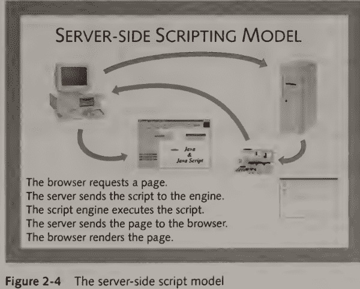

服务器端脚本没有可用的脚本标准。服务器端脚本引擎是特定于供应商的。Netscape 在 Netscape Enterprise Server 上支持 JavaScript 1.4 版。Microsoft 在 Internet Information 和 Personal Web Server 上支持 JScript 3 版和 VBScript。尽管可以在 Microsoft Web 服务器上使用 JavaScript，但 VBScript 是默认的服务器端脚本语言。你必须在 Web 服务器上查看 ASP 页面。Web 页面的 Web 服务器权限必须设置为读取和脚本。

#### 活动服务器页面

Microsoft 对服务器脚本技术的实现称为 **活动服务器页面 (ASP)**。所有活动服务器页面必须具有 **.asp** 文件扩展名。这将 ASP 文件与 .htm 或 .html 文件区分开来。当客户端请求具有 .asp 扩展名的文件时，Web 服务器知道要在 Web 服务器上处理服务器端脚本，并将结果发送给客户端。如图 2-5 所示，Web 服务器将请求发送到活动服务器页面引擎，该引擎解析并处理服务器端脚本。活动服务器页面引擎称为 **asp.dll**，可在 **C:\Windows\System\InetSrv** 中找到。

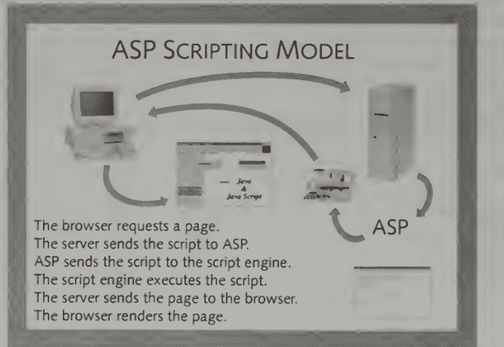

图 2-5  ASP 模型

##### ASP 模型

ASP 允许你访问服务器端脚本的所有功能以及 **ASP 对象模型** 中的其他内置对象。ASP 对象模型中的六个内置对象是 request、response、application、session、server 和 objectContext。内置对象（如 request 对象）允许你使用 ASP 获取表单的结果。表单的结果可以使用 response 对象的 write 方法显示回浏览器。

图 2-6 列出了 ASP 的一些好处。server 对象允许服务器端脚本与服务器上的其他程序进行通信。因此，Web 服务器可以做很多事情，例如与数据库交互并从 Web 页面发送自定义电子邮件。在服务器上创建新对象的过程称为 **实例化**。例如，Internet Information Server 附带的邮件服务器包含一个邮件对象，可用于从 Web 页面发送电子邮件。服务器端脚本可以在服务器上实例化一个邮件对象。新的邮件对象可用于自动从 Web 页面发送电子邮件。另一个称为数据库访问组件的 ASP 对象允许服务器脚本与数据库服务器通信。数据库访问组件可用于显示和修改存储在数据库程序（如 Access 2000、SQL Server 或 Oracle）中的信息。因为脚本是在服务器上处理的，所以你可以隐藏用于访问数据库的业务逻辑和脚本方法。活动服务器页面允许你开发交互式的 Web 页面，并可以与服务器上的其他程序进行交互。

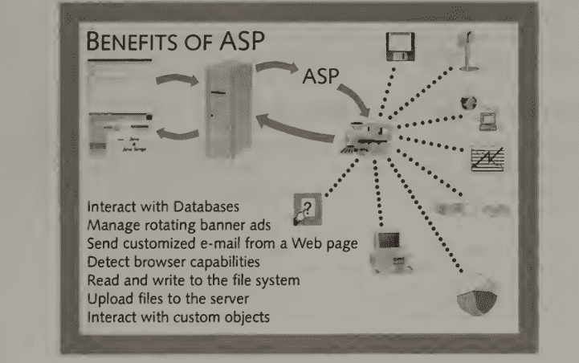

图 2-6  ASP 的好处

### 在 Web 页面中插入服务器端脚本

有两种方法可以指示脚本在服务器上解释。第一种方法是在起始 `<script>` 标签内添加 `runat = server` 属性。此技术称为 **块脚本**。块脚本标签内的所有代码都在服务器上解释。以下代码片段说明了如何创建一个使用 write 方法显示 "Hello World" 的服务器端脚本。请注意，服务器上的 response 对象与客户端的 document 对象具有相似的功能。两个对象都包含一个名为 write 的方法，该方法将文本、HTML 和客户端脚本写入浏览器。

```
<script language = "VBScript" runat = "server">
response.write "<h1>Hello World</h1>"
</script>
```

你可以用来标识服务器脚本的第二种方法是 **内联** 脚本。内联脚本标签 `<% . . . %>` 内的所有代码都在服务器上解释。内联标签不必与脚本代码位于不同的行上。但是，如果有多个代码行，则应将内联标签与代码分开，以便在调试脚本时更轻松地定位代码。如果页面包含内联 VBScript 和块脚本的混合，则所有内联脚本都会在任何块脚本之前处理。你可以将服务器端脚本放在 Web 页面的头部部分。但是，由于服务器端脚本是在服务器上执行的，因此通过将服务器端脚本放在 Web 页面底部无法提高浏览器性能！脚本可以位于页面的任何位置。下面的代码说明了如何使用内联脚本标签显示上面显示的代码。

```
<% response.write "<h1>Hello World</h1>" %>
```


### 在服务器端脚本中插入注释

插入服务器端脚本的注释（与代码本身一样）无法从浏览器查看。在将 HTML 页面发送给客户端之前，所有服务器端脚本和服务器端注释都会从代码中剥离。服务器端注释通常用于记录服务器端脚本。


有时，重复使用的服务器端代码（例如如何连接到数据库）会被注释掉。以后，当程序员需要代码时，只需移除注释标签即可。使用服务器端注释使服务器端代码更易于维护和修改。

无论脚本在哪里解释，VBScript 和 JavaScript 注释的语法都是相同的。例如，你可以在注释前使用单引号 (`'`) 来表示单个 VBScript 服务器端注释，使用双正斜杠 (`//`) 来表示单个 JavaScript 服务器端注释。以下是使用内联脚本标签和服务器端注释的服务器端脚本示例。

```
<%
response.write "<h1>Hello World</h1>"
' This sample uses response.write for server scripts
' instead of document.write
' which is used for client scripts
%>
```


### 服务器端包含文件

有时将服务器脚本放在单独的文档中会很方便。服务器上的外部脚本文件称为服务器端包含 (SSI) 文件。**服务器端包含文件** 允许程序员为多个 Web 页面重用代码。经常重用的 Web 页面元素

包括页眉、页脚、样式信息、标准徽标和图形。服务器端包含文件可以包含服务器端脚本以及 HTML 和客户端脚本。在 ASP 引擎解释页面上的任何其他脚本之前，会先包含该被包含的文件。文件中的所有语句都将被包含。常放在 SSI 文件中的服务器端脚本示例包括数据库常量和数据库连接字符串。这两种服务器端包含文件都将在第 12 章中进一步描述。其他常见的 SSI 文件包括页眉、页脚以及任何经常重用的内容。

#### 创建服务器端包含文件

服务器端包含文件可以使用简单的文本编辑器（如记事本）创建。该文件可以包含脚本、文本和 HTML 的混合内容，通常保存为 **.inc** 或 **.asp** 文件扩展名，并存储在 **/inc**、**/scripts** 或 **/asp-bin** 目录中。以下名为 **head.inc** 的服务器端包含文件创建了一个头部文件，该文件将被包含在 ASP 页面的顶部。该头部文件使用 HTML 标识商店名称，并使用内联服务器端脚本显示日期。

```
<body bgColor = "#FFCC99">
<h1 align = "center">
<font color = "#800000"><b>
Office Supply Store
</b></font></h1>
<h2 align = "center">
<font color = "#800000"><b>
Today is : <% = Date() %>
</b></font></h2>
```

> 日期是使用 `response.write` 方法的快捷方式编写的。当只使用一行代码时，等号（=）可以用来替代关键字 `response.write`。

#### 从 ASP 页面调用 SSI 文件

ASP 页面使用关键字 **include** 来调用服务器端包含文件。服务器端包含文件的位置通过 **file** 属性或 **virtual** 属性来标识。file 属性用于标识服务器端包含文件的物理路径。可以使用绝对路径或相对路径。当标识物理路径时，必须使用反斜杠来表示路径。您可以使用基于 DOS 的点表示法（如 **..\\..\\scripts\\head.inc**）来标识服务器端包含文件的相对路径。

**virtual** 属性用于标识文件的虚拟路径。虚拟路径始终从 Web 的根目录开始。不指示驱动器号，并使用正斜杠来表示路径。第一个斜杠代表 Web 站点根目录下的目录。

在下面的示例中，服务器端包含文件和 ASP 位于同一目录中。该网页保存为 `javawebpage.asp`。该网页必须保存为 `.asp` 文件扩展名。

```
<html>
<head>
<title>Client-side Script Sample</title>
</head>
<!--#include file="head.inc"-->
<p><font color="#800000">
<b>Welcome to our store!</b>
</font></p>
</body>
</html>
```

### 行续接

在 VBScript 中，您可以使用行续接字符（一个空格后跟一个下划线）将长语句分成多行，以使代码更具可读性。虽然 VBScript 更常用于服务器端脚本，但您也可以将此技术用于客户端和服务器端的 VBScript。行续接字符之后不能放置其他任何内容，包括注释。以下示例代码说明了如何使用行续接。

```
<%
response.write _
    "<h1>Hello World</h1>"
%>
```

### 您该使用哪种脚本？客户端还是服务器端？

一个 Web 应用程序由多个相关的 Web 文档组成，这些文档可能包括 HTML 文件、ASP 页面和服务器端包含文件。如今，大多数 Web 应用程序都结合使用客户端脚本和服务器端脚本。客户端使用的 Web 浏览器类型、Web 服务器类型以及 Web 应用程序本身将决定您应该使用哪种脚本技术。

例如，如果您的 Web 服务器要求将网页保存为 `.htm` 或 `.html` 文件扩展名，您将不得不使用客户端脚本。客户端的浏览器也会决定使用哪种脚本语言。如果您正在为一个公司的内部网构建 Web 应用程序，并且所有员工都必须使用 Internet Explorer，那么您可以使用 VBScript。但如果您的 Web 应用程序必须在两种浏览器上都可访问，那么您必须使用 JavaScript 进行客户端脚本编写。

如果 Web 应用程序将位于 Microsoft 服务器上，您可以使用服务器端脚本。虽然 Microsoft Web 服务器同时支持 JScript 和 VBScript，但您更可能在 Active Server Pages 中使用 VBScript 进行服务器端处理。如果您使用的是非 Microsoft Web 服务器，则很可能使用服务器端 JavaScript。

### 脚本编写工具

有多种 Web 开发程序支持客户端和服务器端脚本。虽然客户端和服务器端脚本可以在记事本或任何文本编辑器中编写，但使用 Web 开发工具可以帮助提高生产力。大多数新版的 Web 编辑器都支持客户端脚本和 Active Server Pages。当前支持 Active Server Pages 的主要网页编辑器包括 Drumbeat 2000、Dreamweaver 3.0、FrontPage 2000、Visual InterDev 6.0 和 Microsoft 脚本编辑器。您可以使用 FrontPage 2000 等 Web 开发工具来创建网页和管理网站。图 2-7 显示了带有客户端脚本的 FrontPage 2000 网页编辑器。FrontPage 2000 允许您以图形方式编辑网页，或直接编辑源代码。

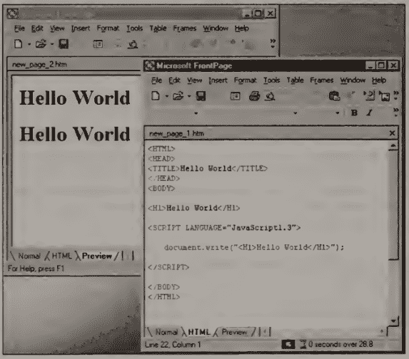

**图 2-7** 带有客户端脚本的 FrontPage 2000 编辑器

FrontPage 2000 集成了一个脚本编辑器。图 2-8 显示了带有客户端脚本的 Microsoft 脚本编辑器。脚本编辑器专门用于添加、编辑和调试脚本，可用于 JScript、JavaScript 和 VBScript。脚本编辑器随 Visual Studio 6.0 和 FrontPage 2000 提供。虽然脚本编辑器允许您创建和编辑单个文件，但 FrontPage 2000 和 Visual InterDev 可帮助您创建和管理整个 Web 应用程序。

# 第 2 章 脚本集成

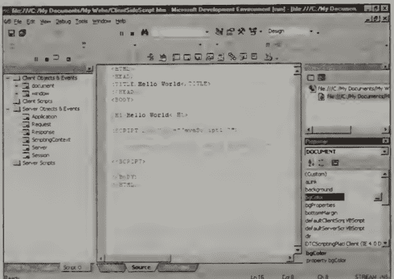

图 2-8 带有客户端脚本的脚本编辑器


脚本编辑器、Visual InterDev 和 Visual Studio 使用 **Microsoft 集成开发环境**，该环境为正在创建和编辑网页及 ASP 页面的程序员提供了通用的用户界面。图 2-9 显示了带有服务器端脚本的 Visual InterDev 编辑器。您会注意到脚本编辑器、Visual Studio 和 Visual InterDev 之间的相似之处，因为这些程序使用相同的开发环境。

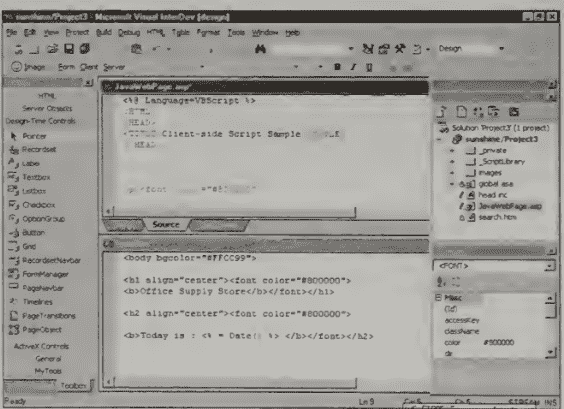

图 2-9 带有服务器端脚本的 Visual InterDev 编辑器

## Internet 脚本资源

互联网上有许多资源可以帮助您了解更多关于脚本语言的知识。其中包括 Netscape 的一份在线参考手册，描述 JavaScript 1.2，位于 http://developer.netscape.com/docs/manuals/communicator/jsref/index.htm；以及一个包含 JavaScript 版本 1.4 信息的网站，位于 http://developer.iplanet.com/support/faqs/champions/javascript.html#1-4。

Microsoft 创建了 Microsoft 开发人员网络（MSDN）来为开发人员提供支持。MSDN 库包含各种开发人员资源，例如示例代码、文档、技术文章、书籍和参考指南。除了 Visual InterDev，MSDN 库还包含许多 Microsoft 产品的信息，包括 FrontPage、Visual InterDev 和 Internet Information Server。图 2-10 显示了 MSDN 在线库，其中包含 VBScript 和 JScript 的资源。整个 MSDN 在线库可在 http://msdn.microsoft.com/library/default.asp 访问。

要访问互联网上的 MSDN 库：

1.  如果尚未连接，请连接到互联网，然后单击 **开始** 菜单。

2.  指向 **程序**。

3.  单击 **Internet Explorer** 以打开 Internet Explorer 浏览器。

4.  在地址文本框中键入 **http://msdn.microsoft.com/library**，然后按 **Enter** 转到 MSDN 在线库。左侧是主题的分层列表。当您在左侧单击一个主题时，该文档将出现在窗口的右侧。

5.  单击“部分书籍”旁边的书籍图标以展开菜单。

6.  单击“Instant JavaScript”旁边的书籍图标以展开菜单，查看与 JavaScript 相关的主题。

7.  单击“Language Tour”旁边的书籍图标以展开菜单，查看与 JavaScript 语言相关的内容。

8.  单击 **ECMAScript 术语** 以在窗口右侧显示文档。图 2-10 显示了 MSDN 库中 ECMAScript 术语的路径。阅读该文档以了解更多关于 ECMAScript 和 JavaScript 之间的关系。

## 第58页 第2章 脚本集成

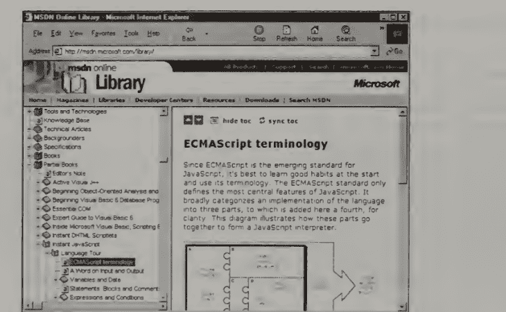

图 2-10 MSDN 在线库

**如何搜索 MSDN 在线库：**

1.  点击 **搜索 MSDN** 打开 MSDN 在线搜索页面。

2.  在搜索文本框中输入 **ECMAScript**。

3.  点击 **搜索** 按钮执行搜索。搜索将返回一个与搜索条件匹配的网页列表。图 2-11 显示了搜索 MSDN 库的结果页面。页面列出了每个网页的名称、地址、摘要和位置。

4.  点击第一个网页的名称 **ECMAScript 术语** 以打开文档。请注意，这就是你之前查看过的同一页面。

5.  点击页面顶部的 **显示目录** 按钮返回到 MSDN 在线库主页。

6.  点击菜单栏上的 **文件**。

7.  点击 **关闭** 关闭 MSDN 在线库浏览器窗口。

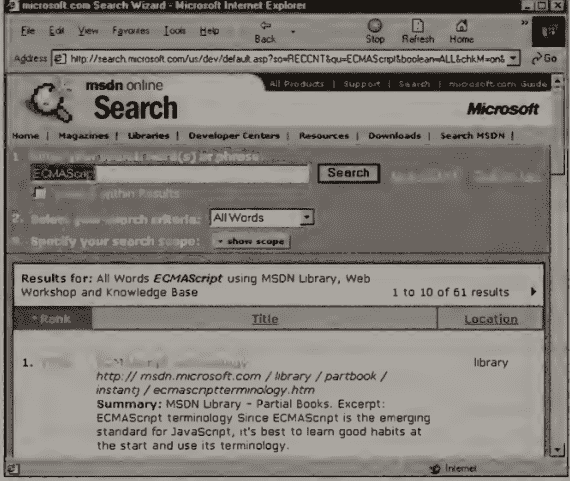

图 2-11 搜索 MSDN 在线库

关于 JavaScript、ECMAScript、VBScript 和 ASP 的互联网资源还有很多。“超越雅虎”网站 (*http://www.lifebeyondyahoo.com/life/java.asp*)，如图所示，列出了数十个互联网上的 JavaScript 资源链接。

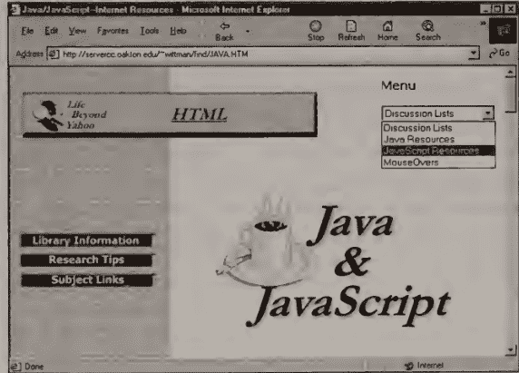

图 2-12 超越雅虎：Java 和 JavaScript

以下是一些主要脚本技术互联网资源的列表。其中一些网站，例如 ASP Web Ring，包含了数百个其他网站的链接。

- ECMA—http://www.ecma.ch/

- Netscape JavaScript 1.2—http://developer.netscape.com/docs/manuals/communicator/jsref/index.htm

- JavaScript.Com—http://www.javascript.com/

- Web Reference JavaScript—http://www.webreference.com/js/

- Web Review—http://webreview.com/wr/pub

- 雅虎的 JavaScript—http://dir.yahoo.com/computers_and_internet/programming_languages/javascript/

- The JavaScript Source—http://javascript.internet.com/

- 超越雅虎：Java 和 JavaScript—http://www.lifebeyondyahoo.com/life/java.asp

- ASP Web Ring：网站列表—http://www.webring.org/cgi-bin/webring?ring=asp101;list

- 微软 Visual Basic 脚本网站—http://www.microsoft.com/scripting/

- 超越雅虎：HTML, ASP, XML—http://www.lifebeyondyahoo.com/life/html.asp

- 超越雅虎：互联网—http://www.lifebeyondyahoo.com/life/internet.asp

- The Development Exchange (DevX)—http://www.devx.com/default.asp

- Web Builder Magazine—http://www.webbuildermag.com/

- 应用开发者培训 (AppDev)—http://www.appdev.com/default.htm

- VBScripts.com—http://www.vbscripts.com/

- Archives of InterDev @ listserve.uta.edu—http://listserv.uta.edu/archives/InterDev.html

- ASP 开发者 Visual InterDev 教程 1—http://www.aspdeveloper.net/VInterDev/page1.asp

- Visual InterDev 在线—http://www.visualinterdev.org

## 章节总结

### 客户端脚本

- 万维网联盟（World Wide Web Consortium）制定了 HTML、CSS、XML 和其他互联网技术的标准。客户端和服务器端脚本用于创建动态 Web 应用程序。动态 Web 应用程序实现了用户与 Web 应用程序之间的交互性。客户端脚本由浏览器内置的脚本引擎进行解释和执行。

- VBScript 是 Microsoft Visual Basic 的精简版本。VBScript 是一个快速、可移植的解释器，被 Microsoft Internet Explorer 浏览器和 Microsoft Web 服务器使用。

- 最新版本的 JScript 和 JavaScript 都符合称为 ECMA-262 的客户端脚本标准。ECMA-262 标准定义了一种称为 ECMAScript 的标准客户端脚本语言。

- 要创建客户端脚本，请将代码包含在一对 Script 标签中：`<script> ... </script>`。使用 `language` 属性指定脚本语言。整个客户端脚本可以放在一对 HTML 注释标签（`<!---->`) 中以支持较旧的浏览器。要在 VBScript 中添加单行注释，请在行首使用单引号 (')。要在 JavaScript 中添加单行注释，请在行首使用两个正斜杠（`//`）。要添加多行注释，请将注释放在由正斜杠和星号组成的对（`/* ... */`）之间。

- 要嵌入客户端脚本，请使用相同的 script 标签和 language 属性，并添加 src 属性。`<script language = "JavaScript1.3" src="javasource.js">`。脚本文件必须以 .js 结尾。HTML 和脚本命令可以放在外部脚本页面中。

- 要使用客户端脚本将输出写入网页，请使用 `document.write`。document 对象具有 `write` 和 `writeln` 等方法。两者都向网页显示文本和文字字符串，但 `writeln` 还会在语句末尾添加一个回车符。`document.write` 方法区分大小写。

### 服务器端脚本

- 服务器端脚本由 Web 服务器上的脚本引擎解释和执行。服务器端脚本可以访问和操作 Web 服务器的文件系统、从网页发送邮件以及管理数据库应用程序。

- 要创建服务器端脚本，请将代码包含在一对 script 标签（`<script> </script>`）或 script 内联标签（`<%...%>`）中。如果使用块脚本标签，则必须指定 `runat = server` 属性。

- ASP 允许你将服务器端脚本与 ASP 对象结合起来，以提供对其他第三方对象（如邮件服务器和数据库服务器）的访问。

- 要使用服务器端脚本将输出写入网页，请使用 `response.write`。

- 要在 VBScript 中中断长行，请在行末使用空格后跟下划线字符（`_`）。

## 复习题

1.  客户端脚本由_______________处理。

    a.  浏览器内置的脚本引擎

    b.  安装在 Web 服务器上的脚本引擎

    c.  安装在 Windows 中的脚本引擎

    d.  HTML 脚本引擎

2.  大多数商业网站使用客户端脚本来：

    a.  验证从表单提交的数据。

    b.  与最终用户通信。

    c.  从网页发送邮件。

    d.  a 和 b

3.  哪些技术允许程序员创建动态网站？

    a.  HTML

    b.  层叠样式表 (Cascading Style Sheets)

    c.  脚本 (scripting)

    d.  以上所有

4.  哪个组织负责开发客户端脚本标准？

    a.  Microsoft

    b.  欧洲计算机制造商协会 (European Computer Manufacturers Association)

    c.  Netscape

    d.  万维网联盟 (World Wide Web Consortium)

5.  Microsoft 版本的 JavaScript 叫什么名字？

    a.  VBScript

    b.  JScript

    c.  JavaScript

    d.  Java

6.  在客户端脚本中，哪个对象用于向浏览器输出文本和文字字符串？

    a.  write

    b.  response

    c.  writeln

    d.  document

## 复习题

7.  JavaScript 是 Java 编程语言的子集。正确还是错误？

8.  哪些 Microsoft 和 Netscape 产品旨在支持 ECMA-262 标准？

    a.  ECMAScript 和 VBScript

    b.  JScript 和 ECMAScript

    c.  JavaScript 和 JScript

    d.  VBScript 和 JScript

9.  服务器端脚本在哪里被解释？

    a.  在 Web 服务器的脚本引擎中

    b.  在 Web 服务器软件中

    c.  在服务器的浏览器中

    d.  在客户端浏览器内的客户端脚本引擎中

10. 所有客户端脚本都必须包含在 ______ 标签中。

    a.  `<script open>...</script close>`

    b.  `<script>...</script>`

    c.  `<JavaScript>...</JavaScript>`

    d.  `<ECMAScript>...</ECMAScript>`

11. 为防止脚本代码在不支持脚本语言的浏览器中显示错误消息，______ 必须包围脚本命令。

    a.  HTML 注释标签 (`<!-- ... -->`)

    b.  脚本标签 (`<script></script>`)

    c.  HTML 标签 (`<html></html>`)

    d.  BODY 标签 (`<body></body>`)

12. VBScript 的单行注释字符是 ______。

    a.  双斜杠 (`//`)

    b.  单引号 (`'`)

    c.  美元符号 (`$`)

    d.  双引号 (`" "`)

13. JavaScript 的单行注释字符是 ______。

    a.  双斜杠 (`//`)

    b.  单引号 (`'`)

    c.  美元符号 (`$`)

    d.  双引号 (`" "`)

## 第2章 脚本集成

14. JavaScript的多行注释字符是__________。

- a. 双斜杠 (`// //`)

- b. 星号和斜杠 (`* / * /`)

- c. 美元符号和斜杠 (`$/ $/`)

- d. 斜杠和星号 (`/* */`)

15. 动态服务器页面在服务器上处理脚本块，并将生成的HTML和客户端脚本发送给请求客户端。正确还是错误？

16. 动态服务器页面需要__________和__________权限。

- a. 读取和执行

- b. 读取和脚本

- c. 脚本和执行

- d. 读取和写入

17. 服务器端注释可以被任何能查看网页的人看到。正确还是错误？

18. JavaScript的语法与哪种编程语言非常相似？

- a. Java

- b. C/C++

- c. Cobol

- d. 汇编语言

19. 在script标签中，哪个属性是必需的，用于在服务器而不是客户端机器上运行脚本？

- a. runon

- b. server

- c. atserver

- d. runat

20. 服务器端脚本的内联脚本分隔符是：

- a. `<% %>`

- b. `<$ $>`

- c. `<// //>`

- d. `</* */>`

## 复习题

21. response.write方法的简写是：

- a. =

- b. @

- c. /*

- d. $

22. 服务器端包含页面的文件扩展名是什么？

- a. .pl

- b. .inc

- c. .vbs

- d. .cgi

23. 动态服务器页面引擎的名称是什么？

- a. asp.dll

- b. system.ini

- c. asp.ini

- d. windows.asp

24. 动态服务器页面的文件扩展名是什么？

- a. .asp

- b. .inc

- c. .js

- d. .html

25. MSDN在线库的URL是什么？

- a. http://msdn.microsoft.com/library

- b. http://www.msdn.com

- c. http://www.sitebuilder.com

- d. http://www.microsoft.com

26. ASP使用什么对象来访问数据库服务器？

- a. 数据库访问组件

- b. ASP内置对象

- c. PWS对象

- d. 脚本对象

## 实践项目

### 项目2-1

在本项目中，你将创建一个客户端脚本，在浏览器中显示文本。

1. 打开记事本或兼容的简单文本编辑器。

    通常在开始菜单中有一个指向记事本应用程序的快捷方式。单击开始菜单，指向程序，指向附件，然后单击记事本。

2. 输入创建网页所需的基本HTML标签（`html, head, title, body`）。商店的标题应为**Office Supply Store**。背景颜色应为`#FFCC99`。

3. 在网页上，写入**Welcome to our Office Supply Store Unlimited**。将此句格式化为二级标题样式。使用`align`属性将标题居中。

4. 添加一个三级标题，内容为**Here is a list of our departments:**

5. 添加一个客户端脚本以显示部门列表。使用客户端脚本开始标签`<script>`，并将language属性设置为`JavaScript1.3`。

6. 使用`document.write`方法写入部门列表。例如，`document.write("Pens and Pencils");`。别忘了在每个JavaScript语句末尾加上分号。要列出的部门包括：Pens and Pencils, Paper, Stationery, School Supplies, Stamps, Notebooks, Markers & Highlighters, Tacks & Paperclips。

7. 使用`document.write`方法在每个部门名称后写入换行标签`<br>`。例如，输入`document.write("<br>");`。

8. 要保存网页，单击菜单栏上的**File**，然后单击**Save**。在文件名文本框中输入`"officedept.htm"`。务必在整个文件名周围使用引号，以确保文件保存为HTML文件。

9. 在Web浏览器中打开officedept.htm文件，以验证所有部门都已列出。

### 项目2-2

在本练习中，你将创建一个网页，该网页使用外部客户端脚本页面在浏览器上显示内容。该网页将显示一家体育用品商店的部门列表。

1. 打开记事本或兼容的简单文本编辑器，以创建外部客户端样式表。

2. 使用document.write方法写入部门列表。例如，document.write("Golf");。别忘了在每个JavaScript语句末尾加上分号。要列出的部门包括：Baseball, Tennis, Swimming, Football, Hockey, Gymnastics, and Fishing。使用document.write方法在每个部门名称后写入换行标签`<br>`。例如，输入document.write("<br>");

3. 你的老板告知你，下个月将新增两个部门，名为Weight Lifting和Volleyball。将这两个部门添加到列表中。注释掉这些部门，使它们不显示在网页中。你可以使用JavaScript单行注释(`//`)或多行注释(`/* */`)。

4. 要保存网页，单击菜单栏上的**File**，然后单击**Save**。将嵌入脚本页面保存为**"sportsdept.js"**。

5. 通过单击菜单栏上的**File**，然后单击**New**来打开一个新文件。

6. 输入创建网页所需的基本HTML标签（html, head, title, body）。商店的标题应为**Online Sports Store**。背景颜色应为**#FFCC99**。

7. 在网页上，写入**Welcome to Sports Store Unlimited**。将此句格式化为一级标题样式。使用**align = center**属性将标题居中。

8. 添加一个三级标题，内容为**Here is a list of our main sports departments:**

9. 添加一个客户端脚本标签以检索嵌入脚本文件。使用客户端脚本标签`<script>`，并将**language**属性设置为**JavaScript1.3**。将**SRC**属性路径指定为**sportsdept.js**。

10. 要保存网页，单击菜单栏上的**File**，然后单击**Save**。在文件名文本框中输入**"sportsstore.htm"**。务必在整个文件名周围使用引号，以确保文件保存为HTML文件。

11. 在Web浏览器中打开**sportsstore.htm**文件，以验证所有部门都已列出。查看源代码，以验证部门名称未在网页的源代码视图中列出。

### 项目2-3

在本练习中，你将创建一个服务器端脚本，该脚本使用response对象显示网站列表。

1. 打开记事本。

2. 输入创建网页所需的基本HTML标签（html, head, title, body）。页面的标题应为**Online Search Engines**。背景颜色应为**#CCFF99**。

3. 在网页上，写入**Major Search Engines**。将此句格式化为二级标题样式。使用**align**属性将标题居中。

4. 添加一个三级标题，内容为**Here is a list of our recommended search engines:**

5. 添加一个服务器端脚本以显示搜索引擎列表。使用服务器端脚本开始标签`<script>`，并将language属性设置为"vbscript"。指定runat属性，以表明此脚本将在Web服务器上解释和执行。

6. 使用write方法写入五个主要搜索引擎的列表。例如，`response.write("Alta Vista")`。不要在VBScript语句末尾添加分号。要列出的其他搜索引擎包括Excite, GoTo, WebCrawler, and Yahoo。

7. 你的老板告知你，她希望列表以项目符号列表显示，并带有指向搜索引擎网站的超链接。修改response.write语句，以包含所列出的每个搜索引擎网站的列表项标签（`<li>`）（见表2-1）。例如，AltaVista选项现在应显示为：

    `response.write("<li><a href='http://www.altavista.digital.com/'>AltaVista</a></li>")`

8. 注意，整条语句应显示在一行上，或使用续行字符（ _）。

    **表2-1 主要搜索引擎的URL**

    | 搜索引擎 | URL |

    | :--- | :--- |

    | AltaVista | http://www.altavista.digital.com |

    | Excite | http://www.excite.com |

    | GoTo | http://www.goto.com |

    | WebCrawler | http://webcrawler.com |

    | Yahoo | http://www.yahoo.com |

9. 在列表顶部包含一个response.write语句，以创建无序列表标签（`<ul>`）来显示项目符号。例如，你可以写入：`response.write("<ul>")`。在列表末尾使用response.write方法添加无序列表结束标签（`</ul>`）。

10. 你的老板告知你，下个月将新增四个搜索引擎（见表2-2）。以之前添加五个搜索引擎的相同方式，将这四个搜索引擎添加到列表底部。注释掉这些搜索引擎，使它们不显示在网页中。你可以使用VBScript单行注释（'）。

    **表2-2 其他搜索引擎**

    | 搜索引擎 | URL |

    | :--- | :--- |

    | Infoseek | http://infoseek.go.com |

    | Lycos | http://www.lycos.com |

    | Snap | http://www.snap.com |

    | Netscape Search | http://search.netscape.com |

11. 要保存网页，请单击菜单栏上的**文件**，然后单击**保存**。在文件名文本框中输入"**searchengines.asp**"。请务必在整个文件名两侧使用引号，以确保文件将保存为ASP文件。

12. 将文件复制到您的数据目录。请注意，此网页必须位于支持ASP的网站上，例如Personal Web Server或IIS。

13. 使用浏览器查看该网页。

许多程序员使用FTP（文件传输协议）应用程序将文件复制到Web服务器。许多FTP应用程序可在TUCOWS网站（http://www.tucows.com/）或其镜像站点（如 http://tucows.tierranet.com/）上找到。

### 项目 2-4

在本练习中，您将创建一个服务器端包含文件，该文件可以在多个ASP页面中重复使用。

1. 打开记事本。

2. 创建服务器端包含文件。输入以下代码以创建页眉：

3. 将文件保存为"**sports.inc**"。请务必在整个文件名两侧使用引号。

4. 单击菜单栏上的**文件**并单击**新建**来打开一个新页面。

5. 输入以下代码片段，该片段创建指向服务器端包含页面的链接：`<!--#include file="sports.inc"-->`。请确保在井号（#）和 **include** 关键字之间没有空格。

```
<html>
<head>
<meta name="keywords" content="Sports, Golf">
<meta name="Author" content="FirstName LastName">
<title>Sports Store Unlimited</title>
</head>
<body bgColor = "#CCFF99">
<div align = "center">
<h1>Sports Store Unlimited</h1>
<p>Today is:<%= Date()%> </p>
<p>Click <a href = "sportsstore.htm">here</a> to return to the departments page.</p>
<hr>
</div>
```

6. 在下一行，输入以下代码行以创建网页的其余部分：

```
<div align="center">
<h3>Here is a list of our departments: </h3>
<script language = "JavaScript1.3" src = "sportsdept.js">
</script>
</div>
</body>
</html>
```

7. 要保存网页，请单击菜单栏上的**文件**，然后单击**保存**。在文件名文本框中输入**"sports.asp"**。请务必在整个文件名两侧使用引号，以确保文件保存为ASP文件。

8. 将文件复制到您的目录。

9. 在浏览器中预览该页面。同样，网页必须位于Web服务器上才能正确显示。

## 案例项目

### 市中心儿科诊所：开发网站

您受聘为顾问，为一家儿科诊所设计一个非常小型的网络展示。您的任务是设计并实施一个包含五个页面的网站。

1. 创建一个页眉文件（headDP.inc），其中包含各位医生的姓名、诊所地址和电话号码，以及当前日期。为页面添加图形徽标。添加指向索引页（defaultDP.asp）的链接。使用服务器端包含方法，在每个页面上显示此链接。添加注释以记录脚本文件。

2. 创建索引页（defaultDP.asp），它将包含页眉页。此页面应包含指向其他三个网页的链接。另外三个页面分别名为 location.asp、services.asp 和 feedback.asp。

3. 创建位置页（location.asp）。添加服务器端包含的页眉文件。输入前往诊所的路线说明。添加指向显示诊所位置的地图的超链接。在浏览器中访问 http://maps.yahoo.com/py/maps.py。输入诊所的街道地址（您可以使用您学校的地址）。学校的地图将会显示。在位置文本框中突出显示URL。单击“编辑”菜单，然后单击“复制”。转到您的网页并单击“粘贴”。创建一个指向此雅虎地图页面的超链接。

4. 创建反馈页（feedback.asp）。添加服务器端包含的页眉文件。添加一个表单。将表单 `<form>` 标签中的 action 属性设置为 mailto:yourEmailAddress.com。

5. 创建服务页（services.asp）。添加服务器端包含的页眉文件。输入描述所提供服务的列表。例如，医生可能提供的服务包括：营养补充剂、物理治疗、预防医学、体格检查、住院访视和家庭访视。

6. 保存您的页面并将它们复制到您的目录。预览您的网页。验证链接是否有效。

### 甜蜜私语：格式化多个网页

一家糖果制造公司聘请您创建一个内部网站点。

1. 创建一个页眉文件（headSN.inc）。该文件应包含公司名称、徽标以及指向主页（defaultSN.asp）的链接。为公司的每个部门添加文本链接：市场部、财务部、行政部、培训部、人力资源部和生产部。将内容放置在表格中。各部门应列在同一行中，但位于各自的单元格中。修改部门单元格的背景颜色和部门字体的颜色，以反映公司的官方颜色（黑色和金色）。添加注释以记录脚本文件。

2. 为每个部门和主页创建一个ASP网页。每个部门页面应以部门命名。（名称中不要使用空格。人力资源部应命名为 HumanResources.asp。）每个页面都应使用服务器端包含将页眉文件添加到页面。将部门名称添加到部门页面的中心。为每个部门页面添加内容和图形以反映该页面的目的。

3. 保存您的页面并将它们复制到您的目录。预览您的网页。验证链接是否有效。

### 精明购物者：使用服务器端包含文件

您受雇于一家零售商，为其创建在线百货商店。您的工作是创建网页，以便将维护工作量降至最低。因此，您决定嵌入一些部门列表。这样，当需要更改时，只需更新部门列表即可。

1. 创建页眉（headSS.inc）文件。该文件将包含商店徽标和名称、日期，以及指向默认页面（defaultSS.asp）的链接。创建一个脚本，该脚本将从名为 deptSS.js 的JavaScript客户端源文件获取内容。

2. 使用记事本创建JavaScript源文件（deptSS.js）。使用客户端脚本，写出各部门的名称。您可以使用 `document.write()` 方法写出部门名称。每个部门名称应与下一个用（ | ）字符分隔。当前部门为：男装 | 女装 | 童装 | 孕妇装 | 婴儿装 | 运动 | 电子产品 | 厨具 | 礼品 | 珠宝。每个部门名称都应是指向该部门页面的链接。

3. 创建每个部门页面。以部门名称命名每个部门页面。例如，男装部门应为 mens.asp。将名称置于每个页面的中心。在每个页面上添加注释，描述该页面的用途。该注释不应在浏览器中显示，但应在源代码视图中对访问者可见。

4. 保存您的页面并将页面复制到您的目录。预览您的网页。验证链接是否有效。

## 使用MSDN在线库资源

精明购物者告诉您，您的网站必须同时兼容Microsoft和Netscape浏览器。您可以使用任何符合ECMAScript标准的脚本。了解有关您可以在网站中使用和不能使用的JavaScript功能的更多信息。

使用MSDN在线库查找有关ECMAScript和JavaScript的信息。访问本章列出的一些网站。描述ECMAScript支持的一些功能。描述Microsoft的JScript支持但不属于ECMAScript的一些功能。描述Netscape的JavaScript支持但不属于ECMAScript的一些功能。创建一个网页（ECMAScript.asp）来描述您的发现。

### 使用互联网资源查找有关脚本的信息

在精明购物者项目中，您正与一个由初级Web程序员组成的团队合作。所有团队成员都将创建自己的网页和自己的脚本。然而，如果有一个JavaScript参考资料的集中位置供大家使用，将会很有帮助。

访问本章列出的一些网站。查找有关JavaScript的在线教程和参考网站。创建一个网页（JavaScript.asp），列出至少10个网站并提供相关超链接，并描述可用的JavaScript类型。创建一个网页（ASP.asp），列出至少10个网站、相关超链接，并描述可用的ASP或VBScript类型。

## 第3章：面向对象编程

## 在本章中，你将：

- 了解面向对象编程

- 创建自定义对象

- 了解文档对象模型及其层次结构

- 使用与文档对象模型对象相关联的属性、方法和事件处理器

- 创建能够读取和设置对象属性的网页

- 创建能够与对象的事件处理器交互的网页

- 创建能够调用对象方法的网页

如今，企业希望Web应用程序易于维护，并且能够与其他应用程序协同工作。为了实现这一目标，你可以使用面向对象编程来访问对象、属性、方法和函数，而无需了解这些对象是如何创建的。本章将向你展示如何创建自定义对象，以及如何从网页内部访问这些对象的属性和方法。

### 面向对象编程

在第2章中，你学习了如何使用document对象的write方法将HTML内容和客户端脚本写入网页。document对象是一个内置在浏览器软件中的对象示例。document对象包含一个名为write的方法，你曾用它来向网页输出内容。你向write方法传递了一个字符串参数，其中包含要写入浏览器的信息。你无需了解创建document对象或write方法的代码；你只需要知道使用该对象的语法即可。**面向对象编程**允许你使用可以被其他程序（包括网页）访问的对象。**对象**是一组相关的、被封装的方法和属性。**方法**包含一条或多条编程语句。你可以在网页中定义方法，但如果方法是在对象内部定义的，那么该代码可以在多个网页中复用。对象可以拥有属性，这些属性可以为你的程序赋值。对象属性在每次创建对象时都可以被赋予不同的值。

以下示例演示了创建对象并在网页中使用该对象的过程。一家名为"All We Sell Is Lamp Shades"的实体商店位于伊利诺伊州。以下示例代码创建了一个横幅对象，该对象可以在其他网页中复用。

- 1. 创建一个名为 **lampbanner.htm** 的基本网页。添加基本的HTML标签和起始script标签。

```
<html><head>
<title>Custom Banner</title>
<script language = "javascript">
```

- 2. 使用关键字function创建名为Lamp的对象。lamp对象接收一个名为txtAd的参数，即横幅广告的值。添加一个起始花括号。

```
function Lamp(txtAd) {
```

> 一对花括号{}包围函数内的所有语句。

- 3. 在函数内部，创建一个名为bannerAd的属性。将txtAd变量赋给bannerAd属性。

```
this.bannerAd = txtAd;
```

> 使用JavaScript时，每条语句或命令以分号（;）结尾。

- 4. 创建一个名为show的方法。该方法被赋给另一个名为display的函数，该函数在脚本稍后定义。

```
this.show = display;
```

- 5. 在函数末尾，添加一个结束花括号以关闭函数。

```
}
```

- 6. 使用function关键字和起始花括号创建display函数。

```
function display(){
```

- 7. 添加用于输出横幅消息的代码。

```
document.writeln(this.bannerAd);
```

- 8. 关闭函数和脚本。

```
}
</script>
```

- 9. 添加body起始标签和标题的基本HTML代码。

```
<body>
<h1>Lamps for Sale</h1>
```

- 10. 添加起始script标签。

```
<script>
```

- 11. 声明一个名为ad的变量，并为其分配一条文本消息。

```
var ad = "Sale Today!<br>"
```

> var关键字用于在JavaScript中声明变量。你将在本书后面了解更多关于变量的内容。

- 12. 添加一条使用new关键字创建新lamp对象的语句。将新lamp对象命名为theLamp。将包含你消息的变量传递给新对象。

```
theLamp = new Lamp(ad)
```

- 13. 调用新对象的show方法。注意，该方法使用新对象的名称theLamp和方法名称show来引用。不传递任何值，因为值在创建对象时已经传递。

```
theLamp.show()
```

- 14. 添加关闭脚本和网页的代码。

```
</script>
</body></html>
```

- 15. 将网页保存到你的目录中。在浏览器中查看该网页。

- 16. 将网页另存为lampbanner2.htm。

- 17. 将ad变量的内容更改为All lamps marked 50% off regular price!。

- 18. 将网页保存到你的数据目录中。在浏览器中查看该网页。

### 创建自定义对象

创建自定义对象包含两个独立的任务。第一个任务是创建**对象定义**。**对象定义**是包含对象的方法和属性的代码。第二个任务是创建对象的新实例。然后，你可以调用在对象定义中定义的任何方法。你还可以为在对象定义中声明的属性赋值。在上面的示例中，对象定义位于网页head部分的脚本中。新实例化的对象是在网页的body部分创建的。这个过程类似于制作巧克力曲奇饼干。如果你有一个制作饼干的食谱，你知道所有的食材，也知道如何将食材组合起来制作饼干。但是，食谱不是饼干。当你制作好饼干面团，然后烘烤它，它就变成了可食用的饼干。同样，对象定义包含创建对象的方法，但就像饼干必须烘烤一样，对象必须实例化后才存在。

#### 创建对象定义

furnishing对象定义包含对象的方法和属性，它是通过构造函数创建的。**函数**是一条或多条编程语句的有名称组合。**构造函数**是一种特殊类型的函数，可以创建新对象。在上面的示例中，要创建lamp对象，你使用function关键字创建了一个构造函数。一个参数被传递到构造函数的小括号中。这个参数用于为lamp对象的属性赋值。

> 为了区分构造函数和普通函数，始终将构造函数名称的首字母大写。

**向对象定义添加属性** 创建lamp对象时，一个参数txtAd被传递给新的lamp对象。txtAd参数代表显示在横幅中的消息。对象属性由对象名称后跟句点，再后跟属性名称来标识。在上面的示例中，你只创建了对象定义，因此不能通过对象名称来引用它。因此，关键字"this"可以用来代替对象名称。在你创建了Lamp对象的实例之后，就可以通过对象名称来引用它了。

要为对象的属性赋值，请使用对象名称，然后是属性名称。需要注意的是，无论设置什么对象属性，语法始终保持不变。以下示例说明为对象属性赋值的语法。

```
objectName.propertyName = value
```

**向对象定义添加方法** 除了将数据存储在属性中，对象还可以对自身及其他对象执行函数。回想一下，函数是一条或多条编程语句的有名称组合。方法是从对象内部调用的函数。例如，方法可以用来操作对象的属性。有些方法在被调用时直接执行其操作，而另一些方法则需要更多信息才能处理。方法可以接受任意数量的必需和可选输入参数。

要向对象添加方法，请命名该方法，然后将方法赋给一个函数。代码`this.show`指的是lamp对象将显示横幅消息的方法名称。`this.show`方法被赋给名为display的函数。

> 函数将在本书后面详细讲解。

命名方法的语法与命名属性的语法类似。你可以向方法传递可选参数。在JavaScript和VBScript中，你使用以下语法访问这些方法。

```
objectName.methodName(arguments)
```

> 使用动作词来命名方法很有用，这可以强化方法的概念，即方法是执行动作的函数。

#### 使用自定义对象

lamp对象定义是在网页的head部分创建的，现在可供你使用。然而，对象定义并不是你可以直接访问的对象。相反，你通过声明对象的新实例来**实例化**对象。你使用对象定义作为创建新对象的模板。你可以从同一个对象定义创建许多对象。为每个对象的属性分配不同值的能力称为**封装**。每个对象都将继承对象定义中的属性和方法。你可以为对象分配额外的属性和方法。

##### 实例化新对象

这个新的灯对象将拥有与原始灯对象定义完全相同的属性和方法。**实例化**是声明和初始化对象的过程。实例化新对象需要两个步骤。首先，必须为对象指定新名称。然后，必须使用 **new** 关键字将新对象赋值给之前创建的对象定义。对象名称必须唯一。在 lampbanner.htm 示例中，代码 `theLamp = new Lamp(ad);` 创建了一个名为 theLamp 的新对象实例，该实例基于名为 Lamp 的对象定义。

一个名为 ad 的变量（已赋值）作为名为 txtAd 的参数传递给新的灯对象。txtAd 参数用于使用代码 `this.bannerAd = txtAd;` 为 bannerAd 属性赋值。该属性被对象的 show 方法用来显示消息。

在对象定义内定义的方法现在对新的灯对象可用。在上面的示例中，show 方法对所有新的灯对象都可用。show 方法调用了一个名为 display 的常规函数。display 函数使用 theLamp 对象的 bannerAd 属性作为 write 方法的参数，将消息写入浏览器。

##### 将代码封装在对象内

上面的例子说明了对象是如何被**封装**的。封装意味着对象的内部工作方式（如其方法和属性）都在对象内部维护。在现实世界中，你可能没有编写对象定义，并且它不在同一个网页内。你不知道 display 函数是如何工作的。你只需要知道如何实例化灯对象以及如何调用 show 方法。封装提供了一个接口，通过它你可以访问对象的方法和属性。你可以在同一页面中基于相同的对象定义创建多个对象，只要名称唯一即可。

为了演示封装，本示例展示了使用相同对象定义创建两个对象。注意，新对象的名称已更改，因此属性将具有不同的值。

1.  在记事本或你的网页编辑器中打开 lampbanner2.htm。将页面另存为 **lampbanner3.htm**，保存到你的数据目录。

2.  添加以下代码。代码应放在结束 body 标签之前。

3.  将页面保存到你的数据目录。在浏览器中查看页面。


```javascript
<script language = "javascript">
var ad = "25% Off all lamps!<br>" ;
theLamp2 = new Lamp(ad);
theLamp2.show();
</script>
```

##### 对象继承

当你使用对象定义创建新对象时，新对象保持与原始对象相同的特性。对象的这种特性称为对象**继承**。对象继承原始对象的属性和方法。在使用新的灯对象时，你不需要访问原始灯对象的所有属性和方法。一些属性在对象定义内默认分配给对象。然后，所有新对象都将继承与原始对象定义相同的属性。但是，如果一个对象未给属性赋值，并且在创建新对象时也未给该属性赋值，则该属性将被赋予默认值 "undefined"。

##### 向对象添加属性和方法

你可以通过向新对象添加额外的属性和方法来扩展它。在同一个 lampbanner.htm 网页中，你可以为 theLamp2 对象定义另一个属性。将下面步骤 2 中的代码添加到定义名为 theLamp2 的新对象的脚本中。此代码将创建另一个名为 lampColor 的属性。然后，你可以使用 **document.write** 方法显示该属性。此属性对你创建的第一个对象不可用，因为这是一个仅在第二个对象中定义的额外属性。

1.  在记事本或你的网页编辑器中打开 lampbanner3.htm。将页面另存为 **lampbanner4.htm**，保存到你的文件夹。

2.  添加以下代码。代码应放在结束 body 标签之前。


```javascript
<script language = "javascript">
theLamp2.lampColor = "Red";
document.write(theLamp2.lampColor);
</script>
```

3.  保存页面。在浏览器中查看页面。

##### 使用自定义对象进行封装

图 3-1 展示了如何使用对象将 Web 应用程序的表示层与其业务规则和数据分离。在这个示例中，创建了一个运费对象来存储根据产品总价计算运费的公式。一旦计算出运费，运费对象会将运费数据存储在单独的客户数据库中。其他内部程序可以访问运费数据库。如果公式变得更复杂，它只需要在运费对象内进行更改。Web 应用程序的其余部分不需要重新编程。

额外的对象也可用于收集所订购商品的数据（如颜色），并将其存储在数据库的用户偏好表中。这些信息稍后可供市场部用来定位偏好该颜色的客户。你可以使用该颜色作为背景色来设计网站。在 Web 应用程序中封装对象，使你能够分离业务逻辑、数据和表示层，从而帮助你开发更易于维护和更新的 Web 应用程序。

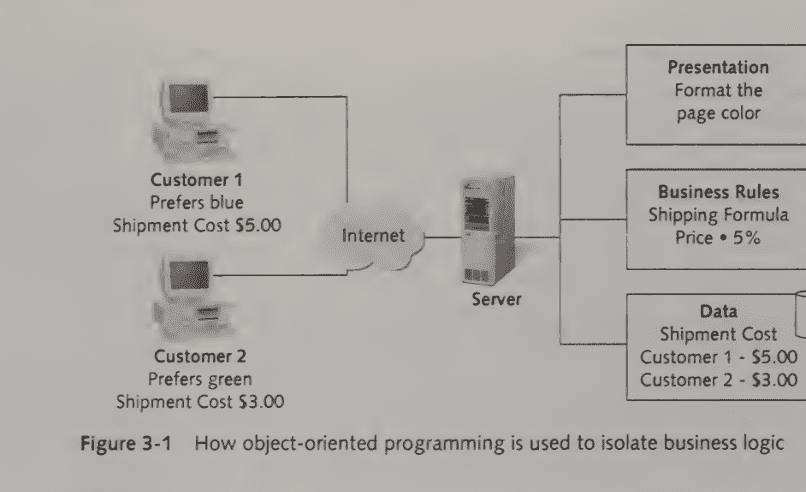

图 3-1 面向对象编程如何用于隔离业务逻辑

## 使用内置对象

浏览器软件包含内置对象。在构建 Web 应用程序时，你可以访问这些对象及其属性和方法。这个对象的分层集合遵循一个称为**文档对象模型（DOM）**的标准。万维网联盟（http://www.w3c.org）负责制定 DOM 标准。DOM 内置于浏览器软件中。使用客户端脚本，程序员可以访问 DOM 中的所有对象、属性和方法。

> **编程提示：** DOM 有时也称为浏览器对象模型。

#### 浏览器不兼容性

最常见的浏览器，Microsoft Internet Explorer 和 Netscape Navigator，都具有内置的 DOM。并非所有浏览器都符合当前的 DOM 标准。当你包含客户端对象时，务必在各种浏览器上进行测试，因为并非所有属性和方法在所有浏览器上都受支持。例如，Netscape Navigator 使用 navigator 对象的 language 属性来显示 Web 浏览器使用的语言。此属性在 Internet Explorer 中不受支持。在 Internet Explorer 中，navigator 对象使用 userLanguage 和 systemLanguage 属性。Netscape 支持一个名为 "home" 的方法，它将活动窗口返回到默认主页。确保特定浏览器支持你在 Web 应用程序中使用的对象、属性和方法的唯一方法是，在该 Web 浏览器中预览网页。

虽然你可以为每个浏览器创建两个独立的网站，但一些 Web 编辑工具（如 FrontPage、Dreamweaver 和 Drumbeat 2000）允许你设置网站，使其仅生成与浏览器兼容的代码。这些应用程序允许你指定哪些浏览器版本可以访问整个网站或网站内的单个网页；但这样做会限制你使用较新浏览器版本附带的额外属性和方法。

> navigator 对象具有诸如 userAgent 之类的属性，允许你检测客户端正在运行的浏览器和版本。此信息也可在网站日志文件中供网站管理员使用。

#### 文档对象模型中的对象层次结构

DOM 中的所有对象在 DOM 层次结构中都有一个位置。当你启动浏览器软件时，可能会打开一个或多个窗口。window 对象在对象层次结构中处于最高位置。窗口可以包含许多子对象，例如 history 对象、location 对象、event 对象、screen 对象、frames 对象和 document 对象。除了 window 对象外，DOM 中的每个对象都包含在一个父对象中。

一些对象包含一个或多个子对象。例如，window 对象包含 navigator 对象、history 对象、frames 对象、location 对象和 document 对象。以下是客户端编程中常用对象的列表。图 3-2 展示了 DOM 中所有对象的集合及其层次关系。

- window 对象

- navigator 对象

- location 对象

- history 对象

- document 对象

- forms 集合

- links 和 anchors 集合

- images 集合

文档对象包含自己的子对象集合，其中包括表单集合。**集合**允许同一对象模型层次结构中存在多个相同类型的对象。换句话说，一个文档对象中可以包含多个表单对象。这些多个表单被称为**表单集合**。表单集合也称为 forms[]**数组**。**数组**是一组对象的集合。数组中的每个对象根据其在数组中的顺序位置进行编号。集合中的对象编号从零开始。这个编号被称为索引号，用于标识数组中的每个表单。因此，第一个表单是表单数组的第一个元素，可以标识为 form[0]。如果网页上有四个表单，则这些表单分别标识为 form[0]、form[1]、form[2] 和 form[3]。

> 关于创建和使用数组的更多细节将在后续章节中介绍。

DOM 还包含其他几个集合，包括图像集合和表单元素集合。如果一个文档中有多个图像，你可以通过图像集合中的位置来引用每个图像，例如 img[0]。回想一下，表单对象包含不同类型的表单元素，如文本框。这些表单元素构成了表单元素数组。表单中的每个元素也从零开始按顺序编号。图 3-2 显示了 DOM 中的其他集合。

本书涵盖了 DOM 中更常用的对象、方法和属性。还有一些额外的对象、方法和属性未在本书中列出。你可以通过访问第 2 章列出的 JavaScript 资源网站来了解更多相关信息。

##### DOM 中对象的命名约定

当你需要在脚本中引用一个对象时，可以使用对象的完全限定名。完全限定名包括对象的名称及其在 DOM 中的层次位置。例如，一个名为 lname 的文本框对象位于网页上名为 form1 的表单中。该对象的完全限定名为 `window.document.form1.lname`。如果引用的是当前窗口中的对象，则无需指定窗口对象的名称。因此，你也可以将该文本框对象引用为 `document.form1.lname`。

要引用对象的属性，使用对象名称后跟一个句点和属性名称。例如，要引用名为 lname 的文本框的内容，使用 value 属性。你可以指定完全限定名 `window.document.form1.lname.value`，或者如果对象存在于当前窗口中，则使用 `document.form1.lname.value`。由于对象的 name 属性用于在脚本中引用对象，因此应为每个对象分配一个唯一的名称。

##### 属性、方法和事件

每个对象和集合都包含自己的属性、方法和事件。其中一些属性、方法和事件在对象之间是通用的，例如 name 属性。你可以为某些属性赋值，例如 `document.title`。有些属性是只读的，这意味着你无法更改它们的值。要检索对象的某个属性值，请使用对象的完整名称。例如，要检索名为 form1 的表单上名为 name 的文本框的值，并将其赋给名为 txtName 的变量，你可以使用 `document.form1.name.value = txtName`。要为对象赋值，也需要使用对象的完整名称。例如，要更改名为 form1 的表单上名为 btnSubmit 的按钮上的标签值，你可以使用代码 `btnSubmit.value = "Submit Me"`。

DOM 中的对象有内置方法，可以从脚本中调用。调用方法与设置或获取属性值非常相似。要调用方法，请使用对象的完整名称后跟一个句点和方法名称。例如，要使用 close 方法关闭窗口，你可以使用 `window.close()`。

参数可以传递给方法。在第 2 章中，你将一个字符串作为参数传递给了 document 对象的 write 方法。你可以使用 `window.document.write("Welcome")` 或 `document.write("Welcome")` 来调用 write 方法。在调用方法之前，你应该先考虑它是否需要任何输入或返回任何输出。

一些内置方法会返回一个值给调用它们的脚本。如果方法有返回值，则它会将该值传递回调用它的脚本。方法可能返回一个值表示处理正确完成，也可能返回一个值表示从处理中获取的结果。你可能需要也可能不需要在应用程序中使用返回值。如果返回值中包含的信息很有价值，那么可以通过在一个较大的语句中调用该方法来捕获它。如果不需要，则可以忽略返回值。在下面的示例（statustest.htm）中，当用户将鼠标指针悬停在第一个超链接上时，窗口状态栏将更改为新的字符串。当用户将鼠标指针悬停在第二个超链接上时，状态消息不会被更改；取而代之的是，文件名将出现。`return false` 语句将阻止浏览器显示错误消息。`return true` 语句捕获错误并继续处理脚本。

```
<a href = "product1.htm"
   onMouseOver =
      "window.status='Claddagh Ring';
      return true">
   New Ring</a>
<br>
<a href = "product2.htm"
   onMouseOver =
      "window.status='Claddagh Earrings';
   return false">
   New Earrings</a>
```

不要将字符串拆分成多行。本书中的字符串被拆分是为了提高可读性。将字符串拆分成多行会产生错误消息。

在第 2 章中，你了解到脚本可以用来增强用户与网页之间的交互性。事件允许对象与程序员交互，也允许对象与程序本身交互。用户通过执行称为**事件**的操作与网页进行交互，例如单击、滚动和在文本框中输入信息。响应事件的命令语句称为**事件处理程序**。此事件处理程序可以包含在事件发生时执行的代码。你可以创建一组响应事件的编程语句。例如，当用户单击一个对象时，该对象会生成一个名为 **onClick** 的事件。customer.htm 中的以下代码将使用三种不同的技术捕获单击事件。当检测到单击事件时，会显示一个包含消息的警告框。第一种方法使用按钮对象的 onClick 事件处理程序。

```
<body>
<h1>Call Customer Support</h1>
<form name="form1">
<input type = "button" name = "btnCall1"
       value = "Click Here for Help"
       onClick = window.alert("1-800-555-5555");>
</form>
```

customer.htm 中的第二种方法演示了如何使用函数来处理事件。以下示例代码使用了一个名为 callUs 的函数，该函数在检测到单击事件时被调用。

```
<form name="form2">
<input type = "button" name = "btnCall2"
       value = "Click Here for Help"
       onClick = "callUs()";>
</form>
<script language="javascript">
function callUs(){
    window.alert("1-800-555-5555")
}
</script>
```

customer.htm 中的第三种方法演示了如何在 DOM 中直接访问这些事件。你可以强制触发单击事件。为此，你可以创建一个函数并将该函数赋值给事件处理程序。在 VBScript 中，你可以使用一个过程（procedure），当检测到事件时该过程将被调用。在下面的示例代码中，检测到相同的单击事件并显示一条警告消息。然后你可以通过从脚本中调用该过程来直接调用事件处理程序，或者当用户单击按钮时该过程将被自动调用。注意过程的名称是由对象名称、下划线和事件名称组合而成的。

```
<form name="form3">
<input type = "button" name = "btnCall3"
value = "Click Here for Help">
</form>
<script language="vbscript">
sub btnCall3_onClick()
    window.alert("1-800-555-5555")
end sub
</script>
```

## 窗口对象

窗口对象是DOM中可以存在的最顶层对象；它代表了容纳HTML文档的物理空间。窗口对象提供了与实际浏览器许多功能的直接链接。由于窗口对象代表了浏览器窗口，与之关联的属性和方法都通过该对象进行处理。窗口对象包含子对象、属性、方法和事件，并且是几个子对象的父对象，包括文档、框架、位置和导航器。

尽管微软和网景公司的DOM版本略有不同，但两个版本都将窗口对象作为浏览器模型层次结构中的顶层对象。

### 窗口对象属性

最常用的窗口属性包括 **self**、**name**、**default status** 和 **status** 属性。可以同时打开多个窗口。self 属性是对当前窗口的引用。name 属性允许你在程序代码中引用特定的窗口，例如 `window.self`。default status 属性允许你设置显示在浏览器窗口底部 **状态消息栏** 中的默认字符串。status 属性可用于临时设置状态消息栏的内容。例如，你可以使用 `window.defaultStatus = "Sale starts Monday"` 来设置默认状态属性。

#### 窗口对象的 status 属性

以下代码片段展示了如何通过更改窗口对象的 status 属性来修改状态消息栏中的消息。与 defaultStatus 属性类似，status 属性在浏览器窗口底部的状态消息栏中显示一个字符串。以下示例代码说明了如何更改状态消息栏中的默认状态消息。

```
window.status = "Course Technologies"
```

通常，如果你没有为 defaultStatus 属性分配值，状态消息栏将不会显示任何内容，除非你将鼠标指针悬停在链接上，此时它会显示该链接的 URL。在实际应用中，可以修改状态消息以引起对某些内容的关注，例如新产品提供或如何联系客户支持。在这个示例代码 statusMessage.htm 中，状态消息栏中的默认字符串将是公司名称 Office Store Unlimited。

```
<html><head>
<script language = "javascript">
window.defaultStatus = "Office Store"
</script>
<title>Changing the Status Message</title>
</head>
<body>
<h2>Change the Status Message</h2>
```

示例如下。下面的两个超链接在用户将鼠标指针悬停在其上时，会临时更改状态消息。当用户将鼠标指针移开链接时，状态消息会恢复为默认消息。该属性会因 mouseover 事件而改变。

```
<a href="Claddagh.htm"
     onMouseOver = "window.status='Claddagh';
     return true">
New Product
</a>
</body>
</html>
```

该属性可以设置为一个字符串，例如 "Office Supply Store"，或空字符串 " "。null 值不会在状态消息栏上显示任何字符串。

### 窗口对象方法

窗口对象包含多个可从脚本访问的方法。可以同时打开多个窗口。open 和 close 方法用于在浏览器中打开和关闭窗口。scroll 方法将窗口向下滚动到窗口内的特定坐标。当打开多个窗口时，一次只能有一个窗口处于活动状态。活动窗口获得焦点。blur 和 focus 是用于更改焦点的方法。focus 将使窗口成为活动窗口，而 blur 则移除焦点。focus 和 blur 是与其他对象（如文本框，将在本章后面介绍）一起使用的方法的示例。

**打开和关闭窗口** open 窗口方法允许你动态打开一个新的浏览器窗口。使用 open 方法，你可以通过指定现有页面来创建一个新窗口，或创建一个新页面。open 方法有多个参数可用于修改窗口布局：URL、窗口名称、窗口功能和 replace。URL 参数是要打开的文件的位置。URL 可以包含文件的绝对或相对路径。窗口名称是分配给窗口的名称。窗口名称用于在脚本中引用该窗口。可以使用关键字 null 或 "" 代替窗口名称。使用 replace 参数允许你在当前窗口内加载页面。窗口功能是一系列选项及其值的字符串，允许你修改窗口布局。窗口功能包括窗口尺寸以及一系列各种选项及其值。以像素为单位的 height 和 width 属性用于指定窗口的尺寸。窗口的高度和宽度以像素为单位标识，并且也包含在引号内。

在引号内，每个选项使用其名称和值列出，以逗号分隔。可以打开或关闭的窗口选项包括 location、menubar、toolbar、directories、status 和 scrollbars。directories 工具栏也称为链接工具栏，包含特殊的链接按钮。top 和 left 是 Internet Explorer 中可用的两个属性，允许你以像素为单位指定窗口的最顶端和最左侧位置。然后你还可以控制窗口打开的位置。你可以通过将菜单值设置为 no 或 0 来关闭菜单和工具栏。要强制显示菜单或工具栏，请将工具栏值设置为 yes 或 1。resizable 选项可用于防止用户调整窗口大小。图 3-3 展示了移除了菜单栏、工具栏和滚动条的浏览器窗口。以下是在浏览器中打开新窗口的语法。URL、windowName 和选项列表都包含在引号内。

```
window.open ("URL","windowName","options=value, width=xxx, height=yyy");
```

### 图 3-3  修改窗口外观

下面的示例代码展示了如何打开一个名为 newWin 的新窗口，其中包含一个名为 office.htm 的文档。窗口的尺寸为 400 像素宽，200 像素高。状态消息栏、工具栏、菜单栏和地址栏都已关闭。滚动条未关闭，用户可以调整窗口大小。

```
window.open("office.htm","newWin","height=200,width=400,
status=no,toolbar=no,menubar=no,location=no")
```

> 移除菜单和工具栏并不是隐藏信息的安全方式。即使菜单被移除，用户仍有可能获取网页的源代码。

close 方法关闭当前窗口。要关闭特定窗口，请将要关闭的窗口名称传递给窗口方法。如果未指定特定窗口，则将关闭包含 close 方法的窗口。要关闭当前窗口，可以传递当前窗口的名称，或者不传递任何参数。根据浏览器的安全设置，可能会出现一个对话框，询问你是否确定要关闭窗口。在此示例中，close 方法用于关闭当前窗口。

```
<script language = "javascript">
document.close()
</script>
```

### 面向对象编程

在以下示例中，结合使用了窗口对象的 open 和 close 方法，以增加用户对网页的参与度。用户打开一个名为 windowOpen.htm 的网页。当用户点击一个按钮时，程序检测到发生了 OnClick 事件。当 onClick 事件发生时，会调用 OpenContactWindow 函数。openContactWindow 函数创建一个新窗口，然后使用 **document.write** 方法向网页写入 HTML 和文本。

- 1. 使用记事本或你的网页编辑器创建一个名为 **windowOpen.htm** 的网页。添加基本的 HTML 标签。

```
<html><head>
<title>Office Supply Unlimited</title>
</head>
```

- 2. 在网页的头部，添加代码以打开一个新窗口并在该窗口中创建一个新网页。openWin 函数创建一个名为 newWin 的窗口对象的新实例。加载到新窗口中的新网页的名称是 office.htm。该网页的尺寸为 200 像素高，400 像素宽。状态消息栏、工具栏、菜单栏和地址栏将全部关闭。

```
<script language = "javascript">
function openWin(){
var newW = window.open("office.htm",
"newWin","height = 200,width = 400,
status = no, toolbar = no,
menubar = no, location = no");
```

## 3. 创建一个变量来保存将写入新窗口的字符串。在 JavaScript 中可以使用加号（+）连接字符串，在 VBScript 中则使用与号（&）。在本示例中，名为 strH 的变量保存整个字符串，该字符串将被写入新窗口：

> 由于选项列表是以字符串形式传递的，因此需要在网页的一行代码中写出整个字符串。此处将代码拆分为多行以提高可读性。如果将字符串拆分为多行，页面将生成错误消息。

> 你可以连接字符串、HTML 标签和变量。由于整个参数可能非常长，程序员通常会拆分字符串，并使用名为 strH 的变量来保存字符串的值。

```javascript
var strH ;
strH = "<html><head><title>";
strH = strH + "Office Supply Unlimited</title>";
strH = strH + "<h1>";
strH = strH + "Office Supply Unlimited";
strH = strH + "</h1>";
strH = strH + "<center>";
strH = strH + "Call us for customer support ";
strH = strH + "at 1-800-555-5555 ";
strH = strH + "<BR>";
strH = strH + "<BR>between 9:00 - 5:00 CST. ";
strH = strH + "</center>";
```

4. 窗口打开后，你可以访问新窗口和文档的所有属性和方法。由于这是一个网页，因此可以使用 document.write 方法将 HTML 标签和文本写入网页。但是，当前有两个窗口处于打开状态。要写入新窗口，必须通过名称来标识它。字符串的最后部分将包含一个带有按钮的表单。当点击按钮时，将使用 close 方法关闭新窗口。确保在单词 button 之后的右单引号后面立即有一个空格。

```javascript
strH = strH + "<form><input type = 'button' ";
strH = strH + "value ='Close me' onClick = 'window.close()'>";
strH = strH + "</form>";
newW.document.write(strH);
}
</script>
```

5. 在网页中创建用户将点击以打开新窗口的按钮。当用户点击按钮时，按钮对象检测到 click 事件并由 onClick 事件处理程序处理。openWin 函数是被分配来处理 click 事件的函数。因此，当用户点击按钮时，openWin 函数将打开一个新窗口。

```html
<body>
<form><h1>Call Customer Support</h1>
<input type = "button"
    value = "Click Here for Customer Support"
    onClick = "openWin()">
```

6. 关闭表单和网页的标签。

```html
</form></body></html>
```

7. 将网页保存到你的数据目录。在浏览器中查看该网页。

### 创建窗口对话框

对话框用于从用户那里获取信息，或向用户提供信息。创建对话框的三种 window 方法是 alert、confirm 和 prompt 方法。图 3-4 展示了在浏览器中这三种对话框的外观。每种方法的语法和示例列于表 3-1 中。

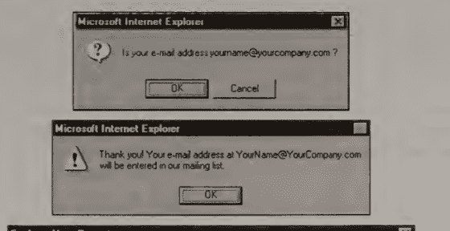

图 3-4 使用 window 对象创建的对话框

alert 方法创建警告对话框，通常用于表单上向用户提供简单的消息，例如"你忘记输入姓名了。"警告框创建一个包含单一消息和确定按钮的小窗口。此方法通常用于警告用户，例如他们未能正确填写表单。警告对话框有一个字符串输入。

confirm 方法通常用于要求用户接受或拒绝某些条件。确认对话框包含消息、确定按钮和取消按钮。例如，当用户尝试发送没有主题的电子邮件时，可能会出现确认框。你可以创建一个脚本来捕获用户点击按钮时返回的值。用户可以点击取消按钮，这将返回 false，然后脚本将停止提交电子邮件，并返回到表单以便用户输入主题。点击确定按钮将返回 true，电子邮件将不带主题发送。

prompt 方法创建提示对话框，用于从用户那里获取信息。提示对话框使用一个字符串，可用于向用户指示要输入哪种类型的信息。然后可以检索用户在提示对话框中输入的信息。例如，可能会提示用户输入电子邮件地址。提示对话框包含提示消息、要放入文本框中的默认字符串、确定按钮和取消按钮。

#### 表 3-1 Window 方法语法及示例

| 方法 | 语法 | 示例 |

| --- | --- | --- |

| Alert | `window.alert("String")` | `window.alert("Please enter your name in the form.")` |

| Confirm | `window.confirm("String")` | `window.confirm("Do you want to leave the message line blank?")` |

| Prompt | `window.prompt("Prompt", "Default String")` | `window.prompt("Enter your e-mail address", "YourName@YourCompany.com")` |

在以下示例代码中，名为 windowDialogue.htm 的网页主体创建了一个带有按钮的表单。当用户点击按钮时，触发 onClick 事件。onClick 事件触发 EmailPrompt 函数。此脚本可用于提示用户输入信息，或执行错误检查，以及提供有关访问者所犯错误的反馈。请注意，变量 yourEmail 已包含在发送给用户的消息中。一旦从用户那里获取此信息，便可以在整个网页中访问它。

1. 使用记事本或网页编辑器创建一个名为 **windowDialog.htm** 的新网页。

2. 添加基本 HTML 标签。

3. 添加 script 标签。创建一个名为 emailPrompt 的函数。emailPrompt 函数是位于网页头部部分的脚本。


```html
<html><head>
<script language = "javascript">
function emailPrompt() {
```

4. 该脚本创建一个名为 yourEmail 的变量，用于保存用户在文本框中输入的字符串。

```javascript
var yourEmail = new String() ;
```

5. 然后调用 prompt 方法，返回给浏览器的结果是字符串。该字符串被分配给名为 yourEmail 的变量。

```javascript
yourEmail = window.prompt("What is your e-mail address?",
"YourName@YourCompany.com");
```

6. 如果返回的变量值为 null，则表示用户没有输入任何文本，并显示警告消息；如果用户输入了电子邮件地址，则警告消息会告知用户电子邮件列表注册成功。该函数不验证电子邮件地址是否有效。

```javascript
if (yourEmail == ""){
    alert("You didn't enter an e-mail address yet.") ;
}
else{
    alert("Thank you! Your e-mail address at " +
         yourEmail +
         " will be entered in our mailing list.") ;
}
}
</script>
```

> **Programming Tip**

>

> 双等号（==）用于在 JavaScript 中比较两个语句。它们用于检查一个表达式是否等于另一个表达式。你必须将比较语句括在括号中。稍后你将在本书中了解更多关于比较表达式的内容。

7. 添加代码以创建网页的其余部分。添加代码以创建一个名为 btnEmail 的按钮。当用户点击该按钮时，onClick 事件将调用 emailPrompt 函数。

```html
<title>E-mail List Sign-up</title>
</head>
<body>
<form name = "form1">
<h1>Click the button to sign up
on our e-mail list.</h1>
<input type = "button" value = "Sign Me Up!"
       name = "btnEmail"
       onClick = "emailPrompt()">
</form></body></html>
```

8. 将网页保存到你的数据目录，并在 Web 浏览器中查看它。

还有其他的 window 对象属性、方法和事件处理程序。其中一些没有很好的文档记录，并且可能不是跨浏览器兼容的。例如，window 对象的 navigate 方法将更改 URL。要使用 navigate 方法，你可以使用 `window.navigate("http://www.course.com/");`。

## 窗口事件处理程序

窗口对象与其他对象一样，能够响应事件。窗口对象响应的两个事件是 `onLoad` 和 `onUnload`。`onLoad` 事件处理程序是一段在网页加载后立即执行的代码。`onUnload` 事件处理程序是一段在页面关闭前执行的代码。当用户离开当前页面前往另一个页面时，会触发此事件。此事件处理程序的语法与 `onLoad` 事件处理程序非常相似，因为它不需要任何输入，你可以编写响应代码。由于该事件与页面相关联，因此这些事件通常与 HTML 的 `<body>` 标签一起编程。以下是来自 `windowLoad.htm` 的代码示例，该示例在页面打开和关闭时显示警告窗口。

```
<body onLoad = "alert('Welcome to this page')"
      onUnload = "alert('Goodbye!')">
```

> 你可以指定一个要执行的函数，这允许你执行一组 JavaScript 语句。`<body onLoad = "startCode()">`

> 回想一下，网页是窗口对象内的一个文档对象。因此，你可以通过文档对象使用 `document.load` 和 `document.unload` 来访问事件处理程序。

## Navigator 对象

`navigator` 对象是 `window` 对象的子对象。`navigator` 对象提供有关浏览器应用程序的信息。多年来，两大主要浏览器 Internet Explorer 和 Netscape Navigator 各自以自己的方式支持 HTML 标准和 JavaScript。尽管有 ECMAScript 和 ECMAScript-262 标准，这些浏览器仍然使用它们专有的对象、方法和属性。由于不同的浏览器支持不同的功能，你可以使用 `navigator` 对象来检测客户端正在使用哪个浏览器，然后，如果需要，将用户重定向到为该正确浏览器配置的网页。

识别客户端浏览器主要有两种方式。通过客户端脚本，`navigator` 对象可以提供浏览器名称和版本。`navigator` 对象只允许你读取其属性。但是，通过服务器端脚本，一个称为浏览器组件的对象不仅可以识别浏览器名称和版本，还可以识别该特定浏览器支持的对象、属性和方法。浏览器组件将在后面的章节中详细介绍。

### Navigator 对象属性

`navigator` 对象的 `appName` 属性标识浏览器应用程序的名称。`appVersion` 属性标识版本。`userAgent`（用户代理）通常被记录在网站日志文件中，以确定访问客户端使用的浏览器和操作系统平台。读取 `navigator` 对象属性的语法是 `navigator.propertyname`。

例如，在一个名为 `browserVer.htm` 的网页中，你可以编写一个简短的脚本来检测浏览器版本，使用 `appName` 属性。在此示例中，将已知的浏览器名称值与 `appName` 属性进行比较。一旦检测到浏览器版本，就会将浏览器名称和 `appName` 值写入到窗口中。你可以添加额外的语句将用户重定向到特定于浏览器的页面，如下所示。

1.  在记事本或使用你的网页编辑器中创建一个名为 **browserVer.htm** 的网页。

2.  输入以下 HTML 和 JavaScript 语句。

```
<html><head>
<script language = "javascript">
if(navigator.appName == "Netscape"){
    document.write("appName is " + navigator.appName);
}
if (navigator.appName == "Microsoft Internet Explorer") {
    document.write("appName is " + navigator.appName);
}
</script>
<title>Detecting Browser Versions</title>
</head>
<body>
</body></html>
```

3.  将网页保存到你的数据目录。在浏览器中查看该网页。如果可以，请在不同的浏览器中查看该网页。

## Location 对象

`location` 对象是 `window` 对象的另一个子对象。每个窗口都包含一个 `location` 对象。`location` 对象提供有关当前文档 URL 的信息，但它只允许你读取 `location` 对象的属性。与 `location` 对象关联的方法用于将浏览器窗口重定向到另一个 URL。你可以使用文档对象的 `location` 属性 **document.location** 从文档对象中检索 `location` 对象。

### Location 对象属性

有几个属性与 `location` 对象相关联。`HREF` 属性标识网页的完整 URL 地址，例如 `http://www.visualinterdev.org/ip/locationobject.htm`。`HREF` 属性返回从 **document.location** 检索到的相同信息。回想一下第一章，URL 是 TCP/IP 协议、域名以及路径和文件名的组合。协议是从网页访问的 TCP/IP 协议的版本。通常从网页访问的协议是 HTTP，即超文本传输协议。在这种情况下，TCP/IP 协议是 `http`。域名的另一个名称是主机名。`hostname` 属性标识域名或主机名。例如，上述 URL 的主机名是 *www.visualinterdev.org*。`host` 属性是主机名和端口号属性的组合。回想一下第一章，Web 服务器的默认端口是 80。大多数网站不指定端口号，因为它们使用默认端口号。如果 URL 中没有指定端口号，上述 URL 的主机将是 *www.visualinterdev.org*。`pathname` 属性是通往文件的路径，并包含文件名。上述 URL 中的 `pathname` 属性将返回 */vc/ip/locationobject.htm*。如果 URL 附加了书签，你可以使用 `hash` 属性检索该信息。例如，如果 URL 是 *http://www.visualinterdev.org/ip/hash.htm#top*，那么 `hash` 属性将返回 `#top`。

读取 `location` 对象属性的语法是 `location.propertyName`。要显示 `location` 对象的属性，你可以使用 `document.write` 方法写出 `location` 属性的名称和值。以下示例名为 *location.htm*，演示了如何显示一些常见的 `location` 对象属性。

> **编程提示：** `location` 对象的语法可以使用 `document.location.propertyName` 或 `document.location.method` 来完全限定。但是，你不需要指定 `document` 对象。如果引用的是当前文档，那么你可以简单地写成 `location.propertyName` 或 `location.method`。

1.  在记事本或使用你的网页编辑器中创建一个名为 **location.htm** 的网页。

2.  输入以下 HTML 和 JavaScript 语句。

```
<html><head>
<title>Location Properties</title>
</head>
<body>
<script language = "javascript">
var b = "<BR>";
document.write("document.location = ");
document.write(document.location + b);
document.write("href = ");
document.write(location.href + b);
document.write("protocol = ");
document.write(location.protocol + b);
document.write("host = ");
document.write(location.host + b);
document.write("hostname = ");
document.write(location.hostname + b);
document.write("port = ");
document.write(location.port + b);
document.write("pathname = ");
document.write(location.pathname + b);
</script>
</body></html>
```

3.  将你的网页另存为 `locationProp.htm` 并保存到你的数据目录。在浏览器中查看该网页。如果可以，请在不同的浏览器中查看该网页。

### Location 对象方法

HTML `<meta>` 标签允许你将浏览器重定向到另一个网页。此标签只允许你配置在重定向启动前经过的秒数。除非访问者按 `Escape` 键或单击浏览器上的“停止”按钮，否则无法停止重定向过程。但是，你可以通过修改 **location.href** 属性将浏览器重定向到另一个网页。此方法允许你在脚本内部重定向用户。因此，你可以更好地控制何时以及在何种条件下发生重定向。

使用 `HREF` 属性重定向用户的语法是 **location.href = "URL"**。URL 可以是绝对地址或相对地址。例如，你可以编写一个包含语句 **location.href="http://www.course.com/"** 的脚本。这等同于在位置栏的地址文本框中输入 URL。因为你要访问此网页，该页面将被包含在历史记录列表中。

你可以使用 `location` 方法根据条件更改网页。以下是一个基本的网页，名为 `locationCourse.htm`，它会将用户重定向到另一个网页。`username` 变量与一个字符串进行比较。如果两个字符串匹配，则浏览器将被重定向到一个网站。如果字符串不匹配，则用户将被重定向到备用网站。

1.  在记事本或使用你的网页编辑器中创建一个名为 **locationCourse.htm** 的网页。

2.  输入以下 HTML 和 JavaScript 语句。

```
<html><head>
<title>Client Redirection</title>
</head>
<body>
<script language = "javascript">
username = "admin";
if (username == "admin"){
    location.href="http://www.course.com/";
}
else {
    location.href="http://www.visualinterdev.org";
}
</script></body></html>
```

3.  将网页保存到你的数据目录。在浏览器中查看该网页。如果可以，请在不同的浏览器中查看该网页。

> 你也可以通过指定每个页面的URL，将浏览器重定向到同一网站内的不同页面。

`reload`方法，在不传参或传入`true`参数时，会强制浏览器在当前窗口中重新加载当前网页。参数可以是`null`、`true`或`false`。传入`false`参数的`reload`方法，仅会在网页内容发生变化时才触发浏览器重新加载。`reload`方法等同于点击浏览器上的"重新加载"按钮。以下`reload.htm`中的示例代码将创建一个用于重新加载页面的按钮。

```
<input type="button" name="reload"
value="Reload the page"
onClick='location.reload()'>
```

`replace`方法会用一个新URL替换当前的URL。`replace`方法会替换浏览器历史记录列表中的当前文档条目。以下示例代码将创建一个按钮，该按钮会用一个新网站替换当前页面。

```
<input type="button" name="replace"
value="Replace the page"
onClick='location.replace("http://www.course.com/")'>
```

## History 对象

`history`对象是`window`对象的另一个子对象。每个窗口都包含一个`history`对象。`history`对象提供了关于最近访问过的URL的信息。最近访问过的URL列表存储在历史列表中。`history`对象只允许你读取在当前浏览器会话期间生成的历史列表。因此，你无法访问上一个用户的历史列表。与`history`对象相关的方法通常用于将用户重定向到另一个URL。

### History 对象属性

`length`属性标识历史列表中的条目数量。其他属性，如`next`和`previous`，为了保护访客隐私而未被启用。要查看列表上的条目数量，只需使用`document.write`方法写出`length`属性的值即可，如下方来自`historyLength.htm`的示例代码所示。

```
document.write("The length of the ");
document.write("current history list is ");
document.write(window.history.length);
```

### History 对象方法

你可以使用`history`方法`next`、`back`和`go`来导航到历史列表中的其他页面。图3-5展示了浏览器中历史列表的位置。由于安全原因，`history`对象不会提供列表中项目的名称，因此网站开发者、程序员和公司无法获取访客历史列表的URL。但是，这些方法确实允许你调用一个访问列表的方法，并将当前页面更改为调用该方法时指定的页面。

`history`对象的语法可以使用`window.history.propertyName`或`window.history.method`进行完全限定。但是，你不需要指定`window`对象。你可以简单地写成`history.propertyName`或`history.method`。

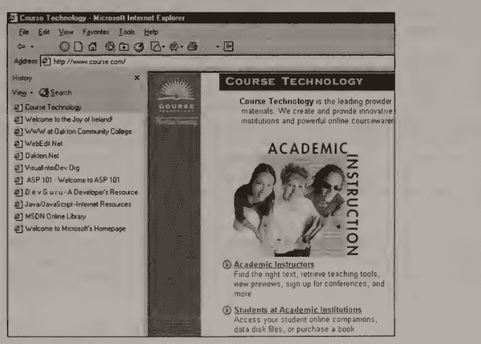

**图 3-5** Internet Explorer 历史列表

`back`方法使浏览器返回到历史列表中的上一个URL，而`forward`方法使浏览器导航到历史列表中的下一个URL。以下来自`historyMethods.htm`的示例代码创建了两个按钮，用于将浏览器发送到历史列表中的下一个或上一个条目。

```
<form>
<input type="button" name="back"
        value="<--  Go Back"
        onClick='history.back()'>
<input type="button" name="forward"
        value="Go Next  -->"
        onClick='history.forward()'>
</form>
```

你可以使用图像作为链接，而不是按钮。要创建一个链接到上一页的图像链接，请在图形程序中创建一个返回箭头图形。将返回箭头图像命名为`back.gif`。使用以下代码片段创建锚点和图像标签。请注意，锚点的HREF属性通过使用`back`方法从历史列表中的前一个条目检索URL。

```
<a href = "javascript:history.back()">
</a>
```

完成此任务的另一种方法是使用锚点超链接的`onClick`事件。

```
<a href = "http://www.course.com/"
        onClick='javascript:history.back();'>

</a>
```

你可以使用关键字`javascript`来指示浏览器运行脚本。脚本与关键字之间用冒号分隔。当你想在HTML对象中运行JavaScript语句而无需使用`script`标签时，这是一个有用的技术。

`go`方法允许你根据其顺序号指定历史列表中的一个URL，然后转到该页面。`go`方法可以接受一个正数或负数作为参数。负数使浏览器在历史列表中向后移动，正数使其向前移动。`go`方法也可以接受一个字符串作为参数；在下面的示例中，它会搜索历史列表并转到与搜索条件最匹配的页面。按钮、图像和其他对象可以与`go`方法一起使用，如下面的示例代码所示。

```
<form>
<input type="button" name="back"
    value="Go Back 1"
    onClick='history.go(-1)'>
<input type="button" name="forward"
    value="Go Forward 1"
    onClick='history.go(1)'>
</form>
```

## Document 对象

`document`对象是`window`对象的一个子对象。每个窗口都包含一个`document`对象。`document`对象允许直接访问当前网页。`window`对象代表实际的浏览器窗口，而`document`对象代表窗口内的实际网页。

> `document`对象的语法可以使用`window.document.propertyName`或`window.document.method`进行完全限定。但是，当引用当前窗口时，你不需要指定`window`对象。你可以简单地写成`document.propertyName`或`document.method`。

`document`对象包含许多子对象。因为`document`对象可以包含多个相同类型的子对象，所以这些对象存储在集合中，也称为数组。这些子对象包括：`all`集合（包含所有HTML标签）、称为锚点的超链接、小程序、用于样式表类的类、用于嵌入对象的`embeds`、`forms`、用于样式表ID的`ids`、`images`、用于分层对象的`layers`、文本区域、`links`、`plugins`和用于样式表标签的`tags`。在本章后面，你将学习更多关于`forms`和`images`集合的知识。

### Document 对象属性

HTML标签，如`title`和`body`，可用于更改网页的外观。你也可以使用`document`对象来控制网页的外观，其优势在于它允许你动态修改其属性，从而改变网页的外观。表3-2列出了一些`document`对象的属性。

102  第3章 面向对象编程

### 表 3-2  Document 属性表

| 属性 | 描述 |

|---|---|

| alinkColor | 网页上活动超链接的颜色。默认为红色。活动超链接是被点击但尚未访问的。 |

| background | 标识要使用的背景图像 |

| bgColor | 背景颜色。如果你在背景中有一张图片，那么此属性不会覆盖该图片。 |

| cookie | 文档的cookie |

| defaultClientScript | 默认的客户端脚本语言——通常是JavaScript |

| defaultServerScript | 默认的服务器端脚本语言——通常是VBScript |

| domain | 提供该网页的Web服务器的域名 |

| fgColor | 前景色，用于文本和标题 |

| lastModified | 网页最后修改或更改的日期 |

| linkColor | 网页上超链接的颜色。默认为蓝色。 |

| referrer | 引用页面的URL |

| text | 默认的文本颜色 |

| title | 将在标题栏中显示的文本字符串 |

| url | 当前页面的URL |

| vlinkColor | 网页上已访问超链接的颜色。默认为紫色。 |

检索属性值的语法是`document.property`。设置`document`对象属性的语法是`document.property = value`。以下`documentProperties.htm`中的示例代码设置`document`对象的标题和页面颜色属性，然后显示当前属性。

```
<script language = "javascript">
document.title = "Chapter 3 Exercise";
document.bgColor = "silver";
document.fgColor = "maroon";
document.writeln("bgColor is " + document.bgColor + "<br>");
document.writeln("fgColor is " + document.fgColor + "<br>");
document.writeln("alinkColor is " + document.alinkColor + "<br>");
document.writeln("vlinkColor is " + document.vlinkColor + "<br>");
document.writeln("linkColor is " + document.linkColor + "<br>");
</script>
```


你可以使用颜色的名称或十六进制颜色值。有关网页颜色和背景图像的更多信息，请访问 http://www.lifebeyondyahoo.com/life/color.asp。`document`对象将使用十六进制值显示颜色值。


以下示例代码来自 documentColor.htm，创建了一个按钮，用于更改 Web 页面的背景颜色。你也可以在脚本中设置背景颜色，而无需使用按钮或超链接。

```
<input type="button" name="Silver"
       value="Silver"
       onClick='document.bgColor="silver"'>
```


以下示例代码来自`documentColor.htm`，创建了一个超链接，用于更改 Web 页面的背景颜色。请注意，此处关键字`javascript`与关键字`void(0)`结合使用。`void`阻止所选事件发生。在本例中，它阻止超链接跳转到另一个 URL。因此，背景颜色的更改将在当前页面内发生。

```
<a href="javascript:void(0)"
   onClick='document.bgColor="silver"'>
Silver</a>
```

`referrer`是一个有用的属性，它允许脚本检测哪个页面提供了指向当前文档的链接。检索引用 URL 的语法是`document.referrer`。你可以使用`document.writeln(document.referrer)`将信息写入 Web 页面，或者使用`varlink = document.referrer`将信息存储在变量中。一旦获得这些信息，你可以轻松将其写入 Web 服务器上的文件或存储在数据库中（稍后本书将详细介绍文件和数据库存储）。

`cookie`属性允许你存储和读取与文档关联的 cookie。cookie 由 cookie 名称和值组成，两者之间用等号分隔。例如，你可以通过写入`document.cookie = "CookieState=IL";`创建一个名为`CookieState`、值为`IL`的 cookie。你还可以为 cookie 指定一个过期日期。（稍后本书将详细介绍 cookie 和服务器端 cookie 管理。）以下代码来自`documentCookie.htm`，设置了一个名为`userID`、值为`John1234`并带有过期日期的 cookie，并将该 cookie 读入名为`ReadCookie`的变量中。

```
document.cookie = "userID=John1234;
      expires=Monday, 01-Jan-02 12:00:00 GMT";
readCookie = document.cookie;
```

### 文档对象方法

文档对象有多个方法，其中包括`captureEvent`、`write`和`writeln`。`captureEvent`方法仅在 Netscape Navigator 中可用，用于捕获需要处理的事件。如前面所学，文档对象的`write`和`writeln`方法允许你将 HTML 代码写入页面。`write`方法的语法为`document.write("string")`。尽管这两种方法都有一个输入，可以包含文本、HTML 标签、表达式和变量的任意组合，但输出是单个字符串。因此，文本、HTML、表达式和变量必须解析为单个字符串。

在同一字符串中组合文本、HTML 标签、表达式和变量的过程称为**连接**（concatenation）。连接运算符用于将各项粘合为一个统一的字符串。文本和 HTML 标签始终位于引号内。JavaScript 的连接运算符是加号（`+`）。`writeln`方法与`write`方法的区别在于，它在字符串末尾追加一个回车符。当与`<PRE>`标签结合使用时，这对于创建方法输出的固定展示很有用。以下示例来自`concat.htm`，展示了如何使用连接运算符将字符串和表达式连接起来。

```
<script language = "javascript">
document.write("Today is " + Date());
</script>
```

`date`方法用于检索当前日期。

文档对象的其他可用方法包括`open`和`close`。`open`方法就像一块白板——它清除当前文档中的旧内容，以便准备写入新内容。清除内容后，它会打开一个指向文档的流，并允许写入新内容。流是连接到文件的通道，允许信息被放置在文档中。`close`方法将关闭流，阻止对文档的进一步输出。以下方法来自`concat.htm`，说明了`open`和`close`方法。

```
<script language = "javascript">
document.open();
document.write("Today is " + Date());
document.close();
</script>
```

文档对象的另一个可用方法是`getSelection`。该方法检索用户高亮选中的内容。然而，这是许多不具有跨浏览器兼容性的属性和方法的一个例子。`getSelection`方法仅在 Netscape Navigator 中可用。

### 文档对象事件处理程序

文档对象与所有对象一样，会响应事件。正如`window`对象使用事件处理程序响应事件一样，文档对象使用文档处理程序进行响应。当用户点击页面时，会触发`onClick`事件。表 3-3 列出了可能发生的事件描述以及触发的事件处理程序。

表 3-3 常见文档对象事件处理程序

| 事件处理程序 | 描述 |
| --- | --- |
| `onClick` | 用户点击按钮时执行的操作 |
| `onDblClick` | 用户双击按钮时执行的操作 |
| `onKeyDown` | 用户按下按键时执行的操作 |
| `onKeyPress` | 与`onKeyDown`配合使用；用户按住按键时执行的操作 |
| `onKeyUp` | 用户释放按键时执行的操作 |
| `onMouseDown` | 用户按下鼠标按钮时执行的操作 |
| `onMouseUp` | 用户释放鼠标按钮时执行的操作 |

## 表单集合

表单集合是文档对象中表单对象的集合。文档对象是表单集合的父对象。虽然同一文档中可能有多个表单，但建议为每个表单使用`name`属性分配唯一的名称，以便在脚本处理过程中更容易识别特定表单。表单集合也称为表单数组。数组是对象的集合。每个对象根据其在数组中的顺序位置进行编号。

表单元素有多种，包括`input`、`select`和`fileupload`。`fileupload`框包含值为`file`的`type`属性。`fileupload`对象用于浏览系统以查找要上传到服务器的文件位置。有关`fileupload`对象的更多细节将在后续章节中讨论。

### 表单属性

表单集合包含多个属性。要在脚本中引用特定表单，请使用数组名称或表单名称。还必须标识表单的父对象。有几种正确的方法可以检索表单属性。如果正在检索适用于整个表单的属性，可以指定表单名称或索引编号以及属性名称。

```
document.form[indexNumber].property
document.form[formName].property
```

例如，`length`属性标识表单上元素的总数。要检索表单上的元素数量，请使用`document.form.length`。

第一个表单是表单数组的第一个元素，可以标识为`form[0]`。每个表单在数组中通过其索引编号标识。例如，页面上有四个表单时，最后一个表单的位置是 3，因此标识为`form[3]`。同样，表单中的每个元素都属于一个元素数组。第一个文本框可以标识为`textbox[0]`。元素类型和索引编号标识每个元素。如果正在检索适用于表单中特定元素的属性，可以指定表单名称或索引编号、元素名称或元素类型及其索引编号，以及属性名称。

```
document.form[formName].elementName.property
document.form[indexNumber].elementType[indexNumber].property
```

`name`属性返回表单字段元素的名称。因此，页面上第一个表单的完整名称是`document.form[0].textbox[0].name`。

以下脚本将输出表单的`length`属性和其他属性。首先，创建一个名为`formproperties.htm`的 Web 页面，其中包含一个表单。本示例将显示表单元素数组中元素的`name`、`method`、`action`和`length`。

1. 使用记事本或 Web 编辑器创建一个名为`formproperties.htm`的新页面。

2. 添加以下 HTML 代码以创建页面和表单。

```
<html><head>
<title>Form Properties</title>
</head>
<body>
<form name = "login" id = "login"
       method = "post" action = "javascript:void(0)">
<h3>Login Form</h3>
<font face = "Verdana">Username
<input type = "text" name = "username"
       size = "20"><br> Password &nbsp;
<input type = "text" name = "password"
       size = "20"><br>
<input type = "submit" value = "Submit"
       name = "btnSubmit">
</form><hr>
```

3. 然后，在表单后面添加脚本以显示属性。

```
<script>
document.write("<b>Login Form Properties </b>");
document.write("<br>");
document.write("<b>Name Property: </b>");
document.write(document.login.name);
document.write("<br>");
document.write("<b>Action Property: </b>");
document.write(document.login.action);
document.write("<br>");
document.write("<b>Method Property: </b>");
document.write(document.login.method);
document.write("<br>");
document.write("<b>Length Property: </b>");
document.write(document.login.length);
</script></body></html>
```

由于脚本引用的是表单对象，因此必须按照顺序跟随表单。将此脚本放置在标题中会导致错误。

- 将页面保存到您的数据目录。在浏览器中查看页面。

### 表单方法

表单对象的两种方法是`submit`方法和`reset`方法。这些方法用于脚本提交或重置表单时，无需用户单击提交或重置按钮。这样，脚本可以在用户输入用户名时提交表单，而无需等到用户单击提交按钮。`submit`方法可以从脚本中显式调用。在以下示例代码`submitForm.htm`中，当用户输入电子邮件地址并按 Enter 键时，表单使用`submit`方法提交，调用`submit`事件，并且`onChange`事件处理程序调用`alert`方法。

```
<form name = "email" method = "get"
    action = "formmethods.asp"
    onSubmit = "alert('Thanks for registering!')">
<h3>Sign in with Your E-mail Address</h3>
<input type = "text" name = "email"
    size = "20" onChange = "submit()">
</form>
```

### 表单事件处理程序

表单对象可以响应诸如`submit`之类的事件。当`submit`方法被表单或脚本调用时，`onSubmit`处理程序将执行。当`submit`方法被脚本调用时，或者当用户单击表单上的提交按钮时，会执行`onSubmit`处理程序。当`reset`方法被脚本调用时，或者当用户单击表单上的重置按钮时，会执行`onReset`处理程序。

### 表单元素事件处理程序

表单可以包含多种子对象，包括文本框、单选按钮、复选框、选择下拉列表框、文本区域和按钮。每个表单元素都有自己的一组属性、方法和事件。以下是一些如何使用这些对象来开发交互式网页的示例。表单元素可以响应多种事件，例如`click`，并有事件处理程序来响应这些事件，例如`onClick`。表 3-4 列出了适用于多种表单元素类型的几个事件处理程序。

单选按钮也称为选项按钮。

#### 表 3-4 表单字段事件处理程序

| 事件处理程序 | 描述 |
| :--- | :--- |
| `onAbort` | 用户单击浏览器中的停止按钮时执行的操作 |
| `onBlur` | 对象失去焦点时执行的操作 |
| `onChange` | 用户更改值并移出对象时执行的操作 |
| `onClick` | 用户单击按钮时执行的操作 |
| `onDragDrop` | 用户将对象拖放到窗口对象中时执行的操作 |
| `onError` | 脚本中发生错误时执行的操作 |
| `onFocus` | 对象获得关注时执行的操作 |
| `onKeyDown` | 用户按下按键时执行的操作 |
| `onKeyPress` | 与`onKeyDown`一起使用；用户按住按键时执行的操作 |
| `onKeyUp` | 用户释放按键时执行的操作 |
| `onLoad` | 文档对象加载时执行的操作 |
| `onMouseDown` | 用户按下鼠标按钮时执行的操作 |
| `onMouseMove` | 用户移动鼠标时执行的操作 |
| `onMouseOut` | 鼠标移出对象时执行的操作 |
| `onMouseOver` | 用户将鼠标移到对象上时执行的操作 |
| `onMouseUp` | 用户释放鼠标按钮时执行的操作 |
| `onReset` | 用户单击重置按钮时执行的操作 |
| `onResize` | 窗口调整大小时执行的操作 |
| `onSelect` | 用户高亮显示文本时执行的操作 |
| `onSubmit` | 用户单击提交按钮时执行的操作 |
| `onUnload` | 文档对象卸载时执行的操作 |

**输入对象** 输入对象用于创建文本框和其他表单元素。当`type`属性设置为`text`时，会创建一个文本框，可用于从用户检索数据或显示信息。文本框对象可用于显示用户在运行时输入的信息。文本框必须在代码的 HTML 部分中声明，然后才能被脚本代码操作。文本框对象的属性包括`value`、`defaultValue`、`form`、`name`和`type`。文本框的值可以通过`value`属性默认分配。您可以通过访问此属性来捕获文本框的内容。输入对象还有其他可用属性，例如`maxLength`、`SRC`、`size`、`type`和`align`。某些属性（如`readOnly`属性）仅在 Internet Explorer 中可用。在下面的示例中，当用户单击按钮时，会打开一个提示窗口。脚本检索用户输入的值，并通过将字符串分配给文本框的`value`属性将字符串输入到文本框中。

## 使用内置对象

1. 使用记事本或您的网页编辑器创建一个名为`inputObject.htm`的网页。

2. 添加以下 HTML 以创建表单。

```
<html><head>
<title>Enter Your Name</title>
</head>
<body>
<form name = "form1">
<h1>Click the button to sign in.</h1>
<input type = "text" value = ""
name = "txtName">
<input type = "button" value = "Click Me"
onClick = "Prompter()"><br>
</form>
```

3. 添加当用户单击按钮时调用的函数。

```
<script language = "javaScript">
function Prompter() {
var strName = new String()
strName = window.prompt("What is your name?",
"FirstName");
if (strName == "")
alert("You need to enter your name. Try again.");
else
document.form1.txtName.value=strName;
}
</script> </body></html>
```

4. 将页面保存到您的数据目录。在浏览器中查看网页。

您可以使用`readOnly`属性来防止用户编辑文本框内容。这允许用户查看文本框中的文本，但不能进行任何更改，如下所示的`readonly.htm`。

```
<form name = "form1">
<input type = "text" value = "Read Only"
name = "txtName">
</form>
<script language = "javascript">
document.form1.txtName.readOnly = "True";
</script>
```

适用于文本框对象的三种方法是`blur`方法、`focus`方法和`select`方法。`blur`和`focus`方法的工作方式与窗口对象中的相同。`focus`方法的目的是使对象成为活动对象。使文本框处于活动状态意味着光标将被放置在文本框内。使用`focus`方法以便用户可以直接在文本框中输入，而无需先单击文本框，这为用户节省了一步。`focus`方法可以帮助您引导用户首先完成要填写的表单字段。要对名为`txtName`的对象调用`focus`方法，使用代码`txtName.focus()`。不向`focus`方法传递任何参数。要在表单中使用`focus`方法，可以使用诸如`document.form1.user.focus()`之类的代码调用`focus`方法。

`select`方法使文本框处于活动状态，就像`focus`方法一样，但它还会选择文本框中的任何文本。选定的文本会高亮显示，就像用户已选择它一样。这允许用户通过简单地在其上键入来轻松更改文本。例如，您可以将`select`方法添加到`body`标签，以在页面加载时选择表单字段。代码看起来类似于`<body onload='document.form1.userName.select()'>`。您还可以使用诸如`document.form1.txtName.select()`之类的代码在表单中调用`select`方法。

`input`元素的`type`属性可以设置为`text`、`hidden`、`password`、`checkbox`或`radio button`。许多属性、方法和事件处理程序对于各种输入元素都是相同的。但是，复选框元素有一个额外的属性`checked`，用于指示对象当前是否被选中。`defaultChecked`是用于在用户加载页面时默认选中对象的属性。`checked`和`defaultChecked`是布尔属性，因此可能的值为`true`或`false`。要更改名为`form1`的表单上名为`chkbox`的复选框的`checked`属性，以指示该复选框已被选中，您需要编写`document.form1.chkbox.checked = true`。

`click`方法和`onClick`事件处理程序都适用于单选按钮和复选框表单输入元素。`onClick`事件处理程序可用于检测点击事件。当用户单击对象时，会调用`onClick`事件处理程序。程序员可以编写在检测到`onClick`事件时执行的命令。以下名为`onClickColor.htm`的示例说明了如何调用单选按钮`onClick`事件处理程序。

```
<html><head>
<title>onClick Event Handler</title>
</head>
<body>
<input type = "radio" name = "rdbtn1"
    onClick = "return rdbtn1_onclick()">
Click here to change your background color.
<script language = "javascript">
function rdbtn1_onclick() {
    document.write("This is your color.");
    document.fgColor = "Maroon";
    document.bgColor = "Silver";
}
</script></html>
```

**选择对象**

列表框和下拉列表框都是使用`select` HTML 标签创建的选择表单对象。选择对象必须在代码的 HTML 部分中声明，然后才能由脚本代码进行操作。列表框显示列表中的所有项目。下拉框被配置为占用更少的屏幕空间，仅这一点就使其可能比列表框更受欢迎。下拉框允许用户在预定义列表中选择一个或多个项目。如果下拉框中的项目数量超过可用的屏幕空间，则会自动出现滚动条。

同样，选择对象包含`blur`和`focus`等方法，以及`onBlur`、`onChange`和`onFocus`等事件处理程序。选择对象的属性包括`name`、`form`和`type`。`type`返回`select-multiple`或`select-one`，以指示使用的是哪种类型的选择对象。其他属性包括`length`、`options`、`selectedIndex`和`text`。`length`是一个整数，标识列表中的选项数量。通过`document.select.length`检索的`length`属性与`size`属性不是同一回事。`size`是允许你指定无需滚动即可显示多少个选项的选择属性。`size`大于一将创建一个基本列表。`size`为一将创建一个下拉列表框。`size`属性通过`document.select.size`检索。`name`是选择列表的名称字符串。

列表中的每个项目称为一个选项。选项都是数组的成员，并通过其在数组中的位置来引用。该位置称为索引号。第一个项目的索引号为零，称为`option[0]`。`selectedIndex`属性是一个整数，包含当前所选选项的索引号。要检索`selectedIndex`整数，你可以编写`document.form1.select.selectedIndex`。列表框的`value`属性允许你在运行时获取所选选项的值。`value`属性仅在列表框的`value`属性在 HTML 中设置时才有效。要在以下示例中查找选择对象的`value`属性，你可以使用以下代码：`document.form1.select.options[0].value`。以下示例使用`select` HTML 标签创建一个下拉列表框。

1. 使用记事本或你的网页编辑器创建一个名为`selectList.htm`的页面。

2. 输入以下 HTML 以创建表单。

```
<html><head>
<title>Select List</title>
</head>
<body>
<form name = "form1">
<select size = "1" name = "product" onChange = "cp()">
<option value = "Pencils">Pencils</option>
<option value = "Pens">Pens</option>
<option value = "Paper">Paper</option>
</select></form>
```

3. 输入将显示选择对象属性的脚本。名为`b`的变量用于存储换行符标签。

```
<script language = "javascript">
var b = "<BR>";
document.write(b + "Length: " + document.form1.product.length);
document.write(b + "Size: " + document.form1.product.size);
document.write(b + "Choices:");
document.write(b + document.form1.product[0].value);
document.write(b + document.form1.product[1].value);
document.write(b + document.form1.product[2].value);
</script>
```

4. 输入将在用户选择项目后显示所选项目值的脚本。当用户在列表中选择项目时，将调用`cp`函数。

```
<script language = "javascript">
function cp(){
    document.write("You selected item: " + 
    document.form1.product.value);
}
</script></body></html>
```

5. 将页面保存到你的数据目录。在浏览器中查看该页面。

必须设置`value`属性才能有效使用下拉框。

### 按钮对象

按钮对象用于允许用户启动一系列事件。当它被单击时，可以执行在其事件过程中编写的自定义代码。按钮必须在 HTML 代码中声明，然后脚本才能对其进行操作。当按钮被单击时，会检测到`click`事件，并执行`onClick`事件处理程序代码。以下来自`buttonProperty.htm`的示例将使用`value`属性更改显示在按钮上的文本。

```
<html><head>
<title>Button Property</title>
</head>
<body>
<form name = "form1">
<input type="button" value="Click Here!"
    name="btn1" onClick="tryagain()">
</form>
<script language = "javascript">
function tryagain(){
document.form1.btn1.value = "Great!";
}
</script></body></html>
```

按钮只需要单击一次即可触发其事件。如果用户双击该按钮，则事件过程将被调用两次。当你单击按钮时，你还会触发`mouse up`和`mouse down`事件。当为这三个事件编写冲突代码时，经常会发生错误。

### 图像对象

`images`集合是文档中的图像对象集合。`document`是`images`集合的父对象。图像可以通过它们的名称或在`images`数组中的索引号来引用。图像对象包含许多属性，包括`border`、`height`、`width`、`hspace`、`vspace`、`lowsrc`和`name`。图像对象的三个事件处理程序是`onAbort`、`onError`和`onLoad`。

图像对象最常见的用途是鼠标悬停（mouseover），即图像交换。图像交换将在事件发生时更改图像的`source`属性。此事件通常是锚点对象的`mouseOver`事件、图像对象的`mouseOver`事件或按钮对象的`click`事件。下面的示例基于锚点对象的`mouseOver`事件创建了一个图像交换。关于图像交换的更详细示例将在后面的章节中找到。

1. 访问 http://www.lifebeyondyahoo.com/life/graphics.asp 上的 Life Beyond Yahoo，找到两张图片。将这两张图片保存到你的数据目录中。*（提示：要保存图片，请在图片上单击鼠标右键，然后单击“将图片另存为”。）* 或者，你可以在桌面出版或绘图程序中创建自己的图片。你也可以从 http://www.visualinterdev.org/ip/samples/chapter3/one.gif 或 http://www.visualinterdev.org/ip/samples/chapter3/two.gif 获取两张图片。

2. 使用记事本或你的网页编辑器创建一个名为`imageswap.htm`的页面。

3. 添加基本的 HTML 代码、一个图像和一个超链接。确保为图像命名。你的对象的`height`和`width`属性可能会有所不同。添加一个按钮和该按钮的`onClick`事件处理程序。当用户单击按钮时，将调用`changeImage`函数。

```
<html><head>
<title>Image Swapping</title>
</head>
<body><center>
<form name = "form1">
<br>
<input type = "button" value = "Change Image"
  onClick = "changeImage()">
</form></center>
```

你可以将第一张图像重命名为`one.gif`，将第二张图像重命名为`two.gif`，或者修改代码以反映你所选图像的文件名。

4. 将`changeImage`函数放在 HTML 代码之后，以确保在代码执行之前对象已被创建。将图像的`source`属性更改为新的 URL。`source`属性可以使用`document.form1.myImg.src`来指示。你可以指定新图像的绝对或相对路径。

5. 将页面保存到你的数据目录。在浏览器中查看该页面。

```
<script language = "javascript">
function changeImage(){
document.form1.myImg.src = "two.gif";
}
</script></body></html>
```

## 章节摘要

### 面向对象编程

- 面向对象编程允许你访问内置和自定义对象。对象包含方法和属性的集合。方法也称为函数。函数是一组编程命令。属性是分配了名称和值的对象特征。你可以使用对象来存储可以在应用程序间重用的方法和属性。你还可以使用对象将业务逻辑规则与应用程序的呈现分离。浏览器包含可以使用客户端脚本访问的内置对象。你也可以使用客户端脚本创建自定义对象。服务器软件包含可以使用服务器端脚本访问的内置对象。

- 对象的方法和属性封装在对象定义中。对象定义通过构造函数创建。新对象被实例化。实例化是基于现有对象创建新对象的过程。你使用 Web 应用程序与新实例化的对象进行交互。

### 浏览器对象模型

- 浏览器对象模型包含许多内置对象，这些对象以层次结构存在。这些对象包含各自的方法、属性和事件处理程序集合。事件处理程序是在程序检测到事件或系统状态发生变化时执行的函数。`window`对象是层次结构中的最高级对象。

- 对象名称指的是对象名称及其完整的继承链。

  `ObjectName.Property`

  `ObjectName.Method()`

要更改状态消息栏

```
window.status="This is the status message"
```

要创建对话框

```
window.alert("This is the alert message")
window.confirm("This is the confirm message")
window.prompt("This is the prompt message",
"This is the default string in the text box")
```

要打开一个新窗口并更改其外观

```
window.open("MyPage.htm", "windowName",
"height = 200, width = 400,
status = no, toolbar = no,
menubar = no, location = no")
```

要关闭一个窗口

```
window.close()
```

要显示浏览器名称

```
navigator.appName
```

要显示浏览器版本

```
navigator.appVersion
```

要显示用户代理信息

```
navigator.userAgent
```

要显示当前文档的完整 URL

```
location.href
```

要显示 URL 的一部分，例如主机名

```
location.hostname
```

要将窗口重定向到新文档

```
location.href = ("http://www.course.com/")
```

要显示历史记录列表中的条目数量

```
window.history.length
```

要移动到历史记录列表中的上一个窗口

```
window.history.back()
```

要移动到历史记录列表中的下一个窗口

```
window.history.next()
```

要移动到历史记录列表中的特定条目

```
window.history.go(2)
```

要向当前窗口或特定窗口中的文档写入内容

```
document.write("StringAndHTML" + Variables)
windowName.document.write("StringAndHTML" + Variables)
```

要显示文档属性，例如文档标题、引用页面和最后修改日期

```
document.title
document.referrer
document.lastModified
```

要更改文档属性，例如背景色和前景色

```
document.bgColor = "green"
document.fgColor = "white"
```

要处理事件，例如当文档加载或关闭时

```
<body onLoad="alert('Welcome to this page')"
onUnload="alert('Goodbye!')">
```

要显示表单属性，例如表单名称

```
window.document.loginform.name
```

要在没有用户干预的情况下提交表单

```
submit()
```

要处理事件，例如当表单被提交时

```
<form name = "email" method = "get"
action = "formmethods.asp"
onsubmit = "alert('Thanks!')">
```

要显示对象属性，例如名称

```
document.form1.txtName.name
```

要显示对象属性，例如值

```
document.form1.txtName.value
```

要更改属性的内容，例如`value`属性`readOnly`

```
document.form1.txtName.value = "Pencils"
document.form1.txtName.readOnly = "True"
```

要将焦点更改为对象或移除焦点

```
document.form1.txtName.focus()
document.form1.txtName.blur()
```

要将焦点更改为对象并突出显示对象的内容

```
document.form1.txtName.select()
```

要处理事件，例如当对象被点击时（`onClick`）

```
<input type = "button" name = "btn1"
value = "Change Image"
onClick = "ChangeImage()">
```

要更改属性的内容，例如`src`属性

```
window.document.myImg.src = "img.gif";
```

## 复习题

1. 客户端脚本在所有浏览器中的渲染方式都相同。正确还是错误？

2. VBScript 和 JavaScript 包含所有相同的对象、方法、属性和事件处理程序。正确还是错误？

3. 必须先在 HTML 中创建单选按钮，然后任何脚本代码才能修改它。正确还是错误？

4. 对象定义用于实例化对象。正确还是错误？

# 第 3 章 面向对象编程

5. 要设置对象的属性，请使用 __________ 语法。

    - a. `property.object = value`

    - b. `object.value = property`

    - c. `object.property = value`

    - d. a 或 b 均可

6. 你创建了一个名为`btnNextPage`的按钮。以下哪项会将按钮上显示的文本更改为“下一步”这个词？

    - a. `NextPage.value = "Next"`

    - b. `name.btnNextPage = "Next"`

    - c. `btnNextPage.value = "Next"`

    - d. `btnNextPage.name = "Next"`

7. 哪种类型的函数用于创建新的自定义对象定义？

    - a. 构造函数

    - b. 常规函数

    - c. `new`函数

    - d. `ObjectCreator`函数

8. 以下哪项是方法的示例？

    - a. `document.form1`

    - b. `window.document.image.src = "one.gif"`

    - c. `close()`

    - d. `height`

9. 以下哪项是浏览器对象模型中最顶层的对象？

    - a. `window`

    - b. `document`

    - c. `navigator`

    - d. `browser`

10. 以下哪项是`forms`集合对象的父对象？

    - a. `window`

    - b. `document`

    - c. `navigator`

    - d. `browser`

11. 哪个术语描述了用于创建新对象的过程？

    - a. 封装

    - b. 实例化

    - c. `new()`

    - d. `newObject()`

12. 对象可以通过调用其 ________________ 来执行函数。

    - a. 属性

    - b. 方法

    - c. 事件

    - d. 以上都不是

13. 哪个属性区分了下拉框和列表框？

    - a. `number`

    - b. `value`

    - c. `option`

    - d. `size`

14. 当用户点击链接时，哪个事件处理程序会被执行？

    - a. `onMouseUp`

    - b. `onMouseOut`

    - c. `onClick`

    - d. `onMouseOver`

15. Netscape Navigator 和 Microsoft Internet Explorer 浏览器都支持哪种脚本语言？

    - a. JScript

    - b. JavaScript

    - c. VBScript

    - d. Visual Basic

16. 单击、双击和滚动等操作被称为 ________________。

    - a. 函数

    - b. 方法

    - c. 事件

    - d. 过程

### 面向对象编程

17. 浏览器中显示的文本框的内容存储在其 _______________ 属性中。

    - a. `text`

    - b. `value`

    - c. `length`

    - d. `name`

18. 哪种方法用于使文本框处于活动状态，但不突出显示文本框的内容？

    - a. `focus`

    - b. `change`

    - c. `select`

    - d. `blur`

19. 你有一个名为`FirstName`的变量，其中包含用户的名字。你想亲自向用户问好。以下哪条语句能在浏览器中正确显示？

    - a. `document.write("Welcome FirstName to SSI")`

    - b. `document.write("Welcome" FirstName "to SSI")`

    - c. `document.write("Welcome" + FirstName + "to SSI")`

    - d. `document.write(Welcome FirstName to SSI)`

20. 要创建一个用于检索电子邮件地址的对话框，应使用哪种方法？

    - a. `alert`

    - b. `prompt`

    - c. `confirm`

    - d. `window`

## 实践项目

### 项目 3-1

在本项目中，你将创建一个自定义对象来显示客户的电子邮件地址。

1. 打开记事本或你的网页编辑器，创建一个名为`emailObject.htm`的新页面。

2. 添加基本的 HTML 标签（`html`、`head`、`title`、`body`）。

3. 在头部部分，添加一个客户端脚本标签。确保指定`language`属性为 JavaScript，并添加结束脚本标签。

4. 在脚本标签之间，创建一个构造函数。对象的名称应为`CustomerEmail`。该函数将包含一个名为`CEmail`的属性，该属性将在对象创建时被检索。在创建对象时，使用变量名`email`将客户的名传递给构造函数。构造函数中定义了一个方法。将该方法命名为`getCustomerEmail`。`getCustomerEmail`方法将调用函数`getEmail`。请参考以下代码。

```
function CustomerEmail(email) {
this.CEMail= email;
this.getCustomerEmail = getEmail;
}
```

5. 在同一脚本中创建`getEmail`函数，以显示客户的电子邮件地址。

```
function getEmail(){
document.write("Your email address is: "
+ this.CEMail);
}
```

6. 在网页的正文部分，添加客户端脚本标签。确保包含`language`属性和结束脚本标签。将下面的电子邮件地址替换为你自己的电子邮件地址。

```
newEmail = new
CustomerEmail("yourname@youraddress.com");
```

7. 调用将显示电子邮件地址的对象方法。

```
newEmail.getCustomerEmail();
```

8. 将网页保存到你的数据目录。在浏览器中查看该网页。

### 项目 3-2

在本项目中，你将创建一个可以更改状态消息的网页。

1. 打开你的网页编辑器，或使用记事本创建一个名为`statusMsg.htm`的页面。

2. 添加基本的 HTML 标签（`html`、`head`、`title`、`body`）。

3. 在头部部分，添加一个客户端脚本标签。确保指定`language`属性为 JavaScript，并添加结束脚本标签。

4. 在脚本标签之间，将状态消息更改为你的学校名称。

5. 将页面保存到你的数据目录。在浏览器中查看该页面。

### 项目 3-3

在本项目中，你将创建一个名为`windowCreate.htm`的网页，该网页将打开一个新的`window`对象实例。

1. 打开你的网页编辑器，或使用记事本创建一个名为`windowCreate.htm`的页面。

2. 添加基本的 HTML 标签（`html`、`head`、`title`、`body`）。

### 项目 3-4

3. 创建一个按钮，点击后将在 Course Technology 网站上打开一个窗口。在`input`标签中，当用户点击按钮时调用一个名为`NewWindow()`的函数。

```html
<input type="button"
value="Visit Course Technology Web site"
onClick="NewWindow();">
```

4. 在标题中添加一个客户端脚本标签。确保将`language`属性指定为 JavaScript，并添加关闭的`script`标签。

5. 在`script`标签之间，添加一个名为`NewWindow`的函数。

6. 在新创建的函数中，创建一个新窗口，并打开 Course Technology 网站。关闭所有的工具栏、状态栏、地址栏和菜单栏。窗口宽度应为 300 像素，高度为 400 像素。不要忘记将所有语句保持在一行代码内。

```javascript
function NewWindow(){
window.open("http://www.course.com","","height=400,width=300,status=no,toolbar=no,menubar=no,location=no");
}
```

7. 将页面保存到你的数据目录中。在浏览器中查看该页面。测试该按钮。

在本项目中，你将创建一组网页，允许用户通过点击按钮在历史记录列表中前后移动。

1. 打开你的网页编辑器，或使用记事本。

2. 创建五个页面，分别命名为`first.htm`、`second.htm`、`third.htm`、`fourth.htm`和`fifth.htm`。

3. 在你创建的每个页面上，添加基本的 HTML 标签（`html`、`head`、`title`、`body`）。

4. 添加一个标识网页名称的标题。（提示：`<h1> First </h1>`）

5. 创建一个名为`toc.htm`的目录页，用于显示你刚刚创建的页面列表。

6. 为每个页面创建一个链接。

```html
<p><a href="first.htm">first.htm</a></p>
<p><a href="second.htm">second.htm</a></p>
<p><a href="third.htm">third.htm</a></p>
<p><a href="fourth.htm">fourth.htm</a></p>
<p><a href="fifth.htm">fifth.htm</a></p>
```

7. 在页面底部创建两个按钮，当用户点击时，将用户导航到历史记录列表中的上一页。

```html
<form>
<input type="submit" value="<- Go Back"
onClick="window.history.back();">
<input type="submit" value="Go Next ->"
onClick="window.history.forward();">
</form>
```

8. 在两个按钮之间添加第三个按钮，当用户点击时，将用户导航到目录页。

```html
<input type="submit" value="Table of Contents"
onClick="location.href='toc.htm'">
```

9. 将超链接和三个按钮的代码复制并粘贴到每个五个页面的底部。

10. 将所有页面保存到你的数据目录中。

11. 在浏览器中查看索引页。点击所有链接进行测试。

### 项目 3-5

在本项目中，你将创建一个网页，通过对话框从用户获取信息。

1. 打开你的网页编辑器，或使用记事本，创建一个名为`prompter.htm`的页面。

2. 添加基本的 HTML 标签（`html`、`head`、`title`、`body`）。

3. 在`body`标签中，添加一个名为`onLoad`的事件处理程序，调用一个名为`prompter`的函数。当页面在浏览器中加载时，`onLoad`事件将由`onLoad`事件处理程序处理，`prompter`函数将被执行。`prompter`函数将创建对话框。

```html
<body onLoad="prompter()">
```

4. 在标题中添加一个客户端脚本标签。确保将`language`属性指定为 JavaScript，并添加关闭的`script`标签。

5. 在`script`标签之间，创建一个名为`prompter`的函数。不要忘记花括号！

```javascript
function prompter(){
}
```

6. 在`prompter`函数中，创建两个名为`strName`和`strEmail`的变量，用于保存用户的姓名和电子邮件地址。

```javascript
var strEmail, strName
```

7. 使用`window.prompt`方法创建一个对话框，获取用户的姓名。

```javascript
strName = window.prompt("What is your name?", "FirstNameOnly");
```

8. 使用`window.prompt()`方法创建一个对话框，获取用户的电子邮件地址。

```javascript
strEmail = window.prompt("What is your E-mail Address?", "yourname@yourcompany.com");
```

9. 使用`document.write`方法输出用户的姓名和电子邮件地址。

```javascript
document.write("Welcome " + strName)
document.write("<BR>")
document.write("Your e-mail address is listed as : " + strEmail)
```

10. 将页面保存到你的数据目录。在浏览器中查看该页面。

## 案例项目

### Online Consulting, Inc.：人力资源

你被聘请作为顾问，创建一个维护员工数据的网站。你希望将这些信息存储在一个名为`employee`的自定义对象中，以便该信息和方法可以在网页中的任何位置使用。

a. 使用记事本或网页编辑器创建一个名为`caseCustom.htm`的网页。使用构造函数创建一个自定义对象，用于显示用户的姓名、地址、电子邮件地址、电话号码和部门。

b. 在构造函数中创建对象的属性。属性的名称应为：`first`、`last`、`street`、`city`、`state`、`zipcode`、`emailaddress`、`phone`、`department`。不要忘记，这些属性将在对象创建时获取它们的值。因此，你必须在构造函数的参数中传入这些值。

c. 在构造函数中创建一个名为`getEmp`的方法，该方法将调用另一个名为`getEmployee`的函数。

d. 创建`getEmployee`函数，用于显示员工信息。该函数的输出应如下例所示：

Moira Coughlin

555 Main Street

Yorktown, IL, US 60099

mailto:Moira@visualinterdev.org

312-555-5555

e. 在网页中，实例化一个新的`employee`对象。

f. 在创建对象时更改`employee`对象的属性。你应该在实例化对象时传入这些值。

g. 调用对象方法以显示信息。

h. 将网页保存到你的数据目录。在浏览器中查看该网页。

### Online Consulting, Inc.：互联网编程资源

你负责为你的同事顾问们创建一个网站，其中包含一个互联网编程术语的在线词典。

a. 使用你的网页编辑器，创建五个网页。每个网页将列出本章中提到的一个新术语的名称和定义。使用术语的名称保存页面。文件名中不要使用空格。

b. 创建一个名为`caseterm.htm`的网页，列出这五个术语。

c. 为每个术语创建一个指向相应定义页面的超链接。

d. 在页面上创建一个按钮，当点击时关闭窗口。

e. 将所有页面保存到你的数据目录。在浏览器中查看这些页面，并测试链接。

f. 在编辑器中打开`caseterm.htm`。

g. 修改链接，使当用户点击链接时，将在新窗口中打开相应的定义页面。工具栏、菜单栏、地址栏和状态栏应不可见。滚动条可以保留。根据你的内容调整宽度和高度属性为合适的大小。

### Online Consulting, Inc.：产品展示

你被聘请帮助开发一个展示公司产品的网站。为此，你将创建一个包含按钮的网页。当用户点击按钮时，产品图片将显示在页面上。

a. 在互联网上搜索五张你计划在商店中提供的产品图片。图片的大小（宽度和高度）应相等。如果高度不相同，使用网页图形编辑器将它们裁剪为相同的尺寸。确保你只选择免费图形。免费图形是指你有权在网站上合法显示而无需所有者许可的图形。如果你有图形程序，你可以创建自己的图形。

b. 使用你的网页编辑器，创建一个名为`caseProducts.htm`的网页。

c. 在网页中添加其中一张图片。这将是你的默认图形图像。将图像命名为`switcher`。示例如下。

d. 在网页上创建四个按钮。不要忘记添加`form`标签，并为表单命名！

e. 用每个按钮将要显示的产品名称为按钮命名。

f. 在按钮标签上添加`onClick`事件处理程序。

```html

```

+ g. `onClick`事件处理器应将切换器图像的源更改为新图像。下面是一个示例。请务必将图像名称放在单引号中！

```
<input type = "button" name = "yellowpad"
value = "Large notepads"
onClick = "window.document.form1.switcher.src =
'yellownotepad.jpg';">
```

+ h. 对其他三个按钮重复此操作。

+ i. 将页面保存到您的数据目录。在浏览器中查看页面。通过点击每个按钮来测试按钮。新图像应出现在原始图像所在的位置。

### 在线咨询公司：浏览器识别

您被要求帮助一家因浏览器兼容性问题而遇到网站问题的公司。为了解决这个问题，您将创建一个页面，该页面可以根据客户端使用的浏览器将用户重定向到另一个页面。

+ a. 使用您的网页编辑器，创建一个名为`caseBrowser.htm`的页面。

+ b. 创建两个页面，分别命名为`IE.htm`和`NN.htm`。在`IE.htm`页面上，包含一个标题，说明"这是IE页面"。在`NN.htm`页面上，包含一个标题，说明"这是NN页面"。

+ c. 在`caseBrowser.htm`页面的标题中，创建一个名为`check-browser()`的函数。

+ d. 在该函数中，编写一个脚本，用于从`navigator`对象中检索浏览器名称。创建一个名为`bn`的变量，用于存储浏览器名称。

+ e. 将`bn`的值分配给浏览器名称。您可以从`navigator`对象的`appName`属性获取浏览器名称。

```
bn = navigator.appName
```

+ f. 测试`bn`变量，查看其是否为"Netscape"。

```
if(bn== "Netscape")
```

+ g. 如果是，则将用户重定向到`NN.htm`页面。

```
location.href = "NN.htm"
```

+ h. 如果不是，则将用户重定向到`IE.htm`页面。

```
location.href = "IE.htm"
```

+ i. 将页面保存到您的数据目录。使用两种浏览器查看页面。尝试在不同版本的Internet Explorer和Navigator中测试页面。

# 第4章 数据存储

+ **在本章中，您将：**

- 了解变量是什么，以及如何声明和命名变量

- 使用变量存储和检索数据

- 了解变量数据类型

- 创建局部变量和全局变量

- 创建自定义常量

- 创建并声明数组

在上一章中，您学习了如何创建基本对象，以及如何实现文档对象模型。您使用了面向对象编程来操作对象及其属性、方法和事件处理器。在本章中，您将使用JavaScript和VBScript来实现变量、常量和数组。这些数据结构在Web应用程序中广泛使用，例如存储不更改的应用程序级变量，或存储因用户而异的数据。

### 变量

变量用于存储可以在稍后检索的数据。例如，一个变量可能用于存储稍后在脚本中进行计算时要使用的值。如果需要计算多个值、比较值或对一个值执行多个操作，那么使用变量来存储该值，而不是直接使用该值本身，是值得的。然后代码可以引用变量而不是值。

变量由两部分组成：**变量名**和**数据类型**。虽然名称显然指的是变量名，但不太明显的是，该名称也指的是计算机上的一块内存。这部分内存定义了程序执行时变量存储的位置。变量在计算机内存中的确切位置并不重要，因为程序员可以通过使用变量名来引用该位置。尽管JavaScript和VBScript遵循通用的编程命名约定，但它们在命名和声明变量方面有不同的规则。

数据类型标识变量可以存储哪种数据。例如，一个变量可能是用于计算的**整数**，也可能是用于存储公司名称的字符**字符串**。JavaScript和VBScript支持不同的数据类型。

### 变量声明

某些编程语言要求在脚本或程序中使用变量之前声明变量。**声明**变量是在使用变量之前为其保留内存空间的过程。尽管JavaScript和VBScript都不要求声明变量，但声明变量是一种良好的编程实践。如果未声明变量，则在首次使用该变量时会分配用于存储它的内存。变量在它们被使用的**作用域**内声明。一些变量在局部函数中使用。一些变量，称为**应用程序**或**全局变量**，在整个网站中使用。变量的值可以在声明时分配，也可以在脚本中的稍后分配。

在JavaScript中，变量使用关键字`var`和变量名声明。在VBScript中，变量使用关键字`dim`和变量名声明。使用`dim`（VBScript）或`var`（JavaScript）关键字声明的变量在其声明的过程存在期间存在。有几种常见的变量命名约定。命名约定用于更轻松地识别变量中存储的数据类型。例如，如果存储字符串，则在变量名中使用`str`作为前缀。变量名不要求您存储特定类型的数据，也不影响如何为变量保留内存空间。尽管您可以不使用任何命名约定来命名变量，但遵循命名约定可以更容易地识别变量数据类型。使用JavaScript声明变量的语法是`var variableName`。使用VBScript声明变量的语法是`dim variableName`。

如果有多个变量要声明，可以在单独的行上声明每个变量，也可以使用单行。要在单行上声明多个变量，请使用一次声明关键字，后跟用逗号分隔的变量列表。

以下示例代码显示了如何使用JavaScript声明变量。

```
var strProduct, intQuantity, intPrice, intCost, strName,
strEmail;
```

回想一下，在JavaScript中每个语句以分号（`;`）结尾。

以下示例代码显示了如何使用VBScript声明变量。

```
dim strProduct, intQuantity, intPrice, intCost, strName,
strEmail
```

您可以强制用VBScript编写的程序在使用变量之前声明所有变量。虽然不要求在使用变量之前强制声明变量，但这样做将使调试代码更容易。例如，它将帮助您捕获拼写和语法错误。如果您输入了错误的变量名，程序将无法运行，直到您使用正确的名称声明该变量。使用术语`Option Explicit`来强制所有变量在使用之前必须声明。此语句必须放在Web页面顶部，在任何其他HTML或脚本之前。当此代码在Web服务器上执行时，必须使用内联脚本标签来指示此规则将应用于服务器端脚本。使用服务器端VBScript强制变量声明的代码是`<% option explicit %>`。

### 数据存储和检索

JavaScript和VBScript都允许您使用赋值运算符将值存储在变量中。在VBScript和JavaScript中，赋值运算符都是等号（`=`）。要将值分配给变量，请在赋值运算符的左侧输入变量名，并在赋值运算符的右侧输入变量的新值。

请注意，等号是赋值运算符，而不是算术运算符。

在图4-1中，一个名为`vassign.htm`的网页显示了燕麦饼干订单的总成本。该代码为多个变量分配了值。在JavaScript和VBScript中，为变量赋值是相同的。变量`strP`保存产品名称。变量`intQ`、`intP`、`intC`分别用于存储产品的数量、价格和总成本。变量`strN`和`strE`分别存储用户的姓名和电子邮件地址。在定义变量后，使用两个变量`intP`和`intQ`执行计算。该公式的结果存储在另一个变量`intC`中。`intC`变量是一个计算变量。

> 如果变量在被读取之前没有被赋值，那么它将被赋予值`"undefined"`。如果将未赋值的变量写入网页，则会显示`"undefined"`一词。

下面的示例创建了图 4–1 所示的网页，演示了如何使用 JavaScript 和 VBScript 声明和赋值。它还演示了如何从值中检索数据，以及如何在表达式中使用该值。在这两个示例中，使用 JavaScript 和 VBScript 的主要区别在于关键字`var`或`dim`的使用，以及在每个 JavaScript 语句末尾添加分号。

#### 图 4–1 在 JavaScript 和 VBScript 中声明和赋值

1. 使用记事本或 Web 开发工具创建名为`vassign.htm`的新网页。

2. 添加基本的 HTML 标签以创建网页。

```
<html><head><title>Assigning Variables</title></head>
<body bgcolor = "#FFFF99">
<h3>Variables in JavaScript</h3>
<hr>
<h3>Variables in VBScript</h3>
</body></html>
```

3. 在第一个标题下方，添加一个脚本以在 JavaScript 中声明变量并为其赋值。变量被赋值后，该值可以在变量的作用域内使用。

```
<script language = "javascript">
var strP, intQ, intP, intC, strN, strE, b;
b = "<br>";
intQ = 5;
intP = 2;
strN = "Robert Schmidt";
strE = "robert@company.com";
strP = "Oatmeal Cookies";
```

4. `intC`变量被赋值为产品（`intP`）乘以数量（`intQ`）的乘积。要将计算值赋给变量，请在赋值运算符的左侧输入变量名，在赋值运算符的右侧输入将计算新值的公式。

```
intC = (intP * intQ);
```

5. 使用`document.write`方法在 Web 浏览器中显示变量。请注意，变量可以与文本和 HTML 标签一起写入网页。

```
document.write("You ordered " + intQ + " of ");
document.write(strP + " for " + strN + b);
document.write("The Price of each " + strP);
document.write("is $" + intP + b);
document.write("Your total cost is $" + intC + b);
document.write("A confirmation of your order ");
document.write("was sent to " + strE);
</script>
```

> 请记住，在 JavaScript 中使用`document.write`方法时，必须使用括号来括住参数。

6. 在第二个标题下方，添加一个脚本以在 VBScript 中声明变量并为其赋值。

```
<script language = "vbscript">
dim strP, intQ, intP, intC, strN, strE, b
b = "<br>"
intQ = 5
intP = 2
strN = "Robert Schmidt"
strE = "robert@company.com"
strP = "Oatmeal Cookies"
```

7. 添加代码以计算产品价格。

```
intC = (intP * intQ)
```

8. 再次使用`document.write`方法在 Web 浏览器中显示变量。请注意，VBScript 中的连接运算符是`&`号（`&`）。

```
document.write("You ordered " & intQ & " of ")
document.write(strP & " for " & strN & b)
document.write("The Price of each " & strP)
document.write("is  $" & intP & b)
document.write("Your total cost is $" & intC & b)
document.write("A confirmation of your order ")
document.write("was sent to " & strE)
</script>
```

9. 将页面保存到您的数据目录。在浏览器中查看网页。

### 基于表单中的用户输入计算值

变量包含值，可以在脚本的其他部分使用。在上面的燕麦饼干示例中，修改商品数量需要重新编程网页。在上一章中，您学习了如何使用文档对象模型访问对象、属性和事件。下面的示例说明了如何使用变量值来存储从用户那里获得的信息。用户将信息（如数量）输入到表单中。当用户提交表单时，脚本根据订购数量计算成本。下面的示例（如图 4-2 所示）演示了如何使用 JavaScript 和 VBScript 从表单中检索值。网页将根据表单上输入的值将值赋给变量。

1. 使用记事本或 Web 编辑器创建名为`vorder.htm`的新网页。

2. 添加基本的 HTML 标签以创建网页。

```
<html><head><title>Assigning Variables</title></head>
<body bgcolor = "#FFFF99">
<h3>Variables in JavaScript</h3>
<hr>
<h3>Variables in VBScript</h3>
</body></html>
```

3. 在第一个标题下方，添加代码以创建包含三个文本框的表单，如下所示。请注意，表单的名称是`formJS`。表单必须具有名称，以将其与网页中的第二个表单区分开来。`input`标签的`value`属性用于为`txtQ`和`txtP`字段分配默认值。

```
<form name = "formJS" method = "post">
<input type="text" value="0" name="txtQ" size="7">
Quantity <br><br>
<input type="text" value="0" name="txtP" size="7">
Price <br><br>
<input type="text" name="txtC" size="7">
Total Cost <br><br>
```

### JavaScript 中的变量

图 4-2 使用变量根据表单输入计算值

4. 添加一个提交按钮。单击提交按钮时调用的函数名为`calcJS`。

```
<input type="button" value="Calculate" name="btnSubmit"
	onClick="calcJS()">
</form>
```

5. 创建`calcJS`函数以声明变量、计算成本的值，然后在`txtC`文本框中显示新成本。要定义函数，请使用关键字`function`、函数名、一对括号`()`和左花括号。

```
<script language = "javascript">
function calcJS(){
```

6. 在一行上使用`var`关键字声明三个变量。

```
var intQ, intP, intC;
```

7. 将`txtQ`文本框的值赋给名为`intQ`的变量。请注意，必须使用完整的祖先和表单字段名称来命名`txtQ`文本框，正如您在上一章中学到的。这意味着您必须包含表单名称`formJS`。使用`value`属性从表单字段中检索`txtQ`文本框的值。使用`value`属性将`txtP`文本框的值赋给`intP`变量。

```
intQ = document.formJS.txtQ.value;
intP = document.formJS.txtP.value;
```

8. 使用两个变量`intQ`和`intP`的乘计算成本变量。

```
intC = (intP * intQ);
```

9. 将`txtC`字段的值赋给`intC`变量。以右花括号结束函数。

```
document.formJS.txtC.value = intC;
}
</script>
```

10. 在第二个标题下方，添加名为`formVB`的第二个表单，如下所示。该表单与 JavaScript 表单具有相同的 HTML 代码，除了表单的名称以及调用表单时函数的名称为`calcVB`。

```
<form name = "formVB" method = "post">
<input type="text" value="0" name="txtQ" size="7">
Quantity <br><br>
<input type="text" value="0" name="txtP" size="7">
Price <br><br>
<input type="text" name="txtC" size="7">
Total Cost <br><br>
```

11. 添加一个提交按钮。单击提交按钮时调用的函数名为`calcVB`。

```
<input type="button" value="Calculate" name="btnSubmit" onClick="calcVB()">
</form>
```

12. 创建 VBScript 函数以声明变量、计算成本的值，然后在`txtC`文本框中显示新成本，如下所示。在 VBScript 中，使用关键字`function`、函数名和一对括号`()`来创建函数。VBScript 函数中不使用花括号。函数结束时，使用`end function`术语。

```
<script language="vbscript">
function calcVB()
```

13. 在一行上使用`dim`关键字声明三个变量。

```
dim intQ, intP, intC
```

14. 将`txtQ`文本框的值赋给名为`intQ`的数量变量。必须使用完整的祖先和表单字段名称来命名`txtQ`文本框，正如您在上一章中学到的。您必须包含

#### 命名变量

在为变量命名时，你的选择几乎是无限的，但 JavaScript 和 VBScript 中存在某些必须遵循的命名规范。违反这些规范将导致程序出现错误。一个重要的规范是区分大小写。VBScript 命令和变量不区分大小写。例如，VBScript 会将`intPrice`、`INTPRICE`和`intrprice`视为相同。JavaScript 则区分大小写，它会认为`INTPRICE`和`intPrice`是不同的变量。

如果使用标准化命名规范来命名变量，它们会更加实用。这使得变量更易于识别，同时也减少了拼写和语法错误的可能性。此外，使用描述性名称来命名变量也很有用，即名称能与变量的内容或用途产生某种意义或关联。例如，存储产品价格的变量可以命名为`intPrice`。

VBScript 和 JavaScript 在命名变量时必须遵循一些规则。在 JavaScript 中，变量名必须以字母、下划线（`_`）或美元符号开头，并且不能是**保留字**。保留字是 JavaScript 中具有预定义含义且程序员无法更改的词语。JavaScript 中的保留字如下：

- `abstract`

- `boolean`

- `Boolean`

- `break`

- `byte`

- `case`

- `catch`

- `char`

- `class`

- `const`

- `continue`

- `default`

- `do`

- `double`

- `else`

- `extends`

- `false`

- `final`

- `finally`

- `float`

- `for`

- `function`

- `goto`

- `if`

- `implements`

- `import`

- `in`

- `instanceof`

- `int`

- `interface`

- `long`

- `native`

- `new`

- `null`

- `package`

- `private`

- `protected`

- `public`

- `return`

- `short`

- `static`

- `super`

- `switch`

- `synchronized`

- `this`

- `throw`

- `transient`

- `true`

- `try`

- `var`

- `void`

- `while`

- `with`

VBScript 变量名必须以字母开头，不能包含句点，不能超过 255 个字符，并且在其作用域内必须唯一。

#### 数据类型和命名规范

变量的数据类型决定了其值的存储方式。当变量用初始值进行初始化时，必须指定将在内存位置中存储的数据类型。数据类型随后将充当过滤器的作用。一旦声明，数据类型属性就会执行检查，以确保变量只存储与该数据类型匹配的值。

以三个字符的前缀开头来标识变量的数据类型是一种标准惯例。如果要创建一个包含整数的变量，可以在变量名前加上`int`前缀，例如`intVariableName`。这样，阅读代码的其他程序员就能判断该变量是整数。使用数据类型前缀和描述性变量名将使你的代码更具可读性。下表 4-1 列出了各种数据类型常用的变量前缀。

| 变量子类型 | 前缀 | 示例 |
| --- | --- | --- |
| 布尔值 | `bln` | `blnYes` |
| 字节 | `byt` | `bytZero` |
| 日期或时间 | `dtm` | `dtmToday` |
| 双精度浮点数 | `dbl` | `dblPrecision` |
| 错误 | `err` | `errMessage` |
| 整数 | `int` | `intPrice` |
| 长整数 | `lng` | `lngNumber` |
| 对象 | `obj` | `objShipping` |
| 单精度浮点数 | `sng` | `sngAverage` |
| 字符串 | `str` | `strProduct` |
| 实数（用于 JavaScript） | `flt` | `fltWeight` |

##### VBScript 数据类型

VBScript 只有一种数据类型，称为**变体类型**（variant）。变体数据类型包含一组称为**子类型**的数据类型集合。由于变体是 VBScript 中使用的唯一数据类型，因此在声明变量时不必指定数据类型。变体数据类型意味着你必须通过检查变量的内容来确定数据类型，这需要在程序中进行额外的处理步骤。为了区分数字和文本，你可以在值周围使用引号将其存储为具有文本子类型的变体变量。如果值是数字且不带引号，则将其存储为具有数字子类型的变体变量。使用变体数据类型的优势在于，你可以在变量中放置任何类型的数据，变量将根据其存储的数据类型进行相应的行为。

> 所有函数，无论是 VBScript 中预定义的还是由你创建的，都会将变量作为变体数据类型返回。如果你希望它们是不同的数据类型，则需要使用数据类型转换函数来转换值。

最常用的数据子类型是数值和字符串，但还有许多其他子类型。**日期**（date）子类型用于存储日期的变量。存储布尔值的变量使用 **Boolean** 子类型。布尔值只有两种可能的值。通常这些值是开/关、是/否、真/假或 0/1，但也可以是任何恰好两个值的集合。复选框和单选按钮使用布尔值来确定表单元素是选中还是未选中。存储货币值的变量有一个称为 **currency**（货币）的子类型。变量还可以包含对象。这些变量使用对象子类型。对象子类型允许程序员使用变量访问对象的所有属性和方法。对象子类型在使用 VBScript 进行服务器端编程时常用。下表 4-2 列出了常用的变体子类型及其可以包含的值的描述。

| 子类型 | 描述 |
|---------|-------------|
| `Empty` | 未初始化 |
| `Null` | 不包含有效数据（`" "`） |
| `Boolean` | `True` 或 `False` 的逻辑值 |
| `Byte` | 包含 0 到 255 的整数 |
| `Integer` | 包含 –32,768 到 32,767 的整数 |
| `Currency` | –922,337,203,685,477.5808 到 922,337,203,685,477.5807 |
| `Long` | 包含 –2,147,483,648 到 2,147,483,647 范围内的整数 |
| `Single` | 包含单精度浮点数，范围为 –3.402823E38 到 –1.401298E-45（负值）；1.401298E-45 到 3.402823E38（正值） |
| `Double` | 包含双精度浮点数，范围为 –1.79769313486232E308 到 –4.94065645841247E-324（负值）；4.94065645841247E-324 到 1.79769313486232E308（正值） |
| `Date (Time)` | 包含一个表示 100 年 1 月 1 日到 9999 年 12 月 31 日之间日期的数字 |
| `String` | 包含可变长度字符串，长度可达约 20 亿个字符 |
| `Object` | 包含一个对象 |
| `Error` | 包含一个错误编号 |

##### JavaScript 数据类型

与 VBScript 不同，JavaScript 有多种数据类型。JavaScript 中的数据类型有字符串（string）、整数（integer number）、**浮点数**（floating-point number）、布尔值（Boolean）、对象（object）、`null`和`undefined`。日期作为对象而非数字处理。JavaScript 对其支持的数据类型使用与 VBScript 相同的命名规范。`typeof`方法接受一个参数（变量名），将返回变量的数据类型。在 JavaScript 中获取变量数据类型的语法是`typeof(VariableName)`。当`typeof`方法评估包含字符串的变量时，它将返回`"string"`。包含空字符串的变量返回字符串数据类型。下表 4-3 列出了`typeof`方法返回的值。以下`typeof.htm`中的示例代码演示了如何使用`typeof`方法来返回包含字符串、空字符串、数字、对象、布尔值、`null`和`undefined`的变量的数据类型。

```
<html><head><title>Data Subtypes</title></head>
<body bgcolor = "#FFFF99">
<h1>Data Type</h1>
<script language = "javascript">
var dT1, dT2, dT3, dT4, dT5, dT6, dT7, b;
b = "<br>";
dT1 = "The total cost was $5.00.";
dT2 = 5.00;
dT3 = new Date();
dT4 = true;
dT5 = null;
dT6 = "";
document.write("dT1: ");
document.write(typeof(dT1) + b);
document.write("dT2: ");
document.write(typeof(dT2) + b);
document.write("dT3: ");
document.write(typeof(dT3) + b);
document.write("dT4: ");
document.write(typeof(dT4) + b);
document.write("dT5: ");
document.write(typeof(dT5) + b);
document.write("dT6: ");
document.write(typeof(dT6) + b);
document.write("dT7: ");
document.write(typeof(dT7) + b);
</script></body></html>
```

表 4-3 JavaScript 中`typeof`方法返回的数据类型

| 赋给变量的值 | 数据类型 | `typeof`返回的数据类型 |
|---|---|---|
| `dT = "Total cost\nwas $5.50.";` | 字符串 | `String` |
| `dT = "5.50";` | 字符串 | `String` |
| `dT = 5.50;` | 浮点数 | `Number` |
| `dT = "5";` | 字符串 | `String` |
| `dT = 5;` | 整数 | `Number` |
| `dT = "True";` | 字符串 | `String` |
| `dT = true;` | 布尔值 | `Boolean` |
| `dT = "0";` | 字符串 | `String` |
| `dT = "";` | 字符串 | `String` |
| `dT = "   ";` | 字符串 | `String` |
| `dT = "null";` | 字符串 | `String` |
| `dT = null;` | 空值 | `Object` |
| 未指定值 | 未定义 | `Undefined` |
| `dT = new Date()` | 对象 | `Object` |

字符串是用双引号括起来的值。如果变量中的值包含引号，则该值必须使用单引号。如果程序员需要在字符串中包含双引号，则必须在一对单引号内包围该双引号。

字符串可以包含空值。在这种情况下，该值被视为零长度或空字符串，其值为`""`。空字符串与空值（`null`）或未定义（`undefined`）值不是一回事。

#### JavaScript 中的转义字符

字符串可以包含除字母数字字符以外的值，例如回车符。在 JavaScript 中，这些非字母数字字符具有指定的**转义字符**来标识该特殊字符。例如，回车符的转义字符是字母`r`。要将这些非字母数字值添加到字符串中，必须使用**转义序列**。转义序列是反斜杠后跟转义字符。因此，回车符的转义序列是`\r`。表 4-4 提供了在网页中常用的某些特殊字符的转义字符、转义序列和示例。

| 特殊字符 | 转义字符 | 转义序列 | 示例 |
| --- | --- | --- | --- |
| 回车 | `r` | `\r` | `window.alert "Welcome " & strName & "\r" & "to our Web site"` |
| 反斜杠 | `\` | `\\` | `document.write("Your Web page is located at: " & "C:\\InetPub\\wwwroot\\home.htm")` |
| 换行 | `n` | `\n` | `window.alert "Welcome " & strName & "\n" & "to our Web site"` |
| 制表符 | `t` | `\t` | `document.write("\t" & "Your total cost is $4.50. ")` |
| 退格 | `b` | `\b` | `document.write("Click to continue.\b?")` |
| 单引号 | `'` | `\'` | `window.alert "Welcome \'" & strName & "\'"` |
| 双引号 | `"` | `\"` | `window.alert "Welcome \"" & strName & "\""` |
| 换页 | `f` | `\f` | `document.write("Click to continue.\f")` |

表 4-4 使用`window.alert`方法来演示如何在网页中使用 JavaScript 转义字符。在 VBScript 中，也可以使用消息框（`MsgBox`）或输入框（`InputBox`）向用户显示消息并接收用户的输入。你可以自定义提示、按钮、图标、消息和默认按钮。但是，`MsgBox`和`InputBox`仅在 Internet Explorer 浏览器中可用。

JavaScript 数值数据类型支持整数和**实数**。整数是可以为负、正或 0 的完整数字。整数可以用十进制、**八进制**或十六进制格式表示。八进制数只能包含零到七的数字，例如 7654123。如果存在八或九，则该值被视为十进制数，而不是八进制数。实数包括十进制格式的数字，如 3.2352，或以科学记数法表示的数字。实数在 JavaScript 中被称为浮点数。如果整数和实数都用引号括起来，则两者都返回`"string"`。引号决定数字是被视为字符串还是数字。没有引号的整数和实数都将返回`"number"`。

与 VBScript 一样，JavaScript 布尔数据类型只包含两个值。但是，在 JavaScript 中，布尔数据类型存储的是`true`或`false`值。带引号的布尔值`"true"`返回数据类型`"string"`。布尔值必须不加引号输入，并且区分大小写。只有`true`和`false`值可以用作布尔值。

通常，在二进制数学中，1 代表`true`，0 代表`false`。但是，当布尔值用于数学表达式中时，布尔变量的值会转换为数字。在 JavaScript 中，`false`转换为值零，`true`转换为值一。

对象数据类型将为包含对象的变量返回。分配给日期对象的变量将返回对象数据类型。分配给`null`的变量将返回对象数据类型，因为`null`是一个对象。定义为`null`的变量没有赋值。空变量与空字符串不是一回事。空变量返回数据类型`"object"`，而不是`"string"`。旧版浏览器在评估尚未定义的变量时会返回数据类型`null`。在支持 JavaScript 1.3 或 JScript 的浏览器中，尚未定义的变量将返回数据类型`undefined`。

### 作用域

回想一下，变量是在**作用域**内定义的。作用域是变量可以被使用的位置。只能由程序的一部分使用的变量称为**局部变量**，而可以在整个应用程序中使用的变量是**全局变量**。到目前为止，本章中的所有示例都是在一个函数内声明和使用的变量。这些都是局部变量的示例。如果变量在过程或函数之外声明，那么它就是全局变量，可以被应用程序的任何部分修改。在客户端编程中，在网页头部定义的全局变量可以在同一网页内使用。在服务器端编程中，你可以定义可在网页之间和用户之间使用的全局变量。你将在后面的章节中了解更多关于服务器端编程中变量的知识。JavaScript 和 VBScript 在客户端脚本中对变量作用域的处理方式不同。

#### JavaScript 中的变量作用域

回想一下，变量是计算机内存中用于存储值的位置。当变量是局部变量时，该变量的内存会在函数结束时释放。因此，变量本身只在函数运行时存在，其他函数不能使用该局部变量。如果你需要在多个函数之间使用变量，那么你需要声明和使用全局变量。在以下示例中，两个全局变量在第一个脚本中定义，该脚本位于头部。只有全局变量可以从`body`内的第二个脚本中调用。图 4-3 显示了网页以及警告对话框。

图 4-3 局部变量和全局变量

1. 打开记事本或网页编辑器，创建一个名为`scopeJS.htm`的网页。

2. 创建基本 HTML 标签。

```
<html><head><title>Scope</title></head>
<body bgcolor="#FFCC99" text="#800000">
</body></html>
```

3. 在头部中，创建如下所示的脚本。此脚本声明两个变量`gSN`和`gD`。全局变量`gD`获取当前日期和时间。全局变量`gSN`被赋值为`"Office Supply Store"`。将`gSN`变量的值写入浏览器。

```
<script language = "javascript">
var gD, gSN;
gD = new Date();
gSN = "Office Supply Store";
document.write("<h1 align='center'>" + gSN + "</h1>");
```

4. 添加一个名为`getM`的函数，该函数包含一个名为`sSA`的局部变量。此变量在脚本的其余部分不可用。如果调用`getM`函数，它将刷新页面并写出商店地址。

```
function getM(){
    var sSA;
    sSA = "555 Main Street";
    document.write(sSA);
}
</script>
```

5. 创建网页的表单和`body`部分，如下所示。请注意，表单名称`frm`已指定，文本框名称具有前缀`txt`。文本框和其他表单元素也使用前缀命名，以区分表单元素和包含表单元素值的变量。例如，变量`txtN`的值将被赋给变量`strN`。前缀有助于区分表单元素和变量。表单包含一个按钮，单击时调用处理程序`onClick`。`onClick`处理程序又调用`getD`函数。

```
<form name = "frm">
<h3>Fill in your user information</h3>
<input type="text" name="txtN" size="30">
<i>&nbsp; Username</i><br>
<input type="text" name="txtE" size="30">
<i>&nbsp; Email</i><br><br>
<input type="button"
    value="Insert the date & store name!"
    name = "btnSubmit" onClick = "getD()";>
<br><br>
<input type="text" name="txtD" size="30">
<i>&nbsp; Date</i><br>
<input type="text" name="txtSN" size="30">
<i>&nbsp; Store Name</i><br>
</form>
```

6. 创建`getD`函数，如下所示。此函数声明并使用局部变量`strN`和`strE`。脚本使用这些局部变量创建一个警告对话框。警告框将局部变量和文本连接起来。（注意如何转义字符`\n`用于在对话框中创建新行。）全局变量输入到剩余的两个文本框中。如果你尝试在`getM`函数中使用这些变量，将会产生变量未定义的错误。

```javascript
<script language = "javascript">
function getD(){
    var strN, strE;
    strN = document.frm.txtN.value;
    strE = document.frm.txtE.value;
    window.alert("Thank you " + strN +
        ". \n We will contact you at " +
        strE + " shortly.");
    document.frm.txtD.value = gD;
    document.frm.txtSN.value = gSN;
}
</script>
```

7. 将该网页保存到你的数据目录中。在浏览器中查看你的网页。

> 由于局部变量不能跨函数共享，变量名可以在不同函数间重复使用。局部变量和全局变量可以使用相同的名称。然而，当执行局部函数时，只使用局部变量。由于这种潜在的冲突，不应将全局变量命名为与局部变量相同的名称。你可以通过在全局变量名称前加上`gbl`或`g`前缀来区分全局变量和局部变量名称。例如，`strName`用作局部变量，`gblstrName`用作全局变量。

#### VBScript 中的变量作用域

与 JavaScript 一样，VBScript 中变量的作用域由变量声明的位置决定。在函数或过程内声明的变量被视为局部变量。只有局部过程或函数内的代码才能访问或操作局部变量。在局部作用域内创建的变量存在于过程级别。全局变量在函数或过程外部定义，可以被脚本中的所有过程访问。在过程或函数外部定义的变量存在于脚本级别，具有全局作用域。

在 VBScript 中，在局部过程、事件处理程序或子过程中声明的变量称为过程级变量，只能被声明该变量的函数看到。在标题部分的事件处理程序和子过程中创建的变量仍然是局部变量。全局变量必须在位于标题部分内的脚本中声明，但不能在函数、过程或事件处理程序内部。这些全局变量可供外部函数、过程和事件处理程序使用。因此，你可以在标题中使用脚本声明全局变量，这将允许该变量被网页上的所有脚本访问。

以下示例与上面的 JavaScript 示例类似。但是，存在一些差异。除了缺少分号和花括号之外，VBScript 使用`dim`关键字而不是`var`。回想一下，VBScript 使用`end function`语句来标识函数的结束，而不是使用花括号，并且获取当前日期的语句在 VBScript 中不使用`new`关键字。两个示例中的表单是相同的。

1. 打开记事本或网页编辑器，创建一个名为`scopeVB.htm`的网页。

2. 在网页上添加基本的 HTML 标签和表单。

```html
<html><head><title>Scope</title></head>
<body bgcolor="#FFCC99" text="#800000">
</body></html>
```

3. 在标题中，声明变量，将当前日期赋值给`gD`，将字符串赋值给`gSN`，并在标题中输出`gSN`变量的值。注意，使用内置函数`date`获取当前日期时，不需要使用关键字`new`。JavaScript 和 VBScript 处理日期函数的方式不同。

```vbscript
<script language = "vbscript">
dim gD, gSN
gD = Date()
gSN = "Office Supply Store"
document.write("<h1 align='center'>" & gSN & "</h1>")
</script>
```

4. 添加`getM`函数，声明并赋值局部变量。

```vbscript
<script language = "vbscript">
function getM()
    dim sSA
    sSA = "555 Main Street, Chicago, IL 60066"
    document.write(sSA)
end function
</script>
```

5. 添加表单的代码。

```html
<form name = "frm">
<h3>Fill in your user information</h3>
<input type="text" name="txtN" size="30">
<i>&nbsp; Username</i><br>
<input type="text" name="txtE" size="30">
<i>&nbsp; Email</i><br><br>
<input type="button" value="Insert the date & store name!" name = "btnSubmit" onClick = "getD()">
<br><br>
<input type="text" name="txtD" size="30">
<i>&nbsp; Date</i><br>
<input type="text" name="txtSN" size="30">
<i>&nbsp; Store Name</i><br>
</form>
```

6. 在`body`部分中，但在表单结束标签之后，添加`getD`函数，如下所示。当用户单击`btnSubmit`按钮时，会调用`onClick`事件。`onClick`事件处理程序调用`getD`函数。

```vbscript
<script language = "vbscript">
function getD ()
```

7. 声明两个变量来保存表单的值。将表单字段的值赋给变量。

```vbscript
dim strN, strE
strN = document.frm.txtN.value
strE = document.frm.txtE.value
```

8. 在警告窗口中显示表单字段值。`getD`函数还会在警告对话框中显示用户名。

```vbscript
window.alert("Thank you " & strN & "." & chr(10) & _
     "We will contact you at " & strE & " shortly.")
document.frm.txtD.value=gD
document.frm.txtSN.value=gSN
end function
</script>
```

9. 添加一个输出全局变量`gSN`的脚本。调用`getM`函数，该函数输出局部变量的值。使用`h3`标签格式化输出。

```html
<h3 align="center">
<script language = "vbscript">
document.write gSN & "<br>"
getM()
</script>
</h3>
```

10. 将该网页保存到你的数据目录中。在浏览器中查看你的网页。

#### VBScript 中的特殊字符

VBScript 不使用 JavaScript 中的转义字符，而是使用内置函数来获取特殊字符。`chr`函数将返回特殊字符。`chr`函数接受一个参数，即 ANSI 字符代码编号。ANSI 字符 10 将插入换行符。因此，在上面的示例中，使用`chr(10)`代替了`\r`转义序列。表 4-5 列出了其他常用的特殊字符。你可以使用来自`ansi.htm`的以下示例代码来循环遍历 VBScript 中的所有 254 个特殊字符。

```html
<html><head><title>Special Characters</title></head>
<script language = "vbscript">
for i = 1 to 254
document.write("chr(" & i & ") = " & chr(i) & "<br>")
next
</script>
</body></html>
```

表 4-5 VBScript 中的特殊字符

| 特殊字符 | 字符 | ANSI 代码 |
| --- | --- | --- |
| 退格 | | 8 |
| 制表符 | | 9 |
| 换行 | | 10 |
| 回车 | | 11 |
| 空格 | | 32 |
| 双引号 | `"` | 34 |
| 英镑符号 | `#` | 35 |
| 美元符号 | `$` | 36 |
| `&`符号 | `&` | 38 |
| 单引号 | `'` | 39 |
| 正斜杠 | `/` | 47 |
| `@`符号 | `@` | 64 |
| 反斜杠 | `\` | 92 |
| 版权 | © | 169 |
| 商标 | ™ | 153 |
| 注册 | ® | 174 |

#### VBSCRIPT 中的常量

**常量**与变量类似；它存储一个可以在稍后检索的值。然而，常量是一个特定的、不变的值。该值可以是字符串或数字。例如，pi 是一个常见的常量，表示数字 3.1415926535897932384626433832795。你可以通过使用常量 pi 来引用它，从而避免必须记住和输入这么长的数字。常量使用`const`关键字声明。常量通常作为全局实体创建。它们通常存储在外部文件中，有时称为库或服务器端包含文件，可以跨网页和 Web 项目重用。有些常量是内置的，即内置于 VBScript 脚本语言中。你可以声明和创建自己的自定义常量。图 4-4 显示了一个名为`constantVB.htm`的网页，该网页使用自定义常量来存储和显示数据。

图 4-4 在 VBScript 中使用常量

你可以使用`const`关键字后跟常量名称来创建常量。为了在代码中区分常量和变量，强烈建议在所有常量名称前添加`con`、`const`或`c`前缀。然后，你为常量赋值。为常量赋值与为变量赋值类似，不同之处在于常量值与常量声明在同一语句中赋值。当然，最重要的区别是常量的值在程序中不会改变。

VBScript 中的常量类似于变量；它们都具有 variant 数据类型。VBScript 会根据常量的值为你推断数据类型。之后，你可以通过使用常量名称来引用该常量的值。在声明数值常量时，禁止使用任何特殊字符。要声明包含日期和时间值的常量，请在日期前后加上井号。在 VBScript 中声明字符串、数字和日期常量的语法如下。

#### 语法示例

```
Const conConstantName = "Value"
Const conConstantName = Number
Const conFallSemesterStart = #MM-DD-YY#
```

下面的示例展示了如何创建一个声明和使用常量的网页。在此示例中使用常量的好处是常量可以更改。如果价格或销售价格发生变化，那么只需在一个位置进行修改，即常量值声明的位置。因为这是一个常量，你可以确信代码的其他部分不会更改该常量的值。

1. 使用记事本或网页编辑器创建一个网页，并将其保存为`constantVB.htm`。

2. 在网页上添加基本 HTML 标签和表单，如下所示：

```
<html><head><title></title></head>
<body bgcolor="#FFCC99" text="#800000">
</body></html>
```

3. 在标题标签上方的标题部分，添加如下常量：

```
<script language = "vbscript">
const conName = "Office Store"
const conTitle = "Store Web Site"
const conURL = "www.store.com"
const conDate = #09-28-36#
const conTime = 20
const conE = "help@store.com"
const conCurConversion = 0.8
const conPrice1 = 4.50
const conPrice2 = 1.25
const conName1 = "Pens"
const conName2 = "Pencils"
const conSale = 0.15
const cH = "<h3 align='center'>"
const cH2 = "</h3>"
</script>
```

4. 注意`title`标签是空的。要使用常量输入标题，请将`document`对象的`title`属性更改为常量值。在关闭的`title`标签之后，输入以下代码：

```
<script language = "vbscript">
document.title = conTitle
</script>
```

5. 在`body`中，添加以下代码以检索和显示常量：

```
<script language = "vbscript">
document.write cH & conName & cH2
document.write cH & "Please visit us at " _
    & conURL & cH2
document.write cH & "Our e-mail address is " _
    & conE & cH2
</script>
```

6. 添加水平分隔线和换行。

```
<br><hr width="75%" size="4" color="#800000"><br>
```

7. 创建一个新脚本，用于显示常量。

```
<script language = "vbscript">
document.write cH & "Our " & conName1 & _
    " usually cost $" & conPrice1 & cH2
document.write cH & "Our " & conName2 & _
    " usually cost $" & conPrice2 & cH2
```

8. 将`conSale`常量乘以 100 转换为百分比，然后显示结果。

```
document.write (cH & "Everything is off " _
    & (conSale * 100) & " %" & cH2)
</script>
```

9. 添加水平分隔线和换行

```
<br><hr width="75%" size="4" color="#800000"><br>
```

10. 创建一个新脚本，使用常量计算并显示每种产品的销售价格。声明两个局部变量。将每种产品的折扣价格分配给新变量。

```
<script language = "vbscript">
dim newPrice1, newPrice2
newPrice1 = (conPrice1-(conPrice1 * conSale))
newPrice2 = (conPrice2-(conPrice2 * conSale))
```

11. 使用内置的`formatCurrency`方法格式化新价格。`formatCurrency`方法会将数字四舍五入到最接近的分，并添加美元符号。

```
newPrice1 = formatCurrency(newPrice1)
newPrice2 = formatCurrency(newPrice2)
```

12. 使用局部变量显示每种产品的新价格。

```
document.write (cH & "Our " & conName1 & _
    " now cost " & newPrice1 & cH2)
document.write (cH & "Our " & conName2 & _
    " now cost " & newPrice2 & cH2)
</script>
```

13. 将网页保存到你的数据目录。查看你的网页。

### 服务器端包含

在服务器端脚本中，常量通常定义在一个外部文件中，该文件称为**服务器端包含**。创建一个仅包含常量的网页通常很有用。该页面以包含页的形式保存，扩展名为`.inc`。然后，在主网页中，你添加一条语句，指示 Web 服务器将整个文件字面包含在此主网页中。这基本上与将代码键入页面具有相同的效果。如果其中一个常量的值发生变化，你只需在包含页中修改一次该值。包含页在任何服务器端 JavaScript 或 VBScript 执行之前被包含。如果服务器在 NT Web 服务器上，服务器上的网页必须以`.asp`扩展名命名。一个常用的包含文件是`ADOVBS.INC`。此文件声明了在将网页连接到数据库时使用的常量。你将在后面的章节中了解更多关于服务器端包含的内容。

### 数组

到目前为止，你已经声明、分配和操作了存储单个值的变量。每个值都存储在特定的内存位置中，并被称为变量。每个变量都被赋予了一个唯一的变量名。使用这种方法，如果你有五个变量，那么必须声明五个变量名。如果有数百个变量需要声明和赋值，这个过程将会非常冗长，并且容易产生设计时错误。此外，处理如此多的变量可能会降低应用程序的性能。另一种方法是将所有输入值视为数组。数组可以具有一维或多维。一组变量称为一维数组。一维数组主要用于保存列表。数组就像一个鸡蛋盒；两者都是容器。你可以指代整个盒子，也可以指代该盒子中的单个鸡蛋。在数组中，你可以指代整个数组，也可以指代数组中的单个元素。

要创建数组，你必须分配一个唯一的名称来标识该值集合。当你声明数组时，必须预留足够大的内存存储区域来容纳整个值集。一维数组中的单个值称为元素，通过其在数组中的相对位置来引用。

#### 声明数组

单个数组变量用于替换同类型的长列表变量。当你声明数组时，必须标识数组的名称和数组将存储的数据类型。在 VBScript 中，声明数组类似于声明变量。使用`dim`关键字，后跟数组名称，然后是包含数组将存储的元素数量的括号。标识元素数量允许计算机预留足够的内存空间来容纳可能存储在数组中的所有值。在 JavaScript 中声明数组类似，但使用`new`关键字而不是通常的`var`。使用`new`关键字是因为数组是一个对象，而`new`关键字实例化一个新的数组对象。使用`Array`关键字来指示该对象是数组。

由于 JavaScript 区分大小写，请确保使用`Array`而不是`array`。

在 VBScript 中，声明数组的语法是`dim arrayName (numberOfElements)`。例如，要声明一个名为`Products`且包含 11 个项的数组，你需要编写`dim Products(10)`。在 JavaScript 中，声明数组的语法是`var arrayName = new Array (numberOfElements)`。例如，要声明一个名为`Products`且包含 11 个项的数组，你需要编写`var Products = new Array(10);`。在这两个示例中，数组声明指示计算机预留十一个内存块。每个内存块将能够存储`Products`数组中的一个值。每个值被分配到数组中的一个位置，该位置称为索引。你可以使用索引号来引用数组中的各个元素。数组的索引总是从零开始，到创建数组时声明的数字结束。因此，`Products`数组中的每个值都被分配一个从 0 到 10 的索引号。你不能拥有比创建数组时声明的数量更多的元素。

> VBScript 和 JavaScript 中的数组都是基于零的。除非另有明确说明，否则数组索引从零开始。声明大小为 10 的数组实际上有 11 个元素或值。

#### 填充数组

与所有变量一样，数组中每个元素的值在你为元素赋值之前都是未定义的。为数组中的元素赋值称为**填充数组**。你可以填充数组，或者从用户那里获取值来填充数组。要填充数组，请指定索引号，然后指定每个元素的值。元素在创建时不需要赋值。数组中的值可以在以后修改。你通过设置`arrayName(indexNumber)`等于元素的值来填充数组中的元素。在 VBScript 中，填充数组的语法是`arrayName(indexNumber) = Value`。在 JavaScript 中，填充数组的语法是`arrayName[indexNumber] = Value;`。请注意，语法相同，只是每个 JavaScript 语句末尾有分号。此外，JavaScript 在为数组元素赋值时使用方括号而不是圆括号。任何可以存储在变量中的值都可以存储在数组的元素中。虽然数组元素通常用于存储字符串或数字，但它们可以用于存储任何有效的数据类型。

以下示例代码演示了如何使用 VBScript 和 JavaScript 填充一个包含六个元素的数组。在此示例中，列出了六个产品名称。数组的名称是`Products`。索引是 6，这意味着索引号范围从 0 到五，数组中总共有六个元素。数组中的第一个元素的索引号总是 0。

```
dim Products(6)
Products(0) = "Pencils"
Products(1) = "Pens"
Products(2) = "Paper"
Products(3) = "Markers"
Products(4) = "Notepads"
Products(5) = "Scissors"
```

```
var Products = new Array(6);
Products[0] = "Pencils";
Products[1] = "Pens";
Products[2] = "Paper";
Products[3] = "Markers";
Products[4] = "Notepads";
Products[5] = "Scissors";
```

请注意，在 JavaScript 中，元素的索引号包含在方括号内，而在 VBScript 中，元素的索引号包含在圆括号内。

#### 使用数组元素

数组填充后，程序可以检索数组中任何元素的值。要检索数组元素的值，请使用数组名称和元素的索引号。然后，数组中的值可用于在表达式中、显示在网页中或放入变量中。当数组元素在表达式中使用或赋值给变量时，数组元素应出现在赋值运算符（`=`）的右侧。如果你使用 JavaScript 并使用`document.write`方法将数组元素写入网页，请确保使用圆括号。要使用 VBScript 将数组的第一个元素写入网页，你可以编写`document.write Products(0)`。要使用 JavaScript 将数组的第一个元素写入网页，你可以编写`document.write(Products[0]);`。

数组元素可以直接操作，或者数组元素的值可以赋给一个变量，然后操作该变量。在以下示例代码中，第一个数组元素被写入网页。不是直接操作数组元素，而是将数组元素的值赋给名为`productName`的变量。然后，使用`document.write`方法将变量`productName`写入网页。

```
dim productName
productName = Products(0)
document.write productName
```

```
var productName;
productName=Products[0];
document.write(productName);
```

**使用 JavaScript 引用数组对象和数组元素**

在 JavaScript 中，当你声明一个新数组时，你是在声明一个新的具有数组数据类型的对象。数组对象允许创建任何数据类型的数组。因此，数组元素可以持有任何有效数据类型的值。在 JavaScript 中，有两种主要方法用于引用数组元素。前面的示例使用了数组名称和元素的索引号来引用数组中的元素。你也可以使用整数变量代替元素的实际索引值。在下面的示例代码中，定义的数组包含三个元素（0, 1, 2）。声明了一个变量`ProductIndex`，它将存储元素索引号的值。数组被填充了一个值。使用数组名称（`Products`）和存储索引号的变量值（`ProductIndex`）来检索元素的值。

```
var Products = new Array(2);
var ProductIndex = 1;
Products[1] = "Pencils";
document.write(Products[ProductIndex]);
```

因为数组是一个对象，它具有方法和属性。对象的任何成员都可以通过其名称引用。数组对象有几种方法，包括`concat`、`join`、`reverse`、`slice`、`sort`、`toString`和`valueOf`。数组也有几种属性，包括`constructor`、`prototype`和`length`。之前你学习了使用点表示法命名约定来引用对象。`object.property`命名约定也适用于数组。因此，要引用上一个示例中的数组长度，你可以在脚本中指定`document.write(Products.length);`。

## 章节摘要

### 变量

- 变量用于存储数据，以便稍后检索。当你声明变量时，计算机会预留内存来存储变量。
- 局部变量在函数内声明，不能被其他函数使用。全局变量可以被其他函数使用。在 JavaScript 中使用关键字`var`声明变量，在 VBScript 中使用`dim`。
- JavaScript 和 VBScript 对变量有命名规则和标准。JavaScript 有一个保留字列表，不能用于命名变量。
- 未赋值的变量是“未定义”的。
- JavaScript 变量区分大小写，而 VBScript 变量不区分大小写。

### 数据类型

- 变量的数据类型决定了其数据在计算机内存中的存储方式。所有 VBScript 变量都具有变体数据类型。这些变体变量具有子类型，例如整数和字符串，这些子类型在值赋给变量时被分配给变量。
- JavaScript 数据类型是字符串、整数、浮点数、布尔值、对象、`null`和`undefined`。`typeof`方法返回变量的数据类型。JavaScript 中的布尔值是`true`或`false`。`true`返回一，`false`返回零。
- 你可以在网页中包含特殊字符。例如，JavaScript 中回车的转义字符是`"\r"`，反斜杠是`"\\"`。在 VBScript 中，换行符是`chr(10)`，反斜杠是`chr(92)`。

### 常量

- 常量是其值在应用程序内不改变的变量。常量使用`const`关键字声明。在声明变量时，常量被赋予一个值。在脚本中，程序员使用常量来引用该值。常量值只能在声明常量的地方更改。

### 数组

- 数组是元素的集合。一维数组通常用于存储列表。在声明数组时，必须指定数组中的元素数量。
- VBScript 使用`()`，JavaScript 使用`[]`来引用数组中的元素。JavaScript 数组实际上是使用关键字`new`实例化的新数组对象。
- 数组元素通过其在数组中的索引号来引用。

### 声明变量

```
var strProduct, intQuantity, intCost;
```

```
dim strProduct, intQuantity, intCost
```

### 为变量赋值

```
intQuantity = 5;
myDataType = "5.50";
myDataType = true;
```

```
intQuantity = 5
myDataType = "5.50"
myDataType = true
```

### 将变量赋值为表单元素的值

```
document.frm.txtName.value = gblstrName;
```

```
document.frm.txtName.value = gblstrName
```

### 将变量输出到网页

```
document.write("Your cost is $" + intCost);
```

```
document.write("Your cost is $" & intCost)
```

### 强制网页声明所有变量

```
% option explicit %
```

### 创建函数

```
function calculateJS(){
}
```

```
function calculateVB()
end function
```

### 在 JavaScript 中获取变量的数据类型

```
var myDataType;
myDataType = "Your order is $5.00.";
document.write("Data Type is: ");
document.write(typeof(myDataType));
```

### 在窗口对话框中添加新行

```
window.alert("Welcome" & "\n" & strName);
```

```
window.alert "Welcome" & chr(10) & strName
```

### 在 VBScript 中创建常量

```
const conName = "Office Store"
const conDate = #09-28-36#
const conTimeOut = 20
```

### 将常量赋值给表单字段元素或输出到网页

```
document.write "<H1>" & conName & "</H1>"
document.title = conTitle
```

### 声明并填充一维数组

```
var Products = new Array(1);
Products[0] = "Pencils";
Products[1] = "Pens";
```

```
Dim Products(1)
Products(0) = "Pencils"
Products(1) = "Pens"
```

### 将数组元素值输出到网页

```
document.write(Products[0]);
```

```
document.write Products(0)
```

## 复习题

1. 声明变量时，你事先告知程序，以便为变量分配内存空间来存储值。正确还是错误？

2. `dim`关键字用于 VBScript 声明变量。正确还是错误？

3. JavaScript 变量的数据类型是 variant。正确还是错误？

4. `chr`函数被 JavaScript 用于识别特殊字符。正确还是错误？

5. 如果字符串少于二十个字符，你可以不为字符串加引号就将其赋值给变量。正确还是错误？

6. `null`值与空字符串相同。正确还是错误？

7. 将日期值赋给常量时，必须用一对井号将数据值括起来。正确还是错误？

8. 所有常量的名称必须以`const`开头。正确还是错误？

9. 所有数组的名称必须以`obj`开头。正确还是错误？

10. 在 JavaScript 中定义为`Products`的数组的第一个元素标识为`products[0]`。正确还是错误？

11. **____________________** 是由程序员创建的内存区域。

   a. variable（变量）
   b. value（值）
   c. scope（作用域）
   d. var

12. VBScript 和 JavaScript 中的赋值运算符是：

   a. `=`
   b. `/`
   c. `+`
   d. `&`

13. 哪个是 VBScript 中的连接运算符？

   a. `=`
   b. `/`
   c. `+`
   d. `&`

14. 以下哪个是 JavaScript 中的有效变量名？

   a. `strCust.New`
   b. `21Cust`
   c. `strCustomer`
   d. `New Customer`

15. 以下哪个值可以赋值给 JavaScript 布尔变量？

   a. `false`
   b. `True`
   c. `"true"`
   d. `0`

16. 以下哪个是在 VBScript 中声明变量的正确方式？

   a. `var strCustomer`
   b. `dim strCustomer`
   c. `new strCustomer`
   d. `dim strCustomer;`

17. 用什么术语来强制 VBScript 在脚本中使用变量之前必须先声明所有变量？

   a. `option explicit`
   b. `var explicit`
   c. `dim varExplicit`
   d. `dim noOption`

18. 以下哪个是在 JavaScript 中一行声明多个变量的正确方式？

   a. `var strCustomer, var strProducts, varStrCompanyName`
   b. `var strCustomer, strProducts, StrCompanyName:`
   c. `var strCustomer, strProducts, StrCompanyName;`
   d. 在 JavaScript 中不可能在一行上声明多个变量。

19. 引用名为`frmEmail`的表单上名为`txtCustomer`的文本框的值的正确方式是什么？

   a. `document.txtCustomer.frmEmail.value`
   b. `document.txtCustomer.value(frmEmail)`
   c. `document.frmEmail.txtCustomer.value`
   d. `var document.txtCustomer.value`

20. VBScript 支持哪种变量数据类型？

   a. variable
   b. string
   c. numbers
   d. variant

21. 哪个 VBScript 数据子类型表示 3.145？

   a. constant
   b. integer
   c. byte
   d. single

22. 哪个 JavaScript 数据类型表示 3.145？

   a. constant
   b. integer
   c. floating-point
   d. undefined

23. 哪个 JavaScript 方法返回变量的数据类型？

   a. `datatype`
   b. `typeof`
   c. `getType`
   d. none of the above

24. `null`是什么意思？

   a. `" "`
   b. empty string
   c. string of length 0
   d. no value

25. JavaScript 中回车符的转义序列是什么？

   a. `\r`
   b. `\n`
   c. `\\`
   d. `\t`

26. VBScript 中换行的特殊字符是什么？

   a. `Chr(64)`
   b. `Chr(10)`
   c. `Chr(8)`
   d. `Chr(47)`

28. 在函数内的脚本中声明的 VBScript 变量称为 **______________** 变量。

   a. local（局部）
   b. global（全局）
   c. constant（常量）
   d. array（数组）

29. 哪个关键字用于在 VBScript 中声明常量？

   a. `const`
   b. `con`
   c. `dim`
   d. `const(2)`

30. 数组中的单个数据称为 **______________**。

   a. collections（集合）
   b. elements（元素）
   c. variables（变量）
   d. variants（变体）

31. 哪个方法在 JavaScript 中声明数组？

   a. `Dim Products(5);`
   b. `var Products = new Array(2);`
   c. `var Products = new array(i);`
   d. `Dim Products = new Array(2);`

32. 哪个方法在 VBScript 中填充数组？

   a. `Products(0) = "Pencils"`
   b. `Products[0] = "Pencils"`
   c. `Products[0] = "Pencils";`
   d. `Products(0) = "Pencils";`

33. 使用 JavaScript 将第一个元素写入网页的正确方法是什么？

   a. `document.write(Products[0]);`
   b. `document.write Products(0)`
   c. `document.write Products[0];`
   d. none of the above

## 实践项目

### 项目 4-1

在本项目中，你将为一家五金店创建客户反馈表单。该反馈表单将从表单中获取值，并将结果输出到网页，如图 4-5 所示。你将使用 JavaScript 创建此表单。

1. 打开你的网页编辑器，或使用记事本。创建一个名为`hwFeedbackJS.htm`的网页。

2. 添加基本 HTML 标签：
   - 页面标题是 **Hardware Feedback Form**。
   - 背景颜色是 `#FFFF99`。
   - 默认文本颜色是 `#993333`。
   - 添加一个居中显示的 heading 2，内容为：**Hardware Supply Store Feedback Form**。

3. 添加一个名为`frmHardware`的表单。

4. 向表单添加以下字段：
   - 名为`txtComment`的文本框，用于获取用户评论
   - 名为`lstSource`的下拉列表，用于存储用户如何得知该网站的信息。选项应为：Yahoo、Commercial、Magazine、E-mail、Friend、(Other)
   - 名为`txtName`的文本框，用于存储客户姓名
   - 名为`txtEmail`的文本框，用于存储客户电子邮件地址
   - 名为`chkEList`的复选框，用于确定用户是否想要加入电子邮件列表

5. 添加一个显示 **Send Us Feedback** 的提交按钮和一个显示 **Clear Form** 的重置按钮。

6. 向表单添加一个 JavaScript 处理程序，当点击提交按钮时调用`displayJS`函数。

7. 创建一个名为`displayJS`的 JavaScript 函数，该函数将：
   - 声明变量：`strComment`、`strSource`、`strName`、`strEmail`、`strEList`
   - 将表单字段的值赋给上述变量
   - 使用`document.writeln`方法输出响应页面：
     - 添加基本 HTML 标签。
     - 添加`body`标签，背景颜色为`#FFFF99`，默认文本颜色为`#993333`。
     - 添加一个居中显示的 heading 2，内容为：**Hardware Supply Store Form Results**。
     - 向客户输出感谢信息，并在信息中包含客户姓名。在欢迎消息后添加换行，以及一条粗细为 2 像素、颜色为`#800000`的水平线。
     - 在单独的行上列出每个表单字段的标题和值。使用以下字段标题：Comments、E-mail Address、Referred By、Sign Up。从相应变量中获取值。

8. 将网页保存到你的数据目录。打印你的源代码。

9. 查看网页。打印反馈表单和响应表单。

### 项目 4-2

在本项目中，你将使用 VBScript 而非 JavaScript 来完成之前的练习。

1. 将`hwFeedbackJS.htm`网页另存为`hwFeedbackVB.htm`。
2. 修改该网页以支持 VBScript。将函数名从`displayJS`更改为`displayVB`。
3. 将网页保存到你的数据目录。打印你的源代码。
4. 查看该网页。打印反馈表单和响应表单。

### 项目 4-3

你所在五金店的经理希望在主页上添加一条欢迎信息，在页面打开时按姓名欢迎用户。在本项目中，你将使用 JavaScript 创建一个窗口来获取用户的姓名和电子邮件地址，然后在提示窗口中显示出来。

1. 打开你的网页编辑器，或使用记事本。创建一个名为`hwWelcomeJS.htm`的网页。
2. 添加基本的 HTML 标签。页面标题应为 **Customer Welcome Page**。
3. 当文档加载时，调用`getCustomerName`函数。
4. 在头部区域创建一个函数，用于创建一个新的字符串对象。将该字符串对象赋值给一个名为`yourName`的变量。
5. 创建一个窗口来提示用户输入。提示内容应为：**What is your name?** 输入文本框中应显示：**Enter your first name here.**
6. 将`yourName`变量赋值为从用户收到的响应。
7. 创建一个对话框，显示"Welcome,"、用户的姓名以及一个确定按钮。用户的姓名应显示在对话框的第二行。
8. 将网页保存到你的数据目录。打印你的源代码。查看该网页。

```
<body onLoad = "getCustomerName();">
```

```
YourName = window.prompt("What is your name?", "Enter your first name here");
```

```
window.alert("Welcome\r" + yourName);
```

### 项目 4-4

在本项目中，你将使用 VBScript 而非 JavaScript 来完成之前的练习。

1. 将`hwWelcomeJS.htm`网页另存为`hwWelcomeVB.htm`。
2. 修改该网页以支持 VBScript。
3. 将网页保存到你的数据目录。查看该网页。打印你的源代码。

### 项目 4-5

在本项目中，你将创建一个网页，向客户显示其订单的总费用（含税）。客户将在文本框中输入产品的总金额，如图 4-6 所示。当前税率为 8.5%。销售税将由网页自动计算。你的老板希望能够修改销售税。

1. 创建一个网页，将其保存为`hwTaxFormJS.htm`。
2. 添加基本的 HTML 标签。页面标题应为 **Calculating with Variables**。背景颜色应为`#FFFF99`。添加一个三级标题，内容为：Calculate the Tax。
3. 添加一个名为`frmJS`的表单。添加名为`txtPrice`、`txtTax`、`txtTotalTax`和`txtTotalCost`的文本框。这些文本框的标签分别为 Product Price、Percent Tax (0.085)、Total Tax in Dollars 和 Total Cost of the Product。文本框的最大长度应为 7。名为`btnSubmit`的提交按钮应显示：**Calculate My Total**。当点击提交按钮时，应调用名为`calculateJS`的函数。
4. 添加一段使用 JavaScript 的脚本，其中包含一个名为`calculateJS`的函数来计算税金。
   - 创建四个变量：`intPrice`、`intTax`、`intTotalTax`和`intTotalCost`。
   - 从表单字段`txtPrice`中获取值赋给`intPrice`。从表单字段`txtTax`中获取值赋给`intTax`。
   - 通过`intPrice`和`intTax`的乘积计算总税额，并将结果放入`intTotalTax`变量中。使用`intTotalTax`变量将值设置到表单中的`txtTotalTax`表单字段。
   - 通过`intPrice`和`intTotalTax`的总和计算总成本，并将结果放入`intTotalCost`变量中。使用`intTotalCost`变量将值设置到表单中的`txtTotalCost`表单字段。（*提示：*如果你使用加号（`+`），这将不起作用。JavaScript 会将字段解释为字符串而非数字。要强制 JavaScript 将变量作为数字处理，请在等式中使用其他数学运算符。在此例中，你可以将乘积乘以 1。例如，`1 * intPrice + intTotalTax`将产生数值结果。在后面的章节中，你将学习如何使用转换公式将数据类型从字符串转换为数字。）
5. 将网页保存到你的数据目录。
6. 查看该网页。打印你的源代码。输入价格 1000 和税率 .0085，然后点击提交按钮。打印结果页面。

### 项目 4-6

在本项目中，你将使用 VBScript 而非 JavaScript 来完成之前的练习。

1. 将`hwTaxFormJS.htm`网页另存为`hwTaxFormVB.htm`。
2. 修改该网页以支持 VBScript。将函数名从`calculateJS`更改为`calculateVB`。将表单名从`frmJS`更改为`frmVB`。
3. 将网页保存到你的数据目录。
4. 查看该网页。打印你的源代码。输入价格 1000 和税率 .0085，然后点击提交按钮。打印结果页面。

### 项目 4-7

在本项目中，你将使用 VBScript 为一家网页开发公司创建一个通用购物车。你决定不为每个购物车单独定制，而是使用全局变量和常量在主页中定义它们的用户设置。

1. 创建一个网页，将其保存为`hwGlobalVB.htm`。
2. 添加基本的 HTML 标签。
3. 在头部区域创建一段使用 VBScript 的脚本，用于创建全局变量和常量。
   - 创建全局变量`gblDate`、`gblBgColor`、`gblTxtColor`，如下所示：`gblDate`应包含当前日期，`gblBgColor`应包含`#FFCC99`，`gblTxtColor`应包含`#800000`。
   - 创建以下常量：`conDate`，包含日期 09-28-36（确保使用日期格式）；`conStoreName`，包含文本 **Hardware Store**；`conEmail`，包含电子邮件地址 support@hardware.com。
4. 在`title`标签之后，添加一段脚本来执行以下操作：
   - 将文档标题更改为`conStoreName`的值，并将页面背景色和默认文本颜色分别更改为`gblTxtColor`和`gblBgColor`。（提示：用于更改文本颜色的`document`方法是`fgColor`，而非`text`。）
   - 编写三个居中对齐的标题。第一个使用一级标题，显示`conStoreName`。第二个使用二级标题，显示`conEmail`。最后一个使用三级标题，显示`conDate`常量。
5. 将网页保存到你的数据目录。
6. 查看该网页。打印你的源代码。打印该网页。

### 项目 4-8

在本项目中，你将使用 JavaScript 而非 VBScript 来完成之前的练习。

1. 将`hwGlobalVB.htm`网页另存为`hwGlobalJS.htm`。
2. 修改该网页以支持 JavaScript。（提示：由于 JavaScript 不支持常量，你将需要使用变量来存储值。要获取日期，你可以使用代码`var conDate = new Date(1936, 8, 28);`你将需要使用加号（`+`）而不是与号（`&`）来连接变量。）
3. 将网页保存到你的数据目录。
4. 查看该网页。打印你的源代码。打印该网页。

## 案例项目

### Applebee 书店客户反馈表单

你受雇于 Applebee 书店担任其网页程序员。他们决定添加一个网页，允许客户向销售部门发送反馈。你的任务是获取客户反馈表单的结果，并将其放入变量中。你还需要向用户显示一个外观相似的页面，让用户知道提交了哪些值。你必须按照编程规范命名表单字段和值。表单上必须包含至少 10 个字段和一个提交按钮。你需要在网上评估至少五家其他商店的反馈表单。表单字段必须包括各种文本框、下拉列表框和复选框。你必须将页面格式化为专业的外观。修改页面的外观以增强表单的呈现效果。选择背景颜色、字体和图像，使你的表单对客户更具吸引力。完成后，将你的网页保存为`applebeeBooks.htm`并放入你的数据目录。打印源代码。查看表单。打印表单。输入值并提交表单。打印响应页面。

### Applebee Bookstore 顾客反馈表单

Applebee Bookstore 的经理希望制作一个网页，向顾客展示在线购书可免除销售税，从而节省多少钱。当顾客在文本框中输入书的总价时，网页将自动计算销售税。你的老板不希望顾客能够修改销售税。（*提示：*你可以使用隐藏字段、全局变量或常量来表示销售税。）他希望输入的销售税率为 8.5%。将产品价格、销售税率和销售税写入网页。美化页面外观以增强表单的展示效果。完成后，将网页保存为数据目录中的`applebeeTax.htm`。打印源代码。查看表单。输入数值并提交表单。打印响应页面。

### Applebee Bookstore 夏季促销

Applebee Bookstore 的经理决定在书店网站中新增一个页面。经理正在筹划每年一度的"夏季艺术书展"。今年，经理希望有一个页面，以表格形式展示十本书的书单、常规价格、促销期间的节省金额以及书的最终价格。在页面顶部，显示书店名称、促销活动名称、当前日期和折扣率。创建包含 10 本书的书名和产品 ID 号的列表。经理计划先将书价下调 25%。（*提示：*创建一个包含折扣率的文本字段，以便经理可以测试不同折扣水平下的情况。）测试完页面后，你可以将此属性改为只读或隐藏，以防止顾客更改折扣率。

每本书应在一个变量、隐藏字段或可见的只读文本字段中给定常规售价。为每本书创建一个变量，包含从价格文本字段中获取的书价。计算每本书的折扣价，并将结果放入每本书的新变量中。计算原价与折扣价之间的差额。在书价旁边显示折扣价和差额。完成表格填写后，计算全部十本书的总价，以及顾客购买全部十本书可节省的总金额，然后将结果写入网页底部。使用表格来格式化页面。使用图片、字体和颜色美化页面外观。完成后，将网页保存为数据目录中的`applebeeSummer.htm`。打印源代码。查看表单。打印页面。

### Applebee Bookstore 员工名册

Applebee Bookstore 的经理决定创建一份所有员工的名单。由于员工变动频繁，你决定使用 JavaScript 创建一个数组`Employees`，该数组必须至少容纳 20 个员工姓名。在数组中添加至少十个姓名。使用该数组在网页上生成员工列表。使用图片、字体和颜色美化页面外观。完成后，将网页保存为数据目录中的`applebeeRolodex.htm`。打印源代码。查看页面。打印页面。

### Red River Boats——再来一次！

你受雇于 Red River Boats 维护他们的网站。你决定复用之前创建的一些项目。选择上述案例之一。使用另一种脚本语言修改网页。你的解决方案应与之前项目基本相同。务必将原始文件另存为新名称，以免覆盖之前的工作。使用图片、字体和颜色美化页面外观，以体现新公司的风格。将网页保存为数据目录中的`redRiverBoats.htm`。打印源代码和网页。

### Red River Boats——注册页面

Red River Boats 的经理要求制作一个顾客注册页面。添加表单以收集访客的电子邮件地址、用户名、密码、名字、姓氏、街道地址、城市、州、邮政编码、国家、电话号码和最喜欢的船型。按下提交按钮时，调用一个函数，从表单中获取值，并将值赋给数组。然后，将数组中的值写入网页。（*提示：*与其将变量赋给数组元素，你可以将表单字段的值直接赋给数组元素。）使用图片、字体和颜色美化页面外观。将网页保存为数据目录中的`redRiverBoatsRegistration.htm`。打印源代码和网页。

# 第 5 章
## 使用控制结构编程

- 创建使用算术、比较和逻辑运算符的脚本
- 创建条件表达式
- 使用`If Then`、`Select Case`和`Switch Case`决策控制结构来改变脚本的执行顺序
- 使用`Do While`、`While Do`和`For Next`循环控制结构来重复代码块
- 创建嵌套代码块

在前几章中，你从表单收集数据、存储数据，然后在基本脚本中使用这些数据。你还创建了包含在事件发生或事件处理程序调用时执行的动作语句的脚本。在本章中，你将学习如何创建决策控制结构，它们允许你有条件地改变程序的执行顺序。例如，你可能希望编写代码：当用户访问网站时，如果是用户首次访问，则显示注册表单；如果用户之前访问过，则显示欢迎消息。你还将学习如何创建循环控制结构，以重复代码段——例如，遍历数组中的所有元素非常有用——以及嵌套控制结构，它们使你的代码更易于编写和维护。由于 VBScript 和 JavaScript 都支持控制结构，本章包含了这两种脚本语言的示例。

### 运算符

VBScript 和 JavaScript 都支持赋值、连接、算术、比较和一元运算符。正如本书前面所学，赋值运算符用于将值或对象赋给变量。JavaScript 和 VBScript 中的赋值运算符都是等号（`=`）。JavaScript 还有一些 VBScript 不支持的额外赋值和算术运算符。正如本书前面所学，连接运算符用于追加表达式，例如字符串和变量。JavaScript 中的连接运算符是加号（`+`），而 VBScript 中的连接运算符是和号（`&`）。比较和一元运算符将在本章后面介绍。

### 算术运算符

算术运算符允许你对值和变量执行数学计算。表 5-1 列出了 JavaScript 和 VBScript 都支持的算术运算符。由于在 JavaScript 中，加法运算符与赋值运算符是同一个键，你需要注意不要将字符串追加到数字上。数字 1 和字符串 `"1"` 通过引号来区分。如果你将字符串追加到数字上，例如 `1 + a`，结果将是字符串 `"1a"`。

**表 5-1 算术运算符**

| VBScript | JavaScript | 说明 | 示例 |
|----------|-----------|------|------|
| `+` | `+` | 加法 | `x + y` |
| `-` | `-` | 减法 | `x - y` |
| `*` | `*` | 乘法 | `x * y` |
| `/` | `/` | 除法 | `x / y` |

构建复杂或冗长的计算时，使用括号来指明你希望计算进行的顺序非常重要。括号内的表达式将优先计算。在以下来自`order.htm`的示例代码中，括号改变了执行顺序。虽然使用了相同的数字和运算符，但三个表达式计算出的值各不相同。`total1`变量的值为 2575，`total2`为 2500.9615384615385，`total3`为 3800。

```
<script language = "javascript">
var total1, total2, total3;
total1 = 100 * 25 + 50 / 2 + 50;
total2 = (100 * 25) + 50 / (2 + 50);
total3 = 100 * (25 + 50) / 2 + 50;
document.write(total1);
document.write("<br>");
document.write(total2);
document.write("<br>");
document.write(total3);
</script>
```

### 控制结构

VBScript 和 JavaScript 中有两种类型的编程语句：动作语句和控制语句。动作语句是你在前几章学习编写的、用于执行任务的代码，例如在网页上显示文本，它们按照编写的顺序执行（这称为线性编程）。你可以使用控制结构来控制脚本的执行顺序。**控制结构**使用**控制语句**来控制脚本和动作语句的执行顺序。控制语句允许你有条件地确定动作语句是否执行以及如何执行，以及动作语句的执行顺序。使用控制结构的优点包括：更清晰易读的互联网编程；减少调试、测试和修改脚本的时间；提高生产力；以及改善脚本的质量、可靠性和效率。

为了更容易在代码中识别控制语句，程序员通常会对控制结构内的动作语句进行缩进。

两种控制结构类型是决策控制结构和循环结构。决策控制结构允许你根据条件表达式来改变动作语句的执行顺序。条件表达式是由脚本引擎求值为真或假的表达式。循环结构允许你根据条件表达式来重复执行动作语句。

两种类型的控制结构都使用控制语句来改变动作语句的执行顺序。控制语句有三种类型：循环语句、分支语句和跳转语句。**循环语句**允许你有条件地重复执行一块代码。**分支语句**允许程序决定运行两个或多个代码块中的哪一个，其依据是控制语句中标识的某些标准。**跳转语句**允许你有条件地退出一个代码块，并跳转到程序内的另一个代码部分。JavaScript 和 VBScript 都支持循环语句、分支语句和跳转语句。这三种类型的控制语句都可以在客户端和服务器端脚本中使用。

算法和流程图直观地阐明了脚本执行的顺序。在编写代码之前，你应该规划好希望脚本能够执行的顺序。

### 决策控制结构

决策控制结构允许程序选择要执行哪些语句。**`If Then`**语句是最常用的决策控制结构。该语句在 VBScript 和 JavaScript 中都得到支持。`If Then`语句只允许两个选项来改变语句的执行顺序。另一种决策控制结构是**`Select Case`**语句。该语句提供了两个以上的选项来改变语句的执行顺序，但仅 VBScript 支持该语句。因此，这种类型的决策控制结构最常用于服务器端脚本。JavaScript 使用**`Switch Case`**语句来提供相同的功能。由于 JavaScript 在两种浏览器中都得到支持，该语句可用于客户端和服务器端编程。

#### `If Then`语句

`If Then`语句允许脚本根据条件表达式来改变语句的执行顺序。条件表达式测试某个条件是真还是假，因此通常被称为**布尔表达式**，因为布尔变量只能解析为真或假。在 JavaScript 中，一对括号括住条件表达式。

> 乔治·布尔发展了一门与真或假结果相关的数学分支。

如果条件表达式中的条件得到满足，则表达式被求值为真，并立即执行条件表达式之后的脚本。在 VBScript 中，关键字`then`用于标识条件为真时要执行的代码块。在 JavaScript 中，使用花括号来标识两个代码块。此外，使用分号来标识每个动作语句的结束。当条件未得到满足时，条件表达式被求值为假，程序跳过第一个代码块并移动到下一个代码块。关键字`else`标识下一个代码块开始的位置。在 VBScript 中，关键字`end if`用于标识决策控制结构已结束。在 JavaScript 中，不需要关键字`end if`，因为结束花括号标识了代码块的结束。

VBScript 中`If Then`语句的语法是：

```
if (conditional expression) then
    action statements
else
    action statements
end if
```

JavaScript 中`If Then`语句的语法是：

```
if (conditional expression) {
    action statements;
}
else {
    action statements;
}
```

JavaScript 中动作语句的结束可以用分号表示。这个可选的分号也称为终止符。然而，由于控制语句不是动作语句，控制语句的末尾不使用分号。因此，在`if`、`else`或`end if`语句之后没有分号。

**条件表达式** 条件表达式通常由两个表达式和一个比较运算符组成。比较运算符用于比较两个或多个表达式。表达式可以是一个值，例如数字或字符串，或一个变量，甚至另一个表达式！两个表达式必须是相同的数据类型。你不能将包含字符串的表达式与包含数字的表达式进行比较。例如，你不能将单词`"customer"`和数字`"25"`进行比较。表 5-2 列出了 JavaScript 和 VBScript 中的比较运算符。JavaScript 和 VBScript 使用不同的比较运算符来求值相等和不相等。在 JavaScript 和 VBScript 中，将字符串与值进行比较时，大小写必须完全匹配。例如，如果值是`"password"`而变量包含的值是`"Password"`，条件表达式将被求值为假。条件表达式的语法是：

```
expression1 <comparison operator> expression2
```

**表 5-2 条件表达式中使用的比较运算符**

| 测试的条件 | JavaScript 运算符 | JavaScript 示例 | VBScript 运算符 | VBScript 示例 |
| :--- | :--- | :--- | :--- | :--- |
| 等于 | `==` | `var1 == var2` | `=` | `Var1 = var2` |
| 不等于 | `!=` | `var1 != var2` | `<>` | `Var1 <> var2` |
| 小于 | `<` | `var1 < var2` | `<` | `Var1 < var2` |
| 大于 | `>` | `var1 > var2` | `>` | `Var1 > var2` |
| 小于或等于 | `<=` | `var1 <= var2` | `<=` | `Var1 <= var2` |
| 大于或等于 | `>=` | `var1 >= var2` | `>=` | `Var1 >= var2` |

JavaScript 中的相等运算符是两个等号。在两个等号之间放置空格将在脚本运行时产生错误。

下面的示例说明了一个基本的`If Then`语句。在此示例中，一个名为`emaillist.htm`的网页包含一个表单，允许访问者表明他们是否希望注册电子邮件列表。通常，`form`标签的`method`属性用于识别当表单提交时将处理该表单的脚本。如果你在单击"提交"按钮时调用不同的脚本，则会出现错误消息，因为表单检测到了提交事件。为了防止这种情况，名为`frm`的表单使用 JavaScript `void`方法作为表单的操作。如果表单被提交且没有识别出表单处理程序，JavaScript `void`方法将防止发生错误。当单击"提交"按钮时，`onClick`事件处理程序会调用一个名为`signup`的 JavaScript 函数。该`signup`函数包含一个`If Then`语句，该语句利用表单上单选按钮的`checked`属性来判断是否将用户添加到电子邮件列表中。图 5-1 展示了一个名为`emaillist.htm`的网页，它使用`If Then`控制语句从用户那里获取信息，然后在警报消息中显示动态响应。

图 5-1 使用`If Then`控制语句处理表单

要使用 JavaScript 创建一个使用`If Then`控制语句处理表单的网页：

1. 创建一个名为`emaillist.htm`的网页，其中包含一个名为`frm`的表单，如下所示。

```
<html><head>
<title>If Then Statements</title></head>
<body text="#800000" bgcolor="#FFFFCC">
<h1 align="center">E-mail List</h1>
<p>Would you like to sign up on our e-mail list?</p>
<form method="post" name="frm" action="javascript:void(0)">
<p>Name:
<input type="text" name="name" size="28"></p>
<p>E-mail:
<input type="text" name="address" size="28"></p>
<p><input type="radio" checked name="email">Yes</p>
<p><input type="radio" name="email">No</p>
<p><input type="submit" value="Sign Me Up!"
      name = "btnSignUp" onClick = "signup()";</p>
</form>
```

JavaScript 有一个名为`void`的特殊运算符，它不执行任何操作。它用于防止在期望发生操作的代码中出现错误。`void`将导致不发生任何事情，从而防止错误发生。

2. 添加一个名为`signup`的 JavaScript 函数，该函数将测试单选按钮的值，如下所示。如果标记为`Yes`的单选按钮被选中，则`checked`属性为`true`。条件表达式测试单选按钮的`checked`属性是否等于`true`。`true`这个词没有加引号，因为它代表按钮被选中的状态，而不是一个字符串。

单选按钮或复选框的选中默认值是字符串`"on"`。如果单选按钮或复选框未被选中，则不提交任何值。`value`属性可以被赋予另一个值。如果单选按钮或复选框被选中，则提交新值。

```
<script language="javascript">
function signup(){
    var strName;
    strName = window.document.frm.name.value;
    if (document.frm.email[0].checked==true){
        window.alert("Thank you\n" + strName);
    }
    else {
        window.alert("You may sign up later");
    }
}
</script>
```

3. 添加代码以关闭脚本和网页。

```
</body></html>
```

4. 将页面保存到数据目录后，在浏览器中查看该网页。输入你的姓名和电子邮件地址，然后点击**Yes**。接着点击标记为`Sign me up!`的提交按钮，将出现一个警报对话框，其中包含你在姓名字段中输入的名字。

在脚本中引用任何元素时，必须通过其名称或索引号。为单选按钮分配的`name`属性是该按钮组的名称，而不是单个按钮的名称。因此，必须通过其索引号来引用单选按钮。正如你在上一章中所学到的，数组是一组元素，这些元素可以是变量、值或对象。在这种情况下，数组是一组单选按钮。标记为`Yes`的单选按钮是数组中的第一个按钮，因此通过单选按钮组的名称和索引号`0`来引用它。

下面的例子来自`emaillistVB.htm`，说明了如何使用 VBScript 处理同一个表单。请注意，虽然语法不同，但编程原理是相同的。单选按钮通过索引号标识，使用圆括号而不是方括号。使用`then`和`end if`关键字代替花括号。使用`end function`关键字来标识`signup`函数的结束。

```
<script language="vbscript">
function signup()
dim strName
strName = window.document.frm.name.value
if (document.frm.email(0).checked=true) then
  window.alert("Thank you" & chr(10) & strName)
else
  window.alert("You may sign up later")
end if
end function
</script>
```

不需要第二个条件。如果只测试一个条件，可以省略`else`语句。以下是相同的示例，仅测试一个条件。

```
<script language="vbscript">
function signup()
dim strName
strName = window.document.frm.name.value
if (window.document.frm.email(0).checked=true) then
  window.alert("Thank you")
end if
end function
</script>
```

## 逻辑运算符

你可以组合两个条件表达式并同时测试它们。逻辑运算符用于比较两个或多个条件表达式。回想一下，条件表达式与布尔表达式是同一回事。条件表达式将计算为`true`或`false`。因此，程序可以计算两个表达式，并比较两个结果。表 5-3 列出了 JavaScript 和 VBScript 中使用的逻辑运算符。虽然运算符不同，但在两种语言中的含义是相同的。

每个条件表达式必须用圆括号括起来，一组条件表达式和逻辑运算符必须用圆括号括起来。

| JavaScript | 示例 | VBScript | 示例 | 含义 |
|------------|---------|----------|---------|---------|
| `&&` | `if ((a == 1) && (b == 2))` | `AND` | `if ((a = 1) and (b = 2))` | 如果两个表达式都为真，则结果为真。如果任一表达式为假，则结果为假。 |
| `\|\|` | `if ((a == 1) \|\| (b == 2))` | `OR` | `if ((a = 1) or (b = 2))` | 如果任一表达式为真，或两个表达式都为真，则结果为真。如果两个表达式都为假，则结果为假。 |
| `!` | `if (!(a == 1))` | `NOT` | `if (not (a = 1))` | 用于对单个表达式取反。如果表达式为真，则结果为假。如果表达式为假，则结果为真。`not`运算符接受一个布尔表达式并反转其值。 |

可以比较多个条件表达式。然而，重要的是将每组表达式都用圆括号括起来。

下面来自`logical.htm`的示例代码说明了如何使用逻辑运算符来计算和比较两个条件表达式。因为两个表达式都计算为`true`，所以`if`语句计算为`true`。

```
<script language="javascript">
var a, b;
a = 1;
b = 2;
if ((a == 1) && (b == 2)){
  document.write("true");
}
else{
  document.write("false");
}
</script>
```

在你之前创建的表单中，你没有检查访问者是否将姓名文本框留空。为了验证访问者没有将文本框留空，你可以测试该条件。你不必添加新的脚本；你可以使用逻辑运算符组合多个表达式。只需在原始条件表达式中添加条件和逻辑运算符。在整个表达式周围添加一对圆括号。下面来自`testblankJS.htm`的示例代码，如果用户将姓名文本框留空，则返回`false`。

```
if ((document.frm.name.value != "")&&
(document.frm.email[0].checked==true)){
```

下面来自`testblankVB.htm`的示例代码表明，你也可以在 VBScript 中使用逻辑运算符组合多个表达式。但是，VBScript 使用不同的逻辑运算符。使用`and`逻辑运算符代替`&&`。

```
if ((document.frm.name.value <> "") and
(document.frm.email(0).checked=true)) then
```

### 嵌套`If Then`语句

当满足条件时，执行的脚本块可能包含操作语句和/或控制语句。在前面的例子中，当条件满足时，执行了操作语句。在下面的例子中，执行了一个`If Then`控制语句。这是一个嵌套语句的示例。你可以将一个`If Then`语句嵌套在另一个`If Then`语句中。嵌套的过程可以无限重复。嵌套语句比多个条件表达式提供了更多的灵活性。下面两个示例都与上面所示的多个条件表达式产生相同的输出。下面的示例是之前 VBScript 示例的修改版，使用了嵌套语句，并保存为名为`testnestedVB.htm`的新网页。

```
<script language="vbscript">
function signup()
if (document.frm.name.value <> "") then
    if (window.document.frm.email(0).checked = true) then
        window.alert("Thank you")
    else
        window.alert("You may sign up later")
    end if
else
    window.alert("You may sign up later")
end if
end function
</script>
```

下面的示例是之前 JavaScript 示例的修改版，使用了嵌套语句，并保存为名为`testnestedJS.htm`的新网页。

```
<script language="javascript">
function signup(){
var strName;
strName=window.document.frm.name.value;
if (document.frm.name.value != ""){
    if (document.frm.email[0].checked==true){
        window.alert("Thank you");
    }
    else{
        window.alert("You may sign up later");
    }
}
else {
    window.alert("You may sign up later");
}
}
</script>
```

#### `Select Case`语句

第二种决策控制结构称为**`Select Case`**语句。该语句是`If Then`语句的扩展，用于在条件表达式中包含两个以上的条件。`Select Case`语句可以拆分为多个嵌套的`If Then`语句，但如果使用`Select Case`语句，你的代码会更短，也更容易理解。因为`Select Case`语句仅由 VBScript 支持，所以最常用于服务器端脚本。

在`Select Case`语句中，使用关键字`case`对表达式进行求值。该表达式可以是一个变量，例如，该变量会与一个值进行比较。如果满足条件，则执行与该条件关联的操作语句。如果不满足，则评估下一个条件。此过程会持续进行，直到满足某个条件。如果没有任何条件被满足，则可能执行一段备选代码。（这就是为什么`Select Case`语句也被称为 Case Select 语句。）可选的`case else`语句用于在没有满足任何条件时指定一个操作语句。`case`语句以关键字`end select`结尾。下面的语法说明了`Select Case`语句的使用方式。

```
select case variableName
case value1
    action statement
case value2
    action statement
case value_n
    action statement
case else
    action statement
end select
```

以下是来自`caseselectVB.htm`的示例代码，演示了如何使用`Select Case`语句来显示物品的价格。

```
<script language="vbscript">
dim strP
strP = 1
select case strP
case 1
    window.alert ("The cost is $" & strP)
case 2
    window.alert ("The cost is $" & strP)
case else
    window.alert ("The cost is $" & strP)
end select
</script>
```

正如你可以嵌套`If Then`语句一样，你也可以嵌套其他控制结构。任何控制语句都可以嵌套在另一个控制语句中。下面的示例来自`giftfinderVB.htm`，演示了如何将`Select Case`语句嵌套在`If Then`语句中。图 5-2 显示了该`giftfinderVB.htm`网页在浏览器中的样子。一个名为`frm`的表单包含两个名为`gender`和`price`的下拉列表元素。用户可以从两个列表中选择任意组合。该表单包含一个名为`btnSubmit`的按钮，当用户点击它时会触发一个事件处理程序。由于该按钮不是 Submit 按钮，因此它不会触发`submit`方法。这个`onClick`事件处理程序将调用一个名为`getGift`的函数。

图 5-2 使用`Select Case`控制语句处理表单

要创建使用`Select Case`语句处理表单的网页：

1. 创建一个名为`giftfinderVB.htm`的网页，该网页包含一个表单和两个下拉列表，使用以下代码。

```
<html><head><title>Gift Finder</title></head>
<body bgcolor="#FFFF99" text="#800000">
<h2>Gift Finder</h2>
<form method="post" name="frm"
      action="javascript:void(0)">
<p>Gender
<select size="1" name="txtGender">
    <option value="M">Male</option>
    <option value="F">Female</option>
</select>
Price Range
<select size="1" name="txtPrice">
    <option value="1">Under $25</option>
    <option value="2">$25-$50 </option>
    <option value="3">$50 and up</option>
</select></p>
<p>
<input type="button" value="Submit"
    name="btnSubmit" onClick="getGift()";>
</p>
</form>
```

2. 创建处理表单的脚本，使用以下代码。请记住使用 VBScript 而不是 JavaScript，因为 JavaScript 不支持`Select Case`语句。表单中的值被赋给变量`strP`和`strG`。一个名为`strGP`的变量用于存储包含相关产品的网页名称。该网页名称通过拼接性别、价格和`.asp`文件扩展名获得。

```
<script language="vbscript">
function getGift()
dim strP, strG, strGP
strP = document.frm.txtPrice.value
strG = document.frm.txtGender.value
strGP = strG & strP & ".asp"
```

3. 添加`If Then`语句以确定检测到的是哪个`txtGender`值。

```
if (strG = "M") then
```

4. 将`Select Case`语句嵌套在`If Then`语句中。

```
select case strP
case 1
    window.alert("Go to " & strGP & " ?")
case 2
    window.alert("Go to " & strGP & " ?")
case else
    window.alert("Go to " & strGP & " ?")
    end select
else
select case strP
case 1
    window.alert("Go to " & strGP & " ?")
case 2
    window.alert("Go to " & strGP & " ?")
case else
    window.alert("Go to " & strGP & " ?")
    end select
end if
end function
</script>
</body></html>
```

5. 将页面保存到你的数据目录，并在浏览器中查看该页面。当你从两个列表中选择任意组合时，将出现一个自定义的警告消息。

在上面的示例中，`getGift`函数获取性别和价格表单字段的值，并将它们赋给名为`strG`和`strP`的变量。`If Then`语句通过将`strG`变量的值与已知值进行比较，来确定用户选择了 Male 还是 Female。然后，`getGift`函数使用`Select Case`语句来确定要执行哪个操作。`Select Case`语句用于遍历多个条件语句。`Select Case`语句被嵌套以确定选择了哪个价格。操作语句会导致一个自定义警告消息出现，该消息标明了网页的名称。

此示例中的操作语句可以进行自定义，以显示价格或性别，或执行其他操作。操作语句可以轻松地更改为根据用户的选择将浏览器重定向到新页面。你可以将`alert`方法替换为`location.href`方法，以将浏览器重定向到另一个页面。网页的名称通过拼接性别、价格和`.asp`文件扩展名获得。但是，你也可以用任何有效的 URL 替换该变量。要修改此脚本使用户被重定向到该页面，请将操作语句更改为以下内容：

```
window.location.href = strGP
```

你可以在控制语句中包含任意数量的操作语句，以及调用其他函数。以下示例代码演示了如何在`case`语句中包含额外的操作语句和函数。调用了`getUserName`函数，`document.write`方法将内容写入网页，显示了一个警告消息，并且浏览器被重定向到另一个网页。所有这些操作都在单个`case`语句中发生。

```
case 2
    getUserName()
    document.write("Welcome " & username)
    document.write("<br>")
    document.write("You are going to be ")
    document.write("redirected to another page.")
    window.alert("Go to " & strGP & " ?")
    window.location.href = strGP
```

#### `Switch Case`语句

JavaScript 包含一个类似于 VBScript `Select Case`语句的`Switch Case`语句。两者都允许你对多个语句进行求值。JavaScript 使用关键字`switch`来标识语句的开头。整个语句包含在花括号（`{}`）中。因此，不需要结束语句。每个条件用`case`关键字标识。如果没有满足任何条件，可以使用单个关键字`default`来指定默认操作语句。程序将逐个读取每个`case`语句，如果满足某个条件，则执行该操作语句。程序继续执行其余的`case`语句以评估其他条件。此过程会重复，直到到达`case`语句的末尾，或者直到出现由关键字`break`表示的**`break`语句**。**`break`语句**用于退出`Switch Case`语句等控制结构。`break`语句是跳转控制的一个例子，因为它允许你跳出正在执行的脚本块。如果你想停止循环结构内的脚本并重新开始，可以使用`continue`语句。以下是`Switch Case`语句的语法。

```
switch (variableName){
case var1:
    action statement;
    break;
case var2:
    action statement;
    break;
case var_n:
    action statement;
    break;
default:
    action statement;
    break;
}
```

下面的代码演示了如何使用`Switch Case`语句替代 VBScript `Select Case`语句来编写上述`giftfinderVB.htm`示例。该网页的名称为`giftfinderJS.htm`。两个网页使用相同的表单，但处理脚本的方式不同。两个脚本产生相同的结果，不过这里在每个操作语句之后添加了`break`语句，以便在满足条件时强制程序跳出控制结构。

```
<script language="javascript">
function getGift(){
var strP;
var strG;
var strGP;
strP = document.frm.txtPrice.value;
strG = document.frm.txtGender.value;
strGP = strG + strP + ".asp";
if (strG = "M") {
    switch (strP){
    case 1:
        window.alert ("Go to " + strGP + " ?");
        break;
    case 2:
        window.alert ("Go to " + strGP + " ?");
        break;
    default:
        window.alert ("Go to " + strGP + " ?");
        break;
    }
}
else {
    switch (strP){
    case 1:
        window.alert ("Go to " + strGP + " ?");
        break;
    case 2:
        window.alert ("Go to " + strGP + " ?");
        break;
    default:
        window.alert ("Go to " + strGP + " ?");
        break;
    }
}
}
</script>
```

### 循环结构

有时，你希望程序多次执行相同的动作语句。例如，你可能想列出数组中的所有元素。你可以单独列出每个元素，如果数组有 100 个元素，你将创建 100 条语句来写出每个元素的名称。然而，使用**循环结构**，你可以将动作语句或控制语句重复任意次数。使用循环结构，列出数组中所有 100 个元素大约只需要七行代码。即使数组中的元素数量增加，代码行数也将保持不变。

循环中包含的语句称为**循环体**，可以由单条语句或多条语句组成。循环的每次重复称为一次**迭代**。迭代次数可以明确指定，也可以存储在一个变量中。用于跟踪迭代次数的变量称为**循环索引变量**。用字母`i`或单词`count`来表示循环索引变量是非常常见的。**更新语句**用于确定如何更改循环索引变量。如果不包含更新语句，程序将继续运行，直到浏览器程序退出或计算机关闭。当循环没有自然结束条件而持续运行时，称为**无限循环**。防止你的代码进入无限循环非常重要。

你可以使用循环索引号来跟踪循环重复的次数。你可以从一个预定的数字（如 0 或 1）开始循环，并在每次迭代后将循环索引号加一。当循环结束时，循环索引号提供了总的迭代次数。

循环使用条件表达式来确定何时停止——当条件表达式为真时，循环停止。条件表达式通常测试循环索引变量是否等于某个数字或另一个变量。通常，条件表达式测试一个变量是否等于某个预定数字。随着程序运行，脚本块中的更新语句会更改循环索引号。如果条件表达式永远不返回假，那么循环将变成无限循环。你可以通过修改条件表达式并使用不同的比较运算符来改变这种情况。

> 因为创建无限循环很容易，你应该首先使用流程图绘制你的程序逻辑。然后，用示例值走查你的流程图，以确定循环结构是否按预期顺序执行。

两种主要的循环结构是`While Do`循环和`For Next`循环。`Do While`循环是`While Do`循环的另一种版本。`For In`循环是`For Next`循环的修改版本。这些循环结构在语法和循环方法上各不相同。然而，它们都允许你在脚本中重复代码块。

#### `While Do`循环

**`While Do`**循环将在条件表达式求值为真的情况下重复一段代码块。`While Do`循环在 VBScript 和 JavaScript 中都受支持。条件表达式由关键字`while`标识。在使用关键字`while`之前，应在条件表达式中使用的变量需要声明。更新语句将更改条件表达式中的某个变量。如果更新语句没有更改条件表达式中的任何一个变量，代码将产生无限循环。迭代完成后，条件表达式将再次求值。如果条件表达式求值为假，脚本将停止处理`While Do`循环。以下是 JavaScript 中`While Do`循环的语法。

```
while (conditional expression){
    action statements;
    update statement;
}
```

在以下示例中，一个数组存储了五个部门的名称。变量`varD`数组保存部门名称的值。`While Do`语句根据数组中的数字写出每个部门的部门名称。由变量`i`表示的循环索引号用于跟踪迭代次数，并标识要显示数组中的哪个元素。`numMax`变量用于条件表达式中，以标识何时应停止循环。当循环索引号达到`numMax`变量时，循环将停止。`numMax`变量也可以充当计数器，并提供部门总数。图 5-3 显示了在 Web 浏览器中的`whileDoJS.htm`网页。

```
<html><head><title>While-Do </title></head>
<body bgcolor="#B1B6DE" text="#000080">
<script language = "javascript">
document.write("<h1>Store Departments</h1>");
var varD = new Array();
varD [0]="Clothing";
varD [1]="Gifts";
varD [2]="Food";
varD [3]="Music";
varD [4]="Books";
var numMax = 5;
var i = 0;
while(i != numMax ){
  strName= i;
  document.write((varD[i]) + "<br>");
  i++;
}
document.write("<br><br>");
document.write("We have: " +  i + " departments.");
</script>
</body></html>
```

在这个例子中，迭代次数是预先确定的。`numMax`变量被显式赋值为 5。你也可以从表单字段或属性（如数组对象的`length`属性）中获取该值。在这两种情况下，`numMax`的值在脚本开始前都是预先确定的。以下示例代码说明了如何从表单元素或数组对象的`length`属性中获取值。

```
var numMax = 5;
var numMax = document.frm.txtNumber.value;
var numMax = document.write(Products.length);
```

### 一元运算符

在前面的例子中，使用了一元运算符（递增运算符）来修改条件表达式中的循环索引号。一元运算符用于更改变量的值。表 5-4 列出了 JavaScript 和 VBScript 中支持的一元运算符。递增运算符将变量的值增加一。例如，如果名为`Count`的变量等于 5，并且应用了一元运算符`++Count`，那么`Count`的值将变为 6。同样，递减运算符将变量的值减少 1。取反运算符用于更改变量的值。如果变量是正数，取反运算符会将符号更改为负数。如果变量是负数，如 −5，取反运算符会将数字更改为正数 5。一元运算符适用于 VBScript 和 JavaScript。它们最常用于在循环语句中增加循环索引号等值。

| 运算符 | 用途 | 示例 | 若`Count = 5`的结果 |
| --- | --- | --- | --- |
| `++` | 计数器递增 1 | `Count = ++Count;` | `Count = 6` |
| `--` | 计数器递减 1 | `Count = --Count;` | `Count = 4` |
| `-` | 取反：将符号更改为相反的符号 | `-Count` | `Count = -5` |

表 5-4 JavaScript 和 VBScript 中支持的一元运算符

#### `Do While`循环

**`Do While`**循环结构与`While Do`结构类似。`While Do`和`Do While`循环结构都在条件语句求值为假时导致循环结束。然而，在`Do While`循环中，脚本在条件语句求值之前会执行一次。因此，在循环停止之前至少会执行一次迭代。在`While Do`循环中，首先对条件语句求值。如果条件求值为假，代码将不会处理循环体内的任何代码。还有另一种不太常用的循环结构，称为**`Do Until`**循环，它与`Do While`循环类似。`Do Until`循环会持续执行直到满足某个条件。以下是 JavaScript 中`Do While`循环的语法。

```
do {
    action statements;
    update statement;
}
while (conditional expression);
```

下面的例子来自`doWhileJS.htm`，演示了如何使用 JavaScript 实现`Do While`循环。在这个例子中，条件表达式测试的不是相等性，而是不等性。条件表达式仍然会求值为真或假。这个例子还演示了如何使用一元运算符（`++`）来递增一个变量。当在浏览器中查看此页面时，警报消息将出现五次，因为条件将在第五次循环完成后被满足。此时，变量`i`将等于 5，这将导致条件语句求值为真。然后，循环将停止执行。

```
<script language="javascript">
var aNumber = 5;
var i = 0;
do{
    window.alert(i);
    i++;
}
while(i != aNumber);
</script>
```

`Do While`语句在 VBScript 中的语法略有不同。以下示例代码来自`doWhileVB.htm`，演示了如何使用 VBScript 实现`Do While`循环。在 VBScript 中，条件表达式紧跟在关键字`do`之后，循环的结束由关键字`loop`标识。请注意，条件表达式周围不需要使用圆括号。本例中的更新语句只是将数字五加到索引编号上。在 JavaScript 和 VBScript 中，更新语句中都不需要使用一元运算符。当在浏览器中查看此页面时，循环体将在满足条件之前执行两次。

```
<script language="vbscript">
dim aNumber
aNumber = 5
dim i
i = 0
do while i <= aNumber
    window.alert(i)
    i = i + 5
loop
</script>
```

#### `For Next`循环

`For Next`循环与`Do While`循环类似，都会重复执行动作语句固定的次数。然而，`For Next`语句的语法与`Do While`语句有很大不同。`For Next`循环不仅标识了条件表达式，还将循环索引编号和更新语句作为`for`语句中的参数来标识。在 VBScript 和 JavaScript 中，循环索引编号和其他变量都在循环开始前声明。此外，循环索引编号可以显式指定，也可以使用变量来标识。更新语句用于更新循环索引编号。

然而，在 VBScript 中，循环体以关键字`for`开始。在下面的语法示例中，`startExpression`是循环开始时赋给循环索引变量的值。`startExpression`和`endNumber`变量被称为**循环计数器**。因此，`startExpression`和`endNumber`变量必须是整数。当循环开始第一次迭代时，循环索引编号由更新语句修改。更新语句由关键字`step`和`stepNumber`标识。`stepNumber`是一个表达式，用于标识如何更改循环索引编号。通常，`stepNumber`是一个将循环索引编号递增 1 的表达式。如果没有更新步骤`stepNumber`，则循环索引编号递增 1。每次循环开始时，程序都会评估循环索引编号。如果循环索引编号等于`endNumber`变量，则循环结束。

```
For LoopIndex = startExpression to endNumber step stepNumber
    Action statements
Next
```

下面的两个示例展示了`startExpression`、`endNumber`和`stepNumber`变量可以是变量或显式值。以下示例来自`forNextVB.htm`，演示了如何在 VBScript 中实现`For Next`循环。请注意，`startExpression`、`endNumber`和`stepNumber`变量的值在`for`语句中是显式声明的。`startExpression`变量的值为 1；`endNumber`为 5；`stepNumber`为 1。本例将数字 1 到 5 逐行输出。

```
<script language="vbscript">
document.write("How many books do you want?<br>")
for varCount = 1 to 5 step 1
    document.write(varCount & "<br>")
next
</script>
```

以下示例来自`forNextVB2.htm`，演示了如何在 VBScript 中实现`For Next`循环，使用变量作为`startNumber`、`endNumber`和`stepNumber`的值。这些变量的值在循环开始前声明并赋值。

```
<script language="vbscript">
dim startNum, endNum, stepNum, i
startNum = 0
endNum = 5
stepNum = 2
for i = startNum to endNum step stepNum
    window.alert(i)
next
</script>
```

JavaScript 同样支持`For Next`循环，也在`for`语句中标识了`startNumber`、`endNumber`和`stepNumber`。然而，JavaScript 中`For Next`循环的语法略有不同。在 JavaScript 中，必须使用分号将每个语句与下一个语句分隔开。不需要关键字`loop`，因为 JavaScript 使用花括号来标识循环体的开始和结束。`startExpression`变量不仅用于标识`startNumber`，还将该值赋给循环索引编号。该变量可以在`startExpression`内使用关键字`var`声明，而不必在循环开始前声明。在下面的语法示例中，条件表达式将循环索引编号与`endNumber`进行比较。`stepNumber`是一个表达式，用于在每次循环重复时修改循环索引编号。分号分隔了`startExpression`、条件表达式和`stepNumber`。

```
for (startExpression; conditional expression; stepNumber) {
    action statements;
}
```

在以下示例代码（来自`forNextJS.htm`）中，循环索引编号由变量`i`表示，该变量在`for`语句中声明并赋值。条件表达式`(i <= 5)`意味着循环将持续到循环索引编号的值小于或等于 5 为止。每次循环重复时，从第一次迭代开始，循环索引编号将递增 1。循环索引编号的值可以逐次输出，正如本例所示。循环索引编号也可以在循环结束时输出到网页上，作为显示已通过循环的迭代次数的循环计数器。

```
<script language = "javascript">
for(var i = 0; i <= 5; i=i+1){
    document.writeln("Your number is " +  i  + ".<br>");
}
</script>
```

#### `For In`循环

`For In`循环与`For Next`循环类似，都允许你重复执行动作语句。然而，`For In`循环最常用于检索对象的属性。你可能记得，文档对象模型（Document Object Model）中的一些对象包含类似对象的**集合**。例如，一个文档可以包含多个表单。每个表单对象都是属于文档对象的集合的一部分。`For In`循环检索关于对象属性和对象**集合**的信息。

迭代次数不是基于循环索引编号，而是基于对象中的属性或元素的数量。因此，`for`语句必须包含用于保存元素名称的变量名称、关键字`in`以及对象的名称。循环体的开始和结束由花括号界定。循环体内可以包含任意数量的动作语句。动作语句可用于显示属于该对象的属性的名称和值。以下是使用 JavaScript 实现`For In`循环的语法。

```
for (variable in object){
    action statements;
}
```

要创建一个使用`For In`循环列出对象属性的网页：

1. 在你的网页编辑器中创建一个名为`forInJS.htm`的网页，使用以下代码。在此代码中，`body`标签被修改以更改文档的属性。被修改的属性包括背景色、前景色、链接颜色和标题。

```
<html><head><title>For In</title></head>
<body bgColor="#FFFF99" text="#800000"
      topmargin="5" leftmargin="5"
      link="#008000" vlink="#808000"
      alink="#0000FF">
<h1>Properties of the Document Object</h1>
```

2. 使用 JavaScript 添加`For In`循环，如下所示。`eachKey`变量包含文档对象中定义的对象属性。请注意，随着循环的继续，`eachKey`的值会被显示。由于属性和对象的列表构成了文档对象的一个数组，每个元素都可以通过其在数组中的索引值来引用。`document([eachKey])`语句检索文档数组中该元素的值。

这些属性和集合是属于该对象的数组的一部分。你之前已经学过，在 JavaScript 中检索数组元素的语法是方括号。因此，你可以通过数组中的位置（`document[eachKey]`）或属性的名称（`document.title`）来引用该属性。

```
<script language = "javascript">
for(var eachKey in document){
    document.write(eachKey);
    document.write(" = ");
    document.write(document[eachKey]);
    document.write("<br>");
}
</script>
```

3. 添加结束标签，并将页面保存在你的数据目录中。

```
</body></html>
```

4. 查看该网页。图 5-4 显示了在浏览器中显示的页面。请注意属性和对象是如何列出的。所有文档的从属对象都列出了它们的名称，并在名称后显示`"[object]"`。未定义的属性和方法显示为`"null"`。你必须在 Web 服务器（如 Personal Web Server）上查看此页面，否则将会收到错误消息。显示的属性包括从 Web 服务器传递的信息。

图 5-4 使用`For In`控制语句列出对象的属性

VBScript 的`For In`循环语法略有不同。在 VBScript 中，你使用圆括号来获取数组元素。VBScript 使用`for each`关键字代替`for`关键字。操作语句可用于显示对象所属属性的名称和值。可选的`exit for`关键字会使程序退出循环，通常与其他控制结构（如`If Then`语句）结合使用。循环体的结尾由`next`关键字和`eachElement`变量名标识。如果未包含此语句，循环仍会结束循环体，就像包含了该语句一样。以下是在 VBScript 中创建`For In`循环的语法。

```
for each (eachElement in object)
    action statements
    exit for
next eachElement
```

如上所述，`For In`循环常用于显示对象和数组中的属性和元素。在上一章中，你学习了如何创建和填充名为`Products`的数组。要获取数组的内容，需要指定数组元素的索引号。创建一个名为`i`的变量来存储循环中各个数组元素的索引号。然后，可以使用数组名称和元素的索引号来获取数组元素的值。在下面的示例代码（来自`forInVB.htm`）中，使用`For In`循环来显示数组中的元素。

```
<script language = "vbscript">
dim Products(5)
Products(0) = "Pencils"
Products(1) = "Pens"
Products(2) = "Paper"
Products(3) = "Markers"
Products(4) = "Notepads"
Products(5) = "Scissors"
dim i
i = 0
for each eachElement in Products
    document.write(Products(i) & "<br>")
    i = i+1
next
</script>
```

## 章节总结

### 控制结构

- 控制结构允许你确定操作语句执行的条件以及操作语句的执行顺序。两种类型的控制结构是决策控制结构和循环结构。
- 决策控制结构允许你根据某些条件来控制执行哪个操作语句块。循环结构允许你重复执行一个操作语句块。决策控制结构的示例包括：`If Then`、`Select Case`和`Switch Case`。循环结构的示例包括：`While Do`、`Do While`、`For Next`和`For In`。许多控制结构的语法在 JavaScript 和 VBScript 之间会有所不同。

### 运算符

- 赋值运算符用于将值或对象赋给变量。在 VBScript 和 JavaScript 中，赋值运算符都是等号（`=`）。JavaScript 中的连接运算符是加号（`+`），而 VBScript 中的连接运算符是与号（`&`）。算术运算符允许你对值和变量执行计算。比较运算符允许你比较两个表达式。比较运算符在 JavaScript 和 VBScript 中有所不同。条件表达式是一个布尔表达式，其求值结果为`true`或`false`。一元运算符允许你通过将多个表达式组合成一个语句来进行求值。一元运算符在 JavaScript 和 VBScript 中有所不同。

### 创建`If Then`语句

```
if (a = 1) {
    window.alert("a");
}
else{
    window.alert("not a");
}
```

```
if (a = 1) then
    window.alert("a")
else
    window.alert("not a")
end if
```

### 创建`Select Case`语句

```
select case aNumber
case 1
    window.alert("1")
case 2
    window.alert("2")
case else
    window.alert("other")
end select
```

### 创建`Switch Case`语句

```
switch (aNumber){
case 1:
    window.alert("1");
    break;
case 2:
    window.alert("2");
    break;
default:
    window.alert("other");
    break;
}
```

### 创建`While Do`语句

```
var aNumber;
aNumber = 5;
var i;
i = 0;
while (i != aNumber){
    window.alert(i);
    i++;
}
```

```
dim aNumber
aNumber = 5
dim i
i = 0
while (i != aNumber)
    window.alert(i)
    i = i + 1
wend
```

### 创建`Do While`语句

```
var aNumber = 5;
var i = 0;
do{
    window.alert(i);
    i++;
}
while(i != aNumber);
```

```
dim aNumber
aNumber = 5
dim i
i = 0
do while i <= aNumber
    window.alert(i)
    i = i + 5
loop
```

### 创建`For Next`循环语句

```
for(var i = 0; i <= 5; i=i+1){
    document.writeln("Your number is " +  i  + ".<br>");
}
```

```
for varCount = 1 to 5
    document.write(varCount & "<br>")
next
```

### 创建`For In`循环语句

```
for(var eachElement in document){
    document.write(eachElement + " = ");
    document.writeln(document[eachElement]);
    document.writeln("<br>");
}
```

```
for each eachElement in Products
    document.write(Products(i) & "<br>")
    i = i+1
next
```

## 复习题

1. `If Then`语句是唯一可以包含嵌套控制语句的控制结构。正确还是错误？
2. 非嵌套的`If Then`语句最多允许你选择两个选项。正确还是错误？
3. 非嵌套的`Select Case`语句最多允许你选择两个选项。正确还是错误？
4. 布尔表达式的值只能为`true`或`false`。正确还是错误？
5. 在 VBScript 中，表示"与"的逻辑运算符是`&&`。正确还是错误？
6. 在 JavaScript 中，表示"或"的逻辑运算符是`||`。正确还是错误？
7. JavaScript 不支持连接运算。正确还是错误？
8. VBScript 中的连接运算符是`&`。正确还是错误？
9. 没有自然终止条件的循环称为无限循环。正确还是错误？
10. 在 JavaScript 中，所有控制语句后面都有分号。正确还是错误？

11. ________________ 结构允许你重复执行代码块。

    a. 决策控制结构
    b. 循环控制结构
    c. 重复控制结构
    d. 变量控制结构

12. JavaScript 中的逻辑"与"运算符是：

    a. `||`
    b. `&&`
    c. `+`
    d. `&`

13. JavaScript 中的连接运算符是哪个？

    a. `=`
    b. `/`
    c. `+`
    d. `&`

14. ________________ 用于指定算术表达式的优先顺序。

    a. 变量
    b. 常量
    c. 圆括号
    d. 终止符

15. JavaScript 中表示"等于"的比较运算符是什么？

    a. `=`
    b. `==`
    c. `||`
    d. `&&`

16. VBScript 中表示"不等于"的比较运算符是什么？

    a. `not equal to`
    b. `!=`
    c. `<>`
    d. `!<>`

17. 应在表单标签中添加什么以防止脚本中 Submit 按钮调用`onSubmit`事件处理程序时出现错误消息？

    a. `method = "vbscript:void(0)"`
    b. `method = "javascript:void()"`
    c. `method = "void()"`
    d. `method = "javascript:void(0)"`

18. 在 VBScript 中，除了`if`关键字和"条件表达式"之外，`if`语句行中还必须包含哪个关键字？

    a. `{`
    b. `next`
    c. `then`
    d. `end if`

19. 用于退出`Switch Case`控制结构的关键字是什么？

    a. `end case`
    b. `case end`
    c. `break`
    d. `case`

20. 如果`count = 10`，而语句是`++count`，那么`count`的值是多少？

    a. 9
    b. 10
    c. -10
    d. 11

21. 一元运算符的一个示例是 ________________。

    a. `++`
    b. `&&`
    c. `||`
    d. `==`

22. JavaScript 中使用什么来标识`For Next`循环的结束？

    a. `{`
    b. `}`
    c. `end`
    d. `loop`

23. 哪种控制结构可用于列出对象的属性？

    a. `Do While`
    b. `While Do`
    c. `For Next`
    d. `For In`

## 动手实践项目

### 项目 5-1

在本项目中，你将创建一个使用算术运算符根据用户选择来计算产品总费用的网页。请使用 VBScript 完成此练习。图 5-5 展示了`productOrderVB.htm`网页，该页面使用算术运算符根据表单中选择的值来计算结果。

图 5-5 使用算术运算符根据表单计算值

1. 使用网页编辑器或记事本，创建一个名为`productOrderVB.htm`的网页。

    a. 页面标题应为"Product Order Form"。
    b. 添加一个居中的一级标题，内容为"Calculate Your Order"。

2. 添加一个名为`frmProd`的表单。别忘了添加`action`属性并调用`void`方法。（*提示*：语法是`action="javascript:void(0)"`。）修改表单标签：在表单的`action`属性中使用`void()`方法，这样用户提交表单时不会被重定向到新页面。表单方法应为`post`。

3. 将以下字段添加到表单中。

   - a. 一个名为`price`的文本框，默认值为 28.00。标签应显示为 **Price**。
   - b. 一个名为`total`的文本框，默认值为 0.00。标签应显示为 **Your Total is:**。
   - c. 一个名为`quantity`的下拉列表，大小为 1。标签应显示为 **Quantity**。可选选项为 **1, 2,** 和 **3**，对应的值分别为 1、2 和 3。默认应选中 1。
   - d. 一个名为`state`的下拉列表，大小为 1。标签应显示为 **State**。可选选项为 **Illinois, Indiana,** 和 **Other**，对应的值分别为 0.085、0.07 和 0。默认应选中 Illinois。
   - e. 一个名为`shipping`的下拉列表，大小为 1。标签应显示为 **Delivery Method**。可选选项为 **Standard UPS, Overnight,** 和 **Pickup**，对应的值分别为 0.02、0.05 和 0。默认应选中 Standard UPS。

4. 创建一个名为`btnSubmit`的按钮，显示文字为 **Calculate My Order Now!**。当用户点击该按钮时，应调用名为`calcProd`的函数。

5. 修改网页外观。更改背景颜色，使用你喜欢的字体修改文本格式，并添加图形。修改表单使其看起来美观大方。使用表格来对齐字段和标签。

6. 创建一个包含`calcProd`函数的脚本。该函数将计算`total`表单字段的值。

7. 在`calcProd`函数中，声明变量`strPrice`、`strQuantity`、`strState`和`strTotal`。将`strPrice`的值设置为`price`表单字段的值：`strPrice=document.frmProd.price.value`。将`strQuantity`的值设置为`quantity`表单字段的值。将`strState`的值设置为`state`表单字段的值。将`strShipping`的值设置为`shipping`表单字段的值。

8. 创建公式为`strTotal`赋值，该值基于用户的选择。公式应为价格乘以数量，加上州税费和运费。`state`字段保存每个州的销售税率。州税等于成本乘以`state`字段值。`shipping`字段保存用于计算每种运输方式运费百分比。运费等于成本乘以`shipping`字段值。

9. 将`frmProd`表单中`total`字段的值赋给`total`变量中的新值。（*提示*：使用`total`字段的完整名称（`document.frmProd.total.value=strTotal`）。）

10. 将网页保存到你的数据目录。查看网页。打印你的源代码。打印网页。

你可以在 VBScript 中使用内置的`round`函数对数字进行四舍五入。`round`等内置函数将在下一章中介绍。

### 项目 5-2

在本项目中，你将使用 JavaScript 而非 VBScript 来完成前一个项目（`productOrderVB.htm`）。

1. 将`productOrderVB.htm`网页另存为`productOrderJS.htm`。
2. 修改网页以支持 JavaScript 而非 VBScript。
3. 将网页保存到你的数据目录。查看网页。打印你的源代码。打印网页。

### 项目 5-3

在本项目中，你将创建一个验证用户的登录表单。使用 VBScript 完成此练习。图 5-6 展示了一个使用嵌套控制结构处理表单的网页。该表单使用`If Then`和`Select Case`控制结构来验证用户。

图 5-6 使用嵌套控制结构处理表单

1. 创建十个网页，每个部门一个。
   - a. 将页面命名为`administration.htm`、`customer.htm`、`employee.htm`、`finance.htm`、`hr.htm`、`it.htm`、`management.htm`、`manufacturing.htm`、`marketing.htm`和`webmaster.htm`。
   - b. 在每个页面上添加一个一级标题，显示部门名称。例如，管理页面`administration.htm`应显示 Administration。信息技术网页应显示 Information Technology，但页面名称应为`it.htm`。人力资源网页应显示 Human Resources，但页面名称应为`hr.htm`。
2. 创建一个名为`loginFormVB.htm`的网页，标题为 Login Form。
3. 添加一个格式化为一级标题且居中的标题，显示 Login Form。
4. 创建名为`frmLogin`的表单。表单方法应为`post`。在`action`属性中添加`void`方法，使用户提交表单时不会被重定向到新页面。
5. 将以下字段添加到表单中。
   - a. 一个名为`txtUserName`的文本框。标签应显示为 UserName。
   - b. 一个名为`txtPassword`的文本框。标签应显示为 Password。
   - c. 一个名为`lstDepartment`的下拉列表，大小为 1。标签应显示为 Department。可选选项为 Administration、Customer、Employee、Finance、Human Resources、Information Technology、Management、Manufacturing、Marketing 和 Webmaster，它们对应的值分别为 administration、customer、employee、finance、hr、it、management、manufacturing、marketing 和 webmaster。默认应选中 Employee。
6. 创建一个名为`btnLogin`的按钮，显示文字为 **Go to the Department Website!**。当用户点击按钮时，应调用名为`login`的函数。
7. 创建一个名为`btnClear`的重置按钮，显示文字为 **Clear Form**。
8. 修改网页背景颜色，添加图形，并使用你喜欢的字体更改文本格式。
9. 创建一个包含`login`函数的脚本。`login`函数将验证用户是否为有效用户，并将用户重定向到部门主页。声明变量`strUserName`、`strPassword`、`strDepartment`。将`strUserName`的值设置为`txtUserName`表单字段的值。将`strPassword`的值设置为`txtPassword`表单字段的值。将`strDepartment`的值设置为`lstDepartment`表单字段的值。
10. 使用下面的`Select Case`控制结构测试`strUserName`变量是否与第一个用户名匹配。使用下表中的有效用户。

```
select case strUserName
case "KFoster"
```

| UserName | Password |
|----------|----------|
| KFoster | MST3K |
| CSchwab | OKC802 |
| FHelms | Telcom52 |
| KShea | Ghost716 |

11. 如果用户有效，则检查密码是否与该用户的密码匹配。使用嵌套的`If Then`语句来检查密码是否正确。（*提示*：使用语句`if strPassword = "MST3K" then`。）

12. 如果用户是有效用户且密码匹配，则将用户重定向到部门网页。（*提示*：使用`location.href`属性将用户重定向到相应的网页。）通过使用`strDepartment`变量并追加`.htm`扩展名来进行重定向，使用连接运算符。（*提示*：VBScript 中的连接运算符是`&`（与号）。）别忘了对扩展名使用引号，因为它是字符串！`strDepartment`变量不使用引号！所以代码看起来像这样`location.href = strDepartment & ".htm"`。

13. 如果用户不是有效用户，将用户重定向到`loginFormVB.htm`页面。使用`location.href`属性应用客户端重定向。使用关键字`else`，然后写`location.href="loginFormVB.htm"`。别忘了用`end if`关键字结束`If Then`语句。

14. 对步骤 10 表格中列出的其他三个有效用户重复步骤 10 至 13。

15. 添加`End Select`关键字以结束`Select Case`控制结构。

16. 将网页保存到你的数据目录。

17. 查看网页。打印你的源代码。打印网页。

### 项目 5-4

在本项目中，你将使用 JavaScript 而非 VBScript 完成前一个练习。

1. 将`loginFormVB.htm`网页另存为`loginFormJS.htm`。

2. 修改网页以支持 JavaScript 而非 VBScript。你需要将`Select Case`语句改为`Switch Case`语句。（*提示*：别忘了 JavaScript 要求你使用花括号代替某些关键字，并且记得在条件表达式周围使用括号。）

3. 将网页保存到你的数据目录。查看网页。打印你的源代码。打印网页。

### 项目 5-5

在本项目中，你将使用 JavaScript 来验证用户名并将浏览器重定向到部门主页。每位员工将拥有不同的用户名，但所有人都使用一个共同的密码。你将创建一个多条件表达式来测试表单中输入的名称是否与其中一个有效用户名匹配。然后，你将创建一个嵌套的`If Then`语句来检查密码是否与组密码匹配。

1. 创建一个名为`company.htm`的新网页，这是公司员工的员工主页。
    a. 添加一个标题，内容为 **Michigan Wildlife Deer Location**。
    b. 使用你选择的颜色、文本和图片来格式化页面。
    c. 将网页保存到你的数据目录。关闭该网页。

2. 创建另一个网页，允许用户登录。登录后，他们将被重定向到公司主页。创建一个名为`loginJS.htm`的网页，标题为 **Login Form**。图 5-7 显示了浏览器窗口中的组登录表单。

图 5-7 使用嵌套控制结构验证用户

3. 添加与你在`company.htm`中相同的标题和图形。添加一个标题，格式为一级标题并居中，内容为 **Group Login Form**。
4. 添加一个名为`frmLogin`的表单。不要忘记添加`action`属性，并将`void`方法分配给`action`属性。表单的`method`属性应为`post`。
5. 该网页表单包含两个字段。添加一个名为`txtUserName`的文本框，标签为 **Username**。添加一个名为`txtPassword`的文本框，标签为 **Password**。
6. 创建一个名为`btnLogin`的按钮，标签为 **Go to the Department Website!** 当用户点击该按钮时，应调用一个名为`login`的函数。
7. 创建一个重置按钮，名为`btnClear`。该按钮的标签为 **Clear Form**。
8. 修改网页外观，使其与`employee.htm`页面匹配。
9. 创建一个包含`login`函数的脚本。该函数将确定用户是否为有效用户，并将用户重定向到部门主页。
10. 声明变量`strUserName`和`strPassword`。将`strUserName`的值设置为`txtUserName`表单字段的值。将`strPassword`的值设置为`txtPassword`表单字段的值。
11. 使用单个`If Then`语句测试`strUserName`变量是否与某个用户名匹配。为确定用户是否为有效用户，请使用`If Then`语句。应该能够登录到该网站的四位用户的名字包括 KFoster、CSchwab、FHelms 和 KShea。（提示：在 JavaScript 中使用`||`语句。例如，以下是验证两个用户的`strUsername`的脚本：

```javascript
if (strUserName=="KFoster" || strUserName=="CSchwab"){
}
```

12. 使用嵌套的`If Then`语句检查密码是否有效。本月的密码是 **MST3K**。
    a. 如果登录名是有效用户的名称，并且密码匹配，则使用`window.alert`方法欢迎用户。消息应显示 **Welcome!** 然后使用`location.href`属性将用户重定向到新网页。

    ```javascript
    location.href="company.htm"
    ```

    b. 如果密码不匹配，则使用`window.alert`方法通知用户。消息应显示 **You entered the wrong password. Try again.** 然后使用`reset`方法清空表单。（提示：要调用`reset`方法，你需要指定表单名称，而不是重置按钮的名称！例如，以下是重置名为`frmLogin`的表单的脚本：`document.frmLogin.reset();`）
13. 如果用户输入的用户名无效，则使用`alert`方法显示消息 **You are not listed in our membership. Try again.** 然后使用`reset`方法清空表单。
14. 将网页保存到你的数据目录。查看该网页。打印你的源代码。打印该网页。

### 项目 5-6

在本项目中，你将使用 VBScript 而不是 JavaScript 来完成上一个练习。

1. 将`loginJS.htm`网页另存为`loginVB.htm`。
2. 修改网页以支持 VBScript 而不是 JavaScript。（*提示：*你需要将逻辑运算符从`||`更改为`OR`。例如，以下是验证两个用户的`strUsername`的脚本：

```vb
if strUsername = "KFoster" OR strUsername = "CSchwab"
```

3. 将网页保存到你的数据目录。查看该网页。打印你的源代码。打印该网页。

### 项目 5-7

在本项目中，你将使用循环语句在数组中查找成员。使用 JavaScript 完成此项目。

1. 创建一个名为`memberJS.htm`的网页，标题为 **Membership Directory**。
2. 添加一个标题，格式为一级标题并居中，内容为 **Search the Membership Directory**。
3. 添加一个名为`frmSearch`的表单。不要忘记添加`action`属性并调用`void`方法。
4. 向网页表单添加一个字段，即一个名为`txtUserName`的文本框。
5. 添加一个名为`btnSearch`的按钮，显示消息 **Search for a Member!** 这是一个普通按钮。当按钮被点击时，将调用`searchMember`函数。
6. 添加一个名为`btnClear`的按钮，显示 **Clear Form**。这是一个重置按钮。
7. 添加一个名为`searchMember`的脚本。声明一个名为`strUserName`的变量，用于保存表单中 UserName 字段的值。使用以下示例代码将 UserName 字段的值赋给`strUserName`变量：

    ```javascript
    strUserName = window.document.frmSearch.txtUserName.value;
    ```

8. 创建一个名为`varMembers`的数组，使用以下代码：

    ```javascript
    var varMembers = new Array();
    ```

    向数组添加四个项目：**KFoster**、**CSchwab**、**FHelms** 和 **KShea**。例如，要将 KFoster 添加到数组中，你可以编写`varMembers[0]="KFoster";`。创建一个名为`numMax`的新变量来保存数组中的项目数量。使用以下示例代码将数组的`length`属性赋给`numMax`变量：

    ```javascript
    var numMax = varMembers.length;
    ```


## 第6章 函数和过程

**在本章中，你将：**
* 在 JavaScript 和 VBScript 中使用内置函数
* 在 JavaScript 和 VBScript 中创建函数
* 在 JavaScript 和 VBScript 中调用函数
* 在 VBScript 中创建和调用过程
* 在 VBScript 中创建事件过程

在上一章中，你学习了如何使用控制语句来改变动作语句的执行顺序。在本章中，你将学习如何使用 JavaScript 和 VBScript 中内置的函数来执行常见的编程任务。你还将学习如何创建和调用可在 Web 应用程序中重复使用的自定义函数和过程。程序员将这一过程称为“一次编写，多次使用”。这一常见的说法指的是通过使用函数和过程来执行网页内或整个 Web 应用程序中重复出现的任务所提高的生产力。由于函数在客户端和服务器端脚本中都有使用，你将学习创建自定义函数并从脚本中调用它们，同时使用 JavaScript 和 VBScript。你还将学习如何使用 VBScript 创建和调用过程。

## 内置函数和方法

JavaScript 和 VBScript 都支持多个内置对象和**内置函数**。回想一下，当对象包含内置函数时，它被称为**方法**。内置函数包括数学、日期和时间、字符串和格式化函数等。一些内置函数在 JavaScript 和 VBScript 中都很常见。每种语言还包括额外的内置函数，这些将分别介绍。

### JavaScript Math 对象方法

JavaScript 语言包含一个内置的数学对象，它公开了许多数学方法。由于数学对象是内置的，你不需要在访问其方法之前声明该对象。你之前学到，方法是定义在对象内的函数。要在某些平台上访问这些方法，你需要指定对象的完全限定名称。例如，`abs` 方法应写为 `Math.abs()`。这些数学方法在你处理数字时非常有用。例如，在 JavaScript 中，`floor` 方法将数字向下取整到最接近的整数。表 6-1 列出了 JavaScript 支持的一些常见数学方法。完整的数学方法列表可以在附录 B 和 C 中找到。下面的示例代码使用数学对象的 `random` 方法来选择 0 到 1 之间的随机数。

```
<script language = "javascript">
var randNum = Math.random()
document.write(randNum)
</script>
```

#### 表 6-1 Math 对象的常用方法

| 方法 | 说明 | 示例 | 结果 |
|--------|-------------|---------|--------|
| Abs | 返回数字的绝对值 | `Math.abs(-5)` | 5 |
| Floor | 将数字向下取整到最接近的整数 | `Math.floor(5.05)` | 5 |
| Ceil | 将数字向上取整到最接近的整数 | `Math.ceil(5.05)` | 6 |
| Random | 返回 0 到 1 之间的随机数 | `Math.random()` | varies |
| Round | 将数字四舍五入到最接近的整数 | `Math.round(5.5)` | 6 |
| Min | 返回两个数中较小的一个 | `Math.min(1,10)` | 1 |
| Max | 返回两个数中较大的一个 | `Math.max(1,10)` | 10 |

### JavaScript String 对象方法

在前面的章节中，你通过将字符串赋值给变量来创建字符串对象，例如 `varName = "George"`。你也可以使用 `new String` 关键字显式定义字符串对象，如 `varName = new String("George")`。字符串对象公开了几个内置的属性和方法。`length` 属性返回字符串中的字符数量。`toLowerCase` 方法将字符串转换为全部小写。以下示例演示了如何使用 `toLowerCase` 方法将字符串转换为全部小写字符。在此示例代码中，字符串不是作为参数传递的，而是调用该方法的对象。因此，语法是对象名称，后跟一个点，再跟方法名称和一组空括号。你也可以将其合并为一步，例如：

```
document.write("PassWord".toLowerCase());
```

```
<script language = "javascript">
var myPWD = "PassWord";
var myNewPWD = myPWD.toLowerCase();
document.write(myNewPWD);
</script>
```

表 6-2 列出了一些常见的字符串方法。其中一些字符串方法可以用基本 HTML 标签替代。例如，锚点标签通常定义超链接。然而，你也可以使用 `link` 方法来完成相同的任务。下面的示例代码展示了如何使用 `link` 方法创建超链接。这将创建一个显示为 "Home Page" 的超链接。该超链接将带你访问 `http://www.course.com` 网站。目标 URL 是该方法的一个参数。这里的字符串是超链接的名称，显示在网页中。同样，你也可以将其合并为一步，例如：

```
document.write("Home Page".link("http://www.course.com"));
```

```
<script language = "javascript">
var myURL = "http://www.course.com";
var myLinkName = "My Home Page";
var myNewURL = myLinkName.link(myURL);
document.write(myNewURL);
</script>
```

### 表 6-2 字符串对象的常用方法

| 方法 | 说明 | 示例 |
|--------|-------------|---------|
| bold | 以粗体样式显示字符串 | `var vs = "Click Here"; vs.bold();` |
| anchor | 创建一个锚点（也称为书签）；与 HTML 代码相同：`<a name="click">Click Here</a>` | `var vs = "Click Here"; vs.anchor("click");` |
| fontcolor | 以指定颜色显示字符串。可以使用颜色名称或十六进制值。 | `var vs = "Click Here"; vs.fontcolor("990000");` |
| fontsize | 以指定大小显示字符串。大小范围为 1 到 7。 | `var vs = "Click Here"; vs.fontsize(4);` |
| link | 创建超链接 | `var vs = "Click Here"; var vl = "http://www.go.com"; vs.link(vl);` |
| toLowerCase | 将字符串转换为全部小写 | `var vs = "Click Here"; vs.toLowerCase();` |
| toUpperCase | 将字符串转换为全部大写 | `var vs = "Click Here"; vs.toUpperCase();` |
| charAt | 返回字符串中指定位置的单个字符。从 0 开始计数第一个字符。 | `var vs = "Click Here"; vs.charAt(4);` |
| indexOf | 在字符串对象中搜索指定的字符串。可以指定开始搜索的位置。如果未找到匹配项则返回 -1，或返回找到的字符串的第一个字符的索引号。 | `var vs = "Click Here"; vs.indexOf("H", 0);` |
| lastIndexOf | 从字符串末尾开始搜索指定的字符串 | `var vs = "Click Here"; vs.lastIndexOf("H", 0);` |
| substring | 返回字符串的子集。第一个数字表示起始位置。第二个数字表示要返回的最后一个字符的位置。 | `var vs = "Click Here"; vs.substring(0, 4);` |
| split | 将字符串拆分为较小的字符串数组。使用分隔符字符来确定在何处拆分字符串。 | `var vs = "one, two, three"; var nAR = vs.split(","); document.write(nAR[2]);` |

## toString 方法

`toString` 方法属于多个对象，包括字符串、数字和数学对象。数字对象的 `toString` 方法将数字转换为字符串。数学对象的 `toString` 方法用于将数学对象转换为字符串。字符串对象的 `toString` 方法将返回该字符串。以下示例代码展示了如何使用 `toString` 方法将数字、数学和字符串对象转换为字符串对象。

```
<script language="javascript">
var aNum = Number(4);
document.write(aNum.toString());
document.write("<br>");
var aNum = Math.round(5.5).toString();
document.write(aNum);
document.write("<br>");
var vs = new String("Hello");
document.write(vs.toString());
</script>
```

`toString` 函数还可以用于将函数转换为字符串。以下示例代码说明了 `toString` 函数如何将整个函数转换为字符串。与 `toString` 方法不同，此函数返回函数的整个内容，包括 `function` 关键字。

```
<script language="javascript">
function doit(){
    document.write("Hello");
}
var newString = doit.toString();
document.write(newString);
</script>
```

## JavaScript 全局函数

当值从表单传递时，该值以字符串形式传递。你无法对字符串执行数学计算。无论你是在 JavaScript 还是 VBScript 中工作，都需要将字符串变量和字符串转换为数字。在 JavaScript 中，存在一个全局对象，其中包含不与其他 JavaScript 对象相关联的函数。全局对象中的函数可以在不创建全局对象实例的情况下访问。这些函数包括 `eval`、`isNaN`、`parseInt` 和 `parseFloat`。

### Eval 函数

全局对象的 `eval` 函数将计算一串可由表达式、变量、函数和对象组成的 JavaScript 语句。`eval` 函数不仅能将字符串转换为数字。它计算语句并返回结果。如果传递给 `eval` 函数的参数是数字，则结果将作为数字返回。

`eval` 函数在你从表单接收到数字形式的字符串对象并需要将其转换回数字时非常有用。以下来自 `evalJS.htm` 的示例代码将说明如何使用 `eval` 函数将表单字段值转换为数字。表单包含一个名为 `txtQ` 的文本框，用于获取购买物品的数量。当用户点击提交按钮时，表单调用 `calcTotal` 函数。

```
<form method="post" name="form" action="javascript:void(0);">
<input type="text" name="txtQ" size="20">
<input type="submit" value="Submit" name="btnSubmit" onClick="calcTotal();">
</form>
```

`calcTotal` 函数从表单的文本框中获取购买数量。`calcTotal` 函数使用 `eval` 函数将表单字段的值作为数字返回，然后可用于计算。该数字乘以物品的成本，以获得总成本。如果文本框中输入的数字是 4，则显示的结果将是 9.00。然而，如果不使用 `eval` 函数，加号将被解释为连接运算符。那么显示的结果将是 45.00，这不是物品的总成本。

```
<script language="javascript">
function calcTotal(){
var strQ;
var strT;
strQ = document.form.txtQ.value;
strT = eval(strQ);
document.write("Your total cost is : $ ");
document.write(strT + 5.00);
}
</script>
```

### isNaN 函数

如果你尝试在数学方程中使用非数字值，脚本将导致错误。如何知道变量中的值是数字还是字符串？在 JavaScript 中，`isNaN` 函数，即 "is not a number"（非数字）函数，可以确定该值是否为数字以外的值。`isNaN` 函数的重要性在于能够帮助你避免这些错误，通过在使用值进行数学计算之前确定该值是否为数字。`isNaN` 函数在值为数字时返回 `false`，在值不是数字时返回 `true`。在以下代码示例中，`isNaN` 函数评估 `strQuantity` 值是否为数字。`isNaN` 函数的结果（`true` 或 `false`）被放入 `strNumber` 变量中。你可以使用条件语句根据 `strNumber` 的值执行操作语句。例如，如果用户在数量字段中输入了非数字，你可以编写操作语句向用户显示错误消息。

```
<script language="javascript">
var strQuantity = 3;
var strNumber = isNaN(strQuantity);
if (strNumber = true) {
    document.write("Number");
}
else{
    document.write("Not Number");
}
</script>
```

### ParseInt 和 ParseFloat 函数

还有其他内置函数允许你将字符串转换为数字。`parseFloat` 函数将字符串转换为浮点数。`parseInt` 函数将字符串转换为数字。`parseInt` 函数接受两个参数：字符串和**基数**（radix）。基数指定了在将字符串转换为数字时要使用的进制系统。例如，基数为 2 时使用二进制系统，而基数为 16 时使用十六进制系统。默认基数为 10，即十进制系统。在下面的示例中，数量字符串 `strQuantity` 以十进制系统转换为数字。然后，该数量用于数学计算以计算项目的总费用 `strTotal`。由于该值使用的是十进制基数，因此无需显式声明基数。

```
strQ = parseInt(strQuantity);
strTotal = strQ * 5.00;
document.write(strTotal);
```

如果字符串仅包含数字（带或不带前导或尾随空格），则无需在 JavaScript 中进行转换，例如 `strWidth = " 100 "` 且 `strAvg = strWidth/2`。当使用 `document.write(strAvg)` 输出 `strAvg` 的值时，显示的结果为 50。

## VBScript 内置函数

VBScript 支持大量内置函数，可以从任何脚本中调用。虽然某些数学方法（如 `abs` 和 `round`）在 VBScript 和 JavaScript 中都受支持，但这些函数在 VBScript 中不与任何特定对象关联。尽管某些函数是每种脚本语言独有的，但有些函数名称不同却执行相似的任务。例如，在 VBScript 中，`isNumeric` 函数用于判断变量的值是否为数字。如果值是数字，结果为 `true`；如果值不是数字，结果为 `false`。

```
<script language = "vbscript">
dim strQuantity
strQuantity = 3
strNumber = isNumeric(strQuantity)
if (strNumber = true) then
    document.write("Number")
else
    document.write("Not Number")
end if
</script>
```

VBScript 支持额外的内置数据转换函数，例如 `cInt`，用于将字符串转换为整数。VBScript 还支持多种内置格式化函数。例如，`formatCurrency` 函数将数字格式化为货币形式，包括添加货币符号（通常是美元符号）并将小数位数限制为两位。VBScript 包含多个内置日期和时间函数，用于获取特定日期的信息，以及可用于操作字符串的函数。例如，`len` 函数返回字符串中的字符数。表 6-3 列出了 VBScript 支持的一些常用内置函数。完整的 VBScript 内置函数列表可在 Microsoft Windows Script Technologies 网站上查阅，地址为 `http://msdn.microsoft.com/scripting/default.htm?scripting/vbscript/doc/vbstoc.htm`。

### 表 6-3 常用 VBScript 内置函数

| 方法 | 描述 | 示例 |
| --- | --- | --- |
| cDate | 将表达式转换为日期子类型 | `cDate(date)` |
| chr | 返回与 ANSI 字符码关联的字符 | `chr(number)` |
| cInt | 将表达式转换为整数子类型 | `cInt(expression)` |
| cLng | 将表达式转换为长整数子类型 | `cLng(expression)` |
| cStr | 将表达式转换为字符串子类型 | `cStr(expression)` |
| date | 返回当前日期 | `date()` |
| eval | 计算表达式并返回结果 | `eval(strNumber)` |
| formatCurrency | 将值格式化为货币形式 | `formatCurrency(Number)` |
| int | 返回数字的整数部分 | `int(number)` |
| lCase | 返回全小写字符的字符串 | `lcase(string)` |
| len | 返回字符串中的字符数 | `len(expression)` |
| rnd | 返回一个随机数 | `rnd()` |
| round | 返回四舍五入到指定小数位数的数字 | `round(strNumber, 2)` |
| strReverse | 返回反转后的字符串 | `strReverse(string)` |
| ucase | 返回全大写字符的字符串 | `ucase(string)` |

VBScript 包含两个用于在浏览器中显示信息的内置函数。`InputBox` 函数类似于提示窗口，可以捕获用户在文本框中输入的内容。你可以在 `http://msdn.microsoft.com/scripting/default.htm?scripting/vbscript/doc/vsfctlInputBox.htm` 了解 `InputBox` 函数的语法。`MsgBox` 函数类似于警告窗口，它显示一条消息和一个或多个按钮。按钮的标签和值可以自定义，该函数返回一个值以指示点击了哪个按钮。你可以在 `http://msdn.microsoft.com/scripting/default.htm?scripting/vbscript/doc/vsfctlMsgBox.htm` 了解 `MsgBox` 函数的语法。

需要记住的是，Netscape Navigator 不支持 VBScript。因此，要创建兼容的脚本，你需要使用 JavaScript 内置函数。但是，如果你编写的是服务器端脚本，则可以使用这些内置函数中的任何一种，因为这些函数在服务器上执行，而不是在客户端的浏览器上。内置函数非常有用且易于在服务器上实现，尽管其中一些函数（如消息框函数）通常不在服务器上使用，因为它们需要通过浏览器与客户端进行用户交互。

## 使用函数

函数是被组合到一个命名单元中的代码块。函数通过唯一的名称来标识。JavaScript 和 VBScript 有不同的创建函数的方式。JavaScript 和 VBScript 都使用关键字 `function` 来标识函数的开始。函数名称后紧跟一对圆括号。圆括号用于在调用函数时向函数传递零个或多个实参（也称为形参）。如果没有传递实参，则使用空的圆括号。如果使用多个实参，则用逗号将每个实参分隔开。函数可以被多次调用，每次传递不同的实参。函数和过程都可以接受多个实参。VBScript 中的函数可以是公共的或私有的。**公共函数**对脚本中的所有其他函数可见。**私有函数**仅在其声明所在的脚本中可用。关键字 `public` 是可选的；如果函数未声明为 `public` 或 `private`，则默认为 `public`。因此，许多程序员不使用关键字 `public` 来显式地将函数声明为公共的。公共或私有状态在 `function` 关键字之前标识。

在 JavaScript 中，代码块包含在一对花括号中。右花括号标识函数的结束。在 VBScript 中，不使用花括号。因此，函数的结束由关键字 `end function` 标识。代码块可以包含任意数量的动作语句或控制语句。在 JavaScript 中，使用分号标识每条语句的结束。

函数可以向调用它的脚本返回一个值，但不强制要求返回值。如果函数确实返回一个值，则只能返回一个值。如果函数没有显式标识返回值，则内存中的最后一个值将作为返回值。在 VBScript 中，关键字 `exit function` 用于退出函数。`exit function` 是跳转控制的一个示例，允许你暂时停止代码块的执行，并移动到代码的另一部分。与出现在函数末尾的 `end function` 语句不同，关键字 `exit function` 可以作为动作语句出现在函数代码的中间。JavaScript 和 VBScript 中创建函数的语法如下。

### JavaScript 函数语法

```
function nameFunction(argument1, argument2, ...argumentN){
    action and control statements;
    return returnValue;
}
```

### VBScript 函数语法

```
[Public | Private] function nameFunction(argument1, argument2, ...argumentN)
    action and control statements
    nameFunction = returnValue
end function
```

函数由脚本的另一部分调用，然后执行函数内的语句。你必须在调用之前创建函数，因此函数通常定义在网页的头部部分。函数类似于过程，它们都可以调用自身。下面的语法展示了如何在 JavaScript 中调用函数。

```
nameFunction(argument1, argument2, ...argumentN);
```

在 VBScript 中，脚本可以使用 `call` 关键字来调用函数。`call` 关键字是可选的，但如果使用了它，那么传递给函数的参数必须用圆括号括起来。如果没有传递参数，则不必使用圆括号。当你使用 `call` 关键字调用用户定义的函数时，该函数的返回值将被丢弃。下面的语法展示了如何在 VBScript 中调用函数。

```
[Call] nameFunction(argument1, argument2, ...argumentN)
```

## 从事件处理程序调用函数

函数通常在事件发生时被调用。事件处理程序可用于拦截事件，并导致程序调用用户定义的函数。在下面的示例中，你将创建一个表单来获取购买的商品数量，如图 6-1 所示。一个函数将计算所有已购买商品的总成本。当用户点击提交按钮时，点击事件被检测到。`onClick` 事件处理程序被触发以处理点击事件。`onClick` 事件处理程序调用一个名为 `calcTotal` 的函数。`calcTotal` 函数是一个用户定义的函数，用于计算用户购物车的总成本。

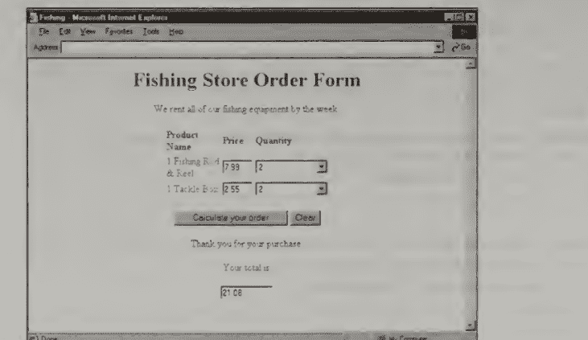

图 6-1 一个使用函数处理表单的网页

要创建一个使用函数处理表单的网页：

1. 使用下面显示的代码创建一个名为 `fishing.htm` 的网页，其中包含一个订单表单。页面的标题应为 **Fishing**。添加一个标题为 **Fishing Store Order Form** 的标题。

```
<html><head><title>Fishing</title></head>
<body bgcolor="#FFFF99" text="#800000">
<h1 align="center">Fishing Store Order Form</h1>
<p align="center">We rent all of our fishing
    equipment by the week.</p>
```

2. 使用下面显示的代码创建一个表单。请注意，`action` 属性使用了 JavaScript 的 `void` 方法来防止表单被提交。

```
<form method="post" name="form"
    action="javascript:void(0)">
```

3. 在表单中，添加两个字段来存储商品数量，以及两个字段来显示商品成本。此表单使用一个表格来对齐表单字段。表格是在表单上对齐字段的有效方式。

```
<table border="0" width="39%" align="center">
<tr>
<td width="48%"><b>Product Name</b></td>
<td width="10%"><b>Price</b></td>
<td width="43%"><b>Quantity</b></td>
</tr><tr>
<td width="48%">1 Fishing Rod &amp; Reel</td>
<td width="10%">
<input type="text" name="txtRod" size="5"
    value="7.99"></td>
<td width="43%"><select size="1" name="qRod">
<option selected value="0">
    Select Quantity</option>
<option value="1">1</option>
<option value="2">2</option>
<option value="3">3</option>
</select></td></tr><tr>
<td width="48%">1 Tackle Box</td>
<td width="10%">
<input type="text" name="txtBox" size="5"
    value="2.55"></td>
<td width="43%"><select size="1" name="qBox">
<option selected value="0">
    Select Quantity</option>
<option value="1">1</option>
<option value="2">2</option>
<option value="3">3</option>
</select></td></tr></table>
```

4. 添加一个写着 **Calculate your order** 的提交按钮。当用户点击提交按钮时，表单会调用名为 `calcTotal` 的 JavaScript 函数。

```
<p align="center">
<input type="submit" value="Calculate your order"
    name="btnSubmit" onClick="calcTotal()">
<input type="reset" value="Clear" name="btnClear">
<p align="center">Thank you for your purchase.</p>
<p align="center">Your total is:</p>
<p align="center">
<input type="text" name="txtTotal" size="10"
    value="0.00"></p>
</form>
```

5. 创建 `calcTotal` 函数，如下所示：该函数可以放在页面的头部部分或主体部分。在此函数内部，创建两个变量来存储每种产品的数量。这些变量的值是根据客户选择的数量字段中的值分配的。创建两个变量来存储每种产品的价格。

```
<script language="javascript">
function calcTotal(){
    var strRod, strBox, prRod, prBox, strTotal;
    strRod=document.form.qRod.value;
    strBox=document.form.qBox.value;
    prRod=document.form.txtRod.value;
    prBox=document.form.txtBox.value;
```

6. 每个商品的成本是根据产品的价格乘以数量计算的。总成本是每个商品成本的总和。`strTotal` 变量保存总成本。`txtTotal` 表单字段的值被赋予存储在 `strTotal` 变量中的总成本值。

```
    strRod=parseInt(strRod) * prRod;
    strBox=parseInt(strBox) * prBox;
    strTotal=(strRod + strBox);
    document.form.txtTotal.value=strTotal;
}
</script></body></html>
```

7. 将网页保存为 `fishing.htm` 到你的数据目录。查看该网页。

### 将参数传递给函数

在上面的示例中，没有向函数传递任何参数。在下一个示例中，你可以看到事件、方法和函数如何结合来创建一个交互式网页。用户可以更改网页背景的颜色（参见图 6-2）。当用户点击一个按钮时，`onClick` 事件处理程序将调用一个函数，并传递一个参数给该函数。每个事件处理程序都将调用同一个函数，但会传递不同的参数。在这种情况下，参数是背景的颜色。函数的结果每次都会不同，因为每次传递的参数都不同。

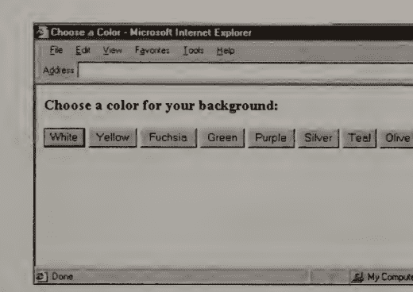

图 6-2 一个使用参数向函数传递值的网页

要创建一个使用参数向函数传递值的网页：

1. 创建一个名为 `chooseColor.htm` 的网页。按照下面的指示添加标题和标题。

```
<html><head><title>Choose a Color</title>
</head>
<body>
<h3>Choose a color for your background:</h3>
```

2. 创建一个包含八个按钮的表单，如下所示。每个按钮将有一个不同的值。`onClick` 事件处理程序应调用 `selectColor` 函数并传递一个颜色名称作为参数。因为颜色是另一个字符串中的字符串，所以它被括在单引号中。然后，每次点击一个按钮时，`selectColor` 函数被调用，并且将传递一个不同的参数给该函数。

```
<form name="frmColor" action="javascript:void(0);">
<input type="submit" value="White" name="bW"
    onClick="selectColor('White')">
<input type="submit" value="Yellow" name="bY"
    onClick="selectColor('Yellow')">
<input type="submit" value="Fuchsia" name="bF"
    onClick="selectColor('Fuchsia')">
<input type="submit" value="Green" name="bG"
    onClick="selectColor('Green')">
<input type="submit" value="Purple" name="bP"
    onClick="selectColor('Purple')">
<input type="submit" value="Silver" name="bS"
    onClick="selectColor('Silver')">
<input type="submit" value="Teal" name="bT"
    onClick="selectColor('Teal')">
<input type="submit" value="Olive" name="bO"
    onClick="selectColor('Olive')">
</form></body></html>
```

3. 在页面的头部部分创建名为 `selectColor` 的函数。此函数将使用参数来更改网页的 `bgColor` 属性。

```
<script language="javascript">
function selectColor(selectColor){
    document.bgColor=selectColor;
}
</script>
```

4. 将页面保存为 `chooseColor.htm` 到你的数据目录。查看该网页。

在前面的章节中，你学习了如何使用 `window.status` 属性或 `window.defaultStatus` 属性显式地更改状态消息。下面的示例代码用于更改状态栏中的默认状态消息。

```
<script language="javascript">
window.defaultStatus="Welcome to Fish Cove!";
</script>
```

正如你之前学到的，要更改状态消息，你需要使用 `status` 属性。在下面的示例中，`onMouseOver` 事件处理程序更改了 `status` 属性。你将要在状态消息栏中显示的字符串传递给了 `window` 对象的 `status` 属性。

```
<a href="supplies.htm" onMouseOver="window.status='Fishing Supplies';return true">Fishing Supplies</a>
```

但不必为每个超链接都编写此代码。相反，你可以创建一个函数，该函数使用传递给它的参数来更改状态消息属性。在下面的示例中，当用户将指针悬停在超链接上时，一个函数被调用，并且一个指示状态消息应该是什么的参数将被传递（参见图 6-3）。然后该函数使用该参数来更改状态消息。

### 使用函数

要创建一个使用函数来更改状态消息的网页：

1. 使用下面的代码，创建一个名为 `fishingLink.htm` 的基本网页。
2. 在网页的 body 部分创建超链接，如下所示。`onMouseOver` 事件处理程序应调用 `changeStatus` 函数，并传递一个字符串作为参数。请务必包含 `return true` 语句。该字符串必须用单引号括起来，因为它位于一对双引号内。最后一个超链接不显示任何消息。为了防止显示消息，最后一个超链接传递一个空字符串，该字符串由一对单引号标识，中间有一个空格：`' '`。

```
<html><head><title>Fishing</title>
</head>
<body bgcolor="#99FF66" text="#003300">
<h2>Fishing</h2>
</body></html>
```

```
<a href="supplies.htm" onMouseOver="changeStatus
    ('Fishing Supplies');return true;">
    Fishing Supplies</a><br>
<a href="rent.htm" onMouseOver="changeStatus
    ('We rent supplies daily!');return true;">
    Rent Fishing Equipment</a><br>
<a href="location.htm" onMouseOver="changeStatus
    ('Maps to nearby lakes!');return true;">
    Fishing Locations</a><br>
<a href="tales.htm" onMouseOver="changeStatus
    ('Share your fishing tales!');return true;">
    Fishing Tales</a><br>
<a href="links.htm" onMouseOver="changeStatus
    ('Links to other fish sites');return true;">
    Fishing Links</a><br>
<a href="fish.htm" onMouseOver="changeStatus
    ('Fish Dictionary');return true;">
    Fish Descriptions</a><br>
<a href="fish.htm" onMouseOver="changeStatus
    (' ');return true;">
    Fish Store</a><br>
```

3. 在头部部分创建脚本以显示默认状态消息，如下所示。该脚本还创建了一个名为 `changeStatus` 的函数，该函数接受一个参数，即显示在状态消息栏中的字符串。

```
<script language="javascript">
window.defaultStatus="Welcome to Fish Cove!";
function changeStatus(statusMessage){
    window.status=statusMessage;
}
</script>
```

4. 将你的网页保存为数据目录中的 `fishingLink.htm`。查看该网页。

### 从函数返回值

前面的例子都使用了 JavaScript，但 VBScript 也支持用户定义函数。下面的示例使用 VBScript 创建和调用用户定义函数，并演示了该函数如何向调用它的脚本返回一个值（参见图 6-4）。VBScript 和 JavaScript 函数之间存在一些差异。JavaScript 函数使用 `return` 关键字和值来返回值。VBScript 函数则将值赋给函数本身。

要创建一个使用函数返回值的网页：

1. 创建一个名为 `checkout.htm` 的网页。

```
<html><head><title>Checkout</title>
</head>
<body bgcolor="#99FF66" text="#003300">
<h2>Checkout</h2>
```

2. 使用下面的代码，创建包含计算产品总成本所需字段的表单。

```
<form name="form" method="post"
      action="javascript:void(0);">
<input type="text" value="0" name="txtP" size="7">
Product Price <br><br>
<input type="text" name="txtT" size="7">
Total Tax in Dollars <br><br>
<input type="text" name="txtC" size="7">
Total Cost of the Product <br><br>
```

3. 添加一个提交按钮，当 `onClick` 事件处理程序被调用时，该按钮将调用 `calcVB` 函数。不传递任何参数。

```
<input type="button" value="Calculate My Total"
       name="btnSubmit" onClick="calcVB()">
</form></body></html>
```

4. 在头部部分创建将计算总成本的脚本，如下所示。声明变量以保存产品价格、税率、总税额和产品成本。将价格变量赋值为在名为 `txtP` 的价格表单字段中输入的值。

```
<script language = "vbscript">
function calcVB()
    dim price, tax, total, cost
    price = document.form.txtP.value
```

5. 编写语句以获取税率并将其赋给 `tax` 变量。注意，变量 `tax` 并非从表单字段获取值。相反，它被赋值为另一个名为 `getTaxVB` 的函数的返回结果。这是函数可在表达式中使用的一个示例。请注意，子过程不能用作表达式的一部分。

```
tax = getTaxVB()
```

6. 使用 `tax` 和 `price` 变量来计算总额和总成本。将 `total` 和 `cost` 变量的值分别赋给 `tax` 和 `cost` 表单字段。注意，对变量应用了 `formatCurrency` 函数以将数字格式化为货币格式。

```
total = (price * tax)
document.form.txtT.value = formatCurrency(total)
cost = price + total
document.form.txtC.value = formatCurrency(cost)
end function
</script>
```

7. 在头部部分创建 `getTaxVB` 函数，该函数将税值设置为一个变量。该函数将此变量的值返回给前一个函数。

```
<script language = "vbscript">
function getTaxVB()
taxRate = 0.085
getTaxVB = taxRate
end function
</script>
```

8. 将你的页面保存为数据目录中的 `checkout.htm`。查看该网页。

## 使用过程

使用 JavaScript 和 VBScript 中的函数，你可以创建一个命名的代码块，并从另一个位置调用它。在 VBScript 中，你还可以创建另一种称为过程的代码块。**过程**类似于函数，因为它是一个可以从其他位置调用的代码块。这允许你创建可在 Web 应用程序中重用的代码块。添加过程调用等同于将过程代码键入到代码本身中。然而，你无需一遍又一遍地编写相同的代码，只需要过程调用来引用该代码。

与函数一样，过程可以接受零个或多个参数。在过程内部声明的变量是局部变量，仅对该过程可用。创建过程时，它被声明为 `public` 或 `private`。公共过程可在所有脚本中的所有其他过程中使用，而私有过程仅在声明它们的脚本内的其他过程中可用。如果一个过程未声明为 `public` 或 `private`，则默认为 `public`。因此，许多程序员不使用 `public` 关键字来显式声明过程为公共的。

函数和过程之间的主要区别在于过程不返回值，并且不能在表达式中使用。程序员将过程称为**子过程**，因为它们是使用 `sub` 关键字声明的。你可以使用 `exit sub` 语句来退出过程。过程通常用于响应事件，例如用户点击按钮。子过程的语法如下所示。`sub` 关键字表示正在创建过程。过程的名称和参数在 `sub` 语句中标识。过程可以发出动作和控制语句。过程的结束由 `end sub` 关键字标识。`sub` 语句被称为**过程调用**。过程调用看起来和作用都像普通的 VBScript 语句——它们允许你创建可以作为语言一部分的新语句。需要注意的是，过程声明的顺序不会影响其执行顺序。过程总是按照调用顺序执行，而不是创建顺序。在 VBScript 中创建过程的语法如下。

```
Sub ProcedureName (arguments)
    Action and Control Statements
End Sub
```

过程调用可以在应用程序中多次、任何地方使用，包括在其他过程、函数或控制结构内。一旦你的过程被声明，通过指定过程名称即可执行它。`call` 关键字可用于调用函数或过程，并且它是可选的。如果使用 `call` 关键字，则传递给过程的参数必须用括号括起来。多个参数以逗号分隔的列表传递。在 VBScript 中调用过程的语法如下。

```
[call] procedureName (arguments)
```

以下练习演示了如何从另一个函数创建和调用过程。该表单包含一个提交按钮，当点击该按钮时将调用一个函数。下面示例中的函数将调用两个过程。函数不能定义其他函数，但它们可以调用其他函数。你可以在同一个函数中调用多个过程。这允许程序被分割。这些代码片段可以在其他脚本中重用，这可以帮助你生成更高效的代码。过程按照调用顺序执行。在此示例中，第一个过程将计算总成本，第二个过程将显示结果。每个步骤都可以从脚本中单独调用。使用多个过程的一个好处是，如果其中一个步骤发生变化，则只需修改该步骤。通过使用多个过程而不是将它们合并为一个，你可以重用每个过程，而无需重写整个代码部分。如果要在函数和过程之间使用多个变量，它们需要是应用程序的全局变量，并在引用它们的函数和过程之前定义。

你之前学过过程不返回值。但有办法从过程获取值。在此示例中，由于过程不会返回值，该过程将值赋给表单字段的 `value` 属性。这样，这些值就可以被两个过程使用。

图 6-5 展示了一个使用函数调用两个名为 `getCost` 和 `showCost` 的过程的网页。`getCost` 过程将从表单中检索价格和数量值，并计算产品的成本。由于过程不能返回结果，`getCost` 过程将产品成本直接赋给名为 `txtT` 的表单字段的 `value` 属性。`showCost` 过程将使用该表单字段的值来向用户显示一个包含总成本的警报消息。

### 图 6-5 使用过程来计算产品总价的网页

要创建一个使用过程来计算产品总价并将结果显示给用户的网页：

1. 创建一个名为 `checkoutPro.htm` 的网页。

```
<html><head><title>Checkout</title>
</head>
<body bgcolor="#99FF66" text="#003300">
<h2>Checkout</h2>
```

2. 创建一个表单，其中包含三个用于输入价格、数量和总价的表单字段。添加一个名为 `btnSubmit` 的提交按钮。添加代码，使得在点击提交按钮时调用 `calcVB` 函数。

```
<form name="form" action="javascript:void(0);">
<input type="text" value="0" name="txtQ"
   size="7">Quantity <br><br>
<input type="text" name="txtP" size="7">
Price <br><br>
<input type="text" name="txtT" size="7">
Total Cost <br><br>
<input type="button" value="Calculate My Total"
   name="btnSubmit" onClick="calcVB()">
</form></body></html>
```

3. 在头部区域创建一个脚本，其中将包含 `calcVB` 函数和两个过程。创建 `calcVB` 函数，该函数将调用另外两个过程——`getCost` 和 `showCost`。不向这些过程传递任何参数。

```
<script language="vbscript">
function calcVB()
   call getCost()
   call showCost()
end function
```

4. 创建 `getCost` 过程。该过程将从表单字段中获取值，将其赋给变量，计算总价，并将总价赋给总计表单字段。注意，不需要参数，因为价格和数量是直接从表单字段的 `value` 属性中获取的。

```
sub getCost()
    dim quantity, price, total
    price = document.form.txtP.value
    quantity = document.form.txtQ.value
    total = price * quantity
    document.form.txtT.value=total
end sub
```

5. 创建 `showCost` 过程，该过程从总价表单字段中获取值，并在警告窗口中显示该值。注意，此过程必须在 `getCost` 过程之后调用，因为它使用的是在 `getCost` 过程中定义的表单字段值。

```
sub showCost()
    dim cost
    cost = document.form.txtT.value
    window.alert("Your total cart is " & _
        chr(10) & cost)
end sub
```

6. 将该网页保存为 `checkoutPro.htm` 到你的数据目录中。查看该网页。

### 事件过程

之前，你已经学过从 HTML 标签内部调用事件处理程序。事件处理程序通过前缀 "on" 加事件名称来标识。`click` 和 `load` 等事件由事件处理程序通过对象名称和事件名称的组合来捕获。下划线（`_`）用于分隔对象名称和事件名称。例如，如果你决定创建一个名为 `btnExit` 的按钮，使其在被点击时调用一个事件过程，你需要将该事件过程命名为 `btnExit_onClick`。在定义事件过程之前，你必须在 HTML 代码中指定对象的名称。如果你在为对象定义事件过程之后更改了对象的名称，你必须更改过程的名称以匹配对象的新名称。由于没有传递参数，因此不需要括号。请注意，事件过程不是被调用的，而是在特定对象发生事件时被触发的。当对象检测到事件发生时，它会调用事件过程。以下是创建事件过程的语法。

```
sub objectName_eventHandler
    action and control statements
end sub
```

要创建一个使用事件过程来调用另一个过程的网页：

1. 将你在上一个练习中创建的 `checkoutPro.htm` 网页另存为 `eventPro.htm`。
2. 从表单中的提交按钮上移除 `onClick` 事件处理程序。用于创建提交按钮的 HTML 代码应如下所示。
3. 将 `calcVB` 函数更改为一个过程，方法是将关键字 `function` 和 `end function` 分别替换为 `sub` 和 `end sub`，如下所示。将函数的名称从 `calcVB` 更改为 `btnSubmit_onClick`。注意，过程中的操作语句与上一个示例中的相同。
4. 将你的网页保存为 `eventPro.htm` 到你的数据目录中。查看你的网页。

```
<input type="button" value="Calculate My Total" name="btnSubmit">
```

```
sub btnSubmit_onClick()
    call getCost()
    call showCost()
end sub
```

## 章节总结

### 函数

- VBScript 和 JavaScript 都支持内置函数。虽然一些内置函数是重叠的，但每种脚本语言还支持额外的内置函数。内置函数通过调用函数名称并传递所需的参数来调用。

- 你可以创建函数，函数是可以重复使用的代码块。这些代码块被赋予一个名称。要执行该代码块，脚本使用此名称来调用函数。可以选择性地向函数传递参数。JavaScript 中的代码块必须包含在花括号中。VBScript 中代码块的结束通过关键字 `end function` 来标识。在这两种脚本语言中，你都可以使用关键字 `exit` 来退出函数。

- 函数可以在表达式中使用，因为它可以使用关键字 `return` 向调用它的脚本返回一个值。如果未指定返回值，函数中内存中的最后一个值将被用作返回值。

### 过程

- 过程仅在 VBScript 中支持。过程与函数类似，因为它们都代表一个命名的代码块。但是，过程不能在表达式中使用，也不能向脚本传回值。过程使用关键字 `sub` 创建。过程的结束通过关键字 `end sub` 来标识。可以选择性地向过程传递参数。

- 事件过程用于定义在事件发生时执行的过程。事件过程特定于单个事件和单个对象。事件过程的名称是对象名称和事件名称的组合。如果使用了事件过程，则不在对象标签中使用事件处理程序。但是，必须为对象分配一个名称。

- 多个过程和函数可以从单个脚本中调用。这允许将程序进行分段。这些分段可以在其他脚本中重复使用，这可以帮助你编写更高效的代码。

### 调用内置函数

```
Math.ceil(5.05);
```

```
lcase("MyPassWord")
```

### 将"数字"字符串转换为数字

```
strQ = parseInt(strQuantity);
strQ = parseFloat(strQuantity);
strQ = eval(strQuantity);
```

```
strQ = int(strQuantity)
strQ = cLng(strQuantity)
```

### 检测变量的值是否不是数字

```
strNumber = isNaN(strQuantity);
document.write(strNumber);
```

### 检测变量的值是否是数字

```
strNumber = isNumeric(strQuantity)
document.write(strNumber)
```

### 创建函数

```
function calcTotal(){
    var strRod;
    strRod = document.form.qRod.value;
    strRod = parseInt(strRod) * 7.99;
}
```

```
function calcTotal()
    dim strRod
    strRod = document.form.qRod.value
    strRod = parseInt(strRod) * 7.99
end function
```

### 调用函数

```
calcTotal();
```

```
call calcTotal()
calcTotal()
```

### 创建事件过程

```
sub btnSubmit_onClick
    document.write("Welcome")
end sub
```

### 从事件处理程序调用多个过程

```
sub btnSubmit_onClick()
    call getPrice()
    call getTaxRate()
    call calcTax()
    call getTotal()
end sub
```

## 复习题

1. ________ 是一个命名的代码块，可以返回一个值。
   a. 过程
   b. 函数
   c. 控制语句
   d. 子过程

2. 关键字 ________ 用于在 VBScript 中创建过程。
   a. `sub`
   b. `dim`
   c. `var`
   d. `create`

3. 关键字 ________ 用于标识 VBScript 中过程的结束。
   a. `sub end`
   b. `end function`
   c. `end sub`
   d. `sub function`

4. ________ 用于分隔传递给函数的参数。
   a. 逗号
   b. 分号
   c. 冒号
   d. 圆括号

5. ________ 用于在 JavaScript 中括起代码块。
   a. 花括号
   b. 圆括号
   c. 逗号
   d. 方括号

6. 哪个 JavaScript 内置函数可以将字符串转换为数字？
   a. `evaluate`
   b. `changeNum`
   c. `parseInteger`
   d. `parseInt`

7. VBScript 中哪个内置函数可以检测变量是否为数字？
   a. `isNumeric`
   b. `isNaN`
   c. `isN`
   d. `isNumber`

8. JavaScript 中哪个内置函数可以检测变量是否为数字？
   a. `isNum`
   b. `isNaN`
   c. `isN`
   d. `isNumber`

9. JavaScript 中哪个内置函数可以将数字向上取整到最接近的整数？
   a. `round`
   b. `floor`
   c. `ceil`
   d. `abs`

10. 以下哪个符号用于标识 JavaScript 中函数的结束？
    a. `]`
    b. `)`
    c. `}`
    d. `end function`

11. 一个按钮命名为 `btnGo`。如果用户点击该按钮，会调用哪个事件过程？
    a. `btnGo_click`
    b. `btnGo_click`
    c. `btnGo_onClick`
    d. `onClick_btnGo`

12. 哪些关键字用于在 VBScript 中提前退出函数？
    a. `exit function`
    b. `end function`
    c. `break function`
    d. `end sub`

13. 哪些关键字用于退出过程？
    a. `exit sub`
    b. `break`
    c. `end sub`
    d. `end procedure`

14. 提前退出函数称为 ________ 控制语句。
    a. 向前
    b. 循环
    c. 跳转
    d. 跳跃

15. 如果变量要被多个过程使用，应该在哪里声明？
    a. 在第一个过程中
    b. 在单独的 `script` 标签中
    c. 在所有过程之前
    d. 在第一个过程的末尾

16. 关键字 ________ 用于在 VBScript 中调用过程。
    a. `call`
    b. `get`
    c. `return`
    d. `dim`

17. 函数可以向脚本返回值。对还是错？

18. 过程可以返回值吗？对还是错？

19. 事件过程可以向脚本返回值。对还是错？

20. 可以使用 JavaScript 或 VBScript 创建事件过程。对还是错？

## 实践项目

### 项目 6-1

在本项目中，你将创建一个网页，使用内置函数运算符计算产品的总成本。总成本应四舍五入到最接近的美元。使用 VBScript 完成此练习。图 6-6 显示了网页 `roundVB.htm`，它使用 `round` 函数将总成本四舍五入到最接近的美元。

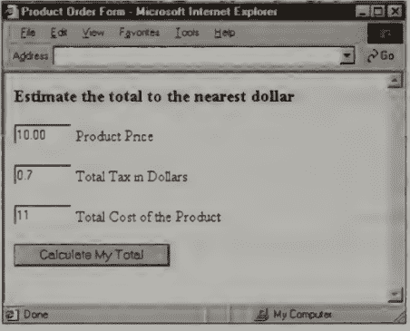

图 6-6 使用内置的 `round` 函数对数值进行四舍五入

1. 创建一个名为 `roundVB.htm` 的网页，标题为 **Product Order Form**（产品订购表单）。

2. 添加一个格式为 heading 3 的标题，内容为 **Estimate the total to the nearest dollar**（将总计估算到最接近的美元）。

3. 添加一个名为 `form` 的表单。不要忘记添加调用 `void` 方法的 `action` 属性。表单的 `method` 应为 `post`。

4. 向表单添加以下字段：
   - a. 一个名为 `txtPrice` 的文本框。`size` 应为 7，默认值应为 0。标签应显示 **Product Price**（产品价格）。
   - b. 一个名为 `txtTax` 的文本框。`size` 应为 7。标签应显示 **Total Tax in Dollars**（总税额，以美元计）。
   - c. 一个名为 `txtCost` 的文本框。`size` 应为 7。标签应显示 **Total Cost of the Product**（产品总成本）。

5. 创建一个名为 `btnSubmit` 的按钮。这是一个普通按钮。按钮应显示 **Calculate My Total**（计算我的总计）。当用户点击按钮时，应调用名为 `getTotal` 的函数。

6. 修改网页背景颜色，添加图形，并使用你喜欢的字体更改文本格式。

7. 创建一段使用 VBScript 的脚本，其中包含 `getTotal` 函数。该函数将计算表单字段 `total` 的值。在函数中，声明变量 `price`、`taxRate`、`tax`、`total` 和 `cost`。

8. 将 `price` 的值设置为价格表单字段的值。

```
price = document.form.txtPrice.value
```

9. 将 `taxRate` 变量的值设置为 0.07。

10. 计算税费并将值放入 `tax` 变量。税费等于价格乘以 `taxRate` 变量。将税费金额放入 `txtTax` 表单字段。

11. 根据 `tax` 和 `price` 变量的总和计算成本。使用内置的 `round` 函数将值四舍五入到最接近的整数。将成本放入 `txtCost` 表单字段。

12. 将网页保存到你的数据目录。查看网页。打印你的源代码。打印网页。

### 项目 6-2

在本项目中，你将使用 JavaScript 而不是 VBScript 来完成上一个项目（`roundVB.htm`）。

1. 将 `roundVB.htm` 网页另存为 `roundJS.htm`。

2. 修改网页以支持 JavaScript。*(提示：除了语法之外，你还需要更改几个步骤。从价格字段检索值时，应使用 `parseFloat` 函数将字符串转换为数字。由于 JavaScript 中没有 `formatCurrency` 方法，你需要以不同的方式对税费字段进行四舍五入。将价格乘以 `taxRate` 再乘以 100。这将把小数点向右移动两位。然后，应用 `round` 函数舍去小数。最后，将税费除以 100，把小数点向左移动两位。)*

```
tax = Math.round(price * taxRate * 100);
tax = tax/100;
```

3. 计算产品成本后，应对结果进行四舍五入，并将值显示在 `txtCost` 表单字段中。

4. 将网页保存到你的数据目录。查看网页。打印你的源代码。打印网页。

### 项目 6-3

在本项目中，你将创建一个网页，允许用户向表单字段输入值（参见图 6-7）。你将创建一个脚本，检索该值并判断它是数字还是字符串。如果值是数字，则提醒用户该值是数字。如果值是字符串，则提醒用户输入的值是字符串。

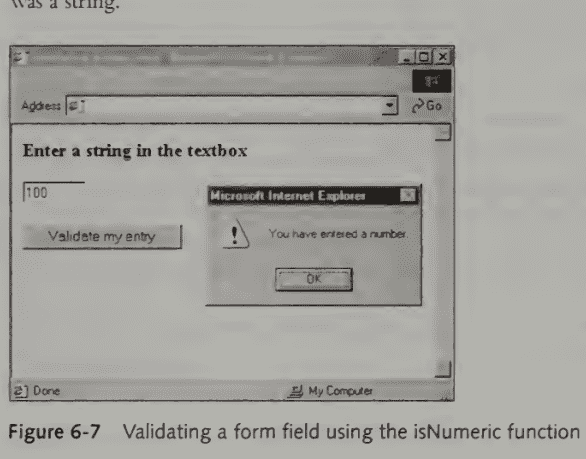

**图 6-7** 使用 `isNumeric` 函数验证表单字段

1. 创建一个名为 `checkNumberVB.htm` 的网页。页面标题应为 **Validating a form field**（验证表单字段）。

2. 添加一个格式为 heading 3 的标题，内容为 **Enter a string in the textbox**（在文本框中输入一个字符串）。

3. 创建一个名为 `form` 的表单。表单的 `method` 应为 `post`。在表单的 `action` 属性中使用 `void()` 方法，这样用户提交表单时不会被重定向到新页面。

4. 向表单添加一个名为 `txtString` 的字段。`size` 应为 7。

5. 创建一个名为 `btnSubmit` 的按钮。这是一个普通按钮。按钮应显示 **Validate my entry**（验证我的输入）。当用户点击按钮时，应调用名为 `validate` 的函数。

6. 修改网页背景颜色，添加图形，并使用你喜欢的字体更改文本格式。

7. 在页面 body 部分中，关闭表单的标签下方，创建一段包含 `validate` 函数的脚本。该函数将验证用户输入的是数字还是字符串。

8. 声明名为 `strString` 的变量，它将包含用户在文本框中输入的值。将 `strString` 的值设置为 `txtString` 表单字段的值。

9. 使用 `isNumeric` 函数测试 `strString` 的值是字符串还是数字。如果 `strString` 是数字，则创建一个提示消息框，显示 **You have entered a number.**（你输入了一个数字。）否则，如果 `strString` 是字符串，则创建一个提示消息框，显示 **You have entered a string.**（你输入了一个字符串。）*(提示：你可以使用 IfThen 控制语句或其他控制语句来决定显示哪个提示消息框。)*

10. 将网页保存到你的数据目录。查看网页。打印你的源代码。打印网页。

### 项目 6-4

在本项目中，你将使用 JavaScript 而不是 VBScript 来完成上一个项目（`checkNumberVB.htm`）。

1. 将 `checkNumberVB.htm` 网页另存为 `checkNumberJS.htm`。

2. 修改网页以支持 JavaScript。你需要将 `isNumeric` 函数改为 `isNaN` 函数。*(提示：你还需要修改控制语句，以反映 `isNaN` 函数返回的相反值。由于使用的是 `isNaN` 函数，如果用户输入空白或不输入值，返回的结果将是字符串，因为表单字段的值默认是字符串。)*

3. 将网页保存到你的数据目录。查看网页。打印你的源代码。打印网页。

### 项目 6-5

在本项目中，你将创建一个事件过程，当用户在文本框中输入颜色并点击按钮时，背景颜色会变为该颜色（参见图 6-8）。

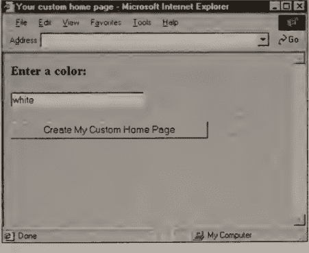

**图 6-8** 使用事件过程自定义网页

1. 在你的网页编辑器中，创建一个名为 `eventVB.htm` 的网页。页面的标题应为 **Your custom home page**。修改 `body` 标签以创建银色背景。添加一个 3 级标题，内容为 **Enter a color:**。

2. 创建一个名为 `form` 的表单。添加一个名为 `txtColor` 的文本框。大小应为 25。默认值应为 `white`。添加一个名为 `btnMyPage` 的按钮。按钮上应显示 **Create My Custom Home Page**。

3. 创建一个事件过程，当用户点击 `btnMyPage` 按钮时执行。该事件过程将把背景颜色更改为用户输入的颜色。（*提示：* 从表单字段中获取值，然后将该值赋给网页的 `bgColor` 属性。）

4. 将网页保存到你的数据目录。查看网页。打印你的源代码。打印网页。

## 案例项目

### Gemini Electronics

你被聘为 Gemini Electronics 的网站管理员。你的雇主希望你创建一个网页，显示四个按钮和一个名为 `imgLogo` 的图像。当用户点击按钮时，`imgLogo` 将更改为不同的图像。四个按钮代表商店中的四个部门：计算机、电视、配件和计算器。创建五张图像，每个部门一张，还有一张商店标志。商店标志是用户未点击按钮时显示的默认图像。按钮应根据每个部门的名称命名。你可以使用 JavaScript 或 VBScript。使用表格、颜色和图形修改布局，使网页看起来专业。将你的网页保存为 `departments.htm` 到你的数据目录。查看网页。打印出网页和源代码。

### Stepan Accounting Corporation

你受聘于 Stepan Accounting Corporation，创建一个网页帮助其员工计算税后净收入。你将创建一个表单来获取用户的收入，然后显示用户的税率、总税额和收入。你可以使用 JavaScript 或 VBScript。创建一个表单，包含一个用于获取收入水平的表单字段。创建表单字段以显示税率、总税额和净收入总额。创建一个脚本，获取用户的收入水平并计算用户的税率、总税额和净收入。你被告知计算税率和税额的公式基于收入水平。如果你的收入低于 $34,550，则需缴纳 $0 的基础税，外加收入的 15%。如果你的收入高于 $34,550 但低于 $89,149，则需缴纳 $5,182.50 的基础税，外加超过 $34,550 部分收入的 28%。如果你的收入高于 $89,150 但低于 $144,400，则需缴纳 $20,470.50 的基础税，外加超过 $89,150 部分收入的 31%。（*提示：* 使用 If Then 语句确定收入水平属于哪个组。然后，为每组分配基础税额、税率以及额外收入的征税起点。计算总税额的公式为 `(base + ((income-level)* rate))`。净收入总额等于收入减去已缴税款。）将总税额、税率和净收入总额写入表单字段。如果你使用的是 VBScript，请使用 `formatCurrency` 方法将这些金额格式化为货币格式。如果你使用的是 JavaScript，请将这些金额四舍五入到小数点后 2 位。使用表格、颜色和图形修改布局，使网页看起来专业。将你的网页保存为 `taxes.htm` 到你的数据目录。查看网页。打印出网页和源代码。

### Northfield Children's Zoo

你在 Northfield Children's Zoo 担任初级 Web 程序员。你的老板希望你为网站添加交互功能。你决定添加一个趣味知识页面，在其中显示四个问题。每个问题旁边是动物园的标志。当用户将鼠标指针移到标志上时，将显示一个图形，为用户提供正确答案。例如，一个问题可能是："储存玉米粒的建筑叫什么名字？"当用户将鼠标移到该问题旁边的动物园标志上时，将出现一张带有谷仓粮仓的农场图片。当用户将鼠标移出图像时，动物园标志将重新显示。你决定使用 `onMouseOver` 和 `onMouseOut` 事件处理程序来实现此功能。两个事件处理程序都调用一个函数并传递两个参数。第一个参数是该图像的索引号。第二个参数是要显示的图形的名称。然后，创建一个接收两个参数的函数。该函数使用传递给函数的图像名称更改 `source` 属性。使用传递给函数的索引号来确定要更改哪张图像。你可以通过 `images` 集合中的索引号来引用图像。请记住，第一张图像的索引位置为 0。如果你在页面顶部放置了一个标志，该图像也会被计入图像数组中。创建五张图像，一张用于动物园标志，每道问题一张。你可以使用 JavaScript 或 VBScript。使用表格、颜色和图形修改布局，使网页看起来专业。将你的网页保存为 `zoo.htm` 到你的数据目录。查看网页。打印出网页和源代码。

### Growlite Marketing

你被一家名为 Growlite Marketing 的营销公司聘为网站设计师。该公司正在努力吸引新客户。他们决定向客户展示自定义页面。你的工作是收集用户偏好，并根据他们的偏好显示一个网页。用户偏好可以包括页面元素，如页面背景颜色、字体颜色和感兴趣的主题。偏好应从用户注册网站时填写的表单中获取。使用函数或过程创建一个网页，获取用户的偏好，并使用他们的偏好来格式化页面。你可以使用 JavaScript 或 VBScript。使用表格、颜色和图形修改布局，使网页看起来专业。将你的网页保存为 `memberPrefs.htm` 到你的数据目录。查看网页。打印出网页和源代码。

### Frye Web Design

你受聘于 Frye Web Design，帮助他们重新编写网站程序。目前，他们使用 VBScript 进行客户端脚本编写，因为该公司仅支持 Internet Explorer。由于他们正在将部分网页转移到 Internet 上，因此需要支持 Netscape Navigator。你的老板希望你将所有 VBScript 脚本转换为 JavaScript。你的第一步是记录一份内置函数、数学函数、脚本函数、字符串和数字转换、日期函数以及格式化函数的清单。创建一个名为 `builtin.htm` 的网页。列出函数名称、函数用途的描述以及使用函数的语法。从 VBScript 和 JavaScript 中各选择一些函数。使用星号 (*) 表示 JavaScript 和 VBScript 都支持的函数。将 JavaScript 函数与 VBScript 函数分开列出。使用表格、颜色和图形修改布局，使网页看起来专业。将你的网页保存为 `builtin.htm` 到你的数据目录。查看网页。打印出网页和源代码。

## 第7章 服务器端脚本入门：Active Server Pages (ASP)

**在本章中，你将：**
- 了解 Web 服务器如何处理 ASP 页面
- 识别客户端脚本和服务器端脚本之间的区别
- 了解 ASP 对象模型中的内置对象
- 创建 Active Server Pages
- 创建服务器端包含文件
- 查找有关 Active Server Pages 的 Internet 资源

在前面的章节中，你使用 JavaScript 和 VBScript 创建了客户端脚本。客户端脚本由浏览器内置的脚本引擎进行解释，其源代码可以被访问该网站的任何人查看。客户端脚本可以使用浏览器 Document Object Model 中的内置对象来创建更具交互性的网页。在本章中，你将开始学习如何使用 **Active Server Pages (ASP)** 创建服务器端应用程序。由于服务器端脚本在服务器上处理，源代码永远不会被访问者获取。因此，ASP 可用于在网站中实施安全规则。由于服务器端脚本不在浏览器中执行，它们无法访问浏览器的 Document Object Model。但是，它们可以访问 ASP 模型，该模型包含许多内置对象，允许你创建更具动态性和交互性的网页。

要有效地使用本章，你应该能够访问支持 ASP 的 Web 服务器，例如 Personal Web Server (PWS) 或 Internet Information Server (IIS)。这两个 Web 服务器都可以从 Microsoft 免费获取。有关如何下载和安装 PWS 的信息，请参阅本书的"开始之前"部分。

## ASP 简介

正如你在本书前面所学，HTML 是一种标记语言。互联网浏览器解释 HTML 标签。脚本标签用于指定客户端脚本，浏览器包含一个执行它们的脚本引擎。**活动服务器页面**（ASP）是一种包含服务器端脚本的网页。ASP 页面也可能包含 HTML 和客户端脚本，但只有服务器端脚本在服务器上执行。当服务器完成服务器端脚本执行后，它会将 HTML 和客户端脚本发送到浏览器，在客户端进行解释。图 7-1 展示了当浏览器请求 ASP 页面时发生的过程。

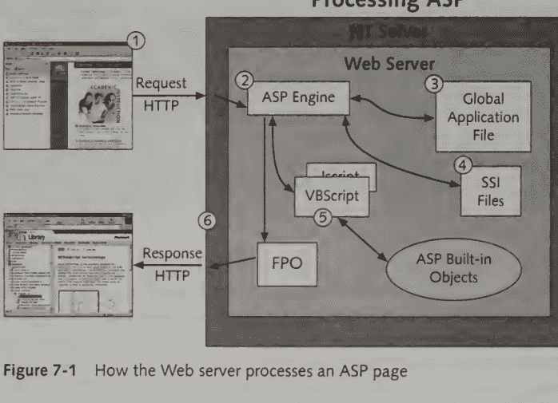

术语 ASP 是一个统称。它既用于指代包含服务器端脚本的网页，也用于指代整个服务器端脚本技术。一个 ASP 应用程序是多个 ASP 页面的集合。ASP 应用程序包含一个名为 `global.asa` 的全局应用程序文件，该文件允许你将页面连接起来，以便信息可以在页面之间共享。

首先，浏览器使用 HTTP 协议向服务器请求包含服务器端脚本的网页。ASP 页面的文件扩展名是 `.asp`，而不是 `.htm` 或 `.html`。当 Web 服务器识别出 `.asp` 文件扩展名时，它会将请求发送给 ASP 引擎。ASP 引擎（也称为 ASP 解释器）实际上是一个名为 `asp.dll` 的**动态链接库**，安装在 Web 服务器上。动态链接库是公共代码的集合。使用 ASP 3.0，你可以将所有 HTML 页面的扩展名设为 `.asp` 而不会牺牲性能。


> 如果你的机器上安装了个人 Web 服务器，`asp.dll` 文件可以在目录 `C:\Windows\System\InetSrv` 中找到。

请求传递给 ASP 引擎后，ASP 引擎会执行全局应用程序文件中的脚本。全局应用程序文件是一个文本文件，包含在 Web 应用程序启动和结束时执行的脚本，以及在浏览器会话开始和结束时执行的脚本。全局应用程序文件始终名为 `global.asa`，并且始终位于 Web 应用程序的根目录中。

在 ASP 引擎执行全局应用程序文件中的脚本后，ASP 将包含 ASP 页面中指定的任何服务器端包含（SSI）文件。包含文件中的代码不会由 ASP 引擎执行。服务器端包含文件用于将代码拆分到两个或多个网页中，它们可以包含 HTML、客户端脚本或服务器端脚本。虽然 SSI 文件可以包含像网页标题这样简单的内容，但通常它们会包含许多 ASP 页面使用的函数、变量和常量。ASP 页面指示 SSI 文件应放置在网页中的位置；它可以位于网页中的任何位置。一个 ASP 页面可以包含任意数量的服务器端包含文件。ASP 引擎将 SSI 文件和原始 ASP 页面组装成一个单独的页面。ASP 引擎就像一条将页面粘合在一起的胶带。

在 ASP 引擎将 SSI 文件和 ASP 页面组装完成后，ASP 引擎将脚本发送给脚本引擎进行处理。脚本引擎负责解释服务器端脚本。服务器端脚本是解释型的，不像 C 或 Visual Basic 那样是编译型的。服务器端脚本通过块脚本标签或内联脚本标签指定。块脚本标签和内联脚本标签的 `language` 属性可以设置为 `VBScript` 或 `JavaScript`。ASP 脚本引擎将首先执行 JavaScript 块语句，然后是内联脚本语句，最后是 VBScript 块语句。虽然服务器端脚本最常使用 VBScript 或 JScript 编写，但如果 Web 服务器上安装了相关的脚本引擎，ASP 架构也可以支持 PerlScript 和其他几种脚本语言。脚本引擎处理脚本中的指令，并将结果返回给 ASP 引擎。默认的服务器脚本语言可以在 Web 服务器配置文件中设置。出于性能考虑，最好不要在同一个网页中混合使用不同的脚本语言。

Web 服务器使用 HTTP 将文件发送回浏览器。因为 Web 服务器使用的是 HTTP，所以它同时发送 HTML 和客户端脚本。浏览器解释 HTML 和客户端脚本并显示输出。由于并非所有浏览器都支持所有的 HTML 标签和属性，因此会出现浏览器兼容性问题，任何 HTML 或客户端脚本都可能产生问题。然而，服务器端脚本与浏览器无关，因为服务器端脚本永远不会发送到浏览器；它们总是在 Web 服务器上执行。JavaScript 是首选的客户端语言，因为它被两大主要浏览器 Microsoft Internet Explorer 和 Netscape Navigator 所识别。VBScript 是服务器端脚本的首选语言。

### ASP 对象模型中的内置对象

Web 服务器上的 ASP 进程使用脚本引擎来执行 JavaScript 或 VBScript 语句。正如你在前面的章节中所学，脚本语言支持面向对象编程，你可以将客户端脚本与浏览器文档对象模型（DOM）中内置的对象集成。同样，你也可以将服务器端脚本与 ASP 对象模型中的内置对象集成。内置的 ASP 对象包括：

- **Request** — 用于访问从客户端浏览器传递到 Web 服务器的信息。例如，Request 对象用于检索用户在表单中输入的信息。
- **Response** — 用于从 Web 服务器向客户端浏览器发送信息。例如，Response 对象用于将用户重定向到另一个网页。
- **Session** — 用于在单个客户端和 Web 服务器之间共享信息。Session 对象用于在会话过程中存储数据。当浏览器首次请求 ASP 页面时，会话开始。例如，访问者的名称可以作为会话变量共享。当用户关闭浏览器时，会话结束，会话变量不再存在。当达到默认的会话超时时间时，会话也会结束。
- **Application** — 允许开发人员将一系列网页视为一个单一的应用程序，这意味着信息（如应用程序的名称或网站的总访问人数）可以在一个 ASP 应用程序的所有用户之间共享。万维网最初诞生时是无状态的，这意味着每个网页都是独立的，信息无法在网页之间共享。将一组页面视为单一应用程序的能力极大地扩展了应用程序开发的可能性。当第一个 ASP 页面被请求时，Application 对象被创建。
- **Server** — 用于访问 Web 服务器的属性和方法。例如，`CreateObject` 方法在服务器上实例化新的 COM 对象。COM 对象是安装在服务器上并符合组件对象模型（Component Object Model）的对象。`ScriptTimeout` 属性将设置服务器上运行的脚本的超时值。
- **ASPError** — 用于检索有关最近发生的错误的信息。Server 对象的 `GetLastError` 方法可以访问 ASPError 对象。

服务器脚本可以访问这些内置对象的属性和方法。图 7-2 展示了这些内置对象以及它们之间的关系。在接下来的几章中，你将学习更多关于如何使用这些 ASP 对象的知识。

#### ASP 对象模型

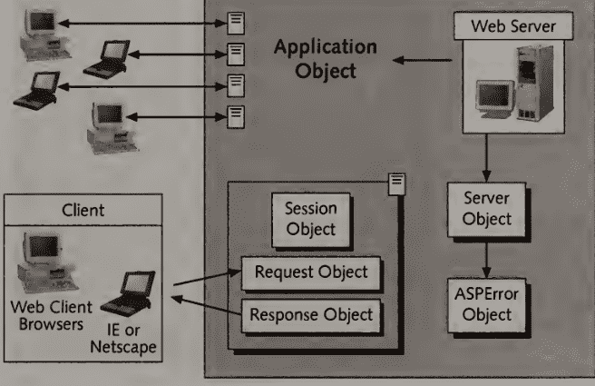

图 7-2 ASP 对象模型

#### 第三方和自定义对象

随着你的 Web 编程需求增长，你会希望使用额外的对象来执行独特的任务。例如，你可能希望配置网页，以便在用户填写表单时发送电子邮件。你可以使用 Request 对象从表单中检索信息，但没有内置对象用于发送电子邮件。然而，Server 对象有一个名为 `CreateObject` 的方法，它可以实例化第三方对象。通过使用 `CreateObject` 方法，你可以与许多其他对象及其属性和方法进行交互。例如，一个名为 `SendMail` 的对象内置于 SMTP 邮件服务器中。Server 对象可以实例化一个 `SendMail` 对象，该对象允许你使用 `SendMail` 对象的 `Send` 方法从 ASP 页面发送电子邮件。

与其他第三方对象的交互允许你创建能够发送电子邮件、连接到数据库、上传文件到 Web 服务器以及在 Web 服务器上写入文件的 ASP Web 应用程序。有许多公司正在开发可以从你的 ASP 代码中访问的第三方对象。你也可以使用高级编程语言（如 Visual Basic）创建自己的对象。这些对象必须安装并注册在 Web 服务器上。图 7-3 说明了 ASP 对象模型如何与第三方 ASP 对象交互。浏览器从 Web 服务器请求一个 ASP 页面。ASP 引擎将脚本传递给 VBScript 引擎。VBScript 使用 Server 对象的 `CreateObject` 方法来实例化一个第三方对象。ASP 引擎将任何返回的数据传递回 Web 服务器，然后由服务器将网页交付给浏览器。

##### 第三方对象

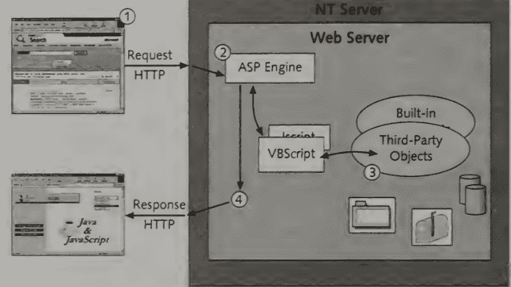

图 7-3 使用第三方 ASP 对象

## 创建基本的活动服务器页面

简单的文本编辑器（如记事本）可用于构建你的 ASP 页面。可视化编辑器（如 FrontPage、Visual Studio 和 Microsoft Script Editor）都支持 ASP 技术。这些编辑器提供了错误检查或关键字彩色显示等额外功能。FrontPage 常用于网页布局设计和网站管理。Visual Studio 常用于创建自定义开发环境。Visual Studio 还为许多 ASP 内置对象提供了图形用户界面和编程工具。第三方公司（如 Hunt Interactive (`http://www.huntinteractive.com`)）为 ASP 对象提供 Visual Studio 插件。

要查看 ASP 页面，必须通过支持 ASP 的 Web 服务器（如个人 Web 服务器 (PWS) 或 Internet 信息服务器 (IIS)）来查看页面。这两种 Web 服务器均可从 Microsoft 网站 `http://www.microsoft.com` 免费下载。Web 服务器必须符合 ISAPI 规范并支持 ODBC。ASP 是一种 Internet 服务器应用程序编程接口 (ISAPI) 应用程序，因此只要你的 Web 服务器符合 ISAPI 规范并已安装 ASP 和脚本引擎，活动服务器页面就应该能正常工作。关于如何获取和设置 PWS 的信息，请参阅本书的“开始之前”部分。

### 块脚本

服务器端脚本写在块脚本标签或内联脚本标签内。块脚本标签使用与客户端脚本相同的 `script` 标签。块脚本标签不区分大小写。脚本语言通过 `language` 属性来标识。但是，要区分客户端脚本和服务器端脚本，必须使用 `runat` 属性。要标识服务器端脚本，请将 `runat` 属性设置为 `"server"`。因为默认值是 `"client"`，所以如果未指定 `runat` 属性，脚本将在客户端进行处理。服务器脚本可以包含动作和控制语句。与客户端脚本一样，服务器端脚本也必须包含一个闭合的 `script` 标签。以下是在 ASP 页面中添加服务器端脚本的语法。

```
<script language="vbscript" runat="server">
action and control statements
</script>
```

### 内联脚本

内联脚本标签用于界定内联脚本。请记住，如果在同一个网页中同时使用块脚本标签和内联脚本标签，内联脚本标签中的代码将首先执行。内联脚本标签 `<% %>` 用于表示内联脚本。如果只有一行代码，两个脚本标签通常会出现在同一行。但是，如果有多行代码，你可以将标签放在不同的行上，以使代码更具可读性。

```
<%
action and control statements
%>
```

内联脚本的默认语言是 VBScript。因此，使用内联脚本标签时无需指定语言。但是，你可以通过在网页顶部使用 `@language` 属性指定另一种语言（例如 JScript）。Web 服务器上必须安装该语言的脚本引擎，脚本才能被处理。

```
<% @language="jscript" %>
```

### Response.Write 方法

在前面的章节中，你学习了如何使用客户端脚本和 `document` 对象的 `write` 方法将输出写入浏览器。在服务器端脚本中，使用 `response` 对象将输出从 Web 服务器发送到浏览器。`response` 对象包含一个名为 `write` 的方法，用于将输出发送到浏览器。这个表达式可以是简单的字符串、表达式的结果、变量的内容、HTML，甚至客户端脚本！虽然括号并非总是必需的，但建议使用它们来清晰地标识要写入浏览器的内容。以下是使用 `write` 方法的语法。

```
<% response.write(expression) %>
```

你在本书中学到的所有 VBScript 技术都可以应用于服务器脚本。以下脚本演示了如何使用 `write` 方法在浏览器中显示变量的值。在此示例中，使用 `h1` HTML 标签来格式化内联服务器脚本的输出。

```
<% @language="vbscript" %>
<html><head><title>Hello World!</title></head>
<body><h1>
<% dim strHello = "Hello World! " response.write strHello %>
</h1>
</body></html>
```

你可以使用 `write` 方法将 HTML 标签和客户端脚本发送到浏览器。以下示例使用 `write` 方法在浏览器中显示输出，以及 HTML 标签。整个字符串必须用双引号括起来。如果字符串包含引号，你可以改用单引号。

> 在 ASP 3.0 中，默认情况下，服务器会将所有内容保留在服务器上的一个缓冲区域中，直到服务器脚本完成处理。在所有服务器脚本完成处理之前，浏览器中不会显示任何输出。

```
<% @language="vbscript" %>
<html><head><title>Hello World!</title></head>
<body>
<% response.write "<h1 align='center'>Hello World!</h1>" %>
</body></html>
```

等号 (`=`) 是一个快捷键，可用于替代输入 `response.write`。但是，你只能将快捷键用于单条语句。如果脚本包含多条语句，则不能使用快捷键。以下示例展示了如何使用快捷键编写此脚本。

```
<% @language="vbscript" %>
<html>
<% dim strHello = "Hello World!" %>
<head><title>Hello World!</title></head>
<body><H1 align="center">
<% = strHello %></H1>
</body></html>
```

同一个 ASP 页面也可以使用块脚本标签编写。但是，由于 Web 服务器执行脚本的顺序不同，文本的放置位置也会不同。因此，当混合使用 HTML 和服务器端脚本时，程序员通常更喜欢使用内联脚本标签。以下是如何使用块脚本标签显示相同输出的示例。

```
<html><head><title>Hello World!</title></head>
<body>
<script language="vbscript" runat="server">
response.write "<H1 align='center'>Hello World!</H1>"
</script>
</body></html>
```

## 服务器端编程

服务器端脚本与客户端脚本类似。你可以在服务器端脚本定界符内使用任何有效的 VBScript 或 JavaScript 语句。你可以创建动作语句和控制语句。你可以声明和使用变量、常量、表达式，并使用连接运算符连接表达式。在 VBScript 中，连接运算符是与号 (`&`)。你可以使用内置对象和方法，例如 `date`、`time` 和 `now`。你可以使用 `Int` 和 `Rnd` 等方法。你可以执行算术计算和数据类型转换。换句话说，客户端可用的所有脚本工具在服务器端也同样可用。

虽然许多函数在客户端和 Web 服务器上都可用，但你应该注意一些差异。例如，在客户端，`MsgBox` 函数用于向用户显示消息。在服务器上，`MsgBox` 没有用处，因为没有“人”坐在 Web 服务器控制台前查看消息。客户端和服务器端脚本中另一个常用的函数是 `date` 函数。请记住，`date` 函数获取当前日期。显示的日期和时间是 Web 服务器上的日期和时间，而不是客户端上的。还有其他函数可与 `date` 函数结合使用。例如，`Weekday` 函数用于获取星期几的索引号。`WeekdayName` 函数用于将索引号转换为名称。`Month` 函数用于获取月份的索引号。`MonthName` 函数用于将索引号转换为名称。`Day` 函数获取月份中的天数。年份通过 `Now` 函数而非 `Date` 函数获取，因为当对 `Date` 函数应用 `Year` 函数时，在实际年份为“2000”时它会返回数字“1899”。对 `Now` 函数的结果应用 `Year` 函数将检索到正确的年份。

以下示例代码使用服务器端脚本显示当前的星期名、月份名、日期和年份。由于此代码跨越多行，因此不能使用 `write` 方法的快捷键。在日期、月份、日期和年份之间，可以包含逗号和空格。你可以使用引号内的空格表示单个空格。如果包含多个空格，应使用代表空格的 HTML 代码：`&nbsp;`。函数和字符串的结果被连接成一个字符串。使用下划线字符是为了让语句可以跨越多行以提高可读性。也可以使用多个 `response.write` 语句将字符串拆分为多个字符串。

```
<% response.write WeekdayName(Weekday(Date)) & ", " & _
    MonthName(Month(Date)) & " " & _
    Day(Date) & ", " & _
    Year(Now())
%>
```

如果你有一个很长的 VBScript 语句，可以使用下划线字符 (`_`) 分隔行。但是，不能在字符串中使用下划线。

下面的示例说明了如何使用您已经学过的编程技术来开发服务器端脚本。本练习演示如何在服务器端脚本中使用基本的 VBScript 技术。

1. 使用记事本或支持 ASP 的编辑器创建一个名为 `cartTotal.asp` 的网页。将该网页保存到您的数据目录中。保存文件时，请确保使用 `.asp` 文件扩展名。您还应该在完整的文件名周围使用引号，以便将文件保存为 ASP 页面而不是 TXT 文档。

2. 在标题中，通过在块级 `script` 标签内指定 `runat` 属性来标识服务器端脚本，如下所示。声明了三个常量。常量 `cName` 和 `cEmail` 是显示公司名称和公司电子邮件地址的字符串。使用常量的好处在于，这些信息可以放在一个中心位置。这样，如果电子邮件地址发生变化，只需在一个地方进行更改。`shipFee` 是一个数字，稍后会在 ASP 页面中用于算术计算。

```
<html><head><title>Shopping Cart Total</title>
<script language = "vbscript" runat = "server">
const cName = "Indian River Garden Store"
const cEmail = "info@IRGS.com"
const shipFee = 2.00
</script>
</head>
```

3. 在网页上添加标题。请注意，公司名称是从标题脚本中定义的常量 `cName` 获取的。公司名称是使用 `write` 方法的快捷方式键写入的。

```
<body bgcolor = "#CCFFCC" text = "#008000">
<div align = "center"><h1><% = cName %><br></h1>
<h2><% = cEmail %></h2>
<h3>Your Shopping Cart</h3>
You purchased your products on <br><br>
```

4. 下面所示的代码段使用 `write` 方法写出当前的星期几和日期。

```
<% response.write WeekdayName(Weekday(Date)) & ", " & _
    MonthName(Month(Date)) & " " & _
    Day(Date) & ", " & _
    Year(Now())
%>
<br><br>
```

5. 下面所示的代码段声明了四个名为 `Cost`、`Tax`、`Total` 和 `State` 的变量。由于该页面使用 VBScript，因此使用 `dim` 关键字而不是 `var` 来声明变量。`Cost` 变量被赋值为 40.00。`State` 变量被赋值为字符串 **IL**。然后，使用了一个控制语句来判断 `state` 变量是否等于特定值。如果 `State` 变量是 IL，则访问者需要支付更高的税费。请注意 `Cost` 和 `Tax` 变量是数字，因此不需要用引号括起来。`Total` 变量根据 `Cost` 和 `Tax` 变量的和以及 `shipFee` 常量来赋值。请注意，调用 `shipFee` 常量时只需直接写出常量的名称。

```
<%
Dim Cost, Tax, Total, State
Cost = 40.00
State = "IL"
If State = "IL" then
    Tax = 3.00
else
    Tax = 2.00
end if
Total = Cost + Tax + shipFee
%>
```

6. 下面的代码说明了如何在 Web 服务器上使用控制语句来指定将哪些 HTML 发送到浏览器。在本例中，如果总费用不等于零，则说明访问者已在其购物车中放入了商品。因此，代码会显示 `Cost` 和 `Tax` 变量的值、`shipFee` 常量以及计算得出的 `Total` 变量。请注意如何使用 `formatCurrency` 方法将数字格式化为货币。HTML 标签可用于格式化脚本输出，或者您也可以使用 `write` 方法来输出 HTML 格式化标签。

```
<% if Total <> 0 then %>
    <table align = "center" width = "150" >
    <tr><td>Cost</td><td align="right">
    <%= formatCurrency(Cost) %>
    </td></tr>
    <tr><td>Shipping</td><td align="right">
    <%= formatCurrency(shipFee) %>
    </td></tr>
    <tr><td>Tax</td><td align="right">
    <u><%= formatCurrency(Tax) %></u>
    </td></tr>
    <tr><td>Total</td><td align="right">
    <%= "<B>" & formatCurrency(Total) & "</B>" %>
    </td></tr>
    </table>
```

7. 如果总费用等于零，则访问者的购物车中没有商品，将显示另一块 HTML 代码。请注意这个控制语句是如何围绕 HTML 标签分割的。不需要将整个控制语句保留在同一对脚本标签内。

```
<% else %>
    You have nothing in your shopping cart!
<% end if %>
</div>
</body></html>
```

8. 将您的网页保存到 Web 服务器上的数据目录中。在浏览器中查看该网页。

9. 在浏览器中查看并打印源代码。查看您创建的每个 ASP 页面的源代码非常重要，以便了解 Web 服务器向浏览器发送了什么内容。ASP 代码永远不会被发送到浏览器。只有 HTML 标签以及客户端脚本才会被发送到浏览器。许多错误与发送到浏览器的 HTML 语法有关，例如缺少结束标签或缺少引号。通过在浏览器中查看源代码，您可以更快地定位 HTML 语法错误。


请确保使用 HTTP 协议在浏览器中查看 ASP 页面（`http://yourservername/yourdatadirectory/cartTotal.asp`）。因为之前您使用的是客户端脚本，所以不需要在 Web 服务器上运行这些脚本。但是，ASP 页面包含在 Web 服务器上解释的服务器脚本。没有 Web 服务器，ASP 页面将无法正确显示。

## 使用 ASP 内置对象进行编程

除了所有脚本语言对象、属性和方法之外，服务器端脚本还可以访问所有内置的 ASP 对象、属性和方法。您可以以与访问文档对象模型中对象大致相同的方式访问内置 ASP 对象。对象及其方法和属性使用点符号来引用。对象名称后面跟着一个"."，然后是正在被调用的属性或方法。在上面的 `cartTotal.asp` 示例中，您使用了属于 `response` 对象的 `write` 方法。接下来的两个示例将向您展示如何使用其他一些 ASP 内置对象和方法。您将在后面的章节中更详细地了解这些内置 ASP 对象、自定义对象和第三方对象。

下面的示例使用了 `request` 对象和 `response` 对象。此示例演示如何将基本脚本技术与 ASP 内置对象结合使用。`request` 对象用于从客户端浏览器的表单中获取信息。`form` 集合是 `request` 对象的一个成员。`Form` 集合包含表单上的所有字段。在本例中，有一个名为 `txtName` 和 `txtPass` 的表单字段。请注意，此脚本与您之前在本书中使用客户端脚本创建的登录表单类似。用户只能使用正确的名称和密码登录。有关使用 `request` 对象处理表单的更多细节将在下一章讨论。

1. 使用记事本或其他支持 ASP 的编辑器创建一个名为 `builtinObjects.asp` 的网页。将该网页保存到您的数据目录中。

2. 使用下面的代码插入网页的标题部分和 `body` 标签。

```
<html><head><title>Built-In ASP Objects</title></head>
<body bgcolor = "#CCFFCC" text = "#008000">
```

3. 下面所示的控制语句确定在网页的其余部分显示哪些内容。如果用户正确填写了表单，则将显示欢迎消息。如果用户未正确填写表单，则将重新显示该表单。If Then 语句用于测试用户在表单中输入的信息。（*提示：* 要要求用户正确填写两个字段，或者要组合两个条件语句，请使用关键字。）

```
<%
if request.form("txtName") <> "admin" or _
    request.form("txtPass") <> "pass" then %>
```

4. 如果用户未正确登录，则将重新显示该表单。下面的代码创建了表单。表单可以在同一页面上处理，也可以在不同的 ASP 页面上处理。请注意，`action` 是 `builtinObjects.asp`，这将调用同一页面来处理表单。表单的 `method` 是 `post`。要使用 `Form` 集合检索表单字段的值，必须使用 `post` 方法而不是 `get` 方法。

> 由于 `get` 方法将表单字段的名称和值附加到 URL，并将结果提交到 `QueryString` 中，因此表单信息在地址栏和历史记录菜单中很容易被访问。因此，您不应使用 `get` 方法来发送信用卡、登录信息、个人信息或财务信息等敏感信息。

```
<h1 align="center">Login Form</h1>
<form method="post" action="builtinObjects.asp">
<input type="text" name="txtName" size="20"> Name
<br><br>
<input type="password" name="txtPass" size="20"> Password
<br><br>
<input type="submit" value="Login" name="btnSubmit">
<input type="reset" value="Clear" name="btnClear">
</form>
```

5. 如果用户正确登录，则会显示一条欢迎消息。

```
<% else %>
    <h3 align="center">Welcome Back!</h3>
<% end if %>
```

6. 最后一段代码包含 Web 页面的结束标签。虽然 Internet Explorer 无需关闭标签也能显示页面，但许多浏览器除非所有必需的 HTML 标签都存在，否则会显示错误消息。因此，在每个 Web 页面上包含关闭的 HTML 标签非常重要。

```
</body></html>
```

7. 完成上述步骤后，将您的 Web 页面保存到 Web 服务器上的数据目录中。在浏览器中查看您的 Web 页面并查看源代码。

下面的示例展示了如何使用 `request` 对象以及另一个名为 `session` 对象的内置 ASP 对象。除了 `forms` 集合之外，`request` 对象还包含一个在请求头中与文件一起传递的服务器变量集合。请求头包含用于标识如何发送文件以及将文件发送到何处所需的信息。这些服务器变量可以使用 `request` 对象的 `ServerVariables` 方法来检索。服务器变量始终使用大写字母来引用。`PATH_INFO` 服务器变量将检索文件的虚拟路径。虚拟路径是从 Web 站点根目录开始的相对路径。`server` 对象包含几种方法，包括 `MapPath`，用于将虚拟路径转换为绝对路径。您可以将从 `PATH_INFO` 服务器变量返回的虚拟路径传递给 `server` 对象的 `MapPath` 方法，以检索文件的完整物理路径。

`session` 对象有一个名为 `timeout` 的属性，用于设置浏览器与 Web 服务器之间会话的时间限制。当达到超时限制时，会话将结束，所有与会话相关的信息都将丢失。默认超时设置为 20 分钟。但是，有时访问者在 Web 站点上花费的时间更长。为了让会话保持更长时间，您可以修改 `timeout` 属性。会话变量是适用于特定客户端与 Web 服务器之间单独会话的变量。`session` 对象可以包含许多会话变量。会话变量存储在 `session` 对象的 `Contents` 集合中。会话变量在定义时，其名称放在引号中。会话变量可以包含字符串、数字、表达式和对象。

`session` 对象的 `SessionID` 属性是向 Web 服务器标识客户端的一种方式。Web 服务器能够使用 `SessionID` 属性来区分客户端。您不能为 `SessionID` 赋值。通常，会话 ID 是一个唯一的数字，因为它是使用数字组合创建的，包括客户端和服务器的 IP 地址以及日期和时间。您可以通过使用 `session` 对象的 `SessionID` 属性来检索 `SessionID`。

1. 使用记事本或其他兼容 ASP 的编辑器创建一个名为 `builtinObjects2.asp` 的 Web 页面。将 Web 页面保存到您的数据目录。

2. 将 `session` 对象的 `timeout` 属性设置为 30 分钟。

```
<%
Session.Timeout = 30
```

3. 下一条语句定义了一个会话变量。在此示例中，会话变量名为 `sStart`，并被赋予一个表达式的值。`Now` 表达式将返回日期和时间，然后将其赋值给会话变量。

```
Session.Contents("sStart") = Now()
```

4. 下一段代码获取此文件的物理路径和虚拟路径，并将它们存储在两个名为 `strPathInfo` 和 `strPhysicalPath` 的变量中。从 `PATH_INFO` 服务器变量返回的虚拟路径被赋值给 `strPathInfo` 变量。`MapPath` 方法应用于存储在 `strPathInfo` 变量中的虚拟路径，以检索此文件的物理路径。

```
dim strPathInfo, strPhysicalPath
strPathInfo = Request.ServerVariables("PATH_INFO")
strPhysicalPath = Server.MapPath(strPathInfo)
%>
```

5. 使用以下代码插入 Web 页面的标题部分和 `body` 标签。

```
<html>
<head><title>More Built-In Objects</title></head>
<body bgcolor = "#CCFFCC" text = "#008000">
```

6. `div` 标签可用于将页面上显示的内容居中对齐。添加两个标题。

```
<div align="center">
<h1>Built-In Objects</h1>
<h3>Path Information</h3>
```

7. 下一段代码简单地显示 `strPathInfo` 和 `strPhysicalPath` 变量，这些变量显示了文件的虚拟路径和物理路径。使用 `Response.write` 快捷键将这两个变量的值写入 Web 页面。

```
The virtual path to this file is: <br>
<b><%= strPathInfo %></b>
<br><br>
The physical path to this file is: <br>
<b><%= strPhysicalPath %></b>
<br><br><br><br>
```

8. 添加另一个标题并显示 `session` 对象的 `timeout` 属性。显示 `timeout` 属性的新值。使用 `Response.write` 快捷键将 `timeout` 属性的值写入 Web 页面。

```
<h3>Session Information</h3>
The session timeout has been set to: <br>
<b><%= session.timeout %> minutes</b>
<br><br>
```

9. 使用 `Response.write` 快捷方式将会话变量 `sStart` 的值写入 Web 页面。变量的完整名称由 `Session.Contents("sStart")` 标识。但是，`contents` 集合关键字是可选的。

```
Your session started at: <b><br>
<% = Session.Contents("sStart") %></b>
<br><br>
```

10. 使用 `Response.write` 快捷键将 `SessionID` 属性的值写入 Web 页面。

```
Your session ID is: <br>
<b><% = Session.SessionID %></b>
</div></body></html>
```

11. 完成上述步骤后，将您的 Web 页面保存到 Web 服务器上的数据目录中。在浏览器中查看您的 Web 页面并查看源代码。

### 服务器端包含文件

许多语言都包含一种将内容从一个文件包含到另一个文件的方法。例如，在 Java 中，您可以使用 `import` 语句将代码从一个文件包含到另一个文件中。服务器端包含文件（也称为 SSI 文件或包含文件）通常用于插入可在其他 Web 页面中重用的代码，例如页眉和页脚。服务器端包含文件可能包含页眉或页脚信息、样式信息、徽标和图像、常量、其他表达式、公式或 `meta` 标签信息。这些内容可以由 HTML 标签、文本或客户端或服务器端脚本组成。包含显示在 Web 页面顶部信息的服务器端包含文件通常命名为 `head.inc` 或 `header.inc`。命名约定因程序员而异。ASP 页面可以包含多个语句来检索多个服务器端包含文件。有时，Web 页面的标题部分被分成更小的部分。例如，可能有一个用于标题标签的包含页面叫做 `title.inc`，一个用于 `meta` 标签的叫做 `meta.inc`。

> SSI 文件将在 ASP 引擎解释页面之前被包含。因此，您不能使用 ASP 代码来决定在 Web 页面中包含哪个服务器端包含文件。此外，服务器端包含文件中的所有语句都将被包含。

#### 创建 SSI 文件

服务器端包含文件可以包含文本、HTML 以及客户端和服务器端脚本。服务器端包含文件以 `.inc` 或 `.asp` 文件扩展名保存，因为 Web 服务器默认配置为支持带有 `.inc` 或 `.asp` 文件扩展名的包含文件。服务器端包含页面可以使用记事本等文本编辑器或 FrontPage 2000、Visual Studio 等 Web 管理工具来创建。通常建议您将服务器端包含文件存储在单独的目录中。该目录通常命名为 `/inc` 或 `/Scripts`，以表明该目录存储的是包含文件。下面的示例包含文件将向 Web 页面写入标题和日期。

> 虽然服务器端包含文件通常使用 `.inc` 文件扩展名，但需要注意的是 `.inc` 和 `.asp` 文件之间存在差异。具有 `.inc` 扩展名的文件可以通过浏览器轻松查看。以 `.asp` 结尾的文件将在页面发送到浏览器之前执行服务器端脚本。因此，如果您的服务器端包含文件包含任何敏感信息，您应该使用 `.asp` 文件扩展名来命名它。

1. 使用记事本或您的 Web 开发工具创建一个名为 `garden.inc` 的文件。您可能必须使用双引号保存文件，以确保文件保存为包含文件而不是 `.txt` 文件。添加以下代码以创建一个显示商店名称和地址的标题。

2. 添加以下代码以显示当前日期和时间。请注意，使用 VBScript `Now` 方法来显示日期和时间。服务器端脚本可以包含在服务器端包含文件中。通过添加关闭的字体、段落标签和水平线来完成 Web 页面。

3. 将服务器端包含页面保存到 Web 服务器上的数据目录中。

```
<div align="center">
<h2>Garden Supply Store</h2>
<i>555 Main Street<br>
Chicago, IL 60011</i>
<br><br>
<font face="Verdana" size="2">
Today is <%= now() %>
<br><br>
<HR width="75%" size="4" color="#008000">
</div>
```

#### 在 ASP 页面中包含 SSI 文件

包含服务器端包含文件的语法很简单。要指示 Web 服务器包含服务器端包含文件，请使用 `include` 语句。`include` 语句使用关键字 `include`。井号（`#`）放在 `include` 关键字之前，以表明 `include` 关键字是用于包含另一个文件的命令。井号和 `include` 关键字之间没有空格。路径和文件名在 `include` 语句中标识。有两种方法可以标识服务器端包含文件的路径。您可以使用虚拟路径或物理路径。整个 `include` 语句包含在一对 HTML 注释标签中。Web 页面必须保存为 `.asp` 扩展名才能使用服务器端包含文件。以下是在 ASP 页面中包含服务器端包含文件的语法。

```
<!--#include = path & filename -->
```

### 物理路径

物理路径通过关键字 `file` 来标识。路径可以是绝对路径，用于指定驱动器号、路径和文件名；也可以是相对路径，用于指定相对路径和文件名。请回忆一下，在基于 DOS 和 Windows 的系统中，目录和文件名是用反斜杠（`\`）分隔的。如果您不知道目录和文件的物理路径，可以使用服务器对象的 `MapPath` 方法来获取物理路径。以下是使用物理路径包含服务器端包含文件的语法和示例代码。

```
<!--#include file = "driveLetter:\AbsolutePath\FileName.inc" -->
```

```
<!--#include file = "c:\Web\garden.inc" -->
```

您可以通过文件的绝对或相对路径来引用其物理位置。要引用相对路径，请使用正斜杠（`/`）而不是驱动器号。服务器端包含文件的相对位置是根据它相对于 ASP 页面位置的关系来表达的。如下面的示例代码所示，如果没有指定路径，则假定服务器端包含文件与网页位于同一物理目录中。如果文件夹在上一级目录中，您可以使用 DOS 点号表示法命名约定，例如：`"../scripts/filename.inc"` 或 `"../../scripts/filename.inc"`。以下是使用相对路径包含服务器端包含文件的语法和示例代码。

```
<!--#include file = "RelativePath/FileName.inc" -->
```

```
<!--#include file = "garden.inc" -->
```

### 虚拟路径

如果您不知道物理路径，可以使用虚拟路径。虚拟路径从 Web 目录的根目录开始标识包含文件的位置。要使用虚拟路径，必须使用关键字 `virtual`。第一个斜杠用于表示指向文件的路径是从 Web 目录的根目录开始的。以下是使用虚拟路径包含服务器端包含文件的语法和示例代码。在 ASP 3.0 之前，如果您使用虚拟路径，ASP 引擎不会验证用户的安全文件设置。您可以绕过这些安全设置并查看包含文件。在 ASP 3.0 中，无论使用虚拟路径还是绝对路径，ASP 都会验证包含文件的安全设置。

```
<!--#include virtual = "/VirtualPath/FileName.inc" -->
```

```
<!--#include virtual = "/garden.inc" -->
```

### 在 ASP 页面中创建包含语句

在下面的示例中，ASP 页面 `gardenInclude.asp` 与服务器端包含文件 `garden.inc` 位于同一目录中。`garden.inc` 页面包含可作为 ASP 页面页眉的信息。

1. 使用记事本或您的 Web 开发工具创建一个名为 `gardenInclude.asp` 的网页。
2. 将基本的 HTML 标签添加到网页中，如下所示。

```
<html><head><title>Garden Supply Store</title></head>
<body bgcolor = "#99FF99" text = "#008000">
```

3. 如下所示添加包含语句。该包含语句引用名为 `garden.inc` 的服务器端包含文件。包含语句使用的是服务器端包含文件的物理相对路径。不要忘记为网页添加结束标记。

```
<!--#include file = "garden.inc"-->
</body></html>
```

4. 将网页保存到 Web 服务器上的数据目录中。在浏览器中查看 `gardenInclude.asp` 页面。查看源代码。请注意，没有任何迹象表明该网页是由两个不同的文件组装而成的。

### 包含数据的其他方法

服务器端包含（SSI）并不是在 ASP 3.0 中引用外部信息的唯一方式。您可以不使用 SSI，而是通过在 `<script>` 标签中指定 `src` 属性直接运行外部脚本文件。以下是使用 `<script>` 标签包含外部脚本文件的语法。路径名可以使用虚拟路径或物理路径来标识。

```
<script language = "language" runat = "server" src = "path/filename" ></script>
```

使用 SSI 文件的另一个原因是包含常量。其中一些常量可以直接从称为类型库的代码库中获得。在 ASP 3.0 中，您可以不使用 SSI，而是使用 `metadata` 标签来引用组件的类型库。`metadata` 标签放置在 ASP 页面头部的 HTML 注释标签内。以下是使用 `metadata` 标签的语法。

```
<!-- metadata type = "typelib" file = "path/filename" -->
```

## 互联网资源

互联网上有大量致力于编程、JavaScript、VBScript 和 ASP 的网站。在第 2 章中，您了解了其中一些网站并访问了 MSDN 在线图书馆。表 7-1 列出了许多为 ASP 开发者提供免费支持的 ASP 网站。位于 `http://msdn.microsoft.com` 的 MSDN 在线图书馆是获取有关 ASP 和 VBScript 信息的绝佳资源。微软为开发者添加了一个额外的脚本支持网站，地址是 `http://msdn.microsoft.com/scripting/`。由于 ASP 开发社区的成员从一开始就互相支持，您将在互联网上找到许多致力于开发 ASP 应用程序的示例、教程、讨论论坛、电子邮件列表、杂志和会议。链接到 ASP 资源的最佳网站之一是 ASP Web Ring，网址为 `http://www.webring.org/cgi-bin/webring?ring=asp101;list`。他们提供了指向其他 ASP 网站以及提供 ASP 编程和 ASP 第三方软件的公司的链接。

### 表 7-1 与 ASP 相关的互联网资源链接

| 描述 | URL |
| --- | --- |
| 15 Seconds | `http://www.15seconds.com/` |
| 4GuysFromRolla | `http://www.4guysfromrolla.com/` |
| Active Server Corner | `http://www.kamath.com` |
| Active Server Developer's Journal | `http://www.zdjournals.com/asp/` |
| 应用程序开发者培训公司（AppDev） | `http://www.appdev.com/` |
| ASP 101 | `http://www.asp101.com/` |
| ASP Alliance | `http://www.aspilliance.com/` |
| ASP DevCon Conference | `http://www.aspdevcon.com/` |
| Asp Developer Network | `http://www.aspdeveloper.net/` |
| ASP Developer Visual InterDev 教程 1 | `http://www.aspdeveloper.net/VInterDev/page1.asp` |
| ASP Guild International | `http://www.aspguild.org/` |
| ASP Island | `http://www.aspisland.com` |
| ASPLists | `http://www.asplists.com/asplists/` |
| ASP News | `http://www.aspnews.com` |
| ASPPages | `http://www.asppages.com/` |
| ASP Resource Index | `http://www.aspin.com/` |
| ASP Resources | `http://www.asp-dev.com/` |
| ASP Sites | `http://www.aspsites.com/` |
| ASP Today | `http://www.asptoday.com/` |
| ASP Toolbox | `http://www.tcp-ip.com/` |
| ASP WebRing | `http://www.webring.org/cgi-bin/webring?ring=asp101;list` |
| ASPWire | `http://www.aspwire.com/` |
| aspZone | `http://www.aspzone.com/` |
| AspEncrypt | `http://www.aspenrypt.com/` |
| ASPFree.com | `http://www.aspfree.com/default.asp` |
| ASP-Help.com | `http://www.asp-help.com` |
| ASPUpload | `http://www.aspupload.com/` |
| DevGuru | `http://www.devguru.com/` |
| GetScripts.com | `http://www.scripts.com` |
| Halcyon Software iASP | `http://www.halcyonsoft.com/products/iasp.asp` |
| Hunt Interactive | `http://www.huntinteractive.com/` |
| IIS Development | `http://www.alphasierrapapa.com/lisDev/3WSites.asp` |
| Internet.com | `http://www.internet.com/` |
| LearnASP | `http://www.learnasp.com/` |
| 微软 Active Server 支持 | `http://support.microsoft.com/support/default.asp?PR=asp&FR=0&SD=GN&LN=EN-US` |
| 微软 Windows Script 技术 | `http://msdn.microsoft.com/scripting/` |
| MSDN 在线图书馆 | `http://www.msdn.microsoft.com/library/default.asp` |
| Persits Software, Inc. | `http://www.persits.com/` |
| ServerObjects | `http://www.serverobjects.com/` |
| Software Artisans: ASPstudio | `http://www.aspstudio.com/` |
| The Development Exchange (DevX) | `http://www.devx.com/` |
| VBScripts.com | `http://www.vbscripts.com/` |
| VisualInterDev.org | `http://www.visualinterdev.org` |
| WebReference.com | `http://www.webreference.com/` |
| Web Review | `http://webreview.com/` |
| Yahoo's Programming Languages | `http://dir.yahoo.com/computers_and_internet/programming_languages/` |

## 章节总结

### ASP 概述

- Web 服务器通过 `.asp` 文件扩展名识别 Active Server Pages。Web 服务器将文件传递给 Active Server Pages 引擎 `asp.dll`。ASP 引擎处理位于全局应用程序文件 `global.asa` 中的脚本。
- ASP 引擎包含网页中的所有服务器端包含文件。然后脚本引擎执行服务器端脚本，在处理块级 VBScript 语句之前先解释内联 VBScript 语句。服务器块脚本使用 `runat` 属性标识。内联脚本使用内联脚本标签 `<% %>` 标识。
- Active Server Pages 是用脚本编写的，是解释执行的，不像 C 或 Visual Basic 那样是编译的。ASP 页面可以使用像记事本这样的文本编辑器编写。因为脚本是在服务器上解释的，客户端永远无法访问它。只有 HTML 和客户端脚本会被发送到浏览器。因此，服务器端脚本与浏览器无关。ASP 页面必须在支持 ASP 引擎的 Web 服务器上查看。

### ASP 内置对象

- ASP 对象模型由几个内置对象组成，包括 `application` 对象、`request` 对象、`response` 对象、`server` 对象、`session` 对象和 `ASPError` 对象。

`request` 对象用于从浏览器接收信息，`response` 对象用于向浏览器发送信息。`application` 对象用于维护整个应用程序的信息，而 `session` 对象用于维护单个用户会话的信息。`server` 对象用于访问服务器上的资源，包括实例化其他第三方对象。`ASPError` 对象用于获取最后一个错误的信息。

### 服务器端包含文件

服务器端包含文件允许你将一个文件的全部内容包含到另一个文件中。SSI 文件必须具有 `.asp` 或 `.inc` 文件扩展名。SSI 文件可以包含 HTML、客户端脚本或服务器端脚本。ASP 页面使用 `include` 关键字来包含文件。虚拟路径是文件相对于网站根目录的路径。物理路径是文件的 DOS 兼容路径，可以是绝对路径或相对路径。

### 创建服务器端块脚本

```
<script language = "vbscript" runat = "server">
response.write("Hello World")
</script>
```

### 使用 Response.Write 写入内容

```
<% response.write("Hello World") %>
<% response.write(strUserName) %>
<%= strUserName %>
<%= "Hello World" %>
<% response.write("Hello" & strUserName) %>
```

### 写出日期

```
<%= WeekdayName(Weekday(Date))%>
<%= MonthName(Month(Date))%>
<%= Day(Date)%>
<%= Year(Now())%>
```

### 将值格式化为货币

```
<%= formatCurrency(Cost) %>
<%= formatCurrency(129.52) %>
```

### 指定默认脚本语言

```
<%@language = "vbscript" %>
```

### 使用 request.form 获取表单字段的值

```
<% request.form("txtName")%>
<form method = "post" action = "process.asp">
```

### 使用 ServerVariables 集合显示服务器变量

```
<%= Request.ServerVariables("PATH_INFO")%>
```

### 使用 MapPath 方法显示文件的绝对路径

```
<%= Server.MapPath(strPathInfo)%>
```

### 修改超时属性并将其写入网页

```
<% Session.Timeout = 30 %>
<%= Session.Timeout%>
```

### 创建会话变量并将其写入网页

```
<% Session.Contents("sStart") = Now() %>
<%= Session.Contents("sStart") %>
```

### 获取 SessionID 并将其写入网页

```
<%= Session.SessionID %>
<% strSessionID = Session.SessionID %>
```

### 插入服务器端包含文件

```
<!--#include file = "C:\Web\garden.inc" -->
<!--#include file = "garden.inc" -->
<!--#include virtual ="/garden.inc" -->
```

## 复习题

1. ASP 脚本代码是编译执行的。正确还是错误？
2. ASP 可以轻松地在 Netscape 和 Internet Explorer 浏览器上运行。正确还是错误？
3. 从网页的源代码视图中无法访问服务器端脚本。正确还是错误？
4. 会话变量是在网页内部创建的。正确还是错误？
5. ASP 引擎包含在 _______ 文件中。
   a. `global.asa`
   b. `global.exe`
   c. `asp.dll`
   d. `asp.asa`
6. 当用户尝试启动新会话时，第一个被调用的文件是
   a. `global.asa`
   b. `global.dll`
   c. `asp.asa`
   d. `session.asa`
7. 以下哪种语言被 ASP 支持？
   a. PerlScript
   b. VBScript
   c. JavaScript
   d. 以上全部
8. 以下哪个是有效的 ASP 页面？
   a. `mypage.html`
   b. `mypage.asp`
   c. `mypage.asa`
   d. `mypage.htm`
9. 在 Web 浏览器中查看 ASP 页面之前，必须安装哪个产品？
   a. Visual Basic
   b. Personal Web Server
   c. FrontPage
   d. Notepad
10. 以下哪个可以用来创建 `.asp` 应用程序？
    a. Notepad
    b. FrontPage
    c. Microsoft Script Editor
    d. 以上全部
11. 哪种类型的脚本最先被处理？
    a. 本地脚本
    b. 块脚本
    c. 内联脚本
    d. 客户端脚本
12. 哪个属性用于通过块脚本标签标识服务器脚本？
    a. `runat = server`
    b. `run = server`
    c. `server.runat`
    d. `@run=server`
13. 内联脚本的默认服务器脚本语言是：
    a. VBScript
    b. JavaScript
    c. Perl
    d. Visual Basic
14. 哪个关键字用于指定服务器端包含文件的绝对 DOS 路径？
    a. `include`
    b. `#include`
    c. `virtual`
    d. `file`
15. 以下哪个不是 ASP 的内置对象？
    a. `workstation`
    b. `response`
    c. `request`
    d. `session`
16. _______________ 对象允许你在单个浏览器和 Web 服务器之间共享信息。
    a. `application`
    b. `response`
    c. `request`
    d. `session`
17. _______________ 对象允许你从浏览器接收信息。
    a. `application`
    b. `response`
    c. `request`
    d. `session`
18. ________ 对象允许你向浏览器发送信息。
    a. `application`
    b. `response`
    c. `request`
    d. `session`
19. 获取服务器变量的正确语法是？
    a. `request.servervariables("PATH_INFO")`
    b. `request.servervariables(path_info)`
    c. `request.servervariables("path_info")`
    d. `servervariables.request(Path_Info)`
20. 哪个属性可以获取 SessionID？
    a. `ServerVariable`
    b. `SessionID`
    c. `ServerID`
    d. `Path_ID`

## 动手实践项目

### 项目 7-1

在本项目中，你将创建一个使用服务器端脚本计算算术表达式的网页。

1. 使用文本编辑器或 Web 开发工具，创建一个名为 `aspbooks.asp` 的网页。

2. 添加一个内联服务器脚本，定义两个常量：`bkName` 赋值为 **Chancy's Bookstore**；`bkEmail` 赋值为 **info@chancybooks.com**。

3. 在同一个内联脚本中，创建四个变量，分别用于每本书和购物车的总计。变量名分别为 `bk1`、`bk2`、`bk3` 和 `total`。另外声明一个名为 `today` 的变量，用于保存当前日期。

4. 为每个变量赋值：`bk1` 的价格为 **$1.99**；`bk2` 的价格为 **$2.99**；`bk3` 的价格为 **$3.99**。将 `total` 变量的值设为所有书籍变量的总和。

5. 为 `today` 变量赋值当前日期。使用格式 "Monday, November 5, 2001"。*（提示：你已经学会了如何格式化日期并将输出写入浏览器。这里不需要使用 `write` 方法，而是将表达式赋值给 `today` 变量。可以参考下面的示例代码。）*

```
today = WeekdayName(Weekday(Date)) & ", " & _
MonthName(Month(Date)) & " " & _
Day(Date) & ", " & Year(Now())%>
```

6. 添加基本的 HTML 标签。页面的标题应为 **Shopping Cart**。页面的背景色应为 **#CCCCFF**，默认文本颜色应为 **#000080**。添加一个 `div` 标签使网页内容居中对齐。

7. 添加一个二级标题，显示存储在 `bkName` 常量中的书店名称。添加一个三级标题，显示存储在 `bkEmail` 常量中的书店电子邮件地址。添加一个三级标题，内容为 **Your Shopping Cart**。

```
<h2><%= bkName %></h2>
<h3><%= bkEmail %></h3>
<h3>Your Shopping Cart</h3>
```

8. 添加一个句子，内容为 **You purchased your products on:**。添加两个换行标签。使用 `today` 变量显示当前星期几。*（提示：你可以使用 `write` 方法将 `today` 变量写入网页，使用内联脚本标签。）* 再添加两个换行标签。

9. 如果 `Total` 不为 0，则写出每本书的值和总计；否则，输出一条信息 **You have nothing in your shopping cart!**。*（提示：你可以使用 IfThen 语句来测试 `Total` 变量的值。）*

10. 使用表格显示书名及其价格。在每一行中，写出每本书的名称（**Book1, Book2, Book3**）和每本书的价格。*（提示：每本书的价格存储在变量 `bk1`、`bk2` 和 `bk3` 中。）* 将书的价格格式化为货币。将包含每本书价格的三个单元格右对齐。对包含 `bk3` 的表达式添加下划线。

11. 在表格的第四行中，写出 **Total** 和 `Total` 变量的值。将 `Total` 变量格式化为货币，加粗显示，并将单元格右对齐。

12. 添加闭合的 HTML 标签。修改网页的外观。

13. 将网页保存到你的数据目录。查看网页。打印你的源代码。打印网页。

### 项目 7-2

在本项目中，你将创建一个使用服务器脚本处理登录表单的网页。一旦用户正确填写了表单，将显示欢迎回来的信息；否则，将显示表单。

1. 使用文本编辑器或 Web 开发工具，创建一个名为 `aspLoginForm.asp` 的网页。

2. 添加一个内联服务器脚本，声明两个变量（`name` 和 `pass`）用于保存表单中的值。将表单字段的值赋给这些变量。*（提示：你可以使用 `request` 对象从表单中获取值，例如 `name = request.form("txtName")`。）*

### 项目 7-3

在此项目中，你将创建一个使用服务器变量和服务器方法来确定文件物理路径和相对路径的 Web 页面。

1. 使用文本编辑器或 Web 开发工具，创建一个名为 `pathfinder.asp` 的 Web 页面。
2. 添加内联脚本。声明两个变量：`strPathInfo` 和 `strPhysicalPath`。将名为 `PATH_INFO` 的服务器变量的值赋给 `strPathInfo` 变量。
3. 使用服务器对象的 `MapPath` 方法检索文件的物理路径。将 `strPathInfo` 作为参数传递给 `MapPath` 方法。将值赋给 `strPhysicalPath` 变量。
4. 添加基本的 HTML 标签。页面的标题应为 **路径查找器**。页面的背景颜色应为 `#CCCCFF`，默认文本颜色应为 `#000080`。添加一个居中对齐的二级标题，内容为 **此 Web 页面的路径信息**。
5. 添加文本 **此文件的虚拟路径是：** 和一个换行符。添加 `strPathInfo` 变量的值和两个换行符。
6. 添加文本 **此文件的物理路径是：** 和一个换行符。添加 `strPhysicalPath` 变量的值。
7. 添加结束的 HTML 标签。修改 Web 页面外观。
8. 将 Web 页面保存到你的数据目录。查看 Web 页面。打印你的源代码。打印 Web 页面。

### 项目 7-4

在此项目中，你将创建一个使用会话变量来存储表单中用户信息的 Web 页面。

1. 使用文本编辑器或 Web 开发工具，创建一个名为 `sessionform.asp` 的 Web 页面。
2. 添加开始的 HTML 标签。页面的标题应为 **会话变量**。添加一个居中对齐的一级标题，内容为 **会话登录表单**。
3. 创建一个名为 `form` 的登录表单。方法应为 `post`。操作（action）应为 `sessionvariables.asp`。创建两个表单字段。第一个应是文本框，名为 `txtName`，大小为 20。在文本框后写上 **姓名**。第二个表单字段应是密码文本框，名为 `txtPass`，大小应为 20。在密码文本框后写上 **密码**。在每个表单字段后放置两个换行符。添加一个名为 `btnSubmit`、值为 **登录** 的提交按钮。
4. 添加结束的 HTML 标签。修改 Web 页面外观。将 Web 页面保存到你的数据目录。
5. 创建另一个名为 `sessionvariables.asp` 的页面，用于显示表单结果和会话变量。
6. 使用 `Session.Contents` 集合，创建一个名为 `sStart` 的会话变量。使用 `Now` 方法将当前日期赋给 `sStart` 会话变量。
7. 使用 `Session.Contents` 集合，创建两个名为 `sUser` 和 `sPass` 的会话变量。
8. 使用 `Request.Form` 方法检索表单中的值，并将这些值赋给会话变量。

```
Session.Contents("sUser") = request.form("txtName")
Session.Contents("sPass") = request.form("txtPass")
```

9. 添加基本的 HTML 标签。页面的标题应为 **会话变量**。页面的背景颜色应为 `#CCCCFF`，默认文本颜色应为 `#000080`。添加一个三级标题，内容为 **会话参数：**。
10. 写出 **用于跟踪你会话的 SessionID 是：** 并使用会话对象的 `SessionID` 属性写出 `SessionID`。在语句后添加一个换行符。
11. 写出 **你的会话开始于：** 并写出 `sStart` 会话变量的值。在语句后添加一个换行符。
12. 写出 **你的用户名是：** 并写出 `sUser` 会话变量的值。在语句后添加一个换行符。
13. 写出 **你的密码是：** 并写出 `sPass` 会话变量的值。在语句后添加一个换行符。
14. 添加结束的 HTML 标签。修改 Web 页面外观。
15. 将 Web 页面保存到你的数据目录。查看 Web 页面。打印你的源代码。打印 Web 页面。

## 案例项目

### 宠物乐园！

你受雇于一家名为“宠物乐园！”的公司，创建一个名为 `asppetsform.asp` 的 Web 页面，允许用户登录网站的会员区域。该表单应至少包含五个字段。创建一个名为 `asppets.asp` 的页面来处理表单。用户填写完表单后，`asppets.asp` 页面将把表单中的值赋给会话变量，并向用户显示这些会话变量。使用颜色和图形修改布局，使 Web 页面看起来专业。将你的 Web 页面保存到数据目录。查看 Web 页面。打印 Web 页面和源代码。

### 藤上葡萄

你受雇于一家名为“藤上葡萄”的公司，创建一个允许用户登录网站会员区域的 Web 页面。在一个名为 `grapes.asp` 的 Web 页面上创建一个会员登录表单。该表单应至少包含三个字段：用户名、密码和电子邮件地址。使用服务器端脚本测试用户是否为会员。创建至少两个可以登录网站的有效用户。如果有效用户登录，按姓名欢迎该用户。如果用户不是有效会员，则显示表单。（提示：将表单字段的值赋给变量。使用 If Then 语句测试变量的内容。别忘了在整个条件周围加上括号，并在条件语句内的每个表达式周围也加上括号。你可以测试用户是否匹配，然后显示消息或表单。）使用表格、颜色和图形修改布局，使 Web 页面看起来专业。将你的 Web 页面保存为 `grapes.asp` 到数据目录。查看 Web 页面。打印 Web 页面和源代码。

### 土豆作物

你受雇于一家名为“土豆作物”的公司。他们希望你开发一个页眉和页脚，使其出现在他们网站的每个页面上。创建一个名为 `phead.inc` 的页眉文件和一个名为 `pfoot.inc` 的页脚文件。在页眉中，添加公司名称和一张图片。在页脚中，添加公司名称、电子邮件地址、邮寄地址、当前日期和网页地址。创建一个名为 `potato.asp` 的测试 Web 页面，该页面将包含页眉和页脚文件。使用表格、颜色、水平线和图形修改布局，使 Web 页面看起来专业。将你的 Web 页面保存到数据目录。查看 `potato.asp` Web 页面。打印 `potato.asp` Web 页面和该页面的源代码。

### 网站环

访问 ASP 网站环：`http://www.webring.org/cgi-bin/webring?ring=asp101;list`。创建一个名为 `webring.asp` 的 Web 页面。添加指向网站环中至少十个站点的链接。添加一段简短的说明，解释该网站对 Web 程序员的价值。在页面顶部添加一个指向网站环的链接。将你的 Web 页面保存到数据目录。查看 Web 页面。打印 Web 页面和源代码。

### Web 链接

访问表 7-1 中列出的十个链接。创建一个名为 `asplinks.asp` 的 Web 页面。添加指向至少十个所列站点的链接。添加一段简短的说明，解释该网站对 ASP Web 程序员的价值。将你的 Web 页面保存到数据目录。查看 Web 页面。打印 Web 页面和源代码。

### ASP 讨论组

加入一个讨论 ASP 的讨论组（邮件列表）。你可以在 Egroups (`http://www.egroups.com`) 或表 7-1 中列出的网站上找到几个 ASP 小组。加入列表后，阅读一周内出现的电子邮件。创建一个名为 `aspemails.asp` 的 Web 页面，列出该组的名称、邮件组的主页、注册和退出列表的说明。添加至少三个在邮件列表中出现的议题。写一段简短的段落解释讨论的内容。如果可能，确定列表中有多少成员。添加一段简短的说明，解释该邮件列表对 ASP Web 程序员的价值（或没有价值）。将你的 Web 页面保存为 `aspemails.asp` 到数据目录。查看 Web 页面。打印 Web 页面和源代码。

## 第8章 使用请求和响应对象

**在本章中，你将：**
- 使用 Form 和 QueryString 集合从表单中检索信息
- 使用请求对象检索服务器变量
- 使用响应对象将用户重定向到另一个页面
- 使用响应对象控制发送到浏览器的输出
- 使用响应对象控制网页内容的缓存

在上一章中，你了解到 ASP 模型中有多个对象，每个对象都有自己的属性和方法，你可以从脚本中访问它们。在本章中，你将学习如何使用这两个对象——请求对象和响应对象——来处理表单、检索服务器变量、向浏览器写入内容、将用户重定向到另一个页面，以及修改网页的缓存。在下一章中，你将学习如何使用请求和响应对象来读取和写入用户文件系统中的 Cookie。

## 请求和响应对象

正如你在上一章中学到的，请求和响应对象内置于 ASP 对象模型中。当浏览器向 Web 服务器发送请求时，可以使用请求对象来检索有关该请求的信息。例如，浏览器请求将包括日期和时间、请求类型（`get` 或 `post`）、请求的页面以及 HTTP 版本。其他信息包括默认语言、引用页面、主机 IP（客户端的 IP 地址）、与该域关联的 Cookie 以及用户代理。这些信息有助于识别客户端。如果存在表单，则会发送表单名称和值对。如果表单方法是 `get`，则表单会附加到 URL 中发送。如果表单方法是 `post`，则它会作为 HTTP 请求正文的一部分发送。如果客户端拥有证书，则证书中的值将随请求一起发送。请求对象允许你检索这些信息。Cookie 使用 `cookies` 集合来检索，客户端证书字段使用 `ClientCertificate` 集合来检索。`form` 和 `QueryString` 集合允许你收集从表单发送的信息。任何在 HTTP 标头中随请求发送的信息都可以使用服务器变量集合来检索。

响应对象用于向浏览器发送信息。其中一些信息用于标识服务器。例如，服务器的 IP 地址、操作系统名称以及 Web 服务器软件版本会发送到客户端。`cookies` 集合用于向浏览器发送 Cookie。会发送状态码，以指示请求成功或遇到错误。除了向写入浏览器的内容附加信息外，响应对象还允许你将浏览器重定向到另一个页面，并在发送页面之前将页面内容保存在缓冲区中。响应对象的方法和属性允许你控制 ASP 页面内容的缓存。响应对象允许你向 Web 服务器日志附加信息，并向 HTTP 标头添加自定义信息。

## 从表单中检索信息

正如你在上一章中学到的，表单将名称和值对传递给 Web 服务器。名称和值之间用等号（`=`）分隔。每个名称和值对之间用 and 符号（`&`）分隔。传递表单字段信息的两种方法是 `get` 方法和 `post` 方法。`get` 方法将名称和值对附加到带有问号（`?`）的 URL 中。使用 `get` 方法发送的信息在地址栏和历史记录菜单中很容易访问，因此你不应使用它来发送敏感信息。`post` 方法将名称和值对作为 HTTP 请求正文的一部分发送。用于发送数据的方法在 HTML 表单标签中标识。

请求对象用于检索已提交到服务器的表单信息。请求对象包含 `forms` 集合和 `QueryString` 集合。如果使用 `get` 方法发送表单，则使用 `QueryString` 集合来检索名称和值对。如果使用 `post` 方法发送表单，则使用 `form` 集合来检索名称和值对。

名称和值对以 URL 编码方式发送，这意味着空格被替换为加号（`+`），特殊字符被替换为百分号（`%`）和该字符的十六进制值。为了检索发送时的名称和值对，你必须拆分名称和值对，解析名称和值，然后将加号和十六进制值替换为空格和特殊字符。请求对象允许你检索名称和值，而无需执行这些任务。下面的示例代码演示了如何使用 `get` 方法以 URL 编码方式发送名称和值对。

```
http://www.company.com/rq.asp?name=Jim&dept=Human+Resources
```

### Form 集合

`Form` 集合允许你从提交的表单中检索字段的名称和值。`Form` 集合可以检索整个表单集合，也可以检索单个字段。要检索整个表单集合，请指定请求对象名称和 `form`。检索表单集合将检索所有具有名称和值的表单字段。如果表单字段在表单字段标签中未指定表单字段名称，则不会发送该值。大多数带有名称的表单字段都会在 `Form` 集合中接收到，包括提交按钮。但是，表单字段按钮和重置按钮永远不会发送值。表单字段按钮通常用于调用函数或提交表单。如果提交按钮有名称但没有值，则该值将被分配为 "Submit Query"。但如果提交按钮没有名称，则不会发送该值。下面是检索整个表单集合的语法。

```
request.form
```

你可以通过判断表单集合是否为空来检测用户是否已完成表单。如果表单集合为空，则用户尚未完成表单。以下示例代码可用于检测表单集合是否为空。此示例代码还可用于判断 `QueryString` 集合是否为空。

```
<% if request.form = "" then %>
    <h1>The Form Collection is empty</h1>
<% else %>
    <h1>The Form Collection is: </h1>
    <%= request.form %>
<% end if %>
```

要从表单集合中检索单个字段，请指定请求对象名称、表单对象以及字段名称（用引号括起来）。以下是从表单集合中检索单个字段的语法。

```
request.form("formFieldName")
```

你还可以判断用户是否已完成特定的表单字段。在以下示例代码中，用户必须为所列出的每个表单字段输入值或选择选项。你可以创建额外的代码，以便在表单不完整时重新显示该表单。

```
<% if request.form("txt1") = "" or _
request.form("txt2") = "" or _
request.form("chk3") = "" or _
request.form("chk4") = "" or _
request.form("sel5") = "" or _
request.form("rad6") = "" then %>
```

以下示例演示了如何使用请求对象的 `Form` 集合从表单中检索值。使用名为 `frmC` 的表单来提交客户信息。名为 `post.asp` 的网页如图 8-1 所示，还包括一个脚本来检测用户是否已使用正确的信息完成表单。如果已完成，他们将收到欢迎。否则，表单将重新显示。

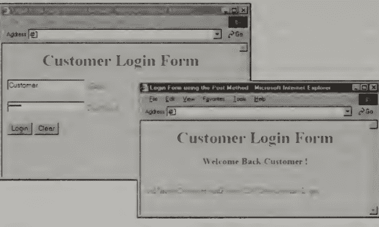

图 8-1 使用请求对象中的 Form 集合显示表单结果

1. 使用记事本或兼容 ASP 的编辑器创建一个名为 `post.asp` 的网页。将网页保存到你的数据目录。
2. 添加以下所示的基本 ASP 标签。`option explicit` 语句将要求你在页面中使用变量之前声明所有变量。`response.buffer` 语句将服务器脚本的结果保留在 Web 服务器上，直到所有脚本执行完毕。在 ASP 3.0 中，缓冲区默认设置为 `true`。如果你使用的是 ASP 2.0，应将缓冲区设置为 `true`。
3. 添加基本 HTML 标签，以及一个居中对齐的一级标题，标题为 **客户登录表单**。

```
<% option explicit %><% response.buffer = "true" %>
```

```
<html><head><title>Customer Login Form</title></head>
<body bgcolor = "#CCFFCC" text = "#008000">
<h1 align = "center">Customer Login Form</h1>
```

4. 按照如下所示，添加创建表单所需的 HTML 表单标签。`action` 设置为当前页面，因为此页面将收集并处理表单信息。

```
<form method="post" name="frmC" action="post.asp">
<input type="text" name="txtName" size="20"> Name
<br><br>
<input type="password" name="txtPass" size="20"> Password
<br><br>
<input type="submit" value="Login" name="btnSubmit">
<input type="reset" value="Clear" name="btnClear">
</form>
```

5. 添加用于验证客户的代码。如果客户在用户名中输入了 "Customer"，在密码中输入了 "12345"，则显示结果；否则，显示表单。以下代码可用于验证用户。请记住，此代码必须放置在表单之前。你可以将此代码紧挨着开始的 `form` 标签之前放置。注意，`request` 对象用于检索名为 `txtName` 和 `txtPass` 的表单字段的值。关键字 `or` 用于创建多条件语句。因此，用户必须填写正确的名称和密码。因为此代码跨越多行，你需要使用续行符（`_`）。

```
<% if request.form("txtName") <> "Customer" or _
request.form("txtPass") <> "12345" then %>
```

6. 在关闭的 `form` 标签之后，添加以下代码。如果用户验证通过，此代码将显示表单结果。声明三个名为 `strName`、`strPass` 和 `strForm` 的变量。`strName` 和 `strPass` 变量用于保存表单上字段的值。`strForm` 变量用于保存 `form` 集合，该集合包含所有表单字段的名称和值。此代码使用这些变量通过 `Response.write` 快捷键（`=`）将值写入网页。代码还将 `form` 集合写入网页。HTML 标签（例如标题 3 标签（`<h3>`）和换行标签（`<br>`））用于格式化输出。因为你使用了 If Then 控制语句来测试用户输入的值，所以必须使用 `else` 和 `end if` 语句。不要忘记在页面底部包含关闭的 HTML 标签。

```
<% else %>
<% dim strName, strPass, strForm
strName = request.form("txtName")
strPass = request.form("txtPass")
strForm = request.form %>
<h3 align="center">Welcome Back <% = strName %>
</h3>
<br><% = strForm %>
<% end if %>
</body></html>
```

7. 完成上述步骤后，将网页保存到 Web 服务器上的数据目录中。查看你的网页。尝试使用用户名 **Customer** 和密码 **12345** 登录。查看 `form` 集合的输出。虽然问候语显示 "Welcome Back Customer"，但 `form` 集合显示 "txtName=Customer&txtPass=12345&btnSubmit=Login"。`form` 集合仍然是用 `&` 号和等号编码的。调用单个字段的好处是，你不必解码 `form` 集合中的特殊字符。查看源代码以查看传递给客户端的信息。执行身份验证的代码对客户端不可用。

### QueryString 集合

`QueryString` 集合允许你从提交的表单中检索字段的名称和值。`QueryString` 集合可以检索整个 `QueryString` 集合或单个字段。要检索整个 `QueryString` 集合，请指定 `request` 对象名称和 `QueryString`。检索 `QueryString` 将检索所有具有名称和值的表单字段。如果表单字段在表单字段标签中未指定表单字段名称，则不会发送该值。所有具有名称的表单字段都将收到在 `QueryString` 集合中，包括 Submit 按钮。以下是检索整个 `QueryString` 集合的语法。

```
request.querystring
```

重要的是要理解，`QueryString` 也可以通过 `servervariables` 集合访问。以下示例代码展示了如何使用 `request` 对象和 `servervariables` 集合检索 `QueryString`。

```
<% = request.querystring %>
<% = request.servervariables("QUERY_STRING") %>
```

要从 `QueryString` 集合中检索单个字段，请指定 `request` 对象名称、`QueryString` 对象以及字段名称（放在引号内）。以下是从 `QueryString` 集合中检索单个字段的语法。

```
request.querystring("formFieldName")
```

以下示例演示了如何使用 `request` 对象的 `QueryString` 集合从表单中检索值。此示例与前一个示例相同，不同之处在于这里用于发送表单的方法是 `get`。因此，`request` 对象使用 `QueryString` 集合从表单中检索值。

1. 使用记事本或其他 ASP 兼容编辑器，将你在上一个示例中创建的页面 `post.asp` 保存为 `get.asp`。确保已将网页保存到你的数据目录中。
2. 将 `form` 标签中的 `method` 属性从 `post` 更改为 `get`。
3. 将 `form` 标签中的 `action` 属性从 `post.asp` 更改为 `get.asp`。
4. 将所有 `request.form` 引用更改为 `request.querystring`。
5. 保存你的更改。
6. 在浏览器中查看网页。尝试使用用户名 **Customer** 和密码 **12345** 登录。注意页面与上一页相同。`QueryString` 以 "txtName=Customer&txtPass=12345&btnSubmit=Login" 的形式返回名称和值对。名称字段也被返回。查看浏览器中的位置文本框。这两个示例之间的主要区别是，整个 `QueryString` 可以在浏览器的位置文本框中查看。

### 在不使用表单字段名称的情况下显示 Form 和 QueryString 集合

要创建一个显示字段名称和值的网页，而无需知道字段的名称，你必须使用 `For Each` 语句。回顾前面的章节，你可以列出父对象中的属性和对象。`QueryString` 和 `form` 集合是 `request` 对象的子对象。你可以使用 `For Each` 语句遍历集合中的每个表单字段对象，并检索表单字段的名称和值。此过程可用于 `form` 集合和 `QueryString` 集合。以下示例使用 `QueryString` 集合来显示表单字段结果。此练习也可以修改为使用 `form` 集合来显示表单字段结果。

1. 打开名为 `get.asp` 的页面，这是你在上一个练习中创建的。你可以使用记事本或其他 ASP 兼容编辑器。将页面另存为 `getall.asp`。确保已将网页保存到你的数据目录中。
2. 将表单中的 `action` 更改为 `getall.asp`。
3. 在你之前使用 `<%= strForm %>` 输出 `QueryString` 的那一行下面，添加两个换行符。*（提示：你可以使用两个 break 标签：`<br><br>`）*
4. 添加以下代码以写出每个表单字段及其值。首先，声明一个名为 `formField` 的新变量来保存临时的表单字段名称。`For Each` 控制语句将遍历 `QueryString` 集合中的每个对象。

```
<% dim formField
for each formField in request.querystring
```

5. 然后，使用 `write` 方法写出字段的名称，该字段临时称为 `formField`。写出一个等号以分隔字段的名称和值。在等号前后放置一个空格。注意，如果你想添加多个空格，必须使用空格的 HTML 值（`&nbsp;`）。

```
response.write formField
response.write " = "
```

6. 使用 `Response.write` 方法写出表单字段的值，该值使用 `request.querystring(formField)` 检索。这里不使用引号，因为 `formField` 是一个临时保存表单字段名称的变量。

```
response.write request.querystring(formField)
```

7. 写出一个换行标签，将名称和值对分隔在单独的一行上。

```
response.write "<br>"
```

8. 使用以下命令使循环重新开始。使用关闭的内联脚本标签关闭服务器脚本。

```
next %>
```

9. 保存你的更改。
10. 在浏览器中查看网页。与上一个练习的区别在于，所有表单字段名称及其值都列在网页的单独行上。

### 其他类型的表单字段

文本框不是表单可以包含的唯一字段类型。其他一些类型的表单字段包括下拉列表、单选按钮和复选框。检索这些表单字段的值与检索文本框的值类似。你可以使用 `Form` 或 `QueryString` 集合从这些表单元素中检索值。

#### 下拉列表框

下拉列表框用于提供特定的选择列表，称为选项。在表单中，`select` 标签（`<select>`）标识一个下拉列表框。可以通过在 `select` 标签中使用 `size` 属性，将下拉列表框配置为一次显示一个选项，或显示整个列表。当 `size` 属性设置为 "1" 时，则一次只显示一个选项。可以通过在 `select` 标签中使用 `multiple` 属性，将下拉列表框配置为允许用户选择多个选项，或限制为单个选择。可以为每个选项指定显示的文本和值。以下是下拉列表的语法。

```
<select size = "1" name = "selName" multiple>
<option selected value = "option1value"> Option1 Display Text </option>
<option value = "option2value"> Option2 Display Text </option>
<option value = "optionnvalue"> Optionn Display Text </option>
</select>
```

用于显示文本框的代码与用于显示下拉列表框选择的代码没有区别。通过指定字段名称，使用 `form` 或 `QueryString` 集合来检索值。以下语法说明了如何使用 `form` 和 `QueryString` 集合检索下拉列表框的值。

```
<%
request.form("formFieldName")
request.querystring("formFieldName")
%>
```

文本框和下拉列表框的唯一区别在于，如果你在 `select` 标签中指定了 `multiple` 属性，用户就可以从下拉列表框中选择多个项目。如果用户按住 `Shift` 键并单击其他选项来选择额外的项目，那么多值就会被发送到服务器。当脚本从表单字段检索值时，所有来自该字段的值将以逗号分隔的列表形式出现。要从多选列表中检索单个值的唯一方法是通过索引号和表单字段名称来引用这些选项。与大多数数组不同，下拉列表框的索引号从 1 开始。以下示例创建一个名为 `select.asp` 的页面，其中包含一个名为 `selProducts` 的下拉列表。

1. 创建一个名为 `select.asp` 的 Web 页面。你可以使用记事本或其他 ASP 兼容的编辑器。确保已将 Web 页面保存到你的数据目录中。添加起始的 HTML 标签和标题标签，如下所示。

```
<html><head><title>Drop Down List Form Field</title></head>
<body>
<h3>Select two departments</h3>
```

2. 使用 `form` 标签创建表单，如下所示。`method` 属性应设置为 `post`，因为你要使用 `form` 集合来检索表单字段的值。`action` 属性应设置为 `select.asp`，因为你要在同一个页面中处理表单。`select` 标签用于创建下拉列表框。`size` 属性设置为 6，以便同时显示所有选项。`multiple` 属性设置为允许用户选择多个选项。值用引号括起来，`option` 标签之间是在下拉列表框中显示的文本。

```
<form name="frm" method="post" action="select.asp">
<select size="6" name="selDepartments" multiple>
<option value="admin">Administration</option>
<option value="mark">Marketing</option>
<option value="fin">Finance</option>
<option value="hr">Human Resources</option>
<option value="op">Operations</option>
<option value="tech">Technology</option>
</select>
<input type="submit" value="Submit" name="btnSubmit">
</form>
```

3. 添加代码以检测 `form` 集合是否为空。如果集合为空，并且你试图从该集合中检索一个字段，将会导致错误消息。在表单下方，添加以下代码。

```
<% if request.form <> "" then %>
```

4. 添加以下代码以显示整个 `form` 集合的值。对于每个选定的选项，`form` 集合将返回字段的名称和值。在此示例中，对于每个选定的选项，`form` 集合将返回下拉列表框的名称和值。它不会返回选项的名称。所有选定选项的值都以下拉列表框的名称 `selDepartments` 返回。在此示例中，如果你选择了 Marketing 和 Operations，返回的 `form` 集合将是 "selDepartments=mark&selDepartments=op&btnSubmit=Submit"。

```
<% = request.form%>
```

5. 使用两个 `<br>` 标签创建两个换行，以便更容易阅读显示的结果。

```
<br><br>
```

6. 下一行代码检索所有选定选项的值，不包含表单字段的名称。值以逗号分隔的列表形式返回。这不会显示单个值。在此示例中，如果你选择了 Marketing 和 Operations，返回的 `form` 集合将是 "mark, op"。再使用两个 `<br>` 标签创建两个换行，以便更容易阅读显示的结果。

```
<% = request.form("selDepartments")%>
<br><br>
```

7. 要显示下拉列表中的单个值，请添加以下代码。下拉列表框中的每个元素都通过其索引号引用。索引号用一对括号括起来，并紧跟在表单名称之后。此代码将显示选定的第一个和第二个选项。在此示例中，如果用户选择的选项少于两个，将导致错误消息。一对换行标签用于分隔两个选定的选项。

```
<% = request.form("selDepartments")(1)%>
<br><br>
<% = request.form("selDepartments")(2)%>
<% else %>
<% end if %>
</body></html>
```

8. 保存你的更改。

9. 在浏览器中查看该 Web 页面。选择两个项目，然后单击“提交”按钮。在 Internet Explorer 中，你必须按住 `Control` 键才能选择多个项目。请注意，结果页面与上一个练习不同，因为当你选择多个项目时，`form` 集合会显示包含表单字段名称和值的完整列表。如果你使用 `form` 集合并指定表单字段名称，你将收到以逗号分隔的列表形式呈现的表单字段值。但是，如果你指定索引号和表单字段名称，你将只收到其中一个选定选项的值。如果你在列表中只选择一个项目，你会收到一条错误消息，提示“数组索引超出范围”。这是因为你的脚本被设定为输出两个选择，而你只选择了一个。你可以使用客户端或服务器端的表单字段验证来确保用户选择了两个项目。

#### 复选框和单选按钮

复选框和单选按钮用于提供选项列表，类似于下拉列表框。与文本框一样，复选框和单选按钮使用 `input` 标签。`type` 属性用于标识表单字段。要指定文本、密码或隐藏字段，`type` 属性设置为 `text`、`password` 或 `hidden`。要指定复选框，`type` 属性设置为 `checkbox`。通常，用户可以选择多个复选框。你可以为每个复选框指定不同的名称，这将更容易检索单个复选框。以下是将复选框放置在表单中的语法。

```
<input type="checkbox" name="chkName1" value="Yes" checked>Click here for Yes
<input type="checkbox" name="chkName2" value="No">Click here for No
```

要指定单选按钮表单字段，`type` 属性设置为 `radio`。单选按钮也称为选项组，因为用户只能从单选按钮组中选择一个选项。与复选框不同，单选按钮不允许用户选择多个选项。如果你想允许用户选择多个单选按钮，你必须为每个单选按钮指定不同的名称，实际上使每个按钮成为其自己的选项组。以下是将单选按钮放置在表单中的语法。

```
<input type="radio" name="radName1" value="Yes" checked>Click here for Yes
<input type="radio" name="radName1" value="No">Click here for No
```

对于复选框和单选按钮，你都需要包含文本以向用户标识每个选项。可以为每个复选框或单选按钮指定值。如果未指定值，当用户提交表单时发送的值将是 "on"。重要的是要知道，如果未选择任何选项，复选框和单选按钮将不会向服务器发送值。为避免此问题，你可以使用 `checked` 属性确保其中一个选项被选中。

显示复选框的代码与显示文本框结果的代码之间没有区别。这是因为每个复选框和文本框都由唯一的名称标识。通过指定字段名称，使用 `form` 或 `QueryString` 集合来检索值。下面的语法示例说明了如何使用 `form` 和 `QueryString` 集合检索复选框的值。

```
<%
request.form("formFieldName")
request.querystring("formFieldName")
%>
```

如果你为多个复选框分配相同的名称，例如 `chk1`，整个 `form` 集合将显示每个选定复选框的名称和值。如果你指定字段名称，复选框的值将以逗号分隔的列表形式出现。就像你对下拉列表所做的那样，你可以指定索引号来显示其中一个复选框结果的值。以下代码显示 `form` 集合、值列表以及前两个选定的值。请注意，该代码与前面显示从下拉列表框中选择多个值的示例类似。

```
<%= request.form%><br><br>
<%= request.form("chk1")%><br><br>
<%= request.form("chk1")(1)%><br><br>
<%= request.form("chk1")(2)%>
```

你可以通过使用关键字 `count` 来指定表单字段中的值的数量。关键字 `count` 可以应用于从 `form` 集合和 `QueryString` 集合中检索的表单字段。以下是使用 `count` 属性检索表单返回的值数量的语法。

```
request.querystring("formFieldName").count
request.form("formFieldName").count
```

以下示例代码显示用户从表单上列出的复选框中选定的颜色数量。这些复选框都命名为 `chk1`，但每个都有不同的值。该表单保存在名为 `count.asp` 的 Web 页面上。重要的是，当使用 `form` 集合从表单中检索值时，使用的表单方法是 `post`。使用 `If` 语句来确定是显示表单还是显示表单返回的值数量。此方法可用于 `form` 集合或 `QueryString` 集合。

```
<html><head><title></title></head>
<body>
<% if request.form("chk1") = "" then %>
  <form method="post" action="count.asp">
    <h2>Select one or more colors</h2>
    <input type="checkbox" name="chk1" value="1">red<br>
    <input type="checkbox" name="chk1" value="2">blue<br>
    <input type="checkbox" name="chk1" value="3">green<br>
    <input type="checkbox" name="chk1" value="4">black<br>
    <br>
    <input type="submit" value="Submit" name="btnSubmit">
  </form>
<% else %>
  <h2>The number of colors you selected was: </h2>
  <%= request.form("chk1").count%>
<% end if %>
</body></html>
```

在上面的示例中，你也可以使用表单集合来检索并显示从表单中选择的所有值。要仅显示那些具有值的复选框，请使用 `For Next` 控制语句遍历结果。结果页中显示的值的总数是由 `count` 属性标识的数字。相同的示例可以重新编写以使用 `QueryString` 集合而不是表单集合。

```
<h2>You selected:</h2>
<%
dim i, results
for i = 1 to request.form("chk1").count
    results = request.form("chk1")(i)
    response.write i & " " & results
    %>
    <br><br>
<%
next
%>
```

对于一组单选按钮，你只需要指定单选按钮的字段名。从一组单选按钮中只能选择一个选项。以下代码演示了如何检索名为 `rad1` 的单选按钮组的表单集合及其值。表单集合将仅显示该单选按钮组的一个值。

```
<% = request.form%>
<br><br>
<% = request.form("rad1")%>
```

下面的示例创建一个名为 `checkbox.asp` 的页面。表单的第一部分包含一组单独命名的复选框。表单的第二部分包含一组具有相同名称的单选按钮。使用表格来增强表单的布局。为了避免错误消息，If Then 控制语句用于确定表单字段是否为空。如果所有字段都为空，则用户未填写表单，并且将显示表单。如果用户确实填写了表单，则显示结果。相同的示例可以重新编写以使用 `QueryString` 集合而不是表单集合。

1. 创建一个名为 `checkbox.asp` 的网页。你可以使用记事本或其他兼容 ASP 的编辑器。确保将网页保存到你的数据目录。添加起始 HTML 标签和标题，如下所示。

```
<html><head><title>Select a Department</title></head>
<body>
<h2 align = "center">Select a Department</h2>
```

2. 在 `body` 标签下方，编写一个 If Then 控制语句来测试用户是否填写了表单。表单字段命名为 `men1`、`men2`、`men3` 和 `radW`。如果所有表单字段的值都为空（由空字符串表示），则用户未填写表单，并且应显示表单。由于该语句跨越多行，因此使用了行延续字符 (`_`)。

```
<%
if request.form("men1") = "" and _
request.form("men2") = "" and _
request.form("men3") = "" and _
request.form("radW") = "" then
%>
```

3. 使用 `form` 标签创建表单。方法应为 `post`，因为你将使用表单集合来检索表单字段的值。`action` 应为 `checkbox.asp`，因为你将在同一页中处理表单。

```
<form method="post" action="checkbox.asp">
```

4. 添加如下所示的表单。复选框使用不同的名称命名，并具有不同的值。请注意，所有单选按钮都具有相同的名称 "radW"，但它们具有不同的值。使用表格来增强表单字段的布局。使用 `break` 标签在每个选项后添加换行符。

```
<table width = "500" align = "center">
<tr>
<td><b>Clothing for Men</b></td>
<td><b>Clothing for Women</b></td>
</tr>
<tr><td>
<input type="checkbox" name="men1" value="1">Coats<br>
<input type="checkbox" name="men2" value="2">Ties<br>
<input type="checkbox" name="men3" value="3">Shirts<br>
</td>
<td>
<input type="radio" name="radW" value="1">Shirts<br>
<input type="radio" name="radW" value="2">Dresses<br>
<input type="radio" name="radW" value="3">Finance<br>
</td></tr>
<tr>
<td><input type="submit" value="Submit"></td>
<td></td></tr>
</table></form>
```

5. 添加当表单已被填写时将显示的代码部分。此部分以 `else` 语句开头。

```
<% else %>
```

6. 添加以下代码以显示整个表单集合、复选框表单字段的结果以及单选按钮的结果。请注意，你只需使用一行代码即可显示单选按钮的值，因为整个组只返回一个值。你不能从选项组中选择多个值。

```
<table width = "500" align = "center">
<tr><td><h3>The Form collection is: </h3></td>
<td><% = request.form %></td></tr>
```

```
<tr><td><h3>Display the check box results</h3></td>
<td>
men1 has a value of <% = request.form("men1")%><br>
men2 has a value of <% = request.form("men2")%><br>
men3 has a value of <% = request.form("men3")%><br>
</td></tr>
<tr><td><h3>Display the radio button results</h3></td>
<td>radW has a value of <% = request.form("radW")%><br>
</td></tr>
</table>
```

7. `end if` 语句用于关闭 If Then 控制语句。必须在页面底部包含闭合的 `body` 和 HTML 标签。

8. 保存你的更改并在浏览器中查看网页。请注意，只有在复选框或单选按钮中没有选择任何选项时，才会显示表单。在编写处理表单的代码之前，最好执行表单字段验证以检测表单字段是否为空。

```
<% end if %>
</body></html>
```

## 检索服务器变量

服务器变量是请求对象中的一个集合。当浏览器向 Web 服务器发送页面请求时，它也会在 HTTP 头中发送信息。这些信息包括请求页面的名称、目标 Web 服务器的 IP 地址以及客户端的 IP 地址，用于处理请求。因此，你可以使用请求对象来检索 HTTP 头字段的名称及其值。要检索头的值，你可以指定服务器变量的名称。服务器变量的名称用双引号括起来，并且总是用大写字母书写。表 8-1 列出了几个常用的服务器变量。以下是检索特定服务器变量值的语法。

```
request.servervariables("SERVER_VARIABLE_NAME")
```

下面的代码演示了如何在网页上显示服务器变量。在第一个脚本中，服务器名称的值直接写入浏览器。在第二个脚本中，服务器变量也使用 `write` 方法直接写入浏览器。在第三个脚本中，使用一个变量来存储服务器名称的值，并将变量的值写入网页。每条语句都实现了相同的结果——即将服务器名称写入网页。

```
<% = Request.ServerVariables("SERVER_NAME") %>
<% response.write Request.ServerVariables("SERVER_NAME") %>
<% dim strServerName
strServerName = Request.ServerVariables("SERVER_NAME")
response.write strServerName
%>
```

### 表 8-1 服务器变量

| 变量名 | 描述 | 示例 |
|---|---|---|
| SERVER_NAME | Web 服务器的名称 | `www.domainname.com` |
| SERVER_SOFTWARE | 服务器的操作系统和 Web 服务器软件 | `Microsoft-IIS/4.0` |
| SERVER_PORT | 请求的服务器端口号，默认值为 80 | `80` |
| LOCAL_ADDR | 服务器计算机的本地 IP 地址 | `208.249.124.77` |
| SERVER_PROTOCOL | 用于传递请求的协议（HTTP 1.0 或 HTTP 1.1） | `HTTP/1.1` |
| HTTP_REFERER | 客户端请求新页面时所在的当前页面 | `http://www.domainname.com/index.asp` |
| HTTP_USER_AGENT | 用户代理的名称，可用于确定客户端使用的浏览器名称和版本 | `Mozilla/4.0 (compatible; MSIE 5.0; Windows 98; DigExt)` |
| REMOTE_ADDR | 客户端计算机的远程 IP 地址 | `207.252.246.222` |
| URL | 被请求文件的 URL | `/ip/FormCheckbox.asp` |
| PATH_INFO | 被请求文件的虚拟路径 | `/ip/FormCheckbox.asp` |
| PATH_TRANSLATED | 转换为物理路径的虚拟路径（结果类似于使用服务器对象的 `MapPath` 方法） | `C:\InetPub\wwwroot\ip\FormCheckbox.asp` |
| REQUEST_METHOD | 表单用于发送信息的方法——`post` 或 `get` | `POST` |
| HTTP_CONTENT_LENGTH | 附加在头上的文件的长度，可能包括使用 `post` 方法的表单的结果，如果使用 `get` 方法，此值为 0 | `61` |
| QUERY_STRING | 从使用 `get` 方法的表单的名称和值对生成的查询字符串 | `chk2=mark&chk5=op&rad1=fin&btnSubmit=Submit` |
| HTTP_COOKIE | Cookie 的名称和值（如果客户端具有来自同一服务器的写入） | `CookieColor=Green` |

请记住，请求对象允许你检索由浏览器发送的信息。这些信息包括服务器变量。例如，服务器变量可以识别在 `HTTP_CONTENT_LENGTH` 服务器变量中发送到服务器的信息量。你也可以使用请求对象的 `totalbytes` 属性访问相同的信息。`totalbytes` 属性标识客户端发送到服务器的字节总数。因此，有不止一种方法用于访问从客户端发送到服务器的信息。以下示例代码展示了使用两种方法检索发送的总字节数的示例。

```
<% = request.totalbytes %>
<% = request.servervariables("HTTP_CONTENT_LENGTH") %>
```

你可以显示单个服务器变量的值，或者显示整个服务器变量集合。以下示例代码列出了几个常用服务器变量的所有名称和值。要显示整个 `ServerVariable` 集合，可以使用 `For Each` 控制语句遍历该集合，就像处理 `form` 和 `QueryString` 集合一样。以下示例代码列出了服务器变量的所有名称和值。此示例声明了一个名为 `strSV` 的变量，该变量将保存服务器变量的临时值。代码遍历 `ServerVariable` 集合中的每个服务器变量，并显示每个服务器变量的名称和值。图 8-2 显示了服务器变量写入到网页时的外观。

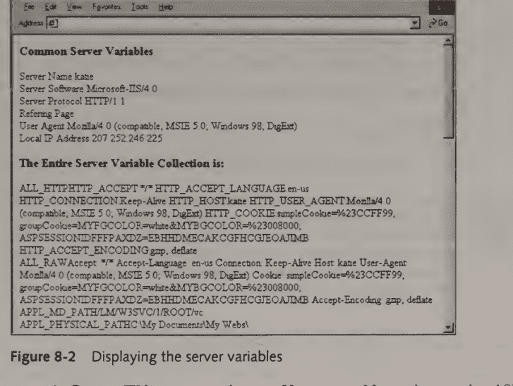

**图 8-2** 显示服务器变量

1. 创建一个名为 `sv.asp` 的网页。你可以使用记事本或其他兼容 ASP 的编辑器。确保将网页保存到你的数据目录。添加起始 HTML 标签和一个标题，如下所示。

```
<html><head><title>Server Variables</title></head>
<body>
<h3>Common Server Variables</h3>
```

2. 添加代码以显示服务器名称、服务器软件、服务器协议、引用页面的 URL、客户端的用户代理以及服务器的 IP 地址。

```
Server Name
<% = Request.ServerVariables("SERVER_NAME") %>
<br>Server Software
<% = Request.ServerVariables("SERVER_SOFTWARE")%>
<br>Server Protocol
<% = Request.ServerVariables("SERVER_PROTOCOL") %>
<br>Referring Page
<% = Request.ServerVariables("HTTP_REFERER") %>
<br>User Agent
<% = Request.ServerVariables("HTTP_USER_AGENT") %>
<br>Local IP Address
<% = Request.ServerVariables("LOCAL_ADDR") %>
```

3. 添加代码以遍历服务器变量集合并显示每个名称和值。使用等号 (`=`) 分隔变量名和值。使用 `break` 标签分隔每对名称和值与下一对。

```
<h3>The Entire Server Variable Collection is:</h3>
<% dim strSV %>
<% for each strSV in Request.ServerVariables %>
<% = strSV %>
<% Response.Write Request.ServerVariables(strSV) %>
<br>
<% next %>
</body></html>
```

4. 保存你的更改，并在浏览器中查看该网页。

> 尽管 `HTTP_USER_AGENT` 听起来像是检测浏览器版本的好方法，但检测浏览器支持哪些功能通常更有用。例如，浏览器是否支持框架？服务器变量不会提供此信息。然而，另一个称为浏览器组件的服务器对象将告诉你浏览器支持哪些功能。你将在第 10 章学习如何使用浏览器组件。


### 将请求重定向到另一个页面

正如你之前在本书中学到的，在客户端脚本中，你可以通过更改 `location` 对象的 `HREF` 属性将用户重定向到另一个网页。你也可以使用 `META` 标签中的 `refresh` 命令来重定向用户，如下方示例代码所示。使用 `refresh` 命令时，你需要指定 URL 以及在将用户重定向到新页面前等待的秒数。这两种方法都在客户端执行，可能会产生某些问题。例如，一些较旧的浏览器不支持客户端重定向。此外，客户端可以看到地址栏中的变化，并可以通过按 `Escape` 键或单击“停止”按钮来阻止它。

```
<meta http-equiv="refresh" content="0;
URL=http://www.course.com/">
```

当你使用服务器端重定向时，客户端无法阻止重定向的发生。`redirect` 方法向浏览器发送一个 HTTP 头，内容为 "HTTP/1.1 302 Object Moved" 和 "Location /newpath/newwebpage.asp"。读取新的头信息后，浏览器会获取新页面。虽然这类似于使用 `meta` 标签，但并不相同。如果你使用 `meta` 标签将 `location` 对象的刷新时间设置为 0，用户仍然可以停止重定向。而当你使用 `redirect` 方法时，用户甚至不会意识到他们已被重定向，因此他们无法停止重定向。

要重定向用户，只需调用 `response` 对象的 `redirect` 方法。`redirect` 方法接受一个参数，即目标 URL。URL 可以是绝对 URL 或相对 URL。URL 应放在双引号内；括号是可选的。以下是使用 `response` 对象进行服务器端重定向的语法。括号和引号不是必需的。

```
response.redirect("URL")
```

以下示例代码展示了如何使用服务器端重定向来重定向用户。你可以直接分配 URL，或者使用变量传递值。你可以将用户重定向到特定的网页或目录。你可以指定绝对路径或相对路径。

```
<% response.redirect("http://www.course.com") %>
<%
dim strGo
strGo = "http://www.course.com"
response.redirect(strGo)
%>
```

你可以将 `redirect` 方法与其他方法结合使用。例如，许多公司出于营销原因购买了多个域名。你可能会被分配将这些域名重定向到 Web 服务器上特定目录或网页的任务。在此示例代码中，域名存储在变量 `SN` 中。你可以将 `SN` 变量的值与从 `SERVER_NAME` 服务器变量检索到的值进行比较。如果它们匹配，则将浏览器重定向到新的目录、网页或网站。

```
<% dim SN
SN = "www.domain1.com"
if request.servervariables("SERVER_NAME")= SN then
response.redirect "http://www.company.com/"
else
end if
%>
```

以下示例代码展示了脚本如何确定用户选择了哪个选项。一个名为 `redirectform.asp` 的网页包含一个名为 `selectpage` 的表单字段。该表单字段是一个下拉列表框，其中包含多个选项。脚本将根据用户选择的选项将用户重定向到新页面。

1. 创建一个名为 `redirectform.asp` 的网页。你可以使用记事本或其他兼容 ASP 的编辑器。确保将网页保存到你的数据目录。

2. 添加起始 HTML 标签、标题和表单，如下所示。

```
<html><head><title>Redirect Form</title></head>
<body>
<h3>Choose a Web site</h3>
<form method = "post" action = "redirect.asp">
<select size = "1" name = "selectpage">
<option value = "1">Course Technology</option>
<option value = "2">Microsoft</option>
<option value = "3">MSDN Online</option>
</select>
<input type = "submit" value = "submit">
</form>
</body></html>
```

3. 保存更改。

4. 创建一个名为 `redirect.asp` 的网页。你可以使用记事本或其他兼容 ASP 的编辑器。确保将网页保存到你的数据目录。

5. 添加起始 HTML 标签、标题和表单，如下所示。你需要将 `buffer` 属性设置为 `true`，以便内容在服务器上保留，直到页面上的所有脚本都被处理完毕。否则，Web 服务器将发送 HTTP 头信息。当脚本尝试发送更多 HTTP 头文件信息时，将导致错误消息。

```
<% response.buffer = "true" %>
<html><head><title>Redirect</title></head>
<body>
```

6. 添加将确定选择了哪个表单字段并重定向浏览器的代码。注意，默认重定向到你在上一个练习中创建的服务器变量页面。

```
<%
select case request.form("selectpage")
	case 1
		response.redirect "http://www.course.com"
	case 2
		response.redirect "http://www.microsoft.com"
	case 3
		response.redirect "http://msdn.microsoft.com"
	case else
		response.redirect "sv.asp"
end select
%>
</body></html>
```

7. 保存你的更改，并在浏览器中查看 `redirectform.asp` 网页。

> 编程提示

如果你尝试在将任何内容写入浏览器之后将用户重定向到另一个页面，你将收到一条错误信息，内容为：“HTTP 头已写入客户端浏览器。任何 HTTP 头的修改必须在写入页面内容之前进行。”要修正此错误，必须在网页的顶部包含 `<% response.buffer = "true" %>`。如果你使用的是 ASP 3.0，缓冲属性默认设置为 `true`。

#### 控制输出到浏览器

你已经学习了如何使用 `response` 对象向浏览器发送输出。在本节中，你将学习如何控制发送到浏览器的输出方式。发送到浏览器的信息是在 HTML 输出流中发送的，这被称为**缓冲区**。在 ASP 3.0 之前，缓冲属性默认设置为 `false`，这意味着 ASP 脚本和 HTML 的输出在服务器处理时会直接发送到网页。但正如前一个练习所示，有时你需要控制信息何时发送到浏览器。例如，重定向方法需要在 HTTP 头中发送信息。如果 HTTP 头内容已经发送到浏览器，则会发生错误。因此，你需要通过将缓冲属性设置为 `true` 来将内容临时保存在缓冲区中。

当缓冲属性设置为 `true` 时，你可以编写 ASP 和 HTML 语句，这些语句将保留在缓冲区中，直到你指示缓冲区将输出流释放到浏览器。`response` 对象有一个名为 `flush` 的方法，用于将输出流释放到浏览器，另一个名为 `clear` 的方法，用于擦除缓冲区的内容而不将其释放到浏览器。`response` 对象还有一个名为 `end` 的方法，它会停止任何 HTML 和 ASP 代码释放到浏览器，包括任何结束的 `body` 和 HTML 标签。

以下示例 `bufferQuiz.asp` 演示了如何使用缓冲区和 `response` 方法，以及如何检测用户是否选择了正确答案。在此示例中，缓冲属性设置为 `true`，表示代码将控制输出到浏览器。如果表单字段 `radHTTP` 的值为空，则表示用户未填写表单，因此显示表单。否则，祝贺消息将被发送到缓冲区。如果用户选择了错误的答案，则清空缓冲区，并将新消息写入浏览器并刷新到浏览器。如果用户选择了正确的答案，则使用 `flush` 方法将缓冲区中的消息刷新到浏览器。

1. 创建一个名为 `bufferQuiz.htm` 的网页。你可以使用记事本或其他兼容 ASP 的编辑器。确保将网页保存到你的数据目录。

2. 添加起始 HTML 标签、标题和表单，如下所示。将缓冲属性设置为 `true`。

```
<% response.buffer = "true" %>
<html><head><title>HTTP Quiz</title></head>
<body>
```

3. 编写一个标题，内容为 **HTTP 测验**。由于标题需要始终显示，因此使用 `flush` 方法将内容发送到浏览器。

```
<h2>HTTP 测验</h2>
<% response.flush %>
```

4. 添加代码以检测表单是否已填写。如果没有传递表单字段值，则表示表单未填写，因此显示表单。

```
<% if request.form("radHTTP") = "" then %>
    <form method="post" action="bufferQuiz.asp">
    HTTP 协议的最新版本是什么？<br>
    <input type="radio" value="0" name="radHTTP">1.0<br>
    <input type="radio" value="1" name="radHTTP">1.1<br>
    <input type="radio" value="4" name="radHTTP">4.0<br>
    <input type="radio" value="6" name="radHTTP">6.0<br>
    <input type="submit" value="Correct" name="btnSubmit">
    <br>
    </form>
```

5. 使用 `write` 方法写出 **恭喜，你答对了！**。因为缓冲属性设置为 `true`，内容将保存在缓冲区中，尚未在浏览器中显示。

```
<% else %>
    <% response.write "恭喜，你答对了！" %>
```

6. 使用 If Then 语句检测答案是否错误。如果表单字段的值不是 "1"，则表示答案错误。因此，代码使用 `clear` 方法清空缓冲区。然后，将新消息写入缓冲区，内容为 **抱歉，你答错了！**。接着，使用 `flush` 方法将缓冲区中的内容发送到浏览器。

```
if request.form("radHTTP") <> "1" then
    response.clear
    response.write "抱歉，你答错了！"
    response.flush
```

7. 如果答案正确，则代码使用 `flush` 方法将缓冲区中的消息写入浏览器。最后应用 `End If` 语句。

```
else
    response.flush
end if
%>
<% end if %>
```

8. 无论用户选择哪个答案，都会应用 `end` 方法。`end` 方法会停止将结束标签发送到浏览器。`end` 方法不会擦除已发送到浏览器的内容。如果缓冲区已清空且没有内容发送到浏览器，则会发送带有默认 HTML 标签的默认 HTTP 头。

```
<% response.end %>
</body>
</html>
```

9. 保存你的更改，并在浏览器中查看网页。查看网页的源代码。你会看到缺少结束的 `body` 和 HTML 标签。这些标签从未从服务器发送，因为服务器端脚本调用了 `end` 方法。

## 缓存网页

你可以使用 `meta` 标签来控制浏览器如何缓存网页。当你缓存网页时，你指示浏览器将网页及其所有内容的本地副本存储在客户端的临时目录中。在 Windows98 的默认设置中，临时目录位于 `C:\WINDOWS\Temporary Internet Files`。通过使用网页的本地副本，浏览器能够更快地提供内容。因为大多数 ASP 内容是动态的，所以有时最好不要缓存网页的本地副本。`response` 对象包含几个控制网页何时过期的属性。

需要特别注意的是，如今许多企业网络使用**代理服务器**来提供安全功能。例如，代理服务器用于在互联网上隐藏客户端的 IP 地址。代理服务器还用于通过缓存网页来减少到互联网的网络流量。你可以设置一个名为 `CacheControl` 的属性，以防止代理服务器缓存页面。但是，某些代理服务器可以覆盖此属性并仍然缓存页面。以下是设置 `CacheControl` 的语法。`CacheControl` 属性默认设置为 `Private`。`Private` 允许代理服务器缓存网页。要防止缓存，请将属性设置为 `Public`。必须在 HTML 标签之前设置 `CacheControl` 属性。

```
response.cachecontrol = "Public"
response.cachecontrol = "Private"
```

`response` 对象的 `expires` 属性用于指定缓存网页在多少分钟后应过期。一旦缓存的网页过期，浏览器必须从网站重新获取该网页。`response` 对象的 `ExpiresAbsolute` 属性也允许你指定缓存页面何时过期，但它设置了一个特定的日期和时间作为页面过期的时间。日期和时间使用井号 (`#`) 在日期和时间前后输入。如果你将 `expires` 属性设置为 0，或将 `ExpiresAbsolute` 属性设置为过去的日期，浏览器将无法缓存该网页。但是，某些浏览器不允许你覆盖浏览器中设置的缓存设置。以下是使用 `response` 对象的 `expires` 和 `ExpiresAbsolute` 属性的语法。

```
response.expires = minutes
response.expiresabsolute = #datetime#
```

要将此页面在本地缓存 5 分钟，你可以将 `expires` 属性更改为 5。更改 `expires` 属性并查看网页后，文件的副本将位于临时目录中。以下是设置缓存在 5 分钟后以及在特定日期和时间过期的示例。

```
<% response.expires = 5 %>
<% response.expiresabsolute = #Dec 1,2001 12:00:00# %>
```

## 章节总结

### 处理表单

- 表单将名称和值传递给 Web 服务器。名称和值在 `QueryString` 中由等号分隔。每个名称和值对与其他名称和值对之间由 `&` 符号分隔。问号用于将 `QueryString` 附加到 URL。

- `get` 方法发送附加到 URL 的名称和值对。然后使用 `response` 对象的 `QueryString` 集合检索这些名称和值对。

- `post` 方法将名称和值对作为 HTTP 请求体的一部分发送。使用 `request` 对象的 `form` 集合检索名称和值。

- 如果你希望使用 `request` 对象检索值，则必须在表单中指定字段的名称。用户可以选择多个复选框，即使它们具有相同的名称。因此，一个复选框组可以返回多个值。用户只能从一个单选按钮组中选择一个单选按钮（这些按钮具有相同的名称）。因此，只返回一个值。如果未为复选框和单选按钮指定值，则选中的表单字段将发送值 "on"。如果未指定值且未选中，则不发送任何值。

### Request 对象和 Response 对象

- `request` 对象用于从浏览器检索信息。`request` 对象使用 `QueryString` 和 `form` 集合接收表单字段的名称和值对。`request` 对象可以使用 `ServerVariables` 集合检索 HTTP 头中发送的服务器变量。

- `response` 对象用于向浏览器发送信息。`redirect` 方法会将用户重定向到另一个网页。`response` 对象使用 `write` 方法向网页发送输出。可以使用 `buffer` 属性。`clear` 方法用于清空缓冲区，而 `flush` 属性用于将缓冲区内容发送到浏览器。`end` 方法用于停止页面向浏览器发送更多内容。`response` 对象还能够将网页配置为在指定日期和时间过期。`CacheControl` 属性用于防止代理服务器缓存网页。`expires` 属性被赋以一个以分钟为单位的相对值。`ExpiresAbsolute` 属性被赋以一个绝对日期和时间，该日期和时间用井号（`#`）包围。

#### 从使用 get 方法的表单字段中检索值

```
<%request.querystring("txtName")%>
```

#### 检索包含名称和值对的整个 QueryString 集合

```
<%request.querystring%>
```

#### 检索包含名称和值对的整个 QueryString 集合

```
<%for each formfield in request.querystring
response.write formfield & " = "
response.write(request.querystring(formfield) & "<BR>")
next%>
```

#### 检索包含名称和值对的整个 form 集合

```
<%request.form%>
```

#### 从使用 post 方法的名为 txtName 的表单字段中检索值

```
<%request.form("txtName")%>
```

#### 检索使用 post 方法发送的总字节数

```
<%response.request(totalbytes)%>
```

#### 从多个同名选定表单字段中检索返回的第一个值

```
<%request.form("txtName")(1)
<%request.querystring ("txtName")(1)%>
```

#### 从多个同名表单字段中检索以逗号分隔的值列表

```
<%request.form("txtName")%>
<%request.querystring("txtName")%>
```

#### 检索从多个同名表单字段返回的值数量

```
<%request.form("txtName").count%>
<%request.querystring("txtName").count%>
```

#### 检索特定的服务器变量值

```
<%request.servervariables("SERVER_NAME").count%>
```

#### 输出所有服务器变量

```
<%for each strServervariables in request.servervariables
response.write strServervariables & " = "
response.write(request.servervariables(strServervariables))
next%>
```

#### 将用户重定向到另一个网页

```
<%response.redirect "http://www.course.com"%>
<%response.redirect "default.htm"%>
```

#### 控制输出到浏览器

```
<%response.buffer = "true"%>
```

#### 清除缓冲区内容

```
<%response.clear%>
```

#### 将缓冲区内容发送到浏览器

```
<%response.flush%>
```

#### 停止向浏览器发送内容

```
<%response.end%>
```

#### 控制网页缓存

```
<%response.cachecontrol = "Public"%>
<%response.expires = 5 minutes%>
<%response.expiresabsolute = #Jun 10,2001#%>
```

## 复习题

1. _________ 控制语句允许你检索父对象的子对象。
   a. `For Next`
   b. `For Each`
   c. `If Then`
   d. `Do While`

2. 用于将 QueryString 附加到 URL 的字符是：
   a. `?`
   b. `&`
   c. `+`
   d. `@`

3. 用于分隔名称和值对的字符是：
   a. `=`
   b. `?`
   c. `/`
   d. `&`

4. _________ 方法用于随 URL 发送名称和值对。
   a. `QueryString`
   b. `form`
   c. `get`
   d. `post`

5. 哪个语句能正确从使用 `post` 方法的表单中检索名为 `txtName` 的字段？
   a. `request.form("txtname")`
   b. `request.form(txtname)`
   c. `request.querystring("post")`
   d. `request.querystring("txtname")`

6. 哪个语句能正确从使用 `get` 方法的表单中检索名为 `txtName` 的字段？
   a. `request.querystring("txtname")`
   b. `request.querystring(txtname)`
   c. `request.form("post")`
   d. `request.form("txtname")`

7. 使用 `post` 方法从表单发送的信息是如何传送的？
   a. 附加到 URL
   b. 在 `QueryString` 中
   c. 在地址文本框中
   d. 附加在 HTTP 头的主体中

8. 哪个属性设置下拉列表框中选项的值？
   a. `option`
   b. `value`
   c. `name`
   d. `form`

9. 哪个属性允许用户在下拉列表框中选择多个选项？
   a. `option`
   b. `value`
   c. `multiple`
   d. `selected`

10. 哪个属性在用户未选择值时发送一个默认值？
    a. `option`
    b. `value`
    c. `multiple`
    d. `selected`

11. 以下哪个选项检索整个 `form` 集合？
    a. `request.form("txtname")`
    b. `request.form(txtname)`
    c. `request.form`
    d. `request.querystring`

12. 以下哪个选项检索一组同名复选框的值数量？
    a. `multiple`
    b. `selected`
    c. `count`
    d. `totalbytes`

13. 以下哪个选项允许你引用从同名复选框 `chkBox1` 返回的一组值中的第二个值？
    a. `request.form("chkBox1")(1)`
    b. `request.form("chkBox1")(2)`
    c. `request.form("chkBox1").2`
    d. `request.form(chkBox1).1`

14. 以下哪个选项给出从表单发送的 `form` 集合的大小？
    a. `multiple`
    b. `selected`
    c. `count`
    d. `totalbytes`

15. 以下哪个选项显示服务器操作系统？
    a. `request.servervariables(OS)`
    b. `request.servervariables(USER_AGENT)`
    c. `request.servervariables(SERVER_SOFTWARE)`
    d. `request.servervariables(HTTP_VERSION)`

16. 以下哪个选项显示客户端计算机的 IP 地址？
    a. `request.servervariables(LOCAL_ADDR)`
    b. `request.servervariables(REMOTE_ADDR)`
    c. `request.servervariables(LOCAL_IP)`
    d. `request.servervariables(REMOTE_IP)`

17. 名为 `REQUEST_METHOD` 的服务器变量的可能值是什么？
    a. `true`, `false`
    b. `on`, `off`
    c. `get`, `post`
    d. `0`, `1`

18. 哪个服务器变量用于存储 cookie 的值？
    a. `request.servervariables(COOKIE)`
    b. `request.servervariables(SERVER_COOKIE)`
    c. `request.servervariables(ALL_COOKIES)`
    d. `request.servervariables(HTTP_COOKIE)`

19. 以下哪个选项显示计算机上文件的物理路径？
    a. `request.servervariables(PATH_INFO)`
    b. `request.servervariables(PATH_TRANSLATED)`
    c. `request.servervariables(URL)`
    d. `request.servervariables(HTTP_REFERER)`

20. 以下哪个选项将用户重定向到 Microsoft MSDN Online Library 网站？
    a. `response.redirect("http://msdn.microsoft.com/library")`
    b. `redirect.goto "http://msdn.microsoft.com/library"`
    c. `request.redirect "http://msdn.microsoft.com/library"`
    d. `request.goto "http://msdn.microsoft.com/library"`

21. 你的浏览器显示关于发送 HTTP 头的错误信息。你会在网页的顶部添加以下哪项来纠正这个问题？
    a. `response.flush`
    b. `response.buffer = "true"`
    c. `response.end`
    d. `response.clear`

22. 以下哪个选项将缓冲区中的内容发送到浏览器？
    a. `response.flush`
    b. `request.buffer`
    c. `response.end`
    d. `response.clear`

23. 以下哪个选项将缓存的网页配置为在 60 分钟后过期？
    a. `response.cache = 60`
    b. `request.buffer = 60`
    c. `response.absolute = #60#`
    d. `response.expires = 60`

## 实践项目

### 项目 8-1

在本项目中，你将创建一个使用 `For Each` 语句显示字段名称和值的网页，因为你不知道字段的名称。回想一下前面的章节，你可以列出父对象中的属性和对象。`QueryString` 和 `forms` 集合是 `request` 对象的子对象。修改 `post.asp` 网页，使其在不指定字段名称的情况下显示表单字段名称和值。

1. 创建一个名为 `registration.asp` 的网页。将该网页保存到你的数据目录。添加基本的 HTML 标签和标题，如下所示。

```
<html><head><title>Red River Boats</title></head>
<body bgColor="#99FF66" text="#006600">
<div align="center">
<h1>Red River Boats</h1>
<h2>Customer Registration Form</h2>
<hr color="#008000" width="350">
</div>
```

2. 使用以下代码添加一个注册表单。一个表格用于格式化网页上表单字段的布局。注意，表单字段包括文本字段、隐藏字段和密码字段。


```
<form method="post" action="register.asp">
<input name="hiddenID" type="hidden" value="1234">
<table align="center" width="350">
<tr><td>E-Mail</td>
<td><input type="text" size="25" name="tEmail"></td></tr>
<tr><td>Username</td>
<td><input type="text" size="25" name="tUser"></td></tr>
<tr><td>Password</td>
<td><input type="password" size="25" name="tPass"></td></tr>
<tr><td>First</td>
<td><input type="text" size="25" name="tFN"></td></tr>
<tr><td>Last</td>
<td><input type="text" size="25" name="tLN"></td></tr>
<tr><td>Address</td>
<td><input type="text" size="25" name="tStreet"></td></tr>
<tr><td>City</td>
<td><input type="text" size="25" name="tCity"></td></tr>
<tr><td>State</td>
<td><input type="text" size="25" name="tState"></td></tr>
<tr><td>Zip Code</td>
<td><input type="text" size="25" name="tZipCode"></td></tr>
<tr><td>Country</td>
<td><input type="text" size="25" name="tCountry"></td></tr>
<tr><td>Phone</td>
<td><input type="text" size="25" name="tPhone"></td></tr>
<tr><td></td><td><input type="submit" value="Register">
<input type="reset" value="Clear Form"></td></tr>
</table></form></body></html>
```

3. 保存你的修改。

# 第8章 使用 Request 和 Response 对象

4. 创建一个名为`register.asp`的新页面，用于处理表单。将该网页保存到您的数据目录中。添加基本的 HTML 标签，并添加如下所示的标题。

```html
<html><head><title>Red River Boats</title></head>
<body bgcolor="#99FF66" text="#006600">
<div align="center">
<h1>Red River Boats</h1>
<h2>Customer Registration Form</h2>
<hr color="#008000" width="350">
```

5. 声明一个名为`strForm`的新变量，用于保存临时的表单字段名称。使用`For Each`控制语句遍历表单集合中的每个对象。使用`write`方法输出字段的名称，临时名称为`strFormField`。使用空格和等号将字段名称与值分隔开。使用`write`方法输出`strFormField`的值，该值通过`request.form(strFormField)`获取。输出行中断标签，将名称和值对分隔在不同的行上。使用`Next`命令使循环重新开始。

```asp
<% dim strFormField
for each strFormField in request.form
    response.write strFormField
    response.write " = "
    response.write request.form(strFormField)
    response.write "<br>"
next
%>
</body></html>
```

6. 修改网页外观。修改背景颜色，并使用您喜欢的字体修改文本格式。

7. 保存更改。在浏览器中查看`registration.asp`网页。打印您的源代码。打印该网页。

### 项目 8-2

在本项目中，您将创建一个 ASP 页面，用于处理包含不同类型表单字段的表单。使用`If Then`语句判断用户是否已填写表单。如果是，则显示表单结果；否则，显示表单。使用表单集合从表单中检索值。

1. 创建一个名为`feedbackform.asp`的网页。将该网页保存到您的数据目录中。

2. 页面的标题应为`Feedback Form`。

3. 添加一个格式化为一级标题且居中的标题，标题内容为`Feedback Form`。

4. 创建一个名为`frmLogin`的表单。修改表单标签，使其`action`为`feedback.asp`，`method`为`post`。

5. 修改网页外观。修改背景颜色，并使用您喜欢的字体修改文本格式。

6. 添加表单字段。根据需要添加其他属性。添加一个名为`name`的文本框，其标签为`Name`，大小为 25。添加一个名为`email`的文本框，其标签为`E-mail`，大小为 25。添加一个名为`Mail`的复选框，其标签为`Do you want to receive e-mail from us?`。该复选框的值应为`Yes`，且默认情况下应被选中。

7. 添加文本`When is the best time to reach you?`

8. 添加一组两个名为`time`的单选按钮。单选按钮的标签应为`Morning`和`Evening`。单选按钮的值应为`am`和`pm`。标签为`Morning`的单选按钮默认情况下应被选中。

9. 添加文本`What is your area of interest?`

10. 添加一个名为`area`的下拉列表框。列表中的第一个选项`Web Design`，值为`wd`，默认情况下被选中。第二个选项是`Web Programming`，值为`wp`。第三个选项是`Web Marketing`，值为`wm`。第四个选项是`Web Administration`，值为`wa`。一次只能查看列表中的一个项目。用户需要滚动才能看到其他项目。用户只能选择一个选项。

11. 名为`btnSubmit`的提交按钮，应显示`Submit`。

12. 使用表格来格式化表单的布局。

13. 保存对您的网页的更改。

14. 创建一个名为`feedback.asp`的新页面。将该网页保存到您的数据目录中。使用表单集合显示表单结果。您可以使用本章介绍的任何方法。使用表格来格式化结果。

15. 使用不同的字体、颜色和图像修改结果页面。

16. 保存对您的网页的更改。查看`feedbackform.asp`网页。打印您的源代码。打印该网页。

### 项目 8-3

在本项目中，您将创建一个 ASP 页面，使用`request`对象显示服务器变量。

1. 创建一个名为`mysv.asp`的网页。将该网页保存到您的数据目录中。

2. 页面的标题应为`Server Variables`。

3. 添加一个格式化为一级标题且居中的标题，标题内容为`Server Variables`。

4. 修改网页外观。修改背景颜色，并使用您喜欢的字体修改文本格式。

5. 显示来自 HTTP 头的以下服务器变量：

    a. 服务器名称

    b. 服务器 IP 地址

    c. 客户端 IP 地址

    d. 正在请求的页面的 URL

    e. 引用页面的 URL

    f. 客户端的浏览器版本

    g. 服务器的服务器软件版本

    h. 文件的虚拟路径

    i. 文件的物理路径

    j. 正在使用的 HTTP 协议

    k. 正在使用的端口号

6. 创建一个列出所有服务器变量的表格。您可以使用本章所示的`For Each`控制语句来循环遍历服务器变量名称和值列表。（*提示*：开始表格标签和结束表格标签不应出现在`For Each`循环中。先创建循环，测试它，然后返回并添加表格行和表格单元格标签。）修改表格标签，使其包含一个像素的边框。

7. 保存对您的网页的更改。您可以使用换行、图像、标题和字体来修改页面外观。

8. 查看该网页。打印您的源代码。打印该网页。

### 项目 8-4

在本项目中，您将创建一个名为`go.asp`的表单，将用户重定向到他们选择的页面。

1. 创建一个名为`go.asp`的网页。将该网页保存到您的数据目录中。

2. 页面的标题应为`Redirect Method`。

3. 添加一个格式化为一级标题且居中的标题，标题内容为`Redirect Method`。

4. 修改网页外观。修改背景颜色，并使用您喜欢的字体修改文本格式。

5. 创建一个表单，使用`post`方法将数据发送到名为`go.asp`的网页。

6. 显示一组名为`radGo`的单选按钮。每个按钮将用户重定向到以下 URL 之一。显示列出的文本标签。在每个标签后添加换行。

    a. `http://www.coursetechnology.com`

    b. `http://www.microsoft.com`，Microsoft

    c. `http://msdn.microsoft.com`，MSDN Online Library

    d. `http://www.lifebeyondyahoo.com`，Life Beyond Yahoo!

    e. `go.asp`，Return to this page

7. 添加两个换行和一个显示`Go`的提交按钮。

8. 编写一个`If Then`语句来检测已选择哪个选项。如果未选择任何选项，则显示表单。否则，将用户重定向到新页面。您必须在网页的第一行将`response`对象的`buffer`属性设置为`true`。

9. 保存对您的网页的更改。

10. 查看该网页。打印您的源代码。打印该网页。

## 案例项目

### Walter 图书馆——内联网网站

您受雇于当地图书馆以增强其网站。您需要构建一个内联网网站，该网站不能被内联网之外的个人查看。创建一个名为`walterintranet.htm`的内联网主页，以及一个名为`walterinternet.htm`的互联网主页。使用字体、颜色、标题和图像修改这两个主页的外观。您必须开发一个名为`walterheader.asp`的网页，用于检测用户计算机是否在内联网内。为测试您的脚本，使用您本地计算机的 IP 地址来代表图书馆的内联网 IP 地址。如果访问者计算机的 IP 与图书馆内联网的 IP 匹配，则访问者将被重定向到图书馆内联网主页。如果客户端的 IP 地址不匹配，访问者将被重定向到互联网主页。将网页保存到您的数据目录中。在浏览器中查看`walterheader.asp`页面。打印出该网页和源代码。

### ASP 帮助——服务器端重定向

您需要创建一个页面，将访问者定向到讨论 ASP 主题的网站。在名为`asphelpform.asp`的网页上创建一个表单，其中包含一个下拉列表框。下拉列表框中的选项应至少为十个讨论 ASP 相关主题的网站名称。将该表单字段命名为`aspresources`。其值应为网站的域名和路径（例如`http://www.asplearn.com`）。使用`Get`方法将信息发送到服务器。创建第二个名为`asphelp.asp`的页面，用于将用户重定向到新站点。使用`QueryString`集合从表单字段中检索值。您应在从表单字段检索到的值前追加`http://`。然后，使用 URL 将浏览器重定向到新的网站。通过更改背景和字体的颜色和样式来修改网页的外观。将网页保存到您的数据目录中。在浏览器中查看该网页。打印出该网页和源代码。

### Walter 图书馆——访客档案

图书管理员要求您找出谁访问了图书馆的网站。您创建了一个网页，显示用户访问网站时可以轻松检索的一些信息。创建一个名为`waltervp.asp`的网页。选择至少五个与客户端系统和软件相关的服务器变量。显示这些变量。

结果以表格形式呈现。通过更改背景和字体颜色、样式和图片来修改网页外观。将网页保存到你的数据目录中。在浏览器中查看网页。打印网页及其源代码。

### 沃尔特图书馆——注册表单

图书管理员希望创建一个注册表单，以便访客可以在线申请图书馆借书卡。在一个名为`walterregistration.asp`的网页上创建一个用户注册表单。创建一个包含七个文本框的表单，用于收集名、姓、街道地址、城市、州、邮政编码和电话号码。添加两个单选按钮，分别标记为`21岁以上`和`21岁以下`。用户只能选择其中一个选项。添加一个下拉列表框，包含以下图书类别：小说、非小说、悬疑、自传、历史和儿童读物。在同一网页上向用户显示结果。使用`If Then`控制语句来判断用户是否完成了表单填写。如果表单集合为空，则用户未完成表单。如果用户未完成表单，则重新显示表单。否则，显示表单的结果。通过更改背景和字体颜色及样式来修改网页外观。将网页保存到你的数据目录中。在浏览器中查看网页。打印网页及其源代码。

### 沃尔特图书馆——安全性

图书管理员担心注册表单中信息的安全性，因为这些信息通过互联网发送到 Web 服务器。她要求你解释如何保护信息不被互联网上的其他人读取。利用互联网，找出如何使用名为 SSL 的安全协议提交表单。SSL 用于在信息通过互联网传输时对其进行加密。你可以查看 Microsoft 网站，以及 Verisign 网站`http://www.verisign.com/`和 Equifax 网站`http://www.equifax.com/`。创建一个名为`walterssl.asp`的页面。

在本页面中，简要描述什么是 SSL 安全协议以及如何使用 SSL 安全协议提交表单。给出一个如何配置表单标签以支持 SSL 协议的示例。通过更改背景和字体颜色及样式来修改网页外观。将网页保存为`walterssl.asp`到你的数据目录中。在浏览器中查看网页。打印网页。

## 第 9 章

## 维护客户端与服务器之间的状态

- 在本章中，你将：

  - 熟悉全局应用程序文件内的子程序

  - 使用`application`对象创建应用程序变量

  - 使用`session`对象创建会话变量

  - 使用`response`对象写入 cookie

  - 使用`request`对象读取 cookie

  - 熟悉隐私政策中应包含的信息类型

过去，网页是无状态的，因此无法发送或接收信息。在当今的万维网上，许多（如果不是大多数）Web 应用程序频繁地发送和接收数据；例如，电子商务完全依赖于这种能力。在本书的前几章中，你学习了如何使用`request`和`response`对象处理表单。在本章中，你将学习如何创建应用程序级和会话级变量，这些变量允许你在单个用户的会话期间、在整个应用程序中或跨多个会话保持表单信息和其他数据。你还将学习如何使用 cookie 跨用户会话保持信息。

## 什么是 WEB 应用程序？

Web 应用程序由 Web 服务器软件定义；例如，个人 Web 服务器可以定义单个 Web 应用程序，而 Internet 信息服务器（IIS）能够在同一台计算机上定义多个 Web 应用程序。**Web 应用程序**是一组位于 Web 应用程序根目录下的文件和文件夹（包括虚拟文件夹）。在 IIS 中，根目录可以配置为虚拟 Web 或虚拟目录。通过 Web 应用程序，你可以创建在 Web 应用程序启动和停止时运行的脚本。这些脚本存储在全局应用程序文件中。你可以在全局应用程序文件中创建服务器对象的实例，例如数据库访问组件，然后这些对象在整个 Web 应用程序中都可用。你还可以创建应用程序级和会话级变量，这些变量在 Web 应用程序内的任何页面中都可用。

将一组网页定义为 Web 应用程序还有许多其他好处。例如，通过 IIS，你可以在其自己的内存空间中运行你的 Web 应用程序，以防止一个 Web 应用程序中的错误导致服务器上的其他 Web 应用程序崩溃。这个内存空间被称为**隔离进程**，与包含 IIS Web 服务器的进程是分开的。你可以在`http://msdn.microsoft.com/library/periodic/period97/IIs40.htm`了解更多相关信息。

请记住，Web 应用程序在执行服务器端包含或 ASP 脚本之前，会先执行全局应用程序文件中的子程序。一个 Web 应用程序只能有一个**全局应用程序文件**。全局应用程序文件是一个名为`global.asa`的文本文件，必须位于 Web 应用程序的根目录中。

全局应用程序文件仅包含服务器端脚本。它不包含任何 HTML 或客户端脚本。全局应用程序文件定义了四个子程序，它们在应用程序启动和结束以及会话开始和结束时运行。因为全局应用程序文件使用 VBScript，所以子程序以关键字`sub`开头，以关键字`end sub`结尾。全局应用程序文件中可用的四个子程序是：

- `Application_OnStart`

- `Application_OnEnd`

- `Session_OnStart`

- `Session_OnEnd`

即使不使用，将所有四个子程序都列在全局应用程序文件中也很有用，因为你以后可能想向子程序中添加代码。

`application`和`session`对象是 ASP 内置对象模型的一部分。创建交互式网页的最大挑战之一是维护用户的状态。当你访问一个网站时，该网站会维护关于你的信息，例如你是谁、你点击了哪些页面以及何时点击、你何时访问该站点、你使用的是什么浏览器以及你的偏好是什么。任何信息都可以跨用户会话和整个应用程序进行跟踪。其中一些信息是从 HTTP 头中检索的，使用的是`ServerVariables`集合。其中一些信息是从`session`对象的属性中检索的，例如`SessionID`。其中一些信息是在用户提交表单信息时检索的。

在设计网站时，考虑用户的隐私需求非常重要。如果你收集用户的信息，你应该告知用户。通常使用**隐私政策**来告知用户正在收集的信息类型，并告知用户这些信息将如何使用。你将在本章后面了解更多关于隐私政策的信息。

`application`对象允许你维护应用程序状态。你可以使用`application`对象在整个 Web 应用程序中维护信息。`application`对象将应用程序变量存储在服务器的内存中；然后可以从网站内的任何页面访问这些应用程序变量。`session`对象用于维护会话状态。会话状态维护单个会话中的信息。`session`变量也存储在服务器的内存中。然而，`session`变量只能在声明和分配这些变量的会话内访问。当会话结束时，`session`变量会从内存中释放。应用程序变量只有在 Web 应用程序停止、Web 服务器停止、服务器停止或脚本调用`Remove`或`RemoveAll`方法时才会从内存中释放。

为了使用 ASP 在应用程序内维护状态，客户端必须支持**会话 cookie**。会话 cookie 用于允许服务器识别客户端。会话 cookie 是临时的，在会话结束时会被删除。会话 cookie 可以在 HTTP 头和服务器变量中被识别。如图 9-1 所示，Internet Explorer 5.0 可以设置为允许会话 cookie，但不允许存储在用户硬盘上的 cookie。要访问这些设置，请启动 Internet Explorer 5.0，单击`工具`，然后单击`Internet 选项`。单击`安全`选项卡，然后单击`自定义级别`按钮。向下滚动`设置`区域，直到看到 Cookie 的设置。单击两次`取消`按钮以关闭`Internet 选项`对话框。

## 第9章 维护客户端与服务器之间的状态

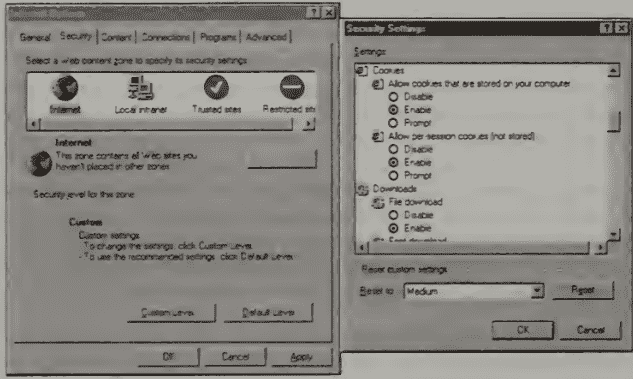

## 图9-1 在Internet Explorer中接受会话级Cookie

要执行本章中的某些活动，您必须能够访问一个Web应用程序。服务器上可以以多种方式设置Web应用程序。如果您运行的是个人Web服务器，那么默认情况下您的Web应用程序位于`C:\Inetpub\wwwroot`。您可以将全局应用程序文件存储在`C:\Inetpub\wwwroot`中。如果您运行的是IIS，您的默认Web应用程序同样位于`C:\Inetpub\wwwroot`。您可以将Web应用程序文件复制到此目录中。如果您在多用户环境中运行IIS，可以使用虚拟网站或虚拟目录创建多个Web应用程序。安装和配置IIS超出了本书的范围。您可以在`http://www.microsoft.com/ntserver/Web/default.asp`和`http://msdn.microsoft.com/workshop/server/default.asp`了解更多关于IIS的信息。安装IIS时安装的帮助文件也将提供有关配置虚拟网站和目录的信息。帮助文件位于IIS的`C:\WINNT\help\iis\default.htm`。您也可以通过默认网站`http://www.yourdomain.com/iishelp/`访问帮助文件。

## 应用程序在第一个用户访问扩展名为.asp的页面时启动。应用程序启动时，将执行`Application_OnStart`子程序。此子程序可用于初始化应用程序变量。应用程序级变量可以跟踪同一应用程序中多个用户的信息。例如，应用程序变量可以包括Web应用程序的名称。应用程序变量维护在应用程序内容集合中。应用程序变量不会因用户而异。在全局应用程序文件中定义的函数和子程序被视为本地函数；它们对其他Web网页不可用。但是，在全局应用程序文件中定义的变量被视为全局变量，对Web应用程序中的所有Web网页都可用。以前，当您创建带有全局变量的Web网页时，这些变量仅对同一Web网页内的脚本可用。由于这些全局应用程序变量对Web应用程序中的任何Web网页都可用，有时它们被称为`超级全局`变量。您可以在`http://msdn.microsoft.com/library/psdk/iisref/vbob8zw4.htm`了解更多关于应用程序对象的信息。

> **编程提示** 您可以在`http://msdn.microsoft.com/library/psdk/iisref/iiwauslw.htm`了解更多关于ASP内置对象和Web应用程序的信息。所有ASP内置对象的快速参考卡位于`http://msdn.microsoft.com/library/psdk/iisref/iiwaref.htm`。

## 应用程序变量

应用程序变量作为名称和值对的数组存储在应用程序对象的`contents`集合中。要创建应用程序变量，请标识应用程序对象、引号内的变量名称、赋值运算符(`=`)和值。您可以将变量标识为应用程序`contents`集合的一部分，但这是可选的。如果应用程序变量的值是数字，请不要使用引号。在应用程序变量前添加`app`或`a`等前缀以区分应用程序级变量、会话级变量和局部变量，这很有用。下面是声明应用程序变量并为变量赋予数字值的语法。由于关键字`Contents`和`Item`属性是可选的，所有三个示例将产生相同的结果。

```
Application.Contents.Item("ApplicationVariableName") = NumericExpression
Application.Contents("ApplicationVariableName") = NumericExpression
Application("ApplicationVariableName") = NumericExpression
```

下面是声明应用程序变量并为变量赋予字符串值的语法。字符串可以是解析为单个字符串的表达式。所有三个示例将产生相同的结果。

```
Application.Contents.Item("ApplicationVariableName") = "String Expression"
Application.Contents("ApplicationVariableName") = "String Expression"
Application("ApplicationVariableName") = "String Expression"
```

> **编程提示** 每当您使用应用程序或会话变量时，您都在使用系统资源（包括内存）来存储变量的值。因此，您应该只在必要时使用应用程序和会话变量。例如，如果一个会话变量仅用于在主页上欢迎用户，那么请使用局部变量而不是会话变量。

与表单集合和`QueryString`集合不同，会话对象的`contents`集合要求您直接从所有会话变量中检索值。由于应用程序变量存储在集合数组中，您必须使用其名称或在集合数组中的索引位置来指定要检索的变量。集合中的第一个应用程序变量由数字1标识。以下示例代码说明了如何检索第一个应用程序变量。

```
<% = Application.Contents(1) %>
<% = Application.Contents.Item(1) %>
```

在全局应用程序文件中为应用程序变量赋值后，您可以在Web应用程序中的任何Web网页中检索此值。要检索应用程序变量，请指定应用程序对象和变量的名称。检索到后，您可以对应用程序变量执行许多操作。例如，您可以使用`response`对象的`write`方法将应用程序变量的值写入Web网页。您也可以将值放入局部变量中。下面的代码示例展示了如何检索名为`appName`的应用程序变量，将其写入Web网页，并将应用程序变量的值存储在局部变量中。

```
<%= application("appName") %>
dim strAppName
strAppName = application("appName")%>
```

编程提示：一旦检索到应用程序变量，它就可以显示在页面上、写入文件、添加到数据库，并在函数、过程、表单和计算中使用。如果服务器停止，用于存储应用程序变量的内存将被释放。因此，建议您在`Application_OnStart`子程序中分配静态应用程序变量。服务器重新启动时，这些值将被重新分配。如果值是动态的，那么您应该将它们写入文件或数据库，在`Application_OnStart`子程序中检索它们，并将它们重新分配给应用程序变量。您将在本书后面学习如何读写文件系统和数据库。

如下例所示，`count`属性将返回应用程序`contents`集合中的项目数。`count`属性也可用于遍历整个`contents`集合。在下面的示例代码中，脚本将显示`count`值，然后显示应用程序`contents`集合中的每个值。请注意，迭代必须从1开始，因为`contents`数组从1开始。该代码利用`count`属性来确定遍历`contents`列表的次数。

```
应用程序变量的总数是：
<% = Application.Contents.Count %>
<br><br>
以下是contents集合中的应用程序变量列表：<br><br>
<% dim i
For i = 1 to Application.Contents.Count
    Response.Write(Application.Contents(i) & "<br>")
    i = i+1
next %>
```

永恒的编程挑战是可以用来完成相同任务的各种方法。下面的示例代码使用元素名称而不是其索引位置来检索值。

```
<%
for each eachElement in Application.Contents
    response.write(Application.Contents(eachElement) & "<br>")
next %>
```

由于应用程序对象的`contents`集合是一个数组，它可以存储字符串、数字、对象，甚至其他数组。以下示例代码将名为`Courses`的数组分配给名为`appcourse`的应用程序变量。在`global.asa`中，代码声明一个名为`appcourse`的变量。

```
Sub Application_OnStart
Application.Contents("appcourse")= 0
End Sub
```

下面的代码创建名为`Courses`的数组，并将数组的内容分配给应用程序变量。

```
Dim Courses(3)
Courses(0) = "Internet Basics"
Courses(1) = "Introduction to HTML"
Courses(2) = "JavaScript"
Courses(3) = "ASP"
Application.Contents("appName") = Courses
```

然后，您可以通过将数组分配给应用程序变量，轻松地在Web应用程序中的任何ASP页面中检索该数组。然后，您可以执行诸如显示数组的各个元素等操作。下面的示例代码创建名为`Courses`的数组，然后从应用程序变量`appcourse`中检索数组中的元素。然后，代码使用`For Next`循环显示数组的内容。当您在第4章学习创建循环时，它们是客户端循环；请注意，这里的循环是在服务器上解释的，因此使用`response.write`方法而不是`document.write`。

```
Dim Courses(3)
Courses = Application("appcourse")
Response.write "The list of courses we offer is:"
Response.write "<br><br>"
dim i
i = 0
for each eachElement in Courses
    response.write(Courses(i) & "<br>")
    i = i+1
next
%>
```

# 第9章 维护客户端与服务器之间的状态

你可以单独移除一个应用程序变量，也可以移除`Contents`集合中的所有变量。`Remove`方法允许你移除单个变量。下面的示例将移除一个名为`appcourse`的应用程序变量。你可以使用名称或索引编号来指定要移除的变量。

```
<%
Application.Lock
Application.Contents.Remove "appcourse"
Application.UnLock
%>
```

当应用程序结束时，所有应用程序变量会被自动移除。`RemoveAll`方法允许你移除整个变量数组。下面的示例代码释放所有应用程序变量，通常放置在全局应用程序文件的`Application_OnEnd`子程序中。

```
<%
Application.Lock
Application.Contents.RemoveAll
Application.UnLock
%>
```

# 创建应用程序变量

请按照以下步骤创建全局应用程序文件、定义应用程序变量以及检索应用程序变量。要使此操作正常工作，你的数据目录必须被定义为 Web 应用程序。

- 1. 打开记事本或你的网页编辑器。

2. 添加代码以创建四个子程序，如下所示。你必须指定`runat`属性以标识该脚本在服务器上处理。

```
<script language = "vbscript" runat = "server">
Sub Application_OnStart
End Sub
Sub Application_OnEnd
End Sub
Sub Session_OnStart
End Sub
Sub Session_OnEnd
End Sub
</script>
```

- 3. 在`Application_OnStart`子程序中，声明三个应用程序变量。

```
Application("AppName") = "Tech World"
Application("AppEmail") = "info@techworld.com"
Application("AppCounter") = 0
```

- 4. 将页面保存为`global.asa`，放在数据目录的根目录下。要使此操作正常工作，你的数据目录必须被定义为 Web 应用程序。

5. 使用记事本或你的网页编辑器，创建一个网页来检索全局变量。

```
<html><head>
</head>
<body>
</body>
</html>
```

6. 添加标题标签。在标题标签中，添加代码以从应用程序变量`AppName`中显示应用程序名称。

```
<title><% = Application("AppName") %></title>
```

7. 在 body 中，添加一个标题，输出应用程序变量`AppName`中的应用程序名称。

```
<h2>Welcome to the <% = Application("AppName")%> Web site</h2>
```

8. 将`AppEmail`应用程序变量的值作为锚标签的参数输出。这允许用户点击链接向`AppEmail`应用程序变量中列出的电子邮件地址发送邮件。

```
<h3>E-mail us at:
<a href="mailto:<% = Application("AppEmail")%>">
<% = Application("AppEmail")%></a></h3>
```

9. 输出`AppCounter`应用程序变量中的访问者数量。

```
<h3>There have been <% = Application("AppCounter")%> visitors to this Web site.</h3>
```

10. 将页面保存为`globalVariable.asp`到你的数据目录。在浏览器中查看该网页。

请注意，在前面的练习中，应用程序变量中的信息被输出到网页上。然而，访问者数量始终显示为`0`。要更改应用程序变量，你必须在全局应用程序文件中创建脚本。由于所有用户都可以访问全局应用程序文件子程序，因此锁定应用程序变量的值非常重要，以便一次只有一个用户可以更改该值。当用户完成更改应用程序变量后，变量会被解锁，以便其他用户可以访问它。更改应用程序变量不会在`Application_OnStart`子程序中进行。因为是单个用户在修改应用程序变量，所以你需要使用`Session_OnStart`子程序来修改应用程序变量。请按照以下步骤使用应用程序变量创建网站计数器。

1. 将之前的`global.asa`文件重命名为`global1.asa`。你将创建一个新的全局应用程序文件。一个 Web 应用程序中只能有一个全局应用程序文件。

2. 打开记事本或你的网页编辑器。

# 第9章 维护客户端与服务器之间的状态

3. 添加代码以创建四个子程序。

```
<script language = "vbscript" runat = "server">
Sub Application_OnStart
End Sub
Sub Application_OnEnd
End Sub
Sub Session_OnStart
End Sub
Sub Session_OnEnd
End Sub
</script>
```

4. 在`Application_OnStart`子程序中，声明一个名为`AppNumUsers`的应用程序变量，该变量将存储访问过你网站的用户总数。

`Application("AppNumUsers") = 0`

5. 在`Session_OnStart`子程序中，添加一个脚本，将`AppNumUsers`变量递增一。你必须在修改变量之前锁定变量，在修改变量之后解锁变量。

```
Application.Lock
Application("AppNumUsers") = Application("AppNumUsers") + 1
Application.Unlock
```

6. 将页面保存为`global.asa`，放在数据目录的根目录下。要使此操作正常工作，你的数据目录必须被定义为 Web 应用程序。

7. 打开记事本或你的网页编辑器，创建一个将显示之前网站访问者数量的网页。添加相应的 HTML 标签，并将页面标题设为`Number of Visitors`。

```
<html><head><title>Number of Visitors</title></head>
<body>
</body></html>
```

8. 添加一个二级标题标签，使用`AppNumUsers`应用程序变量标识网站中的用户数量。

```
<h2>There have been <%= Application("AppNumUsers")%>
visitors to this Web site.</h2>
```

9. 将页面保存为`myCounter.asp`到你的数据目录。在浏览器中查看该网页。

# StaticObjects 集合

**组件**是封装在动态链接库（`.dll`）或可执行文件（`.exe`）中的可执行代码。在服务器或客户端安装组件后，你可以使用组件内置的对象、属性、方法和事件处理程序。组件必须使用 Web 服务器上的`RegSvr32`工具进行安装和注册。

### Application 对象

组件可以包含一个对象集合，因此有时也被称为对象。你可以在 MSDN 在线库（`http://msdn.microsoft.com/library/`）和`http://msdn.microsoft.com/workshop/components/`上了解更多关于组件的信息。

在使用这些对象的属性和方法之前，你必须实例化该组件。你可以在服务器或客户端安装组件。由于安装不受信任的对象可能危及客户端的安全性，许多用户不允许你在他们的计算机上安装组件。本节讨论的是服务器组件。ASP 内置服务器对象有一个名为`CreateObject`的方法，允许你在服务器上实例化对象。当`CreateObject`方法创建对象时，它将立即开始使用系统资源。为了节省系统资源，务必要在不再需要时尽快释放使用`CreateObject`方法创建的对象。

`StaticObjects`集合是`CreateObject`方法的替代方案。`StaticObjects`集合包含通过`<object>`标签添加的对象。`Application`和`Session`对象都包含一个`StaticObjects`集合。使用`object`标签创建的`Session`对象仅对单个会话可用。使用`object`标签创建的`Application`对象对所有会话都可用。如果你使用`object`标签，服务器对象在被代码调用之前不会被创建。因此，使用`object`标签不会消耗任何系统资源。

要使用`object`标签调用服务器对象，组件必须已安装在服务器上。你需要通过组件的注册名称（`PROGID`）或注册编号（`CLSID`）来标识该组件。下面是使用`object`标签创建广告轮播对象的示例代码，展示了两种命名约定。

```
<object runat = "server" ID = "WebAds"
classid = "Clsid:1621F7C0-60AC-11CF-9427-444553540000">
</object>
<object runat = "server" ID = "WebAds"
progid = "MSWC.AdRotator">
</object>
```

`object`标签还允许你在客户端浏览器中插入对象，如 ActiveX 控件。浏览器将在客户端安装该对象。有关使用 Visual Basic 构建 ActiveX 控件的更多信息，请访问`http://msdn.microsoft.com/library/devprods/vs6/vbasic/vbcon98/vbconcreatingolecomponents.htm`。

`Application`和`Session`对象很容易被误用。如果你在`Application`或`Session`对象中存储大量或大型对象，它们将消耗大量服务器内存资源，从而对服务器性能产生负面影响。另一种常见的误用是在`Session`对象中存储数据库对象，例如连接对象。连接对象允许你创建并打开到数据库的连接。数据库限制了并发连接的数量。如果你创建一个连接对象，打开连接，并将连接存储在`Session`对象中，你将

## 9 第9章 维护客户端和服务器之间的状态

会对你服务器的性能产生负面影响。如果你将打开的连接存储在会话对象中，这些连接将一直保持打开状态，直到会话对象关闭为止。可能会有大量的会话包含数据库连接，但实际上并未在使用这些连接。这将减少你网站可用的数据库连接数量。

## 会话对象

当用户从Web应用程序请求一个ASP页面时，会话就开始了。这个首次ASP页面请求会引导全局应用程序文件启动`Session_OnStart`子程序。会话的结束不如会话的开始那样定义明确。只要用户在服务器上保持活动状态，会话就会一直保持。当用户关闭浏览器应用程序、达到超时时间限制、或使用`abandon`方法放弃会话时，会话就会结束。当会话结束时，会调用`Session_OnEnd`子程序。

会话对象内部有一个`contents`集合，其中包含所有的会话变量。会话级变量在单个用户的会话中跟踪信息。因此，存储在会话变量中的值会因用户而异。虽然应用程序变量必须在全局应用程序文件中声明，但会话变量可以在Web应用程序中的任何ASP页面内创建。会话对象包含多个属性，例如`timeout`，可帮助你配置会话。会话对象还包含多个只读属性，包括`SessionID`，允许你标识单个用户的会话。使用会话变量，可以跟踪用户的各类信息。你可以将这些信息保存在文件、cookie或数据库中。当用户打开新会话时，这些信息可以在之后被检索到。因此，可以跨用户会话跟踪这些信息。Privacy.Net提供了一个分析网页，列出了可以按用户进行监控的信息。该网站只需要一个唯一的信息，例如你的IP地址或电子邮件地址，就能跨用户会话跟踪你的信息。当你重新登录该网站时，服务器可以从文件、cookie或数据库中检索关于你的所有信息。你可以在`http://msdn.microsoft.com/library/psdk/iisref/iiapsess.htm`了解更多关于会话对象的信息。

> 在多用户环境中，一个Web应用程序只能有一个全局应用程序文件。如果每个用户的目录位于默认网站中，则该目录将位于默认Web应用程序内。默认的全局应用程序文件将在用户之间共享。由于会话变量不必在全局应用程序文件中定义，你可以在不编辑全局应用程序文件的情况下使用会话变量。在用户之间共享的默认全局应用程序文件无需修改。开发者可以在自己的网页中创建会话变量，而不会与其他开发者产生冲突。

### 会话变量

要创建一个会话变量，需要指定会话对象、用引号括起来的会话变量名称、赋值运算符（`=`）和值。你可以将变量指定为`contents`集合的一部分，但这是可选的。如果会话变量的值是数字类型，则不需要使用引号。给会话变量添加前缀（如`sess`或`s`）是很有用的，可以帮助区分应用程序级和会话级变量与局部变量。下面是声明会话变量并赋值的语法。

```
Session.Contents("SessionVariableName")= NumericValue
Session("SessionVariableName")= NumericValue
Session("SessionVariableName")= "String Value"
```

在给会话变量赋值之后，你可以在网站中的任何ASP页面中检索该值。要检索会话变量，需要指定会话对象和变量名称。与应用程序变量一样，会话变量可以用于执行多种操作，例如在网页中显示值或将值赋给变量。下面是示例代码，展示如何检索会话变量、将其写入网页，以及将会话变量的值存储在局部变量中。

```
<%= Session.Contents("SessionVariableName")%>
<%= Session("SessionVariableName")%>
<%dim strSessVarName
strSessVarName = Session ("SessionVariableName")%>
```

会话变量和应用程序变量一样，存储在集合中。你不能像从`form`和`QueryString`集合中那样直接从所有会话变量中检索变量。你必须通过变量名称或其在集合中的索引位置来指定要检索的变量。集合中的第一个会话变量通过数字1来标识。以下示例代码展示如何检索第一个会话变量并将其写入浏览器。

```
<% = session.contents(1) %>
```

会话对象的`contents`集合与应用程序对象的`contents`集合一样，是一个数组。`Remove`和`RemoveAll`方法适用于会话对象的`contents`集合。你可以使用`count`属性来确定集合中元素的数量。你也可以将数组赋值给会话变量，就像使用应用程序对象一样。

#### 使用会话变量

在下面的练习中，你将创建一个名为`create.asp`的页面，用于静态地赋值会话变量。然后你将创建一个名为`member.asp`的页面来检索会话变量。如果用户是会员，网页将显示适用于会员的会话变量。如果用户不是会员，他或她将被重定向到一个名为`nonmember.asp`的非会员网页。非会员网页显示适用于非会员的会话变量。

按照以下步骤定义和检索会话变量。

1. 使用记事本或其他兼容ASP的编辑器创建一个网页。

2. 创建脚本以定义五个会话变量，如下所示。`sessMemberName`变量将保存访问者的姓名。`sessMemberFee`和`sessNonMemberFee`变量保存向访问者账户收取的费用。`sessMember`变量用于标识用户是否为该网站的注册会员。由于此页面不需要向用户显示任何内容，因此你无需添加任何HTML标签。

```
<%
session.contents("sessMemberName")= "Maria Murphy"
session.contents("sessMemberFee")= 35.00
session.contents("sessNonMemberFee")= 50.00
session.contents("sessMember")= "No"
session("sessLastTimeVisited") = now()
%>
```

3. 将页面保存为`create.asp`到你的数据目录。

4. 使用记事本或其他兼容ASP的编辑器创建第二个网页。此页面将显示非会员的会话变量。

5. 添加基本HTML标签和一个标题为`非会员`的二级标题。

```
<html><head>
<title>Nonmembers</title></head>
<body>
<h2>Nonmembers</h2>
```

6. 在正文部分添加脚本，显示`sessMemberName`、`sessNonMemberFee`和`sessLastTimeVisited`会话变量。

```
Welcome
<%= session.contents("sessMemberName") %><br>
You were last here on
<%= session.contents("sessLastTimeVisited") %><br>
<hr>
The cost of your purchase is
$<%= session("sessNonMemberFee") %><br>
```

7. 在计算中使用会话变量。计算非会员费用与会员费用之间的差额。使用`formatCurrency`方法将输出格式化为货币格式，并使用`write`方法将输出写入页面。

```
<% dim sv
sv = session("sessNonMemberFee")-session("sessMemberFee")
%>
You would have saved
<%= formatCurrency(sv) %>
if you were a member
</body></html>
```

8. 将页面保存为`nonmember.asp`到你的数据目录。

9. 在记事本或其他兼容ASP的编辑器中创建第三个ASP页面。这将是为会员显示的页面。

10. 添加基本HTML标签，并将`response`对象的`buffer`属性设置为`true`。

```
<% response.buffer = "true" %>
<html><head>
<title>Members</title>
</head>
<body>
```

11. 在正文中添加一个脚本，检查用户是否为会员。如果不是，则将用户重定向到`nonmember.asp`页面。如果访问者是会员，则显示一条个性化的声明，说明访问者作为会员节省了多少金额。

```
<% if session("sessMember")="No" then
	response.redirect("nonmember.asp")
else %>
	<h2>Members Only</h2>
	Welcome
	<%= session.contents("sessMemberName") %>
	<br>
	You were last here on
	<%= session.contents("sessLastTimeVisited") %>
	<hr>
	The cost of your purchase is
	$<%= session("sessMemberFee") %>
	<br>
	<% dim sv
	sv = session("sessNonMemberFee")-session("sessMemberFee")
	%>
	You saved <%= formatCurrency(sv) %>
	because you are a member
<% end if %>
```

```
</body></html>
```

12. 将页面保存为`member.asp`到你的学生目录。

13. 在浏览器中查看`create.asp`页面。此页面创建会话变量。你将看到一个空白网页。浏览器中的源代码将显示在未指定内容时发送到浏览器的默认HTML标签。

14. 在浏览器中查看`member.asp`页面。由于你将`sessMember`会话变量设置为`No`，非会员将被重定向到`nonmember.asp`页面。

15. 返回并将在`create.asp`中的`sessMember`会话变量更改为`Yes`。保存你的更改。

16. 查看`create.asp`页面以重置会话变量的值。

17. 在浏览器中查看`member.asp`页面。由于你将`sessMember`会话变量设置为`Yes`，访问者将收到网站的欢迎，并显示该访问者作为会员所节省的金额。

在上述练习中，你是静态分配会话变量的。在下一个练习中，你将创建一个表单，允许用户输入他们的姓名并选择其会员状态（参见图 9-2）。然后，你将创建一个页面来检索这些值并将其分配给会话变量。用户将被重定向到你在上一个练习中创建的同一个`member.asp`页面。这种方法不是用静态值分配会话变量，而是允许用户输入他或她的姓名和会员状态。

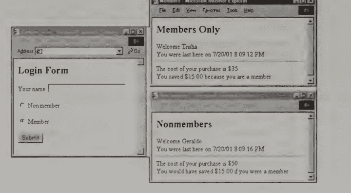

**图 9-2** 使用会话变量存储数据

1. 使用记事本或你的网页编辑器创建一个页面，该页面包含一个表单，用于检索用户信息并将其分配给会话变量。

2. 添加基本的 HTML 标签和表单标签。表单将使用`post`方法发送，并由名为`checkmember.asp`的页面处理。

```
<html>
<head><title>Member Form</title></head>
<body>
<h2>Login Form</h2>
<form method="post" action="checkmember.asp">
Your name: 
<input type="text" name="txtName" size="25">
<br><br>
<input type="radio" value="No" name="member">
Nonmember <br><br>
```

```
<input type="radio" value="Yes" name="member" checked>
Member <br><br>
<input type="submit" value="Submit" name="btnSubmit">
</form>
</body></html>
```

3. 将该页面保存为`memberform.asp`到你的数据目录。

4. 在记事本中打开`create.asp`并将页面保存为`checkmember.asp`。按如下所示修改代码以检索表单值，并将它们分配给会话变量。请注意，一些会话值是静态的，一些是从表单字段动态分配的。

```
<%
session.contents("sessMemberName") = request.form("txtname")
session.contents("sessMemberFee") = 35.00
session.contents("sessNonMemberFee")= 50.00
session.contents("sessMember") = request.form("member")
session("sessLastTimeVisited") = now()
%>
```

5. 在浏览器中查看`memberform.asp`页面。输入你的姓名并选择`Member`单选按钮。点击`Submit`按钮进入`member.asp`页面。会员信息将显示出来。返回`checkform.asp`页面并选择`Nonmember`单选按钮。点击`Submit`按钮进入`member.asp`页面。非会员信息将显示出来。

6. 修改`checkmember.asp`页面，以便当用户完成表单时，浏览器立即重定向到`member.asp`页面。（提示：你可以在会话变量定义后添加如下所示的代码。确保代码插入在结束的内联脚本标签之前。）

```
response.redirect "member.asp"
```

7. 将`checkform.asp`页面保存到你的数据目录。在浏览器中查看`checkform.asp`页面。输入你的姓名，选择`Member`单选按钮，然后点击`Submit`按钮。返回`checkform.asp`页面并选择`Nonmember`单选按钮。点击`Submit`按钮。

##### Timeout 属性

会话对象包含可以从 ASP 页面访问的多个属性和方法。其中之一是`timeout`属性，它标识在用户处于非活动状态时会话允许保持打开状态的时间量。换句话说，如果用户访问了一个页面，然后去吃饭一小时后返回，会话将已经过期。当用户点击新的 ASP 页面时，将启动一个新的会话。虽然用户注意不到任何变化，但会话变量在会话之间不会被保存。你需要将会话变量分配给 cookie、文本文件或数据库，以便保存会话变量的值。然后，当用户返回网站时，你可以检索这些值并重新将它们分配给会话变量。这个值被所有用户会话继承，而不仅仅是当前活动的用户会话。时间量以分钟为单位测量，默认超时时间为 20 分钟。如果你更改`timeout`属性，请勿在超时值周围放置引号。以下是检索会话对象`timeout`属性的语法。

```
Session.Timeout
```

`timeout`属性仅适用于会话对象。应用程序对象没有`timeout`属性。应用程序对象在 Web 应用程序运行时可用。即使用户的会话结束，应用程序变量中的内容仍将在用户的下一个会话中可用。以下是更改会话对象`timeout`属性的语法。

```
Session.Timeout = timeoutInMinutes
```

##### SessionID 属性

每个会话都由一个称为`SessionID`的唯一标识符来标识。`SessionID`可以通过会话对象的`SessionID`属性获取。这个数字由几个因素决定，例如当前日期以及客户端和服务器的 IP 地址。你无法更改`SessionID`属性的值，它使用一个特殊的会话 cookie 来维护会话信息。当会话结束时，cookie 将被丢弃，包括`SessionID`号码。如果用户打开一个新的会话，将发放一个新的`SessionID`。因此，`SessionID`可以用于在单个会话中跟踪用户，但不能在多个会话中跟踪用户。要在多个会话中跟踪用户，可以结合使用其他信息和技术与`SessionID`。例如，cookie 和数据库用于存储关于个人身份的信息。`SessionID`不是在电子商务应用中识别个人的推荐方法，因为如果服务器关闭或崩溃，或者你使用多个 Web 服务器来托管 Web 应用程序，可能会发放重复的`SessionID`。以下是检索会话对象`SessionID`属性的语法。

```
Session.SessionID
```

你可以将`SessionID`的值分配给一个变量或数据库中的一个字段，也可以将该值写入 cookie。`SessionID`也可以作为参数在表单中传递，作为隐藏字段或输入字段。下面的示例代码展示了如何在文本框和隐藏表单字段中显示`SessionID`属性（参见图 9-3）。

```
<input type = "text" name = "txtSID"
    value = "<% = Session.SessionID %>">
<input type = "hidden" name = "hiddenSID"
    value = "<% = Session.SessionID %>">
```

## 会话对象 333


图 9-3 在表单字段中传递 SessionID

按照以下步骤使用表单传递`SessionID`。

1. 使用记事本或其他兼容 ASP 的编辑器创建一个 Web 页面。

2. 添加基本的 HTML 标签和标题，并将`buffer`属性设置为`true`。

3. 添加验证用户的代码。用户名为`admin`，密码为`pass`。

4. 添加如果用户是`admin`账户则显示表单字段值和`SessionID`的代码。

```
<% response.buffer = "true" %>
<html><head><title>Login Form</title></head>
<body bgcolor="#FFCC99" text="#800000">
<h1 align="center">Login Form</h1>
```

```
<% if request.form("txtName")= "admin"
    and request.form("txtPass")= "pass" then %>
```

```
<h3>
The username was: <%= request.form("txtName") %>
<br>
The password was: <%= request.form("txtPass") %>
<br><br>
The current SessionID is: <%= session.sessionID %>
<br>
The value of the text field was:
<%= request.form("txtSID") %>
<br>
The value of the hidden field was
<%= request.form("hiddenSID") %>
</h3>
```

5. 添加如果用户不是`admin`账户则显示表单的代码。

```
<% else %>
    <form name="form" method="post"
        action="loginSession.asp">
    Username:
    <input type="text" name="txtName" size="20">
    <br>Password:
    <input type="password" name="txtPass" size="20">
    <br><br>SessionID:
    <input type="text" name="txtSID"
        value = "<% = Session.SessionID %>">
    <input type="hidden" name="hiddenSID"
        value = "<% = Session.SessionID %>">
    <br><br>
    <input type="submit" value="Login" name="btnLogin">
    <input type="reset" value="Clear Form" name="btnClear">
    </form>
```

6. 添加结束标签。

```
<% end if %>
</body></html>
```

7. 将该 Web 页面保存为`loginSession.asp`到你的数据目录。

8. 在浏览器中查看该 Web 页面。填写表单，使用用户名`admin`和密码`pass`。点击`Login`按钮。当前`SessionID`的值对于隐藏字段和文本框表单字段应该是相同的。

9. 关闭浏览器，这将结束会话。再次在浏览器中查看该 Web 页面。`SessionID`的值应该是不同的。

##### Abandon 方法

当达到会话超时时间、用户关闭浏览器或会话被放弃时，会话将停止。某些浏览器会保持会话打开，即使用户正在访问其他网站。大多数浏览器在浏览器应用程序关闭时会结束会话。你可以通过调用会话对象的`abandon`方法来强制放弃会话。`abandon`方法优雅地停止会话；ASP 引擎在结束会话之前执行`Session_OnEnd`子程序。然而，由于所有浏览器对会话的处理方式并不相同，有时即使调用了`abandon`方法，会话仍保持打开状态，直到用户关闭浏览器。一些网站会包含一个注销按钮，执行脚本以优雅地为用户关闭会话。你可以在调用注销脚本时调用`abandon`方法。以下是使用`abandon`方法放弃会话的语法。

```
Session.Abandon
```

**编程提示**

`Abandon`方法可用于将用户从受保护的网站注销。你可以使用`Redirect`方法，或创建一个`注销`按钮或超链接，将用户定向到注销页面。

##### CodePage 和 LCID 属性

如今，许多 Web 应用程序正在国际范围内使用。对于国际化的网站，其他有用的会话属性包括`CodePage`和`LCID`。这些属性在开发供美国以外地区使用的网站时会用到。`CodePage`标识特定于某一地区的字符、数字和标点符号类型，该地区被称为**区域设置（locale）**。`CodePage`被分配一个数值，该数值必须与服务器上安装的字符集相匹配。如果你在具有默认设置的计算机上运行 PWS，`LCID`将返回 0。如果你在具有默认设置的服务器上运行 IIS，`LCID`将返回 1252，这代表西方语言（美国英语）。无论你是运行 PWS 还是 IIS，默认的`LCID`设置都是 2048，代表美国英语区域 ID。以下是用于显示`CodePage`设置的代码。

```
<% = Session.CodePage %>
```

`LCID`用于格式化日期、时间和货币的本地设置。以下是显示默认`LCID`设置并使用默认设置格式化整数的示例代码。然后该代码将`LCID`属性设置为另一个值，并使用新的货币设置格式化该整数。`LCID`值 2057 代表英国英语。一旦你更改了`LCID`，会话中的任何页面都将使用这些设置。要返回默认设置，用户必须关闭浏览器以结束会话，或者用户可以在脚本中调用`Abandon`方法来结束会话。

```
<% dim i
i = 2420.35 %>
The default LCID is <%= Session.LCID %><BR>
Today is : <%= date() %> <BR>
The cost was: <%= formatcurrency(i) %><BR><BR>
<% Session.LCID = 2057 %>
The new LCID is <%= Session.LCID %><BR>
Today is : <%= date() %> <BR>
The cost was: <%= formatcurrency(i) %>
```

## COOKIES

Cookies 用于跨会话维护有关单个用户的信息。回顾前面的章节，cookie 是存储在客户端本地计算机上的一小段信息。如果你使用 Netscape Navigator，所有 cookie 都存储在一个名为`cookies.txt`的文本文件中，该文件通常位于 Netscape 应用程序的根目录下。所有 Web 服务器都可以写入此 cookie 文件。如果你在 Windows 98 或 95 上使用 Internet Explorer，那么 cookie 通常位于系统根目录下的`Cookies`目录中，该目录用于存储临时 Internet 文件。在 Windows 2000 中，cookie 通常位于存储临时 Internet 文件的目录中。每个 Web 服务器在该目录中写入一个单独的 cookie 文件。

由于客户端可以随时删除其 cookie，因此你的 Web 应用程序不应依赖于 cookie 的存在。始终为选择不接受 cookie 或删除其 cookie 的用户提供替代方法。客户经常误解 cookie 的用途、价值、结构和安全性。建议你在网站上创建一个 Web 页面，向用户告知网站的隐私和安全策略。在此页面上，你应该提供 cookie 的定义，告知用户网站是否使用 cookie，解释 cookie 中存储的信息，并描述 cookie 的用途。你还应告知用户，只有写入 cookie 的服务器才能读取该 cookie。TRUSTe（`www.etrust.com`）提供了你可以包含在隐私和安全策略 Web 页面中的示例。以下是包含有关 cookie、隐私问题的更多信息以及讨论 cookie 的更多网站链接的 Web 页面列表。

Life Beyond Yahoo 网站：

- `http://www.lifebeyondyahoo.com/life/cookies.asp`

Microsoft 网站：

- `http://www.microsoft.com/info/cookies.htm?RLD=291`

- `http://msdn.microsoft.com/library/wcdoc/wcecomm/wcinet_18.htm`

- `http://msdn.microsoft.com/library/default.asp?URL=/library/wcdoc/wcecomm/wcinet_16.htm`

- `http://msdn.microsoft.com/workshop/server/toolbox/cookie.asp`

大多数用户并没有透彻了解 cookie 到底是什么。Cookie 文件存储 cookie 的名称、值以及写入该 cookie 的服务器名称。图 9-4 显示了 cookie 的内容。存储在 cookie 中的信息可以很容易地存储在服务器上。将 cookie 存储在客户端提供了一种自动化活动的方式，例如登录过程或填写表单。在安全和隐私页面上提供一个 cookie 样本示例是非常有用的。Cookie 限制为四 KB 数据。大多数 cookie 大约为 100–200 字节。当前允许的最大 cookie 数量为 300 个。如果达到限制，最旧的 cookie 将被删除。Cookie 的最大磁盘空间为 1.2 MB，大约相当于一张软盘的大小。如今，硬盘驱动器可以存储数以千兆字节计的数据。因此，cookie 不会`占用`客户端的硬盘空间。大多数情况下，罪魁祸首是包含客户端访问过的所有图形和 Web 页面的浏览器缓存文件。


### 写入 Cookie

ASP 提供了一种简单的方法来写入和读取 cookie。Cookie 使用`Response`对象写入，使用`Request`对象读取。要创建一个 cookie，你需要为它命名并赋予一个值。你还必须确定 cookie 的过期时间。当 cookie 到达其过期日期时，浏览器会删除它们。某些浏览器在关闭时会自动删除没有过期日期的 cookie。因此，在每次写入 cookie 时设置过期日期非常重要。该日期可以是对月份、日期和年份的绝对引用，也可以是相对日期。以下是使用绝对过期日期写入简单 cookie 的语法。

```
<% Response.Cookies("myCookie") = "value" %>
<% Response.Cookies("myCookie").Expires = "MM DD,YYYY" %>
```

在定义过期日期时，你通常希望使用相对日期，因为如果使用绝对日期，那么每次到达该日期时都必须编辑页面。相对日期不需要额外的维护，因为该日期是相对于当前日期的。请记住，`Date`对象返回当前日期。你可以指定从当前日期起的天数（`n`），以设置 cookie 的过期时间。如果你的访客每天都来，那么你可以将 cookie 设置为在`Date + 1`天后过期。如果你的访客每月来一次，你可以将 cookie 设置为在`Date + 30`天后过期。以下是使用相对日期写入简单 cookie 的语法。

```
<% Response.Cookies("myCookie") = "value" %>
<% Response.Cookies("myCookie").Expires = "Date + n" %>
```

以下示例代码创建一个名为`memberstatus`的 cookie，值为`active`。过期日期设置为从当前日期起 30 天。

```
<% Response.Cookies("memberstatus") = "active" %>
<% Response.Cookies("memberstatus").Expires = "Date + 30" %>
```

如果你希望浏览器删除该 cookie，你可以指定一个过去的日期，如`Date – 1`或`July 4, 1776`。浏览器随后会删除该 cookie，因为该 cookie 已过期。你应该为用户提供删除其 cookie 或在浏览器中查看其 cookie 的选项。这将有助于让他们放心，并让他们了解 cookie 实际存储的信息类型。以下是使用相对日期删除 cookie 的语法。

```
<% Response.Cookies("myCookie") = "value" %>
<% Response.Cookies("myCookie").Expires = "Date – n" %>
```

分配给 cookie 的值可以在脚本中硬编码，也可以软编码。硬编码意味着该值写在代码中，除非重写脚本，否则不会更改。该值可以直接指定，也可以来自变量。软编码意味着该值可能会更改。该值通常从表单或脚本中获取。以下示例代码展示了如何从表单中检索值并将其分配给 cookie。

```
dim username
username = Request.Form("txtUserName")
<% Response.Cookies("myCookie") = username %>
<% Response.Cookies("myCookie").Expires = "Date + 30" %>
```

你可能希望在一个 cookie 中存储多个值。例如，你可能将用户偏好或联系信息存储在 cookie 中。你可以创建一个具有多个名称和值的 cookie。这种类型的 cookie 文件实际上是一个**命名 cookie 组（named group of cookies）**。要创建该 cookie，将 cookie 组命名为相同的名称，然后为各个 cookie 及其值命名。

> 这个命名 cookie 组也被称为**字典 cookie（dictionary cookie）**，其中的各个 cookie 有时被称为**cookie 键（cookie keys）**。

命名 cookie 组中的所有 cookie 共享相同的过期日期。当你编写一个包含多个 cookie 的 cookie 时，必须同时编写它们所有。只有在写入 cookie 时指定的 cookie 才会被创建。如果已经写入了同名的 cookie，并且你正在更改该 cookie 或更改过期日期，那么该 cookie 实际上会被覆盖。因此，如果你打算通过在每次访客访问网站时重写 cookie 来使其持久化，请务必在此时写入所有 cookie 及其值。编写 cookie 的语法要求你指定 cookie 组的名称。

> 请注意，`Response`对象将写入 cookie。`Write`方法不用于写入 cookie。`Write`方法用于将字符串值写入 Web 页面。`Response.Cookies`对象实际上是将 cookie 发送到浏览器，由浏览器将 cookie 写入客户端的文件系统。

以下是编写 cookie 组的语法。

```
<% Response.Cookies("GroupCookieName")("CookieName_1")="value" %>
<% Response.Cookies("GroupCookieName")("CookieName_2")="value" %>
<% Response.Cookies("GroupCookieName")("CookieName_n")="value" %>
<% Response.Cookies("GroupCookieName").Expires = "Date [+/-] n" %>
```

以下示例代码创建一个名为`login`的命名 cookie 组。过期日期设置为从当前日期起 30 天。

### 读取 Cookie

你可以通过`request`对象来获取一个 Cookie 的值——无论是单个 Cookie 还是 Cookie 组。要获取具有单一值的单个 Cookie，请指定该 Cookie 的名称。使用 ASP 而非客户端脚本的好处之一在于，`request`对象会为你解析出 Cookie 的名称和值。只需一行代码即可轻松获取 Cookie 的值。以下是获取具有单一值的单个 Cookie 的语法。

```
<% Request.Cookies("CookieName") %>
```

要从 Cookie 组中获取单个 Cookie 的值，你必须同时指定该 Cookie 组的名称和单个 Cookie 的名称。以下是从 Cookie 组中获取单个 Cookie 的语法。

```
<% Request.Cookies("GroupCookieName")("CookieName_n") %>
```

Cookie 通过 HTTP 头从客户端传递到服务器。你可以使用`request`对象从头部获取整个 Cookie。`variables`集合包含所有 HTTP 变量，其中包括存储 Cookie 的`HTTP_COOKIE`变量。你可以使用此服务器变量将整个 Cookie 写入网页。这是一种向客户端展示 Cookie 外观的有效方式，而无需解释 Cookie 的位置或如何打开 Cookie 文件。以下是使用服务器变量`HTTP_COOKIE`从 HTTP 头获取 Cookie 的语法。你可以查看可用的服务器变量列表：`http://msdn.microsoft.com/library/psdk/iisref/vbob5vsj.htm`。

```
<% Request.Servervariables("HTTP_COOKIE") %>
```

有一个名为`hasKeys`的属性，用于标识一个 Cookie 是否包含多个 Cookie。测试一个 Cookie 是否包含多个值非常有用，以避免意外覆盖一个 Cookie（请记住，当你重写一个包含多个 Cookie 的 Cookie 时，必须写入该组中包含的所有 Cookie 的值）。如果你遗漏了其中一个值，该单个 Cookie 将从组中被删除。`hasKeys`属性返回一个布尔值——`true`或`false`。如果该 Cookie 包含多个 Cookie，则`hasKeys`属性返回`true`值。以下是用于标识一个 Cookie 是否包含多个 Cookie 的语法。

```
<% Request.Cookies("GroupCookieName").HasKeys %>
```

### 创建使用 Cookie 的网页

Cookie 可以从同一个网页写入和读取，也可以从不同的网页写入和读取。请按照以下步骤使用变量硬编码一个单个 Cookie。该 Cookie 的值用于通过将 Cookie 的值分配给`bgColor`属性来改变背景颜色。

1.  使用记事本或其他兼容 ASP 的编辑器创建一个网页。

2.  在页面顶部，添加一个用于写入名为`simpleCookie`的 Cookie 的脚本。使用下面的代码，从名为`myBgColor`的变量获取 Cookie 的值。`myBgColor`的值被硬编码为`#CCFF99`。将 Cookie 的过期日期设置为从今天起`30`天后。

```
<%
dim myBgColor
myBgColor= "#CCFF99"
Response.Cookies("simpleCookie")= myBgColor
Response.Cookies("simpleCookie").Expires = Date + 30
%>
```

3.  添加基本的 HTML 标签和一个标题为`Simple Cookie`的标题。

```
<html><head><title>Simple Cookie</title></head>
```

4.  使用`request`对象获取 Cookie 的值。该 Cookie 的值用作`body`标签的`bgColor`属性的参数。

```
<body bgColor = "<% = Request.Cookies("simpleCookie") %>">
```

5.  添加一个格式为一级标题、居中对齐、内容为`Simple Cookie`的标题。

```
<h1 align="center">Simple Cookie</h1>
```

6.  使用`write`方法将 Cookie 的值写入 Web 浏览器。

```
<h2>The value of your cookie was:
<% = request.cookies("simpleCookie") %></h2>
</body></html>
```

7.  将页面保存为`simplecookie.asp`到你的数据目录。在浏览器中查看该网页。网页应该有一个彩色背景。

Cookie 也可以动态生成，其值可以来自用户。在下图（图 9-5）所示的示例中，用户在表单上输入信息，表单中的值用于写入一个 Cookie 组。这些 Cookie 的值可用于执行各种任务，例如让用户登录网络，或修改用户的配置文件。在此示例中，Cookie 的值将显示在浏览器中。

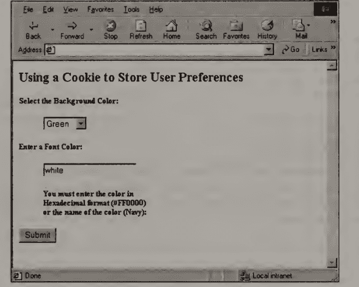

图 9-5 将表单中的值写入 Cookie

1.  使用记事本或其他兼容 ASP 的编辑器创建一个网页。

2.  在页面中添加 HTML 标签和一个标题。

3.  添加表单。该表单将包含一个下拉列表框，列出七种颜色。选择的颜色将用于格式化网页的背景。

```
<html><head><title>Choose Cookie</title></head>
<body><h1>Using a Cookie to Store User Preferences</h1>
```

```
<form method="post" action="groupcookies.asp">
<h3>Select the Background Color:</h3>
<blockquote><p><select size="1" name="bc">
<option value="#008000">Green</option>
<option value="#800000">Maroon</option>
<option value="#800080">Purple</option>
<option value="#000080">Navy</option>
<option value="#FF0000">Red</option>
<option value="#000000">Black</option>
<option value="#FFFFFF">White</option>
</select></p></blockquote>
```

4.  添加一个文本表单字段，允许用户输入字体颜色的选择。

```
<h3>Enter a Font Color:</h3>
<blockquote><p>
<input type="text" name="fc" size="20"></p>
<h3>You must enter the color in <br>
Hexadecimal format (#FF0000) <br>
or the name of the color (Navy):</h3></blockquote>
<p>
<input type="submit" value="Submit" name="btnSubmit">
</p>
</form></body></html>
```

5.  将网页保存为`bgcolorform.asp`到你的数据目录。

6.  使用记事本或其他兼容 ASP 的编辑器创建一个网页。在页面顶部添加一个脚本，用于从表单中检索文本和背景颜色的值。

```
<%
dim bc, fc
bc = request.form("bc")
fc = request.form("fc")
```

7.  添加代码以写入 Cookie 组。该 Cookie 组的名称为`gc`，各个 Cookie 的名称为`bc`和`fc`。设置 Cookie 在 30 天后过期。

```
Response.Cookies("gc")("bc") = bc
Response.Cookies("gc")("fc") = fc
Response.Cookies("gc").Expires = Date + 30
%>
```

8.  添加基本的 HTML 标签，包括`title`标签。

```
<html><head><title>Simple Cookie</title></head>
```

9.  使用`request`对象检索 Cookie 的值。将这些值用作`body`标签的`bgColor`和`text`属性的参数。

```
<body bgColor = "<% = request.cookies("gc")("bc") %>"
  text = "<% = request.cookies("gc")("fc") %>">
```

10. 添加代码以在网页上写入标题和 Cookie 的值。

```
<h1 align = "center">
Using a Cookie to Retrieve User Preferences</h1>
<h2>The name of the cookie group was gc</h2>
<h2>The value of your cookie named bc was:
<% = request.cookies("gc")("bc") %></h2>
<h2>The value of your cookie named fc was:
<% = request.cookies("gc")("fc") %></h2>
</body></html>
```

11. 将网页保存为`groupcookies.asp`到你的数据目录。

12. 使用浏览器查看`bgcolorform.asp`页面。从下拉列表框中选择一种颜色，并在文本框中输入一个有效的颜色。当你点击`提交`按钮时，出现的页面将使用你选择的颜色来更改网页的背景和字体颜色。

### 创建不使用 Cookie 的页面

你可以创建无需使用 Cookie 即可维护信息的应用程序。其中一种选择是通过隐藏文本字段在页面间传递信息。此选项要求你在 Web 应用程序的每个页面内使用表单。另一种方法是使用硬编码的超链接。当用户登录时，你可以为每个用户分配一个唯一的用户标识符。你可以创建一个使用此标识符来标识用户的超链接。所有超链接都需要使用此标识符进行编码。你会将标识符附加到 URL。因为你本质上是在创建一个`QueryString`，所以你可以使用`request`对象来检索标识符的值。第三个选项是使用会话标识符（`SessionID`）来标识客户端。下面的示例代码展示了如何使用标识符硬编码一个超链接。第一个示例硬编码了标识符。第二个示例从表单字段中检索值。第三个示例从会话变量中检索值。第四个示例使用`SessionID`作为标识符。

```
<a href = "cart.asp?ID=123456">
Click here to see your cart</a>
<a href = "cart.asp?ID=<%= = Request.QueryString("userid")
%>">
Click here to see your cart</a>
<a href = "cart.asp?ID=<%= = Session("userid") %>">
Click here to see your cart</a>
<a href = "cart.asp?ID=<%= = Session.SessionID %>">
Click here to see your cart</a>
```

如果用户关闭了 Cookie，则只能使用第一种方法，因为使用 ASP 需要 Cookie。为了避免硬编码标识符，你可以使用客户端脚本在用户输入用户 ID 时从表单中检索值。你可以使用文档对象模型（Document Object Model）为该锚点对象设置`HREF`属性。然而，这只能帮助为该页面动态创建超链接。无法使用客户端脚本从先前访问过的页面检索信息。因此，许多网站确实要求用户开启会话 Cookie。然后，他们就可以使用应用程序和会话变量。你可以向用户讲解客户端 Cookie 和会话 Cookie 之间的区别。然后，来自会话的信息可以被发送到文件或数据库，以跨多个会话关联用户。无论选择哪种方法，能够在用户会话持续期间维护状态都是至关重要的。

### 隐私策略

如今，许多用户不希望允许网站保留关于他们的信息。隐私是所有网站都必须解决的问题，无论它们是否使用 Cookie。以下是一些讨论隐私问题和隐私策略的网站。

- TRUSTe (`http://www.truste.org/`)

- 电子前沿基金会 (`http://www.eff.org/`)

- Life Beyond Yahoo (`http://www.lifebeyondyahoo.com/life/privacy.asp`)

- Privacy.net (`http://www.privacy.net/`)

- CDT - 民主与技术中心 (`http://www.cdt.org/`)

- ACP - 美国计算机隐私协会 (`http://www.computerprivacy.org/`)

- Watchdog (`http://watchdog.cdt.org/`)

## 章节总结

### Web 应用程序

Web 应用程序是由 Web 服务器软件配置的一组文件和文件夹。全局应用程序文件用于维护在整个 Web 应用程序中使用的信息。全局应用程序文件名为`global.asa`，必须位于 Web 应用程序的根目录中。全局应用程序文件包含四个子例程，分别在应用程序启动和停止以及用户会话启动和停止时执行。

### Application 对象

`Application`对象可用于创建适用于所有用户的应用程序变量。应用程序变量必须在全局应用程序文件中定义。如果要更改应用程序变量，需要在更改值之前锁定该变量，然后在更改后解锁该变量。这样可以防止多个用户同时更改值。

### Session 对象

- `Session`对象可用于创建适用于特定用户和特定会话的会话变量。会话变量可以在任何网页中创建，并可在 Web 应用程序中的任何网页中检索。

- `Session`对象包含其他有用的属性，例如`timeout`。`timeout`属性将限制用户会话的时长。默认的`timeout`属性设置为 20 分钟。

- `SessionID`属性由服务器分配，提供了一种在用户会话期间识别客户端的方法。

- `abandon`方法可用于停止单个用户会话。用户也可以通过关闭浏览器应用程序来停止会话。

### Cookie

- Cookie 可用于在多个会话中为特定用户维护信息。Cookie 是存储在客户端计算机上的文本文件。应对 Web 客户端用户进行教育，使其了解 Cookie 的用途以及 Cookie 如何影响其计算机系统。Cookie 与其他 HTTP 服务器变量一起在请求头中传递。

- 简单的 Cookie 可以写入以存储单个值，或者可以将多个 Cookie 存储在命名的 Cookie 组中。Cookie 使用`response`对象写入，使用`request`对象检索。

#### 在全局应用程序文件中创建应用程序变量

```
Application("AppName") = "Tech World"
Application.Contents("AppName") = "Tech World"
```

#### 从网页中检索应用程序变量并将其赋值给变量

```
<%dim strAppName
strAppName = Application("AppName")%>
```

#### 在全局应用程序文件中更改应用程序变量的值

```
Application.Lock
Application("AppNumUsers") = Application("AppNumUsers") + 1
Application.Unlock
```

#### 在 ASP 页面中创建会话变量

```
<%Session("sessMember") = "Maria Murphy"%>
<%Session.Contents("sessMember") = "Maria Murphy"%>
```

#### 从网页中检索会话变量并将其赋值给变量

```
<%dim strSessMember
strSessMember = Session("sessMember")%>
```

#### 将 Session 对象的 timeout 属性写入网页

```
<%= Session.Timeout%>
```

#### 更改 Session 对象的 timeout 属性

```
<%Session.Timeout = 30%>
```

#### 调用 Session 对象的 abandon 方法

```
<%Session.Abandon%>
```

#### 检索 Session 对象的 SessionID 属性

```
<%Session.SessionID%>
```

#### 创建一个简单的 Cookie

```
<%Response.Cookies("simpleCookie")= "red"%>
```

#### 读取一个简单的 Cookie 并将其写入网页

```
<%= Request.Cookies("simpleCookie")%>
```

#### 创建一个命名的 Cookie 组

```
<%Response.Cookies("gc")("bc")= "red"%>
<%Response.Cookies("gc")("fc")= "white"%>
<%Response.Cookies("gc").Expires = Date + 30%>
```

#### 从 Cookie 组中读取 Cookie 并将其写入网页

```
<%= Request.Cookies("gc")("bc")%>
<%= Request.Cookies("gc")("fc")%>
```

#### 从服务器变量中读取整个 Cookie 并将其写入网页

```
<%= Request.Servervariables("HTTP_COOKIE")%>
```

#### 判断 Cookie 是否包含 Cookie 组

```
<%Request.Cookies("gc").HasKeys%>
```

## 复习题

1. 全局应用程序文件位于：

   a. 根目录

   b. include 目录

   c. cgi-bin 目录

   d. scripts 目录

2. 全局应用程序文件的名称是：

   a. `global.inc`

   b. `global.gbl`

   c. `global.asp`

   d. `global.asa`

3. 以下哪项会创建名为`appName`的应用程序变量？

   a. `Request.Application(appName)`

   b. `Application.Response(appName)`

   c. `Contents.Application("appName")`

   d. `Application("appName")`

4. 以下哪项会创建名为`sessName`的会话变量？

   a. `Request.Session(sessName)`

   b. `Session.Response(sessName)`

   c. `Contents.Session("sessName")`

   d. `Session("sessName")`

5. 会话变量必须在全局应用程序文件中定义。正确还是错误？

6. 以下哪个子例程不在全局应用程序文件中？

   a. `Session_OnStart`

   b. `Session_OnAbandon`

   c. `Application_OnStart`

   d. `Application_OnEnd`

7. 哪个`Session`属性用于更改会话保持打开的时间长度？

   a. `Session.Time`

   b. `Timeout.Session`

   c. `Session.Close`

   d. `Session.Timeout`

8. 以下哪项将用户`timeout`属性设置为半小时？

   a. `Session.Time(0.5)`

   b. `Timeout.Session = 0.5`

   c. `Session.Timeout = 30`

   d. `Session.Timeout(30)`

9. 哪个`Session`属性用于检索会话的标识号？

   a. `Session.ID()`

   b. `Session.SessionID`

   c. `SessionId.Session`

   d. `Session.SID`

10. 哪个方法强制结束会话？

    a. `Session.End()`

    b. `Session.Abandon`

    c. `Abandon.Session`

    d. `Abandon.Session()`

11. 哪个方法阻止用户更改应用程序变量？

    a. `Application.Lock`

    b. `Session.Lock`

    c. `Application.Unlock`

    d. `Session.Open`

12. 如果你想在所有用户之间跟踪一个变量，应该使用以下哪项？

    a. 局部变量

    b. 应用程序变量

    c. 会话变量

    d. Cookie

13. 如果你想在单个会话中跟踪特定用户的变量，应该使用以下哪项？

    a. 局部变量

    b. 应用程序变量

    c. 会话变量

    d. Cookie

14. 如果你想在多个会话中跟踪特定用户的变量，应该使用以下哪项？

    a. 局部变量

    b. 应用程序变量

    c. 会话变量

    d. Cookie

15. 哪个方法用于将名为`mycookie`的 Cookie 写入用户的文件系统？

    a. `Request.MyCookie("mycookie")`

    b. `Response.Form(mycookie)`

    c. `Response.Cookies(mycookie)`

    d. `Response.MyCookie(mycookie)`

16. 哪个方法用于将名为`mycookie`的 Cookie 写入浏览器？

    a. `= Request.Cookies("mycookie")`

    b. `Response.Cookies(mycookie)`

    c. `= Response.Cookies(mycookie)`

    d. `Response.Write(mycookie)`

17. 以下哪项关于 Cookie 的描述是不正确的？

    a. Cookie 是二进制文件。

    b. Cookie 可以被用户删除。

    c. 只有写入 Cookie 的服务器才能读取该 Cookie。

    d. Netscape 将所有 Cookie 写入名为`cookie.txt`的文本文件中。

18. 以下哪个属性用于判断 Cookie 是否包含多个 Cookie？

    a. `keys`

    b. `cookie.keys`

    c. `hasKeys`

    d. `dictionary.keys`

19. 以下哪项将名为`myCookie`的 Cookie 的过期日期设置为从今天起 30 天后？

    a. `Response.Cookies("myCookie").Expires = Date + 30`

    b. `Response.MyCookie.Expires = Date + 30`

    c. `Response("myCookie").Expires = (Date + 30)`

    d. `Response.Cookies("myCookie")("Expires") = Today + 30`

20. 哪个服务器变量用于存储 Cookie 的值？

    a. `Request.ServerVariables(COOKIE)`

    b. `Request.ServerVariables(SERVER_COOKIE)`

    c. `Request.ServerVariables(ALL_COOKIES)`

    d. `Request.ServerVariables(HTTP_COOKIE)`

## 动手实践项目

### 项目 9-1

在本项目中，您将使用全局应用程序文件来跟踪网站上的活跃用户数量。为使此活动正常工作，您的数据目录必须设置为 Web 应用程序。

- 1. 如果您当前有一个`global.asa`文件，请将该文件另存为`globalbackup.asa`。

2. 使用记事本创建一个名为`global.asa`的新全局应用程序文件。将此文件保存到数据目录中 Web 应用程序的根目录。

3. 创建一个名为`appcounter`的应用程序变量，用于跟踪活跃用户数量。（*提示：* 在`Application_OnStart`子程序中创建该变量。）

4. 修改该变量，使当用户会话开始时，`appcounter`变量的值增加一。（*提示：* 当会话开始时，将`appcounter`变量加一。）

5. 当会话结束时，将`appcounter`变量的值减少一。（*提示：* 当会话结束时，将`appcounter`变量减一。）

6. 将您的更改保存到全局应用程序文件。

7. 使用记事本创建一个网页来显示网站计数器。

8. 政府，香港特别行政区政府或香港特别行政区政府，并且包括（但不限于）任何属于或位于其中任何一者之内，或由其任何一者设立或组成的局、机构、委员会、委员会、部门、官员、组织、公司、委员会、委员会、团体或其他任何描述的人。

（2004年第25号第2条增补）

 ## 项目 9-4

在本项目中，你将创建一个包含注册表单的页面。处理该表单的页面会将表单字段值赋值给 cookie。浏览器将被重定向到一个页面，该页面将检索 cookie 值，将其赋值给会话变量，并显示这些会话变量。

1. 打开记事本或你的编辑器，创建一个包含注册表单的网页。

2. 添加基本 HTML 标签。页面标题应为`Registration Form`。

3. 添加一个格式为二级标题、居中对齐的标题，内容为`Registration Form`。

4. 添加两个带标签的文本框表单字段，分别命名为`user`和`pass`。

5. 添加一个名为`sid`的隐藏字段。该字段的值为`SessionID`。

6. 将页面保存为`register.asp`，放在你的数据目录中。

7. 打开记事本或你的编辑器，创建用于检索表单值的页面。

8. 检索表单字段并将其值写入 cookie。cookie 组名应为`sc`。将当前日期赋值给名为`date`的 cookie。将服务器变量`HTTP_REFERER`和`REMOTE_ADDR`分别赋值给名为`referer`和`ip`的 cookie。

9. 将用户重定向到名为`display.asp`的页面。

10. 将页面保存为`session.asp`，放在你的数据目录中。

11. 打开记事本或你的编辑器，创建一个网页。

12. 将`buffer`属性设置为`true`。

13. 从 cookie 中检索所有值，并将它们赋值给同名的会话变量。*(提示：将 name cookie 值赋值给 name 会话变量的示例代码如下所示。)*

```
<input type="hidden" name="sid"
    value="<% = Session.SessionID%>">
```

```
<%
Response.Cookies("sc")("name") = Request.Form("name")
Response.Cookies("sc")("pass") = Request.Form("pass")
Response.Cookies("sc")("sid") = Request.Form("sid")
Response.Cookies("sc")("date") = Date
Response.Cookies("sc")("referer") = _
    Request.ServerVariables("HTTP_REFERER")
Response.Cookies("sc")("ip") = _
    Request.ServerVariables("REMOTE_ADDR")
%>
```

```
Session("name") = Request.Cookies("sc")("name")
```

14. 添加基本 HTML 标签和标题。

```
<html><head>
<title>Session Variables & Cookies</title>
</head>
<body>
<h2 align="center">Session Variables</h2>
```

15. 在浏览器中显示所有会话变量。使用换行、引用块、表格或其他 HTML 标签来格式化页面布局。（提示：显示 name 会话变量的示例代码如下所示。）

```
Name: <%= Session("name") %><br>
```

16. 使用`HTTP_COOKIE`服务器变量显示 cookie。

```
Here is the cookie that has been written
to your computer from this domain: <br><br>
<%= Request.ServerVariables("HTTP_COOKIE") %>
```

17. 添加结束 HTML 标签。使用你喜欢的字体、颜色和图像来修改网页外观。

18. 将网页保存为`display.asp`，放在你的数据目录中。

19. 查看`register.asp`网页。打印每个页面的源代码。打印网页。

### 项目 9-5

在本项目中，你将练习读写 cookie。你将创建一个网页，用于收集用户的姓名和密码。表单字段值将被保存为 cookie。当用户返回同一网页时，cookie 将用于自动将用户登录到网页。

1. 打开记事本，创建一个网页。

2. 添加代码以确定用户是否填写了表单。

```
<% response.buffer = "true" %>
<% if (request.form("name") <> "") and _
   (request.form("pass") <> "") then
```

3. 如果用户填写了表单，则从表单字段中检索值并将其赋值给 cookie。将组 cookie 命名为`lc`，cookie 命名为`name`和`pass`。cookie 应在当前日期起 7 天后过期。

```
Response.Cookies("lc")("name") = request.form("name")
Response.Cookies("lc")("pass") = request.form("pass")
Response.Cookies("lc").expires = Date + 7
else
end if
%>
```

4. 添加基本 HTML 标签。

```
<html><head><title>Login Cookie</title></head>
<body>
```

5. 添加一个脚本来检测是否存在 cookie。cookie 必须同时存储了姓名和密码。

```
<% if (request.cookies("lc")("name") <> "")
    and (request.cookies("lc")("pass") <> "") then %>
```

6. 如果存在 cookie，添加一个内容为`You were logged in with your cookie`的二级标题。从 cookie 中检索值并在浏览器中显示它们。

```
<h2 align="center">
You were logged in with your cookie. </h2>
Name = <% = Request.Cookies("lc")("name")%> <br>
Password = <% = Request.Cookies("lc")("pass")%>
```

7. 如果不存在 cookie，添加一个内容为`Login Form`的二级标题。显示一个供用户输入姓名和密码的表单。表单方法应为`post`，操作应为`logincookie.asp`页面。

```
<% else %>
    <h1 align="center">Login Form</h1>
    <form method="post" action="logincookie.asp">
    <input type="text" name="name" size="20">
    Name<br><br>
    <input type="password" name="pass" size="20">
    Password<br><br>
    <input type="submit" value="Login" name="btnSubmit">
    <input type="reset" value="Clear" name="btnClear">
    </form>
<% end if %>
</body></html>
```

8. 使用你喜欢的字体、颜色和图像来修改网页外观。

9. 将网页保存为`logincookie.asp`，放在你的数据目录中。

10. 查看网页。打印你的源代码。打印网页。

### 项目 9-6

在本项目中，你将练习读写 cookie。你将创建一个网页，用于收集用户的姓名和密码。表单字段值将被保存为 cookie。当用户返回同一网页时，cookie 将用于填充表单中的值。

1. 打开记事本，创建一个网页。

2. 添加代码以确定用户是否填写了表单。如果用户填写了表单，则从表单字段中检索值并将其赋值给 cookie。将组 cookie 命名为`nc`，cookie 命名为`name`和`pass`。cookie 应在当前日期起 7 天后过期。

```
<% response.buffer = "true" %>
<% if (request.form("name") <> "") and _
    (request.form("pass") <> "") then
    Response.Cookies("nc")("name") = request.form("name")
    Response.Cookies("nc")("pass") = request.form("pass")
    Response.Cookies("nc").expires = Date + 7
else
end if
%>
```

3. 添加基本 HTML 标签和标题，如下所示。

```
<html><head><title>Login Cookie</title></head>
<body>
<h2 align="center">Login Form</h2>
```

4. 添加一个脚本来检测是否存在 cookie。cookie 必须同时存储了`name`和`password`。

```
<% if (request.cookies("nc")("name") <> "")
    and (request.cookies("nc")("pass") <> "") then %>
```

5. 如果存在 cookie，显示表单。从 cookie 中检索值并在表单字段中显示它们。（*提示：*将 cookie 值赋值给表单字段的`value`属性。）确保将操作赋值给`redisplay.asp`页面并使用`post`方法。

```
<form method="post" action="redisplay.asp">
<input type="text" name="name" size="20"
    value="<%= Request.Cookies("nc")("name")%>">
Name<br><br>
<input type="password" name="pass" size="20"
    value="<%= Request.Cookies("nc")("pass")%>">
Password<br><br>
<input type="submit" value="Login" name="btnSubmit">
<input type="reset" value="Clear" name="btnClear">
</form>
```

6. 如果不存在 cookie，显示一个供用户输入姓名和密码的表单。表单方法应为`post`，操作应为`redisplay.asp`页面。不为表单字段赋值。添加结束 HTML 标签。

```
<% else %>
    <form method="post" action="redisplay.asp">
    <input type="text" name="name" size="20">
    Name<br><br>
    <input type="password" name="pass" size="20">
    Password<br><br>
    <input type="submit" value="Login" name="btnSubmit">
    <input type="reset" value="Clear" name="btnClear">
</form>
<% end if %>
</body></html>
```

7. 使用你喜欢的字体、颜色和图像来修改网页外观。

8. 将网页保存为`redisplay.asp`，放在你的数据目录中。

9. 查看网页。点击`Login`按钮。注意表单显示为空字段，因为没有 cookie。

10. 填写并提交表单。在姓名字段中输入`admin`，在密码字段中输入`pass`。点击`Login`按钮。注意表单显示时字段中已有值。为确保是 cookie 为变量设置了值，请关闭浏览器。打开浏览器。查看网页。表单显示时字段中已有值。

11. 打印你的源代码。打印网页。

## 案例项目

### Global Metrics—隐私政策

你的经理要求你研究隐私政策。创建一个名为`global-privacy.asp`的网页。添加一个标题为`Global Metrics Privacy Policy Resources`的标题。在互联网上找到四个包含隐私政策的公共网站。为每个网站提供隐私政策链接。撰写一份总结，说明所有政策中的共同要点。列出使用 cookie 的网站。描述每个网站在其 cookie 中存储的信息类型（如果已知）。撰写一份简短总结，说明各网站之间的差异要点或独特之处。通过更改背景和字体颜色及样式来修改网页外观。将网页保存到你的数据目录中。在浏览器中查看网页。打印网页。

### Global Metrics—使用 Application 对象维护状态

你被 Global Metrics 聘用以维护他们的网站。互联网网站和内部网站都使用应用程序变量来维护有关网站的全局信息。你的工作是创建一个新的 Global Application File，用于维护有关网站的全局信息。将旧的 Global Application File 保存为`globalbak.asa`。在你的数据目录根目录下创建一个名为`global.asa`的新 Global Application File。添加四个默认子程序。在`Application_OnStart`子程序中，在 Global Application File 中创建五个应用程序变量。应用程序变量应包括网站名称、网站管理员的电子邮件地址、公司网站的 URL、背景颜色以及默认字体颜色。为每个应用程序变量赋值。网站名称为`Global Metrics Web Site`。联系网站管理员的电子邮件地址`webmaster@company.com`应存储在名为`email`的应用程序变量中。网站的 URL 为`http://www.company.com`。

背景色应为`#CCFF66`，文本颜色应为`#800000`。创建一个名为`globalmetrics.asp`的网页来显示你的应用程序变量。使用应用程序名称变量来显示网页标题，并使用应用程序变量来更改默认字体和背景的颜色。添加一个居中对齐的二级标题，显示公司名称，使用 name 应用程序变量。使用 URL 应用程序变量创建一个超链接。使用 email 应用程序变量创建一个用于发送电子邮件给网站管理员的超链接。使用图片、颜色和不同的字体修改网页的外观。将网页保存为`globalmetrics.asp`，存放在你的数据目录中。（注意：全局应用程序文件只能存在于 Web 应用程序的根目录中。因此，你必须将数据目录设置为 Web 服务器的根目录。如果你使用的是个人 Web 服务器，可以在`个人 Web 管理器`的`高级`选项卡中更改 Web 服务器的默认目录。有关使用个人 Web 服务器的更多信息，请参阅本书的`开始之前`部分。）在浏览器中查看该网页。打印出该网页以及全局应用程序文件和你的网页的源代码。

### Global Metrics—保护内部网站

Global Metrics 要求你创建一种方式来防止用户访问其内部网页面。外部访客应只被允许查看互联网页面（参见图 9-6）。你的老板告诉你，员工通过代理服务器访问互联网，因此所有计算机使用的是同一个 IP 地址。你决定通过使用`session`对象维护状态来保护内部网站。为此，你将首先创建一个名为`internet.asp`的主页，作为 Global Metrics 互联网网站的首页。将该页面保存在你的数据目录中。标题应显示为 Global Metrics，标题文字应显示为 Internet Web page。在页面上放置一个指向内部网网页`intranet.asp`的链接。

# 第 9 章 维护客户端与服务器之间的状态

接下来，创建 Global Metrics 内部网网页，命名为`intranet.asp`。将该页面保存在你的数据目录中。标题应显示为 Global Metrics，标题文字应显示为 Intranet Web page。在页面上放置一个指向互联网网页（`internet.asp`）的链接。在`intranet.asp`页面的头部，编写一个脚本来检测名为`flagIP`的会话变量是否为`false`或为空。（提示：使用一对引号表示空字符串。）如果出现其中任一条件，则将用户重定向到`globallogin.asp`页面。否则，允许用户查看`intranet.asp`页面。接下来，创建一个名为`globallogin.asp`的页面，并将其保存在你的数据目录中。该页面将包含一个登录表单，其中有两个文本框，分别命名为`name`和`pass`。添加一个名为`ip`的隐藏字段，将包含用户 IP 地址的值赋给`ip`字段。在页面上放置一个指向公司互联网主页`internet.asp`的超链接。该页面同时用于处理表单提交。每个表单字段应分配给一个会话变量。创建一个名为`flagIP`的会话变量。如果用户的 IP 地址与公司 IP 地址匹配，则将`flagIP`会话变量设置为`true`；否则将该变量设置为`false`。出于测试目的，使用你的工作站的 IP 地址来代表公司的 IP 地址。使用图片、颜色和不同的字体修改网页的外观。保存对网页的更改。在浏览器中查看`intranet.asp`网页。它应该将你引导到`globallogin.asp`页面。填写并提交表单。你应该被引导到内部网页面。点击刷新。你应该能够在无需再次登录的情况下查看内部网页面。打印出网页和源代码。

### Global Metrics—使用 Cookie 编辑客户资料

你的经理要求你创建一个页面来收集客户的个人资料，并将信息存储在客户计算机的 Cookie 中。你指出该网站应允许客户编辑其资料。图 9-7 展示了客户资料注册表单，以及客户可用于编辑其资料的表单。创建一个名为`globalprofile.asp`的客户注册表单来收集用户信息。添加一个标题，显示`Create Your Customer Profile`。创建一个表单，用于收集用户的用户名、密码、电子邮件地址、姓名、街道地址、城市、州、邮政编码和电话号码。创建一个名为`date`的隐藏表单字段，用于存储当前日期。你可以使用服务器端的`Date`函数将日期赋给`date`表单字段的值。`globalprofile.asp`页面还应处理该表单。在`globalprofile.asp`页面的头部，创建一个脚本，在表单提交时将表单字段值保存为 Cookie。（提示：以下示例代码会将 username 表单字段保存为名为 username 的 Cookie：`Response.Cookies("gm")("user") = Request.Form("user")`。）Cookie 组的名称应为`gm`。Cookie 应在从今天起 30 天后过期。（提示：你可以通过测试表单集合是否为空来判断表单是否已提交。）如果集合不为空，则创建 Cookie 并将用户重定向到名为`globaledit.asp`的页面；否则，显示包含表单的网页。将页面保存到你的数据目录中。

创建一个名为`globaledit.asp`的页面，允许用户编辑其客户资料。添加一个标题，显示`Edit Your Customer Profile`。创建一个表单，用于显示用户的用户名、密码、电子邮件地址、姓名、街道地址、城市、州、邮政编码和电话号码。创建一个名为`date`的隐藏表单字段，用于存储当前日期。（提示：你可以从`globalprofile.asp`页面复制相同的表单。）对于每个可见的表单字段，从 Cookie 中获取表单字段的值。（提示：在`value`属性中，你可以使用服务器脚本输出 Cookie 的值。例如，获取 username Cookie 值的代码可能如下所示：`<input type="text" name="user" size="20" value = "<% = Request.Cookies ("gm")("user") %>"> Username<br>`。）你可以使用服务器端的`Date`函数将当前日期赋给`date`表单字段的值。`globalprofile.asp`页面还应处理此表单。将页面保存到你的数据目录中。通过更改背景和字体的颜色及样式来修改每个网页的外观。在浏览器中查看`globalprofile.asp`页面。表单字段为空白。填写表单并提交。你应该被重定向到`globaledit.asp`页面，该页面将显示你在表单字段中输入的内容。打印出每个网页和每个页面的源代码。

图 9-7 将 Cookie 值写入表单字段

### Global Metrics—谁在访问我们的网站？

你的经理想知道你能获取多少关于网站访客的信息。你创建一个网页来展示你可以在未经访客同意且不使用 Cookie 的情况下收集到的关于访客的信息。你计划使用`session`对象暂时存储这些信息，直到你能创建脚本将其存储到数据库中。创建一个名为`visitors.asp`的网页，并将页面保存在你的数据目录中。添加一个标题，显示`What we know about our visitors`。检索至少四个服务器变量的值，并将它们存储在四个会话变量中。将当前日期存储在名为`date`的会话变量中。在同一页面上显示`SessionID`和会话变量。

第 9 章 维护客户端与服务器之间的状态

### Global Metrics—检测屏幕分辨率

你的经理想知道你是否能从客户端系统中获取 HTTP 头之外的信息。你决定证明你不仅可以获取客户端信息（如屏幕分辨率），还可以将其存储在会话变量中——而无需任何用户干预。使用记事本或你的网页编辑器，创建一个名为`clientdata.asp`的页面。添加一个名为`form`的表单，由名为`moredata.asp`的页面处理。添加四个隐藏表单字段，分别命名为`resol`、`color`、`ht`和`wt`。在表单结束标签之后，添加一个客户端脚本来调用名为`go`的函数。在页面顶部，创建一个名为`go`的客户端函数，用于为表单字段赋值。（提示：要将分辨率赋给`resol`表单字段，可以使用代码：`document.form.resol.value=screen.width + 'x' + screen.height;` 要将颜色深度赋给`color`表单字段，可以使用代码：`document.form.color.value=screen.colorDepth;` 按照相同的方式为`ht`和`wt`表单字段赋值。可用屏幕高度和宽度的属性分别为`screen.availHeight`和`screen.availWidth`。）在为表单字段赋值后，使用`submit`方法提交表单。（提示：你可以使用代码`document.form.submit();`来自动提交表单。）不要在此页面上放置任何标题或文本。将页面保存到你的数据目录中。创建一个名为`moredata.asp`的页面。添加一个服务器脚本，使用`request`对象从表单中检索值并将其赋给会话变量。（提示：要检索`resol`表单字段，可以使用代码：`Session("resol") = Request.form("resol")`。）添加基本的 HTML 标签和一个标题。在浏览器中显示所有会话变量。（提示：你可以使用以下代码来显示屏幕分辨率：`<b>Screen resolution:</b> <%= Session("resol") %> pixels<br>`。）通过更改背景和字体的颜色及样式来修改网页的外观。将网页保存到你的数据目录中。在浏览器中查看网页。打印出网页和源代码。

### ASP 组件

**在本章中，你将：**

- 了解组件对象模型（COM）如何在 Web 应用程序中使用

- 使用服务器对象将 ASP 页面与 ASP 组件集成

- 使用浏览器功能组件检测特定浏览器功能的支持情况

- 使用广告轮播组件创建轮播横幅广告的网页

- 使用 CDONTS 对象通过 ASP 页面发送电子邮件

- 在互联网上查找其他第三方 ASP 组件

在前几章中，你学习了如何使用内置对象来执行诸如写入 Web 浏览器和处理表单等活动。在本章中，你将学习如何使用服务器对象将其他第三方组件集成到 Web 应用程序中。这些第三方组件帮助你为 Web 应用程序整合更高级的功能和特性。本章将详细介绍三个组件：**浏览器功能组件**，用于检测当前浏览器支持哪些功能；**广告轮播组件**，用于管理轮播横幅广告；以及 **CDONTS 组件**，用于从网页发送电子邮件。还有许多其他第三方组件可用，有些由微软提供，有些由各种公司提供。你将学习如何查找互联网资源，以帮助你构建和实现第三方组件。

在前几章中，你学习了如何使用构造函数创建对象，以及如何从脚本调用对象的方法。**组件**是一段软件代码，它定义对象、属性和方法，并将整个代码封装在自身内部。你已经了解到，当对象被封装时，程序员不需要知道或理解用于创建对象的代码。可重用代码是面向对象编程的优点之一。

符合**组件对象模型（COM）**的组件被称为 **COM 对象**。组件对象模型是一种标准，允许独立的组件相互通信。COM 定义了 COM 对象如何与其他 COM 对象交互。COM 对象是用编程语言（如 Visual Basic、C、C++，甚至 Java）编写的编译程序。COM 对象打包为可执行程序（`.exe`）或动态链接库（`.dll`）。一般来说，可执行程序提供更好的安全性，而动态链接库提供更好的性能。

COM 对象可以安装在客户端计算机或服务器上。客户端 COM 对象通常被称为 ActiveX 控件。最初，只有 Internet Explorer 通过使用`<object>`标签将 ActiveX 控件添加到网页中来支持 ActiveX 控件。Netscape 可以使用 NCompass Labs（`http://www.ncompasslabs.com`）提供的插件来支持某些 ActiveX 控件。然而，NCompass Labs 将不再支持或分发该插件。因此，目前只有 Internet Explorer 完全支持 ActiveX 控件。服务器端 COM 对象通常被称为**服务器组件**、**活动服务器组件**或 **ASP 组件**。ASP 组件只是安装在服务器上并在 Web 应用程序中使用的 COM 对象。

当你安装 Internet 信息服务器（IIS）时，ASP 内置对象也会被安装。如果你想执行超出 ASP 内置对象范围的活动，你可以使用其他开发人员编写的 ASP 组件。微软提供了几个额外的 ASP 组件，包括**浏览器功能组件**、**广告轮播组件**、**数据库访问组件**和 **CDONTS 组件**。浏览器功能组件识别浏览器软件并确定其支持哪些功能。广告轮播组件允许你在网页上创建轮播横幅广告。数据访问组件（在本书后面的章节中介绍）允许你创建与数据库交互的网页。第三方软件（如微软 **SMTP 服务器**）包含可用于与其软件交互的 ASP 组件。SMTP 服务器使用 **CDONTS 组件**与 SMTP 服务器交互。你可以使用 CDONTS 从 ASP 页面发送电子邮件。你还可以创建自己的 ASP 组件并在 Web 应用程序中实现它们。

图 10-1 展示了 ASP Web 应用程序如何与 COM 对象交互。由于 COM 对象通过 COM 标准相互通信，程序员只需要与 COM 对象交互。例如，程序员只需要将 ASP 页面与数据访问组件（DAC）集成。数据库服务器不必与 Web 服务器位于同一物理服务器上。

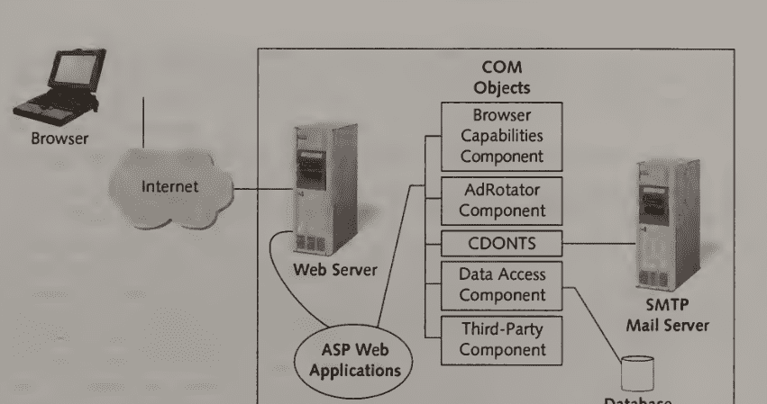

图 10-1 ASP 应用程序如何与服务器组件通信

## 将 ASP 组件集成到 ASP 页面中

由于 ASP 组件是 COM 组件，它们可以包含预定义的对象、属性和方法。安装 ASP 组件后，你的网页可以访问它们的对象、属性和方法。与内置对象一样，ASP 组件对象不能直接访问。可以使用服务器对象的`createobject`方法或`<object>`标签来实例化 COM 对象。

> 术语 COM 对象通常用作 COM 组件的同义词。

ASP 内置服务器对象包含一个名为`createobject`的方法，允许你从任何 ASP 页面创建对象的实例。组件名称用于标识要实例化的对象类型。实际的组件名称将随安装的组件类型而异。例如，浏览器功能组件的组件名称为`MSWC.BrowserType`。对象的新实例被分配给一个变量。然后你可以引用该变量来调用方法并设置对象的属性。使用以下语法创建 ASP 组件的实例。

```
dim objVariableName
set objVariableName = server.createobject("ComponentName")
```

为对象变量名添加前缀`obj`或`o`很有用。

使用以下示例代码创建浏览器功能组件。

```
dim objBC
set objBC = server.createobject("MSWC.BrowserType")
```

也可以使用全局应用程序文件中的`<object>`标签在服务器上创建对象。`<object>`标签是一个 HTML 标签。请注意，在下面的语法示例中，对象标签位于全局应用程序文件中的脚本标签之外。此方法用于在应用程序或会话范围内创建对象。`runat`属性被赋值为`Server`，以指示对象要在服务器上创建。`scope`属性被赋值为`Application`或`Session`，用于标识对象是在整个 Web 应用程序范围内创建，还是基于会话创建。`PROGID`属性通过指定组件名称来标识要创建的对象类型。`id`属性允许你为对象分配一个名称，你可以在脚本中引用该对象时使用。直到从 ASP 脚本中引用该对象时，才会创建 COM 对象。

```
<object runat = "server" Scope = "Application" PROGID = "ComponentName" id = "objName"></object>
```

然后，你可以使用以下语法在应用程序范围内调用对象并设置其属性。如果值是字符串，你必须将字符串用引号括起来。

```
<% Application("objName").Property = value %>
```

虽然页面级对象很容易扩展，但通常不建议创建对象并将它们存储在会话或应用程序变量中。你可以从 LearnASP（`http://www.learnasp.com/learn/`）了解更多关于如何使用应用程序和会话对象以及如何提高 Web 应用程序性能的信息。

### 分配属性和调用方法

使用组件创建对象实例后，你可以通过引用变量名称以及属性或方法的名称来访问其属性和方法。你可以检索属性并将值写入网页，或将值存储在另一个变量中。下面的语法说明了如何检索对象的属性值，将其存储在变量中，并将其写入网页。

```
<% varProperty = objName.PropertyName %>
<% = varProperty %>
```

若要修改属性的值，必须标识对象名称、属性名以及新值。如果表达式是字符串，则必须用引号将字符串括起来。如果值是数字，则不要使用引号。下面的语法说明了如何为对象的属性赋值。

```
objName.PropertyName = expression
```

在以下示例代码中，对象名称为`objMail`，属性名称为`name`。你可以将字符串赋给一个变量，然后将该属性的值赋给该变量。

```
objMail.name = "Matthew"
```

新值可以是表达式的结果。在以下示例代码中，赋给属性的值来自一个表单。该属性被赋予一个名为`firstname`的表单字段的值。

```
objMail.name = request.form("firstname")
```

调用对象的方法时，可以向方法传递参数（也称为参数）。如果你想将方法作为函数调用，请不要忘记将参数用括号括起来，并将结果赋给变量。下面的语法说明了如何调用对象的方法。

```
objName.MethodName Arg1,Arg2,...,ArgN Soldier
```

下面的语法说明了如何将对象的方法作为返回值的函数进行调用。

```
returnValue = objName.MethodName(Arg1,Arg2,...,ArgN)
```

将对象赋给变量时，实际上是将内存地址分配给该对象。如果你分配了内存地址，那么系统就无法使用该区域。使用完变量后，强烈建议将其从内存中释放。将变量赋给 VBScript 的`Nothing`常量即可释放该变量占用的内存。

```
Set objName = Nothing
```

> 在不再需要对象后关闭它们并将其设置为`Nothing`非常重要。不要依赖服务器去关闭与对象的连接或从内存中释放对象。未关闭的数据库连接对象将一直保持打开状态，直到被关闭为止。（你将在后续章节中学习如何关闭数据库连接对象。）这不仅会浪费内存，还会产生一个未被使用的连接，从而影响性能。

### 浏览器功能组件

在前面的章节中，你已经了解到`HTTP_USER_AGENT`服务器变量（在 HTTP 头中传递）包含有关客户端 Web 浏览器的信息。要使用这些信息，必须解析返回的字符串。浏览器功能组件会解析`HTTP_USER_AGENT`服务器变量，以提供有关客户端浏览器的信息，包括其类型和版本号。它还会提供有关特定浏览器支持哪些功能的信息。浏览器功能组件是一个名为`Browsercap.dll`的程序，安装在 Web 服务器上。该组件会引用服务器上的一个外部文本文件，即 **Browser Capabilities Detection File**，其中包含大多数浏览器软件程序的信息。

该浏览器功能检测文件通常位于 Windows 98 计算机的`c:\windows\system\inetsrv\browscap.ini`，以及 Windows NT Server 或 Windows 2000 Professional 计算机的`c:\winnt\system32\inetserv\browscap.ini`。只有在安装了 PWS 或 IIS 的情况下，才能找到`browscap.ini`文件。

图 10-2 显示了默认浏览器功能检测文件的部分内容。请注意，该文件顶部包含一个日期，用于标识文件上次更新的时间。该文件需要经常更新，以跟上新浏览器的发展。你可以从第三方开发者（如 cyScape，`www.cyscape.com`）处获取该文件的最新版本。Microsoft 提供了一个网页，介绍如何定位浏览器功能检测文件（`www.microsoft.com/ISN/faq/latest_browscapini_file.asp`）。下载并解压文件后，只需将新的浏览器功能检测文件覆盖旧版本即可。

浏览器功能检测文件列出了每个浏览器及其版本号以及支持的功能列表。在每个条目的顶部，标识了`HTTP_USER_AGENT`字符串。该文件提供的信息不仅针对浏览器版本，还针对客户端平台。同时会标识一个父级（`parent`），表示该浏览器可以从另一个浏览器版本继承属性。某些浏览器信息是从所列的父级浏览器`继承`而来的。之所以提供父级信息，是因为即使浏览器版本为 4.0，不同平台下的 4.0 版本也可能略有差异。如果没有浏览器版本与`HTTP_USER_AGENT`字符串中标识的版本匹配，则使用默认浏览器设置。如果支持某项功能，则值为`True`；否则为`False`。分号可用于在文件中添加注释。

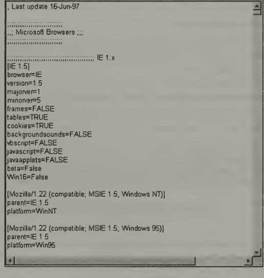

虽然`Browscap.ini`包含浏览器支持的许多功能，但并非全部。还有其他第三方组件，例如 cyScape 的 BrowserHawk（`www.cyscape.com`），可以为更广泛的浏览器检测更多功能。Microsoft 目前正在开发下一版 ASP+，它将极大地扩展浏览器功能组件的能力。BrowserHawk 组件的功能摘要列在`http://www.browscap.com/products/bhawk/compare.asp`。有关安装和使用 BrowserHawk 组件的完整文档可在`http://www.cyscape.com/products/bhawk/getstarted.asp`找到。

> 编程提示：你可以在`http://msdn.microsoft.com/library/psdk/iisref/comp3xx0.htm`或`http://msdn.microsoft.com/training/free/chapters/mwd64/mwd9800347.htm`找到所有属性并了解有关浏览器功能组件的更多信息。

要使用浏览器功能组件检测浏览器功能，请按以下步骤操作：

1. 打开记事本或你的编辑器，并新建一个 ASP 页面。

## 第10章 ASP 组件

2. 添加基本的 HTML 标签，如下所示。

```
<html><head><title>Browser Detection</title></head>
<body>
<h2>Browser Detection</h2>
```

3. 在 body 标签下方添加一个服务器端脚本，声明用于保存浏览器功能组件的变量。使用服务器对象的`createobject`方法创建`theHole`对象。

```
<% dim bc
Set bc = server.createobject("MSWC.BrowserType")
%>
```

4. 添加以下代码，用于显示`HTTP_USER_AGENT`服务器变量。

```
Here is the value of the <br>
HTTP_USER_AGENT server variable: <br><br>
<%= request.servervariables("HTTP_USER_AGENT") %>
```

5. 添加以下代码，用于显示浏览器名称、版本以及客户端正在使用的操作系统。

```
<br><br>
Here is the information from the <br>
Browser Capabilities component: <br><br>
Browser Name: <%= bc.browser %><br>
Version: <%= bc.version %><br>
Platform: <%= bc.platform %><br>
```

6. 添加一个脚本，用于检测浏览器是否支持 VBScript。如果支持，则向用户显示自定义消息；否则，告诉用户该浏览器不支持 VBScript。

```
<% if bc.vbscript = TRUE then %>
    Welcome! You support VBScript.
<% else %>
    This site uses VBScript. <br>
    You do not support VBScript. <br>
<% end if %>
</body></html>
```

7. 将页面以`mybc.asp`的名称保存到你的数据目录。

8. 在浏览器中查看`mybc.asp`网页。打印你的源代码。打印网页。

### 广告轮播组件

许多网站通过横幅广告获得收入。你可以使用 AdRotator 组件在 ASP 页面上创建和维护横幅广告。虽然有一些第三方服务器对象提供更高级的管理功能，例如基于目标群体的

在市场营销中，AdRotator 组件提供了一个免费、简单、易于使用的工具来管理您的基本横幅广告。AdRotator 组件名为`Adrot.dll`，包含一个方法，您不仅可以使用它来显示广告，还可以管理横幅广告的显示频率。用于管理广告的信息位于一个名为**Rotator Schedule File** 的单个文本文件中，这意味着您只需编辑此文件即可更改多个网页上的广告。

当用户访问带有横幅广告的 ASP 页面时，会创建一个 AdRotator 对象的实例。ASP 页面使用 Rotator Schedule File 来确定显示哪个广告。当用户点击广告时，他们会被**Redirection File** 重定向到一个新的网页。Redirection File 接收来自图像链接的请求，并将用户重定向到新页面。

> 您可以在`http://msdn.microsoft.com/library/psdk/iisref/asps4v5e.htm`和`http://msdn.microsoft.com/library/psdk/iisref/comp59f8.htm`了解更多关于 AdRotator 组件的信息。

### 创建 Rotator Schedule File

Rotator Schedule File 是使用诸如记事本之类的文本编辑器创建的，它是一个文本文件，包含有关要在 ASP 页面上显示的广告的信息。它分为两部分；第一部分定义所有广告的通用参数，第二部分包含特定广告的参数。一个带星号 (`*`) 的单行分隔符将两个部分分开。此文件通常命名为`Adrot.txt`或`AdSchedule.txt`。

第一部分的顶行包含一个语句，该语句将用户重定向到包含重定向脚本的 ASP 页面。第一部分还包含适用于所有横幅广告图像的信息。该信息用于构建图像标签及其属性。默认情况下以像素为单位的`border`、`height`和`width`参数用于构建图像对象的`border`、`height`和`width`属性。虽然许多横幅的高度为 50，宽度为 400，但横幅广告图像没有必需的尺寸。横幅广告可以显示不同尺寸的图像，例如 50x50 像素的图像。如果您未指定参数，组件将插入默认参数。默认宽度为 440，高度为 60，边框为 1。可以添加一个默认 URL，以便在用户点击未指定 URL 的广告时重定向他们。以下是 Rotator Schedule File 第一部分的语法。

```
redirect redirectpage.asp
border n
height n
width n
http://www.yourdomain.com/path/filename
*
```

Rotator Schedule File 的第二部分为每个广告在轮播到网页时标识了四个特定参数。请勿将这四个参数中的任何一个留空。第一个参数标识要显示的图形文件的名称。您可以使用绝对或相对 URL 来定位文件。此信息用于构建图像标签的`SRC`属性的值。第二个参数标识用户点击图像时重定向到的 URL。这可以是相对或绝对 URL。此值标识锚点标签中的`HREF`属性。您不需要指定`http://`前缀。此外，您可以使用`mailto:`前缀创建指向电子邮件地址的链接。如果未提供链接，则必须使用连字符 (`-`)。

> **编程提示**
>
> 横幅广告的 URL 通常是广告商的主页。它可以是特定页面或目录。AdRotator 是一个简单的组件，可用于设置和管理横幅广告。横幅广告是当今许多网站的主要收入来源。您甚至可以设置该组件刷新到一个中间页面，在该页面您可以跟踪每个广告的点击次数。AdRotator 的每个属性都可以通过修改 Rotator Schedule File 来动态更改。在下一章中，您将学习如何使用 File Access 组件的`TextStream`对象来修改文本页面。您可以使用此组件动态更改 Rotator Schedule File 中的文本内容。

第三个参数为没有图形功能的浏览器提供广告的文本描述。此值用于标识图像标签中的替代文本属性（`alt`）。最后一个参数是广告显示的加权相对频率。相对频率数字是一个整数，范围可以从 0 到 4,294,967,295。但是，建议您使用所有加权频率之和为 10、100、1,000 或 10,000 的倍数的数字。例如，三个广告的相对频率分别为 20、30 和 50。相对频率的总和为 100。因此，很容易看出第一个广告显示了 20% 的时间，第二个广告显示了 30% 的时间，第三个广告显示了 50% 的时间。以下是 Rotator Schedule File 第二部分的语法。

```
imageURL/imageName.gif
http://www.yourdomain.com/path/filename
Your default text goes here
N
```

### 创建 Redirection File

Redirection File 是一个可以在记事本中创建的 ASP 页面。Redirection File 的名称必须与 Rotator Schedule File 第一行中标识的页面匹配。当用户点击 ASP 页面中的图像时，他们会被重定向到 Redirection File。Redirection File 从`QueryString`中检索链接的 URL。然后，Redirection File 使用服务器端重定向将用户重定向到指定的 URL。Redirection File 的内容可以简单地将用户重定向到新页面。以下是可放入 Redirection File 中的代码示例。

```
<% Response.Redirect(Request.QueryString("url")) %>
```

您可以修改 Redirection File，以在将用户重定向到新 URL 之前确定 URL 是否有值。如下方示例代码所示，如果未指定 URL，则不会将用户重定向到另一个页面。

```
<% If Request.QueryString("url") <> "" Then
    Response.Redirect(Request.QueryString("url"))
End If %>
```

### 创建用于显示横幅广告的 ASP 页面

横幅广告在 ASP 页面中显示。在下面的示例代码中，一个名为`objAd`的变量存储新的 AdRotator 对象。使用服务器对象的`createobject`方法创建 AdRotator 组件的一个实例。AdRotator 组件的名称是`MSWC.AdRotator`。

> **编程提示** MSWC 是 Microsoft Windows Component。

```
<% Dim objAd
Set objAd = Server.CreateObject("MSWC.AdRotator")%>
```

然后，在下面的示例代码中，一个名为`varAd`的变量将保存用于创建图像和锚点标签的信息。`GetAdvertisement`方法使用 Rotator Schedule File 来确定向浏览器发送哪些参数。Rotator Schedule File 的绝对或相对路径放在引号内。

```
<% Dim varAd
varAd = objAd.GetAdvertisement("AdSchedule.txt")%>
```

在 ASP 页面中，`write`方法用于写出从`GetAdvertisement`方法返回的信息。在页面中要显示横幅广告的位置使用`write`方法。AdRotator 组件可以位于网页上的任何位置，而不仅仅是在顶部！AdRotator 组件将写出一个锚点标签和一个图像标签，其属性由 Rotator Schedule File 确定。

```
<% Response.Write varAd %>
```

AdRotator 组件的`GetAdvertisement`方法为横幅广告写出锚点和图像标签。以下代码由`GetAdvertisement`方法创建，可以在浏览器中查看。

```
<a href="ad_redirect.asp?url=http://www.course.com&image=banner1.gif">

</a>
```

AdRotator 组件的其他属性包括`border`，它允许您覆盖 Rotator Schedule File 中的边框设置；`clickable`，它允许您指定是否希望图像包含活动超链接，默认设置为`true`；以及`TargetFrame`，它指示图像加载到哪个框架。默认情况下，`TargetFrame`属性设置为`No Frame`，表示图像将加载到当前框架。此`TargetFrame`属性也可以是特殊框架关键字之一，例如`_TOP`、`_NEW`、`_CHILD`、`_SELF`、`_PARENT`或`_BLANK`。下面是一个示例，演示如何实现横幅对象的一些其他属性。请注意，`write`方法直接写出从`GetAdvertisement`返回的内容，而无需先将其分配给变量。

```
<%
dim objAd
Set objAd = Server.CreateObject("MSWC.AdRotator")
objAd.TargetFrame = _TOP
objAd.Clickable = FALSE
objAd.border = 4
Response.write(objAd.GetAdvertisement("adschedule.txt"))
%>
```

### 横幅广告图形

您可以使用图形程序创建自己的横幅广告。市面上有许多商业图形程序，包括 Jasc (`www.jasc.com`) 的 Paint Shop Pro 和 Adobe (`www.adobe.com`) 的 Photoshop。Life Beyond Yahoo (`http://www.lifebeyondyahoo.com/life/graphics.asp`) 包含许多提供免费图形、横幅、图标、按钮和动画图形的网站链接。例如，一个名为 Coder.com (`http://www.coder.com/creations/banner/banner-form.pl.cgi`) 的网站包含一个有用的横幅生成器，用于创建纯文本横幅。

Tucows (`www.tucows.com`) 镜像站点提供多个免费和共享图形编辑程序。

### 创建横幅广告

要创建显示横幅广告的网页：

- 1. 打开浏览器并访问 Coder.com 网站`http://www.coder.com/creations/banner/banner-form.pl.cgi`。使用他们的横幅生成器创建三个横幅。

- 2. 要创建第一个横幅：

  - a. 在 Banner Text 字段中输入`Course Technology`。

  - b. 在 Font Size 文本框中键入`46`。

  - c. 在 Border 文本框中输入`15`和`15`。

### AdRotator 组件

375

- d. 选择名为`Longhand Fonts`的单选按钮。从 Longhand Fonts 下拉列表中选择`DomCasual-Thin-Normal`。

e. 在 Foreground Color 下拉列表框中选择`white`。

f. 在 Background Color 下拉列表框中选择`red`。

g. 在 Advanced Algorithms 部分中，在第一个下拉列表框中选择`Swirl 20%`。

h. 点击`Submit Banner`按钮。将加载一个页面显示你的横幅广告。

i. 右键点击图片以显示快捷菜单，然后选择`Save Picture As`。将图片保存为`banner1`，放在你的数据目录中。

- 3. 要创建第二个横幅广告，点击浏览器中的`Back`按钮返回横幅生成器页面。将 Background Color 下拉列表框的选择改为`blue`。点击`Submit Banner`按钮。将加载一个页面显示你的横幅广告。右键点击图片以显示快捷菜单，然后选择`Save Picture As`。将图片保存为`banner2`，放在你的数据目录中。

- 4. 要创建第三个横幅广告，点击浏览器中的`Back`按钮返回横幅生成器页面。在 Background Color 列表框中点击`rgb`。将 rgb (color-list) 字段中的值改为`#551A8B`。点击`Submit Banner`按钮。将加载一个页面显示你的横幅广告。右键点击图片以显示快捷菜单，然后选择`Save Picture As`。将图片保存为`banner3`，放在你的数据目录中。

- 5. 要创建第四个横幅广告，点击浏览器中的`Back`按钮返回横幅生成器页面。将 rgb (color-list) 字段中的值改为`#006400`。点击`Submit Banner`按钮。将加载一个页面显示你的横幅广告。右键点击图片以显示快捷菜单，然后选择`Save Picture As`。将图片保存为`banner4`，放在你的数据目录中。

- 6. 打开记事本并创建一个文本文件来包含轮播计划文件。添加`redirect`命令。重定向文件名为`adredirect.asp`，与你的图形文件位于同一目录中。将高度参数设置为`67`，宽度参数设置为`277`。将边框参数设置为`0`。添加星号 (`*`) 来分隔轮播计划文件中的两个部分。

- 7. 创建轮播计划文件的第二部分，使用以下各横幅广告的参数。添加下面的代码，其中包含第一个横幅广告的参数。

```
banner1.gif
http://www.course.com/
Course Technology
40
```

8. 使用下表中的值添加最后三个横幅广告的参数。

| 图片名称 | 替代文本 | 超链接 URL | 相对权重 |
|---|---|---|---|
| `banner2.gif` | Student Learning | `http://www.course.com/sl/default.cfm` | 30 |
| `banner3.gif` | Web Warrior Series | `http://www.course.com/webwarrior/` | 20 |
| `banner4.gif` | Academic Instructors | `http://www.course.com/at/default.cfm` | 10 |

9. 将轮播计划文件保存为`adschedule.txt`，放在你的数据目录中。

10. 使用记事本创建一个新页面，用于包含服务器端重定向。

11. 添加以下代码，将用户重定向到从超链接中获取的 URL。

```
<% Response.Redirect(Request.QueryString("url")) %>
```

12. 将重定向文件保存为`adredirect.asp`，放在你的数据目录中。

13. 使用记事本创建 ASP 页面。添加基本的 HTML 标签。

```
<html><head><title>Banner Ads</title></head>
<body>
```

14. 添加以下代码来创建 AdRotator 组件、调用`GetAdvertisement`方法，并将横幅广告写入网页。添加结尾的 HTML 标签。

```
<% Dim objAd, varAd
Set objAd = Server.CreateObject("MSWC.AdRotator")
varAd = objAd.GetAdvertisement("AdSchedule.txt")
response.write varAd
%>
</body></html>
```

15. 通过更改背景、字体和颜色，以及添加内容来修改网页的外观。

16. 将文件保存为`myadpage.asp`，放在你的数据目录中。

17. 在浏览器中查看你的网页。打印网页和源代码。刷新页面直到另外两个广告出现。查看每个页面上创建横幅广告的代码。打印每个显示的广告的网页和源代码。

18. 打印轮播计划文件、重定向文件和 ASP 页面的源代码。

### CDONTS 组件

CDONTS 组件是第三方组件的一个示例。CDONTS 组件是一组称为**协作数据对象 (CDO)** 的对象集合的精简版本。CDO 通常用于将你的应用程序与活动消息系统（如 Microsoft Outlook 和 Microsoft Exchange Services）集成。CDONTS 是一组对象、属性和方法的集合，用于将 SMTP 服务与 Web 应用程序连接起来。

CDONTS 位于名为`cdonts.dll`的服务器组件中，该文件位于`c:\winnt\system32\`目录下，在安装 Microsoft SMTP 服务器时即可使用。SMTP 服务器包含在 NT 选项包中。**简单邮件传输协议 (SMTP)** 是一种协议或规则集，用于在服务器之间传输邮件。SMTP 服务器提供了一种传输 Internet 邮件的简便方式。

CDONTS 仅在 NT Server 上可用。它在个人 Web 服务器或 NT Workstation 上不可用，因为 SMTP 只能在 NT Server 上运行。你必须有权访问一个运行 SMTP 服务器并安装了 CDONTS 的 NT 服务器上的目录，才能完成本节中的活动。CDONTS 也可在使用 IIS 的 Windows 2000 Professional 上使用。

SMTP 服务器包含多个默认文件夹，包括`Pickup`、`Queue`、`Badmail`、`Drop`和`SortTemp`。这些文件夹默认位于`C:\Inetpub\MailRoot\`目录中。`Pickup`文件夹用于存储外发邮件。这些邮件将从 SMTP 服务器发送到其他服务器。SMTP 服务器的默认端口是 25。可以通过手动方式或其他程序（如`cdonts.dll`）将邮件放入此目录。CDONTS 组件会将你的消息放入`Pickup`文件夹中。

你可以在`http://msdn.microsoft.com/library/periodic/period99/email.htm`和`http://msdn.microsoft.com/library/periodic/period99/asp9951.htm`上找到有关如何使用 CDONTS 的更多信息。

一些主机服务提供商不使用 SMTP 邮件服务器。你需要联系你的 HSP 以确定哪些组件与其邮件服务器接口。一些主机服务提供商可能使用 SMTP 服务器，但要求你使用不同的邮件组件。例如，ServerObjects Inc. (`http://www.serverobjects.com/`) 提供了两个名为 AspMail 和 AspQMail (`http://www.serverobjects.com/products.htm`) 的邮件组件，通常用于使 ASP 页面能够发送电子邮件。尽管语法略有不同，但 CDONTS 和 AspMail 之间的编程方法非常相似。你可以在`http://www.serverobjects.com/comp/Aspmail3.htm`查看 AspMail 3.X 的文档，在`http://www.serverobjects.com/comp/AspQmail.htm`查看 AspQMail 2.x 的文档。

378 第 10 章 ASP 组件

### 创建发送电子邮件的网页

CDONTS 组件包含一个名为`newmail`的对象，`newmail`包含一个名为`send`的方法，该方法用于创建电子邮件并将其发送到`Pickup`文件夹。SMTP 服务器将从那里检索并发送邮件。

下面的语法展示了如何创建`newmail`对象的新实例。首先声明一个变量来存储`newmail`对象。然后使用`server`对象的`createobject`方法来实例化一个新的`newmail`对象。CDONTS 组件的名称是`CDONTS.NewMail`。

```
Dim objMail
Set objMail = CreateObject("CDONTS.Newmail")
```

`newmail`对象有几个属性，必须在发送消息之前设置。这些属性包括收件人、发件人、主题和消息正文。你可以逐个显式设置`newmail`对象的属性。

```
objMail.From = "sender@senderaddress.com"
objMail.To = "recipient@recipient.com"
objMail.Subject = "Subject"
objMail.Body = "Message Body"
```

`newmail`对象的`send`方法将以所需的格式创建消息，并将其写入`Pickup`文件夹。SMTP 服务器随后将发送该消息。以下是使用`newmail`对象`send`方法的语法。消息发送后，你应该将对象设置为关键字`Nothing`以从内存中释放该对象。

```
objMail.Send
Set objMail = Nothing
```

你可以将属性作为`send`方法的参数传递，而不是逐个定义每个属性。`from`属性放在前面，后面是`to`属性、主题和消息。以下代码展示了如何用仅仅三行代码发送电子邮件！

```
Set objMail = CreateObject("CDONTS.Newmail")
objMail.Send "sender@sender.com", "recipient@recipient.com",
"Subject", "Message"
Set objMail = Nothing
```

#### Newmail 对象的附加属性

`from`属性用于标识发件人。虽然可以通过完全省略`from`属性来发送匿名电子邮件，但不建议这样做。你应该为发件人指定完整的电子邮件地址。当发件人地址无效时，一些电子邮件程序将不会接受电子邮件。根据消息内容更改`from`属性是很有用的。例如，如果电子邮件是发送给客户的，你可以将`from`属性设置为`help@mydomain.com`。这样，你的客户就能识别出谁在发送电子邮件。使用`from`属性时，你不能指定多个地址。

另一方面，你可以使用`to`属性来指定多个收件人。多个收件人地址之间用分号（`;`）分隔。你可以使用`CC`属性来指定发送`抄送`（CC）给其他收件人。你还可以使用`BCC`属性来指定发送`密送`（BCC）给其他收件人。密送用于你不希望收件人知道其他人员也收到了相同邮件的情况。例如，你可以给客户发送一封电子邮件，同时给你的经理发送一封密送。客户不会知道你给经理发送了副本；他们也不会知道你经理的电子邮件地址。

你可以使用`importance`属性向电子邮件应用程序指示邮件的重要性。一些电子邮件应用程序提供指示器，例如感叹号，用来表示邮件已被设置了一定的优先级。`importance`属性不会使邮件发送得更快。你可以通过`newmail`对象设置三个`importance`属性级别：2（`cdoHigh`）、1（`cdoNormal`）和 0（`cdoLow`）。你可以使用 CDONTS 常量或数字。如果使用常量，你必须添加包含这些常量的服务器端包含文件。有关定义包含 CDONTS 常量的页面的更多信息，请访问`http://support.microsoft.com/support/kb/articles/Q218/6/07.ASP`。下面是设置这些参数的语法。

```
objMail.To = "recipient1@yourdomain.com; recipient2@yourdomain.com"
objMail.CC = "copyEmail@yourdomain.com"
objMail.BCC = "blindCopyEmail@yourdomain.com"
objMail.Importance = ImportanceLevel
```

### 从网页发送电子邮件

要创建一个向单个收件人发送静态邮件的网页：

1. 打开记事本，创建一个新的 ASP 页面。

2. 添加代码来创建`newmail`对象。

```
<% Dim objMail
Set objMail = CreateObject("CDONTS.NewMail")
```

3. 修改属性以将电子邮件发送到你的电子邮件地址。将`to`和`from`属性设置为你的电子邮件地址。将邮件设置为最高重要性级别。主题应写为`CDONTS 练习`。正文应写为，*我已完成 CDONTS 练习*。

```
objMail.From = "youraddress@yourdomain.com"
objMail.To = "youraddress@yourdomain.com"
objMail.Importance = 2
objMail.Subject = "CDONTS Exercise"
objMail.Body = "I have completed the CDONTS exercise"
objMail.Send
Set objMail = Nothing
%>
```

4. 将文件保存为`sendit.asp`，放在你的数据目录中。

5. 在浏览器中查看你的网页。

6. 打印出网页及页面源代码。

7. 打开你的电子邮件应用程序。打印出电子邮件消息。

> 重要的是要理解，邮件服务器和网络配置会影响你从 ASP 页面发送出站电子邮件的方式。如果你有防火墙或特殊路由，你将需要修改你的代码。例如，在某些网络中，如果你的电子邮件地址是`john@yourschool.edu`，你可能需要明确指定邮件服务器的域名。如果邮件服务器的名称是`darkstar`，则电子邮件地址将是`john@darkstar.yourschool.edu`。

#### 使用 HTML 发送电子邮件

`newmail`对象允许你使用不同的格式发送邮件正文，例如纯文本和 HTML。邮件正文的格式默认为纯文本。文本的常量是`CdoBodyFormatText`或数字 1。HTML 的常量是`cdoBodyFormatHTML`或数字 0。要更改为 HTML 格式，你必须将`newmail`对象的`BodyFormat`属性更改为`CdoBodyFormatHTML`。然后，你可以在邮件正文中指定 HTML 内容。将 HTML 消息指定在一个变量中，然后将`body`属性赋值给该 HTML 变量，这样会比较方便。下面的示例代码展示了如何更改默认的`BodyFormat`和`body`属性以支持 HTML。

```
Dim sHTML
sHTML = "<B>This message is in bold </B>"
sHTML = sHTML + "because the message supports HTML"
objMail.BodyFormat = 0
objMail.Body = sHTML
```

#### 使用附件发送电子邮件

`newmail`对象有一个名为`AttachFile`的方法，允许你将文件附加到电子邮件中。这些附加文件通常称为**附件**。`AttachFile`方法有三个参数。`location`属性标识附加文件的绝对位置。`Caption`属性是默认标题。第三个属性是编码类型。如果使用默认编码，`encoding`属性是可选的。默认附件使用 UUEncode 参数进行编码。你可以使用`cdoEncodingUUEncode`参数来指定使用 UUEncode 编码格式。同样，你可以使用常量`cdoEncodingUUEncode`或数字 0。你可以将`encoding`参数更改为`cdoEncodingBase64`参数，以支持必须使用二进制编码发送的附件。可以使用常量`cdoEncodingBase64`或数字 1。下面的示例代码展示了如何使用`AttachFile`方法将图形文件作为附件发送。该图形文件必须与发送邮件的 SMTP 服务器位于同一台服务器上。

```
objMail.AttachFile("c:\images\disk.gif", "Disk Image")
objMail.AttachFile("c:\images\disk.gif", "Disk Image",
cdoEncodingBase64)
```

## 在互联网上查找其他第三方软件组件

如前所述，微软最初提供的一些附加 ASP 组件已被第三方公司修改和改进。CyScape（`www.cyscape.com`）创建了 BrowserHawk 2000，以提供超出 Browser Capabilities 组件所提供的额外功能。ServerObjects（`www.serverobjects.com`）提供多个 ASP 组件，包括 ASPQMail 和 ASPMail，它们与 CDONTS 类似，经常被互联网服务提供商用于将 ASP 页面与 SMTP 服务器集成。

虽然微软提供了基本的 FileUpload 组件，但 Software Artisans（`www.softartisans.com`）提供了 SA-FileUp 组件，用于从 ASP 页面向 Web 服务器上传文件。有关微软提供的其他组件的更多信息，可以在 MSDN 在线库中找到，网址为`http://msdn.microsoft.com/library/psdk/iisref/comp275c.htm`。IISDev（`www.alphasierrapapa.com/IisDev/Components`）提供多个与 IIS 配合使用的免费组件。Hunt Interactive（`www.huntinteractive.com`）提供 ASP 组件，使在 Visual InterDev 中创建 ASP 脚本更加容易。你可以在 ASP WebRing（`www.webring.org/cgi-bin/webring?ring=asp101;list`）上找到其他提供第三方组件的公司。你也可以在 Microsoft 网站（`www.microsoft.com`）上找到有关构建自己的 ASP 组件的支持文档。ASP 组件可以用多种语言编写，包括 Visual Basic 和 C++。

## 安装 ASP 组件

ASP 组件与其他软件一样，在安装程序时会在 Windows 系统注册表中注册。当你安装 Internet Information Server 时，内置组件会自动安装。微软在`http://msdn.microsoft.com/library/devprods/vs6/visualj/vjcore/vjctrlregisteringcontrol.htm`提供了一些关于注册服务器组件的文档。服务器组件必须在运行该组件的计算机的注册表中列出。注册表包含程序与计算机上安装的其他 COM 对象进行通信所需的信息。你必须拥有管理权限并能访问服务器，才能安装和注册 COM 组件。

你可以使用注册表安装向导来安装组件，或者使用名为 Windows Regsvr32 的命令行程序。Windows Regsvr32 程序用于在计算机上注册 COM 组件。在 Windows NT 中，`Regsvr32.exe`程序通常位于`c:\windows\system32\`。该程序从命令窗口运行。要打开命令窗口，请单击`开始`，然后单击`运行`，输入 Command Prompt 并按回车键。指定 Regsvr32 可执行文件（`Regsvr32.exe`）的名称和组件的名称，如下所示。因为组件可能位于不同的目录中，你应该指定组件的路径。

```
Regsvr32.exe Path/componentName
```

在使用 COM 对象时，会出现许多问题。如果你在自己的 Web 服务器上托管自己的 Web 应用程序，你将拥有 Web 服务器的管理权限，能够安装 COM 对象。但是，如果是由托管服务提供商来托管你的 Web 应用程序，你将需要联系他们以确定是否会安装并注册你的 COM 对象。

ASP 正在演变为一种更新的技术，称为 ASP+。ASP+ 将保持向后兼容，并支持 ASP 3.0。ASP+ 的好处之一是 COM 对象无需注册。因此，你将更容易在托管服务提供商托管的 Web 服务器上安装你的 COM 对象。请访问 Microsoft MSDN 网站（`http://msdn.microsoft.com/default.asp`）以查看 ASP+ 的最新更新信息。

## 章节小结

### ASP 组件

- ASP 组件是与 ASP 页面配合使用的 COM 对象或 ActiveX 控件。COM 模型允许你在不了解 COM 对象如何创建的情况下使用该 COM 对象。因此，程序可以在不了解各个程序编写方式的情况下进行交互。

### 浏览器功能组件

- 浏览器功能组件使用来自服务器变量`HTTP_USER_AGENT`和`Browscap.ini`文件的信息来确定正在使用哪个浏览器，以及该浏览器支持哪些功能。由于浏览器不断更新，`browscap.ini`文件需要频繁更新。

- 第三方组件（如 cyScape 的 BrowserHawk）与浏览器功能组件类似，但维护了更全面的各种浏览器支持的功能列表。

### 广告轮播组件

- 广告轮播组件允许你在 ASP Web 应用程序中创建和管理轮播横幅广告。

- 轮播计划文件维护所有横幅广告的默认设置，以及每个横幅广告的单独设置。

- 轮播计划文件包含重定向文件的名称。重定向文件维护横幅广告的超链接，以便当用户点击广告时，会被重定向到另一个网页。

- 将横幅广告写入 ASP 的方法是`GetAdvertisement`。`GetAdvertisement`方法以轮播计划文件的名称作为参数。

### CDONTS 组件

- CDONTS 组件仅在安装了 SMTP 邮件服务器时才可用。

- 用于从网页发送电子邮件的 CDONTS 对象名称是`CDONTS.Newmail`。`newmail`对象的属性包括`To`、`From`、`Subject`、`Message`、`CC`、`BCC`和`Importance`。

- CDONTS 可用于以不同格式发送电子邮件，包括 HTML，通过修改`BodyFormat`属性实现。

- `AttachFile`方法用于发送带有附件的电子邮件。

- 托管服务提供商通常使用第三方组件（如 ASPQMail 和 ASPMail）从 ASP 页面发送电子邮件。

### 第三方 ASP 组件

- 第三方组件是在安装 Web 服务器时不会安装的程序。Microsoft 提供了几个附加组件，例如 CDONTS（允许你从网页发送外发电子邮件）和 Posting Acceptor（允许你从网页将文件上传到服务器）。

- 你可以从其他公司购买组件，也可以编写自己的 ASP 组件。ASP 组件可以用多种软件语言编写，包括 C++ 和 Visual Basic。如果在服务器上安装了第三方组件，必须使用 Windows Regsvr32 程序进行注册。

### 在全局应用程序文件中创建应用程序作用域对象

```
<object runat = "Server" Scope = "Application"
       PROGID = "ComponentName" id = "objName">
</object>
```

### 为应用程序对象的属性赋值

```
<% Application("objName").Property = value %>
```

### 获取 HTTP_USER_AGENT 服务器变量

```
<%request.servervariables("HTTP_USER_AGENT")%>
```

### 创建浏览器功能组件对象

```
<%dim bc
Set bc = server.createobject("MSWC.BrowserType")%>
```

### 获取浏览器某项功能的支持状态

```
<%bc.frames%>
```

384 第 10 章 ASP 组件

创建轮播计划文件的第一部分

```
Redirect RedirectPage.asp
border 4
height 50
width 400
http://www.course.com/
*
```

创建轮播计划文件的第二部分

```
images/imageName.gif
http://www.course.com/
Course Technology
50
```

创建重定向文件

```
<%Response.Redirect(Request.QueryString("url"))%>
```

在 ASP 页面中创建广告轮播组件

```
<%dim objAd
Set objAd = Server.CreateObject("MSWC.AdRotator")%>
```

调用 GetAdvertisement 方法在 ASP 页面中写入横幅广告

```
<%varAd = objAd.GetAdvertisement("AdSchedule.txt")
response.write varAd%>
```

从 CDONTS 组件创建 newmail 对象

```
<%dim objMail
Set objMail = CreateObject("CDONTS.Newmail")%>
```

设置 newmail 对象的属性

```
<%objMail.From = "sender@senderaddress.com"
objMail.To = "recipient@recipient.com;
recipient2@yourdomain.com"
objMail.CC = "recipient@recipient.com"
objMail.BCC = "recipient@recipient.com"
objMail.Subject = "Subject"
objMail.Importance = cdoHigh
objMail.Body = "Message Body"%>
```

调用 newmail 对象的 send 方法

```
<%objMail.Send
Set objMail = Nothing%>
```

### 在消息正文中发送 HTML 而非纯文本

```
<%dim sHTML
sHTML = "<B>This message is in bold </B>"
objMail.BodyFormat = cdoBodyFormatHTML
objMail.Body = sHTML%>
```

## 复习题

1. COM 对象可以使用以下哪些文件扩展名？

    a. `.asp`

    b. `.ini`

    c. `.dll`

    d. `.txt`

2. 哪个标签用于在网页上放置客户端 ActiveX 控件？

    a. `<com>`

    b. `<object>`

    c. `<uid>`

    d. `<obj>`

3. 哪个 ASP 组件用于显示轮播横幅广告？

    a. 浏览器功能组件

    b. 广告轮播组件

    c. CDONTS 组件

    d. Posting Acceptor 组件

4. 在全局应用程序文件中，哪个标签用于创建对象？

    a. `<com>`

    b. `<obj>`

    c. `<uic>`

    d. `<object>`

5. 在全局应用程序文件中创建的 COM 对象可以具有 ________ 或 ________ 作用域。

    a. application、server

    b. application、session

    c. server、session

    d. runat、state

# 第 10 章 ASP 组件

6. 以下哪种方式是设置在全局应用程序文件中定义的、具有应用程序级别作用域的名为`count`的属性值的正确方式？

    a. `Application("objName").value = 3`

    b. `Session("objName").count = 5`

    c. `Application("objName").count = 3`

    d. `Application("SessionName").count = 5`

7. 哪个内置 ASP 对象用于实例化其他 COM 对象？

    a. `session`

    b. `server`

    c. `application`

    d. `response`

8. 哪个方法用于实例化新的 COM 对象？

    a. `scriptTimout`

    b. `createobject`

    c. `createobj`

    d. `newobject`

9. 以下哪个语句会将值返回给调用该方法的函数？

    a. `objName.MN "Jim", 6, "555 Main St"`

    b. `varName = objName.MN "Jim", 6, "555 Main St"`

    c. `varName = objName.MN("Jim", 6, "555 Main St")`

    d. `objName.MN = "Jim", 6, "555 Main St"`

10. 哪个方法将对象从系统内存中释放？

    a. `Set objName = " "`

    b. `Set objName = Abandon`

    c. `Set objName = None`

    d. `Set objName = Nothing`

11. 哪个服务器变量用于获取用户浏览器版本的信息？

    a. `HTTP_USER_AGENT`

    b. `http://USER_AGENT`

    c. `HTTP_user_agent`

    d. `HTTP_OS`

12. 浏览器功能组件的文件名是什么？

    a. `MSWC.BrowserHawk`

    b. `Browscap.ini`

    c. `Browscap.dll`

    d. `BrowserHawk`

13. 浏览器功能检测文件的名称是什么？

    a. `MSWC.BrowserHawk`

    b. `Browscap.ini`

    c. `Browscap.dll`

    d. `BrowserHawk`

14. 哪家公司免费提供最新版本的浏览器功能检测文件？

    a. cyScape

    b. Yahoo

    c. Netscape

    d. Internet Explorer

15. 广告轮播组件的名称是什么？

    a. `adrot.dll`

    b. `ad.dll`

    c. `adrotator.dll`

    d. `adrot.ext`

16. 哪个文件包含所有横幅广告的默认设置？

    a. 轮播计划文件

    b. 重定向文件

    c. 浏览器功能检测文件

    d. 广告管理文件

17. 轮播计划文件中用哪个字符分隔两个部分？

    a. `*`

    b. `/`

    c. `#`

    d. `$`

## 第10章 ASP 组件

18. `border`、`height`和`width`参数用于设置以下哪个 HTML 标签的属性？

    a. `<a>`

    b. ``

    c. `<p>`

    d. `<ul>`

19. 通过更改轮换计划文件中的默认高度和宽度属性，可以修改各个横幅广告的高度和宽度属性。对还是错？

20. 哪种方法用于将横幅广告写入网页？

    a. `GetAdvertisement`

    b. `GetBannerAd`

    c. `DisplayBanner`

    d. `CreateObject`

21. CDONTS 组件需要什么软件？

    a. SMTP Server

    b. Microsoft Exchange Server

    c. Telnet Server

    d. FTP Server

22. CDONTS 组件中的哪个对象用于从网页发送电子邮件？

    a. `SMTP`

    b. `Newmail`

    c. `Send`

    d. `CDONTS`

23. 哪个属性用于发送密件抄送给其他收件人？

    a. `to`

    b. `from`

    c. `cc`

    d. `bcc`

24. 向多个收件人发送电子邮件时，使用哪个字符分隔地址？

    a. `;`

    b. `#`

    c. `–`

    d. `,`

25. SMTP Server 上的哪个文件夹用于存储等待发送的出站电子邮件？

    a. `BadMail`

    b. `Outbound`

    c. `Holding`

    d. `Pickup`

26. 使用 CDONTS 中的`importance`属性可以设置的最高重要级别是什么？

    a. `cdoHigh`

    b. `cdoVeryHigh`

    c. `cdoNormal`

    d. `cdoLow`

27. 无法使用 CDONTS 将文件附加到电子邮件中。对还是错？

28. 要安装第三方组件，必须拥有管理权限并能访问服务器。对还是错？

29. 从命令提示符运行哪个程序来在服务器上注册 COM 对象？

    a. `RegeditSvr32.exe`

    b. `Regt32.exe`

    c. `Regedit.exe`

    d. `Regsvr32.exe`

## 实践项目

### 项目 10-1

在本项目中，你将使用浏览器能力检测文件来识别浏览器能力组件所支持的浏览器。你还将把浏览器能力组件与名为 BrowserHawk 的第三方浏览器组件进行比较。

1. 使用记事本创建一个新网页。添加基本的 HTML 标签。

    ```
    <html><head><title>Browser Detection</title></head>
    <body>
    <h2>Browser Detection</h2>
    ```

2. 使用记事本或文本编辑器的另一个实例，打开浏览器能力检测文件。在 Windows 98 计算机上，该文件位于`c:\windows\system\inetserv\Browscap.ini`，而在 Windows NT 或 Windows 2000 计算机上，该文件位于`c:\winnt\system32\inetsrv\browscap.ini`。

3. 浏览器能力检测文件的最后更新日期是什么？浏览器能力检测文件中的默认浏览器设置位于何处？将答案写在网页的正文中。

    ```
    The date of my Browsecap.ini file is ______.<br><br>
    The default browser settings are located in <br>
    the Browser Capabilities Detection File at the <br>
    ____________________.<br><br>
    ```

4. 使用浏览器能力检测文件中的信息创建以下表格。如果功能受支持则标记`T`，如果功能不受支持则标记`F`。指明你正在查看的浏览器版本。你可以使用不同的颜色、字体和单元格属性来格式化表格。将网页保存为`bcini.asp`，存放在你的数据目录中，但不要关闭文件。你将在步骤 6 中向该页面添加更多内容。

    | 功能 | 默认浏览器 | Netscape | IE |
    | :--- | :--- | :--- | :--- |
    | FRAMES | | | |
    | TABLES | | | |
    | COOKIES | | | |
    | BACKGROUNDSOUNDS | | | |
    | VBSCRIPT | | | |
    | JAVASCRIPT | | | |
    | JAVA APPLETS | | | |
    | ACTIVEX CONTROLS | | | |

5. 访问互联网，在`http://www.cyscape.com/browscap/`获取更新的浏览器能力检测文件。按照在线说明下载文件。你需要使用 WinZip 等文件压缩软件解压该文件。如果你没有任何文件压缩软件，可以访问 Tucows 镜像站点 (`www.tucows.com`) 下载免费的文件压缩软件。在写字板或其他文字处理器中打开该文件。（当前版本太大，无法在记事本中打开。）

6. `browsecap.ini`文件的最后更新时间是什么？所支持的最新 Netscape 版本是什么？所支持的最新 Internet Explorer 版本是什么？将答案写在网页的正文中。（*提示*：你可以阅读页面标题中的信息来找到这些信息。）

    ```
    <br><br>
    <h2>Recent Versions of the<br>
    Browser Component Detection File</h2>
    The most recent version of the <br>
    Browsecap.ini file was updated on: <br>
    <br><br>
    Version _______ contains information about: <br>
    Netscape ________ and <br>
    MSIE ________<br><br>
    ```

7. 列出至少 13 个 BrowserHawk 组件支持但浏览器能力组件不支持的功能。（提示：功能摘要列在`http://www.browscap.com/products/bhawk/compare.asp`。）创建一个包含这些功能的项目符号列表。（提示：应有 13 个列表项标签。）如有需要，你可以使用换行符来格式化列表。

    ```
    <h2>Features of BrowserHawk</h2>
    Here are some of the features that BrowserHawk <br>
    supports that are not supported by the <br>
    Browser Capabilities component. <br><br>
    <ol>
    <li>______________________</li>
    </ol>
    ```

8. 关闭浏览器能力检测文件。不要保存对浏览器能力检测文件的更改。

9. 将对`bcini.asp`的更改保存到你的数据目录中。在浏览器中查看你的网页。打印你的网页。

### 项目 10-2

在本项目中，你将使用浏览器能力组件来检测浏览器支持哪些功能。

1. 使用记事本创建一个网页。添加基本的 HTML 标签。添加标题和一个内容为`Left Frame`的二级标题。

2. 将网页保存为`left.asp`，存放在你的数据目录中。

3. 将`left.asp`页面另存为`right.asp`，存放在你的数据目录中。将标题和标题改为`Right Frame`。

4. 将`right.asp`页面另存为`noframes.asp`，存放在你的数据目录中。将标题和标题改为`No Frames`。

5. 创建一个包含两个框架（`right.asp`和`left.asp`）的网页。将页面保存为`frames.asp`，存放在你的数据目录中。使用以下示例代码创建你的网页。

    ```
    <html><head><title>Left Frame</title></head>
    <body>
    <h2>Left Frame</h2>
    </body></html>
    ```

    ```
    <html><head><title>Frames</title></head>
    <frameset cols="150,*">
    <frame name="contents" target="main" src="left.asp">
    <frame name="main" src="right.asp" target="main">
    </frameset>
    </html>
    ```

6. 使用记事本或你的 ASP 兼容工具创建一个名为`bcframes.asp`的新 ASP 页面。因为此页面不会显示任何 HTML，所以你不需要添加基本的 HTML 标签。

7. 在页面顶部，声明一个名为`bc`的变量来保存浏览器能力组件。使用`server`对象的`createobject`方法创建浏览器对象。

    ```
    <% response.buffer = "true"
    Set bc = server.createobject("MSWC.BrowserType")
    ```

8. 创建一个脚本，检测浏览器是否支持框架。如果浏览器支持框架，则将用户重定向到包含多个框架的页面（`frames.asp`）；否则，将用户重定向到不包含框架的页面（`noframes.asp`）。（*提示：你可以使用`response`对象的`redirect`方法进行服务器端重定向，如下所示；也可以使用`location`对象的`HREF`方法进行客户端重定向。你还可以使用`meta`标签的`Refresh`命令将访问者重定向到新页面。*）

    ```
    if bc.frames = TRUE then
        response.redirect "frames.asp"
    else
        response.redirect "noframes.asp"
    end if
    %>
    ```

9. 使用你喜欢的字体、颜色和图片修改所有网页的外观。

10. 将更改保存为`bcframes.asp`，存放到你的数据目录中。

11. 查看`bcframes.asp`网页。如果你的浏览器支持框架，你将被重定向到`frames.asp`页面。打印每个网页的源代码。

### 项目 10-3

在本项目中，你将创建一个显示轮换横幅广告的网页。

1. 创建四个大小相同的图形文件用作横幅广告。（命名为`ad1.gif`...`ad4.gif`。）你可以在图形程序中创建它们，也可以使用 Coder.com 上的横幅生成器表单（`http://www.coder.com/creations/banner/banner-form.pl.cgi`）。

2. 创建计划文件，命名为`adschedule2.txt`。为你的图像文件指定适当的高度、宽度和边框。

3. 为每个横幅广告指定参数。第一张图片应将用户重定向到 Microsoft MSDN 网站`http://msdn.microsoft.com`。替代文本为`MSDN Home`。该广告应显示`10%`的时间。第二张图片应将用户重定向到 Microsoft 脚本库站点`http://msdn.microsoft.com/scripting`。替代文本为`Scripting Library`。该广告应显示`20%`的时间。第三张图片应将用户重定向到 Microsoft IIS 网站`http://www.microsoft.com/iis`。替代文本为`Internet`

信息服务器。该广告应显示 30% 的时间。第四张图片应将用户重定向到 Microsoft MSDN 网站，网址为`http://msdn.microsoft.com/vstudio`。替代文本为`Visual Studio`。该广告应显示 40% 的时间。

+   4. 创建重定向 Asp 页面，并将其命名为`changepage.asp`。添加代码以将用户重定向到从网页传递过来的链接。

+   5. 创建一个名为`adpage2.asp`的网页。

+   6. 编写代码以创建 AdRotator 组件并显示横幅广告。*(提示：声明两个名为`objAd`和`varAd`的变量。使用`server`对象的`createobject`方法创建 AdRotator 组件的新实例。将`objAd`分配给 AdRotator 组件的新实例。AdRotator 组件的名称为`MSWC.AdRotator`。使用`GetAdvertisement`方法生成 HTML 以创建广告。`GetAdvertisement`方法的参数为`AdSchedule2.txt`。将`GetAdvertisement`方法的结果分配给`varAd`变量。使用`write`方法将`varAd`的值写入网页。)*

```
<% Dim objAd, varAd
Set objAd = Server.CreateObject("MSWC.AdRotator")
varAd = objAd.GetAdvertisement("AdSchedule2.txt")
response.write varAd
%>
```

+   7. 使用您喜欢的字体、颜色和图片修改网页外观。

+   8. 将页面保存到您的数据目录。查看`AdPage2.asp`页面。

+   9. 打印您的 ASP 页面源代码、AdRedirect 页面和轮播计划文件。

### 项目 10-4

在本项目中，您将创建一个使用表单发送电子邮件的网页。只有运行 NT Server 并带有 SMTP 邮件服务器、Windows 2000 Professional 并带有 IIS，或 Windows 2000 Server 时，才能完成此活动。

+   1. 创建一个网页。添加基本的 HTML 标签。页面标题应为`Create E-mail Message`。添加一个格式为 heading 2 并居中的标题，显示`Create an e-mail message`。

+   2. 添加一个使用`post`方法并指向`sendmail.asp`网页的表单。

+   3. 创建一个包含三个字段的表单。第一个字段名为`txtEmail`，应是一个最长 25 个字符的文本框，用于包含收件人的电子邮件地址。另一个文本字段应命名为`txtSubject`，长度为 25 个字符。最后一个表单字段是一个名为`txtComments`的文本框，长度为 25 个字符。添加一个显示`Send`的提交按钮。

+   4. 使用您喜欢的字体、颜色和图片修改网页外观。您可以使用换行符、表格和其他 HTML 标签来格式化页面布局。将页面以`createmail.asp`的名称保存在您的数据目录中。

5. 创建一个名为`sendmail.asp`的第二页。将`response`对象的`buffer`属性设置为`true`。添加基本的 HTML 标签。页面标题应为`Send E-mail`。添加一个显示`Send E-mail`的 heading 2 标题。

6. 创建 CDONTS 对象的新实例，并将其分配给名为`objMail`的变量。

7. 将您的电子邮件地址分配给`From`属性。

8. 使用`request`对象的`forms`集合从表单中检索值。将`txtEmail`表单字段值分配给`objMail`对象的`To`属性。将`txtSubject`表单字段值分配给`objMail`对象的`Subject`属性。将`txtComments`表单字段值分配给`objMail`对象的`Body`属性。

9. 使用`objMail`对象的`Send`方法发送邮件。将`objMail`设置为`nothing`，以释放变量。

10. 添加关闭的 HTML 标签。*(提示：添加关闭的 body 和关闭的 HTML 标签。)*

11. 将`sendmail.asp`页面保存到您的数据目录。

12. 查看网页，填写表单并提交表单。

13. 打印您的页面以及两个页面的源代码。

## 案例项目

### Monroe Markets—检测浏览器版本

您受雇于 Monroe Markets 的营销部门，协助他们开发网站。您的经理很担心，因为 Netscape Navigator 不支持当前网页的布局和设计。您的工作是创建一个检测浏览器版本的脚本，然后将用户重定向到支持该浏览器版本的页面。请注意，如果没有最新版本的浏览器检测文件，最新的 Netscape 浏览器将被检测为通用浏览器。如果检测到 Netscape 浏览器，将用户重定向到名为`monroe1.asp`的页面。如果检测到 Internet Explorer 浏览器，将用户重定向到名为`monroe2.asp`的页面。如果未检测到浏览器版本，将用户发送到名为`monroe3.asp`的页面。创建三个网页：`monroe1.asp`、`monroe2.asp`和`monroe3.asp`。使用您喜欢的字体、颜色和图片修改每个网页的外观。创建一个名为`monroe.asp`的 ASP 页面，其中包含浏览器功能组件和服务器端重定向脚本。您可以使用换行符、表格和其他 HTML 标签来格式化每个页面的布局。将您的页面保存在您的数据目录中。在不同浏览器版本中查看网页。打印页面和源代码。

### Monroe Markets—浏览器组件

营销部门要求您制定一份提案，使用第三方组件来检测浏览器版本，而不是使用浏览器功能组件。访问 CyScape 网站，网址为`http://www.cyscape.com`。创建一份简短的提案，讨论公司可能希望使用第三方组件（如 BrowserHawk 2000）的原因。比较功能、安装、软件要求、文档、技术支持和成本。提供是否使用第三方软件的建议。提供您选择的理由。创建一个名为`bcproposal.asp`的网页来显示您的提案。修改网页的外观。将网页保存到您的数据目录。在浏览器中查看网页。打印网页。

### Monroe Markets—客户反馈表单

您受雇于 Monroe Markets 来修改他们的客户支持网站。您发现网站的反馈表单正在使用`mailto:`协议发送。您建议将表单修改为使用 ASP 发送结果。在得知服务器已安装 SMTP 后，您建议使用 CDONTS 从网页发送表单结果。在名为`monroecreate.asp`的网页上创建一个新表单。该表单应包含用户的回复地址以及用户的评论。该表单不应允许用户修改目标地址或主题，并且应使用`post`方法和`action` `monroesend.asp`。创建`monroesend.asp`页面，该页面将用于通过 SMTP 服务器发送结果。从表单中检索值并将其分配给变量。从 CDONTS 组件创建`SendMail`对象后，使用变量更改`SendMail`对象的属性。将`To`属性修改为您自己的电子邮件地址。将`Subject`属性修改为`Customer Support Feedback Form`。修改`monroecreate.asp`页面的外观。将两个网页都保存到您的数据目录。在浏览器中查看`monroecreate.asp`页面。打印每个网页和源代码。使用表单发送电子邮件消息。使用您的电子邮件程序查看电子邮件消息。打印电子邮件消息。

### Hunter Books—使用应用程序变量统计横幅广告点击次数

您受雇于 Hunter Books 创建一个轮播横幅广告的网页。营销经理要求您创建一个至少显示三个横幅广告的网页。营销经理希望因显示横幅广告而获得报酬。您的第一个任务是使用您的图形图像创建软件或横幅广告生成器创建三个名为`hunt1.gif`、`hunt2.gif`和`hunt3.gif`的图形。您的第二个任务是在`global.asa`文件中创建三个名为`hunt1`、`hunt2`和`hunt3`的应用程序变量，用于跟踪广告的点击次数。您的第三个任务是创建一个名为`hunt.asp`的 ASP 页面，显示轮播的横幅广告。`GetAdvertisement`方法的参数应为`huntschedule.txt`。使用图形、字体和文本修改`hunt.asp`页面的外观。将`hunt.asp`页面保存到您的数据目录。您的第四个任务是创建名为`huntschedule.txt`的轮播计划文件。您可以选择要包含在轮播计划文件中的图像参数。将它们定向到三个分销 Hunter 书籍的书店——Amazon，网址为`www.amazon.com`，Borders Books and Music，网址为`www.borders.com`，以及 Barnes and Noble，网址为`www.barnesandnoble.com`。每个广告显示的时间相等。您的第五个任务是创建名为`huntredirect.asp`的重定向文件，并包含一个脚本，该脚本将统计每个广告向特定用户显示的次数。无论访问者之前是否看过该广告，或之前是否访问过该页面。当用户点击图片时，图片和 URL 参数

通过查询字符串传入。检索查询字符串的值。确定点击了哪个图像。如果选择了`hunt1`图像，则锁定`hunt1`应用程序变量并将其加一。如果选择了`hunt2`图像，则锁定`hunt2`应用程序变量并将其加一。否则，将`hunt3`应用程序变量加一。你的最后一个任务是创建一个名为`huntuser.asp`的页面，通过显示应用程序变量，告知访问者每个广告被点击的次数。显示每个广告的总点击次数和总计。总计是三个应用程序变量的总和。将所有 ASP 页面保存到你的数据目录中。在浏览器中查看每个页面。打印所有网页的网页和源代码，包括全局应用程序文件。

### Hunter Books——文件上传组件

你被聘为 Hunter Books 网络咨询团队的一员。该团队正在为公司构建一个企业对企业（B2B）网站。经理必须能够从他们的网络上传文件到业务合作伙伴的网络。他们决定希望使用网络浏览器来与他们的网络进行交互。你的工作是推荐允许用户使用浏览器从一个网络上传文件到另一个网络的方法。访问网站以评估他们的第三方上传组件。Software Artisans（`www.softwareartisans.com`）生产 SA-FileUp（`http://www.softwareartisans.com/saf.html`）。Microsoft 免费提供了一个名为 Posting Acceptor 的文件上传组件，来自 Site Server Express。Site Server Express 可在 NT Option Pack CD-ROM 上获取。在`http://msdn.microsoft.com/workshop/server/asp/server052499.asp`阅读有关 Posting Acceptor 的支持文档。有关 Posting Acceptor 组件的其他文档可在以下位置获取：

- `http://support.microsoft.com/support/kb/articles/Q217/4/25.ASP`

- `http://support.microsoft.com/support/kb/articles/Q184/3/52.ASP`

- `http://support.microsoft.com/support/kb/articles/Q189/6/51.ASP`

- `http://support.microsoft.com/support/kb/articles/Q222/6/18.ASP`

访问支持 ASP 的电子邮件组，以确定是否有其他 ASP 上传组件或上传解决方案可用。一些支持 ASP 的电子邮件组包括 eGroups（`www.egroups.com`）上的 ASP（`www.egroups.com/list/asp`）和 ASP-Beginner（`www.egroups.com/group/asp-beginner`）。创建一个名为`upload.asp`的网页，比较所有文件上传解决方案。使用图形、字体和文本修改`upload.asp`页面的外观。将`upload.asp`页面保存到你的数据目录中。打印该网页。

## 第 11 章

## 脚本库对象

- 在本章中，你将：

- 了解如何从 ASP 页面访问脚本库对象

- 使用字典对象存储和检索数据

- 使用 FileSystemObject 管理服务器上的文件

- 使用 textstream 对象从服务器上的文件存储和检索数据

- 使用 err 对象处理错误和错误消息

在前面的章节中，你学习了如何使用第三方对象来执行诸如显示轮播广告或从网页发送电子邮件等活动。在本章中，你将学习如何使用脚本库对象来执行文件系统活动，例如创建文本文件、显示目录内容和读取文件内容。你还将学习如何使用错误对象来获取有关已发生错误类型的信息。

### 脚本库

正如你在本书前面章节中所学到的，第三方对象只是安装在服务器上的组件。这些组件是可执行（`.exe`）文件或动态链接库（`.dll`）的编译程序。DLL 文件也称为库。当安装 IIS 时，会安装一个名为 **Microsoft Scripting Runtime**（也称为 **Microsoft Scripting Library**）的 DLL。该文件默认位于`C:\winnt\system32\scrrun.dll`。脚本库包含三个对象：`FileSystemObject`、字典对象和`err`对象。`FileSystemObject`包含多个对象和方法，允许你的 Web 应用程序与服务器的文件系统进行交互。字典对象允许你在集合中存储**二维**数据。有关脚本库中对象的更多信息可以在 Microsoft Windows Script Technologies 网站（`http://msdn.microsoft.com/scripting/default.htm?/scripting/vbscript/default.htm`）上找到。

## 字典对象

字典对象用于存储**二维**数据。二维数据由两条数据组成，即键和项。键和项一起存储。你可以通过指定相关键的名称来检索项的值。字典对象可用于存储多种类型的数据，例如 HTML 标签及其含义的列表、文章名称及其摘要、用户偏好及其值、用户信息及其值，以及表单字段名称及其值。要创建字典对象，请使用`server`对象的`CreateObject`方法。

```
Dim objDictPreferences
Set objDictPreferences = Server.CreateObject("Scripting.Dictionary")
```

字典对象包含诸如`add`和`remove`等方法，允许你向字典对象添加或删除键/项对。你可以使用`RemoveAll`方法删除所有键/项对。`keys`方法将返回字典对象中所有键的一维数组，而`items`方法返回所有项的数组。为避免错误消息，应在检索项或键之前，或添加或删除键/项对之前，检测键是否存在。`exists`方法用于确定特定键是否存在。字典对象可用的方法和属性列表见表 11-1。

### 表 11-1 ObjName 字典对象的属性和方法

| 属性和方法 | 描述 | 示例 |
| :--- | :--- | :--- |
| `ObjName.Add key, item` | 添加一个键/项对 | `ObjDAddress.Add "State", "IL"` |
| `ObjName.Remove("Key")` | 删除一个键/项对 | `ObjDAddress.Remove("State")` |
| `ObjName.RemoveAll` | 删除所有键/项对 | `ObjDAddress.RemoveAll` |
| `ObjName.Count` | 返回键/项对的数量 | `Num =ObjDAddress.Count` |
| `ObjName.Exists("Key")` | 检查键是否存在 | `ObjDAddress.Exists("State")` |
| `ObjName.Items` | 以数组形式返回所有项 | `ObjDAddress.Items` |
| `ObjName.Keys` | 以数组形式返回所有键 | `ObjDAddress.Keys` |
| `ObjName.Item("Key")` | 可用于设置或返回项的值 | `ObjDAddress.Item("State")` |
| `ObjName.Key("Key")` | 可用于设置或返回键的值 | `ObjDAddress.Key("State")` |

以下示例说明了如何创建一个 ASP 应用程序，该应用程序可以将表单中的值存储在字典对象中。要使用字典对象存储表单中的值：

1. 使用记事本或你的 ASP 编辑器创建一个新的 ASP 页面。

2. 使用以下代码创建会员注册表单：

```
<html><head><title>Registration Form</title></head>
<body>
<h2 align="center">Member Registration Form</h2>
<form method="POST" action="dictFormProcess.asp">
<table border="0" align="center">
<tr><td>Member ID</td>
<td>
<input type="text" name="memberid" size="20">
</td></tr>
<tr><td>First Name</td>
<td>
<input type="text" name="fname" size="20">
</td></tr>
<tr><td>Last Name</td>
<td>
<input type="text" name="lname" size="20">
</td></tr>
<tr><td>Address</td>
<td>
<input type="text" name="address" size="20">
</td></tr>
<tr><td>City</td>
<td>
<input type="text" name="city" size="20">
</td></tr>
<tr><td>State</td>
<td><input type="text" name="state" size="4">
</td></tr>
<tr><td>Zip Code</td>
<td><input type="text" name="zipcode" size="10">
</td></tr>
<tr><td>Country</td>
<td><input type="text" name="country" size="4">
</td></tr>
<tr><td>Dues Paid</td>
<td>
<input type="radio" value="Yes" checked name="paidDues">Yes
<input type="radio" name="paidDues" value="No">No
</td></tr>
<tr><td>Amount Paid</td>
<td><input type="text" name="AmountPaid" size="10">
</td></tr>
<tr><td><p>Committee</td>
<td><p>
<input type="checkbox" name="general" value="General">
General Member <br>
<input type="checkbox" name="board" value="Board">
Board Member<br>
</td></tr></table>
<div align = "center"><br>
<input type="submit" value="Submit" name="btnSubmit">
</div></form></body></html>
```

3. 将此页面保存到你的数据目录，命名为`dictionaryForm.asp`。

4. 使用记事本创建一个处理表单的网页。添加基本的 HTML 标签。

```
<html><head><title>Process Form</title></head>
<body>
<h2 align="center">Process Form</h2>
```

5.  从表单集合中检索表单字段值。由于使用的是`post`方法，因此使用表单集合从表单中检索值。将从表单字段检索到的值分配给变量。

```asp
<%
memberid = Request.Form("memberid")
fname = Request.Form("fname")
lname = Request.Form("lname")
address = Request.Form("address")
city = Request.Form("city")
state = Request.Form("state")
zipcode = Request.Form("zipcode")
country = Request.Form("country")
paiddues = Request.Form("paiddues")
amountpaid = Request.Form("amountpaid")
general = Request.Form("general")
board = Request.Form("board")
%>
```

6.  使用`CreateObject`方法创建字典对象。字典对象将用于存储来自表单集合的值。

```asp
<% Dim objDMember
Set objDMember = Server.CreateObject("Scripting.Dictionary")
%>
```

7.  然后使用`add`方法，将保存表单字段值的变量设置为字典键名。使用`add`方法将表单字段的名称添加为键的名称。

```asp
<%
objDMember.Add "memberid", memberid
objDMember.Add "fname", fname
objDMember.Add "lname", lname
objDMember.Add "address", address
objDMember.Add "city", city
objDMember.Add "state", state
objDMember.Add "zipcode", zipcode
objDMember.Add "country", country
objDMember.Add "paiddues", paiddues
objDMember.Add "amountpaid", amountpaid
```

8.  如果用户在表单上选中了某个会员类型框（通用或董事会），则将这些值添加到字典对象中。这将防止你在字典对象中添加空值。

```asp
if general <> "" then
    objDMember.Add "general", general
else
end if
```

```asp
if board <> "" then
    objDMember.Add "board", board
else
end if
%>
```

9.  使用`count`属性显示字典对象中的总条目数。

```html
<h4>感谢您的注册。</h4>
<font face="Trebuchet MS">
您已输入了 <% = objDMember.count %> 个字段
<br><br>
您的会员条目将显示以下信息：
<br><br>
```

10. 使用`item`属性和`write`方法检索字典对象键的值。

```html
会员ID -- <% = objDMember.Item("memberid") %><br>
名 -- <% = objDMember.Item("fname") %><br>
姓 -- <% = objDMember.Item("lname") %><br>
地址 -- <% = objDMember.Item("address") %><br>
城市 -- <% = objDMember.Item("city") %><br>
州/省 -- <% = objDMember.Item("state") %><br>
邮政编码 -- <% = objDMember.Item("zipcode") %><br>
国家 -- <% = objDMember.Item("country") %><br>
已付会费 -- <% = objDMember.Item("paiddues") %><br>
已付金额 -- <% = objDMember.Item("amountpaid") %>
<br><br>
```

11. 由于会员字段可以选中或不选中，因此`item`中的条目可能为空。你可以使用`exists`属性检测某个`item`是否存在。

```asp
<% if objDMember.Exists("general") then
    response.write "您是一名通用会员"
else
    response.write "您不是通用会员"
end if %>
<br><br>
<% if objDMember.Exists("board") then
    response.write "您是一名董事会成员"
else
    response.write "您不是董事会成员"
end if %>
</font></body></html>
```

12. 通过更改背景、字体和颜色，以及添加内容来修改网页外观。

13. 将页面保存为`dictFormProcess.asp`，存放在你的数据目录中。

14. 在浏览器中查看`dictionaryForm.asp`网页。填写并提交表单。

15. 查看每个页面的源代码。打印出网页以及每个页面的源代码。

## FileSystemObject 对象

`FileSystemObject`是 Scripting Library 中的三个脚本对象之一。`FileSystemObject`提供了可与服务器上的文件系统进行交互的方法、对象和集合。例如，使用`FileSystemObject`，你可以检索有关驱动器的信息、在服务器上创建文本文件、将文件从一个目录复制到另一个目录，以及删除服务器上的文件。`FileSystemObject`包含若干其他对象，例如`drive`对象、`folder`对象、`file`对象和`textstream`对象。

要创建`FileSystemObject`的实例，请声明一个变量来保存该对象。通常使用前缀`objFSO`来命名此变量，以表明它保存的是一个`FileSystemObject`。然后，使用`server`对象的`CreateObject`方法创建`FileSystemObject`。此`FileSystemObject`可用于检索`drive`对象、`folder`对象和`file`对象。

```asp
Dim objFSO, objDrives
Set objFSO = Server.CreateObject("Scripting.FileSystemObject")
```

`FileSystemObject`包含多种可用于操作驱动器、文件夹和文件的方法。表 11-2 列出了`FileSystemObject`对象和方法。表 11-2 中列出的`FileSystemObject`方法与`drive`、`folder`和`file`对象的方法和属性结合使用。作为参数传递给`FileSystemObject`方法的路径、文件名和文件夹可以是字符串、表达式或变量。请注意，`FileSystemObject`的方法只能操作服务器上的驱动器、文件夹和文件。`FileSystemObject`无法操作客户端上的驱动器、文件夹和文件。调用`FileSystemObject`时，`FileSystemObject`的名称是可选的。如果传递的对象或路径不存在，可能会发生错误。建议在操作对象之前，使用`FolderExists`或`FileExists`属性验证其是否存在。

```asp
Dim objFSO
Set objFSO = server.createobject("Scripting.FileSystemObject")
Set objDrives = objFSO.MethodName(parameters)
```

## 第11章

## Scripting Library 对象

### 表 11-2 FileSystemObject 方法

| 目标对象 | 方法名称 | 用途 | 示例 |
| --- | --- | --- | --- |
| 驱动器 (Drive) | `GetDrive` | 从驱动器集合中返回一个`drive`对象；可以是驱动器号 C 或 C:，也可以是网络共享路径如`\\servername\sharename` | `objFSO.GetDrive("a:")` `objFSO.GetDrive("a:")` `objFSO.GetDrive("\\server1\marketing")` |
| 驱动器 (Drive) | `GetDriveName` | 返回驱动器的名称 | `objFSO.GetDrive("c:\test\")` |
| 文件夹 (Folder) | `GetFolder` | 从文件夹集合中返回一个`folder`对象 | `objFSO.GetFolder("c:\test\")` |
| 文件夹 (Folder) | `GetSpecialFolder` | 返回三个特殊文件夹的`folder`对象；使用常量或数字表示特殊文件夹。`WindowsFolder`或 0 代表 Windows 文件夹。`SystemFolder`或 1 代表系统文件夹。`TemporaryFolder`或 2 代表临时文件夹。 | `objFSO.GetSpecialFolder(0)` `objFSO.GetSpecialFolder(WindowsFolder)` |
| 文件夹 (Folder) | `GetFolderParentName` | 返回文件夹的父文件夹名称 | `objFSO.GetFolderParentName("c:\test\test2\file.txt")` |
| 文件夹 (Folder) | `FolderExists` | 确定文件夹是否存在；返回`true`或`false`。 | `objFSO.FolderExists("c:\file.txt")` |
| 文件夹 (Folder) | `CreateFolder` | 创建一个文件夹 | `objFSO.CreateFolder("c:\test")` |
| 文件夹 (Folder) | `CopyFolder` | 将文件夹从一个位置复制到另一个位置。使用布尔值指示如果目标文件已存在是否应被覆盖。 | `objFSO.CopyFolder "c:\source\", "c:\target", true` |
| 文件夹 (Folder) | `MoveFolder` | 将文件夹从一个位置移动到另一个位置，并删除源文件夹 | `objFSO.MoveFolder "c:\source", "c:\target"` |
| 文件夹 (Folder) | `DeleteFolder` | 删除一个文件夹 | `objFSO.DeleteFolder "c:\test"` |

### 表 11-2 FileSystemObject 方法（续表）

| 目标对象 | 方法名称 | 用途 | 示例 |
|---|---|---|---|
| 文件 (File) | `GetFile` | 从文件集合中返回一个`file`对象 | `objFSO.GetFile("c:\test\file.txt")` |
| 文件 (File) | `FileExists` | 确定文件是否存在；返回`true`或`false` | `objFSO.FileExists("c:\test\file.txt")` |
| 文件 (File) | `CreateTextFile` | 创建一个文件，并返回一个用于读写文本文件的`TextStream`对象 | `objFSO.CreateTextFile("c:\test\file.txt")` |
| 文件 (File) | `CopyFile` | 将文件从一个位置复制到另一个位置。使用布尔值指示如果目标文件已存在是否应被覆盖。 | `objFSO.CopyFile "c:\test\source.txt", "c:\test\target.txt", true` |
| 文件 (File) | `MoveFile` | 将文件从一个位置移动到另一个位置。你可以使用`DeleteFile`方法删除源文件 | `objFSO.MoveFile "c:\test\source.txt", "c:\test\target.txt", true` |


## 第11章 脚本库对象

| 目标对象 | 方法名 | 用途 | 示例 |
|---|---|---|---|
| 文件 (File) | `DeleteFile` | 删除一个文件 | `objFSO.DeleteFile "c:\test\file.txt"` |
| 文件 (File) | `OpenTextFile` | 打开一个现有文件，并返回一个用于读写文本文件的`TextStream`对象。参数用于指示你是读取、写入还是追加文件，以及文件类型。 | `objFSO.OpenTextFile("c:\test.txt", ForAppending, false)` |
| 文件 (File) | `GetFileName` | 返回文件的名称。对于 (`c:\test\file.txt`)，它将返回 `'file.txt'`。 | `objFSO.GetFileName("c:\test\file.txt")` |
| 文件 (File) | `GetExtensionName` | 返回路径中最后一项的扩展名。（对于 `file.txt`，它将返回 `'txt'`。） | `objFSO.GetExtensionName("c:\test\file.txt")` |
| 文件 (File) | `GetBaseName` | 返回不含扩展名的文件名。（对于 `file.txt`，它将返回 `'file'`。） | `objFSO.GetBaseName("c:\test\file.txt")` |

表 11-2 FileSystemObject 方法（续）

| 目标对象 | 方法名 | 用途 | 示例 |
|---|---|---|---|
| File | `GetTempName` | 返回一个随机生成的文件或文件夹名称，用于处理临时文件 | `objFSO.GetTempName()` |
| Path | `BuildPath` | 将文件或文件夹名称追加到当前路径。插入反斜杠（`\`）以分隔当前路径和名称。传入路径和要追加的名称。 | `objFSO.BuildPath("c:\test, ProjectFolder")` |
| Path | `GetAbsolutePathName` | 返回当前文件或文件夹的完整路径 | `objFSO.GetAbsolutePathName("c:\test\file.txt")` |

需要注意的是，`GetDrive`方法需要同时具备对象和驱动器参数，才能从驱动器集合中返回一个驱动器对象。

你可以将路径参数作为字符串传递，例如`C:\test\F1`。也可以将路径存储在变量中，然后使用该变量作为参数。

## 使用 FileSystemObject

你可以使用`FileSystemObject`的方法来管理文件和文件夹。要使用`FileSystemObject`的方法创建、复制、移动和删除文件夹与文件：

1. 在数据目录中创建一个名为 **FolderTest** 的文件夹。该文件夹将用于存放本练习中创建的所有文件和文件夹。

2. 使用记事本或其他兼容 ASP 的编辑器创建一个 ASP 页面。

3. 添加基本的 HTML 标签。

```
<html><head><title>FSO Folder and File Methods
</title></head>
<body>
<h3 align = "center">Manipulating Folders</h3>
```

4. 创建一个变量来保存文件夹和文件的路径。将`fp`的值替换为你在步骤 1 中创建的`FolderTest`目录的路径。

```
<%
dim fp
fp = "c:\chapter11\FolderTest"
```

5. 创建用于保存文件夹名称的变量。按如下所示为变量赋值文件夹名称。`fp`变量用于存储文件夹的路径。路径与文件夹名称相连接。

```
folderCreate = fp & "\F1"
folderCopy1 = fp & "\F2"
folderCopy2 = fp & "\F3"
folderSrc = fp & "\F4"
folderDest = fp & "\F5"
folderDel = fp & "\F6"
```

6. 添加脚本以创建名为`objFSO`的`FileSystemObject`。

```
Dim objFSO
Set objFSO = CreateObject("Scripting.FileSystemObject")
```

7. 使用`FileSystemObject`的`CreateFolder`方法创建四个文件夹。

```
objFSO.CreateFolder folderCreate
objFSO.CreateFolder folderCopy1
objFSO.CreateFolder folderSrc
objFSO.CreateFolder folderDel
```

8. 使用`FileSystemObject`的`CopyFolder`方法将`folderCopy1`复制到`folderCopy2`。传入附加参数`"True"`，以指示如果目标文件夹存在则应覆盖。

```
objFSO.CopyFolder folderCopy1, folderCopy2, True
```

9. 使用`MoveFolder`方法将`folderSrc`文件夹移动到`folderDest`文件夹。移动方法将在`folderDest`文件夹创建后删除原来的`folderSrc`文件夹。

```
objFSO.MoveFolder folderSrc, folderDest
```

10. 使用`FileSystemObject`的`DeleteFolder`方法删除`folderDel`文件夹。

```
objFSO.DeleteFolder folderDel
```

11. 关闭脚本，并添加 "Done" 字样以及下一段代码的标题，下一段代码将操作文件而非文件夹。

```
%>
Done
<h3>Manipulating Files</h3>
```

12. 创建用于保存文件名的变量。使用下面的文件名。你应将`studentFolderPath`替换为数据目录的完整绝对路径。

```
<%
fileCreate = fp & "\F1.txt"
fileCopy1 = fp & "\F2.txt"
fileCopy2 = fp & "\F3.txt"
fileSrc = fp & "\F4.txt"
fileDest = fp & "\F5.txt"
fileDel = fp & "\F6.txt"
```

13. 使用`FileSystemObject`的`CreateTextFile`方法创建以下四个文件。由于`FileSystemObject`已在上述脚本中实例化，你无需再次创建它。

```
objFSO.CreateTextFile fileCreate
objFSO.CreateTextFile fileCopy1
objFSO.CreateTextFile fileSrc
objFSO.CreateTextFile fileDel
```

14. 使用`CopyFile`方法将`fileCopy1`复制到`fileCopy2`。如果`fileCopy2`已存在，则传入参数值`"True"`以覆盖该文件。

```
objFSO.CopyFile fileCopy1, fileCopy2, True
```

15. 使用`MoveFile`方法将`fileSrc`文件移动到`fileDest`文件。`fileDest`文件创建后，原来的`fileSrc`文件将被删除。

```
objFSO.MoveFile fileSrc, fileDest
```

16. 使用`FileSystemObject`的`DeleteFile`方法删除`fileDel`文件。

```
objFSO.DeleteFile fileDel
```

17. 关闭脚本并添加结束 HTML 标签。

```
%>
</body></html>
```

18. 通过更改背景、字体和颜色，并添加内容，来修改网页外观。

19. 将页面保存为 **fsoMethods.asp**，存放到你的数据目录中。

20. 在浏览器中查看你的网页。

21. 查看数据目录中的文件。你的数据目录中应该有名为`F1`、`F2`、`F3`和`F5`的文件夹。还应该有名为`F1.txt`、`F2.txt`、`F3.txt`和`F5.txt`的文件。

22. 打印你的网页及其源代码。如果你再次查看该页面，需要先删除`chapter11`目录中的文件。否则，脚本会检测到文件被覆盖，并产生错误信息，提示文件已存在。

### Drive 对象

如你所知，计算机将信息存储在称为磁盘驱动器的设备上。`Drive`对象包含服务器上所有磁盘驱动器的集合。`Drive`对象是`FileSystemObject`中的`Drives`集合，可用于检索服务器上可访问的驱动器信息。`Drive`对象允许你检索服务器上驱动器的信息，并访问各个磁盘驱动器的属性。要访问`Drive`对象的属性，需使用`FileSystemObject`对象。例如，`DriveLetter`和`DriveType`属性返回分配给驱动器的字母以及磁盘驱动器的类型。由于`Drive`对象是`FileSystemObject`中的一个集合，因此无需创建`Drive`对象。`Drive`对象包含一个磁盘驱动器对象的数组。你可以检索特定磁盘驱动器设备或所有驱动器设备的属性。

```
Dim objFSO, objDrive
Set objFSO = server.createobject("Scripting.FileSystemObject")
Set objDrive = objFSO.Drives
ObjDrive.Property
```

#### Drive 对象的属性

`Drive`对象包含许多只读属性，可以从脚本中访问。表 11-3 列出了`Drive`对象的属性。在访问`Drive`对象的属性之前，应使用`IsReady`属性测试驱动器是否可访问。如果磁盘驱动器可访问，`IsReady`属性返回`"True"`。下面列出的是`Drive`对象的属性。

- `AvailableSpace`

- `Count`

- `DriveLetter`

- `DriveType`

- `FileSystem`

- `FreeSpace`

- `IsReady`

- `Path`

- `RootFolder`

- `SerialNumber`

- `ShareName`

- `TotalSize`

- `VolumeName`

表 11-3 Drive 对象和 Drive 集合的属性

| 名称 | 描述 | 示例 | 返回值 |
|---|---|---|---|
| `Count` | 返回驱动器集合中驱动器的数量 | `objDrives.count` | `5` |
| `IsReady` | 如果设备就绪则返回`"True"`，否则返回`"False"` | `keyDrv.IsReady(c)` | `True` |
| `DriveType` | 返回表示存储格式的数字：0 未知，1 可移动，2 固定，3 网络，4 CD-ROM，5 RAM 磁盘 | `keyDrv.DriveType` | `2` |
| `FreeSpace` | 返回当前驱动器的总空闲磁盘空间，以字节为单位 | `keyDrv.FreeSpace` | `191627264` |
| `TotalSize` | 返回当前驱动器的总大小，以字节为单位 | `keyDrv.TotalSize` | `2146467840` |
| `AvailableSpace` | 返回当前驱动器的总可用磁盘空间，以字节为单位 | `keyDrv.AvailableSpace` | `191627264` |
| `FileSystem` | 返回驱动器上安装的文件系统 | `keyDrv.FileSystem` | `FAT` |
| `DriveLetter` | 返回驱动器字母 | `keyDrv.DriveLetter` | `C` |
| `Path` | 返回驱动器的路径 | `keyDrv.Path` | `C` |
| `RootFolder` | 返回驱动器的根目录 | `keyDrv.RootFolder` | `C:\` |
| `SerialNumber` | 返回磁盘驱动器的序列号 | `keyDrv.SerialNumber` | `542314471` |
| `ShareName` | 如果驱动器是网络驱动器，则返回共享名称 | `keyDrv.ShareName` | `Server1` |
| `VolumeName` | 返回驱动器安装时分配的卷标名称 | `keyDrv.VolumeName` | `Blackcat` |

## FileSystemObject 对象

驱动器对象有一个名为`DriveType`的属性，该属性返回一个表示正在访问的驱动器类型的数字。磁盘驱动器设备有多种类型。软盘驱动器用于在可移动磁盘上存储少量数据。其他可移动磁盘驱动器包括 Zip 驱动器、Jaz 驱动器和硬盘可移动驱动器。`DriveType`属性对可移动磁盘驱动器返回数字`"1"`。硬盘驱动器可以存储大量数据。由于大多数硬盘驱动器不会从系统中移除，因此它们被称为固定硬盘。固定驱动器的`DriveType`属性为`"2"`。CD-ROM 和 DVD 设备通常用于以只读格式存储大量数据。CD-ROM 的`DriveType`属性为`"4"`。

磁盘驱动器可以存储的数据量以字节为单位来衡量。`FreeSpace`属性返回磁盘驱动器上以字节为单位的可用空间量，而`TotalSize`属性返回驱动器的总空间。`AvailableSpace`属性返回磁盘驱动器上可以使用的字节数。通常`FreeSpace`属性返回的值与`AvailableSpace`属性相同。

`FreeSpace`、`TotalSize`和`AvailableSpace`属性返回的数字以字节为单位。一兆字节约等于 1,048,576 字节。一个软盘驱动器通常可以存储大约一兆字节的数据。一千兆字节约等于 1,073,741,824 字节。硬盘通常可以存储一到二十千兆字节的数据。你可以通过将返回的数字除以 1,048,576，将磁盘驱动器属性返回的值转换为兆字节。

`FreeSpace`、`TotalSize`和`AvailableSpace`属性返回的数字以纯数字格式显示，例如 1073741824。为了使数字更易于阅读，你可以使用逗号来格式化数字，例如 1,073,741,824。`formatNumber`方法可用于格式化数字。`FormatNumber`方法接受一个计算结果为数字的表达式。你可以指定小数点后显示的位数。例如，如果数字为 3459.33124，且`DecimalDigits`参数为 2，则`formatNumber`方法返回的数字将为 3459.33。如果你想使用前导零，则将`LeadingDigit`参数指定为`"-1"`。`NegParenthesis`参数在数字为负数时将其格式化为括号形式。`GroupDigits`参数通常用于指定是否对数字进行分组。如果`GroupDigits`参数为 0，则数字将按照服务器控制面板中服务器设置指定的分隔符进行格式化。`AvailableSpace`属性返回的数字可以使用`formatNumber`方法进行格式化。

```
FormatNumber(Expression [,DecimalDigits [,LeadingDigit [,NegParenthesis [,GroupDigits]]]])
```

使用以下代码将`keyDrv`驱动器对象的`AvailableSpace`属性从字节转换为兆字节。

```
formatNumber((keyDrv.AvailableSpace/1048576),0)
```

#### 其他驱动器对象属性

操作系统将使用不同的文件系统方法来存储磁盘驱动器上的信息。驱动器对象的`FileSystem`属性将返回磁盘驱动器设备使用的格式方法。Windows 95 和 98 经常使用 FAT 或 FAT32 方法来存储数据。Windows NT 经常使用 FAT 或 NTFS 方法来存储数据。NTFS 方法允许系统管理员通过为磁盘驱动器上的单个文件和文件夹分配用户权限来保护它们。某些文件系统仅支持八字符长度的文件名和三字符的文件扩展名。

> 如果服务器运行的是 Microsoft Internet Information Server，`FileSystem`属性将返回 FAT、NTFS 或 CDFS。你不能使用 FAT32 文件格式运行 NT Server。

操作系统为每个磁盘驱动器设备分配一个字母。通常，软盘驱动器被分配字母 A，硬盘被分配字母 C。某些计算机系统有额外的磁盘驱动器。分配给这些磁盘驱动器的驱动器字母将因系统而异。驱动器对象的`DriveLetter`属性将返回表示磁盘驱动器设备的字母。例如，`DriveLetter`属性可能对硬盘驱动器返回`"C"`。

就像文件柜中的文件夹一样，文件夹用于组织磁盘驱动器上的文件。由驱动器字母`"C"`表示的驱动器的路径为`"C:"`。请注意，路径中驱动器字母后面附加了一个冒号。`Path`属性返回驱动器的路径。驱动器的根文件夹包含磁盘驱动器上的所有文件和文件夹。由驱动器字母`"C"`表示的驱动器的`RootFolder`属性将返回`"C:\"`。

每个硬盘驱动器在制造过程中都会被分配一个序列号。当硬盘驱动器安装后，可以为其分配一个卷名。当硬盘驱动器通过网络与其他计算机共享时，硬盘驱动器还会被分配一个共享名，以便其他计算机能够找到它。`SerialNumber`、`ShareName`和`VolumeName`属性分别返回磁盘驱动器的序列号、共享名和卷名。

下图 11-1 展示了如何使用磁盘驱动器对象来检索和显示磁盘驱动器属性。下面的示例展示了用于显示磁盘驱动器属性的代码。一旦检索到属性，你就可以轻松地将信息存储在变量中、写入文件中，或存储在数据库中。

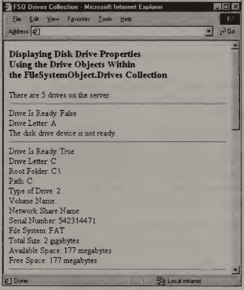

图 11-1 使用 FileSystemObject 的 drives 集合显示磁盘驱动器对象的属性

要使用`FileSystemObject`的`drives`集合显示磁盘驱动器的属性：

1. 使用 Notepad 或其他兼容 ASP 的编辑器创建一个 ASP 页面。

2. 添加基本 HTML 标签和如下所示的标题。

```
<html><head><title>FSO Drives Collection</title></head>
<body>
<h3>Displaying Disk Drive Properties <br>
Using the Drive Objects Within <br>
the FileSystemObject.Drives Collection</h3>
```

3. 添加用于创建名为`objFSO`的`FileSystemObject`的脚本。

```
<% Dim objFSO, objDrives, keyDrv
Set objFSO= CreateObject("Scripting.FileSystemObject")
```

4. 添加用于将`drives`集合存储到名为`objDrives`的驱动器对象中的脚本。

```
Set objDrives = objFSO.Drives %>
```

5. 使用`drives`集合的`count`属性来显示`drives`集合中的驱动器数量。`count`属性适用于`drives`集合，而不适用于单个驱动器对象。

```
There are
<% = objDrives.count %> drives on the server.
<HR>
```

6. 每个驱动器都是`drives`集合的成员。因此你可以使用`For Each`语句遍历每个驱动器。然后，你可以访问该驱动器的所有属性。

```
<% For Each keyDrv in objDrives
```

7. 使用`IsReady`属性来确定驱动器是否可用。如果驱动器可用，则显示驱动器对象的属性；否则，显示一条消息说明驱动器不可用。如果驱动器不可访问，则驱动器对象的属性不可用。

```
If keyDrv.IsReady = True Then %>
```

8. 显示驱动器对象的属性。

```
Drive Is Ready: <%= keyDrv.isReady %><BR>
Drive Letter: <%= keyDrv.DriveLetter %><BR>
Root Folder: <%= keyDrv.RootFolder %><BR>
Path: <%= keyDrv.Path %><BR>
Type of Drive: <%= keyDrv.DriveType %><BR>
Volume Name: <%= keyDrv.VolumeName %><BR>
Network Share Name: <%= keyDrv.ShareName %><BR>
Serial Number: <%= keyDrv.SerialNumber %><BR>
File System: <%= keyDrv.FileSystem %><BR>
```

9. 显示与磁盘驱动器大小相关的属性。大小属性以字节为单位检索大小。确保将`AvailableSpace`和`FreeSpace`属性返回的数字转换为兆字节，将`TotalSize`属性返回的数字转换为千兆字节。添加一条水平线来分隔每个磁盘驱动器的条目。

```
Total Size:
<%= (formatNumber(keyDrv.TotalSize/1073741824 ,0)) %>
gigabytes<BR>
Available Space:
<%= (formatNumber(keyDrv.AvailableSpace/1048576,0)) %>
megabytes<BR>
Free Space:
<%= (formatNumber(keyDrv.FreeSpace/1048576,0)) %>
megabytes<BR>
<hr>
```

### Folder 对象

`FileSystemObject`包含一个`folders`集合，该集合提供对特定`folder`对象的访问。`Folder`对象用于访问文件夹的属性和方法。`Folder`对象包含两个集合：`files`集合（包含文件夹中的文件）和`folders`集合（包含文件夹中的子文件夹）。

要从`folders`集合访问文件夹，必须首先创建`FileSystemObject`。然后，可以使用`FileSystemObject`的`GetFolder`方法来检索特定文件夹。文件或文件夹的路径是磁盘驱动器号、文件夹和子文件夹以及文件名的组合。文件夹可以嵌套在其他文件夹中。包含其他文件夹的文件夹称为父文件夹。可以使用字符串或表达式来传递文件夹路径。在以下代码示例中，`GetFolder`方法正在检索位于`C:\test\`的文件夹。文件夹位置可以作为表达式或变量传递。文件夹有许多属性可以使用`folder`对象访问。一旦检索到`folder object`，就可以访问该文件夹的所有属性。

```
ObjFolder.Property
```

例如，`folder`对象的`size`属性允许你访问文件夹的大小。要检索`size`属性，必须首先创建`FileSystemObject`。然后，必须使用`FileSystemObject`的`GetFolder`方法从文件夹集合中检索文件夹。在以下代码部分中，文件夹路径位于`C:\test\`。返回`folder`对象后，可以使用文件夹对象的名称后跟`size`属性来检索`size`属性。

```
Dim objFSO, objFolder
Set objFSO= CreateObject("Scripting.FileSystemObject")
Set objFolder = objFSO.GetFolder("c:\test\")
Response.write(objFolder.size)
```

#### Folder 属性

`Folder`对象包含许多可供你的 Web 应用程序检索的只读属性。某些属性提供有关文件夹在磁盘驱动器上位置的信息。`Drive`属性显示存储文件夹的驱动器字母。`Path`属性返回特定文件夹的路径。此外，`IsRootFolder`属性是一个布尔属性，如果文件夹是根文件夹，则返回`true`。如果文件夹存储在根文件夹中，该属性为`true`；否则，该属性为`false`。最后，`ParentFolder`属性返回该特定文件夹的父文件夹的`folder`对象。表 11-4 列出了其中一些属性。

可以为文件夹分配属性以帮助你管理文件。`Folder`对象的`attributes`属性将返回与该文件夹分配的属性对应的数字。Read-only 属性意味着用户无法更改内容或删除文件夹。如果文件夹已分配 read-only 属性，`attributes`属性将返回值 1。`Hidden`属性意味着默认情况下该文件夹不可见。对于隐藏的文件夹，`attributes`属性将返回值 `''`。根据服务器上安装的操作系统，还可以使用其他属性。

表 11-4 Folder 对象的属性

| 属性 | 描述 | 示例 |
| --- | --- | --- |
| `DateCreated` | 返回文件夹创建的日期 | `objFolder.DateCreated` |
| `DateLastAccessed` | 返回文件夹上次访问的日期 | `objFolder.DateLastAccessed` |
| `DateLastModified` | 返回文件夹上次修改的日期 | `objFolder.DateLastModified` |
| `Size` | 返回文件夹的大小 | `objFolder.Size` |
| `Drive` | 返回文件夹所在驱动器的字母 | `objFolder.Drive` |
| `Path` | 返回文件夹的路径 | `objFolder.Path` |
| `ShortPath` | 返回文件夹的路径，使用 8.3 命名约定 | `objFolder.ShortPath` |
| `Name` | 返回文件夹的名称 | `objFolder.Name` |
| `ShortName` | 返回文件夹的名称，使用 8.3 命名约定 | `objFolder.ShortName` |
| `IsRootFolder` | 如果文件夹是根文件夹则返回`"True"`，如果不是则返回`False` | `objFolder.IsRootFolder` |
| `ParentFolder` | 返回父文件夹的名称 | `objFolder.ParentFolder` |
| `Attributes` | 返回文件夹的属性 | `objFolder.Attributes` |
| `Subfolders` | 返回`SubFolder`集合 | `Set subFolder = objFolder.Subfolders` |

> 请记住，DOS 8.3 命名约定将文件名限制为八个字符，另外三个字符用于文件扩展名。

为了访问文件夹的属性，你需要创建`FileSystemObject`。可以使用`FileSystemObject`的`GetFolder`方法从文件夹集合中检索特定的`folder`对象。可以使用字符串、表达式或变量指定路径。然后，可以使用`folder`对象通过指定属性名称来检索任何文件夹属性。

```
Dim objFSO, objFolder
Set objFSO = server.createobject("Scripting.FileSystemObject")
Set objFolder = objFSO.GetFolder("pathToFolder")
objFolder.Property
```

#### Folder 对象的日期相关属性

`DateCreated`、`DateLastAccessed`和`DateLastModified`属性分别返回文件夹创建、上次访问和上次修改的日期和时间。

```
Dim VarDC, VarLA, VarLM
VarDC = ObjFolder.dateCreated
VarLA = ObjFolder.dateLastAccessed
VarLM = ObjFolder.dateLastModified
```

你可以使用`DateDiff` VBScript 函数通过传递两个日期和时间间隔来确定两个日期之间的间隔。这两个日期是两个有效的日期对象。可以使用字符串传递日期，例如`"January, 1, 2000"`，或者可以使用从函数（如`Now()`或`Date()`）返回的日期。还可以使用从`DateCreated`、`DateLastModified`和`DateLastAccessed`函数返回的日期。

时间间隔参数指定应该使用什么度量来比较两个日期。`Interval`参数可以有许多值，包括 year (`yyyy`)、month (`m`)、day (`d`)、hour (`h`) 或 minute (`n`)。可以向`DateDiff`函数传递其他参数来指定一周的第一天和一年的第一周。

```
DateDiff(interval, date1, date2)
```

以下示例输出 2000 年 1 月 1 日与当前日期之间的天数差，并说明如何使用`DateLastModified`属性作为`DateDiff`函数中的日期参数之一。此示例还返回创建日期与今天日期之间的差值，以分钟为单位。

```
<% = DateDiff("d","January,1,2000",now) %>
<% varDM = objFolder.datelastmodified %>
Difference between date created and today's date:
<% = DateDiff("n",varDM ,now) %><%=minutes%> <br>
```

> 编程提示：可以使用`DateValue`函数将字符串形式的日期转换为日期对象。字符串`"January,1, 2000"`可以传递给`DateValue`函数并转换为日期对象。将可以访问日期对象的所有属性和方法。你可以对`file`对象重复此过程，以检索有关文件上次修改时间的信息。

#### 检索 SubFolders 集合

`SubFolders`属性将子文件夹作为文件夹返回。要检索`SubFolders`集合，必须首先创建`FileSystemObject`。`FileSystemObject`用于从`folders`集合中检索特定文件夹。然后，可以使用`folder`对象的`SubFolders`集合来检索`folder`对象的集合。然后，可以访问子文件夹的属性。可以使用`For Each`循环来检索每个子文件夹的`Name`属性。以下代码说明如何检索所有子文件夹的名称。

```
<% Dim objFSO,  objFolder, subFolder, keyFolder
Set objFSO= CreateObject("Scripting.FileSystemObject")
Set objFolder = objFSO.GetFolder("c:\test\") %>
<% Set subFolder = objFolder.Subfolders
For each keyFolder in subFolder %>
    Name:<% =  keyFolder.Name %><br>
<% Next %>
```

图 11-2 展示了使用文件夹对象可以检索到的一些属性。文件夹对象是通过访问`FileSystemObject`创建的，然后检索文件夹集合。子文件夹通常被称为子文件夹，而包含它们的文件夹被称为父文件夹。

![Figure 11-2] 使用 FileSystemObject 显示文件夹的属性

要使用`FileSystemObject`的文件夹集合显示父文件夹和子文件夹的属性：

1. 在数据目录的根目录中创建一个名为 **SubFolderTest** 的文件夹，然后在`SubFolder Test`目录中创建一个名为 **SubTest** 的子文件夹。

2. 使用记事本或兼容 ASP 的程序创建一个网页。

3. 添加基本的 HTML 标签和标题，如下所示。

```
<html><head><title>FSO Folders Collection</title></head>
<body>
<h3>Displaying Folder Properties Using <br>
the Folder Object Within the Folders <br>
Collection of the FileSystemObject</h3>
```

4. 声明变量。

```
<% Dim fp, objFSO, objFolder, subFolder, keyFolder
```

5. 将数据目录的绝对路径赋值给`fp`变量。你的数据目录的路径可能有所不同。

```
fp = "c:\chapter11\SubFolderTest\"
```

6. 将`filespec`变量赋值为存储在名为`fp`的变量中的父文件夹路径。请将该路径替换为你的数据目录的完整绝对路径。（注意：你也可以将路径参数作为字符串传递，例如`c:\test\`。但是，通过使用变量来存储路径，你可以使用其他路径重复练习。）

```
filespec = fp & "SubTest\"
```

7. 添加代码来声明变量，并使用服务器对象的`CreateObject`方法创建`FileSystemObject`。

```
Set objFSO= CreateObject("Scripting.FileSystemObject")
```

8. 使用`FileSystemObject`的`GetFolder`方法来检索文件夹。将包含父文件夹路径的`filespec`变量传递给`GetFolder`方法。

```
Set objFolder = objFSO.GetFolder(fp) %>
```

9. 显示文件夹对象的日期相关属性。显示文件夹的创建日期、最后访问日期和最后修改日期。

```
<h4>Date-Related Properties of the Folder Object</H4>
Current Date:
<% = Now %><br>
Date Created:
<% = objFolder.datecreated %><br>
Date Last Accessed:
<% = objFolder.datelastaccessed %><br>
Date Last Modified:
<% = objFolder.datelastmodified %><br>
```

10. 显示文件夹创建日期与当前日期之间的天数。你可以使用`DateDiff`函数来计算两个日期之间的差值。

```
Difference between date created and today's date:
<% = DateDiff("d",objFolder.datecreated, now) %>
days <br>
```

11. 显示文件夹的其他属性。

```
<h4> Other Properties of the Folder Object</H4>
Size: <% = objFolder.Size%><br>
Drive: <% = objFolder.Drive%><br>
Path: <% = objFolder.Path%><br>
ShortPath: <% = objFolder.ShortPath%><br>
```

```
Name: <% = objFolder.Name%><br>
ShortName: <% = objFolder.ShortName%><br>
IsRootFolder: <% = objFolder.IsRootFolder%><br>
ParentFolder: <% = objFolder.ParentFolder%><br>
Attributes: <% = objFolder.Attributes%><br>
```

12. 从文件夹对象中检索子文件夹集合。

```
<h4> The Subfolders Collection of the Folder Object</H4>
<% Set subFolder = objFolder.Subfolders
```

13. 使用`subfolders`属性从文件夹对象中检索子文件夹集合。子文件夹集合的成员文件夹由变量`keyFolder`表示。使用`For Each`循环遍历子文件夹集合中的每个成员文件夹。显示每个成员文件夹的名称、路径和父文件夹。

```
For each keyFolder in subFolder %>
    Name:<% =  keyFolder.Name %><br>
    Path: <% = keyFolder.Path%><br>
    ParentFolder: <% = keyFolder.ParentFolder%><br>
<% Next %>
```

14. 为网页添加结束标签。

```
</body></html>
```

15. 通过更改背景、字体和颜色以及添加内容来修改网页的外观。

16. 将页面保存为`fsoDisplayFolders.asp`到你的数据目录中。

17. 在浏览器中查看你的网页。（注意：该页面将显示父文件夹和子文件夹的属性。）

18. 打印出网页和源代码。

#### 创建、复制、移动和删除文件夹

回想一下，`FileSystemObject`有名为`CreateFolder`、`CopyFolder`、`MoveFolder`和`DeleteFolder`的方法，用于创建、复制、移动和删除文件夹。文件夹对象也有类似的方法可用于创建、复制、移动和删除文件夹——即`add`、`copy`、`move`和`delete`方法。如你所见，创建、复制、移动和删除文件夹有不止一种方法可用。

### 文件对象

文件对象允许你检索特定文件的属性。这些文件对象属性中有些与文件夹对象的属性类似，例如属性属性。表 11-5 列出了文件对象的属性。

> **编程提示** 你可以使用`Server.MapPath`方法来确定文件的路径。如果你将从`Request.ServerVariables("PATH_INFO")`获取的相对路径传递给`MapPath`，将返回文件的绝对路径。此代码可能类似于：`fp = server.mappath(Request.ServerVariables("PATH_INFO"))`。

表 11-5 文件对象的属性

| 属性 | 描述 | 示例 |
|---|---|---|
| `Datecreated` | 返回文件的创建日期 | `objFile.datecreated` |
| `Datelastaccessed` | 返回文件最后被访问的日期 | `objFile.datelastaccessed` |
| `Datelastmodified` | 返回文件最后被修改的日期 | `objFile.datelastmodified` |
| `Size` | 返回文件的大小 | `objFile.Size` |
| `Drive` | 返回文件所在驱动器的盘符 | `objFile.Drive` |
| `Path` | 返回文件的路径 | `objFile.Path` |
| `ShortPath` | 使用 8.3 命名约定返回文件的路径 | `objFile.ShortPath` |
| `Name` | 返回文件的名称 | `objFile.Name` |
| `ShortName` | 使用 8.3 命名约定返回文件的名称 | `objFile.ShortName` |
| `Type` | 返回文件类型 | `objFile.Type` |
| `ParentFolder` | 返回父文件夹的名称 | `objFile.ParentFolder` |
| `Attributes` | 返回文件的属性 | `objFile.Attributes` |

图 11-3 展示了如何显示文件对象的属性。你必须首先使用`FileSystemObject`创建文件对象。为此，你需要知道文件的路径。下面的示例展示了如何创建一个页面来显示特定文件的属性。

![Figure 11-3] 使用 FileSystemObject 显示文件对象的属性

要使用`FileSystemObject`的文件对象显示文件的属性：

1. 在你的数据目录中创建一个名为 **FileTest** 的文件夹。

2. 使用记事本或其他 Web 处理编辑器创建一个名为 **Test.txt** 的文件。该文件应保存在`FileTest`目录中。

3. 使用记事本或兼容 ASP 的程序创建一个网页。

4. 添加基本的 HTML 标签和标题。

5. 声明变量。

```
<html><head><title>File Object</title></head>
<body>
<h3>Displaying File Properties <br>
Using the File Object </h3>
```

```
<% Dim fp, filespec, objFSO, objFile
```

6. 将`fp`变量赋值为你数据目录的绝对路径。你应该将路径替换为你的数据目录的完整绝对路径。

```
fp = "c:\chapter11\"
```

7. 将`filespec`变量赋值为文件的路径。（注意，你也可以将路径参数作为字符串传递，例如`c:\test\test.txt`。）

```
filespec = fp & "FileTest\Test.txt"
```

8. 添加代码来声明变量，并使用服务器对象的`CreateObject`方法创建`FileSystemObject`。

```
Set objFSO = CreateObject("Scripting.FileSystemObject")
```

9. 使用`FileSystemObject`的`GetFile`方法来检索文件。将包含文件路径的`filespec`变量传递给`GetFile`方法。

```
Set objFile = objFSO.GetFile(filespec) %>
```

10. 显示文件对象的日期相关属性。显示文件的创建日期、最后访问日期和最后修改日期。

```
<h4>Date-Related Properties of the File Object</H4>
Current Date: <%= Now %><br>
Date Created: <%= objFile.datecreated %><br>
Date Last Accessed:
<%= objFile.datelastaccessed %><br>
Date Last Modified:
<%= objFile.datelastmodified %><br>
```

11. 显示文件的其他属性。

```
<h4> Other Properties of the File Object</H4>
Size: <%= objFile.Size%><br>
Drive: <%= objFile.Drive%><br>
Path: <%= objFile.Path%><br>
ShortPath: <%= objFile.ShortPath%><br>
Name: <%= objFile.Name%><br>
ShortName: <%= objFile.ShortName%><br>
Type: <%= objFile.Type%><br>
ParentFolder: <%= objFile.ParentFolder%><br>
Attributes: <%= objFile.Attributes%><br>
```

12. 为网页添加结束标签。

```
</body></html>
```

13. 通过更改背景、字体和颜色以及添加内容来修改网页的外观。

14. 将页面保存为 **fsoDisplayFile.asp** 到你的数据目录中。

15. 在浏览器中查看你的网页。

16. 打印出网页和源代码。

#### 使用文件对象

文件对象的复制、移动和删除方法可用于复制、移动和删除文件。`OpenAsTextStream`方法将返回一个`TextStream`对象。`TextStream`对象用于读取、写入和追加到文件。要访问文件的属性，需要创建一个`FileSystemObject`。你可以使用`FileSystemObject`的`GetFile`方法从文件集合中检索特定的文件对象。你可以使用字符串、表达式或变量来指定路径。然后，你可以通过指定属性的名称，使用文件对象来检索任何文件夹属性。下面的示例展示了如何删除一个文件。

```
Dim objFSO, objFile, source
source = "c:\chapter11\testfile.txt"
Set objFSO =
server.createobject("Scripting.FileSystemObject")
Set objFile = objFSO.GetFile("pathToFile")
objFile.Delete source
```

请注意，源路径被存储在一个变量中。你可以从表单、数据库、cookie 或另一个文件中检索源路径信息。一旦检索到，你只需将该值赋给`source`属性。下面的示例展示了如何从表单中选择源路径。表单字段`txtsource`被传递给`source`变量，然后用作`delete`方法的源文件参数。

```
Dim objFSO, objFile, source
source = Request.form("txtsource")
Set objFSO =
server.createobject("Scripting.FileSystemObject")
Set objFile = objFSO.GetFile("pathToFile")
objFile.Delete source
```

表 11-6 展示了可应用于文件对象的方法。使用`copy`方法时，必须指定目标路径。如果未指定路径分隔符（`\`），文件将被复制到`source`参数指定的文件中。因此，建议使用路径分隔符来指定路径。你也可以向`source`参数追加文件名。你可以追加与源文件名相同的文件名。如果追加一个与源文件名不同的文件名，文件将被复制到另一个位置并使用新文件名。在下面的示例中，明确指定了源文件。你还需要传递一个参数来指定如果文件已存在是否要覆盖它。如果值为`true`，则如果文件存在，它将被覆盖。

```
Dim objFSO, objFile
Set objFSO = CreateObject("Scripting.FileSystemObject")
Set objFile = objFSO.GetFile(source)
objFile.Copy "c:\chapter11\copytest.txt", true
```

如果需要，你可以显式指定源文件名，或使用变量。然后，目标文件名和目录可以从表单、数据库、cookie 或其他文件中检索。下面是一个示例，展示了如何使用表单来使用`copy`方法。首先，从表单中检索值并将其赋给变量。然后，在`copy`方法语句中将这些变量用作参数。请注意，`overwrite`参数、文件名和路径都是从表单中检索的。

```
overwrite = request.form("overwrite")
    ' 此表单字段传递值 true 或 false，
    ' 以指示如果文件已存在是否应覆盖
filelist = request.form("filelist")
    ' 此表单字段包含原始文件名
currentDir = request.form("currentpath")
    ' 此表单字段包含不含路径分隔符（\）
    ' 的原始文件路径
source = currentDir & "\" & filelist
    ' 此变量包含源文件的路径
filename = request.form("filename")
    ' 此表单字段包含新文件名
copytargetDir = request.form("copydirectory")
    ' 此表单字段包含新路径名
if filename <> "" then
    copytarget = copytargetDir & "\" & filename
else
    copytarget = copytargetDir & "\" & filelist
end if
    ' 上面的 If Then 语句确定 copy 方法
    ' 应使用原始文件名还是不同的文件名
Dim objFSO, objFile
Set objFSO = CreateObject("Scripting.FileSystemObject")
    ' 创建 FileSystemObject
Set objFile = objFSO.GetFile(source)
    ' 创建文件对象
objFile.Copy copytarget, overwrite
    ' 调用文件对象的 copy 方法，并将变量作为参数传递给该方法
```

移动文件时，可以使用`move`方法。同样，如果未指定路径分隔符（`\`），文件将被复制到`source`参数指定的文件中。因此，建议使用路径分隔符来指定路径。你也可以向`source`参数追加文件名。你可以追加与源文件名相同的文件名。如果追加一个与源文件名不同的文件名，文件将被复制到另一个位置并使用新文件名。`move`和`copy`方法的区别在于，`move`方法会删除原始文件。`destination`参数指定文件将被移动到的位置。如果文件已存在，将发生错误。

```
filelist = request.form("filelist")
currentDir = request.form("currentpath")
source = currentDir & "\" & filelist
    ' 上面的变量检索源文件
movetargetDir = request.form("movedirectory")
movetarget = movetargetDir & "\"
    ' 上面的变量定义目标文件
Set objFSO = CreateObject("Scripting.FileSystemObject")
Set objFile = objFSO.GetFile(source)
    ' 创建源文件对象
objFile.Move movetarget
```

`delete`方法将删除指定的文件。你可以使用`force`参数强制`delete`方法删除标记为只读的文件。`force`参数默认为`false`。`force`参数的可能值为`true`或`false`。

另外两个文件对象方法`CreateTextFile`和`OpenAsTextStream`可用于创建文件以及读取、写入或追加到文件。但是，这些方法也可用于`FileSystemObject`。因此，这些方法将在下一节中更深入地介绍。

| 方法 | 描述 | 示例 |
| --- | --- | --- |
| `Copy` 方法 | 将文件从源位置复制到目标位置。你可以指定如果目标文件存在是否要覆盖它。 | `objFile.Copy "c:\source.txt", "c:\target.txt", true` |
| `Move` 方法 | 将指定的文件移动到新位置。 | `objFile.Move "c:\source.txt", "c:\target.txt"` |
| `Delete` 方法 | 删除指定的文件。你可以指定删除一个只读文件。 | `objFile.Delete "c:\source.txt", false` |
| `CreateTextFile` | 创建一个文件。你可以创建除文本以外的其他类型的文件，例如 Word 文档。 | `objFile.CreateTextFile "c:\target.txt"` |
| `OpenAsTextStream` | 打开一个文件并将其作为`TextStream`对象返回。`TextStream`对象用于读取、写入和追加到文件。 | `objFile.OpenAsTextStream "c:\target.txt"` |

#### 使用 TextStream 对象

有几种方法可以读取、写入和追加到文件。`FileSystemObject`的`CreateTextFile`和`OpenTextFile`方法返回一个`TextStream`对象，该对象可用于读取、写入和追加到文件。`OpenAsTextStream`方法被文件对象使用，返回一个`TextStream`对象，该对象也可用于读取、写入和追加到文件。`TextStream`对象有几个方法和属性，列在表 11-7 中。

表 11-7 TextStream 对象的方法和属性

| 方法或属性 | 描述 | 示例 |
| --- | --- | --- |
| `Write` 方法 | 将字符串、表达式或变量的内容写入文件。 | `txtfile.Write("Office Supply Store")` |
| `WriteLine` 方法 | 将内容写入文件，并写入一个换行符。 | `txtfile.WriteLine("Product Inventory List")` |
| `WriteBlankLines` 方法 | 写入指定数量的空行。 | `txtfile.WriteBlankLines(2)` |
| `Read` 方法 | 读取指定数量的字符。 | `txtfile.Read(2)` |
| `ReadLine` 方法 | 将下一行作为字符串返回。 | `txtfile.ReadLine` |
| `ReadAll` 方法 | 读取整个文件并将其作为字符串变量返回；不适用于大文件。 | `txtfile.ReadAll` |
| `Skip` 方法 | 跳过指定数量的字符。 | `txtfile.Skip` |
| `SkipLine` 方法 | 跳过下一行。 | `txtfile.SkipLine` |
| `Close` 方法 | 关闭文件。 | `txtfile.Close` |
| `AtEndOfStream` 属性 | 返回一个布尔值，指示是否已到达文件末尾（`True`）。 | `txtfile.AtEndOfStream` |
| `AtEndOfLine` 属性 | 返回一个布尔值，指示是否已到达行末（`True`）。 | `txtfile.AtEndOfLine` |
| `Column` 属性 | 返回当前列号。 | `txtfile.Column` |
| `Line` 属性 | 返回当前行号。 | `txtfile.Line` |

#### 创建并写入文件

`FileSystemObject`的`CreateTextFile`方法返回一个`TextStream`对象。`CreateTextFile`参数包括文件名、一个布尔值（指示文件是否应被覆盖）和一个布尔值（指示文件应创建为 Unicode（`"True"`）还是 ASCII（`"False"`））。`TextStream`对象有四种用于写入文件的方法。`write`方法将字符串写入文件。`WriteLine`方法写入字符串和一个换行符。`WriteBlankLines`方法向文件添加一个空行。你可以向`WriteBlankLines`方法传递一个数字来指定要添加的空行数。`close`方法用于关闭`TextStream`对象。

你可以使用表单来收集创建文件所需的信息。你可以指定文件名，或者让用户输入文件名和存储位置。你可以从表单字段中收集信息。你可以使用 textarea 表单字段来收集大量的自由文本。如果使用 textarea 表单字段，当用户按下回车键时，内容会换行到下一行。这种硬回车也会出现在创建的文档中。如果你无法访问数据库，将信息存储在文件中会很有用。

要使用`FileSystemObject`的`CreateTextFile`方法写入文件：

1. 使用记事本或兼容 ASP 的编辑器创建一个 ASP 页面。

2. 添加基本的 HTML 标签和标题。

```
<html>
<head><title>Writing to a File</title></head>
<body>
<h3>Writing to a File</h3>
```

3. 声明用于保存`FileSystemObject`和`TextFile`的变量。

```
<% Dim fp, fileSys, txtFile, filePath
```

4. 将数据目录的绝对路径赋值给`fp`变量。你的数据目录路径可能有所不同。

```
fp = "c:\chapter11\"
```

5. 创建一个变量来保存新文件的路径，该文件将命名为`NewFile.txt`。`fp`变量保存的是数据目录的路径。（注意，你也可以将路径参数作为字符串传递，例如`c:\test\test.txt`。）

```
filePath = fp & "NewFile.txt"
```

6. 创建`FileSystemObject`。

```
Set fileSys = CreateObject("Scripting.FileSystemObject")
```

7. 使用`CreateTextFile`方法创建文本文件。返回的对象是一个`TextStream`对象。在此示例中，`txtfile`就是`TextStream`对象。`filePath`参数指示创建文件时使用的路径和文件名。`true`参数表示该文件是 ASCII 类型文件。返回的`TextStream`对象被赋值给`txtfile`变量。

```
Set txtFile = fileSys.CreateTextFile(filePath, true)
```

8. 使用`write`、`WriteLine`和`WriteBlankLines`方法将内容写入文件。

```
txtFile.Write("Office Supply Store")
txtFile.WriteLine("Product Inventory List")
txtFile.WriteBlankLines(2)
txtFile.WriteLine("Pens")
txtFile.WriteLine("Pencils")
txtFile.WriteLine("Paper")
```

9. 使用`TextStream`对象的`close`方法关闭文件。

```
txtFile.Close
%>
```

10. 添加结束的 HTML 标签。

```
<h2>The file has been written</h2>
</body></html>
```

11. 通过更改背景、字体和颜色，以及添加内容来修改网页的外观。

12. 将此页面保存为 **fsoCreateFile.asp**，保存到你的数据目录中。

13. 在浏览器中查看你的网页。检查文件是否已创建。打开文件查看文本是否已写入。

14. 打印网页和源代码。

> 你可以使用此方法创建文本文件以外的其他文件。要创建 Word 文档，请指定文件名和文件扩展名`.doc`。然后你可以使用编程技术（如 Visual Basic for Applications (VBA)）来操作 Word 文档。你将能够自动执行 Word 中的任务，例如邮件合并。使用 VBA，你还可以将 Web 应用程序与 Excel 电子表格文件和 Access 数据库集成。如果你有兴趣了解更多关于 VBA 的知识，可以阅读 Diane Zak 所著的 *Visual Basic for Applications* (http://www.course.com/at/viewtitle.cfm?isbn=0-619-00020-1)。

#### 向文件追加内容

要向文件追加内容，你必须先打开它。你可以使用`OpenTextFile`方法打开文件。`OpenTextFile`方法返回一个`TextStream`对象，它允许你写入或追加到文件。你必须将文件名传递给`OpenTextFile`方法。你可以指定文件是以读取、写入还是追加模式打开。写入文件意味着文件的内容将被覆盖。追加文件意味着新内容将出现在现有内容的下方。用于指示你是读取、写入还是追加文件的参数称为`iomode`参数。`iomode`参数表示输入和输出模式。`iomode`值为 1 表示你将读取文件，但不能写入文件。`iomode`值为 2 表示可以写入文件，但不能读取文件。`iomode`值为 8 表示你可以将内容追加到文件末尾。可以使用一个布尔参数来指示如果存在同名文件时是否覆盖该文件。值为`"True"`表示即使文件当前存在也应创建一个新文件。默认的`format`参数为 ASCII。但是，你可以更改该参数以使用系统默认格式、Unicode 或 ASCII 格式打开文件。

请注意，`iomode`和`format`参数对于`CreateTextFile`和`OpenTextFile`方法是相同的。

```
ObjFSO.OpenTextFile(filename, iomode, overwrite, format)
```

要使用`FileSystemObject`的`OpenTextFile`方法打开文件并向文件追加内容：

1. 在你的数据目录中，使用记事本创建一个名为 **AppendFile.txt** 的新文件。

2. 使用记事本或兼容 ASP 的编辑器创建一个 ASP 页面。

3. 添加基本的 HTML 标签和标题。

```
<html>
<head><title>Appending to a File</title></head>
<body>
<H3>Appending to a File</H3>
```

4. 声明用于保存数据目录路径、`FileSystemObject`和`TextFile`的变量。

```
<% Dim fp, filePath, objFSO, txtFile
```

5. 将数据目录的绝对路径赋值给`fp`变量。你的数据目录路径可能有所不同。

```
fp = "c:\chapter11\"
```

6. 创建一个变量来保存新文件的路径。将`fp`替换为你的数据目录路径。

```
filePath = fp & "AppendFile.txt"
```

7. 创建`FileSystemObject`。

```
Set objFSO = CreateObject("Scripting.FileSystemObject")
```

8. 使用`CreateTextFile`方法创建文本文件。添加数字 8 参数表示文件以追加（Appending）`iomode`模式打开。添加`False`参数表示该文件是 ASCII 类型文件。返回的`TextStream`对象被赋值给`txtfile`变量。

```
Set txtFile = objFSO.OpenTextFile(filePath, 8, False)
```

9. 使用`WriteLine`方法向文件追加内容。

```
txtFile.WriteLine("Glue")
txtFile.WriteLine("Scissors")
txtFile.WriteLine("Tape")
```

10. 使用`close`方法关闭文件。

```
txtFile.Close
%>
```

11. 添加结束的 HTML 标签。

```
<h2>The file has been appended</h2>
</body></html>
```

12. 通过更改背景、字体和颜色，以及添加内容来修改网页的外观。

13. 将此页面保存为 **fsoAppendFile.asp**，保存到你的数据目录中。

14. 在浏览器中查看你的网页。打开文件查看文本是否已写入。

15. 返回并重新在浏览器中查看网页。打开文件查看文本是否已写入。你应该会看到文具列表被写入了两次，因为第二次查看页面时，文具清单被追加到了第一个文具清单之后。

16. 打印网页、源代码和文本文件的内容。

请注意，在上面的练习中文件名被固定为`AppendFile.txt`。你可以很容易地将文件扩展名从`.txt`改为`.doc`。此外，你也可以轻松地将文件名从`AppendFile`更改为一个变量。这样，文件名就可以来自表单、cookie 或数据库。以下示例代码展示了如何从表单中获取文件名。

```
Dim fp, filePath, filename
fileName = Request.form("txtFileName")
fp = Request.form("txtFilePath")
filePath = fp & filename & ".txt"
```

#### 打开并读取文件

你可以使用`FileSystemObject`的`OpenAsTextStream`方法打开一个文件进行读取。`OpenAsTextStream`方法返回一个`TextStream`对象。以下示例使用`OpenTextFile`方法，并使用`TextStream`对象的`ReadLine`方法逐行读取内容。该示例使用`Do While`循环来检测当前行是否到达文件末尾。如果`AtEndOfStream`属性为`true`，则表示该行已到达文件末尾，循环将结束。否则，循环将继续，读取下一行，然后将该行写入网页。

要使用`TextStream`对象的`OpenTextFile`方法读取文件：

1. 使用记事本在你的数据目录中创建一个名为 **ReadFile.txt** 的文件。

2. 打开文件并输入以下文本。

```
You have opened the ReadFile.txt file.
This was opened using the OpenTextFile method
of the TextStream object.
```

3. 保存更改并关闭文件。

4. 使用记事本或你的 ASP 编辑器创建一个 ASP 页面。

5. 添加基本的 HTML 标签和标题。

```html
<html><head><title>Reading from a File</title></head>
<body>
<h3> Reading a File Using the OpenTextFile <br>
Method of the TextStream Object</h3>
```

6. 声明脚本中使用的变量。

```asp
<% Dim fp, filePath, fileSys, txtFile, line
```

7. 将数据目录的绝对路径赋值给`fp`变量。数据目录的路径可能有所不同。

```asp
fp = "c:\chapter11\"
```

8. 将`filePath`变量赋值为文件路径。将路径替换为您的数据目录路径。

```asp
filePath = fp & "ReadFile.txt"
```

9. 创建`FileSystemObject`。

```asp
Set objFSO = CreateObject("Scripting.FileSystemObject")
```

10. 使用`OpenTextFile`方法以读取模式打开`filePath`文件。通过传递参数 1、0，指示文件将作为 ASCII 文件打开以供读取。返回的`TextStream`对象被赋值给`txtFile`变量。

```asp
Set txtFile = objFSO.OpenTextFile(filePath, 1, 0)
```

11. 创建`Do Until`循环。当循环到达文件末尾时，`AtEndOfStream`属性将为`true`，循环将关闭。如果循环尚未到达文件末尾，则将`line`变量赋值为`ReadLine`方法返回的结果。`ReadLine`方法将读取一行文本。然后使用`Response.Write`方法输出该行和一个换行标签。每行的布局将与文本文件中的相同。

```asp
Do Until txtFile.AtEndOfStream
    line = txtFile.ReadLine
    Response.Write line & "<br>"
Loop
```

12. 关闭`TextStream`对象并添加结束 HTML 标签。

```asp
txtFile.Close
%>
</body></html>
```

13. 通过更改背景、字体和颜色，以及添加内容来修改网页外观。

14. 将文件保存为 **fsoReadFile.asp**，存放在您的数据目录中。

15. 在浏览器中查看您的网页。

16. 打印网页和源代码。

### Err 对象

您应该始终尝试预判代码中可能出现错误的位置。当错误发生时，您可以使用`On Error`语句"处理"错误，跳过错误并继续执行代码。如果您不包含此错误处理语句，当错误发生时，脚本将停止执行并生成错误消息。结合使用`On Error`语句，您可以使用内置的`Err`对象来提供有关错误的更多信息。`Err`对象具有多个属性和方法，可以显示错误编号和错误描述。表 11-8 列出了`Err`对象的一些属性和方法。您还可以在脚本中创建函数来检测和处理错误。

```asp
On Error Resume Next
```

表 11-8 Err 对象的属性和方法

| 属性和方法 | 说明 | 示例 |
|---|---|---|
| `Number` 属性 | 返回唯一标识所发生错误的整数 | `Err.Number` |
| `Description` 属性 | 返回错误的描述 | `Err.Description` |
| `Source` 属性 | 返回导致错误的对象或方法的名称 | `Err.Source()` |
| `HelpFile` 属性 | 返回帮助文件的路径和文件名。您也可以设置此属性。如果用户单击帮助或按 F1，将显示该文件的错误对话框。 | `Err.HelpFile (pathToHelpFile)` |
| `HelpContext` 属性 | 设置或返回帮助主题的 ID。用于在错误发生时显示帮助主题。 | `Err.HelpContext` |
| `Clear` 方法 | 清除`Err`对象的所有属性 | `Err.Clear` |
| `Raise` 方法 | 生成用于测试的错误。您可以将`Err`对象的任何属性作为参数传递。 | `Err.Raise` |

以下示例代码说明了如何使用`Err`对象和`On Error`语句。示例声明了一个变量来保存函数的结果，并将该变量写入网页。该变量是每月应付的金额。该函数使用`On Error`语句，允许程序在发生错误时继续运行。该函数定义了一个将数字除以零的变量，这通常会导致错误消息出现。由于存在`On Error`语句，错误消息将不会出现。相反，函数捕获错误并显示错误编号和描述，然后脚本执行下一条语句。如果没有错误，函数将显示结果。

1. 使用记事本或您的 ASP 兼容编辑器创建一个 ASP 页面。

2. 添加基本的 HTML 标签和标题。

```html
<html><head>
<title>Err Object and On Error Statement</title></head>
<body>
<h1>Handling Errors with the <br>
Err Object and On Error Statement</h1>
```

3. 声明一个变量来保存每月应付的金额。

```asp
<% Dim AmtPerMonth, Total, NumMonths, Result
```

4. 为`Total`和`NumMonths`变量赋值。1000 是欠款金额，0 是还清贷款所需的月数。

```asp
Total = 1000
NumMonths = 0
```

5. 调用`AmountPerMonth`函数。将变量传递给`AmountPerMonth`函数。从函数返回的值被赋值给`Result`变量。

```asp
Result = AmountPerMonth(Total, NumMonths)
```

6. 将金额的值写入网页。

```asp
Response.Write Result
```

7. 创建名为`AmountPerMonth`的函数。传递的两个参数是欠款金额和还清贷款的月数。请注意，参数的名称不必与用于传递值的变量名称相同。

```asp
Function AmountPerMonth(Amount, Months)
```

8. 调用`On Error`语句来处理可能发生的错误。

```asp
On Error Resume Next
```

9. 在函数中声明一个本地变量，用于存储每月欠款金额。然后，根据传递给函数的`amount`和`months`参数计算该值。

```asp
Dim MonthlyAmount
MonthlyAmount = Amount / Months
```

10. 添加显示错误消息的代码。

```asp
If Err.Number <> 0 Then
    AmountPerMonth = _
        "Sorry, an error occurred. Enter your numbers again."
Else
    AmountPerMonth = MonthlyAmount
End If
End Function
%>
```

11. 添加结束 HTML 标签。

```html
</body></html>
```

12. 将页面保存为 **DisplayError.asp**，存放在您的数据目录中。

13. 在浏览器中查看页面。

14. 打印页面和您的代码。

## 本章总结

### 脚本库

- Microsoft 脚本库是 Microsoft 脚本运行时程序，包含`Dictionary`、`FileSystemObject`和`Err`对象。脚本库用于访问服务器上的文件和文件夹。

### Dictionary 对象

- `Dictionary`对象将二维数据存储为键和项目对。您可以通过指定键的名称来检索项目值。

### FileSystemObject

- `FileSystemObject`提供对多个对象、方法和集合的访问。`FileSystemObject`包含`Drives`和`Folders`集合。`Drives`集合用于访问`Drive`对象。`Folders`集合提供对`Folder`对象的访问。`FileSystemObject`包含可以检索特定`Drive`对象、`Folder`对象或`File`对象的方法。`FileSystemObject`方法可用于创建、复制、移动或删除文件和文件夹。`CreateTextFile`和`OpenTextFile`方法返回可用于写入、追加和读取文件的`TextStream`对象。`File`对象具有`OpenAsTextStream`方法，也可以返回`TextStream`对象。

### Err 对象

- `On Error`语句可防止脚本在发生错误时终止。`Err`对象可用于提供有关所发生错误类型的信息。

## 章节摘要

创建`Dictionary`对象的实例

```asp
Set objDMember = Server.CreateObject("Scripting.Dictionary")
```

向`Dictionary`对象添加键/项目对

```asp
objDMember.Add "memberid", memberid
```

检索`Dictionary`对象中项目的值

```asp
objDMember.Item("memberid")
```

检索`Dictionary`对象中键/项目对数据的数量

```asp
objDMember.Count
```

创建`FileSystemObject`

```asp
Set objFSO = Server.CreateObject("Scripting.FileSystemObject")
```

使用`FileSystemObject`的`CreateFolder`方法创建文件夹

```asp
objFSO.CreateFolder "c:\test\"
```

使用`FileSystemObject`的`CopyFolder`方法复制文件夹

```asp
objFSO.CopyFolder "c:\test\", "c:\testCopy\", True
```

使用`FileSystemObject`的`MoveFolder`方法移动文件夹

```asp
objFSO.MoveFolder "c:\test3\", "c:\test4\"
```

使用`FileSystemObject`的`DeleteFolder`方法删除文件夹

```asp
objFSO.DeleteFolder "c:\test5\"
```

使用`FileSystemObject`的`CreateFile`方法创建文件

```asp
objFSO.CreateTextFile "c:\test\sample.txt"
```

使用`FileSystemObject`的`CopyFile`方法复制文件

```asp
objFSO.CopyFile "c:\test\s1.txt", "c:\test\s2.txt", True
```

使用`FileSystemObject`的`DeleteFile`方法删除文件

```
objFSO.DeleteFile "c:\test\testfile.txt"
```

检索驱动器集合

```
Set objDrives = objFSO.Drives
```

使用驱动器对象的`DriveType`属性检索驱动器类型

```
keyDrv.DriveType
```

使用`TotalSize`属性以 GB 为单位检索磁盘驱动器的总大小

```
formatNumber(keyDrv.TotalSize/1073741824 ,0)
```

使用`AvailableSpace`属性以 MB 为单位检索磁盘驱动器的可用空间

```
formatNumber(keyDrv.AvailableSpace/1048576,0)
```

检索特定的文件夹对象

```
Set objFolder = objFSO.GetFolder("c:\test\")
```

检索文件夹的创建日期

```
ObjFolder.dateCreated
```

检索文件夹最后修改的日期

```
ObjFolder.dateLastModified
```

查找文件夹创建日期和最后修改日期之间的天数

```
DateDiff("d",objFolder.datecreated,
objFolder.datelastmodified)
```

检索文件夹对象的路径属性

```
objFolder.Path
```

使用`SubFolders`属性检索文件夹对象的`SubFolders`集合

```
Set subFolder = objFolder.Subfolders
```

使用`FileSystemObject`的`GetFile`方法检索文件对象

```
Set objFile = objFSO.GetFile("c:\\test\\test.txt")
```

使用文件对象的`size`属性显示文件大小

```
objFile.Size
```

使用`CreateTextFile`对象创建`TextStream`对象

```
Set txtfile = filesys.CreateTextFile(FilePath, true)
```

使用`TextStream`对象写入文件

```
txtfile.Write("Office Supply Store ")
txtfile.WriteLine("Product Inventory List")
txtfile.WriteBlankLines(2)
```

使用`TextStream`对象追加到文件

```
Set txtfile = objFSO.OpenTextFile(FilePath, 8, False)
```

使用`TextStream`对象打开文件以进行读取

```
Set txtfile = objFSO.OpenTextFile(filePath, 1, 0)
```

使用`TextStream`对象从文件中读取一行文本

```
txtfile.ReadLine
```

启用错误处理

```
On Error Resume Next
```

使用`err`对象显示错误号

```
Err.Number
```

## 复习题

1. 脚本对象是通过哪个动态链接库提供的？

   a. `ssp.dll`

   b. `scrrun.dll`

   c. `win.dll`

   d. `iis.dll`

2. 字典对象中可以存储什么类型的信息？

   a. 单个变量

   b. 二维数组

   c. 三维数组

   d. 多维数组

3. 你创建了一个名为`objDAddress`的字典对象，其键为`"State"`，项值为`"IL"`。哪条语句可以正确检索该项的值？

   a. `objDAddress.Add "IL"`

   b. `objDAddress.Get "State"`

   c. `objDAddress.Key "State"`

   d. `objDAddress.Key "IL"`

4. 哪个属性将返回`objDAddress`字典对象中的键/项对的数量？

   a. `objDAddress.Get`

   b. `objDAddress.Count`

   c. `objDAddress.Total`

   d. `objDAddress.Number`

5. 网络驱动器可以使用驱动器集合中的驱动器对象进行访问。对还是错？

6. 哪个`FileSystemObject`方法用于检索特定的文件夹对象？

   a. `objFSO.SpecialFolder`

   b. `objFSO.GetDrive`

   c. `objFSO.Folder`

   d. `objFSO.GetFolder`

7. 以下哪个不是`FileSystemObject`的三个特殊文件夹之一？

   a. `Temp`

   b. `Windows`

   c. `Programs`

   d. `System`

8. 哪个`FileSystemObject`方法用于移动文件夹？

   a. `objFSO.CopyFolder`

   b. `objFSO.Move`

   c. `objFSO.MoveObject`

   d. `objFSO.MoveFolder`

9. 哪个`FileSystemObject`方法将返回文件的扩展名？

   a. `objFSO.GetExtensionName`

   b. `objFSO.GetExtensionName`

   c. `objFSO.GetExtensionName`

   d. `objFSO.GetShortName`

10. 哪个驱动器号通常保留给第一个硬盘驱动器？

    a. `A`

    b. `B`

    c. `C`

    d. `D`

11. 哪个属性将返回硬盘驱动器的大小？

    a. `objDrive.Size`

    b. `objDrive.TotalSize`

    c. `objDrive.AvailableSpace`

    d. `objDrive.FreeSpace`

12. 运行 Microsoft NT Server 的驱动器不兼容哪种文件类型？

    a. `FAT`

    b. `FAT32`

    c. `NTFS`

    d. `CDFS`

13. `path`属性返回的值是什么？

    a. `C`

    b. `C:`

    c. `C:\`

    d. `C:\\`

14. 哪个属性将返回文件夹对象的父文件夹名称？

    a. `objFolder.Parent`

    b. `objFolder.ParentFolder`

    c. `objFolder.SubFolder`

    d. `objFolder.RootFolder`

15. 哪个方法用于计算两个日期之间的差值？

    a. `date`

    b. `DateDiff`

    c. `diff`

    d. `DiffDate`

16. 哪个属性可用于文件对象但不可用于文件夹对象？

    a. `dateCreated`

    b. `path`

    c. `ShortPath`

    d. `type`

17. 哪个方法用于写入字符串和换行符？

    a. `write`

    b. `WriteLn`

    c. `WriteLine`

    d. `WriteBlankLines`

18. 哪个方法用于逐行读取文件？

    a. `ReadAll`

    b. `ReadLN`

    c. `ReadLine`

    d. `line`

19. 哪个对象包含写入、追加和读取文件的方法？

    a. `FileSystemObject`

    b. 字典对象

    c. 文件对象

    d. `TextStream`对象

## 实践项目

### 项目 11-1

在本项目中，你将在 Microsoft Windows Script Technologies 网站上查找有关`FileSystemObject`的其他资源。Microsoft Windows Script Technologies 网站位于 *http://www.microsoft.com/scripting*。你将在该网站内查找并阅读`FileSystemObject`主题。

1. 访问 Microsoft Windows Script Technologies 网站：*http://msdn.microsoft.com/scripting/default.htm?/scripting/vbscript/default.htm*。

2. 左侧菜单包含多个选项，例如 VBScript 和 JScript。单击 **VBScript** 选项。将出现一个包含更多选项的子菜单。

3. 单击 **Documentation**。将出现一个包含更多选项的子菜单。

4. 单击 **FileSystemObject User's Guide**。通读右侧列出的每个主题。这些主题包含信息和代码示例。

5. 创建一个名为 **fsoTutorial.asp** 的网页。

6. 在网页上，描述 Web 页面中讨论的三个主题。

7. 在浏览器中显示示例代码及其描述。

8. 修改网页的外观。将页面保存到你的数据目录。

9. 在浏览器中查看网页。打印该网页。

### 项目 11-2

在本项目中，你将在 Microsoft Windows Script Technologies 网站上查找有关`FileSystemObject`的其他资源。

1. 访问 Microsoft Windows Script Technologies 网站：[http://msdn.microsoft.com/scripting/default.htm?/scripting/vbscript/default.htm](http://msdn.microsoft.com/scripting/default.htm?/scripting/vbscript/default.htm)。

2. 左侧菜单包含多个选项，例如 VBScript 和 JScript。单击 **VBScript** 选项。将出现一个包含更多选项的子菜单。

3. 单击 **Documentation**。将出现一个包含更多选项的子菜单。

4. 单击 **Scripting RunTime Reference**。

5. 在网页主体中，单击 **Objects** 链接。网页主体是加载到右框架中的页面。脚本库中内置的对象列表将出现在网页主体中。

6. 阅读列出的四个对象的文档。

7. 创建一个名为 **fsoDocumentation.asp** 的网页。

8. 描述你从这四个对象中学到了什么。

9. 在浏览器中显示示例代码及其描述。

10. 修改网页的外观。将页面保存到你的数据目录。

11. 在浏览器中查看网页。打印该网页。

### 项目 11-3

在本项目中，你将创建一个网页来检测磁盘驱动器上的可用空间量。

1. 使用记事本或兼容的 ASP 编辑器创建一个 ASP 页面。此页面将检测是否有任何磁盘驱动器使用了超过 90% 的空间。添加基本的 HTML 标签和标题。

## 磁盘警告

2. 创建磁盘驱动器对象。`objFSO`将包含`FileSystemObject`，`objDrives`将包含驱动器集合。

```
<% Dim objFSO, objDrives, keyDrv
Set objFSO= CreateObject("Scripting.FileSystemObject")
Set objDrives = objFSO.Drives %>
```

3. 使用`For Each`语句遍历驱动器集合中的每个驱动器对象。如果驱动器已就绪，则可以检索有关该驱动器的信息。

```
<% For Each keyDrv in objDrives
If keyDrv.IsReady = True Then %>
```

4. 检索驱动器对象的属性。然后，使用`TotalSize`和`FreeSpace`属性计算总空间和可用空间。`percentOpen`根据这些属性计算得出。`percentUsed`基于`percentOpen`计算。（提示：当您从 20/100 计算百分比时，百分比为 0.2，因此小于 1。如果您从 1 中减去 0.2，您将得到 0.8 作为使用百分比。）

```
<% total = (formatNumber(keyDrv.TotalSize/1048576,0))%>
<% available =
(formatNumber(keyDrv.AvailableSpace/1048576,0))%>
<% freespace = (formatNumber(keyDrv.FreeSpace/1048576,0))%>
<% percentOpen = keyDrv.FreeSpace/keyDrv.TotalSize%>
<% percentUsed = (1 - percentOpen)   %>
```

5. 将驱动器盘符写入网页。

```
Drive Letter: <%= keyDrv.DriveLetter %><BR>
```

6. 如果使用百分比小于 90%，则输出使用百分比。您可以使用`formatpercent`方法将输出格式化为带有百分号的两位小数。

```
<% If percentUsed < .90 then %>
You have used <%= formatpercent(percentUsed) %>
<br> of disk space on this drive.
<hr size = 1 width="250">
```

7. 否则，如果使用百分比大于 90%，则输出警告语句和使用百分比。

```
<% else %>
<b>----- WARNING ----- </b><br>
You have used more than
<%= formatpercent(percentUsed) %> <br>
of disk space on this drive.
<hr size = 1 width="250">
<% end if %>
```

```
<% Else %>
<% End if %>
<% Next %>
</div></body></html>
```

8. 关闭脚本和网页。

9. 修改网页的外观。

10. 将页面另存为`fsoDiskWarning.asp`到您的数据目录。

11. 在浏览器中查看网页。打印网页。

### 项目 11-4

在本项目中，您将使用表单字段中的值创建文件。如果您没有文件上传组件，这是在服务器上创建文件的绝佳方法。

1. 在您的数据目录中创建一个名为`CreatedFiles`的文件夹，用于存储将由该表单创建的文件。

2. 使用记事本或您的网页编辑器，创建一个包含表单的网页。一个表单字段应为您将在服务器上创建的文件名称。另一个字段应显示下拉列表，用于选择文件扩展名（`.asp`、`.txt`、`.htm`和`.doc`）。其他字段将存储在服务器上的文件中。使用下面的示例代码创建您的表单。

```
<html><head><title>Creating a File</title></head>
<body>
<h2 align = "center">Creating a File From a Form</h2>
<form method="POST" action="fsoProcessForm.asp">
   <table align = "center" border="0"
      width="72%" cellspacing="0" cellpadding="3">
      <tr><td width="19%">File Name</td>
         <td width="81%">
         <input type="text" name="filename" size="25"></td>
      </tr>
      <tr><td width="19%">File Type</td>
         <td width="81%">
         <select size="1" name="ext">
            <option value=".txt">Text File</option>
            <option value=".htm">Web Page</option>
            <option value=".doc">Word Document</option>
            <option value=".asp">Active Server Page</option>
         </select></td>
      </tr>
      <tr><td width="19%">Title</td>
         <td width="81%">
         <input type="text" name="title" size="70"></td>
      </tr>
      <tr><td width="19%">Author</td>
         <td width="81%">
         <input type="text" name="author" size="70"></td>
      </tr>
      <tr><td width="19%">Comments</td>
         <td width="81%">
         <textarea rows="7" name="comments" cols="60">
</textarea></td>
      </tr>
      <tr><td width="19%"></td>
         <td width="81%">
         <input type="submit" value="Submit" name="B1">
         <input type="reset" value="Reset" name="B2"></td>
      </tr>
   </table>
</form></body></html>
```

3. 将页面另存为 **fsoCreateForm.asp** 到您的数据目录。

4. 使用记事本或 ASP 编辑器创建一个新网页，该网页从表单字段中检索值并创建新文件。首先使用下面的代码添加基本 HTML 标签和标题。

```
<html><head><title>Creating a File</title></head>
<body>
<h2 align = "center">Your file has been created.</h2>
```

5. 检索表单字段值并将表单字段赋值给变量。

```
<%
    dim fileName, fileExt, title, author, comments, fp, fn
    fileName = request.form("filename")
    fileExt = request.form("ext")
    title = request.form("title")
    author = request.form("author")
    comments = request.form("comments")
```

6. 连接文件路径、文件名和`fileExt`，并将结果存储在`fn`变量中。`fn`变量保存脚本将创建的新文件的绝对路径。

```
fp = "c:\chapter11\"
fn = fp & fileName & fileExt
```

7. 创建`FileSystemObject`。

```
Dim fileSys, txtFile
Set fileSys = CreateObject("Scripting.FileSystemObject")
```

8. 使用`FileSystemObject`的`CreateTextFile`方法创建`TextStream`对象。

```
Set txtFile = fileSys.CreateTextFile(fn, true)
```

9. 使用变量创建文件，并将内容写入文件。（提示：您可以使用`WriteLine`方法在单独的行上写入表单字段的名称和值。使用`write`、`WriteLine`和`WriteBlankLines`方法将内容写入文件。）

```
txtFile.WriteLine(Title)
txtFile.WriteLine(Author)
txtFile.WriteBlankLines(1)
txtFile.WriteLine(Comments)
txtFile.Close
%>
```

10. 添加一个标题告诉用户文件创建的位置，并关闭文件。

```
<h3 align = "center">The file has been created at
<br><br>
<%= fn %>
</h3>
</body></html>
```

11. 修改网页的外观。

12. 将页面另存为`fsoProcessForm.asp`到您的数据目录。

13. 在浏览器中查看网页。使用表单创建一个页面。在下拉列表中选择文本文件格式。

14. 查看已创建的页面。打印新创建的页面、网页和源代码。

15. 您可以再次查看网页，并使用下拉列表中的其他文件格式重新创建页面。请注意，虽然文件可以保存为网页或 ASP 页面，但除非您输入 HTML 标签，否则内容在页面上显示为纯文本。如果您将页面保存为 Word 文档，文本将出现在 Word 文档中，但它是未格式化的文本。

## 案例项目

### Jim's Golf Magazine—续订表单

您受雇于 *Jim's Golf Magazine* 的发行部门，协助他们开发部门的网站。部门负责人希望让网站的访问者能够填写表单。创建下面的表单，并将您的网页另存为`GolfForm.asp`到您的数据目录。

```
<html><head><title>Registration Form</title></head>
<body bgcolor="#99FF99" text="#008000">
<h2 align="center">Member Subscription Renewal Form</h2>
<form method="POST" action="GolfFormProcess.asp">
<table border="0" align="center">
<tr><td>Member ID</td>
<td><input type="text" name="memberid" size="20">
</td></tr><tr><td>First Name</td>
<td><input type="text" name="fname" size="20">
</td></tr><tr><td>Last Name</td>
<td><input type="text" name="lname" size="20">
</td></tr><tr><td>Address</td>
<td><input type="text" name="address" size="20">
</td></tr><tr><td>City</td>
<td><input type="text" name="city" size="20">
</td></tr><tr><td>State</td>
<td><input type="text" name="state" size="4">
</td></tr><tr><td>Zip Code</td>
```

```html
<td><input type="text" name="zipcode" size="10">
</td></tr><tr><td>国家/地区</td>
<td><input type="text" name="country" size="4">
</td></tr><tr><td>续订订阅</td>
<td>
<input type="radio" value="Yes" checked name="renew">是
<input type="radio" name="renew" value="No">否
</td></tr><tr><td><p>提示</td>
<td><p>
<input type="checkbox" name="putt"
       value="Great Putting Tips">
优秀推杆技巧 <br>
<input type="checkbox" name="green"
       value="Green Acres">
Green Acres<br>
<input type="checkbox" name="sand"
       value="Sand &amp; Water Tips">
沙坑与水障碍技巧<br>
<input type="checkbox" name="tee" value="Tee Shots">
发球技巧<br>
<input type="checkbox" name="clubs" value="Selecting Clubs">
球杆选择
</td></tr></table>
<div align = "center"><br>
<input type="submit" value="Renew" name="btnSubmit">
</div></form></body></html>
```

创建一个名为`GolfFormProcess.asp`的 ASP 页面，用于获取每个表单字段。（提示：你可以逐个获取每个表单字段，例如`memberid = Request.Form("memberid")`，或者使用通用的表单处理程序。）如果访问者没有续订订单，则显示一条消息："您可以在稍后续订您的订阅"。如果访问者希望续订订阅，则将字段名作为键，将字段的值作为字典对象中的项。（提示：以下代码会将会员 ID 添加到字典对象中：`objDMember.Add "memberid", memberid`。）然后，编写一条消息："您将收到我们的额外提示杂志列表："。使用定义列表来格式化订阅者将收到的提示杂志列表。使用换行标签或表格标签修改页面的格式。通过添加图片、文字和颜色来修改页面的外观。将两个页面保存到您的数据目录中。在浏览器中查看表单并提交表单。打印两个页面以及两个页面的源代码。

### 吉姆高尔夫杂志——在线文章

您暂时被调到编辑部，帮助他们开发在线文章。编辑很担心，因为他们无法追踪文件的创建时间。您的任务是创建一个名为`lm.inc`的服务器端包含文件，其中包含一个通用脚本，用于显示页面的创建日期。（提示：您可以使用以下代码获取文件的绝对路径：`fp = server.mappath(Request.ServerVariables("PATH_INFO"))`。如果将其赋值给变量`fp`，则只需将`fp`变量传递给`GetFile`方法。不要忘记先使用`FileSystemObject`创建`FileObject`。计算自文件创建以来经过的分钟数和天数。*提示：* 代码`DC = objFile.dateCreated`将文件对象的`dateCreated`属性赋值给`DC`变量。显示自文件创建以来的分钟数的代码为`<% = DateDiff("n", DC, now) %> minutes <br><br>`。您可以修改代码以显示天数，或计算自文件创建以来的天数。）创建一个名为`Im.asp`的通用页面，并在网页的页脚中包含`Im.inc`文件。您可以在脚本包含到网站其他部分之前向编辑演示此页面。在脚本中，确定页面是否超过 100 天。添加一条水平线，并显示当前日期以及文件的创建日期、最后访问日期和最后修改日期。如果文件超过 100 天，则添加一个指向名为`ImOld.asp`的页面的超链接。创建`ImOld.asp`页面。在页面上包含一条消息，指示该文件超过 100 天。（*提示：* 使用`DateDiff`方法计算两个日期之间经过的天数。）通过添加内容、图形、水平线和颜色来修改网页的外观。将页面保存到您的数据目录并在浏览器中查看。将计算机的系统日期更改为从今天起 101 天后。您可以双击桌面上的时间来打开系统日期/时间属性。您可以在这里使用日历来更改系统日期。查看页面以查看超链接。打印所有页面及其源代码。将系统日期改回当前日期。

### 吉姆高尔夫杂志——部门文件与文件夹索引

您被调到 *吉姆高尔夫杂志* 的客户支持部门。您发现由于他们有一个默认索引页面，因此无法在浏览器中从互联网站点查看目录信息。您的任务是创建一个通用脚本，用于显示子文件夹列表及其属性。首先，声明名为`fp`、`objFSO`、`objFolder`、`subFolder`、`keyFolder`和`objFile`的变量。接下来，您决定通过对`PATH_INFO`服务器变量应用`MapPath`方法来获取文件路径。您将此值放入一个变量中。（*提示：* 您可以使用`fp = server.mappath(Request.ServerVariables("PATH_INFO"))`。）然后，在使用`GetFile`创建`FileObject`时，可以将该变量作为路径参数传递。

```
Set objFSO = CreateObject("Scripting.FileSystemObject")
Set objFile = objFSO.GetFile(fp)
```

要获取当前文件夹路径信息，您决定使用文件对象的`ParentFolder`属性，并将其存储在一个变量中。然后，可以将该变量传递给`GetFolder`方法，为当前文件夹创建一个文件夹对象。

```
folderspec = objFile.ParentFolder
Set objFolder = objFSO.GetFolder(folderspec)%>
```

从那里，您可以显示当前文件夹的名称和路径，因为它们是当前文件夹对象的属性。（*提示：* 尝试使用`<% = objFolder.Path%>`来获取路径属性。）添加一个标题："当前文件夹对象的 Subfolders 集合"。要显示子文件夹列表，您需要从文件夹对象中检索子文件夹集合并将该集合存储在一个变量中。然后，可以使用`For Each`循环通过`name`属性显示每个文件夹的名称。您通过添加锚点标签来修改显示的名称，这将把文本变为超链接。（*提示：* 使用以下示例代码以超链接形式获取文件夹名称。）

```
<% Set subFolder = objFolder.Subfolders
For each keyFolder in subFolder %>
    <a href="<% = keyFolder.Name %>">
        <% = keyFolder.Name %>
    </a><br>
<% Next %>
```

该脚本还将显示目录中的文件列表及其属性。添加一个标题："当前文件夹对象的 Files 集合"。（*提示：* 使用以下示例代码以超链接形式获取文件名。）

```
<%
For each objFile in objFolder.Files %>
    <a href="<% = objFile.Name %>">
        <% = objFile.Name %>
    </a><br>
<% Next %>
```

通过添加图片、文字和颜色来修改页面的外观。将页面保存为`GolfFolder.asp`到您的数据目录。查看页面以测试通用脚本。打印您的网页和源代码。


### 吉姆高尔夫杂志——管理服务器文件

网站管理员希望能够从浏览器管理服务器上的文件。创建一个名为`GolfCopy.asp`的网页。创建一个脚本，用于获取文件夹中的文件名称和当前文件夹的路径。然后，将文件名称放入网页的下拉列表框中。将文件夹路径放入文本框中。添加一个下拉列表框，其中包含复制、移动或删除文件的命令。添加额外的下拉列表框，其中包含复制和移动文件的参数。（*提示：* 您可能想要使用文件对象或`FileSystemObject`上可用的方法。）创建第二个名为`GolfCopyProcess.asp`的页面，用于获取表单字段并执行表单中指定的操作。（*提示：* 您可能想要获取表单字段的值并将其放入变量中。然后，可以在脚本中引用这些变量。以下示例代码将生成一个以下拉列表框形式显示目录中文件名的控件。您仍然需要先创建`FileSystemObject`和`FolderObject`。）

```html
<select size="1" name="filelist">
    <option value="" selected>Select a file</option>
    <% For each objFile in objFolder.Files %>
        <option value="<%= objFile.Name %>">
            <%= objFile.Name %>
        </option>
    <% Next %>
</select>
```

在`GolfCopyProcess.asp`的底部，添加一个指向`GolfCopy.asp`页面的超链接。修改页面的外观。将网页保存到你的数据目录。在记事本中创建一个名为`golf1.txt`的测试页面。在浏览器中查看`GolfCopy.asp`网页。使用`GolfCopy.asp`页面将`golf1.txt`页面复制到同一目录。新文件名应为`golf2.txt`。打印每个网页和源代码。

## 第十二章

## 将数据库与 ASP 页面集成

在本章中，你将：

- 在 Microsoft Access 中创建一个包含表的数据库

- 了解数据库模型如何让你将 Active Server Pages 连接到数据库

- 为 Microsoft Access 数据库创建一个数据源名称（DSN）

- 为 Microsoft Access 数据库创建连接字符串

- 使用记录集对象创建一个显示数据库表数据的网页

- 识别关于将 Web 应用程序连接到数据源的网络资源

在前面的章节中，你学习了如何使用内置和第三方对象、属性和方法来增强你的 Web 应用程序。在本章中，你将学习如何让你的 Web 应用程序访问来自各种数据源的数据。通过网络访问数据库对当今的许多商业应用程序至关重要。在电子商务中，数据库存储产品目录、运输、税收和客户信息。这些数据库促进订单处理和履行，同时也让管理团队能够查看销售趋势和客户概况，这些数据可用于制定营销活动。数据库还用于存储员工需要访问的公司数据。例如，财务部门可能希望访问当前销售数据，以便让出差的销售员工能够远程访问和更新他们的销售数据。企业还希望与客户和其他合作伙伴共享信息。例如，广告公司可能希望让客户查看其网站的访问者查看横幅广告的频率。你可以为你的网站为客户构建一个门户，让他们只能查看与自己相关的数据。你还可以允许他们检索这些数据，并用你的数据更新他们自己的数据库。

你可以将 ASP 与其他数据库技术结合使用，来开发数据库驱动的网站。有许多资源可用于学习如何将数据库连接到网页。在本章中，你将学习如何查找提供数据库、SQL 和 ADO 模型信息的网络资源。

## 创建数据库驱动的 Web 应用程序

创建数据库驱动的 Web 应用程序涉及多种技术、工具和各种编程方法。通常，你可以按照本章描述的过程来开发访问数据库的网页。在下一章中，你将学习如何修改 Web 程序以执行其他活动，如插入新记录、修改记录和删除记录。当你学习基本步骤时，你可以看到扩展它们是多么容易。例如，一旦你学会如何构建高级 SQL 语句，你就可以轻松地为 Web 应用程序构建更多的交互性。你可以从用户表单中获取值来构建 SQL 语句。但是，除非你理解基本步骤，否则你很容易在代码中"迷失"。如果你理解了基本步骤，你总是可以从基础开始，一步一步地为你的代码构建复杂性。以下是用于开发显示数据库数据网页的任务列表。这个过程中的每一步都将在本章中详细解释。

1. 创建数据库（这里将使用 Access 2000，但任何 ODBC 或 OLEDB 数据库都可以）。

2. 创建数据库连接（DSN 或连接字符串）。

3. 创建 ASP 页面（同样，使用记事本或兼容 ASP 的编辑器）。

4. 创建记录集对象。（ADO 模型提供访问数据库的对象。记录集对象将包含记录。）

5. 打开记录集对象并检索记录。（你可以检索整个表或子集，使用 SQL 命令。）

6. 检索并显示每条记录的字段信息。（可以检索单个字段。）

7. 关闭记录集对象。

如前所述，检索记录集的方法不止一种。记录集对象将允许你检索记录。但你也可以使用连接对象显式地打开与数据库的连接，然后使用记录集对象通过该连接检索记录。

方法的选择取决于性能和所需的控制级别。使用连接对象可以让你显式地打开和关闭与数据库的连接。

以下是修改过程以包含连接对象的步骤列表。这个过程中的每一步都将在本章中详细解释。

1. 创建数据库。

2. 创建数据库连接。

3. 创建 ASP 页面。

4. 创建连接对象。

5. 使用连接对象打开与数据库的连接。

6. 创建记录集对象。

7. 使用连接对象提供的连接打开记录集。

8. 检索并显示每条记录的字段信息。

9. 关闭记录集对象。

10. 关闭连接对象。

### 使用 ACCESS 2000 创建数据库

数据库管理系统（DBMS）是存储和管理数据的应用程序。数据库存储数据的方式不同。**关系数据库**将数据存储在一个或多个表中。每个表由记录组成。表中的每一行对应一条记录。记录由字段组成，每个字段包含单个数据项。一组记录称为**记录集**。多个记录中相同字段的集合称为列。因此，每个表由列和行组成。

可以使用许多不同的数据库程序创建数据库，例如 Access 2000、FoxPro、SQL Server 和 Oracle。当你创建数据库表时，必须为每个字段标识字段名称和数据类型。数据类型定义表将如何存储数据。在 Access 中，定义表结构的视图称为**设计视图**。描述数据存储方式的称为数据结构。创建表结构后，你可以向表中输入数据。数据库有不同的用户界面用于创建数据库结构和输入数据。但是，创建表的基本原理在所有关系数据库程序中是相同的。一些程序，如 Access 2000，还提供图形向导，帮助你使用模板构建表。以下示例说明如何使用 Access 2000 创建基本数据库和表。

要使用 Access 2000 创建数据库和表：

1. 打开 Access 2000。默认情况下，可以通过单击**开始**，然后**程序**，然后**Microsoft Access**来执行 Access 2000 程序的快捷方式。

2. 出现一个对话框（见图 12-1），用于指示你是要创建新的空白数据库、从向导创建新数据库，还是打开现有数据库文件。选择显示**空白 Access 数据库**的单选按钮以创建新的数据库文件，然后单击**确定**。将打开"文件新建数据库"对话框。

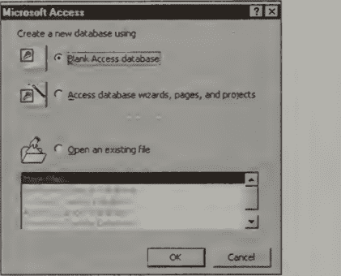

图 12-1 在 Microsoft Access 中打开数据库

3. 在文件名文本框中，输入 **customer** 作为数据库的名称。你不需要输入文件扩展名。Access 会自动添加`.mdb`文件扩展名。单击**保存在**列表箭头以找到你的数据目录（见图 12–2）。单击**创建**按钮将数据库保存到你的数据目录。

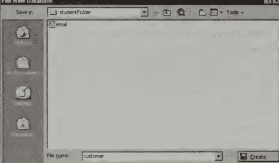

图 12-2 将新数据库保存在你的数据目录中

4. `customer`数据库将打开。左侧是 Access 中可用的对象。这些对象包括表、查询、窗体、报表、页、宏和模块。默认情况下，数据库在表选项卡中打开。右侧列出了相关选项。默认情况下，"在设计视图中创建表"选项处于选中状态。双击**在设计视图中创建表**选项，即可在设计视图中打开一个新表。有两种视图（即两种方式）可以查看你的表。设计视图允许你创建和修改数据库的结构。

5. 在第一个"字段名称"框中，输入字段名称 **id**，该字段将表示客户 ID。字段名称最多可包含 64 个字符。建议你在字段名称中不要使用空格，尽管某些数据库允许这样做。

6. 按 **Tab** 键移动到"数据类型"下拉列表。从下拉列表中选择**文本**数据类型。在"说明"框中，输入 **Customer ID**。说明是可选的，但有助于记录有关字段的信息。

7. 表窗口底部是"常规"选项卡，其中包含可以为该字段设置的多个字段属性。默认字段大小为 50 个字符；将"字段大小"属性更改为 **10**。

8. 在"必填字段"属性文本框中，将 **Required** 属性从"否"更改为**"是"**。这意味着当创建新记录时，必须在此字段中填入值（参见图 12-3）。根据下表表 12-1 中的列表，输入其余的字段名称和数据类型。

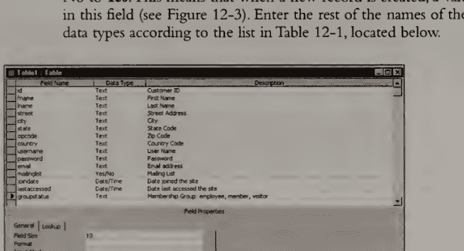

图 12-3 在 Access 2000 中创建客户数据库结构

表 12-1 创建客户数据库的结构

| 字段名称 | 数据类型 | 说明 | 字段属性 |
| :--- | :--- | :--- | :--- |
| `id` | 文本 | 客户 ID | 字段大小 10；必填 是 |
| `fname` | 文本 | 名 | 字段大小 25 |
| `lname` | 文本 | 姓 | 字段大小 25 |
| `street` | 文本 | 街道地址 | 字段大小 20 |
| `city` | 文本 | 城市 | 字段大小 20 |
| `state` | 文本 | 州 | 字段大小 2 |
| `zipcode` | 文本 | 邮政编码 | 字段大小 10 |
| `country` | 文本 | 国家代码 | 字段大小 2 |
| `username` | 文本 | 用户名 | 字段大小 10 |
| `password` | 文本 | 密码 | 字段大小 10 |
| `keyword` | 文本 | 关键字 | 字段大小 10 |
| `email` | 文本 | 电子邮件地址 | 字段大小 50 |
| `mailinglist` | 是/否 | 邮寄列表 | |
| `joindate` | 日期/时间 | 加入网站的日期 | |
| `lastaccessed` | 日期/时间 | 最后访问网站的日期 | |
| `groupstatus` | 文本 | 成员组：employee、member、visitor | 字段大小 10 |

单击`id`字段旁边的左框以选中`id`字段行。框中将出现一个三角形，表示`id`字段已被选中。在表工具栏上，单击**钥匙**图标。钥匙图标代表主键。通过将`id`字段设置为主键字段，你已配置该字段使其不能出现重复值。

9. 单击表工具栏最左侧的**视图**图标。视图图标允许你在设计视图和数据表视图之间切换。此时会出现一个 Access 对话框，提示"必须先保存表。是否要立即保存该表？"单击**是**。将出现"另存为"对话框。在"另存为"对话框中，输入 **customer** 作为表的名称，然后单击**确定**。数据表视图将打开。按照下表表 12-2 所示输入每条记录的数据。

表 12-2 客户表的数据

| 字段名称 | 记录1 | 记录2 | 记录3 |
| :--- | :--- | :--- | :--- |
| `id` | 1 | 2 | 3 |
| `fname` | John | John | Jane |
| `lname` | Garcia | Barnes | Monroe |
| `street` | 555 Main Street | 412 State Street | 312 Lake Street |
| `city` | Greenbay | Wilmette | West Lafayette |
| `state` | WI | IL | IN |

表 12-2 客户表的数据（续）

| 字段名称 | 记录1 | 记录2 | 记录3 |
|------------|---------|---------|---------|
| `zipcode` | 73432 | 98773 | 49872 |
| `country` | US | US | US |
| `username` | jgarcia | jbarnes | jmonroe |
| `password` | mickey | flamingo | ghost |
| `keyword` | objection | turbo | java |
| `email` | jgarcia@oakton.net | jbarnes@webedit.net | jmonroe@kalata.com |
| `mailinglist` | 是（勾选复选框） | 是（勾选复选框） | 否（保持复选框未勾选） |
| `joindate` | 7/10/2001 | 6/25/2001 | 7/16/2001 |
| `lastaccessed` | 7/16/2001 | 7/25/2001 | 7/28/2001 |
| `groupstatus` | employee | member | visitor |

10. 单击表工具栏上的**保存**图标，即可保存该表（参见图 12-4）。

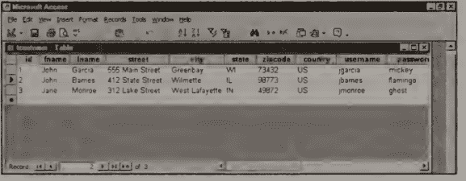

图 12-4 保存客户表

11. 单击菜单栏上的**文件**，然后单击**关闭**以关闭该表。数据库窗口将显示新的`customer`表。

12. 单击菜单栏上的**文件**，然后单击**关闭**以关闭数据库。

13. 单击菜单栏上的**文件**，然后单击**退出**以退出 Access。

#### 数据库模型

过去，数据库管理系统是专有的；存储的数据只能通过用于创建数据库的程序来访问。除非在数据库应用程序之间构建了接口，否则程序之间无法共享数据。如今，业务需求要求数据库管理系统具有更高的灵活性。这种灵活性是通过 **通用数据访问（UDA）** 模型实现的。通用数据访问模型提供了一种方法，使数据能够在不同的应用程序和平台之间共享。UDA 通过 **开放数据库连接（ODBC）** 和 **OLEDB** 标准，以及 ActiveX 数据对象模型（ADO）和 ADO+ 来实现。

> 了解 UDA 实现方式的最佳资源之一是 Microsoft UDA 网站，地址为 http://www.microsoft.com/data/default.htm。

这一切如何运作并不简单，此处为占位符，使用此 UDA 模型连接 Web 应用程序有多种方式。首先，你应该构建数据库表，并确定要从数据库中检索哪些信息。然后，你需要决定是使用 ODBC 驱动程序还是 OLEDB 提供程序来连接数据库。接下来，你将创建数据源名称（DSN）或连接字符串。DSN 或连接字符串用于标识数据库的位置（数据源）和连接方法（ODBC 驱动程序或 OLEDB 驱动程序），以及任何其他连接设置（如用户名或密码）。然后，你可以创建一个连接到数据库的 Web 页面。你可以使用 ADO 中的内置对象来连接数据库、执行命令，并从数据库返回记录集。然后，你可以显示数据、将信息写入 cookie，或对数据执行计算。

> 由于 ODBC 和 OLEDB 之间存在差异，以及 ADO 对象之间的差异，这个过程在每个 Web 应用程序中可能会略有不同。建议你首先使用 Access 和 ODBC 进行练习，直到你熟悉 ADO 对象为止。然后，你可以将 Access 应用程序转换为 SQL Server 并使用 OLEDB。

##### ODBC 和 OLEDB

1992 年，创建了一个名为 **开放数据库连接（ODBC）** 的标准，为关系数据库系统提供通用接口。ODBC 驱动程序用于提供对符合 ODBC 标准的数据库的访问。使用 ODBC 驱动程序，应用程序可以访问数据库，而无需特定于应用程序或数据库的接口。你不需要了解数据库应用程序是如何存储数据的即可访问数据。ODBC 驱动程序提供与数据库应用程序的底层接口。大多数数据库管理系统都有可用的 ODBC 驱动程序，包括 Access、SQL Server 和 Oracle。图 12-5 展示了 ODBC 驱动程序如何与 ADO 模型配合使用以访问符合 ODBC 标准的数据库。

电子邮件程序（如 Exchange Server）以与关系数据库应用程序不同的格式存储数据。UDA 模型提供了一种方法来访问关系数据库存储和这些非关系数据存储，这就是 **OLEDB**（OLEDB 代表对象链接和嵌入数据库）。使用 OLEDB 允许你的应用程序访问数据库，而无需特定于应用程序或数据库的接口。你不需要了解数据库应用程序是如何存储数据的即可访问数据。大多数常见数据存储都有可用的 OLEDB 提供程序，包括 Access、SQL Server 和 Exchange Server。Microsoft 提供了一个 OLEDB 提供程序，它将与 ODBC 驱动程序进行接口连接，以便用于支持遗留的数据库应用程序。例如，如果你的数据库应用程序没有 OLEDB 提供程序，但拥有 ODBC 驱动程序，你可以使用 ODBC 的 OLEDB 提供程序来访问数据库。图 12-5 展示了 OLEDB 提供程序如何与 ADO 模型结合使用，以访问符合 OLE-DB 规范的数据库。Web 应用程序与 ADO 模型内部构建的对象交互。然后，ADO 通过 ODBC 和 OLEDB 与数据库进行接口连接。

Microsoft 在 http://www.microsoft.com/data/oledb/olap/presentations/muda/sld01.htm 提供了一个精彩的演示，阐述了他们为何开发 OLEDB。

ODBC 驱动程序和 OLEDB 提供程序实现了与数据库的底层接口。然而，必须有一种方法向 ODBC 和 OLEDB 发送请求并接收响应。Microsoft 提供了 Microsoft 数据访问组件（MDAC），它不仅包含 OLEDB 提供程序和 ODBC 驱动程序，还包含用于与 ODBC 和 OLEDB 进行接口连接的组件。这组组件统称为 ADO（ActiveX 数据对象）。

MDAC 包含用于文本文件、Access、FoxPro、Paradox、dBase、Excel、SQL Server 和 Oracle 的 ODBC 驱动程序。MDAC 还提供额外的文件，包括 ODBC 驱动程序管理器。在 Windows 98 中，ODBC 驱动程序管理器位于`C:\Windows\system\odbc32.dll`。在 Windows 2000 中，ODBC 驱动程序管理器位于`C:\Windows\system32\odbcad32`。你可以通过控制面板访问 ODBC 驱动程序管理器。ODBC 驱动程序管理器用于创建 DSN。DSN 包含连接到 ODBC 或 OLEDB 数据源所需的连接信息。本章稍后你将学习如何创建 DSN。在 Windows 2000 中，ODBC 驱动程序管理器通过 Microsoft 管理控制台（MMC）访问。将 Web 应用程序连接到数据库最常见的方式是使用 ActiveX 数据对象（ADO），它是 Windows MDAC 或 Microsoft 数据访问组件的一部分。

较旧的计算机可能未安装 MDAC。MDAC 可以从 Microsoft 网站 http://www.microsoft.com/data/download.htm 下载。当你安装 Visual InterDev、Personal Web Server、Internet Information Server、Visual Basic 和 Visual Studio 等程序时，MDAC 也会被安装。ASP、MDAC 和 ADO 有不同的版本。当你安装 Personal Web Server 或 Internet Information Server 时，你同时也安装了对 ASP 版本 2.0 以及 MDAC 版本 1.5 和 ADO 版本 1.5 的支持。如果你安装 Visual Studio 6.0 的任何程序，你将安装 MDAC 版本 2.0 和 ADO 版本 2.0。MDAC 和 ADO 版本 2.1 随 Internet Explorer 版本 5.0 和 Office 2000 应用程序一起提供。虽然 MDAC 和 ADO 版本 2.5 随 Windows 2000 一起提供，但你也可以直接从 Microsoft 下载 MDAC 版本 2.5。对 ADO+ 的支持将于 2001 年中期由 Microsoft 提供。

ADO+ 将作为 Windows 2000 第二个版本的一部分提供。以下是用于识别服务器上安装了哪个版本 ADO 的示例代码。

```
<%
set oC = server.createobject("ADODB.connection")
Response.write oC.Version
%>
```

**编程提示** ADO 模型、ODBC 驱动程序和 OLEDB 提供程序驻留在服务器上，而非客户端。在未来的 ASP+ 和 ADO+ 版本中，你将能够使用断开连接的记录集，这些记录集是从数据库下载到客户端的。断开连接的记录集在本地使用。然后，在进行更改后，记录集会与服务器上的数据库同步。

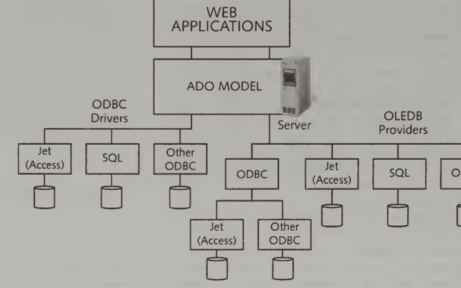

**图 12-5** ADO 模型如何使用 ODBC 驱动程序和 OLEDB 提供程序将 Web 应用程序连接到各种数据库

### 数据库连接

为了将你的 Web 应用程序连接到数据源，你需要知道数据的位置和类型，以及连接请求中需要发送哪些参数。此信息可以存储在数据源名称（DSN）或连接字符串中。DSN 将连接数据存储在创建 DSN 的计算机的注册表中。要创建 DSN，你必须具有对计算机的本地访问权限，而通常 Web 开发人员没有对服务器的本地访问权限。你的 Web 服务器可能在香港，而你可能住在芝加哥。将连接信息存储在一个外部文件中，然后上传到 Web 服务器会更经济。连接信息可以放在连接字符串中并存储在外部文件里。

连接字符串在应用程序中以字符串形式包含连接数据。在 Web 应用程序中，连接字符串可以存储在访问数据库的 Web 页面中，也可以存储在单独的服务器端包含文件中。使用连接字符串的好处是你不需要对服务器进行本地访问。你可以通过 FTP 将包含连接字符串的文件上传到服务器。你也可以使用 FrontPage、InterDev、Visual Studio 7 或 Dreamweaver 中的发布功能，将包含连接字符串的文件发送到服务器。无论你使用 DSN 还是连接字符串，你都必须提供与数据源建立连接所需的相同信息。

#### DSN

DSN 有三种类型：文件 DSN、用户 DSN 和系统 DSN。**文件 DSN** 将数据连接信息存储在一个扩展名为`.udl`的文件中。如果所有用户都安装了相同的驱动程序，文件 DSN 可以在所有用户之间共享，并且不需要存在于本地系统上。

**用户 DSN** 和 **系统 DSN** 也称为机器 DSN，因为它们只存在于本地系统。如果你在一个系统上创建了用户或系统 DSN，后来又将数据库应用程序移动到另一个系统，你需要在新系统上重新创建 DSN。用户和系统 DSN 都将数据连接信息存储在系统注册表中。用户 DSN 将数据连接信息存储在`HKEY_CURRENT_USER`注册表子树中，而系统 DSN 将数据信息存储在`HKEY_LOCAL_MACHINE`注册表子树中。虽然系统或任何经过身份验证的用户都可以使用系统 DSN，但用户 DSN 只能由当前用户使用。

> 对于基于 Internet 的应用程序（如 Web 应用程序），你将希望使用系统 DSN 来存储数据库连接信息。

**创建系统 DSN** 你可以使用控制面板中的 ODBC 驱动程序管理器来创建 DSN。请注意，ODBC 管理员在 Windows 95 或 98 系统上称为 ODBC 数据源（32 位），在 Windows NT 系统上称为 ODBC。在 Windows 2000 上，ODBC 管理员标记为数据源（ODBC），位于 Windows 控制面板的“管理工具”下。你也可以直接通过 Microsoft 管理控制台（MMC）中的 ODBC 插件打开它。

> 创建 DSN 的过程会因 DSN 类型、数据源以及服务器上安装的 Microsoft 数据访问组件（MDAC）版本而异。

在 Windows 98 中创建指向 Access 数据库的系统 DSN：

1. 单击 **开始**，然后指向 **设置**，再单击 **控制面板**。

2. 双击标记为 **32 位 ODBC** 的图标，打开 ODBC 管理员。

3. 单击 **系统 DSN** 选项卡，打开 ODBC 数据源管理员对话框（见图 12-6）。请注意，当前此系统上仅定义了一个系统数据源。根据你当前安装的软件，你可能没有定义任何 DSN 或定义了多个 DSN。你的系统在选项卡上可能显示为系统 DSN 或 System。

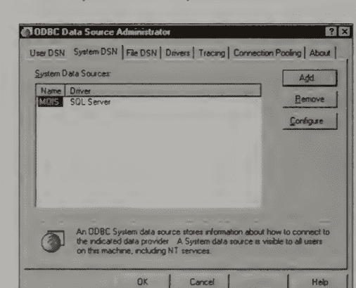

4. 单击 **添加** 按钮以添加新的系统 DSN。已安装驱动程序的列表将出现在“创建新数据源”对话框中。

5. 由于列表按字母顺序排列，Microsoft Access 驱动程序通常是第一个驱动程序，因此默认被选中。如果它没有被选中，请单击 **Microsoft Access Driver (*.mdb)** 来选择它。在 Windows 2000 中，你可能会在此列表中看到其他驱动程序（见图 12-7）。

6. 单击 **完成** 以接受 Access 驱动程序。将出现“ODBC Microsoft Access 安装”对话框。

7. 在“数据源名称”文本框中，输入系统 DSN 的名称，**dsnEmail**。此名称将用于你的 Web 页面中以引用 DSN。（提示：你不必在“描述”文本框中输入任何文本。本例中的 DSN 是`dsnEmail`。DSN 不必与数据库名称或表名称相同。）

**图 12-7** ODBC 数据源管理器中可用的驱动程序和提供程序

> 在课堂上，你可能会被要求按照命名约定来命名你的系统 DSN，例如`dsn_UserID_databaseName`、`UserID_databaseName`或`UserID_dsnName`。在同一台计算机上，不能有多个同名的系统 DSN。

8. 点击**选择**按钮，打开"选择数据库"对话框。在右侧，使用"驱动器"和"目录"列表箭头找到你的数据目录。

9. 在对话框左侧的"数据库名称"文本框中，点击你在上一个活动中创建的数据库名称 **customer.mdb**。

> 你可以在 ODBC 驱动程序管理器中创建数据库。你必须先创建数据库，然后才能完成 DSN 的创建，因为 DSN 需要知道数据库的位置。此方法创建的 Access 数据库文件兼容 Access 7.0 或更高版本，但不含任何表或数据。

10. 点击**确定**。将出现一个对话框，指示数据库已成功创建。你将返回到 ODBC Microsoft Access 安装对话框（图 12-8）。注意，数据库的位置现在直接显示在选择按钮上方。

**图 12-8** ODBC Microsoft Access 安装对话框

> **编程提示：** 点击"高级"按钮会打开"设置高级选项"对话框，你可以在其中设置登录名和密码以确保数据库安全。建议先创建并测试你的 Web 应用程序，然后再添加安全层。

11. 点击**确定**。你刚创建的 DSN 应该会出现在系统数据源列表中。点击**确定**关闭 ODBC 数据源管理器对话框。

**使用系统 DSN** 创建系统 DSN 后，你可以在 ASP 页面中引用它。以下示例代码展示了如何使用连接对象和名为`dsnProducts`的系统 DSN 打开连接。你可以使用关键字`DSN`和等号来明确标识 DSN，也可以直接指定 DSN 的名称。

```
Dim oC
set oC = server.createobject("ADODB.connection")
oC.open "dsn=dsnProducts"
```

当你创建的 DSN 与数据库关联的用户名和密码时，在使用 DSN 请求打开数据库连接时必须传递这些参数。在此示例代码中，DSN 用于通过 ODBC 连接到 Access 数据库。

```
Dim oC
set oC = server.createobject("ADODB.connection")
oC.open "dsn=dsnProducts; uid=admin; pwd=pass;"
```

#### 连接字符串

如果你无法访问存储数据源的本地计算机，可以使用连接字符串来存储数据连接信息。连接字符串包含与系统 DSN 中存储的相同的连接信息。最基本的连接字符串用于连接 Access 数据库，由三部分组成。第一部分是变量，用于保存连接字符串。第二部分是驱动程序名称。第三部分是 Access 数据库的物理位置。以下是连接名为`customer`的 Access 数据库的示例连接字符串。

```
CS = "DRIVER={Microsoft Access Driver (*.mdb)};
     DBQ= c:\chapter12\customer.mdb;"
```

连接字符串必须出现在一行中，因为它是一个字符串。由于本书每行可容纳的字符数有限，该字符串显示为拆分状态。你不能将字符串拆分到两行。但是，可以将连接字符串拆分为更小、更易管理的字符串。

`Driver`中的第二个`r`与左括号`"("`之间有一个空格。

由于连接字符串区分大小写，并且驱动程序名称必须与服务器上安装的驱动程序名称完全匹配，因此建议将连接字符串拆分为两个变量，然后将两个变量连接成一个变量。这样，每次想要重用连接字符串时，就不必重新输入驱动程序名称。以下示例代码展示了如何使用变量将连接字符串拆分为更小的字符串。变量`DR`存储 Access ODBC 驱动程序。`DBQ`存储 Access 数据库的位置。然后，将`strDriver`和`strDBQ`变量连接，并将结果存储在`CS`变量中。

```
<% dim DRV, DBQ, CS
DRV = "DRIVER={Microsoft Access Driver (*.mdb)}; "
DBQ = "DBQ= c:\chapter12\customer.mdb;"
CS = DRV & DBQ
```

连接字符串可以在显示记录集的 Web 页面中创建，也可以存放在服务器端包含文件中。如果你要在其他 Web 页面中使用该数据库，那么在 SSI 文件中维护连接字符串会更便于管理，你可以在访问数据库的每个 Web 页面中包含该文件。这样，如果数据库的名称或位置发生变化，只需在一个中心位置更改信息即可。你也可以在同一 Web 页面中保留与其他数据库的连接字符串。

在使用 Access 数据库时，可以使用 ODBC 驱动程序或 OLEDB 提供程序连接到数据库。以下是可用于连接 Access 数据库的 OLEDB 驱动程序的示例代码。注意，这里使用的是关键字`provider`而不是`driver`。此外，注意关键字`DBQ`已被替换为`Data Source`。有一个更新版本的 OLEDB 提供程序可用，名为`"Microsoft.Jet.OLEDB.4.0"`。

```
CS = "Provider=Microsoft.Jet.OLEDB.3.51;
      Data Source= c:\chapter12\customer.mdb;"
```

创建 Access 数据库的连接字符串：

1. 使用记事本或网页编辑器，创建一个名为 **conxsample.inc** 的新文件。

2. 声明变量。`CS`变量将保存连接字符串。`DRV`变量将保存驱动程序名称，`DBQ`变量将保存文件位置。

```
<% dim DRV, DBQ, CS
```

> 编程提示：由于连接字符串用于访问服务器上的数据库，因此必须使用服务器脚本标记，而不是客户端脚本标记。

3. 将`DRV`变量设置为 Microsoft Access ODBC 驱动程序。

```
DRV = "DRIVER={Microsoft Access Driver (*.mdb)};"
```

> 编程提示：驱动程序名称必须拼写正确，并且驱动程序关键字、文件扩展名、括号、分号和花括号必须全部按照所示出现。驱动程序名称中的任何拼写错误都会导致连接错误。

4. 将`DBQ`变量设置为数据库的物理位置。将`"c:\chapter12\customer.mdb"`替换为你的数据库位置和名称。必须包含正确的路径、数据库名称和文件扩展名，以及完全按照所示的`DBQ`关键字。文件位置中的任何拼写错误都会导致连接错误。

```
DBQ = "DBQ= c:\chapter12\customer.mdb;"
```

5. 将两个变量连接，并将结果赋值给`CS`变量。

```
CS = DRV & DBQ
%>
```

6. 将文件以 **conxsample.inc** 的名称保存在你的数据目录中。如果你使用的是记事本，应将文件名用引号括起来保存。其他编辑器可能也需要你将文件名用引号括起来保存。现在连接字符串将可用于你的任何 Web 页面！

在某些情况下，你可能不知道数据库的位置。托管服务提供商并不总是允许开发人员通过 Telnet 访问他们的文件系统。因此，你可能不知道数据库的绝对路径。如果你知道目录的相对路径，可以修改连接字符串以使用`server`对象的`MapPath`方法。使用`MapPath`方法而不是静态路径提供了更大的灵活性。当你移动 Web 应用程序时，不必更改连接字符串。以下示例展示了如何将路径信息传递给`MapPath`方法。`MapPath`方法将相对路径转换为绝对地址。

```
<% dim DRV, DBQ, CS
DRV = "DRIVER={Microsoft Access Driver (*.mdb)}; "
DBQ = "DBQ=" & Server.MapPath("/chapter12/customer.mdb") & ";"
CS = DRV & DBQ
%>
```

回顾一下，在 HTTP 1.1 中有一个名为`PATH_TRANSLATED`的服务器环境变量，它提供当前文件的绝对路径。你可以使用`Request.ServerVariables("PATH_TRANSLATED")`来获取这个路径。

另一种方法是创建一个为你显示路径信息的文件。如果你将这个文件放置在与数据库相同的目录中，那么相对路径和绝对路径都会被显示出来。下面是一个名为`displayPath.asp`的示例页面，它将显示相对路径和绝对路径。该代码检索一个名为`PATH_INFO`的服务器变量，该变量提供当前页面的相对地址。查看页面后，你可以将显示的绝对路径复制到你的连接字符串中。你必须从字符串中移除当前页面的名称（`displayPath.asp`），并添加你的数据库名称。这种方法通常用于调试连接字符串中的错误。

```
<html><head><title>PATH_INFO</title></head>
<body>
<% dim PI, PP
PI = Request.ServerVariables("PATH_INFO")
PP = Server.MapPath(PI) %>
<h3>此文件的 Web 相对路径是：
<br><br><% = PI %>
<hr>
此文件的物理路径是：
<br><br> <% = PP %>
</h3></body></html>
```

##### SQL Server 的连接字符串

SQL Server 的连接字符串与 Access 数据库的连接字符串类似。你需要提供提供程序的名称、与数据库关联的用户 ID 和密码、SQL 服务器的名称以及数据源的名称。下面是一个连接到 SQL Server 数据库的 ODBC 连接字符串示例。注意使用的驱动程序名称是 SQL Server，并且这是一个驱动程序，而不是提供程序。整个连接字符串应放在一行中。

```
<%
CS = "Driver={SQL Server}; SERVER=Windamere; UID=sa; PWD=; DATABASE=customer"
%>
```

下面的示例代码展示了如何使用 OLEDB 连接到 SQL Server 数据库。注意使用的关键词是`provider`，而不是`driver`。数据库的名称被标识为初始目录。服务器的名称被标识为数据源。下面是一个连接到 SQL Server 数据库的 OLEDB 连接字符串示例。这个字符串也应该放在一行中。

```
<%
CS = "Provider=SQLOLEDB.1; Data Source=Windamere; User ID=sa; PASSWORD=; Initial Catalog=customer;"
%>
```

## ActiveX 数据对象模型 (ADO)

一旦你创建了数据库和连接信息，下一步就是创建将与数据库交互的网页。**ActiveX 数据对象模型 (ADO)** 提供了一种从网页访问数据库的方法。ADO 模型中的主要对象是连接对象、记录集对象和命令对象。字段对象从记录集对象中访问。参数对象是命令对象的参数。当发生连接错误时，会创建错误对象。图 12-9 说明了 ADO 模型中定义的对象。

> ADO 模型的主要优点包括低内存开销和高速度，这使其非常适合基于 Web 的应用程序。

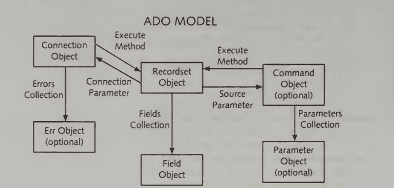

**图 12-9** ADO 模型中的主要对象

ADO 模型不是一个专制的层次结构。换句话说，你不必在单个连接对象下创建第二层对象（如记录集或命令对象）。例如，你可以创建一个与先前定义的连接对象分开的记录集对象。你定义的记录集对象将存在于新创建的连接对象之下。记录集对象会为你创建连接对象，而无需显式地创建连接对象。虽然你不受严格层次结构的限制，但你通常会利用 ADO 模型的结构化特性来组织你的对象和代码。

> **编程提示：** 关于 ADO 和 UDA 模型的更多信息，可以在 Microsoft ADO 网站 http://www.microsoft.com/data/ado/ 找到。

### 连接对象

连接对象是模型中的核心对象。模型中的每个其他对象都与连接对象相关。这种层次结构是有意义的，因为没有数据库连接，其他对象就无法存在。连接对象最常用于建立网页和数据库之间的连接。

你可以使用服务器对象的`CreateObject`方法创建连接对象。连接对象可以使用`open`方法打开到数据库的连接。`open`方法至少传递一个参数，即`connection`参数。`connection`参数可以是数据源名称 (DSN) 或**连接字符串**。DSN 和连接字符串都标识数据库的路径和名称。DSN 和连接字符串还标识用于连接数据库的 ODBC 驱动程序或 OLEDB 提供程序。

你可以使用连接对象的`open`方法打开到数据库的连接。你必须将 DSN 或连接字符串传递给`open`方法。在下面的示例中，名为`oC`的连接对象使用名为`dsnProducts`的 DSN 打开一个到数据库的连接。

```
Dim oC
set oC = server.createobject("ADODB.connection")
oC.open "dsnProducts"
```

使用完数据库后，你应该始终使用`close`方法关闭与数据库的连接。将变量设置为`"nothing"`以释放用于存储对象的内存。在将变量赋值为`"nothing"`之前，你必须关闭连接。通过关闭连接并释放变量，你将节省服务器上的资源。

```
oC.Close
set oC = nothing
```

> **编程提示：** 你应该在使用连接后立即将其关闭。当 Web 服务器同时处理多个请求时，如果你将关闭连接的代码放在网页末尾，可能需要一段时间才能关闭连接。你还应该将变量设置为`"nothing"`以释放用于存储对象的内存。你可以在包含文件中关闭连接和释放对象。

连接对象也可用于执行命令。你可以将命令传递给连接对象的`open`方法。命令对象将执行该命令。这些命令通常是对表或 SQL 语句的请求。SQL `"select"`语句用于从数据库中检索记录。当连接对象执行`"select"`语句时，一组零条或多条记录将作为记录集对象返回。这组零条或多条记录被称为**记录集**。返回的记录集对象配置有默认属性，例如只读。下面的示例代码说明了连接对象如何执行 SQL `"select"`语句以返回记录集。

```
Dim oC
set oC = server.createobject("ADODB.connection")
oC.open "SELECT * FROM products", "dsnProducts"
```

你还可以使用连接对象执行其他 SQL 语句。下面的示例代码说明了连接对象如何执行 SQL `"insert"`语句来插入一条新记录。你将在下一章学习如何构建 SQL `insert`、`delete`和`update`语句。

```
Dim oC
set oC = server.createobject("ADODB.connection")
oC.open "INSERT INTO Products(name, price, data, number) VALUES('chair',153.00,#12/1/2000#,NULL)", "dsnProducts"
```

> 如果你插入一条新记录，你必须按顺序为所有字段指定值，或者你必须指定字段名称。如果没有值，你可以传递关键字`NULL`而不是一个值。

连接对象包含多个属性。`CommandTimeout`属性表示在停止执行命令之前等待的时间（以秒为单位）。默认的`CommandTimeout`是 30 秒。你可以更改此属性。`ConnectionTimeout`属性表示在中止连接尝试之前等待的时间长度（以秒为单位）。默认的`ConnectionTimeout`是 15 秒。`version`属性提供 ADO 的版本。

```
CMT = oC.CommandTimeout
Response.write CMT
CNT = oC.ConnectionTimeout
Response.write CNT
Response.write oC.Version
```

你可以设置`ConnectionTimeout`和`CommandTimeout`属性。但是，如果连接对象已打开，则无法更改`ConnectionTimeout`或`CommandTimeout`属性。

```
oC.CommandTimeout = 60
oC.ConnectionTimeout = 60
```

### Recordset 对象

`Recordset`对象可以与`connection`对象配合使用，用于打开连接并检索记录集。在以下示例代码中，`recordset`对象使用由`connection`对象打开的连接。然后，`recordset`对象检索名为`products`的表。

```
Dim oC
set oC = server.createobject("ADODB.connection")
oC.open "dsnProducts"
Dim oRS
set oRS = server.createobject("ADODB.recordset")
oRS.open "products", oC
```

您应该使用`close`方法关闭`recordset`对象。同时，还应将值`"nothing"`赋给`recordset`变量，以释放用于存储`recordset`对象的内存。在将`"nothing"`赋给变量之前，必须先关闭`recordset`。通过关闭`recordset`并释放变量，可以节省服务器上的资源。请注意，必须在关闭`connection`对象之前关闭`recordset`对象。以下示例代码说明了如何在关闭`connection`对象之前关闭`recordset`对象。

> 必须先关闭`recordset`对象，然后才能关闭`connection`对象，否则会出现错误消息。您可以将关闭`recordset`和`connection`对象的代码写在 Web 页面底部。不过，也可以将这些代码写在单独的文件中，例如`"close.inc"`，然后在页面底部使用服务器端包含语句引入该文件。

```
oRS.Close
set oRS = nothing
oC.Close
set oC = nothing
```

`Recordset`对象还包含一些方法，可以在不显式创建`connection`对象的情况下打开连接。如果使用此方法，连接可能不会立即关闭。如果您希望对连接有控制权，则应显式定义并打开连接，即使用`connection`对象。如您所见，尽管每个 ADO 对象都有其主要用途，但它们也可以执行其他方法，并且可以相互配合使用。在以下示例代码中，`recordset`对象使用`open`方法打开连接并检索名为`products`的表。

```
Dim oRS
set oRS = server.createobject("ADODB.recordset")
oRS.open "products", "dsnProducts"
```

您可以从`recordset`对象执行 SQL 语句。在以下示例代码中，`recordset`对象使用`open`方法打开连接。然后执行 SQL `"select"`语句并检索记录集。

```
Dim oRS
set oRS = server.createobject("ADODB.recordset")
oRS.open "SELECT * FROM products", "dsnProducts"
```

`Recordset`对象是一个具有属性和方法的对象。记录集是一组数据库记录。

### Field 对象

`Field`对象通过`recordset`对象访问。一旦检索到记录集，就可以访问记录集中的所有记录和字段。您可以访问字段的名称和值。通过指定字段名称可以检索字段的值。在以下示例代码中，由`oRS`表示的记录集包含来自`products`表的记录。然后，它使用循环来显示表中每个产品的名称和价格。请注意`formatCurrency`方法如何应用于从`price`字段传递的值。一旦从字段中检索到值，就可以对其应用方法、用于计算、写入 cookie、文件或数据库，或存储在本地变量、会话变量或应用程序变量中。

```
Dim oC
set oC = server.createobject("ADODB.connection")
oC.open "dsnProducts"
Dim oRS
set oRS = server.createobject("ADODB.recordset")
oRS.open "products", oC
do until oRS.EOF
    response.write "Product name: "
    response.write oRS("name")
    response.write "Product price: "
    response.write formatCurrency(oRS("price"))
    oRS.movenext
loop
```

### Command 对象

`Command`对象使您能够指定要在数据库上执行的特定命令。此命令通常是请求表或 SQL 语句，例如`select`、`insert`、`update`或`delete`。但是，`command`对象不能在没有使用其他 ADO 对象的情况下，单独使用`select`查询来检索记录集。以下示例代码远程命令对象执行 SQL 语句。首先，创建`connection`对象并使用`open`方法打开连接。然后，创建`command`对象。`Command`对象的`ActiveConnection`属性设置为当前的`connection`对象。SQL `"select"`语句被赋值给`CommandText`属性。`CommandText`属性告诉`command`对象要执行什么命令。`adCmdText`常量被赋值给`CommandType`属性。此常量告诉`command`对象该命令是 SQL 语句，而不是表或其他类型的命令。

```
Dim oC
set oC = server.createobject("ADODB.connection")
oC.open "dsnProducts"
Dim oCM
set oCM = server.createobject("ADODB.command")
SQL = "Delete FROM Products WHERE ProductName='chair'"
oCM.ActiveConnection = oC
oCM.CommandText = SQL
oCM.CommandType = adCmdText
oCM.Execute
```

> 将 SQL 语句存储在变量中，然后将变量赋值给`CommandText`属性是很有用的。这样，如果出现错误，就可以使用`response.write`方法轻松确定 SQL 语句是什么。使用常量`adCmdText`而不是数值也很有用。要使用常量，您必须引入包含数据库常量的文件，即`ADOVBS.inc`。该文件可从 Microsoft 免费获取。当您安装 ADO 支持时，两个包含文件被包含其中……如您所见，尽管每个 ADO 对象都有其主要用途，但它们也可以执行其他方法，并且可以相互配合使用。在以下示例代码中，`recordset`对象使用`open`方法打开连接并检索名为`products`的表。

您可以修改 SQL 命令以检索选定的记录组。在前面的示例中，您检索了产品名称为`"chair"`的产品列表。以下示例展示了如何使用变量检索信息，该变量可以从表单字段、数据库或文本文件中获取。请注意使用了单引号，因为表单字段传递的是字符串。如果传递的值是数字，则不需要单引号。这种检索记录子集的方法可以与`command`对象、`recordset`对象或`connection`对象一起使用。

```
fldName = Request.Form("txtProductName")
SQL = "Delete FROM Products WHERE ProductName='" & fldName & "'"
oCM.CommandText = SQL
```

当您使用`recordset`对象的`open`方法打开记录集时，您指定一个 SQL 语句；这标识了要从数据库中检索哪个记录集。这意味着`recordset`对象隐式地使用`command`对象作为`source`参数，就像`recordset`对象隐式地使用`connection`对象作为`connection`参数一样。

`Command`对象通常用于执行**存储过程**。**存储过程**是可以重复使用的编程语句。它们可以包含 SQL 命令，也可以简单到只是一个`select`语句。您还可以将值作为参数传递给存储过程。在 Access 中，存储过程称为**参数查询**。例如，您可以开发一个 SQL 语句，选择`state`字段包含与名为`strState`的变量匹配值的所有记录。此 SQL 语句可以保存为存储过程，并在以后执行。当调用存储过程时，您可以将`state`的值（例如`"IL"`）传递给`state`变量`strState`。并非所有数据库都支持存储过程的概念。`Command`对象将在下一章中更详细地讨论。

## 检索和显示记录集

ADO 模型允许您使用`recordset`对象、`connection`对象或`command`对象来检索记录集。如果创建`recordset`对象，则使用`open`方法来检索记录集。如果创建`connection`对象，则可以使用`connection`对象的`open`方法打开连接，然后执行返回`recordset`对象的命令。如果您计划在同一 Web 页面中使用多个记录集，则应显式创建单个`connection`对象。这样更高效，因为只需要一个连接。这两种方法都将在本章中介绍。在下一章中，您将学习如何使用`command`对象来检索记录集和执行命令。

### 使用 Recordset 对象打开记录集

`Recordset`对象可用于从数据库中检索记录集。首先，必须使用`server`对象的`Create`方法创建一个`recordset`对象。在以下示例代码中，`recordset`对象被赋值给变量`oRS`。

```
set oRS = server.createobject("ADODB.recordset")
```

创建`recordset`对象后，您可以检索记录集。`Recordset`对象的`open`方法用于打开与数据库的连接并检索记录集。`Open`方法需要几个参数。第一个必需参数是`source`参数。通常，`source`参数是 SQL 语句、表名或`command`对象。SQL 是结构化查询语言（Structured Query Language），是查询数据库的标准语言。在`source`参数之后，必须传递`connection`参数，该参数包含连接信息。`Connection`参数可以是 DSN 或连接字符串。回想一下，DSN 和连接字符串都包含数据库的位置以及驱动程序或提供程序的名称。

可以向`open`方法传递额外的参数，以指示要返回的记录集类型。记录集使用光标（cursor）来维护用于在记录集中浏览记录的信息。`cursorType`参数用于标识可以使用哪些方法在`recordset`对象中的记录之间导航。`lockType`参数指示`record`对象中的记录集是否可以修改，或者只读。`options`参数用于指示在`source`参数不是命令对象时，如何解释该参数。如果未将任何这些附加参数传递给`open`命令，则返回默认记录集。

> 指定`cursorType`和`lockType`的唯一方法是显式创建一个记录集对象。无法通过命令或连接对象来配置此项。

```
recordsetName.Open source, connection, cursorType, lockType, Options
```

默认记录集设置为只读。因此，默认记录集只能用于显示记录集。无法使用默认记录集创建新记录、修改记录或删除记录。默认记录集仅允许你使用`movenext`方法在记录集中向前移动。无法使用默认记录集向后移动或移动到特定记录。用于标识记录集中记录数量的`count`属性，在默认记录集中不可用。尽管默认记录集存在限制，但它可以轻松实现以显示记录。

在以下示例代码中，使用记录集对象的`open`方法打开记录集。表也可以用作传递给`open`方法的`source`参数。以下示例检索名为`customer`的表。使用名为`dsnEmail`的 DSN 作为连接参数，用于定位连接信息。由于未列出任何附加参数，因此返回默认记录集。

```
<% oRS.Open "customer", "DSN=dsnEmail" %>
```

SQL 语句可以用作`source`参数，以指示从数据库检索哪些记录。`select`命令是一个 SQL 命令，用于从数据库检索记录。必须将要检索的字段名称传递给`select`命令，或使用星号检索所有字段。还必须使用关键字`"from"`以及表名，以指示字段所在的表，即使指定了字段名称，因为字段名称可能在不同表中重复。

在下面的示例代码中，使用`open`方法打开记录集对象。但是，使用的是 SQL 语句而不是表名来检索名为`customer`的表中的所有字段。连接参数使用存储在变量`CS`中的连接字符串来定位连接信息。由于未列出任何附加参数，因此返回默认记录集。以下示例代码展示了如何使用存储在名为`CS`的变量中的连接字符串打开记录集对象。

```
<% dim CS, Drv, DBQ, oRS
DRV = "Driver={Microsoft Access Driver (*.mdb)}; "
DBQ = "DBQ= D:\chapter12\customer.mdb;"
CS = DRV & DBQ
oRS.Open "SELECT * FROM customer", CS
%>
```

在 SQL 中，关键字通常用大写字母表示，尽管这不是必需的。

### 检索字段值

`fields`集合包含从记录集对象返回的`field`对象。你可以通过将字段名称传递给记录集对象来检索特定字段的值。然后，可以在页面上显示该字段的值，将其赋给变量，或在表达式中使用。

```
RecordsetName("FieldName")
```

你可以使用`field name`属性显式请求检索字段的值。也可以通过指定`value`属性来请求字段的名称。

```
oRS("field1").Value
oRS("field1").Name
```

你可以遍历整个`fields`集合。各个字段仅作为`field`对象的`fields`集合的一部分可用。因此，你可以使用`For Each`循环来查看集合中每个字段的名称。

```
<% For each fld in oRS.Fields
    Response.write fld.Name
    Response.write "<br>"
Next %>
```

#### 填充下拉列表框

你可以轻松地将字段的输出格式化为逗号分隔列表、表格或下拉列表框。以下示例代码展示了如何将字段列表的输出格式化为下拉列表框。请注意，每个选项的值不必与列表中显示的内容相同。注意 HTML 标签如何在服务器端脚本中混合使用。

```
<select name="customernames" size="1">
<% do while not oRS.EOF %>
    <option value="<% = oRS("email") %>">
        <% = oRS("name") %>
    </option>
<% oRS.movenext
loop %>
</select>
```

#### 在表格中格式化输出

表格的开始和结束标签位于显示记录集的循环之外。如果你有一个包含名称的标题行，应将该行放在循环之外。在每次循环中，使用一对表格行标签来表示新行的开始。各个字段在表格单元格标签内显示。你可以在单元格中列出多个字段。以下示例代码将在表格中列出所有字段名称。

```
<table border="0" width="400">
<tr><td>电子邮件地址</td><td>姓名</td></tr>
  <% do while not oRS.EOF %>
    <tr>
      <td><% = oRS("email") %></td>
      <td><% = oRS("name") %></td>
    </tr>
  <% oRS.movenext
  loop %>
</table>
```

### 使用数据库中的值创建超链接和邮件链接

你可以轻松修改相同的代码以创建超链接或邮件链接。下面的示例代码展示了如何遍历`fields`集合并创建邮件链接。注意代码如何在服务器脚本和 HTML 标签之间分割。

```
<% do while not oRS.EOF %>
  <a href = mailto:"<% = oRS("email") %>">
    <% = oRS("name") %>
  </a><br>
<% oRS.movenext
loop %>
```

有时你可能想根据数据库中存储的 URL 创建超链接。如果你存储的 URL 不包含`http://`协议，则更容易维护数据库。然后，你可以在创建锚点标签时附加协议。如果你有一个希望重定向用户到的页面，可以在锚点标签的`HREF`属性中指定。

```
<% do while not oRS.EOF %>
  <a href = http://"<% = oRS("url") %>">
    <% = oRS("companyName") %>
  </a>
<% oRS.movenext
loop %>
```

### 使用 QueryString 传递值

创建可以将信息从一页传递到另一页的页面，实际上只是一步之遥。在下面的示例中，第一段代码显示了数据库中的产品列表。请注意，用户将被重定向到的页面名称、问号、`name`属性和等号都硬编码在锚点标签中。

```
<% do while not oRS.EOF %>
<a href="product.asp?productid=<% = oRS("productid")%>">
  <% = oRS("productname")%>
</a>
<br><br>
<% oRS.movenext
loop %>
```

在下一页中，你只需从查询字符串中检索值。然后，你可以在 SQL 语句中使用该参数，并根据从前一页传递的值检索特定记录。如果你的`productid`是主键，并且没有其他记录匹配此值，那么你不必使用`Do While`循环语句来遍历记录集，因为只有一条记录。这是构建购物车和在线目录的常用方法之一。

```
<% productid = request.querystring("productid")
set oRS = server.createobject("ADODB.recordset")
sql = "SELECT * FROM products where productid = '" &
productid & "'"
oRS.Open sql, CS %>
<% = oRS("productid") %> <br>
<% = oRS("productname") %> <br>
<% = oRS("description") %> <br>
<% = oRS("cost") %>
```

有时你可能想用数据库中的数据填充表单。同样，在检索数据之后，你可以混合使用 HTML 标签和服务器端标签。只需将表单字段的值指定为数据库中的值即可。以下示例代码将显示四个文本框。值将是从数据库检索的数据。

```
<% productid = request.querystring("productid")
set oRS = server.createobject("ADODB.recordset")
sql = "SELECT * FROM products where productid = '" &
productid & "'"
oRS.Open sql, CS %>
<form action="somepage.asp" method="post">
产品 ID：
<input type="text" size="25"
    value="<% = oRS("productid") %>">
<br>产品名称：
<input type="text" size="25"
    value="<% = oRS("productname") %>">
<br>产品描述：
<input type="text" size="25"
    value="<% = oRS("description") %>">
<br>产品描述：
<input type="text" size="25"
    value="<% = oRS("cost") %>">
<input type="submit" value="购买！">
</form>
```

## 检索和显示记录集


注意，虽然文本框可以使用`value`属性轻松定义，但对于复选框和单选按钮，`value`属性标识的是表单提交时发送的值。`checked`属性则标识该元素是否被选中。因此，你需要添加额外的代码来判断该值是否被选中。如果是，则将`checked`属性设置为选中状态；如果不是，则不添加`checked`属性。此外，如果你将数据存储在 Access 数据库中作为"是/否"字段，该字段实际上将数据存储为 -1 或 0。`True`用 -1 表示，`False`用 0 表示。

### 使用 Recordset 对象

要使用`recordset`对象检索记录集：

1. 使用记事本或支持 ASP 的编辑器创建一个 ASP 页面。添加基本的 HTML 标签，如下所示：

    ```
    <html><head><title>Customer Email List</title></head>
    <body bgcolor="#FFCC99" text="#800000">
    <h2 align="center">Current Customer Email List</h2>
    <hr><h3 align="center">
    ```

2. 创建到数据库的连接字符串。确保将路径更改为你服务器上文件所在的位置。

    ```
    <% dim CS, DRV, DBQ, oRS
    DRV = "Driver={Microsoft Access Driver (*.mdb)};"
    DBQ = "DBQ= D:\chapter12\customer.mdb;"
    CS = DRV & DBQ
    ```

3. 使用`server`对象的`CreateObject`方法创建`recordset`对象。

    ```
    set oRS = server.createobject("ADODB.recordset")
    ```

4. 使用`open`方法打开`recordset`对象。向`open`方法传递一个 SQL 语句和连接字符串。在 SQL 语句中，使用星号从`customer`表中选择所有字段。由于 SQL 语句是字符串，因此用引号括起来。

    ```
    oRS.Open "select * from customer", CS
    ```

5. 使用`"Do While"`循环显示记录集中的所有记录。记录集返回时，记录集将打开在第一条记录上。你可以使用记录集的 end of the file 属性（`RS.EOF`）来判断是否处于最后一条记录。

    ```
    do while not oRS.EOF
    ```

6. 使用`field`对象返回每个字段的值。向`recordset`对象传递要显示的字段名称。字段名称在括号内用引号括起来。你可以使用`response`对象的`write`方法将字段值写入到网页。

    ```
    Response.write oRS("fname")
    Response.write " "
    Response.write oRS("lname")
    Response.write ", "
    Response.write oRS("email")
    Response.write "<br>"
    ```

    > **编程提示**：你可以通过显式检索`field`对象的`value`属性来获取字段的值。要获取字段`lname`的值，你可以使用代码`"oRS("lname").value"`。

7. 使用`recordset`对象的`movenext`方法将光标移动到下一个记录。默认的记录集只能向前移动。使用`loop`命令循环到`"Do While"`循环语句的开头。

    ```
    oRS.movenext
    loop
    ```

8. 关闭`recordset`对象并通过将其设置为`nothing`关键字来释放变量。

    ```
    oRS.Close
    set oRS = nothing
    %>
    ```

9. 关闭 HTML 标题和页面标签。

    ```
    </h3>
    </body></html>
    ```

10. 通过更改背景、字体和颜色以及添加内容来修改网页外观。将此页面以 **recordset.asp** 的名称保存在数据目录中。

11. 在浏览器中查看`recordset.asp`网页。查看该页面的源代码。打印出该网页以及每个页面的源代码。

### 使用 Connection 对象检索记录集

你可以结合使用`connection`对象和`recordset`对象从数据库中检索记录。`connection`对象可用于创建和打开到数据库的连接。`recordset`对象将使用`connection`对象作为传递给`open`方法的连接参数。在此示例中，你将从表中检索记录的一个子集。只有一条记录符合标准并将在记录集中返回。在下一章中，你将学习创建更复杂的`select`查询和操作查询，这些查询允许你插入、删除和修改记录。

要使用`connection`对象和`recordset`对象检索记录集：

1. 使用记事本或支持 ASP 的 Web 开发工具创建一个 ASP 页面。添加基本的 HTML 标签，如下所示：

    ```
    <html><head><title> Customer Email List</title></head>
    <body bgcolor="#FFCC99" text="#800000">
    <h2 align="center">Customer Email List</h2>
    <hr><h3 align="center"></h3>
    ```

2. 创建到数据库的连接字符串。确保将路径更改为你服务器上文件所在的位置。

    ```
    <% dim CS, DRV, DBQ, oRS, oC, sql
    DRV = "Driver={Microsoft Access Driver (*.mdb)}; "
    DBQ = "DBQ= D:\chapter12\customer.mdb;"
    CS = DRV & DBQ
    ```

3. 使用`server`对象的`CreateObject`方法创建`connection`对象。

    ```
    set oC = server.createobject("ADODB.connection")
    ```

4. 使用`connection`对象的`open`方法打开`connection`对象。你必须将 DSN 连接字符串的名称传递给`open`方法，以便它能够定位数据库和驱动程序。

    ```
    oC.Open CS
    ```

    > 如果你使用 DSN，你只需要在引号中传递 DSN 的名称。你不必指明你正在传递 DSN。例如，你可以使用`oC.open "dsnEmail"`。

    

5. 使用`server`对象的`CreateObject`方法创建`recordset`对象。

    ```
    set oRS = server.createobject("ADODB.recordset")
    ```

6. 在 SQL 语句中，从`customer`表中选择字段。使用星号从表中选择所有字段。在下面的代码中，`sql`变量将保存整个字符串。在此示例中，`where`子句用于指定要根据条件检索的记录子集。在这种情况下，只有当`state`字段匹配条件字符串`"IL"`时，`open`方法才会检索该记录。字符串必须用引号括起来，但由于整个 SQL 语句都在引号内，你可以通过使用双引号括起整个 SQL 语句，使用单引号括起条件字符串来避免混淆。

    ```
    sql = "SELECT lname, fname, email FROM customer "
    sql = sql & "WHERE state = 'IL'"
    ```

    > 由于 SQL 语句是字符串，因此用引号括起来。如果 SQL 语句过长而换行到下一行，你必须将字符串拆分为更小的字符串。然后，你必须将变量连接到下一行的字符串上。这很方便，因为 SQL 语句可能变得非常长。

    

7. 使用`open`方法打开`recordset`对象。向`open`方法传递一个 SQL 语句和连接字符串。在 SQL 语句之后，你还必须传递`connection`对象的名称，该对象包含连接信息。在此示例中，`connection`对象的名称是`oC`。

    ```
    oRS.Open sql, oC
    ```

8. 使用`"Do While"`循环显示记录集中的所有记录。记录集返回时，记录集将打开在第一个记录上。你可以使用记录集的 end of the file 属性来判断是否处于最后一条记录。

    ```
    do while not oRS.EOF
    ```

9. 使用`field`对象返回每个字段的值。将字段名称传递给`recordset`对象。字段名称在括号内用引号括起来。你可以使用`response`对象的`write`方法将字段值写入到网页。

    ```
    Response.write oRS("fname")
    Response.write " "
    Response.write oRS("lname")
    Response.write ", "
    Response.write oRS("email")
    Response.write "<br>"
    ```

10. 使用`recordset`对象的`movenext`方法将光标移动到下一个记录。默认的记录集只能向前移动。使用`loop`命令循环到`Do While`循环语句的开头。

    ```
    oRS.movenext
    loop
    ```

11. 关闭`recordset`对象并通过将其设置为`nothing`关键字来释放变量。

    ```
    oRS.Close
    set oRS= nothing
    %>
    ```

12. 关闭 HTML 标题和页面标签。

    ```
    </h3>
    </body></html>
    ```

13. 通过更改背景、字体和颜色以及添加内容来修改网页外观。将此页面以 **connection.asp** 的名称保存在数据目录中。在浏览器中查看该页面。查看源代码并打印出该页面以及每个页面的源代码。

## Internet Resources

A variety of Internet resources contain information about ADO, UDA, SQL, ODBC, OLEDB, databases, and data-driven Web applications. While Microsoft supports this technology, other vendors may not support it. For example, Java provides an alternate solution that involves using JDBC, the Java Database Connection. These technologies are not used only for Internet applications, but also for client/server applications and local database applications. Unlike other professions, this field publishes most of the latest information on the Internet, not in journals. You should try to review these Web sites frequently to keep current with the latest database technologies.

- Microsoft ADO—http://www.microsoft.com/data/ado/

- Microsoft UDA—http://www.microsoft.com/data/default.htm

- Microsoft OLE DB—http://www.microsoft.com/data/oledb/default.htm

- Microsoft ODBC—http://www.microsoft.com/data/odbc/default.htm

- MSDN Online Library—http://www.msdn.microsoft.com/library/default.asp

- Internet Database Connectivity and ASP with FrontPage—http://support.microsoft.com/support/FrontPage/fp98/internet.asp

- SQL Server at Microsoft—http://www.microsoft.com/sql

- Yahoo SQL Link—http://dir.yahoo.com/Computers_and_Internet/Programming_Languages/SQL/

- SQL Reference Page—http://www.contrib.andrew.cmu.edu/~shadow/sql.html

- SQL & Web sites—http://www.sqlweb.com/

- ANSI—http://www.ansi.org/

- JCC SQL standards links—http://www.jcc.com/SQLPages/jccs_sql.htm

- SQL tutorial by James Hoffman—http://w3.one.net/~jhoffman/sqltut.htm

- Oracle—http://www.oracle.com/

- Sybase—http://www.sybase.com/

- Informix—http://www.informix.com/

- SQL FAQ Berkeley—http://epoch.cs.berkeley.edu:8000/sequoia/dba/montage/FAQ/SQL_TOC.html

- Tutorials from MuppetLabs—http://www.muppetlabs.com/library/tech/tutorials/

- Programming Tutorials on the Web—http://www.eng.uc.edu/~jtilley/tutorial.html

- SQL Reference and Examples—http://users.neca.com/ttruett/sql.html

- Access on the Web, Princeton—http://www.princeton.edu/~hannahk/WebPubl.htm

- MySQL—http://www.mysql.com

- SQL from Cramsession—http://www.cramsession.com/

- Database Jump Site—http://www.pcslink.com/~cj/dbweb.html

- Lee's SQL Tutorial—http://sql.terrashare.com/

- SQL Interpreter and Tutorial—http://www.sqlcourse.com/

- Learn SQL Jim Hoffman (new)—http://www.willcam.com/sql/

- SQL Topics—http://www.sqlschool.org/

- Ask the SQL Server Pro—http://www.inquiry.com/techtips/thesqlpro/

- SQL for Web Nerds—sample course—http://photo.net/sql/

- Fatbrain.com—http://www.1computerliteracy.com/003/dc_001

- SQL Server Magazine—http://www.sqlmag.com/Update

- SQL tutorial—http://www.geocities.com/SiliconValley/Vista/2207/sql1.html

- More SQL Sites—http://www.sql-zone.com/sites.asp

- Links to Developer Support—http://www.borland.com/devsupport/sqllinks/

- A Gentle Introduction to SQL—http://www.20dcs.napier.ac.uk/~andrew/gisq/what.htm

## CHAPTER SUMMARY

### Active Data Object Model

- The Active Data Object (ADO) model provides a means by which you can access a database from within your Web applications, using built-in objects, properties, and methods.

- Facilitating access to different types of source data from different clients is one of the goals of Universal Data Access (UDA).

### Database Connections

- DSNs contain connection information that is stored in the Registry on the server. In general, you must have local access to the server in order to create a system DSN on the server.

- The connection string also contains connection information. However, the connection string is created and used within the Web application. You do not need local access to the server to create a connection string.

- Both DSNs and connection strings contain connection information, which consists of the location of the database, and the driver or provider to be used to make the connection.

- Some databases may require additional parameters such as username, password, and server name to be passed in the connection string.

### Displaying Recordsets

- A set of database records is referred to as a recordset. A recordset can be retrieved using the connection, recordset, or command object.

- The command object is used in conjunction with the connection object to execute commands. However, the command object cannot independently retrieve a recordset.

- The connection object will always retrieve the default recordset. The recordset object can be used to retrieve the fields collection. The fields collection is the collection of field objects that are in the recordset.

- You can display the contents of a field by passing the name of the field to the recordset object.

#### To create a connection object

```
set oC = server.createobject("ADODB.connection")
```

#### To open a connection object using a system DSN

```
oC.open "dsnEmail"
```

#### To close a connection object

```
oC.Close
set oC = nothing
```

#### To create a recordset object

```
set oRS = server.createobject("ADODB.recordset")
```

#### To open a recordset object using a connection object

```
oRS.open "customer", oC
```

#### To close a recordset object

```
oRS.Close
set oRS = nothing
```

#### To create a connection string to an Access database

```
DRV = "DRIVER={Microsoft Access Driver (*.mdb)}; "
DBQ = "DBQ= c:\chapter12\customer.mdb;"
CS = DRV & DBQ
```

#### To open a recordset with a system DSN

```
oRS.Open "customer", "DSN=dsnEmail"
```

#### To open a recordset with a variable that contains a connection string

```
oRS.Open "select * from customer", CS
```

#### To retrieve the value of a field

```
oRS("fname")
```

#### To create a SQL query statement that selects all fields from a table and all records

```
sql = "select * from customer "
```

#### To create a SQL query statement that selects several fields from a table and all records

```
sql = "select lname, fname from customer"
```

#### To create a SQL query statement that selects a subset of records based on some criteria

```
sql = "select * from customer where state = 'IL'"
```

#### To create a SQL query statement that selects a subset of records based on some criteria using a value passed from a form

```
strState = request.form("state")
sql = "select * from customer "
sql = sql & "where state = '" & strState & "'"
```

## REVIEW QUESTIONS

1. A row in a table in a database is known as a _______.

   a. database

   b. table

   c. field

   d. record

2. When OLEDB providers become available, you will not be able to use the ODBC driver interface. True or False?

3. Which version of ADO ships with Windows 2000?

   a. 2.1

   b. 2.3

   c. 2.5

   d. 3.1

4. Can you add a new record to the default recordset object?

   a. no

   b. yes

   c. sometimes

   d. if there are fewer than 10 records

5. What method of the server object is used to create a connection object?

   a. `createmethod`

   b. `createobject`

   c. `servercreate`

   d. `createconnection`

6. Where is the system DSN stored?

   a. on the client's computer

   b. in the windows directory on the server

   c. in the cookies directory

   d. in the server's system Registry

7. Which statement should be executed last?

   a. `set oRS = nothing`

   b. `set oC = nothing`

   c. `oC.Close`

   d. `oRS.Close`

8. Which type of DSN will allow any user account to access the database?

   a. file

   b. user

   c. system

   d. session

9. Where is the ODBC Data Source Program located in Windows 95, 98, or NT?

   a. in My Computer

   b. under Programs

   c. in the Control Panel

   d. in the Windows folder

10. Which statement contains the correct name for the ODBC Microsoft Access Driver?

    a. `"Driver={Microsoft Access Driver (*.mdb)};"`

    b. `"Driver={Microsoft Access Driver};"`

    c. `"Microsoft Access Driver;"`

    d. `"Driver={(*.mdb)};"`

11. Which property is set to true when the cursor is after the last record in a recordset?

    a. `BOF`

    b. `EOF`

    c. `ODBC`

    d. `DSN`

12. Which statement writes the value of a field named fname to the Web page?

    a. `Response.write oRS()`

    b. `Response.write("fname")`

    c. `oRS("fname")`

    d. `Response.write oRS("fname")`

13. Which method is used by the default recordset to move forward?

    a. `moveforward`

    b. `moveone`

    c. `moveup`

    d. `movenext`

14. Which method explicitly closes the connection to the database?

    a. `oRS.Close`

    b. `oC.Close`

    c. `set oRS = nothing`

    d. `set oC = nothing`

15. Which method releases the connection variable from memory?

    a. `oRS.Close`

    b. `oC.Close`

    c. `set oRS = nothing`

    d. `set oC = nothing`

16. Which object(s) in the ADO model can be used independently to return a recordset?

    a. `recordset`

    b. `connection`

    c. `command`

    d. both a and b

17. Most of the documentation on ADO is not available through the Internet. True or False?

18. 用于查询数据库的标准语言是什么？

    a. Java

    b. Visual Basic

    c. VBScript

    d. SQL

19. 连接对象返回哪种记录集类型？

    a. 默认

    b. 空值

    c. 读写

    d. 无法返回记录集

20. 哪个属性用于确定游标如何在记录集中导航？

    a. `LockType`参数

    b. `CursorType`参数

    c. `options`参数

    d. `source`参数

21. 记录集对象的哪个属性用于指定记录集应该是可写的还是只读的？

    a. `LockType`参数

    b. `CursorType`参数

    c. `options`参数

    d. `source`参数

## 实践项目


### 项目 12-1

在本项目中，你将创建连接字符串，使用表单中的值。你还将从表单中检索字段名。你将使用从表单检索到的字段名来显示数据库字段。

1. 使用记事本或兼容 ASP 的程序创建网页。

2. 在网页中添加基本 HTML 标签。

3. 在页面上添加一个表单。方法应为`post`。动作应为 **connresults.asp**。

```html
<html><head><title>Connection String</title></head>
<body bgcolor="#FFCC99" text="#800000">
<h2 align="center">Connection String Form</h2>
```

```html
<form action="connresults.asp" method="post">
```

4. 添加一个名为 **txtDBQ** 的文本框，用于存储数据库文件的位置。大小应为 50。标签应显示 **Absolute path to the database**。

```html
Absolute path to the database&nbsp;<br>
<input type="text" name="txtDBQ" size="50">
```

5. 添加一个下拉列表对象来存储驱动程序名称和值。标签应为 **Select a driver**。显示一个通用名称，如 Access ODBC，但将驱动程序的完整名称作为值。目前，只在下拉列表中输入 Access 驱动程序。

```html
<br><br>Select a driver<br>
<select size="1" name="txtDriver">
<option
    value="Driver={Microsoft Access Driver (*.mdb)}; ">
    Access ODBC Driver
</option></select>
```

6. 添加一个名为 **tblName** 的文本框，标签为 **Table Name**，用于保存表的名称。大小应为 20。

```html
<br><br>Table Name<br>
<input type="text" name="tblName" size="20">
<br><br>
```

7. 使用`input`标签，创建四个名为`ff1`、`ff2`、`ff3`和`ff4`的文本框。添加标签 **Field 1, Field 2, Field 3, and Field 4**。这些文本框将用于检索要显示的字段名。

```html
<input type="text" name="ff1" size="20"> Field 1<br>
<input type="text" name="ff2" size="20"> Field 2<br>
<input type="text" name="ff3" size="20"> Field 3<br>
<input type="text" name="ff4" size="20"> Field 4<br>
```

8. 添加一个名为 **btnSubmit** 的提交按钮。

```html
<br>
<input type="submit" value="Submit" name="btnSubmit">
</form></body></html>
```

9. 使用文本、标题和图像修改网页。将网页保存为 **connform.asp**，放在你的数据目录中。

10. 使用记事本或兼容 ASP 的编辑器创建一个新页面，用于处理表单。

11. 添加基本 HTML 标签。

```html
<html><head><title>Connection String</title></head>
<body bgcolor="#FFCC99" text="#800000">
<h2 align="center">Results</h2>
```

12. 添加代码以从表单字段中检索将用于构建连接字符串的值。因为驱动程序名称随`"Driver = "`键一起传递，所以这里不需要添加。但是，由于`"DBQ= "`没有随表单字段一起传递，所以需要将其与表单字段结果连接起来。

```asp
<% dim CS, ORS, DRV, DBQ, F1, F2, F3, F4, TN
DRV = request.form("txtDriver")
DBQ = "DBQ= " & request.form("txtDBQ")
```

13. 使用驱动程序和数据库位置变量创建连接字符串。

```asp
CS = DRV & DBQ
```

14. 添加代码以从表单字段中检索将用于构建 SQL 语句的值。

```asp
TN = request.form("tblName")
F1 = request.form("ff1")
F2 = request.form("ff2")
F3 = request.form("ff3")
F4 = request.form("ff4")
```

15. 使用表名和字段名创建`sql`变量。

```asp
sql = "SELECT "
sql = sql & F1 & ", " & F2 & ", " & F3 & ", " & F4
sql = sql & " FROM " & TN
```

16. 创建记录集对象。

```asp
set oRS = server.createobject("ADODB.recordset")
```

17. 使用`sql`和`oC`变量打开记录集对象。

```asp
oRS.Open sql, CS
```

18. 使用字段对象显示字段值。将包含字段名的变量传递给记录集对象以检索字段。

```asp
do while not oRS.EOF
    Response.write oRS(F1)
    Response.write ", "
    Response.write oRS(F2)
    Response.write ", "
    Response.write oRS(F3)
    Response.write ", "
    Response.write oRS(F4)
    Response.write "<br>"
    oRS.movenext
loop
```

19. 关闭记录集对象并释放变量。

```asp
oRS.Close
set oRS = nothing
%>
</body></html>
```

20. 将网页保存为 **connresults.asp**，放在你的数据目录中。

21. 在浏览器中查看`connform.asp`网页。使用客户数据库中的四个字段名提交表单。你可以从下面的列表中选择四个字段。确保指定数据库的绝对路径。

- `id`

- `zipcode`

- `mailinglist`

- `fname`

- `country`

- `joindate`

- `lname`

- `username`

- `lastaccessed`

- `street`

- `password`

- `groupstatus`

- `city`

- `keyword`

- `state`

- `email`

22. 结果应以逗号分隔列表显示。每条记录将位于其自己的行上。

23. 打印`connform.asp`和`connresults.asp`页面。

### 项目 12-2


在本项目中，你将使用 Windows 98 或 Windows NT 工作站上的 ODBC 管理员找到帮助文件中的信息。

1. 单击 **Start**，然后指向 **Settings**，再单击 **Control Panel**。

2. 双击 **ODBC 图标** 打开 ODBC 数据源管理器。

3. 单击 **System DSN** 选项卡。

4. 选择你的 DSN。

5. 单击 **Configure** 按钮打开 ODBC Microsoft Access 安装对话框。

6. 单击 **Help** 按钮打开 ODBC Microsoft Desktop Database Drivers 帮助程序。

7. 单击按钮栏上的 **Contents** 按钮打开帮助主题窗口。

8. 双击 **User's Reference**。双击 **Data Types (advanced users)**。

9. 双击 **Microsoft Access**。

10. 阅读有关数据类型的信息，并回答以下问题。

    a. 日期时间分隔符是什么？

    b. 日期 "March 5, 1996" 在编程中如何表示？

    c. char（文本）字段中可以出现多少个字符？

    d. 假设你的文本字段包含字符串 "O'Hara"。如果你需要开发一个对 Access 数据库的 SQL 查询，你可以用什么来表示（单引号）？

11. 在帮助主题中再阅读一页帮助页面。写一段话来总结你所阅读的内容。

12. 单击 **Cancel** 按钮。然后关闭每个对话框。单击 **Close** 按钮，然后单击 **OK** 按钮两次。

13. 使用记事本或兼容 ASP 的编辑器创建一个名为 **odbchelp.asp** 的网页。将页面保存到你的数据目录中。

14. 在网页上写出上述问题的答案。

15. 修改网页的外观。将页面保存到你的数据目录中。

16. 在浏览器中查看网页。打印网页。

> 要在 Windows 2000 中访问 ODBC 数据源管理器，请单击 Start，然后指向 Programs，再指向 Administrative Tools，然后单击 Data Sources (ODBC)。单击 System DSN 选项卡。单击 Help 按钮打开 ODBC 帮助对话框。

### 项目 12-3

在本项目中，你将创建一个 ASP 页面，该页面使用来自服务器端包含文件的连接字符串。你将在表格中输出你的信息。此项目要求你已经按照本章所述创建了客户数据库。

1. 使用记事本创建一个新页面。将页面保存为 **conxcustomer.inc**，放在你的数据目录中。保存时应将文件名用引号括起来。

2. 添加以下代码以创建连接字符串。将下面的路径替换为你的数据库路径。

```asp
<%
dim CS, DRV, DBQ, oRS
Drv = "Driver={Microsoft Access Driver (*.mdb)}; "
DBQ = "DBQ= D:\chapter12\customer.mdb;"
CS = DRV & DBQ
```

3. 使用服务器对象的`CreateObject`方法创建记录集对象。注意这是在服务器端包含文件中创建的。因此，不需要在 ASP 页面中创建它。

```asp
set oRS = server.createobject("ADODB.recordset")
%>
```

4. 将此页面保存为 **conxcustomer.inc**，放在你的数据目录中。

5. 使用记事本或兼容 ASP 的编辑器创建一个新的 ASP 页面。

6. 添加`include`命令以包含包含连接字符串的文件。

```html
<!--#include file="conxcustomer.inc"-->
```

7. 添加基本 HTML 标签。

```html
<html><head><title>Customer Address List</title></head>
<body bgcolor="#FFCC99" text="#800000">
<h2 align="center">Current Customer Address List</h2>
<hr><h3 align="center">
```

8. 使用`Open`方法打开`recordset`对象。将 SQL 语句和连接字符串传递给`Open`方法。在 SQL 语句中，使用星号选择`customer`表中的所有字段。由于 SQL 语句是字符串，因此需要用引号括起来。

```
<%
oRS.Open "select * from customer", CS
```

9. 添加一个`table`标签，用于格式化记录。

```
Response.write "<table border=1 width=500 "
Response.write " cellspacing=0 cellpadding=4>"
```

10. 使用`"Do While"`循环显示`recordset`中的所有记录。

```
do while not oRS.EOF
```

11. 使用`Field`对象返回每个字段的值，然后将值写入网页。为每条记录添加`table row`标签，为每个字段添加`cell`标签。

```
Response.write "<tr><td>"
Response.write oRS("fname")
Response.write "</td><td>"
Response.write oRS("lname")
Response.write "</td><td>"
Response.write oRS("street")
Response.write "</td><td>"
Response.write oRS("city")
Response.write "</td><td>"
Response.write oRS("state")
Response.write "</td><td>"
Response.write oRS("zipcode")
Response.write "</td><td>"
Response.write oRS("country")
Response.write "</td></tr>"
```

12. 使用`recordset`对象的`MoveNext`方法将光标移动到下一条记录。

```
oRS.movenext
loop
```

13. 关闭`recordset`对象，释放变量，并关闭`table`和 HTML 标签。

```
oRS.Close
set oRS = nothing %>
</table>
</body></html>
```

14. 通过更改背景、字体和颜色，以及添加内容来修改网页外观。

15. 将页面保存为数据目录中的 **conxCustomer.asp**。

16. 在浏览器中查看`conxCustomer.asp`网页。

17. 查看该页面的源代码。打印出网页以及每个页面的源代码。

### Project 12-4

在本项目中，你将创建一个表单，根据用户在表单中输入的电子邮件地址和关键字来检索用户的密码。本项目要求你已经按照本章所述创建了`customer`数据库。

1. 使用记事本或兼容 ASP 的编辑器创建一个新页面。

2. 添加基本 HTML 标签。

```
<html><head><title>Customer Passwords</title></head>
<body bgcolor="#FFCC99" text="#800000">
<h2 align="center">Password Retrieval</h2>
<hr>
```

3. 创建一个表单，使用`post`方法，并将`action`设置为 **displayrecord.asp**。

```
<form action="displayrecord.asp" method="post">
```

4. 添加一个名为 **email** 的文本框，大小为 50。添加一个标签，显示为 **E-mail Address**。添加一个名为 **keyword** 的文本框，大小为 10。添加一个标签，显示为 **My Keyword**。添加一个名为`btnSubmit`的提交按钮，显示为 **Submit**。

```
Email Address<br><br>
<input type="text" name="email" size="50">
<br><br>My keyword<br><br>
<input type="text" name="keyword" size="10"><br><br>
<input type="submit" value="Submit" name="btnSubmit">
```

5. 添加结束表单和 HTML 标签。

```
</form></body></html>
```

6. 修改网页外观。将页面保存为数据目录中的 **displayrecordform.asp**。

7. 使用记事本或兼容 ASP 的编辑器创建一个新页面。

8. 添加以下代码以创建连接字符串。将路径替换为你数据库的路径。

```
<% response.buffer = "true" %>
<% dim CS, DRV, DBQ, oRS
DRV = "Driver={Microsoft Access Driver (*.mdb)}; "
DBQ = "DBQ= D:\chapter12\customer.mdb;"
CS = DRV & DBQ
```

9. 使用`server`对象的`CreateObject`方法创建`recordset`对象。

```
set oRS = server.createobject("ADODB.recordset")
```

10. 从表单获取值并将其赋给变量。

```
email = request.form("email")
keyword = request.form("keyword")
%>
```

11. 添加基本 HTML 标签。

```
<html><head><title>Customer Passwords</title></head>
<body bgcolor="#FFCC99" text="#800000">
<h2 align="center">Password Retrieval</h2>
<hr>
```

12. 创建 SQL 查询字符串并将其赋给一个变量。使用`WHERE`子句查找`recordset`中的电子邮件地址与表单中的电子邮件地址相匹配的记录。

```
<%
sql = "SELECT * FROM customer WHERE email='" & email & "'"
```

13. 使用`Open`方法打开`recordset`对象。传递 SQL 语句和连接字符串。

```
oRS.Open sql, CS
```

14. 使用`If Then`语句检测是否找到记录。如果未找到记录，则将用户重定向到`displayrecordform.asp`页面。

```
If oRS.EOF = TRUE Then
    Response.Redirect("displayrecordform.asp")
Else
End If
```

15. 如果找到记录，可以使用另一个`"If Then"`检测表单中的关键字是否与数据库中的关键字匹配。注意，该值是被显式请求的。如果未找到匹配项，则将用户重定向到`displayrecordform.asp`页面。

```
If keyword <> oRS("keyword").Value Then
    Response.Redirect("displayrecordform.asp")
Else
End If
```

16. 如果用户拥有有效的电子邮件地址，且关键字匹配，则在浏览器中显示用户的密码。

```
Response.write("Your password was: ")
Response.write("<br><br> ")
Response.write oRS("password")
```

17. 关闭`recordset`对象，释放变量，并关闭 HTML 标签。

```
oRS.Close
set oRS = nothing %>
</body></html>
```

18. 通过更改背景、字体和颜色，以及添加内容来修改网页外观。

19. 将页面保存为数据目录中的 **displayrecord.asp**。

20. 在浏览器中查看`displayrecordform.asp`网页。打印该网页。

21. 使用你在数据库中输入的值（`jgarcia@oakton.net`，`objection`）测试表单。密码应该会写入浏览器。打印结果网页。打印每个页面的源代码。

### Project 12-5

在本项目中，你将创建一个根据数据库中的值填充表单的网页。本项目要求你已经按照本章所述创建了`customer`数据库。

1. 使用记事本或兼容 ASP 的编辑器创建一个新网页。

2. 添加以下代码以创建连接字符串。将路径替换为你数据库的路径。

```
<% dim CS, DRV, DBQ, oRS
DRV = "Driver={Microsoft Access Driver (*.mdb)}; "
DBQ = "DBQ= D:\chapter12\customer.mdb;"
CS = DRV & DBQ %>
```

3. 添加基本 HTML 标签。

```
<html><head><title>Customer E-mail Addresses</title></head>
<body bgcolor="#FFCC99" text="#800000">
<h2 align="center">Customer E-mail Addresses</h2>
<hr><h3 align="center">
```

4. 添加一个表单，使用`post`方法，并将`action`设置为`retrieveCustomer.asp`。

```
<form action="retrieveCustomer.asp" method="post">
```

5. 添加 HTML`select`标签以创建下拉列表。你可以在从数据库检索电子邮件名称之前添加默认选中的选项。

```
<select size="1" name="email">
<option value="------" selected>
    Select an e-mail address
</option>
```

6. 创建 SQL 查询字符串并将其赋给一个变量。使用`Open`方法打开`recordset`对象。传递 SQL 语句和连接字符串。

```
<% sql = "select * from customer"
set oC = server.createobject("ADODB.connection")
oC.Open CS
set oRS = server.createobject("ADODB.recordset")
oRS.open sql, oC
```

7. 获取字段的值，并将其作为`select`标签的参数。注意，显示的文本是名字后跟一个空格，再跟姓氏。然而，传递到下一页的值是电子邮件地址。


```
do while not oRS.EOF %>
    <option value="<% = oRS("email")%>">
        <% = oRS("fname") & " " & oRS("lname") %>
    </option>
    <% oRS.movenext
    loop %>
</select>
```

8. 添加一个提交按钮并关闭表单。然后，关闭`recordset`对象，释放变量，并关闭 HTML 标签。

```
<input type="submit" value="Submit" name="btnSubmit">
</form>
<%
oRS.Close
set oRS = nothing
oC.Close
set oC = nothing
%>
</body></html>
```

9. 通过更改背景、字体和颜色，以及添加内容来修改网页外观。

10. 将页面保存为数据目录中的 **retrieveCustomerForm.asp**。

11. 在浏览器中查看`retrieveCustomerForm.asp`网页。打印该网页。

12. 使用记事本或兼容 ASP 的编辑器创建一个新页面，用于处理表单。

13. 添加以下代码以创建连接字符串。将路径替换为你数据库的路径。

```
<% dim CS, DRV, DBQ, oRS
DRV = "Driver={Microsoft Access Driver (*.mdb)}; "
DBQ = "DBQ= D:\chapter12\customer.mdb;"
CS = DRV & DBQ %>
```

14. 添加基本 HTML 标签。

```
<html><head><title>Customer Information</title></head>
<body bgcolor="#FFCC99" text="#800000">
<h2 align="center">Customer Information</h2>
<hr>
```

15. 从表单获取值并将其赋给变量。

```
<%
email = request.form("email")
```

16. 创建 SQL 查询字符串并将其赋给一个变量。使用`WHERE`子句查找`recordset`中的电子邮件地址与表单中的电子邮件地址相匹配的记录。

```
sql = "SELECT * FROM customer WHERE email='" & email & "'"
```

17. 使用`Open`方法打开`recordset`对象。传递 SQL 语句和连接字符串。

```
set oRS = server.createobject("ADODB.recordset")
oRS.Open sql, CS
```

18. 使用`If Then`语句检测是否找到记录。如果未找到记录，则将用户重定向到`retrieveCustomerForm.asp`页面。

```
If oRS.EOF = TRUE Then
    Response.Redirect("retrieveCustomerForm.asp")
Else
End If
```

19. 如果找到记录，则显示客户信息。

```
Response.write "First Name: " & oRS("fname") & "<br>"
Response.write "Last Name: " & oRS("lname") & "<br>"
Response.write "Street: " & oRS("street") & "<br>"
Response.write "City: " & oRS("city") & "<br>"
Response.write "State: " & oRS("state") & "<br>"
Response.write "Zip Code: " & oRS("zipcode") & "<br>"
Response.write "Country: " & oRS("country") & "<br>"
Response.write "Username: " & oRS("username") & "<br>"
Response.write "Password: " & oRS("password") & "<br>"
Response.write "Keyword: " & oRS("keyword") & "<br>"
Response.write "Email: " & oRS("email") & "<br>"
Response.write "Mailing List: " & oRS("mailinglist") & "<br>"
Response.write "Join Date: " & oRS("joindate") & "<br>"
Response.write "Last Accessed: " & oRS("lastaccessed") & "<br>"
Response.write "Group Status: " & oRS("groupstatus") & "<br>"
```

20. 关闭`recordset`对象，释放变量，并关闭 HTML 标签。

```
oRS.Close
set oRS = nothing %>
</body></html>
```

21. 通过更改背景、字体和颜色，以及添加内容来修改网页外观。

22. 将页面保存为数据目录中的 **retrieveCustomer.asp**。

23. 在浏览器中查看`retrieveCustomerForm.asp`网页。从下拉列表中选择一个电子邮件地址并提交表单。打印结果网页。打印每个页面的源代码。


```
<input type="submit" value="Submit" name="btnSubmit">
</form>
<% oRS.Close
set oRS = nothing
oC.close
set oC = nothing
%>
</body></html>
```

9. 修改网页外观。将页面保存为数据目录中的`displayfield.asp`。

10. 使用记事本创建另一个用于检索密码的 ASP 页面。

11. 添加包含连接字符串的代码。修改路径语句以反映 customer 数据库的绝对路径。

```
<% dim CS, DRV, DBQ, oRS
DRV = "Driver={Microsoft Access Driver (*.mdb)}; "
DBQ = "DBQ= D:\chapter12\customer.mdb;"
CS = DRV & DBQ
%>
```

12. 添加基本 HTML 标签。

```
<html><head><title>Customer Passwords</title></head>
<body bgcolor="#FFCC99" text="#800000">
<h2 align="center">Password Retrieval</h2>
<hr>
```

13. 从表单获取值并将其赋给名为`email`的变量。创建 SQL 语句，以检索表单传递的电子邮件地址与数据库中的电子邮件地址相匹配的所有记录。由于每个电子邮件地址都是唯一的，因此应该只返回一条记录。

```
<% email = request.form("email") %>
<% sql = "select * from customer where email = '" & email & "'" %>
```

14. 创建连接和记录集对象。打开记录集对象。使用`On Error Resume Next`语句来处理连接中可能发生的错误。

```
set oC = server.createobject("ADODB.connection")
oC.Open CS
set oRS = server.createobject("ADODB.recordset")
oRS.open sql, oC
on error resume next
```

15. 从数据库中检索密码，并在浏览器中显示它。

```
do while not oRS.EOF
    response.write "<p align=center>Your password is "
    response.write oRS("password") & "</p>"
oRS.movenext
loop %>
```

16. 关闭与对象的连接，并添加闭合的HTML标签。

```
<% oRS.Close
set oRS = nothing
oC.close
set oC = nothing
%>
</body></html>
```

17. 将页面保存为`retrieveCustomer.asp`。

18. 在浏览器中查看`displayfield.asp`网页。选择一个地址并点击提交。打印这两个网页及其源代码。

## 项目12-6

在本项目中，你将寻找关于ADO、SQL和数据库驱动网站的互联网资源。

- 访问本章列出的至少五个网站。
- 浏览每个网站上的文档。
- 创建一个名为`dbInternet.asp`的网页。
- 编写一份关于你所学到的将数据库连接到Web的知识的简要总结。
- 修改网页的外观。将页面保存到你的数据目录。
- 在浏览器中查看该网页。打印该网页。

## 案例项目

### 零七八碎——展示在线商品目录

你受雇于“零七八碎”公司的市场部，协助建立在线产品目录。你的任务是创建基本的在线产品目录。该目录应包含至少10个产品。使用Access或你的数据库管理工具创建一个数据库，其中包含每个产品的名称、产品ID号、成本、简短描述、制造商以及图形图像文件的名称。图形图像文件应存储在你的数据目录中，而不是在数据库中。你可以访问Life Beyond Yahoo网站（http://www.lifebeyondyahoo.com/life/graphics.asp）来搜索产品的图形。你可以创建一个包含数据库连接字符串的连接文件，或者将信息放在ASP页面内。创建一个网页，显示所有10个产品的列表（参见图12-10）。为每个产品名称创建一个超链接。该超链接将指向第二个页面。（*提示：* 使用锚标签`<a>`并使用`HREF`属性指定URL。URL是路径与数据库中的产品ID拼接而成。你可以在两个锚标签之间显示产品ID。你可以使用以下示例代码作为参考：`<a href = "oeproduct.asp?productid=<%= oRS("productid")%>"><%= oRS("productname") %></a>`。创建第二个页面，命名为`oeproduct.asp`。在此页面上，显示产品名称、产品ID号、成本、简短描述、制造商以及实际的图形图像。（*提示：* 你可以使用`formatCurrency`方法来格式化货币，例如`<%= formatCurrency(oRS("cost")) %>`。你可以使用图像标签``并使用数据库中的名称指定图像的源，例如`">`。）通过添加图像、文本和颜色来修改页面的外观。将页面保存为`oeonlinecat.asp`到你的数据目录。在浏览器中查看`oeonlinecat.asp`页面。打印这两个页面及其源代码。

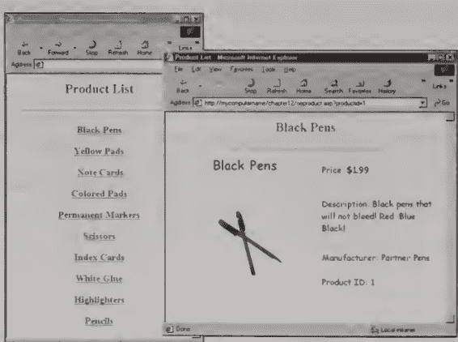

**图12-10** 从数据库中显示记录

### 零七八碎——将你的Access数据库升级到SQL Server数据库

在“零七八碎”公司，他们使用Access数据库来存储产品目录数据。你通过阅读日志文件发现，有很多用户试图同时连接到数据库。为了处理更多的并发用户，你建议使用SQL Server数据库来代替Access。数据库管理员（DBA）已经为该网站购买了SQL Server的许可证。DBA告诉你，你可以使用SQL Server来存储你的数据库。与其在SQL Server中重新创建数据库，你决定使用“升迁向导”将Access数据库转换为SQL Server。阅读Access 2000中的帮助文件，学习如何将数据库“升迁”到SQL Server数据库。你也可以访问本章列出的Microsoft网站。使用记事本或你的网页编辑器创建一个网页。说明你希望升迁到SQL Server的原因。指出在尝试升迁数据库之前应执行哪些活动。识别将数据库从Access升迁到SQL Server的步骤。你将需要升级你的连接字符串。编写一个连接到你的SQL Server数据库的示例连接字符串。新服务器的名称是Goldman，数据源是oeproducts。用户名是Franklin，密码是bear。将你的回答写在你的网页上。通过添加图像、文本和颜色来修改页面的外观。将页面保存为`convertAccess.asp`到你的数据目录。查看`convertAccess.asp`页面。打印该页面。


### 零七八碎——创建登录表单

“零七八碎”公司决定在其网站上创建一个会员区域。你的老板担心会员可能经常忘记密码并打电话给公司查询。你的老板希望你规划一个注册系统，该系统在用户忘记密码时也能提供密码。使用Access或其他数据库管理程序创建一个名为`oe`的新数据库。然后，创建一个名为`members`的新表。如果你已经创建了一个名为`oe`的数据库，只需在该数据库中创建一个名为`members`的新表即可。`members`表包含每个成员的电子邮件地址、名字和姓氏、用户名、密码、问题和答案。输入至少五条记录数据。下周你将创建允许用户注册到数据库的页面。目前，你只是要用这五条记录来测试系统。你需要创建六个页面。（有关提供密码提醒功能的四个页面，请参见图12-11。）首先，你将创建一个名为`oeloginform.asp`的ASP页面，其中包含登录表单。应有一个用于用户名和电子邮件地址的文本框，以及一个提交按钮。该表单将指向`oelogin.asp`。在`oeloginform.asp`页面上放置一个超链接，指向一个名为`oeemail.asp`的页面。创建`oelogin.asp`页面，该页面将从登录表单中检索成员的用户名和密码，然后检索成员的记录，并验证成员的密码。如果用户名不存在，则将用户返回到`oeloginform.asp`页面。如果密码不匹配，则将用户返回到`oeloginform.asp`页面。如果密码匹配，则首先将用户的姓名存储在会话变量中。你可以将名字与一个空格连接，然后是姓氏。然后，将此值存储在会话变量中。然后，将用户重定向到名为`oemember.asp`的页面。创建`oemember.asp`页面。此页面将按姓名欢迎成员。你可以从你刚刚创建的会话变量中检索用户的姓名。创建另一个名为`oeemail.asp`的页面。该页面应包含一个表单，其中有一个字段（电子邮件地址）和一个提交按钮。当用户提交电子邮件地址时，他们将被带到一个名为`oequestion.asp`的页面。创建`oequestion.asp`页面。此页面从`oeemail.asp`页面检索电子邮件地址。然后，检索该成员的记录。你必须创建一个SQL语句来检索成员的记录。如果没有成员匹配该电子邮件地址，则将用户重定向到`oeemail.asp`页面。你可以使用`On Error Resume Next`语句来捕获任何连接错误。否则，显示用户注册时选择的问题。此问题存储在数据库的问题字段中。向`oequestion.asp`页面添加一个表单，其中包含一个用于成员答案的文本字段。你还应该将成员的电子邮件地址作为隐藏字段传递，并添加一个提交按钮。此表单指向`oeanswer.asp`。创建`oeanswer.asp`页面。使用从表单传递的电子邮件地址检索成员的记录。然后，将成员在表单中提供的答案与数据库答案字段中的答案进行比较。如果匹配，则显示电子邮件地址、用户名和密码。如果不匹配，则将用户重定向到`oeemail.asp`页面再次尝试。通过添加图像、文本和颜色来修改页面的外观。将页面保存到你的数据目录并在浏览器中查看它们。打印这些页面及其源代码。

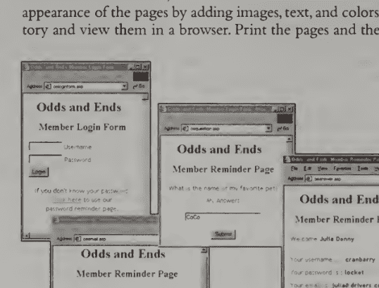

**图12-11** 跨多个网页显示数据

### 杂项与补充——使用表格显示记录集

在“杂项与补充”项目中，你将升级在线商品目录。商店职员希望获得在线商品目录中每件商品的库存清单。（*提示：*如果你尚未在第一个案例项目中创建名为`oe.mdb`的数据库和产品表，那么你需要使用Access或其他数据库管理工具创建该数据库。然后，你必须创建一个名为`products`的表，该表需包含产品名称、产品ID号、成本、简短描述、制造商以及图形图像名称。接着，输入至少10个产品。）创建一个ASP页面，从数据库表中检索值并使用表格在网页上显示。你可以创建一个包含数据库连接字符串的连接文件，或者将信息直接放在ASP页面内。使用`table`标签、`table cell`标签和`table rows`的属性来格式化表格布局。通过添加图像、文本和颜色来修改页面的外观。将页面保存为`oeinventory.asp`到你的数据目录。在浏览器中查看该页面。打印你的网页和源代码。

## 第13章

## 高级Web数据库集成

**在本章中，你将：**

- 使用Access和SQL构建高级查询
- 使用SQL和ASP更新数据库
- 使用ADO和ASP更新数据库

电子商务和电子业务应用程序在互联网上变得越来越普遍。这些企业在其网站上提供产品信息，并允许客户进行在线购买。为了促进这些购买，你可以将购物车中的数据与信用卡授权组件或配送组件集成。这些组件可从第三方开发者处获得，或者你可以使用Visual Basic或其他编程语言自行构建。但这些在线工具不仅仅是通知和向客户销售商品的方法。你可以将数据库连接功能构建到你的Web应用程序中，以便轻松集成来自各种来源的数据。这使得公司可以将Web数据用于各种目的，例如促进库存控制、创建有针对性的营销计划以及开发广告方案。要构建这些强大的、由数据库驱动的Web应用程序，你必须对数据库技术、连接方法、ADO和SQL有深入的了解。在本章中，你将使用Access及其示例Northwind数据库来学习和实践高级Web数据库集成。

## NORTHWIND数据库示例应用程序

Access 2000附带一个名为Northwind的示例数据库。Northwind数据库包含八个表，其中已填充了示例数据。Northwind还包含示例查询、窗体、报表和其他数据库对象。Northwind数据库的默认位置是`c:\Program Files\Microsoft Office\Office\Samples`。如果数据库尚未安装，你可以从Microsoft网站http://officeupdate.microsoft.com/2000/downloadDetails/Nwind2K.htm下载它。

Microsoft在http://support.microsoft.com/support/access/content/nwind/default.asp提供了信息，以帮助你理解Northwind数据库对象。该网站提供了关于Access 97的Northwind信息。然而，关于数据库对象和任务的说明也适用于Access 2000。

要下载并打开Northwind数据库：

1. 连接到互联网，并使用你的Web浏览器访问Microsoft Access 2000的Northwind Traders示例数据库网站：http://officeupdate.microsoft.com/2000/downloadDetails/Nwind2K.htm。
2. 单击**立即下载！**超链接以开始下载过程。
3. 单击**将此程序保存到磁盘**单选按钮，然后单击**确定**继续。
4. 浏览你的网络以定位你的数据目录。在文件名文本框中输入**nwind**，然后单击**保存**。文件下载完成后，将打开“下载完成”对话框。
5. 单击**打开文件夹**，以在包含下载文件的数据目录中打开它。
6. 双击数据目录中的`nwind`程序图标。
7. 单击**是**按钮以安装示例数据库。将打开许可协议。阅读协议并单击**是**按钮。
8. 单击**浏览**按钮以定位你的数据目录，并将路径放入位置文本框中。位置文本框指示示例数据库将安装到的位置。单击**确定**继续。将出现“安装成功”消息。单击**确定**继续。`nwind.mdb`数据库现在已列在你的学生文件夹中。
9. 双击`Nwind.mdb`程序图标以打开数据库。将出现一个对话框，允许你将数据库转换为Access 2000。选择**转换数据库**单选按钮，然后单击**确定**继续。将出现一个对话框，要求你指明新文件的名称和位置。为数据库输入名称**nwind2000**，然后单击**保存**，将转换后的数据库保存到你的数据目录。Northwind Traders对话框打开。单击**确定**继续。Northwind数据库主窗口在表视图中打开。表视图中列出了八个表。

## Northwind数据库中的内容

Northwind数据库包含八个表和十五个预定义查询。你可以使用这些查询来查看、更改和分析数据。以下是Northwind数据库中八个表的列表及其内容描述。

- **Categories**——包含`categoryID`、`name`、`description`和`picture`
- **Customers**——包含`customerID`和客户联系信息
- **Employees**——包含`employeeID`、职位信息和员工联系信息
- **Order Details**——包含`orderID`和`productID`、订单数量和价格信息
- **Orders**——包含`orderID`、`customerID`、`employeeID`、配送方式和交付信息
- **Products**——包含`productID`、`name`、`category`、`price`和库存信息
- **Shippers**——包含`shippingID`和运输公司信息
- **Suppliers**——包含供应商ID、公司名称和公司联系信息

Access允许你定义表之间的关系。图13-1说明了Northwind数据库中表之间的关系。例如，客户表标识了有关客户的信息，如地址和`customerID`。`customerID`字段是主键字段。任何两个客户不得拥有相同的`customerID`。每个订单都列在`orders`表中。订单包含`orderID`，它唯一标识该订单。`orderID`是主键字段，因此任何两个订单不得拥有相同的订单ID。`orders`表跟踪哪个`customerID`下了订单。一个客户可以下多个订单。因此，`orders`表和`customers`表之间存在多对一的关系。

## 构建连接服务器端包含页面

在本节中，你将创建一个服务器端包含文件，该文件将用于保存连接字符串，并创建连接和记录集对象。此连接服务器端包含页面可以为你在本章中将创建的所有查询重复使用。

要创建连接服务器端包含页面：

1. 使用记事本创建一个名为**nwconx.inc**的文件，并将其保存到你的数据目录。
2. 添加以下代码以声明变量、创建连接字符串，并创建连接、记录集和命令对象。将路径更改为安装Northwind数据库的绝对路径。

> 你需要将HTML标签放在同一行。不要在记事本或HTML编辑器中将HTML语句跨行拆分。

```
<% dim DRV, DBQ, CS, oC, oRS
DRV = "Driver={Microsoft Access Driver (*.mdb)}; "
DBQ = "DBQ= c:\yourfolder\nwind2000.mdb;"
CS = DRV & DBQ
set oC = server.createobject("ADODB.connection")
set oRS = server.createobject("ADODB.recordset")
set oCM = server.createobject("ADODB.command")
%>
```

3. 将页面保存到你的数据目录。

## 使用Access构建查询

在前一章中，你使用基本SQL命令创建了`select`查询以从数据库检索数据。你使用关键字`FROM`来标识表作为数据源。你也可以使用Access中提供的图形用户界面来创建SQL语句。要在Access中构建查询，你将标识哪个表用作数据源。你可以在Access中测试你的查询，然后将SQL语句剪切并粘贴到你的数据库Web应用程序中。

> 在Access中生成的SQL与Access数据库完全兼容，但在不同的数据库管理系统之间，SQL语法存在一些细微差别。始终使用数据测试你的SQL查询以验证预期结果与返回结果是否匹配非常重要。例如，如果你计划在SQL Server中使用在Access中构建的SQL查询，则必须将所有双引号更改为单引号。

要在 Access 中创建查询：

1. 如果 Access 未打开，请启动 Access。单击 Access 数据库窗口上的**最大化**按钮，将窗口最大化。
2. 如果 Northwind 数据库未打开，请在 Access 中打开它。Northwind 数据库在 Northwind 数据库窗口的左侧列出数据库对象。单击**最大化**按钮，将 Northwind 数据库窗口最大化。
3. 单击**查询**选项卡，打开预定义查询列表。
4. 单击**新建**按钮，打开"新建查询"对话框。设计视图已默认选中。单击**确定**，打开"显示表"对话框。此对话框用于确定查询应基于哪些表。换句话说，您需要确定一个或多个包含您要检索的数据的表。
5. 单击**产品**，然后单击**添加**。产品表将被添加到查询设计器中。单击**关闭**，关闭对话框。如果您无法看到产品表中的完整字段列表，可以调整字段列表框的大小。注意，查询设计窗口分为两个窗口。上方窗口包含用于构建查询的表。下方窗口包含用于构建查询的设计网格。
6. 将**ProductID**字段从产品表列表拖放到设计网格第一列的字段框中。字段名称和表名将显示在该列中。
7. 对以下字段重复步骤 6，将每个字段放入其自己的列中：**ProductName**、**CategoryID**、**UnitPrice**、**UnitsInStock**和**Discontinued**。注意，每个列中都会显示字段名称和表名。
8. 在"文件"菜单下方是视图列表箭头（图标看起来像表格）。共有三种视图：设计视图、数据表视图和 SQL 视图。设计视图允许您使用图形设计工具创建查询结构。数据表视图显示查询运行后的结果。SQL 视图显示根据设计视图中提供的信息构建的 SQL 语句。视图列表箭头允许您在三种视图之间切换。单击**视图**列表箭头，然后单击**数据表视图**。您可以在数据表视图中预览查询结果。所有记录都会显示。记录数量 77 显示在窗口底部。
9. 单击**视图**列表箭头，然后单击**SQL 视图**，预览从查询生成的 SQL 语句。显示的 SQL 语句为`SELECT Products.ProductID, Products.ProductName, Products.CategoryID, Products.UnitPrice, Products.UnitsInStock, Products.Discontinued FROM Products;`。注意，该 SQL 语句是一个选择查询。字段名称已完全限定，这意味着字段名称前面有表名。句点 (`.`) 分隔表名和字段名。虽然不必完全限定字段名称，但这是个好主意，因为不同表中可能存在重复的字段名。默认情况下，Access 始终会完全限定字段名称。注意，SQL 语句包含关键字`FROM`来标识产品表。

您可以手动创建 SQL 语句。但是，使用图形化工具有助于减少错误并提高效率。

10. 单击**视图**列表箭头，然后单击**设计视图**。
11. 在`UnitPrice`字段列下方的排序行中，单击列表箭头，然后单击**降序**，这将显示最贵的产品优先。您可以根据一个或多个字段，按升序或降序对查询结果进行排序。
12. 在`CategoryID`下方的条件框中，输入**=8**。产品共有八个可能的类别。在产品表中，不直接使用类别 ID（可能难以记住），而是可以根据从列表中选择的类别名称来查找类别 ID。在类别表中，定义了类别名称与类别 ID 之间的关系。这种类型的字段称为查找或组合框。
13. 在`CategoryID`列中，单击**显示**复选框以取消选中`CategoryID`字段下方的复选框。注意图 13-2，当您将名称拖到设计网格时，默认情况下"显示"复选框是选中的。即使字段在查询中使用，您也不必显示该字段。在此示例中，您不会显示类别 ID，因为所有产品的类别 ID 都是 Seafood。

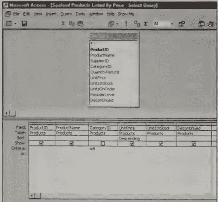

**图 13-2** 在 Access 中修改查询

14. 单击**视图**列表箭头，然后单击**SQL 视图**。显示的 SQL 语句为`SELECT Products.ProductID, Products.ProductName, Products.UnitPrice, Products.UnitsInStock, Products.Discontinued FROM Products WHERE (((Products.CategoryID)=8)) ORDER BY Products.UnitPrice DESC;`。注意，`WHERE`子句用于标识您放置在条件框中的条件。`ORDER BY`子句用于标识要排序的字段和排序顺序。
15. 单击**视图**列表箭头，然后单击**数据表视图**预览您的结果。列出了 12 种产品。注意图 13-3，类别 ID 字段未显示，并且列表按`UnitPrice`字段降序排列。

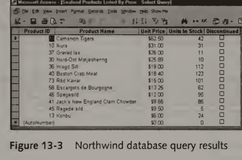

**图 13-3** Northwind 数据库查询结果

16. 单击菜单栏上的**文件**，然后单击**保存**以保存查询。在"另存为"对话框的"查询名称"文本框中，输入**Seafood Products Listed By Price**。单击**确定**继续。

### 在 ASP 页面中使用 Access 查询

您可以将 Access 中构建的查询复制并粘贴到 ASP 页面中。首先，您必须创建 ASP 页面并添加连接信息。然后，将 Access 查询生成的 SQL 复制并粘贴到 ASP 页面中。查看页面时，将返回相同的记录集。但是，当您使用 Web 页面显示记录时，还必须通过添加代码来读取每条记录并显示结果，以显示记录集。无论您是从 Access 内还是从 ASP 页面内运行查询，都应显示相同的结果。

要创建使用 Access 2000 中创建的查询的 ASP 页面：

1. 使用记事本在数据目录中创建一个名为**nwproductsseafood.asp**的文件。

# 第 13 章 高级 Web 数据库集成

2. 添加以下代码以包含连接字符串包含文件，该文件包含连接字符串以及连接和记录集对象。添加基本的 HTML 标签和标题。

```
<!--#include file="nwconx.inc"-->
<html><head>
<title>Seafood Products</title>
</head>
<body>
<h1>Seafood Products</h1>
```

3. 从 Access 数据库中选择整个 SQL 字符串并将其粘贴到页面中。将该字符串赋值给 SQL 变量。由于 SQL 字符串跨越多行，您必须连接该字符串，或将整个字符串放在一行文本中。由于 SQL 语句通常超过一行，因此了解如何连接 SQL 字符串很有用。以下代码演示了如何在一系列行上连接 SQL 语句。注意，在单词`Discontinued`和`Products`之后，以及`Order By`之前，有一个空格。

```
<%
dim SQL
SQL = "SELECT Products.ProductID, Products.ProductName, "
SQL = SQL & "Products.UnitPrice, Products.UnitsInStock, "
SQL = SQL & "Products.Discontinued FROM Products "
SQL = SQL & "WHERE (((Products.CategoryID)=8)) "
SQL = SQL & "ORDER BY Products.UnitPrice DESC; "
%>
```

4. 使用`CS`连接字符串中定义的连接以及 SQL 命令打开记录集。

```
oRS.Open SQL, CS %>
```

5. 添加 HTML 表格标签以开始表格。表格标签必须在循环之外。

```
<table border=1 cellspacing=0 cellpadding=5>
```

6. 创建一个循环，该循环将遍历记录集，并在表格单元格中显示结果。按照上一章中的方法创建循环，使用以记录集末尾结束的`Do Until`语句。使用表格行和表格单元格变量来写出表格行和表格单元格标签。使用右对齐表格单元格标签来格式化单价和库存数量单元格。使用`movenext`方法转到下一条记录，并使用`loop`命令重新开始循环。

```
<% do until oRS.EOF %>
<% = "<tr><td>" %>
<% = oRS("ProductID") & "</td><td align=left>" %>
<% = oRS("ProductName") & "</td><td align=right>" %>
<% = formatcurrency(oRS("UnitPrice")) & "</td><td align=left> %"
<% = oRS("UnitsInStock") & "</td><td align=left>" %>
<% = oRS("Discontinued") & "</td></tr>" %>
<% oRS.movenext
loop
```

7. 添加关闭记录集对象的代码。为表格和页面添加闭合标签。

```
oRS.close
set oRS=nothing
%>
</table>
</body></html>
```

8. 通过更改背景、字体、颜色和图像，以及添加内容来修改网页外观。
9. 将网页保存到您的数据目录。
10. 在浏览器中查看`nwproductsseafood.asp`网页，如图 13-4 所示。

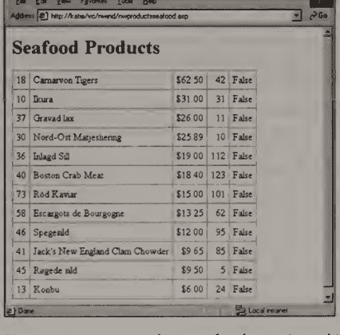

**图 13-4** 在浏览器中查看的 nwproductsseafood.asp

11. 查看页面的源代码。打印出网页和源代码。您也可以使用变量将记录集格式化为表格。使用变量来创建起始行标签和结束行标签。您可以在不更改表格基本内容的情况下修改单元格的格式。将数据的内容和表现形式分开，将使您更易于维护代码。以下示例代码展示了如何修改 ASP 页面以将内容与表现形式分离。

```
<% dim tr, etdr, etdl, etr
tr = "<tr><td>"
etdr = "</td><td align=right>"
etdl = "</td><td align=left>"
etr = "</td></tr>"
```

```
<%
do until oRS.EOF
%>
<%= tr %>
<%= oRS("ProductID") & etdl %>
<%= oRS("ProductName") & etdr %>
<%= formatcurrency(oRS("UnitPrice")) & etdl %>
<%= oRS("UnitsInStock") & etdl %>
<%= oRS("Discontinued") & etr %>
<% oRS.movenext
loop
%>
```

## 使用 SQL 构建高级查询

搜索条件会计算为 true 或 false。到目前为止，我们只在单个语句中评估单个搜索条件。例如，搜索条件`WHERE username='John'`会计算为 true 或 false。在 Access 和 SQL 中，您可以在同一个语句中使用多个搜索条件来创建更复杂的查询。当使用`AND`关键字分隔条件时，两个搜索条件都必须解析为 true。如果使用`OR`关键字分隔条件，则只需要其中一个搜索条件解析为 true。

搜索条件由一个表达式、一个比较运算符和另一个表达式组成。表达式可以很简单，例如字段的名称，也可以是字符串、数字或从表单传递的值。如果表达式是字符串，则必须使用引号输入。字符串作为表达式使用时区分大小写。因此，`"products"`和`"PRODUCTS"`不会被评估为相等的表达式。包含日期的表达式必须在日期前后附加井号（`#`）。`NULL`关键字可用于搜索空字段。空字符串与`NULL`字段不同。`NULL`字段不包含任何数据。`NULL`这个词将用作表达式。比较运算符用于评估表达式。有效的比较运算符包括`=`、`<`、`>`、`<>`、`IS`和`IS NOT`。在 SQL 语句中创建搜索条件的语法如下：

```
WHERE [expression1][comparisonoperator][expression2]
```

以下是使用多个搜索条件的一些有效表达式示例。请注意字符串如何用引号括起来，日期如何用井号括起来。数字、变量和常量不使用引号。

```
WHERE user="katie" AND pwd="pass"
WHERE state="IL" OR state="IN" AND people>=10000
WHERE lastVisit>#11/12/2000# OR member="new"
WHERE member="staff" AND salary>35000
WHERE birth=IS NULL OR email=IS NULL
```

通过使用`AND`和`OR`关键字，您可以在同一个 SQL 语句中组合多个搜索条件。例如，您可以创建一个查询，列出任何项目数量小于五的产品名称。您可以将此查询交给负责订购新供应品的人员。然而，您不需要订购已停产的产品。因此，您还需要确保没有任何项目已停产。通过使用组合查询，您可以将所有这些搜索条件组合到一个 SQL 语句中。以下示例 SQL 语句将显示库存单位等于零，或再订货水平大于库存单位加上订单单位的产品名称列表。

```
SELECT ProductName, UnitsInStock, UnitsOnOrder, ReorderLevel
FROM Products
WHERE (UnitsInStock=0) OR
(ReorderLevel>(UnitsInStock+UnitsOnOrder))
ORDER BY UnitsInStock;
```

SQL 允许您对一组记录执行算术运算。您可以将这些计算作为 SQL 查询的一部分。您知道默认记录集不允许您使用`count`属性。在以下示例中，您需要检索部门中工资超过 $35,000 的员工的工资信息。您可以检索名为`salary`的字段的计数、平均值、最小值、最大值和总和。

```
SELECT COUNT(salary) AS CountSal,
AVG(salary) AS AvgSal, SUM(salary) AS SumSal,
MIN(salary) AS MinSal, MAX(salary) AS MaxSal
FROM employees
WHERE salary > 35000
```

### 使用 Access 构建多条件表达式

您可以使用 Access 帮助您构建多条件搜索语句。在 Access 中，在“条件”框中，您可以跨多个列字段输入条件以创建`AND`条件。如果您想创建一个拾取任一条件的条件表达式，那么请在下一行输入条件，该行显示为“或”。在以下示例中，您将使用条件表达式创建一个查询。该查询搜索库存单位与订单单位之和小于再订货水平的产品，或者库存单位等于零的产品。

要在 Access 中创建多条件 SQL 语句：

1. 启动 Access，如果尚未打开 Northwind 数据库，请打开它。
2. 单击 Northwind 数据库窗口顶部的 **“新建”** 按钮，打开“新建查询”对话框。“设计视图”默认已选中。单击 **“确定”** 打开“显示表”对话框。
3. 单击 **“产品”**，然后单击 **“添加”**。单击 **“关闭”** 关闭对话框。
4. 将以下字段拖放到设计网格中：**“产品名称”**、**“库存单位”**、**“订单单位”** 和 **“再订货水平”**。
5. 在`UnitsInStock`字段的排序框的下拉列表中选择 **“升序”**。

## 518 第 13 章 高级 Web 数据库集成

6. 在`UnitsInStock`的“条件”框下，输入`=0`以显示没有任何库存的产品。
7. 右键单击`ReorderLevel`字段列下方的 **“或”** 框以打开快捷菜单。单击 **“生成”** 以打开“表达式生成器”对话框。顶部的框包含将使用的表达式（参见图 13-5）。下面的三个框列出了可用的对象和方法。

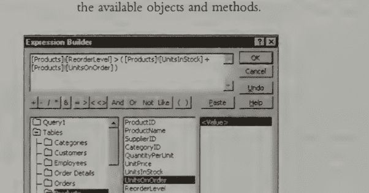

**图 13-5** 使用 Access 表达式生成器

8. 双击左下角框中的 **“表”** 以调出可用表列表，然后单击 **“产品”** 以调出产品表字段列表。
9. 双击字段列表中的 **“再订货水平”**，将其输入到表达式框中。
10. 单击 **">"** 按钮，将大于号输入到表达式框中。
11. 单击 **"("** 以将左括号输入到表达式框中。当您在同一语句中组合多个条件标准时，括号是必需的。
12. 双击 **“库存单位”** 字段，将其输入到表达式框中。
13. 单击 **"+"** 按钮，将加号放入表达式框中。
14. 双击 **“订单单位”** 字段，将其输入到表达式框中。
15. 单击右括号 **")"**。
16. 单击 **“确定”** 关闭表达式生成器。表达式框中的表达式现在位于设计网格中的“或”框中。
17. 单击菜单栏上的 **“文件”**，然后单击 **“保存”**。将查询保存为 **“再订货产品”**。
18. 单击 **“视图”** 列表箭头，然后单击 **“数据表视图”** 以预览您的结果。列出了七种产品。

## 使用 SQL 和 ASP 更新数据库

19. 单击 **“视图”** 列表箭头，然后单击 **“SQL 视图”**。请注意，Access 使用字段的完全限定名称列出字段。此外，条件表达式使用括号来标识条件的评估顺序。
20. 单击 **“文件”**，然后单击 **“关闭”** 关闭查询。

## 使用 SQL 和 ASP 更新数据库

更新数据库可以包括创建新记录、修改现有记录或删除记录。您可以通过使用 SQL 命令或使用 ADO 内置的记录集对象来完成此操作。在下面的示例中，您将使用命令对象和 SQL 命令来插入新记录、更新现有记录或删除现有记录。命令对象拥有自己的一套可以配置的属性和方法。

### 使用 SQL 和命令对象创建新记录

在 SQL 中，插入新记录需要创建`INSERT`查询。插入查询一次只能对一个表执行，并且一次只能插入一条记录。此外，您必须为每个字段指定一个值。如果没有可用值，您可以使用单词`NULL`代替该值。您必须使用引号输入字符串。如果您输入字段而未指定字段名称，则必须按照字段在数据库结构中出现的顺序输入它们。使用 SQL 插入新记录的语法如下。

```
INSERT INTO tablename
VALUES (value1, value2, value3,....valueN)
```

例如：

```
INSERT INTO Products
VALUES ("chair", 153.00, #12/1/2000#, NULL, "furniture")
```

如果您只想输入部分字段的值，可以在表名后用括号指定字段名称。以下示例代码演示了如何仅输入产品名称和价格。

```
INSERT INTO Products (productName, price)
VALUES ("chair",153.00)
```

Northwind 数据库中的`Shippers`表只包含三个字段：`ShipperID`、`CompanyName`和`phone`。目前表中只有三条记录。`ShipperID`是一个自动编号，在将托运人记录输入数据库时自动分配。以下步骤展示了如何在网页中使用 SQL 创建新记录。因为使用了`insert`命令，所以您需要使用命令对象。命令对象可以与连接对象或记录集对象一起使用。表 13-1 列出了命令对象方法和属性的一个子集。

## 第13章 高级Web数据库集成

表13-1 Command对象的属性和方法

| 方法 | 描述 | 示例 |
|---|---|---|
| `Execute`方法 | 执行由`CommandText`属性标识的SQL语句或存储过程 | `oCM.Execute` |
| `Cancel`方法 | 取消当前命令 | `oCM.Cancel` |
| `ActiveConnection`属性 | 指定连接对象（`oC`）或连接字符串（`CS`） | `oCM.ActiveConnection = CS`<br>`oCM.ActiveConnection = oC` |
| `CommandText` | 指定SQL语句（`SQL`）或存储过程 | `oCM.CommandText = SQL` |
| `CommandType` | 描述`CommandText`的类型 | `oCM.CommandType = adCmdText`<br>`oCM.CommandType = adCmdStoredProc` |

在调用`execute`方法之前，必须指定`ActiveConnection`、`CommandText`和`CommandType`属性。`ActiveConnection`的值可以是连接对象的名称、连接字符串或存储连接字符串的变量名。如果命令是SQL查询，那么`CommandType`的值为`&H0001`。为了让你不必记住所有可能的值及其含义，Microsoft提供了一个文本文件，其中包含与ADO一起使用的常量值列表。该文件名为`adovbs.inc`，在安装Microsoft数据访问组件支持时就会安装。因为它是一个文本文件，可以很方便地在记事本中打开。`CommandType`属性可用的值称为`CommandTypeEnum`。下面列出了四个常量及其值。在你的ASP页面中，包含`adovbs.inc`文件后，你可以直接使用常量而不必引用具体数值。关于在ASP页面中包含文本文件的示例和说明，请参阅第7章。下一个示例将包含`adovbs.inc`文件，并引用在`adovbs.inc`文件中声明的常量。

- `Const adCmdUnknown = &H0008`
- `Const adCmdText = &H0001`
- `Const adCmdTable = &H0002`
- `Const adCmdStoredProc = &H0004`

`adovbs.inc`默认安装在`c:\Program Files\Common Files\System\ado\`文件夹中。`adovbs.inc`的客户端版本可用于通过客户端脚本访问这些相同的常量。`adovbs.inc`的客户端版本默认安装在`c:\Program Files\Common Files\System\msadc\`文件夹中。

要使用SQL和command对象在`Shippers`表中创建新记录：

1. 使用记事本创建一个名为**shipnewsql.asp**的新页面。
2. 添加服务器端包含、基本HTML和标题。

```
<!--#include file="nwconx.inc"-->
<!--#include file="adovbs.inc"-->
<html><head>
<title>New Shipping Record</title>
</head>
<body>
<h1>New Shipping Record</h1>
```

3. 使用`insert`命令创建SQL语句，并将字符串赋值给SQL变量。

```
<%
SQL = "INSERT INTO Shippers "
SQL = SQL & "(ShipperID, CompanyName, Phone) "
SQL = SQL & "VALUES (42,'FedNight','(555) 800-8888')"
```

4. 使用连接对象打开一个连接，并将连接字符串变量传递给连接对象。

```
oC.open CS
```

5. 设置连接对象的属性。你可以将属性设置为连接字符串或连接对象。将`CommandText`属性赋值为SQL字符串。将`CommandType`属性赋值为`adCmdText`。对于SQL命令语句，`CommandType`通常为`adCmdText`；对于存储过程，则为`adCmdStoredProc`。然后，使用command对象调用`execute`方法来执行命令。

```
oCM.ActiveConnection = oC
oCM.CommandText = SQL
oCM.CommandType = adCmdText
oCM.Execute
```

6. 将SQL语句输出到浏览器，并关闭HTML标签。

```
response.write SQL
%>
</body></html>
```

7. 使用你喜欢的字体、颜色、图像和内容修改页面。
8. 将页面保存到你的数据目录文件夹中。
9. 在浏览器中查看网页。ASP页面中显示的SQL语句应为`INSERT INTO Shippers (ShipperID, CompanyName, Phone) VALUES (42,'FedNight','(555) 800-8888')`。
10. 打印网页和源代码。
11. 在Access中查看`Shippers`表，验证记录已添加。

## 使用SQL和Command对象修改记录

你也可以使用SQL和command对象来修改现有记录，如下一个示例所示。SQL语句使用`update`命令而不是`select`或`insert`命令。`update`命令需要知道要更新哪个表，以及哪些字段和值。关键字`set`用于将值赋给字段名称。调用`execute`方法来执行更新操作。你可以使用`WHERE`子句来更新单条记录或一组记录。如果未使用`WHERE`子句指定搜索条件，则数据库中的所有记录都将被更新。在下面的示例中，你将创建一个网页，用于更改你在上一个示例中输入的电话号码。

要使用SQL和command对象更新`Shippers`表中的记录：

1. 使用记事本创建一个名为`shipupdatesql.asp`的新页面。
2. 添加服务器端包含、基本HTML和标题。

```
<!--#include file="nwconx.inc"-->
<!--#include file="adovbs.inc"-->
<html><head>
<title>Update Shipping Record</title>
</head>
<body>
<h1>Update Shipping Record</h1>
```

3. 使用`UPDATE`命令创建SQL语句，并将字符串赋值给SQL变量。注意，条件是`shipperID`等于42。该`shipperID`与你在上一个练习中创建的`shipperID`相匹配。

```
<%
SQL = "Update Shippers "
SQL = SQL & "Set CompanyName='ExpMail',"
SQL = SQL & "Phone='(222) 800-8888'"
SQL = SQL & "WHERE ShipperID=42"
```

4. 使用连接对象打开一个连接，并将连接字符串变量传递给连接对象。

```
oC.open CS
```

5. 设置连接对象的属性。然后，调用`execute`方法。

```
oCM.ActiveConnection = oC
oCM.CommandText = SQL
oCM.CommandType = adCmdText
oCM.Execute
```

6. 将SQL语句输出到浏览器，并添加结束的HTML标签。

```
response.write SQL
%>
</body></html>
```

7. 使用你喜欢的字体、颜色、图像和内容修改页面。
8. 将页面保存到你的数据目录中。
9. 在浏览器中查看网页。显示的SQL语句应为`Update Shippers Set CompanyName='ExpMail',Phone='(222) 800-8888' WHERE ShipperID=42`。打印网页和源代码。
10. 在Access中查看`Shippers`表，验证记录已更新。

> **编程提示** 虽然在生产环境中通常不会将SQL语句输出到浏览器，但在第一次运行脚本时这样做很有用，以便查看SQL语句。大多数错误都与SQL语句的语法有关。你可以通过将结果写入网页来验证SQL语句。如果你使用这种方法来调试网页，可以使用`response.end`语句在显示SQL语句后停止页面的处理。

## 使用SQL和Command对象删除记录

你也可以使用SQL和command对象来删除记录。`delete`命令需要知道要删除哪个表。调用command对象的`execute`方法来执行删除操作。你可以使用`WHERE`子句指定要删除的单条记录。如果未使用`WHERE`子句指定特定记录或记录集，则将删除整个记录集。本示例将删除你在上一个练习中创建的记录。

要使用SQL和command对象删除`Shippers`表中的记录：

1. 在记事本中创建一个名为**shipdeletesql.asp**的新页面。
2. 添加服务器端包含、基本HTML和标题。

```
<!--#include file="nwconx.inc"-->
<!--#include file="adovbs.inc"-->
<html><head>
<title>Delete Shipping Record</title>
</head>
<body>
<h1>Delete Shipping Record</h1>
```

3. 使用`DELETE`命令创建SQL语句，并将字符串赋值给SQL变量。注意，条件是`shipperID`等于42。该`shipperID`仅与你在上一个练习中创建的`shipperID`相匹配。因此，将只删除一条记录。

```
<%
SQL = "Delete FROM Shippers "
SQL = SQL & "WHERE ShipperID=42"
```

## 第13章 高级Web数据库集成

1. 打开连接，使用连接对象，并将连接字符串变量传递给连接对象。
2. 设置连接对象的属性。然后，调用执行方法。
3. 将SQL语句写入浏览器，并添加关闭的HTML标签。
4. 使用你喜欢的字体、颜色、图片和内容修改页面。
5. 将页面保存到你的数据目录。
6. 在浏览器中查看网页。显示的SQL语句应为`Delete FROM Shippers WHERE ShipperID=42`。
7. 打印网页和源代码。
8. 在Access中查看`Shippers`表，以验证记录已被删除。

```
oC.open CS
```

```
oCM.ActiveConnection = oC
oCM.CommandText = SQL
oCM.CommandType = adCmdText
oCM.Execute
```

```
response.write SQL
%>
</body></html>
```

## 使用ADO和ASP更新数据库

虽然你可以使用SQL来创建新记录，或更新或删除现有记录，但ADO模型也包含执行这些常用功能的方法。这些方法不需要命令对象。记录在调用`update`方法之前不会在数据库中被修改。

你可以在 http://msdn.microsoft.com/library/techart/ado_objm.htm 了解更多关于ActiveX Data Objects 2.1中的对象。

## 使用ADO和ASP创建新记录

你可以通过使用记录集对象的`AddNew`方法来创建新记录。在下面的示例中，你将向`Shippers`表添加一条新记录。注意，`SELECT` SQL查询用于选择所有记录或记录的子集。你可以应用一个筛选器来确定记录是否已经存在。如果记录存在，则不要创建新记录。否则，创建新记录，获取字段的值，然后更新数据库。记录在调用`update`方法之前不会被添加到数据库。完成后，你可以移除筛选器，这将使记录集返回到完整的记录集。你可以通过将属性设置为`adovbs.inc`文件中的`adFilterNone`常量，或者将其设置为空字符串来释放筛选器。筛选器很有用，因为它们可以在同一页ASP页面中重新应用于同一记录集，而无需返回数据库检索新的记录集。在创建新记录之前，你应该始终验证主字段未被使用。

要使用ADO命令在`Shippers`表中添加记录：

1. 在记事本中创建一个名为**shipaddado.asp**的新页面。
2. 添加服务器端包含、基本HTML和标题。

```
<!--#include file="nwconx.inc"-->
<!--#include file="adovbs.inc"-->
<html><head>
<title>Add Shipping Record</title>
</head>
<body>
<h1>Add Shipping Record</h1>
```

3. 打开连接，使用连接对象和连接字符串变量。

```
<%
oC.open CS
```

4. 创建SQL语句，使用`SELECT`命令，并将字符串赋值给SQL变量。

```
SQL = "SELECT * FROM Shippers"
```

5. 打开记录集对象，使用SQL查询和连接对象。传递参数以指示`CursorType`、`LockType`和`CommandType`。`CommandType`是`adCmdText`，表示传递的命令是SQL语句。

```
oRS.Open SQL,oC,adOpenDynamic,adLockOptimistic,adCmdText
```

6. 使用记录集对象的筛选器方法搜索特定记录。注意，筛选条件是针对`CompanyName`等于`OverNight`的记录。

```
oRS.Filter = "CompanyName = 'OverNight'"
```


你可以从表单或变量传递筛选器的值。

7. 如果没有匹配的记录，则游标移动到文件末尾，并使用`AddNew`方法添加新记录。设置字段的值。你不需要设置`ShipperID`；它将由数据库设置，因为该字段的格式为自动编号。调用`update`方法，这将把记录写入数据库。最后，通过将其赋值给`adFilterNone`来释放筛选器。

```
If oRS.EOF Then
    oRS.AddNew
    oRS("CompanyName") = "OverNight"
    oRS("Phone") = "(222) 555-1234"
    oRS.Update
End If
oRS.Filter = adFilterNone
```

8. 将SQL语句写入浏览器，并添加关闭的HTML标签。
9. 使用你喜欢的字体、颜色、图片和内容修改页面。
10. 将页面保存到你的数据目录。
11. 在浏览器中查看网页。注意，SQL语句应为`SELECT * FROM Shippers`。
12. 验证记录已添加到`Shippers`表中。ADO `AddNew`方法添加了新记录。
13. 打印网页和源代码。

```
response.write SQL
%>
</body></html>
```

## 使用ADO和ASP修改记录

ADO也可用于修改一条或多条现有记录。在下面的示例中，`SELECT` SQL查询用于选择所有记录或记录的子集。然后，你可以应用筛选器来确定记录是否存在。该筛选器可用于检索单条记录或一组记录。如果记录存在，则用新值修改字段并更新数据库。注意，修改记录的代码与使用`AddNew`方法的代码相似。记录在调用`update`方法之前不会在数据库中更新。

要使用SQL和命令对象在`Shippers`表中修改记录：

1. 在记事本中创建一个名为`shipmodifyado.asp`的新页面。
2. 添加服务器端包含、基本HTML和标题。
3. 打开连接，使用连接对象和连接字符串变量。

```
<!--#include file="nwconx.inc"-->
<!--#include file="adovbs.inc"-->
<html><head>
<title>Modify Shipping Record</title>
</head>
<body>
<h1>Modify Shipping Record</h1>
```

```
<%
oC.open CS
```

4. 创建SQL语句，使用`SELECT`命令，并将字符串赋值给SQL变量。

```
SQL = "SELECT * FROM Shippers"
```

5. 打开记录集对象，使用SQL查询和连接对象。传递参数以指示`CursorType`、`LockType`和`CommandType`。`CommandType`是`adCmdText`，表示传递的命令是SQL语句。

```
oRS.Open SQL,oc,adOpenDynamic,adLockOptimistic,adCmdText
```

6. 使用记录集对象的筛选器方法搜索特定记录。注意，筛选条件是针对公司名称等于`OverNight`的记录。记录必须存在，你才能修改记录。

```
oRS.Filter = "CompanyName = 'OverNight'"
```

7. 如果未到达文件末尾，则存在匹配项，将返回一个记录集。由于只有一条记录匹配，因此记录集中只有一条记录。设置字段的值并调用`update`方法，这将把字段值重写到数据库。

```
If not oRS.EOF
    oRS("CompanyName") = "OverNight"
    oRS("Phone") = "(444) 555-1234"
    oRS.Update
End If
oRS.Filter = adFilterNone
```

8. 将SQL语句写入浏览器，并添加关闭的HTML标签。

```
response.write SQL
%>
</body></html>
```

9. 使用你喜欢的字体、颜色、图片和内容修改页面。
10. 将页面保存到你的数据目录。
11. 在浏览器中查看网页。SQL语句应为`SELECT * FROM Shippers`。打印网页和源代码。
12. 在Access中查看`Shippers`表，以验证记录已被修改。

## 使用ADO和ASP删除记录

你可以使用记录集对象的ADO `delete`方法从数据库中删除记录。在下面的示例中，从`Shippers`表中删除一条记录。注意，`SELECT` SQL查询用于选择所有记录或记录的子集。然后，你可以执行筛选器来确定记录是否存在。如果记录存在，则删除记录并更新数据库。注意，在调用`delete`方法之后，你必须调用`update`方法。记录在调用`update`方法之前不会从数据库中删除。

使用 ADO 的 `delete` 方法删除 `Shippers` 表中的记录

1. 在记事本中创建一个名为`shipdeleteado.asp`的新页面。
2. 添加服务器端包含、基本 HTML 和标题。

```
<!--#include file="nwconx.inc"-->
<!--#include file="adovbs.inc"-->
<html><head>
<title>Delete Shipping Record</title>
</head>
<body>
<h1>Delete Shipping Record</h1>
```

3. 使用连接对象和连接字符串变量打开一个连接。

```
<%
oC.open CS
```

4. 使用 `SELECT` 命令创建 SQL 语句，并将字符串赋值给 SQL 变量。

```
SQL = "SELECT * FROM Shippers"
```

5. 使用 SQL 查询和连接对象打开记录集对象。传递参数以指示 `CursorType`、`LockType` 和 `CommandType`。`CommandType` 为 `adCmdText`，表示传递的命令是一个 SQL 语句。

```
oRS.Open SQL,oC,adOpenDynamic,adLockOptimistic,adCmdText
```

6. 使用记录集对象的 `filter` 方法搜索特定记录。注意筛选条件为 `shipperID` 等于 52。

```
oRS.Filter = "CompanyName = 'OverNight'"
```

您可以从表单或变量中传递筛选值。


7. 如果存在匹配项，使用 `delete` 方法删除记录，然后调用 `update` 方法。

```
If not oRS.EOF Then
    oRS.Delete
    oRS.Update
End If
oRS.Filter = adFilterNone
```

8. 将 SQL 语句输出到浏览器，并添加闭合的 HTML 标签。

```
response.write SQL
%>
</body></html>
```

9. 使用您喜欢的字体、颜色、图像和内容修改页面。
10. 将页面保存到您的数据目录。
11. 在浏览器中查看该网页。显示的 SQL 语句为 `SELECT * FROM Shippers`。
12. 打印该网页及其源代码。
13. 在 Access 中查看 `Shippers` 表，以验证记录是否已被删除。

### 使用 ADO 批量更新记录

ADO 还内置了其他方法和属性。例如，`UpdateBatch` 可用于一次性更新多条记录。但是，由于您可以修改记录，因此应该锁定记录集，以防止其他用户同时尝试修改该记录。`adLockBatchOptimistic` 属性会锁定记录集，直到使用 `UpdateBatch` 方法为止。记录集对象的 `adOpenKeySet` 游标属性允许游标在记录集中前后移动。以下是使用 `UpdateBatch` 方法的代码示例：

```
oRS.open adOpenKeySet, adLockBatchOptimistic
oRS("fieldname")=value1
oRS.MoveNext
oRS("fieldname")=value2
oRS.MoveNext
oRS("fieldname")=value3
oRS.UpdateBatch
```

> 只有部分提供程序允许您批量更新记录。您可以在 http://msdn.microsoft.com/library/psdk/dasdk/mdap99m7.htm 了解更多关于 ADO 可用的提供程序以及可用的属性和方法。

### 使用 ADO 遍历记录集

如您在上一章中学到的，数据库游标是内存中的一个位置，记录集中的记录存储在此处。记录集类似于名片盒，您可以从中访问每一张名片。您可以使用游标逐行访问记录集对象中的记录。检索记录集时指定的 `CursorType` 指示哪些方法和属性适用于该记录集。支持的游标类型包括仅向前（Forward Only）、静态（Static）、键集（Keyset）和动态（Dynamic）。

默认的记录集游标"仅向前"（Forward Only）由参数 `adOpenForwardOnly` 标识，允许您在数据库中逐条记录向前移动。此类记录集只能与 `SELECT` 查询一起使用。此类记录集是**只读**的。游标可以使用 `MoveFirst` 和 `MoveNext` 方法在记录集中导航。

静态记录集（使用 `adStatic` 参数配置）也只能与 `SELECT` 查询一起使用。但是，静态记录集会锁定记录。当记录集中的数据更新时，更改不会反映在当前记录集中。静态记录集提供了更灵活的导航方法。例如，它允许您使用书签来维护游标在数据库中的位置。默认书签包括 `adBookmarkCurrent`、`adBookmarkFirst` 和 `adBookmarkLast`。ADO 还允许您创建自己的书签。静态记录集的导航方法包括 `MoveFirst`、`MoveNext`、`MoveLast` 和 `MovePrevious`，以及一个允许使用相对地址移动到特定记录的 `Move` 方法。`Move` 方法需要两个参数：要移动的记录数和起始位置。负数允许您在记录集中向后移动。以下是 `Move` 方法的语法：

```
oRS.Move(recordsToMove, startPosition)
```

例如，在静态记录集中使用 `move` 属性移动到第四条记录：

```
oRS.Move(3, 1)
```

`adOpenKeySet` 游标参数定义了键集记录集。键集记录集支持书签和在记录集中移动，此外，如果您在创建记录集时指定了 `LockType` 参数，它还允许您更新记录。因此，您可以看到对现有记录所做的更新。

您在使用 `adOpenDynamic` 参数定义记录集时指定动态记录集。此记录集是在记录集中导航最灵活的，并且会立即显示其他用户所做的所有更改——但它在服务器资源方面也带来了最大的开销，因为它必须维护额外的信息以允许您在记录集中自由导航。

## 章节总结

### 在 Access 中构建查询

- 连接对象、连接字符串和相关 ADO 对象通常在单独的文件中创建，然后可以在 ASP 页面中包含。使用服务器端包含有助于集中管理连接信息。为了使用 ADO 常量，您必须在 ASP 页面中包含 `adovbs.inc` 文件。
- Access 提供了图形用户界面来创建查询。在"查询"选项卡中，您可以在三种视图之间切换。设计视图让您可以使用设计网格以图形方式配置查询。SQL 视图让您可以查看或编辑原始 SQL 代码。数据表视图让您可以预览查询结果。
- Access 会在查询中添加额外的括号，并对所有字段和表进行完全限定。完全限定字段意味着标识表的名称和字段的名称，用点号 (`.`) 分隔。
- Microsoft 提供 Northwind 数据库作为学习 Access 的培训工具。
- 您可以使用 Access 创建对数据进行排序并组合多个搜索条件的查询。Access 创建的 SQL 可以在网页中使用。您可以通过连接 SQL 变量将 SQL 拆分为多行。

### 在 Access、SQL 和 ADO 中进行高级查询

- 当您使用 `AND` 运算符组合多个搜索条件时，两个条件都必须为真才能检索记录。如果您使用 `OR` 运算符，则只需其中一个条件为真即可检索记录。将多个条件组合成单个 SQL 语句时，必须使用括号。Access 有一个内置的表达式生成器，可用于以图形方式构建复杂查询。
- SQL 可以与 ASP 一起使用来创建高级查询，例如插入新记录、更新记录和删除记录。您必须使用命令对象来执行 SQL 命令。
- ADO 也可以与 ASP 一起使用来创建高级查询，例如插入新记录、更新记录和删除记录。您不能使用默认记录集来执行这些高级查询。
- 您可以使用筛选器在记录集中搜索记录的子集。可以移除筛选器，这样会返回原始记录集。筛选器可以在同一页面中重复使用。
- 记录集对象的 `CursorType` 参数标识记录集中可用的导航方法。对于 `adOpenForwardOnly` 记录集，您只能使用 `MoveNext` 和 `MoveFirst` 方法向前移动。

### 创建命令对象

```
set oCM = server.createobject("ADODB.command")
```

### 包含 adovbs.inc 文件和连接文件

```
<!--#include file="adovbs.inc"-->
<!--#include file="conx.inc"-->
```

### 使用命令对象执行 SQL 语句

```
oCM.ActiveConnection = oC
oCM.CommandText = SQL
oCM.CommandType = adCmdText
oCM.Execute
```

### 使用 SQL 创建新记录

```
SQL = "INSERT INTO Shippers "
SQL = SQL & "(SID, Cname, NDate) "
SQL = SQL & "VALUES (42,'BD',#8/1/2000#)"
```

### 使用 SQL 更新现有记录

```
SQL = "Update Shippers "
SQL = SQL & "Set CName='EL' "
SQL = SQL & "WHERE SID=42"
```

## 第13章 高级 Web 数据库集成

使用 SQL 删除记录

```
SQL = "Delete FROM Shippers "
SQL = SQL & "WHERE SID=42"
```

对记录集对象应用筛选器

```
oRS.Filter = "SID = 999"
```

以写入模式打开记录集

```
oRS.Open SQL,oC,adOpenDynamic,adLockOptimistic,adCmdText
```

使用 ADO 记录集对象创建新记录

```
oRS.AddNew
oRS("CName") = "O.N.T."
oRS.Update
```

使用 ADO 记录集对象更新现有记录

```
oRS.Filter = "SID = 52"
oRS("CName") = "AAA Movers"
oRS.Update
```

使用 ADO 记录集对象删除现有记录

```
oRS.Filter = "SID = 52"
oRS.Delete
oRS.Update
```

移除记录集对象上的筛选器

```
oRS.Filter = adFilterNone
oRS.Filter = ""
```

使用记录集对象更新一组记录

```
oRS.open adOpenKeySet, adLockBatchOptimistic
oRS("Price")=21.50
oRS.MoveNext
oRS("Price")=32.50
oRS.UpdateBatch
```

在静态记录集中移动到特定记录

```
oRS.Move(3, 1)
```

## 复习题

1. Access 中哪种视图允许你使用设计网格修改查询？
   a. 数据表视图
   b. 设计视图
   c. SQL 视图
   d. 表达式生成器

2. 如果某字段按降序排序，哪个值会首先显示？
   a. 25
   b. 23
   c. 2
   d. 1.5

3. 要创建价格等于八美元的搜索条件，在价格列下的条件框中应输入什么？
   a. `"8"`
   b. `= 8`
   c. `= "8"`
   d. `= "8.00"`

4. 如果价格字段下的"显示"复框被勾选，该字段可用于排序结果。正确还是错误？

5. 如果价格字段下的"显示"复框被勾选，则该字段将会显示。正确还是错误？

6. 要创建 `lastVisited` 日期等于 2000 年 9 月 1 日的搜索条件，在 `lastVisited` 列下的条件框中应输入什么？
   a. `= "9/1/2000"`
   b. `= #9/1/2000#`
   c. `= 9/1/2000`
   d. `"9/1/2000"`

7. 要创建名为 `phone` 的字段为空的搜索条件，在 `phone` 列下的条件框中应输入什么？
   a. `= " "`
   b. `= NULL`
   c. `= "NULL"`
   d. `<> NULL`

8. 哪个函数会返回名为 `Price` 字段的平均值？
   a. `Average(Price)`
   b. `AVG(Price)`
   c. `COUNT(Price)`
   d. `SUM(Price)`

9. 哪个 SQL 命令会在记录集中插入新记录？
   a. `Update`
   b. `AddNew`
   c. `Add`
   d. `Insert`

10. 使用 SQL 向记录集中添加新记录时，哪个语句能正确将 `customer` 表标识为目标表？
    a. `FROM customer`
    b. `INTO customer`
    c. `Customer VALUES`
    d. `INSERT customer`

11. 如果价格字段的值不可用，最佳做法是什么？
    a. 插入 `""` 以在该字段中放置空字符串。
    b. 插入 `NULL` 作为该字段的占位符。
    c. 插入 `"3.00"` 作为该字段的占位符。
    d. 不在值字符串中添加该值。

12. 哪个语句会将名为 `oCM` 的命令对象的 `ActiveConnection` 属性赋给名为 `oConn` 的连接对象？
    a. `oConn.ActiveConnection = oCM`
    b. `oCM.ActiveConnection = oC`
    c. `oCM.ActiveConnection = oConn`
    d. `oCM.ActiveConnection = CS`

13. 将哪个值赋给 `CommandType` 参数以表明该命令是 SQL 语句？
    a. `adCmdText`
    b. `adCmdStoredProc`
    c. `adCmdSQL`
    d. `adCmdTable`

14. 哪个 SQL 命令会从数据库中移除记录？
    a. `oRS.Delete`
    b. `Update`
    c. `Remove`
    d. `Delete`

15. 哪个方法执行命令对象中标识的 SQL 语句？
    a. `oCM.Update`
    b. `oCM.Run`
    c. `oCM.Execute`
    d. `CommandExecute`

16. 静态记录集使用哪个方法移动到特定记录？
    a. `Move`
    b. `MoveOne`
    c. `MoveUp`
    d. `MoveNext`

17. 哪个方法移除名为 `oRS` 的记录集对象的筛选器？
    a. `oRS.adFilterNone`
    b. `oRS.adFilter = None`
    c. `Set oRS.Filter = Nothing`
    d. `oRS.Filter = adFilterNone`

18. 哪个 ADO 方法允许你向记录集中插入新记录？
    a. `oRS.Insert`
    b. `oRS.New`
    c. `oRS.Add`
    d. `oRS.AddNew`

19. 哪个 ADO 记录集参数允许你写入记录？
    a. `adCommandText`
    b. `adLockOptimistic`
    c. `adOpenForwardOnly`
    d. `adOpenKeyset`

20. 书签的用途是什么？
    a. 维护光标的位置
    b. 维护记录集中字段的位置
    c. 更改所用的记录集光标类型
    d. 动态更改所用的 `commandtype` 参数

## 实践项目

### 项目 13-1

在本项目中，你将创建一个客户注册数据库和一个服务器端包含文件，该文件可以包含与客户注册数据库的连接信息。

1. 打开 Access。创建一个名为 **cemail.mdb** 的新数据库。将数据库保存在你的数据目录中。
2. 双击 **在设计视图中创建表** 以创建一个名为 `customer` 的新表。将下表列出的字段添加到表结构中。将 e-mail 字段定义为主键字段。将表保存为 **customer**。

| 字段名称 | 数据类型 | 说明 |
|------------|-----------|-------------|
| email | 文本 | 电子邮件地址 |
| sessID | 文本 | 会话ID |
| signup | 文本 | 注册日期 |
| fname | 文本 | 名字 |
| lname | 文本 | 姓氏 |
| pwd | 文本 | 密码 |
| keyword | 文本 | 关键字 |

3. 使用数据表视图在下表中输入以下数据。你可以添加额外记录，但将此记录作为第一条记录输入。请注意，`email` 字段是主键字段，因此不能包含重复值。

| 字段名称 | 值 |
|------------|--------|
| email | Julie@VisualInterdev.org |
| sessID | 1069168305 |
| signup | 8/1/2001 |
| fname | Julie |
| lname | Murphy |
| pwd | hurricane |
| keyword | snoopy |

4. 保存 `customer` 表。关闭 `cemail` 数据库，然后退出 Access。
5. 使用记事本创建一个名为 **emailconx.inc** 的服务器端包含页面，用于连接 `cemail` 数据库。添加以下代码来声明变量、创建连接字符串以及创建连接、记录集和命令对象。将路径更改为 `cemail` 数据库所在的绝对路径。

```
<% dim DRV, DBQ, CS
DRV = "Driver={Microsoft Access Driver (*.mdb)}; "
DBQ = "DBQ= c:\yourfolder\cemail.mdb;"
CS = DRV & DBQ
%>
```

6. 将页面保存到你的数据目录。打印 `emailconx.inc` 页面的源代码。

### 项目 13-2

在本项目中，你将把值从表单传递到 ASP 页面；这些值用于创建新记录。（注意：本项目要求你先完成项目 13-1。）

1. 使用记事本创建一个名为 **CEmailADORegister.asp** 的新页面，该页面将包含注册表单。将页面保存到你的数据目录。
2. 使用下表列出的字段创建表单。表单方法应为 `post`，action 应为 **CEmailADOAdd.asp**。请注意，`signup` 和 `sessID` 未列出。这些值将从服务器获取，而非用户。你可以修改字段属性，但 `name`、表单字段 HTML 标记和 `type` 属性除外。你可以使用你喜欢的字体、颜色、文本和图像修改页面。将页面保存到你的数据目录。

| 表单字段名称 | 表单字段 HTML 标记和 Type 属性 |
| :--- | :--- |
| email | Input type=text |
| fname | Input type=text |
| lname | Input type=text |
| pwd | Input type=password |
| keyword | Input type=password |

3. 使用记事本创建一个名为 **CEmailADOAdd.asp** 的页面，用于检索表单值并将值添加到新记录中。将页面保存到你的数据目录。
4. 将以下基本 HTML 标记和标题添加到你的 `CEmailADOAdd.asp` 页面中。

```
<!--#include file="emailconx.inc"-->
<!--#include file="adovbs.inc"-->
<html><head>
<title>Add Customer</title>
</head>
<body>
<h1>Add Customer</h1>
```

5. 添加代码以从表单中检索值并将其赋给变量。请注意，`signup` 变量被赋值为当前日期，而非来自表单的值。`sessID` 来自服务器上会话对象的 `sessionID`，而非来自表单的值。

## 538 第13章 高级Web数据库集成

```
<%
email = Request.Form("email")
fname = Request.Form("fname")
lname = Request.Form("lname")
pwd = Request.Form("pwd")
keyword = Request.Form("keyword")
sessID = Session.SessionID
signup = Date()
```

6. 添加打开连接和记录集对象的代码。使用 `SELECT` SQL 语句从客户表中检索记录。

```
set oC = server.createobject("ADODB.connection")
set oRS = server.createobject("ADODB.recordset")
oC.open CS
SQL = "SELECT * FROM customer"
oRS.Open SQL,oC,adOpenDynamic,adLockOptimistic,adCmdText
```

7. 对记录集应用筛选器。筛选器将使用表单中输入的电子邮件地址来查找匹配的记录。

```
oRS.Filter = "email ='" & email & "'"
```

8. 编写条件语句，使得如果存在匹配记录，则不创建新记录。如果已到达文件末尾且未找到匹配项，则使用记录集对象的 `AddNew` 方法添加一条新记录。将值赋给字段，使用包含从表单传递过来的值的变量。使用 `update` 方法更新数据库。

```
If oRS.EOF Then
    oRS.AddNew
    oRS("email") = email
    oRS("sessID") = sessID
    oRS("fname") = fname
    oRS("lname") = lname
    oRS("pwd") = pwd
    oRS("keyword") = keyword
    oRS("signup") = signup
    oRS.Update
End If
oRS.Filter = adFilterNone
```

9. 关闭记录集和连接对象，并添加结束的 HTML 标签。添加一个指向 `CEmailADODisplay.asp` 页面的链接，该页面将用于显示记录集。

```
oRS.close
set oRS = nothing
oC.close
set oC = nothing
%>
<a href = "CEmailADODisplay.asp">
Display the customer list </a>
</body></html>
```

10. 将更改保存到 `CEmailADOAdd.asp` 页面。
11. 创建一个名为 **CEmailADODisplay.asp** 的网页，该页面将通过显示客户表中的记录来验证记录已添加到数据库中。
12. 添加服务器端包含和基本 HTML 标签。

```
<!--#include file="emailconx.inc"-->
<!--#include file="adovbs.inc"-->
<html><head>
<title>Display Customers</title>
</head>
<body>
<h1>Display Customers </h1>
```

13. 打开连接并检索基本记录集。由于只是查看记录，可以使用默认记录集。

```
<%
SQL = "SELECT * FROM customer"
set oC = server.createobject("ADODB.connection")
oC.open CS
set oRS = server.createobject("ADODB.recordset")
oRS.Open SQL, oC
%>
```

14. 添加 `table` HTML 标签来创建表格。

```
<table border=1 cellspacing=0 cellpadding=5>
```

15. 创建 `Do While` 语句来循环遍历记录集中的每条记录，直到到达文件末尾。对于每条记录，将字段的值写入单元格中。

```
<% do while not oRS.EOF
  response.write "<tr><td>"
  response.write oRS("email") & "</td><td>"
  response.write oRS("sessID") & "</td><td>"
  response.write oRS("fname") & "</td><td>"
  response.write oRS("lname") & "</td><td>"
  response.write oRS("pwd") & "</td><td>"
  response.write oRS("keyword") & "</td><td>"
  response.write oRS("signup") & "</td></tr>"
oRS.movenext
loop
oRS.close
set oRS = nothing
oC.close
set oC = nothing
%>
```

16. 添加结束的 `table` 标签和结束的 HTML 标签。

```
</table></body></html>
```

17. 通过更改背景、字体和颜色以及添加内容来修改网页外观。
18. 将网页保存到你的数据目录。查看 `CEmailADORegister.asp` 页面。在表单中添加以下信息：

| 表单字段名称 | 值 |
| --- | --- |
| email | rska@academia.org |
| fname | Robert |
| lname | Shea |
| pwd | Irish |
| keyword | Ireland |

19. 点击超链接以显示记录集。打印每个页面的网页和源代码。

### 项目 13-3

在本项目中，你将把表单中的值传递给 ASP 页面；这些值用于删除记录。（注意：本项目要求你先完成项目 13-1 和 13-2。）

1. 使用记事本创建一个名为 **CEmailADODeleteForm.asp** 的新页面，该页面将包含客户删除表单。此表单将用于选择要删除的用户。将页面保存到你的数据目录。
2. 创建一个包含一个名为 `email` 的输入字段的表单。表单方法应为 `post`，动作应为 **CEmailADODelete.asp**。你可以修改字段属性，但名称、表单字段 HTML 标签和 `type` 属性除外。你可以使用你喜欢的字体、颜色、文本和图像来修改页面。将页面保存到你的数据目录。
3. 使用记事本创建一个名为 **CEmailADODelete.asp** 的页面，该页面将用于检索表单值并删除记录。将页面保存到你的数据目录。
4. 将以下基本 HTML 标签和标题添加到你的 `CEmailADODelete.asp` 页面。

```
<!--#include file="emailconx.inc"-->
<!--#include file="adovbs.inc"-->
<html><head>
<title>Delete Customer</title>
</head>
<body>
<h1>Delete Customer</h1>
```

5. 添加从 `CEmail` 表单字段中检索值并将其分配给 `CEmail` 变量的代码。

```
<%
email = Request.Form("email")
```

6. 添加打开连接和记录集对象的代码。使用 `SELECT` SQL 语句从客户表中检索记录。因为你要删除记录，所以需要指定 `cursorType` 和 `lockType` 参数。

```
set oC = server.createobject("ADODB.connection")
set oRS = server.createobject("ADODB.recordset")
oC.open CS
SQL = "SELECT * FROM Customer"
oRS.Open SQL,oC,adOpenDynamic,adLockOptimistic,adCmdText
```

7. 对记录集应用筛选器。筛选器将使用表单中输入的电子邮件地址来查找匹配的记录。

```
oRS.Filter = "email = '" & email & "'"
```

8. 如果存在匹配项，则显示姓名、电子邮件地址和 `sessionID`。然后删除记录并更新数据库。移除应用于记录集的筛选器。

```
If not oRS.EOF Then
  Response.Write "Customer name: "
  Response.Write oRS("fname") & " " & oRS("lname") & "<br>"
  Response.Write "E-mail address: "
  Response.Write oRS("email") & "<br>"
  Response.Write "Customer ID: "
  Response.Write oRS("sessID") & "<br>"
  oRS.Delete
  oRS.Update
End If
oRS.Filter = adFilterNone
```

9. 关闭记录集和连接对象，并添加结束的 HTML 标签。你可以在 `CEmailADODDelete.asp` 页面上添加一个指向 `CEmailADODDisplay.asp` 页面的超链接。

```
oRS.close
set oRS = nothing
oC.close
set oC = nothing
%>
<a href = "CEmailADODDisplay.asp">
Display the customer list </a>
</body></html>
```

10. 在浏览器中查看 `CEmailADODDeleteForm.asp` 页面，并输入一个你知道存在于数据库中的电子邮件地址。
11. 查看 `CEmailADODDisplay.asp` 页面，通过显示客户表中的记录来验证记录已从数据库中删除。
12. 通过更改背景、字体和颜色以及添加内容来修改每个页面的网页外观。
13. 将网页保存到你的数据目录。
14. 打印每个页面的网页和源代码。

### 项目 13-4

在本项目中，你将把表单中的值传递给 ASP 页面；这些值用于修改记录中的值。（注意：本项目要求你先完成项目 13-1、13-2 和 13-3。）第一个页面 `CEmailADOUpdateForm.asp` 用于从表单中检索客户的电子邮件地址。第二个页面 `CEmailADOUpdateDisplay.asp` 显示从数据库中检索到的记录的值。这些值被分配给一个新的表单。用户可以修改表单值并提交更改。`CEmailADOUpdate.asp` 页面将修改记录并更新数据库。

1. 使用记事本创建一个名为 **CEmailADOUpdateForm.asp** 的新页面，该页面将包含客户更新表单。此表单将用于选择要更新的用户。将页面保存到你的数据目录。
2. 在 `CEmailADOUpdateForm.asp` 页面上，创建一个名为 `email` 的表单，其中包含一个名为 `email` 的输入字段和一个提交按钮。表单方法应为 `post`，动作应为 **CEmailADOUpdateDisplay.asp**。你可以修改字段属性，但名称、表单字段 HTML 标签和 `type` 属性除外。你可以使用你喜欢的字体、颜色、文本和图像来修改页面。将页面保存到你的数据目录。

```
<html><head>
<title>Modify Customer</title>
</head>
<body>
<h1>Modify Customer</h1>
<form method="post" action="CEmailADOUpdateDisplay.asp">
<input type="text" name="email" size="30">
<input type="submit" value="Submit">
</form>
</body></html>
```

3. 使用记事本创建一个名为 **CEmailADOUpdateDisplay.asp** 的页面，该页面将用于检索表单值。将页面保存到你的数据目录。
4. 将以下基本 HTML 标签和标题添加到你的 `CEmailADOUpdateDisplay.asp` 页面。

```
<!--#include file="emailconx.inc"-->
<!--#include file="adovbs.inc"-->
<html><head>
<title>Modify Customer</title>
</head>
<body>
<h1>Modify Customer</h1>
```

5. 添加从 `email` 表单字段中检索值并将值分配给 `email` 变量的代码。添加打开连接和记录集对象的代码。使用 `SELECT` SQL 语句从客户表中检索记录。因为你是读取记录，所以不需要指定 `CursorType` 和 `LockType` 参数。对记录集应用筛选器。筛选器将使用表单中输入的电子邮件地址来查找匹配的记录。

```
<%
email = Request.Form("email")
set oC = server.createobject("ADODB.connection")
set oRS = server.createobject("ADODB.recordset")
oC.open CS
SQL = "SELECT * FROM customer"
oRS.Open SQL, oC
oRS.Filter = "email ='" & email & "'"
```

6. 添加代码，以便如果存在匹配项，则显示值和表单。在表单外显示 `email`、`sessID` 和 `signup`。你不希望用户能够更改这些值。表单方法设置为 `post`，action 应设置为 **CEmailADOUpdate.asp**。检索值并将其赋给表单字段标签中的 `value` 属性。由于你想在下一页中使用电子邮件地址，因此需要将电子邮件地址作为隐藏值传递给表单。你仍然需要在服务器代码外使用引号，以满足需要引号的浏览器要求。然后删除记录并更新数据库。移除应用于记录集的筛选器。

> 你需要将 HTML 标签放在同一行。不要在记事本或 HTML 编辑器中将 HTML 语句拆分到多行。

```
If not oRS.EOF Then %>
E-mail address: <%= oRS("email")%><br>
Date Joined: <%= oRS("signup")%><br>
Customer ID: <%= oRS("sessID")%><br><br>
<form method="post" action="CEmailADOUpdate.asp">
<input type="hidden" name="email"
 value="<%=oRS("email")%>">
<input type="text" name="fname" size="20"
 value="<%=oRS("fname")%>">
First name <br>
<input type="text" name="lname" size="20"
 value="<%=oRS("lname")%>">
Last name <br>
<input type="text" name="pwd" size="20"
 value="<%=oRS("pwd")%>">
Password <br>
<input type="text" name="keyword" size="20"
 value="<%=oRS("keyword")%>">
Keyword <br><br>
<input type="submit" value="Submit" name="btnSubmit">
</form>
```

7. 关闭记录集和连接对象。添加闭合的 HTML 标签。

```
<%
else
end If
oRS.Filter = adFilterNone
oRS.close
set oRS = nothing
oC.close
set oC = nothing
%>
</body></html>
```

8. 创建 `CEmailADOUpdate.asp` 页面，该页面将检索表单字段值并更新用户信息。此页面的代码与用于添加客户的代码非常相似。
9. 添加服务器端包含文件和基本 HTML 标签。

```
<!--#include file="emailconx.inc"-->
<!--#include file="adovbs.inc"-->
<html><head>
<title>Modify Customer</title>
</head>
<body>
<h1>Modify Customer</h1>
```

10. 从表单中检索值并将其赋给变量。

> 请注意，你可以像检索其他表单字段一样检索隐藏表单字段的值。


```
<%
email = Request.Form("email")
fname = Request.Form("fname")
lname = Request.Form("lname")
pwd = Request.Form("pwd")
keyword = Request.Form("keyword")
```

11. 打开连接和记录集对象。由于你要修改记录集，因此需要传递 `CursorType` 和 `LockType` 参数。使用筛选器根据用户的电子邮件地址定位记录集。

```
set oC = server.createobject("ADODB.connection")
set oRS = server.createobject("ADODB.recordset")
oC.open CS
SQL = "SELECT * FROM customer"
oRS.Open SQL,oC,adOpenDynamic,adLockOptimistic,adCmdText
oRS.Filter = "email ='" & email & "'"
```

12. 如果不在记录集末尾，则存在匹配项，因此将变量中的值赋给记录集对象的字段。

```
If not oRS.EOF Then
  oRS("fname") = fname
  oRS("lname") = lname
  oRS("pwd") = pwd
  oRS("keyword") = keyword
  oRS.Update
End If
```

13. 移除筛选器，关闭记录集和连接，并添加闭合的 HTML 标签。添加指向 `CEmailADODisplay.asp` 的链接，该页面显示客户记录。

```
oRS.Filter = adFilterNone
oRS.close
set oRS = nothing
oC.close
set oC = nothing
%>
<a href="CEmailADODisplay.asp">
Display the customer list </a>
</body></html>
```

14. 在浏览器中查看 `CEmailADOUpdateForm.asp`，并输入一个你知道在数据库中的电子邮件地址。使用 `CEmailADOUpdateDisplay.asp` 页面上的表单修改数据。
15. 查看 `CEmailADODisplay.asp` 页面，通过显示客户表中的记录来验证记录已在数据库中修改。
16. 通过更改背景、字体和颜色，并添加内容来修改每个页面的外观。
17. 将网页保存到数据目录。
18. 打印每个网页的网页内容和源代码。


### 项目 13-5

在本项目中，你将创建一个页面，显示一个测验，该测验将被评分并存储在数据库中。

1. 在 Access 中创建一个名为 **quiz.mdb** 的数据库。创建一个名为 **student** 的表，包含下表中列出的字段。

| 字段名称 | 数据类型 | 说明 |
| :--- | :--- | :--- |
| email | 文本 | 电子邮件地址 |
| sessID | 文本 | 会话 ID |
| d | 文本 | 日期 |
| Q1 | 文本 | 学生答案 1 |
| Q2 | 文本 | 学生答案 2 |
| score | 文本 | 学生分数 |

2. 使用下表中的值输入一条示例记录。

| 字段名称 | 值 |
|---|---|
| email | teacher@visualinterdev.org |
| sessID | 1069168303 |
| d | 8/1/2000 |
| Q1 | a |
| Q2 | a |
| score | 100 |

3. 创建包含测验的 **quizform.asp** 页面。添加基本 HTML 标签。

```
<html><head><title>QUIZ</title>
</head>
<body>
<h1>HTML Quiz</h1>
```

4. 使用 `post` 方法创建表单，并将 action 设置为 **quiz.asp**。添加用于检索电子邮件地址的字段。

```
<form method="post" action="quiz.asp">
Enter your e-mail:
<input type="text" name="email" size="25" maxlength="25">
<br><br>
```

5. 添加第一个问题的代码。

```
1. Which tag creates a table cell?<br><br>
a. <input type="radio" name="Q1" value="a" checked>TD<br>
b. <input type="radio" name="Q1" value="b">TR<br>
c. <input type="radio" name="Q1" value="c">TH<br>
d. <input type="radio" name="Q1" value="d">TABLE<br><br>
```

6. 添加创建第二个问题的代码。

```
2. Which tag is used to create a line break?<br><br>
<select name="Q2" size="1">
<option selected value="a">BR
<option value="b">BL
<option value="c">LB
<option value="d">HR
</select><br><br>
```

7. 添加提交按钮和闭合的 HTML 标签。将页面保存到数据目录。

```
<input type="submit" value="Submit Form">
</form></body></html>
```

8. 创建一个名为 **quiz.asp** 的页面来处理测验。添加服务器端包含文件和基本 HTML 标签的代码。

```
<!--#include file="adovbs.inc"-->
<html><head><title>Quiz Score</title></head>
<body>
<h1>Quiz Score</h1>
```

9. 从表单中获取值并将其赋给变量。

```
<%
dim email, sessID, d, Q1, Q2, score
email = Request.Form("email")
sessID = Session.SessionID
d = Date()
Q1 = Request.Form("Q1")
Q2 = Request.Form("Q2")
score = 0
```

10. 批改问题并写出答案和最终分数。

```
response.write "Your answers:<br><br>"
response.write "1. " & Q1 & " "
if Q1 = "a" then
  score = 50
  response.write "Correct"
else
  response.write "Wrong"
end if
response.write "<br><br>"
response.write "2. " & Q2 & " "
if Q2 = "a" then
  score = score + 50
  response.write "Correct"
else
  response.write "Wrong"
end if
response.write "<br><br>"
response.write "Your score is: " & score
response.write "<br><br>"
```

11. 打开连接和记录集。将路径更改为测验数据库所在的绝对路径。

```
dim DR, DBQ, CS, oC, oRS
DR = "Driver={Microsoft Access Driver (*.mdb)}; "
DBQ = "DBQ= C:\yourfolder\quiz.mdb;"
CS = DR & DBQ
set oC = server.createobject("ADODB.connection")
set oRS = server.createobject("ADODB.recordset")
oC.open CS
SQL = "SELECT * FROM student"
oRS.Open SQL,oC,adOpenDynamic,adLockOptimistic,AdCmdText
```

12. 使用筛选器查看学生是否已参加测验；如果没有，则将值写入数据库。

```
oRS.Filter = "email ='" & email & "'"
If oRS.EOF Then
  oRS.AddNew
  oRS("email") = email
  oRS("sessID") = sessID
  oRS("d") = d
  oRS("Q1") = Q1
  oRS("Q2") = Q2
  oRS("score") = score
  oRS.Update
```

13. 如果用户已参加考试，则显示一条消息，告知其已参加考试，并显示之前的分数。

```
Else
  response.write "<br><br>"
  response.write "You have already taken this exam on "
  response.write oRS("d") & "<br>"
  response.write "Your previous score was: "
  response.write oRS("Score")
End If
```

14. 添加闭合标签。将页面保存到数据目录。

```
oRS.Filter = adFilterNone
oRS.close
set oRS = nothing
oC.close
set oC = nothing
%>
</body></html>
```

15. 修改网页的外观。将页面保存到数据目录。
16. 在浏览器中查看网页。打印网页。

## 案例项目

### 蒲公英大学——构建在线测验评分系统

你被蒲公英大学教育部门聘请，协助他们开设一门在线课程。他们希望你开发一个在线测验。你将创建数据库和四个网页来管理测验。第一个名为 `tquizform.asp` 的页面包含一个至少有五个问题的测验。创建一个名为 `tquiz.mdb` 的数据库，用于存储学生登录信息和答案。创建一个名为 `student` 的数据库表，用于存储学生的电子邮件地址、`SessionID`、考试日期以及每个问题的答案。为每个问题添加一个相应字段，显示用户答对还是答错。添加一个字段存储学生得分。创建第二个名为 `tsignin.asp` 的网页，用户登录后参加测验。登录表单将由名为 `tcheck.asp` 的页面处理。`tcheck.asp` 页面将判断用户是否已经参加过测验。如果用户已经参加过，则显示之前的成绩和答案，但不允许用户再次参加测验。如果用户尚未参加，则将用户重定向到显示测验的 `tquizform.asp` 页面。你必须修改 `tquizform.asp` 页面，通过验证电子邮件地址是否从登录表单传递过来，来确认访问者是由 `tcheck.asp` 引荐至该页面的。否则，访问者将能够输入测验名称并参加测验。当用户提交测验时，`tquiz.asp` 页面将批改答案，将答案存储在数据库中，并向用户展示答案。指出哪些答案是错误的，以及用户的总分。通过添加图像、文本和颜色来修改页面的外观。将每个页面和数据库保存到你的数据目录。查看并参加该测验。打印页面及每个页面的源代码。

### 门罗健身俱乐部——创建新会员表单

在 Access 中创建一个名为 `monroe.mdb` 的会员数据库。创建一个名为 `members` 的表。该表应包含每个成员的用户名和电子邮件地址。电子邮件地址应作为该表的主键。创建一个名为 `mdisplay.asp` 的页面来显示所有成员。使用锚点标签将电子邮件地址格式化为 `mailto:` 超链接。创建一个名为 `mform.asp` 的页面，你可以使用它将五位成员的列表添加到会员数据库中。在 `mform.asp` 页面上，创建一个允许你输入五位成员的姓名和电子邮件地址的表单。该表单应指向 `madd.asp`。`madd.asp` 页面将使用 `AddNew` 命令处理新成员。通过添加图像、文本和颜色来修改页面的外观。将页面保存到你的数据目录并在浏览器中查看它们。打印页面及源代码。

### 北风贸易公司——使用过滤器显示多组记录

使用你在本章中使用的北风数据库。创建一个将检索 `Products` 表中所有记录的网页。不要忘记添加连接信息或包含连接信息的服务器端包含文件。检索所有记录后，使用过滤器显示与类别 1（饮料类别）匹配的记录。然后，移除过滤器。重新应用过滤器，但这次显示与类别 8（海鲜类别）匹配的记录。显示产品名称和价格。将价格格式化为货币。为显示的每个类别创建一个标题，描述类别名称。通过添加表格、图像、文本、标题和颜色来修改页面的外观。将页面以 `nwfilterproducts.asp` 保存到你的数据目录。查看页面以测试通用脚本。打印你的网页及源代码。

### 北风贸易公司——显示多个记录集

你正在为北风贸易公司制定一项营销计划。你需要将价格表发送给可能购买你们海鲜产品的客户。使用你在本章中使用的北风数据库。查看 `Products` 和 `Customers` 表。创建一个将检索 `Products` 表中所有记录的网页。为海鲜产品部分创建一个标题。使用过滤器列出任何海鲜产品的名称和价格。将价格格式化为货币。请记住，你必须在过滤器语句中使用代表海鲜类别的数字。移除过滤器。关闭记录集对象，但不要将记录集或连接对象设置为 `nothing`。打开一个新的记录集来检索 `Customers` 表中的字段。仅显示英国（UK）的客户。你可以使用过滤器，或使用 SQL 语句生成记录集。列出 `CustomerID`、`CompanyName` 和 `City`。关闭记录集和连接，并将对象设置为 `nothing`。将页面以 `nwmarketing.asp` 保存到你的数据目录。通过添加图像、文本和颜色来修改页面的外观。将页面保存到你的数据目录。查看页面。打印你的网页及源代码。

# 索引

- 4GuysFromRolla 网站，266
- 15 Seconds 网站，266
- 92-yourEmail 变量，93

### A

- `abandon` 方法，334–335
- Able Commerce 网站，17
- `abs` 方法，214
- 绝对路径，264
- Access 2000，19，51
  - Blank Access database 选项，456
  - 构建查询，510–513
  - 创建数据库和表，455–459
  - 数据表视图，511
  - 设计视图，455，457，511
  - 多个条件表达式，517–519
  - Northwind 数据库，508–509
  - 参数查询，476
  - SQL 视图，511
- Access 数据库
  - 连接字符串，468–469
  - ODBC 驱动程序，467
  - OLEDB 提供程序，467
  - 创建系统 DSN，464–466
- Access on the Web，Princeton 网站，485
- ACP-Americans for Computer Privacy 网站，344
- `action` 属性，223
- 重复操作，186–195
  - 动作语句，173
  - 默认，184
  - 重复固定次数，190
- `ActiveConnection` 属性，475，520
- Active Server，50
- 活动服务器组件，364
- Active Server Corner 网站，266
- Active Server Developer's Journal 网站，266
- ActiveX 控件
  - Netscape，364
  - Visual Basic，325
- `adBookmarkCurrent` 书签，530
- `adBookmarkFirst` 书签，530
- `adBookmarkLast` 书签，530
- `adCmdText` 常量，475
- Addition (`+`) 运算符，172
- `add` 方法，398，401
- `AddNew` 方法，524，525
- `adFilterNone` 常量，524
- `adLockBatchOptimistic` 属性，529
- ADO+，461–462
- ADO（ActiveX 数据对象），461
  - 删除记录，527–529
  - 修改记录，526–527
  - 遍历记录集，529–530
  - 创建记录，524–526
  - 更新批处理记录，529
  - 更新数据库，524–530
- Adobe PageMill 网站，19
- Adobe 网站，374
- ADO 模型，462，470–476
- `adOpenDynamic` 参数，530
- `adOpenForwardOnly` 参数，529
- `adOpenKeySet` 游标参数，530
- `ADOVBS.inc` 文件，475，520
- `adredirect.asp` 文件，376
- `AdRotator` 组件，363–364，370–376
- `adRotator` 对象，325
- `Adrot.dll` 文件，371
- `Adrot.txt` 文件，371
- `AdSchedule.txt` 文件，371，376
- `adStatic` 参数，529
- `ad` 变量，78
- `alert` 对话框，91
- `alert` 方法，91，107，184
- 对齐表单字段，223
- `align` 属性，108
- `alinkColor` 属性，102
- `all` 集合，101
- America Online，3
- `AmountPerMonth` 函数，435
- `&&` 逻辑运算符，179，180
- `anchor` 方法，215
- `anchor` 对象，113
- `anchor` 标签，23，25–27，215，373
  - `HREF` 属性，372，479
- `AND` 条件，517
- `AND` 关键字，516
- `AND` 逻辑运算符，179–180
- ANSI 网站，485
- Apache，15
- `AppCounter` 应用程序变量，323
- `appcourse` 应用程序变量，321–322
- `AppEmail` 应用程序变量，323
- `AppendFile.txt` 文件，431–432
- 追加
  - 内容到文件，430–432
  - `iomode`，431
- Application Developer's Training Company (AppDev) 网站，60，266
- 应用程序级变量，316
- 应用程序对象，50，250，317，319，326
- `Application_OnEnd` 子程序，316，322
- `Application_OnStart` 子程序，316，318，322，324
- 应用程序，与活动消息系统集成，377
- 应用程序状态，317
- 应用程序变量，128，317
  - 将数组赋值给，321
  - 赋值数值，319
  - 将字符串值赋值给，319
  - 更改，323
  - 创建，319，322–324
  - 声明，319
  - 动态，320
  - 初始化，318
  - 缺少值，323
  - 名称或索引位置，320
  - 前缀，319
  - 移除，322
  - 静态，320
  - 何时使用，319
- `AppName` 应用程序变量，320，323
- `appName` 属性，94
- `AppNumUsers` 应用程序变量，324
- `appVersion` 属性，94
- Archives of InterDev @ listserve.uta.edu 网站，60
- 参数，221，230
- 对记录组进行算术运算，517
- ARPANET，2
- `Array` 关键字，151
- `arrayName (indexNumber)`，152
- `array` 对象，154
- 数组，82，101，105
  - 赋值元素，152–153
  - 声明，151–152
  - 使用元素，153
  - 索引，152
  - 索引号，111
  - 命名约定，154
  - 一维，151
  - 填充，152–153
  - 检索元素，193
- ASCII 文件，428
- `asCmdText` 常量，475
- Ask the SQL Server Pro 网站，486
- `asOpenKeySet` 游标属性，529
- ASP+，382
- ASP（Active Server Pages）
  - 块脚本，252–253
  - 内置对象，50，250，258–262
  - 在服务器上创建新对象，51
  - 创建，252–258
  - 删除记录，527–529
  - 外部脚本文件，265
  - 内联脚本，253
  - 实例化，51
  - 互联网资源，59，265–267
  - 维护应用程序状态，317
  - 修改记录，526–527
  - 创建记录，524–526
  - `response.write` 方法，253–254
  - 脚本语言，249
  - 服务器端编程，255–258
  - 服务器端脚本，248
  - SSI（服务器端包含），249
  - 更新数据库，524–530
  - 更新数据库，519–524
- ASP 101 网站，266
- ASP Alliance 网站，266
- ASP 应用程序，248
- ASP Beginner 列表，18
- `/asp-bin` 目录，53
- ASP 组件
  - 分配属性，366–367
  - 调用方法，366–367
  - 组件名称，365
  - 安装，381–382
  - 集成到 ASP 页面，364–366
- ASPDevCon Conference 网站，266
- Asp Developer Network 网站，266
- ASP Developer Visual InterDev Tutorial 1 网站，60，266
- `asp.dll` 文件，50，248
- AspEncrypt 网站，266

# 索引

### A

- ASP引擎，249
- `ASPError`对象，250
- `.asp`文件扩展名，50，53–54，151，183–184，248，262–263，318
- ASPFree.com网站，266
- ASP Guild International网站，266
- ASP-Help.com网站，266
- ASP解释器，248
- ASP Island网站，266
- ASPLists网站，266
- AspMail组件，377
- ASPMail网站，381
- ASP模型，247
- ASP News网站，266
- ASP对象模型，50–51，250，279
- ASP页面，50–51
  - 访问查询，513–516
  - 添加服务器端脚本，253
  - 调用SSI（服务器端包含）文件，53–54
  - DAC（数据访问组件），364
  - 显示横幅广告，373–374
  - 创建`include`语句，264–265
  - 包含SSI文件，263–264
  - 将ASP组件集成到，365–366
  - 从Web应用程序请求，326
  - 从发送电子邮件，364
  - 将内容与表示分离，515–516
  - 系统DSN，466
  - 查看，252
- 查看源代码，258
- ASPPages网站，266
- ASPQMail组件，377，381
- ASP Resource Index网站，266
- ASP Resources网站，266
- ASP Sites网站，266
- ASP Today网站，266
- ASP Toolbox网站，266
- ASPUpload网站，266
- ASP Web Ring网站，60，265–266，381
- ASPWire网站，266
- aspZone网站，266
- 赋值运算符（`=`），129，131，172
- AT&T，4
- `AtEndOfLine`属性，428
- `AtEndOfStream`属性，428，432–433
- `AttachFile`方法，380
- 附件，380
- Attributes，422
- `Attributes`属性，416–417
- 授权组件，507
- Authorize.Net网站，18
- `AvailableSpace`属性，410–411

### B

- `!` 逻辑运算符，179
- `bannerAd`属性，74，78
- 横幅广告
  - 用于显示的ASP页面，373–374
  - 创建，374–376
  - 图形，374
  - 参数，372
- Bare Bones BBEdit for Macintosh网站，19
- 基数编号系统，219
- `BCC`属性，379
- `bgColor`属性，102，340
- `bgcolorform.asp`网页，341–342
- 二进制编号系统，219
- `_BLANK`关键字，374
- 空白（`&nbsp;`）HTML代码，255
- 块脚本标签，249，252，254
  - `runat`属性，253，256
- 块脚本，51–52，252–253
- `blur`方法，109，111
- `body`部分，20，186
  - HTML标签，22
  - 脚本，44
- `body`标签，22，24
- `bold`方法，215
- 书签，26–27
- `Boolean`数据类型，138，139，141
- 布尔表达式，174，178
- 布尔参数，430
- 布尔子类型，137–138
- 布尔变量，174
- `border`属性，113，374
- 分支语句，173
- `back.gif`文件，100
- 背景图像，24
- `background`属性，102
- `back`方法，99
- 反斜杠（`\\`）转义字符，140
- 退格（`\b`）转义字符，140
- `break`关键字，185
- `break`语句，185
- `break`标签，288，292，296
- `Browscap.ini`文件，369
- 浏览器能力组件，363–364，366，368–370
- 浏览器能力检测文件，368
- `Browsercap.dll`文件，368
- 浏览器兼容代码，81
- 浏览器组件，94
- BrowserHawk 2000组件，381
- BrowserHawk组件，369
- `browsersVer.htm`网页，95
- 浏览器窗口，86
- `btnEmail`按钮，93
- `btnExit`按钮，233
- `btnExit_onClick`事件过程，233
- `btnSubmit`按钮，146，182，232
- `btnSubmit_onClick`事件过程，234
- 缓冲区，299
- `buffer`属性，298–299，333
- `bufferQuiz.htm`网页，299–301
- `BuildPath`方法，406
- 内置函数，219–220
- 内置方法，83–84
- 内置对象，80–114
  - ASP（Active Server Pages），250，258–262
- `builtinObjects2.asp`网页，260–262
- `builtinObjects.asp`网页，259–260
- 企业对企业应用程序，4
- 企业对消费者应用程序，4
- `button`对象，85，112–113
- `buttonProperty.htm`网页，112
- 按钮，112–113
- `Byte`子类型，138

### C

- `CacheControl`属性，301
- 缓存网页，301–302
- CAIS Internet网站，7
- `calcJS`函数，133–134
- `calcTotal`函数，217–218，222，224
- 根据表单用户输入计算值，132–135
- `calcVB`函数，134，229，234
- 调用函数，222
- 调用过程，231–233
- `call`关键字，222，231
- `callUs`函数，85
- `calVB`函数，232
- `cancel`方法，520
- `captureEvent`方法，103
- Carnegie Mellon网站，7
- 回车（`\r`）转义字符，140
- `cartTotal.asp`网页，256–258
- `case else`语句，181
- `case`关键字，181，184
- Case Select语句。另见 Select Case语句
- `caseselectVB.htm`网页，181–182
- 大小写敏感性，45，135
- `categories`表，509
- `category`表，512
- `CC`属性，379
- `cDate`函数，220
- CDO（协作数据对象），377
- `cdoBodyFormatHTML`常量，380
- `CdoBodyFormatText`常量，380
- `cdoEncodingBase64`参数，380
- `cdoEncodingUUEncode`常量，380
- `cdoEncodingUUEncode`参数，380
- CDONTS组件，363–364，377–380
- `cdonts.dll`文件，377
- `CDONTS.NewMail`组件，378
- CDT-民主与技术中心网站，344
- `ceil`方法，214
- `cEmail`常量，256
- `changeImage`函数，113–114
- `changeStatus`函数，227–228
- `charAt`方法，216
- `checkbox.asp`网页，291–292
- 复选框元素，110
- 复选框，289–293
  - 默认值，177
  - 索引号，290
  - 单选按钮，177
  - `value`属性，481
- `checked`属性，110，481
- `checkform.asp`网页，331
- `checkmember.asp`网页，330，331
- `checkout.htm`网页，229
- `checkoutPro.htm`网页，232
- 子文件夹，419
- `_CHILD`关键字，374
- 子对象，81
- `chooseColor.htm`网页，225–226
- `chr`函数，146，220
- `clnt`函数，219
- `clear`方法，299，300，434
- `clickable`属性，374
- 点击事件，85，112–113
- `click`方法，110
- 客户端应用程序，2
- Microsoft网络客户端
  - 安装，9–10
  - 验证安装，8–9
- 客户端
  - 识别，280
  - 网络软件和TCP/IP，8–10
  - 将脚本发送到浏览器，254
- 客户端/服务器模型，6
- 客户端-服务器编程，2，15
- 客户端COM对象，364
- 客户端编程和全局变量，141
- 客户端重定向，21
- 客户端脚本，247
  - 注释，48–49
  - 跨浏览器，44
  - ECMAScript，44
  - 外部，46–47
  - 识别浏览器，94
  - 在网页中插入，44–47
  - JavaScript，43，249
  - 语言，42–44
  - 脚本引擎，42
  - 脚本标签，248
  - SSI（服务器端包含）文件，53
  - VBScript，44
  - 查看，47
  - Web应用程序，54
- `clng`函数，220
- `clnt`函数，220
- `close.inc`文件，474
- `close`方法，83，89–91，90，104，428，430，471，473
- 关闭对象，367
- 关闭窗口，87–91
- 结束注释标签（`-->`），48
- `cName`常量，256
- CNET网站，18
- 代码，重用，52–53，230–233
- `CodePage`属性，335
- Coder.com网站，374
- 集合，82–83，101，192–195
- 托管，16
- 颜色和文档对象，102
- `Column`属性，428
- 列，455
- 组合框字段，512
- COM（组件对象模型）组件，364
- `command`对象，470
  - `ActiveConnection`属性，475
  - `CommandText`属性，475
  - 删除记录，523–524
  - 执行SQL语句，474–476
  - 插入记录，519–521
  - 方法，510
  - 修改记录，522–523
  - 属性，520
- `CommandText`属性，475，520–521
- `CommandTimeout`属性，472
- `CommandType`属性，520–521
- 注释
  - 客户端脚本，48–49
  - 关于代码的重要信息，48
  - JavaScript，48，52
  - 多行，48
  - 服务器端脚本，52
  - VBScript，48，52
- COM对象，364–365
- JavaScript中的比较语句，93
- 比较运算符，175，516
- 组件
  - COM（组件对象模型），364
  - 安装和注册，324
  - 实例化，325
  - 作为对象，325
  - 注册名称（PROGID），325
  - 注册号（CLSID），325
  - 第三方，363
- CompuServe，2
- 连接SQL字符串，514
- 连接字符串，90
- 连接，104
- 连接运算符，104，132，172
- `concat.htm`网页，104
- 条件表达式，175–178，187
- 条件语句，189
- 确认对话框，92
- `confirm`方法，92
- `connection.asp`网页，483–484
- `connection`对象，325–326，454，470–473，482–483，514
- 连接参数，471，476–477
- 连接服务器端包含页面，510
- 连接字符串包含文件，514
- 连接字符串，460，462–463，483，514
  - Access数据库，468–469
  - 大小写敏感性，467
  - 连接参数，471
  - Access数据库的物理位置，467
  - 分割，467
  - SQL Server，469–470
  - SSI（服务器端包含）文件，467
  - 打字错误，468
  - 变量，466
  - 网页，467
- `conSale`常量，150
- 常量，147–150，265
- `constantVB.htm`网页，149–150
- `const`关键字，147
- 构造函数，76
- `Contents`集合，260，319
  - 作为数组，321，327
  - 项目数量，320
  - 移除应用程序变量，322
  - `session`对象，326
- `contents`集合关键字，262
- `continue`语句，185
- 控制向浏览器的输出，299–301
- 控制语句，173，257–258
- 控制结构，171
  - 决策，173–186
  - 退出，185
  - 循环结构，173，186–195
  - 嵌套，182
- `conxsample.inc`文件，468
- `cookie`属性，102，103
- cookies，6，103
  - 内容，336
  - 删除，337
  - 过期日期，337
  - 硬编码值，338
  - 硬编码，340
  - Internet Explorer，335–336
  - 最大数量，336
  - 命名组，338
  - Netscape Navigator，335
  - 每个会话，317
  - 读取，339
  - 软编码，340–343
  - 软编码值，338
  - 存储，336
  - 网页使用，340–343
  - Web应用程序，336
  - Windows 2000，336
  - 写入，337–339
- Cookies目录，336
- `cookies.txt`文件，335
- `CopyFile`方法，405，408
- `CopyFolder`方法，404，407，421
- 复制文件，426–427
- `copy`方法，425，427
- `Cost`变量，134–135，256–257
- `count.asp`网页，290
- `count`关键字，290
- `count`属性，291，402，410，414，477
- `Courses`数组，321
- `cp`函数，112
- `create.asp`网页，327–328
- `CreateFolder`方法，404，407，421
- `Create`方法，476
- “创建新数据源”对话框，464
- `CreateObject`方法，325，365，370，378，398，401，403，424，471，481，483
- `CreateTextFile`方法，405，408，427–429，431
- 跨浏览器客户端脚本，44
- `CS`连接字符串，514
- CSS（层叠样式表），42
- `CS`变量，467，468，477
- 货币，219，335
- `Currency`子类型，137–138
- 直接访问当前网页，101–105
- 当前窗口，86
- `cursorType`参数，476
- 客户数据库，456，458
- `customer.mdg`数据库，465
- `customers`表，509
- 自定义对象，76–79
- `C:\directory`，50
- CyberCash网站，18
- cyScape网站，368–369，381

# 索引

- DAC（数据访问组件），364
- DADA 源（ODBC），463
- 数据
  - 物理传输，4
  - 二维，398–403
- 数据库访问组件，51，364
- 数据库驱动的 Web 应用程序，454–455
- Database Jump Site 网站，486
- 数据库模型，459–470
- 数据库，6，453
  - 绝对路径，468–469
  - 从网页访问，470–476
  - 关闭连接，471
  - 列，455
  - 连接，325–326，462–470
  - 连接字符串，466–470
  - 创建，455–459
  - 数据库结构，455
  - 输入数据，455
  - 插入记录，519–522
  - 位置，468
  - 登录名，466
  - ODBC（开放式数据库连接），460
  - ODBC 驱动程序，460
  - OLEDB（对象链接与嵌入数据库），460–462
  - 打开和关闭连接，454
  - 打开连接，471
  - 密码，466
  - 记录，455
  - 记录集，455
  - 相对路径，468–469
  - 检索记录集，473–474，476–482
  - 为数据库指定命令，474–476
  - 表，455
  - 使用 ADO 和 ASP 更新，524–530
  - 使用 SQL 和 ASP 更新，519–524
- 数据库服务器和服务器端脚本，51
- 数据表视图，511
- `Data Source` 关键字，467
- 数据存储和检索，129–132
- 数据类型转换函数，137
- 数据类型，128，455
  - JavaScript，138–139
  - 变量，136–141
  - VBScript，137–138
- 日期方法，104
- 日期子类型，137
- Date (Time) 子类型，138
- `DateCreated` 函数，418
- `DateCreated` 属性，416，422
- `DateDiff` 函数，418
- `DateDiffVBScript` 函数，418
- 日期函数，220，255
- `Date()` 函数，418
- `DateLastAccessed` 函数，418
- `DateLastAccessed` 属性，416，422
- `DateLastModified` 函数，418
- `DateLastModified` 属性，416，418
- 日期，53，263，335
  - 转换为日期对象，418
  - 当前日期，255
- `DateValue` 函数，418
- `Day` 函数，255
- 星期几，255
- `DBQ` 关键字，467
- `DBQ` 变量，468
- `DecimalDigits` 参数，411
- 十进制数，141
- 判断控制结构
  - If Then 语句，173–181
  - Select Case 语句，174，181–184
  - Switch Case 语句，184–186
- 声明变量，128–129
- Decrement (`--`) 一元运算符，189
- 默认操作语句，184
- `defaultChecked` 属性，110
- `defaultClientScript` 属性，102
- `default` 关键字，184
- 默认记录集，477
- `defaultServerScript` 属性，102
- 默认状态消息，226–228
- `defaultStatus` 属性，86–87
- `defaultValue` 属性，108
- 定义超链接，215
- 定义列表标签，24
- `DELETE` 命令，523
- `delete` 方法，407，425，427，527–528
- `DeleteFile` 方法，405，408
- `DeleteFolder` 方法，404，421
- 删除
  - cookie，337
  - 文件，425，427
- `Description` 属性，434
- 设计视图，455，457，511–512
- 目标参数，426
- The Development Exchange (DevX) 网站，60，267
- DevGuru 网站，266
- 对话框，91–93
- `dictFormProcess.asp` 网页，400–402
- `dictionaryForm.asp` 网页，399–400
- 字典对象，398–403
- `dim` 关键字，128，130，134，151，256
- 目录工具栏，88
- 磁盘驱动器
  - 可访问性，409
  - 存储的数据量，411
  - 可用性，414
  - 显示属性，413
  - 驱动器盘符，412
  - 文件夹，412
  - `format` 方法，412
  - 可用空间大小，411
  - 字节数，411
  - 路径，412
  - 服务器，409–415
  - 类型编号，411
- `DisplayError.asp` 网页，435–436
- 显示函数，75，77，78
- `displayPath.asp` 网页，469
- 除法 (`/`) 运算符，172
- `div` 标签，261
- DNS（域名服务）服务器，13
- `.doc` 文件扩展名，430
- `documentColor.htm` 网页，103
- `documentCookie.htm` 网站，103
- 记录脚本文档，48–49
- 文档对象，45
  - 子对象，82
  - 颜色，102
  - 事件处理器，104–105
  - 完全限定语法，101
  - 方法，103–104
  - 属性，101–103
- `documentProperties.htm` 网页，102
- 文档，95–98，104
- `document([eachKey])` 语句，193
- `document.write` 方法，45，79，89–90，96，98，131–132，153，184
- `$txtAd` 参数，74
- DOM（文档对象模型），80
  - 对象命名约定，83
  - 对象层次结构，81–83
- 域名，11–13，96
- `domain` 属性，102
- 域名，合法所有者，12
- 点表示法，258
- 双引号 (`"`) 转义字符，140
- `Double` 子类型，138
- `Do Until` 循环，189，433，514
- `doWhileJS.htm` 网页，189–190
- `Do While` 循环，189–190，432，480–481，484
- `doWhileVB.htm` 网页，190
- 下载完成对话框，508
- Dreamweaver，19，29
- Dreamweaver 3.0，55
- 驱动器集合属性，410
- `DriveLetter` 属性，410，412，415
- 驱动器对象，403，409–415
- `Drive` 属性，416，422
- `driver` 关键字，467
- 驱动程序名称，466–467
- 驱动器集合，413–415
- `DriveType` 属性，410–411
- 下拉列表框，111–112，286–289
- Drumbeat 2000，55
- `DR` 变量，467
- `DRV` 变量，468
- DSN（数据源名称），460，462，471
- `DSN` 关键字，466
- `dsnProducts`，466
- `dsnProducts` 连接，471
- 动态应用程序变量，320
- 动态 IP 地址，5
- 动态链接库 (`.dll`)，248，364
- 动态链接库 (`.dll`)，398
- 动态记录集，530
- 动态 Web 应用程序，41

### E

- `eachKey` 变量，193
- 电子商务应用程序，507
- ECMA-262 标准，44，94
- ECMAScript，94
  - 客户端脚本，44
  - 互联网资源，59
  - 术语，57
- ECMA（欧洲计算机制造商协会）网站，44，60
- 电子商务应用程序，507
- 电子商务互联网应用程序，15
- eGroups 网站，18
- 电子前沿基金会网站，344
- 元素，23，151
- `else` 关键字，174
- `else` 语句，283，292
- 电子邮件，2，378–380
- 电子邮件客户端，2
- `emaillist.htm` 网页，175
- 电子邮件程序，2
- `emailPrompt` 函数，92–93
- 电子邮件服务器，2
- `employees` 表，509
- 空字符串，138，516
- `Empty` 子类型，138
- 封装，77–79
- `end function` 关键字，221，234
- `end if` 关键字，174，178
- `end if` 语句，283，293
- `end` 方法，299，301
- `endNumber` 变量，190，191
- `end select` 关键字，181
- `end sub` 关键字，230，234
- 等号 (`=`)，53
- 等于 (`=`) 比较运算符，175
- `Err` 对象，398，434–436，470
- 错误消息，434–436
- `Error` 子类型，138
- 转义字符，140–141
- 转义序列，140
- e-Share 网站，18
- `eval` 函数，217–218，220
- `evalJS.htm` 网页，217–218
- 事件处理器，84，233
  - 调用函数，222–224
  - 文档对象，104–105
  - 表单元素，107
  - 表单对象，107
  - 窗口对象，94
- 事件过程，233–234
- `eventProt.htm` 网页，234
- 事件
  - 直接访问，85
  - FrontPage 2000，86
  - 由函数处理，85
  - 响应事件，230
  - Visual InterDev，86
- Excel，19
- 可执行文件 (`.exe`)，364，398
- `execute` 方法，520–522，524
- 执行命令，472
- 执行 SQL 语句
  - 命令对象，474–476
  - 连接对象，472
  - 记录集对象，474
- `exists` 方法，398
- `exists` 属性，402
- `exit for` 关键字，194
- `exit function` 关键字，221
- 退出控制结构，185
- `exit sub` 关键字，230
- `ExpressAbsolute` 属性，301–302
- 表达式生成器对话框，518
- 表达式，516
- 外部客户端脚本，46–47
- 外部服务器端脚本，52–54

### F

- `F1` 文件夹，408
- `F1.txt` 文件，408
- `F2` 文件夹，408
- `F2.txt` 文件，408
- `F3` 文件夹，408
- `F3.txt` 文件，408
- `F5` 文件夹，508
- `F5.txt` 文件，408
- Fatbrain.com 网站，486
- `fgColor` 属性，102
- 字段对象，470，474，482，484
- 字段
  - 数据类型，457
  - 描述性，457
  - 在表中格式化输出，478–479
  - 名称，457
  - 填充下拉列表框，478
  - 属性，457
  - 检索值，478–481
- 字段集合，478
- `fileCopy1` 文件，408
- `fileCopy2` 文件，408
- `fileDel` 文件，408
- `fileDest` 文件，408
- 文件 DSN（数据源名称），463
- `FileExists` 方法，405
- `file` 关键字，264
- File New Database 对话框，456
- 文件对象，403，422–427
- `filePath` 文件，433
- `filePath` 参数，429
- `filePath` 变量，433
- 文件，415
  - 追加内容，430–432
  - ASCII，428
  - 空行，428
  - 关闭，430
  - 复制，426–427
  - 创建，428–430
  - 删除，425，427
  - 头部，260
  - 管理，406–408
  - 移动，426–427
  - 打开，432–433
  - 覆盖，428
  - 路径，415，422
  - 路径分隔符，425
  - 属性，422–427
  - 读取，432–433
  - Unicode，428
  - 到文件的虚拟路径，260
  - 将字符串写入文件，428
  - 写入文件，428–430
- `files` 集合，415
- `filespec` 变量，424
- `fileSrc` 文件，408
- 与文件系统交互，403–408
- `FileSystemObject` 对象，398，403–408，416–418，424–425，427–428，431–432
  - 驱动器、文件夹和文件，403
  - 驱动器集合，409
  - 文件夹集合，415
  - 方法，403–406
- `FileSystem` 属性，410
- `FileTest` 文件夹，423
- `fileupload` 对象，105
- `filter` 方法，525，527，528
- Fireworks，19
- `fishing.htm` 网页，223–224
- `fishingLink.htm` 网页，227–228
- 固定硬盘驱动器，411
- 浮点数数据类型，138–139
- 浮点数，141，218–219
- `floor` 方法，214
- 软盘驱动器，411
- `flush` 方法，299–300
- `focus` 方法，109–111
- 文件夹集合，419
- `folderDest` 文件夹，407
- `FolderExists` 方法，404
- 文件夹对象，403，415–421
- 文件夹，412
  - 属性，416
  - 子文件夹，419
  - 创建日期，417
  - 驱动器盘符，416
  - 文件，415
  - 隐藏，416
  - 隐藏属性，416
  - 最后访问日期，417
  - 最后修改日期，417
  - 管理，406–408，421
  - 嵌套，415
  - 父文件夹，416，419
  - 路径，415，416
  - 只读，416
  - 检索，415
  - 根目录，416
  - 大小，416
  - 子文件夹，415，418–421
- 文件夹集合，415
- `folderSrc` 文件夹，407
- `FolderTest` 目录，406–407
- `fontcolor` 方法，215
- `fontsize` 方法，215
- `force` 参数，427
- `For Each` 控制语句，285
- `for each` 关键字，194
- `For Each` 循环，418，421，478，515
- `For Each` 语句，285，414
- `forInJS.htm` 网页，192–193
- `For In` 循环，192–195
- `forInVB.htm` 网页，195
- `for` 关键字，190
- `formatCurrency` 函数，219–220，229–230
- `formatCurrency` 方法，150，257，328，474
- `formatNumber` 方法，411
- 格式化数字，411
- `Form` 集合，258–259，280–282，284，401
  - 显示值，288
  - 不显示表单字段名，285–286
  - 空集合，281，287
  - `name` 属性，106
  - 检索单个字段，281
- 表单元素数组，83
- 表单元素集合，83

## 索引 561

表单元素

- 事件处理程序，107
- 前缀，143

换页（` `）转义字符，140

表单域按钮，281

表单域元素，28–29，106

表单域

- 复选框，289–293
- 用户填写完成，282
- 下拉列表框，286–289
- 获取和赋值，401

`formField` 变量，285

`form` 对象，105，107

`formproperties.htm` 网页，106–107

`form` 属性，108，111

表单相关标签，28

表单脚本，83

表单选项卡，287

`form` 标签，23，27–28，175，284，292

表单，23，27–28

- 对齐字段，223
- 按钮，112–113
- 根据用户输入计算值，132–135
- 收集信息，429
- 复制，425–426
- 下拉列表框，111–112
- 文件名表单，432
- 表单域按钮，281
- 表单域元素，28–29
- 标识，105–106
- 列表框，111–112
- 名称，280–281
- 传递 Session ID 属性，333
- 重置，107
- 从中检索信息，280–293
- 从已提交的表单中检索字段的名称和值，284–285
- 检索字段的名称和值，281–284
- 选择源，425
- 提交按钮，133，281
- 提交，107
- 测试信息，259
- 文本框，108–220
- 元素总数，105
- 值对，280–281

`forms` 数组，82，105

`forms` 集合，82，105–107

`formVB` 表单，134

`forNextJS.htm` 网页，192

`For Next` 循环，190–192，321

`forNextVB2.htm` 网页，191

`forNextVB.htm` 网页，191

`forward` 方法，99

`found` 函数，220

`fp` 变量，424，429，431，433

`FreeSpace` 属性，410

`frmC` 表单，282

`frm` 表单，175，176，182

`frm` 属性，378

`FROM` 关键字，510

`from` 关键字，477

FrontPage 2000，19，29，55，86，252，263

`fsoAppendFile.asp` 网页，421–432

`fsoCreateFile.asp` 网站，429–430

`fsoDisplayDrives.asp` 网页，413–415

`fsoDisplayFile.asp` 网页，423–424

`fsoDisplayFolders.asp` 网页，419–421

`fsoMethods.asp` 网页，406–408

`fsoReadFile.asp` 网页，432–433

FTP（文件传输协议），2

完全限定名称，83

`function` 关键字，74，133–134，221，234

函数，76–77

- 参数，221
- 内置，214–220
- 从事件处理程序中调用，222
- 调用，222
- 调用过程，231–233
- 转换为字符串，217
- 全局，217–219
- 全局应用文件，318
- 处理事件，85
- 向函数传递参数，224–228
- 私有，221
- 公有，221
- 返回值，221，228–230
- 重用，213
- 重用变量名，144
- 服务器端脚本，220
- 使用，221–222
- 用户自定义，222

### G

`garden.inc` 文件，263，265

`gardenInclude.asp` 网页，264–265

`garden.inc` 网页，264

网关计算机，4–5

- `gD` 全局变量，143，145
- A Gentle Introduction to SQL 网站，486
- `GetAbsolutePathName` 方法，406
- `GetAdvertisement` 方法，373，376
- `getall.asp` 网页，285–286
- `get.asp` 网页，284–285
- `GetbaseName` 方法，405
- `getCost` 过程，231–233
- `getD` 函数，143，146
- `GetDrive` 方法，404
- `GetDriveName` 方法，404
- `GetExtensionName` 方法，405
- `GetFile` 方法，405，424–425
- `GetFileName` 方法，405
- `GetFolder` 方法，415–417
- `GetFolderParentName` 方法，404
- `getGift` 函数，182，184
- `get` 方法，259，280
- `getM` 函数，143–146
- GetScripts.com 网站，266
- `getSelection` 方法，104
- `GetSpecialFolder` 方法，404
- `getTaxVB` 函数，229–230
- `GetTempName` 方法，406
- `getUserName` 函数，184
- `giftfinderJS.htm` 网页，185–186
- `giftfinderVB.htm` 网页，182–185
- `global1.asa` 文件，323–324
- 全局应用文件，248–249
  - `Application_OnEnd` 子程序，316，322
  - `Application_OnStart` 子程序，316，322
  - 创建，322
  - 函数，318
  - 全局变量，318–319
  - `<object>` 标签，366
  - 服务器端脚本，316
  - `Session_OnEnd` 子程序，316，326
  - `Session_OnStart` 子程序，316，326
  - 子程序，316，318
- `global.asa` 文件，248，249，316，322，324
- 全局函数，217–219
- `globalVariable.asp` 网页，323
- 全局变量，128
  - 客户端编程，141
  - 全局应用文件，318–319
  - JavaScript，142
  - 服务器端编程，141
  - VBScript，144
  - Web 应用程序，319
- `go` 方法，100–101
- 图形和横幅广告，374
- 大于（`>`）比较运算符，175
- 大于或等于（`>=`）比较运算符，175
- `groupcookies.asp` 网页，340–343
- `GroupDigits` 参数，411
- cookie 组，339
- 记录组和算术运算，517
- `gSN` 全局变量，143，145–146
- Halcyon Software ASP 网站，266
- 硬盘驱动器，411–412
- 硬盘可移动驱动器，411
- `hash` 属性，96
- `hasKeys` 属性，339
- 头部部分，44，52
- 标题，260
- `head.inc` 文件，53
- 标题部分，20–21
- 标题标签，22
- `height` 属性，113
- `helloworld.htm` 网页，44–45
- `HelpContext` 属性，434
- `HelpFile` 属性，434
- 十六进制数，141
- 十六进制编号系统，219
- 隐藏文件夹，416
- `historyLength.htm` 网页，98
- 历史记录列表，98–101
- `historyMethods.htm` 网页，100
- `history` 对象，98–101
- `home` 方法，80
- 跳数，4
- 主机名，96
- HostIndex 网站，18
- 托管标准，16–18
- 托管服务，14
- 托管网站，16–18
- `hostname` 属性，96
- 主机，2
- 主机到主机网络，2
- HotDog 网站，19

## 索引 563

`HREF` 属性，95，97，296，372

`hspace` 属性，113

HSP（托管服务提供商），14，16–18，377

HTML（超文本标记语言），3，248

- 大小写敏感性，45
- 示例，23
- 发送电子邮件，380

HTML 代码

- 添加脚本，42
- 写入网页，103

HTML 元素，23

HTML 文件，47

HTMLPro，19

HTML 标准，94

HTML 标签，249

- 锚标签，25–27
- 属性，22–23
- 主体部分，22
- 主体标签，24
- 表单相关标签，28
- 表单标签，27–28
- 标题部分，20–21
- 图像标签，25
- 输入标签，28–29
- 列表标签，24
- 元标签，21
- 脚本标签，42
- 发送到浏览器，254
- 表格标签，27
- 标题标签，21

HTTP（超文本传输协议），3，96

`HTTP_CONTENT_LENGTH` 服务器变量，294

`HTTP_COOKIE` 服务器变量，294

`HTTP_COOKIE` 变量，339

HTTP 协议，5–6

`HTTP_REFERER` 服务器变量，294

`HTTP_USER_AGENT` 服务器变量，370

`HTTP_USER_AGENT` 服务器变量，294，296，368

Hunt Interactive 网站，266，381

超链接，23

- 颜色，24
- 来自数据库值，479
- 定义，215
- 来自存储在数据库中的 URL，479

超文本文档，3

`id` 属性，366

`if` 语句，179

`IfThen` 语句，183–184，259，291，293，300，415

- 条件表达式，175–178
- 逻辑运算符，178–180
- 嵌套，180–181

IIS（Internet 信息服务器），15，49，247，252，316，318，461

IIS 开发网站，266

IISDev 网站，381

`IL` 字符串，257

图像链接，100

`image` 对象，113–114

图像源属性，113

图像交换，113

图像标签，23，25，26，373

图像，23，25，113–114

`images` 集合，83

`imageswap.htm` 网页，113–114

IMail，17

`importance` 属性，379

`/inc` 目录，53，263

`.inc` 文件扩展名，53，150，262–263

`include` 关键字，53，263

`include` 语句

- 关闭连接和释放对象，471
- 在 ASP 文件中创建，264

自增（`++`）运算符，189

索引，152

索引号，111

`indexOf` 方法，216

无限循环，186–187

Informix 网站，485

继承，79

`in` 关键字，192

内联脚本，52，253

内联脚本标签，52，129，249，252–253，286

输入框，140

`InputBox` 函数，220

`input` 元素，110

`input` 对象，108–110

`inputObject.htm` 网页，109

`input` 标签，28–29

- `type` 属性，289
- `value` 属性，132

`insert` 命令，519，521

插入图像，23

服务器对象实例，316

实例化对象，77–78

实例化，78

`intC` 变量，130–131，134–135

整数编号数据类型，138–139

整数子类型，138

整数，128，141，219

交互性，42，49

InterDev，29

国际化 Web 应用程序，335

Internet

- 应用程序，15
- ASP（Active Server Pages）资源，265–267
- 历史，2–4
- 运作方式，4–15
- 编程，15
- 脚本资源，57–60
- 第三方组件，381–382
- 用途，3–4

Internet.com 网站，266

Internet Database Connectivity and ASP with FrontPage 网站，485

Internet Explorer，2–3，57，94

- ActiveX 控件，364
- cookie，335–336
- DOM（文档对象模型），80
- JScript 版本 3，49
- 按会话的 cookie，317
- VBScript，49
- VBScript 和 JScript 解释器，44
- 查看客户端脚本，47

Internet 编程用户组，18

Internet Weather 网站，4

InterNIC 句柄，13

InterNIC 网站，12

InterNIC whois 工具网站，14

解释器，42

`int` 函数，220

`intPrice` 变量，135

`intP` 变量，129，134–135

`intQuantity` 变量，135

`intQ` 变量，129，133–134

内部网，4

`iomode` 参数，430

IP（Internet 协议），5

IP 地址，5，11

- 从域名转换，13
- Web 服务器，5
- 网站，6，13

IP 配置工具，10–11

IP 配置窗口，10–11

`ipconfig` 工具，11

Ipswitch 网站，17，29

ISAPI（Internet 服务器应用程序编程接口）应用程序，252

`isNaN` 函数，218

`isNumeric` 函数，219

ISP（Internet 服务提供商），2–3，16

`IsReady` 属性，409，410，414–415

`IsRootFolder` 属性，416–417

`item`，398

`item` 属性，402

`items` 方法，398

迭代次数，186

`i` 变量，187，189，194

### J

Jasc 网站，374

Java，43

Java and JavaScript 网站，60

JavaScript，42，50，57，94

- 为变量赋值，129–132
- 布尔数据类型，141
- 大小写敏感性，45，135，151
- 客户端脚本，43，249
- 注释，48，52
- 比较语句，93
- 连接字符串，90
- 连接运算符，104
- 数据类型，138–139
- 声明数组，151–152
- 声明变量，75，128–129
- 动作语句结束，175
- 转义字符，140–141
- `For In` 循环，192–193
- `For Next` 循环，190–192
- 全局函数，217–219
- 全局变量，142
- 整数，141
- Internet 资源，59
- 局部变量，142
- 逻辑运算符，179
- 数学对象方法，214
- 多行注释，48
- 同一行上的多个语句，45
- 数值数据类型，141
- 运算符，172
- 实数，141
- 引用数组对象和数组元素，154
- 保留字，136
- 字符串对象方法，214–217
- `Switch Case` 语句，174，184–186

索引 565

- 终止符（`;`），175
- 一元运算符，189
- 变量名，135–136
- 变量作用域，142–144
- 版本，43
- `void` 特殊运算符，177
- `While Do` 循环，187
- JavaScript.Com 网站，60
- `javascript` 关键字，100, 103
- The JavaScript Source 网站，60
- JavaScript 版本 1.4，49
- JavaScript 版本 1.4 网站，57
- `javaSource.js` 文件，46
- `javawebpage.asp` 网页，54
- `javawebpage.htm` 网页，46
- Jaz 驱动器，411
- JCC SQL 标准链接网站，485
- JScript。参见 JavaScript
- `.js` 文件扩展名，46
- 跳转语句，173
- `lampbanner4.htm` 网页，79
- `lampbanner.htm` 网页，74
- `lampColor` 属性，79
- `Lamp` 函数，74
- `Lamp` 对象，78
- `language` 属性，43
- `language` 属性，80
- 语言，335
- `lastindexof` 方法，216
- `lastModified` 属性，102
- `lCase` 函数，220
- `LCID` 属性，335
- `LeadingDigit` 参数，411
- LearnASP 网站，267, 366
- Learn SQL Jim Hoffman 网站，486
- Lee's SQL Tutorial 网站，486
- `len` 函数，219–220
- `length` 属性，98, 105, 111, 215
- 小于（`<`）比较运算符，175
- 小于或等于（`<=`）比较运算符，175
- 库，398
- Life Beyond Yahoo: HTML, ASP, XML 网站，60
- Life Beyond Yahoo: The Internet 网站，60
- Life Beyond Yahoo 网站，29, 59–60, 102, 113, 336, 344, 374
- 线性规划，173
- 换行符，286
- 行继续符（`_`），54, 283, 291
- `Line` 属性，428
- `linkColor` 属性，102
- `link` 方法，215, 216
- Links to Developer Support 网站，486
- 链接工具栏，88
- 列表框，111–112
- 列表管理器，17
- 列表，24
- 列表标签，24
- The List 网站，18
- LiveScript。参见 JavaScript
- `lname` 对象，83
- `LOCAL_ADDR` 服务器变量，294
- 区域设置，335
- `localhost` IP 地址，5
- 局部变量，141
  - JavaScript，142
  - VBScript，144
- `locationCourse.htm` 网页，97–98
- `location.href` 方法，184
- `location.htm` 网页，96–97
- `location.object`
  - `hash` 属性，96
  - `hostname` 属性，96
  - `HREF` 属性，95, 97, 296
  - 方法，97–98
  - `pathname` 属性，96
  - 属性，95–97
- `LockType` 参数，476–477, 530
- `logical.hem` 网页，179
- 逻辑运算符，178–180
- `loginSession.asp` 网页，334
- `Long` 子类型，138
- 查找字段，512
- `loop` 命令，482, 484, 514
- 循环计数器，190
- 循环索引号，187

### K

- 键，398
- `keyDrv` 驱动器对象，411
- `keyFolder` 变量，421
- Keyset 记录集，530
- `keys` 方法，398
- `keyword` 函数，75
- 关键字，21

### L

- `lampbanner2.htm` 网页，76
- `lampbanner3.htm` 网页，73, 79
- 循环索引变量，186
- 循环语句，173
- `loop` 关键字，190, 191
- 循环结构，173
  - 循环体，186
  - 条件表达式，187
  - `Do Until` 循环，189
  - `Do While` 循环，189–190
  - `For In` 循环，192–195
  - `For Next` 循环，190–192
  - 无限循环，186
  - 迭代，186
  - 循环索引变量，186
  - 更新语句，186
  - `While Do` 循环，187–189
- `lowsrc` 属性，113
- Lyris 网站，17

### M

- Macromedia Dreamweaver .overlay 网站，19
- Macromedia Flash，19
- `mail` 对象，51
- 来自数据库值的 `mailto` 链接，479
- `MapPath` 方法，260, 264, 468–469
- `math` 对象
  - 转换为字符串，216–217
  - 方法，214
- `maxLength` 属性，108
- `max` 方法，214
- MCI WorldCom，4
- MDAC（Microsoft Data Access Components），461
- `.mdb` 文件扩展名，456
- MDDN 在线库，325
- `member.asp` 网页，329, 331
- `memberform.asp` 网页，330–331
- `memberstatus` cookie，337
- 菜单，隐藏和显示，88–89
- 消息框，140
- `message` 属性，378
- 消息，显示，220, 255
- `meta` 标签
  - 使用 `meta` 标签重定向，21
  - `refresh` 命令，296
- `method` 属性，175
- 方法，74, 77, 83–86
  - 添加，79
  - 数组对象方法，154
  - ASP 组件方法，366–367
  - 内置方法，83, 214–220
  - 调用，83
  - 作为函数调用，367
  - `document` 对象方法，103–104
  - `forms` 对象方法，107
  - FrontPage 2000，86
  - `history` 对象方法，99–101
  - `location` 对象方法，97–98
  - `math` 对象方法，214
  - 命名，77
  - 传递参数，84
  - `string` 对象方法，214–217
  - `window` 对象方法，87–93
- Microsoft Access 驱动程序，464
- Microsoft Active Server Support，267
- Microsoft ADO 网站，485
- Microsoft FrontPage 网站，19
- Microsoft 集成开发环境，56
- Microsoft MSDN 网站，382
- Microsoft ODBC 网站，485
- Microsoft Office 网站，19
- Microsoft OLE DB 网站，485
- Microsoft Personal Web Server，15
- Microsoft Script，86
- Microsoft Script 编辑器，55, 252
- Microsoft Scripting Library，398
- Microsoft Scripting Runtime，398
- Microsoft UDA 网站，460, 485
- Microsoft Visual Basic Scripting 网站，60
- Microsoft Visual InterDev 网站，19
- Microsoft 网站，252, 381, 508
- Microsoft Windows Script Technologies 网站，220, 267, 398
- `min` 方法，214
- Miva Merchant，17
- Miva 网站，17
- MMC（Microsoft Management Console），461, 463
- `month`，255
- `Month` 函数，255
- `MonthName` 函数，255
- More SQL Sites 网站，486
- Mosaic，3
- `mouseOver` 事件，87, 114
- `MoveFile` 方法，405, 408
- `MoveFirst` 方法，530
- `MoveFolder` 方法，404, 407, 421
- `MoveLast` 方法，530
- `move` 方法，407, 425–427, 530
- `movenext` 方法，482, 484, 514, 530
- `moveprevious` 方法，530
- 移动文件，426–427
- MSDN（Microsoft Developer Network），57
- MSDN Online Library，57–58, 265, 267, 381, 485
- MSDN Online 搜索页，58
- `MsgBox` 函数，220, 255
- 多条件表达式，517–519
- 多行注释，48
- `multiple` 属性，287
- 乘法（`*`）运算符，172
- `myadpage.asp` 网页，374–376
- `mybc.asp` 网页，369–370
- `myBgColor` 变量，340
- `myCounter.asp` 文件，324
- MySQL 网站，486

### N

- 命名的一组 cookie，338
- 日期名称，255
- 月份名称，255
- `Name` 属性，86, 106, 108, 111, 113, 417, 422
- 命名约定
  - 区分大小写，135
  - 变量命名，128, 136–141
- `navigator` 对象，80–81, 94–95
- NCompass Labs 网站，364
- NCSA（National Center for Supercomputing Applications），3
- NCSA Mosaic，3
- 取反（`-`）一元运算符，189
- `NegParenthesis` 参数，411
- 嵌套的 `IfThen` 语句，180–181
- 嵌套
  - 控制结构，182
  - 文件夹，415
  - 引号，46
- Netcraft 网站，15
- Netscape Enterprise Server，49
- Netscape JavaScript 1.2 网站，60
- Netscape Navigator，2–3, 94
  - ActiveX 控件，364
  - cookie，335
  - DOM（文档对象模型），80
  - JavaScript 解释器，44
  - JavaScript 版本 1.4，49
  - 在线参考手册，57
  - VBScript，220
- 网络对话框，9–10
- 网络协议，4
- 网络相关服务，14
- 网络
  - 主机到主机，2
  - 测试连通性，6
- 网络服务器，14–15
- Network Solutions 网站，12
- `NewFile.txt` 文件，429
- `new` 关键字，75, 78, 151
- `_NEW` 关键字，374
- 换行符（`\n`）转义字符，140
- `newmail` 对象，378–379
- 新建查询对话框，511, 517
- `new String` 关键字，214
- `newWin` 对象，89
- `newWin` 窗口，89
- `next` 关键字，194
- NIC/InterNIC 句柄，12
- `nonmember.asp` 网页，328–329
- Northwind 数据库，508–509, 511
  - 下载并打开，508
  - `Shippers` 表，519
  - 表，509
- Northwind Traders 对话框，508
- Northwind Traders Sample Database for Microsoft Access 2000 网站，508
- 记事本，19, 55, 252, 262
- 不等于（`!=`）比较运算符，175
- 不等于（`<>`）比较运算符，175
- `Nothing` 常量，367
- `nothing` 关键字，378, 482, 484
- `NOT` 逻辑运算符，179
- `Now` 表达式，261
- `Now()` 函数，418
- `Now` 方法，263
- `null` 数据类型，138–139
- `NULL` 关键字，516
- `Null` 子类型，138
- `null` 变量，141
- `number` 对象，216–217
- 访问者人数网页，324
- `Number` 属性，434
- 数字
  - 将字符串或字符串变量转换为数字，217–219
  - 转换为字符串，216–217
  - 作为货币，219
  - 格式化，411
- 数值常量，148
- 数值数据类型，141
- 数值子类型，137
- `numMax` 变量，187–188
- `NumMonth` 变量，435
- `nwconx.inc` 文件，510
- `nwproductseafood.asp` 网页，513–515

### O

- `objDrives` 对象，413
- `objectContext` 对象，50
- `object` 数据类型，138–139, 141
- 面向对象编程，74–79
- 对象，74
  - 添加，325
  - 添加属性和方法，79
  - 会话和，233–234
  - 完整限定名，83
  - 层次结构，81–83
  - 继承，79
  - 实例化，77, 78
  - 方法，83–86
  - 命名，78
  - 命名约定，83
  - 页级，366
  - 父对象，81
  - 属性，74, 76, 83
  - 第三方，398
- 对象子类型，137–138
- `object` 标签，325
- `<object>` 标签，365–366
- `objFSO` 对象，407, 413
- `objMail` 对象，367
- `ObjName` 字典对象，399
- `oC` 对象，471
- 八进制数，141
- ODBC（开放式数据库连接），460–462
- ODBC 数据源管理器对话框，464
- ODBC 数据源，463
- ODBC 驱动程序管理器，463
- ODBC 驱动程序，460, 462, 467
- ODBC Microsoft Access 安装对话框，464–465
- `office.htm` 网页，89
- OLEDB（对象链接与嵌入数据库），460–462, 470
- 兼容 OLE-DB 的数据库，461
- OLEDB 提供程序，460–462, 467
- `onAbort` 事件处理程序，108, 113
- `onBlur` 事件处理程序，108, 111
- `onChange` 事件处理程序，107–108, 111
- `onClickColor.htm` 网页，110
- `onClick` 事件，84, 89, 92–93, 100, 104, 110, 146
- `onClick` 事件处理程序，85, 91, 105, 108, 110, 112–113, 143, 176, 182, 222, 224–225, 229, 233–234
- `onDblClick` 事件处理程序，105
- `onDragDrop` 事件处理程序，108
- 一维数组，151
- `onError` 事件处理程序，108, 113
- `On Error` 语句，434–435
- `onFocus` 事件处理程序，108, 111
- `onKeyDown` 事件处理程序，105, 108
- `onKeyPress` 事件处理程序，105, 108
- `onKeyUp` 事件处理程序，105, 108
- `onLoad` 事件处理程序，94, 108, 113, 233
- `onMouseDown` 事件处理程序，105, 108
- `onMouseMove` 事件处理程序，108
- `onMouseOut` 事件处理程序，108
- `onMouseOver` 事件处理程序，108, 226–227
- `onMouseUp` 事件处理程序，105, 108
- `onReset` 事件处理程序，107–108
- `onResize` 事件处理程序，108
- `onSelect` 事件处理程序，108
- `onSubmit` 事件处理程序，107–108
- `onUnload` 事件处理程序，94, 108
- `open` 方法，87–91, 104, 471, 473–477, 481, 483–484
- `OpenAsTextStream` 方法，425, 427, 432
- `openContactWindow` 函数，89
- 打开
  - 窗口，87–91
- 开篇注释标签（`<!--`），48
- `OpenTextFile` 方法，405, 427, 430–433
- `openWin` 函数，89, 91

## 网络基础

# 索引

`Option Explicit` 语句，129, 282

`options` 参数，477

`options` 属性，111

Oracle，51

Oracle 网站，485

`OR` 条件，517

订单详情表，509

有序列表标签，24

`order.htm` 网页，172

订单表，509

`OR` 关键字，516

`OR` 逻辑运算符，179

Outlook Express，2

覆盖文件，428

### P

数据包，5-7

页面级对象，366

Paint Shop Pro，374

段落，重新对齐，22-23

段落标签，22

参数对象，470

参数查询，476

`ParentFolder` 属性，417, 422

父文件夹，415-416, 419

`_Parent` 关键字，374

父对象，81

`ParseFloat` 函数，218-219

`parseInt` 函数，218-219

`PATH_INFO` 服务器变量，260-261, 294, 469

`pathname` 属性，96

`Path` 属性，410, 416, 422

`PATH_TRANSLATED` 服务器变量，294, 469

会话级 cookie，317

Persist Software, Inc. 网站，267

个人 Web 服务器，49-50, 461

`asp.dll` 文件，249

定义应用程序，316

Web 应用程序，318

Photoshop，374

物理路径，263-264

Pickup 文件夹，378

`ping` 实用程序，6, 11

`||` 逻辑运算符，179

规划脚本，173

填充数组，152-153

`post.asp` 网页，282

`post` 方法，259, 280

PowerPoint，19

预定义查询，511

`<PRE>` 标签，104

主键，458

Privacy.net 网站，344

隐私策略，317

私有函数，221

私有过程，230

过程调用，230

过程，85

访问值，231

参数，221, 230

调用，231-233

执行存储过程，476

执行顺序，231

私有，230

公有，230

响应事件，230

重用，213

变量，230

VBScript，231

Prodigy，3

`ProductIndex` 变量，154

`productName` 变量，153

`Products` 数组，194

`products` 表，473, 509, 511-512

`PROGID` 属性，366

编程

使用 ASP 内置对象，258-262

线性编程，173

Programming Tutorials on the Web 网站，485

程序

分段，231

基于服务器的，2

提示对话框，92

`prompt` 方法，92-93

属性，23, 76, 83-86

添加，79

数组对象，154

ASP 组件，366-367

赋值，77, 83

文档对象，101-103

`forms` 集合，105-107

FrontPage 2000，86

`history` 对象，98

`location` 对象，95-97

命名，76

`navigator` 对象，94-95

只读，83

检索值，83

Visual InterDev，86

`window` 对象，86-87

受保护的站点，退出登录，335

协议，无状态，6

`provider` 关键字，467

代理服务器，301

`public` 关键字，221, 230

公有过程，230

发布网页，29

按钮，113

PWS（个人 Web 服务器），247, 252

### Q

查询

- 在 ASP 页面中，513-516
- 构建，510-513
- 完全限定名称，511-512
- 预定义，511
- 预览生成的 SQL 语句，511
- 保存，513
- 搜索条件，516-517
- 对结果排序，512
- SQL 高级查询，516-517

查询设计窗口，511

`querystring`，480

`QueryString` 集合，280-281, 284-286, 289-290

`QUERY_STRING` 服务器变量，294

### R

单选按钮

- 字段名，291
- 索引号，177
- `name` 属性，177
- `value` 属性，481

基数，219

`Raise` 方法，434

`random` 方法，214

`ReadAll` 方法，428

`ReadCookie` 变量，103

`ReadFile.txt` 文件，432

读取 cookie，339

`ReadLine` 方法，432-433

`Read` 方法，428

只读文件夹，416

`readOnly` 属性，83, 108

重新对齐段落，22-23

实数，141

记录，455

- 对一组记录执行算术运算，517
- 检查记录是否存在，524
- 创建记录，519-521, 524-526
- 删除记录，523-524, 527-529
- 筛选器，524-525
- 修改记录，526-527
- SQL 和命令对象修改，522-523
- 批量更新，529

`recordset.asp` 网页，481-482

`recordset` 对象，454, 470, 472-474, 476-482, 514, 524, 527

记录集，455, 472

- 访问记录和字段，474
- 关闭，473
- 游标，476
- 默认值，477
- 显示，477
- 文件结束属性，481
- 使用变量格式化，515
- 从数据库值创建超链接和邮件链接，479
- 可修改或只读，476-477
- 在记录集中移动，529-530
- 在记录间导航，476
- 记录数量，477
- 打开，476-482
- 传递值，479-481
- 检索，473-474, 476-484
- 检索字段值，478-481

`recordset` 变量，474

`redirect.asp` 网页，298

`redirectform.asp` 网页，297-299

将请求重定向到另一个页面，296-299

重定向文件，371-373, 376

重定向脚本，371

使用 `meta` 标签进行重定向，21

`redirect` 方法，297

`referrer` 属性，102-103

引用 URL，103

`refresh` 命令，296

注册人，12-13

注册机构，12

注册表，11, 381

- `HKEY_CURRENT_USER` 注册表子树，463
- `HKEY_LOCAL_MACHINE` 注册表子树，463
- 安装向导，381
- 查找信息，13

`RegSvr32` 实用程序，324

关系数据库，455

相对路径，264

重新加载网页，21, 98

`reload` 方法，98

`REMOTE_ADDR` 服务器变量，294

可移动磁盘驱动器，411

`RemoveAll` 方法，317, 322, 327, 398

`Remove` 方法，317, 327, 398

Reorder Products 查询，517-518

重复操作，186-195

`replace` 方法，98

替换 URL，98

`REQUEST_METHOD` 服务器变量，294

`request` 对象，50, 250, 258, 260, 279-283, 293-294, 337, 339

请求

- 重定向到另一个页面，296-299
- 检索请求信息，280

Request Timed Out 消息，6

保留字和 JavaScript，136

`reset` 方法，107

重置表单，107

响应，50

`response` 对象，250, 253, 258, 279-280, 297, 299, 301, 337-338, 484

- `buffer` 属性，329
- `response.write` 方法，253-254, 286, 321, 433, 475
- 等号 (`=`) 快捷键，53, 254
- 等号 (`=`) 快捷键，261-262

`Result` 变量，435

检索

- 从表单中获取信息，280-293
- 服务器变量，293-296

`return false` 语句，84

`return` 关键字，228

`return true` 语句，84

重用

- 代码，52-53, 230-233
- 常量，147
- 函数，213
- 过程，213

`rnd` 函数，220

`RootFolder` 属性，410

根文件夹，416

轮播广告，364

Rotator 调度文件，371-372, 373, 376

`round` 方法，214

行，455

`runat` 属性，253, 256

`runat` 属性，366

运行脚本，100

脚本，42

- 更改语句执行顺序，174-181
- 主体部分，44
- 客户端，42-49
- 注释，48-49
- 添加文档，48-49
- 头部部分，44
- 嵌套引号，46
- 规划，173
- 引用脚本中的元素，177
- 运行，100
- 服务器端，42
- 在循环结构中停止，185

`/Scripts` 目录，53, 263

脚本源文件，46-47

`<script>` 标签，51

脚本标签，42, 92, 248

搜索条件，516-517

搜索 MSDN 在线库，58

分段程序，231

`selDepartments` 下拉列表框，288

`select.asp` 网页，287-289

`Select Case` 语句，174, 181-184

`selectColor` 函数，225-226

`SELECT` 命令，525, 527

`select` 命令，477

选择数据库对话框，465

`selected` 事件，103

`selected Index` 属性，111

`selectList.htm` 网页，111-112

`select` 方法，109-110

### S

SA-FileUp 组件，381

另存为对话框，458

保存

- 查询，513
- 完整文件名周围的引号，47

作用域，128, 141-146

`scopeJS.htm` 网页，142-144

`scope` 属性，366

`scopeVB.htm` 网页，145-146

脚本编辑器，55-56

脚本引擎，42, 49, 249

脚本语言，42, 44

脚本库，398

脚本技术，42

脚本工具，55-56

脚本资源，57-60

选择网络客户端对话框，10

选择网络组件类型对话框，9-10

`select` 对象，111-112

`select` 标签，287

`_SELF` 关键字，374

`self` 属性，86

`sendit.asp` 网页，379

`send` 方法，378

`SerialNumber` 属性，410, 412

基于服务器的程序，2

服务器组件，364, 381

`Server.MapPath` 方法，422

`SERVER_NAME` 服务器变量，294, 297

`Server` 对象，50, 250, 264, 325, 365, 370, 378, 403, 469, 471, 476, 481, 483

ServerObjects 网站，267, 377, 381

`SERVER_PORT` 服务器变量，294

`SERVER_PROTOCOL` 服务器变量，294

服务器，2

服务器（续）

- ADO 模型，462
- 磁盘驱动器，409-415
- 与文件系统交互，403-408
- ODBC 驱动程序，462
- OLEDB 提供程序，462
- `response` 对象，51
- 脚本引擎，49

服务器端编程

- ASP（Active Server Pages），247, 255-258
- 全局变量，141

服务器端重定向，297

服务器端脚本，42, 49-54, 129

- Active Server，50
- ASP（Active Server Page），248
- 空格，255
- 块脚本，51-52
- 块脚本标签，249, 252
- 浏览器无关，249
- 注释，52
- 与数据库服务器通信，51
- 常量，150
- 外部脚本，52-54
- 函数，220
- 全局应用程序文件，316
- 头部部分，52
- 识别浏览器，94
- 内联脚本，52
- 内联脚本标签，249, 252
- 在网页中插入，51-52
- 解释脚本，249
- `Select Case` 语句，174, 181-184
- SSI（服务器端包含）文件，53
- VBScript，249, 475
- 供应商特定引擎，49
- Web 应用程序，54

`SERVER_SOFTWARE` 服务器变量，294

`ServerVariable` 集合，284, 295-296, 317

`ServerVariable` 方法，260

服务器变量，6, 260, 293-296

会话 cookie，332

`SessionID` 属性，260, 326, 332-334

`SessionID` 会话对象，317

会话级变量，316

会话对象，50, 250, 260, 317, 327

- 应用程序对象，325
- `contents` 集合，326
- 属性，326
- 只读属性，326
- `SessionID` 属性，260, 332-334
- 会话变量，260
- `StaticObjects` 集合，325
- `timeout` 属性，260-261, 331-332

`Session_OnEnd` 子程序，316, 326, 334

`Session_OnStart` 子程序，316, 323-324, 326

会话

- 放弃，334-335
- 非活动打开时间，331-332
- 结束，326
- `SessionID`，332-334
- 开始，326
- 时间限制，260

会话状态，317

会话变量，6, 260-261, 317, 319-320, 326-331

`sessLastTimeVisited` 会话变量，328

`sessMemberFee` 会话变量，328

`sessMemberName` 会话变量，328

`sessMember` 会话变量，328-330

`sessNonMemberFee` 会话变量，328

# 索引

设置“高级选项”对话框，466

`set` 关键字，522

`ShareName` 属性，410，412

`shipaddado.asp` 网页，525–526

`shipdeleteado.asp` 网页，528–529

`shipdeletesql.asp` 网页，523–524

`shipFee` 常量，256–257

`shipmodifyado.asp` 网页，526–527

`shipnewsql.asp` 网页，521

`shippers` 表，509，519

shipping 组件，507

shipping 对象，79

`shipupdatesql.Web` 网页，522

购物车，计算总价，222，224

`ShortName` 属性，417，422

`ShortPath` 属性，417，422

`showCost` 过程，231–233

`show` 方法，75，78

“显示表”对话框，511，517

注册域名，12

`signup` 函数，176–178

`simplecookie.asp` 网站，340

`simpleCookie` cookie，340

单引号（`'`）转义字符，140

`Single` 子类型，138

`size` 属性，108，287，416，422

`Skipline` 方法，428

`Skip` 方法，428

SMTP（Simple Mail Transfer Protocol，简单邮件传输协议），377

SMTP 邮件服务器和托管服务提供商，377

SMTP 服务器，364，377

`SN` 变量，297

Software Artisans：ASPstudio 网站，267

Software Artisans 网站，381

源文件，425

`source` 参数，425，476

`source` 属性，114，425，434

特殊字符与 VBScript，146–147

`split` 方法，216

SQL

- 高级查询，516–517
- 删除记录，523–524
- 插入记录，519–521
- 修改记录，522–523
- 更新数据库，519–524

SQL 与网站，485

SQL 命令，514

SQL FAQ Berkeley 网站，485

SQL for Web Nerds 网站，486

SQL from Cramsession 网站，486

SQL Interpreter and Tutorial，486

SQL 查询，510

SQL Reference and Examples 网站，485

SQL Reference Page 网站，485

SQL Server，51，469–470

Microsoft 网站的 SQL Server，485

SQL Server 数据库 OLEDB 连接，470

SQL Server Magazine 网站，486

SQL 语句与字符串，483，514

SQL Topics 网站，486

James Offman 的 SQL 教程网站，485

SQL 教程网站，486

SQL 变量，514，521

SQL 视图，511

`SRC` 属性，108

`sSA` 局部变量，143

SSI（server-side include，服务器端包含）文件，17，150–151，249

- 从 ASP 页面调用，53–54
- 客户端脚本，53
- 连接字符串，467
- 创建，53，262–263
- 在 ASP 页面中包含，263–264
- 物理路径，53，263–264
- 服务器端脚本，53
- 虚拟路径，53，263–264

`sStart` 会话变量，261

`startExpression` 变量，190–191

`startNumber` 变量，191

无状态协议，6

语句，93，173

`State` 变量，256–257

静态应用程序变量，320

静态 IP 地址，5

`StaticObjects` 集合，324–326

静态记录集，529–530

静态网页，19

状态栏，更改默认状态消息，86，226–228

`statusMessage.htm` 网页，87

`status` 属性，86，226

`statustest.htm` 网页，84

`step` 关键字，190

`stepNumber` 表达式，190–191

`stepNumber` 变量，191–192

存储过程，476

`storehome.htm` 页面，23

`strDBQ` 变量，467

`strDriver` 变量，467

`strE` 变量，130，143

`strForm` 变量，283

`strGP` 变量，183

`strG` 变量，183–184

`strH` 变量，90

`String` 数据类型，138–139

字符串对象

- 转换为字符串对象，216–217
- `length` 属性，215
- 方法，214–217

字符串，90，128

- 区分大小写，516
- 连接，90
- 将函数转换为字符串，217
- 将数字转换为字符串，216–217
- 将字符串转换为数字，217–219
- 空字符串，138，140，516
- 小写，215
- 字符数量，219
- 传递给浏览器，45
- 拆分为多行，90
- SQL 语句，483
- 写入文件，428
- 零长度，140

字符串子类型，137–138

字符串变量，转换为数字，217–219

`strName` 变量，283

`strNumber` 变量，218

`strN` 变量，130，143

`strPass` 变量，283

`strPathInfo` 变量，261

`strPhysicalPath` 变量，261

`strP` 变量，129，183–184

`strQuantity` 值，218

`strReverse` 函数，220

`strSV` 变量，295

`strTotal` 变量，224

`SubFolder` 集合，418–421

子文件夹，415，418–421

`SubFolders` 属性，417–418

`SubFolderText` 文件夹，419

`subject` 属性，378

`sub` 关键字，230，234

提交按钮，133，234，281

`submit` 方法，107

提交表单，107

子过程，230

子例程，318

`substring` 方法，216

`SubTest` 文件夹，419

减法（`-`）运算符，172

子类型，137–138

`suppliers` 表，509

`sv.asp` 网页，295–296

`Switch Case` 语句，174

`switch` 关键字，184

Sybase 网站，485

系统 DSN，463–466

`systemLanguage` 属性，80

### T

制表符（`\t`）转义字符，140

表格，27

- 对齐表单字段，223
- 创建，455–459
- 数据类型，455
- 设计视图，457
- 字段名称，457
- 格式化字段输出，478–479
- Northwind 数据库，509
- 主键，458
- `table` 标签，27，514

标签，3

`TargetFrame` 属性，374

`tax` 变量，229，256–257

TCP（Transmission Control Protocol，传输控制协议），4

TCP/IP（Transmission Control Protocol/Internet Protocol，传输控制协议/网际协议），2，4

- 客户端网络软件，8–10
- HTTP 协议，5–6
- IP（Internet Protocol，网际协议），5
- 设置，10–11

TCP（Transmission Control Protocol，传输控制协议），4

- 工具，6–11

Telnet，2

终止符（`;`），175

`testblankJS.htm` 网页，179–180

`testblankVB.htm` 网页，180

`testnestedJS.htm` 网页，180–181

`testnestedVB.htm` 网页，180

`Test.txt` 文件，423

`textarea` 表单字段，429

文本框

- 激活，109
- 捕获用户输入，220
- 焦点，109–110
- `value` 属性，481

文本颜色，24

文本编辑器，55

文本文件，6，429–430

`text` 属性，102，111

`textbox` 对象，108–109

`TextStream` 对象，403，425，427–428

`theLamp2` 对象，79

`theLamp` 对象，75，78

`then` 关键字，174，178

第三方组件，381–382

`this` 关键字，76

`this.show` 方法，77

Tierranet 网站，12

`time`，263，335

`timeout` 属性，261，331–332

`title` 属性，102

`title` 标签，21

`toLowerCase` 方法，215–216

工具栏，隐藏和显示，88–89

TopHosts.Com 网站，18

`_TOP` 关键字，374

`to` 属性，378–379

`toString` 函数，217

`toString` 方法，216–217

`TotalSize` 属性，410

`Total` 变量，256–257，435

`toUpperCase` 方法，216

`tracert` 工具，7–8

跟踪数据包，7–8

`tru` 参数，429

TRUSTe 网站，336，344

Tucows 网站，12，29，374

MuppletLabs 教程网站，485

二维数据，398–403

`txAd` 参数，78

`txtAd` 变量，74

`txtC` 文本框，134

`txtFile` 变量，429，431，433

`txtName` 表单字段，283

`txtName` 表单，258

`txtName` 对象，110

`txtName` 变量，83

`txtN` 变量，143

`txtPass` 表单字段，258，283

`txtP` 文本框，134

`txtQ` 文本框，217

`txtQ` 文本框变量，135

`txtTotal` 表单字段，224

`typeof` 方法，138–139

`type` 属性，108，110–111，289，422

### U

`ucase` 函数，220

UDA（Universal Data Access，通用数据访问）模型，459–460

`.udl` 文件扩展名，463

一元运算符，189

未赋值变量，130

`Undefined` 数据类型，138–139

Unicode 文件，428

无序列表标签，24

`UpdateBatch` 方法，529

`update` 命令，522

`update` 方法，524–525，527–528

`update` 语句，186–187，190

批量更新记录，529

`url` 属性，102

URL（Uniform Resource Locator，统一资源定位符），3

- 最近访问的 URL 信息，98–101
- 引用来源，103
- 替换，98
- 网页，95

URL 服务器变量，294

`userAgent` 属性，81

用户自定义函数，222

用户定义变量，21

用户 DSN，463

`userID` cookie，103

`userLanguage` 属性，80

`username` 变量，97

用户

- 用户信息，335–344
- 隐私政策，317
- 跟踪用户信息，326

UUEncode 编码格式，380

### V

`value` 属性，132

值对，280–281

`value` 属性，83，108，111，134–135，482

值，从函数返回值，228–230

`varAd` 变量，373

`varD` 变量，187

变量

- 更改值，189
- 应用程序变量，128
- 赋值，129–132
- 基于表单用户输入计算值，132–135
- 包含对象，141
- 数据存储和检索，129–132
- 数据类型，128，136–141
- 声明，128–129，256
- 确定是数字还是字符，219
- 确定是数字还是字符串，218
- 格式化记录集，515
- 全局变量，128，141
- 递增，189
- 整数，128
- 局部变量，141
- 命名，135–136
- 命名约定，128，136–141
- `null`，141
- 前缀，137
- 过程，230
- 检索记录子集，475
- 重用名称，144
- 作用域，128，141–146
- 分隔连接字符串，467
- 服务器变量，260
- 会话变量，260
- 存储 SQL 语句，475
- 字符串，128
- `str` 前缀，128
- 三字符前缀，136
- 未赋值，130
- 包含引号的值，139
- `While Do` 循环，187

`variables` 集合，339

`variant` 数据类型，137，148

`var` 关键字，75，128，130，133，191

`vassign.htm` 网页，129–130

VBScript，42，50

- 为变量赋值，129–132
- 内置函数，219–220
- 区分大小写，45，135
- 客户端脚本，44
- 注释，90
- 连接运算符（`&`），255
- 常量，147–150
- 数据类型，137–138
- 声明数组，151–152
- 声明变量，128–129
- 向用户显示消息，140
- 事件过程，233–234
- 全局变量，144
- 内联脚本，253
- 输入框，140
- 互联网资源，59
- 行继续符，54
- 局部变量，144
- 逻辑运算符，179
- 长语句，255
- `For In` 循环，194–195
- 消息框，140
- Netscape Navigator，220
- `For Next` 循环，190–192
- 运算符，172
- 私有函数，221
- 过程级变量，144
- 过程，231
- `Select Case` 语句，174，181–184
- 服务器端脚本，249，475
- 特殊字符，146–147
- 子类型，137–138
- 一元运算符，189
- 用户定义函数，228
- 变量名，136
- 变量作用域，141–146
- `variant` 数据类型，137，148
- `While Do` 循环，187

VBScripts.com 网站，60，267

`virtual` 关键字，264

虚拟路径，260，263–264

虚拟 Web 服务器，14

Visual Basic ActiveX 控件，325

*Visual Basic for Applications*，430

Visual Basic Scripting Edition，42

Visual InterDev，19

Visual InterDev 6.0，55–56，86

Visual InterDev Online 网站，60

VisualInterDev.org 网站，267

Visual Studio，19，55–56，252，263

`vlinkColor` 属性，102

`void` 关键字，103

`void` 方法，175，223

`void` 特殊运算符，177

Volano 网站，18

`VolumeName` 属性，410，412

`vorder.htm` 网页，132–135

`vspace` 属性，113

### W

Web 应用程序

- 应用程序状态，317
- 客户端脚本，54
- COM 对象，364
- 连接字符串，463
- cookie，336
- 数据库驱动，454–455

# 索引

- 动态，41
- 全局应用程序文件，316，326
- 全局变量，319
- 国际化，335
- 内存空间，316
- 请求ASP页面，326
- 检索应用程序变量值，320–321
- 服务器端脚本，54
- 会话状态，317
- 启动，318
- 跟踪用户，318

- Web浏览器，2–3
  - 控制输出到，299–301
  - 删除Cookie，337
  - HTML标签，249
  - 识别，364
  - 不兼容性，80–81
  - 相关信息，94–95，368–370
  - 名称，94
  - 父级信息，368
  - 重定向到另一个网页，97
  - 脚本语言支持，44
  - 发送HTML标签和客户端脚本，254
  - 发送信息到，280
  - 发送输出到，253–254
  - 支持的功能列表，368
  - 用户代理，94–95
  - 版本，94，368

- Web Builder Magazine 网站，60
- 网站管理员，16
- 网页对象，23
- 网页，3
  - 访问数据库，470–476
  - 附加信息，21
  - 更改格式，24
  - 外观，101–103
  - 作者姓名，21
  - 背景颜色，24
  - 背景图片，24
  - 主体部分，20
  - 书签，26–27
  - 缓存，301–302
  - 调用脚本源文件，46–47
  - 内容居中，261
  - 更改背景颜色，103，224–226
  - 连接字符串，467
  - Cookie使用，340–343
  - 创建，19–29
  - 开发工具，19
  - 完整URL，95
  - 硬编码超链接，343
  - 头部部分，20
  - HTML标签，20–29
  - 超链接，23–27
  - 图像，25
  - 插入客户端脚本，44
  - 插入图像，23
  - 与数据库交互，364
  - 交互性，42，49
  - 列表，24
  - 维护用户状态，316–317
  - 在新窗口中打开，26
  - 发布，29
  - 重新加载，21，98
  - 检索信息，28–29
  - 可重用信息，262–265
  - 轮播横幅广告，364
  - 发送电子邮件，378–380
  - 服务器端脚本，51–52
  - 源代码，47
  - 静态，19
  - 表格，27
  - 目标窗口，26
  - 文本颜色，24
  - 标题，21
  - 用户定义变量，21
  - 无Cookie，343
  - 将服务器名称写入，293–296

- Web托管服务商，16
- WebReference.com 网站，267
- Web Reference JavaScript 网站，60
- Web Review 网站，60，267
- Web服务器，247
  - Apache，15
  - 控制语句，257
  - 识别，13
  - 向服务器标识客户端，260
  - Internet Information Server，15
  - 符合ISAPI标准，252
  - 脚本引擎，49
  - 将输出发送到浏览器，253–254

- 网站，11
  - 浏览器兼容代码，81
  - 托管，16–18
  - 识别，11
  - InterNIC句柄，13
  - IP地址，6，11，13
  - 关键词，21
  - 维护用户状态，316–317
  - 端口号，96
  - 主DNS和辅DNS服务器名称，13
  - 隐私问题和安全策略，336，344
  - 注册人，13
  - 轮播横幅广告，370–376
  - 子站点，14
  - WebTrends 网站，16

- `Weekday`函数，255
- `WeekdayName`函数，255
- `WHERE`子句，522
- `whileDoJS.htm` 网页，187–188
- `While Do`循环，187–189
- `while`关键字，187
- Whois工具，13
- Whois工具网页，13
- `width`属性，113
- `window.alert`方法，140
- `window.defaultStatus`属性，226
- `windowDialogue.htm` 网页，92–93
- `window`对象，81
  - `defaultStatus`属性，86
  - 事件处理程序，94
  - 方法，87–93
  - `name`属性，86
  - 属性，86–87
  - `self`属性，86
  - `status`属性，86

- `windowOpen.htm` 网页，89
- 窗口
  - 关闭，87–91
  - 当前，86
  - 对话框，91–93
  - 隐藏和显示菜单和工具栏，88–89
  - 在当前窗口加载页面，88
  - 修改布局，88
  - 名称，88
  - 打开，87–91
  - 位置，88
  - 大小，88
  - 特定，86
  - 状态消息栏，86

- Windows 95，10
- Windows 98
  - ODBC驱动程序管理器，461
  - `tracert`可执行文件，7
  - 验证是否安装了Microsoft网络客户端，8–9
  - `Winipcfg`工具，10

- Windows 2000
  - Cookie，336
  - ODBC驱动程序管理器，461
  - Path Ping工具，8
  - Windows 2000 Professional，11
  - Windows 2000 Professional文档网站，11

- Windows NT
  - `Ipconfig`工具，10
  - `tracert`可执行文件，7
  - 验证是否安装了Microsoft网络客户端，8–9

- Windows Regsvr32程序，381
- `window.status`属性，226
- Word，19
- World Wide Web Consortium网站，3，20，42，80
- `WriteBlankLines`方法，428–429
- `WriteLine`方法，428–429
- `writeln`方法，45，103–104
- `write`方法，45，51，103，253–254，256–257，285，293，300，328，338，373，402，428–429，482，484
- 一次编写，多次使用，213
- WS_FTP Pro，29
- WWW（万维网）服务，14–15

### Y

- Yahoo的JavaScript网站，60
- Yahoo的编程语言网站，267
- Yahoo SQL Link网站，485
- `Year`函数，255

### Z

- 零长度字符串，140
- Zip驱动器，411

# 使用VBScript和JavaScript进行互联网编程

Kathleen Harata

《使用VBScript和JavaScript进行互联网编程》全面介绍了使用VBScript、JavaScript和Active Server Pages等脚本语言和环境进行客户端和服务器端编程。用户通过围绕实际业务场景的广泛动手项目来构建交互式网页。

# 成为课程网络战士！

- 探索基本的网络编程概念，如对象、数组、Cookie和服务器端包含。
- 向网页添加客户端和服务器端脚本。
- 使用`Response`对象创建Cookie，使用`Request`对象读取Cookie。
- 非常适合作为互联网编程和/或Web开发的入门课程。

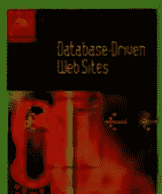

Morrison和Morrison所著的《Database-Driven Web Sites》

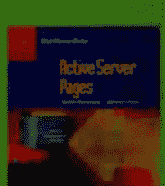

Harrow/Barnabas所著的《Active Server Pages》

通过Web Warrior系列掌握网络技术！

在MyCourse.com上探索更多课程功能 — 这是一个灵活易用的在线工具。Course Technology是Thomson Learning旗下公司的一部分 — 致力于为终身学习提供创新方法。Thomson就是学习。访问Course Technology在线平台：www.course.com

9 780619 015237 ISBN 0-619-01523-3
