# ASP.NET 2.0 AJAX Extensions 高级指南

**策划编辑：** Ben Ryan
**开发编辑：** Lynn Finnel
**编辑制作：** Abshier House
**文字编辑：** Roger LeBlanc
**技术审阅：** Kenn Scribner
**索引编制：** Sharon Hilgenberg
正文部件号 X13-68385

 ## 简介

AJAX 的全称是“**Asynchronous JavaScript and XML**”（异步 JavaScript 与 XML），它是 2005 年创造的一个通用术语，用来指代那些丰富、高度交互且响应迅速的 Web 应用程序，这类应用会在客户端执行大量工作，并向服务器发起*带外*调用。所谓**带外调用**，是指那些导致页面更新而非页面替换的服务器请求。最终效果是，AJAX Web 应用看起来往往类似于经典的桌面 Microsoft Windows 应用程序，具备拖放、异步任务等高级功能，拥有响应迅速且无闪烁的用户界面，用户的挫败感也大大降低。

**ASP.NET AJAX Extensions** 是对 ASP.NET 平台的重要扩展，它使 AJAX 风格的功能成为可能并切实有效。ASP.NET AJAX Extensions 被设计为 ASP.NET 的一部分，因此能够与现有平台和应用模型无缝集成。

从架构上讲，ASP.NET AJAX 框架由两个截然不同的元素组成：客户端脚本库和一组服务器扩展。客户端脚本库完全使用 JavaScript 编写，因此可在任何现代浏览器中运行。服务器扩展与基于 ASP.NET 的服务器和控件完全集成。这样一来，开发人员可以使用与开发经典 ASP.NET 服务器页面几乎相同的方法来编写丰富的 Web 页面。

大多数 ASP.NET AJAX 开发人员都是原来的 ASP.NET 开发人员，因此他们熟悉基于控件的服务器端开发模型。以服务器为中心的编程模型是 ASP.NET 编程模型演进中的又一个重大进步。ASP.NET AJAX 服务器控件非常出色，尤其是当你对手动创建 AJAX 客户端脚本不够自信时。

本书提供了 ASP.NET AJAX 框架的概览，并附有大量示例，帮助你熟悉各种技巧和工具。

AJAX 对 ASP.NET 开发人员和专业人士而言是一个真正的突破。它使跨浏览器编程成为现实，并让类似桌面的功能可以通过 Web 实现。

如果你是一位为基于 Microsoft 的 Web 技术进行开发的专业 Web 人员，AJAX 是你接下来要把握的重大机遇。本书是你的起点。而且还不止于此。

## 本书面向的读者

本书推荐几乎所有 ASP.NET 开发人员和专业人士阅读。如前所述，ASP.NET AJAX 是 ASP.NET 演进中的下一个重要成果，它顺应了一个关键的行业趋势——AJAX 模型。此外，ASP.NET AJAX 超越了经典的 AJAX 模型，推出了一套横跨客户端和服务器的框架，为 Web 应用提供端到端的解决方案。就 Microsoft Web 平台而言，ASP.NET AJAX Extensions 将丰富功能与广泛覆盖范围结合在一起——这是 Web 专业人士长久以来的梦想，如今终于实现。终于。

## 本书的组织结构

本书分为三个部分：平台及其构建模块的概览、有效增强现有站点的技巧，以及以客户端为中心的开发。在第一部分中，你将了解 AJAX 模型的基础知识，以及为支持它而对 JavaScript 语言所做的扩展。第二部分专门介绍框架中的元素，你可以使用这些元素为现有服务器控件添加新功能，并将现有经典 ASP.NET 页面转换为功能完备的 AJAX 页面。最后，第三部分涵盖了展现 AJAX 应用真正威力的工具和技巧——对服务器代码的带外调用。

## 系统要求

你需要以下硬件和软件来构建和运行本书的代码示例：

- Microsoft Windows Vista、Microsoft Windows XP with Service Pack 2、Microsoft Windows Server 2003 with Service Pack 1，或 Microsoft Windows 2000 with Service Pack 4
- Microsoft Visual Studio 2005 Standard Edition 或 Microsoft Visual Studio 2005 Professional Edition
- Microsoft SQL Server 2005 Express（包含在 Visual Studio 2005 中）或 Microsoft SQL Server 2005
- 600-MHz Pentium 或兼容处理器（建议使用 1-GHz Pentium）
- 192 MB RAM（建议使用 256 MB 或更多）
- 视频显示器（800 x 600 或更高分辨率），至少支持 256 色（建议使用 1024 x 768 高彩色 16 位）
- Microsoft 鼠标或兼容的定点设备

## 配置 SQL Server 2005 Express Edition

本书的某些章节要求你能够访问 SQL Server 2005 Express Edition（或 SQL Server 2005），以创建和使用 Northwind Traders 数据库。如果你使用的是 SQL Server 2005 Express Edition，请按照以下步骤为你将用于完成本书练习的用户账户授予访问权限：

1. 使用具有管理员权限的账户登录到计算机上的 Windows。

2. 在 Windows 的“开始”菜单中，依次单击“所有程序”、“附件”，然后单击“命令提示符”以打开命令提示符窗口。

3. 在命令提示符窗口中，输入以下区分大小写的命令：

    `sqlcmd -S YourServer\SQLExpress -E`

    将 `YourServer` 替换为你计算机的名称。

    你可以在运行 `sqlcmd` 命令之前，先在命令提示符窗口中运行 `hostname` 命令来查找你计算机的名称。

4. 在 `1>` 提示符下，输入以下命令（包括方括号），然后按 Enter：

    `sp_grantlogin [YourServer\UserName]`

    将 `YourServer` 替换为你计算机的名称，并将 `UserName` 替换为你将要使用的用户账户名称。

5. 在 `2>` 提示符下，输入以下命令，然后按 Enter：

    `go`

    如果你看到错误消息，请确保你已正确输入 **sp_grantlogin** 命令，包括方括号。

6. 在 `1>` 提示符下，输入以下命令（包括方括号），然后按 Enter：

    `sp_addsrvrolemember [YourServer\UserName], dbcreator`

7. 在 `2>` 提示符下，输入以下命令，然后按 Enter：

    `go`

    如果你看到错误消息，请确保你已正确输入 **sp_addsrvrolemember** 命令，包括方括号。

8. 在 `1>` 提示符下，输入以下命令，然后按 Enter：

    `exit`

9. 关闭命令提示符窗口。

10. 注销管理员账户。

Northwind Traders 数据库不再随 SQL Server 2005（任一版本）一起提供，因此你需要单独下载。你可以从 http://www.microsoft.com/downloads/details.aspx?familyId=06616212-0356-46A0-8DA2-EEBC53A68034&displaylang=en 下载 Northwind 数据库所需的安装脚本。下载页面上包含安装说明。

## code 示例

可下载的代码包含大多数章节的项目，涵盖了各章节中引用的代码片段和示例。本书中讨论的所有代码示例都可以从本书的配套内容页面下载，地址如下：

http://www.microsoft.com/mspress/companion/9780735624139

## 本书的支持

我们已尽一切努力确保本书及配套内容的准确性。随着更正或改动的收集，它们将被添加到 Microsoft 知识库文章中。

Microsoft Press 在以下网站提供图书和配套内容的支持：

http://www.microsoft.com/learning/support/books/

## 问题与评论

如果你有关于本书或配套内容的评论、问题或想法，或者有访问上述网站后仍未得到解答的问题，请通过电子邮件将它们发送给 Microsoft Press：

mspinput@microsoft.com

或通过邮政邮件发送至：

Microsoft Press
Attn: Introducing Microsoft ASP.NET AJAX Editor
One Microsoft Way
Redmond, WA 98052-6399

请注意，Microsoft 软件产品支持不通过上述地址提供。

## 第一部分
### ASP.NET AJAX 构建模块

**本部分包括：**

| 章节 | 标题 | 页码 |
|---|---|---|
| 第 1 章 | AJAX 革命 | 3 |
| 第 2 章 | Microsoft AJAX 客户端库 | 35 |


 ## 第一章
## AJAX 革命

**本章内容：**
范式转变 ......................................................................4
AJAX 核心引擎 .................................................................10
ASP.NET AJAX 简介 .................................................................30
总结 ...................................................................................34

当一个 Web 应用程序可以被架构和实现为一系列相关联且相互链接的页面时，那样的日子已经一去不复返了。所谓的 AJAX 模型的出现正在根本性地改变用户对 Web 应用程序的认知，并随之迫使开发者在现代 Web 应用程序的规划和设计中应用更新、更丰富的模型。但是，AJAX 模型究竟是什么呢？

AJAX 是一个相对较新的缩写，代表 *Asynchronous JavaScript and XML*（异步 JavaScript 与 XML）。它是一个笼统的术语，用于描述高度交互和响应灵敏的 Web 应用程序。这里的关键是什么？难道 Web 应用程序不是大约在十年前就被专门设计为"交互式的"、"响应灵敏的"，并通过一种称为浏览器的独特工具来部署的吗？那么今天又有什么新鲜事呢？

互联网的惊人成功激发了人们对 Web 相关技术的渴求，其程度超乎想象。多年来，用户对更强大、更多 Web 暴露的功能和服务的需求，促使架构师和开发者在服务器平台和客户端浏览器中加入越来越多的功能。因此，Web 应用程序的传统模式正日益显得不足。设计和编程模型上的根本性变革已刻不容缓。

以目前的技术水平而言，业界需要的不仅仅是按照 Web 应用程序的传统指导原则和路线图设计出的改进型、更强大的平台——真正的范式转变势在必行。AJAX 代表了下一代 Web 应用程序新范式的化身，这一范式很可能将持续至少未来十年。

从更偏向开发者的角度来看，AJAX 泛指一套开发组件、工具和技术，用于创建高度交互的 Web 应用程序，为用户提供更优质的体验。根据 AJAX 范式，Web 应用程序通过与 Web 服务器交换数据而非页面来工作。从用户的角度来看，这意味着实现更快的往返传输，更重要的是，页面加载和刷新显著减少。因此，Web 应用程序开始类似于经典的桌面 Microsoft Windows 应用程序，并拥有诸如拖放和异步任务、高度响应且无闪烁的用户界面等高级功能，以及其他能够最大程度减少用户挫败感、及时反馈当前状态并提供出色的混搭内容的功能。（且慢！这并不意味着 AJAX Web 应用程序*与桌面应用程序完全相同*；它们只是支持更多类似桌面的功能而已。）

### 范式转变

AJAX 是激发新一代组件和框架的哲学，每个组件和框架都旨在针对特定平台、提供给定功能集，并可能与现有框架无缝集成。Microsoft ASP.NET AJAX Extensions 是针对 ASP.NET 2.0 平台的 AJAX 扩展。在 .NET Framework 平台的下一个主要版本中，ASP.NET AJAX Extensions 将正式融入 ASP.NET 以及其余 Microsoft Web 平台和应用程序模型。下一版本的 Microsoft Visual Studio（代号为 "Orcas"）也将集成针对 AJAX 特定功能的专用设计时支持。

在本章中，我将更深入地探讨 AJAX 背后的动机和推动力量，然后回顾所有 AJAX 框架通用的基本系统要求。

我们都正在见证并贡献于一个有趣而独特的现象——Web 正在我们眼前经历一次划时代的变革，这是由我们的行动所导致的。尽管听起来可能有些极端，但 Web 彻底革新了应用程序的概念。仅仅八年前，大多数开发者认为应用程序是一个过于严肃的东西，不能将其简化为脚本和标记代码的无序混合。在 20 世纪 90 年代末，开发应用程序的代价是汗水、心血、泪水和无尽的调试工作。根据普遍且半认真的看法，编写 Web 应用程序对"真正的"程序员来说既无荣誉也无名声。


> **注意** 然而，在 20 世纪 90 年代末，许多网站被设计并建立起来。其中一些在随后几年里惊人地成长为当今世界经济的中流砥柱，甚至改变了我们处理日常事务的方式。想要一些例子吗？Google、Amazon、eBay。尽管如此，十年前构建这些及其他应用程序的人们算是某种前卫开发者，或许只是聪明且爱玩的业余爱好者。

从那时起，Web 已经发生了显著的演变。尽管 10 年的 Web 演变在服务器端构建了厚厚的抽象层，但它并没有改变基本的基础设施——HTTP 协议和页面。

最初的基础设施——简单、无处不在且有效——是 Web 应用程序模型快速成功的主要因素。下一代 Web 应用程序仍将基于 HTTP 协议和页面。然而，页面的内容和服务器端机制的能力将发生变化，以提供显著更丰富的用户体验——丰富到与经典桌面 Windows 应用程序相媲美。

> **注意** 正如我们将在第八章"使用 ASP.NET 构建 AJAX 应用程序"中更详细地看到的，AJAX 应用程序有许多优点，但也有一些缺点。总体而言，选择 AJAX 应用程序而非经典 Web 应用程序只是一个权衡 trade-off 的问题。AJAX 应用程序当然能为用户提供持续的反馈，永远不会因为某些远程操作而显得卡顿。另一方面，AJAX 应用程序并不完全像桌面应用程序，它们在图形、多媒体和硬件控制方面的能力不如普通的（智能）客户端。归根结底，AJAX 应用程序只是 Web 应用程序中非常特殊的一类；因此，它们可能需要一些代码重构才能达到预期的性能和效果。

### 经典 Web 应用程序

如今，Web 应用程序通过将用户填写的表单提交给 Web 服务器，并显示 Web 服务器返回的标记来工作。浏览器与服务器之间的通信采用经典的 HTTP 协议。众所周知，HTTP 协议是无状态的，这意味着每个请求与下一个请求无关，且不会自动维护状态。（我们在 ASP.NET 等环境中熟知并使用的状态对象，不过是服务器编程环境提供的一种抽象。）

浏览器与 Web 服务器之间的通信通过"表单"进行。从用户的角度来看，转换通过"页面"发生。每个 originating 新服务器请求的用户动作都会导致一个全新的页面（或当前页面的更新版本）被下载并显示。

让我们进一步简要探讨这个模型，以 pinpoint 其缺点并揭示需要新模型的原因。

### 通过表单发送输入

基于地址栏中键入的 URL，浏览器向用户显示一个页面。页面最终由 HTML 标记组成，并包含一个或多个 HTML 表单。用户输入一些数据，然后指示浏览器将表单提交到一个操作 URL。

通过操作系统中的本地域名系统（DNS）解析器，浏览器将指定的 URL 解析为 IP 地址并打开一个套接字。一个 HTTP 数据包通过网络传输到指定的目的地。该数据包包含表单及其所有字段。请求被 Web 服务器捕获，并通常转发给内部模块进行进一步处理。在流程结束时，准备一个 HTTP 响应数据包，并将浏览器的返回值插入到主体中。

### 通过页面获取输出

当请求一个例如 .aspx 资源时，Web 服务器将其转交给 ASP.NET 处理，并接收生成的 HTML 标记作为回报。生成的标记

涵盖了经典HTML页面的所有标签，包括`<html>`、`<body>`和`<form>`。页面源代码嵌入在HTTP响应中，并通过多用途互联网邮件扩展（MIME）类型进行标记，以指导浏览器如何处理它。浏览器会查看MIME类型并决定采取何种操作。

如果响应包含HTML页面，浏览器会完全用新的标记块替换当前内容。当请求在服务器上处理时，"旧"页面会被冻结但仍然显示给客户端用户。一旦"新"页面下载完成，浏览器会清除显示内容并渲染新页面。

## 能力与局限性

这种模型在Web时代初期工作得很好，那时页面内容除了格式化文本、超链接和一些图片外别无其他。Web的成功促使用户要求更强大的功能，也促使开发者和设计师创建更复杂的服务和图形。以广告为例。如今，大多数页面——甚至包括非常简单的页面，如博客页面——都包含广告轮播器，在客户端下载相当多的内容。

因此，页面变得庞大而笨重——尽管我们仍然坚持称它们为"丰富"页面。无论它们是丰富还是只是笨重，这些就是当今应用程序的Web页面。没有人真的相信我们会回到十年前那种简洁而朴素的HTML页面。

根据当前的Web应用架构，每个用户操作都需要完整地重绘页面。因此，更丰富、更重的页面渲染缓慢，从而产生大量的闪烁。对于一个大型门户类应用程序中的所有页面来说，这种机制恰恰是释放可怜终端用户挫败感的完美方式。

尽管开发者可以使用许多灵活的架构之一在服务器上构建页面（ASP.NET就是这样一个例子），但从客户端的角度来看，Web页面最初被设计为基本静态且不可修改的。在20世纪90年代末，动态HTML的引入首先改变了这一点，后来万维网联盟（W3C）制定了页面文档对象模型标准。如今，浏览器通过一个读/写对象模型暴露所显示页面的全部内容。通过这种方式，可以修改页面以包含完全在客户端进行的更改，从而响应用户输入。（正如我们将看到的，这是AJAX和ASP.NET AJAX解决方案的一个关键因素。）

动态HTML是一个质的飞跃，但仅靠它还不足以推动Web的进一步发展。

## 基于AJAX的Web应用程序

为了最小化页面重绘的影响，大约在1997年出现了原始形式的脚本化远程过程调用（RPC）。微软尤其通过一种称为远程脚本（RS）的技术开创了这一领域。

RS使用一个Java小程序从一个基于远程活动服务器页面（ASP）的URL拉取数据。该URL通过目标ASP页面暴露一个约定的编程接口，并通过纯字符串来回序列化数据。在客户端，一个小型JavaScript框架接收数据并调用用户定义的回调，通过动态HTML或类似技术更新用户界面。RS在Internet Explorer 4.0和Netscape Navigator 4.0及更早版本上都能工作。

后来，微软用一个名为*XMLHttpRequest*的组件对象模型（COM）对象替换了Java小程序，并放松了对远程URL暴露的编程接口的大部分约束——例如，不再需要固定的ASP页面。同时，社区努力产生了一系列类似的框架，旨在将RS提升到下一个层次，并为解决方案构建更广泛的覆盖面。Java小程序消失了，取而代之的是*XMLHttpRequest*对象。

## AJAX到底是什么？

AJAX一词是在2005年创造的。它起源于Java社区，用于指代一系列用于实现远程脚本形式的相关技术。如今，任何形式的远程脚本通常都带有AJAX前缀。现代基于AJAX的Windows平台解决方案基于*XMLHttpRequest*对象。Google Maps和Gmail是两个最受欢迎的Web应用程序，它们是按照AJAX模式和技术设计的。对于AJAX来说，它们无疑是确立其实用性并展示其潜力的*杀手级应用程序*。

两个结合的元素使AJAX应用程序得以生存和发展。一方面，你需要为用户提供从服务器检索的新鲜数据。另一方面，你需要将新数据集成到现有页面中，而无需完全刷新页面。

浏览器通常在通过客户端脚本或用户操作（如按钮点击）提交HTML表单时发出新请求。当响应准备就绪时，浏览器用新页面替换旧页面。图1-1图形化地说明了这种传统方法。

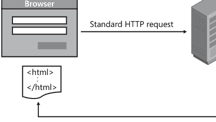

**图1-1** 浏览器提交HTML表单并接收新页面进行显示。

实现远程脚本的主要因素是能够发出带外HTTP请求的能力。在此上下文中，带外调用表示使用与处理HTML表单提交的浏览器内置模块不同的组件（即，在图1-1所示的传统机制之外）发出的HTTP请求。带外调用通过脚本由HTML页面事件触发，并由代理组件服务。在最新的AJAX解决方案中，代理组件基于*XMLHttpRequest*对象；在RS的最初实现中，代理组件是一个Java小程序。

## 通过脚本更新页面

代理组件（例如，*XMLHttpRequest*对象）发送一个常规HTTP请求，并同步或异步等待其完全服务。当响应数据准备就绪时，代理调用用户定义的JavaScript回调，刷新页面中需要更新的任何部分。图1-2提供了该模型的图形概览。

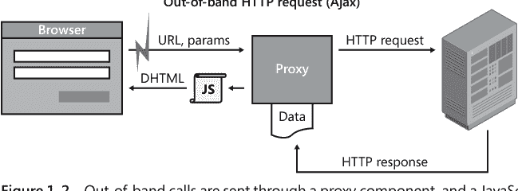

**图1-2** 带外调用通过代理组件发送，并使用JavaScript回调来更新受返回数据影响的页面任何部分。

所有浏览器都知道如何用新页面替换旧页面；然而直到几年前，并非所有浏览器都提供了表示页面当前内容的对象模型。（如今，我很难提到一个现代、商业上可用的浏览器不暴露读/写页面DOM。）对于提供HTML页面可更新对象模型的浏览器，JavaScript回调函数可以刷新旧页面的特定部分，从而使其看起来已更新，而无需完全重新加载。

## 文档对象模型

页面文档对象模型（DOM）是一个规范，它定义了一个平台和语言无关的接口，用于访问和更新HTML和XML文档的内容、结构和样式。DOM是W3C委员会批准的一个公认标准，现在几乎得到所有浏览器的支持。DOM提供了一组标准对象，用于表示HTML和XML文档的组成元素。所有这些对象共同构成了一个标准接口，用于访问和操作HTML页面的子元素，以及更一般的XML文档。

请注意，尽管远程脚本的最初工作框架可以追溯到十年前，但浏览器对显示文档动态变化的支持有限，减缓了这些技术在行业中的采用。直到现在。

## 丰富浏览器的角色

如图1-2所示，AJAX模型在浏览器方面有两个关键要求：代理组件和可更新的页面DOM。在相当长的时间里，只有高端浏览器（也称为丰富、高级浏览器）同时支持这两个功能。在过去的几年里，只有能够严格控制客户端浏览器功能的公司才能为其网站选择AJAX模型。长期以来，*丰富*浏览器也意味着浏览器*覆盖面*有限。长期以来，使用这样的浏览器对大多数企业来说绝对是一个错误的选择，因为有限的覆盖面排除了相当一部分客户群。

## 丰富性与覆盖面

也许由于一种罕见且可能不会重现的星象结合，今天市场上超过90%的浏览器恰好内置支持AJAX模型所需的高级功能。从5.0版本开始的Internet Explorer、Firefox、从6.0版本开始的Netscape、Safari 1.2、从8.0版本开始的Opera以及各种移动设备都是完全支持AJAX编程模型的浏览器。

这是*丰富浏览器*首次不再等同于*覆盖面有限的浏览器*。最终，你不必选择特定的浏览器来享受高级、编程丰富的功能。设计高度交互的Web应用程序来实现远程脚本技术，不再是一个遥不可及的梦想，而是一个可以抓住的具体机会——无论你和你的客户使用什么浏览器。

每个平台和每个供应商可能提供特定的框架和工具集，但这并不改变一个基本事实：现在，使用当今可用的90%的浏览器，享受AJAX生活方式已成为可能。这是一个真正的突破，现在可以构建和分发以前不可能实现的应用程序。

## 所需能力

浏览器运行AJAX功能到底需要哪些能力？如前所述，浏览器需要提供两个关键能力：一个代理机制使客户端代码能够发出带外HTTP调用，以及一个可更新的DOM。

可更新DOM有一个W3C批准的标准。代理组件的W3C标准目前正在制定中。它采用*XMLHttpRequest*对象的形式，被设计为浏览器暴露的一个接口，允许脚本代码执行HTTP客户端功能，例如提交表单数据或从远程网站加载数据。最新工作草案可在*http://www.w3.org/TR/XMLHttpRequest*获取。

此外，浏览器必须支持JavaScript，最好也支持层叠样式表（CSS）。

最终，AJAX生活方式对于几乎每个开发者和近90%的Web用户来说都是可行且负担得起的，无论平台如何。使AJAX工作所需的工具正变得像HTML/XML解析器、HTTP监听器和JavaScript一样普遍。


## AJAX核心引擎

AJAX并非某种特定技术或产品。它指的是一系列客户端功能及相关开发技术，能使Web应用呈现出类似桌面应用的体验。AJAX无需任何插件模块，也不局限于特定浏览器。过去五年内发布的几乎所有浏览器都能出色支持基于AJAX的应用。AJAX开发技术围绕一个共同的核心软件元素展开——`XMLHttpRequest`对象。该对象在大多数浏览器对象模型中的可用性，正是AJAX应用如今得以普及并取得成功的关键。除`XMLHttpRequest`外，第二个促成AJAX广泛成功的因素是：几乎所有浏览器都提供了丰富的文档对象模型。

`XMLHttpRequest`对象最初随Internet Explorer 5.0推出，是浏览器向其脚本引擎公开的内部对象。通过这种方式，任何客户端页面中包含的脚本代码（通常是JavaScript代码）都可以调用该对象并利用其功能。

`XMLHttpRequest`对象允许脚本代码发送HTTP请求并处理响应。从功能角度看，尽管名称中包含“XML”，但该对象本质上只是一个设计精巧的小型对象，用于通过脚本以非浏览器主导的方式发起HTTP调用。当用户点击表单的提交按钮，或执行任何最终触发DOM的`form`对象`submit`方法的操作时，浏览器会介入并完全控制后续的HTTP请求。对用户而言，请求如同一个黑箱，唯一可见的结果就是新页面的呈现。客户端脚本代码无法控制请求的发起和结果。

## *XMLHttpRequest*对象

`XMLHttpRequest`对象由微软创建，随后很快被Mozilla采用，如今已获得绝大多数Web浏览器的完全支持。稍后你将看到，尽管顶层接口几乎相同，但不同浏览器的实现可能存在显著差异。因此，一个W3C委员会正致力于基于现有实现，精确记录一组最小的互操作功能集。

> **注意** `XMLHttpRequest`对象最初于1999年春季随Internet Explorer 5.0作为独立组件发布。它已成为此后所有微软操作系统的原生组件。特别是，你一定会在所有运行Windows 2000、Windows XP及更新操作系统的计算机上找到它。

### Internet Explorer对象

当XMLHttp *Request*对象首次发布时，组件对象模型（COM）在微软世界中占据主导地位。产品和应用程序的可扩展性模型基于COM，并通过COM组件实现。在20世纪90年代末，将这一新组件实现为可重用的自动化COM对象（命名为Microsoft.XmlHttp）是合理且自然的选择。

多年来，发布了该组件的不同版本（甚至名称略有不同），但它们都保留了原始的组件模型——COM。例如，Internet Explorer 6.0以COM对象的形式提供XMLHttp *Request*对象。问题出在哪里？

COM对象是外部组件，需要在Web浏览器内明确授权才能运行。特别是，要运行XMLHttp *Request*对象并进而启用基于其构建的任何AJAX功能，客户端机器至少需要接受标记为“脚本安全”的ActiveX组件。（参见图1-3。）

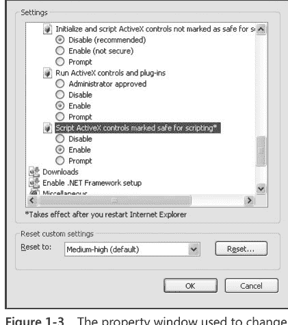

图1-3 用于更改Internet Explorer安全设置的属性窗口

XMLHttp *Request*对象本身是安全的，但要启用它，用户需要降低安全设置，并接受其访问的网站上任何其他“声明”为脚本安全的组件。

> **重要提示** `XMLHttpRequest`的内部实现与任何类AJAX框架（如Microsoft ASP.NET AJAX）的实现是分离的。在底层，任何框架最终都通过浏览器暴露或可用的接口来调用该对象。

### Mozilla的对应实现

Mozilla在Internet Explorer 5.0首次发布`XMLHttpRequest`后立即采用了它。然而，在配备Mozilla的浏览器中，`XMLHttpRequest`对象是浏览器对象模型的一部分，不依赖于外部组件。换句话说，诸如Firefox之类的Mozilla浏览器会将自身的`XMLHttpRequest`对象发布到脚本引擎中，即使客户端机器上安装了COM组件且该组件是操作系统的一部分，也永远不会使用该COM组件。图1-4展示了Internet Explorer（直至6.0版本）和Mozilla浏览器中的不同模型。

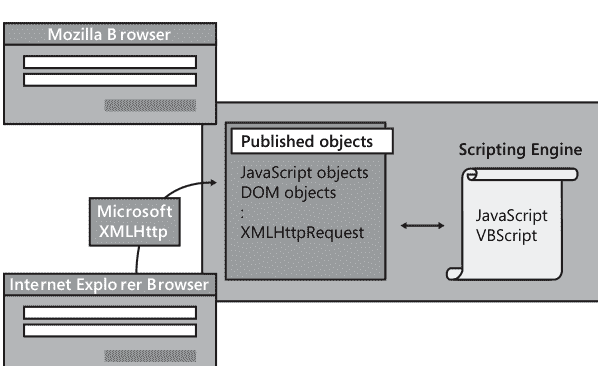

图1-4 在Mozilla中，`XMLHTTPRequest`是浏览器暴露的可脚本化组件；在Internet Explorer（直至6.0版本）中，它是外部COM组件

因此，在Mozilla浏览器中，`XMLHttpRequest`看起来像一个原生JavaScript对象，可以通过经典的`new`运算符实例化：

```
// 对象名称中的XML需要大写
var proxy = new XMLHttpRequest();
```

当浏览器是Internet Explorer时，`XMLHttpRequest`对象使用`ActiveXObject`包装器进行实例化，如下所示：

```
var proxy = new ActiveXObject("Microsoft.XmlHttp");
```

通常，AJAX风格的框架会检查当前浏览器，然后决定采用哪种路径。

不用说，在Mozilla浏览器中实现的*XMLHttpRequest*功能在某种程度上更安全，至少从不需要用户更改浏览器安全设置这一角度来看是如此。

### Internet Explorer 7中的XMLHttpRequest

由于历史原因，*XMLHttpRequest*对象在Internet Explorer浏览器中作为COM组件实现，但在Internet Explorer 7.0中终于成为了浏览器对象。所有潜在的安全顾虑都被彻底消除，AJAX框架可以更新为使用相同的语法来创建*XMLHttpRequest*对象，无论使用何种浏览器：

```
var proxy = new XMLHttpRequest();
```

此外，Internet Explorer 7.0中的这一变化，将ASP.NET中类AJAX功能与启用ActiveX的环境完全解耦。

## HTTP对象模型

关于*XMLHttpRequest*对象及其预期行为，我已花费大量篇幅，但我仍需向你实际演示该对象的能力。在本节中，我将介绍该组件的成员、它可以执行的操作以及语法细节。

如前所述，组件名称中的*XML*意义不大，也绝不意味着限制了组件的功能。尽管有XML前缀，你可以将该对象用作真正的自动化引擎，来执行和控制HTTP请求，无论是从ASP.NET页面生成的客户端代码，还是Windows Shell，或是Visual Basic 6.0或C++非托管应用程序。在.NET应用程序中使用*XMLHttpRequest* COM对象是毫无意义的，因为你在.NET Framework的*System.Net*命名空间中可以找到类似功能。

> **重要提示** 如果你打算使用Microsoft ASP.NET AJAX Extensions或任何其他类AJAX框架来构建应用，你几乎不会听到*XMLHttpRequest*对象，更不用说在自己的代码中直接使用它。ASP.NET AJAX Extensions完全封装了该对象，使页面作者和应用设计者无需接触它。要编写出色的AJAX应用，无论多么复杂精巧，你都不需要了解*XMLHttpRequest*。然而，了解*XMLHttpRequest*的基础知识，能让你对平台有更好更透彻的理解，并更有效地诊断问题。

### 行为与能力

*XMLHttpRequest*对象旨在执行一项关键操作：发送HTTP请求。请求可以同步或异步发送。以下代码清单展示了截至撰写本文时，基于W3C工作草案的该对象编程接口：

 ```
interface XMLHttpRequest {
  function onreadystatechange;
  readonly unsigned short readyState;
  void open(string method, string url);
  void open(string method, string url, bool async);
  void open(string method, string url, bool async, string user);
  void open(string method, string url, bool async,
            string user, string pswd);
  void setRequestHeader(string header, string value);
  void send(string data);
  void send(Document data);
  void abort();
  string getAllResponseHeaders();
  string getResponseHeader(string header);
  string responseText;
  Document responseXML;
  unsigned short status;
  string statusText;
};
```

使用该组件是一个两步操作。首先，你打开一个到目标 URL 的通道，指定要使用的方法（GET、POST 或其他），并确定是否希望请求异步执行。接下来，你设置任何必需的头部信息并发送请求。如果请求是 POST，则需要将请求正文传递给 send 方法。

在异步操作的情况下，send 方法会立即返回。你需要编写一个 onreadystatechange 函数来检查当前操作的状态，并通过该函数判断操作何时完成。

### 发送请求

大多数 AJAX 框架使用类似于以下代码的模式为当前浏览器获取 XMLHttpRequest 对象的实例：

```
var xmlRequest, e;
try {
  xmlRequest = new XMLHttpRequest();
}
catch(e) {
  try {
    xmlRequest = new ActiveXObject("Microsoft.XMLHTTP");
  }
  catch(e) {
  }
}
```

该代码首先尝试实例化内部的 XMLHttpRequest 对象，如果失败，则回退到 ActiveX 对象。如你所见，当浏览器是 Internet Explorer 6.0 或更早版本时，创建对象需要捕获异常。这样的代码在 Internet Explorer 7.0 中无需修改即可工作（也不需要任何异常处理）。

> **注意** 检查浏览器的用户代理并跳过异常处理也是可行的。然而，ASP.NET AJAX Extensions 使用前面的代码，因为它使得整个库与用户代理字符串和浏览器的具体细节无关。这样，你做的是“对象检测”而非“浏览器检测”。最终结果是一样的：只有当浏览器是早于 7.0 版本的 Internet Explorer 或任何其他不支持 AJAX 功能的浏览器时，才会触发异常。如果你正在构建自己的 AJAX 框架，只需针对 Internet Explorer 检查用户代理即可。

*open* 方法为请求准备通道；但此时并未创建实际的套接字。要执行 POST 语句，你需要添加适当的 Content-Type 头部。布尔参数指示操作是否是异步的：

```
xmlRequest.open("POST", url, false);
xmlRequest.setRequestHeader("Content-Type",
                        "application/x-www-form-urlencoded");
xmlRequest.send(postData);
```

*send* 方法打开套接字并发送数据包。在上面的代码片段中，该方法只有在完全接收到响应后才会返回。

异步请求需要稍有不同的代码：

```
xmlRequest.open("POST", url, true);
xmlRequest.onreadystatechange = CallbackComplete;
xmlRequest.setRequestHeader("Content-Type",
                        "application/x-www-form-urlencoded");
xmlRequest.send(postData);
```

*CallbackComplete* 元素是一个占位符，代表一个用于获取和处理请求生成的响应的 JavaScript 函数。

请注意，分配给 *onreadystatechange* 成员的函数将在 *readyState* 的值每次发生变化时被调用。状态的可能值是从 0 到 4 的整数，分别表示“未初始化”、“open 方法调用成功”、“send 方法调用成功”、“正在接收数据”和“已收到响应”。特定于 *CallbackComplete* 框架的函数通常会检查状态并继续处理。

### 接收响应

请求的响应有两种格式可用：原始文本和 XML 文档。如果状态是 0 到 2（即尚未接收到任何数据），*responseText* 属性为空。当状态转换到 3（正在接收数据）时，该属性包含迄今为止接收到的数据，使用响应中指定的字符编码进行解释。如果未指定字符编码，则采用 UTF-8。

*responseXml* 属性在完整响应被下载并成功解析为 XML 文档之前不可用。如果响应正文不是 XML，或者由于任何原因解析失败，该属性返回 null。需要特别注意的是，XML 文档的构建是在客户端完成的，前提是原始 HTTP 响应已完全接收。

## 自己动手构建（小型的）AJAX 框架

如前所述，在你的基于 AJAX 的应用程序中，无论最终使用什么框架（例如，ASP.NET AJAX），都不需要直接使用 *XMLHttpRequest* 对象。不过，为了完整性，让我们简要回顾一下在示例 ASP.NET 2.0 页面中使用该对象所需的步骤。相同的代码也可以用于 ASP.NET 1.x。以下代码代表了构建自制 AJAX 解决方案所需的最小引擎。

> **注意** 虽然不推荐构建自制的 AJAX 框架，但编写它并非不可能。已经统计到超过 100 个 AJAX 框架这一事实，恰恰证明了编写自制的 AJAX 解决方案并非不可能的任务。就我个人而言，我只会考虑将其作为为现有应用程序添加快速而简单的 AJAX 功能的一种方式，这些功能仅限于发起远程的、非浏览器主导的调用。

### 从 ASP.NET 页面执行带外调用

发起带外调用的网页需要有一个或多个触发事件，当这些事件被一段 JavaScript 代码正确处理时，会通过 *XMLHttpRequest* 对象发送请求。触发事件只能是浏览器 DOM 实现捕获的 HTML 事件。

JavaScript 代码应负责发起和控制远程 URL 的调用，如下所示：

```
<script type="text/JavaScript">
function SendRequest(url, params)
{
    // 在查询字符串中添加一些参数
    var pageUrl = url + "?outofband=true&param=" + params;

    // 初始化 XmlHttpRequest 对象
    var xmlRequest, e;
    try {
        xmlRequest = new XMLHttpRequest();
    }
    catch(e) {
        try {
            xmlRequest = new ActiveXObject("Microsoft.XMLHTTP");
        }
        catch(e) { }
    }

    // 准备同步 POST 请求
    xmlRequest.open("POST", pageUrl, false);
    xmlRequest.setRequestHeader("Content-Type",
"application/x-www-form-urlencoded");
    xmlRequest.send(null);
    return xmlRequest;
}
</script>
```

这个示例函数接受两个字符串参数：要调用的 URL 和参数列表。请注意，查询字符串的格式是完全任意的，可以在自定义实现中随意调整。程序员指定的 URL 被扩展以包含几个参数。第一个参数（在示例中命名为 *outofband*）是一个布尔值，指示请求是否将是一个自定义回调请求。目标页面根据此信息可以适当地处理请求。第二个参数（在示例中命名为 *param*）包含服务器端代码的输入参数。

宿主 ASP.NET 页面的代码如下所示：

```
<html xmlns="http://www.w3.org/1999/xhtml" >
<head runat="server">
    <title>测试带外调用</title>
</head>
<body>
    <form id="Form1" runat="server">
        <h1>演示带外调用</h1>
        <h2><%=Request.Url%></h2>
        <hr />
        <asp:DropDownList runat="server" ID="EmployeeList" />
        <input id="Button1" type="button" value="获取数据"
               onclick="MoreInfo()" />
        <hr />
        <span id="Msg" />
    </form>
</body>
</html>
```

后台代码类如下所示：

```
public partial class _Default : System.Web.UI.Page
{
    protected void Page_Load(object sender, EventArgs e)
    {
        if (IsOutOfBand())
            return;
        if (!IsPostBack)
            PopulateList();
    }

    private bool IsOutOfBand()
    {
        bool isCallback = false;
        isCallback = String.Equals(Page.Request.QueryString["callback"],
                                  "true",
                                  StringComparison.OrdinalIgnoreCase);
```


 ```
if (isCallback)
{
    string param = Request.QueryString["param"].ToString();
    Response.Write(ExecutePageMethod(param));
    Response.Flush();
    Response.End();
    return true;
}
return false;
```

```
private void PopulateList()
{
    SqlDataAdapter Studiosa adapter = new SqlDataAdapter(
        "SELECT employeeid, lastname FROM employees",
        "SERVER=(local);DATABASE=northwind;UID=...;");
    DataTable table = new DataTable();
    adapter.Fill(table);

    EmployeeList.DataTextField = "lastname";
    EmployeeList.DataValueField = "employeeid";
    EmployeeList.DataSource = table;
    EmployeeList.DataBind();
}
```

```
string ExecutePageMethod(string eventArgument)
{
    return "You clicked: " + eventArgument;
}
```

有几个问题值得进一步关注和解释。第一个是需要判断请求是带外调用还是常规的回发。接下来，我们需要了解响应的生成过程。*IsOutOfBand* 方法会检查已提交表单中的 *outofband* 字段。如果找到了 *outofband* 字段，请求将被处理并终止，而不会经历经典 ASP.NET 请求生命周期的最后部分——值变更事件、回发、预呈现、视图状态序列化、呈现等等。因此，带外请求会被短路处理，以便更快速地返回，并携带尽可能少的数据。

当一个带外调用发出时，页面会做什么？它如何确定响应？大多数基于 AJAX 的框架在这一点上各不相同，所以我们说这是任意的。通常，你需要定义一个公共编程接口，该接口在带外调用时被调用。在示例代码中，我有一个具有约定名称和签名的方法——*ExecutePageMethod*——其输出成为请求的纯文本响应。在示例代码中，该方法返回并接受一个字符串，这意味着任何输入和输出参数都必须可序列化为字符串。

```
string param = Request.QueryString["param"].ToString();
Response.Write(ExecutePageMethod(param));
Response.Flush();
Response.End();
```

如代码片段所示，带外请求的响应就是该方法的输出。不会返回任何其他数据；除了参数之外也不会发送任何其他数据。在这种特定实现中，不会有视图状态的发送和返回。

> **重要提示** 虽然你可能永远不需要编写这样的代码，但请注意，到目前为止我只提供了一个最小但有效的描述，涵盖了大多数提供类 AJAX 功能的框架所共有的底层机制。每个框架都封装了大量细节，并添加了新的服务和功能。然而，在核心层面，AJAX 库就是这样工作的。

### 显示结果

还缺少一个步骤——当客户端收到带外调用的响应后会发生什么？以下代码片段展示了一段客户端代码，当它绑定到按钮时，会触发带外调用并刷新用户界面：

```
function MoreInfo()
{
    var empID = document.getElementById("EmployeeList").value;
    var xml = SendRequest("default.aspx", empID);

    // Update the UI
    var label = document.getElementById("Msg");
    label.innerHTML = xml.responseText;
}
```

根据代码，每当用户点击按钮时，请求就会发送到以下 URL。请注意，示例 URL 中的 1 表示所请求员工的 ID。（参见图 1-5。）

```
default.aspx?outofband=true&param=1
```

在大多数浏览器上正确显示结果可能比较棘手。事实上，Internet Explorer 在 DOM 中支持许多非标准的快捷方式，而这些在其他浏览器中根本无法使用。最常见的陷阱是使用 *document.getElementById* 方法而不是元素的直接名称来获取 HTML 元素的引用。例如，以下代码在 Internet Explorer 上可以正常工作，但在 Firefox 和其他基于 Mozilla 的浏览器上不行：

```
// Msg is the ID of a <span> tag.
// This code works only with Internet Explorer
Msg.innerHTML = xml.requestText;
```

总之，需要跨浏览器的 JavaScript 代码来更新客户端当前显示的页面。同时，在服务器端也必须做出一些假设，以提供一个可用且高效的环境。因此，框架是实现 AJAX 功能的唯一合理方式。然而，不同的框架可能在使用相同公共组件集合的引擎之上，提供不同的编程接口。

### 切换到文档对象模型

微软自 1990 年代末期就开始引领可更新网页的发展。随着 Internet Explorer 4.0（早在 1997 年发布）的推出，微软引入了动态 HTML（DHTML），这是 HTML、样式表和脚本的强大组合，允许以编程方式更改任何已显示的页面。此后，多家公司开发了自己的 DHTML 对象模型——通常被称为浏览器对象模型（BOM）。W3C 委员会努力推动各厂商就一个可互操作且语言无关的解决方案达成一致，以便通过可更新的编程接口暴露 Web 页面。其结果就是文档对象模型（DOM），它不同于特定于浏览器的 BOM。

DOM 是一个独立于平台且语言无关的 Web 页面内容表示，脚本可以访问并使用它来修改文档的内容、结构和样式。

对于 AJAX 而言，核心就是与远程服务器交换数据。但一旦数据在客户端以带外方式下载完毕，你能用它做什么呢？DOM 为数据流入当前页面结构并更新它提供了一个出口。

### 文档的表示

DOM 是浏览器暴露的一个标准 API，其中已显示的页面具有基于树的结构。逻辑树中的每个节点对应一个对象。另一方面，"文档对象模型"这个名字暗示了一个在面向对象设计术语的通用解释中的对象模型。一个 Web 页面——即文档——通过对象来建模。该模型包括文档的结构和行为。逻辑树中的每个节点不是静态数据；相反，它是一个具有已知行为和自身身份的活动对象。

### DOM 实现

W3C DOM 由三个级别组成，它们对浏览器而言表示三个不同程度的标准遵从性。更多信息请参阅 http://www.w3.org/DOM。

DOM 由节点组成，每个节点都是一个对象。对于一个 Web 页面，每个节点映射到一个表示 HTML 标签的对象。因此，该对象具有可应用于 HTML 标签的属性和方法。你可以在节点上完成三个基本操作：查找节点（包括子节点、父节点或兄弟节点等关联节点）、创建节点以及操作节点。

只要页面作者知道相应元素的 ID，标识特定节点就很容易。在这种情况下，你使用以下标准代码：

```
var node = document.getElementById(id);
```

特别地，如果有多个元素共享相同的 ID 值，该方法返回集合中的第一个对象。此方法在 DOM Level 1 及更高版本中都受支持。另一个用于查找元素的有趣方法如下：

```
var coll = document.getElementsByTagName(tagname);
```

该方法检索基于相同 HTML 标签的所有对象的集合。例如，该方法检索页面中所有 `<div>` 或所有 `<input>` 标签的集合。

相关的 DOM 对象被分组在节点列表中。每个节点都有名称、类型、父节点和子节点集合。节点还保存对其兄弟节点和属性的引用。以下代码片段展示了如何获取节点的父节点及其前一个兄弟节点：

```
var oParent = oNode.parentNode
var oPrevious = oNode.previousSibling
```

如何修改节点的内容？最简单且最常见的方法是使用 innerHTML 属性：

```
var node = document.getElementById("button1");
node.innerHTML = "Hey click me";
```

innerHTML 属性几乎被所有浏览器支持，它设置或获取给定对象开始标签和结束标签之间的 HTML。某些浏览器（如 Internet Explorer）还支持 innerText 属性。该属性用于设置或获取给定 DOM 对象内的文本。遗憾的是，此属性并非所有浏览器都支持。它存在于 Internet Explorer 和 Safari 中，但例如在 Firefox 中不受支持。而 Firefox 支持一个具有类似行为但名称不同的属性——textContent。
```


Microsoft AJAX客户端库（在第2章“用于AJAX的Microsoft客户端库”中讨论）的出现，使开发者无需了解不同浏览器DOM实现之间的诸多细微差别。例如，若在页面中嵌入自己的JavaScript代码，应了解`innerText`和`textContent`属性；但如果依赖AJAX客户端库刷新页面的部分内容，则无需关注这些。

最后请注意，不应通过检查用户代理字符串来判断当前浏览器是否支持特定功能，而应直接检测所需对象。例如，要判断浏览器是否支持`innerText`，最好运行以下代码：

```
var supportsInnerText = false;
var temp = document.body.innerText;
if (temp != undefined)
    supportsInnerText = true;
...
```

这种方式能直接检测属性的可用性，无需维护浏览器清单。

节点可通过仅暴露给document对象的`createElement`方法创建。也可通过修改`innerHTML`属性值，或使用特定元素（如表格元素的`insertRow`和`insertCell`方法）来向文档层级添加新元素。示例如下：

```
// 创建元素
var oImg = document.createElement("img");
...
// 为SELECT元素创建新选项
var oOption = new Option(text, id);
control.options.add(oOption);
```

以上内容仅浅析了不同浏览器中的DOM实现。尽管如此，DOM作为AJAX拼图的关键部分，仍值得深入关注与熟练运用。如需入门，可参阅 http://msdn.microsoft.com/workshop/author/dom/domoverview.asp。

### 务实之道：DHTML与DOM之辩

早期，仅浏览器对DHTML对象模型的支持赋予了JavaScript开发者动态更新页面内容的能力。DHTML的成功促成了标准文档对象模型（W3C DOM）的定义。显然，DOM脱胎于DHTML，却比DHTML更具普适性。如前所述，DOM为整个文档（而非单个HTML标签）提供了基于树状结构的模型。

然而，多数浏览器同时支持DOM与DHTML的混合模式。开发者应如何选择？具体而言，更新内容时，应获取匹配目标HTML标签节点的文本子节点引用（DOM方式），还是直接引用节点并使用`innerHTML`（DHTML方式）？同理，添加新元素时，应创建新元素，还是通过`innerHTML`插入一段更新的HTML？诚然，社区中持续热议的话题之一，便是选择DHTML操控页面，还是采用DOM应用编程接口（API）倡导的更规范方式。

关键事实是：DOM API的性能显著慢于使用`innerHTML`。若通过DOM动态生成用户界面，需逐一创建元素、追加至合适容器并设置属性。而替代方案只需定义所需HTML，再通过`innerHTML`渲染到页面，浏览器将自动完成后续渲染。

总体而言，DHTML与DOM操作各具适用场景。众多网站的性能测试表明DHTML通常胜出。但DOM在正确使用时（即创建HTML片段并仅在最后一步追加至容器）依然性能可靠。

### 务实之道：善用事件机制

明确一点：若无事件机制，向网页添加JavaScript将失去意义。因此，脚本必须响应用户操作及浏览器生成的动作（如页面加载）。事件与事件处理程序作为网页的经典组件，早在Netscape 2时期便已出现。

长期以来，兼容性欠佳的事件模型在不同浏览器（主要为Internet Explorer和Netscape）中并存发展。数年前，W3C通过《DOM Level 2 Events》标准化了事件模型，详情可查阅 <http://www.w3.org/TR/2000/REC-DOM-Level-2-Events-20001113/events.html>。

鉴于Internet Explorer与Netscape保留了各自的原始事件模型，同时努力兼容W3C标准，编写兼容多种模型的事件处理程序颇具挑战。事件类型众多，但浏览器支持程度各异。以下事件类别可视为标准：用户界面事件（blur、focus、scroll）、设备事件（click、keydown）和表单事件（submit、select）。第二大关键在于事件处理程序的绑定方式，目前最可靠的方法仍是：

```
<a href="page.aspx" onclick="doClick()" />
```

关于JavaScript事件机制的深入探讨，可参考： <http://www.quirksmode.org/js/introevents.html>。

> **提示** 若想系统学习JavaScript、DHTML、DOM、CSS及客户端编程等知识，推荐访问 http://www.quirksmode.org。

## 面向ASP.NET的现有AJAX框架

目前已有多种API可在ASP.NET中实现AJAX功能，其中一种已集成于ASP.NET 2.0。其他API则来自第三方厂商或开源项目。以下将简要介绍部分API。需注意的是，只要使用ASP.NET作为开发环境，Microsoft ASP.NET AJAX扩展组件是最合理的选择。但该扩展组件能与众多现有AJAX框架良好共存——ASP.NET AJAX并非排他性选择。

自2005年初起，部分进取的独立软件开发商（如Telerik、Infragistics和ComponentArt）已将AJAX功能整合到其控件套件中，以支持快速富Web开发。初期，各厂商开发了私有的AJAX引擎并与产品集成。ASP.NET AJAX扩展组件的推出，或将促使厂商提供原生ASP.NET AJAX控件，或至少开发能与ASP.NET AJAX无缝协作的控件。

现梳理当前可用于开发支持AJAX的ASP.NET Web应用的方案。如您所见，以下列表虽非详尽，但涵盖了独立软件供应商（ISV）的库及ASP.NET社区杰出成员发起的开源项目。

### ASP.NET脚本回调

ASP.NET 2.0内置了名为ASP.NET Script Callback的原生API，用于实现向当前页面相同URL的带外调用。该API使带外请求呈现为特殊页面请求，随原始输入字段传输视图状态，并在请求体中插入额外输入字段以携带附加信息。服务器收到请求后，将经过常规HTTP模块管道，触发直至预渲染阶段的预期服务端事件序列。

在预渲染阶段之前，页面方法被执行，返回值被序列化为字符串并返回客户端。整个过程不会发生渲染阶段，视图状态也不会被更新和回传序列化。

ASP.NET Script Callback提供专用JavaScript API以封装对*XMLHttpRequest*的所有调用。开发者无需深入掌握该API细节，而应聚焦于*Page.ClientScript*对象的*GetCallbackEventReference*方法接口。该方法返回用于绑定客户端事件处理程序以发起带外调用的JavaScript代码：


它还引用了另一段用于根据服务器生成的结果更新页面的 JavaScript 代码。但是当发起二级请求时，服务器上会发生什么？哪个页面方法会被执行？

ASP.NET 脚本回调定义了一个接口——*ICallbackEventHandler* 接口——任何作为带外调用目标的服务器对象都可以实现该接口。带外调用的目标可以是页面本身，也可以是其任何子控件。带外调用的执行分为两个步骤：准备和生成结果。首先调用 *ICallbackEventHandler* 接口的 *RaiseCallbackEvent* 方法来准备远程代码执行。随后在请求生命周期中，当 ASP.NET 运行时需要为浏览器生成响应时，再调用 *GetCallbackResult* 方法。

总而言之，ASP.NET 脚本回调的编程接口有点笨拙。尽管该编程接口为开发者屏蔽了许多内部细节，但它仍然要求程序员具备良好的 JavaScript 技能，并且是通过一堆样板服务器代码来表达的。你需要服务器代码将 HTML 元素绑定到客户端事件处理程序，还需要专门的服务器代码来发布一个可从客户端调用的编程接口。每个请求都携带原始视图状态的一份副本，并在服务器上重建最后已知的良好状态。换句话说，当前显示页面中所有输入字段的原始值（无论在发起带外调用之前是否进行了任何更改）都会连同服务器方法的任何参数一起发送到服务器。所有带外调用在到达预呈现阶段之前都作为常规回发请求进行处理，这意味着所有标准的服务器事件都会触发：*Init*、*Load*、*LoadComplete* 等等。在预呈现阶段之前，回调会被准备并很快执行。请求在服务器方法执行后立即结束。视图状态不会更新以反映带外调用后页面的状态，因此，它也不会被发送回客户端。

使用 ASP.NET 脚本回调的优势在于它是 ASP.NET 的原生部分，可以轻松封装在服务器控件中。例如，ASP.NET 2.0 中的 *TreeView* 控件就使用脚本回调来展开其节点。

然而，ASP.NET 脚本回调并非没有重大问题。特别是，服务器方法被限制为固定的签名，只能接受和返回一个字符串。当然，你可以在字符串中放置任何内容，但自定义对象到字符串的序列化和反序列化必须完全由你自己处理。此外，基于 ASP.NET 脚本回调的页面只能有一个远程调用端点。这意味着如果客户端页面需要对同一远程页面发起两个不同的调用，你必须在 *ICallbackEventHandler* 接口的实现中添加一个 switch 来解释意图执行的方法。

### AJAX.NET Professional 库

为了有效地在应用场景中实现带外调用，需要一种框架来隐藏 HTTP 通信的所有繁琐细节，并提供额外的高级控制和服务。

## 第一部分 ASP.NET AJAX 构建基块

AJAX.NET Professional (AjaxPro) 是一个相当流行的开源库，它在 *XMLHttpRequest* 机制之上添加了很好的抽象层。该库由 Michael Schwarz 编写，它创建了代理类，供客户端 JavaScript 用于调用服务器页面上的方法。AjaxPro 框架提供完整的数据类型支持，并可在所有常见的 Web 浏览器上工作，包括移动设备。值得一提的是，该库既可用于 ASP.NET 1.1，也可用于 ASP.NET 2.0。

AjaxPro 库背后的关键工具是一个 HTTP 处理程序，它挂钩了库的客户端部分生成的任何 HTTP 请求：

```
<httpHandlers>
  <add verb="POST,GET" path="ajaxpro/*.ashx"
        type="AjaxPro.AjaxHandlerFactory, AjaxPro.2" />
</httpHandlers>
```

一旦正确设置了 *web.config* 文件，你就可以编写 JavaScript 函数来触发和控制带外调用。每个调用都针对一个 JavaScript 对象，该对象代表服务器 ASP.NET 页面上公开可调用的方法。客户端可调用的方法只是一个用特定属性修饰的公共方法，如下所示：

```
[AjaxPro.AjaxMethod]
public DateTime GetCurrentTimeOnServer()
{
  return DateTime.Now;
}
```

包含公共方法的类，以及用于 I/O 的任何自定义类型，都必须向框架注册，以便创建相应的 JavaScript 代理：

```
protected void Page_Load(object sender, EventArgs e)
{
  AjaxPro.Utility.RegisterTypeForAjax(typeof(YourAjaxClass));
}
```

如果你这样做，处理程序将保证服务器方法返回的任何托管 .NET 对象都将被序列化为动态创建的 JavaScript 对象，以便在客户端无缝使用。你可以返回任何托管类型、你自己的类或枚举类型，就像在纯 .NET 代码中一样。在 AJAX 请求期间没有视图状态可用，这意味着你不能对页面控件做太多事情。有鉴于此，建议你创建可调用方法作为静态方法，最好是（但不一定）在单独的类中。

与 ASP.NET 脚本回调 API 相比，AjaxPro 有一些关键优势。它使用属性来标记可以从客户端调用的服务器方法。这意味着在定义可从客户端调用的服务器公共接口时，你拥有最大的灵活性。特别是，你不必更改代码流程或添加新的临时方法来仅仅满足所要求的编程接口。

此外，你可以注册服务器类型以供客户端使用，这提供了强类型化的数据传输。AjaxPro 基础结构将 .NET 类型序列化为 JavaScript 对象，反之亦然。AJAX.NET 挂钩并替换了 ASP.NET 的标准请求处理机制——页面处理程序。因此，你将不会收到经典的 ASP.NET 服务器事件，如 Init、Load 和回发。同时，每个带外请求也不会自动传输视图状态。不过，AjaxPro 请求仍然由 ASP.NET HTTP 运行时处理，这意味着请求仍受注册到 HTTP 管道的模块约束，包括会话状态管理、角色和身份验证。

有关 AjaxPro 库的更多信息，你可以查看 *http://www.ajaxpro.info*。在那里，你还会找到指向 CodePlex 网站的链接，以获取该库的源代码。

### Anthem.NET 框架

Anthem.NET 是一个免费、跨浏览器的 AJAX 工具包，适用于 ASP.NET 1.1 和 2.0，由 Jason Diamond 编写。该库由许多服务器控件组成，这些控件使用 *XMLHttpRequest* 进行回发。它与 AjaxPro 的不同之处在于它完全集成了每个 ASP.NET 请求的经典生命周期。视图状态在线路上传输，并且服务器端页面和控件事件（如 *Init*、*Load* 和 *PreRender*）会按常规触发。因此，你使用与 ASP.NET 相同的编程模型编写页面，不需要自己编写任何 JavaScript，并且仍然能利用 AJAX 模型的优势。与传统 ASP.NET 应用程序的唯一区别是你使用了不同的服务器控件集，其中大多数只是原始 ASP.NET 控件的子类化版本。

Anthem.NET 非常精简且易于使用，它通过应用于控件级别的“部分呈现”模型来实现 AJAX 功能。部分呈现模型与 ASP.NET AJAX 大力推行的模型相同。（参见第 4 章，“部分页面呈现”。）欲了解更多信息，请查看 *http://www.anthemdotnet.com*。

### ComfortASP.NET 框架

在概念上与 Anthem.NET 类似，但在实现上存在显著差异的是 Daniel Zeiss 的 ComfortASP.NET 框架。ComfortASP.NET 使用一个管理器服务器控件将脚本代码注入到客户端页面中。对页面作者来说不可见的脚本代码挂钩了客户端回发，并用对 *XMLHttpRequest* 的调用替换它们。

一旦回到服务器端，管理器组件接管操作，并确定当前页面与处理当前请求后生成的页面之间的差异。描述显示页面更改的标记被发送回去，并通过先前发出的脚本用于动态修改客户端上的页面内容。页面的服务器生命周期照常执行，事件如 *Init* 和 *Load* 会在预期时触发。


ComfortASP.NET 框架将这项技术称为"选择性更新"，但最终它只是 ASP.NET AJAX 所称的"部分渲染"的另一种说法。（我们将在第 4 章介绍部分渲染。）

使用 ComfortASP.NET 既轻松又快速。它只需要你调整 *web.config* 文件，为 ASP.NET 请求添加一个 HTTP 处理程序，并在你打算扩展 AJAX 功能的每个页面上添加一个管理器控件。该管理器控件具有几个有趣的属性，如压缩、回发期间自动禁用表单以及请求超时处理。

单独使用时，管理器控件作用于整个页面。该框架还包含一个 *PanelUpdater* 控件，用于有选择地更新页面的特定部分（面板）。你可以通过 *http://www.comfortasp.de/* 了解更多关于 ComfortASP.NET 框架的信息。

### Telerik r.a.d.controls for ASP.NET 框架

Telerik r.a.d.controls for ASP.NET 是一套多功能的用户界面（UI）组件套件，可与 Microsoft ASP.NET AJAX Extensions 完全互操作。该产品允许开发人员基于 ASP.NET AJAX 构建复杂且高度可定制的用户界面。这意味着 r.a.d.controls 可以安全地在任何 ASP.NET AJAX 页面中使用，并与任何内置的 ASP.NET AJAX 控件顺畅交互。

Telerik 目前正在开发 r.a.d.controls 套件的特殊更新版本，将充分利用 ASP.NET AJAX 框架的完整功能。该产品的新版本应该在你阅读本书时已经可用。在新特性中，你当然可以期待一个与 Microsoft AJAX Client Library 约定一致的客户端对象模型，以及完全参与请求客户端生命周期的控件。（参见第 2 章。）此外，r.a.d.controls 套件具有丰富的类型信息，类似于 .NET 类型描述符、便捷的组件可发现性和枚举功能，以及在部分页面更新时优化的资源管理和释放。

除此之外，Telerik 还提供了自己的 AJAX 框架，称为 r.a.d.ajax。该产品的目的是消除构建 JavaScript 密集型 AJAX 应用程序的复杂性，使开发人员无需额外的学习曲线就能利用这项新技术。通过将 AJAX 引擎和所有 surrounding 逻辑（包括脚本）封装到经典的 ASP.NET 服务器组件中，复杂性得以消除，这些组件可以在 Visual Studio 2005 中使用便捷的设计器进行可视化配置。因此，开发人员只需编写常规的后回发应用程序，就能将它们转变为支持 AJAX 的应用程序，而无需编写任何 JavaScript 或服务器端代码。

Telerik 引擎完全保留了 ASP.NET 页面的生命周期，这对于应用程序的正常运行至关重要。视图状态、事件验证和客户端脚本也如同正常回发一样被保留。所有表单值都会自动发送到服务器进行处理。Telerik 的框架基于一项正在申请专利的技术，该技术在内部管理 AJAX 回发。

更多信息，请访问 *http://www.telerik.com*。

### ComponentArt Web.UI 框架

ComponentArt 推出了 Web.UI for ASP.NET AJAX——这是第一个专为 ASP.NET AJAX 设计的控件套件。该库包含各种用于复杂 Web 应用程序的高级用户界面控件，例如网格、拆分器、树视图和下拉列表。另一方面，*Callback* 控件提供了基本的 AJAX 功能。

Web.UI 库不仅仅是与 ASP.NET AJAX 兼容或具备基本的互操作性。相反，它提供了与新的 Microsoft AJAX 框架的深度集成。你会发现大量服务器控件，它们 enriched 了一个客户端对象模型，充分利用了 Microsoft AJAX Client Library 类型系统。（我们将在第 2 章介绍 Microsoft AJAX Client Library。）特别是，所有控件都继承自 *Sys.UI.Control* 客户端基类，并公开广泛的客户端方法和属性，可通过脚本调用和设置。控件参与客户端生命周期、通知事件，并与原生 DOM 元素通信。

所有 Web.UI 控件都能够自行或通过 ASP.NET AJAX 的 *UpdatePanel* 控件发起 AJAX 回发。（参见第 4 章。）例如，*TreeView* 和 *Grid* 控件为按需加载或分页等功能实现了自己内置的轻量级回调机制。

与 ASP.NET AJAX 的 *UpdatePanel* 类似，*CallBack* 组件可以选包装要更新的控件，并且可以绕过标准的页面生命周期以更快地执行服务器端逻辑，或者通过视图状态维护页面中包含的所有 ASP.NET 控件的最新状态。*CallBack* 组件的客户端模型可用于从客户端执行服务器端代码。不过，*CallBack* 控件并未被任何其他 Web.UI 控件内部使用。

更多信息，请访问 *http://www.componentart.com*。

### Infragistics 的 NetAdvantage for ASP.NET AJAX

NetAdvantage for ASP.NET——Infragistics 用于 ASP.NET 开发的旗舰产品——提供从树和菜单到分层网格，甚至是图表引擎的全套组件。Infragistics 采用一种称为"嵌入式 AJAX"的技术，将 AJAX 功能直接构建到其控件中。通过将 AJAX 嵌入到控件本身，实现了使用单独的 AJAX 引擎或包装器所无法达到的性能水平。除了内置的 AJAX 功能外，Infragistics 还提供了"WARP Panel"，可用于为任何控件赋予 AJAX 功能，方式类似于 Microsoft 的 UpdatePanel。

AJAX 功能内置于 Infragistics 的 WebControls 中，开发人员只需知道如何设置属性即可开始使用 AJAX。Infragistics 将这一概念称为"无接触 AJAX"。如果你想深入探索，Infragistics 提供了完整的客户端对象模型，包括 API 甚至事件模型，可以完全通过 JavaScript 进行编程。NetAdvantage for ASP.NET 提供与 Microsoft ASP.NET AJAX Extensions 的互操作性——使你可以并排使用这两个强大的工具集。虽然当前与 ASP.NET AJAX 的集成深度不如我们看到的 ComponentArt 的 Web.UI，但 Infragistics 通过他们自己的框架设法提供了大部分相同的功能。

更多信息，请访问 *http://www.infragistics.com/ajax*。

### AJAX 框架分类

正如你自己可以看到的，每个面向 AJAX 的框架都属于以下三个主要类别之一：

- RPC 风格框架
- 丰富的控件套件
- AJAX 框架

RPC 风格框架是 ASP.NET 库，它们仅仅提供通过 JavaScript 从客户端回调服务器代码的功能。ASP.NET Script Callbacks 和 AjaxPro 当然具有这种能力。

Telerik、ComponentArt 和 Infragistics 等流行供应商的商业产品提供了具有 AJAX 功能的控件套件。目前，它们与 ASP.NET AJAX 平台的集成程度不尽相同；然而，短期内它们将达到同一水平，并通过扩展不同级别的特性和功能来区分产品，一些完全遵守 Microsoft ASP.NET AJAX（ComponentArt），其他的则程度稍低。

最后，将会有纯 AJAX 框架——即，一个使页面和应用程序能够实现 AJAX 的代码库。当然，ASP.NET AJAX Extensions 是最丰富、最强大的选择，它无疑是大多数开发人员应该遵循的标准。然而，存在一些优秀的框架（通常是开源框架）——如 Anthem.NET 和 ComfortASP.NET——它们只是帮助你快速有效地构建 AJAX 页面。它们已经预见了你今天在 ASP.NET AJAX Extensions 中发现的大部分功能。

## ASP.NET AJAX 亲身体验

从架构上讲，ASP.NET AJAX 框架由两个不同的元素组成：一个客户端脚本库和一组为 ASP.NET 2.0 添加 AJAX 功能的服务器控件。客户端脚本库是用 Javascript 编写的。


服务器环境。对于大多数开发者来说，使用起来也很无缝，因为它只是扩展了经典的、为人所熟知的 ASP.NET 应用程序模型。

### 设置 ASP.NET AJAX 扩展

在我们深入探讨 ASP.NET AJAX 架构之前，让我们简要回顾一些与安装、配置和运行 ASP.NET AJAX 应用程序相关的常见问题。

### 安装 ASP.NET AJAX 扩展

ASP.NET AJAX 扩展的安装阶段会安装 AJAX 脚本库的调试版和发行版以及所有需要的二进制文件。如果你安装了任何版本的 Visual Studio 2005，该软件包还会配置集成开发环境 (IDE) 以显示一个现成的 AJAX 项目模板。（参见图 1-6。）

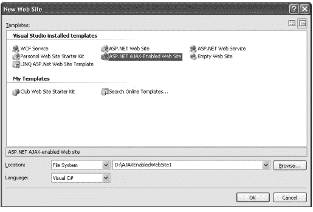

**图 1-6** 创建新网站时出现的新 AJAX 项目模板。

ASP.NET AJAX 扩展 Microsoft Windows Installer (MSI) 软包会将一些文件安装到你计算机上的以下文件夹中：

```
%DRIVE%:\Program Files\Microsoft ASP.NET\ASP.NET 2.0 AJAX Extensions\v1.0.61025
```

此外，它还会将一个名为 *System.Web.Extensions.dll* 的程序集放置到全局程序集缓存 (GAC) 中。ASP.NET AJAX 程序集包含一组形成客户端脚本库的 JavaScript 文件（.js 文件）。

> **注意** ASP.NET AJAX 的官方安装程序会将二进制文件复制到 GAC 中。这仍然是推荐的方式。然而，简单地将 *System.Web.Extensions* 程序集复制到 Bin 文件夹中也足以部署一个 ASP.NET AJAX 网站。

### 部署 ASP.NET AJAX 应用程序

创建 ASP.NET AJAX 应用程序的最简单方法是选择 Visual Studio 2005 项目模板。（参见图 1-6。）Visual Studio 会向项目添加一个 *web.config* 文件，其中包含运行 ASP.NET AJAX 应用程序所需的所有设置。特别是，该配置文件将 ASP.NET AJAX 程序集链接到项目中。

如果你的 ASP.NET AJAX 应用程序使用 Web 服务，你应该确保这些 Web 服务——位于应用程序本地——已正确安装并且能够找到所有必需的资源。

> **重要** 并非在默认 *web.config* 文件中创建的所有配置条目在所有情况下都是必需的。你可能希望删除那些不需要的条目。特别是，如果你的应用程序不直接从 JavaScript 发出远程带外调用，你可能希望删除那些分别用于处理对 Web 服务和页面方法的调用的 HTTP 处理程序和 HTTP 模块。但是，当你编辑 web.config 文件时，请格外小心，最好将不需要的部分注释掉而不是删除。你可能会无意中删除一个重要的设置，从而破坏整个应用程序。

### 核心组件

ASP.NET AJAX 框架由客户端和服务器端两部分组成。应用程序主要使用客户端 JavaScript 库来管理页面用户界面、调用基于服务器的组件以及发出部分页面刷新的请求。服务器组件为客户端生成响应，并发出预定义的客户端脚本，这些脚本与客户端库集成，有时还会对其进行扩展。ASP.NET AJAX 的服务器端部分包括 Web 服务、临时控件以及 JavaScript 对象表示法 (JSON) 基础设施。（我将在本章稍后讨论 JSON 数据交换技术。）

### Microsoft AJAX 客户端库

AJAX 客户端库由一组 JavaScript（*.js*）文件组成，这些文件在需要时会从客户端页面链接。这些 *.js* 文件会被下载到每个使用 ASP.NET AJAX 页面的客户端上。这些文件对 ASP.NET 开发者来说是透明的，因为它们被嵌入在 ASP.NET AJAX 程序集中。

客户端库为 JavaScript 语言提供了面向对象且跨浏览器的扩展，例如类、命名空间、继承和数据类型。此外，它还定义了一个基本封装的 .NET 基类库版本，其中包括字符串构建器、正则表达式、计时器和跟踪功能。ASP.NET AJAX 客户端库的关键部分是网络层，它管理着通过 *XMLHttpRequest* 进行异步调用的复杂性。这一层允许客户端页面通过带外调用与 Web 服务和 Web 页面进行通信。

### 基于服务器的组件

ASP.NET AJAX 是 ASP.NET 的扩展，而 ASP.NET 是一个服务器端开发平台。因此，ASP.NET AJAX 提供了许多基于服务器的组件，包括 Web 服务和控件，这些组件带来了双重好处。一方面，你可以从客户端编程这些组件并更新当前页面，而无需完全刷新；另一方面，在很大程度上，编程模型保持不变。这样一来，至少在核心功能方面，ASP.NET AJAX 的学习曲线可能会令人愉快地短暂。

内置的 Web 服务向客户端页面暴露了许多 ASP.NET 功能，包括用户配置文件、成员身份和角色。服务器控件看起来就像经典的 ASP.NET 服务器控件，不同之处在于它们会发出额外的脚本代码。这些脚本代码通过有选择地利用 AJAX 客户端库提供的设施来丰富用户对控件的体验。你将要使用的一些关键的 AJAX 服务器控件是 *UpdatePanel*、*UpdateProgress* 和 *Timer*。我将在第 4 章中介绍它们。

### JSON 基础设施

Web 应用程序中带外调用的日益增多带来了一个新问题——移动越来越复杂的数据。这不仅仅是一个序列化问题，.NET Framework 和其他特定平台的框架已经有了现成的解决方案。带外调用涉及的序列化不仅是跨平台的；它还涉及不同的层次以及截然不同的工具和语言。通过带外调用，你将数据从客户端移动到服务器并返回。但客户端是一个浏览器（如果不是移动设备的话），JavaScript 是数据的原生格式。服务器是一个托管在各种硬件/软件平台上并运行特定 Web 应用程序框架的 Web 服务器。

JSON 是一种新兴的技术，用于在网络上传递结构化数据。它是一种数据交换格式，在 http://www.json.org 有完整描述。它对于人类来说相对容易阅读，对于机器来说也容易解析和生成。JSON 使用两种通用数据结构——集合和数组——来描述数据，大多数现代编程语言和类库都以某种方式支持这两种数据结构。

JSON 是一种完全独立于语言的文本格式，尽管它严重依赖于从 C 语言系列继承的一些约定。

JSON 客户端基础设施可以将 JavaScript 对象序列化为交换格式，并通过网络将其发送到服务器端接收器。特定于平台的接收器将解析数据流以构建特定于平台的对象。同样，JSON 服务器基础设施可以接受任何特定于平台的对象并将其序列化为交换格式。回到客户端，数据流会立即转换为一个 JavaScript 对象。就 .NET Framework 和 ASP.NET 而言，会使用一些反射技术来检查类的内部结构并创建适当的 JavaScript 包装器。

实际上所有基于 AJAX 的框架都实现了 JSON 基础设施。ASP.NET AJAX 也不例外。

> **注意** 有一段时间，XML 被吹捧为网络的通用语言，因为它对于开发者和架构师来说是理想且量身定制的，可以以完全跨平台的方式打包和交换数据。如今，你会发现 JSON（一种非 XML 技术）被用于同样的任务。有什么区别吗？JSON 和 XML 做的是同样的工作。XML 更复杂，在某些方面有些古怪，而且是通用的。对于需要使用 XSLT 样式表来设置 UI 样式的数据描述，XML 更可取。而对于原始数据，JSON 是一种更轻量级的格式，对人类和计算机来说都更容易阅读和解析。

### 结论

大多数专注的开发者自 20 世纪 90 年代末以来一直围绕交互式 Web 技术进行开发。各种技术（例如，Microsoft Remote Scripting 以及开源和商业变体）已经发展起来，但没有形成足够大的接受度和使用量。或者也许量已经够大了，但每个人都在等待一个杀手级应用的火花。另一个阻碍更先进的客户端技术被采用的因素是浏览器缺乏对它们的跨浏览器支持。

如今的情况与仅仅三四年前相比发生了根本性的变化。现在大约 90% 的可用浏览器都支持实现交互式 Web 应用程序（也称为 AJAX 应用程序）的所有最低要求。此外，W3C 正在标准化 *XMLHttpRequest* 对象，这是所有现有 AJAX 平台背后必不可少的通信工作马。下一代 Web 应用程序将基于一种不同的机制：不再仅仅是，或者不仅仅是，在页面跳转时提交表单，而是对数据的单独请求以及对显示页面的动态更新。

作为旨在创建 Web 页面的服务器技术，ASP.NET 利用了提供这一备受期待功能的机会。脚本回调是 Microsoft 提供构建 AJAX 风格页面的 API 的首次尝试。其建模于经典的回发事件，回调有时不必要地繁琐且不灵活。

作为 ASP.NET 2.0 的附加组件，Microsoft ASP.NET AJAX 扩展为 ASP.NET 平台上的 AJAX 应用程序指明了前进的方向。它将 AJAX 生活方式集成到 ASP.NET 的现有应用程序模型中，从而产生了一个熟悉的编程模型，并大大改进和丰富了功能。

 第5章
AJAX 控件工具包

本章内容：
- 扩展器控件
- AJAX 控件工具包简介
- *Accordion* 控件
- *Rating* 控件
- *ReorderList* 控件
- *TabContainer* 控件
- AJAX 控件工具包扩展器
- 总结

尽管 ASP.NET AJAX 是一个旨在为 Web 客户端提供更强大编程能力的框架，但它主要被服务端开发者使用——例如 ASP.NET 开发者，或者至少是具有较强服务端技能的 Web 开发者。遗憾的是，目前要为 Web 客户端添加丰富的功能和能力，除了编写精妙而复杂的 JavaScript 代码外，别无他法。

ASP.NET AJAX 迎难而上，为开发者提供了两种以服务端为中心的开发方式来构建丰富的 Web 应用程序。正如我们在第4章"部分页面渲染"中所讨论的，开发者可以使用部分渲染（而非普通的 ASP.NET 回发）来刷新页面的特定区域。要创建这样的区域，只需使用一组特定的服务器控件——其中最重要的是 *UpdatePanel* 控件。

除了部分渲染之外，开发者还可以使用*控件扩展器*为新的和现有的 ASP.NET 控件添加预定义的客户端行为。客户端行为是一段 JavaScript 代码，它为给定 ASP.NET 控件生成的标记添加新功能。扩展器本质上是一个服务器控件，它发出适当的脚本代码——即客户端行为——以增强给定 ASP.NET 控件在客户端的表现方式。扩展器不仅仅是一个从现有控件派生的自定义控件，它代表了一种通用行为——例如自动完成、焦点管理、弹出窗口生成和拖拽功能——可以以声明方式应用于各种目标控件类型。例如，一个特殊的行为可以应用于任何获得焦点的控件——无论是 *TextBox*、*Button* 还是 *CheckBox* 控件。

ASP.NET AJAX Extensions 1.0 仅提供了扩展器控件的基类。二进制文件中不包含任何具体的扩展器控件。在线文档提供了一些关于如何构建扩展器的优秀教程。你可以在 http://ajax.asp.net/docs/tutorials/ExtenderControlTutorial1.aspx 找到其中一篇。通过单独的下载包——AJAX 控件工具包（ACT），提供了相当数量的示例扩展器和额外的富客户端控件。

在本章中，我将首先回顾控件扩展器的语法和语义，然后带你浏览 ACT 中的主要组件。

## 扩展器控件

ASP.NET 页面由服务器控件组成。ASP.NET 自带了相当丰富的内置控件集合。此外，第三方供应商、社区项目乃至志愿者的贡献也为开发者提供了大量的自定义控件。如果你需要一个具有 ASP.NET 控件无法提供的特定功能集的文本框（例如数字文本框），通常需要自己编写一个，或者购买一个新的专用控件来扩展原始控件并添加所需的行为。面向对象的设计当然鼓励这种做法。

然而，很少需要从头编写一个全新的控件。更多情况下，你的控件会从现有的 ASP.NET 控件基类派生。不过，盲目使用继承来构建控件的专用版本可能并不是明智的选择。事实上，即使在相对较小的项目中，这也可能直接导致控件的激增。例如，你最终可能拥有一个普通文本框，加上一个数字文本框、一个过滤文本框、一个聚焦时改变样式的文本框、一个留空时显示提示的文本框，等等。另一方面，将所有这些行为合并到一个超级 *TextBox* 控件中也未必明智。在这种情况下，代码中将充斥着各种分支、逻辑条件和需要检查的属性。仅仅为了一个简单的额外功能，你就要加载一个庞大的控件。一定有其他的方法。这就是扩展器控件的用武之地。

### 扩展器到底是什么？

首先，扩展器控件本身就是一个服务器控件。它代表一种可以附加到一个或多个控件类型上以扩展其基本能力的逻辑行为。

### 形式化"行为"的概念

假设你只想让给定输入表单中的文本框在聚焦时改变样式。如果你创建一个新控件，比如 *FocusedTextBox*，这没问题。但如果你希望按钮、复选框和下拉列表也具有相同的行为呢？你需要创建一堆新控件——所有这些控件都以相同的逻辑行为扩展目标控件。扩展器控件正是定义此类行为的规范化方式。

> **注意** 几乎所有行为都需要在客户端页面中注入一些脚本代码。因此，扩展器天然与 ASP.NET AJAX 相关联。但从技术角度来看，ASP.NET AJAX 和扩展器是相互独立的概念。你可以为 ASP.NET 1.1 和 ASP.NET 2.0 开发扩展器，使其在没有 ASP.NET AJAX Extensions 的情况下也能工作。不过，ASP.NET AJAX Extensions 为扩展器控件的编写者提供了一些有趣的便利设施——具体来说是基类，更重要的是用于更方便地开发 JavaScript 功能的 Microsoft AJAX 库。

一个典型的扩展器控件由一组属性和一个或多个 JavaScript 文件组成，它们共同定义了目标控件在浏览器中的预期行为。ASP.NET 开发者以声明方式将扩展器添加到服务器页面，并配置属性以获得所需的行为。

接下来，当扩展器渲染输出时，它会在客户端页面中发出适当的脚本代码。这段脚本代码通常注册客户端事件处理程序，并修改与其关联的标记元素的文档对象模型（DOM）。因此，原始控件的外观和行为会略有不同，但其编程接口保持不变。

在某种程度上，"行为"的概念类似于主题。主题用于改变控件的外观和感觉。然而，行为与主题的区别在于，行为可能改变控件的某些视觉方面，但并不局限于图形属性。它可以通过访问客户端 DOM 来改变控件的结构，添加事件处理程序，甚至暴露具有属性和方法的真正对象模型。

### 分析一个示例扩展器

为了更好地理解 AJAX 扩展器的目标和特性，让我们简要了解一下 ACT 中某个扩展器所封装的行为——*TextBoxWatermark* 扩展器。

文本框水印是在空文本框中显示的一段提示文字，用于引导用户。当文本框被提交时，该帮助文本会被移除；当用户开始在输入框中输入时，它也会自动移除。同样，当用户清除文本框中的所有文本时，它会自动重新插入。

水印行为钩挂了三个 HTML 事件：*onfocus*、*onblur* 和 *onkeypress*。在初始化阶段，如果文本框内容为空，它还会为目标文本框设置新的样式和默认文本。当文本框获得输入焦点时，事件处理程序会立即移除水印文本并恢复原始样式。当用户输入时，*onkeypress* 的处理程序确保当前文本框保持水印状态。最后，当输入框失去焦点——即 *onblur* 事件触发时——如果内容为空字符串，处理程序会重新设置水印。

要将此行为与 ASP.NET *TextBox* 关联，你可以使用扩展器。或者，如果你对 ASP.NET 控件开发和 JavaScript 比较熟悉，也可以使用客户端代码片段来达到相同的效果。


> **注意** AJAX 扩展器的概念与动态 HTML（DHTML）行为非常相似。随着 Internet Explorer 5.0 引入的 DHTML 行为，本质上只是一个脚本文件（或编译后的 COM 对象），它挂钩 HTML 事件并修改给定 HTML 标签的 DOM 来实现特定行为。DHTML 行为用于扩展单个 HTML 标签的功能。ASP.NET AJAX 行为则用于扩展由单个 ASP.NET 控件生成的标记块的功能。

### 目标属性

扩展器控件由一组决定最终行为的属性来表征。这些属性的值会传递到客户端，并嵌入到客户端脚本中。

显然，在服务器端和客户端都需要一个量身定制的框架，才能使行为的实现既高效又经济。ASP.NET AJAX Extensions 正是提供了这一框架。我们马上会在分析一些示例代码的同时，深入研究扩展器的内部原理。与此同时，让我们先快速了解一下如何在 ASP.NET 页面中使用扩展器。

在页面中，每个你想要增强的控件都有一个扩展器实例。扩展器带有一组属性，如下所示：

```
<act:TextBoxWatermarkExtender ID="Watermark1" runat="server"
    TargetControlID="TextBox1"
    WatermarkText=" ... "
    WatermarkCssClass=" ... " />
</act:TextBoxWatermarkExtender>
<act:TextBoxWatermarkExtender ID="Watermark2" runat="server"
    TargetControlID="TextBox2"
    WatermarkText=" ... "
    WatermarkCssClass=" ... " />
</act:TextBoxWatermarkExtender>
```

*TargetControlID* 属性是所有扩展器共有的，它指示页面中作为扩展器目标的控件。其他特定于扩展器的属性则用于定制其个别行为。例如，*WatermarkText* 和 *WatermarkCssClass* 属性仅由水印扩展器实现，用于设置水印文本应显示的文本和样式。

有了这些背景信息，让我们深入探讨扩展器控件的编程接口。

## *ExtenderControl* 类

如前所述，ASP.NET AJAX Extensions 不包含任何扩展器的具体实现。但是，它定义了所有自定义扩展器以及 ACT 中所有扩展器所继承的基类。这个类名为 *ExtenderControl*。

*ExtenderControl* 类派生自 *Control*，并实现了 *IExtenderControl* 接口。该类定义了一个特定属性——*TargetControlID*。该属性是一个字符串，表示被扩展的服务器控件的 ID。*Visible* 属性是所有服务器控件共有的，在此被重写并设为实际上只读。更准确地说，你不能将读/写属性重写为移除 set 访问器，但可以使其在调用时抛出异常。以下是该属性的伪代码：

```
public override bool Visible
{
    get { return base.Visible; }
    set { throw new NotImplementedException(); }
}
```

扩展器需要页面中存在脚本管理器控件，正如任何 ASP.NET AJAX 服务器控件一样。请注意，扩展器大多是声明式使用的，永远不会以编程方式修改。因此，扩展器不需要（也不使用）视图状态。

### *IExtenderControl* 接口

*IExtenderControl* 接口定义了扩展器控件的契约。它包含两个方法：*GetScriptDescriptors* 和 *GetScriptReferences*。以下是该接口的定义：

```
public interface IExtenderControl
{
    IEnumerable<ScriptDescriptor> GetScriptDescriptors(
        Control targetControl);
    IEnumerable<ScriptReference> GetScriptReferences();
}
```

两个方法分别返回特定对象的集合——脚本描述符和脚本引用。

脚本描述符由 *ScriptDescriptor* 类的实例表示，而 *ScriptReference* 类则表示链接的脚本文件。那么，脚本描述符究竟是什么呢？它描述了提供预期客户端行为的 JavaScript 类。脚本描述符指示要创建的客户端类型、要设置的属性以及需要处理程序的那些客户端事件。

实际上，*ScriptDescriptor* 只是一个你仅用作引用的基类。你实际使用的真实类是 *ScriptBehaviorDescriptor*。以下是一些代码，演示了在示例扩展器控件中 *GetScriptDescriptors* 方法的典型实现：

```
protected IEnumerable<ScriptDescriptor> GetScriptDescriptors(
    Control targetControl)
{
    ScriptBehaviorDescriptor descriptor;
    descriptor = new ScriptBehaviorDescriptor(className, id);
    descriptor.AddProperty(propertyName1, value1);
    ...
    return new ScriptDescriptor[] { descriptor };
}
```

*ScriptBehaviorDescriptor* 类没有公共属性，但它确实公开了一个用于填充属性描述的承载集合属性——通常是名称和值。

如第 3 章"ASP.NET AJAX 的脉动核心"中所讨论的，*ScriptReference* 对象描述了一段 JavaScript 代码。特别是在本上下文中，它表示与行为一起包含的客户端脚本。所有引用的脚本都定义了客户端类型以及任何其他需要的辅助 JavaScript 代码。我们稍后会再回到这个方法。

*ExtenderControl* 基类通过回退到声明为 *protected* 和 *abstract*（或在 Microsoft Visual Basic .NET 中声明为 must-override）的内部成员来实现 *IExtenderControl* 接口：

```
IEnumerable<ScriptDescriptor> IExtenderControl.GetScriptDescriptors(
    Control targetControl)
{
    return this.GetScriptDescriptors(targetControl);
}
IEnumerable<ScriptReference> IExtenderControl.GetScriptReferences()
{
    return this.GetScriptReferences();
}
```

内部成员必须在任何派生类中被重写。

### 创建示例扩展器

让我们将前面阐述的概念应用于实际场景，创建一个示例扩展器控件。这个新扩展器添加了一种高亮行为，在控件获得焦点时改变其外观。这个名为 *FocusExtender* 的扩展器不仅限于单个控件，而是可以应用于几乎任何 ASP.NET 控件。

### *FocusExtender* 控件

焦点扩展器被实现为派生自 *ExtenderControl* 的控件类型，并重写了基类上的两个抽象成员：

```
[TargetControlType(typeof(Control))]
public class FocusExtender : ExtenderControl
{
    protected override IEnumerable<ScriptReference> GetScriptReferences()
    {
        ...
    }
    protected override IEnumerable<ScriptDescriptor> GetScriptDescriptors(
        Control targetControl)
    {
        ...
    }
    ...
}
```

*TargetControlType* 属性定义了可以被扩展的控件的基类。在本例中，所有 Web 控件都可以被扩展。如你所见，如果必须扩展多种控件类型，则要求它们都派生自同一个基类。

扩展器的骨架已经基本完成。你只需要添加一些属性使扩展器可配置，并充实抽象方法的主体。

焦点扩展器旨在在目标控件获得焦点时改变其外观。至少需要两组视觉属性：一组用于高亮状态，一组用于正常状态。然而，这些属性将在客户端处理和应用。在客户端浏览器中，有一种比使用单个属性更好的方式来设置元素的外观——级联样式。为了分配这些样式，扩展器有两个属性——*HighlightCssClass* 和 *NormalCssClass*：

```
public class FocusExtender : ExtenderControl
{
    private string _highlightCssClass;
    private string _normalCssClass;

    public string HighlightCssClass
    {
        get { return _highlightCssClass; }
        set { _highlightCssClass = value; }
    }

    public string NormalCssClass
    {
        get { return _normalCssClass; }
        set { _normalCssClass = value; }
    }
    ...
}
```

如前所述，扩展器类不需要视图状态，并通过私有字段实现属性的存储。这要求扩展器要么声明式使用（且不在回发期间以编程方式修改），要么在页面初始化阶段完全配置，无论是否回发。

#### 定义客户端行为

*GetScriptDescriptors* 方法实例化一个描述符类，并使用该类将 *IntroAjax.FocusBehavior* JavaScript 类绑定到以目标控件客户端 ID 为根的 HTML 子树。


指定的控件。描述符在 JavaScript 类的属性和扩展器控件的属性之间注册绑定。通过调用 *AddProperty* 方法，可以将 JavaScript *FocusBehavior* 类中的 *highlightCssClass* 与扩展器上的 *HighlightCssClass* 进行链接，例如。

```
protected override IEnumerable<ScriptDescriptor> GetScriptDescriptors(
    Control targetControl)
{
    ScriptBehaviorDescriptor descriptor;
    descriptor = new ScriptBehaviorDescriptor("IntroAjax.FocusBehavior",
        targetControl.ClientID);
    descriptor.AddProperty("highlightCssClass", this.HighlightCssClass);
    descriptor.AddProperty("normalCssClass", this.NormalCssClass);

    return new ScriptDescriptor[] { descriptor };
}
```

客户端属性与服务器端属性之间的绑定用于将客户端属性设置为服务器端指定的值。扩展器应被视为一对类——一个服务器控件类和一个 JavaScript 类，后者在客户端公开扩展器的对象模型。

您将 JavaScript 类保存在一个或多个 *.js* 文件中，然后通过 *ScriptReference* 类将它们全部注册到 ASP.NET AJAX 基础架构中。以下是 *GetScriptReferences* 方法的典型实现：

```
protected override IEnumerable<ScriptReference> GetScriptReferences()
{
    ScriptReference reference = new ScriptReference();
    reference.Path = ResolveClientUrl("FocusBehavior.js");

    return new ScriptReference[] { reference };
}
```

*ResolveClientUrl* 方法在 *Control* 类上定义，它在应用程序的上下文中解析相对 URL。按照前面的代码片段使用该方法时，它会在宿主页面所在的同一文件夹中查找 *FocusBehavior.js* 文件。（然而，这并不是大多数开发人员会合理放置它的位置。）

### 扩展器的客户端对象模型

*FocusBehavior.js* 文件定义了一个行为类，其属性反映了服务器端扩展器控件——*highlightCssClass* 和 *normalCssClass*——的属性。此外，该行为为 *blur* 和 *focus* 客户端事件注册了几个处理程序。当 *focus* 事件触发时，该行为设置高亮级联样式表（CSS）样式。当 *blur* 事件发生时，它设置正常 CSS 样式。以下是完整的源代码：

```
Type.registerNamespace('IntroAjax');

// Constructor
IntroAjax.FocusBehavior = function(element)
{
    IntroAjax.FocusBehavior.initializeBase(this, [element]);
    this._highlightCssClass = null;
    this._normalCssClass = null;
}

// Create the prototype for the behavior
IntroAjax.FocusBehavior.prototype =
{
    initialize : IntroAjax$FocusBehavior$initialize,
    dispose : IntroAjax$FocusBehavior$dispose,
    _onFocus : IntroAjax$FocusBehavior$_onFocus,
    _onBlur : IntroAjax$FocusBehavior$_onBlur,
    get_highlightCssClass : IntroAjax$FocusBehavior$get_highlightCssClass,
    set_highlightCssClass : IntroAjax$FocusBehavior$set_highlightCssClass,
    get_normalCssClass : IntroAjax$FocusBehavior$get_normalCssClass,
    set_normalCssClass : IntroAjax$FocusBehavior$set_normalCssClass
}

// Internal methods
function IntroAjax$FocusBehavior$initialize()
{
    IntroAjax.FocusBehavior.callBaseMethod(this, 'initialize');

    this._onfocusHandler = Function.createDelegate(this, this._onFocus);
    this._onblurHandler = Function.createDelegate(this, this._onBlur);

    $addHandlers(this.get_element(),
                 { 'focus' : this._onFocus,
                   'blur' : this._onBlur },
                 this);

    this.get_element().className = this._normalCssClass;
}

function IntroAjax$FocusBehavior$dispose()
{
    $clearHandlers(this.get_element());
    IntroAjax.FocusBehavior.callBaseMethod(this, 'dispose');
}

function IntroAjax$FocusBehavior$_onFocus(e)
{
    if (this.get_element() && !this.get_element().disabled)
        this.get_element().className = this._highlightCssClass;
}

function IntroAjax$FocusBehavior$_onBlur(e)
{
    if (this.get_element() && !this.get_element().disabled)
        this.get_element().className = this._normalCssClass;
}

function IntroAjax$FocusBehavior$get_highlightCssClass()
{
    return this._highlightCssClass;
}

function IntroAjax$FocusBehavior$set_highlightCssClass(value)
{
    if (this._highlightCssClass !== value)
    {
        this._highlightCssClass = value;
        this.raisePropertyChanged('highlightCssClass');
    }
}

function IntroAjax$FocusBehavior$get_normalCssClass()
{
    return this._normalCssClass;
}

function IntroAjax$FocusBehavior$set_normalCssClass(value)
{
    if (this._normalCssClass !== value)
    {
        this._normalCssClass = value;
        this.raisePropertyChanged('normalCssClass');
    }
}

// Register the class
IntroAjax.FocusBehavior.registerClass('IntroAjax.FocusBehavior',
    Sys.UI.Behavior);

Sys.Application.notifyScriptLoaded();
```

IntroAjax.FocusBehavior 类派生自 Sys.UI.Behavior——这是由 Microsoft AJAX 库提供的类，为行为设定了基线。注意最后对 Sys.Application 类上 notifyScriptLoaded 方法的调用。它的作用是通知 ASP.NET AJAX 客户端基础架构所需的脚本已加载完毕。


注意 编写 JavaScript 类时，您可以选择定义一个 JSON 序列化器，以便在类的实例被序列化时使用——例如，如果该类的实例用作远程方法调用的参数。（我们将在第 7 章"使用 ASP.NET AJAX 进行远程方法调用"中介绍远程脚本。）

```
IntroAjax.FocusBehavior.descriptor = {
    properties: [   {name: 'highlightCssClass', type: String},
                    {name: 'normalCssClass', type: String} ]
```

要支持 JSON 序列化，您需要添加一个如前面代码片段中所示的 descriptor 成员。properties 成员引用一个由属性名和类型组成的配对数组。

### 使用焦点扩展器控件

要在 ASP.NET 页面中使用示例扩展器，首先使用 @Register 指令注册该控件：

```
<%@ Register Namespace="IntroAjax.Controls" TagPrefix="x" %>
```

宿主页面也必须像任何其他 ASP.NET AJAX 页面一样具有脚本管理器。想象一个包含三个文本框和一个按钮的示例页面，您希望在获得焦点时更改其样式。代码如下所示：

```
<asp:ScriptManager ID="ScriptManager1" runat="server" />
<table>
    <tr>
        <td><asp:Label runat="server" ID="Label1">Name</asp:Label></td>
        <td><asp:TextBox ID="TextBox1" runat="server" /></td>
    </tr>
    <tr>
        <td><asp:Label runat="server" ID="Label2">Phone</asp:Label></td>
        <td><asp:TextBox ID="TextBox2" runat="server" /></td>
    </tr>
    <tr>
        <td><asp:Label runat="server" ID="Label3">E-mail</asp:Label></td>
        <td><asp:TextBox ID="TextBox3" runat="server" /></td>
    </tr>
</table>
<asp:Button runat="server" ID="Button1" Text="Submit Form" />
```

您可以通过以下 ASP.NET 标记使用焦点扩展器来扩展这些控件：

```
<x:FocusExtender ID="FocusExtender1" runat="server"
        NormalCssClass="Normal"
        HighlightCssClass="HighLight"
        TargetControlID="TextBox1" />
<x:FocusExtender ID="FocusExtender2" runat="server"
        NormalCssClass="Normal"
        HighlightCssClass="HighLight"
        TargetControlID="TextBox2" />
<x:FocusExtender ID="FocusExtender3" runat="server"
        NormalCssClass="Normal"
        HighlightCssClass="HighLight"
        TargetControlID="TextBox3" />
<x:FocusExtender ID="FocusExtender4" runat="server"
        NormalCssClass="NormalButton"
        HighlightCssClass="HighLightButton"
        TargetControlID="Button1" />
```

如您所见，每个扩展器实例都绑定到一个特定的目标控件并设置属性。特别是，所有文本框共享相同的正常和高亮 CSS 样式。图 5-1 显示了示例页面的实际运行效果。


**图 5-1** 聚焦扩展器的实际应用

在代码片段中，*Normal* 和 *HighLight* 只是 CSS 类。以下是一种可能的定义：

```css
.Normal {
    background-color: #FFFFEE;
}
.HighLight {
    background-color: Orange;
}
.NormalButton {
    font-weight: normal;
    width: 100px;
}
.HighLightButton {
    font-weight: bold;
    width: 100px;
}
```

CSS 类是定义行为和客户端控件可视化属性的首选方式，因为它们允许你将多个可视化属性分组到单个对象中，进而封装为单个*字符串*类型的类属性。

## AJAX 控件工具包简介

如前所述，目前绝大多数控件扩展器都已编译成一个名为 AJAX 控件工具包的程序集。该程序集是一个独立的下载文件，必须在任何计划使用它的应用程序中进行注册。ACT 项目是一个开源项目，由 Microsoft 和 ASP.NET 社区合作创建。你可以通过访问 CodePlex 网站上的项目主页来了解更多关于该项目的信息。确切的 URL 是 *http://www.codeplex.com/AtlasControlToolkit*。

如果你有兴趣，可以成为该项目的贡献者，并让你的工作得以展示。ACT 的主要目的是提供一组充分利用 ASP.NET AJAX 编程模型的控件和扩展器，为开发者提供免费且有效的 Web 组件。ACT 预计将继续与 ASP.NET AJAX 分开发展和演进。然而，未来 ACT 程序集的部分内容很可能会与 ASP.NET 核心二进制文件合并。时间会证明一切。

截至目前，你主要有两种方式使用 ACT 控件。你可以将完整的程序集链接到你的应用程序，或者你可以将部分控件作为源代码合并到你的项目中。不过在执行此操作之前，请务必阅读许可证页面：*http://www.codeplex.com/AtlasControlToolkit/Project/License.aspx*。

### 为使用工具包做好准备

要下载 ACT 的最新版本，请访问 CodePlex 上的项目主页：*http://www.codeplex.com/AtlasControlToolkit*。下载后，工具包看起来像一个 ZIP 文件，你需要点击解压并安装其中包含的所有文件。

#### ACT 项目

安装完成后，你的硬盘上会有一个 Microsoft Visual Studio 2005 ASP.NET 项目。如果你运行该项目，你应该会看到如图 5-2 所示的界面。

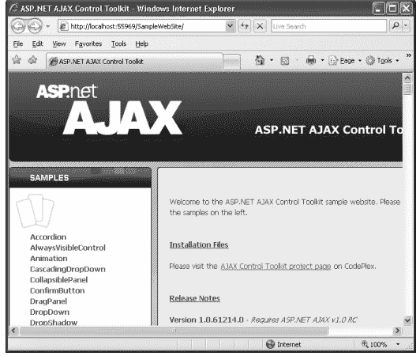

图 5-2 为展示 ACT 功能而构建的示例网站

如果你浏览项目文件，你会发现 ACT 是一组 ASP.NET AJAX 控件和扩展器的集合，外加许多展示其功能和进行测试的示例。此外，ACT 包含一个开发工具包，用于简化你自定义控件和扩展器的创建与复用。该开发工具包包含适用于 Visual Basic 和 Visual C# 的 Visual Studio 2005 模板，让开发者可以编写自己的控件和扩展器。此外，它还提供了一个辅助类库，以加速控件和扩展器的创建过程。

### 将 ACT 组件添加到工具箱

因此，ACT 包含了大量控件和扩展器，你可能希望将它们组合并整合到你的 ASP.NET 页面中。Visual Studio 2005 工具箱似乎是列出所有这些组件的完美场所，这样开发者就可以精确选取所需的组件并将其粘贴到当前页面。要将 ACT 组件添加到工具箱，首先需要在工具箱中创建一个新选项卡。右键单击工具箱界面，从上下文菜单中选择“添加选项卡”。添加新选项卡后，你可以为其指定任何名称——例如 AJAX 控件工具包。

接下来，你需要用 ACT 程序集中的所有组件填充该选项卡。为此，右键单击新添加选项卡下方的工具箱区域，然后选择“选择项”。此时会显示一个列出 .NET 程序集和 COM 组件的标准对话框。浏览到你安装 ACT 的位置，然后从 SampleWebsite 文件夹的 Bin 文件夹中选择 AjaxControlToolkit 程序集。就是这么简单。完成后，你的工具箱将神奇地变成图 5-3 所示的样子。

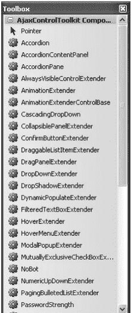

图 5-3 在 Visual Studio 2005 工具箱中创建一个新选项卡以承载 ACT 组件

第 5 章 AJAX 控件工具包 153

> **注意** 在 ACT 中，你会发现一些服务器控件（如 *TabContainer*）和更多的扩展器（如 *RoundedCorners*、*DropShadow* 和 *TextBoxWatermark*）。控件和扩展器之间有什么区别？*控件*提供一组封闭的功能和一个已知的、固定的行为，你只能通过属性和事件来控制它。而*扩展器*是一个（主要是）客户端行为，可以附加到各种控件上。例如，你可以将 *DropShadow* 扩展器附加到 *TextBox*，也可以附加到 *Panel*，在两种情况下，目标控件都会带有阴影进行渲染。尽管存在这些逻辑上的区别，但服务器控件和扩展器的实现方式相同——它们最终都是 ASP.NET 服务器控件。

### 在页面中注册 ACT 组件

尽管 ACT 是 ASP.NET AJAX 框架的原生部分，也是下一代 ASP.NET 平台的组成部分，但截至目前，它仅仅是一个外部库。因此，你需要在每一个使用其控件或扩展器的页面上显式注册 ACT。你可以使用 *@Register* 指令，如下所示：

```
<%@ Register Assembly="AjaxControlToolkit"
            Namespace="AjaxControlToolkit"
            TagPrefix="act" %>
```

如果你不喜欢在应用程序的所有页面中重复相同的代码，可以采用 ASP.NET 团队为避免在 ASP.NET AJAX 控件上承担同样负担而采取的捷径。

事实上，这里讨论的同一个 ASP.NET AJAX 核心库对于 ASP.NET 平台来说也是一个外部库，也需要在每个页面上显式注册。在 ASP.NET 2.0 中，你可以使用以下配置脚本为应用程序的所有页面启用 *@Register* 指令：

```
<pages>
    <controls>
        <add tagPrefix="asp"
             namespace="System.Web.UI"
             assembly="System.Web.Extensions, ..." />
    </controls>
</pages>
```

例如，*System.Web.UI* 命名空间中的所有控件都与 *asp* 标签前缀关联，无需在其使用的页面中进行显式 *@Register* 注册。你也可以为 ACT 控件添加类似的配置块到 *web.config* 文件中：

```
<pages>
    <controls>
        <add namespace="AjaxControlToolkit"
             assembly="AjaxControlToolkit, ..."
             tagPrefix="act" />
        ...
    </controls>
</pages>
```

正如你可能已经知道的，你选择作为标签前缀的字符串是任意的。不过，为了清晰起见，建议不要同时选择 *asp* 前缀。*asp* 前缀应保留给系统控件使用。

### AJAX 控件工具包包含什么

ACT 是一个旨在扩展 ASP.NET AJAX 框架能力的库。其控件集在未来可能会发生变化，可能会进一步扩展或精简。你可以从上述 CodePlex 网站查看项目的进展。在撰写本文时，ACT 包含了大量的扩展器和控件，但它们当然无法覆盖所有可能的开发场景。

### ACT 中的扩展器

表 5-1 列出了 ACT 中当前可用的组件。请注意，扩展器类的全名包含一个“Extender”后缀，为简洁起见，我在表格中省略了它。因此，例如，ACT 程序集中不会存在 *CollapsiblePanel* 组件，但你会找到一个 *CollapsiblePanelExtender* 控件。

**表 5-1 ACT 中的扩展器**

| 组件 | 描述 |
| :--- | :--- |
| *AlwaysVisibleControl* | 将控件固定在页面的某个角落，并在用户滚动或调整页面大小时使其保持浮动在页面背景之上。使用此扩展器可以确保，例如，某个给定面板始终显示在页面的左上角，无论滚动位置或浏览器窗口大小如何。 |
| *Animation* | 提供一个专门的框架，用于向 ASP.NET 页面中托管的控件添加动画效果。你可以将目标控件的客户端事件与一个或多个预定义的动画效果关联起来。 |
| *AutoComplete* | 与一个文本框关联，为用户在字段中输入的文本提供一个建议列表。 |
| *Calendar* | 附加到一个文本框，此扩展器提供客户端的日期选择功能，具有可自定义的日期格式和弹出控件。 |
| *CascadingDropDown* | 与一个 *DropDownList* 控件关联。此扩展器使用从 Web 服务方法检索的数据自动填充列表。此扩展器的妙处在于，你可以创建级联下拉列表的层次结构，并让扩展器根据层次结构中任何先前列表（如果有）的当前选择，自动填充子下拉列表。 |
| *CollapsiblePanel* | 为网页添加可折叠的部分。此扩展器只能与面板控件一起使用——即与 ASP.NET 的 *Panel* 控件或从其派生的任何类一起使用。你需要让扩展器知道页面中哪个面板充当标题，哪个面板提供折叠和展开的内容。 |


### 表 5-1 ACT 中的扩展器（续）

| 组件 | 说明 |
| :--- | :--- |
| *ConfirmButton* | 与按钮控件相关联。该扩展器为按钮的点击事件添加一个确认 JavaScript 对话框。该扩展器支持任何实现了 *IButtonControl* 接口的类，包括 *Button*、*LinkButton* 和 *ImageButton*。 |
| *DragPanel* | 与面板控件相关联。该扩展器添加拖放功能，使您可以在页面上移动面板。您可以指定要移动的内容，以及按下时触发拖动操作的手柄。 |
| *DropDown* | 该扩展器提供鼠标悬停链接以打开下拉面板。 |
| *DropShadow* | 为页面上任何可用的控件添加阴影。使用此扩展器，您可以指定阴影的不透明度和宽度。 |
| *DynamicPopulate* | 使用 Web 服务或页面方法调用的结果更新控件的内容。 |
| *FilteredTextBox* | 允许用户在 *TextBox* 控件中输入与给定有效字符集匹配的文本。 |
| *HoverMenu* | 当鼠标悬停在给定控件旁边时显示关联面板控件的内容。您可以将此扩展器与任何 ASP.NET 控件相关联。该扩展器作为一种专用且极为灵活的 ToolTip 工作。 |
| *MaskedEdit* | 允许用户按照给定的输入布局在 *TextBox* 控件中输入文本。 |
| *ModalPopup* | 与可以触发客户端 *onclick* 事件的控件相关联（通常是按钮和超链接），该扩展器实现了一个经典模态对话框，而不使用 HTML 对话框。基本上，它显示给定面板的内容，并阻止用户与页面的其余部分进行交互。 |
| *MutuallyExclusiveCheckBox* | 与 *CheckBox* 控件相关联，该扩展器允许您定义复选框的逻辑组，以便用户只能在每个组中选中一个。 |
| *NoBot* | 对输入表单应用一些*反机器人*技术。机器人（Bot），或称机器人应用程序，是在 Internet 上运行自动化任务的软件应用程序。例如，机器人被用来填写输入表单并提交特定值。 |
| *NumericUpDown* | 与文本框控件相关联，该扩展器允许您点击自动显示的按钮来输入字段中的下一个/上一个值。它适用于数字、自定义列表和 Web 服务方法。 |
| *PagingBulletedList* | 与 *BulletedList* 控件相关联，该扩展器将绑定到列表的所有项目进行分组，并在客户端排序的页面中组织它们。 |
| *PasswordStrength* | 与用于输入密码的文本框控件相关联，该扩展器为正在输入的密码强度提供视觉反馈。 |
| *PopupControl* | 将给定面板的内容转换为弹出窗口，而不使用 HTML 对话框。您可以将此扩展器与任何可以触发以下任一客户端事件的控件相关联：*onfocus*、*onclick* 和 *onkeydown*。 |
| *ResizableControl* | 附加到任何页面元素，并允许用户使用放置在控件右下角的手柄来调整元素大小。 |
| *RoundedCorners* | 为任何 ASP.NET 控件添加背景面板，使控件呈现圆角。原始控件的整体高度会略有变化。 |
| *Slider* | 为 *TextBox* 控件扩展滑块用户界面。 |
| *TextBoxWatermark* | 与 *TextBox* 控件相关联。该扩展器添加示例或提示文本，称为"水印"，用以说明用户应在字段中输入的文本类型。例如，水印可能显示"请在此处输入您的姓名"。一旦用户开始输入，水印文本就会消失，并在文本框变为空时重新出现。 |
| *ToggleButton* | 与 *CheckBox* 控件相关联。该扩展器使您能够使用自定义图像来渲染复选按钮。您可以使用不同的图像来表示选中状态和清除状态。 |
| *UpdatePanelAnimation* | 在部分更新的关键步骤期间播放动画。您可以使用该扩展器在面板正在被更新时以及更新完成后对页面进行动画处理。 |
| *ValidatorCallout* | 在 ASP.NET 验证器之上工作，并改善其用户界面。特别是，该扩展器显示带有错误消息的黄色标注。 |

正如您可能猜到的，表中列出的一些扩展器需要丰富的浏览器功能，而另一些只是附加到标记元素块上的智能 JavaScript 代码片段。请注意，所有这些功能都以跨浏览器方式工作。稍后我将通过代码示例和更多详细信息逐一介绍上述扩展器。

### ACT 中的控件

除了表 5-1 中列出的所有扩展器之外，ACT 还提供了一些具有丰富功能的传统服务器控件：*Accordion*、*Rating*、*ReorderList* 和 *TabContainer* 控件。

 means "and" or "with" in Chinese, used to connect nouns or noun phrases.

The *Accordion* control allows you to provide multiple collapsible panes and display only one at a time.  When the user clicks a new pane, the currently displayed pane is collapsed to leave room for the new one.

The *Rating* control provides an intuitive user interface to let users select the number of stars that represents their rating of a given subject. The control is the wrapped-up version of the user interface that several Web sites provide to let users rate published items.

A data-bound control, *ReorderList*, allows its child elements to be reordered on the client using drag-and-drop functionality. To move an item in the list, the user drags the item's handle up to its new position. At the end of the operation, the control posts back so that the new status of the data source can be recorded.

Finally, the *TabContainer* control is a purely client-side container of tabbed forms.

Let's first get to know more about these controls and then move on to discuss extenders.

## The *Accordion* Control

Collapsible panels are a frequent feature in modern and cutting-edge Web sites. They allow you to display a short highlight—the header—and keep more text hidden and available on demand. The *CollapsiblePanel* extender (discussed later) allows you to hide and display any block of markup. But what if you need to build a sort of hierarchy of panels?

The *Accordion* control allows you to group multiple collapsible panels in a single control, and it manages the collapsed/expanded state of each panel so that only one can be expanded at a time.

## Generalities of the *Accordion* Control

The *Accordion* control contains a collection of child *AccordionPane* controls, each of which features a template property to define header and content. Each pane can include any HTML, ASP.NET, or ASP.NET AJAX markup you want.

#### Properties of the Control

Table 5-2 lists the key properties of the *Accordion* control.

**Table 5-2 Properties of the *Accordion* Control**

| Property | Description |
| --- | --- |
| *AutoSize* | The value assigned to this property indicates how the control will determine its actual size. |
| *ContentCssClass* | Gets and sets the CSS class used to style the content of child panes. |
| *FadeTransitions* | Indicates whether to use a fade-out transition effect while hiding the current pane. This property is set to *false* by default. |
| *FramesPerSecond* | Gets and sets the number of frames per second used in the transition animation for the newly selected pane. This property is set to 30 frames by default. |
| *HeaderCssClass* | Gets and sets the CSS class used to style the header of child panes. |
| *Panes* | Returns the collection of child panes. |
| *SelectedIndex* | Gets and sets the currently expanded pane. |
| *TransitionDuration* | Gets and sets the number of milliseconds to animate the transition. This property is set to *250* by default. |


 ## 为控件添加动画

*Accordion* 控件支持两种不同情境下的动画。首先，当选择新窗格时，它可以选淡入淡出当前窗格的内容。此效果由 *FadeTransitions* 布尔属性控制。该效果在内容窗格较小时不太明显。还需注意，淡出动画与过渡动画紧密耦合，后者会缓慢展开新窗格的内容。

第二种动画形式由 *TransitionDuration* 和 *FramesPerSecond* 属性控制。如果后一种效果被禁用，则无论 *FadeTransitions* 属性如何设置，都不会看到任何淡出效果。

要完全跳过过渡动画并实现窗格的快速切换，可将 *FramesPerSecond* 和 *TransitionDuration* 都设置为 *0*。如果这样做，也应将 *FadeTransitions* 设置为 *false*，以避免控件执行不必要的、不会产生可观效果的任务。

### 控件尺寸调整

*Accordion* 控件的尺寸显然由任何容器元素以及各窗格的内容决定。这意味着手风琴的整体尺寸可能随所选窗格而变化。在这种情况下，页面中的其他元素可能会被上下推动。*AutoSize* 属性有助于控制手风琴的整体尺寸。

*AutoSize* 属性的值取自 *AutoSize* 枚举，其值为 *None*（默认）、*Limit* 和 *Fill*。当 *AutoSize* 属性设置为 *None* 时，手风琴会自由调整其大小，跟随所选窗格的尺寸变化。

当将 *AutoSize* 设置为 *Limit* 时，手风琴永远不会超过其 *Width* 和 *Height* 属性指定的值。*Accordion* 控件从其基类继承这些属性。如果设置为 *None*，则忽略 *Height* 和 *Width* 属性。如果要显示的内容大于手风琴的指定尺寸，将使用滚动条让用户查看全部内容。

设置 *Fill* 值时，手风琴将完全保持在由 *Width* 和 *Height* 属性限定的边界框内。在这种情况下，如果内容尺寸不合适，将被扩展或变为可滚动。扩展内容意味着使窗格更大。

## 使用 *Accordion* 控件

手风琴由多个子窗格组成，每个窗格都是 *AccordionPane* 类的实例。您可以使用标记添加窗格，并通过 *Panes* 集合属性以编程方式检索窗格集合。

### *Accordion* 控件实战

以下代码演示了 *Accordion* 控件的使用：

```
<div style="width:300px;">
  <act:Accordion ID="Accordion1" run帐號务必确认="server" Height="400px"
      SelectedIndex="0"
      ContentCssClass="accordionContent"
      HeaderCssClass="accordionHeader"
      FadeTransitions="true"
      AutoSize="Fill">
    <Panes>
      <act:AccordionPane ID="AccordionPane1" runat="server">
        <Header>One</Header>
        <Content>This is the first pane</Content>
      </act:AccordionPane>
      <act:AccordionPane ID="AccordionPane2" runat="server">
        <Header>Two</Header>
        <Content>
          <div style="height:400px">
          This is the second pane</div>
        </Content>
      </act:AccordionPane>
      <act:AccordionPane ID="AccordionPane3" runat="server">
        <Header>Three</Header>
        <Content>This is the third pane</Content>
      </act:AccordionPane>
      <act:AccordionPane ID="AccordionPane4" runat="server">
        <Header>Four</Header>
        <Content>This is the fourth pane</Content>
      </act:AccordionPane>
    </Panes>
  </act:Accordion>
</div>
```

您为每个要显示的可折叠面板添加一个 `<act:AccordionPane>` 元素。每个窗格由 `<header>` 和 `<content>` 模板组成。

示例手风琴嵌入在固定宽度的 `<div>` 标签中。最外层容器决定了手风琴的宽度和高度。*AutoSize* 属性设置为 *Fill*，强制手风琴覆盖并填满整个边界框。图 5-4 显示了结果。

注意，第二个窗格的内容设置为 400 像素高；然而，由于 *AutoSize* 设置，手风琴本身不能高于 400 像素，也不能无限制地增长。因此，第二个窗格显示一个滚动条，让您查看超出该限制的内容。

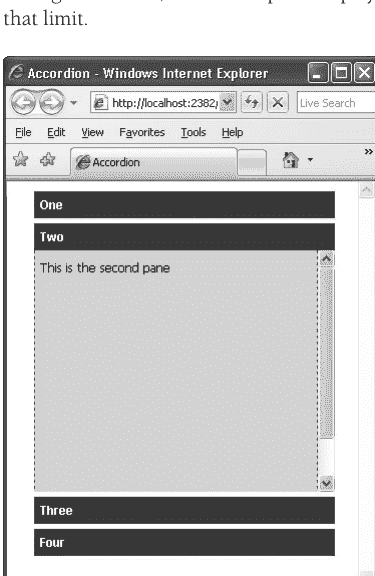

图 5-4  *Accordion* 控件实战

### 手风琴窗格

手风琴窗格是一个名为 *AccordionPane* 的简单 Web 控件。它有一个 *Header* 模板属性，用于定义面板的突出显示部分——即面板折叠时仍然可见的部分。您可以使用 *HeaderCssClass* 属性定义的 CSS 类中的设置来设置标题样式。

同样，窗格的内容由 *Content* 模板属性定义，并使用 *ContentCssClass* 属性引用的 CSS 类中的设置来设置样式。

## *Rating* 控件

用户满意度是衡量网站成功与否的关键指标之一。那么如何识别用户的满意程度呢？许多网站善意地要求用户通过散布在页面中的临时面板提供反馈。用户反馈最常见的用户界面模式是评分系统。网站显示固定数量的星星，让用户点击这些星星来给某个功能评分（通常，点击的星星越多表示满意度越高）。

大多数 ASP.NET 开发者可以轻松安排一个通过经典回发工作的评分机制。另一方面，ACT *Rating* 控件提供了一个通过回调工作的标准评分机制。

### *Rating* 控件概述

该控件的输出由一系列重复的 `<span>` 标签组成，通过一组 CSS 类进行装饰。每个 `<span>` 标签代表评分系统中的一个"星星"，并根据其所代表的状态进行样式设置。图 5-5 让您了解 *Rating* 控件的外观。

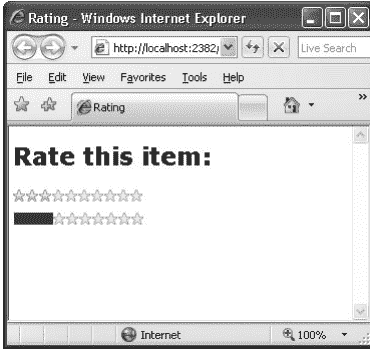

图 5-5 *Rating* 控件实战

### 控件的属性

表 5-3 列出了 *Rating* 控件的关键属性。

| 属性 | 描述 |
| --- | --- |
| *AutoPostBack* | 指示当用户对给定关联内容进行评分时，控件是否将回发。 |
| *CurrentRating* | 获取和设置控件渲染的当前值。默认值为 3。 |
| *EmptyStarCssClass* | 获取和设置用于渲染未选中星星的 CSS 类。 |
| *FilledStarCssClass* | 获取和设置用于渲染已选中星星的 CSS 类。 |
| *MaxRating* | 获取和设置通过控件可以评分的最大值。默认值为 5。 |
| *RatingAlign* | 指示星星的对齐方式。默认值为 *horizontal*。 |
| *RatingDirection* | 指示星星的方向。如果 *RatingAlign* 值为 horizontal，则默认为从左到右；如果 *RatingAlign* 为 vertical，则默认为从上到下。 |
| *ReadOnly* | 指示控件是否接受用户输入。 |

表 5-3 *Rating* 控件的属性（续）

| 属性 | 描述 |
| --- | --- |
| *StarCssClass* | 获取和设置用于为整个控件设置样式的 CSS 类。 |
| *Tag* | 传递给处理用户点击的服务器端代码的字符串。 |
| *WaitingStarCssClass* | 获取和设置在用户更新后进行服务器回发期间用于渲染已选中星星的 CSS 类。 |

*Rating* 控件生成的标记如下所示：

```
<div id="Rating1" style="float: left;">
    <span id="Rating1_Star_1" class="ratingStar filledRatingStar"
          style="float:left;">&nbsp;</span>
    <span id="Rating1_Star_2" class="ratingStar filledRatingStar"
          style="float:left;">&nbsp;</span>
    ...
</div>
```

如您所见，每个"星星"由唯一 ID 标识，并由设置为空的 `<span>` 标签表示。然而，在图 5-5 中，每个星星显然是一幅图像。这怎么可能呢？

#### 控件样式设置

*Rating* 控件支持四种不同的 CSS 类。*StarCssClass* 定义整个控件的样式。*WaitingStarCssClass* 定义控件回发时使用的样式。*EmptyStarCssClass* 和 *FilledStarCssClass* 定义 `<span>` 标签的样式。您可以使用图像填充标签，也可以使用对比背景色。让我们考虑以下 CSS 类：

```
.filledRatingStar
{
    background-color: #2E4d7B;
}
.emptyRatingStar
{
    background-image: url(images/NotSelected.png);
}
```

这些类产生的效果类似于图 5-5 中显示的第二个评分对象。选中部分渲染为计量条；未选中部分使用空星星渲染。通过编辑 CSS 类，您可以选择适合应用程序用户期望的"星星"图像。

### 使用 *Rating* 控件

*Rating* 控件相对简单易用。它只需要您设置几个属性——CSS 类——并且没有子元素或模板。


### 评级控件实战

以下代码演示了 *Rating* 控件的用法：

```
<h2>Rate this item:</h2>
<div>
    <act:Rating ID="Rating1" runat="server"
        CurrentRating="3"
        MaxRating="10"
        StarCssClass="ratingStar"
        WaitingStarCssClass="savedRatingStar"
        FilledStarCssClass="filledRatingStar"
        EmptyStarCssClass="emptyRatingStar"
        OnChanged="Rating_Changed" />
</div>
```

*MaxRating* 属性决定了要渲染的星形数量。其中，从第一颗星（或最后一颗，取决于方向）开始，到 *CurrentRating* 指定值之前的所有星形，都会使用 *FilledStarCssClass* 指定的类名进行样式化。其余的星形则使用 *EmptyStarCssClass* 设置的属性进行样式化。

指定有效的 CSS 类名至关重要。例如，如果你省略了空星的样式，相应的 `<span>` 标签将原样渲染，没有任何图形调整。由于 `<span>` 标签被设置为空字符串，因此不会生成任何可见输出。

### 事件模型

*Rating* 控件会向客户端浏览器注入一段脚本代码，该代码主要做两件事。首先，它捕获鼠标在控件边界框上的移动。其次，它处理用户的点击操作。

当用户将鼠标移动到未选中的星形上时，脚本代码会自动切换底层 `<span>` 标签的类名，让你在选中指定数量的星形时，对界面效果有个直观的了解。

要更改当前值，你只需点击代表新值的星形即可。例如，在一个五星评级系统中，你点击第四颗星即可将评级设置为 4。此时，*Rating* 控件会向服务器发出带外调用并触发 *Changed* 事件：

```
protected void Rating_Changed(object sender, RatingEventArgs e)
{
    // Perform any significant server-side action
    // such as storing the new value to a database
}
```

*RatingEventArgs* 类包含三个主要属性：*Tag*、*Value* 和 *CallbackResult*。*Tag* 是一个用于将任何自定义字符串从客户端传递到服务器的载荷属性。*Value* 表示控件中当前选中的值。另一方面，*CallbackResult* 是一个字符串属性，你可以在服务器端设置任何想要返回给客户端的信息。例如，你可以使用 Changed 事件将评级值存储到数据库，并使用 CallbackResult 字符串在操作失败时返回错误消息。

### ReorderList 控件

数据绑定列表通常向 Web 用户展示，并且在大多数情况下是只读的、不可变的列表。然而，可能存在这样的情况：最终用户可能希望重新排列显示的项目列表。一个很好的例子是一个页面，用户可以在其中选择世界上多个城市以获取当前天气信息。这些城市在页面上以给定的顺序出现，但用户可能希望在某个时候更改顺序。

作为开发人员，你可以为页面添加一个“上移”按钮，让用户点击三次将四个城市列表中的最后一个城市移动到顶部。虽然这种方法在功能上有效，但肯定不是很友好。更自然的方法是允许用户简单地选择某个城市的项目，并将其拖放到所需的新位置。

这正是 ReorderList 控件允许你做的事情。让我们进一步了解这个新的 ASP.NET AJAX 控件。

#### ReorderList 控件概述

ReorderList 控件的内容通过一系列模板来表达，这些模板用于指示每个数据绑定项目的结构、用于拖动的句柄的用户界面，以及拖动项目移动到的插入点的用户界面。然而，还有更多属性和事件相互作用，共同构成了该控件的编程接口。

#### 控件属性

表 5-4 列出了 ReorderList 控件的关键属性。特别地，该列表描述了可以通过 ASP.NET 网页中的属性设置的属性。实际上，该控件派生自 DataBoundControl 并实现了 IRepeatInfoUser 接口——这是支持各种对齐和布局的控件（如 CheckBoxList）的典型接口。基类和接口包含许多与数据绑定和控件布局相关的附加属性。

| 属性 | 描述 |
| --- | --- |
| AllowReorder | 指示控件是否支持拖放重新排序。如果指定了重新排序模板，此属性将自动设置为 true。 |
| DataKeyField | 指示充当主键字段的数据绑定源的名称。 |
| DataSourceID | 指示用于填充控件的数据源控件的 ID。 |
| DragHandleAlignment | 指示拖动句柄相对于要拖动项目的位置。它可以具有以下任何值：Top、Left、Bottom 或 Right。 |
| DragHandleTemplate | 用户单击以拖动和重新排序项目的拖动句柄的模板。 |
| EditItemTemplate | 用于显示行处于编辑模式的模板。 |
| EmptyListTemplate | 用于显示列表没有数据的模板。此项目不可进行数据绑定。 |
| InsertItemTemplate | 用于向列表添加新项目的模板。 |
| ItemInsertLocation | 当使用 InsertItemTemplate 属性向显示的列表添加新项目时，此属性指示项目必须插入的位置。可行的值为 Beginning 和 End。 |
| ItemTemplate | 列表中任何项目的模板。 |
| PostBackOnReorder | 指示控件是否必须在重新排序操作结束后执行回发。 |
| ReorderTemplate | 用于在重新排序操作期间显示放置位置的模板。此模板不可进行数据绑定。 |
| SortOrderField | 表示项目排序顺序的字段（如果有）。 |

关键属性是 *ItemTemplate*、*DragHandleTemplate* 和 *ReorderTemplate*。*ItemTemplate* 允许你使用所需的任何信息和布局来填充列表控件。*DragHandleTemplate* 定义了用户在想要重新排序列表时需要识别的图形元素。最后，*ReorderTemplate* 定义了操作期间向用户显示的视觉反馈的模板。

#### 控件事件

*ReorderList* 控件主要是一个数据绑定控件，其丰富的用户界面主要由模板组成。这意味着该控件可以包含许多可能触发回发并导致控件内容更改的子控件。

因此，发现与此控件关联的长长事件列表也就不足为奇了。这些事件在表 5-5 中详细说明。

| 事件 | 描述 |
| --- | --- |
| CancelCommand | 当控件内部单击 *CommandName* 为 "Cancel" 的按钮时发生。 |
| DeleteCommand | 当控件内部单击 *CommandName* 为 "Delete" 的按钮时发生。 |
| EditCommand | 当控件内部单击 *CommandName* 为 "Edit" 的按钮时发生。 |
| InsertCommand | 当控件内部单击 *CommandName* 为 "Insert" 的按钮时发生。 |
| ItemCommand | 当在行的项目模板内单击按钮时发生。 |
| ItemCreated | 当创建项目行时发生。 |
| ItemDataBound | 当项目行与其数据绑定时发生。 |
| ItemReorder | 当项目行在重新排序操作结束时移动到新位置时发生。 |
| UpdateCommand | 当控件内部单击 *CommandName* 为 "Update" 的按钮时发生。 |

大多数命令事件与绑定数据源的功能有关。例如，如果控件具有适当的模板，其中包含用于捕获数据并在绑定的数据源控件上调用 *Insert* 命令的控件，则 *InsertCommand* 事件会发生。这是一个简单的示例：

```
<act:ReorderList ...>
    ...
    <InsertItemTemplate>
        <div>
            <asp:TextBox ID="TextBox1" runat="server"
                Text='<%# Bind("Title") %>'></asp:TextBox>
            <asp:LinkButton ID="LinkButton1" runat="server"
                CommandName="Insert">Add</asp:LinkButton>
        </div>
    </InsertItemTemplate>
</act:ReorderList>
```

通过单击链接按钮，你可以使 *ReorderList* 控件在绑定的数据源（如果有的话）上调用 *Insert* 命令。新项目（将具有 *Title* 属性）将根据 *ItemInsertLocation* 属性的值添加到数据源的顶部或底部。

*ItemReorder* 事件在服务器端触发，然后新的控件才会以新的项目顺序呈现回客户端。该事件携带一个具有以下结构的 *ReorderListItemReorderEventArgs* 对象：

```
public class ReorderListItemReorderEventArgs : EventArgs
{
    public ReorderListItem Item { get; set; }
    public int NewIndex { get; set; }
    public int OldIndex { get; set; }
}
```

*Item* 属性指示正在移动的项目，而 *NewIndex* 和 *OldIndex* 分别指定新位置和旧位置（从 0 开始的索引）。

### 使用 *ReorderList* 控件

让我们看一个使用 *ReorderList* 控件的示例页面。你稍后会看到，*ReorderList* 控件必须绑定到数据源并嵌入到 *UpdatePanel* 控件中。


### 配置 ReorderList 控件

以下代码片段演示了一个绑定到 *ObjectDataSource* 控件的示例 reorder list 控件：

```
<act:ReorderList runat="server" ID="list"
    DataSourceID="ObjectDataSource1">
    <ItemTemplate>
        <asp:Label ID="Label1" runat="server"
            Text='<%# Eval("lastname") %>' />
    </ItemTemplate>
    <ReorderTemplate>
        <asp:Panel ID="Panel2" runat="server" CssClass="reorderCue" />
    </ReorderTemplate>
</act:ReorderList>
<asp:ObjectDataSource ID="ObjectDataSource1" runat="server"
    TypeName="IntroAtlas.EmployeeManager"
    SelectMethod="LoadAll">
</asp:ObjectDataSource>
```

此示例控件未设置 *DragHandleTemplate*，这意味着其用户界面中没有可见的元素来启动拖动。在这种情况下，输出看起来像一个项目符号列表，要开始重新排序，只需单击并拖动项目符号旁边的文本，如图 5-6 所示。

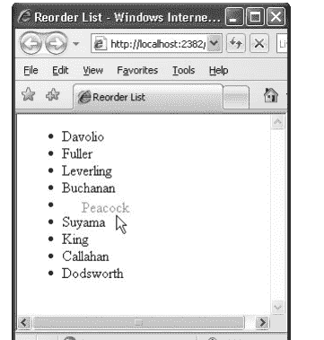

**图 5-6** 在 *ReorderList* 控件中重新排序项目

通常，正在移动的项目是通过您通过 *ReorderTemplate* 属性指定的模板进行渲染的。在这种情况下，重新排序模板由项目的纯文本加上级联样式组成。如果您省略了模板，但仍然通过 *AllowReorder* 布尔属性启用重新排序，则会以灰色渲染项目文本，向用户提供有关正在进行的操作的反馈。

### 重新排序和回发事件

*ReorderList* 控件可以配置为在每次拖放操作结束时回发。为避免整个页面刷新，您需要将 *ReorderList* 控件包装在 *UpdatePanel* 控件中。如第 4 章所述，通过这种方式，您可以确保仅刷新列表控件的用户界面，而不是通过完整的回发更新整个页面。以下几行标记可以为我们实现这一点：

```
<asp:UpdatePanel runat="server" ID="UpdatePanel1">
    <ContentTemplate>
        ...
        <!-- ReorderList goes here -->
        ...
    </ContentTemplate>
</asp:UpdatePanel>
```

为什么控件会自行回发？*ReorderList* 控件尝试持久化用户所做的更改，以便如果页面内部发生任何回发（例如，用户单击页面中另一个按钮引起的回发），通过拖放操作修改的 *ReorderList* 的内容将得以维护。请注意，事实上，在客户端所做的任何更改都应该在服务器上持久化；否则，它们将在第一次后续页面回发中丢失。

### 持久化重新排序的项目

如果您运行一个包含 *ReorderList* 控件的页面，您会注意到在回发之后，任何移动的元素都会恢复到其原始位置。为什么会这样？在拖放操作结束时，*ReorderList* 控件回发，在服务器上触发 *ItemReorder* 事件，并重建列表。列表是数据绑定的，因此除非您在绑定过程中更改某些内容，否则列表将按相同的旧顺序重新绑定回相同的记录集。

因此，托管 *ReorderList* 控件的页面应连接 *ItemReorder* 事件，并确保绑定到控件的数据源正确反映在客户端上生成的更改。*ItemReorder* 事件具有以下签名：

```
void OnItemReorder(object sender, ReorderListItemReorderEventArgs e)
```

在此事件处理程序中，您应该执行重新排序的实际工作——即，将项目从用于填充列表的数据源中的旧位置移动到新位置。具体如何操作取决于绑定机制。如果您选择使用数据源控件（例如 *ObjectDataSource*），您可以尝试对反映新顺序的给定字段（如果有的话）进行排序。如果您通过将 *IEnumerable* 对象分配给 *DataSource* 属性来设置数据源，则可以检索并修改此对象以反映新顺序。例如，对于 *DataTable*，这意味着交换两行。

> **注意** 如果设置了 *ReorderList* 的 *SortOrderField* 属性，并且数据源可以按该字段排序，则 *ReorderList* 可以自动执行服务器端重新排序。此外，排序字段的类型必须是 *integer*。

### TabContainer 控件

多视图是大多数页面中的一个常见功能。它们将信息分组到选项卡中，让用户单击以仅显示可用信息的一部分。在 ASP.NET 2.0 中，*MultiView* 控件为此功能提供了一个有效的快捷方式。但它需要一个回发来在用户选择新选项卡时更新页面。在 ACT 中，*TabContainer* 控件提供了多视图控件的 AJAX 版本。

### TabContainer 控件概述

*TabContainer* 控件由一个选项卡集合组成，每个选项卡由一个 *TabPanel* 类的实例表示。您可以以编程方式添加和删除面板，也可以以声明方式定义它们。

### 控件的属性

表 5-6 列出了控件支持的属性。

#### 表 5-6 TabContainer 控件的属性

| 属性 | 描述 |
| --- | --- |
| *ActiveTab* | 返回对当前选定选项卡的引用。 |
| *ActiveTabIndex* | 获取和设置选定选项卡的从零开始的索引。 |
| *CssClass* | 获取和设置用于设置控件样式的 CSS 类。 |
| *Height* | 获取和设置选项卡的高度。属性的值表示为 *Unit* 值。此值不包括标题。 |
| *OnClientActiveTabChanged* | 获取和设置当用户更改选择时在客户端执行的 JavaScript 代码。 |
| *Scrollbars* | 获取和设置所需滚动条支持。此属性默认设置为 *Auto*。可行的值来自 ASP.NET 2.0 的 *Scrollbars* 类型。 |
| *Tabs* | 返回定义控件用户界面的 *TabPanel* 对象集合。 |
| *Width* | 获取和设置选项卡的宽度。属性的值表示为 *Unit* 值。 |

此外，当所选选项卡更改时，控件会触发 *ActiveTabChanged* 事件。该事件仅是一个通知，所需的委托是 *EventHandler*。没有附加信息随事件一起传递。

### 选项卡面板的属性

*TabPanel* 类表示容器中的单个选项卡。每个选项卡将其标题定义为纯文本或模板。同样，选项卡具有一个模板，让开发者可以指定其内容。最近的选项卡应在回发后保持选中状态。表 5-7 列出了 *TabPanel* 类的属性。

| 属性 | 描述 |
| --- | --- |
| *ContentTemplate* | 设置选项卡的内容。 |
| *Enabled* | 指示是否应显示该选项卡。属性的值可以在客户端更改。 |
| *HeaderTemplate* | 获取和设置用于定义选项卡标题的模板。 |
| *HeaderText* | 获取和设置在选项卡标题中显示的文本。 |
| *OnClientClick* | 附加到选项卡客户端 *click* 事件的 JavaScript 代码。 |
| *OnClientPopulated* | 当选项卡已完全填充时在客户端运行的 JavaScript 代码。 |
| *OnClientPopulating* | 当选项卡将要被填充时在客户端运行的 JavaScript 代码。 |
| *Scrollbars* | 获取和设置所需滚动条支持。此属性默认设置为 *Auto*。可行的值来自 ASP.NET 2.0 的 *Scrollbars* 类型。 |

您可以附加到某些客户端事件的 JavaScript 代码可以是嵌入在宿主页面中的函数的名称，也可以是 JavaScript 可执行代码的字符串。

### 使用 TabContainer 控件

让我们考虑一个使用 *TabContainer* 控件的示例页面。您稍后会看到，选项卡容器所需的标记很简单。

### 配置 TabContainer 控件

*TabContainer* 标记将其子标签映射到 *TabPanel* 对象的 *Tabs* 集合。您为每个所需的选项卡添加一个 `<TabPanel>` 标记，并根据需要配置它。下面是一个示例：

```
<act:TabContainer runat="server" ID="TabContainer1">
    <act:TabPanel runat="server" ID="TabPanel1" HeaderText="Your Tab">
        <ContentTemplate>
            <h3>Some text here</h3>
        </ContentTemplate>
    </act:TabPanel>
    ...
</act:TabContainer>
```

所有选项卡都被赋予相同的大小，您可以通过容器的 *Width* 和 *Height* 属性来控制大小设置。您设置的高度是指标签主体的高度，不包括标题。


### 更改选定的选项卡

你可以添加一些脚本代码，以便在用户选择新选项卡时运行。你可以将所有代码封装在页面级JavaScript函数中，并将该函数的名称绑定到选项卡容器的`OnClientActiveTabChanged`属性。以下代码将当前选定的选项卡名称写入名为`CurrentTab`的页面元素（最初是一个ASP.NET Label控件）：

```
<script type="text/javascript">
    function ActiveTabChanged(sender, e)
    {
        var tab = $get('<%=CurrentTab.ClientID%>');
        tab.innerHTML = sender.get_activeTab().get_headerText();
    }
</script>
```

注意JavaScript中代码块的用法。通过这种方式，标签的客户端ID会合并到脚本中，无论页面是普通页面还是内容页面（具有父控件和命名容器的层次结构）。图5-7展示了该控件的实际效果。

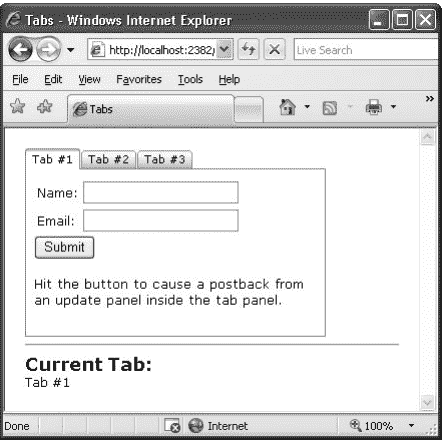

**图5-7** *TabContainer*控件的实际效果

### 客户端对象模型

作为一个功能齐全的ASP.NET AJAX控件，`TabContainer`控件公开了一个客户端对象模型。特别是，有一组属性代表容器的编程接口，另一组属性用于每个选项卡面板。

容器具有读/写属性——如`activeTabIndex`、`activeTab`、`tabs`和`scrollBars`——以及`activeTabChanged`事件。

选项卡面板公开读/写属性，如*enabled*、*headerText*和*scrollBars*，以及一个只读的*tabIndex*属性和一些事件——*click*、*populating*和*populated*。

### AJAX Control Toolkit 扩展器

除了在ACT中找到功能齐全的服务器控件（如*ReorderList*和*Accordion*）外，你还会找到许多其他服务器控件，旨在扩展现有控件并为其提供新的附加行为。现有的扩展器可以分为几组：面板、输入、弹出窗口、用户界面、动画和按钮。让我们深入了解这些分组。

### 面板扩展器

ASP.NET页面充满了标记块，理想情况下，用户希望移动它们，如果太大则折叠，并按需展开。因此，ASP.NET中完美的面板控件既是可拖动的又是可扩展的。为此，ASP.NET AJAX定义了一些服务器端行为，使你可以轻松创建可折叠部分和在页面上拖动面板。

### *CollapsiblePanel*扩展器

该扩展器通过组合两个面板（一个作为内容面板，另一个作为展开/折叠控制器）来在你的页面中构建可折叠部分。在最简单的形式中，*CollapsiblePanel*扩展器如下代码示例所示：

```
<act:CollapsiblePanelExtender ID="CollPanel" runat="server"
        TargetControlID="ContentPanel"
        ExpandControlID="HeaderPanel"
        CollapseControlID="HeaderPanel" />
```

与往常一样，*TargetControlID*属性设置要展开或折叠的目标面板。*ExpandControlID*和*CollapseControlID*指示用于展开和折叠内容面板的面板。注意组件设计的极高灵活性——虽然在所有情况下可能并不都有意义，但你可以使用不同的面板来控制内容面板的展开和折叠。不过，在大多数情况下，你会使用相同的标题面板，其中包含一个根据内容面板状态而变化的图像按钮。以下代码片段展示了该扩展器更完整的用法：

```
<act:CollapsiblePanelExtender ID="cpe" runat="server"
        TargetControlID="CollapsibleCustomersPanelContent"
        ExpandControlID="CollapsibleCustomersPanel"
        CollapseControlID="CollapsibleCustomersPanel"
        Collapsed="true"
        ExpandDirection="Vertical"
        ImageControlID="ToggleImage"
        ExpandedImage="~/images/collapse.jpg"
        ExpandedText="Collapse"
        CollapsedImage="~/images/expand.jpg"
        CollapsedText="Expand" />
```

*ImageControlID*指示*Image*控件（如果有），单击该控件会导致面板展开或折叠。*ExpandedImage*和*CollapsedImage*属性设置用于展开和折叠的图像的URL。同样，*CollapsedText*和*ExpandedText*设置图像的工具提示文本。*Collapsed*设置面板的状态，而*ExpandDirection*指示面板是水平还是垂直展开。图5-8提供了该控件的实际效果视图。

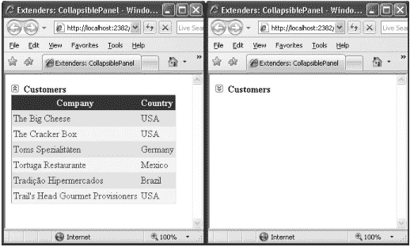

图5-8 *CollapsiblePanel*扩展器的实际效果

以下代码演示了与扩展器一起使用的一对典型*Panel*控件：

```
<asp:Panel ID="CollapsibleCustomersPanel" runat="server">
    <asp:Image ID="ToggleImage" runat="server"
               ImageUrl="~/images/collapse.jpg" />
    <b>Customers</b>
</asp:Panel>
<asp:Panel ID="CollapsibleCustomersPanelContent" runat="server"
    Height="0" CssClass="collapsePanel">
    ...
</asp:Panel>
```

与可拖动面板不同，标题和内容面板是独立的，通常在页面布局中一个接一个地放置。扩展器面板也是*回发感知*的，这意味着在客户端回发时，它会自动记录并恢复其折叠/展开的客户端状态。

> 注意 为避免显示可折叠面板时的初始闪烁，请确保正确设置将要折叠和展开的面板的样式。此面板需要将*Height=0*，并将CSS *overflow*样式设置为*hidden*。

### *DragPanel*扩展器

*DragPanel*扩展器是ACT中最简单的扩展器之一。它只有两个属性——一个用于指示要拖动的面板，另一个用于指示用作拖动句柄的面板：

```
<act:DragPanelExtender ID="DragPanelExtender1" runat="server"
                    TargetControlID="CustomerPanel"
                    DragHandleID="CustomersDragHandle" />
```

顾名思义，TargetControlID属性指的是页面中将要移动的面板控件的ID。另一方面，DragHandleID指示用作拖动句柄的面板控件的ID。换句话说，要拖动目标面板，用户需要拖放句柄面板。虽然功能上不同，但这两个面板实际上在逻辑上是相关的，并通过嵌套标签呈现：

```
<asp:Panel ID="CustomersPanel" runat="server" >
    <asp:Panel ID="CustomersDragHandle" runat="server">
        <div style="background-color:yellow">Customers</div>
    </asp:Panel>
    <asp:Panel runat="server">
        <asp:gridview runat="server" DataSourceID="ObjectDataSource1">
            <Columns>
                ...
            </Columns>
        </asp:gridview>
        <asp:ObjectDataSource ID="ObjectDataSource2" runat="server"
                TypeName="IntroAjax.CustomerManager"
                SelectMethod="LoadAll">
        </asp:ObjectDataSource>
    </asp:Panel>
</asp:Panel>
```

目标面板通常包含拖动句柄面板作为子级。通过这种方式，你可以获得移动整个面板的效果，就像它是Microsoft Windows窗口一样。（参见图5-9。）


### *DropDown*扩展器

*DropDown*扩展器可以附加到几乎任何ASP.NET控件。一旦附加到控件，该扩展器提供一个鼠标悬停链接以打开下拉面板。面板的内容完全由你决定——通常，安排为一个菜单。下拉菜单通过使用任何鼠标按钮单击扩展控件来激活。

```
<asp:Label ID="Label1" runat="server" Text="Move the mouse here" />
<asp:Panel ID="Panel1" runat="server" CssClass="ContextMenuPanel"
    Style="display:none;visibility:hidden;">
    <asp:LinkButton runat="server" ID="Option1" Text="I'm the first"
        CssClass="ContextMenuItem" OnClick="LinkButton1_Click" />
    <asp:LinkButton runat="server" ID="Option2" Text="I'm the second"
        CssClass="ContextMenuItem" OnClick="LinkButton1_Click" />
    <asp:LinkButton runat="server" ID="Option3" Text="I'm the third"
        CssClass="ContextMenuItem" OnClick="LinkButton1_Click" />
</asp:Panel>

<act:DropDownExtender runat="server" ID="DropDownExtender1"
    TargetControlID="Label1" DropDownControlID="Panel1" />
```

在刚刚显示的示例中，下拉用户界面是一个包含链接按钮列表的*Panel*。链接按钮被设置为看起来像菜单项。链接和按钮，以及实际上一般的嵌入式控件，都可以正常操作。（参见图5-10。）


### 按钮扩展器

到目前为止，按钮是ASP.NET页面中最常见的元素之一。然而，随着页面功能日益丰富，按钮需要附加功能以保持与用户期望同步。ASP.NET AJAX提供了一些扩展器，适用于提交按钮以及构成*CheckBox*元素的伪按钮。


## *ConfirmButton* 扩展器

在许多情况下，响应用户点击按钮的安全做法是询问用户是否确认她将要开始的操作。实现这种行为的常见解决方案需要 ASP.NET 页面将一些脚本代码附加到按钮上，以弹出带有确认消息的 JavaScript 消息框。*ConfirmButton* 扩展器通过声明式方式极大地简化了这一常见任务：

```aspx
<asp:Button runat="server" ID="Button1" Text="Click me" />
```

```aspx
<act:ConfirmButtonExtender ID="ConfirmButtonExtender1" runat="server"
    TargetControlID="Button1"
    ConfirmText="Are you sure you want to click this?\nReally sure?" />
```

*ConfirmText* 属性指定用户点击按钮时显示的消息框文本。请注意，可以在文本中使用 HTML 实体，但按照设计不能使用 HTML 格式，例如 `<b>` 或 `<i>`。不过，您可以使用实体化的特殊字符。例如，可以使用 `&#10;` 来换行并继续下一行的文本。原因在于 *ConfirmButton* 的 JavaScript 代码——它使用的是 JavaScript 的 *window.confirm*。提供 HTML 格式没有意义，因为确认对话框基本上是一个非 HTML 的 Windows *MessageBox* 调用。

在内部，*ConfirmButton* 扩展器为表单的 *onsubmit* 事件设置一个处理程序，如果用户不确认操作，则阻止该事件。只有实现了 *IButtonControl* 接口的控件才能与该扩展器一起使用，包括 *LinkButton* 和 *ImageButton* 控件。（见图 5-11。）

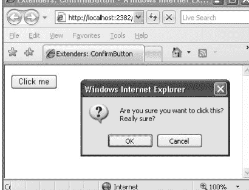

## *MutuallyExclusiveCheckBox* 扩展器

*MutuallyExclusiveCheckBox* 扩展器可以附加到任何 ASP.NET *CheckBox* 控件，使其成为一组逻辑相关选项的一部分。该扩展器实现的行为非常类似于单选按钮列表——有多个选项可用，但只能选择其中一个。那么，拥有一组互斥复选框而不是单选按钮列表的意义何在？

单选按钮列表最初可以是未选中状态，但一旦某个选项被选中，用户就无法返回到所有选项都未选中的初始状态。而使用 *MutuallyExclusiveCheckBox* 扩展器，则可以恢复到最初完全未选中的状态。

其思路是将多个复选框归组到同一个键下。然后，扩展器确保具有指定键的复选框在任何时候只能选中一个：

```aspx
<h2>What Kind of Experience Do You Have with ASP.NET?</h2>
<asp:CheckBox runat="server" ID="chkBeginner" Text="Beginner" />
<asp:CheckBox runat="server" ID="chkIntermediate" Text="Intermediate" />
<asp:CheckBox runat="server" ID="chkExpert" Text="Expert" />

<act:MutuallyExclusiveCheckBoxExtender runat="server" ID="Mutual1"
    TargetControlID="chkBeginner"
    Key="AspNetExpertise" />
<act:MutuallyExclusiveCheckBoxExtender runat="server" ID="Mutual2"
    TargetControlID="chkIntermediate"
    Key="AspNetExpertise" />
<act:MutuallyExclusiveCheckBoxExtender runat="server" ID="Mutual3"
    TargetControlID="chkExpert"
    Key="AspNetExpertise" />
```

有人可能会说，同样的功能也可以应用到单选按钮上，而不是复选框。这是开发者的选择，而且使用复选框也提供了更加一致且符合用户预期的界面。不过，你也可以使用 JavaScript 重新实现这种行为，以允许取消单选按钮项的选中状态。

## *ToggleButton* 扩展器

复选框是图形化的 HTML 元素，视觉上由一对小位图（选中和未选中）和配套文本组成。每个浏览器可以使用自己的位图对，因此复选框的外观和感觉会略有不同。不过，大多数浏览器倾向于将复选框按钮表示为方形浮雕按钮。

*ToggleButton* 扩展器提供了一种模拟使用自定义位图的复选框元素的方法。该扩展器应用于 *CheckBox* 控件，并将该控件替换为一个全新的标记块，该标记块使用自定义图像并提供与标准复选框相同的行为：

```aspx
<act:ToggleButtonExtender ID="ToggleButtonExtender1" runat="server"
        TargetControlID="CheckBox1"
        ImageWidth="19"
        ImageHeight="19"
        UncheckedImageUrl="DontLike.gif"
        CheckedImageUrl="Like.gif" />
```

*ImageWidth* 和 *ImageHeight* 属性指示图像的期望大小。请注意，这些属性是必需的。*UncheckedImageUrl* 和 *CheckedImageUrl* 指定复选框未选中和选中时要使用的图像。

### 弹出扩展器

几乎每个 Web 开发者对弹出窗口都存有一种爱恨交织的关系。事实上，弹出窗口通常能大大简化许多任务——尤其是模态对话框。HTML 弹出窗口的一个棘手之处在于它们是浏览器窗口，需要一个页面来导航。而 ASP.NET AJAX 扩展提供的弹出扩展器则不需要新的浏览器实例。相反，它们仅限于弹出你指定的任何面板的内容，可以是模态的也可以是非模态的。

## *HoverMenu* 扩展器

*HoverMenu* 扩展器类似于 *PopupControl* 扩展器，可以与任何 ASP.NET 控件关联。这两个扩展器都会显示一个弹出面板来展示额外内容，但它们针对的是不同的事件。*HoverMenu* 特别之处在于，当用户将鼠标光标移到目标控件上时，它会弹出自己的面板。面板可以显示在开发者指定的位置。它可以位于目标控件的左侧、右侧、顶部或底部。此外，该控件可以应用可选的 CSS 样式，使其看起来处于高亮状态。（见图 5-12。）

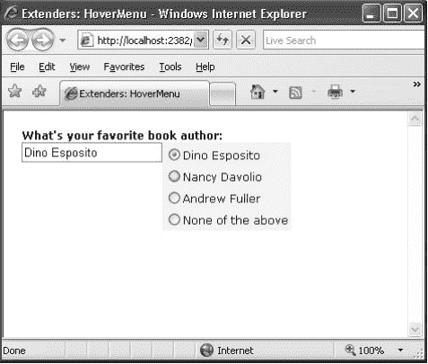

*HoverMenu* 扩展器适合为几乎任何 ASP.NET 控件实例实现自动显示的上下文菜单，以及为填写某些输入字段提供提示。例如，在图 5-12 中，当用户将光标悬停在文本框上时，会出现一个建议列表来简化工作。

```aspx
<asp:TextBox ID="TextBox1" runat="server" />

<asp:Panel ID="Panel1" runat="server" CssClass="popupMenu">
    <asp:RadioButtonList ID="RadioButtonList1" runat="server"
        AutoPostBack="true"
        OnSelectedIndexChanged="RadioButtonList1_SelectedIndexChanged">
        <asp:ListItem Text="Dino Esposito"></asp:ListItem>
        <asp:ListItem Text="Nancy Davolio"></asp:ListItem>
        <asp:ListItem Text="Andrew Fuller"></asp:ListItem>
        <asp:ListItem Value="" Text="None of the above"></asp:ListItem>
    </asp:RadioButtonList>
</asp:Panel>
```

```aspx
<act:HoverMenuExtender ID="HoverMenu1" runat="server"
    TargetControlID="TextBox1"
    HoverCssClass="hoverPopupMenu"
    PopupControlID="Panel1"
    PopupPosition="Right" />
```

*Panel1* 控件定义了一组单选按钮，每个按钮包含一个用于填充文本框的建议。*HoverMenu* 扩展器以文本框控件为目标，并将 *Panel1* 定义为其动态弹出面板。*PopupPosition* 属性指示面板相对于目标控件的位置。同样，前面示例代码中未显示的其他属性，如 *OffsetX* 和 *OffsetY*，定义了面板所需的偏移量。*PopDelay* 设置鼠标移动与面板显示之间经过的时间（以毫秒为单位）。*HoverCssClass* 可选地用于在悬停菜单处于活动状态时给文本框不同的样式。值得关注的是与面板关联的 CSS 类：

```css
.popupMenu
{
    position:absolute;
    visibility:hidden;
    background-color:#F5F7F8;
}
.hoverPopupMenu
{
    background-color:yellow;
}
```

面板的 *visibility* 属性必须设置为 *hidden*，这与 *CollapsiblePanel* 控件一样；否则，面板将在页面加载时显示，然后立即隐藏。

与 *PopupControl* 扩展器一样，要充分利用 *HoverMenu* 扩展器，需要将扩展控件放在 *UpdatePanel* 控件内部。这样，每当用户点击单选按钮时，面板会异步回传并在服务器上触发 *SelectedIndexChanged* 事件。

```csharp
void RadioButtonList1_SelectedIndexChanged(object sender, EventArgs e)
{
    TextBox1.Text = RadioButtonList1.SelectedValue;
}
```


服务器端事件处理器随后只需更新文本框中的文本，如图 5-12 所示。

## *ModalPopup* 扩展器

*ModalPopup* 扩展器以模态方式显示与 *PopupControlID* 属性所标识控件相关联的任何内容。此场景中的 *TargetControlID* 属性指向一个可点击的控件：

```
<act:ModalPopupExtender ID="ModalPopupExtender1" runat="server"
        TargetControlID="LinkButton1"
        PopupControlID="PopupContent"
        OkControlID="Button1"
        CancelControlID="Button2">
```

请注意，*ModalPopup* 扩展器是由目标控件上的 *onclick* 事件触发的。因此，目标控件必须是支持点击操作的控件。弹出控件不必是 *Panel* 控件；通常来说，它可以是任何控件。不过，它一般是一个包含多个子控件的控件——通常是 *Panel*。

在弹出面板中，你可以有选择地指定一个"确定"控件和一个"取消"控件。你通过 *OkControlID* 和 *CancelControlID* 属性设置这些控件（通常是按钮）的 ID。弹出行为显然是客户端操作，因此可能需要一些 JavaScript 代码来响应用户点击"确定"或"取消"控件。你可以使用 *OnOkScript* 属性指定用户点击"确定"按钮时要运行的 JavaScript 函数；使用 *OnCancelScript* 指定点击"取消"时要执行的函数。

以下标记展示了一个示例模态面板的内容。请注意，*Panel* 控件应将其 CSS *display* 属性设置为 *none*，以使所有内容在初始状态下不可见。

```
<asp:LinkButton ID="LinkButton1" runat="server" text="Click me" />
<asp:Panel runat="server" ID="PopupContent" BackColor="Yellow">
        <div style="margin:10px">
        Take note of this message and tell us if you strongly agree.
        <br /><br />
        <asp:Button ID="Button1" runat="server" Text="Yes" width="40px"  />
        <asp:Button ID="Button2" runat="server" Text="No"  width="40px" />
        </div>
</asp:Panel>
```

图 5-13 展示了模态对话框的实际效果。

两个图形属性——*DropShadow* 和 *BackgroundCssClass*——完善了该扩展器的功能。*DropShadow* 是一个布尔属性，用于指示是否应渲染如图 5-13 所示的投影效果。而 *BackgroundCssClass* 则决定了临时应用于底层页面的样式：

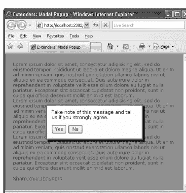

图 5-13 *ModalPopup* 扩展器的实际效果

```
modalBackground {
    background-color:Gray;
    filter:alpha(opacity=70);
    opacity:0.7;
}
```

上述样式使页面变灰并呈现半透明效果，以获得更美观的视觉体验。

## *PopupControl* 扩展器

*PopupControl* 扩展器可以附加到任何触发 *onclick*、*onfocus* 或 *onkeydown* 事件的 HTML 元素上。该扩展器的最终目的是显示一个弹出窗口，展示额外内容，例如在用户需要输入日期的文本框上显示一个日历。弹出面板的内容通过 *Panel* 控件来表达，其中可以包含 ASP.NET 服务器控件以及静态文本和 HTML 元素：

```
<asp:TextBox runat="server" ID="InvoiceDateTextBox" />
<asp:Panel runat="server" ID="Panel1">
    ...
</asp:Panel>
```

```
<act:PopupControlExtender ID="PopupExtender1" runat="server"
    TargetControlID="InvoiceDateTextBox"
    PopupControlID="Panel1"
    Position="Bottom" />
```

*TargetControlID* 属性指向触发弹出窗口的控件，而 *PopupControlID* 指示要显示的面板。*Position* 属性设置面板的位置——可以是父控件的顶部、左侧、右侧或底部。（参见图 5-14。）

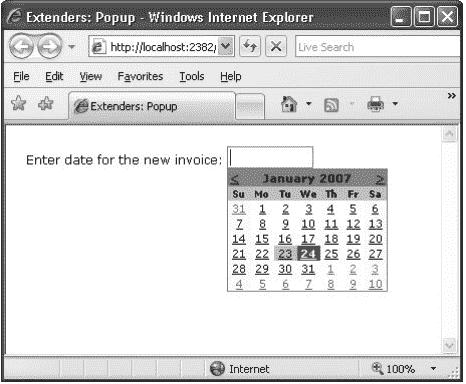

图 5-14 *PopupControl* 扩展器的实际效果

其他属性包括 *OffsetX* 和 *OffsetY*，用于指示弹出窗口从其位置偏移的像素数，以及 *CommitProperty* 和 *CommitScript*，可用于向目标控件赋值。

弹出窗口通常包含一些交互控件并会触发回发。因此，你可能需要将其放置在 *UpdatePanel* 控件中，以便在不刷新整个页面的情况下执行服务器端任务。通常情况下，弹出窗口会在回发后关闭——例如，图 5-14 中显示的弹出窗口配置为在用户选择日期后关闭。此场景中的日历在服务器端触发 *SelectionChanged* 事件：

```
protected void Calendar1_SelectionChanged(object sender, EventArgs e)
{
    PopupExtender1.Commit(
        Calendar1.SelectedDate.ToShortDateString());
}
```

*Commit* 方法将关联控件的默认属性设置为指定值。如果你想控制弹出窗口关闭时在目标控件上设置哪个（非默认）属性，请使用 *CommitProperty* 属性。同样，你可以使用 *CommitScript* 属性指定在设置弹出窗口结果后在客户端执行的 JavaScript 函数。

> 警告 请注意，扩展器不能放置在与其扩展的控件不同的 *UpdatePanel* 中。如果被扩展的控件包含在 *UpdatePanel* 中，扩展器也应放置在该可更新面板中。否则将引发运行时异常。

### 用户界面扩展器

在 ASP.NET AJAX 扩展器家族中，最大的一组是用户界面扩展器——即用于帮助实现丰富且用户友好功能的特殊组件。

### *AlwaysVisibleControl* 扩展器

*AlwaysVisibleControl* 扩展器允许你将给定的控件或控件面板固定在页面的某个角落，使其在页面滚动或调整大小时始终浮动显示在背景之上。该扩展器几乎可以与任何 ASP.NET 控件配合使用。

```
<span style="background-color:yellow;" runat="server" id="Msg">
   Need a bit of dummy text? Look at
   <b>http://www.loremipsum.net</b></span>

<act:AlwaysVisibleControlExtender ID="av1" runat="server"
   TargetControlID="Msg"
   HorizontalSide="Left"
   VerticalSide="Top" />
```

你使用 *HorizontalSide* 和 *VerticalSide* 属性设置绑定控件的目标位置，以定义内容应停靠在页面的哪个角落。*HorizontalSide* 属性接受 *Left* 和 *Right* 作为值，而 *VerticalSide* 属性的可选值为 *Top* 和 *Bottom*。你还可以通过 *VerticalOffset* 和 *HorizontalOffset* 属性控制与各边框的偏移距离。最后，*ScrollEffectDuration* 指示目标控件重新定位时滚动效果持续的秒数。（参见图 5-15。）

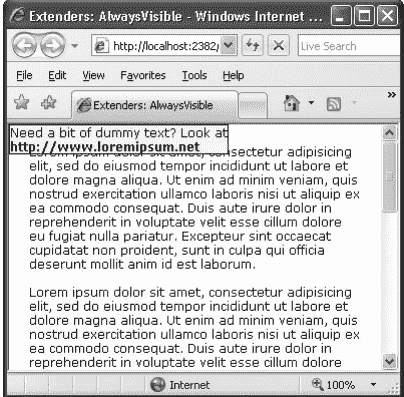

**图 5-15** *AlwaysVisible* 扩展器的实际效果

请注意，你不能将扩展器添加到普通的 HTML 元素上。如果你有一个需要始终保持可见的 HTML 块（例如前面示例中的 `<span>` 标签），请添加 runat=server 属性并为其指定一个唯一的 ID。

### CascadingDropDown 扩展器

CascadingDropDown 扩展器可以附加到 DropDownList 控件上，根据一个或多个父 DropDownList 控件的当前选择自动填充其内容。

CascadingDropDown 扩展器适用于一个较为常见的场景，即一个下拉列表的内容取决于另一个列表的选择。通过这种方式，你无需将整个数据集传输到客户端，子列表可以按照父列表的选择从数据集中选取子集来显示。例如，假设你希望用户先选择一个国家，再选择该国家中的城市。为了减少数据传输量并提供更友好的用户界面，你可能希望在用户选择国家之前保持城市列表为空。当用户选定一个国家后，再回到服务器下载该国家可用的城市列表。CascadingDropDown 扩展器通过向客户端页面注入一些胶水代码，并对页面代码的结构做出一些假设，从而简化了这一场景。

所有关于 DropDownList 控件集内容的逻辑都应驻留在一个 Web 服务中。该 Web 服务可以使用任何合适的方法来存储和查找相关数据。不过，Web 服务在某种程度上必须使用约定的模式。具体来说，它需要包含一个具有以下签名的方法：

```
[WebMethod]
public CascadingDropDownNameValue[] GetDropDownContents(
    string knownCategoryValues, string category)
{
    ...
}
```

方法的名称当然可以有所不同。CascadingDropDownNameValue 类型是一个内部集合类型，用于存放要在下拉列表中显示的名称/值项。附加到该扩展器的每个下拉列表都属于一个类别：

```
<act:CascadingDropDown ID="CascadingDropDown1" runat="server"
    TargetControlID="DropDownList1"
    Category="Country"
    PromptText="Please select a country"
    ServiceMethod="GetDropDownContentsPageMethod" />
<act:CascadingDropDown ID="CascadingDropDown2" runat="server"
    TargetControlID="DropDownList2"
    Category="City"
    PromptText="Please select a city"
    LoadingText="Please, wait ..."
    ServicePath="CityFinderService.asmx"
```


*Category* 属性的内容是任何有助于 Web 服务方法理解应检索何种数据以及输入参数含义的名称。*PromptText* 属性设置当未进行选择且控件通常处于禁用状态时，希望在下拉列表中显示的任何文本。*LoadingText* 属性指示在填充下拉列表期间必须显示的任何文本。*ServiceMethod* 属性指示要调用以填充列表控件的方法。如果未指定 *ServicePath*，则假定该方法是页面方法。最后，*ParentControlID* 创建一个层次结构，并指定一个列表作为另一个列表的子项。

每当父 *DropDownList* 控件中的选择发生变化时，扩展程序会调用 Web 服务并检索层次结构中下一个 *DropDownList* 的值列表。如果当前未进行选择，扩展程序会自动禁用该控件。（参见图 5-16。）

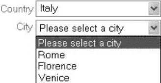

## **The *DropShadow* 扩展程序**

*DropShadow* 扩展程序旨在为面板控件添加阴影效果，使其看起来更专业。您还可以设置阴影的不透明度和宽度：

```xml
<asp:Panel runat="server" ID="Panel1">
    <div style="padding:8px">
        <asp:TextBox ID="TextBox1" runat="server" />
    </div>
</asp:Panel>
```

```xml
<act:DropShadowExtender ID="DropShadowExtender1" runat="server"
    TargetControlID="Panel1" Opacity=".65" Width="5" Rounded="true" />
```

*TargetControlID* 属性设置将被渲染阴影效果的控件。此控件通常应是一个 *Panel*；但是，只要不设置圆角，它也可以是任何其他 ASP.NET 控件，例如 *TextBox*。您通过 *Opacity* 属性控制阴影的不透明度。该属性的值范围从 *0.0* 到 *1.0*，其中 *0*（或 *0.0*）表示完全透明。因此，值越接近 *1*（或 *1.0*），阴影就越深。

*Rounded* 布尔属性指示周围的面板和阴影是否应具有圆角。默认值为 *false*。图 5-17 显示了扩展程序的运行效果。

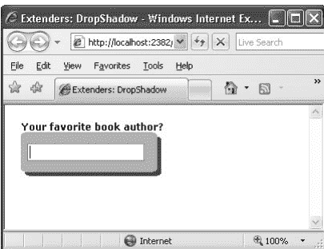

图 5-17 *DropShadow* 扩展程序运行效果

## *DynamicPopulate* 扩展程序

*DynamicPopulate* 扩展程序是一种绑定器组件，它用 Web 服务方法调用返回的标记替换给定控件的标记。该扩展程序可以看作是我们第 4 章讨论的 *UpdatePanel* 控件的封装简化版本。它捕获客户端事件并触发远程调用。返回的字符串作为目标元素的子项插入到页面 DOM 中。以下是一个示例：

```xml
<input type="button" id="Button1" runat="server" value="Refresh ..." />
<hr />
<b>Last updated:&nbsp;</b>
<asp:Panel runat="server" ID="Msg" Style="padding:2px;height:2em;" />

<act:DynamicPopulateExtender ID="DynamicPopulateExtender1" runat="server"
    TargetControlID="Msg"
    ClearContentsDuringUpdate="true"
    PopulateTriggerControlID="Button1"
    ServiceMethod="GetTimeOnServer"
    UpdatingCssClass="updating" />
```

当用户点击指定的项目时——在本例中，是名为 *Button1* 的按钮——扩展程序开始工作。它调用 *GetTimeOnServer* 方法，并用其输出替换 *Msg* 控件为根的子树。*GetTimeOnServer* 方法是一个 Web 服务方法。您使用 *ServicePath* 属性指定服务的 URL。如果未设置此属性，则假定该方法是页面代码文件中或通过服务器 `<script>` 标签内联定义的页面方法：

```csharp
[WebMethod]
public string GetTimeOnServer(string contextKey)
{
    // Use contextKey to receive data from the client
    // Get the output-it can be HTML markup
    return DateTime.UtcNow.ToString();
}
```

ClearContentsDuringUpdate 是一个布尔属性，它在更新期间清除目标控件的内容。如果您想在操作期间显示特殊样式或位图，可以通过 UpdatingCssClass 属性设置 CSS 样式。创建此类 CSS 类时，请记住应确保目标控件具有最小高度。（必须在面板上显式设置。）您使用 background-image CSS 属性设置要显示的图像。

请注意，您可以使用任何 HTML 元素来触发目标控件的动态填充。它不必是按钮控件；也不必是提交按钮，如 LinkButton 或 Button。事实上，在这种情况下，页面将回发，您将失去 ASP.NET AJAX 平台的优势。

> **注意** 您也可以使用一段 JavaScript 代码来动态填充给定的 DOM 元素。在这种情况下，您将 CustomScript 属性设置为 JavaScript 全局函数的名称。无论您使用自定义脚本还是服务器方法，都可以使用扩展程序的 ContextKey 属性向代码传递任意字符串。

### PagingBulletedList 扩展程序

想象一个页面需要向用户展示一个很长的项目列表——比如，一个客户列表。常见的解决方案是使用可分页的网格控件。ASP.NET 网格在每页加载时都会执行回发，但通过将网格包装在 UpdatePanel 控件中，您可以出色地解决这个问题。如果您觉得网格控件过于笨重，而需要使用项目符号列表控件来列出项目怎么办？

ASP.NET BulletedList 控件使用各种项目符号用户界面列出数据源的内容。但它不提供分页功能。PagingBulletedList 扩展程序是一个简单高效得惊人的扩展程序，用于对 BulletedList 控件的内容进行分页。让我们考虑以下代码，它用无分页的方式填充项目符号列表：

```xml
<asp:BulletedList ID="BulletedList1" runat="server" DisplayMode="Text"
                  DataSourceID="ObjectDataSource1" DataTextField="CompanyName" />

<asp:ObjectDataSource ID="ObjectDataSource1" runat="server"
                     TypeName="IntroAjax.CustomerManager"
                     SelectMethod="LoadAll">
</asp:ObjectDataSource>
```

这样的页面将生成超过 80 个项目符号项——Northwind 数据库中的每个客户对应一个。通过使用扩展程序扩展 BulletedList 控件，您将获得如图 5-18 所示的输出。

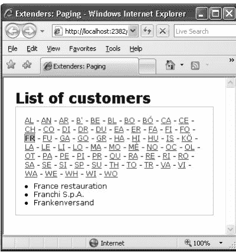

图 5-18 *PagingBulletedList* 扩展程序运行效果

但随后添加扩展程序的代码：

```xml
<act:PagingBulletedListExtender ID="PagingBulletedList1" runat="server"
    TargetControlID="BulletedList1"
    ClientSort="true"
    IndexSize="2"
    Separator=" - "
    SelectIndexCssClass="selectIndex" />
```

该扩展程序将所有绑定项组织成页，并显示指向每一页的链接。页面可以包含固定数量的项目，或者所有匹配初始字符串的项目。*IndexSize* 属性指示显示的文本中应使用多少个字母来创建一个页面。如果将其设置为 *1*，您将得到一个纯字母顺序的菜单。如果设置为 2，您将获得更细粒度的视图，因为每个页面仅包含名称匹配两个字母首字母的项目。作为 *IndexSize* 的替代方案，您可以使用 *MaxItemsPerPage*。在这种情况下，每页（最后一页可能除外）都将恰好包含指定数量的项目。

*Separator* 属性指示用于分隔菜单项的字符。*SelectIndexCssClass* 和 *UnselectIndexCssClass* 设置选中和未选中菜单项的 CSS 类。最后，如果 *ClientSort* 设置为 *true*，项目将在客户端按字母顺序排序后再显示。

## *ResizableControl* 扩展程序

大多数用户会欢迎那些可以动态调整某些 HTML 元素大小的页面，例如文本面板或图像。*ResizableControl* 扩展程序附加到网页的元素上，并提供一个图形化手柄供用户调整该元素的大小。放置在


## *ResizableControl* 扩展器

位于元素右下角的拖动手柄让用户可以像调整窗口大小一样调整该元素的大小。让我们来看一下以下标记：

```xml
<asp:Panel ID="Panel1" runat="server" Style="overflow:hidden"
          Width="130px" Height="65px">
    <asp:Image ID="Image1" runat="server" ImageUrl="~/images/ajax.gif"
             Style="width:100%; height:100%;" />
</asp:Panel>

<asp:Panel ID="Panel2" runat="server" Style="overflow:auto"
          Width="130px" height="100px">
    This text resizes itself to be as large as possible
    within its container.
</asp:Panel>
```

如你所见，第一个面板包含一张图片；第二个面板包含纯文本。某些 CSS 属性对于扩展器正常工作来说是必需的。特别是，你可能需要将图片的 overflow 属性设置为 *hidden*，将文本的 overflow 属性设置为 *auto*。overflow 属性控制当元素内容超出预留空间时滚动条的显示方式。在此示例中，我拉伸或缩小图片，并对文本进行滚动处理。

为面板设置正确的初始大小非常重要。特别是，对于图片，你应该为周围的面板设置与图片相同的大小。包含文本块的面板也应该给定明确的大小。

```xml
<act:ResizableControlExtender ID="Resizable1" runat="server"
    TargetControlID="Panel1"
    ResizableCssClass="resizingStyle"
    HandleCssClass="handleStyle" />
<act:ResizableControlExtender ID="Resizable2" runat="server"
    TargetControlID="Panel2"
    ResizableCssClass="resizingStyle"
    HandleCssClass="handleStyle" />
```

*ResizableControl* 扩展器有两个必需属性：*TargetControlID* 和 *HandleCssClass*。前者指明要调整大小的控件；后者设置要应用于调整大小手柄的 CSS 类名称。此外，*ResizableCssClass* 是在调整大小期间要应用于元素的 CSS 类。你可能希望使用这个类来更改或加粗边框颜色以强调该操作。以下是一个典型的手柄 CSS 类：

```css
.handleStyle
{
    width:16px;
    height:16px;
    background-image:url(~/images/HandleGrip.gif);
    overflow:hidden;
    cursor:se-resize;
}
```

图 5-19 展示了该扩展器的实际运行效果。

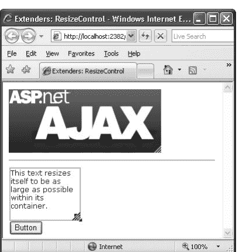

**图 5-19** *ResizableControl* 扩展器实际运行效果

*ResizableControl* 扩展器还包含两个客户端事件（*onresizing* 和 *onresize*），可以触发一些 JavaScript 代码来执行更复杂的操作，例如增大字体大小以适应更大的区域。该扩展器允许你为正在调整大小的元素定义最小和最大尺寸。控件调整大小所产生的任何更改都会自动在回发后持久保存。

## *RoundedCorners* 扩展器

*RoundedCorners* 扩展器是 *DropShadow* 扩展器的一个子集，因为它仅限于将子面板的角设为圆角：

```xml
<asp:Panel runat="server" ID="Panel1" BackColor="LightBlue" Width="170px">
    <div style="margin-left:2px">
        <asp:TextBox ID="TextBox1" runat="server"
                     BackColor="LightBlue"
                     BorderWidth="0px" />
    </div>
</asp:Panel>

<act:RoundedCornersExtender ID="RoundedCornerExtender1" runat="server"
    TargetControlID="Panel1" Radius="6" Color="LightBlue" />
```

该扩展器接受参数来设置目标控件，并定义圆角的期望半径和周围边框的颜色。实际上，圆角是通过在目标控件周围渲染一个额外的边框来实现的。通过移除文本框周围的所有边框，并为面板和文本框使用相同的背景色，你可以获得如图 5-20 所示的漂亮效果——一个圆角的文本框控件。

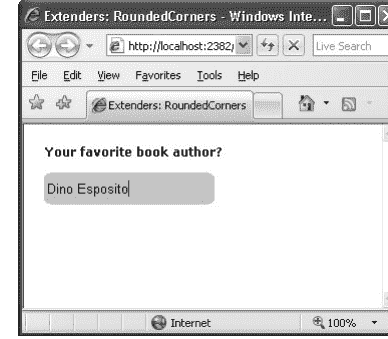

**图 5-20** *RoundedCorners* 扩展器实际运行效果

### 输入扩展器

网页仍然依赖 HTML 标记语言内置的功能让用户在表单和输入字段中输入数据。但 HTML 输入元素对于当今的应用程序和用户来说有时过于有限和简单。因此，老旧的 <input type="text"> 元素及其 ASP.NET 对应控件 TextBox 需要一些额外的功能。ACT 提供了一些扩展器，可将经典的输入字段转换为更具交互性和用户友好性的文本框。

### **AutoComplete** 扩展器

在文本框中输入数据有时可能很乏味，尤其是当你反复输入相同的文本片段时。出于这个原因，Web 浏览器早在不久前就开始支持自动完成功能。Web 浏览器的自动完成功能是指代码能够跟踪用户曾经输入过的任何 URL。这样，当你在输入一个可能很长且难以记住的 URL 时，浏览器可以快速向你提供建议。

自动完成也是某些浏览器（如 Internet Explorer 5 及更新版本）支持的一项功能，适用于你在 HTML 表单中使用的任何自定义文本框。浏览器会将曾经输入到给定名称输入字段中的任何数据保存在本地计算机上，并将其提供给站点中所有具有相同名称的 HTML 元素的页面。该功能与浏览器集成，对用户和开发者透明。建议列表是逐步构建的，完全不受页面作者的控制。

*AutoComplete* 扩展器将自动完成功能扩展到任何 ASP.NET TextBox 控件；更重要的是，它让页面作者能够以编程方式定义建议列表（通过 Web 服务检索获取）。

## 第二部分 为站点添加 AJAX 功能

```xml
<asp:TextBox ID="CustomerName" runat="server" />
```

```xml
<act:AutoCompleteExtender runat="server" ID="AutoCompleteExtender1"
    TargetControlID="CustomerName"
    Enabled="true"
    MinimumPrefixLength="1"
    ServicePath="Suggestions.asmx"
    ServiceMethod="GetSuggestions" />
```

在代码片段中，文本框使用指定 Web 服务的 GetSuggestions 方法返回的数据进行自动完成。ServicePath 和 ServiceMethod 扩展器属性标识提供自动完成数据的服务；MinimumPrefixLength 属性设置用户必须输入多少个字符才能触发自动完成功能。在前面的代码中，自动完成从输入第一个字符时开始。


> **注意** Web 服务必须是本地 Web 服务，安装在与使用它的页面相同的服务器计算机和应用程序上。请注意，此注意事项适用于 ASP.NET AJAX 扩展器使用的所有 Web 服务。

用于提供建议的 Web 服务方法必须具有已知的签名：

```csharp
[WebMethod]
public string[] GetSuggestions(string prefixText, int count)
{
    ...
}
```

prefixText 参数表示用户到目前为止已输入的文本；count 参数设置期望的建议数量。结果显示在文本框下方的下拉面板中。用户可以使用鼠标或键盘选择其中一个建议项。以下代码显示了一个 Web 服务方法，该方法返回与提供的前缀匹配的客户名称子集。（见图 5-21。）

```csharp
public class SuggestionService : System.Web.Services.WebService
{
    [WebMethod]
    public string[] GetSuggestions(string prefixText, int count)
    {
        int i=0;
        DataView data = GetData();
        data = FilterData(data, prefixText);
        string [] suggestions = new string[data.Count];

        foreach (DataRowView row in data)
            suggestions[i++] = row["companyname"].ToString();

        return suggestions;
    }

    private DataView GetData()
    {
        DataView view = (DataView)HttpContext.Current.Cache["Suggestions"];
        if (view == null)
        {
            SqlDataAdapter adapter = new SqlDataAdapter(
                "SELECT * FROM customers", "...");
            DataTable table = new DataTable();
            adapter.Fill(table);
            view = table.DefaultView;

            // Store the entire data set to the ASP.NET Cache for
            // further reuse
            HttpContext.Current.Cache["Suggestions"] = view;
        }

        return view;
    }

    private DataView FilterData(DataView view, string prefix)
    {
        // Filter out undesired strings
        view.RowFilter = String.Format("companyname LIKE '{0}%'", prefix);
        return view;
    }
}
```

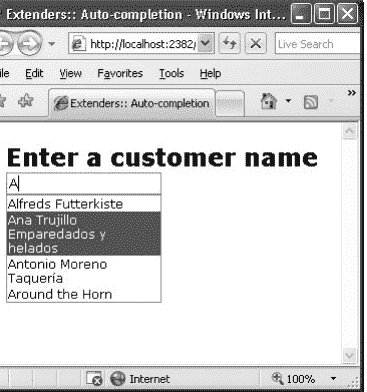

**图 5-21** *AutoComplete* 扩展器实际运行效果

### *Calendar Extender*

许多输入表单要求用户指定日期。作为 ASP.NET 开发者，你知道让用户处理分隔符、格式、文化以及影响日期表示的各种因素是多么令人沮丧。在输入表单中选择日期最自然的方式是通过日历；ASP.NET 2.0 确实提供了这样的控件。原始


## 第二部分 为网站添加 AJAX 功能

ASP.NET 2.0 的 *日历* 控件需要完整的页面回发，尽管你可以找到许多好的变通方法——从将其包装在可更新面板中，到使用我们之前讨论过的悬停菜单扩展器。

*日历* 扩展器是最终的，我相信也是决定性的解决方案。它附加到一个文本框上，提供具有可自定义日期格式和弹出控件的客户端日期选择功能。你可以通过点击某一天、导航到某个月，或选择特定链接来设置当前日期与日历进行交互。（参见图 5-22。）

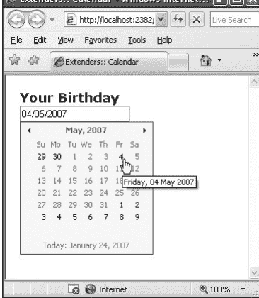

**图 5-22** *日历* 扩展器运行中

```xml
<asp:TextBox runat="server" ID="TextBox1" />

<act:CalendarExtender runat="server" ID="CalendarExtender1"
    TargetControlID="TextBox1"
    CssClass="MyCalendar"
    Format="dd/MM/yyyy" />
```

通过点击日历的标题，你可以将视图从每月显示天数更改为每年显示月份，甚至每十年显示年份。*Format* 属性允许你选择日期的最终格式，该格式将被插入到绑定的文本框中。通常，当日历伴随的文本框获得输入焦点时，日历会弹出。但是，你可以将日历的显示与某个元素（例如，一个图像）的点击关联起来。*PopupButtonID* 属性获取和设置一个控件的 ID，以便在点击该控件时显示日历弹出窗口。

### FilteredTextBox 扩展器

*FilteredTextBox* 扩展器从给定文本框控件的缓冲区中过滤掉一些字符。它与验证控件的不同之处在于，它只是防止用户输入无效字符，而验证控件则在用户切换出输入字段后的稍后时间点进行操作。

```html
<strong>How old are you?</strong>
<asp:TextBox ID="TextBox1" runat="server" />
```

```xml
<act:FilteredTextBoxExtender ID="Filtered1" runat="server"
    TargetControlID="TextBox1"
    FilterType="Numbers" />
```

前面的文本框预期接受一个表示用户年龄的数字。显然，它只能接受数字。该扩展器确保只能在输入字段中键入数字。它通过向文本框添加一段 JavaScript 代码来过滤掉不需要的字符。

该扩展器支持几个属性，包括 FilterType，它决定应用于输入的过滤器。该属性可以接受以下任何值：Numbers、UppercaseLetters、LowercaseLetters 和 Custom。前三种情况的过滤效果很明显。然而，当指定 Custom 时，你还需要将 ValidChars 属性设置为一个逗号分隔的字符串，其中每个项目表示一个有效字符。例如，以下代码仅允许用户输入 A 和 B 字符，无论大小写：

```xml
<act:FilteredTextBoxExtender ID="Filtered1" runat="server"
    TargetControlID="TextBox1"
    FilterType="Custom"
    ValidChars="A,a,B,b" />
```

你不能在同一文本框上组合多个过滤器。如果你想过滤除字母以外的所有字符，你不能向同一个控件添加两个 FilteredTextBox 扩展器。相反，你需要使用自定义过滤器，在 ValidChars 属性中指定所有可接受的字符。

> **重要提示** 客户端过滤以及验证都依赖于某些 JavaScript 代码的执行。这意味着通过停用客户端浏览器上的 JavaScript，任何过滤或验证随后都会被禁用。无论如何，你不应盲目信任用户在文本框中键入的内容，而应在将该数据用于关键操作之前，在服务器上应用适当的过滤和验证。

### MaskedEdit 扩展器

添加到 TextBox 控件的 MaskedEdit 扩展器强制用户根据指定的掩码输入输入内容。此外，数据会根据所选的数据类型在客户端进行验证。为了实现验证，引入了一个新的验证器控件——MaskedEditValidator——用于验证输入。掩码编辑验证器反过来与掩码编辑扩展器的实例相关联：

```xml
<asp:TextBox runat="server" ID="TextBox1" />
```

```xml
<act:MaskedEditValidator ID="MaskedEditValidator1" runat="server"
    ControlExtender="MaskedEditExtender1"
    ControlToValidate="TextBox1"
    IsValidEmpty="False"
    EmptyValueMessage="Date is required"
    InvalidValueMessage="Date is invalid"
    TooltipMessage="Input a Date" />
<act:MaskedEditExtender runat="server" ID="MaskedEditExtender1"
    TargetControlID="TextBox1"
    Mask="99/99/9999"
    MessageValidatorTip="true"
    OnFocusCssClass="MaskedEditFocus"
    OnInvalidCssClass="MaskedEditError"
    MaskType="Date" />
```

图 5-23 显示了该扩展器在日期和货币值上的应用。

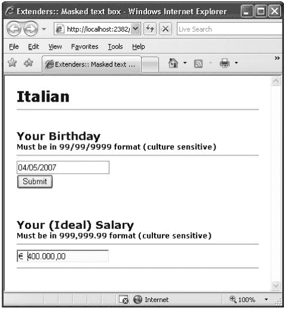

该扩展器支持针对最常见和专业类型的三种不同掩码：日期、数字和时间。*MaskType* 属性设置最终数据的类型；*Mask* 属性定义所需的输入掩码。

## *NoBot* 扩展器

Web 应用程序，如博客、论坛和门户网站，容易受到机器人应用程序（也称为 *bots*）自动填写其输入表单的影响。例如，一个机器人可以注册为邮件服务的用户，并使用该门户发送垃圾邮件。用于确保是人在填写输入表单而不是一段智能软件的技术被称为 CAPTCHA，即 *完全自动化的公共图灵测试，用于区分计算机和人类* 的首字母缩写。实际上，CAPTCHA 是一种挑战-响应测试，要求提供必须即时理解的额外信息。这对人类来说没什么特别的，但对自动化程序来说几乎不可能。CAPTCHA 技术最流行的例子是一个表示数字的扭曲图像。在各种博客系统中，用户会遇到一个额外的输入字段，在他们的帖子被接受之前，需要指定图中描绘的一个数字。

NoBot 扩展器是一个尝试将反机器人技术应用于输入表单的控件。该扩展器可能不如包含数字的扭曲图像强大，但其优势在于完全不可见且难以检测。总而言之，NoBot 扩展器的实用性可能仅限于流量较低的网站，其主要目标是阻止垃圾邮件，并且即使未达到 100% 的有效性也无关紧要。

### NumericUpDown 扩展器

添加到 TextBox 控件的 NumericUpDown 扩展器会在控件旁边添加一对箭头按钮，让用户能够增加和减少显示的值。请注意，递增和递减既适用于数字输入，也适用于任何用户定义的枚举。

```html
<strong>How old are you?</strong>
<asp:TextBox ID="TextBox1" runat="server" Width="100px" />

<act:NumericUpDownExtender ID="UpDown1" runat="server"
    Width="100"
    TargetControlID="TextBox1" />
```

你应该在文本框和扩展器上都设置 Width 属性以控制输入字段的大小。请注意，扩展器上的 Width 属性表示包括箭头按钮在内的控件总宽度。（参见图 5-24。）

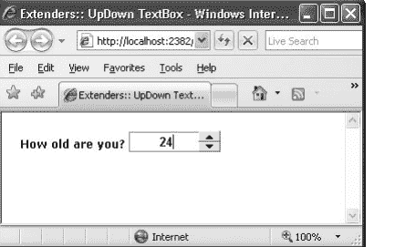

默认递增量是数字 +1 或 -1。但是，RefValues 属性允许你定义一个要循环遍历的值序列。该属性接受一个字符串，其中每个值用分号 (;) 符号分隔。

```xml
<act:NumericUpDownExtender ID="UpDown1" runat="server"
    Width="100"
    RefValues="Sun;Mon;Tue;Wed;Thu;Fri;Sat"
    TargetControlID="TextBox1" />
```

该扩展器还可以使用 Web 服务来计算下一个或上一个值。在这种情况下，你使用 *ServiceUpPath* 和 *ServiceUpMethod* 来定位用于 *向上* 操作的服务和方法。同样，你使用 *ServiceDownPath* 和 *ServiceDownMethod* 用于 *向下* 操作。服务方法可以通过 *Tag* 属性从客户端接收任意值。

> **注意** 仅使用上下扩展器通常不足以保证良好的用户体验。事实上，上下扩展器并不强制文本框“只”接受由上下过程生成的值。因此，你可以在带有相关上下扩展器的数字文本框中键入单词。为避免这种情况，你可能希望将上下扩展器与过滤扩展器结合使用，并使用 *TextBox 的 MaxLength* 属性来设置最大字符数。

## *PasswordStrength* 扩展器

即使是最安全的系统，如果授权用户使用弱且易于猜测的密码，也无法提供太多保护。最近制定了一些最佳实践，用来定义强密码的特征。*PasswordStrength* 扩展器附加到一个 *TextBox* 控件上，并在当前文本被用作密码时测量其强度。

从语法角度来看，该扩展器可以附加到任何 *TextBox* 控件；但从语义角度来看，只有当应用于用于输入密码的 *TextBox* 控件时才有意义。*PasswordStrength* 扩展器证明有用的场景不是用户输入密码以访问特定功能的登录页面。相反，它在用户注册其凭证以访问系统功能的表单中很有帮助。

```html
<h2>Choose your password</h2>
<asp:TextBox ID="TextBox1" runat="server" />
<act:PasswordStrength runat="server" TargetControlID="TextBox1" />
```

该扩展器根据页面作者设置的一组要求验证当前文本。验证过程的结果通过文本消息或条形指示器输出，让用户了解所选密码的复杂程度。在所有默认设置下，该扩展器的工作方式如图 5-25 所示。

反馈显示为纯文本，并在用户在缓冲区中键入时动态更新。该扩展器的属性可分为两组：外观和行为。

外观属性包括 *DisplayPosition* 用于设置反馈文本的位置（上方、下方、左侧或右侧），以及 *StrengthIndicatorType* 用于选择视觉反馈的类型。它可以是 *Text* 或 *BarIndicator*。当指示器类型为 *Text* 时，*PrefixText* 属性设置


用于编写反馈消息的文本。*TextCssClass* 定义用于设置反馈消息样式的 CSS 类。

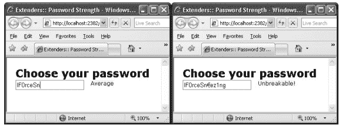

图 5-25 *PasswordStrength* 扩展器的实际效果

当指示器类型为 *BarIndicator* 时，反馈以带框架区域中的仪表条形式显示。*BarBorderCssClass* 和 *BarIndicatorCssClass* 属性允许你设置该仪表条的样式。

以下属性允许你设置需要检查的密码要求：*RequiresUpperAndLowerCaseCharacters*、*PreferredPasswordLength*、*MinimumNumericCharacters* 和 *MinimumSymbolCharacters*。默认情况下，密码长度设置为 10，且未启用其他内容检查。

该扩展会根据设定的要求对密码文本进行评分。分数以仪表条或文本消息的形式呈现，如图 5-25 所示。你可以通过将用分号分隔的描述列表赋值给 *TextStrengthDescriptions* 属性来自定义文本消息。你可以指定最少 2 个、最多 10 个字符串，按从最弱到最强的顺序排列。

从扩展器获取的反馈分为两部分：分数和状态消息。分数用于更新指示器或显示强度描述。状态消息是显示在由 *HelpStatusLabelID* 属性指定的伴随控件上的帮助消息：

```
<asp:TextBox ID="TextBox1" runat="server" /> <br />
<asp:Label runat="server" ID="Label1" />

<act:PasswordStrength runat="server"
    TargetControlID="TextBox1"
    DisplayPosition="RightSide"
    PreferredPasswordLength="12"
    HelpStatusLabelID="Label1" />
</act:PasswordStrength>
```

*Label1* 控件会收到一条提示消息，告知如何满足密码要求。你也可以让此消息始终隐藏，并通过点击按钮按需显示。在这种情况下，你需要设置两个新属性：*HelpHandlePosition* 和 *HelpHandleCssClass*。前者设置帮助图标的显示位置；后者设置图标的样式。

```
<act:PasswordStrength runat="server">
    <act:PasswordStrengthExtenderProperties TargetControlID="TextBox1"
        DisplayPosition="BelowRight"
        PreferredPasswordLength="12"
        HelpHandlePosition="RightSide"
        HelpHandleCssClass="helpHandle" />
</act:PasswordStrength>
```

具体来说，你需要使用 CSS 样式来设置要显示的图标：

```
.helpHandle
{
    width:16px;
    height:14px;
    background-image:url(images/Question.png);
    overflow:hidden;
    cursor:help;
}
```

图 5-26 显示了最终页面。

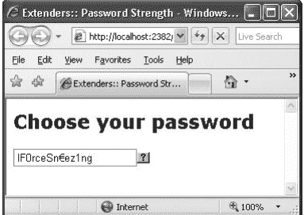

**图 5-26** 带帮助按钮的 *PasswordStrength* 扩展器的实际效果

## *Slider* 扩展器

*Slider* 扩展器允许你将经典的 *TextBox* 转换为图形化滑块，使用户可以从有限范围内选择一个数值。你可以设置滑块的方向（水平或垂直），还可以使其接受离散的值间隔——即在给定范围内仅接受指定数量的值。默认情况下，滑块接受 0 到 100 范围内的值。

```
<h2>Your age</h2>
<asp:TextBox ID="TextBox1" runat="server" />
<hr />
<asp:Label runat="server" ID="Label1" />
```

```
<act:SliderExtender runat="server" ID="SliderExtender1"
    TargetControlID="TextBox1"
    BoundControlID="Label1" />
```

使用滑块选择的值会通过完整回发或部分回发自动持久保存。你可以使用 *TextBox* 编程接口来引用该值。（参见图 5-27。）

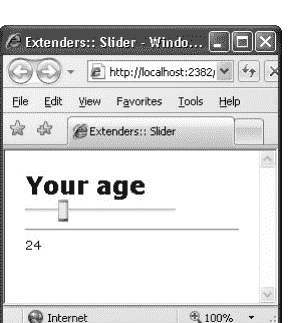

**图 5-27** *Slider* 扩展器的实际效果

## *TextBoxWatermark* 扩展器

*TextBoxWatermark* 扩展器允许你定义当文本框为空时显示的默认文本。扩展会根据需要自动处理文本的显示和隐藏。

```
<h2>Watermark</h2>
<br/>
<asp:TextBox ID="TextBox1" runat="server" />
&nbsp;
<asp:TextBox ID="TextBox2" runat="server" />

<act:TextBoxWatermarkExtender runat="server" ID="TextBoxWatermark1"
    TargetControlID="TextBox1"
    WatermarkText="Type First Name Here"
    WatermarkCssClass="watermarked" />
<act:TextBoxWatermarkExtender runat="server" ID="TextBoxWatermark2"
    TargetControlID="TextBox2"
    WatermarkText="Type Last Name Here"
    WatermarkCssClass="watermarked" />
```

该扩展器使用 *TargetControlID* 属性来指定目标文本框。*WatermarkText* 属性定义要显示的文本，而 *WatermarkCssClass* 指示要应用于水印文本的 CSS 样式。（参见图 5-28。）

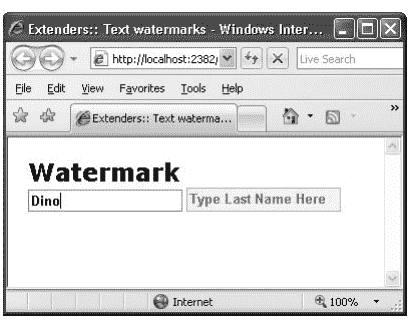

**图 5-28** *TextBoxWatermark* 扩展器的实际效果

## *ValidatorCallout* 扩展器

*ValidatorCallout* 扩展器增强了现有 ASP.NET 验证器的图形功能。它使用 Windows XP 风格的气球形工具提示来显示验证器的错误消息。（参见图 5-29。）

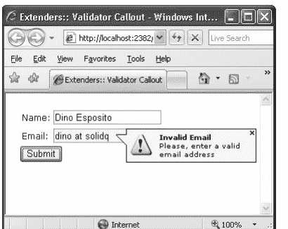

**图 5-29** *ValidatorCallout* 扩展器的实际效果

以下是使用该扩展器的方法：

```
<table>
<tr>
    <td>Name:</td>
    <td><asp:TextBox runat="server" ID="txtName" /></td>
</tr>
<tr>
    <td>Email:</td>
    <td><asp:TextBox runat="server" ID="txtEmail" /></td>
</tr>
</table>
```

```
<asp:Button runat="server" ID="Button1" Text="Submit" />
<asp:RequiredFieldValidator runat="server" ID="requiredName"
    ControlToValidate="txtName"
    Display="None"
    ErrorMessage="Required Field Missing<br />A name is required." />
<asp:RequiredFieldValidator runat="server" ID="requiredEmail"
    ControlToValidate="txtEmail"
    Display="None"
    ErrorMessage="Required Field Missing<br />Email address required." />
<asp:RegularExpressionValidator runat="server" ID="regularEmail"
    ControlToValidate="txtEmail"
    Display="None"
    ValidationExpression="[a-zA-Z0-9.-]+\@[a-zA-Z0-9.-]+\.\w+"
    ErrorMessage="<b>Invalid Email</b><br />Please, enter a valid email address" />
<act:ValidatorCalloutExtender runat="server" ID="CalloutExtender1"
    TargetControlID="requiredName" HighlightCssClass="highlight" />
<act:ValidatorCalloutExtender runat="server" ID="CalloutExtender2"
    TargetControlID="requiredEmail" HighlightCssClass="highlight" />
<act:ValidatorCalloutExtender runat="server" ID="CalloutExtender3"
    TargetControlID="regularEmail" HighlightCssClass="highlight" />
```

### 动画扩展器

ACT 配备了一套完整的 Web 动画构建框架，充分利用了富浏览器的能力。其核心思想是提供一组可扩展的动画块，这些动画块可以组合在一起，并以串行或并行的方式运行。要播放的动画通过 XML 以声明方式指定。

## *Animation* 扩展器

*Animation* 扩展器允许你以声明式、无代码的方式使用内置的动画框架。当目标控件上发生客户端事件时，扩展会播放指定的动画。支持的事件包括 *load*、*click*、*mouseover* 和 *mouseout*。示例如下：

```
<act:AnimationExtender ID="AnimationExtender1" runat="server"
    TargetControlID="Panel1">
    <Animations>
        <OnLoad>
            <OpacityAction Opacity=".2" />
        </OnLoad>
        <OnHoverOver>
            <FadeIn Duration=".25" Fps="20"
                    MinimumOpacity=".2" MaximumOpacity=".8" />
        </OnHoverOver>
        <OnHoverOut>
            <FadeOut Duration=".25" Fps="20"
                    MinimumOpacity=".2" MaximumOpacity=".8" />
        </OnHoverOut>
    </Animations>
</act:AnimationExtender>
```

*Animations* 标签完整描述了动画内容。它由一系列绑定到特定事件的动作组成。在上述示例中，事件包括 *load*、*hover* 和 *mouseout*。*OnLoad* 标签描述扩展控件加载时执行的动画。*OnHoverOver* 和 *OnHoverOut* 标签描述 *hover* 效果发生时的行为，这通常是从实际的 *mouseover* 和 *mouseout* 事件延迟触发的。要描述动画，你可以组合使用现有的动画块：淡入、淡出、透明度、脉冲、移动、调整大小、颜色插值和缩放。你也可以使用自定义脚本来指定动作。上述示例代码在加载时对扩展控件应用了轻微的透明度滤镜，然后在鼠标悬停时淡入其区域，移出时淡出。有关内置动画块的更多信息，请参阅 [http://ajax.asp.net/ajaxtoolkit/Walkthrough/AnimationReference.aspx](http://ajax.asp.net/ajaxtoolkit/Walkthrough/AnimationReference.aspx)。

## *UpdatePanelAnimation* 扩展器

*UpdatePanelAnimation* 扩展器适用于一种非常特定的场景，即需要处理自定义事件——在可更新区域刷新之前和之后。使用该扩展器非常简单，只需在页面中定义一个更新面板，并添加以下扩展器代码即可：

```
<act:UpdatePanelAnimationExtender runat="server" ID="UpdatePanelAnimation1"
    TargetControlID="UpdatePanel1">
    <Animations>
        <OnUpdating>
            <Sequence>
                <EnableAction AnimationTarget="Button1" Enabled="false" />
                <FadeOut AnimationTarget="Panel1" minimumOpacity=".3" />
            </Sequence>
        </OnUpdating>
        <OnUpdated>
            <Sequence>
                <FadeIn AnimationTarget="Panel1" minimumOpacity=".3" />
                <EnableAction AnimationTarget="Button1" Enabled="true" />
            </Sequence>
        </OnUpdated>
    </Animations>
</act:UpdatePanelAnimationExtender>
```

如你所见，这只不过是应用于面板特定事件（如 *OnUpdating* 和 *OnUpdated*）的动画。在更新开始之前，包含需要更新的敏感内容的区域会淡出，同时控件 *Button1* 被禁用。你使用 *FadeOut* 动画块来实现此目的。在上述示例中，*Panel1* 只是一个包含 *UpdatePanel* 控件的 HTML 块。

```
<div ID="Panel1">
    <asp:UpdatePanel ID="UpdatePanel1" runat="server" ...>
        ...
    </asp:UpdatePanel>
</div>
```


 *EnableAction* 动画块以声明方式在更新期间禁用指定的控件。在第 4 章中，你已经了解了如何通过编程方式实现相同的功能——而扩展器现在提供了一种声明式方法。

区域更新完成后，你执行一个 *FadeIn* 动画，将面板内容恢复到完整的颜色，并使用 *EnableAction* 重新启用先前禁用的控件。*Resize* 动画也可用于在更新期间实现一种折叠/展开效果：面板关闭，完成更新，然后展开以显示其新内容。想象力是你唯一的限制。（参见图 5-30。）

### 结论

无论你拥有多少控件，你可能总是缺少一个控件，即对当前工作至关重要的那一个。这就是为什么 ASP.NET 的可扩展性模型多年来一直如此成功，以及为什么如此多的组件供应商涌入市场，提供出色的产品。

然而，总是从现有控件派生新控件并不一定是一个明智的策略。新控件需要大量的服务器端和客户端代码来支撑大部分用户界面。如果你只需要过滤文本框中的值，自定义文本框控件绝对不是最佳选择。但在 ASP.NET AJAX 和 AJAX Control Toolkit 出现之前，没有其他出路。

借助控件扩展器，你可以定义"行为"的概念，并将其作为一个与经典服务器控件截然不同的实体来处理。扩展器是服务器控件，但它们在绑定控件之上工作，通过添加新行为来增强其整体功能。

扩展器不一定非要是 AJAX 控件。然而，在 AJAX Control Toolkit 的实现中，所有扩展器都需要脚本管理器，向客户端页面注入大量脚本代码，并充分利用客户端 JavaScript 库。

要利用 ACT 中的扩展器和控件，你不必将二进制文件导入到你的应用程序中。ACT 是一个开源项目，根据下载程序集时接受的许可协议，它可以分段整合到你的应用程序中。这意味着，例如，你只需通过源代码导入几个组件，甚至可以根据特定需求调整代码。

有了对控件和扩展器的这番概述，以及扎实的部分呈现知识，我们现在准备好应对 ASP.NET AJAX 中的另一种编程模型了——通过 Web 进行远程过程调用。
