# 开发者 Microsoft Visual Basic 2005 入门指南

> 您对本书有何看法？

我们希望听取您的意见！

Microsoft 致力于听取您对本出版物的反馈，以便我们能够持续改进为您提供的书籍和学习资源。要参与一项简短的在线调查，请访问：www.microsoft.com/learning/booksurvey/

## 致谢

只有得到一个像我们有幸合作的这样优秀的团队的支持，才可能创作出像本书这样的书。

我们首先要感谢 Ari Bixhorn 和 Christopher Flores，他们是本书的最初支持者，没有他们的推广努力，本书不可能成为现实。

我们还要感谢 Microsoft Press 的所有工作人员，他们克服了在产品即将推出 Beta 1 版本时撰写该产品相关书籍所固有的重大障碍，最终将本书呈现在您面前。Matt Carter、Karen Szall、Ben Ryan、Sally Stickney 和 Danielle Bird Voeller 在将本书交到您手中方面尤其提供了宝贵的帮助。

我们还要感谢 Jay Roxe，他在确保本书内容针对性强且及时方面发挥了重要作用，以及 Robert Green 提供了确保技术准确性所需的资源。

我们要特别感谢 Amy Strande，她将在我们心中永远占据一个特殊的位置，因为她是 Microsoft 第一个愿意给 3 Leaf 机会的人。谢谢你，Amy。

最后但绝对同样重要的是，我们要感谢我们的家人和朋友。没有你们的支持，我们谁都不会有时间写这本书，这本书也不会如此富有灵感。

## 简介

开发人员生产力是本版 Microsoft Visual Studio 的核心理念。无论您使用何种应用程序类型或选择何种语言，Microsoft 都致力于构建一个集成开发环境（IDE）、类库和语言套件，使构建和部署应用程序变得尽可能简单。

我们，本书的作者们，清楚地看到，Microsoft 审视了编码的各个方面——包括代码编写本身、调试和部署——并真正研究了如何简化这些体验中的每一个环节。这些增强功能影响深远，包括对 Microsoft Visual Basic .NET 语言本身的更改、IDE 的改进、数据访问和显示的简化、在构建专业用户界面时提高开发人员生产力的更改、向框架中添加大量新类以减少您编写的代码量，以及增强部署的威力和简便性。

本书将深入探讨这些领域中的每一个。此外，虽然本书侧重于构建桌面应用程序，但大多数开发人员至少会进行一些 Web 开发。因此，第 6 章“构建 Web 应用程序”涵盖了 ASP.NET 一些最重要的更改。

本简介简要介绍了这些主题，并指引您到特定的章节以获取更深入的信息。您可以从头到尾阅读本书，也可以直接跳到您最感兴趣的章节。

### 适合阅读本书的读者

本书适用于 Visual Basic 开发人员。如果您是 Visual Basic 6 开发人员，您应该从第 1 章“面向 Visual Basic 开发人员的 Microsoft .NET Framework 入门”开始阅读，这将帮助您快速掌握 .NET Framework 的开发。本书的其余部分涵盖了 Visual Basic 的重大增强功能，这些功能将使您在开发应用程序时更具效率。

如果您是现有的 .NET 开发人员，您可以跳过第 1 章，直接进入第 2 章“Visual Basic 2005 的语言增强”。

### 本书内容

本书包含八章。第一章“面向 Visual Basic 开发人员的 Microsoft .NET Framework 入门”对目前使用 Visual Basic 6 的开发人员最为有用。它提供了 .NET Framework 开发的入门介绍。

本节描述了每一章，并为您提供每个主题的一些入门信息。

**重要** 要运行本书中的示例，您需要安装两个软件：Visual Studio 2005 和 SQL Server 2000 Desktop、Developer、Enterprise 或 Desktop Engine 版本。SQL Server 2000 应安装 Northwind 示例数据库。代码示例可在 MSDN 上找到，网址为 http://msdn.microsoft.com/vbasic/VB6Migration。

### 第 2 章“Visual Basic 2005 的语言增强”

本章介绍泛型、My 对象和新运算符。

**泛型** 可能是 .NET Framework 最重要的增强功能是引入了*泛型*。简而言之，泛型允许您创建特定于所存储对象类型的集合。

```
Dim customerDictionary As New Dictionary(Of String, Customer)
customerDictionary.Add(currentCust.FullName, currentCust)
```

在此示例中，`customerDictionary` 只能存储 `Customer` 类型的项目。而查找键是特定的 `String` 值。因为集合知道它存储的是什么（`Customer` 而不仅仅是 `Object`），所以它可以提供完整的 Microsoft IntelliSense 支持，如下图所示。

```
Dim d As New Dictionary(Of String, Customer)
    d.Add(currentCust.FullName, currentCust)

d("Nancy Davilo" ).
End Sub
End Class
```

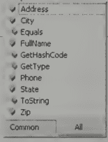

图 1-1 泛型集合上的 IntelliSense。

**My 对象** Visual Basic .NET 的另一个重要增强功能是被称为“My 对象”的特性。此特性提供了极其快捷方便的访问强大功能的途径。例如，`My.Application.Log.WriteEntry` 允许你将信息写入文本文件、事件日志或其他目标。`My.Computer.Audio.PlaySystemSound` 允许你播放预定义的操作系统声音，而 `My.Computer.Audio.Play` 则允许你播放任何 .wav 文件。My 对象还为你提供了项目中各项的默认实例。例如，你可以使用 `My.Forms.MainForm.Show` 来显示一个窗体，而无需先创建它的实例。

**新运算符** Visual Basic .NET 还包含许多新的关键字。`IsNot` 便于与 `Nothing` 进行比较。过去，你经常需要编写 `If Not X Is Nothing Then`。现在可以写成 `If X IsNot Nothing Then`。Visual Basic .NET 还支持运算符重载、泛型以及许多其他高级编程功能。

关于这些增强功能的更多信息，请参见第 2 章，“Visual Basic 2005 的语言增强”。

## 第 3 章，“Visual Studio 2005 集成开发环境”

Visual Basic 开发一直以生产力为核心，而提供这种生产力的关键工具是 Visual Studio。通过 Visual Studio 2005，生产力得到了全面提升，包括更好且更易于导航的帮助内容、更轻松的开发环境自定义，以及更高效的编码和调试体验，其中包括重新引入的“编辑并继续”功能。

**编码和调试增强功能** 当你使用新的集成开发环境（IDE）工作时，你会发现为你的编码添加“上下文”的巨大努力。这意味着，在许多情况下，你无需导航到 IDE 中其他地方的某个窗口来获取所需信息。在其他情况下，IDE 提供信息的智能过滤，将最可能的选择置于最前最显眼的位置，而很少使用的选项则不会干扰视图。此功能在你第一次访问对象的属性时就显而易见，如下图所示。

```
Private Sub cmdUser_Click(ByVal sender As System.Object, _
    ByVal e As System.EventArgs) Handles cmdUser.Click

    Dim newUser As New User()

    txtFirstName.Text = newUser.FirstName
    txtLastName.Text = newUser.|
```


## 为开发者介绍 Microsoft Visual Basic 2005

如你所见，Visual Studio 2005 既可以显示对象的所有成员，也可以过滤列表以仅显示最常用的成员，从而可以轻松找到 `Connection-String` 属性。

Visual Studio 2005 还进一步扩展了熟悉的 Visual Basic 代码扩展功能。你已经习惯于输入 `Function` 声明的开头，然后 IDE 会自动为你插入 `End Function`。现在，这已扩展到属性声明等内容。输入 `public property UserName as String` 并按 Enter 键，将导致自动插入以下代码：

```
Public Property UserName() As String
    Get

    End Get
    Set(ByVal value As String)

    End Set
End Property
```

Visual Studio 2005 还在调试时将信息置于你的指尖，让你无需打开和导航“监视”窗口即可深入查看简单类型和复杂类型。下图展示了如何在代码编辑器中直接显示复杂类型。

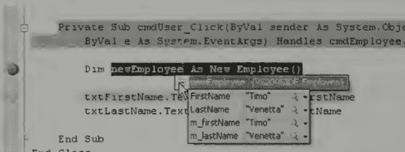

图 1-3 就地显示复杂类型的属性。

Visual Basic 6 提供的最大生产力提升之一就是“编辑并继续”功能。此功能曾是调试体验的主要支柱，但不幸的是在 Visual Studio .NET 2002 或 2003 中不可用。“编辑并继续”功能回归了，允许你修复错误并继续执行，而无需停止和重新启动。

**IDE 自定义和帮助系统增强功能** Visual Basic 开发人员高度重视自定义开发环境并将窗口放置在最实用位置的能力。Visual Studio 一直提供此功能，但通过 Visual Studio 2005，此功能在几个关键领域得到了显著增强。首先，Visual Studio 2005 消除了“不知道这个窗口会停靠在哪里”的问题，即你认为已正确放置窗口，但当你释放它时，它要么没有停靠，要么停靠的方式与预期不符。在 Visual Studio 2005 中，借助“停靠向导”，停靠变得轻而易举，如下图所示。

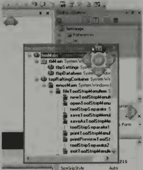

图 1-4 使用停靠向导。

你只需将窗口拖放到相应的箭头上，即可将其停靠在另一个窗口的上方、右侧、下方或左侧。无需再猜测！此外，你所有的 IDE 自定义设置都可以导出和导入。

此外，帮助系统也得到了极大改进，不仅为你提供了更好的“F1”体验，还让你能够访问最新的在线帮助。帮助系统甚至与“Code Wise”社区网站集成，让你可以在 IDE 内直接访问 CodeGuru、Net247 和 ASP.NET 等网站。

有关 Visual Studio 2005 提供的重要生产力提升的更多信息，你可以直接转到第 3 章，“Visual Studio 2005 集成开发环境”。

## 第 4 章，“构建数据密集型应用程序”

Visual Studio 2005 带来了一系列用于构建数据密集型应用程序的强大工具。首先，有一些基于 ADO.NET 1.0 构建的新对象。其中包括一个类型化的 `DataAdapter` 类，它使得调用存储过程与调用函数一样简单。工具箱还包含一个新的网格控件，非常易于自定义和控制。最后，IDE 包含一个新的“数据源”窗口，帮助你在设计时管理这些对象并创建用户界面。

“数据源”窗口用于生成你将在整个应用程序中使用的类型化 `DataAdapters` 和类型化 `DataSets`。一旦连接到数据库并选择了要使用的表和过程，你只需将对象从“数据源”窗口拖放到设计界面上以创建用户界面，如下图所示。

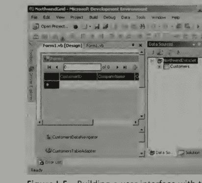

图 1-5 使用“数据源”窗口构建用户界面。

你可以看到，默认情况下，当 customers 表拖放到设计界面上时，它使用新的 GridView 控件进行呈现。你也可以让它呈现为单个字段，并且可以确定每个字段使用的控件类型。

你还可以使用 DataSet 设计器将方法映射到存储过程。这使得调用存储过程变得像以下代码一样简单：

```
ds = MyDataSet.GetByCustomerID(customerID)
```

有关在 Visual Studio 2005 中使用数据的更多信息，请参见第 4 章，“构建数据密集型应用程序”。

## 第 5 章，“构建用户界面”

Visual Basic 开发人员在快速构建用户界面方面从未遇到过任何困难。如果说 Visual Basic 一直闪耀的领域，那就是工具箱和窗体设计器。然而，Visual Basic 开发人员经常发出的呼声是：“提供 Microsoft 在其应用程序中使用的用户界面控件。” 更具体地说，开发人员希望获得许多用户界面元素，例如在 Microsoft Office 等产品中发现的“浮动工具栏”。

**新控件** 你将很高兴地了解到，此版本的 Visual Studio 不仅关注装满各种东西的工具箱；此版本确实致力于使构建专业用户界面变得容易，而无需依赖第三方组件或进行大量的自定义控件开发。第 5 章研究的第一个控件是 ToolStrip，如下图所示。

## 第六章，“构建 Web 应用程序”

Visual Studio .NET 2002 和 2003 为 Web 开发带来了革命，使 Web 开发人员的生产力比经典 ASP 提升了一个数量级。ASP.NET 2.0 再次做到了这一点。产品团队的目标是在构建网站所需的代码量上减少 70%。据各方反映，当 Visual Studio 2005 发布时，产品团队将轻松实现其目标。即使现在，许多网站也可以通过零代码构建。

对于 ASP.NET 1.0 和 1.1 版本，你可以以声明方式创建用户界面，但必须编写代码来连接数据库、检索数据并将 UI 绑定到数据。而对于 ASP.NET 2.0，引入了封装数据源的组件。例如，这允许你以声明方式将数据网格连接到 SQL Server 数据源。这种绑定机制相当复杂，你需要修改数据并将更改推送回数据库。这项新功能也不再是过去那些仅用于演示的“设计时控件”。这些控件已经过重构，其外观完全可定制，并且你可以通过编程或声明方式挂钩到控件中。

微软还识别了关键场景，并将这些场景的基础设施直接构建到了 .NET Framework 中。例如，ASP.NET 2.0 内置了成员资格和个性化功能。成员资格是一组功能包，提供了用于登录、更改密码等常见操作的控件。它还提供了从后端数据库自动存储和检索信息的基础设施。最后，成员资格为你提供了通过编程方式处理用户的 API。

ASP.NET 还附带了大量新控件以解决关键场景。例如，`SiteMapPath` 控件提供了内置的“面包屑导航”功能，而 `SiteMapDataSource` 可以轻松构建站点导航。母版页允许你在一处定义页面的公共区域，而仅更改内容区域。缓存功能已得到改进，现在可以按用户缓存数据。

有关 ASP.NET 2.0 的更多信息，请参见第六章，“构建 Web 应用程序。”

## 第七章，“Microsoft .NET Framework 增强功能”

增强功能不仅限于开发环境。底层框架本身也包含重大改进。泛型——在 .NET Framework 2.0 版本中引入的一项重大增强和强大的语言特性——在第二章中进行了描述。本章涵盖基础类库、控制台和安全性增强。

.NET Framework 包含大量新类，以进一步减少你需要编写的代码量，并使向应用程序添加功能变得更容易。`StopWatch` 是一个新类，使捕获经过的时间间隔变得非常简单。`TraceSource` 类为你提供了更灵活的事件数据跟踪方式。`System.Net` 命名空间包含重大增强，例如允许你 Ping IP 地址。现在有了一个完全托管的 Internet Explorer 包装器。`System.XML` 在性能和功能方面都得到了显著增强，并且现在包含了对 XQuery 的支持。

有关这些新类以及控制台和安全性增强的更多信息，请参见第七章，“Microsoft .NET Framework 增强功能。”

## 第八章，“部署应用程序”

在 Visual Basic 6.0 中，部署应用程序通常涉及构建 Windows Installer 包。这个过程至关重要，因为 Visual Basic 6.0 是基于 COM 的，应用程序通常需要在运行前注册多个 DLL。安装程序还会创建开始菜单快捷方式、安装数据库或执行其他所需任务。

.NET Framework 1.0 和 1.1 版本开启了更多安装选项的大门。首先，1.0 版本支持通常称为 XCOPY 部署的方式。这意味着简单的应用程序可以直接复制到硬盘并执行。这是可能的，因为 .NET DLL 不需要注册。1.0 版本还支持所谓的“零接触部署”——有时也称为 href-exes。在这种部署方法中，应用程序可执行文件只需放置在 Web 服务器上。当你浏览到应用程序的 URL 时，它会下载并运行。其结果是一个功能完整的 Windows 应用程序，同时具备 Web 应用程序的部署便捷性。即使你需要创建 Windows Installer 包，由于无需担心 DLL 注册，该过程也大大简化了。

许多人认为零接触部署是内部网应用程序的绝佳方案。通过一个简单的门户，你可以确保用户始终运行最新版本的应用程序。在 Visual Studio 2005 中，微软显著增强了通过 Web 分发的应用程序的功能。首先，应用程序现在可以下载并完全安装。此功能会创建相应的开始菜单快捷方式，并且（更重要的是）即使在离线时，也能让应用程序完全运行。

ClickOnce 应用程序还不要求你以管理员身份安装（而 Windows Installer 包需要）。最后，ClickOnce 允许你在安装过程中“引导安装”其他必需的软件。例如，ClickOnce 应用程序可以在安装过程中安装 MDAC，甚至在需要时安装 .NET Framework。

有关 ClickOnce 的更多信息，请参见第八章，“部署应用程序。”

## 支持

本书已尽一切努力确保准确性。如果遇到问题，Microsoft Press 通过以下网站提供图书勘误：http://www.microsoft.com/learning/support/。

如果你对本书或随附 CD-ROM 有任何问题、意见或建议，请将其发送给 Microsoft Press。

发送电子邮件至 mspinput@microsoft.com

发送邮政邮件至

Microsoft Press

Attn: Introducing Microsoft Visual Basic 2005 for Developers Editor

One Microsoft Way

Redmond, WA 98052-6399

请注意，软件产品本身的技术支持不通过上述地址提供。有关产品支持，请访问 http://support.microsoft.com。

要直接连接到 Microsoft 知识库并查询你的问题或议题，请访问 http://support.microsoft.com。

## 面向 Visual Basic 开发者的 Microsoft .NET Framework 入门

| 本章内容： | |
| --- | --- |
| 你可以构建的应用程序 | 2 |
| 一个真正集成的开发环境 | 4 |
| 什么是 .NET | 5 |
| 数据访问：ADO.NET | 20 |
| Windows 应用程序 | 21 |
| Web 应用程序 | 25 |
| Visual Studio 2005 和 .NET Framework 2.0 中的增强功能 | 28 |
| 总结 | 30 |

Microsoft .NET Framework 及其对应的 Microsoft Visual Studio 版本是面向软件开发者的重大创新。如果你一直在使用 Visual Basic 6（或更早版本）进行编程，你将会欣赏到这些新开发和运行环境在生产力、安全性、可靠性以及"可部署性"方面所带来的进步。

每个程序都依赖其平台和其他库来提供运行时服务。Visual Basic 6 程序员非常了解 Visual Basic Runtime 所提供的服务类型。Java 程序员使用 Java 虚拟机（JVM）。其他程序员则使用他们所开发技术的相关库。Microsoft .NET Framework 类库为创建运行在被称为公共语言运行时（CLR）的平台（或执行环境）上的应用程序提供了丰富的库。本章将向你介绍 .NET Framework 基础、其类库以及构成 Microsoft Visual Studio 2005 的开发者工具。在本章末尾，概述了 .NET Framework 2.0 和 Visual Studio 2005 中一些新功能的亮点，这些内容将在本书后续章节中更详细地介绍。

.NET Framework CLR 是一个管理关键平台服务的执行环境，包括内存和安全。面向 .NET Framework 的代码通常被称为*托管代码*，因为它需要执行环境提供的管理服务。你为 .NET Framework 编写的所有 Visual Basic 代码都是托管代码。这包括 Windows 应用程序、Web 应用程序以及所有其他类型的应用程序。

## 你可以构建的应用程序

你可能已经听说过大量关于 .NET 和 XML Web 服务的宣传。其中大部分宣传是名副其实的，因为 .NET Framework 和 Visual Studio 2005 使得构建和使用 Web 服务变得非常简单。但 Microsoft .NET 技术不仅仅关于 Web 服务。Visual Studio 2005 和 .NET Framework 在创建其他类型的应用程序（包括 Windows 和 Web 应用程序）方面同样功能强大。有时，围绕 Web 服务的宣传掩盖了你可以用 Microsoft .NET 技术创建的各种应用程序的广泛范围，以及面向 .NET Framework 所带来的诸多好处，包括提高安全性、提升开发者生产力、降低部署和维护成本，以及一个涵盖许多通用任务的丰富预构建类库。

## 智能客户端 Windows 应用程序

当然，你可以创建 GUI 驱动的 Windows 应用程序，类似于你使用 Visual Basic 6 创建的 Windows 应用程序。这些 .NET 应用程序通常被称为 Windows 窗体应用程序、厚客户端或智能客户端。Microsoft .NET Framework 为 Windows GUI 应用程序提供了许多功能，这些功能已在 Visual Basic 6 的能力基础上得到了增强，例如停靠、锚定、不透明度、新控件以及更多以事件形式暴露的 Windows 消息。

术语*智能客户端*指的是将桌面应用程序的处理能力和丰富用户界面（UI）与通常与 Web 应用程序相关的部署和连接功能相结合的 Windows 应用程序。智能客户端是具有以下功能的传统 Windows 应用程序：使用 Web 服务；支持离线模式；可从中央服务器部署；提供自动更新（从中央服务器）；或支持多种设备类型。随着 Microsoft 技术简化了部署，以及企业在寻找利用网络边缘处理能力的方法的同时努力突破基于 Web 的界面的限制，人们对智能客户端的兴趣一直在稳步增长。

## Web 应用程序

.NET Framework 已成为 Web 应用程序中极为流行的技术。.NET Framework 中的 Web 功能统称为 **ASP.NET**，它们体现在一个丰富的对象模型中，提供了远超其前身 ASP（现在通常称为 *classic ASP*）的强大功能和可扩展性。自推出以来，ASP.NET 一直是一种非常高效的

### Web 服务

XML Web 服务是 ASP.NET 的一部分。传统网页以 HTML 输出响应 HTTP 请求。相比之下，Web 服务基于 SOAP，这是一种基于 XML 的协议，定义了两个系统之间交换消息的语法和规则。SOAP 消息可以像网页请求一样通过 HTTP 传输，这意味着你可以暴露服务（例如 Web 服务），这些服务可以通过大多数允许 80 端口流量的防火墙进行访问。

> **注意** 术语*方言*指的是用于表示某些类型数据的 XML 版本的规则。SOAP 是用于消息交换的 XML 方言。还有无数其他 XML 方言被定义用于 XML 的各种不同用途，包括标准和专有系统。

### Windows 服务

Visual Basic 程序员长期以来一直抱怨难以创建可以作为 Windows 服务（以前称为 NT 服务）运行的应用程序。Windows 服务是在后台执行任务或为其他程序提供服务的应用程序。Windows 服务通常自动启动，无论是否有用户登录都会运行。它们由一个称为服务控制管理器的 Windows 子系统控制。在 .NET Framework 之前，Visual Basic 开发者不得不使用第三方工具来创建可以作为服务运行的应用程序。使用 .NET Framework 创建 Windows 服务应用程序就像创建任何其他类型的应用程序一样简单。该服务可以使用任何符合 .NET 的语言编写，包括 Visual Basic。

### 控制台应用程序

一种经常被忽视但功能强大的应用程序类型是控制台应用程序。控制台应用程序使用输入和输出数据流，而非 GUI 应用程序所使用的点击交互模型。控制台应用程序通常被称为*命令行应用程序*。Visual Basic 6 没有提供创建控制台应用程序的简便方式，但使用 .NET Framework，你可以用 Visual Basic 或任何符合 .NET 的语言创建控制台应用程序。

### 类库

最大化代码和二进制重用是专业开发者的基本目标。实现这一目标的一种方式是设计你的软件解决方案，使代码具有通用性和可重用性。然后，通过生成 DLL 文件，将这些潜在可重用的代码封装在类库中。对于 Visual Basic 6 程序员来说，这个过程在某种程度上类似于创建 COM DLL 项目，不同之处在于 Visual Studio 2005 创建的 DLL 文件不是 COM 组件。它们是包含托管代码的程序集。（程序集将在本章稍后部分介绍。）这些类库中的类可以是任何类型的类，包括控件和组件（你可以将它们添加到 Visual Studio 2005 IDE 的工具箱中）、扩展框架类库的类（例如专用窗体），或者你自己完全实现的类（例如用于业务规则的类）。

## 智能设备应用程序

Windows、控制台和 Web 应用程序（包括 Web 服务）面向 .NET Framework。你也可以编写面向 .NET Compact Framework 的应用程序。.NET Compact Framework 是完整 .NET Framework 针对智能设备的子集。.NET Compact Framework 针对资源有限的设备（如内存和屏幕尺寸较小的设备，例如智能手机和其他手持设备）进行了优化运行。Visual Studio 2005 包含一个智能设备模拟器，以方便智能设备应用程序的开发和调试。

## 安装和部署项目

你可以使用 Visual Studio 2005 创建多种类型的安装和部署项目。安装和部署项目现在不如以前那么重要了，因为许多部署问题已经得到了简化，包括消除了注册单个应用程序所使用的组件（即私有程序集）的需要。但在许多情况下，你仍然需要一个功能完善且外观专业的安装程序。Visual Basic 6 开发者会发现，Visual Studio 2005 中的安装和部署项目比 Visual Basic 6 中的打包和部署向导有了很大的改进。开发界面的强大功能和灵活性，以及为 Microsoft Installer 生成 MSI 安装包，使 Visual Basic 开发者能够使用以前只能通过第三方工具才能获得的功能。

## 一个真正集成的开发环境

Visual Studio .NET 为你可以构建的所有类型的应用程序引入了一个统一的开发环境。Visual Studio 2005 是该统一环境演进中的最新版本。它不仅仅是一个集成的编辑器、编译器和调试器。如图 1-1 所示，一个公共外壳承载了构成 Visual Studio 2005 的全套工具，例如 Visual Basic 代码编辑器、可视化 Windows 窗体设计器、新的可视化 Web 设计器、服务器资源管理器等等。该外壳还具有可扩展性，允许将加载项、新项目类型和新设计器插入开发环境。

Visual Studio 2005 IDE（集成开发环境）是一个功能强大的工作环境，你可能大部分时间都会在其中进行开发工作。例如，在这一环境中，你可以编写 Web 应用商店前台、用于处理财务事务的 Windows 服务、用于向多个后台系统公开数据的 Web 服务，以及用于通过后台 Web 服务检索数据的智能客户端。你还可以使用 IDE 调试所有这些应用程序、运行单元测试（使用第三方工具或 Microsoft 即将推出的工具）、管理企业服务（例如 MSMQ）、管理 SQL Server 等。

## 什么是 .NET？

准确理解“.NET”的含义可能会有挑战性。如果你询问五位有经验的 .NET 开发人员“.NET 是什么？”，你可能会得到五种不同的答案，就像你问“什么是 Microsoft Windows？”或“什么是计算机程序？”一样，会得到不同的答案。这些差异的产生，是因为不同类型的用户从他们自己的角度来理解技术。从开发人员的角度来看，.NET 实际上是三件事：.NET Framework、.NET Framework SDK 和开发环境（先是 Visual Studio .NET，然后是 Visual Studio .NET 2003，现在是 Visual Studio 2005）。

.NET Framework 为应用程序提供了一组核心功能。它为代码在托管环境中运行提供了必要的服务和其他特性。.NET Framework SDK 是创建托管应用程序的基础工具集，包含编译器以及许多其他有用的工具。Visual Studio 2005 建立在 Framework SDK 提供的基础工具集之上。Visual Studio 是开发面向 .NET Framework 的应用程序的首选工具。

> **注意** 一些开发人员和 IT 专业人员将 .NET Framework 描述为一个平台，而另一些人则坚持认为 .NET Framework 不是一个平台，而是更广泛平台（即 Microsoft Windows）中的一个构建块或组成部分。实际上，.NET Framework 和 .NET Compact Framework 既是平台，也是它们所依托的更广泛平台（如 Windows Server 2003 或 Windows CE）的构建块。这些更广泛的平台运行在通常也被称为平台的硬件之上。为了帮助减少*平台*一词多种用法带来的混淆，本书中不将 .NET Framework 称为平台。

## 公共语言运行时和中间语言

每个程序都在一个上下文中运行。DOS 程序在 16 位 MS-DOS 操作系统提供的服务上下文中运行。Microsoft Word 等应用程序在当前操作系统的上下文中运行，并受该操作系统施加的约束和提供的服务的制约，例如授予用户账户的权限。例如，在 Windows XP 和 Windows Server 2003 上，应用程序对文件系统的访问受到限制，因为操作系统在安全上下文中运行应用程序，并使用访问控制列表（ACL）保护文件系统。

CLR 是 .NET Framework 的核心组件，为托管代码提供上下文并执行该代码。在某些方面，CLR 是一个虚拟机，但 CLR 的能力超出了简单虚拟机模型的范畴。CLR 对其上下文有内置的理解，并根据所处环境做出适当的响应。例如，由于 Windows 98 和 Windows Me 与 Windows XP 或 Windows Server 2003 这两类操作系统之间存在根本差异（基于 MS-DOS 与基于 Windows NT），CLR 在前两种环境中的行为与在后两种环境中的行为不同。CLR 还能够在多处理器环境中表现出不同的行为，以充分利用多个 CPU 的优势。

CLR 是一项称为公共语言基础结构（CLI）标准的实现，该标准定义了一个与机器无关的环境，应用程序在其中执行。CLR 虚拟执行系统提供重要的服务，如内存管理（对象生命周期管理和垃圾回收）和安全性。CLR 还提供即时（JIT）编译器，用于将*中间语言*转换为由物理 CPU 执行的本机代码。

中间语言（IL）是一种新设计的语言，旨在高效地转换为不同类型设备上的本机机器码。IL 基于抽象的基于栈的处理器架构。它是 .NET Framework 的通用语言。Visual Basic 编译器 `vbc.exe` 生成 IL。C# 编译器 `csc.exe` 生成 IL。实际上，每个符合 .NET 规范的编译器都生成 IL。中间语言是比 Visual Basic 或 C# 更低级的语言。对于有机器汇编语言背景的程序员来说，IL 让人联想到汇编语言，但处于更高的抽象层次。

.NET Framework SDK 包含的工具之一是 `ildasm.exe`，即 IL 反汇编程序。Ildasm 用于以人类可读的形式显示 .NET 程序文件的内容。图 1-2 显示了 Ildasm 对一个简单 Windows 应用程序输出的部分内容。

**图 1-2** Ildasm.exe 显示一个简单的 Windows 应用程序。

Ildasm 可用于查看单个函数和子程序（在面向对象语言中也称为*方法*）中的 IL。图 1-3 显示了 `Form1_Load` 方法的 IL 列表。以下代码是原始的 Visual Basic 源代码：

```
Private Sub Form1_Load(ByVal sender As System.Object, _
    ByVal e As System.EventArgs) Handles MyBase.Load
    Dim I As Integer
    Dim S As String
    For I = 1 To 20
        S += I.ToString() + " "
    Next
    MsgBox(S)
End Sub
```

```
.method private instance void Form1_Load(object sender,
	class [mscorlib]System.EventArgs e) cil managed
{
	// Code size	44 (0x2c)
	.maxstack 3
	.locals init ([0] int32 l,
			  [1] string S)
	IL_0000: nop
	IL_0001: ldc.i4.1
	IL_0002: stloc.0
	IL_0003: ldloc.0
	IL_0004: ldloca.s  l
	IL_0006: call	instance string [mscorlib]System.Int32::ToString()
	IL_000b: ldstr	""
	IL_0010: call	string [mscorlib]System.String::Concat(string,
									  string,
									  string)
	IL_0015: stloc.1
	IL_0016: nop
	IL_0017: ldloc.0
	IL_0018: ldc.i4.1
	IL_0019: add.ovf
	IL_001a: stloc.0
	IL_001b: ldloc.0
	IL_001c: ldc.i4.s	20
	IL_001e: nop
	IL_001f: ble.s	IL_0003
	IL_0021: ldloc.1
	IL_0022: ldc.i4.0
	IL_0023: ldnull
	IL_0024: call	valuetype [Microsoft.VisualBasic]Microsoft.VisualBasic.MsgBoxResult [Micro
```

图 1-3 一个简单子程序的 IL 列表。

.NET Framework SDK 还包含一个汇编程序 Ilasm。你可以在你喜欢的文本编辑器中输入中间语言，然后使用 Ilasm 进行汇编。汇编后的 IL 可以在 CLR 上执行。虽然这对某些人来说肯定是一次有意义的练习，但大多数专业程序员发现，使用 Visual Basic、C# 或其他高级编程语言进行编程，然后使用符合 .NET 规范的编译器生成 IL，会更加高效。

> 注意 中间语言有时被称为 Microsoft 中间语言（MSIL）或公共中间语言（CIL）。MSIL 通常发音为“missile”。

如果你考虑一下，所有符合 .NET 规范的语言都被编译为 IL，而 CLR 执行 IL，你就会意识到，对于 CLR 来说，所有托管代码都是相同的，无论最初使用何种高级编程语言。所有语言都是第一等语言。每个符合 .NET 规范的语言都可以访问 Framework 类库。每个 .NET 程序员都可以重用使用任何符合 .NET 规范的语言创建的已编译 IL。

这并不是说所有符合 .NET 规范的语言都是平等的。对于解决特定问题，某些语言比其他语言更合适。图 1-4 显示了一个解决方案，其中 Visual Basic 编写的 Windows 应用程序调用 C# 编写的类库中的 `GetNumberListString` 方法。Visual Basic 和 C# 都被编译为 IL，因此两种语言在速度上没有本质区别。然而，不同的编译器设置可能为语义相同的高级代码生成不同的 IL。如果使用默认编译器设置，C# 中的 `for` 循环将比 Visual Basic 中的等效循环运行得更快，因为 Visual Basic 编译器

## 第1章：面向Visual Basic开发者的Microsoft .NET Framework入门

Visual Basic编译器默认包含溢出检查，而C#编译器则不包含（这是安全性与速度之间的典型权衡）。如果你正在编写包含高迭代循环的代码，可以使用启用了编译器溢出检查选项的C#，然后将高迭代循环包裹在`unchecked`语句块中，从而为特定代码块关闭溢出检查以获得微小的性能提升。Visual Basic不提供如此细粒度级别上开关溢出检查的选项，因此这是C#可能更适合解决特定问题的少数场景之一。（Visual Basic拥有自己独特的一组功能，例如My命名空间和可选方法参数。）

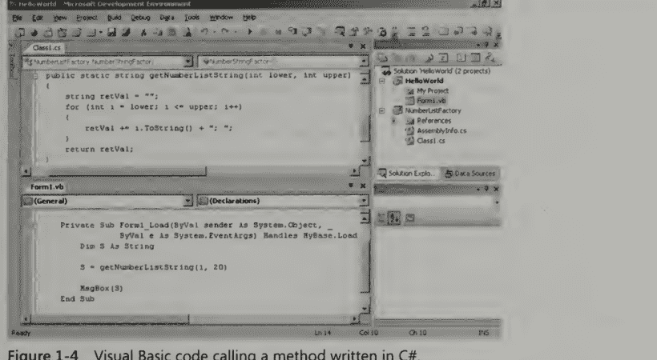

**图1-4** 调用用C#编写的方法的Visual Basic代码。

前面包含C#循环的示例显然有点刻意设计。循环体通常必须过于简单，整数溢出检查的影响才会显著（当然，除非循环体主要包含在没有溢出检查时运行更快的整数操作）。而且，未检查的整数操作并非C#独有——你可以将代码提取到单独的Visual Basic类库中，并仅为该项目禁用溢出检查，以获得相同的最终IL。但即使这个例子有点刻意，在同一解决方案中使用多种.NET语言的场景也很多。例如，你可能购买了必须由你的Visual Basic项目调用的第三方C#代码。或者你的公司可能像许多开发团队一样，有以前的ASP程序员使用Visual Basic构建ASP.NET应用程序，而具有C++背景的COM编程同事则用C#为ASP.NET应用程序构建要使用的类库。在这种情况下，关键在于让程序员根据他们的编程背景使用他们最熟悉的.NET语言。

> **注意** 在软件解决方案中混合多种编程语言时要小心。多种语言可能使代码重构（重组）变得困难，并可能让不精通所有使用语言的程序员感到沮丧或困惑（尤其是初级程序员）。你还应该注意C#等区分大小写的语言与Visual Basic等不区分大小写的语言之间的区别。C#组件公开的、仅通过大小写区分方法、属性或字段（例如，`User-Name` vs. `username`）的公共接口，无法在Visual Basic程序中按预期使用。

## 公共类型系统

如果你花了很多时间编写调用Win32 API或第三方DLL公开函数的Visual Basic 6代码，你会知道Visual Basic 6中的内置数据类型与其他语言（例如C）的内置数据类型不同。如果所有.NET语言都编译成可以从任何.NET程序调用的IL，那么必须有一组公共的数据类型来表示所有这些语言中的整数、实数、日期、文本等。.NET Framework使用的数据类型被定义为公共类型系统的一部分，这是一组用于创建和使用数据类型的规则。

公共类型系统对于确保跨语言集成至关重要。Visual Basic程序员可以完全放心地将`Int32`值或`String`传递给C#库，因为`Int32`和`String`被定义为公共类型系统的一部分。公共类型系统对于确保运行时类型安全也至关重要，这确保你的代码不允许未经授权的内存访问，并且不易受到某些类型的安全攻击。

Visual Basic有许多原始数据类型，它们映射到公共类型系统中的预定义类型。例如，Visual Basic原始类型`Integer`是`System.Int32`的别名，一个32位整数。Visual Basic原始类型`String`是`System.String`的别名，一个Unicode字符序列。C#和其他语言也有自己的原始数据类型，对应于公共类型系统中相同的预定义类型。

> **注意** 在Visual Basic 6中，`Integer`是16位值，`Long`是32位值。在面向.NET Framework的Visual Basic代码中，`Integer`是32位，`Long`是64位。如果你使用Visual Basic 6升级向导来转换代码，向导会自动调整你的整数数据类型。

## 对象和值

公共类型系统中有两种数据类型：引用类型和值类型。这两种数据类型在如何创建、在内存中传递以及最终销毁方面有根本的不同。值类型保存你通常认为是原始类型的值：整数、浮点数、字符和布尔值（true/false）。值类型在内存中的表示通常很简单，通常只需要几个字节。当值类型在内存中传递时（例如，当它们作为参数传递给方法时），值本身会被复制（默认情况下）。

值类型简单高效。它们不需要创建对象（即引用类型）所需的相同类型的开销，也不需要销毁方面的特殊考虑。值直接存储在栈上，并绑定到变量或常量（或字面量）。值的生命周期与用于访问该值的变量的生命周期相同。变量不能与其值分离，因此值类型变量始终有一个值。与引用类型不同，值类型变量不能为null（`Nothing`）。

公共类型系统定义了最有用的值类型（`Integer`、`Double`、`Date`、`Char`等），并允许你定义自己的值类型。你也可以创建枚举，枚举是自定义值类型，包含整数类型（通常是`Integer`）值子集的符号别名。只有枚举定义中指定的别名才是该枚举类型变量的有效值。例如，以下代码清单显示了一个用户类型的枚举。`UserType`变量只能具有指定的三个值（`Admin`、`Moderator`或`User`）之一。

```vb
Enum UserType As Integer
    Admin = 1
    Moderator = 2
    User = 3
End Enum
```

.NET Framework类库广泛使用枚举，从文件I/O模式到颜色等等。

引用类型是一种非常不同的数据类型。引用类型的“值”是分配给保存该引用类型实例（即对象）的内存位置的内容。引用类型的值总是通过指向保存该值的内存位置的引用来访问。与值类型变量不同，引用类型变量本质上并不绑定到一个始终有值的固定内存位置。引用类型变量可以是内存中任何对象（适当数据类型）的引用。或者引用类型变量可能不持有对任何对象的引用，这种情况下它被称为null引用或对`Nothing`的引用。

CLR在其运行时内存堆中为对象（引用类型的实例）分配空间。考虑以下代码行：

```vb
conn = New SqlConnection(connectionString)
```

变量`conn`被赋予一个指向新`SqlConnection`对象的引用。该对象在内存堆中创建。CLR为新对象分配内存，并调用一个称为`SqlConnection`类构造函数的特殊方法。CLR还负责在该对象不再使用时销毁它并释放其内存。这被称为垃圾回收，是CLR提供的核心服务之一。

当引用类型作为参数传递给方法时，引用是按值传递的。这意味着创建的是引用的副本，而不是对象值本身（在内存堆中）。原始调用代码和被调用的方法都将持有对内存中同一对象的引用。如果方法更改了该对象的内容，更改会影响调用代码。考虑以下Visual Basic代码：

```vb
Sub CreateDataset()
    Dim ds As New DataSet
    AddTable(ds)
    
    ' 消息框显示“1”，因为AddTable方法
    ' 已更改了DataSet对象ds。
    
    MsgBox(ds.Tables.Count.ToString())
End Sub

Sub AddTable(ByVal targetDataset As DataSet)
    targetDataset.Tables.Add("TableOne")
End Sub
```

变量`ds`是对传递给`AddTable`方法的`DataSet`新对象的引用。在`AddTable`方法中，变量`targetDataSet`是对同一`DataSet`对象的引用。`AddTable`方法向`DataSet`添加了一个新表。然后回到`CreateDataSet`，在调用`AddTable`之后，`DataSet`对象`ds`在其`Tables`集合中将有一个表。两个方法都在处理内存中的同一个`DataSet`对象，尽管它们是两个不同方法中的两个不同变量。

## 类、方法、属性、字段和事件

在面向对象编程中，对象是类的实例。作为程序员，你用数据字段、属性、方法和事件来定义一个类。然后你基于该类创建具有状态（字段、属性）和行为（方法、事件）的对象。以`Form`类为例。`Form`类定义了要在Windows应用程序中显示的窗口的数据和属性（例如，`Width`）。`Form`类还定义了行为，例如显示窗体的`Show`方法。`Form`类本身并不是一个窗体。该类定义了`Form`对象的样子以及它可以做什么。一个实际的`Form`对象将是内存堆中特定内存位置的一系列字节。

一个类由四个构建块组成：字段、方法、属性和事件。字段是类持有的一个值。字段可以直接保存一个值（值类型）或保存对值的引用（引用类型）。类中的字段有点类似于方法中的变量。方法调用期间变量中的值是该方法调用状态的一部分，并且变量绑定到该方法的“实例”。同样，字段是对象状态（即类的实例）的一部分。

方法是类中的一个功能单元。Visual Basic 中的子程序（`Sub`）和函数（`Function`）就是方法。方法是对象行为的重要组成部分。方法是对象能够执行的操作。它是在对象上下文中执行的一段编程逻辑，可以通过字段和属性来访问或操作对象的状态。

属性是字段和方法的混合体。与字段类似，属性是对象状态的一部分。对其他对象而言，公共属性看起来就像一个公共字段，读写属性值也使用相同的语法。但在内部，属性实际上是两个特殊的方法：一个 `Get` 过程和一个 `Set` 过程。当读取属性值时，会执行 `Get` 过程。当设置属性值时，会执行 `Set` 过程。属性允许你为访问值附加逻辑。更重要的是，属性允许你将对象的公共接口与其数据的内部表示分离。

事件是对象能够响应的某种发生情况。事件是对象可以展现的另一种行为。如果说方法是对象能做的事情，那么事件就是对象发出的通知。通常，事件用于通知监听对象状态的改变。监听对象通过*事件处理程序*被"通知"。监听对象会将某个方法注册为特定对象特定事件的事件处理程序。当该事件发生时，此方法（即事件处理程序）会自动被调用。事件在被对象显式引发时发生。例如，当`Button`对象从Windows接收到鼠标指针位于按钮上方时按下了默认鼠标按钮的消息时，它会引发`Click`事件。如果你曾在Visual Basic 6中编程，你已经熟悉了事件驱动编程。你会发现托管代码中事件处理程序的工作方式有一些差异，但在许多情况下，你编写的代码与在Visual Basic 6中编写的代码非常相似。

当你在Visual Basic中编写托管代码时，你总是在创建一个类，也就是定义一个数据类型。该类型对象的状态和行为由你的代码决定。下面的示例是一个名为`UserAddress`的类。这个类包含四个字段，用于保存邮寄地址的元素。在此示例中，所有字段都标记为`Private`，这意味着它们在`UserAddress`类外部不可访问。相反，数据通过四个属性公开暴露。`UserAddress`中的属性是对私有字段的简单封装，但这里重要的是，地址的外部（公共）接口与保存数据的实际字段是分离的。你可以自由更改数据的内部表示方式，同时继续暴露相同的外部接口。此示例还包含一个名为`AddressChanged`的事件。每个属性中的每个`Set`过程在新值与旧值不同时都会引发此事件。监听对象可以为`AddressChanged`事件注册处理程序，并在`UserAddress`状态改变时（即地址的某些部分被更改时）执行代码。最后，还有一个`GetFormattedAddress`方法，它创建一个新的`String`对象，包含所有地址数据。

```
Public Class UserAddress

    Private _address As String
    Private _city As String
    Private _provState As String
    Private _postalCode As String

    Public Event AddressChanged()

    Public Property Address() As String
        Get
            Return _address
        End Get
        Set(ByVal value As String)
            If _address <> value Then
                _address = value
                RaiseEvent AddressChanged()
            End If
        End Set
    End Property

    Public Property City() As String
        Get
            Return _city
        End Get
        Set(ByVal value As String)
            If _city <> value Then
                _city = value
                RaiseEvent AddressChanged()
            End If
        End Set
    End Property

    Public Property StateProvince() As String
        Get
            Return _provState
        End Get
        Set(ByVal value As String)
            If _provState <> value Then
                _provState = value
                RaiseEvent AddressChanged()
            End If
        End Set
    End Property

    Public Property PostalCode() As String
        Get
            Return _postalCode
        End Get
        Set(ByVal value As String)
            If _postalCode <> value Then
                _postalCode = value
                RaiseEvent AddressChanged()
            End If
        End Set
    End Property

    Public Function GetFormattedAddress() As String
        Return _address + vbCrLf + _
               _city + ", " + _provState + vbCrLf + _
               _postalCode
    End Function

End Class
```

`UserAddress`类是你可以使用Visual Basic创建的数据类型的一个简单示例。为.NET Framework构建应用程序是一个将需求转化为相互交互以实现所需功能的类的过程。有时你必须自己编写整个类的代码，比如`UserAddress`类。其他时候，类会由向导或其他工具自动为你创建，例如当你向应用程序添加新窗体时。

你在应用程序中需要做的任何事情，你都将通过类来完成。需要代表客户的东西？创建一个类。需要将数据从旧系统移动到Microsoft SQL Server数据库的功能？创建一个类。如果你在设计类时考虑了重用性，你最终会得到一组可以复制到新应用程序中的类。.NET Framework本身包含一个大型的类库，旨在用于多种类型的应用程序。这组类被称为框架类库，自推出以来一直是.NET Framework最受欢迎的方面之一。

> 注意 在一些面向对象的编程语言和抽象对象模型中，字段、属性和特性这些术语可以互换使用。在.NET Framework中，属性和特性是与字段不同的特定构造。

## 框架类库

像Visual Basic这样的高级编程语言，以像CLR这样的执行环境为目标，是一个强大的概念，但它必须配有一套同样强大的库才能在现实世界中真正有用。框架类库（FCL），有时称为基础类库（BCL），是一组DLL，构成了.NET Framework的一个组成部分。每个DLL都包含一组相关的类，用于提供某种特定功能。例如，`System.Drawing.dll` 提供了生成图形的类；`System.DirectoryServices.dll` 提供了与Active Directory交互的类；`System.Xml.dll` 提供了处理XML文档的类。框架类库包含了从基本文件I/O到构成ASP.NET和ADO.NET的所有内容。

大多数开发者似乎发现，成为熟练的.NET开发者的最大任务就是学习框架类库。这部分任务是学习完成熟悉任务的新方法。更大部分的任务是学习框架类库中许多新的功能，而这些功能以前需要大量自定义代码或第三方组件。要ping服务器，使用`Ping`和`PingReply`类。要以编程方式访问网站，使用`WebClient`或`HttpWebRequest`类。要验证电子邮件地址的格式，使用`Regex`类。要转换XML文档，使用`XslTransform`类。要以编程方式发送电子邮件，使用`SmtpMail`类。

框架类库非常全面，以至于.NET开发者常常承认，他们花费了更多比例的时间来研究和寻找框架类库中合适的类来完成通用任务（例如，将PNG图像转换为JPG图像），而用于编写执行此类任务的自定义代码的时间比例减少了。使用框架类库处理这些任务意味着需要测试、调试和维护的自定义代码行数更少，同时拥有预先编写的文档以及来自全球其他开发者的支持，他们使用完全相同的类执行相同的通用任务。

本书重点介绍最新的框架类库功能，这些功能在.NET Framework的2.0版本中引入。有许多优秀的资源可以获取关于框架类库更成熟部分的深入信息，包括随Visual Studio 2005安装的MSDN文档、MSDN网站（http://msdn.microsoft.com/）上的信息、通过搜索http://www.google.com/可以找到的信息，以及《101个Microsoft Visual Basic .NET应用程序》（可从Microsoft Press获得）。

## 命名空间

框架类库以命名空间层次结构组织。命名空间提供了一种组织类的方式，有助于避免歧义、减少命名冲突并将相关类分组在一起。如果没有组织结构，命名冲突将会频繁且令人沮丧。如果你正在开发一个页面布局程序，你可能想创建一个类来表示页面上的一个文本块，但如果你尝试创建一个`TextBox`类，你会与为Windows窗体定义的`TextBox`类冲突。如果你正在开发一个管理法律表格的工具，你可能想创建一个类来表示一个表格，但如果你尝试创建一个`Form`类，你会与框架类库中现有的`Form`类冲突。`Url`？已经用了。`Semaphore`？已经用了。`Ping`？`Timer`？`Thread`？所有这些在框架类库中都已经被使用了。这个列表会没完没了——框架类库非常庞大。幸运的是，框架类库使用命名空间来防止命名冲突带来的挫败感。事实上，框架类库本身在不同的命名空间中重复使用了一些类名。最值得注意的是用户界面控件——如`TextBox`、`ListBox`和`Button`——它们同时出现在`System.Windows.Forms`和`System.Web.UI.WebControls`命名空间中（尽管这两个命名空间通常不会在同一个应用程序中一起使用）。

如前所述，框架类库非常庞大，掌握它绝非易事。命名空间使得使用框架类库变得容易得多，因为具有相关功能的类通常位于同一个命名空间下。如果你需要处理数据，请在`System.Data`命名空间中查找。如果你需要处理XML，请在`System.Xml`命名空间中查找。如果你需要读取或写入文件，请在`System.IO`命名空间中查找。熟悉`System`命名空间下直接包含的命名空间（包括一些最突出的类）将使你成为更高效的.NET程序员，因为你将能够快速确定在哪个命名空间中搜索提供所需特定功能的类。

当你使用Visual Studio 2005创建应用程序时，你的类会被放置在与应用程序同名的命名空间中。你可以通过Visual Studio 2005项目属性窗口更改默认根命名空间，如图1-5所示。命名空间可以嵌套，因此你可以在代码中创建额外的命名空间，这些命名空间将位于项目根命名空间下的命名空间层次结构中。随着应用程序或类库中类数量的增长，你会发现为相关类集创建命名空间有助于保持类的组织性。如果你的应用程序的根命名空间是`ChooseYourOwnNamespace`，以下代码将在`ChooseYourOwnNamespace.Namespace1`命名空间中定义一个名为`Class1`的类：

```vb
Namespace Namespace1
    Public Class Class1

    End Class
End Namespace
```

**图 1-5** 项目属性窗口，显示了项目的根命名空间设置。

除非为编译器提供了其他信息来解析类名，否则必须使用类的完全限定名来引用类。完全限定名是类名前面加上其命名空间。如果命名空间嵌套在另一个命名空间中，则完全限定名中必须包含完整的命名空间列表。前面示例中类的完全限定名是`ChooseYourOwnNamespace.Namespace1.Class1`。当然，有些常用命名空间你会频繁使用，反复键入这些完全限定名只会使源代码变得杂乱。作为键入完全限定名的替代方案，你可以将命名空间导入到整个项目或单个代码文件中。图1-6显示了通过项目属性窗口导入到整个项目中的命名空间。图1-7显示了使用`Imports`语句导入到代码文件中的几个命名空间。

## 程序集与元数据

应用程序是功能的集合。类是构成应用程序整体功能的构建模块。这些功能必须以某种方式打包，以便保存到存储介质（例如，硬盘或 DVD）、部署到其他计算机、由执行环境（对于托管代码和非托管代码分别是 CLR 或操作系统）加载，在某些情况下还可以被多个应用程序重用。如果功能包面向 .NET Framework，则这些功能包被称为*程序集*。在基于 Windows 的环境中，有两种封装功能的文件类型：可执行文件（EXE 文件）和库（DLL 文件）。程序集通常是单个 EXE 或 DLL 文件，尽管也可以创建多文件程序集。使用 Visual Studio 2005（以及 Visual Studio .NET 和 Visual Studio .NET 2003），你可以创建 EXE 和 DLL 两种程序集。

程序集是托管代码的版本控制和部署单元。如果一个应用程序由一个可执行文件（EXE 文件）和一个库（DLL 文件）组成，那么你将拥有两个程序集，每个程序集都有自己的版本号。你可以同时部署这两个文件，然后稍后部署更新后的 DLL，而无需部署更新后的可执行文件。

程序集由三部分组成：中间语言、元数据和资源。如前所述，.NET 编译器不生成二进制机器码，而是生成中间语言。程序集中的 IL 由 JIT 编译器在运行时按即时方式转换为二进制机器码——换句话说，是在代码于运行时所需之际。JIT 编译后的代码保存在内存中，以便在当前进程中供该代码的后续执行复用。JIT 编译与解释执行代码有显著不同。IL 相对容易转换为本机机器码，而且可以针对运行时可用的硬件和资源进行优化。预先付出的一小部分编译成本，就能为当前环境生成经过优化的二进制代码。

存储在程序集文件中的元数据称为*清单*。清单包括程序集版本、对其他程序集的引用、支持的区域性、类型信息以及其他关于程序集的自描述信息。

程序集中的资源是嵌入程序集本身的内容文件，可以在运行时访问。嵌入资源最常见的用途之一是图像文件。以下代码示例展示了如何从当前程序集中读取嵌入的 JPG 图像并将其显示在 `PictureBox` 控件中。在此示例中，嵌入资源为 `Image1.jpg`。该程序集的根命名空间是 `MyApp`。

```vb
Private Sub LoadResourceImage()
    Dim currentAssembly As System.Reflection.Assembly
    currentAssembly = System.Reflection.Assembly.GetExecutingAssembly()
    Dim img As System.IO.Stream
    img = currentAssembly.GetManifestResourceStream("MyApp.Image1.jpg")
    PictureBox1.Image = Image.FromStream(img)
    img.Close()
End Sub
```

尽管所有托管代码都被打包到程序集中，但根据程序集的类型（EXE 或 DLL）以及加载方式的不同，你会得到不同类型的应用程序。Windows 应用程序是由 Windows 外壳程序加载的 EXE 文件。Web 应用程序是包含特定类型类的 DLL 文件，这些类由 IIS（Internet Information Services）加载。本章稍后将更详细地讨论 Windows 和 Web 应用程序，包括 Visual Basic、COM 和 ASP 各版本之间的差异，以及 .NET Framework 2.0 中引入的重要新功能。

## 数据访问：ADO.NET

数据访问是许多应用程序的一个基本方面。当你初次学习编程时，可能读到或听到有人说，没有输入和输出的程序是无用的（或者至少不太有趣）。应用程序的一种输入来源是数据源，例如 SQL Server 数据库、Microsoft Access 数据文件或 XML 文档。Visual Basic 程序员多年来已经接触过多种数据访问技术，包括 DAO、RDO 和 ADO。如果你曾在 Visual Basic 6 中进行过编程，你可能已经使用过 ADO 从 OLEDB 数据源（如 SQL Server 数据库）读取和写入数据。ADO 是为在连接环境中处理关系数据而设计的。尽管 ADO 后期追加了对断开式记录集的支持，但这种支持是有限的。作为框架类库的一个组成部分，ADO.NET 数据访问 API 被引入以更好地支持断开式场景，并为 XML 提供一流的支持。

断开式数据是 ADO.NET 中的一个核心概念。与使用`Recordset`不同，`System.Data` 命名空间中的许多类提供了比 `Recordset` 更多的数据处理选项。ADO.NET 中的核心类是 `DataSet`。`DataSet` 对象包含一个 `DataTable` 对象集合（并且可以包含 `DataRelation` 对象以定义 `DataTable` 对象之间的关系）。`DataTable` 包含一个 `DataColumn` 对象集合，用于定义 `DataTable` 的结构。`DataTable` 还包含一个 `DataRow` 对象集合，用于保存 `DataTable` 的数据。`DataSet` 及其包含的对象是通用的，完全与底层数据源断开连接。

有多种方式可以填充 `DataSet`，包括以编程方式创建 `DataTable` 及其 `Columns` 集合，然后编写代码将 `DataRow` 对象添加到 `Rows` 集合中。在 Visual Studio .NET 2003 中，更常见的方法是使用另一种称为*数据适配器*的对象，基于从数据源返回的数据的结构来创建 `DataTable` 对象。这是 ADO.NET 开始针对特定数据源的地方。数据适配器是托管提供程序的一部分，托管提供程序是一组针对特定类型数据源的类。`SqlClient` 托管提供程序用于访问 SQL Server。`OleDb` 托管提供程序用于访问任何 OLEDB 数据源。还有其他可用于其他类型数据源的托管提供程序（例如，ODBC 和 Oracle）。托管提供程序为连接、命令、参数、数据库类型、数据适配器以及其他几个有用的类定义了相应的类。以下代码展示了如何从 SQL Server 数据库填充 `DataSet`：

```
Dim conn As New SqlConnection
conn.ConnectionString = _
    "server=(local);database=Northwind;Trusted_Connection=True"

Dim adapter As SqlDataAdapter
adapter = New SqlDataAdapter("SELECT * FROM Products", conn)

Dim dsProducts As New DataSet

conn.Open()
adapter.Fill(dsProducts)

conn.Close()
```

要将`DataSet`中所做的更改提交回数据源，可以使用数据适配器的`Update`方法。要执行更新，数据适配器必须具有可用于插入、更新和删除数据的命令对象（如`SqlCommand`、`OleDbCommand`等）。你可以自己创建命令对象，可以使用命令构建器对象在运行时自动生成命令对象，也可以使用Visual Studio .NET 2003中的数据适配器配置向导等工具来自动生成创建命令对象的代码。

> **注意** 数据适配器配置向导在Visual Studio 2005中仍然可用；但是，你应该仅将其用于编辑从Visual Studio .NET 2003升级的代码中已存在的数据适配器。对于数据访问，有新的工具和功能，将在第4章“构建以数据为中心的应用程序”中讨论。

`DataSet`对象填充后，可以在应用程序的不同部分之间传递，甚至可以传递到分布式组件，因为`DataSet`类被设计为断开连接的，并且不依赖于任何特定的数据源。`DataSet`的灵活性和断开连接的特性使得构建传递数据的分布式应用程序以及支持重要的智能客户端场景（如离线使用）变得更加容易。

Visual Studio 2005和.NET Framework 2.0为数据访问任务引入了一些新选项，例如填充`DataSet`。在大多数情况下，在Visual Studio 2005中编写数据访问代码时，你不会使用数据适配器。相反，你将使用数据源，并通过使用表适配器来填充`DataSet`对象。这些新功能以及支持它们的新工具（如数据源配置向导）将在第4章中详细讨论。

## Windows应用程序

自Visual Basic问世以来，Windows应用程序开发一直是其标志。尽管使用Visual Basic开发的Windows应用程序在编译和执行方式上发生了很大变化，但你从Visual Basic 6获得的大部分开发技能将转移到使用Visual Studio 2005进行Windows开发中。

## Visual Basic 6和Visual Basic 2005的相似之处与差异

如果你曾使用Visual Basic 6（或更早版本）构建应用程序，那么你一定很熟悉使其如此受欢迎的可视化设计和事件驱动功能。Visual Studio 2005延续了易于使用的可视化设计体验与事件驱动模型相结合的传统。

Visual Studio 2005的Windows应用程序设计器保持了足够的Visual Basic 6中可视化设计器的外观和感觉，因此升级非常容易。图1-8展示了Visual Studio 2005中设计视图下的一个窗体示例。你可以可视化地定位控件，从工具箱中添加新控件，在属性窗口中编辑属性，并双击控件来编写事件处理程序。

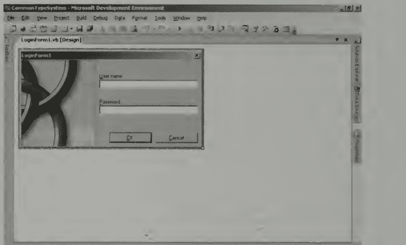

**图1-8** Visual Studio 2005可视化Windows窗体设计器。

尽管乍一看设计器非常相似，但许多增强功能使Windows窗体开发变得更容易，同时为你提供更强大的功能和灵活性。与Visual Basic 6相比，最重要的变化之一是所有控件和其他UI组件实际上都是框架类库中的类。当你将`TextBox`拖到窗体上时，Visual Studio 2005会自动生成一个字段来保存对`TextBox`对象的引用，并在窗体初始化时编写实例化`TextBox`对象的代码。可视化设计器还会编写设置控件属性的代码。如果你在属性窗口中更改`TextBox`的`BackColor`属性，Visual Studio 2005会生成一行设置`BackColor`的Visual Basic代码。图1-9展示了图1-8所示登录窗体的一些自动生成代码。

## 第1章：面向Visual Basic开发者的Microsoft .NET Framework入门

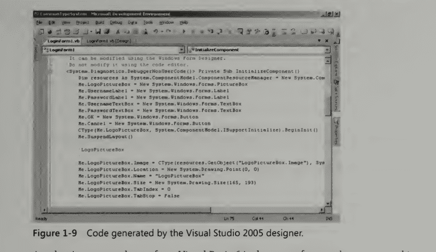

另一个与Visual Basic 6相比的重要变化是，每个窗体和每个控件都是类的实例。当你使用可视化设计器创建新窗体时，你实际上是在定义一个新类。但你不必自己实现窗体所需的所有功能。在`System.Windows.Forms`命名空间中有一个现有的`Form`类，它提供了窗体的基本功能，如`Size`和`BackColor`等属性。当你创建新窗体时，你会从基础`Form`类继承功能。`LoginForm1.vb`（来自图1-9）的前两行是如何创建一个继承另一个类功能的类的示例：

```
Public Class LoginForm1
    Inherits System.Windows.Forms.Form
End Class
```

当你在名为`btnOK`的窗体上放置一个按钮时，你实际上是在为你的专用窗体类创建一个字段，该字段将在运行时保存对`Button`对象的引用。可视化设计器还会生成代码来操作该`Button`控件的状态，以便将其正确地定位在窗体上、设置其标题（即其`Text`属性）等。当你在可视化设计器中双击`Button`控件来编写一些代码时，设计器会创建一个注册到`btnOK`的`Click`事件的事件处理程序。你也可以将你自己的事件和属性添加到窗体类中。实际上，你能用类做的任何事情，你都可以用窗体来完成，因为窗体就是一个类。

所有窗体的细节都包含在.vb代码文件中。Visual Studio 2005为创建和可视化编辑这些.vb文件提供了出色的设计环境。你也可以手动编写.vb代码文件，甚至在像记事本这样的简单文本编辑器中。

在Visual Basic .NET中打开窗体有一个重要的区别。在Visual Basic 6中，你创建一个.frm文件，如`Form1.frm`。窗体的名称是`Form1`，你通过输入`Form1.Show`来打开这个窗体。在Visual Studio 2005中，文件名无关紧要。重要的是.vb代码文件中定义的类的名称。假设类名是`Form1`。如果你想打开`Form1`，你必须创建该类的一个实例并调用该实例的`Show`方法，如下面的代码块所示：

```
Dim f As New Form1
f.Show()
```

.NET Framework彻底改变了Windows开发的格局。.NET Framework 2.0版本引入了新功能，使你在构建Windows应用程序时能够提高生产力并使用更丰富的功能集。

## Visual Basic 2005中的重要新功能

Visual Basic 2005中有许多新功能，例如用于在控件内设置填充（具体来说，是控件的内部边距）和控件周围边距的选项。这些属性是从基础`Control`类继承的，因此每种类型的控件都可以使用。有新的控件和设置，用于创建具有Microsoft Office等产品的专业外观和自定义支持的用户界面。还有新的面板控件，支持流式布局和表格布局。这些以及其他增强功能将在后面的章节中更详细地讨论，包括第5章“构建用户界面”。

一个非常有用且流行的新增RAD功能是*对齐线*，它是IDE中可视化窗体设计器的一个功能（而不是语言或框架类库的功能）。如果你花了大量时间在Visual Basic 6或Visual Studio .NET 2003中构建用户界面，你就知道不手动编辑属性值来正确对齐控件可能有多困难。Visual Studio 2005中的可视化设计器包含新的可视化对齐指南（对齐线），帮助你在窗体上放置控件时将其水平和垂直对齐。图1-10展示了一个对齐指南帮助开发人员将“确定”按钮与其他控件垂直对齐*以及*与另一个按钮水平对齐的示例。


**图1-10** Visual Studio 2005中的控件对齐指南。

## Web 应用程序

在 Visual Studio .NET 发布之前，使用 Visual Basic 构建 Web 应用程序需要多种工具和多种开发语言。Visual Studio .NET 引入了统一的开发环境和全新的 Web 编程模型，使 Visual Basic 程序员能够将其 Windows 开发技能转移到 Web 开发中。Visual Studio 2005 在使用 .NET 技术进行 Web 开发方面引入了诸多重大改进。

## ASP、ASP.NET 1.0 和 ASP.NET 2.0 的异同

如果这是你第一次接触 ASP.NET，欢迎进入 Web 开发的新世界！ASP.NET 是框架类库（Framework Class Library）的组成部分。ASP.NET 为应用程序提供了面向对象、事件驱动的基础架构，使它们能够由 Web 服务器托管，从而响应 Web 请求（即向 Web 浏览器提供内容）。ASP.NET 2.0 是一个特别令人兴奋的版本，因为它带来了惊人的生产力提升和大幅减少的代码行数。

ASP.NET 1.0 取代了 ASP/COM 开发，而后者充其量也是比较笨拙的。经典 ASP（Classic ASP），如人们后来所熟知的，难以调试和维护。所有内容都是解释型脚本，因此性能表现平平，除非将密集型处理移到 COM 组件中。如果确实要使用 COM 组件，则必须使用多个开发环境，并用多种编程语言编写代码——通常是用于 ASP 页面的 VBScript，以及用于 COM 组件的 Visual Basic 6 或 C++。使用 COM 组件当然需要在 Web 服务器上注册组件，这增加了部署的复杂性。而且在共享主机和虚拟主机环境中，通常根本不允许注册 COM 组件，这使得许多开发人员只能使用脚本作为唯一选择。正如你可能知道的，VBScript 不支持强类型，这意味着即使是简单的语法错误，也必须在脚本解释执行时作为运行时错误来发现和诊断，而无法在编译期间发现。

相比之下，ASP.NET Web 应用程序被编译为 IL（中间语言），然后再通过 JIT（即时）编译为本地二进制代码。与 Windows 应用程序一样，JIT 编译是提前进行的，并且本地代码会被缓存以便后续重用。第一次 Web 请求时会有很小的延迟，因为代码需要进行 JIT 编译。但在第一次请求之后，ASP.NET Web 应用程序相比基于脚本的 Web 技术展现出显著的性能优势。仅凭这一特性就足以让人转向 ASP.NET。但除此之外还有许多其他好处。

ASP.NET 为 Web 应用程序提供了面向对象、事件驱动的框架。网页是从基础 `Page` 类继承基本功能的类，就像 Windows 窗体从基础 `Form` 类继承功能一样。当你请求一个网页时，该类的实例会被加载到内存中，一系列方法被调用，一系列事件被触发。你为 `Page.Load` 和 `Page.PreRender` 等事件编写事件处理程序，以将你自己的自定义逻辑注入到页面处理中。当处理完成后，生成的 HTML 输出被发送给用户。

ASP.NET 的处理模型与 ASP 有着根本性的不同。在经典 ASP 中，HTML 和脚本混杂在一起，并按顺序处理（从上到下）。动态内容使用 `Response.Write` 语句或渲染块来注入（例如，`<%= Now %>` 显示当前日期和时间）。生成的 HTML 和脚本组合可能难以阅读且难以调试。相比之下，ASP.NET 使用对象、方法和事件来生成输出。结果是代码与内容的更好分离，以及更丰富的编程模型。

ASP.NET 网页，即 ASPX 页面，由页面指令、HTML 内容、服务器控件标签和代码组成。页面指令是特殊的 ASP.NET 指令，用于控制输出缓存、启用 `Option Strict`、引用组件和导入命名空间等。服务器控件是特殊的标记元素（即标签），它们映射到框架类库中的类。当 ASPX 页面被编译为类时，服务器控件变成该类的字段。适当控件类的实例在运行时创建，并且对这些对象的引用被分配给页面上各个服务器控件的类字段。然后，每个字段所引用的对象通过其 `Render` 方法被要求生成其 HTML 输出。ASPX 页面的最终 HTML 输出是页面本身的 HTML 输出加上每个服务器控件生成的 HTML 输出。

> 注意：在 ASP.NET 中也可以使用 `Response.Write` 来生成输出，但事件驱动的处理模型使得使用 `Response.Write` 变得困难，除非所有内容都使用 `Response.Write` 生成（ASP 风格），但这会抵消面向对象、事件驱动模型的好处。

以下 ASPX 标记展示了一个包含 `TextBox` 服务器控件的简单网页。

```
<%@ page language="VB" %>

<html>
<body>
    <form id="form1" runat="server">
        <asp:TextBox ID="txtName" Runat="server" />
    </form>
</body>
</html>
```

当这个网页被渲染时，`TextBox` 控件将自己渲染为 HTML `<input>` 标签，如下所示：

```
<html>
<body>
    <form method="post" action="Default.aspx" id="form1">
<div style="display:none">
<input type="hidden" name="__VIEWSTATE" 
value="/wEPDwULLTIwNDAwODk2OTNkZLCvFD+nrlIdGTNg9lMaLK9y8exu" />
</div>
        <input name="txtName" type="text" id="txtName" />
    </form>
</body>
</html>
```

服务器控件的最大优点之一是，复杂的行为可以封装在服务器控件中，然后在网页上通过单个标签来使用。`Calendar`、`GridView` 和 `SiteMapPath` 等控件都是复杂服务器控件的示例，它们可以生成大量的 HTML 输出，但只需要一两行 ASPX 标记即可使用。这个概念对于习惯于使用封装复杂功能控件的 Visual Basic 6 程序员来说当然非常熟悉。由于这个原因以及其他原因，许多 Visual Basic 6 程序员发现 Windows 开发与使用 .NET Framework 进行 Web 开发之间的技能转移程度非常高。

ASP.NET 的编程和处理模型与 Windows 窗体的编程和处理模型相似，这使得 Windows 程序员比以往任何时候都更容易成为 Web 程序员。例如，`Page.Load` 事件类似于 Windows 编程中的 `Form.Load` 事件。当然，在处理网页时还有一些额外的考虑因素，但它们并不难掌握。（例如，表单级别的字段值在请求之后不会保留。）事实上，使用 Visual Studio 2005 的 Web 程序员可以非常高效地运用与 Windows 编程相同的技能，同时只需了解很少的 HTML（甚至完全不了解 HTML）。

## ASP.NET 2.0 的重要新功能

.NET Framework 2.0 为 Web 应用程序引入了大量的新功能。新的成员资格（Membership）和用户配置文件（User Profile）子系统显著增强了对用户管理和身份验证、基于角色的授权以及存储用户信息（例如地址信息）的支持。还有新的安全控件，如 `Login` 和 `LoginView` 控件，它们与新的成员资格系统紧密集成。使用 ASP.NET 2.0，你实际上可以创建一个具有内置身份验证功能（包括用户数据库）的网站，而无需编写任何代码！只需添加几行标记，仅此而已！

新的数据源控件允许你以声明方式指定数据源设置，而无需编写常见的数据访问代码。还有许多新的数据控件以及对现有数据控件的增强——最值得注意的是能够将数据控件绑定到数据源控件，以创建丰富的、数据驱动的、零代码的网站。

所有 Web 服务器控件现在都是支持设备识别的。.NET Framework 1.1 有专门为受限设备（如基于电话的浏览器）设计的独立移动控件。作为 Web 开发人员，你不再需要使用不同的控件来支持不同类型的设备。不过，在设计界面时，你可能仍需考虑将要支持的设备类型。

ASP.NET 2.0 还有更多新功能。你将在本书后面，特别是在第 6 章"构建 Web 应用程序"中，了解更多关于这些增强功能的信息。

## Visual Studio 2005 和 .NET Framework 2.0 的增强功能

编写面向 .NET Framework 的代码有很多充分的理由，包括本章开头提到的那些，例如生产力、安全性和"可部署性"。开发人员发现，当他们以 .NET Framework 为目标并使用 Visual Studio 进行开发时，能够更快更好地编写代码。Visual Studio 2005 是 Visual Studio 演进的下一步。Visual Studio 2005 和 .NET Framework 2.0 包含许多有趣且令人兴奋的增强功能，本书其余部分将详细介绍。以下各节提供了一些示例。

### Visual Basic 增强功能

Visual Basic 有许多变化，包括备受期待的*泛型*（Generics）的引入、新的 `Using` 语句、新的 `IsNot` 关键字以及运算符重载。Visual Basic .NET 项目现在支持编辑并继续调试，这是许多前 Visual Basic 6 程序员非常怀念的功能。

Visual Basic 代码编辑器包括其他功能，例如符号重命名，它可以智能地重命名标识符（例如变量）的所有出现位置。Visual Studio 2005 中还有新的代码片段，它们是可以从上下文菜单插入到代码编辑器中的常见任务代码块。Visual Studio 2005 包含许多用于常见任务的预定义片段，您也可以定义自己的片段。

Visual Basic 2005 独有的一个新功能是 `My` 命名空间，它作为常见任务的包装器或"快速拨号"。其中一个常见任务是显示窗体的默认实例。您可以调用 `My.Forms.Form1.Show`，而不必显式创建新的 `Form1` 变量并实例化它。`My.Forms` 集合公开了项目中每个窗体类的默认实例。您甚至可以省略 `My.Forms` 前缀，直接调用 `Form1.Show`，从而获得与 Visual Basic 6 相同的语法，尽管底层实现截然不同。

### IDE 增强功能

Visual Studio 的每个连续版本都会引入新的 IDE 功能，帮助您提高生产力。Visual Studio 2005 中的一些新 IDE 功能包括异常助手、用于 HTML 和 XML 的新调试器数据可视化、窗口停靠指南以及语法错误帮助。

异常助手是一项新功能，可在调试时让您更好地访问异常详细信息，并提供故障排除提示，帮助您更正代码以避免致命异常。

有新的可视化功能，用于在运行时查看字符串变量中的 HTML 和 XML 数据。在调试模式下，当您将鼠标悬停在字符串变量上时，可以选择将字符串作为 XML 或 HTML 查看。当您选择其中一种视图时，数据会在弹出窗口中适当地呈现。

如果您曾因尝试在 Visual Studio IDE 中重新定位窗口而感到沮丧，您会喜欢新的停靠指南，它们使您能够轻松地将窗口停靠在所需的确切位置。

Visual Studio IDE 长期以来一直为您的代码提供设计时语法检查。Visual Studio 2005 增强了这种设计时体验，提供了新的语法错误帮助，它不仅识别语法错误，还根据您的代码似乎打算执行的操作提供更正错误的建议。

这些新的 IDE 功能以及更多内容在第 3 章"Visual Studio 2005 集成开发环境"中介绍。

### 新的 Visual Web Developer

Visual Studio 2005 包含了一个完全重新设计的 Web 开发工具，称为 Visual Web Developer。虽然与 Visual Studio .NET 2003 相比，一些改进不会立即显现，但许多改进很快就会变得明显。其中一个明显的变化是，当您在 Web 页面的设计视图和标记视图之间切换时，设计器不会重新格式化您的标记。

Visual Studio 2005 中的新 Visual Web Developer 包含一个新的轻量级 Web 服务器，当您运行 Web 应用程序时，它会在任意端口（仅限 localhost）上侦听请求。图 1-11 显示了内置 Web 服务器提供 Web 页面的示例。Visual Web Developer Web 服务器仅用于开发目的。它允许开发人员创建和测试 ASP.NET Web 应用程序，而无需 IIS（Internet 信息服务）。它还使 Web 开发人员能够更轻松地在没有提升权限的情况下工作（例如，以域用户而非本地管理员身份运行），因为不需要管理 IIS 或调试其他用户进程的权限。

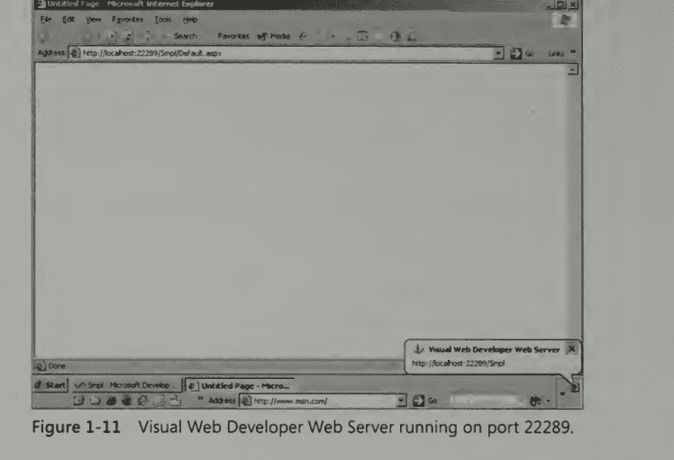

### ClickOnce 部署

过去与部署 Windows 应用程序相关的困难促使许多组织转向 Web 应用程序以简化部署。这使得网络边缘的计算资源未得到充分利用，并将应用程序限制在非常有限的用户界面中。虽然 .NET Framework 1.1 解决了一些部署问题，例如 DLL 版本冲突，并实现了一种称为"非接触式"部署的基于 Web 的部署策略，但仍有改进空间。.NET Framework 2.0 中新的 ClickOnce 部署功能使部署自更新的 Windows 或控制台应用程序变得容易，这些应用程序不需要管理权限即可安装，并且可以在脱机模式下运行。

有关 ClickOnce 部署工作原理的更多详细信息，请参阅第 8 章"部署应用程序"。

## 结论

Microsoft .NET Framework 为运行多种类型的应用程序提供了托管环境。.NET Framework 是 Windows、Web、控制台和智能设备应用程序的平台。.NET Framework 提供的服务包括对象生命周期管理（也称为垃圾回收）、安全性、类型安全性以及与 COM 的互操作性。.NET Framework 还提供了丰富的类库，可用于减少您必须编写的代码量（从而减少测试和维护）。这带来了更好的生产力和更安全的代码，因为该类库已经在全球各地的计算机上经过了现场测试。

.NET Framework 彻底改变了开发人员构建软件的方式。公共语言运行时提供的服务和框架类库中提供的功能处理了许多繁琐的基础结构和实用程序类型的编程工作。通过以 .NET Framework 为目标，开发人员能够将更多时间用于解决其特定领域的问题，而不是解决诸如如何在客户端应用程序和服务器之间传递消息（Web 服务）之类的通用问题。

本书其余部分介绍了 Visual Studio 2005，这是针对 .NET Framework 的首要开发工具的最新版本。您将看到 .NET Framework 2.0 版本中的许多改进以及 Visual Studio 2005 中的新功能，这些功能将帮助您成为更高效的开发人员。

## 第 2 章

## Visual Basic 2005 的语言增强功能

| 本章内容： | |
| --- | --- |
| 应用：泛型 | 33 |
| 应用：My 对象 | 41 |
| 应用：运算符 | 50 |
| 应用：关键字 | 56 |

Visual Basic 2005 引入了许多旨在使您的编码更简单、更高效的增强功能。在本章中，您将了解其中的四项增强功能。*泛型*（Generics）为您提供了一种设计类的方法，这些类可以高效且类型安全地处理不同类型的对象。*My 对象*提供了方便的快捷方式，用于访问引用当前运行应用程序、本地计算机、应用程序的窗体集合、登录用户以及与应用程序关联的 Web 服务的基类库类。通过对 =（等于）和 >（大于）等运算符进行重载，您现在可以定义比较类的两个实例时会发生什么。最后，您将了解一些新的关键字。

### 应用：泛型

本应用说明了 Microsoft Visual Basic 2005 对泛型的新支持。

### 新概念

在深入实现泛型之前，值得花一分钟分析一下为什么将此功能添加到 Visual Basic 2005 中。泛型源于需要以"通用"方式处理可能任何类型的对象。例如，您可能想要创建一个只能接受 `Employee` 对象或 `Customer` 对象的类，并且能够通过区分它们来分别处理每个对象。

## Visual Basic 6.0 集合

Visual Basic 6.0 确实可以让你将几乎所有东西存储在*集合*中。然而，*集合*类存在许多限制。例如，假设你想将以下 `Employee` 类存储在*集合*中：

```
' Visual Basic 6.0
Public SSN As String
Public FirstName As String
Public LastName As String
Public Salary As Currency
```

将其存储到集合中相对简单：

```
Dim employees As New Collection

Dim emp As Employee
Set emp = New Employee
emp.SSN = "111-11-1111"
emp.FirstName = "Scott"
emp.LastName = "Swigart"
emp.Salary = 50000

employees.Add emp, emp.SSN
```

这段代码首先创建一个名为 `employees` 的 `Collection` 实例。然后创建一个 `Employee` 对象并填充数据。最后，将该 `Employee` 对象添加到*集合*中。以下代码展示了如何从*集合*中检索 `Employee` 对象：

```
Dim emp2 As Employee
Set emp2 = employees("111-11-1111")
```

现在让我们来审视 Visual Basic 6.0 *集合*的局限性。首先，你很可能只想在 `employees` 集合中存储 `Employee` 对象。然而，没有任何机制可以阻止任何人将其他类型的对象存储到 `employees` 集合中。此外，当你尝试从 `employees` 集合中检索某个项目时，没有任何信息能告诉你检索的是什么类型。例如，以下代码可以正常编译：

```
Dim s As String
s = employees("111-11-1111")
```

尽管开发者很清楚这行不通，但编译器无法捕获这个错误。这将表现为最糟糕的错误类型——运行时错误。*集合*还限制了 IntelliSense 的功能。考虑以下代码：

```
employees("111-11-1111").LastName = "SomeoneElse"
```

这段代码表明你可以直接在项目位于*集合*中时对其进行编辑。然而，当选择 `LastName` 属性时，你不会获得任何 IntelliSense 支持。同样，从 Visual Basic 的角度来看，那个*集合*可能存储的是任何内容。在 Visual Basic 6.0 中，没有办法表达"创建一个*包含员工的*集合"。

集合类的最后两个限制是性能和灵活性。尽管它易于使用，但作为动态数组使用时，集合类的性能表现不佳。集合类的设计也更类似于字典，因此如果你需要类似栈或队列的功能，它并不是一个合适的选择。

## 框架集合

.NET Framework 1.0 和 1.1 版本通过提供更多类型的集合来解决集合的一些问题。通过导入 `System.Collections` 命名空间，你的代码可以访问 `ArrayList`、`BitArray`、`HashTable`、`Queue`、`SortedList` 和 `Stack` 等集合。这些类型集合的使用场景如表 2-1 所示。

**表 2-1 集合类**

| 集合名称 | 用途 |
|---|---|
| `ArrayList` | `ArrayList` 使得创建动态增长的数组变得简单。 |
| `BitArray` | `BitArray` 类经过优化，用于存储布尔值（真/假）数组。 |
| `HashTable` | `HashTable` 与 Visual Basic 6 的 `Collection` 类最为相似。该类允许你使用键来查找值。但是，键和值可以是任何类型。 |
| `SortedList` | `SortedList` 类似于 `HashTable`，但其键始终保持排序。这意味着如果你使用 `For...Each` 遍历集合，你将始终以排序顺序检索项目。 |
| `Queue` | `Queue` 是一种支持"先进先出"模型的集合。 |
| `Stack` | `Stack` 与 `Queue` 恰好相反，提供"先进后出"的功能。 |

.NET Framework 1.0/1.1 在解决 Visual Basic 6.0 灵活性限制方面做了很多工作；然而，这些集合仍然是松散类型的。这意味着你可以在 `ArrayList` 中存储任何内容，即使对于特定的应用程序来说，只存储特定类型才是合理的。

你真正想要的是一个可以指定每个键必须是 `string`、每个值必须是 `Employee` 的集合。在 .NET Framework 1.0/1.1 中，你需要自己创建一个类来封装 `Hashtable` 并提供此功能。在 .NET Framework 1.2 中，这个问题通过使用泛型用更少的代码得到了解决。

# 演练

正如"泛型"应用程序所示，泛型提供了严格的类型检查、更好的 IntelliSense 功能和更好的性能。换句话说，它们几乎解决了过去集合类所遇到的所有问题。

## 使用泛型类型

首先，值得一提的是，.NET Framework 1.2 在现有 .NET Framework 1.0/1.1 集合类的*基础上*提供了泛型集合。.NET Framework 1.2 绝不会强制你使用泛型。

如果你确实想使用新的泛型类型，你需要首先导入 `System.Collections.Generic` 命名空间。这样就可以访问 `Dictionary`、`List`、`Queue`、`SortedDictionary` 和 `Stack` 类。在 `btnConsumeGenerics_Click` 事件中展示了使用泛型 `Dictionary` 的示例：

```
Private Sub btnConsumeGenerics_Click(ByVal sender As System.Object, ByVal e As
System.EventArgs) Handles btnConsumeGenerics.Click
    Dim employees As New Dictionary(Of String, Employee)
    Dim emp As Employee
    emp = New Employee
    emp.SSN = "111-11-1111"
    emp.FirstName = "Scott"
    emp.LastName = "Swigart"
    emp.Salary = 50000

    employees.Add(emp.SSN, emp)

    txtOutput.Text = "Consuming generics" & vbCrLf & vbCrLf

    Dim emp2 As Employee
    emp2 = employees.Item("111-11-1111")

    Dim s As String
    's = employees.Item("111-11-1111")  ' This is now a syntax error

    employees.Item("111-11-1111").LastName = "SomeoneElse"
    txtOutput.Text &= "Employee last name:" & vbCrLf & _
        employees.Item("111-11-1111").LastName
End Sub
```

如果你逐步阅读这段代码，你会注意到关于泛型的一些有趣之处。首先，泛型类型的实例化方式如下：

```
Dim employees As New Dictionary(Of String, Employee)
```

这段代码的含义是"创建一个*字典*，其中键为 `string` 类型，值为 `Employee` 类型。"请注意使用了新的 `Of` 关键字来指定键的所需数据类型。任何试图存储非 `Employee` 对象的值都将导致编译时错误。这一点值得重复说明：使用泛型时，如果你使用了错误的类型，这是编译时错误，而不是运行时错误。事实上，以下行必须被注释掉，否则应用程序将无法运行，因为编译器知道该 `Dictionary` 存储的是 `Employee` 类，而不是 `string`：

```
's = employees.Item("111-11-1111")  ' This is now a syntax error
```

此外，你现在对集合中的类型拥有完整的 IntelliSense 支持。如果你查看图 2-1，你可以看到 Microsoft Visual Studio 知道这个 `Dictionary` 只存储 `Employee` 类，并且 `Employee` 类的属性可以通过 IntelliSense 使用。

```
employees.Item("111-11-1111").LastName = "SomeoneElse"
txtOutput.Text &= "Employee " & employees.Item("111-11-1111").GetType
```

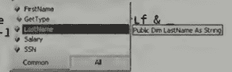

图 2-1 泛型集合中项目的 IntelliSense。

如你所见，泛型使用简单，它们生成强类型代码（减少了运行时错误的可能性），并且使 IntelliSense 更加实用。这些本身就足以成为使用泛型的理由，但泛型还有许多额外的优势，包括性能和代码重用。

在 .NET Framework 中引入泛型的主要原因之一是性能。简而言之，它们比以前的集合类更快，因为编译器针对它们存储的类型进行了专门优化。一个示例

```
myArraylist = Nothing
GC.Collect()

PerfTime.Start()
Dim myList As New List(Of Integer)
For i As Integer = 0 To iterations - 1
    myList.Add(i)
Next
elapsed = PerfTime.Stop
txtOutput.Text &= "List time: " & elapsed & vbCrLf
myList = Nothing
GC.Collect()
```

这段代码将 500 万个值存储到一个固定大小的数组中。这些值同时还存储在自动增长大小的 `ArrayList` 中，以及按需增长的泛型 `List` 中。性能数据（在开发这段代码的计算机上）讲述了一个有趣的故事：

```
Array time: 344
ArrayList time: 4656
List time: 797
```

没有什么比存储特定类型且永远不需要调整大小的数组更快的了。（你的数据会与所示数据有所不同。）然而，对于一个动态增长的集合类来说，它与静态数组相比性能已经相当不错了。再看看 `ArrayList`，就不那么好了。它不到静态数组十分之一的速度。问题在于 `ArrayList` 被设计为存储对象。整数不是对象，它们是值类型。在将它们存储到 `ArrayList` 之前，它们必须经过一个称为"装箱"的过程，该过程将整数转换为对象。装箱是昂贵的，如果你正在存储值类型（整数、`DateTime`、布尔值、你自己的结构体等），你会注意到使用泛型集合而不是基于 `Object` 的集合有显著的性能提升。

> **注意** 有关装箱和拆箱的更多信息，请参阅 MSDN 库中的"装箱转换"和"拆箱转换"。

## 创建泛型类型和方法

使用 Visual Basic 2005，你不仅限于简单地使用泛型类型。你还可以创建自己的泛型类型和方法。

**泛型方法** 如果你想执行一些与任何类型无关的通用算法，你可能希望创建一个泛型方法。例如，一个典型的冒泡排序遍历数组中的所有项，将一项与下一项进行比较，并根据需要交换值以对数组进行排序。

如果你事先知道你要排序的只是整数，你可以简单地为整数类型硬编码 `Swap` 方法。然而，如果你希望能够排序任何类型，你可以编写一个泛型 `Swap`，如下所示：

```
Private Sub Swap(Of ItemType) _
    (ByRef v1 As ItemType, ByRef v2 As ItemType)

    Dim temp As ItemType
    temp = v1
    v1 = v2
    v2 = temp
End Sub
```

请注意"`Of ItemType`"。当调用 `Swap` 方法时，除了标准参数之外，还必须传递一个数据类型。这个数据类型将替换 `ItemType` 的每个实例。以下是对 `Swap` 的调用示例：

```
Swap(Of Integer)(v1, v2)
```

这段代码告诉 `Swap` 方法它将交换整数类型，导致 `Swap` 原始列表中 `ItemType` 的每个实例都被 JIT 编译器替换为整数。`Swap` 方法本质上被 JIT 重写为以下内容：

```
Private Sub Swap(ByRef v1 As Integer, ByRef v2 As Integer)
    Dim temp As Integer
    temp = v1
    v1 = v2
    v2 = temp
End Sub
```

这是实际执行的代码。JIT 生成一个处理整数类型版本的方法。然而，如果你稍后想要排序字符串类型，你可以有另一个对 `Swap` 的调用，如下所示：

```
Swap(Of String)(v1, v2)
```

当这个方法执行时，JIT 将编写另一个 `Swap` 版本，这个版本专门针对字符串类型：

```
Private Sub Swap(ByRef v1 As String, ByRef v2 As String)
    Dim temp As String
    temp = v1
    v1 = v2
    v2 = temp
End Sub
```

使用 `Swap` 的冒泡排序的完整示例如下：

```
Private Sub btnSortIntegers_Click(ByVal sender As System.Object, ByVal e As System.EventArgs) Handles btnSortIntegers.Click
    Dim ints(9) As Integer
    Dim r As New Random
    For i As Integer = 0 To 9
        ints(i) = r.Next(1, 100)
    Next
```

```
' Bubble sort
For j As Integer = 0 To 9
    For k As Integer = 9 To 1 Step -1
        If ints(k) < ints(k - 1) Then
            Swap(Of Integer)(ints(k), ints(k - 1))
        End If
    Next
Next

txtOutput.Text = "Sort Integers" & vbCrLf & vbCrLf
For i As Integer = 0 To 9
    txtOutput.Text &= ints(i) & vbCrLf
Next
End Sub
```

## 泛型类型

最后一点，你可以创建完整的泛型类。在这种情况下，`Of ItemType` 与类声明一起使用，如下所示：

```
Public Class SomeClass(Of ItemType)

    Private internalVar as ItemType
    Public Function SomeMethod(ByVal value As ItemType) As ItemType
    End Function

End Class
```

相同的规则适用于类和方法。当类实例化时，JIT 编译器将简单地用特定类型替换 `ItemType` 的每个实例。

## 约束

泛型还支持一项称为约束的功能。此功能让你确保在指定类型时，它们实现了某些最低功能。例如，如果你正在实现一个泛型排序算法，你可能希望确保你要排序的类型实现了 `IComparable`。你可以通过约束来实现这一点：

```
Public Class SomeClass(Of ItemType As IComparable)

    Public Function SomeMethod(ByVal value As ItemType) As ItemType
    End Function

End Class
```

## 结论

与基于 `Object` 的集合类相比，泛型提供了许多优势。首先，泛型类是强类型的，这允许许多错误在编译时而不是在运行时被捕获。强类型还让 IntelliSense 能够提供更多信息。泛型还允许你重用代码，创建适用于各种类型的通用算法。最后，泛型集合比基于 `Object` 的集合更快，尤其是在处理值类型时。

## 应用程序：My 对象

Visual Basic 2005 引入了一种快速访问许多重要类的方式，这些类涉及运行应用程序的计算机、运行它的用户、应用程序本身、它的窗体以及任何相关的 Web 服务。它们都可以通过使用新的 My 对象来访问。

### 新概念

使用 Visual Basic 6 构建应用程序时，你可以访问 Visual Basic 运行时、各种 COM 对象以及你正在运行的任何版本 Microsoft Windows 操作系统的 Win32 API。.NET Framework 的早期版本将大部分此类功能统一为一套庞大的类，称为基类库。在基类库中，有支持访问有关底层操作系统信息的类。有允许你轻松访问机器硬件信息的类。还有允许你在不同应用程序之间轻松跨网络通信、加密数据、提供对注册表的访问等的类。

理解基类库及其提供的丰富功能很重要，如果你想成为一名称职的 .NET 开发人员。缺乏对基类库的了解可能导致开发人员重复造轮子，构建已存在的类。在某些情况下，.NET Framework 提供的功能因其规模而隐藏或被掩盖，导致事物被忽视。已经撰写了大量文章，其中包括自制算法来支持你可以通过了解 `Path` 或 `PasswordDeriveBytes` 等 Framework 类来简单执行的操作。事实上，很多人会告诉你，学习 .NET 与其说是学习 Visual Basic .NET 或 C#，不如说是学习基类库。

然而，学习基类库也是一项巨大的挑战，仅仅因为它太大了。每天使用的类与你可能永远不需要的其他类混合在一起。为了使 .NET Framework 中的常见类更易于发现，Visual Basic 2005 现在提供了一个"快速拨号"，称为 My 对象。通过使用 My 对象，你可以轻松访问计算机、应用程序和用户信息，以及获取对 Web 服务和窗体的访问。重要的是要理解，My 对象仅在编写 Visual Basic .NET 应用程序时可供你使用，在使用 C# 时不能直接供你使用。

重要的是要注意，My 对象不仅仅是简单的快速拨号。在某些情况下，My 对象中的类提供的功能比你通过简单搜索构成基类库的各种命名空间更容易找到。例如，`Folder` 对象提供了额外的属性，例如 `Drive`，这些属性在

# 演练

在本节中，您将通过一个深入探讨 *My Object* 的小型示例应用程序，全面了解它。该应用程序有三个选项卡，如图 2-2 所示，每个选项卡都专注于 *The My Object* 的一个特定子部分。

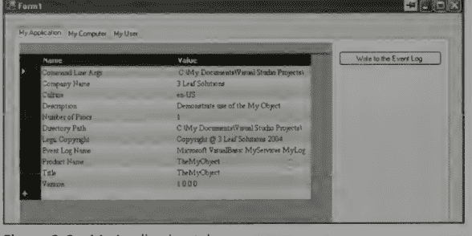

图 2-2 My.Application 选项卡。

## My.Application

第一个选项卡的文本为 `My.Application`，它显示一个数据网格，该网格展示了 `My.Application` 对象许多属性的值。用数据填充此网格的代码如下：

```
Dim cmds As String = ""
For Each cmd As String In My.Application.CommandLineArgs
    cmds &= ", " & cmd
Next
AddNewRow("Command Line Args", Mid(cmds, 2))
AddNewRow("Company Name", _
    My.Application.AssemblyInfo.CompanyName)
AddNewRow("Culture", _
    My.Application.CurrentCulture.ToString())
AddNewRow("Description", _
    My.Application.AssemblyInfo.Description)
AddNewRow("Number of Procs", _
    My.Application.GetEnvironmentVariable("NUMBER_OF_PROCESSORS"))
AddNewRow("Directory Path", _
    My.Application.AssemblyInfo.DirectoryPath)
AddNewRow("Legal Copyright", _
    My.Application.AssemblyInfo.LegalCopyright)
AddNewRow("Event Log Name", _
    My.Application.Log.ToString)
AddNewRow("Product Name", _
    My.Application.AssemblyInfo.ProductName)
AddNewRow("Title", My.Application.AssemblyInfo.Title)
AddNewRow("Version", _
    My.Application.AssemblyInfo.Version.Major & "." & _
    My.Application.AssemblyInfo.Version.Minor & "." & _
    My.Application.AssemblyInfo.Version.Revision & "." & _
    My.Application.AssemblyInfo.Version.Build)
```

前面的代码特意写得有些冗长。代码本可以使用反射来遍历属性，但通过在代码中逐项列出它们，您可以更好地理解应用程序，并更清楚地了解特定属性返回的信息。从给定属性检索到的单个值被添加到数据表 `dt` 中，然后该表与 `My.Application` 选项卡上的 `Datagrid` 绑定。您只需访问组成 `My.Application` 对象的属性，就能收集到关于应用程序的大量信息。表 2-3 列出了 `My.Application` 对象的属性和方法。

### 表 2-3 My.Application

| 属性/方法 | 描述 |
| --- | --- |
| `ApplicationContext` | 使您能够访问与当前线程关联的上下文 |
| `AssemblyInfo` | 使您能够轻松访问 `AssemblyInfo.vb` 文件中的数据，包括 `CompanyName`、`Description`、`FolderPath`、`LegalCopyright`、`LegalTrademark`、`Name`、`ProductName`、`Title` 和 `Version` |
| `ChangeCurrentCulture` | 让您更改当前线程运行的区域设置，这会影响字符串操作和格式设置等 |
| `ChangeCurrentUICulture` | 让您更改当前线程用于检索特定区域资源的区域设置 |
| `CommandLineArgs` | 返回命令行参数集合 |
| `CurrentCulture` | 返回区域设置对象的一个实例，该实例允许您确定应用程序的当前区域设置等 |
| `CurrentDirectory` | 返回应用程序所在的文件夹 |
| `CurrentUICulture` | 返回当前线程用于检索特定区域资源的区域设置 |
| `DoEvents` | 使消息队列中的所有消息都得到处理 |
| `GetEnvironmentVariable` | 返回本地计算机上的特定环境变量 |
| `IsNetworkDeployed` | 如果应用程序是网络部署的则返回 `True`，否则返回 `False` |
| `Log` | 允许您写入本地计算机上的应用程序日志 |
| `MainForm` | 一个可读写属性，允许您设置或获取应用程序将用作其主窗体的窗体 |
| `OpenForms` | 返回一个集合，表示应用程序当前打开的所有窗体 |
| `Run` | 设置并启动 Visual Basic 启动/关闭应用程序模型 |
| `SplashScreen` | 让您设置或获取应用程序的启动屏幕 |

### 在开发应用程序时使用 My.Application 的场景

`My.Application` 对象为您提供了大量功能，与使用 .NET Framework 1.0/1.1、Visual Basic 6 或两者结合构建应用程序相比，所需的代码要少得多。在本节中，我们将探讨您可以使用 `My.Application` 的一些方式。例如，写入事件日志所需的代码现已缩短为以下内容：

```
My.Application.Log.WriteEntry("Application Starting", _
    EventLogEntryType.Information, Nothing)
```

默认情况下，此代码会将条目写入调试输出以及程序集的日志文件。您可以通过在 Visual Studio 中以调试模式运行应用程序并读取输出窗口中的结果，或者通过访问日志文件来查看结果。此文件默认名为 `assemblyname.log`，位于应用程序的数据目录中，该目录可通过 `My.Computer` 的一个属性获得。

```
Dim AppLogLocation As String = _
    My.Computer.FileSystem.SpecialDirectories._
        CurrentUserApplicationData & "\" & _
    My.Application.AssemblyInfo.Title & ".log"
MsgBox("Successfully wrote to log." & vbCrLf & _
    "Log is located at: " & AppLogLocation)
```

以前，如果您想在 .NET Framework 1.0/1.1 中写入 `EventLog`，则需要多行代码才能完成。使用 Visual Basic 6 时，您可以通过 App 对象获得一些有限的日志记录功能，但无法指定事件 ID，也无法写入系统或安全日志或创建自己的自定义日志。

此外，`My.Application` 使您能够通过一行代码直接访问丰富的应用程序级信息。以下是一些可以使用 `My.Application` 这些方面的示例：

- 通过使用 `CurrentFolder` 属性快速确定应用程序所在的文件夹。

- 快速访问程序集元数据，如产品名称、公司名称等。

## My.Computer

The My Object 的下一个部分是 Computer 对象。`My.Computer` 对象使您能够访问有关应用程序运行的底层平台和硬件的信息。`My.Computer` 选项卡（如图 2-3 所示）是示例应用程序中的第二个选项卡，它提取了您可以从 `My.Computer` 对象检索到的一些更有趣的属性值。

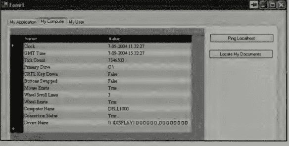

用数据填充此网格的代码如下：

```
AddNewRow("Clock", _
    My.Computer.Clock.LocalTime)
AddNewRow("GMT Time", _
    My.Computer.Clock.GmtTime)
AddNewRow("Tick Count", _
    My.Computer.Clock.TickCount)
AddNewRow("Primary Drives", _
    My.Computer.FileSystem.Drives(0).ToString())
AddNewRow("CTRL Key Down", _
    My.Computer.Keyboard.CtrlKeyDown.ToString())
AddNewRow("Buttons Swapped", _
    My.Computer.Mouse.ButtonsSwapped)
AddNewRow("Mouse Exists", _
    My.Computer.Mouse.Exists.ToString())
AddnewRow("Wheel Scroll Lines", _
    My.Computer.Mouse.WheelScrollLines.ToString())
AddnewRow("Wheel Exists", _
    My.Computer.Mouse.WheelExists)
AddnewRow("Computer Name", _
    My.Computer.Name)
AddnewRow("Connection Status", _
    My.Computer.Network.IsAvailable)
AddnewRow("Device Name", _
    My.Computer.Screen.DeviceName)
```

这段代码与用于填充应用程序中"我的应用程序"选项卡上网格的代码类似。一个 `DataTable`（即 `dt`）通过 `My.Computer` 对象的属性值填充数据，然后绑定到网格。

`My.Computer` 对象的属性和方法如表 2-4 所示。

## 表 2-4 My.Computer

| 属性/方法 | 描述 |
| --- | --- |
| `Audio` | 允许你在本地机器上播放声音文件。 |
| `Clipboard` | 允许你访问系统的剪贴板。 |
| `Clock` | 允许你访问当前 GMT 时间、本地时间和滴答计数。 |
| `FileSystem` | 允许你执行各种输入/输出（IO）操作，例如复制文件和目录、移动文件和目录，以及读写文件，通常只需一行代码即可完成。 |
| `Info` | 允许你访问本地机器的信息，包括其名称、操作系统、内存和已加载的程序集。 |
| `Keyboard` | 允许你确定键盘的状态以及键盘上各个键的状态。你可以确定 CTRL 键、SHIFT 键或 ALT 键是否被按下，大写锁定是否开启，或者滚动锁定是否开启。 |
| `Mouse` | 允许你确定连接的鼠标的状态和特定硬件特征，例如按钮数量、是否配备鼠标滚轮等。 |
| `Name` | 返回应用程序正在运行的本地机器的名称。 |
| `Network` | 允许你访问本地机器的 IP 地址信息、本地机器的当前连接状态，以及 `Ping` 地址的能力。 |
| `Ports` | 允许你访问本地机器的串行端口，以及创建和打开一个新的串行端口对象。 |
| `Printers` | 允许你访问本地机器上的打印机。 |
| `Registry` | 让你轻松访问注册表，并能够读取和写入注册表项。 |
| `Screen` | 允许你访问连接到系统的所有显示器及其显示属性，例如 `BitsPerPixel`、`WorkingArea` 等。 |

## 在开发应用程序时使用 My.Computer 的场景

`My.Computer` 对象让你能够大量访问底层平台，你可以在各种场景中使用它。例如，你可以使用 `Network` 属性及其关联的 `Ping` 方法轻松 ping 网络地址。

```
Dim pingResult As Boolean = _
    My.Computer.Network.Ping("localhost")
If pingResult = True Then
    MessageBox.Show("Ping of localhost succeeded")
Else
    MessageBox.Show("Ping of localhost was not successful")
End If
```

`My.Computer.Network` 属性的简单 `Ping` 方法在 ping 成功时返回 `True`，否则返回 `False`。能够这样 ping 一个地址，使得确定你的应用程序是否能够与特定服务器通信变得很容易。你也可以通过简单地使用 `My.Computer.Network.IsAvailable` 来确定网络连接状态。`IsAvailable` 属性根据计算机当前是否有网络连接返回 true 或 false 值。

在你的应用程序中使用 `My.Computer` 的另一个好场景是当你需要访问文件系统时。`My.Computer.FileSystem` 让你用比 Visual Basic 早期版本更少的代码行数更好地访问文件系统。使用 `My.Computer.FileSystem`，你可以用一行代码执行以下操作：

- 读取文件中的所有文本。

- 复制文件夹，同时创建完成路径所需的所有父文件夹。

- 移动文件夹，同时创建完成路径所需的所有父文件夹。

如果你想读取文件中的所有文本，你可以用以下代码实现：

```
My.Computer.FileSystem.ReadAllText(filePath)
```

复制和移动文件夹也变得更加容易：

```
My.Computer.FileSystem.CopyDirectory(sourcePath, targetPath, True, True)
```

上述代码将 `sourcePath` 文件夹复制到 `targetPath`。最后两个布尔参数指定如果找到 `targetPath` 则将其覆盖，并且会根据需要创建创建 `targetPath` 所需的所有父文件夹。

只需一行代码，你就可以确定"我的文档"文件夹的位置。

```
MessageBox.Show(My.Computer.FileSystem.SpecialDirectories.MyDocuments)
```

使用 FileIO 对象处理单个文件和文件夹也很容易。例如，只需一行代码，你就可以轻松重命名正在使用的文件：

```
My.Computer.FileSystem.RenameFile(sourceFilePath, targetFilename)
```

## My.User

The My Object 的下一部分是 `My.User` 对象。`My.User` 对象允许你获取当前已登录用户的信息，例如她的用户名、显示名以及她所属的角色。`My.User` 选项卡如图 2-4 所示。

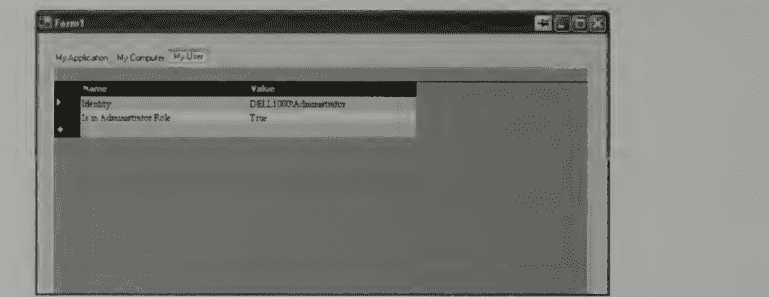

图 2-4 My.User 选项卡。

填充此网格数据的代码如下：

```
AddNewRow("Identity", My.User.Identity.Name)
AddNewRow("Is in Administrator Role", _
    My.User.IsInRole("Administrators").ToString())
```

用于访问当前用户信息的代码非常简单。你所要做的就是访问 User 对象的相应属性。用户对象由表 2-5 所示的属性和方法组成。

## 表 2-5 My.User

| 属性/方法 | 描述 |
| --- | --- |
| `Identity` | 返回当前用户的标识 |
| `IsInRole` | 允许你查询用户是否属于特定角色 |

## 在开发应用程序时使用 My.User 的场景

`My.User` 对象为你提供了大量关于当前已登录用户的信息。在很多方面，`My.User` 是 The My Object 为学习或使用 .NET Framework 的开发者提供的"快速拨号"功能的绝佳示例。

在 .NET Framework 的早期版本中，如果你想获取类似于 The My Object 提供的信息，你必须编写类似以下的代码：

```
Imports System.Security.Principal
Imports System.Threading.Thread
...
Dim winPrin As WindowsPrincipal = Thread.CurrentPrincipal
MessageBox.Show(winPrin.Identity.Name)
```

你也可以选择编写以下代码：

```
MessageBox.Show(System.Threading.Thread.CurrentPrincipal.Identity.Name)
```

但是使用 The My Object，你可以获得更直观的代码：

```
My.User.Identity.Name
```

这段代码是 The My Object 如何作为 .NET Framework 的"快速拨号"功能的经典示例。大多数开发者初次接触 .NET Framework 时，不会自然而然地假设为了获取当前已登录用户账户名，他们必须访问 `Principal` 对象，或者从应用程序的执行线程访问当前进程的标识。许多开发者会期望这些信息在更高的抽象层次上公开。使用 The My Object，这种信息可以轻松快速地访问。

## My.WebServices、My.Forms

正如你将在后续章节中了解到的，The My Object 还有两个其他重要的功能领域。它们是 `My.WebServices` 和 `My.Forms`。在结束本章这部分内容之前，让我们快速了解一下它们。

`My.WebServices` 让你能够像访问数据源一样轻松访问项目中引用的 Web 服务：

```
dgdOrders.DataSource = _
    My.WebServices.Northwind.GetOrders().Tables("Orders")
```

在这段代码中，你可以看到不需要像在 .NET Framework 1.0/1.1 中那样创建 Web 服务代理类的实例。这样，`My.WebServices` 为你项目中所有 Web 引用提供了一个便捷的"快速拨号"功能。

最后但同样重要的是，`My.Forms` 让你能够访问包含应用程序窗体的集合。随着 .NET 的出现，Visual Basic 桌面应用程序开发中一度失去了一项重要的编程增强功能，而 `My.Forms` 恢复了这项功能。

如果你以前使用过 Visual Basic 6 进行编程，你知道以下代码可用于显示项目中的一个窗体：

```
Form2.Show
```

随着 .NET Framework 1.0/1.1 的出现，你无法如此轻松地做到这一点。当你在 .NET Framework 1.0/1.1 中尝试显示一个窗体时，需要以下代码：

```
Dim frm1 As New Form1()
frm1.Show()
```

使用 `My.Forms`，项目中的所有窗体都可以作为此集合的一部分轻松访问。此外，即使不使用 `My.Forms`，你也可以访问项目中所有窗体的默认实例。因此，以下代码行是等效的：

```
My.Forms.Form2.Show()
Form2.Show()
```

在本书中，你将看到更多使用这种方法显示窗体的内容。稍后你还将看到对 `My.WebServices` 和 `My.Forms` 的更详细介绍。

## 总结

My 对象对身为开发人员的你有四个主要用途。首先，它包含了在以前版本的 .NET Framework 中无法获得的附加功能。其次，它提供了一个有价值的快速拨号功能，让你能更快速地查找和使用应用程序中的 .NET Framework 基类库功能。第三，它填补了一些空白，让你可以将诸如计算机之类的概念视为逻辑实体。第四，它带回了一些熟悉的编码语法，例如 `Form1.Show`。

## 应用程序：运算符

本应用程序介绍了 Visual Basic 语言的新增运算符重载功能以及新增的 `IsNot` 运算符。

### 新概念

运算符重载允许你定义类在使用内置语言运算符（如 `+`、`-`、`<`、`>`、`=` 和 `<>`）时的行为。使用 `+` 等运算符来操作对象的概念在 Visual Basic 中并不新鲜。例如，以下代码行使用 `+` 运算符对两个字符串对象进行操作：

```
str = "Hello, " + "world"
```

当应用于字符串时，`+` 运算符将两个字符串连接起来以生成新字符串。连接是字符串加法运算的合适结果。Visual Basic 中的运算符重载允许你为自己的类的实例定义诸如加法等运算的适当结果。

假设一种场景，你需要确定一名员工是否比另一名员工资历更深：

```
Dim emp1, emp2 As Employee
emp1 = Employee.GetFromID(123)
emp2 = Employee.GetFromID(155)
```

资历是本应用程序中两个 `Employee` 对象之间的自然比较，因此下一行代码的语义应表达"如果 emp1 大于 emp2"。通过运算符重载，你可以实际定义当两个 `Employee` 对象一起使用时 `>`（大于）运算符如何工作。一旦定义了 `>` 运算符，以下代码就有效了：

```
If emp1 > emp2 Then
    ' 在此处添加代码
End If
```

## 分步指南

本应用程序用 `Employee` 对象填充两个列表框控件。然后，用户可以选择两名员工，查看哪位员工资历更深。在本应用程序中，资历仅根据雇佣日期确定。

### 运算符重载

重载运算符就像创建新方法一样简单。实际上，运算符重载只是使用 `Operator` 关键字创建的方法。`Employee` 类的 `>` 运算符定义如下所示：

```
Public Shared Operator >(ByVal lhs As Employee, _
                          ByVal rhs As Employee) As Boolean
    ' 在此处添加代码
End Operator
```

运算符必须标记为 `Shared`，并且其至少一个参数必须属于封闭类型（`Employee`）。`>` 运算符是二元运算符，这意味着它需要两个操作数：运算符的左侧和运算符的右侧。这些操作数中只有一个必须是封闭类型。如果你要定义 `Employee` 对象如何与其他类型的对象进行比较（例如整数），则另一个操作数可以是另一种类型。此代码的典型结果如图 2-5 所示。

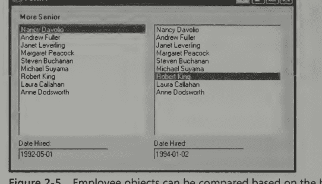

图 2-5 可以根据员工的雇佣日期比较 Employee 对象。

传递给运算符方法的参数可以是 `Nothing`（空引用），因此在尝试访问属性或方法之前需要检查它们。`Employee` 类的 `>` 运算符的完整实现包括处理空引用的逻辑：

```
Public Shared Operator >(ByVal lhs As Employee, _
                       ByVal rhs As Employee) As Boolean
    If rhs Is Nothing Then
        If lhs IsNot Nothing Then
            Return True
        Else
            Return False
        End If
    End If

    If lhs Is Nothing Then
        Return False
    End If

    If rhs.HireDate > lhs.HireDate Then
        Return True
    Else
        Return False
    End If
End Operator
```

当你定义某些运算符时，Visual Basic 要求你也为逆运算定义运算符。如果你定义了 `=`（等于）运算符，则必须定义 `<>`（不等于）运算符。如果你定义了 `>=`（大于或等于）运算符，则必须定义 `<=`（小于或等于）运算符。如果你定义了 `>`（大于）运算符，则必须定义 `<`（小于）运算符。幸运的是，你通常可以利用第一个运算符来定义逆运算。因此，无需为 `<` 运算符编写逆逻辑，只需反转操作数并使用 `>` 运算符：

```
Public Shared Operator <(ByVal lhs As Employee, _
                       ByVal rhs As Employee) As Boolean
    Return rhs > lhs
End Operator
```

同样，`<>` 运算符返回 `=` 运算符的逻辑逆：

```
Public Shared Operator <>(ByVal lhs As Employee, _
                ByVal rhs As Employee) As Boolean
    Return Not lhs = rhs
End Operator
```

## IsNot 运算符

本应用程序中的 `>` 运算符重载方法使用了新增的 `IsNot` 运算符。在 Visual Basic 的早期版本中，确定对象引用不是 `Nothing` 需要将 `Not` 关键字应用于 `Is` 关键字：

```
If Not obj Is Nothing Then
```

尽管此语法完全合乎逻辑，但使用起来可能比较别扭，尤其是在尝试阅读或口头上表达逻辑时。使用新增的 `IsNot` 运算符，可以实现以下 `If` 语句：

```
If obj IsNot Nothing Then
```

此语句在逻辑上与前面的 `If` 语句完全相同，但读起来更自然：*如果对象不是 nothing，则...*

## IsTrue、IsFalse 和 Not 运算符

Visual Basic 中的运算符重载包括重载两个名为 `IsTrue` 和 `IsFalse` 的特殊运算符的能力。这些运算符无法从代码中显式调用，但编译器可以使用它们在需要布尔值的表达式中计算对象的 true 或 false 值（例如 `If` 语句）。考虑以下 `Employee` 对象的使用：

```
Dim emp As New Employee()
If emp Then
    ' 在此处添加代码
End If
```

只有在 `Employee` 的类定义中包含计算布尔值的方法时，`emp` 的这种用法才有效。这可以通过定义 `IsTrue` 运算符或 `CType` 运算符（在下一节中介绍）来完成。`Employee` 的 `IsTrue` 运算符返回 `Employee.IsActive` 字段的值，或者对于空引用返回 false：

```
Public Shared Operator IsTrue(ByVal emp As Employee) As Boolean
    If emp Is Nothing Then
        Return False
    Else
        Return emp.IsActive
    End If
End Operator
```

当你定义 `IsTrue` 时，Visual Basic 要求你也定义其逆运算符 `IsFalse`。在 `Employee` 类这样的简单情况下，定义此逆运算符非常简单：

```
Public Shared Operator IsFalse(ByVal emp As Employee) As Boolean
    Return Not emp
End Operator
```

然而，在 `Employee` 类上使用 `Not` 运算符的这种便利并非免费获得。你还必须定义该运算符：

```
Public Shared Operator Not(ByVal emp As Employee) As Boolean
    If emp Then Return False Else Return True
End Operator
```

## CType 运算符

Visual Basic 中另一个可以重载的特殊运算符是 `CType` 运算符。`CType` 用于将表达式从其原始数据类型转换为新数据类型。例如，`CType("100", Integer)` 将 `string` 转换为 `integer`。通过重载类的 `CType` 运算符，你可以精确定义类的实例如何转换为另一种数据类型。本应用程序中 `Employee` 类的三种可能转换是 `Employee` 到 `string`、`Employee` 到 `date` 和 `Employee` 到 `boolean`。对于每种转换，你必须提供单独的 `CType` 运算符重载。

```
Public Shared Widening Operator CType(ByVal emp As Employee) As String
    Return emp.FirstName + " " + emp.LastName
End Operator
```

```
Public Shared Widening Operator CType(ByVal emp As Employee) As Date
    If emp Is Nothing Then
        Return Nothing
    Else
        Return emp.HireDate
    End If
End Operator
```

```
Public Shared Widening Operator CType(ByVal emp As Employee) As Boolean
    If emp Is Nothing Then Return False Else Return emp.IsActive
End Operator
```

`CType` 运算符重载可以标记为 `Widening` 或 `Narrowing`。如果目标数据类型无法表达原始数据类型的所有可能值，则转换是窄化的。`Employee` 的任何已定义转换都不属于这种情况，因此它们都被标记为 `Widening`。

> **注意** 使用 `Option Strict On` 时，Visual Basic 编译器不允许隐式窄转换。

在 `Employee` 类中，`ToString` 方法被重写，以便返回员工的名字和姓氏，而不是类名。`Employee` 类定义了一个 `CType` 运算符，该运算符定义了从 `Employee` 到字符串的扩大转换，因此在 `ToString` 方法中所需的代码非常少。从 `Employee` 到 `string` 的转换是隐式的，因为该函数具有显式返回类型（`string`），并且定义了从 `Employee` 对象到该返回类型的扩大转换：

```
Public Overrides Function ToString() As String
    Return Me
End Function
```

> **注意** 除非 `ToString` 被重新定义（重写），否则对象将使用从 `System.Object` 继承的 `ToString` 方法，该方法返回对象的完全限定类名。

你可以使用运算符重载来为你的类创建有效且自然的接口。然而，参数和返回类型选择不当会使应用程序编程接口（API）令人困惑。例如，大于（`>`）、小于（`<`）、等于（`=`）和不等于（`<>`）运算符通常应返回 `Boolean` 值。在大多数情况下，返回 `DateTime` 的 `>` 运算符会令人困惑且不自然。二元 `+` 运算符通常应返回包含类型，一元 `+` 和 `–` 运算符也应如此：

```
Dim var1 As New MyCustomClass
Dim var2 As New MyCustomClass
Dim var3 As MyCustomClass = var1 + var2
var3 = -var3
```

对于像二元 `–` 运算符这样的运算符，你可能希望返回不同的数据类型。例如，在这个应用程序中，两个 `Employee` 对象之间的差异可能是一个整数值，表示两名员工雇佣日期之间相差的月份数。

## 结论

运算符重载让你能够决定当运算符（如 `=` 和 `>`）用于你定义的对象的两个实例时如何工作。要重载运算符，你只需在类中创建一个包含 `Operator` 关键字的方法。重载运算符时，请务必定义它们的逆运算符。例如，对于 `=`（等于）运算符的重载，应定义一个相应的 `<>`（不等于）运算符重载。

一套规划良好、参数和返回类型适当的运算符重载可以使你的类更易于使用，并促进编写更简洁的源代码。

# 应用：关键字

本应用介绍了新的 Visual Basic 关键字 `Using`、`Global` 和 `Continue`。

### 新概念

语言设计者通常对向编程语言添加新关键字持保守态度。语言必须具有足够的表现力才能发挥作用，但添加太多关键字会使语言过于复杂而难以掌握。随着 Visual Studio 2005 的发布，向 Visual Basic 添加的新关键字旨在澄清或简化你在某些常见编程场景中的代码。

## Global 关键字

Visual Basic 允许你创建自己的命名空间来组织应用程序和库中的类。有意义的命名空间可以大大提高你的类层次结构的直观性和源代码的可读性。但是，如果你将其中一个命名空间命名为与 .NET Framework 基类库中的顶级命名空间相同的名称，该顶级命名空间将不可访问。例如，你无法在自定义命名空间 `Util.System` 中将变量声明为 `System.String`，因为 `String` 未在 `Util.System` 中定义。`Util.System` 命名空间遮蔽了顶级 `System` 命名空间。

Visual Basic 中新的 `Global` 关键字允许你在命名空间层次结构遮蔽其部分时访问命名空间层次结构的根。因此，在 `Util.System` 命名空间内的字符串变量可以声明为 `Global.System.String`。示例请参阅“演练”部分。

## Using 关键字

.NET Framework 公共语言运行时包含一个复杂的内存管理子系统，用于处理托管应用程序的内存分配和释放。垃圾回收器会在适当的时间从未使用的对象中回收内存。垃圾回收器在释放内存时会自动调用一个称为 *终结器* 的特殊清理方法。但是，无法保证对象何时会被终结。这种非确定性的对象清理方法在你的对象使用非托管资源（如文件句柄）时可能会出现问题。

为了规避垃圾回收的非确定性，使用非托管资源的类应包含某种方式，让程序员能够在放弃对象之前显式清理非托管资源。传统的做法是实现 `IDisposable` 接口，该接口要求提供一个 `Dispose` 方法。程序员只需在不再需要对象时调用你的 `Dispose` 方法。这种方法要求程序员确保在每个可能的执行路径结束时都调用 `Dispose`。

Visual Basic 中新的 `Using` 关键字通过自动为对象调用 `Dispose` 来简化 `Dispose` 方法的使用。在以下代码段中，`Using` 块结束时会自动调用 `obj1` 的 `Dispose` 方法：

```
Dim obj1 As New MyCustomClass
Using (obj1)
    ' 在此处添加代码
End Using
```

`Using` 关键字可应用于任何实现 `IDisposable` 接口的对象。`Using` 关键字可以嵌套，从而可以为任意数量的对象自动调用 `Dispose`。

## Continue 关键字

大多数 Visual Basic 程序员都遇到过可以跳过循环某些迭代的情况。以前版本的 Visual Basic 没有简单的方法来跳过到循环的下一次迭代。这意味着你必须将整个循环体包装在条件块中。Visual Basic 中的 `Continue` 关键字现在允许你跳过到循环的下一次迭代，而无需处理循环体的其余部分。以下 `While` 循环使用 `Continue` 关键字，如果当前记录（在 `SqlDataReader` 中）的第一列为 `Nothing`，则跳过到下一次迭代：

```
While dr.Read()
    If dr(0) Is Nothing Then Continue While
    ' 处理 SqlDataReader 中的当前记录
End While
```

`Continue` 关键字可用于嵌套循环中，以跳过到外层循环的下一次迭代：

```
While I < 1000
    For J As Integer = 1 To 5
        If I Mod J = 0 Then
            Continue While
        End If
    Next
    I += 1
End While
```

当内层循环与外层循环类型相同时，例如 `For` 循环嵌套在 `For` 循环中，`Continue` 关键字应用于最内层循环。

# 演练

Keywords 应用程序围绕 `Util.System.IO` 命名空间中定义的 `FileWriter` 类构建：

```
Namespace Util.System.IO

    Public Class FileWriter
        Implements IDisposable

        Private _outWriter As Global.System.IO.StreamWriter

        Public Sub New(ByVal filename As String)
            _outWriter = Global.System.IO.File.CreateText(filename)
            _outWriter.WriteLine("输出开始于 " + Now.ToString())
        End Sub

        Public Sub WriteLine(ByVal message As String)
            _outWriter.WriteLine(Now.ToString().PadRight(30) + message)
        End Sub

        Public Sub Dispose() Implements IDisposable.Dispose
            _outWriter.Close()
            MsgBox("StreamWriter 已由 Dispose() 关闭")
            GC.SuppressFinalize(Me)
        End Sub

        Protected Overrides Sub Finalize()
            _outWriter.Close()
            MsgBox("StreamWriter 已由 Finalize() 关闭")
        End Sub

    End Class

End Namespace
```

`FileWriter` 类是 `StreamWriter` 类的一个简单包装。`FileWriter` 对象在向文件写入的每一行中添加当前日期和时间。`StreamWriter` 在消费者调用 `FileWriter.Dispose` 方法时或在 .NET Framework 垃圾回收器调用 `Finalize` 方法时关闭。

`Dispose` 和 `Finalize` 方法包含 `MsgBox` 调用，用于告诉你每个方法何时被调用。在本应用程序中，这些调用仅用于说明目的。通常不应从非 UI 类（如 `FileWriter`）显示消息框。

如图 2-6 所示，Keywords 应用程序的用户界面是一个带有两个按钮的 Windows 窗体。其中一个按钮的单击事件处理程序将 `Using` 语句与 `FileWriter` 对象一起使用。第二个按钮的单击事件处理程序不使用 `Using`，也不调用 `Dispose` — 它依赖垃圾回收器来调用 `Finalize`：

```
Private Sub Button1_Click(ByVal sender As System.Object, _
    ByVal e As System.EventArgs) _
    Handles Button1.Click
    Dim fw As New _
        Util.System.IO.FileWriter( _
        System.Environment.CurrentDirectory + "\button1.txt")

    Using (fw)
        For I As Integer = 1 To 100
            If I Mod 3 = 0 Then
                Continue For
            End If
            fw.WriteLine(CStr(I))
        Next
    End Using

End Sub

Private Sub Button2_Click(ByVal sender As System.Object, _
    ByVal e As System.EventArgs) _
    Handles Button2.Click
    Dim fw As New _
        Util.System.IO.FileWriter( _
        System.Environment.CurrentDirectory + "\button2.txt")

    For I As Integer = 1 To 100
        If I Mod 3 = 0 Then
            Continue For
        End If
        fw.WriteLine(CStr(I))
    Next

End Sub
```

图 2-6 关键字应用程序用户界面。

在这两种情况下，单击事件处理程序都使用 `FileWriter` 类将 1 到 100 之间的整数写入文件，但会跳过能被 3 整除的值。

## 使用 Global 关键字

`FileWriter` 类使用来自基类库 `System.IO` 命名空间的 `StreamWriter`。但是 `System.IO` 无法直接从类定义中访问，因为 `FileWriter` 定义在 `System.IO` 命名空间内部（`Util.System.IO`），该命名空间遮蔽了命名空间层次结构根部的 `System.IO` 命名空间。为解决这一命名冲突，使用 `Global` 关键字来访问基类库中的 `System.IO`：

```
Private _outwriter As Global.System.IO.StreamWriter
```

`Util.System.IO` 命名空间不包含 `StreamWriter` 类，因此将变量声明为 `System.IO.StreamWriter` 或 `IO.StreamWriter` 将无法编译。但是使用 `Global` 关键字可以让编译器将该类解析为 .NET Framework 类库中的正确类型。

## 使用 Using 关键字

`FileWriter` 对象在创建时（即其构造函数中）打开内部的 `StreamWriter`，并保持 `StreamWriter` 处于打开状态，直到调用 `Dispose` 或 `Finalize`。在 `Button1_Click` 事件处理程序中，`Using` 关键字应用于 `FileWriter` 对象 `fw`。在 `Using` 块结束时，`fw.Dispose` 会自动调用，从而关闭底层的 `StreamWriter` 对象。结果如图 2-7 所示。

**图 2-7** Dispose 自动调用后显示的消息框。

`Dispose` 在 `Using` 块结束后立即调用，因此在此示例中，来自 `Dispose` 的消息框会立即显示。相比之下，第二个按钮创建了 `FileWriter` 但没有调用 `Dispose`。来自 `Finalize` 方法的消息框会在某个看似任意的时间出现，此时垃圾回收器正在清理该对象。对于这个简单的应用程序，消息框最有可能在您关闭程序时出现。

## 使用 Continue 关键字

此应用程序中按钮的单击事件处理程序都将 1 到 100 之间不能被 3 整除的整数写入文件：

```
For I As Integer = 1 To 100
    If I Mod 3 = 0 Then
        Continue For
    End If
    fw.WriteLine(CStr(I))
Next
```

生成数字的 `For` 循环展示了新 `Continue` 关键字的简单用法。如果 `I Mod 3` 等于 0，则 `I` 的当前值能被 3 整除。当此条件为真时，`Continue For` 将执行转移到循环的下一次迭代，而不处理 `For` 循环剩余的主体部分。例如，如果 `I` 为 6，`Continue For` 将执行，使迭代返回到循环顶部，此时 `I` 等于 7。部分输出列表如下所示（注意缺少 3、6、9 和 12）：

```
output started at 12/12/2003 8:06:42 AM
12/12/2003 8:06:42 AM      1
12/12/2003 8:06:42 AM      2
12/12/2003 8:06:42 AM      4
12/12/2003 8:06:42 AM      5
12/12/2003 8:06:42 AM      7
12/12/2003 8:06:42 AM      8
12/12/2003 8:06:42 AM      10
12/12/2003 8:06:42 AM      11
12/12/2003 8:06:42 AM      13
```

## 结论

此应用程序中演示的新关键字——`Continue`、`Global` 和 `Using`——为 Visual Basic 语言增添了额外的便利性和灵活性。`Continue` 关键字有助于简化循环中处理不需要处理的特殊情况的笨拙逻辑。`Global` 关键字为您提供了灵活性，可以使用任何命名空间名称来组织类层次结构，而不会使来自 .NET Framework 类库的命名空间无法访问。而 `Using` 关键字使您无需在程序中每个执行路径的末尾显式调用 `Dispose`。这些新关键字是对 Visual Basic 语言的增量改进。它们不会 dramatically 改变您编写代码的方式，但在某些情况下，它们将有助于简化或澄清您的源代码。

## 第3章

Visual Studio 2005 集成开发环境

**本章内容：**

应用程序：IDE 增强功能........................................................... 64

在 .NET 之前，有 Microsoft Visual Basic 6，它是有史以来最受欢迎和易于使用的编程语言之一。它成功的简单原因是，它让开发人员比使用其他编程语言和开发工具的同行更高效。当然，Visual Basic 6 开发人员享有的生产力优势是以有限的语言支持为代价的。当 Visual Basic .NET 出现时，它引入了新的编程架构和功能，例如对平台的完全访问，用于构建最先进的应用程序。因此，Visual Basic .NET 被确立为一流的编程语言。然而，所有这些功能和语言支持的承诺，是以牺牲 Visual Basic 开发人员已经喜爱和期望的一些生产力优势为代价的。

Microsoft Visual Studio 2005 包含许多针对开发环境的新增强功能、创新和进步，其唯一目标是让 Visual Basic .NET 开发人员比以往任何时候都更高效。本章探讨其中一些功能，并解释作为开发人员如何利用它们来更快、更准确地编写代码。

> **提示** 除了其他对 IDE 的“改进”之外，Visual Studio 2005 还重新引入了编辑并继续功能，这对经验丰富的 Visual Basic 开发人员来说将是个好消息。

## 应用程序：IDE 增强功能

此应用程序演示了 Visual Studio 2005 IDE 中的类设计器，这是一个用于可视化设计 Visual Basic .NET 应用程序中类层次结构的工具。在查看应用程序的详细信息之前，让我们首先更一般地了解一下 Visual Studio 2005 IDE 中新增或改进的功能。

## 配置设置

如果您使用过以前版本的 Visual Studio，您可能花过一些时间自定义开发环境。您可能通过一些实验了解到可以指定工具窗口的位置，或者您可能发现 Visual Studio 中的菜单和工具栏是完全可自定义的。您还可以配置键盘映射、项目模板类型、帮助筛选器等等。事实上，Visual Studio 始终旨在让您安排 IDE 的元素，以最适合您的个人开发风格。

## “选项”对话框

图 3-1 所示的“选项”对话框提供了广泛的设置类别，用于自定义 Visual Studio 开发环境。默认情况下，“选项”对话框显示最常见的设置。要显示所有可用设置，请选中“显示所有设置”复选框。

图 3-1 “选项”对话框。

在 Visual Studio 2005 发布之前，IDE 自定义的主要缺点是您无法以可移植格式保存您的首选项，这在您需要在另一台机器上重新创建这些设置时会很有用。使用 Visual Studio 2005，您现在可以快速轻松地稍后或在另一台机器上恢复您的个人设置。Visual Studio 2005 允许您通过以下方式使用自定义设置：

- 复制您当前的设置以供在第二台机器上使用。

- 将您的设置分发给其他开发人员。

- 允许团队对 IDE 的某些元素（例如代码编辑器）使用相同的设置，同时在 IDE 的其他区域保留个人自定义设置。

如图 3-2 所示，"选项"对话框中的环境设置包含一个"导入/导出设置"项。在"始终将我的设置保存到此文件"文本框中指定的文件会在每次关闭 Visual Studio 时更新。这可以是本地文件或网络文件。如果你在两个不同的机器上定期工作，可以将此文件设置为两台机器均可访问的网络位置；这将确保你在两台机器上享有相同的 Visual Studio"外观和感觉"。此外，每次在一台机器上更改设置时，该设置将自动出现在另一台机器上。

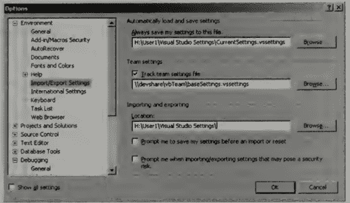

图 3-2 导入/导出设置选项。

在"团队设置"部分下，你可以指定一个包含要与开发团队共享的设置的 `.vssettings` 文件。为了理解这如何有用，请考虑以下情况：开发团队的成员都必须对 Visual Basic .NET 代码文件使用相同的缩进和格式化选项。首席开发人员可以在 Visual Studio 2005 中配置格式化选项，然后使用"导入/导出设置"对话框仅将这些格式化设置保存到网络共享上的 `.vssettings` 文件中。开发团队的其他成员随后将更新其 Visual Studio 配置以使用该团队设置文件。如果团队稍后决定更改默认值，首席开发人员可以将新设置导出到同一文件位置，团队中的每个人在下次启动 Visual Studio 时将自动收到新设置。

在"导入和导出"部分的"位置"文本框中，指定可以导出或导入设置的默认位置。以下部分描述如何导入和导出设置文件。

> 注意 你的活动设置由两部分组成：首次启动 Visual Studio 2005 时从安装的 `.vssettings` 文件中选择的预定义自定义设置，以及你之后所做的任何 IDE 自定义设置。活动设置会在每次退出 Visual Studio 时自动保存到 `currentsettings.vssettings` 文件中。

## "导入/导出设置"对话框

Visual Studio 2005 的"工具"菜单包含一个"导入/导出设置"菜单项，该菜单项打开一个用于管理设置文件的对话框。该对话框提供三个基本功能区域：

- 将当前 IDE 设置导出到文件

- 从文件导入 IDE 设置

- 将环境重置为默认文件中定义的工作样式

根据你是导出还是导入设置，该对话框允许你选择要将哪些设置导出到 `.vssettings` 文件，或要从现有 `.vssettings` 文件导入哪些设置。

> **注意** 设置类别通常定义工具窗口、选项页面或 IDE 功能的逻辑分组设置。

图 3-3 显示了选择"将 IDE 设置导出到文件"选项时的"导入/导出设置"对话框。在"选择要导出的设置"下，选择或清除要导出的各个设置或整个设置类别。

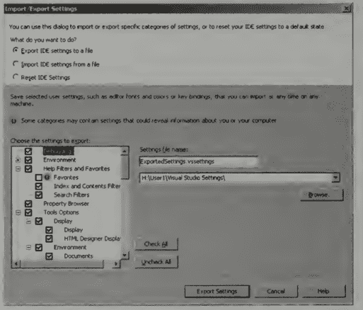

高度可自定义的开发环境的一个明显缺点是，开发人员有机会意外（当然）从 IDE 中移除必要的功能。例如，你可能会从工具栏或菜单中移除必要的项目。或者，通过无意的尝试，将工具窗口重新排列成无法使用的布局。在早期版本的 Visual Studio 中，你可以恢复 IDE 中的单个项目（例如，通过转到"窗口"菜单并选择"重置窗口布局"命令）。这些重置工具中的大多数在 Visual Studio 2005 中继续保留。然而，单独的重置工具仅涵盖 IDE 功能的一小部分，而且它们分散在整个 IDE 中，有时可能难以找到合适的工具。

如图 3-4 所示，选择"重置 IDE 设置"选项可将 IDE 环境更改为在多个预定义设置文件中定义的工作样式，这些文件列在"可用的已安装设置文件"部分下。这些文件随 Visual Studio 2005 安装，包含针对窗口布局、工具栏和菜单命令的特定自定义设置，反映了与特定编程方向相关的常见偏好，例如 VB.NET、C++、C#、Web 或 J#。

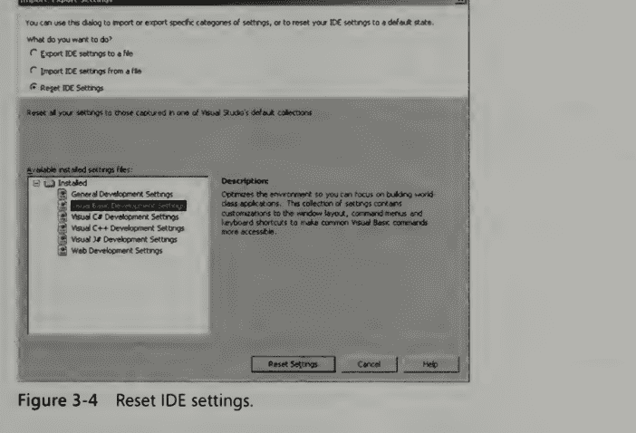

提示 如果你的设置达到无法使用 IDE 的状态，或它们阻止你访问"导入/导出设置"对话框，请通过使用重置开关从命令提示符重新启动 Visual Studio 2005 来恢复默认设置，如下所示：`devenv /resetsettings`

如果你只需要重置某些设置类别，请使用"从文件导入 IDE 设置"选项。你可以从默认设置文件之一或本地设置文件中选择设置。你还可以浏览到位于 Visual Studio 2005 默认文件夹以外的文件夹中的文件。例如，在你的开发团队共享设置文件的情况下，该文件可能位于网络共享上。如图 3-5 所示，选择文件后，标题为"可用于导入的设置"的树状视图会列出文件中存储的设置。通过选择或清除列表中显示的项目，你可以选择要导入哪些设置。"从文件导入 IDE 设置"选项允许你从 `.vssettings` 文件更改全部或部分设置。

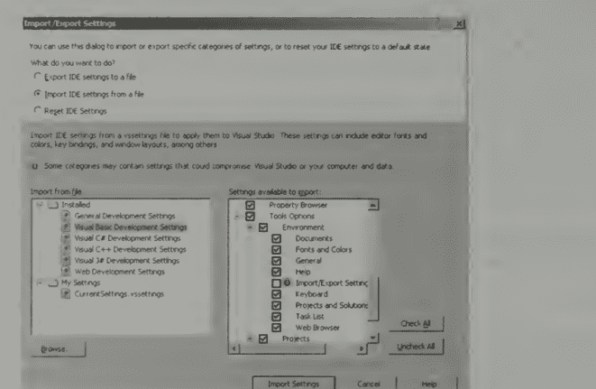

图 3-5 导入 IDE 设置。

## 帮助和社区集成

Visual Studio 2005 在帮助信息的内容和访问该信息的工具方面都有重大进展。这些改进还包括与基于社区的资源进行更全面的集成。

## 过去与现在

在回顾帮助系统中的新增功能和改进功能之前，为了提供一些背景信息，让我们回顾一下以前版本的 Visual Studio 提供帮助的方式，并突出每种方式的局限性：

- **F1** 这充其量是一个"碰运气"的工具。有时 F1 返回正确的答案。其他时候，它显示动态帮助窗口——该窗口提供关于"代码和文本编辑器"的帮助——这很少是你需要帮助的区域。

- **目录 (TOC)** 你可以浏览目录的内容树来查找与当前主题无关的主题。然而，虽然这有时可能产生有用的信息，但也可能耗时且无果。

- **索引** 在某些情况下，帮助索引仍然是查找有用信息的好选择。例如，如果你已经知道感兴趣的 .NET Framework 类名称，索引工作得很好。然而，当你查找概念性信息时，它就不够用了。

Visual Studio 2005 对这些工具进行了以下重大更新，使你能够更高效地访问帮助内容：

- **搜索** 搜索的主要缺点是它可能以随机顺序返回多达五百个结果。

- **基于 Web 的搜索** 虽然结果因你偏好的搜索引擎而异，但这仍然是许多开发人员首选的帮助工具。它不仅避免了早期 Visual Studio 帮助工具的缺点，而且还提供了对互联网上信息的访问。

- **F1** 帮助主题上的元数据改进使 F1 更加始终有用，即使你处于项目上下文之外。

- **搜索** 筛选机制比早期版本的 Visual Studio 有所改进，从而提供包含与搜索标准更匹配的主题的搜索结果。另一个重要的改进是结果包含每个返回项目的动态生成的摘要。

- **如何实现** 这是一个新的工具，如图 3-6 所示，用于访问以层次结构组织常见开发人员任务的帮助系统。对于 Visual Basic .NET 开发人员，该工具提供了数百个任务，每个任务包含开发人员可以轻松粘贴到代码编辑器中的技术说明内容和示例代码。

- **帮助收藏夹** 早期版本的 Visual Studio 包含一个集成的收藏夹工具，但仅适用于 Internet Explorer 链接。更新后的帮助收藏夹工具允许你保存帮助特定的收藏夹，包括搜索查询的参数。

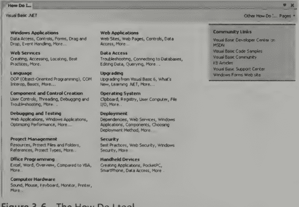

# 图 3-6 "如何实现"工具。

## 使用在线帮助内容

与早期版本的开发环境一样，Visual Studio 2005 可直接访问像 CodeGuru 和 Net247 这样的网站上的内容。这些以及其他专注于 .NET 的网站，是名为 .NET CodeWise 社区的组织的成员。CodeWise 社区是由 Microsoft 赞助的网站社区，提供关于 Microsoft 开发人员工具和技术的独立专业知识。如果您过去访问过这些网站，您已经知道开发人员社区成员的贡献扩展并丰富了静态帮助资源。虽然 MSDN 内容提供了广泛的覆盖面，但社区内容则通过深度和上下文补充了那些对现实世界开发人员重要的领域。除了扩展帮助内容和提供额外的代码示例外，基于社区的网站还提供其他资源，例如消息论坛。

与之前的 IDE 版本相比，Visual Studio 2005 向前迈出了一步，将 CodeWise 社区成员网站的内容直接集成到帮助系统中。例如，当您从 Visual Studio 2005 搜索有关泛型等主题的帮助时，搜索结果可能会返回本地 MSDN 主题列表、MSDN 在线主题列表，以及指向 CodeWise 社区网站上相关页面的链接列表。这一创新功能让您能够轻松、直接地访问社区中最新、最受欢迎的代码示例和技术文章，这些内容与 MSDN 提供的全面静态内容并列呈现。此外，与执行临时的基于 Web 的搜索相比，这是一个显著的优势，在临时搜索中，您需要自行验证所找到的信息在技术上是否准确。如图 3-7 所示，在“选项”对话框的“帮助”类别中配置在线帮助资源，包括 CodeWise 社区提供程序。

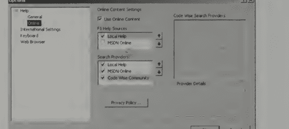

## 项目增强功能

使用 Visual Studio 2005 时，您会遇到的最直接的生产力提升是无需指定存储位置即可创建新项目。这一改变的灵感来源于开发人员的普遍经验：他们创建项目来测试代码或构建仅使用一次的原型。IDE 并不强制将这些项目作为新解决方案保存到磁盘，而是让您控制是否保存项目。

此增强功能的工作方式类似于在 Microsoft Word 中创建新文档，您可以打开文档、输入一些文本、打印，然后退出 Word 而不保存文档。同样的过程适用于在 Visual Studio 2005 中创建的项目；您可以构建一个新应用程序，在调试器中运行它，添加项目项和资源，甚至在保存之前编译应用程序。（新建项目对话框如图 3-8 所示。）与 Word 类似，Visual Studio 2005 将未保存的文件保存在临时文件存储中，直到您选择将它们保存到永久位置，或者在关闭时丢弃它们。如果您选择丢弃它们，Visual Studio 2005 会从临时存储中删除该项目及其所有关联文件。这些也被称为“零影响”项目。

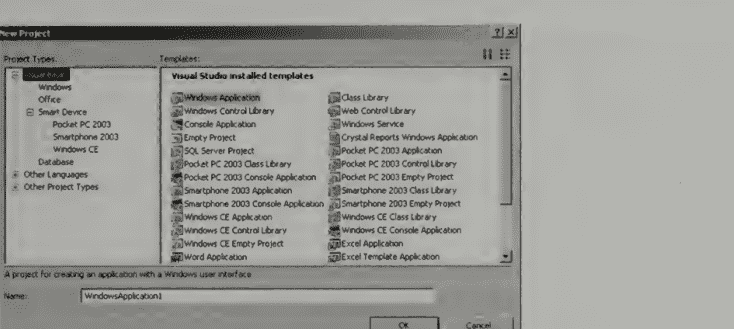

图 3-8 Visual Basic 项目模板。

Visual Studio 2005 还引入了许多新的项目项类型。许多项类型为常见的用户界面元素提供模板，包括登录窗体、关于框和资源管理器窗体模板，如图 3-9 所示。

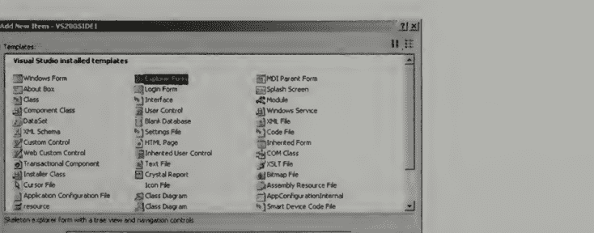

图 3-9 项目项类型。

## 项目设计器

在 Visual Studio 的早期版本中，您可以通过项目菜单访问的对话框来操作项目属性。由于对话框是模态的，您需要先打开属性对话框，更改设置，关闭对话框，然后才能继续处理代码。在典型的开发周期中，您可能会多次返回到项目属性。也许您曾暗自思忖：“如果我能一直打开这些属性以便更容易访问，岂不是很好？”

项目设计器满足了对项目属性进行更轻松、更集中访问的需求。当您在 Visual Studio 2005 中创建一个新项目时，您会在解决方案资源管理器中看到一个名为“我的项目”的附加项目元素。（参见图 3-10。）打开此项会在 IDE 的主编辑窗口中显示项目设计器。

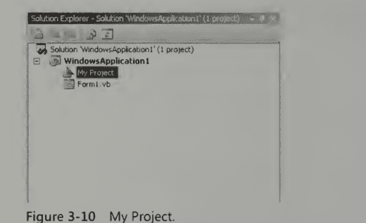

**图 3-10** 我的项目。

项目设计器提供对项目属性的非模态访问，使其与代码文件或窗体设计器一样易于访问。如果您熟悉 Visual Studio 的早期版本，您会注意到项目设计器窗格整合了以前包含在属性对话框和 IDE 其他区域中的属性，而其他窗格则为 .NET Framework 2.0 引入的功能（如 Click-Once 发布）提供配置工具。

> **注意** 有关“发布”和“安全”窗格的详细信息，请参见第 8 章“部署应用程序”。

### 应用程序窗格

如图 3-11 所示的应用程序窗格是设计器整合了早期版本 Visual Studio 属性对话框设置的地方之一。此窗格还引入了用于定义应用程序行为的新项。一旦打开项目设计器，“应用程序”窗格将作为 Visual Studio 2005 文档窗口中的选项卡可用。（或者，您可以通过在解决方案资源管理器中右键单击项目并选择“属性”菜单命令，或选择“项目 | <项目名称> 属性”菜单命令来打开项目设计器。）

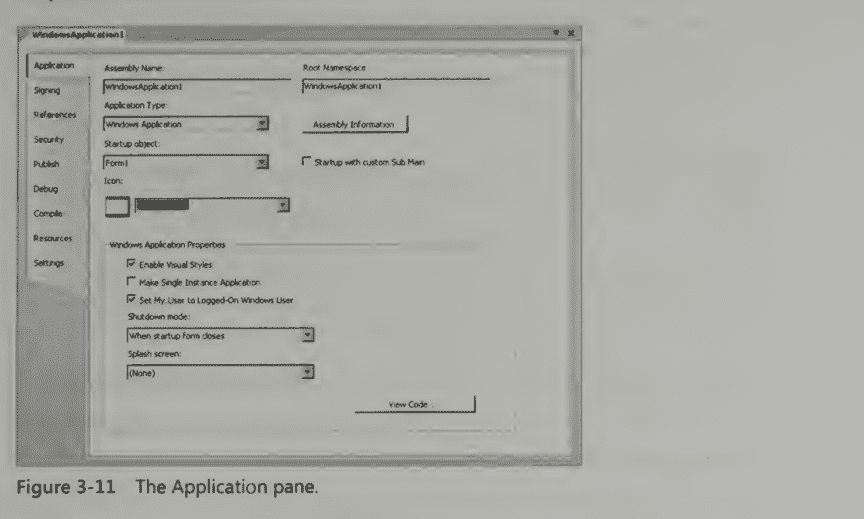

**图 3-11** 应用程序窗格。

以下是一些新增和更新的设置：

- **启动对象** 您仍然可以指定窗体或 `Sub Main` 过程作为应用程序的启动对象。项目设计器还包括一个“使用自定义 Sub Main 启动”复选框，允许您设计自己的启动例程。此外，Visual Studio 2005 支持 Visual Basic 的应用程序事件模型，其中包括两种类型的启动事件（见表 3-1）。

- **启用视觉样式** 此设置默认启用，它允许您的应用程序使用主机操作系统上存在的 Windows XP 主题。但是，您可能会遇到某些情况，其中您的应用程序使用来自先前版本 Windows XP 主题的控件，在这种情况下，您应该禁用 Windows XP 主题以保留应用程序所需的外观和感觉。

- **使成单个实例** 当您多次单击某个特定的 Windows 应用程序（例如 Media Player）时，该应用程序只会启动一次。其他应用程序（计算器、记事本等）每次单击图标时都会启动程序的单独实例。选择此设置允许您将应用程序的启动行为设置为单个实例；如果未选择此设置，应用程序将启动多个实例。

- **关闭模式** 此选项确定哪个事件表示应用程序的关闭。例如，对于 Windows 窗体应用程序，您可以选择在启动窗体关闭时或在应用程序退出时关闭应用程序。

- **启动屏幕** 此设置允许您在项目中选择一个窗体作为启动屏幕。

- **查看代码** 单击“查看代码”按钮将打开 `MyEvents.vb` 代码模块。`MyEvents.vb` 包含一个 `MyApplication` 类的部分类定义（在 `My` 命名空间内定义）。`MyApplication` 类的存在专门用于包含应用程序事件的处理程序，如表 3-1 所述。

**表 3-1** MyApplication 事件

| 名称 | 描述 |
|---|---|
| `Startup` | 在应用程序启动时引发 |
| `Shutdown` | 在应用程序退出时引发 |
| `UnhandledException` | 在应用程序中发生未处理的异常时引发 |
| `StartupNextInstance` | 在用户尝试为配置为单实例运行的应用程序启动单独的程序实例时引发 |
| `NetworkAvailabilityChanged` | 在底层网络连接的状态发生变化时引发 |

## 管理程序集信息

在适用于 .NET Framework 的 Visual Studio 的早期版本中，您通常在 `AssemblyInfo.vb` 代码文件中管理全局程序集属性。与项目中的任何其他代码文件一样，要更改程序集属性，您需要在代码编辑器中打开该文件并根据需要更新属性。以下是在 `AssemblyInfo.vb` 中找到的一些常见属性：

```
<Assembly: AssemblyTitle("IDE Enhancements")>
<Assembly: AssemblyDescription("New Visual Studio 2005 IDE features")>
<Assembly: AssemblyCompany("3 Leaf Solutions")>
<Assembly: AssemblyProduct("Moving to Visual Studio 2005")>
<Assembly: AssemblyCopyright("2005")>
<Assembly: AssemblyVersion("1.0.0.0")>
<Assembly: AssemblyFileVersion("1.0.0.0")>
<Assembly: ComVisible(False)>
```

在 Visual Studio 2005 中，程序集属性仍然存储在 `AssemblyInfo.vb` 中，但该文件现在默认在解决方案资源管理器中隐藏。应用程序窗格通过图 3-12 所示的“程序集信息”对话框提供对这些属性的访问。此对话框是底层程序集属性的接口；您在此对话框中对列出的项所做的任何更改都会自动写入底层的 `AssemblyInfo.vb` 文件。（当然，如果您愿意，您仍然可以访问底层代码文件并直接进行更改。）

# 签名窗格

在公共语言运行时 (CLR) 上执行的每个受控程序集都受与该程序集关联的代码访问安全 (CAS) 权限的约束。在执行期间，CLR 会评估程序集请求的权限，并根据向 CLR 提供的代码身份证明等信息，授予或拒绝这些权限。作为建立程序集身份的一种方式，签名窗格（如图 3-13 所示）允许你向项目添加密钥文件 (.snk) 或存储在密钥容器中的密钥。编译器使用该密钥为程序集签名以赋予其强名称。为了适应开发人员需要进行预发布构建但只能访问公钥的情况，该窗格还提供了一个复选框以启用延迟签名。

> **重要提示** 对于 ClickOnce 应用程序，发布时需要签名密钥。该密钥用于对应用程序清单和部署清单进行强名称签名。本主题在第 8 章 "部署应用程序" 中有详细讨论。

# 引用窗格

你仍然可以像以前版本的 IDE 一样，从项目菜单访问项目引用和 Web 引用。但是，Visual Studio 2005 在引用窗格（如图 3-14 所示）中添加了访问这些项的另一个入口点。使用引用窗格来管理导入的命名空间以及程序集和 Web 服务引用。这种替代视图的一个显著优点是将项目引用整合到一个 UI 组件中。该窗格包含用于设置一个或多个引用路径以及标识项目中未使用的被引用程序集的工具，而且作为附加功能，它还允许你管理命名空间导入设置。

# 编译窗格

除了为各种构建配置设置默认编译器选项外，编译窗格（如图 3-15 所示）还允许你为不同的编译条件指定单独的通知行为（例如 "警告"、"错误" 或 "无"）。使用此窗格设置条件通知选项。

你还可以从该窗格访问 "生成事件" 对话框。与早期版本的 IDE 一样，使用此对话框指定预生成和后生成命令行事件，以及指定触发后生成事件的条件。后生成事件执行的条件可以是 "始终"、"成功生成时" 或 "在生成更新项目输出时"。

> ## MSBuild 集成

Visual Studio 2005 引入了一个名为 MSBuild 的新生成引擎，它集成到 Visual Studio 2005 IDE 中，显著改进了生成过程。虽然 MSBuild 在 Visual Studio 2005 IDE 中在后台运行，但它也经过专门设计，可以从命令行执行生成任务。

# 资源窗格

项目设计器的资源窗格为你的项目提供了一个全面的资源管理器。（参见图 3-16。）资源类别包括本地化字符串、图像、图标、声音文件和文本文件。你可以从 "类别" 下拉列表中访问各种资源类别。要添加资源——例如字符串——只需在用户界面显示的表中键入资源的名称及其关联的值。

此外，对于图像和图标资源，你可以添加现有的图像或图标文件，也可以直接在开发环境中创建新的图像或图标（参见图 3-17）。

# 资源与框架集成

资源窗格是 IDE 中与增强的 .NET Framework 紧密集成的一个很好例子。在资源页中管理的项通过 `My` 命名空间中的 `MyResources` 模块自动在代码中可用，该模块包含项目资源在代码中的表示。资源窗格中管理的项与底层代码文件之间的同步由强类型资源生成器（一个集成的 Visual Studio 2005 工具）透明管理。当你对资源页中的元素进行更改时，此工具会将这些更改写入 `MyResources` 模块，该模块又位于 `MyResources.vb` 文件中。默认情况下，`MyResources.vb`（以及许多其他自动生成的项目文件）在解决方案资源管理器中是隐藏的。你可以通过单击 "显示所有文件" 按钮在解决方案资源管理器中显示隐藏的文件。

强类型资源生成器生成的代码等效于 `ResGen` 命令行实用程序产生的输出类。此实用程序相对于 `ResGen` 的主要优势在于，你无需在每次更新资源文件时都运行它；Visual Studio 会为你自动管理更新。

# 设置窗格

一个常见的应用程序开发任务是提供一种存储应用程序和用户设置的机制。这可能包括状态信息，例如数据库连接字符串、窗体的位置和大小、工具栏位置和内容的偏好设置、数据库连接字符串、Web 服务的 URL——列表还在继续。.NET Framework 的早期版本提供了不同的设置存储选项。例如，你可以使用动态属性，或者你可以将自己的节添加到应用程序配置文件。.NET Framework 2.0 是这些技术的演进。.NET Framework 2.0 引入了新的类来管理作为强类型对象的应用程序和用户设置。这些类已使用项目设计器的设置窗格集成到 Visual Studio 2005 IDE 中。

**功能级别** 设置窗格本身具有多个功能级别。首先，你可以为几乎所有符合 CLS 的类型创建设置。它还包括用于数据库连接字符串的特殊类型。事实上，当你创建新的数据库连接时，Visual Studio 会自动将连接字符串添加到项目设置中。

用户界面包含一个输入表，用于指定每个设置的名称、类型及其值。另一个重要属性是该设置是应用于整个应用程序还是针对单个用户。该表包含一列，允许你将范围设置为这两个选项中的任何一个。

在大多数开发周期中，应用程序可以部署到多个环境——例如开发、测试、预发布和生产。通常，每个环境需要不同的应用程序设置：数据库连接字符串就是一个明显的例子，因为你不应该在开发环境中使用生产数据库来测试应用程序。为了更轻松地管理不同的用户设置，你可以向项目添加一个或多个配置配置文件。"配置文件" 工具允许你从现有配置文件复制设置，从而省去为每个配置文件实例重新创建设置的麻烦。

实际上，在应用程序设计阶段为项目定义设置是很好的建议。在开发早期阶段调整设置。然后，在你确定了应用程序的设置后，为每个不同的部署环境添加配置文件。要为特定配置文件调整设置，请从下拉列表中选择当前的设置配置文件以激活该配置文件，然后进行相应的更改。

> 提示 如果你使用多个设置配置文件，请记住设置配置文件与活动解决方案配置之间没有直接关系。在编译时，编译器使用项目设计器中当前活动的设置配置文件。作为最佳实践，请考虑创建与你定义的设置配置文件对齐的解决方案配置。

**设置与框架集成** 与资源窗格中定义的项一样，Visual Studio 2005 自动提供对在设置窗格中管理的设置的强类型访问。并且也与项目资源一样，设置可通过 `My` 命名空间以编程方式访问。然而，虽然 `My.Resources` 对象仅允许在运行时对项目资源进行只读访问（因为资源元素在代码中表示为只读属性），但 `My.Settings` 对象将用户设置公开为读/写属性，这当然意味着你可以在运行时更改它们。

`My.Settings` 类派生自 `ApplicationSettingsBase` 类。这两者之间的这种关系为 `My.Settings` 提供了两种操作用户设置的方法：一种是 `Save` 方法，另一种是 `Reset` 方法。更改用户设置的编程模型非常简单。在代码中，你所要做的就是更新作为 `My.Settings` 对象属性公开的用户设置，然后调用 `Save` 方法来持久化更改。要将所有用户设置更改回上次保存的设置，请调用 `Reset` 方法。

> 注意 `ApplicationSettingsBase` 类在 .NET Framework 的许多领域都有特色。例如，它被许多 Windows 窗体控件继承，以提供对控件属性（如大小、位置等）的运行时访问。此类还提供必要的功能，将运行时对控件属性的更改作为用户设置进行持久化。有关如何在 Windows 窗体控件中启用用户设置的更多详细信息，请参阅第 5 章 "构造用户界面"。

`My.Settings` 对象还公开了从 `ApplicationSettingsBase` 类继承的事件。这些事件包括 `PropertyChanged`、`SettingChanging` 和 `SettingsSaving`。

## 全新改进的工具窗口

Visual Studio 2005 IDE 包含许多旨在提高生产率和减少需要编写的代码量的工具窗口。本节将介绍 Visual Studio 2005 IDE 中一些能够提高生产率的工具窗口。

## 代码编辑器

如果你熟悉过去版本 Visual Studio 中 C# 代码编辑器的文档功能，你就会认出 Visual Basic .NET 代码编辑器的另一项新功能：自动插入用于生成 XmlDoc 注释的标签。要使用此功能，请将光标放在代码文件中某个成员的上方，然后键入三次单引号。这将生成以下 XmlDoc 注释标签：

```
''' <summary>
'''
''' </summary>
''' <param name="fireDate"></param>
''' <remarks></remarks>
Public Sub Fire(Byval fireDate As Date)
    ...
End Sub
```

虽然此功能在 C# 代码编辑器中已存在多年（它使用三个正斜杠键而不是单引号），但它对 Visual Basic .NET 代码编辑器而言仍是一项适时的补充。

## 数据预览对话框

数据预览对话框允许你预览项目中任何 DataComponent 查询返回的数据。要预览数据，请从数据设计器窗口打开数据预览对话框（如图 3-18 所示）。你也可以从数据源窗口访问数据预览对话框。

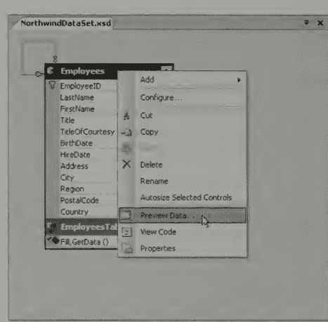

**图 3-18** 从数据设计器打开数据预览对话框。

在数据预览对话框中，首先选择要预览的对象。如果该对象是参数化查询，请在对话框的单独控件中输入参数值。然后点击预览按钮执行查询；结果数据将如图 3-19 所示显示。

> **注意** 修改数据库中数据的查询（如 INSERT、UPDATE 和 DELETE 查询）在预览数据对话框中执行时不会影响数据库。

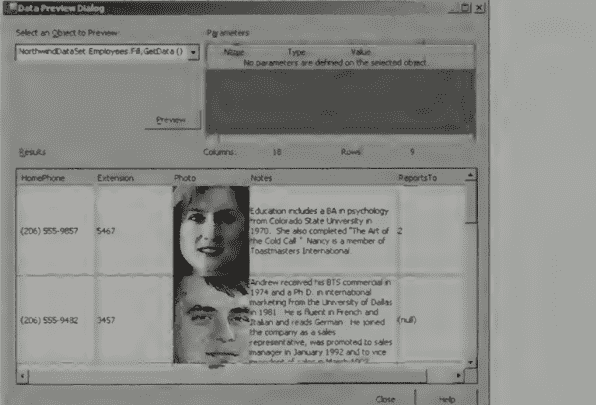

**图 3-19** 数据预览对话框。

## 文档大纲

在 Visual Studio 2005 IDE 的早期版本中，文档大纲窗口允许你通过提供标记层次结构的可视化表示来查看 HTML 或 ASPX 页面的结构。该窗口使用树形视图显示页面上的 HTML 标签、脚本元素和控件，你可以展开或折叠树形视图以专注于页面的特定区域。而且，通过双击视图中的任何项目，你可以直接导航到页面上的对应位置。此功能已延续到 Visual Studio 2005，并扩展为提供对 Windows 窗体上元素的相同可见性。

Windows 窗体布局的文档大纲窗口（如图 3-20 所示）提供了一种管理窗体上控件的简便方法。与文档大纲窗口的原始版本一样，你可以在浏览大纲时展开和折叠包含项。要在窗体设计器中选择控件，请点击树形视图中的项目。可以合理地认为，鉴于任何非平凡 Windows 窗体应用程序中常见的复杂控件布局——可能包含许多深度嵌套的隐藏组件，或两者兼有——将文档大纲扩展到窗体的益处远大于简单的网页编辑。此外，你还可以在容器层次结构中将控件从一个容器拖放到另一个容器。

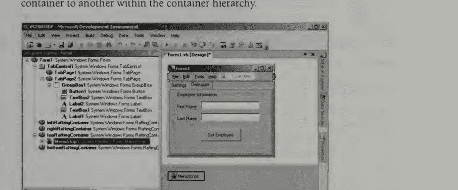

> **注意：** 在文档大纲窗口中重新排列控件仅适用于 Windows 窗体，不适用于网页。

## 窗口停靠增强

开发环境的另一项显著增强是引入了停靠引导（图 3-21）。当你在 IDE 中重新排列窗口时，可更改的图标会出现在设计图面上，引导你将窗口放置到可以放置的区域。如果将鼠标悬停在图标上，IDE 的相关区域将变暗，以指示如果你选择完成操作，窗口将出现在何处。

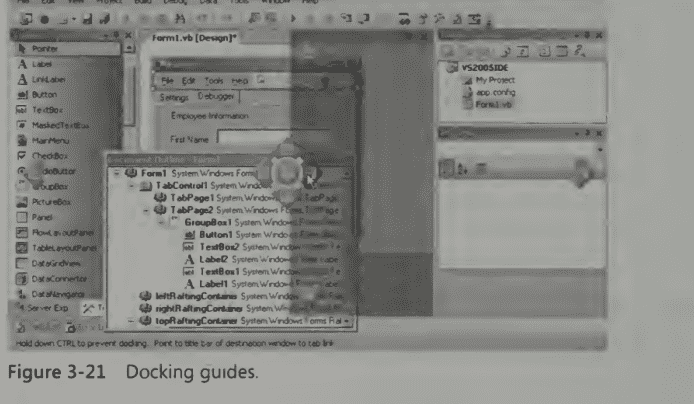

## 类设计器

类设计器（如图 3-22 所示）是一个用于检查和操作类及其他类型结构的视觉设计工具。该工具与设计器中显示的类型底层的源代码完全集成；例如，如果你更改属性名称，代码文件会自动更新以反映更改。反之，在源代码中所做的更改会立即影响其在设计器中关联对象的外观。设计器与代码之间的这种同步编辑关系使你可以轻松地以可视化方式创建和配置 CLR 类型。

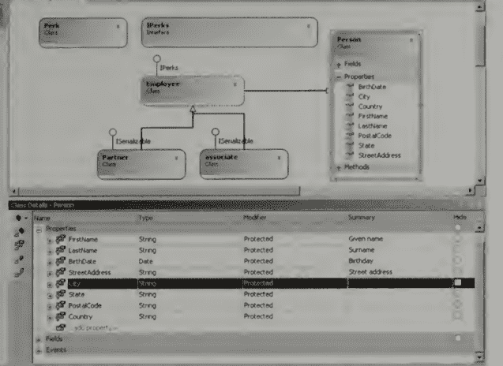

**图 3-22** 类设计器。

## 编写正确的代码

Visual Studio 2005 包含许多工具——有些是对旧功能的增强，有些是一些全新的功能——都致力于让开发人员在设计时更轻松地编写正确代码这一共同目标。在以下各节中，我们将介绍 IDE 中的一些关键领域，它们使 Visual Studio 2005 中的编码体验更不容易出错。

## IntelliSense 增强

Microsoft IntelliSense 技术延续了 Visual Studio 早期版本的关键功能，例如自动跟踪特定类型中最常用的成员。此外，IntelliSense 还得到了改进，增加了一项功能，可以选择显示类型的所有成员（如图 3-23 所示）或仅显示最常用的成员。

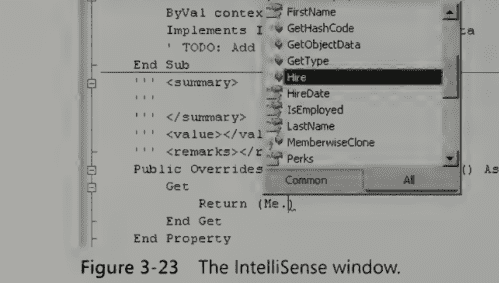

如果选择了全部按钮，将显示类型中的每个成员（包括隐藏成员）。如果点击常用按钮，显示将更改为仅显示该类型中最常用的成员。如果你通常只使用给定类型的几个属性和方法（尤其是具有大量成员的类型），则在常用模式下使用 IntelliSense 可以更轻松地定位这些项目。

## 语法错误辅助

Visual Basic 开发环境的过去版本在设计时反馈方面总是以这样或那样的方式脱颖而出，特别是当该反馈涉及错误语法时。代码编辑器会在包含错误的代码项下方显示一条波浪线。将光标放在波浪线上方会显示一个简要描述问题的工具提示。这种设计时语法检查形式已成为 Visual Studio 多年来的重要功能，确实很有帮助，但错误描述是否提供了足够的信息来纠正问题基本上仍是碰运气的。

Visual Studio 2005 增加了此功能，旨在让你能够立即纠正错误。而且它使用你从 Visual Studio 过去版本熟悉的相同 UI 行为。如果你编写的代码被后台编译器识别为语法错误，代码编辑器中会显示相同的波浪线。如果将光标悬停在指示错误的行上方，不仅会显示相同的描述性工具提示，你还会看到一个小帮助图标。点击该图标会打开一个对话框，不仅显示错误描述，还会列出一个或多个问题的解决方案（参见图 3-24）。要实现某个建议的修复，你只需点击适当的修复即可。

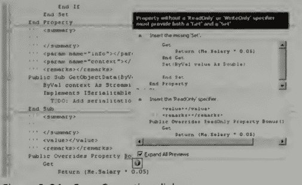

**图 3-24** 错误更正对话框。

## 设计时表达式求值

Visual Studio 2005 中的即时窗口得到了增强，允许你在不执行应用程序的情况下测试代码。例如，假设你在 Visual Basic .NET 项目中构建了一个类，它包含多个属性和方法。要测试此代码，你需要么添加一个窗体，要么构建一个控制台包装器来实例化该类。在即时窗口中工作时，你可以实例化该类的实例，在对象上设置属性，并调用其方法。此外，如果你在代码中设置了断点，并从即时窗口调用方法或访问属性，执行将在断点处停止，并允许你逐步执行代码，就像你显式调用了调试器一样。

## 错误列表和任务列表

Visual Studio 早期版本的用户会发现，以前完全由任务列表提供的功能现在分布在两个独立的工具窗口中。错误列表是一个新的工具窗口，显示 IntelliSense 引发的语法错误消息和 Visual Basic .NET 编译器报告的生成错误。在 Visual Studio 2005 IDE 中，任务列表的范围已缩减为仅显示待办工作的提醒，例如以注释形式插入代码中的 TODO 任务。

## 代码片段

代码片段是 Visual Studio 2005 IDE 的另一项激动人心的创新。此功能允许你在代码编辑器中插入用于执行常见任务的代码模板。例如，假设你想在应用程序中添加从 Windows 窗体控件的拖放功能。你可能在最近的项目中写过这段代码，但不太可能将其牢记于心。与其在旧项目文件中寻找代码或在 MSDN 或网上搜索，代码片段允许你将代码捕获为可重用的形式，可直接从代码编辑器中使用。

Visual Studio 2005 在安装时附带了大量按功能分类的实用代码片段，如图 3-25 所示。这些片段包括用于读写文件或验证日期或电子邮件字符串格式的片段，仅举几例。

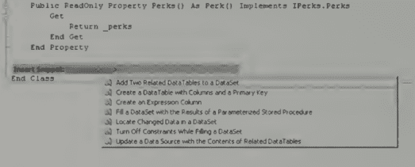

代码片段也按作用域进行验证。这意味着只有适合你当前在代码中位置（例如，在方法或函数内）的代码片段才会在菜单选项中可用。

## 符号重命名

如果你和许多开发者一样，在开始一个新的 Visual Basic .NET 项目时，往往会使用窗体、控件和其他代码元素的默认名称。稍后，当应用程序初具规模时，你会根据组织中使用的命名约定重命名项目。如果你的目标是编写专业的代码，这是一项繁琐但必要的整理工作。符号重命名工具通过提供一个简单易用的全局更新名称的方法，帮助缓解重命名代码元素的痛苦——并消除了引入不必要的语法错误的风险。要在代码编辑器中使用此功能，请在代码中右键单击一个项目，然后从上下文菜单中选择“重命名”，如图 3-26 所示。

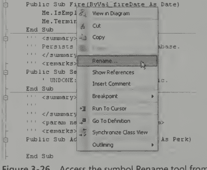

在“重命名”对话框中，键入符号的新名称，如图 3-27 所示。

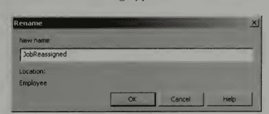

图 3-27 “重命名”对话框。

## 调试器增强功能

Visual Studio 2005 提供了许多用于在调试环境中查看数据的工具。其中许多工具在 Visual Studio 的几个版本中就已经存在（例如，监视、局部变量和自动窗口）。这些工具提供了多种不同的视图来查看你的应用程序数据。尽管如此，你可能仍会遇到在调试期间难以检查数据的情况。在接下来的章节中，我们将探讨调试器环境和工具的增强功能，使你更容易在运行时诊断和修复错误。

## 数据提示

数据提示一直是快速查看调试器中简单数据类型的绝佳方式。然而，在早期版本的 Visual Studio 中，对于复杂数据类型，你看到的是类型名称而不是其中包含的数据，如图 3-28 所示。Visual Studio 2005 中数据提示的一个关键改进是，它们现在显示复杂数据类型的成员，如图 3-29 所示。

```
Private Sub Button1_Click(ByVal sender As System.Object,
    Dim myEmployee As VS2005IDE.Associate

    myEmployee = New VS2005IDE.Associate

    myEmployee.Salary = 90000
    myEmployee.Salary = 50000.0

End Sub
```

图 3-28 简单数据类型。

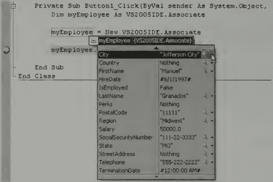

图 3-29 复杂数据类型。

数据提示的另一个增强功能是，你可以在简单类型和复杂类型的每个成员上获得一个上下文菜单。上下文菜单包含用于为选定类型添加监视、编辑类型值或查看类型十六进制值的选项。（参见图 3-30。）

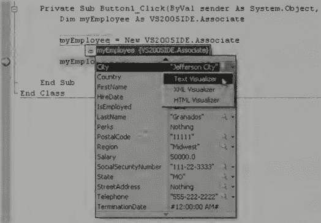

图 3-30 数据提示选项。

你还可以通过在数据提示中选择值然后直接键入新值来编辑成员值，如图 3-31 所示。

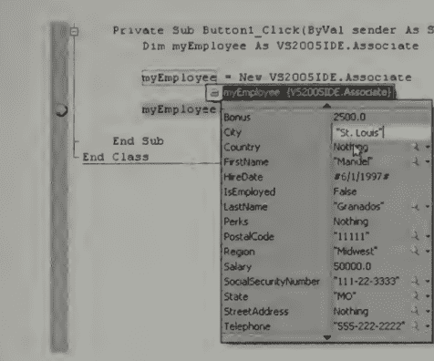

图 3-31 更新成员值。

完成成员变量的更改后，数据提示会自动显示更新后的值，如图 3-32 所示。

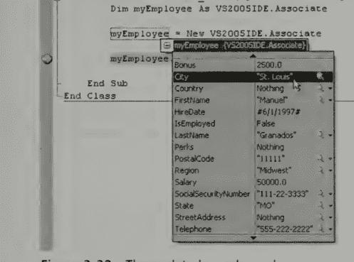

图 3-32 更新后的成员值。

## 可视化工具

Visual Studio 2005 调试器中一个更复杂的数据检查工具是可视化工具。可视化工具是一个对话框，它以对特定数据类型有意义的方式显示变量或对象。例如，字符串变量可以使用 Visual Studio 2005 附带的四种默认可视化工具之一，以 HTML、XML 或纯文本的形式进行可视化。

所有各种调试工具——数据提示、监视窗口、局部变量窗口或自动窗口——都会在可以使用可视化工具查看的数据类型旁边显示一个放大镜图标。单击放大镜允许你选择一个可视化工具来显示相应对象的数据类型。

除了刚才提到的三种基于文本的可视化工具外，默认还包含一个数据集可视化工具，让你更轻松地检查数据集中的数据。

> 提示 未来可能会有更多可视化工具可从 Microsoft 下载。

## 异常助手

异常助手是 Visual Studio 2005 引入的一个新的调试工具。当发生运行时异常时，它会以一个对话框的形式出现，显示有关错误的详细信息。重要的是，异常助手对话框还包含处理异常的故障排除提示。

对话框标题栏显示错误类型，其下是错误描述。助手的顶部是故障排除提示部分，在大多数情况下，它将提供指向帮助内容的链接，以帮助你诊断问题。然而，在许多情况下，助手将提供逐步说明来纠正错误。

## 自定义数据显示

Visual Studio 2005 提供了多个选项来自定义调试器中的数据显示。以下部分回顾了三种可用于操作调试器中数据显示方式的技术。

### 重写自定义类型的 ToString 方法

更改调试器中显示的自定义类型数据的最简单技术是重写基对象 `ToString` 方法，如下所示：

```
Overrides Function ToString() As String
    Return Me.FirstName & " " & Me.LastName
End Function
```

### 使用调试器显示属性

其他情况需要对数据的显示方式进行更多控制。你可能想要以不同的方式格式化底层数据，或限制在调试器中呈现的数据量。.NET Framework 提供了三个属性类来控制调试器中的数据显示方式：

- **`DebuggerDisplayAttribute`** 将此属性应用于类型，以在调试器的数据窗口中向该类型添加摘要。例如，以下代码展示了如何向自定义数据类型添加摘要：

    ```
    <DebuggerDisplay("Associate ( { FullName } ") >_
    Public Class Associate
    Private FullName as String
    . . .
    End class
    ```

    `DebuggerDisplayAttribute` 的构造函数接受一个字符串格式规范。花括号内的文本可以表示包含类的属性或方法。请注意，你可以使用类的私有和公共成员。

- **`DebuggerBrowsableAttribute`** 将此属性应用于类中的成员，以控制是否在调试器中显示它。

    ```
    Public Class Associate
        <DebuggerBrowsable( False ) > _
        Public Property SocialSecurityNumber As String
        . . .
    End Property
    End Class
    ```

    在前面的伪代码中，应用于 `Associate` 类的 `SocialSecurityNumber` 属性的 `DebuggerBrowsableAttribute` 将阻止该属性在调试器窗口中显示。

- **`DebuggerTypeProxyAttribute`** 此属性提供了最大的灵活性，允许你用自定义调试器类型替换被标记的成员。

    ```
    <DebuggerTypeProxy( GetType( AssociateProxy ) )> _
    Public Class Associate
    . . .
    End class
    ```

    `DebuggerTypeProxyAttribute` 构造函数的输入参数指定用作该类型数据显示代理的类。作为最佳实践，你应该将代理类实现为它所应用的数据类型的嵌套内部类。通过这样做，嵌套类可以完全访问它所描述的类型的私有成员。

# 演练

本演练演示了如何使用类设计器来构建和可视化地构造一个类层次结构。

该应用程序是一个类库，旨在为一家虚构的专业服务公司表示数据实体。该类表示两种类型的员工实体：合伙人和助理。这些实体在类库中分别使用 `Partner` 和 `Associate` 类进行建模。由于它们共享许多共同的属性和操作，`Partner` 和 `Associate` 类都从一个基类 `Employee` 派生，而 `Employee` 又从它自己的名为 `Person` 的基类派生。

此外，设计要求 `Partner` 和 `Associate` 类可序列化，并且类本身在序列化过程中执行自定义代码。为了实现这个目标，这两个类都实现了包含在 `System.Runtime.Serialization` 命名空间中的 `ISerializable` 接口。

抽象的 `Employee` 类还实现了一个名为 `IPerks` 的自定义接口，该接口包含在项目中。此接口满足了项目的一个设计目标，即提供一种为不同类别的员工建模福利的方法，因此此接口的实现对于从 `Employee` 类派生的任何类型可以有所不同。

项目文件中包含文件 `ClassDiagram1.cd`，该文件由类设计器工具生成。如果你在 Visual Studio 2005 的文档窗口中打开此文件，你会看到它提供了类库对象层次结构的可视化表示。尽管此特定示例相对简单，但该图使你能够立即理解类库中各个类之间的关系。你还可以使用类设计器更改类的任何属性或关系。由于类设计器与 Visual Studio 2005 IDE 紧密集成，你对图表中对象所做的任何更改都会立即反映在底层代码文件中。

## 结论

Visual Studio 2005 集成开发环境包含许多新的和改进的生产力功能。IDE 也经过重新设计，旨在为开发人员提供更直接的访问 .NET Framework 组件的方式，例如新的设置和资源架构。

# 第 4 章

# 构建数据驱动应用程序

**本章内容：**

- 应用程序：表适配器和 DataConnector 类.................................................................................................. 96

- 应用程序：数据的 Smart Tag（智能标记）...................................................................................................... 110

- 应用程序：主从窗体和参数化查询......................................................................................... 114

- 应用程序：对象数据源.................................................................................. 122

第 1 章向你介绍了 ADO.NET 的基础知识，以及从 Visual Basic 6 以来数据访问方式的变化。接下来的四个应用程序将向你介绍 Visual Studio 2005 和 .NET Framework 2.0 在构建数据驱动应用程序方面的增强功能。ADO.NET 是一个庞大的主题，很容易就能单独写成一本书。这些应用程序旨在作为起点，你可以利用 MSDN 文档和在线资源（如 http://msdn.microsoft.com）进一步研究 ADO.NET。

开发者最常见的挫折之一，就是不得不学习新版本的产品，而这些新版本会使旧组件过时或显著改变完成常见任务的方式。不可避免的学习曲线往往会在短期内对生产力产生负面影响。

Microsoft 为 ADO.NET 2.0 设定了一个目标：在不改变它或破坏现有功能的前提下，对其进行增强和扩展。1.1 版本的所有功能在 2.0 版本中仍然可用，但现在有了更高效的方式来执行常见的数据库任务。例如，数据源窗口提供了一个集中位置，用于创建和配置访问数据源（例如 SQL Server）所需的关联对象。添加到控件上的 Smart Tag（智能标记）提供了对常见开发任务的快速访问，例如更改控件的类型（例如，将 `TextBox` 更改为 `Label`）。你还可以使用 Smart Tag 重新配置数据源，甚至创建新查询以根据用户输入提取筛选后的数据（即创建参数化查询）。

在探索完接下来的四个应用程序后，你将看到 Microsoft Visual Studio 2005 和 .NET Framework 2.0 如何提高生产力，并使从应用程序连接数据源变得比以前的开发工具更加容易。

# 应用程序：表适配器和 DataConnector 类

在第一个应用程序中，你将了解新的 Table Adapter（表适配器）和 DataConnector 类。这两个类将通过提供强大的功能来简化你的 ADO.NET 开发任务，这些功能你可以立即在应用程序中使用，同时限制你需要手动编写的代码量来执行常见任务。

### 新概念

正如第 1 章中所述，ADO.NET 的一个主要设计目标是对处理断开连接的数据提供一流支持。ADO.NET 通过一组被划分到不同命名空间中的类，提供了一种直观的方式来处理断开连接的数据。你不需要了解每个命名空间中的每个类才能有效使用 ADO.NET。相反，你可以专注于包含访问特定数据源所需类的命名空间。表 4-1 列出了组成 ADO.NET 的一些最常见的命名空间和类。

表 4-1 ADO.NET 命名空间

| 命名空间 | 用途 | 常用类 |
| :--- | :--- | :--- |
| `System.Data` | ADO.NET 中使用的通用类 | `DataSet`、`DataTable` 和 `DataView` |
| `System.Data.Common` | 一组新的基类，供 ADO.NET 中的不同数据提供程序使用（如 `SqlClient`、`OleDb` 等） | `DataAdapter`、`DbCommand` 和 `DbConnection` |
| `System.Data.SqlClient` | 包含用于连接 Microsoft SQL Server 的数据提供程序类 | `SqlConnection`、`SqlCommand` 和 `SqlDataAdapter` |
| `System.Data.SqlTypes` | 包含用于表示 SQL Server 中原生数据类型的类 | `SqlString`、`SqlDateTime` 和 `SqlInt32` |
| `System.Data.OleDb` | 包含用于访问 OLE DB 数据源的类 | `OleDbConnection`、`OleDbCommand` 和 `OleDbDataAdapter` |
| `System.Data.ODBC` | 用于连接 ODBC 数据源的类 | `OdbcConnection`、`OdbcCommand` 和 `OdbcDataAdapter` |
| `System.Data.OracleClient` | 用于访问 Oracle 数据源的类 | `OracleConnection`、`OracleCommand` 和 `OracleDataAdapter` |
| `System.Xml` | 包含提供基于标准的方式来访问和处理 XML 数据的类 | `XmlAdapter`、`XmlReader` 和 `XmlWriter` |

# System.Data.DataSet

`DataSet` 对象用于保存来自一个或多个数据源的数据。它以一组表的形式维护数据，并在这些表之间定义可选的关系。`DataSet` 类被设计为通用的，因此不绑定到任何特定类型的数据源。数据可以从许多数据源加载到 `DataSet` 中，包括 Microsoft SQL Server、Oracle 数据库、Microsoft Access、Microsoft Exchange、Microsoft Active Directory，或任何符合 OLE DB 或 ODBC 标准的数据源。

尽管不绑定到任何特定数据源，`DataSet` 类的设计目的是保存关系型表格数据，就像你在关系型数据库（如 Microsoft SQL Server）中找到的那样。图 4-1 是 `DataSet` 中两个相关表的可视化表示。

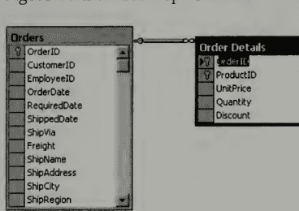

图 4-1 `DataSet` 中两个相关表的可视化表示。

图 4-1 中显示的每个表在 `DataSet` 中被实现为一个 `DataTable`。两个表之间的关系在 `DataSet` 中被实现为一个 `DataRelation` 对象。`DataRelation` 对象提供通过外键将子表与父表关联的信息。请记住，图 4-1 仅仅是特定 `DataSet` 实例结构的可视化表示。一个 `DataSet` 可以包含任意数量的表，以及定义在它们之间的任意数量的关系。

图 4-1 实际上是 Visual Studio 2005 中新的 DataSet 设计器的屏幕截图。图 4-2 展示了在新的数据源窗口中使用 DataSet 设计器编辑数据源结构的情况。本应用程序的"演练"部分（稍后在本章中出现）将进一步讨论 DataSet 设计器。

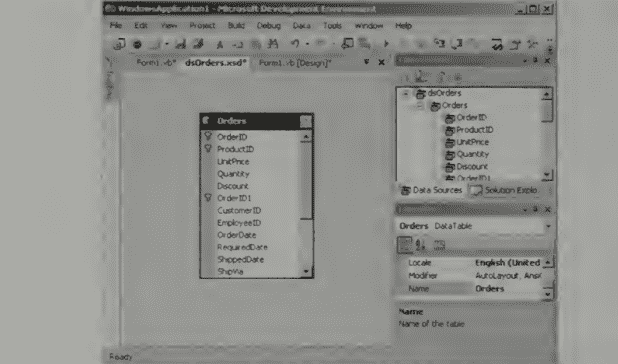

图 4-2 使用 DataSet 设计器编辑数据源。

# 从数据库检索数据

尽管有多种方式使用 `DataSet`，但最常见的用途是连接到数据库并用数据库中的数据填充 `DataSet`。在 ADO.NET 中，每个数据提供程序（`SqlClient`、`OleDb` 等）提供了一组专门用于与数据源交互的类。要从数据库检索数据，你需要连接到数据库，执行查询或存储过程，然后用结果填充 `DataSet`。完成所有这些操作需要一组协同工作的对象，包括连接对象和命令对象。

每个 ADO.NET 数据提供程序都包含一个专门的连接类，用于连接其支持的数据源类型。例如，`SqlConnection` 类允许你的应用程序连接到 SQL Server 7.0 或更高版本。你也可以使用 `OleDbConnection` 对象，但 `SqlConnection` 类针对 SQL Server 进行了优化，使其成为更好的选择。对于没有特定 ADO.NET 数据提供程序的数据源，只要该数据源有可用的 OLE DB 提供程序，你就可以使用 `OleDbConnection` 对象。`SqlConnection` 类是你用于连接非数据库数据源（如分隔文本文件）的类。

一旦建立了与数据源的连接，就需要数据提供程序中的其他对象从数据源提取数据并用它来填充 `DataSet`。在 Visual Studio .NET 2003 中填充 `DataSet` 的方式是使用数据适配器对象来填充 `DataSet`。每个 ADO.NET 数据提供程序都包含其独特的数据适配器类。例如，`SqlClient` 提供程序包含 `SqlDataAdapter` 类。`SqlDataAdapter` 类需要一个 `SqlCommand` 对象和一个 `SqlConnection` 对象来检索数据。你可以向数据适配器提供一条 SELECT 语句或一个存储过程，让它生成自己的 `SqlCommand` 对象，或者你可以显式创建自己的 `SqlCommand` 对象来选择数据，并将其分配给 `SqlDataAdapter` 的 `SelectCommand` 属性。调用 `Fill`

数据适配器的 `Fill` 方法告诉数据适配器执行其 `SelectCommand`，并用 `SelectCommand` 检索到的数据填充 `DataSet`。以下代码是使用 `SqlDataAdapter` 填充 `DataSet` 的示例。

```vb
Dim conn As New SqlConnection
conn.ConnectionString = _
    "server=(local);database=Northwind;Trusted_Connection=True"

Dim adapter As SqlDataAdapter
adapter = New SqlDataAdapter("SELECT * FROM Products", conn)

Dim dsProducts As New DataSet

conn.Open()
adapter.Fill(dsProducts)

conn.Close()
```

在 Visual Studio 2005 之前，数据适配器是 `DataSet` 与实际数据源之间的唯一纽带。如果你修改了 `DataSet` 中的数据，你需要为 `DataSet` 中的每个表使用不同的数据适配器，并且必须调用每个数据适配器的 `Update` 方法。

虽然数据适配器方式的读取和更新数据在 Visual Studio 2005 中仍完全受支持，但也有一些新的读写数据方式，可以减少和简化你必须编写的代码。在此应用程序中，你将了解如何建立数据库连接并从 Northwind 数据库检索数据，只需编写一行代码。此应用程序重点介绍 Visual Studio 2005 和 .NET Framework 2.0 中的一些新数据组件和功能，包括表适配器和 `DataConnector` 类。

## 分步操作

使用 Visual Studio 2005，你可以创建数据驱动的应用程序，只需一行代码就能在数据网格中呈现数据。当然，所需的信息远不止那一行代码所包含的内容。但是，Visual Studio 2005 为你处理了设置数据库连接、逐个填充多个数据表以及进行数据绑定等繁琐的代码编写工作。两个新的 IDE 功能——"数据源"窗口和"数据源配置向导"，协助你使用新类（如 `DataConnector`）设置数据访问。

此应用程序开始时是一个名为 NorthwindGrid 的新 Windows 应用程序。根据你的 IDE 设置，Visual Studio 2005 可能不会自动显示"数据源"窗口。如果未显示"数据源"窗口，你可以选择"数据" | "显示数据源"菜单命令。随后会显示一个新的浮动窗口，你可以将其停靠在 IDE 中，如图 4-3 所示。

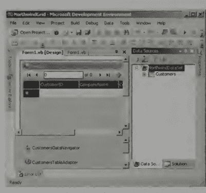

图 4-3 "数据源"窗口。

将"数据源"窗口停靠后，选择"数据源"选项卡使其成为活动窗口，然后单击"添加新数据源"链接或窗口工具栏上的"添加新数据源"按钮。这将显示"数据源配置向导"的起始页。阅读欢迎消息后，单击"下一步"开始配置数据源，如图 4-4 所示。

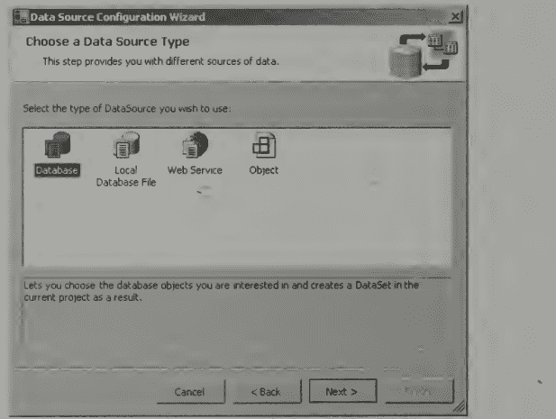

图 4-4 "数据源配置向导"。

"数据源配置向导"支持四种类型的数据源。第一个选项"数据库"允许你为本地计算机或远程服务器上的数据库服务器创建数据源。第二个选项"本地数据库文件"允许你选择 .MDF SQL Server 数据库文件或 Microsoft Access .MDB 文件。如果你的数据来自 Web 服务，可以选择第三个选项以向项目添加新的 Web 引用。第四个选项是"对象"。此选项允许你将用户界面绑定到自己的某个类。对象数据源将在后面的"应用程序：对象数据源"部分中介绍。此应用程序使用数据库数据源。

"数据源配置向导"的下一步是为数据源选择现有连接或创建新连接。首次运行向导时没有预先存在的连接可用。但在后续使用向导时，可以选择重用以前创建的连接。当你在向导中单击"新建连接"按钮时，将显示"连接属性"对话框，如图 4-5 所示。你可以使用此对话框配置连接数据库服务器的所有设置。

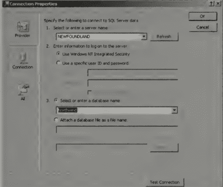

向导会让你选择将生成的连接字符串保存到应用程序配置文件（`app.config`）中。如果你在项目中会再次使用相同的连接，让连接字符串自动保存到 `app.config` 中是非常方便的。

向导中的下一个配置步骤如图 4-6 所示，要求你为此数据源选择数据库对象。你可以选择任意数量的表、视图、存储过程和函数。

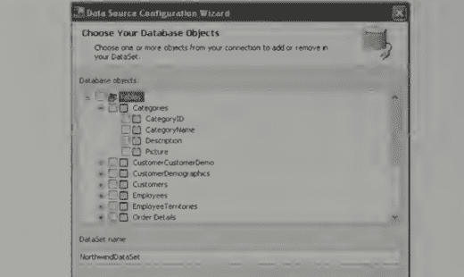

图 4-6 在向导中选择数据库对象。

当你选择表等数据库对象时，可以在树视图中展开其节点（如图 4-6 所示），并选择仅从中选择特定列。选择数据库对象后，向导将自动为你生成 SELECT 语句（或存储过程和函数调用）。

"数据源配置向导"完成后，新数据源将添加到"数据源"窗口中。（示例请参见图 4-3。）"数据源"窗口将数据源显示为树视图，根节点为 `DataSet`，包含"数据源配置向导"中选择的每个数据库对象（表、视图等）的节点。如果展开其中一个表，如图 4-7 所示，你会看到"数据源配置向导"中仅选择的字段包含在 `DataSet` 中。

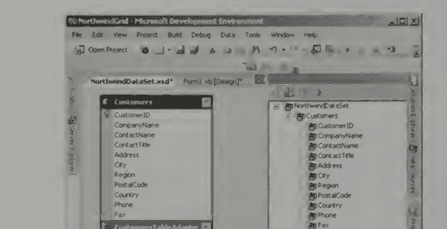

图 4-7 在"数据源"窗口中展开的 DataSet。

如果你想在窗格上的网格中显示其中一个表的数据，只需从"数据源"窗口将相应的节点拖动到窗体上。Visual Studio 2005 将自动创建一个数据绑定的 `DataGridView` 控件以及窗体顶部的配套导航栏。生成的窗格如图 4-8 所示。

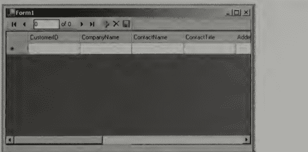

**图 4-8** 设计时带有数据绑定 DataGridView 控件的窗格。

如果你使用过 Visual Studio .NET 2003 创建数据驱动的应用程序，你可能曾经将数据适配器拖动到窗体上，并经历过"数据适配器配置向导"。"数据适配器配置向导"将连接和数据适配器对象放置到窗格的组件托盘中。Visual Studio 2005 会向组件托盘添加四个对象：一个 `DataSet`、一个 `DataConnector`、一个表适配器和一个 `DataNavigator`。

> **注意** 组件托盘是 IDE 中的一个特殊区域，用于显示托管在 Windows 或 Web 窗格上但没有用户界面的控件。在 Visual Basic 6 中，没有用户界面的控件（例如 `Timer`）仍然必须放置到窗格设计表面上，这使得设计时的控件放置变得笨拙。

此应用程序中添加到窗格的 `DataSet` 只是 `DataSet` 类的一个实例，它是在创建数据源时自动创建的。

## DataConnector

`DataConnector` 是 .NET Framework 2.0 中的一个新类。它充当其他控件绑定到的数据源。它所公开的数据是其从自身数据源消费的数据。`DataConnector` 最典型的用途是将数据绑定控件与数据源中的一个表连接起来（例如，"数据源"窗口中定义的 `DataSet` 中的 `DataTable`）。如果没有 `DataConnector` 组件，将 `DataGridView` 控件绑定到 `DataSet` 中的单个表需要编写代码。但通过使用 `DataConnector` 控件，你可以将 `DataConnector` 的数据源配置为 `DataSet` 中的单个表。然后将你的 `DataGridView` 绑定到 `DataConnector`。由此可见 `DataConnector` 名称的由来——它有助于将组件或控件与 `DataSet` 中的数据子集连接起来。`DataConnector` 还可以将数据使用者的命令传递给数据源。

# 表适配器

表适配器是 Visual Studio 2005 中的新功能。它们是设计器生成的组件，用于将 `DataSet` 对象与其底层数据源连接起来。当你在应用程序中创建数据组件时（例如通过“数据源配置向导”），系统会自动创建一个或多个自定义表适配器。表适配器与数据适配器类似，但它们是强类型的，这意味着每个表适配器都是一个独特的类，由 Visual Studio 2005 自动生成，仅适用于你为特定数据库对象选择的字段（例如，Products 表）。

使用 ADO.NET 创建数据库应用程序时，你通常会大量使用 `DataSet` 对象。`DataSet` 保存你的数据，但它依赖其他对象将数据移入和移出底层数据源。在 .NET Framework 1.1 中，数据适配器对象是与数据源的生命线，你必须为 `DataSet` 中的每个 `DataTable` 创建一个数据适配器。例如，如果你要创建一个 `DataSet` 来保存 Northwind 数据库中的 Orders 和 Order Details 表，你需要两个数据适配器。

.NET Framework 2.0 中的新表适配器与数据适配器不同，因为它们可以包含多个查询来支持来自数据源的多个表，从而允许一个表适配器更新 `DataSet` 中的多个表。对于前面的示例，使用表适配器时，你将有一个包含两个查询的表适配器：一个用于 Orders 表，一个用于 Order Details 表。在此应用程序中，表适配器中只有一个查询（用于 Customers 表）。如果你右键单击“数据源”窗口中的 Customers 表并选择“编辑数据源设计器”，则返回的 Customers 数据结构将在 DataSet 设计器中打开，如图 4-9 所示。

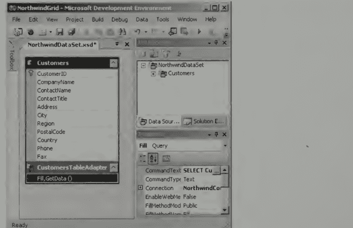


如图 4-9 所示，`Customers`表底部有一个标记为`Fill,GetData()`的项。此项包含表适配器中`Customers`表的连接和查询信息。如果你查看`CommandText`属性（在“属性”窗口中），可以看到用于填充`Customers`表的`SELECT`语句的开头。

如果你需要表的过滤数据视图，可以创建其他查询来填充`DataSet`中的表。对于此应用程序，你需要右键单击`Customers`表的`CustomersTableAdapter`标题（如图 4-9 所示），然后选择“添加查询”菜单命令。

> **注意** 如果你在表适配器中创建多个查询，必须确保返回的数据正确映射到表架构；否则，查询将失败。

## DataNavigator

新的`DataNavigator`组件提供用于导航绑定到用户界面控件的数据的服务。它提供的服务类似于 Visual Basic 6 中的`Data`控件，后者通过一组导航按钮提供导航服务。ADO.NET 中的`DataNavigator`组件设计用于在`DataSet`中的记录之间导航。它还提供允许添加、编辑和删除数据的服务。

`DataNavigator`控件的功能通过一个或多个`ToolStrip`控件公开，如图 4-8 所示。`ToolStrip`按钮执行添加和删除记录等任务。

如果你使用过以前版本的 ADO.NET，就会知道在`DataSet`中导航记录并不像它本可以做到的那么简单。使用 ADO`Recordset`时，你有`MoveFirst`、`MovePrevious`、`MoveNext`和`MoveLast`方法，可以浏览`Recordset`数据。这些导航功能是通过使用游标来实现的，游标用于维护你在`Recordset`中的当前位置并浏览记录。ADO.NET`DataSet`取代了`Recordset`对象，成为基于记录的中央数据对象，它没有游标，也不了解其内容来自的数据存储。没有游标或等效对象来维护位置，导航就不那么容易。

将窗体上的控件绑定到 ADO.NET`DataSet`并提供保持所有控件同步的导航服务，是通过两个称为`CurrencyManager`和`BindingContext`的对象来实现的。对于应用程序中的每个数据绑定窗体，你将至少有一个`BindingContext`对象。此对象将负责任何存在的`CurrencyManager`对象。对于窗体上的每个数据源，你将有一个`CurrencyManager`对象。`CurrencyManager`对象负责跟踪你在`DataSet`中的位置，并总体监督与数据源的绑定。你在`CurrencyManager`对象上调用必要的方法来浏览记录，而`BindingContext`确保所有绑定控件保持同步。此应用程序中使用的`DataNavigator`控件以更易用的形式提供了该功能。

此应用程序的组件使用可视化设计器创建和连接在一起。导航栏无需任何代码即可正常工作。唯一需要的代码是一行使用表适配器通过从数据源提取数据来填充`DataSet`的代码。这是在窗体的`Load`事件处理程序中完成的，如下所示：

```
Private Sub Form1_Load(ByVal sender As System.Object, _
    ByVal e As System.EventArgs) Handles MyBase.Load
    Me.CustomersTableAdapter.Fill(Me.NorthwindDataSet.Customers)
End Sub
```

此事件处理程序以及填充数据集和填充网格的代码由 Visual Studio 2005 自动添加。你所要做的就是按 F5，然后查看从数据库加载的数据网格。尽管只是指指点点，但此应用程序中完成的工作并非易事。如果你查看`InitializeComponent`方法，你会看到大约 300 行你不必编写的代码——显著提高了生产力！

虽然发生了很多事情，但这个应用程序有些简单。它展示了连接数据库和填充网格控件的基础知识。其余的数据应用程序将突出显示 Visual Studio 2005 中 ADO.NET 的其他方面。

# DataSet 设计器

此时值得花些时间更仔细地了解一下`DataSet`设计器。此工具已进行了重大改进，是 Visual Studio 2005 中数据访问的较显著增强功能之一。

在 Visual Studio .NET 2003 中，当你要编辑`DataSet`的结构时，是通过编辑 XML 架构（XSD）来实现的。虽然有一个可视化设计器，但术语和用户界面与`DataSet`及其组成对象（例如`DataTable`）不一致。

使用新的“数据源”窗口，你可以右键单击它并选择“编辑数据源设计器”。这将打开`DataSet`设计器，允许你对`DataSet`的结构进行更改。使用此`DataSet`视图，你可以以与`DataSet`更直接相关的方式图形化地操作表和查询，而不必处理 XML 架构。

为了帮助你了解`DataSet`设计器的一些功能，请考虑在几乎任何将处理来自数据库的数据的应用程序中都可能出现的潜在问题。有时你会忘记添加应用程序显示数据所需的表。使用 Visual Studio 2005，你只需在`DataSet`设计器窗口中右键单击设计器表面的空白区域，然后选择“添加 | 数据组件”，即可添加缺少的表。设计器将新表添加到`DataSet`设计器窗口，并打开数据组件配置向导。

数据组件配置向导类似于数据源配置向导的一部分。数据组件配置向导提示你为新表设置与数据源的连接，并为数据读取和写入操作提供或选择查询或存储过程。从向导中，你可以启动`QueryBuilder`来创建查询图形界面。数据库中的表、视图和函数在`QueryBuilder`中可用，如图 4-10 所示。

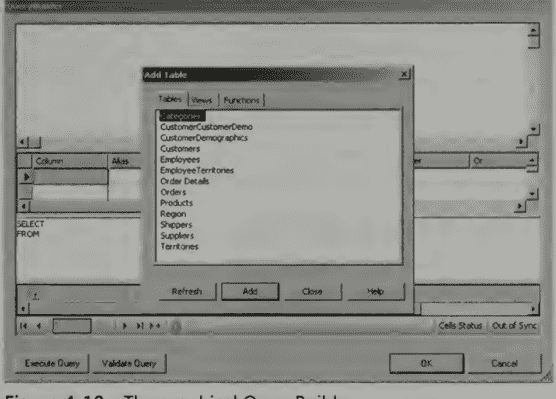

图 4-10 图形化`QueryBuilder`。

在向导中设置查询后，你可以选择让几个专用方法添加到`DataSet`中。`Fill`方法（可以根据需要重命名）用于用数据填充表。`GetData`方法（可以根据需要重命名）返回对填充的`DataTable`实例的引用。你还可以选择创建用于使用数据更改更新数据源的方法。向导页面如图 4-11 所示。

# 面向开发人员的 Microsoft Visual Basic 2005 简介

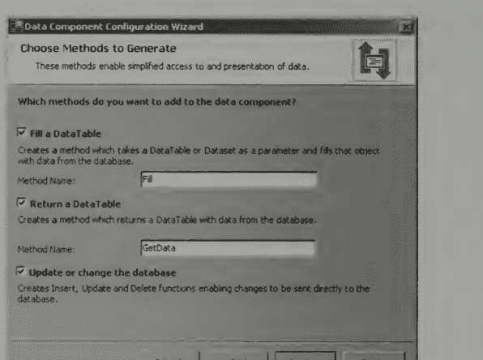

图 4-11 数据组件配置向导。

当您向`DataSet`添加新表时，向导会读取数据库架构，并将所有适当的关系添加到`DataSet`中已有的表。这些关系在`DataSet`设计器中表示为表之间的连线，如图 4-12 所示。

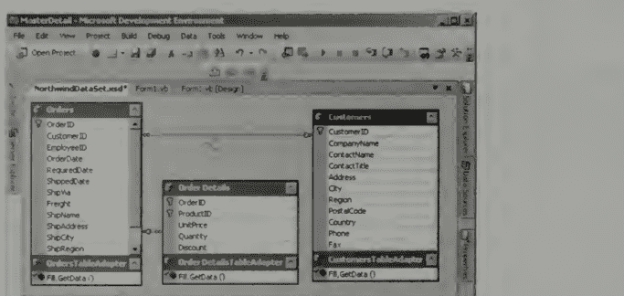

图 4-12 `DataSet`设计器中的相关表。

设计器的一个方面可能会令人不安，即关系线仅表示两个表之间存在关联。但显然，这种关系必须建立在表中的字段之间。通过目视检查每个表中的字段，通常可以明确关系。但如果字段列表非常长，就很难快速推断出关系。幸运的是，设计器提供了一项功能，可以通过显示和编辑标签来更清晰地指示图形化关系。如果您右键单击关系线并选择“显示关系标签”，关系名称将显示在视觉设计器中。

默认名称`FK_Orders_Customers`并没有说明`Orders`和`Customers`表是如何关联的——它只是告诉您两个表之间存在关系。要编辑标签以指示关系，请右键单击关系线并选择“编辑关系”。这将打开图 4-13 所示的关系对话框。

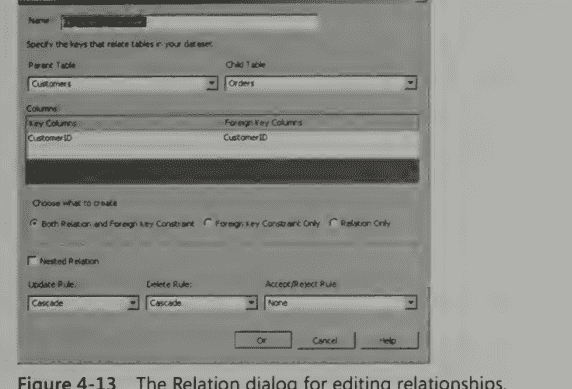

图 4-13 用于编辑关系的关系对话框。

关系对话框允许您管理关系，包括构成关系的表和列。更改关系的名称将更改`DataSet`设计器中显示的标签。将关系名称更改为`Customers_CustomerID_Orders`会使关系更加一目了然，因为它表达了表是通过`CustomerID`字段关联的。

关系对话框还允许您更改关系类型（外键约束、关系或两者），以及当父记录更新或删除时相关记录会发生什么（即，我们是否使用级联，是否变为`SetNull`、`SetDefault`，还是不会发生任何事情）。您还可以配置关系，以便在父记录的更改被接受或拒绝时，自动接受或拒绝子记录中的更改。

## 结论

正如您从这个应用程序中看到的，Visual Studio 2005 使使用网格进行数据访问和显示的配置变得非常简单。新的表适配器模型将数据库连接、命令和数据适配器对象捆绑在一起，为数据驱动应用程序提供了简化的编程模型。只需一行简单的代码和几次鼠标点击，您就可以拥有一个可工作的数据库应用程序，允许数据库更新、添加和删除。新的`DataSet`设计器允许您使用易于使用的可视化设计器配置设置和编辑数据源的结构（以及后续行为）。

新的`DataConnector`类充当数据访问对象和数据消费对象之间的中介。新的`DataNavigator`组件提供了在记录之间移动、添加和删除记录的导航服务。`DataNavigator`组件管理`ToolStrip`控件，这些控件提供了浏览数据记录的用户界面。此应用程序使用所有这些新功能，仅通过手动输入一行代码就创建了一个有用且实用的数据驱动用户界面。

# 应用程序：数据的智能标记

智能标记是 Visual Studio 2005 中的新功能，可轻松访问常见任务。此应用程序使用数据绑定控件的新智能标记来创建和配置用户界面。

### 新概念

智能标记通常是进入向导或其他工具的入口点，可让您配置数据源或数据组件的某些方面。智能标记提供了对开发人员在不同类型的控件和组件上执行的最常见任务的快速访问。智能标记可通过在您选择或将光标悬停在控件上时出现的小图标来访问。

## 分步指南

此应用程序由一个数据绑定窗体组成，该窗体一次显示一条来自 Northwind 数据库`Suppliers`表的记录（详细信息视图）。本演练的目的是解释智能标记。完成此演练的副作用是您最终会获得一个可工作的应用程序，但应用程序本身并不是本节的重点。下一个应用程序更详细地讨论了详细信息和主从数据窗体。

将使用“数据源”窗口添加指向 Northwind 数据库的新数据源。

## 主从窗体

如果您在“数据源”窗口中选择一个表，将会出现下拉箭头，其中包含可供选择的视图选项列表。默认是`DataGridView`，这在前面介绍的表适配器和`DataConnector`应用程序中使用。下拉列表中的另一个选项是`Details`，如图 4-14 所示。如果您在“数据源”窗口中将表配置为使用`Details`视图，将表拖到窗体上将提示 Visual Studio 2005 为每个字段创建单独的控件和一个用于浏览记录的`DataNavigator`组件，如图 4-15 所示。


**图 4-14** 更改从数据源表创建的用户界面类型。


**图 4-15** `Details`视图用户界面。

在某些数据驱动应用程序中，用户需要查看主键数据。在此应用程序中，用户看到`SupplierID`值，这是由数据库自动生成的主键字段。由于用户不应更改此值，用户界面不应允许他们输入新值。在大多数情况下，您只需禁用`TextBox`控件或将其更改为`Label`控件。但是，使用智能标记，您可以将控件更改为另一种类型的控件，并通过几次鼠标点击保持数据绑定。在此应用程序中，如图 4-15 所示的`SupplierID` `TextBox`控件将被更改为`Label`控件。您无需删除`TextBox`控件、添加`Label`控件，然后将`Label`重新绑定到适当的数据源，而只需选择`TextBox`控件的智能标记箭头，并从“转换为”下拉列表中选择`Label`，如图 4-16 所示。这将把`TextBox`更改为`Label`控件，这将防止在该控件中修改数据，但仍保持数据源连接。


图 4-16 使用智能标记将`TextBox`更改为`Label`。

智能标记本质上是上下文感知的。对于数据绑定控件，甚至基础数据源的数据类型也用于确定智能标记应该（或不应该）提供什么。例如，如果您通过绑定到底层整数字段的控件的智能标记选择`Convert To`下拉列表，可用控件的列表适合整数数据。如果您使用`SupplierID` `TextBox`的智能标记，您可以转换为`ComboBox`、`LinkLabel`、`ListBox`、`NumericUpDown`或`Label`。因为底层数据类型是数字的，`NumericUpDown`是可以显示该数据的有效控件类型。

## 主从窗体

Visual Studio 2005 中更强大的智能标记功能是创建主从窗体的能力。使用此功能，您可以相对轻松地将简单的`Details`视图窗体转换为更复杂的主从数据窗体。

此应用程序在同一窗体上使用两个相关的`Details`视图：供应商的父部分和每个供应商提供的产品的子部分。生成的窗体如图 4-17 所示。


图 4-17 使用智能标记创建的主从视图。

从图 4-15 所示的原始表单开始，你可以使用智能标签来创建和配置详细信息部分，从而创建出如图 4-17 所示的表单。在此应用程序中，`SupplierID`是“供应商”表与“产品”表之间的关联字段。你需要使用`DataConnector`的智能标签来启用此应用程序的“主从明细”功能。当你打开`SuppliersDataConnector`控件的智能标签时，会看到一个如图 4-18 所示的“配置主从明细”选项。选择此选项会打开如图 4-19 所示的“添加关联数据绑定用户界面”对话框。


图 4-18 使用智能标签创建主从表单。


图 4-19 “添加关联数据绑定用户界面”对话框。

当对话框打开时，你会发现数据源下拉列表中没有选择任何值。从数据源下拉列表中选择适当的表，Visual Studio 2005 会自动在对话框的“子表”部分显示相关的表。在此例中，“产品”表通过`SupplierID`字段与“供应商”表相关联。

此应用程序使用“详细信息”视图，以便每次仅显示一条产品记录（而非网格中显示多条），因此请务必选择“详细信息”视图。这意味着需要某种方法来控制每个供应商对应的产品记录的导航。此导航功能由第二个`DataNavigator`组件处理。导航控件放置在表单的`RaftingContainer`中，这是一种流式布局控件，用于容纳工具栏类型的条带控件，如`ToolStrip`栏。你可以通过在工具箱中双击`DataNavigator`来将其添加到表单。然后，将`DataNavigator`的`Raft`属性设置为预先存在的`RaftContainer`控件之一（顶部、底部、左侧或右侧）。你还必须将新的`DataNavigator`的`DataConnector`属性绑定到 Visual Studio 2005 为按`SupplierID`筛选的产品自动创建的`DataConnector`（即`FK_Products_SuppliersDataConnector`），这是通过“添加关联数据绑定用户界面”对话框创建的关系的一部分（参见图示）。

在将详细信息部分添加到表单后，你应该注意到 Visual Studio 已在表单的`Load`事件处理程序中添加了一行代码，用于填充`DataSet`中的“产品”表：

```
Me.ProductsTableAdapter.Fill(Me.NorthwindDataSet.Products)
```

当你运行此应用程序时，可以浏览供应商列表，并查看每个供应商的第一条产品记录会发生变化。然后，你可以浏览每个供应商下的所有产品记录。

## 结论

尽管数据控件的智能标签数量不多，但你可以看到它们使得在 Visual Studio 2005 中开发以数据为中心的应用程序比在 Visual Basic 6 甚至 Visual Studio .NET 2003 中要容易得多。本应用程序介绍了智能标签以及可以使用它们完成的一些常见任务。下一个应用程序的演练将包括使用智能标签创建参数化查询，以便轻松筛选结果集。

## 应用程序：主从表单与参数化查询

大多数数据驱动的应用程序不仅仅需要将一个表绑定到一个网格控件。你的数据源更可能包含多个相关表。因此，你经常会发现自己需要创建能够利用数据的主从视图的应用程序。而且，对于用户处理真实世界的数据量来说，简单的逐条导航方案通常还不够用。用户需要能够搜索和筛选记录。本应用程序展示了如何利用新的数据功能来更快地构建更好的数据应用程序。

### 新概念

Visual Studio 2005 和 .NET Framework 2.0 包含许多新功能，使创建数据的主从视图变得更加容易。在创建一组数据绑定控件后，你可以让 Visual Studio 2005 自动为相关表中的子记录创建网格视图或详细信息视图，只需一行代码即可从相关表填充`DataSet`数据。

如果你在创建数据源和数据绑定控件时使用默认设置，你的应用程序将向用户显示应用程序中的所有数据。一个重要的功能是允许用户输入搜索条件并仅查看符合搜索条件的数据。通过 Visual Studio 2005 中的新搜索生成器，你可以为应用程序添加参数化查询以及用于搜索和筛选数据的用户界面，而无需编写任何代码！

# 演练

在本应用程序中，使用主从视图显示了 Northwind 数据库中每个客户的订单数据。此设置需要在表单上显示来自数据库两个表的数据。这两个表在数据库中已经存在关联，因此 Visual Studio 2005 将检测到该关系。但是，你必须提供一些额外的信息，以确保在从一个客户导航到下一个客户时显示适当的订单。

## 应用程序用户界面

该应用程序是一个标准的 Windows 应用程序，包含一个主从表单，其顶部是绑定到单独控件的客户信息（主数据）。客户订单（详细数据）显示在网格中。图 4-20 展示了应用程序用户界面。


## 为开发者介绍 Microsoft Visual Basic 2005

使用网格控件显示订单允许用户同时查看一个客户的更多订单。详细信息部分也可以一次显示一条记录，但本应用程序采用的方法在许多业务线应用程序中是标准的。

创建主从表单的第一步是配置数据源。Visual Studio 2005 的一个不错的功能是它能够记住之前创建的连接字符串，你可以选择它们而无需重新进行相同的配置设置。此功能是 Visual Studio 2005 中众多虽小但实用的生产力增强功能之一。

本应用程序的数据来自 Northwind 数据库的“订单”和“客户”表。在“数据源”窗口中创建数据源（如前一个应用程序所述）后，可以将控件添加到表单。一些控件将绑定到主数据，一些控件将绑定到详细数据。然后，必须在主数据和详细数据之间建立关键链接，以便仅显示当前选定客户的订单。

在“Table Adapters 和 DataConnector”应用程序中，从“数据源”窗口将一个`DataTable`拖到表单上，并自动创建了一个网格控件。在 Visual Studio 2005 中，网格视图是默认视图，但使用“数据源”窗口自动生成控件时并非只有这一种选择。如果你在“数据源”窗口中选择一个表，会出现一个下拉箭头，提供一个列表，你可以从中选择不同的视图选项。默认视图是`DataGridView`，它在“Table Adapters 和 DataConnector”应用程序中使用，也将用于本应用程序的详细信息部分。下拉列表中的一个选项是“详细信息”。如果你在“数据源”窗口中将表配置为使用“详细信息”视图，将该表拖到表单上将提示 Visual Studio 2005 为每个字段创建单独的控件，并创建一个用于浏览记录的`DataNavigator`组件。

一旦主部分在表单上，你就可以提供主数据（客户信息）和详细数据（客户订单）之间的链接信息。Visual Studio 2005 使这变得极其容易，尤其是与使用 Visual Studio .NET 2003 手动链接数据的过程相比。首先，选择暴露父数据（将与子数据关联）的`DataConnector`。在此应用程序中，将使用`CustomerDataConnector`。在这里设置关联数据可以通过“数据”菜单或通过新的智能标签操作之一来完成。当你打开智能标签时，其中一个选项是“配置主从明细”。选择该智能标签操作将打开如图 4-21 所示的对话框窗口。

## 第 4 章：构建以数据为中心的应用程序


**图 4-21** 通过“配置主详细信息”选项为窗体上的数据绑定项添加关系。

通过此对话框，您首先从下拉列表中选择父表，然后选择子表。接下来，您决定是以网格形式还是以详细信息视图显示子行。在此应用程序中，`Customers`是父表，`Orders`是相关的子表。子数据以网格形式显示。

关闭对话框后，`Orders`网格会自动添加到窗体中。同时，表适配器和`DataConnector`组件也会添加到窗体。本应用程序中名为`OrdersTableAdapter`的表适配器提供了用订单数据填充`DataSet`的逻辑。`DataConnector`则充当显示订单数据的`DataGridView`控件的数据源。

要在此应用程序中显示任何数据，必须先用数据填充`DataSet`中的表。此应用程序中有两个表适配器：一个用于客户数据，一个用于订单数据。当在表适配器上调用`Fill`方法时，表适配器会从数据库中获取数据来填充其对应的`DataSet`表。要在此应用程序中填充这两个表，必须为每个表适配器调用`Fill`方法。`Form1_Load`事件处理程序中的以下代码调用了两个`Fill`方法：

```
Me.CustomersTableAdapter.Fill(Me.NorthwindDataSet.Customers)
Me.OrdersTableAdapter.Fill(Me.NorthwindDataSet.Orders)
```

如果此时运行该应用程序，您可以使用导航控件在各个客户之间进行导航。网格中的订单信息会根据当前选定的客户而变化。

**面向开发人员的 Microsoft Visual Basic 2005 入门教程**

对于一个简单的演示，逐条浏览记录就足够了。但在现实世界中，您的用户需要能够快速找到特定的客户。Visual Studio 2005 通过允许您为窗体创建参数化查询来帮助解决这个问题。

在此应用程序中，用户将能够输入客户名称并直接导航到该客户的记录。要启用此类型的查找功能，您首先选择`CustomersDataConnector`的智能标记，然后选择“参数化数据源”操作。（您也可以通过“数据”菜单访问此功能。）执行这些步骤将打开如图 4-22 所示的“搜索条件生成器”对话框。


图 4-22 用于构建参数化查询的“搜索条件生成器”对话框。

“搜索条件生成器”可帮助您创建参数化查询，该查询将根据用户的输入返回筛选后的结果集。构建此查询有两种基本方式：您可以自己编写 SQL，或者使用可视化的查询生成器。Visual Studio 2005 会通过检查您已选定并绑定到窗体上控件的字段，尝试为您生成大部分查询。在大多数情况下，您只需完成`WHERE`子句。只需滚动到查询文本框中已提供的`SELECT`语句末尾，并添加如下所示的筛选条件：

```
WHERE CompanyName LIKE @Company
```

此添加告诉查询选择所有选定字段中`CompanyName`字段的值匹配用户将输入的模式（例如，B%）的记录。`@Company`参数是一个输入参数，将被用户在用户界面中输入的值替换。参数名称可以是任何您想要的名称。在此应用程序中，它被称为`@Company`以反映其在查询中的目的——按公司名称筛选结果。

查询的名称（您也在“搜索条件生成器”中配置）也成为了用于填充`DataSet`中相应`DataTable`的查询结果的方法名称。“搜索条件生成器”鼓励在命名查询时使用`FillBy`前缀。您不必在查询名称中使用它，但保留为前缀是个好主意。在此应用程序中，查询被命名为`FillByName`。

如前所述，您也可以使用如图 4-23 所示的查询生成器以图形方式构建查询。以此方式创建查询的最大好处之一是能够在代码执行查询之前对其进行验证。


**图 4-23** 用于以图形方式构建查询的查询生成器对话框。

> **重要提示** 如果您决定使用查询生成器生成查询，请确保已选择与窗体上存在的相同字段。如果未能选择适当的字段，窗体上的一些控件可能不包含任何数据。

配置新的参数化查询后，窗体上会放置一个新的`ToolStrip`栏，供用户为新查询输入条件。在此应用程序中，用户将在`FillByCompanyName ToolStrip`中输入公司名称作为查询参数。

当您首次启动应用程序时，创建数据源时创建的默认`Fill`方法会在`Form1_Load`事件处理程序中执行。然后，如果您在`FillByCompanyName ToolStrip`栏中输入一个值（例如，B's Beverages）并按 Enter 键（或单击`FillByCompanyName`），主记录将被筛选。当您然后浏览筛选后的记录（如果有多个匹配记录）时，详细信息网格会更新以显示当前客户的订单。图 4-24 显示了带有筛选后主记录集的应用程序。

**面向开发人员的 Microsoft Visual Basic 2005 入门教程**


图 4-24 筛选后的客户记录集。

## DataNavigator

上一个应用程序介绍了`DataNavigator`，但并未深入探讨它在编写数据驱动应用程序时实际为您节省的编码工作量。您无疑已经注意到，`DataNavigator`不仅包含用于在记录间移动的控件，还包括用于添加、删除和保存记录的控件。

默认情况下，导航栏`ToolStrip`中的“保存”按钮是禁用的。显然，许多数据库应用程序如果没有添加、编辑和删除数据并保存更改的能力，其价值就有限。在此应用程序中，“保存”按钮已启用，并在其单击事件处理程序中添加了一些代码，以将更改传播到数据库。代码检索`DataSet`中已更改的行，然后仅将已更改的行传递给表适配器的`Update`方法，如下所示：

```
Private Sub dataNavigatorSaveItem_Click(ByVal sender As System.Object, _
        ByVal e As System.EventArgs) _
        Handles dataNavigatorSaveItem.Click

    OrdersTableAdapter.Update(NorthwindDataSet.Orders.GetChanges())

End Sub
```

请注意执行更新所涉及的各种对象和方法。已更改的数据位于`NorthwindDataSet`中的`Orders`表。通过调用`GetChanges`提取出已更改的数据，然后传递给`OrdersTableAdapter`的`Update`方法，该方法将更改发送到数据库。`Update`方法将插入、更新和删除更改传递给数据库。

您可能想知道`Update`方法如何找到`Orders`表中已删除的行，因为它们已经被删除了。实际上发生的情况是，已删除的行只是被标记为已删除并保留在`DataTable`中。这种行为允许您稍后访问已标记为删除的行，并选择是否将删除操作提交到数据库。`DataTable`中`DataRow`对象的`RowState`指示行是已删除、已添加、已修改、未修改等等。

当您调用`OrdersTableAdapter.Update`方法时，实际上是在将 SQL 语句发送到数据库执行。行的`RowState`决定了要使用`INSERT`、`UPDATE`还是`DELETE`语句。当您创建数据源并使用数据源配置向导自动为您生成`INSERT`、`UPDATE`和`DELETE`查询时，Visual Studio 2005 实际上会创建查询以及使用这些查询的所有代码。

在 Visual Studio 2005 中，此代码的位置发生了变化。您必须导航到`NorthwindDataSet.Designer.vb`代码模块才能看到此代码。以前版本的 Visual Studio .NET 将此代码直接放在“Windows 窗体现在生成的代码”部分，而您现在必须在解决方案资源管理器窗口中选择“显示所有文件”，然后展开`NorthwindDataSet.xsd`视图才能看到代码模块。

如果您使用 Visual Studio 2005 查看此应用程序，您会想知道这些代码从何而来，因为 Visual Studio 2005 将其隐藏得很好。在 Visual Studio 2005 中，Microsoft 创建了他们称为“沙盒”的东西，分别用于设计器和开发人员。由开发人员生成的代码存储在常规的`.vb`文件中，与 Visual Studio .NET 2003 一样。但是由设计器生成的代码存储在一个单独的`.vb`文件中。这种设计的原因很简单。在 Visual Studio .NET 2003 中，设计器生成的代码与开发人员的代码包装在同一个`.vb`文件中，但它被包装在`#Region`中。尽管有不要这样做的建议，但一些程序员必须（或选择）编辑由 Visual Studio .NET 2003 工具和向导创建的一些代码。由于设计器生成了代码，设计器也有权重写生成的代码，从而覆盖开发人员所做的任何更改。

为了解决这个问题，Visual Studio 2005 将您编写的代码仍然放在`.vb`文件中，但它与您将在`.Designer.vb`文件中找到的设计器生成的代码完全分开。项目中的每个项目（例如，窗体）都可以有一个`.Designer.vb`文件和一个常规的`.vb`文件。默认情况下，您在解决方案资源管理器中看不到设计器文件。您可以通过在解决方案资源管理器中打开“显示所有文件”功能来强制 Visual Studio 2005 显示它们。上面列出的代码来自此应用程序的`NorthwindDataSet.Designer.vb`文件。同时，您可能还注意到，通过使用部分类，现在可以实现这一点，其方式与在`Form1`的`Designer.vb`定义中使用`Partial`关键字相同。

这里编写的几行代码加上大量的设计器生成的代码，创建了一个功能齐全的数据库应用程序——包括更新数据并将其保存到数据库的能力。

## 结论

本应用程序展示了构建一个显示多个相关表数据的数据应用程序是多么容易。在 Visual Studio 2005 中，你可以轻松创建和配置主-从（master-details）样式的用户界面，只需编写极少量的代码，就能同时显示相关记录。

本应用程序还向你介绍了数据的新智能标记（smart tags），它们可以帮助你快速完成常见任务，例如创建参数化查询。关于数据的智能标记，下一个应用程序会进行更详细的讨论，你将看到如何利用它们来减少工作量和代码编写量。

## 应用程序：对象数据源

本应用程序展示如何在 Visual Studio 2005 中将对象用作数据源。

### 新概念

Visual Studio 2005 中一个强大的新 ADO.NET 特性是，将对象用作数据源的方式变得更加自然。这个对象可以是预先存在的对象，也可以是作为项目一部分或单独类库创建的。虽然在 Visual Studio .NET 2003 中你也可以创建自己的对象并将其用作数据绑定等操作的数据源，但这至少是非常繁琐且代码密集的。

在 .NET Framework 2.0 中，任何公开公共属性的对象都可以作为数据源。在本应用程序中，使用了一个表示计算机的简单类。`Computer`类包含型号（Model #）、序列号（Serial #）、CPU、内存容量（RAM）和硬盘空间的属性。基于该对象的数据源用于填充`TextBox`控件，以在用户界面中显示各种属性。

为了展示另一种数据绑定的替代方法，本应用程序创建了一个`Computer`对象数组，并使用`BindingContext`来浏览该对象数组，这与浏览`DataSet`中记录的方式非常相似。

## 逐步操作

本应用程序的用户界面是一个简单的窗体，包含几个标签、用于显示`Computer`类属性的`TextBox`控件，以及用于逐个查看`Computer`对象的导航按钮。该窗体如图 4-25 所示。


图 4-25 对象数据源窗体。

`Computer`类定义在一个单独的类库中，由主 Windows 应用程序引用。`Computer`类是一个简单的类，具有五个私有成员变量（`m_Model`、`m_Serial`、`m_CPU`、`m_RAM`和`m_HDSpace`），通过公共属性（`Model`、`Serial`、`CPU`、`RAM`、`HDSpace`）公开。以下代码定义了`Computer`类。

```
Public Class Computer
    Private m_Model As String
    Private m_Serial As Integer
    Private m_CPU As String
    Private m_RAM As String
    Private m_HDSpace As String

    Public Property Model() As String
        Get
            Return m_Model
        End Get
        Set(ByVal value As String)
            m_Model = value
        End Set
    End Property

    Public Property Serial() As Integer
        Get
            Return m_Serial
        End Get
        Set(ByVal value As Integer)
            m_Serial = value
        End Set
    End Property
End Class
```

```
Public Property CPU() As String
    Get
        Return m_CPU
    End Get
    Set(ByVal value As String)
        m_CPU = value
    End Set
    End Property

    Public Property RAM() As String
        Get
            Return m_RAM
        End Get
        Set(ByVal value As String)
            m_RAM = value
        End Set
    End Property

    Public Property HDSpace() As String
        Get
            Return m_HDSpace
        End Get
        Set(ByVal value As String)
            m_HDSpace = value
        End Set
    End Property
End Class
```

要基于对象创建数据源，首先需要在“数据源”窗口中添加新数据源，这与为数据库创建数据源时的操作类似。但在数据源配置向导中，选择数据源类型时选择“对象”而不是“数据库”。（参见图 4-26。）然后使用向导选择要作为数据源的类。如果你的应用程序尚未包含对定义该类的程序集的引用，可以直接从数据源配置向导中添加新引用。（参见图 4-27。）


图 4-26 在数据源配置向导中选择“对象”类型数据源。


图 4-27 在数据源配置向导中选择要绑定的对象（类）。

## 艰难的方式绑定对象

以下代码展示了将用户界面绑定到`Computer`对象数组的艰难方式：

```
Private Computers(5) As Computer.Computer
Private myBindingManager As BindingManagerBase

Private Sub Form1_Load(Byval sender As Object, _
                       Byval e As System.EventArgs) Handles Me.Load

    CreateComputers()
    txtModel.DataBindings.Add("Text", Computers, "Model")
    txtSerial.DataBindings.Add("Text", Computers, "Serial")
    txtCPU.DataBindings.Add("Text", Computers, "CPU")
    txtHDSpace.DataBindings.Add("Text", Computers, "HDSpace")
    txtRAM.DataBindings.Add("Text", Computers, "RAM")
    myBindingManager = BindingContext.Item(Computers)
End Sub

Private Sub cmdPrevious_Click(Byval sender As System.Object, _
                              Byval e As System.EventArgs) _
                              Handles cmdPrevious.Click

    myBindingManager.Position -= 1
End Sub

Private Sub cmdNext_Click(Byval sender As Object, _
                          Byval e As System.EventArgs) Handles cmdNext.Click

    myBindingManager.Position += 1
End Sub

Private Sub CreateComputers()

    Computers(0) = New Computer.Computer
    Computers(0).CPU = "Pentium 2.4GHz"
    Computers(0).Model = "GK2400"
    Computers(0).Serial = 123456
    Computers(0).HDSpace = "200GB"
    Computers(0).RAM = "1GB"

    Computers(1) = New Computer.Computer
    Computers(1).CPU = "Pentium 2.8GHz"
    Computers(1).Model = "GK2800"
    Computers(1).Serial = 65123
    Computers(1).HDSpace = "120GB"
    Computers(1).RAM = "512MB"
```

```
Computers(2) = New Computer.Computer
Computers(2).CPU = "Pentium 2.0GHz"
Computers(2).Model = "GK2000"
Computers(2).Serial = 12216
Computers(2).HDSpace = "80GB"
Computers(2).RAM = "256MB"

Computers(3) = New Computer.Computer
Computers(3).CPU = "Pentium 3.0GHz"
Computers(3).Model = "GK3000"
Computers(3).Serial = 123124
Computers(3).HDSpace = "200GB"
Computers(3).RAM = "2GB"

Computers(4) = New Computer.Computer
Computers(4).CPU = "Pentium 2.5GHz"
Computers(4).Model = "GK2500"
Computers(4).Serial = 154156
Computers(4).HDSpace = "120GB"
Computers(4).RAM = "1GB"
End Sub
```

窗体包含一个全局数组来保存五个计算机对象，以及一个`BindingManagerBase`，用于跟踪对象数组中的当前位置。

窗体的`Load`事件处理程序调用`CreateComputers`过程，用五台计算机的值填充数组。这为用户提供了可通过“下一页”和“上一页”按钮浏览的值。然后，使用每个`TextBox`控件的`DataBindings`集合将`TextBox`控件绑定到`Computers`数组。

`cmdNext_Click`和`cmdPrevious_Click`单击事件处理程序都使用`BindingManagerBase`来更改绑定上下文的当前位置，从而使窗体中显示不同的记录。

## 更简单的对象绑定方式

现在你已经了解了艰难的方式，是时候看看简单的方法了。这样做会在窗体顶部添加你现在熟悉的导航栏。你唯一需要处理的编码任务是提供数据的单行代码。在这种情况下，你需要设置`DataConnector`的`DataSource`属性，而不是填充`DataSet`。

在本逐步操作的前面部分，你已了解如何基于对象创建数据源。数据源窗口中的结果视图设置为`DataGridView`，如图 4-28 所示。

## 结论

将对象绑定到此应用程序所示的对象，使您能够利用数据绑定的便利性，同时使用业务对象来表示数据，而不是使用以数据库为中心的类，如`DataSet`和`DataTable`。使用对象数据源确实会给您作为开发者带来一些额外的责任，因为您必须提供逻辑来保存对内存中对象集合所做的更改。但是，在许多情况下，能够使用您自己的业务实体类而不是`DataTable`是有益的，例如在需要用户界面完全不了解给定系统的底层数据存储的类型和结构的 n 层系统中。在这种情况下，表示层可以从中间层检索一组对象，并将这些对象直接绑定到用户界面。当然，对象数据源并不适合所有应用程序，但在许多情况下，它们是一个极其强大和有用的选项。而 Visual Studio 2005 使得与对象进行数据绑定变得异常简单。

## 第五章

## 构建用户界面

**本章内容：**

**应用程序：新的 Windows 窗体控件** .................................................... 131

**应用程序：对现有 Windows 窗体控件的改进** ........................ 136

本章探讨了 Microsoft .NET Framework 2.0 版提供的控件以及对现有控件的改进。这些功能允许您创建外观专业的应用程序，提供更好的最终用户体验并减少您的编码工作量。

## 应用程序：新的 Windows 窗体控件

此应用程序演示了 Microsoft Visual Studio 2005 中提供的许多新控件，用于创建引人注目的 Windows 窗体用户界面。

### 新概念

Visual Studio 一直致力于提供庞大的预构建控件库，允许开发者快速为 Microsoft Windows 应用程序创建用户界面。然而，这些组件的功能和视觉样式通常导致应用程序具有与其他 Microsoft 产品（如 Microsoft Office 和 Internet Explorer）显著不同的外观和风格。Visual Studio 2005 引入了许多新控件来解决此问题。这些控件提供了与 Microsoft Office 相同的高级外观和风格以及自定义支持，使您能够为用户提供熟悉体验和更多个性化选项。

## ToolStrip 控件

当今的专业应用程序提供了许多功能，允许用户完全自定义其菜单和工具栏的定位、格式和内容。用户希望能够执行诸如移动工具栏、选择显示哪些按钮以及控制每个项目呈现多少信息等任务。此外，他们期望这些控件的渲染在应用程序之间保持干净和一致。`ToolStrip`是一种新的工具栏控件，它支持所有这些功能，并为`MenuStrip`和`StatusStrip`控件提供基础功能。您不再受限于仅向工具栏添加按钮。`ToolStrip`允许您添加七种不同类型的项目，例如`ToolStripButton`、`ToolStripComboBox`、`ToolStripTextBox`和`ToolStripSplitButton`。

当您将`ToolStrip`添加到窗体时，您首先会注意到它默认看起来像 Office 工具栏。许多控件支持新的可插拔渲染框架，允许您选择希望控件的外观方式。目前`ToolStrip`有两种主要的“外观”，您可以通过`RenderMode`属性选择所需的一种。提供`System`值表示您希望控件遵循当前的 Windows 系统显示设置。提供`Professional`值表示您希望控件看起来与其在 Microsoft Office 中的对应控件相同。

`ToolStrip`支持许多新的行为类型，包括停靠、合并和项目溢出。停靠行为允许用户将工具栏拖放到窗体上的各个位置，并使工具栏自动“吸附”到位。集成开发环境（IDE）通过在添加`ToolStrip`时向窗体添加多个`RaftContainer`控件，自动提供对停靠的支持。您可以通过设置其`Raft`属性来指定`ToolStrip`的初始位置。在运行时，用户将能够将`ToolStrip`移动到任何其他`RaftContainer`。

合并行为是当两个`ToolStrip`的项目组合成单个`ToolStrip`时出现的行为。您可以通过`AllowMerge`属性指定特定工具栏是否支持合并。然后，您可以使用`MergeAction`和`MergeIndex`属性管理每个项目的合并行为。

项目重排行为允许用户重新排列工具栏和菜单项目。您可以通过将`AllowItemReorder`属性设置为`True`来启用项目重排。在运行时，用户将能够在按住 Alt 键的同时通过拖放来移动项目。

## FlowLayoutPanel 和 TableLayoutPanel 控件

Visual Studio 2005 提供了两种新的布局控件，用于解决一些常见的控件定位场景。普通的`Panel`控件使用绝对定位来确定其每个子控件的位置。而`FlowLayoutPanel`在将控件添加到面板时，将每个控件定位在它前面的控件旁边。默认情况下，它从左到右、从上到下流动控件，但您可以使用`FlowDirection`属性来控制流动方向。`FlowLayoutPanel`在您希望控件在某个子控件的内容更改或面板大小更改时自动重新定位的情况下非常有用。

`TableLayoutPanel`是一个包含不可见表格结构的面板，允许您将单个控件放置在每个表格单元格中。您可以指定内部表格应具有的行数和列数，以及每行和每列的大小调整规则。`TableLayoutPanel`在您需要定义窗体的大型、固定大小部分时非常有用。您也可以使用

## WebBrowser 控件

Visual Studio 2005 现在为广为人知的 ActiveX 网页浏览器控件提供了一个优化的、托管的包装器。此控件提供了对 Internet Explorer 完整 DHTML 渲染功能的访问。你可以使用此控件向应用程序添加多种网页浏览功能。例如，你可以允许用户从你的应用程序内部阅读 HTML 文档文件。或者你可以允许用户链接到互联网上的内容。使用`WebBrowser`控件非常简单直观，并且它提供了一些强大的选项，使得你的 DHTML 和 WinForm 资产之间能够实现深度集成。

你只需调用`Navigate`方法并提供资源的 URL，即可下载并显示文档。一旦加载完成，你就可以通过`Document`属性以编程方式访问 DHTML DOM。通过此属性，你可以直接读取和修改文档的结构。你可以通过`GoForward`、`GoHome`、`GoSearch`和`GoBack`等方法执行标准的导航任务。你甚至可以向脚本代码公开一个托管对象，从而允许页面中的脚本调用你的托管应用程序。你所要做的就是向`ObjectForScripting`属性提供一个对象。通过处理`WebBrowser`的事件，如`Navigating`、`Navigated`、`ProgressChanged`和`DocumentCompleted`，可以监控下载的进度。

### ActiveDocumentHost 控件

`ActiveDocumentHost`控件在你的 Windows Forms 应用程序和 OLE 资源之间提供了一座桥梁。你可以通过调用`LoadFrom`方法并提供资源的路径来加载和显示资源。`ActiveDocumentHost`将启动为该特定资源类型注册的应用程序的一个实例。例如，如果你加载一个 Microsoft Word 文档，`ActiveDocumentHost`将自动启动 Microsoft Word 并以只读状态显示文档。默认情况下，双击该控件将使其切换到可编辑模式，并显示编辑应用程序的工具栏和菜单。你可以通过`ShowMenus`和`ShowToolbars`等属性来控制这方面的大部分行为。

# 演练

本演练演示了你如何使用这些新的控件来创建外观更专业、更易于使用的 Windows Forms 界面。

## 创建 Office 风格的界面

`DocumentBrowser`窗体呈现的界面借鉴了多种 Microsoft 产品的许多设计元素，包括 Office 和 Internet Explorer。请注意，两个`ToolStrips`被渲染为 Office 类型的工具栏，带有垂直渐变背景和左边缘的“夹条”。其中一个`ToolStrip`包含一个文本框。在窗体的左下角还有一个第三个`ToolStrip`控件，包含两个项目：`Documents`和`Web Pages`。这个`ToolStrip`通过将其`LayoutStyle`设置为`Vertical`进行了修改，使其具有一定的 Microsoft Outlook 风格。窗体底部的状态栏是一个`StatusStrip`控件，包含两个子项：一个`StatusStripPanel`和一个`ToolStripProgressBar`。通过将进度条的`Style`属性设置为`Continuous`，将其配置为以连续条形图显示进度。

当你运行应用程序时，单击并拖动工具条到窗体的任意边缘，你会看到它们会自动停靠到该侧。此操作之所以可能，是因为窗体的每个边缘都有一个`RaftingContainer`控件。当你向窗体添加`ToolStrips`时，Visual Studio 会自动添加这些容器。你也可以按住 Alt 键并拖动项目来重新排序项目，甚至将项目从一个`ToolStrip`移动到另一个。

## 与网页内容交互

该应用程序使用`WebBrowser`控件来加载和显示网页内容。在运行时，单击窗体左下角的 Web Pages 按钮。接下来，在工具条中的地址文本框中输入一个 URL。单击 Go 按钮导航到该文档。

> **注意** 如果你无法访问互联网，应用程序目录中提供了一个名为“MSDN Home Page.htm”的 HTML 页面。

随着应用程序的加载，你应该会注意到底部的进度条和状态文本在更新。当文档加载完成时，你会看到浏览器窗格左侧的历史记录列表中出现一个条目。这种进度监控是通过处理众多的`WebBrowser`事件来实现的。

该过程从`btnGo_Click`事件处理程序开始。在此过程中，你通过调用`Navigate`方法告诉`WebBrowser`加载一个文档：

```
wbrBrowser.Navigate(txtAddress.Text)
```

当`WebBrowser`开始导航到资源时，它会引发`Navigating`事件。`wbrBrowser_Navigating`事件处理程序从事件参数中检索 URL，并向`StatusStripPanel`发送一条消息，表明下载正在进行中：

```
SetStatus("Navigating to '" + e.Url + "'")
```

在`WebBrowser`加载文档期间，它会定期引发`ProgressChanged`事件。`wbrBrowser_ProgressChanged`事件处理程序首先更新`StatusStrip`中的进度条，如果它已经显示 100%，则将其重置，然后将其增加 5：

```
If pbrProgress.Value >= pbrProgress.Maximum Then
    ClearProgress()
End If
pbrProgress.Increment(5)
```

当`WebBrowser`完成加载文档时，它会引发`DocumentCompleted`事件。你可以使用此事件通知你的用户内容已可用，或者记录下载的结果。`wbrBrowser_DocumentCompleted`事件处理程序从事件参数的文档 URL 中检索文档标题。此信息用于填充新的`ListViewItem`并将其添加到历史记录列表视图。该过程以重置状态文本和进度条结束：

```
Dim title As String = e.Url
Dim visited As String = DateTime.Now.ToString()
Dim docInfo As New ListViewItem(New String(1) {title, visited})

lvwHistory.Items.Add(docInfo)

SetStatus(String.Empty)
ClearProgress()
```

## 与文档内容交互

该应用程序还允许你加载和显示已注册允许 OLE 宿主的文件。Office 文档、声音文件和 .avi 影片文件都是“活动”数据的示例。你可以通过首先选择窗体左下角的 Documents 按钮来加载文件。然后，在地址文本框中输入所需文件的本地路径，然后单击 Go 按钮。文档将显示在`ActiveDocumentHost`中。如果文档是可编辑的，你可以双击`ActiveDocumentHost`以在其关联的宿主应用程序中打开文档。宿主应用程序的菜单和工具栏将显示在`DocumentBrowser`窗体中。

与`WebBrowser`控件相比，`ActiveDocumentHost`具有较少的与进度相关的事件。然而，当它完成加载并显示文档时，它确实会引发一个`Loaded`事件。`ahdDocument_Loaded`事件处理程序首先检索有关已加载文档的信息。然后它创建一个`ListViewItem`并将其添加到历史记录列表视图：

```
Dim url As String = adhDocument.SourceDocument
Dim visited As String = DateTime.Now.ToString()

Dim docInfo As New ListViewItem(New String(1) {url, visited})

lvwHistory.Items.Add(docInfo)

SetStatus(String.Empty)
ClearProgress()
```

## 结论

.NET Framework 2.0 提供的新 Windows Forms 控件使你能够创建外观更专业、功能更强大的应用程序，而无需依赖第三方组件。`ToolStrip`为你提供了一个强大的机制来创建菜单、工具栏和状态栏，使其外观和行为都类似于你的用户所熟悉的其它应用程序中的对应部分。这可以直接转化为更快的用户采纳度和更高的用户满意度。`WebBrowser`和`ActiveDocumentHost`允许你将外部数据集成到你的应用程序中。`WebBrowser`旨在可靠且多功能地下载和渲染 DHTML 内容，而`ActiveDocumentHost`则提供了宿主和编辑 OLE 数据类型的机制。

## 应用：对现有 Windows Forms 控件的更改

此应用程序研究了 Windows Forms 框架中的一些更改和新增功能，这些更改和新增功能广泛影响了一系列现有的和新的 Windows Forms 控件。

### 新概念

.NET Framework 2.0 和 Visual Studio 2005 为 Windows Forms 开发引入了许多新功能，这些功能将对你在设计时和运行时使用 Windows Forms 控件的方式产生广泛影响。这些功能影响了广泛的行为，包括控件布局和定位、运行时数据输入以及应用程序配置和个性化。

### 边距和内边距

确保控件的位置和间距一致对于创建易于学习和导航的应用程序非常重要。不幸的是，定位控件的过程充其量是费力且耗时的。正确位置的一个方面涉及确保控件之间有足够且一致的空间。例如，你可能有一系列位于窗体底部的按钮，它们之间需要正好有十个像素的间距。这通常涉及放置一个按钮，记录其`Left`属性，然后将下一个按钮的`Left`属性修改为所需的值。另一个例子是，当你有一个容器控件并且你希望确保其组成控件距离容器边缘不小于八个像素时。至少，此设置涉及放置第一个控件作为锚点，然后根据需要将其他控件与此对齐。

.NET Framework 2.0 为控件引入了两个新概念：边距（Margins）和内边距（Padding），这极大地简化了在上述场景中涉及的工作。`Margin`是两个控件之间的外部空间，而`Padding`是控件边缘与其内容之间的内部空间。因此，一个按钮的右边缘和另一个按钮的左边缘就是它们之间的边距。另一方面，面板边缘与其组成控件之间的空间是该面板的内边距。`Control`类现在具有`Padding`和`Margin`属性，以便控件可以声明和强制执行其间距要求。

Visual Studio IDE 在设计时使用`Margin`和`Padding`属性来提供边距和内边距指示器，并根据控件的`Margin`和`Padding`属性自动对齐控件。这两个属性都属于`Padding`类型，这是一种简单的结构，允许您为控件的每一边指定不同的值：`Top`、`Bottom`、`Left`和`Right`。因此，如果你有一个`Panel`，其`Padding.Left`设置为 5，并且你正在该`Panel`上放置一个子控件，当子控件的左侧距离`Panel`的左侧五像素时，IDE 将自动为你提供反馈。这使你可以快速将控件精确放置在需要的位置，而无需手动设置位置属性。这些属性在运行时控件调整大小或重新定位时也会得到遵守。

## 自动完成

如果你使用过 Internet Explorer，你就见识过自动完成的实际应用。自动完成是指当你在文本控件中输入数据时，系统会自动建议它认为你可能正在输入的内容。此功能通常在用户必须输入冗长或复杂的字符串时最为有用。自动完成解决方案能够工作的先决条件是，存在系统可用于查找可能匹配项的某种数据集。

你现在可以轻松地在 Windows 窗体应用程序的文本框和组合框中添加自动完成支持。这两个控件都有三个新属性：`AutoCompleteMode`、`AutoCompleteSource`和`AutoCompleteCustomSource`。你可以通过将`AutoCompleteMode`设置为`Append`、`Suggest`或`SuggestAppend`来启用自动完成。将`AutoCompleteMode`设置为`Append`会导致最可能的匹配项自动追加到当前数据中。使用`Suggest`会生成一个下拉列表，其中填充了一个或多个建议的完成字符串。`SuggestAppend`则同时执行这两项任务。控件还需要一个源列表，以便在用户输入数据时搜索建议。`AutoCompleteSource`属性允许你从某些系统源进行选择，例如`FileSystem`、`HistoryList`、`RecentlyUsedList`、`AllUrl`和`CustomSource`。

如果你选择`CustomSource`，则必须向`AutoCompleteCustomSource`属性提供一个字符串列表。这可以在设计时或运行时完成。自定义源非常强大，因为它们允许你为业务数据提供自动完成行为。例如，你可以在窗体加载时从数据库查询产品类别列表，并向组合框提供一个类别名称列表，作为显示源和自动完成源。这种方法允许你的用户快速选择一个类别，而无需输入完整的类别名称或手动浏览长列表项目。

## 配置

.NET Framework 1.1 提供了一个基本的应用程序配置机制，允许你在应用程序配置文件中定义只读的应用程序设置。你通过`System.Configuration.AppSettings`类访问这些设置，该类按键检索设置并返回一个弱类型对象，你必须将其强制转换为适当的类型。此机制对于侧重于通常仅由管理员修改的相对静态数据的简单场景非常有用。然而，许多其他应用程序配置场景需要更强大和灵活的解决方案。.NET Framework 2.0 和 Visual Studio 2005 为 Windows 窗体应用程序提供了一个新的配置系统。该系统解决了先前解决方案的局限性，并引入了许多新概念，从而提供了更集成和高效的设计时体验，以及更个性化的最终用户体验。

> **注意** 此处描述的是正式发布版（RTM）中将提供的功能。在撰写本文时，配置系统仅部分实现。

> **重要** 从这一点开始，“配置系统”指的是由 .NET Framework 2.0 和 Visual Studio 2005 提供的新配置系统。

**配置设置** 该配置系统为配置设置的定义、读取和写入提供了更强大的支持。每个设置由其名称、数据类型、范围、默认值和可访问性定义。所有设置都是强类型的，你可以指定任何可序列化的类型。该配置系统支持多种机制来持久化设置值，包括字符串表示、XML 序列化和二进制序列化。

你还可以定义一个设置具有两种范围之一：`User`或`Application`。应用程序设置是只读的，其值在计算机上的所有应用程序用户之间共享。默认情况下，这些值存储在应用程序配置文件中。用户设置按用户进行存储和管理，并存储在`user.config`文件中。你可以将用户设置配置为可读/写或只读。用户设置的一个主要特性是配置系统对漫游 Windows 配置文件的支持。如果你指定用户设置应随用户的 Windows 配置文件漫游，那么当他们从另一台计算机运行应用程序时，这些设置将自动跟随他们。以下是一些配置设置的示例：

```
<userSettings>
    <windowsApplication1.MySettings>
        <setting name="DefaultView" serializeAs="string">
            <value>AllEmployees</value>
        </setting>
        <setting name="Credentials" serializeAs="System.Net.NetworkCredentials">
            <value>some binary representation...</value>
        </setting>
    </windowsApplication1.MySettings>
</userSettings>
<applicationSettings>
    <windowsApplication1.MySettings>
        <setting name="Employee_CS" serializeAs="String">
            <value>server=localhost;initial catalog=northwind</value>
        </setting>
    </windowsApplication1.MySettings>
</applicationSettings>
```

**包装类** 配置系统要求你使用包装类来访问存储在配置存储中的设置。这些包装类为配置系统提供强类型接口，并提供完全描述每个设置的元数据。这允许包装类的用户了解每个设置的配置方式，而无需直接访问配置文件。

> **注意** 你应该意识到，配置系统通过可插拔架构连接到设置存储。最初，该系统仅支持将设置存储在配置文件中，但最终将有许多潜在的设置存储。

以下是前面所示设置的包装类：

```
Imports System.Configuration
Imports System.Net
Public Class SettingsWrapper
    Inherits System.Configuration.ApplicationSettingsBase

    <ApplicationScopedSettingAttribute(), _
        DefaultSettingValueAttribute("server=local;initial catalog=northwind")> _
    Public Overridable ReadOnly Property Employee_CS() As String
        Get
            Return CType(Me("Employee_CS"), String)
        End Get
    End Property

    <UserScopedSettingAttribute(), _
        DefaultSettingValueAttribute("AllEmployees")> _
    Public Overridable Property DefaultView() As String
        Get
            Return CType(Me("DefaultView"), String)
        End Get
        Set
            Me("DefaultView") = value
        End Set
    End Property

    <UserScopedSettingAttribute()> _
    Public Overridable Property Credentials() As NetworkCredential
        Get
            Return CType(Me("Credentials"), NetworkCredential)
        End Get
    End Property
End Class
```

## 面向开发人员的 Microsoft Visual Basic 2005 简介

```
        End Get
        Set
            Me("Credentials") = value
        End Set
    End Property
End Class
```

你可以在应用程序代码中使用包装类来访问和修改配置设置。例如，以下代码检索存储在名为`Credentials`的用户设置中的`NetworkCredential`。

```
Dim wrapper as New Settingswrapper()
Dim cred as NetworkCredential = wrapper.Credentials
```

**IDE 支持** 你可以手动创建配置文件和包装类，但 Visual Studio 2005 为这两项任务提供了完整的 IDE 支持。在 Visual Basic .NET 中，你可以通过在解决方案资源管理器中右键单击某个项目并选择“属性”来访问设置设计器。在属性页列表中，选择“设置”。你将看到一个设计器，它允许你定义应用程序设置和用户设置的所有方面。当你在设计器中保存更改时，Visual Basic 将自动创建并填充适当的配置文件。它还会创建一个包装类，并通过`My`对象以`My.Settings`的形式使其可访问。

Visual Studio 还将你的设置完全集成到 Windows 窗体设计体验中，以提供一个便捷的机制，将控件属性绑定到应用程序和用户设置。设计体验与目前存在的数据绑定类似。属性窗口中有一个名为`(ApplicationSettings)`的新部分。当你选择此属性时，会看到一个对话框，让你将单个控件属性绑定到配置设置。由于设置是强类型的，IDE 甚至可以筛选可用设置列表，仅显示与当前选定属性类型兼容的那些设置。此过程生成的代码处理从设置值填充控件属性，但该过程不会添加代码来在属性更改或应用程序结束时更新这些设置值。

目前，你需要手动实现将任何更改的值持久化到设置存储区。这不是一项困难的任务，但考虑到通常有很多控件属性指向配置设置，这可能会很耗时。为了减轻这种负担，某些控件将提供对自动加载和持久化其属性值的内置支持。这种支持主要适用于布局和格式导向的属性，例如`Form`和`SplitContainer`等容器控件上的`Location`和`Size`。其他控件，如`ToolStrip`，可能支持其他属性，例如其项目的顺序和当前的 rafting 位置。支持自动配置持久化的控件有两个新属性：`SaveSettings`和`SettingsKey`。

# 演练

本演练演示如何使用填充、自动完成和新配置系统来创建更强大的用户界面。

### 使用填充

此应用程序的一个设计目标是研究轻松复制 Microsoft Office 应用程序外观和感觉的方法。例如，Microsoft Outlook 将界面的功能区域组织成由可移动拆分器分隔的面板。每个可视化面板具有单个像素和深蓝色边框，并且在面板的外部和之间有一致的间距。你可以使用许多控件组合来实现这种外观，而本应用程序研究了其中一种方法。

主容器控件是`SplitContainer`，它在左侧显示历史列表和一些按钮，在右侧显示 Web 和文档内容。`SplitContainer`由两个由`Splitter`分隔的`Panel`组成。尽管`Panel`控件不允许你直接指定边框颜色，但你仍然可以轻松实现前面所述的外观。首先，将`Panel`控件的`BorderStyle`属性设置为`None`。接着，将`BackColor`属性设置为你想要的边框颜色。最后，设置`Padding.All`属性以定义边框的宽度。现在，当你在`Panel`上放置一个控件并将其`Dock`属性设置为`Fill`时，`Panel`将为你的控件提供彩色边框。

### 使用自动完成

工具栏中的地址文本框使用自动完成功能，在你键入时建议资源的 URL。如果你选择该文本框，你会看到其`AutoCompleteMode`属性设置为`Suggest`。此设置与 Internet Explorer 的自动完成行为一致。`AutoCompleteSource`属性根据你搜索的资源类型而变化。当你单击窗体左下角的“文档”或“网页”按钮时，`DocTypeButton_Click`事件处理程序运行。此事件处理程序对界面执行一些基本状态维护任务。其中一个任务是更改文本框的`AutoCompleteSource`。如果用户单击了“网页”按钮，`AutoCompleteSource`设置为从所有可解析的 URL 提供建议。如果用户单击了“文档”按钮，`AutoCompleteSource`设置为仅使用文件系统：

```
txtAddress.AutoCompleteSource = AutoCompleteSource.AllUrl
.
.
.
txtAddress.AutoCompleteSource = AutoCompleteSource.FileSystem
```

你可以通过运行应用程序、单击“网页”按钮并输入以 http:// 开头的 URL 来测试此行为。你应该会看到一个建议列表自动出现在文本框下方的下拉列表中。如果你输入以驱动器号开头的文件路径，例如 C:\，则不应该得到任何建议。接着，单击“文档”按钮并再次输入以 http:// 开头的 URL。这次你不应该得到任何建议，因为`AutoCompleteSource`仅使用文件系统。

### 使用新配置系统

在撰写本文时，新配置系统在 Visual Studio .NET 中尚未完全实现。但是，看看可用的功能及其实现方式仍然值得。此应用程序使用配置系统为用户提供个性化服务，通过在窗体关闭时自动保存一些界面状态。此信息在应用程序启动时重新加载，以便向用户呈现与其离开时完全相同的界面。具体而言，应用程序在用户会话之间存储`SplitPanel`中拆分器的位置和窗体的`WindowState`。此外，应用程序允许用户通过选项对话框打开和关闭此功能。

你可以通过转到项目属性并选择“设置”选项卡来查看设置配置。你会看到定义了三个设置：`WindowsStartupState`、`RememberFormState`和`SplitterDistance`。这些设置分别被类型化为`FormWindowState`、`Boolean`和`Int32`。还指定了默认值。请注意，尽管这三个设置都是用户设置，但你可以轻松地将它们定义为应用程序设置。如果你想查看配置文件和包装类的位置，请单击解决方案资源管理器中的“显示所有文件”按钮并展开`My Application`。在`My Application`下，你会看到`MySettings.settings`和`MySettings.vb`。`MySettings.settings`是包含设置定义的 XML 配置文件。`MySettings.vb`是提供对这些设置的访问的包装类。

如果`RememberFormState`设置为`True`，应用程序在启动时使用`WindowsStartupState`和`SplitterDistance`设置。此决策发生在`DocumentBrowserForm_Load`事件处理程序中。应用程序还在应用程序关闭时将这些属性值写回配置设置。`DocumentBrowserForm_FormClosing`事件处理程序首先检查一个布尔设置，以确定用户是否希望持久化界面更改。如果是，它只需从相关属性读取数据并将其分配给适当的配置设置。设置完所有设置后，调用包装器的`Save`方法将更改推送到配置文件：

```
If My.Settings.RememberFormState Then
    My.Settings.WindowStartupState = Me.WindowState
    My.Settings.SplitterDistance = SplitContainer1.SplitterDistance

    My.Settings.Save()
End If
```

用户可以通过从主窗体中选择“工具 | 选项”菜单命令来更改`RememberFormState`设置。这将打开`OptionsForm`，其中提供了一个复选框，用户可以通过它来修改`RememberFormState`设置的值。

## 结论

边距和填充、自动完成功能以及新的配置系统，代表了 Windows 窗体技术的一些重大进步，这些进步将在下一版本的 .NET Framework 和 Visual Studio 发布时提供。这些功能对开发人员和最终用户的 Windows 窗体体验都有着广泛的影响。诸如边距和填充之类的开发人员生产力增强功能，允许你更高效、更一致地布局界面。诸如自动完成之类的最终用户生产力增强功能，允许用户更快地完成任务，并减少出错机会。最后，改进的配置系统为所有 Windows 窗体应用程序提供了新层次的灵活性、管理、自定义和个性化。

# 第 6 章

# 构建 Web 应用程序

| 本章内容： |

|---|

| 应用：零代码网站 ................................................................................ 146 |

| 应用：成员身份、配置文件和角色 .......................................................... 155 |

| 应用：新的 Web 控件 .............................................................................. 164 |

| 应用：母版页和主题 .............................................................................. 179 |

大多数 Visual Basic 程序员至少会进行一些 Web 开发。将解决方案开发为 Web 应用程序的两个常见原因是为了使用简单的部署模型，以及拥有最广泛的潜在用户群（即任何拥有浏览器的人）。

尽管 Microsoft .NET Framework 的每个后续版本都使得部署 Microsoft Windows 应用程序变得更加容易，但在许多情况下，Web 应用程序在部署和覆盖范围方面仍然具有优势。Visual Studio 2005 中熟悉的事件驱动拖放开发范式，允许你根据目标用户和所需的部署模型来决定构建 Web 应用程序，而不是基于开发团队的 Web 编程经验。

在 Web 编程的早期，程序员构建的应用程序解析传入的 HTTP 请求，并使用字符串操作生成 HTML 输出。像 Perl 的 CGI 库这样的库被用来处理常见任务，但最终正确解析和处理请求的责任落到了程序员身上。随着时间的推移，开发范式不断演进，新的 Web 开发技术也应运而生，例如 Java servlets 或 ASP 与 COM 组件的组合来生成 HTML 输出。这些更新的技术通常要求程序员在多个开发环境中工作，它们仍然需要大量代码来生成基本的 HTML 输出，而且生成的应用程序难以调试、维护和部署。随后，.NET Framework（包括 ASP.NET 1.0）和 Microsoft Visual Studio .NET 的发布，向开发者引入了使用服务器控件、事件处理程序、用任何 .NET 语言编写的后台代码类以及高效单向数据绑定来构建 Web 应用程序的更好方式。

Visual Studio 2005 建立在 Visual Studio .NET 引入的创新之上，使得 Web 开发比以往任何时候都更容易，无论是对于经验丰富的 Web 开发人员还是新手。

ASP.NET 对 Web 开发人员来说是一个巨大的飞跃。ASP.NET 2.0 是又一次巨大的飞跃。关键改进领域之一是，对于诸如数据访问之类的常见任务，所需代码行数大幅减少。

## 应用：零代码网站

此应用演示了 ASP.NET 2.0 中的改进，这些改进使你无需编写任何 Microsoft Visual Basic 代码即可创建功能强大的交互式 Web 应用程序。

### 新概念

大多数不简单的 Web 应用程序都需要某种形式的数据存储，无论是 Microsoft SQL Server 数据库、Microsoft Access 数据文件、XML 文件还是其他类型的数据源。根据应用程序的复杂性，UI 显示的数据要么直接从数据存储检索，要么从业务对象集获取。在 ASP.NET 1.1 中，即使是用于直接从数据库显示产品列表的简单网页，也需要大量代码来连接数据库并将数据绑定到服务器控件。在 ASP.NET 2.0 中，许多常见的数据访问场景可以仅使用声明性 ASPX 标记来实现——无需编程。

ASP.NET 2.0 中的新“零代码”功能涵盖了最常见的数据访问场景。最简单的场景是使用服务器控件从数据源显示数据的单向数据绑定。一个常见的例子是在下拉列表中显示州或省的列表。一个更复杂的场景是使用多个控件进行单向数据绑定，其中一个控件中选择的值会影响依赖控件中显示的值——例如，在下拉列表中显示国家/地区列表，然后在选择国家/地区后，在另一个下拉列表中显示特定国家/地区的州或省列表。对于某些服务器控件，ASP.NET 2.0 甚至包含了内置的排序和分页功能。

ASP.NET 2.0 中最令人印象深刻的“零代码”功能是，无需编写在 ASP.NET 1.1 中进行这些基本操作所需的管道代码，就能轻松地为添加、更新和删除数据提供用户界面和数据访问逻辑。

## 声明式语言

零代码网站这个短语可能有点用词不当，因为 ASP.NET 标记语言（即 ASPX 语言）正日益被公认为一种声明式编程语言。如果你来自使用 C、C++、Java 和 Visual Basic 等语言的严格命令式编程背景，将 ASPX 称为编程语言可能看起来有点令人困惑，因为声明式编程是一种完全不同的编程模型。对许多程序员来说，一种基于 XML 的语言“感觉”不像编程语言。命令式编程往往直接映射到计算机在非常底层的操作方式。在任何给定时间点，你的程序都处于通过执行你提供的指令所达到的特定状态。通过执行额外的指令，你的程序最终会进入一个新的状态。当你使用命令式语言编程时，你通过提供达到目标所需的具体操作（即你告诉计算机如何达到你的目标）来实现期望的目标。当你使用声明式语言编程时，你指定了你的目标，然后编译器或解释器使用其预定义的算法来确定达到该目标的适当操作。

如果你不习惯思考声明式编程，这些概念可能看起来有点陌生，但你可能已经是一个比你意识到的更有经验的声明式程序员了。考虑以下声明式代码：

```
SELECT * FROM Products WHERE ProductID = 55
```

你可能认出这是 SQL 代码。SQL 是一种流行的声明式语言的例子。`SELECT`查询表达了一个最终结果：从`Products`表中选择`ProductID`列值为 55 的所有行的所有列。将此查询表示为一组可执行操作的任务由发送此查询的任何数据库的查询处理引擎来处理。

现在考虑一段 ASP.NET 标记：

```
<form runat="server">
    <asp:TextBox id="txtCountry" Text="Canada" runat="server"/>
    <asp:Button id="btnSave" Text="Save" runat="server" />
</form>
```

这段“代码”不包含一组指令，而是定义了一个最终结果：一个包含预填充“Canada”的文本框和一个标记为“Save”的按钮的表单。ASP.NET 有一个预定义的算法，可以将这些声明转换为适合各种类型浏览器的输出（例如，适用于 Internet Explorer 的 HTML）。你不必提供任何获得正确输出所需的具体操作，因为 ASP.NET 会为你处理这些。

正如本节中的应用程序所演示的，ASP.NET 标记提供了强大的功能，而所需的编程工作量却很少。ASPX 语言可以用来控制的远不止布局或到 HTML 的简单映射。ASPX 允许你定义行为，包括丰富的用户界面和数据库通信。当你使用 ASPX 时，你使用的不仅仅是一种用于编码用户界面的数据格式——你是在使用最新、最流行的声明式语言之一进行编程。

## 数据绑定

在 .NET Framework 发布之前，数据绑定名声不佳，因为在 Visual Basic 6 中，对于需要任何中等复杂行为的应用程序来说，它使用起来很笨拙。.NET Framework 1.0 版引入了新的数据绑定功能，模拟了大多数开发人员自己会编写代码来获得数据绑定行为的方式。

.NET Framework 带来的最大优势之一，就是让 Web 开发人员能够对 Web 窗体进行既高效又简单的单向数据绑定。你只需为`DropDownList`等可绑定服务器控件提供一个数据源，该服务器控件就会自动遍历数据，并为每个数据项生成相应的 HTML。尽管这很容易实现，但 ASP.NET 1.1 中的数据绑定仍需要代码来创建数据源、将其分配给相应的数据控件，然后调用数据控件的`DataBind`方法，才能实际触发控件遍历数据源。而在 ASP.NET 2.0 中，你只需在 ASPX 中封装数据源和绑定的设置，其余工作都交给服务器控件来完成。

## 操作演示

ASP.NET 2.0 中最简单的数据绑定就是从数据源以只读表格形式显示数据。使用 Visual Studio 2005 IDE，你首先需要创建一个新的 Web 窗体，然后将数据源控件拖到窗体上。本示例使用`SqlDataSource`控件，不过你也可以使用适用于其他数据源的控件，例如 Microsoft Access 数据文件或 XML 文档。`SqlDataSource`控件负责连接到你的 Microsoft SQL Server 数据库并检索请求的数据。

当你在窗体上添加新的`SqlDataSource`控件时，数据源配置向导会指导你完成该控件的设置。第一步是为控件建立与数据库通信的连接设置。图 6-1 展示了该步骤，其中已配置好连接到 Northwind 数据库。


**图 6-1** 数据源配置向导。

接下来，你需要指定希望数据源控件从数据源中选择的数据。本示例使用一个简单的查询，从 Northwind 数据库的`Products`表中选择所有行：

```
SELECT * FROM [Products]
```

有了连接和`SELECT`查询后，`SqlDataSource`控件就具备了从数据库检索数据所需的所有信息。向导生成的 ASPX 标记如下：

```
<asp:SqlDataSource ID="ProductsDS" Runat="server"
    SelectCommand="SELECT * FROM [Products]"
    ConnectionString="<%$ ConnectionStrings:NorthwindConnection %>">
</asp:SqlDataSource>
```

你会注意到，这里使用了从`web.config`配置文件以声明方式读取连接字符串的新语法。`web.config`中相应的条目如下（为便于阅读已添加换行）：

```
<connectionStrings>
    <add name="NorthwindConnection"
         connectionString="Server=(local);
                          Integrated Security=True;
                          Database=Northwind;
                          Persist Security Info=True"
         providerName="System.Data.SqlClient" />
</connectionStrings>
```

现在 Web 窗体已经有了数据源控件，你可以添加其他支持数据绑定的控件，并将它们绑定到数据源控件。对于简单的表格显示，新的`GridView`控件不需要特殊配置——只需为其提供数据源控件的 ID，它就会生成完整的数据表格。你可以使用`GridView`的“常见任务”智能标记来分配数据源，或者简单地使用以下 ASPX 标记来设置`GridView`的`DataSourceID`属性：

```
<asp:GridView ID="ProductsGrid" Runat="server" DataSourceID="ProductsDS">
</asp:GridView>
```

可视化 Web 设计器中的最终结果如图 6-2 所示。`SqlDataSource`控件在设计视图中可见，但当在 Internet Explorer 中查看时，如图 6-3 所示，只有`GridView`生成的数据表格可见。


图 6-2 零代码绑定到`SqlDataSource`的`GridView`。

## 150 介绍 Microsoft Visual Basic 2005 面向开发人员


图 6-3 在 Internet Explorer 中查看的最终输出。

## 双向数据绑定

虽然零代码的单向数据绑定很方便，但创建一个快速只读显示的整体生产力提升并不那么显著。ASP.NET 1.1 中更令人生畏的任务是进行 CRUD（创建、读取、更新和删除）操作的双向数据绑定，以及提供可用的界面，包括排序和分页等功能（例如，每页显示 10 条记录并带有“下一页”和“上一页”按钮）。ASP.NET 2.0 大大简化了双向数据绑定的工作，而且再次实现了零代码。秘诀在于数据源控件和`GridView`控件的能力。

在本应用程序的第一页中，你看到了如何创建仅配置为选择数据的`SqlDataSource`控件。但`SqlDataSource`控件也可以用于更新、插入和删除数据。`SqlDataSource`控件只需要不同类型查询的相应 SQL 命令和参数。你可以自己输入多行 ASPX 标记，也可以使用数据源配置向导的高级功能为你生成标记。

在数据源配置向导中设置数据选择时，有一个“高级选项”按钮，点击后会打开如图 6-4 所示的对话框窗口。选中第一个复选框将提示向导使用你提供的`select`信息探测数据库以获取数据结构。查询数据库结构后，向导将自动创建`SqlDataSource`控件对数据库执行 CRUD 操作所需的所有 ASPX 标记。

第 6 章：构建 Web 应用程序 151


图 6-4 数据源配置向导的高级 SQL 生成选项。

在 Visual Studio .NET 2003 中，有帮助你创建 CRUD 操作代码的向导（例如，数据适配器向导），但结果是 Visual Basic（或 C#）代码，你必须以编程方式将其绑定到数据控件。此外，生成的代码放置在代码文件的“设计器生成”区域中，在那里进行修改是有风险的，因为如果你再次调用向导，这些更改将会丢失。而且将生成的代码移出“设计器生成”区域意味着你无法使用向导来修改适配器设置。相比之下，Visual Studio 2005 中的数据源配置向导生成的 ASPX 标记以声明方式表达更新、插入和删除命令及其对应参数。以下 ASPX 列表显示了向导为 Northwind`Products`表生成的标记。

```
<asp:SqlDataSource ID="SqlDataSource1" Runat="server"
    SelectCommand="SELECT [Products].* FROM [Products]"
    ConnectionString="<%$ ConnectionStrings:NorthwindConnection %>"
    DeleteCommand="DELETE FROM [Products]
        WHERE [Products].[ProductID] = @ProductID"
    InsertCommand="INSERT INTO [Products] ([Products].[ProductName],
        [Products].[SupplierID], [Products].[CategoryID],
        [Products].[QuantityPerUnit], [Products].[UnitPrice],
        [Products].[UnitsInStock], [Products].[UnitsOnOrder],
        [Products].[ReorderLevel], [Products].[Discontinued])
        VALUES (@ProductName, @SupplierID, @CategoryID,
        @QuantityPerUnit, @UnitPrice, @UnitsInStock,
        @UnitsOnOrder, @ReorderLevel, @Discontinued)"
    UpdateCommand="UPDATE [Products] SET
        [Products].[ProductName] = @ProductName,
        [Products].[SupplierID] = @SupplierID,
        [Products].[CategoryID] = @CategoryID,
        [Products].[QuantityPerUnit] = @QuantityPerUnit,
        [Products].[UnitPrice] = @UnitPrice,
        [Products].[UnitsInStock] = @UnitsInStock,
        [Products].[UnitsOnOrder] = @UnitsOnOrder,
        [Products].[ReorderLevel] = @ReorderLevel,
        [Products].[Discontinued] = @Discontinued
        WHERE [Products].[ProductID] = @ProductID">
    <DeleteParameters>
        <asp:Parameter Type="Int32" Name="ProductID"></asp:Parameter>
    </DeleteParameters>
    <UpdateParameters>
        <asp:Parameter Type="String" Name="ProductName"></asp:Parameter>
        <asp:Parameter Type="Int32" Name="SupplierID"></asp:Parameter>
        <asp:Parameter Type="Int32" Name="CategoryID"></asp:Parameter>
        <asp:Parameter Type="String" Name="QuantityPerUnit" />
        <asp:Parameter Type="Decimal" Name="UnitPrice"></asp:Parameter>
        <asp:Parameter Type="Int16" Name="UnitsInStock"></asp:Parameter>
        <asp:Parameter Type="Int16" Name="UnitsOnOrder"></asp:Parameter>
        <asp:Parameter Type="Int16" Name="ReorderLevel"></asp:Parameter>
        <asp:Parameter Type="Boolean" Name="Discontinued"></asp:Parameter>
        <asp:Parameter Type="Int32" Name="ProductID"></asp:Parameter>
    </UpdateParameters>
    <InsertParameters>
        <asp:Parameter Type="String" Name="ProductName"></asp:Parameter>
        <asp:Parameter Type="Int32" Name="SupplierID"></asp:Parameter>
        <asp:Parameter Type="Int32" Name="CategoryID"></asp:Parameter>
        <asp:Parameter Type="String" Name="QuantityPerUnit" />
        <asp:Parameter Type="Decimal" Name="UnitPrice"></asp:Parameter>
        <asp:Parameter Type="Int16" Name="UnitsInStock"></asp:Parameter>
        <asp:Parameter Type="Int16" Name="UnitsOnOrder"></asp:Parameter>
        <asp:Parameter Type="Int16" Name="ReorderLevel"></asp:Parameter>
        <asp:Parameter Type="Boolean" Name="Discontinued"></asp:Parameter>
    </InsertParameters>
</asp:SqlDataSource>
```

现在，`GridView`等其他数据控件可以通过`SqlDataSource`控件来修改数据库中的数据。要启用`GridView`控件的数据修改功能，请在属性窗口中将`AutoGenerateDeleteButton`和`AutoGenerateEditButton`属性设置为`True`，如图 6-5 所示。


图 6-5 用于启用数据修改的`GridView`属性。

生成的标记与单向数据绑定示例相比并没有太大差异。所添加的只是一个`CommandField`元素，其中包含两个属性，用于告诉 ASP.NET 生成**编辑**和**删除**链接按钮：

```
<asp:GridView ID="GridView1" Runat="server"
    DataSourceID="SqlDataSource1" DataKeyNames="ProductID">
    <Columns>
        <asp:CommandField ShowDeleteButton="True"
            ShowEditButton="True">
        </asp:CommandField>
    </Columns>
</asp:GridView>
```

当你在浏览器中查看此`GridView`时，你会看到每一行数据都带有**编辑**和**删除**链接。如果你点击**编辑**链接，该行会变为一套可编辑的控件（通常是文本框），如图 6-6 所示。点击**更新**即可将更改保存到底层数据源（本例中为 Microsoft SQL Server）。这就是无需编写任何代码的双向数据绑定！


图 6-6 在 Internet Explorer 中零代码编辑产品。

## 美化零代码站点

这些零代码功能确实令人信服，但到目前为止它们在视觉上并不十分吸引人，也不够用户友好。随着家庭用户和商业用户越来越习惯于将 Web 用于工作和娱乐，他们要求网页更加美观——即使只是用于编辑库存数据。幸运的是，ASP.NET 2.0 对格式化以及增强零代码 Web 站点的外观提供了大量支持。例如，`GridView`控件允许你控制颜色、字体和布局信息，以创建既美观又实用的数据表格。

## 为开发人员介绍 Microsoft Visual Basic 2005

为数据控件选择专业预打包外观的最快方法是使用**自动套用格式**功能，该功能可通过**常用任务**智能标记窗口访问，如图 6-7 所示。你还可以使用**常用任务**窗口为`GridView`控件启用排序和分页。如果你曾尝试在 ASP.NET 1.1 中使用分页，例如使用`DataGrid`，你会感激`GridView`控件让这一切变得如此简单——只需选中一个复选框即可。`GridView`和`SqlDataSource`会处理分页的其余细节。


图 6-7 `GridView`常用任务智能标记对话框窗口。

**自动套用格式**对话框允许你从多种预构建格式中进行选择，包括颜色、字体、行样式、交替行样式、选定行样式、标题行样式等。图 6-8 显示了正在使用的**自动套用格式**对话框，为`GridView`选择一种格式，该格式将支持分页（每页最多 10 条记录），但不支持排序。


图 6-8 自动套用格式对话框窗口。

Visual Studio 2005 中的**自动套用格式**功能会为所选控件生成多个元素和属性。以下标记是使用**沙色天空**格式生成的：

```
<asp:GridView ID="GridView1" Runat="server"
    AutoGenerateColumns="False" DataKeyNames="ProductID"
    DataSourceID="SqlDataSource1" BorderWidth="1px"
    BackColor="LightGoldenrodYellow"
    GridLines="None" CellPadding="2"
    BorderColor="Tan" ForeColor="Black">

<FooterStyle BackColor="Tan"></FooterStyle>
<PagerStyle ForeColor="DarkSlateBlue" HorizontalAlign="Center"
    BackColor="PaleGoldenrod">
</PagerStyle>
<HeaderStyle Font-Bold="True" BackColor="Tan"></HeaderStyle>
<AlternatingRowStyle BackColor="PaleGoldenrod"></AlternatingRowStyle>
...
</asp:GridView>
```

要在整个 Web 站点中为每个网格保持相同的格式，复制所有这些格式将是一项艰巨的任务。幸运的是，可以通过创建新**主题**来在 Web 站点中统一应用此格式，这将在接下来的应用程序中介绍。

> **注意** 启用分页后，你可以使用`GridView`控件的`PageSize`属性来更改每页显示的数据行数。

## 结论

每个 Web 应用程序都是独一无二的，但总有一些相似之处。其中一个相似之处是基本的数据访问，无论是用于只读显示还是用于查看和修改数据的界面。ASP.NET 2.0 中新的零代码功能使你有机会编写有用的 Web 应用程序构建块，而无需编写任何代码！使用向导和其他设计时功能，Visual Studio 2005 可以为你生成定义完整 Web 应用程序所需的所有 ASPX 标记。数据访问只是零代码可用的常见任务之一。正如你在接下来的两个应用程序中将会看到的，你还可以创建具有身份验证功能的 Web 站点，包括新用户注册和用户登录，而无需编写任何代码。

## 应用程序：成员资格、配置文件和角色

本应用程序重点介绍 ASP.NET 2.0 中新的成员资格、配置文件和基于角色的安全功能，这些功能使你能够更轻松地保护你的 Web 应用程序。

### 新概念

大多数真实的 Web 应用程序都有一些受限制的部分，需要用户进行身份验证，以便根据用户是否有权使用受保护资源来授予或拒绝访问权限。一个常见的例子是用于更新内容或查看站点统计信息的管理部分。ASP.NET 支持多种身份验证方案，包括集成 Windows 身份验证和 Passport 身份验证。Windows 和 Passport 身份验证适用于某些类型的应用程序，但对于许多应用程序来说，两者都不实用。Windows 身份验证需要为每个用户创建一个用户账户。Passport 身份验证对于中小型站点来说成本过高。因此，许多站点的选择是自定义身份验证逻辑和自定义数据存储，用于存储凭据和其他用户相关数据，如名字、姓氏、地址等。ASP.NET 1.1 站点可以利用窗体验证来实现设置身份验证 cookie 等功能，并且可以使用通用 API 来确定用户是否已登录以及该用户属于什么授权角色。但创建管理用户账户的基础架构是 Web 开发人员的责任。

结果是，无数 ASP.NET Web 应用程序投入生产，每个都实现了几乎相同的身份验证模型。这种通用身份验证模型如此普遍，以至于应该直接嵌入到 Web 应用程序平台中。而这正是 ASP.NET 2.0 通过其新的成员资格和用户配置文件功能所提供的。

### 成员资格

ASP.NET 2.0 中新的成员资格功能通过三种关键方式简化了用户管理：

1. 它们自动创建数据存储。（ASP.NET 2.0 附带 Access 和 Microsoft SQL Server 的内置提供程序。）当你尝试使用成员资格功能时，ASP.NET 2.0 会检查是否配置了指定的数据存储。如果没有，ASP.NET 会创建它。ASP.NET 2.0 包含 Access 成员资格数据文件的模板和用于创建 Microsoft SQL Server 成员资格数据库的脚本。

2. 它们包括用于创建和验证用户以及显示用户特定信息和登录状态的服务器控件。诸如`Login`、`LoginStatus`、`CreateUserWizard`和`ChangePassword`控件等新增控件提供了预构建的用户界面构建块，包括最常见的成员资格相关任务的功能。这些控件在“新 Web 控件”应用程序中重点介绍。

3. 它们提供了用于以编程方式管理用户的应用程序编程接口（API）。成员资格 API 通过`Membership`类访问，包括`CreateUser`、`DeleteUser`和`ValidateUser`等有用的方法。

借助 ASP.NET 2.0 成员资格，你实际上可以创建具有受保护页面、自动重定向到登录页面、用户创建（注册）和用户登录功能的 Web 站点，而无需编写任何代码！正如你在本应用程序的“演练”部分中将会看到的，只需在`web.config`中添加几个 XML 元素和几个服务器控件，即可创建支持身份验证的 ASP.NET 2.0 Web 应用程序。

## 用户配置文件

ASP.NET 2.0 中的成员资格功能允许你收集对身份验证很重要的基本用户信息，例如用户名、密码、电子邮件地址以及用于找回密码的密保问题/答案对。但你通常还需要收集和存储其他信息，例如名字、姓氏、网站或博客 URL、职位，以及可能更多的信息。ASP.NET 2.0 中新的用户配置文件功能使你能够定义有关用户的其他信息片段，你的应用程序必须存储这些信息。你只需在`web.config`中指定所需的信息片段，然后在运行时填充特殊`Profile`对象中的相应字段。

ASP.NET 2.0 生成的`Profile`对象特定于你的应用程序，并包含与应用程序`web.config`文件中的条目相对应的强类型属性。Visual Studio IDE 在设计时读取这些条目，并自动构建一个专门的类（继承自`HttpProfileBase`），以便在 IntelliSense 菜单中提供特定于应用程序的属性，并且可以由编译器进行验证。本应用程序的“演练”部分将向你展示如何在`web.config`中设置用户配置文件，以及如何在运行时访问特定于用户的配置文件数据。

## 基于角色的安全性

在网站上验证用户身份可以让你识别用户，但如果没有额外的基于角色的授权，你就无法根据用户的身份限制对 Web 资源的访问。ASP.NET 一直内置支持通过用户的安全主体对象来确定用户是否属于某个角色。使用 Windows 身份验证时，角色来自 Windows 安全组。但在 ASP.NET 1.1 中使用表单身份验证时，你必须构建自己的安全主体对象，并在每个 Web 请求通过身份验证时填充其角色集合。作为开发人员，你还负责编写代码来维护用户角色的数据存储，并在运行时加载这些数据。

ASP.NET 2.0 通过引入 ASP.NET 角色管理扩展了基于角色的安全功能，包括新的`Roles`类和用于`web.config`的`<roleManager>`配置节。ASP.NET 角色管理提供了以前你必须自己构建的最常用基于角色的安全功能。`Roles`类提供了一个 API，用于创建和删除角色、向角色中添加和移除用户、枚举角色、枚举角色中的用户、枚举用户所属的角色等。ASP.NET 角色管理负责持久化角色成员数据、在运行时加载数据，并将适当的角色添加到用户的安全主体中。

# 演练

本应用程序演示了在 ASP.NET 2.0 中使用新的成员身份、配置文件和基于角色的安全功能。此演练包含有关配置这些新功能以及以编程方式使用它们的详细信息。

## 成员身份

在 Visual Studio 2005 中配置 ASP.NET 成员身份非常简单。当你在 Visual Studio 2005 中创建新网站时，解决方案资源管理器看起来与图 6-9 中所示的示例类似。

在运行时访问成员身份 API 时，如果 ASP.NET 配置中指定的成员身份数据库尚不存在，则会自动创建该数据库。ASP.NET 2.0 附带了一个用于成员身份的 Microsoft Access 数据文件模板，以及一组用于创建 Microsoft SQL Server 成员身份数据库的 SQL 脚本。用于持久化成员身份数据的数据存储类型通过 ASP.NET 配置来控制。如果在`web.config`中未明确指定数据提供程序，则使用来自`machine.config`文件的默认值。在本应用程序中，`machine.config`中的默认值是 Microsoft Access 的提供程序，因此在访问成员身份 API 时，会在网站的`Data`子文件夹中自动创建一个 Access 数据文件。

本应用程序中的第一个 Web 窗体访问了成员身份 API 中三个最有用的方法：`CreateUser`、`ValidateUser`和`GetAllUsers`。成员身份 API 还包含你可能期望的身份验证管理所具备的其他类型的维护功能，例如通过电子邮件地址查找用户、修改用户、删除用户和设置密码。此 API 中的方法易于使用，并且非常直观。例如，`CreateUser`方法的最简版本需要两个显而易见的参数：用户名和密码。`CreateUser`的重载版本还接受一个电子邮件地址。你只需编写以下代码行即可在成员身份数据库中创建新用户：

```
Membership.CreateUser(txtUserName.Text, txtPassword.Text)
```

`CreateUser`方法调用会在数据库中创建用户，但在某些时候，你需要从数据库中检索该数据，以便验证用户的凭据。所有这些操作只需简单调用`ValidateUser`方法即可自动完成：

```
If Membership.ValidateUser(txtUserName.Text, txtPassword.Text) Then
    FormsAuthentication.SetAuthCookie(txtUserName.Text, False)
    Response.Redirect(Request.Path)
End If
```

成员身份 API 使得完成这些常见的用户管理任务变得几乎微不足道，否则你将不得不为所有这些任务编写数据访问和业务逻辑。例如，要检索成员身份数据库中所有用户的列表，只需枚举`GetAllUsers`方法返回的用户集合：

```
Dim users As MembershipUserCollection = Membership.GetAllUsers()
```

本应用程序中`Default.aspx`的完整源代码包括用于用户名和密码的`TextBox`控件，以及用于创建用户或以用户身份登录的`Button`控件。Web 窗体还包含一个`ListBox`，用于保存成员身份数据库中所有用户的列表。使用`Label`显示登录状态。以下 ASPX 标记和 Visual Basic 代码是`Default.aspx`中处理成员身份的部分（即尚未添加用户配置文件和基于角色的安全功能的代码）：

```
<%@ page language="VB" %>

<script runat="server">

    Sub Page_Load(ByVal sender As Object, ByVal e As System.EventArgs)
        Dim users As MembershipUserCollection = Membership.GetAllUsers()
        Dim userArray As New ArrayList(users.Count)
        For Each mu As MembershipUser In users
            userArray.Add(mu.Username)
        Next
        UserList.DataSource = userArray
        UserList.DataBind()

        If User.Identity.IsAuthenticated Then
            lblLoginStatus.Text = "You are currently authenticated as " + _
                                 User.Identity.Name
        End If

    End Sub

    Sub btnCreate_Click(ByVal sender As Object, _
                        ByVal e As System.EventArgs)
        Membership.CreateUser(txtUserName.Text, txtPassword.Text)
    End Sub

    Sub btnLogin_Click(ByVal sender As Object, ByVal e As System.EventArgs)
        If Membership.ValidateUser(txtUserName.Text, txtPassword.Text) Then
            FormsAuthentication.SetAuthCookie(txtUserName.Text, False)
            Response.Redirect(Request.Path)
        End If
    End Sub
</script>

<html>
<head runat="server">
    <title>Untitled Page</title>
</head>
<body>
    <form id="form1" runat="server">
    <div>
        Username: <asp:TextBox ID="txtUserName"
                   Runat="server"></asp:TextBox>
        <br />
        Password: <asp:TextBox ID="txtPassword"
                    Runat="server"></asp:TextBox>
        <br />
        <asp:Button ID="btnCreate" Runat="server" Text="Create User"
            OnClick="btnCreate_Click" />
        <asp:Button ID="btnLogin" Runat="server" Text="Login"
            OnClick="btnLogin_Click" />
        <asp:Label ID="lblLoginStatus" Runat="server"></asp:Label>
    </div>
    <p>
        Users in Membership database:
        <br />
        <asp:ListBox ID="UserList" runat="server"></asp:ListBox>
    </p>
    </form>
</body>
</html>
```

图 6-11 显示了仅添加了成员身份功能的运行时`Default.aspx`。正如你将在“新建 Web 控件”应用程序中看到的，ASP.NET 2.0 甚至通过提供新的安全控件（如`Login`和`LoginStatus`控件）使身份验证的用户界面部分也变得更加简单。

> **注意** ASP.NET 中的默认身份验证模式是 Windows。要使用本应用程序所使用的表单身份验证，必须在`web.config`中将`<authentication>`元素的`Mode`属性设置为`"Forms"`。

## 用户配置文件

ASP.NET 2.0 中的用户配置文件，有时也称为用户个性化或配置文件个性化，是在网站的`web.config`文件中配置的。你在配置文件中以声明方式指定要为每个用户存储的数据，然后在一个特殊的`Profile`对象中填充相应的属性。以下`web.config`文件片段配置了一个网站，以便为每个用户存储`FirstName`和`LastName`字符串值：

```
<?xml version="1.0"?>
<configuration>
    <system.web>
        <authentication mode="Forms" />
        <profile inherits="System.Web.Profile.HttpProfileBase, System.Web,
                version=2.0.3600.0, Culture=neutral,
                PublicKeyToken=b03f5f7f11d50a3a">
            <properties>
                <add name="FirstName" type="System.String" />
                <add name="LastName" type="System.String" />
            </properties>
        </profile>
    </system.web>
</configuration>
```

Visual Studio 2005 从`web.config`文件中读取此配置信息，并动态创建一个继承自`HttpProfileBase`的专用类。该专用类包含在`web.config`文件中定义的所有属性及其正确的数据类型。图 6-12 展示了在 IntelliSense 中可用的自定义配置文件属性示例。


**图 6-12** 在 IntelliSense 中可用的强类型配置文件属性。

在运行时，ASP.NET 2.0 负责管理配置文件数据的持久化。作为程序员，你唯一的任务就是读写这些数据。以下代码展示了如何设置`FirstName`和`LastName`属性并将其保存到配置文件数据存储中：

```
Profile.FirstName = txtFirstName.Text
Profile.LastName = txtLastName.Text
Profile.Save()
```

要从`Profile`对象中读回数据，只需反转赋值语句即可：

```
txtFirstName.Text = Profile.FirstName
txtLastName.Text = Profile.LastName
```

默认情况下，这些配置文件属性只能为已验证用户设置（因此也只为他们存储）。但在某些情况下，你希望在用户匿名浏览时捕获信息，并在用户登录到你的站点时维护该数据。ASP.NET 用户配置文件原生支持这种场景。你必须使用`web.config`中的`<anonymousIdentification>`元素显式启用匿名配置文件。然后，你希望为匿名用户支持的任何属性都必须将`allowAnonymous`属性设置为`true`。来自`web.config`的以下 XML 显示了此应用程序的这些设置：

```
<anonymousIdentification enabled="true" />
<profile inherits="System.Web.Profile.HttpProfileBase, System.Web,
  Version=2.0.3600.0, Culture=neutral,
  PublicKeyToken=b03f5f7f11d50a3a" >
  <properties>
    <add name="FirstName" type="System.String" />
    <add name="LastName" type="System.String" />
    <add name="FirstVisit" type="System.String" allowAnonymous="true" />
  </properties>
</profile>
```

## 基于角色的安全性

ASP.NET 2.0 角色管理提供了一系列相关功能，用于创建和维护角色及角色成员身份。要为网站启用角色管理，请将`<roleManager>`元素添加到你的`web.config`文件中。配置角色管理时，你可以选择将用户的角色加密并缓存在 cookie 中。虽然缓存有助于减少为获取用户角色信息而访问数据存储的次数，但它也可能引入一个问题，即 cookie 中的角色与服务器端数据存储中最近更新的角色集不匹配。当你经常更改角色成员身份时，这种差异可能尤其成问题。对于此应用程序，通过将`<roleManager>`元素的`cacheRolesInCookie`属性设置为`false`来禁用 cookie 缓存：

```
<roleManager enabled="true"
             cacheRolesInCookie="false" />
```

现在，每次处理已验证的请求时，角色将从数据存储中重新读取，并加载到用户的安全主体对象中。

在将用户分配给角色之前，必须先创建角色。这是使用`Roles`类的`CreateRole`方法完成的。角色是按应用程序存储的，因此为此应用程序创建的角色与其他应用程序的角色完全独立。

```
Roles.CreateRole("Admin")
Roles.CreateRole("Editor")
Roles.CreateRole("Reviewer")
```

创建角色后，可以执行预期的维护任务，例如获取应用程序中所有角色的列表。`GetAllRoles`方法返回一个`String`对象数组，其中包含先前创建的角色名称：

```
Dim allRoles() As String = Roles.GetAllRoles
```

既然角色实际存在，就可以将用户分配给角色。要一次将一个用户分配给一个角色，请使用`AddUserToRole`方法：

```
Roles.AddUserToRole(UserList.SelectedValue, RolesList.SelectedValue)
```

如果要同时将多个用户添加到一个角色，可以使用`AddUsersToRole`方法。如果要将一个用户添加到多个角色，可以使用`AddUserToRoles`方法。要同时将多个用户添加到多个角色，可以使用`AddUsersToRoles`方法。

ASP.NET 2.0 角色管理还增加了一个新功能，解决了 ASP.NET 1.1 中一个虽小但令人沮丧的限制——无需编写数据访问代码从底层数据源读取即可获取用户所有角色的列表：

```
Roles.GetRolesForUser(User.Identity.Name)
```

图 6-13 展示了这些功能汇聚成的一个简单用户界面，允许你创建用户、创建角色、将用户分配给角色，然后以用户身份登录并查看应用程序中的所有角色以及该用户所属的所有角色。


**图 6-13** 正在使用的成员身份、配置文件和角色。

## 结论

用户管理是 Web 开发中几乎无处不在的任务，其中包含一些非常成熟的模式，包括使用用户名和密码进行身份验证；存储用户配置文件信息，如名字、姓氏和地址；以及基于角色的授权。ASP.NET 1.1 提供了一些用户管理支持——例如通用的身份验证模型以及对已验证用户和匿名用户的内置区分——并且它提供了一些基于角色的授权支持。但是，使用 ASP.NET 1.1 时，执行常见用户管理任务的大部分负担，包括创建和维护逻辑与数据存储，都落在了开发者身上。包括凭证、配置文件和角色的数据访问在内的类似代码，已被无数开发者反复编写。最终，ASP.NET 2.0 内置了支持常见用户管理任务的功能到 ASP.NET Web 平台中。

## 应用程序：新的 Web 控件

此应用程序演示了 ASP.NET 2.0 中的一些新 Web 控件，例如新的安全控件，它们为新的 ASP.NET 2.0 成员身份系统提供了预建的用户界面元素。

### 新概念

ASP.NET 2.0 中有很多新控件——在一个示例应用程序中无法一一介绍。有新的数据源控件、新的数据绑定控件、新的安全控件、新的 Web 部件控件、新的导航控件，以及来自 ASP.NET 1.1 的控件中的新移动感知功能。此应用程序重点介绍了最适用于通用 Web 开发的新控件——希望它们能实现你作为 Web 开发人员的一些最迫切的需求。

## 安全控件

任何使用身份验证来验证用户身份或限制对受保护资源访问的网站，都需要某种用户界面来处理所有不同的身份验证任务，例如登录、注册（创建新账户）、显示登录状态、显示个性化的注销链接和重置密码。在 ASP.NET 1.1 中，所有这些用户界面组件都需要你自己完成。在 ASP.NET 2.0 中，有一套新的安全控件，你甚至无需编写一行代码就可以为你的站点添加基本的安全功能。

Visual Studio 2005 预览版中包含的安全控件如下：

- `Login`：这是一个复合控件，与 ASP.NET 成员身份功能集成。它包含用于输入用户名和密码的`TextBox`控件以及一个`Submit`按钮。此控件还包括许多可自定义的功能，包括格式化和所有可能出现的各种文本片段，例如说明性文本、登录失败文本以及控件的标题文本。你还可以选择让控件显示指向注册和密码恢复页面的超链接。`Login`控件甚至为用户名和密码都内置了必填字段验证。（验证功能可以禁用。）你可以编写代码来支持`Login`控件——例如在`Authenticate`事件处理程序中——但这完全没有必要。即使是最简单的`Login`控件使用方式，完全不需要任何代码，就能提供一个完整可用的身份验证界面。

- `CreateUserWizard`：此控件提供了一个向导风格的界面，用于在会员系统中创建新用户。`CreateUserWizard`不仅仅是一个简单的输入用户名和密码的表单。它为所有字段都包含了字段验证功能，包括对电子邮件地址的可选正则表达式验证。它提示用户两次输入所提议的密码，并确认密码匹配。如果底层会员提供程序支持安全问题，`CreateUserWizard`控件还可以从用户那里收集安全问题和答案。本应用程序的“演练”部分还展示了如何向向导添加自定义步骤，以便在注册期间从用户那里收集额外的信息。

- `LoginName`：此控件是一个占位符，用于显示用户的用户名。如果当前用户是匿名的（即未通过身份验证），则此控件不会呈现任何输出。`LoginName`公开了一个`FormatString`属性，你可以用它来显示不仅仅是用户名。例如，`FormatString`可以设置为`"Welcome, {0}"`，当 UserTwo 登录时，将生成输出“**Welcome, UserTwo**”。

- `LoginView`：此控件提供了模板，你可以在其中为匿名用户和已认证用户创建不同的内容。`LoginView`控件也支持角色识别，因此你实际上可以为不同角色中的已认证用户创建不同的模板。

- `PasswordRecovery`：此控件提供了用户界面和相应的功能，帮助用户检索或重置其密码。该控件有三个视图：用户名、问题和成功。用户名视图允许用户输入需要检索或重置密码的用户名。问题视图提示用户回答在注册期间输入的问题的答案。成功视图在密码通过电子邮件发送后显示成功消息。密码检索可用的选项部分取决于用于提供会员服务的成员身份提供程序。ASP.NET 2.0 包含适用于 Microsoft Access 和 Microsoft SQL Server 的提供程序。这两个提供程序都支持密码检索和安全问题。其他提供程序，例如第三方产品或你自己创建的提供程序，可能不支持所有这些功能。此外，两个内置提供程序的默认设置都是存储密码哈希。（明文和加密文本是其他选项。）密码哈希不能用于确定原始密码，因此默认情况下唯一可用的恢复方案是重置密码，并通过电子邮件将新密码发送给用户。

- `LoginStatus`：此控件根据当前用户的登录状态生成登录或注销超链接：匿名用户看到登录链接，已认证用户看到注销链接。超链接的实际文本以及链接的目标当然是可以自定义的。注销链接可以配置在用户注销后执行以下三种操作之一：刷新当前页面、将用户重定向到登录页面，或将用户重定向到其他页面。

- `ChangePassword`：此复合控件为用户提供了一个用于更改密码的界面。默认情况下，要求用户输入一次当前密码和两次新密码。与其他安全控件一样，`ChangePassword`完全可自定义。

## 站点地图控件

新的`SiteMapPath`控件提供了 ASP.NET 2.0 内置的新站点地图解决方案的一部分。`SiteMapPath`控件提供了在许多网站上流行的“面包屑”导航界面。在 ASP.NET 1.1 中，你必须为面包屑导航创建所有逻辑，或者购买第三方解决方案。`SiteMapPath`控件只需要你的网站有一个名为`web.sitemap`的 XML 文件，该文件定义了站点中页面的层次结构。`SiteMapPath`控件确定当前页面在站点地图层次结构中的位置，并自动创建面包屑导航。如果将`SiteMapPath`控件放在站点地图文件中未包含的 Web 表单上，`SiteMapPath`将根本不会呈现面包屑导航路径。

ASP.NET 2.0 还包含一个新的`SiteMapDataSource`控件，它读取`web.sitemap`文件并充当其他控件（如`TreeView`）的数据源。本应用程序的“演练”部分展示了如何创建`web.sitemap`文件、如何使用`SiteMapPath`控件，以及如何使用`SiteMapDataSource`控件创建站点地图树。

## Substitution 控件（缓存后替换）

输出缓存是一种保存 ASP.NET Web 表单输出的技术，并重复使用相同的输出来满足对同一页面的多个请求。输出缓存在使用时对于网站性能是一个巨大的福音。在 ASP.NET 1.1 中，无法为单个用户更改缓存页面的内容，因此许多网页无法从输出缓存中受益，因为页面内容中有一些小部分必须为每个用户定制（例如，个性化问候语或用户购物车中的商品数量）。

页面片段缓存是一种缓存 Web 表单上用户控件输出的方法。如果你能将 Web 表单设计为一组用户控件，你就能在获得输出缓存的部分性能优势的同时，控制需要个性化的页面元素。但页面片段缓存使用起来可能很笨拙，因为你必须将页面拆分为用户控件，以允许即使是最简单的每请求定制。ASP.NET 2.0 引入了一种新方法来同时从输出缓存中获益并进行每用户定制。这种新方法称为缓存后替换。

缓存后替换是通过在 Web 表单上放置`Substitution`控件，然后提供 ASP.NET 可以调用的共享（静态）回调方法的名称来完成的，以获取要注入缓存输出的内容。虽然缓存后替换显然不会提供像纯输出缓存那样多的性能提升，但调用回调方法的额外成本直接与回调方法的性能特征相关。

# 演练

本演练展示如何在 ASP.NET 2.0 中使用新的安全 Web 控件。本演练还演示了如何使用新的站点地图控件，以及如何使用新的`Substitution`控件进行缓存后替换。

## 安全控件

ASP.NET 2.0 引入了七个新的安全控件，以覆盖 Web 应用程序中最常见的身份验证和用户管理需求。投入少量时间（来发现这七个控件的功能）可以在你构建新的 Web 应用程序或将现有应用程序迁移到 ASP.NET 时节省大量时间。

**Login 控件** 尽管它不是最复杂的安全控件，但`Login`控件可以被认为是核心安全控件，因为它提供了实际收集凭据并针对会员数据库验证它们的界面。`Login`控件包含大量属性，可让你配置控件的显示和行为。图 6-14 显示了你可以在属性窗口中编辑的一些`Login`控件属性。


图 6-14 `Login`控件的属性窗口。

你可以配置`Login`控件，使其在成功验证用户凭据后将用户重定向到特定页面。你还可以配置`Login`控件，使其在登录尝试失败后刷新当前页面或重定向到你网站的登录页面。你也可以修改控件显示的所有文本，包括标签、说明、帮助文本、失败消息和控件标题。

此应用程序使用了`Login`控件的大部分默认设置。此应用程序的`login.aspx`页面上`Login`控件的 ASPX 标记如下：

```
<asp:Login ID="Login1" Runat="server"
    CreateUserText="Register for a new account"
    CreateUserUrl="Register.aspx"
    PasswordRecoveryText="Forgot your password?"
    PasswordRecoveryUrl="PasswordRecovery.aspx" >
</asp:Login>
```

`CreateUserUrl`属性指示`Login`控件提供一个指向用户注册页面的超链接。`CreateUserText`属性指定为该超链接显示的文本。类似地，`PasswordRecoveryUrl`属性指示`Login`控件提供一个指向用户可重置密码页面的超链接。`PasswordRecoveryText`属性指定为该超链接显示的文本。图 6-15 显示了在 Internet Explorer 中登录尝试失败后的`Login`控件。


图 6-15 登录尝试失败后运行时的`Login`控件。

## CreateUserWizard 控件

要登录，你首先需要创建一个帐户。正如你在上一个应用程序中看到的，你可以通过`Membership.CreateUser`方法来完成此操作，但这需要你构建自己的用户界面并编写至少一行代码。使用`CreateUserWizard`，你只需将一个控件添加到 Web 窗体并设置几个属性。控件会处理其余的细节。

`CreateUserWizard`实际上是一个非常强大的控件，因为它允许你向向导添加自己的自定义步骤。在此应用程序中，向导添加了一个新步骤，询问新用户他们最喜欢的颜色，然后使用内置的 ASP.NET 用户配置文件功能将其存储。

`CreateUserWizard`允许你配置其外观和行为的几乎所有内容——从标签和提示到用于验证电子邮件地址的正则表达式。你可能需要为该控件设置的一个属性是`ContinueDestinationPageUrl`，它决定了`CreateUserWizard`控件在成功创建新帐户后将用户重定向到何处。以下 ASPX 清单是定义此应用程序中`Register.aspx`页面的`CreateUserWizard`控件的标记。注意用于在向导中定义自定义步骤的`<asp:WizardStep>`元素。

```
<asp:CreateUserWizard ID="CreateUserWizard1" Runat="server"
    ContinueDestinationPageUrl="default.aspx"
    OnContinueClick="CreateUserWizard1_ContinueClick">
    <wizardSteps>
        <asp:WizardStep Runat="server" ID="SignStep"
            Title="what is your favorite color?"
            StepType="Step">
            what is your favorite color?<br />
            <asp:TextBox Runat="server" ID="txtColor"></asp:TextBox>
        </asp:WizardStep>
    </wizardSteps>
</asp:CreateUserWizard>
```

图 6-16、6-17 和 6-18 显示了用户创建新帐户所经历的步骤。注意向导中的自定义步骤（图 6-17），该步骤询问用户最喜欢的颜色。


图 6-16 显示`ConfirmPasswordCompareErrorMessage`的`CreateUserWizard`控件。


图 6-17 `CreateUserWizard`自定义向导步骤。


图 6-18 `CreateUserWizard`最终成功步骤。

当用户在最终成功步骤单击“继续”按钮时，`CreateUserWizard`控件会引发一个`ContinueClick`事件，你可以为该事件编写一个事件处理程序。此时，用户将自动登录（除非你将`LoginCreatedUser`属性更改为`false`）。在事件处理程序中，你可以访问自定义向导步骤中的控件，并检索用户在帐户创建过程中输入的值。以下代码展示了如何获取对`txtColor`控件的引用，并将用户最喜欢的颜色保存在用户配置文件中：

```
Sub CreateUserWizard1_ContinueClick(ByVal sender As Object, _
    ByVal e As System.EventArgs)
    Dim txtColor As Control
    txtColor = CreateUserWizard1.FindControl("txtColor")
    If Not txtColor Is Nothing Then
        Profile.FavoriteColor = DirectCast(txtColor, TextBox).Text
        Profile.Save()
    End If
End Sub
```

## LoginName 控件

`LoginName`控件是新的安全控件中最简单的一个。如果当前用户已通过身份验证，`LoginName`控件会显示用户名。如果当前用户未通过身份验证，`LoginName`不会显示任何输出。以下 ASPX 标记显示了此应用程序中`LoginName`控件的用法：

```
Thank you for using our site,
<asp:LoginName ID="Loginname1" Font-Bold="true" Runat="server" />
```

在此示例中，用户名为粗体，但用户名前面的问候语则不是。如果问候语和用户名都需要相同的字体粗细，则可以将问候语放在`FormatString`属性中，如下所示：

```
<asp:LoginName ID="Loginname1"
    FormatString=" Thank you for using our site, {0}"
    Runat="server" />
```

## LoginView 控件

如果你曾经创建过必须为不同类型的用户呈现不同内容的 Web 页面，你会知道代码相当简单，但创建和维护起来却很繁琐。即使在 ASP.NET 1.1 中，你也必须做大量工作，将内容放在可以充当容器的服务器控件中（例如，`<div runat="server">`），然后编写逻辑根据查看页面的用户类型来显示和隐藏服务器控件。

`LoginView`控件内置了对用户角色的支持，因此你可以基于角色为经过身份验证的用户创建不同的视图。`LoginView`控件处理根据当前用户的角色选择适当视图的任务。以下代码来自此应用程序的`Default.aspx`页面。此示例中的`LoginView`控件有四个视图：一个用于匿名用户，一个用于经过身份验证的用户，一个用于处于`Admin`角色的经过身份验证的用户，以及一个用于处于`NormalUser`角色的经过身份验证的用户。

```
<asp:LoginView ID="Loginview1" Runat="server">
    <RoleGroups>
        <asp:RoleGroup Roles="Admin">
            <ContentTemplate>
                Hello, Admin.
            </ContentTemplate>
        </asp:RoleGroup>
        <asp:RoleGroup Roles="NormalUser">
            <ContentTemplate>
                Ah, a normal user
            </ContentTemplate>
        </asp:RoleGroup>
    </RoleGroups>
    <LoggedInTemplate>
        <div align="center">
            Thank you for using our site,
            <asp:LoginName ID="Loginname1" Font-Bold="true"
                Runat="server" />
        </div>
    </LoggedInTemplate>
    <AnonymousTemplate>
        Welcome to our Web site. You are not
        currently logged in.
        <a href="login.aspx">Click here</a> to sign up
        for a free account.
    </AnonymousTemplate>
</asp:LoginView>
```

`LoginView`控件的一个很棒的特性是，你创建的所有模板都不会在 Visual Studio 2005 中杂乱你的可视化设计表面，因此你 Web 窗体的设计时表示不会像使用多个`<div runat="server">`或`<asp:Panel>`控件时那样失真。图 6-19 显示了 Visual Studio 2005 设计时来自`Default.aspx`的`LoginView`控件。


此应用程序中的`Default.aspx`页面还包含以下代码。该代码包含两个`Click`事件处理程序，它们都调用`SetRole`方法，但传入不同的角色名称。`SetRole`方法在`Admin`和`NormalUser`角色不存在时创建它们。然后`SetRole`方法将当前用户从所有角色中移除。最后，`SetRole`方法将当前用户添加到`roleName`参数指定的角色中。当`Default.aspx`呈现时，页面上的`LoginView`会根据用户当前的角色成员资格显示适当的视图。

```
Sub btnMakeAdmin_Click(ByVal sender As Object, _
                        ByVal e As System.EventArgs)
    SetRole("Admin")
End Sub

Sub btnMakeNormalUser_Click(ByVal sender As Object, _
                            ByVal e As System.EventArgs)
    SetRole("NormalUser")
End Sub

Sub SetRole(ByVal roleName As String)
    If Roles.GetAllRoles().Length = 0 Then
        Roles.CreateRole("Admin")
        Roles.CreateRole("NormalUser")
    End If
    For Each r As String In Roles.GetRolesForUser(User.Identity.Name)
        Roles.RemoveUserFromRole(User.Identity.Name, r)
    Next
    Roles.AddUserToRole(User.Identity.Name, roleName)
End Sub
```

## PasswordRecovery 控件

`PasswordRecovery`控件乍看之下似乎很简单。要实现一个功能完整的电子邮件启用的密码恢复解决方案，所需的 ASPX 标记仅仅是一行：

```
<asp:PasswordRecovery ID="Passwordrecovery1" Runat="server" />
```

凭借这一行标记，ASP.NET 2.0 便赋予了您的网站允许用户输入用户名、回答安全问题并通过电子邮件接收新密码的功能。与其他安全控件一样，`PasswordRecovery`控件具有高度的可配置性。

图 6-20 和图 6-21 展示了用户在重置密码时经历的步骤。


## LoginStatus 控件

`LoginStatus`控件不像其他一些安全控件那样复杂，但它非常方便。网站通常在某个地方设置一个登录链接，将用户带到登录页面。用户登录后，该链接会变成注销链接。在许多 Web 开发环境中，您必须编写逻辑来检查用户的登录状态并呈现相应的 HTML（例如，在 ASP.NET 1.1 中启用相应的`HyperLink`或`LinkButton`控件）。在 ASP.NET 2.0 中，您只需要一个`LoginStatus`控件：

```
<asp:LoginStatus ID="Loginstatus1" Runat="server" />
```

`LoginStatus`控件可以通过多种方式进行配置。例如，您可以指定用户注销后控件应执行的操作：刷新页面、重定向到另一个页面或重定向到登录页面。图 6-22 显示了匿名用户看到的“登录”链接。图 6-23 显示了经过身份验证的用户看到的“注销”链接。


图 6-22 为匿名用户呈现的`LoginStatus`控件。


图 6-23 为经过身份验证的用户呈现的`LoginStatus`控件。

## ChangePassword 控件

`ChangePassword`控件提供了一个供用户更改其密码的界面。与其他安全控件一样，`ChangePassword`既可以使用单行 ASPX 标记，也可以完全自定义。以下标记来自此应用程序的`Default.aspx`页面。它仅更改了控件呈现给用户的导航类型：控件将使用超链接而不是按钮。

```
<asp:ChangePassword ID="ChangePassword1" Runat="server"
    CancelButtonType="Link"
    ChangePasswordButtonType="Link"
    ContinueButtonType="Link">
```


图 6-24 使用链接而非按钮进行导航的`ChangePassword`控件。

## 网站地图

网站地图是许多网站的重要组成部分。它们可以作为进入网站任何部分的起点，并有助于提高搜索引擎排名。网站地图通常以 HTML 文档的形式维护，但将网站地图维护为 HTML 存在许多缺点。最大的问题之一是，网站地图包含可能经常变化的层次结构数据。在 HTML 中维护这些数据，意味着您每次添加、移动或删除页面时都必须考虑格式和布局问题。在 ASP.NET 2.0 中，您可以在一个名为`web.sitemap`的特殊文件中维护网站地图。此应用程序的`web.sitemap`文件如下所示：

```
<siteMap>
    <siteMapNode title="Home" description="Home" url="default.aspx" >
        <siteMapNode title="Login"
                     description="Home"
                     url="login.aspx" />
        <siteMapNode title="Register"
                     description="Home"
                     url="register.aspx" />
        <siteMapNode title="Forgot Password"
                     description="Home"
                     url="PasswordRecovery.aspx" />
        <siteMapNode title="Articles"
                     description="Articles"
                     url="Articles/default.aspx" >
            <siteMapNode title="Article One"
                         description=""
                         url="Articles/Article1.aspx" />
        </siteMapNode>
    </siteMapNode>
</siteMap>
```

您网站中的每个页面都可以作为`<siteMapNode>`元素输入到网站地图中。因为每个页面都是一个`<siteMapNode>`元素，而每个`<siteMapNode>`元素又可以包含其他`<siteMapNode>`元素，所以您可以轻松更改网站的结构，而无需担心网站管理员在将网站地图维护为 HTML 时必须处理的缩进和其他格式问题。

由于网站地图以 XML 形式存储，因此可以轻松地以多种方式处理。ASP.NET 2.0 中引入的一个新的数据源控件是`SiteMapDataSource`。`SiteMapDataSource`自动读取`web.sitemap`并将该数据公开给其他控件使用。以下标记来自`SiteMap.aspx`。它将`TreeView`控件绑定到`SiteMapDataSource`。结果如图 6-25 所示。

```
<asp:SiteMapDataSource ID="SiteMapDataSource1" Runat="server" />
<asp:TreeView ID="TreeView1" Runat="server"
        DataSourceID="SiteMapDataSource1">
</asp:TreeView>
```


**图 6-25** 绑定到`SiteMapDataSource`的`TreeView`控件。

许多网站的另一个重要部分是面包屑导航路径，它向您显示您在该网站页面层次结构中的位置。面包屑导航中显示的层次结构信息通常与网站地图中的层次结构数据相同，因此拥有一个可以根据网站地图创建面包屑导航的控件非常合理。ASP.NET 2.0 中的`SiteMapPath`控件读取网站地图，并根据当前页面在站点层次结构中的位置呈现适当的面包屑导航。以下 ASPX 标记来自`Articles/Article1.aspx`：

```
<asp:SiteMapPath ID="SiteMapPath1" Runat="server">
</asp:SiteMapPath>
```

在 Internet Explorer 中查看时，`SiteMapPath`会产生如图 6-26 所示的导航路径。


图 6-26 在`Article1.aspx`中呈现的`SiteMapPath`控件。

## 缓存后替换

`Substitution`控件允许您将数据注入缓存页，它实际上只是一个在运行时被替换的数据的占位符。`Substitution`控件唯一有趣的属性是`MethodName`。`MethodName`属性指定一个在运行时调用的方法，以获取要替换缓存输出中占位符的数据。方法的名称并不重要，但它必须是共享的（静态的），并且必须接受一个`HttpContext`对象作为参数。

以下 ASPX 标记来自`PostCacheSubstitution/default.aspx`。该页面包含一些静态文本和一个名为`cacheTime`的`Label`控件。当`Page_Load`事件处理程序触发时，当前时间被放入`cacheTime`的`Text`属性中。此页面使用`@OutputCache`指令将页面输出缓存 60 秒。这意味着页面的内容，包括`cacheTime Label`控件中的文本，会被生成一次，然后在接下来的 60 秒内从缓存中检索。`Page_Load`事件处理程序将在首次请求此页面时执行，但在输出缓存中的内容过期（60 秒后）之前的第一次请求之前不会再次执行。

`Substitution`控件是输出缓存模型的一个例外。在`MethodName`属性中指定的回调方法在每个请求上都会被调用。ASP.NET 将当前`HttpContext`传递给回调方法，因此它可以完全访问请求处理过程中通常可用的各种对象，例如`Request`、`Server`和`User`。在此示例中，回调方法名为`Substitute`。`Substitute`返回一个字符串，在输出发送到用户浏览器之前替换`Substitution`控件：

```
<%@ page language="VB"%>
<%@ OutputCache Duration="60" VaryByParam="none" %>

<script runat="server">
    Public Shared Function _
            Substitute(ByVal context As HttpContext) As String
        Return "The time this page was requested was: " + _
            Now.ToString("hh:mm:ss")
    End Function
```

## 178 向开发者介绍 Microsoft Visual Basic 2005

```
Sub Page_Load(ByVal sender As Object, ByVal e As System.EventArgs)
    cacheTime.Text = Now.ToString("hh:mm:ss")
End Sub
</script>
<html>
<head runat="server">
    <title>Untitled Page</title>
</head>
<body>
    <form id="form1" runat="server">
    <div>
        This is cached output</div>
        <div>
            The time when the page was cached was:
            <asp:Label ID="cacheTime" Runat="server"></asp:Label>
        </div>
        <div>&nbsp;</div>
        <div>
            <asp:Substitution ID="Substitution1" Runat="server"
            MethodName="Substitute" />
        </div>
        <div>&nbsp;</div>
        <div>This is cached output</div>
    </form>
</body>
</html>
```

图 6-27 显示了在第一次请求后 10 秒刷新浏览器时，此网页的输出结果。请注意，`Label`中的时间与`Substitute`方法返回的时间不同。页面的大部分内容来自输出缓存，但显示“The time this page was requested was: 11:17:08”的部分来自`Substitution`控件的回调方法。


图 6-27 使用`Substitution`控件进行缓存后替换。

## 结论

此应用程序仅触及了 ASP.NET 2.0 中一些新控件的皮毛。作为 Web 开发者，您将认识到这些新控件带来的潜在时间节省，以及为用户管理、与安全相关的 UI 和站点地图等通用实现提供的机会，这些可在您的所有网站中使用。

## 应用：母版页和主题

此应用程序介绍了母版页和主题，这是 ASP.NET 2.0 中的两项新功能，它们提供了 ASP.NET 1.1 中明显缺失的内置外观和模板功能。

### 新概念

几乎每个由多个页面组成的现实世界网站都需要页面之间保持一致的外观。如果没有某种基于模板的解决方案，在每个页面上保持相同的图形设计和布局是繁琐的。使用各种 Web 技术的 Web 开发人员尝试了许多不同的方法来创建易于创建和更新的基于模板的 Web 应用程序。不幸的是，这是 ASP.NET 1.1 的一个薄弱环节。

许多 ASP.NET 1.1 开发者不得不采用笨拙的方法，使用必须放置在每个页面上的页眉和页脚用户控件。尽管在许多情况下可以容忍，但这种方法在设计时体验很差，与图形设计师的交互困难，并且在试图创建“可换肤”网站时可能会出人意料地受限和不灵活。事实上，页眉和页脚控件仅用于模拟基于模板的网站。来自各个页面的内容并未注入到模板中——各个页面只是包含共同元素（用户控件），这些元素在每个页面上产生一致的外观。

> 注意 “可换肤”网站是指通过更改字体、颜色、图像、布局等，为相同内容提供多个展示选项的网站。

对“页眉和页脚”方法不满的 ASP.NET 开发者选择了替代方案，例如基于自定义模板的解决方案。在网上可以轻松找到几种实现自定义解决方案的常用技术。大多数方法使图形设计师更容易创建可在运行时选择的模板。尽管比页眉和页脚控件更灵活，但自定义解决方案在设计时体验仍然很差，并为您增加了更多管理的复杂性。

理想的解决方案是让您的图形设计师创建一个指定一个或多个内容区域的模板。然后，当您构建各个网页时，只需指向模板并指明哪些内容放入模板中的哪个内容区域。在构建这些单独的页面时，设计环境应提供可视反馈，以便您知道最终页面在将内容注入模板后的外观。

## 母版页

ASP.NET 2.0 中的母版页为 Web 开发者梦寐以求的真正基于模板的开发提供了设计时和运行时支持。以下是使用母版页的基本步骤：

1. **创建主模板。** HTML 图形设计师可以轻松完成。只需使用`<asp:ContentPlaceholder>`服务器控件指定页面特定内容的占位符。

2. **将模板设为主页。** 将模板转换为 ASP.NET 2.0 母版页就像在 ASPX 标记中添加`@Master`指令一样简单。

3. **创建各个内容页面。** 可以像往常一样创建各个 Web 窗体，只是内容必须放在`<asp:Content>`标签内，这些标签引用模板中的内容占位符。在 Visual Studio 2005 中工作时，您可以在创建内容页时指定母版页，并让可视化设计器为您创建`<asp:Content>`标签。

4. **引用母版页。** 任何 ASP.NET 2.0 Web 窗体都可以通过在`@Page`指令中引用母版页来成为内容页。您可以直接编辑 ASPX 标记，也可以使用 Web 窗体的“属性”窗口。

Visual Studio 2005 中的可视化 Web 设计器为创建和编辑母版页及内容页提供了完全支持。您通常会先创建一个母版页，然后在向应用程序添加新的 Web 窗体时引用该母版页。本应用程序的“演练”部分向您展示了如何操作。

## 主题

母版页使您能够轻松控制网站的布局并定义常见的视觉元素，例如左上角的公司徽标或每个页面左侧的导航栏。但还有其他视觉元素需要您在整个网站中控制，例如文本框使用的字体和颜色或数据网格的格式。级联样式表（CSS）通常用于集中控制 Web 用户界面的许多方面。网站中的每个页面都可以引用相同的级联样式表，使您能够更改一个文件并影响整个网站。但对于 ASP.NET 开发者来说，级联样式表并非完整的解决方案。例如，像`GridView`这样的复杂控件有许多视觉元素，使用 CSS 不容易控制。如果您希望每个`GridView`使用相同的字体和颜色，则必须显式格式化每一个`GridView`。

ASP.NET 2.0 中的主题提供了一种新的方式来控制服务器控件的呈现，而无需放弃您在级联样式表上的现有投资。ASP.NET 2.0 中的主题是一个包含样式表和`.skin`文件的文件夹。`.skin`文件为 Web 应用程序中的服务器控件定义所需的格式属性。当主题应用于 Web 窗体时，`.skin`文件中定义的属性将应用于相应的服务器控件。例如，ASP.NET 2.0 附带的`SmokeAndGlass`主题在`.skin`文件中包含以下`Label`、`TextBox`、`Button`和`LinkButton`的属性：

```
<asp:Label runat="server" ForeColor="#585880"
           Font-Size="0.9em" Font-Names="Verdana" />

<asp:TextBox runat="server" BackColor="#FFFFFF" BorderStyle="Solid"
             Font-Size="0.9em" Font-Names="Verdana" ForeColor="#585880"
             BorderColor="#585880" BorderWidth="1pt"
             CssClass="theme_textbox" />

<asp:Button runat="server" BorderColor="#585880" Font-Bold="true"
            BorderWidth="1pt" ForeColor="#585880" BackColor="#F8F7F4" />

<asp:LinkButton runat="server" Font-Size=".9em" Font-Names="Verdana"/>
```

当`Label`放置在 Web 窗体上时，其`ForeColor`值将为`#585880`并使用 Verdana 字体。`Button`或`TextBox`将具有相同的`ForeColor`。您应该注意，`.skin`文件中的这些条目没有`ID`属性，因为它们不代表服务器控件的实际实例。当在 Web 窗体上创建`Label`控件的实例时，它将有自己的`ID`属性，但无论 Web 窗体中为该控件指定的任何属性值如何，都会从皮肤分配其他属性值。覆盖主题控件视觉外观的唯一方法是通过使用`EnableTheming`属性禁用该控件的“主题”：

```
<asp:Label EnableTheming="False" ID="lblText" runat="server" Text="A" />
```

通过 ASP.NET 2.0 主题，您可以继续使用现有的级联样式表类和内联样式属性。主题文件夹中的样式表文件（`.css`）会自动被任何使用`<link>`标签的主题页面引用。但是，请注意，`.skin`文件中的设置通常优先于 CSS 设置，因为大多数服务器控件将`BackColor`等属性呈现为内联样式，这将覆盖 CSS 类或先前内联样式的设置。

# 演练

本演练将向你展示如何轻松地使用母版页和主题在整个网站上提供一致的用户界面。

## 创建母版页

母版页的创建与任何其他 ASP.NET Web 窗体一样简单。只有两个区别：使用`@Master`指令而不是`@Page`，以及使用`ContentPlaceHolder`控件来指示内容页将注入页面特定内容的位置。要在 Visual Studio 2005 中创建新的母版页，请右键单击解决方案资源管理器中的根节点，然后选择“添加新项”。在“添加新项”对话框中，选择“母版页”。图 6-28 显示了选中“母版页”的“添加新项”对话框。请注意，母版页的文件扩展名是`.master`，而不是通常的`.aspx`扩展名。


可视化 Web 设计器中的设计时体验与使用任何 Web 窗体完全相同。唯一的区别是使用了`ContentPlaceHolder`控件。图 6-29 显示了设计视图中的一个母版页，其中表格中包含一个`ContentPlaceHolder`控件。


图 6-29 中母版页背后的 ASPX 标记非常简单。大部分标记是用于定义 HTML 文档正文中的表格的普通 HTML。特定于母版页的行以粗体显示：

```
<%@ Master Language="VB"%>
<html>
  <head runat="server">
    <title>Untitled Page</title>
  </head>
  <body>
    <form id="form1" runat="server">
      <div align="center">
        <table width="500" border="0">
          <tr style="background-color: DarkBlue"
              valign="middle">
            <!-- Header title row-->
            <td>
              <h2 align="right"
                  style="color: white; font-size: 14pt">
                Master Pages
              </h2>
            </td>
          </tr>
          <tr>
            <td style="background-color: Beige;">
              <asp:ContentPlaceHolder
                  ID="ContentPlaceHolder1" Runat="server">
              </asp:ContentPlaceHolder>
            </td>
          </tr>
        </table>
      </div>
    </form>
  </body>
</html>
```

`@Master`指令将此 Web 窗体标识为母版页。这个特定的母版页只有一个内容区域，标识为`ContentPlaceHolder1`。`ContentPlaceHolder`控件的名称实际上非常重要。内容页中的`Content`控件通过与`ContentPlaceHolder`的`ID`关联来与母版页中的占位符相关联。

## 使用母版页

使用 Visual Studio 2005，创建使用母版页的内容页几乎毫不费力。向网站添加新的 Web 窗体时，请在“添加新项”对话框中选择“选择母版页”复选框，如图 6-30 所示。

# 为开发人员介绍 Microsoft Visual Basic 2005


图 6-30 用于添加内容页的“添加新项”对话框。

接下来，Visual Studio 2005 将提示你从网站中选择一个现有的母版页，如图 6-31 所示。


图 6-31 为新 Web 窗体选择母版页。

当你在可视化 Web 设计器中打开新的内容页时，将显示来自母版页的布局，但显示为暗淡和灰色，提供页面最终外观以及页面特定内容将显示在哪里的快速视觉参考。Visual Studio 2005 会为你创建`Content`控件，母版页中的每个`ContentPlaceHolder`控件对应一个。图 6-32 显示了此应用程序使用前面创建的母版页的内容页。


**图 6-32** 设计视图中的内容页。

为内容页生成的 ASPX 标记相当简单，因为提供生成的 HTML 文档结构的大部分标记都在母版页中定义。内容页中只需要两个关键信息：要使用的母版页文件，以及`Content`控件与`ContentPlaceHolder`控件之间的映射。以下 ASPX 标记显示了图 6-32 中所示页面背后的源代码：

```
<%@ page language="VB" masterpagefile="~/MasterPage.master" %>

<asp:Content ID="Content1"
    ContentPlaceHolderID="ContentPlaceHolder1"
    Runat="server">

    This is content in the content file that replaces
    the content in the placeholder in the master page.

</asp:Content>
```

在上述标记中，`@Page`指令中使用了`MasterPageFile`属性来指定母版页。在`Content`控件中，`ContentPlaceHolderID`属性用于将内容页中的`Content1`映射到母版页中的`ContentPlaceHolder1`。

你可以通过在运行时设置 Web 窗体的`MasterPageFile`属性来选择新的母版页。只有当新母版页包含与内容页中`Content`控件引用的所有占位符相对应的`ContentPlaceHolder`控件时，才能使用新的母版页。`MasterPageFile`必须在页面初始化之前更改。例如，以下代码可用于`Page_PreInit`事件处理程序中，以在每次加载页面时（平均）每五次选择一次替代母版页：

```
Sub Page_PreInit(ByVal sender As Object, ByVal e As System.EventArgs)
    Dim rnd As New System.Random
    If rnd.Next(1, 5) = 1 Then
        Me.MasterPageFile = "~/MasterPage2.master"
    End If
End Sub
```

186 为开发人员介绍 Microsoft Visual Basic 2005

但是，如果`MasterPage2.master`没有定义与原始母版页文件相同的`ContentPlaceHolder`控件，则此代码将失败。

与其在运行时动态选择母版页，你可能会发现以编程方式操作母版页更加实用。ASP.NET 2.0 中的母版页不是静态模板。母版页是从中实例化服务器上对象的类，它们公开了一整套事件。事实上，`MasterPage`类继承自`System.Web.UI.UserControl`，并公开与`UserControl`相同的事件，包括`Init`、`Load`和`PreRender`事件。此外，你可以向母版页添加自己的自定义属性和方法，内容页可以使用这些属性和方法与你的母版页进行交互。考虑以下为此应用程序的母版页添加的属性：

```
Public Property SubTitle() As String
    Get
        Return lblSubTitle.Text
    End Get
    Set(ByVal value As String)
        lblSubTitle.Text = value
    End Set
End Property
```

`SubTitle`属性是添加到母版页的`Label`控件的`Text`属性的包装器。从内容页中，可以使用以下代码来设置母版页的`SubTitle`属性：

```
Dim m As MasterPage_master
m = DirectCast(Master, MasterPage_master)
m.SubTitle = "Now Showing: Content page at " + Now.ToString()
```

内容页的`Master`属性是由`System.Web.UI.Page`类公开的属性。`Master`属性返回一个`MasterPage`对象，必须将其转换为派生的母版页类的实际类型。保存为`FileName.master`的文件被赋予类名`FileName_master`，因此此示例中的派生类型为`MasterPage_master`。正确转换后，可以以类型安全的方式访问母版页的自定义属性和方法。

如果你有兴趣直接访问母版页中的控件，可以使用`FindControl`方法获取对目标控件（如果存在）的引用。以下代码使用`Master.FindControl`直接访问副标题标签：

```
Dim lblSubTitle As Control
lblSubTitle = Master.FindControl("lblSubTitle")
If Not lblSubTitle Is Nothing Then
    If TypeOf lblSubTitle Is Label Then
        DirectCast(lblSubTitle, Label).Text = "Hello world"
    End If
End If
```

**注意** Visual Studio 2005 的文档指出，你可以直接从内容页的`Master`属性访问母版页的自定义公共属性。例如，`Master.UserLoginName = "ethan"`，其中`UserLoginName`是你的母版页的自定义属性。在本书使用的 Visual Studio 2005 预览版本中，`Master`属性始终返回`System.Web.UI.MasterPage`对象，因此访问`Master.UserLoginName`将导致编译错误。你必须将`Master`转换为母版页的类型，然后按前面示例中所示访问自定义属性。进行转换的简化方法是：`DirectCast(Master, MasterPage_master).UserLoginName`。

## 使用主题

主题使用`@Page`指令的`theme`属性进行控制，或者可以在`web.config`文件中使用`<pages>`元素为整个 Web 站点指定主题。在`@Page`指令中选择主题非常简单：

```
<%@ page language="VB" Theme="BasicBlue" %>
```

为整个网站指定主题同样简单，只是设置放在`web.config`而不是`@Page`指令中的配置文件中：

```
<?xml version="1.0" encoding="UTF-8" ?>
<configuration>
    <system.web>
        <pages theme="BlackAndWhite" />
        <compilation debug="false" />
        <globalization requestEncoding="utf-8" responseEncoding="utf-8" />
    </system.web>
</configuration>
```

在此应用程序中，`BlackAndWhite`主题是一个自定义主题，它使用黑色背景色和白色前景色用于一些常用控件。图 6-33 显示了在浏览器中查看时的最终结果：


图 6-33 在 Internet Explorer 中使用`BlackAndWhite`主题的内容页。

## 创建自定义主题

在 ASP.NET 2.0 中使用预构建主题来测试新技术固然不错，但对于实际开发来说并不实用，因为每个网站都需要进行视觉上的微调，以符合企业品牌策略或实现平面设计师的愿景。幸运的是，ASP.NET 主题的制作非常简单。首先，在网站文件夹中创建一个`Themes`文件夹。然后在该`Themes`文件夹中，创建一个以主题名称命名的文件夹，例如`BlackAndWhite`。接着创建`.css`和`.skin`文件，在其中可以定义服务器控件和其他 HTML 的几乎所有视觉特性。图 6-34 展示了网站项目的`.skin`文件以及在解决方案资源管理器中可见的`BlackAndWhite`主题文件夹。


图 6-34 在 Visual Studio 2005 中编辑`.skin`文件。

## 结论

在 ASP.NET 2.0 之前，Microsoft Web 开发人员处于不利地位，因为强大的网站模板和皮肤支持非常有限。许多开发人员依赖“页眉和页脚用户控件”的方法来保持网站外观的一致性，但他们对糟糕的设计时体验感到失望，并且难以将 Web 平面设计师的工作整合到用户控件中以创建视觉效果出众的网站。ASP.NET 2.0 中引入的主页和主题使基于模板的网站创建变得简单灵活。而且在 Visual Studio 2005 中的设计时体验更是出色。将主页与主题相结合，可以轻松创建专业且外观一致的 Web 页面，同时不会牺牲开发人员的工作效率或网站的长期可维护性。

# 第 7 章

Microsoft .NET Framework 增强功能

- **本章内容：**

  - 应用程序：基类库增强功能 .................................... 189

  - 应用程序：控制台增强功能 ........................................................ 197

  - 应用程序：安全性增强功能 ........................................................ 201

.NET Framework 2.0 包含许多改进和新增功能，涵盖广泛的功能范围。本章将介绍其中一些特性，并演示如何使用它们来减少编码工作量，同时提高应用程序的可用性、安全性和可维护性。

## 应用程序：基类库增强功能

本应用程序演示了对基类库所做的许多增强，例如类型改进、扩展的应用程序跟踪、强类型资源以及泛型集合。

### 新概念

.NET Framework 2.0 包含一些强大的新增功能，可以在任何 .NET 应用程序中实现。您可以使用这些新特性来改进应用程序任务，例如转换和验证数据、监控执行速度以及捕获和记录应用程序事件。

### 类型增强

.NET Framework 的基本类型，例如`System.String`和`System.DateTime`，一直提供许多用于处理特定类型数据的方法。但是，某些数据操作和类型转换场景并未得到很好的处理。例如，`String`类型的`Split`方法允许您将带分隔符的字符串解析为数组。字符串中的每个元素都会作为一项添加到数组中。如果字符串包含空元素（即两个相邻的分隔符），则会将空项添加到数组中。这在大多数情况下已经足够，但在某些情况下，您可能希望忽略空元素而不是将它们添加到数组中。`String`类型新增了一个`Split`重载来处理这些情况。现在您可以拆分字符串，并提供第二个参数来指示是否希望忽略空元素。以下代码拆分了包含四个元素（其中一个是空元素）的字符串。第二个参数值为`true`指示方法忽略空元素，因此生成的数组仅包含三项。

```
Dim colorArray() as String
Dim colors as String = "Red,Blue,,Green"
colorArray = colors.Split(separators, True)
```

另一个常见任务是将字符串数据解析为另一种数据类型——例如，当用户输入日期且您需要将该值解析为`DateTime`变量时。以前，`Parse`方法是唯一可用的机制。不幸的是，如果字符串无法解析为相应的类型，`Parse`方法会抛出异常。此行为要求您将对`Parse`方法的任何调用包装在`Try...Catch`块中以处理异常，如果应用程序经常遇到无效数据，这可能成为性能问题。新增了一个名为`TryParse`的方法，它接受两个参数。第一个是您要解析的字符串，第二个是如果解析成功则将解析值赋给的变量。该方法返回一个`Boolean`值，指示解析是否成功。这使您可以检查返回值以确定赋值变量是否包含解析后的值。以下代码将尝试解析指定的字符串。如果解析成功，它将显示一个包含解析值的消息框。否则，它将显示失败消息。

```
Dim inputString as String
Dim parsedValue as DateTime
Dim tryResult as Boolean

tryResult = DateTime.TryParse(inputString, parsedValue)
If tryResult Then
    MessageBox.Show("The parsed date is " & parsedValue.ToString() & ".")
Else
    MessageBox.Show("The parse failed. ")
End If
```

对字符串数据执行的最常见操作之一是确定变量是否包含值，或者是否为 null 或空值。这种需求非常普遍，因此`String`类新增了一个名为`IsNullOrEmpty`的方法。这是一个共享成员，简单地返回一个`Boolean`值，指示提供的字符串是否等于`Nothing`或空字符串。调用`IsNullOrEmpty`等效于使用`IsNothing`函数并将变量与`String.Empty`进行比较。以下代码使用`IsNullOrEmpty`在尝试解析之前验证字符串变量是否包含数据：

```
If Not String.IsNullOrEmpty(inputString) Then
    DateTime.TryParse(inputString, parsedValue)
End If
```

### 泛型集合

.NET Framework 一直通过`System.Collections`和`System.Collections.Specialized`命名空间提供许多功能强大的集合类。这些类，例如`ArrayList`和`Hashtable`，允许您存储任何类型的对象，并轻松添加、删除和搜索项。但是，这种灵活性是以牺牲类型安全性为代价的。内置集合不被认为是类型安全的，因为无法隐式保证集合的所有成员都是特定类型。您必须通过在将项添加到集合时强制实施类型约束的代码来显式实现类型安全性。此外，每当从集合中检索项时，您必须手动将返回的对象强制转换为所需类型。这些类型检查和类型转换例程通常在您编写的自定义集合类中实现，这些类作为框架提供集合的包装器。以下代码展示了一个基本的自定义集合类，这些任务用于在`ArrayList`中存储`Product`对象：

```
Public Class ProductCollection
    Private myProducts As New ArrayList
    Public Sub Add(ByVal prod As Product)
        myProducts.Add(prod)
    End Sub
    Public Function Item(ByVal index As Integer) As Product
        Return CType(myProducts(index), Product)
    End Function
End Class
```

.NET Framework 中泛型集合的增加使您能够用很少的代码创建类型安全的集合。事实上，您可以用一行代码创建前述产品集合类的完整实现版本，稍后将会展示。.NET Framework 通过`System.Collections.Generic`命名空间提供泛型集合，并包括`List`、`KeyValuePair`、`Stack`、`Queue`等泛型实现。它们被称为泛型是因为它们包含通用的集合实现。您在实例化时告知泛型要存储的类型。然后编译器能够创建一个特定的集合类，该类针对您指定的类型进行了优化，并具有强类型成员。以下代码创建了一个`System.Collections.Generic.List`类的实例，该实例用于存储`Product`对象。`List`类本质上是`ArrayList`的泛型版本。

```
Dim products As New System.Collections.Generic.List(Of Product)
```

请注意，实例化泛型的语法与实例化非泛型类略有不同。您使用`Of`子句来提供集合将存储的数据类型。某些泛型，例如`KeyValuePair`，允许您指定多个数据类型参数。`KeyValuePair`泛型集合需要两个数据类型参数，一个用于指定键接受什么类型，另一个用于指定值接受什么类型。生成的实例

以下代码展示了之前为存储`Product`对象而创建的泛型`List`的一些方法用法：

```
Dim prod as new Product("Chai Tea")
Dim products As New System.Collections.Generic.List(Of Product)

products.Add(prod)
products.Item(0).Description = "A great tasting tea. "
```

## 强类型资源

资源文件一直提供了一种便捷的机制来打包应用程序资源，如界面字符串和图像。然而，在 .NET Framework 的早期版本中，从资源文件中检索资源总是返回一个对象，然后必须手动将其转换为你所需的类型。Visual Studio .NET 2005 现在通过在你编辑资源文件时自动创建强类型资源包装器解决了这个问题。这些包装器允许你轻松访问资源，而无需执行类型转换操作或了解如何使用`System.Resources.ResourceManager`类的详细信息。

## 异常与跟踪

.NET Framework 提供了`System.Exception`类来封装错误信息，以及`System.Diagnostics`命名空间中的类来跟踪应用程序事件信息。`Exception`类一直提供暴露错误状态的属性，例如`Message`、`StackTrace`和`HelpLink`。一个新的名为`Data`的成员已添加到异常类中，允许你附加任何你认为与该异常相关的其他信息。例如，你可能希望附加一些表示异常发生时应用程序状态的值。

`System.Diagnostics`命名空间提供了用于将应用程序事件信息输出到外部存储（如文件或事件日志）的类。.NET Framework 2.0 添加了`TraceSource`类，为你提供了更大的灵活性来控制如何跟踪事件数据。每个`TraceSource`实例都有自己的名称和`TraceListeners`集合。跟踪监听器负责将跟踪消息发送到外部存储。能够定义多个跟踪源允许单个应用程序为应用程序的各个部分定义单独的源。例如，你可以为用户界面设置一个`TraceSource`，为数据访问组件设置另一个。

`System.Diagnostics`命名空间还包括一个名为`StopWatch`的新类，用于轻松捕获时间间隔。你可以通过调用共享的`StartNew`方法来启动新的计时器，并且可以通过读取`Elapsed`属性来检索经过的时间间隔，该属性返回一个`TimeSpan`实例。

# 演练

`EmployeeManager`应用程序演示了如何实现许多这些新的框架功能。该应用程序将员工数据从 XML 文件加载到`Employee`对象的集合中。数据通过将集合绑定到`DataGrid`来显示。新的类型改进用于确保 XML 文件中包含的数据是有效的员工数据。员工集合是通过实现提供的泛型集合之一来创建的。应用程序异常由集中的异常管理器处理，该管理器使用新的跟踪功能通过新的`XmlWriterTraceListener`将错误信息输出到 XML 日志文件。最后，窗体的背景图像从`Resgen`创建的强类型资源包装器加载。

## 验证和转换字符串数据

你现在可以轻松地检查字符串值的存在并将其解析为另一种数据类型，方法是使用新的`IsNullOrEmpty`和`TryParse`方法。`EmployeeFactory`类的`CreateEmployee`方法负责从 XML 文件读取字符串值、验证该数据，然后使用它来创建`Employee`实例。以下代码显示了员工 ID 的读取和验证：

```
buffer = empElement.GetAttribute("id")
If String.IsNullOrEmpty(buffer) OrElse _
Not Integer.TryParse(buffer, tempID) Then
.
.
.
End If
```

首先，从`id` XML 属性中检索值并将其分配给`buffer`变量。下一步是通过调用`String.IsNullOrEmpty`确保`buffer`包含一个值。如果`buffer`包含一个值，你可以尝试通过调用`Integer.TryParse`将值解析为`Integer`。在本例中，我们将`buffer`作为要转换为整数的源值传递，并将`tempID`作为分配转换后整数的变量传递。如果这些操作中的任何一个返回`False`，则会创建一个异常。此异常的详细信息及其处理将在后面介绍。其余的验证使用类似的模式来检查员工的姓名和雇佣日期。

`Employee`类通过将传入其构造函数的名称解析为单独的名字和姓氏值来对数据进行进一步操作。XML 文件将名称存储为以逗号分隔的名称部分列表，包括名字、中间名和姓氏。然而，中间名是可选的。`ParseName`函数使用新的`String.Split`重载之一将分隔的名称部分拆分为名称部分数组，并指示`Split`操作忽略任何空部分。然后，它通过检查结果数组的长度来确定是否提供了中间名，并将适当的值分配给`myFirstName`和`myLastName`变量，如下所示：

```
Private Sub ParseName(ByVal fullName As String)

    Dim nameParts() As String
    Dim separators(1) As Char

    separators(0) = Char.Parse(",")
    nameParts = fullName.Split(separators, True)

    Select Case nameParts.Length
        Case 2
            myLastName = nameParts(0)
            myFirstName = nameParts(1)
        Case 3
            myLastName = nameParts(0)
            myFirstName = nameParts(2)
    End Select
End Sub
```

## 使用泛型集合

`EmployeeFactory`类的`LoadEmployeeCollection`方法处理员工集合的创建和填充。该集合通过使用以下代码实现为`System.Collections.Generic.List`类的实例：

```
Dim tempList As New List(Of Employee)
```

此代码定义了一个新的泛型`List`实例，它只接受`Employee`实例。在过程的后面，使用以下代码将新创建的`Employee`对象添加到集合中：

```
tempList.Add(tempEmp)
```

尽管此代码看起来与向普通`ArrayList`添加没有区别，但它是重要的，因为虽然`ArrayList`允许添加任何对象，但此集合只允许添加`Employee`对象。

## 监控执行速度

除了返回填充的员工集合外，`LoadEmployeeCollection`方法还以输出参数的形式返回创建集合所需的时间。该方法执行的第一个操作是使用以下代码启动新的秒表：

```
Dim watch As Stopwatch = Stopwatch.StartNew()
```

就在过程完成之前，使用以下代码检索经过的时间并将其分配给`loadTime`参数：

```
loadTime = watch.Elapsed
```

这返回一个`TimeSpan`实例，该实例在用户界面的状态栏中显示。

## 跟踪应用程序事件

`EmployeeManager`应用程序使用名为`ExceptionManager`的集中异常处理程序类。每当创建或捕获异常时，应用程序将异常传递给`ExceptionManager`的`HandleException`方法，该方法然后将异常传递给`TraceException`方法，然后根据`rethrow`参数的值选择性地重新抛出异常。`ExceptionManager`在首次访问时创建共享的`TraceSource`实例：

```
Private Shared ts As New TraceSource(TRACE_SOURCE_NAME)
```

每个`TraceSource`都有一个`Name`，这是一个用于标识事件来源的字符串。这里配置的`TraceSource`将仅用于跟踪错误信息。`EmployeeManager`应用程序的其他部分可以定义其他`TraceSources`来跟踪其他信息，例如性能指标。

此`TraceSource`实例在`ExceptionManager`的共享构造函数中进一步配置：

```
Shared Sub New()
    Trace.AutoFlush = True
    ts.Switch.Level = SourceLevels.Error

    Dim outputPath As String
    outputPath = Path.Combine(Directory.GetCurrentDirectory, LOG_FILE_NAME)

    Dim traceListener As New XmlWriterTraceListener(outputPath)

    traceListener.TraceOutputOptions = TraceOptions.DateTime Or _
                                      TraceOptions.ProcessId

    ts.Listeners.Add(traceListener)
End Sub
```

前面的代码首先设置`Trace`类的共享`AutoFlush`属性。这确保所有跟踪监听器将自动将其内容刷新到其底层存储。下一行指定跟踪源应仅跟踪标记为`SourceLevels.Error`源级别的消息。通常，此值将来自配置文件，因此你可以轻松更改记录哪些类型的跟踪消息。事实上，此过程中的大部分配置也可以通过应用程序配置文件定义。跟踪源定义要跟踪的消息，跟踪监听器定义如何跟踪消息。跟踪源必须至少定义一个跟踪监听器才能有用；但是，如果你需要将跟踪信息输出到多个目的地，它可以有多个监听器。

## 使用强类型资源

`EmployeeManager`还利用了框架的另一项增强功能。它使用强类型的资源包装器来简化对嵌入式应用程序资源的访问。如果在解决方案资源管理器中显示所有文件，你会在“My Project”下找到一个名为`MyResources.resx`的资源文件。双击此文件，Visual Studio 将在资源编辑器中打开它。其中定义了一个名为`FormBackgroundImage`、类型为`System.Drawing.Bitmap`的资源。Visual Studio 会为每个资源文件维护一个后台代码文件。这个后台代码文件包含了生成的强类型资源包装器类。你可以通过展开解决方案资源管理器中的`MyResources.resx`并双击`MyResources.vb`来查看该包装器类。通过`My`命名空间，你可以自动访问此类。窗体的`LoadResources`方法利用此功能将窗体图像加载到`Panel`的`BackgroundImage`属性中。

```
Panel1.BackgroundImage = My.Resources.FormBackgroundImage
```

## 结论

本应用中展示的 .NET Framework 增强功能不仅限于桌面场景。任何应用程序——无论是桌面应用、Web 应用还是服务应用——都可以使用这些增强功能来改进字符串操作、加快集合生成、实现更灵活的跟踪以及更轻松地实现资源文件。

## 应用：控制台增强功能

此应用程序演示了`System.Console`类的许多增强功能，这些功能允许你创建更强大的控制台应用程序。

### 新概念

`System.Console`类提供了通过控制台窗口与用户交互的主要用户界面服务，例如显示文本消息和通过键盘接受用户输入。

### 用户界面操作

控制台应用程序的可视化界面由三个主要组件组成：控制台窗口本身、窗口内显示的文本和光标。在 .NET Framework 的早期版本中，你对此界面的控制非常有限，只能使用`Write`和`WriteLine`方法将消息发送到屏幕底部，以及使用`Read`和`ReadLine`方法一次读取一个字符或一行输入。当时没有格式化文本的功能，也无法控制文本在屏幕上的输出位置。文本总是出现在控制台窗口的底部。在 .NET Framework 2.0 中，你现在可以使用`ForegroundColor`和`BackgroundColor`等属性来指定界面颜色，这两个属性都接受新的`ConsoleColor`枚举的值。你还可以更好地控制文本的输出位置，因为现在可以使用`SetCursorPosition`方法显式设置光标位置。颜色可以为重要信息提供强调，而设置光标位置则允许你轻松创建使用列和表格等替代布局的、信息更丰富的显示。你还可以通过代码使用`SetWindowSize`方法来操作控制台窗口的大小。

### 文本捕获

你现在可以通过三种不同的方法从用户读取输入：`Read`、`ReadLine`和`ReadKey`。`Read`和`ReadLine`的工作方式与以往相同，分别读取一个字符或一行。这两个方法只是返回一个包含输入字符的字符串。然而，新的`ReadKey`方法返回一个`ConsoleKeyInfo`对象，其中包含关于用户输入的更多信息。通过`ConsoleKeyInfo`，你可以使用`Modifiers`属性（该属性返回`ConsoleModifiers`枚举的一个实例）来确定是否还按下了修饰键。`Key`属性返回`ConsoleKey`枚举的一个实例，而`KeyChar`返回一个`Char`对象，其中包含按下的实际字符。通过对这些属性进行比较，你可以创建可读性强、易于维护的用户输入处理代码，同时为用户提供更多的输入选项。

### 缓冲区操作

控制台窗口实际上只是字符缓冲区的视图。以前，此缓冲区不可直接访问，但现在你可以使用`SetBufferSize`方法控制缓冲区的大小。默认缓冲区大小为 80 列乘 300 行，但你可以根据应用程序需求将其设置为任何自定义大小。例如，控制台用户通常担心的是，一旦缓冲区满，最旧的数据就会被推出缓冲区并丢失。如果用户尝试回滚查看该旧数据，她会发现自己只能访问最后 300 行信息。如果你的应用程序经常显示大量需要用户能够回顾的数据，你可以考虑增加缓冲区大小。你还可以使用`SetIn`和`SetOut`方法覆盖默认的缓冲区输入和输出流。使用这些方法可以重定向`ReadLine`等命令的数据来源以及`WriteLine`等方法的数据去向。

## 操作指南

`ConsoleEnhancements`应用程序展示了如何使用控制台类的这些新格式化和用户输入功能，利用控制台窗口创建丰富的用户界面。该应用程序允许你在控制台窗口中创建 ASCII 艺术（通过创造性地排列标准 ASCII 字符创建的图片）。你可以使用方向键、Home、End、Page Up 和 Page Down 键移动输入光标。按下任何字符或数字键将在当前光标位置将该字符输入到屏幕。你可以通过按 F1 并在提示符下输入颜色名称来更改当前文本颜色。你的颜色名称必须是`System.ConsoleColor`枚举的成员，并且区分大小写。所有其他条目都将被忽略。一些有效的颜色包括：Red、Blue、Green 和 Yellow。你可以随时按 Escape 键退出应用程序。该应用程序使用了前面章节中概述的大多数功能来提供光标导航、颜色输出、窗口和缓冲区操作以及字符输入和评估。

### 操作控制台窗口

当应用程序启动时，它使用以下代码将字符缓冲区和控制台窗口的大小都调整为 100 列宽乘 50 行高。这是通过首先使用`SetBufferSize`方法设置缓冲区大小，然后使用`SetWindowSize`方法设置窗口大小来实现的。

```
Console.SetBufferSize(BUFFER_WIDTH, BUFFER_HEIGHT)
Console.SetWindowSize(Console.BufferWidth, Console.BufferHeight)
```

如果你尝试先设置窗口大小，会遇到异常，因为窗口不能设置为大于底层缓冲区的尺寸。你应该注意到，在这些设置下滚动条不可见。这是因为窗口足够大，可以显示缓冲区的完整内容。无法显式显示或隐藏滚动条，也无法阻止用户调整窗口大小。

### 捕获按键信息

该应用程序在其`Main`方法中使用`Console.ReadKey`方法捕获按键：

```
userKeyInfo = Console.ReadKey(True)
while userKeyInfo.Key <> ConsoleKey.Escape
```

对`ReadKey`的调用会阻塞，直到识别到按键。然后它返回一个`ConsoleKeyInfo`对象，其中包含有关按键的信息。`ReadKey`包含一个名为`intercept`的可选参数，该参数决定按键是否自动发送到控制台窗口。如果你希望完全控制用户输入的处理，可以将此参数设置为`True`并手动处理字符的显示。捕获的按键信息随后传递给`ProcessKey`方法，该方法通过查询`userKeyInfo`参数的`Key`属性来确定要采取的操作。然后根据按下的键，它借助一些实用程序过程来执行相应的操作。

`SetDrawLocation`过程通过调用`Console.SetCursorPosition`将光标移动到窗口中的特定位置。如果你想跟踪光标位置以便能够返回屏幕上的特定点，就需要在更改位置之前手动存储该位置。本应用程序调用`SetDrawLocation`，该函数在每次光标在绘图表面移动时都会更新`drawX`和`drawY`变量，使其包含当前的光标绘图位置值。

应用程序在控制台窗口中维护两个不同的区域：绘图表面和提示区域。提示区域用于向用户显示消息并请求输入。`RequestInput`方法通过设置光标位置并使用`Console.Write`显示文本来在此区域输出消息。

```
Private Function RequestInput(ByVal prompt As String) As String
    Console.ForegroundColor = promptColor

    Console.SetCursorPosition(0, promptLine)
    Console.Write(prompt)
    Dim input As String = Console.ReadLine()

    ClearInputLine()

    Console.ForegroundColor = drawColor

    Return input
End Function
```

然后，它使用`Console.ReadLine`检索用户的响应，最后清除提示区域并将控制台的`ForegroundColor`属性恢复为适当的绘图颜色。当用户按下 F1 时，应用程序会调用`PickColor`方法，该方法使用`RequestInput`显示一个提示：

```
Private Sub PickColor()
    Dim colorInput As String = RequestInput("Enter your color by name: ")
    Dim consoleColorType As Type = Console.ForegroundColor.GetType()

    If [Enum].IsDefined(consoleColorType, colorInput) Then
        Dim tempColor As ConsoleColor = _
            CType([Enum].Parse(consoleColorType, colorInput), ConsoleColor)
        SetDrawColor(tempColor)
    End If
End Sub
```

返回的用户响应字符串随后被解析为`ConsoleColor`实例，然后通过`SetDrawColor`方法分配给`Console.ForegroundColor`属性。

## 结论

对`Console`类的改进是显著的，它们允许你通过使用绝对定位、缓冲区操作和文本颜色等功能，创建更具描述性的界面。例如，管理工具现在可以轻松地在更大的窗口表面上以表格格式显示数据，并使用颜色编码来表示不同级别的强调。

## 应用：安全增强

本应用程序演示了代码访问安全性方面做出的两项改进。

### 新概念

代码访问安全性允许一个代码实体（例如程序集、类或方法）要求调用代码在执行调用之前通过一组权限检查。例如，一个写入文件系统的组件可以要求调用者已被授予修改文件系统的权限。你通过将相应的权限属性应用于实体声明来要求代码实体拥有权限。以下代码显示了一个名为`SaveFile`的方法，它要求调用者拥有写入 C 驱动器根目录的权限。如果调用者通过了权限检查，该方法将执行；否则，调用将失败并抛出安全异常。

```
<FileIOPermission(SecurityAction.Demand, write:="C:\")>
Public Sub SaveFile(ByVal data As String)
    .
    .
    .
End Sub
```

框架在`System.Security.Permissions`命名空间中提供了许多代码访问权限类，其中一些列在表 7-1 中。

表 7-1 框架权限类

| 名称 | 描述 |

| --- | --- |

| `EnvironmentPermission` | 读取或写入环境变量 |

| `EventLogPermission` | 读取或写入访问事件日志服务 |

| `FileIOPermission` | 读取、追加或写入文件或目录 |

| `OdbcPermission` | 访问 ODBC 数据源 |

| `PrintingPermission` | 访问打印机 |

| `RegistryPermission` | 读取、写入、创建或删除注册表项和值 |

| `SocketPermission` | 在传输地址上建立或接受连接 |

### StrongNameIdentityPermission

在某些情况下，你可能想根据调用代码的身份来限制对其代码的访问。例如，你可能有一个实用程序程序集，它只打算由另外两个特定程序集调用。为此，你的实用程序程序集必须能够确认调用代码的身份，并确定它是否是授权身份之一。如果程序集是使用强名称编译的，则它具有可验证的身份。强名称程序集在编译时使用公钥/私钥对来建立一个身份，其他程序集可以在运行时使用该身份来识别它们。实用程序类将使用`StrongNameIdentityPermission`来指定哪些身份有权访问它。在 .NET Framework 的先前版本中，你只能授权一个身份访问你的代码。但是，由于新增的安全操作允许将权限属性的多个实例应用于实体，你现在可以允许多个身份访问。表 7-2 列出了一些安全操作及其使用时机。

表 7-2 框架安全操作

| 名称 | 描述 |

| :--- | :--- |

| `Demand` | 调用堆栈中的所有调用者必须通过权限检查。 |

| `DemandChoice` (新增) | 可以应用权限的多个实例。调用堆栈中的所有调用者必须通过至少一个权限检查。 |

| `LinkDemand` | 直接调用者必须通过权限检查。 |

| `LinkDemandChoice` (新增) | 可以应用权限的多个实例。直接调用者必须通过至少一个权限检查。 |

### Secutil.exe 命令行工具

当你将`StrongNameIdentityPermissionAttribute`应用于类型时，你需要能够指定允许的身份。这通过提供授权身份的公钥来实现。你可以使用`Secutil.exe`命令行工具从强名称程序集中提取公钥。`Secutil.exe`随 .NET Framework SDK 安装，可在`Program Files\Microsoft Visual Studio .NET Whidbey\SDK\v2.0\Bin`中找到。此工具允许你从编译后的程序集中检索强名称和证书信息。有多种选项可用于指定返回信息的格式。`StrongNameIdentityPermissionAttribute`类要求公钥以十六进制字符串形式提供。以下命令行指令从名为`foo.dll`的强名称程序集中以十六进制字符串形式检索公钥。

```
secutil -hex -s foo.dll
```

然后，你可以将生成的字符串复制到你的代码或配置文件中。

### GAC 身份权限

有时，你可能对调用者的具体身份不太感兴趣，但希望确保调用代码来自全局程序集缓存（GAC）中的程序集。新增的`GACIdentityPermission`权限正是为了解决这一需求。`GACIdentityPermission`类可以应用于程序集、类或成员，并验证调用是否源自全局程序集缓存。以下代码显示了将此权限应用于类声明的示例：

```
<GacIdentityPermission(SecurityAction.LinkDemand)> _
Public Class Foo
End Class
```

该权限指定了`LinkDemand`安全操作，该操作要求只有直接调用者必须安装在程序集缓存中。如果你想要求调用堆栈中的所有代码都在全局程序集缓存中，你将使用`Demand`安全操作。

# 演练

`SecurityEnhancements`应用程序演示了如何使用`GACIdentityPermissionAttribute`和`StrongNameIdentityPermissionAttribute`类将它们各自的权限应用于你的类型。该应用程序由七个项目组成。表 7-3 列出了名称、类型、程序集是否具有强名称以及程序集是否安装在全局程序集缓存中。

| 名称 | 类型 | 强名称 | 安装在 GAC 中？ |

|--------|------|-------------|-------------------|

| `SecurityEnhancementsUI` | EXE | 否 | 否 |

| `ProtectedCode` | DLL | 是 | 是 |

| `LocalAssembly` | DLL | 否 | 否 |

| `GACAssembly` | DLL | 是 | 是 |

| `TrustedAssembly1` | DLL | 是 | 否 |

| `TrustedAssembly2` | DLL | 是 | 否 |

| `UntrustedAssembly` | DLL | 是 | 否 |

表 7-3 安全增强项目

`SecurityEnhancementsUI`项目为测试应用于`ProtectedCode`程序集中的代码的权限提供了用户界面。该界面使用`LocalAssembly`和`GACAssembly`来测试`GACIdentityPermission`，并使用`TrustedAssembly1`、`TrustedAssembly2`和`UntrustedAssembly`来测试`StrongNameIdentityPermission`。以下演练详细说明了每个测试，并解释了每个测试成功或失败的原因。在运行应用程序之前，你需要将`ProtectedCode.dll`和`GACAssembly.dll`程序集安装到全局程序集缓存中。最简单的方法是打开两个 Windows 资源管理器实例。在一个实例中，导航到`SecurityEnhancements\SecurityEnhancementsUI\bin`。在另一个方面，导航到`Windows\assembly`。将`SecurityEnhancementsUI\bin`中的`ProtectedCode.dll`和`GACAssembly.dll`复制到`Windows\assembly`。程序集现在已安装到 GAC 中。此放置是测试`GACIdentityPermission`所必需的。

## 强制执行 GACIdentityPermission

在`SecurityEnhancementsUI`项目中，`MainForm`窗体包含两个用于测试`GACIdentityPermission`的按钮。`btnLocalCall_Click`和`btnGacCall_Click`事件处理程序发起调用，最终调用`ProtectedCode`程序集中的`GACIdentityTest`类。此类受`GACIdentityPermission`属性实例的保护，该属性要求直接调用方必须安装到全局程序集缓存中：

```vb
Imports System.Security.Permissions

<GacIdentityPermission(SecurityAction.LinkDemand)> _
Public Class GACIdentityTest
    Public Function DoOperation()

    End Function
End Class
```

`btnLocalCall_Click`事件处理程序使用`LocalAssembly.LocalClass`的实例来进行调用，而`btnGacCall_Click`事件处理程序使用`GACAssembly.ClassInGAC`的实例。来自`LocalAssembly.LocalClass`的调用会导致`SecurityException`，因为此程序集未安装到全局程序集缓存中。然而，来自`GACAssembly.ClassInGAC`的调用成功，因为它已安装到全局程序集缓存中。如果从全局程序集缓存中移除`GACAssembly`，你会发现此调用也会失败。

## 强制执行 StrongNameIdentityPermission

`btnTrustedIdentity1_Click`、`btnTrustedIdentity2_Click`和`btnUntrustedIdentity_Click`事件处理程序用于发起调用，最终调用`ProtectedCode`程序集中的`StrongNameIdentityTest`类。此类受两个`StrongNameIdentityPermission`属性实例的保护。每个实例指定一个有权对此类进行调用的公钥标识。这些密钥是使用`Secutil.exe`工具从`TrustedAssembly1.dll`和`TrustedAssembly2.dll`程序集中提取的。`UntrustedAssembly.dll`也具有强名称；但是，它不受`StrongNameIdentityTest`类信任。

```vb
<StrongNameIdentityPermission( _
    SecurityAction.LinkDemandChoice, _
    PublicKey:="0024000004800000940000000602000000240000525341310004000001000100A5AFA961210D12A66600C3B569DD010A733B24A6D44C980585EE22608CB2D30379C8A61970ECBEAC7D84C25AF3BF8635A1994DE4DC2343BE4E4EEA1012EC514763C6C89FBB5A6F290B65B4E9CEFF94F3EECD6E9E9D429D2410301DDE18679AB0C038F49EA7E3B8392A5CEC7EAC139FF7E593C10FD4FE70CC2C3E51BA2B680CD")> _

Public Class StrongNameIdentityTest
    Public Function DoOperation()

    End Function
End Class
```

```vb
<StrongNameIdentityPermission( _
    SecurityAction.LinkDemandChoice, _
    PublicKey:="002400000480000094000000060200000024000052534131000400000100100B78C8D572199C64EC1988DD7D44C73F6248436F8D159F4189D69256564D2BA0C3D354DE3FD2A4184CDF078EDC131D15C12965F3ECF871AE8D1D0CCF85961BF7565CB339C80688244119C5E4160301F44383D71724CE0679E5CC9135D1C0C11F67BD61296F30222706C4233089086036A130C412B6FA8EEB94A6B778F039BFC1")> _
Public Class StrongNameIdentityTest
    Public Sub DoOperation()
    End Sub
End Class
```

需要注意的是，这两个属性实例使用`LinkDemandChoice`操作，而不是`LinkDemand`操作。使用`LinkDemandChoice`允许你指定多个标识。`btnTrustedIdentity1_Click`和`btnTrustedIdentity2_Click`事件处理程序使用`TrustedAssembly1`和`TrustedAssembly2`程序集中的类对受保护类进行调用。这些调用成功，因为它们的标识各自匹配其中一个授权标识。然而，`btnUntrustedAssembly_Click`事件处理程序使用`UntrustedAssembly`程序集中的类，该类未被授权，因此调用失败。如果你想进一步测试，可以使用`Secutil.exe`从`UntrustedAssembly.dll`提取公钥，并添加另一个`StrongNameIdentityPermission`属性来授权该公钥访问`StrongNameIdentityTest`类。

## 其他改进和新增功能

.NET Framework 2.0 还有许多其他改进和新增功能超出了本章的范围，但确实值得一提。新增支持通过文件传输协议（FTP）或通过计算机串行端口发送数据。`System.Net`命名空间的`WebRequest`/`WebResponse`框架现在通过`FtpWebRequest`和`FtpWebResponse`类提供对 FTP 通信的支持。`System.IO.Ports`命名空间提供`SerialPort`类，支持与支持 RS232 设备的完整通信。此外，Visual Basic .NET 通过`MyServices`类公开打开的端口，例如`MyServices.MyPorts.OpenSerialPort`方法。`System.IO.Compression`命名空间提供两个新的流`DeflateStream`和`GZipStream`，用于压缩和解压缩数据。这些类允许你在持久化数据或通过网络发送之前轻松压缩数据。最后，`System.Xml`命名空间经过了重大重新设计，在安全性、性能、可用性和标准遵从性方面带来了显著改进。

> 注意：有关`System.Xml`命名空间更改的更多信息，请访问 <http://msdn.microsoft.com/xml/default.aspx?pull=/library/en-us/dnxml/html/sysxml/VS05.asp>。

## 结论

.NET Framework 2.0 提供了许多新功能，可改善开发人员和终端用户的体验。泛型集合尤其有望大幅减少开发自定义集合类所花费的时间，新的类型改进使数据验证更简单、更高效。跟踪源和新跟踪侦听器的添加使你能够更好地控制应用程序跟踪消息的内容和格式，从而提高在开发和生产中排查问题的能力。管理员工具和其他控制台应用程序终端用户将受益于信息更丰富的接口，该接口整合了改进的定位和颜色格式设置。最后，通过使用基于标识的权限和析取要求，你有更灵活的选项来保护你的代码。

# 第 8 章

## 部署应用程序

本章内容：

应用程序：使用 ClickOnce 进行用户启动的更新 ..................................... 207

作为应用程序开发人员，你知道部署应用程序的挑战。因此，你会对 Microsoft Visual Studio 2005 中包含的新工具和改进工具感到惊喜。在本章中，你将专门关注如何使用新的 ClickOnce 部署技术。你还将回顾如何使用 Visual Studio 2005 中包含的安装项目模板和工具生成 Microsoft Windows Installer 包。在此过程中，你还将了解如何为部署应用程序选择正确的方法，因为作为 Microsoft Visual Basic .NET 应用程序开发人员，你将面临各种各样的场景。

## 应用程序：使用 ClickOnce 进行用户启动的更新

此应用程序演示如何使用 ClickOnce 应用程序编程接口（API）向 Windows Forms 应用程序添加用户启动的更新功能。

### 新概念

在 Visual Studio 2005 中，你有三种主要的部署选项可供选择：Web、ClickOnce 和 Windows Installer 包。使用 MS-DOS`XCopy`命令将应用程序文件从一个位置移动到另一个位置是另一种选择，它仍然是最简单、最直接的部署方法。它也是最不灵活的，实际上只适用于少数情况——例如，当更新 Web 应用程序时（即使那样也应限定为仅指不需要更新 IIS 元数据库的部署）或用于安装私有 .NET 程序集。


`ClickOnce`是 Visual Studio 2005 中引入的集成部署技术，允许你从 Web 服务器安装和运行 Windows 应用程序，具有很少或没有用户交互。`Windows Installer`是作为 Microsoft Windows Server 2003、Windows XP、Windows 2000 和 Windows Me 的一部分提供的安装和配置服务（也可用于 Windows 9x 和 Windows NT 4.0，作为单独下载提供）。你将在 Visual Studio 2005 的部署工具中找到这些工具，它们构建于 `Windows Installer` 的基础之上，为你提供丰富的功能，以便快速部署和更新应用程序。

## 背景

构成 `ClickOnce` 的服务集合代表了技术的演进，这些技术最早出现在 .NET Framework 的第一个版本中，称为无接触部署。当 .NET Framework 1.0 发布时，它立即解决了开发人员面临的许多问题。构建在 .NET Framework 上的托管应用程序可以受益于应用程序隔离和低影响部署（也称为 XCopy 部署）。.NET Framework 1.0 还通过提供一种新的共享和版本控制组件的方法，解决了“DLL 地狱”（安装破坏现有软件并可能影响未来软件安装）的问题。消除 DLL 版本问题也为部署 Windows 桌面应用程序的新思路打开了大门，这些应用程序可以提供比基于 Web 的应用程序更丰富的功能和用户体验。

无接触部署作为一种基于 Web 的部署方法应运而生，它允许安装了 Internet Explorer 5.01 或更高版本的用户从 URL 下载并安装 Windows 桌面应用程序，并在其本地计算机上运行，而无需运行典型的 `Setup.exe`。这种部署机制也称为“href-exes”，允许你结合功能强大的桌面应用程序和 Web 应用程序部署的简便性。

不幸的是，直接从 Web 位置运行应用程序也有其局限性。首先，从本质上讲，从网页启动的应用程序仅在在线时可用，因此受制于网络连接。href-exes 的另一个重大问题存在于安全性方面。要运行应用程序，很可能需要更改客户端上的默认安全策略。在早期版本的 Visual Studio 中，开发人员几乎不可能在设计时确定应用程序所需的权限。毫无疑问，许多无接触部署因未预见的安全限制而受挫，导致它们在生产环境中无法使用。无接触部署的另一个限制是它没有提供管理发布版本的标准机制。

`ClickOnce` 保护用户的计算机和应用程序。当 `ClickOnce` 下载并安装程序时，它不会修改其自身以外的任何文件。你可以设置更新策略，并使用 .NET Framework 版本控制机制管理更新。在本节中，你将了解一个应用程序，该程序演示了如何使用 `ClickOnce` 部署 API 让用户自动更新 Windows 桌面应用程序。但在研究实现细节之前，让我们回顾一下 `ClickOnce` 的新功能，以及它如何适应 Visual Studio 2005 中可供选择的部署功能谱系。你还将详细研究如何通过声明方式轻松实现 `ClickOnce` 部署和自动更新。

> **注意** 正如你将在讨论 `ClickOnce` 安全性时更详细地了解的那样，Visual Studio 2005 IDE 中提供的工具消除了计算和配置 Web 分布式富客户端应用程序安全需求的猜测工作。这是实现无接触部署早期承诺的巨大进步。

## 代码访问安全性

代码访问安全性（CAS）是公共语言运行时（CLR）的一项功能，它基于代码标识强制执行安全性。作为开发人员，你可能不会在日常工作中使用 CAS，因为保护代码的基础设施已内置于 .NET Framework 库中。但是，为了对应用程序的安全要求做出正确的决策，理解 CAS 至关重要——特别是 .NET Framework 如何处理证据、权限和代码组。同样重要的是，在开发项目的生命周期中，你要尽早且经常地处理安全问题。对 CAS 的详细讨论超出了本书的范围。要了解更多信息，请访问 MSDN 网站（参见 `http://msdn.microsoft.com/library/default.asp?url=/library/en-us/cpguide/html/cpconcodeaccesssecurity.asp`），其中包含许多关于一般安全问题和特定 CAS 的文章；或阅读任何专门针对 .NET Framework 安全的书籍，例如 Michael Howard 和 David LeBlanc 所著的《编写安全代码（第 2 版）》（Microsoft Press，2003 年），或 Brian A. LaMacchia 等人所著的 *.NET Framework Security*（Addison-Wesley，2002 年）。

## ClickOnce 的优势

在早期计划的基础上，`ClickOnce` 旨在解决与其他部署方法相关的许多障碍。

- **自动/自助更新** 无接触部署引入了桌面应用程序的基于 Web 的安装。`ClickOnce` 扩展了此功能，提供了一种自动更新应用程序或允许用户自行决定更新应用程序的机制。更新也无需用户重新安装整个应用程序即可应用。

- **自包含应用程序** 为避免使用共享组件的应用程序有时出现的版本冲突，`ClickOnce` 将应用程序部署为自包含实体，不会干扰其他应用程序。这意味着通过 `ClickOnce` 安装的应用程序不会被后续的应用程序安装破坏。

- **非管理员安装** `Windows Installer` 应用程序仅在管理权限下运行。`ClickOnce` 应用程序可以在权限较低的帐户下安装，并且仅在运行应用程序时被授予所需的权限。

- **离线访问** 使用 `ClickOnce` 部署的应用程序可以安装为在线运行或本地运行。在后一种情况下，它们与 Windows Shell 集成，包括为应用程序添加开始菜单快捷方式。这提供了随时随地访问 Web 部署应用程序的途径。

> **注意** 对于 .NET Framework 的 1.0 和 1.1 版本，Microsoft 提供了 .NET 更新程序应用程序块作为进一步扩展无接触部署优势的一种方式。该应用程序块由 Microsoft 模式与实践小组开发和发布，可从 MSDN 免费下载，包括文档和自定义 .NET 程序集（带源代码），供开发人员为其应用程序添加自更新功能。（有关更多详细信息，请参见 `http://msdn.microsoft.com/library/default.asp?url=/library/en-us/dnbda/html/updater.asp`。）

`ClickOnce` 部署在金钱、时间和精力方面也提供了显著的成本效益。想象一下，这种节约如何对你的应用程序设计中的关键决策点产生积极影响：你有多少次将解决方案构建为基于 Web 的应用程序，因为你需要一种简单的方式将该应用程序交付给广泛的用户群体，并且你需要能够快速轻松地更新应用程序？如果你是在受管网络环境中工作的开发人员，你还会面临额外的障碍：网络管理员要么不愿意，要么无法支持部署需要在每个客户端系统上运行安装程序的更新。

底线是，出于几个充分的原因，将解决方案构建为基于 Web 的应用程序一直是最容易实现的途径。尽管牺牲了高级功能和丰富的用户界面，但 Web 应用程序更容易、更便宜，部署和更新也更少令人头疼。`ClickOnce` 消除了在功能和部署简便性之间进行权衡的需要，因为它将 Web 应用程序部署的简便性和可靠性带给了富客户端应用程序。

这并不意味着基于 Web 的应用程序会过时。它们仍然为需要在各种操作系统上运行的解决方案提供最广泛的覆盖范围。`Windows Installer` 包仍然是功能齐全的客户端安装的最佳选择。然而，在许多场景中，现在可以展望将富客户端应用程序交付给用户，而无需面对过去使这种部署模式成为不切实际选项的部署限制。

`ClickOnce` 的核心是一组内置于 .NET CLR 中的新部署功能。这些功能包括可编程接口以及集成到 Visual Studio 2005 IDE 中的设计时支持。此外，`ClickOnce` 部署功能可以直接构建到应用程序本身，使你无需构建单独的安装程序。

## 发布 ClickOnce 应用程序

`ClickOnce` 技术在 Visual Studio 2005 IDE 中主要集成在两个方面。第一处是"生成"菜单，其中包含"发布"菜单项。在解决方案资源管理器中，解决方案和项目的右键菜单中同样可以使用该命令。在 Visual Studio 2005 IDE 中发布的第三个选项是使用项目设计器"发布"面板中的命令按钮。（这代表了 Visual Studio 2005 IDE 与 `ClickOnce` 集成的第二个关键区域。）选择"发布"菜单命令（或点击"发布"面板中的"发布向导"按钮）将启动发布向导（如图 8-1 所示），该工具将引导你完成发布所需的必要步骤。


图 8-1 发布向导。

发布向导的第一页要求你选择应用程序的位置。向导中的其他步骤同样允许你更改其他部署设置（例如，安装模式以及用户将如何安装应用程序，以及选择签署应用程序和部署清单所需的公钥/私钥）。如果你需要进行更改，请点击"下一步"按钮以在向导中继续操作。完成设置更新后，点击"完成"。

> **注意** 部署清单是一个 XML 文件，描述了 `ClickOnce` 应用程序的部署，包括部署的当前版本、更新配置设置，最重要的是，`ClickOnce` 应用程序的应用程序清单的当前版本。

> **注意** 应用程序清单是一个 XML 文件，标识使用 `ClickOnce` 部署的应用程序，包括应用程序主程序集的标识、其安全要求、应用程序使用的非程序集文件列表，以及应用程序运行所需的所有依赖项。

当你首次发布应用程序时，Visual Studio 2005 会在解决方案中创建一个名为 `publish` 的新文件夹，并在该目录中存储安装应用程序所需的文件，包括部署清单和包含应用程序先决条件的引导程序。它还会生成一个包含程序安装和先决条件链接的网页。如果你指定了网站作为发布位置，`ClickOnce` 发布引擎会在目标 Web 服务器上创建一个虚拟目录，并将文件从本地发布文件夹复制到该位置。最后，`ClickOnce` 在 Web 浏览器中打开发布页面，如图 8-2 所示。


图 8-2 发布页面。

## 安装和运行 ClickOnce 应用程序

如果应用程序部署为离线使用（这是默认的安装模式），点击应用程序链接将开始在用户机器上安装应用程序。如果应用程序配置为仅在线使用，它将直接从发布页面启动。图 8-3 显示了你尝试安装应用程序时收到的安全确认消息。


图 8-3 安装确认对话框。

用户点击"安装"按钮后，应用程序将安装到用户机器上的本地文件夹。成功安装后，`ClickOnce` 子系统随后会自动从本地安装目录运行应用程序。

## 更新 ClickOnce 应用程序

要向你的应用程序交付更新，其过程与发布应用程序的原始版本相同。在发布更新之前，你唯一需要做的就是递增应用程序的版本号。你可以自动或手动递增发布版本。默认情况下，发布版本设置为每次发布应用程序时自动递增修订号。然而，如图 8-4 所示，你可以清除"每次发布自动递增修订"复选框来手动设置此值。


图 8-4 发布版本。

需要注意的是，发布版本与应用程序程序集的版本号完全无关。如果应用程序配置为每次发布时自动递增版本，发布 `ClickOnce` 应用程序新版本的最简单方式是点击项目设计器"发布"面板中的"立即发布"按钮。发布子系统会编译更新后的应用程序，并将程序集及其关联的应用程序清单存储在发布位置的一个新文件夹中。它还会更新部署清单以指向新的应用程序清单。下次用户打开应用程序时（假设应用程序配置为检查更新），用户机器上的 `ClickOnce` 运行时会发现新版本，并通知用户有可用更新或自动安装更新。

图 8-5 显示了一个典型的更新通知对话框。在此示例中，你可以选择安装更新版本的应用程序或跳过更新。你可以在 `ClickOnce` 应用程序的更新配置设置中控制用户是否可以选择拒绝更新。


图 8-5 更新通知。

为了更好地理解 `ClickOnce` 应用程序如何知道你的应用程序有可用更新，请查看图 8-6 中显示的文件和文件夹。这展示了一个典型的更新场景，其中存储在文件夹 `WeatherReport_1.0.0.0` 中的应用程序原始版本已被存储在文件夹 `WeatherReport_1.0.0.1` 中的较新版本更新。


图 8-6 已发布的应用程序文件。

部署清单（图 8-6 中显示的 `WeatherReport.application` 文件）包含最新版本应用程序的条目。当应用程序检查更新时，`ClickOnce` 会查看部署清单并将其与应用程序的当前版本进行比较。如果可用版本比应用程序的当前版本更新，并且取决于你如何配置更新应用程序设置，`ClickOnce` 会显示消息提示通知用户有可用更新，或自动更新应用程序。

图 8-7 说明了此过程。服务器包含应用程序原始版本和更新版本（1.0.0.1）的应用程序文件。部署清单显示有更新版本的应用程序可用。当已安装的应用程序执行更新检查时，它会读取部署清单并知道有可用更新。


图 8-7 更新检查。

## 配置 ClickOnce 属性

虽然默认的 `ClickOnce` 设置在某些情况下可能适合，但你需要熟悉项目设计器的"发布"面板来控制不同的部署场景。"发布"面板中的设置允许你配置高级部署选项、配置各种更新场景、向 `ClickOnce` 应用程序添加应用程序先决条件，以及管理应用程序本身中包含的文件在应用程序清单中的处理方式。

> **注意** 有关 Visual Studio 2005 项目设计器的更多信息，请参见第 3 章"Visual Studio 2005 集成开发环境"。


图 8-8 项目设计器的"发布"面板。

## 发布位置

发布位置可以是网站、FTP 站点、文件共享或磁盘路径。如果你打算在可移动介质（如 CD）上分发应用程序，选择磁盘路径是一个合适的选择。使用网络文件共享或 FTP 服务器作为发布位置是在目标 Web 服务器未配置使用 Microsoft FrontPage 服务器扩展（发布到网站所需的条件）时的一个很好的替代方案。

如果安装 URL 与发布位置不同，请在"发布"面板中的"安装 URL"文本框中指定该地址。例如，如果你发布到内部网站而该应用程序面向 Internet 用户，这就是指定外部地址的位置。你需要指定单独安装 URL 的另一个场景是当发布位置是文件共享或 FTP 服务器时。

你还可以通过设置"发布"面板中"文档和支持 URL"文本框中的 URL 来包含指向基于 Web 的帮助或其他应用程序支持文档的引用。如果你为此属性输入了地址，它将在发布应用程序时生成的发布页面上显示为一个链接。

## 安装模式

安装模式将部署定义为已安装应用程序或已启动应用程序。表 8-1 总结了每个选项的主要特征。

**表 8-1 安装模式选项**

| 已安装 | 已启动 |
| --- | --- |
| 从 Web、CD/DVD 或网络共享安装 | 直接从 Web 或网络共享运行 |
| Shell 集成（条目添加到"添加或删除程序"、开始菜单中显示） | 无 Shell 集成 |
| 可离线使用 | 仅在线可用 |
| 多种应用程序更新策略 | 始终运行应用程序的最新版本 |

`ClickOnce` 已安装应用程序具有与传统安装的 Windows 应用程序相同的基本属性。`ClickOnce` 将程序快捷方式添加到开始菜单，并且该应用程序会出现在本地"添加或删除程序"小程序中；因此，它可以像任何其他程序一样卸载或回滚到先前的版本。

你可以在发布向导或项目设计器的"发布"面板中设置安装模式。在"发布"面板中，标题为"安装模式和设置"的部分包含两个选项。选择以下选项之一：

- 该应用程序仅在线可用

- 该应用程序也可离线使用

> **注意** 版本回退支持仅限于 `ClickOnce` 应用程序的上一个版本。

通过 `ClickOnce` 启动的应用程序从其发布的网页执行。这给它带来了类似 href-exe 的“体验”——不会向开始菜单添加快捷方式，且应用程序不会出现在“添加或删除程序”中。然而，虽然对用户来说，以这种方式部署的应用程序似乎是从源 Web 位置运行的，但它们实际上是以类似于网页缓存的方式在本地缓存，目的是减少网络流量以提高应用程序性能。这种类型的应用程序缓存最初是在 No-Touch 部署中引入的，其中应用程序可执行文件被下载到本地计算机的程序集下载缓存中。

## 发布选项

发布窗格的“安装模式和设置”部分包含四个按钮控件，用于访问对话框以操作其他发布属性。如果单击最底部的“选项”按钮，将打开一个“发布选项”对话框，如图 8-9 所示。


**发布语言** “发布语言”属性控制 `ClickOnce` 应用程序安装期间显示的用户界面项的语言。如果此属性设置为“默认值”，安装将使用用户计算机上的区域和语言设置。如果您要发布 `ClickOnce` 应用程序的本地化版本，请将此属性更改为与应用程序的本地化设置匹配的语言和区域。

**开始菜单名称** 如上所述，本地安装的应用程序享有 Windows 外壳集成，包括在开始菜单中显示。您可以在“开始菜单快捷方式资源名称”文本框中指定应用程序在开始菜单项中显示的名称。如果将此属性留空，`ClickOnce` 将使用底层应用程序程序集的标题。

**发布页面** 当您发布 `ClickOnce` 应用程序的第一个版本时，发布引擎会创建一个名为 `publish.htm` 的 HTML 页面。该页面显示 `ClickOnce` 应用程序的名称，以及用于安装应用程序的链接和（如果指定）任何先决条件或支持文档的链接，以及指向 MSDN `ClickOnce` 帮助主题的链接。作为发布过程的一部分，此页面将与 `ClickOnce` 应用程序文件一起复制到发布位置。

如果您发布应用程序的后续版本，发布页面将不会被覆盖。这意味着您可以在发布后使用任何 HTML 编辑器自定义该页面，而不必担心以后丢失这些更改。

“发布选项”对话框允许您更改发布页面的名称，从默认的 `publish.htm` 改为其他名称。您还可以通过清除“发布时自动打开此页面”复选框，来禁用在发布后使用 Web 浏览器打开此页面。

**部署策略票证** 如果您计划在托管网络中部署应用程序（例如，如果您是公司的开发人员，通过内部网部署应用程序），可以使用 `ClickOnce` 进行所谓的可信应用程序部署，该模型描述了如何安全、可靠地部署需要高度信任的应用程序，而无需提示用户。组织中的系统管理员可以通过将 `ClickOnce` 部署策略分发到客户端计算机来启用此类部署，该策略将特定的应用程序发布者定义为受信任的。（这些发布者也称为信任颁发者。）安装此策略后，由这些发布者之一签名的任何 `ClickOnce` 应用程序都会获得更高的信任级别。

> **注意** 可信应用程序部署对于部署到非托管网络并不实际。相反，您必须使用权限提升，这将在本章的“`ClickOnce` 安全性”部分详细讨论。

作为应用程序开发人员，您需要执行以下两个基本步骤才能利用此安全模型：

1. 从您组织的信任许可证颁发者处获取信任许可证文件 (`*.tlic`)，并将其添加到您的项目中。

2. 将 `ClickOnce` 应用程序的“部署策略票证”属性设置为该信任许可证文件。

将信任许可证文件添加到项目中后，使用“发布选项”对话框选择“部署策略票证”属性。许可证文件将出现在对话框提供的下拉列表中。

> **注意** 安全策略管理和创建信任许可证的详细讨论超出了本书的范围。有关这些主题的更多信息，请参阅适用于 Visual Studio 2005 的 MSDN 库。

## 确定应用程序更新要求

在部署应用程序的第 1 版之前，请仔细考虑更新要求，因为您所做的选择将在发布第 2 版时生效。例如，如果您将 `ClickOnce` 应用程序的第 1 版配置为在应用程序运行时后台检查更新，然后当您准备应用程序的第 2 版时，决定改为在应用程序启动之前检查更新，该更改将直到第 2 版成功安装后才会应用。

或者，考虑如何通过提出问题“我是否需要用户始终拥有我的应用程序的最新版本？”来处理常见的更新场景。根据您针对任何特定应用程序对该问题的回答，您可以选择一种在更新交付方式上较为宽松，或采用更严格的方法确保用户始终拥有应用程序最新版本的更新策略。

默认情况下，`ClickOnce` 应用程序在应用程序运行时后台查找更新。如果确实有可用更新，用户下次运行应用程序时，将出现提示，要求她安装更新。这是一个相当宽松的更新方法示例，因为用户在发现更新后继续使用应用程序。您可以更改此行为，以在应用程序启动之前检查更新。在这种情况下，当更新可用时，更新提示会在应用程序运行之前出现。这种方法仍然允许用户控制是否安装更新，但至少让她有机会在应用程序运行之前做出决定。

## 配置自动更新选项

虽然在某些情况下提示用户可能有效，但也会出现更新是强制性的情况。一个明显的例子是，如果您的应用程序正在向服务器发送数据，而数据模型稍后在服务器端被修改；过时的客户端存在向服务器发送错误数据的风险。您可以通过以下步骤配置应用程序进行自动更新来解决此问题：

1. 单击项目设计器的“发布”窗格中的“更新”按钮。这将打开“应用程序更新”对话框，如图 8-10 所示。

2. 选中“应用程序应检查更新”复选框。

3. 要选择应用程序应何时检查更新，请选择“在应用程序启动之前”。

4. 清除“允许用户选择是否接受更新”复选框。


图 8-10 应用程序更新对话框。

> **注意** 请记住，配置应用程序更新仅对本地安装的 `ClickOnce` 应用程序是必需的。如果应用程序配置为联机启动，更新根据定义会自动交付（即，它们与网页更新的工作方式完全相同）。

## 设置更新检查间隔

除非另行配置，否则启用 `ClickOnce` 的应用程序每次运行时都会检查更新。您可以将此行为更改为指定的时间间隔——例如每两周。如果应用程序不要求用户立即接收最新的应用程序更新，这是一个合理的选择。如果您还实现了用户启动的更新，允许用户从应用程序内部检查更新，那么将自动更新检查间隔设置得更长可能是一个好策略。（稍后在本章的“演练”部分，您将了解如何实现用户启动的更新检查。）

> **考虑您的带宽**
>
> `ClickOnce` 应用程序使用的网络连接质量应该是确定更新检查策略的一个因素。如果您的网络具有高带宽，在应用程序启动之前检查更新是合适的。另一方面，如果网络较慢，这可能会导致应用程序的加载时间非常慢。在这种情况下（并且如果用户可以暂时使用过时版本的应用程序是可以接受的），更好的选择是在应用程序运行时检查更新，以允许 .NET Framework 在后台线程上执行更新检查。

### 应用程序先决条件

`ClickOnce` 应用程序要求在它们运行之前，计算机上已安装正确版本的 .NET Framework。此外，与标准安装程序一样，`ClickOnce` 应用程序可能需要额外的软件组件。例如，如果应用程序使用最新版本的 Microsoft 数据访问组件（MDAC）或 Microsoft DirectX，你可以将它们包含在 `ClickOnce` 部署中，作为与 `ClickOnce` 应用程序一起发布的独立安装程序。为应用程序先决条件提供独立安装程序通常称为引导（bootstrapping）。引导程序具有以下关键特性：

- 它是一个轻量级安装程序，仅安装目标计算机上所需的组件。

- 它支持标准安装 EXE 和 `Windows Installer` 安装包（`.msi` 文件）。

- 它支持自动重启和恢复。

- 可以轻松将可再发行包添加到可用先决条件列表中。

引导程序弥补了 `ClickOnce` 与更高影响的软件安装之间的差距。引导程序在企业环境中也很有用，当你有内部构建的 .NET 组件在各种应用程序之间共享，需要安装到全局程序集缓存（GAC）时。由于 `ClickOnce` 应用程序文件只能安装到本地应用程序缓存，因此目标为 GAC 的程序集必须使用添加到应用程序先决条件中的 `Windows Installer` 安装包（`.msi` 文件）进行安装。需要注意的一点是，引导程序需要完全信任（Full Trust）权限。你的用户需要管理权限来安装引导程序中包含的组件，无论 `ClickOnce` 应用程序本身指定的安全级别如何。

要配置在引导程序中包含哪些安装组件，请使用"先决条件"对话框，该对话框提供可用可再发行包的列表。（参见图 8-11。）默认情况下，Microsoft .NET Framework 2.0 可再发包（`Dotnetfx.exe`）已被预先选中。这是一个引导程序实用工具，如果用户的计算机上没有 .NET Framework，它将自动下载并安装。该对话框允许你选择从与应用程序相同的位置下载先决条件（默认设置），或指定另一个下载位置。如果你的组织使用一组通用的先决条件，并且你希望节省部署服务器上的磁盘空间，同时确保每个应用程序获得相同版本的先决条件，那么使用不同的位置将是一个不错的选择。

> 先决条件是可扩展的——你可以将自己的 `Windows Installer` `.msi` 文件或其他第三方可再发行包添加到引导程序中。有关详细信息，请参阅 MSDN Library 中 Visual Studio 2005 的文章"如何：将自己的先决条件添加到 `ClickOnce` 应用程序"。


发布应用程序时，先决条件将捆绑到引导程序安装程序中。生成的发布网页包含用于安装 `ClickOnce` 应用程序和引导程序程序的两个单独链接。

> 先决条件不能使用 `ClickOnce` 的自动更新功能进行更新。只有应用程序本身可以更新。

## 应用程序文件

发布 `ClickOnce` 应用程序时，项目中的所有文件都会随应用程序一起发布。在某些情况下，项目可能包含开发所必需但你不希望在部署中包含的文件。在其他情况下，你可能希望通过指定仅在你可控的条件下才安装某些文件，来最大化应用程序性能和安装时间。使用"发布"窗格中的"应用程序文件"对话框，你可以排除文件、将文件标记为数据文件或先决条件，以及创建仅在应用程序需要时才下载的文件组。

图 8-12 说明了如何使用"应用程序文件"对话框对必需文件和可选文件进行分组。位于列表顶部的文件（`OnDemand.exe`）被标识为应用程序的入口点，是部署的必需组件。应用程序图标文件（`App.ico`）也被归类为必需项。然而，程序集 `OrderListControl.dll` 和 `OrderLibrary.dll` 被分配到一个名为"OnDemand"的组中。这些文件将在应用程序清单中标记为可选，并且不会在首次使用应用程序时安装。

> 注意：要安装标记为可选的项，你必须在 `ClickOnce` 应用程序中包含代码，以识别何时请求可选程序集或其他文件。然后，你的代码必须调用 `System.Deployment.Application.ApplicationDeployment` 类的 `DownloadFiles` 或 `DownloadFilesAsync` 方法来安装所需的文件。有关详细信息，请参阅 Visual Studio 2005 文档中的"演练：使用 `ClickOnce` 部署 API 按需下载程序集"主题。


图 8-12 "应用程序文件"对话框。

首次打开"应用程序文件"对话框时，"类型"列将显示所有文件为应用程序文件，除了 `.dll` 文件，它们被列为应用程序程序集。如图 8-12 所示，可以更改某些文件的类型。对话框下拉列表中可用的类型选项因关联文件的文件类型而异。例如，`.dll` 文件可以被指定为"应用程序程序集"或"先决条件"。（它们不能显式排除。）另一方面，文本文件可以被标记为"应用程序文件"、"数据文件"或"排除"。

"应用程序文件"对话框中的第三列列出了应用程序的文件组。最初，列出的唯一组是 **[必需]**。如果你需要标识应包含在部署中但仅在特定条件下才下载的文件（即，可选安装），则应创建额外的文件组并将文件分配到这些组中。

要添加新组，请按以下步骤操作：

1. 在"应用程序文件"对话框中，选择要包含在新组中的文件。

2. 单击"组"字段下的下拉列表，然后选择"新建"。这将显示"新建组"对话框。

之后，新组名称将可用于在"应用程序文件"对话框中分配给列表中的其他文件。

## ClickOnce 安全性

在你深入考虑使用 `ClickOnce` 作为部署富客户端应用程序的新方式之前，你可能会开始担心这对安全性意味着什么。`ClickOnce` 为功能完整的桌面应用程序提供了简化的部署模型。这些应用程序可能来自各种来源，你可能对这些来源的信任程度各不相同。（例如，你可能更信任内联网上的应用程序，而不是来自 Internet 的应用程序。）事实上，`ClickOnce` 的设计目标就是部署极其安全的应用程序。

### ClickOnce 应用程序在沙盒中运行

默认情况下，`ClickOnce` 应用程序在安全沙盒中执行。沙盒基于特定用户计算机上安装的 .NET 安全策略以及 `ClickOnce` 应用程序安装或运行的位置来确定。表 8-2 列出了基于发布位置的 `ClickOnce` 应用程序的默认权限。

**表 8-2 发布位置的安全区域**

| 发布位置 | 安全区域 |
|---|---|
| 从 Internet 网站启动 | Internet 区域 |
| 从 Internet 网站安装 | Internet 区域 |
| 从内联网网站安装 | 内联网区域 |
| 从网络文件共享安装 | 内联网区域 |
| 从 CD-ROM 安装 | 完全信任 |

.NET Framework 中的默认安全策略非常严格。例如，在默认 Internet 区域下运行的应用程序无法访问本地文件资源、无法连接数据库、无法与外部 Web 资源通信，这仅仅是一些限制。实际上，在部署 `ClickOnce` 应用程序之前，你需要确定应用程序执行其工作需要哪些代码访问安全性（CAS）权限。然后，你需要配置应用程序以在安装时请求这些权限。

## 配置 ClickOnce 代码访问安全性

Visual Studio 2005 IDE 项目设计器中的“安全”窗格提供了一个用于配置 `ClickOnce` 应用程序权限的界面。如果应用程序通过 Internet 部署，它将具有默认的 Internet 安全权限。如果在企业内网内部署，它将具有本地企业内网权限。如果通过任何其他方式部署，它将具有完全信任权限。如上一节所述，你可以使用默认权限部署 `ClickOnce` 应用程序，在这种情况下，你无需在“安全”窗格中进行任何更改。在 Internet 或企业内网部署场景中，默认权限可能限制过大。相反，以完全信任方式部署的应用程序享有不受限制的系统访问权限。然而，无论哪种情况，作为最佳实践，应用程序应只包含其实际运行所需的权限。为了帮助你实现此目标，“安全”窗格提供了一个用于自定义 `ClickOnce` 安全设置的界面，如图 8-13 所示。


在开始自定义 `ClickOnce` 安全设置之前，你需要选中“启用 `ClickOnce` 安全设置”复选框。这将激活“安全”窗格中一组与安全相关的控件。开始自定义过程时，首先从应用程序将从中安装的四个区域中选择一个：本地计算机（完全信任）、本地企业内网、Internet 和自定义。由于你自定义安全设置的目标是定义运行应用程序所需的最低权限，因此你可以选择与应用程序所需权限最匹配的区域，并将其用作权限集的起点。然后，在“安全”窗格提供的权限表中，你应该通过根据需要启用或禁用单个权限来进一步修改权限集。

要修改表中的特定权限，请滚动到其所在行。“设置”列包含一个下拉列表，其中有三个选项：包括、排除和区域默认值。选择“包括”以添加权限，或选择“排除”以移除权限。选择“区域默认值”会将权限重置为所选区域的默认状态。

图 8-14 展示了手动配置权限的示例。`FileDialogPermission` 的设置已从权限集中明确排除，而 `FileIOPermission` 则被包括在内。请注意“已包括”列中出现的信息图标；此图标表示 `FileIOPermission` 所需的信任级别高于所选安全区域（在此示例中为本地企业内网）提供的信任级别。


如果你包括了一个在所选区域中默认不包含的权限，则权限行中会出现一个信息图标。这表示应用程序需要提升的权限才能在所选区域中运行。

你可以通过修改各个权限的特定属性来进一步修改它们。这允许你定义特定文件或目录、注册表项或单独网站的权限，仅举几例。

例如，图 8-15 显示了 `FileIOPermission` 的“属性”页。此窗口中显示的可用属性会因底层权限而异。以 `FileIOPermission` 为例，你可以指定哪些文件或文件夹需要文件访问权限，并使用网格中提供的复选框进一步定义所需的访问类型：读取、写入、追加或路径发现。要请求对文件系统的无限制访问，请选择“授予程序集对文件系统的无限制访问权限”单选按钮。


如果你确切知道应用程序需要哪些权限，手动定制安全权限可以正常工作。对应用程序安全要求的评估绝对是项目开发生命周期不可或缺的一部分，因此你应该知道需要配置哪些权限。然而，由于多种原因，这可能并非总是最佳方法。你可能不确定应用程序的权限要求，或者某个特定权限如何影响应用程序行为。在不确定的情况下，你很可能请求比必要更多的权限，这违反了确保应用程序仅具有运行所需权限的首要目标。幸运的是，Visual Studio 2005 IDE 包含两个额外工具——“权限计算器”和一个允许你使用配置的安全设置调试应用程序的功能——它们可以帮助你准确识别 `ClickOnce` 应用程序的安全要求。

## 权限计算器

“权限计算器”可从项目设计器的“安全”窗格中获取。如果你不确定应用程序的代码访问安全要求，请使用“权限计算器”工具对项目中的代码执行静态分析。分析完成后，该工具会自动将 `ClickOnce` 安全权限作为自定义权限集更新到项目中。

> 注意：由于“权限计算器”对你的代码执行静态分析，在某些情况下，该工具可能不是 100% 准确。例如，如果你的应用程序需要动态文件系统访问，则需要手动配置此权限。

## 在安全区域中调试

作为“权限计算器”的配套功能，你可以使用当前定义的 `ClickOnce` 安全设置在调试器中运行应用程序。此方法允许你使用应用程序部署时授予的确切权限来测试应用程序。回顾本章前面关于“免接触”部署局限性的讨论：开发人员会在具有完全信任的环境中构建和调试应用程序，但当这些应用程序通过 Internet 或企业内网部署时，会抛出安全异常。使用当前定义的 `ClickOnce` 安全设置在调试器中运行应用程序，可以让你完全消除在确定应用程序在实际部署时是否具有足够权限方面的猜测。

要为在沙盒中调试配置项目，请单击“安全”窗格上的“高级”按钮，显示一个用于配置应用程序以使用当前选定的 `ClickOnce` 安全设置运行的对话框。你还可以指定 `ClickOnce` 应用程序将从中下载的 URL。

图 8-16 显示了“高级安全设置”对话框及其典型配置。“使用选定的权限集调试此应用程序”复选框已被选中。在文本框中输入的 URL 值将决定应用程序在调试器中执行时被授予的信任级别。


一旦应用程序配置为在沙盒中调试，只需在调试器中运行应用程序并使用其功能即可。如果你尝试执行应用程序在所选安全区域中没有所需权限的任务，则会显示运行时安全错误，就像应用程序实际部署时一样。

## 提升权限

现在考虑一下你为 `ClickOnce` 应用程序设置安全设置后会发生什么。当你发布 `ClickOnce` 应用程序时，项目设计器“安全”窗格中定义的权限会被写入应用程序清单的 `trustInfo` 元素中。

当用户启动或安装应用程序时，`ClickOnce` 子系统会读取应用程序清单中请求的权限，并在这些权限超出默认安全区域提供的权限时通知用户。例如，如果您通过 Internet 部署了一个需要本地文件系统访问权限的 `ClickOnce` 应用程序，并且您遵循了良好的安全实践，将应用程序配置为请求最小程序权限集，那么当用户从发布位置安装该应用程序时，他将看到一个提示，指出应用程序请求的信任级别高于 Internet 区域。

图 8-17 显示了当用户尝试安装请求更高信任级别的 `ClickOnce` 应用程序时出现的安全警告消息。消息窗口底部的一条消息警告应用程序需要潜在的不安全计算机访问权限。


**图 8-17** 应用程序安装安全警告。

## 改进的安全策略模型

正如前面“部署策略票据”部分所述，对于在受管网络中使用 `ClickOnce` 部署的组织，Visual Studio 2005 引入了一种新的安全策略模型，网络管理员可以为企业分发的应用程序建立部署授权。这需要一次性安装策略票据到本地系统，授予策略标识的实体分发 `ClickOnce` 应用程序的特殊权限。在此策略已安装的计算机上，会自动授予提升的权限，用户不会受到提示。

## Authenticode 签名

最后，安全策略也可以根据 `ClickOnce` 应用程序的发布者来授予权限。数字证书提供有关软件发布者的信息，这些信息由受信任的第三方验证。对于商业软件分发，您可能会从 Thawte 或 VeriSign 等公司获取证书。您可以使用数字证书对部署清单进行签名。.NET Framework SDK 包含一个名为 `SignCode.exe` 的文件签名工具。

## Windows Installer 增强功能

Microsoft `Windows Installer` 是一个安装和配置服务，作为 Windows Server 2003、Windows 2000 和 Windows XP 的一部分提供。在撰写本文时，大多数系统使用 `Windows Installer` 版本 2.0（包括 Windows 9x 和 Windows NT 4.0，其中 `Windows Installer` 可以作为单独的下载安装）。Visual Studio 2005 将支持 `Windows Installer` 版本 3.0，我们将在后续部分中探讨此版本中提供的一些增强功能。

> **警告** 虽然 `Windows Installer` 版本 2.0 可以在 Windows 9x 和 Windows NT 4.0 上使用，但 `Windows Installer` 版本 3.0 在这些较旧的操作系统上不可用。

早期类型的安装程序使用过程模型，提供用于应用程序安装的脚本化说明。安装程序包文件（以其 `.msi` 扩展名为特征）使用结构化存储来组织与特定安装关联的资源和自定义操作。在安装时，`Windows Installer` 引擎解析安装文件中的数据，以构建安装脚本和回滚脚本，后者可在以后日期用于卸载程序。为了防止卸载破坏其他应用程序，本地数据库会跟踪计算机上所有应用程序的信息，例如注册表设置和已安装的文件。在卸载时，`Windows Installer` 会读取此数据库，以确认没有其他应用程序依赖于它要删除的文件或注册表设置。

`Windows Installer` 还提供自我修复功能，允许应用程序自动重新安装可能被用户删除的缺失文件。一个相关的功能是安装回滚；如果在安装过程中发生致命错误，`Windows Installer` 可以中止安装并将计算机恢复到其原始状态。

## Windows Installer 3.0 增强功能

`Windows Installer` 版本 3.0 包含对现有 `Windows Installer` 功能集的多项增强，并添加了新的功能领域。`Windows Installer` 3.0 的改进包括更好的作者控制和资源管理，包括改进了用于查询计算机用户和机器上安装的其他软件产品的接口。

`Windows Installer` 3.0 中最显著的改进是增加了软件修补功能。过去应用程序更新可能需要完全重新安装特定应用程序，而修补程序安装包（或 `.msp` 文件）允许开发人员部署应用程序的增量更新。MSP 文件的主要优点之一是它们允许更小且性能更好的安装包。

## Visual Studio 2005 集成

基于 `Windows Installer` 技术的基础，Visual Studio 2005 包含用于创建全面且影响深远的安装的工具。也就是说，您也会发现 Visual Studio 2005 并不包含充分利用 `Windows Installer` 功能所需的所有创作工具。例如，Visual Studio 2005 IDE 明显缺少创建 `Windows Installer` 3.0 软件更新包的能力。

> **注意** 要获取全面的 Microsoft `Windows Installer` 创作工具，您应该调查第三方供应商的产品，例如 InstallShield 和 Wise。

**安装项目** Visual Studio 2005 包含多个用于构建基于 `Windows Installer` 技术的安装程序的项目模板。如图 8-18 所示，您有三种基本类型的安装程序项目：安装项目、Web 安装项目和智能设备 CAB 项目。它们根据安装程序的部署位置进行区分：安装项目将文件安装到目标计算机的文件系统中；Web 安装项目将文件安装到 Web 服务器的虚拟目录中；智能设备 CAB 项目安装 Pocket PC、Smartphone 或其他基于 Windows CE 的应用程序。


**图 8-18** Visual Studio 2005 安装项目模板。

表 8-3 总结了各种部署项目类型及其用途。除了上面讨论的三个主要安装项目外，您还可以找到用于构建合并模块或 CAB 项目的项目模板。

**表 8-3** Visual Studio 2005 部署项目类型

| 项目类型 | 用途 |
|---|---|
| 安装项目 | 为基于 Windows 的应用程序构建安装程序 |
| Web 安装项目 | 为 Web 应用程序构建安装程序 |
| 合并模块项目 | 打包可由多个应用程序共享的组件 |
| CAB 项目 | 创建用于下载到旧版 Web 浏览器的 cabinet 文件 |
| 智能设备 CAB 项目 | 为智能设备应用程序构建安装程序 |

安装项目模板中的另一个选择是安装向导；虽然它本身不是一个安装项目，但选择此项将启动一个向导，引导您完成选择正确的部署项目类型的过程。

> **注意** 使用 Visual Studio 6.0 的 Visual Studio Installer 插件创建的 `Windows Installer` 项目文件（`.wip`）无法在 Visual Studio 2005 中打开。

**合并模块** 合并模块是一种特殊类型的部署项目。它们可用于将共享代码、文件、资源、注册表项和安装逻辑作为单个文件交付给应用程序。作为 `.msi` 文件的简化形式，合并模块的文件扩展名为 `.msm`。因此，它们不能直接安装，需要合并到安装项目中。当合并模块被合并到应用程序的 `.msi` 文件中时，安装合并模块中包含的组件所需的所有信息和资源都会被整合到应用程序的 `.msi` 文件中。由于安装组件所需的所有信息都作为单个文件交付，使用合并模块可以帮助减少版本冲突、丢失的注册表项和安装不正确的文件。

> **提示** 可以通过“项目”菜单将合并模块直接合并到安装项目或 Web 安装项目中。

## 构建 Windows Installer 安装程序包

如果您在以前版本的 Visual Studio 中使用过安装项目，那么您在 Visual Studio 2005 中构建安装项目时需要执行的任务应该对您来说很熟悉。在大多数情况下，您希望将安装创建为包含要部署的应用程序的解决方案的子项目。您可以选择预定义的安装项目之一或安装向导来创建项目的框架。使用基于 `Windows Installer` 的安装程序而非 `ClickOnce` 的一个关键优势是它在自定义安装方面提供的灵活性。Visual Studio 2005 IDE 提供了用于处理注册表设置和文件类型及关联的编辑器。您还可以自定义安装的用户界面、指定启动条件以及定义安装后执行的自定义操作。

> 提示 请记住，你可以将 `Windows Installer` 包作为必备组件包含在 `ClickOnce` 部署中。

## 安装文件、文件夹和快捷方式

安装项目的基本任务是将文件安装到目标计算机。文件系统编辑器代表目标计算机上的文件系统，你可以使用此工具来指定应用程序文件的安装位置。在大多数情况下，你会希望将应用程序文件放在应用程序文件夹或应用程序文件夹下创建的子文件夹中。安装到目标计算机时，来自应用程序文件夹的文件将位于 `Program Files\Manufacturer\ProductName` 文件夹中，其中 `Manufacturer` 是你安装 Visual Studio 时使用的公司名称，`ProductName` 是你用于部署项目的名称。你可以在安装项目的属性窗口中覆盖这两个设置。

图 8-19 显示了一个安装项目的文件系统编辑器，该项目将包含一个名为 "WeatherReport" 的项目的主要输出。请注意，此应用程序项目和安装项目 (`WeatherReportMSI`) 都列在解决方案资源管理器中。应用程序文件夹还包括一个指向所安装应用程序的快捷方式以及与该应用程序关联的图标文件 (`CLOUD.ICO`)。将图标文件添加到应用程序文件夹后，你可以用它来设置快捷方式的图标属性，或设置目标计算机上"添加或删除程序"列表中关联项的图标（使用安装项目的 `AddRemoveProgramsIcon` 属性设置）。


图 8-19 文件系统编辑器。

你还可以配置安装以向目标计算机的桌面和/或开始菜单添加项目。最常见的是添加一个指向已安装应用程序的快捷方式。在文件系统编辑器中，在标题为"用户的桌面"和"用户的程序菜单"的文件夹中添加快捷方式，分别在用户的桌面和开始菜单上安装快捷方式。在图 8-19 所示的示例中，你可以简单地剪切应用程序文件夹中列出的快捷方式，并将其粘贴到用户的桌面或用户的程序菜单中，或两者都粘贴。

## 创建文件关联

使用文件类型编辑器在目标计算机上建立文件关联，将文件扩展名与应用程序相关联，并指定每个文件类型允许的操作。你还可以指定文件类型的默认操作，例如打开或打印文件。默认操作在用户双击 Windows 资源管理器中的文件时发生。并且你指定的所有操作都会在用户右键单击 Windows 资源管理器中的文件时作为命令出现在上下文菜单中。图 8-20 显示了使用文件类型编辑器为 `.wxl` 文件类型添加打开和打印操作的示例。


图 8-20 文件类型编辑器。

## 修改用户界面

安装过程中会自动提供一组默认的对话框显示。这组提供的对话框会根据你正在构建的项目类型而有所不同。使用用户界面编辑器，你可以重新排序或删除对话框。

如图 8-21 所示，编辑器中显示的对话框树包含两个部分：安装和管理安装。安装部分包括最终用户运行安装程序时显示的对话框，而管理安装部分包含系统管理员将安装程序上传到网络位置时显示的对话框。如果你想构建一个没有用户界面的安装，只需删除对话框树中安装部分的所有对话框。或者，你可以从一组可用模板中添加对话框到安装项目。


## 管理注册表键和值

如果应用程序安装需要更改注册表，请使用注册表编辑器在安装过程中添加注册表键和值。如图 8-22 所示，注册表编辑器提供了一个分割窗格窗口用于添加注册表设置。左窗格显示安装目标计算机上注册表的层次视图，你可以使用它来构建一个或多个注册表键的路径。使用右窗格为当前选定的注册表键添加值。


## 定义启动条件

使用启动条件编辑器来定义成功运行安装必须满足的条件。例如，你可以检查特定版本的操作系统。如果用户尝试在不满足条件的系统上安装，安装将中止。你还可以配置启动条件以搜索目标计算机上的特定文件、注册表键或组件。`Windows Installer` 在安装开始时执行搜索和条件评估，并按照启动条件编辑器中显示的顺序进行。

图 8-23 显示了启动条件编辑器。此编辑器包含用于添加搜索和启动条件的文件夹，并显示了需要特定版本 .NET Framework 的默认启动条件。对于此特定启动条件，属性窗格允许你指定支持的运行时。


图 8-23 启动条件编辑器。

## 定义自定义操作

自定义操作提供了一种在安装结束时执行任务的机制。例如，你可能想要在安装应用程序后启动自注册程序或将账户信息传递给 Web 服务，或者你可能想要在卸载时将用户引导到客户满意度调查。自定义操作构建为单独的 `.dll` 或 `.exe` 文件，然后添加到项目中，在那里可以使用自定义操作编辑器将它们与安装的不同阶段相关联。图 8-24 显示了自定义操作编辑器，其中包括用于放置执行安装、提交、回滚或卸载任务的二进制文件的单独文件夹。


图 8-24 自定义操作编辑器。

## 构建安装包

构建安装包与编译完成的 .NET 程序集没有什么不同。从项目菜单中选择"生成"会导致编译 `.msi` 文件以及引导程序。你还可以直接从 Visual Studio 2005 IDE 测试安装。当安装项目在 IDE 中处于活动状态时，"项目"菜单包括"安装"和"卸载"菜单项，使得在开发中安全测试安装变得非常简单。图 8-25 显示了安装包 (`MSIDeploy.msi`) 和引导程序 (`setup.exe`) 在项目 `bin` 目录中的外观。


图 8-25 编译后的 `.msi` 安装文件和引导程序。

# 演练

此示例是一个 Visual Basic .NET Windows 窗体应用程序，它使用 `ClickOnce` API 提供用户启动的更新。在开始之前，请确保在项目属性中禁用自动更新检查；让应用程序在每次用户启动时都检查更新会使用户启动的更新检查变得多余（除非你期望用户永远不会关闭你的应用程序！）。

> **重要提示** 要从代码中使用 `ClickOnce` API，请添加对 `System.Deployment` 程序集的项目引用。

## 提供 UI 访问

当然，你需要为用户提供一种从应用程序检查更新的方法。一种选择是在应用程序的主窗体上放置一个"检查更新"菜单项。如图 8-26 所示，演示应用程序包括用于使用 `ClickOnce` API 的同步或异步版本进行更新检查的子菜单。


## 添加代码以检查更新

在主窗体的代码文件顶部，按如下方式导入部署命名空间：

```
Import System.Deployment
```

接下来，将代码添加到菜单项的 click 事件处理程序中以检查更新。`ApplicationDeployment` 是 `System.Deployment` 命名空间中的一个类，你将使用此类的属性和方法来以编程方式更新到当前部署（你还可以使用此类进行文件的按需下载）。在创建此实例之前，检查静态 `IsNetworkDeployed` 属性，这是一个布尔值，指示当前应用程序是否为 `ClickOnce` 应用程序：

```vb
If True = ApplicationDeployment.IsNetworkDeployed Then
    ' Update check code goes here.
End
```

如代码片段所示，将更新检查代码封装在 `If` 语句中以确认这是 `ClickOnce` 应用程序是明智的做法。如果你尝试为非 `ClickOnce` 部署的应用程序创建 `ApplicationDeployment` 实例，将会产生 `InvalidDeploymentException` 错误。此外，你不能直接创建 `ApplicationDeployment` 的实例。应使用静态 `CurrentDeployment` 属性，它返回 `ClickOnce` 应用程序的当前 `ApplicationDeployment` 对象：

```vb
Dim thisDeployment as ApplicationDeployment = _
    ApplicationDeployment.CurrentDeployment
```

创建 `ApplicationDeployment` 对象的实例后，你可以调用 `CheckForUpdate` 方法来确定是否有更新版本的应用程序可用。如果有可用更新，此方法返回 true 的布尔值：

```vb
If True = thisDeployment.CheckForUpdate() Then
    ' New version of application is available.
Else
    ' Application is up-to-date.
End If
```

此方法的异步版本是 `CheckForUpdateAsync`。要实现此方法，首先需要为 `CheckForUpdateCompleted` 事件添加事件处理程序：

```vb
AddHandler thisDeployment.CheckForUpdateCompleted, _
    AddressOf CheckForUpdateCompleted

thisDeployment.CheckForUpdateAsync()
```

`CheckForUpdateCompleted` 事件的方法签名包含一个 `CheckForUpdateCompletedEventArgs` 对象。在事件处理程序中，你需要检查 `CheckForUpdateCompletedEventArgs` 的布尔属性 `UpdateAvailable` 的值，以确定是否有更新版本的应用程序可用：

```vb
Private Sub CheckForUpdateCompleted(ByVal sender As Object, _
    ByVal e As CheckForUpdateCompletedEventArgs)

    If e.UpdateAvailable Then
        ' New version of application is available.
    Else
        ' Application is up-to-date.
    End If
End Sub
```

`CheckForUpdateCompleted` 事件在主线程上被调用。因此，在此回调中直接使用应用程序的 Windows 窗体控件是完全安全的。

`ApplicationDeployment` 类的 `Update` 方法将应用程序更新到最新版本：

```vb
thisDeployment.Update()
```

此方法的异步版本 `UpdateAsync` 使用与 `CheckForUpdateAsync` 方法相同的模式。`UpdateAsync` 方法触发两个独立的事件：`ProgressChanged` 在下载更新的应用程序文件过程中按间隔触发，这对报告大型应用程序或通过慢速网络连接执行的更新的安装进度非常有用；`UpdateComplete` 在更新完成时触发。在调用 `UpdateAsync` 方法之前，首先为 `UpdateComplete` 事件和（可选的）`ProgressChanged` 事件添加事件处理程序：

```vb
AddHandler thisDeployment.UpdateCompleted, AddressOf Update_UpdateCompleted
AddHandler thisDeployment.ProgressChanged, AddressOf Update_ProgressChanged

thisDeployment.UpdateAsync()
```

`ProgressChanged` 事件处理程序的方法签名包含一个 `DeploymentProgressChangedEventArgs` 参数。你可以访问此对象的属性来报告应用程序更新的状态。在此示例中，进度信息被写入应用程序主 Windows 窗体状态栏上的面板中。

```vb
Private Sub Update_ProgressChanged(ByVal sender As Object, _
    ByVal e As DeploymentProgressChangedEventArgs)
    ' Calculate progress of update and store value in local string.
    Dim updateProgress As String = String.Format(_
        "{0:D}K out of {1:D}K downloaded - {2:D}% complete", _
        e.BytesCompleted / 1024, _
        e.BytesTotal / 1024, e.ProgressPercentage)
    ' Update status bar with update progress.
    Me.StatusStripPanel2.Text = updateProgress
End Sub
```

`UpdateComplete` 事件处理程序的方法签名包含一个 `AsyncCompletedEventArgs` 参数。事件处理程序中的代码应检查此对象的属性以确定应用程序更新的结果。`AsyncCompletedEventArgs` 暴露一个 `Cancelled` 属性，用于指示更新是否被取消，以及一个 `Error` 属性，如果更新过程中发生错误，则包含异常信息。

```vb
Private Sub Update_UpdateCompleted(ByVal sender As Object, _
    ByVal e As AsyncCompletedEventArgs)

    If Not e.Cancelled Then
        If (e.Error Is Nothing) Then
            ' Update was successful.
        Else
            ' Error occurred during update.
        End If
    Else
        ' Update was cancelled.
    End If
End Sub
```

## 总结

通过 `ClickOnce`，你可以像部署 Web 应用程序一样简单轻松地部署和更新富客户端应用程序。使用 Visual Studio 2005 提供的工具，为应用程序添加 `ClickOnce` 功能非常简单。构建自定义更新解决方案的编程模型功能强大且简单直观，为你提供了充足的空间来应对各种部署场景。最后，可能也是最重要的，`ClickOnce` 内置的安全功能使你能够交付不仅功能丰富且便于部署和维护，还能享受 .NET Framework 提供保护的应用程序。

尽管 Visual Studio 2005 和 .NET Framework 2.0 引入了一个简单易用的声明式模型来通过 `ClickOnce` 部署应用程序，但这并非万能的解决方案。对于更复杂的应用程序安装（可能需要部署共享组件或对计算机系统进行其他高影响更改），紧密集成到所有现代 Windows 操作系统中的 Microsoft `Windows Installer` 技术为你提供了构建可靠且高度可自定义安装程序所需的能力和灵活性。
