# 微软 Visual Basic 2005 开发者入门指南（高级 - 开发者）

你觉得这本书怎么样？我们期待听到你的声音！

Microsoft希望听取你对本书的反馈，以便我们不断改进书籍和学习资源，为你提供更好的服务。要参与简短的在线调查，请访问：www.microsoft.com/learning/booksurvey/

## 引言

提升开发者生产力是本版本Microsoft Visual Studio的核心宗旨。无论你使用的应用程序类型或选择的编程语言是什么，Microsoft都致力于构建一个集成开发环境（IDE）、类库和语言套件，使你能尽可能轻松地构建和部署应用程序。

作为本书的作者，我们明显感受到Microsoft审视了编码的方方面面——包括代码编写本身、调试和部署——并认真研究了如何精简其中的每个环节。这些增强功能影响深远，涵盖了Microsoft Visual Basic .NET语言本身的改进、IDE的增强、数据访问和显示的简化、构建专业用户界面时开发者生产力的提升、框架中新增的大量类以减少你需要编写的代码数量，以及部署功能在功能和简洁性上的增强。

本书将深入探讨上述每个领域。此外，虽然本书主要关注桌面应用程序的开发，但大多数开发者至少会涉及一些Web开发工作。因此，第6章"构建Web应用程序"涵盖了ASP.NET的一些最重大变化。

本篇引言简要介绍了这些主题，并指引你到具体章节获取更详细的信息。你可以从头至尾通读本书，或直接跳到你最感兴趣的章节。

## 本书读者对象

本书面向Visual Basic开发者。如果你是Visual Basic 6开发者，应从第1章"面向Visual Basic开发者的Microsoft .NET放出你的速度，掌握.NET Framework开发。本书其余部分涵盖了Visual Basic的重大增强功能，这些功能将使你在开发应用程序时更加高效。

如果你是现有的.NET开发者，可以跳过第1章，直接进入第2章"Visual Basic 2005语言增强功能"。


## 本书内容

本书包含八个章节。第一章“面向Visual Basic开发者的Microsoft .NET Framework入门”，对于当前使用Visual Basic 6的开发者最为实用。它提供了.NET Framework开发的入门介绍。

本节将描述每一章的内容，并就每个主题提供一些初步信息。

> **重要提示** 要运行本书中的示例，您需要安装两个软件：Visual Studio 2005和SQL Server 2000桌面版、开发人员版、企业版或桌面引擎版。SQL Server 2000应安装Northwind示例数据库。代码示例可在MSDN上找到，网址为http://msdn.microsoft.com/vbasic/VB6Migration。

## 第2章，“Visual Basic 2005的语言增强”

本章介绍了泛型、My对象和新运算符。

**泛型** .NET Framework最重要的增强可能就是引入了*泛型*。简单来说，泛型允许您创建特定于所存储对象类型的集合。

```
Dim customerDictionary As New Dictionary(Of String, Customer)
customerDictionary.Add(currentCust.FullName, currentCust)
```

在此示例中，*customerDictionary*只能存储*Customer*类型的项。而查找键则是一个特定的*String*值。由于集合知道它存储的是什么（Customer类型而非普通Object类型），它可以提供完整的Microsoft IntelliSense支持，如下图所示。

```
Dim d As New Dictionary(Of String, Customer)
    d.Add(currentCust.FullName, currentCust)

    d("Nancy Davolio").
End Sub

End Class
```

**图 I-1** 泛型集合上的IntelliSense功能。

**My对象** Visual Basic .NET的另一个重要增强是一个简称为“My对象”的功能。此功能提供了极其快捷和简便的方式来访问强大功能。例如，使用`My.Application.Log.WriteEntry`可以将信息写入文本文件、事件日志或其他目标位置。使用`My.Computer.Audio.PlaySystemSound`可以播放预定义的操作系统声音，而使用`My.Computer.Audio.Play`可以播放任何.wav文件。My对象还为项目中的项提供了默认实例。例如，您可以使用`My.Forms.MainForm.Show`来显示窗体，而无需先创建其实例。

**新运算符** Visual Basic .NET还包含一些新的关键字。*IsNot*简化了与*Nothing*的比较。过去，您经常需要编写**If Not X Is Nothing Then**。现在可以写成**If X IsNot Nothing Then**。Visual Basic .NET还支持运算符重载、泛型以及许多其他高级编程特性。

有关这些增强的更多信息，请参见第2章“Visual Basic 2005的语言增强”。

## 第3章，“Visual Studio 2005集成开发环境”

Visual Basic开发一直以生产力为核心，而提供这种生产力的关键工具就是Visual Studio。在Visual Studio 2005中，生产力得到了全面增强，包括更好、更易于导航的帮助内容、更便捷的开发环境自定义，以及更高效的编码和调试体验，其中包括恢复了“编辑并继续”功能。

**编码和调试增强** 当您使用新的集成开发环境（IDE）时，您会发现它为编码添加了大量的“上下文”信息。这意味着，在许多情况下，您不必导航到IDE中其他窗口来获取所需信息。在其他情况下，IDE会对信息进行智能过滤，将最可能的选择置于中心位置，而很少使用的选项则不会干扰视野。此功能在您首次访问对象属性时就显而易见，如下图所示。

xii

**介绍Microsoft Visual Basic 2005（面向开发者）**

如您所见，Visual Studio 2005既可以显示对象的所有成员，也可以过滤列表仅显示最常用的成员，从而轻松找到*ConnectionString*属性。

Visual Studio 2005还进一步扩展了熟悉的Visual Basic代码补全功能。您习惯于输入*Function*声明的开头，IDE会自动为您插入*End Function*。现在，此功能扩展到了属性声明等场景。输入**public property UserName as String**并按Enter键，会自动插入以下代码：

```
Public Property UserName() As String
    Get

    End Get
    Set(ByVal value As String)

    End Set
End Property
```

Visual Studio 2005在调试时也提供了触手可及的信息，允许您深入查看简单和复杂类型，而无需打开并浏览“监视”窗口。下图展示了如何在代码编辑器中直接显示复杂类型。

**图 I-3** 就地显示复杂类型的属性。

Visual Basic 6提供的最大生产力提升之一是“编辑并继续”功能。此功能曾是调试体验的支柱，遗憾的是在Visual Studio .NET 2002或2003中不可用。“编辑并继续”现已回归，允许您在不停止和重启的情况下修复错误并继续执行。

**IDE自定义和帮助系统增强** Visual Basic开发者高度重视自定义开发环境以及将窗口放置在最有用位置的能力。Visual Studio一直提供此功能，但在Visual Studio 2005中，此能力在几个关键领域得到了显著增强。首先，Visual Studio 2005消除了“不知道这个窗口会停靠在哪里”的问题——即您以为将窗口放置正确，但松开后它要么没有停靠，要么停靠方式不符合预期。在Visual Studio 2005中，使用“停靠指南”可以轻松实现停靠，如下图所示。

**图 1-4** 使用停靠指南。

您只需将窗口拖放到相应的箭头上，即可将其停靠在另一个窗口的上方、下方、左侧或右侧。无需再猜测！此外，您所有的IDE自定义设置都可以导出和导入。

另外，帮助系统已得到极大改进，不仅提供了更好的“F1”体验，还允许您访问最新的在线帮助。帮助系统甚至集成了“Code Wise”网站社区，使您可以直接在IDE内访问CodeGuru、Net247和ASP.NET等网站。

有关Visual Studio 2005提供的重大生产力提升的更多信息，您可以直接参阅第3章“Visual Studio 2005集成开发环境”。

## 第4章，“构建数据为中心的应用程序”

Visual Studio 2005带来了一系列构建数据为中心应用程序的强大工具。首先，有一些基于ADO.NET 1.0构建的新对象。这些包括一个类型化的*DataAdapter*类，使得调用存储过程像调用函数一样简单。工具箱中还包含一个新的网格控件，非常易于自定义和控制。最后，IDE包含一个新的“数据源”窗口，帮助您在设计时管理这些对象并创建用户界面。

“数据源”窗口用于生成类型化的*DataAdapters*和类型化的*DataSets*，您将在整个应用程序中使用它们。一旦连接到数据库并选择了要使用的表和存储过程，您只需将对象从“数据源”窗口拖放到设计界面上即可创建用户界面，如下图所示。


### 面向开发者的 Microsoft Visual Basic 2005 简介

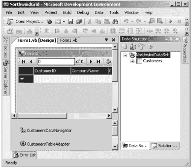

**图 I-5** 使用数据源窗口构建用户界面。

你可以看到，默认情况下，当将 customers 表拖放到设计界面时，它会使用新的 *GridView* 控件进行渲染。你也可以让它作为单个字段进行渲染，并且可以确定用于每个字段的控件类型。

你还可以使用 DataSet 设计器将方法映射到存储过程。这使得调用存储过程变得像下面代码一样简单：

```
ds = MyDataSet.GetByCustomerID(customerID)
```

有关在 Visual Studio 2005 中使用数据的更多信息，请参见第 4 章“构建以数据为中心的应用程序。”

## 第 5 章，“构建用户界面”

Visual Basic 开发者在快速构建用户界面方面从未遇到过任何困难。如果说有一个 Visual Basic 始终表现出色的领域，那就是工具箱和窗体设计器。然而，Visual Basic 开发者经常抱怨的一点是，“给我们微软在其应用程序中使用的用户界面控件。”并且，更具体地说，开发者希望拥有像 Microsoft Office 等产品中的许多用户界面元素，例如浮动工具栏。

**新控件** 你会很高兴地了解到，这个版本的 Visual Studio 并不仅仅关注一个塞满东西的工具箱；这个版本真正致力于让构建专业用户界面变得轻松，无需借助第三方组件或大量的自定义控件开发。第 5 章首先探讨的控件是 *ToolStrip*，如下图所示。

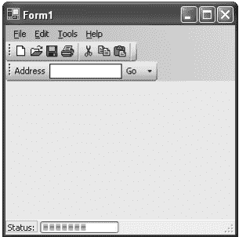

你可以看到，一个包含两个 *ToolStrip* 控件的简单窗体已经创建完成。这实际上只用了几秒钟，但确实有不少内容值得讨论。首先，你可以看到 *ToolStrip* 控件支持“浮动”，这意味着用户可以在运行时拖动 *ToolStrip* 控件并重新排列它们。其次，顶部的 *ToolStrip* 包含了你熟悉的图标。这些图标只需单击一下即可添加。如果有任何你不想显示的图标，你可以直接选中它们并按 Delete 键。*ToolStrip* 不仅支持按钮。它还可以包含文本框、下拉列表、标签等等。最后，这些工具栏看起来就像 Microsoft Office 的工具栏，使得构建外观专业的应用程序变得容易，用户也能直观地知道如何使用。

菜单栏和状态栏基于 *ToolStrip* 基础设施构建，让你能够在菜单或状态栏中拥有更广泛的控件和功能。

在工具箱中，你还会发现一个完整的 .NET 封装包，用于 ActiveX 网页浏览器控件，使得向应用程序添加 Web 功能变得简单。此控件可用于显示基于 Web 的帮助，或引导用户前往购买产品的页面。

### 对现有控件的更改

当你构建窗体时，首先注意到的变化之一是 *对齐线*，它使得在构建用户界面时快速轻松地对齐控件成为可能，如下图所示。

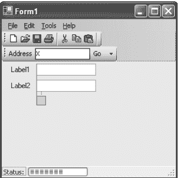

**图 I-7** 使用对齐线对齐控件。

在设计界面上拖动控件时，你看到的不再是传统的网格，而是出现的对齐线，使得完美对齐控件变得简单。对齐线允许你对齐控件的边缘，并推荐控件之间适当的间距。间距由新的 *Margin* 控件属性控制。

许多控件还包含新的自动完成属性，允许控件自动提供文件名、URL、自定义列表或其他来源的建议。

有关构建专业用户界面以及新的应用程序配置基础设施的更多信息，请参见第 5 章“构建用户界面”。

## 第 6 章，“构建 Web 应用程序”

Visual Studio .NET 2002 和 2003 给 Web 开发带来了革命，与经典 ASP 相比，为 Web 开发者带来了数量级的生产力提升。ASP.NET 2.0 再次实现了这一目标。产品团队的目标是将构建网站所需的代码量减少 70%。据各方报道，当 Visual Studio 2005 发布时，产品团队将轻松实现其目标。即使现在，许多网站也可以在零代码的情况下构建。

使用 ASP.NET 1.0 和 1.1 版本时，你可以声明性地创建用户界面，但必须编写代码来连接数据库、检索数据并将 UI 绑定到数据。使用 ASP.NET 2.0，有一些组件封装了数据源。例如，这让你可以声明性地将一个网格连接到 SQL Server 数据源。这种绑定相当复杂。你需要对数据进行更改并将更改推回数据库。这个新功能也不再是过去那种仅用于演示的“设计时控件”。这些控件确实经过了精心设计，使得 UI 的外观和感觉完全可定制，并且你可以通过编程或声明的方式与控件交互。

Microsoft 还识别了关键场景，并将这些场景的基础架构直接构建到 .NET Framework 中。例如，ASP.NET 2.0 内置了成员资格和个性化的概念。成员资格是一套功能包，提供诸如登录、更改密码等常见控件。它还提供了基础架构，用于自动从后端数据库存储和检索信息。最后，成员资格为你提供了通过编程方式处理用户的 API。

ASP.NET 还附带了一些新控件来应对关键场景。例如，*SiteMapPath* 控件提供了内置的面包屑导航功能，而 *SiteMapDataSource* 可以轻松构建网站导航。母版页允许你在一处定义页面的公共区域，只有内容区域会更改。缓存功能得到了改进，现在可以按用户缓存数据。

有关 ASP.NET 2.0 的更多信息，请参见第 6 章“构建 Web 应用程序”。

## 第 7 章，“Microsoft .NET Framework 增强功能”

增强功能不仅限于开发环境。底层框架本身也包含了重大改进。泛型是 .NET Framework 2.0 版本中引入的一项重大增强功能和强大的语言特性，在第 2 章中描述。本章涵盖基类库、控制台和安全方面的增强。

.NET Framework 包含大量新类，以进一步减少你需要编写的代码量，并使向应用程序添加功能变得更容易。*StopWatch* 是一个新类，使得捕获经过的时间间隔变得微不足道。*TraceSource* 类为你跟踪事件数据的方式提供了更多灵活性。*System.Net* 命名空间包含重大增强功能，例如允许你 Ping IP 地址。现在有了一个完全托管的 Internet Explorer 封装。*System.XML* 在性能和功能方面都有显著增强，现在包含对 XQuery 的支持。

有关这些新类以及控制台和安全增强的更多信息，请参见第 7 章“Microsoft .NET Framework 增强功能”。

## 第 8 章，“部署应用程序”

使用 Visual Basic 6.0 时，部署应用程序通常涉及构建 Windows Installer 包。这个过程是必要的，因为 Visual Basic 6.0 基于 COM，应用程序通常需要在运行前注册许多 DLL。安装程序还会创建开始菜单快捷方式、安装数据库或执行其他所需任务。

.NET Framework 的 1.0 和 1.1 版本为更多的安装选项打开了大门。首先，1.0 版本支持通常称为 XCOPY 部署的方式。这意味着简单的应用程序只需复制到硬盘驱动器即可执行。这是可能的，因为 .NET DLL 不需要注册。1.0 版本还支持

被称为“无接触部署”——有时也称为href-exes。在这种部署方法中，应用程序的可执行文件只需放置在Web服务器上。当你浏览到该应用程序的URL时，它会下载并运行。其结果是一个功能完整的Windows应用程序，却拥有Web应用程序部署的便捷性。使用.NET，即使你需要创建Windows安装程序包，此过程也大大简化，因为你无需担心DLL的注册问题。

许多人认为无接触部署是内部网应用程序的绝佳方案。通过一个简单的门户网站，你可以确保用户始终运行应用程序的最新版本。通过Visual Studio 2005，Microsoft显著增强了通过Web分发的应用程序的能力。首先，应用程序现在可以下载并完全安装。此功能可创建适当的“开始”菜单快捷方式，并且（更重要的是）它使应用程序即使在离线时也能完全正常运行。

ClickOnce应用程序也不要求你拥有管理员权限才能安装它们（而Windows安装程序包则需要）。最后，ClickOnce允许你在安装过程中“引导”安装其他必需的软件。例如，ClickOnce应用程序可以在应用程序安装过程中安装MDAC，甚至在需要时安装.NET Framework。

有关ClickOnce的更多信息，请参阅第8章“部署应用程序。”

## 支持

我们已尽一切努力确保本书的准确性。如果你遇到问题，Microsoft Press通过以下网站提供其图书的勘误：*http://www.microsoft.com/learning/support/*。

如果你对本书或配套CD-ROM有任何问题、意见或想法，请将其发送给Microsoft Press。

发送电子邮件至 *mspinput@microsoft.com*。

邮寄信件至：

Microsoft Press
收件人：*Introducing Microsoft Visual Basic 2005 for Developers* 编辑
One Microsoft Way
Redmond, WA 98052-6399

请注意，上述地址不提供对软件产品本身的支持。产品支持，请访问 *http://support.microsoft.com*。

要直接连接到Microsoft知识库并就你遇到的问题或议题输入查询，请访问 *http://support.microsoft.com*。

## 第1章：面向Visual Basic开发者的Microsoft .NET Framework入门

| 本章内容： | |
|---|---|
| 你可以构建的应用程序 | 2 |
| 真正的集成开发环境 | 4 |
| 什么是 .NET | 5 |
| 数据访问：ADO.NET | 20 |
| Windows 应用程序 | 21 |
| Web 应用程序 | 25 |
| Visual Studio 2005 和 .NET Framework 2.0 中的增强功能 | 28 |
| 结论 | 30 |

Microsoft .NET Framework及相应的Microsoft Visual Studio版本（以.NET Framework为目标）是软件开发者的重大创新。如果你一直使用Visual Basic 6（或更早版本）进行编程，你将赞赏这些新开发和运行环境在生产力、安全性、可靠性和“可部署性”方面带来的进步。

每个程序都依赖于其平台和其他库来提供运行时服务。Visual Basic 6程序员非常了解Visual Basic运行时提供的服务类型。Java程序员使用Java虚拟机（JVM）。其他程序员则使用他们所开发技术的库。Microsoft .NET Framework类库提供了一个丰富的库，用于在被称为*公共语言运行时*（CLR）的平台（或运行环境）上创建应用程序。本章将向你介绍.NET Framework、其类库以及构成Microsoft Visual Studio 2005的开发工具的基础知识。本章末尾是.NET Framework 2.0和Visual Studio 2005新功能的一些亮点，这些功能将在本书其余部分更详细地介绍。

.NET Framework CLR是一个管理关键平台服务（包括内存和安全）的运行环境。以.NET Framework为目标的代码通常被称为*托管代码*，因为它需要运行环境提供的管理服务。你为.NET Framework编写的任何Visual Basic代码都是托管代码。这包括Windows应用程序、Web应用程序和所有其他类型的应用程序。

### 你可以构建的应用程序

你可能已经听到很多关于.NET和XML Web服务的宣传。其中很多宣传是当之无愧的，因为.NET Framework和Visual Studio 2005使得构建和使用Web服务变得非常容易。但是Microsoft .NET技术不仅仅关乎Web服务。Visual Studio 2005和.NET Framework在创建其他类型的应用程序（包括Windows和Web应用程序）方面同样强大。有时，围绕Web服务的宣传掩盖了你可以使用Microsoft .NET技术创建的广泛应用程序范围，以及以.NET Framework为目标的众多好处，包括增强的安全性、提高的开发人员生产力、降低的部署和维护成本，以及为许多通用任务提供的广泛预构建库。

### 智能客户端Windows应用程序

当然，你可以创建类似于使用Visual Basic 6创建的Windows应用程序的GUI驱动型Windows应用程序。这些.NET应用程序通常称为Windows窗体应用程序、厚客户端或智能客户端。Microsoft .NET Framework为Windows GUI应用程序提供了许多功能，这些功能已超越了Visual Basic 6的能力，例如停靠、锚定、不透明度、新控件以及更多作为事件公开的Windows消息。

术语*智能客户端*指的是将桌面应用程序的处理能力和丰富的用户界面（UI）与更通常与Web应用程序相关的部署和连接功能相结合的Windows应用程序。智能客户端是具有以下特征的传统Windows应用程序：使用Web服务；支持离线模式；可从中央服务器部署；提供自动更新（从中央服务器）；或支持多种类型的设备。随着Microsoft技术简化部署，而公司又受限于基于Web的界面同时寻找利用网络边缘处理能力的方法，人们对智能客户端的兴趣一直在稳步增长。

## Web 应用程序

.NET Framework已成为Web应用程序极其流行的技术。.NET Framework中的Web功能统称为ASP.NET，体现在一个丰富的对象模型中，该模型提供了远超其前身ASP（现在通常称为*经典ASP*）的功能和可扩展性。自推出以来，ASP.NET一直是一套高效的技术，用于创建和部署从小型到企业级的各种Web应用程序。

### Web 服务

XML Web服务是ASP.NET的一部分。传统的Web页面以HTML输出响应HTTP请求。相比之下，Web服务基于SOAP（一种基于XML的协议），该协议定义了两个系统之间交换消息的语法和规则。SOAP消息可以通过HTTP传输，就像Web页面请求一样，这意味着你可以公开服务（例如，Web服务），这些服务可通过大多数允许80端口流量的防火墙访问。


> **注意：** 术语*方言*是指用于表示某些数据类型的XML版本的规则。SOAP是用于消息交换的XML方言。还有无数其他为XML的各种不同用途定义的XML方言，包括标准和专有系统。

### Windows 服务

Visual Basic程序员长期以来一直抱怨难以创建可以作为Windows服务（以前称为NT服务）运行的应用程序。Windows服务是执行任务或为其他程序提供服务的后台应用程序。Windows服务通常自动启动，并且无论是否有用户登录都运行。它们由称为服务控制管理器系统的Windows子系统控制。在.NET Framework之前，Visual Basic开发人员必须使用第三方工具来创建可以作为服务运行的应用程序。使用.NET Framework创建Windows服务应用程序就像创建任何其他类型的应用程序一样简单。该服务可以用任何符合.NET的语言编写，包括Visual Basic。

### 控制台应用程序

一种经常被忽视但功能强大的应用程序类型是控制台应用程序。控制台应用程序具有用于输入和输出数据的流，而不是GUI应用程序使用的点按交互模型。控制台应用程序通常称为*命令行应用程序*。Visual Basic 6没有提供创建控制台应用程序的简便方法，但使用.NET Framework，你可以使用Visual Basic或任何符合.NET的语言创建控制台应用程序。

### 类库

最大化代码和二进制重用是专业开发人员的基本目标之一。你实现此目标的一种方法是设计你的软件解决方案，使代码通用且可重用。然后，通过生成DLL文件，将这些潜在可重用的代码封装在类库中。对于Visual Basic 6程序员来说，这个过程在某种程度上类似于创建


### 智能设备应用程序

Windows、控制台和Web应用程序（包括Web服务）以.NET Framework为目标。你也可以编写以.NET Compact Framework为目标的应用程序。.NET Compact Framework是完整.NET Framework的一个子集，专为智能设备设计。.NET Compact Framework针对资源有限的设备（如内存和屏幕尺寸较小的设备，例如智能手机和其他手持设备）进行了优化运行。Visual Studio 2005包含一个智能设备仿真器，以方便智能设备应用程序的开发和调试。

### 安装和部署项目

你可以使用Visual Studio 2005创建多种类型的安装和部署项目。安装和部署项目现在不如以前那么重要了，因为许多部署问题已经简化，包括消除了为单个应用程序（即私有程序集）注册组件的需求。但仍有许多情况下，你会希望拥有一个稳健且外观专业的安装程序。Visual Basic 6的开发者会发现，Visual Studio 2005中的安装和部署项目比Visual Basic 6中的“打包和部署向导”有了巨大改进。开发界面的强大功能和灵活性，以及为Microsoft Installer生成MSI安装包的能力，使Visual Basic开发者能够使用以前仅第三方工具才提供的功能。

### 一个真正集成的开发环境

Visual Studio .NET为所有可构建的应用程序类型引入了统一的开发环境。Visual Studio 2005是该统一环境演进过程中的最新产品。它远不止是一个集成的编辑器、编译器和调试器。一个如图1-1所示的通用外壳承载了构成Visual Studio 2005的全套工具，例如Visual Basic代码编辑器、可视化Windows窗体设计器、新的可视化Web设计器、服务器资源管理器等等。该外壳也是可扩展的，允许将加载项、新项目类型和新设计器插入到开发环境中。

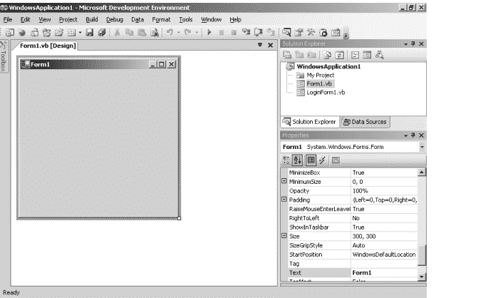

图1-1 Visual Studio 2005集成开发环境。

Visual Studio 2005 IDE（集成开发环境）是一个强大的工作环境，你很可能会在其中花费大部分开发时间。例如，在这个环境中，你可以编写Web应用程序店面、处理金融交易的Windows服务、向多个后台系统公开数据的Web服务，以及通过后台Web服务检索数据的智能客户端。你还可以使用IDE来调试所有这些应用程序、运行单元测试（使用第三方工具或Microsoft即将推出的工具）、管理企业服务（例如MSMQ）、管理SQL Server等等。

## 什么是 .NET？

准确理解“.NET”的含义可能具有挑战性。如果你问五位经验丰富的.NET开发者“什么是.NET？”，你可能会得到五个不同的答案，就像你问“什么是Microsoft Windows？”或“什么是计算机程序？”会得到不同答案一样。这些差异的产生是因为不同类型的用户从各自的视角来理解技术。从开发者的角度来看，.NET实际上包含三件事：.NET Framework、.NET Framework SDK以及开发环境（先是Visual Studio .NET，然后是Visual Studio .NET 2003，现在是Visual Studio 2005）。

.NET Framework为应用程序提供了一组核心功能。它提供了代码在托管环境中运行所需的服务和其他功能。.NET Framework SDK是创建托管应用程序的基础工具集，包括编译器以及许多其他有用的工具。Visual Studio 2005建立在Framework SDK提供的基础工具集之上。Visual Studio是针对.NET Framework进行应用开发的首选工具。

> **注意** 一些开发者和IT专业人员将.NET Framework描述为一个平台，而另一些人则坚持认为.NET Framework不是一个平台，而是一个更广泛平台（即Microsoft Windows）中的构建块或组成部分。实际上，.NET Framework和.NET Compact Framework既是平台*也是*它们所在的更广泛平台（如Windows Server 2003或Windows CE）的构建块。那些更广泛平台运行的硬件通常也被称为平台。为了帮助减少因术语*平台*的多种用法而引起的混淆，本书中不将.NET Framework称为平台。

## 公共语言运行时和中间语言

每个程序都在某个上下文中运行。DOS程序在16位MS-DOS操作系统提供的服务上下文中运行。诸如Microsoft Word之类的应用程序在你当前操作系统的上下文中运行，并受到该操作系统施加的约束和服务的限制，例如授予你的用户帐户的权限。例如，在Windows XP和Windows Server 2003上，应用程序对文件系统的访问受到限制，因为操作系统在安全上下文中运行应用程序，并使用访问控制列表（ACL）来保护文件系统。

CLR是.NET Framework的核心组件，它为托管代码提供上下文并执行该代码。在某些方面，CLR是一个虚拟机，但其能力超出了简单的虚拟机模型。CLR对其运行的上下文有内在的理解，并根据所处环境做出适当响应。例如，由于这两类操作系统（基于MS-DOS和基于Windows NT）之间的根本差异，CLR在Windows 98和Windows Me环境中的行为与在Windows XP或Windows Server 2003中的行为不同。CLR还能够在多处理器环境中表现出不同的行为，以利用多个CPU的优势。

CLR是公共语言基础设施（CLI）标准的一种实现，该标准定义了一个与机器无关的应用程序执行环境。CLR虚拟执行系统提供重要服务，如内存管理（对象生命周期管理和垃圾回收）和安全性。CLR还提供一个即时（JIT）编译器，用于将*中间语言*转换为可由物理CPU执行的本机代码。

中间语言（IL）是一种新语言，旨在高效地转换为不同类型设备上的本机机器码。IL基于抽象的基于栈的处理器架构。它是.NET Framework的通用语言。Visual Basic编译器vbc.exe生成IL。C#编译器csc.exe生成IL。实际上，每个符合.NET规范的编译器都生成IL。中间语言是比Visual Basic或C#更低级的语言。对于具有机器汇编语言背景的程序员来说，IL让人联想到汇编语言，但处于更高的抽象层次。

.NET Framework SDK包含的一个工具是Ildasm.exe，即IL反汇编器。Ildasm用于以人类可读的形式显示.NET程序文件的内容。图1-2显示了一个简单Windows应用程序的Ildasm部分输出。

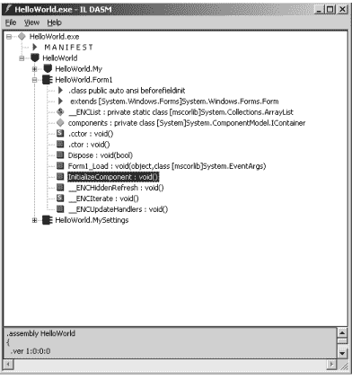

图1-2 Ildasm.exe显示一个简单的Windows应用程序。

Ildasm可用于查看单个函数和子程序（在面向对象语言中也称为*方法*）内的IL。图1-3显示了*Form1_Load*方法的IL列表。以下代码是原始的Visual Basic源代码：

```
Private Sub Form1_Load(ByVal sender As System.Object, _
            ByVal e As System.EventArgs) Handles MyBase.Load
    Dim I As Integer
    Dim S As String
    For I = 1 To 20
        S += I.ToString() + " "
    Next
    MsgBox(S)
End Sub
```


面向开发人员的 Microsoft Visual Basic 2005 介绍

图 1-3 简单子程序的 IL 清单。

.NET Framework SDK 还包含一个汇编器，即 Ilasm。你可以在自己喜爱的文本编辑器中输入中间语言，然后使用 Ilasm 进行汇编。汇编后的 IL 可以在 CLR 上执行。虽然对某些人来说这肯定是一个有益的学习练习，但大多数专业程序员发现使用 Visual Basic、C# 或其他高级编程语言进行编程，然后使用符合 .NET 标准的编译器生成 IL 更为高效。

> **注意** 中间语言有时称为 *Microsoft 中间语言*（MSIL）或 *公共中间语言*（CIL）。MSIL 通常发音为"missile"（导弹）。

如果你考虑到所有符合 .NET 标准的语言都被编译成 IL，并且 CLR 执行 IL，你就会意识到无论使用哪种原始高级编程语言，所有托管代码对 CLR 来说都是相同的。所有语言都是第一等语言。每种符合 .NET 标准的语言都可以访问框架类库。每位 .NET 程序员都可以重用使用任何符合 .NET 标准的语言编译的 IL。

这并不是说每种符合 .NET 标准的语言都是平等的。某些语言比其他语言更适合解决特定问题。图 1-4 展示了一个解决方案，其中 Visual Basic 中的 Windows 应用程序调用 C# 类库中的方法 *GetNumberListString*。Visual Basic 和 C# 都被编译成 IL，因此从 inherent（固有）角度来说没有哪种语言比另一种更快。然而，不同的编译器设置可以为语义上等价的高级代码生成不同的 IL。如果你使用默认编译器设置，C# 中的 for 循环将比 Visual Basic 中的等效循环运行得更快，因为 Visual Basic 编译器默认包含溢出检查，而 C# 编译器则不包含（这是典型的安全性与速度之间的权衡）。如果你正在编写具有高迭代次数循环的代码，可以使用 C# 并打开编译器的溢出检查选项，然后将高迭代次数循环包装在 *unchecked* 语句块中，以关闭特定代码块的溢出检查，从而获得小幅性能提升。Visual Basic 没有提供以如此细粒度级别打开和关闭溢出检查的选项，因此这是 C# 可能更适合解决特定问题的少数情况之一。（Visual Basic 有其自身独特的功能集，例如 My 命名空间和可选方法参数。）

**图 1-4** Visual Basic 代码调用以 C# 编写的方法。

前面关于 C# 中循环的例子显然有些牵强。循环体通常必须是不切实际地简单化，整数溢出检查的影响才会显著（当然，除非循环体主要包含没有溢出检查会运行更快的整数运算）。而且无检查整数运算并非 C# 独有的——你可以将代码分解到单独的 Visual Basic 类库中，并仅针对该项目禁用溢出检查，以获得相同的 IL 结果。但即使这个例子有些牵强，仍有许多现实场景可能会在同一解决方案中使用多种 .NET 语言。例如，你可能购买了第三方 C# 代码，而你的 Visual Basic 项目必须调用它。或者你的公司可能像许多开发工作室一样，有 former（前）ASP 程序员使用 Visual Basic 构建 ASP.NET 应用程序，而具有 C++ 背景的 COM 编程同事则为 ASP.NET 应用程序构建 C# 类库以供使用。在这种情况下，让程序员根据他们的编程背景使用最舒适的 .NET  languages（语言）是理所当然的。

> **注意** 在软件解决方案中混合多种编程语言时要小心。多种语言可能使重构（重组）代码变得困难，并可能使不精通所有使用语言的程序员（尤其是初级程序员）感到沮丧或困惑。你还应注意区分大小写的语言（如 C#）和不区分大小写的语言（如 Visual Basic）之间的区别。C# 组件公开的公共接口如果仅通过大小写来区分方法、属性或字段（例如，UserName 与 username），则无法从 Visual Basic 程序中按预期使用。

## 公共类型系统

如果你花了很多时间编写调用 Win32 API 或第三方 DLL 公开函数的 Visual Basic 6 代码，你就会知道 Visual Basic 6 中的内置数据类型与其他语言（例如 C）中的内置数据类型不同。如果所有 .NET 语言都编译成可从任何 .NET 程序调用的 IL，那么就必须在所有这些语言中有一个通用的数据类型集合来表示整数、实数、日期、文本等。.NET Framework 使用的数据类型被定义为公共类型系统的一部分，这是一套创建和使用数据类型的规则。

公共类型系统对于确保跨语言集成至关重要。Visual Basic 程序员可以充满信心地将 *Int32* 值或 *String* 传递给 C# 库，因为 *Int32* 和 *String* 被定义为公共类型系统的一部分。公共类型系统对于确保运行时的类型安全也至关重要，这确保你的代码不允许未经授权的内存访问，并且不易受到某些类型的安全攻击。

Visual Basic 有许多基本数据类型，它们映射到公共类型系统中的预定义类型。例如，Visual Basic 基本类型 *Integer* 是 *System.Int32* 的别名，即一个 32 位整数。Visual Basic 基本类型 *String* 是 *System.String* 的别名，即一个 Unicode 字符序列。C# 和其他语言有自己的基本数据类型，它们对应于公共类型系统中这些相同的预定义类型。

> **注意** 在 Visual Basic 6 中，*Integer* 是 16 位值，*Long* 是 32 位值。在面向 .NET Framework 的 Visual Basic 代码中，*Integer* 为 32 位，*Long* 为 64 位。如果你使用 Visual Basic 6 升级向导转换代码，向导会为你调整整数数据类型。

## 对象与值

公共类型系统中有两种数据类型：引用类型和值类型。这两种数据类型在其创建、在内存中传递以及最终销毁的方式上有着根本的不同。值类型保存你通常认为的基本类型值：整数、浮点数、字符和布尔（真/假）值。值类型通常在内存中表示简单，通常只需要几个字节。当值类型在内存中传递时（例如，当它们作为参数传递给方法时），值本身会被复制（默认情况下）。

值类型简单且高效。它们不需要创建对象（即引用类型）所需的相同类型的开销，也不需要为销毁进行特殊考虑。值直接存储在栈上，并与变量或常量（或字面量）绑定。值的生命周期与用于访问该值的变量的生命周期相同。变量不能与其值分离，因此值类型变量始终有一个值。与引用类型不同，值类型变量不能为 null（*Nothing*）。

公共类型系统定义了最有用的值类型（*Integer*、*Double*、*Date*、*Char* 等），并允许你定义自己的值类型。你还可以创建枚举，它们是包含整型（通常是 *Integer*）值子集的符号别名的自定义值类型。只有枚举定义中指定的别名才是该枚举类型变量的有效值。例如，以下代码清单显示了用户类型的枚举。*UserType* 变量只能具有指定的三个值之一（*Admin*、*Moderator* 或 *User*）。

```
Enum UserType As Integer
    Admin = 1
    Moderator = 2
    User = 3
End Enum
```

.NET Framework 类库广泛地使用枚举，从文件 I/O 模式到颜色等各个方面。

引用类型是一种非常不同的数据类型。引用类型的"值"是为保存该引用类型实例（即对象）而分配的内存位置的内容。引用类型的值总是通过指向持有该值的内存位置的引用来访问。与值类型变量不同，引用类型变量并非固有地绑定到始终有值的固定内存位置。引用类型变量可以是对内存中任何对象（具有适当数据类型）的引用。或者引用类型变量可能不持有对任何对象的引用，在这种情况下，它被称为 *null 引用* 或对 *Nothing* 的引用。

CLR 在其运行时内存堆中为对象（引用类型的实例）分配空间。考虑以下代码行：

```
conn = New SqlConnection(connectionString)
```

变量 `conn` 被赋值为一个新 *SqlConnection* 对象的引用。该对象在内存堆中创建。CLR 为新对象分配内存，并调用一个称为 *构造函数* 的特殊方法，用于 *SqlConnection* 类。CLR 还承担着在对象不再使用时销毁该对象并释放其内存的责任。这称为 *垃圾回收*，是 CLR 提供的核心服务之一。


当引用类型作为参数传递给方法时，传递的是引用的副本，而非对象值本身（位于内存堆中）。这意味着原始调用代码和被调用的方法都将持有内存中同一个对象的引用。如果方法修改了该对象的内容，更改会影响调用代码。请参考以下 Visual Basic 代码示例：

```vb
Sub CreateDataSet()
    Dim ds As New DataSet
    AddTable(ds)

    ' 消息框显示 "1"，因为 AddTable 方法
    ' 已更改了 DataSet 对象 ds。
    MsgBox(ds.Tables.Count.ToString())
End Sub

Sub AddTable(ByVal targetDataSet As DataSet)
    targetDataSet.Tables.Add("TableOne")
End Sub
```

变量 *ds* 是对一个新 *DataSet* 对象的引用，它被传递给 *AddTable* 方法。在 *AddTable* 方法中，变量 *targetDataSet* 是对同一个 *DataSet* 对象的引用。*AddTable* 方法向 *DataSet* 中添加了一个新表。然后回到 *CreateDataSet*，在调用 *AddTable* 之后，*DataSet* 对象 *ds* 的 *Tables* 集合中将包含一个表。尽管两个方法中存在两个不同的变量，但它们操作的都是内存中同一个 *DataSet* 对象。

## 类、方法、属性、字段和事件

在面向对象编程中，对象是类的实例。作为程序员，你使用数据字段、属性、方法和事件来定义一个类。然后，你基于该类创建具有状态（字段、属性）和行为（方法、事件）的对象。以 *Form* 类为例。*Form* 类定义了在 Windows 应用程序中显示窗口的数据和属性（例如，*Width*）。*Form* 类也定义了行为，比如用于显示窗体的 *Show* 方法。*Form* 类本身并不是一个窗体。该类定义了 *Form* 对象的样子及其能做什么。一个实际的 *Form* 对象则是位于内存堆中特定内存位置的一系列字节。

一个类由四个构建块组成：字段、方法、属性和事件。字段是类持有的一个值。字段可以直接持有值（值类型）或持有对值的引用（引用类型）。类中的字段在某种程度上类似于方法中的变量。方法调用期间变量的值是该方法调用状态的一部分，变量绑定到该方法的“实例”。同样，字段是对象状态（即类的实例）的一部分。

方法是类中的功能单元。Visual Basic 中的子例程（*Sub*）和函数（*Function*）就是方法。方法是对象行为的重要组成部分。方法是对象能执行的操作。它是在对象上下文中执行的一段编程逻辑，可以通过其字段和属性访问或操作对象的状态。

属性是字段和方法的混合体。像字段一样，属性是对象状态的一部分。对于其他对象，公共属性看起来像公共字段，并且你使用相同的语法来读取和写入属性值。但在内部，属性实际上是两个特殊方法：*Get* 过程和 *Set* 过程。当你读取属性值时，执行 *Get* 过程。当你设置属性值时，执行 *Set* 过程。属性允许你将逻辑与访问值相关联。更重要的是，属性允许你将对象的公共接口与其数据的内部表示分离开来。

事件是对象可以响应的发生事件。事件是对象可以展现的另一种行为。如果说方法是对象能“做”的事情，那么事件就是对象能“说”的事情。通常，事件用于通知监听对象状态发生变化。监听对象通过 *事件处理程序* 被“通知”。监听对象将某个方法注册为特定对象的特定事件的事件处理程序。当事件发生时，该方法（事件处理程序）会被自动调用。事件在对象显式引发时发生。例如，当 *Button* 对象从 Windows 接收到一条消息，表明在鼠标指针位于按钮上方时按下了默认鼠标按钮，它会引发一个 *Click* 事件。如果你在 Visual Basic 6 中编程过，你已经熟悉了事件驱动编程。你会发现在托管代码中事件处理程序的工作方式有些不同，但在许多情况下，你编写的代码与在 Visual Basic 6 中编写的代码非常相似。

当你在 Visual Basic 中编写托管代码时，你总是在创建一个类，这是一个数据类型的定义。该类型对象的状态和行为由你的代码决定。以下示例是一个名为 *UserAddress* 的类。此类包含四个字段来保存邮政地址的元素。在此示例中，所有字段都标记为 *Private*，这意味着在 *UserAddress* 类外部无法访问它们。相反，数据通过四个属性公开暴露。*UserAddress* 中的属性只是对私有字段的简单包装，但这里重要的是，地址的外部（公共）接口与实际存储数据的字段是分离的。你可以自由更改数据的内部表示方式，同时继续暴露相同的外部接口。此示例还包含一个名为 *AddressChanged* 的事件。如果新值与旧值不同，每个属性中的每个 *Set* 过程都会引发此事件。监听对象可以为 *AddressChanged* 事件注册处理程序，并在 *UserAddress* 状态发生变化时（即地址的某部分被更改时）执行代码。最后，有一个 *GetFormattedAddress* 方法，它创建一个包含所有地址数据的新 *String* 对象。

```vb
Public Class UserAddress

    Private _address As String
    Private _city As String
    Private _provState As String
    Private _postalCode As String

    Public Event AddressChanged()

    Public Property Address() As String
        Get
            Return _address
        End Get
        Set(ByVal Value As String)
            If _address <> Value Then
                _address = Value
                RaiseEvent AddressChanged()
            End If
        End Set
    End Property

    Public Property City() As String
        Get
            Return _city
        End Get
        Set(ByVal Value As String)
            If _city <> Value Then
                _city = Value
                RaiseEvent AddressChanged()
            End If
        End Set
    End Property

    Public Property StateProvince() As String
        Get
            Return _provState
        End Get
        Set(ByVal Value As String)
            If _provState <> Value Then
                _provState = Value
                RaiseEvent AddressChanged()
            End If
        End Set
    End Property

    Public Property PostalCode() As String
        Get
            Return _postalCode
        End Get
        Set(ByVal Value As String)
            If _postalCode <> Value Then
                _postalCode = Value
                RaiseEvent AddressChanged()
            End If
        End Set
    End Property

    Public Function GetFormattedAddress() As String
        Return _address + vbCrLf + _
            _city + ", " + _provState + vbCrLf + _
            _postalCode
    End Function

End Class
```

UserAddress 类是在 Visual Basic 中可以创建的数据类型的一个简单示例。为 .NET Framework 构建应用程序是一个将需求转化为相互交互的类以实现所需功能的过程。有时你必须自己编写整个类，比如 UserAddress 类。其他时候，类由向导或其他工具自动为你创建，例如当你向应用程序添加新窗体时。

在应用程序中需要完成的任何事情，你都将通过类来完成。需要表示客户的东西？创建一个类。需要将数据从旧系统移动到 Microsoft SQL Server 数据库的功能？创建一个类。如果你设计类时考虑了可重用性，你最终会得到一组可以复制到新应用程序中的类。.NET Framework 本身包含一个庞大的类库，旨在可在多种类型的应用程序中重用。这个类集合被称为框架类库（Framework Class Library），自其推出以来，一直是 .NET Framework 最受欢迎的方面之一。

> **注意** 在一些面向对象编程语言和抽象对象模型中，字段、属性和特性这些术语可以互换使用。在 .NET Framework 中，属性和特性是特定的构造，与字段是不同的。

## 框架类库

像 Visual Basic 这样面向 CLR 等执行环境的高级编程语言是一个强大的概念，但它必须伴随着一套同样强大的库，才能在现实世界中真正发挥作用。框架类库（Framework Class Library，有时称为基类库 Base Class Library，BCL）是一组 DLL，是 .NET Framework 的组成部分。每个 DLL 都包含一组相关的类，用于提供某些特定的功能。例如，System.Drawing.dll 提供用于生成图形的类；System.DirectoryServices.dll 提供用于与 Active Directory 交互的类；System.Xml.dll 提供用于处理 XML 文档的类。框架类库包含从基本文件 I/O 到构成 ASP.NET 和 ADO.NET 的类在内的一切。

大多数开发者似乎发现，成为一名熟练的 .NET 开发者的最大任务是学习框架类库。这部分任务是学习用新方法做熟悉的事情。这部分任务中更大的部分是学习框架类库中的众多新功能。


### 类库

框架类库提供了一组丰富的类，这些类以前需要大量自定义代码或第三方组件。要 ping 服务器，请使用 *Ping* 和 *PingReply* 类。要以编程方式访问网站，请使用 *WebClient* 或 *HttpWebRequest* 类。要验证电子邮件地址的格式，请使用 *Regex* 类。要转换 XML 文档，请使用 *XslTransform* 类。要以编程方式发送电子邮件，请使用 *SmtpMail* 类。

框架类库功能全面，以至于 .NET 开发者常常坦言，他们花费在研究和查找框架类库中合适类以完成通用任务（例如，将 PNG 图像转换为 JPG 图像）上的时间比例在增加，而编写自定义代码执行此类任务的时间比例在减少。使用框架类库完成这些任务意味着需要测试、调试和维护的自定义代码行数更少，并且拥有预先编写的文档以及来自全球使用相同类执行相同通用任务的其他开发者的支持。

本书聚焦于框架类库的最新特性，这些特性是在 .NET Framework 2.0 版本中引入的。对于框架类库中更成熟的部分，有许多优秀的资源可获取更深入的信息，包括随 Visual Studio 2005 安装的 MSDN 文档、MSDN 网站上的信息（*http://msdn.microsoft.com/*）、通过搜索 *http://www.google.com/* 可找到的信息，以及 *101 Microsoft Visual Basic .NET Applications*（可从 Microsoft Press 获取）。

### 命名空间

框架类库组织为 *命名空间* 的层次结构。命名空间提供了一种组织类的方式，有助于避免歧义、减少命名冲突并将相关类分组在一起。没有组织结构，命名冲突会频繁且令人沮丧。如果你正在开发一个页面布局程序，你可能想创建一个类来表示页面上的文本块，但如果你尝试创建一个 *TextBox* 类，你将与为 Windows 窗体定义的 *TextBox* 类冲突。如果你正在开发一个管理法律表格的工具，你可能想创建一个类来表示表格，但如果你尝试创建一个 *Form* 类，你将与框架类库中现有的 *Form* 类冲突。*Url*？已使用。*Semaphore*？已使用。*Ping*？*Timer*？*Thread*？所有这些都已在框架类库中使用。这个列表可以一直列下去——框架类库非常庞大。幸运的是，框架类库使用命名空间来避免命名冲突带来的挫败感。事实上，框架类库本身在不同的命名空间中重复了一些类名。最值得注意的是用户界面控件——如 *TextBox*、*ListBox* 和 *Button*——它们同时出现在 *System.Windows.Forms* 和 *System.Web.UI.WebControls* 命名空间中（尽管这两个命名空间通常不会在同一应用程序中一起使用）。

如前所述，框架类库非常庞大，掌握它并非易事。命名空间使使用框架类库变得容易得多，因为具有相关功能的类通常位于同一命名空间下。如果你需要处理数据，可以查看 *System.Data* 命名空间。如果你需要处理 XML，可以查看 *System.Xml* 命名空间。如果你需要读取或写入文件，可以查看 *System.IO* 命名空间。熟悉 *System* 命名空间下的命名空间（包括一些最突出的类）将使你成为一个更高效的 .NET 程序员，因为当寻找提供某些特定功能的类时，你将能够快速确定应在哪个命名空间中搜索。

当你使用 Visual Studio 2005 创建应用程序时，你的类会被放置在与应用程序同名的命名空间中。你可以通过 Visual Studio 2005 项目属性窗口更改该默认根命名空间，如图 1-5 所示。命名空间可以嵌套，因此你可以在代码中创建额外的命名空间，这些命名空间将位于项目根命名空间下的命名空间层次结构中。随着应用程序或类库中类数量的增长，你会发现为相关的类集创建命名空间对于保持类的组织性很有用。如果你的应用程序的根命名空间是 *ChooseYourOwnNamespace*，以下代码将在 *ChooseYourOwnNamespace.Namespace1* 命名空间中定义一个名为 *Class1* 的类：

```
Namespace Namespace1
    Public Class Class1

    End Class
End Namespace
```

**图 1-5** 显示项目根命名空间设置的项目属性窗口。

除非编译器提供其他信息来解析类名，否则类必须使用其完全限定名来引用。完全限定名是类名前加上其命名空间。如果命名空间嵌套在另一个命名空间中，则完全限定名中必须包含完整的命名空间列表。上例中类的完全限定名是 *ChooseYourOwnNamespace.Namespace1.Class1*。当然，有一些常用的命名空间，你将经常使用它们，反复输入这些完全限定名只会使你的源代码变得杂乱。作为输入完全限定名的替代方法，你可以将命名空间导入到整个项目或单个代码文件中。图 1-6 显示了通过项目属性窗口导入到整个项目的命名空间。图 1-7 显示了通过使用 *Imports* 语句导入到代码文件中的几个命名空间。

### 程序集和元数据

应用程序是功能的集合。类是构成应用程序整体功能的构建块。这些功能必须以某种方式打包，以便可以保存到存储介质（例如，硬盘或 DVD），部署到其他计算机，由执行环境（例如，托管代码的 CLR 或非托管代码的操作系统）加载，并且在某些情况下可以被多个应用程序重用。如果这些功能的“捆绑包”针对 .NET Framework，则它们称为 *程序集*。在基于 Windows 的环境中，有两种类型的文件封装功能：可执行文件（EXE 文件）和库文件（DLL 文件）。程序集通常是一个单独的 EXE 或 DLL 文件，尽管也可以创建多文件程序集。使用 Visual Studio 2005（以及 Visual Studio .NET 和 Visual Studio .NET 2003），你可以创建 EXE 和 DLL 程序集。

程序集是托管代码的版本控制和部署单元。如果一个应用程序由一个可执行文件（EXE 文件）和一个库文件（DLL 文件）组成，那么你将有两个程序集，每个都有自己的版本号。你可以同时部署这两个文件，然后稍后部署更新的 DLL，而无需部署更新的可执行文件。

程序集由三部分组成：中间语言、元数据和资源。如前所述，.NET 编译器不生成二进制机器代码，它们生成中间语言。程序集中的 IL 由 JIT 编译器在需要时即时转换为二进制机器代码——换句话说，在代码运行时需要时。JIT 编译的代码保存在内存中，以便在当前进程后续执行该代码时可以重用。JIT 编译与解释代码有显著不同。IL 相对容易转换为本机机器代码，并且可以根据运行时可用的硬件和资源进行优化。较小的前期编译成本会为当前环境生成优化的二进制代码。

存储在程序集文件中的元数据称为 *清单*。清单包括程序集版本、对其他程序集的引用、支持的区域性、类型信息以及关于程序集的其他自描述信息。

程序集中的资源是嵌入在程序集本身中的内容文件，可以在运行时访问。嵌入资源最常见的用途之一是图像文件。以下代码示例展示了如何从当前程序集中读取嵌入的 JPG 图像并在 *PictureBox* 控件中显示它。在此示例中，嵌入资源是 *Image1.jpg*。程序集的根命名空间是 *MyApp*。

```
Private Sub LoadResourceImage()
    Dim currentAssembly As System.Reflection.Assembly
    currentAssembly = System.Reflection.Assembly.GetExecutingAssembly()
    Dim img As System.IO.Stream
    img = currentAssembly.GetManifestResourceStream("MyApp.Image1.jpg")
    PictureBox1.Image = Image.FromStream(img)
    img.close()
End Sub
```


**面向开发者的 Microsoft Visual Basic 2005 入门**

20

尽管所有托管代码都打包在程序集中，但根据程序集的类型（EXE 或 DLL）以及程序集的加载方式，你会得到不同类型的应用程序。Windows 应用程序是由 Windows 外壳加载的 EXE 文件。Web 应用程序是 DLL 文件，其中包含由 IIS（Internet 信息服务）加载的特定类型类。本章稍后将更详细地讨论 Windows 和 Web 应用程序，包括 Visual Basic、COM 和 ASP 不同版本之间的差异，以及 .NET Framework 2.0 中引入的重要新功能。

### 数据访问：ADO.NET

数据访问是许多应用的关键方面。当你初次学习编程时，你可能读到或听过有人说，没有输入和输出的程序是无用的（或者至少不太有趣）。应用程序的一个输入源是数据源，例如 SQL Server 数据库、Microsoft Access 数据文件或 XML 文档。多年来，Visual Basic 程序员见证了几种数据访问技术，包括 DAO、RDO 和 ADO。如果你使用过 Visual Basic 6 编程，你可能已经使用 ADO 从 OLEDB 数据源（如 SQL Server 数据库）读取和写入数据。ADO 设计用于在连接环境中处理关系数据。尽管 ADO 后来被硬加上了断开连接的记录集支持，但这种支持是有限的。ADO.NET 数据访问 API 作为 Framework 类库的组成部分被引入，旨在为断开连接的场景提供更好的支持，并对 XML 提供一流的支持。

断开连接的数据是 ADO.NET 的一个核心概念。与 *Recordset* 不同，*System.Data* 命名空间中的许多类为处理数据提供了比 *Recordset* 更多的选择。ADO.NET 中的核心类是 *DataSet*。*DataSet* 对象包含一个 *DataTable* 对象的集合（并且可以包含 *DataRelation* 对象来定义 *DataTable* 对象之间的关系）。*DataTable* 包含一个 *DataColumn* 对象的集合，用于定义 *DataTable* 的结构。*DataTable* 还包含一个 *DataRow* 对象的集合，用于保存 *DataTable* 的数据。*DataSet* 及其包含的对象是通用的，并且与底层数据源完全断开连接。

有几种方法可以填充 *DataSet*，包括选择以编程方式创建一个 *DataTable* 及其 *Columns* 集合，然后编写代码将 *DataRow* 对象添加到 *Rows* 集合中。在 Visual Studio .NET 2003 中，更常见的方法是使用另一个称为 *数据适配器* 的对象，根据从数据源返回的数据结构来创建 *DataTable* 对象。这是 ADO.NET 开始针对特定数据源变得具体的地方。数据适配器是所谓的托管提供程序的一部分，托管提供程序是为特定类型数据源准备的一组类。*SqlClient* 托管提供程序用于访问 SQL Server。*OleDb* 托管提供程序用于访问任何 OLEDB 数据源。还有其他托管提供程序可用于其他类型的数据源（例如 ODBC 和 Oracle）。托管提供程序定义了用于连接、命令、参数、数据库类型、数据适配器和其他几个有用类的类。以下代码展示了如何从 SQL Server 数据库填充 *DataSet*：

```
Dim conn As New SqlConnection
conn.ConnectionString = _
    "server=(local);database=Northwind;Trusted_Connection=True"

Dim adapter As SqlDataAdapter
adapter = New SqlDataAdapter("SELECT * FROM Products", conn)

Dim dsProducts As New DataSet

conn.Open()
adapter.Fill(dsProducts)

conn.Close()
```

要将 *DataSet* 中的更改提交回数据源，你可以使用数据适配器的 *Update* 方法。为了执行更新，数据适配器必须拥有可用于插入、更新和删除数据的命令对象（例如 *SqlCommand*、*OleDbCommand* 等）。你可以自己创建命令对象，可以使用命令构建器对象在运行时自动生成命令对象，或者可以使用像 Visual Studio .NET 2003 中的数据适配器配置向导这样的工具来自动生成创建命令对象的代码。


> **注意** 数据适配器配置向导在 Visual Studio 2005 中仍然可用；但是，你应仅使用它来编辑从 Visual Studio .NET 2003 带过来的代码中已存在的数据适配器。对于数据访问，有新的工具和功能，这些将在第 4 章“构建以数据为中心的应用程序”中讨论。

在 *DataSet* 对象被填充后，它可以被传递到应用程序的不同部分——甚至是分布式组件——因为 *DataSet* 类被设计为断开连接且不感知任何数据源。*DataSet* 的灵活性和断开连接的特性使得构建传递数据的分布式应用程序以及支持重要的智能客户端场景（如离线使用）变得容易得多。

Visual Studio 2005 和 .NET Framework 2.0 为数据访问任务（如填充 *DataSet*）引入了一些新选项。在大多数情况下，在 Visual Studio 2005 中编写数据访问代码时，你将不会使用数据适配器。相反，你将使用数据源，并通过使用表适配器来填充 *DataSet* 对象。这些新功能以及支持它们的新工具（如数据源配置向导）将在第 4 章中详细讨论。

### Windows 应用程序

自 Visual Basic 推出以来，Windows 应用程序开发一直是其标志。尽管使用 Visual Basic 开发的 Windows 应用程序的编译和执行方式发生了很大变化，但你在 Visual Basic 6 中的大部分开发技能都将转移到使用 Visual Studio 2005 进行 Windows 开发。

### Visual Basic 6 与 Visual Basic 2005 的异同

如果你使用过 Visual Basic 6（或更早版本）构建应用程序，你一定非常熟悉使其如此受欢迎的可视化设计和事件驱动特性。Visual Studio 2005 延续了易于使用的可视化设计体验与事件驱动模型相结合的传统。

Visual Studio 2005 的 Windows 应用程序设计器在很大程度上保留了 Visual Basic 6 中可视化设计器的外观和感觉，使得升级变得相当容易。图 1-8 展示了 Visual Studio 2005 中设计视图中的窗体示例。你可以直观地定位控件，从工具箱添加新控件，在属性窗口中编辑属性，并双击控件来编写事件处理程序。

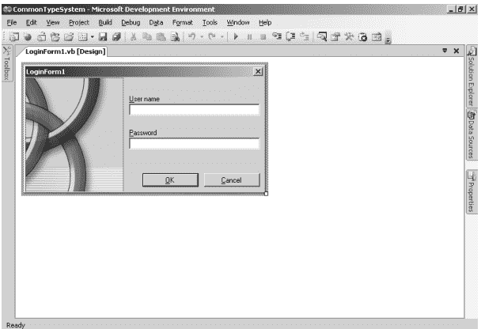

图 1-8 Visual Studio 2005 可视化 Windows 窗体设计器。

尽管乍一看设计器非常相似，但许多增强功能使得 Windows 窗体开发更加容易，同时为你提供了更强大的能力和灵活性。与 Visual Basic 6 相比，最显著的变化之一是所有控件和其他 UI 组件实际上都是 Framework 类库中的类。当你将一个 TextBox 拖到窗体上时，Visual Studio 2005 会自动生成一个字段来保存对 TextBox 对象的引用，并在窗体初始化时编写实例化 TextBox 对象的代码。可视化设计器还会编写设置控件属性的代码。如果你在属性窗口中更改了 TextBox 的 BackColor 属性，Visual Studio 2005 会生成一行设置 BackColor 的 Visual Basic 代码。图 1-9 展示了图 1-8 所示登录窗体的一些自动生成代码。

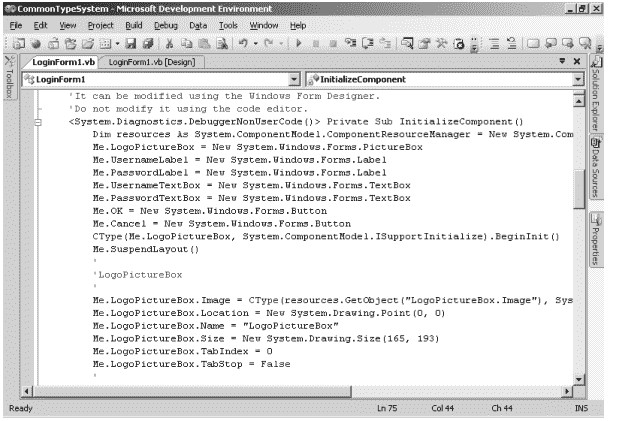

### 图 1-9 由 Visual Studio 2005 设计器生成的代码。

与 Visual Basic 6 相比，另一个重要变化是每个窗体和每个控件都是一个类的实例。当你使用可视化设计器创建一个新窗体时，你是在定义一个新类。但是你无需自己实现窗体所需的所有功能。在 *System.Windows.Forms* 命名空间中有一个现有的 *Form* 类，它提供了窗体的基本功能，包含 *Size* 和 *BackColor* 等属性。当你创建一个新窗体时，你会从基 *Form* 类继承功能。LoginForm1.vb（来自图 1-9）的前两行就是一个例子，说明如何创建一个继承另一个类功能的类：

```
Public Class LoginForm1
    Inherits System.Windows.Forms.Form
```

当你在名为 *btnOK* 的窗体上放置一个按钮时，你实际上是在为你的专用窗体类创建一个字段，该字段将在运行时保存对 *Button* 对象的引用。可视化设计器还会生成操作该 *Button* 控件状态的代码，以正确地将其定位在窗体上、设置其标题（即其 *Text* 属性）等。当你在可视化设计器中双击 *Button* 控件来编写一些代码时，设计器会创建一个注册到 *btnOK* 的 *Click* 事件的事件处理程序。你也可以向窗体类添加你自己的事件和属性。事实上，你可以对类做的任何事情都可以对窗体做，因为窗体就是一个类。

窗体的所有详细信息都包含在 .vb 代码文件中。Visual Studio 2005 提供了一个出色的可视化设计环境来创建和编辑这些 .vb 文件。你也可以手动编写 .vb 文件，甚至可以在像记事本这样的简易文本编辑器中进行。

在 Visual Basic .NET 中打开窗体的方式有一个重要区别。在 Visual Basic 6 中，你创建一个 .frm 文件，例如 Form1.frm。窗体的名称是 *Form1*，你打开


#### 介绍面向开发者的 Microsoft Visual Basic 2005

通过输入 *Form1.Show* 来显示此窗体。在 Visual Studio 2005 中，文件名并不重要。重要的是在 .vb 代码文件中定义的类的名称。假设类名为 *Form1*。如果你想打开 *Form1*，则必须创建该类的一个实例并调用该实例的 *Show* 方法，如以下代码块所示：

```
Dim f As New Form1
f.Show()
```

.NET Framework 极大地改变了 Windows 开发的格局。.NET Framework 2.0 版引入了新功能，使你在构建 Windows 应用程序时能提高效率并使用更丰富的功能集。

## Visual Basic 2005 的重要新功能

Visual Basic 2005 有许多新功能，例如设置控件内边距（即控件的内部边距）和控件外边距的选项。这些属性继承自基类 *Control*，因此适用于每种类型的控件。还提供了新的控件和设置，用于创建具有专业外观和定制支持的用户界面，例如 Microsoft Office 风格。同时，也新增了支持流式和表格布局的面板控件。这些以及其他增强功能将在后续章节中更详细地讨论，包括第 5 章“构建用户界面”。

一个极其有用且受欢迎的新型 RAD（快速应用程序开发）功能是 *对齐线*，这是 IDE（集成开发环境）中可视化窗体设计器的一个功能（而非语言或框架类库功能）。如果你在 Visual Basic 6 或 Visual Studio .NET 2003 中花费了大量时间构建用户界面，你就知道在不手动编辑属性值的情况下正确对齐控件可能有多困难。Visual Studio 2005 中的可视化设计器包含了新的可视化对齐辅助线（对齐线），当你将控件放置在窗体上时，它们可以帮助你在水平和垂直方向上对齐控件。图 1-10 展示了一个对齐辅助线帮助开发者将“确定”按钮与其他一些控件垂直对齐 *以及* 与另一个按钮水平对齐的示例。

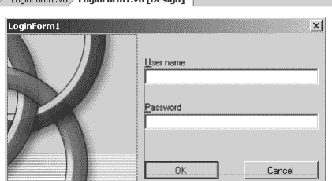

## Web 应用程序

在 Visual Studio .NET 发布之前，使用 Visual Basic 构建 Web 应用程序需要多种工具和多种开发语言。Visual Studio .NET 引入了统一的开发环境和新的 Web 编程模型，使 Visual Basic 程序员能够将他们的 Windows 开发技能转移到 Web 开发中。Visual Studio 2005 引入了许多使用 .NET 技术进行 Web 开发的重要增强功能。

### ASP、ASP.NET 1.0 和 ASP.NET 2.0 的异同

如果这是你第一次接触 ASP.NET，欢迎来到 Web 开发的新世界！ASP.NET 是框架类库的组成部分。ASP.NET 为你的应用程序提供了一个面向对象、基于事件的基础设施，使其可以托管在 Web 服务器上，从而响应 Web 请求（即向 Web 浏览器提供内容）。ASP.NET 2.0 是一个特别令人兴奋的版本，因为它提供了大幅提升生产力和大幅减少代码量的机会。

ASP.NET 1.0 取代了 ASP/COM 开发，而后者充其量是繁琐的。经典 ASP（如今的称呼）难以调试和维护。一切都是解释型脚本，因此除非将密集型处理转移到 COM 组件中，否则性能表现平平。如果你确实使用了 COM 组件，你就必须使用多个开发环境并用多种编程语言编写——通常是 VBScript 加上 COM 组件的 Visual Basic 6 或 C++。使用 COM 组件当然要求组件在 Web 服务器上注册，这为部署增加了一层复杂性。在共享主机和虚拟主机环境中，你通常根本不被允许注册 COM 组件，这使得许多开发者只能选择使用脚本。而 VBScript，如你所知，并不允许强类型，这意味着即使是简单的语法错误也必须在运行时脚本被解释时才能发现和诊断，而不是在编译期间被发现。

与 ASP 相比，ASP.NET Web 应用程序被编译成中间语言（IL），然后通过 JIT（即时编译）编译成本地二进制代码。与 Windows 应用程序一样，JIT 编译是提前进行的，本地代码会被缓存以供后续重用。首次 Web 请求会有少量延迟，因为代码需要被 JIT 编译。在首次请求之后，ASP.NET Web 应用程序相较于基于脚本的 Web 技术展现出令人印象深刻的性能优势。仅此一项特性就足以令人信服地迁移到 ASP.NET。但除此之外还有许多其他好处。

ASP.NET 为 Web 应用程序提供了一个面向对象、基于事件的框架。网页是类，它们从基类 *Page* 继承基本功能，正如 Windows 窗体从基类 *Form* 继承功能一样。当你请求一个网页时，该类的一个实例被加载到内存中，调用一系列方法，并触发一系列事件。你为 *Page.Load* 和 *Page.PreRender* 等事件编写事件处理程序，以将你自己的自定义逻辑注入到页面处理中。处理完成后，生成的 HTML 输出将被发送给用户。

ASP.NET 的处理模型与 ASP 根本不同。在经典 ASP 中，HTML 和脚本混合在一起，并按顺序（从上到下）处理。动态内容使用 *Response.Write* 语句或渲染块（例如，<%= Now %> 显示当前日期和时间）注入。由此产生的 HTML 和脚本组合可能难以阅读和调试。相比之下，ASP.NET 使用对象、方法和事件来生成输出。其结果是代码与内容得到更好的分离，以及更丰富的编程模型。

一个 ASP.NET 网页，或称 ASPX 页面，包含页面指令、HTML 内容、服务器控件标签和代码。页面指令是特殊的 ASP.NET 指令，用于控制诸如输出缓存、启用 *Option Strict*、引用组件和导入命名空间等事项。服务器控件是特殊的标记元素（即标签），映射到框架类库中的类。当 ASPX 页面被编译成一个类时，服务器控件就成为该类的字段。在运行时，会创建相应控件类的实例，并将对这些对象的引用赋给页面上各个服务器控件对应的类字段。然后，通过每个字段引用的对象的 *Render* 方法来生成其 HTML 输出。ASPX 页面生成的最终 HTML 输出是页面本身的 HTML 输出加上每个服务器控件生成的 HTML 输出。

> **注意** 在 ASP.NET 中也可以使用 *Response.Write* 来生成输出，但基于事件的处理模型使得除非所有内容都使用 *Response.Write*（ASP 风格）来生成，否则很难使用 *Response.Write*，而这将抵消面向对象、基于事件模型的好处。

以下 ASPX 标记展示了一个包含 *TextBox* 服务器控件的简单网页。

```
<%@ page language="vb" %>

<html>
<body>
    <form id="form1" runat="server">
        <asp:TextBox ID="txtName" Runat="server" />
    </form>
</body>
</html>
```

当这个网页被渲染时，*TextBox* 控件会将其自身渲染为一个 HTML `<input>` 标签，如下所示：

```
<html>
<body>
    <form method="post" action="Default.aspx" id="form1">
<div style="display:none">
<input type="hidden" name="__VIEWSTATE"
value="/wEPDwULLTIwNDAwODk2OTNkZLcvFD+nriIIdGTNg9IaMLK9y8exu" />
</div>
        <input name="txtName" type="text" id="txtName" />
    </form>
</body>
</html>
```

服务器控件的一个巨大好处是复杂的行为可以封装在一个服务器控件中，然后在网页上通过单个标签来使用。诸如 *Calendar*、*GridView* 和 *SiteMapPath* 之类的控件都是复杂服务器控件的例子，它们可以生成大量的 HTML 输出，但使用时只需要一行或两行 ASPX 标记。这个概念当然对 Visual Basic 6 程序员来说非常熟悉，他们习惯于使用封装了复杂功能的控件。出于这个以及其他原因，许多 Visual Basic 6 程序员发现，在使用 .NET Framework 进行 Windows 开发和 Web 开发之间，技能的可迁移性非常高。

ASP.NET 的编程和处理模型与 Windows 窗体的编程和处理模型相似，这使得 Windows 程序员比以往更容易成为 Web 程序员。例如，*Page.Load* 事件类似于 Windows 编程中的 *Form.Load* 事件。当然，在处理网页时还有一些额外的考虑，但它们并不难掌握。（例如，窗体级别的字段值在请求后不会保留。）事实上，使用 Visual Studio 2005 的 Web 程序员可以通过使用与 Windows 编程相同的技能来高效工作，即使对 HTML 知之甚少（甚至完全不了解 HTML）。

## ASP.NET 2.0 的重要新功能

.NET Framework 2.0 为 Web 应用程序引入了大量新功能。有新的成员资格和用户配置文件子系统，为管理用户、进行身份验证、基于角色的授权以及存储用户信息（例如地址信息）提供了显著增强的支持。还有新的安全控件，如 *Login* 和 *LoginView* 控件，它们与新的成员资格系统集成。使用 ASP.NET 2.0，你实际上可以创建一个内置身份验证（包括用户数据库）的网站，而无需编写任何代码！只需添加几行标记就可以了！

新的数据源控件让你可以声明性地指定数据源设置，而无需编写常见的数据访问代码。同时还有许多新的数据控件和对现有数据控件的增强——最值得注意的是能够将数据控件绑定到数据源控件，以创建丰富的、数据驱动的、零代码网站。

现在所有 Web 服务器控件都是设备感知的。.NET Framework 1.1 有单独的移动控件，专门用于受限设备，如基于手机的浏览器。作为 Web 开发者，你不再需要使用不同的控件来支持不同类型的设备。不过，在设计界面时，你可能需要考虑一下你打算支持的设备类型。

ASP.NET 2.0 还有更多新功能。你将在本书后续部分看到更多关于这些增强功能的介绍，尤其是在第 6 章“构建 Web 应用程序”中。


## Visual Studio 2005 和 .NET Framework 2.0 的增强功能

针对 .NET Framework 编写代码有许多充分的理由，包括本章开头提到的那些方面，例如生产力、安全性和"可部署性"。开发人员发现，当他们使用 Visual Studio 针对 .NET Framework 进行开发时，可以更快地编写出更好的代码。Visual Studio 2005 是 Visual Studio 演进过程中的下一步。Visual Studio 2005 和 .NET Framework 2.0 包含许多有趣且令人兴奋的增强功能，这些功能将在本书的其余部分详细说明。以下各节提供了一些示例。

### Visual Basic 增强功能

Visual Basic 有许多变化，包括备受期待的*泛型*引入、新的 *Using* 语句、新的 *IsNot* 关键字以及运算符重载。现在 Visual Basic .NET 项目支持编辑并继续调试，这是许多以前的 Visual Basic 6 程序员所怀念的一项功能。

Visual Basic 代码编辑器包含额外的功能，例如符号重命名，它可以智能地重命名一个标识符（例如变量）的所有出现位置。Visual Studio 2005 中的另一个新功能是代码片段，它们是针对常见任务的代码块，你可以从上下文菜单将其插入代码编辑器。Visual Studio 2005 包含许多针对常见任务的预定义片段，你也可以定义自己的片段。

Visual Basic 2005 独有的一个新功能是 My 命名空间，它充当常用任务的包装器或"快速拨号"。其中一项常用任务是显示窗体的默认实例。你无需显式创建一个新的 *Form1* 变量并实例化它，只需调用 *My.Forms.Form1.Show* 即可。*My.Forms* 集合公开项目中每个窗体类的默认实例。你甚至可以省略 *My.Forms* 前缀，直接调用 *Form1.Show*，这给你与 Visual Basic 6 相同的语法，尽管底层实现非常不同。

### IDE 增强功能

每个后续版本的 Visual Studio 都引入了新的 IDE 功能，以帮助提高你的生产力。Visual Studio 2005 中仅仅一小部分新 IDE 功能就包括异常帮助程序、针对 HTML 和 XML 的新调试器数据可视化、窗口停靠指南以及语法错误辅助。

异常帮助程序是一项新功能，可在调试时让你更好地访问异常详细信息，并提供故障排除提示，帮助你更正代码以避免致命异常。

有新的可视化功能，可在运行时查看字符串变量中的 HTML 和 XML 数据。在调试模式下，当你将鼠标悬停在字符串变量上时，可以选择将字符串视图切换为 XML 或 HTML。当你选择其中一种视图时，数据将在弹出窗口中以适当的方式呈现。

如果你曾经因在 Visual Studio IDE 中重新定位窗口而感到沮丧，你会喜欢新的停靠指南，它使你可以轻松地将窗口停靠在所需的确切位置。

Visual Studio IDE 很久以来就为你的代码提供了设计时语法检查。Visual Studio 2005 通过新的语法错误辅助增强了该设计时体验，该辅助不仅标识语法错误，还根据代码的预期用途提供更正错误的建议。

这些新的 IDE 功能及更多内容将在第 3 章"Visual Studio 2005 集成开发环境"中介绍。

## 全新的 Visual Web 开发人员

Visual Studio 2005 包含一个名为 Visual Web 开发人员的、完全改版的 Web 开发工具。虽然一些改进可能不会立即显现在 Visual Studio .NET 2003 之上，但许多改进很快就会变得显而易见。一个明显的变化是，当你在 Web 页的设计视图和标记视图之间切换时，设计器不会重新格式化你的标记。

Visual Studio 2005 中的新 Visual Web 开发人员包含一个新的轻量级 Web 服务器，当你运行 Web 应用程序时，该服务器会监听任意端口（仅限 localhost）上的请求。图 1-11 显示了由内置 Web 服务器提供服务的 Web 页示例。Visual Web 开发人员 Web 服务器仅用于开发目的。它允许开发人员创建和测试 ASP.NET Web 应用程序，而无需 IIS（Internet 信息服务）。它还使 Web 开发人员更容易在无提升权限的情况下工作（例如，以域用户身份运行而不是本地管理员），因为无需管理 IIS 或调试其他用户进程的权限。

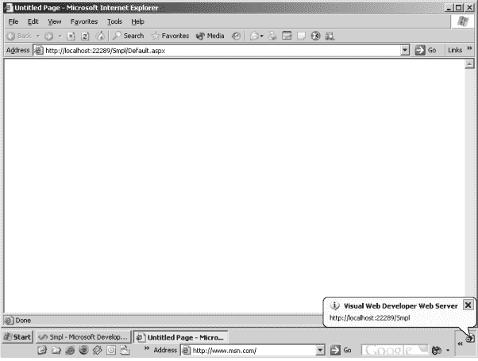

图 1-11 在端口 22289 上运行的 Visual Web 开发人员 Web 服务器。

## ClickOnce 部署

过去与部署 Windows 应用程序相关的困难已促使许多组织为简化部署而转向 Web 应用程序。这使得网络边缘的计算资源未被充分利用，并将应用程序限制在非常有限的用户界面内。尽管 .NET Framework 1.1 解决了部署中的一些问题，例如 DLL 版本冲突，并使得一种基于 Web 的部署策略（称为"零接触"部署）成为可能，但仍有改进的空间。.NET Framework 2.0 中的新 ClickOnce 部署功能使得部署自我更新的 Windows 或控制台应用程序变得容易，这些应用程序不需要管理权限即可安装，并且可以在脱机模式下运行。

有关 ClickOnce 部署工作原理的更多详细信息，请参见第 8 章"部署应用程序"。

### 结论

Microsoft .NET Framework 为运行多种类型的应用程序提供了一个托管环境。.NET Framework 是一个适用于 Windows、Web、控制台和智能设备应用程序的平台。.NET Framework 提供的服务包括对象生存期管理（也称为垃圾回收）、安全、类型安全性以及与 COM 的互操作性。.NET Framework 还提供了一个丰富的类库，你可以使用它来减少必须编写的代码量（因此也减少了测试和维护量）。这带来了更好的生产力和更安全的代码，因为该类库已经在世界各地的计算机上进行了实地测试。

.NET Framework 带来了开发人员构建软件方式的根本性转变。公共语言运行时提供的服务以及框架类库中提供的功能处理了许多耗时的基础结构和实用程序类型编程。通过针对 .NET Framework，开发人员能够将更多时间用于解决其特定领域的问题，而不是解决通用问题，例如如何在客户端应用程序和服务器（Web 服务）之间传递消息。

本书的其余部分介绍了 Visual Studio 2005，这是针对 .NET Framework 的主要开发工具的最新版本。你将看到 .NET Framework 2.0 中的许多改进以及 Visual Studio 2005 中的新功能，这些功能将帮助你成为更高效的开发人员。

# 第 2 章
Visual Basic 2005 的语言增强

**本章内容：**

- 应用：泛型 .............................................. 33
- 应用：My 对象 ................................... 41
- 应用：运算符 ........................................... 50
- 应用：关键字 ............................................ 56

Visual Basic 2005 引入了许多增强功能，旨在使你的编码更简单、更高效。本章将介绍其中四项增强功能。*泛型*为你提供了一种设计类的方法，可以高效且以类型安全的方式处理不同种类的对象。*My 对象*为访问引用当前运行的应用程序、本地计算机、应用程序的窗体集合、登录用户以及与应用程序关联的 Web 服务的基类库类提供了便捷的快捷方式。通过重载 =（等于）和 >（大于）等运算符，你现在可以定义当两个类实例进行比较时会发生什么。最后，你将复习一些新关键字。

## 应用：泛型

此应用演示了 Microsoft Visual Basic 2005 对泛型的新支持。

#### 新概念

在深入探讨泛型的实现之前，值得花一点时间来分析为什么将此功能添加到 Visual Basic 2005 中。泛型源于以"通用"方式处理潜在任何类型对象的需求。例如，你可能希望创建一个类，该类只能接受 *Employee* 对象或 *Customer* 对象，并能通过区分它们来以不同方式处理每个对象。


面向开发人员的 Microsoft Visual Basic 2005 简介

即使没有泛型，Visual Basic 也一直提供了一些机制来处理对象，而无需考虑它们的类型。例如，在 Visual Basic 6.0 中，你可以将任何类型的对象存储在 *Collection* 对象中。这种技术有一些缺点，将在下一节中描述。泛型为 *Collection* 提供了一种高效的替代方案，强制执行类型安全，提供更好的性能，并与 Microsoft IntelliSense 技术紧密集成。

#### Visual Basic 6.0 的 Collection

Visual Basic 6.0 确实允许你在 *Collection* 中存储几乎任何东西。然而，*Collection* 类有许多局限性。例如，假设你想将以下 *Employee* 类存储在 *Collection* 中：

```
' Visual Basic 6.0
Public SSN As String
Public FirstName As String
Public LastName As String
Public Salary As Currency
```

将其存储在集合中相对简单：

```
Dim employees As New Collection

Dim emp As Employee
Set emp = New Employee
emp.SSN = "111-11-1111"
emp.FirstName = "Scott"
emp.LastName = "Swigart"
emp.Salary = 50000

employees.Add emp, emp.SSN
```

这段代码首先创建了一个名为 *employees* 的 *Collection* 实例。然后创建一个 *Employee* 对象并用数据填充它。最后，将此 *Employee* 对象添加到 *Collection* 中。以下代码展示了如何从 *Collection* 中检索 *Employee* 对象：

```
Dim emp2 As Employee
Set emp2 = employees("111-11-1111")
```

现在让我们来看看 Visual Basic 6.0 *Collection* 的局限性。首先，你可能只想在 *employees* 集合中存储 *Employee* 对象。然而，没有任何机制可以阻止其他人在 *Employees* 集合中存储任何其他类型的对象。此外，当你尝试从 *Employees* 集合中检索项目时，没有任何提示告诉你正在检索什么类型。例如，以下代码可以正常编译：

```
Dim s As String
s = employees("111-11-1111")
```

尽管这对开发者来说明显行不通，但编译器无法捕获这个错误。这将表现为最糟糕的一种错误——运行时错误。*Collection* 还限制了 IntelliSense 的能力。考虑以下代码：

```
employees("111-11-1111").LastName = "SomeoneElse"
```

这段代码表明你可以直接在 *Collection* 中编辑项目。但是，在选择 *LastName* 属性时，你不会有任何 IntelliSense 支持。同样，从 Visual Basic 的角度来看，那个 *Collection* 可能存储任何东西。在 Visual Basic 6.0 中，你无法说"创建一个*员工*的集合"。

集合类的最后两个局限性是性能和灵活性。尽管它易于使用，但当用作动态数组时，集合类性能很差。集合类还被设计为像字典一样工作，所以如果你需要更像 Stack 或 Queue 的结构，它并不适合。

#### 框架集合

.NET Framework 1.0 和 1.1 通过简单地提供更多类型的集合解决了集合的一些问题。通过导入 *System.Collections* 命名空间，你的代码可以访问诸如 *ArrayList*、*BitArray*、*HashTable*、*Queue*、*SortedList* 和 *Stack* 等集合。这些类型集合的使用场景如表 2-1 所示。

| 集合名称 | 用途 |
| --- | --- |
| *ArrayList* | *ArrayList* 使创建动态增长的数组变得容易。 |
| *BitArray* | *BitArray* 类经过优化，用于存储布尔型（true/false）值的数组。 |
| *HashTable* | *HashTable* 最类似于 Visual Basic 6 的 *Collection* 类。此类允许你使用键查找值。但是，键和值可以是任何类型。 |
| *SortedList* | *SortedList* 类似于 *HashTable*，不过键始终是有序的。这意味着如果你使用 For...Each 遍历集合，将始终按排序后的顺序检索项目。 |
| *Queue* | *Queue* 是支持"先进先出"模式的集合。 |
| *Stack* | *Stack* 与 *Queue* 正好相反，提供"先进后出"功能。 |

.NET Framework 1.0/1.1 在很大程度上解决了 Visual Basic 6.0 的灵活性局限；然而，这些集合仍然是松散类型的。这意味着你可以在 *ArrayList* 中存储任何东西，即使对于某个给定应用程序来说，只存储特定类型才合理。

你真正想要的是一个可以指定每个键必须是字符串、每个值必须是 *Employee* 的集合。在 .NET Framework 1.0/1.1 中，你需要创建自己的类来包装 *Hashtable* 并提供此功能。在 .NET Framework 1.2 中，使用泛型可以用更少的代码解决这个问题。

#### 演练

正如"泛型"应用程序所示，泛型提供严格的类型检查、更好的 IntelliSense 功能和更好的性能。换句话说，它们基本解决了过去遇到的集合类的所有问题。

### 使用泛型类型

首先，值得一提的是，.NET Framework 1.2 提供的泛型集合是*额外*的，是在现有 .NET Framework 1.0/1.1 集合类之上的补充。.NET Framework 1.2 绝不会强迫你使用泛型。

如果你确实想使用新的泛型类型，首先导入 *System.Collections.Generic* 命名空间。这将授予对 *Dictionary*、*List*、*Queue*、*SortedDictionary* 和 *Stack* 类的访问权限。*btnConsumeGenerics_Click* 事件中展示了使用泛型 *Dictionary* 的示例：

```
Private Sub btnConsumeGenerics_Click(ByVal sender As System.Object, ByVal e As System.EventArgs) Handles btnConsumeGenerics.Click
    Dim employees As New Dictionary(Of String, Employee)
    Dim emp As Employee
    emp = New Employee
    emp.SSN = "111-11-1111"
    emp.FirstName = "Scott"
    emp.LastSize = "Swigart"
    emp.Salary = 50000

    employees.Add(emp.SSN, emp)

    txtOutput.Text = "Consuming generics" & vbCrLf & vbCrLf

    Dim emp2 As Employee
    emp2 = employees.Item("111-11-1111")

    Dim s As String
    's = employees.Item("111-11-1111")  ' This is now a syntax error

    employees.Item("111-11-1111").LastName = "SomeoneElse"
    txtOutput.Text &= "Employee last name:" & vbCrLf & _
    employees.Item("111-11-1111").LastName
End Sub
```

如果你逐步查看代码，你会发现关于泛型的一些有趣事实。首先，泛型类型的实例化如下：

```
Dim employees As New Dictionary(Of String, Employee)
```

这段代码的意思是"创建一个 Dictionary，其中键将是字符串，值将是 Employee。"注意使用新的 Of 关键字来指定键的所需数据类型。任何尝试存储除 Employee 对象以外的值都会导致编译时错误。这值得重复一遍。使用泛型时，如果你使用了错误的类型，这是编译时错误，而不是运行时错误。事实上，必须注释掉以下行，否则应用程序将无法运行，因为编译器知道该 Dictionary 持有 Employee 类，而不是字符串：

```
's = employees.Item("111-11-1111")  ' This is now a syntax error
```

此外，你现在对集合中的类型拥有完整的 IntelliSense 支持。如果你查看图 2-1，可以看到 Microsoft Visual Studio 知道这个 Dictionary 只持有 Employee 类，并且 Employee 类的属性可以通过 IntelliSense 获取。

```
employees.Item("111-11-1111").LastName = "SomeoneElse"
```

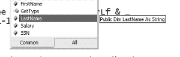

如你所见，泛型易于使用，它们产生强类型代码（减少运行时错误的可能性），并且使 IntelliSense 更加强大。这些就已经足够成为使用泛型的理由了，但泛型还有许多额外的优势，包括性能和代码重用。

在 .NET Framework 中包含泛型的主要原因之一是性能。简而言之，它们比以前的集合类更快，因为编译器专门为它们存储的类型对它们进行了优化。以下代码展示了这种优势的一个例子，它比较了数组、ArrayList 和泛型 List 的性能：

```
txtOutput.Text = "Performance" & vbCrLf & vbCrLf

Const iterations As Integer = 5000000
PerfTime.Start()
Dim myArray(iterations) As Integer
For i As Integer = 0 To iterations - 1
    myArray(i) = i
Next
Dim elapsed As Integer = PerfTime.Stop
txtOutput.Text &= "Array time: " & elapsed & vbCrLf
myArray = Nothing
GC.Collect()

PerfTime.Start()
Dim myArrayList As New ArrayList
For i As Integer = 0 To iterations - 1
    myArrayList.Add(i)
Next
elapsed = PerfTime.Stop
txtOutput.Text &= "ArrayList time: " & elapsed & vbCrLf
```


```markdown
myArrayList = Nothing
GC.Collect()

PerfTime.Start()
Dim myList As New List(Of Integer)
For i As Integer = 0 To iterations - 1
    myList.Add(i)
Next
elapsed = PerfTime.Stop
txtOutput.Text &= "List time: " & elapsed & vbCrLf
myList = Nothing
GC.Collect()
```

此代码将500万个值存储到一个固定大小的*数组*中。这些值也被存储在一个自动增长的*ArrayList*中，以及一个同样按需增长的泛型*List*中。性能数据（在开发此代码的计算机上）讲述了一个有趣的故事：

```
Array time: 344
ArrayList time: 4656
List time: 797
```

没有什么比存储特定类型且无需调整大小的数组更快了。（你的数值会与此处显示的不同。）然而，对于一个动态增长的集合类，其与静态数组相比的性能已经相当不错了。再看看*ArrayList*。表现不佳。它的速度不到静态数组的十分之一。问题在于*ArrayList*被设计用来存储对象。*整数*不是对象；它们是值类型。在将它们存储到*ArrayList*之前，必须经过一个称为“装箱”的过程，将*整数*转换为*对象*。装箱开销很大，如果你存储的是值类型（*整数*、*DateTime*、*布尔值*、你自己的结构体等），使用泛型集合而非基于*Object*的集合，你会注意到性能有显著提升。

> **注意** 有关装箱和拆箱的更多信息，请参阅MSDN库中的“装箱转换”和“拆箱转换”。

### 创建泛型类型和方法

使用Visual Basic 2005，你不仅可以简单地使用泛型类型。你还可以创建自己的泛型类型和方法。

**泛型方法** 如果你想执行某种与类型无关的通用算法，你可能需要创建一个泛型方法。例如，一个典型的冒泡排序会遍历数组中的所有项，将一项与下一项进行比较，并根据需要交换值以对数组进行排序。

如果你事先知道只会对整数进行排序，你可以简单地为*整数*类型硬编码*Swap*方法。但是，如果你想能够对任何类型进行排序，你可以编写一个泛型*Swap*，如下所示：

```
Private Sub Swap(Of ItemType) _
    (ByRef v1 As ItemType, ByRef v2 As ItemType)

    Dim temp As ItemType
    temp = v1
    v1 = v2
    v2 = temp
End Sub
```

注意“Of ItemType”。当调用Swap方法时，除了标准参数外，还必须传递一个数据类型。这个数据类型将替换ItemType的每个实例。以下是一个调用Swap的示例：

```
Swap(Of Integer)(v1, v2)
```

此代码告诉Swap方法它将交换整数类型，导致原始Swap列表中的每个ItemType实例都被JIT编译器替换为整数。Swap方法本质上被JIT重写为以下内容：

```
Private Sub Swap(ByRef v1 As Integer, ByRef v2 As Integer)
    Dim temp As Integer
    temp = v1
    v1 = v2
    v2 = temp
End Sub
```

这是实际执行的代码。JIT生成了一个处理整数类型的方法版本。但是，如果你稍后想对字符串类型进行排序，你可以再次调用Swap，如下所示：

```
Swap(Of String)(v1, v2)
```

当此方法执行时，JIT将编写另一个版本的Swap，这次是专门针对字符串类型的：

```
Private Sub Swap(ByRef v1 As String, ByRef v2 As String)
    Dim temp As String
    temp = v1
    v1 = v2
    v2 = temp
End Sub
```

使用Swap的完整冒泡排序示例如下：

```
Private Sub btnSortIntegers_Click(ByVal sender As System.Object, ByVal e As System.EventArgs)
Handles btnSortIntegers.Click
    Dim ints(9) As Integer
    Dim r As New Random
    For i As Integer = 0 To 9
        ints(i) = r.Next(1, 100)
    Next
    ' Bubble sort
    For j As Integer = 0 To 9
        For k As Integer = 9 To 1 Step -1
            If ints(k) < ints(k - 1) Then
                Swap(Of Integer)(ints(k), ints(k - 1))
            End If
        Next
    Next
    txtOutput.Text = "Sort Integers" & vbCrLf & vbCrLf
    For i As Integer = 0 To 9
        txtOutput.Text &= ints(i) & vbCrLf
    Next
End Sub
```

#### 泛型类型

最后一点，你可以创建完整的泛型类。在这种情况下，*Of ItemType*与类声明一起使用，如下所示：

```
Public Class SomeClass(Of ItemType)

    Private internalVar as ItemType
    Public Function SomeMethod(ByVal value As ItemType) As ItemType
    End Function

End Class
```

类的规则与方法相同。当类被实例化时，JIT编译器只会将*ItemType*的每个实例替换为特定类型。

#### 约束

泛型还支持一个称为约束的特性。此功能可让你确保在指定类型时，它们实现了某些最低功能。例如，如果你正在实现一个泛型排序算法，你可能希望确保你正在排序的类型实现了*IComparable*。你可以通过约束来实现这一点：

```
Public Class SomeClass(Of ItemType As IComparable)

    Public Function SomeMethod(ByVal value As ItemType) As ItemType
    End Function

End Class
```

### 结论

与基于*Object*的集合类相比，泛型提供了许多优势。首先，泛型类是强类型的，这使得许多错误可以在编译时而不是运行时被捕获。强类型还允许IntelliSense提供更多信息。泛型还允许你重用代码，创建适用于各种类型的通用算法。最后，泛型集合比基于*Object*的集合更快，尤其是在处理值类型时。

## 应用：My 对象

Visual Basic 2005 引入了一种快速访问许多与应用程序运行所在计算机、运行它的用户、应用程序本身、其窗体以及任何关联的 Web 服务相关的重要类的方法。它们都可以通过新的 My 对象来访问。

#### 新概念

当使用 Visual Basic 6 构建应用程序时，你可以访问 Visual Basic 运行时、各种 COM 对象以及适用于你所运行的 Microsoft Windows 操作系统版本的 Win32 API。.NET Framework 的早期版本将许多此类功能统一到一组名为基类库的庞大类中。在基类库中，有用于支持访问底层操作系统信息的类。有允许你轻松访问有关计算机硬件信息的类。还有允许你轻松在不同应用程序之间进行网络通信、加密数据、提供对注册表的访问等的类。

如果你想成为一名合格的 .NET 开发人员，理解基类库及其提供的丰富功能非常重要。缺乏对基类库的了解可能导致开发人员重复造轮子，构建已经存在的类。在某些情况下，.NET Framework 提供的功能因其规模庞大而被隐藏或模糊，从而导致一些东西被忽视。已经撰写了无数文章，其中包含自制算法来支持你可以通过了解诸如 *Path* 或 *PasswordDeriveBytes* 等 Framework 类来执行的操作。事实上，许多人会告诉你，学习 .NET 与其说是学习 Visual Basic .NET 或 C#，不如说是学习基类库。

然而，学习基类库也是一项巨大的挑战，仅仅因为它太庞大了。每天使用的类与其他你可能永远不需要的类混杂在一起。为了使 .NET Framework 中的常用类更易发现，Visual Basic 2005 现在提供了一个名为 My 对象的“快速拨号”。通过使用 My 对象，你可以轻松访问计算机、应用程序和用户信息，以及获取对 Web 服务和窗体的访问权限。需要理解的是，My 对象仅在编写 Visual Basic .NET 应用程序时才可访问，而在使用 C# 时不可直接访问。

需要指出的是，My 对象不仅仅是一个简单的快速拨号。在某些情况下，My 对象中的类提供的功能比你通过简单地搜索构成基类库的各个命名空间更容易找到的功能更多。例如，*Folder* 对象提供了额外的属性，如 *Drive*，这些在
```

`System.IO.DirectoryInfo` 类。My 对象还促使微软将计算机、应用程序和用户视为完整的实体，并思考"你应该能用计算机做什么？"其结果是产生了诸如 `My.Computer.Network.Ping` 这样的方法。你现在会发现，以前只能通过调用 COM 库或 Win32 API 才能获得的功能，现在都可以通过 My 对象轻松访问和发现。

My 对象被划分为几个关注领域，如表 2-2 所详述。

#### 表 2-2 My 对象模型

| 对象 | 描述 |
| --- | --- |
| My.Application | 包含有关正在运行的应用程序的信息，例如标题、工作目录、版本以及使用的公共语言运行时（CLR）版本。它还允许访问环境变量、轻松写入本地应用程序日志或自定义日志等。 |
| My.Computer | 包含有关应用程序运行所在本地机器的基础平台和硬件的信息。 |
| My.Forms | 当前项目中所有窗体实例的集合。允许你轻松地显示和隐藏窗体，而无需在代码中显式创建窗体实例。 |
| My.User | 包含有关当前用户的信息，包括其显示名称、域名等。 |
| My.WebServices | 允许你轻松访问已作为 Web 引用添加到项目中的 Web 服务。 |

如你所见，My 对象为你提供了简单直接的访问方式，方便你在构建应用程序时使用日常所需的功能。

#### 演练

在本节中，你将通过一个深入探索 My 对象的小型示例应用程序来深入理解 My 对象。该应用程序有三个选项卡，如图 2-2 所示，每个选项卡都聚焦于 My 对象的特定子部分。

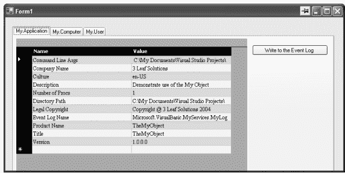

图 2-2 My.Application 选项卡。

#### My.Application

第一个选项卡的文本为 *My.Application*，显示了一个数据网格，展示 *My.Application* 对象中许多属性的值。用于填充此网格数据的代码如下：

```
Dim cmds As String = ""
For Each cmd As String In My.Application.CommandLineArgs
    cmds &= ", " & cmd
Next
AddnewRow("Command Line Args", Mid(cmds, 2))
AddnewRow("Company Name", _
    My.Application.AssemblyInfo.CompanyName)
AddnewRow("Culture", _
    My.Application.CurrentCulture.ToString())
AddnewRow("Description", _
    My.Application.AssemblyInfo.Description)
AddnewRow("Number of Procs", _
    My.Application.GetEnvironmentVariable("NUMBER_OF_PROCESSORS"))
AddnewRow("Directory Path", _
    My.Application.AssemblyInfo.DirectoryPath)
AddnewRow("Legal Copyright", _
    My.Application.AssemblyInfo.LegalCopyright)
AddnewRow("Event Log Name", _
    My.Application.Log.ToString)
AddnewRow("Product Name", _
    My.Application.AssemblyInfo.ProductName)
AddnewRow("Title", My.Application.AssemblyInfo.Title)
AddnewRow("Version", _
    My.Application.AssemblyInfo.Version.Major & "." & _
    My.Application.AssemblyInfo.Version.Minor & "." & _
    My.Application.AssemblyInfo.Version.Revision & "." & _
    My.Application.AssemblyInfo.Version.Build)
```

前面的代码故意写得比较冗长。这段代码本可以使用反射来遍历属性，但通过在代码中逐一列出它们，你可以查看应用程序并更好地了解每个特定属性返回的信息。从给定属性中获取的单个值被添加到 *DataTable*（*dt*）中，然后绑定到 My.Application 选项卡上的 *Datagrid*。你只需通过访问构成 *My.Application* 对象的属性，就能收集到大量关于应用程序的信息。表 2-3 列出了 *My.Application* 对象的属性和方法。

##### 表 2-3 My.Application

| 属性/方法 | 描述 |
|---|---|
| *ApplicationContext* | 允许你访问与当前线程关联的上下文 |
| *AssemblyInfo* | 允许你轻松访问 AssemblyInfo.vb 文件中的数据，包括 CompanyName、Description、FolderPath、LegalCopyright、LegalTrademark、Name、ProductName、Title 和 Version |
| *ChangeCurrentCulture* | 允许你更改当前线程运行的文化环境，这会影响字符串操作和格式化等方面 |
| *ChangeCurrentUICulture* | 允许你更改当前线程用于检索特定文化资源的文化环境 |
| *CommandLineArgs* | 返回命令行参数的集合 |
| *CurrentCulture* | 返回文化对象的实例，使你能够确定应用程序的当前文化等信息 |
| *CurrentDirectory* | 返回应用程序所在的文件夹 |
| *CurrentUICulture* | 返回当前线程用于检索特定文化资源的文化环境 |
| *DoEvents* | 使消息队列中的所有消息得到处理 |
| *GetEnvironmentVariable* | 返回本地机器上的特定环境变量 |
| *IsNetworkDeployed* | 如果应用程序是通过网络部署的则返回 True，否则返回 False |
| *Log* | 允许你写入本地机器上的应用程序日志 |
| *MainForm* | 一个可读写属性，允许你设置或获取应用程序用作主窗体的窗体 |
| *OpenForms* | 返回表示应用程序当前所有已打开窗体的集合 |
| *Run* | 设置并启动 Visual Basic 启动/关闭应用程序模型 |
| *SplashScreen* | 允许你设置或获取应用程序的启动画面 |

##### 开发应用程序时使用 My.Application 的场景

*My.Application* 对象为你提供了大量功能，相比使用 .NET Framework 1.0/1.1、Visual Basic 6 或两者结合构建应用程序时，所需代码大大减少。在本节中，我们将探讨一些使用 *My.Application* 的方式。例如，写入事件日志所需的代码现在已缩短为以下内容：

```
My.Application.Log.WriteEntry("Application Starting", _
    EventLogEntryType.Information, Nothing)
```

默认情况下，此代码会将条目写入调试输出以及程序集的日志文件。你可以通过在 Visual Studio 中以调试模式运行应用程序并查看输出窗口中的结果，或通过访问日志文件来查看结果。该文件默认名为 *assemblyname.log*，位于应用程序的数据目录中，该目录可作为 *My.Computer* 的一个属性来访问。

```
Dim AppLogLocation As String = _
    My.Computer.FileSystem.SpecialDirectories._
        CurrentUserApplicationData & "\" & _
    My.Application.AssemblyInfo.Title & ".log"
MsgBox("Successfully wrote to log." & vbCrLf & _
    "Log is located at: " & AppLogLocation)
```

以前，如果你想在 .NET Framework 1.0/1.1 中写入 *EventLog*，你需要多行代码才能实现。使用 Visual Basic 6 时，你通过 *App* 对象可以获得一些有限的日志功能，但你无法指定事件 ID，也无法写入系统或安全日志或创建自己的自定义日志。

此外，*My.Application* 让你可以用一行代码直接访问丰富的应用程序级信息。以下是一些可以使用 *My.Application* 这些方面的示例：

- 使用 *CurrentFolder* 属性快速确定应用程序所在的文件夹
- 快速访问程序集元数据，如产品名称、公司名称等

#### My.Computer

My 对象的下一部分是 *Computer* 对象。*My.Computer* 对象使你能够访问有关应用程序运行所在的基础平台和硬件的信息。My.Computer 选项卡（如图 2-3 所示）是示例应用程序中的第二个选项卡，提取了可以从 *My.Computer* 对象获取的一些比较有趣的属性值。

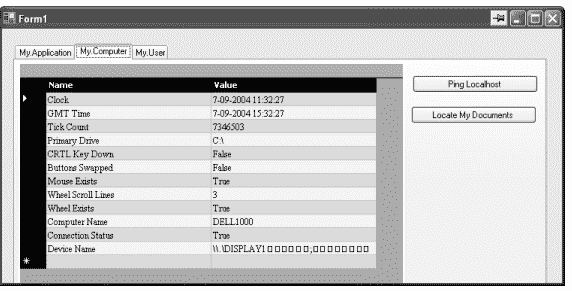

图 2-3   My.Computer 选项卡。

用于填充此网格数据的代码如下：

```
AddnewRow("Clock", _
    My.Computer.Clock.LocalTime)
AddnewRow("GMT Time", _
    My.Computer.Clock.GmtTime)
AddnewRow("Tick Count", _
    My.Computer.Clock.TickCount)
AddnewRow("Primary Drive", _
    My.Computer.FileSystem.Drives(0).ToString())
AddnewRow("CRTL Key Down", _
    My.Computer.Keyboard.CtrlKeyDown.ToString())
AddnewRow("Buttons Swapped", _
    My.Computer.Mouse.ButtonsSwapped)
AddnewRow("Mouse Exists", _
```


##### 为开发者介绍 Microsoft Visual Basic 2005

```vb
My.Computer.Mouse.Exists.ToString())
AddNewRow("Wheel Scroll Lines", _
    My.Computer.Mouse.WheelScrollLines.ToString())
AddNewRow("Wheel Exists", _
    My.Computer.Mouse.WheelExists)
AddNewRow("Computer Name", _
    My.Computer.Name)
AddNewRow("Connection Status", _
    My.Computer.Network.IsAvailable)
AddNewRow("Device Name", _
    My.Computer.Screen.DeviceName)
```

这段代码与应用程序中用于填充 My.Application 选项卡上网格的代码类似。一个 DataTable `dt` 从 `My.Computer` 对象的属性中获取值进行填充，然后绑定到一个网格。

`My.Computer` 对象的属性和方法列于表 2-4 中。

**表 2-4 My.Computer**

| 属性/方法 | 描述 |
|---|---|
| Audio | 允许你在本地计算机上播放声音文件。 |
| Clipboard | 为你提供对系统剪贴板的访问权限。 |
| Clock | 允许你访问当前的格林威治标准时间、本地时间和滴答计数。 |
| FileSystem | 允许你执行各种输入/输出（IO）操作，例如复制文件和目录、移动文件和目录以及读写文件，通常只需一行代码。 |
| Info | 允许你访问有关本地计算机的信息，包括其名称、操作系统、内存和已加载的程序集。 |
| Keyboard | 允许你确定键盘的状态和键盘上各种键的状态。你可以确定 CTRL 键、SHIFT 键或 ALT 键是否被按下，CAPS LOCK 是否开启，或 SCROLL LOCK 是否开启。 |
| Mouse | 允许你确定已连接鼠标的状态和特定硬件特性，例如按钮数量、是否存在滚轮等。 |
| Name | 为你提供应用程序正在运行的本地计算机的名称。 |
| Network | 为你提供对本地计算机 IP 地址信息、本地计算机当前连接状态以及 Ping 地址能力的访问权限。 |
| Ports | 允许你访问本地计算机上的串行端口，以及创建和打开一个新的串行端口对象。 |
| Printers | 允许你访问本地计算机上的打印机。 |
| Registry | 为你提供对注册表的便捷访问，以及读写注册表项的能力。 |
| Screen | 为你提供对系统连接的所有监视器及其显示属性（如 BitsPerPixel、WorkingArea 等）的访问权限。 |

##### 在应用程序开发中使用 My.Computer 的场景

*My.Computer* 对象为你提供了对底层平台的广泛访问权限，你可以在各种场景中使用它。例如，你可以轻松地使用 *Network* 属性及其关联的 *Ping* 方法来 ping 网络地址。

```vb
Dim pingResult As Boolean = _
    My.Computer.Network.Ping("localhost")
If pingResult = True Then
    MessageBox.Show("Ping of localhost succeeded")
Else
    MessageBox.Show("Ping of localhost was not successful")
End If
```

*My.Computer.Network* 属性的简单 *Ping* 方法在 ping 成功时返回 True，否则返回 False。能够像这样 ping 一个地址使得确定你的应用程序是否能与特定服务器通信变得容易。你也可以通过简单地使用 *My.Computer.Network.IsAvailable* 来轻松确定网络连接状态。*IsAvailable* 属性返回 true 或 false，具体取决于计算机是否有当前的网络连接。

在你的应用程序中使用 *My.Computer* 的另一个好场景是当你需要访问文件系统时。*My.Computer.FileSystem* 比 Visual Basic 的早期版本提供了更好的文件系统访问，且代码行数更少。使用 *My.Computer.FileSystem*，你可以用一行代码执行以下操作：

- 读取文件中的所有文本。
- 在复制文件夹时创建完成路径所需的所有父文件夹。
- 在移动文件夹时创建完成路径所需的所有父文件夹。

如果你想读取文件中的所有文本，你可以用以下代码实现：

```vb
My.Computer.FileSystem.ReadAllText(filePath)
```

复制和移动文件夹也变得更加简单：

```vb
My.Computer.FileSystem.CopyDirectory(sourcePath, targetPath, True, True)
```

前面的代码将获取由 *sourcePath* 指定的文件夹，并将其复制到 *targetPath*。最后两个布尔参数指定如果找到 *targetPath* 将被覆盖，并且将根据需要创建创建 *targetPath* 所需的所有父文件夹。

只需一行代码，你就可以确定“我的文档”文件夹的位置。

```vb
MessageBox.Show(My.Computer.FileSystem.SpecialDirectories.MyDocuments)
```

#### My.User

My 对象的下一部分是 My.User 对象。My.User 对象允许你获取有关当前登录用户的信息，例如她的用户名、显示名以及她所属的角色。My.User 选项卡如图 2-4 所示。

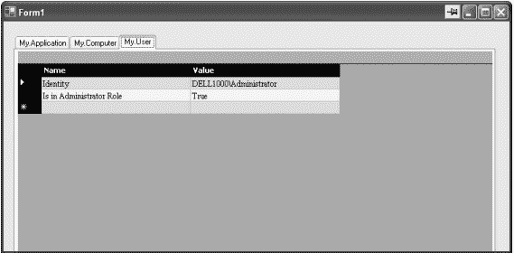

**图 2-4** My.User 选项卡。

用数据填充此网格的代码如下：

```vb
AddNewRow("Identity", My.User.Identity.Name)
AddNewRow("Is in Administrator Role", _
    My.User.IsInRole("Administrators").ToString())
```

用于访问当前用户信息的代码非常简单。你只需访问 User 对象的相应属性即可。User 对象由表 2-5 中所示的属性和方法组成。

**表 2-5 My.User**

| 属性/方法 | 描述 |
|---|---|
| Identity | 返回当前用户的身份标识 |
| IsInRole | 允许你查询用户是否是特定角色的成员 |

##### 在应用程序开发中使用 My.User 的场景

My.User 对象为你提供了大量关于当前登录用户的信息。在许多方面，My.User 是 My 对象为学习或使用 .NET Framework 的开发人员提供的“快速拨号”功能的一个绝佳示例。

使用 FileIO 对象也可以轻松处理单个文件和文件夹。例如，只需一行代码，你就可以轻松重命名你正在处理的文件：

```vb
My.Computer.Filesystem.RenameFile(sourceFilePath, targetFileName)
```

在 .NET Framework 的早期版本中，如果你想获取与 My 对象提供的信息类似的信息，你必须编写类似于以下代码：

```vb
Imports System.Security.Principal
Imports System.Threading.Thread
...
Dim winPrin as WindowsPrincipal = Thread.CurrentPrincipal
MessageBox.Show(winPrin.Identity.Name)
```

你也可以选择编写以下代码：

```vb
MessageBox.Show(System.Threading.Thread.CurrentPrincipal.Identity.Name)
```

但是使用 My 对象，你得到的是更直观的：

```vb
My.User.Identity.Name
```

这段代码是 My 对象如何为 .NET Framework 执行“快速拨号”功能的经典示例。大多数开发人员在初次接触 .NET Framework 时，不会本能地想到要获取当前登录的用户帐户名，他们必须要么访问 *Principal* 对象，要么从应用程序的执行线程访问当前进程的身份标识。许多开发人员期望此信息能在更高抽象层级上被公开。有了 My 对象，这类信息可以轻松快速地访问。

#### My.WebServices 和 My.Forms

正如你将在后面的章节中了解到的，My 对象的另外两个重要功能领域是 *My.WebServices* 和 *My.Forms*。在结束本章的这一部分之前，让我们简要了解一下它们。

*My.WebServices* 为你提供了与访问数据源时一样便捷的访问方式，用于访问你项目中引用的 Web 服务：

```vb
dgOrders.DataSource = _
    My.WebServices.Northwind.GetOrders().Tables("Orders")
```

在这段代码中，你可以看到你不必像在 .NET Framework 1.0/1.1 中那样为 Web 服务创建代理类的实例。这样，*My.WebServices* 为你提供了一个便捷的“快速拨号”，用于访问作为你项目一部分的所有 Web 引用。

最后但同样重要的是，*My.Forms* 为你提供了一个包含应用程序窗体的集合的访问权限。这恢复了在 .NET 出现时曾暂时失去的、对 Visual Basic 桌面应用程序开发具有重要意义的编程增强功能。


##### My.Forms

如果你之前使用 Visual Basic 6 编程，你会知道以下代码可用于显示项目中的一个窗体：

```
Form2.Show
```

随着 .NET Framework 1.0/1.1 的出现，你无法像以前那样轻松地完成此操作。当你尝试在 .NET Framework 1.0/1.1 中显示窗体时，需要以下代码：

```
Dim frm1 As New Form1()
frm1.Show()
```

通过 *My.Forms*，你项目中的所有窗体都可以作为此集合的一部分轻松访问。此外，你甚至无需使用 *My.Forms*，即可访问项目中所有窗体的默认实例。因此，以下几行代码是等效的：

```
My.Forms.Form2.Show()
Form2.Show()
```

你将在本书中看到更多使用这种显示窗体方法的示例。稍后在本书中，你还将更详细地了解 *My.WebServices* 和 *My.Forms*。

### 结论

My 对象作为开发人员，主要有四个用途。首先，它包含了 .NET Framework 以前版本中无法使用的额外功能。其次，它提供了一个有价值的快速访问途径，让你能更快地在应用程序中查找和使用 .NET Framework 基础类库的功能。第三，它填补了一些空白，让你能够将计算机等事物视为逻辑实体。第四，它恢复了一些熟悉的编码语法，例如 *Form1.Show*。

## 应用程序：运算符

本应用程序介绍了新的运算符重载功能以及添加到 Visual Basic 语言中的新 *IsNot* 运算符。

#### 新概念

运算符重载允许你定义类在与内置语言运算符（如 +、-、<、>、= 和 <>）一起使用时的行为。在 Visual Basic 中，使用诸如 + 运算符来操作对象的概念并不新鲜。例如，以下代码使用 + 运算符操作两个字符串对象：

```
str = "Hello, "  +  "world"
```

当应用于字符串时，+ 运算符将连接两个字符串以生成一个新字符串。对于字符串的加法操作，连接是一个合适的结果。Visual Basic 中的运算符重载允许你为应用于你自己的类实例的操作（如加法）定义合适的结果。

考虑一个需要确定一名员工是否比另一名员工资历更深的场景：

```
Dim emp1, emp2 As Employee
emp1 = Employee.GetFromID(123)
emp2 = Employee.GetFromID(155)
```

在此应用程序中，资历是两个 *Employee* 对象之间的自然比较，因此下一行代码的语义应表达“如果 emp1 大于 emp2”。通过运算符重载，你实际上可以定义 >（大于）运算符在两个 *Employee* 对象一起使用时的工作方式。一旦定义了 > 运算符，以下代码将有效：

```
If emp1 > emp2 Then
  ' 在此添加代码
End If
```

#### 演练

本应用程序使用 *Employee* 对象填充两个列表框控件。然后，用户可以选择两名员工以查看哪位员工资历更深。在此应用程序中，资历完全基于雇佣日期确定。

### 运算符重载

重载运算符就像创建新方法一样简单。事实上，运算符重载只是使用 *Operator* 关键字创建的方法。*Employee* 类的 > 运算符定义如下所示：

```
Public shared operator >(ByVal lhs As Employee, _
                          ByVal rhs As Employee) As Boolean
  ' 在此添加代码
End Operator
```

运算符必须标记为 *Shared*，并且其至少一个参数必须是封闭类型（*Employee*）。> 运算符是一个二元运算符，这意味着它需要两个操作数：运算符的左侧和右侧。只需其中一个操作数是封闭类型即可。另一个操作数可以是其他类型，如果你要定义如何将 *Employee* 对象与其他内容（例如整数）进行比较。此代码的典型结果如图 2-5 所示。

### 介绍 Microsoft Visual Basic 2005 for Developers

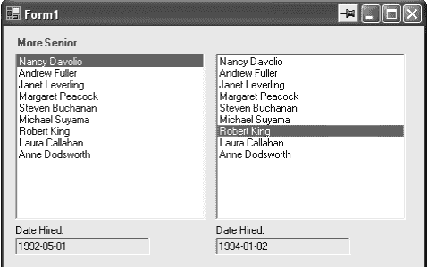

图 2-5 Employee 对象可以根据员工的雇佣日期进行比较。

传递给运算符方法的参数可以是 *Nothing*（空引用），因此你需要在尝试访问属性或方法之前检查它们。*Employee* 类的 > 运算符的完整实现包含处理空引用的逻辑：

```
Public Shared Operator >(ByVal lhs As Employee, _
                          ByVal rhs As Employee) As Boolean
    If rhs Is Nothing Then
        If lhs IsNot Nothing Then
            Return True
        Else
            Return False
        End If
    End If

    If lhs Is Nothing Then
        Return False
    End If

    If rhs.HireDate > lhs.HireDate Then
        Return True
    Else
        Return False
    End If
End Operator
```

当你定义某些运算符时，Visual Basic 要求你还必须定义反向运算符。如果你定义了 =（等于）运算符，则必须定义 <>（不等于）运算符。如果你定义了 >=（大于或等于）运算符，则必须定义 <=（小于或等于）运算符。如果你定义了 >（大于）运算符，则必须定义 <（小于）运算符。幸运的是，你通常可以利用第一个运算符来定义反向运算符。因此，与其为 < 运算符编写反向逻辑，你只需反转操作数并使用 > 运算符：

```
Public Shared Operator <(ByVal lhs As Employee, _
                          ByVal rhs As Employee) As Boolean
    Return rhs > lhs
End Operator
```

类似地，<> 运算符返回 = 运算符的逻辑反：

```
Public Shared operator <>(ByVal lhs As Employee, _
                           ByVal rhs As Employee) As Boolean
    Return Not lhs = rhs
End Operator
```

### IsNot 运算符

本应用程序中的 > 运算符重载方法使用了新的 *IsNot* 运算符。在以前版本的 Visual Basic 中，要确定对象引用不是 *Nothing*，需要将 *Not* 关键字应用于 *Is* 关键字：

```
If Not obj Is Nothing Then
```

虽然这个语法完全符合逻辑，但使用起来可能很别扭，尤其是在尝试阅读或表达逻辑时。使用新的 *IsNot* 运算符，以下 *If* 语句是可能的：

```
If obj IsNot Nothing Then
```

此语句在逻辑上与前面的 *If* 语句相同，但读起来更自然：*如果对象不是空值，那么...*。

### IsTrue、IsFalse 和 Not 运算符

Visual Basic 中的运算符重载包括重载两个名为 *IsTrue* 和 *IsFalse* 的特殊运算符的能力。这些运算符不能在代码中显式调用，但编译器可以使用它们来计算表达式中对象的真值或假值（在期望布尔值的表达式中，例如 *If* 语句）。考虑以下对 *Employee* 对象的使用：

```
Dim emp As New Employee()
If emp Then
    ' 在此添加代码
End If
```

只有当 *Employee* 的类定义包含一种计算布尔值的方法时，*emp* 的这种用法才有效。这可以通过定义 *IsTrue* 运算符或 *CType* 运算符（在下一节中描述）来完成。*Employee* 的 *IsTrue* 运算符返回 Employee.IsActive 字段的值，对于空引用则返回 false：

```
Public Shared operator IsTrue(ByVal emp As Employee) As Boolean
    If emp Is Nothing Then
        Return False
    Else
        Return emp.IsActive
    End If
End Operator
```

当你定义 *IsTrue* 时，Visual Basic 要求你还要定义其反向运算符 *IsFalse*。在 *Employee* 类这样的简单情况下，定义此反向运算符非常简单：

```
Public Shared Operator IsFalse(ByVal emp As Employee) As Boolean
    Return Not emp
End Operator
```

然而，在 *Employee* 类上使用 *Not* 运算符的便利并非免费。你必须定义该运算符：

```
Public Shared Operator Not(ByVal emp As Employee) As Boolean
    If emp Then Return False Else Return True
End Operator
```

### CType 运算符

你可以在 Visual Basic 中重载的另一个特殊运算符是 *CType* 运算符。*CType* 用于将表达式从其原始数据类型转换为新的数据类型。例如，*CType*("100", *Integer*) 将 *string* 转换为 *integer*。通过为你的类重载 *CType* 运算符，你能够精确定义如何将你的类实例转换为另一种数据类型。本应用程序中 *Employee* 类的三种可能转换是 *Employee* 到 *string*、*Employee* 到 *date* 以及 *Employee* 到 *boolean*。对于每种转换，你都必须提供一个单独的 *CType* 运算符重载。

```
Public Shared Widening Operator CType(ByVal emp As Employee) As String
    Return emp.FirstName + " " + emp.LastName
End Operator
```

```
Public Shared Widening Operator CType(ByVal emp As Employee) As Date
    If emp Is Nothing Then
        Return Nothing
    Else
        Return emp.HireDate
    End If
End Operator
```

```
Public Shared Widening Operator CType(ByVal emp As Employee) As Boolean
    If emp Is Nothing Then Return False Else Return emp.IsActive
End Operator
```

*CType* 运算符重载可以标记为 *Widening* 或 *Narrowing*。如果目标数据类型无法表达原始数据类型的所有可能值，则转换是窄化的。对于为 *Employee* 定义的任何转换都不是这种情况，因此它们都已标记为 *Widening*。

> **注意** 当使用 *Option Strict On* 时，Visual Basic 编译器不允许隐式窄化转换。


在 *Employee* 类中，*ToString* 方法被重写，以便返回员工的姓和名，而不是类名。*Employee* 类有一个 *CType* 运算符，它定义了从 *Employee* 到字符串的扩大转换，因此在 *ToString* 方法中所需的代码很少。从 *Employee* 到字符串的转换是隐式的，因为该函数具有显式的返回类型（*string*），并且从 *Employee* 对象到该返回类型定义了扩大转换：

```
Public Overrides Function ToString() As String
    Return Me
End Function
```

> 注意：除非重新定义（重写）ToString，否则对象使用从 System.Object 继承的 ToString 方法，该方法返回对象的完全限定类名。

你可以使用运算符重载来为操作类创建有效且自然的接口。但是，参数和返回类型选择不当会使应用程序编程接口（API）令人困惑。例如，大于（>）、小于（<）、等于（=）和不等于（<>）运算符通常应返回 *Boolean* 值。在大多数情况下，返回 *DateTime* 的 > 运算符会造成困惑且不符合自然习惯。二元 + 运算符通常应返回其封闭类型，一元 + 和 – 运算符也应如此：

```
Dim var1 As New MyCustomClass
Dim var2 As New MyCustomClass
Dim var3 As MyCustomClass = var1 + var2
var3 = -var3
```

对于二元 – 运算符等运算符，你可能希望返回不同的数据类型。例如，在此应用程序中，两个 *Employee* 对象之间的差值可以是一个整数值，表示两名员工雇佣日期之间相差的月数。

### 结论

运算符重载让你能够确定 = 和 > 等运算符在用于你定义的的两个对象实例时如何工作。要重载运算符，你只需在类中创建一个包含 *Operator* 关键字的方法。在重载运算符时，请务必定义它们的反运算。例如，对于 =（等于）运算符的重载，定义相应的 <>（不等于）运算符重载。

一组精心规划的运算符重载，配合适当的参数和返回类型，可以使你的类更易于使用，并促进更简洁的源代码。

# 应用：关键字

本应用程序介绍了 Visual Basic 的新关键字 *Using*、*Global* 和 *Continue*。

#### 新概念

语言设计者在向编程语言添加新关键字时通常持谨慎态度。一种语言必须足够表达丰富才能有用，但添加太多关键字会使语言过于复杂而难以掌握。随着 Visual Studio 2005 的发布，添加到 Visual Basic 中的新关键字旨在在某些常见编程场景中澄清或简化你的代码。

### Global 关键字

Visual Basic 允许你创建自己的命名空间来组织应用程序和库中的类。有意义的命名空间可以大大提高类层次的直观性和源代码的可读性。但是，如果你将某个命名空间命名为与 .NET Framework 基类库中的顶级命名空间相同，该顶级命名空间将无法访问。例如，在自定义命名空间 *Util.System* 中，你无法将变量声明为 *System.String*，因为 *String* 在 *Util.System* 中未定义。*Util.System* 命名空间遮蔽了顶级的 *System* 命名空间。

Visual Basic 中的新 *Global* 关键字允许你在命名空间层次结构遮蔽其中一部分时访问命名空间层次结构的根。因此，*Util.System* 命名空间中的字符串变量可以声明为 *Global.System.String*。有关示例，请参见"演练"部分。

### Using 关键字

.NET Framework 公共语言运行时包含一个复杂的内存管理子系统，用于为托管应用程序分配和释放内存。内存由垃圾回收器在适当的时候从不再使用的对象中回收。垃圾回收器在释放内存时会自动调用一种称为*终结器*的特殊清理方法。但是，无法保证对象何时会被终结。这种非确定性的对象清理方法在对象使用文件句柄等非托管资源时可能会产生问题。

为了解决垃圾回收的非确定性问题，使用非托管资源的类应提供某种方式，让程序员在放弃对象之前显式清理非托管资源。常规做法是实现 *IDisposable* 接口，该接口要求一个 *Dispose* 方法。程序员只需在不再需要对象时调用你的 *Dispose* 方法。这种方法要求程序员确保在每条可能的执行路径末尾都调用 *Dispose*。

Visual Basic 中的新 *Using* 关键字通过自动为对象调用 *Dispose* 来简化 *Dispose* 方法的使用。在以下代码段中，*obj1* 的 *Dispose* 方法在 *Using* 块末尾自动调用：

```
Dim obj1 As New MyCustomClass
Using (obj1)
    ' 在此处添加代码
End Using
```

*Using* 关键字可应用于任何实现 *IDisposable* 接口的对象。*Using* 关键字可以嵌套，以便为任意数量的对象自动调用 *Dispose*。

### Continue 关键字

大多数 Visual Basic 程序员都遇到过可以跳过循环的某些迭代的情况。以前版本的 Visual Basic 没有简单的方法来直接跳到循环的下一个迭代。这意味着你必须将循环的整个主体包裹在条件块中。Visual Basic 中的 *Continue* 关键字现在允许你跳过循环的其余部分，直接跳到下一个迭代。以下 *While* 循环使用 *Continue* 关键字，如果当前记录（在 *SqlDataReader* 中）的第一列为 Nothing，则跳到下一个迭代：

```
While dr.Read()
    If dr(0) Is Nothing Then Continue While
    ' 在 SqlDataReader 中处理当前记录
End While
```

*Continue* 关键字可用于嵌套循环中，以跳到外层循环的下一个迭代：

```
While I < 1000
    For J As Integer = 1 To 5
        If I Mod J = 0 Then
            Continue While
        End If
    Next
    I += 1
End While
```

当内层循环与外层循环是相同类型的循环时，例如嵌套在 *For* 循环内的 *For* 循环，*Continue* 关键字应用于最内层的循环。

#### 演练

Keywords 应用程序围绕 `Util.System.IO` 命名空间中定义的 `FileWriter` 类构建：

```
Namespace Util.System.IO

    Public Class FileWriter
        Implements IDisposable

        Private _outWriter As Global.System.IO.StreamWriter

        Public Sub New(ByVal filename As String)
            _outWriter = Global.System.IO.File.CreateText(filename)
            _outWriter.WriteLine("Output started at " + Now.ToString())
        End Sub

        Public Sub WriteLine(ByVal message As String)
            _outWriter.WriteLine(Now.ToString().PadRight(30) + message)
        End Sub

        Public Sub Dispose() Implements IDisposable.Dispose
            _outWriter.Close()
            MsgBox("StreamWriter closed by Dispose()")
            GC.SuppressFinalize(Me)
        End Sub

        Protected Overrides Sub Finalize()
            _outWriter.Close()
            MsgBox("StreamWriter closed by Finalize()")
        End Sub
    End Class

End Namespace
```

`FileWriter` 类是 `StreamWriter` 类的简单包装器。`FileWriter` 对象在写入文件的每一行时都会添加当前日期和时间。`StreamWriter` 在消费者调用 `FileWriter.Dispose` 方法时关闭，或者在 .NET Framework 垃圾回收器调用 `Finalize` 方法时关闭。

`Dispose` 和 `Finalize` 方法包含 `MsgBox` 调用，以告诉你每个方法何时被调用。这些调用仅在本应用程序中用于说明目的。通常不应从 `FileWriter` 等非 UI 类显示消息框。

如图 2-6 所示，Keywords 应用程序的用户界面是一个包含两个按钮的 Windows 窗体。其中一个按钮的 click 事件处理程序对 `FileWriter` 对象使用 `Using` 语句。第二个按钮的 click 事件处理程序不使用 `Using`，也不调用 `Dispose`——它依靠垃圾回收器调用 `Finalize`：


Private Sub Button1_Click(ByVal sender As System.Object, _
                        ByVal e As System.EventArgs) _
                        Handles Button1.Click
    Dim fw As New _
        Util.System.IO.FileWriter( _
        System.Environment.CurrentDirectory + "\button1.txt")

    Using (fw)
        For I As Integer = 1 To 100
            If I Mod 3 = 0 Then
                Continue For
            End If
            fw.WriteLine(CStr(I))
        Next
    End Using

End Sub

Private Sub Button2_Click(ByVal sender As System.Object, _
                        ByVal e As System.EventArgs) _
                        Handles Button2.Click
    Dim fw As New _
        Util.System.IO.FileWriter( _
        System.Environment.CurrentDirectory + "\button2.txt")

    For I As Integer = 1 To 100
        If I Mod 3 = 0 Then
            Continue For
        End If
        fw.WriteLine(CStr(I))
    Next

End Sub

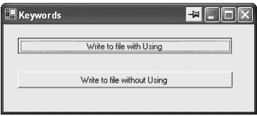

图 2-6 关键字应用用户界面。

在这两种情况下，单击事件处理程序都使用 *FileWriter* 类将从 1 到 100 的每个整数（能被 3 整除的值除外）写入文件。

### 使用 Global 关键字

*FileWriter* 类使用来自基类库 *System.IO* 命名空间的 *StreamWriter*。但是 *System.IO* 不能直接从类定义中访问，因为 *FileWriter* 定义在一个 *System.IO* 命名空间（*Util.System.IO*）内，该命名空间在命名空间层次结构的根目录处屏蔽了 *System.IO* 命名空间。为了解决这种命名冲突，使用 Global 关键字从基类库访问 System.IO：

```vb
Private _outWriter As Global.System.IO.StreamWriter
```

Util.System.IO 命名空间不包含 StreamWriter 类，因此将变量声明为 System.IO.StreamWriter 或 IO.StreamWriter 将无法编译。但使用 Global 关键字允许编译器从 .NET Framework 类库中将类解析为正确的类型。

### 使用 Using 关键字

FileWriter 对象在创建时（即在其构造函数中）打开其内部的 StreamWriter，并保持 StreamWriter 处于打开状态，直到调用 Dispose 或 Finalize。在 Button1_Click 事件处理程序中，Using 关键字应用于 FileWriter 对象 fw。在 Using 块结束时，fw.Dispose 会被自动调用，从而关闭底层的 StreamWriter 对象。结果如图 2-7 所示。

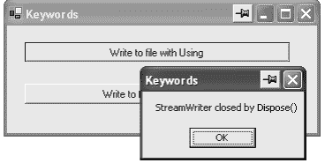

图 2-7 自动调用 Dispose 后显示的消息框。

Dispose 在 Using 块之后立即调用，因此在本例中，Dispose 的消息框会立即显示。相比之下，第二个按钮创建了一个 FileWriter 但没有调用 Dispose。来自 Finalize 方法的消息框将在垃圾回收器清理对象时的某个看似任意的时间点出现。对于这个简单的应用程序，消息框最有可能在关闭程序时出现。

### 使用 Continue 关键字

此应用程序中按钮的单击事件处理程序都向文件写入从 1 到 100 中不能被 3 整除的整数：

```vb
For I As Integer = 1 To 100
    If I Mod 3 = 0 Then
        Continue For
    End If
    fw.WriteLine(CStr(I))
Next
```

生成数字的 *For* 循环演示了新的 *Continue* 关键字的一个简单用法。如果 *I* Mod 3 为 0，则 *I* 的当前值能被 3 整除。当此条件为真时，*Continue For* 会将执行跳转到循环的下一次迭代，而不处理 *For* 循环的剩余主体。例如，如果 *I* 为 6，*Continue For* 将被执行，这将使迭代跳回循环顶部，此时 *I* 等于 7。部分输出列表将如下所示（注意缺少 3、6、9 和 12）：

```
Output started at 12/12/2003 8:06:42 AM
12/12/2003 8:06:42 AM        1
12/12/2003 8:06:42 AM        2
12/12/2003 8:06:42 AM        4
12/12/2003 8:06:42 AM        5
12/12/2003 8:06:42 AM        7
12/12/2003 8:06:42 AM        8
12/12/2003 8:06:42 AM       10
12/12/2003 8:06:42 AM       11
12/12/2003 8:06:42 AM       13
```

### 结论

本应用演示的新关键字——*Continue*、*Global* 和 *Using*——为 Visual Basic 语言增添了额外的便利性和灵活性。*Continue* 关键字有助于简化循环中的复杂逻辑，以处理你不想处理的特殊情况。*Global* 关键字使你可以灵活地使用任何命名空间名称来构建类层次结构，而不会使 .NET Framework 类库中的命名空间无法访问。而 *Using* 关键字则免除了你在程序的每个执行路径末尾显式调用 *Dispose* 的责任。这些新关键字是对 Visual Basic 语言的增量式改进。它们不会彻底改变你编写代码的方式，但在某些情况下，它们将有助于简化或清晰化你的源代码。

# 第 3 章

## Visual Studio 2005 集成开发环境

**本章内容：**

-   应用：IDE 增强功能....................................................64

在 .NET 之前，有 Microsoft Visual Basic 6，它是有史以来最流行且最易用的编程语言之一。其成功的简单原因在于，它允许开发人员比使用其他编程语言和开发工具的同行更具生产力。当然，Visual Basic 6 开发人员享有的生产力优势是以有限的语言支持为代价的。当 Visual Basic .NET 出现时，它引入了新的编程架构和功能，例如完全访问平台，用于构建尖端应用程序。因此，Visual Basic .NET 被确立为一种一流的编程语言。然而，所有这些功能和语言支持的承诺，是以牺牲一些 Visual Basic 开发人员已经习惯并期望的生产力优势为代价的。

Microsoft Visual Studio 2005 包含了许多针对开发环境的新增强、创新和改进，其唯一目标是使 Visual Basic .NET 开发人员比以往任何时候都更具生产力。本章探讨其中的一些功能，并解释作为开发人员如何利用它们来更快、更准确地编写代码。

> **提示** 在 IDE 的其他“改进”中，Visual Studio 2005 重新引入了编辑并继续，这对于有经验的 Visual Basic 开发人员来说是个好消息。

### 应用：IDE 增强功能

本应用演示了 Visual Studio 2005 IDE 中的类设计器，这是一个用于在 Visual Basic .NET 应用程序中可视化设计类层次结构的工具。在研究应用的细节之前，让我们首先更全面地了解 Visual Studio 2005 IDE 中新增或改进的功能。

#### 配置设置

如果你使用过以前版本的 Visual Studio，你可能已经花了一些时间来自定义开发环境。你可能通过一些实验了解到可以指定工具窗口的位置，或者你可能发现 Visual Studio 中的菜单和工具栏是完全可自定义的。你还可以配置键盘映射、项目模板类型、帮助筛选器等。事实上，Visual Studio 一直被设计为你能够安排 IDE 的元素以最适合你个人的开发风格。

##### 选项对话框

图 3-1 所示的选项对话框提供了广泛的设置类别，用于自定义 Visual Studio 开发环境。默认情况下，选项对话框显示最常用的设置。要显示所有可用设置，请选择“显示所有设置”复选框。

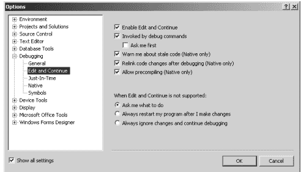

**图 3-1** 选项对话框。

在 Visual Studio 2005 发布之前，IDE 自定义的主要缺点是无法将你的首选项保存为可移植格式，如果你需要在另一台机器上重新创建这些设置，这将非常有用。使用 Visual Studio 2005，你现在可以快速轻松地在以后或在另一台机器上恢复你的个人设置。Visual Studio 2005 允许你通过以下方式使用自定义设置：

-   制作当前设置的副本，以便在第二台机器上使用。
-   将你的设置分发给其他开发人员。

■ 允许团队将IDE（例如代码编辑器）的特定元素设置为共享，同时在其他区域保留个人自定义设置。

如图3-2所示，选项对话框中的环境设置包含一个导入/导出设置项。在“始终将我的设置保存到此文件”文本框中指定的文件会在每次关闭Visual Studio时更新。这可以是本地文件或网络文件。如果您经常在两台机器上工作，请将此文件设置为两台机器都能访问的网络位置；这将确保您在两台机器上都能享受相同的Visual Studio“外观和体验”。此外，每当您在一台机器上更改设置时，它会自动出现在另一台机器上。

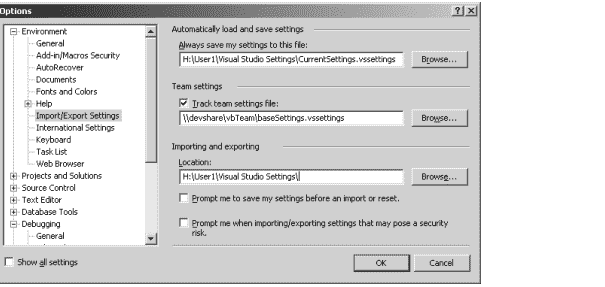

图 3-2 导入/导出设置选项。

在团队设置部分，您可以指定一个包含要在开发人员团队之间共享的设置的 `.vssettings` 文件。为了理解团队协作如何发挥作用，请考虑这样一种情况：开发团队的所有成员必须对 Visual Basic .NET 代码文件使用相同的缩进和格式化选项。主开发人员可以在 Visual Studio 2005 中配置格式化选项，然后使用导入/导出设置对话框仅将这些格式化设置保存到网络共享上的 `.vssettings` 文件中。开发团队的其他成员随后可以更新其 Visual Studio 配置以使用该团队设置文件。如果团队后来决定更改默认设置，主开发人员可以将新设置导出到同一文件位置，团队中的每个人在下次启动 Visual Studio 时都会自动接收新设置。

在导入和导出部分下的位置文本框中，指定可以导出或导入设置的默认位置。下一节将描述如何导入和导出设置文件。

> **注意** 您的活动设置由两部分组成：首次启动 Visual Studio 2005 时选择的已安装 `.vssettings` 文件中的预定义自定义项，以及您随后进行的任何 IDE 自定义。每次退出 Visual Studio 时，活动设置都会自动保存到 `currentsettings.vssettings` 文件中。

##### 导入/导出设置对话框

Visual Studio 2005 的工具菜单包含一个导入/导出设置菜单项，用于打开管理设置文件的对话框。该对话框提供三个基本功能区域：

- 将您当前的 IDE 设置导出到文件
- 从文件导入 IDE 设置
- 将您的环境重置为默认文件中预定义的工作风格

根据您是导出还是导入设置，对话框分别允许您选择要导出到 `.vssettings` 文件的设置，或要从现有 `.vssettings` 文件导入的设置。

> 注意 设置类别通常定义了工具窗口、选项页或 IDE 功能的逻辑分组。

图 3-3 显示了选择“将 IDE 设置导出到文件”选项的导入/导出设置对话框。在“选择要导出的设置”下，选择或清除单个设置或整个设置类别以进行导出。

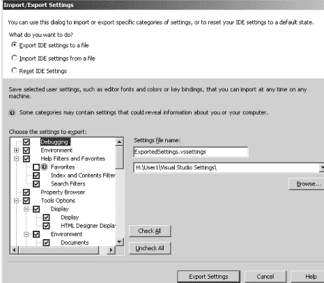

**图 3-3** 导出 IDE 设置。

高度可定制的开发环境的一个明显缺点是，开发人员可能会（当然是无意中）从 IDE 中移除必要的功能。例如，您可能会从工具栏或菜单中移除必要的项。或者，通过无害的尝试，将工具窗口重新排列成无法使用的布局。在早期版本的 Visual Studio 中，您可以恢复 IDE 中的单个项目（例如，通过转到窗口菜单并选择重置窗口布局命令）。Visual Studio 2005 继承了大部分这些重置工具。然而，单个重置工具仅涵盖 IDE 功能的一小部分，并且它们分散在 IDE 中的事实有时可能难以找到合适的工具。

如图 3-4 所示，选择“重置 IDE 设置”选项，将 IDE 环境更改为在多个预定义设置文件中定义的工作风格，这些文件列在“可用的已安装设置文件”部分下。这些文件随 Visual Studio 2005 安装，包含反映与特定编程方向（如 VB.NET、C++、C#、Web 或 J#）相关的常见偏好的窗口布局、工具栏和菜单命令的特定自定义。

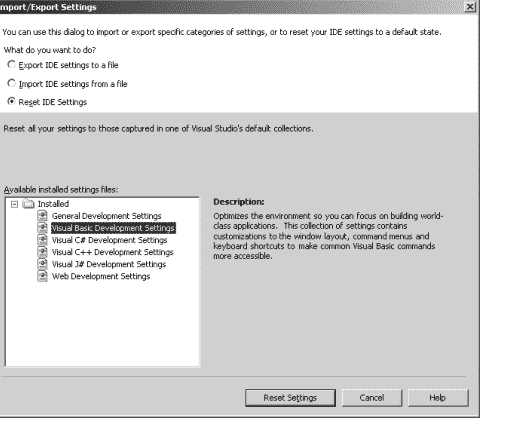

图 3-4 重置 IDE 设置。

> 提示 如果您的设置达到无法使用 IDE 的状态，或者它们阻止您访问导入/导出设置对话框，请使用重置开关从命令提示符重新启动 Visual Studio 2005 以恢复默认设置，如下所示：`devenv /resetsettings`

如果您只需要重置某些设置类别，请使用“从文件导入 IDE 设置”选项。您可以从默认设置文件之一或本地设置文件中选择设置。您也可以浏览到位于 Visual Studio 2005 默认文件夹以外的文件夹中的文件。例如，在开发团队共享设置文件的情况下，该文件可能位于网络共享上。如图 3-5 所示，选择文件后，名为“可导入设置”的树视图会列出文件中存储的设置。通过选择或清除列表中显示的项目，您可以选择要导入哪些设置。“从文件导入 IDE 设置”选项允许您从 `.vssettings` 文件更改全部或部分设置。

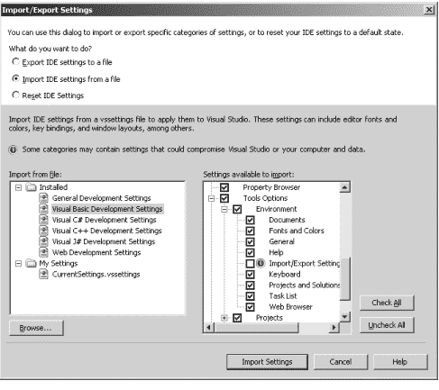

图 3-5 导入 IDE 设置。

##### 帮助和社区集成

Visual Studio 2005 在帮助信息的内容和访问这些信息的工具方面都取得了显著进步。这些改进还包括与基于社区的资源的更全面集成。

###### 过去与现在

在回顾帮助系统的新功能和改进之前，为了提供一些背景信息，让我们回顾一下以前版本的 Visual Studio 如何提供帮助，并强调每种方法的局限性：

- **F1** 这充其量是一个“时好时坏”的工具。有时 F1 会返回正确的答案。其他时候，它会显示动态帮助窗口——该窗口提供对“代码和文本编辑器”的帮助——这很少是你需要帮助的领域。
- **目录（TOC）** 您可以浏览目录的内容树来查找与当前主题无关的主题。然而，虽然这有时可能提供有用的信息，但它也可能耗时且收效甚微。
- **索引** 在某些情况下，帮助索引仍然是定位有用信息的好选择。例如，如果您已经知道感兴趣的 .NET Framework 类名，索引就很好用。然而，当您寻找概念性信息时，它的效果就不太好了。
- **搜索** 搜索的主要缺点是它可能会以随机顺序返回多达五百个结果。
- **基于 Web 的搜索** 虽然结果因您首选的搜索引擎而异，但它仍然是许多开发人员的首选帮助工具。它不仅避免了早期 Visual Studio 帮助工具的缺点，还提供了对互联网信息的访问。

Visual Studio 2005 对这些工具提供了以下重大更新，使您能够更高效地访问帮助内容：

- **F1** 对帮助主题元数据的改进使 F1 更具一致性的帮助，即使您不在项目上下文中。
- **搜索** 过滤机制相比早期版本的 Visual Studio 得到了改进，从而提供了包含与您搜索条件更匹配的主题的结果。另一个重要改进是，结果包含每个返回项目的动态生成的摘要。
- **如何实现** 这是一个新工具，如图 3-6 所示，用于访问帮助系统，它提供了常见开发人员任务的分层组织。对于 Visual Basic .NET 开发人员，该工具提供了数百个任务，每个任务包含技术说明内容和示例代码，开发人员可以轻松地将它们粘贴到代码编辑器中。
- **帮助收藏夹** 早期版本的 Visual Studio 包含一个集成的收藏夹工具，但仅适用于 Internet Explorer 链接。更新的帮助收藏夹工具允许您保存特定于帮助的收藏夹，包括搜索查询的参数。

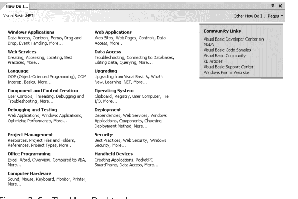

图 3-6 “如何实现”工具。


###### 使用在线帮助内容

与早期版本的开发环境一样，Visual Studio 2005 提供了对 CodeGuru 和 Net247 等网站内容的直接访问。这些以及其他专注于 .NET 的网站是一个名为 *.NET CodeWise Community*（.NET CodeWise 社区）的组织的成员。CodeWise 社区是由 Microsoft 赞助的网站社区，为 Microsoft 开发人员工具和技术提供独立的专业知识。如果您以前访问过这些网站，您已经知道开发者社区成员的贡献扩展并丰富了静态帮助资源。虽然 MSDN 内容提供了广泛的覆盖范围，但社区内容则针对真实开发人员感兴趣的领域，以其深度和上下文对此进行了补充。除了扩展帮助内容和提供额外的代码示例外，基于社区的网站还提供其他资源，例如消息论坛。

与以前版本的 IDE 相比，Visual Studio 2005 更进一步，将 CodeWise 社区成员网站的内容直接集成到帮助系统中。例如，当您在 Visual Studio 2005 中搜索诸如泛型之类的主题时，搜索结果可能会返回本地 MSDN 主题列表、MSDN 在线主题列表以及指向 CodeWise 社区网站上相关页面的链接列表。这项创新功能让您可以轻松、直接地访问社区中最受欢迎和最新的代码示例和技术文章，并与 MSDN 提供的全面静态内容并排显示。此外，与执行临时的基于 Web 的搜索相比，这具有显著优势，因为在后者中，您需要自己验证找到的信息在技术上是否正确。如图 3-7 所示，在“选项”对话框的“帮助”类别中配置在线帮助资源，包括 CodeWise 社区提供程序。

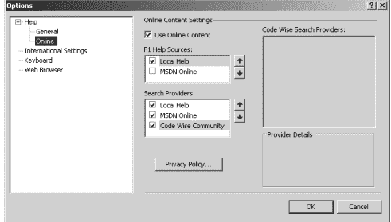

**图 3-7** 配置在线帮助资源。

#### 项目增强功能

您在使用 Visual Studio 2005 时遇到的最直接的生产力提升是能够创建新项目，而无需指定存储位置。这一改变的灵感来自于开发者的常见体验，即他们创建项目仅用于测试代码或构建只会使用一次的原型。IDE 不会将这些项目作为新的解决方案保存到磁盘，而是让您控制是否保存该项目。

此增强功能的工作方式类似于在 Microsoft Word 中创建新文档，您可以打开一个文档，输入一些文本，打印它，然后退出 Word 而无需保存文档。同样的过程适用于在 Visual Studio 2005 中创建的项目；您可以在保存之前构建新应用程序、在调试器中运行它、添加项目项和资源，甚至编译应用程序。（“新建项目”对话框如图 3-8 所示。）与 Word 一样，Visual Studio 2005 将未保存的文件保存在临时文件存储中，直到您选择将其保存到永久位置或在关闭项目时将其丢弃。如果您选择丢弃它们，Visual Studio 2005 会将该项目及其所有关联文件从临时存储中删除。这些项目也被称为“零影响”项目。

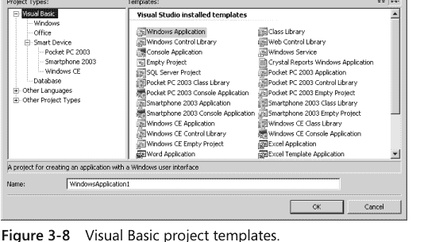

**图 3-8** Visual Basic 项目模板。

Visual Studio 2005 还引入了许多新的项目项类型。许多项类型为常见的用户界面元素提供了模板，包括登录窗体、关于框和资源管理器窗体模板（如图 3-9 所示）。

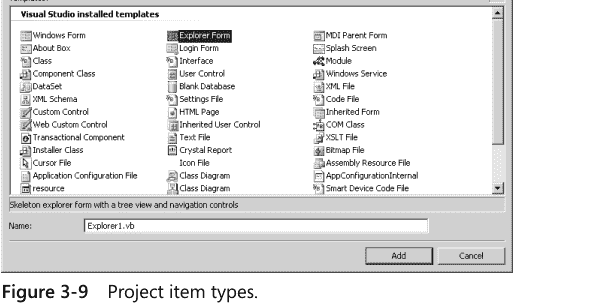

**图 3-9** 项目项类型。

##### 项目设计器

在以前版本的 Visual Studio 中，您可以通过从项目菜单访问的对话框来操作项目属性。由于对话框是模态的，您需要首先打开属性对话框，更改设置，关闭对话框，然后才能继续处理代码。在整个典型的开发周期中，您可能多次返回项目属性。也许您曾想过：“如果我能一直打开这些属性以便更容易地访问，那不是很好吗？”

项目设计器满足了对项目属性进行更轻松、更集中访问的需求。当您在 Visual Studio 2005 中创建一个新项目时，您会在解决方案资源管理器中看到一个名为“My Project”的附加项目元素。（参见图 3-10。）打开此项目会在 IDE 的主编辑窗口中显示项目设计器。

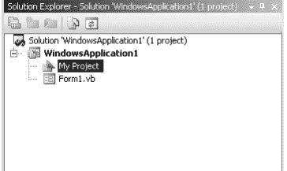

项目设计器提供对项目属性的非模态访问，使其像代码文件或窗体设计器一样易于访问。如果您熟悉以前版本的 Visual Studio，您会注意到项目设计器窗格合并了以前包含在属性对话框和 IDE 其他区域中的属性，而其他窗格则为 .NET Framework 2.0 引入的功能（如 ClickOnce 发布）提供了配置工具。

> **注意** 有关“发布”和“安全”窗格的详细信息，请参见第 8 章“部署应用程序”。

###### 应用程序窗格

如图 3-11 所示的应用程序窗格是设计器整合以前版本 Visual Studio 属性对话框设置的地方之一。此窗格还引入了用于定义应用程序行为的新项目。一旦打开项目设计器，应用程序窗格就作为 Visual Studio 2005 文档窗口中的一个选项卡可用。（或者，您可以通过在解决方案资源管理器中右键单击项目并选择“属性”菜单命令来打开项目设计器，或者选择“项目”|“<项目名称> 属性”菜单命令。）

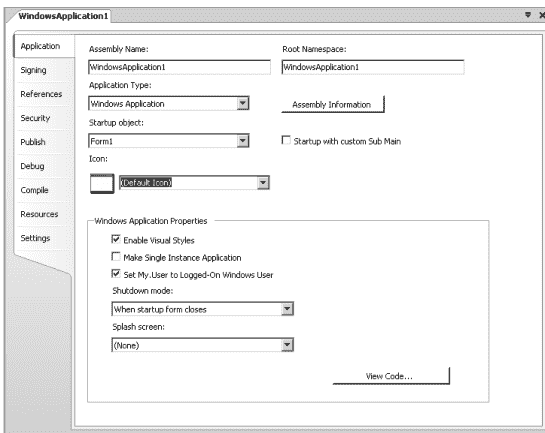

图 3-11  应用程序窗格。

以下是一些新增和更新的设置：

- **启动对象**  您仍然可以指定一个窗体或 `Sub Main` 过程作为应用程序的启动对象。项目设计器还包括一个“使用自定义 Sub Main 启动”复选框，允许您设计自己的启动例程。此外，Visual Studio 2005 支持 Visual Basic 的应用程序事件模型，其中包含两种类型的启动事件（参见表 3-1）。
- **启用视觉样式**  此设置默认启用，它允许您的应用程序使用宿主操作系统中存在的 Windows XP 主题。但是，在某些情况下，您可能会遇到应用程序使用以前版本 Windows XP 主题的控件，此时应禁用 Windows XP 主题以保留应用程序所需的外观和感觉。
- **使单实例**  当您多次单击某个特定的 Windows 应用程序（例如 Media Player）时，该应用程序仅启动一次。其他应用程序（计算器、记事本等）每次单击图标时都会启动程序的单独实例。选择此设置允许您将应用程序的启动行为设置为单实例；如果未选择此设置，应用程序将启动多个实例。
- **关闭模式**  此选项决定哪个事件发出应用程序关闭的信号。例如，对于 Windows 窗体应用程序，您可以选择在启动窗体关闭时或在应用程序退出时关闭应用程序。
- **启动屏幕**  此设置允许您在项目中选择一个窗体作为启动屏幕。
- **查看代码**  单击“查看代码”按钮会打开 *MyEvents.vb* 代码模块。*MyEvents.vb* 包含一个部分 *MyApplication* 类（定义在 `My` 命名空间中）。*MyApplication* 类存在的明确目的是包含表 3-1 中描述的应用程序事件的处理程序。

####### 表 3-1 MyApplication 事件

| 名称 | 描述 |
|---|---|
| *Startup* | 在应用程序启动时引发 |
| *Shutdown* | 在应用程序退出时引发 |
| *UnhandledException* | 在应用程序中发生未处理异常时引发 |
| *StartupNextInstance* | 对于配置为以单实例运行的应用程序，当用户尝试启动程序的单独实例时引发 |
| *NetworkAvailabilityChanged* | 在基础网络连接的状态发生变化时引发 |

###### 管理程序集信息

在以前版本的用于 .NET Framework 的 Visual Studio 中，您通常在 AssemblyInfo.vb 代码文件中管理全局程序集属性。与项目中的任何其他代码文件一样，要更改程序集属性，您需要在代码编辑器中打开文件并根据需要更新属性。以下是在 AssemblyInfo.vb 中找到的一些常见属性：

```
<Assembly: AssemblyTitle("IDE Enhancements")>
<Assembly: AssemblyDescription("New Visual Studio 2005 IDE features")>
<Assembly: AssemblyCompany("3 Leaf Solutions")>
<Assembly: AssemblyProduct("Moving to Visual Studio 2005")>
<Assembly: AssemblyCopyright("2005")>
<Assembly: AssemblyVersion("1.0.0.0")>
<Assembly: AssemblyFileVersion("1.0.0.0")>
<Assembly: ComVisible(False)>
```

在 Visual Studio 2005 中，程序集属性仍然存储在 AssemblyInfo.vb 中，但该文件现在默认在解决方案资源管理器中隐藏。应用程序窗格通过如图 3-12 所示的“程序集信息”对话框提供对这些属性的访问。此对话框是底层程序集属性的接口；您在此对话框中对列出的项目所做的任何更改都会自动写入底层的 AssemblyInfo.vb 文件。（当然，如果您愿意，您仍然可以访问底层代码文件并直接进行更改。）


###### 签名窗格

在公共语言运行时 (CLR) 上执行的每个受托管程序集都受其关联的代码访问安全 (CAS) 权限的约束。在执行期间，CLR 会评估程序集请求的权限，并授予或拒绝这些权限，部分是通过使用提供给 CLR 的有关代码身份的证据来实现的。作为一种建立程序集身份的方法，**签名窗格**（如图 3-13 所示）允许你将密钥文件 (.snk) 或存储在密钥容器中的密钥添加到项目中。编译器使用该密钥为程序集签名以实现强命名。为了适应开发者需要进行预发布构建但只能访问公钥的情况，该窗格还提供了一个启用延迟签名的复选框。

> 重要提示 对于 ClickOnce 应用程序，发布需要签名密钥。该密钥用于对应用程序和部署清单进行强名称签名。本主题在第 8 章“部署应用程序”中进行了详细讨论。

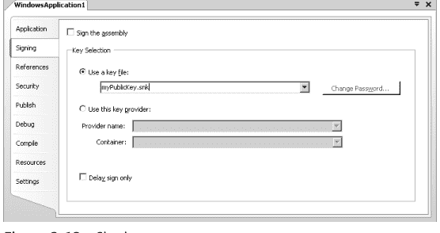

图 3-13 签名窗格。

###### 引用窗格

你仍然可以像之前版本的 IDE 一样，从项目菜单访问项目引用和 Web 引用。但是，Visual Studio 2005 在**引用窗格**（如图 3-14 所示）中增加了访问这些项目的额外入口点。使用引用窗格来管理导入的命名空间、程序集和 Web 服务引用。这种替代视图的一个显著好处是，它将项目引用整合在一个单一的 UI 组件中。该窗格包含用于设置一个或多个引用路径以及识别项目中未使用的被引用程序集的工具，作为附加功能，它还允许你管理命名空间导入设置。

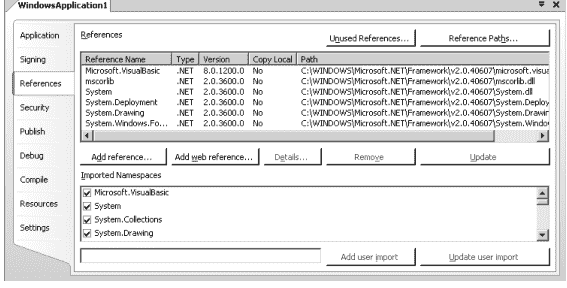

图 3-14 引用窗格。

###### 编译窗格

除了为每个不同的生成配置设置默认编译器选项外，**编译窗格**（如图 3-15 所示）还允许你为不同的编译条件指定单独的通知行为（如“警告”、“错误”或“无”）。使用此窗格设置条件通知选项。

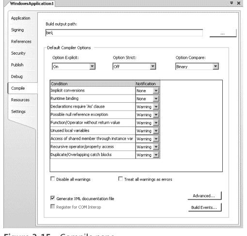

图 3-15 编译窗格。

你也可以从此窗格访问**生成事件**对话框。与早期版本的 IDE 一样，使用此对话框指定预生成和后生成命令行事件，以及指定后生成事件触发的条件。后生成事件执行的条件可以是“始终”、“成功生成时”或“当生成更新项目输出时”。

> MSBuild 集成 Visual Studio 2005 引入了一个名为 MSBuild 的新生成引擎，它集成到 Visual Studio 2005 IDE 中，显著改进了生成过程。虽然 MSBuild 在 Visual Studio 2005 IDE 的底层运行，但它也经过专门设计，可以从命令行执行生成任务。

###### 资源窗格

项目设计器中的**资源窗格**为你的项目提供了一个全面的资源管理器。（参见图 3-16。）资源类别包括本地化字符串、图像、图标、声音文件和文本文件。你可以从“类别”下拉列表中访问每个不同的资源类别。要添加资源——例如字符串——只需在用户界面中显示的表中输入资源的名称及其关联的值。

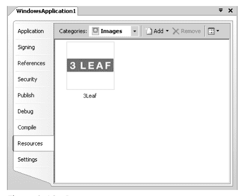

图 3-16 资源窗格。

此外，对于图像和图标资源，你可以添加现有的图像或图标文件，也可以直接在开发环境中创建新的图像或图标（参见图 3-17）。

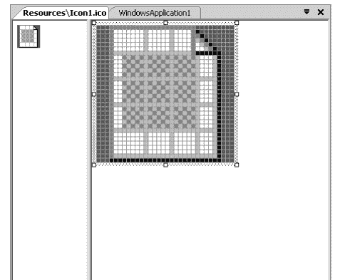

图 3-17 图标设计器。

> ### 资源和框架集成

资源窗格是 IDE 中与增强的 .NET Framework 紧密集成的一个良好示例。在资源页面中管理的项目可以通过 `My` 命名空间中的 `MyResources` 模块在代码中自动访问，该模块在代码中包含了项目资源的表示。资源窗格中管理的项与底层代码文件之间的同步由强类型资源生成器透明地管理，这是一个集成的 Visual Studio 2005 工具。当你对资源页面中的元素进行更改时，此工具会将这些更改写入 `MyResources` 模块，而该模块又位于 `MyResources.vb` 文件中。默认情况下，`MyResources.vb`（以及许多其他自动生成的项目文件）在解决方案资源管理器中是隐藏的。你可以通过单击“显示所有文件”按钮在解决方案资源管理器中显示隐藏文件。

强类型资源生成器生成的代码等效于 `ResGen` 命令行实用程序生成的输出类。该实用程序相对于 `ResGen` 的关键优势在于，你不需要每次更新资源文件时都运行它；Visual Studio 会自动为你管理更新。

###### 设置窗格

一个常见的应用程序开发任务是提供一种存储应用程序和用户设置的机制。这可能包括状态信息，例如数据库连接字符串、窗体的位置和大小、工具栏位置和内容的首选项、数据库连接字符串、Web 服务的 URL——列表还在继续。早期版本的 .NET Framework 提供了不同的选项来存储设置。例如，你可以使用动态属性，或者可以在应用程序配置文件中添加自己的节。.NET Framework 2.0 代表了这些技术的发展。.NET Framework 2.0 引入了新的类，用于将应用程序和用户设置作为强类型对象进行管理。这些类已使用项目设计器的**设置窗格**集成到 Visual Studio 2005 IDE 中。

**功能级别** 设置窗格本身具有多个功能级别。首先，你可以为几乎任何符合 CLS 的类型创建设置。它还包括一个用于数据库连接字符串的特殊类型。事实上，当你创建新的数据库连接时，Visual Studio 会自动将连接字符串添加到项目设置中。

用户界面包括一个输入表，用于指定每个设置的名称、类型和值。另一个重要属性是设置是应用于整个应用程序还是单个用户。该表包含一列，允许你将范围设置为这两个选项之一。

在大多数开发周期中，应用程序可以部署到多种环境——例如，开发、测试、预发布和生产环境。通常，每个环境需要不同的应用程序设置：数据库连接字符串是一个明显的例子，因为你不敢在开发环境中使用生产数据库来测试应用程序。为了更轻松地管理不同的用户设置，你可以向项目添加一个或多个配置文件。**配置文件**工具允许你从现有配置文件复制设置，从而省去了为每个配置文件实例重新创建它们的麻烦。

事实上，在项目的应用程序设计阶段定义设置是一个好建议。在开发的早期阶段尝试调整设置。然后，在你确定应用程序的设置之后，为每个不同的部署环境添加配置文件。要调整特定配置文件的设置，请从下拉列表中选择当前的设置配置文件以激活该配置文件，然后相应地进行更改。

> 提示 如果你使用多个设置配置文件，请记住，设置配置文件与活动解决方案配置之间没有直接关系。在编译时，编译器使用项目设计器中当前活动的设置配置文件。作为最佳实践，请考虑创建与你定义的设置配置文件对齐的解决方案配置。

**设置和框架集成** 与资源窗格中定义的项目类似，Visual Studio 2005 自动提供对设置窗格中管理的设置的强类型访问。并且也与项目资源一样，可以通过 `My` 命名空间以编程方式访问设置。然而，虽然 `My.Resources` 对象在运行时只允许对项目资源进行只读访问（因为资源元素在代码中表示为只读属性），但 `My.Settings` 对象将用户设置公开为读/写属性，这当然意味着你可以在运行时更改它们。

`My.Settings` 类派生自 `ApplicationSettingsBase` 类。这两者之间的这种关系为 `My.Settings` 提供了两种操作用户设置的方法：`Save` 方法和 `Reset` 方法。更改用户设置的编程模型非常简单。在代码中，你所需要做的就是更新作为 `My.Settings` 对象属性公开的用户设置，然后调用 `Save` 方法来持久化更改。要将所有用户设置改回上次保存的设置，请调用 `Reset` 方法。

> 注意 `ApplicationSettingsBase` 类在 .NET Framework 的许多领域中都有特色。例如，许多 Windows 窗体控件都继承了它，以提供对控件属性（如大小、位置等）的运行时访问。此类还提供必要的功能，以将控件属性的运行时更改作为用户设置持久化。有关如何在 Windows 窗体控件中启用用户设置的更多详细信息，请参见第 5 章“构造用户界面”。


*My.Settings* 对象还公开了从 *ApplicationSettingsBase* 类继承的事件。这些事件包括 *PropertyChanged*、*SettingChanging* 和 *SettingsSaving*。

##### 全新及改进的工具窗口

Visual Studio 2005 IDE 包含多个旨在提高生产力并减少所需代码量的工具窗口。本节将介绍 Visual Studio 2005 IDE 中一些能够提升生产力的工具窗口。

###### 代码编辑器

如果您熟悉以前版本 Visual Studio 中 C# 代码编辑器的文档功能，那么您会认出 Visual Basic .NET 代码编辑器中另一个新功能——它可以自动插入生成 XmlDoc 注释的标签。要使用此功能，请将光标放在代码文件中某个成员的上方，然后输入三个单引号。这将生成以下 XmlDoc 注释标签：

```
''' <summary>
''' 
''' 
''' 
''' </summary>
''' <param name="fireDate"></param>
''' <remarks></remarks>
Public Sub Fire(ByVal fireDate As Date)
. . .
End Sub
```

尽管此功能在 C# 代码编辑器中已经可用多年（C# 中使用的是三个正斜杠而非单引号），但它仍然是 Visual Basic .NET 代码编辑器中一个非常及时的补充。

###### 数据预览对话框

数据预览对话框允许您预览项目中任何 *DataComponent* 查询返回的数据。要预览数据，请从数据设计器窗口中打开数据预览对话框（如图 3-18 所示）。您也可以从数据源窗口访问数据预览对话框。

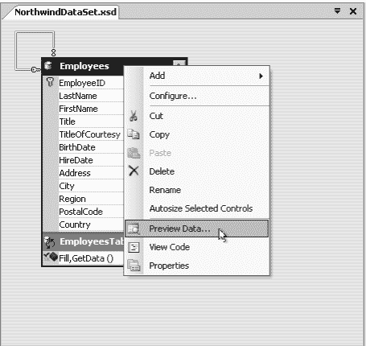

图 3-18 从数据设计器中打开数据预览对话框。

在数据预览对话框中，首先选择要预览的对象。如果该对象是参数化查询，请在对话框中的单独控件中输入参数值。然后单击"预览"按钮执行查询；结果数据将如图 3-19 所示显示。

> **注意** 在"预览数据"对话框中执行的更改数据库中数据的查询（如 INSERT、UPDATE 和 DELETE 查询）不会影响数据库。

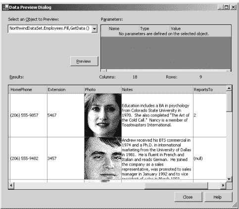

图 3-19 数据预览对话框。

###### 文档大纲

在 Visual Studio 2005 IDE 的早期版本中，文档大纲窗口允许您通过标记层次结构的可视化表示来查看 HTML 或 ASPX 页面的结构。该窗口使用树视图显示页面上的 HTML 标签、脚本元素和控件，您可以展开或折叠树视图以专注于页面的特定区域。通过双击视图中的任何项目，您可以直接在页面上导航到该项目。此功能已延续到 Visual Studio 2005，并扩展为可以同样清晰地查看 Windows 窗体上的元素。

Windows 窗体布局的文档大纲窗口（如图 3-20 所示）提供了一种管理窗体上控件的简便方法。与文档大纲窗口的最初版本一样，您可以在浏览大纲时展开和折叠包含项。要在窗体设计器中选择控件，请在树视图中单击相应项目。您可以合理地认为，鉴于任何非简单 Windows 窗体应用程序中常见的复杂控件布局——其中可能包含多个深层嵌套的组件或隐藏组件——将文档大纲功能扩展到窗体，比仅用于简单网页编辑能为开发者带来更大的便利。此外，您还可以在容器层次结构内将控件从一个容器拖放到另一个容器。

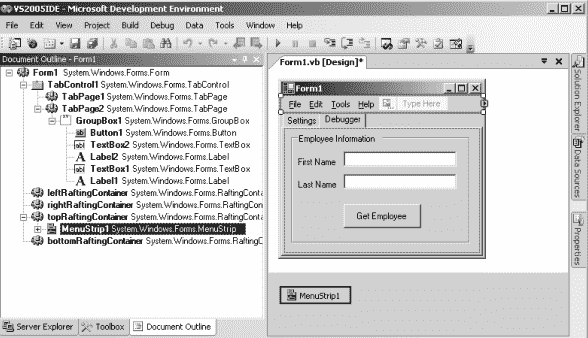

图 3-20 文档大纲窗口。

> **注意** 在文档大纲窗口中重新排列控件仅适用于 Windows 窗体，不适用于网页。

###### 窗口停靠增强

开发环境的另一个值得注意的增强是引入了停靠指南（图 3-21）。当您在 IDE 中重新排列窗口时，设计界面上会出现可更改的图标，引导您找到可以放置窗口的区域。如果将鼠标悬停在图标上，IDE 的关联区域将变为阴影，以指示如果您选择完成操作后窗口将出现的位置。

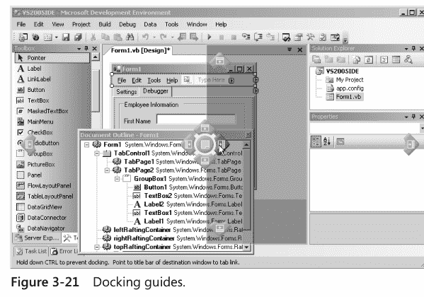

图 3-21 停靠指南。

##### 类设计器

类设计器（如图 3-22 所示）是一个可视化设计工具，用于检查和操作类及其他类型的结构。该工具与设计器中显示类型的底层源代码完全集成；例如，如果您更改了属性名称，代码文件将自动更新以反映该更改。反过来，在源代码中所做的更改会立即影响设计器中关联对象的外观。设计器与代码之间的这种同步编辑关系使得以可视化方式创建和配置 CLR 类型变得非常简便。

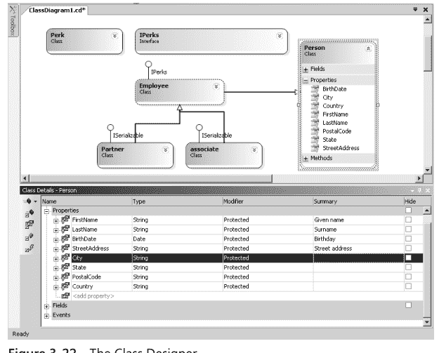

图 3-22 类设计器。

##### 编写正确的代码

Visual Studio 2005 包含多个工具——其中一些是旧功能的增强，一些是全新功能——旨在实现一个共同目标：使开发人员在设计时更容易编写正确的代码。在以下章节中，我们将介绍 IDE 中一些关键领域，这些领域使得 Visual Studio 2005 中的编码体验更不容易出错。

###### IntelliSense 增强

Microsoft IntelliSense 技术延续了以前版本 Visual Studio 的关键功能，例如自动跟踪特定类型中最常用的成员。此外，IntelliSense 已经改进，增加了一项功能，可以选择显示类型的所有成员（如图 3-23 所示）还是仅显示最常用的成员。

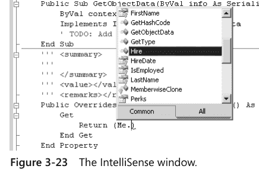

图 3-23 IntelliSense 窗口。

如果选择"All"按钮，则显示类型中的每个成员（包括隐藏成员）。如果单击"Common"按钮，显示内容将更改为仅显示该类型中最常用的成员。如果您经常只使用某个特定类型的几个属性和方法（尤其是那些拥有大量成员的类型），使用 IntelliSense 的 Common 模式可以使您在编写代码时更容易找到这些项目。

###### 语法错误辅助

以前版本的 Visual Basic 开发环境在提供设计时反馈方面一直独具特色，尤其是在涉及语法错误的反馈时。代码编辑器在包含错误的代码项下方显示一条波浪线。将光标悬停在波浪线上方会短暂显示一个描述问题的 ToolTip。这种设计时语法检查形式多年来一直是 Visual Studio 的一个重要功能，确实很有帮助，但错误描述是否能提供足够的信息来纠正问题仍然是不确定的。

在 Visual Studio 2005 中，Microsoft 对此功能进行了增强，旨在使您能够立即纠正错误。它使用的是您在以前版本的 Visual Studio 中所熟悉的相同 UI 行为。如果您编写的代码被后台编译器识别为语法错误，代码编辑器中会显示相同的波浪线。如果将光标悬停在指示错误的波浪线上，不仅会显示相同的描述性 ToolTip，您还会看到一个小的帮助图标。单击该图标会打开一个对话框，该对话框不仅显示错误的描述，还列出一个或多个问题的解决方案（如图 3-24 所示）。要实现其中一个建议的修复方法，您只需单击相应的修复项即可。


图 3-24 错误修正对话框。

###### 设计时表达式求值

Visual Studio 2005 中的"即时窗口"已增强，允许您无需执行应用程序即可测试代码。例如，假设您在 Visual Basic .NET 项目中构建了一个类，该类包含多个属性和方法。要测试此代码，您需要添加一个窗体或构建一个控制台包装器来实例化该类。在"即时窗口"中工作时，您可以实例化该类的一个实例、设置对象的属性并调用其方法。此外，如果您在代码中设置了断点，并在"即时窗口"中调用方法或访问属性，执行将停在断点处，允许您逐步执行代码，就像显式调用了调试器一样。

###### 错误列表和任务列表

以前版本 Visual Studio 的用户会发现，原来完全在任务列表中提供的功能现在分布在两个独立的工具窗口中。错误列表是一个新的工具窗口，显示由 IntelliSense 引发的语法错误消息以及由 Visual Basic .NET 编译器报告的构建错误。任务列表在 Visual Studio 2005 IDE 中的范围已缩小，仅显示待办事项提醒，例如作为注释插入代码中的 TODO 任务。

###### 代码片段

代码片段是 Visual Studio 2005 IDE 的另一项令人兴奋的创新。此功能允许您将执行常见任务的代码模板插入到代码编辑器中。例如，假设您想要在应用程序中的 Windows 窗体控件中添加拖放功能。您可能在最近的项目中编写过此代码，但不太可能已将其熟记于心。与其在旧项目文件中搜寻代码或在 MSDN 或网络上费力查找，代码片段让您能够以可重用的形式捕获代码，并可直接从代码编辑器中使用。


面向开发者的 Microsoft Visual Basic 2005 简介

Visual Studio 2005 安装时包含许多按功能分类的实用代码片段，如图 3-25 所示。这些代码片段包括用于读写文件、验证日期格式或电子邮件字符串格式等内容，这里仅列举几例。

```
Public ReadOnly Property Perks() As IPerks Implements IPerks.Perks
    Get
        Return _perks
    End Get
End Property
```

图 3-25 代码片段。

代码片段还会根据作用域进行验证。这意味着只有适合你当前代码位置（例如在方法或函数内部）的代码片段，才会在菜单选项中显示。

###### 符号重命名

如果你和许多开发人员一样，在开始一个新的 Visual Basic .NET 项目时，往往会使用窗体、控件和其他代码元素的默认名称。过一段时间后，当应用程序初具规模，你会根据组织中使用的命名约定重新命名各个项目。如果你的目标是编写专业的代码，这虽然繁琐但却是必要的清理工作。符号重命名工具通过提供一种简便的方法来全局更新名称，帮助减轻重命名代码元素的痛苦，并消除了引入不必要的语法错误的风险。要在代码编辑器中使用此功能，请在代码中右键单击某个元素，然后从上下文菜单中选择"重命名"，如图 3-26 所示。

在"重命名"对话框中，输入符号的新名称，如图 3-27 所示。

#### 调试器增强功能

Visual Studio 2005 提供了多种工具用于在调试环境中查看数据。其中许多工具在 Visual Studio 的多个版本中就已存在（例如"监视"窗口、"局部变量"窗口和"自动"窗口）。这些工具提供了多种不同的方式来查看应用程序数据。不过，你仍可能遇到在调试过程中难以检查数据的场景。在接下来的章节中，我们将探索调试器环境和工具的增强功能，使你更容易在运行时诊断和修复错误。

##### DataTips

DataTips 一直以来都是在调试器中快速查看简单数据类型的绝佳方式。然而，在早期版本的 Visual Studio 中，对于复杂数据类型，你只能看到类型的名称，而无法看到其中包含的数据，如图 3-28 所示。Visual Studio 2005 中 DataTips 的一项重要改进是，它们现在可以显示复杂数据类型的成员，如图 3-29 所示。

```
Private Sub Button1_Click(ByVal sender As System.Object,
    Dim myEmployee As VS2005IDE.Associate
    myEmployee = New VS2005IDE.Associate
    myEmployee.Salary = 90000
End Sub
```

图 3-28 简单数据类型。

图 3-29 复杂数据类型。

DataTips 的另一项增强功能是，无论对于简单类型还是复杂类型的每个成员，你都可以获取一个上下文菜单。该上下文菜单包含用于为所选类型添加监视、编辑类型值或查看类型十六进制值的选项。（参见图 3-30。）

你也可以通过选择值并直接输入新值来在 DataTip 中编辑成员值，如图 3-31 所示。

图 3-31 更新成员值。

完成成员变量的修改后，DataTip 会自动显示更新后的值，如图 3-32 所示。

图 3-32 更新后的成员值。

##### 可视化工具

Visual Studio 2005 调试器中一种更高级的数据检查工具是*可视化工具*。可视化工具是一种对话框，它以适合特定数据类型的方式显示变量或对象。例如，字符串变量可以使用 Visual Studio 2005 附带的四种默认可视化工具之一，以 HTML、XML 或纯文本的形式进行可视化。

所有各种调试工具——DataTips、"监视"窗口、"局部变量"窗口或"自动"窗口——都会在可以使用可视化工具查看的数据类型旁边显示一个放大镜图标。单击放大镜可以选择一个可视化工具来显示相应对象的数据类型。

除了上述三种基于文本的可视化工具外，默认还包含一个数据集可视化工具，让你更轻松地检查数据集中包含的数据。

> **提示** 未来可能会有更多可视化工具可以从 Microsoft 下载获取。

##### 异常助手

异常助手是 Visual Studio 2005 引入的一种新调试工具。当发生运行时异常时，它会以对话框的形式出现，显示有关错误的详细信息。值得注意的是，异常助手对话框还包含了处理异常的故障排除提示。

对话框标题栏显示错误类型，其下方是错误描述。助手顶部是故障排除提示部分，在大多数情况下会提供指向帮助内容的链接，帮助你诊断问题。不过在许多情况下，助手会提供逐步说明来指导你纠正错误。

##### 自定义数据显示

Visual Studio 2005 提供了多个选项来自定义调试器中的数据显示。以下章节将介绍三种可用于操作调试器中数据显示方式的技术。

###### 重写自定义类型的 ToString 方法

更改调试器中自定义类型显示数据的最简单技术是重写基对象的 *ToString* 方法，如下所示：

```
Overrides Function ToString() As String
    Return Me.FirstName & " " & Me.LastName
End Function
```

###### 使用调试器显示属性

其他情况则需要对数据的显示方式进行更多控制。你可能需要以不同的方式格式化底层数据，或限制调试器中显示的数据量。.NET Framework 提供了三个属性类来控制调试器中的数据显示方式：

*DebuggerDisplayAttribute* 将此属性应用于类型，可在调试器的数据窗口中为该类型添加摘要。例如，以下代码演示了如何为自定义数据类型添加摘要：

```
<DebuggerDisplay("Associate ( { FullName } ") >_
Public Class Associate
Private FullName as String
   . . .
End Class
```

*DebuggerDisplayAttribute* 的构造函数接受一个字符串格式规范。花括号内的文本可以表示包含类的属性或方法。请注意，你可以使用类的私有和公共成员。

*DebuggerBrowsableAttribute* 将此属性应用于类中的成员，以控制是否在调试器中显示该成员。

```
Public Class Associate
   <DebuggerBrowsable( False ) > _
   Public Property SocialSecurityNumber As String
      . . .
   End Property
End Class
```

在前面的伪代码中，应用于 *Associate* 类的 *SocialSecurityNumber* 属性的 *DebuggerBrowsableAttribute* 将阻止该属性在调试器窗口中显示。

*DebuggerTypeProxyAttribute* 此属性提供了最大的灵活性，允许你用自定义调试器类型替代应用了该属性的成员。

```
<DebuggerTypeProxy( GetType( AssociateProxy ) )>_ _
Public Class Associate
   . . .
End Class
```

*DebuggerTypeProxyAttribute* 构造函数的输入参数指定用作该类型数据显示代理的类。作为最佳实践，你应该将代理类实现为应用该属性的数据类型的嵌套内部类。这样，嵌套类就可以完全访问它所描述类型的私有成员。


### 操作演练

本演练将演示如何使用类设计器来构建并以可视化方式创建一个类层次结构。

该应用程序是一个类库，旨在为一家虚构的专业服务公司表示数据实体。该类库表示了两种类型的员工实体：合作伙伴和助理。这些实体在类库中分别使用 `Partner` 和 `Associate` 类进行建模。由于它们共享许多共同的属性和操作，`Partner` 和 `Associate` 类都派生自一个名为 `Employee` 的基类，而 `Employee` 类又派生自它自己的基类 `Person`。

此外，设计要求 `Partner` 和 `Associate` 类必须是可序列化的，并且类本身在序列化过程中需要执行自定义代码。为实现此目标，这两个类都实现了 `ISerializable` 接口，该接口包含在 `System.Runtime.Serialization` 命名空间中。

抽象的 `Employee` 类还实现了一个名为 `IPerks` 的自定义接口，该接口包含在项目中。此接口满足了项目的一个设计目标，即为不同类别的员工提供一种建模福利的方式，因此对于从 `Employee` 类派生的任何类型，此接口的实现都可以有所不同。

项目文件中包含 `ClassDiagram1.cd` 文件，该文件由类设计器工具生成。如果在 Visual Studio 2005 的文档窗口中打开此文件，您将看到它提供了类库对象层次结构的可视化表示。尽管这个特定的示例相对简单，但该图表让您能立即理解类库中各种类之间的关系。您还可以使用类设计器来更改任何类的属性或关系。由于类设计器与 Visual Studio 2005 IDE 紧密集成，您在图表中对对象所做的任何更改都会立即反映在底层代码文件中。

### 结论

Visual Studio 2005 集成开发环境包含许多新增和改进的生产力功能。该 IDE 也经过重新设计，旨在为开发人员提供更直接地访问 .NET Framework 组件的途径，例如新的设置和资源架构。

# 第 4 章

## 构建以数据为中心的应用程序

### 本章内容：

- 应用程序：表适配器和 DataConnector 类 .................... 96
- 应用程序：数据的智能标记....................................................... 110
- 应用程序：主从窗体和参数化查询 ............... 114
- 应用程序：对象数据源 ......................................................... 122

第 1 章向您介绍了 ADO.NET 的基础知识，以及数据访问从 Visual Basic 6 开始发生的改变。接下来的这四个应用程序将向您介绍 Visual Studio 2005 和 .NET Framework 2.0 中用于构建以数据为中心的应用程序的增强功能。ADO.NET 是一个宏大的主题，足以单独写满一本书。这些应用程序旨在作为起点，让您能够使用 MSDN 文档和在线资源（如 http://msdn.microsoft.com）进一步研究 ADO.NET。

开发人员最常遇到的挫折之一，就是不得不学习产品的新版本，而新版本会使旧组件过时或显著改变执行常见任务的方式。不可避免的学习曲线通常会在短期内对生产力产生负面影响。

微软为 ADO.NET 2.0 设定了一个目标：在不改变或破坏现有功能的前提下对其进行增强和扩展。1.1 版中的所有功能在 2.0 版中仍然可用，但现在有更多高效的方法来执行常见的数据库任务。例如，“数据源”窗口提供了一个集中的位置，用于创建和配置访问数据源（例如 SQL Server）所需的关联对象。添加到控件上的智能标记提供了对常见开发任务的快速访问，例如更改控件的类型（例如，将 TextBox 更改为 Label）。您还可以使用智能标记重新配置数据源，甚至创建新查询，以根据用户输入提取过滤后的数据（即创建参数化查询）。

在探索了接下来的四个应用程序之后，您将看到 Microsoft Visual Studio 2005 和 .NET Framework 2.0 如何提高生产力，并使从应用程序连接到数据源变得比以前的开发工具容易得多。

### 应用程序：表适配器和 DataConnector 类

在这个第一个应用程序中，您将了解新的表适配器和 *DataConnector* 类。这两个类将通过提供强大的功能来帮助简化您的 ADO.NET 开发任务，这些功能您可以立即在应用程序中使用，同时，也减少了您为执行常见任务而必须手动编写的代码量。

#### 新概念

如第 1 章所述，ADO.NET 的主要设计目标之一是对处理断开连接数据提供一流的支持。ADO.NET 通过一组划分为不同命名空间的类，提供了一种直观的方式来处理断开连接的数据。您不需要了解每个命名空间的每个类就能有效地使用 ADO.NET。相反，您可以专注于包含访问特定数据源所需类的命名空间。表 4-1 列出了一些组成 ADO.NET 的最常见的命名空间和类。

**表 4-1 ADO.NET 命名空间**

| 命名空间 | 用途 | 常见类 |
| --- | --- | --- |
| System.Data | ADO.NET 中通用的类 | DataSet、DataTable 和 DataView |
| System.Data.Common | ADO.NET 中不同数据提供程序（如 SqlClient、OleDb 等）使用的一组新基类 | DataAdapter、DbCommand 和 DbConnection |
| System.Data.SqlClient | 包含用于连接到 Microsoft SQL Server 的数据提供程序类 | SqlConnection、SqlCommand 和 SqlDataAdapter |
| System.Data.SqlTypes | 包含用于表示 SQL Server 中使用的原生数据类型的类 | SqlString、DateTime 和 SqlInt32 |
| System.Data.OleDb | 包含用于访问 OLE DB 数据源的类 | OleDbConnection、OleDbCommand 和 OleDbDataAdapter |
| System.Data.ODBC | 用于连接到 ODBC 数据源的类 | OdbcConnection、OdbcCommand 和 OdbcDataAdapter |
| System.Data.OracleClient | 用于访问 Oracle 数据源的类 | OracleConnection、OracleCommand 和 OracleDataAdapter |
| System.Xml | 包含提供基于标准的支持来访问和处理 XML 数据的类 | XmlAdapter、XmlReader 和 XmlWriter |

##### System.Data.DataSet

`*DataSet*` 对象用于保存来自一个或多个数据源的数据。它将数据维护为一组表，并在这些表之间定义可选的关系。`*DataSet*` 类被设计为通用的，因此不绑定到任何特定类型的数据源。数据可以从许多数据源加载到 `*DataSet*` 中，包括 Microsoft SQL Server、Oracle 数据库、Microsoft Access、Microsoft Exchange、Microsoft Active Directory 或任何符合 OLE DB 或 ODBC 标准的数据源。

尽管不绑定到任何特定的数据源，`*DataSet*` 类旨在保存关系表数据，就像在 Microsoft SQL Server 等关系数据库中找到的数据一样。图 4-1 是 `*DataSet*` 中两个相关表的可视化表示。

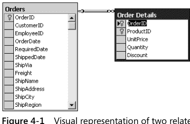

**图 4-1** DataSet 中两个相关表的可视化表示。

图 4-1 中显示的每个表在 `*DataSet*` 中都体现为一个 `*DataTable*`。这两个表之间的关系在 `*DataSet*` 中体现为一个 `*DataRelation*` 对象。`*DataRelation*` 对象提供通过外键将子表与父表关联的信息。请记住，图 4-1 仅仅是特定 `*DataSet*` 实例结构的可视化表示。一个 `*DataSet*` 可以保存任意数量的表，并在它们之间定义任意数量的关系。

图 4-1 实际上是 Visual Studio 2005 中新的 DataSet 设计器的屏幕截图。图 4-2 显示了在新的“数据源”窗口中使用 DataSet 设计器编辑数据源结构。本章后面的应用程序“操作演练”部分将进一步讨论 DataSet 设计器。

##### 从数据库中检索数据

虽然使用 *DataSet* 有几种方式，但最常见的用法是连接到数据库，并用来自数据库的数据填充 *DataSet*。在 ADO.NET 中，每个数据提供程序（*SqlClient*、*OleDb* 等）都提供了一组用于与数据源交互的专用类。要从数据库检索数据，你需要连接到数据库，执行查询或存储过程，然后用结果填充 *DataSet*。要完成所有这些操作，需要一组协同工作的对象，包括连接对象和命令对象。

每个 ADO.NET 数据提供程序都包含一个用于连接其支持的数据源类型的专用连接类。例如，*SqlConnection* 类允许你的应用程序连接到 SQL Server 7.0 或更高版本。你也可以使用 *OleDbConnection* 对象，但 *SqlConnection* 类针对与 SQL Server 交互进行了优化，使其成为更好的选择。对于没有特定 ADO.NET 数据提供程序的数据源，只要有适用于该数据源的 OLE DB 提供程序，你就可以使用 *OleDbConnection* 对象。*OleDbConnection* 类是你用来连接非数据库数据源（如分隔文本文件）时会用到的。

一旦你与数据源建立了连接，就需要使用来自数据提供程序的其他对象从数据源中提取数据，并用这些数据来填充 *DataSet*。在 Visual Studio .NET 2003 中，填充 *DataSet* 的方法是使用数据适配器对象。每个 ADO.NET 数据提供程序都包含其独特的数据适配器类。例如，*SqlClient* 提供程序包含 *SqlDataAdapter* 类。*SqlDataAdapter* 类需要一个 *SqlCommand* 对象和一个 *SqlConnection* 对象来检索数据。你可以向数据适配器提供一个 SELECT 语句或存储过程，让它生成自己的 *SqlCommand* 对象，或者你可以显式创建自己的 *SqlCommand* 对象来选择数据，并将其分配给 *SqlDataAdapter* 的 *SelectCommand* 属性。调用数据适配器的 *Fill* 方法会告诉数据适配器执行其 *SelectCommand*，并用 *SelectCommand* 检索到的数据填充 *DataSet*。以下代码是使用 *SqlDataAdapter* 填充 *DataSet* 的示例。

```vb
Dim conn As New SqlConnection
conn.ConnectionString = _
    "server=(local);database=Northwind;Trusted_Connection=True"

Dim adapter As SqlDataAdapter
adapter = New SqlDataAdapter("SELECT * FROM Products", conn)

Dim dsProducts As New DataSet

conn.Open()
adapter.Fill(dsProducts)

conn.Close()
```

在 Visual Studio 2005 之前，数据适配器是 *DataSet* 与实际数据源之间的唯一桥梁。如果你对 *DataSet* 中的数据进行了更改，你需要为 *DataSet* 中的每个表使用不同的数据适配器，并且必须调用每个数据适配器的 *Update* 方法。

虽然在 Visual Studio 2005 中完全支持使用数据适配器来读取和更新数据的方法，但也有一些新的读写数据的方式，可以减少并简化你需要编写的代码。在本应用程序中，你将看到如何仅通过编写一行代码来建立数据库连接并从 Northwind 数据库检索数据。此应用程序重点介绍 Visual Studio 2005 和 .NET Framework 2.0 中的一些新数据组件和功能，包括表适配器和 *DataConnector* 类。

#### 演练

使用 Visual Studio 2005，你可以创建数据驱动的应用程序，仅用一行代码就能在数据网格中展示你的数据。当然，这需要比那一行代码包含更多信息。但是，设置数据库连接、逐个填充多个数据表以及进行数据绑定的繁琐工作全部由 Visual Studio 2005 为你处理。两个新的 IDE 功能——数据源窗口和数据源配置向导，可以帮助你使用新类（如 *DataConnector*）来设置数据访问。

此应用程序从一个名为 NorthwindGrid 的新 Windows 应用程序开始。根据你的 IDE 设置，Visual Studio 2005 可能不会自动显示数据源窗口。如果数据源窗口未显示，你可以选择“数据 | 显示数据源”菜单命令。然后你将看到一个新的浮动窗口，你可以将其停靠在 IDE 中，如图 4-3 所示。

停靠好数据源窗口后，选择“数据源”选项卡使其成为活动窗口，然后单击“添加新数据源”链接或窗口工具栏上的“添加新数据源”按钮。这将显示数据源配置向导的起始页。阅读欢迎消息，然后单击“下一步”开始配置你的数据源，如图 4-4 所示。

数据源配置向导支持四种类型的数据源。第一个选项“数据库”允许你为本地计算机或远程服务器上的数据库服务器创建数据源。第二个选项“本地数据库文件”允许你选择 .MDF SQL Server 数据库文件或 Microsoft Access .MDB 文件。如果你的数据将来自 Web 服务，你可以选择第三个选项向你的项目添加新的 Web 引用。第四个选项是“对象”。此选项允许你将用户界面绑定到你自己的某个类。对象数据源将在后面的“应用程序：对象数据源”部分中介绍。本应用程序使用数据库数据源。

数据源配置向导的下一步是选择现有连接或为你的数据源创建新连接。首次运行向导时，没有预先存在的连接可用。但在后续使用向导时，你可以选择重用以前创建的连接。当你在向导中单击“新建连接”按钮时，将显示“连接属性”对话框，如图 4-5 所示。你可以使用此对话框配置连接到数据库服务器的所有设置。

向导将为你提供将生成的连接字符串保存到应用程序配置文件 (app.config) 的选项。如果你将在项目中再次使用相同的连接，将连接字符串自动保存到 app.config 非常方便。

向导中的下一步配置（如图 4-6 所示）要求你为该数据源选择数据库对象。你可以选择任意数量的表、视图、存储过程和函数。

当你选择一个数据库对象（如表）时，可以在树视图中展开其节点（如图 4-6 所示），并选择仅从该表中选择特定列。选择完数据库对象后，向导将自动为你构建 SELECT 语句（或存储过程和函数调用）。

数据源配置向导完成后，一个新的数据源将被添加到数据源窗口中。（示例请参见图 4-3。）数据源窗口以树视图的形式显示数据源，根节点是一个 DataSet 节点，其中包含在数据源配置向导中选择的每个数据库对象（表、视图等）的节点。如果你展开其中一个表，如图 4-7 所示，你会看到只有在数据源配置向导中选定的字段才包含在 DataSet 中。

如果你想在窗体上的网格中显示某个表中的数据，只需将相应的节点从数据源窗口拖到你的窗体上。Visual Studio 2005 将自动创建一个数据绑定的 DataGridView 控件和一个位于窗体顶部的伴随导航栏。生成的窗体如图 4-8 所示。


 ## 第4章：构建以数据为中心的应用程序

图4-8 设计时带有数据绑定 DataGridView 控件的表单。

如果您曾使用 Visual Studio .NET 2003 创建数据驱动应用程序，那么您可能曾在某个时刻将数据适配器拖动到表单上，并经历了数据适配器配置向导。数据适配器配置向导会将连接和数据适配器对象放置在您表单的组件托盘中。Visual Studio 2005 则会向组件托盘中添加四个对象：一个 *DataSet*、一个 *DataConnector*、一个表适配器和一个 *DataNavigator*。

> **注意** 组件托盘是 IDE 中的一个特殊区域，用于显示托管在 Windows 或 Web 表单上但没有用户界面的控件。在 Visual Basic 6 中，没有用户界面的控件（例如 *Timer*）仍然必须放置在表单设计表面上，这使得设计时的控件放置变得笨拙。

在此应用程序中添加到表单的 *DataSet* 仅仅是 *DataSet* 类的一个实例，它是在创建数据源时自动生成的。

##### DataConnector

*DataConnector* 是 .NET Framework 2.0 中的一个新类。它充当其他控件绑定到的数据源。它所公开的数据是 *DataConnector* 从其自身数据源获取的数据。*DataConnector* 的典型用途是将数据绑定控件与数据源中的一个表连接起来（例如，在"数据源"窗口中定义的 *DataSet* 中的 *DataTable*）。如果没有 *DataConnector* 组件，要将 *DataGridView* 控件仅绑定到 *DataSet* 中的一个表，就需要编写代码。但通过使用 *DataConnector* 控件，您可以将 *DataConnector* 的数据源配置为来自 *DataSet* 的单个表。然后将 *DataGridView* 绑定到 *DataConnector*。这样您就能理解 *DataConnector* 这个名称的由来——它有助于将组件或控件与 *DataSet* 中的数据子集连接起来。*DataConnector* 还可以将命令从数据使用者传递到数据源。

##### 表适配器

表适配器是 Visual Studio 2005 中的新功能。它们是设计器生成的组件，用于将您的 DataSet 对象与其底层数据源连接起来。当您在应用程序中创建数据组件时（例如通过数据源配置向导），会自动创建一个或多个自定义表适配器。表适配器类似于数据适配器，但它们是强类型的，这意味着每个表适配器都是一个唯一的类，由 Visual Studio 2005 自动生成，仅用于处理您为特定数据库对象（例如 Products 表）选择的字段。

当您使用 ADO.NET 创建数据库应用程序时，通常会大量使用 DataSet 对象。DataSet 保存您的数据，但它依赖其他对象将数据移入和移出底层数据源。在 .NET Framework 1.1 中，数据适配器对象是数据源的生命线，您必须为 DataSet 中的每个 DataTable 创建一个数据适配器。例如，如果您要创建一个 DataSet 来保存 Northwind 数据库中的 Orders 和 Order Details 表，您将需要两个数据适配器。

.NET Framework 2.0 中的新表适配器与数据适配器不同，因为它们可以包含多个查询来支持来自数据源的多个表，从而允许一个表适配器更新 DataSet 中的多个表。使用前述示例的表适配器，您将有一个包含两个查询的表适配器：一个用于 Orders 表，一个用于 Order Details 表。在此应用程序中，表适配器中只有一个查询（用于 Customers 表）。如果您在"数据源"窗口中右键单击 Customers 表并选择"使用设计器编辑数据源"，则为 Customers 返回的数据结构将在数据集设计器中打开，如图4-9所示。

图4-9 CustomersTableAdapter 查询。

如图4-9所示，在 Customers 表的底部有一个标记为 Fill,GetData() 的项。此项包含表适配器中 Customers 表的连接和查询信息。如果您查看 *CommandText* 属性（在"属性"窗口中），可以看到用于填充 Customers 表的 SELECT 语句的开头。

如果您需要表的过滤数据视图，可以创建额外的查询来填充 *DataSet* 中的表。对于此应用程序，您可以右键单击 Customers 表的 CustomersTableAdapter 标题（如图4-9所示），然后选择"添加查询"菜单命令。

> **注意** 如果您在表适配器中创建多个查询，则必须确保返回的数据正确映射到表架构；否则，查询将失败。

#### DataNavigator

新的 *DataNavigator* 组件提供了用于导航绑定到用户界面控件的数据的服务。它所提供的服务类似于 Visual Basic 6 中的 Data 控件，后者通过一组导航按钮提供导航服务。ADO.NET 中的 *DataNavigator* 组件旨在允许在 *DataSet* 的记录之间进行导航。它还提供了允许添加、编辑和删除数据的服务。

*DataNavigator* 控件的功能通过一个或多个 *ToolStrip* 控件公开，如图4-8所示。*ToolStrip* 按钮执行添加和删除记录等任务。

如果您使用过早期版本的 ADO.NET，就会知道在 *DataSet* 中导航记录并不像它本可以做到的那么简单。使用 ADO *Recordset* 时，您有 *MoveFirst*、*MovePrevious*、*MoveNext* 和 *MoveLast* 方法，这些方法允许在 *Recordset* 数据中导航。这些导航功能是通过使用游标来实现的，游标用于维护您在 *Recordset* 中的当前位置并浏览记录。替代 *Recordset* 对象成为基于记录的中央数据对象的 ADO.NET *DataSet* 没有游标，也不知道其内容来自哪个数据存储。如果没有游标或等效对象来维护位置，导航就不那么容易了。

在表单上将控件绑定到 ADO.NET *DataSet* 并提供保持所有控件同步的导航服务，是通过两个称为 *CurrencyManager* 和 *BindingContext* 的对象来实现的。对于应用程序中的每个数据绑定表单，您将至少有一个 *BindingContext* 对象。此对象将负责任何存在的 *CurrencyManager* 对象。对于表单上的每个数据源，您将有一个 *CurrencyManager* 对象。*CurrencyManager* 对象负责跟踪您在 *DataSet* 中的位置，并总体监督与数据源的绑定。您可以调用 *CurrencyManager* 对象上的必要方法来浏览记录，而 *BindingContext* 确保所有绑定控件保持同步。此应用程序中使用的 *DataNavigator* 控件以更易于使用的形式提供了该功能。

此应用程序的组件是使用可视化设计器创建并连接在一起的。导航栏无需任何代码即可正常工作。唯一需要的代码是一行使用表适配器通过从数据源提取数据来填充 *DataSet* 的代码。这是在表单的 *Load* 事件处理程序中完成的，如下所示：

```
Private Sub Form1_Load(ByVal sender As System.Object, _
                        ByVal e As System.EventArgs) Handles MyBase.Load
    Me.CustomersTableAdapter.Fill(Me.NorthwindDataSet.Customers)
End Sub
```

此事件处理程序以及填充数据集和填充网格的代码由 Visual Studio 2005 自动添加。您只需按 F5 即可看到从数据库加载的数据网格。此应用程序所实现的成就不容小觑，尽管其看似简单的指向和点击操作。如果您查看 *InitializeComponent* 方法，您将看到大约 300 行您不必编写的代码——这是一项显著的生产力提升！

虽然发生了很多事情，但此应用程序相对简单。它展示了连接数据库和填充网格控件的基础知识。其余的数据应用程序将突出显示 Visual Studio 2005 中 ADO.NET 的其他方面。

##### 数据集设计器

此时值得花些时间更仔细地了解数据集设计器。此工具已进行重大改进，是 Visual Studio 2005 中数据访问方面最显著的增强功能之一。

在 Visual Studio .NET 2003 中，当您想要编辑 *DataSet* 的结构时，需要通过编辑 XML 架构（XSD）来完成。虽然有一个可视化设计器，但术语和用户界面与 *DataSet* 及其组成对象（例如 *DataTable*）并不一致。

使用新的"数据源"窗口，您可以右键单击它并选择"使用设计器编辑数据源"。这将打开数据集设计器，并允许您对 *DataSet* 的结构进行更改。通过此 *DataSet* 视图，您可以以与 *DataSet* 更直接相关的方式图形化地操作表和查询，而不必处理 XML 架构。


为了帮助你理解数据集设计器的一些功能，请考虑一个可能在任何处理数据库数据的应用程序中出现的潜在问题。有时你可能忘记添加应用程序显示数据所需的某个表。在 Visual Studio 2005 中，你可以直接在数据集设计器窗口中添加缺失的表，方法是在设计器界面的空白区域右键单击，然后选择“添加 | 数据组件”。设计器会将一个新表添加到数据集设计器窗口，并打开数据组件配置向导。

数据组件配置向导与数据源配置向导的部分类似。数据组件配置向导会提示你为新表设置与数据源的连接，并为数据读写操作提供或选择查询或存储过程。通过该向导，你可以启动查询生成器来创建图形化查询界面。数据库中的表、视图和函数都可以在查询生成器中使用，如图 4-10 所示。

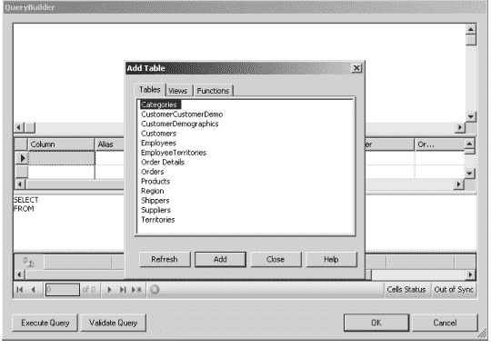

**图 4-10** 图形化查询生成器。

在向导中设置好查询后，你可以选择将几个专用方法添加到你的 *数据集* 中。**Fill** 方法（你可以根据需要重命名）用于用数据填充表。**GetData** 方法（你也可以根据需要重命名）返回对已填充的 *DataTable* 实例的引用。你还可以选择创建用于将数据更改更新到数据源的方法。向导页面如图 4-11 所示。

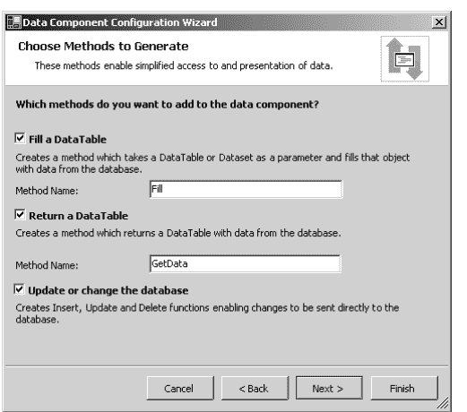

**图 4-11** 数据组件配置向导。

当你向 *数据集* 添加新表时，向导会读取数据库架构，并向 *数据集* 中已有的表添加任何适当的关系。这些关系在数据集设计器中以表之间的线条表示，如图 4-12 所示。

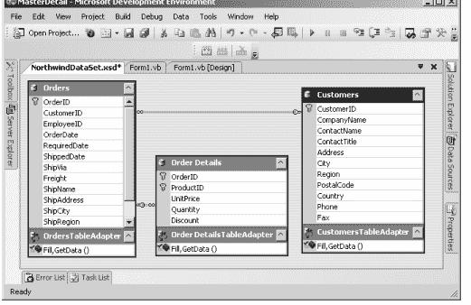

**图 4-12** 数据集设计器中的相关表。

设计器中可能令人困惑的一个方面是，关系线仅仅描绘了两个表相关的事实。但显然，关系必须在表中的字段之间。通过目视检查每个表中的字段，通常可以明确关系。但是，如果字段列表非常长，可能更难快速推断关系。幸运的是，设计器提供了一个功能，允许你通过显示和编辑标签更清晰地以图形方式指示关系。如果你右键单击一条关系线并选择“显示关系标签”，关系名称将显示在可视设计器中。

默认名称 `FK_Orders_Customers` 并未说明 Orders 表和 Customers 表是如何相关的——它只是告诉你这两个表之间存在关系。要编辑标签以指示关系，请右键单击关系线并选择“编辑关系”。这将打开如图 4-13 所示的“关系”对话框。

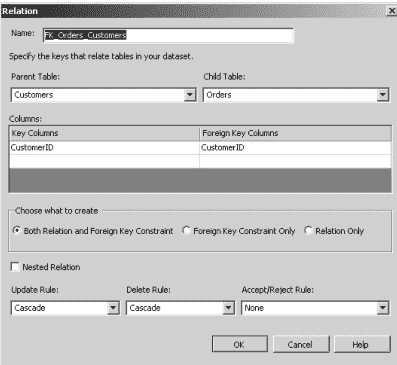

**图 4-13** 用于编辑关系的“关系”对话框。

“关系”对话框允许你管理关系，包括构成关系的表和列。更改关系的名称将更改数据集设计器中显示的标签。将关系的名称更改为 `Customers_CustomerID_Orders` 会使关系更具自我解释性，因为它表示这些表是通过 `CustomerID` 字段相关的。

“关系”对话框还允许你更改关系的类型（外键约束、关系或两者兼有），以及当父记录被更新或删除时相关记录会发生什么（即，我们是使用级联，还是设置为 *SetNull*、*SetDefault*，或者不发生任何事情）。你还可以配置关系，以便在父记录的更改被接受或拒绝时，自动接受或拒绝子记录中的更改。

### 结论

正如你从这个应用程序中看到的那样，Visual Studio 2005 使得使用网格进行数据访问和显示的配置变得非常简单。新的表适配器模型将数据库连接、命令和数据适配器对象捆绑在一起，为数据驱动的应用程序提供了简化的编程模型。只需一行简单的代码和几次鼠标点击，你就可以拥有一个可以执行数据库更新、添加和删除操作的实用数据库应用程序。新的数据集设计器允许你使用易于使用的可视设计器来配置设置并编辑数据源的结构（以及后续的行为）。

新的 *DataConnector* 类充当数据访问对象和数据消费对象之间的中介。新的 *DataNavigator* 组件提供在记录之间移动、添加和删除记录的导航服务。*DataNavigator* 组件管理 *ToolStrip* 控件，这些控件提供了浏览数据记录的用户界面。这个应用程序使用了所有这些新功能，仅通过手动输入一行代码就创建了一个实用且高效的数据驱动用户界面。

# 应用程序：数据智能标签

智能标签是 Visual Studio 2005 中的新功能，提供对常见任务的轻松访问。此应用程序使用数据绑定控件的新智能标签来创建和配置用户界面。

#### 新概念

智能标签通常是向导或其他工具的入口点，这些向导或工具允许你配置数据源或数据组件的某些方面。智能标签提供对开发人员在不同类型的控件和组件上执行的最常见任务的快速访问。当你选择控件或将鼠标悬停在控件上时，智能标签可通过出现的一个小图标访问。

#### 演练

此应用程序包含一个数据绑定表单，该表单一次显示 Northwind 数据库中 Suppliers 表中的一条记录（详细信息视图）。此演练的目的是解释智能标签。完成此演练的副作用是你最终会得到一个可运行的应用程序，但应用程序本身不是本节的重点。下一个应用程序将更详细地讨论详细信息和主从数据表单。

数据源窗口将用于添加一个指向 Northwind 数据库的新数据源。

## 主从表单

如果你在“数据源”窗口中选择一个表，将出现一个下拉箭头，其中包含你可以从中选择的视图选项列表。默认值为 *DataGridView*，它用于前面介绍的表适配器和 DataConnector 应用程序。下拉列表中的另一个选项是“详细信息”，如图 4-14 所示。如果你在“数据源”窗口中将表配置为使用“详细信息”视图，将该表拖到窗体上将提示 Visual Studio 2005 为每个字段创建单独的控件，并创建一个用于在记录间导航的 *DataNavigator* 组件，如图 4-15 所示。

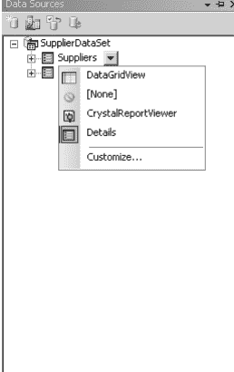

**图 4-14** 更改从数据源表创建的用户界面类型。

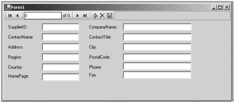

**图 4-15** 详细信息视图用户界面。

在一些数据驱动的应用程序中，用户需要查看主键数据。在这个应用程序中，用户看到 *SupplierID* 值，这是一个由数据库自动生成的主键字段。因为用户不应该更改此值，所以用户界面不应允许他们输入新值。在大多数情况下，你可以简单地禁用 *TextBox* 控件或将其更改为 *Label* 控件。但是，使用智能标签，你只需点击几下鼠标就可以将控件更改为另一种类型的控件并保持数据绑定。在这个应用程序中，如图 4-15 所示的 *SupplierID* *TextBox* 控件需要更改为 *Label* 控件。你可以简单地选择 *TextBox* 控件的智能标签箭头，然后从“转换为”下拉列表中选择“Label”，如图 4-16 所示，而不是删除 *TextBox* 控件、添加 *Label* 控件，然后将 *Label* 重新绑定到适当的数据源。这会将 *TextBox* 更改为 *Label* 控件，这将防止在该控件中修改数据，但仍保持数据源连接。


###### 面向开发者的 Microsoft Visual Basic 2005 入门

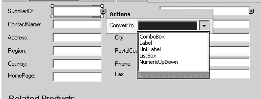

**图 4-16** 通过智能标记将文本框更改为标签。

智能标记本质上是上下文感知的。对于数据绑定控件，即使底层数据源的数据类型也会被用来确定智能标记应该（或不应该）提供哪些功能。例如，如果你通过某个控件（该控件绑定到一个整型字段）的智能标记选择 *Convert To* 下拉列表，可用的控件列表是适合整型数据的。如果你使用 *SupplierID* 文本框的智能标记，你可以将其转换为 *ComboBox*、*LinkLabel*、*ListBox*、*NumericUpDown* 或 *Label*。因为底层数据类型是数字型的，所以 *NumericUpDown* 是一种有效的、可以显示该数据的控件类型。

### 主从窗体

Visual Studio 2005 中一个更强大的智能标记功能是能够创建主从窗体。利用此功能，你可以相对轻松地将一个简单的详细信息视图窗体转换为更复杂的主从数据窗体。

此应用程序在同一窗体上使用了两个相关的详细信息视图：一个用于供应商的父节和一个用于每个供应商所供应产品的子节。生成的窗体如图 4-17 所示。

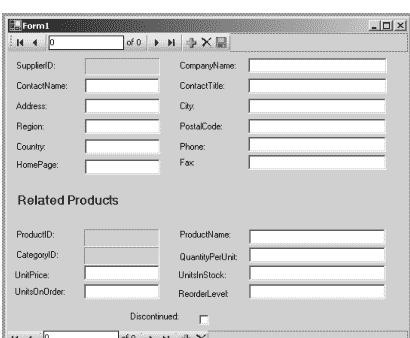

**图 4-17** 使用智能标记创建的主从视图。

从图 4-15 所示的原始窗体开始，你可以使用智能标记来创建和配置详细信息节，以创建类似图 4-17 的窗体。在此应用程序中，**SupplierID** 是 Suppliers 表和 Products 表之间的链接。你需要使用 *DataConnector* 的智能标记来启用此应用程序的主从功能。当你打开 *SuppliersDataConnector* 控件的智能标记时，你会看到一个 Configure Master Details（配置主从关系）选项，如图 4-18 所示。选择此选项将打开 Add Related Databound UI（添加相关数据绑定 UI）对话框，如图 4-19 所示。

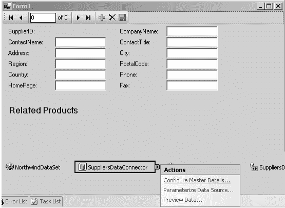

**图 4-18** 通过使用智能标记创建主从窗体。

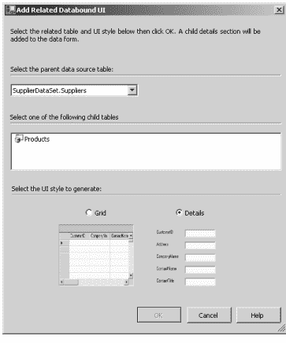

**图 4-19** 添加相关数据绑定 UI 对话框。

###### 面向开发者的 Microsoft Visual Basic 2005 入门

当对话框打开时，你会发现数据源下拉列表中没有选中任何值。从数据源下拉列表中选择适当的表，Visual Studio 2005 将自动在对话框的“子表”部分显示相关的表。在此例中，Products 表与 Suppliers 表通过 *SupplierID* 字段相关。

此应用程序使用详细信息视图来一次显示一个产品记录（而不是在网格中显示），因此请确保选择详细信息视图。这意味着需要某种方法来控制在每个供应商的产品之间导航。此导航由第二个 *DataNavigator* 组件处理。导航控件被放置在窗体的 *RaftingContainer* 中，这是一个流式布局控件，用于容纳工具栏类型的条带控件，例如 *ToolStrip* 栏。你可以通过双击工具箱中的 *DataNavigator* 来将其添加到你的窗体。然后，将 *DataNavigator* 的 *Raft* 属性设置为现有的 *RaftingContainer* 控件之一（Top、Bottom、Left 或 Right）。你还必须将新的 *DataNavigator* 的 *DataConnector* 属性链接到 Visual Studio 2005 为按 *SupplierID* 筛选的产品自动创建的 *DataConnector*（FK_Products_SuppliersDataConnector），这是使用“添加相关数据绑定 UI”对话框（参见图 4-19）创建的关系的一部分。

将详细信息节添加到窗体后，你应该注意到 Visual Studio 已经在窗体的 *Load* 事件处理程序中添加了一行代码，用于填充 *DataSet* 中的 Products 表：

```
Me.ProductsTableAdapter.Fill(Me.NorthwindDataSet.Products)
```

当你运行此应用程序时，你可以在供应商之间导航，并查看每个供应商的第一个产品记录的变化。然后，你可以在每个供应商的产品记录之间导航。

### 结论

尽管数据控件的智能标记不多，但你可以看到它们使得在 Visual Studio 2005 中开发以数据为中心的应用程序比在 Visual Basic 6 甚至 Visual Studio .NET 2003 中容易得多。此应用程序介绍了智能标记以及你可以用它们完成的一些常见任务。下一个应用程序的演练将包括使用智能标记创建参数化查询，以便轻松筛选结果集。

## 应用程序：主从窗体和参数化查询

大多数数据驱动的应用程序不仅仅是将一个表绑定到一个网格控件。你的数据源很可能包含多个相关的表。因此，你经常会发现自己需要创建利用数据的主从视图的应用程序。而简单的逐一导航方案很少能满足用户处理真实世界数据量的需求。用户需要能够搜索和筛选记录。此应用程序展示了如何使用新的数据功能更快地构建更好的数据应用程序。

#### 新概念

Visual Studio 2005 和 .NET Framework 2.0 包含许多新功能，使得创建数据的主从视图更加容易。创建一组数据绑定控件后，你可以让 Visual Studio 2005 自动创建相关表中子记录的网格或详细信息视图，只需一行代码即可用来自相关表的数据填充 *DataSet*。

如果你在创建数据源和数据绑定控件时使用默认设置，你的应用程序将向用户显示应用程序中的所有数据。一个重要的功能是用户能够输入搜索条件并仅查看与搜索条件匹配的数据。借助 Visual Studio 2005 中新的“搜索条件生成器”，你可以向应用程序添加参数化查询以及用于搜索和筛选数据的用户界面，而无需编写任何代码！

#### 演练

在此应用程序中，使用主从视图显示 Northwind 数据库中每个客户的订单数据。此设置需要将数据库中两个表的数据显示在一个窗体上。这两个表在数据库中已经是相关的，因此 Visual Studio 2005 将检测到此关系。但是，你必须提供一些额外的信息，以确保在从一个客户导航到下一个客户时显示适当的订单。

### 应用程序用户界面

该应用程序是一个标准的 Windows 应用程序，包含一个主从窗体，其中客户信息（主数据）位于窗体顶部，绑定到单独的控件。客户订单（详细数据）显示在网格中。图 4-20 显示了应用程序的用户界面。

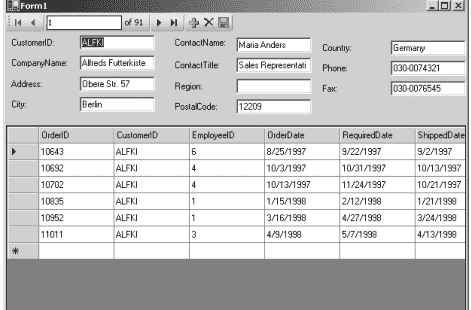

图 4-20 应用程序的用户界面。

###### 面向开发者的 Microsoft Visual Basic 2005 入门

使用网格控件显示订单允许用户同时查看一个客户的更多订单。详细信息视图节也可以一次显示一条记录，但此应用程序使用的方法在许多业务应用程序中是标准的。

创建主从窗体的第一步是配置数据源。Visual Studio 2005 的一个很好的功能是它能够记住以前创建的连接字符串，你可以从中选择，而不是重新进行相同的配置设置。此功能只是你在 Visual Studio 2005 中会发现的众多虽小但很有用的生产力增强功能之一。

此应用程序的数据来自 Northwind 数据库的 Orders 和 Customers 表。在“数据源”窗口中创建数据源后（如前一个应用程序所述），可以将控件添加到窗体。某些控件将绑定到主数据，某些控件将绑定到详细数据。然后必须建立主数据和详细数据之间的关键链接，以便仅显示当前选定客户的订单。

在“Table Adapters 和 DataConnector”应用程序中，一个 *DataTable* 是从“数据源”窗口拖放到窗体上，并自动创建了一个网格控件。在 Visual Studio 2005 中，网格视图是使用“数据源”窗口自动生成控件时的默认视图，但不是唯一选项。如果你在“数据源”窗口中选择一个表，将出现一个下拉箭头，提供一个列表，你可以从中选择不同的视图选项。默认视图是 *DataGridView*，它在“Table Adapters 和 DataConnector”应用程序中使用，也将用于此应用程序的详细信息节。下拉列表中的一个选项是“详细信息”。如果你在“数据源”窗口中将表配置为使用详细信息视图，将该表拖放到窗体上将提示 Visual Studio 2005 为每个字段创建单独的控件，并创建一个 *DataNavigator* 组件用于浏览记录。

一旦主节在窗体上，你就可以提供主数据（客户信息）和详细数据（客户订单）之间的链接信息。Visual Studio 2005 使这变得极其容易，尤其是与使用 Visual Studio .NET 2003 手动链接数据的过程相比。首先，选择暴露将与子数据相关的父数据的 *DataConnector*。在此应用程序中，将使用 *CustomerDataConnector*。在此处设置相关数据可以通过“数据”菜单或通过其中一个新的智能标记操作完成。当你打开智能标记时，其中一个选项是 Configure Master Details（配置主从关系）。选择该智能标记操作将打开如图 4-21 所示的对话框窗口。


#### 介绍面向开发者的 Microsoft Visual Basic 2005

通过此对话框窗口，您可以首先从下拉列表中选择父表，然后选择子表。接下来，您可以决定是以网格形式还是详细信息视图显示子行。在此应用程序中，“Customers”是父表，“Orders”是相关的子表。子数据以网格形式显示。

关闭对话框窗口后，“Orders”网格会自动添加到窗体中。表适配器和 *DataConnector* 组件也会被添加到窗体中。在此应用程序中名为 *OrdersTableAdapter* 的表适配器，提供了用订单数据填充 *DataSet* 的逻辑。*DataConnector* 作为显示订单数据的 *DataGridView* 控件的数据源。

要在应用程序中显示任何数据，必须用数据填充 *DataSet* 中的表。此应用程序中有两个表适配器：一个用于客户数据，一个用于订单数据。当在表适配器上调用 *Fill* 方法时，该表适配器会用来自数据库的数据填充其在 *DataSet* 中对应的表。要填充此应用程序中的两个表，必须为每个表适配器调用 *Fill* 方法。*Form1_Load* 事件处理程序中的以下代码调用了这两个 *Fill* 方法：

```
Me.CustomersTableAdapter.Fill(Me.NorthwindDataSet.Customers)
Me.OrdersTableAdapter.Fill(Me.NorthwindDataSet.Orders)
```

如果此时运行应用程序，您可以使用导航控件在各个客户之间进行浏览。网格中的订单信息将根据当前选定的客户而更改。

对于一个简单的演示，逐条浏览记录是可以的。但在现实世界中，您的用户需要能够快速定位到特定的客户。Visual Studio 2005 通过允许您为窗体创建参数化查询来帮助解决这个问题。

在此应用程序中，用户将能够输入客户名称并直接导航到该客户的记录。要启用此类查找功能，您首先选择 *CustomersDataConnector* 的智能标记，然后选择“参数化数据源”操作。（您也可以通过“数据”菜单访问此功能。）执行这些步骤将打开“搜索条件生成器”对话框，如图 4-22 所示。

“搜索条件生成器”帮助您创建参数化查询，该查询将根据用户的输入返回筛选的结果集。构建此查询基本上有两种方式：您可以自己编写 SQL，也可以使用可视化的 QueryBuilder。Visual Studio 2005 会通过检查您已经选择并绑定到窗体控件上的字段，尝试为您生成大部分查询。在大多数情况下，您只需完成 WHERE 子句。只需滚动到查询文本框中已提供的 SELECT 语句的末尾，并添加如下筛选条件：

```
WHERE CompanyName LIKE @Company
```

此添加内容告诉查询，在 CompanyName 字段中的值与用户将输入的模式（例如 B%）匹配时，选择所有选定的字段。@Company 参数是一个输入参数，它将被用户在用户界面中输入的值替换。参数名称可以是任何您想要的名称。在此应用程序中，它被命名为 @Company，以反映其在查询中的作用——按公司名称筛选结果。

查询的名称（您也在“搜索条件生成器”中进行配置）也成为了用于填充 *DataSet* 中相应 *DataTable* 的方法的名称。“搜索条件生成器”鼓励在命名查询时使用 *FillBy* 前缀。您不必在查询名称中使用此名称，但将其保留为前缀是一个好主意。在此应用程序中，查询被命名为 FillByName。

如前所述，您也可以通过使用如图 4-23 所示的 QueryBuilder 以图形方式构建查询。以这种方式创建查询的最大好处之一是，能够在代码中执行查询之前验证查询。

> **重要提示** 如果您决定使用 QueryBuilder 生成查询，请确保您选择了与窗体上相同的字段。如果未能选择适当的字段，窗体上的一些控件可能不包含任何数据。

配置新的参数化查询后，一个新的 *ToolStrip* 栏将被放置在您的窗体上，供用户输入新查询的条件。在此应用程序中，用户将在 *FillByCompanyName ToolStrip* 中输入公司名称作为查询的参数。

当您首次启动应用程序时，创建数据源时创建的默认 *Fill* 方法将在 *Form1_Load* 事件处理程序中执行。然后，如果您在 *FillByCompanyName ToolStrip* 栏中输入一个值（例如 B's Beverages）并按 Enter 键（或单击 FillByCompanyName），主记录将被筛选。当您随后浏览筛选后的记录（如果有多个匹配记录）时，详细信息网格将更新以显示当前客户的订单。图 4-24 显示了具有筛选后主记录集的应用程序。

#### DataNavigator

前面的应用程序介绍了 *DataNavigator*，但没有深入探讨它在编写数据驱动应用程序时实际为您节省的编码工作量。您无疑已经注意到，*DataNavigator* 不仅包含用于浏览记录的控件，还包含用于添加、删除和保存记录的控件。

默认情况下，导航器 *ToolStrip* 中的保存按钮是禁用的。显然，许多数据库应用程序如果没有添加、编辑和删除数据并保存更改的能力，其价值就有限。在此应用程序中，保存按钮是启用的，并且向其点击事件处理程序添加了一些代码，以便将更改传播到数据库。该代码检索 *DataSet* 中已更改的行，然后仅将已更改的行传递给表适配器的 *Update* 方法，如下所示：

```
Private Sub dataNavigatorSaveItem_Click(ByVal sender As System.Object, _
                                        ByVal e As System.EventArgs) _
                                        Handles dataNavigatorSaveItem.Click

    OrdersTableAdapter.Update(NorthwindDataSet.Orders.GetChanges())

End Sub
```

请注意执行更新时涉及的各种对象和方法。更改的数据位于 *NorthwindDataSet* 中的 *Orders* 表中。通过调用 *GetChanges* 提取更改后的数据，然后传递给 *OrdersTableAdapter* 的 *Update* 方法，该方法将更改发送到数据库。*Update* 方法将插入、更新和删除更改传递给数据库。

您可能想知道 *Update* 方法如何能在 *Orders* 表中找到已删除的行，因为它们已被删除。实际上发生的情况是，已删除的行只是被标记为已删除，并保留在 *DataTable* 中。此行为允许您稍后访问已标记为删除的行，并选择是否将删除提交到数据库。*DataTable* 中 *DataRow* 对象的 *RowState* 指示该行是已删除、已添加、已修改、未修改等。

当您调用 *OrdersTableAdapter.Update* 方法时，实际上是导致 SQL 语句被发送到数据库执行。行的 *RowState* 决定了要使用的是 INSERT、UPDATE 还是 DELETE 语句。当您创建数据源并使用数据源配置向导为您自动生成 INSERT、UPDATE 和 DELETE 查询时，Visual Studio 2005 实际上会创建这些查询以及使用它们的所有代码。

在 Visual Studio 2005 中，可以找到此代码的位置已更改。您必须导航到 NorthwindDataSet.Designer.vb 代码模块才能看到此代码。以前版本的 Visual Studio .NET 将此代码直接放在 Windows Forms 设计器生成的代码部分，而现在您必须在解决方案资源管理器窗口中选择“显示所有文件”，然后展开您的 NorthwindDataset.xsd 视图才能看到代码模块。

如果您使用 Visual Studio 2005 查看此应用程序，您会想知道这些代码来自哪里，因为 Visual Studio 2005 很好地隐藏了它。在 Visual Studio 2005 中，Microsoft 创建了他们所谓的“沙盒”分别用于设计器和开发人员。由开发人员生成的代码存储在常规 .vb 文件中，与 Visual Studio .NET 2003 相同。但设计器生成的代码存储在单独的 .vb 文件中。此设计的原因很简单。在 Visual Studio .NET 2003 中，设计器生成的代码与开发人员的代码包装在同一个 .vb 文件中，但它被包装在 #Region 中。一些程序员不得不（或选择）编辑由 Visual Studio .NET 2003 工具和向导创建的一些代码，尽管不建议这样做。因为设计器生成了代码，设计器也有权重写生成的代码，从而覆盖开发人员所做的任何更改。

为了解决这个问题，Visual Studio 2005 将您编写的代码照常放在您的 .vb 文件中，但它与您在 .Designer.vb 文件中找到的设计器生成的代码完全分开。您项目中的每个项目（例如，窗体）都可以有一个 .Designer.vb 文件和一个常规的 .vb 文件。默认情况下，您在解决方案资源管理器中看不到设计器文件。您可以通过在解决方案资源管理器中打开“显示所有文件”功能来强制 Visual Studio 2005 显示它们。刚才列出的代码来自此应用程序的 NorthwindDataSet.Designer.vb 文件。同时，您可能还会注意到，现在可以通过使用部分类来实现这一点，就像在 Form1 的 designer.vb 定义中使用 Partial 关键字一样。

这里编写的几行代码加上大量的设计器生成的代码，创建了一个功能齐全的数据库应用程序——包括更新数据并将其保存到数据库的能力。


### 结论

本应用程序展示了构建一个数据应用是何等简单，该应用能显示来自多个关联表的数据。在Visual Studio 2005中，能够轻松创建和配置主从详情风格的用户界面，这意味着你只需编写少量代码就能同时显示关联记录。

本应用程序还向你介绍了新的数据智能标记，它们允许你快速完成常见任务，例如创建参数化查询。数据智能标记将在下一个应用程序中进行更详细的讨论，届时你将看到如何利用它们来减少你需要做的工作量以及需要编写的代码量。

## 应用程序：对象数据源

本应用程序向你展示如何在Visual Studio 2005中使用对象作为数据源。

#### 新概念

Visual Studio 2005中强大的新ADO.NET功能之一，就是使用对象作为数据源的方式变得更加自然。这个对象可以是预先存在的对象，也可以是你作为项目一部分创建的对象，或者是一个单独的类库。尽管在Visual Studio .NET 2003中你也可以创建自己的对象并将它们用作数据绑定等的数据源，但那至少是繁琐且代码密集的。

在.NET Framework 2.0中，任何公开公共属性的对象都可以用作数据源。在本应用程序中，使用了一个表示计算机的简单类。*Computer*类将包含型号、序列号、CPU、内存容量和硬盘空间等属性。基于此对象的数据源用于填充*TextBox*控件，以在用户界面中显示各种属性。

为了展示数据绑定的另一种方式，本应用程序创建了一个*Computer*对象数组，并使用*BindingContext*在对象数组中进行导航，其方式与在*DataSet*中导航记录非常相似。

#### 演练

本应用程序的用户界面是一个简单的窗体，包含几个标签、用于*Computer*类属性的*TextBox*控件，以及用于一次查看一个*Computer*对象的导航按钮。该窗体如图4-25所示。


图4-25 对象数据源窗体。

Computer类定义在一个单独的类库中，主Windows应用程序引用了该类库。Computer类是一个简单的类，包含五个私有成员变量（m_Model、m_Serial、m_CPU、m_RAM和m_HDSpace），并通过公共属性（Model、Serial、CPU、RAM、HDSpace）公开。以下代码定义了Computer类。

```
Public Class Computer
    Private m_Model As String
    Private m_Serial As Integer
    Private m_CPU As String
    Private m_RAM As String
    Private m_HDSpace As String

    Public Property Model() As String
        Get
            Return m_Model
        End Get
        Set(ByVal value As String)
            m_Model = value
        End Set
    End Property

    Public Property Serial() As Integer
        Get
            Return m_Serial
        End Get
        Set(ByVal value As Integer)
            m_Serial = value
        End Set
    End Property

    Public Property CPU() As String
        Get
            Return m_CPU
        End Get
        Set(ByVal value As String)
            m_CPU = value
        End Set
    End Property

    Public Property RAM() As String
        Get
            Return m_RAM
        End Get
        Set(ByVal value As String)
            m_RAM = value
        End Set
    End Property

    Public Property HDSpace() As String
        Get
            Return m_HDSpace
        End Get
        Set(ByVal value As String)
            m_HDSpace = value
        End Set
    End Property
End Class
```

要创建基于对象的数据源，你首先需要在“数据源”窗口中添加一个新数据源，这与为数据库创建数据源的过程类似。但在数据源配置向导中，当选择数据源类型时，你需要选择“对象”而不是“数据库”。（参见图4-26。）然后，你通过向导选择要用作数据源的类。如果你的应用程序尚未包含对定义你要使用的类的程序集的引用，你可以直接从数据源配置向导中添加新的引用。（参见图4-27。）


图4-26 在数据源配置向导中选择对象类型数据源。


图4-27 在数据源配置向导中选择要绑定到的对象（类）。

### 复杂方式绑定对象

以下代码展示了将用户界面与*Computer*对象数组关联的复杂方式：

```
Private Computers(5) As Computer.Computer
Private myBindingManager As BindingManagerBase

Private Sub Form1_Load(ByVal sender As Object, _
                       ByVal e As System.EventArgs) Handles Me.Load

  CreateComputers()
  txtModel.DataBindings.Add("Text", Computers, "Model")
  txtSerial.DataBindings.Add("Text", Computers, "Serial")
  txtCPU.DataBindings.Add("Text", Computers, "CPU")
  txtHDSpace.DataBindings.Add("Text", Computers, "HDSpace")
  txtRAM.DataBindings.Add("Text", Computers, "RAM")
  myBindingManager = BindingContext.Item(Computers)
End Sub

Private Sub cmdPrevious_Click(ByVal sender As System.Object, _
                              ByVal e As System.EventArgs) _
                              Handles cmdPrevious.Click

  myBindingManager.Position -= 1
End Sub

Private Sub cmdNext_Click(ByVal sender As Object, _
                          ByVal e As System.EventArgs) Handles cmdNext.Click

  myBindingManager.Position += 1
End Sub
```

```
Private Sub CreateComputers()

  Computers(0) = New Computer.Computer
  Computers(0).CPU = "Pentium 2.4GHz"
  Computers(0).Model = "GK2400"
  Computers(0).Serial = 123456
  Computers(0).HDSpace = "200GB"
  Computers(0).RAM = "1GB"

  Computers(1) = New Computer.Computer
  Computers(1).CPU = "Pentium 2.8GHz"
  Computers(1).Model = "GK2800"
  Computers(1).Serial = 65123
  Computers(1).HDSpace = "120GB"
  Computers(1).RAM = "512MB"

  Computers(2) = New Computer.Computer
  Computers(2).CPU = "Pentium 2.0GHz"
  Computers(2).Model = "GK2000"
  Computers(2).Serial = 12216
  Computers(2).HDSpace = "80GB"
  Computers(2).RAM = "256MB"

  Computers(3) = New Computer.Computer
  Computers(3).CPU = "Pentium 3.0GHz"
  Computers(3).Model = "GK3000"
  Computers(3).Serial = 123124
  Computers(3).HDSpace = "200GB"
  Computers(3).RAM = "2GB"

  Computers(4) = New Computer.Computer
  Computers(4).CPU = "Pentium 2.5GHz"
  Computers(4).Model = "GK2500"
  Computers(4).Serial = 154156
  Computers(4).HDSpace = "120GB"
  Computers(4).RAM = "1GB"
End Sub
```

该窗体包含一个全局数组来保存五个计算机对象，以及一个*BindingManagerBase*，用于跟踪对象数组中的当前位置。

窗体的*Load*事件处理程序调用*CreateComputers*过程，用五台计算机的值填充数组。这为用户提供了可以使用“下一个”和“上一个”按钮进行导航的值。然后，通过使用每个*TextBox*控件的*DataBindings*集合，将*TextBox*控件绑定到*Computers*数组。

*cmdNext_Click*和*cmdPrevious_Click*单击事件处理程序都使用*BindingManagerBase*来更改绑定上下文的当前位置，从而导致窗体中显示不同的记录。

### 更简单的对象绑定方式

既然你已经了解了如何用复杂方式绑定对象，现在是时候看看简单的方式了。这样做将在我们的窗体顶部添加现在熟悉的导航栏。你必须处理的唯一编码任务是一行提供数据的代码。在这种情况下，你需要设置*DataConnector*的*DataSource*属性，而不是填充*DataSet*。

在本演练的前面部分，你已经了解了如何创建基于对象的数据源。在“数据源”窗口中生成的视图设置为*DataGridView*，如图4-28所示。


### 面向开发者的 Microsoft Visual Basic 2005 简介


**图 4-28** 数据源窗口，显示一个对象数据源的 GridView。

与其他类型的数据源一样，你可以简单地将对象从数据源窗口拖动到你的窗体上。图 4-29 显示了一个 *DataGridView*，它是通过将 *Computer* 对象数据源拖动到此应用程序的窗体上创建的。


**图 4-29** 绑定的窗体，带有用于显示对象数据的 DataGridView。

你可以看到，将网格拖动到窗体会提示 Visual Studio 2005 在窗体顶部也创建一个导航栏。此时，组件托盘包含 *ComputerDataConnector* 和 *ComputerDataNavigator* 对象，如图 4-30 所示。这两个项目与前面数据应用程序中使用的 *DataConnector* 和 *DataNavigator* 组件类似。你还会注意到组件托盘中没有表适配器或 *DataSet* 对象。这是因为在处理作为数据源的对象时，它们没有用途。


**图 4-30** 包含对象数据源组件的组件托盘。

现在网格已定位在窗体上，导航器也已就位以允许导航，只需要在窗体的 *Load* 事件处理程序中添加一行代码，将 *Computer* 对象数组设置为 *DataGridView* 所绑定的 *DataConnector* 的 *DataSource*：

```
Me.ComputerDataConnector.DataSource = Computers
```

只需这一行代码，网格就绑定到了 *Computers* 数组。绑定了 *DataGridView* 的最终应用程序如图 4-31 所示。


**图 4-31** 使用 DataConnector 和 DataNavigator 组件的绑定 DataGridView。

### 结论

如本应用程序所示，绑定到对象允许你利用数据绑定的便利性，同时使用业务对象来表示数据，而不是使用以数据库为中心的类，如 *DataSet* 和 *DataTable*。使用对象数据源确实给开发者带来了一些额外的责任，因为你必须提供用于保存对内存中对象集合所做更改的逻辑。但在许多情况下，能够使用自己的业务实体类而不是 *DataTable* 可能是有益的，例如在需要用户界面完全不了解给定系统底层数据存储的类型和结构的n层系统中。在这种情况下，表示层可以从中间层检索一组对象，并将这些对象直接绑定到用户界面。当然，对象数据源并非适用于所有应用程序，但在许多情况下，它们是一种极其强大且有用的选项。而 Visual Studio 2005 使得与对象的数据绑定变得异常简单。

# 第 5 章
## 构建用户界面

**本章内容：**
- 应用程序：新的 Windows 窗体控件
- 应用程序：对现有 Windows 窗体控件的改进

本章探讨由 Microsoft .NET Framework 2.0 版提供的控件以及对现有控件的改进。这些功能使你能够创建外观专业的应用程序，提供更好的最终用户体验，并减少编码工作量。

### 应用程序：新的 Windows 窗体控件

此应用程序演示了 Microsoft Visual Studio 2005 中提供的许多新控件，这些控件可用于创建引人入胜的 Windows 窗体用户界面。

#### 新概念

Visual Studio 长期以来提供了一个大型预构建控件库，允许开发者快速为 Microsoft Windows 应用程序创建用户界面。然而，这些组件的功能和视觉风格常常导致应用程序的外观和感觉与 Microsoft Office 和 Internet Explorer 等其他 Microsoft 产品有显著差异。Visual Studio 2005 引入了许多新控件来解决此问题。这些控件提供与 Microsoft Office 相同的高级外观、感觉和自定义支持，使你能够为用户提供熟悉的体验和更多的个性化选项。

##### ToolStrip 控件

当今的专业应用程序提供了许多功能，允许用户完全自定义其菜单和工具栏的定位、格式和内容。用户期望能够执行诸如移动工具栏、选择要显示的按钮以及控制每个项目显示多少信息等任务。此外，他们期望这些控件的呈现方式在所有应用程序中都是干净且一致的。*ToolStrip* 是一个新的工具栏控件，支持所有这些功能，并为 MenuStrip 和 StatusStrip 控件提供基础功能。你不再局限于只向工具栏添加按钮。ToolStrip 允许你添加七种不同类型的项目，例如 ToolStripButton、ToolStripComboBox、ToolStripTextBox 和 ToolStripSplitButton。

当你向窗体添加 ToolStrip 时，首先注意到的是它默认看起来像 Office 工具栏。许多控件支持一种新的可插拔呈现框架，允许你选择希望控件的外观。目前 ToolStrip 有两种主要的“外观”，你可以使用 RenderMode 属性进行选择。提供 System 值表示你希望控件遵循当前的 Windows 系统显示设置。提供 Professional 值表示你希望控件看起来像 Microsoft Office 中的对应控件。

ToolStrip 支持许多新类型的行为——包括浮动、合并和项目溢出。浮动是允许用户拖放工具栏到窗体上的不同位置，并且工具栏会自动“吸附”到位的行为。集成开发环境（IDE）通过在你添加 ToolStrip 时向窗体添加多个 RaftContainer 控件，自动提供对浮动的支持。你可以通过设置 ToolStrip 的 Raft 属性来指定其初始位置。在运行时，用户将能够将 ToolStrip 移动到任何其他 RaftContainer。

合并是当两个 ToolStrip 的项目合并为一个 ToolStrip 时出现的行为。你可以通过 AllowMerge 属性指定特定工具栏是否支持合并。然后，你可以使用 MergeAction 和 MergeIndex 属性控制每个项目的合并行为。

项目重新排序是允许用户重新排列工具栏和菜单项目的行为。你可以通过将 AllowItemReorder 属性设置为 True 来启用项目重新排序。在运行时，用户将能够在按住 Alt 键的同时通过拖放来移动项目。

##### FlowLayoutPanel 和 TableLayoutPanel 控件

Visual Studio 2005 提供了两个新的布局控件，用于解决一些常见的控件定位场景。普通的 Panel 控件使用绝对定位来确定其每个子控件的位置。另一方面，FlowLayoutPanel 在将控件添加到面板时，将每个控件定位在其紧邻的前一个控件旁边。默认情况下，它从左到右、从上到下流动控件，但你可以使用 FlowDirection 属性控制流动方向。FlowLayoutPanel 在你希望控件在某个子项的内容发生变化或面板大小发生变化时自动重新定位的情况下非常有用。

TableLayoutPanel 是一个包含不可见表格结构的面板，允许你在每个表格单元格中放置一个控件。你可以指定内部表格应有多少行和列，以及每行和每列的大小调整规则。当你需要定义窗体中主要的、固定大小的部分时，TableLayoutPanel 非常有用。你也可以使用

它用于快速创建表格数据输入界面。但请记住，每个单元格只能添加一个控件。因此，如果希望单元格包含多个子控件，需要先向单元格添加一个`Panel`，再将子控件添加到该`Panel`中。

#### WebBrowser 控件

Visual Studio 2005 现在为广为人知的 ActiveX Web 浏览器控件提供了优化的托管包装器。此控件提供对 Internet Explorer 完整 DHTML 渲染功能的访问。您可以使用此控件为应用程序添加多种 Web 浏览功能。例如，允许用户在应用程序内阅读 HTML 文档文件，或链接到互联网上的内容。使用 WebBrowser 控件非常简单，它提供了一些强大的选项，可实现 DHTML 与 WinForm 资产的深度集成。

只需调用`Navigate`方法并提供资源的 URL，即可下载和显示文档。加载后，您可以通过`Document`属性以编程方式访问 DHTML DOM。通过此属性，您可以直接读取和修改文档结构。可以使用`GoForward`、`GoHome`、`GoSearch`和`GoBack`等方法执行标准导航任务。甚至可以向脚本代码公开一个托管对象，允许页面中的脚本调用您的托管应用程序。只需向`ObjectForScripting`属性提供一个对象即可。监控下载进度可通过处理 WebBrowser 的事件实现，例如`Navigating`、`Navigated`、`ProgressChanged`和`DocumentCompleted`。

#### ActiveDocumentHost 控件

ActiveDocumentHost 控件在 Windows 窗体应用程序与 OLE 资源之间架起了桥梁。通过调用`LoadFrom`方法并提供资源路径，可以加载和显示资源。ActiveDocumentHost 将启动注册用于该特定资源类型的应用程序实例。例如，如果加载 Microsoft Word 文档，ActiveDocumentHost 将自动启动 Microsoft Word 并以只读状态显示文档。默认情况下，双击控件会使其切换到可编辑模式，并显示编辑应用程序的工具栏和菜单。您可以通过`ShowMenus`和`ShowToolbars`等属性控制此行为的大多数方面。

#### 演练

本演练演示如何使用这些新控件创建更专业且更易于使用的 Windows 窗体界面。

##### 创建 Office 界面

*DocumentBrowser* 窗体呈现的界面从多种 Microsoft 产品（包括 Office 和 Internet Explorer）中借鉴了许多设计元素。请注意，两个*ToolStrips*呈现为 Office 类型工具栏，带有垂直渐变背景和左侧的“抓手”。其中一个*ToolStrip*包含一个文本框。窗体左下角还有一个包含两个项目（*Documents*和*Web Pages*）的第三个*ToolStrip*控件。此*ToolStrip*已通过将其*LayoutStyle*设置为*Vertical*进行了修改，使其具有类似 Microsoft Outlook 的风格。窗体底部的状态栏是一个*StatusStrip*控件，包含两个子项：一个*StatusStripPanel*和一个*ToolStripProgressBar*。进度条已配置为通过将其*Style*属性设置为*Continuous*来以连续条形式显示进度。

运行应用程序时，单击并将工具栏拖动到窗体的任意边缘，您会看到它们会自动停靠到该侧。此操作之所以可行，是因为窗体的每个边缘都有一个*RaftingContainer*控件。当您将*ToolStrips*添加到窗体时，Visual Studio 会自动添加这些容器。您还可以通过按住 Alt 键并拖动项目来重新排序项目，甚至将项目从一个*ToolStrip*移动到另一个*ToolStrip*。

##### 与 Web 内容交互

该应用程序使用*WebBrowser*控件加载和显示 Web 内容。运行时，单击窗体左下角的“Web Pages”按钮。然后，在工具栏的 Address 文本框中输入 URL。单击“Go”按钮导航到文档。

> **注意** 如果无法访问互联网，应用程序目录中提供了一个名为“MSDN Home Page.htm”的 HTML 页面。

当应用程序加载时，您应该注意到窗体底部的进度条和状态文本在更新。文档加载完成后，您会看到浏览器窗格左侧的历史记录列表中出现一个条目。此进度监控通过处理多个*WebBrowser*事件实现。

该过程从`btnGo_Click`事件处理程序开始。在此过程中，您通过调用`Navigate`方法告诉*WebBrowser*加载文档：

```
wbrBrowser.Navigate(txtAddress.Text)
```

当*WebBrowser*开始导航到资源时，它会触发*Navigating*事件。`wbrBrowser_Navigating`事件处理程序从事件参数中检索 URL，并向*StatusStripPanel*发送一条消息，指示下载正在进行中：

```
setStatus("Navigating to '" + e.Url + "'")
```

在 WebBrowser 加载文档期间，它会定期触发 ProgressChanged 事件。`wbrBrowser_ProgressChanged`事件处理程序首先更新 StatusStrip 中的进度条，如果已显示 100%，则将其重置，然后将其增加 5：

```
If pbrProgress.Value >= pbrProgress.Maximum Then
    ClearProgress()
End If
pbrProgress.Increment(5)
```

当 WebBrowser 完成加载文档时，它会触发 DocumentCompleted 事件。您可以使用此事件通知用户内容可用，或记录下载结果。`wbrBrowser_DocumentCompleted`事件处理程序从事件参数中检索文档的标题和 URL。此信息用于填充一个新的 ListViewItem 并添加到历史记录列表视图中。该过程以重置状态文本和进度条结束：

```
Dim title As String = e.Url
Dim visited As String = DateTime.Now.ToString()
Dim docInfo As New ListViewItem(New String(1) {title, visited})

lvwHistory.Items.Add(docInfo)

SetStatus(String.Empty)
ClearProgress()
```

##### 与文档内容交互

该应用程序还允许您加载和显示已注册为允许 OLE 宿主的文件。Office 文档、声音文件和 .avi 电影文件都是“活动”数据的示例。您可以通过首先单击窗体左下角的 Documents 按钮来加载文件。然后，在 Address 文本框中输入所需文件的本地路径，并单击 Go 按钮。文档将显示在 ActiveDocumentHost 内。如果文档是可编辑的，您可以双击 ActiveDocumentHost 以在关联的宿主应用程序中启动文档。宿主应用程序的菜单和工具栏将显示在 DocumentBrowser 窗体中。

ActiveDocumentHost 的进度相关事件比 WebBrowser 控件少。但是，它在完成加载和显示文档时确实会触发 Loaded 事件。`ahdDocument_Loaded`事件处理程序首先检索有关已加载文档的信息。然后，创建一个 ListViewItem 并将其添加到历史记录列表视图中：

```
Dim url As String = adhDocument.SourceDocument
Dim visited As String = DateTime.Now.ToString()

Dim docInfo As New ListViewItem(New String(1) {url, visited})

lvwHistory.Items.Add(docInfo)

SetStatus(String.Empty)
ClearProgress()
```

### 结论

.NET Framework 2.0 提供的新的 Windows 窗体控件使您能够创建比以往更专业、更强大的应用程序，而无需依赖第三方组件。*ToolStrip*为您提供了创建菜单、工具和状态栏的强大机制，这些组件的外观和行为与用户熟悉的其他应用程序中的对应组件类似。这可以直接转化为更快的用户采用率和更高的用户满意度。*WebBrowser*和*ActiveDocumentHost*允许您将外部数据集成到应用程序中。*WebBrowser*专为可靠且多功能地下载和渲染 DHTML 内容而设计，而*ActiveDocumentHost*提供了一种托管和编辑 OLE 数据类型的机制。

### 应用程序：对现有 Windows 窗体控件的更改

此应用程序探讨了 Windows 窗体框架中影响广泛现有和新 Windows 窗体控件的一些更改和新增功能。

#### 新概念

.NET Framework 2.0 和 Visual Studio 2005 为 Windows 窗体开发引入了许多新功能，这些功能将在设计时和运行时对您使用 Windows 窗体控件的方式产生广泛影响。这些功能影响了一系列广泛的行为，包括控件布局和定位、运行时数据输入以及应用程序配置和个性化。

##### 边距和填充

确保控件定位和间距一致对于创建易于学习和导航的应用程序非常重要。不幸的是，定位控件的过程充其量是费力且耗时的。正确设置定位的一个方面涉及确保控件之间具有一致的间距。例如，您可能在窗体底部有一系列按钮，每个按钮之间需要正好有十像素的间距。这通常涉及放置一个按钮，记录其*Left*属性，并将下一个按钮的*Left*属性修改为所需的值。另一个示例是当您有一个容器控件，并且希望确保其组成控件距离容器边缘不近于八像素时。至少，此设置涉及放置第一个控件作为锚点，然后根据需要将其他控件与之对齐。

.NET Framework 2.0 引入了两个新概念——边距和填充——到控件中，大大简化了类似上述场景的工作。*Margin*是两个控件之间的外部空间，而*padding*是控件边缘与其内容之间的内部空间。因此，一个按钮的右边缘和另一个按钮的左边缘就是


它们之间的间距。另一方面，面板边缘与其组成控件之间的间距则是该面板的内边距（padding）。*Control* 类现在具有 *Padding* 和 *Margin* 属性，以便控件可以声明和强制其间距要求。

Visual Studio IDE 在设计时使用 *Margin* 和 *Padding* 属性来提供边距和填充指示器，并根据控件的 *Margin* 和 *Padding* 属性自动吸附控件。这两个属性都是 *Padding* 类型，这是一种简单的结构，允许你为控件的每条边提供唯一值：*Top*、*Bottom*、*Left* 和 *Right*。因此，如果你有一个 *Panel*，其 *Padding.Left* 设置为 5，并且你正在该 *Panel* 上放置子控件，那么当子控件的左侧距离 *Panel* 左侧五像素时，IDE 将自动提供反馈。这使你能够快速将控件放置在所需的确切位置，而无需手动设置位置属性。这些属性在运行时也会得到遵守，因为控件会被调整大小或重新定位。

#### 自动完成

如果你使用过 Internet Explorer，你一定见过自动完成功能的实际效果。自动完成是指当你在文本控件中输入数据时，系统会自动建议它认为你可能要输入的内容的行为。当用户必须输入较长或较复杂的字符串时，此功能通常最有益。自动完成解决方案能够工作的必要前提是存在一组可供系统查找可能匹配项的数据。

现在，你可以轻松地为 Windows 窗体应用程序中的文本框和组合框添加自动完成支持。这两个控件都有三个新属性：*AutoCompleteMode*、*AutoCompleteSource* 和 *AutoCompleteCustomSource*。你可以通过将 *AutoCompleteMode* 设置为 *Append*、*Suggest* 或 *SuggestAppend* 来启用自动完成。将 *AutoCompleteMode* 设置为 *Append* 会导致最可能的匹配项自动附加到当前数据中。使用 *Suggest* 会生成一个下拉列表，其中填充一个或多个建议的完成字符串。*SuggestAppend* 则同时执行这两项任务。该控件还需要一个源列表，以便在用户输入数据时可以从中搜索建议。*AutoCompleteSource* 属性允许你从一些系统源中进行选择，例如 *FileSystem*、*HistoryList*、*RecentlyUsedList*、*AllUrl* 和 *CustomSource*。

如果你选择 *CustomSource*，则必须向 *AutoCompleteCustomSource* 属性提供一个字符串列表。这可以在设计时或运行时完成。自定义源非常强大，因为它们允许你为业务数据提供自动完成行为。例如，你可以在窗体加载时从数据库查询产品类别列表，并提供类别名称列表，用作组合框的显示源和自动完成源。这种方法可以让你的用户快速选择类别，而无需输入完整的类别名称或手动浏览长列表。

#### 配置

.NET Framework 1.1 提供了一种基本的应用程序配置机制，允许你在应用程序配置文件中定义只读的应用程序设置。你可以通过 *System.Configuration.AppSettings* 类访问这些设置，它通过键检索设置并返回一个弱类型对象，你必须将其强制转换为适当的类型。这种机制对于专注于相对静态数据的简单场景很有用，这些数据通常仅由管理员修改。然而，许多其他应用程序配置场景需要更健壮、更灵活的解决方案。NET Framework 2.0 和 Visual Studio 2005 为 Windows 窗体应用程序提供了一种新的配置系统。该系统解决了先前解决方案的局限性，并引入了许多新概念，从而提供更集成、更高效的设计时体验，以及更个性化的最终用户体验。

> **注意** 此处描述的是正式版（RTM）中将提供的内容。撰写本文时，配置系统仅部分实现。

> **重要说明** 从现在开始，"配置系统"指的是 .NET Framework 2.0 和 Visual Studio 2005 提供的新配置系统。

**配置设置** 配置系统为配置设置的定义、读取和写入提供了更健壮的支持。每个设置由其名称、数据类型、范围、默认值和可访问性配置定义。所有设置都是强类型的，你可以指定任何可序列化类型。配置系统支持多种持久化设置值的机制，包括字符串表示、XML 序列化和二进制序列化。

你还可以将定义设置为两种范围之一：User 或 Application。应用程序设置是只读的，其值在计算机上的应用程序所有用户之间共享。默认情况下，这些值存储在应用程序配置文件中。用户设置按用户存储和管理，并存储在 user.config 文件中。你可以将用户设置配置为读写或只读。用户设置的一个主要特性是配置系统对漫游 Windows 配置文件的支持。如果你指定用户设置应随用户的 Windows 配置文件漫游，那么这些设置将在他们从另一台计算机运行应用程序时自动跟随他们。以下是一些配置设置的示例：

```xml
<userSettings>
  <windowsApplication1.MySettings>
    <setting name="DefaultView" serializeAs="String">
      <value>AllEmployees</value>
    </setting>
    <setting name="Credentials" serializeAs="System.Net.NetworkCredentials">
      <value>some binary representation…</value>
    </setting>
  </windowsApplication1.MySettings>
</userSettings>
<applicationSettings>
  <windowsApplication1.MySettings>
    <setting name="Employee_CS" serializeAs="String">
      <value>server=localhost;initial catalog=northwind</value>
    </setting>
  </windowsApplication1.MySettings>
</applicationSettings>
```

**包装器类** 配置系统要求你使用包装器类来访问存储在配置存储中的设置。这些包装器类为配置系统提供强类型接口，并提供完整描述每个设置的元数据。这使得包装器类的用户能够理解每个设置是如何配置的，而无需直接访问配置文件。

> **注意** 你应该知道，配置系统通过可插拔架构连接到设置存储。最初，系统将仅支持在配置文件中存储设置，但最终会有许多潜在的设置存储。

以下是前述设置的包装器类：

```vb
Imports System.Configuration
Imports System.Net
Public Class SettingsWrapper
    Inherits System.Configuration.ApplicationSettingsBase

    <ApplicationScopedSettingAttribute(), _
        DefaultSettingValueAttribute("server=local;initial catalog=northwind")> _
    Public Overridable ReadOnly Property Employee_CS() As String
        Get
            Return CType(Me("Employee_CS"),String)
        End Get
    End Property

    <UserScopedSettingAttribute(), _
        DefaultSettingValueAttribute("AllEmployees")> _
    Public Overridable Property DefaultView() As String
        Get
            Return CType(Me("DefaultView"),String)
        End Get
        Set
            Me("DefaultView") = value
        End Set
    End Property

    <UserScopedSettingAttribute()> _
    Public Overridable Property Credentials() As NetworkCredential
        Get
            Return CType(Me("Credentials"), NetworkCredential)
        End Get
        Set
            Me("Credentials") = value
        End Set
    End Property
End Class
```

你在应用程序代码中使用包装器类来访问和修改配置设置。例如，以下代码检索存储在名为 *Credentials* 的用户设置中的 *NetworkCredential*。

```vb
Dim wrapper as New SettingsWrapper()
Dim cred as NetworkCredential = wrapper.Credentials
```

**IDE 支持** 你可以手动创建配置文件和包装器类，但 Visual Studio 2005 为这两项任务提供了完整的 IDE 支持。在 Visual Basic .NET 中，你可以通过右键单击解决方案资源管理器中的项目并选择属性来访问设置设计器。在属性页列表中，选择设置。你将看到一个设计器，允许你定义应用程序和用户设置的所有方面。当你在设计器中保存更改时，Visual Basic 将自动创建并填充适当的配置文件。它还将创建一个包装器类，并通过 My 对象使其可访问为 *My.Settings*。

Visual Studio 还将你的设置完全集成到 Windows 窗体设计体验中，以提供一种便捷的机制来将控件属性绑定到应用程序和用户设置。设计体验类似于现有的数据绑定。属性窗口中有一个名为 *(ApplicationSettings)* 的新分区。当你选择此属性时，会看到一个对话框，允许你将单个控件属性绑定到配置设置。由于设置是强类型的，IDE 甚至可以过滤可用设置列表，仅显示与当前所选属性类型兼容的设置。此过程生成的代码处理从设置值填充控件属性，但该过程不会添加代码以在属性更改或应用程序结束时更新这些设置值。

目前，你需要手动实现将任何更改的值持久化到设置存储。这不是一项困难的任务，但考虑到通常有许多控件属性指向配置设置，这可能会很耗时。为了减轻这一负担，某些控件将提供对其属性值进行自动加载和持久化的内置支持。这种支持主要适用于布局和时间格式化导向的属性，例如 *Form* 和 *SplitContainer* 等容器控件上的 *Location* 和 *Size*。其他控件，例如 *ToolStrip*，可能支持其他属性，例如其项目的顺序及其当前 rafting 位置。支持自动配置持久化的控件有两个新属性：*SaveSettings* 和 *SettingsKey*。


#### 演练

本演练演示了如何利用内边距、自动补全和新的配置系统来创建功能更强大的用户界面。

##### 使用内边距

本应用程序的一个设计目标是研究复制 Microsoft Office 应用程序外观和感觉的简便方法。例如，Microsoft Outlook 将界面的功能区域组织成由可移动分隔条分隔的面板。每个可视面板都有一像素的深蓝色边框，面板外围和面板之间具有一致的间距。你可以使用多种控件组合来实现这种外观，本应用程序探讨了其中一种方法。

主要的容器控件是 *SplitContainer*，它在左侧显示历史记录列表和一些按钮，在右侧显示 Web 和文档内容。*SplitContainer* 由两个 *Panel* 组成，它们之间由一个 *Splitter* 分隔。尽管 *Panel* 控件不允许你直接指定边框颜色，但你仍然可以轻松实现前面描述的外观。首先，将 *Panel* 控件的 *BorderStyle* 属性设置为 None。接下来，将 *BackColor* 属性设置为你想要的边框颜色。最后，设置 *Padding.All* 属性以定义边框的宽度。现在，当你将一个控件放在 *Panel* 上并将其 *Dock* 属性设置为 Fill 时，*Panel* 将在你的控件周围提供一个有颜色的边框。

##### 使用自动补全

工具栏中的地址文本框使用了自动补全功能，在你输入时建议资源的 URL。如果你选择该文本框，你会看到它的 *AutoCompleteMode* 属性被设置为 Suggest。此设置与 Internet Explorer 的自动补全行为一致。*AutoCompleteSource* 属性会根据你搜索的资源类型而改变。当你点击窗体左下角的“文档”或“网页”按钮时，*DocTypeButton_Click* 事件处理程序将运行。此事件处理程序在界面上执行一些基本的状态维护任务。其中一项任务是更改文本框的 *AutoCompleteSource*。如果用户点击了“网页”按钮，则 *AutoCompleteSource* 被设置为从所有可解析的 URL 中提供建议。如果用户点击了“文档”按钮，则 *AutoCompleteSource* 被设置为仅使用文件系统：

```
txtAddress.AutoCompleteSource = AutoCompleteSource.AllUrl
.
.
.
txtAddress.AutoCompleteSource = AutoCompleteSource.FileSystem
```

你可以通过运行应用程序、点击“网页”按钮并输入以 **http://** 开头的 URL 来测试此行为。你应该会看到一个建议列表自动出现在文本框下方的下拉列表中。如果你输入以驱动器号开头的文件路径，例如 **C://**，则不应收到任何建议。接下来，点击“文档”按钮并再次输入以 **http://** 开头的 URL。这次你不应收到任何建议，因为 *AutoCompleteSource* 仅使用文件系统。

##### 使用新的配置系统

在撰写本文时，新的配置系统在 Visual Studio .NET 中尚未完全可用。然而，了解其可用功能及实现方式仍然值得。本应用程序使用配置系统通过在窗体关闭时自动保存一些界面状态，向用户提供个性化服务。当应用程序启动时，这些信息会被重新加载，以便向用户呈现其离开时的界面。具体来说，应用程序在用户会话之间存储分隔条在 *SplitPanel* 中的位置和窗体的 *WindowState*。此外，应用程序允许用户通过选项对话框打开和关闭此功能。

你可以通过转到项目属性并选择“设置”选项卡来查看设置配置。你将看到三个已定义的设置：*WindowsStartupState*、*RememberFormState* 和 *SplitterDistance*。这些设置的类型分别为 *FormWindowState*、*Boolean* 和 *Int32*。同时指定了默认值。请注意，尽管所有这三个设置都是用户设置，你也可以轻松地将它们定义为应用程序设置。如果你想查看配置文件和包装类的位置，请在解决方案资源管理器中点击“显示所有文件”按钮，然后展开“My Application”。在“My Application”下，你将看到 MySettings.settings 和 MySettings.vb。MySettings.settings 是包含设置定义的 XML 配置文件。MySettings.vb 是提供对这些设置访问的包装类。

如果 *RememberFormState* 设置为 True，应用程序在启动时会使用 *WindowsStartupState* 和 *SplitterDistance* 设置。此决策在 *DocumentBrowserForm_Load* 事件处理程序中发生。当应用程序关闭时，应用程序也会将这些属性值写回配置设置。*DocumentBrowserForm_FormClosing* 事件处理程序首先检查一个 *Boolean* 设置，以确定用户是否希望持久化界面更改。如果是，它只需从相关属性中读取数据，并将它们分配给相应的配置设置。一旦设置了所有设置，你就调用包装器的 *Save* 方法将更改推送到配置文件：

```
If My.Settings.RememberFormstate Then
    My.Settings.WindowStartupState = Me.WindowState
    My.Settings.SplitterDistance = SplitContainer1.SplitterDistance

    My.Settings.Save()
End If
```

用户可以通过从主窗体中选择“工具 | 选项”菜单命令来更改 *RememberFormState* 设置。这将打开 *OptionsForm*，它提供了一个复选框，用户可以通过它来修改 *RememberFormState* 设置的值。

### 结论

边距和内边距、自动补全以及新的配置系统代表了在下一版本的 .NET Framework 和 Visual Studio 发布时将可用的 Windows 窗体技术的一些主要进步。这些功能对开发人员和最终用户的 Windows 窗体体验都有着广泛的影响。开发人员生产力的增强（如边距和内边距）允许你更高效、更一致地布局界面。最终用户生产力的增强（如自动补全）允许用户更快地完成任务，并减少出错的机会。最后，改进的配置系统为所有 Windows 窗体应用程序提供了更高水平的灵活性、管理、自定义和个性化。

# 第 6 章

## 构建 Web 应用程序

- **本章内容：**

- 应用程序：零代码网站 ............................................. 146
- 应用程序：成员资格、配置文件和角色 ..................................... 155
- 应用程序：新的 Web 控件 ................................................. 164
- 应用程序：母版页和主题 .......................................... 179

大多数 Visual Basic 程序员至少会进行一些 Web 开发。将解决方案开发为 Web 应用程序的两个常见原因是为了使用简单的部署模型和拥有最广泛的潜在用户群（即任何拥有浏览器的人）。

尽管 Microsoft .NET Framework 的每个后续版本都使 Microsoft Windows 应用程序的部署变得更加容易，但在许多情况下，Web 应用程序在部署和覆盖范围方面仍然具有优势。Visual Studio 2005 中熟悉的事件驱动拖放开发范式允许你根据目标用户和所需的部署模型（而不是开发团队的 Web 编程经验）来决定构建 Web 应用程序。

在 Web 编程的早期，程序员构建解析传入 HTTP 请求并使用字符串操作生成 HTML 输出的应用程序。诸如 Perl 的 CGI 库之类的库被用于处理常见任务，但最终正确解析和处理请求的责任落在程序员身上。随着时间的推移，开发范式发生了演变，新的 Web 开发技术也随之出现，例如 Java servlets 或 ASP 与 COM 组件的组合来生成 HTML 输出。这些更新的技术通常要求程序员在多个开发环境中工作，它们仍然需要大量代码来生成基本的 HTML 输出，并且生成的应用程序难以调试、维护和部署。然后，.NET Framework（包括 ASP.NET 1.0）和 Microsoft Visual Studio .NET 的发布向开发者介绍了使用服务器控件、事件处理程序、用任何 .NET 语言编写的后台代码类以及高效单向数据绑定来构建 Web 应用程序的更好方法。

Visual Studio 2005 建立在 Visual Studio .NET 引入的创新之上，使有经验的 Web 开发人员和新手 Web 开发人员进行 Web 开发都比以往任何时候都更容易。


ASP.NET 是 Web 开发人员向前迈出的一大步。ASP.NET 2.0 则是又一次巨大的飞跃。改进的关键领域之一是，对于数据访问等常见任务所需的代码行数大幅减少。

### 应用：零代码网站

本示例演示了 ASP.NET 2.0 中的改进，使您无需编写任何 Microsoft Visual Basic 代码即可创建功能强大、交互式 Web 应用程序。

#### 新概念

大多数不简单的 Web 应用程序都需要某种数据存储，无论是 Microsoft SQL Server 数据库、Microsoft Access 数据文件、XML 文件，还是其他类型的数据源。根据应用程序的复杂程度，UI 显示的数据要么直接从数据存储中检索，要么从业务对象集中获取。在 ASP.NET 1.1 中，即使是一个简单地用于直接从数据库显示产品列表的网页，也需要大量代码来连接数据库并将数据绑定到服务器控件。而在 ASP.NET 2.0 中，许多常见的数据访问场景仅需使用声明式 ASPX 标记即可实现——无需编程。

ASP.NET 2.0 中新的“零代码”功能涵盖了最常见的数据访问场景。最简单的场景是使用服务器控件进行单向数据绑定，以显示来自数据源的数据。一个常见的例子是在下拉列表中显示州或省的列表。更复杂的场景是使用多个控件进行单向数据绑定，其中一个控件中选择的值会影响另一个相关控件中显示的值——例如，在下拉列表中显示国家列表，当选择一个国家后，在另一个下拉列表中显示该国家特有的州或省列表。对于某些服务器控件，ASP.NET 2.0 甚至内置了排序和分页功能。

ASP.NET 2.0 中最令人印象深刻的“零代码”功能是，无需编写 ASP.NET 1.1 中这些基本操作所需的那种管道代码，就能轻松提供用于添加、更新和删除数据的用户界面和数据访问逻辑。

##### 声明式语言

“零代码网站”这个说法可能有点用词不当，因为 ASP.NET 标记语言（即 ASPX 语言）正日益被公认为一种声明式编程语言。如果您来自严格使用 C、C++、Java 和 Visual Basic 等命令式编程语言的背景，将 ASPX 称为编程语言可能有点令人困惑，因为声明式编程是一种截然不同的编程模型。对于许多程序员来说，基于 XML 的语言“感觉”不像是一种编程语言。命令式编程往往与计算机在非常底层的操作方式直接对应。在任何给定时刻，您的程序都处于通过执行您提供的指令达到的特定状态。通过执行更多指令，您的程序将进入新的状态。当使用命令式语言编程时，您通过提供达到目标所需的具体操作来实现目标（即，您告诉计算机*如何*达到目标）。当使用声明式语言编程时，您指定目标，编译器或解释器使用其预定义的算法来确定达到该目标的适当操作。

如果您不习惯思考声明式编程，这些概念可能有点陌生，但您可能已经比您意识到的更是一位经验丰富的声明式程序员了。考虑以下声明式代码：

```
SELECT * FROM Products WHERE ProductID = 55
```

您可能认出这是 SQL 代码。SQL 是一种流行的声明式语言示例。SELECT 查询表达了一个最终结果：从 *ProductID* 列值为 55 的 Products 表的每一行中选择所有列。将此查询表示为一组可执行操作的负担，由该查询发送到的任何数据库的查询处理引擎来处理。

现在考虑一段 ASP.NET 标记：

```
<form runat="server">
    <asp:TextBox id="txtCountry" Text="Canada" runat="server"/>
    <asp:Button id="btnSave" Text="Save" runat="server" />
</form>
```

这段“代码”不包含一组指令，而是定义了一个最终结果：一个包含预填充“Canada”的文本框和一个标记为“Save”的按钮的窗体。ASP.NET 有一个预定的算法，可以将这些声明转换为适用于各种浏览器（例如，适用于 Internet Explorer 的 HTML）的输出。您无需提供获得正确输出所需的任何特定操作，因为 ASP.NET 会为您处理这些。

正如本节中的示例所示，ASP.NET 标记以非常少的编程工作量提供了强大的功能。ASPX 语言可用于控制的远不止布局或简单的 HTML 映射。ASPX 允许您定义行为，包括丰富的用户界面和数据库通信。当您使用 ASPX 时，您处理的不仅仅是用于编码用户界面的数据格式——您正在使用一种最新且最流行的声明式语言进行编程。

##### 数据绑定

在 .NET Framework 发布之前，数据绑定名声不佳，因为在 Visual Basic 6 中，对于需要任何中等复杂行为的应用程序来说，它使用起来很笨拙。.NET Framework 1.0 版引入了新的数据绑定功能，模拟了大多数开发人员自己会编写代码来实现的数据绑定行为。

###### 面向开发人员的 Microsoft Visual Basic 2005 简介

.NET Framework 带来的最伟大的事情之一是，Web 开发人员能够在 Web 窗体上使用既高效又易于使用的单向数据绑定。您只需为可绑定的服务器控件（如 *DropDownList*）提供一个数据源，服务器控件就会负责遍历数据并为每个数据项生成适当的 HTML。虽然这很容易实现，但在 ASP.NET 1.1 中进行数据绑定仍然需要代码来创建数据源、将其分配给相应的数据控件，然后调用数据控件的 *DataBind* 方法来实际触发控件遍历数据源。在 ASP.NET 2.0 中，您只需在 ASPX 中封装数据源和绑定的设置，让服务器控件处理其余的工作。

###### 操作指南

ASP.NET 2.0 中最简单的数据绑定是数据源数据的只读表格显示。使用 Visual Studio 2005 IDE，您首先创建一个新的 Web 窗体，并将一个数据源控件拖放到窗体上。此应用程序使用 *SqlDataSource* 控件，尽管也有适用于其他数据源（如 Microsoft Access 数据文件或 XML 文档）的控件。*SqlDataSource* 控件负责连接到您的 Microsoft SQL Server 数据库并检索请求的数据。

当您向窗体添加新的 *SqlDataSource* 控件时，“数据源配置向导”会引导您完成控件的设置。第一步是建立控件与数据库通信的连接设置。图 6-1 显示了已配置到 Northwind 数据库连接的第一步。


**图 6-1** 数据源配置向导。

接下来，您指定希望数据源控件从数据源中选择的数据。此应用程序使用一个简单的查询从 Northwind 数据库的 Products 表中选择所有行：

```
SELECT * FROM [Products]
```

有了连接和 SELECT 查询，*SqlDataSource* 控件就拥有了从数据库检索数据所需的所有信息。向导生成的最终 ASPX 标记为：

```
<asp:SqlDataSource ID="ProductsDS" Runat="server"
    SelectCommand="SELECT * FROM [Products]"
    ConnectionString="<%$ ConnectionStrings:NorthwindConnection %>">
</asp:SqlDataSource>
```

您会注意到使用了从 web.config 配置文件中声明式读取连接字符串的新语法。web.config 中对应的条目如下（为提高可读性添加了换行符）：

```
<connectionStrings>
    <add name="NorthwindConnection"
         connectionString="Server=(local);
                           Integrated Security=True;
                           Database=Northwind;
                           Persist Security Info=True"
         providerName="System.Data.SqlClient" />
</connectionStrings>
```

现在 Web 窗体有了一个数据源控件，您可以添加其他支持数据绑定的控件，并将它们绑定到数据源控件。对于简单的表格显示，新的 *GridView* 控件不需要特殊配置——只需给它数据源控件的 ID，它就会生成一个完整的数据表。您可以使用 *GridView* 的“常见任务”智能标记来分配数据源，或者简单地使用以下 ASPX 标记设置 *GridView* 的 *DataSourceID* 属性：

```
<asp:GridView ID="ProductsGrid" Runat="server" DataSourceID="ProductsDS">
</asp:GridView>
```

可视化 Web 设计器中的最终结果如图 6-2 所示。*SqlDataSource* 控件在设计视图中可见，但当在 Internet Explorer 中查看时，如图 6-3 所示，只有 *GridView* 生成的数据表可见。


**图 6-2** 零代码绑定到 SqlDataSource 的 GridView。


##### 双向数据绑定

尽管零代码的单向数据绑定很方便，但对于创建快速只读显示来说，整体的生产力提升并不十分显著。在 ASP.NET 1.1 中，更艰巨的任务是为 CRUD（创建、读取、更新和删除）操作进行双向数据绑定，以及提供可用的用户界面，包括排序和分页（例如，每页显示 10 条记录，并提供“上一页”和“下一页”按钮）等功能。ASP.NET 2.0 让双向数据绑定变得轻而易举，并且再次实现了零代码。其奥秘在于数据源控件和 GridView 控件的功能。

在本应用程序的第一页中，你已经看到了如何创建一个仅配置为选择数据的 SqlDataSource 控件。但 SqlDataSource 控件也可用于更新、插入和删除数据。它只需要针对不同类型的查询提供适当的 SQL 命令和参数。你可以自己输入多行 ASPX 标记，也可以使用数据源配置向导的高级功能来为你生成标记。

在为数据源配置向导设置数据选择时，有一个“高级选项”按钮，点击后会打开如图 6-4 所示的对话框。选中第一个复选框将提示向导根据你提供的选择信息，探测数据库的数据结构。在查询数据库获取结构后，向导将自动创建 SqlDataSource 控件对数据库执行 CRUD 操作所需的所有 ASPX 标记。


在 Visual Studio .NET 2003 中，有向导帮助你创建执行 CRUD 操作的代码（例如，数据适配器向导），但其结果是必须通过编程方式绑定到数据控件的 Visual Basic（或 C#）代码。而且生成的代码被放置在代码文件的“设计器生成的”区域中，若要修改此区域代码则需自行承担风险，因为再次调用向导时这些更改会丢失。而将生成的代码移出该区域又意味着你无法再使用向导来修改适配器设置。相比之下，Visual Studio 2005 中的数据源配置向导生成的 ASPX 标记以声明方式表达了更新、插入和删除命令及其相应参数。以下 ASPX 代码片段展示了向导为 Northwind Products 表生成的标记。

```asp
<asp:sqlDataSource ID="sqlDataSource1" Runat="server"
    SelectCommand="SELECT [Products].* FROM [Products]"
    ConnectionString="<%$ ConnectionStrings:NorthwindConnection %>"
    DeleteCommand="DELETE FROM [Products]
                   WHERE [Products].[ProductID] = @ProductID"
    InsertCommand="INSERT INTO [Products] ([Products].[ProductName],
        [Products].[SupplierID], [Products].[CategoryID],
        [Products].[QuantityPerUnit], [Products].[UnitPrice],
        [Products].[UnitsInStock], [Products].[UnitsOnOrder],
        [Products].[ReorderLevel], [Products].[Discontinued])
        VALUES (@ProductName, @SupplierID, @CategoryID,
        @QuantityPerUnit, @UnitPrice, @UnitsInStock,
        @UnitsOnOrder, @ReorderLevel, @Discontinued)"
    UpdateCommand="UPDATE [Products] SET
        [Products].[ProductName] = @ProductName,
        [Products].[SupplierID] = @SupplierID,
        [Products].[CategoryID] = @CategoryID,
        [Products].[QuantityPerUnit] = @QuantityPerUnit,
        [Products].[UnitPrice] = @UnitPrice,
        [Products].[UnitsInStock] = @UnitsInStock,
        [Products].[UnitsOnOrder] = @UnitsOnOrder,
        [Products].[ReorderLevel] = @ReorderLevel,
        [Products].[Discontinued] = @Discontinued
WHERE [Products].[ProductID] = @ProductID">

<DeleteParameters>
    <asp:Parameter Type="Int32" Name="ProductID"></asp:Parameter>
</DeleteParameters>
<UpdateParameters>
    <asp:Parameter Type="String" Name="ProductName"></asp:Parameter>
    <asp:Parameter Type="Int32" Name="SupplierID"></asp:Parameter>
    <asp:Parameter Type="Int32" Name="CategoryID"></asp:Parameter>
    <asp:Parameter Type="String" Name="QuantityPerUnit" />
    <asp:Parameter Type="Decimal" Name="UnitPrice"></asp:Parameter>
    <asp:Parameter Type="Int16" Name="UnitsInStock"></asp:Parameter>
    <asp:Parameter Type="Int16" Name="UnitsOnOrder"></asp:Parameter>
    <asp:Parameter Type="Int16" Name="ReorderLevel"></asp:Parameter>
    <asp:Parameter Type="Boolean" Name="Discontinued"></asp:Parameter>
    <asp:Parameter Type="Int32" Name="ProductID"></asp:Parameter>
</UpdateParameters>
<InsertParameters>
    <asp:Parameter Type="String" Name="ProductName"></asp:Parameter>
    <asp:Parameter Type="Int32" Name="SupplierID"></asp:Parameter>
    <asp:Parameter Type="Int32" Name="CategoryID"></asp:Parameter>
    <asp:Parameter Type="String" Name="QuantityPerUnit" />
    <asp:Parameter Type="Decimal" Name="UnitPrice"></asp:Parameter>
    <asp:Parameter Type="Int16" Name="UnitsInStock"></asp:Parameter>
    <asp:Parameter Type="Int16" Name="UnitsOnOrder"></asp:Parameter>
    <asp:Parameter Type="Int16" Name="ReorderLevel"></asp:Parameter>
    <asp:Parameter Type="Boolean" Name="Discontinued"></asp:Parameter>
</InsertParameters>
</asp:SqlDataSource>
```

其他数据控件（如 *GridView*）现在可以通过 *SqlDataSource* 控件来修改数据库中的数据。要为 *GridView* 控件启用数据修改，可在“属性”窗口中将 *Auto-GenerateDeleteButton* 和 *AutoGenerateEditButton* 属性设置为 *True*，如图 6-5 所示。


生成的标记与单向数据绑定示例相比没有太大不同。所有添加的内容只是一个 *CommandField* 元素，它带有两个属性，用于告知 ASP.NET 生成编辑和删除链接按钮：

```asp
<asp:GridView ID="GridView1" Runat="server"
    DataSourceID="SqlDataSource1" DataKeyNames="ProductID">
    <Columns>
        <asp:CommandField ShowDeleteButton="True"
                          ShowEditButton="True">
        </asp:CommandField>
    </Columns>
</asp:GridView>
```

当你在浏览器中查看此 *GridView* 时，你会看到每行数据都有“编辑”和“删除”链接。如果单击“编辑”链接，该行将变为一组可编辑控件（通常是文本框），如图 6-6 所示。单击“更新”会将更改保存到基础数据源（本例中为 Microsoft SQL Server）。这就是无需编写一行代码的双向数据绑定！


##### 美化零代码网站

这些零代码功能确实很吸引人，但目前它们在视觉吸引力或用户友好性方面还不尽如人意。随着家庭和企业用户越来越习惯于使用网络进行工作和娱乐，他们对网页的视觉吸引力提出了更高要求——即使是用于编辑库存数据的页面也是如此。幸运的是，ASP.NET 2.0 提供了充足的支持来格式化或增强零代码网站的外观。例如，*GridView* 控件允许你控制颜色、字体和布局信息，以创建一个既美观又实用的数据表。

为数据控件选择专业预制外观的最快方法是使用“自动格式”功能，该功能可通过“常用任务”智能标签窗口访问，如图 6-7 所示。你也可以使用“常用任务”窗口为 GridView 控件启用排序和分页。如果你曾尝试在 ASP.NET 1.1 中（例如使用 DataGrid）处理分页，你会欣赏到使用 GridView 控件是多么简单——只需选中一个复选框。GridView 和 SqlDataSource 会负责处理控制分页的其余细节。


“自动格式”对话框允许你从多种预置格式中进行选择，这些格式包括颜色、字体、行样式、交替行样式、选定行样式、标题行样式等。图 6-8 显示了正在使用“自动格式”对话框为支持分页（每页最多 10 条记录）但不支持排序的 GridView 选择格式。


Visual Studio 2005 中的“自动格式”功能会为选定的控件生成许多元素和属性。以下标记是使用“Sand & Sky”格式生成的：

```asp
<asp:GridView ID="Gridview1" Runat="server"
    AutoGenerateColumns="False" DataKeyNames="ProductID"
    DataSourceID="SqlDataSource1" BorderWidth="1px"
    BackColor="LightGoldenrodYellow"
    GridLines="None" CellPadding="2"
    BorderColor="Tan" ForeColor="Black">
```


 ```html
<FooterStyle BackColor="Tan"></FooterStyle>
<PagerStyle ForeColor="DarkSlateBlue" HorizontalAlign="Center"
    BackColor="PaleGoldenrod">
</PagerStyle>
<HeaderStyle Font-Bold="True" BackColor="Tan"></HeaderStyle>
<AlternatingRowStyle BackColor="PaleGoldenrod"></AlternatingRowStyle>
...
</asp:GridView>
```

通过复制所有这些格式来为网站中的每个数据网格保持相同的格式，将是一项艰巨的任务。幸运的是，通过创建一个新的主题（Theme），可以将这种格式普遍应用于整个网站，这将在后面的应用程序中进行描述。

> **注意** 当启用分页功能时，你可以使用 *GridView* 控件的 *PageSize* 属性来更改每页显示的行数。

### 结论

每个 Web 应用程序都是独一无二的，但总存在一些相似之处。其中一个相似点就是基础数据访问，无论是用于只读显示，还是用于查看和修改数据的界面。ASP.NET 2.0 中新的零代码功能使得无需编写任何代码就能创建有用的 Web 应用程序构建块成为可能！通过使用向导和其他设计时功能，Visual Studio 2005 可以为你生成定义一个功能完善的 Web 应用程序所需的所有 ASPX 标记。数据访问只是零代码可用的常见任务之一。正如你将在接下来的两个应用程序中看到的，你还可以创建一个包含身份验证功能（包括新用户注册和用户登录）的网站，而无需编写任何代码。

### 应用程序：成员资格、配置文件和角色

本应用程序重点介绍了 ASP.NET 2.0 中新的成员资格、配置文件和基于角色的安全功能，这些功能使得保护 Web 应用程序的安全变得更加容易。

#### 新概念

大多数现实世界的 Web 应用程序都有某些限制区域，要求用户经过身份验证，以便根据用户是否有权使用受保护的资源来授予权限或拒绝访问。一个常见的例子是用于更新内容或查看网站统计信息的管理部分。ASP.NET 支持多种身份验证方案，包括集成 Windows 身份验证和 Passport 身份验证。Windows 和 Passport 身份验证适用于某些类型的应用程序，但对于许多应用程序来说都不实用。Windows 身份验证要求为每个用户创建一个用户帐户。Passport 身份验证对于中小型网站来说成本过高。因此，许多网站的选择是自定义身份验证逻辑和用于存储凭据以及其他用户相关数据（如名字、姓氏、地址等）的自定义数据存储。ASP.NET 1.1 网站可以利用表单身份验证来设置身份验证 Cookie 等，并可以使用通用 API 来确定用户是否已登录以及该用户属于哪个授权角色。但是，创建管理用户帐户的基础设施是 Web 开发人员的责任。

其结果是无数的 ASP.NET Web 应用程序投入生产，其中每一个都实现了几乎相同的身份验证模型。这种常见的身份验证模型如此普遍，它应该直接嵌入到 Web 应用程序平台中。而这正是 ASP.NET 2.0 通过其新的成员资格和用户配置文件功能所提供的。

##### 成员资格

ASP.NET 2.0 中的新成员资格功能通过三种关键方式简化了用户管理：

1.  它们自动创建数据存储。（ASP.NET 2.0 附带了内置的 Access 和 Microsoft SQL Server 提供程序。）当你尝试使用成员资格功能时，ASP.NET 2.0 会检查指定的数据存储是否已配置。如果未配置，ASP.NET 会创建它。ASP.NET 2.0 中包含了用于 Access 成员资格数据文件的模板以及用于创建 Microsoft SQL Server 成员资格数据库的脚本。

2.  它们包含用于创建和验证用户以及显示特定于用户的信息和登录状态的服务器控件。新的控件，如 *Login*、*LoginStatus*、*CreateUserWizard* 和 *ChangePassword* 控件，提供了预构建的用户界面构建块，包括最常见成员资格相关任务的功能。这些控件在新的 Web 控件应用程序中进行了重点介绍。

3.  它们提供了一个应用程序编程接口（API），用于以编程方式管理用户。成员资格 API 通过 *Membership* 类访问，并包含有用的方法，如 *CreateUser*、*DeleteUser* 和 *ValidateUser*。

通过 ASP.NET 2.0 成员资格，你实际上可以创建一个具有受保护页面、自动重定向到登录页面、用户创建（注册）和用户登录功能的网站，而无需编写任何代码！正如你将在本应用程序的“演练”部分中看到的，在 web.config 中添加几个 XML 元素和几个服务器控件，就是使用 ASP.NET 2.0 创建支持身份验证的 Web 应用程序所需的全部。

##### 用户配置文件

ASP.NET 2.0 中的成员资格功能允许你收集对身份验证很重要的基本用户信息，例如用户名、密码、电子邮件地址以及用于密码检索的秘密问题/答案对。但通常你需要收集和存储额外的信息，例如名字、姓氏、网站或博客 URL、职位，可能还有更多。ASP.NET 2.0 中的新用户配置文件功能使你能够定义你的应用程序必须存储的关于用户的额外信息段。你只需在 web.config 中指定你需要的信息段，然后在运行时向一个特殊的 *Profile* 对象中的相应字段填充数据。

ASP.NET 2.0 生成的 *Profile* 对象特定于你的应用程序，并包含强类型属性，这些属性映射到应用程序 web.config 文件中的条目。Visual Studio IDE 在设计时读取这些条目，并自动构建一个专门的类（继承自 *HttpProfileBase*），以便你特定于应用程序的属性在智能感知菜单中可用，并且可以由编译器验证。本应用程序的“演练”部分向你展示了如何在 web.config 中设置用户配置文件，以及如何在运行时访问特定于用户的配置文件数据。

##### 基于角色的安全

在你的网站上验证用户身份可以让你识别用户，但如果没有额外的基于角色的授权，你无法根据用户的身份来限制对 Web 资源的访问。ASP.NET 始终内置支持用于确定用户是否属于其用户安全主体对象中的角色 R。使用 Windows 身份验证时，角色来自 Windows 安全组。但是，当在 ASP.NET 1.1 中使用表单身份验证时，你必须构建自己的安全主体对象，并在每个 Web 请求通过身份验证时填充其角色集合。作为开发人员，你还负责编写代码来维护用户角色的数据存储并在运行时加载该数据。

ASP.NET 2.0 通过引入 ASP.NET 角色管理（包括新的 *Roles* 类和用于 web.config 的 <roleManager> 配置节）扩展了基于角色的安全方案。ASP.NET 角色管理提供了以前你必须自己构建的最常见的基于角色的安全功能。*Roles* 类提供了一个 API，用于创建和删除角色、向角色添加和移除用户、枚举角色、枚举角色中的用户、枚举用户所属的角色等。ASP.NET 角色管理负责持久化角色成员数据、在运行时加载数据，并将相应的角色添加到用户的安全主体中。

#### 演练

本应用程序演示了 ASP.NET 2.0 中新的成员资格、配置文件和基于角色的安全功能的使用。此演练包括有关如何配置这些新功能以及如何以编程方式使用它们的详细信息。

##### 成员资格

ASP.NET 成员资格在 Visual Studio 2005 中易于配置。当你在 Visual Studio 2005 中创建一个新的网站时，解决方案资源管理器看起来类似于图 6-9 中所示的示例。


###### 面向开发者的 Microsoft Visual Basic 2005 入门


图 6-9 访问 Membership API 之前的解决方案资源管理器。

当您在运行时访问 Membership API 时，如果 ASP.NET 配置中指定的成员数据库不存在，它会被自动创建。ASP.NET 2.0 自带了一个用于成员资格的 Microsoft Access 数据文件模板，以及一组用于创建 Microsoft SQL Server 成员资格数据库的 SQL 脚本。用于持久化成员数据的数据存储类型由 ASP.NET 配置控制。如果在 web.config 中没有显式指定数据提供程序，则使用 machine.config 文件中的默认值。在本应用程序中，machine.config 的默认值是 Microsoft Access 的提供程序，因此当访问 Membership API 时，会在网站的 Data 子文件夹中自动创建一个 Access 数据文件。


图 6-10 解决方案资源管理器显示自动生成的成员资格数据文件。

本应用程序中的第一个 Web 窗体访问了 Membership API 中三个最有用的方法：`CreateUser`、`ValidateUser` 和 `GetAllUsers`。Membership API 还包含您在身份验证管理中期望的其他类型的维护功能，例如按电子邮件地址查找用户、修改用户、删除用户和设置密码。此 API 中的方法易于使用，且非常直观易懂。例如，`CreateUser` 方法的最简单版本接受两个显而易见的参数：用户名和密码。`CreateUser` 的重载版本还接受一个电子邮件地址。以下代码行就是在成员数据库中创建新用户所需的全部代码：

```
Membership.CreateUser(txtUserName.Text, txtPassword.Text)
```

`CreateUser` 方法调用会在数据库中创建用户，但在某个时候您需要从数据库中检索该数据，以便验证用户的凭据。所有这些只需简单调用 `ValidateUser` 方法即可自动完成：

```
If Membership.ValidateUser(txtUserName.Text, txtPassword.Text) Then
    FormsAuthentication.SetAuthCookie(txtUserName.Text, False)
    Response.Redirect(Request.Path)
End If
```

Membership API 使得执行常见的用户管理任务变得几乎轻而易举，否则您必须为这些任务编写所有的数据访问和业务逻辑。例如，要检索成员数据库中所有用户的列表，只需遍历 *GetAllUsers* 方法返回的用户集合：

```
Dim users As MembershipUserCollection = Membership.GetAllUsers()
```

本应用程序中 Default.aspx 的完整源代码包括用于用户名和密码的 *TextBox* 控件，以及用于创建用户或以用户身份登录的 *Button* 控件。Web 窗体还包含一个 *ListBox*，用于保存成员数据库中所有用户的列表。一个 *Label* 用于显示登录状态。以下 ASPX 标记和 Visual Basic 代码是 Default.aspx 中处理成员资格的部分（即未添加用户配置文件和基于角色的安全功能的代码）：

```
<%@ page language="VB" %>

<script runat="server">

    Sub Page_Load(ByVal sender As Object, ByVal e As System.EventArgs)
        Dim users As MembershipUserCollection = Membership.GetAllUsers()
        Dim userArray As New ArrayList(users.Count)
        For Each mu As MembershipUser In users
            userArray.Add(mu.UserName)
        Next
        UserList.DataSource = userArray
        UserList.DataBind()

        If User.Identity.IsAuthenticated Then
            lblLoginStatus.Text = "You are currently authenticated as " & _
                                  User.Identity.Name
        End If

    End Sub

    Sub btnCreate_Click(ByVal sender As Object, _
                        ByVal e As System.EventArgs)
        Membership.CreateUser(txtUserName.Text, txtPassword.Text)
    End Sub

    Sub btnLogin_Click(ByVal sender As Object, ByVal e As System.EventArgs)
        If Membership.ValidateUser(txtUserName.Text, txtPassword.Text) Then
            FormsAuthentication.SetAuthCookie(txtUserName.Text, False)
            Response.Redirect(Request.Path)
        End If
    End Sub
</script>

<html>
<head runat="server">
    <title>Untitled Page</title>
</head>
<body>
    <form id="form1" runat="server">
    <div>
        Username: <asp:TextBox ID="txtUserName"
                        Runat="server"></asp:TextBox>
        <br />
        Password: <asp:TextBox ID="txtPassword"
                       Runat="server"></asp:TextBox>
        <br />
        <asp:Button ID="btnCreate" Runat="server" Text="Create User"
                    OnClick="btnCreate_Click" />
        <asp:Button ID="btnLogin" Runat="server" Text="Login"
                    OnClick="btnLogin_Click" />
        <asp:Label ID="lblLoginStatus" Runat="server"></asp:Label>
    </div>
    <p>
        Users in Membership database:
        <br />
        <asp:ListBox ID="UserList" runat="server"></asp:ListBox>
    </p>
    </form>
</body>
</html>
```

图 6-11 显示了仅添加了成员功能后 Default.aspx 在运行时的效果。正如您将在 New Web Controls 应用程序中看到的，ASP.NET 2.0 甚至通过提供新的安全控件（如 Login 和 LoginStatus 控件）使身份验证的用户界面部分也变得更加简便。


**图 6-11** Internet Explorer 中的 Web 窗体，显示成员数据库中的所有用户。

> **注意** ASP.NET 中的默认身份验证模式为 Windows。要使用本应用程序所使用的窗体身份验证（Forms Authentication），您必须将 web.config 中 *<authentication>* 元素的 *Mode* 属性设置为 "Forms"。

第 6 章：构建 Web 应用程序 161

##### 用户配置文件

ASP.NET 2.0 中的用户配置文件有时也称为*用户个性化*或*配置文件个性化*，在网站的 *web.config* 文件中进行配置。您在配置文件中以声明方式指定要为每个用户存储的数据，然后在特殊的 *Profile* 对象中填充相应的属性。以下 *web.config* 文件的子集配置了一个网站，使其为每个用户存储 *FirstName* 和 *LastName* 字符串值：

```
<?xml version="1.0"?>
<configuration>
    <system.web>
            <authentication mode="Forms" />
            <profile inherits="System.Web.Profile.HttpProfileBase, System.Web,
                       Version=2.0.3600.0, culture=neutral,
                       PublicKeyToken=b03f5f7f11d50a3a">
                <properties>
                    <add name="FirstName" type="System.String" />
                    <add name="LastName" type="System.String" />
                </properties>
            </profile>
    </system.web>
</configuration>
```

Visual Studio 2005 从 *web.config* 文件中读取此配置信息，并动态创建一个继承自 *HttpProfileBase* 的专用类。该专用类包含在 *web.config* 文件中定义的所有属性，并具有正确的数据类型。图 6-12 显示了在 Intellisense 中使用自定义配置文件属性的示例。


**图 6-12** Intellisense 中可用的强类型配置文件属性。

在运行时，ASP.NET 2.0 负责管理配置文件数据的持久化。作为程序员，您唯一的任务就是读写这些数据。以下代码展示了如何设置 *FirstName* 和 *LastName* 属性并将其保存到配置文件数据存储中：

```
Profile.FirstName = txtFirstName.Text
Profile.LastName = txtLastName.Text
Profile.Save()
```

要从 *Profile* 对象中读回数据，只需反转赋值语句即可：

```
txtFirstName.Text = Profile.FirstName
txtLastName.Text = Profile.LastName
```

默认情况下，这些配置文件属性只能为已设置认证身份的用户设置（因此也仅为这些用户存储）。但在某些情况下，您可能希望在用户匿名浏览时捕获信息，并在用户登录到您的网站时维护该数据。ASP.NET 用户配置文件原生支持此场景。您必须在 web.config 中使用 `<anonymousIdentification>` 元素显式启用匿名配置文件功能。然后，您希望为匿名用户支持的任何属性都必须将 `allowAnonymous` 属性设置为 true。以下来自 web.config 的 XML 展示了本应用程序中的这些设置：

```
<anonymousIdentification enabled="true" />
<profile inherits="System.Web.Profile.HttpProfileBase, System.Web,
           version=2.0.3600.0, culture=neutral,
           PublicKeyToken=b03f5f7f11d50a3a" >
  <properties>
    <add name="FirstName" type="System.String" />
    <add name="LastName" type="System.String" />
    <add name="FirstVisit" type="System.String" allowAnonymous="true" />
  </properties>
</profile>
```

##### 基于角色的安全

ASP.NET 2.0 角色管理提供了许多相关功能，用于创建和维护角色及角色成员关系。要为网站启用角色管理，请在 web.config 文件中添加 `<roleManager>` 元素。配置角色管理时，您可以选择将用户的角色加密并缓存在 cookie 中。虽然缓存有助于减少访问数据存储获取用户角色信息的往返次数，但它也可能引入一个问题：cookie 中的角色与服务器端数据存储中最近更新的角色集不一致。当您频繁更改角色成员关系时，这种差异可能尤其成问题。对于本应用程序，通过将 `<roleManager>` 元素的 `cacheRolesInCookie` 属性设置为 false 来禁用 cookie 缓存：

```
<roleManager enabled="true"
             cacheRolesInCookie="false" />
```

现在，每次处理经过身份验证的请求时，都会从数据存储中重新读取角色并加载到用户的安全主体对象中。

在将用户分配给角色之前，必须先创建角色。这通过使用 `Roles` 类的 `CreateRole` 方法来完成。角色按应用程序存储，因此为本应用程序创建的角色与其他应用程序的角色完全独立。

```
Roles.CreateRole("Admin")
Roles.CreateRole("Editor")
Roles.CreateRole("Reviewer")
```


##### 第六章：构建 Web 应用程序

一旦创建了角色，你就可以执行预期的维护任务，例如获取应用程序中所有角色的列表。`GetAllRoles` 方法返回一个包含之前创建的角色名称的 `String` 对象数组：

```vb
Dim allRoles() As String = Roles.GetAllRoles
```

既然角色已实际存在，用户就可以被分配到角色中。要一次将一个用户分配到一个角色，请使用 `AddUserToRole` 方法：

```vb
Roles.AddUserToRole(UserList.SelectedValue, RolesList.SelectedValue)
```

如果你想同时将多个用户添加到一个角色，可以使用 `AddUsersToRole` 方法。如果你想将一个用户添加到多个角色，可以使用 `AddUserToRoles` 方法。而要同时将多个用户添加到多个角色，则可以使用 `AddUsersToRoles` 方法。

ASP.NET 2.0 的角色管理还增加了一项新功能，它解决了 ASP.NET 1.1 中一个小但令人沮丧的限制——无需编写数据访问代码从底层数据源读取，就能获取一个用户的所有角色列表的能力：

```vb
Roles.GetRolesForUser(User.Identity.Name)
```

图 6-13 展示了这些功能的最终成果，它构成了一个简单的用户界面，允许你创建用户、创建角色、将用户分配到角色，然后以用户身份登录，并查看应用程序中的所有角色以及该用户所属的所有角色。


**图 6-13** 成员资格、配置文件和角色在实际中的应用。

### 结论

用户管理是一项几乎无处不在的 Web 开发任务，其中存在一些非常成熟的模式，包括使用用户名和密码进行身份验证；存储用户配置信息，如名字、姓氏和地址；以及基于角色的授权。ASP.NET 1.1 提供了一些用户管理支持——例如通用的身份验证模型以及对已验证和匿名用户的内置区分——并且它也提供了一些对基于角色授权的支持。但是，使用 ASP.NET 1.1 时，执行常见用户管理任务的创建和维护逻辑及数据存储的大部分负担都落在了开发者身上。无数开发者一遍又一遍地编写着类似代码，包括对凭据、配置文件和角色的数据访问。最终，ASP.NET 2.0 将常见用户管理任务的支持直接内置于 ASP.NET Web 平台中。

### 应用程序：新的 Web 控件

本应用程序演示了 ASP.NET 2.0 中一些新的 Web 控件，例如新的安全控件，它们为新的 ASP.NET 2.0 成员资格系统提供了预构建的用户界面元素。

#### 新概念

ASP.NET 2.0 中有很多新控件——多到无法在一个示例应用程序中全部介绍。有新的数据源控件、新的数据绑定控件、新的安全控件、新的 Web 部件控件、新的导航控件，以及在 ASP.NET 1.1 控件基础上新增的移动端感知功能。本应用程序重点介绍了最适用于通用 Web 开发的新控件——希望它们能够满足你作为 Web 开发者的一些最迫切的需求。

##### 安全控件

任何使用身份验证来验证用户身份或限制对受保护资源访问的网站，都需要某种用户界面来处理所有不同的身份验证任务，例如登录、注册（创建新账户）、显示登录状态、显示个性化的注销链接以及重置密码。在 ASP.NET 1.1 中，所有这些用户界面组件都得靠你自己。在 ASP.NET 2.0 中，有一套新的安全控件，无需编写一行代码，你就可以为网站添加基本的安全功能。

Visual Studio 2005 预览版中包含的安全控件如下：

-   **登录**：这是一个复合控件，与 ASP.NET 成员资格功能集成。它包含用于输入用户名和密码的 TextBox 控件以及一个提交按钮。此控件还包括许多可自定义的功能，包括格式化以及可以显示的所有各种文本，例如说明性文本、登录失败文本和控件的标题文本。你还可以选择让控件显示指向注册和密码恢复页面的超链接。*登录*控件甚至包含对用户名和密码的内置必填字段验证。（可以禁用验证。）你可以编写代码来支持*登录*控件——例如在*身份验证*事件处理程序中——但这完全不必要。即使是最简单的、绝对零代码的*登录*控件使用，也能提供一个完整可用的身份验证界面。

-   **CreateUserWizard**：此控件提供了一个向导式界面，用于在成员资格系统中创建新用户。*CreateUserWizard*远不止是一个简单的输入用户名和密码的表单。它包括对所有字段的验证，包括对电子邮件地址的可选正则表达式验证。它提示用户输入两次建议的密码，并确认密码匹配。如果底层成员资格提供程序支持安全问题，*CreateUserWizard*控件还可以从用户那里收集安全问题和答案。本应用程序的“演练”部分还展示了如何向向导添加自定义步骤，以便在注册期间从用户那里收集其他信息。

-   **LoginName**：此控件是一个占位符，用于显示用户的用户名。如果当前用户是匿名的（即未验证），此控件不会渲染任何输出。*LoginName*公开了一个*FormatString*属性，你可以使用它来显示不仅仅是用户名的内容。例如，*FormatString*可以设置为`"welcome, {0}"`，当UserTwo登录时，将产生`"welcome, UserTwo"`的输出。

-   **LoginView**：此控件提供模板，你可以在其中为匿名用户和已验证用户创建不同的内容。*LoginView*控件还具有角色感知能力，因此你实际上可以为不同角色的已验证用户创建不同的模板。

-   **PasswordRecovery**：此控件提供用户界面和相应的功能，以帮助用户检索或重置密码。该控件有三个视图：用户名、问题和成功。用户名视图允许用户输入需要检索或重置密码的用户名。问题视图提示用户回答注册时输入的问题的答案。成功视图在密码通过电子邮件发送后显示成功消息。密码检索的可用选项部分取决于用于提供成员资格服务的成员资格提供程序。ASP.NET 2.0 包含用于Microsoft Access和Microsoft SQL Server的提供程序。这两个提供程序都支持密码检索和安全问题。其他提供程序，例如第三方提供的或你自己创建的，可能不支持所有这些功能。此外，两个内置提供程序的默认设置都是存储密码哈希。（明文和加密文本是其他选项。）密码哈希无法用于确定原始密码，因此默认情况下，唯一可用的恢复方案是重置密码并将新密码通过电子邮件发送给用户。

-   **LoginStatus**：此控件根据当前用户的登录状态生成一个“登录”或“注销”超链接：匿名用户看到的是“登录”链接，而已验证用户看到的是“注销”链接。超链接的实际文本以及链接的目标当然是可自定义的。“注销”链接可以配置为在用户注销后执行三种操作之一：刷新当前页面、将用户重定向到登录页面，或将其重定向到其他某个页面。

-   **ChangePassword**：此复合控件为用户提供了一个更改密码的界面。默认要求用户输入一次当前密码，然后输入两次新密码。与其他安全控件一样，*ChangePassword*是完全可自定义的。

##### 站点地图控件

新的*SiteMapPath*控件是 ASP.NET 2.0 内置的新站点地图解决方案的一部分。*SiteMapPath*控件提供了一种在许多网站上流行的“面包屑”导航界面。在 ASP.NET 1.1 中，你必须为面包屑导航创建所有逻辑或购买第三方解决方案。*SiteMapPath*控件只需你的网站拥有一个名为 web.sitemap 的 XML 文件，该文件定义了网站中页面的层次结构。*SiteMapPath*控件确定当前页面在站点地图层次结构中的位置，并自动创建面包屑导航。如果将*SiteMapPath*控件放在未包含在站点地图文件中的 Web 窗体上，*SiteMapPath*将不会渲染面包屑导航。

ASP.NET 2.0 还包含一个新的*SiteMapDataSource*控件，它读取 web.sitemap 文件并作为其他控件（如*TreeView*）的数据源。本应用程序的“演练”部分展示了如何创建 web.sitemap 文件、如何使用*SiteMapPath*控件，以及如何使用*SiteMapDataSource*控件创建站点地图树。

##### 替换控件（缓存后替换）

输出缓存是一种保存 ASP.NET Web 窗体输出并重用相同输出来满足对同一页面的多个请求的技术。当可以使用时，输出缓存对网站性能是一个巨大的提升。在 ASP.NET 1.1 中，没有办法为单个用户更改缓存页面的内容，因此许多网页无法从输出缓存中受益，因为页面内容中有一小部分必须为每个用户定制（例如，个性化问候语或用户购物车中的商品数量）。

页面片段缓存是一种缓存 Web 窗体上用户控件输出的方法。如果你可以将你的 Web 窗体设计为一组用户控件，你就可以在控制需要个性化设置的页面元素的同时，获得输出缓存的一些性能优势。但是页面片段缓存可能使用起来比较麻烦，因为即使是最简单的每个请求定制，你也必须将页面分解成用户控件。ASP.NET 2.0 引入了一种新的方法，既能从输出缓存中受益*又能*进行每个用户的定制。这种新方法称为*缓存后替换*。


缓存后替换是通过在网页表单上放置 *Substitution* 控件，然后提供一个共享（静态）回调方法的名称来实现的，ASP.NET 可以调用该方法来获取要注入到缓存输出中的内容。尽管缓存后替换显然无法提供与纯输出缓存相提并论的性能提升，但调用回调方法的额外开销直接与回调方法本身的性能特性相关。

#### 演练

本演练将向您展示如何在 ASP.NET 2.0 中使用新的安全 Web 控件。本演练还将演示如何使用新的站点地图控件，以及如何使用新的 *Substitution* 控件进行缓存后替换。

##### 安全控件

ASP.NET 2.0 引入了七个新的安全控件，以覆盖 Web 应用程序中最常见的身份验证和用户管理需求。投入少量时间（去了解这七个控件的功能）可以在您构建新的 Web 应用程序或将现有应用程序迁移到 ASP.NET 时节省大量时间。

###### 登录控件

虽然它不是最复杂的安全控件，但 *Login* 控件可以被视为核心安全控件，因为它提供了实际收集凭据并将其与成员数据库进行验证的接口。*Login* 控件包含大量属性，允许您配置控件的显示和行为。图 6-14 展示了部分可以在属性窗口中编辑的 *Login* 控件属性。


**图 6-14** 登录控件的属性窗口。

您可以配置登录控件，在成功验证用户凭据后将用户重定向到特定页面。您也可以配置登录控件，在登录尝试失败后刷新当前页面或将用户重定向到您网站的登录页面。您还可以修改控件显示的所有文本，包括标签、说明、帮助文本、失败消息和控件标题。

本应用程序使用了登录控件的大多数默认设置。本应用程序 login.aspx 页面上登录控件的 ASPX 标记如下所示：

```
<asp:Login ID="Login1" Runat="server"
    CreateUserText="Register for a new account"
    CreateUserUrl="Register.aspx"
    PasswordRecoveryText="Forgot your password?"
    PasswordRecoveryUrl="PasswordRecovery.aspx" >
</asp:Login>
```

CreateUserUrl 属性告诉登录控件提供一个指向用户注册页面的超链接。CreateUserText 属性指定该超链接显示的文本。类似地，PasswordRecoveryUrl 属性告诉登录控件提供一个指向用户可以重置密码的页面的超链接。PasswordRecoveryText 属性指定该超链接显示的文本。图 6-15 展示了在 Internet Explorer 中登录尝试失败后的登录控件。


###### CreateUserWizard 控件

要登录，您首先需要创建一个账户。正如您在前面的应用程序中看到的，您可以通过 Membership.CreateUser 方法来实现，但这需要您构建自己的用户界面并至少编写一行代码。使用 CreateUserWizard，您只需将一个控件添加到网页表单并设置几个属性。控件会处理其余的细节。

*CreateUserWizard* 实际上是一个非常强大的控件，因为它允许您向向导添加自己的自定义步骤。在本应用程序中，向导中添加了一个新步骤，询问新用户他们最喜欢的颜色，然后使用内置的 ASP.NET 用户配置文件功能将其存储。

*CreateUserWizard* 允许您配置其外观和行为的几乎所有方面——从标签和提示到用于验证电子邮件地址的正则表达式。您可能需要为此控件设置的一个属性是 *ContinueDestinationPageUrl*，它决定了 *CreateUserWizard* 控件在成功创建新帐户后将用户重定向到何处。以下 ASPX 清单是定义本应用程序中 Register.aspx 页面 *CreateUserWizard* 控件的标记。请注意用于在向导中定义自定义步骤的 <asp:WizardStep> 元素。

```
<asp:CreateUserWizard ID="CreateUserWizard1" Runat="server"
                     ContinueDestinationPageUrl="default.aspx"
                     OnContinueClick="CreateUserWizard1_ContinueClick">
  <WizardSteps>
    <asp:WizardStep Runat="server" ID="SignStep"
                   Title="What is your favorite color?"
                   StepType="Step">
      what is your favorite color?<br />
      <asp:TextBox Runat="server" ID="txtColor"></asp:TextBox>
    </asp:WizardStep>
  </WizardSteps>
</asp:CreateUserWizard>
```

图 6-16、6-17 和 6-18 展示了用户创建新账户所经历的步骤。请注意向导中的自定义步骤（图 6-17），它询问用户最喜欢的颜色。


**图 6-16** CreateUserWizard 控件显示 ConfirmPasswordCompareErrorMessage。


**图 6-17** CreateUserWizard 自定义向导步骤。


**图 6-18** CreateUserWizard 最终成功步骤。

当用户在最终成功步骤上单击“继续”按钮时，CreateUserWizard 控件会引发一个 ContinueClick 事件，您可以为该事件编写事件处理程序。此时，用户将自动登录（除非您将 LoginCreatedUser 属性更改为 false）。在事件处理程序中，您可以访问自定义向导步骤中的控件，并检索用户在帐户创建过程中输入的值。以下代码展示了如何获取对 txtColor 控件的引用并将用户最喜欢的颜色保存在用户的配置文件中：

```
Sub CreateUserwizard1_ContinueClick(ByVal sender As Object, _
                          ByVal e As System.EventArgs)
    Dim txtColor As Control
    txtColor = CreateUserwizard1.FindControl("txtColor")
    If Not txtColor Is Nothing Then
        Profile.FavoriteColor = DirectCast(txtColor, TextBox).Text
        Profile.Save()
    End If
End Sub
```

###### LoginName 控件

*LoginName* 控件是新安全控件中最简单的一个。如果当前用户已通过身份验证，*LoginName* 控件将显示用户名。如果当前用户未通过身份验证，*LoginName* 不会显示任何输出。以下 ASPX 标记展示了如何在本应用程序中使用 *LoginName* 控件：

```
Thank you for using our site,
<asp:LoginName ID="Loginname1" Font-Bold="true" Runat="server" />
```

在此示例中，用户名采用粗体，但用户名之前的问候语则不是。如果问候语和用户名需要具有相同的字体粗细，则可以将问候语放在 *FormatString* 属性中，如下所示：

```
<asp:LoginName ID="Loginname1"
              FormatString=" Thank you for using our site, {0}"
              Runat="server" />
```

###### LoginView 控件

如果您曾经创建过需要为不同类型的用户呈现不同内容的网页，您就会知道代码虽然相对简单，但创建和维护起来却相当繁琐。即使在 ASP.NET 1.1 中，您也需要做大量工作，将内容放置在可以充当容器的服务器控件内（例如，<div runat="server">），然后编写逻辑来根据查看页面的用户类型显示和隐藏服务器控件。

*LoginView* 控件内置了对用户角色的支持，因此您可以为基于角色的已通过身份验证的用户创建不同的视图。*LoginView* 控件处理根据当前用户的角色选择适当视图的任务。以下代码来自本应用程序中的 Default.aspx 页面。此示例中的 *LoginView* 控件有四个视图：一个用于匿名用户，一个用于已通过身份验证的用户，一个用于 Admin 角色中的已通过身份验证的用户，以及一个用于 NormalUser 角色中的已通过身份验证的用户。

```
<asp:LoginView ID="Loginview1" Runat="server">
    <RoleGroups>
        <asp:RoleGroup Roles="Admin">
            <ContentTemplate>
                Hello, Admin.
            </ContentTemplate>
        </asp:RoleGroup>
        <asp:RoleGroup Roles="NormalUser">
            <ContentTemplate>
                Ah, a normal user
            </ContentTemplate>
        </asp:RoleGroup>
```


###### 172 为开发者介绍 Microsoft Visual Basic 2005

```
</asp:RoleGroup>
</RoleGroups>
<LoggedInTemplate>
    <div align="center">
        感谢使用我们的网站，
        <asp:LoginName ID="Loginname1" Font-Bold="true"
                       Runat="server" />
    </div>
</LoggedInTemplate>
<AnonymousTemplate>
    欢迎访问我们的网站。您当前
    未登录。
    <a href="login.aspx">点击此处</a>注册
    免费账户。
</AnonymousTemplate>
</asp:LoginView>
```

LoginView 控件的一个很棒的特性是，你创建的所有模板都不会使 Visual Studio 2005 中的可视化设计界面变得杂乱，因此 Web 窗体的设计时呈现不会像使用多个 `<div runat="server">` 或 `<asp:Panel>` 控件时那样发生扭曲。图 6-19 显示了 Visual Studio 2005 设计视图中 Default.aspx 的 LoginView 控件。


**图 6-19** 设计时的 LoginView 控件。

此应用程序中的 Default.aspx 页面还包含以下代码。代码包含两个 Click 事件处理程序，它们都调用 SetRole 方法，但传入不同的角色名。如果 Admin 和 NormalUser 角色尚不存在，SetRole 方法会创建它们。然后，SetRole 方法将当前用户从所有角色中移除。最后，SetRole 方法将当前用户添加到 roleName 参数指定的角色中。然后，当 Default.aspx 呈现时，页面上的 LoginView 会根据用户当前的角色成员资格显示适当的视图。

```
Sub bntMakeAdmin_Click(ByVal sender As Object, _
                       ByVal e As System.EventArgs)
    SetRole("Admin")
End Sub

Sub btnMakeNormalUser_Click(ByVal sender As Object, _
                            ByVal e As System.EventArgs)
    SetRole("NormalUser")
End Sub

Sub SetRole(ByVal roleName As String)
    If Roles.GetAllRoles().Length = 0 Then
        Roles.CreateRole("Admin")
        Roles.CreateRole("NormalUser")
    End If
    For Each r As String In Roles.GetRolesForUser(User.Identity.Name)
        Roles.RemoveUserFromRole(User.Identity.Name, r)
    Next
    Roles.AddUserToRole(User.Identity.Name, roleName)
End Sub
```

###### PasswordRecovery 控件

*PasswordRecovery* 控件初看之下似乎很简单。实现一个功能完备的、支持电子邮件的密码恢复解决方案所需的 ASPX 标记仅仅是一行：

```
<asp:PasswordRecovery ID="Passwordrecovery1" Runat="server" />
```

有了这一行标记，ASP.NET 2.0 就为你的网站赋予了允许用户输入用户名、回答安全问题并通过电子邮件接收新密码的能力。与其他安全控件一样，*PasswordRecovery* 控件具有高度可配置性。

图 6-20 和 6-21 显示了用户重置密码时经历的步骤。


###### LoginStatus 控件

LoginStatus 控件不像其他一些安全控件那样复杂，但它非常方便。网站通常在某处有一个登录链接，将用户带到登录页面。用户登录后，该链接会变成注销链接。在许多 Web 开发环境中，你需要编写逻辑来检查用户的登录状态并呈现相应的 HTML（例如，在 ASP.NET 1.1 中通过启用相应的 HyperLink 或 LinkButton 控件）。在 ASP.NET 2.0 中，你只需要一个 LoginStatus 控件：

```
<asp:LoginStatus ID="Loginstatus1" Runat="server" />
```

LoginStatus 控件可以通过多种方式配置。例如，你可以指定用户注销后控件应执行的操作：刷新页面、重定向到另一个页面或重定向到登录页面。图 6-22 显示了匿名用户看到的登录链接。图 6-23 显示了已验证用户看到的注销链接。


**图 6-22** 为匿名用户呈现的 LoginStatus 控件。


**图 6-23** 为已验证用户呈现的 LoginStatus 控件。

###### ChangePassword 控件

ChangePassword 控件为用户提供了一个更改密码的界面。与其他安全控件一样，ChangePassword 可以使用一行 ASPX 标记，也可以完全自定义。以下标记来自此应用程序的 Default.aspx 页面。它只更改了控件向用户呈现的导航类型：控件将使用超链接而不是按钮。

```
<asp:ChangePassword ID="ChangePassword1" Runat="server"
    CancelButtonType="Link"
    ChangePasswordButtonType="Link"
    ContinueButtonType="Link">
```


图 6-24 使用链接而不是按钮进行导航的 ChangePassword 控件。

##### 站点地图

站点地图是许多网站的重要组成部分。它们可以作为进入网站任何部分的起点，并有助于提高搜索引擎排名。站点地图通常维护为 HTML 文档，但将站点地图维护为 HTML 有许多缺点。最大的问题之一是站点地图包含可能经常更改的层次数据。在 HTML 中维护这些数据时，每次添加、移动或删除页面，你都必须考虑格式和布局问题。在 ASP.NET 2.0 中，你可以在一个名为 web.sitemap 的特殊文件中维护你的站点地图。此应用程序的 web.sitemap 文件如下所示：

```
<siteMap>
    <siteMapNode title="Home" description="Home" url="default.aspx" >
        <siteMapNode title="Login"
            description="Home"
            url="login.aspx" />
        <siteMapNode title="Register"
            description="Home"
            url="register.aspx" />
        <siteMapNode title="Forgot Password"
            description="Home"
            url="PasswordRecovery.aspx" />
        <siteMapNode title="Articles"
            description="Articles"
            url="Articles/default.aspx" >
            <siteMapNode title="Article One"
                description=""
                url="Articles/Article1.aspx" />
        </siteMapNode>
    </siteMapNode>
</siteMap>
```

你网站中的每个页面都可以在站点地图中作为 `<siteMapNode>` 元素输入。因为每个页面都是一个 `<siteMapNode>` 元素，并且每个 `<siteMapNode>` 元素都可以包含其他 `<siteMapNode>` 元素，所以你可以轻松地更改网站结构，而无需担心网站管理员在将站点地图维护为 HTML 时必须处理的缩进和其他格式问题。

由于站点地图存储为 XML，因此可以通过多种方式轻松操作。ASP.NET 2.0 引入的新数据源控件之一是 `SiteMapDataSource`。`SiteMapDataSource` 自动读取 web.sitemap 并公开这些数据供其他控件使用。以下标记来自 SiteMap.aspx。它将一个 `TreeView` 控件绑定到一个 `SiteMapDataSource`。结果如图 6-25 所示。

```
<asp:SiteMapDataSource ID="SiteMapDataSource1" Runat="server" />
<asp:TreeView ID="TreeView1" Runat="server"
    DataSourceID="SiteMapDataSource1">
</asp:TreeView>
```


许多网站的另一个重要部分是面包屑导航路径，它向你显示你处于该网站页面层次结构中的哪个位置。面包屑导航中显示的层次信息通常与站点地图中的层次数据相同，因此拥有一个可以根据站点地图创建面包屑导航的控件是非常合理的。ASP.NET 2.0 中的 `SiteMapPath` 控件读取站点地图，并根据当前页面在站点层次结构中的位置呈现适当的面包屑导航。以下 ASPX 标记来自 Articles/Article1.aspx：

```
<asp:SiteMapPath ID="SiteMapPath1" Runat="server">
</asp:SiteMapPath>
```

在 Internet Explorer 中查看时，`SiteMapPath` 会生成如图 6-26 所示的导航路径。


##### 缓存后替换

*Substitution*控件允许你将数据注入到缓存页面中，它实际上只是一个在运行时被替换的数据占位符。*Substitution*控件唯一有趣的属性是*MethodName*。*MethodName*属性指定一个在运行时被调用的方法，用于获取替换缓存输出中占位符的数据。该方法的名称无关紧要，但它必须是共享的（静态的），并且必须接受一个*HttpContext*对象作为参数。

以下ASPX标记来自`PostCacheSubstitution/default.aspx`。该页面包含一些静态文本和一个名为*cacheTime*的*Label*控件。当*Page_Load*事件处理程序触发时，当前时间被放入*cacheTime*的*Text*属性中。此页面使用@OutputCache指令将页面输出缓存60秒。这意味着页面的内容，包括*cacheTime* *Label*控件中的文本，只生成一次，然后在随后的60秒内的任何请求中都从缓存中检索。*Page_Load*事件处理程序将在首次请求此页面时执行，但在输出缓存中的内容过期（60秒后）之前的第一次请求之后，它将不会再次执行。

*Substitution*控件是输出缓存模型的一个例外。*MethodName*属性中指定的回调方法在每次请求时都会被调用。ASP.NET将当前的*HttpContext*传递给回调方法，因此它可以完全访问请求处理期间通常可用的各种对象，如*Request*、*Server*和*User*。在这个例子中，回调方法名为*Substitute*。*Substitute*返回一个字符串，该字符串在输出发送到用户的浏览器之前替换*Substitution*控件：

```
<%@ page language="VB"%>
<%@ outputCache Duration="60" VaryByParam="none" %>

<script runat="server">
    Public Shared Function _
            Substitute(ByVal context As HttpContext) As String
            Return "The time this page was requested was: " + _
                Now.ToString("hh:mm:ss")
    End Function
    Sub Page_Load(ByVal sender As Object, ByVal e As System.EventArgs)
        cacheTime.Text = Now.ToString("hh:mm:ss")
    End Sub
</script>

<html>
<head runat="server">
    <title>Untitled Page</title>
</head>
<body>
    <form id="form1" runat="server">
    <div>
        This is cached output</div>
        <div>
            The time when the page was cached was:
            <asp:Label ID="cacheTime" Runat="server"></asp:Label>
        </div>
        <div>&nbsp;</div>
        <div>
            <asp:Substitution ID="substitution1" Runat="server"
                MethodName="Substitute" />
        </div>
        <div>&nbsp;</div>
        <div>This is cached output</div>

    </form>
</body>
</html>
```
图6-27显示了在首次请求后10秒刷新浏览器时此网页的输出。请注意，*Label*中的时间与*Substitute*方法返回的时间不同。页面的大部分内容来自输出缓存，但显示“请求此页面的时间是：11:17:08”的部分来自*Substitution*控件的回调方法。

### 结论

本应用仅触及了ASP.NET 2.0中一些新控件的表面。作为Web开发者，你将认识到这些新控件所带来的潜在时间节省，以及为用户管理、安全相关UI和站点地图等提供通用实现的机会，这些实现可用于你所有的网站。

### 应用：母版页和主题

本应用介绍了母版页和主题，这是ASP.NET 2.0中的两项新功能，它们提供了ASP.NET 1.1中明显缺失的内置皮肤和模板功能。

#### 新概念

几乎每个由多个页面组成的真实网站都需要跨页面保持一致的外观。如果没有某种基于模板的解决方案，在每个页面上保持相同的图形设计和布局将是繁琐的。使用各种Web技术的Web开发者尝试了许多不同的方法来创建易于创建和更新的基于模板的Web应用程序。不幸的是，这是ASP.NET 1.1的一个薄弱环节。

许多ASP.NET 1.1开发者不得不采用笨拙的方法，即使用必须放置在每个页面上的页眉和页脚用户控件。尽管在许多情况下可以容忍，但这种方法提供了糟糕的设计时体验，使与图形设计师的交互变得困难，并且在尝试创建“可换肤”网站时可能会令人惊讶地受限和不灵活。事实上，页眉和页脚控件仅用于模拟基于模板的网站。各个页面的内容没有被注入到模板中——各个页面只是包含共同的元素，即用户控件，在每个页面上产生一致的外观。

> **注意** “可换肤”网站是指通过更改字体、颜色、图像、布局等，为相同内容提供多个展示选项的网站。

对“页眉和页脚”方法不满的ASP.NET开发者选择了替代方案，例如自定义的基于模板的解决方案。几种实现自定义解决方案的常见技术可以在网上轻松找到。大多数方法使图形设计师更容易创建可以在运行时选择的模板。虽然比页眉和页脚控件更灵活，但自定义解决方案仍然提供了糟糕的设计时体验，并为你管理增加了更多复杂性。

一个理想的解决方案是让你的图形设计师创建一个指定了一个或多个内容区域的模板。然后，当你构建各个网页时，你只需指向模板并指明哪些内容进入模板中的哪个内容区域。在构建这些单独页面时，设计环境应提供视觉反馈，以便你知道将内容注入模板后最终页面的外观。

##### 母版页

ASP.NET 2.0中的母版页为Web开发者长期以来渴望的真正基于模板的开发提供了设计时和运行时支持。以下是使用母版页的基本步骤：

1.  **创建主模板。** 这可以很容易地由HTML图形设计师完成。只需使用`<asp:ContentPlaceholder>`服务器控件来指定页面特定内容的占位符。
2.  **将模板设为主页。** 将模板转换为ASP.NET 2.0母版页就像在ASPX标记中添加@Master指令一样简单。
3.  **创建单独的内容页。** 可以像往常一样创建单独的Web窗体，只是内容必须放在`<asp:Content>`标签内，这些标签引用模板中的内容占位符。在Visual Studio 2005中工作时，你可以在创建内容页时指定母版页，并让可视化设计器为你创建`<asp:Content>`标签。
4.  **引用母版页。** 任何ASP.NET 2.0 Web窗体都可以通过@Page指令引用母版页成为内容页。你可以直接编辑ASPX标记，或使用Web窗体的属性窗口。

Visual Studio 2005中的可视化Web设计器为创建和编辑母版页和内容页提供了完全支持。你通常会先创建一个母版页，然后在向应用程序添加新的Web窗体时引用该母版页。本应用的“演练”部分将向你展示如何操作。

##### 主题

母版页使得控制网站布局和定义共同的视觉元素变得容易，例如每个页面左上角的公司徽标或左侧的导航栏。但你还需要控制网站的其他视觉元素，例如文本框使用的字体和颜色，或数据网格的格式。层叠样式表（CSS）通常用于集中控制Web用户界面的许多方面。网站中的每个页面都可以引用同一个层叠样式表，使你能够更改一个文件并影响整个网站。但是层叠样式表不是


#### 操作步骤

本操作步骤将向您展示如何轻松地通过母版页和主题在整个网站中提供一致的用户界面。

##### 创建母版页

创建母版页与创建任何其他 ASP.NET Web 窗体一样简单。只有两个不同之处：使用 `@Master` 指令代替 `@Page`，以及使用 `ContentPlaceHolder` 控件来指示内容页注入特定于页面内容的区域。要使用 Visual Studio 2005 创建新的母版页，请在解决方案资源管理器中右键单击根节点，然后选择“添加新项”。在“添加新项”对话框中，选择“母版页”。图 6-28 显示了已选择“母版页”的“添加新项”对话框。请注意，母版页的文件扩展名是 `.master`，而不是通常的 `.aspx` 扩展名。


**图 6-28** 添加新项对话框。

在可视化 Web 设计器中的设计时体验与处理任何 Web 窗体完全相同。唯一的区别是使用了 `ContentPlaceHolder` 控件。图 6-29 显示了设计视图中的母版页，其中表格内有一个 `ContentPlaceHolder` 控件。


**图 6-29** Visual Studio 2005 中设计视图中的母版页。

图 6-29 中母版页背后的 ASPX 标记非常直接。大部分标记是用于定义 HTML 文档（正文中包含一个表格）的常规 HTML。特定于母版页的行已加粗：

```
<%@ Master Language="VB"%>
<html>
  <head runat="server">
    <title>Untitled Page</title>
  </head>
  <body>
    <form id="form1" runat="server">
      <div align="center">
        <table width="500" border="0">
          <tr style="background-color: DarkBlue"
              valign="middle">
            <!-- Header title row-->
            <td>
              <h2 align="right"
                  style="color: white; font-size: 14pt">
                Master Pages
              </h2>
            </td>
          </tr>
          <tr>
            <td style="background-color: Beige;">
              <asp:ContentPlaceHolder
                ID="ContentPlaceHolder1" Runat="server">
              </asp:ContentPlaceHolder>
            </td>
          </tr>
        </table>
      </div>
    </form>
  </body>
</html>
```

`@Master` 指令将此 Web 窗体标识为母版页。这个特定的母版页只有一个名为 *ContentPlaceHolder1* 的内容区域。*ContentPlaceHolder* 控件的名称实际上非常重要。内容页中的内容控件通过使用母版页中 *ContentPlaceHolder* 的 *ID* 与母版页中的占位符相关联。

##### 使用母版页

在 Visual Studio 2005 中，创建使用母版页的内容页几乎不费吹灰之力。当向网站添加新的 Web 窗体时，请在“添加新项”对话框中选中“选择母版页”复选框，如图 6-30 所示。

184 面向开发者的 Microsoft Visual Basic 2005 简介


**图 6-30** 用于添加内容页的“添加新项”对话框。

Visual Studio 2005 接下来会提示您从网站中选择一个现有的母版页，如图 6-31 所示。


**图 6-31** 为新的 Web 窗体选择一个母版页。

当您在可视化 Web 设计器中打开新的内容页时，会显示来自母版页的布局，但该布局是暗淡和灰色显示的，可以作为页面最终外观和页面特定内容显示位置的快速视觉参考。Visual Studio 2005 会为您创建 *Content* 控件，一个用于母版页中的每个 *ContentPlaceHolder* 控件。图 6-32 显示了使用之前为此应用程序创建的母版页的内容页。


**图 6-32** 设计视图中的内容页。

为内容页生成的 ASPX 标记非常简单，因为提供最终 HTML 文档结构的大部分标记都在母版页中定义。内容页只需要两个关键信息：要使用的母版页文件，以及 *Content* 控件和 *ContentPlaceHolder* 控件之间的映射。以下 ASPX 标记显示了图 6-32 所示页面背后的源代码：

```
<%@ page language="VB" masterpagefile="~/MasterPage.master" %>

<asp:Content ID="Content1"
    ContentPlaceHolderID="ContentPlaceHolder1"
    Runat="server">

    This is content in the content file that replaces
    the content in the placeholder in the master page.

</asp:Content>
```

在上面的标记中，`@Page` 指令中的 *MasterPageFile* 属性用于指定母版页。在 *Content* 控件中，*ContentPlaceHolderID* 属性用于将内容页中的 *Content1* 映射到母版页中的 *ContentPlaceHolder1*。

您可以通过设置 Web 窗体的 *MasterPageFile* 属性在运行时选择新的母版页。只有当新的母版页包含与内容页中 *Content* 控件引用的所有占位符相对应的 *ContentPlaceHolder* 控件时，才能使用新的母版页。必须在页面初始化之前更改 *MasterPageFile*。例如，以下代码可用于 *Page_PreInit* 事件处理程序中，以在平均每次加载页面五次时选择一个替代母版页：

```
Sub Page_PreInit(ByVal sender As Object, ByVal e As System.EventArgs)
    Dim rnd As New System.Random
    If rnd.Next(1, 5) = 1 Then
        Me.MasterPageFile = "~/MasterPage2.master"
    End If
End Sub
```


此代码在 `MasterPage2.master` 未定义与原始母版页文件相同的 *ContentPlaceHolder* 控件时将会失败。

与其在运行时动态选择母版页，你可能会发现以编程方式操作母版页更为实用。ASP.NET 2.0 中的母版页并非静态模板。母版页是类，其对象在服务器上实例化，并且它们公开了一组完整的事件。实际上，*MasterPage* 类继承自 *System.Web.UI.UserControl*，并公开了与 *UserControl* 相同的事件，包括 *Init*、*Load* 和 *PreRender* 事件。此外，你可以为母版页添加自己的自定义属性和方法，供内容页使用以与母版页进行交互。请考虑为此应用程序添加到母版页的以下属性：

```vb
Public Property SubTitle() As String
  Get
    Return lblSubTitle.Text
  End Get
  Set(ByVal value As String)
    lblSubTitle.Text = value
  End Set
End Property
```

*SubTitle* 属性是添加到母版页上的 *Label* 控件的 *Text* 属性的包装器。从内容页，可以使用以下代码来设置母版页的 *SubTitle* 属性：

```vb
Dim m As MasterPage_master
m = DirectCast(Master, MasterPage_master)
m.SubTitle = "Now Showing:  Content page at " + Now.ToString()
```

内容页的 *Master* 属性是由 *System.Web.UI.Page* 类公开的一个属性。*Master* 属性返回一个 *MasterPage* 对象，该对象必须转换为派生母版页类的实际类型。保存为 FileName.master 的母版页文件被赋予类名 *FileName_master*，因此此示例中的派生类型是 *MasterPage_master*。一旦正确转换，就可以以类型安全的方式访问母版页的自定义属性和方法。

如果你有兴趣直接访问母版页中的控件，可以使用 *FindControl* 方法来获取目标控件的引用（如果它存在的话）。以下代码使用 *Master.FindControl* 直接访问副标题 *Label*：

```vb
Dim lblSubTitle As Control
lblSubTitle = Master.FindControl("lblSubTitle")
If Not lblSubTitle Is Nothing Then
  If TypeOf lblSubTitle Is Label Then
    DirectCast(lblSubTitle, Label).Text = "Hello world"
  End If
End If
```

> **注意** Visual Studio 2005 的文档指出，你可以直接从内容页的 *Master* 属性访问母版页的自定义公共属性。例如，*Master.UserLoginName = "ethan"*，其中 UserLoginName 是你的母版页的一个自定义属性。在编写本书时使用的 Visual Studio 2005 预览版中，*Master* 属性总是返回一个 *System.Web.UI.MasterPage* 对象，因此访问 *Master.UserLoginName* 将导致编译错误。你必须将 *Master* 转换为你的母版页的类型，然后才能访问自定义属性，如前面的示例所示。一种简化的转换方式是：*DirectCast(Master, MasterPage_master).UserLoginName*。

#### 使用主题

主题通过 @Page 指令的 *theme* 属性控制，或者可以在 web.config 中使用 *<pages>* 元素为整个网站指定主题。在 @Page 指令中选择主题非常直接：

```
<%@ page language="VB" Theme="BasicBlue" %>
```

为整个站点指定主题同样简单，只是设置放在 web.config 文件中，而不是 @Page 指令中：

```xml
<?xml version="1.0" encoding="UTF-8" ?>
<configuration>
    <system.web>
        <pages theme="BlackAndWhite" />
        <compilation debug="false" />
        <globalization requestEncoding="utf-8" responseEncoding="utf-8" />
    </system.web>
</configuration>
```

在此应用程序中，BlackAndWhite 主题是一个自定义主题，它使用黑色背景色和白色前景色用于一些常见的控件。图 6-33 显示了在浏览器中查看时的最终结果：


**图 6-33** 在 Internet Explorer 中使用 BlackAndWhite 主题的内容页。

#### 创建自定义主题

在 ASP.NET 2.0 中使用预建主题对于测试新技术来说是不错的选择，但对于实际开发来说并不十分实用，因为每个站点都需要自己的视觉调整，以保持与公司品牌策略一致，或实现平面设计师的构想。幸运的是，ASP.NET 主题很容易创建。首先，你在你的网站文件夹中创建一个 Themes 文件夹。然后在该 Themes 文件夹内，你创建一个以主题名称命名的文件夹，例如 BlackAndWhite。接着你创建 .css 和 .skin 文件，在其中你可以定义服务器控件和其他 HTML 的几乎所有视觉特征。图 6-34 显示了网站项目中的 .skin 文件和在解决方案资源管理器中可见的 BlackAndWhite 主题文件夹。


**图 6-34** 在 Visual Studio 2005 中编辑 .skin 文件。

### 结论

在 ASP.NET 2.0 之前，Microsoft Web 开发人员处于劣势，因为对健壮的网站模板和外观的支持有限。许多开发人员依赖“页眉和页脚用户控件”方法来维护网站的一致外观，但他们对设计时体验不佳以及将网页图形设计人员完成的工作集成到用户控件中以创建视觉上吸引人的网站的困难感到失望。ASP.NET 2.0 中母版页和主题的引入使得基于模板的网站的创建变得简单而灵活。Visual Studio 2005 中的设计时体验非常出色。将母版页与主题相结合，可以轻松创建专业且外观一致的网页，而不会牺牲开发人员的工作效率或网站的长期可维护性。

# 第 7 章
## Microsoft .NET Framework 增强功能

**本章内容：**
- 应用程序：基类库增强功能 ..................... 189
- 应用程序：控制台增强功能 .............................. 197
- 应用程序：安全增强功能 ............................. 201

.NET Framework 2.0 包含许多改进和新增功能，涵盖了广泛的功能范围。本章将探讨其中的一些特性，并演示如何利用它们来减少编码工作量，同时提高应用程序的可用性、安全性和可维护性。

### 应用程序：基类库增强功能

此应用程序演示了对基类库所做的许多增强，例如类型改进、扩展的应用程序跟踪、类型化资源和泛型集合。

#### 新概念

.NET Framework 2.0 包含一些强大的新增功能，可以在任何 .NET 应用程序中实现。你可以使用这些新功能来改进应用程序任务，例如数据转换和验证、监控执行速度以及捕获和记录应用程序事件。

##### 类型增强

.NET Framework 基本类型（如 *System.String* 和 *System.DateTime*）一直提供了许多方法来处理该特定类型的数据。然而，一些数据操作和类型转换场景并未得到很好的解决。例如，String 类型的 *Split* 方法允许你将分隔符分隔的字符串解析为数组。对于字符串中的每个元素，都会向数组添加一个项。如果字符串包含空元素（即两个分隔符相邻），则会向数组添加一个空项。这在大多数情况下已经足够，但在某些情况下，你可能希望忽略空元素，而不是将它们添加到数组中。*String* 类型新增了一个 *Split* 重载来处理这些情况。你现在可以拆分字符串并提供第二个参数，指示是否要忽略空元素。以下代码拆分一个包含四个元素的字符串，其中一个为空。第二个参数的值为 true 指示方法忽略空元素，因此结果数组仅包含三个项。

```vb
Dim colorArray() As String
Dim colors As String = "Red,Blue,,Green"
colorArray = colors.Split(separators, True)
```

另一个常见任务是将字符串数据解析为另一种数据类型——例如，当用户输入日期时，你需要将该值解析为 *DateTime* 变量。以前，*Parse* 方法是唯一可用的机制。不幸的是，如果字符串无法解析为相应的类型，*Parse* 方法会抛出异常。这种行为要求你将任何对 *Parse* 方法的调用包装在 *Try...Catch* 块中以处理异常，如果应用程序经常遇到无效数据，这可能会成为性能问题。新增了一个名为 *TryParse* 的方法，它接受两个参数。第一个是你要解析的字符串，第二个是如果解析成功则将分配解析值的变量。该方法返回一个 *Boolean*，指示解析是否成功。这允许你检查返回值以确定分配变量是否包含解析值。以下代码将尝试解析指定的字符串。如果解析成功，它将显示一个包含解析值的消息框。否则，它将显示一条失败消息。

```vb
Dim inputString As String
Dim parsedValue As DateTime
Dim tryResult As Boolean

tryResult = DateTime.TryParse(inputString, parsedValue)
If tryResult Then
    MessageBox.Show("The parsed date is " & parsedValue.ToString() & ".")
Else
    MessageBox.Show("The parse failed. ")
End If
```

你通常需要对字符串数据执行的第一个操作之一是确定变量是包含值、为 null 还是为空字符串。这种需求非常普遍，因此 *String* 类中新增了一个名为 *IsNullOrEmpty* 的方法。这是一个共享成员，简单地返回一个 *Boolean*，指示提供的字符串是否等于 *Nothing* 或空字符串。调用 *IsNullOrEmpty* 等同于使用 *IsNothing* 函数并比较变量与 *String.Empty*。以下代码使用 *IsNullOrEmpty* 在尝试解析字符串变量之前验证其包含数据：

```vb
If Not String.IsNullOrEmpty(inputString) Then
    DateTime.TryParse(inputString, parsedValue)
End If
```

###### 泛型集合

.NET Framework 一直通过 *System.Collections* 和 *System.Collections.Specialized* 命名空间提供了许多强大的集合类。这些类，例如 *ArrayList* 和 *Hashtable*，允许你存储任何类型的对象，并轻松地添加、删除和搜索项。然而，这种灵活性是以牺牲类型安全为代价的。内置集合不被认为是类型安全的，因为无法隐式保证集合的所有成员都是特定类型。你必须显式实现类型安全，方法是在每次将项添加到集合时编写代码来强制你的类型约束。此外，每次从集合中检索项时，你必须手动将返回的对象强制转换为所需的类型。这些类型检查和类型转换例程通常在自定义集合类中实现，而你编写的这些类是围绕框架提供的某个集合的包装器。以下代码展示了一个基本的自定义集合类，它执行这些任务以将 *Product* 对象存储在 *ArrayList* 中：

```
Public Class ProductCollection
    Private myProducts As New ArrayList
    Public Sub Add(ByVal prod As Product)
        myProducts.Add(prod)
    End Sub
    Public Function Item(ByVal index As Integer) As Product
        Return CType(myProducts(index), Product)
    End Function
End Class
```

.NET Framework 中泛型集合的添加允许你用很少的代码创建类型安全的集合。实际上，你只需一行代码就能创建刚才描述的 Product 集合类的完整实现版本，稍后将会展示。.NET Framework 通过 *System.Collections.Generics* 命名空间提供泛型集合，并包含泛型实现，如 *List*、*KeyValuePair*、*Stack*、*Queue* 等。它们被称为 *泛型*，因为它们包含通用集合实现。当你实例化泛型时，你告诉泛型你希望它存储什么类型。然后编译器能够创建一个针对你指定的类型优化的特定集合类，该类具有强类型成员。以下代码创建了一个 *System.Collections.Generics.List* 类的实例，该实例被类型化为存储 *Product* 对象。*List* 类本质上是 *ArrayList* 的泛型版本。

```
Dim products As New System.Collections.Generic.List(Of Product)
```

请注意，实例化泛型的语法与实例化非泛型类略有不同。你使用 *Of* 子句来提供集合将存储的数据类型。某些泛型，例如 *KeyValuePair*，允许你指定多个数据类型参数。*KeyValuePair* 泛型集合需要两个数据类型参数，一个用于指定键接受的类型，另一个用于指定值接受的类型。生成的实例具有强类型成员，因此你不需要编写任何类型检查或转换代码。以下代码展示了如何使用为存储 *Product* 对象而创建的泛型 *List* 的一些方法：

```
Dim prod as new Product("Chai Tea")
Dim products As New System.Collections.Generic.List(Of Product)

Products.Add(prod)
Products.Item(0).Description = "A great tasting tea."
```

###### 类型化资源

资源文件一直提供了一种便捷的机制，用于打包应用程序资源，如界面字符串和图像。但是，在 .NET Framework 的早期版本中，从资源文件中检索资源总是返回一个对象，然后必须手动将其转换为所需的类型。Visual Studio .NET 2005 现在通过在编辑资源文件时自动创建强类型资源包装器来解决此问题。这些包装器允许你轻松访问资源，而无需执行强制转换操作或了解如何使用 *System.Resources.ResourceManager* 类的详细信息。

###### 异常和跟踪

.NET Framework 提供了 *System.Exception* 类用于封装错误信息，以及 *System.Diagnostics* 命名空间中的类用于跟踪应用程序事件信息。*Exception* 类一直提供公开错误状态的属性，例如 *Message*、*StackTrace* 和 *HelpLink*。异常类中添加了一个名为 *Data* 的新成员，允许你附加任何你认为与异常相关的其他信息。例如，你可能想附加一些代表异常发生时应用程序状态的值。

*System.Diagnostics* 命名空间提供了用于将应用程序事件信息输出到外部存储（如文件或事件日志）的类。.NET Framework 2.0 添加了 *TraceSource* 类，为你提供了关于如何跟踪事件数据的更大灵活性。每个 *TraceSource* 实例都有自己的名称和 *TraceListener* 集合。跟踪侦听器负责将跟踪消息发送到外部存储。能够定义多个跟踪源允许单个应用程序为应用程序的各个部分定义单独的源。例如，你可以为用户界面设置一个 *TraceSource*，为数据访问组件设置另一个。

*System.Diagnostics* 命名空间还包括一个名为 *StopWatch* 的新类，用于轻松捕获经过的时间间隔。你可以通过调用共享的 *StartNew* 方法启动新的计时器，并通过读取 *Elapsed* 属性来检索经过的时间间隔，该属性返回一个 *TimeSpan* 实例。

第 7 章：Microsoft .NET Framework 增强功能 193

#### 演练

EmployeeManager 应用程序演示了如何实现许多这些新的框架功能。此应用程序将员工数据从 XML 文件加载到 Employee 对象的集合中。通过将集合绑定到 DataGrid 来显示数据。使用新的类型改进来确保 XML 文件中包含的数据是有效的员工数据。通过实现一个提供的泛型集合来创建员工集合。应用程序异常由集中异常管理器处理，该管理器使用新的跟踪功能，通过新的 XmlWriterTraceListener 将错误信息输出到 XML 日志文件。最后，窗体的背景图像从 Resgen 创建的强类型资源包装器加载。

##### 验证和转换字符串数据

你现在可以使用新的 IsNullOrEmpty 和 TryParse 方法轻松检查字符串值是否存在，并将其解析为另一种数据类型。EmployeeFactory 类的 CreateEmployee 方法负责从 XML 文件读取字符串值、验证该数据，然后使用它创建 Employee 实例。以下代码展示了员工 ID 的读取和验证：

```
buffer = empElement.GetAttribute("id")
If String.IsNullOrEmpty(buffer) OrElse _
    Not Integer.TryParse(buffer, tempID) Then
    .
    .
    .
End If
```

首先，从 id XML 属性检索值并将其分配给 buffer 变量。下一步是通过调用 String.IsNullOrEmpty 确保 buffer 包含一个值。如果 buffer 包含一个值，你可以尝试通过调用 Integer.TryParse 将值解析为 Integer。在这种情况下，我们将 buffer 作为要转换为整数的源值传递，并将 tempID 作为要分配转换后的整数的变量传递。如果这些操作中的任何一个返回 False，则会创建异常。此异常的详细信息及其处理方法将在后面介绍。其余验证使用类似的模式来检查员工的姓名和雇佣日期。

Employee 类通过解析传递给其构造函数的名称，将其分解为单独的名字和姓氏值，对数据进行进一步操作。XML 文件将名称存储为逗号分隔的名称部分列表，包括名字、中间名和姓氏。然而，中间名是可选的。ParseName 函数使用新的 String.Split 重载之一将分隔的名称部分分割成名称部分数组，并指示 Split 操作忽略任何空部分。然后通过检查是否提供了中间名来确定...

检查结果数组的长度，并将适当的值分配给 myFirstName 和 myLastName 变量，如以下代码所示：

```
Private Sub ParseName(ByVal fullName As String)

    Dim nameParts() As String
    Dim separators(1) As Char

    separators(0) = Char.Parse(",")
    nameParts = fullName.Split(separators, True)

    Select Case nameParts.Length
        Case 2
            myLastName = nameParts(0)
            myFirstName = nameParts(1)
        Case 3
            myLastName = nameParts(0)
            myFirstName = nameParts(2)
    End Select
End Sub
```

##### 使用泛型集合

EmployeeFactory 类的 LoadEmployeeCollection 方法负责创建和填充员工集合。该集合通过以下代码实现为 System.Collections.Generic.List 类的一个实例：

```
Dim tempList As New List(Of Employee)
```

此代码定义了一个新的 List 泛型实例，该实例将只接受 Employee 类型的实例。在过程稍后部分，新创建的 Employee 对象通过以下代码添加到集合中：

```
tempList.Add(tempEmp)
```

尽管这段代码看起来与向普通 ArrayList 添加元素没有区别，但它的意义重大，因为 ArrayList 允许添加任何对象，而此集合只允许添加 Employee 对象。

##### 监控执行速度

除了返回填充好的员工集合外，LoadEmployeeCollection 方法还以输出参数的形式返回创建集合所花费的时间。该方法执行的第一个操作是使用以下代码启动一个新的秒表：

```
Dim watch As Stopwatch = Stopwatch.StartNew()
```

就在过程完成之前，使用以下代码检索经过的时间并分配给 loadTime 参数：

```
loadTime = watch.Elapsed
```

这将返回一个 TimeSpan 实例，该实例会在用户界面的状态栏中显示。

##### 跟踪应用程序事件

EmployeeManager 应用程序使用一个名为 ExceptionManager 的集中式异常处理程序类。每当创建或捕获异常时，应用程序会将该异常传递给 ExceptionManager 的 HandleException 方法，然后该方法将异常传递给 TraceException 方法，并根据 rethrow 参数的值选择性地重新引发异常。ExceptionManager 在首次访问时创建一个共享的 TraceSource 实例：

```
Private Shared ts As New TraceSource(TRACE_SOURCE_NAME)
```

每个 TraceSource 都有一个 Name，这是一个用于标识事件来源的字符串。此处配置的 TraceSource 将仅用于跟踪错误信息。EmployeeManager 应用程序的其他部分可以定义其他 TraceSource 来跟踪其他信息，例如性能指标。

该 TraceSource 实例在 ExceptionManager 的共享构造函数中进一步配置：

```
shared Sub New()
    Trace.AutoFlush = True
    ts.Switch.Level = SourceLevels.Error

    Dim outputPath As String
    outputPath = Path.Combine(Directory.GetCurrentDirectory, LOG_FILE_NAME)

    Dim traceListener As New XmlWriterTraceListener(outputPath)

    traceListener.TraceOutputOptions = TraceOptions.DateTime Or _
                                   TraceOptions.ProcessId

    ts.Listeners.Add(traceListener)
End Sub
```

前面的代码首先设置 Trace 类的共享 AutoFlush 属性。这确保了所有跟踪侦听器会自动将其内容刷新到其基础存储中。下一行指定跟踪源应仅跟踪标记为 SourceLevels.Error 源级别的消息。通常，此值会来自配置文件，因此您可以轻松更改记录哪些类型的跟踪消息。实际上，此过程中的大部分配置也可以通过应用程序配置文件来定义。跟踪源定义要跟踪哪些消息，而跟踪侦听器定义如何跟踪这些消息。一个跟踪源必须至少定义一个跟踪侦听器才有用；但是，如果您需要将跟踪信息输出到多个目标，则可以拥有多个侦听器。例如，您可能希望将跟踪消息输出到事件日志和本地文本文件。

在定义了用于记录消息的文本文件后，前面的代码创建了一个 XmlWriterTraceListener 实例。这个由框架提供的跟踪侦听器将消息作为 XML 输出到指定文件。下一个配置步骤是识别事件构建器应输出哪些可选的跟踪信息。TraceListener 类的 TraceOutputOptions 属性允许您指定诸如 DateTime、ProcessID、ThreadID 和 CallStack 等选项。侦听器使用此属性来确定在其构建的输出消息中应包含哪些信息。配置好跟踪侦听器后，将其添加到跟踪源的 Listeners 集合中。

TraceException 过程使用以下代码调用跟踪源的 TraceEvent 方法：

```
Dim message As String = x.Message

For Each key As String In x.Data.Keys
    message += vbCrLf & key & ":" & x.Data(key).ToString
Next
ts.TraceEvent(TraceEventType.Error, ERRORCODE_INVALID_EMPLOYEE, message)
```

在调用 TraceEvent 方法之前，该过程通过从异常的 Data 属性中检索信息来构建自定义错误消息。您将在本演练的后面部分看到这些数据是如何填充的。然后，该过程调用 TraceEvent 方法的一个重载版本，该版本允许您指定事件类型、任意事件 ID 和消息字符串。跟踪源将此信息传递给它的每个事件侦听器，侦听器随后构建事件字符串并将事件信息发送到最终存储，在本例中是 log.txt 文本文件。

在 EmployeeFactory 类的 CreateEmployee 方法中，您可以看到只要在源 XML 文件中发现无效数据，就会调用 ExceptionManager。例如，以下代码用于解析员工的雇佣日期：

```
buffer = empElement.GetAttribute("hireDate")

If String.IsNullOrEmpty(buffer) OrElse _
Not Date.TryParse(buffer, tempHireDate) Then

Dim x As New ApplicationException( _
"Unable to create Employee object. Invalid 'hireDate' attribute.")

x.Data.Add("id", tempID)
x.Data.Add("fullName", tempName)
x.Data.Add("hireDate", buffer)

ExceptionManager.HandleException(x, False)
Return Nothing
End If
```

如果 hireDate XML 属性中的数据无法转换为有效的 DateTime，则会创建一个新的 ApplicationException，并将 XML 文件中的值添加到异常的 Data 属性中。这允许导致错误的业务数据随异常一起传递。

##### 使用类型化资源

EmployeeManager 还使用了另一个框架增强功能。它使用一个强类型资源包装器来提供对嵌入式应用程序资源的简单访问。如果在解决方案资源管理器中显示所有文件，您会在 My Project 下找到一个名为 MyResources.resx 的资源文件。如果您双击此文件，Visual Studio 将在资源编辑器中打开该文件。其中定义了一个名为 FormBackgroundImage 的 System.Drawing.Bitmap 类型的资源。Visual Studio 为每个资源文件维护一个后台代码文件。此后台代码文件包含生成的强类型资源包装器类。您可以通过展开解决方案资源管理器中的 MyResources.resx 并双击 MyResources.vb 来查看该包装器类。通过 My 命名空间可以自动为您提供对此类的访问。表单的 LoadResources 方法使用此功能将表单图像加载到 Panel 的 BackgroundImage 属性中。

```
Panel1.BackgroundImage = My.Resources.FormBackgroundImage
```

### 结论

本应用程序中介绍的 .NET Framework 增强功能不仅限于桌面场景。任何应用程序——无论是桌面、Web 还是服务应用程序——都可以使用这些增强功能来改进字符串操作、更快的集合生成、更灵活的跟踪以及更轻松的资源文件实现。

### 应用程序：控制台增强功能

此应用程序演示了 System.Console 类的许多增强功能，这些功能允许您创建更强大的控制台应用程序。

#### 新概念

System.Console 类提供主要的用户界面服务，用于通过控制台窗口与用户交互，例如显示文本消息和通过键盘接受用户输入。

##### 用户界面操作

控制台应用程序的视觉界面由三个主要组成部分：控制台窗口本身、窗口内显示的文本和光标。在 .NET Framework 的早期版本中，除了能够向

屏幕底部，使用 *Write* 和 *WriteLine* 方法，以及逐个字符或逐行读取用户输入，使用 *Read* 和 *ReadLine* 方法。过去没有格式化文本的功能，也无法控制文本在屏幕上的输出位置。文本总是出现在控制台窗口的底部。在 .NET Framework 2.0 中，你现在可以使用 *ForegroundColor* 和 *BackgroundColor* 等属性来指定界面颜色，这两个属性都接受新的 *ConsoleColor* 枚举中的值。你还可以更精确地控制文本的输出位置，因为现在可以使用 *SetCursorPosition* 方法显式设置光标位置。颜色可以为重要信息提供强调，而设置光标位置可以让你轻松创建更具信息量的显示效果，例如使用列和表格等替代布局。现在你还可以通过代码使用 *SetWindowSize* 方法来操作控制台窗口的大小。

###### 文本捕获

现在你可以通过三种不同的方法读取用户输入：*Read*、*ReadLine* 和 *ReadKey*。*Read* 和 *ReadLine* 的工作方式与以前相同，分别逐个字符或逐行读取。这两个方法都简单地返回一个包含输入字符的字符串。而新的 *ReadKey* 方法返回一个 *ConsoleKeyInfo* 对象，其中包含关于用户输入的更多信息。通过 *ConsoleKeyInfo*，你可以使用 *Modifiers* 属性来确定是否同时按下了修饰键，该属性返回 *ConsoleModifiers* 枚举的一个实例。*Key* 属性返回 *ConsoleKey* 枚举的一个实例，而 *KeyChar* 返回一个包含实际按键字符的 *Char* 对象。通过对这些属性进行比较，你可以创建可读性强且易于维护的用户输入处理代码，同时为用户提供更多的输入选项。

###### 缓冲区操作

控制台窗口实际上只是字符缓冲区的一个视图。以前，这个缓冲区无法直接访问，但现在你可以使用 *SetBufferSize* 方法来控制缓冲区的大小。默认缓冲区大小为 80 列乘以 300 行，但你可以根据应用程序需求将其设置为任何自定义大小。例如，控制台用户普遍关注的一个问题是，一旦缓冲区满了，最早的数据就会被推出缓冲区并丢失。如果用户试图回滚查看那些旧数据，她会发现自己只能访问最后 300 行信息。如果你的应用程序经常显示大量需要用户回顾的数据，你可以考虑增大缓冲区大小。你还可以使用 *SetIn* 和 *SetOut* 方法来覆盖默认的缓冲区输入和输出流。使用这些方法可以重定向 *ReadLine* 等命令获取数据的位置，以及 *WriteLine* 等方法发送数据的位置。

#### 演练

ConsoleEnhancements 应用程序展示了如何使用控制台类的这些新格式化和用户输入功能，利用控制台窗口创建丰富的用户界面。该应用程序允许你在控制台窗口中创建 ASCII 艺术作品（通过创造性地排列标准 ASCII 字符创建的图片）。你可以使用方向键、Home、End、Page Up 和 Page Down 键移动输入光标。按下任何字符或数字键将在当前光标位置向屏幕输入该字符。你可以通过按 F1 并在提示符处输入颜色名称来更改当前文本颜色。颜色名称必须是 System.ConsoleColor 枚举的成员，并且区分大小写。其他所有输入将被忽略。一些有效的颜色包括：Red、Blue、Green 和 Yellow。你可以随时按 Escape 键退出应用程序。该应用程序使用了本章前面概述的大部分功能来提供光标导航、颜色输出、窗口和缓冲区操作以及字符输入和评估。

##### 操作控制台窗口

当应用程序启动时，它使用以下代码将字符缓冲区和控制台窗口的大小都调整为 100 列宽、50 行高。这首先通过 *SetBufferSize* 方法设置缓冲区大小，然后使用 *SetWindowSize* 方法设置窗口大小来实现。

```
Console.SetBufferSize(BUFFER_WIDTH, BUFFER_HEIGHT)
Console.SetWindowSize(Console.BufferWidth, Console.BufferHeight)
```

如果你尝试先设置窗口大小，将会遇到异常，因为窗口大小不能超过底层缓冲区的大小。你应该注意到，使用这些设置时滚动条不可见。这是因为窗口足够大，可以显示缓冲区的全部内容。没有方法可以显式地显示或隐藏滚动条，也无法阻止用户调整窗口大小。

##### 捕获按键信息

应用程序在其 *Main* 方法中使用 *Console.ReadKey* 方法捕获按键：

```
userKeyInfo = Console.ReadKey(True)
While userKeyInfo.Key <> ConsoleKey.Escape
```

对 *ReadKey* 的调用会阻塞，直到检测到按键。然后它返回一个包含按键信息的 *ConsoleKeyInfo* 对象。*ReadKey* 包含一个名为 *intercept* 的可选参数，用于确定按键是否自动发送到控制台窗口。如果你想要完全控制用户输入的处理，可以将此参数设置为 True 并手动处理字符的显示。捕获的按键信息随后被传递给 *ProcessKey* 方法，该方法通过检查 *userKeyInfo* 参数的 *Key* 属性来确定要采取的操作。然后根据按下的键，调用一些实用过程来执行相应的操作。

##### 为开发者介绍 Microsoft Visual Basic 2005

SetDrawLocation 过程通过调用 Console.SetCursorPosition 将光标移动到窗口中的特定位置。如果你想跟踪光标位置以便能够返回屏幕上的特定位置，则需要在更改位置之前手动存储位置。该应用程序调用 SetDrawLocation，每次光标在绘图区域上移动时，它都会更新 drawX 和 drawY 变量以包含当前光标绘图位置的值。

该应用程序在控制台窗口中维护两个独立的区域：绘图区域和提示区域。提示区域用于向用户显示消息并请求输入。RequestInput 方法通过设置光标位置并使用 Console.Write 显示文本来在该区域输出消息。

```
Private Function RequestInput(ByVal prompt As String) As String
    Console.ForegroundColor = promptColor

    Console.SetCursorPosition(0, promptLine)
    Console.Write(prompt)
    Dim input As String = Console.ReadLine()

    ClearInputLine()

    Console.ForegroundColor = drawColor

    Return input
End Function
```

然后它通过使用 Console.ReadLine 获取用户的响应，最后清除提示区域并将控制台的 ForegroundColor 属性恢复为适当的绘图颜色。当用户按下 F1 时，应用程序调用 PickColor 方法，该方法使用 RequestInput 显示提示：

```
Private Sub PickColor()
    Dim colorInput As String = RequestInput("Enter your color by name: ")
    Dim consoleColorType As Type = Console.ForegroundColor.GetType()

    If [Enum].IsDefined(consoleColorType, colorInput) Then
        Dim tempColor As ConsoleColor = _
            CType([Enum].Parse(consoleColorType, colorInput), ConsoleColor)
        SetDrawColor(tempColor)
    End If
End Sub
```

返回的用户响应字符串随后被解析为 ConsoleColor 实例，然后通过 SetDrawColor 方法赋值给 Console.ForegroundColor 属性。


### 结论

对 *Console* 类的改进意义重大，它使你能够利用绝对定位、缓冲区操作和文本颜色等特性创建更具描述性的界面。例如，管理工具现在可以轻松地在更大的窗口界面中以表格格式呈现数据，并使用颜色编码来区分不同级别的强调显示。

### 应用：安全增强

本应用演示了代码访问安全性方面的两项改进。

#### 新概念

代码访问安全性允许代码实体（如程序集、类或方法）要求调用代码在执行调用之前通过一组权限检查。例如，一个写入文件系统的组件可以要求调用者拥有修改文件系统的权限。通过对实体声明应用相应的权限属性，可以对代码实体提出权限要求。以下代码展示了一个名为 *SaveFile* 的方法，它要求调用者拥有写入 C 驱动器根目录的权限。如果调用者通过了权限检查，方法将执行；否则，调用将失败并抛出安全异常。

```
<FileIOPermission(SecurityAction.Demand, Write:="C:\")> _
Public Sub SaveFile(ByVal data As String)
.
.
.
End Sub
```

框架在 *System.Security.Permissions* 命名空间中提供了许多代码访问权限类，其中一部分列于表 7-1 中。

**表 7-1 框架权限类**

| 名称 | 描述 |
| :--- | :--- |
| *EnvironmentPermission* | 读取或写入环境变量 |
| *EventLogPermission* | 对事件日志服务的读写访问 |
| *FileIOPermission* | 读取、追加或写入文件或目录 |
| *OdbcPermission* | 访问 ODBC 数据源 |
| *PrintingPermission* | 访问打印机 |
| *RegistryPermission* | 读取、写入、创建或删除注册表项和值 |
| *SocketPermission* | 在传输地址上建立或接受连接 |

##### StrongNameIdentityPermission

在某些情况下，你可能希望根据调用代码的身份来限制对代码的访问。例如，你可能有一个实用程序程序集，它只打算被另外两个特定的程序集调用。为此，你的实用程序程序集必须能够确认调用代码的身份，并确定它是否为已授权身份之一。如果程序集是以强名称编译的，则它具有可验证的身份。强名称程序集在编译时使用公钥/私钥对来建立身份，其他程序集可以在运行时使用该身份来识别它们。实用程序类将使用 *StrongNameIdentityPermission* 来指定哪些身份有权访问它。在 .NET Framework 的早期版本中，你只能授权一个身份来访问你的代码。但是，由于新增了安全操作，允许多个权限属性实例应用于一个实体，你现在可以允许多个身份访问。表 7-2 列出了一些安全操作及其适用场景。

**表 7-2 框架安全操作**

| 名称 | 描述 |
| :--- | :--- |
| *Demand* | 调用堆栈中的所有调用者都必须通过权限检查。 |
| *DemandChoice*（新增） | 可以应用多个权限实例。调用堆栈中的所有调用者必须通过至少一项权限检查。 |
| *LinkDemand* | 直接调用者必须通过权限检查。 |
| *LinkDemandChoice*（新增） | 可以应用多个权限实例。直接调用者必须通过至少一项权限检查。 |

##### Secutil.exe 命令行工具

当你对一个类型应用 *StrongNameIdentityPermissionAttribute* 时，你需要能够指定允许的身份。这可以通过提供已授权身份的公钥来实现。你可以使用 Secutil.exe 命令行工具从强名称程序集中提取公钥。Secutil.exe 随 .NET Framework SDK 一起安装，可在 Program Files\Microsoft Visual Studio .NET Whidbey\SDK\v2.0\Bin 目录中找到。此工具允许你从已编译的程序集中检索强名称和证书信息。它提供了多种选项来指定返回信息的格式。*StrongNameIdentityPermissionAttribute* 类要求以十六进制字符串的形式提供公钥。以下命令行指令从名为 foo.dll 的强名称程序集中以十六进制字符串的形式检索公钥。

```
secutil -hex -s foo.dll
```

然后，你可以将生成的字符串复制到代码或配置文件中。

##### GAC 身份权限

有时你可能不太关心调用者的具体身份，但你希望确保调用代码来自全局程序集缓存（GAC）中的程序集。为满足这一需求，新增了一个权限——*GACIdentityPermission*。*GACIdentityPermission* 类可以应用于程序集、类或成员，并验证调用是否来自全局程序集缓存。以下代码展示了此权限应用于类声明的示例：

```
<GacIdentityPermission(SecurityAction.LinkDemand)> _
Public Class Foo
End Class
```

该权限指定了 *LinkDemand* 安全操作，它要求只有直接调用者安装在程序集缓存中。如果你希望要求调用堆栈中的所有代码都在全局程序集缓存中，则应使用 *Demand* 安全操作。

#### 演练

SecurityEnhancements 应用演示了如何使用 *GACIdentityPermissionAttribute* 和 *StrongNameIdentityPermissionAttribute* 类将各自的权限应用于你的类型。该应用由七个项目组成。表 7-3 列出了名称、类型、程序集是否具有强名称以及程序集是否安装在全局程序集缓存中。

**表 7-3 安全增强项目**

| 名称 | 类型 | 强名称 | 是否安装在 GAC 中？ |
| :--- | :--- | :--- | :--- |
| *SecurityEnhancementsUI* | EXE | 否 | 否 |
| *ProtectedCode* | DLL | 是 | 是 |
| *LocalAssembly* | DLL | 否 | 否 |
| *GACAssembly* | DLL | 是 | 是 |
| *TrustedAssembly1* | DLL | 是 | 否 |
| *TrustedAssembly2* | DLL | 是 | 否 |
| *UntrustedAssembly* | DLL | 是 | 否 |

SecurityEnhancementsUI 项目提供了用于测试应用于 *ProtectedCode* 程序集中代码的权限的用户界面。该界面使用 *LocalAssembly* 和 *GACAssembly* 来测试 *GACIdentityPermission*，并使用 *TrustedAssembly1*、*TrustedAssembly2* 和 *UntrustedAssembly* 来测试 *StrongNameIdentityPermission*。以下演练详细介绍了每项测试，并解释了每项测试成功或失败的原因。在运行应用之前，你需要将 ProtectedCode.dll 和 GACAssembly.dll 程序集安装到全局程序集缓存中。最简单的方法是打开两个 Windows 资源管理器窗口。在一个窗口中，导航到 SecurityEnhancements\SecurityEnhancementsUI\bin。在另一个窗口中，导航到 Windows\assembly。将 ProtectedAssembly.dll 和 GACAssembly.dll 从 SecurityEnhancementsUI\bin 复制到 Windows\assembly 中。这样程序集就安装到了 GAC 中。此放置方式是测试 *GACIdentityPermission* 所必需的。

##### 强制执行 GACIdentityPermission

在 SecurityEnhancementsUI 项目中，*MainForm* 窗体包含两个按钮，用于测试 *GACIdentityPermission*。*btnLocalCall_Click* 和 *btnGacCall_Click* 事件处理程序发起的调用最终会导致对 *ProtectedCode* 程序集中 *GACIdentityTest* 类的调用。该类受到一个 *GACIdentityPermission* 属性实例的保护，要求直接调用者安装在全局程序集缓存中：

```
Imports System.Security.Permissions

<GACIdentityPermission(SecurityAction.LinkDemand)> _
Public Class GACIdentityTest
    Public Function DoOperation()

    End Function
End Class
```

*btnLocalCall_Click* 事件处理程序使用 *LocalAssembly.LocalClass* 的实例发起调用，而 *btnGacCall_Click* 事件处理程序使用 *GACAssembly.ClassInGAC* 的实例发起调用。来自 *LocalAssembly.LocalClass* 的调用会引发 *SecurityException*，因为该程序集未安装在全局程序集缓存中。但是，来自 *GACAssembly.ClassInGAC* 的调用会成功，因为它已安装在全局程序集缓存中。如果你将 *GACAssembly* 从全局程序集缓存中移除，你会发现此调用也会失败。

##### 强制执行 StrongNameIdentityPermission

*btnTrustedIdentity1_Click*、*btnTrustedIdentity2_Click* 和 *btnUntrustedIdentity_Click* 事件处理程序用于发起调用，这些调用最终会导致对 *ProtectedCode* 程序集中 *StrongNameIdentityTest* 类的调用。该类受到两个 *StrongNameIdentityPermission* 属性实例的保护。每个实例指定一个已授权调用此类的公钥身份。这些密钥是使用 Secutil.exe 工具从 TrustedAssembly1.dll 和 TrustedAssembly2.dll 程序集中提取的。UntrustedAssembly.dll 也具有强名称；但是，它不受 *StrongNameIdentityTest* 类的信任。

```
<StrongNameIdentityPermission( _
    SecurityAction.LinkDemandChoice, _
    PublicKey:="002400000480000094000000060200000024000052534131000400000100010049AFA961210B12A66600C3B569DD010A733B24A6D44C980585EE22608CB2D30379CBA61970ECBEAC7D84C25AF3BF8635A1994DE4DC2343BE4E4EEA1012EC514763C6C89FB85A6F290B65B4E9CEFF94F3EEC06E9E9D429D2410301D0E18679A80C03BF49EA7E3B8392A5CEC7EAC139FF7E593C10FD4FE70CC2C3E51BA2B680CD")> _
```


需要注意的是，这两个属性实例使用的是 *LinkDemandChoice* 操作，而不是 *LinkDemand* 操作。使用 *LinkDemandChoice* 允许你指定多个身份。*btnTrustedIdentity1_Click* 和 *btnTrustedIdentity2_Click* 事件处理程序使用 *TrustedAssembly1* 和 *TrustedAssembly2* 程序集中的类来调用受保护的类。这些调用成功，因为它们的身份分别匹配其中一个授权身份。然而，*btnUntrustedAssembly_Click* 事件处理程序使用的是 *UntrustedAssembly* 程序集中未被授权的类，因此调用失败。如果你想进一步测试，可以使用 Secutil.exe 从 UntrustedAssembly.dll 中提取公钥，并添加另一个 *StrongNameIdentityPermission* 属性来授权该公钥访问 *StrongNameIdentityTest* 类。

```vb
<StrongNameIdentityPermission( _
    SecurityAction.LinkDemand, _
    PublicKey:="002400000480000009400000006020000002400000525341310004000001000100B78C8D572199C64EC19B8DD7D44C73F6248436F8D159F41B9D692565640D2BA0C3D354DE3FD2A41B4CDF07BEDC131D15C12965F3ECF871AE8D1DCCF85961BF7565CB339C80688244119C5E4160301F44383D71724CE0679E5CC9135D1C0C11F67BD61296F30222706C4233089086036A130C412B6FABEEB94A6B778F039BFC1")> _
Public Class StrongNameIdentityTest
    Public Sub DoOperation()
    End Sub
End Class
```

### 其他改进和新增内容

.NET Framework 2.0 的许多其他改进和新增内容超出了本章的范围，但值得一提。现在新增了通过文件传输协议（FTP）或通过计算机串口发送数据的支持。*System.Net* 命名空间的 WebRequest/WebResponse 框架现在通过 *FtpWebRequest* 和 *FtpWebResponse* 类提供对 FTP 通信的支持。*System.IO.Ports* 命名空间提供了一个 *SerialPort* 类，支持与设备进行完整的 RS232 通信。此外，Visual Basic .NET 通过 *MyServices* 类（例如 *MyServices.MyPorts.OpenSerialPort* 方法）公开已打开的端口。*System.IO.Compression* 命名空间提供了两个新的流——*DeflateStream* 和 *GZipStream*，用于压缩和解压缩数据。这些类允许你在持久化数据或通过网络发送数据之前轻松地进行压缩。最后，*System.Xml* 命名空间经历了重大重新设计，在安全性、性能、易用性和标准兼容性方面都取得了显著改进。

> **注意** 有关 System.Xml 命名空间更改的更多信息，请访问 http://msdn.microsoft.com/xml/default.aspx?pull=/library/en-us/dnxml/html/sysxmlVS05.asp。

### 总结

.NET Framework 2.0 提供了许多新特性，改善了开发人员和最终用户的体验。泛型集合尤其有望大大减少开发自定义集合类所花费的时间，新的类型改进使数据验证更加简单高效。跟踪源和新跟踪监听器的添加使你能够更好地控制应用程序跟踪消息的内容和格式，从而提升了在开发和生产环境中排查问题的能力。管理工具和其他控制台应用程序的最终用户将受益于更具信息性的界面，其中包含改进的定位和颜色格式化功能。最后，通过使用基于身份的权限和析取需求，你拥有了更灵活的代码安全保护选项。

# 第 8 章

## 部署应用程序

本章内容：
应用程序：使用 ClickOnce 进行用户发起的更新 . . . . . . . . . . . . . . . . . . . . . . . 207

作为应用程序开发人员，你深知部署应用程序所面临的挑战。因此，你将会对 Microsoft Visual Studio 2005 中用于部署应用程序的新工具和改进工具感到欣喜。在本章中，你将重点了解如何使用新的 ClickOnce 部署技术。你还将回顾如何使用 Visual Studio 2005 中包含的安装项目模板和工具来构建 Microsoft Windows Installer 包。在此过程中，你还将学习如何在作为 Microsoft Visual Basic .NET 应用程序开发人员所面临的各种场景中，选择正确的应用程序部署方法。

### 应用程序：使用 ClickOnce 进行用户发起的更新

本应用程序演示了如何通过使用 ClickOnce 应用程序编程接口（API）为 Windows 窗体应用程序添加用户发起的更新功能。

#### 新概念

在 Visual Studio 2005 中，你有三种主要的部署选项可供选择：Web、ClickOnce 和 Windows Installer 包。使用 MS-DOS XCopy 命令将应用程序文件从一个位置移动到另一个位置是另一种选项，它仍然是最简单、最直接的部署方法。它也是最不灵活的，实际上仅适用于少数情况——例如，更新 Web 应用程序（即使这样也应限定为不需要更新 IIS 元数据库的部署），或用于安装私有 .NET 程序集。

ClickOnce 是 Visual Studio 2005 中引入的一种集成部署技术，允许你从 Web 服务器安装和运行 Windows 应用程序，只需很少或无需用户交互。Windows Installer 是一种安装和配置服务，作为 Microsoft Windows Server 2003、Windows XP、Windows 2000 和 Windows Me 的一部分提供（它也可以作为单独的下载用于 Windows 9x 和 Windows NT 4.0）。你会发现 Visual Studio 2005 中的部署工具建立在 Windows Installer 的基础之上，为你提供强大的功能来快速部署和更新应用程序。

##### 背景

构成 ClickOnce 的服务集合代表了从 .NET Framework 第一版中开始出现的技术的演进，该技术被称为*无接触部署*。当 .NET Framework 1.0 发布时，它立即解决了开发人员面临的许多问题。在 .NET Framework 上构建的托管应用程序可以受益于应用程序隔离和低影响部署（也称为 XCopy 部署）。.NET Framework 1.0 还通过提供一种新的组件共享和版本控制方法，解决了"DLL 地狱"问题（即安装破坏现有软件并可能影响未来软件安装的情况）。消除 DLL 版本问题也为思考部署 Windows 桌面应用程序的新方式打开了大门，这些应用程序可以提供比基于 Web 的应用程序更多的功能和更丰富的用户体验。

无接触部署作为一种基于 Web 的部署方法应运而生，它允许装备了 Internet Explorer 5.01 或更高版本的用户从 URL 下载并安装 Windows 桌面应用程序，并在本地计算机上运行，而无需运行典型的 Setup.exe。这种部署机制也称为"href-exes"，它允许你将丰富的桌面应用程序的强大功能与 Web 应用程序的部署简便性结合起来。

不幸的是，直接从 Web 位置运行应用程序也有其局限性。首先，从本质上讲，从网页启动的应用程序仅在线可用，因此受制于网络连接性。href-exes 的另一个重大问题存在于安全性方面。要运行应用程序，很可能需要更改客户端上的默认安全策略。在早期版本的 Visual Studio 中，开发人员几乎不可能在设计时确定应用程序所需的权限。毫无疑问，许多无接触部署因不可预见的安全限制而受阻，导致它们在生产环境中无法使用。无接触部署的另一个局限是它没有提供管理发布版本的标准机制。

ClickOnce 保护用户的计算机和应用程序。当 ClickOnce 下载并安装程序时，它不会修改除自身文件之外的任何文件。你可以设置更新策略，更新使用 .NET Framework 版本控制机制进行管理。在本节中，你将查看一个应用程序，该应用程序演示了使用 ClickOnce 部署 API 来允许用户自动更新 Windows 桌面应用程序。但在查看实现细节之前，让我们回顾一下 ClickOnce 的新特性，以及它如何融入 Visual Studio 2005 中你可以选择的部署功能谱系。你还将详细查看如何通过声明式方式轻松实现 ClickOnce 部署和自动更新。

**注意** 正如我们在讨论 ClickOnce 安全性时将更详细了解到的，Visual Studio 2005 IDE 中提供的工具消除了为 Web 分布的富客户端应用程序计算和配置安全要求时的猜测工作。这是实现早期“无接触部署”承诺的一个巨大进步。

###### 代码访问安全性

代码访问安全性 (CAS) 是公共语言运行时 (CLR) 的一项功能，它根据代码的身份强制实施安全性。作为开发者，你可能不会在日常工作中直接使用 CAS，因为保护代码安全的基础设施已内置于 .NET Framework 库中。然而，为了就应用程序的安全要求做出正确的决策，理解 CAS 至关重要——尤其是 .NET Framework 如何处理证据、权限和代码组。同样重要的是，在开发项目的生命周期中，你应尽早且经常性地解决安全问题。对 CAS 的详细讨论超出了本书的范围。要了解更多，请访问 MSDN 网站（参见 `http://msdn.microsoft.com/library/default.aspx?url=/library/en-us/cpguide/html/cpconcodeaccesssecurity.asp`），其中包含许多关于一般安全问题以及特别是 CAS 的文章；或者阅读任何专门针对 .NET Framework 安全的书籍，例如 Michael Howard 和 David LeBlanc 的《编写安全代码，第 2 版》(Microsoft Press, 2003) 或 Brian A. LaMacchia 等人的《.NET Framework Security》(Addison-Wesley, 2002)。

###### ClickOnce 的优势

ClickOnce 建立在此早期举措的基础之上，旨在解决与其他部署方法相关的若干障碍。

- **自动/自助更新** 无接触部署引入了基于 Web 的桌面应用程序安装。ClickOnce 扩展了此功能，提供了自动更新应用程序或允许用户自行决定更新应用程序的机制。更新的应用时也无需用户重新安装整个应用程序。

- **自包含应用程序** 为避免使用共享组件的应用程序有时出现的版本冲突，ClickOnce 将应用程序部署为自包含实体，不会干扰其他应用程序。这意味着通过 ClickOnce 安装的应用程序不会被后续的应用程序安装所破坏。

- **非管理员安装** Windows Installer 应用程序仅在管理员权限下运行。ClickOnce 应用程序可以在权限较低的账户下安装，并且仅根据运行应用程序的需要被授予相应的权限。

###### 离线访问

使用 ClickOnce 部署的应用程序可以安装为在线运行或本地运行。在后一种情况下，它们会与 Windows Shell 集成，包括在“开始”菜单中添加应用程序的快捷方式。这使得用户可以随时随地访问基于 Web 部署的应用程序。


> **注意** 对于 .NET Framework 的 1.0 和 1.1 版本，Microsoft 提供了 *Updater Application Block for .NET*，作为进一步扩展无接触部署优势的一种方式。该应用程序块由 Microsoft 模式与实践组开发并发布，可从 MSDN 免费下载，包含文档和自定义 .NET 程序集（含源代码），供开发人员为其应用程序添加自我更新功能。（更多详情请参见 `http://msdn.microsoft.com/library/default.asp?url=/library/en-us/dnbda/html/updater.asp`。）

ClickOnce 部署还在金钱、时间和工作量方面提供了显著的成本效益。想象一下，这样的节省如何能积极影响你应用程序设计中的一个关键决策点：有多少次你构建解决方案作为基于 Web 的应用程序，是因为你需要一种向广泛受众轻松交付该应用程序的方式，并且你需要能够快速轻松地更新应用程序？如果你是在托管网络环境中工作的开发人员，你还会面临额外的障碍：网络管理员不愿意或无法支持部署需要在网络中每个客户端系统上运行安装程序的更新。

归根结底，出于几个充分的理由，构建基于 Web 的应用程序一直是最省力的途径。尽管牺牲了高级功能和丰富的用户界面，但 Web 应用程序更容易部署和更新，成本更低，也更少让人头疼。ClickOnce 消除了在功能性和部署便捷性之间进行权衡的需要，因为它将 Web 应用程序部署的简洁性和可靠性带到了富客户端应用程序中。

这并不意味着基于 Web 的应用程序将过时。它们仍然为需要在各种操作系统上运行的解决方案提供了最广泛的覆盖范围。Windows Installer 包仍然是全功能客户端安装的最佳选择。然而，在许多情况下，人们现在可以期待向用户交付富客户端应用程序，而不必再面对过去使这种部署模式成为不切实际选项的部署限制。

ClickOnce 的核心是一组内置于 .NET CLR 中的新部署功能。这些功能包括一个可编程接口以及集成到 Visual Studio 2005 IDE 中的设计时支持。此外，ClickOnce 部署功能可以直接内置于应用程序本身，使你无需构建单独的安装程序。

#### 发布 ClickOnce 应用程序

ClickOnce 技术集成在 Visual Studio 2005 IDE 的两个主要区域。第一个是在“生成”菜单中，其中包含一个“发布”菜单项。相同的命令也可在解决方案资源管理器中的解决方案和项目上下文菜单中使用。在 Visual Studio 2005 IDE 中进行发布的第三个选项是使用“项目设计器”的“发布”窗格中可用的命令按钮。（这代表了 Visual Studio 2005 IDE 与 ClickOnce 集成的第二个关键区域。）选择“发布”菜单命令（或在“发布”窗格中单击“发布向导”按钮）将启动“发布向导”（如图 8-1 所示），该工具将指导你完成发布所需的必要步骤。


**图 8-1** 发布向导。

发布向导的第一页要求你选择应用程序的位置。向导中的其他步骤同样允许你更改其他部署设置（例如，安装模式以及用户如何安装应用程序，以及选择签署应用程序和部署清单所需的公钥/私钥）。如果需要进行更改，请单击“下一步”按钮以继续向导。设置更新完成后，单击“完成”。

> **注意** *部署清单*是一个 XML 文件，它描述了 ClickOnce 应用程序的部署，包括部署的当前版本、更新配置设置，以及最重要的，ClickOnce 应用程序的应用程序清单的当前版本。

> **注意** *应用程序清单*是一个 XML 文件，它标识了使用 ClickOnce 部署的应用程序，包括应用程序主程序集的身份、其安全要求、应用程序使用的非程序集文件列表，以及应用程序运行所需的任何依赖项。

##### 为开发人员介绍 Microsoft Visual Basic 2005

当你首次发布应用程序时，Visual Studio 2005 会在解决方案中创建一个名为 *publish* 的新文件夹，并将安装应用程序所需的文件存储在该目录中，包括部署清单和包含应用程序先决条件的引导程序。它还会生成一个网页，其中包含程序安装和先决条件的链接。如果你指定了网站作为发布位置，ClickOnce 发布引擎会在目标 Web 服务器上创建一个虚拟目录，并将文件从本地发布文件夹复制到该位置。最后，ClickOnce 会在 Web 浏览器中打开发布页面，如图 8-2 所示。


**图 8-2** 发布页面。

###### 安装和运行 ClickOnce 应用程序

如果应用程序部署为离线使用（这是默认的安装模式），单击应用程序链接将开始在用户计算机上安装应用程序。如果应用程序配置为仅在线使用，它将直接从发布页面启动。图 8-3 显示了你尝试安装应用程序时收到的安全确认消息。


**图 8-3** 安装确认对话框。


用户点击*安装*按钮后，应用程序将被安装到用户计算机上的本地文件夹。安装成功后，ClickOnce 子系统随后会自动从本地安装目录运行该应用程序。

#### 更新 ClickOnce 应用程序

要交付应用程序的更新，其流程与发布应用程序原始版本相同。在发布更新之前，您唯一需要做的就是增加应用程序的版本号。您可以自动或手动增加发布版本。默认情况下，每次发布应用程序时，发布版本会自动增加修订号。但是，如图 8-4 所示，您可以清除“每次发布自动递增修订号”复选框来手动设置此值。


需要注意的是，发布版本与应用程序程序集的版本号完全独立。如果应用程序配置为每次发布自动递增版本号，那么发布 ClickOnce 应用程序新版本最简单的方法是在项目设计器的“发布”窗格中单击“立即发布”按钮。发布子系统会编译更新后的应用程序，并将程序集及其关联的应用程序清单存储在发布位置的一个新文件夹中。它还会更新部署清单以指向新的应用程序清单。当用户下次打开应用程序时（并且假设应用程序配置为检查更新），用户计算机上的 ClickOnce 运行时会找到新版本，然后通知用户有更新可用，或自动安装更新。

图 8-5 显示了一个典型的更新通知对话框。在此示例中，您可以选择安装应用程序的更新版本，或跳过更新。您可以在 ClickOnce 应用程序的更新配置设置中控制用户是否有权拒绝更新。

214    介绍 Microsoft Visual Basic 2005 面向开发人员


图 8-5    更新通知。

为了更好地理解 ClickOnce 应用程序如何知道您的应用程序有更新可用，请查看图 8-6 中所示的文件和文件夹。这说明了一个典型的更新场景，其中存储在文件夹 *WeatherReport_1.0.0.0* 中的应用程序原始版本已被存储在文件夹 *WeatherReport_1.0.0.1* 中的更新版本所取代。


图 8-6    已发布的应用程序文件。

部署清单（图 8-6 中所示的 WeatherReport.application 文件）包含应用程序最新版本的条目。当应用程序检查更新时，ClickOnce 会查看部署清单，并将其与应用程序的当前版本进行比较。如果可用版本比应用程序的当前版本更新，并且取决于您如何配置更新应用程序设置，ClickOnce 要么显示一条消息提示，通知用户有更新可用，要么自动更新应用程序。

图 8-7 说明了此过程。服务器包含应用程序原始版本和更新版本 (1.0.0.1) 的应用程序文件。部署清单显示有更新版本的应用程序可用。当已安装的应用程序执行更新检查时，它将读取部署清单并得知有更新可用。


#### 配置 ClickOnce 属性

虽然默认的 ClickOnce 设置在某些情况下可能适用，但您需要熟悉项目设计器的“发布”窗格，以控制不同的部署场景。“发布”窗格中的设置允许您配置高级部署选项、配置各种更新场景、向 ClickOnce 应用程序添加应用程序先决条件，以及管理应用程序本身包含的文件在应用程序清单中的处理方式。

> **注意** 有关 Visual Studio 2005 项目设计器的更多信息，请参阅第 3 章，“Visual Studio 2005 集成开发环境”。


##### 发布位置

发布位置可以是网站、FTP 站点、文件共享或磁盘路径。如果您的目的是在可移动介质（如 CD）上分发应用程序，选择磁盘路径将是合适的选择。在目标 Web 服务器未配置为使用 Microsoft FrontPage 服务器扩展（发布到网站的要求）的情况下，使用网络文件共享或 FTP 服务器作为发布位置是一个很好的替代方案。

如果安装 URL 与发布位置不同，请在“发布”窗格的“安装 URL”文本框中指定该地址。例如，如果您发布到内部网站，而应用程序面向 Internet 用户，则此处应指定外部地址。您需要指定单独安装 URL 的另一种情况是发布位置是文件共享或 FTP 服务器。

您还可以通过在“发布”窗格中的“文档和支持 URL”文本框中设置 URL，来包含指向基于 Web 的帮助或其他应用程序支持文档的引用。如果您为此属性输入一个地址，它将作为链接出现在发布应用程序时生成的发布页面上。

##### 安装模式

安装模式将部署定义为*已安装*应用程序或*已启动*应用程序。表 8-1 总结了每个选项的主要特征。

表 8-1 安装模式选项

| 已安装 | 已启动 |
| --- | --- |
| 从 Web、CD/DVD 或网络共享安装 | 直接从 Web 或网络共享运行 |
| Shell 集成（条目添加到“添加或删除程序”，开始菜单中存在） | 无 Shell 集成 |
| 可离线使用 | 仅在线可用 |
| 多种应用程序更新策略 | 始终运行最新版本的应用程序 |

ClickOnce 已安装应用程序具有与传统安装的 Windows 应用程序相同的基本属性。ClickOnce 将程序快捷方式添加到“开始”菜单，并且该应用程序出现在本地的“添加或删除程序”小程序中；因此，它可以像任何其他程序一样被卸载，或回滚到以前的版本。

您可以在“发布向导”或项目设计器的“发布”窗格中设置安装模式。在“发布”窗格中，标题为“安装模式和设置”的部分包含两个选项。选择其中一个选项：

- 应用程序仅在线可用
- 应用程序也可离线使用

> 注意 对版本回滚的支持仅限于 ClickOnce 应用程序的一个先前版本。

ClickOnce 已启动应用程序从其发布的网页执行。这使其具有 href-exe 的“感觉”——不会向“开始”菜单添加快捷方式，并且应用程序不会出现在“添加或删除程序”中。但是，虽然对用户来说，以这种方式部署的应用程序似乎是从源 Web 位置运行的，但它们实际上是以类似于网页缓存的方式本地缓存，并且目标相同：减少网络流量以提高应用程序性能。这种类型的应用程序缓存最初是在无接触部署中引入的，其中应用程序可执行文件被下载到本地计算机的程序集下载缓存中。

##### 发布选项

“发布”窗格的“安装模式和设置”部分包括四个按钮控件，用于访问操作其他发布属性的对话框。如果您单击最底部的“选项”按钮，将打开“发布选项”对话框，如图 8-9 所示。


图 8-9 “发布选项”对话框。

**发布语言** “发布语言”属性控制 ClickOnce 应用程序安装过程中显示的用户界面项目的语言。如果此属性设置为“默认”，则安装使用用户计算机上的区域设置和语言设置。如果您发布的是 ClickOnce 应用程序的本地化版本，请将此属性更改为与应用程序本地化设置匹配的语言和区域设置。


##### 开始菜单名称
如上所述，本地*安装*的应用程序享有 Windows 外壳集成，其中包括在开始菜单中显示。你可以在"开始菜单快捷方式资源名称"文本框中指定应用程序在开始菜单项中显示的名称。如果将此属性留空，ClickOnce 将使用底层应用程序程序集的标题。

##### 发布页
当你发布 ClickOnce 应用程序的第一个版本时，发布引擎会创建一个名为 publish.htm 的 HTML 页面。该页面显示 ClickOnce 应用程序的名称，以及用于安装应用程序和（如果已指定）任何先决条件或支持文档的链接，还有指向 MSDN ClickOnce 帮助主题的链接。作为发布过程的一部分，此页面将与 ClickOnce 应用程序文件一起被复制到发布位置。

如果你发布应用程序的后续版本，发布页不会被覆盖。这意味着你可以在发布后使用任何 HTML 编辑器自定义该页面，而不必担心以后丢失这些更改。

"发布选项"对话框允许你将发布页的名称从默认的 publish.htm 更改为其他名称。你还可以通过取消选中"发布时自动打开此页"复选框来禁用在发布后在 Web 浏览器中打开此页面。

##### 部署策略凭据
如果你计划在受管理的网络中部署应用程序（例如，你是一名企业开发人员，通过内网部署应用程序），则可以使用 ClickOnce 实现所谓的*可信应用程序部署*，该模型描述了一种安全可靠地部署需要高度信任的应用程序的方式，而无需提示你的用户。组织中的系统管理员可以通过向客户端计算机分发 ClickOnce 部署策略来启用此类型的部署，该策略将特定的应用程序发布者定义为可信发布者。（这些发布者也称为信任颁发者。）一旦安装了此策略，任何由这些发布者之一签署的 ClickOnce 应用程序都会获得更高级别的信任。

> **注意：** 可信应用程序部署不适用于部署到不受管理的网络。相反，你必须使用权限提升，这将在本章的"ClickOnce 安全性"部分中详细讨论。

作为应用程序开发人员，你需要执行以下两个基本步骤来利用此安全模型：

1.  从你所在组织的信任许可颁发者获取信任许可证文件（.tlic），并将其添加到你的项目中。
2.  将 ClickOnce 应用程序的"部署策略凭据"属性设置为信任许可证文件。

将信任许可证文件添加到项目后，使用"发布选项"对话框选择"部署策略凭据"属性。许可证文件将出现在对话框提供的下拉列表中。

> **注意：** 对安全策略管理和创建信任许可证的详细讨论超出了本书的范围。有关这些主题的更多信息，请参阅 MSDN Library for Visual Studio 2005。

##### 确定应用程序更新要求
在部署应用程序的第 1 版之前，请仔细考虑更新要求，因为你在发布第 2 版时所做的选择将会生效。例如，如果你将 ClickOnce 应用程序的版本 1 配置为在应用程序运行时在后台检查更新，然后在准备应用程序版本 2 时决定改为在应用程序启动前检查更新，则该更改将在版本 2 成功安装后才会生效。

或者考虑一下你如何解决一个常见的更新场景：问自己"我是否需要用户始终拥有我应用程序的最新版本？"根据你对任何特定应用程序回答该问题的方式，你可以选择一种在传递更新方面较为宽松的更新策略，或使用更严格的方法来确保用户始终拥有你应用程序的最新版本。

默认情况下，ClickOnce 应用程序在应用程序运行时在后台查找更新。如果确实有可用更新，用户下次运行应用程序时会出现提示，要求其安装更新。这是更新方式相当宽松的一个示例，因为在发现更新后用户会继续使用该应用程序。你可以更改此行为，使其在应用程序启动前检查更新。在这种情况下，当有可用更新时，更新提示会在应用程序运行*之前*出现。这种方法仍然允许用户控制是否安装更新，但至少给了她在应用程序运行之前做出该决定的机会。

##### 配置自动更新选项
虽然在某些情况下提示用户可能有效，但也会出现更新是强制性的情况。一个明显的例子是，如果你的应用程序正在向服务器发送数据，而数据模型稍后在服务器端进行了修改；过时的客户端存在向服务器发送错误数据的风险。你可以通过按照以下步骤配置应用程序的自动更新来解决此问题：

1.  单击"项目设计器"中"发布"窗格上的"更新"按钮。这将打开"应用程序更新"对话框，如图 8-10 所示。
2.  选中"应用程序应该检查更新"复选框。
3.  要选择应用程序何时应检查更新，请选择"在应用程序启动前"。
4.  取消选中"允许用户选择是否接受更新"复选框。


> **注意：** 请记住，仅对本地安装的 ClickOnce 应用程序配置应用程序更新才是必要的。如果应用程序配置为联机启动，根据定义，更新会自动传递（即其工作方式与网页更新完全相同）。

##### 设置更新检查间隔
除非另行配置，支持 ClickOnce 的应用程序每次运行时都会检查更新。你可以将此行为更改为指定的时间间隔——例如每两周一次。如果应用程序不需要用户立即接收最新的应用程序更新，这是一个合理的选择。如果你还实现了用户发起的更新功能，允许用户从应用程序内部检查更新，那么将自动更新检查间隔设置为较长的时间跨度可能是一个好策略。（你将在本章后面的"演练"部分了解如何实现用户发起的更新检查。）

> **考虑你的带宽：**
你的 ClickOnce 应用程序所使用的网络连接质量应是确定更新检查策略的一个因素。如果你的网络带宽较高，在应用程序启动前检查更新是合适的。另一方面，如果网络速度较慢，这可能导致应用程序的加载时间非常长。在这种情况下（并且如果用户可以暂时使用应用程序的过时版本是可以接受的），更好的选择是在应用程序运行时检查更新，允许 .NET Framework 在后台线程上执行更新检查。

#### 应用程序先决条件
ClickOnce 应用程序要求在计算机上安装正确版本的 .NET Framework 才能运行。此外，与标准安装程序一样，ClickOnce 应用程序可能需要额外的软件组件。例如，如果应用程序使用最新版本的 Microsoft 数据访问组件（MDAC）或 Microsoft DirectX，你可以将它们作为单独的安装程序包含在 ClickOnce 部署中，与 ClickOnce 应用程序一起发布。为应用程序先决条件提供单独的安装程序通常被称为*引导*。引导程序具有以下关键特征：

- 它是一个轻量级安装程序，仅安装目标计算机上需要的组件。
- 它支持标准的安装 EXE 和 Windows Installer 安装包（.msi 文件）。
- 它支持自动重新启动和恢复。
- 很容易将可再发行组件包添加到可用先决条件列表中。

引导程序弥合了 ClickOnce 与影响较大的软件安装之间的差距。引导程序在企业环境中也很有用，在这些环境中你有内部构建的 .NET 组件，这些组件在各种应用程序之间共享，并且需要安装到全局程序集缓存（GAC）中。由于 ClickOnce 应用程序文件只能安装到本地应用程序缓存中，因此需要进入 GAC 的程序集必须使用添加到应用程序先决条件中的 Windows Installer 安装包（.msi 文件）进行安装。需要注意的是，引导程序需要完全信任权限。无论 ClickOnce 应用程序本身指定的安全级别如何，你的用户都需要管理员权限才能安装引导程序中包含的组件。

要配置引导程序中包含哪些安装组件，请使用"先决条件"对话框，该对话框提供了可用的可再发行组件包列表。（参见图 8-11。）默认情况下，Microsoft .NET Framework 2.0 可再发行组件包（Dotnetfx.exe）已被预先选中。这是一个引导程序实用工具，如果用户的计算机上没有安装 .NET Framework，它将自动下载并安装。该对话框允许你选择从与应用程序相同的位置下载先决条件（默认设置），或指定另一个下载位置。如果你的组织使用一组通用的先决条件，并且你希望节省部署服务器上的磁盘空间，同时确保每个应用程序接收相同版本的先决条件，那么使用不同的位置将是一个很好的选择。


#### 应用程序文件

当你发布 ClickOnce 应用程序时，项目中的所有文件都会随应用程序一起发布。在某些情况下，项目可能包含开发所必需但不想包含在部署中的文件。在其他情况下，你可能希望最大化应用程序性能和安装时间，方法是指定某些文件仅根据你可控制的条件进行安装。通过使用“发布”窗格中的“应用程序文件”对话框，你可以排除文件、将文件标记为数据文件或先决条件，并创建仅在应用程序需要时才下载的文件组。

**注意** 先决条件是可扩展的——你可以将自己的 Windows Installer .msi 文件或其他第三方再发行包添加到引导程序中。有关详细信息，请参阅 MSDN Library for the Visual Studio 2005 文章 “如何：向 ClickOnce 应用程序添加你自己的先决条件”。


**图 8-11** “先决条件”对话框。

当你发布应用程序时，先决条件会被捆绑到引导程序安装程序中。生成的发布网页包含用于安装 ClickOnce 应用程序和引导程序的单独链接。

**警告** 无法使用 ClickOnce 的自动更新功能更新先决条件。只有应用程序本身才是更新的候选项。

图 8-12 展示了如何使用“应用程序文件”对话框来对必需和可选文件进行分组。位于列表顶部的文件（OnDemand.exe）被标识为应用程序的入口点，是部署的必需组件。应用程序图标文件（App.ico）也被归类为必需项。但是，程序集 OrderListControl.dll 和 OrderLibary.dll 被分配到名为 “OnDemand” 的组中。这些文件将在应用程序清单中标记为可选，并且在首次使用应用程序时不会被安装。

**注意** 要安装标记为可选的项目，你必须在 ClickOnce 应用程序中包含代码，以识别应用程序何时请求可选程序集或其他文件。然后，你的代码必须调用 *System.Deployment.ApplicationDeployment* 类的 *DownloadFiles* 或 *DownloadFilesAsync* 方法来安装所需的文件。有关更多信息，请参阅 Visual Studio 2005 文档中的 “演练：使用 ClickOnce 部署 API 按需下载程序集” 主题。


**图 8-12** “应用程序文件”对话框。

当你首次打开“应用程序文件”对话框时，类型列将显示所有文件为应用程序文件，但 .dll 文件除外，它们被列为应用程序程序集。如图 8-12 所示，你可以更改某些文件的类型。对话框下拉列表中可用的类型选项取决于关联文件的文件类型。例如，.dll 文件可以指定为“应用程序程序集”或“先决条件”。（它们不能被明确排除。）另一方面，文本文件可以标记为“应用程序文件”、“数据文件”或“排除”。

“应用程序文件”对话框中的第三列列出了应用程序的文件组。最初，列出的唯一组是 [必需]。如果你需要标识应包含在部署中但仅在特定条件下下载（即可选安装）的文件，你应该创建额外的文件组并将文件分配给它们。

要添加新组，请按照以下步骤操作：
- 1. 在“应用程序文件”对话框中，选择要包含在新组中的文件。
- 2. 单击“组”字段下的下拉列表，然后选择“新建”。这将显示“新建组”对话框。

此后，新组名称可供你在“应用程序文件”对话框中的列表内分配给其他文件。

#### ClickOnce 安全性

在深入考虑使用 ClickOnce 作为部署富客户端应用程序的新方法之前，你可能会开始担心这对安全性意味着什么。ClickOnce 为功能齐全的桌面应用程序提供了一个简化的部署模型。这些应用程序可能来自多种来源，你对这些来源的信任程度各不相同。（例如，你可能更信任内部网上的应用程序，而不是来自 Internet 的应用程序。）事实上，ClickOnce 在设计上就是为了部署极其安全可靠的应用程序。

##### ClickOnce 应用程序在沙盒中运行

默认情况下，ClickOnce 应用程序在安全*沙盒*中执行。沙盒是根据安装在特定用户计算机上的 .NET 安全策略以及 ClickOnce 应用程序安装或运行的位置确定的。表 8-2 列出了基于发布位置的 ClickOnce 应用程序的默认权限。

| 发布位置 | 安全区域 |
| --- | --- |
| 从 Internet 网站启动 | Internet 区域 |
| 从 Internet 网站安装 | Internet 区域 |
| 从内部网网站安装 | 本地 intranet 区域 |
| 从网络共享安装 | 本地 intranet 区域 |
| 从 CD-ROM 完全安装 | 完全信任 |

.NET Framework 中的默认安全策略限制性很强。例如，在默认 Internet 区域下运行的应用程序无法访问本地文件资源，无法连接数据库，也无法与外部 Web 资源通信，仅举几个限制为例。实际上，在部署 ClickOnce 应用程序之前，你需要确定该应用程序工作所需的代码访问安全 (CAS) 权限。然后，你需要配置应用程序以在安装时请求这些权限。

##### 配置 ClickOnce 代码访问安全

Visual Studio 2005 IDE 中项目设计器的“安全”窗格提供了一个用于配置 ClickOnce 应用程序权限的界面。如果通过 Internet 部署，它具有默认的 Internet 安全权限。如果在内部网内部署，它具有本地 intranet 权限。如果通过任何其他方式部署，它具有完全信任权限。如上一节所述，你可以使用默认权限部署 ClickOnce 应用程序，在这种情况下，你无需在“安全”窗格中进行任何更改。在 Internet 或 intranet 部署场景中，默认权限可能过于限制。相反，使用完全信任部署的应用程序享有无限制的系统访问权限。然而，在任何一种情况下，作为最佳实践，应用程序应仅包含其运行实际需要的权限。为了帮助你实现这一目标，“安全”窗格提供了一个用于自定义 ClickOnce 安全设置的界面，如图 8-13 所示。


**图 8-13** 项目设计器的安全窗格。

在开始自定义 ClickOnce 安全设置之前，你需要选中“启用 ClickOnce 安全设置”复选框。这会激活“安全”窗格中的一组安全相关控件。通过从应用程序将安装的四个区域（本地计算机（完全信任）、本地 intranet、Internet 和自定义）中选择一个，开始自定义过程。由于你自定义安全设置的目标是定义运行应用程序所需的最小权限，因此你可以选择与你的应用程序所需权限最匹配的区域，并将此区域用作权限集的起点。然后，在“安全”窗格提供的权限表中，你应该通过根据需要启用或禁用各个权限来进一步修改权限集。

要修改表中的特定权限，请滚动到其所在的行。“设置”列包含一个带有三个选项的下拉列表：“包括”、“排除”和“区域默认”。选择“包括”以添加权限，或选择“排除”以移除权限。选择“区域默认”会将权限重置为所选区域的默认状态。

图 8-14 展示了一个手动配置权限的示例。FileDialogPermission 的设置已从权限集中明确排除，而 FileIOPermission 已被包括在内。请注意“已包括”列中出现的信息图标；此图标表示 FileIOPermission 所需的信任级别高于所选安全区域（在此示例中为本地 intranet）提供的级别。


**图 8-14** “权限设置”对话框。

如果你包含的权限在所选区域中默认不包含，则会在权限行中显示一个信息图标。这表示应用程序将需要提升的权限才能在所选区域中运行。

你可以通过修改各个权限的特定属性来进一步修改它们。这允许你为特定文件或目录、注册表项或单个网站等定义权限，仅举几例。

为了说明，图 8-15 显示了 FileIOPermission 的“属性”页。此窗口中显示的可用属性将根据底层权限而有所不同。以 FileIOPermission 为例，你可以指定哪些文件或文件夹需要文件访问，并使用网格中提供的复选框进一步定义所需的访问类型（读取、写入、追加或路径发现）。要请求对文件系统的无限制访问，请选择“授予程序集对文件系统的无限制访问”单选按钮。


**图 8-15** 定义 FileIOPermissions 的属性。

如果你清楚你的应用程序究竟需要哪些权限，那么手动调整安全权限是可行的。评估应用程序的安全需求，绝对应该是项目开发生命周期中不可或缺的一部分，因此你应该知道需要配置哪些权限。然而，由于种种原因，这可能并非总是最佳方法。你可能并不确定你的应用程序需要哪些权限，或者特定的权限如何影响应用程序的行为。在不确定的情况下，你很可能请求的权限超出必要范围，从而违背了确保应用程序仅拥有运行所需权限的首要目标。幸运的是，Visual Studio 2005 IDE 包含两个额外的工具——权限计算器和允许你使用已配置的安全设置调试应用程序的功能——它们可以帮助你准确识别 ClickOnce 应用程序的安全需求。

#### 权限计算器

权限计算器可通过项目设计器的“安全”窗格使用。如果你不确定应用程序的代码访问安全需求，请使用权限计算器工具对项目中的代码进行静态分析。分析完成后，该工具会自动将 ClickOnce 安全权限作为一组自定义权限更新到项目中。

> **注意** 由于权限计算器对代码进行的是静态分析，在某些情况下，该工具可能无法达到 100% 的准确性。例如，如果你的应用程序需要动态文件系统访问，你需要手动配置此权限。

面向开发人员的 Microsoft Visual Basic 2005 简介

#### 在安全区域中调试

作为权限计算器的配套功能，你可以使用当前定义的 ClickOnce 安全设置在调试器中运行你的应用程序。这种方法允许你使用应用程序部署时被授予的完全相同的权限来测试应用程序。回顾本章前面关于“非接触式部署”局限性的讨论，开发者会在完全信任的环境中构建和调试应用程序，但当这些应用程序通过 Internet 或内网部署时，却会抛出安全异常。使用当前定义的 ClickOnce 安全设置在调试器中运行应用程序，使你能够完全消除在确定应用程序实际部署时是否有足够权限正常工作方面的猜测。

要配置项目以在沙箱中调试，请单击“安全”窗格上的“高级”按钮，显示一个对话框，用于配置应用程序使用当前选定的 ClickOnce 安全设置运行。你还可以指定 ClickOnce 应用程序将从哪个 URL 下载。

图 8-16 显示了具有典型配置的“高级安全设置”对话框。“使用选定的权限集调试此应用程序”复选框被选中。在文本框中输入的 URL 值将决定应用程序在调试器中执行时被授予的信任级别。


**图 8-16** 启用沙箱中的调试。

一旦应用程序配置为在沙箱中调试，只需在调试器中运行该应用程序并测试其功能。如果你尝试执行一个在选定安全区域中应用程序没有所需权限的任务，运行时安全错误将显示，就像应用程序实际部署时一样。

#### 提升权限

现在考虑在你为 ClickOnce 应用程序建立了安全设置之后会发生什么。当你发布一个 ClickOnce 应用程序时，在项目设计器的“安全”窗格中定义的权限会被写入应用程序清单的 trustInfo 元素中。

当用户启动或安装应用程序时，ClickOnce 子系统会从应用程序清单中读取请求的权限，并在权限超出默认安全区域提供的权限时通知用户。例如，如果你已通过 Internet 部署了一个需要访问本地文件系统的 ClickOnce 应用程序，并且你遵循了良好的安全实践，配置应用程序请求最小权限集，那么当用户从发布位置安装该应用程序时，他将看到一个提示，说明该应用程序请求的信任级别高于 Internet 区域。

图 8-17 显示了当用户尝试安装请求更高信任级别的 ClickOnce 应用程序时出现的安全警告消息。消息窗口底部的消息警告该应用程序需要可能不安全的计算机访问权限。


图 8-17 应用程序安装安全警告。

### 改进的策略模型

如前面“部署策略票据”部分所述，对于在受管网络中使用 ClickOnce 部署的组织，Visual Studio 2005 引入了一种新的安全策略模型，网络管理员可以为在整个企业分发的应用程序建立部署授权。这需要在本地系统上一次性安装策略票据，为策略标识的实体授予分发 ClickOnce 应用程序的特殊权限。在此策略安装的计算机上，权限会自动提升，用户不会收到提示。

### Authenticode 签名

最后，安全策略也可以根据 ClickOnce 应用程序的发布者授予权限。数字证书提供有关软件发布者的信息，并由可信的第三方验证。对于商业软件分发，你可能会从 Thawte 或 VeriSign 等公司获取证书。你可以使用数字证书对部署清单进行签名。.NET Framework SDK 包含一个名为 SignCode.exe 的文件签名工具。

### Windows Installer 增强功能

Microsoft Windows Installer 是一个安装和配置服务，作为 Windows Server 2003、Windows 2000 和 Windows XP 的一部分提供。截至撰写本文时，大多数系统使用 Windows Installer 版本 2.0（包括 Windows 9x 和 Windows NT 4.0，其中 Windows Installer 可作为单独下载安装）。Visual Studio 2005 将支持 Windows Installer 版本 3.0，我们将在接下来的部分中探讨此版本中提供的一些增强功能。

> **警告** 虽然 Windows Installer 版本 2.0 可以在 Windows 9x 和 Windows NT 4.0 上使用，但 Windows Installer 版本 3.0 不适用于这些较旧的操作系统。

早期的安装程序类型使用过程模型，提供用于应用程序安装的脚本化指令。安装包文件（以 .msi 扩展名为特征）使用结构化存储来组织资源和与特定安装关联的自定义操作。在安装时，Windows Installer 引擎解析安装文件中的数据，以构建安装脚本和可用于日后卸载程序的回滚脚本。为了防止卸载破坏其他应用程序，本地数据库会跟踪计算机上所有应用程序的信息，例如注册表设置和已安装文件。在卸载时，Windows Installer 会读取此数据库，以确认没有其他应用程序依赖于它正在删除的文件或注册表设置。

Windows Installer 还提供了一种自我修复功能，允许应用程序自动重新安装可能已被用户删除的缺失文件。一个相关功能是安装回滚；如果在安装过程中发生致命错误，Windows Installer 可以中止安装并将计算机恢复到其原始状态。

#### Windows Installer 3.0 增强功能

Windows Installer 版本 3.0 包括对现有 Windows Installer 功能集的多项增强，并增加了新的功能领域。Windows Installer 3.0 的改进之一是更好的作者控制和资源管理，包括改进了查询计算机上用户和计算机上安装的其他软件产品的接口。

Windows Installer 3.0 最重大的改进是增加了软件修补功能。过去，应用程序更新可能需要完全重新安装特定应用程序，而修补程序安装包（或 .msp 文件）允许开发人员部署其应用程序的增量更新。MSP 文件的主要优点之一是，它们允许更小且性能更好的安装包。


#### Visual Studio 2005 集成

在 Windows Installer 技术的基础上，Visual Studio 2005 包含用于创建全面且广泛安装的工具。话虽如此，你也会发现 Visual Studio 2005 并未包含充分利用 Windows Installer 功能所需的所有创作工具。例如，Visual Studio 2005 IDE 明显缺少创建 Windows Installer 3.0 软件更新包的功能。

> **注意** 要获得全面的 Microsoft Windows Installer 创作工具，你应该考虑使用第三方厂商的产品，例如 InstallShield 和 Wise。

**安装项目** Visual Studio 2005 包含多个基于 Windows Installer 技术构建安装程序的项目模板。如图 8-18 所示，你有三种基本类型的安装程序项目：安装项目、Web 安装项目和智能设备 CAB 项目。它们根据安装程序的部署位置而有所区别：安装项目将文件安装到目标计算机的文件系统；Web 安装项目将文件安装到 Web 服务器的虚拟目录；而智能设备 CAB 项目则安装 Pocket PC、Smartphone 或其他基于 Windows CE 的应用程序。


**图 8-18** Visual Studio 2005 安装项目模板。

表 8-3 总结了各种部署项目类型及其用途。除了上述三种主要的安装项目外，你还可以找到用于构建合并模块或 CAB 项目的项目模板。

##### 表 8-3 Visual Studio 2005 部署项目类型

| 项目类型 | 用途 |
|---|---|
| 安装项目 | 为基于 Windows 的应用程序构建安装程序 |
| Web 安装项目 | 为 Web 应用程序构建安装程序 |
| 合并模块项目 | 打包可供多个应用程序共享的组件 |
| CAB 项目 | 创建可供旧版 Web 浏览器下载的 cabinet 文件 |
| 智能设备 CAB 项目 | 为智能设备应用程序构建安装程序 |

安装项目模板中的另一个选择是安装向导；它本身并非安装项目，但选择此项会启动一个向导，指导你完成选择正确的部署项目类型的过程。

> 注意 使用适用于 Visual Studio 6.0 的 Visual Studio Installer 附加组件创建的 Windows Installer 项目文件 (.wip) 无法在 Visual Studio 2005 中打开。

**合并模块** 合并模块是一种特殊的部署项目类型。它们可用于将共享代码、文件、资源、注册表项和安装逻辑作为一个文件交付给应用程序。作为 .msi 文件的简化形式，合并模块的文件扩展名为 .msm。因此，它们无法直接安装，需要合并到安装项目中。当合并模块合并到应用程序的 .msi 文件中时，安装该合并模块中包含组件所需的所有信息和资源都将被纳入应用程序的 .msi 文件。由于安装组件所需的所有信息都作为单个文件交付，因此使用合并模块有助于减少版本冲突、丢失注册表项以及文件安装不正确的问题。

> 提示 合并模块可以通过“项目”菜单直接合并到安装项目或 Web 安装项目中。

### 构建 Windows Installer 安装包

如果你曾在以前版本的 Visual Studio 中使用过安装项目，那么在 Visual Studio 2005 中构建安装项目所需执行的任务你应该很熟悉。在大多数情况下，你会希望将安装项目创建为包含要部署应用程序的解决方案的一个子项目。你可以选择预定义的安装项目之一，或者使用安装向导来创建项目的框架。使用基于 Windows Installer 的安装程序而不是 ClickOnce 的一个关键优势在于它在自定义安装方面提供了灵活性。Visual Studio 2005 IDE 提供了用于处理注册表设置、文件类型及其关联的编辑器。你还可以自定义安装的用户界面，指定启动条件，并定义安装后要执行的自定义操作。

> **提示** 请记住，你可以将 Windows Installer 包作为先决条件包含在 ClickOnce 部署中。

**安装文件、文件夹和快捷方式** 安装项目的基本任务是将文件安装到目标计算机。文件系统编辑器表示目标计算机上的文件系统，你使用此工具来指定应用程序文件的安装位置。在大多数情况下，你会希望将应用程序文件放在应用程序文件夹中，或放在在该文件夹下创建的子文件夹中。安装到目标计算机后，来自应用程序文件夹的文件将位于 Program Files\*Manufacturer*\*ProductName* 文件夹中，其中 *Manufacturer* 是你安装 Visual Studio 时使用的公司名称，*ProductName* 是你用于部署项目的名称。你可以在安装项目的属性窗口中覆盖这两个设置。

图 8-19 显示了一个安装项目的文件系统编辑器，该项目将包含一个名为 "WeatherReport" 的项目的主输出。请注意，此应用程序项目和安装项目 (WeatherReportMSI) 都列在解决方案资源管理器中。应用程序文件夹还包括指向已安装应用程序的快捷方式和与该应用程序关联的图标文件 (CLOUD.ICO)。将图标文件添加到应用程序文件夹后，你可以使用它来设置快捷方式的图标属性，或设置添加到目标计算机的“添加或删除程序”列表中的项目的图标（通过安装项目的 *AddRemoveProgramsIcon* 属性设置）。


**图 8-19** 文件系统编辑器。

你还可以配置安装过程以向目标计算机的桌面和/或“开始”菜单添加项目。最常见的是，你将添加指向已安装应用程序的快捷方式。在文件系统编辑器中，在名为“用户桌面”和“用户程序菜单”的文件夹中添加快捷方式，分别在用户的桌面和“开始”菜单上安装快捷方式。在图 8-19 所示的示例中，你可以简单地剪切应用程序文件夹中列出的快捷方式，并将其粘贴到“用户桌面”或“用户程序菜单”中，或者两者都粘贴。

**创建文件关联** 使用文件类型编辑器通过将文件扩展名与你的应用程序关联并指定每种文件类型允许的操作，在目标计算机上建立文件关联。你还可以指定文件类型的默认操作，例如打开或打印文件。当用户在 Windows 资源管理器中双击文件时，将发生默认操作。你指定的所有操作在用户在 Windows 资源管理器中右键单击文件时，都会作为命令出现在上下文菜单中。图 8-20 显示了使用文件类型编辑器为 .wxl 文件类型添加“打开”和“打印”操作的示例。


**图 8-20** 文件类型编辑器。

**修改用户界面** 系统会自动提供一组默认对话框，用于在安装过程中显示。提供的对话框集根据你正在构建的项目类型而有所不同。使用用户界面编辑器，你可以重新排序或删除对话框。

如图 8-21 所示，编辑器中显示的对话框树包含两个部分：安装和管理安装。“安装”部分包含最终用户运行安装程序时显示的对话框，而“管理安装”部分包含系统管理员将安装程序上传到网络位置时显示的对话框。如果你希望构建一个没有用户界面的安装程序，只需删除对话框树“安装”部分中的所有对话框即可。或者，你可以从一组可用的模板向安装项目中添加对话框。


#### 第8章：部署应用程序 235

**管理注册表键和值**
如果应用程序安装需要更改注册表，请在安装过程中使用注册表编辑器来添加注册表键和值。如图8-22所示，注册表编辑器提供了一个分割窗口，用于添加注册表设置。左窗格显示安装目标机器上注册表的层次结构视图，你可以用它来构建一个或多个注册表键的路径。使用右窗格为当前选定的注册表键添加值。

#### 介绍面向开发者的 Microsoft Visual Basic 2005

**定义启动条件**
使用启动条件编辑器来定义成功运行安装必须满足的条件。例如，你可以检查特定版本的操作系统。如果用户尝试在不符合条件的系统上安装，安装将中止。你还可以配置启动条件，在目标计算机上搜索特定的文件、注册表键或组件。Windows Installer 在安装开始时执行搜索和条件评估，顺序如启动条件编辑器中所示。

图8-23显示了启动条件编辑器。该编辑器包含用于添加搜索和启动条件的文件夹，并显示了要求特定版本 .NET Framework 的默认启动条件。对于这个特定的启动条件，属性窗格允许你指定支持的运行时。

**图8-23** 启动条件编辑器。

**定义自定义操作**
自定义操作提供了一种在安装结束时执行任务的机制。例如，你可能希望在应用程序安装后启动一个自注册程序或将账户信息转发给 Web 服务，或者你可能希望在卸载时引导用户进行客户满意度调查。自定义操作被构建为单独的 .dll 或 .exe 文件，然后添加到项目中，可以在其中使用自定义操作编辑器将它们与安装的不同阶段关联起来。图8-24显示了自定义操作编辑器，其中包含用于放置执行安装、提交、回滚或卸载任务的二进制文件的单独文件夹。

图8-24 自定义操作编辑器。

#### 构建安装包

构建安装包与编译一个已完成的 .NET 程序集并无不同。从项目菜单中选择“生成”会导致 .msi 文件与引导程序一起编译。你也可以直接从 Visual Studio 2005 IDE 测试安装。当 IDE 中的安装项目处于活动状态时，“项目”菜单包括用于安装和卸载的菜单项，这使得在开发中安全地测试安装变得非常简单。图8-25显示了安装包（MSIDeploy.msi）和引导程序（setup.exe）在项目 bin 目录中的样子。

图8-25 编译后的 .msi 安装文件和引导程序。

#### 演练

本示例是一个 Visual Basic .NET Windows Forms 应用程序，它使用 ClickOnce API 提供用户发起的更新。开始之前，请确保在项目属性中禁用自动更新检查；如果应用程序在每次用户启动时都检查更新，会使用户发起的更新检查变得多余（除非你预期用户永远不会关闭你的应用程序！）。

> **重要提示** 要在代码中使用 ClickOnce API，请添加对 *System.Deployment* 程序集的项目引用。

##### 提供 UI 访问

当然，你需要为用户提供一种从应用程序中检查更新的方法。一个选项是在应用程序的主窗体上放置一个“检查更新”菜单项。如图8-26所示，该演示应用程序包含用于使用 ClickOnce API 的同步或异步版本进行更新检查的子菜单。

**图8-26** 让用户通过“帮助”菜单轻松访问更新。

##### 添加检查更新的代码

在主窗体代码文件的顶部，按如下方式导入部署命名空间：

```
Import System.Deployment
```

接下来，为菜单项的单击事件处理程序添加检查更新的代码。*ApplicationDeployment* 是包含在 *System.Deployment* 命名空间中的一个类，你将使用此类的属性和方法以编程方式更新到当前部署（你也可以使用此类按需下载文件）。在创建此类实例之前，请检查静态 *IsNetworkDeployed* 属性，这是一个布尔值，指示当前应用程序是否为 ClickOnce 应用程序：

```
If True = ApplicationDeployment.IsNetworkDeployed Then
    ' 更新检查代码放在此处。
End If
```

如代码片段所示，将更新检查代码包装在 If 语句中以确认这是 ClickOnce 应用程序是明智的。如果你尝试为非 ClickOnce 部署的应用程序创建 ApplicationDeployment 实例，结果将是 InvalidDeploymentException 错误。此外，你不能直接创建 ApplicationDeployment 实例。相反，请使用静态 CurrentDeployment 属性，该属性返回 ClickOnce 应用程序的当前 ApplicationDeployment 对象：

```
Dim thisDeployment as ApplicationDeployment = _
    ApplicationDeployment.CurrentDeployment
```

一旦创建了 ApplicationDeployment 对象的实例，就可以调用 CheckForUpdate 方法来确定是否有可用的新版本应用程序。如果更新可用，此方法返回布尔值 true：

```
If True = thisDeployment.CheckForUpdate() Then
    ' 有应用程序的新版本可用。
Else
    ' 应用程序已是最新版本。
End If
```

此方法的异步版本是 CheckForUpdateAsync。要实现此方法，首先需要为 CheckForUpdateCompleted 事件添加事件处理程序：

```
AddHandler thisDeployment.CheckForUpdateCompleted, _
    AddressOf CheckForUpdateCompleted

thisDeployment.CheckForUpdateAsync()
```

CheckForUpdateCompleted 事件的方法签名包含一个 CheckForUpdateCompletedEventArgs 对象。在事件处理程序中，你需要检查 CheckForUpdateCompletedEventArgs 的布尔属性 UpdateAvailable 的值，以确定是否有新版本的应用程序可用：

```
Private Sub CheckForUpdateCompleted(ByVal sender As Object, _
    ByVal e As CheckForUpdateCompletedEventArgs)

    If e.UpdateAvailable Then
        ' 有应用程序的新版本可用。
    Else
        ' 应用程序已是最新版本。
    End If
End Sub
```

CheckForUpdateCompleted 事件在主应用程序线程上调用。因此，在此回调中直接使用应用程序的 Windows Forms 控件是完全安全的。

ApplicationDeployment 类的 Update 方法将应用程序更新到最新版本：

```
thisDeployment.Update()
```

此方法的异步版本 UpdateAsync 使用与 CheckForUpdateAsync 方法相同的模式。UpdateAsync 方法触发两个单独的事件：ProgressChanged 在更新应用程序文件的下载过程中间隔发生，这对于报告大型应用程序或通过慢速网络连接执行的更新的安装进度很有用；UpdateComplete 在更新完成时发生。在调用 UpdateAsync 方法之前，请先为 UpdateComplete 事件和（可选）ProgressChanged 事件添加事件处理程序：

```
AddHandler thisDeployment.UpdateCompleted, AddressOf Update_UpdateCompleted
AddHandler thisDeployment.ProgressChanged, AddressOf Update_ProgressChanged
```

```
thisDeployment.UpdateAsync()
```

ProgressChanged 事件处理程序的方法签名包含一个 DeploymentProgressChangedEventArgs 参数。你可以访问此对象的属性来报告应用程序更新的状态。在此示例中，进度信息被写入应用程序主 Windows 窗体状态栏上的一个面板。

```
Private Sub Update_ProgressChanged(ByVal sender As Object, _
    ByVal e As DeploymentProgressChangedEventArgs)
    ' 计算更新进度并将值存储在本地字符串中。
    Dim updateProgress As String = String.Format( _
        "{0:D}K out of {1:D}K downloaded - {2:D}% complete", _
        e.BytesCompleted / 1024, _
        e.BytesTotal / 1024, e.ProgressPercentage)
    ' 用更新进度更新状态栏。
    Me.StatusStripPanel2.Text = updateProgress
End Sub
```

UpdateComplete 事件处理程序的方法签名包含一个 AsyncCompletedEventArgs 参数。事件处理程序中的代码应检查此对象的属性，以确定应用程序更新的结果。AsyncCompletedEventArgs 暴露了一个 Cancelled 属性，用于指示更新是否被取消，以及一个 Error 属性，该属性包含更新期间发生错误时的异常信息。

```
Private Sub Update_UpdateCompleted(ByVal sender As Object, _
    ByVal e As AsyncCompletedEventArgs)

    If Not e.Cancelled Then
        If (e.Error Is Nothing) Then
            ' 更新成功。
        End If
    End If
End Sub
```

### 结论

通过ClickOnce，您可以像部署和更新Web应用程序一样简单轻松地部署和更新富客户端应用程序。使用Visual Studio 2005中提供的工具，可以轻松地为应用程序添加ClickOnce功能。构建自定义更新解决方案的编程模型功能强大且直观，为您处理各种部署场景提供了充足的空间。最后，可能也是最重要的一点，ClickOnce内置的安全功能使您能够交付不仅功能丰富、易于部署和维护，而且还能享受.NET Framework提供的保护的应用程序。

尽管Visual Studio 2005和.NET Framework 2.0引入了一个简单易用的声明性模型来使用ClickOnce部署应用程序，但这并非适用于所有场景的通用解决方案。对于更复杂的应用程序安装，可能需要部署共享组件或对计算机系统进行其他重大更改，紧密集成到所有现代Windows操作系统中的Microsoft Windows Installer技术，为您构建可靠且高度可定制的安装程序提供了所需的强大功能和灵活性。

## 索引

**编号**

**A**

- 访问
  - 用作数据源的数据库, 20, 101
  - 成员资格数据提供程序, 156, 158
- 操作
  - 代码访问安全性, 202, 203, 205
  - Windows Installer 3.0 自定义操作, 236
- 活动数据, ActiveDocumentHost 控件和, 133, 135
- ActiveDocumentHost 控件, 133, 135
- “添加新项”对话框, 182, 183
- “添加相关数据绑定 UI”对话框, 113
- “地址”文本框, ToolStrip 控件, 141
- AddUserToRole、AddUserToRoles、AddUsersToRole 和 AddUsersToRoles 方法, Roles 类, 163
- 管理员权限, Windows Installer 3.0, 209, 234
- ADO, 20
- ADO.NET, 20-21
- ADO.NET 2.0
  - 以数据为中心的应用程序。*请参见* 以数据为中心的应用程序
  - 帮助, 95
  - 命名空间和类, 96-110
- “高级安全设置”对话框, 228
- 对齐。*请参见* 定位
- allowAnonymous 属性, 162
- AllowItemReorder 属性, ToolStrip 控件, 132
- AllowMerge 属性, ToolStrip 控件, 132
- Alt 键, ToolStrip 控件和, 132, 134
- 匿名用户
  - 登录超链接, 174
  - 用户配置文件, 162
- \<anonymousIdentification\> 元素, 162
- “追加”模式, Windows Forms 控件, 137
- 应用程序配置文件 (app.config)。*另请参见* 配置系统
  - 应用程序设置, 138, 142
  - 连接字符串, 101
  - 跟踪, 195
- 应用程序事件, 跟踪, 192, 195-197
- “应用程序文件”对话框, 222-224
- Application 文件夹, 233
- 应用程序日志, My.Application 类, 44
- 应用程序清单, ClickOnce, 211, 223
- “应用程序”窗格, 项目设计器, 72-75
- 应用程序先决条件, ClickOnce, 212, 221-222
- 应用程序编程接口 (API)。*请参见* 类
- “应用程序更新”对话框, 219
- ApplicationContext 属性, My.Application 类, 43
- ApplicationDeployment 类, 223, 238-241
- 应用程序。*另请参见* 项目
  - 类库, 3, 94
  - 配置设置。*请参见* 应用程序配置文件 (app.config)；配置系统
  - 控制台应用程序, 3, 197-201
  - 以数据为中心。*请参见* 以数据为中心的应用程序
  - 调试。*请参见* 调试器
  - 部署技术, 207。*另请参见* ClickOnce 部署；Windows Installer 3.0
  - 开发技术。*请参见* 开发技术
  - 事件, 192, 195-197
  - My.Application 类, 42, 43-45
  - 项目设计器“应用程序”窗格, 72-75
  - 项目设计器“设置”窗格和, 79
  - 资源。*请参见* 资源
  - 安装和部署项目, 4
  - 智能设备应用程序, 4
  - 测试。*请参见* 测试
  - Visual Basic 2005 应用程序类型, 2-4。*另请参见* Visual Basic 2005
  - Web 应用程序, 2。*另请参见* Web 应用程序
  - Windows Forms 应用程序, 2, 21-24。*另请参见* Windows Forms 应用程序
  - Windows Services 应用程序, 3
  - XML Web 服务, 3。*另请参见* XML Web 服务
- ApplicationSettingsBase 类, 80
- AppSettings 类, 138
- 参数
  - My.Application 类和命令行, 44
  - 运算符重载方法, 52
  - 引用类型作为, 12
- ArrayList 类, 35, 37, 191, 194
- 数组, 泛型类型与, 37
- ASCII 艺术字, 199
- ASP, 2, 25-27
- \<asp:Content\> 和 \<asp:ContentPlaceholder\> 标记, 180
- ASP.NET 1.x
  - ASP.NET 2.0 与 ASP 和, 25-27
  - 数据绑定, 146, 148
  - 窗体身份验证, 156, 157, 160
  - 基于模板的 Web 应用程序, 179
- ASP.NET 2.0, 25-27
  - ASP 和 ASP.NET 1.0 与, 25-27。*另请参见* ASP.NET 1.x
  - 身份验证, 155-164
  - 数据绑定, 146, 148。*另请参见* 数据绑定
  - 新功能, 27
  - Web 应用程序, 2。*另请参见* Web 应用程序
  - XML Web 服务, 3。*另请参见* XML Web 服务
- \<asp:WizardStep\> 元素, 169
- ASPX 语言, 作为声明性编程语言, 146-147
- ASPX 页, 26。*另请参见* Web 页
- 程序集
  - AssemblyInfo.vb 文件, 74
  - 作为运行时、生成时和设计时单元的类库, 94
  - ClickOnce, 221
  - 代码访问安全性。*请参见* 代码访问安全性 (CAS)
  - 元数据, 19-20
  - 项目设计器“引用”窗格, 76
  - 版本号与发布版本号, 213
- “程序集信息”对话框, 74
- AssemblyInfo 属性, My.Application 类, 43
- AssemblyInfo.vb 文件, 74
- 赋值, 角色, 163
- AsyncCompletedEventArgs 类, 240
- 特性
  - 调试器显示, 92
  - 全局程序集, 74
  - 属性和字段与, 15
- 音频文件。*请参见* 声音文件
- Audio 属性, My.Computer 类, 46
- 身份验证, 155-164
  - Membership 类, 156, 157-160
  - 基于角色的安全性, 157, 162-163
  - 安全控件。*请参见* 安全控件
  - 用户配置文件, 156, 161-162
  - Windows 身份验证和 Passport 身份验证与 ASP.NET 2.0, 27, 155
- \<authentication\> 元素, 160
- Authenticode 签名, ClickOnce, 229
- 创作工具, Windows Installer 3.0, 231
- 授权
  - 身份验证, 155。*另请参见* 身份验证
  - 基于角色的安全性, 157, 162-163
- “自动套用格式”, 零代码 Web 应用程序和, 153-155
- 自动完成属性, Windows Forms 控件, 137, 141
- AutoFlush 属性, Trace 类, 195
- AutoGenerateDeleteButton 和 AutoGenerateEditButton 属性, GridView 控件, 152
- 自动配置持久性支持, Windows Forms 控件, 140
- 自动更新, ClickOnce。*请参见* updateButton
- avi 电影文件, ActiveDocumentHost 控件和, 135

### B

- BackColor 属性, Panel 控件, 141
- 后台应用程序, 3
- BackgroundColor 属性, Console 类, 198
- 带宽考虑, ClickOnce, 220
- 基类库 (BCL)。*另请参见* 类
  - ASP.NET 2.0 和, 25
  - 增强功能, 189-197
  - 异常和跟踪, 192, 194-197
  - 泛型集合, 191-192, 194
  - Global 关键字和命名空间, 56, 59。*另请参见* 命名空间
  - My 对象和, 41。*另请参见* My 对象
  - 作为 .NET Framework 2.0 类库, 15-18
  - String 类型, 189-190, 193
  - 类型化资源包装类, 192, 197
  - Visual Basic 2005 和, 1
- 行为, 方法和事件作为, 12
- 绑定。*请参见* 数据绑定
- BindingContext 类, 105, 122
- BindingManagerBase 类, 126-127
- BitArray 类, 35
- 引导程序, ClickOnce, 212, 221-222
- BorderStyle 属性, Panel 控件, 141
- 装箱转换, 38
- 面包屑导航, SiteMapPath 控件, 166, 176
- 冒泡排序泛型方法, 38
- 缓冲区操作, 198, 199
- 生成。*另请参见* 编译器
  - “生成事件”对话框, 77
  - 配置, 76
  - 错误消息, 37, 87
  - MSBuild 生成引擎, 77
  - Visual Studio 2005 “生成”菜单, 211

### C

- C#, 中间语言和, 7
- CAB 项目, 231
- cacheRolesInCookie 属性, 162
- 缓存, 缓存后替换, 177-178
- Calendar 控件, 27
- 回调方法, Substitution 控件, 167, 177
- 层叠样式表 (CSS), 180, 188。*另请参见* 主题
- 大小写敏感性, 编程语言和, 10
- ChangeCurrentCulture 方法, My.Application 类, 43
- ChangeCurrentUICulture 方法, My.Application 类, 44
- ChangePassword 控件, 166, 175
- 字符缓冲区操作, 198, 199
- 检查间隔, ClickOnce, 220
- CheckForUpdate 和 CheckForUpdateAsync 方法, ApplicationDeployment 类, 239
- CheckForUpdateCompleted 事件, ApplicationDeployment 类, 239
- CheckForUpdateCompletedEventArgs 类, 239


### C

- 类设计器, 84, 94
- 类库应用程序, 3, 94
- 类
  - ADO.NET 2.0, 96–110. *另见* ADO.NET 2.0; 数据密集型应用程序
  - 类设计器, 84, 94
  - ClickOnce 部署, 238–241
  - 数据提供程序, 96, 98
  - 作为数据源. *见* 对象数据源
  - 调试器显示属性, 92
  - 完全限定名, 17
  - 泛型, 33–40, 191–192, 194
  - 库. *见* DLL
  - MasterPage, 186
  - Membership, 156, 157–160
  - 方法、属性、字段和事件, 12–15
  - My 对象, 42. *另见* My 对象
  - .NET Framework 1.x 集合, 35
  - .NET Framework 2.0. *见* 基类库 (BCL); .NET Framework 2.0
  - Roles, 157, 162
  - 强类型资源包装类, 192, 197
  - Visual Basic 6 Collection, 34
  - 配置设置的包装类, 139, 142
- 经典 ASP, 2, 25–27
- ClickOnce 部署, 207–241
  - 优点, 209–210
  - 应用程序文件选项, 222–224
  - 自动更新选项, 219
  - 带宽考虑, 220
  - 引导应用程序先决条件, 221–222
  - 检查更新, 238–241
  - 代码访问安全, 209, 224–229. *另见* 代码访问安全 (CAS)
  - 配置属性, 215–224
  - 部署策略票证属性, 218
  - 部署技术, 207–209
  - 确定更新需求, 219
  - 提升权限, 218
  - 安装模式选项, 216–217
  - 安装和运行应用程序, 212
  - .NET Framework 2.0, 30
  - 提供用户界面, 238
  - 发布语言属性, 217
  - 发布选项, 217–219
  - 发布页属性, 218
  - 发布应用程序, 211–212
  - 发布位置选项, 216
  - 签名密钥, 75
  - 开始菜单名称属性, 218
  - 更新检查间隔选项, 220
  - 更新应用程序, 213–215
  - Windows Installer 3.0, 230–237. *另见* Windows Installer 3.0
- Clipboard 属性, My.Computer 类, 46
- Clock 属性, My.Computer 类, 46
- 代码
  - 代码片段, 28
  - 文件, 23
  - 托管. *见* 托管代码
  - 安全. *见* 代码访问安全 (CAS)
  - SQL 脚本, 158
  - 使用即时窗口测试, 87
  - 查看应用程序, 74
  - Visual Studio 2005 生成的代码, 22, 121. *另见* 代码编辑器; 编码工具, Visual Studio 2005
  - WebBrowser 控件和脚本, 133
- 代码访问安全 (CAS), 201–205
  - Authenticode 签名, 229
  - ClickOnce, 224–229
  - 配置权限, 225–227
  - 在安全区域中调试应用程序, 227
  - 提升权限, 228
  - GAC 标识权限, 203, 204
  - 帮助资源, 209
  - 权限类, 201
  - 权限计算器, 227
  - 项目设计器签名窗格, 75
  - 安全增强项目, 203
  - 安全策略模型, 229
  - 安全沙盒安全区域, 224
  - Secutil.exe 命令行工具, 202
  - 强名称标识权限, 202, 204
- 代码编辑器
  - 代码片段, 87
  - 符号重命名, 28, 88
  - 语法错误辅助, 86
  - XmlDoc 注释, 81
- 代码片段, 87
- CodeWise 社区, 70
- 编码工具, Visual Studio 2005, 85–89. *另见* 代码编辑器
  - 代码片段, 87
  - 错误列表和任务列表, 87
  - 即时窗口, 87
  - IntelliSense, 85
  - 符号重命名, 28, 88
  - 语法错误辅助, 86
- Collection 类, 34
- 集合类, 泛型与, 34–35. *另见* 泛型
- 颜色
  - 控制台窗口, 198, 200
  - 在用户配置文件中保存, 170
- COM DLL 项目, 4
- ComboBox 控件, 137
- 命令类, ADO.NET 2.0, 21, 98
- CommandField 元素, 153
- 命令行应用程序, 3, 197–201
- CommandLineArgs 属性, My.Application 类, 44
- CommandText 属性, 表适配器类, 105
- 通用中间语言 (CIL). *见* 中间语言 (IL)
- 通用语言基础结构 (CLI), 6
- 公共语言运行时 (CLR)
  - 代码访问安全, 209. *另见* 代码访问安全 (CAS)
  - 中间语言 (IL), 6–10
  - 作为 Visual Basic 平台, 1
- 通用模式, IntelliSense, 85
- 常见任务智能标记对话框窗口
  - 自动套用格式功能, 153–155
  - GridView 控件数据源, 149
- 通用类型系统, 10–15
  - 类、方法、属性、字段和事件, 12–15
  - 对象、引用类型和值类型, 10–12
  - 编程语言, 10
- 编译器. *另见* 生成
  - 编译时错误, 37, 87
  - JIT (即时), 6, 19, 39
  - MSBuild 生成引擎, 77
  - .NET Framework 2.0, 19
  - 项目设计器编译窗格, 76
- 组件托盘, 103, 128
- 压缩, 数据, 205
- 配置设置, Visual Studio 2005, 64–68
  - 导入/导出设置对话框, 66–68
  - 选项对话框, 64–65
  - 项目设计器设置窗格, 79–81
- 配置系统, 138–140
  - 配置设置, 138
  - machine.config 配置文件, 158
  - 使用配置系统保存界面状态, 142–143
  - 跟踪, 195
  - Visual Studio 2005 支持, 140
  - web.config 配置文件. *见* web.config 配置文件
  - 配置设置的包装类, 139
- 连接类, 98
- 连接属性对话框, 101
- 连接字符串
  - 项目设计器设置窗格, 79
  - 保存在应用程序配置文件中, 101
  - SqlDataSource 控件, 149
  - Visual Studio 2005, 116
- 控制台应用程序, 3, 197–201. *另见* Console 类
- Console 类, 197–201
  - 字符缓冲区操作, 198, 199
  - 控制台窗口操作, 197, 199
  - 文本捕获, 198, 199
- ConsoleColor 枚举, 198, 199
- ConsoleKey 枚举, 198
- ConsoleKeyInfo 类, 198, 199
- ConsoleModifiers 枚举, 198
- 约束, 泛型, 40
- 构造函数, 11
- 内容, 文档. *见* 文档
- Content 控件, 184
- 内容页, 180, 182, 183–187. *另见* 母版页; Web 页
- ContentPlaceHolder 控件, 180, 182, 184
- 上下文, My.Application, 43
- Continue 关键字, 57, 60
- ContinueClick 事件, CreateUserWizard 控件, 170
- ContinueDestinationPageUrl 属性, 169
- Control 类, 24, 137
- 控件
  - 作为类, 22
  - Control 类, 24, 137
  - ASP.NET 1.1 页眉和页脚, 179
  - 数据源. *见* 数据源控件
  - DataConnector 类, 103
  - 文档大纲窗口, 83
  - Visual Basic 2005 新功能, 24
  - 服务器控件, 26
  - 数据绑定控件的智能标记, 110–114, 116
  - 主题, 180–181
  - Web. *见* Web 控件
  - Windows 窗体. *见* Windows 窗体控件
- 转换
  - 装箱, 38
  - CType 运算符, 54–55
  - ToString 方法, 55, 92
- Cookie, 基于角色的安全和, 162
- 成本优势, ClickOnce, 210
- CreateRole 方法, Roles 类, 162
- CreateUser 方法, Membership 类, 158
- CreateUserText 属性, 168
- CreateUserUrl 属性, 168
- CreateUserWizard 控件, 165, 168–171
- CRUD (创建、读取、更新和删除) 操作, 150–153
- CType 运算符, 54–55
- 区域性信息, My.Application 类, 43
- CurrencyManager 类, 105
- CurrentCulture 属性, My.Application 类, 44
- CurrentDeployment 属性, 239
- CurrentDirectory 属性, My.Application 类, 44
- currentsettings.vssettings 文件, 65
- CurrentUICulture 属性, My.Application 类, 44
- 光标, 控制台窗口, 197, 200
- 自定义操作, Windows Installer 3.0, 236
- 自定义自动完成源, 137
- 自定义主题, 188
- 自定义向导步骤, 169
- 自定义 Visual Studio 2005. *见* 配置设置, Visual Studio 2005

### D

- 数据. *另见* 文件
  - ActiveDocumentHost 控件和活动数据, 133, 135
  - ADO.NET 2.0 断开连接的数据, 20–21, 96. *另见* ADO.NET 2.0; 数据密集型应用程序
  - 绑定. *见* 数据绑定; 数据提供程序; 数据源
  - 压缩, 205
  - 控件. *见* 数据源控件
  - 自定义调试器数据显示, 92
  - 数据库, 98–99, 101
  - 外部数据, 133, 134–135
  - 使用双向数据绑定修改, 150–153
  - 解析和验证 String, 189–190, 193, 196
  - 类型. *见* 数据类型
- 数据适配器类. *另见* 数据提供程序; 数据源
  - DataSet 类, 20, 98–99
  - 表适配器类与, 104
- 数据适配器配置向导, 21, 103
- 数据绑定. *另见* 数据提供程序; 数据源
  - BindingContext 类, 122
  - 使用 BindingManagerBase 类和 DataBindings 集合的对象数据源, 126–127
  - 使用 DataConnector 类和 DataGridView 的对象数据源, 127
  - 数据绑定控件的智能标记, 110–114, 116
  - Windows 窗体控件属性绑定到配置设置, 140
  - 零代码 Web 应用程序, 146
  - 零代码 Web 应用程序和单向绑定, 147–150
  - 零代码 Web 应用程序和双向绑定, 150–153
- 数据组件配置向导, 107
- 数据设计器窗口, 81
- Data 文件夹, 158
- 数据预览对话框, 81
- Data 属性, Exception 类, 192, 196
- 数据提供程序. *另见* 数据绑定; 数据源
  - ADO.NET 2.0, 20
  - 类, 96, 98
  - DataSet 类、数据适配器和, 98–99
  - 成员资格, 156, 158, 165
- 数据源配置向导, 99–103, 121, 124, 148, 150
- 数据源控件
  - ASP.NET 2.0 新控件, 27
  - 单向数据绑定和, 147–150
  - SiteMapDataSource 控件, 166, 176
  - 双向数据绑定和, 150–153
- 数据源. *另见* 数据绑定; 数据提供程序
  - 类, 96
  - 控件. *见* 数据源控件
  - 数据源窗口和数据源配置向导, 99–103. *另见* 数据源配置向导; 数据源窗口
  - DataConnector 类作为数据源, 103
  - DataSet 类和数据适配器类, 20, 97–99
  - 成员资格数据源, 156, 158, 165
  - 对象作为. *见* 对象数据源
  - 表适配器类和, 104–105, 117
- 数据源窗口
  - 控件, 116
  - 数据预览对话框, 81
  - 数据源, 95, 99–103
  - DataSet 设计器, 97
  - 对象数据源, 124
  - 查看选项, 110, 127
- 数据类型
  - 装箱转换, 38
  - 强制转换, 访问母版页属性, 187
  - 类作为类型, 13. *另见* 类
  - 通用类型系统, 10–15
  - CType 运算符转换, 54–55
  - DataTips 和复杂类型, 89
  - 泛型集合和类型安全, 191
  - IntelliSense, 85
  - Padding, 137
  - 智能标记数据类型, 112
  - SQL Server 类, 96
  - String 类型, 189–190, 193
  - 强类型配置设置, 138, 140
  - 表适配器类, 104
  - ToString 方法, 55, 92
  - 强类型资源包装类, 192, 197
  - 可视化工具, 91
- 数据库. *另见* Access; 数据; 文件; SQL Server
  - 作为数据源, 101. *另见* 数据提供程序; 数据源
  - 从中填充 DataSet, 98–99
- DataBindings 集合, 126–127
- 数据绑定控件, 智能标记, 110–114, 116
- 数据密集型应用程序, 95–130
  - ADO.NET 2.0 命名空间和类, 96–110
  - 数据源窗口、数据源配置向导, 99–103. *另见* 数据源配置向导; 数据源窗口
  - DataConnector 类, 103
  - DataNavigator 控件, 105–106
  - DataSet 类, 97
  - DataSet 设计器, 106–109
  - 主从表单和参数化查询, 114–122
  - 对象数据源, 122–130
  - 从数据库检索数据, 98–99
  - 数据绑定控件的智能标记, 110–114, 116
  - 表适配器类, 104–105
- DataColumn 类, 20
- DataComponent 查询, 81
- DataConnector 类, 103, 113, 116, 127
- DataConnector 属性, DataNavigator 控件, 114


#### DataGridView 控件

DataGridView 控件, 102, 110, 116, 127

DataNavigator 控件

- “数据源”窗口, 110
- `DataSet` 类, 105–106
- 详细信息视图, 116
- 主表-明细表窗体, 114, 120–121

`DataRelation` 类, 20, 97

`DataRow` 类, 20, 121

`DataSet` 类

- 更改结构, 106
- 数据提供程序、数据适配器, 98–99
- DataNavigator 控件, 105
- 概述, 20, 97
- 表适配器类, 104
- 可视化工具, 92

DataSet 设计器, 97, 104, 106–109

`DataConnector` 类的 `DataSource` 属性, 127

`DataTable` 类, 20, 97, 121

DataTips, 89

调试器, 89–93. *另请参见* 错误

- ClickOnce 代码访问安全性, 227
- 自定义数据显示, 92
- DataTips, 89
- 异常助手, 28, 92
- 跟踪增强功能, 192, 194–197
- 可视化工具, 91

`DebuggerBrowsableAttribute` 类, 93

`DebuggerDisplayAttribute` 类, 93

`DebuggerTypeProxyAttribute` 类, 93

调试. *请参见* 调试器；错误

声明性编程语言，ASPX 作为, 146–147

解压缩，数据, 205

默认值

- 身份验证模式, 160
- 缓冲区大小, 198
- ClickOnce 安全区域和权限, 224
- “数据源”窗口视图, 110
- 成员资格数据提供程序, 158
- 根命名空间, 17
- Visual Studio 2005 配置设置, 67
- Visual Studio 2005 网格视图, 116

`DeflateStream` 类, 205

`Demand` 安全操作, 202, 203

`DemandChoice` 安全操作, 202

部署

- 程序集, 19
- 技术, 207. *请参见* ClickOnce 部署；Windows Installer 3.0
- Visual Studio 2005 项目, 231–232

部署清单，ClickOnce, 211, 214

ClickOnce 的 `DeploymentPolicyTicket` 属性, 218

`DeploymentProgressChangedEventArgs` 类, 240

设计器，Visual Studio 2005, 22, 121

设计时表达式计算, 87

设计时语法检查, 29

详细信息视图，“数据源”窗口, 110, 112, 116

开发技术

- 部署, 208–209
- Web 应用程序, 145, 179
- Windows 应用程序, 21–24

DHTML，WebBrowser 控件和, 133

方言，XML, 3

`Dictionary` 类, 36

数字证书，ClickOnce, 229

断开连接的数据, 20–21, 96. *另请参见* ADO.NET 2.0；以数据为中心的应用程序

磁盘路径，ClickOnce, 216. *另请参见* 文件夹

显示属性，调试器, 92

显示视图. *请参见* 视图

`Dispose` 方法, 56, 58, 60

分布式应用程序, 21

DLL

- 程序集库, 19
- 基类库, 15
- 类库, 3, 94
- COM DLL 项目, 4
- DLL Hell, 208

停靠指南，窗口, 29, 84

“文档大纲”窗口, 83

`WebBrowser` 控件的 `Document` 属性, 133

`WebBrowser` 控件的 `DocumentCompleted` 事件, 133, 135

文档. *请参见* MSDN (Microsoft 开发者网络) 文档

文档. *另请参见* 文件

- `ActiveDocumentHost` 控件, 133, 135
- WebBrowser 控件和 DHTML DOM, 133

`My.Application` 类的 `DoEvents` 方法, 44

dotnetfx.exe, 221

双击，`ActiveDocumentHost` 控件, 133, 135

下载进度，WebBrowser 控件, 133, 134

“动态帮助”窗口, 68

### E

编辑并继续功能, 63

可编辑模式，`ActiveDocumentHost` 控件, 133, 135

`StopWatch` 类的 `Elapsed` 属性, 192, 195

提升的权限，ClickOnce, 228

电子邮件密码恢复, 165, 173

`EnableTheming` 属性, 181

枚举, 11

环境变量, 42, 44

`EnvironmentPermission` 类, 201

“错误更正”对话框, 86

“错误列表”, 87

错误. *另请参见* 调试器

- `Collection` 类和运行时, 35
- “错误列表”和消息, 87
- 异常助手, 28, 92
- `Exception` 类, 192, 195–197
- 泛型类型和编译时, 37
- 语法, 29, 86, 87

事件处理程序. *另请参见* 事件

- 事件驱动编程, 13
- Visual Studio 设计器, 23
- Web 应用程序, 25

事件日志，`My.Application` 类和, 44

`EventLogPermission` 类, 201

事件. *另请参见* 事件处理程序

- `ActiveDocumentHost` 控件, 135
- 类, 12–15
- `CreateUserWizard` 控件, 170
- `MasterPage` 类, 186
- `My.Application` 类, 74
- `My.Settings` 类, 81
- 跟踪应用程序, 192, 195–197
- WebBrowser 控件, 133, 134

异常助手, 28, 92

`Exception` 类, 192, 195–197

异常. *请参见* 错误

可执行文件 (EXE 文件)，程序集作为, 19

执行速度，StopWatch 类和, 194. *另请参见* 性能

导出 Visual Studio 2005 配置设置文件, 66–68

表达式计算，设计时, 87

外部数据, 133, 134–135

### F

F1 键帮助, 68

“收藏夹”，帮助, 69

字段

- 类, 12–15
- Web 控件作为, 26
- Windows 应用程序控件作为, 22

文件系统编辑器, 233

文件传输协议 (FTP), 205, 216

文件类型编辑器, 234

`FileDialogPermission` 类, 226

`FileIOPermission` 类, 201, 226

文件. *另请参见* 数据；文档

- 程序集, 19–20. *另请参见* 程序集
- 自动完成源, 137, 141
- ClickOnce, 216, 222–224
- 配置存储, 138, 139, 140, 142
- 数据库, 98–99, 101
- DLL. *请参见* DLL
- machine.config, 158
- 成员资格数据提供程序, 156, 158, 165
- `My.Computer` 类和, 46, 47
- 资源. *请参见* 资源
- 站点地图, 166, 175
- 样式表和外观文件, 181, 188
- 跟踪事件, 192
- 用户配置文件, 161
- Visual Basic 代码, 23
- Visual Studio 2005 配置设置, 65, 66–68
- web.config. *请参见* web.config 配置文件
- Windows Installer 3.0 和, 233–234

`My.Computer` 类的 `FileSystem` 属性, 46, 47

`Fill` 方法

- `DataSet` 类, 107
- `SqlDataAdapter` 类, 98
- 表适配器类, 117

`FillBy` 前缀, 119

筛选记录，参数化查询和, 82, 114–122

筛选，帮助搜索, 69

`Finalize` 方法, 56, 58, 60

`MasterPage` 类的 `FindControl` 方法, 186

`FlowLayoutPanel` 控件的 `FlowDirection` 属性, 132

`FlowLayoutPanel` 控件, 132

文件夹

- ClickOnce 位置, 211, 216
- 成员资格数据提供程序, 158
- `My.Application` 类和当前, 44
- 主题, 181, 188
- Windows Installer 3.0, 233

页脚用户控件, 179

`Console` 类的 `ForegroundColor` 属性, 198, 200

`Form` 类, 12, 23. *另请参见* 窗体

`FormatString` 属性, 171

格式化, 153–155. *另请参见* 主题

窗体. *另请参见* Windows 应用程序

- 作为类, 12, 23
- 在其上创建 DataGridView 控件, 102
- “文档大纲”窗口和其上的控件, 83
- 母版页作为, 182
- 主表-明细表, 114–122
- `My.Application` 类, 44
- `My.Forms` 类, 42, 49
- 显示默认实例, 28
- Visual Basic 6 与 Visual Basic 2005, 23

Forms 身份验证, 156, 157, 160

Framework 类库 (FCL). *请参见* 基类库 (BCL)

Front Page 服务器扩展, 216

FTP (文件传输协议), 205, 216

`FtpWebRequest` 和 `FtpWebResponse` 类, 205

完全信任权限, 221

完全限定名, 17

函数 (Function)，作为 Visual Basic 2005 的方法, 13

### G

`GACIdentityPermission` 类, 203, 204

垃圾回收, 11, 56, 58, 60

泛型类型, 33–40

- 约束, 40
- 消费, 36–38
- 创建, 40
- 创建方法, 38–40
- .NET Framework 2.0 基类库, 191–192, 194
- 与 .NET Framework 集合类比较, 35
- 与 Visual Basic 6 `Collection` 类比较, 34
- Visual Basic 2005 和, 28

`Get` 方法，属性, 13

`Roles` 类的 `GetAllRoles` 方法, 163

`Membership` 类的 `GetAllUsers` 方法, 159

`DataSet` 类的 `GetData` 方法, 107

`My.Application` 类的 `GetEnvironmentVariable` 方法, 44

全局程序集属性, 74

全局程序集缓存 (GAC), 203, 204, 221

`Global` 关键字, 56, 59

`WebBrowser` 控件的 `GoForward`、`GoHome`、`GoSearch` 和 `GoBack` 方法, 133

网格视图，Visual Studio 2005, 116

`GridView` 控件

- 自动套用格式功能, 153–155
- 与 `SqlDataSource` 控件进行单向数据绑定, 149
- 作为服务器控件, 27
- 与 `SqlDataSource` 控件进行双向数据绑定, 152

`GZipStream` 类, 205

### H

硬件. *请参见* 平台

`HashTable` 类, 35

页眉用户控件, 179

帮助

- ClickOnce 和基于 Web 的, 216
- 代码访问安全性, 209
- 异常助手, 28, 92
- MSDN 和, 70. *另请参见* MSDN (Microsoft 开发者网络) 文档
- 语法错误帮助, 86
- Visual Studio 2005, 68–70

历史记录列表视图, 135

“我如何”工具，帮助, 69

href-exes, 208, 217

HTML

- ASPX 和, 146–147
- 母版页, 183
- 站点地图, 175
- 可视化工具, 91
- Web 应用程序输出, 26
- Web 页. *请参见* Web 页
- WebBrowser 控件, 133

`HttpContext` 对象, 177

`HttpProfileBase` 类, 157, 161

`HttpWebRequest` 类, 16

超链接

- `Login` 控件, 168
- `LoginStatus` 控件, 166, 174

### I

IDE (集成开发环境). *请参见* Visual Studio 2005 集成开发环境

`My.User` 类的 `Identity` 属性, 48

`IDisposable` 接口, 56

IIS (Internet 信息服务), 20, 29

Ilasm.exe 汇编器, 8

Ildasm.exe (IL 反汇编程序), 7

“即时”窗口, 87

命令式编程语言, 146

“导入/导出设置”对话框, 65, 66–68

`Imports` 语句, 18

“索引”，帮助, 68

`My.Computer` 类的 `Info` 属性, 46

继承，类, 23

`InitializeComponent` 方法, 106

内联样式属性，主题和, 181

安装模式选项，ClickOnce, 216–217

安装技术, 207. *另请参见* ClickOnce 部署；Windows Installer 3.0

`Integer` 类型, 10

集成开发环境. *请参见* Visual Studio 2005 集成开发环境

智能感知

- `Collection` 类, 35
- 普通模式, 85
- 泛型类型, 37
- 用户配置文件, 157, 161

中间语言 (IL)

- 程序集, 19
- 公共语言运行时 (CLR) 和, 6–10
- Web 应用程序和, 25

Internet Explorer

- 自动完成支持, 141
- 使用自动完成属性创建类似界面, 137
- 使用 WebBrowser 控件创建类似界面, 133, 134–135
- 在其中进行编辑, 153
- GridView 控件在其中, 150
- Login 控件在其中, 168
- SiteMapPath 控件在其中, 177


Internet Information Services (IIS)，20，29

InvalidDeploymentException 错误，239

互逆操作，运算符重载与，52

IsAvailable 属性，My.Computer 类，47

ISerializable 接口，94

IsInRole 属性，My.User 类，48

IsNetworkDeployed 属性，My.Application 类，44，238

IsNot 运算符，28，53

IsNullOrEmpty 方法，String 类型，190，193，196

IsTrue 和 IsFalse 运算符，53

项目重新排序，ToolStrip 控件，132

### J

JIT（即时）编译器，6，19，39

### K

按键捕获，198，199

密钥文件（.snk），75

Key 属性，ConsoleKeyInfo 类，198，199

Keyboard 属性，My.Computer 类，46

KeyChar 属性，ConsoleKeyInfo 类，198

KeyValuePair 类，191

关键字，56–61
- Continue，57，60
- Global，56，59
- Of，37，191
- Using，56，60

### L

语言，ClickOnce 应用程序，217

语言，编程。*参见* programming languages

启动行为，应用程序，73

启动条件编辑器，Windows Installer 3.0，236

启动模式选项，ClickOnce，216–217

布局控件，132

布局属性，Windows 窗体控件，136–137，141

布局主题，73，180–181，187–188

LayoutStyle 属性，ToolStrip 控件，134

库。*参见* DLLs

轻量级 Web 服务器，29

\<link\> 标签，181

LinkDemand 安全操作，202，203

LinkDemandChoice 安全操作，202，205

List 类，36，37，191，194

侦听对象，事件驱动编程与，13

ListViewItem 对象，135

Loaded 事件，ActiveDocumentHost 控件，135

LoadFrom 方法，ActiveDocumentHost 控件，133

本地化，ClickOnce，217

位置，ClickOnce，211，219。*参见* 文件夹

Log 属性，My.Application 类，44

登录控件，164，167–168

LoginName 控件，165，171

LoginStatus 控件，166，174

LoginView 控件，165，171–173

Long 类型，10

循环，Continue 关键字与，57，60

### M

machine.config 配置文件，158。*参见* 配置系统

放大镜图标，92

MainForm 属性，My.Application 类，44

托管代码。*参见* 代码
- 程序集，4，19–20
- 公共语言运行时（CLR）与，2，6
- Visual Basic 2005 与类，13

托管网络，ClickOnce 与，218。*参见* 网络

托管提供程序。*参见* 数据提供程序；数据源

清单
- 程序集与，19
- ClickOnce，211，214，223

Margin 属性，Windows 窗体控件，136–137

@Master 指令，180，182

.master 文件扩展名，182

母版页，180，182–187。*参见* Web 页面
- 创建，182–183
- 创建内容页并使用，183–187
- 使用步骤，180

Master 属性，内容页，186

主从表单，114–122
- DataNavigator 控件，120–121
- 参数化查询，118–120
- 数据绑定控件的智能标记，110–114
- 用户界面，115–118

MasterPage 类，186

Membership 类，156，157–160。*参见* 身份验证；安全控件

内存
- 数据类型与，10–12
- 垃圾回收，11，56，58，60

菜单，ClickOnce 应用程序与 Windows 开始，216，218

菜单。*参见* ToolStrip 控件

MenuStrip 控件，132

合并模块，231，232

MergeAction 和 MergeIndex 属性，ToolStrip 控件，132

消息队列，My.Application 类与，44

消息，错误，87。*参见* 错误

元数据，程序集与，19–20

MethodName 属性，Substitution 控件，177

MethodName 属性，251

方法
- 参数。*参见* 参数
- 类，12–15
- 构造函数，11
- DataSet 类，107
- 事件处理程序。*参见* 事件处理程序
- 垃圾回收，56，58，60
- 泛型，38–40
- Membership 类，156，158
- My.Application 类，43
- My.Computer 类，46
- My.User 类，48
- 运算符重载作为，51
- 属性，13
- Substitution 控件回调，167，177

Microsoft Access。*参见* Access

Microsoft Developer Network (MSDN)。*参见* MSDN (Microsoft Developer Network) 文档

Microsoft Front Page 服务器扩展，216

Microsoft IntelliSense。*参见* IntelliSense

Microsoft Intermediate Language (MSIL)。*参见* 中间语言（IL）

Microsoft Internet Explorer。*参见* Internet Explorer

Microsoft Internet Information Services (IIS)，20，29

Microsoft .NET Framework。*参见* .NET Framework 1.x；.NET Framework 2.0

Microsoft Office。*参见* Office

Microsoft Outlook。*参见* Outlook

Microsoft Patterns and Practices 组，210

Microsoft SQL Server。*参见* SQL Server

Microsoft Visual Basic 2005。*参见* Visual Basic 2005

Microsoft Visual Basic Scripting Edition (VBScript)，25

Microsoft Visual Studio 2005。*参见* Visual Studio 2005 集成开发环境

Microsoft Windows。*参见* Windows

Microsoft Windows 资源管理器，234

Microsoft Windows Installer 3.0。*参见* Windows Installer 3.0

Modifiers 属性，ConsoleKeyInfo 类，198

显示器，My.Computer 类与，46

Mouse 属性，My.Computer 类，46

MSBuild 生成引擎，77

MSDN (Microsoft Developer Network) 文档
- ADO.NET 2.0，95
- 基类库，16
- 装箱和拆箱转换，38
- ClickOnce，218
- 代码访问安全性，209
- 帮助与，70
- Home Page.htm 文件，134
- System.Xml 命名空间，205
- .NET 更新程序应用程序块，210
- Visual Studio 2005 与，219，222
- 网站，16，95，205，209，210，218

.msi 文件。*参见* Windows Installer 3.0

.msm 文件，232

.msp 文件，230

My 对象，41–50
- 基类库，28，41，197
- 类，42
- 配置设置，140
- My.Application 类，43–45
- My.Computer 类，45–48
- My.Resources 类，79，80
- My.User 类，48–49
- My.WebServices 和 My.Forms 类，49

My Project，72
- My.Application 类，42，43–45，74
- My.Computer 类，42，45–48
- MyEvents.vb 文件，74
- My.Forms 类，42，49
- My.Resources 类，79，80
- MyResources.vb 文件，79
- My.Services 类，205
- My.Settings 类，80
- MySettings.settings 文件，142
- MySettings.vb 文件，142
- My.User 类，42，48–49
- My.WebServices 类，42，49

### N

名称
- 程序集强名称，75
- ClickOnce 应用程序开始菜单名称，218
- ClickOnce 发布页面名称，218
- 代码访问安全性强名称标识权限，202，204
- 完全限定类名，17
- My.Computer 类属性，46
- 命名冲突与命名空间，16
- 查询，119
- 符号重命名，28，88
- TraceSource 类属性，195

命名空间。*参见* 类
- ADO.NET 2.0，96
- 基类库，15，16–18
- Global 关键字，56，59
- My 对象，41–50
- 项目设计器引用窗格，76

Narrowing 关键字，54

导航
- 控件。*参见* DataNavigator 控件
- SiteMapPath想去 控件，166，176
- WebBrowser 控件，133，134

.NET CodeWise 社区，70

.NET Compact Framework，4，6

.NET Framework 1.x。*参见* .NET Framework 2.0
- 集合类，35
- 数据绑定，147
- 分页，GridView 控件，253

非接触式部署，30，208–210
- Web 应用程序，145

.NET Framework 2.0，5–20，189–206
- 应用程序，2–4。*参见* 程序集
- 程序集与元数据，19–20
- 基类库，15–18，189–197。*参见* 基类库（BCL）
- 类、方法、属性、字段和事件，12–15
- ClickOnce 部署，30。*参见* ClickOnce 部署
- 代码访问安全性增强，201–205。*参见* 代码访问安全性（CAS）
- 公共语言运行时（CLR）与中间语言（IL），6–10
- 公共类型系统，10–15
- Console 类增强，197–201
- 增强功能，5，28–30
- FTP、串行端口、数据压缩和 XML 增强，205
- 作为平台和构建基块，6
- 早期版本。*参见* .NET Framework 1.x
- 可再发行组件包，221
- 资源，79
- SDK（软件开发工具包），5，7，229
- 设置，80
- Visual Basic 2005 与，1。*参见* Visual Basic 2005
- Visual Studio 2005 与，5。*参见* Visual Studio 2005 集成开发环境

*.NET Framework Security*，209

Network 属性，My.Computer 类，46，47

NetworkAvailabilityChanged 事件，My.Application 类，74

网络
- ClickOnce 带宽注意事项，220
- ClickOnce 部署与托管网络，218
- ClickOnce 发布位置，216
- My.Application 类，44
- My.Computer 类，46，47
- Visual Studio 2005 配置设置，65
- Visual Studio 2005 安全策略模型，229

新建项目对话框，71

非管理员安装，ClickOnce，209

Not 运算符，53

Nothing 值，11，52

非接触式部署，30，208–210

null 引用，11，52

null 值，11

### O

对象数据源，122–130。*参见* 数据源
- 创建，122–125
- 使用 BindingManagerBase 类和 DataBindings 集合进行数据绑定，126–127
- 使用 DataConnector 类和 DataGridView 进行数据绑定，127
- 数据源配置向导，101

ObjectForScripting 属性，WebBrowser 控件，133

面向对象编程，12–15

对象
- 类，12。*参见* 类
- 作为数据源。*参见* 对象数据源
- 泛型。*参见* 泛型类型
- 作为引用类型，11
- 启动对象，73

ODBC 数据源，96

OdbcPermission 类，201

Of ItemType 关键字，39，40

Of 关键字，37，191

Office
- 使用 ToolStrip 控件创建类似 Office 的界面，131–132，134
- 文档与 ActiveDocumentHost 控件，135

离线访问，ClickOnce，210，212，220

OLE DB 数据源，20，96，98

OLE 宿主，ActiveDocumentHost 控件，133，135

OleDbConnection 类，98

单向数据绑定，147–150

联机帮助内容，70。*参见* MSDN (Microsoft Developer Network) 文档

OpenForms 属性，My.Application 类，44

Operator 关键字，51

运算符，50–55
- CType 运算符，54–55
- IsNot 运算符，53
- IsTrue、IsFalse 和 Not 运算符，53
- 运算符重载，50– embassy53
- Option Strict On 语句，CType 运算符与，54

可选文件，ClickOnce，223

选项对话框，64–65，70

Oracle 数据源，96

Outlook
- 使用 Padding 属性创建类似 Outlook 的界面，141
- 使用 ToolStrip 控件创建类似 Outlook 的界面，134

输出缓存，166，177

重载，运算符，50–53

### P

打包和部署向导，4

Padding 属性，Windows 窗体控件，136–137，141

Padding 类型，137

Page 类，25。*参见* Web 页面

@Page 指令，26，180，182，187

页面片段缓存，166

页面，Web。*参见* Web 页面

\<pages\> 元素，187

PageSize 属性，GridView 控件，155

分页，GridView 控件，154


#### 面板控件

-   面板控件，132，137，141
-   参数化数据源操作，118
-   参数化查询，82，114–122
-   解析字符串数据，189–190，193，196
-   Passport身份验证，155
-   PasswordRecovery控件，165，173
-   PasswordRecoveryText属性，168
-   PasswordRecoveryUrl属性，168
-   密码。*参见* 身份验证
-   补丁安装程序包，Windows Installer 3.0 与，230

-   性能
    -   泛型类型，37
    -   使用StopWatch类监控，194
    -   替换控件，166
    -   Visual Basic 6 集合类，35

-   权限设置对话框，226
-   权限。*另请参见* 代码访问安全性
    -   程序集，75
    -   类，201
    -   ClickOnce引导程序，221
    -   ClickOnce非管理员用户，209
    -   ClickOnce安全区域与，224
    -   配置ClickOnce，225–227
    -   提升ClickOnce权限，218，228
    -   href可执行文件，208

-   权限计算器，ClickOnce，227
-   持久性。*参见* 文件
-   个人设置，64。*另请参见* 配置设置，Visual Studio 2005

-   个性化
    -   配置系统，142–143
    -   用户配置文件，138，156，161–162
    -   Visual Studio 2005配置设置，64–68，79–81

-   Ping和PingReply类，16
-   Ping方法，My.Computer类，47
-   占位符，母版页内容，180，182

-   平台
    -   应用程序与，1
    -   My.Computer类，42，45–48
    -   .NET Framework 2.0作为，6

-   可插拔配置设置存储架构，139
-   可插拔呈现框架，132
-   端口，串行，46，205
-   Ports属性，My.Computer类，46

-   定位
    -   控制台窗口光标，198，200
    -   控件对齐辅助线，24
    -   窗口停靠辅助线，29，84
    -   Windows窗体控件属性，136–137，141
    -   Windows窗体布局控件，132

-   缓存后替换，177–178
-   先决条件，ClickOnce引导程序和应用程序，221–222

-   先决条件对话框，221
-   Printers属性，My.Computer类，46
-   PrintingPermission类，201
-   Private作用域，13
-   Profile对象，156，161–162

-   配置文件
    -   Visual Studio 2005配置设置，80
    -   Web应用程序用户，156，161–162
    -   Windows窗体应用程序用户，138

-   编程语言
    -   数据类型，10
    -   命令式与声明式，以及ASPX，146–147
    -   中间语言，7–10
    -   Visual Studio 2005的配置设置，67

-   进度条，134

-   ProgressChanged事件
    -   ApplicationDeployment类，240
    -   WebBrowser控件，133，135

-   项目设计器，72–81
    -   应用程序窗格，72–75
    -   编译窗格，76
    -   配置ClickOnce属性，215–224
    -   配置ClickOnce安全性，225–229
    -   发布ClickOnce应用程序，211
    -   引用窗格，76
    -   资源窗格，77–79
    -   设置窗格，79–81
    -   签名窗格，75
    -   更新ClickOnce应用程序，213

-   项目。*另请参见* 应用程序
    -   新项目类型和模板，71
    -   属性，17。*另请参见* 项目设计器
    -   安全增强，203
    -   未保存的零影响，70
    -   Windows Installer 3.0安装程序，231–232

-   属性。*另请参见* 属性窗口
    -   类，12–15
    -   ClickOnce部署，215–224
    -   My.Application类，43
    -   My.Computer类，46
    -   My.User类，48
    -   项目。*参见* 项目设计器
    -   用户配置文件，156，161–162
    -   Visual Studio设计器，22
    -   Windows窗体控件布局，136–137，141

-   属性窗口。*另请参见* 属性
    -   将配置设置绑定到Windows窗体控件属性，140
    -   Login控件，167
    -   项目，17
    -   引用母版页，180

-   公共接口，类，13
-   公钥，强名称程序集，202
-   Publish Language属性，ClickOnce，217
-   发布选项对话框，217–219
-   发布版本控制，ClickOnce，213–215
-   发布向导，211，216
-   publish.htm网页，ClickOnce，218，222
-   发布应用程序，ClickOnce与，211–212
-   发布位置选项，ClickOnce，216

### Q

-   查询
    -   DataComponent，81
    -   参数化，82，114–122
    -   查询生成器，107，118
    -   SELECT，作为声明式编程，147
    -   SELECT，SqlDataSource控件，149
    -   表适配器类，105
-   查询生成器，107，118
-   Queue类，35，36

### R

-   Raft属性
    -   DataNavigator控件，114
    -   ToolStrip控件，132
-   RaftContainer控件，114，132，134
-   Read方法，Console类，198
-   ReadKey方法，Console类，198，199
-   ReadLine方法，Console类，198，200
-   重新分发包，ClickOnce，221
-   引用数据类型，10–12
-   引用
    -   ClickOnce命名空间，238
    -   母版页，180
    -   项目设计器引用窗格和Web，76
-   引用窗格，项目设计器，76
-   Regex类，16
-   注册表
    -   My.Computer类，46
    -   Regex类，16
    -   Windows Installer 3.0，235
-   注册表编辑器，235
-   RegistryPermission类，201
-   关系对话框，109
-   关系，数据集设计器和表，108
-   相对定位，Windows窗体控件，132。*另请参见* 定位
-   重命名对话框，89
-   重命名，符号，28，88
-   Render方法，服务器控件，26
-   呈现框架，可插拔，132
-   RenderMode属性，ToolStrip控件，132
-   重新排序，ToolStrip控件，132
-   Reset方法，My.Settings类，80
-   重置工具，Visual Studio 2005，67
-   资源
    -   ActiveDocumentHost控件和OLE，133，135
    -   程序集，19
    -   内存，10–12，56，58，60
    -   项目设计器资源窗格，77–79
    -   类型化包装类，192，197
    -   Using关键字和非托管，28，56，60
-   资源窗格，项目设计器，77–79
-   富客户端应用程序，部署，210
-   漫游Windows配置文件，138
-   基于角色的安全性，157，162–163。*另请参见* 身份验证；安全控件
-   `<roleManager>` 元素，157，162
-   Roles类，157，162
-   回滚
    -   ClickOnce，217
    -   Windows Installer 3.0，230
-   根命名空间，17
-   RowState属性，DataRow类，121
-   RS232通信，205
-   Run方法，My.Application类，44
-   运行时
    -   运行时选择母版页，185
    -   Visual Basic 6，1，41
-   运行时错误
    -   集合类，35
    -   异常助手，28，92

### S

-   Sand & Sky格式，154
-   沙盒，ClickOnce安全，224，228
-   Save方法，My.Settings类，80
-   SaveSettings属性，Windows窗体控件，140
-   在配置设置中保存界面状态，142–143
-   作用域
    -   类成员，13
    -   配置设置，138
-   Screen属性，My.Computer类，46
-   屏幕
    -   显示器，46
    -   启动画面，44，74
-   脚本代码
    -   SQL，158
    -   WebBrowser控件与，133
-   搜索，帮助，69
-   搜索条件生成器，115，118
-   安全性。*参见* 身份验证；代码访问安全性；基于角色的安全性；安全控件
-   安全操作，代码访问安全性，202，203，205
-   安全控件，164–166，167–175。*另请参见* 身份验证
    -   ChangePassword控件，166，175
    -   CreateUserWizard控件，165，168–171
    -   Login控件，164，167–168
    -   LoginName控件，165，171
    -   LoginStatus控件，166，174
    -   LoginView控件，165，171–173
    -   Membership类，156
    -   新ASP.NET 2.0，27
    -   PasswordRecovery控件，165，173
-   Secutil.exe命令行工具，202
-   SELECT查询。*另请参见* 查询
    -   作为声明式编程，147
    -   SqlDataSource控件，149
-   SelectCommand属性，SqlDataAdapter类，98
-   自包含应用程序，ClickOnce，209
-   自修复功能，Windows Installer 3.0，230
-   自助更新，ClickOnce。*参见* 更新，ClickOnce
-   串行端口，46，205
-   服务器，Visual Web Developer，29
-   服务器控件，26。*另请参见* 控件；Web控件
-   服务控制管理器，3
-   Set方法，属性，13
-   SetBufferSize方法，Console类，198，199
-   SetCursorPosition方法，Console类，198，200
-   SetIn和SetOut方法，Console类，198
-   设置，配置。*参见* 配置设置，Visual Studio 2005；配置系统
-   设置窗格，项目设计器，79–81
    -   功能级别，79–80
    -   .NET Framework 2.0集成与，80
-   SettingsKey属性，Windows窗体控件，140
-   安装程序，207，221，230。*另请参见* ClickOnce部署；Windows Installer 3.0
-   安装项目，4，231
-   安装向导，232
-   SetWindowSize方法，Console类，198，199
-   Shared关键字，51
-   快捷方式，Windows Installer 3.0与，233
-   Show方法，Form类，12，24，28
-   ShowMenus和ShowToolbars属性，ActiveDocumentHost控件，133
-   关闭，应用程序，73–74
-   SignCode.exe工具，229
-   签名窗格，项目设计器，75
-   单实例启动行为，应用程序，73
-   站点图控件，166，175–177
-   SiteMapDataSource控件，166，176
-   `<siteMapNode>` 元素，176
-   SiteMapPath控件，27，166，176
-   大小，控制台窗口，198，199
-   外观文件，181，188
-   可更换外观的网站，179。*另请参见* 基于模板的Web应用程序
-   智能客户端应用程序，Windows窗体应用程序作为，2。*另请参见* Windows窗体应用程序
-   智能设备应用程序，4
-   智能设备CAB项目，231
-   数据绑定控件的智能标签，110–114，116
-   SmokeAndGlass主题，181
-   SmtpMail类，16
-   辅助线，控件，24
-   SOAP协议，3
-   SocketPermission类，201
-   软件修补功能，Windows Installer 3.0，230
-   解决方案资源管理器
    -   AssemblyInfo.vb，74
    -   ClickOnce，211
    -   创建母版页，182
    -   显示隐藏文件，79
    -   Membership类，157
    -   项目设计器，72
    -   设置设计器，140
    -   查看配置文件和包装类，142
    -   查看设计器生成的代码，121
    -   查看类型化资源包装类，197
    -   Windows Installer 3.0项目，233
-   泛型排序方法，38
-   SortedDictionary类，36
-   SortedList类，35
-   声音文件
    -   ActiveDocumentHost控件，135
    -   My.Computer类，46
-   来源，自动完成，137，141
-   来源，数据。*参见* 数据源
-   间距。*参见* 定位
-   快速拨号，基础类库。*参见* My对象
-   启动画面，44，74
-   Split方法，String类型，189，193
-   SplitContainer控件，141
-   SplitPanel控件，142
-   SQL
    -   作为声明式编程语言，147
    -   SQL Server成员数据提供程序的脚本，158
-   SQL Server
    -   数据库作为数据源，20，96，98，101
    -   成员数据提供程序，156，158
    -   SqlDataSource控件，148–153
-   SqlClient数据提供程序，20，98
-   SqlCommand类，98
-   SqlConnection类，98
-   SqlDataAdapter类，98
-   SqlDataSource控件
    -   单向数据绑定，148–150
    -   双向数据绑定，150–153
-   波浪线，语法错误，86
-   Stack类，35，36
-   “开始”菜单，ClickOnce应用程序与Windows，216，218
-   StartNew方法，StopWatch类，192，195
-   Startup事件，My.Application类，74
-   启动对象，73
-   StartupNextInstance事件，My.Application类，74


### T

- 表适配器类（table adapter classes），104–105，117
- 目录（TOC），帮助，68
- TableLayoutPanel 控件，132，133
- 任务列表，87
- 基于模板的 Web 应用程序，179–188
  - 开发技术，179
  - 母版页，180，182–187
  - 主题，180–181，187–188
- 模板
  - 代码片段作为，87
  - 部署，231–232
  - 项目，71。*另见* 项目
  - Web 应用程序。*另见* 基于模板的 Web 应用程序
- 测试
  - 即时窗口，87
  - Windows Installer 3.0 安装包，237
  - 零影响项目，70
- 文本
  - 捕获控制台窗口，198，199
  - 可视化工具，91
- theme 属性，@Page 指令，187
- 主题，73，180–181，187–188
  - Themes 文件夹，188
- 胖客户端应用程序。*另见* Windows Forms 应用程序
- 时间
  - ClickOnce 更新检查间隔，220
  - My.Computer 类，46
- 工具窗口，Visual Studio 2005，81–85
  - 类设计器，84，94
  - 代码编辑器 XmlDoc 注释，81。*另见* 代码编辑器
  - 数据预览对话框，81
  - 文档大纲窗口，83
  - 窗口停靠向导，84
- ToolStrip 控件，105，119，131–132，134，141
  - ToolStripProgressBar 控件，134
- 工具提示，语法错误辅助，86
- ToString 方法，55，92
- TraceEvent 方法，TraceSource 类，196
- TraceListener 类，192，195–197
  - TraceOutputOptions 属性，TraceListener 类，196
- TraceSource 类，192，195–197
- 跟踪增强功能，192，194–197。*另见* 调试器
- TreeView 控件，SiteMapDataSource 控件和，166，176
- 故障排除提示。*另见* 调试器；错误
  - 异常助手，28，92
  - 语法错误辅助，86
- 可信应用程序部署，218
- TryParse 方法，String 类型，190，193，196
- 双向数据绑定，150–153
- 强类型资源包装类，192，197
- 类型。*另见* 类；数据类型

### U

- UnhandledException 事件，My.Application 类，74
- 卸载，Windows Installer 3.0 和，230
- 非托管网络，ClickOnce 和，218。*另见* 网络
- 非托管资源，Using 关键字和，28，56，60。*另见* 资源
- 未保存的零影响项目，70
- Update 方法
  - ApplicationDeployment 类，240
  - 数据适配器类，21，99
  - 表适配器类，120
- 更新通知对话框，214
- UpdateAsync 方法，ApplicationDeployment 类，240
- UpdateComplete 事件，ApplicationDeployment 类，240
- .NET 更新程序应用程序块，210
- 更新，ClickOnce。*另见*  ClickOnce 部署
  - 自动自助服务，209
  - 带宽考虑，220
  - 检查，238–241
  - 配置自动更新，219
  - 确定应用程序要求，219
  - 设置检查间隔，220
  - 更新应用程序，213–215
- 用户控件，页眉和页脚，179。*另见* 控件
- 用户界面编辑器，234
- 用户界面
  - 控制台应用程序，3，197–201
  - ClickOnce，238
  - 没有用户界面的 Visual Basic 6 控件，103
  - Windows Forms 控件。*另见* Windows Forms 控件
  - Windows Installer 3.0 安装包，234
- 用户配置文件
  - Web 应用程序，156，161–162
  - Windows Forms 应用程序，138
- 用户注册页面超链接，168
- user.config 配置文件，138，142
- UserControl 类，186
- 用户
  - 验证。*另见* 身份验证
  - 配置设置，79，138，142。*另见*  Visual Studio 2005 的配置设置；配置系统；用户配置文件
  - 界面。*另见* 用户界面
  - My.User 类，42，48–49
- Using 关键字，28，56，60
- 变量
  - 环境，42，44
  - 值数据类型，11
- .vb 文件，23，121
- VBScript，25
- Verisign，229
- 版本控制
  - 程序集，19
  - ClickOnce 部署和，209，213–215，217。*另见*  ClickOnce 的更新
  - .NET Framework 1.x 部署，208
- 视图
  - 数据源窗口，110，116，127
  - LoginView 控件，171
- 虚拟执行系统，6
- 视觉对齐。*另见* 定位
- Visual Basic 6
  - ADO 数据访问，20
  - 优点，63
  - Collection 类，34
  - 没有用户界面的控件，103
  - 数据类型，10
  - 部署，4
  - 运行时，1，41
  - Visual Basic 2005 与。*另见* Visual Basic 2005
- Visual Basic 6 升级向导，10
- Visual Basic 2005，1–31，33–61
  - 应用程序部署技术，30，207。*另见*  ClickOnce 部署；Windows Installer 3.0
  - 应用程序，2–4。*另见* 应用程序
  - ASP.NET 2.0 和 Web 应用程序，25–27。*另见* Web 应用程序
  - 使用 ADO.NET 进行数据访问，20–21。*另见* 数据中心应用程序
  - 开发技术。*另见* 开发技术
  - 增强功能，24，28
  - 泛型，33–40。*另见* 泛型
  - 中间语言，7
  - My 对象，41–50
  - 与 .NET Framework 2.0 的关系，1。*另见* .NET Framework 2.0
  - 新关键字，56–61
  - 运算符和运算符重载，50–55
  - 基元数据类型和公共类型系统，10
  - 设置设计器和配置设置，140
  - 与 Visual Basic 6 的比较，22–24。*另见* Visual Basic 6
  - 与 Visual Studio 2005 的关系，4，28–30。*另见* Visual Studio 2005 集成开发环境
  - Windows Forms 应用程序开发，21–24。*另见* Windows Forms 应用程序；Windows Forms 控件
- Visual Basic .NET，63
- ValidateUser 方法，Membership 类，158
- 验证，String 数据，189–190，193，196
- 值数据类型，10–12，38

### V

- Visual Basic 启动/关闭应用程序模型，My.Application 类和，44
- Visual Studio 6.0，232
- Visual Studio 2005 集成开发环境，63–94
  - 应用程序开发，21–24。*另见* Windows Forms 应用程序；Windows Forms 控件
  - 应用程序，2–4
  - ASP.NET 2.0 和 Web 应用程序，25–27，145。*另见* Web 应用程序
  - 类设计器，84，94
  - ClickOnce 集成，211。*另见* ClickOnce 部署
  - 代码编辑器 XmlDoc 注释，81
  - 代码片段，87
  - 编码工具，85–89
  - 编译器。*另见* 编译器
  - 配置设置，64–68
  - 配置系统支持，140
  - 连接字符串，116
  - 数据预览对话框，81
  - 数据源窗口和数据源配置向导，99–103。*另见* 数据源配置向导；数据源窗口
  - DataSet 设计器，97，104，106–109
  - 调试器增强功能，89–93
  - 默认根命名空间，17
  - 设计器生成的代码，121
  - 文档大纲窗口，83
  - 编辑并继续功能，63
  - 增强功能，28–30
  - 错误列表和任务列表，87
  - 帮助和 CodeWise 社区集成，68–70。*另见* 帮助；MSDN（Microsoft 开发人员网络）文档
  - 即时窗口，87
  - IntelliSense。*另见* IntelliSense
  - LoginView 控件，172
  - Margin 和 Padding 属性，137
  - 母版页，内容页，180，182，183
  - Membership 类，157
  - MSBuild 生成引擎，77
  - 与 .NET Framework 2.0 的关系，5。*另见* .NET Framework 2.0
  - 项目设计器，72–81
  - 项目项类型和零影响项目，70。*另见* 项目
  - 搜索条件生成器，115，118
  - 安装和部署项目，4
  - 智能设备模拟器，4
  - 解决方案资源管理器。*另见* 解决方案资源管理器
  - 强类型资源生成器，79
  - 符号重命名，28，88
  - 语法错误辅助，86
  - 工具窗口，81–85
  - ToolStrip 控件支持，132，134
  - 强类型资源包装类，192，197
  - 与 Visual Basic 2005 的关系，4，28–30。*另见* Visual Basic 2005
  - 可视化设计器，22
- Visual Studio .NET 2003
  - 数据适配器配置向导，103
  - 数据适配器，20，98
  - XML 架构，106
- 视觉样式。*另见* 主题
- Visual Web Developer，29
- 可视化工具，91
- .vssettings 文件，65，66

### W

- Web 应用程序，25–27，145–188
  - ASP 和 ASP.NET 1.0 与 ASP.NET 2.0，25–27
  - ASP.NET 2.0 和，2，27
  - 身份验证，155–164
  - ClickOnce 部署，210，217，220
  - 开发技术，145
  - DLL 程序集作为，20
  - 基于模板的，179–188
  - Web 控件。*另见* Web 控件
  - Windows Forms 应用程序，2
  - 零代码，146–155
- Web 控件，164–179。*另见* 控件；Web 应用程序
  - ASP.NET 2.0，27
  - 安全控件，164–166，167–175
  - 服务器控件，26
  - 站点地图控件，166，175–177
  - Substitution 控件，166，177–178
- Web 页面。*另见* Web 应用程序；网站
  - ASPX 和，26
  - 作为类，25
  - ClickOnce 发布页面，218，222
  - 文档大纲窗口，83
  - LoginView 控件，165，171–173
  - 母版页，180，182–187
- WebBrowser 控件，133，134–135
- Web 引用，76，101
- Web 服务器，Visual Web Developer，29
- Web 服务。*另见* XML Web 服务
- Web 安装项目，231
- 网站。*另见* Web 应用程序；Web 页面
  - ClickOnce 部署，212，216
  - MSDN，16，95，209，210，218
  - .NET CodeWise 社区，70
  - 免接触部署，208


#### 基于 Web 的搜索，帮助

基于 Web 的搜索，帮助，69
WebBrowser 控件，133，134–135
WebClient 类，16
web.config 配置文件。另请参阅配置系统
身份验证模式设置，160
连接字符串，149
基于角色的安全性，157，162
主题，187
用户配置文件，156，161–162
WebRequest/WebResponse 框架，205
web.sitemap 文件，166，175
Widening 关键字，54
windows
控制台应用程序，197，199
停靠指南，29，84
Visual Studio 2005 工具，81–85
Windows
应用程序，21–24。另请参阅 Windows 窗体应用程序；Windows 窗体控件
ClickOnce，210，216，218。另请参阅 ClickOnce 部署
公共语言运行时 (CLR) 和，6
作为平台，6
ToolStrip 控件和系统显示设置，132
用户设置和漫游配置文件，138
Windows 身份验证，155，157，160
Windows Installer 3.0，207，230。另请参阅 Windows Installer 3.0
Windows XP 主题，73
Windows 资源管理器，234
Windows 窗体应用程序
控件。请参阅 Windows 窗体控件
部署。请参阅 ClickOnce 部署
EXE 程序集作为，20
作为智能客户端应用程序，2
用户配置文件，138
Visual Basic 2005 开发，21–24
Visual Studio 2005 Windows 窗体设计器，22
Windows 窗体控件，131–143。另请参阅 Windows 窗体应用程序
ActiveDocumentHost 控件，133，135
自动完成属性，137，141
配置系统，138–140，142–143
增强功能，136–143
FlowLayoutPanel 和 TableLayoutPanel 控件，132
Margin 和 Padding 属性，136–137，141
新增功能，131–136
ToolStrip 控件，131–132，134
WebBrowser 控件，133，134–135
Windows Installer 3.0，230–237
管理员权限，209
程序集、GAC 和，221
构建和测试安装包，237
ClickOnce，208，221，232。另请参阅 ClickOnce 部署
创建文件关联，234
定义自定义操作，236
定义启动条件，236
增强功能，230
安装包，232–237
安装文件、文件夹和快捷方式，233
管理注册表项和值，235
合并模块，232
富客户端应用程序，210
安装项目，231–232
用户界面，234
Visual Studio 2005 集成，208，231–237
Windows 服务应用程序，3
WindowState 属性，Form 类，142
工作风格文件，66
包装类
配置设置，139，142
类型化资源，192，197
Write 和 WriteLine 方法，Console 类，198，200
Write 方法，Response 类，26
《编写安全代码，第二版》，209

### X

XCopy 部署，207，208
XML
ADO.NET 数据源，20
ASPX 作为声明性编程语言，146
类增强功能，205
ClickOnce 清单，211
数据类，96
方言，3
可视化工具，91
Web 服务。请参阅 XML Web 服务
XmlWriterTraceListener 类，195–197
XML Web 服务
ASP.NET 2.0 和，3
作为数据源，101
My WebServices 类，42，49
项目设计器引用窗格，76
XmlDoc 注释，81
XmlWriterTraceListener 类，195–197
XslTranform 类，16

### Z

零代码 Web 应用程序，146–155
ASPX 作为声明性编程语言，146–147
自动格式设置功能，153–155
数据绑定，146
单向数据绑定，147–150
双向数据绑定，150–153
零影响项目，70
区域，ClickOnce 安全性，224，225，227
