# Swing 图形用户界面入门指南


## 引言

### 1.1 概述

现代操作系统，如微软 Windows、苹果 MacOS，以及 Linux 或 Solaris 等不同的基于 Unix 的版本，都使用图形界面与用户进行交互。这种交互包括程序显示的信息，以及用户发出的操作和命令。本书是 Java 图形编程的入门教程。假定读者已了解 Java 的基本概念，如面向对象、继承、接口、异常和包的使用。

Java 中有两个用于图形组件的库：*抽象窗口工具包*（AWT）和 *Swing*。前者是较早的库，包含了设计图形用户界面所需的所有组件。然而，使用 AWT 并不容易，且该库存在一些 bug。Swing 库的组件更易于使用，实现也更为完善。某些 Swing 组件需要使用 AWT 库中的类。要使用这些类，我们必须通过以下方式导入：

```
import java.awt.*;
import javax.swing.*;
```

有时建议不要通过使用 * 导入整个库（因为它太大了），而只导入所需的类。

此处我们介绍 Swing 库的基本图形组件。目标是使读者能够设计交互式图形界面。这包括显示图形和文本、使按钮响应以及使用鼠标。本书仅介绍最重要的图形组件和控制概念。还有许多其他组件未被涉及。我们只描述组件的基本特性。有关其他组件特性的信息，请参阅 Java 文档。

重要信息和常见错误来源在页边用"!"标记。示例程序独立于特定的开发环境设计。它们可以从命令行编译和运行。所有程序都包含在主包 `its` 中，代表"Introduction to Swing"（Swing 入门）。该包包含进一步的（子）包，每个包包含特定主题的程序。包对应于目录/文件夹。目录结构如下：

```
Unix/Linux: its/[subPackageName]/[sourceFileName].java
MS-Windows: its\\[subPackageName]\\[sourceFileName].java
```

其中需要将 `[subPackageName]` 和 `[sourceFileName]` 替换为适当的名称。

要编译并运行程序，请进入 `its` 的父目录，然后执行以下命令：

```
javac its\\[subPackageName]\\[sourceFileName].java
java its.[subPackageName].[sourceFileName]
```

请注意，`java` 命令中使用圆点代替斜杠。不同操作系统上的文件路径分隔符不同。有关常见问题的解决方案，请参阅附录 B 的 B.5 节。

`its` 包可以从本书主页（`http://www.imm.dtu.dk/swingbook/`）以 ZIP 文件形式下载。它采用 Windows 文件格式，因此如果您在 Linux 或 Unix 上，可能会在每行末尾看到 CR 或 `<M>`。使用 `dos2unix` 可以去除这些字符。

解压缩 ZIP 文件时会重建正确的目录结构。要测试它，请进入 `its` 的父目录并键入命令：

```
javac its\\Test\\Test.java
java its.Test.Test
```

您应该看到图 1.1 中的图片。如果出现错误信息，请参阅 B.5 节。

示例程序遵循面向对象的范式，即为每个自定义组件定义一个类。大多数应用程序从一个单独的启动类（驱动程序）启动。启动类的名称以 `Driver` 结尾。所有示例程序都非常简单，因为我们希望专注于图形概念。这意味着我们也省略了安全性和合理性检查。例如，如果设置图形组件的大小为某些值，我们不会检查这些值是否为正数，也不会检查

图 1.1 测试程序的结果

我们要打开的文件是否确实存在。**如果编写用于严肃目的的应用程序，您必须添加这些检查。**此外，我们不使用异常来处理错误；对于某些错误，消息将显示在控制台上。编写较大的应用程序时，建议利用 Java 的异常机制。

作者感谢任何更正和建议。请不要犹豫报告印刷错误，或指出不清楚的部分。如果您希望看到某个特定内容的示例，或在示例程序方面遇到任何问题，也请告诉我。如果读者正在寻找本书中未解释的特殊组件或组件特性，应首先查阅 Java 文档。常见问题的解答和程序更新也将放在本书主页上。作者地址：

Paul Fischer
IMM, 丹麦技术大学
322 号楼
DK-2800 灵比
丹麦

电子邮件 paf@imm.dtu.dk

### 1.2 图形界面的工作原理

带有图形用户界面（GUI）的程序是*事件驱动*的。这意味着程序对用户的操作作出反应；这些操作称为*事件*。事件的例子包括按键、移动鼠标、按下按钮和选择菜单项。

具有 GUI 的程序有一个（简短的）启动阶段，在此阶段中 GUI 被构建但尚未显示。还执行一些其他（与图形无关的）准备工作。此阶段不是事件驱动的，用户交互不可能进行。此阶段之后，GUI 显示在屏幕上，程序现在由事件控制。

当然，我们希望程序只对少数几类事件作出反应，而不是所有事件。程序员必须指定程序需要响应哪些事件，以及反应应该是什么。在 Java 中，这是通过实现所谓的*监听器*来完成的，它们等待特定类型的事件发生。一旦程序员为特定类型的事件实现了监听器，运行时系统将自动在该类事件发生时通知监听器。然后监听器执行所需的操作。事件按发生的顺序处理。

Java 中有许多类型的事件，与不同的事件源相关联，如按钮、菜单或鼠标。事件包含有关发生了什么的信息，例如什么触发了事件（按钮、菜单）以及发生在哪里（鼠标的坐标）。然后监听器利用这些信息。


### 1.3 关于代码格式的说明

以下符号惯例用于解答作者在 Swing 编程课程中，学员们提出的常见问题。一些频繁出现的问题将在附录 B 中讨论。

在代码清单中，我们有时使用注释来更清晰地展现块结构。注释添加在结束花括号之后。这并非总是必要，但当存在多层嵌套或一个代码块内有较长代码段时，会采用此方式。示例如下：

```
for(int i =0; i < N; i++){
    for(int j =0; j < N; j++){
        if(j < i){

            // many statements

        }//if
    }//for j
}//for i
```

在调用图形组件的方法时，我们有时会不必要地添加关键字 `this`，以明确该方法属于哪个组件。示例如下：

```
public MyPanel(){            // constructor of graphical component
    JLabel myLabel = new JLabel("Test"); // another component
    this.add(myLabel);         // add the label to this panel
    this.setSize(200,200);    // set the size of this panel
                               // not of the label
}
```

### 1.4 致教师

本书基于作者在多个图形界面课程中使用的材料。课程假定学生已掌握 Java 的基本概念，例如类、继承和变量作用域。这些课程通常在第一次大型编程项目开始前进行。采用“模型-视图-控制器”模式已极大地提升了最终程序的质量。

对于为期三天的强化课程，第 2 至 8 章的内容是合适的。如果在后续项目中需要额外功能，学生可以轻松地在剩余章节中找到相关内容。在为期一周的强化课程中，除了核心内容外，还可以涵盖第 10 至 14 章，或根据需要包含一些更深入的主题章节。

### 1.5 一些关于 Swing 及相关主题的书籍

以下列表是关于 Swing 的材料和书籍的一个非常个人化的精选：

- *Java Software Solutions*，作者 J. Lewis 和 W. Loftus，Addison-Wesley 出版社，2003 年。对（主要是）非图形化 Java 的可靠入门介绍。
- *Java 2 SDK, Standard Edition Documentation* 是必不可少的。你可以从 SUN 的 Java 网站 http://java.sun.com/ 下载它。
- *Core Java*，第 1 卷，作者 C. Horstmann 和 G. Cornell，Sun Microsystems Press/Prentice Hall 出版社，2002 年。主要是对非图形化 Java 的介绍，但也涉及了 Swing 的基础知识。
- *Graphic Java*，第 2 卷：*Swing*，作者 D. Geary，Sun Microsystems Press/Prentice Hall 出版社，2001 年；共 1680 页。非常详细地解释了大多数 Swing 组件，并涵盖了许多高级技术。
- *UML Distilled*，第二版，作者 M. Fowler 和 K. Scott，Addison-Wesley 出版社，2000 年。一本简洁实用的统一建模语言入门指南。

## 致谢

作者衷心感谢 Anne Haxthausen、Jens Thyge Kristensen、Hans Henrik Lovengreen 和 Jørgen Steensgaard-Madsen 提出的许多重要改进建议。特别感谢 Thyge 对本书所依据的讲义进行了细致的校对。

# 第一部分

## 基础知识

### 框架、面板和布局

任何图形操作系统的基本元素都是“窗口”。在本章中，我们将首先学习如何创建一个窗口以及如何将其显示在屏幕上。然后，我们将了解如何将其他图形对象嵌入窗口，以及如何以不同方式对它们进行排列。

#### 2.1 框架

图形应用程序的主要组成部分是所谓的*窗口*。这些是矩形区域，可以在其中显示文本、图像或其他信息。窗口还可以包含用于用户交互的元素，例如菜单、按钮或文本输入区域。本书中讨论的大多数其他*图形*组件不能单独显示，必须放置在窗口内。窗口的实际外观取决于操作系统，特别是窗口周围边框的宽度和类型。按钮的位置和颜色也可能有所不同。

在 Java 中，*框架*（frame）一词用于指代通常所说的“窗口”，我们将沿用此术语¹。在 Swing 中，框架由 `JFrame` 类实现。框架是一个顶部带有*标题栏*的矩形区域。标题栏还包含用于关闭、最大化或将框架最小化为图标的按钮。如上所述，这些按钮的类型和位置取决于平台（Windows、MacOS、Linux、Solaris 等）。标题栏下方是一个可以嵌入更多图形组件的区域。该区域分为两部分：上边缘的*菜单栏*空间和下方的*内容窗格*。内容窗格可以嵌入进一步的图形组件。如果没有添加菜单栏，则内容窗格会向上延伸。通常，框架周围有一个小边框以将其与背景区分开来。调整框架大小或用鼠标移动框架等基本功能是自动提供的，无需程序员实现。图 2.1 展示了框架的结构。

> ¹ Swing 库中实际上有一个称为“window”的组件。它是无边框的，即没有标题栏、边框或额外的按钮。

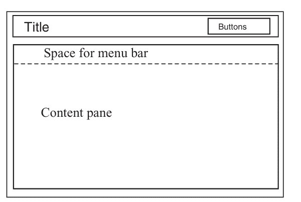

我们现在介绍构造方法，列出 JFrame 的一些方法并解释其行为：

```
JFrame()

setVisible(boolean b)
setTitle(String title)
setSize(int width, int height)
setLocation(int horizontal, int vertical)
pack()
setDefaultCloseOperation(int operation)
```

> JFrame() 是默认构造方法。它生成一个无标题的框架。这里的“生成”意味着提供了绘制框架所需的信息。然而，框架并未显示在屏幕上。这是通过调用下面将解释的 setVisible 方法来完成的。

setVisible(boolean b) 当 b = true 时使框架出现在屏幕上。如果框架是可见的，则 setVisible(false) 会使其消失，但不会销毁绘制它的信息。因此，再次对此框架调用 setVisible(true) 会使其重新可见；我们不需要第二次使用构造方法。

setTitle(String title) 将出现在标题栏中的标题设置为 title。

setSize(int width, int height) 将框架的宽度设置为 width，高度设置为 height。这些是以屏幕像素为单位的外部尺寸。

setLocation(int horizontal, int vertical) 移动框架，使其左上角位于位置 (horizontal, vertical)。另见图 2.2。

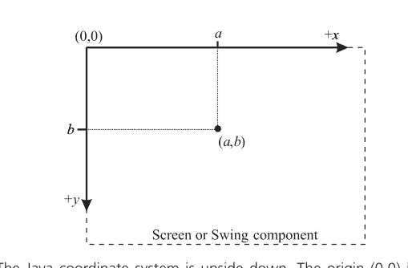

`pack()` 会调整框架大小，使其紧密围绕其内容窗格中嵌入的组件。

`setDefaultCloseOperation(int operation)` 确定当框架的“关闭”按钮被点击时会发生什么。请参见下文的注释。

让我们简要讨论一下 `setDefaultCloseOperation` 方法。默认情况下，当框架的“关闭”按钮被点击时，它会变为不可见。然而，使其可见的应用程序仍在运行，即程序**没有**被终止。`JFrame` 类中有一些预定义的常量可用于 `operation` 参数。我们将使用 `JFrame.EXIT_ON_CLOSE`。

```
setDefaultCloseOperation(JFrame.EXIT_ON_CLOSE)
```

这样，当“关闭”按钮被点击时，整个应用程序会自动终止。如果不添加这一行，将会导致以下问题：假设一个应用程序被反复启动——这在新程序的测试阶段很常见——并且每次都显示一个新的框架。尽管所有框架都通过点击“关闭”按钮变为不可见，但应用程序仍在运行并消耗资源。如果许多应用程序并行运行并共享处理器，每个应用程序都会变慢。如果所有可用内存都被耗尽，也可能出现问题。

通过点击“关闭”按钮简单地终止应用程序并不总是好主意。通常，在退出程序之前需要执行一些清理工作。例如，保存对文件所做的更改，存储程序运行期间计算或接收的数据等。我们将在第 9.3 节中看到如何实现这一点。

让我们运用所学知识，创建并显示第一个框架。我们将从 `JFrame` 派生出自己的框架类，并添加一些新功能。我们的类称为 `SimpleFrame`。由于它派生自 Swing 类 `JFrame`，因此继承了其功能。`SimpleFrame` 的构造方法被扩展：它设置了大小


框架的位置，同时也确保了如上所述的正确终止。我们现在列出程序并对其进行详细解释。

#### 文件：its/SimpleFrame/SimpleFrame.java

```
package its.SimpleFrame;

import javax.swing.JFrame;

public class SimpleFrame extends JFrame
{
    public SimpleFrame()
    {
        this.setSize(200,200);
        this.setLocation(200,200);
        this.setDefaultCloseOperation(JFrame.EXIT_ON_CLOSE);
    }

    // 使框架可见。
    public void showIt(){
        this.setVisible(true);
    }

    // 使框架可见并设置标题文本。
    public void showIt(String title){
        this.setTitle(title);
        this.setVisible(true);
    }

    // 使框架可见并设置标题文本
    // 以及窗口的位置。

    public void showIt(String title, int x, int y){
        this.setTitle(title);
        this.setLocation(x,y);
        this.setVisible(true);
    }

    // 使框架不可见。
    public void hideIt(){
        this.setVisible(false);
    }
}
```

让我们来看一下代码：类 `SimpleFrame` 在一个名为 `SimpleFrame` 的包中定义。它是 `its` 包的一个子包。我们必须指定 `[package].[subpackage]`，在我们的例子中是 `package its.SimpleFrame`。接下来，我们从 `javax.swing` 库导入 `JFrame` 类，以便在我们的程序中可以使用它（`import javax.swing.JFrame;`）。然后我们指定类名 `SimpleFrame` 并说明该类派生自 `JFrame`：

```
public class SimpleFrame extends JFrame
```

`SimpleFrame` 的构造函数和方法现在将更详细地描述：

```
public SimpleFrame()

public void showIt()
public void showIt(String title)
public void showIt(String title, int x, int y)
public void hideIt()
```

`SimpleFrame()` 扩展了 `JFrame` 的构造函数，并通过在第 9 行调用 `setSize(200,200)` 将大小设置为 200 × 200 像素。否则，由于内容窗格目前不包含任何内容，我们只会看到标题栏。我们还将框架左上角的位置设置为屏幕顶边下方 200 像素和向右 200 像素。这是通过在第 10 行调用 `setLocation(200,200)` 完成的。请注意，Java 坐标系是上下颠倒的：正 y 轴指向下方；另见图 2.2。最后，构造函数在第 11 行调用方法 `setDefaultCloseOperation` 以保证如上所述的正确终止。请注意，第 9 至 11 行中的关键字 `this` 可以省略。如引言中所述，我们添加它是为了明确这些语句指的是当前框架。

`showIt()` 通过调用 `setVisible` 并传入参数 `true` 使框架在屏幕上显示。

`showIt(String title)` 将标题栏中的标题设置为 `title` 并使框架在屏幕上显示。

`showIt(String title, int x, int y)` 将标题栏中的标题设置为 `title`，将位置更改为 x, y，并使框架在屏幕上显示。

`hideIt()` 通过调用 `setVisible` 并传入参数 `false` 使框架从屏幕上消失。此命令不会销毁框架。图形信息被保留，并且可以在不调用构造函数的情况下再次使框架可见。

为了测试 `SimpleFrame` 类，我们使用一个 *驱动程序*。我们本可以为此目的在 `SimpleFrame` 中定义一个 main 方法，但我们没有这样做，因为我们将以 `SimpleFrame` 为基础构建更多应用。驱动程序类是 `SimpleFrameDriver`。它在第 7 行和第 8 行生成两个框架。第一个框架接收一个标题并在第 9 行使其可见。第二个框架还在第 10 行被移动到位置 (300,300)。两个框架都是空的，即它们的内容窗格中没有任何东西。

图 2.3 程序 `SimpleFrameDriver` 的结果

文件：`its/SimpleFrame/SimpleFrameDriver.java`

```
1. package its.SimpleFrame;
2. 
3. public class SimpleFrameDriver
4. {
5.   public static void main(String[] args)
6.   {
7.     SimpleFrame sFrame1 = new SimpleFrame();
8.     SimpleFrame sFrame2 = new SimpleFrame();
9.     sFrame1.showIt("SimpleFrame 1");
10.    sFrame2.showIt("SimpleFrame 2",300,300);
11.   }
12. }
```

结果应如图 2.3 所示。此图片是在 Windows XP 下截取的；在其他平台上可能略有不同。如上所述，框架可以使用鼠标调整大小和移动。这些基本功能是自动提供的。

#### 2.2 面板和布局

我们现在将把其他图形组件嵌入到一个框架中。使用的组件被称为 *面板*。这些是矩形组件，主要用于两个目的：可以用作绘制的 *画布*，也可以用作嵌入更多图形组件的 *容器*。

在 Swing 中，`JPanel` 类实现了面板。我们列出构造函数和一些方法，然后展示一个演示这些方法使用的示例程序：

```
JPanel()

setBackground(Color c)
setPreferredSize(Dimension d)
```

`JPanel()` 是构造函数。面板的大小被设置为默认值，在大多数系统上为 10 × 10 像素。

`setBackground(Color c)` 设置面板的背景颜色。`Color` 类来自 AWT 库。其中预定义了一些颜色，例如用 `Color.red` 表示红色。默认情况下，背景颜色是灰色。

`setPreferredSize(Dimension d)` 设置面板的大小。`Dimension` 类来自 AWT 库。构造函数的语法为 `Dimension(int width, int height)`。`width` 和 `height` 均以像素为单位。重要的是要记住，这些值只是对组件大小的建议。根据其他组件的大小，运行时系统可能会选择不同的值！实际使用的值由运行时的 `LayoutManager` 确定。这种灵活性对于 Java 实现平台无关性非常重要。我们将在本章后面描述布局管理器。

我们现在想将一些面板嵌入到一个框架中。为了使它们可见且可区分，我们为它们设置不同的颜色。如引言中所述，我们将为每个重要的概念派生自己的类。在这里可能看起来有点过度设计，因为这里只是设置面板的颜色。但是，我们想从一开始就遵循面向对象的范式。

在下面的列表中，我们从 `JPanel` 派生出自己的类 `ColorPanel`。它的两个构造函数允许构造一个面板，每个面板都具有给定的背景颜色、给定的宽度和高度。

```
文件：its/SimpleFrameWithPanels/ColorPanel.java
```

```
package its.SimpleFrameWithPanels;

import java.awt.*;
import javax.swing.JPanel;

public class ColorPanel extends JPanel
{
  // 生成一个具有背景颜色 col 的 JPanel。
  public ColorPanel(Color col)
  {
```

```
11.    this.setBackground(col);
12.  }
13.
14.  // 生成一个具有背景颜色 col、
15.  //  宽度 width 和高度 height 的 JPanel
16.  public ColorPanel(Color col,int width,int height)
17.  {
18.      this.setPreferredSize(new Dimension(width,height));
19.      this.setBackground(col);
20.  }
21.
22. }
```

我们将 ColorPanels 嵌入到一个从 SimpleFrame 派生的 SimplePanelFrame 中。这样，SimplePanelFrame 继承了 SimpleFrame 的功能；特别是，如果框架被关闭，应用程序将被终止。我们生成五个 ColorPanels，颜色分别为白色、红色、黄色、绿色和蓝色。白色的那个宽度为 50 像素，高度为 20 像素。对于其他颜色的面板，没有指定大小，因此它们将具有默认大小。然后这些面板被嵌入到框架中。

图形组件按如下方式嵌入到其他组件中。让我们将我们希望嵌入到其中的组件称为父组件，将要被嵌入的组件称为子组件。那些可以嵌入其他组件的 Swing 组件都有一个 `add` 方法。然后，要将一个组件 `childComp` 嵌入到另一个组件 `parentComp` 中，语法是

```
parentComp.add(childComp)
```

`add` 方法可能有更多参数，例如，指定对齐方式或位置。嵌入到框架中时有所不同。这里我们必须指定我们要嵌入到内容窗格中。除了内容窗格，`JFrame` 还有更多窗格，我们这里不讨论。可以通过使用 `JFrame` 的 `getContentPane` 方法来引用它。那么，将组件 `childComp` 嵌入到框架 `parentFrame` 中的语法是：

```
parentFrame.getContentPane().add(childComp)
```

现在让我们指定如何在内容窗格中排列组件。为了实现平台无关性，Java 的设计者给图形系统提供了一定的灵活性。程序员只需要指定组件排列的结构，而不是它们的绝对位置。例如，指定“组件 A 在组件 B 的右边”，而不是要求“组件 A 在位置 (x, y)”。在运行时，组件的位置会被确定。这是通过所谓的布局管理器完成的，该管理器与父组件相关联。有一些不同的预定义布局管理器，我们将在这里描述其中一些。程序员可以定义自定义的布局管理器。

`JFrame` 默认使用 `BorderLayout`，更准确地说，其内容窗格具有 `BorderLayout` 类型的布局管理器。它允许用户放置一个（大的）中央组件和最多四个位于边框的组件。位置如下：


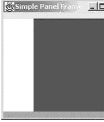

图 2.4 由 SimplePanelFrameDriver 生成的一个带有边框布局的框架。注意位于 'West' 的面板在构造时指定了宽度 50 和高度 20。虽然宽度被遵守了，但高度被改变以填充可用空间。

由常量 CENTER、NORTH、SOUTH、EAST 和 WEST 指定。这些常量定义在 BorderLayout 类中；参见图 2.5a)。如果某个边框组件不存在，则中央组件会向该方向扩展。中央组件通常包含主要信息。边框组件包含附加信息，例如 'South' 组件中的状态栏。要将组件 childComp 插入到内容窗格的位置 pos 处，我们使用以下方法

```
this.getContentPane().add(childComp, pos)
```

其中 pos 是以下常量之一：BorderLayout.CENTER、BorderLayout.NORTH、BorderLayout.SOUTH、BorderLayout.EAST 或 BorderLayout.WEST。

下面是 SimplePanelFrame 类的代码以及驱动类 SimplePanelFrameDriver 的清单。第一个类派生自 SimpleFrame。五个面板在其构造函数中创建，然后嵌入到内容窗格中。驱动类生成一个 SimplePanelFrame 并使其可见。结果如图 2.4 所示。在那里可以看到所有边框面板的大小都被设置为跨越内容窗格的整个宽度或高度。其他尺寸是默认的宽度和高度，在大多数平台上为 10。位于 'West' 的白色面板 CPWest 在其构造函数中指定了宽度 50。布局中忽略了高度 20 的指定；面板 CPWest 的高度被扩展以填充框架内的可用高度。中央组件也被扩展以填充中间的所有空间。

文件：its/SimpleFrameWithPanels/SimplePanelFrame.java

```
package its.SimpleFrameWithPanels;

import java.awt.*;
import javax.swing.JFrame;
import its.SimpleFrame.SimpleFrame;

public class SimplePanelFrame extends SimpleFrame
{
  public SimplePanelFrame()
  {
    ColorPanel CPWest = new ColorPanel(Color.white, 50, 20);
    ColorPanel CPEast = new ColorPanel(Color.red);
    ColorPanel CPNorth = new ColorPanel(Color.yellow);
    ColorPanel CPSouth = new ColorPanel(Color.green);
    ColorPanel CPCenter = new ColorPanel(Color.blue);
    this.getContentPane().add(CPWest, BorderLayout.WEST);
    this.getContentPane().add(CPEast, BorderLayout.EAST);
    this.getContentPane().add(CPNorth, BorderLayout.NORTH);
    this.getContentPane().add(CPSouth, BorderLayout.SOUTH);
    this.getContentPane().add(CPCenter, BorderLayout.CENTER);
  }
}
```

文件：its/SimpleFrameWithPanels/SimplePanelFrameDriver.java

```
package its.SimpleFrameWithPanels;

public class SimplePanelFrameDriver
{
  public static void main(String[] args)
  {
    SimplePanelFrame spFrame = new SimplePanelFrame();
    spFrame.showIt("Simple Panel Frame");
  }
}
```

现在我们介绍另外两个布局管理器：流式布局管理器（FlowLayout）和网格布局管理器（GridLayout）。这两个类以及 BorderLayout 都实现了接口 LayoutManager。布局不仅限于框架。每个可以嵌入其他组件的 Swing 组件（所谓的容器）都有一个布局。默认布局是边框布局。要将父组件 parentComp 的布局更改为另一个布局 newLayout，可以使用以下命令

```
parentComp.setLayout(newLayout)
```

如果一个组件具有流式布局，那么嵌入的组件会按行从左到右放置。如果一行已满，则开始下一行。流式布局（大部分情况下）尊重嵌入组件的尺寸。调用 parentComp.add(child) 的顺序决定了嵌入组件在父组件中的顺序。行的高度在运行时通过检查行中的所有组件来确定。参见图 2.5b。以下是 `FlowLayout` 的一些构造函数：

```
FlowLayout()
FlowLayout(int align)
FlowLayout(int align, int hdist, int vdist)
```

第一个构造函数生成的布局默认在行内组件之间有 5 个像素的间距，行与行之间也有 5 个像素的间距。此外，第二个构造函数指定了组件的对齐方式，其中 `align` 是以下之一

```
FlowLayout.RIGHT, FlowLayout.LEFT, FlowLayout.CENTER
```

这决定了每一行中的组件是"打包"到右侧、左侧还是居中。第三个构造函数还指定了行内组件之间的水平距离 `hdist` 和行之间的垂直距离 `vdist`。程序 `LayoutDriver` 展示了一些示例。对于我们没有定义尺寸的组件，其大小被设置为默认的最小值；在大多数系统上为 10 × 10。

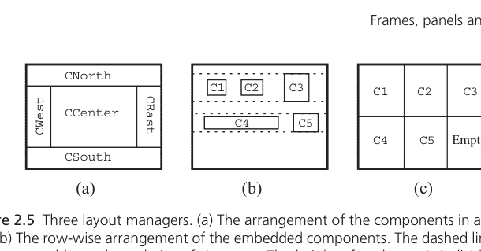

图 2.5 三种布局管理器。(a) 边框布局中组件的排列方式。(b) 嵌入组件的按行排列。虚线表示行的上下边界。每行的高度由其中最高的组件的高度单独决定。组件之间的间距和行之间的间距可以修改。(c) 一个嵌入了五个组件的 2 × 3 网格布局。所有列和行具有相同的宽度和高度。

组件 `comp` 的布局管理器每次在重绘组件 `comp` 时都会重新计算布局，尤其是在 `comp` 调整大小之后。如果调整大小后一行中可以容纳更多或更少的组件，它们将被重新排列。在 `LayoutDriver` 中尝试一下。另参见图 2.5。

这里描述的第三种布局管理器是 `GridLayout`，它将组件按网格排序。父组件（在我们的例子中是内容窗格）被划分为 *r* × *c* 个矩形*单元格*，其中 *c* 是每行的单元格数，*r* 是行数。所有单元格具有相同的大小。组件按行从左到右嵌入到单元格中。如果单元格多于嵌入的组件，布局管理器会尝试尽可能填满所有行，可能会生成少于 *c* 列！如果单元格少于组件，则会添加**列**。基本上网格布局管理器忽略列数。为了使列数固定为 *c* > 0，行数必须设置为 *r* = 0IDA0，列数设置为 *c*。这样始终会有 *c* 列，行数根据嵌入组件的数量进行调整。在程序 `LayoutFrame` 中，我们为五个组件生成了一个 2 × 4 的网格。布局管理器然后生成一个 2 × 3 的网格，其中只有一个单元格为空。有时人们会在网格布局中嵌入*虚拟组件*。这些是 Swing 组件，通常是标签，除了填充某些单元格外没有其他功能。它们可以用来在两个其他单元格之间产生一个"空"单元格。第 6 章包含一个示例。网格布局基本上忽略嵌入组件的尺寸；组件完全填满单元格。另参见图 2.5c。

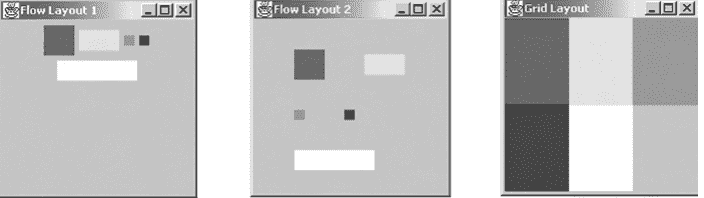

图 2.6 `LayoutDriver` 的输出。标准流式布局；具有更大间距的流式布局；网格布局

下面我们列出网格布局的构造函数和一些方法。行数 `r` 和列数 `c` 以及列之间的间隙宽度（`hdist`）和行之间的间隙宽度（`vdist`）可以传入：

```
GridLayout(int r, int c);
setHgap(int hdist);
setVgap(int vdist);
```

以下清单 `LayoutFrame` 和 `LayoutDriver` 展示了布局的示例。第一个定义了一个框架，其布局可以通过在构造函数中传入 `LayoutManager` 来选择。

程序 `LayoutDriver` 生成三个 `LayoutFrame` 并使它们可见。第一个被赋予标准流式布局。第二个接收具有指定行/列间距和左对齐的流式布局。第三个框架被赋予一个 2 × 4 的网格布局。`showIt` 指令中的位置被设置为使三个框架并排显示。图 2.6 显示了结果。

文件：its/Layouts/LayoutFrame.java

```
package its.Layouts;

import java.awt.LayoutManager;
import its.SimpleFrameWithPanels.ColorPanel;
import java.awt.Color;
import its.SimpleFrame.*;
```


### 练习

2.1 如果你点击某个窗口的"关闭"按钮会发生什么？解释观察到的行为。然后删除以下行：

```
setDefaultCloseOperation(JFrame.EXIT_ON_CLOSE);
```

从 SimpleFrame 的构造器中。在 SimpleFrameDriver 类的 main 方法开头添加以下代码：

```
int k = 0;
while (true) {
    System.out.println("SimpleFrameDriver: Still running! " + k);
    k++;
}
```

只要应用程序在运行，这就会向控制台打印行。然后编译并启动应用程序，点击窗口的"关闭"按钮。观察发生了什么变化并解释它。

2.2 检查如果框架的边界布局（border layout）中的中心组件不存在会发生什么。添加不同的边界组件组合，例如"East"和"South"。

2.3 尝试使用不同的布局来感受布局管理器的作用。调整框架大小，更改布局中的参数（距离、行/列数）等。

## 第一个 GUI

> 图形界面的目的是显示数据，并允许用户与程序在运行时进行通信。在本章中，我们将学习如何设计这样的图形界面。在这个例子中，用户可以通过按下按钮与程序通信。程序会相应地更新显示。

在本章中，我们将看到第一个真正的*GUI*（*图形用户界面*）示例。这里的"真正"意味着我们有用户与程序的交互。这种交互是通过图形显示中的按钮实现的。虽然程序非常简单，但我们希望在此引入*模型-视图-控制*（*model–view–control*）的概念。程序的（非图形）*模型*部分负责存储、维护或操作数据。图形*视图*部分显示数据并提供用户交互的组件，例如按钮。（同样非图形的）*控制*部分确保用户操作能够产生程序预期的响应。控制部分是模型和视图之间的桥梁。

模型、视图和控制结构的分离通常是成功、快速实现的关键概念。它也有助于初学者更好地理解核心概念及其相互作用。在 Java 中，通过使用面向对象可以轻松实现这种分离，即为不同部分使用不同的类或至少不同的方法。在复杂的应用程序中，可能会为不同部分使用单独的包。

接下来，我们首先指定要实现的 GUI。然后构建非图形模型并测试其是否正常工作。接着设计图形显示。最后实现控制结构，即用户与程序的交互。

### 应用程序的规范

我们要实现一个*计数器*。它被指定为抽象数据结构。计数器有一个整数变量*value*（值）。初始值为 0。计数器允许四种*操作*（当然，在某些应用程序中可能需要更多操作）：

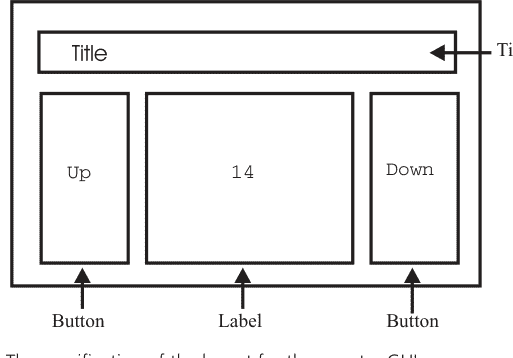

图 3.1 计数器 GUI 的布局规范

- `increment` – 将计数器的值加 1。
- `decrement` – 将计数器的值减 1。
- `reset` – 将计数器的值设为 0。
- `getValue` – 返回计数器的当前值。

接下来，我们指定图形应该是什么样子以及它如何工作。我们设想的 GUI 应该显示计数器的当前值，并允许用户增加或减少它。为此，GUI 有两个*按钮*。按下第一个按钮（标记为"Up"），例如用鼠标点击它，将增加计数器。按下另一个按钮（标记为"Down"）将减少计数器。图 3.1 展示了我们希望这个 GUI 看起来的样子。这完成了 GUI 功能和布局的规范。

### 计数器模型

我们现在在非图形类 `CounterModel` 中实现计数器。计数器只有一个整数变量 `value`，按照规范在构造器中初始化为 0。变量 `value` 是 `private` 的，因此其他类只能通过 `CounterModel` 的方法来操作它。我们在四个方法中实现了规范要求的四种操作，方法名称显而易见：`increment()`、`decrement()`、`reset()` 和 `getValue()`。以下是该类的代码：

文件：its/CounterGUI/CounterModel.java

```
package its.CounterGUI;

public class CounterModel {
    private int value;

    // 构造器将计数器初始化为 0
    public CounterModel() {
        value = 0;
    }

    public void increment(){
        value++;
    }

    public void decrement(){
        value--;
    }

    public void reset(){
        value = 0;
    }

    public int getValue(){
        return(value);
    }
}
```

计数器是一个如此简单的对象，我们可以立即"看出"我们的实现是正确的，即符合规范。然而，对于稍微复杂一些的实体，人们很容易忽略错误。检查程序是否符合规范的问题很难解决，事实上一般来说是不可解的。因此，人们必须依赖*经验测试*。这意味着要建立一个*测试计划*。它包含（大量）可能的程序输入以及程序的正确响应。该计划应该激活程序的所有部分，例如所有类的所有方法。然后检查观察到的响应和预期的响应是否一致。当然，这样的计划并不能保证程序确实正确，因为它可能不包含导致错误的现有输入。然而，一个好的测试计划通常确实能发现程序中的错误。

为了展示测试计划的样子，我们添加了类 `CounterModelTest` 的代码，它为计数器模型实现了一个测试计划。它至少调用每个方法一次，并比较预期和观察到的结果。比较由方法 `checkValue(a,b)` 完成，它比较 `a` 和 `b` 并将比较结果打印到屏幕。

**文件：** `its/CounterGUI/CounterModelTest.java`

```
package its.CounterGUI;

public class CounterModelTest {
    private static boolean passed = true;

    public static void main(String[] args) {
        CounterModel cm = new CounterModel();

        checkValue(0,cm.getValue());
        cm.increment();
        checkValue(1,cm.getValue());
        cm.decrement();
        checkValue(0,cm.getValue());
        for (int i = 0; i < 37; i++) {
            cm.increment();
        }
        checkValue(37,cm.getValue());
        for (int i = 0; i < 21; i++) {
            cm.decrement();
        }
        checkValue(16,cm.getValue());
        cm.reset();
        checkValue(0,cm.getValue());

        if(passed){
            System.out.println("Test passed.");
        }
        else{
            System.out.println("Test NOT passed.");
        }
    }

    private static void checkValue(int expectedValue, int observedValue){
        if(expectedValue == observedValue){
            System.out.println("Values are both equal to "+expectedValue);
        }
        else{
            System.out.println("ERROR expected value "+expectedValue+
                             " and observed value "+observedValue+" differ!");
            passed = false;
        }
    }
}
```

以下是 CounterModelTest 运行的结果：

```
Values are both equal to 0
Values are both equal to 1
```


### 3.3 计数器视图

为了实现计数器应用的图形部分，我们使用了 Swing 库中的两个新图形组件：*标签*和*按钮*。

#### 3.3.1 标签

*标签*是一个矩形组件，用于显示用户不可编辑的文本（但程序可能会更改它）。`JLabel` 类在 Swing 中实现了标签。这里我们介绍一个构造方法和几个常用方法。

```
public JLabel(String text)
public JLabel(ImageIcon picture)

public String getText()
public void setText(String text)
public void setText(String text, int alignment)

public void setForeground(Color c)
public void setBackground(Color c)
public void setOpaque(boolean b)
```

`JLabel(String text)` 构造一个显示指定文本的标签。

`JLabel(ImageIcon picture)` 构造一个显示图片 `picture` 的标签。有关使用图像的详细信息，请参见第 15 章。

`getText()` 返回当前标签中显示的文本，类型为 `String`。

`setText(String text)` 用 `text` 替换当前标签中显示的文本。新文本会立即显示在标签中。

`setText(String text, int alignment)` 用 `text` 替换当前标签中显示的文本。它还设置文本的对齐方式：左对齐、右对齐或居中。`alignment` 的可能值可以在 `SwingConstants` 类中找到，例如，使用 `SwingConstants.CENTER` 可以将标签中的文本居中。

`setForeground(Color c)` 将文本颜色设置为 `c`。

`setBackground(Color c)` 将背景颜色设置为 `c`。请注意，标签默认是透明的，其背景颜色不可见。你看到的是父组件的背景颜色透了过来。要更改标签的背景颜色，必须首先使用 `setOpaque` 方法使其不透明。

```
setOpaque(boolean b) 如果 b 为 false，则使标签透明；如果 b 为 true，则使标签不透明。
```

#### 3.3.2 按钮

*按钮*是矩形区域（通常带有边框），与标签一样，也可以显示文本。它们与标签的区别在于它们可以触发*事件*。每当按钮被按下时，就会发生一个事件。Java 运行时系统会监视按钮并识别此类事件的发生。请注意，按钮不一定是通过鼠标点击按下的，也可能是触摸屏监视器上的手指操作。因此，按钮的处理与鼠标是分开的。

在第 3.4 节中，我们将详细了解运行时系统如何通知我们的程序发生了事件。目前，以下解释应该足够了：为了注意到按钮何时被按下，必须有东西监视着按钮。这由一个*监听器*完成，它是来自 AWT 库的（非图形）组件。监听器必须被*分配*给按钮以进行监视。如果该按钮上发生事件，运行时系统会通知监听器。然后监听器可以分析事件并启动特定的动作。

`JButton` 类在 Swing 中实现了按钮。我们只介绍构造方法和将监听器分配给按钮的方法。

```
public JButton(String text);
public void addActionListener(ActionListener listener);
```

#### 3.3.3 构建图形界面

我们使用两个按钮来改变计数器的值，并使用一个标签来显示其值。排列这些组件的方式有很多种。一种方式是将按钮和标签直接“粘贴”到框架的内容面板中。我们在这里使用不同的方法：使用一个中间面板，将按钮和标签嵌入其中。相应的类称为 `CounterPanel`。然后将 `CounterPanel` 粘贴到框架中；参见图 3.2。这种方法的优点是可以在其他应用程序中重复使用 `CounterPanel` 作为现成模块。

我们首先需要决定哪种布局管理器支持预期的图形用户界面（GUI）。在我们的例子中，边框布局对于面板和框架都是合适的。我们将按钮粘贴到面板的西（west）和东（east）位置，并将标签粘贴到中间位置。实际上，面板默认就是边框布局。我们仍然设置布局是为了明确这是 GUI 实现的一个步骤。

每个 `CounterPanel` 都在变量 `counter` 中保存自己的 `CounterModel` 实例。该变量是私有的，因此无法从 `CounterPanel` 类外部直接操作计数器。相反，`CounterPanel` 提供了两个方法 `increment()` 和 `decrement()`，它们只是简单地调用计数器模型 `counter` 的相应方法。

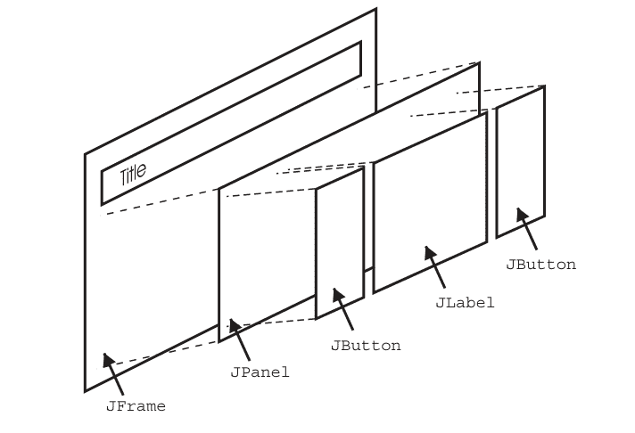

**图 3.2** 计数器 GUI 的构建。引入中间的 JPanel 是为了保证模块化。该面板可以在其他应用程序中重复使用。

我们计数器应用程序的框架在 `CounterFrame` 类中实现。该类派生自 `SimpleFrame`，因此当框架关闭时应用程序会终止。`CounterFrame` 将其内容面板的中心位置嵌入了一个 `CounterPanel`。我们下面列出 `CounterPanel`、`CounterFrame` 和驱动类 `CounterDriver` 的代码。

当应用程序启动时，框架出现。我们可以按下按钮，并看到它们的颜色在按下时会短暂变化。此功能是自动提供的。然而，应用程序并未在标签中改变计数器的值。此时它无法做到这一点，因为我们还没有“告诉”应用程序这样做。第 3.4 节介绍的控制部分将负责此项工作。在 `CounterPanel` 的代码清单中，第 29 到 31 行稍后将用于启用监听器。目前它们是注释，因此没有任何效果。

```
文件: its/CounterGUI/CounterPanel.java
package its.CounterGUI;

import javax.swing.JPanel;
import javax.swing.JButton;
import javax.swing.JLabel;
import java.awt.BorderLayout;
import javax.swing.SwingConstants;
public class CounterPanel extends JPanel {

    private CounterModel counter;
    private JLabel valueLabel;

    public CounterPanel() {
        counter = new CounterModel();

        BorderLayout bordLay = new BorderLayout();
        this.setLayout(bordLay);

        JButton upButton  = new JButton("Up");
        JButton downButton = new JButton("Down");
        valueLabel = new JLabel(""+counter.getValue(),SwingConstants.CENTER);

        this.add(upButton,BorderLayout.WEST);
        this.add(downButton,BorderLayout.EAST);
        this.add(valueLabel,BorderLayout.CENTER);

        // The next three lines will later be used to incorporate
        //the listener.
        // CounterListener countList = new CounterListener(this);
        // upButton.addActionListener(countList);
        // downButton.addActionListener(countList);
    }

    public void increment(){
        counter.increment();
        valueLabel.setText(""+counter.getValue());
    }

    public void decrement(){
        counter.decrement();
        valueLabel.setText(""+counter.getValue());
    }
}
```

```
文件: its/CounterGUI/CounterFrame.java
package its.CounterGUI;

import javax.swing.JFrame;
import java.awt.BorderLayout;
import its.SimpleFrame.SimpleFrame;

public class CounterFrame extends SimpleFrame {

    public CounterFrame() {
        CounterPanel counterPane = new CounterPanel();
        this.getContentPane().add(counterPane,BorderLayout.CENTER);
    }
}
```

```
文件: its/CounterGUI/CounterDriver.java
package its.CounterGUI;

public class CounterDriver {
    public static void main(String[] args) {
        CounterFrame cfr = new CounterFrame();
        cfr.showIt("Counter");
    }
}
```

### 3.4 计数器控制（监听器和事件）

用户操作（如按下按钮）与应用程序之间的链接是通过监听器建立的。这些是来自 AWT 库 `java.awt.events.*` 的非图形组件。不同类型的事件（按下按钮、移动鼠标等）有不同的监听器。通常，监听器是接口而不是类。然而，我们将首先像处理类一样来处理监听器。经验表明，这对于没有经验的程序员来说更容易理解。稍后我们将描述如何利用接口机制。

我们继续描述监听器的概念通常如何工作。Swing 的一些组件可以触发事件。例如，按钮可以被按下，或者菜单项可以被选中。这些事件会被 Java 运行时系统自动注意到。现在，程序员可以实现一个监听器并将其分配给图形组件，比如一个按钮。监听器然后“等待”，直到按钮被按下，如果发生这种情况，它就会采取行动。如果按钮被按下，运行时系统会自动通知监听器。通知是通过调用监听器的特定方法来完成的。该方法的名称在监听器的接口中是预定义的。程序员必须实现此方法，插入应在响应按钮被按下时执行的代码。

在我们的计数器应用程序中，计数器必须根据相应按钮的按下而递增或递减。因此，监听器被分配给两个按钮，即它监视两个按钮。如果某个按钮被按下，监听器就会被告知。为了采取适当的行动，它必须知道是哪个按钮被按下了。此信息由运行时系统以类型为

的对象的形式提供。

ActionEvent。该类也存在于 AWT 库中（位于 `java.awt.events`）。`ActionEvent` 类型的对象包含运行时系统所注意到的事件信息。

对于我们的计数器应用，我们在 `CounterListener` 类中实现一个监听器。`CounterListener` 实现了 Java 接口 `ActionListener`。该实现只需要定义一个方法 `actionPerformed`：

```
public void actionPerformed(ActionEvent evt)
```

这是运行时系统在按钮被按下时调用的方法。你不必自己调用这个方法，也不应该这样做。运行时系统还会生成一个动作事件 `evt` 并将其传递给 `actionPerformed` 方法。程序员将代码放入 `actionPerformed` 方法¹ 的方法体中。这段代码随后在按钮被按下时执行。动作事件中包含的信息可用于进一步收集有关触发该事件的来源的详细信息。

`CounterListener` 类的代码如下所列。我们将在代码清单之后进行解释。

**文件：`its/CounterGUI/CounterListener.java`**

```
1. package its.CounterGUI;
2. 
3. import java.awt.event.ActionListener;
4. import java.awt.event.ActionEvent;
5. 
6. public class CounterListener implements ActionListener{
7. 
8.     private CounterPanel countPane;
9. 
10.    public CounterListener(CounterPanel counp) {
11.        countPane = counp;
12.    }
13. 
14.    // This method is called by the runtime system.
15.    // The programmer has to add the code to be executed
16.    // as a response to the event.
17.    public void actionPerformed(ActionEvent evt){
18.        // Beginning of own code
19.        String actionCommand = evt.getActionCommand();
20.        if(actionCommand.equals("Up")){
21.            countPane.increment();
22.        }
23.        else if(actionCommand.equals("Down")){
24.            countPane.decrement();
      }
    else{
      System.out.println("ERROR: Unexpected ActionCommand");
    }
    // End of own code
  }
}
```

在 `CounterListener` 类的代码中，我们看到的是 `implements` 而不是 `extends`。这是因为 `ActionListener` 是一个接口而不是一个类。构造函数接收一个 `CounterPanel` 作为参数。监听器随后便"知道"它需要更新哪个计数器面板。更多详情请参阅 B.4 节。

`CounterListener` 类的核心是 `actionPerformed` 方法的实现。我们首先确定按下了两个按钮中的哪一个。这通过检查方法 `actionPerformed` 从运行时系统接收的动作事件对象 `evt` 来完成。以下这行代码

```
    String actionCommand = evt.getActionCommand();
```

从事件对象 `evt` 中提取出*动作命令*。动作命令通常是被按下按钮的文本。在我们的情况下，它只能是 'Up' 或 'Down'。我们使用 if-then-else 结构来检查具体是哪一个²。根据测试结果，我们调用计数器面板的 `increment` 或 `decrement` 方法。在此我们可以看到为什么监听器在构造函数中被赋予了对 `CounterPanel` 的引用。这样监听器就知道它需要更新哪个面板来响应事件。

在 `CounterPanel` 的代码清单中，第 29 到 31 行的注释符号被移除了。这些行是

```
    CounterListener countList = new CounterListener(this);
    upButton.addActionListener(countList);
    downButton.addActionListener(countList);
```

第一行创建了一个 `CounterListener` 的实例。监听器在构造函数中接收一个指向该面板的引用（`this`）。接下来的两行将监听器关联到 GUI 的两个按钮上。至此 GUI 的实现就完成了。图 3.3 展示了该应用程序的外观。`its.CounterGUI` 包的结构可以参见图 3.4 中的类 UML 图³。

> ¹ 此表述需要谨慎理解。部分代码实际上可能位于其他方法中，这些方法从 `actionPerformed` 内部被调用。

> ² 最后一种情况只有在动作命令既不是 'Up' 也不是 'Down' 时才会到达。我们添加这种情况是为了确保能够发现可能由（例如）计数器面板中按钮文本的更改所引起的错误。

> ³ UML 代表"统一建模语言"（Unified Modelling Language）。UML 通过图形化表示类结构的方式，用于规约面向对象程序的结构。更多详情请参阅第 1.5 节中 Fowler 和 Scott 的著作。

图 3.3 计数器应用程序

图 3.4 `its.CounterGUI` 包的类图。测试类 CounterTest 已被省略

### 3.5 总结

要开发一个交互式 GUI，需要以下步骤：

1. 实现并测试模型。
2. 实现视图，特别是：
   (a) 决定使用哪些图形组件。
   (b) 决定如何排列它们。
   (c) 决定使用哪种布局管理器。
3. 创建动作监听器，特别是：
   (a) 在 `actionPerformed` 方法中定义响应事件时需要执行的操作。
   (b) 使用 `ActionEvent` 对象获取有关所发生事件类型的信息。
4. 将动作监听器分配给视图的相关图形组件。

用户与程序的交互过程如下：

- 用户按下按钮。
- 运行时系统检测到用户操作并创建一个包含该操作信息的事件对象。
- 运行时系统调用分配给该按钮的监听器的 `actionPerformed` 方法。事件对象作为参数传递给 `actionPerformed`。
- `actionPerformed` 方法中的代码被执行。

### 练习

**3.1** 向 `CounterPanel` 添加第三个按钮。它应位于底部，标签为 'Reset'。按下该按钮时，计数器应重置为 0。然后编写一个应用程序，显示如图 3.5 所示的新面板。

**3.2** 编写一个应用程序，显示两个计数器，如图 3.6 所示。尝试"复用"已经定义的组件，例如 `CounterPanel`。

**3.3** 编写一个应用程序，显示四个分别标记为 '1'、'2'、'3' 和 '4' 的按钮以及一个标签。按图 3.7 所示排列组件。标签初始显示文本 'No button pushed'。当四个按钮之一被按下时，标签中的文本变为 'Last button pushed was no. X'，其中 X 为该按钮的编号。

图 3.5 练习 3.1 中 GUI 的布局

图 3.6 练习 3.2 中 GUI 的布局

图 3.7 练习 3.3 中 GUI 的布局

## 第二个 GUI

在本章中，我们构建另一个图形界面。该界面的目的是向运行中的应用程序传递文本。

### 4.1 应用程序的规格说明

该应用程序将执行一个极其简单的文本分析。GUI 的外观和功能应如图 4.1 所示。在 'Enter text:' 文本的右侧是一个可编辑区域，用户可以在其中输入或更改文本。如果点击 'Analyse' 按钮，则会对文本进行简要分析，并以下述方式显示结果。文本被转换为大写字母并复制到 'Current text:' 右侧的区域中。字母 'E'（不区分大小写）在当前文本中的出现次数显示在 'No. of Es in current text:' 的右侧。同时，用户可编辑区域的内容被清空。

图 4.1 文本分析 GUI 的规格说明

### 4.2 模型部分

模型在 `TextAnalysisModel` 类中实现，如下所列。该类使用字符串变量 `currentText` 存储以大写字母形式表示的待分析文本。整型变量 `currentNumberOfEs` 用于存储当前文本中 E 的数量。另外两个变量 `totalNumberOfEs` 和 `totalNumberOfTexts` 仅在本章的练习中使用。

实际的分析由 `analyse(String str)` 方法执行。该方法将字符串 `str` 转换为大写形式并存储在 `currentText` 中。然后通过逐个检查字符串中的每个字符来计算 `currentText` 中字母 'E' 的出现次数。`analyse` 的最后两行更新将在练习中使用的变量。四个 `get` 方法返回各变量的相应值。

**文件：`its/TextAnalysisGUI/TextAnalysisModel.java`**

```
1. package its.TextAnalysisGUI;
2. 
3. public class TextAnalysisModel {
4. 
5.     private int totalNumberOfEs;
6.     private int currentNumberOfEs;
7.     private int totalNumberOfTexts;
8.     private String currentText;
9. 
10.    public TextAnalysisModel() {
11.        totalNumberOfEs = 0;
12.        totalNumberOfTexts = 0;
13.        currentText = "";
14.    }
15. 
16.    public void analyse(String str){
17.        currentText = str.to.;
18.        currentNumberOfEs = 0;
19.        for (int i = 0; i < currentText.length(); i++) {
20.            if(currentText.charAt(i) == 'E'){
21.                currentNumberOfEs++;
22.            }//if
23.        }//for i
24.        totalNumberOfEs += currentNumberOfEs;
25.        totalNumberOfTexts++;
26.    }// analyse
27. 
28.    public int getCurrentNumberOfEs(){
```


return(currentNumberOfEs);
}

public String getCurrentText(){
    return(currentText);
}

public int getTotalNumberOfEs(){
    return(totalNumberOfEs);
}

public int getTotalNumberOfTexts(){
    return(totalNumberOfTexts);
}
}

我们不在此列出测试类，但它需要检查哪些函数应该是显而易见的。

### 4.3 视图部分

我们使用一个新的Swing组件来构建此GUI，下文将对其进行描述。

#### 4.3.1 文本字段

文本字段显示单行文本。用户可以编辑文本。Java中的`JTextField`类实现了文本字段。要编辑文本，请在文本字段内单击，光标将会出现。如果文本过长，文本字段会自动水平滚动。此功能是内置的。文本字段默认情况下是不透明的，具有白色背景和黑色文本。

```java
public JTextField(String text);

public String getText();
public void setText(String text);

public void setForeground(Color c);
public void setBackground(Color c);
```

`JTextField(String text)`构造一个显示该文本的文本字段。

`setText(String text)`将文本字段中当前显示的文本替换为指定的文本。

`getText()`以字符串形式返回文本字段中当前显示的文本。

`setForeground(Color c)`将文本颜色设置为`c`。

`setBackground(Color c)`将背景颜色设置为`c`。

#### 4.3.2 构建视图

我们现在描述如何构建GUI。图4.2展示了其结构。我们采用一个具有边框布局的框架。该类名为`TextAnalysisFrame`，派生自`SimpleFrame`。在底部（南方），我们将一个`JButton`“粘贴”到框架中。在中间（中心），我们“粘贴”一个`TextAnalysisPanel`类型的面板。该面板被定义为容纳文本组件。它具有3x2的网格布局。网格按此顺序包含：一个标签、一个文本字段和另外四个标签。组件被着色以便于区分，并且行和列之间的间隙被增大。通过这些间隙，我们可以看到面板的黄色背景。

构建GUI还有其他方式。可以使用另一个包含“分析”按钮和文本分析面板的面板。在这种情况下，监听器应在新面板中实例化。

为了实现所需功能，我们在`TextAnalysisPanel`中定义了方法`startAnalysisAndDisplayResult`。此方法从文本字段`inputField`读取文本，并通过调用`TextAnalysisModel`的`analyse`方法将其传递给文本分析模型。面板本身并不知道文本是如何被分析的。然后，通过调用`TextAnalysisModel`的相应getter方法从文本分析模型获取分析结果（大写的文本及其包含的‘E’的数量）。结果显示出来，并且文本字段中的文本被擦除，即替换为空字符串。

我们现在列出定义视图的两个类。

```java
File: its/TextAnalysisGUI/TextAnalysisFrame.java

package its.TextAnalysisGUI;

import its.SimpleFrame.SimpleFrame;
import java.awt.*;
import javax.swing.JButton;

public class TextAnalysisFrame extends SimpleFrame
{
  public TextAnalysisFrame()
  {
    this.setSize(300,150);
    TextAnalysisPanel taPanel = new TextAnalysisPanel();
    this.getContentPane().add(taPanel,BorderLayout.CENTER);
    JButton analyseButton = new JButton("Analyse");
    analyseButton.setBackground(Color.blue);
    analyseButton.setForeground(Color.yellow);
    this.getContentPane().add(analyseButton,BorderLayout.SOUTH);

    TextAnalysisListener taList = new TextAnalysisListener(taPanel);

    analyseButton.addActionListener(taList);
  }
}
```

```java
File: its/TextAnalysisGUI/TextAnalysisPanel.java

package its.TextAnalysisGUI;

import java.awt.Color;
import java.awt.GridLayout;
import javax.swing.JLabel;
import javax.swing.JPanel;
import javax.swing.JTextField;

public class TextAnalysisPanel extends JPanel
{
    private JLabel lastTextLabel;
    private JLabel numberOfEsLabel;
    private JLabel numberOfTextsLabel;
    private JTextField inputField;
    private TextAnalysisModel analysisModel;

    public TextAnalysisPanel()
    {
        analysisModel = new TextAnalysisModel();

        this.setBackground(Color.yellow);
        this.setLayout(new GridLayout(3,2,10,10));
        JLabel questionLabel    = new JLabel("Enter text:");
        JLabel replyLabel       = new JLabel("Current text:");
        JLabel numberTextLabel  = new JLabel("No. of Es in current text:");
        lastTextLabel          = new JLabel("");
        numberOfEsLabel        = new JLabel("--");
        inputField             = new JTextField("");

        questionLabel.setOpaque(true);
        questionLabel.setBackground(Color.black);
        questionLabel.setForeground(Color.white);

        replyLabel.setOpaque(true);
        replyLabel.setBackground(Color.black);
        replyLabel.setForeground(Color.white);

        numberTextLabel.setOpaque(true);
        numberTextLabel.setBackground(Color.black);
        numberTextLabel.setForeground(Color.white);

        numberOfEsLabel.setOpaque(true);
        numberOfEsLabel.setBackground(Color.red);
        numberOfEsLabel.setForeground(Color.white);

        lastTextLabel.setOpaque(true);
        lastTextLabel.setBackground(Color.red);
        lastTextLabel.setForeground(Color.white);

        this.add(questionLabel);
        this.add(inputField);
        this.add(replyLabel);
        this.add(lastTextLabel);
        this.add(numberTextLabel);
        this.add(numberOfEsLabel);
    }

    public void startAnalysisAndDisplayResult()
    {
        String text = inputField.getText();
        analysisModel.analyse(text);
        lastTextLabel.setText(analysisModel.getCurrentText());
        int noOfEs = analysisModel.getCurrentNumberOfEs();
        numberOfEsLabel.setText(Integer.toString(noOfEs));
        inputField.setText("");
    }
}
```

### 4.4 控制部分

类`TextAnalysisListener`实现了接口`ActionListener`。它需要实现方法`actionPerformed`。这里`actionPerformed`调用了`TextAnalysisPanel`的`startAnalysisAndDisplayResult`方法。为此，`TextAnalysisListener`必须知道`TextAnalysisPanel`。这通过在`TextAnalysisListener`的构造函数中传递（一个引用）给`TextAnalysisPanel`来实现。

```java
public TextAnalysisListener(TextAnalysisPanel taPanel)
```

类`TextAnalysisFrame`生成一个`TextAnalysisListener`的实例，并将其分配给标有“分析”的按钮。

```java
TextAnalysisListener taList = new TextAnalysisListener(taPanel);
analyseButton.addActionListener(taList);
```

以下是`TextAnalysisListener.java`类和驱动类`testanalysisTest.java`的代码清单。图4.3显示了结果。

### 4.5 嵌套结构

本章中的GUI和第3章中的计数器GUI都是通过*分层嵌套*构建的。这意味着某些组件首先被嵌入到一个父组件中，然后父组件再被嵌入到一个祖父组件中。分层嵌套可以跨越更多代。

```java
File: its/TextAnalysisGUI/TextAnalysisListener.java

package its.TextAnalysisGUI;

import java.awt.event.ActionEvent;
import java.awt.event.ActionListener;

public class TextAnalysisListener implements ActionListener
{
    private TextAnalysisPanel taPanel;
    
   public TextAnalysisListener(TextAnalysisPanel t)
   {
       taPanel = t;
   }
   
   public void actionPerformed(ActionEvent evt)
   {
           taPanel.startAnalysisAndDisplayResult();
   }
}
```

```java
File: its/TextAnalysisGUI/TextAnalysisDriver.java

package its.TextAnalysisGUI;

public class TextAnalysisDriver
{
    public static void main(String[] args)
    {
        TextAnalysisFrame taFrame = new TextAnalysisFrame();
         taFrame.showIt("Text analysis");
    }
}
```


### 4. 层次嵌入

使用层次嵌入时必须遵守的重要规则是它们必须是*无环的*。这意味着不能存在循环嵌入，例如组件A嵌入到组件B中，组件B又嵌入到组件C中，然后组件C再嵌入到组件A中。形式上，嵌入结构必须形成一棵*有根树*；参见图4.4。循环嵌入将导致运行时错误。

**图4.4** (a) 合法的嵌入结构；(b) 非法的嵌入结构。非法结构包含由组件B、C和D构成的循环。从组件B指向组件A的箭头表示B嵌入在A中。

### 练习

4.1 分两步扩写文本分析应用程序：

- (1) 在`TextAnalysisPanel`中增加两行，分别显示截至目前已分析的所有文本数量以及这些文本中'E'的总出现次数。模型提供这些信息。
- (2) 添加一个标签为'Reset'的按钮。按下此按钮时，文本总数和'E'的总出现次数都重置为0。这也需要对模型部分进行修改。

4.3 构建一个交通信号灯GUI。底部有一个按钮，点击按钮使交通信号灯进入下一个相位，即'red'（红）、'red-yellow'（红黄）、'green'（绿）、'yellow'（黄），然后回到'red'（红）。上方应以颜色或文字显示当前信号灯；参见图4.5。

**图4.5** 练习4.2中交通信号灯的示意图。

4.4 设计一个GUI，包含三个按钮和一个面板。按钮分别标记为'red'（红）、'blue'（蓝）和'yellow'（黄）。点击按钮时，面板应显示相应的颜色；参见图4.6。

**图4.6** 练习4.3的示意图。

4.5 构建一个应用程序，可以逐条输入文本。输入新文本后，应用程序会告知该文本之前是否已输入过。

## 5 显示绘图

> 在本章中，我们将学习程序如何在面板中显示绘图。目前，绘图是预定义的，用户无法更改。

要显示图形，我们使用面板作为画布。面板的整个矩形区域都可以用来绘制，无论它当前是否可见。绘制的核心手段是`JPanel`类的`paintComponent`方法。该方法重绘面板。它在必要时由运行时系统自动调用；例如，当GUI调整大小时。所有在面板中绘制的命令都应放入该方法中。更准确地说，我们重写`paintComponent`以添加自己的命令。

重要的是**绝对不要**直接调用`paintComponent`来启动重绘。要这样做，应调用面板的`repaint()`方法。这是为了避免重绘与运行时系统其他操作之间的冲突。调用`repaint`并不会立即重绘组件，而是告诉运行时系统希望重绘该组件。系统在完成其他待处理操作后调用`paintComponent`；另参见第20章。

### 5.1 方法`paintComponent`

`JPanel`类的方法`paintComponent`具有以下语法：

```
public void paintComponent(Graphics g)
```

它接收一个类型为`Graphics`的参数`g`。这是来自AWT库的一个抽象类。`Graphics`对象将Java绘图命令与当前计算机的实际绘图机制连接起来。`Graphics`类还提供了在面板中绘制的方法。由于我们永远不会直接调用`paintComponent`，因此不必构造`Graphics`对象；这由操作系统完成。

要在面板中添加自己的绘图，我们通过添加图形命令来扩展`paintComponent`。为此，我们重写`paintComponent`。当然，我们不希望丢失`paintComponent`的原始功能，即绘制面板本身，尤其是其背景。因此我们使用`super`命令调用原始方法。这必须是我们实现的`paintComponent`中的**第一个**命令。然后是我们自己的图形命令。因此我们得到以下通用结构：

```java
public void paintComponent(Graphics g) {
    super.paintComponent(g);
    // 自己的图形命令
    // 在面板上进行绘制。
}
```

这样我们确保首先绘制空面板，然后显示我们的绘图。特别是，在我们开始绘制之前，任何已有的旧绘图都会被擦除。

### 5.2 图形命令

`Graphics`类提供了许多绘图命令。我们只介绍几个——更多命令可以在Java文档中找到。

```
drawLine(int xstart, int ystart, int xend, int yend)
drawRect(int xleft, int ytop, int width, int height)
drawOval(int xleft, int ytop, int width, int height)
drawString(String text, int xleft, int ybottom)
fillRect(int xleft, int ytop, int width, int height)
fillOval(int xleft, int ytop, int width, int height)
setColor(Color col)
```

我们在下面解释这些命令；参见图5.1。坐标以Java坐标系中的像素为单位。形状按照图形命令执行的顺序绘制。如果形状重叠，后绘制的会覆盖先前绘制的。

`drawLine(xstart,ystart,xend,yend)` 在坐标为(*xstart*, *ystart*)和(*xend*, *yend*)的两点之间绘制线段。

`drawRect(xleft,ytop,width,height)` 绘制轴对齐矩形的轮廓。矩形的左上角位于(*xleft*, *ytop*)。它的宽度为*width*像素，高度为*height*像素。

`drawOval(xleft,ytop,width,height)` 绘制椭圆的轮廓。椭圆的轴与坐标轴平行。椭圆包围矩形的左上角位于(*xleft*, *ytop*)，称为*参考点*。椭圆的水平轴长度为*width*，垂直轴长度为*height*。

**图5.1** 命令`drawLine(10,20,30,10)`、`drawRect(40,25,20,10)`和`drawOval(80,40,10,20)`的效果。虚线和尺寸在实际图形中不显示。椭圆的包围矩形以虚线显示。

`drawString(text,xleft,ybottom)` 绘制字符串`text`。文本包围矩形的左下角位于(*xleft*, *ybottom*)。这是*参考点*。

`fillRect` 使用当前颜色绘制填充矩形，其他方面与`drawRect`相同。

`fillOval` 使用当前颜色绘制填充椭圆，其他方面与`drawOval`相同。

`setColor(col)` 将绘图颜色设置为`col`。该颜色一直使用到再次使用`setColor`命令为止。

### 5.3 一个简单的图形应用程序

我们的应用程序仅用于演示在`paintComponent`内部使用图形命令。由于没有改变绘图的用户交互，我们不需要模型或控制部分。在示例中，我们从`JPanel`派生类`SimpleGraphicsPanel),预定义绘图panel`。在构造函数中，我们将背景设置为白色（通常为灰色），并将大小设置为300 × 300像素。然后重写方法`paintComponent`。如上所述，我们首先调用原始的`paintComponent`方法。然后是一系列图形命令，设置绘图颜色并绘制各种形状和字符串。这些命令由AWT的`Graphics`类提供，因此具有`g.drawSomething`的语法，其中`g`是`Graphics`的实例。现在，每当面板重绘时，这些命令就会执行，图形对象就会显示出来。注意，使用背景颜色绘制填充对象会使其他对象的部分"消失"。在示例中，白色椭圆部分覆盖了青色椭圆。

```java
// 文件: its/SimpleGraphics/SimpleGraphicsPanel.java

package its.SimpleGraphics;

import java.awt.*;
import javax.swing.JPanel;

public class SimpleGraphicsPanel extends JPanel
{
   public SimpleGraphicsPanel()
   {
      this.setBackground(Color.white);
      this.setPreferredSize(new Dimension(300,300));
   }

   public void paintComponent(Graphics g)
   {
      super.paintComponent(g);
      g.setColor(Color.black);
      g.drawLine(10,10,100,100);
      g.setColor(Color.red);
      g.drawLine(10,100,100,10);
      g.setColor(Color.green);
      g.drawOval(120,60,70,40);
      g.setColor(Color.yellow);
      g.fillOval(230,150,30,30);
      g.setColor(Color.red);
      g.fillOval(245,150,30,30);
      g.setColor(Color.black);
      g.fillOval(238,160,30,30);
      g.setColor(Color.cyan);
      g.fillOval(10,120,100,60);
      g.setColor(this.getBackground());
      g.fillOval(50,140,100,60);
      g.setColor(Color.blue);
      g.drawString("Swing is nice.",100,200);
   }
}
```

接下来的两个清单定义了类`SimpleGraphicsFrame`和`SimpleGraphicsDriver`。在`SimpleGraphicsFrame`的构造函数中，创建了一个`SimpleGraphicsPanel`并嵌入到框架的内容窗格中。`pack()`命令确保框架围绕嵌入的面板进行 packing，使后者以其完整尺寸可见。类`SimpleGraphicsDriver`是驱动类。图5.2显示了结果。


```
File: its/SimpleGraphics/SimpleGraphicsFrame.java

package its.SimpleGraphics;

import its.SimpleFrame.SimpleFrame;
import java.awt.BorderLayout;

public class SimpleGraphicsFrame extends SimpleFrame
{
    public SimpleGraphicsFrame()
    {
        this.setTitle("Simple Graphics");
        SimpleGraphicsPanel SGP = new SimpleGraphicsPanel();
        this.getContentPane().add(SGP,BorderLayout.CENTER);
        pack();
    }
}
```

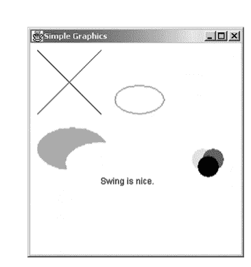

**图 5.2** SimpleGraphicsFrame 的运行结果。形状的覆盖顺序与图形命令被处理的顺序一致

```
File: its/SimpleGraphics/SimpleGraphicsDriver.java

package its.SimpleGraphics;

public class SimpleGraphicsDriver
{
    public SimpleGraphicsDriver()
    {
        SimpleGraphicsFrame SGF = new SimpleGraphicsFrame();
        SGF.showIt();
    }
    public static void main(String[] args)
    {
        SimpleGraphicsDriver sgt = new SimpleGraphicsDriver();
    }
}
```

### 练习

- 5.1 检查并解释如果在 `paintComponent` 中省略 `super` 命令，或者将其放在 `paintComponent` 末尾时会发生什么。

- 5.2 向 `paintComponent` 中增加更多的图形命令。测试在当前可见区域之外绘制时会发生什么。调整窗口大小。

- 5.3 GUI 的重绘由运行时系统相当频繁地发起。我们想了解这发生的频率。为此，在 `SimpleGraphicsPanel` 中定义一个整型变量 `noOfRepaints`，并在构造函数中将其设为零。在方法 `paintComponent` 中递增这个变量。那么它的当前值就是 `paintComponent` 被调用的次数。在 `paintComponent` 中添加一个命令，将 `noOfRepaints` 的值连同一些说明绘制到面板中，例如，'The number of redraws is'。移动和调整面板大小，看看实际执行了多少次重绘。

## 6 添加鼠标功能

在本章中，我们将学习如何将鼠标集成到应用程序中。我们将了解如何监控和使用鼠标移动以及按钮操作。

在本章中，我们描述如何在 Swing 组件中使用鼠标¹。在前几章中，我们间接地使用鼠标来按按钮。由于按钮可以用其他方式按下（例如在触摸屏上用手指），这些应用程序是对按钮做出反应，而不是对鼠标本身做出反应。为了直接将鼠标集成到应用程序中，我们必须为某个组件添加鼠标监听器。然后监听器会监视鼠标，并在某些事件发生时启动用户自定义的操作。这类事件可以是点击鼠标按钮、鼠标离开或进入组件、在组件内部移动时鼠标位置的变化等。注意，监听器是分配给组件而不是鼠标本身。它只在鼠标位于组件内部时跟踪鼠标。通常人们只对鼠标按钮或鼠标移动感兴趣，但不会同时关注两者。因此，在 AWT 库 java.awt.event 中定义了两个监听器接口：MouseListener 和 MouseMotionListener。前者用于处理鼠标按钮，后者用于监视鼠标移动。要为 Swing 组件 comp 添加鼠标监听器，请使用

```
comp.addMouseListener(MouseListener mouseListener);
comp.addMouseMotionListener(MouseListener motionListener);
```

在第 3 章和第 4 章中，�제我们介绍了 ActionListener 以及相应的 ActionEvent。ActionListener 的实现只需要实现一个方法 actionPerformed。鼠标监听器有更多的方法，对应不同的鼠标操作。还有一种特殊的事件，即 MouseEvent。这将在以下各节中讨论。

¹ 我们使用术语"鼠标"也指鼠标指针图标的参考点（热点）。

### 6.1 鼠标监听器

接口 `MouseListener` 使我们能够对鼠标按钮的使用以及鼠标进入或离开所分配鼠标监听器的组件做出反应。每当鼠标进入或离开组件，或在组件内部使用鼠标按钮时，运行时系统都会生成一个 `MouseEvent` 并通知监听器。根据事件的不同，会调用监听器的不同方法。事件对象作为参数传递给方法。该事件对象包含有关事件的信息；参见下面的 6.3 节。接口 `MouseListener` 有五个这样的方法，全部都需要实现：

```
void mouseClicked(MouseEvent mevt)
void mouseEntered(MouseEvent mevt)
void mouseExited(MouseEvent mevt)
void mousePressed(MouseEvent mevt)
void mouseReleased(MouseEvent mevt)
```

`mouseClicked(MouseEvent mevt)` 当鼠标按钮被点击时²，由运行时系统自动调用。要查明点击了哪个按钮，必须查看 `MouseEvent` 对象 `mevt`，参见 6.3 节。

`mouseEntered(MouseEvent mevt)` 当鼠标进入监听器所关联的组件时，由运行时系统自动调用。

`mouseExited(MouseEvent mevt)` 当鼠标离开监听器所关联的组件时，由运行时系统自动调用。

`mousePressed(MouseEvent mevt)` 当鼠标按钮被按下时，由运行时系统自动调用。要查明按下了哪个按钮，必须查看 `MouseEvent` 对象 `mevt`，参见 6.3 节。

`mouseReleased(MouseEvent mevt)` 当鼠标按钮被释放时，由运行时系统自动调用。要查明释放了哪个按钮，必须查看 `MouseEvent` 对象 `mevt`，参见 6.3 节。

一次点击会导致调用三个方法：`mousePressed`、`mouseReleased` 和 `mouseClicked`。

### 6.2 鼠标移动监听器

接口 `MouseMotionListener` 提供了跟踪鼠标的方法。如果为 Swing 组件分配了 `MouseMotionListener`，并且鼠标在该组件内部移动，运行时系统会生成一个 `MouseEvent` 并通知监听器。根据鼠标是移动还是拖动³，会调用监听器的不同方法。事件对象作为参数传递给方法。`MouseMotionListener` 有两个方法；*两者*都需要实现：

```
void mouseMoved(MouseEvent mevt)
void mouseDragged(MouseEvent mevt)
```

`mouseMoved(MouseEvent mevt)` 当鼠标在监听器所关联的组件中移动时自动调用。新的鼠标位置可以通过分析事件对象 `mevt` 来获得。当运行时系统接收到来自鼠标的信号时，鼠标被视为"移动"。通常这会导致屏幕上鼠标指针的位置至少改变一个像素。

`mouseDragged(MouseEvent mevt)` 当鼠标在按住按钮的情况下移动时自动调用。

### 6.3 鼠标事件

上述方法都接收一个 `MouseEvent` 作为参数。该对象包含有关触发监听器的信息。以下来自 `MouseEvent` 类的方法显示事件发生在何处。*x* 和 *y* 坐标以像素为单位，位于监听器所分配的组件的坐标系中：

```
int getX()
int getY()
```

要查明使用了哪个按钮，我们可以使用 `SwingUtilities` 类的以下方法。如果方法名中出现的按钮被使用，则返回 `true`，否则返回 `false`：

```
boolean SwingUtilities.isLeftMouseButton(MouseEvent me)
boolean SwingUtilities.isMiddleMouseButton(MouseEvent me)
boolean SwingUtilities.isRightMouseButton(MouseEvent me)
```

Java 尚未支持*双击*。可以使用方法

```
int getClickCount()
```

来确定短时间段内的点击次数。该时间段的长度取决于平台，通常可以使用操作系统的工具进行设置。然后可以通过使用 `if (mevt.getClickCount() == 2)` 来检查双击。

² 在大多数操作系统中，"点击"等同于"按下并释放"。

³ 拖动是指在按住按钮的情况下移动鼠标。
```


 ## 6.4 第一个鼠标应用程序

### 6.4.1 应用程序的规格说明

让我们来说明这个演示鼠标监听器的应用程序。与鼠标监听器关联的组件将是一个 300 × 300 的面板，它被居中放置在框架中。在其下方还有另一个面板，用于显示有关鼠标的信息。我们希望显示当前鼠标位置、鼠标按钮的点击次数，以及鼠标是否在 300 × 300 面板内部或外部。这些信息会持续更新。预期的布局可以在图 6.1 中看到。我们描述视图和控制部分的实现；模型部分未实现，因为几乎没有需要处理的数据。

### 6.4.2 视图部分

对于实现，我们定义类 `MouseEventPanel`。该面板（目前）没有自己的方法；它仅作为鼠标的操作区域。它将是我们同样定义的 `MouseEventFrame` 类型框架中的中心组件。鼠标监听器将被分配给该面板。它们将在鼠标位于面板内时跟踪鼠标。

在鼠标事件面板的下方（南侧），我们向框架中添加另一个面板。这是 `StatusPanel` 类型的，用于显示有关鼠标的信息。

`StatusPanel` 具有 3 × 3 的网格布局，包含九个标签。每行中的第一个包含固定文本，例如"Position"，第二个和第三个用于显示变化的信息，例如鼠标的当前 x 和 y 坐标。两个标签是放置于网格中未使用位置的"虚拟"标签。`StatusPanel` 具有设置坐标值、点击次数以及鼠标是否在内部或外部信息的方法。图 6.2 展示了组件的安排方式。下面给出了类的清单。在 `MouseEventFrame` 中，创建了 `MyMouseListener` 和 `MyMousePositionsListener` 的实例，并且都被分配给 `MouseEventPanel`。这演示了可以将多个监听器分配给单个组件。

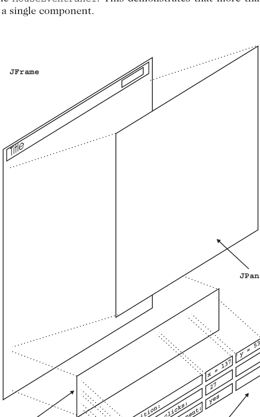

图 6.2 鼠标应用程序视图部分的设计蓝图

基础

```
File: its/MouseEvents/MouseEventFrame.java
```

```
1. package its.MouseEvents;
2.
3. import its.SimpleFrame.SimpleFrame;
4. import java.awt.BorderLayout;
5.
6. public class MouseEventFrame extends SimpleFrame
7. {
8.     MouseEventPanel mePanel = new MouseEventPanel();
9.     StatusPanel     stPanel = new StatusPanel();
10.
11.    public MouseEventFrame()
12.    {
13.        this.setTitle("Mouse application");
14.        this.getContentPane().add(mePanel,BorderLayout.CENTER);
15.        this.getContentPane().add(stPanel,BorderLayout.SOUTH);
16.        pack();
17.
18.        MyMousePositionsListener mPosAdpt =
19.                new MyMousePositionsListener(stPanel);
20.        mePanel.addMouseMotionListener(mPosAdpt);
21.        MyMouseListener MAdpt = new MyMouseListener(stPanel);
22.        mePanel.addMouseListener(MAdpt);
23.    }
24. }
```

```
File: its/MouseEvents/MouseEventPanel.java
```

```
1. package its.MouseEvents;
2.
3. import java.awt.Color;
4. import java.awt.Dimension;
5. import javax.swing.JPanel;
6.
7. public class MouseEventPanel extends JPanel
8. {
9.     public MouseEventPanel()
10.    {
11.        this.setBackground(Color.white);
12.        this.setPreferredSize(new Dimension(300,300));
13.    }
14. }
```

```
File: its/MouseEvents/StatusPanel.java
```

```
package its.MouseEvents;

import java.awt.GridLayout;
import javax.swing.JLabel;
import javax.swing.JPanel;

public class StatusPanel extends JPanel
{
   private JLabel posText   = new JLabel("position:");
   private JLabel XCoord    = new JLabel("0", JLabel.RIGHT);
   private JLabel YCoord    = new JLabel("0", JLabel.RIGHT);
   private JLabel countText = new JLabel("no. of clicks");
   private JLabel counts    = new JLabel("0", JLabel.RIGHT);
   private JLabel dummy1    = new JLabel();
   private JLabel inOutText = new JLabel("mouse is in comp.");
   private JLabel inOut     = new JLabel("no", JLabel.RIGHT);
   private JLabel dummy2    = new JLabel();
   private int clickCount = 0;

   public StatusPanel()
   {
      this.setLayout(new GridLayout(3,3));
      this.add(posText);
      this.add(XCoord);
      this.add(YCoord);
      this.add(countText);
      this.add(counts);
      this.add(dummy1);
      this.add(inOutText);
      this.add(inOut);
      this.add(dummy2);
   }
   // Updates the displayed coordinates of the mouse position.
   public void setCoordinates(int x, int y)
   {
      XCoord.setText(Integer.toString(x));
      YCoord.setText(Integer.toString(y));
   }
   // Sets the information whether the mouse is in or out.
   public void setInOut(String str)
   {
      inOut.setText(str);
   }
   // Increments the click count and displays it.
   public void incrementClickCount()
   {
       clickCount++;
       counts.setText(Integer.toString(clickCount));
   }
}
```

### 6.4.3 控制部分

控制部分需要实现以下功能：

- 如果鼠标在 `MouseEventPanel` 中，`StatusPanel` 显示当前鼠标坐标和"yes"。

- 如果鼠标不在 `MouseEventPanel` 中，`StatusPanel` 显示坐标 $(-1,-1)$ 和"no"。

- 当鼠标按钮被点击时，点击次数增加一。

- 每当鼠标移动或按钮被点击时，状态面板中的信息都会更新。

- 坐标和点击次数的初始值都为零，并显示"no"。

为了实现第一个功能，我们从 `MouseMotionListener` 派生类 `MyMousePositionsListener`。该监听器被分配给 `MouseEventPanel`。我们以这种方式重写 `mouseMoved` 方法：它设置状态面板中的当前坐标。为了使 `MyMousePositionsListener` 能够访问状态面板，它在构造函数中接收对该面板的引用。由于每次鼠标移动时（在面板中）都会执行 `mouseMoved` 方法，因此我们始终显示当前坐标。`mouseDragged` 方法以空体实现，因为我们没有指定对拖动的任何反应。

第二、第三和第四个功能由鼠标监听器实现，即从 `MouseListener` 派生的类 `MyMouseListener`。在那里，我们实现 `mouseEntered` 和 `mouseExited` 方法，使它们设置状态面板中 `inOut` 标签的文本，以及在退出 `MouseEventPanel` 时将坐标设置为 $(-1,-1)$。对于第四个功能，`MyMouseListener` 中的 `mouseClicked` 方法被实现为调用 `StatusPanel` 的 `incrementClickCount()`。为了使 `MyMouseListener` 能够访问状态面板，它在构造函数中接收对该面板的引用。`mousePressed` 和 `mouseReleased` 方法不需要，因此以空体实现，即无功能的实现。

这完成了应用程序（参见图 6.3）；下面给出了两个监听器类和驱动类 `MouseEventDriver` 的清单。

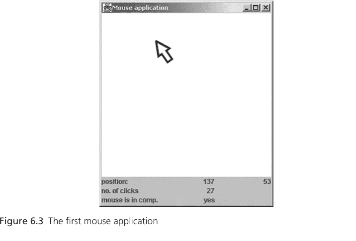

图 6.3 第一个鼠标应用程序

```
File: its/MouseEvents/MyMousePositionsListener.java
```

```
package its.MouseEvents;

import java.awt.event.MouseEvent;
import java.awt.event.MouseMotionListener;

public class MyMousePositionsListener implements MouseMotionListener
{
    private StatusPanel statusPane;

    public MyMousePositionsListener(StatusPanel s)
    {
        statusPane = s;
    }

    public void mouseMoved(MouseEvent evt)
    {
        statusPane.setCoordinates(evt.getX(), evt.getY());
    }

    public void mouseDragged(MouseEvent evt)
    {
        // implemented with empty body
    }
}
```

基础

```
// File: its/MouseEvents/MyMouseListener.java
package its.MouseEvents;

import java.awt.event.MouseEvent;
import java.awt.event.MouseListener;

public class MyMouseListener implements MouseListener
{
	private StatusPanel statusPane;

	public MyMouseListener(StatusPanel s)
	{
		statusPane = s;
	}

	public void mouseEntered(MouseEvent e)
	{
		statusPane.setInOut("yes");
	}

	public void mouseExited(MouseEvent e)
	{
		statusPane.setInOut("no");
		statusPane.setCoordinates(-1,-1);
	}

	public void mouseClicked(MouseEvent e)
	{
		statusPane.incrementClickCount();
	}

	public void mousePressed(MouseEvent e)
	{
		//implemented with empty body
	}

	public void mouseReleased(MouseEvent e)
	{
		//implemented with empty body
	}

}
```


### 练习

6.1 修改状态面板，使其不再显示总点击数，而是分别显示右键和左键的点击数。增强鼠标监听器以使这些功能正常工作。回顾一下，`SwingUtilities` 类提供了检查使用了哪个按钮的方法。

6.2 将以下功能添加到第6.4节描述的应用程序中。如果鼠标位于 `MouseEventPanel` 的“左上角”，则该面板的颜色变为黄色。左上角是指点击位置的x和y坐标都小于50。如果鼠标在 `MouseEventPanel` 内部但不在左上角，则颜色为白色。

**提示：** 找出需要修改哪些监听器。如果需要，在监听器的构造函数中传递更多引用。要更改面板的颜色，请使用以下两条命令：

```
this.setBackground(Color.yellow);
this.repaint();
```

6.3 从应用程序中移除状态面板，并在 `MouseEventPanel` 中显示信息。不要在该面板中嵌入任何组件，使用 `paintComponent`。

## 交互式图形 7

> 在第5章中，我们看到了应用程序如何显示预定义图形。在第6章中，鼠标被嵌入到应用程序中。我们现在将看到如何将这两者结合起来，以便可以交互式地生成和操作图形。

我们通过添加交互部分来扩展第6章的应用程序。这将使您能够使用鼠标生成和修改绘图。绘图由圆组成，这些圆通过鼠标点击添加或删除。最终的应用程序包含模型、视图和控制部分。模型部分包括一个定义圆的类和一个定义数据结构的类，该数据结构存储当前图形中的圆，并提供添加或删除圆的方法。视图部分与第6章的应用程序基本相同。第6章的 `MouseEventPanel` 类通过按照第5章所述重写其 `paintComponent` 方法而得到增强。控制部分通过扩展第6章的监听器来实现。

### 7.1 图形用户界面规范

布局与图6.1中的布局非常相似。因此，我们只指定附加功能：

- 如果在300 × 300的面板内点击鼠标左键，一个小的实心黑色圆圈将出现在当前鼠标位置。
- 如果点击鼠标右键，距离当前鼠标位置最近的圆圈将被移除，但仅当距离小于30像素时。距离采用R²的欧几里得度量。如果有多个圆圈与点击位置的距离相同，则任意选择一个。
- 状态面板现在还显示当前圆圈的数量。

### 7.2 模型部分

在本节中，我们描述构成应用程序模型部分的两个类：`Circle` 和 `CircleAdministration`。第一个是圆的*抽象*表示，第二个用于管理绘图中的圆。这里的“抽象”是指 `Circle` 独立于其图形表示。圆通过定义两个量来指定：圆心的位置和半径。由于我们不想局限于像素坐标，我们使用 `double` 变量。该类包含计算圆心到给定点距离的方法。`CircleAdministration` 类存储当前图形中的圆。它还提供添加或删除圆的方法。

#### 7.2.1 圆

类 `Circle` 有三个 `double` 字段 `x`、`y` 和 `radius`，分别包含圆心的坐标和半径。遵循Java的面向对象范式，只有 `Circle` 类知道如何绘制圆。因此，`Circle` 提供了一个 `draw` 方法，其中包含绘制圆的图形命令。这些命令需要一个图形引用（`Graphics`），该引用作为参数传递给 `draw`。注意，类 `Circle` 的 `draw` 方法实际上是一个视图部分方法。因此，在这种情况下，视图部分和模型部分的区分不仅存在于类*之间*，也存在于单个类*内部*：一些方法处理“视图”方面，而另一些处理“模型”方面。

圆心和半径的数据以 `double` 形式存储；然而，`draw` 方法需要整数。我们通过四舍五入到最接近的整数将 `double` 转换为整数。我们将在第13.3节中了解一种更好、更灵活的方式将坐标转换为像素坐标。`fillOval` 方法期望边界框的左上角以及框的宽度和高度作为参数。通过从圆心坐标减去半径来找到坐标。通过将半径乘以二，我们找到宽度和高度。为了保持代码简短，我们不检查值是否合理，例如半径或像素坐标是否为非负数。

类 `Circle` 还提供方法 `distance(double x1, double y1)`，用于计算圆心与点 $(x_1, y_1)$ 之间的欧几里得距离。此方法用于确定哪个圆距离鼠标点击位置最近并需要被删除。

> **文件：** `its/InteractiveGraphic/Circle.java`

```
package its.InteractiveGraphic;

import java.awt.Graphics;

public class Circle
{
    private double x,y,radius;

    public Circle(double xx, double yy, double rad)
    {
        x      = xx;
        y      = yy;
        radius = rad;
    }

    // 绘制圆
    public void draw(Graphics g)
    {
        g.fillOval((int)Math.round(x-radius),(int)Math.round(y-radius),
                   (int)Math.round(2.0*radius),(int)Math.round(2.0*radius));
    }

    // 计算圆心与点(x1,y1)之间的距离。
    public double distanceTo(double x1, double y1)
    {
        return(Math.sqrt(Math.pow(x-x1,2)+Math.pow(y-y1,2) ));
    }
}
```

#### 7.2.2 用于管理圆的数据结构

类 `CircleAdministration` 完成了大部分工作。其核心是一个 `Vector` 类型的对象。这是Java中预定义的一个类；可以将其视为一个长度灵活的数组。Vector可以存储任意对象。如果一个vector包含 $n$ 个对象，则它们的索引从 $0$ 到 $n-1$。`CircleAdministration` 中使用的vector `circles` 存储当前图形中的 `Circle` 对象。要访问第 $i$ 个对象，可以使用方法 `get(i)`。该方法返回一个 `Object`，因此必须将其*强制转换*为正确的数据类型，在我们的情况下是 `Circle`¹。此操作的语法为：

```
    (Circle)(circles.get(i))
```

除了构造函数外，类 `CircleAdministration` 还具有以下方法：

```
void addCircle(Circle circ)
void removeNearestCircle(int x1, int y1)
void drawAll(Graphics g)
int getNoOfCircles()
```

> ¹ Java SDK（软件开发包）的1.5版本允许定义*类型化向量*。这些向量只能存储来自单个类的对象，例如只有 `Circle`。这避免了强制转换。

`addCircle(circ)` 将圆 `circ` 添加到vector `circles` 中。

`removeNearestCircle(x1,y1)` 确定存储在vector `circles` 中的一个圆，其圆心到点 (x,y) 的距离最小。如果距离最多为30（像素），则将该圆从 `circles` 中移除。

`drawAll(g)` 绘制当前存储在 `circles` 中的所有圆。这是通过调用每个圆的 `draw` 方法来完成的。将 `Graphics` 对象 `g` 传递下去。

`getNoOfCircles()` 返回当前存储在vector `circles` 中的圆的数量。

在方法 `removeNearestCircle(x1,y1)` 中，通过计算点 ($x_1, y_1$) 到所有圆圆心的距离来找到要删除的圆。这不是最有效的方法，但我们选择它是为了保持代码简短。

```
package its.InteractiveGraphic;

import java.awt.Graphics;
import java.util.Vector;

public class CircleAdministration
{
    private Vector circles;

    public CircleAdministration()
    {
        circles = new Vector();
    }

    public void addCircle(Circle circ)
    {
        circles.add(circ);
    }

    public void removeNearestCircle(int x1, int y1)
    {
        Circle circ;
        double minDist = Double.MAX_VALUE;
        int     minDistIndex = -1;
        for (int i=0 ; i < circles.size() ; i++)
        {
            circ = (Circle)(circles.get(i));
            if(circ.distanceTo(x1,y1) < minDist)
```

```
29.     {
30.       minDist = circ.distanceTo(x1,y1);
31.       minDistIndex = i;
32.     }// if
33.   }//for i
34.   if ((minDistIndex >= 0) && (minDist < 30))
35.   {
36.     circles.removeElementAt(minDistIndex);
37.   }//if
38. }//method
39.
40. public void drawAll(Graphics g)
41. {
42.   Circle currentCircle;
43.   for (int i=0 ; i < circles.size() ; i++)
44.   {
45.     currentCircle = (Circle)(circles.get(i));
46.     currentCircle.draw(g);
47.   }//for i
48. }//method
49.
50. public int getNoOfCircles(){
51.   return(circles.size());
52. }//method
53. }
```

### 7.3 视图部分

视图与第 6 章中的类似。框架类 `InteractiveFrame` 只是第 6 章中 `MouseEventFrame` 类的重命名副本。

面板 `InteractivePanel` 相对于第 6 章中的 `MouseEventPanel` 类进行了扩展。它现在包含一个 `CircleAdministration` 类型的字段，以及用于向圆管理中添加和删除圆的 `addCircle` 和 `removeNearestCircle` 方法。这些方法只是将鼠标位置传递给 `CircleAdministration` 中同名的方法，然后调用 `repaint`。每次删除和插入圆后，调用面板的 `repaint` 方法非常重要！否则圆只会被添加到或从圆管理中删除——显示不会更新。

需要重写 `JPanel` 的 `paintComponent` 方法来绘制圆。面板本身既不知道当前存在哪些圆，也不知道如何绘制它们。这些信息只有 `CircleAdministration` 才知道。因此 `paintComponent` 中唯一的绘制命令就是调用 `CircleAdministration` 的 `drawAll` 方法。

文件：its/InteractiveGraphic/InteractivePanel.java

```
package its.InteractiveGraphic;

import java.awt.Color;
import java.awt.Dimension;
import java.awt.Graphics;
import javax.swing.JPanel;

public class InteractivePanel extends JPanel
{
    private CircleAdministration circleAdm;
    private double radius = 6.0;

    public InteractivePanel()
    {
        circleAdm = new CircleAdministration();
        this.setBackground(Color.white);
        this.setPreferredSize(new Dimension(300,300));
    }

    public void paintComponent(Graphics g)
    {
        super.paintComponent(g);
        circleAdm.drawAll(g);
    }

    public void addCircle(int x, int y)
    {
        circleAdm.addCircle(new Circle(x,y,radius));
        repaint();
    }

    public void removeNearestCircle(int x, int y)
    {
        circleAdm.removeNearestCircle(x,y);
        repaint();
    }

    public int getNoOfCircles()
    {
        return(circleAdm.getNoOfCircles());
    }
}
```

状态面板需要显示圆的数量。我们对第 6 章的 `StatusPanel` 类进行如下修改。现在使用 4 × 3 的网格布局和三个额外的标签。额外的标签分别包含文本"No. of circles"、圆的数量以及一个用于填充网格的占位符。我们添加了一个 `setNoOfCircles(int n)` 方法来设置圆的数量。

文件：its/InteractiveGraphic/StatusPanel.java

```
1. package its.InteractiveGraphic;
2.
3. import java.awt.GridLayout;
4. import javax.swing.JLabel;
5. import javax.swing.JPanel;
6.
7. public class StatusPanel extends JPanel
8. {
9.    private JLabel posText     = new JLabel("position:");
10.   private JLabel XCoord      = new JLabel("0", JLabel.RIGHT);
11.   private JLabel YCoord      = new JLabel("0", JLabel.RIGHT);
12.   private JLabel countText   = new JLabel("no. of clicks");
13.   private JLabel counts      = new JLabel("0", JLabel.RIGHT);
14.   private JLabel dummy1      = new JLabel();
15.   private JLabel circleText  = new JLabel("no. of circles");
16.   private JLabel noOfCirc    = new JLabel("0", JLabel.RIGHT);
17.   private JLabel dummy2      = new JLabel();
18.   private JLabel inOutText   = new JLabel("mouse is in comp.");
19.   private JLabel inOut       = new JLabel("no", JLabel.RIGHT);
20.   private JLabel dummy3      = new JLabel();
21.
22.   private int clickCount = 0;
23.
24.   public StatusPanel()    {
25.     this.setLayout(new GridLayout(4,3));
26.     this.add(posText);
27.     this.add(XCoord);
28.     this.add(YCoord);
29.     this.add(countText);
30.     this.add(counts);
31.     this.add(dummy1);
32.     this.add(circleText);
33.     this.add(noOfCirc);
34.     this.add(dummy2);
35.     this.add(inOutText);
36.     this.add(inOut);
37.     this.add(dummy3);
38.   }
```

```
public void setCoordinates(int x, int y){
  XCoord.setText(""+x);
  YCoord.setText(""+y);
}

public void setInOut(String str){
  inOut.setText(str);
}

public void incrementClickCount(){
  clickCount++;
  counts.setText(Integer.toString(clickCount));
}

public void setNoOfCircles(int n){
  noOfCirc.setText(Integer.toString(n));
}
}
```

### 7.4 控制部分

两个监听器中只有 MyMouseListener 发生了变化，即在 `mouseClicked` 方法中添加了更多命令。根据按下的是左键还是右键，使用 `InteractivePanel` 类的 `addCircle(e.getX(),e.getY())` 方法添加圆，或使用 `removeNearestCircle(e.getX(),e.getY())` 方法删除圆。关于按下哪个鼠标按键的信息是通过 `SwingUtilities` 类的方法从 `MouseEvent` 对象 `e` 中提取的。如果鼠标有三个或更多按键，则除左键以外的任何按键都被视为右键。在任何情况下，圆的数量都会通过以下方式更新：

```
[StatusPanel].setNoOfCircles([InteractivePanel].getNoOfCircles())
```

方括号中的文本必须替换为不带方括号的相应变量名。为了使监听器能够访问该面板，`MyMouseListener` 的构造函数现在接收一个指向交互面板的引用。

文件：its/InteractiveGraphic/MyMouseListener.java

```
package its.InteractiveGraphic;

import java.awt.event.MouseEvent;
import java.awt.event.MouseListener;
import javax.swing.SwingUtilities;
```

72 基础知识

```
7. public class MyMouseListener implements MouseListener
8. {
9. private StatusPanel statusPane;
10. private InteractivePanel interactivePane;
11.
12.   public MyMouseListener(StatusPanel s, InteractivePanel i)
13.   {
14.     statusPane = s;
15.     interactivePane = i;
16.   }
17.
18.   public void mouseEntered(MouseEvent e)
19.   {
20.     statusPane.setInOut("yes");
21.   }
22.
23.   public void mouseExited(MouseEvent e)
24.   {
25.     statusPane.setInOut("no");
26.     statusPane.setCoordinates(-1,-1);
27.   }
28.
29.   public void mouseClicked(MouseEvent e)
30.   {
31.     statusPane.incrementClickCount();
32.     if(SwingUtilities.isLeftMouseButton(e)) //左鼠标按键
33.     {
34.       interactivePane.addCircle(e.getX(),e.getY());
35.     }
36.     else // 任何其他鼠标按键
37.     {
38.       interactivePane.removeNearestCircle(e.getX(),e.getY());
39.     }
40.     statusPane.setNoOfCircles(interactivePane.getNoOfCircles());
41.   }
42.
43.   public void mousePressed(MouseEvent e)
44.   {
45.     //空方法体实现
46.   }
47.
48.   public void mouseReleased(MouseEvent e)
49.   {
50.     //空方法体实现
51.   }
52. }
```

图 7.1 交互式应用程序。仅显示了 14 个圆，而不是状态面板中给出的 15 个，因为有 2 个圆位于同一位置

### 7.5 运行应用程序

我们的交互式应用程序现在已完成。结果显示在图 7.1 中。请注意，同一坐标上可以有多个圆，在这种情况下，"看到"的圆会比实际存在的少。状态面板中显示的圆的数量始终是正确的。由于框架被调整大小，某些圆也可能不可见，因为它们现在位于可见区域之外。

### 7.6 总结与说明

#### 7.6.1 鼠标监听器

我们已经了解了两个鼠标监听器的工作方式。当鼠标按键被使用，或者鼠标离开或进入监听器所分配的组件时，`MouseListener` 会变为活动状态。每当鼠标移动时，`MouseMotionListener` 就会变为活动状态。运行时系统生成的鼠标事件对象包含有关事件类型和发生位置的信息。

实现鼠标监听器需要以下步骤：

- 1. 确定应在哪个组件内跟踪鼠标。
- 2. 创建鼠标（运动）监听器。即在 `mouseClicked` 等方法中定义响应事件时需要执行的操作。
- 3. 将动作监听器分配给相关组件。
```


7.6.2 应用程序的设计

自 Java SDK（软件开发工具包）1.4 版起，鼠标有了第三个监听器：`MouseWheelListener` 用于跟踪鼠标滚轮，并在每次滚动鼠标滚轮时被触发。

让我们再次总结一下本应用程序的模型-视图-控制概念的实现。在这个例子中，`CircleAdministration` 类负责完成所有保持抽象数据更新的工作。圆存储在 `CircleAdministration` 中，该类负责删除或添加圆。只有这个类知道有多少个圆。另一方面，`InteractivePanel` 类负责完成显示图形的工作。它并不了解圆的相关信息。为了绘制图形，它必须向 `CircleAdministration` 咨询。它通过调用 `CircleAdministration` 的 `drawAll` 方法来实现。此外，如果与 `InteractivePanel` 关联的监听器检测到点击事件，`InteractivePanel` 只知道是添加还是删除一个圆以及其位置。然后它通过调用 `addCircle`（或 `removeNearestCircle`）方法将工作传递给 `CircleAdministration`。在 `CircleAdministration` 完成一次更新（添加或删除）之后，`InteractivePanel` 更新显示。为此，它调用其 `repaint` 方法，这会使得运行时系统在适当的时间调用 `paintComponent`。

### 练习

- 7.1 按以下方式修改应用程序。在 `Circle` 类中添加一个 `color` 字段，类型为 `java.awt.Color` 的实例。为 `Circle` 定义第二个构造函数，允许额外传入一个颜色。然后修改 `CircleAdministration`，使圆依次接收红色、蓝色、绿色、红色等颜色。

- 7.2 按以下方式修改应用程序。在状态面板中添加一行，显示当前离鼠标指针最近的圆的圆心坐标。请注意，这可能会随着鼠标的每次移动而变化。确保应用程序能够处理没有任何圆存在的情况。

- 7.3 将应用程序改为显示线段而不是圆。通过连续两次左键点击添加一条线。第一次点击的位置是线段的一个端点，第二次点击的位置是另一个端点。右键点击会删除离点击位置最近的线段。定义"最近"有多种方式，例如可以取到第一个端点的距离、到线段中点的距离或几何距离。

## 菜单

> 在本章中，我们学习如何向框架添加菜单以及如何将其集成到应用程序中。

菜单最常用作框架的子组件。它们是按层次组织的。最顶层的组件是*菜单栏*。它是一个位于框架标题栏下方、内容面板上方的矩形区域。中间层组件是*菜单*。菜单在菜单栏中显示为文本。当点击这样的文本时，实际的菜单会展开。它包含处于层次结构最底层的*菜单项*。图 8.1 展示了其结构。菜单项是触发操作的组件。它们可以被看作是一种特殊的按钮。事实上，与按钮一样，我们使用操作监听器来监视它们。有时需要*禁用*某些菜单项。被禁用的菜单项在点击时不会触发任何操作。在大多数平台上，被禁用菜单项的文本显示得比启用状态的更浅。禁用菜单项有意义的一种情况如下：假设从文件加载数据，然后点击一个菜单项来对数据进行大量计算。如果结果总是相同的，那么对相同的数据重复进行大量计算就没有意义。因此，我们禁用启动计算的菜单项。只有当有新数据时才重新启用它。

我们现在来实现一个小型 GUI，演示 Swing 中菜单的使用。由于它不处理其他数据，所以我们不实现模型部分。

### 8.1 GUI 的规范

GUI 由一个框架组成，内容面板中嵌入了一个标签。它有一个菜单栏，包含两个菜单，分别名为"Menu 1"和"Menu 2"。第一个菜单有三个项目，分别名为"Item 1"、"Test"和"Exit"。第二个菜单有两个项目，分别名为"Enable Test"和"Disable Test"。初始状态下所有项目都是启用的。

当选择一个菜单项时，标签显示文本"Item XXXX selected"。第二个菜单中的两个项目还有额外的功能。每当点击"Disable Test"时，第一个菜单中的"Test"项目被禁用；如果它之前已经被禁用，则不做任何改变。每当点击"Enable Test"时，第一个菜单中的"Test"项目被启用；如果它之前已经被启用，则不做任何改变。

### 8.2 视图部分

我们需要以下三个 Swing 组件来实现菜单。首先，由 `JMenuBar` 类实现的菜单栏。它被添加到框架中标题栏和内容面板之间。其次，我们需要由 `JMenu` 实现的菜单，它通过显示其标题将菜单添加到菜单栏。最后，我们需要由 `JMenuItem` 类实现的菜单项，它定义了用户可以点击的菜单项。基本功能会自动提供：点击标题时菜单会展开，点击其他位置时菜单会关闭。

#### 8.2.1 菜单栏

从 `JMenuBar` 中，我们只需要构造函数和添加菜单的方法：

```
JMenuBar()
add(JMenu menu)
```

菜单按照 add 命令的顺序从左到右添加到菜单栏。要将菜单栏添加到框架，我们使用 `JFrame` 类中的以下方法：

```
setJMenuBar(JMenuBar menuBar)
```

请注意，添加 `JMenuBar`（Swing）和 `MenuBar`（AWT）有各自不同的方法 `setJMenuBar` 和 `setMenuBar`。

#### 8.2.2 菜单

从 `JMenu` 类中，我们需要接收菜单标题字符串的构造函数，以及向菜单添加菜单项或分隔线（水平线）的方法：

```
JMenu(String menuTitle)
add(JMenuItem menuItem)
addSeparator()
```

在菜单中，项目或分隔线按照 `add` 命令的顺序从上到下添加。

#### 8.2.3 菜单项

从 `JMenuItem` 中，我们需要接收项目标题字符串的构造函数，以及将操作监听器分配给菜单项的方法。菜单项的行为与按钮非常相似。特别是，当项目被点击时，操作监听器会自动收到通知。然后监听器启动所需的操作。最后我们需要一个启用或禁用菜单项的方法：

```
JMenuItem(String itemText)
addActionListener(ActionListener listener)
setEnabled(boolean b)
```

调用 `setEnabled(false)` 会禁用一个菜单项。该项目以较浅的文本显示，并且分配给它的任何监听器在项目被点击时都不会再收到通知。因此，被禁用的项目不会在应用程序中触发任何反应。调用 `setEnabled(true)` 将重新启用该项目。其文本变为较深的颜色，分配给该项目的监听器再次收到事件通知。

#### 8.2.4 构建 GUI

我们现在可以实现 GUI 了。下面的代码清单展示了框架类 `MenuFrame` 和驱动类 `MenuDriver` 的代码。`MenuFrame` 在其内容面板中央放置了一个标签。创建并添加了一个菜单栏。然后创建并添加了两个菜单。最后我们生成菜单项并将它们添加到各自的菜单中。最后创建了一个操作监听器并分配给所有菜单项。这个监听器是我们稍后在 8.3 节中定义的 `MenuListener` 类的一个实例。框架类还有三个公共方法，用于设置标签中的文本，以及启用或禁用第一个菜单中的"Test"菜单项：

```
setText(String text)
enableTest()
disableTest()
```

> **文件：** `its/Menus/MenuFrame.java`

```
package its.Menus;

import its.SimpleFrame.SimpleFrame;
import javax.swing.*;
import java.awt.BorderLayout;

public class MenuFrame extends SimpleFrame {
```


### 基础

```java
private JLabel display;
private JMenuItem testItem;

public MenuFrame() {
    display = new JLabel("No menu selected.", JLabel.CENTER);

    // Create a menu bar and add it to the frame

    JMenuBar menubar = new JMenuBar();
    this.setJMenuBar(menubar);

    // Create and add the menus
    JMenu firstMenu  = new JMenu("Menu 1");
    JMenu secondMenu = new JMenu("Menu 2");
    menubar.add(firstMenu);
    menubar.add(secondMenu);

    // Create the menu items and add them to the menus
    JMenuItem firstItem  = new JMenuItem("Item 1");
            testItem   = new JMenuItem("Test");
    JMenuItem exitItem   = new JMenuItem("Exit");
    JMenuItem enableItem = new JMenuItem("Enable Test");
    JMenuItem disableItem = new JMenuItem("Disable Test");

    firstMenu.add(firstItem);
    firstMenu.add(testItem);
    firstMenu.addSeparator();
    firstMenu.add(exitItem);

    secondMenu.add(enableItem);
    secondMenu.add(disableItem);

    // Create a listener and add it to the menu items
    MenuListener menuList = new MenuListener(this);
    firstItem.addActionListener(menuList);
    testItem.addActionListener(menuList);
    exitItem.addActionListener(menuList);
    enableItem.addActionListener(menuList);
    disableItem.addActionListener(menuList);

    // Add the label to the frame
    this.getContentPane().add(display, BorderLayout.CENTER);
}

// Method to set the text in the label
public void setText(String text){
    display.setText(text);
}

// Method to enable the label
public void enableTest(){
    testItem.setEnabled(true);
}

// Method to disable the label
public void disableTest(){
    testItem.setEnabled(false);
}
}
```

```java
// File: its/Menus/MenuDriver.java
package its.Menus;

public class MenuDriver {
    public static void main(String[] args) {
        MenuFrame mf = new MenuFrame();
        mf.showIt();
    }
}
```

### 8.3 控制部分

控制部分通过一个动作监听器来实现。我们在 `MenuListener` 类中实现 `ActionListener`。为了响应来自菜单项的事件，`MenuListener` 需要更新 `MenuFrame` 中显示的信息，并启用或禁用 "Test" 项。为了能够访问该框架，`MenuListener` 在构造函数中接收一个对 `MenuFrame` 的引用。

如上所述，菜单项的行为与按钮非常相似。如果某个菜单项分配了监听器并被点击，运行时系统会生成一个 `ActionEvent` 类型的对象。它包含有关事件类型的信息，例如哪个菜单项被点击了。运行时系统会调用监听器的 `actionPerformed` 方法。

在我们的示例中，`actionPerformed` 方法利用动作命令，通过嵌套的 if-then-else 语句来查明哪个按钮被点击了。根据不同的动作命令，执行特定的操作，即在标签中显示所选菜单项的名称。下面是该类的代码清单。图 8.2 展示了运行该应用程序的结果。


图 8.2 菜单应用程序。第一个菜单已展开，其第二个项目 "test" 已被禁用

```java
// File: its/Menus/MenuListener.java

package its.Menus;

import java.awt.event.ActionEvent;
import java.awt.event.ActionListener;

public class MenuListener implements ActionListener {

    private MenuFrame menuFrame;

    public MenuListener(MenuFrame mf) {
        menuFrame = mf;
    }

    public void actionPerformed(ActionEvent evt) {
        String actionCommand = evt.getActionCommand();
        if(actionCommand.equals("Item 1")){
            menuFrame.setText("Item 1 selected");
        }
        else if(actionCommand.equals("Test")){
            menuFrame.setText("Item Test selected");
        }
        else if(actionCommand.equals("Exit")){
            System.exit(0);
        }
        else if(actionCommand.equals("Enable Test")){
            menuFrame.enableTest();
            menuFrame.setText("Item \"Test\" in Menu 1 enabled.");
        }
        else if(actionCommand.equals("Disable Test")){
            menuFrame.disableTest();
            menuFrame.setText("Item \"Test\" in Menu 1 disabled.");
        }
        else{
            System.out.println("ERROR: unknown action command.");
        }
    }
}
```

### 练习

8.1 构建一个 GUI，包含一个带有菜单的框架和一个嵌入的面板。该菜单有三个项目 "Red"、"Blue" 和 "Yellow"。当选择某个菜单项时，相应更改面板的背景颜色。

## 关于监听器的更多内容

# 9

> 在本章中，我们将讨论如何使用监听器的一般方法。我们还将介绍一些能够响应此前未考虑的事件的监听器。本章在初次阅读时可以跳过。

### 9.1 监听器基础

监听器是将用户操作与运行中的程序联系起来的组件。不同类型的用户操作有不同类型的监听器。我们在第 3、4 和 6 章中看到过示例。这些监听器响应按钮按下或鼠标使用。还有更多的监听器，其中一些我们将在下面简要介绍。查看 `java.awt.event` 库以了解更多。

监听器必须分配给一个图形组件。这些组件具有如下方法

```
addXXXXXListener(XXXXXListener listener)
```

用于完成此操作，其中 `XXXXXX` 是监听器的类型，例如 `MouseMotion`。所有监听器都是*接口*。它们要求程序员实现某些方法，例如 `mouseMoved`。当相关事件发生时，例如鼠标移动，操作系统会自动调用这些方法。因此，应用程序对事件的反应代码必须放在这些方法内部。

有些监听器只有一个方法，例如 `ActionListeners` 中的 `actionPerformed`，而另一些则有更多方法，如 `MouseListener` 的五个方法。每个方法都对应不同的事件。如果只想对某些事件作出反应，那么其他方法可以以空体实现。

监听器的方法接收一个事件对象作为参数。该事件对象包含有关事件的更多信息。不同的监听器有不同类型的事件对象（`ActionListeners` 对应 `ActionEvent`，`MouseListeners` 对应 `MouseEvent`）。当事件发生时，运行时系统会自动生成事件对象，并调用监听器的适当方法。

各种类型事件中的信息各不相同。`MouseEvent` 包含事件发生时鼠标指针所在位置的坐标。对于 **ActionEvent** 来说，这没有意义。按钮在哪里被按下并不重要。另一方面，**ActionEvent** 包含有关哪个按钮被按下的信息。不同的事件类型提供了访问事件中包含信息的方法，例如 `getX()` 和 `getY()` 可以获取 `MouseEvent` 的坐标，`getActionCommand()` 可以让我们找到动作事件的来源。

### 9.2 实现监听器

到目前为止，我们是在独立的类中实现监听器的。现在我们来看另外三种实现方式。我们回到第一个 GUI，即第 3 章中的计数器。在那里，定义了一个 `CounterListener` 类来实现 `ActionListener`。我们在这个示例上演示实现监听器的其他方法。

#### 9.2.1 作为内部类的监听器

在计数器示例中，我们在一个独立的类 `CounterListener` 中定义了监听器。该监听器被分配给两个按钮，并在其中之一被按下时执行操作。其反应是更新 `CounterPanel`。计数器监听器必须知道要更新*哪个*面板。因此我们在监听器的构造函数中传递一个对 `CounterPanel` 的引用。或者，我们可以将监听器定义为 `CounterPanel` 内部的一个*内部类*。这样，监听器就知道 `CounterPanel` 的方法，可以直接调用，即监听器可以使用 `decrement()` 而不是 `countPane.decrement()`。因此，不需要向监听器传递对画板的引用。监听器的构造函数为空体。事实上，它完全可以省略；这时 `ActionListener` 的默认构造函数会接管。这在包 `its.CounterInternalGUI` 中实现，其中类 `CounterInternalPanel` 以及内部定义的监听器替代了 `CounterPanel` 和 `CounterListener`。我们仅打印该类的清单。

> **文件：** `its/CounterInternalGUI/CounterInternalPanel.java`

```java
package its.CounterInternalGUI;

import javax.swing.JPanel;
import javax.swing.JButton;
import javax.swing.JLabel;
import java.awt.BorderLayout;
import javax.swing.SwingConstants;
import java.awt.event.ActionListener;
import java.awt.event.ActionEvent;

public class CounterInternalPanel extends JPanel {

    private CounterModel counter;
```

[content]

private JLabel valueLabel;

public CounterInternalPanel() {
    counter = new CounterModel();

    BorderLayout bordLay = new BorderLayout();
    this.setLayout(bordLay);

    JButton upButton    = new JButton("Up");
    JButton downButton = new JButton("Down");
    valueLabel = new JLabel(""+counter.getValue(),SwingConstants.CENTER);

    this.add(upButton,BorderLayout.WEST);
    this.add(downButton,BorderLayout.EAST);
    this.add(valueLabel,BorderLayout.CENTER);

    // 侦听器的定义，没有传递
    // 对 "this" 的引用。
    InternalCounterListener countList =
         new InternalCounterListener();
    upButton.addActionListener(countList);
    downButton.addActionListener(countList);
}

public void increment(){
   counter.increment();
   valueLabel.setText(""+counter.getValue());
}

public void decrement(){
   counter.decrement();
   valueLabel.setText(""+counter.getValue());
}

// 内部侦听器类
class InternalCounterListener implements ActionListener{

   // 构造函数为空
   public InternalCounterListener() {
   }

   public void actionPerformed(ActionEvent evt){
     String actionCommand = evt.getActionCommand();
     if(actionCommand.equals("Up")){
       increment();
     }
     else if(actionCommand.equals("Down")){
         decrement();
     }
     else{
         System.out.println("ERROR: Unexpected ActionCommand");
     }

    }// actionPerformed
}// 内部类
}

#### 9.2.2 作为应用程序类一部分的侦听器

在本节中，我们将学习如何将侦听器作为接口在另一个类内部实现。对于没有或仅有极少接口使用经验的用户，我们给出关于 Java 接口机制的一个非常简短的概述。在 Java 中，一个类只能扩展一个其他类并继承其属性。例如，在 its 包中，类 CounterFrame 扩展了 SimpleFrame，从而继承了在关闭框架时终止应用程序的属性。有时我们希望一个类继承多个其他类的属性。接口的概念在一定程度上允许这样做。一个类只能扩展一个其他类，但它可以实现多个接口。一个接口要求实现某些方法。如果一个类 NewClass 派生自 OldClass 并实现了接口 IF1 和 IF2，那么它的语法如下：

```
class NewClass extends OldClass implements IF1, IF2
```

在类 NewClass 内部，我们必须实现接口 IF1 和 IF2 所要求的方法。在我们的示例中，我们定义了类 CounterInterfacePanel，我们希望它继承 JPanel 和 ActionListener 的属性。为此，我们让 CounterInterfacePanel 扩展 JPanel 并实现 ActionListener。

```
class CounterInterfacePanel extends JPanel implements ActionListener
```

接口 ActionListener 要求在 CounterPanel 内部实现方法 actionPerformed(ActionEvent evt)（如果我们不这样做，编译器会报错）。在实现第 50 行的 actionPerformed 后，类 CounterInterfacePanel 也具有了动作侦听器的属性，它"本身变成了"一个动作侦听器。因此，CounterInterfacePanel 的一个实例被作为动作侦听器分配给按钮。回想一下，关键字 this 引用当前实例。

```
upButton.addActionListener(this);
downButton.addActionListener(this);
```

我们列出了计数器面板的修改后代码。类名为 CounterInterfacePanel，位于子包 CounterInterfaceGUI 中。

86 基础

**文件：** `its/CounterInterfaceGUI/CounterInterfacePanel.java`

```
package its.CounterInterfaceGUI;

import javax.swing.JPanel;
import javax.swing.JButton;
import javax.swing.JLabel;
import java.awt.BorderLayout;
import javax.swing.SwingConstants;
import java.awt.event.ActionListener;
import java.awt.event.ActionEvent;

public class CounterInterfacePanel extends JPanel
                                       implements ActionListener{

    private CounterModel counter;
    private JLabel valueLabel;

    public CounterInterfacePanel() {
        counter = new CounterModel();

        BorderLayout bordLay = new BorderLayout();
        this.setLayout(bordLay);

        JButton upButton   = new JButton("Up");
        JButton downButton = new JButton("Down");
        valueLabel = new JLabel(""+counter.getValue(),SwingConstants.CENTER);

        this.add(upButton,BorderLayout.WEST);
        this.add(downButton,BorderLayout.EAST);
        this.add(valueLabel,BorderLayout.CENTER);

        // CounterInterfacePanel 现在
        // 也是一个 ActionListener。因此，
        // 使用 "this" 将其分配给按钮。
        upButton.addActionListener(this);
        downButton.addActionListener(this);
    }

    public void increment(){
        counter.increment();
        valueLabel.setText(""+counter.getValue());
    }

    public void decrement(){
        counter.decrement();
        valueLabel.setText(""+counter.getValue());
    }

    // 方法 actionPerformed 在
    // 类 CounterPanel 内部实现。
    public void actionPerformed(ActionEvent evt){
        String actionCommand = evt.getActionCommand();
        if(actionCommand.equals("Up")){
            increment();
        }
        else if(actionCommand.equals("Down")){
            decrement();
        }
        else{
            System.out.println("ERROR: Unexpected ActionCommand");
        }
    }// actionPerformed

}
```

#### 9.2.3 匿名侦听器

侦听器也可以*匿名*和*即时*地定义。将匿名侦听器分配给组件 `comp` 的语法如下所示：

```
comp.addXXXXXXListener([此处为 XXXXXXListener 的完整定义]);
```

在我们的示例中，我们必须为每个按钮实现一个侦听器。Up 按钮的匿名实现如下所示：

```
upButton.addActionListener(
    // 侦听器的实现开始
    new ActionListener(){
        // 所需方法的实现开始
        public void actionPerformed (ActionEvent evt){
            increment();
        } // actionPerformed 的实现结束
    }// ActionListener 的实现结束
    );// addActionListener 方法结束
```

该侦听器是*匿名*的，因为它没有获得名称。它是*即时的*，因为它被放置在将侦听器分配给按钮的位置，即方法 `addActionListener` 的括号内部。由于侦听器没有名称，因此无法从任何地方引用它。特别是，它不能重复使用于 Down 按钮。因此，我们必须为 Down 按钮定义另一个侦听器，我们再次以匿名侦听器的方式来实现。

由于匿名侦听器仅负责单个按钮，因此只有当该特定按钮被按下时才会收到通知。无需检查是哪个按钮。因此，我们可以直接为 Up 按钮和 Down 按钮分别调用方法 `increment` 和 `decrement`。然而，对于其他侦听器，同一组件仍可能触发不同的事件，例如对于鼠标侦听器，可能需要检查使用了哪个鼠标按钮。匿名侦听器的使用在类 `CounterAnonymousPanel` 中演示。

**文件：** `its/CounterAnonymousGUI/CounterAnonymousPanel.java`

```
package its.CounterAnonymousGUI;

import java.awt.BorderLayout;
import java.awt.event.ActionEvent;
import java.awt.event.ActionListener;
import javax.swing.*;

public class CounterAnonymousPanel extends JPanel{

    private CounterModel counter;
    private JLabel valueLabel;

    public CounterAnonymousPanel() {
        counter = new CounterModel();

        BorderLayout bordLay = new BorderLayout();
        this.setLayout(bordLay);

        JButton upButton    = new JButton("Up");
        JButton downButton = new JButton("Down");
        valueLabel = new JLabel(""+counter.getValue(),SwingConstants.CENTER);

        this.add(upButton,BorderLayout.WEST);
        this.add(downButton,BorderLayout.EAST);
        this.add(valueLabel,BorderLayout.CENTER);

        // up-button 的侦听器
        // 以匿名和即时的方式定义。
        upButton.addActionListener(new ActionListener(){
            public void actionPerformed(ActionEvent evt){
                increment();
            }// actionPerformed
        }//ActionListener
        );//addActionListener

        // down-button 的侦听器


#### 9.2.4 四种实现技术的比较

我们已经看到了实现监听器的四种方式：在单独的类中（第3.4节）、在内部类中（第9.2.1节）、作为接口（第9.2.2节）以及作为匿名对象（第9.2.3节）。第一种方法特别适合那些使用接口经验较少的初学者。如果监听器需要操作来自多个类的对象，这种方法也很有意义。此时，所有这些类的引用都会通过构造函数传递给监听器，因此监听器可以访问它们。

第二种方法允许监听器直接访问其所在类的方法和变量。这适用于监听器只需要操作来自单一类的对象的应用场景。

第三种方法完全避免了定义自己的监听器类。许多作者认为这是一种更优雅、更高效的方式。然而，对于图形编程的初学者来说，这常常令人困惑，他们更倾向于使用具有单独类的结构化方法。此外，这也限制了监听器的范围到实现它的类。

最后一种方法，匿名监听器，为每个组件分配一个单独的监听器。这省去了检查哪个组件触发监听器的麻烦。不过，这种方法对初学者来说也不容易理解。

我们要指出的是，关于实现监听器的最佳方式以及如何向图形编程初学者介绍它们，存在着哲学层面的争论。作者在教授监听器方面的明确观点是，一开始使用单独的类。这是基于经验的。只有在学生对接口或匿名定义有丰富经验时，从第9.2.2节或第9.2.3节描述的方法入手才有意义。否则，这种方法只会造成困惑（"但是，那我的监听器到底在哪里？"）。

在本节介绍的`CounterPanel`的三种修改版本中，也可以避免定义`increment`和`decrement`方法。相反，可以将相应的代码转移到监听器中合适的位置。

#### 9.2.5 监听器和适配器

监听器要求实现*所有*方法。通常我们只对其中一个方法感兴趣，而其余方法都用空体实现。为了减少一些工作量，Java提供了`类`，它们用空体实现了所有监听器`接口`方法。这种类的名称是将相应监听器接口名称中的"Listener"替换为"Adapter"，例如，实现`MouseListener`的类被称为`MouseAdapter`。

大多数要求实现多个方法的监听器都有对应的适配器。这样，我们不需要**实现**监听器接口**的所有方法**，只需**覆盖**相应**适配器类**中所需的方法即可。

### 9.3 其他类型的监听器

还有其他一些值得关注的监听器类型，例如`KeyListener`、`DocumentListener`和`WindowListener`。键盘监听器响应按键事件。文档监听器监控文本文档的变化；见第18章。窗口监听器响应与"窗口"（即Java中的"框架"）相关的事件。这类事件包括打开窗口、关闭窗口、将其最小化为图标或激活它。我们这里关注关闭窗口，即当框架的"关闭"按钮被按下时发生的事件。

在我们基本的框架类`SimpleFrame`中，我们使用了以下命令

```java
setDefaultCloseOperation(JFrame.EXIT_ON_CLOSE)
```

来在按下"关闭"按钮时立即退出应用程序。通常，我们希望在终止之前执行一些清理或保存工作，例如将更改后的数据保存到磁盘。我们定义了类`CleanUpFrame`，它定义了方法`cleanUp`来执行这项工作。在我们的示例中，它只是向控制台输出一条消息，然后退出应用程序。`CleanUpFrame`使用窗口监听器来激活这个方法。

由于我们只使用接口`WindowListener`的七个方法中的一个，我们实际上使用了对应的适配器类`WindowAdapter`，从而避免了实现六个方法。我们将该类实现为内部类`CleanUpAdapter`。它实现了方法`windowClosing(WindowEvent we)`，当"关闭"按钮被按下时，运行时系统会自动调用该方法。然后`windowClosing`方法调用框架的`cleanUp`方法。在`CleanUpFrame`的构造函数中，创建了一个`CleanUpAdapter`实例并将其分配给框架。

```java
// File: its/CleanUpFrame/CleanUpFrame.java
package its.CleanUpFrame;

import javax.swing.JFrame;
import java.awt.event.WindowAdapter;
import java.awt.event.WindowEvent;

public class CleanUpFrame extends JFrame
{
  public CleanUpFrame()
  {
    this.setSize(200,200);
    this.setLocation(200,200);
    this.setTitle("CleanUpFrame");
    CleanUpAdapter cleaner = new CleanUpAdapter();
    this.addWindowListener(cleaner);
  }

  public void showIt(){
    this.setVisible(true);
  }

  public void hideIt(){
    this.setVisible(false);
  }

  // Performs the clean up work before terminating the application.
  private static void cleanUp(){
    // Real code for the clean up goes here.
    System.out.println("Cleaning up and then terminating the program.");
    System.exit(0);
  }
  // Internal class
  private class CleanUpAdapter extends WindowAdapter{

    public void windowClosing(WindowEvent we)
    {
      // Call the cleanUp method of the frame.
      cleanUp();
    }
  }// internal class
}
```

### 练习

9.1 按照第9.2.1节所述，将第4章的文本分析GUI中的监听器实现为内部类。决定应该将其实现在哪个类中。

9.2 按照第9.2.1节所述，将第4章的文本分析GUI中的监听器实现为某个其他类的一部分。决定应该是哪个类。

# 10 加载、保存和显示文本

> 在本章中，我们开始描述如何使用图形界面来显示和操作文本。我们介绍读写文本文件的方法以及显示文本的方法。

### 10.1 读写文本文件

Java中的*文本*是*Unicode*格式的*字符*序列。Unicode字符集包含超过16,000个字符，包括日文和中文。每个Unicode字符存储在2个字节（16位）中。大多数文本文件包含*ASCII*格式的数据，ASCII最多可以表示256个字符，存储一个字符需要1个字节（8位）。根据文本文件的格式，必须使用适当的方式来读取或写入。如果将ASCII文件当作Unicode文件来读取，那么两个连续的ASCII字符会被解释为一个Unicode字符。这看起来很有趣，但这不是我们想要的结果。如今，大多数文本文件都是ASCII格式。让我们简要看看Java中如何处理数据传输。

Java中的输入和输出基于*数据流*的概念。这种数据流是字符（或其他数据对象）的序列。我们区分*输入流*（可以从中提取（读取）数据）和*输出流*（可以向其中追加（写入）数据）。流并不限于从硬盘读取数据。它们还可以用于与互联网或其他应用程序交换数据。

流中的数据不一定是人类可读的文本。Java中存在由二进制表示的浮点数或整数组成的流。为了以适当的形式从流中提取数据（或向其中添加数据），我们使用所谓的*过滤器*。流通过一个为处理该流特定数据格式而设计的过滤器。然后过滤器以期望的方式提取和解释数据。用于ASCII数据流的过滤器名称以*Reader*（输入）或*Writer*（输出）结尾。

`java.io`库提供了文件处理所需的类和方法。通过以下方式包含该库：

```java
import java.io.*;
```


 94 基础知识

我们现在介绍用于读写 ASCII 文本文件的最重要类及其部分方法。

#### 10.1.1 File 类

`File` 类是 Java 对硬盘或其他存储介质上的文件或目录的抽象；下文我们将使用“硬盘”这一术语。下面我们列出其一个构造函数和一些所需方法：

```
File(String filename)

boolean exists()
boolean delete()
boolean renameTo(File newName)
boolean createNewFile()
boolean isDirectory()
String  getName()
String  getPath()
```

`File(String filename)` 为名为 filename 的文件创建一个文件对象。注意，这并不会打开同名的现有文件，也不会在硬盘上创建新文件。

`exists()` 如果文件存在则返回 true。

`delete()` 从硬盘删除文件，成功则返回 true，否则返回 false，例如文件不存在时。

`renameTo(File newName)` 重命名文件。新名称由文件对象 newName 指定。

`createNewFile()` 在硬盘上创建文件。文件名为构造函数中指定的名称，但仅在该文件尚不存在时才会创建。成功则返回 true，否则返回 false。

`isDirectory()` 如果文件是目录则返回 true，否则返回 false。

`getName()` 仅返回文件名，不含路径但包含扩展名。

`getPath()` 返回包含文件名和扩展名的完整路径。

可能的文件名（最后一个是目录）例如：

```
testFile.txt
C:/Java/kurs/FileIO/scr/testFile.txt
C:\\Java\\kurs\\FileIO\\scr\\testFile.txt
~/Java/kurs/FileIO/testFile.txt
./FileIO/testFile.txt
C:/Java/
```

注意在 MS Windows 下可以使用 `/` 或 `\` 作为分隔符。由于反斜杠在 Java 字符串中具有特殊含义，因此需要双写。

#### 10.1.2 FileReader 和 FileWriter 类

`FileReader` 和 `FileWriter` 类提供了读写 ASCII 文件的方法。它们是*便捷类*，因为它们使文件访问变得简单。程序员无需显式定义流。我们先来看 `FileReader` 类的一个构造函数和一些方法：

```
FileReader(File aFile)

void close()
int  read()
int  read(char[] buffer,int start,int length)
```

`FileReader(File aFile)` 打开文件 aFile 进行读取。所有后续方法均针对此文件。

`close()` 停止文件读取器并关闭文件。切勿忘记此命令，否则文件可能无法被其他应用程序访问。

`read()` 从文件读取单个字符并返回其整数值（ASCII 码）。

`read(buffer,start,length)` 读取 length 个字符并将其放入字符数组 buffer 中，从 buffer 的 start 位置开始。返回读取的字符数，若到达文件末尾则返回 −1。

java.io 的大多数构造函数和方法在发生错误时会抛出异常，主要是 IOException。因此它们必须嵌入 try-catch 块中，或者将异常继续抛出。

`FileWriter` 类提供了写入 ASCII 文件的方法：

```
FileWriter(File aFile)

void close()
void write(char[] buffer)
void write(char[] buffer,int start,int length)
void write(String str, int start, int length)
```

`FileWriter(File aFile)` — 此构造函数打开文件 aFile 进行写入。如果文件已存在，原有内容将丢失！所有后续方法均针对此文件。

`close()` 停止文件写入器并关闭文件。切勿忘记此命令，否则部分数据可能无法写入。

`write(char[] buffer)` 将 buffer 的内容写入文件，追加到先前写入的文本之后。

`write(buffer,start,length)` 从 buffer 的 start 位置开始，写入相当于 length 当前值数量的字符。文本追加到先前写入的文本之后。

`write(str,start,length)` 从字符串 `str` 的 `start` 位置开始，写入相当于 `length` 当前值数量的字符。文本追加到先前写入的文本之后。

#### 10.1.3 处理文本文件

下面给出 `FileReadWrite` 程序，演示上述方法。它从文件 `testtext1.txt` 读取一些字符，并将其存储在缓冲区（`char` 数组）中以便可能的后续使用。缓冲区用短横线（`-`）初始化，以便打印时未使用的部分可见。缓冲区被写入标准输出（屏幕）。之后，将缓冲区的一部分写入另一个文件 `testtext2.txt`。如果该文件已存在，则先将其删除。常量 `path` 如果目录结构与下载文件中的不同，则需要修改。路径名必须以斜杠（`/`）或两个反斜杠结尾。下面我们在左侧列出文件 `testtext1.txt` 的内容，右侧列出 `testtext2.txt` 的内容：

```
Line 1           ne 1
Line 2           Line 2
Line 3           Line 3
Line 4           Line 4
Line 5           Line
Line 6
Line 7
Line 8
Line 9
The last line
```

当缓冲区被打印时，可以看到换行符与文件中一样，因为 `FileReader` 会读取换行字符（`\n`）。

**文件：** `its/TextIO/FileReadWrite.java`

```
1.  package its.TextIO;
2.  
3.  import java.io.File;
4.  import java.io.FileReader;
5.  import java.io.FileWriter;
6.  
7.  public class FileReadWrite
8.  {
9.      // 此变量需根据您的系统进行设置
10.     public static String path = "./its/TestData/";
11.     
12.     public FileReadWrite(String ReadFileName,String WriteFileName)
13.     {
//文本缓冲区
char[] buffer = new char[128];
for (int i = 0; i < buffer.length; i++) {
    buffer[i] = '-';
}

// 创建两个 File 变量
File readfile  = new File(path+ReadFileName);
File writefile = new File(path+WriteFileName);

//读取：
if (readfile.exists())
{
    try
    {
        // 创建读取器。
        FileReader fr =用于读取的构造函数，请根据上下文与 Antidote 保持续。
        FileReader fr = new FileReader(readfile);

        // 读取文件并将 100 个字符存储到缓冲区中，
        // 从缓冲区的第 5 个位置开始。
        fr.read(buffer,5, 100);

        // 关闭文件
        fr.close();
    }
    catch (Exception ex)
    {
        System.out.println("打开文件时出现问题 "+readfile.getName());
    }
}//if
else
{
    System.out.println("未找到文件 "+readfile.getName());
}
System.out.println("缓冲区>"+buffer+"<缓冲区");

//写入：
try
{
    if (writefile.exists())
    {
        writefile.delete();
    }
    if (writefile.createNewFile())
    {
        // 创建写入器
        FileWriter fw = new FileWriter(writefile);
61. 
62.         // 从缓冲区写入 40 个字符
63.         // 从缓冲区的第 7 个位置开始
64.         
65.         fw.write(buffer,7,40);
66. 
67.         // 关闭文件
68.         fw.close();
69. 
70.     }//if
71.     else
72.     {
73.         System.out.println("文件未创建 "+writefile.getName());
74.     }
75. }
76. catch (Exception ex)
77. {
78.     System.out.println("打开文件时出现问题 "+writefile.getName());
79. }
80. }
81. 
82. public static void main(String[] args)
83. {
84.     FileReadWrite RWF = new FileReadWrite("testtext1.txt","testtext2.txt");
85. }
86. }
```

#### 10.1.4 逐行读取文本文件

有时我们希望逐行访问文本文件。为此需要使用另一种读取器，即 `BufferedReader`。我们列出其构造函数和一些方法：

```
BufferedReader(FilerReader fReader)

close()
String readLine()
```

`BufferedReader(FilerReader fReader)` 构造一个缓冲读取器。以文件读取器作为参数。

`close()` 停止缓冲读取器并关闭文件。

`readLine()` 返回一行文本，若到达流的末尾则返回 null。不返回行尾字符。

以下程序 LineRead 逐行读取文件。当读取的字符串为 null 时终止 while 循环，即到达文件末尾时。


```
package its.TextIO;

import java.io.*;

public class LineRead
{
    // 此变量需要根据你的系统进行设置
    public static String path = "./its/TestData/";
    public LineRead(String ReadFileName)
    {
        File readfile = new File(path+ReadFileName);
        String line;
        try
        {
            BufferedReader bfr = new BufferedReader(new FileReader(readfile));
            while((line = bfr.readLine()) != null)
            {
                System.out.println("READ>"+line+"<");
            }
        }
        catch (Exception ex)
        {
            System.out.println("Problem opening file "+readfile.getName());
        }
    }

    public static void main(String[] args)
    {
        LineRead LR = new LineRead("testtext1.txt");
    }
}
```

### 10.2 ■ 显示文本

我们现在展示如何在图形组件中而不仅仅是在控制台中显示文本。我们使用 `JEditorPane` 来实现这一点。我们也可以使用其他组件（`JTextArea` 或 `JTextPane`），但这个组件似乎最适合我们的目的。

```
JEditorPane()

void read(Reader myReader, Object description)
String getText()
```

`JEditorPane()` 构造一个编辑器面板。
`read(Reader myReader, Object description)` 读取 `myReader` 提供的文本并将其显示在编辑区域中。第二个参数 `description` 可以提供有关文本类型的更多信息；我们在此不使用它，即设置 `description = null`。
`getText()` 返回编辑区域中当前显示的文本，作为一个字符串返回，包括行结束字符。

下面的程序清单 `TextDisplayFrame` 实现了一个文本显示。我们从 `SimpleFrame` 派生出 `TextDisplayFrame`，并将一个 `JEditorPane` 作为中心组件嵌入其中。构造函数接收一个文件名作为字符串。它用该名构造一个文件 `readfile`。如第 10.1.3 节所述，为文件 `readfile` 创建一个 `FileReader`。然后将该读取器传递给 `JEditorPane` 的 `read` 方法。该面板随后启动读取器，文本便显示在 `JEditorPane` 中。`TextDisplayDriver` 类只是一个启动类。

```
package its.TextDisplay;

import its.SimpleFrame.SimpleFrame;
import java.io.File;
import java.io.FileReader;
import java.io.IOException;
import javax.swing.JEditorPane;
import java.awt.BorderLayout;

public class TextDisplayFrame extends SimpleFrame
{
   private JEditorPane textDisplayPane;

   public TextDisplayFrame(String filename)
   {
      textDisplayPane = new JEditorPane();
      this.getContentPane().add(textDisplayPane,BorderLayout.CENTER);
      this.setSize(200,160);

      File readfile  = new File(filename);

      try{
         FileReader fr = new FileReader(readfile);
         textDisplayPane.read(fr,null);
      }catch(IOException e){
         System.out.println("Problems opening or reading "
            +readfile.getPath());
      }
   }
}
```

```
File: its/TextDisplay/TextDisplayDriver.java

package its.TextDisplay;

public class TextDisplayDriver
{
    // 如有必要请调整路径！！
    private static String path = "./its/TestData/";
    private static String fileName = "testtext1.txt";

    public static void main(String[] args)
    {
        TextDisplayFrame TAF = new TextDisplayFrame(path+fileName);
        TAF.showIt("Text Display");
    }
}
```

结果如图 10.1 所示。显然，该框架太小，无法显示所有文本。在下一节中，我们将看到如何使用滚动来显示长篇大文本。

`JEditorPane` 自动提供文本编辑器的基本功能。我们可以移动光标、插入或删除文本，还可以复制（使用 CNTR-C 和 CNTR-V）。建议读者尝试一下。其他更复杂的功能，如搜索，则未提供。


# 11 滚动

> 在本章中，我们了解如何显示不适合窗口的长文本或大型绘图。只能使其中的一部分可见。所谓的滚动窗格允许在文本或绘图中导航，从而显示文档的不同部分。

### 11.1 滚动文本组件

*滚动*允许我们在图形组件中将长文本向上、向下或侧向滚动，或更改大型绘图中显示的部分。无论显示的是文本还是绘图，显示何种文档并不重要。滚动的实现方式如下：想象整个文档布局在某处。一个可滚动的图形组件有一个小区域来显示文档的一部分。这个区域称为*视口*。视口可以在*滑块*或*滚动条*的帮助下在文档中移动，从而改变屏幕上看到的部分。参见图 11.1。在 Swing 中，滚动由类 `JScrollPane` 实现。滚动条默认位于右侧和底部。我们只使用以下 `JScrollPane` 类：

```
JScrollPane(JComponent comp);
setHorizontalScrollBarPolicy(int policy)
setVerticalScrollBarPolicy(int policy)
```

`JScrollPane(JComponent comp)` 此构造函数生成一个 `JScrollPane`，其视口显示 `comp` 的一部分。如果整个组件适合视口，则滚动条会消失。此行为可以使用下一个方法来更改。

`setHorizontalScrollBarPolicy(int policy)` 确定滚动条何时可见。类 `JScrollPane` 为 `policy` 定义了常量值：`HORIZONTAL_SCROLLBAR_ALWAYS`、`HORIZONTAL_SCROLLBAR_AS_NEEDED` 和 `HORIZONTAL_SCROLLBAR_NEVER`，其含义不言自明。

`setVerticalScrollBarPolicy(int policy)` 与上述相同，但用于垂直滚动条。

让我们扩展第 10.2 节中的应用程序，使文本可以滚动。我们的文本仍然加载到 `JEditorPane` 中。然后我们生成一个滚动窗格来显示其中的部分内容。垂直滚动条立即可见。即使文本包含很长的行，水平滚动条也不会出现。原因是 `JEditorPane` 在读取时会自动折行长行。必须先（使用鼠标）将面板加宽，然后再变窄才能使水平滚动条出现。滚动条的功能是自动提供的。移动水平或垂直滑块可以在文档内移动视口。

下面列出可滚动文本显示的 `TextDisplayScrollFrame` 的代码。驱动类 `TextDisplayScrollDriver` 未列出。图 11.2 显示了结果。

**文件：** its/Scrolling/TextDisplayScrollFrame.java

```
package its.Scrolling;

import its.SimpleFrame.SimpleFrame;
import java.io.File;
import java.io.FileReader;
import java.io.IOException;
import java.awt.BorderLayout;
import javax.swing.JEditorPane;
import javax.swing.JScrollPane;

public class TextDisplayScrollFrame extends SimpleFrame
{
    private JEditorPane TextDisplayPanel;

    public TextDisplayScrollFrame(String filename)
    {
        TextDisplayPanel = new JEditorPane();

        JScrollPane scrollPane = new JScrollPane(TextDisplayPanel);
        this.getContentPane().add(scrollPane,BorderLayout.CENTER);

        File readfile = new File(filename);

        try{
            FileReader fr = new FileReader(readfile);
            TextDisplayPanel.read(fr,null);
        }catch(IOException e){
            System.out.println("Problems opening or reading " 
                                 +readfile.getName());
        }
    }
}
```

### 11.2 ■ 滚动面板

如果对文本组件使用默认策略 `HORIZONTAL_SCROLLBAR_AS_NEEDED`，运行时系统会自动确定填充文本的区域大小。仅当该区域不适合视口时才显示滚动条。对面板使用默认策略时，当用 `setPreferredSize` 命令指定的区域不适合视口时，滚动条将出现。


## 第12章 对话框

本章我们将对话框介绍为用户与程序交互的另一种方式。当应用程序需要从用户处获取信息以继续执行时，就会使用对话框。首先，我们了解 Swing 中预定义的对话框，然后转向用户自定义的对话框。我们将通过把前几章的示例扩展为一个小型编辑器来实现这一点。我们还将学习如何在对话框与应用程序之间传递数据。

在第10章中，我们将一个固定文件读入编辑器。在第11.1节中，我们了解了如何显示文本使其可滚动。第8章介绍了菜单的使用。在这里，我们将这三者组合成一个编辑器应用程序。此外，我们还添加了一些对话框，用于选择文件、搜索和显示警告消息。我们首先开发应用程序的骨架，然后逐步添加更多功能。实际数据——文本——不使用模型，因为我们的重点是对话框。文本模型将在第18章中介绍。

### 12.1 基本编辑器应用程序

我们的编辑器应支持以下操作。应有菜单供用户选择"加载"、"保存"和"搜索"操作。第一个操作允许用户选择要加载的文本文件。第二个操作以相同名称保存当前加载的文本文件。第三个操作允许用户在文本中搜索一个单词。为了实现这些功能，将使用对话框。在转向对话框之前，我们先搭建编辑器应用程序的骨架，并在后续章节中填充相关部分。编辑已加载文本的机制由所使用的 Swing 文本组件自动提供。

在下面的 `EditorSkeletonFrame` 类代码清单中，我们定义了一个以 `JEditorPane` 为中心组件的框架。该框架有一个包含两个菜单"File"和"Tools"的菜单栏。第一个菜单有三个选项："Load"、"Save"和"Exit"。第二个菜单只有一个选项"Search"。该实现是第10章、第11.1节和第8章实现的组合。

该骨架包含四个方法，用于实现对菜单项选择的响应。目前，唯一的操作是在控制台上打印一条消息。实际的操作将在后面实现。我们在 `EditorListener` 类中实现了一个监听器来监控菜单项。当菜单项被选中时，会调用 `EditorSkeletonFrame` 类的相应方法。当我们完善编辑器时，`EditorListener` 类不会被更改。

图11.3 绘图显示应用程序。垂直滚动条可见，因为视口的高度小于要显示的面板的首选高度。水平滚动条不可见，因为视口的宽度大于面板的首选宽度。垂直线是首选区域的右边缘。运行时系统在确定是否显示滚动条时不考虑首选区域之外的绘制内容。

作为示例，我们构造一个面板并在其 `paintComponent` 方法中添加一些绘图命令。生成的类称为 `DrawingDisplayScrollPanel`。面板的大小设置为 250 × 250 像素。我们绘制一个红色矩形来表示该区域的边界，并绘制文本进行标注。然后我们在 `setPreferredSize` 命令指定的区域之外绘制一个圆和文本。接着我们创建一个在视口中显示该面板的滚动窗格。滚动窗格嵌入到一个框架中。我们在下面列出 `DrawingDisplayScrollPanel` 类的代码，但省略框架类 `DrawingDisplayScrollFrame` 和驱动类 `DrawingDisplayScrollDriver` 的代码；两者均可从本书主页下载。尝试以不同方式调整框架大小，观察滚动条何时出现或消失。

运行此应用程序并调整框架大小，会发现当面板的首选尺寸区域不适合视口时，滚动条将变为可见。结果如图11.3所示。运行时系统无法识别该区域之外的某些绘制内容。程序员必须通过监控绘制的当前大小并调整首选尺寸来处理这个问题。在第21章中，我们将学习一种优雅的方式来实现这一点。

**文件：** `its/Scrolling/DrawingDisplayScrollPanel.java`

```java
package its.Scrolling;

import java.awt.Color;
import java.awt.Dimension;
import java.awt.Graphics;
import javax.swing.JPanel;

public class DrawingDisplayScrollPanel extends JPanel {

    public DrawingDisplayScrollPanel() {
        this.setBackground(Color.white);
        this.setPreferredSize(new Dimension(250, 250));
    }

    public void paintComponent(Graphics g) {
        super.paintComponent(g);
        Color oldColor = g.getColor();
        g.setColor(Color.red);
        g.drawRect(0, 0, 249, 249);
        g.drawString("Border of preferred size.", 10, 240);
        g.setColor(Color.blue);
        g.fillOval(300, 150, 20, 20);
        g.drawString("This is outside the preferred size", 260, 180);
        g.setColor(oldColor);
    }
}
```

**文件：** `its/Dialogs/EditorSkeletonFrame.java`

```java
package its.Dialogs;

import its.SimpleFrame.SimpleFrame;
import java.awt.*;
import javax.swing.*;
import java.io.*;

public class EditorSkeletonFrame extends SimpleFrame {

    private JEditorPane textDisplayPane;

    public EditorSkeletonFrame() {
        textDisplayPane = new JEditorPane();
        JScrollPane scrollPane = new JScrollPane(textDisplayPane);
        this.getContentPane().add(scrollPane, BorderLayout.CENTER);

        // Create menu bar, menus and menu items
        JMenuBar menubar = new JMenuBar();
        this.setJMenuBar(menubar);
        JMenu fileMenu = new JMenu("File");
        JMenu toolMenu = new JMenu("Tools");
        menubar.add(fileMenu);
        menubar.add(toolMenu);
        JMenuItem loadItem    = new JMenuItem("Load");
        JMenuItem saveItem    = new JMenuItem("Save");
        JMenuItem exitItem    = new JMenuItem("Exit");
        JMenuItem searchItem  = new JMenuItem("Search");
        fileMenu.add(loadItem);
        fileMenu.add(saveItem);
        fileMenu.addSeparator();
        fileMenu.add(exitItem);
        toolMenu.add(searchItem);
        // Create a listener and add it to the menu items
        EditorListener editorListener = new EditorListener(this);
        loadItem.addActionListener(editorListener);
        saveItem.addActionListener(editorListener);
        exitItem.addActionListener(editorListener);
        searchItem.addActionListener(editorListener);
    }

    // The next four methods do not yet do anything
    // useful. The real code is supplied later.
    public void openFile() {
        // Code for loading a file has to go here.
        System.out.println("Menu item Load selected.");
    }

    public void saveFile() {
        // Code for saving a file has to go here.
        System.out.println("Menu item Save selected.");
    }

    public void search() {
        // Code for searching has to go here.
        System.out.println("Menu item Search selected.");
    }

    public void exitEditor() {
        // Code for leaving the editor has to go here.
        System.out.println("Menu item Exit selected.");
    }
}
```

**文件：** `its/Dialogs/EditorListener.java`

```java
package its.Dialogs;

import java.awt.event.ActionListener;
import java.awt.event.ActionEvent;
import javax.swing.JFrame;

public class EditorListener implements ActionListener {

    private EditorSkeletonFrame editor;

    public EditorListener(EditorSkeletonFrame edi) {
        editor = edi;
    }

    public void actionPerformed(ActionEvent evt) {
        String actionCommand = evt.getActionCommand();
        if (actionCommand.equals("Load")) {
            editor.openFile();
        } else if (actionCommand.equals("Save")) {
            editor.saveFile();
        } else if (actionCommand.equals("Exit")) {
            editor.exitEditor();
        } else if (actionCommand.equals("Search")) {
            editor.search();
        } else {
            System.out.println("Error: Unexpected action command.");
        }
    }
}
```

### 12.2 文件选择对话框

文件选择对话框允许用户从计算机的大容量存储器（硬盘）中选择一个文件。当点击菜单项"Open"时，我们将使此对话框显示。用户选择的文件将返回给启动该对话框的类。

#### 12.2.1 `JFileChooser` 类

在 Swing 中，文件选择对话框在 `JFileChooser` 类中预定义。我们只介绍它的几个方法；该类提供了更多功能。`JFileChooser` 中的导航（大部分）与操作系统中的文件选择对话框操作方式相同。可以更改目录、从列表中选择文件，或者在文本字段中输入文件名。有标记为"Open"和"Cancel"的按钮。我们不必为这些按钮实现任何监听器。文件选择对话框所提供的所有预期功能都由 `JFileChooser` 提供。

```java
JFileChooser(String startDirectory);

int showOpenDialog(Component parent);
int showSaveDialog(Component parent);
File getSelectedFile();
```

`JFileChooser(String startDirectory)` 生成一个尚不可见的文件选择对话框。当它变为可见时，`startDirectory` 中的文件将被列出，前提是该字符串指定了一个现有目录。

`showOpenDialog(Component parent)` 显示用于**打开**文件的文件选择对话框。`Component parent` 通常是调用 `showOpenDialog` 的组件。这很重要，因为文件选择对话框是*模态的*；参见下面的解释。关闭时，文件选择对话框返回一个整数值，该值是以下整型常量之一：`APPROVE_OPTION`


#### 12.2.2 在编辑器中添加文件选择器

我们在`EditorFrame`类中声明一个`JFileChooser`类型的变量`chooser`和一个`File`类型的变量`selectedFile`，代码如下：

```
private JFileChooser chooser;
private File selectedFile;
```

这些变量尚未使用`new`进行实例化；实例化将在下面描述的`openFile`方法中进行。然后我们在`EditorSkeletonFrame`类中标记为`'//Code for opening a file has to go here.'`的位置添加对话框的代码。生成的`openFile`方法的完整代码如下所示。`EditorFrame`类的完整代码可以从本书主页下载。

```
public void openFile(){
  if(chooser == null){
    chooser = new JFileChooser(startPath);
  }
  int returnVal = chooser.showOpenDialog(this);
  if(returnVal == JFileChooser.APPROVE_OPTION)
  {
    File selectedFile = chooser.getSelectedFile();
    try{
      FileReader reader = new FileReader(selectedFile);
      textDisplayPane.read(reader,null);
      reader.close();
    }catch(IOException e){
      System.out.println("Problems opening or reading "
                                     +selectedFile.getName());
    }
  }//if
}
```

前几行代码在文件选择对话框尚未创建时创建一个文件选择对话框。这是因为我们希望避免不必要地创建新的实例。第2行中if语句的条件仅在首次执行时为真。然后在第3行创建一个文件选择器的实例并赋值给变量`chooser`。此后`chooser`不再为null，因此第3行的语句不会再次执行。

接着在第5行，我们使用方法`showOpenDialog(this)`将文件选择器作为"打开"对话框显示出来。该对话框是模态的，因此在可见期间会阻塞其父组件。在我们的例子中，父组件是`EditorFrame`，它通过`this`传递给对话框。`EditorFrame`的代码执行在第5行停止，直到对话框的"打开"或"取消"按钮被选择。然后变量`returnVal`分别接收到`APPROVE_OPTION`或`CANCEL_OPTION`的值，对话框变为不可见，`EditorFrame`的代码继续执行。

如果选择了`APPROVE_OPTION`，我们通过方法`getSelectedFile`找出选择了哪个文件。然后在第10行为该文件创建一个文件读取器。这个读取器被传递给`JTextPanel`的`read`方法，该方法加载文件并显示文本。如第10.1节所述，读取器必须放在try-catch块中。这完成了编辑器文件打开过程的实现。

`saveFile`和`exitEditor`方法以非常简单的方式实现；扩展实现的练习将在本章末尾给出。`saveFile`方法将编辑器区域的当前内容写入与加载来源同名的文件中。`exitEditor`方法退出应用程序。

```
public void saveFile(){
    try{
        FileWriter fw = new FileWriter(selectedFile);
        fw.write(textDisplayPane.getText());
        fw.close();
    }catch(IOException e){
        System.out.println("Problems writing "+selectedFile.getName());
    }
    textDisplayPane.setText("");
}

public void exitEditor(){
    System.exit(0);
}
```

"搜索"功能的实现将在下一节中描述。

### 12.3 用户自定义对话框

现在我们将为编辑器添加搜索功能。为简单起见，我们只搜索完整的单词，并报告它在文本中出现的次数。用户可以指定搜索是否区分大小写。

我们将通过继承Swing类`JDialog`来创建自己的对话框类`SearchDialog`。`JDialog`与`JFrame`非常相似，但它是*模态*的；参见第12.2.1节。`JDialog`有一个内容面板，可以将更多组件嵌入其中。我们将一个具有4 × 2网格布局的面板粘合到对话框的内容面板中。然后我们向面板添加组件以获得如图12.2所示的布局。这里唯一新类型的组件是用于选择搜索是否区分大小写的*单选按钮*。它们将在下面解释。

从`JDialog`类中，我们只需要构造函数和一些添加组件的方法。这些方法的语义与`JFrame`的相同。

```
JDialog(Frame parent, String title, boolean modal)

getContentPane().add(Component comp)
setVisible(boolean b)
pack()
```

为了正确显示，我们在`SearchDialog`的构造函数中使用`super`方法调用`JDialog`的默认构造函数。

### 12.4 单选按钮

"查找"和"取消"两个按钮是`JButton`，与第4章中的`TextAnalysisGUI`一样。"是"和"否"按钮是*单选按钮*。一次只能按下一个按钮。这些按钮使用`JRadioButton`类实现。单选按钮是矩形的。它包含一个圆形区域和其右侧的一个标签。单选按钮可以被按下，并且可以进行*分组*。它们会保持按压状态，直到同组中的另一个单选按钮被按下。如果按钮被按下，圆形区域内会出现一个黑色圆点。我们需要以下方法：

```
JRadioButton(String buttonName)

setSelected(boolean pressed)
setActionCommand(String command)
String getActionCommand()
```

`JRadioButton(String buttonName)`创建一个标有`buttonName`的按钮。

`setSelected(boolean pressed)`确定按钮是否被选中（`pressed = true`）或未被选中（`pressed = false`）。在第一种情况下，按钮圆形区域内可见黑色圆点。此方法用于在用户首次操作之前设置哪些按钮处于按下状态。

`setActionCommand(String command)`将字符串`command`作为动作命令分配给按钮。单选按钮**不会**自动分配动作命令。这是因为它们的标签通常不是文本而是图片。我们使用方法`setActionCommand`自行设置动作命令。

`getActionCommand()`返回分配给按钮的动作命令。

我们仍然需要确保一次只能按下一个按钮。这通过将按钮*分组*来实现。我们使用来自AWT库的`ButtonGroup`类。下面列出构造函数和一些方法：

```
ButtonGroup();

add(JRadioButton button)
String getSelection().getActionCommand()
```

`ButtonGroup()`构造一个不包含任何按钮的按钮组。

`add(JRadioButton button)`将单选按钮`button`**添加**到组中。

`getSelection().getActionCommand()`返回组中当前被选中的按钮的动作命令。此语句组合了来自`ButtonGroup`和`ButtonModel`（一个我们在此不讨论的类）的方法。

一旦按钮被分组，一次只能按下一个按钮。按下未被按下的按钮会释放先前被按下的按钮。整个对话框的代码清单可以在第12.5.2节中找到。

### 12.5 对话框与程序之间的信息交换

现在对话框的布局已经完成，我们来处理信息交换。我们先描述一般原理，然后将其应用于我们的编辑器。

#### 12.5.1 信息传递的一般方案

根据对话框与其创建程序之间需要交换的信息量，可以使用不同的信息交换方法。返回值可用于将单个变量从对话框传回程序。例如，`JFileChooser`就是这样做的。然后可以使用对话框的`get`方法（如`getSelectedFile`和`JFileChooser`）访问更多信息。如果数据格式固定且需要传输的数据量不大，这种方法是合适的。

实现信息传递的一种更灵活的方式是为此定义一个特殊的对象。*数据传输对象*必须由程序员定义，用于存储程序和对话框之间要传输的所有信息。它还应该具有`get`和`set`方法来访问数据；另请参见B.3节。

数据传输对象可用于双向传输数据，从程序到对话框，以及从对话框返回程序。它可能包含一些由对话框显示的初始信息。用户在对话框中修改这些信息，然后修改后的数据返回给程序。我们将在下面描述这种方法的框架，然后将其整合到我们的编辑器中。使用对象进行数据传输的基本步骤如下：

1. 为*数据传输对象*定义一个类。我们在此称其为`DataTransferObject`。`DataTransferObject`包含要在对话框和创建该对话框的应用程序之间交换的信息。定义`get`和`set`方法来访问数据。
2. 定义一个对话框类，例如`MyDialog`，并设置所需的布局。该对话框还应包含两个按钮，分别标为"确定"和"取消"（例如）。


3.  在 `MyDialog` 类中定义一个方法 `showIt(DataTransferObject dto)`。该方法接收一个数据传输对象 `dto` 作为参数。它（可能）从 `dto` 中提取要显示在对话框中的一些数据。它还会使对话框可见。

4.  为对话框定义一个监听器（最好作为内部类）。该监听器监控"确定"和"取消"按钮。当其中一个按钮被点击时，监听器更新数据传输对象。用户在对话框可见时所做的更改（例如文本输入）会被放入数据传输对象中。此外，数据传输对象还必须包含点击了"确定"还是"取消"的信息。最后，监听器使对话框不可见。

5.  信息传递过程如下：

-   (a) 应用程序创建 `MyDialog` 的实例 `myDialog` 和 `DataTransferObject` 的实例 `dto`。
-   (b) 如果需要，应用程序使用 `set` 方法初始化 `dto` 的一些值。
-   (c) 应用程序通过调用 `myDialog.showIt(dto)` 使对话框可见。由于对话框是模态的，应用程序会暂停直到对话框再次不可见。在此期间，用户可以通过对话框修改数据传输对象中的信息。
-   (d) 一旦对话框不可见，应用程序从 `dto` 中提取修改后的数据并加以使用。

#### 12.5.2 与搜索对话框交换数据

我们定义 `DataTransferObject` 类来交换数据。`DataTransferObject` 类型的对象包含三个字段：一个字符串和两个布尔变量。字符串 `searchWord` 包含要搜索的文本。为了指示搜索是否区分大小写，我们使用布尔字段 `caseSensitive`。最后，布尔字段 `search` 指示对话框是通过点击"查找"（`true`）还是"取消"（`false`）关闭的。该类还定义了读写这些字段的 `get` 和 `set` 方法。为了方便，还有一个 `setAll` 方法用于设置所有信息。

应用程序 `EditorFrame` 现在可以检查是否需要搜索（`getSearch() == true`）、搜索哪个单词（`getSearchWord()`）以及是否区分大小写（`getCaseSensitive() == true`）。

`SearchDialog` 类以 `SearchListener` 作为内部类¹。该监听器跟踪两个 `JButton`——"查找"和"取消"（它不监控单选按钮）。关闭对话框时，对话框的当前信息被写入 `DataTransferObject`。然后程序可以从中提取信息。在我们的示例中，搜索本身仅通过计算单词出现的次数来完成。`EditorFrame` 的相应方法 `countWords` 在此不列出。

为了避免在 `EditorFrame` 类内部生成不必要的对象，我们只创建一次对话框。之后，通过设置其可见或不可见来使用它。我们通过检查其引用是否为 null 来判断对话框是否已定义。

> ¹ 有关作为内部类的监听器的信息，请参见第 9 章。

```java
if (searchDialog == null)
{
    searchDialog = new SearchDialog(this);
    dataTransfer = new DataTransferObject();
}
```

变量 `searchDialog` 和 `dataTransfer` 之前已声明，例如：

```java
private SearchDialog searchDialog;
private DataTransferObject dataTransfer;
```

但未使用 `new` 进行实例化。下面我们列出 `SearchDialog` 和 `DataTransferObject` 类。

文件：its/Dialogs/SearchDialog.java

```java
package its.Dialogs;

import java.awt.*;
import java.awt.event.*;
import javax.swing.*;

public class SearchDialog extends JDialog
{
    private JPanel mainPanel           = new JPanel();
    private JTextField searchTextField = new JTextField();
    private JRadioButton yesButton     = new JRadioButton("Yes");
    private JRadioButton noButton      = new JRadioButton("No");
    private JButton searchButton       = new JButton("Find");
    private JButton cancelButton       = new JButton("Cancel");
    private DataTransferObject dataTransfer;
    private ButtonGroup group = new ButtonGroup();

    public SearchDialog(Frame frame)
    {
        super(frame,"Search dialog",true);

        JLabel questionS   = new JLabel("search word:");
        JLabel questionCS  = new JLabel("case-sensitive?");
        JLabel filler      = new JLabel();

        this.getContentPane().setLayout(new BorderLayout());
        this.setLocation(300,300);
        this.getContentPane().add(mainPanel,BorderLayout.CENTER);
        mainPanel.setLayout(new GridLayout(4,2,10,0));
        mainPanel.add(questionS);
        mainPanel.add(questionCS);
        mainPanel.add(searchTextField);
        mainPanel.add(yesButton);
        mainPanel.add(filler);
        mainPanel.add(noButton);
        mainPanel.add(searchButton);
        mainPanel.add(cancelButton);

        group.add(yesButton);
        group.add(noButton);
        yesButton.setActionCommand("yesActionCommand");
        noButton.setActionCommand("noActionCommand");
        yesButton.setSelected(true);
        noButton.setSelected(false);

        SearchListener SLis = new SearchListener();
        searchButton.addActionListener(SLis);
        cancelButton.addActionListener(SLis);

        this.pack();
    }

    public void showIt(DataTransferObject dto)
    {
        dataTransfer = dto;
        this.setVisible(true);
    }

    // Internal class
    class SearchListener implements ActionListener
    {
        // No constructor defined, default constructor is used

        public void actionPerformed(ActionEvent evt)
        {
            String search = searchTextField.getText();
            boolean caseSensitive =
                (group.getSelection().getActionCommand().equals("yesActionCommand"));
            String command = evt.getActionCommand();
            if(command.equals("Cancel"))
            {
                dataTransfer.setAll(search, caseSensitive, false);
                //Note that setVisible is a method of class SearchDialog,
                //not of the internal class SearchListener!
                setVisible(false);
            }
            else if (command.equals("Find"))
            {
                dataTransfer.setAll(search,caseSensitive,true);
                setVisible(false);
            }
        }
    } // internal class
}
```

文件：its/Dialogs/DataTransferObject.java

```java
package its.Dialogs;

public class DataTransferObject
{
    private String  searchWord;
    private boolean caseSensitive;
    private boolean search;

    public DataTransferObject()
    {
        searchWord = "";
        caseSensitive = true;
        search = true;
    }

    public void setAll(String w, boolean cs, boolean s)
    {
        searchWord = w;
        caseSensitive = cs;
        search = s;
    }

    public String getSearchWord()
    {
        return(searchWord);
    }

    public boolean getCaseSensitive()
    {
        return(caseSensitive);
    }

    public boolean getSearch()
    {
        return(search);
    }
}
```

### 12.6 预定义选项对话框

对于一些简单但频繁使用的对话框，Swing 提供了预定义的组件。例如"文件 Win.ini 已被删除"这样的消息，以及"格式化硬盘？是/否"这样的问题。Swing 类 `JOptionPane` 提供了显示此类简单对话框的方法。以下是最常用的几个：`showMessageDialog`、`showConfirmDialog` 和 `showOptionDialog`。

我们使用这样一个对话框——消息对话框——来显示搜索结果：

```java
JOptionPane.showMessageDialog(Component parent,
    String title,
    String message,
    int type);
```

与其他类型的对话框一样，当消息可见时，`parent` 组件会被阻塞。文本 `title` 出现在对话框的标题栏中。文本 `message` 显示在对话框中。参数 `type` 决定消息旁边显示哪个符号（例如警告标志、感叹号）。`JOptionPane` 中有预定义的常量。图 12.3 显示了结果。至此我们的编辑器就完成了。编辑器还需要第 12.5 节中定义的 `SearchDialog` 和 `DataTransferObject` 类。完整程序可在本书主页上找到。

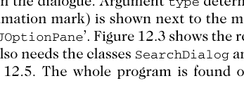

图 12.3 用于显示搜索结果的对话框


### 练习

12.1 在第一个菜单中添加菜单项"另存为"。点击时，应弹出文件选择对话框，供用户选择文件或输入新文件名。然后将文本保存到该文件中。

12.2 增强"加载"功能如下。如果已有文件被加载并显示，则弹出对话框。询问用户在加载新文件之前是否保存当前显示的文本。根据用户的选择，直接清空旧文本（使用 setText(" ")），或在保存并清空后再加载新文件。

12.3 增强"退出"功能如下。如果在显示文本时选择"退出"，则弹出对话框。询问用户在退出前是否保存文本。根据用户的选择执行相应操作。当按下框架的关闭按钮时，也应执行此流程。

12.4 在编辑器中添加另一个菜单"帮助"。它应包含两个菜单项"帮助"和"关于"。前者应在对话框窗口中显示帮助文本，后者应显示有关程序的一些信息。

12.5 在编辑器窗格下方添加一个状态栏，显示一些附加信息，例如行数或文件名。

## 更多关于图形的内容 13

> 在本章中，我们讨论一些改进绘图的技术。首次阅读时可以跳过本章。

### 13.1 Graphics2D 类

在前面的显示绘图示例中，我们使用了 AWT 库中的 `Graphics` 类来提供绘图命令。该类仅提供基本的形状绘制命令。例如，线宽限制为一个像素。要绘制更宽的线条，可以并行绘制多条线。必须考虑线条方向才能使其看起来美观。对于更粗的线条，人们还希望允许不同种类的线端样式，例如圆角、方形。这些以及更多功能由同样位于 AWT 库中的 `Graphics2D` 类提供。该类及其辅助类（如 `Shape`、`AffineTransform` 和 `Stroke`）一起提供了非常强大的方法来创建和修改绘图。要在 `paintComponent` 中使用它，需要将 `Graphics` 参数强制转换为 `Graphics2D`。由于 `Graphics2D` 派生自 `Graphics`，所有"旧的"绘图命令仍然可用。

对这些类的完整描述超出了本书的范围。我们仅限于简要描述笔画（stroke）。根据作者的经验，这是 `Graphics` 类中最令人怀念的功能。笔画可以被认为是钢笔或画笔之类的绘图工具。用户可以定义具有给定宽度和形状的工具，然后用它绘制线条或曲线。除此之外，还可以设置线条样式。使用方法非常简单：首先定义一些笔画。然后选择所需的笔画，之后的所有绘图命令都会使用它，直到选择另一个笔画为止。

Java 中的笔画由接口 `Stroke` 实现。Java 还在 `BasicStroke` 类中提供了 `Stroke` 的实现。该类允许我们定义线宽、线端样式（圆角/方形）以及线段连接方式，以形成美观的多边形。线宽由下面构造函数中的参数 `width` 指定，线端样式由参数 `cap` 指定，连接方法由 `join` 指定。例如，要使用圆角线端，可以使用 `cap = BasicStroke.CAP_ROUND`。该类还提供了更多功能，如虚线，我们在此不作讨论。

`BasicStroke(float width)` 构造一个实心的 `BasicStroke`，具有指定的线宽，以及 `cap` 和 `join` 样式的默认值。

`BasicStroke(float width, int cap, int join)` 构造一个具有指定属性的实心 `BasicStroke`。

以下代码片段展示了如何使用 `Graphics2D` 类和 `BasicStroke` 类绘制宽度分别为 5 和 6 像素的线条，并分别具有圆角和方形线端：

```
// 在序言中定义笔画
BasicStroke stroke5 =
    new BasicStroke(5.0f, BasicStroke.CAP_ROUND, BasicStroke.JOIN_BEVEL);
BasicStroke stroke6 =
    new BasicStroke(6.0f, BasicStroke.CAP_BUTT, BasicStroke.JOIN_BEVEL);

// 在 paintComponent 中使用笔画
public void paintComponent(Graphics g) {
    super.paintComponent(g);
    // 强制转换为 Graphics2D
    Graphics2D g2d = (Graphics2D) g;

    // 绘制宽度为 5 的线条
    g2d.setStroke(stroke5);
    g2d.drawLine(10, 10, 30, 40);

    // 绘制宽度为 6 的线条
    g2d.setStroke(stroke6);
    g2d.drawLine(10, 40, 30, 10);
}
```

### 13.2 查找屏幕参数

显示框架时，通常只想填充屏幕的某个区域。应避免框架中"超出"屏幕的部分，因为框架很大而屏幕分辨率较低。以下代码展示了如何找到每列和每行的像素数，以及屏幕分辨率，即每英寸的像素数。我们不解释用于此目的的 `Toolkit` 类。只需将其视为允许访问系统信息的类。

```
Toolkit tk = Toolkit.getDefaultToolkit();
Dimension screenDim = tk.getScreenSize();
int screenHeight = screenDim.height;
int screenWidth = screenDim.width;
int pixPerInch = tk.getScreenResolution();
```

### 13.3 缩放绘图

调整 5.3 节中框架的大小并不会调整绘图的大小。因此，如果框架变小，绘图可能会部分不可见；如果框架很大，绘图可能只占据框架的很小一部分。要访问大型绘图，可以使用第 11 章中描述的滚动窗格。有时这种方法并不合适，因为人们希望无论窗口大小如何，都能显示整个绘图。这里我们描述如何在调整窗口大小时调整绘图大小。这种方法适用于简单且相对静态的绘图。在第 21 章中，将介绍一种更为复杂的方法，可以显示复杂、高度动态且可调整大小的绘图。

我们从 `SimpleFrame` 派生一个框架 `ResizeFrame`。在其内容窗格中放置一个从 `JPanel` 派生的 `ResizePanel`。`ResizePanel` 具有黄色背景和居中的黑色矩形。黑色矩形的宽度和高度都是面板的三分之一。如果调整框架（以及面板）的大小，这一比例将保持不变。

为此，我们必须知道面板的**当前**大小。我们使用以下方法：

```
int getWidth();
int getHeight();
```

它们返回面板的当前宽度和高度（以像素为单位）。然后，黑色矩形的左边缘距离面板左边缘的距离为面板宽度的三分之一。接着，我们通过调用 `drawRect` 并传入适当的值，将黑色矩形放置在期望的位置。以下清单显示了包括启动类 `ResizeDriver` 在内的代码。图 13.1 展示了结果。

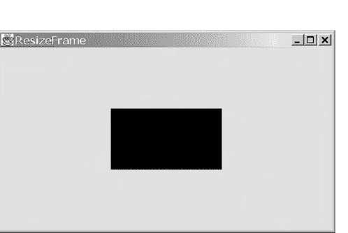

```
package its.ResizeDisplay;

import its.SimpleFrame.SimpleFrame;

public class ResizeFrame extends SimpleFrame {
    public ResizeFrame() {
        ResizePanel rp = new ResizePanel();
        this.setSize(500, 300);
        this.getContentPane().add(rp);
    }
}
```

```
package its.ResizeDisplay;

import java.awt.Color;
import java.awt.Graphics;
import javax.swing.JPanel;

public class ResizePanel extends JPanel {
    public ResizePanel() {
        this.setBackground(Color.yellow);
    }

    public void paintComponent(Graphics g) {
        super.paintComponent(g);
        // 获取面板的当前尺寸
        int currentWidth = this.getWidth();
        int currentHeight = this.getHeight();

        // 取当前尺寸的三分之一
        int wThird = currentWidth / 3;
        int hThird = currentHeight / 3;
        // 设置颜色为黑色
        g.setColor(Color.black);
        // 绘制矩形
        g.fillRect(wThird, hThird, wThird, hThird);
    }
}
```

```
// 文件：its/ResizeDisplay/ResizeDriver.java
package its.ResizeDisplay;

public class ResizeDriver {
    public static void main(String[] args) {
        ResizeFrame rf = new ResizeFrame();
        rf.showIt("ResizeFrame");
    }
}
```

### 练习

13.1 扩展可调整大小的框架如下：添加四个分别标记为"上"、"下"、"左"和"右"的按钮。点击其中之一时，黑色矩形必须向该方向移动（移动量可自行指定）。确保它始终完全包含在面板内！


# 示例项目14

本章我们将介绍一个基于模型-视图-控制（Model-View-Control）方法的完整小型项目。目标是实现一个可供用户交互式游玩的游戏。由于本示例将作为后续项目的模板，我们将详细描述其设计和实现过程。本项目的目的不是设计一个外观时尚的界面，而是构建一个功能正常的图形用户界面。

### 14.1 ■ 规格说明

我们的示例游戏是“15拼图”（15-puzzle）。它包含一个4×4的棋盘，上面有15个可移动的方块和一个空格。玩家可以将与空格相邻的方块向空格方向移动。示例参见图14.1。

用户界面必须能够显示棋盘，并允许用户移动方块。实现时必须确保只有合法的移动才可能进行——即那些在真实拼图中可以执行的移动。

### 14.2 ■ 模型部分

模型设计的第一步是找出项目中的核心组件。在这里，很自然地，游戏的“硬件”——棋盘——就是这样一个组件。其他组件则更为抽象，例如棋盘上方块的当前布局以及“移动”这个概念。每个核心组件都应该被实现为一个独立的类。在我们的示例中，核心组件是什么是比较明确的。在更复杂的项目中，可能存在不同的方式来构建问题，从而导致对核心组件的不同定义。哪种方案更好并不总能轻易决定。无论如何，应避免使用大型、通用的类。

拼图的模型部分由 `BoardModel`、`MoveModel`、`ConfigurationModel` 和 `Constants` 这四个类实现。它们提供了以抽象方式执行移动的所有方法。此外，`BlockPuzzleTest` 类是一个非图形化的驱动程序，用于测试这些非图形化类的功能。或许有人会质疑，对于这样一个简单的游戏，是否真的需要“移动”或“常量”这样的类。事实上，使用这些类有助于构建项目结构、加快设计速度，并使程序易于维护。

图14.1 15拼图：(a) 15个方块的某种布局；(b)、(c) 和 (d) 是通过每次移动一个方块从 (a) 派生出来的。目标是将方块排列成按行阅读时数字递增的顺序。

`BoardModel` 不仅限于 $4 \times 4$ 的尺寸，它允许任意的 $n \times m$ 棋盘。决定尺寸的参数通过构造函数传入。方块编号为 $0, 1, 2, \dots, nm - 1$，其中0代表空格。棋盘由一个二维 $n \times m$ 数组 `board` 表示。数组在 `board[i][j]` 处存储第 $i$ 行第 $j$ 列方块的编号。另外两个数组 `rowOfBlock` 和 `colOfBlock` 为每个方块存储其当前所在行和列的编号。通过这种方式，方块的位置和编号可以轻松关联。棋盘的初始化方式是：方块按行优先顺序连续编号，空格位于右下角。

该类提供了 `get` 方法来访问当前配置和棋盘尺寸。游戏的动态性由 `moveIt` 方法提供。它接收一个 `MoveModel` 实例，检查该移动是否合法，如果合法则移动方块。它返回一个布尔值以指示移动是否已执行。

文件：its/BlockPuzzle/BoardModel.java

```java
package its.BlockPuzzle;

public class BoardModel{
    private int noOfRows, noOfCols;
    private int[][] board;    // The board as an array
    private int[] rowOfBlock; // The number of the row of every block
    private int[] colOfBlock; // The number of the column of every block

    public BoardModel(int nr, int nc){
        noOfRows = nr;
        noOfCols = nc;
        board = new int[noOfRows][noOfCols];
        rowOfBlock = new int[noOfRows * noOfCols];
        colOfBlock = new int[noOfRows * noOfCols];
        // initialize the board. The blocks are
        // numbered row-wise 1,2,...
        int kk = 1;

        for(int r=0; r < noOfRows; r++){
            for(int c=0; c < noOfCols; c++){
                if(kk < noOfRows * noOfCols){
                    board[r][c] = kk;
                    rowOfBlock[kk] = r;
                    colOfBlock[kk] = c;
                    kk++;
                }
            }//for c
        }//for r

        // ... and the missing block is at the lower right.
        board [noOfRows-1][noOfCols-1] = 0;
        rowOfBlock[0] = noOfRows-1;
        colOfBlock[0] = noOfCols-1;
    }

    public boolean moveIt(MoveModel mm){
        int dir  = mm.getDirection();
        int block = mm.getBlockNumber();
        int row  = rowOfBlock[block];
        int col  = colOfBlock[block];
        boolean ok = true;
        // an UP move is possible if the missing block
        // is above the position (r,c), i.e., at
        // (r-1,c). Esp. r has to be larger than 0.
        // The tests for the other directions are similar.
        if(dir == Constants.DIRECTION_UP){
            if((row > 0) && (board[row-1][col] == 0)){
                board[row-1][col] = board[row][col];
                rowOfBlock[block]--;
                board[row][col] = 0;
                rowOfBlock[0]++;
            }
            else{
                ok = false;
            }
        } else if(dir == Constants.DIRECTION_DOWN){
            if((row < noOfRows-1) && (board[row+1][col] == 0)){
                board[row+1][col] = board[row][col];
                rowOfBlock[block]++;
                board[row][col] = 0;
                rowOfBlock[0]--;
            }
            else{
                ok = false;
            }
        }else if(dir == Constants.DIRECTION_LEFT){
            if((col > 0) && (board[row][col-1] == 0)){
                board[row][col-1] = board[row][col];
                colOfBlock[block]--;
                board[row][col] = 0;
                colOfBlock[0]++;
            }
            else{
                ok = false;
            }
        }else if(dir == Constants.DIRECTION_RIGHT){
            if((col < noOfCols-1) && (board[row][col+1] == 0)){
                board[row][col+1] = board[row][col];
                colOfBlock[block]++;
                board[row][col] = 0;
                colOfBlock[0]--;
            }
            else{
                ok = false;
            }
        }	return(ok);
    }

    public ConfigurationModel getCurrentConfiguration(){
        return(new ConfigurationModel(board));
    }

    public int getNoOfCols(){
        return(noOfCols);
    }

    public int getNoOfRows(){
        return(noOfRows);
    }
}
```

`MoveModel` 类提供了移动的抽象描述。它指定了要移动的方块编号及其方向。方向是 `Constants` 类中定义的常量之一。

文件：its/BlockPuzzle/MoveModel.java

```java
package its.BlockPuzzle;

public class MoveModel {

    private int direction;
    private int blockNumber;

    public MoveModel(int dir, int bn) {
        direction = dir;
        blockNumber = bn;
    }

    public int getBlockNumber(){
        return(blockNumber);
    }

    public int getDirection(){
        return(direction);
    }
}
```

`ConfigurationModel` 类的实例代表棋盘的一个快照。这可用于记录游戏进程或存储游戏当前状态。`equals` 方法检查两个配置是否相同，这可用于测试目的。该类提供了一个 `toString` 方法，它以一种也可以在控制台打印的格式返回配置。

文件：its/BlockPuzzle/ConfigurationModel.java

```java
package its.BlockPuzzle;

public class ConfigurationModel {
    private int[][] board;
    int noOfRows, noOfCols;

    public ConfigurationModel(int[][] b) {
        noOfRows = b.length;
        noOfCols = b[0].length;
        board = new int[noOfRows][noOfCols];
        for (int r=0;r < noOfRows ; r++ ) {
            for (int c=0;c < noOfCols ; c++ ) {
                board[r][c] = b[r][c];
            }//for
        }//for
    }

    public int getBlockNo(int r, int c){
        return(board[r][c]);
    }

    public String toString(){
        String confAsString = "";
        for(int r=0; r < noOfRows; r++){
            for(int c=0; c < noOfCols; c++){
                if(board[r][c] < 10)
                {
                    confAsString += "  "+board[r][c];
                }
                else
                {
                    confAsString += " "+board[r][c];
                }//ifelse
            }//for c
            confAsString += "\n";
        }//for r
        confAsString += "\n";
        return(confAsString);
    }

    public boolean equals(ConfigurationModel conf){
        boolean result = true;
```


### 14.3 视图部分

一旦模型实现并测试完成，就可以开始设计游戏的显示界面了。我们选择的布局是两个面板并排嵌入到一个框架中。左侧面板显示当前棋盘的配置。右侧面板允许选择移动的方向。外观如图14.2所示。

我们首先描述显示棋盘的类 `BlockPuzzlePanel`。在构造函数中，面板接收对其需要显示的棋盘模型的引用。通过查询棋盘模型，它确定需要显示的行数和列数。

与通常一样，绘制工作通过重写方法 `paintComponent` 来完成。此处从 `BoardModel` 获取当前配置。然后查询所有位置 $(r, c)$（$r$ 是行号，$c$ 是列号）的配置，以找到该位置的方块编号。方块被绘制为矩形，中间附近有一个数字。缺失的方块显示为填充的黑色矩形。绘制方块和空位的代码分别放在两个私有方法中。将这些代码直接放在 `paintComponent` 中当然是可能的，但会使结构难以跟踪。绘制是可缩放的（可调整大小）。我们使用第13.3节中描述的技术来实现这一目的。

面板不了解游戏的任何规则，它只能显示当前状态。因此，方法 `makeMove(move)` 通过调用棋盘模型的 `moveIt(move)` 方法来执行移动。如果配置发生了更改，面板的显示必须更新。此更新通过调用面板的 `repaint` 方法来完成。如果移动未成功执行，则显示警告消息。它使用类 `JOptionPane` 中的预定义消息对话框。

该类有一个公共方法 `getBlockNoAtPixels(x, y)`，将在控制部分中使用。它确定包含像素坐标 $(x, y)$ 的方块编号。为了找出包含给定像素 $y$ 坐标的行，我们首先将面板的高度除以行数，即为单行的像素高度。然后将 $y$ 除以此高度得到行号。注意所有涉及的数字都是整数；因此向下取整，正确计算出行号。列号的计算方式类似。

```
File: its/BlockPuzzle/BlockPuzzlePanel.java
```

```java
package its.BlockPuzzle;

import java.awt.Color;
import java.awt.Dimension;
import java.awt.Graphics;
import javax.swing.JPanel;
import javax.swing.JOptionPane;

public class BlockPuzzlePanel extends JPanel{

    private BoardModel boardMod;
    private ConfigurationModel currentConf;
    private int noOfRows, noOfCols;
    private int columnWidth, rowHeight;

    public BlockPuzzlePanel( BoardModel bm){
        boardMod = bm;
        noOfRows = bm.getNoOfRows();
        noOfCols = bm.getNoOfCols();
        this.setPreferredSize(new Dimension(300,300));
        this.setBackground(Color.white);
    }

    public void paintComponent(Graphics g){
        super.paintComponent(g);
        int w = getWidth();
        int h = getHeight();
        columnWidth = w/noOfCols;
        rowHeight = h/noOfRows;
        currentConf = boardMod.getCurrentConfiguration();
        for(int r=0; r < noOfRows; r++){
            for(int c=0; c < noOfCols; c++){
                if(currentConf.getBlockNo(r,c) != 0){
                    drawBlock(r,c,currentConf.getBlockNo(r,c),g);
                }
                else
                {
                    drawMissingBlock(r,c,g);
                }
            }//for c
        }//for r
    }

    public void makeMove(MoveModel move){
        if(boardMod.moveIt(move)){
            this.repaint();
        }
        else{
            JOptionPane.showMessageDialog(this,
            "Illegal Move","ITS BlockPuzzle",
            JOptionPane.WARNING_MESSAGE);
        }//ifelse
    }

    private void drawBlock(int r, int c, int n, Graphics g){
        g.drawRect(c*columnWidth+2,r*rowHeight+2,columnWidth-4,
                    rowHeight-4);
        g.drawString(""+n,c*columnWidth+(columnWidth/2),
                    r*rowHeight+rowHeight/2);
    }

    private void drawMissingBlock(int r, int c, Graphics g){
        g.fillRect(c*columnWidth,r*rowHeight,columnWidth,rowHeight);
    }

    public int getBlockNoAtPixels(int x, int y){
        int c = x/(this.getWidth()/noOfCols);
        int r = y/(this.getHeight()/noOfRows);
        return(currentConf.getBlockNo(r,c));
    }
}
```

类 `DirectionPanel` 相当简单。它接收一个 4×1 的网格布局，其中放置了四个单选按钮。它们用四个方向标记，并接收动作命令。动作命令将用于确定哪个按钮被选中。单选按钮按照第12.4节中描述的方式进行分组。"上"按钮默认被选中。该类只有一个方法 `getDirection`。它返回当前选中按钮指定的方向。返回值是类 `Constants` 中定义的对应方向常量。

```
File: its/BlockPuzzle/DirectionPanel.java
```

```java
package its.BlockPuzzle;

import java.awt.GridLayout;
import javax.swing.ButtonGroup;
import javax.swing.JPanel;
import javax.swing.JRadioButton;

public class DirectionPanel extends JPanel {
    private JRadioButton upBut, downBut, rBut, lBut;
    private ButtonGroup group;

    public DirectionPanel(){
        this.setLayout(new GridLayout(4,1));
```


### 14.4 控制部分

用户与程序的交互过程如下。用户通过点击方向面板中的单选按钮来选择一个方向。这不需要监听器，因为该机制由 `RadioButton` 和 `ButtonGroup` 提供。选定方向后，可以通过点击 `BlockPuzzlePanel` 中的一个方块来执行移动。如果移动合法，即空位在该方向上与方块相邻，该方块就会向指定方向移动。

使用监听器来检测 `BlockPuzzlePanel` 中的点击事件并执行移动。由于我们需要响应鼠标点击事件，因此在 `BlockPuzzleListener` 类中继承了 `MouseAdapter`。为了能够执行所需的任务，监听器需要知道期望移动的方向和方块。然后在方块拼图面板中执行移动。因此 `BlockPuzzleListener` 在构造函数中接收 `DirectionPanel` 和 `BlockPuzzlePanel` 的引用。该监听器被分配给 `BlockPuzzlePanel`。

如果在 `BlockPuzzlePanel` 中发生鼠标点击事件，监听器的 `mouseClicked` 方法将被调用。监听器从鼠标事件对象中提取点击位置的 *x* 和 *y* 坐标，单位为像素。监听器询问面板该位置处是哪个方块。这是通过使用方块面板的 `getBlockNoAtPixels(x,y)` 方法来完成的。监听器通过使用 `getDirection()` 询问方向面板来确定方向。

现在已知方块编号和方向，监听器为期望的移动构建一个 `MoveModel` 实例。通过 `makeMove(move)` 方法将移动传递给方块拼图面板。

文件：`its/BlockPuzzle/BlockPuzzleListener.java`

```java
package its.BlockPuzzle;

import java.awt.event.MouseAdapter;
import java.awt.event.MouseEvent;

public class BlockPuzzleListener extends MouseAdapter {
    private DirectionPanel dirPanel;
    private BlockPuzzlePanel bpPanel;

    BlockPuzzleListener(BlockPuzzlePanel bp, DirectionPanel m) {
        dirPanel = m;
        bpPanel = bp;
    }

    public void mouseClicked(MouseEvent evt) {
        int x = evt.getX();
        int y = evt.getY();
        int blockNo = bpPanel.getBlockNoAtPixels(x, y);
        // Constructs the move
        MoveModel move =
            new MoveModel(dirPanel.getDirection(), blockNo);
        // Request a move to be made in the BlockPuzzlePanel.
        // Note that the BlockPuzzleListener does not know HOW to make
        // a move.
        bpPanel.makeMove(move);
    }
}
```

驱动类 `BlockPuzzle` 创建一个 `BlockPuzzleFrame` 并使其可见。程序的屏幕截图如图 14.3 所示。

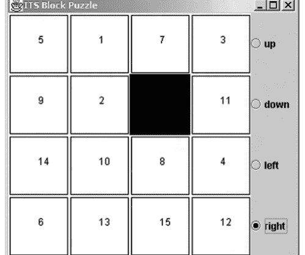

文件：`its/BlockPuzzle/BlockPuzzle.java`

```java
package its.BlockPuzzle;

class BlockPuzzle {
    public static void main(String[] args) {
        BlockPuzzleFrame g1f = new BlockPuzzleFrame(4, 4);
        g1f.showIt();
    }
}
```

类 `BlockPuzzleFrame` 不是从 `SimpleFrame` 派生，而是从 `JFrame` 派生，以使该项目独立于 `its` 包。要单独使用它，需要将包名 `its.BlockPuzzle` 替换为 `BlockPuzzle`。该框架实现了窗口监听器，当框架关闭时终止应用程序；参见第 9.3 节。

基础

文件：`its/BlockPuzzle/BlockPuzzleFrame.java`

```java
package its.BlockPuzzle;

import java.awt.event.WindowAdapter;
import java.awt.event.WindowEvent;
import java.awt.BorderLayout;
import javax.swing.JFrame;

public class BlockPuzzleFrame extends JFrame {
    private DirectionPanel dirPanel;
    private BlockPuzzlePanel bpPanel;

    // Constructor
    public BlockPuzzleFrame(int rows, int cols) {
        this.setLocation(200, 200);
        this.setTitle("ITS Block Puzzle");
        BoardModel boardMod = new BoardModel(rows, cols);
        bpPanel = new BlockPuzzlePanel(boardMod);
        dirPanel = new DirectionPanel();
        getContentPane().add(bpPanel, BorderLayout.CENTER);
        getContentPane().add(dirPanel, BorderLayout.EAST);

        BlockPuzzleListener bpList = new BlockPuzzleListener(bpPanel, dirPanel);
        bpPanel.addMouseListener(bpList);

        // Correct termination:
        // Otherwise only the frame disappears when clicking
        // on the "close" symbol but the process keeps running.
        addWindowListener(new WindowAdapter() {
            public void windowClosing(WindowEvent e) {
                System.exit(0);
            }
        });
        pack();
    }

    public void showIt() {
        this.setVisible(true);
    }

    public void hideIt() {
        this.setVisible(false);
    }
}
```

`DirectionPanel` 类提供了用于选择方向的 GUI。它是一个包含四个单选按钮的面板，排列成十字形。

文件：`its/BlockPuzzle/DirectionPanel.java`

```java
package its.BlockPuzzle;

import javax.swing.JPanel;
import javax.swing.JRadioButton;
import javax.swing.ButtonGroup;

public class DirectionPanel extends JPanel {
    private ButtonGroup group;
    private JRadioButton upBut, downBut, lBut, rBut;

    public DirectionPanel() {
        upBut = new JRadioButton("up");
        downBut = new JRadioButton("down");
        lBut = new JRadioButton("left");
        rBut = new JRadioButton("right");

        upBut.setActionCommand("u");
        downBut.setActionCommand("d");
        lBut.setActionCommand("l");
        rBut.setActionCommand("r");

        group = new ButtonGroup();
        group.add(upBut);
        group.add(downBut);
        group.add(lBut);
        group.add(rBut);
        upBut.setSelected(true);

        this.add(upBut);
        this.add(downBut);
        this.add(lBut);
        this.add(rBut);
    }

    public int getDirection() {
        String actionCommand = group.getSelection().getActionCommand();
        int result = 0;
        if (actionCommand.equals("u")) {
            result = Constants.DIRECTION_UP;
        } else if (actionCommand.equals("d")) {
            result = Constants.DIRECTION_DOWN;
        } else if (actionCommand.equals("r")) {
            result = Constants.DIRECTION_RIGHT;
        } else if (actionCommand.equals("l")) {
            result = Constants.DIRECTION_LEFT;
        }
        return (result);
    }
}
```

### 14.5 总结

本章中的示例旨在说明图形应用程序的设计过程。非图形部分与图形部分分别进行规范、实现和测试。图形类和非图形类都为控制部分提供所需的方法。例如，`BoardModel` 在 `moveIt` 中实现移动操作，而 `BlockPuzzlePanel` 在 `getBlockNoAtPixels` 中提供像素到方块编号的转换。

将数据管理、图形和用户交互分离的方法是实现快速、安全且易于维护的实现的关键。经常听到的一种说法是，这会降低程序执行速度，例如，使用 getter 和 setter 方法比直接访问公共变量慢。这几乎总是不正确的。对于大多数应用程序来说，使用结构不良、不安全且难以维护的实现，最多只能获得 0% 到 2% 的速度提升。然而，调试此类实现的时间要大得多。

在我们的方块拼图示例中，我们能够依次实现模型、视图和控制部分。虽然这些部分的概念分离总是可行的，但时间上的分离则不然。通常需要分别开发这三个部分，但要并行进行。

方块拼图示例保持得非常简短。它缺少一些重要的测试，例如在 `BoardModel` 的构造函数中检查行数和列数是否为正数。此外，通过 `getBlockNoAtPixels` 方法确定被点击方块的精度仅在几个像素以内。

### 练习

14.1 在 GUI 中添加一个"重置"按钮。按下它时，方块被排列回初始配置。

14.2 在 GUI 中添加一个文本区域，通过每行显示一个已执行的移动来显示游戏历史记录。它应该是可滚动的，并在游戏重置时清空。

14.3 在 GUI 中添加一个菜单。应包含"保存"和"加载"菜单项。选择它们时，分别保存当前游戏状态（当前配置）或加载并显示已保存的游戏。保存或加载的文件应由用户自行选择。确保能够处理不同大小的棋盘。

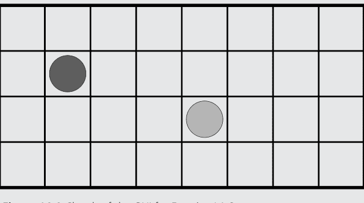

图 14.4 练习 14.6 的 GUI 草图

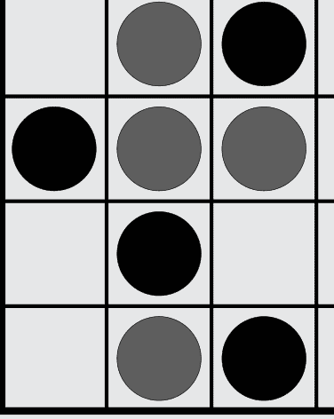

图 14.5 练习 14.7 的 GUI 草图

#### 14.4 向其中一个菜单添加菜单项“选择棋盘大小”。选择此项时，会出现一个对话框，提示用户输入行数和列数。关闭对话框后，棋盘大小将重置为新值，并按原始配置重新排列方块。

#### 14.5 更改用户选择移动的方式如下：移除方向面板。要执行移动，用户点击一个方块 B。如果空位与 B 在同一行或同一列，则空位与 B 之间的所有方块（包括 B）都将被移动。随后空位将位于 B 的原始位置。请注意，这需要对许多类进行修改或重新实现。

#### 14.6 实现以下图形用户界面。有一个 n × m 单元格的矩形网格。初始时单元格为空。一个红色棋子被放置在其中一个单元格中。然后，该棋子可以移动到另一个不同的单元格。红色棋子原位置的单元格将被放入一个黄色棋子。网格上始终最多有两个棋子。游戏可以用空网格重新开始。参见图 14.4。

#### 14.7 实现以下游戏（井字棋灯）。有一个 n × n 单元格的矩形网格，n ≥ 3。初始时单元格为空。两位玩家（称为红色和黑色）轮流将他们颜色的棋子放入空单元格中。红色先手。如果一方玩家有三颗棋子在一行中相邻，或者所有单元格都被占据，则游戏结束。游戏可以用空网格重新开始。参见图 14.5。

# 第二部分

## 更多组件与技术

### 15 像素图形

> 像素图像是大多数图形界面中的重要组成部分。它们可以作为按钮上的小符号或消息中的符号出现，也可以是主要的数据对象，例如在显示照片的应用程序中。这类图像是逐像素存储的。我们不会自己创建这类图像。相反，我们将专注于显示和操作现有图像。

我们首先讨论像素图形的不同类型以及用于这类图像的 Java 类。然后，我们将展示如何显示和操作图像。

#### 15.1 一些图形文件类型

像素图形的例子包括数码照片或扫描图片。它们通常是矩形的，由*像素*组成。像素是一个小的彩色方块。这些方块拼接组成图像。可能的颜色因图像类型而异。对于扫描文档，像素通常是白色或黑色；那么一个比特就足以存储单个像素的信息。黑白照片通常以灰度存储。每个像素有一个值表示其“灰度”，例如 0 为白色，255 为黑色。对于彩色图像，每个像素描述一种颜色。表示颜色有不同的方式。RGB 模型使用三个值来指示颜色中红、绿、蓝的含量。通常每个值使用一个字节，因此一个像素需要 3 字节或 24 比特。这允许我们定义 16,777,216 种不同的颜色。

存储像素图形需要大量内存。存储一张 2048 × 1536 像素、24 位色彩（3 兆像素数码照片的格式）的图像需要 9 兆字节。为了节省磁盘空间，图像通常以*压缩*格式存储。当图像被压缩时，可能会丢失一些图像信息。粗略地说，压缩会合并相邻或相似像素的信息。解压缩这样的图像会产生比原始图像更粗糙的图像。压缩率越高，丢失的图像信息就越多。在合理的、例如几乎不可见的图像质量损失下，上述照片可以减少到大约 1.5 兆字节。不太详细且对比度较低的照片或绘图，为了达到相同的视觉质量，比细节丰富且对比度强的图像允许更高的压缩率。一些压缩图像格式是无损的，即原始图像可以精确恢复。Java 库支持以下图像格式。加载此类图像时，它会自动解压缩并可以显示。

- ■ **图形交换格式**，文件扩展名 GIF。此格式以 256 位颜色存储图像，每像素一个字节。图像压缩不损失信息。它通常用于互联网上的小图标或图形。使用此格式可能会引起法律问题，因为 CompuServe 公司拥有该压缩方法的专利。
- ■ **联合图像专家小组**，文件扩展名 JPG、JPEG。此格式使用一种会损失图像信息的压缩方法。对于照片，可以在保持良好质量的同时，将文件大小减少到原始图像文件大小的 20%。JPEG 可能是存储较大照片或绘图最广泛使用的格式。
- ■ **可移植网络图形**，文件扩展名 PNG。一种日益重要的新图像格式。它使用无损压缩，长期来看可能会取代 GIF 格式。

大多数互联网浏览器可以渲染这三种格式中的任何一种图像。在本书中，我们将主要使用 PNG 图像；使用 JPEG 或 GIF 时示例也能工作。如果图像必须通过网络发送，使用压缩图像格式尤其可取：发送或加载时间会大幅减少。将大图像加载到应用程序中需要一些时间，即使在现代计算机上也是如此。为了节省用户等待图像显示的时间，图像通常*异步*加载。这意味着启动一个与主程序并行运行的第二个进程来加载图像。这样主程序不会被阻塞，用户可以在加载图像的同时继续工作。但是，如果图像必须立即由应用程序处理，那么它应该*同步*加载，主程序必须等待图像可用。

#### 15.2 类 ImageIcon

Swing 库为像素图形提供了 `ImageIcon` 类。虽然“图标”通常用于小图像，但此类非常适合处理大图像，并支持对图像的基本操作。对于更复杂的操作，可以使用 AWT 库中的 `Image` 类。`ImageIcon` 类的一些构造方法和方法如下所列和描述：

```
ImageIcon()
ImageIcon(Image picture)
ImageIcon(String filename)
ImageIcon(URL webaddress)
int getImageHeight()
int getImageWidth()
```

`ImageIcon()` 默认构造方法。

- `ImageIcon(Image picture)` 从 AWT 类 Image 的实例创建一个 ImageIcon。
- `ImageIcon(String filename)` 从图像文件创建一个 ImageIcon，文件名由参数 filename 提供。
- `ImageIcon(URL webaddress)` 从网页地址创建一个 ImageIcon，地址由参数 webaddress 提供。URL 类来自 java.net 库。
- `getImageHeight()` 以像素为单位返回图像高度。
- `getImageWidth()` 以像素为单位返回图像宽度。

#### 15.3 在 Swing 中显示像素图形

程序 ImageFrame 演示了如何加载和显示图像。我们想在框架中显示图像 orange.png。该图像是尺寸为 400 × 400 像素的数字化照片。`ImageIcon` 类的实例是非图形组件。它们必须在某个图形 Swing 组件内显示。为此，我们使用 `JLabel`。在第 3.3.1 节中，我们介绍了构造方法

```
public JLabel(ImageIcon picture)
```

我们现在将使用它。我们通过向构造方法传递图像的文件名来创建一个 ImageIcon。请注意，您可能需要调整路径以匹配您的目录结构。为保持程序简短，我们不检查指定的文件是否确实存在。然后图像在标签中显示。标签的大小会调整以匹配图像大小，前提是父组件的布局管理器允许该大小。标签被居中嵌入到框架中。我们使用父框架的 pack 方法来保证这一点。结果如图 15.1 所示。

```
File: its/Images/ImageFrame.java
```

```
package its.Images;

import its.SimpleFrame.SimpleFrame;
import javax.swing.*;

public class ImageFrame extends SimpleFrame
{
    private ImageIcon picture;
```


#### 15.4 图像处理

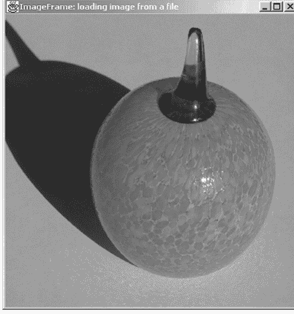

图 15.1 应用程序 ImageFrame

```java
// Adjust the following path if necessary
private final String picturePath = "./its/TestData/";
private final String imageFileName = "orange.png";

public ImageFrame()
{
    picture = new ImageIcon(picturePath+imageFileName);
    JLabel pictureLabel = new JLabel(picture);
    this.getContentPane().add(pictureLabel);
    pack();
}

public static void main(String[] args)
{
    ImageFrame imfr = new ImageFrame();
    imfr.showIt("ImageFrame: loading image from a file");
}
}
```

要显示的图片不必存储在本地硬盘上，它同样可以存放在互联网上的某个位置。互联网位置通过统一资源定位符（简称 URL）来指定。在 Java 中，这些由 `java.net` 库中的 `URL` 类来实现。将地址作为字符串传递给构造方法即可。有关网络访问的更多内容可在第 22 章中找到。以下应用程序 `WebImageFrame` 从指定的网络地址获取梨的图片 `pear.png` 并显示它。该文件大小为 190 千字节。根据网络连接的带宽不同，加载时间可能长达 10 秒。该应用程序仅在计算机能访问互联网的情况下才能正常工作。访问网络位置的尝试可能会因多种原因而失败，这些原因超出了用户的控制范围。因此，相应的 Java 语句被嵌入到 `try-catch` 块中。这样即使网络访问失败，程序也能继续运行。

```java
package its.Images;

import its.SimpleFrame.SimpleFrame;
import java.net.URL;
import javax.swing.ImageIcon;
import javax.swing.JLabel;

public class WebImageFrame extends SimpleFrame
{

    public WebImageFrame()
    {
        URL  picURL = null;
        JLabel pictureLabel = null;
        try
        {
            picURL = new URL("http://www.imm.dtu.dk/swingbook/" +
                            "HTMLTest/pear.png");
        }
        catch (Exception ex)
        {System.out.println("Problems in creating URL" + picURL.getPath());}
        if(picURL != null){
            ImageIcon picture = new ImageIcon(picURL);
            pictureLabel = new JLabel(picture);
        }
        else{
            pictureLabel = new JLabel("Image not loaded");
        }
        this.getContentPane().add(pictureLabel);
        pack();
    }

    public static void main(String[] args)
    {
        WebImageFrame wifr = new WebImageFrame();
        wifr.showIt("WebImageFrame: loading Image from the net");
    }
}
```

#### 15.4 图像处理

你可能想要调整图像大小、旋转或翻转图像，或只显示图像的一部分，而不是按硬盘上的原始方式查看它。这些操作由 AWT 库中的类提供支持。现在我们将介绍一些解决上述图像处理需求的技术。AWT 库中的 `Image` 类在图像处理中扮演着核心角色。

##### 15.4.1 异步加载图像

如上所述，加载图片可能需要一些时间，尤其是当图像需要通过网络传输时。为了避免在获取图像时阻塞主应用程序，加载过程可以异步运行。AWT 库中的 `Toolkit` 类为此提供了相应的方法。我们将使用*默认工具包*的 `getImage` 方法来加载图像。可以指定图像文件的名称或图像存储的网络位置（URL）。`getImage` 方法返回一个 `Image` 类的对象：

```java
Image picture = Toolkit.getDefaultToolkit.getImage(String filename);
Image picture = Toolkit.getDefaultToolkit.getImage(String url);
```

一旦图片被加载到 `Image` 类的对象中，就可以通过该类的方法对其进行处理。作为第一个应用，我们展示如何排列多张图片。我们从 `JPanel` 派生出 `ImagePanel` 类。图像面板将自动排列并显示图片。背景颜色设置为黄色，以强调与图片的对比。

图片在面板的 `paintComponent` 方法中显示。我们使用 `Graphics` 类的以下方法。参数在之后进行解释。

```java
drawImage(Image picture, int left, int top, ImageObserver imObs)
```

第一个参数（`picture`）包含要显示的图像。两个整数参数 `left` 和 `top` 指定图像在面板内的左上角像素位置。最后一个参数的类型是 `ImageObserver`。这是 AWT 库中的一个接口，在加载或显示图像时非常有用。幸运的是，我们不必自己实现这个接口。每个图形组件，无论是 AWT 还是 Swing 的，都实现了该接口。因此我们可以将自身用作图像观察者。

要确定图像的宽度或高度，我们使用 `Image` 类的以下两个方法，它们分别以像素为单位返回这两个值。注意这些值指的是 `Image` 变量中图片的尺寸。实际显示效果可能会通过后续介绍的技术进行放大或缩小。

```java
int getWidth(ImageObserver imo)
int getHeight(ImageObserver imo)
```

`ImagePanel` 使用一个向量 `images` 来存储要显示的图像。在 `paintComponent` 方法中遍历该向量。对于向量中的每张图片，都会确定其宽度和高度以便进行适当放置。每次面板重绘时都会执行此操作。因此，图片始终会排列以适应面板的宽度，除非面板太小而无法容纳单张图片，此时图片会部分不可见。在 `ImagePanel` 中，我们定义了三个方法来添加图片：

```java
addImage(Image picture)
addImage(String filename)
addImageAndTrack(String filename)
```

第一个方法添加已作为 `Image` 类实例存储的图片。第二个方法从文件加载图片。第三个方法也从文件加载图片，但采用稍有不同的方式，我们将在后面解释。无论哪种情况，在添加图片后都会通过调用 `repaint` 来启动面板的重绘。以下代码清单包含 `ImagePanel` 和 `ImagePanelFrame` 两个类。后者创建一个 `ImagePanel` 并向其中添加一些图片。结果如图 15.2 所示。

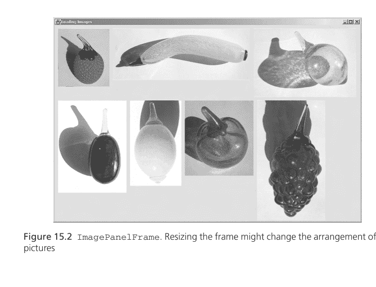

156 更多组件和技术

```java
File: its/Images/ImagePanel.java
```

```java
package its.Images;

import java.awt.*;
import javax.swing.JPanel;
import java.util.Vector;

public class ImagePanel extends JPanel
{

    private Vector images;
    private int gap = 10;
    private MediaTracker mediTracker;
    private int imageID;

    public ImagePanel()
    {
        this.setLayout(new BorderLayout());
        this.setBackground(Color.yellow);
        images = new Vector();
        mediTracker = new MediaTracker(this);
        imageID = 0;
        this.setPreferredSize(new Dimension(1000,1400));
    }

    public void paintComponent(Graphics g)
    {
        super.paintComponent(g);
        int currentYPosition = gap;
        int currentXPosition = gap;
        int imageWidth, imageHeight;
        int maxHeight = -1;
        int panelWidth = this.getWidth();
        for (int i = 0; i < images.size(); i++) {
            Image currentImage = (Image)(images.get(i));
            imageWidth  = currentImage.getWidth(this);
            imageHeight = currentImage.getHeight(this);
            //  Check whether to start a new row.
            if((gap+imageWidth+currentXPosition) > panelWidth)
            {
                currentYPosition += maxHeight + gap;
                maxHeight = -1;
                currentXPosition = gap;
            }
            if (imageHeight > maxHeight)
            {
                maxHeight = imageHeight;
            }
            g.drawImage(currentImage,currentXPosition,currentYPosition,this);
            currentXPosition += gap + imageWidth;
        }// for i
    }

    public void addImage(String filename)
    {
        Image im = Toolkit.getDefaultToolkit().getImage(filename);
        images.add(im);
        repaint();
    }

    public void addImageAndTrack(String filename)
    {
        Image im = Toolkit.getDefaultToolkit().getImage(filename);
        imageID++;
        mediTracker.addImage(im,imageID);
        try
        {
            //  Wait for the image to be completely loaded.
            mediTracker.waitForID(imageID);
        }
        catch (InterruptedException ex){
            System.out.println("Error loading image "+filename+".");
        }
        images.add(im);
        repaint();
    }

    public void addImage(Image picture)
    {
        images.add(picture);
        repaint();
    }

}
```

File: its/Images/ImagePanelFrame.java

```java
package its.Images;

import its.SimpleFrame.SimpleFrame;
import java.awt.BorderLayout;
```


158 More components and techniques

```java
public class ImagePanelFrame extends SimpleFrame
{
    // Adjust the following path if necessary
    private final String picturePath = "./its/TestData/";

    public ImagePanelFrame()
    {
        this.setSize(900, 600);
        ImagePanel ip = new ImagePanel();
        this.getContentPane().add(ip, BorderLayout.CENTER);
        ip.addImage(picturePath+"strawberry.png");
        ip.addImage(picturePath+"banana.png");
        ip.addImage(picturePath+"lime.png");
        ip.addImage(picturePath+"plum.png");
        ip.addImage(picturePath+"lemon.png");
        ip.addImage(picturePath+"apple.png");
        ip.addImage(picturePath+"grapes.png");
    }
    public static void main(String[] args)
    {
        ImagePanelFrame ipf = new ImagePanelFrame();
        ipf.showIt("Loading Images");
    }
}
```

根据SDK版本、操作系统和硬件的不同，可能会观察到略有不同的行为。可能只会看到面板的黄色背景，或者只会显示部分图像。原因是异步加载。让我们看看在`ImagePanel`的`addImage`方法中使用的三行代码：

```java
Image im = Toolkit.getDefaultToolkit().getImage(filename);
images.add(im);
repaint();
```

它们暗示存储在`filename`中的图像首先被加载，然后添加到向量`images`中，最后发起重绘。由于图像已在向量中，它应该被显示出来。然而，真实的时间线并非如此。第一条命令启动了加载过程，随后与主应用程序*并行*运行。这意味着上述代码片段中的另外两条语句可能会在图像正在加载时被*执行*。因此，添加到向量中的图像可能是不完整的甚至为空，`repaint`也只会部分显示或根本不显示它。如果稍后调整框架大小，当所有图像都加载完毕时，自动重绘将使它们显示出来。加载图片所需的时间取决于其大小和使用的硬件。因此，上述问题在某些系统上可能不会发生。关于异步加载机制的更多内容，请参阅第20章。

为了解决这个问题，可以使用*媒体跟踪器*（media tracker）的概念。它可以用来监控加载过程，等待图片完全加载后再显示它。`MediaTracker`类可以在AWT库中找到。媒体跟踪器可以监控多个图像的加载过程。为了区分不同的图像，每个图像都会获得一个标识（ID）号。我们使用以下构造函数和方法：

```
MediaTracker(Component comp)

addImage(Image picture, int id)
waitForID(int id)
waitForID(int id, int msec)
```

`MediaTracker(Component comp)`创建一个媒体跟踪器，用于监控为组件`comp`加载的图像。

`addImage(Image picture, int id)`将`picture`添加到媒体跟踪器监控的图像中。该图片获得标识号`id`。

`waitForID(int id)`等待标识号为`id`的图像加载过程完成。应用程序在此等待，直到图片完全加载。该语句必须嵌入到`try-catch`块中，因为如果加载过程失败（例如由于网络故障），它会抛出`InterruptedException`。程序员可以针对这种情况实现适当的处理。

`waitForID(int id, int msec)`等待标识号为`id`的图像加载过程完成，或等待`msec`毫秒，以先发生者为准。该语句也必须嵌入到`try-catch`块中。

在`ImagePanel`类的`addImageAndTrack`方法中，我们实现了这一概念。标识号从一个图片到下一个递增，以保证唯一性。只有在图像完全加载后才会调用`repaint`方法。`ImagePanelTrackerFrame`类与`ImagePanelFrame`类似，只是它使用`addImageAndTrack`而非`addImage`。可以从本书主页下载。

##### 15.4.2 Modifying images

到目前为止，我们按图像的原样显示了它们，即图像文件中的每个像素都显示在屏幕上。加载到`Image`变量中的图片也可以调整大小或反射，或者只显示其中的一部分。为此，只需使用`Graphics`类的`drawImage`方法并传入适当的参数集即可。回想一下，如果在图像尚未完全加载时使用`drawImage`，则可能只会显示部分图像。

下面描述了`drawImage`的各种调用方式。它们都需要一个`ImageObserver`实例作为参数之一。如15.4.1节所述，我们可以在此处使用`this`。在下文中，我们假设在面板中绘制，对于其他可以显示图像的组件，过程相同。

```
drawImage(Image picture, int left, int top, ImageObserver imo)
drawImage(Image picture, int left, int top, int width, int height,
          ImageObserver imo)
drawImage(Image picture, int tl, int tt, int tr, int tb, int sl,
          int st, int sr, int sb, ImageObserver imo)
```

`drawImage(Image picture, int left, int top, ImageObserver imo)`已在15.4.1节中描述过。它显示图像`picture`，使其左上角位于面板的像素坐标`left`和`top`处。

`drawImage(Image picture, int left, int top, int width, int height, ImageObserver imo)`绘制图像`picture`，使其左上角位于面板中的像素坐标`left`和`top`处。显示的图像宽`width`像素，高`height`像素。图像会被缩小或拉伸以适应这些约束。需要注意的是，图像本身，即变量`picture`的内容，*不会*被改变。调整大小仅作用于显示。

`drawImage(Image picture, int tl, int tt, int tr, int tb, int sl, int st, int sr, int sb, ImageObserver imo)`将图像`picture`的矩形裁剪部分绘制到面板的矩形目标区域中。整数值`tl`、`tt`、`tr`和`tb`分别指定目标矩形左边、上边、右边和下边的像素坐标。值`sl`、`st`、`sr`和`sb`分别指定`picture`中源矩形左边、上边、右边和下边的像素坐标。源矩形的宽度和高度不必与目标矩形的对应值匹配；裁剪部分将被调整大小以适应目标区域。另参见图15.3。

这些命令也可以用来反射图像。如果在第二个`drawImage`方法中为参数`width`选择负值，则图像将垂直反射。显示的图像宽度为参数`width`的绝对值，但左右互换。为`height`使用负值则会产生水平反射。这也会影响参数`left`或`top`的含义。这些参数始终引用*原始图片*左上角的位�置。经过垂直反射后，这变成了显示图像的右上角。

最后一个`drawImage`方法也可以用来反射裁剪部分。这里，(`sl`, `st`)（源矩形的左上角）始终映射到(`tl`, `tt`)（目标矩形的左上角）。(`sr`, `sb`)和(`tr`, `tb`)同理。在未反射的显示中，有$sl < sr$，$st < sb$，$tl < tr$，$tt < tb$。要垂直反射裁剪区域，只需通过选择$tr < tl$来交换左右，即让目标的"右"边位于其"左"边的左侧。对于水平反射，则设置$tt > tb$。

`Graphics`类不支持旋转图像。由于图像的像素通常按行组织，旋转需要大量的计算工作。

我们在应用程序`ImageCutAndMirrorFrame`中演示`drawImage`的使用。该框架包含`CutAndMirrorPanel`作为内部类。在框架的构造函数中，加载数字化照片`orange.png`并传递给面板。该照片为$400 \times 400$像素。面板的`paintComponent`方法包含六个`drawImage`命令，如下所述。`left`和`top`参数的选择使得任意两张图像之间始终有10像素的间距。不同的`drawImage`命令在列表中标记为A–G。

(A) 在面板的$(10, 10)$位置绘制原始大小的$400 \times 400$图像。

(B) 在原图右侧的$(420, 10)$位置绘制图像。高度为原始高度（400），但宽度只有50，即图像水平缩小到八分之一。

(C) 在更右侧以原始高度（400）绘制图像，但只有100像素宽，并垂直反射。反射通过让`width`为负值（−100）实现。如上所述，这会交换左右。因此位置$(580, 10)$表示*显示图像*的*右上*角，即原始图像的左上。

(D) 在原图下方的$(10, 420)$位置绘制图像。宽度为原始宽度（400），但高度只有50，即图像垂直缩小到八分之一。

(E) 在更下方以原始宽度（400）绘制图像，但只有100像素高，并{-#}水平反射。反射通过让`height`


### 164 更多组件和技术

为负值（−100）。与 (C) 类似，这会交换上下方向。因此，位置 (10, 580) 表示显示图像的左下角，即原始图像的左上角。

(F) 绘制原始图像某一部分的放大副本。前四个数值参数 420、420、580、580 指定面板中目标矩形的左上角和右下角。该区域为 160 × 160 像素。接下来的四个参数 250、130、290、170 确定了原始图像中一个 40 × 20 的源矩形。请注意，这些坐标指的是 `Image` 变量中原始 400 × 400 图片的坐标，而非面板中显示的图片坐标。源区域需要水平方向拉伸四倍、垂直方向拉伸八倍才能填入目标区域。

(G) 为标示 (F) 的源区域，在面板中绘制了一个白色矩形。

结果如图 15.5 所示。

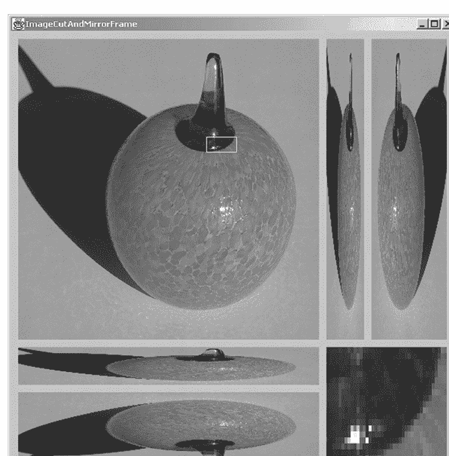

文件：its/Images/ImageCutAndMirrorFrame.java

```java
package its.Images;

import its.SimpleFrame.SimpleFrame;
import java.awt.*;
import javax.swing.JPanel;

public class ImageCutAndMirrorFrame extends SimpleFrame {

    // Adjust the following path if necessary
    private static final String picturePath ="./its/TestData/orange.png";
    private MediaTracker mediTracker;

    public ImageCutAndMirrorFrame() {
        this.setSize(600,610);
        Image im = Toolkit.getDefaultToolkit().getImage(picturePath);
        CutAndMirrorPanel capp = new CutAndMirrorPanel(im);
        this.getContentPane().add(capp);
        int imageID = 1;
        mediTracker = new MediaTracker(this);
        mediTracker.addImage(im,imageID);
        try{
            mediTracker.waitForID(imageID);
        }
        catch (InterruptedException ex){
            System.out.println("Error loading "+picturePath+".");
        }
    }
    public static void main(String[] args) {
        ImageCutAndMirrorFrame icamp = new ImageCutAndMirrorFrame();
        icamp.showIt("ImageCutAndMirrorFrame");
    }

    // internal class
    private class CutAndMirrorPanel extends JPanel{
        private Image im;

        CutAndMirrorPanel(Image i){
            im = i;
        }

        public void paintComponent(Graphics g){
            super.paintComponent(g);
            g.drawImage(im,10,10,this);                    //    (A)
            g.drawImage(im,420,10,50,400,this);              //    (B)
            g.drawImage(im,580,10,-100,400,this);            //    (C)
            g.drawImage(im,10,420,400,50,this);              //    (D)
            g.drawImage(im,10,580,400,-100,this);            //    (E)
            g.drawImage(im,420,420,580,580,250,130,290,150,this);  //    (F)
            g.setColor(Color.white);
            g.drawRect(260,140,40,20);                           //    (G)
        }
    } // internal class
} // class
```

前面各段中进行的调整大小操作仅影响了显示的图像，并未改变 `Image` 变量中包含的图像。下面我们描述如何对图像进行物理上的缩放。这种缩放可以用于生成数码照片的缩略图。想象一个需要展示多张数码照片概览的应用程序。这些照片以 `Image` 类实例形式存储时，每张都需要几兆字节的内存。使用 `drawImage` 方法来显示缩略版并不能解决内存问题，因为只有显示被缩小了，而 `Image` 变量中的图片仍保持其原始大小。这样一来，几张照片就会占满主内存，应用程序也会因频繁换页而变慢。

下面我们描述如何生成图片的较小（或较大）副本。为解决上述内存问题，可以逐张加载照片，生成小尺寸副本，然后只保留这些副本。内存中只维护副本。程序员必须确保对原始大图像的引用被销毁（例如通过使用局部变量），以便 Java 的自动垃圾回收机制释放内存。

我们使用 `Image` 类的以下方法来创建图像的缩放副本：

```java
Image getScaledInstance( int width, int height, int hints)
```

参数 `width` 和 `height` 指定生成的新图像的宽度和高度。第三个参数 `hints` 决定使用哪种技术来放大或缩小图像。放大时需要生成额外的像素，缩小时则需要合并多个像素。生成图像的质量取决于处理方式。更高的质量通常需要更长的转换时间。下面列出了 `hints` 的常量值，这些常量定义在 `Image` 类中，同时给出了相应转换技术所能达到的质量。

| 常量 | 质量 |
|---|---|
| `SCALE_DEFAULT` | 速度与质量的良好折中 |
| `SCALE_FAST` | 转换速度快，质量适中 |
| `SCALE_SMOOTH` | 质量较好 |
| `SCALE_REPLICATE` | 质量好 |
| `SCALE_AREA_AVERAGING` | 质量好 |

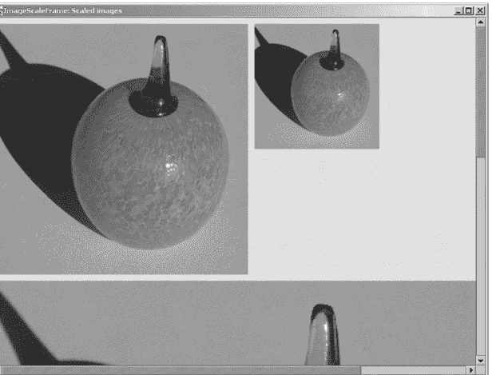

#### 图 15.5

应用程序 ImageScaleFrame。上方：原始大小的图像和线性缩放 0.5 倍的副本。下方：缩放 2.0 倍的副本的上半部分。滚动窗格可用于查看隐藏的部分。

缩放操作是异步进行的。为确保生成的图像在完成后才显示，可以再次使用媒体跟踪器。下面的应用程序 ImageScaleFrame 演示了图像缩放。主程序将一张照片加载到 `Image` 对象 `original` 中。然后生成两个副本 `small` 和 `large`。它们分别是原始图像缩放 0.5 倍和 2.0 倍的副本。我们定义了方法 `scaleImage(image, factor)`，它根据 `image` 的尺寸和缩放因子 `factor` 来确定生成图像的大小。水平和垂直缩放因子相同；将方法扩展为支持不同比例因子留作练习。`ImagePanel` 用于显示三张图像。它被嵌入到滚动窗格中，以便查看所有图片。参见图 15.5。

文件：its/Images/ImageScaleFrame.java

```java
package its.Images;

import its.SimpleFrame.SimpleFrame;
import java.awt.*;
import javax.swing.*;

public class ImageScaleFrame extends SimpleFrame {

    // Adjust the following path if necessary
    private static final String picturePath ="./its/TestData/orange.png";
    private MediaTracker mediTracker;
    private int imageID = 0;

    public ImageScaleFrame() {
        this.setSize(800,600);
        ImagePanel ip  = new ImagePanel();
        JScrollPane sp = new JScrollPane(ip);
        sp.setHorizontalScrollBarPolicy
              (JScrollPane.HORIZONTAL_SCROLLBAR_ALWAYS);
        sp.setVerticalScrollBarPolicy(JScrollPane.VERTICAL_SCROLLBAR_ALWAYS);
        this.getContentPane().add(sp);
        mediTracker = new MediaTracker(this);

        Image original = loadImageAndTrack(picturePath);
        ip.addImage(original);
        Image klein   =  scaleImage(original,0.5);
        ip.addImage(klein);
        Image gross   =  scaleImage(original,2.0);
        ip.addImage(gross);
        repaint();
    }

    private Image scaleImage(Image im, double factor){
        imageID++;
        int newWidth  = (int)(im.getWidth(this)*factor);
        int newHeight = (int)(im.getHeight(this)*factor);

        Image scaledIm =
                im.getScaledInstance(newWidth,newHeight,Image.SCALE_FAST);

        mediTracker.addImage(scaledIm,imageID);
        try {
            mediTracker.waitForID(imageID);
        }
        catch (Exception ex) {
            ex.printStackTrace();
        }
        return(scaledIm);
    }

    private Image loadImageAndTrack(String filename)
    {
        Image im = Toolkit.getDefaultToolkit().getImage(filename);
        imageID++;
```


mediTracker.addImage(im, imageID);
try
{
    mediTracker.waitForID(imageID);
}
catch (InterruptedException ex){
    System.out.println("Error loading "+filename+".");
}
return(im);
}

public static void main(String[] args) {
    ImageScaleFrame isf = new ImageScaleFrame();
    isf.showIt("ImageScaleFrame: Scaled images");
}
}

### 16 更多 Swing 组件

在本章中，我们将介绍 Swing 库中更多的图形组件。其中一些组件，如列表和表格，用于以结构化的方式显示数据。另一些组件，如分割面板或选项卡面板，用于嵌入其他组件，以便用户可以轻松地在它们之间切换。

#### 16.1 边框

大多数 Swing 组件周围都可以绘制一条线——即*边框*——以将其彼此分隔开。为此，Swing 提供了 `Border` 类和工具类 `BorderFactory`。边框有多种不同的类型。这里我们只介绍如何获得"浮雕边框"；其他类型请参阅文档。设 `comp` 是一个 Swing 组件。要获得边框，请使用 `BorderFactory` 类的适当方法，即：

```
Border bdr = BorderFactory.createEtchedBorder();
comp.setBorder(bdr);
```

要创建带有文本的边框，首先需要创建一个边框 `bdr`，然后添加文本：

```
Border bdr    = BorderFactory.createEtchedBorder();
Border textbdr = BorderFactory.createTitledBorder(Border bdr,
                                                  Stringtext);
```

下面是一个包含四个带边框面板的示例，其中两个带有文本。结果如图 16.1 所示。注意，边框位于面板**内部**，所以如果在面板上绘制内容，请留出边距。

**文件：** `its/Borders/BorderPanel.java`

```
1.  package its.Borders;
2.  
3.  import java.awt.*;
4.  import javax.swing.JPanel;
```

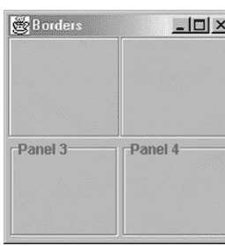

图 16.1 一个包含四个嵌入式带边框面板的框架

```
import javax.swing.border.*;
import javax.swing.BorderFactory;

public class BorderPanel extends JPanel
{
    public BorderPanel()
    {
        this.setBackground(Color.lightGray);
        Border bdr = BorderFactory.createEtchedBorder();
        this.setBorder(bdr);
    }
    public BorderPanel(String text)
    {
        this.setBackground(Color.lightGray);
        Border bdr = BorderFactory.createEtchedBorder();
        Border titlebdr = BorderFactory.createTitledBorder(bdr, text);
        this.setBorder(titlebdr);
    }
}
```

**文件：** `its/Borders/BorderFrame.java`

```
package its.Borders;

import java.awt.*;
import its.SimpleFrame.SimpleFrame;

public class BorderFrame extends SimpleFrame
{
    public BorderFrame()
    {
       this.getContentPane().setLayout(new GridLayout(2,2));
       BorderPanel borderPanel1 = new BorderPanel();
       BorderPanel borderPanel2 = new BorderPanel();
       BorderPanel borderPanel3 = new BorderPanel("Panel 3");
       BorderPanel borderPanel4 = new BorderPanel("Panel 4");
       this.getContentPane().add(borderPanel1);
       this.getContentPane().add(borderPanel2);
       this.getContentPane().add(borderPanel3);
       this.getContentPane().add(borderPanel4);
    }

    public static void main(String[] args){
       BorderFrame borderFrame = new BorderFrame();
       borderFrame.showIt("Borders");
    }
}
```

#### 16.2 列表

列表有两个用途。它们可用于按行显示文本信息，并且允许用户选择行并在程序中使用所选信息。列表的图形概念不应与同名数据结构相混淆。Java 在后者的实现中包含类 `LinkedList`。列表的图形组件是 Swing 类 `JList`。列表条目以行的形式显示。

`JList` 的实例允许任意 `Object` 作为列表条目。数据在内部存储在 `ListModel` 中，我们将在 16.2.3 节中描述这个类。如果列表中显示的数据在程序运行期间会发生变化，则显式使用列表模型是可取的。如果列表中的数据是固定的，则不一定需要显式使用模型。这方面的示例可以在 16.2.1 节中找到。`JList` 还允许用户选择一个或多个条目。可以显示图像或用图标增强文本，但程序员必须通过实现 `ListCellRenderer` 来指定显示应该如何绘制。我们将仅使用 `String` 作为列表条目，这些条目可以在不实现用户自定义渲染器的情况下显示。

我们在下面描述 `JList` 的构造函数和一些方法：

`JList()`
`JList(String[] entries)`

`void setListData(String[] entries)`
`void setSelectionMode(int selectionMode)`
`void getSelectionMode()`
`void setVisibleRowCount(int rowNo)`
`int   getSelectedIndex()`
`int[] getSelectedIndices()`
`Object  getSelectedValue()`
`Object[] getSelectedValues()`

`JList()` 创建一个空列表。

`JList(String[] entries)` 创建一个包含数组 entries 中字符串的列表。第一个字符串是第一个，即最顶部的列表条目。

`setListData(String[] entries)` 将列表条目设置为数组 entries 中的字符串。第一个字符串是第一个，即最顶部的列表条目。

`setSelectionMode(int)` 设置用户选择列表条目的方式。可以在以下选项中进行选择：SINGLE_SELECTION——只能选择一个列表条目，如果选择了新条目，则放弃旧选择；SINGLE_INTERVAL_SELECTION——可以选择一组相邻的条目；MULTIPLE_INTERVAL_SELECTION——可以选择任意的条目组合。这三个常量在 ListSelectionModel 类中定义。

`getSelectionMode()` 确定当前使用的选择模式。返回的整数值是上面为 `setSelectionMode` 方法描述的值之一。

`setVisibleRowCount(int rowNo)` 设置列表可见的行数。这会调整图形组件的高度，使得 `rowNo` 显示多少行被显示出来。

`getSelectedIndex()` 返回（第一个）所选条目的索引，如果没有选择任何条目，则返回 −1。

`getSelectedIndices()` 以整数数组的形式返回所选条目的索引。

`getSelectedValue()` 返回（第一个）所选条目（不是索引，而是条目本身），如果没有选择任何内容，则返回 null。

`getSelectedValues()` 返回所选条目（不是索引，而是条目本身），如果没有选择任何内容，则返回 null。

##### 16.2.1 向列表填充数据

要将文本条目放入列表，可以在构造函数中传递字符串数组。下面的程序 `ListDemo` 创建了一个包含德国各州名称的列表。列表的可见长度设置为 8。为了使所有条目都可访问，我们将列表放入滚动面板的视口中。然后滚动面板嵌入到框架中。我们没有设置选择模式，因此列表具有默认选择模式，即 MULTIPLE_INTERVAL_SELECTION。main 方法放在框架类中，因此不需要驱动类。

**文件：** `its/Lists/ListDemoFrame.java`

```
1. package its.Lists;
2. 
3. import its.SimpleFrame.SimpleFrame;
4. import java.awt.BorderLayout;
5. import javax.swing.JList;
6. import javax.swing.JScrollPane;
7. 
8. public class ListDemoFrame extends SimpleFrame {
9.     private String[] entries = {"Schleswig-Holstein", "Niedersachsen",
10.         "Hamburg", "Bremen", "Mecklenburg-Vorpommern", "Brandenburg",
11.         "Berlin", "Nordrhein-Westfalen", "Hessen", "Sachsen-Anhalt",
12.         "Rheinland-Pfalz", "Thüringen", "Sachsen", "Saarland", "Bayern",
13.         "Baden-Württemberg"};
14. 
15.     public ListDemoFrame() {
16.         JList provinces = new JList(entries);
17.         JScrollPane scrollPane = new JScrollPane(provinces);
18.         this.getContentPane().add(scrollPane, BorderLayout.CENTER);
19.         this.pack();
20.     }
21. 
22.     public static void main(String[] args) {
23.         ListDemoFrame ldf = new ListDemoFrame();
24.         ldf.showIt("List demo");
25.     }
26. }
```

##### 16.2.2 具有动态列表的 GUI 规范

我们现在考虑条目被添加或删除的列表，用户可以选择条目并触发作响应的操作。我们想要设计一个包含两个并排列表的 GUI。最初，只有左侧列表包含一些条目。用户可以在左侧列表中选择单个条目。每当在左侧列表中选择的条目不在右侧列表中时，它就会被复制到右侧列表。如果在左侧列表中选择的条目已经在右侧列表中，则将其从后者中删除。在此过程中，左侧列表不会更改；只有右侧列表会变化。我们使用两个组件来实现所需的功能：列表模型用于处理数据，监听器用于响应列表条目的选择。我们将在以下章节中介绍这些组件。

##### 16.2.3 列表模型

当列表是动态的，即在程序运行过程中添加或删除列表条目时，建议显式使用列表条目模型。

用户可以为此目的实现 `ListModel` 接口。然而，`DefaultListModel` 类中有一个预定义的列表模型实现，足以满足许多目的。在一个包含 *n* 个条目的列表中，列表条目编号为 0、1、...、*n* - 1，其中 0 表示第一个（最上面的）条目。当列表元素被添加或移除时，编号会随之更新。下面我们描述位于 `javax.swing` 库中的 `DefaultListModel` 类。

```
DefaultListModel()

int size()
boolean contains(Object entry)
Object get(int position)
void insertElementAt(Object entry, int position)
void addElement(Object entry)
void removeElementAt(int position)
boolean removeElement(Object entry)
void removeAllElements()
```

`DefaultListModel()` 是构造函数，用于创建一个没有任何条目的列表模型。

`size()` 返回列表模型中当前条目的数量。

`contains(Object entry)` 如果对象 *entry* 在列表模型中则返回 **true**，否则返回 **false**。

`get(int position)` 返回位于 *position* 位置的列表条目。如果 *position* 为负数或大于或等于当前列表条目数量，则会抛出异常。由于返回类型是 `Object`，可能需要显式转换为正确的类型。

`insertElementAt(Object entry, int position)` 将条目 *entry* 添加到列表模型的 *position* 位置。如果 *position* 是无效索引，则会抛出异常。

`addElement(Object entry)` 在列表末尾添加一个条目。

`removeElementAt(int position)` 移除位于 *position* 位置的条目。如果 *position* 是无效索引，则会抛出异常。剩余的列表条目会重新编号以保持连续的索引。

`removeElement(Object entry)` 移除条目 *entry*。如果成功则返回 **true**，否则返回 **false**。

`removeAllElements()` 从列表模型中移除所有条目。

定义列表模型后，可以通过构造函数或使用 *set* 方法将其传递给 `JList`：

```
JList(ListModel lModel)
setModel(ListModel lModel)
```

列表模型中的更改（条目的添加或删除）会*自动*由相应的列表显示。无需调用 `repaint`。

##### 16.2.4 列表监听器和列表事件

如上所述，我们的应用程序必须响应列表条目的选择。用于此目的的适当监听器是 `ListSelectionListener`。它通过以下方式分配给一个 `JList`，例如 `myjlist`：

```
myjlist.addListSelectionListener(listener)
```

接口 `ListSelectionListener` 只要求实现一个方法：

```
public void valueChanged(ListSelectionEvent evt)
```

每当选择更改时，运行时系统会自动调用此方法。如果选择未更改，例如用户点击已选中的项目，则不会执行此方法。此方法的主体必须包含响应选择应执行的代码。

方法 `valueChanged` 接收一个 `ListSelectionEvent` 类型的对象作为参数。这是由运行时系统自动生成的，并包含有关已发生选择事件的更多信息。我们将使用 `ListSelectionEvent` 的以下方法：

```
int getFirstIndex()
int getLastIndex()
boolean getIsAdjusting()
```

`getFirstIndex()` 返回第一个（最上面的）条目的位置，其选择模式可能已更改（从选中到未选中，反之亦然）。'可能'是指选择状态可能与之前相同。例如，如果条目 5 到 8 被选中，而用户现在选择 5 到 10，则第一个选中的索引保持不变。可以使用 `JList` 类的 `getSelectedIndices` 方法来查找哪些条目被选中。

`getLastIndex()` 返回最后一个（最下面的）条目的位置，其选择模式可能已更改。另请参见 `getFirstIndex()`。

`getIsAdjusting` – 在列表中更改选择会触发一系列操作，每个操作都会生成一个列表选择事件。例如，在新条目被选中之前，先前选中的条目将变为未选中。通常，人们希望这一系列事件完成后再对更改作出反应。对于这一快速系列事件，除最后一个外，所有 `getIsAdjusting` 的结果都返回 `true`。只有最后一个 `getIsAdjusting` 的结果返回 `false`。这可用于在采取进一步操作之前等待调整系列的结束。

目前，`ListSelectionEvent` 仅支持选择模式 `SINGLE_SELECTION` 和 `SINGLE_INTERVAL_SELECTION`。

##### 16.2.5 列表 GUI 的实现

以下程序 `ListTransferFrame` 演示了动态列表的使用。视图部分由两个列表组成。两者都嵌入到滚动窗格中，然后粘合到一个面板中。该面板被居中粘合到一个框架中。面板具有 1 × 2 网格布局，因此列表并排放置。我们没有为这些列表派生类，因为我们没有向它们添加任何额外功能。

左侧的列表包含德国各省的名称。如规范中所述，此列表不会更改。因此，我们没有为它显式定义模型。选择模式设置为只能选择单个条目。由于右侧列表是动态的，我们定义了自己的列表模型。条目被插入或从模型中删除。右侧列表的显示会自动更新以响应此更改。

对于控制部分，我们使用 `TransferListener` 类，该类实现了 `ListSelectionListener` 接口。它被实现为框架的内部类，以便可以直接访问框架的字段。当监听器的 `valueChanged` 方法被通知时，我们首先确保我们不在一系列更改选择的事件中间。如果情况并非如此，我们找出左侧列表中选中的条目。这存储在字符串变量 `sel` 中。然后我们检查 `sel` 是否已经是右侧列表中的条目，如果是，则在那里删除它。否则，`sel` 将作为条目添加到右侧列表中。

程序如下所示。使用时，请注意以下事项。如果在左侧选择条目 A，则它将被复制到右侧列表（假设它不在那里）。如果再次点击此条目 A，右侧列表中相应的条目 A 不会被删除。必须首先在左侧选择不同的条目 B，然后再次选择 A 才能将其从右侧列表中移除。原因如上所述，选择必须更改才能激活 `valueChanged`。图 16.2 显示了结果。

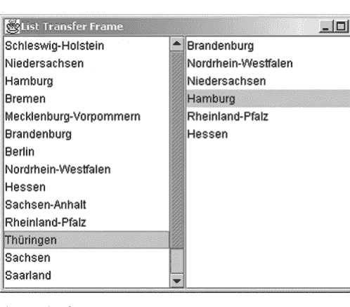

### 176 更多组件和技术

文件：its/Lists/ListTransferFrame.java

```java
1. package its.Lists;
2.
3. import its.SimpleFrame.SimpleFrame;
4. import java.awt.GridLayout;
5. import java.awt.BorderLayout;
6. import javax.swing.*;
7. import javax.swing.event.*;
8.
9. public class ListTransferFrame extends SimpleFrame
10. {
11.    private JList leftList, rightList;
12.    private DefaultListModel rightListModel;
13.    JButton transferButton;
14.    String[] entries = {"Schleswig-Holstein","Niedersachsen","Hamburg",
15.                       "Bremen","Mecklenburg-Vorpommern","Brandenburg",
16.                       "Berlin","Nordrhein-Westfalen","Hessen",
17.                       "Sachsen-Anhalt","Rheinland-Pfalz","Thüringen",
18.                       "Sachsen","Saarland","Bayern","Baden-Württemberg"};
19.
20.    public ListTransferFrame()
21.    {
22.      this.setSize(400,300);
23.      leftList  = new JList(entries);
24.
25.      rightListModel = new DefaultListModel();
26.      rightList = new JList(rightListModel);
27.      leftList.setSelectionMode(ListSelectionModel.SINGLE_SELECTION);
28.
29.      TransferListener selLis = new TransferListener();
30.      leftList.addListSelectionListener(selLis);
31.
32.      JPanel listPanel = new JPanel();
33.      listPanel.setLayout(new GridLayout(1,2));
34.      JScrollPane leftScrollPane  = new JScrollPane(leftList);
35.      JScrollPane rightScrollPane = new JScrollPane(rightList);
36.      listPanel.add(leftScrollPane);
37.      listPanel.add(rightScrollPane);
38.      this.getContentPane().add(listPanel,BorderLayout.CENTER);
39.    }
40.
41.    public static void main(String[] args)
42.    {
43.      ListTransferFrame LLF = new ListTransferFrame();
44.      LLF.showIt("List Transfer Frame");
45.    }
```


# 16.3 表格

表格用于显示具有二维结构的数据。例如价格列表、地图上的距离表、通讯录等。在 Swing 中，`JTable` 类用于可视化表格。与列表类似，内部使用模型来处理数据。如果数据复杂或在程序运行时发生变化，建议显式定义这样的表格模型。

表格由排列在矩形网格中的单元格组成。可以为每一列添加标题。`JTable` 以列为导向。这意味着它支持对列的操作（例如交换两列或渲染列内容），但对行的操作支持有限。因此，在设计表格时，应尽量安排数据，使一列包含相同类型的数据（字符串、整数、图像等）。

接下来，我们将展示如何使用表格显示静态数据，表格模型如何工作，以及如何使用它们动态或交互地更改表格中的数据。

### 16.3.1 一个简单的静态表格

如果表格显示的数据不发生变化，则不需要显式使用表格模型。相反，数据可以直接在构造函数中传递给表格。数据在二维数组 `content[][]` 中组织。

它被解释为由行组成的数组，即 `content[i][]` 是包含表格第 `i` 行条目的一维数组。第二个一维数组 `columnNames` 传递列的标题。行和列名数组的长度必须相同！构造函数如下所示：

```
JTable(Object[][] content, Object[] columnNames)
```

请注意，数组的类型是 `Object`。如果使用"非标准"类型，必须确保程序知道如何通过提供用户定义的渲染器来渲染它们。这是通过实现接口 `TableCellRenderer` 来完成的。默认情况下，`JTable` 使用 `DefaultTableCellRenderer`，它可以显示"标准"类型，如字符串、图像和布尔值。对于大多数用途，这已经足够。为了使列名可见，表格应嵌入到滚动窗格中。即使表格垂直滚动，标题仍然可见。默认情况下，列的宽度都相同，并且会自动调整以使所有列都适合可见区域。即使使用滚动窗格来显示表格，也会执行此操作。如果可见区域较小，则列会变得太窄，无法正确显示某些或所有单元格的内容。在这些单元格中，会显示一些点（`...`）而不是内容。要关闭自动宽度调整，请使用命令：

```
setAutoResizeMode(JTable.AUTO_RESIZE_OFF)
```

以下代码清单 `StaticTableFrame` 是创建和显示表格的示例。结果如图 16.3 所示。

> **文件：** `its/Tables/StaticTableFrame.java`

```java
package its.Tables;

import its.SimpleFrame.SimpleFrame;
import javax.swing.JScrollPane;
import javax.swing.JTable;

public class StaticTableFrame extends SimpleFrame
{
    private String[][] entries = {{"Cell 0.0","Cell 0.1","Cell 0.2"},
                                {"Cell 1.0","Cell 1.1","Cell 1.2"}};
    private String[] columnNames = {"Column 0","Column 1","Column 2"};

    public StaticTableFrame()
    {
        JTable table = new JTable(entries, columnNames);
        JScrollPane scrollpane = new JScrollPane(table);
        this.getContentPane().add(scrollpane);
    }

    public static void main(String[] args)
    {
        StaticTableFrame STF = new StaticTableFrame();
        STF.showIt("Static Table Frame");
    }
}
```

### 16.3.2 表格模型

在构造函数中显式传递表格数据的方法不适用于处理内容复杂或非常大的表格。所谓的*表格模型*在这种情况下提供了一种优雅的方法。使用表格模型时，在运行时更改表格内容也很容易。表格模型隐式描述了要渲染到单元格中的内容。整个表格不必以二维数组的形式存在。表格模型必须能够按需提供每个单元格的内容。以下应用程序是一个示例。

我们构建一个乘法表。第 `r` 行第 `c` 列的单元格显示行号和列号的乘积 `r · c`。由于行和列的索引从零开始，因此第一行和第一列全部为零。模型指定了以下规则："单元格 (`r`, `c`) 的内容是 `r · c`"。模型不必构造一个包含这些值的二维数组。

我们从 `javax.swing.table` 库中定义的 `AbstractTableModel` 类派生自己的表格模型。`AbstractTableModel` 类要求实现以下 `abstract` 方法：

```java
int getRowCount()
int getColumnCount()
Object getValueAt(int r, int c)
```

`getRowCount()` 必须实现为返回表格中的行数。`getColCount()` 必须实现为返回表格中的列数。`getValueAt(r,c)` 必须实现为返回第 `r` 行第 `c` 列的表格单元格的内容。

除了这三个抽象方法之外，`AbstractTableModel` 还包含一些非抽象方法，人们通常希望重写它们：

```java
String getColumnName(int c)
Class getColumnClass(int c)
boolean isCellEditable(int r, int c)
void setValueAt(Object val, int r, int c)
```

`getColumnName(c)` 以字符串形式返回列 `c` 的名称。默认情况下，`AbstractTableModel` 为列分配名称 `A`、`B`、`C`、...、`Z`、`AA`、`AB`、`AC`、...。通过自己的实现重写 `getColumnName` 可以指定其他名称。

`getColumnClass(c)` 返回列 `c` 中对象的类。默认情况下，`AbstractTableModel` 返回 `Object` 类。应该重写 `getColumnClass(c)` 以返回列 `c` 中对象的正确类。这样可以确保使用正确的渲染器来显示条目。如上所述，表格是以列为导向的，并且每一列中的对象应该是相同的类。要确定列 `c` 的适当类，可以查看第一行中的条目：`getValueAt(0,c).getClass()`。

`isCellEditable(r, c)` 的返回值是 `true` 表示单元格可编辑，`false` 表示不可编辑。默认实现返回 `false`，即用户无法更改单元格的内容。程序员可以重写此方法以使某些单元格可由用户编辑。

`setValueAt(Object val, r, c)` 可用于将第 `r` 行第 `c` 列的单元格的值设置为 `val`。默认实现具有空主体，即它不会更改单元格的值。程序员可以重写此方法以更改可编辑单元格的值。

在下面的代码清单中，我们提供了 `MultiplicationTableModel` 的一个实现。行数和列数作为构造函数的参数给出。方法 `getValueAt(r,c)` 被实现为返回 `r` 和 `c` 的乘积。方法 `getColumnName(c)` 被重写以返回字符串 `Col` 后跟数字 `c`。图 16.4 显示了在使用列宽自动调整和不使用它时的结果。

我们还列出了 `MultiplicationTableFrame` 类。这样的帧生成一个 `MultiplicationTableModel` 和一个使用此模型的 `JTable`。表格嵌入到滚动窗格中，滚动窗格又嵌入到帧中。

图 16.4 *MultiplicationTableFrame*。（a）列宽被缩减以适应显示宽度。由于存在最小列宽（大多数平台上为 15 像素），这并不总是可行的。（b）自动调整大小功能已关闭，所有列均使用默认宽度（大多数平台上为 75 像素）

**文件：its/Tables/MultiplicationTableModel.java**

```java
package its.Tables;

import javax.swing.table.AbstractTableModel;

public class MultiplicationTableModel extends AbstractTableModel{

    private int noOfRows, noOfCols;
    public MultiplicationTableModel(int r, int c) {
        noOfRows = r;
        noOfCols = c;
    }

    // Implementing the tree abstract methods:
    public int getColumnCount() {
        return(noOfRows);
    }

    public Object getValueAt(int r,int c) {
        return(new Integer(r*c));
    }

    public int getRowCount() {
        return(noOfRows);
    }

    // Overriding some methods:
    public Class getColumnClass(int c){
        return( getValueAt(0,c).getClass() );
    }

    public String getColumnName(int c){
        return("Col "+c);
    }
}
```

**文件：its/Tables/MultiplicationTableFrame.java**

```java
package its.Tables;

import its.SimpleFrame.SimpleFrame;
import javax.swing.JScrollPane;
import javax.swing.JTable;

public class MultiplicationTableFrame extends SimpleFrame {

    public MultiplicationTableFrame(int r, int c) {
        MultiplicationTableModel multModel = new MultiplicationTableModel(r,c);
        JTable multTable = new JTable(multModel);
        multTable.setAutoResizeMode(JTable.AUTO_RESIZE_OFF);
        JScrollPane scrollPane = new JScrollPane(multTable);
        this.setSize(350,250);
        this.getContentPane().add(scrollPane);
    }

    public static void main(String[] args) {
        MultiplicationTableFrame mtf30 =
            new MultiplicationTableFrame(30,30);
        mtf30.showIt("Multiplication Table");
    }
}
```

### 16.3.3 可编辑表格

本节将展示如何在不同列中使用不同的对象，以及用户如何交互式地修改表格单元格的内容。

该表格是一个订单表，用户可以在其中订购产品。在我们的示例中有三种产品可供选择：圆形、三角形和矩形。表格有五列，分别包含产品名称、产品图片、单价、订购数量和所订购数量的总价。初始状态下没有订购任何产品，即数量为 0。用户可以编辑数量，作为结果，最后一列中所订购数量的总价会自动更新。我们的订单表还有一个额外的汇总行，用于显示所有已订购产品的总价，并在每次订单变更时进行更新。

该表格由我们的表格模型 `OrderTableModel` 实现，然后传递给一个 `JTable` 进行显示。我们按如下方式组织数据：前三行包含产品信息。第一列（列号为 0）以 `Strings` 形式存储产品名称。下一列存储图片 `ImageIcons`。接下来的列以 `double` 形式存储单价。第四列（列号为 3）以 `int` 形式存储订购数量。该列是可编辑的：用户可以修改数量。最后一列以 `double` 形式列出每项产品的总价。这些单元格的值由（单价）乘以（订购数量）计算得出。第四行的最后一个单元格包含订单的总金额。

值的计算在方法 `getValueAt` 中完成，该方法通过一个大型的条件判断（switch 语句）来确定各值。特别是，包含三个产品的前三行与包含总金额的最后一行的处理方式不同。必须确保当用户更改订购数量时执行重新计算。这通过使用 `AbstractTableModel` 类的 `fireTableDataChanged()` 方法来实现。它不仅触发重新计算，还会更新关联 `JTable` 的显示。在 Java 中，类的所谓 *触发方法* 会通知与该类关联的监听器。我们在应用程序中没有显式定义监听器，但是，使用带有表格模型的表格会自动为基本功能实现监听器，它们负责单元格值的重新计算和显示的更新。

下面我们列出 `OrderTableModel` 和 `OrderTableFrame` 类，并在图 16.5 中展示应用程序的截图。

图 16.5 下单后的 OrderTableFrame

## 更多组件与技术

**文件：its/Tables/OrderTableModel.java**

```java
package its.Tables;

import javax.swing.ImageIcon;
import javax.swing.table.AbstractTableModel;

public class OrderTableModel extends AbstractTableModel
{
    private String[] columnNames = {"Product","Picture","Price",
                                    "Quantity","Total"};
    private String[] products    = {"Circle","Triangle","Rectangle"};
    private String[] imageName   = {"circ.png","tria.png","rect.png"};
    private int[] quantities     = {0,0,0};
    private double[] prices      = {10.00, 12.00, 12.50};
    private static final String Path = "./its/TestData/";
    public boolean[] bv= {true,false,true};

    public OrderTableModel()
    {
    }

    public int getColumnCount()
    {
        return(columnNames.length);
    }

    public int getRowCount()
    {
        return(products.length+1);
    }

    public String getColumnName(int c) {
        return(columnNames[c]);
    }

    public Class getColumnClass(int c) {
        return getValueAt(0, c).getClass();
    }

    public Object getValueAt(int r, int c)
    {
        Object result = new Object();
        if( r < products.length) {
            switch(c){
                case 0: result = products[r]; break;
                case 1: result = new ImageIcon(Path+imageName[r]);  break;
                case 2: result = new Double(prices[r]); break;
                case 3: result = new Integer(quantities[r]); break;
                case 4: int quantity = ((Integer)getValueAt(r,3)).intValue();
                        double price = ((Double)getValueAt(r,2)).doubleValue();
                        result = new Double(quantity * price); break;
            }//switch
        }
        else{
            switch(c){
                case 0: result = new String("SUM"); break;
                case 1: result = new Object(); break;
                case 2: result = new Double(0.0); break;
                case 3: result = new Integer(0); break;
                case 4: double sum = 0.0;
                        double ee;
                        for (int i = 0; i < products.length; i++) {
                            sum += ((Double)getValueAt(i,4)).doubleValue();
                        }
                        result = new Double(sum); break;
            }
        }
        return(result);
    }

    //cells in column 3 can be edited
    public boolean isCellEditable(int r, int c) {
        return(c == 3);
    }

    public void setValueAt(Object obj, int r, int c)
    {
        if(c == 3){
            quantities[r] = ((Integer)obj).intValue();
        }
        this.fireTableDataChanged();
    }
}
```

**文件：its/Tables/OrderTableFrame.java**

```java
package its.Tables;

import its.SimpleFrame.SimpleFrame;
import javax.swing.JScrollPane;
import javax.swing.JTable;

public class OrderTableFrame extends SimpleFrame
{

    public OrderTableFrame()
    {
        this.setSize(300,250);
        OrderTableModel otmodel = new OrderTableModel();
        JTable JTab = new JTable(otmodel);
        JTab.setRowHeight(50);

        JScrollPane SP = new JScrollPane(JTab);
        this.getContentPane().add(SP);
    }

    public static void main(String[] args)
    {
        OrderTableFrame otframe = new OrderTableFrame();
        otframe.showIt();
    }
}
```

### 16.4 树

层次结构通常可以用 *树* 来表示。层次结构的例子包括家谱、公司组织架构、计算机硬盘上的目录结构，以及第 4.5 节中介绍的 Swing 组件嵌套结构。树的概念源于组合数学和图论领域，这是数学的一个分支，研究离散结构。层次结构在树中的体现方式如下：存在一个最重要的组件，即根节点。树随后 *分支* 为（次要的）子组件，子组件又进一步分支为子子组件。层次结构中最底层的组件构成树的 *叶子*，它们不再继续分支。对应于组件的树的部分称为 *节点*，连接节点的链路称为 *边*。图 16.6 展示了此概念的一个示例。一个节点的子节点称为其 *子节点*。子节点从 0、1、2……开始编号。在图形表示中，编号通常从左到右或从上到下排列。树通常被绘制为向下生长：根节点在顶部，叶子（层次结构中最低的）在底部。在图形界面中，树通常被绘制为从左到右生长。Swing 提供了预定义组件来表示和显示树。对于树结构的抽象表示，我们使用非图形类 `DefaultTreeModel` 和 `DefaultMutableTreeNode`。这些类位于 `javax.swing.tree` 包中。图形组件是


图 16.6 同一棵树的两种图形表示：(a) 数学表示，(b) 图形界面中使用的表示

树形组件在`JTree`类中定义，用于显示树模型的抽象信息。树的各个节点被定义为`DefaultMutableTreeNode`。然后，这些节点与结构信息（即告诉你哪个节点是哪个其他节点的子节点的信息）一起插入到树模型中。我们将在以下各节中描述这三个类，然后展示两个使用树的应用程序示例。

#### 16.4.1 DefaultMutableTreeNode 类

类`DefaultMutableTreeNode`是`TreeNode`接口的一个便捷实现。对于我们的应用，以下方法就足够了：

```
DefaultMutableTreeNode(Object label)
add(DefaultMutableTreeNode node)
```

`DefaultMutableTreeNode(Object label)`定义了一个可变的树节点。该节点接收对象`label`作为标签。当节点被显示时，你会看到一个符号和符号右侧的标签。标签通常是一个字符串。“可变”一词指的是，在显示中点击这样的节点会使该节点下的子树出现或消失。此功能由`DefaultMutableTreeNode`自动提供。

`add(DefaultMutableTreeNode node)`将节点`node`作为最右侧的子节点添加到此节点。我们的示例中不会使用此方法，但它在某些情况下可能有用。

当节点被显示时，它们会获得一个默认符号。对于`DefaultMutableTreeNode`，如果节点不是叶子节点，则使用Java的“文件夹”符号。如果节点是叶子节点，则显示Java的“文件”符号。

#### 16.4.2 TreeModel 类

该类的实例定义了树的抽象结构。这是通过指定根节点，以及为每个节点指定其子节点及其顺序来完成的。我们将使用以下方法。

```
DefaultTreeModel(TreeNode root)

int getChildCount(TreeNode parent)
boolean isLeaf(TreeNode node)
insertNodeInto(MutableTreeNode newChild, MutableTreeNode parent, int k)
Object getChild(TreeNode parent, int k)
removeNodeFromParent(TreeNode child)
```

DefaultTreeModel(TreeNode root)创建一个以根节点root为根的树模型。我们可以使用DefaultMutableTreeNode代替TreeNode。没有无参构造函数；你必须始终指定一个根节点！

int getChildCount(TreeNode parent)返回父节点parent的子节点数。如果父节点有n个子节点，它们的编号为0, 1, . . . , n − 1。

boolean isLeaf(TreeNode node)如果节点node是叶子节点（即没有子节点）则返回true，否则返回false。

insertNodeInto(MutableTreeNode newChild, MutableTreeNode parent, int k)使newChild成为父节点parent的第k个子节点。如果父节点有n个子节点，那么k必须是0, 1, 2, . . . , n中的一个，否则将发生运行时错误。如果k严格小于n，那么原来的第k个到第n-1个子节点会变成第k+1个到第n个子节点，newChild被插入到第k-1个和第k+1个子节点之间。

Object getChild(TreeNode parent, int k)将父节点parent的第k个子节点作为Object返回，如果父节点没有第k个子节点则返回null。

removeNodeFromParent(TreeNode child)从其父节点移除子节点child。注意，以child为根的整个子树也会被移除。

#### 16.4.3 JTree 类

在Swing中用于显示树的图形组件定义在JTree类中。我们只需要以下方法：

```
JTree(TreeModel treeModel)

setTreeModel(TreeModel treeModel)
putClientProperty("JTree.lineStyle", "Angled");
```

JTree(TreeModel treeModel)接收一个TreeModel（或DefaultTreeModel）作为参数。

setTreeModel(TreeModel treeModel)用于设置树模型。

putClientProperty("JTree.lineStyle", "Angled")用于显示对应于树边的角度线。除了“Angled”，还有“Horizontal”（节点之间的水平线表示结构）和“None”（仅使用缩进）。

#### 16.4.4 示例应用

在第一个示例应用中，我们手动定义一棵树。结构类似于图16.6。标签用于反映一个简单的植物分类。类BiologyTree派生自JTree。它包含一个DefaultTreeModel类的实例biologyTreeModel。树模型是通过定义根节点并将其他节点添加为现有节点的子节点来构建的。
还列出了类TreeFrame和TreeDemoDriver。

```
File: its/Trees/BiologyTree.java

package its.Trees;

import javax.swing.JTree;
import javax.swing.tree.DefaultMutableTreeNode;
import javax.swing.tree.DefaultTreeModel;

public class BiologyTree extends JTree {

    private DefaultTreeModel biologyTreeModel;

    public BiologyTree(){
        makeModel();
        this.setModel(biologyTreeModel);
        this.putClientProperty("JTree.lineStyle","Angled");
    }

    private void makeModel(){
        DefaultMutableTreeNode root = new DefaultMutableTreeNode("Trees");
        DefaultMutableTreeNode leaved
            = new DefaultMutableTreeNode("Leaved Trees");
        DefaultMutableTreeNode conifer
            = new DefaultMutableTreeNode("Conifers");
        DefaultMutableTreeNode beech = new DefaultMutableTreeNode("Beech");
        DefaultMutableTreeNode oak = new DefaultMutableTreeNode("Oak");
        DefaultMutableTreeNode birch = new DefaultMutableTreeNode("Birch");
        DefaultMutableTreeNode pine = new DefaultMutableTreeNode("Pine");
        DefaultMutableTreeNode fir = new DefaultMutableTreeNode("Fir");
        DefaultMutableTreeNode beechR
            = new DefaultMutableTreeNode("Red Leaved");
        DefaultMutableTreeNode beechG
            = new DefaultMutableTreeNode("Green Leaved");
        biologyTreeModel = new DefaultTreeModel(root);
        biologyTreeModel.insertNodeInto(leaved, root, 0);
        biologyTreeModel.insertNodeInto(conifer, root, 1);
        biologyTreeModel.insertNodeInto(beech, leaved, 0);
        biologyTreeModel.insertNodeInto(oak, leaved, 1);
        biologyTreeModel.insertNodeInto(birch, leaved, 1);
        biologyTreeModel.insertNodeInto(pine, conifer, 0);
        biologyTreeModel.insertNodeInto(fir, conifer, 1);
        biologyTreeModel.insertNodeInto(beechR, beech, 0);
        biologyTreeModel.insertNodeInto(beechG, beech, 1);
    }
}
```

File: its/Trees/TreeFrame.java

```
package its.Trees;

import its.SimpleFrame.SimpleFrame;
import java.awt.*;

public class TreeFrame extends SimpleFrame {

    public TreeFrame() {
        this.setSize(300,500);
        BiologyTree bioTree = new BiologyTree();
        this.getContentPane().add(bioTree,BorderLayout.CENTER);
    }

    public static void main(String[] args) {
        TreeFrame treeFrame = new TreeFrame();
        treeFrame.showIt("Tree Frame");
    }
}
```

在第二个应用中，我们生成一个目录树。树是通过方法递归递归构建的。我们只列出DirectoryTree类。树显示its包的目录结构。框架类DirectoryFrame和驱动类DirectoryDriver可以从本书主页下载。两个应用的结果如图16.7所示。

图 16.7 两个树应用

```
File: its/Trees/DirectoryTree.java

package its.Trees;

import javax.swing.JTree;
import javax.swing.tree.DefaultMutableTreeNode;
import javax.swing.tree.DefaultTreeModel;
import java.io.File;

public class DirectoryTree extends JTree {
    private DefaultTreeModel directoryTreeModel;
    //The following path might have to be changed.
    private String startDir = "./its";
    private File startFile;

    public DirectoryTree() {
        startFile = new File(startDir);
        recursion(startFile);
        this.setModel(directoryTreeModel);
    }

    public DefaultMutableTreeNode recursion(File currentFile)
```


```markdown
{
    DefaultMutableTreeNode curNode =
        new DefaultMutableTreeNode(currentFile.getName());
    if(currentFile == startFile)
    {
        directoryTreeModel = new DefaultTreeModel(curNode);
    }
    if(currentFile.isDirectory())
    {
        File[] files = currentFile.listFiles();
        for (int i = 0; i < files.length; i++) {
            directoryTreeModel.insertNodeInto(recursion(files[i]),curNode,0);
        }//for i
    }
    return(curNode);
}
```

### 16.5 组合框

组合框是将文本框和列表结合在一起的图形组件。与列表一样，它们提供了可供选择的项目；与文本框一样，用户可以输入文本。当存在一组预定义的选项可以覆盖大多数情况但并非全部时，就会使用组合框。例如，如果要在一个电子日历中输入日期，当前年份和接下来的两年在大多数情况下就足够了。只有极少数情况下需要用到更远未来的日期。此时，提供一个包含当前年份和接下来两年的列表供选择是十分方便的。如果日期至少是三年之后，则可以手动输入年份数字。

#### 16.5.1 JComboBox 类

组合框看起来像是一个文本框，其右侧附加了一个小按钮。按钮上有一个向下的箭头。如果点击该箭头，一个列表会从文本框中向下展开。可以从列表中选择项目，也可以在文本框中输入文本。选择一个项目或按下回车键后，列表会再次收起。请注意，用户输入的文本不会被永久添加到列表中。我们先介绍在 Swing 中实现组合框的 `JComboBox` 类的一些特性，然后展示一个使用该图形组件的应用程序。

```
JComboBox()
JComboBox(String[] listEntries)
JComboBox(Vector[] listEntries)

addItem(String listEntry)
insertItemAt(String listEntry, int pos)
int getSelectedIndex()
Object getSelectedItem()
int getItemCount()
setEditable(boolean b)
setMaximumRowCount(int rowCount)
```

`JComboBox()` 生成一个带有空列表的组合框。

`JComboBox(String[] listEntries)` 生成一个组合框，其列表包含数组 `listEntries` 中的项目。第一个条目是第一个字符串。

`JComboBox(Vector[] listEntries)` 生成一个组合框，其列表包含向量 `listEntries` 中的项目。第一个列表条目是向量中位置 0 的对象。如有必要，需要实现一个渲染器来绘制这些对象。

`addItem(String listEntry)` 将项目 `listEntry` 添加到列表末尾。

`insertItemAt(String listEntry, int pos)` 将 `listEntry` 插入到列表的位置 `pos`。之前位于 `pos` 及其之后的元素在列表中向下移动一个位置。

`getSelectedIndex()` 返回所选列表条目的位置。如果没有选中任何项目或用户输入了新的文本，则返回值为 −1。

`getSelectedItem()` 返回所选的列表项目或用户输入的文本。由于返回类型是 `Object`，可能需要将其强制转换为所需的类型。

`getItemCount()` 返回列表中当前项目的数量。

`setEditable(boolean b)` — 如果 `b` 为 `false`，则用户不能在组合框中输入文本，只能从列表中选择项目。如果 `b` 为 `true`，用户也可以输入文本。组合框的外观取决于此属性。不可编辑的组合框背景为灰色，可编辑的为白色。

`setMaximumRowCount(int rowCount)` 将列表可见部分的长度设置为 `rowCount` 的当前值。如果列表包含的项目多于 `rowCount`，右侧会自动出现滚动条。

与列表一样，组合框也有可用的数据模型：接口 `ComboBoxModel` 或类 `DefaultComboBoxModel`，后者实现了足以满足大多数应用需求的功能。我们不在这里描述这些模型；它们的用法与第 16.2.3 节中的列表模型类似。

#### 16.5.2 一个使用组合框的日历

我们应用程序的主要部分是一个名为 `CalendarPanel` 的面板，用户可以在其中选择日期。该面板只提供一个公共方法 `getDate`，返回所选日期的字符串。日期通过三个组合框来选择。一个框包含日期数字。它不可编辑，但其内容会根据月份和年份的设置而变化。下一个组合框包含月份名称。它不可编辑；我们不允许用户创建新的月份。第三个组合框包含从 2004 年到 2007 年的年份列表。它是可编辑的，因此用户可以通过输入数字来选择其他年份。

194 更多组件和技术

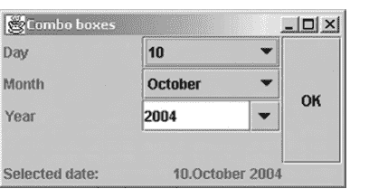

图 16.8 日历应用程序

月份框通过在构造函数中将包含月份名称的数组传递给该框来填充。日期和年份框在 `initBoxes` 方法中通过在 for 循环中添加项目来填充。同样在该方法中设置了框的可见长度。对于日期框，该值为 10，这样列表中将出现滚动条。

监听器类 `CalendarListener` 被定义为一个内部类。`CalendarListener` 与年份和月份的组合框相关联。如果在这些框中的一个中选择了条目（或用户输入了新的年份），则监听器的 `actionPerformed` 方法会被触发。它需要根据当前选择的年份和月份来调整日期组合框中显示的日期。它通过首先确定年份和月份来实现这一点。由此计算出月份的长度，为 28、29、30 或 31 天之一。日期组合框的实际调整由 `setDayListTo` 方法完成。它将日期组合框列表的当前长度与所需长度进行比较。如果列表太短，则添加相应的条目；如果太长，则删除最后的条目。

调整二月份长度的方法仅在 1901 年到 2099 年之间正确。如果用户输入超出此范围的数字，监听器会将年份设置为 2000。`CalendarPanel` 的代码如下所列。测试程序由一个框架（`ComboBoxFrame`）和一个面板（`DisplayDatePanel`）组成。`CalendarPanel` 居中嵌入到框架中，`DisplayDatePanel` 嵌入到南部。框架右侧（东部）还有一个标有"OK"的按钮。点击后，`CalendarPanel` 中当前选择的日期会显示在 `DisplayDatePanel` 中。我们不列出后面这些类；它们可以从本书的主页下载。屏幕截图如图 16.8 所示。

195 更多 Swing 组件

```
File: its/ComboBox/CalendarPanel.java
```

```java
package its.ComboBox;

import java.awt.GridLayout;
import java.awt.event.ActionEvent;
import java.awt.event.ActionListener;
import javax.swing.JComboBox;
import javax.swing.JLabel;
import javax.swing.JPanel;

public class CalendarPanel extends JPanel {
    private String[] months = {"January", "February", "March", "April",
                               "May", "June", "July", "August",
                               "September", "October", "November", "December"};
    private JComboBox yearBox  = new JComboBox();
    private JComboBox monthBox = new JComboBox(months);
    private JComboBox dayBox   = new JComboBox();
    private JLabel yearLabel    = new JLabel("Year ");
    private JLabel monthLabel   = new JLabel("Month ");
    private JLabel dayLabel     = new JLabel("Day ");
    private JLabel dummy        = new JLabel("");
    private int startyear;
    private int endyear;

    public CalendarPanel() {
        this.setLayout(new GridLayout(4,2));
        startyear = 2004;
        endyear   = 2007;
        initBoxes();
        this.add(dayLabel);
        this.add(dayBox);
        this.add(monthLabel);
        this.add(monthBox);
        this.add(yearLabel);
        this.add(yearBox);
        this.add(dummy);

        yearBox.setEditable(true);
        CalenderListener cList = new CalenderListener();
        yearBox.setActionCommand("YearChanged");
        yearBox.addActionListener(cList);
        monthBox.setActionCommand("MonthChanged");
        monthBox.addActionListener(cList);
    }

    private void initBoxes()
    {
        for (int y=startyear;y <= endyear;y++ )
        {
            yearBox.addItem(Integer.toString(y));
        }//for
        for (int d=1;d<=31 ;d++ )
```


## 更多组件与技巧

```java
52.    {
53.      dayBox.addItem(Integer.toString(d));
54.    }//for
55.    monthBox.setMaximumRowCount(12);
56.    dayBox.setMaximumRowCount(10);
57.    yearBox.setMaximumRowCount(4);
58.  }
59.
60.  private void  setDayListTo(int desiredLength){
61.    int currentLength = dayBox.getItemCount();
62.    if(currentLength < desiredLength){
63.      for (int i = currentLength+1; i <= desiredLength; i++) {
64.        dayBox.addItem(Integer.toString(i));
65.      }//for i
66.    }
67.    else if (currentLength > desiredLength)
68.    {
69.      for (int i = currentLength-1; i >= desiredLength; i--) {
70.        dayBox.removeItemAt(i);
71.      }//for i
72.    }
73.  }
74.
75.  public String getDate(){
76.  return((String)dayBox.getSelectedItem()+"."+
77.         (String)monthBox.getSelectedItem()+" "+
78.         (String)yearBox.getSelectedItem());
79.  }
80.
81.  class CalenderListener implements ActionListener
82.  {
83.    public void actionPerformed(ActionEvent evt){
84.    String actionCommand = evt.getActionCommand();
85.    int year = Integer.parseInt(((String)yearBox.getSelectedItem()).trim());
86.    int month = monthBox.getSelectedIndex();
87.    if((year > 2099) || (year < 1901)){
88.      year = 2000;
89.      yearBox.setSelectedItem("2000");
90.    }
91.    if(actionCommand.equals("YearChanged"))
92.    {
93.      if((year % 4 == 0) && (month == 1)){
94.      setDayListTo(29);
95.      }
96.    }
97.    else if(actionCommand.equals("MonthChanged"))
98.    {
99.      if((month == 0) || (month == 2) || (month == 4) || (month == 6) ||
100.          (month == 7) || (month == 9) || (month == 11)){
101.              setDayListTo(31);
102.          }
103.          else if(month == 1){
104.              if(year % 4 == 0){
105.                  setDayListTo(29);
106.              }
107.              else
108.              {
109.                  setDayListTo(28);
110.              }//ifelse
111.          }//ifelse
112.          else{
113.              setDayListTo(30);
114.          }//ifelse
115.      }//ifelse
116.      }//actionPerformed
117.  }//internal class
118.}
```

### 16.6 拆分面板

拆分面板可以看作是在一个矩形区域内的两个面板。程序员可以将图形组件嵌入到每个区域中。两个组件由一条垂直或水平的条分隔，称为*分隔条*。分隔条可以通过鼠标移动，从而调整两个组件的可见区域。如果分隔条被移动到拆分面板的左边缘或右边缘（在垂直分割的情况下），那么只有右侧（或左侧）的组件可见。

例如，当信息以不同格式显示时会使用拆分面板。想象一下股票市场数据，可以在一个组件中以图表形式显示，而另一个组件中包含文本信息，如最高/最低报价和交易量。然后拆分面板允许用户通过移动分隔条来专注于其中一个或另一个。

类`JSplitPane`在Swing中实现了这些功能。我们介绍这个类的一些方法，并展示一个小示例应用程序`SplitPaneFrame`。

```java
JSplitPane(int division)

setLeftComponent(Component comp)
setRightComponent(Component comp)
setTopComponent(Component comp)
setBottomComponent(Component comp)

setDividerSize(int width)
setDividerLocation(int pos)
setDividerLocation(double fraction)
setOneTouchExpandable(boolean b)
```

`JSplitPane(int division)`是构造函数。参数division指定分割是水平的还是垂直的。在类`JSplitPane`中有预定义的常量`HORIZONTAL_SPLIT`和`VERTICAL_SPLIT`。注意，选择`HORIZONTAL_SPLIT`意味着两个组件水平并排放置；分隔条是垂直的。类似地，`VERTICAL_SPLIT`导致一个组件放在另一个组件之上，分隔条是水平的。

`setXXXComponent(Component comp)`将组件comp嵌入到两个区域之一中。对于XXX = Left，如果使用`HORIZONTAL_SPLIT`，comp成为左侧组件。如果将XXX = Left与`VERTICAL_SPLIT`一起使用，则comp成为顶部组件。XXX的其他选择则有明显的含义。

`setDividerSize(int width)`确定分隔条的宽度，单位为像素。

`setDividerLocation(int pos)`确定分隔条的位置。参数pos是使用`HORIZONTAL_SPLIT`时分隔条与拆分面板左边缘的距离，使用`VERTICAL_SPLIT`时与上边缘的距离。

`setDividerLocation(double fraction)`确定分隔条的位置。参数fraction是JSplitPane水平或垂直大小的比例，取决于分割方式。因此fraction必须在区间[0, 1]内，否则会抛出`IllegalArgumentException`。该比例指的是拆分面板的当前宽度。如果在组件可见之前调用此方法，则宽度为零，分隔条将位于左（或上）边缘。

`setOneTouchExpandable(boolean b)` – 如果参数b为true，则分隔条上会出现两个小箭头。它们指向两个区域。单击其中一个箭头时，分隔条会向该方向跳动。如果分隔条不在拆分面板的边缘，它会跳转到箭头所指向的边缘。如果它已经在边缘，则会跳回之前的位置。如果参数b为false，则不显示箭头，并且描述的功能不可用。

在我们的演示`SplitPaneFrame`中，我们使用嵌套的拆分面板。首先，一个带有垂直分隔条（`HORIZONTAL_SPLIT`）的拆分面板`splitPane1`被居中嵌入到框架中。分隔条的宽度设置为20像素，并且它带有一个箭头以实现跳跃功能。在其右侧区域嵌入了另一个拆分面板`splitPane2`。这个面板具有水平分隔条。这种安排形成了三个区域。在`splitPane1`的左侧区域，我们嵌入了一个`JList`，列出某个目录中的文件名。在`splitPane2`的两个区域中，我们分别嵌入了一个`JLabel`，用于显示`ImageIcon`。上述三个组件都使用滚动面板嵌入，因此可以通过滚动访问它们的全部内容。

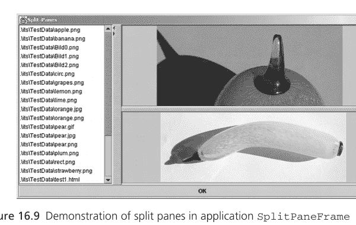

应用程序的控制部分允许用户从左侧列表中选择一张图像，并在右下角区域显示。为此，他或她必须在列表中选择一个文件名，然后按下嵌入到框架"South"位置的按钮。控制部分在这里实现为匿名监听器。程序检查所选文件的扩展名是否表示图像文件。只有扩展名为.jpg或.png的文件会被加载；其他选择将被忽略。其中一张图像，即橙子的图像，有未压缩的PNG格式和高度压缩的JPG格式两种。将后者加载到右下角的组件中，并与右上角持续显示的PNG图像进行比较，可以使质量损失变得明显。我们在下面列出程序，屏幕截图显示在图16.9中。

文件: its/SplitPanes/SplitPaneFrame.java

```java
package its.SplitPanes;

import its.SimpleFrame.SimpleFrame;
import java.awt.*;
import java.awt.event.ActionEvent;
import java.awt.event.ActionListener;
import java.io.File;
import javax.swing.*;

public class SplitPaneFrame extends SimpleFrame
{
  private JButton okButton;
  private JList list;
  private JLabel picLabel1, picLabel2;
  private ImageIcon picture1, picture2;

  private static String picturePath = "./its/TestData/";

  public SplitPaneFrame()
  {
    this.setSize(800,400);
    JSplitPane splitPane1 = new JSplitPane(JSplitPane.HORIZONTAL_SPLIT);
    JSplitPane splitPane2 = new JSplitPane(JSplitPane.VERTICAL_SPLIT);
    splitPane1.setOneTouchExpandable(true);
    splitPane1.setDividerSize(20);

    this.getContentPane().add(splitPane1,BorderLayout.CENTER);
    splitPane1.setRightComponent(splitPane2);

    picture1 = new ImageIcon(picturePath+"/Orange.png");
    picture2 = new ImageIcon(picturePath+"/Banana.png");

    picLabel1 = new JLabel(picture1);
    JScrollPane sp2a = new JScrollPane(picLabel1);
    splitPane2.setTopComponent(sp2a);
    picLabel2 = new JLabel(picture2);
    JScrollPane sp2b = new JScrollPane(picLabel2);
    splitPane2.setBottomComponent(sp2b);
    splitPane2.setDividerLocation(150);
    splitPane1.setDividerLocation(100);

    File startFile = new File(picturePath);
    list = new JList(startFile.listFiles());
    JScrollPane sp = new JScrollPane(list);
    splitPane1.setLeftComponent(sp);

    okButton = new JButton("OK");
    okButton.setBackground(Color.cyan);
    this.getContentPane().add(okButton,BorderLayout.SOUTH);
    okButton.addActionListener(new ActionListener()
    {
      public void actionPerformed(ActionEvent e)
      {
        String filename = ((File)(list.getSelectedValue())).getPath();
        if((filename.endsWith(".png")) || (filename.endsWith(".jpg")) ||
            (filename.endsWith(".PNG")) || (filename.endsWith(".JPG")))
        {
          picLabel2.setIcon(new ImageIcon(filename));
        }
      }
    });
  }
}
```


```markdown
```java
public static void main(String[] args)
{
    SplitPaneFrame spf = new SplitPaneFrame();
    spf.showIt("Split-Panes",200,200);
}
}
```

### 16.7 选项卡窗格（Tabbed panes）

分割窗格用于显示两个文档并调整它们的视图。如果应用程序生成大量文档，则应考虑使用不同的 Swing 组件。在本节中，我们介绍*选项卡窗格*。它们可以管理大量文档，但一次只显示其中一个。用户可以快速在它们之间切换。你可以将选项卡窗格想象成一叠纸张，每张都包含一些文本或图片信息。此外，每一页都有一个*选项卡*。只有最上面的一页可见。另一页可以通过抓住其选项卡、将其拉出并放到 pile 顶部而成为最上面的一页。示例请参见图 16.10。

在 Swing 中，这种机制在 `JTabbedPane` 类中实现。选项卡窗格最初是空的，即不包含任何页面。然后添加组件，每个组件都成为一个新页面。添加组件时，应提供选项卡的文本。选项卡按照组件添加的顺序从左到右（或从上到下）排列。选择一个组件作为最上面的一页不会改变选项卡的顺序。这种顺序体现在所谓的索引中。每个页面都有一个索引（`index`）。一个有 *n* 个页面的选项卡窗格具有索引 0, 1, . . . , *n* − 1。具有最左边（最上边）选项卡的组件的索引为 0。这些索引可以用于例如移除组件或在某个位置插入新组件。

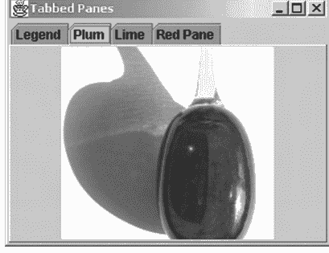

图 16.10 选项卡窗格示例应用程序的第三页

更多组件和技术

```java
TabbedPane();
TabbedPane(int tabPosition);

add(Component comp);
add(String tabText, Component comp);
add(Component comp, int index);
setTitleAt(int pos, String tabTitle);
setSelectedComponent(Component comp);
setSelectedIndex(int pos)
```

TabbedPane() – 构造方法。选项卡放置在上边缘。

TabbedPane(int tabPosition) – 可以指定选项卡位置的构造方法。参数 tabPosition 的四个值在 JTabbedPane 类中预定义：TOP、BOTTOM、LEFT、RIGHT。

add(Component comp) 将 comp 添加为最后一页。"最后" 意味着该选项卡是最右边（或最下边）的一个。该选项卡没有任何文本。

add(String tabText, Component comp) 将 comp 添加为最后一页。"最后" 意味着该选项卡是最右边（或最下边）的一个。该选项卡由 tabText 标记。

add(Component comp, int index) 添加 comp，使其对应的选项卡位于 index 位置。该选项卡没有任何文本。

setTitleAt(int pos, String tabTitle) 为 pos 位置的选项卡分配新的文本 tabTitle。

setSelectedComponent(Component comp) 选择包含组件 comp 的页面，即该页面被设为可见。

setSelectedIndex(int pos) 选择其选项卡位于 pos 位置的页面，即该页面被设为可见。

下面的 TabbedPaneFrame 列表展示了如何使用选项卡窗格。由于我们没有添加任何新功能，我们使用 JTabbedPane 而不将其扩展为新类。选项卡窗格被粘贴到一个框架中。然后向选项卡窗格添加四个组件。首先我们添加两个 JLabel，每个显示一张图像。然后我们添加一个红色的 ColorPanel。这是在 its.SimpleFrameWithPanels 包中定义的。最后我们添加一个 JTextArea，其中包含一些文本来描述这四个组件是什么。JTextArea 被添加在位置 0，因此其选项卡是最左边的。然后我们将选中的索引设置为 1，使李子的图像可见。结果如图 16.10 所示。

**文件：** its/TabbedPane/TabbedPaneFrame.java

```java
package its.TabbedPane;

import its.SimpleFrame.SimpleFrame;
import its.SimpleFrameWithPanels.ColorPanel;
import java.awt.Color;
import javax.swing.*;

public class TabbedPaneFrame extends SimpleFrame
{
    private static String picturePath = "./its/TestData/";

    public TabbedPaneFrame()
    {
        // 创建选项卡窗格并将其粘贴到框架中
        JTabbedPane tabbedPane = new JTabbedPane();
        this.getContentPane().add(tabbedPane);

        // 生成两个各包含图像的标签
        // 并将它们添加到选项卡窗格中
        ImageIcon plum = new ImageIcon(picturePath+"plum.png");
        JLabel plumLabel = new JLabel(plum);
        ImageIcon lime = new ImageIcon(picturePath+"lime.png");
        JLabel limeLabel = new JLabel(lime);

        tabbedPane.add("Plum",plumLabel);
        tabbedPane.add("Lime",limeLabel);

        // 从 its.SimpleFrameWithPanels.ColorPanel 生成一个红色面板
        // 并添加它。
        ColorPanel redPane = new ColorPanel(Color.red);
        tabbedPane.add("Red Pane", redPane);

        // 生成一个文本区域并将其作为第一个（第 0 个）
        // 组件添加。
        JTextArea legend = new JTextArea();
        legend.setText("Legend in a JTextArea\n"+
                        "JLabel showing a plum\n"+
                        "JLabel showing a lime\n"+
                        "A red Panel");
        tabbedPane.add(legend,0);
        tabbedPane.setTitleAt(0,"Legend");
        tabbedPane.setSelectedIndex(1);
    }

    public static void main(String[] args) {
        TabbedPaneFrame tpf = new TabbedPaneFrame();
        tpf.setSize(300,200);
        tpf.showIt("Tabbed Panes",200,200);
    }
}
```

`JTabbedPane` 类提供了大量改变外观的方法。例如，可以使用图标作为选项卡的标签，或更改页面的背景颜色。如果选项卡窗格包含大量页面，而选项卡无法放入单行，则它们会被排列成多行。这可能导致显示选中页面 的空间非常小。自从 SDK 1.4 版本以来，可以使用*可滚动的*选项卡。选项卡随后排列在单行中，可以向左或向右滚动。

### 练习

- 16.1 实现一个 GUI，其布局与 `ListTransferFrame` 相同，并具有以下功能。当左侧列表中的条目被选中时，它被*移动*到右侧列表，即从左侧移除并添加到右侧列表。当右侧列表中的条目被选中时，它被*移动*到左侧列表。

- 16.2 实现一个 GUI，其布局与 `ListTransferFrame` 类似，并具有以下功能。向 GUI 添加两个标记为 "Move to right" 和 "Move to left" 的按钮，并允许在两个列表中进行任意选择。在一个列表中选择条目不会触发任何动作。按下其中一个按钮将导致适当的选择被移动到另一个列表。

### 17 网格袋布局（Grid-bag layout）

> 我们介绍 Java 中最强大但也是最复杂的布局管理器——网格袋布局。该布局管理器允许我们设计复杂的组件排列，而无需使用嵌套的中间组件栈。

第 2 章中描述的*网格布局*允许将组件嵌入网格的一个单元格中，且所有单元格大小相同。这里讨论的*网格袋布局*允许不同列和行具有不同的宽度或高度。此外，可以嵌入一个组件以覆盖多个单元格。这些单元格随后形成一个*袋*，即一个矩形子网格。

使用网格袋布局时，组件不是按照 `add` 命令的顺序放置的。放置是通过向布局管理器传递每个组件的位置信息以及它需要嵌入的袋的大小信息来完成的。

*网格袋布局*的使用有点棘手。许多初学者在几次尝试后放弃使用这个非常强大的工具，因为它"不听使唤"。我们首先讨论和分析这些问题，然后展示如何解决它们。只有在这之后，我们才来描述实现网格袋布局所涉及的 Java 类。

示例布局在图 17.1 中指定。该布局由六个面板组成，它们嵌入到一个父组件中，例如框架的内容窗格。第一步我们确定网格的大小，即行数和列数。这里一个 4×4 的网格似乎合适。网格在图 17.1 中用虚线表示。列和行从左到右、从上到下编号，均从零开始。网格结构，即行数和列数，**不**由程序员显式指定。相反，程序员指定嵌入组件的大小和位置。布局管理器随后计算必要的网格结构。然而，这种计算并不总是以我们期望的方式进行，正如我们即将看到的。

组件的*大小*指定为它跨越的列数和行数。在图 17.1 中，面板 A 跨越两列和三行，面板 D 跨 越一列和两行。组件的*位置*由它覆盖的最左列和最上行指定。在图 17.1 中，面板 A 位于 (0, 0)，B 位于 (2, 0)。表 17.1 总结了六个面板的参数。在下一节中，我们描述如何将这些值传递给布局管理器。
```


图 17.1 期望布局的示意图。上边缘和左边缘的刻度标记表示面板的尺寸。例如，面板 A 和 C 的宽度应为父组件的一半，面板 A 的高度应为父组件的四分之三。底层的 4 × 4 网格以虚线显示。相对于此网格，面板 C 的宽度为 2（列），高度为 1（行）。其位置为第 0 列、第 3 行

表 17.1 图 17.1 布局中六个面板的尺寸和位置参数

| 面板 | 宽度 | 高度 | 左边距 | 上边距 |
|-------|-------|--------|------|-----|
| A     | 2     | 3      | 0    | 0   |
| B     | 2     | 2      | 2    | 0   |
| C     | 2     | 1      | 0    | 3   |
| D     | 1     | 2      | 2    | 2   |
| E     | 1     | 1      | 3    | 2   |
| F     | 1     | 1      | 3    | 3   |

使用这些值将得到图 17.2 所示的结果。对应的程序 `GridBagFrameBad` 此处未列出，但可从本书主页下载。图中显示了两个缺陷：面板 A 和 C 的宽度仅为框架的三分之一（而非一半），面板 B 的高度仅为框架的三分之一（而非一半）。这是因为布局管理器根据表 17.1 中的值计算网格大小时，会删除不必要的列和行边界。这些边界是指不与任何组件边界重合的边界。在我们的例子中，图 17.1 中第 0 列和第 1 列之间的边界是不必要的。没有任何地方它与组件边界重合。另一方面，第 2 列和第 3 列之间的边界是必要的；它与面板 D 的右边界以及面板 E 和 F 的左边界重合。检查其他行列边界可知，第 0 行和第 1 行之间的边界是不必要的，因此会被布局管理器删除。所有其他边界都是必要的。布局管理器使用的布局因此是一个 3 × 3 的网格。所有列等宽，所有行等高。这就解释了为什么图 17.2 显示的结果与图 17.1 的规格说明不同。

因此，调整组件宽度和高度的方法不是引入额外的列和行，而是为列和行分配*权重*。我们在图 17.3 中勾勒出期望的布局。只引入了必要的列和行。请记住，列和行不是由用户显式定义的。它们是由布局管理器根据嵌入式组件的尺寸和位置计算得出的。图中还显示了赋予各列和各行的权重。第一列的权重为 2.0，第二列和第三列的权重均为

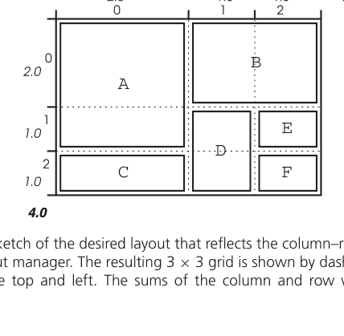

图 17.3 反映布局管理器隐式使用的列-行结构的期望布局示意图。生成的 3 × 3 网格以虚线显示。权重显示在顶部和左侧。列权重和行权重的总和以**粗体**显示

208 更多组件和技术

表 17.2 图 17.3 布局中六个面板的尺寸、位置和权重参数

| 面板 | 宽度 | 高度 | 左边距 | 上边距 | Weightx | Weighty |
| :---: | :---: | :---: | :---: | :---: | :---: |


**Grid-bag布局** | 211

```
File: its/GridBag/GridBagFrame.java

package its.GridBag;

import its.Borders.BorderPanel;
import its.SimpleFrame.SimpleFrame;
import java.awt.GridBagConstraints;
import java.awt.GridBagLayout;
import javax.swing.JComponent;

public class GridBagFrame extends SimpleFrame
{
  private GridBagLayout gbl = new GridBagLayout();
  public GridBagFrame()
  {
    this.getContentPane().setLayout(gbl);
    BorderPanel panelA = new BorderPanel("Panel A");
    BorderPanel panelB = new BorderPanel("Panel B");
    BorderPanel panelC = new BorderPanel("Panel C");
    BorderPanel panelD = new BorderPanel("Panel D");
    BorderPanel panelE = new BorderPanel("Panel E");
    BorderPanel panelF = new BorderPanel("Panel F");

    this.getContentPane().add(panelA);
    this.getContentPane().add(panelB);
    this.getContentPane().add(panelC);
    this.getContentPane().add(panelD);
    this.getContentPane().add(panelE);
    this.getContentPane().add(panelF);

    easyConstraints(gbl,panelA,1,2,0,0,2.0,1.0);
    easyConstraints(gbl,panelB,2,1,1,0,1.0,2.0);
    easyConstraints(gbl,panelC,1,1,0,2,1.0,1.0);
    easyConstraints(gbl,panelD,1,2,1,1,1.0,1.0);
    easyConstraints(gbl,panelE,1,1,2,1,1.0,1.0);
    easyConstraints(gbl,panelF,1,1,2,2,1.0,1.0);
  }

  private void easyConstraints(GridBagLayout GLB,JComponent Comp,
           int w, int h, int x, int y,double wx, double wy){
    GridBagConstraints constraints = new GridBagConstraints();
    constraints.fill = GridBagConstraints.BOTH;
    constraints.gridwidth = w;
    constraints.gridheight = h;
    constraints.gridx = x;
    constraints.gridy = y;
    constraints.weightx = wx;
    constraints.weighty = wy;
    gbl.setConstraints(Comp,constraints);
  }

  public static void main(String[] args){
    GridBagFrame gridbagFrame = new GridBagFrame();
    gridbagFrame.showIt("Grid-Bag Layout");

  }
}
```

### 练习

**17.1** 修改应用程序 `Grid-BagFrame` 中某些面板的约束参数。观察结果并解释其呈现方式。

**17.2** 修改 `easyConstraints` 方法，使其也能设置 `fill` 值。尝试不同的设置并解释结果。

**17.3** 为图17.5中的GUI设计一个网格包布局。

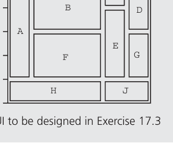

图17.5 需在练习17.3中设计的GUI示意图

# 第三部分

## 高级主题

### 文本样式

#### 18

当显示文本时，经常需要使用不同的字体样式、大小或颜色来强调文本的部分内容。我们现在将展示如何通过使用一种称为文本文档模型的工具来实现这一点。该模型允许将样式属性分配给文本的特定部分，并且当文本被插入或删除时，这些部分会自动调整。

Swing提供了模拟文本文档的非图形类。它们允许对文本进行操作，例如插入和删除，以及将不同的样式分配给文本的不同部分。当这样的文本模型在文本组件中显示时，这些样式就会变得可见。通过使用文本模型，样式和格式设置是在抽象层面进行的，并且与所使用的显示方式无关。可以为文档添加监听器，以响应文本变化而触发相应的操作。

`javax.swing.text`子库包含了`Document`接口以及实现该接口的一些类。我们将使用`DefaultStyledDocument`类，它提供了许多修改普通（ASCII）文本布局的方法。还有另一个预定义的类`HTMLDocument`，它提供了设置HTML格式文本样式的方法。如果这些类不提供所讨论文本的布局功能，那么就必须通过实现`Document`接口或扩展现有类来定义自己的文档类。我们将通过介绍一些用于格式化文本文档的辅助类开始，然后展示它们的使用方法。

#### 18.1 位置

文档上的大多数操作都依赖于*位置标记*的概念。这些在`Position`类中定义。*文本*是字母或符号的序列。我们更倾向于使用“符号”这个词，因为空格和标点符号也被考虑在内。*位置*指定两个连续符号之间的地点。位置的*偏移量*是该位置与文本开头之间的符号数量。第一个符号（符号编号为零）之前的位置偏移量为0，第一个符号之后的位置偏移量为1，依此类推。在下一节中，我们将使用位置标记来指定接收特定格式的文本部分的开始和结束。图18.1说明了位置标记的概念。

> 1 名称`Position`具有误导性。`Position`的实例并不指定文档中一个固定的位置，而是指定一个在文本被删除或插入时会移动的位置。

216 高级主题

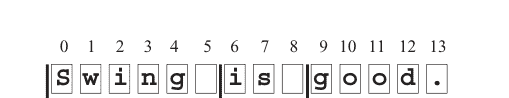

图18.1 包含14个符号的文本。符号的编号从0开始，显示在文本上方。图中显示了三个位置标记：P1、P2和P3。P1的偏移量为0，因为它与文本开头之间没有符号；P2的偏移量为6，因为它紧邻第6个符号之前；P3的偏移量为9

现在让我们看看当文本发生变化时，位置标记会发生什么。我们首先在图18.1文本的符号5和6之间插入一个符号，比如字母m。然后，原始文本中从编号6开始的所有符号都向右移动一个位置，新符号被插入到位置6。位置标记P3随文本一起移动；其偏移量从9增加到10。新字母被精确地插入到标记P2原来占据的位置。约定是插入发生在标记*之前*。因此，P2的偏移量增加到7。结果如图18.2所示。

现在让我们看看当文本被删除时，位置标记会发生什么。我们首先假设删除的文本不包含位置标记。在图18.1的原始文本中，让我们删除符号2到5（ing_）。被删除文本右侧的所有位置标记都将向左移动，即它们的偏移量减小。结果如图18.3所示。

现在让我们在图18.1中删除符号4到10（g_is_go），包括两个空格。这个范围包含了位置标记P2和P3。虽然符号被删除了，但这两个标记没有。它们现在位于被删除文本原来占据的位置。图18.4显示了结果。

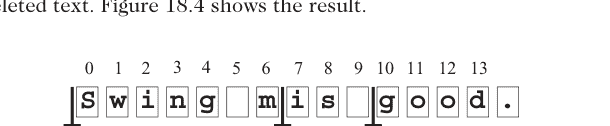

图18.2 在位置6插入字母m会将P2和P3向右移动

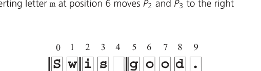

图18.3 删除图18.1中符号ing_的结果。P2和P3向左移动到偏移量2和5

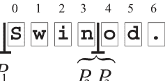

图18.4 由于删除了符号`g_is_go`，两个位置标记P2和P3现在占据同一位置。两者的偏移量均为4

位置标记在`javax.swing.text`库的`Position`接口中实现。只有一个方法

```
int getOffset()
```

它返回位置标记的当前偏移量。

#### 18.2 文本属性

在文本文档中，可以为文本的特定部分分配*文本属性*。这些属性指定文本样式（粗体、斜体）、大小、颜色等。

在Swing中，文本属性由`AttributeSet`接口提供。该接口的一个预定义实现是`SimpleAttributeSet`类，我们将在下面使用。两者都在`javax.swing.text`库中。在属性集中，可以例如指定文本应为粗体或斜体，大小（高度）为14点（像素）。然后，这个属性集可以分配给不同的文本部分，所有这些部分都将按照指定的方式显示。我们只需要这个类的构造函数：

```
SimpleAttributeSet();
```

要设置属性集`attrSet`的属性值，需要使用另一个类`StyleConstants`的方法。我们列出并解释其中一些方法：

```
setForeground(SimpleAttributeSet attrSet, Color c)
setBackground(SimpleAttributeSet attrSet, Color c)
setFontSize(SimpleAttributeSet attrSet, int size)
setBold(SimpleAttributeSet attrSet, boolean b)
setItalic(SimpleAttributeSet attrSet, boolean b)
setUnderline(SimpleAttributeSet attrSet, boolean b)
setSuperscript(SimpleAttributeSet attrSet, boolean b)
setSubscript(SimpleAttributeSet attrSet, boolean b)
```

`setForeground(SimpleAttributeSet attrSet, Color c)` 将 `attrSet` 中的文本颜色设置为 `c`。默认值是显示文本的图形组件的文本颜色，通常为黑色。

`setBackground(SimpleAttributeSet attrSet, Color c)` 将 `attrSet` 中的背景颜色设置为 `c`。默认值是显示文本的图形组件的背景颜色，通常为白色。

`setFontSize(SimpleAttributeSet attrSet, int size)` 将 `attrSet` 中的字体大小设置为 `size` 点（像素）。默认值是显示文本的图形组件的默认大小，通常为12或14点。


## 高级主题

`setBold(SimpleAttributeSet attrSet, boolean b)` 决定按照 `attrSet` 格式化的文本是否应为**粗体**（b = true）还是不加粗（b = false）。默认值为 b = false。

`setItalic(SimpleAttributeSet attrSet, boolean b)` 决定按照 `attrSet` 格式化的文本是否应为*斜体*（b = true）还是不倾斜（b = false）。默认值为 b = false。

`setUnderline(SimpleAttributeSet attrSet, boolean b)` 决定按照 `attrSet` 格式化的文本是否应为<u>下划线</u>（b = true）还是不加下划线（b = false）。默认值为 b = false。

`setSuperscript(SimpleAttributeSet attrSet, boolean b)` 决定按照 `attrSet` 格式化的文本是否应显示为上标（b = true）还是不上标（b = false）。默认值为 b = false。

`setSubscript(SimpleAttributeSet attrSet, boolean b)` 决定按照 `attrSet` 格式化的文本是否应显示为下标（b = true）还是不下标（b = false）。默认值为 b = false。

一旦定义了属性集，就可以将其赋值给文本的各个部分。赋值通过 `Document` 类的以下方法完成：

```
setCharacterAttributes(int offset, int length,
                       AttributeSet attrSet, boolean replace)
```

该方法将从 `offset` 位置开始、长度为 `length` 个字符的文本按照 `attrSet` 中指定的属性值进行格式化。参数 `replace` 决定是否应先移除先前分配给该文本部分的属性。

在下面的示例中，我们定义了一个属性集 `ugly`，用于将文本格式化为黄色、斜体字体、红色背景。然后将文档 `doc` 中从第 203 个字符到第 234 个字符（共 32 个字符）按照此方式进行格式化。另一个属性集 `greenText` 仅定义了字体颜色为绿色。随后用它来格式化第 200 到第 214 个字符。通过将参数 `replace` 设置为 false，在范围重叠的部分（第 203 到第 214 个字符），`ugly` 中除颜色以外的属性得以保留。在该范围内，文本显示为绿色、斜体、红色背景。建议读者尝试此示例以及其他重叠文本属性的示例。

```
// 定义属性集 "ugly" 并 ...
SimpleAttributeSet ugly = new SimpleAttributeSet();

// ... 将其属性设置为黄色斜体、红色背景
StyleConstants.setForeground(ugly, Color.yellow);
StyleConstants.setBackground(ugly, Color.red);
StyleConstants.setItalic(ugly, true);

// 使用 "ugly" 格式化从第 203 个字符开始的 32 个字符。
// 之前分配的任何属性都将被清除。
styledDoc.setCharacterAttributes(203,32,ugly,true);
```

```
// 定义属性集 "greenText" 并 ...
SimpleAttributeSet greenText = new SimpleAttributeSet();

// ... 将其属性设置为绿色字体
StyleConstants.setForeground(greenText, Color.green);

// 使用 "greenText" 格式化从第 200 个字符开始的 15 个字符。
// 除文本颜色外，之前分配的任何属性都将保留。
styledDoc.setCharacterAttributes(203, 15, greenText, false);
```

当一个文本范围被格式化时，系统会自动在其起始和结束位置分配位置标记。这些标记——而非在 `setCharacterAttributes` 中指定的 `offset` 和 `length` 值——决定了此后格式化的范围。因此，当在格式化范围之前删除或插入文本时，格式化范围会向左或向右移动。插入到格式化范围内的字符会继承相同的格式，从而扩展该范围。

#### 18.3 文档监听器

当文档不仅仅是被显示，而是由用户进行编辑时，应用程序可能需要对文档中的更改做出反应。例如，可能需要更改某些文本范围的格式，或者记录所做的更改以便能够撤销它们或记录开发过程。为了对文档中的修改做出反应，需要使用监听器，此处为 `DocumentListener`。

每当对已分配了 `DocumentListener` 的 `Document` 进行更改时，监听器都会收到通知。更改包括文本的删除和插入，或者布局的修改。运行时系统随后会生成一个 `DocumentEvent` 实例，其中包含有关更改类型和位置的信息。该事件会传递给监听器。

要实现 `DocumentListener` 接口，必须实现以下三个方法。它们在文本被插入、删除或格式属性被更改时由运行时系统调用：

```
public void insertUpdate( DocumentEvent devt)
public void removeUpdate( DocumentEvent devt)
public void changedUpdate(DocumentEvent devt)
```

`DocumentEvent` 的实例 `devt` 包含有关事件的信息。该类提供以下方法来访问这些信息：

```
Document getDocument()
int getLength()
int getOffset()
DocumentEvent.EventType getType()
DocumentEvent.Element getChange(Element elem)
```

`getDocument()` 返回触发事件的 `Document` 的引用。当监听器监视多个文档时，这很有用。

`getLength()` 返回受事件影响的字符数量。

`getOffset()` 返回受事件影响的第一个字符的偏移量（位置）。

`getType()` 返回事件的类型。使用 `EventType` 类的 `toString` 方法可以将其转换为文本；可能的结果为 `CHANGE`、`INSERT` 或 `REMOVE`。

`getChange(Element elem)` —— `Element` 类的实例允许访问更改的文本属性。这里涉及多个其他类。我们不在这里讨论该机制；请参阅 Java 文档。

#### 18.4 DefaultStyledDocument 类

正如本章开头已经提到的，`DefaultStyledDocument` 类是 `Document` 接口的一个实现。两者都在 `javax.swing.text` 包中。我们仅介绍这个功能强大的类的几个方法。

```
DefaultStyledDocument()

Position createPosition(int offset)
addDocumentListener(DocumentListener docList)
setCharacterAttributes(int offset, int length,
                      AttributeSet attribSet, boolean replace)

String getText(int offset, int length)
insertString(int offset, String text, AttributeSet attrSet)
remove(int offset, int length)
```

`DefaultStyledDocument()` 是构造函数。

`createPosition(int offset)` 生成一个位置标记，即一个 `Position` 实例，位于当前位于 `offset` 位置的字符之前。如果参数超出文档的当前大小，则会抛出 `BadLocationException`。

`addDocumentListener(DocumentListener docList)` 将 `docList` 分配为该文档的文档监听器。

`setCharacterAttributes` —— 参见第 18.2 节中的讨论。

`String getText(int offset, int length)` 返回一个字符串，包含从文档中 `offset` 位置开始的 `length` 个字符。如果参数超出文档的当前大小，则会抛出 `BadLocationException`。

`insertString(int offset, String text, AttributeSet attrSet)` 将字符串 `text` 中的字符插入到文档中当前位于 `offset` 位置的字符之前。新文本按照 `attrSet` 中的指定进行格式化。如果参数超出文档的当前大小，则会抛出 `BadLocationException`。

`remove(int offset, int length)` 从 `offset` 位置开始删除 `length` 个字符。如果参数超出文档的当前大小，则会抛出 `BadLocationException`。

文档的文本通常从某个文件中读取。使用同样位于 `javax.swing.text` 包中的实用类 `EditorKit` 可以轻松完成此操作。每个能够显示文档的 Swing 组件 `textComp` 都有一个编辑器工具包。可以通过 `textComp.getEditorKit()` 访问它。我们需要 `EditorKit` 的以下方法：

```
    read(FileReader fReader,Document doc, int offset);
```

文件读取器应分配给我们要插入到文档 `doc` 中的文件。参数 `offset` 指定文件内容插入到文档中的位置之前。对于新文档，使用 `offset = 0`。以下代码片段演示了其用法。我们要将文件 `filename` 读取到名为 `doc` 的 `DefaultStyledDocument` 中，然后在 Swing 组件 `textComp` 中显示：

```
        DefaultStyledDocument doc = new DefaultStyledDocument();
        textComp.setDocument(doc);
        EditorKit ediKit = textComp.getEditorKit();
        FileReader fReader = new FileReader(filename);
        ediKit.read(fReader,doc,0);
```

#### 18.5 使用文档的示例

程序 `DocumentFrame` 演示了前面各节描述的功能。文本由 `DefaultStyledDocument` 的实例 `styledDoc` 管理。然后使用 `JTextPane` 来显示文档。文档内容从 ASCII 文件 `DocText.txt` 中读取。在类 `DocAtt` 中定义了多个属性集。这些属性集随后被 `DocumentFrame` 用来格式化文档的各个部分。此外，文本中还放置了两个位置标记。

在 `DocumentFrame` 中定义了一个匿名文档监听器，并将其分配给 `styledDoc`。它监视对文档所做的更改，并在文档下方的 `DocumentStatusPanel` 中显示这些更改。每次文本的插入或删除都会在状态面板中产生一行描述。该监听器还监视两个位置标记并显示它们的当前位置。我们仅列出 `DocumentFrame` 类；另一个类在本书主页上。图 18.5 展示了一个示例。


## 高级主题

文件：its/Document/DocumentFrame.java 图 18.5 程序 DocumentFrame 实现的格式化效果。

```java
public class DocumentFrame extends SimpleFrame
{
  private JTextPane textPane;
  private DocumentStatusPanel statusBar;
  private DefaultStyledDocument styledDoc;
  private EditorKit ediKit;
  private Position p1,p2;

  private final String filename = "./its/TestData/DocTest.txt";


  public DocumentFrame()
  {
    textPane  = new JTextPane();
    statusBar = new DocumentStatusPanel();
    styledDoc = new DefaultStyledDocument();
    textPane.setDocument(styledDoc);
    ediKit = textPane.getEditorKit();
    JScrollPane sp = new JScrollPane(textPane);
    this.getContentPane().add(sp,BorderLayout.CENTER);
    this.getContentPane().add(statusBar,BorderLayout.SOUTH);
    this.setSize(500,500);
    readFile(filename);
    DocAtt.createAttributes();
    formatText();
    try
    {
      p1 = styledDoc.createPosition(228);
      p2 = styledDoc.createPosition(248);
    }
    catch (Exception ex)
    {
      System.out.println("Problem creating Positions.");
    }
    styledDoc.addDocumentListener(new DocListener(statusBar,p1,p2));
    statusBar.update("",p1.getOffset(),p2.getOffset());

  }

  private void readFile(String filename){
    try
    {
      ediKit.read(new FileReader(filename),styledDoc,0);
    }
    catch (Exception ex)
    {
      System.out.println("Problem reading file "+filename);
      ex.printStackTrace();
    }
  }


    // 使用类 DocAtt 中定义的属性集
    // 格式化一些文本范围
  private void formatText(){
      styledDoc.setCharacterAttributes
          ( 73,10,DocAtt.underlinedText,false);
      styledDoc.setCharacterAttributes(85, 3,DocAtt.bigText,false);
      styledDoc.setCharacterAttributes(90, 4,DocAtt.boldText,false);
      styledDoc.setCharacterAttributes(98, 7,DocAtt.italicText,false);
      styledDoc.setCharacterAttributes(110, 7,DocAtt.greenText,false);
      styledDoc.setCharacterAttributes
          (131,13,DocAtt.superscriptText,false);
      styledDoc.setCharacterAttributes
          (147,11,DocAtt.subscriptText,false);
      styledDoc.setCharacterAttributes
          (171,14,DocAtt.whiteOnBlackText,false);
      styledDoc.setCharacterAttributes(190,18,DocAtt.ugly,true);
      styledDoc.setCharacterAttributes(228,20,DocAtt.redText,false);
  }


  public static void main(String[] args)
  {
    DocumentFrame df = new DocumentFrame();
    df.showIt("Document-Frame");
  }

  }
```

### 练习

- 18.1 使用程序 `DocumentFrame` 来检查在格式化文本范围之前、之内和之后插入或删除文本的结果。同时检查在不同位置插入或删除文本时，位置标记会发生什么变化。

- 18.2 添加一个类似第 12 章 `Editor` 类中的菜单栏。实现菜单项的功能。修改"搜索"功能，使其高亮显示搜索文本的所有出现位置。确保即使搜索文本位于文本的开头或结尾时也能正常工作。

- 18.3 添加一个"显示位置"菜单项。选择该选项时，所有用户添加的位置标记通过在标记位置插入黄色背景上的蓝色字母 'M' 来显示。再次选择该菜单项则使其消失。

## Java 中的打印

在本章中，我们简要讨论 Java 的打印机制。我们介绍一种打印图形组件的简单方法。最后，我们实现一个通用类，可用于为其他应用程序添加打印功能。

我们将使用 `java.awt.print` 库中的类，通过以下方式引入：

```java
import java.awt.print.*;
```

该库提供了为图形界面添加打印功能的类和方法。我们不会介绍所有类，也不会讨论所有方法。我们专注于实现简单打印机访问方式所必需的内容。更多内容可以在 Java 文档中找到。

我们的示例应用程序由一个带菜单的框架 `PrintFrame` 组成。菜单只有一个项："打印"。我们定义了一个首选大小为 300 × 200 的面板 `PrintPanel`。它显示一个矩形、一个填充椭圆和一段文本。在面板边缘绘制另一个矩形以指示其边距。然后将该面板嵌入到框架的内容面板中。图 19.1 显示了应用程序的外观。应用程序的功能很简单：当选择"打印"菜单项时，打印嵌入的 `PrintPanel` 的内容。

打印图形组件 `printableComp` 的一般方法如下：

- 组件 `printableComp` 必须通过定义 `print` 方法来实现 `Printable` 接口。

- 必须创建 `PrinterJob` 类的实例 `printJob`，并将组件 `printableComp` 传递给它。这通过调用方法 `printJob.setPrintable(printableComp)` 来完成。

- 然后通过 `printJob.print()` 启动 `PrinterJob`。

可以指定在开始打印之前显示打印对话框。该对话框是操作系统的标准打印对话框。它通常允许您选择打印机和要打印的页面，以及可能的更多选项。程序员不必担心图形如何转换为打印机可理解的数据，也不必担心数据如何发送到打印机。

图 19.1 打印应用程序的示意图。注意面板边距处的矩形。这是为了控制是否打印整个面板而添加的。

### 19.1 Printable 接口

如上所述，组件必须实现 `Printable` 接口才能变得可打印。`Printable` 接口要求实现一个方法：

```java
public int print(Graphics graphics, PageFormat pageFormat,
                 int pageIndex) throws PrinterException
```

当组件需要被打印时，运行时系统会调用此方法。运行时系统还提供参数 `graphics`、`pageFormat` 和 `pageIndex`。此方法在打印中所起的作用与 `paintComponent` 在绘图中所起的作用相同。实际上，可以将打印视为绘制到另一个设备上。实际打印是通过在要打印的组件的 `print` 方法内调用 `paint` 来启动的。与 `paintComponent` 一样，我们不应自己调用 `print`。各参数的含义如下：

`Graphics graphics` 将应用程序链接到平台特定的打印机驱动程序。这类似于 `paintComponent` 方法中的 `Graphics` 对象，后者链接到操作系统的渲染例程。`Graphics` 对象由运行时系统创建。

`PageFormat pageFormat` 也是由运行时系统创建的。它包含所选打印机（或默认打印机）的页面大小和布局信息。该类提供了 `get` 方法来访问这些参数。

`int pageIndex` 是要打印的页码。运行时系统以不同的 `pageIndex` 值调用 `print`，即 0、1、2、3……。如果 `print` 命令成功，它返回整型常量 `PAGE_EXISTS`（在 `Printable` 接口中定义）。否则 `print` 返回 `NO_SUCH_PAGE`，运行时系统将不再调用 `print`。程序员必须确保返回正确的值。通过这种方式可以打印多页文档。

现在让我们来看 `Printable` 接口的一个简单实现。我们将 `print` 方法实现为只打印一页；我们的面板是一个单页文档。我们首先检查参数 `pageIndex` 是否为 0（第一页）。如果是，我们调用面板的 `paint` 方法并返回 `PAGE_EXISTS`。如果 `pageIndex` 大于 0，我们返回 `NO_SUCH_PAGE`。然后运行时系统将停止调用 `print`。

让我们分析第一种情况下（即 `pageIndex` 为 0 时）发生的事情。通过调用面板的 `paint` 方法，启动了一次重绘。绘制在某个设备上完成。这个设备是屏幕还是打印机，由 `Graphics` 对象决定。在我们的示例中，我们将作为 `print` 参数接收的 `Graphics` 对象 `g` 传递给 `paint` 方法。该对象由运行时系统生成，指向某个打印机。因此，`paint` 绘制到打印机而不是屏幕。我们不能使用 `repaint`，因为它不允许传递 `Graphics` 对象作为参数；`repaint` 启动的是屏幕的重绘。实现的框架如下所示：

```java
public int print(Graphics g, PageFormat pageFormat, int pageIndex) {
    if (pageIndex > 0)
    {
        return (NO_SUCH_PAGE);
    }
    else
    {
        this.paint(g);
        return (PAGE_EXISTS);
    }
}
```

但是，需要采取一些技术上的预防措施。首先应该关闭图形的 `双缓冲` 功能。此功能在屏幕重绘时对良好显示很重要，但可能会影响打印效果。打印完成后，应再次启用双缓冲。因此我们围绕 `paint` 命令添加一些命令，如下所示。我们不详细讨论此处使用的 `RepaintManager` 类：

```java
RepaintManager currentManager = RepaintManager.currentManager(this);
currentManager.setDoubleBufferingEnabled(false);
paint(g);
currentManager.setDoubleBufferingEnabled(true);
```

打印时需要考虑的另一个主题是打印图像的放置和缩放。打印机坐标系统的原点通常是 `纸张` 的左上角。然而，大多数打印机由于技术原因无法在纸张的某些小边距上打印。因此，纸张 `可打印` 区域的左上角位于纸张左上角的下方和右侧。`Graphics`


这是处理后的文本：


currentManager.setDoubleBufferingEnabled(false);
compToPrint.paint(g);
currentManager.setDoubleBufferingEnabled(true);
return(PAGE_EXISTS);
}
}
}

package its.Printing;

import its.SimpleFrame.SimpleFrame;
import java.awt.event.ActionEvent;
import java.awt.event.ActionListener;
import javax.swing.JButton;
import javax.swing.JTextArea;
import java.awt.BorderLayout;

public class PrintSuitTestFrame extends SimpleFrame
                                        implements ActionListener
{
    public PrintSuitTestFrame() {
        JButton button = new JButton("Print");
        button.addActionListener(this);
        this.getContentPane().add(button, BorderLayout.SOUTH);
        JTextArea textPane = new JTextArea();
        textPane.setText("Test test\n test test\n test test\n test test");
        this.getContentPane().add(textPane, BorderLayout.CENTER);
    }

    public void actionPerformed(ActionEvent evt){
        PrintSuit.printComponent(this);
    }

    static public void main(String[] args) {
        PrintSuitTestFrame pstf = new PrintSuitTestFrame();
        pstf.showIt();
    }
}

## Swing 与线程

线程是应用程序中并行运行的部分。尽管本书中的大多数应用程序似乎是单线程的，但事实并非如此。任何涉及图形界面的应用程序都会自动成为多线程的。运行时系统会生成多个线程，这些线程与实际应用程序的程序代码并行运行。这些线程通常在用户不知不觉的情况下运行。然而，在某些情况下，这种并发可能会导致问题。我们希望在本章中探讨最常见的问题。

要理解线程在带有图形用户界面的 Java 应用程序中的作用，让我们回顾一下此类应用程序的生命周期。如引言所述，应用程序的 GUI 在启动阶段创建。一旦 GUI 可见，应用程序就变成*事件驱动*的。也就是说，它由用户（或其他应用程序）触发的事件来驱动。例如，按下按钮就是这样一个事件。事件由运行时系统检测，该系统会将适当的事件通知应用程序的监听器。 about this event. For a button it would be an action listener. This listener then executes a method that contains the code for reacting to the eventFor a button it would be an action listener. This listener then executes a method that contains the code for reacting to the event. For a button it would be an action listener. This listener then executes a method that contains the code for reacting to the event. For action listeners this is method `actionPerformed`.

The administration of the events is done by a thread that is started unknown to the user, the so-called *event thread*, sometimes also called *event dispatching thread*. We describe this mechanism in the following and then address some problems it might cause. We would like to emphasize that this chapter is not meant as an introduction to concurrent programming with threads in Java. The reader is assumed to know the basics on threads or to look them up in the Java documentation or in tutorials on the web.事件的管理由一个对用户来说不可见的线程完成，即所谓的*事件线程*，有时也称为*事件分发线程*。我们在下文中描述这一机制，然后讨论它可能引发的一些问题。需要强调的是，本章并非作为 Java 中线程并发编程的入门介绍。读者应已掌握线程的基础知识，或自行查阅 Java 文档以及网上的教程。

### 20.1 事件线程与事件队列

每个 Java 应用程序至少启动一个线程，即*主线程*。程序员编写的几乎所有代码都在这个线程中执行。对于带有 GUI 的应用程序，*事件线程*会被创建并与主线程并行运行。它负责管理传入的事件。如果事件到达速率很高，或者处理事件耗时过长，那么一个新事件可能会在前一个事件完全处理完之前发生。因此，事件线程使用一个*事件队列*来

### 20.2 阻塞用户界面

#### 20.2.1 阻塞如何发生

我们的示例应用程序 `BlockingFrame` 展示了耗时操作如何导致不良效果。`BlockingFrame` 包含一个菜单和一个标签，标签被固定在框架内容面板的中央。标签初始显示的文本为 'Nothing happened'。菜单栏有一个菜单，其中包含单个菜单项 'Start'。一个类型为 `MenuListener` 的监听器监控该菜单项。这个监听器类被定义为一个内部类。

当选择该菜单项时，会调用监听器的 `actionPerformed` 方法。这个方法执行一项耗时的工作。我们通过一个执行十次的 for 循环来模拟耗时工作。在循环内部，应用程序使用 `Thread` 类的 `sleep` 命令等待半秒（500 毫秒）。为了记录工作过程，在每次循环执行时更新标签的文本。文本显示为 'Working' 后跟循环变量数字。同样的文本也通过 `System.out.println` 输出到控制台。此外，我们还打印当前正在运行的线程名称。循环最后一次执行后，文本被设置为 'Done'。我们预期，在菜单中选择 'Start' 后，标签会依次显示 'Nothing happened'、'Working 0'、...、'Working 9'、'Done'。

我们观察到的现象却不同。选择菜单项 'Start' 后，菜单不会收回，而是在耗时工作持续期间保持可见——五秒钟。标签的文本保持为 'Nothing happened'。点击菜单或框架的其他位置都没有效果。调整框架大小会使标签和菜单的文本消失。在耗时工作运行期间，GUI 被称为*阻塞*。五秒后，菜单收回，标签显示 'Done'。GUI 再次对鼠标做出反应。然而，在控制台上我们可以看到 'Working i' 每隔半秒打印一次。我们还可以看到，耗时工作的代码不是在主线程中执行的，而是在事件线程中。下面列出了输出内容。`AWT-EventQueue-0` 是运行时系统给事件线程起的名称¹。第一行是从 `BlockingFrame` 的 `main` 方法中打印的，它在线程 `main` 中执行。

¹ 运行时系统给线程的内部名称在不同平台或不同版本的 SDK 中可能有所不同。

238 高级主题

```
Running in thread main
Working 0
Running in thread AWT-EventQueue-0
Working 1
Running in thread AWT-EventQueue-0
Working 2
Running in thread AWT-EventQueue-0
Working 3
Running in thread AWT-EventQueue-0
Working 4
Running in thread AWT-EventQueue-0
Working 5
Running in thread AWT-EventQueue-0
Working 6
Running in thread AWT-EventQueue-0
Working 7
Running in thread AWT-EventQueue-0
Working 8
Running in thread AWT-EventQueue-0
Working 9
Running in thread AWT-EventQueue-0
```

让我们分析观察到的行为。下面的列表按时间顺序展示了发生的事。

1. 当菜单被点击时，一条重绘 GUI 以显示展开菜单的命令被添加到事件队列末尾。命令执行一段时间后，菜单变为可见。重绘命令从队列中移除。

2. 当选择菜单项 'Start' 时，对 `actionPerformed` 方法的调用被添加到事件队列。

3. 一条重绘 GUI 以收起菜单的命令被添加到队列中，位于 `actionPerformed` 调用*之后*。

4. 在 `for` 循环的每次迭代中，一条重绘标签以显示更新文本的命令被添加到队列中，位于重绘命令之后。

根据队列先进先出的特性，事件线程只能在处理完 2 中的事件后，才能处理 3 和 4 中的事件。特别是，耗时的 `actionPerformed` 方法在事件线程中运行，阻碍了它处理后续事件。在 `actionPerformed` 终止之前，GUI 不会更新，一直显示展开的菜单。当调整框架大小时，标签和菜单栏也不会重绘。重绘请求被添加到事件队列末尾，等待轮到队首。在此期间 GUI 产生的进一步事件，例如鼠标点击，也被添加到事件队列。它们都必须等待之前添加的请求被处理完毕，尤其是 2 中耗时的 `actionPerformed`。由于在此期间没有对这些事件做出反应，

图形用户界面似乎被阻塞了。控制台输出的命令是不需要任何图形组件的操作，它们不会被放入事件队列中。因此，这些命令会立即执行并按预期显示。`BlockingFrame` 的代码如下所列，其显示结果如图20.1所示。

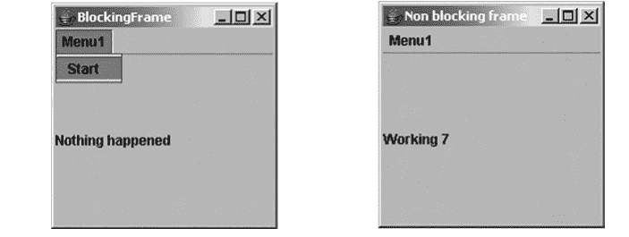

**(a) 阻塞帧 (BlockingFrame)**
- **窗口标题：** BlockingFrame
- **菜单：** Menu1
- **按钮：** Start
- **状态文本：** Nothing happened（未发生任何事）

**(b) 非阻塞帧 (NonBlockingFrame)**
- **窗口标题：** Non blocking frame（非阻塞帧）
- **菜单：** Menu1
- **状态文本：** Working 7（工作 7）

图 20.1 应用程序 (a) BlockingFrame 和 (b) NonBlockingFrame 的运行结果

**文件：** `its/Blocking/BlockingFrame.java`

```java
package its.Blocking;

import its.SimpleFrame.SimpleFrame;
import java.awt.event.ActionEvent;
import java.awt.event.ActionListener;
import javax.swing.JLabel;
import javax.swing.JMenu;
import javax.swing.JMenuBar;
import javax.swing.JMenuItem;

public class BlockingFrame extends SimpleFrame
{
    private JLabel display;

    public BlockingFrame() {
        display = new JLabel("Nothing happened");
        this.getContentPane().add(display);

        JMenuBar menuBar = new JMenuBar();
        this.setJMenuBar(menuBar);
        JMenu menu = new JMenu("Menu1");
        menuBar.add(menu);
        JMenuItem startItem = new JMenuItem("Start");
        menu.add(startItem);
        MenuListener mListener = new MenuListener();
        startItem.addActionListener(mListener);
    }

    public static void main(String[] args){
        System.out.println("Running in thread "+
                            Thread.currentThread().getName());

        BlockingFrame bf = new BlockingFrame();
        bf.showIt("BlockingFrame");
    }

    private void lengthyWork(){
        //This is the lengthy work
        for(int i = 0; i < 10; i++){
            System.out.println("Working "+i);
            System.out.println("Running in thread "+
                                 Thread.currentThread().getName());
            display.setText("Working "+i);
            try{
                Thread.sleep(500);
            }catch(Exception ex){
                ex.printStackTrace();
            }
        }//for i
        display.setText("Done");
    }

    //Internal class
    class MenuListener implements ActionListener{
        public void actionPerformed(ActionEvent evt){

            String command = evt.getActionCommand();
            if(command.equals("Start")){
                lengthyWork();
            }
            else
            {
                System.out.println("Unknown ActionCommand");
                System.exit(0);
            }
        }
    }//internal class
}
```

## Swing 与线程

#### 20.2.2 避免阻塞

上述问题的解决方案不是在事件线程中运行耗时的 `lengthyWork` 方法，而是在一个单独的线程中运行。事件线程仅仅启动这个新线程，然后立即处理队列中的下一个事件，与此同时，耗时任务在另一个线程中并行运行。

在我们的示例中，我们定义了一个继承自 `Thread` 的内部类 `WorkerThread`。当一个线程被启动时，它的 `run` 方法会被执行。因此，线程需要执行的所有指令都应放置在此处。在我们的示例中，耗时任务就被放置在这里。

现在，`actionPerformed` 方法不再调用 `lengthyWork`，而是创建一个 `WorkerThread` 的实例 `worker`，并通过调用 `worker.start()` 来启动它。此后，`actionPerformed` 执行完毕。即使 `actionPerformed` 在事件线程中运行，它也只在启动工作线程所需的时间内运行。它不会阻塞后续事件的处理。菜单在我们选择 "Start" 菜单项后会立即回滚。标签的文本也会每半秒变化一次。

现在，我们可以在控制台上看到，耗时任务既不是在主线程也不是在事件线程中执行的。相反，它运行在一个名为 'Thread-1' 的线程中，这是我们工作线程的内部名称。由于耗时操作现在在一个单独的线程中运行，事件线程可以在重绘帧或标签的请求到来时立即处理它们。下面显示了控制台输出的列表：

```java
Running in thread main
WorkerThread1: started as Thread-1
Working 0
Running in thread Thread-1
Working 1
Running in thread Thread-1
Working 2
Running in thread Thread-1
Working 3
Running in thread Thread-1
Working 4
Running in thread Thread-1
Working 5
Running in thread Thread-1
Working 6
Running in thread Thread-1
Working 7
Running in thread Thread-1
Working 8
Running in thread Thread-1
Working 9
```

> 对于像 `actionPerformed` 这样的监听器方法，这种表述需要酌情理解。其中的部分代码实际上可能位于其他方法中（在我们的例子中是 `lengthyWork`），这些方法随后在 `run` 内部被调用。

```
Running in thread Thread-1
WorkerThread1: Done
```

`NonBlockingFrame` 的代码如下所列，其显示结果如图20.1所示。

**文件：** `its/Blocking/NonBlockingFrame.java`

```java
1. package its.Blocking;
2.
3. import its.SimpleFrame.SimpleFrame;
4. import java.awt.event.ActionEvent;
5. import java.awt.event.ActionListener;
6. import javax.swing.JLabel;
7. import javax.swing.JMenu;
8. import javax.swing.JMenuBar;
9. import javax.swing.JMenuItem;
10.
11. public class NonBlockingFrame extends SimpleFrame
12. {
13.
14.   private JLabel display;
15.   private int nummer;
16.
17.   public  NonBlockingFrame(){
18.     nummer = 0;
19.     this.setTitle("Non blocking frame");
20.     display = new JLabel("Nothing happened");
21.     this.getContentPane().add(display);
22.
23.     JMenuBar menuBar   = new  JMenuBar();
24.     this.setJMenuBar(menuBar);
25.     JMenu    menu      = new  JMenu("Menu1");
26.     menuBar.add(menu);
27.     JMenuItem startItem = new  JMenuItem("Start");
28.     menu.add(startItem);
29.     MenuListener mListener  = new  MenuListener();
30.     startItem.addActionListener(mListener);
31.   }
32.
33.   private void lengthyWork(){
34.         //This is the lengthy work
35.       for(int i = 0; i < 10; i++){
36.         System.out.println("Working "+i);
37.                     System.out.println("Running in thread "+
38.                                     Thread.currentThread().getName());
39.         display.setText("Working "+i);
40.         try{
41.           Thread.sleep(500);
42.         }catch(Exception ex){
43.           ex.printStackTrace();
44.         }
45.       }//for i
46.       display.setText("Done");
47.   }
48.
49.   public static void main(String[] args){
50.     System.out.println("Running in thread "+
51.                      Thread.currentThread().getName());
52.     NonBlockingFrame nbf = new NonBlockingFrame();
53.     nbf.showIt();
54.   }
55.
56.   //Internal class
57.
58.   class MenuListener implements ActionListener{
59.
60.     public void actionPerformed(ActionEvent evt){
61.
62.       String command = evt.getActionCommand();
63.       if(command.equals("Start")){
64.         // The worker thread is created and started
65.         Thread worker = new WorkerThread();
66.         worker.start();
67.       }
68.       else
69.       {
70.         System.out.println("Unknown ActionCommand");
71.         System.exit(0);
72.       }
73.     }
74.
75.   }//internal class
76.
77.   //Internal class
78.
79.   class WorkerThread extends Thread{
80.     int num;
81.     public WorkerThread(){
82.       nummer++;
83.       num = nummer;
84.     }
85.     public void run() {
86.         System.out.println("WorkerThread"+num+": started as "+
87.                       Thread.currentThread().getName());
88.         lengthyWork();
89.         System.out.println("WorkerThread"+num+": Done");
90.     }
91.
92.   }
93.
94. }
```

### 20.3 副作用

有一些副作用需要注意：

- 由于在选择 "Start" 菜单项后，图形用户界面不会被阻塞，我们可以立即再次选择它，如此反复……每次都会创建并启动一个新的 `WorkerThread`，所有这些线程并行运行。从控制台的输出可以最好地观察到发生的情况。如果不希望发生这种情况，必须在启动下一个线程之前检查是否已有工作线程在运行。这可以通过在线程启动前设置一个 'flag'（例如一个布尔变量），并在线程退出时（`run` 方法中的最后一条命令）重置它来实现。还有其他方法可以实现这一点，但这需要对线程有更深入的了解。
- 有时，图形用户界面的阻塞并非那么不受欢迎。例如，如果正在读取一个大文件，那么在加载整个文件完成之前，人们可能不希望处理进一步的用户命令。在这里，所谓的进度条可能是解决问题的更优雅的方式。
- 如果在我们的示例中，为耗时工作启动了多个线程，那么所有这些线程都会变慢。它们不会各自在五秒后完成。原因在于，在单处理器系统上——而大多数计算机只有一个主处理器——不同的线程并非真正并发运行。相反，它们必须共享这个单一的处理器。每个线程只运行一小段时间，然后被中断，而另一个线程继续运行一小段时间，依此类推。不同的线程获得 *时间片*。

### 20.4 在运行时更新显示

#### 20.4.1 问题

考虑这样一种情况：显示一个复杂的图形并且需要定期更新。当数据持续接收时，这是一个典型的设置，


进行分析和显示。用户可能会遇到绘图显示不完整的问题。我们用简单的例子来说明这一现象。

我们定义一个类 `Drawing` 作为图画的抽象表示。该图画显示三条平行线。最初这些线是水平的。方法 `flipLines` 会将图画改为三条垂直线。再次调用 `flipLines` 又会使线变为水平。为了模拟图画的复杂修改，线会依次翻转，每次翻转后暂停一秒。定义类 `UpdatePanel` 来显示一幅图画。为此，它需要能够访问 `Drawing` 类的一个实例。我们就不列出这些类了；它们可以从本书的主页下载。

类 `BadUpdateFrame` 是该应用程序的主类。它有一个 `Drawing` 类的变量 `drawing`。它还有一个 `UpdatePanel` 来显示这幅图画。最初这些线是水平的。然后 `BadUpdateFrame` 调用该图画的 `flipLines` 方法，该方法在大约三秒内依次翻转这些线。这在显示中是看不到的，因为没有产生任何事件来触发重绘。因此，在线条翻转完成后我们为面板添加一条 `repaint` 命令。然后再次调用 `flipLines` 和 `repaint`，将线条翻回水平并显示出来。我们只列出程序 `BadUpdateFrame`；实际演示放在方法 `badDemo` 中。

```
File: its/GraphicsUpdate/BadUpdateFrame.java

package its.GraphicsUpdate;

import javax.swing.JFrame;
import its.SimpleFrame.SimpleFrame;

public class BadUpdateFrame extends SimpleFrame{

   private UpdatePanel uppane;
   private Drawing drawing;

   public BadUpdateFrame(){
      drawing = new Drawing();
      uppane  = new UpdatePanel(drawing);
      getContentPane().add(uppane);
      pack();
   }

   public void badDemo(){
      uppane.repaint();  // paint the horizontal lines
      drawing.flipLines(); // flip them to vertical
      uppane.repaint();  // paint the vertical lines
      drawing.flipLines(); // flip them back to horizontal
      uppane.repaint(); // paint the horizontal lines
      drawing.flipLines(); // flip them to vertical
   }

   public static void main(String[] args) {
      BadUpdateFrame badFrame = new BadUpdateFrame();
      badFrame.showIt("Bad Update");
      badFrame.badDemo();
   }

}
```

这应该显示一系列三幅图画。第一幅有三条水平线，第二幅有三条垂直线，第三幅又由三条水平线组成：

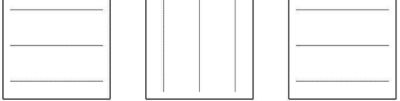

实际显示的内容取决于很多因素：操作系统、SDK 版本、机器当前的负载（进程数量）等等。而且行为在应用程序的两次执行之间也可能有所不同。大多数情况下，会观察到以下图像序列：

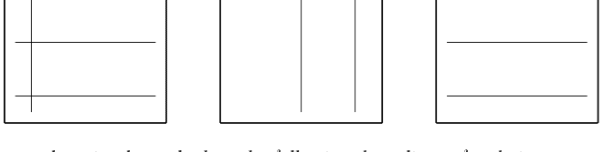

为了解释这一点，让我们看看 `BadUpdateFrame` 中的以下三行代码：

```
drawing.flipLines(); // flip them to vertical
uppane.repaint();    // paint the vertical lines
drawing.flipLines(); // flip them back to horizontal
```

它们的顺序暗示着在三行线都翻转完成后，新的图画才会显示，然后才会再次翻转。问题在于

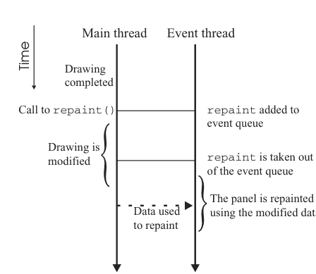

图 20.2 左侧的主线程修改图画，而重绘事件进入事件队列的头部。当最终执行重绘时，显示的是已修改的图画

`flipLine` 指令在主线程中运行，而 `repaint` 指令在事件线程中执行。主线程只是将重绘操作添加到事件队列中，以表明 GUI 应该在某个时间进行重绘。在这种情况下，代码清单中代码行的顺序不再反映它们的执行顺序。事件线程可能需要一些时间来处理重绘请求。到那时，主线程已经翻转了第一条线。于是显示器就显示了一部分旧图像和一部分新图像。事情发生的时间顺序如下所列，并在图 20.2 中展示：

1. 所有线都是水平的。
2. 重绘命令被添加到事件队列。
3. 第一条线被翻转为垂直。
4. 重绘命令到达队列头部，面板被重绘以显示当前图画，此时第一条线已经是垂直的。
5. 其余两条线被翻转，但显示没有更新。

#### 20.4.2 通过缓冲的解决方案

解决问题的一种方法是使用图画缓冲。这意味着我们有两个抽象的图画，其中一个被显示且不被修改，另一个不被显示且被修改。当第二个图画的修改完成后，它们互换角色。为此，要改变面板中对图画的引用。类 UpdatePanel 为此提供了一个方法（`setDrawing`）。然后通过调用面板的 `repaint` 方法来显示新的图画。当前显示图画的内容被复制到另一个图画中。重要的是复制图画，而不是使用诸如 drawing1 = drawing2 这样的引用赋值。那样的话两个图画会被视为同一个；将只有两个指向同一图画的引用。更详细的解释请参见 B.1 节。

File: its/GraphicsUpdate/GoodUpdateFrame.java

```
1. package its.GraphicsUpdate;
2. 
3. import javax.swing.JFrame;
4. import its.SimpleFrame.SimpleFrame;
5. 
6. 
7. public class GoodUpdateFrame extends SimpleFrame{
8. 
9.   private UpdatePanel uppane;
10.  private Drawing drawing1, drawing2;
11. 
12.  public GoodUpdateFrame(){
13.    drawing1 = new Drawing();
14.    drawing2 = new Drawing();
15.    uppane = new UpdatePanel(drawing1);
16.    getContentPane().add(uppane);
17.    pack();
18.  }
19. 
20.  public void goodDemo(){
21.    uppane.repaint();
22.    drawing2.flipLines();
23.    uppane.setDrawing(drawing2);
24.    uppane.repaint();
25.    drawing1.copy(drawing2);
26.    drawing1.flipLines();
27.    uppane.setDrawing(drawing1);
28.    uppane.repaint();
29.  }
30. 
31.  public static void main(String[] args){
32.    GoodUpdateFrame goodFrame = new GoodUpdateFrame();
33.    goodFrame.showIt("Good Update"); // The drawing contains
34.    goodFrame.goodDemo();
35.  }
36. 
37. 
38. }
```

## 一个通用图形包

# 21

在本章中，我们将本书前面部分的许多技术结合起来，设计一个用于显示和操作图画的通用图形包。要显示的图形对象以抽象方式指定，并且该包可以由用户扩展。该包还支持通过用户交互来添加和删除图形对象。

### 21.1 包的规范说明

该包提供了一个面板来显示图画。该面板可以嵌入到任何需要显示图形的 GUI 中。图画可以通过应用程序或用户交互来更改。程序员可以根据需要轻松地向包中添加更多图形对象。我们在下面更详细地描述这一点。

- 图画由*图形对象*组成。这些可以是简单的形状，如直线、圆形或三角形，但也可能包括更复杂的形状，如多边形或曲线。其中一些在包中已经定义。
- 程序员可以添加新的图形对象。
- 图形对象由坐标指定，坐标是实数。不需要了解显示区域的信息。
- 图画会自动适应显示区域，使其全部可见。
- 程序员可以选择缩放是否是成比例的（*x* 轴和 *y* 轴使用相同的比例），或者不是（图画在水平和垂直方向上扩展以填充面板）。
- 每个图形对象的颜色都可以设置和更改。
- 当面板被重新缩放时，显示会自动缩放。
- 该包提供了从图画中添加或删除图形对象的方法。


 250 高级主题

### 21.2  设计包结构

该包是第7章中交互式应用程序的扩展。它由多个类组成。我们现在描述所选择的类结构并解释我们的设计选择。从上面的规范可以看出，有两个概念在项目中显然扮演着重要角色："图形对象"和"绘图"。我们将定义两个类来实现这些概念：`GraphicalObject` 和 `Drawing`。在此过程中，我们还会发现需要定义一些辅助类。

#### 21.2.1  Drawing 类

一幅绘图由图形对象组成。因此，我们选择 `Drawing` 类来执行管理工作。该类维护一个数据结构，其中包含当前绘图中的所有图形对象。该数据结构允许添加新的图形对象或删除现有对象。该类提供了一个 `draw` 方法，用于显示整个绘图。为此，它要求所有图形对象自行绘制。更多管理功能将在后面描述。

#### 21.2.2  GraphicalObject 类

图形对象是几何形状的抽象描述。由于存在无限多种此类对象，无法定义单一的类来涵盖所有可能性。因此，我们将 `GraphicalObject` 定义为**抽象**类。**所有**图形对象共有的特征（且与我们的项目相关）都在该类中指定。如果程序员需要新的特定形状，则必须从 `GraphicalObject` 派生一个类。在该类中，实现特定于该形状的特征。

让我们思考一下哪些特征是所有图形对象共有的，并且对我们手头的工作也很重要。首先，我们应该知道图形对象的*位置*和*大小*。这些由对象的最左、最右、最上和最下的点指定。这些信息对项目很重要，因为我们需要缩放绘图。另一个所有图形对象都有的特征是*颜色*。

虽然图形对象的这些特征相当明显，但还有一些特征也会被证明是有用的。每个图形对象都必须能够唯一标识。即使两个圆具有相同的圆心、半径和颜色，它们也是两个不同的对象。为了使图形对象具有唯一性，每个对象都有一个名为 `uid`（"唯一标识号"）的整数字段。如果我们考虑用鼠标交互式地修改绘图，另一个概念也会被证明是有用的。想象一个包含许多图形对象的绘图，假设我们想用鼠标选择其中一个。那么必须按照某种规则将当前鼠标位置与其中一个对象关联起来。有很多方法可以指定哪个对象离鼠标最近。找出该对象的方法可能相当复杂。因此，我们为每个图形对象定义一个*锚点*。然后可以通过点击其锚点来选择对象。即便如此，两个对象可能具有相同的锚点，在这种情况下我们随机选择一个。锚点在绘图中显示为小圆点。

另一件我们必须考虑的事情是图形对象的渲染。由于程序员可以添加新的形状，无法预先设置一个适用于所有形状的绘图方法。只有程序员知道图形对象应该是什么样子。因此，我们要求图形形状知道如何绘制自己。这个概念通过在类 GraphicalObject 中定义抽象方法 draw 来实现。从它派生的每个（具体）类都必须实现这个方法。

然而，这里存在一个问题。要实际渲染形状，图形对象必须知道绘图显示面板中的像素坐标。这些坐标取决于面板的当前大小和绘图的大小，而后者又取决于绘图中的其他图形对象。必要的信息由 DimensionObject 和 ScaleObject 类的实例提供。这些类将在后面讨论。

例如，该包中实现了三个图形对象：Circle、Line 和 OpenPolygon。OpenPolygon 的清单如下所示。构造函数接收多边形的角点作为数组。它检查数组是否包含至少两个点。如果是这种情况，则遍历数组以找到极值坐标。用这些坐标创建一个 DimensionObject。对象的参考点——即锚点——被定义为第一个点。

draw 方法接收对 Graphics 对象的引用和 ScaleObject。后者包含有关显示当前大小的信息。该信息用于将多边形的抽象实坐标转换为屏幕（像素）坐标。转换例程由实用类 Conversions 的方法提供。然后使用像素坐标将多边形绘制为一系列线段。OpenPolygon 类提供了一个方法 textString，它返回多边形的文本描述。

```
File: its/GenericDraw/OpenPolygon.java

package its.GenericDraw;

import java.awt.Graphics;

public class OpenPolygon extends GraphicalObject {

    private RealPoint[] points;

    public OpenPolygon(RealPoint[] pts) {
        points = pts;
        if(points.length < 2){
            System.out.println("ERROR in OpenPolygon: less than two points.");
        }
        else
        {
            double xmin = points[0].getX();
            double xmax = points[0].getX();
```

```
18.        double ymin = points[0].getY();
19.        double ymax = points[0].getY();
20.        for (int i = 1; i < points.length; i++) {
21.          xmin = Math.min(xmin,points[i].getX());
22.          xmax = Math.max(xmax,points[i].getX());
23.          ymin = Math.min(ymin,points[i].getY());
24.          ymax = Math.max(ymax,points[i].getY());
25.        }
26.        dimObj = new DimensionObject(xmin,xmax,ymin,ymax);
27.        anchor = points[0];
28.      }
29.    }
30.
31.    public void draw(Graphics g, ScaleObject scale) {
32.      PixelPoint startPix = Conversions.realToPixelPoint(points[0],scale);
33.      g.setColor(color);
34.      for (int i = 0; i < points.length; i++) {
35.        PixelPoint endPix  = Conversions.realToPixelPoint(points[i],scale);
36.        g.drawLine(startPix.getX(),startPix.getY(),
37.                   endPix.getX(),endPix.getY());
38.        startPix = endPix;
39.      }
40.    }
41.    public String textString(){
42.      String result = "Open Polygon: "+points[0].toString();
43.      for (int i = 1; i < points.length; i++) {
44.        result += ";"+points[i].toString();
45.      }
46.    return(result);
47.    }
48.  }
```

#### 21.2.3  GenericDrawPanel 类

GenericDrawPanel 类派生自 JPanel，用于显示绘图。希望使用 GenericDrawing 包的程序员必须了解这个类。GenericDrawPanel 在 Drawing 类的实例中保存绘图的抽象表示。GenericDrawPanel 还提供了添加和删除图形对象的方法。这些方法仅调用 Drawing 类的对应方法。GenericDrawPanel 的 paintComponent 方法调用 Drawing 类的 draw 方法。

鼠标适配器作为内部类 GenericDrawMouseAdapter 实现。它支持两种操作：如果在面板内点击鼠标右键，则从绘图中移除锚点离鼠标位置最近的图形对象。如果单击鼠标左键一次，记住鼠标位置。如果再次单击，则将两次点击的鼠标位置之间的线段添加到绘图中。程序员可以修改或扩展适配器的功能。

### 21.3  辅助类

辅助类提供支持我们项目操作的数据类型。首先我们定义两个用于二维平面中点的类。一个定义坐标为实数的点。另一个类定义像素坐标中的点。有方法可以将实坐标转换为像素坐标，基于绘图和显示它的面板的大小。

#### 21.3.1  Constants 类

我们定义了一个 Constants 类，其中包含包中一个或多个类使用的一些固定值的定义。这些包括绘图周围边距的宽度。该类还定义了一些布尔变量，用于确定绘图的外观，例如是否绘制锚点或以比例模式显示绘图。

#### 21.3.2roi 点和像素点

RealPoint 和 PixelPoint 类各自存储字段 x 和 y。这些是点的 x 坐标和 y 坐标。第一个类使用 double，第二个使用 int。像素点的构造函数检查坐标是否为非负数。两个类都提供 get 方法来访问字段。

```
File: its/GenericDraw/PixelPoint.java
package its.GenericDraw;
public class PixelPoint{
    private int x, y;
    public PixelPoint(int xx, int yy){
        if((xx >= 0) && (yy >= 0)){
            x = xx;
            y = yy;
        }
        else
        {
            System.out.println("ERROR: Illegal pixel coordinates.");
        }
    }
}
```


```markdown
public int getX(){
    return(x);
}

public int getY(){
    return(y);
}

public String toString(){
    return("["+x+","+y+"]");
}
}//class

文件：its/GenericDraw/RealPoint.java

1. package its.GenericDraw;
2. 
3. public class RealPoint{
4.     private double x, y;
5. 
6.     public RealPoint(double xx, double yy){
7.         x = xx;
8.         y = yy;
9.     }
10. 
11.    public double getX(){
12.        return(x);
13.    }
14. 
15.    public double getY(){
16.        return(y);
17.    }
18. 
19.    public double distanceTo(RealPoint p){
20.        return(Math.sqrt(Math.pow((this.x-p.x),2)+Math.pow((this.y-p.y),2)));
21.    }
22. 
23.    public String toString(){
24.        return("("+x+","+y+")");
25.    }
26. }//class

我们将使用实点来表示几何对象的抽象规范。当需要渲染此类对象时，实点将被转换为像素坐标。像素坐标的计算方式是使整个绘图能够放入面板中。实际上我们希望在面板中的绘图周围留有一小圈边距。我们允许四边的边距不同。计算此转换需要以下数据：

| 符号 | 说明 | 类型 |
|---|---|---|
| $x_{min}$ | 绘图的最小 $x$ 坐标 | double |
| $x_{max}$ | 绘图的最大 $x$ 坐标 | double |
| $y_{min}$ | 绘图的最小 $y$ 坐标 | double |
| $y_{max}$ | 绘图的最大 $y$ 坐标 | double |
| $w$ | 面板宽度（像素） | int |
| $h$ | 面板高度（像素） | int |
| $l$ | 绘图左侧边距宽度（像素） | int |
| $r$ | 绘图右侧边距宽度（像素） | int |
| $t$ | 绘图顶部边距宽度（像素） | int |
| $b$ | 绘图底部边距宽度（像素） | int |

那么，扣除边距后面板的可用宽度和高度分别为 $w_u = w - l - r$ 和 $h_u = h - t - b$。我们现在计算 $f_x$ 和 $f_y$，即绘图在水平和垂直方向上需要缩放的倍率，使其能够放入边距内。

| 公式 | 说明 | 类型 |
|---|---|---|
| $f_x = w_u / (x_{max} - x_{min})$ | 水平缩放因子 | double |
| $f_y = h_u / (y_{max} - y_{min})$ | 垂直缩放因子 | double |
| $f = \min\{f_x, f_y\}$ | 等比例缩放因子 | double |

然后，要将一个实点 $P_{real} = (x_{real}, y_{real})$ 转换为像素点 $P_{pix} = (x_{pix}, y_{pix})$，使用以下公式。注意，由于屏幕坐标系是上下颠倒的，我们必须对 $y$ 坐标进行反射。L形括号表示向下取整到最近的整数。

$x_{pix} = \lfloor(x_{real} - x_{min}) \cdot f + l\rfloor$

$y_{pix} = \lfloor h - ((y_{real} - y_{min}) \cdot f + b)\rfloor$

在等比例缩放的情况下，$f$ 同时替代 $f_x$ 和 $f_y$ 使用。

#### 21.3.3 维度对象

每个 `GraphicalObject` 都包含一个 `DimensionObject` 实例。维度对象包含图形对象的极值坐标，即该对象的最小和最大 $x$ 坐标与 $y$ 坐标。对于每个从 `GraphicalObject` 派生的类，程序员必须确保这些值被正确设置。参见 `OpenPolygon` 类的列表示例。

`Drawing` 的实例也包含一个名为 `extremalDimensions` 的 `DimensionObject`。它包含整个绘图的极值维度，例如绘图中任意图形对象的最小 $x$ 坐标。当添加或删除新的图形对象时，`extremalDimensions` 的值需要更新。添加新图形时，只需检查其某个维度是否提供了新的极值。`DimensionObject` 类提供了一个 `combineWith` 方法来完成此操作。该方法比较 `this` 和作为参数传递的 `DimensionObject` 的最小值，并将最小值设为两者中较小的值。最大值的更新以类似方式进行。如果从绘图中删除一个图形对象，则 `extremalDimensions` 的更新会更加困难。如果 `extremalDimensions` 的某个值（例如最小 $x$ 坐标）来自被删除的对象，则需要找到绘图中当前具有最小 $x$ 坐标的对象。我们通过从头重新计算 `extremalDimensions` 的值来完成此操作。也就是说，我们遍历绘图中的所有图形对象以确定新的极值。删除后有更高效的值更新方法，但它们需要复杂的数据结构，其实现会使程序包的结构变得晦涩难懂。

(a)

(b)

图 21.1 测试应用程序 `GenericDrawingDemo`。(a) 比例模式，即两个坐标轴使用相同的比例尺——圆形显示为圆形。(b) 非比例模式，即缩放以填充整个面板——圆形可能显示为椭圆

#### 21.3.4 转换与比例对象

`Conversions` 类提供了在像素坐标和实坐标之间转换的方法。为此，这些方法需要知道相关参数，例如绘图的尺寸和面板的大小。这些值由 `ScaleObject` 类的对象提供。转换方法接收一个像素点或实点以及一个比例对象作为参数。它们根据接收到的点计算实点或像素点的坐标，并返回结果。

每当触发面板的重绘时，`Drawing` 类会将比例对象的参数设置为当前值。从 `GraphicalObject` 派生的类的 `draw` 方法接收比例对象作为参数。图形对象的坐标是实坐标。通过比例对象，可以使用转换方法将这些坐标转换为绘制到面板所需的像素坐标。

图 21.1 展示了测试应用程序 `GenericDrawingDemo` 的两个屏幕截图。

### 22 显示 HTML 文档和访问网络

> 我们现在讨论如何在 Swing 组件中显示 HTML 格式的文本。我们首先展示如何显示包含 HTML 文本的文件。然后展示如何制作一个简单的浏览器，用于访问和显示 HTML 格式的网页。

在第 12 章和第 18 章中，我们了解了如何显示和编辑 ASCII 文本。另一种常用的文本类型是 HTML（**超文本标记语言**，*HyperText Mark-up Language*）。实际上所有网页都是 HTML 格式的，许多随 CD 提供的软件手册也是如此。包含 HTML 格式文本的文件是 ASCII 文件，其中包含要显示的文本和额外的格式指令。这些指令称为 *HTML 标签*，用小于号和大于号括起来。例如，序列

```
<center>HTML and Swing</center>
```

表示"HTML and Swing"这段文本以水平居中的方式显示。将 HTML 文件加载到用于 ASCII 文本的 Swing 组件中时，不会进行格式化处理；HTML 标签按文本中的原样显示。以格式化方式显示 HTML 文本的程序必须解释 HTML 标签，并根据这些格式指令显示其余文本。这类程序包括 Web 浏览器。

我们不必自己编写 HTML 解释器来格式化 HTML 文本。Swing 库包含带有内置 HTML 解释器的组件，例如 `JEditorPane`。这些组件可以以格式化方式显示大多数 HTML 文档。需要注意的是，HTML 规范已经多次变更，特别是新增了允许更复杂格式化的 HTML 标签。Java 的 HTML 解释器只识别特定版本 HTML 的标签；较新的或未标准化的格式指令将被忽略。因此，对于某些新颖的"时尚"网页，Swing 组件的显示方式可能与标准 Web 浏览器有所不同。

#### 22.1 显示 HTML 页面

我们介绍一个程序 `SimpleHTMLFrame`，它使用 `JEditorPane` 来显示 HTML 文本。编辑器面板接收一个 **URL**（**统一资源定位符**，*uniform resource locator*）作为
```


构造函数。URL 就是网络地址。可以使用 `URL` 类来创建 URL，也可以直接将 URL 作为字符串传入。构造函数具有以下形式：

```
JEditorPane(URL webAddress)
JEditorPane(String webAddressAsString)
```

这些构造函数必须嵌入到 try-catch 块中，因为创建 URL 可能会抛出异常。要访问本地文件，URL 必须以 `file:///` 开头，而不是 `http://`。我们在示例中使用本地文件，这样程序无需连接互联网即可运行。如果计算机已连接互联网，则可以使用以下 URL：

```
http://www.imm.dtu.dk/swingbook/HTMLTest/test1.html
```

我们只关注显示 HTML，不允许编辑文本，因此使用 `JEditorPane` 的 `setEditable(false)` 方法。

```
File: its/HTML/SimpleHTMLFrame.java
```

```
package its.HTML;

import its.SimpleFrame.SimpleFrame;
import javax.swing.JEditorPane;

public class SimpleHTMLFrame extends SimpleFrame
{
    private JEditorPane ediPane;
    private static String htmlSource = "/its/TestData/test1.html";
    private static String workingDir;

    public SimpleHTMLFrame(String URLname)
    {
        this.setSize(400,400);
        workingDir = System.getProperty("user.dir");
        // in the following we assume that the program
        // is run from the parent directory of its.
        // Use an absolute path if necessary:
        try{
            ediPane = new JEditorPane("file:///"+workingDir+htmlSource);
            // ediPane = new JEditorPane
            //     ("file:///C:/absolute/path//its/TestData/");
            ediPane.setEditable(false);
        } catch(Exception e){}
        // Later, the code for the link listener will be added here.
        this.getContentPane().add(ediPane);
    }
```

```
    public static void main(String[] args) {
        SimpleHTMLFrame shf = new SimpleHTMLFrame(htmlSource);
        shf.showIt("Simple HTML-Display");
    }
    // Later, the link listener class will be defined here.
}
```

程序 `SimpleHTMLFrame` 显示单个 HTML 文档，但没有使用最重要的 HTML 特性：链接（`HTML` 超链接）。点击链接时，不会发生任何反应。在下一节中，我们将了解如何跟踪链接。

#### 22.2 使用 HTML 链接

为了在点击链接时触发响应，我们需要一个监听器。在 Java 中，`HyperlinkListener` 接口负责监听 HTML 超链接。它位于 `javax.swing.event` 库中，需要实现一个方法：

```
void hyperlinkUpdate(HyperlinkEvent hylevt)
```

该监听器被分配给显示 HTML 文档的组件，在我们的例子中就是 `JEditorPane` `ediPane`。使用以下命令分配监听器：

```
ediPane.addHyperlinkListener(HyperlinkListener hyLis)
```

监听器被分配给面板后，如果用户点击了链接，运行时系统会通知该监听器，即调用其 `hyperlinkUpdate` 方法。运行时系统还会生成一个 `HyperlinkEvent` 对象，并将其作为参数传递给 `hyperlinkUpdate`。

程序员需要在 `hyperlinkUpdate` 中编写代码，以响应用户选择链接时的操作。在我们的示例中，我们希望显示链接所指向的页面。首先检查事件类型是否为 `ACTIVATED`，即链接是否被选中。其他事件类型有 `ENTERED` 和 `EXITED`。此检查通过检查超链接事件对象 `hylevt` 来完成：

```
if (hylevt.getEventType() == HyperlinkEvent.EventType.ACTIVATED)
```

接下来，提取链接指向的 URL：

```
URL newPage = hylevt.getURL();
```

然后通过以下方式将该 URL 传递给编辑器面板：

```
ediPane.setPage(newPage);
```
异常可能会发生。在正式的应用程序中，应该进行错误诊断并启动修复流程。

为了启用链接功能，我们在 `SimpleHTMLFrame` 中添加代码，将其扩展为 `HTMLViewer`，添加位置由 `SimpleHTMLFrame` 中的注释标记。在第一个位置添加：

```
LinkLis lili = new LinkLis();
ediPane.addHyperlinkListener(lili);
```

在第二个位置添加超链接监听器的实现，作为一个内部类：

```
private class LinkLis implements HyperlinkListener
{
  public void hyperlinkUpdate(HyperlinkEvent hylevt)
  {
    try
    {
      if (hylevt.getEventType() == HyperlinkEvent.EventType.ACTIVATED)
      {
        URL newPage = hylevt.getURL();
        ediPane.setPage(newPage);
      }
    }
    catch (Exception ex)
    {
      System.out.println("Problems with hyperlink-listener");
    }
  }// method
}// internal class
```

我们不列出最终程序 `HTMLViewer`；它可以从本书主页下载。例如，它可以用于显示 HTML 格式的帮助文档或手册页面。不过，使用该查看器时仍然缺少一些功能。其中之一是"返回"功能，用于重新显示上一个 HTML 页面。在下一节中，我们将把该查看器扩展为一个包含此功能的简单网页浏览器。

#### 22.3 一个简单的网页浏览器

现在我们将上一节的应用程序扩展为一个简单的网页浏览器。请记住，HTML 格式的网页只能以当前 Java 系统的 HTML 解释器所支持的方式显示。该应用程序缺少一些安全检查，如果用于其他用途则需要添加。

我们的应用程序 `ITSBrowser` 使用 `JEditorPane` 来显示网页。该面板被嵌入到滚动面板中，以便可以显示较大的页面。滚动面板居中嵌入到框架中。我们的浏览器有一些控件元素，排列在一个名为 `ToolPanel` 的面板中。有一个用于输入 URL 的文本框，以及两个分别标记为"GO!"和"Back"的按钮。按下第一个按钮时，浏览器会加载文本框中指定的网页。用户可以通过点击链接在网络上进行导航。浏览器会记录之前的页面。按下"Back"按钮，浏览器会返回到从当前页面跳转过来的那个网页。当返回到直接在文本框中输入 URL 的页面时，回退操作停止。

最近访问的网页历史记录存储在一个*栈*中，这是一种像一叠纸一样存储数据的数据结构。新数据可以放在栈顶，且只有栈顶的数据可以被取出。假设我们首先访问网页 $W_1$，其中包含指向页面 $W_2$ 的链接。我们使用该链接跳转到 $W_2$。此时 $W_1$ 的地址（URL）被压入栈顶。如果 $W_2$ 包含指向页面 $W_3$ 的链接并使用了该链接，则 $W_2$ 的地址被压入栈中。使用浏览器的"Back"按钮会使应用程序从栈中取出最顶层的地址（$W_2$），并显示相应的页面。此后，$W_1$ 成为栈顶地址。再次使用"Back"按钮，应用程序会从栈中取出 $W_1$ 的地址并显示该页面。

应用程序的"GO!"和"Back"按钮由一个 `ButtonListener` 监听，该监听器实现了 `ActionListener` 接口，在按钮被按下时执行相应的操作。超链接由 `LinkLis` 类监听，该类像上一节一样实现了 `HyperlinkListener`。

应用程序代码如下所示。可以使用以下 URL 进行测试：

```
http://www.imm.dtu.dk/swingbook/HTMLTest/test1.html
```

```
File: its/HTML/Browser.java

 1. package its.HTML;
 2.
 3. import its.SimpleFrame.SimpleFrame;
 4. import java.awt.*;
 5. import java.awt.event.ActionEvent;
 6. import java.awt.event.ActionListener;
 7. import java.net.URL;
 8. import java.util.Stack;
 9. import javax.swing.*;
10. import javax.swing.event.HyperlinkEvent;
11. import javax.swing.event.HyperlinkListener;
12.
13. public class Browser extends SimpleFrame
14. {
15.     private JEditorPane ediPane;
16.     private static String startURL =
17.         "http://www.imm.dtu.dk/swingbook/HTMLTest/test1.html";
18.     private ToolPanel tools;
19.     private Stack urlStack;
```


## 显示HTML文档和访问网页

```java
public Browser(String URLname)
{
    this.setSize(600,600);
    urlStack = new Stack();
    ediPane = new JEditorPane();
    ediPane.setEditable(false);
    ediPane.setMinimumSize(new Dimension(600,600));

    LinkLis lili = new LinkLis();
    tools = new ToolPanel(URLname);
    ediPane.addHyperlinkListener(lili);
    this.getContentPane().add(tools,BorderLayout.NORTH);
    this.getContentPane().
        add(new JScrollPane(ediPane),BorderLayout.CENTER);
}
```

```java
public static void main(String[] args)
{
  Browser brow = new Browser(startURL);
  brow.showIt("ITS-Browser");
}
```

```java
private class LinkLis implements HyperlinkListener
{
  public void hyperlinkUpdate(HyperlinkEvent hyevt)
  {
    try
    {
      if (hyevt.getEventType() == HyperlinkEvent.EventType.ACTIVATED)
      {
        URL t = ediPane.getPage();
        urlStack.push(t);
        ediPane.setPage(hyevt.getURL());
      }
    }
    catch (Exception ex)
    {
      System.out.println("Problems with hyperlink listener");
    }
  }// method
}// internal class
```

```java
private class ToolPanel extends JPanel{
  private JTextField urlField;
  private JButton backButton, goButton;

  public ToolPanel(String URLname){
    this.setLayout(new FlowLayout());
    urlField = new JTextField();
    urlField.setText(URLname);
    backButton = new JButton("Back");
    goButton = new JButton("GO!");
    JLabel ulab = new JLabel(" URL:");
    urlField.setPreferredSize(new Dimension(300,30));
    this.add(backButton);
    this.add(ulab);
    this.add(urlField);
    this.add(goButton);
    ButtonListener buli = new ButtonListener();
    backButton.addActionListener(buli);
    goButton.addActionListener(buli);
  }//constructor

  public String getURL(){
    return(urlField.getText().trim());
  }
}// internal class

private class ButtonListener implements ActionListener{
  public void actionPerformed(ActionEvent actevt){
    String command = actevt.getActionCommand();
    if (command.equals("Back"))
    {
      if(urlStack.size() > 0)
      {
        URL url = (URL)urlStack.pop();
        try
        {
          ediPane.setPage(url);
        }
        catch (Exception ex)
        {
          System.out.println("Problem in Back: URL not found.");
        }
      }
    }
    else if (command.equals("GO!"))
    {
      try
      {
        URL url = new URL(tools.getURL());
        urlStack.removeAllElements();
        ediPane.setPage(url);
      }
      catch (Exception ex)
      {
        System.out.println("Problem in GO!: URL not found.");
      }
    }
  }
}// internal class
```

#### 22.4 读取网页

在上一节中，我们了解了如何以格式化的方式显示HTML页面。现在我们展示如何读取网页的源代码。当应用程序需要从页面中读取和处理信息时，这非常有用。下一节将给出一个从网络中提取信息的示例。

我们的非图形化程序`ReadURL`访问一个网页，并将其源代码写入控制台。我们使用本书的一个测试页面，即：

```
http://www.imm.dtu.dk/swingbook/HTMLTest/test1.html
```

在我们的应用程序中，我们使用该地址创建一个`URL`对象。然后创建一个用于从该URL读取数据的`InputStream`。这通过使用`URL`类的`openStream()`方法来实现。接着，我们使用`InputStream`类的`read()`方法逐个字符地读取HTML页面的源代码。每个字符都会立即写入控制台。`ReadURL`的代码及控制台输出如下所示。

**文件：** `its/OnlineMonitor/ReadURL.java`

```java
package its.OnlineMonitor;

import java.io.InputStream;
import java.net.URL;

public class ReadURL {

  private static String immURL =
    "http://www.imm.dtu.dk/swingbook/HTMLTest/test1.html";

  public static void main(String[] args) {
    readAndPrintTheURL(immURL);
  }

  public static void readAndPrintTheURL(String urlName){
    // Create a URL
    URL urlToRead = null;
    try {
      urlToRead = new URL(urlName);
    }
    catch (Exception ex) {
          ex.printStackTrace();
    }
    // Read and the URL characterwise
    // and print it to the console.
    if(urlToRead != null){
      try  { // Open the streams
       InputStream inputStream = urlToRead.openStream();
       int c = inputStream.read();
       while (c != -1) {
          System.out.print((char)c);
          c = inputStream.read();
       }
       inputStream.close();
      }catch(Exception e){System.out.println("Problem reading from URL");}
    }
  }
}
```

出现在控制台上的网页源代码如下所示

```html
<!DOCTYPE HTML PUBLIC "-//W3C//DTD HTML 3.2 Final//EN">

<HTML>

<HEAD>

<TITLE></TITLE>

<META NAME="Generator" CONTENT="Winedit 2000">
<META NAME="Author" CONTENT="Paul Fischer">

</HEAD>

<BODY BGCOLOR="#FFFFFF" TEXT="#000000" LINK="#FF0000" VLINK="#800000"
ALINK="#FF00FF" BACKGROUND="?">

<H1> TEST HTML-Document</H1>
This is the first page.
<P>
<A HREF="test2.html">Link to the next page</A>.
</BODY>

</HTML>
```

#### 22.5 从网络中采集信息

现在让我们扩展上一节的应用程序，使其能够持续地从网络中采集信息。在我们的示例应用程序中，我们希望显示股市信息，即德国股票指数DAX。这类信息可以在许多网页上找到。我们使用Yahoo提供的一个网页。在编写本书时，该地址为：

```
http://de.finance.yahoo.com/d/quotes.csv
```

它包含DAX指数及其包含的30只股票的报价。该网页地址可能会发生变化，因此需要检查并在必要时进行更改。该页面采用所谓的逗号分隔值（csv）格式。然而，实际的分隔符是分号。这种格式适合导入到电子表格程序中。我们使用这个页面是因为它比HTML更易于分析。每一行包含一只股票的信息。该页面上的一行内容如下：

```
^GDAXI;4016,52;1/13/2004;15:58;+20,61;4006,85;4033,67;4003,19;78199616
```

它包含——以分号分隔——指数名称、最新值、该值的日期和时间，以及有关变化、最高值和最低值等信息。该页面会定期更新，大约每30秒一次。我们的应用程序从该行中提取最新值；在上面的示例中为4016.52。在我们的应用程序中，我们使用一种所谓的网络查询来提取包含DAX信息的行。¹ 我们不在这里讨论HTTP协议或网络查询。读者可以参阅网上提供的相关手册和教程。

该应用程序每五秒读取一次该网页，提取当前DAX值并更新显示。报价以向右延伸的图形方式显示。我们不希望在应用程序等待五秒以获取下一个值时阻塞显示。因此，我们定义了一个用于访问网络的线程。它与处理GUI的主线程并行运行。下面仅列出线程类MonitorThread。

MonitorThread的run方法包含一个while循环。while循环的条件是一个布尔变量goOn。通过调用stopThread方法可以将其设置为false。然后，当下次检查while条件时，循环将终止，这也会终止线程。在循环中，调用getOneQuote方法，然后线程暂停五秒。getOneQuote方法是对上一节中readAndPrintTheURL的修改。它使用BufferedReader来读取包含DAX信息的行。私有方法getQuoteFromString解析该行并提取DAX指数的最新值（double类型）。然后将该值传递给显示面板。

该应用程序还包含另外三个类：MonitorData、MonitorPanel和OnlineMonitor。第一个类实现了数据模型。它提供以下方法

> ¹ 如果信息包含在HTML页面中，我们就需要分析该页面并编写相应的解析器来提取所需信息。


## 高级主题

图 22.1 DAX 股票指数的在线监控器

用于添加新数据、访问当前数据，以及获取数据缩放所需的信息，使其能够适应显示。显示功能在 MonitorPanel 类中实现，该类继承自 JPanel。OnlineMonitor 类继承自 JFrame。它嵌入了 MonitorPanel，并包含用于启动应用程序的 main 方法。屏幕截图如图 22.1 所示。

```
File: its/OnlineMonitor/MonitorThread.java

1. package its.OnlineMonitor;
2. 
3. 
4. import java.io.BufferedReader;
5. import java.io.InputStreamReader;
6. import java.net.URL
```

 ## 高级主题

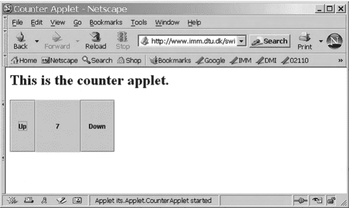

图 23.1 计数器小应用程序在浏览器中的显示效果

```
<body>
<h2>This is the counter applet.</h2>
<APPLET CODE="its.Applet.CounterApplet.class" WIDTH="200" HEIGHT="100">
</APPLET>
</body>
</html>
```

该页面位于包含类文件的 its 目录的正上方。也可以从本书的主页访问该页面。你可以从那里点击链接访问该小应用程序，或者在浏览器中输入以下行来加载页面并运行小应用程序。结果如图 23.1 所示。

http://www.imm.dtu.dk/swingbook/AppletTest/CounterDemo.html

#### 23.1.2 运行线程的小应用程序

第二个示例是一个显示计时器的小应用程序，该计时器每半秒递增一次。为了避免阻塞小应用程序，计时器在类型为 TimerThread 的线程中运行。面板（TimerPanel）用于显示计时器的当前值。该线程每半秒更新一次面板。小应用程序类名为 TimerApplet。相关代码清单如下所示。

文件：its/Applet/TimerThread.java

```
1. package its.Applet;
2.
3. public class TimerThread extends Thread {
4.
```

```
private int time;
private TimerPanel timerPane;

public TimerThread(TimerPanel tp) {
    time = 0;
    timerPane = tp;
}

public void run(){
    while(true){
        try {
            Thread.sleep(500L);
            time += 500;
            System.out.println("Running "+time);
            timerPane.setTime(time);
        }
        catch (InterruptedException ex) {
        }
    }
}
```

### 文件：its/Applet/TimerPanel.java

```
package its.Applet;

import javax.swing.JPanel;
import java.awt.Color;
import java.awt.Graphics;

public class TimerPanel extends JPanel {

    private int time;

    public TimerPanel() {
        this.setBackground(Color.yellow);
        time = 0;
    }

    public void paintComponent(Graphics g){
        super.paintComponent(g);
        g.drawString(Integer.toString(time), 50,50);
    }
```

```
22. public void setTime(int t){
23.     time = t;
24.     this.repaint();
25. }
26.
27.
28.
29. }
```

文件：its/Applet/TimerApplet.java

```
1. package its.Applet;
2.
3. import javax.swing.JApplet;
4. import java.awt.BorderLayout;
5.
6. public class TimerApplet extends JApplet {
7.
8.     private TimerThread timer;
9.
10.    public void init(){
11.        TimerPanel timerPane = new TimerPanel();
12.        timer = new TimerThread(timerPane);
13.        this.getContentPane().add(timerPane,BorderLayout.CENTER);
14.        timer.start();
15.    }
16.
17.    public void start(){
18.        System.out.println("Start");
19.    }
20.
21.    public void stop(){
22.        System.out.println("Stop");
23.    }
24.
25.    public void destroy(){
26.        System.out.println("Destroy");
27.    }
28. }
```

#### 23.1.3 备注

Java SDK 包含一个*小应用程序查看器*，这是一个无需使用浏览器即可显示小应用程序的程序。在开发和测试小应用程序时，这很有帮助。

有时我们会开发一个既要用作应用程序又用作小应用程序的项目。在这种情况下，建议使用一个面板，将所有 GUI 组件嵌入其中。只需将这个单一面板嵌入到框架或小应用程序中，即可获得所需类型的程序。`CounterPanel` 就是这种*模块化设计*的一个示例。

## 部分习题解答

### A.1 第 2 章

#### A.1.1 2.1

两个窗口都会关闭。原因是点击 `SimpleFrame` 的关闭按钮会执行命令 `System.exit(0)`。这会终止应用程序，即包含 main 方法的程序。在本例中，这就是 `SimpleFrameDriver`。由于两个框架都是在那里构造的，因此两者都会被终止。

#### A.1.2 2.2

当前的边框组件会扩展以填满整个区域。

### A.2 第 4 章

#### A.2.1 4.2

以下 `its.Light` 包的代码清单包含一个采用模型–视图实现的交通灯模拟。

```
package its.Light;

public class Constants {
    public static final int LIGHT_RED = 1;
    public static final int LIGHT_RED_ORANGE = 2;
    public static final int LIGHT_GREEN = 3;
    public static final int LIGHT_ORANGE = 4;
}
```

文件：its/Light/LightModel.java

```
1. package its.Light;
2.
3. public class LightModel {
4.     private int currentColors;
5.
6.
7.     public LightModel() {
8.         currentColors = Constants.LIGHT_RED;
9.     }
10.
11.     public void nextColor(){
12.         switch (currentColors) {
13.             case Constants.LIGHT_RED:
14.                 currentColors = Constants.LIGHT_RED_ORANGE;
15.                 break;
16.             case  Constants.LIGHT_RED_ORANGE:
17.                 currentColors = Constants.LIGHT_GREEN;
18.                 break;
19.             case  Constants.LIGHT_GREEN:
20.                 currentColors = Constants.LIGHT_ORANGE;
21.                 break;
22.             case  Constants.LIGHT_ORANGE:
23.                 currentColors = Constants.LIGHT_RED;
24.                 break;
25.             default:
26.                 System.out.println("ERROR: ILLEGAL COLOR COMBINATION!");
27.                 break;
28.         }
29.     }
30.
31.     public int getCurrentColors(){
32.         return(currentColors);
33.     }
34.
35.
36.     public void printColor(){
37.         switch (currentColors) {
38.             case Constants.LIGHT_RED:
39.                 System.out.println("RED");
40.                 break;
41.             case  Constants.LIGHT_RED_ORANGE:
42.                 System.out.println("RED&ORANGE");
43.                 break;
44.             case  Constants.LIGHT_GREEN:
```

```
System.out.println("GREEN");
break;
case  Constants.LIGHT_ORANGE:
  System.out.println("ORANGE");
  break;
default:
  System.out.println("ERROR: ILLEGAL COLOR COMBINATION!");
  break;
}
}
}
```

### 文件：its/Light/LightTest.java

```
package its.Light;

public class LightTest {
  public static void main(String[] args) {
    LightModel light = new LightModel();
    for (int i = 0;i < 10 ;i++ ) {
      light.printColor();
      light.nextColor();
    }//for

  }
}
```

### 文件：its/Light/LightFrame.java

```
package its.Light;

import its.SimpleFrame.SimpleFrame;
import java.awt.Color;
import java.awt.GridLayout;
import javax.swing.JButton;
import javax.swing.JPanel;

public class LightFrame extends SimpleFrame {

  private JPanel redPanel,orangePanel,greenPanel;
  private LightModel light;

  public LightFrame(LightModel lm) {
    light = lm;
```

```
16.     this.getContentPane().setLayout(new GridLayout(4,1));
17.     redPanel    = new JPanel();
18.     orangePanel = new JPanel();
19.     greenPanel  = new JPanel();
20.     JButton nextButton = new JButton("Next");
21.     LightListener lightList = new LightListener(this);
22.     nextButton.addActionListener(lightList);
23. 
24. 
25.     this.getContentPane().add(redPanel);
26.     this.getContentPane().add(orangePanel);
27.     this.getContentPane().add(greenPanel);
28.     this.getContentPane().add(nextButton);
29.     System.out.println("c="+light.getCurrentColors());
30.     setColor(light.getCurrentColors());
31.           this.repaint();
32.     }
33. 
34. 
35.     private void setColor(int color){
36.       switch (color) {
37.         case Constants.LIGHT_RED:
38.             redPanel.setBackground(Color.red);
39.             orangePanel.setBackground(Color.lightGray);
40.             greenPanel.setBackground(Color.lightGray);
41.             break;
42.         case Constants.LIGHT_RED_ORANGE:
43.             redPanel.setBackground(Color.red);
44.             orangePanel.setBackground(Color.orange);
45.             greenPanel.setBackground(Color.lightGray);
46.             break;
47.         case Constants.LIGHT_GREEN:
48.             redPanel.setBackground(Color.lightGray);
49.             orangePanel.setBackground(Color.lightGray);
50.             greenPanel.setBackground(Color.green);
51.             break;
52.         case Constants.LIGHT_ORANGE:
53.             redPanel.setBackground(Color.lightGray);
54.             orangePanel.setBackground(Color.orange);
55.             greenPanel.setBackground(Color.lightGray);
56.             break;
57.         default:
58.             System.out.println("ERROR: ILLEGAL COLOR COMBINATION!");
59.             break;
60.       }//Switch
61.     }
```


 ```java
public void showNextColors(){
  light.nextColor();
  this.setColor(light.getCurrentColors());
}
```

### 文件：its/Light/LightListener.java

```java
package its.Light;

import java.awt.event.ActionEvent;
import java.awt.event.ActionListener;

public class LightListener implements ActionListener {

  private LightFrame parentFrame;
  public LightListener(LightFrame pf) {
    parentFrame = pf;
  }


  public void actionPerformed(ActionEvent evt) {
    String actComm = evt.getActionCommand();
    if(actComm.equals("Next")){
      parentFrame.showNextColors();
    }
    else
    {
      System.out.println("ILLEGAL COMMAND SOURCE");
    }
  }


}
```

### 文件：its/Light/LightDriver.java

```java
package its.Light;

public class LightDriver {
  public static void main(String[] args) {
    LightModel lm = new LightModel();
    LightFrame lf = new LightFrame(lm);
    lf.showIt();
  }
}
```

# ## A.3 第13章

### A.3.1 13.1

包 `its.ResizeJumpDisplay` 的以下列表包含一个模型-视图实现的代码。

> **文件：** its/ResizeJumpDisplay/PositionModel.java

```java
package its.ResizeJumpDisplay;

public class PositionModel {
  // We allow the positions for the upper
  // left corner of the black rectangle to
  // be only at:
  // 0/stepNo, 1/stepNo,...,allowedMax/stepNo
  // of the current width or height of the panel.
  // With the choice below this is
  // 0/9, 1/9, 2/9, 3/9, 4/9, 5/9, and 6/9.

  private static final int stepNo     = 9;
  private static final int allowedMax = 6;

  // The next variable specifies the length and
  // height of the black rectangle as a number
  // of steps. Here we take 3.

  private static final int blackRectSteps = 3;

  // The next two variables contain the
  // current position of the black rectangle
  // (in fractions of the current width and height
  // of the panel).

  private int upperLeftX, upperLeftY;

  public PositionModel(int x, int y) {
    upperLeftX = x;
    upperLeftY = y;
  }

  public int getXInSteps(){
    return(upperLeftX);
  }

  public int getYInSteps(){
    return(upperLeftY);
  }

  public int getNoOfSteps(){
    return(stepNo);
  }

  public int getBlackSizeInSteps(){
    return(blackRectSteps);
  }

  public void moveDown(){
    if(upperLeftY < allowedMax){
      upperLeftY++;
    }
  }

  public void moveUP(){
    if(upperLeftY > 0){
      upperLeftY--;
    }
  }

  public void moveRight(){
    if(upperLeftX < allowedMax){
      upperLeftX++;
    }
  }

  public void moveLeft(){
    if(upperLeftX > 0){
      upperLeftX--;
    }
  }

}
```

### 文件：its/ResizeJumpDisplay/ResizeJumpFrame.java

```java
package its.ResizeJumpDisplay;

import its.SimpleFrame.SimpleFrame;
import java.awt.BorderLayout;

public class ResizeJumpFrame extends SimpleFrame{

  public ResizeJumpFrame(){
    PositionModel posModel = new PositionModel(3,5);
    ResizeJumpPanel resizePanel = new ResizeJumpPanel(posModel);
    this.setSize(500,300);

    this.getContentPane().add(resizePanel,BorderLayout.CENTER);
    DirectionPanel dirPanel = new DirectionPanel(posModel, this);
    this.getContentPane().add(dirPanel, BorderLayout.SOUTH);
  }

}
```

### 文件：its/ResizeJumpDisplay/ResizeJumpPanel.java

```java
package its.ResizeJumpDisplay;

import java.awt.Color;
import java.awt.Graphics;
import javax.swing.JPanel;

public class ResizeJumpPanel extends JPanel{


  private PositionModel posModel;

  public ResizeJumpPanel(PositionModel pm){
    posModel = pm;
    this.setBackground(Color.yellow);
  }

  public void paintComponent(Graphics g)
  {
    super.paintComponent(g);
    // get the current dimensions of the panel in pixels
    int currentWidth = this.getWidth();
    int currentHeight = this.getHeight();

    // compute the current size of a step in pixels
    int hStepInPixels = currentWidth/posModel.getNoOfSteps();
    int vStepInPixels = currentHeight/posModel.getNoOfSteps();

    // compute the pixel positions of the
    // upper left corner of the black rectangle
    // and its width and height.
    int upperLeftX = posModel.getXInSteps() * hStepInPixels;
    int upperLeftY = posModel.getYInSteps() * vStepInPixels;
    int blackWidth = hStepInPixels * posModel.getBlackSizeInSteps();
    int blackHeight= vStepInPixels * posModel.getBlackSizeInSteps();

    //set colour to black
    g.setColor(Color.black);
    //  and draw the rectangle
    g.fillRect(upperLeftX,upperLeftY,blackWidth,blackHeight);
  }

}
```

### 文件：its/ResizeJumpDisplay/DirectionPanel.java

```java
package its.ResizeJumpDisplay;

import java.awt.GridLayout;
import javax.swing.JButton;
import javax.swing.JPanel;

public class DirectionPanel extends JPanel {

    public DirectionPanel(PositionModel posMod, ResizeJumpFrame parent) {
        GridLayout gLayout = new GridLayout(1,4);
        this.setLayout(gLayout);
        JButton upBut     = new JButton("Up");
        JButton downBut   = new JButton("Down");
        JButton rightBut  = new JButton("Right");
        JButton leftBut   = new JButton("Left");
        this.add(upBut);
        this.add(leftBut);
        this.add(rightBut);
        this.add(downBut);

        DirectionListener dirList = new DirectionListener(posMod,parent);
        upBut.addActionListener(dirList);
        downBut.addActionListener(dirList);
        rightBut.addActionListener(dirList);
        leftBut.addActionListener(dirList);

    }

}
```

### 文件：its/ResizeJumpDisplay/DirectionListener.java

```java
package its.ResizeJumpDisplay;

import java.awt.event.ActionListener;
import java.awt.event.ActionEvent;

public class DirectionListener implements ActionListener{

  private PositionModel posModel;
  private ResizeJumpFrame parentFrame;

  public DirectionListener(PositionModel pm,ResizeJumpFrame rjf) {
    posModel = pm;
    parentFrame = rjf;
  }
  public void actionPerformed(ActionEvent evt) {
    String actionComm = evt.getActionCommand();
    if(actionComm.equals("Up")){
      posModel.moveUP();
    }
    else if(actionComm.equals("Down")){
      posModel.moveDown();
    }
    else if(actionComm.equals("Left")){
      posModel.moveLeft();
    }
    else if(actionComm.equals("Right")){
      posModel.moveRight();
    }

    parentFrame.repaint();
  }
}
```

### 文件：its/ResizeJumpDisplay/ResizeJumpDriver.java

```java
package its.ResizeJumpDisplay;

public class ResizeJumpDriver
{
  public static void main(String[] args){
    ResizeJumpFrame rf = new ResizeJumpFrame();
    rf.showIt("ResizeJumpFrame");
  }
}
```


## 关于 Java 的一些一般性说明

# B

本附录讨论在开始用 Java 编写较大规模应用程序时经常出现的一些问题。

### B.1 对象、非对象与引用

Java 是一种面向对象的语言。但这并不意味着 Java 中定义的每个实体都是对象。一些基本实体，如整数（`int`）、双精度浮点数（`double`）或字符（`char`），就不是对象。大多数时候，我们处理的是对象还是基本实体并不重要。然而，在某些情况下，对对象和非对象看似同等的处理却会产生本质上不同的结果。这些情况尤其发生在对象内部的字段可以被修改时。

对象与非对象之间的根本区别在于：非对象的变量（名称）始终与其创建时所占用的固定内存位置相关联（使用 `new` 语句创建）。名称代表一个值。而赋予对象的变量名称是对某个内存位置的*引用*。在创建时（使用 `new` 语句），它指向对象被创建时的内存位置。之后，通过给变量赋值可以改变该变量所指的内存位置。

让我们来看一个例子：我们创建两个整数 a 和 b（非对象），并为它们赋值（`a = 3` 和 `b = 4`）。然后将 b 赋值给 a（`a = b`），最后给 `b` 赋一个新值。每次赋值后，我们打印当前的值。下面是代码和输出列表。

代码片段：

```
int a = 3;
int b = 4;
a = b;
b = 7;
```

输出列表：

```
Value a = 3
Value b = 4
Statement a = b  executed.
Value a = 4
Value b = 4
Statement b = 7  executed (new value for b).
Value a = 4
Value b = 7
```

现在让我们看看如果使用对象会发生什么。下面的代码片段使用整数数组代替整数。数组在 Java 中是对象。我们使用长度为 2 的数组，并对数组位置 1 处的元素应用与上面相同的操作。下面是代码和输出列表。

代码片段：

```java
int[] A = {1,3};
int[] B = {1,4};
A = B;
B[1] = 7;
```

输出列表：

```
Value A[1] = 3
Value B[1] = 4
Statement A = B  executed.
Value A[1] = 4
Value B[1] = 4
Statement B[1] = 7  executed (new value for B[1]).
Value A[1] = 7
Value B[1] = 7
```

这种行为可能与预期不符。在我们将数组 B 中位置 1 的元素设置为 7 之后，数组 A 中位置 1 的元素也变成了 7。我们预期 A[1] 应该是 4。原因在于，第一个代码片段中的 `a = b` 和第二个代码片段中的 `A = B` 具有不同的语义，因此产生了不同的结果。

图 B.1 展示了使用整数时发生的情况。名称 a 和 b 始终指向整数值。因此语句 `a = b` 的意思是"a 被赋值为 b 的值"。


图 B.2：第二个代码片段的可视化。Java 语句列在左侧，结果显示在右侧。矩形符号表示长度为 2 的数组的内存区域。数组索引 0 和 1 显示在上方。从变量名称指向矩形的箭头表示该变量名称引用哪个数组。这里语句 `A = B` 意味着 A 引用与 B 相同的数组。A 原来指向的数组无法再被访问，因此用灰色显示。

现在让我们来看第二个程序片段。语句 `int[] A = {1,3}` 创建了一个长度为 2 的整数数组。变量名 A 现在是对数组存储位置的引用。它不指向任何整数值。它不可能指向一个值，因为数组包含两个值。因此语句 `A = B` 的意思是"A 现在引用与 B 相同的内存位置"。现在，将 `B[1]` 改为 7 也会导致 `A[1]` 变为 7。最初创建的包含条目 1 和 3 的数组丢失了。它无法再被访问，因为没有引用指向它。Java 的自动垃圾回收机制会检测这类对象并将其从内存中移除。另见图 B.2。

程序的完整列表可以在包 `its.ReferenceDemo` 中找到。

### B.2 声明与定义

考虑下面的 `FlexArray` 类。它实现了一个整数数组，其索引不是 0, 1, ..., n−1，而是 a, a+1, ..., b，其中 a, b ∈ ℤ，a ≤ b。类 `FlexArrayDriver` 展示了如何使用该类。它位于包 `its.General` 中。

**文件：its/General/FlexArray.java**

```java
package its.General;

public class FlexArray {
    // Here the variable "data" is DECLARED
    // NO array is created! Thus data are null
    // at this point. We cannot DEFINE "data"
    // here because we do not know how long the
    // array should be.
    // Variable "data" stores the data.
    private int[] data;
    // these variables store the start and end index and the
    // length of the array
    private int startindex, endindex, length;

    public FlexArray(int s, int e) {
      if(s > e){
        System.out.println("ERROR in FlexArray: Start index > end index");
      }
      else
      {
        startindex = s;
        endindex   = e;
        length     = endindex - startindex + 1;
        // In the next command the variable "data"
        // is defined. We now know how long the
        // array has to be. Then "data" is no longer
        // null but it references an integer array.
        data = new int[length];
      }//if
    }//constructor

    private int indexingFunction(int c){
      int result = -1;
      if((c < startindex) || (c > endindex)){
        System.out.println("ERROR in FlexArray: Illegal index: "+c
                             +" not in ["+startindex+","+endindex+"]");
      }
      else
      {
        result = c - startindex;
      }//if

      return(result);
    }

    public void setValue(int c, int val)
    {
      if(indexOK(c)){
        data[indexingFunction(c)] = val;
      }
    }//method

    public int getValue(int c) {
      if(indexOK(c)){
        return(data[indexingFunction(c)]);
      }
      else{
        return(0);
      }
    }//method

    public int size(){
      return(length);
    }

    private boolean indexOK(int i){
      if((i >= startIndex) && ( i <= endIndex)){
        return(true);
      }
      else{
        System.out.println("ERROR in FlexArray: Index out of bounds.");
        return(false);
      }
    }
}
```

**文件：its/General/FlexArrayDriver.java**

```java
package its.General;

import javax.swing.JFrame;
public class FlexArrayDriver {
  public static void main(String[] args) {

    // Define a FlexArray with indexing -3,-2,..,2.
    // and fill it with i^3 at position i.
    FlexArray myArray = new FlexArray(-3,2);
    for(int i=-3; i <= 2; i++){
      myArray.setValue(i,i*i*i);
    }
    //Read a certain value
    System.out.println("Value at -2 is "+myArray.getValue(-2));
    //Read a certain value
    System.out.println("Value at 2 is "+myArray.getValue(2));
    //Read an illegal position
    System.out.println("Value at -4 is "+myArray.getValue(-4));
  }
}
```

以下是 `FlexArrayDriver` 测试运行的结果：

```
Value at -2 is -8
Value at 2 is 8
ERROR in FlexArray: Index out of bounds.
Value at -4 is 0
```

现在让我们来看一个常见的错误。我们在 `FlexArray` 的构造函数中只添加了一个词。我们将行

```
data = new int[length];
```

替换为

```
int[] data = new int[length];
```

得到的类称为 `WrongFlexArray`，其驱动程序为 `WrongFlexArrayDriver`。我们不打印列表，因为它只在那一个行上有所不同，并且将 `FlexArray` 到处替换为 `WrongFlexArray`。以下是测试运行的结果：

```
java.lang.NullPointerException
    at its.General.WrongFlexArray.setValue(WrongFlexArray.java:70)
    at its.General.WrongFlexArrayDriver.main(WrongFlexArrayDriver.java:18)
Exception in thread "main"
```

发生了什么？为什么当我们想在 `data` 数组中设置值时会出现 `NullPointerException`？原因是，data 数组没有被定义。至少方法 `setValue` 中想要使用的 data 数组没有被定义。问题出在 `WrongFlexArray` 的构造函数中。在以下行中

```
int[] data = new int[length];
```

另一个名为 'data' 的**局部**整数数组被**定义**了。这与构造函数之前**声明**的名为 'data' 的整数数组无关。局部数组在构造函数结束时就不存在了。而构造函数之前**声明**的 'data' 数组仍然存在，但没有通过使用 `new` 来**创建**，因此是 `null`。当方法 `setValue` 试图访问它时，就会触发 `NullPointerException`。


### B.3 使用 get 和 set 访问变量

类中声明和定义的所有变量及方法都可以从类内部访问。修饰符 `private`、`public` 和 `protected` 控制从外部对类的变量和方法的访问。有时人们用"可见性"来代替"访问"。

声明为 `private` 的变量和方法不能从外部访问。它在定义它的类之外不可见。`private` 修饰符是实现数据封装的主要工具。私有变量被封装在其类中，防止从外部被误用。只有其所在类的方法才能修改它们。私有变量在派生类中也不可见。

声明为 `public` 的变量可以从外部访问。它在定义它的类之外可见。公共变量可以被其他类的方法修改。这存在修改非法并损坏数据的风险。因此应尽可能避免使用公共变量。

声明为 `protected` 的变量可以从定义它的类及其所有派生类访问。可以说它对这些类是私有的，在这些类之外不可见。

为了访问私有变量，类可以提供 set 和 get 方法。get 方法用于返回变量的值。set 方法用于将变量设置为特定值。它们还可以额外检查新值是否合法。例如，假设我们定义了一个几何组件类。该组件有一个宽度和一个高度，可以从外部设置。我们希望确保组件不会变得太小。通过合适的 set 方法，我们可以保证这一点。在下面的代码中，假设宽度存储在一个整型变量 `width` 中。该方法仅在值至少为 50 时才进行更改。此外，该方法返回一个布尔值，指示值是否已被更改。

```
public boolean setWidth(int w){
    if ( w < 50 ){
        return(false);
    }
    else{
        width = w;
        return(true);
    }
}
```

### B.4 传递引用

一个常见的问题是，一个类希望使用另一个类的方法。为此，它需要一个指向另一个类实例的引用。我们在监听器需要更新面板时见过这方面的例子。下面我们将描述此情况下使用的机制。

定义三个类：`AClass`、`BClass` 和 `CClass`。`AClass` 有一个（非静态）方法 `methodA1`。现在 `BClass` 想要使用该方法。`CClass` 是"主控"类，它同时使用 `AClass` 和 `BClass`。结构如下所示。

```
class AClass{

   public AClass(){
   }

   public int methodA1(){
     // commands
   }
}

---------------------------------

class BClass{

   public BClass(){
   }

   public void methodB1(){
        int n = methodA1();
        //methodA1 unknown
   }


}


---------------------------------

class CClass{

   public CClass(){
   }

   public static void main(String[] a){
     AClass a = new AClass();
     BClass b = new BClass();
   }

}
```

这将导致在以下行产生编译时错误

```
int n = methodA1();
```

因为在 `BClass` 内部，`AClass` 的方法是未知的。为了访问 `AClass` 的非静态方法，`BClass` 必须拥有 `AClass` 的一个实例。在下面的代码中，我们将 `BClass` 的构造函数改为接受 `AClass` 的一个实例作为参数。然后就可以用它来调用 `AClass` 的方法。在 `CClass` 中，创建一个 `AClass` 的实例并将其传递给 `BClass`。

```
class AClass{

  public AClass(){
  }

  public int methodA1(){
    // commands
  }

}
```

```
---------------------------------
```

```
class BClass{

  private AClass aClass;

  public BClass(AClass ac){
      aClass = ac;
      // now an AClass is known
  }

  public void methodB1(){
        ...
        int n = aClass.methodA1();
        //methodA1() known as a
        //method of aClass
  }
}
```

```
---------------------------------
```

```
class CClass{

  public CClass(){
  }

  public static void main(String[] a){
    AClass ac = new AClass();
    // ac is instance of AClass
    AClass b = new BClass(ac);
    // ac is given to BClass in the
    // constructor.
  }

}
```

在 `its` 程序中有这方面的示例。`AClass` 类似于 `StatusPanel`，它提供了一个设置鼠标坐标的方法。`BClass` 类似于监听器，它知道坐标并希望将坐标设置到状态面板中。监听器在构造函数中获得一个对状态面板的引用，因此它可以访问设置坐标的方法。

### B.5 类路径

在 Java 中，类路径指向包含 `javac` 和 `java` 命令要使用的类文件的所有目录。要指定类路径，使用这些命令的 `-classpath` 选项。例如，假设我们的类文件位于目录 'D:\Java\Project'、'C:\Stuff\Java' 以及当前工作目录中，当前工作目录用一个点 (.) 表示。假设主文件名为 `mymain.java`。为了让编译命令找到这些文件，使用

```
javac -classpath .;D:\Java\Project;C:\Stuff\Java mymain.java
```

路径之间用分号分隔，路径内部使用反斜杠。这适用于 Windows 系统。在 UNIX/Linux 系统上，使用冒号和正斜杠代替。一般而言，应始终将当前工作目录（点）包含在类路径中。使用包时，应将包的上级目录包含在类路径中。

如第 1 章引言中所述，应始终从包结构根目录的直接上级目录运行 `javac` 和 `java` 命令。对于本书的程序而言，即包含 `its` 目录的那个目录。语法如下（适用于 Windows）：

```
javac its\[packageName]\[sourceFileName].java
java  its.[packageName].[sourceFileName]
```

有时编译器仍可能报错说找不到某些类文件。这通常发生在为类路径设置了*环境变量*的情况下。这些变量决定了整个计算机的类路径。它们可能指向不包含项目类文件的目录。于是编译器就会在错误的位置查找。可以通过将正确的目录添加到环境变量中，或者在 `javac` 和 `java` 命令中显式指定类路径来解决此问题。对于后者，尝试

```
javac -classpath . its\[packageName]\[sourceFileName].java
java  -classpath . its.[packageName].[sourceFileName]
```

设置环境变量应使用操作系统的命令，而非 Java 开发系统的命令。不同操作系统设置这些变量的方式不同，甚至同一操作系统的不同版本之间也有所不同。因此请参考操作系统的手册或在线帮助。

---

## 索引

| 术语 | 页码 |
|------|---------|
| GIF | 150 |
| JPEG | 150 |
| JPG | 150 |
| 15-puzzle | 127 |
| AbstractTableModel | 179 |
| access | 297 |
| action command | 33 |
| ActionEvent | 32 |
| ActionListener | 32 |
| actionPerformed | 32 |
| anonymous listener | 87 |
| applet | 271 |
| applet tag | 273 |
| applet viewer | 276 |
| ASCII | 93 |
| asynchronous loading | 150 |
| AttributeSet | 217 |
| BadLocationException | 220, 221 |
| blocking of a GUI | 237 |
| Border | 168 |
| border | 168 |
| BorderFactory | 168 |
| BorderLayout | 16 |
| buffer | 247 |
| BufferedReader | 98 |
| ButtonGroup | 114 |
| Buttons | 28 |
| buttons | 24, 27 |
| canvas | 15 |
| cell | 177 |
| cells | 19 |
| characters | 93 |
| children | 186 |
| Color | 15 |
| combo box | 192 |
| comma-separated-values | 267 |
| compression | 149 |
| container | 18 |
| containers | 15 |
| content pane | 9 |
| cycle-free | 45 |
| cycle-free embedding | 45 |
| data encapsulation | 297 |
| data stream | 93 |
| DefaultMutableTreeNode | 186, 187 |
| DefaultStyledDocument | 215, 220 |
| DefaultTableCellRenderer | 178 |
| DefaultTreeModel | 186 |
| Dimension | 15 |
| divider | 197 |
| Document | 215 |
| DocumentEvent | 219 |
| DocumentListener | 90, 219 |
| double buffering | 228 |
| double clicks | 55 |
| drawLine | 49 |
| drawOval | 49 |
| drawRect | 49 |
| driver program | 13 |
| dummy components | 20 |
| edges | 186 |
| EditorKit | 221 |
| embedding cycle-free | 45 |
| embedding hierarchical | 44 |
| empirical tests | 25 |
| encapsulation | 297 |
| event dispatching thread | 236 |
| event driven | 3, 236 |
| event queue | 236 |
| event thread | 236 |
| events | 3, 28, 31 |
| example programs BadUpdateFrame | 245 |
| example programs BiologyTree | 189 |
| example programs BlockingFrame | 237, 239 |
| example programs BlockPuzzle | 143 |
| example programs BlockPuzzleFrame | 140 |


# 示例程序（*续*）

- `BlockPuzzleListener`, 141
- `BlockPuzzlePanel`, 135, 136
- `BlockPuzzleTest`, 127, 133
- `BoardModel`, 127, 129
- `BorderFrame`, 169
- `BorderPanel`, 168
- `Browser`, 262
- `CalendarListener`, 194
- `CalendarPanel`, 193, 194
- `Circle`, 65
- `CircleAdministration`, 65–67
- `CleanUpAdapter`, 90
- `CleanUpFrame`, 90, 91
- `ColorPanel`, 15
- `ColorSelectionFrame`, 284
- `ConfigurationModel`, 127, 132
- `Constants`, 127, 133, 279
- `CounterAnonymousPanel`, 88
- `CounterApplet`, 272
- `CounterDriver`, 29, 31
- `CounterFrame`, 29, 30
- `CounterInterfacePanel`, 86
- `CounterInternalPanel`, 83
- `CounterListener`, 32
- `CounterModel`, 24
- `CounterModelTest`, 25
- `CounterPanel`, 28, 29
- `DataTransferObject`, 115, 116, 119
- `DirectionListener`, 290
- `DirectionPanel`, 138, 289
- `DirectoryTree`, 191
- `DocAtt`, 221
- `DocumentFrame`, 221, 222
- `Drawing`, 245
- `DrawingDisplayScrollDriver`, 105
- `DrawingDisplayScrollFrame`, 105
- `DrawingDisplayScrollPanel`, 105
- `EditorFrame`, 112
- `EditorListener`, 108, 109
- `EditorSkeletonFrame`, 107, 108
- `FileReadWrite`, 96
- `FlexArray`, 293
- `FlexArrayDriver`, 293, 295
- `GenericDrawMouseAdapter`, 252
- `GenericDrawPanel`, 252
- `GoodUpdateFrame`, 248
- `GridBagFrame`, 210, 211
- `ImageCutAndMirrorFrame`, 161, 163
- `ImageFrame`, 151
- `ImagePanel`, 154, 156
- `ImagePanelFrame`, 157
- `ImagePanelTrackerFrame`, 159
- `ImageScaleFrame`, 165
- `InteractiveFrame`, 68
- `InteractivePanel`, 68, 69
- `ITSBrowser`, 261
- `LayoutDriver`, 20, 21
- `LayoutFrame`, 20
- `LightDriver`, 283
- `LightFrame`, 281
- `LightListener`, 283
- `LightModel`, 280
- `LightTest`, 281
- `LineRead`, 98, 99
- `ListDemo`, 171
- `ListDemoFrame`, 172
- `ListTransferFrame`, 175, 176
- `MenuDriver`, 77, 79
- `MenuFrame`, 77
- `MenuListener`, 79, 80
- `MonitorThread`, 267, 268
- `MouseEventDriver`, 60, 63
- `MouseEventFrame`, 56, 58
- `MouseEventPanel`, 56, 58
- `MoveModel`, 127, 131
- `MultiplicationTableFrame`, 180, 182
- `MultiplicationTableModel`, 180, 181
- `MyMouseListener`, 60, 62, 71
- `MyMousePositionsListener`, 60, 61
- `NonBlockingFrame`, 242
- `OpenPolygon`, 251
- `OrderTableFrame`, 185
- `OrderTableModel`, 183, 184
- `PixelPoint`, 253
- `PositionModel`, 285
- `PrintFrame`, 226, 232
- `PrintPanel`, 226, 231
- `PrintSuit`, 233, 234
- `PrintSuitTestFrame`, 233, 235
- `ReadURL`, 265
- `RealPoint`, 253, 254
- `ResizeDriver`, 126
- `ResizeFrame`, 125
- `ResizeJumpDriver`, 290
- `ResizeJumpFrame`, 287
- `ResizeJumpPanel`, 288
- `ResizePanel`, 125
- `SearchDialog`, 113, 117
- `SearchListener`, 116
- `SimpleFrame`, 12
- `SimpleFrameDriver`, 13, 14
- `SimpleGraphicsDriver`, 50, 51
- `SimpleGraphicsFrame`, 50, 51
- `SimpleGraphicsPanel`, 49, 50
- `SimpleHTMLFrame`, 259
- `SimplePanelFrame`, 16, 17
- `SimplePanelFrameDriver`, 17, 18
- `SplitPaneFrame`, 197, 199
- `StaticTableFrame`, 178
- `StatusPanel`, 56, 59, 70
- `TabbedPaneFrame`, 202
- `TextAnalysisDriver`, 44
- `TextAnalysisFrame`, 40, 41
- `TextAnalysisListener`, 43, 44
- `TextAnalysisModel`, 38
- `TextAnalysisPanel`, 40, 41
- `TextDisplayDriver`, 100, 101
- `TextDisplayFrame`, 100
- `TextDisplayScrollDriver`, 103
- `TextDisplayScrollFrame`, 103, 104
- `TimerApplet`, 274, 276
- `TimerPanel`, 274, 275
- `TimerThread`, 274
- `ToolPanel`, 262
- `TransferListener`, 175
- `TreeDemoDriver`, 189
- `TreeFrame`, 189, 190
- `UpdatePanel`, 245
- `WebImageFrame`, 153
- `WorkerThread`, 241
- `WrongFlexArray`, 296
- `WrongFlexArrayDriver`, 296
- `File`, 94
- 文件选择对话框, 110
- `FileReader`, 95
- `FileWriter`, 95
- `fillOval`, 49
- `fillRect`, 49
- 过滤器, 93
- fire 方法, 183
- 流式布局管理器, 18
- `FlowLayout`, 18
- 框架, 9
- `getContentPane`, 16
- 图形用户界面, 23
- `Graphics`, 47
- 图形交换格式, 150
- `Graphics2D`, 122
- 网格布局管理器, 18
- 网格袋布局, 205
- `GridBagConstraints`, 208
- `GridBagLayout`, 208
- `GridLayout`, 18, 19
- 分组, 114
- GUI, 3, 23
- 层次嵌套, 44
- HTML, 258
- HTML 超链接, 260
- HTML 标签, 258
- `HyperlinkListener`, 260
- `Image`, 150, 154
- `ImageIcon`, 150
- `ImageObserver`, 154
- 图像
  - 异步加载, 150
  - 同步加载, 150
- 输入流, 93
- 接口, 85
- 内部类, 83
- `JApplet`, 271
- `JButton`, 28
- `JComboBox`, 192
- `JDialog`, 113
- `JEditorPane`, 99
- `JFileChooser`, 110
- `JFrame`, 9, 11
- `JLabel`, 27
- `JList`, 170
- `JMenuBar`, 76
- `JMenuItem`, 76
- 联合图像专家组, 150
- `JOptionPane`, 120
- `JPanel`, 15
- `JRadioButton`, 114
- `JScrollPane`, 102
- `JSplitPane`, 197
- `JTabbedPane`, 201
- `JTable`, 177
- `JTextArea`, 99
- `JTextField`, 39
- `JTextPane`, 99
- `JTree`, 187, 188
- `KeyListener`, 90
- 标签, 27
- 标签, 27
- 布局管理器, 16
- 叶子节点, 186
- 监听器, 28
  - 匿名, 87
- 监听器, 3, 31
- `ListModel`, 170, 173
- `ListSelectionEvent`, 174
- `ListSelectionListener`, 174
- `ListSelectionModel`, 171
- 主线程, 236
- 标记
  - 文本位置, 215
- 媒体跟踪器, 159
- 菜单, 75
- 菜单栏, 75
- 菜单项, 75
  - 禁用, 75
  - 启用, 75
- 模态, 110, 113
- 模型-视图-控制器, 23
- 修饰符, 297
- 模块化设计, 277
- `MouseEvent`, 55
- `MouseListener`, 53
- `MouseMotionListener`, 53, 54
- 节点, 186
- 偏移量, 215
  - 位置的, 215
- 即时, 87
- 输出流, 93
- 覆盖, 47
- `paintComponent`, 47
- 面板, 14
- 像素, 149
- PNG, 150
- 便携式网络图形, 150
- `Position`, 215, 217
- 位置标记, 215
- `Printable`, 227
- 可打印区域, 228
- private, 297
- protected, 297
- public, 297
- 单选按钮, 114
- 单选按钮组, 113
- `Reader`, 93
- 引用, 291
- 参考点, 48, 49
- 重绘, 68
- `repaint()`, 47
- 滚动条, 102
- 滚动, 102
- 分隔符, 76
- `setColor`, 49
- `setVisible`, 10
- `showConfirmDialog`, 120
- `showMessageDialog`, 120
- `showOptionDialog`, 120
- `SimpleAttributeSet`, 217
- 滑块, 102
- 分隔面板, 197
- 栈, 262
- 流
  - 数据, 93
  - 输入, 93
  - 输出, 93
- 笔画, 122
- `StyleConstants`, 217
- `super`, 48
- `SwingConstants`, 27
- `SwingUtilities`, 55
- 同步加载, 150
- 选项卡, 201
- 选项卡面板, 201
- 表格, 177
  - 单元格, 177
- `TableCellRenderer`, 178
- 测试, 25
- 测试计划, 25
- 文本, 93, 215
- 文本字段, 39
- 标题栏, 9
- `Toolkit`, 123, 154
- 树, 186
- `TreeModel`, 188
- UML, 33
- Unicode, 93
- 统一资源定位符, 258
- URL, 152, 258, 153
- 视口, 102
- 可见性, 297
- `WindowListener`, 90
- 窗口, 9
- `Writer`, 93

# 想了解更多 Java 内容？

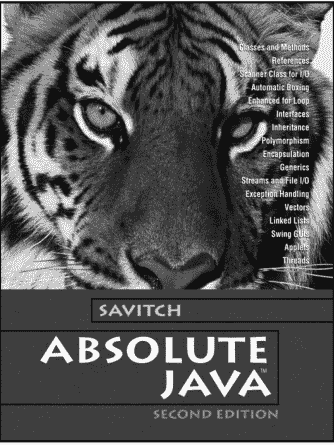

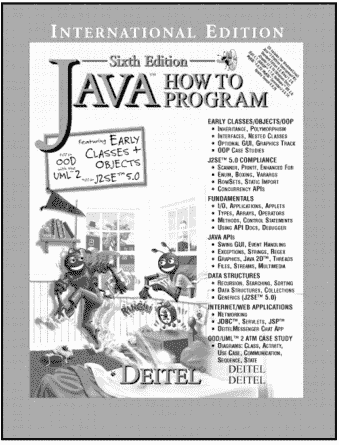

Walter Savitch
0321330242
£42.99
2005 年 5 月出版

Harvey Deitel
Paul Deitel
0131290142
£43.99
2005 年 1 月出版

- 兼容 JDK 5.0
- 内容全面详尽
- 终身参考佳作
- 为学生和讲师提供丰富的交互式在线资源
- 学生友好，全彩色，易于阅读的设计和排版
- 数百行真实代码和示例，展示具体做法

访问 *www.pearsoned.co.uk/bookshop/* 获取更多信息

# 想了解更多图形学内容？

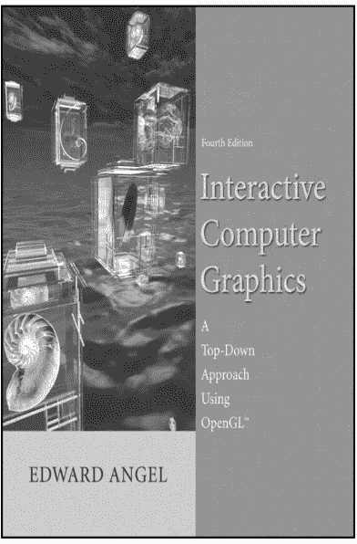

Edward Angel
0321321375
£44.99
2005 年 4 月出版

- 畅销、面向应用、介绍性的图形学书籍，使用 OpenGL — 2005 年修订版！
- 采用经过验证的"自上而下"、面向编程的方法教授核心概念
- 涵盖基础课程所需的所有主题，包括着色、建模和纹理映射
- 学生附加资源包括在线源代码
- 讲师资源包括在线解答、PowerPoint 图表和 PowerPoint 讲义

访问 *www.pearsoned.co.uk/bookshop/* 获取更多信息
