# HTML 和 JavaScript 交互式编程入门指南

> 此书献给我的妻子霍普和我的新女儿凯蒂，没有她们，我可能会睡得更多，但写得更少。
>
> 此书也献给我的父母奥蒂斯和罗西·纳克尔斯，他们的鼓励和支持让我完成了23年的正规教育并持续我的学术生涯。

## 前言

### 起源

1998年夏天之前，森林湖学院的学术创新小组呼吁提交新且创新课程的提案。我的提案要求“从零开始”介绍使用互联网进行编程。或许提出的特性中最重要的一点是，该课程应面向普通受众，包括主修艺术、人文和社会科学的学生。虽然面向普通受众的计算机科学课程已经存在，但它们主要侧重于计算机素养，而非培养任何重要的编程技能。

提案被接受后，我开始寻找合适的教材来构建这门课程。在低端，我找到了“互联网素养”类教材。这些教材用整章篇幅介绍电子邮件、新闻组和搜索互联网等主题。但这些技能是越来越多高中毕业生已经掌握的。在高端，像C++和Java这样的编程语言教材比比皆是，但它们是针对计算机科学专业学生的。事实上，此类课程常常让毫无防备的普通受众学生对计算机科学望而却步，而不是提供一个入门途径。实际上，学生通常发现这些课程比微积分更难。

介于两者之间，且完美适合普通受众的，是HTML和JavaScript。我找到的所有与这些主题相关的出版物都是参考书，其结构不适合支持大学课程。因此，在1998年夏天，我撰写了一份250页的手稿，作为新课程的基础。在98-99学年两个学期教授这份手稿的过程中，我根据哪些有效、哪些无效，对这本书形成了最终的设想。学生的反馈对于制定最终计划至关重要。

凭借这门经过课程检验的提案，我于1999年夏天与约翰·威立父子出版公司签订了合同。您现在看到的文本是在99-00学年撰写的，并再次在两个学期的课堂环境中进行完善。因此，这本书是整整两年课堂测试的成果。这门课程在校园内广受欢迎，无论是普通受众还是理科专业学生。事实上，庞大的等待名单导致开设了额外的课程。受欢迎程度甚至超出了学生群体，其他教授和秘书也参加了这门课程。我甚至收到学生家长的评论，他们喜欢这本书，并认为其内容很有价值。

### 谁应该读这本书？

答案很简单。任何希望在21世纪为自己装备知识的人。

## 覆盖范围概述

**第 1 课** 简要介绍了互联网的历史，并涵盖互联网和万维网工作原理的基础知识。互联网从 IP 地址、服务器、路由器和数据包的角度进行讲解。万维网则从 URL、Web 协议和域名的角度进行讲解。在此过程中，建立了互联网词汇的基本基础。

**第 2 课** 开始探讨互联网上各种类型的交互。这包括将网页传输到浏览器进行查看（`http`）、将网页传输到 Web 服务器以使其在互联网上可用（`ftp`），以及与 Web 服务器通信来设置密码（`telnet`）。第 2 课还探讨了 Web 服务器账户和公共目录的性质。如果无法使用 Web 服务器账户，本课的大部分内容可以省略。

第 3 课至第 8 课对 HTML 和网页构建进行了概念性介绍。HTML 的内容并非面面俱到，而是专注于在几乎所有浏览器中都能使用的 HTML 子集。此外，音频和视频等主题被省略，以便聚焦于基本概念。这些核心概念包括标签和属性的语法、链接和网站结构、图像的各种用途，以及使用表格和框架进行页面格式化。掌握这些概念为本书最后十节课提供了完美的图形用户界面基础，这些课程使用 JavaScript 编程来支持 HTML 表单和网页。虽然第 7 课提到了 HTML 编辑器的优点，但在本书的剩余部分中，使用编辑器仍然是可选的。但当采用编辑器时，第 3 课至第 8 课中介绍的核心概念恰好是熟练使用它所需的技能。

**第 3 课** 探讨使用基本 HTML 标签构建网页。介绍了 HTML 的基本语法。

**第 4 课** 探讨在 HTML 标签中使用属性来更精确地控制 HTML 标记指令。在此过程中，讨论了像素、十六进制颜色和字体。（附录 C 提供了十六进制颜色表示的完整详情。）第 4 课还包含一个可选章节，介绍样式表。

**第 5 课** 探讨网页中的超文本链接。探讨了 Web 集合的分层和线性链接策略。由于需要处理可能更大的文档集合，第 5 课还介绍了在 Web 服务器上更新网站的策略。命名锚点也进行了详细介绍。

**第 6 课** 探讨图像的性质以及图像在网页中的嵌入。在此过程中，探讨了不同类型的图像以及图像在网页中提供额外功能的不同方式。第 6 课以一个可选章节结束，涵盖了图像映射。

**第 7 课** 首先介绍列表，然后转向更重要的 HTML 表格概念。具体而言，表格用于为网页提供完整的布局结构。

**第 8 课** 介绍 HTML 框架作为另一种页面布局机制。这里比较和对比了表格和框架的不同功能。

本书的其余部分致力于讲解 JavaScript。同样，为确保全面的浏览器支持，本书遵循标准化的 JavaScript（和 JScript）子集。目标是将编程理论与应用相结合。事实上，对变量、判断、函数、对象、循环和数组的需求，是通过网页和 HTML 表单提供的图形用户界面以自然的方式引入的。在第 9–18 课中，掌握 HTML 基础知识的好处得到了充分展现。此外，由于第 3–8 课已经通过 HTML 提供了语法和编码的入门知识，因此过渡到真正的编程并不过于困难。

## 第 9 课

提供了 HTML 表单的概述，以及表单在获取用户输入方面的用途。此外，第 9 课探讨了 JavaScript 的性质及其在客户端-服务器模型中处理表单数据的作用。本课还指出 JavaScript 并非 Java。

## 第 10 课

正式介绍 JavaScript 以及使用变量存储用户输入。复杂的 HTML 表单对象结构尚未引入，而是使用提示框来获取用户输入。探讨了编写程序的本质以及潜在编程错误的类型。

## 第 11 课

探讨了 JavaScript 根据用户输入（同样通过提示框获取）进行判断的能力。判断功能既用于根据用户输入处理信息，也用于在用户提供不当信息时发出警报。

## 第 12 课

介绍了编程中使用对象的性质和语法。这一讨论在过渡到使用 HTML 表单获取用户输入方面被证明既宝贵又必要。通过文档对象模型介绍了几个实用对象。

## 第 13 课

转向使用 HTML 表单获取用户输入。本课介绍了用于获取文本输入的 HTML `input` 元素，以及使用 HTML 表单按钮调用 JavaScript 函数来处理输入。在此过程中，引入了局部变量与全局变量的概念。进一步强调了验证用户是否输入了正确信息的主题。

## 第 14 课

通过探讨复选框、单选按钮和下拉菜单，增强了 HTML 表单的输入能力。这些创建选项的表单元素进一步强调了 JavaScript 的判断能力。此外，第 14 课介绍了使用数组的必要性。

## 第 15 课

探讨了使用循环进行编程中的重复操作。循环的实用性通过处理更大的 HTML 表单而无需过多冗余代码的需求来加以强调。遍历 HTML 表单元素数组进一步探讨了数组的使用——对象数组。

## 第 16 课

介绍了手动创建数组及其用途。在本课之前使用的数组是在浏览器加载 HTML 表单时自动创建的。第 16 课中介绍的自定义数组的主要应用之一涉及从服务器预加载图像。预加载的图像数组用于在网页中循环显示图像等用途。

## 第 17 课

探讨了创建使用参数的自定义函数。读者从第 13 课起就已经在创建自定义函数，但那些是没有形式参数的函数。关于函数的详细讨论的应用包括在网页中创建图像翻转效果，以及创建函数来辅助验证的有效性。

为了增强表单验证功能，本书还介绍了 `String` 对象。

**第 18 课**是本书的最后一课，介绍了 JavaScript 的安全功能以及密码表单元素。讨论了 JavaScript 的安全缺陷，以及将 HTML 表单数据提交到服务器的相关必要性。课程探讨了提交按钮的使用，并利用隐藏表单元素将"清理后"的表单数据提交到服务器。本课不涉及服务器端编程，而是假设服务器端程序的存在，并进一步探讨了客户端-服务器模型的本质（在第 9 课中已作介绍）。多个示例和练习展示了将表单数据提交到本书网站上的服务器端 Perl 程序。

## 致教师：依赖关系与课程组织

下图展示了各课在内容覆盖方面的先修依赖关系。

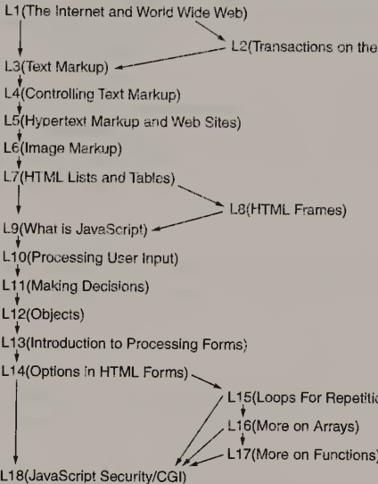

本书在内容覆盖方面具有灵活的设计。面向最广泛受众的课程需要在第 1 至第 8 课上投入大量时间和详细讲解，大约占半个学期。这类受众不仅在学习 HTML，同时也在增强其通用计算机技能。之后的目标是完成第 9 至第 14 课，如果时间允许再学习第 18 课。这为编程和对象的使用提供了循序渐进的入门介绍。最终目标是让学生获得对编程的感知，以及对 HTML 表单的本质和功能的理解。

如果希望更详细地讲解编程内容，则 HTML 课程可以更快地完成，大约用一个学期的三分之一时间。这种覆盖深度适合更高级的受众，或具有一定网页构建先验知识的学习者。

在完成第 14 课之后的任何时间点，都可以学习第 18 课，作为课程的合适总结。这样，可以涵盖尽可能多（或全部）所需的教学概念。最终目标是使学生精通编程基础，并全面掌握 JavaScript 在支持网页和 HTML 表单方面的能力。

乍看之下，本书在编程基础知识的安排上似乎有些跳跃。事实上，本书初稿在引入对象和 HTML 表单之前，对循环和数组等结构进行了更为详细的讲解。多位审稿人指出，这种方法未能让 JavaScript 的真正特色在教材前半部分就体现出来。JavaScript 的呈现方式类似于 Pascal 教材的风格。再加上过早引入更多编程结构所带来的额外负担，使得在分配的一个学期内充分讲解 HTML 表单变得困难。事实上，这种方法对最广泛的受众效果并不理想。学生虽然对编程有所感知，但对对象、HTML 表单以及 JavaScript 的实际应用能力却所知甚少。

当前教材的组织结构（如前所述）已被证明非常成功。这种方法不仅在为不同受众构建课程方面提供了更大的灵活性，而且确保了对 HTML 表单和 JavaScript 特色的覆盖。这种组织方式的一个意外收获是，函数、局部变量和数组的概念在第 10 至第 14 课中以非严格的方式进行了讲解。例如，需要通过调用自定义 JavaScript 函数来处理用户事件，并使用浏览器自动生成的 `elements[]` 数组来访问 HTML 表单元素。随后，第 15 至第 17 课以自然的方式和实际应用为这些概念增加了严谨性。最后，无论覆盖范围如何，第 18 课都为课程提供了自然的收尾。

*Craig D. Knuckles*

## 致谢

首先，我要感谢 Michael Ebner 教授、Richard Mallette 教授和 Carolyn Tuttle 教授在学术创新委员会方面的工作。没有他们的启发，我的想法很可能无法付诸实践。其次，感谢 David Yuen 教授，他从一开始就鼓励我的想法。这些建议来自一位知识渊博的人——我认为他算是一位导师，因此格外令人振奋。Edward Packel 教授在我开始构思课程设计时也提供了宝贵的倾听与建议。当然，我还要感谢 Lowell Carmony 教授、Robert Holliday 教授、DeJuran Richardson 教授和 Jill Van Newenhizen 教授在此过程中给予的精神支持。

我由衷感谢 Wiley 出版社的 Bill Zobrist，他相信这个项目并推动其启动。他在签署我的书之后不久便获得了晋升，这让我忍不住想把部分功劳归于自己，尽管我确信那只是巧合。在此之后，Paul Crockett 提供了非常及时且专业的帮助。我特别感谢他在我试图将一件 Ozzy T 恤印在封面人物身上时所展现出的外交手腕。此外，在整个写作和评审阶段，Jenny Welter 也给予了极大的帮助。

Petrina Kulek 是这部精心打磨的稿件得以面世的关键人物。将一份粗糙的手稿——其中不乏手绘图表以及大量分裂不定式等瑕疵——转变为成品，绝非易事。Katuna Avery 负责将那些不幸的副词从上述不定式中解救出来，并总体上对我的英文进行了规范整理。她的严谨细致令人钦佩。同时也要感谢 Anna Melhorn 和美术编辑们，他们将我的图表从模糊不清的困境中拯救出来。

在此向各高校审阅过稿件各阶段的专业同行们表示衷心的感谢，感谢他们的宝贵建议和意见。他们的许多建议都已体现在本书中。

最后要为我的好友 Steve Grodrian 和 Bryan Moore 鼓掌，感谢他们在友谊中长期的坚守。人生中为数不多可以依赖的事情之一，就是拥有一个真正的朋友。掌心向下，覆于紧握的拳上。

# 第1课

## 互联网与万维网

在开始这段互联网编程之旅之前，我们有必要对互联网和万维网的本质有一些了解。事实上，许多人将这两者视为同义词。但这显然不是事实。互联网诞生于20世纪60年代，而万维网（它依托于互联网）直到20世纪90年代初才问世。万维网使互联网的许多资源得以向普通大众开放。在万维网出现之前，互联网主要只对政府机构以及高校和科研院所的科学界开放。万维网及其使互联网公开可访问的能力已经席卷全球。事实上，万维网如此迅速而成功地渗透进我们的日常生活，这令人惊讶。如今，你几乎无法观看任何一个电视广告而不在屏幕底部看到"www.something.com"的字样。

本课的目标并不是让你成为互联网和万维网所有技术细节的专家，而是要为这两者建立一般性的理解。为此，我们面向普通读者，以直观、非正式的方式进行讨论，旨在促进对某些基本原理的理解，并在此过程中奠定本书将使用的互联网词汇基础。

## 1.1 互联网

随着电话在本世纪的普及，电话线和电缆的数量也与日俱增。事实上，如今地球几乎被它们缠绕。电缆横跨海底连接各大洲，穿越大陆连接各国和各州，在邻里之间纵横交错，宛如巨大的蜘蛛网。

它们如何传输信息？在传统的铜质电话电缆中，信息通过数量难以想象的电子流来传输。这些电子以极高的速度在电缆中飞驰。当一个人对着电话说话时，一股电子流——其模式和频率与所说的话独特对应——便飞速穿过这些电线传递信息，可能是跨越整个世界。

从时间的长河来看，相当晚近地，许多光纤电缆被加入了这个全球网络。这些光纤电缆以可见光流和其他频率的电磁辐射来传输信息，而非电子流。组成光的粒子（嗯，有点像粒子）称为光子，它们在光缆中以光速移动（每秒186,000英里——那可是相当快！）。尽管光速远大于电子在传统铜线电缆中的移动速度，但这并不是主要优势所在。即便使用传统的铜质电话电缆，信息传输也已经非常迅速。例如，你可以与亚洲的人通电话，几乎察觉不到延迟。

光纤电缆的最大优势在于传输过程中几乎没有能量损耗。在传统铜线中，笨拙的电子总是在撞击构成金属线核心的原子和分子。大量的能量以这种方式被耗散。但在光纤电缆中，光子几乎无阻力地移动。因此，海量信息可以通过光纤电缆传输，而几乎没有能量损失或信号衰减。

卫星甚至也加入了这一领域。它们可以在没有任何电缆的情况下将信息传送到世界各地。很少有人会质疑卫星将在未来全球通信中扮演重要角色。当然，卫星已经在间谍活动、科学研究甚至电视信号传输中广泛使用。但卫星传输最终可能会像传统电话电缆一样普遍。事实上，一家名为 Teledesic 的公司已经计划建立一个由841颗低轨道卫星组成的网络，将向地球上几乎所有地方传输信息，计划于2004年投入运营。

互联网流量是数字化的。它由0和1的字符串组成。你可能已经听到过一个术语——带宽，它与给定介质能够传输的数字信息量有关。高带宽通信介质一次能够传输比低带宽介质更多的信息。根据前面的讨论，光纤电缆的带宽远高于铜缆。正如我们将在本课后面看到的，带宽的考虑因素除了电缆或卫星类型之外还有其他方面，但传输介质无疑是一个主要因素。

无论采用何种方式，信息几乎可以在瞬间发送到世界各地。这就是互联网的基础——一个信息可以在全球范围内传递的世界。当然，在这种情况下，我们关注的不是传递电视信号或电话对话，而是计算机可用的信息——数字信息。有数量庞大的计算机连接到这个全球信息传输网络。这就是互联网的本质。它是一个由计算机及其可共享资源组成的全球网络。这些计算机从个人电脑到工业界和学术界使用的大型计算机不等。许多计算机仅用于访问信息，但也有很多专门用于提供信息。那些负责在互联网上提供信息的计算机通常被称为服务器——它们提供信息。

图1.1展示了现代互联网的图形化描述。当然，许多计算机在互联网上既提供资源又接收资源，但图1.1仍然是对现代互联网的一个良好可视化。你可能正在思考的一个疑问是骨干网这个术语，它出现在全世界纵横交错的电缆中间。这个术语常被用来描述互联网的基础设施，正是它使全球资源共享成为可能。

## 1.2 互联网简史

20世纪40年代中期，计算机还是庞然大物，内部装有数千个真空管，重量达数吨。事实上，大约在1946年宾夕法尼亚大学开发的ENIAC（电子数字积分计算机），就包含了18,000个真空管，重达60,000磅（30吨），占地面积（1,600平方英尺）相当于一栋中等大小的房子。

到了20世纪60年代，计算机的体积有所减小，尽管以今天的标准来看仍然庞大。在整个60年代，几乎所有计算机都由大学维护。然而，美国政府的许多机构，例如国防部，都在定期使用这些计算机。事实上，国防部在1969年创建了第一个可运行的互联网。

这第一个互联网主干网只有四台联网的计算机。它们分别位于加州大学洛杉矶分校、加州大学圣巴巴拉分校、犹他州和斯坦福研究所。当时，这些联网计算机被称为高级研究计划局网络（ARPANET）。图1.2描绘了演变成今天我们所知的互联网的第一个版本。

广泛流传的说法是，ARPANET是由国防部开发的，以便关键政府机构在核战争期间能够保持通信。最初的计划是在不同地点设置256台主机。到1971年，已有26台计算机接入ARPANET。在整个70年代，接入ARPANET的计算机数量往往每年翻一番。此外，在整个十年间，ARPANET的使用仅限于军方、大学和少数几家公司。到1984年，ARPANET已远超最初的计划，连接了约1000台主机。

1986年，联邦政府在互联网发展中扮演了更重要的角色，通过国家科学基金会的资金创建了NSFNET。NSFNET的目标是将所有计算机和工程研究人员连接到互联网。因此，在80年代末，出现了两个可行的互联网主干网：ARPANET和NSFNET。到1987年，互联网主机数量已超过10,000台。但很快（并投入了大量政府资金），NSFNET的规模和带宽都大大超过了ARPANET。到1989年已有约100,000台主机的事实，证明了NSFNET的快速扩张。事实上，在1990年，NSFNET登上了中心舞台，取代ARPANET成为互联网主干网。同时，1990年标志着首次无需政府机构的正式许可或赞助即可获得互联网接入。

很快，几乎每所学院和大学都接入了这个被广泛称为互联网的网络。许多企业现在拥有计算机，并发现互联网对于协调全国或全球的工作非常有用。在90年代，计算机变得非常小、速度非常快，而且相对便宜。实际上，普通家庭也能买得起。到1992年，互联网上的主机数量已超过1,000,000台。政府控制NSFNET主干网的成本变得过高，因此在1992年，互联网的控制权转移到了一个由IBM和MCI部分创建的非营利性公司。

大约在这个时候，万维网架构出现了，它提供了一种组织化的方式，使互联网上庞大的资源可以轻松移植到任何联网计算机上。现在，不仅科学家可以使用互联网，拥有个人电脑的普通人也可以。随着互联网使用的新便利，它的普及程度如野火般增长。如今，拥有互联网接入的计算机数量已达数千万台。在本书出版时，大多数估计认为这个数字已超过100,000,000。

## 1.3 内联网

人们经常在计算机术语中听到内联网这个词。我们在此选择简要论述，以区分内联网和互联网这两个术语。

图1.1表明，除了这个庞大的计算机网络之外，还有较小的、自成一体的计算机网络。右侧的五台计算机不仅连接到主干网，而且彼此连接。这样一组相互连接的计算机通常被称为内联网。另一个与内联网同义的常见术语是局域网，或简称为网络。如果切断与互联网主干网的连接，这组相互连接的计算机仍然是一个可行的计算机网络，但只有“内部”人员才能访问。因此得名内联网（前缀“intra”在拉丁语中是“在内部”的意思）。大型公司和大学的计算机系统就是内联网的绝佳例子。

在切断与互联网的连接后，内联网仍可以在很大程度上以相同的方式运行，只是范围局限在本地。在全球环境下能做的大部分事情，在本地都可以做到。一所大型大学的学生可以在不出校门的情况下，发送电子邮件、查看网页、传输文件和搜索数据库（如图书馆），而无需离开大学网络的范围。然而，一旦网络连接到互联网主干网，网络中的每台计算机都可以探索互联网上几乎无尽的资源。

所以，实际上，互联网基本上是一个巨大的网络之网络。大学、企业、图书馆等地的局域网可以作为独立的网络运行，但当它们连接到互联网主干网时，就构成了我们今天所知的互联网。

## 1.4 控制互联网流量（TCP/IP）

我们尚未提及的是互联网上的信息传递是如何协调的。考虑到目前互联网的规模，这可能是个巨大的问题。幸运的是，在互联网发展的早期阶段，这个问题就得到了解决。1982年，一套协议被采纳，用于帮助统一ARPANET，这套协议标准化了信息在互联网上传递的方式。这些协议实际上最早在1974年提出，但直到1982年才被正式采纳为标准。

通俗地说，协议是一种既定并被遵守的做事方式，是一套大家都遵守的规则。因此，互联网上的所有计算机都必须遵守既定的协议；否则，所有不同类型的计算机将很难相互通信和传递信息。这组协议被称为传输控制协议/互联网协议（TCP/IP）。这些术语听起来很专业，但它们只是协调了互联网上所有计算机的地址以及资源传递的方式。

大多数关于互联网的正式定义不仅包括如图1.1所示的全球网络，还包括管理它的TCP/IP协议。“信息高速公路”这个术语经常与互联网联系在一起。高速公路是传输信息的物理手段，而这些协议则有点像交通规则。想象一下，一个现代道路系统没有任何正式的交通规则来控制交通，那将会多么混乱！互联网协议旨在使互联网上的交通统一且有条理。

## 1.5 IP地址

互联网上的每台计算机都必须有一个地址。确实没有其他选择。如果无法找到存储特定资源的服务器，那么要在互联网上定位该资源将是不可能的。想象一下，一个城市里所有的房子都没有地址！

TCP/IP协议为计算机寻址提供了一个标准。这些地址被称为IP地址，其形式为

```
204.202.129.230
```

由四个用句点分隔的数字组成。通常，IP地址中的每个数字都必须在0-255的范围内。这给出了256的四次方种不同的可能互联网计算机地址。对于好奇的人来说，这意味着超过四十亿个可能的地址。

术语互联网主机通常用于描述任何可以访问互联网的计算机。但实际上，严格来说，互联网主机是一台具有固定IP地址的计算机。但是，如果互联网上的每台计算机都必须有一个IP地址，这不就是一回事吗？嗯，并不完全一样。除非你从学院、企业或其他大型组织获得互联网接入，否则你很可能是从互联网服务提供商那里获得接入。最常见的接入方式是通过电话调制解调器。你每月支付十到二十美元，就可以通过家中的电话调制解调器拨号连接互联网。在大多数情况下，这意味着你实际上没有自己的IP地址。以下是其工作原理。

服务提供商大约为每八到十位客户分配一个IP地址。因此，例如，一个拥有100,000位客户的大型服务提供商大约有10,000到12,500个IP地址。这些IP地址中的每一个都与一条电话线相关联。当你拨号并建立连接时，你的计算机就与分配给你所连接的特定电话线的IP地址相关联。下次你拨入时，你很可能会使用不同的电话线，因此也就获得了那个互联网接入会话的不同IP地址。

当估算互联网主机数量时，实际上只是在估算已分配出去的IP地址数量。因此，实际上，我们上面提到的互联网计算机数量估计为1亿，仅仅是在估算IP地址数量。如果我们从宽泛的意义上使用“互联网主机”，并估算可以访问互联网的计算机数量，那么这个数字将会大得多。

> **注意**
> 除了电话调制解调器之外，其他一些互联网接入方式正逐渐对大众变得可行，其中两种是数字用户线路（DSL）和电缆调制解调器。使用传统的电话调制解调器时，数字计算机信息被转换为模拟信号，以便信息可以像普通电话消息一样通过电话线传输到你的服务提供商。然后它被转换回数字形式，以便在互联网主干网上传输。即使使用56K调制解调器，这个过程也很繁琐且缓慢。
>
> 使用DSL或电缆接入时，信息从不转换为模拟信号。换句话说，你的计算机直接将数字信息发送到服务提供商。因此，互联网连接基本上是直接连接到主干网。使用DSL时，这是通过一条用于承载数字信息的特殊电话线实现的。事实上，你甚至无法在DSL线路上使用传统电话。使用电缆调制解调器时，数字信息通过有线电视线路发送。
>
> 这些服务类型的一个优势，与本节讨论相关，是你可以获得自己的IP地址。另一个优势是，这些服务类型提供的带宽远高于传统的电话调制解调器。但它们也更贵，大约每月50美元。

## 1.6 路由器和数据包

TCP/IP协议的另一个有趣特点是信息从一个IP地址传递到另一个IP地址的实际方式。假设，例如，一份冗长的MS Word文档需要从芝加哥的一台计算机传递到达拉斯的另一台计算机。这份文档首先被分割成小的数据包，每个大小约为1.5K或更小。为了便于理解，如果将本书的数字版本（包含所有图形）分割成数据包，可能会产生超过10,000个小数据包。每个数据包都标有芝加哥发送计算机和达拉斯接收计算机的IP地址，以及一些其他信息，这些信息用于在达拉斯重组文档时确定数据包的顺序。在传输途中，有一类被称为路由器的计算机负责引导数据包朝目标前进。路由器有点像邮局，它们接收一个数据包，然后决定接下来应该将其发送到哪里才能到达目的地。就像邮局遍布各地——几乎每个小镇都有，大城市里更是众多一样，互联网骨干网上也有无数的路由器，向四面八方发送数据包。

当路由器接收到一个数据包时，它会根据当前流量情况将其发送给另一个路由器，以优化其传输路径和当时互联网的整体交通状况。因此，一个特定的数据包可能并非走最短路径到达目的地，而是选择对整体互联网流量状况最有利的路线。一个恰当的类比是高峰时段的交通。在某个下午5点，你可能不会选择最短的路线回家，而是选择一条更长、迂回的路线以避开拥堵和烦恼（至少数据包之间不会互相生气！）。较长的路线距离可能更远，但耗时可能相同甚至更少。

也许这里最有趣的特征是，来自给定文件（比如从芝加哥传输到达拉斯的MS Word文件）的所有数据包，在旅途中不一定都一起传输。它们可能会在不同的路由器处被分开，最终走许多不同的路径。可以想象，其中一个数据包在前往达拉斯的途中可能经过加利福尼亚，而另一个可能经过纽约。这有点像跟着一个朋友去某个目的地，你在红灯处被拦下，而他们却顺利通过。如果你有地址，你最终应该还是能到达，但可能是走另一条路。这就是为什么所有数据包都标有我们上述提到的信息以及其他更多信息。如果文件的所有组成数据包不能全部到达，文件当然无法正确重组。

将文件分割成小数据包传输的概念是互联网效率的重要贡献者。假设文档到达达拉斯，但其中一个数据包在经过多个路由器的旅途中以某种方式损坏。没有必要通过互联网重传整个文档，只需重传损坏的数据包即可。这有助于保持流量平稳并顺畅流动。

## 1.7 万维网

在互联网上，世界基本上触手可及。嗯，不是整个世界，而是这个全球计算机网络所能提供的资源。互联网上的资源是海量的。不仅互联网上的内容数量令人难以置信，而且类型也多种多样。有可供浏览的网页、可下载的文件、可供搜索信息的数据库，以及等待电子邮件的人们，仅此数例而已。面对如此繁多的资源类型，就需要某种手段来处理所有这些不同类型。这就是万维网（WWW）发挥作用的地方。但在讨论WWW究竟是什么的细节之前，我们尝试说明其基本概念。为此，我们提供一个隐喻。

如今，坐在一台连接到互联网的计算机前，可能性似乎是无限的，几乎就像浩瀚的太空一样。（我们开始有点像《星际迷航》了。）互联网上的每台计算机都像那里的一颗行星。正如我们通过互联网来连接这无数的计算机，星际飞船“进取号”的船员们则依靠他们的星舰来抵达所有这些行星。关键在于“进取号”抵达某个遥远星球后的行动。他们通过进入轨道与该星球建立连接，然后与星球上的居民进行交流（当然是在“最高指导原则”允许的情况下）。嗯，“进取号”的船员们在与不同物种交流方面常常运气极好。这些物种通常会说英语，但当情况并非如此时，船员们配备了通用翻译器，可以在宇宙中任何两种语言之间进行翻译。没有这样的设备，“进取号”前往其他星球常常会徒劳无功。他们只会发现那里没有任何可以理解的东西。这些物种的资源和知识将无法获取。

同样，在互联网上连接到一台计算机只是成功的一半；我们的计算机必须与远程计算机进行通信。计算机之间的这种通信使得资源共享成为可能。但这并不像你想象的那么容易。正如“进取号”试图与之交流的物种多种多样，互联网上也有几种不同类型的计算机。我们所说的“种类”，指的是不同的操作系统。操作系统基本上是计算机内部使用的语言或系统。个人电脑使用Windows 2000（或'95或'98），Macintosh使用Mac OS，许多服务器类型的计算机使用UNIX或LINUX等操作系统。

那么，有一种通用的翻译设备可以使这种通信成为可能。没有这种翻译设备，我们在互联网上的旅行将像“进取号”试图在没有通用翻译器的情况下与各种外星人交流一样受限。这种设备就是统一资源定位符（URL）。显然，URL定位互联网上的资源（否则，它的名字就起得不好了！）。然而，URL的作用远不止于此，正如我们将看到的那样。

URL是一种使用一组协议在WWW上进行通信的设备。我们已经讨论了TCP/IP协议如何指导信息高速公路上的流量，但URL协议使得互联网上各种资源的共享变得切实可行。这些协议与TCP/IP有着根本的不同，它们在URL中的实现本质上定义了互联网的WWW方面。值得一提的是，URL并非像“进取号”的通用翻译器那样的机械设备，而是一种被普遍接受的通信标准。在URL出现之前，互联网上计算机之间的通信受到很大限制，就像没有通用翻译器的情况下行星间的交流会受限一样。无论是否是机械设备，URL连同被接受的协议确实提供了一种“设备”，使所有计算机能够在互联网上进行通信和共享资源。

图1.3中的表格列出了当今最常用的WWW协议。通过查看各个协议的目的，可以看出它们涵盖了网络上发生的一些最常见活动。它们可能并非都眼熟，但很可能大多数网络用户都使用过这些协议中的大多数，即使是无意之中。

| 协议 | 目的 |
|----------|---------|
| `http` | 传输网页 |
| `ftp` | 传输文件 |
| `telnet` | 远程登录 |
| `news` | 从新闻组请求新闻 |
| `mailto` | 发送电子邮件 |
| `file` | 本地文件访问 |

为了进一步说明网络是由URL和协议使其可访问的丰富资源这一概念，我们提供一个任何普通网络用户应该都熟悉的简单例子。我们上面提到，负责在互联网（从而也在网络）上提供信息的计算机被称为服务器。ESPN，一个主要的体育网络，拥有一个网络服务器，向全世界提供最新的体育信息。他们服务器的地址是`espn.go.com`。要访问他们的网站，特别是他们的NFL橄榄球页面，我们需要在如图1.4所示的网页浏览器的地址栏中输入URL `http://espn.go.com/nfl`。

图1.4中描绘的URL请求包含了使所需的橄榄球页面加载到我们浏览器中的所有必要指令。用外行话说，这个URL表示“前往`espn.go.com`上的服务器，并启动NFL网页的网页传输”。注意URL开头的`http`部分是图1.3中列出的网络协议，表示要传输一个网页。`http`是“超文本传输协议”的首字母缩写，其中“超文本”指的是超文本文档（网页）。

因此，从概念上讲，URL请求的形式是

```
how://where/what
```

其中“how”指定协议（事务类型），“where”对应某个服务器的地址，“what”指定在该服务器上寻求的特定资源。当前浏览器也可以使用图1.3中列出的大多数其他协议发出URL请求。尽管响应方法因协议而异，但基本思路是相同的：找到服务器，告诉它想要什么以及如何提供服务。

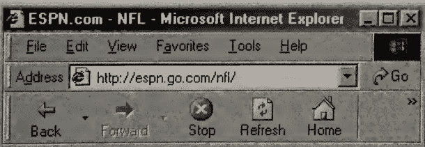

## 图 1.5 万维网的本质。

> **注意**

实际上，URL 远比这复杂得多。例如，当你在微软旗下 popular 的电子邮件服务商 "hotmail.com" 加载登录页面时，你会在浏览器的地址栏中看到一个类似这样的 URL：

`http://www.hotmail.msn.com/cgi-bin/sbox?js=yes`

这仍然遵循 URL 的基本格式，但在末尾携带了一些额外的信息。目前，当你看到这种额外信息时，不必过于关注。随着我们逐步学习本文内容，我们将逐渐了解更多关于 URL 的知识。

鉴于 URL 查询的 "how" 部分有多种协议可用，URL 可以发起网页传输以外的互联网事务。然而，我们将其他 Web 协议的讨论推迟到第 2 课，届时我们将特别探讨 "ftp" 与 "http" 的关系。

总之，万维网可以归结为大量拥有可用资源并理解 URL 及相关协议的服务器，以及无数连接到互联网、通过 URL 查询使用这些资源的浏览器计算机。参见图 1.5。

这种资源可用性的有序网络概念有助于证实 "万维网" 这一名称的合理性。它是世界性的，而互联网提供了连接的网络。URL 及其相关协议正是将互联网转变为统一可访问的世界信息资源万维网的东西。确实，图 1.3 中列出的协议支持涉及多种有用资源类型的全球事务。

## 1.8 互联网与万维网的区别

在日常口语行话中，"Web" 和 "Internet" 这两个术语经常被互换使用。事实上，在本书的剩余部分（接下来的讨论之后）中，我们也倾向于忽视这一区别，交替使用这两个术语。鉴于万维网作为互联网上主要力量的主导地位日益增强，未来这两个术语可能会合二为一。但是，在讨论了与互联网相关的 TCP/IP 协议以及 Web 协议之后，如果我们未能展示它们如何相互作用，那将是我们的失职。从本质上讲，这些协议是不同的。TCP/IP 互联网协议早在 20 世纪 70 年代就被用于指导互联网上的流量。相比之下，URL 和万维网协议直到 20 世纪 90 年代才被广泛使用，以协调构成互联网流量的资源类型。但是，正如我们即将看到的，它们确实在某种程度上相互作用。

## 1.9 命名地址和域名

Web 作为一个用户友好的实体，冗长的数字 IP 地址似乎不太适合。确实，想象一下 ESPN 在电视广告中宣传其网站时使用口号 "只需登录 204.202.129.230 获取所有最新体育新闻"。我们相信这种做法的缺点显而易见。也许那个背诵了 π 前 40000 位的印度人会在这套规则下茁壮成长，但普通网民不行。

在 Web URL 中使用命名地址的惯例使网上冲浪变得更加务实。字符字符串 `espn.go.com` 就是命名地址的一个例子。事实上，ESPN 的服务器至少有两个地址，一个数字 IP 地址和上述命名地址。其服务器的数字地址可以像其数字 IP 地址一样发挥相同的作用。URL

```
http://204.202.129.230/nfl
```

可以像我们在上面举例使用的 URL

```
http://espn.go.com/nfl
```

一样打开 NFL 橄榄球页面。我们选择使用"命名地址"这一术语，以便与"IP 地址"这一术语形成更明确的对比。命名地址更常见的同义词是域名。因此实际上，命名地址和域名是同一回事。这个术语并不那么像一个实际的计算机地址，但它非常适用于网站的概念。一个特定的网站可以比作一个域名。例如，位于 `espn.go.com` 的所有 ESPN 网页可以被视为构成其 Web 域名。

IP 地址基本上是免费的，而域名必须购买。有许多公司可以为你注册域名，收取少量费用。我们在互联网上快速搜索了一下，发现有数家公司非常乐意为你注册域名，费用从 25 美元到 75 美元不等。之后，每年必须向 InterNIC（INTERnet Network Information Center，互联网网络信息中心）——域名管理机构——支付 35 美元的年费。问题在于，许多域名已经被占用了。例如（令我们沮丧的是），"knuckles.com" 已被加拿大的一家体育用品店注册。事实上，最近出现了一种趋势，即投机分子（网络投机者）大量购买可能受欢迎的域名，例如 "drugs.com"，即使他们无意自己使用该域名。很容易找到可能令人垂涎的域名出售网站。许多域名被网络投机者标价数万美元出售。

> **注意** 命名地址不区分大小写。这意味着在 URL 请求中，`ESPN.go.com` 和 `espn.go.com` 的效果一样。这服务于一个非常重要的目的。企业用大写字母宣传他们的网站以突出其名称，使其从地址的 "www." 和 ".com" 部分中脱颖而出，这并不罕见。如果必须记住域名以及哪些字母是大写的，那简直是一场噩梦。即使你记住了组成域名的字符，你也可能浪费大量时间 trying to find the web site。域名的大小写不敏感性使 Web 更加用户友好。

## 1.10 域名服务器

为了促进使用 IP 地址和域名对互联网主机和 Web 服务器进行这种双重寻址，幕后还有另一种类型的服务器。它被恰当地称为域名服务器（DNS）。一个简单的例子就足以解释 DNS。假设你通过以下 URL 请求

```
http://espn.go.com/nfl
```

从你的浏览器发送，通过在浏览器的地址栏中键入它，或者简单地点击 ESPN 主页上的橄榄球链接。由于互联网骨干网上的所有路由都是通过 IP 地址处理的，因此在骨干网上导航之前，命名地址必须转换为 IP 地址。这正是域名服务器的工作。图 1.6 大致展示了你的请求如何被处理，以便穿越骨干网获取所需的网页。

通常，计算机网络被认为是一组链接的大学或企业计算机。但即使你在家使用互联网服务提供商，你也在某种程度上处于网络中。连接到你的服务提供商本地办公室的所有计算机都可以被视为一个网络。即使你的 URL 通过调制解调器然后通过电话线到达提供商的本地办公室，图 1.6 仍然合理地描述了在骨干网上旅行之前必须发生的事情。

## 1.11 域名与 Web 服务器

除了域名相对于 IP 地址的明显优势外，还有另一个好处。一个 Web 服务器可以有多个域名，但只有一个数字 IP 地址。这样不同的网站可以在同一台服务器上运行，但可以有区分开来的命名地址。

例如，考虑一个假设的 Web 服务器，为两位不同的美国参议员提供网站服务，比如 SenatorA 和 SenatorB。假设该服务器的 IP 地址为 123.1.2.3。现在每个网站都有自己的域名，比如 `www.senatorA.gov` 和 `www.senatorB.gov`，这样两位参议员就可以轻松宣传他们的网站。两个网站需要分别保存在服务器上的单独文件夹（目录）中，这样，例如，对 SenatorA 页面的请求就能调出正确的页面。否则，如果两位参议员的页面保存在同一个目录中，服务器如何知道该为 SenatorA 调出哪个页面，又该为 SenatorB 调出哪个页面呢？所以，从广义上讲，域名对应于服务器上的一个目录，该目录包含该域名（网站）的所有网页。图 1.7 说明了这种情况。我们选择将此类目录称为各自域名的根目录。SenatorA 的所有网页都存储在他/她的根目录中。

正如我们在与图 1.6 相关的讨论中所看到的，一旦 URL 请求通过本地路由器，它就使用目标服务器的 IP 地址在互联网骨干网上导航。那么，如果 DNS 将 `www.senatorB.gov` 和 `www.senatorA.gov` 这两个请求都只转换为 IP 地址 123.1.2.3，当请求到达服务器时，如何调出适当的页面呢？换句话说，如果 DNS 执行以下转换：

```
http://www.senatorA.gov  -------------->  http://123.1.2.3
http://www.senatorB.gov  -------------->  http://123.1.2.3
```

关于请求针对哪个网站或根目录的信息就会丢失。显然，DNS 转换必须同时包含服务器的 IP 地址和被请求的特定域名。实际上，这种域名到 IP 的转换非常复杂。细节最好留给网络专家。下面，我们提供一个简单的（缺乏技术细节的）解释，说明不同的域名如何有效地引用同一 IP 地址上的不同根目录。此外，我们这种构想出来的概念化方法进一步强调了 URL 的本质特性。

理解这种转换的一个简单方法是记住 URL 的形式是 "how://where/what"，但例如 URL `http://www.senatorA.gov` 似乎只携带了两条信息，"how://what"。那么，域名必须以某种方式包含 "where" 和 "what" 信息就是合乎逻辑的。因此，在各自参议员的页面请求到达骨干网之前，DNS 执行转换，以

## 1.12 WEB 服务器账户

可以认为

```
http://www.senatorA.gov  ----------->  http://123.1.2.3/senatorA
http://www.senatorB.gov  ----------->  http://123.1.2.3/senatorB
```

换句话说，购买域名时，每个域名必须在某种意义上与IP地址以及根目录相关联。这样，大致等同于前述的转换可以使多个域名访问一台服务器并找到正确的根目录。

在一台服务器上托管多个域名的情形中，如图1.7所示，缺点是需要为所有参议员支付命名地址的费用。但考虑到域名相对便宜（除非被网络抢注者抢先），资金不太紧张或只需要少量不同域名时，拥有独立域名的简洁性和清晰性是有优势的。然而，在许多（也许是大多数）情况下，拥有独立域名根本不切实际。考虑一所学院或大学，每位学生在Web服务器上都有自己的空间用于个人网站。在这种情况下，每位学生必须在服务器上有自己的目录来存放网页。由于有数千名学生，且学生的更替率大约为四年（我们希望如此），为每位学生购买域名简直是荒谬的。

虽然上述服务器设置确实强调了域名的实用性，但迄今为止最常见的服务器设置是为服务器设置一个主域名，然后将该服务器上不同网站的请求简单地分流到不同目录中。一个具体的例子应该足以说明这种情况。假设Danny Jones是Web大学（UWeb）的一名学生。（以防你疑惑，那是一所假想的大学。）在这种情况下，"www.uweb.edu"是注册给UWeb服务器的主域名。当然，"www.uweb.edu"实际上只是服务器真实IP地址的命名别名。在本例中，为免歧义，我们 simply 将服务器称为"www.uweb.edu"，而不是其IP地址。

现在每位学生需要在"www.uweb.edu"上拥有一个账户，以便全世界都能访问他或她的网站。为此，每位学生被分配一个用户名，可能是名字和姓氏的某种组合，比如Danny Jones的"djones"。（构建用户名没有广泛的约定。例如，"jonesd"同样适用。因此，为避免这种不一致，我们将用户名称简化为仅使用姓氏。）

解决方案相当简单。在服务器上的某个位置为每位学生设置一个根目录（文件夹）。通过将学生的用户名附加到URL末尾来访问该目录。例如，要访问Jones在"www.uweb.edu"上的域，需要以下URL

```
http://www.uweb.edu/jones
```

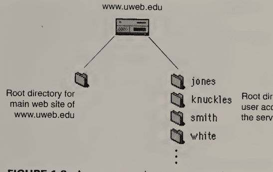

图 1.8 具有多个账户的常见Web服务器设置。

> 通常，"~"符号需要置于用户名之前。这个符号称为"波浪号"（发音为"till-da"），许多Web服务器要求使用它。因此，根据Web服务器的类型，可能需要以下URL

```
http://www.uweb.edu/~jones
```

才能访问Jones的账户。

注意，上述URL再次遵循了"how://where/what"的一般概念。这里的"what"是所有不同的学生（和教职员工）。其他学生的网站可以以类似方式访问。敏锐的读者可能会想，如果我们省略what，只发出请求

```
http://www.uweb.edu
```

会怎样。服务器上 simply 有另一个根目录（文件夹），这样的请求会默认指向该目录。在本例中，它就是UWeb的主网站。这种情况如图1.8所示。将网页放入这样的目录实际上需要进一步讨论Web协议，我们将其推迟到第2课。还要注意，AOL等互联网服务提供商也必须给每位客户分配用户名和他/她自己的根目录，类似于图1.8的描述。

## 1.13 域名后缀

到目前为止，我们已经提供了几个域名的例子，但它们都有一个区别，即它们的后缀不同。我们见过的三个后缀是".com"、".gov"和".edu"。从例子的上下文中应该能够推断出这些后缀的功能。ESPN是商业组织，假设的参议员页面与政府相关，UWeb是教育机构。不仅有针对不同组织类型的后缀，还有针对不同国家的后缀。图1.9给出了一些常见的组织后缀和一些国家后缀。国家后缀相当多，因此我们选择只列出几个大国来传达概念。举个简单的例子，印度某地的一家餐厅的网站可能拥有"www.goodcurry.in"这样的域名。

| 后缀 | 用途 |
|---|---|
| com | 商业网站 |
| edu | 教育机构 |
| gov | 美国政府机构 |
| net | 网络组织 |
| org | 非营利组织 |

| 后缀 | 国家 |
|---|---|
| ca | 加拿大 |
| au | 澳大利亚 |
| ch | 中国 |
| gb | 英国 |
| in | 印度 |

图 1.9 一些常见的域名后缀。

## 1.14 小结

### 关键术语

- 互联网
- 带宽
- TCP/IP
- URL
- DNS
- 域名
- 万维网
- 服务器
- IP地址
- `http`
- （域的）根目录
- 内联网
- 骨干网
- 数据包
- 命名地址
- 用户名
- 网络
- 协议
- 路由器
- 域名后缀

互联网是所有电缆（和卫星）以及这些电缆连接在一起的全球网络中所有计算机的集合。其中许多计算机也在本地网络中相互连接，通常称为内联网。内联网是计算机的本地网络，可以以类似于互联网上计算机的方式交换信息。内联网通常连接到互联网，使内联网的计算机能够访问互联网的全球资源。

协议基本上规定了在互联网上做事的标准化方式。TCP/IP协议设定规则，使互联网上的流量顺畅流动。TCP/IP协议的一个特点是为互联网主机设定标准，要求以统一的方式使用IP地址进行寻址。这样，当信息进入互联网骨干网（构成互联网"脊柱"的路由器和电缆系统）时，可以轻松找到目标计算机。TCP/IP的另一个特点是将数字信息分解成小的数据包在骨干网上传输。骨干网上的大部分流量现在由大带宽介质（如光纤电缆）处理。带宽基本上是指介质在给定时间内可以传输的数字信息量（如果你愿意，也可以说是数据包的数量）。

万维网（WWW）基本上是由另一组协议实现的。我们 simply 将这些称为WWW协议。这套WWW协议规定了查看网页、传输文件、发送电子邮件等的标准化格式。WWW的伟大推动者之一以及这些协议的实现是统一资源定位符（URL）。URL是一段简洁的信息，用于找到服务器并告诉服务器提供什么内容以及如何提供。服务器，在这种情况下实际上是Web服务器，是致力于在互联网上提供信息的计算机。Web浏览器发送给服务器以请求网页的URL指定了超文本传输协议（`http`）。

为了使URL请求对用户友好，Web服务器除了必需的IP地址外，还被赋予命名地址。通常，使用命名地址（如"www.uweb.edu"）来访问给定的网站。但是，由于一台Web服务器可以托管多个网站，命名互联网地址通常被称为域名。换句话说，一台Web服务器可以托管多个网站（域），每个网站都有自己的域名。为了跟踪所有这些，URL请求在骨干网上传输之前由域名服务器（DNS）处理。DNS将各种域名与正确的IP地址相关联，以便请求能够真正找到正确的计算机，进而找到正确的域。

为了使各个网站保持独立，每个网站通常被赋予服务器上自己的根目录。换句话说，构成一个网站的所有网页都保存在服务器上的一个特殊目录（文件夹）中，即该域的根目录。并非每个域都有自己的命名地址，毕竟那需要花钱。多个域存在于一台服务器上，全部绑定到同一个域名，这是常见的情况。在这种情况下，每个域都有一个用户名，例如"jones"。为了访问该域，将用户名附加到URL请求中域名末尾，例如"http://www.uweb.edu/jones"。

最后，为了对域名进行一定程度的分类，使用了域名后缀。域名后缀是命名地址的最后部分。不同类型的组织被赋予不同的后缀。例如，".com"是迄今最常见的。每个国家也有自己的域名后缀。

## 1.15 复习题

在大多数情况下，仅从课程小结来回答这些题目是不够的。

1. 数字信息如何通过光纤电缆传输？信息如何通过传统的铜缆传输？给出光纤比铜缆带宽更高的两个原因。
2. 计算机首次制造于哪个十年？互联网诞生于哪一年？第一个互联网版本中有多少台计算机，它们位于地理上的什么位置？它被称为什么？
3. 什么时候可以首次无需政府组织赞助就能获得互联网接入？什么时候互联网的控制权移交给了私营企业？
4. 互联网主机的定义是什么？为什么不是每台接入互联网的计算机都是正式主机？DSL连接与传统的电话调制解调器服务提供商有什么区别？
5. 描述在骨干网上以数据包形式发送信息而不是一次性发送的两个优点。
6. 互联网协议与Web协议在根本上有什么不同？
7. IP地址和命名地址哪个是免费的？说出命名地址相对于IP地址的一个优点。一台计算机拥有多个命名地址有什么目的？
8. 用例子描述URL的基本结构。
9. URL请求在骨干网上使用命名地址还是IP地址进行导航？解释DNS的功能。
10. 什么是域？这与计算机上的文件目录有什么关系？
11. 域名区分大小写吗？

## 1.16 练习

1. 咨询在你的机构或从你的服务提供商那里设置Web服务器账户的相关事宜。
2. 前往本书网站上的第1课部分，使用那里的资源查看你的名字是否已注册为域名。以"www.name.com"的形式尝试你的名字和姓氏。
3. 前往本书网站上的第1课部分，使用那里的资源查找以下网站的IP地址

"amazon.com" 和 "yahoo.com"。在浏览器的地址栏中输入这些 IP 地址，无需使用它们的域名即可访问这两个网站。

4. （a）通过在浏览器地址栏中输入 URL "http://espn.go.com/mlb" 来访问 ESPN 上的美国职业棒球大联盟网站。

（b）通过在浏览器地址栏中输入 URL "http://espn.go.com" 来访问 ESPN 的主页。

（c）从您在第（b）部分加载的主页中，点击美国职业棒球大联盟的链接。注意这会导致浏览器地址栏发生的变化，以及它与您在第（a）部分中所做操作的关联。

（d）在查看棒球页面时，转到浏览器的地址栏，删除 URL 末尾 ".com" 之后的所有内容。然后按键盘上的回车键。

## 互联网研究问题

如果布置了其中一个（或多个）研究问题，可以将其作为第 2、3、4 课练习中构建网页的主题素材。它们应该使用文本编辑器撰写并保存以备后用。研究应通过信息网站的 URL 来支持。研究不必详尽（信息网站就是为此目的而存在的），但大约一页纸的篇幅应该足以回答问题。所谓"足以"，我们的意思是，让完全不知道答案的人通过阅读您的作品能够了解大概。具体细节可以通过您收集的 URL 在信息网站上进行引用。

1. 某些 URL 包含的信息比我们本课中概述的更多。研究并讨论"查询字符串"的性质，并提供一个具体示例。
2. 研究并讨论各种电话调制解调器速度。这些与 DSL 调制解调器、电缆调制解调器、ISDN、T1、T2 和 T3 连接相比如何？
3. 本书网站第 1 课部分引用了一个转换器，用于在 IP 地址和域名之间进行转换。找出 "www.lfc.edu" 和 "math.lfc.edu" 的 IP 地址。什么是 IP 地址的 A 类、B 类和 C 类许可证？推测一下这如何适用于 "lfc.edu" 域名。
4. 研究并讨论互联网主机增长的统计数据，以及骨干网传输数据包数量增长的统计数据。
5. 研究并讨论互联网上使用的网络服务器的数量和类型。具体讨论每种类型服务器的估计比例。
6. 研究并讨论骨干网上传输的数据包大小的统计数据。
7. 研究并讨论骨干网上路由器的性质。具体使用的是什么类型的计算机，由谁制造？
8. 研究并讨论域名和路由方面"分层解析"的含义。
9. 查找并为几个讨论国家域名后缀的网站编制索引。列出一些本课中没有列出的后缀。找出 10 个站点的命名地址，每个站点使用不同的国际后缀。
10. 研究并讨论互联网商业税收方面的问题。当前的实践和法律是什么？
11. 研究并讨论互联网言论自由方面的问题。
12. 找到至少两种可用于在个人电脑上阻止色情互联网内容的产品。它们是如何工作的？
13. 每个搜索引擎只索引互联网上相对较小百分比的网站。找出表明哪些搜索引擎最好的统计数据，以及给出几个主要搜索引擎大致百分比的统计数据。
14. 了解什么是元搜索引擎，并给出几个例子。对于每个例子，列出其附属搜索引擎。

## 1.17 项目线程

这些项目线程中的每一个都会生成一个结构化的网站，其页面利用了本书涵盖的大部分内容。两个线程在第 8 课后合并，并在整个 JavaScript 编程课程中以共同的水平运作。当可以使用 Web 服务器上的账户时，它们尤其理想。否则，网站可能会变得太大，无法放入 1.44 磁盘。但是，如果使用更大的磁盘（例如 100 兆的 zip 磁盘）是可行的，则 Web 服务器不是必需的。

### 线程 A

该线程从第 2 课开始。它以开发主页和索引所有练习的家庭作业页面为特色。读者对主页的主题内容有自由裁量权。它确实包括利用一个或多个上述研究问题的自由裁量权，但并不要求必须使用它们。

### 线程 B

该线程以类似于线程 A 的方式展开，但更侧重于特定练习而非主页。

### 作业

完成上述一个或多个研究问题。

# 第 2 课

## 网络上的事务

在了解了互联网与万维网之间的区别之后，我们必须学习资源实际上是如何在互联网上定位和传递的一些基础知识。我们都知道如何启动 Web 浏览器并开始点击链接。但理解正在发生的事情是另一回事。此外，点击链接可以启动的事务类型是有限的。为了将网页放到 Web 服务器上并使其能够被大众访问，必须探索除"http"之外的其他 Web 协议。为了实现这一目标，我们首先讨论计算机平台以及一些相关的术语。然后，我们展示几个非常简单的网页示例，并探讨它们如何通过各种协议在互联网上传输。所谓简单的网页，我们不一定意味着您将理解制作实际页面所需的所有符号，而是说这些网页基本上是最简单的。我们只需要具体的网页示例，以便探索它们的传输过程。我们将在第 3 课中转向制作网页的实际细节。

## 2.1 平台独立性

所谓计算机平台，我们指的是计算机使用的操作系统。具体而言，我们关注的是微软的 Windows 2000（'95 或 '98）和苹果的 Macintosh OS。许多受欢迎的计算机品牌（仅举几例：康柏、戴尔和惠普）使用微软的 Windows 操作系统。我们称这些为 PC。苹果计算机使用 Macintosh（Mac OS）操作系统。我们简单地称这些为 Mac。还有其他几种类型的操作系统，但上述两种是个人计算中最常用的。

诸如 Microsoft Word（MS Word）之类的软件程序通常被称为应用程序。应用程序基本上是为完成某些任务而编写的计算机程序。常见的应用程序类型包括文字处理器、电子表格和 Web 浏览器。为 PC 制作的软件无法在 Mac 上运行，反之亦然。例如，微软是制作 MS Word 文字处理器的软件公司，它必须制作两个不同的版本，PC 版本和 Mac 版本。这几乎适用于任何软件。您根本无法为一个平台制作的应用程序安装到另一个平台上。因此，应用程序通常被称为平台依赖的。应用程序仅仅是一个便捷的例子；平台依赖性远远超出了应用程序的范畴。Mac 和 PC 根本不能很好地共享资源。

当您在给定平台上打开应用程序并希望执行某些操作时，您可以创建一个新文件，工作一段时间，然后保存文件。例如，您可以打开 Word Perfect 并创建一个名为 "termpaper.wp" 的文件，在其中您辛勤地写作，试图取悦您的英语老师。文件在很大程度上是依赖于应用程序的。也就是说，一个应用程序创建的文件通常无法被其他应用程序读取。例如，如果您尝试用 MS Word 打开 Word Perfect 文件 "termpaper.wp"，您要么会收到某种不兼容的消息，或者如果 MS Word 确实打开了该文件，您可能会看到乱码而不是文件的预期内容。有特殊的翻译器可供不同文字处理器使用文件，但这不是重点。不同的应用程序只是以不同的方式格式化文件。像 ".wp" 这样的后缀附加到文件名末尾，以帮助区分文件。因此，例如，Word Perfect 文件通常以 ".wp" 或 ".wpd" 结尾，而 MS Word 文件通常以 ".doc" 结尾。鉴于应用程序之间的这种不兼容性，像 ".wp" 和 ".doc" 这样的后缀当然有助于人们跟踪哪些类型的文件是哪些。然而，值得注意的是，这些后缀不如以前那么重要了。如果您将文件目录视为图标而不是单纯的文件名，通常可以通过图标的图片推断出创建文件的应用程序。事实上，在运行 Windows 的 PC 上，文件后缀通常会被隐藏，以图标代替。

让我们总结一下。文件大多是依赖于应用程序的，应用程序是依赖于平台的。因此，根据三段论逻辑，文件大多也是依赖于平台的。确实如此，但这只是因为"大多"这个词。有一种非常常见的文件类型超越了计算机平台，即 ASCII 文件。ASCII 是一个缩写，代表美国信息交换标准代码。ASCII 文件基本上只能包含那些您可以用标准键盘输入的符号，以及少量特殊字符。ASCII 文件不使用粗体、斜体、花哨字体和其他类型的文字处理花招之类的东西。简而言之，ASCII 文件基本上遵循包含人类可读信息所需的最小标准。

最常见的 Web 浏览器 Netscape 和 Internet Explorer 是应用程序，因此是平台依赖的。例如，微软必须为 PC 和 Mac 制作两个不同版本的 Explorer。但这里的关键是，Web 浏览是平台独立的。不，我们并没有自相矛盾。我们说的是 Web 浏览是平台独立的，而不是浏览器本身。无论您坐在 Mac 还是 PC 前，您都可以访问相同的网页、查看您的电子邮件，或者温习您最喜欢的新闻组。事实上，这种独立性帮助 Web 变得像今天一样受欢迎。主要原因是浏览器开发人员遵守了基本的 Web 协议。具体而言，聚焦于"http"和网页，这意味着所有浏览器都使用 ASCII 类型的文件来制作网页，而这些文件是超越平台的。

网页能够超越平台的另一个原因是，Mac 和 PC 都有某种意义上最小的应用程序，它们生成 ASCII 文件。在 Mac 上，这样一个应用程序叫做"Simple Text"，在 PC 上，这样一个应用程序叫做"Notepad"。因此，任何了解 HTML 的人都可以坐在任一类型的计算机前创建文件，而运行在任一类型计算机上的浏览器都能够将其制作成网页。您甚至不需要购买任何花哨的软件。我们将不再继续使用 ASCII 这个术语来描述这种基本文件类型，而简单地将它们称为文本文件。

这种多功能性不仅促进了万维网的发展，也帮助麦金塔电脑在90年代初度过了一段艰难时期。在那段时期，大多数软件开发人员都忙于为个人电脑开发应用程序。嗯，为了赚钱，这很合理：绝大多数人都在使用个人电脑。许多人对购买麦金塔电脑持谨慎态度，因为确实存在软件开发不足的问题。随着90年代中后期网络的增长以及平台问题带来的限制相应减少，麦金塔电脑已经相当漂亮地实现了反弹。万维网在很大程度上已经超越了平台问题。

## 2.2 HTML 文档

如上所述，网页是由普通文本文件生成的。它不需要某个花哨应用程序创建的某种特殊类型的文件。事实上，我们建议读者根据使用的是麦金塔还是个人电脑，分别使用“Simple Text”或“记事本”来创建网页。确实有专门用于创建网页的编辑器，但只有在了解了 HTML 基础知识之后，才应该使用 HTML 编辑器。在能够熟练利用此类编辑器的所有功能之前，必须先掌握一些基本原理。

图 2.1 展示了你能想象到的最基本的 HTML 文件。这是一个名为 "simple.html" 的文本文件，是用“Simple Text”创建的。目前，我们不会关注文件的内容，而只关注 "simple.html" 是一个非常简单的 HTML 文件这一事实。然而，我们会指出，文件的内容可以很容易地用标准键盘生成，正如你对纯文本文件所预期的那样。另外，我们再次提到 HTML 代表“超文本标记语言”，图 2.1 中的奇怪符号是 HTML 语言的一部分。此时不要关注 HTML 的细节，只需知道 "simple.html" 将创建一个简单的网页即可。

"simple.html" 变成网页所需要的只是一个浏览器。这个区别当然值得注意。文件 "simple.html" 本身不是网页，它只是一个由“Simple Text”生成的、文件名以 ".html" 为后缀的文本文件。请注意，这个文件同样可以用个人电脑上的“记事本”轻松创建。只有当 "simple.html" 被浏览器打开时，它才变成一个网页。HTML 文档实际上与它所创建的网页完全不同。正如上面关于文件后缀有助于区分文件的讨论，任何旨在成为网页的文件都应该具有 ".html"（或 ".htm"）后缀。还有其他后缀在使用，但那些是针对特殊类型的 HTML 文档的。

```
<HTML>
<HEAD>
</HEAD>
<BODY>
I need a browser to
become a web page!
</BODY>
</HTML>
```


像 Word Perfect 和 MS Word 这样的应用程序创建的文件不是基本的文本文件。它们包含格式化功能，可以创建精美的文本、表格和列表，以便信息能够以有序且美观的方式显示。因此，如果你将 "simple.html" 的内容复制并粘贴到 Word Perfect 或 MS Word 文件中，然后尝试将生成的文件加载到网络浏览器中，你很可能会失败。这类文字处理文件携带着网络浏览器不需要的额外格式化包袱。正如我们将在第 3 课中看到的，网页中的格式问题是由 HTML 代码（其中一些出现在 "simple.html" 中）处理的，而不是由花哨的文本选项处理的。然而，当前版本的文字处理软件确实具有可以创建 HTML 文件的特殊功能，但为了学习目的，我们最好还是坚持使用“Simple Text”和“记事本”。

## 2.3 file 协议

那么，上面的文件 "simple.html" 是如何变成网页的呢？正如我们已经指出的，答案很简单。只需在浏览器中加载它。回想一下图 1.4 中的 URL 示例，你可能想到的是某种 "http" 事务。毕竟，它是一个 HTML 文档。这当然是正确的思路，但这里的关键问题是：“文件 'simple.html' 位于何处？”如果它位于远程网络服务器上，比如 "www.somewebserver.com"，那么来自你浏览器的、形如 "http://www.somewebserver.com/simple.html" 的 "http" 类型 URL 请求当然是合适的。然而，将 "simple.html" 变成网页并不要求它必须在网络服务器上。

当你创建像 "simple.html" 这样的文件时，通常是在你的个人电脑上完成的。事实上，"simple.html" 可以很容易地在一台甚至没有连接到互联网的计算机上创建。这有点像你写一篇学期论文。你坐在电脑前，输入那该死的东西，然后甚至在考虑提交给老师看之前就做一些编辑。只不过，当你把 HTML 文档放在网络服务器上时，情况更糟：全世界都可以打开并看到它。因此，在将文件发布出去之前，在本地创建并编辑它是有优势的。现在，"simple.html" 是最基础的，不需要编辑，但对于更复杂的 HTML 文件，情况并非如此。许多小错误都可能导致网页无法按预期显示，甚至根本无法显示。

浏览器用来在本地加载 HTML 文件的协议是 "file" 协议。当我们说本地时，指的是在你的个人电脑上。它甚至不需要连接到互联网。"http" 协议用于通过互联网传输 HTML 文件和其他相关资源，而 "file" 协议则用于在本地直接从计算机的硬盘驱动器内存加载 HTML 文件。最简单的说明方法是举个例子。假设 HTML 文档 "simple.html" 保存在你的个人电脑（无论是 PC 还是 Mac）的硬盘上。你只需使用浏览器的“文件”下拉菜单中的“打开文件”选项，将该文档加载到浏览器中即可。

有一些快捷方法可以在本地将文件加载到浏览器中。例如，在 Mac 上，你可以简单地将 "simple.html" 的图标拖到网络浏览器的图标上，文件就会被加载到浏览器中。因此，如果你正在开发网页，最好将浏览器的图标放在一个可以轻松将文件拖到其上的地方，比如屏幕的某个角落，这会很有优势。在运行最新 Windows 版本的 PC 上，这种拖动也足以在本地加载网页。更好的是，像 Windows '98 和 2000 这样的版本实际上会识别以 ".html" 为后缀的文本文件，并为该文件创建一个有点像 Explorer 图标的图标。换句话说，Windows 通过给 HTML 文件一个 Explorer 图标，有效地将其“绑定”到资源管理器。如果情况是这样，你只需双击这个图标即可将其加载到资源管理器中。但是，如果你希望在 Netscape 中查看该文件，你仍然需要拖动图标（或使用文件菜单）。

图 2.2 展示了在两个不同浏览器中加载文件 "simple.html" 的结果：Mac 上的 Netscape 和 PC 上的 Explorer。尽管 "simple.html" 的内容不多，但需要注意的是，浏览器将该文档识别为本地文件并使用了 "file" 协议，如图 2.2a 的地址栏所示。

首先要注意的是，图 2.2a 中的文件 URL 遵循 URL 的基本“如何://哪里/什么”结构。“如何”是 file 协议，“哪里”是 "HardDrive"，这仅仅是创建图 2.2a 的 Mac 的硬盘驱动器。“什么”是从硬盘驱动器到文件的文件路径 "book/chap2/simple.html"。

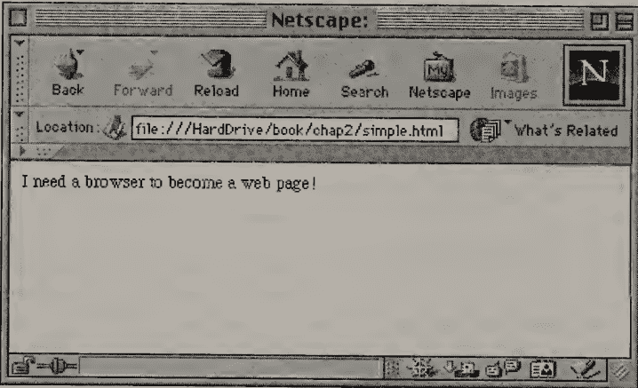

图 2.2a Mac 上 Netscape 对 "simple.html" 的本地渲染。

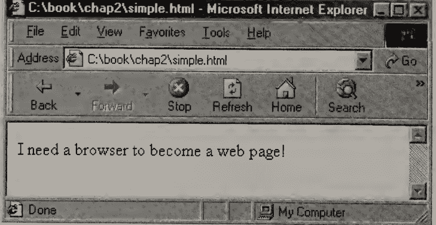

图 2.2b PC 上 Explorer 对 "simple.html" 的本地渲染。

然而，正如你在图 2.2b 中看到的，文件 URL 并不包含实际的 file 协议。相反，该 URL 只包含“哪里”，即 PC 的硬盘驱动器 "C"，然后是从硬盘驱动器到文件 "simple.html" 的文件路径，Explorer 只是在本地加载 HTML 文档时选择隐藏 URL 的协议部分。但是，在图 2.2b 的右下角，你可以看到 Explorer 确实通过显示“我的电脑”来表明文件是本地加载的。相比之下，当文件从互联网加载时，Explorer 会显示类似的提示，但显示的是“Internet”。

我们提供这些对比示例，并不是为了让你理解不同平台和不同浏览器中 "file" URL 的细节。事实上，这真的没那么重要。本地文件通常是通过使用浏览器的“打开文件”选项，或者根据你使用的平台进行拖动或点击图标来加载的。你不太可能通过输入如图 2.2a 和 2.2b 所示的 "file" URL 来在本地加载网页。浏览器知道文件是本地的，并通过在地址栏中自动放入其形式的 "file" URL 来相应地做出反应。实际上，文件 URL 中唯一重要的部分是文件路径，即文本文件在计算机上的实际位置。从中得到的启示是，我们现在知道 HTML 文档可以在本地查看，而无需连接互联网。

> 你现在掌握的知识已经足够在本地创建纯文本网页了。你需要做的就是将任何你想要的文本替换到 "simple.html" 的 BODY 部分，然后就可以开始了。但是，将 "simple.html" 放到网络服务器上供全世界查看则是完全不同的另一回事。

## 2.4 http 协议

在本地查看网页进行编辑是很好的，甚至是必要的。但是，如果所有人都只能这样做，互联网就不会那么有趣了。我们无法想象花几个小时在自己的硬盘驱动器上搜索网页。很明显，网络服务器才是正确的方向。但是，目前我们不会担心如何将 HTML 文档放在网络服务器上，而是假设它已经在那里了。

我们说过 http 协议是为通过互联网传输网页而设计的，但这是对术语的滥用。实际上，http 传输的是“超文本”文档。更准确地说，它传输 HTML 文档，而正如我们上面讨论的，这些文档实际上不是网页。它们是在浏览器的帮助下生成网页的。只有当 HTML 文档穿过互联网后，它才变成一个网页。

我们可以假设文件 "simple.html" 位于某个网络服务器上，并考察它在互联网上的传输过程，但是，由于该文件没有生成任何超链接，我们提供了一个包含链接（超链接）的新版本。图 2.3 展示了名为 "link.html" 的 HTML 文档。

目前，不要关注文档中的实际 HTML 代码，只需满足于意识到它在浏览器渲染时会生成一个链接。现在假设 "link.html" 存储在位于虚构的“网络大学”的远程网络服务器 "www.uweb.edu" 上。服务器的位置无关紧要，但你可以假设它在千里之外。为简单起见，我们假设文件 "link.html" 存储在 "www.uweb.edu" 域的主根目录中，如图 1.8 所示，而不是在某个用户账户中。

## 2.5 ftp 协议与 http 协议的比较

要从远程服务器正式下载一个资源，需使用文件传输协议（`ftp`）。这里的下载，是指将文件从服务器永久复制到你的硬盘。所谓永久，并非指你永远无法删除该文件，而是指它存储在你的硬盘上，而非浏览器的临时缓存中。如前所述，`http` 事务产生的文件副本仅会在浏览器缓存中保留一段时间。相比之下，通过 `ftp` 传输的文件会永久留在你的硬盘上，或至少在你删除之前一直存在。图 2.6 说明了 `http` 与 `ftp` 的区别。

与图 2.4 所示通过点击链接浏览网页的方式非常相似，`ftp` 事务也可以通过简单地点击链接来完成，而无需在浏览器中输入冗长的 `ftp` URL。事实上，如果你曾通过互联网下载过一些免费软件或共享软件，你可能已在不知不觉中启动了一个 `ftp` 事务。这些术语指的是可供下载的应用程序，分别是免费或仅收取少量费用的。网景浏览器和 IE 浏览器就是免费软件的例子。你可以访问网景或微软的网站，点击链接免费将这些应用程序下载到你的计算机上。由于下载的应用程序被无限期地保存在你的硬盘上，因此该事务是 `ftp` 而非 `http`。

图 2.7 通过展示点击网景下载页面上的相应链接来启动网景浏览器的下载过程，说明了这一点。在该图中，链接已被点击，浏览器正试图连接到网景的 `ftp` 站点。这可以从浏览器底部的状态栏中得到证实。

一旦连接建立，使用 `ftp` 协议的事务就开始了。图 2.8 显示了文件传输到本地硬盘的进度。出现了一个新窗口，用于监控文件实际下载到本地计算机的过程。

> 图 2.7 一个 `ftp` 事务的链接，与 `http` 事务相对。

**图 2.3** 一个创建链接的 HTML 文件。

要打开此页面，我们在 Web 浏览器的地址栏中输入 URL `http://www.uweb.edu/link.html`。（回想第 1 课的内容，如果该文件位于某个用户帐户中，则需要类似 `http://www.uweb.edu/~jones/link.html` 的 URL。）然后，我们按下键盘上的回车键来启动该事务。接着，浏览器应用程序会指示我们的本地计算机（运行浏览器的那台机器）尝试查找 URL 中指定的 Internet 地址。当然，当请求传到主干网时，该命名地址已转换为对应的 IP 地址。当服务器被找到并接收到请求后，两台计算机之间就建立了一条通信线路。因此，URL 请求中“在哪里”的部分就完成了。

由于 URL 也指定了“如何”和“什么”，服务器会执行一个“http”事务，将 HTML 文件 `link.html` 发送到我们的计算机。实际上，发送过来的并非文件本身，而是该文件的一个副本。这个 `link.html` 文件的副本由我们的浏览器渲染，我们便看到了图 2.4 中所示的网页。这个 `link.html` 的副本现在存储在我们计算机被浏览器分配的一部分内存中。这被称为浏览器的缓存（读作“cash”）。这部分内存是临时的。换句话说，发送给我们的 `link.html` 副本并未永久存储在计算机的硬盘上。经过一段时间后，缓存内存中的副本就会消失。

这样做的主要目的是为了能够快速检索最近请求过的网页。例如，假设我们现在点击图 2.4 中所示的链接，从而发出一个对 ESPN 足球网页的 URL 请求。当这个新请求被批准后，与该足球页面相关的所有文件副本都会被传输到缓存中。我们说“所有相关文件”，是因为该页面很复杂，包含图像之类的内容。网页中嵌入的所有对象也必须一并传输，否则页面就不完整。我们将在本文后面再详细讨论这一点，但目前，我们已经检索到了足球页面，它现在出现在我们的浏览器中。

如果我们现在点击浏览器的“后退”按钮，返回到由 `link.html` 生成的原始页面（如你在图 2.4 中所见），则无需与远程服务器 `www.uweb.edu` 建立新的连接。浏览器只需从缓存中提取 `link.html` 文件。这比向可能在数千英里之外的服务器发起新请求要快得多。你可以通过加载一个包含大量图形的缓慢网页，离开该页面，然后返回，来轻松地注意到这一特性。第二次加载会快得多，因为它是从缓存而不是从互联网上检索文件。图 2.5 说明了这种情况。

正如我们提到的，这种缓存内存是临时的。缓存内存的分配基本上是固定大小的。你只能在缓存中容纳一定数量的文档。为简单起见，假设我们的缓存可以容纳五兆字节的文件（HTML 文件、图像等）。在我们离开 ESPN 足球页面并浏览了足够多的内容，将五兆字节的新文件复制到缓存中之后，那些足球文档就消失了——被最近使用的文件所取代。再次打开该足球页面将需要与服务器建立新的连接。

**图 2.4** 浏览器渲染的 `link.html` 以及点击其链接的操作。

**图 2.5** 制作网页所需的文件被临时存储在缓存内存中，以便可以快速重新加载。

> **注意**
>
> 你可以通过更改浏览器的首选项来增加分配给缓存的内存，但并非越多越好。例如，如果缓存中存在太多先前访问过的网页，你可能会在坐到电脑前想查看今天的体育新闻时，却从缓存中调出了昨天的体育页面。不过，尽管这种检索过时页面的情况可能发生，但大多数浏览器都采取了某些预防措施来避免此问题。

“http”最重要的特性或许在于它只能传输无害的文件，主要是 HTML 文档和图像文件。这两种文件都无法通过缓存将病毒植入你的机器。正如我们所看到的，HTML 文件仅仅是文本文件，是所有文件中最无害的。图像文件只是原始的有组织数据，不会搞坏你的计算机。而且，尽管我们不讨论它们的特性，但像 Java 小程序之类的东西甚至无法造成损害。不过要当心，网页中的“ftp”链接实际上可能会将潜在的病毒下载到你的机器上。幸运的是，我们稍后就会讨论这一点。

> **注意**
>
> http 传输是无害的，不会向你的计算机释放病毒。传输的文件仅是文本和图像文件，它们在浏览器的缓存内存中是无害的。

关于“http”，最后要说明一点：回想一下我们是如何从远程服务器获取 `link.html` 来启动“http”事务的。我们是在浏览器的地址栏输入了相应的 URL 并按下了回车键。然而，在日常使用中，通过简单地点击链接来启动“http”事务肯定更为常见。在图 2.4 中，当我们点击一个超链接时，请注意当鼠标移到链接上时，链接的目标会出现在浏览器底部的状态栏中。这个目标就是一个 URL。换句话说，每个链接背后都潜伏着一个 URL。（你可以通过查看图 2.3 来确认这一点。）当链接被正式点击时，在事务展开过程中，这个 URL 会替换浏览器地址窗口中的旧 URL。因此，点击链接基本上等同于手动输入目标 URL 并按回车键。这样做的一个好处是，你可以在实际点击之前检查链接的目标。只需将鼠标移到链接上，并在状态栏中观察目标 URL 即可。在图 2.4 中，即使链接尚未被点击，你也能看到链接的目标。这只是将鼠标移到了链接上。

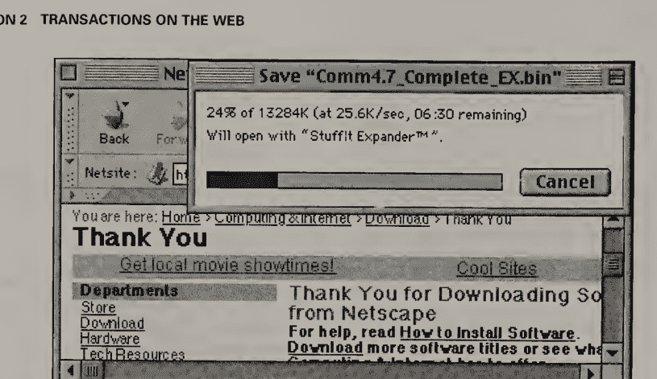

正如前台的下载窗口所示，文件传输大约需要六分钟才能完成。文件保存到本地硬盘后，就与浏览器无关了；它只是计算机上的一个普通文件。即使退出浏览器，下载的文件仍然存储在硬盘上，并可用于下载时的预期目的。实际上，你可以在图2.8中看到，即使在下载过程中，浏览器已经加载了自动发送的感谢页面。即便如此，浏览器也已经完成了ftp事务的部分，正回归到http工作。请注意，虽然图2.8是在Mac上生成的，但PC上的此类ftp事务也会产生下载进度窗口，只是外观略有不同。

> 通过点击ftp链接完成ftp事务是匿名ftp事务的一个例子。任何找到该网页的人都可以发起事务，而发送文件的服务器并不关心文件发送给了谁。

与http不同，ftp存在明确的安全风险。我们已经提到http只能传输无害的文件，但ftp肯定可以传输可能在你的计算机上释放病毒的文件。你可能想知道如何防范这些可能性，尤其是链接可以同时触发http和ftp事务。毕竟，当你上网冲浪时，并不会每次都把鼠标指针移到链接上，查看浏览器底部的状态栏来判断链接性质，然后再点击。你很容易点击一个你认为是用于打开另一个网页的http链接，却不小心点击了一个将某些文件放到你计算机上的ftp链接。

好消息是，仅仅将文件下载到计算机上不会释放病毒。然而，当你双击下载文件的图标打开它时，病毒就可能被释放。换句话说，文件本身不会伤害你的计算机，但如果文件包含病毒，打开它就会释放出来。所以如果你意外获得了某个文件，不要打开它。直接把它扔进回收站（PC上的回收站）并删除即可。只要坚持从信誉良好的网站下载浏览器和其他软件，你就应该没问题。但是，请务必警惕下载陌生文件。

顺便提一下，电子邮件的情况与http和ftp的对比相同。仅仅收到电子邮件（"mailto"协议）并阅读它不会对你的计算机造成任何伤害。然而，当电子邮件带有附件时，危险就潜伏其中。附件是随电子邮件一起发送的独立文件。它们通常被你的电子邮件查看器识别为附件，并且通常在电子邮件中显示为链接。只需不要点击来自未知来源的附件即可。点击附件会导致附件文件以与点击ftp链接大致相同的方式存储在计算机硬盘上。但幸运的是，附件本身不会伤害你的计算机。你还有最后一次机会避免恶意病毒，那就是不打开陌生附件，即使你已经意外导致它被保存到硬盘上。

## 2.6 网络服务器上的公共目录

我们已经创建了一个简单的HTML文档，并使用file协议在本地浏览器中进行了渲染。此外，我们已经相当详细地研究了当HTML文档实际从远程服务器提供时http事务的性质。缺失的环节是如何将"simple.html"或其他HTML文档放到远程网络服务器上。

这里的关键是你必须在网络服务器上拥有一个账户。如果你是学生，通常可以在你所在教育机构的网络服务器上获得一个网络账户。如果没有，你的互联网服务提供商、美国在线（AOL）或类似的服务商通常也能帮你弄到一个。拥有上网冲浪和浏览的权限与在网络服务器上拥有账户是不同的。当你在冲浪时，你只是从各种网络服务器上拉取别人的页面。另一方面，如果你想让世界上任何人都能看到你的页面，你需要将你的HTML文档实际放到网络服务器上。

由于你不太可能拥有自己的域名，我们将重点关注网络服务器上的典型用户账户。回忆第1课中的图1.8。还要记住用户名可以有多种形式，如"dannyjones"、"djones"、"jonesd"等，由于它们有些随意，为了简单起见，我们将统一使用"jones"。我们假设"jones"在地址为"www.uweb.edu"的虚拟网络服务器上有一个网络账户。另外，为了简单起见，我们假设"jones"只是想将HTML文档"simple.html"转移到他的账户中。（虽然他可能想将文件的内容改为类似"这是我的第一个网页！"的内容。）

但是，在我们开始事务之前，有一个非常重要的问题需要说明，涉及网络服务器上用户账户的根目录。根目录内通常还有另一个子目录，HTML文档必须放入该子目录才能被http请求访问。图2.9描述了这种情况。请记住，在本书中，当我们展示如图2.9所示的文件目录时，你可以通过查看每个目录名称下方的内容来判断该目录中有什么。因此Jones的根目录包含三个项目，两个文档和另一个目录。该目录（public）又包含文件"simple.html"。

这意味着如果Jones将"simple.html"转移到他的根目录中，没有人能够通过HTTP请求访问它。然而，如果他将其放入名为"public"的文件夹中，它就可以被http请求访问。换句话说，如果文件如图2.10所示加载到服务器上，请求"http://www.uweb.com/~jones/simple.html"将无法拉取到他的网页。

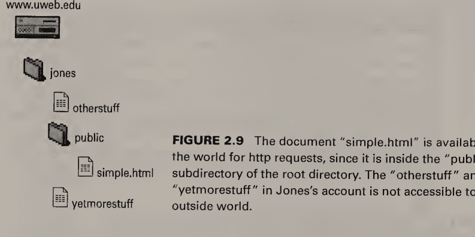

因此，实际上，对"http://www.uweb.com/~jones/simple.html"的请求会绕过实际的"jones"目录，进入public目录，并查找所请求的文件。这样做的一个好处是，其他文档可以存储在"jones"文件夹中以供安全保存。例如，你可能有一个尚未完成的网页。当然，你会在本地创建和编辑HTML文件，但你可能希望在网络服务器上的账户中保留一个备份副本，放在网络上没有人能找到的安全位置。在"jones"目录内但public目录之外就是这样一个可能的位置。这并非此类公共子目录存在的主要原因，但提供了一个容易记住的理由。

> 注意
> 并非所有网络服务器上的账户都需要特殊的子目录。有些服务器配置不需要这样做。然而，如图2.9和2.10所示的子目录非常常见，因此我们选择该配置来涵盖大多数情况。还需了解的是，此类子目录并不总是命名为"public"。此类目录的其他常见名称是"www"和"public-HTML"。虽然这样的子目录名称涵盖了大多数情况，但命名通常由网站管理员自行决定。我们选择"public"是因为它表明了该子目录的用途。即，你希望公开的所有HTML文件都必须放入其中。

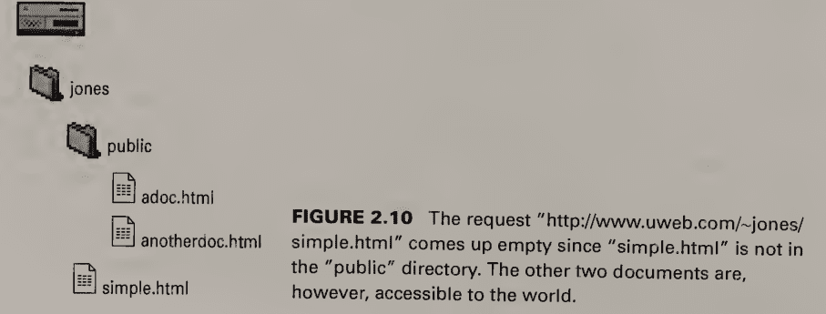

## 2.7 网络服务器与ftp

由于HTML文档必须永久保存到服务器上，事务类型必须是ftp。然而，仅仅点击某些ftp链接并不能将你的文件放到服务器上。虽然某些浏览器具有允许你将HTML文档传输到网络服务器的发布功能，但这并不是推荐的方式。你应该使用专门设计用于此类传输的独立ftp应用程序。此类ftp应用程序在文件上传方面提供了更大的灵活性，同时仍然相当易于使用。术语"上传"通常用于描述从你的计算机到某个远程计算机的文件传输事务。相比之下，我们已经多次使用的术语下载指的是从远程计算机到本地计算机的传输。此类ftp应用程序通常作为计算机的标配软件提供。但如果没有，也有许多免费ftp程序可供下载。实际上，本书的网站上可以找到其中一些程序的链接。

> 注意

我们推荐两个免费ftp程序，一个用于Mac，一个用于PC。它们的功能类似，且易于使用。事实上，我们在本节的剩余部分将使用这两个ftp应用程序进行说明。讨论这两个程序应该足以解释ftp应用程序的一般性质。Mac上使用的应用程序叫"Fetch"。PC上使用"ws_ftp le"就很合适。请注意"le"代表limited edition（限量版），我们认为"ws"代表"windows"。还有一个豪华版的ws_ftp，具有更多功能（需要购买），但免费的限量版完全能够满足你在本书中需要完成的任务。

为了说明此类ftp事务，我们将演示将"simple.html"放入Jones在"www.uweb.edu"上的public目录所需的步骤。首先，我们启动ftp应用程序。然后会出现一个连接窗口，要求输入连接到远程服务器所需的信息。图2.11a和图2.11b分别包含Fetch（Mac）和ws_ftp（PC）的连接窗口。启动应用程序时你可能会也可能不会看到ftp窗口。如果没有看到，且你使用的是Fetch，可以通过选择ftp应用程序"文件"菜单中的"open connection"来获取。如果你使用的是ws_ftp，图2.11b背景中看到的窗口应该在启动应用程序时自动弹出。

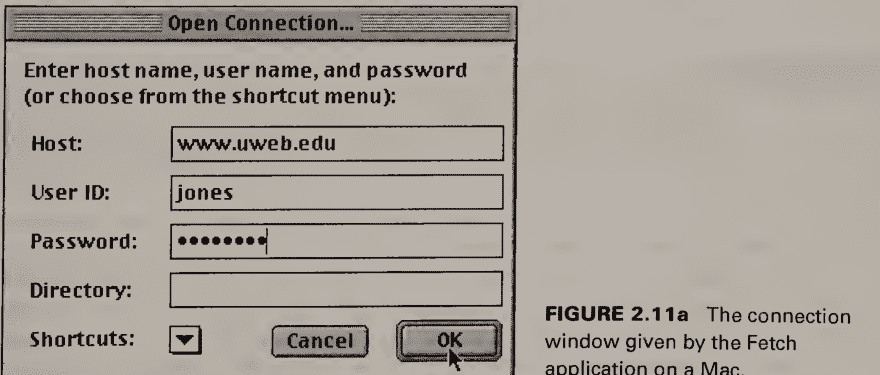

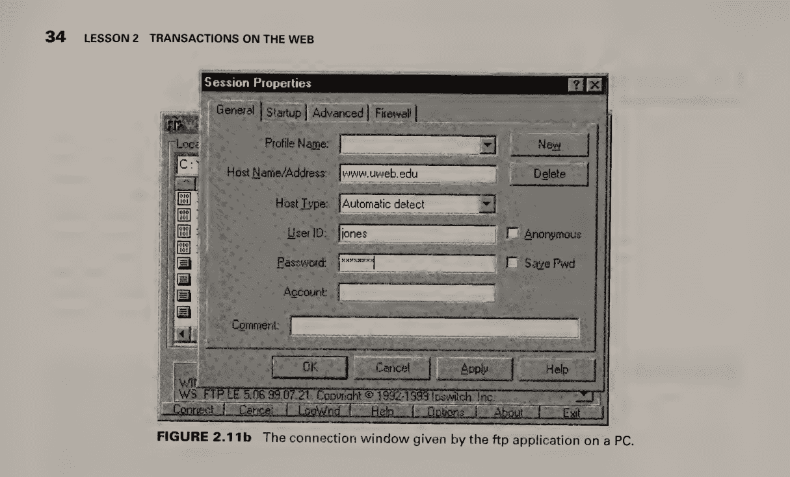

应用程序，正如你所见，它的左下角有一个“连接”按钮。点击此按钮会弹出一个连接窗口，如前景所示。

正如你在图 2.11a 和图 2.11b 中看到的，要建立与 Web 服务器的 FTP 连接，我们只需指定服务器的命名地址、Jones 账户的用户名和密码。为你设置 Web 服务器账户的人应当会提供关于如何设置密码的详细信息。设置密码非常简单，所以我们现在不深入讨论。不过，我们将在本课结尾简要讨论此类问题。你可能已经注意到，在连接窗口中可以提供其他信息，但你只需告诉 FTP 应用程序服务器在哪里、要访问哪个账户，并通过输入密码来验证你有权访问该账户即可。一旦提供了这些信息并点击“OK”按钮，FTP 应用程序就会与远程服务器建立 FTP 连接（当然，前提是信息正确）。

> 注意：向服务器上的用户账户进行 FTP 交易是非匿名FTP 的一个例子。不是任何人都能进行此类交易。只有拥有该账户密码的人才能进行此类交易。换句话说，服务器必须先确定与之打交道的是谁，然后才允许交易。因此，这类 FTP 程序不是匿名的。

建立连接后，你会收到一个窗口，用于实际的文件传输交易。我们把这个窗口称为文件传输窗口。图 2.12a 和图 2.12b 展示了各个应用程序的文件传输窗口。如你所见，ws_ftp 窗口比 Fetch 窗口显示更多信息。Fetch 窗口只显示 Jones 在 Web 服务器上的账户文件目录，而 ws_ftp 窗口实际上同时显示了 Jones 在 Web 服务器上的目录（在右侧，标记为 Remote Site）和

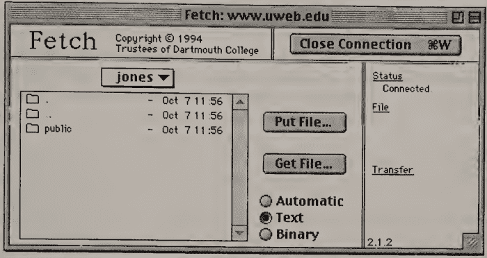

**图 2.12a** Fetch 应用程序中的文件传输窗口。

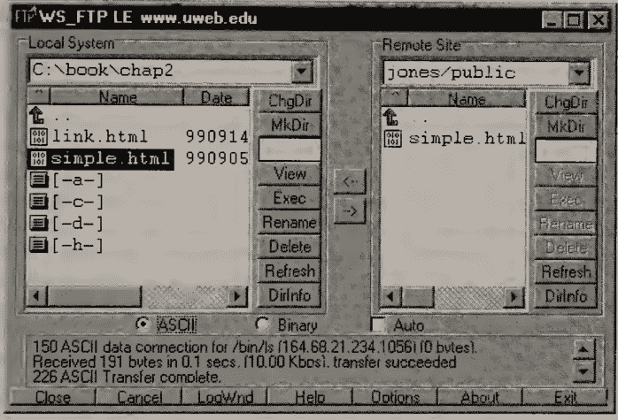

**图 2.12b** ws_ftp 应用程序中的文件传输窗口。

他在本地计算机上的目录（在左侧，标记为 Local System）。然而，正如我们将要看到的，这两个应用程序都能轻松实现相同的功能。

在 ws_ftp 窗口中，你可以看到文档“simple.html”已经传输到了 Jones 账户的 public 目录中。这是通过在 Jones 的计算机上找到正确的文件（你可以在窗口左侧 Local 部分上方看到文件路径）、点击选中该文件，然后点击指向 Remote Site 的箭头按钮（→）来完成的。这个箭头执行 put 交易。换句话说，应用程序将选定文件的副本放到 Web 服务器上。另一个箭头按钮（←）执行 get 交易，获取远程计算机上的文件副本并将其存储到本地计算机上。我们不会详细讨论 get 交易，因为其用途应该很清楚了。在这里，我们更感兴趣的是将 HTML 文件放到远程服务器上，而不是从远程服务器检索（获取）文件。沿用之前的术语，put 用于上传，get 用于下载。

我们选择先讨论 ws_ftp 交易，因为它的窗口包含更多信息，有助于描述 Fetch 交易。在 Fetch 中，与 ws_ftp 或任何其他 FTP 应用程序一样，你必须首先选择适当的上传目录。在 Fetch 窗口中，你可以看到尚未选择正确的目录。如果我们通过点击图 2.12a 中的 put 按钮来启动 put 交易，文件将被传输到“jones”目录中。然而，回想起图 2.10 以及关于 public 目录的相关讨论，我们需要将文件“simple.html”传输到他的 public 目录中，才能使其在 Internet 上可访问。为此，我们只需在 Fetch 传输窗口中双击 public 目录文件夹，将其设为选定目录。我们以类似方式在 ws_ftp 窗口的右侧选择了 public 目录。

选定 public 目录后，其余操作就简单了。你点击 put 按钮，会弹出一个新窗口，允许你选择要上传的文件。在这个窗口中，你可以在计算机的目录中浏览，直到找到要上传的文件，当你选择该文件进行上传时，这个临时窗口会消失，留下主要的 Fetch 窗口。与 ws_ftp 将两个窗口放在一起不同，它们在 Fetch 中是分开的。启动 put 交易时，Fetch 应用程序会提供一个临时窗口来显示本地文件目录。上传的文件随后会出现在你选择的 Web 服务器目录中。图 2.13 展示了使用 Fetch 将“simple.html”放入 Jones 的 public 目录的结果。

请注意，在图 2.12a 和图 2.12b 所示的两种情况中，都已选中一个按钮，使得“simple.html”以 ASCII 文件形式传输。在 Fetch 窗口中，该按钮只是“Text”，而在 ws_ftp 窗口中，该按钮实际标记为“ASCII”。如果你想让你的网页可用，这一点至关重要。我们强调过，HTML 文件只是文本文件，因此必须以文本文件形式传输到服务器。你看到的另一个选项“Binary transfers”（二进制传输）用于图像文件等。自动选项很可能会将 HTML 文档作为 ASCII 传输，但我们为了强调选择了文本选项。我们将在本书后面相关时简要讨论自动选项。

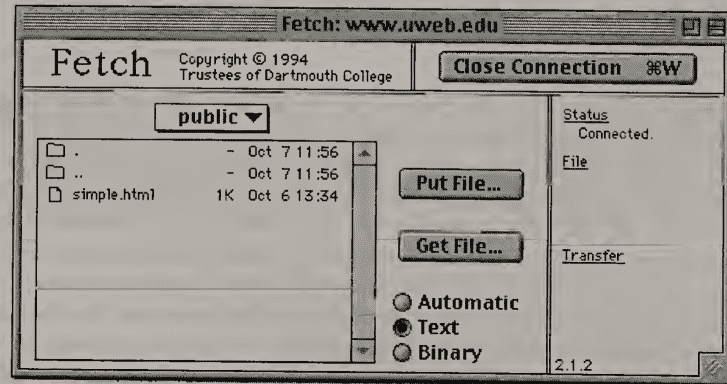

还要小心你的 FTP 程序自作聪明。例如，它可能注意到要传输的是文本文件，于是在你发送的文件上添加“.txt”后缀。所以在上述情况下，结果可能是服务器上有一个名为“simple.html.txt”的文件。这可能会造成严重问题，尤其是当我们开始用超文本链接链接到本地文件时。如果你的 FTP 程序这样做或类似的事情，你应该能够通过调整其首选项来纠正这个恼人的问题。

> 上面两段的寓意是，当你将网页传输到服务器时，或者稍后我们会学习的传输图像时，你应该始终检查传输是否成功。第一个方法是在 FTP 窗口中检查文件是否带有正确的后缀，以及更重要的是，它是否进入了服务器上的正确目录。即使是经验丰富的人，偶尔也会不小心将文件传输到错误的目录。最后，传输完成后，打开你的浏览器，输入你的账户 URL，看看网页是否按预期显示。

## 2.8 在 Web 服务器上隐藏目录

到目前为止，我们已经在文本中看到了多个 URL 的实际例子。此外，我们还详细讨论了 URL 的“how”部分（协议）和“where”部分（服务器地址）。URL 的最后一部分，“what”部分，也值得更详细地讨论。重申一下，“what”部分指定了 URL 请求所寻求的确切资源。

图 2.2a 和图 2.2b 以及周围的讨论是一个很好的起点。这些文件 URL 的“what”部分指定了从计算机（Mac 和 PC）硬盘到“simple.html”的精确本地文件路径。所以这些实例中的“what”对应于“simple.html”在各自计算机上的确切位置。同样，现在回到远程 Web 服务器的语境中，URL 的“what”部分指定了所请求 HTML 文档在该服务器上的确切位置。然而，在远程服务器的情况下，位置不是相对于服务器的硬盘来指定的，而是从特定 Web 域名的 public 目录开始。

既然我们知道如何将 HTML 文档传输到远程服务器，让我们假设我们已经将文件“simple.html”和“link.html”都传输到了 Jones 在服务器“www.uweb.edu”上的 Web 账户的 public 根目录中。关于 public 根目录的讨论已经过去，今后我们将只使用“public 目录”一词来指域名中实际使文件公开的实际目录。这样语言上会更简洁。总之，“simple.html”和“link.html”都在 Jones 的 public 目录中。

试图打开他的某个页面时，我们在浏览器地址栏中输入 URL“http://www.uweb.edu/~jones”并按回车。图 2.14 显示了结果。

如你所见，我们根本没有得到网页，而是得到了他 public 目录中的文件列表。我们只是在 URL 查询中没有提供足够的“what”信息。按照第 1 课中关于域名和 Web 服务器的讨论，“www.uweb.edu”似乎是“where”，而“~jones”是“what”，即 Jones 的网页。正如我们将要看到的，这在某种程度上仍然是正确的，但在我们当前的情况下，这“what”信息还是不够。

与图 2.2a 和图 2.2b 的情况一样，文件 URL 的结尾不仅是包含“simple.html”的目录，还有文件名称本身。同样，

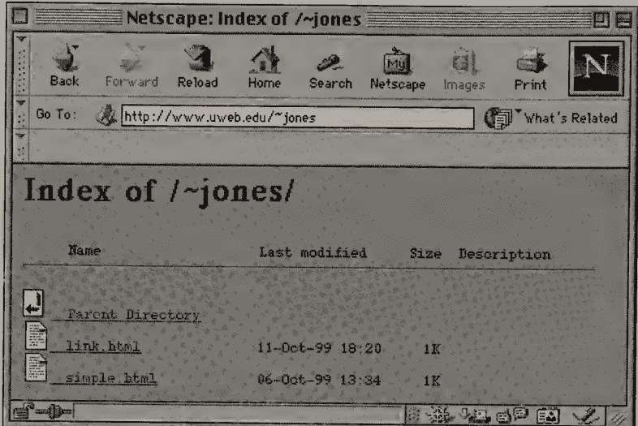

**图 2.14** URL查询 "http://www.uweb.edu/~jones" 的结果。

URL查询

```
http://www.uweb.edu/~jones/simple.html
```

和

```
http://www.uweb.edu/~jones/link.html
```

包含了调出琼斯每个网页所需的特定"什么"信息。但是，读完第1课，这可能会让你有点困惑。我们指出，URL请求

```
http://espn.go.com/nfl
```

以及虚构的

```
http://www.senatorA.gov
```

例如，足以调出网页。但是这两个URL查询似乎都没有以请求的HTML文件的形式指定正确的"什么"信息。人们可能会推测"nfl"是他们橄榄球页面的名字，他们只是忘记了在文件上加上".html"后缀。然而，像ESPN这样的网站是专业开发和维护的，他们不太可能犯下这种违反常规的错误而遗漏".html"。此外，"www.senatorA.gov"仅仅是一个域名，显然不可能引用到一个特定的HTML文件。

事实上，你熟悉的大多数域名似乎并不指向一个HTML文件。例如，想想"www.amazon.com"和"www.yahoo.com"。此外，能够调出这些网站中的一个而无需

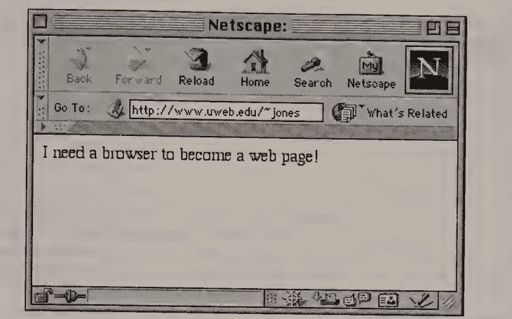

**图 2.15** 对琼斯公共目录的请求实际上调出了"index.html"文件，即使它在URL中没有指定。

记住像"www.amazon.com/mainpage.html"这样的东西，这显然是可取的。嗯，图2.14中描绘的琼斯问题的解决方案，以及幕后使"www.amazon.com"即使没有指定网页也能调出网页的机制，是同一回事。最好的证明方法是举例说明。

假设琼斯将他公共目录中的文件"simple.html"重命名为"index.html"。现在，生成图2.14的完全相同的URL查询实际上调出了以前称为"simple.html"的HTML文档。你可以在图2.15中看到，这是同一个页面，只是名字变成了"index.html"。

原因在于任何名为"index.html"（或"index.htm"）的文件实际上都与其目录绑定。也就是说，对该目录的URL请求足以调出该索引文件。在琼斯的例子中，请求"http://www.uweb.edu/~jones"仅仅针对他的公共目录，实际上针对的是文件"index.html"，因为索引文件存储在他的公共目录中。同样地，URL "http://www.senatorA.gov" 和 "http://www.amazon.com" 不仅分别针对每个网络域的公共目录，而且针对"绑定到"该公共目录的实际索引文件。

> **注意** 这种索引文件有时被称为默认文件，其含义是对文件所在目录的请求会自动默认为文件本身。事实上，一些网络服务器实际上被设置为这些文件被称为"default.html"（或"default.htm"）而不是index。但是，再次强调，网络服务器的约定有些武断。在本书中，我们将坚持使用"index.htm"约定，因为它迄今为止是最常见的。

这种索引行为绝不仅限于网络域和账户的公共目录。公共目录中包含的任何其他目录也具有这种默认行为。一个完美的例子是URL请求"http://espn.go.com/nfl"，它超出了他们的公共目录。如上所述，"nfl"并不直接指向一个HTML文档。在前面的讨论之后，你可能已经推断出

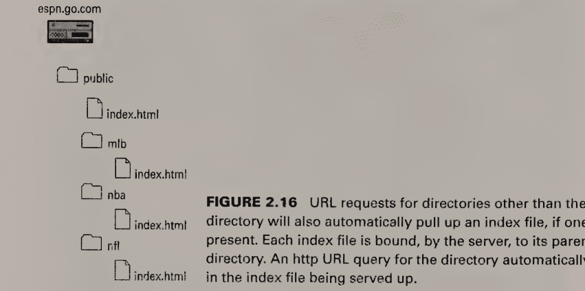

"nfl"实际上是一个目录的名字，NFL橄榄球页面实际上是由一个索引文件生成的。图2.16描绘了这种情况。当然，ESPN公共目录内的目录和文件远不止图中所描绘的，但该图足以说明我们的观点。（MLB和NBA分别代表美国职业棒球大联盟和国家篮球协会。）

图2.16中描绘的目录结构在本文的这一点上可能比必要的更复杂。但是，就像你在文件柜或个人电脑中组织文件一样，在网络服务器上组织文件也是有益的。否则，你会弄得一团糟，很难找到东西。我们在第5课详细讨论网站的组织，但与此同时，要指出的一点是，如果你的网络服务器上的一个目录内没有索引文件，对该目录的URL查询将调出该目录内容的列表，就像图2.15所示。但是，由于图2.16中的目录包含索引文件，因此对

```
http://espn.go.com/mlb/index.html
```

的请求，例如，等同于

```
http://espn.go.com/mlb
```

通常不希望匿名用户浏览你的目录列表。相反，用户应该按照你构建网站的方式，通过你网站中的链接进行导航。但那是另一个故事了。

> **注意** 这种有多个文件存在、每个文件同名的概念常常令人困惑。请记住，这些文件非常不同，只是名字相同。例如，你可能有两个名为"termpaper.wp"的完全不同的文字处理文件。当然，就像图2.16一样，你需要将它们保存在不同的目录中以避免混淆。随着你的网站随着本文的进展扩展到多个目录，你也应该有多个索引文件。你需要格外小心以区分它们。

## 2.9 telnet协议

telnet协议的使用在很大程度上超出了本书第一部分介绍的材料范围。然而，有一个简单的例子与上述讨论相关，并有助于完善我们对各种网络协议的探索。当琼斯打开到www.uweb.edu网络服务器的ftp连接时，他必须输入他的密码。当他第一次在服务器上获得账户时，他得到了一个临时密码。为了更改此密码并设置他的永久密码，他必须"telnet"到网络服务器。与处理与远程计算机之间文件传输的ftp不同，telnet允许你登录或与远程计算机对话。

几乎任何计算机都应该有某种telnet应用程序。此外，它的名称中应该包含"telnet"这个词。你只需启动应用程序，如果连接窗口没有出现，你从应用程序的"文件"下拉菜单中选择类似"打开连接"或"打开会话"的选项。由于大多数telnet应用程序功能相似，我们仅以PC上的telnet为例进行说明，而不是在两个平台上都举例。连接窗口如图2.17a所示。输入服务器地址并单击连接按钮后，你会得到图2.17b所示的界面。我们选择将其称为对话窗口，因为你使用它与远程计算机对话。

在这种情况下，琼斯只需输入他的用户名，然后被要求输入他的临时密码。输入密码并按回车键后，出现一个新的命令行，要求他输入新密码。这样操作后，他很可能会得到另一个命令行，要求他重新输入新密码。设置密码时的这种冗余是防止打字错误的常见方法。除了记住他的新密码外，他除了退出telnet程序外别无他事。他现在可以使用ftp应用程序开始将网页放到服务器上了。

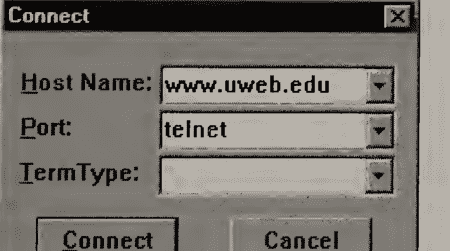

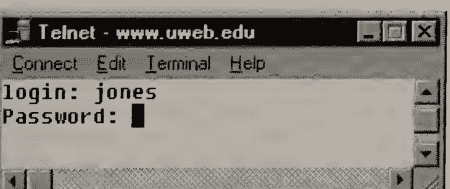

就在几年前，给计算机发出这样的命令行指令还非常普遍。在计算机开始使用窗口之前，你甚至必须以这种方式与你的本地计算机对话。甚至不需要鼠标。但随着窗口式界面变得普遍，普通的计算机用户可能除了telnet之外，永远不必在任何其他情况下处理命令行界面。有趣的是，毫无疑问，你已经在电影或电视上多次看到过telnet的实际应用。几乎任何时候你看到一个计算机黑客试图入侵某个远程计算机时，都在使用telnet界面。

## 2.10 总结

### 关键术语

- 平台
- ASCII文件
- HTML
- 匿名ftp
- 上传
- 索引文件（默认文件）
- 平台无关性
- 文本文件
- 缓存
- get（获取）
- 下载
- telnet
- 登录
- 文件协议
- 文件后缀
- ftp
- put（放置）
- 公共目录
- 命令行

由于超文本标记语言（HTML）文档是基本的文本（ASCII）文件，它们可以轻松地在不同的计算机平台之间传递。因此，由于网络浏览器将这些HTML文件变成网页，网页构建是平台无关的。HTML文档的开发和编辑通常在本地完成，甚至不需要互联网连接。在浏览器中本地查看网页是通过文件协议处理的。你通常只需拖动或单击HTML文档的图标，即可在本地浏览器中查看它。即使当你在本地查看网页时"文件"协议在幕后运行，你也应该很少需要直接处理它。但是，你应该意识到"文件"URL中存在本地文件路径。

如果一个网页已经传输到网络服务器，任何连接到互联网并知道服务器地址的人都应该能够使用http调出该页面。请记住，这是对术语的滥用，因为实际上位于服务器上的是HTML文档，它们在有人将其加载到浏览器中之前并不是网页。然而，为了方便，我们滥用术语，简单地将HTML文档称为网页。你可以通过在浏览器的地址窗口输入http URL或单击网页中的超文本来执行http事务。http事务的结果是将一个网页加载到你的浏览器中。网页不是永久存储在你的硬盘驱动器上，而是临时存储在缓存内存中，以便你的浏览器快速检索。此外，通过http传输的文件无害地位于缓存内存中，不会释放病毒。

相比之下，文件传输协议（ftp）事务实际上将文件以永久方式写入你的硬盘驱动器，并可能将病毒带入你的计算机。但是，如果你不打开通过ftp传输的文件，它就无法损害你的计算机。当你单击ftp链接时，可以匿名发生ftp事务。匿名ftp的一个很好的例子是从网页下载免费软件应用程序。当你希望将网页传输到你在网络服务器上的用户账户时，你需要一个实际的ftp应用程序。由于需要密码，将网页传输到服务器是非匿名的。在打开ftp应用程序将文件放到服务器上时，你基本上遵循以下步骤：

将网页上传到远程服务器：

1. 在连接窗口中输入服务器地址、用户名和密码以访问你的账户。
2. 在 Web 服务器上选择你希望将 HTML 文件传输到的目录。为此，你可以通过 ftp 程序提供的窗口浏览远程服务器上的目录。
3. 使用 ftp 应用程序的本地目录查找器定位你计算机上要传输的 HTML 文件。然后点击"put"按钮。在某些 ftp 程序中，你可能需要先点击 put 按钮才会出现本地目录查找器。无论哪种情况，你都可以浏览本地计算机上的文件，直到找到要传输的文件。
4. 确保在传输 HTML 文件时选择了文本或 ASCII 选项。
5. 始终检查文件是否已正确传输到服务器上的目标目录，并且带有适当的".html"后缀。此外，使用你账户的 URL 从服务器上获取 HTML 文件，以确保它确实可以正常访问。

请注意，大多数 Web 服务器要求将网页放置在你账户内的公共目录中，以便通过 http 协议进行访问。对你账户的 URL 请求会被自动转入此公共目录。但是，如果你的公共目录中没有名为"index.html"的文件，那么不包含特定文件引用的 URL 请求实际上会显示你目录的内容列表，而不是你的网页。在每个目录中包含一个"index.html"文件可以使得对该目录的请求自动显示索引文件。

最后，telnet 仅用于与远程计算机通信或对话，而不是传输文件。为此，ftp 应用程序提供了命令行界面，你可以通过它向远程计算机发送信息。一个例子是使用 telnet 与 Web 服务器对话，以更改你在该服务器上账户的密码。

## 2.11 复习题

在大多数情况下，仅凭课程摘要不足以回答以下问题。

1. 什么是计算机平台？举出两个平台的例子。举出一个依赖于平台的计算机资源类型的例子。举出一个不依赖于平台的计算机资源类型的例子。
2. 鉴于 Web 浏览器是依赖于平台的，为什么使用浏览器进行网页浏览却是不依赖于平台的？
3. 描述文件协议 URL 的三个具体组成部分（不仅仅是说 how-where-what）。举出一个使用此类 URL 的例子。在你使用的计算机类型上，文件 URL 是什么形式的？
4. 一个名为"ants.html"的 HTML 文档位于远程服务器名为"www.aardvark.com"的主根目录中。写出查看此文档所需的 URL。
5. 当你将 HTML 文档加载到浏览器中时，除了 HTML 文档之外，还有什么可能一起传输到缓存内存中？
6. 为什么匿名 ftp 被称为匿名？将其与非匿名 ftp 进行对比。
7. http 事务与匿名 ftp 事务有何不同？讨论 http 与 ftp 的安全风险。
8. 讨论 Web 服务器上公共目录的性质。这种目录还有哪两个可能的名称？
9. 什么是"put"事务？什么是"get"事务？
10. 说出两种检查你是否已将 HTML 文档正确传输到 Web 服务器的方法。
11. 讨论索引文件的目的。索引文件的另一个常见名称是什么（除了"index.html"）？

## 2.12 练习

1. 查明你的 Web 服务器上公共目录的名称。查明你服务器上索引文件所需的名称。查明访问你的 Web 服务器账户所需的 URL 的性质。

2. (a) 使用基本文本编辑器创建一个内容与图 2.1 的"simple.html"类似的文件。所谓"类似"是指只有文本内容可以有所不同。如果你有 Web 服务器账户，请将此文件命名为你的 Web 服务器所需的索引文件名称。否则，直接命名为"index.html"。

    (b) 在你的计算机上创建一个新目录（文件夹）来存放此文件。如果你有 Web 服务器账户，请将此目录命名为你的 Web 服务器上公共目录的名称。否则，将此目录命名为"public"。

    (c) 将该文件加载到浏览器中。记下浏览器地址栏中显示的 URL。

3. 查明你可以使用什么 ftp 应用程序。如果你在自己的个人计算机上工作且没有 ftp 应用程序，请下载一个免费的 ftp 应用程序。（参见本网站的第 2 课部分。）

4. (a) 将你在练习 2 中创建的文件传输到你的 Web 服务器账户的公共目录中。

    (b) 在浏览器中输入适当的 URL 来获取此文件，以确保传输成功。

5. 本题的目的是推断网站上 HTML 文件的位置。访问本网站第 2 课的作业部分，点击练习 5 的链接。一个名为"index.html"的 HTML 文件将加载到你的浏览器中。此文件包含在名为"mystery"的目录中。"mystery"目录包含另外两个名为"folder1"和"folder2"的文件夹。情况如下图所示。

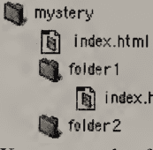

你可以看到 folder1 也包含一个索引文件，但 folder2 没有。关键在于，还有六个未在上图中显示的其他 HTML 文件，分别名为"file1.html"到"file6.html"。你的任务是找出哪些文件在哪些目录中，并重新绘制上面的目录图，将这六个文件放到正确的目录中。为此，你可以点击索引文件中提供的一些链接。但要找到一些缺失的文件，你需要通过试错来尝试，将缺失的文件名添加到浏览器地址栏中 URL 的末尾。

## 2.13 项目线索

### 线索 A

开始思考你的个人主页的规划。没有固定的规划很难构建个人网页。好的主题包括：爱好、喜欢的运动队、喜欢的音乐等。考虑你的主页是将探索多个主题但仅做简要介绍，还是深入探讨一个主题。

### 作业

(a) 完成练习 2。在文件中包含一到两段关于你主页预期规划的内容。请注意，你在练习 2b 中创建的目录将包含你在整本书中的所有作品，并将成为你整个网站的公共目录。

(b) 如果你有 Web 服务器账户，完成练习 4。需要注意的是，你只是在 Web 服务器上制作了文件的副本。本地副本仍然存在于你的本地计算机上。

### 线索 B

### 作业

(a) 完成练习 2。在文件中写一段话，说明此页面将是你所有 Internet 编程作业的链接页面。我们将此页面称为你的作业页面。请注意，你在练习 2b 中创建的目录将包含你在整本书中的所有作品，并将成为你整个网站的公共目录。

(b) 如果你有 Web 服务器账户，完成练习 4。需要注意的是，你只是在 Web 服务器上制作了文件的副本。你的本地副本仍然存在于你的本地计算机上。

# 第 3 课

## 文本标记

在第 2 课中，我们介绍了允许在 WWW 上进行不同事务的各种协议。我们特别关注了 HTML 文档如何在 Internet 上传输。由于 HTML 文档在加载到浏览器中时会生成网页，这确实是一个很好的基础。然而，开发本书中的大部分内容并不需要 Internet。你只需要一台带有相对较新 Web 浏览器的个人计算机。所谓较新，我们指的是 Netscape 4（或更高版本）或 Internet Explorer 4（或更高版本）。虽然本书中介绍的几乎所有内容都可以在这些浏览器的第 3 版上运行，但本书中的示例是使用第 4 版和第 5 版呈现的。即使是第 2 版也支持到第 6 课为止的大部分内容，但它们不能统一支持第 7 课及之后介绍的所有 HTML 和 JavaScript 功能。

你唯一需要的另一个工具是基本的文本编辑器。幸运的是，无论你想用哪种类型的计算机来构建网页，上面很可能都有一个这样的编辑器。如果你使用的是 Macintosh，相应的应用程序叫做"Simple Text"。如果你使用的是 PC（Windows '95 或更高版本），相应的应用程序叫做"Notepad"。有一些特殊的应用程序，统称为 HTML 编辑器，一旦你掌握了基础知识，它们会非常有帮助。然而，在充分理解之前就使用此类编辑器几乎肯定会导致不必要的混乱。在掌握构建网页的基础知识之后，我们将推荐使用 HTML 编辑器，但仅限于那时。特别是当我们开始使用 JavaScript 创建交互式内容时，掌握 HTML 的基础知识将非常重要。

> **注意**
>
> 在继续深入之前最后提一点，完美主义者此时应该稍微放松一些。当你认识到 HTML 使得浏览器将对象配置成网页时，你也会认识到存在不同的浏览器，更糟的是，存在不同版本的浏览器。不同的浏览器往往以不同的方式解释 HTML 的标记指令。这些差异通常并不严重，但它们确实存在。你可以花一整天的时间在你的个人计算机的浏览器上将网页调整到完美无瑕、精确到毫米，但如果你将它放到 Internet 上，而有人使用了不同的

## 3.1 HTML 标签与文档结构

回顾一下，HTML 代表超文本标记语言。"超文本"一词指的是文本能够链接到其他文档的能力。现在来说说"标记"部分。网页中可以出现多种类型的对象。最基本的有文本、图像和超文本链接。HTML 语言实际上并不创建这些对象。例如，网页中出现的图像并非由 HTML 创建。HTML 只是告诉给定的浏览器如何在网页中以及在何处显示它。用另一种术语来说，HTML 告诉浏览器如何"标记"该图像。事实上，你现在正在阅读的这些文字就是文本，与 HTML 无关。然而，正如我们将在本课中学到的，需要 HTML 才能让这些文字以合适的方式在网页中被标记。

HTML 文档就是一个纯文本文档。当它被加载到浏览器中时，浏览器必须首先将该文本文件识别为 HTML 文件。当然，如图 3.1 所示，".html"（或".htm"）文件后缀作为对浏览器的初步提示，但文件本身的内容才是关键。这种识别是通过 `<HTML>` 标签完成的，它向浏览器表明正在处理的是 HTML 文档。文档的结尾由 `</HTML>` 标签标识。整个将作为网页的文档包含在这两个 HTML 标签之间。

任何 HTML 文档的骨架如图 3.1 所示。我们截取了文档在计算机屏幕上作为"纯文本文档"显示的样子，以强调它不过是一个文本文件而已。我们命名为"skeleton.html"的文件会生成一个实际的网页。问题是该页面将是完全空白的。构成该文本文件的 HTML 标签仅仅是浏览器识别并用来格式化将要放入网页中的真实"内容"的东西。浏览器实际上并不会将这些标签放入它生成的网页中。

我们提到了一些可以放入网页中的对象类型，但目前我们将坚持创建包含普通文本的页面。浏览器只有在文本以"<"符号开头并以">"符号结尾时，才会将某些文本识别为标签。因此，图 3.1 中的所有文本都被格式化为 HTML 标签。这就是为什么它在加载到浏览器中时会生成空白页面的原因。

```
skeleton.html

<HTML>
<HEAD>
</HEAD>
<BODY>
</BODY>
</HTML>
```

**图 3.1** 文档 "skeleton.html" 生成一个空白网页。

HEAD 和 BODY 标签分别对应 HTML 文档的头部部分和主体部分，正如人们所预期的那样。正如我们将看到的，HTML 文档的 HEAD 部分包含有关文档本身的信息，例如文档的标题。BODY 部分包含构成页面的实际"内容"——文本、图像、链接等等。

要创建一个有实际内容的网页，我们需要在 HEAD 部分和 BODY 部分各添加一些东西。在 HEAD 部分，我们添加网页的标题。该标题将作为页面标题显示在浏览器顶部。标题必须放在 TITLE 标签之间。

```
<TITLE> 页面标题放在这里。 </TITLE>
```

在 BODY 部分，我们添加一些普通文本。文档 BODY 中任何不包含在 HTML 标签 "<>" 内的文本就是普通文本。考虑图 3.2 中显示的名为 "simple.html" 的 HTML 文档。将 "simple.html" 文件加载到浏览器中的结果显示在图 3.3 中。该文件是本地加载到浏览器中的。因此，你在图 3.3 浏览器地址栏中看到的是 "file" 协议。由于我们不是从远程 Web 服务器获取 "simple.html"，地址栏显示的是一个带有 "simple.html" 本地文件路径的 "file" URL。

浏览器确实将 BODY 部分中的句子视为普通文本，因为它没有被 <> 标记为标签。由于该句子不是标签，它就成为了实际网页的一部分。网页的标题 "Hello World" 可以在图 3.3 浏览器窗口的顶部看到。请注意，HTML 文档中由 TITLE 标签定义的实际网页标题与 HTML 文档本身的名称 "simple.html" 是不同的。实际加载到浏览器中的 HTML 文件当然在图 3.3 地址窗口 URL 的末尾标示出来。

> **注意**

由于你将创建的所有 HTML 文档都具有相同的骨架结构，建议你手边保留一份 "simple.html" 的副本。它就像一个模板，每次你想创建新网页时都可以从此开始。只需打开模板，从文件菜单中选择"另存为"，然后为你的新文档选择一个名称即可。因此，理论上你只需要输入一次基本标签。当然没有必要每次想创建新页面时都重新输入它们。

在继续之前，有一点需要说明。在 HTML 文档中，空格实际上并不是空格。这听起来令人怀疑，但确实如此。想想我们在本句中 "consider" 一词后面留出的大量空格（不，那不是打字错误）。那是真正的空格；当本书从计算机文件打印出来时，那个空格也随之呈现了。显然，对吧，我们能看到它。甚至在本句之后和下一段之前的空格也是真正的空格。

注意图 3.2 文档中的所有空格；那些不是真正的空格。但我们能看到它们，不是吗？图 3.4 中显示的文档 "simple2.html" 产生的结果与图 3.3 中渲染 "simple.html" 的结果完全相同。图 3.2 中的空格在浏览器格式化网页时根本没有被保留。格式化是标签的工作。不过，浏览器确实会识别单个空格。否则句子中的单词就会连在一起。

浏览器从上到下、从左到右读取 HTML 文档，就像你阅读书中的一页一样。如果从本书中移除所有空格，内容仍然是相同的，只是人类阅读起来会非常困难。（它可能也会让拼写检查器崩溃！）我们在 HTML 文档中留出的额外空格只是为了人类读者。随着 HTML 文档越来越长，阅读它们并检测可能的错误变得越来越困难。尽管 "simple.html" 和 "simple2.html" 很简单（想想看！），但即使图 3.2 和图 3.4 之间的对比也应该能让人认识到添加额外空格以使文档更易于人类阅读的实用性。本书中其余的许多 HTML 文档不仅使用了额外空格，还使用了缩进来强调某些内容。然而，浏览器并不在意这些。

```
simple2.html

<HTML><HEAD><TITLE> Hello World!
</TITLE></HEAD><BODY>This is a
very simple web page. But, at least
it says something and has a
title!</BODY></HTML>
```

**图 3.4** simple.html 中的空格不是真正的空格。文档 simple2.html 在被浏览器渲染时将产生相同的结果。

关于 HTML 文档的最后一点是，HTML 标签不区分大小写。也就是说，以下两个标签都是完全有效的：

```
<title>
</TiTle>
```

然而，将标签全部大写是一种被广泛采用的惯例。这同样有助于提高可读性。例如，即使在图 3.4 那种混乱的排列中，HTML 标签也能从其他文本中清晰地突显出来。

## 3.2 容器元素

既然我们已经创建了一个非常简单的网页，现在该详细讨论 HTML 标签的本质了。我们使用过的四组标签——HTML、TITLE、HEAD 和 BODY，每一组都以开始标签（形式为 `<...>`）开头，并以结束标签（形式为 `</...>`）结尾。像这样的一个单元

```
<BODY>...</BODY>
```

被称为一个 HTML 元素。这种类型的元素，即同时具有开始标签和结束标签的元素，被称为容器元素。事实上，到目前为止我们使用过的四个元素都是容器元素。我们还没有看到任何非容器元素。

容器元素告诉浏览器如何处理其开始标签和结束标签之间包含的任何内容。HEAD 元素的开始标签和结束标签之间包含的任何内容都应该是关于文档的信息。此类信息始终包含在另一个 HTML 元素中，例如 TITLE。在 HEAD 元素内部只允许使用少数几个元素。它们都承载着关于文档的"元信息"，而不是你作为页面一部分所看到的实际内容。目前，TITLE 是我们将在 HEAD 部分中使用的唯一元素。

任何要成为实际页面一部分的文本（图像、链接等）都包含在 BODY 元素的开始标签和结束标签之间。正如我们在图 3.3 中看到的，BODY 元素中的任何文本都会在生成的网页中被直接渲染为文本。然而，要告诉浏览器对文本执行除直接显示之外的更多操作，则需要更多的元素。毕竟，这就是 HTML 的用途——告诉浏览器如何处理"内容"。在 BODY 元素中可以包含近 100 种类型的元素。有些用于格式化文本，有些用于创建链接，还有一些用于其他用途。所有这些元素的集合告诉浏览器如何处理将要构成网页的实际对象。

关于容器元素有一个重要的要点。它们应该是嵌套的；也就是说，它们应该一个包含在另一个内部，而不是相互重叠。参见图 3.5。未能正确嵌套容器元素可能导致网页无法被浏览器正确渲染，甚至完全无法渲染。然而，这已经不像过去那样是一个重要的问题了。大多数

## 3.3 格式化文本

标准文本编辑器，如"Simple Text"或"Notepad"，会自动为你格式化文本。你只需按键盘上的相应按钮或使用下拉菜单，就可以增大文本尺寸或将其加粗。例如，考虑图 3.6 中的 HTML 文件。当文档"bold.html"在图 3.7 中渲染为网页时，浏览器根本无法识别出正文部分的文本本应是大号加粗的。

事实上，浏览器必须被告知如何对几乎所有内容进行"标记"。当然，要告诉浏览器将文本格式化为加粗（或其他任何所需格式），就需要使用 HTML 元素。与其对这些新元素进行详尽的讨论，不如直接通过示例来说明。图 3.8 中的 HTML 文档展示了一些最常用的 HTML 元素，用于指示浏览器如何标记文本。生成的网页如图 3.9 所示。

围绕前两个句子的两个容器元素的用途应该是显而易见的。不过，有一个元素可能看起来有些奇怪。文档中出现在三个不同位置的

```
<BR>
```

元素并不是一个容器元素。它只是一个普通元素。它并非设计用来包围某些文本供浏览器格式化，而仅仅是用于触发某种效果。具体来说，它会在网页中产生一个换行——就像打字时按下回车键一样。它在"textformat.html"中的使用仅仅是将每个格式化示例放在网页的新行中。还有几个类似的

当前浏览器版本已经足够智能，可以纠正轻微的嵌套错误。但是，嵌套仍然是你应该严格遵守的规范。

**图 3.7** 图 3.6 中的文档在 PC 上用 Explorer 5 渲染的效果。"bold.html"正文中的加粗文本被忽略了。

**图 3.8** 包含各种文本格式化元素的文档。

**图 3.9** 图 3.8 中的文档在 PC 上用 Netscape 4 渲染的效果。

非容器元素，我们稍后会看到。不过，几乎所有的 HTML 元素都属于容器类型。

关于文档"textformat.html"，有几点需要说明。首先，这些文本格式化元素可以组合使用以产生叠加效果，就像文档中的第三个句子那样。但是，正如你所看到的，这些元素是正确嵌套的。斜体标签在内部，加粗标签在外部。这些标签嵌套的顺序并不重要；斜体标签完全可以放在外部，也会产生相同的效果。

第二点稍微微妙一些。在第四个句子中，我们只将"re"前缀放在了加粗标签之间。句子的其余部分没有受到任何 HTML 标签的影响，只是被标记为纯文本。即使有这么多标签和元素在周围，如果浏览器发现文本不在容器元素内，它就会将其标记为纯文本。此外，当网页在图 3.9 中的浏览器中显示时，标签已经完全消失了。即使加粗元素的结束标签似乎将"remarkable"这个单词分成了两部分，当在浏览器中渲染时，该单词仍然完整显示。加粗标签在告诉浏览器如何处理"re"前缀之后，根本不会出现在浏览器窗口中。记住，标签只是告诉浏览器如何格式化内容，它们不会出现在生成的网页中。

> 还有一些其他用于基本文本格式化的 HTML 元素。其中一些很少使用，不被大多数浏览器支持，或者已被弃用，这意味着未来的浏览器版本可能不再识别这些标签。两个例子是`<CENTER>...</CENTER>`和`<U>...</U>`元素，它们分别用于居中和下划线包围的文本。尽管它们在许多现有网页中被使用，但建议在当前页面构建中避免使用它们。然而，由于居中文本是有价值的，我们将在第 4 课中学习推荐的居中文本方法，但将完全放弃使用下划线文本。作者不建议使用下划线文本，因为链接本身就有下划线，对纯文本使用下划线会造成不必要的混淆。

## 3.4 水平间距

如果没有"textformat.html"中的 `<BR>`（换行）标签，图 3.8 中的文档的四个句子将会像本段落的句子一样渲染，不会在每个句子末尾强制换行。当然，本段落中确实有换行，但它们是因为右边缘的限制而强制产生的，而不是因为打字者（遗憾的是，就是作者本人）在键盘上按了回车键。类似地，你并不总是需要在网页中使用 `<BR>` 标签来强制换行。浏览器具有自动换行功能，就像创建本段落的文字处理器一样。图 3.10 展示了在浏览器窗口被缩小后显示的"textformat.html"。换句话说，图 3.10 仅仅是通过在作者的电脑屏幕上将窗口拖拽变小而从图 3.9 获得的。

请注意，由 `<BR>` 标签在每个句子末尾强制的换行仍然被保留。其他的换行是由浏览器强制的，以防止文本超出浏览器窗口。你还会注意到文本是左对齐但不是右对齐的。换句话说，文本的左边缘是整齐的，而右边缘则不是。相比之下，本段落的文本是两端对齐的（因此也是右对齐的）。大多数浏览器根本不支持两端对齐。即使我们在第 4 课中学会右对齐文本，左边缘也将是不对齐的。在几乎任何浏览器中，你只能得到其中一种对齐方式，但不能同时得到两者。这是对完美主义者的第一次打击。你很可能无法让你的文本完全两端对齐。即使你找到了一个确实支持两端对齐的浏览器版本并据此设计了网页，大多数其他人也无法欣赏到你的劳动成果。

另外两个在控制换行（以及通常的垂直间距）方面有用的非容器类型元素是段落元素 `<P>` 和水平线 `<HR>`。同样，通过示例来演示似乎是最佳方式：请参见图 3.11

图 3.10 浏览器根据显示窗口的大小强制文本换行。然而，无论窗口大小如何，由 `<BR>` 标签强制的换行仍然被保留。

图 3.11 一些非容器元素的示例。

**图 3.12** 图 3.11 中的文档在 Mac 上用 Explorer 4 渲染的效果。

和图 3.12，分别是文档及其渲染效果。我们不打算对这两个元素的细节展开讨论，而是在文档本身中提供了一些说明。

> **注意**

在看到了各种 HTML 元素和标签之后，你可以看到创建 HTML 文档可能会有些繁琐。你必须输入所有的"<"和">"符号以及元素本身的奇怪名称。为此你将不得不在电脑前花上相当长的时间。但这就是事物的本质。在这个过程中，你会犯一些错误，主要是拼写错误。如果你不小心输入了">HR>"或"<RH>"会怎样？

好消息是，这不会导致你的电脑爆炸。那可就太糟糕了！浏览器处理这种情况的方式是，如果浏览器看到一个它不认识的 HTML 标签，它会直接忽略它，就好像它根本不存在一样。例如，如果它遇到"<RH>"，它不会说，"好吧，这家伙想输入的是'<HR>'，那我就插入一个。"它会直接跳过，不做任何标记。这是错误检测的第一层。如果你加载一个页面后发现某些应该显示的内容没有出现，只需检查相关标签是否有错误即可。请注意，如果你把标签搞得很离谱，比如只输入"HR"，以至于浏览器甚至没有意识到这应该是一个标签，它就会将其标记为普通文本。这也很容易检测到。

## 3.5 标题元素

我们还没有让浏览器显示不同大小或颜色的文本。我们将在第 4 课中探讨完全控制文本大小所需的 HTML 功能时再进行讨论。不过，有一些非常方便的元素用于创建标题，确实会影响文本大小。所谓标题，我们指的是醒目的文本，比如本书每课开头的课程标题，或者将每课分成若干部分的较小副标题。标题有不同大小的样式，通常用于将长文档

**图 3.13** HTML 标题元素示意图。

分成不同的单元，如章节、小节、子节等。有六种 HTML 元素可以创建不同大小的标题。图 3.13 和图 3.14 用于说明它们。

在图 3.14 中，可以明显看出标题元素都将包含的文本以粗体显示，并且字体大小从 H1 元素中相当大的字号到

**图 3.14** 图 3.13 中的文档在 PC 上 Explorer 5 中的渲染效果。

H6 元素中相当小的字号不等。但这取决于你所使用的特定浏览器。还要注意，标题元素会自动在网页中提供换行，并带有一定的垂直间距，使其与后续文本隔开。

## 3.6 预格式化文本和引用材料

我们已经看到了在网页中创建垂直空间的几种方法，但还没有使用能创建水平空间的 HTML 元素。有一个 HTML 元素可以实现这一点，那就是

```
<PRE>...</PRE>
```

容器元素，它保留其内容可能具有的任何预格式化。换句话说，包含在 `<PRE>...</PRE>` 中文本内的额外空格会被渲染，而不是被忽略。另一个影响水平间距的 HTML 元素是

```
<BLOCKQUOTE>...</BLOCKQUOTE>
```

容器元素，它使其内容的渲染效果如同书籍中的引用材料。引用材料会以夸张的边距进行渲染。

```
<HTML>
<HEAD>
<TITLE>CDs Online</TITLE>
</HEAD>
<BODY>
<H1>Welcome to CDs Online</H1>
<HR>
<B>Our Mission:</B>
<BLOCKQUOTE>
We strive to give you a no-hassle shopping experience, with
the best selection and the lowest prices in the world.
</BLOCKQUOTE>
<HR>
<B>Today's specials on overstock:</B>
<PRE>
Santana: Supernatural
         $8.99
Metallica: Master of Puppets
           $7.99
</PRE>
</BODY>
</HTML>
```

图 3.15 一个使用预格式化文本和引用材料的 HTML 文档。

与其详细解释这两个元素，我们直接给出一个同时使用它们的例子。通过查看图 3.15 的 HTML 文档及其在图 3.16 中的渲染效果，可以观察到这两个元素的功能。你在图 3.16 中可以看到，包含在 `<BLOCKQUOTE>...</BLOCKQUOTE>` 元素中的句子只是在左右边距处进行了缩进。包含在 `<PRE>...</PRE>` 元素中的文本在渲染时保留了所有额外的空白。但要注意，间距并没有完全保留。在 HTML 文档中，价格与 CD 名称有一定偏移，而在渲染版本中，价格与 CD 名称齐平对齐。在实践中，有时需要反复试验才能达到理想的渲染效果。

> 在 `<PRE>...</PRE>` 元素中创建水平空间时，避免使用制表符间距。制表符的宽度具有一定的任意性，不同的浏览器对它们的解释不同。相反，只需使用由空格键创建的一系列空格即可。此外，由于原始段落格式会被保留，你不能在 `<PRE>...</PRE>` 元素内使用 `<P>` 和 `<BR>` 标签来强制使用 HTML 的段落格式。但是，你可以使用其他强制文本格式而非段落格式的 HTML 元素。

> **注意**
>
> 还有两个与 BLOCKQUOTE 相关的元素你可能会遇到，但它们只被 Internet Explorer 4（以及后续版本）支持。它们是用于引用材料的 `<Q>...</Q>` 和用于引用的 `<CITE>...</CITE>`。由于 Netscape 和较旧版本的 Explorer 不支持它们，我们建议使用其他方式。

## 3.7 总结

### 关键术语

标签 起始标签 结束标签 元素 容器元素 嵌套 已弃用

创建网页只需一台装有浏览器的计算机（最好是 4 版或更高版本）和一个基本的文本编辑器——Mac 上的"Simple Text"或 PC 上的"Notepad"。每个 HTML（超文本标记语言）文档都有相同的基本骨架结构，但可以在 `<BODY>...</BODY>` 部分使用各种 HTML 元素来格式化文本。以下是被浏览器广泛支持且未被弃用的元素列表。

| 容器标签 | 功能 |
|---|---|
| `<B>...</B>` | 粗体文本 |
| `<I>...</I>` | 斜体文本 |
| `<H1>...</H1>` | 最大的节标题 |
| ⋮ | ⋮ |
| `<H6>...</H6>` | 最小的节标题 |
| `<PRE>...</PRE>` | 保留文本的段落格式 |
| `<BLOCKQUOTE>...</BLOCKQUOTE>` | 偏移引用材料 |

| 非容器标签 | 功能 |
|---|---|
| `<BR>` | 换行（回车） |
| `<HR>` | 水平线（横跨页面的线） |
| `<P>` | 段落（换行后加空行） |

容器元素对其包围的任何文本"起作用"，而非容器元素只是触发某些操作。容器标签应该嵌套，即不应该重叠。标签的大小写和 HTML 文档中的额外空格是为了方便人类阅读。浏览器只识别单个空格，以保持单词分隔。

HTML 文档 `<HEAD>...</HEAD>` 部分中的信息不是网页中显示的内容，而是关于文档的信息。到目前为止，我们在 HEAD 部分看到的唯一允许的 HTML 元素是 `<TITLE>...</TITLE>` 元素。包含在这些标签之间的标题，在页面加载后会出现在浏览器最顶部的标题栏中。这与 HTML 文档的实际名称不同，后者显示为地址窗口中 URL 末尾的文件名。

> **注意**
>
> 你可能已经注意到，本课中的示例使用了多种浏览器进行渲染。实际上，使用的是编写本书时最新版本的 Netscape 和 Explorer。此外，Netscape 和 Explorer 都在 Mac 和 PC 平台上使用过——也就是四种不同的浏览器。当时唯一可用的 5 版浏览器是 PC 版的 Explorer。我们预计，在你阅读本书时，所有这些浏览器的 5 版（甚至更高版本）都将可用。
>
> 在本书剩余部分中，我们不会频繁更换浏览器，而是在 Mac 上使用 Netscape 4 渲染其余示例。这没有特定原因，只是作者最习惯使用这个浏览器和平台。只需记住，相同的网页在你的计算机上使用你的浏览器可能看起来略有不同。实际上，建议读者升级（免费！）到其平台上最新的浏览器版本，查看本节和本书其余部分的示例，注意任何细微差异。示例和升级站点的链接都可以在本书的网站上找到。

## 3.8 复习题

在大多数情况下，仅根据课程总结来回答这些问题是不够的。

1. HTML 标签区分大小写吗？
2. 解释 HTML 文档 HEAD 部分的功能。将其与 BODY 部分的功能进行对比。
3. 给出一个 HTML 标签未正确嵌套的示例。
4. 当你在实际 HTML 文档中使用文本编辑器制作粗体文本时，这对网页中的标记内容有什么影响？讨论在 HTML 文档中插入额外空格的影响。当你按下回车键在 HTML 文档中创建新行时，这对标记后的网页有什么影响？
5. 当浏览器看到它不认识的 HTML 标签时，它会怎么做？
6. 什么是已弃用的 HTML 元素？列举两个。

## 3.9 练习

1. 通过实验推断以下元素的用途，这些元素在本课中未讨论：BIG、SMALL、SUB、SUP、STRONG（它们都是容器元素）。
2. 制作一个使用 PRE 元素创建包含三列表格的网页。以以下格式列出你最喜欢的五张 CD。（如果你不知道年份，可以猜测。）
3. 访问本书网站上第 3 课的作业部分。在练习 3 下，你会找到一个网页的图片。制作一个外观大致相同的网页。
4. 访问本书网站上第 3 课的作业部分。在练习 4 下，你会找到一个网页的图片。制作一个外观大致相同的网页。
5. 访问本书网站上第 3 课的作业部分。在练习 5 下，你会找到一个网页的图片。制作一个外观大致相同的网页。

你还应该在页面中使用本课中的其他几个 HTML 元素。

| 艺术家 | CD | 发行日期 |
|---|---|---|
| Corrosion of Conformity | Blind | 1995 |
| Black Sabbath | Paranoid | 1970 |
| : |  |  |

## 3.10 项目线程

### 线程 A

如果你尚未完成，请完成第 2.13 节中线程 A 的作业。

### 作业

(a) 用本课中介绍的许多功能来美化你的主页。当然，如果你对主页的议程有任何改进或补充，也应将其包含在内。

(b) 如果你要完成上述任何练习，请将该文件（们）与你的主页一起放入你的公共目录中。稍后你将链接到该文件（们）。

(c) 如果你拥有 Web 服务器账户，请将所有更新和新页面传输到 Web 服务器。需要注意的是，你只是在 Web 服务器上制作了文件的副本。本地副本仍然保存在你的本地计算机上。

### 线程 B

如果你尚未完成，请至少完成第 1.15 节中的一个研究问题。同时，完成第 2.13 节中线程 B 的作业。

### 作业

(a) 给你的作业页面添加标题。同时，给页面本身添加一个大的粗体标题。

(b) 将你第 1 课的每个研究作业制作成一个网页，并将这些页面放入你的公共目录中。用本课中的许多 HTML 元素来美化这些页面。提供指向支持你研究的每个信息网站的链接。（有关制作简单链接的方法，请参见第 2 课的图 2.3 和图 2.4。）

(c) 如果你要完成本课的任何练习，请将这些文件（们）放入你的公共目录中。稍后你将链接到该文件（们）。

(d) 如果你拥有 Web 服务器账户，请将所有更新和新页面传输到 Web 服务器。需要注意的是，你只是在 Web 服务器上制作了文件的副本。本地副本仍然保存在你的本地计算机上。

# 第 4 课

## 控制文本标记

我们已经看过了几个 HTML 元素的示例。对于像粗体这样的容器元素 `<B>....</B>`，浏览器被告知将元素标签内的所有文本以粗体进行标记。对于非容器元素，如水平线 `<HR>`，浏览器被告知在网页中插入一条水平线。关键在于，这些元素告诉了浏览器做什么，但没有告诉它怎么做。

## 4.1 默认设置

当浏览器没有被明确告知如何做某事，而只是被告知做什么时，它会回退到所谓的默认设置。例如，当浏览器渲染网页时，它会默认使用某种标准的页面背景颜色。这由渲染页面的特定浏览器决定，但典型的默认值是浅灰色背景，因为这能为黑色文本提供良好的对比度。从第 3 课的各种示例中可以看出，作者的浏览器已设置为默认使用纯白色背景。

> **注意**：背景颜色的默认设置不一定取决于浏览器类型或版本，而是可以通过更改给定浏览器应用程序的首选项来选择。事实上，几乎任何应用程序都有可以更改的首选项设置，以提供所需的默认行为。举一个常见的例子，即使是 Word Perfect 和 MS Word 等文字处理器也有首选项设置，可以更改为文本或背景提供不同的默认颜色。大多数人，无论是否意识到首选项设置的存在，都会将黑色保留为文字处理器的默认文本颜色。同样，对于普通用户，建议不要更改浏览器的大多数首选项。此外，正如我们将看到的，许多网页无论如何都会覆盖默认设置。

说浏览器具有网页的默认背景颜色，这种说法是滥用术语。实际上，默认值是针对 `<BODY>....</BODY>` 元素的。然而，这大致上是同一回事，因为 body 元素生成了网页的全部内容。所以当浏览器被告知做什么，即将 `<BODY>....</BODY>` 元素的内容标记为网页时，它只需回退到默认值即可。同样，几乎所有 HTML 元素都有默认标准。举一个熟悉的例子，`<HR>` 元素只是告诉浏览器插入一条水平线，并没有说明要插入多宽或多粗的线。事实上，`<HR>` 元素在网页中插入的线的宽度的默认值就是"让它横跨整个页面"。我们在第 3 课的几个示例中看到了这一点。因此，再次强调，当浏览器只被告知做什么而没有被告知怎么做时，它会回退到默认设置。

## 4.2 HR 元素和 HTML 属性

HTML 有一个重要特性，允许你为浏览器提供指令以覆盖元素的默认行为。此特性支持使用 HTML 属性来补充元素提供给浏览器的信息。正如我们所强调的，元素本身告诉浏览器做什么。属性与元素结合使用提供了一种手段，不仅告诉浏览器做什么，还告诉它怎么做。所以，基本上，元素是"做什么"，属性是"怎么做"。

为了说明 HTML 属性是什么以及如何实现它们，我们从 `<HR>` 元素开始。此元素有几个易于理解的属性，因此是一个很好的入门示例。就 `<HR>` 在构建网页中的实用性而言，下面的讨论篇幅可能显得过长。然而，`<HR>` 具有几个其值类型将在本书中广泛使用的属性，这使其成为深入讨论属性的完美对象。

再次强调，属性是元素的"如何做"组件。正如上一句的术语所示，属性是元素的一个组成部分（部分）。而 HR 元素仅由单个标签 `<HR>` 组成，因此属性唯一可以放置的位置就在标签本身内部。例如，以下代码为 HR 赋予了 WIDTH 属性：

```
<HR WIDTH="50%">
```

这个属性是一种单元，是 HR 元素的一个属性加上一个值。值决定了元素的属性。例如，

```
<HR WIDTH="75%">
```

将 WIDTH 属性的值设置为 75%，创建一条宽度为浏览器窗口 75% 的线。当然，上面的第一个示例则将线的 WIDTH 属性设置为 50%，创建一条宽度为浏览器窗口 50% 的线。通过这种方式，属性的值可以根据不同情况更改，以产生所需宽度的线。

HTML 元素通常有多个属性。HR 元素有三个常用属性：WIDTH、SIZE 和 ALIGN。SIZE 属性用于确定线的粗细，ALIGN 属性用于确定线在浏览器窗口中的对齐方式（左对齐、右对齐、居中对齐）。当一个元素有多个属性时，它们可以在元素中组合使用，以微调元素的渲染效果。因此，如果需要，以上三个属性都可以同时在 HR 元素中使用。

它们的用法最好通过示例来演示。图 4.1 显示了一个包含多个 HR 元素的 HTML 文档，每个 HR 元素都包含这些属性的不同组合和值。图 4.1 生成的网页显示在图 4.2 中。图 4.1 中前三个 `<HR>` 元素实例的外观应该不足为奇。它们的渲染方式从定义中就可以看出。第四个实例的 SIZE 属性值为 1，看起来就像一条黑线。大多数浏览器使用阴影效果来标记 HR 元素，给人一种立体深度感。当指定 SIZE=1 时，就没有空间来呈现这种效果了。

第五个实例的 SIZE 属性值为 90，看起来像一个方框而不是水平线。这是意料之中的，因为它太粗了。显然，最后一个 HR 元素占据了浏览器窗口宽度的约 90%，这与预期一致，因为它的 WIDTH 属性设置为 90%。然而，它的 SIZE 属性也设置为 90，但它显然没有占据浏览器窗口高度的 90%。

图 4.2 中最后三个 HR 元素的 SIZE 属性值不是以百分比给出的，而只是数字。这些非百分比值以像素为单位确定各自 HR 元素的粗细。术语 pixel 代表

**图 4.1** 一个包含多个 HR 元素的 HTML 文档。

**图 4.2** 图 4.1 中文档的渲染效果。

像素元素指的是计算机显示器（或电视）用于显示的无数个小"点"。典型的计算机显示器使用五十万个或更多像素在屏幕上构成图像。

例如，图4.3展示了图4.2中网页左上角部分的放大图。不过，我们添加了灰色背景以增强对比度。

网页中使线条看起来几乎具有三维效果的原理，是通过在HR周围使用不同灰度的像素作为边框来实现的，如图4.3所示。图4.3中SIZE为两个像素的HR元素在图4.1中是通过以下代码定义的：

```
<HR WIDTH="75%" ALIGN=left>
```

这个定义中没有提到SIZE属性，但其厚度却是两个像素。这就是`<HR>`元素的默认大小。因此，在HTML元素的上下文中，默认设置是指当属性未出现在元素中时，自动赋予该属性的值。例如，基本的HR定义

```
<HR>
```

没有提到任何属性。因此，当浏览器解析它时，会使用每个缺失属性的默认设置。HR元素三个属性的默认设置为WIDTH="100%"、SIZE=2和ALIGN=center。如果这些属性中的任何一个或全部未出现在HR元素的定义中，浏览器就会简单地使用默认设置。请回顾图3.11，查看仅使用默认设置的HR元素标记。

> **注意** 像素的大小因计算机而异。它取决于计算机显示器的固有分辨率以及计算机操作系统设定的分辨率。对于典型的计算机，每英寸约有72个像素（每厘米约30个）。因此，例如，如果你想要一个约两英寸宽的`<HR>`，应该指定WIDTH = 144。但是，同样不能保证它在每台计算机上都是两英寸宽。

HTML属性的另一个特点是它们可以接受多种类型的值作为其值。例如，WIDTH属性不仅可以接受百分比作为值，

**图 4.3** 图 4.2 中网页左上角部分的放大图。

还可以接受像素值。以下两个HR定义

```
<HR>
<HR WIDTH=96>
```

在图4.4a所示的视图中，各自产生大致相同宽度的线条。然而，在图4.4b中，当窗口适当放大时，具有默认设置100%的第一个HR会根据窗口大小进行调整，而设置为WIDTH = 96像素的第二个HR则保持不变，仍为96像素。

最后，某些属性完全不需要值。HR元素有一个名为NOSHADE的属性，它使浏览器覆盖默认的阴影效果。图4.5

**图 4.4** (a) 默认的100%大致与87像素的宽度相同；(b) 第二个HR仍然是87像素，但默认的100%会根据新的窗口大小进行调整。

**图 4.5** 使用NOSHADE属性渲染的两个HR元素。

展示了以下两个HR元素的标记：

```
<HR SIZE=4 NOSHADE>
```

```
<HR SIZE=10 WIDTH=20 NOSHADE>
```

图4.5中两个HR元素的渲染全部使用黑色像素完成。默认的阴影效果被NOSHADE属性覆盖了。

## 4.3 HTML属性概述

前面讨论HR元素的目的是让我们熟悉HTML属性的概念和用法。当然，HR在构建网页时提供了一个方便的工具，但仅凭其功能并不值得进行如此冗长的讨论。然而，确实值得进行如此详尽讨论的是，HR所接受的属性类型以及这些属性接受的特定值在本课和本书后续课程中被广泛使用。

一般来说，HTML元素可以使用属性，也可以不使用。许多元素，如HR元素，可以在不使用任何属性的情况下使用。在这种情况下，属性被称为可选的。当可选属性未出现在HTML元素中时，浏览器会简单地使用该属性的默认设置。当属性对应于元素要标记的对象的物理特征时，使用默认设置尤为重要。因为每个对象的标记都必须赋予物理特征，所以必须有默认设置，否则浏览器将无所适从。

属性可以有值，也可以没有值。如果属性有值，它总是可以放在属性后面的引号中：

```
ATTRIBUTE="value"
```

一般来说，始终将属性值放在引号中不会出错。在值为纯数字的情况下（SIZE = 5），引号可以省略。同样，如果值来自固定的选项集（ALIGN = center），引号通常也可以省略。然而，在许多情况下，引号是必需的。例如，当值包含特殊字符时，如百分号（WIDTH="75%"），通常需要引号。较新的浏览器版本对未加引号的属性更为宽容，但有些属性的值绝对必须包含在引号中。在适当的时候，我们会提醒你注意这一点。

HTML属性接受的值通常对应于我们熟悉的量。像75%这样的量在直觉上很清楚，left、right和center这样的量也是如此。事实上，我们在日常生活中每天都在使用这样的量来处理信息。例如，我们将墙上的画居中放置，或者注意到油箱是50%满（或50%空！）。然而，HTML属性也使用人们日常不使用的值。例如像素和十六进制颜色表示。当需要处理颜色时，我们将适当介绍十六进制颜色表示。

相比之下，有些属性根本没有值。例如，HR元素的NOSHADE属性就没有值。如果它存在，就会覆盖默认设置。

这类属性实际上可以被赋予值，如以下假设情况所示。假设NOSHADE有两个可能的值：true和false。那么默认值将是NOSHADE = false，而覆盖默认值则是NOSHADE = true。通过这种方式，这类属性可以有值。在像NOSHADE这样的属性中不包含值的优势是显而易见的：减少输入量。前面假设的带值NOSHADE示例说明了它的工作原理；它是一个真/假或开/关类型的属性。其他HTML元素也有这种开/关类型的属性，通常不需要值。

HTML属性必须在构成元素的实际标签内定义。对于非容器标签，这很简单，因为只有一个标签定义该元素：

```
<TAG ATTRIBUTE="value">
```

当属性要包含在容器标签中时，必须在元素的起始标签中定义：

```
<TAG ATTRIBUTE="value">.........</TAG>
```

许多HTML元素的属性不是可选的。一般来说，当属性没有浏览器可以回退的自然默认值时，该属性本质上就是非可选的。例如，锚元素（我们将在第5课中详细讨论）用于创建指向其他HTML文档的超文本链接。你在第2.4节的图2.3中见过这个元素。作为链接，它必须通过指定URL来提供对某个其他HTML文档的引用。这种引用通过锚元素的一个属性来给出。如果该属性是可选的，就需要一个默认设置——某个默认的HTML文档来自动链接。显然，没有理由要求全世界所有链接都默认指向一个统一的HTML文档。因此，像锚元素这样的元素具有必需的属性。

最后要提到的是，当一个元素有多个属性时，它们在元素中的出现顺序无关紧要。例如，以下两个元素定义是等价的：

```
<TAG ATT1="value" ATT2="value">...</TAG>
<TAG ATT2="value" ATT1="value">...</TAG>
```

换句话说，如果你要在HTML元素中放置多个属性，只需将它们放进去，不必担心它们出现的顺序。

> **注意**

一个导致元素无法正确标记的非常常见的错误是包含了多余的空白。在第3课中，我们强调过HTML文档中的空格无关紧要。然而，有一些微妙的间距问题确实很重要。首先，由于属性可以放在标签中，浏览器必须能够容忍

```
<TAG     >....</TAG>      OK
```

即在起始标签后添加了一些额外的空格（原本用于放置属性的位置）。由于属性只能放在起始标签之后，浏览器不会容忍

```
<     TAG>...</TAG>      出错了！
```

即在标签名称之前添加了空格的情况。事实上，大多数浏览器甚至不会将前面的代码识别为HTML标签，而是会将实际的字符串"<     TAG>...</TAG>"作为网页中的文本进行渲染。最后，大多数浏览器不会容忍

## 4.4 段落对齐

属性等号前后不能有空格。例如，

```
<TAG ATTRIBUTE="value">...</TAG>
```

很可能会导致问题，因为等号后面存在空格。

我们之前已经见过段落元素作为一种非容器标签`<P>`。它的功能与BR元素差别不大。两者都会使后续文本另起一行。然而，在大多数浏览器中，P元素还会额外插入一个空行，而BR元素不会。P元素实际上产生的是一个回车符加一个空行。P元素也可以用作容器元素来对齐段落。相应地，它接受ALIGN属性。P元素的ALIGN属性与HR元素的ALIGN属性工作方式基本相同。它只接受left、right和center作为值，这些值会使段落进行相应的对齐。当然，当用作容器元素时，属性必须定义在元素的开始标签中：

```
<P ALIGN=left> The paragraph to be aligned. </P>
```

上述段落元素虽然包含了ALIGN属性，但仍然使用默认的段落对齐方式显示段落。这是因为段落对齐的默认值就是`ALIGN=left`。显然，无论是书籍中的段落还是网页中的段落，默认左对齐到页面的左边缘是很自然的。既然有了自然的默认值，P标签的ALIGN属性就是可选的。

在实践中，它的用法很直观，最好通过示例来演示。图4.6展示了一个包含不同对齐方式段落的文档。图4.7给出了该文档的渲染效果。

```
<HTML>
<HEAD><TITLE>Paragraph Demo</TITLE></HEAD>
<BODY>
I am a normal paragraph. I am thus aligned to the left margin of
the browser window by default. My left alignment does not necessarily
reflect my political views.
<BR>
<HR WIDTH="50%">
<P ALIGN=center>
I am a paragraph that, for emphasis, has been placed in the
middle of the browser window.
</P>
<HR WIDTH="50%">
<P ALIGN=right>
I am a paragraph that is right-aligned. Once again,
please don't take this as a political statement.
</P>
</BODY>
</HTML>
```

图4.6 一个同时使用了容器元素和非容器元素属性的文档。

**图 4.7** 图 4.6 中文档的渲染效果。

图4.7中需要注意的一个主要问题是段落的对齐比较粗糙。例如，右对齐的段落虽然每行都与右边缘齐平，但左侧边缘并未对齐。此外，左对齐的段落右侧参差不齐。唯一在视觉上令人愉悦的是居中对齐的段落。再次说明，除非使用`<PRE>...</PRE>`标签进行预格式化文本处理，否则确实没有其他办法解决这个问题。但请注意，大多数包含大量文本的网页只是使用P元素进行段落对齐，并且通常有一侧或多侧边缘是不齐的。

> 注意：实际上，ALIGN确实接受"justify"值来实现两端对齐。然而，这个属性只被部分浏览器支持。最新版本的浏览器在两端对齐文本方面似乎做得相当好。

在图4.6中，应该对比非容器元素HR中属性的使用与容器版本P元素中属性的使用。自包含的HR元素的属性对其标记的对象产生内部效果。这些属性不会影响HR标签本身以外的任何内容。相反，容器元素P的属性影响其包含的全部内容。换言之，属性作用于元素的内容而非元素本身。

## 4.5 BODY元素的属性

由于HTML文档的`<BODY>...</BODY>`元素包含了网页中几乎所有需要标记的内容，因此可以自然地预期BODY元素的任何属性都会影响整个网页的属性。确实如此。或许最令人期待的效果就是为整个网页提供漂亮的彩色背景。BODY元素的BGCOLOR属性提供了一种设置网页背景色的简便方式。例如，

```
<BODY BGCOLOR="blue">
```

会给网页一个蓝色背景。就是这么简单。请注意，与任何属性一样，BGCOLOR属性放在body元素的开始标签内。由于BODY标签始终存在于HTML文档中，只需将BGCOLOR属性添加到已有的`<BODY>`开始标签中即可。

这样做的缺点是，浏览器只能识别有限数量的命名颜色，比如"blue"。所谓命名颜色，是指颜色有像"blue"这样的名称。实际上，大多数现代计算机可以显示约1700万种颜色。要表示这么多颜色，需要使用十六进制颜色表示法。十六进制一词指的是16进制数制，不同于我们日常生活中使用的10进制。这里我们不会详细介绍十六进制颜色，完整内容可参见附录C。十六进制颜色是一个六位"数字"，每位可以是0–9中的一个整数，也可以是A–F中的一个字母。例如，

```
<BODY BGCOLOR="#66BBFF">
```

会给网页一个柔和的浅蓝色背景。在实践中，了解十六进制颜色是有利的，但并非必需。

坏消息是，许多浏览器实际上只能在网页中显示256种颜色。然而，由于浏览器类型和版本的不同，实际上只有216种颜色被称为浏览器安全色或网页安全色。这意味着，如果你坚持使用这些网页安全色，任何平台上的任何浏览器都会精确地渲染该颜色。如果浏览器无法渲染某种特定颜色，它会使用其可用颜色之一来近似该颜色。偏离网页安全色可能导致你的配色方案在不同浏览器上出现显著差异。

那么，既然只有216种网页安全色，为什么还要使用十六进制颜色呢？首先，颜色命名在某种程度上是任意的。如果你最近看过一盒蜡笔，你无疑会看到一些相当奇怪的颜色名称。有了这么多稀奇古怪的颜色名称，不同的浏览器和不同的浏览器版本不支持相同的命名颜色集也就不足为奇了。大约只有150种左右的命名颜色是所有浏览器都应该能识别的。但即使是那些在大多数浏览器上看似被支持的颜色，有些也很奇怪。例如，"blanchedalmond"、"lightgoldenrodyellow"和"papayawhip"据称同时被Netscape和Explorer支持。然而，在作者的计算机上，其中一些颜色并未被识别。

> 关于颜色的讨论，最终的结论是你最好使用颜色选取工具来为你生成十六进制颜色。有一些免费软件应用程序可以下载来生成十六进制颜色。本书的网站引用了其中一些。在这些应用程序中，你可以直观地选取喜欢的颜色，相应的十六进制颜色表示就会为你生成。此外，其中一些应用程序还提供了网页安全色选项，让你坚持使用安全色。本书的网站还引用了一个网页安全色调色板。无论是颜色选取工具还是调色板，都能给你提供比试图记忆各种可能有效也可能无效的命名颜色多得多的灵活性。但请记住，任何十六进制颜色前面都必须加上井号#。

使用命名颜色是可以的，比如"blue"。事实上，如果你坚持使用常见的颜色名称，可能不会遇到太多问题。但另一个缺点在于，许多命名颜色相当浓烈。例如，"blue"会产生非常浓郁的背景色，以至于默认的黑色文字几乎无法从蓝色页面中突显出来。再次说明，与其使用命名颜色，不如选择一个柔和漂亮的十六进制颜色作为背景。

BODY元素还有一些其他属性也接受颜色作为值。首先是一个TEXT属性，它接受命名颜色或十六进制颜色作为值。例如，

```
<BODY BGCOLOR="#000000" TEXT="#000000">
```

会产生一个黑色背景白色文字的网页。只是要注意，你选择的背景色和文字色之间要有足够的对比度。同样，颜色选取工具或调色板应该会有所帮助。

最后，还有一些属性用于控制网页中的链接颜色。虽然我们在下一课才会讨论链接，但这里先介绍三个可用于设置链接颜色的属性。LINK属性设置网页中尚未被访问的链接颜色。ALINK（活动链接）属性设置活动链接的颜色。用鼠标点击链接并按住鼠标按钮不放，你应该能看到ALINK设置的颜色。最后，VLINK设置已经被访问过的链接颜色。在实际使用中，LINK和VLINK比ALINK有用得多。例如，

```
<BODY BGCOLOR="#FFFFFF" LINK="#009900" VLINK="#990000">
```

渲染出一个白色背景、默认黑色文字（因为没有设置TEXT属性）、绿色链接和已访问链接为红色的页面。

> **注意：** 浏览器有偏好设置，你可以在其中为BODY标签的所有上述属性指定默认值。因此，如果网页没有设置这些属性，浏览器偏好设置中配置的颜色就会出现在网页中。然而，不建议更改浏览器的这些偏好设置。例如，如果某人的网页设置了绿色背景色但没有通过LINK属性指定链接颜色，而你的浏览器偏好设置将链接颜色设置为绿色，那么浏览器会将链接渲染为与页面背景相同的颜色。这样你就无法看到链接了。

## 4.6 FONT元素（已弃用）

为了更精细地控制网页中文字的大小、颜色和字体，通常使用`<FONT>...</FONT>`元素。然而，正如上面的章节标题所示，该元素已被弃用。因此，在未来某个时候，它可能将不再是标准HTML元素，不过在撰写本文时，它仍然被广泛使用。FONT元素的最终替代方案是使用层叠样式表（CSS）。第4.8节介绍了CSS的基础知识。但即使在第4版浏览器中，CSS的支持也有些不一致。因此，对于后续关于CSS的讨论，我们选择了一个精简的样式表元素子集，它应该能在几乎任何第4版或更高版本的浏览器上以及任何平台上运行。

与此同时，我们仍然介绍 FONT 元素，因为它仍被广泛使用，你无疑会遇到它。同样，我们在第 3 课中提到的已弃用的 `<CENTER>...</CENTER>` 元素也是如此。尽管我们已经介绍了居中文本的方法，即

```
<P ALIGN=center> ... </P>
```

但了解它仍然很有优势，因为你无疑会在它被淘汰之前遇到它。

我们希望控制的主要文本属性是大小、颜色和字体。实际上，当你使用文字处理器时，你一直在对这些文本属性做决策。例如，在撰写本书时，我们必须选择文本大小和字体。很明显，我们只想要黑色文本，而不是像网页中可能需要的某种亮色。在我们的案例中，我们选择了 Times Roman 字体的 10 点文本。点（pt）指的是给定文本的大小。常见的文本大小是 10 pt 和 12 pt。标题通常使用更大的尺寸渲染，比如本书中的 12 pt 小节标题。字体指的是字体类型，如 Helvetica、Courier 和 Geneva 等，仅举几个常见的例子。在文字处理器中设置这些文本属性很容易，你应该很熟悉。然而，在网页中控制它们则需要 HTML 元素和属性。

`<FONT>...</FONT>` 元素采用我们在前面段落中提到的三个文本属性作为属性，即 SIZE、COLOR 和 FACE。SIZE 属性的值不像在文字处理器中那样以点为单位指定，而是以绝对大小和相对大小指定。SIZE 属性对于绝对字体大小取值 1、2、3、4、5、6 和 7。大多数浏览器上的典型默认 SIZE 是 SIZE = 3，大致相当于文字处理中的 10 点或 12 点字体。所以，例如，

```
<FONT SIZE=5>some text</FONT>
```

将包围的文本渲染为比默认 SIZE 3 大两个尺寸。SIZE 属性也可以采用 ±1、±2、... 等相对大小。例如，

```
<FONT SIZE="+2">some text</FONT>
```

将包围的文本渲染为比浏览器默认 SIZE 设置的任何尺寸大两个尺寸。如果浏览器的典型默认值是 SIZE=3，那么 SIZE="+2" 相当于大小为 5 的文本。

考虑到浏览器不同的默认大小，这些相对大小增加了一些额外的保障。例如，如果你希望某段文本较小并指定 SIZE=2，如果浏览器默认大小为 2，你的文本实际上可能与其余文本大小相同。然而，SIZE="-1" 应该始终使所需的文本块比其余文本小一个级别。

COLOR 属性采用命名颜色或十六进制颜色。例如，

```
<FONT COLOR=red>This sentence is red.</FONT>
```

将整个句子渲染为红色。FACE 属性简单地采用一个或多个字体。例如，

```
<FONT FACE="arial">This sentence will be rendered in Arial font.</FONT>
```

将句子的字体设置为 Arial，一种常用字体。这里的坏消息是，不同的浏览器和不同的计算机通常支持不同的字体。实际上，这不是一个主要问题，因为如果浏览器找不到你告诉它使用的字体，它只会恢复到默认字体。大多数计算机或浏览器应支持的一些常见字体如下所示，以各自的样式列出。

- Arial
- Chicago
- Courier
- Geneva
- Helvetica
- Monaco
- New York
- Palatino
- Times

如果你敢于冒险，你可以通过查看其首选项来检查你的浏览器识别哪些字体，看看为字体提供了哪些选项。或者你可能启动一个文字处理器，看看它可以在你的计算机上找到哪些字体选项。如果你的文字处理器能找到该字体，你的浏览器也很可能找到，这是一个相当大的机会。你可以找到一些非常酷的字体。例如，

```
<FONT FACE="BlackForest">BlackForest</FONT>
```

是 "BlackForest" 字体，这是一种有点哥特式外观的字体。但再次强调，如果你尝试在网页中使用此字体而浏览器找不到它，浏览器只会恢复到默认值。如果你是一个完美主义者，不希望不得不使用浏览器的默认字体，你可以指定一个字体列表：

```
<FONT FACE="BlackForest, Arial, Helvetica">Some text</FONT>
```

浏览器将从左到右开始检查它们。如果找不到一个，它就检查下一个。在上面的情况下，如果找不到前两个，它很可能找到 Arial。

> **注意**：字体名称不区分大小写。所以 "blackforest" 和 "BlackForest" 一样有效。然而，字体名称是区分空格的。所以，如果你指定 "Black Forest"，即使该字体存在于计算机上，浏览器也无法找到该字体。

## 4.7 综合应用：一个实际示例

既然我们已经看到了用于各种目的的属性，现在适合展示一个使用我们探索过的许多特性的示例。为了说明目的，我们为一个假设的三明治店设计了一个简化的午餐菜单。正如构建几乎任何网页一样，有多种方式可以完成。在下面的 Karen 三明治店示例中，我们选择了一种格式，说明了文本格式化元素和属性的使用，以及一些不同颜色的使用。

**图 4.8** 一个利用各种字体控制 HTML 元素的文档。

图 4.8 显示了生成三明治店午餐菜单的 HTML 文档。图 4.9 显示了它生成的网页。你最好花几分钟检查一下文档和它生成的网页。最好的方法是从 HTML 文档的顶部开始，从上到下查看各种元素及其属性如何影响在生成的网页中被标记的文本。然而，要看到不同的颜色，你需要访问网站的第 4 课部分。

你应该注意的第一个特性是 BODY 标签中由 BGCOLOR 设置的微妙的淡紫色背景色。我们只是使用了网页安全的十六进制颜色图表来选择颜色。接下来，我们为文本 "Karen's Sandwich Shoppe" 选择了一种酷炫的字体，将字体大小增加了两个尺寸，并为文本选择了一种漂亮的蓝色。注意，这个文本使用 P 元素的 ALIGN 属性居中。

每个不同的三明治（我光是说就饿了！）基本上遵循相同的格式。三明治名称的字体大小增加一级，并使用 FONT 元素渲染为与页面居中标题相同的颜色。由于三明治描述不包含在这些 FONT 元素中，它们只是渲染为默认的黑色文本。我们只是让三明治名称和描述保持默认左对齐，所以不需要额外的对齐。然而，三明治价格是右对齐的，再次使用 P 元素的 ALIGN 属性。还有更多的 FONT 标签围绕 "Regular" 和 "Triple Decker"，为这些选项赋予蓝色文本颜色。但是，实际价格不包含在这些 FONT 标签中，因此渲染为黑色。你会注意到，在两种三明治类型之间需要一个换行符 BR，以便它们都能右对齐。也就是说，在每个 "Regular" 选项后强制换行，以便每个 "Triple Decker" 选项都在自己的行上，并且可以右对齐。

**图 4.9** 图 4.8 中文档的渲染效果。

> **注意** 对于不习惯编写计算机代码的人来说，考虑到符号的数量，图 4.8 可能显得相当令人生畏。但如果你采取正确的方法并投入时间，你会掌握它的。不花很多时间与你的计算机成为好朋友，就无法学会构建网页。然而，有一些方法可以让你的过程稍微容易一些。首先，在开始输入 HTML 代码之前，草绘出你打算设计的页面。然后记住，浏览器从上到下渲染 HTML 文档。所以只需从草图的顶部开始，根据需要输入所需的 HTML 元素。其次，请记住图 4.8 中有很多冗余代码。我们不必输入所有这些代码。例如，每个三明治单元（名称、描述和价格）需要完全相同的 HTML 代码。一旦我们编码好了第一个三明治单元，我们只需

你可以扩展 Karen 的三明治菜单，让它包含 50 种三明治，例如，而无需编写新的 HTML 代码。最后，准备好一边编写一边将 HTML 文档加载到浏览器中。例如，一旦我们将 Karen 三明治店的顶部代码设置为蓝色和花哨字体，我们就将不完整的页面加载到浏览器中，看看目前为止的内容是否按预期工作。一旦这部分完成，我们设置了第一个三明治，然后再次检查浏览器。当然，会有一些小问题（例如拼写错误），但我们能够轻松纠正这些问题。逐步构建页面并经常检查是否正常工作，可以为你省去一些麻烦。

## 4.8 样式表（可选）

正如我们上面提到的，实际术语是层叠样式表（Cascading Style Sheets，简称 CSS），但"cascading"（层叠）部分有些超出本书的范围，所以我们不会深入讨论。CSS 的作用是在 HTML 文档的 HEAD 部分设置字体和其他内容的样式。然后在创建文档的 BODY 部分时，随时调用这些样式。尽管在实践中，CSS 可能比简单地在 FONT 标签中添加属性更困难，但 CSS 是使用 HTML 进行页面设计的未来。我们这里只介绍一些基础知识，甚至不试图深入涵盖该主题，但随着 CSS 的普及和已弃用的 FONT 元素最终退出历史舞台，这种接触对你将有价值。

要将样式表包含到文档中，你可以在文档的 HEAD 部分使用 STYLE 元素，如下所示：

```
<STYLE><!--
Your style definitions go here.
--></STYLE>
```

`<STYLE>...</STYLE>` 容器元素并不难理解。它只是一个 HTML 元素，旨在告诉浏览器其内容是样式规则。然而，"`<!--`" 和 "`-->`" 需要一些解释。这些符号是一种在 HTML 文档中标记文本的手段，浏览器应该直接忽略这些文本。在常见的编程术语中，这样的标记被称为注释符号。例如，你可以在图 4.8 的文档 "karen.html" 中包含一条注释

```
<!-- remember to add the Monster sandwich next week -->
```

这样，当你编辑文档以更改每日特价时，你会看到提醒。这可能是一个蹩脚的例子，因为你可能只会在电脑上贴一张便利贴作为提醒。但要点是，浏览器会完全忽略注释符号内的文本，它不会在网页中被标记出来。

STYLE 元素中注释符号的用途在于，CSS 是一个相对较新的 HTML 工具。事实上，第 3 版浏览器（其中许多仍在使用中）并不太理解 CSS。回想第 3 课中的注释，浏览器会忽略任何它不认识的标签，第 3 版（或更早）浏览器很可能会忽略 STYLE 标签，并对其中的样式规则完全困惑。用注释符号包围样式规则后，即使浏览器无法识别 STYLE 标签，它也会继续忽略样式规则，因为它们被注释符号隐藏了。这样，旧浏览器仍然能够查看你的页面而不会崩溃，只是没有你的样式规则。然而，新浏览器会看到 STYLE 标签，并理解你为什么包含注释符号，所以一切都没有问题。在大多数情况下，我们对使用古老浏览器的人没有同情，但第 3 版浏览器并不算那么过时。由于本书中介绍的几乎所有其他内容都在第 3 版浏览器（及更新版本）上工作，所以上述讨论似乎是合理的。

好的，所以我们将样式规则放在 `<STYLE><!--...--></STYLE>` 元素中。但什么是样式规则？我们将首先探索的样式规则足以替代 FONT 元素。已创建一个新元素用于在文本级别创建样式。它是

```
<SPAN>...</SPAN>
```

元素。这基本上是一个通用元素，除了标记一段文本以应用样式规则外，什么都不做。例如，

```
<SPAN>some text</SPAN>
```

不会对包含的文本产生任何影响。但如果我们已经在样式表中定义了一个特殊的 class（类）的 span 元素

```
<STYLE><!--
SPAN.bigblue {color:blue ; font-size:20pt}
--></STYLE>
```

我们可以使用 SPAN 的 CLASS 属性来利用预定义的样式。例如，

```
<SPAN CLASS="bigblue">mark me up big and blue, please</SPAN>
```

将调用 "bigblue" 样式类，并将包含的文本标记为蓝色和 20 磅大小。另一个例子应该有助于阐明这一点。考虑图 4.10 的 HTML 文档中的样式表，它定义了三种字体类型供网页使用。图 4.11 显示了图 4.10 中文档的渲染效果。

一旦定义了 SPAN 的不同样式类，你只需使用 SPAN 元素并通过 CLASS 属性调用所需的样式类。在实践中，一旦定义了样式，使用样式就相当简单，但定义样式需要进一步讨论。一般来说，样式类的定义形式为

```
TAG.class {property1:value1 ; property2:value2 ; ... }
```

其中每个 property:value 对用分号与其他对分隔。属性及其值用冒号分隔。下面表格中给出了一些常见的样式属性及其可以使用的值类型。

| Property | Values | Example |
| :--- | :--- | :--- |
| color | named color, hexadecimal color | red, #FF0000 |
| font-size | pt | 14 pt |
| font-family | named font | Times |
| text-align | left, right, center, justify | |
| text-indent | inches, centimeters | .5 in, 3 cm |
| line-height | integer | 1, 2, 3, 4, ... |
| margin-left | inches, centimeters, pixels | 2 in, 1 cm, 72 |
| margin-right | " | " |
| margin-top | " | " |
| margin-bottom | " | " |

这绝不是样式属性的详尽列表，但 certainly 为本节的解释目的提供了足够的列表。请注意，color 属性是唯一不需要连字符（-）的属性。前几个应该是不言自明的。"text-indent" 属性提供了一种缩进内容的方式，就像本段的第一句一样。"line-height" 属性提供了一种双倍行距排印文本行的方式，例如。四个 "margin" 属性提供了一种在文本块周围创建自己的空间的方式。这些的用途可能不会立即显现，但我们很快会提供示例。

这些样式属性不仅可以用于为通用 SPAN 元素设置样式，还可以覆盖其他 HTML 元素的默认行为。首先，每个 HTML 元素都被赋予了 CLASS 属性，以便可以在元素内指定样式类。例如，

```
H1.centered {text-align:center}
H1.fancy {color:#3366FF ; font-family:BlackForest ; text-align:center}
```

创建了两种不同的样式，可以与 H1（header1）元素一起使用。因此，以下内容

```
<H1 CLASS="centered"> I am a centered header</H1>
<H1 CLASS="fancy"> I am a somewhat fancy header</H1>
```

当在 HTML 文档的 body 部分使用时，会产生一些非标准的标题。请注意，当标题被标记时，H1 元素的默认字体大小仍然会保留，因为在样式定义中没有给出字体大小的规范。

为了说明创建空间的 margin 属性和 "line-height" 属性的用途，我们提供另一个示例。在图 4.12 中，这些属性用于创建一个段落，该段落周围的 margin 大小在 "P.double" 样式类中指定，并且其中的行是双倍行距的。文档的渲染效果出现在图 4.13 中。

值得注意的一点是，即使我们使用样式表来完成大部分繁重工作，我们仍然使用 HTML 属性将 `<HR>` 定位在右上角的文本下方。换句话说，使用样式表并不会限制你使用其他 HTML 功能的能力，你只是获得了一些额外的灵活性。特别是，文本是完全两端对齐的，如果你使用 `<P>` 或 `<FONT>` 元素的 ALIGN=justify 属性，这个功能是非常不可靠的。但请注意，即使使用样式表，完全两端对齐在所有浏览器中也并非完全可靠。

我们通过制作 Karen 午餐菜单的一个版本来结束对样式表的介绍，其网页如图 4.9 所示，该版本使用了样式表。通过这样做，我们强调了两点以阐明样式表的用途。首先，当你

**图 4.12** 一个定义了两个样式类的HTML文档，其中一个使用了"margin"属性和"line-height"属性。

仔细查看图4.8所示的"karen.html"文档，你会看到一大堆标签和属性。事实上，一般来说，如果你希望对网页的某个部分反复使用特殊格式，就必须编写大量冗余代码。例如，当我们标记三明治名称时，重复了大量代码：

```
<FONT SIZE="+1" COLOR="#003399">Daily Special:</FONT>
<FONT SIZE="+1" COLOR="#003399">The SCOOBY:</FONT>
<FONT SIZE="+1" COLOR="#003399">The SHAGGY:</FONT>
```

一种更可取的方法是为三明治名称创建一个样式：

```
SPAN.san {color:#003399 ; font-size:16pt }
```

然后只需调用该样式类来标记三明治名称：

```
<SPAN CLASS="san">Daily Special:</SPAN>
<SPAN CLASS="san">The SCOOBY:</SPAN>
<SPAN CLASS="san">The SHAGGY:</SPAN>
```

这样，你只需在样式定义中编写一次所需的样式，而无需在网页的每个三明治定义中携带所需的属性。这 simply 是一种更简洁的方法。特别是如果我们还要在FONT元素中添加其他几个属性来格式化三明治名称，那么整个文档中携带的冗余代码量将会非常可观。

第二点涉及将样式表用于多个文档。例如，Karen可能希望有单独的早餐、午餐和晚餐菜单。与其为每个网页创建一个新的样式表，她可以创建一个样式表并用于所有三个网页。这不仅可以消除更多冗余，还有助于在她的不同菜单之间创建统一的风格。要做到这一点，她首先需要创建一个仅包含样式定义而不包含STYLE标签的文本文档，如图4.14所示。注意文件名后缀".css"。这不是强制的，但 certainly 有助于文件管理过程。

要将此样式表导入她的菜单文档，需要使用LINK元素：

```
<LINK HREF="menustyles.css" REL="STYLESHEET" TYPE="text/css">
```

LINK元素的第一个属性HREF指定要引用的CSS文件的名称。另外两个属性REL和TYPE是必需的，必须存在。因此在实践中，如果你希望导入样式表，只需在将要使用该样式表的HTML文件的HEAD部分复制上述LINK元素。你唯一需要更改的是实际使用的样式文件的名称。

**图 4.13** 图4.12中文档的渲染效果。

```
menustyles.css

H1.fancy {color:#003399 ; text-align:center ; font-family:BlackForest }
P.right {text-align:right ; margin-top:0 ; margin-bottom:0}
SPAN.san {color:#003399 ; font-size:16pt }
SPAN.var {color:#003399 ; font-size:14pt }
```

**图4.14** 一个文本文档，包含Karen的早餐、午餐和晚餐菜单网页各自的样式定义。

```
karenimport.html

<HTML>
<HEAD>
<TITLE>Karen's Lunch Menu</TITLE>
<LINK REL="STYLESHEET" HREF="menustyles.css" TYPE="text/css">
</HEAD>
<BODY BGCOLOR="#CC99CC">
<H1 CLASS="fancy">Karen's Sandwich Shoppe</H1>
<HR>
<SPAN CLASS="san">Daily Special:</SPAN> Liverwurst with salami and mushrooms on rye.
<BR>
<P CLASS="right">
<SPAN CLASS="var">Regular:</SPAN> $3.99<BR>
<SPAN CLASS="var">Triple Decker:</SPAN> $5.99
</P>
<HR>
<SPAN CLASS="san">The SCOOBY:</SPAN> Ham and sardines on wheat with extra pickles and artichokes.<BR>
<P CLASS="right">
<SPAN CLASS="var">Regular:</SPAN> $3.99<BR>
<SPAN CLASS="var">Triple Decker:</SPAN> $5.99
</P>
<SPAN CLASS="san">The SHAGGY:</SPAN> Pastrami on white topped with hot fudge and spinach.<BR>
<P CLASS="right">
<SPAN CLASS="var">Regular:</SPAN> $3.99<BR>
<SPAN CLASS="var">Triple Decker:</SPAN> $5.99
</P>
</BODY>
</HTML>
```

**图4.15** 一个使用LINK元素导入外部样式表的HTML文档。

**图 4.16** 图4.15中文档的渲染效果。

如你所见，她的午餐菜单的样式表版本看起来与图4.9所示的非常相似。事实上，我们正是本着这个目的来构建样式表的。"san"（三明治）和"var"（品种）样式的定义很直接。我们只是为文本选择了颜色和大小。对于顶部的标题，我们创建了一个H1元素的"fancy"版本。为了将品种和价格移到右边距，我们定义了P元素的"right"类。回想一下，我们在午餐菜单的前一个版本中也使用了P元素（`<P ALIGN=right>…</P>`）来实现这一点。然而，有一个值得注意的差异。

在图4.9中，价格上方和下方的垂直空间比图4.16中要多得多。这是因为段落P元素会自动在其创建的每个段落上方和下方放置一些空间。因此在图4.9中，空间是由P元素自动放置的。在图4.14中"right"对齐段落类的样式定义中，你会注意到我们选择通过将"P.right"样式的上下边距设置为零来覆盖P元素的这种间距行为。现在，就外观而言，你可能实际上更喜欢图4.9中的菜单而不是图4.16中的。这里的目的是最后说明一下样式表所带来的额外灵活性。

> **注意** 只有4版本（及更高版本）的浏览器才会识别导入外部样式表的尝试，如图4.15所示。因此，如果你选择使用此技术，请注意你的样式在较旧的浏览器中不会显示。然而，这实际上并不是什么大问题。例如，如果Karen的午餐菜单中的样式未能应用，相同的信息仍然会显示在网页上。你只是看不到花哨的字体，价格会显示在左边距而不是右边。

## 4.9 总结

### 关键术语

默认设置 属性 像素 命名颜色 十六进制颜色 网络安全色 CSS

HTML元素具有默认设置。也就是说，如果元素中没有提供属性，浏览器将采用预定的标准来标记该元素。例如，`<HR>`默认SIZE（高度）为两个像素，WIDTH为浏览器窗口的100%。在`<HR>`元素和其他HTML元素中使用属性是为了覆盖默认设置。考虑到这一点，可以通过为HR提供以下信息来表征HTML元素：

### `<HR>`

| 属性 | 可能的值 | 默认值 |
|---|---|---|
| WIDTH | %, 像素 | WIDTH="100%" |
| SIZE | 像素 | SIZE=2 |
| ALIGN | left, right, center | ALIGN=center |
| NOSHADE | | 阴影标记 |

这说明了元素可以有多个属性，每个属性可以有几种可能的值类型可以分配给它。也可以有像NOSHADE这样的属性，它们不接受值，功能类似于开关。与容器元素一起使用时，属性必须放在开始标签中标签名称之后。在给定元素中使用多个属性时，提供属性的顺序无关紧要。属性值的引号并不总是必需的，但如果有疑问，包含它们不会有坏处，可以避免错误。

段落元素可以作为容器元素`<P>...</P>`使用，以帮助在网页中格式化文本。

### `<P>... </P>`

| 属性 | 可能的值 | 默认值 |
|---|---|---|
| ALIGN | left, right, center | ALIGN=left |

`<BODY>...</BODY>`元素有几个在格式化网页时非常有用的属性。最好使用十六进制颜色表示法，而不是命名颜色，因为颜色名称在一定程度上是随意的。此外，最好坚持使用网站第 4 课部分给出的 216 种网页安全颜色。

### `<BODY> ... </BODY>`

| 属性 | 可能的值 | 默认值 |
|---|---|---|
| BGCOLOR | 命名颜色、十六进制颜色 | BGCOLOR=white, BGCOLOR="#FFFFFF" |
| TEXT | 命名颜色、十六进制颜色 | TEXT=black, TEXT="#000000" |
| LINK | 命名颜色、十六进制颜色 | 默认值因浏览器 |
| ALINK | 命名颜色、十六进制颜色 | 和操作系统的不同 |
| VLINK | 命名颜色、十六进制颜色 | 而有所不同 |

LINK、ALINK 和 VLINK 属性分别用于指定未访问链接、活动链接和已访问链接的颜色。TEXT 属性可用于设置整个网页的文本颜色。虽然这很有用，但 `<FONT> ... </FONT>` 元素提供了更多的灵活性，因为它可以用来更改一组文本甚至单个单词的颜色，而不仅仅是为整个文档设置文本颜色。

### `<FONT> ... </FONT>`（已废弃）

| 属性 | 可能的值 | 默认值 |
|---|---|---|
| COLOR | 命名颜色、十六进制颜色 | COLOR=black, COLOR="#000000" |
| SIZE | 绝对大小（1,...,7）、相对大小（±1, ±2,...） | SIZE=3 |
| FACE | 命名字体族 | 取决于浏览器 |

尽管 `<FONT> ... </FONT>` 元素已被废弃，但它仍然被广泛使用。事实上，这个元素的最终消失将使初学者在学习如何设置网页文本格式时变得更加困难，因为替代方案是使用样式表（CSS）。

### （可选）

使用样式表比使用 `<P> ... </P>` 和 `<FONT> ... </FONT>` 元素的属性稍微困难一些，但它们提供了更大的灵活性。特别是，一个样式表可以被导入到多个 HTML 文档中用于样式设置。使用内部样式表时，它在 HTML 文档的 head 部分中，在 `<STYLE> ... </STYLE>` 元素内定义：

```
<STYLE><!--
Your style definitions go here.
--></STYLE>
```

要定义一个样式类，你可以使用通用的 `<SPAN> ... </SPAN>` 元素来定义一个全新的样式类：

```
SPAN.bigred {color:red ; font-size:20pt}
```

或者你可以基于某个现有元素定义一种新的变化：

```
B.centered {text-align:center}
```

在这种情况下，`<B>`（粗体）元素将保留其未在样式定义中重新定义的任何默认设置。要在 HTML 文档的 BODY 部分中调用一条样式规则，你需要使用 CLASS 属性。例如，

```
<SPAN CLASS="bigred">some text</SPAN>
```

和

```
<B CLASS="centered">some text</B>
```

将使上述预定义的样式类作用于所包含的文本。下表包含了一组对初学者很有用的样式设置及其值。

| 属性 | 值 | 示例 |
|---|---|---|
| color | 命名颜色、十六进制颜色 | red, #FF0000 |
| font-size | pt | 14 pt |
| font-family | 命名字体 | Times |
| text-align | left, right, center, justify | |
| text-indent | 英寸、厘米 | .5 in, 3 cm |
| line-height | 整数 | 1, 2, 3, 4, . . . |
| margin-left | 英寸、厘米、像素 | 2 in, 1 cm, 72 |
| margin-right | " | " |
| margin-top | " | " |
| margin-bottom | " | " |

如果你打算使用外部样式表来格式化 HTML 文档，外部样式表应该是一个与 HTML 文件一样的普通文本文件，但后缀应为 ".css"。要导入外部样式表，你需要在以下链接元素中提供样式表的名称：

```
<LINK HREF="sheetname.css" REL="STYLESHEET" TYPE="text/css">
```

此链接元素放在将要使用该样式表的文档的 HEAD 部分。你应该将你的样式表名称替换到 HREF 属性中，但应保留 LINK 元素的其他部分不变。另请注意，外部样式表应与将要链接到该样式表的 HTML 文件保持在同一个目录（文件夹）中。外部样式表仅包含样式规则，不包含 STYLE 元素标签。事实上，当你使用外部样式表时，你根本不需要使用 STYLE 元素。

## 4.10 复习题

在大多数情况下，仅凭课程总结不足以回答这些问题。

1. 说明实际 HTML 元素的作用，以及它与元素属性的区别。
2. 典型的计算机显示器每英寸大约显示多少像素？每厘米呢？如果你希望一条水平线长 2.5 英寸（约 6.25 厘米），你应该将其 SIZE 指定为多少像素？
3. 用引号括起属性值总是可以的。在什么情况下使用引号是必要的？
4. 术语 pixel（像素）代表什么？
5. 解释不取值的属性的功能。如果你要设计一个取两个值而不是不取值的此类属性，自然的选择是什么？
6. 列出一个具有必选属性的 HTML 元素。解释为什么它是必选的。
7. 给出两个空格（除了两个单词之间的空格）在 HTML 文档中实际起作用的例子。
8. 解释 P 元素作为非容器元素使用时与 BR 元素有何不同。
9. 讨论使用命名颜色的局限性。
10. 如何为浏览器提供多个字体备选方案，以便在找不到特定字体时进行回退？
11. 字体名称是否区分大小写？

## 4.11 练习

### 通用练习

1. 查看你是否可以使用 RGB 颜色选择器。如果你使用自己的电脑且没有颜色选择器，请下载一个免费的颜色选择器和/或收藏一个调色板。（参见网站的第 4 课部分。）
2. 前往本书网站的第 4 课作业部分。在练习 2 下，你将看到一个网页的图片。制作一个外观大致相同的网页。*可选：*使用内部或外部样式表。
3. 前往本书网站的第 4 课作业部分。在练习 3 下，你将看到一个网页的图片。制作一个外观大致相同的网页。*可选：*使用内部或外部样式表。
4. 前往本书网站的第 4 课作业部分。在练习 4 下，你将看到一个网页的图片。制作一个外观大致相同的网页。*可选：*使用内部或外部样式表。

## 4.12 项目主线

### 主线 A

### 任务

(a) 将你的主页重命名为 "version1.html"。创建一个名为 "index.html"（或你的 Web 服务器上的索引文件名）的新文件，并将你的版本 1 主页的内容复制到此文件中。这就是你的版本 2 主页。添加你对主页的任何新想法或改进想法。同时，使用本课的许多功能（包括配色方案）来美化页面。*可选：*使用内部或外部样式表。*重要：*保留你的版本 1 主页。你将在第 5 课中再次使用它。

(b) 使用本课的许多功能来美化你在第 3 课中制作的研究页面。特别是，使用一个包含背景色、文本颜色以及已访问和未访问链接颜色的配色方案。如果你有多个研究页面，请使用统一的配色方案。*可选：*使用内部或外部样式表。如果你有多个研究页面，请使用外部样式表以确保各页面之间的统一性。

(c) 如果你要完成上述任何练习，请将文件放在与你主页相同的公共目录中。

(d) 如果适用，在完成后将所有文件传输到 Web 服务器。检查以确保传输成功。

### 主线 B

### 任务

(a) 为你的作业页面添加一个包含背景色和文本颜色的配色方案。

(b) 如果你要完成上述任何练习，请将文件放在与你作业页面相同的公共目录中。

(c) 如果适用，在完成后将所有文件传输到 Web 服务器。检查以确保传输成功。

# 第五课

## 超文本标记与网站

虽然能够创建可在世界各地查看的文本 HTML 文档是件好事，但文本标记的概念确实未能充分利用万维网的全部威力。当然，通过给定的 URL，世界上任何连接互联网并拥有浏览器的人都可以将该 URL 输入浏览器，并查看该位置的网页内容。但这并不真正符合冲浪互联网的精神。

众所周知，人们可以坐在浏览器前数小时，漫游世界各地的网站，而无需知道任何一个 URL，甚至可能不知道 URL 是什么。大多数浏览器只需点击按钮即可调出搜索引擎。一旦进入搜索引擎，输入一两个单词，冲浪者就能获得成千上万个可供探索的超文本链接。这些链接中的任何一个所调出的网页，很可能又包含更多可供选择的超文本链接。冲浪者最终几乎可以到达任何地方，只需跟随一个又一个链接。

那么，创建这样的链接需要什么呢？其实只需要一个 HTML 元素、该元素的一个属性和一个 URL。幸运的是，到目前为止我们对这三者都已经相当熟悉了。

## 5.1 HREF 锚点（链接）

既然我们已经熟悉了 HTML 元素的属性，现在是时候深入了解 HTML 的真正威力了。这种威力就是我们都很熟悉的能够链接到其他文档的能力。链接是通过锚点（anchor）元素实现的。锚点元素是一个容器元素，由开始锚点标签和结束锚点标签组成：

```
<A>...</A>
```

锚点元素有一个强制性的属性。实际上，两个属性 HREF 或 NAME 中，必须有一个存在，才能让锚点元素真正发挥作用。本节我们将只讨论 HREF 属性。HREF 属性（超文本引用 (Hypertext REFerence)）指定了锚点元素要链接到的 URL。该 URL 作为 HREF 属性的值给出。锚点元素作为一个容器元素，包含了要在网页中代表链接的实际文本。其基本形式是

```
<A HREF="SomeURL">click here</A>
```

在这种情况下，锚点元素包含的文本，即 "click here"，在网页中会显示为带下划线的链接：

click here

我们将此类锚点称为 HREF 锚点。由 HREF 属性指定的 URL 隐藏在幕后；它不会出现在网页本身中。当页面中的带下划线链接被点击时，URL 所指向的页面将被加载到浏览器中。举一个简单的例子，请看图 5.1 中显示的文档。它包含两个指向 ESPN SportsZone 网站的超文本链接。锚点元素内的文本被标记为带下划线的链接。这可以在图 5.2 中看到。点击任一链接都会导致该链接指向的 HTML 文档被加载到浏览器中。大多数浏览器会像图 5.2 中那样，为活动链接添加下划线，使其在文本中突出显示。另外，除非你通过 BODY 元素的 LINK 和 VLINK 属性指定了颜色（参见第 4.5 节），否则浏览器将使用其默认的链接颜色设置。通常，未访问过的链接（LINK）以一种颜色渲染，而之前激活过的链接（VLINK）则以另一种颜色渲染。这样，人们一眼就能看出哪些链接已经被探索过，哪些还没有。尽管锚点指向的 URL 隐藏在幕后，从页面上无法直接看出，但大多数浏览器会在鼠标指针经过链接上方时显示该链接的 URL。重申我们在第二课中提到的内容，此显示通常位于浏览器底部，称为状态栏。你可以在图 5.2 中看到这一点，鼠标移到棒球链接上，该链接指向的 URL 就显示在状态栏中。有些链接描述性不强。例如，图 5.2 中两个链接的用途可以从周围的文本中明显看出。但如果周围没有这些文本，每个链接的目的可能就不那么清楚了。特别是棒球链接：棒球的什么？有时，如果链接本身描述性不强，状态栏至少可以给出链接目的地的提示。在实践中，链接应尽可能具有描述性，无论是通过支持性的上下文还是链接本身的带下划线文本。

## 5.2 绝对 URL 和相对 URL

我们已经看到了如何通过将远程网页的 URL 作为锚点中 HREF 属性的值来链接到它。事实上，你可能会惊讶于链接到其他网页实际上如此简单。你只需要知道该网页的 URL。有了 URL，使用锚点元素就相当简单了。引入一些术语，一个完整的 HTTP URL，如 "http://espn.go.com/mlb"，被称为绝对 URL。它指定了 Web 服务器以及该服务器上资源的绝对位置。我们将使用绝对 URL 的链接称为绝对链接。

相比之下，并非所有链接都是绝对的。例如，如果两个网页位于同一 Web 服务器上的同一帐户中，则不需要绝对链接来将这两个页面连接起来。有一种更本地化的链接风格可以完成此类本地链接。本地链接的真正精髓体现在设计包含多个子目录和众多网页的网站时。为了说明本地链接，我们再次请出我们的老朋友琼斯（Jones）以及他在假想的 Web 服务器 "www.uweb.edu" 上的帐户。

> 注意：如果你跳过了第二课以便直接进入网页构建，那么现在是阅读该课的好时机。特别是，我们在第 2.6-2.8 节中探讨了琼斯在 www.uweb.edu 上的网络帐户的本质，以及一般的网络帐户。或者，如果你已经阅读了第二课，必要时请准备好回顾它，以澄清本课中提出的某个要点。

有了这些知识，他制作了几个网页并将其传输到他在 Web 服务器上的帐户。所有这些页面共同构成了他的网站。

通常，一个网站有一个主页，其中包含指向该网站其他附属页面的超文本链接。琼斯的网站确实如此。他的网站有一个主页，为了简单起见，只有两个附属页面：一个用于他的专业兴趣，一个用于他的爱好。他在 Web 服务器上的文件组织如图 5.3 所示。所有三个文件都位于他 Web 服务器上的公共目录中。

对 URL

```
http://www.uweb.edu/~jones
```

发起的浏览器请求会调出他公共目录中的 "index.html" 文件。根据第 2.8 节，请求一个未指定特定文件的目录时，如果存在索引文件（或默认文件），则会自动调出该文件。因此很明显，文档 "index.html" 就是生成他主页的那个文件。要从你的浏览器直接访问他的另外两个页面之一，例如 "hobbies.html" 页面，你需要输入 URL

```
http://www.uweb.edu/~jones/hobbies.html
```

该 URL 指定了所请求的确切文件。你应该开始明白这里的要点了。很可能，你知道 "http://www.uweb.edu/~jones" 是琼斯网站的地址（毕竟他是你的朋友）。但你不太可能知道他网站中所有 HTML 文档的名称。你也不应该需要知道。你显然只期望能够找到他的主页，然后点击超文本链接来访问他的其他页面。

当然，为了从主页提供指向 "hobbies.html" 的超文本链接，他可以在 "index.html" 文件中包含以下链接：

```
<A HREF="http://www.uweb.edu/~jones/hobbies.html"> hobbies </A>
```

这个链接使用了绝对 URL。但这并不是完成本地链接的理想方式。在这种情况下，绝对 URL 提供了超出必要的信息。首先，如果你正在查看他的主页，你已经与他的 Web 服务器建立了连接。如果琼斯使用绝对 URL 从主页链接到他的爱好页面，完整的 URL 将导致你的浏览器向服务器发起一个新的连接。

更可取的方式是使用相对 URL。所谓相对 URL，是指一种部分 URL，它指向所需的文档，但不使用协议和服务器地址。琼斯只需提供一个相对于包含该链接的文档 "index.html" 的文件路径。在这种情况下，由于索引文件和爱好文件位于同一目录中，从 "index.html" 指向 "hobbies.html" 的相对 URL 仅由文档的名称 "hobbies.html" 组成。因此锚点

```
<A HREF="hobbies.html">Click here to see my hobbies page.</A>
```

**图 5.4** 由于所有HTML文档都位于同一目录下，因此将它们相互链接所需的URL仅仅是文件名。

这就足以建立一个从"index.html"到"hobbies.html"的本地链接。类似地，使用相对URL，琼斯可以将他整个网站链接在一起，如图5.4所示。这种相对链接的一个显著优势是，当你点击他的某个链接时，你的浏览器可以使用现有的服务器连接来发起传输，而不是像绝对链接那样需要发起一个新连接。

> **注意** 这是你网站设计的第一课。你所有的网页都应以可预测的方式相互链接，以便在你的网站上导航既轻松又快捷。例如，导航链接应方便地放置在你的页面上。在我们学习更高级的页面布局技巧之前，你的导航链接应位于网页的顶部或接近顶部。然而，如果一个网页在垂直方向上不大于浏览器窗口（即不需要使用滚动条就能看到整个页面），那么底部也是一个可行的位置。你经常会看到导航链接采用简洁明了的格式，例如 [链接1][链接2][链接3][链接4]。

当然，通常希望在页面正文中也放置有文本支持的链接，即使其中一些链接与你的导航链接重复。导航链接只是提供对网站其他页面的快速访问。这样，常客就可以导航网站，而不必总是滚动页面去寻找链接。

为了进一步说明相对URL的使用，我们提供了琼斯网站的一个稍复杂的版本，如图5.5所示。我们假设琼斯一直很勤奋，已经充实了他的网站。由于他的爱好页面开始增多，他选择创建一个新目录来存放所有这些页面。恰如其分地，这个目录就叫做"hobbies"。

**图 5.5** 琼斯网站的稍复杂版本。

注意，琼斯选择将他的爱好页面重命名为"index.html"。（同样，如果你不知道为什么这样，你应该回顾第2.8节。）只需记住，这两个索引文件虽然同名，但内容不同。爱好文件夹中的索引文件生成他的爱好页面，而公共文件夹中的索引文件生成他的主页。

当涉及子目录时，相对URL的工作方式基本相同，只不过必须指定完整的文件路径，而不仅仅是文件名。例如，以下锚点提供了从"professional.html"页面到"billiards.html"文档的链接：

```
<A HREF="hobbies/billiards.html"> Click here for my billiards page. </A>
```

由于链接指向的文档位于"professional.html"文档的“下”一级目录，因此必须提供相对于索引文档的完整文件路径。换句话说，"hobbies/billiards.html"基本上是说链接应该“在爱好文件夹内查找并找到"billiards.html"文件”。

然而，"billiards.html"和"volleyball.html"这两个文档位于同一目录中，因此只需文件名即可。换句话说，相对文件路径就是文件名，因为文档在同一文件夹中。以下锚点提供了从"billiards.html"到"volleyball.html"的链接：

```
<A HREF="volleyball.html"> Click here for my volleyball page. </A>
```

例如，提供一个使用相对URL从"volleyball.html"到"professional.html"的链接，问题会更大一些，因为"professional.html"文档位于"volleyball.html"文档的“上”一级目录。符号"../"表示向上返回一个目录。（就是两个句点后跟一个正斜杠。）因此，文件路径

```
../index.html
```

表示向上返回一个目录并找到文档"professional.html"。换句话说， "../index.html" 是说直接在当前文件夹“外部”查找文件"professional.html"。以下锚点提供了从"volleyball.html"到"professional.html"的链接：

```
<A HREF="../professional.html">Click here to go to my professional page. </A>
```

**图 5.6** 为图5.5所示的网站提供内部链接的相对URL。

图5.6说明了一些部分URL，它们将为琼斯的网站（如图5.5所示）提供良好的内部链接系统。这样，相对文件路径为特定网站的文档提供了一个有效的链接系统。

> **注意** 你可以注意到，网站中的每个文件并非都与其他每个文件链接。例如，在图5.6之前的示例中，我们写了一个从"volleyball.html"到"professional.html"的链接。然而，在图5.6中，我们并没有提供这样的链接。相反，每个索引文件都包含指向其目录中所有文件的链接。此外，索引文件相互链接。这为网站提供了足够的链接结构。没有必要将每个页面都链接在一起。在图5.6中，如果包括从每个页面到其他每个页面的链接，实际上需要20个不同的链接，而上述链接方案只需要8个链接就能使网站可导航。这是分层网站设计的一个例子，我们将在本课后面的部分更详细地讨论这个主题。

最后一点关于相对URL，考虑图5.7，它描述了一个“两层深”的目录结构。在"public"内部是文件"file.html"和文件夹"folder1"。在"folder1"内部是文件"file1.html"和文件夹"folder2"。目录"folder2"只包含文件"file2.html"。我们不会为这个示例提供完整的链接结构，但会链接几个文档作为说明。要在"file.html"中放置一个指向"file2.html"的链接，所需的URL必须提供完整的文件路径

```
HREF="folder1/folder2/file2.html"
```

**图 5.7** 描述了一个深入两级目录的网站。

这基本上是说'先在folder1内部查找，然后在folder2内部查找，然后找到文件"file2.html"'。

为了在"file2.html"中提供一个指回"file.html"的链接，我们必须提供反向文件路径：

```
HREF="../../file.html"
```

这基本上是说'向上返回一个目录，再返回一个，然后寻找文件"file.html"'。使用类似的推理，你应该能够扩展上面的例子以处理更大的文件目录。本课末尾的作业问题中提供了一些“更深”的目录站点示例。

> **注意** 定义超文本链接时要小心。例如，超文本引用HREF="hobbies/billiards.html"会导致链接无法工作，因为billiards拼写错误（一个l）。URL必须精确匹配文件路径，逐字逐句匹配。但情况甚至更糟。URL，无论是绝对还是相对，都是区分大小写的。也就是说，在类似HREF="hobbies/Billiards.html"的超文本引用中，链接将无法工作，因为billiards中的大写B与文件名"billiards.html"（以小写字母开头）不匹配。类似地，HREF="Hobbies/billiards.html"将无法工作，因为hobbies中的大写H与实际文件夹名"hobbies"不匹配。

对你来说，采用一致的方式来命名你的文件和目录非常重要。最好采用严格的策略，用小写字母命名所有文件夹和文件。这将减少编写超文本链接时的繁琐。此外，你不应在选择的名称中包含任何空格。例如，"my hobbies"作为目录名是一个糟糕的选择。任何空格也必须在URL中匹配。采取这些预防措施将为你在长期错误检测和预防中节省一些时间，但你仍然需要仔细检查拼写。

最后，不要陷入“本地陷阱”。仅仅因为它在你的计算机上有效，并不意味着它在Web服务器上也能工作。一些计算机，尤其是Mac，可能会让你忽略大小写或空格错误。然而，Web服务器几乎总是严格不变的。事实上，许多服务器甚至不允许文件或目录名中包含空格。

> **注意**
> 如果你习惯在 PC 上工作，那里的目录使用反斜杠"\"而非 URL 中使用的正斜杠"/"，那么你无需担心。即使在 PC 上开发网站，也请继续使用正斜杠"/"作为相对 URL。PC 上的浏览器可以处理两种斜杠。如果你对这里所说的内容毫无概念，就当这条注释不存在吧！

## 5.3 网站的可移植性

在网站内部连接时使用相对 URL 而非绝对 URL 的一个优势，涉及网站的可移植性问题。例如，如果琼斯要转到另一所大学，或者只是想换个地址托管他的网站，那么他使用相对 URL 将是一个巨大的优势。但在讨论如此重大的变更之前，我们先来谈谈他最初开发网站的流程。

几乎总是在本地设计网页，然后上传到服务器更为方便。虽然这在第2课中已经略有提及，但仍有必要进一步解释。假设琼斯一直勤奋地阅读本书，并且知道如何制作格式精美的文本网页。现在他已经学会了链接的工作原理，他将自己设想的网站构建为图 5.3 所示的样子。我们再假设他计划在家里的个人电脑上开发网站。作为一个老练的操作者，他决定在让整个网站在家里正常运行之前，甚至不想动用 ftp 程序或网络服务器。于是他所做的就是在自己的电脑上创建与图 5.3 完全一致的网站副本。换句话说，他在硬盘某处创建一个名为"public"的文件夹，每次为网站创建新页面时，就放到本地的 public 文件夹中。

现在，很显然，他在个人电脑上制作链接时不想使用绝对 URL。回想一下，绝对 URL（相对于个人电脑而非网络域名的绝对路径）使用的是文件协议。因此，在本地环境中，使用绝对 URL 指向"爱好"页面的链接形式为

```
<A HREF="file:///HardDrive/public/hobbies.html"> 点击这里查看我的爱好页面。</A>
```

如果他使用的是 Mac，或者

```
<A HREF="C:\public\ hobbies.html"> 点击这里查看我的爱好页面。</A>
```

如果他使用的是 PC。无论哪种情况，这个链接在将网站转移到网络服务器后肯定无法工作，尽管在本地环境中是可以的。

因此，他使用全部相对 URL 来连接他的网站。他搭建好网页，确认所有链接都能正常工作，把一切调整妥当。只有在这之后，他才将网站转移到 www.uweb.edu 网络服务器上。于是他启动 ftp 应用程序，开始将文件传输到服务器的 public 目录中。完成 ftp 传输后，他的电脑上仍然保留着本地副本的网站。而且，出于谨慎，他通过浏览器从服务器访问新网站，检查所有内容是否都已正确传输。关键在于，即使网站已经转移到了网络服务器上，链接依然有效。使用相对 URL 使他的网站完全可移植。

假设琼斯现在已经将所有如图 5.3 所示的网站内容放到了网络服务器上并正常运行。随后他有了一些空闲时间，希望用一些新页面来扩充网站。他的目标是将网站升级到图 5.5 所示的状态。流程很简单：他打开电脑上本地副本的网站，进行所需的修改和升级，测试所有链接确保正常工作，然后满意之后，将新网站传输到网络服务器上。但是，既然琼斯相当老练，他还会通过浏览器从服务器访问页面，确保所有内容都已正确传输。

最后，使用相对链接的网站甚至可以毫不担心 URL 出错地从一台服务器迁移到另一台服务器。谁知道 www.uweb.edu 什么时候会退出网络呢！但无论如何，如果你保留着网站的本地副本，只要拥有账户，你就可以将它放到任何地方的任何服务器上。

> **注意**
> 如果你只对本地副本网站中的一两个文件做了修改，那么在确认修改满意后，只传输那两个文件到服务器上是合理的。但是，你必须非常小心，尤其是网站中有多个 index 文件时。例如，假设琼斯的网站现在已经如图 5.5 所示。如果他对"爱好"页面的索引文件做了本地修改，但不小心将该索引文件传输到了 public 文件夹而非 hobbies 文件夹中，他就会完全覆盖生成主页的索引文件，因为两者同名。这将彻底搞砸他的网站。

这里的教训是什么？好吧，向服务器传输内容时要小心。即使是资深的 ftp 使用者有时也会出错。概念上这很简单，但你必须密切注意。如果你真的犯了错误，也不是世界末日。你仍然有网站的本地副本，可以重新尝试。

避免此类错误的一种方法是将本地 public 文件夹的所有内容基本复制到网络服务器上。几乎任何 ftp 应用程序都有可以选择整组文件和文件夹作为一组进行传输的功能。如果你查看 ftp 应用程序的下拉菜单，应该能找到这样的选项。然后你只需选择本地 public 文件夹的全部内容作为一组进行传输。这样，就更难犯错了（尽管仍有可能）。这样做的缺点是，如果你的网站变得很大，这种批量传输可能会花费相当多的时间。

## 5.4 网站设计策略

在图 5.6 及其周围的讨论中，已经指出了某些可以有效连接网站的策略。如果不使用链接策略，网站可能会变得非常难以预测且难以浏览。例如，图 5.8 显示了一个有 10 个页面的网站。图中的箭头代表从一个页面到另一个页面的链接。

假设你从主页（home）开始在网站中浏览，你可以打开各种其他页面，但存在问题。例如，你无法通过跟随链接到达页面 C。该页面在网站上孤立无援。唯一能打开它的方法是知道文件的实际名称并将其附加到 URL 末尾，当然，前提是你要知道该文件的目录路径。显然，这种期望是荒谬的。页面 A 和页面 B 形成了所谓的闭环。当然，你可以通过跟随链接从主页到达这两个页面，但一旦到达那里，你唯一能做的就是在页面 A 和页面 B 之间来回切换。当然，你可以使用浏览器的"后退"按钮或"近期历史"选项来逃离这个闭环，但设计良好的网站不应需要这样的"逃脱"程序。

那么，为什么不干脆让每个页面都链接到其他每个页面呢？首先，那需要大量的链接。每个页面必须有九个链接，分别指向其他九个页面。既然有 10 个页面，那就是 90 个链接！虽然这种方法可行，但并不理想。有两种结构化方法可以有效地将所有页面连接在一起。我们已经在图 5.6 中看到过层次结构的例子。实际上，我们很快就会更详细地讨论这个。另一种方法称为线性结构。图 5.9 描绘了具有 10 个页面的网站的线性站点结构。

主页有指向其他九个页面中每个页面的链接，因此你可以直接到达每个页面。其他九个页面中的每一个又都有返回主页的链接。所以，例如，如果你正在浏览页面 3 并希望前往页面 10，可以点击主页然后从主页选择页面 10。另一种浏览网站的方式是简单地使用下一页和上一页链接。这提供了一种贯穿文档的连续路径。仍然需要相当多的链接，但 36 个（页面 2 到页面 9 中每个页面三个链接，页面 10 中有两个链接，以及主页中的 10 个链接）肯定比 90 个要好。

线性网站设计非常适合在线书籍和在线教程等场景。在这类网站中，你可能希望在首次访问时按顺序浏览所有页面，但在后续访问时可能需要直接参考第8页。请记住，链接应放置在页面上便于访问的位置。例如，你可能希望将直接页面链接放在首页顶部：

[page2][page3][page4][page5][page6][page7][page8][page9][page10]

同时将顺序链接和返回主页的链接放在其他页面的底部：

[prev][next][home]

这样读者在阅读完当前页面后可以自主决定下一步的去向。当然，首页底部只需包含[next]链接，而最后一页底部只需包含[prev][home]链接。但再次强调，这只是一个可行的建议。当我们学习更高级的页面布局技术时，还会指出其他可行的链接放置方式。

或许最实用的网站结构是分层设计。这种设计特别适用于包含不同类别页面组的网站。例如，在图5.10中，首页可以作为园艺帮助网站的索引。页面A可以是非有机园艺页面，索引三个非有机子主题页面，如肥料、除草剂和杀虫剂。页面B可以是有机园艺页面，索引三个有机子主题页面，如粪肥、堆肥和天然杀虫剂。如图所示，页面C（堆肥页面）进一步索引了两个子主题，如正确混合比例和使用蚯蚓。从图中可以明显看出，对于此类分类网站，分层结构为何更优。

在讨论了园艺网站以强调分类逻辑后，我们将不使用园艺术语来解释图5.10。（不知为何蚯蚓和分层结构放在同一句话里不太协调！）首页只需链接到页面A和页面B——

**图 5.10** 分层网站设计示例。

即下一层级的索引页面。依次类推，下一层级只需链接到第三层级。最后，页面C需要链接到第四层级的分层结构。分层结构中某一层级的每个页面都包含返回其分支中上一层级索引文件的链接。例如，第四层级的每个页面都会包含：

[up][to B][home]

但第三层级的每个页面只需包含：

[up][home]

第二层级的两个索引文件只需指向首页即可。尽管分层网站有11个文件，而图5.9中的线性网站只有10个文件，但仅需30个链接就能使网站实现有效导航。回想一下，仅有10个文件的线性网站使用了36个链接。然而，这两种网站策略都非常有效，具体取决于网站的预期功能。

> **注意**

我们尚未提及网站文件的存储位置。例如，是否应该将所有文件都放在公共目录中，或者是否应该创建新的子目录来组织文件？在网站中组织文件就像在文件柜中整理纸质文档一样。你不需要有一个完美的方案，但良好的组织方式从长远来看确实会让工作更轻松。组织方案在很大程度上取决于个人偏好。例如，如果让两位不同的秘书分别为办公室设计新的归档系统，他们很可能会设计出截然不同的方案。

你只需运用常识即可。例如，在分层网站中，为每个类别或层级设置一个文件夹是合理的。这正是琼斯在图5.6中组织其分层网站的方式。如果他要添加更多专业相关的文件，他可能会创建一个新的"professional"文件夹来存放这些文件。如果线性集合是你网站的一部分，你可能希望将该集合的所有文件保存在自己的目录中。但是，如果每个集合页面都关联大量图像文件（第6课），则最好将每个文档关联的所有文件分别放在独立的目录中。

再次强调，只需运用常识。在琼斯有限的网站中，这并不是什么大问题，但随着我们学会将图像文件和其他内容与特定网页关联，你将需要组织规模可观的文件集合。如果子目录使用过度，本地链接会变得令人头疼。另一方面，如果使用足够的子目录来给文件带来一定的秩序感，否则也可能会很麻烦。

## 5.5 命名锚点

如果锚点元素不包含HREF属性，则必须包含NAME属性。请记住，没有内置的默认机制来处理同时缺失NAME和HREF属性的情况。其实，确实存在默认处理方式：如果这两个属性都不存在，锚点将完全不起作用。

在锚点中包含NAME属性会使锚点元素在网页中充当书签功能。我们将使用NAME属性而非HREF属性的锚点元素称为命名锚点。普通纸质书中的书签用于快速定位书中的特定位置。在长网页中，某种形式的书签也很实用。例如：

假设一个网页包含一本关于如何制作网页的书籍的文本标记。浏览此类在线书籍的章节时，需要使用浏览器窗口右侧的滚动条来翻阅章节。要直接跳转到第3章，可能需要滚动相当长的时间。众所周知，即使滚动25或50页也需要一些时间。当然，你可能希望将书籍拆分为线性文档集合，每章一个文档。但即便如此，每章仍然包含相当于数页的文本。你可能希望为给定章节的每个部分设置书签以便参考。当然，有方法可以将滚动条拖动到特定位置，比如页面中间，但这仍然需要反复尝试。

如前所述，锚点元素与NAME属性配合提供了这样的书签功能。由于网页更像是一个连续的长页面，而非具有明确分页的书籍，我们选择使用页面标记这个术语。命名锚点因此在网页中提供了一个固定的页面标记：

```
<A NAME="chap2">…</A>
```

这样的锚点元素在文档中提供了一个可以即时访问的固定位置。访问方式与访问网页的方式相同，即通过超文本链接。当然，超文本链接也是使用锚点标签定义的，但使用的是HREF属性而非NAME属性：

```
<A HREF="#chap2">点击此处直接跳转到第2章。</A>
```


点击此HREF链接会使网页立即跳转到名为`"chap2"`的锚点位置。命名锚点（或页面标记）的实际位置会成为浏览器窗口显示区域的顶部。命名锚点名称的实际术语是**片段标识符**。虽然通用URL标识协议和可能的远程位置，但**片段标识符**仅命名网页内的位置。上述超文本链接的HREF属性值`"#chap2"`由一个`"#"`字符后跟片段标识符组成。`"#"`字符告诉HREF属性后面是片段标识符而非URL。

起初这可能显得有些奇怪，但照例用一个例子来帮助澄清。我们回到上面关于在线书籍的讨论，来说明命名锚点的页面标记能力。为简单起见，该书籍只有三章，模拟了一本与本书目的相似的书籍。代表在线书籍的HTML文档如图5.11所示。

在图5.12中，文档渲染后只能看到标题和第一章的一部分。然而，从图5.11的文档中可以推断出其他两个章节的存在。只需使用滚动条向下滚动即可查看它们。实际上，在书籍标题下方直接有一个超文本目录。它提供了指向书籍三个章节的HREF链接。组成目录的每个锚点的HREF属性指定了一个片段标识符，指向其中一个命名锚点。命名锚点放置在每个章节的开头。这样，例如当点击第3章的超文本链接时，标记第3章开头的命名锚点会立即定位到浏览器窗口的顶部。此操作如图5.13所示。

请注意图5.11中命名锚点没有实际内容。在HREF锚点中，锚点的内容会被标记为链接的下划线文本。

**图 5.11** 一个包含由超文本链接引用的命名锚点的文档。

**图 5.12** 图 5.11 中文档的渲染效果，展示了在线书籍的顶部。

## 玩转 HTML 并从中获利

[第 1 章] [第 2 章] [第 3 章]

## 第 1 章：文本标记

最初，只有文本...............

**图 5.13** 当一个指向片段标识符的超文本链接被激活时，浏览器会瞬间跳转到相应的命名锚点，并将其置于浏览器窗口的顶部。

对于命名锚点来说，这并不理想。命名锚点旨在仅为网页提供一个参考点。它甚至不需要在网页中进行视觉上的标记。你可能会推测，我们正是出于这个目的而将命名锚点的内容留空。既然命名锚点仅用于参考，我们便没有为其提供任何文本。事实上，这并非我们的考量。我们留空它们仅仅是图个方便。

由于命名锚点严格用于页面中的参考点，即使我们为命名锚点提供一些文本内容，它*也不会*像 HREF 锚点那样渲染为带下划线的文本。例如，

```
Since this is a named anchor it only provides a reference point in the page.

<A NAME="spot"> Thus, these contents will *not* be marked up as an underlined link.</A> However, all of this text would be, in effect, bound to this anchor.
```

在标记后将不包含任何带下划线的文本。事实上，如果你在网页中查看上述内容，你甚至不会察觉到第二句话中存在一个命名锚点。然而，正如示例文本所示，这里还有另一点需要指出。如果有一个 HREF 链接指向名为 `"spot"` 的锚点并被点击，你很可能会看到如图 5.14 所示的结果。

> **注意**
>
> 浏览器倾向于将内容组合成块。事实上，正如我们刚才指出的，一整块内容（甚至包括其之前的文本）都可以被绑定到一个命名锚点上。如果你希望你的命名锚点在被定位时能出现在浏览器窗口的绝对顶部，建议你在其紧前面放置一个 `<P>` 或 `<BR>` 标签。由于这两个元素都会导致正式的换行，因此之前的任何文本都不会被绑定到该命名锚点上。

**图 5.14** 当锚点 `"spot"` 被定位时，之前的文本会被传输到浏览器顶部，而不仅仅是锚点的内容。

## 5.6 链接到其他文档中的命名锚点

通常，当一个锚点指向另一个 HTML 文档时，无论是使用远程文档的绝对 URL 还是本地文档的相对 URL，该文档都会被加载并从其顶部开始显示。但是，如果一个 HTML 文档中有一个命名锚点，另一个网页中的链接可以直接指向该锚点。实现这一点的方法是将命名锚点的片段标识符附加到包含该命名锚点的页面 URL 之后。注意图 5.13，在链接被定位后，片段标识符实际上已附加到浏览器地址栏中的 URL 之后。因此，实际上，一个 URL 不仅可以给出文档的精确文件路径，还可以指向该文档中的一个命名锚点。你只需将命名锚点的片段标识符附加到 URL 的 `"#"` 符号之后即可。

例如，如果琼斯在其如图 5.5 所示的 `"billiards.html"` 页面中有一个命名锚点

```
<A NAME="8ball">Here are</A>the rules for 8-ball .....
```

那么，有很多方法可以直接指向该命名锚点。使用绝对 URL

```
<A HREF="http://www.uweb.edu/~jones/hobbies/billiards.html#8ball">

Click here to go straight to Jones' 8-ball rules.</A>
```

可以从任何网页直接指向他的 8 球规则。你也可以将片段标识符附加到相对 URL 上。因此，例如，链接

```
<A HREF="hobbies/billiards.html#8ball"> Click here to go straight to my

8-ball rules.</A>
```

将直接从他的主页定位到他的 8 球规则。

作为具体示例，请回顾图 5.11 显示的 HTML 文档及其在图 5.12 中的渲染效果。假设有人喜欢这本书的第 2 章，并希望创建一个直接链接到该章的链接。假设图 5.11 中文档的位置是 `"www.somewhere.com/~knuckles/book.html"`。以下锚点创建了一个直接指向该书第 2 章的链接：

```
<A HREF="http://www.somewhere.com/~knuckles/book.html#chap2">Go straight to chapter 2 of Knuckles' book.</A>
```

图 5.15 展示了一个包含上述链接的文件，并描绘了点击该链接后发生的情况。

## 5.7 MAILTO 链接

本课的最后一个主题不涉及任何新的 HTML 标签或属性，而是我们尚未讨论过的一种协议。从 **mailto** 协议的名称，其目的应该显而易见。它可以在网页中用于激活电子邮件事务。这很简单，所以我们不进行冗长的讨论。一个简单的例子就足以说明问题。假设琼斯有一个电子邮件账户，地址是 `"jones@uweb.edu"`。如果他希望在网页中放一个链接来发起电子邮件事务，他只需包含

```
<A HREF="mailto:jones@uweb.edu">Click here to send me some e-mail.</A>
```

我们称之为 **mailto 链接**。请注意，mailto 链接仍然是一个 HREF 锚点，只是使用了 mailto 协议。

当这样的链接被点击时，一个电子邮件窗口应该会出现在浏览器窗口之上。用户只需输入消息并点击发送。电子邮件窗口会消失，用户可以继续浏览琼斯的网站，或者去其他地方。

> **注意** 一个重要的观察是，mailto URL 是唯一一种在协议后只使用冒号 (`:`) 而不是通常的 `://` 的绝对类型 URL。此外，mailto 链接可能有些不可靠。为了使链接正常工作，用户的浏览器必须能够找到一个电子邮件程序来完成该事务。在旧浏览器中，你通常需要通过设置其某个首选项来告诉它在哪里找到电子邮件程序。然而，由于大多数当前浏览器都内置了某种电子邮件应用程序，mailto 链接在今天已经相当可靠了。

## 5.8 总结

### 关键术语

- HREF 锚点、网站、相对文件路径、线性网站、mailto 链接、绝对 URL、相对 URL、可移植性、命名锚点、绝对链接、本地链接、层次网站、片段标识符

链接在网页中使用锚点 (`<A>...</A>`) 容器元素创建。该元素的内容被标记为链接的实际带下划线文本。链接指向的网页被指定为 HREF 属性的值。我们称之为 HREF 锚点。HREF 属性的值可以是绝对 URL 或相对 URL。绝对 URL 基本上是完整的 URL，包括 http 协议、服务器地址，可能还包括该地址上的特定资源。绝对 URL 用于链接到远程网站。内部链接（即链接到自身网站内的页面）则通过使用相对 URL 来完成。我们通常将网站内的链接称为本地链接。相对 URL 是指向目标文档的文件路径，相对于包含该链接的文档。如果目标文件与包含链接的文档在同一目录中，则所需的相对 URL 仅是目标文件的名称。相对 URL 要查看目录内部，需要目录的名称。然而，要返回上一级目录（查看当前目录之外），则需要 `"../"` 结构。

> **注意** 如果本地链接不工作，问题很可能是以下之一：
>
> 1. 相对 URL 指向目标文件的文件路径不正确。
> 2. 相对 URL 中使用的目录名或文件名与实际的目录或文件名不完全匹配。所谓*完全匹配*，是指大写字母、空格等等。（最好在目录和文件名中使用全小写字母且不含空格，以帮助缓解此类问题。）

使用相对链接将所有网页在本地链接在一起的一个主要好处是，你的网站因此具有了可移植性。这意味着你的网站既可以在个人计算机上工作，也可以在 Web 服务器上工作。事实上，如果你正在 Web 服务器上构建或维护一个网站，你应该在您的个人电脑上保留一份精确的副本，包括public目录。当您对本地副本进行修改并对结果感到满意时，通过ftp将整个站点或仅将修改的部分传输到服务器。传输完成后，应检查链接。

> 如果您的网站在本地可以正常工作，但在服务器上某个链接失败，问题很可能是以下情况之一：
>
> 1. 您对上述问题1不够重视，是个好脾气的人。例如，个人电脑上文件名可能不区分大小写。然而，Web服务器不会这么宽容。
> 2. 您将一个或多个页面传输到了服务器上的错误目录。这会导致链接中指定的相对文件路径不再正确。
> 3. 您不小心将一个或多个HTML文档以非`"文本"`或`"ASCII"`格式传输到了服务器（参见2.7节）。

大多数网站采用分层结构。也就是说，每一层都有一个主页面，链接到该层的其他附属页面。不同层级的主页面以某种方式相互链接，使网站易于导航。对于某些类型的网站，如在线教程，线性站点是理想的。在这种情况下，您有一个主页面，可以通过`[next][back]`类型的链接按顺序浏览其他页面。也可以提供链接，以便绕过顺序直接选择任何页面。但是，无论网站设计类型如何，导航链接都应方便地放置在每个页面上。此外，为组织特定类型网站中所有不同文件而创建的不同目录数量取决于个人偏好和常识。

锚点元素中必须存在HREF或NAME两个属性之一。当与NAME属性一起使用时，锚点元素的功能或许更能体现其名称的含义。命名锚点作为给定网页内的锚点。当HREF链接以命名锚点为目标时，不仅包含该命名锚点的页面会加载到浏览器中，而且该命名锚点的位置会被带到浏览器窗口的顶部。要用HREF链接以命名锚点为目标，您必须在URL后附加一个`#`符号和锚点名称。这种附加部分称为片段标识符，可以应用于相对或绝对URL的末尾。但是，如果命名锚点与指向它的HREF锚点在同一页面中，则只需要片段标识符。

最后，mailto链接使用HREF锚点来执行电子邮件事务。HREF属性的必需值是一个mailto URL。mailto URL由mailto协议、冒号和电子邮件地址组成。如果用户的浏览器能找到电子邮件程序，当点击链接时，会出现一个电子邮件窗口，地址栏中填写的是链接中指定的电子邮件地址。

下表总结了到目前为止文本中涉及的锚点元素。

## `<A>` ... `</A>` （两个属性中必须存在一个）

| 属性 | 可能值 | 默认值 |
|---|---|---|
| HREF | 绝对URL、相对URL、片段标识符 | 无 |
| NAME | 文本名称 | 无 |

## 5.9 复习题

在大多数情况下，仅从课程总结中回答这些问题是不够的。

1. 给出使用绝对URL将网站页面链接在一起的两个缺点。
2. 区分链接的实际文本与链接的支持文本这两个概念。如果链接的支持不足，如何在点击之前使用浏览器推断其性质？
3. 描述页面中导航链接的优点，即使它们与页面中支持更好的链接冗余。
4. 给出一种命名文件和目录的策略，以帮助避免无法工作的链接。`"在我的电脑上可以工作，为什么在Web服务器上不行？"`这种推理有什么问题？
5. 解释http-绝对URL与file-绝对URL之间的区别。
6. 讨论Web开发的`"设计-测试-传输-测试"`过程。讨论传输部分的两种不同策略。
7. 讨论潜在的ftp传输错误及其后果。
8. 解释线性网站设计功能何时可能合适，以及何时分层设计可能合适。
9. 网页中命名锚点的内容是如何标记的？
10. 使用mailto协议的URL在结构上与使用其他协议的绝对URL有何不同？

## 5.10 练习

### 综合

1. 编写三个绝对URL，每个指向图5.7中一个文件。
2. 考虑下面所示的目录。编写从第一个文件指向第二个文件的HTML链接代码。使用相对URL。
   - (a) 从`"file.html"`链接到`"file3.html"`
   - (b) 从`"file3.html"`链接到`"file.html"`
   - (c) 从`"file4.html"`链接到`"file1.html"`
   - (d) 从`"file1.html"`链接到`"file3.html"`
   - (e) 从`"file3.html"`链接到`"file2.html"`

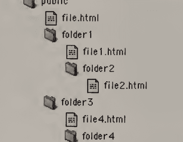

3. 对于上面的练习2，回答(a)、(b)和(c)部分。但是，假设您要链接到的`"目标"`文件中有一个名为`NAME="findme"`的命名锚点。编写直接指向此命名锚点的链接的HTML代码。
4. 设计图5.10中的网站。每个网页应包含一个简短的（一句话或更少）描述，说明该页面是什么。换句话说，每个页面几乎都是空白的。这里的重点是导航链接和链接结构。但是，为了强调层次结构，给所有索引页面相同的背景色。此外，通过使给定层级上的所有页面（除索引文件外）具有共同的背景色来区分层次结构的各个层级。
5. （此文件也用于练习8.9.4。）前往本书网站的第5课作业部分。在练习5下，您会找到一个名为`"dsl.html"`的网页链接，该页面讨论DSL互联网连接。此页面有一个标题和四个部分，编号为1至4。下载此页面的源HTML文件并添加以下功能。（查看页面时执行`"另存为"`并选择源文件。）
   - (a) 在四个部分的开头各放置一个命名锚点。在页面顶部放置指向这四个命名锚点的导航链接。
   - (b) 在四个部分的标题附近放置指向页面顶部的链接。这些链接只需采用`"返回顶部"`的形式。这样，观众可以直接进入某个部分，然后立即返回顶部，而无需使用滚动条。
   - (c) 第4部分有几个子主题。在第4部分的每个子主题处放置命名锚点。在第4部分开头放置指向这些子主题的链接。
   - (d) 制作一个单独的网页，用于索引您添加到文件中的所有命名锚点。包括指向页面本身的链接、直接指向四个主要部分的命名锚点的链接，以及作为第4部分链接的子列表、指向标记第4部分子主题的命名锚点的链接。此页面作为外部目录。
6. （您在此处创建的文件也用于练习8.9.5。）前往本书网站的第5课作业部分。在练习6下，您会找到一个名为`"dsl.html"`的网页链接，该页面讨论DSL互联网连接。此页面有一个标题和四个部分，命名为1至4。下载此页面的源HTML文件，并按如下方式将此页面变成一个线性页面集合：
   - (a) 使用文档标题制作一个简短的标题页。
   - (b) 将四个部分各自制作成独立的网页。
   - (c) 向每个页面添加链接，使这五个页面组成一个线性集合。标题页是该集合的主索引页。
   - (d) 第4部分有几个子部分。在每个子部分处放置一个命名锚点。除了标题页上指向第4部分页面的链接外，添加直接指向标记子部分的命名锚点的链接。

## 5.11 项目线程

### 线程A

现在是将您拥有的独立网页变成一个完整链接的网站的时候了。重新阅读2.8节。

### 作业

(a) 将您的主页重命名为`"version2.html"`。创建一个名为`"index.html"`的新文件（或Web服务器上的索引文件名称），并将您的version-2主页内容复制到此文件中。这是您的version-3主页。添加您对主页的任何新想法或改进想法。此外，至少包含两个指向与主页主题相关或支持主页主题的外部站点的链接。

(b) 在public文件夹内创建另一个名为`"homework"`的目录（文件夹）。将您的旧主页版本移入此文件夹。同时，将您创建的其他任何作业移入此文件夹。创建一个索引文件来管理这个新目录。情况如下图所示。

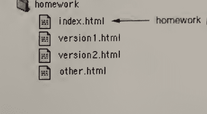

这个新索引文件是您的作业个人主页，将用于组织指向您所有作业的链接。您的作业页面可以很简单，也许带有一个说明页面用途的标题和一些颜色。

按照以下指南用*相对*链接将您的网站链接在一起：

(i) 您的主页顶部附近将有一个指向您作业页面的导航链接。您的作业页面顶部附近将有一个指向您主页的导航链接。

(ii) 您的作业页面将包含指向每个作业的链接。此时，这意味着两个以前版本的主页和您完成的任何其他作业。链接应有良好的支持，以便清楚地表明它们指向什么。

(iii) 您作业页面上引用的每个作业顶部将有指向您作业页面的导航链接。

(a) 如果您要完成上述任何练习，将这些文件放入您的作业目录并添加所需的链接。

(b) 如适用，完成后将所有文件传输到Web服务器。检查以确保传输成功。特别要检查以确保所有链接都能工作。

### 线程B

现在是将您拥有的独立网页变成一个完整链接的网站的时候了。重新阅读2.8节。

### 作业

(a) 在您的公共目录中创建一个名为`"research"`的新目录（文件夹）。将您的研究页面移入这个新目录。如果您只有一个研究页面，请将其重命名为`"index.html"`（或您的 Web 服务器上索引文件的名称）。否则，如果您有多个研究页面，请在您的 research 文件夹中创建一个新页面，命名为`"index.html"`，其中包含指向您每个研究页面的链接。

(b) 完成上面的练习 5。在您的公共目录中创建一个名为`"ex5_5"`的新目录（文件夹），用于存放该练习的文件。将 5d 中的目录页面命名为`"index.html"`。

(c) 您的网站应如上图所示。提供链接，使网站成为一个完全链接的层次化网站。当然，请使用相对链接。作业页面中指向作业的链接应在指向目标方面有良好的支持。严格用于导航的链接（如返回作业页面）应放置在页面的最顶部。

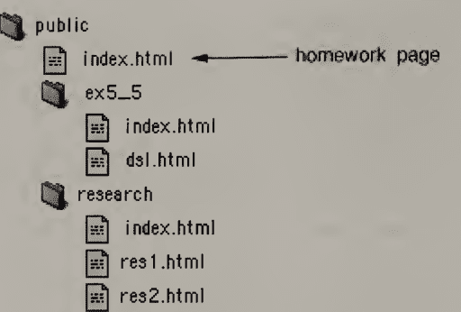

(d) 如果您要完成上面任何其他练习，请将这些文件放在您的根目录中，与您的作业页面放在一起，并提供必要的链接。

(e) 如适用，完成后将所有文件传输到 Web 服务器。检查以确保传输成功。特别是，检查以确保所有链接都能正常工作。

## 第六课

## 图像标记

在万维网（WWW）的早期，网页内容主要是文本。事实上，许多早期浏览器甚至不支持图形图像。即使没有图像，Web 上也已经有大量可用信息。但是，正如一句老话所说，`"一图胜千言"`。随着能够渲染图形图像的浏览器（如 Netscape 和 Internet Explorer）变得广泛可用，WWW 上图像的使用急剧增长。但即便如此，它们的使用仍然很繁琐。图像通常是极大的文件，占用大量计算机内存。

但现在有了速度极快的计算机（而且实际的互联网连接也越来越快），图像已经不再是网页中包含的过于繁琐的对象。事实上，如今您在 Internet 上打开的几乎任何网页都充满了图像，从小型的类图标图像到大型的类照片图像。当然，这些图像不是像传统照片那样印在纸上的相似物，而是数字化的、计算机可读的图像。图像的数字处理已经达到了如此先进的水平，以至于许多新型照相机和摄像机甚至以数字格式存储图像。事实上，数码照片图像的存储方式与网页中数字图像的存储方式之间并没有真正的区别。

### 6.1 图像文件

网页中使用的图像有两种类型，`".gif"`和`".jpeg"`。这听起来可能有点奇怪，但这两种图像类型不过是两种文件类型而已。`".gif"`和`".jpeg"`标识是用来识别这两种图像类型的文件后缀。正如我们上面提到的，数字图像文件往往相当大。为了减轻在 Internet 上传输大图像文件的负担，使用了文件压缩技术。换句话说，文件经过数字压缩，使其占用更少的计算机内存。关键在于图像文件必须以不影响图像清晰度或锐利度的方式压缩。由于文件压缩超出了本书的范围，我们只好满足于说`".gif"`和`".jpeg"`代表了两种不同类型的图像文件压缩，即数字图像被`"压缩"`以减少计算机内存占用的两种不同方式。我们将使用**GIF**和 **JPEG**来指代这两种图像类型，而不是通过文件后缀来引用。


**图 6.1** 一个 GIF 图像文件及其包含的实际图像。

> 作为一般规则，图标类型的图像通常创建为 GIF。大型照片类型的图像通常创建为 JPEG 类型的图像。GIF 压缩类型提供了更大的灵活性，正如我们将看到的，而 JPEG 压缩类型提供了更高的清晰度和更多的颜色，这对于照片来说是可取的。

由于本课用于演示的图像是小型图标类型的图像，我们将在示例中使用 GIF 图像。然而，当您进行越来越多的 Web 开发时，您无疑会遇到 JPEG 图像。就网页中标记这两种图像类型所需的 HTML 而言，没有明显的区别，因此 GIF 图像足以用于演示。关于 JPEG 的最后一点说明：`".jpeg"`图像也常见只使用后缀`".jpg"`的情况。因此对于给定的 JPEG 图像文件，例如`"mypicture.jpeg"`，也可以使用文件名`"mypicture.jpg"`。

图 6.1 展示了一个名为`"funnyman.gif"`的基本 GIF 图像文件。正如您在左侧所见，它看起来完全不像图像，只是一个计算机文件。那是因为它确实如此，只是一堆经过压缩的数字信息。要查看图像文件的内容，您必须将文件加载到能够解压缩和显示文件内容的应用程序中。在 Web 开发的背景下，所选应用程序通常是图形编辑器或 Web 浏览器。打开图像文件后，您就能看到它生成的图形。在本例中，您看到的就是图 6.1 右侧的那个卡通风格人物图标。如果您对这个图像文件的奇怪名称感到好奇，值得一提的是，建议给图像文件起描述性的名称，这样您就能在网站文件目录中轻松跟踪它们。

至于图形编辑器，您可以在本书的网站上找到一些免费软件和/或共享软件编辑器的参考。然而，像 Adobe Photoshop 这样的优秀软件要花不少钱（好几百美元）。我们不会详细介绍图形编辑器的使用，但它们是创建、查看和修改图像的手段。下次您看到一张比尔·克林顿的头长在健美运动员身上的图像时，您将看到使用图形编辑器进行图形处理的证据。

由于我们专注于网页开发，本课选择的图像查看应用程序是 Web 浏览器。事实证明，图像不一定非要嵌入网页中才能被浏览器显示。图 6.2 显示了从本地计算机将`"funnyman.gif"`加载到浏览器中的结果。您可以在地址窗口中看到，我们确实正在查看 GIF 图像而非 HTML 文件，因为后者会以`".html"`结尾而`".gif"`结尾。

如果您查看图 6.2 中浏览器窗口的顶部，可以看到 Netscape 给出了图像的实际尺寸（以像素为单位）。请注意，Explorer 也会在单独加载图像（而非嵌入网页）时显示图像的尺寸。在本例中，图像为 33 × 33 像素，即 33 像素宽、33 像素高。事实上，每个图像都有固有尺寸，这些尺寸的标准顺序为

宽 × 高

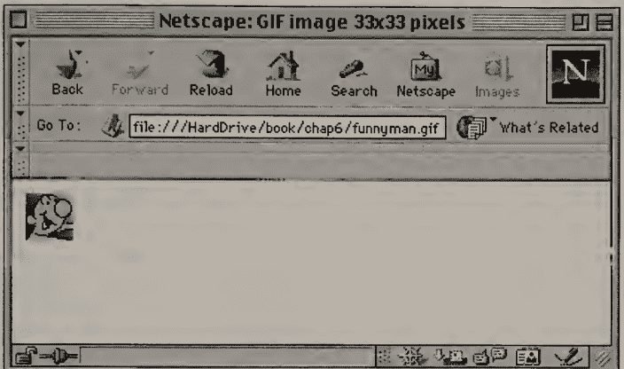

**图 6.2** 从本地硬盘加载到 Web 浏览器中的 GIF 图像`"funnyman.gif"`。它不在网页中。

因此，例如，您的计算机上可能有两个图像文件：

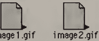

其中一个比另一个大得多。假设`"image1.gif"`是 40 × 30 像素，`"image2.gif"`是 600 × 700 像素。那么 image1 很小，大致与`"funnyman.gif"`大小相当，但呈矩形（宽大于高）。相比之下，image2 非常大，但也呈矩形（高大于宽）。事实上，image2 如此之大，以至于几乎无法放入浏览器窗口，或者根本放不进。换句话说，您只能在浏览器中看到图像的一部分，必须使用滚动条才能看到其他部分。

因此，即使图像的图标看起来相同，实际图像却有天壤之别。但图标相似并不意味着实际图像文件相似。请记住，一般来说，较大的图像比较小的图像占用更多的计算机内存。实际上，`"image1.gif"`可能占用约 4K 的计算机内存，而`"image2.gif"`可能占用 50K 或更多的计算机内存。

总而言之，**图像大小**（或**图像尺寸**）指的是图像在能够显示图像的应用程序中显示的实际大小，即宽 × 高（以像素为单位）。相比之下，图像的**文件大小**指的是存储图像所需的计算机内存量，以 K（千字节）为单位。一般来说，图像尺寸与其文件大小之间存在直接的相关性。换句话说，较大的图像通常来自较大的图像文件。我们在前两句中说`"一般来说"`和`"通常"`，是因为存在例外情况。所使用的压缩类型和图像的实际分辨率等因素也会影响文件大小。

您可能在想的最紧迫的问题也许是：`"我究竟如何才能获得一些图像放到我的网页中呢？"`困难的方法是自己制作。本书中使用的许多图像，如上面的 image1 和 image2 图标，这些图片是通过截取作者电脑屏幕的截图创建的。截图基本上就是捕捉电脑屏幕的数字图像，完全按照你看到的样子。然后可以使用图形编辑器来剪切出需要的部分。不过，这类过程的细节超出了本书的范围。

创建图片的另一种方法是使用**扫描仪**。扫描仪是一种设备，可以用来扫描实物图像，比如照片或纸张，从而创建该图像的数字文件。扫描仪的价格从大约100美元到数百美元不等，取决于所需的功能和质量。您只需将实物图像放入扫描仪，就像放入复印机一样，然后扫描即可。事实上，这非常像使用复印机，只是结果是一个数字计算机文件，而不是图像的另一个实物副本。但是，再次说明，更详细的讨论超出了本书的目标。此外，如果您只是想把照片放到网页上，而且您恰好拥有数码相机，那么您应该可以直接使用了。

好消息是，您可以通过互联网免费下载海量（数百万甚至数十亿）的图片。事实上，许多网站提供图片文件库，专门供您下载其中一些以供使用。本书的网站提供了其中一些资源的链接。您可能会惊讶地发现，除了专门用于图片下载的图片库之外，您在浏览时几乎可以在任何网页上找到可下载的图片。以下注释概述了具体操作步骤。

> **注意事项**
>
> 如果您在网页、图片库或其他地方找到一张图片，可以用鼠标点击图片并按住鼠标按钮不放。（在PC上是右键。）当您对图片`"点击并按住"`时，会弹出一个菜单，提供多个选项。其中一个是`"将图片另存为"`或简单的`"另存为"`。选择此选项即可将图片的副本下载到您的硬盘上。这基本上是由浏览器完成的快速匿名ftp传输。最好的学习方法就是在网页上尝试几张图片，直到掌握窍门。
>
> **非常重要的是**，您应该注意避免使用可能受版权保护的图片。换句话说，不要从某公司盗取官方徽标并放到您的网页上。也许不定式`"to pirate"`（意为`"偷盗和掠夺"`）在这里语气太重了（但这是一个很酷的动词）。任何将图片放到网上的人都应该知道，这些图片是可以下载的公平素材。事实上，确实存在防止图片被下载的方法。然而，绝大多数网上的图片都没有受到保护。总的来说，盗版图片是一个相当模糊的问题，在对与错之间存在灰色地带。如果您坚持使用图片库，就不必过于担心这个问题。目前最好的建议是用您的最佳判断力。实际上，如果您认为版权可能是个问题，避免盗版图片是一件很简单的事情。

在本课剩余部分中，我们将使用动词`"pirate"`来表示从网络上匿名下载图片。我们认为这是一个很酷的动词，并不意味着图片应该被窃取。事实上，正如我们上面提到的，您应该严格避免任何下载受版权保护材料的可能性。

## 6.2 图像标记

既然我们知道了如何`"pirate"`图片，现在是时候学习如何将图片放入网页中了。用于将图片嵌入网页的HTML元素是IMG（image）


**图6.3** 一个名为`"imagedemo.html"`的HTML文档，要将图片`"funnyman.gif"`嵌入其中。它们都位于某个公共目录中，该目录可能在Web服务器上，也可能就在您的计算机上。

元素。其基本形式为

```

```

IMG元素不是容器元素（它不包含任何内容），并且有一个必需属性，即SRC属性。SRC代表`"source"`（源），给出图像的位置（或来源）。该标签告诉浏览器标记一个图像，而SRC属性将浏览器指向正确的图像文件。这就是为什么SRC在IMG标签中是必需的。没有这个属性，浏览器就不知道在哪里找到图像。SRC属性既可以使用绝对URL，也可以使用相对URL。

如果IMG元素使用绝对URL，它看起来会像这样

```

```

其中绝对URL指向某个远程服务器，并指定所需的图像文件。然而，您不太可能希望从某个远程服务器嵌入图像到您的网页中。最好的办法是将您网站中将使用的所有图像文件与生成网页的HTML文档存放在一起。这样，您只需指定相对URL，当然，这只是一个本地文件路径。

为了具体说明，我们需要一个图像。一个方便的选择是图6.1中的`"funnyman.gif"`，供您参考，它是从一个免费的在线图标库中`"pirate"`来的。图6.3显示了一个公共Web目录，其中包含一个非常简单的名为`"imagedemo.html"`的HTML文档和图像`"funnyman.gif"`。

图6.4显示了文件`"imagedemo.html"`，它使用IMG元素来嵌入GIF图像。您会注意到，SRC属性使用的相对URL只是图像文件的名称，因为图像文件与HTML文件在同一目录中。此HTML文件的渲染效果如图6.5所示。

这里需要注意的是，图像被直接放入网页的文本中。在很多方面，图像标记的默认行为是图像表现得

```
<HTML>

<HEAD><TITLE>Image Demo</TITLE></HEAD>

<BODY>

The GIF image "funnyman.gif" is embedded into this web page


together with some text. You can see that the text is aligned by

default with the bottom of the image.

</BODY>

</HTML>
```

**图6.4** HTML文档`"imagedemo.html"`，使用IMG元素嵌入GIF图像。

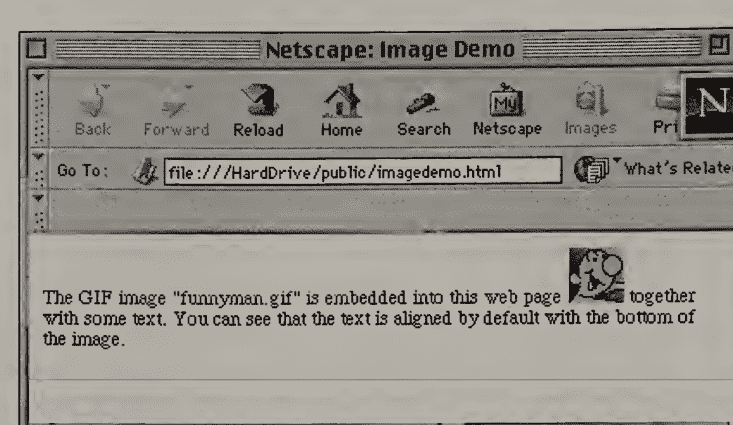

**图6.5** 图6.4中文档的渲染效果。

像普通文本一样。例如，当我们在本句中放入一些**更大**的文本时，较大文本的底部与相邻文本的底部对齐。同样，图像也直接出现在文本中，其底部与相邻文本对齐。

> **注意**
>
> 一般来说，图像文件越大，包含该图像的网页加载到浏览器中所需要的时间就越长。像`"funnyman.gif"`这样大小的图像文件，可能4K左右，加载速度几乎和文本一样快。但是，如果您在同一网页中放入大量（可能25或30张）这种大小的图像，页面加载速度会明显变慢。如果您包含一张大图像，比如文件大小为100K或更多，那也会拖慢浏览器。几张大图像文件可能会使浏览器停滞数秒甚至数分钟。
>
> 这里要指出的是，虽然网页中的图像很好，但不要疯狂地使用图像，把页面塞得满满当当。您需要在图像内容和页面加载到浏览器的速度之间取得一些平衡。这在两三年前还是一个特别重大的问题。但是现在的计算机变得非常快，可以非常快速地处理图像。但即使拥有超快的计算机，通过互联网传输巨大的图像或大量较小的图像仍然存在问题。即使某个网页在您的计算机上加载速度超快，也不意味着其他每个人都能通过互联网快速下载该页面。

## 6.3 创建空间：WIDTH和HEIGHT属性

IMG元素的两个最基本的属性是WIDTH和HEIGHT属性。您会注意到在图6.4和图6.5中并未提及这些属性。在这种情况下，图像使用默认尺寸进行标记。如果记得的话，那是33 × 33像素。IMG标签的WIDTH和HEIGHT属性可以用来覆盖默认尺寸。图6.6展示了使用这些属性对`"funnyman.gif"`的三种不同渲染效果。我们不提供生成该图像的HTML文件，而是提供一些讨论。

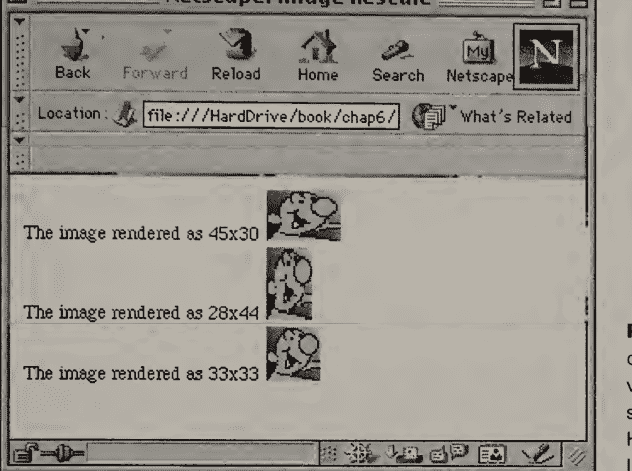

**图 6.6** 通过指定 IMG 元素的 WIDTH 和 HEIGHT 属性以不同尺寸渲染的趣味人物图像。

格式化三个版本图像所需的 HTML 代码如下所示

```


```

当然，顺序与示例网页中图像出现的顺序一致。很明显，在前两个实例中，图像因 WIDTH 和 HEIGHT 属性而扭曲了原始形态。在第三个实例中，这些属性仅仅指定了图像的实际尺寸。换句话说，即使没有这些属性，图像也会被标记为这个大小。

那么，既然第三个实例中这些属性并非必需，我们为何还要包含它们呢？原因在于，你应当*始终*在 IMG 元素中使用这两个属性，即使你无意调整图像大小。理由如下。当然，实际情况比我们阐述的稍复杂一些，但这个基本推理很容易理解。

在浏览器开始渲染网页之前，它必须确定为页面中嵌入的任何图像分配多少空间。如果不使用 WIDTH 和 HEIGHT 属性，浏览器就必须完全从远程服务器加载所有图像文件，以获取其尺寸。一旦浏览器知道了所有尺寸，它才能开始渲染网页。问题在于图像文件加载通常较慢。因此，基本上，你将坐在那里，盯着空白的浏览器屏幕，等待浏览器将所有图像文件加载到其内存缓存中。然后，在确定了图像尺寸后，它才开始渲染网页，这又需要一些时间。

现在，设想一下这种情况：即使不需要调整图像大小，也在*所有* IMG 元素中包含了 WIDTH 和 HEIGHT 属性。在浏览器加载所有图像之前，它已经读取了 HTML 代码，并且因为 WIDTH 和 HEIGHT 属性而知道需要为图像分配多少空间。因此，它开始渲染网页。由于尚未从远程服务器获取所有图像，它只是在网页中创建空间，以便最终加载每张图像。这意味着浏览器可以在尝试从远程服务器获取所有图像的同时，布局整个网页，为图像留出空框。当不同的图像到达时，它们就被插入到因为 WIDTH 和 HEIGHT 属性而预先保留的空白区域中。

因此，使用 WIDTH 和 HEIGHT 属性可以为给定网页节省大量的加载时间。事实上，你在网上冲浪时遇到的几乎任何网页，其所有 IMG 标签中都包含这些属性。你实际上可以在页面加载时看到一些空框被`"绘制"`出来。然后，图像最终到达，你就会看到它们出现在预先分配的空间中。

> **注意**
>
> 如果你希望减小图像尺寸（例如出于空间考虑），并且不希望像图 6.6 中前两种情况那样扭曲图像，实际上可能涉及一点代数运算。假设你需要在网页顶部附近放置一个高度恰好为 30 像素的图像。（我们将在后续课程中讲解更高级的页面布局方法，届时你会明白为何需要这样的处理。）如果图像是像 `"funnyman.gif"` 这样的正方形图像，那就很容易。你只需将属性设置为 30 × 30 即可标记图像。
>
> 当图像不是正方形时，问题就来了。例如，假设你找了一张合适的图像，但它是 26 × 37。现在，你知道你想设置 `HEIGHT=30`。但你如何知道该将 WIDTH 设置为多少才能避免图像扭曲呢？你可以猜测，也许是 19 × 30，但猜测可能会导致图像略有扭曲。正确的方法是保持宽度/高度比例。你不知道新的宽度，所以让所需的宽度为 *w*。那么方程
>
> ```
> 26/37 = w/30
> ```
>
> 旧比例 = 新比例
>
> 给出了变量 *w* 所需的关系式。通过交叉相乘解方程，你得到 *w* = 21.08。当然我们不能请求分数像素，所以四舍五入到最接近的整数 21。因此，所需的尺寸为 21 × 30。

## 6.4 使用文本定位图像

正如可以使用文本标记元素的属性来创建自定义文本对齐方式一样，IMG 元素也有一些属性，可以提供一些灵活性来调整图像在文本中的对齐方式。此外，还有办法让文本真正环绕图像，就像在杂志或报纸中一样。要在页面上更好地对齐图像，只需要 IMG 元素的几个属性。当然，这应该不足为奇。

首先是 ALIGN 属性。其值

- `ALIGN=bottom`
- `ALIGN=middle`
- `ALIGN=top`

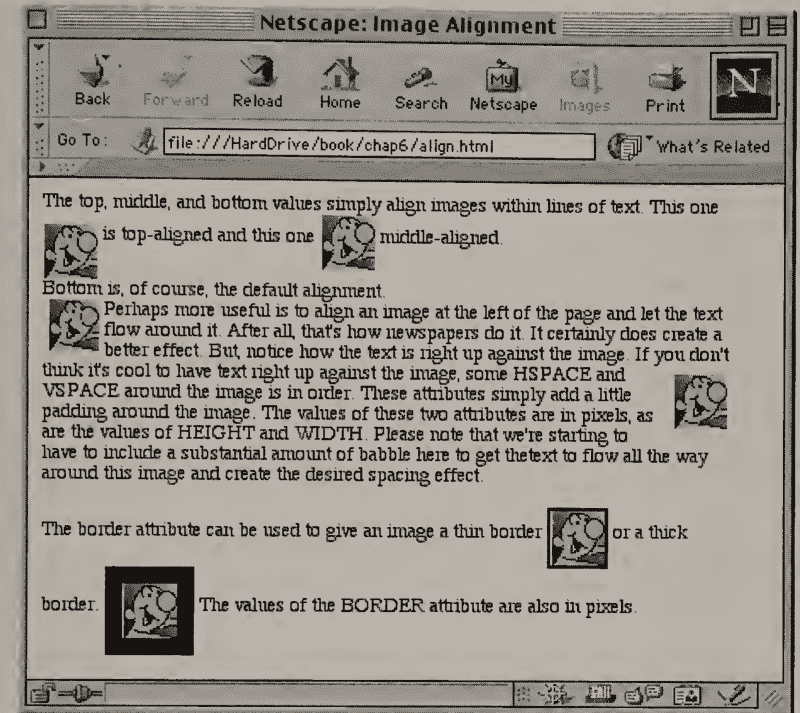

用于设置相邻文本与图像的对齐方式。我们在图 6.5 和图 6.6 中看到，文本默认与图像底部对齐。以上值提供了一些额外的灵活性，如图 6.7 中的前两张图像所示。然而，通常不希望将图像直接放置在文本中。你可以看到，将图像放置在文本中会导致文本行之间被不同数量的空间分隔。第二行和第三行文本之间的间距大约是第一行和第二行之间间距的两倍。这种效果有点难看。

但是，值

- `ALIGN=left`
- `ALIGN=right`

实际上会使文本环绕图像，如图 6.7 中的第三和第四张图像所示。请注意环绕第三张图像是如何紧贴图像的。HSPACE 和 VSPACE 属性分别为图像周围提供了一些额外的水平和垂直填充。这些属性接受像素值。例如，属性

- `HSPACE=10`
- `VSPACE=5`

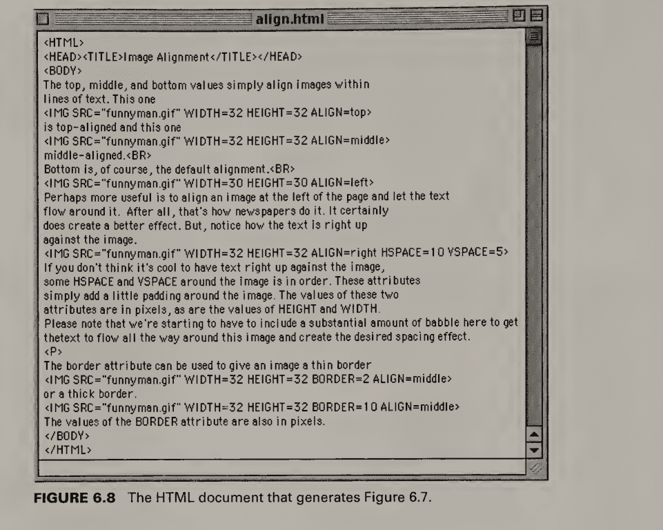

**图 6.8** 生成图 6.7 的 HTML 文档。

会在图像旁边创建 10 像素的填充，并在图像上方和下方创建 5 像素的填充。这可以从图 6.7 的第四张图像中得到证实，但由于文本不是右对齐的，所以有点难以感知确切的 HSPACE。

BORDER 属性的作用从示例的最后两张图像中应该很明显。它可以用于在图像周围创建黑色边框。它也接受像素值。为了便于理解，生成图 6.7 的 HTML 文档如图 6.8 所示。

本节提到的图像元素的最后一个属性是 ALT 属性。它为图像提供文本替代方案。文本替代是指，如果浏览器无法显示图像或已关闭图像显示功能，将显示在图像位置的一段文本字符串。在图像显示不是所有浏览器标配的时代，ALT 替代文本更为重要。但是，即使在今天，有些人仍然喜欢进入浏览器的偏好设置并关闭图像显示功能。然后他们得到纯文本网页，加载速度更快。实际上，对于使用非常慢的电脑或非常慢的电话调制解调器连接互联网的人来说，这是一个不错的选择。

因此，无论何种情况，在 IMG 标签中包含类似

```
ALT="picture of cartoon man"
```

的内容为图像提供了文本替代方案。如果出于任何原因图像未在网页中显示，浏览器将显示该文本字符串。

## 6.5 图像作为链接

图像也可以充当超链接。我们将充当活动链接的图像称为**图像链接**。因此，浏览者不是点击普通的下划线超链接去某个地方，而是可以点击图像并跳转。要实现这一点，只需将指向图像的 IMG 标签放置在一个锚元素内部，该锚元素的 HREF 属性指向所需的 URL：

```
<A HREF="URL">  </A>
```

请注意，IMG 标签构成了锚元素的内容。它*不是*与 HREF 属性一起放在起始标签中。图 6.9 显示了将图像标签放置在锚元素内部的结果。

很明显，这些图像实际上是链接。确实，鼠标指针指向炸弹图像导致`"恐怖分子互助会"`的 URL 显示在浏览器的状态栏中。我们没有显示创建图 6.9 页面的整个文档 `"outlaws.html"`，而是给出了创建图像链接的两个锚元素的定义。文档的其余部分非常简单。

```
<A HREF="http://www.piratehelp.com">


</A>

<A HREF="http://www.terroristhelp.com">


</A>
```

我们再次强调，图像标签是锚元素的内容，而不是起始标签的一部分。关于这个示例，一个值得注意的有趣之处是，通常当你放置一个

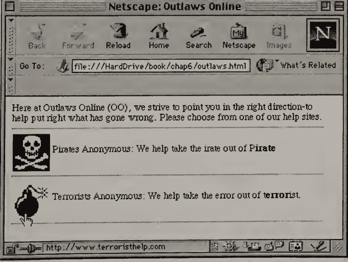

**图 6.9** 两张图像充当超链接的文档渲染效果。

当锚点元素内包含图像使其成为链接时，浏览器会在图像周围渲染一个边框。对于文本链接，浏览器会给文本加下划线以强调它实际上是一个链接。类似地，它会将那个下划线环绕在图像链接周围，以强调它是一个链接。这看起来就像图像边框，只不过它是蓝色的，或者是浏览器默认的链接颜色。在本例中，我们不希望图像周围出现彩色边框，因此我们在 IMG 元素中强制使用 `BORDER=0` 来让浏览器抑制它。

我们还提到，建议使用某种文本作为图像链接的辅助说明。如果一个图像链接只是单独放在某个地方，它可能并不明显是一个超文本链接，尤其是当你抑制了锚点元素试图给图像添加的蓝色（或其他颜色）边框时。

涉及将图像作为链接的一个常见做法称为缩略图制作。（拼写检查器肯定会抓到这个词！）给定一个中等或大的图像，无论其文件大小还是图像尺寸较大，通常都希望创建该图像的**缩略图**。缩略图是图像的一个小版本，可能图标大小，用于代表该图像。例如，考虑一个在线房地产中介销售房屋。他们网站上的某个网页可能希望包含几套房屋的简要描述，以及每套房屋的一个小缩略图。由于实际的房屋图片相当大，出于空间考虑，在一个页面上显示所有图片是不切实际的。此外，将所有图片放在同一个页面也是不可取的，因为可能会导致加载延迟。

通过小缩略图，访问者可以快速加载缩略图页面，快速浏览所有房屋和描述，如果对某套感兴趣，可以点击缩略图查看房屋的完整版本。当然，在这种情况下，缩略图是图像链接，HREF 属性指向每个缩略图所代表的较大图像。此外，每个缩略图链接指向的实际房屋图片甚至不必嵌入网页中。回想一下，在第 6.2 节中，我们将一张图像加载到一个不属于网页的浏览器中。在那种情况下，相对 URL 只是指向图像文件，而不是 HTML 文档。

然而，这里有一个关键点。假设一张给定的房屋图片是 600 x 400 像素。宽高比是 3/2。那么为什么不直接使用 WIDTH 和 HEIGHT 属性按比例将图像缩小到 60 x 40 呢？问题是图像尺寸虽然减小了，但实际的图像文件大小保持不变。因此，如果房地产中介使用这种方法创建缩略图，实际的缩略图页面将包含一堆小图像，而每个小图像是由一个巨大的图像文件生成的。这从根本上违背了制作缩略图的初衷。不幸的是，除了学会熟练使用图形编辑器应用程序外，别无他法。由于图形编辑器的细节超出了本书的范围，关于缩略图制作就不再赘述了。不过，缩略图制作是你应该熟悉的一项技术。

> **注意**
>
> 图像链接的一个非常常见的用途是使用按钮图标作为图像链接。以下两个按钮是典型的例子。它们只是小图像文件。
>
>  和 
>
> 使用此类按钮时，通常不需要辅助文本，因为辅助文本直接内置在图像中。此类按钮图像在互联网上的各种图像和图标库中大量存在。只需确保抑制锚点元素试图在按钮周围绘制的边框即可。否则，它看起来会有点奇怪。

## 6.6 组织图像文件

组织网站上图像文件最简单的方法可能就是将每个图像文件放在与其要使用的网页相同的文件夹中。这样，所需的相对 URL 就只是图像文件的名称。事实上，到目前为止本课中呈现的所有示例都使用了这种 URL。你可能已经注意到，每一个 IMG 元素示例都只是使用 `SRC="someimage.gif"` 指向文件。但情况并非必须如此。

举一个具体的例子，让我们回到琼斯的网站，如第 5.2 节图 5.5 所示，他有一个主页、一个专业页面和一些兴趣爱好页面。作为一个精通网络的人，琼斯决定在他的页面中添加类似上图所示的按钮作为链接。由于他的网站设计是层次结构的，他知道他希望在每个子页面中都有一个`"主页"`按钮。此外，他希望在他的主页上有一个`"邮件"`按钮用于`"mailto"`链接（见第 5.7 节）。为了简单起见，他决定将他所有的图像都保存在一个公共的`"image"`目录中。这并非绝对必要，但他认为，既然四个子网页都将使用同一个`"主页"`按钮，他不妨只保留一个主页按钮并在四个页面中使用它。图 6.10 显示了他更新后的网站，其中有一个新目录，里面放了两个按钮的文件。

图中显示了三个所需的相对 URL。最下面的两个只需指向图像文件夹内部并指定所需的图像文件。然而，从兴趣文件夹中的索引文件指向`"home.gif"`按钮的文件路径则更复杂。注意此 URL 开头的两个点。它必须从兴趣文件夹指回公共文件夹，然后进入图像文件夹，最后指定所需的图像文件。

> **注意** 我们并不是说你必须像图 6.10 那样组织你的图像。事实上，这在很大程度上取决于个人偏好。如果你只有几张图像，把它们与将要使用它们的 HTML 文档放在一起是有意义的。然而，如果你有很多图像，或者有些图像你会在多个网页中使用，那么将图像组织得更好一些，也许放在一个图像文件夹中，是合理的。只是要小心。就像链接中的相对 URL 一样，你必须确保文件路径正确。此外，文件和目录名称区分大小写。因此，如果不完全匹配，你的图像将不会显示。

如果浏览器找不到图像，其实没什么大不了的。包含图像的页面仍然会显示，只是图像不会出现。大多数浏览器会在本应显示缺失图像的地方插入一个通用的图标状图像。当图像应该显示却没显示时，这是相当明显（且令人恼火）的。在将网站传输到 Web 服务器之前，应该*始终*检查本地副本上的所有内容是否正常工作。

## 6.7 将图像放到 Web 服务器上

说到 Web 服务器，你如何将图像放到服务器上？答案很简单：你只需像传输任何其他文件一样传输它们即可。但有一个区别。HTML 文档必须以文本或 ASCII 形式传输到 Web 服务器，而图像必须以**原始数据**形式传输。你应该很容易在你的 ftp 程序上找到这个选项。

记住，将网页以文本或 ASCII 形式传输到服务器，但将图像以原始数据形式传输。否则，你的网站在服务器上将无法工作，即使它在本地可以工作。在大多数 ftp 应用程序上，应该有一个第三个选项，即**自动**。保持选中此选项应该可以保持你的传输正常进行。但这在不同的 ftp 应用程序中略有不同。你可能希望尝试此选项，看看它在你的 ftp 应用程序上是否可靠。

最后一点，就像将网页传输到服务器时一样，你必须非常小心将它们上传到哪个目录。如果将图像放在错误的目录中，它将不会在页面上显示，因为 URL 将不再匹配。这或许是另一个将网站上的图像组织好的好理由。

## 6.8 透明 GIF 和动画 GIF

我们在本课开始时提到，GIF 图像比 JPEG 图像灵活得多。虽然 JPEG 通常更适合高分辨率的现实类型图像，但 GIF 图像提供了两个特性，使其在网页构建中使用时`"很酷"`。第一种很酷的 GIF 图像类型是**透明 GIF**。这并不意味着你可以直接看穿图像，而是图像的背景会适应网页中的任何背景颜色。从这个意义上说，图像是前景，而图像的背景就像变色龙。图像的背景会自动与网页背景融合。

下面的 GIF 图像`"arrow.gif"`就是透明 GIF 的一个例子。为了演示其尺寸，我们在下面显示它并在图像周围绘制了一个边框。这只需在 IMG 元素中设置 `BORDER=1` 即可完成。


该图像为 40 × 30 像素，看起来像是一个白色背景上的蓝色箭头。然而，图 6.11 显示了同一图像（没有边框）在白色背景和浅蓝色背景网页上的效果。因此，尽管图像是一个 40 × 30 的矩形，但它看起来就像一个箭头形状的图像漂浮在页面上。好消息是你不需要使用任何特殊的 HTML 标签来使 GIF 透明。有些 GIF 天生就是透明的。此外，它们在免费图标库中大量存在，随时可供使用。

## 6.9 背景图像

在浏览网页时，你可能已经注意到，许多网页都有纹理背景，而不仅仅是彩色背景。其中一些纹理背景非常微妙，有些则相当精致，例如云朵图案。实现这种效果相当简单；只需要一个适合用作背景的图像文件，以及 BODY 元素的一个属性。

请看图 6.12 中的图像。你可以看到它呈现出一种轻度纹理的表面，有点像粗糙的布料或大理石纹理的瓷砖。这类图像非常适合用作背景，因为它们不会喧宾夺主，并且能为文字提供良好的背景。同样，这类图像可以在众多的图标和图像库中找到。实际上，许多图像库只包含背景类型的图像，或者设有专门的背景图像区域。

要将一个图像文件设置为网页的背景，你需要使用 BODY 元素的 BACKGROUND 属性。

```
<BODY BACKGROUND="URL of image">
```

第二种很酷的 GIF 图像是**动画 GIF**。这些 GIF 就像简短的卡通片：它们通过一系列相似的图像来产生动态效果。同样，你不需要做任何特殊操作就能将其放入网页中。只需在免费图像库中找一个，然后用 IMG 元素放入你的网页即可。确实不再需要更多的解释了。此外，在静态书籍中很难展示动画效果。所以，我们的建议就是去找一个来试试看。

> **注意**
>
> 我们基本回避了如何使用图形编辑器的话题，而且这次也会继续回避。如果你将动画 GIF 加载到几乎任何图形编辑器中，你实际上可以更改图像的速度设置。也就是说，你可以设置动画中不同帧的显示速率。你可以让动画非常快，或者非常 sloooooow（慢）。虽然设置动画速度相当简单，但学习如何用这类编辑器做各种事情需要相当长的时间。等你读完这本书后，这也许可以作为一个不错的项目！

为简单起见，假设 `"bg.gif"` 与将要使用它的网页位于同一目录中，

```
<BODY BACKGROUND="bg.gif">
```

这会使图像 `"bg.gif"` 显示为页面的背景。

图 6.13 展示了一个使用 `"bg.gif"` 作为背景的网页。为了说明问题，这个网页还包含一些其他内容。特别是，它包含另一个叠加在背景图像之上的图像。换句话说，背景不会影响网页中的其他对象。它们是叠加在背景图像之上的。你甚至可以注意到，这个箭头图像就是上一节中用作示例的同一个透明 GIF。箭头的透明背景甚至会与背景图像融合。

你可能在想，图 6.12 中的小图像（它是 65 × 65）如何能创建填满整个浏览器窗口的背景呢？这种背景效果是通过**平铺**小背景图像实现的。背景图像被放入网页中的方式，类似于厨房或浴室地板铺设瓷砖的方式。所以图 6.13 中的页面实际上包含了该小图像的许多副本。无论浏览器窗口被调得多大，都会包含足够多的背景图像副本以覆盖整个页面。

> **注意**
>
> 包含背景图像是本章中唯一一个涉及 BODY 元素属性而非 IMG 元素的图像标记操作。本课中的所有其他图像标记都是通过 IMG 元素完成的。但是，鉴于 BODY 元素也有设置背景颜色的 BGCOLOR 属性，这里可能会存在冲突。换句话说，如果你在同一网页中既设置了背景图像又设置了背景颜色，哪一个会生效呢？答案很简单。背景图像胜出，BGCOLOR 将不会被显示。

## 6.10 图像映射（可选）

也许你在网页中见过这样的图像：你可以点击不同的部分，根据点击的图像区域被跳转到不同的网页。换句话说，整个图像充当多个链接，但不同的区域链接到不同的页面。这种设置被称为**图像映射**。像往常一样，最好的方式是提供一个具体的例子。图 6.14 展示了美国西部地图的一部分。在这个例子中，我们将模拟一个旅游信息页面，用户可以点击某个州并跳转到该州的信息网页。为简单起见，我们只关注俄勒冈州、加利福尼亚州和内华达州。

首先要注意的是图 6.14 右上角的 (x,y) 坐标显示。之所以出现这个显示，是因为图像被加载到了图形编辑器程序中。如果你想深入了解制作图像映射的细节，使用这样的程序确实不可避免。同样，本书的网站中列出了几款图形编辑器的参考资料。好消息是你不需要对编辑器了解太多。你只需要用它来确定一些 (x,y) 坐标对即可。

关于图像，(x,y) 坐标系统的工作原理如下。图像左上角的像素是 (0,0)。然后其他像素的坐标按照以下方案分配：

因此，如果图 6.14 中的图像尺寸为 175 × 225，那么左下角的坐标是 (0,225)，右下角的坐标是 (175,225)，右上角的坐标是 (175,0)。这说明了图像中像素坐标是如何分配的，但实际上你只需要知道如何将光标指向图像并读取坐标显示即可。

例如，在图 6.14 中，你可以看到鼠标指针位于加利福尼亚州、俄勒冈州和内华达州的交界处。在图像的右上角，你可以看到该点的坐标是 (95,94)。就这么简单。当然，不同的图形编辑器会有不同的显示方式，但将鼠标指针放在图像上以推断坐标应该不成问题。

需要推断坐标的原因是，你可以通过指定某些坐标来勾勒图像的不同区域，以便用于图像映射。划定区域的第一种方式是指定圆心和所需半径：

```
SHAPE="circle"

COORDS="x,y,r"
```

这设置了一个圆心为 (x,y)、半径为 r 的圆形区域。这里的半径以像素为单位。第二种方式是指定矩形的左上角和右下角坐标：

```
SHAPE="rect"

COORDS="X₁,Y₁, X₂,Y₂"
```

第三种方式是是多边形的顶点。鉴于图 6.14 中各州形状的不规则性，我们将使用多边形来布局我们正在创建的图像映射。因此，为了说明多边形的用法，我们将继续前面的具体示例，而不是泛泛而谈。

多边形是通过指定其顶点（角点）来定义的。关键在于顶点按顺序列出，从 (152,109) 开始。这很合理，因为每个顶点将会被

## 图像标记

要连接到下一个指定的区域，你必须按顺序操作，否则线条会交叉。

> **注意** 由于定义多边形区域不像圆形和矩形那样直观，我们提供以下提示。
>
> 1. 使用图形编辑器找到所需的点。按顺序列出它们。你可以顺时针或逆时针排列。如果不按顺序排列，线条会交叉，你的图像地图将无法正常工作。
> 2. 不要将第一个坐标列出两次。换句话说，无论你先列出哪个坐标，都不要再将它列在最后。

类似地，我们已将加利福尼亚州和俄勒冈州勾勒为多边形。要将其设置为图像地图，你只需将图像作为链接包含在网页中。

```
<A HREF="">  </A>
```

在锚点元素的 HREF 属性中无需指定 URL，因为链接将由图像地图处理（一旦我们定义了它）。在 IMG 元素中，我们指向了图像的源，即 `"westusa.gif"`。以下两个属性是必需的。首先，ISMAP 不取值，仅表示嵌入的图像将用作图像地图。其次，USEMAP 属性指定使用哪个地图来设置图像中的区域。最后，BORDER 属性不是必需的，但由于锚点元素会在图像周围绘制彩色边框，最好将其抑制。

上述 HTML 足以将图像嵌入网页并将其设置为图像地图。MAP 元素是一段独立的 HTML 代码，用于实际设置图像中的区域以及每个区域指向的 URL。

```
<MAP NAME="themap">

    <AREA HREF="neva.html" SHAPE="poly"

        COORDS="152,109,137,184,127,199,84,130,95,94">

    <AREA HREF="oreg.html" SHAPE="poly"

        COORDS="78,29,138,48,123,100,56,78">

    <AREA HREF="cali.html" SHAPE="poly"

        COORDS="95,94,84,130,130,208,121,226,95,221,65,189,48,99,56,78">

</MAP>
```

MAP 元素有一个 NAME。记住，我们在 IMG 元素中将图像设置为图像地图时，必须通过名称来调用该地图。然后，你为每个希望定义的区域包含一个 AREA 标签。AREA 标签的 HREF 属性指定一个 URL（相对或绝对）。此 URL 指向该区域要链接到的网页。之后，包含定义实际区域及其坐标的属性。

## 第 130 课 第 6 课 图像标记

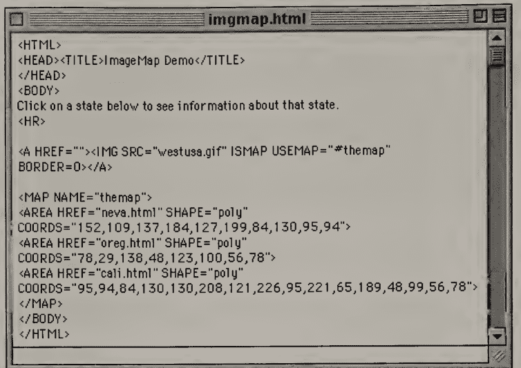

**图 6.15** 一个为加利福尼亚、俄勒冈和内华达生成图像地图的 HTML 文档。点击这些州中的任何一个都会加载不同的网页。

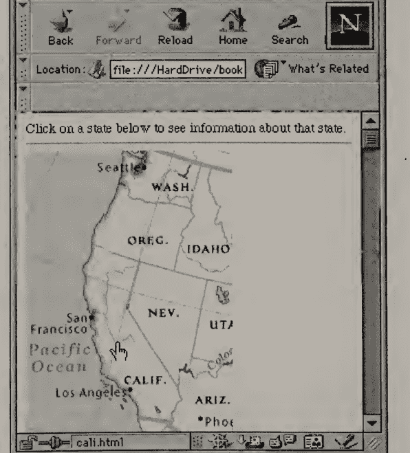

**图 6.16** 图 6.15 中文档的渲染效果。

作为参考，我们提供了美国西部示例的完整文档及其在图 6.15 和图 6.16 中的渲染效果。生成图像地图的 HTML 文档名为 `"imgmap.html"`。由于 AREA 标签的 HREF 属性仅指向文件名，因此图像地图指向的网页显然与 `"imgmap.html"` 在同一目录中。你还可以在图 6.16 中注意到，鼠标指针位于加利福尼亚州上，而该区域的目标网页（即所需的网页）显示在浏览器底部的状态栏中。

> **注意**
>
> 在实践中，设置区域时无需极其精确。如果存在一些未被任何区域覆盖的`"死空间"`，当你点击该空间时，什么也不会发生。如果两个区域重叠，则使用在 MAP 定义中首先出现的那个重叠区域的链接 URL。

## 6.11 总结

### 关键术语

- GIF
- 图像尺寸
- 按钮
- 动画 GIF
- JPEG
- 图像链接
- 原始数据
- 背景图像
- 文件大小
- 缩略图
- 透明 GIF
- 平铺

网页中使用的图像类型迄今为止最常见的是 GIF 和 JPEG。文件名后会附加后缀 `".gif"` 和 `".jpeg"`（或 `".jpg"`），以帮助区分图像类型。通常，你无法从视觉上区分这两种图像类型，因为它们用于存储数字信息的压缩类型不同。然而，GIF 对于图标类型图像更为通用，因为它们可以是透明的或动画的，而 JPEG 图像往往为照片类型图像提供更好的清晰度。无论图像类型如何，即使不在网页中，浏览器也能显示它。

图像文件的大小是存储文件所需的计算机内存量，而图像尺寸是指图像的维度。图像尺寸以像素为单位给出，格式为 宽度 × 高度。通常，维度大的图像需要较大的文件大小，但分辨率也是影响图像文件大小的一个因素。你可以使用数码相机、扫描仪创建自己的图像，或者通过截取计算机屏幕并裁剪出所需部分来获取。然而，最简单的方法是从其他网页复制它们。事实上，许多网站都有专门为此目的创建的图标库。要复制图像，你只需用鼠标右键（如果适用）点击并按住图像，然后选择`"另存为"`。请务必避免复制可能受版权保护的图像。

要在网页中放入图像，你可以使用 IMG 元素（非容器），并将图像的 URL 指定为 SRC（源）属性的值。图像的 URL 可以是绝对 URL 或相对 URL，但你应该在本地存储网页中使用的图像并使用相对 URL。使用 IMG 元素的 HEIGHT 和 WIDTH 属性，你可以控制图像在网页中显示的尺寸。但即使图像不需要调整大小，你也应该包含 HEIGHT 和 WIDTH 属性。这样，浏览器可以预先知道为图像在网页中分配多少空间，从而可以在所有图像加载之前开始布局页面。

## 图像标记

如果你想控制图像与文本的对齐方式，可以在 IMG 元素中使用 ALIGN、HSPACE 和 VSPACE 属性。ALIGN 属性有助于将图像定位在页面上，并可使文本环绕图像。HSPACE 和 VSPACE 属性在图像周围创建填充，以帮助偏移可能环绕图像的文本。

要将图像用作超文本链接，你只需将其放在锚点元素内，该锚点元素的 HREF 属性指向所需的网页。就像文本链接会被锚点元素自动加下划线一样，用作链接的图像也会被锚点赋予彩色边框。由于这通常不受欢迎，可以将 IMG 元素的 BORDER 属性设置为 0 像素以抑制锚点给出的边框。图像锚点的一个常见用途是创建图像的缩略图，这些缩略图作为链接是活动的，当点击时，会显示较大的原始图像。另一个常见用途是查找指示链接性质的按钮图标，并将其用于图像链接。这样，你就不需要太多（如果有的话）文本来支持图像链接的意图。

以下是我们讨论过的 IMG 元素特性的总结。请注意，列出的最后两个属性在关于图像地图的可选部分中有所涉及。

### ``

| 属性 | 可能的值 | 默认值 |
| --- | --- | --- |
| SRC | 绝对 URL，相对 URL | — |
| ALIGN | left, right, center, top, middle, bottom | left, bottom |
| HSPACE | 像素 | 浏览器相关 |
| VSPACE | 像素 | 浏览器相关 |
| BORDER | 像素 | 0 |
| ALT | `"文本字符串"` | 无替代文本 |
| ISMAP | — | — |
| USEMAP | `"#文本字符串"` | — |

在网站上组织图像文件的最简单方法是将每个图像放在使用该图像的 HTML 文档所在的目录中。这样，SRC 属性只需要图像文件名。但是，如果你计划在多个网页中使用相同的图像文件（也许如果你使用链接按钮在整个站点中提供一致性），将所有图像保存在 `"images"` 目录中更有意义。但这种安排会使访问图像所需的相对 URL 变得复杂。由于用于访问图像文件的相对 URL 遵循与链接到其他网页的相对 URL 相同的规则，因此以下提示与第 5 课中的提示非常相似。但考虑到它们的重要性，我们完整地重复它们。

> **注意**
>
> 如果图像在你的网页中未能按预期显示，很可能是以下问题之一：
>
> 1. 相对 URL 未指定图像文件的正确文件路径。
> 2. 相对 URL 中使用的目录名或文件名与实际的目录或文件名*不完全*匹配。完全匹配是指大写字母、空格等全部一致。（最好在你的目录和文件名中使用全小写字母且不含空格，以帮助缓解此类问题。）

当您将图像传输到Web服务器时，必须以`"原始数据"`方式传输。否则，浏览器将无法显示它们。您只需确保在传输图像文件时选择了原始数据选项（与传输HTML文件时的`"文本"`或`"ASCII"`选项相对）。然而，几乎所有的FTP应用程序都有一个`"自动"`选项可以为您处理此问题，但您仍应通过测试来确保此选项是可靠的。

> **注意**
>
> 如果图像在本地网页中显示正常，但在服务器上的网页中无法显示，问题很可能属于以下情况之一：
>
> 1. 您对上述问题1不够严格，而您的个人电脑对此较为宽容。例如，文件名在个人电脑上可能不区分大小写。但是，Web服务器则没有这么宽容。
> 2. 您将一个或多个图像传输到了服务器上的错误目录。这导致作为SRC属性值指定的相对文件路径不再正确。
> 3. 您意外地将一个或多个图像文件以`"文本"`或`"ASCII"`方式传输，而非`"原始数据"`方式。

GIF图像在网页中更具实用性的两个特性是透明GIF和动画GIF。透明GIF的背景会适应其所在网页的背景颜色。因此，即使图像是方形或矩形的（网页中使用的所有图像都是如此），图像的主要特征看起来像是浮动在网页上。动画GIF图像是一系列像卡通一样起作用的图像。图像的不同帧依次出现，创造出运动效果。即使动画GIF包含多个不同的图像，它仍然是一个图像文件，将其嵌入网页的难度并不比普通图像大。

唯一不使用IMG元素包含在网页中的图像类型是背景图像。这不是一种新型图像，通常是一种为网页提供背景图案的GIF图像。这类图像（通常）不会过于突出，因此当它们平铺提供网页的完整背景时，网页中的其他对象（文本、链接等）能够很好地突显出来。背景图像通过提供一个指向图像的相对URL作为BODY元素的BACKGROUND属性的值来包含。BACKGROUND属性优先于BGCOLOR属性，透明GIF图像将适应背景图像。

## 可选

当您希望图像的不同区域充当链接并指向不同的网页时，可以使用图像映射。要将图像嵌入网页以供使用，您照常使用IMG元素，但要包含ISMAP属性（它不取值）和USEMAP属性（它取要使用的映射名称作为其值）。您必须在映射名称前使用`#`符号。这两个属性与其他IMG元素的属性一起在上方进行了总结。

映射本身用于定义图像的不同区域。它由MAP元素定义，该元素使用NAME属性，以便IMG元素的USEMAP属性可以按名称调用该映射。图像映射的每个不同区域必须由一个AREA元素定义。每个区域元素必须包含一个SHAPE属性，该属性可以指定三种基本形状之一：圆形、矩形（rect）和多边形（poly）。接下来，COORDS属性给出给定区域的实际规格。圆形区域需要圆心的(x,y)坐标和以像素为单位的半径。矩形区域需要矩形左上角和右下角的(x,y)坐标。多边形需要多边形每个顶点的(x,y)坐标，这些坐标必须按顺序（顺时针或逆时针）列出，以确保多边形的边不会重叠。最后，每个AREA标签必须包含一个HREF属性，其值指向该区域要访问的网页。

为了找到(x,y)坐标，您将需要使用图形编辑器。实际上，这很容易，因为您只需将鼠标指向图像中的某个点，图形编辑器就会显示坐标。即使您定义的区域有轻微重叠也没关系。如果用户点击图像映射中两个或多个区域重叠的点，那么在MAP元素中首先定义的区域将被使用。这种重叠通常比图像映射中存在`"空白区域"`更可取。

## 6.12 复习题

在大多数情况下，仅从课程总结中回答这些问题是不够的。

1. 总结图像文件和图像的区别。
2. 列出两种可以加载图像进行查看的应用程序，即使图像不在网页中。
3. 在网页中使用大量图像的缺点是什么？如何使网页支持大量图像，同时又规避这个问题？
4. 一幅图像尺寸为127 × 111。调整图像大小使其高度为100像素，同时不失真。
5. 描述ALT属性的用途。
6. 讨论两种在文件目录中组织图像文件的策略。
7. 描述透明GIF和动画GIF。标记它们需要哪些特殊的HTML标签？
8. 当指FTP应用程序时，`"自动"`意味着什么？
9. 如果一个网页同时被赋予背景色和背景图像，会发生什么？
10. 为什么不直接使用HEIGHT和WIDTH属性来创建缩略图？

## 6.13 练习

### 通用

1. 访问本书网站第6课的作业部分。在练习1下，您将看到一个网页的图片。制作一个外观大致相同的网页。该页面所需的图像也可以下载。
2. 访问本书网站第6课的作业部分。在练习2下，您将看到一个网页的图片。制作一个外观大致相同的网页。该页面所需的图像也可以下载。
3. 访问本书网站第6课的作业部分。在练习3下，您将看到一个网页的图片。制作一个外观大致相同的网页。您需要在互联网上寻找合适的图像。
4. 访问本书网站第6课的作业部分。在练习4下，您将看到一个网页的图片。制作一个外观大致相同的网页。您需要在互联网上寻找合适的图像。
5. （可选）访问本书网站第6课的作业部分。在练习5下，您将看到一张需要制作为图像映射的图片。图像的每个区域颜色不同，并包含一个主要商业网站的名称。制作一个网页，使该图像作为图像映射使用。每个区域链接到相应的网站。
6. （可选）访问本书网站第6课的作业部分。在练习6下，您将看到一张需要制作为图像映射的图片。图像的每个区域颜色不同，并包含美国一所主要大学的名称。制作一个网页，使该图像作为图像映射使用。每个区域链接到该大学的网站。

## 6.14 项目线索

### 线索A

在课程6的网站上，您可以找到几个在线图标库的链接。这些在以下的(b)和(c)部分会很有用。

### 作业

(a) 找两张或更多图片来支持您主页的内容。您可能需要搜索一下。如果您可以使用扫描仪，也可以制作自己的图片。

(b) 找一个小电脑图标，放在您主页的顶部附近。将其设置为指向您作业页面的链接。找一个小邮箱图标，放在您主页的底部。将其设置为mailto链接。找一个合适的`"主页"`图标（或类似的东西），放在您作业页面的顶部。将其设置为返回您主页的链接。

(c) 完成第5课的练习6。在您的作业目录内创建一个名为`"ex5_6"`的新文件夹来存放所有新文件。将线性集合的主页命名为`"index.html"`（或您Web服务器上的索引文件名）。为线性集合中的导航链接找到图标。对`"下一个"`和`"上一个"`链接使用箭头。当然，您应该在作业页面中添加指向这个新索引文件的链接，并在新的索引文件中提供返回作业页面的链接。（您不需要在线性集合的其他页面中添加此类链接。）

(d) 如果适用，完成后将所有文件传输到Web服务器。检查以确保传输成功。特别要检查所有链接是否都有效。

### 线索B

### 作业

(a) 完成本课的一个或多个练习。在您的公共目录中为每个练习创建一个新文件夹，用于存放文件（图像和其他文件）。相应地命名任何新目录，例如`"ex6_3"`。当然，您应该从作业页面提供到任何新页面的链接，反之亦然。

(b) 如果适用，完成后将所有文件传输到Web服务器。检查以确保传输成功。特别要检查所有链接是否都有效。

## 第7课 HTML列表与表格

某些HTML元素需要的结构不仅仅是几个标签和一些属性。我们推迟了对这些元素的讨论，直到本课进行。但既然你已经使用过各种HTML元素一段时间了，这些结构在概念上应该不会构成太多困难。然而，这些结构在打字要求以及必须处理的属性和值类型数量上都提高了门槛。在完成第6课的学习后，你已经熟悉了HTML和网站结构的核心基础。确实，你所学的大部分内容都值得记住。

随着这些新HTML结构的引入，我们不一定建议你记住每一个属性。虽然了解基本标签并掌握各种属性的工作知识很重要，但将所有这些都记在脑中涉及我们所说的`"多余思考"`。在某些时候，记住细节可能会模糊底层概念。但是，掌握了概念的工作知识和一份参考清单，人们能取得比仅仅掌握事实更大的成就。

## 7.1 HTML编辑器

考虑到这一点，我们建议你现在就使用一个HTML编辑器。HTML编辑器能大大减轻打字负担。此外，一个好的HTML编辑器甚至可以帮助你避免许多与编写HTML代码相关的陷阱（比如拼写错误）。本书网页的第7课部分引用了许多免费和共享软件编辑器。虽然这些非常有用，但真正强大的编辑器价格不菲。在印刷时，最受欢迎的商业HTML编辑器可能包括Adobe Pagemail、Macromedia DreamWeaver和Claris Homepage。这些编辑器的购买价格大约在50至125美元之间。

> **注意**
>
> 选择HTML编辑器的最佳方法如下。
>
> 1. 如果你的教育机构支持一个好的商业编辑器，使用他们的。
> 2. 如果情况并非如此，并且你也不打算购买商业级编辑器，请使用本书网站上的参考资料下载一个免费或共享软件编辑器。
> 3. 花钱买一个好的商业编辑器。在这种情况下，最好四处询问，看看在你使用的电脑平台上人们最喜欢哪个编辑器。

此刻采用编辑器并非强制要求。除了构建复杂的HTML表格外，你可以使用标准的文本编辑器完成本书其余部分的所有练习。然而，要成为一名熟练的网页作者，不学习使用HTML编辑器几乎是不可想象的。坏消息是会有一些启动时间。但是，掌握了基本的HTML概念后，启动时间应该不会太长。这有点像学习使用新的文字处理软件。你知道文字处理的基础，你只需要学习正确按钮在哪里。好消息是，从长远来看，HTML编辑器将为你节省大量的打字时间，并让你能够利用否则需要记住无数标签和属性的高级HTML功能。

考虑到上述讨论，我们现在进入本课的HTML主题。鉴于有这么多不同的编辑器可用，在此解释如何使用其中一个将是徒劳的。学习利用HTML编辑器的基本功能不应该超过几个小时的实验。随着你进一步学习本书，对更高级功能的掌握将随着时间的推移逐渐实现。

## 7.2 无序列表

有几个结构化的HTML元素可以帮助组织网页中的信息。它们创建有序和无序的信息列表。我们首先讨论无序列表。

**无序列表**的基本定义是

```
<UL>

<LI>list item</LI>

<LI>list item</LI>

:

<LI>list item</LI>

</UL>
```

UL（*无序列表*）的开始和结束标签定义了列表本身，而LI（*列表项*）的开始和结束标签定义了组成列表的各个项目。列表项可以包含文本、链接、图像以及几乎所有HTML可以标记的内容。列表项甚至可以包含其他列表。

图7.1的浏览器截图显示了一个基本的无序列表，后面跟着一个更复杂的列表。第二个列表的列表项本身就是无序列表。我们将项目本身就是列表的列表称为嵌套列表。图7.2显示了生成图7.1中列表所需的HTML代码。

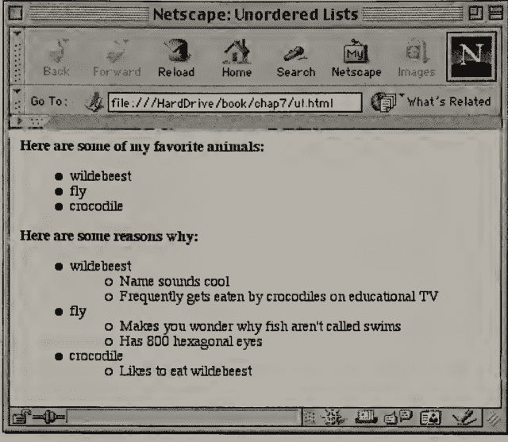

**图7.1** 一个简单的无序列表，后面跟着嵌套的无序列表。

```
<B>Here are some of my favorite animals:</B>

<UL>

  <LI>wildebeest</LI>

  <LI>fly</LI>

  <LI>crocodile</LI>

</UL>

<B>Here are some reasons why:</B>

<UL>

  <LI>wildebeest

    <UL>

      <LI>Name sounds cool</LI>

      <LI>Frequently gets eaten by crocodiles on educational TV</LI>

    </UL>

  </LI>

  <LI>fly

    <UL>

      <LI>Makes you wonder why fish aren't called swims</LI>

      <LI>Has 800 hexagonal eyes</LI>

    </UL>

  </LI>

  <LI>crocodile

    <UL>

      <LI>Likes to eat wildebeest</LI>

    </UL>

  </LI>

</UL>
```

**图7.2** 生成图7.1中两个无序列表的HTML代码。第二个列表演示了嵌套列表。

## 7.3 有序列表

> **注意**
>
> 你可以看到图7.2包含了相当多的结构化HTML代码。该代码是由HTML编辑器生成的。这就是为什么HTML标签显示为粗体，并且列表项标签有缩进。因此，我们不仅不必输入所有的标签，而且编辑器还格式化了代码，使其易于（甚至可能更容易）理解。仅从图7.1中相对简短的列表以及生成这些列表所需的大量代码，你就可以想象，一个包含多个列表的网页可能很容易就需要几页HTML代码的HTML文档。当然，并非每个编辑器都会完全按照图7.2中的方式格式化HTML代码，但它应该比纯文本编辑器有显著的改进。

浏览器会自动包含用于区分每个列表项的符号。典型的默认值是实心圆盘，如你在图7.1外层列表中看到的那样。但是，如嵌套列表（或内层列表）所示，还有其他可用符号。浏览器已将无序列表第二层的项目默认为圆圈。浏览器通常将嵌套无序列表的每一层默认为不同的符号。当然，这些默认值在不同浏览器之间会有所不同。但这些符号的数量是有限的。事实上，只有三种类型：圆盘、圆圈和正方形。前两种你在图7.1中可以看到，而正方形只是一个空心的小正方形。

如果你愿意，你可以通过使用TYPE属性来覆盖无序列表的默认值。TYPE属性可以接受三种可用符号中的任何一个作为其值。例如，

```
<UL TYPE="square">

<LI>...</LI>

:

<LI>...</LI>

</UL>
```

创建一个列表项由小正方形分隔的有序列表。

> **注意**
>
> 无序列表的一个常见用途是组织超文本链接列表。只需将所需的锚点元素放在列表项标签内，你就得到了一个结构良好的链接列表。

有序列表与无序列表非常相似，只是列表项用数字、字母或罗马数字排序，而不是符号。有序列表具有相同的结构，只是它由OL（有序列表）元素定义。与无序列表一样，有序列表也使用LI标签来定义其项目：

```
<OL>

    <LI>list item</LI>

    <LI>list item</LI>

    :

    <LI>list item</LI>

</OL>
```

```
<H2>Internet programming for fun and profit.</H2>

<OL>

    <LI>Introduction.

        <OL type=i>

            <LI TYPE="i">The Internet.</LI>

            <LI>The World Wide Web.</LI>

        </OL>

    </LI>

    <LI>Basic HTML.

        <OL type=I>

            <LI TYPE="I">The HTML document.</LI>

            <LI>HTML tags.</LI>

        </OL>

    </LI>

</OL>
```

**图7.3** 一些包含嵌套有序列表的HTML代码。排序方案由内层列表中的TYPE属性设置。

OL元素也使用TYPE属性。对于OL元素，TYPE可以取值为`"1"`、`"A"`、`"a"`、`"I"`和`"i"`。图7.3包含一些HTML代码，使用了六种可能TYPE值中的三种。生成的列表在图7.4中渲染。外层列表没有TYPE属性，因此浏览器使用了默认设置。默认对应于`TYPE="1"`，结果是使用常规数字（整数）对列表项排序。第一个内层列表设置了`TYPE="i"`，并使用小写罗马数字对其项目排序。同样，第二个内层列表中的`TYPE="I"`导致使用大写罗马数字。我们未使用的值`"A"`和`"a"`分别导致使用大写字母和小写字母进行排序。

如果由于某种原因，列表的项目需要从非1的数字开始，有一个START属性接受整数值并指定给定OL的项目从哪里开始。例如，

```
<OL START=7>...</OL>
```

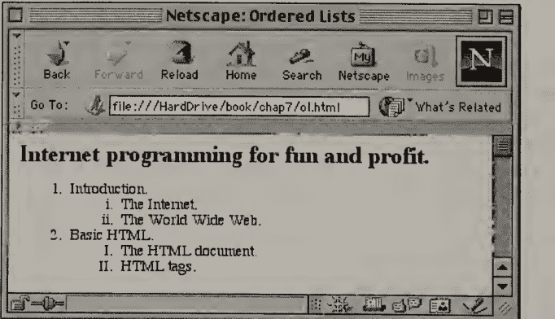

**图7.4** 图7.3中定义的有序列表的渲染结果。

## 7.4 HTML 表格

另一个有用的标记工具是 HTML 表格。正如人们所预期的，HTML 表格使用 TABLE 元素来定义。表格按行构建。在 TABLE 元素内部，TR（表格行）标签定义每一行。

基本结构如下：

```
<TABLE>

<TR>…</TR>

<TR>…</TR>

:

<TR>…</TR>

</TABLE>
```

每个 TR 元素的内容定义表格的每一行。然而，表格行的内容必须用 TD（表格数据）标签来区分。来看一个非常简单的例子，图 7.5 展示了一个包含四行的 HTML 表格代码。每行的内容只是文本字符串`"item"`。表格的渲染结果也一并展示。

我们在 TABLE 开始标签中包含了 BORDER 属性，以便表格具有可辨识的边框，如图 7.5 所示。设置 `BORDER=2` 会给整个表格一个两像素厚的边框。与 HR 元素类似，边框的像素会被添加阴影以产生三维效果。大多数浏览器的默认设置是 `BORDER=0`，这当然会在表格周围和表格数据项之间不留可辨识的边框。当使用表格呈现典型的表格文本数据时，通常需要

```
<TABLE BORDER=2>

<TR>

  <TD>item</TD>

</TR>

<TR>

  <TD>item</TD>

</TR>

<TR>

  <TD>item</TD>

</TR>

<TR>

  <TD>item</TD>

</TR>

</TABLE>
```

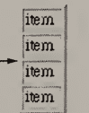

**图 7.5** 一个四行表格的定义及其标记。

```
<TABLE BORDER=5>

<TR>

 <TD>item..... </TD>

 <TD>item</TD>

</TR>

<TR>

 <TD>item</TD>

 <TD>item........</TD>

</TR>

<TR>

 <TD>item</TD>

 <TD>item</TD>

</TR>

</TABLE>
```


**图 7.6** 一个三行两列的表格代码。由于每个 TR 元素内有两个 TD 元素，浏览器为表格创建了两列。

包含 BORDER 属性；否则，图 7.5 中表格的渲染效果看起来就像：

```
item
item
item
item
```

无边框表格也有其用途，但我们稍后会讨论。

当然，表格通常既有行也有列。令人惊讶的是，没有专门用来创建列以补充表格行的列标签。列的创建是通过 TD（表格数据）标签来完成的。在一个表格行中插入多个 TD 元素，就会为每个额外的 TD 元素创建一个额外的列。图 7.6 展示了一个同时包含列和行的表格定义。该表格展示了五像素的边框，使表格呈现出更明显的三维效果。

> 请注意，图 7.6 中表格的列已被浏览器自动格式化，以适应每列中最大的内容项。给定一个表格定义，大多数浏览器会尽可能优化地格式化表格。也就是说，表格会被调整为恰好能容纳其所有内容的大小。

## 7.5 控制表格属性

使用 TR 和 TD 标签可以创建任意行数和列数的表格。但是，有一些属性可用于微调表格构建。首先，有两个属性有助于控制表格中的间距。CELLPADDING 属性在表格单元格内容周围创建间距。CELLSPACING 属性在表格的实际单元格之间创建间距。图 7.7 展示了它们的用法。

BGCOLOR 属性也可用于表格定义中，以使表格从页面的其余部分中脱颖而出。BGCOLOR 属性仅对单元格内部进行着色。在图 7.7 的 CELLPADDING 和 CELLSPACING 属性示例中，BGCOLOR 属性的作用是突出显示间距属性实际

```
<TABLE BORDER=1 BGCOLOR="#99CCCC" CELLPADDING=7>

<TR>

<TD>item</TD>

<TD>item</TD>

</TR>

<TR>

<TD>item</TD>

<TD>item</TD>

</TR>

</TABLE>
```

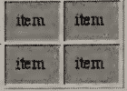

```
<TABLE BORDER=1 BGCOLOR="#99CCCC" CELLSPACING=7>

<TR>

<TD>item</TD>

<TD>item</TD>

</TR>

<TR>

<TD>item</TD>

<TD>item</TD>

</TR>

</TABLE>
```

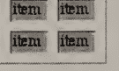

**图 7.7** 两个分别使用 CELLPADDING 和 CELLSPACING 属性的表格。BGCOLOR 属性也被包含在内以强调间距效果。在第一个表格中，CELLPADDING 应用于单元格文本的周围。在第二个表格中，CELLSPACING 应用于实际表格单元格之间。

实现的功能。在没有指定间距属性时，典型的默认设置是 `CELLPADDING=1` 和 `CELLSPACING=2`。

如前所述，浏览器通常创建最小尺寸的表格以适应表格单元格的内容。确实，图 7.5、7.6 和 7.7 中创建的表格都是尽可能小地包含单元格内容。但是，WIDTH 和 HEIGHT 属性可用于指定表格的确切尺寸。WIDTH 和 HEIGHT 属性可以接受百分比和像素作为值。其用法示例请参见图 7.8。

赋值 `WIDTH="100%"` 会使表格覆盖浏览器窗口 100% 的宽度。像素赋值 `HEIGHT=75` 会使表格恰好高 75 像素。如果图 7.8 中的浏览器窗口被调整大小以填满整个计算机显示器，表格仍将覆盖浏览器窗口的宽度，但仍然恰好绘制为 75 像素高。在指定了表格尺寸后，所有单元格会被构建为相同大小并填满表格。虽然图 7.8 中 WIDTH 以百分比给出、HEIGHT 以像素给出，但百分比和像素值可以互换作为这两个属性中任何一个的值，具体取决于需要。

我们在此提到的 TABLE 元素的最后一个属性是 ALIGN 属性。该属性接受 left、right 和 center 值。此属性的工作方式与 IMG 元素的 ALIGN 属性完全相同。例如，设置 `ALIGN=right` 会使整个表格在页面上右对齐，文本环绕在表格周围。因此，如果你有一个小表格，ALIGN 属性可以通过让文本环绕表格周围来使你的排版更加流畅。但是，如果你的表格较大，你可能不会使用此属性。默认是左对齐，文本位于表格的上方和下方，而不是环绕表格周围。

```
<TABLE BORDER=1 WIDTH="100%" HEIGHT=75>

<TR>

    <TD>item</TD>

    <TD>item</TD>

</TR>

<TR>

    <TD>item</TD>

    <TD>item</TD>

</TR>

</TABLE>
```

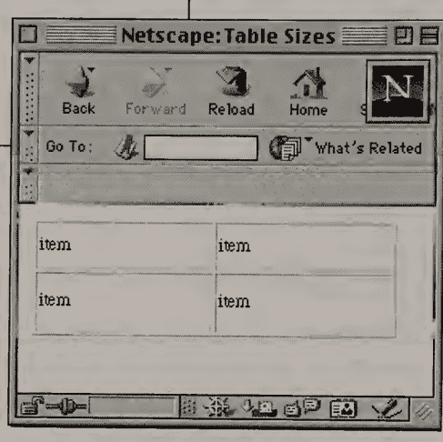

**图 7.8** 使用 WIDTH 和 HEIGHT 属性创建特定尺寸表格的示例。

## 7.6 控制行属性

TR 元素有三个属性，在需要控制整个表格行的标记时非常有用。我们不在此提供示例，而是将其推迟到下一节，届时我们将研究如何控制单个单元格的属性。单个单元格的属性由 TD 元素的属性控制。在 TD 级别控制单个单元格的属性比在 TR 级别控制行属性提供了更大的灵活性。事实上，TD 元素可用的属性甚至比 TR 元素更多。许多 HTML 编辑器甚至不倾向于在 TR 级别控制单元格属性。换句话说，如果你在 TR 元素中放入一些属性，你的 HTML 编辑器可能会直接将它们移到 TD 标签中。

## 7.7 控制单个单元格的属性

首先，有一个替代的 HTML 元素可用于创建标题类型的表格单元格。这就是 TH（*表格标题*）元素。当用于替代 TD 元素时，TH 创建的表格单元格中的文本以粗体渲染。例如，TH 非常适合定义表格顶部行中需要有列标题的单元格。图 7.9 就是为了演示这一要点，无需过多讨论。

不过，我们在 TD 标签中加入了一些 ALIGN 属性，这一点值得讨论。从图 7.9 可以清楚地看到，ALIGN 属性用于将单元格内容水平居中。如图 7.8 所示，默认值为 `ALIGN=left`。通常，ALIGN 设置表格单元格内的水平对齐方式，接受 left、right 和 center 值。TD 元素还接受 VALIGN 和 BGCOLOR 属性。VALIGN 设置

```
## HTML 表格

| 表头单元格 | 表头单元格 |

|-------------|-------------|

| 单元格内容  | 单元格内容  |

| 单元格内容  | 单元格内容  |
```

**图 7.9** 一个表格，其中顶行的单元格使用 TH 而非 TD 标签定义，使每列的顶部单元格充当该列的标题。

单元格内的垂直对齐方式，其值为 bottom、middle 和 top。BGCOLOR 属性接受十六进制或命名颜色，用于设置表格单元格的背景色。

TD 元素接受 BACKGROUND 属性。其值是一个指向背景图片的 URL。该背景图片将作为 BACKGROUND 属性所在表格单元格的背景进行平铺显示。TD 元素还接受 HEIGHT 和 WIDTH 属性，以便您可以控制单个表格单元格的尺寸。通常，HEIGHT 和 WIDTH 属性接受百分比和像素作为值。图 7.10 演示了上述几个属性的用法。

TD 元素还有另外两个属性，即 ROWSPAN 和 COLSPAN。由于这两个属性的作用非常重要，我们将在本课后面详细解释。我们在此提及它们，是为了强调记忆所有这些属性可能徒劳无功。相反，它们都已为便于参考而简洁地组织在本课的摘要中，以及附录 A 中。您最好的选择是让您的编辑器为您完成大部分工作，并仅将这些属性作为参考使用。

> **注意**
>
> 关于 TD 元素的属性，有两点值得注意。
>
> 1. TD 的所有属性也可以用于 TH。事实上，通常 TH 和 TD 非常相似。TH 只是将单元格文本渲染为粗体。在图 7.10 中，我们也在 TH 标签中使用了属性。
> 2. ALIGN、VALIGN 和 BGCOLOR 属性也可以用于 TR 元素。也就是说，您可以一气呵成地控制整行表格的这三个属性。然而，这种方法与在单个单元格级别进行控制相比，并无真正优势。实际上，即使这些属性适用于整行，许多 HTML 编辑器也会自动在单元格级别而非行级别进行格式化。例如，在图 7.10 中，VALIGN 和 ALIGN 属性本可以放在各自的 TR 标签中，因为对齐设置适用于整行。但是，为了本课后续内容的简洁，我们将仅在单元格级别进行格式化，而非行级别。此外，单元格级别更具灵活性，因为 TD 支持的属性比 TR 更多。

```
<TABLE BORDER =1 WIDTH="100%" >
<TR>
<TH VALIGN=bottom BGCOLOR="#99CCCC" HEIGHT=30>
header
</TH>
<TH VALIGN=bottom BGCOLOR="#99CCCC" HEIGHT=30>
header
</TH>
</TR>
<TR>
<TD ALIGN=center BACKGROUND="bg.gif" HEIGHT=100>
item
</TD>
<TD ALIGN=center BACKGROUND="bg.gif" HEIGHT=100>
item
</TD>
</TR>
</TABLE>
```

**图 7.10** 一个表格，其中的单元格使用了 TD 元素的各种属性。特别是，单元格的高度被精确控制。此外，第二行的单元格使用背景图片而非 BGCOLOR。

## 7.8 将 HTML 表格用作页面组织器

我们看到的表格示例在信息需要以结构化的表格形式呈现时非常有用，例如乘法表。但是，HTML 表格最有用的功能或许是用于格式化整个网页。第一个关键是，表格单元格不仅可以包含文本，还可以包含大多数其他 HTML 元素。图 7.11 展示了一个表格，其单元格包含了许多我们在本书中讨论过的主要 HTML 特性。

左上角单元格包含两个普通的超文本链接，右上角单元格包含一个图像，左下角单元格包含一个无序列表，右下角单元格包含其自身的背景图像。在每种情况下，定义不同单元格内容所需的 HTML 元素都简单地放置在相应的表格数据（TD）标签之间。嗯，背景图像是个例外，它通过起始标签中 TD 元素的 BACKGROUND 属性插入。表格的这种多功能性对于组织网页大有裨益，但看起来仍然不太整洁。想象一下，如果报纸像图 7.11 那样在不同部分之间画线；这在审美上并不令人愉悦。

**图 7.11** 一个单元格包含各种 HTML 元素的表格。

**图 7.12** 一个使用无边框、一行三列表格来创建类似报纸版面的页面。

```
<HTML>
<HEAD>
  <TITLE>Columnar Table</TITLE></HEAD>
<BODY>
<P><TABLE BORDER=0 CELLSPACING=5 WIDTH="100%" HEIGHT="100%">
  <TR>
    <TD VALIGN=top>
      
      First in the news today........expletives
      
      such as "aye mate,...... overhead such language.
    </TD>
    <TD VALIGN=top>
      In late breaking news,...... in the lower marina district.
      
      Fortunately, ...... "Don't look, Ethel!"
    </TD>
    <TD VALIGN=top>
      In further news, biologists at Genegamble Inc.
      
      
      are attempting to cross ...... a stop to the experiment.
    </TD>
  </TR>
</TABLE>
</BODY>
</HTML>
```

**图 7.13** 创建图 7.12 页面的文档。大部分文本已被删除，但所有 HTML 代码都保留。请注意，网页的所有内容都在表格单元格内定义。

因此，第二个关键是简单地使用无边框表格来组织页面。这样，页面可以被分割成没有明显边界的区域。举一个实际例子，在图 7.12 中，我们使用这种技术创建了一个包含三列文本的类报纸网页。在图 7.13 中，我们展示了创建图 7.12 的文档版本，但删除了大部分文本。使用表格完全格式化网页会使文档变得有些复杂。为了以这种方式格式化页面，页面的所有内容都包含在 TD 标签内。以图 7.13 为例，每列的整个内容都放置在定义该列的 TD 标签内。此外，TABLE 起始标签中的 CELLSPACING 属性被设置为五像素，以使列之间有一些间距。否则，列将紧挨在一起。由于表格只有一行，所以只有一组 TR 标签，而这一个 TR 元素包含了定义所有列的 TD 标签。

这种分栏的页面呈现方式确实为页面设计增加了另一种格式选项。沿此思路的一个非常常见的做法是在页面左侧设置一个彩色栏，其中包含许多用于快速参考的页面超文本链接。万维网上充满了使用这种呈现方式的页面。事实上，它已成为更标准的格式化技术之一。图 7.14 展示了一个虚构的使用这种呈现方式的网页。它由两列组成，左侧是一个包含一些链接的彩色列，右侧是一个更大的列，包含网页的主要内容。生成该页面的 HTML 文档如图 7.15 所示。

在主表格（即创建页面布局的表格）中，左列（第一个 TD 元素）被设置为 100 像素。这样左列将始终渲染为一个窄条，但足够宽以容纳链接。由于在 TABLE 标签中 HEIGHT 和 WIDTH 已设置为 100%，页面布局将覆盖整个页面。特别是，由于 `WIDTH=100%`，右列会扩展以填充剩余空间，即 100 像素列未填充的空间。您可以从图 7.15 看到，HTML 代码看起来相当复杂，尤其是包含了所有的属性

**图 7.14** 使用无边框表格的一种非常常见的页面布局类型。

## 7.9 跨行与跨列

TD 元素的 COLSPAN 和 ROWSPAN 属性可以实现非常复杂的无边框表格网页布局设计。我们在下一节中会给出这样的示例。在此，我们先回到标准表格来说明 COLSPAN 和 ROWSPAN 属性。图 7.16 展示了一个包含四行三列的表格，其中使用了这两个属性。在第一行中，第二列（该行中的第二个 TD 元素）被设置了 `COLSPAN=2`。可以看到，这使得该表格单元格跨越了两列。在第三行中，第二列（该行中的第二个 TD 元素）被设置了 `ROWSPAN=2`。可以看到，这产生了类似的效果，只是方向变成了行。

从概念上讲，这应该是易于理解的。COLSPAN 和 ROWSPAN 属性接受正整数（1, 2, 3, ...）作为值，使指定的表格单元格跨越相应数量的列或行。当然，默认值是 `COLSPAN=0` 和 `ROWSPAN=0`。但有一个细微之处值得详细说明。跨越效果是向右和向下应用的。换句话说，COLSPAN 使表格单元格向右跨越列，而 ROWSPAN 使表格单元格向下跨越该单元格所在的行。图 7.17 展示了跨越效果在图 7.16 的表格中是如何应用的。

由于跨越操作的结果，表格中剩余的单元格变少了。在图 7.16 中，第一行只剩下两个单元格（两个 TD 元素），第四行也只剩下两个单元格（两个 TD 元素）。在实际操作中，HTML 编辑器会帮助你跟踪这些情况。

**图 7.16** 一个使用了 COLSPAN 和 ROWSPAN 属性的表格。

**图 7.17** 浏览器如何创建图 7.16 中的表格。表格单元格的跨越效果总是向右和向下应用。

## 7.10 高级页面布局

COLSPAN 和 ROWSPAN 属性可用于创建各种网页布局。图 7.18 展示了一个很好地运用了这些属性的网页。该页面的主要特点包括两个导航栏，分别位于两侧。第一个包含指向网站其他体育页面的链接，另一个包含有关本周每场比赛信息的链接。在两个导航栏之间还有两个表格单元格。顶部包含本页面的主题和一些信息链接。其下方是一个包含主要讨论话题的表格单元格。最后，在整个结构的上方和下方还有两个额外的表格单元格，带有深色背景上的白色文字，一个用于页面标题，另一个用于每周 trivia 问题。图 7.19 描绘了页面布局。

我们不展示该体育页面的 HTML 代码，而是探讨创建此类页面所需的步骤。此外，创建该页面的 HTML 文档包含大约两页半的代码。第一个观察是，图 7.19 中的表格轮廓包含四个不同的行和三个不同的列。因此，需要从一个完整的四行三列表格开始。创建所需表格结构的基本步骤在图 7.20 中概述。

一旦表格结构就位，剩下的就是设置背景颜色并将其他内容放入表格单元格中。说`"剩下的"`，我们并不意味着这是微不足道的。但在 HTML 编辑器的帮助下，整个过程并不太难。

**图 7.18** 一个带有左右导航栏且其他信息按表格单元格组织的网页。

**图 7.20** 为图 7.18 的体育页面创建表格布局。(1) 确定必要的跨域操作。(2) 设置跨域并查看是否获得了所需效果。(3) 使用 TD 元素的 HEIGHT 和 WIDTH 属性来获得所需的单元格大小。（这通常涉及一些试错。）

> 制作复杂表格布局的首要任务是设计布局。理解 HTML 基础知识并让 HTML 编辑器为你工作是一回事。但构思网页设计需要想象力。也许最好的方法是浏览并注意一些商业页面的布局结构。这样你可以获得一些关于你喜欢的风格的思路。一旦对页面结构有了想法，制作一些类似于图 7.19 的草图来完善你的想法会有所帮助。之后，只需确定必要的跨域操作并开始编写网页代码。

## 7.10 总结

### 关键术语

HTML 编辑器、标题单元格、导航栏、表格单元格、嵌套列表、无序列表、列表项、span、表格行、表格数据、表格。

掌握了本课介绍的大型 HTML 结构后，你应该学习使用 HTML 编辑器。会有一些启动时间，但从长远来看，它会为你节省大量时间和精力。几乎任何 HTML 编辑器都可以通过单击按钮为你生成 HTML 标签。

HTML 列表有两种类型：有序列表和无序列表。有序列表使用 OL 元素定义，无序列表使用 UL 元素定义。每种列表中的项目都使用列表项元素 LI 定义。此外，两种列表都接受 TYPE 属性，该属性更改列表项目使用的符号。两种列表类型总结如下。

```
<UL>...</UL>
```

| 属性 | 可选值 | 默认值 |
| --- | --- | --- |
| TYPE | circle, disc, square | disc |

```
<OL>...</OL>
```

| 属性 | 可选值 | 默认值 |
| --- | --- | --- |
| TYPE | 1 (整数), i, I (小写和大写罗马数字), a, A (小写和大写字母) | (整数) |
| START | 整数 | 1 |

```
<LI>...</LI>
```

用于使用 `<UL>...</UL>` 和 `<OL>...</OL>` 元素创建列表项。

HTML表格可用于组织网页中的信息。HTML表格由`TABLE`元素定义。表格中的行通过`TR`（表格行）元素创建。`TH`（表头）元素可替代`TR`元素，同样创建表格行，但其中的所有文本将以粗体显示。表格中的实际单元格由`TD`（表格数据）元素创建。每个`TD`元素定义行内的一个表格单元格，从而构成表格的一列。可用于`TABLE`元素中控制整个表格属性的特性总结如下。

`<TABLE>…</TABLE>`

| 属性 | 可选值 | 默认值 |
| :--- | :--- | :--- |
| ALIGN | left, center, right | left（文本不环绕表格） |
| BGCOLOR | 十六进制颜色，命名颜色 | 从网页继承背景（颜色或图像） |
| BORDER | 像素 | 0 |
| CELLPADDING | 像素 | 1 |
| CELLSPACING | 像素 | 2 |
| HEIGHT | 像素，百分比 | 容纳内容所需的最小值 |
| WIDTH | 像素，百分比 | 容纳内容所需的最小值 |

有三个属性可用于在`TR`级别控制表格属性。然而，在`TD`级别控制表格属性提供了更多灵活性，因此是推荐的做法。

`<TR>…</TR>`

| 属性 | 可选值 | 默认值 |
| :--- | :--- | :--- |
| ALIGN | left, center, right | left |
| VALIGN | top, middle, bottom | middle |
| BGCOLOR | 十六进制颜色，命名颜色 | 从网页继承背景（颜色或图像） |

`<TD>…</TD>`与`<TH>…</TH>`

| 属性 | 可选值 | 默认值 |
| :--- | :--- | :--- |
| ALIGN | left, center, right | left |
| VALIGN | top, middle, bottom | middle |
| BACKGROUND | 图片URL | — |
| BGCOLOR | 十六进制颜色，命名颜色 | 从网页继承背景（颜色或图像） |
| HEIGHT | 像素，百分比 | 符合单元格内容 |
| WIDTH | 像素，百分比 | 符合单元格内容 |
| COLSPAN | 整数 | 0 |
| ROWSPAN | 整数 | 0 |

虽然HTML表格对于组织网页内的信息很有用，但当无边框使用以布局整个网页时，它们可以产生非凡的效果。我们讨论过的任何HTML元素都可以包含在表格单元格内。因此，你可以使用设置为`WIDTH=100%`和`HEIGHT=100%`的表格来创建网页布局。在这种情况下，页面的全部内容都包含在表格单元格内。

一种常见的页面布局是在左侧或顶部包含链接的彩色列或彩色行。这样一条充满链接的彩色条带通常被称为导航栏。使用`COLSPAN`和`ROWSPAN`属性，可以创建相当复杂的页面布局。然而，在实践中这可能有点棘手。我们建议采用以下步骤。

> **注意**
>
> 要创建基于表格的页面布局：
>
> 1. 构思页面设计并绘制表格结构的草图。
> 2. 计算不同列和不同行的总数。
> 3. 从一个具有该行数和列数的标准表格开始。弄清楚创建所需布局所需的跨越操作。记住，`COLSPAN`向右跨越，`ROWSPAN`向下跨越。
> 4. 创建表格，并确保跨越操作按预期执行。
> 5. 调整表格单元格大小以微调布局。这通常需要反复尝试。
> 6. 开始将内容放入表格单元格。
> 7. 根据需要重复步骤1-6，以在雨天寻找乐趣。
>
> **重要提示：** 有时希望使用一个空的彩色表格单元格，例如，在页面上提供一条彩色条纹。但你必须小心。某些浏览器不会渲染空的表格单元格。如果你希望使用空单元格，确保其被渲染的一个简单方法是在该单元格中放置一个与单元格背景颜色相同的字符（例如，`"x"`）。这样，彩色单元格看起来仍然是空的，但该单元格肯定会被任何浏览器渲染。

## 7.11 复习题

在大多数情况下，仅从课程摘要中回答这些问题是不够的。

1. 讨论UL和OL之间的区别。如何让OL的编号从非1的数字开始？
2. CELLPADDING和CELLSPACING之间有什么区别？
3. 表格单元格内容的默认对齐方式（水平和垂直）是什么？
4. 当使用表格进行整个页面布局时，为什么不想对TABLE元素的HEIGHT和WIDTH属性使用像素值？
5. 假设你在单元格级别指定HEIGHT和WIDTH属性。如果使一行中的某个单元格比该行的其他单元格更高，会发生什么？
6. 当你指定COLSPAN或ROWSPAN时，如何确定跨越哪些行或列？
7. ALIGN属性在TABLE元素中使用与在TD元素中使用有何不同？

## 7.12 练习

1. 访问一个HTML编辑器。
2. （这些图像也可用于练习8.9.2。）获取八张适合用作网页背景图像的图片。制作两个3×3的表格来展示这些图像。每个表格的中间单元格应包含指向你找到图像的网站的链接。在第一个表格中，将图像作为常规图像放入表格单元格：`<TD></TD>`。在第二个表格中，将图像作为表格单元格的背景图像放入：`<TD BACKGROUND="img1.gif"></TD>`。参见下图。

| img | img | img |
|-----|-----|-----|
| img | = | img |
| img | img | img |

3. 制作一个大致类似于图7.18所示的网页。要查看页面的更清晰图像，请参阅本网站第7课的练习3。
4. 访问本网站第7课的作业部分。在练习4下，你将找到一个网页的图片。制作一个外观大致相同的网页。所需图像也可供下载。无边框表格结构如下所示。

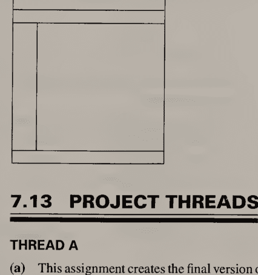

5. 访问本网站第7课的作业部分。在练习5下，你将找到一个网页的图片。制作一个外观大致相同的网页。所需图像也可供下载。无边框表格结构如下所示。

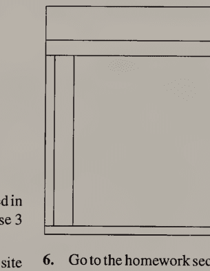

6. 访问本网站第7课的作业部分。在练习6下，你将找到一个网页的图片。制作一个外观大致相同的网页。所需图像也可供下载。无边框表格结构如下所示。

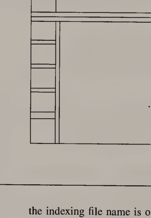

## 7.13 项目主线

### 主线A

(a) 此作业创建你主页的最终版本。

### 作业

- (c) 使用列表来组织作业页面中的链接。在适当的情况下，使用嵌套列表，例如，如果你为给定课程有多个链接。
- (d) 如果适用，完成后将所有文件传输到Web服务器。检查以确保传输成功。特别是，检查以确保所有链接都有效。

### 主线B

### 作业

- (a) 完成本课的一个或多个练习。在你的公共目录中创建一个新文件夹来包含每个练习的文件（图像和其他文件）。相应地命名任何新目录，例如`"ex7_3"`。当然，你应该从你的作业页面提供指向任何新页面的链接，反之亦然。
- (b) 使用列表来组织作业页面中的链接。在适当的情况下，使用嵌套列表，例如，如果你为给定课程有多个链接。
- (c) 如果适用，完成后将所有文件传输到Web服务器。检查以确保传输成功。特别是，检查以确保所有链接都有效。

## 第 8 课

## HTML 框架

HTML 表格在设计网页布局时提供了极大的灵活性。然而，有时需要表格所不具备的特定功能。通常，人们希望有一个`"固定不动"`的导航栏。例如，参考图 5.11，它展示了一本模拟的在线书籍。顶部有指向书籍每个章节的链接。该文档中的链接使用命名锚点实现，因此当点击第 3 章的链接时，第 3 章会移到浏览器窗口的顶部。这样做的缺点是，一旦第 3 章移到浏览器窗口顶部，导航链接就不再可见了，因为它们位于网页的最顶端。一个解决方案是在每个章节的开头重复导航链接列表，但这样做的缺点是不得不使用重复的代码。另一个缺点是，如果你阅读第 3 章的内容足够多，用到了滚动条，导航链接就会再次离开屏幕。

HTML 框架提供了将导航链接列表保留在屏幕顶部的可能性，即使书籍的其他部分可见。事实上，正如我们将看到的，无论书籍的哪个部分可见，导航链接都会存在，因此在浏览器窗口顶部会有一个`"固定"`的导航栏。这就是框架的灵活性。框架最初由 Netscape Navigator 2.0 版本支持，并在 Navigator 和 Explorer 3.0 及更高版本中得到完全支持。

## 8.1 框架网页

在展示创建框架网页所需的实际 HTML 代码之前，我们先讨论此类文档的性质。框架网页实际上一次显示多个网页。这有点像那种有多个开口的相框。你可以在同一个相框中展示多张图片。图 8.1 在框架网页的背景下演示了这个概念。为了简单起见，该框架文档只有两个框架。

回到相框的类比，需要一个 HTML 文档来生成相框。然后，为了填充相框中的每个`"孔"`，还需要额外的 HTML 文档，每个`"孔"`一个。如图 8.1 所示，创建一个包含两个框架的 FRAMESET 页面需要三个不同的 HTML 文档。结果将是一个显示两个不同网页的 HTML 文档。`"doc3.html"` 的内容将显示在顶部框架中，`"doc2.html"` 的内容将显示在底部框架中。

标记到两个框架中的文档 `"doc2.html"` 和 `"doc3.html"` 只是像你一直学习创建的普通 HTML 文档。然而，可以想象，创建实际 FRAMESET 的文档性质不同。

从图 8.1 需要注意的一个重要事项是，框架文档的实际内容来自`"加载到"`两个框架中的两个网页。既然如此，创建 FRAMESET 的文档没有 BODY 部分。BODY 部分被 FRAMESET 元素取代。在 FRAMESET 元素内部是 FRAME 元素，它们指向将为框架提供内容的网页。图 8.2 展示了一个文档 `"doc1.html"`，它足以生成如图 8.1 所示的 FRAMESET。我们说 `"doc1.html"` 足以生成图 8.1 的 FRAMESET，是因为有几种可能的属性可用于改变框架文档的外观。然而，由于图 8.1 给出的是 FRAMESET 的结构而不是它在浏览器中的实际外观，我们只提供说明框架文档性质所需的最小 HTML 代码。

FRAMESET 元素是一个容器元素，它*完全*取代了 BODY 元素。FRAMESET 元素的内容是 FRAME 元素本身。FRAME 元素是非容器元素，它们通过 SRC（源）属性指向加载到框架中的实际文档。FRAME 标签中的 SRC 属性是必需的，因为没有它，框架就没有内容。虽然没有 SRC 属性也可以呈现框架页面，但结果将是一个空白网页，中间有一条水平分隔线，如图 8.1 所示。

```
<HTML>

<HEAD>

</HEAD>

<FRAMESET>

    <FRAME SRC="doc3.html">

    <FRAME SRC="doc2.html">

</FRAMESET>

</HTML>
```

**图 8.2** 没有 body 部分，因为框架页面的内容来自加载到框架中的其他 HTML 文档。

就像 IMG 元素使用的 SRC 属性一样，FRAME 元素的 SRC 属性接受一个 URL（相对或绝对）作为其值。让两个不同的网页各显示在浏览器窗口的一半可能看起来有点奇怪，但正如我们将看到的，有几种应用。

> **注意** 上面我们只提供了源文件名作为 SRC 属性的值。当然，由于 SRC 的值是相对 URL，需要确切的源文档文件路径。因此，上面隐含了所有源文件与包含 FRAMESET 的文档在同一目录中。此外，由于在本课剩余部分会有很多不同的文件，为了简单起见，我们将坚持这种约定。你可以使用绝对 URL 指向源文件，但你很少会希望这样做。如果源文件在你的网站上，使用相对 URL 更有效率。如果源文件不在你的网站上，你可能就不应该将其加载到你的框架中。将别人的网页加载到你的框架中有点不地道。

## 8.2 FRAMESET 元素的属性

FRAMESET 元素的属性简单地控制框架页面的布局。再次强调，框架本身的内容可以是*任何*网页。我们很快会看到具体的例子。首先是 COLS 和 ROWS 属性。例如，

```
<FRAMESET COLS="15%,85%">

  <FRAME SRC="">

  <FRAME SRC="">

</FRAMESET>
```

创建一个如图所示的框架集，包含两列，其中第一列覆盖浏览器窗口宽度的 15%，第二列覆盖 85%。默认情况下是等大小的行。

再举一个例子，

```
<FRAMESET>

  <FRAME SRC="">

  <FRAME SRC="">

  <FRAME SRC="">

</FRAMESET>
```

创建如图所示的框架集，尽管建议始终使用 COLS 或 ROWS 来指定框架集。上面的代码大致等同于

```
<FRAMESET ROWS="33%, 33%, 34%" >
```

我们说`"大致等同"`是因为百分比值必须是整数，而三乘以 33% 只有 99%。因此我们在第三列额外加了一个百分点，使总和达到 100%。你的行或列的总和不必严格达到 100%，因为浏览器会计算一个近似值，但建议这样做。

另一种方法是以像素为单位指定行和列。例如，与其在上面 `"15%, 85%"` 的列集中为第一列指定 15%，不如指定第一列为，比如 100 像素宽。这产生的困境是，你不知道第二列应该有多少像素宽。实际上，这取决于浏览器窗口的大小（甚至特定电脑显示器的分辨率）。解决方案是符号 `"*"`，在这种上下文中表示`"其余部分"`。

所以

```
<FRAMESET COLS="100,*">
```

指定第一列应为 100 像素宽，第二列应占据浏览器窗口的剩余宽度。这种方法甚至相当灵活。框架集

```
<FRAMESET ROWS="150,*, 100">
```

以像素为单位指定第一行和第三行的大小，中间行则占据剩余空间。

FRAMESET 元素的另外两个属性是 BORDER 和 BORDERCOLOR。BORDER 以像素为单位指定分隔框架的边框大小，BORDERCOLOR 指定边框的颜色。默认值是 `BORDER=5`。与任何指定颜色的属性一样，BORDERCOLOR 接受命名颜色或十六进制颜色。默认通常是灰色。这两个属性的用法将在以下示例中变得清晰。但请记住，框架内部的实际内容，因而颜色，来自加载到框架中的实际文档。

> **注意**
>
> 你的 HTML 编辑器可能会在你使用的任何 `"*"` 符号前自动添加数字。这些数字代表未指定框架的`"权重"`。例如
>
> ```
> <FRAMESET COLS="150,1*,3*,100">
> ```
>
> 将导致两个中间行的权重分别为中间剩余空间的 1/4 和 3/4。（未指定空间的总和为 1 + 3 = 4。）你可能不太需要创建包含四列的框架页面，但即使在较小的框架集中，你的编辑器可能会自动指定 `ROWS="150,1*"`。这没什么大不了的，因为 `"1*"` 等同于 `"*"`。尽管如此，这是你应该了解的内容。
>
> 同样可能的是，你的 HTML 编辑器会在 FRAMESET 元素中自动插入 FRAMEBORDER 属性。FRAMEBORDER 提供了三维边框和标准边框之间的替代方案，它在某种程度上取决于浏览器且不可靠。

## 8.3 FRAME 元素的属性

解释 FRAME 元素的属性需要一个具体的例子。因此我们转向本课引言中提到的`"固定导航栏"`。图 8.3 展示了一个框架版本的在线书籍，该书籍在图 5.11 中用于命名锚点的示例。从图 8.3 中可以学到几件事。第一点已经被多次提及。有两个独立的 HTML 文档在显示。顶部框架中的文档名为 `"links.html"`，底部框架中的文档名为 `"chap1.html"`。相当

与其展示整个框架集文档（你从图8.3的地址栏可以看到它被命名为`"book.html"`），我们只给出创建该页面的FRAMESET元素。只需记住，这个FRAMESET替换了`"book.html"`中的BODY元素。

```
<FRAMESET ROWS="65,*" BORDER=1>

<FRAME SRC="links.html" NAME="top" MARGINWIDTH=5 MARGINHEIGHT=5>

<FRAME SRC="body.html" NAME="bottom" MARGINWIDTH=5 MARGINHEIGHT=5>

</FRAMESET>
```

接下来，FRAME元素的MARGINWIDTH和MARGINHEIGHT属性在框架单元格的边框与其内容之间创建了一些内边距。它们的功能基本上类似于表格中使用的CELLPADDING属性。例如，如果在每个FRAME标签中没有指定`MARGINHEIGHT=5`，那么短语`"HTML for Fun and Profits"`和`"Chapter 1: Text Markup"`就会紧贴两个框架单元格的顶部，而不是像你在图8.3中看到的那样有五像素的缓冲空间。这两个属性在表格的CELLPADDING基础上提供了额外的功能，因为它们允许你单独控制框架单元格内的垂直和水平内边距。

一个微妙之处是你在底部框架右侧看到的滚动条。如果提供框架内容的网页比框架本身长，浏览器会自动提供一个滚动条，以便你访问框架的所有内容。我们在本例中选择不提供它，但SCROLLING属性可用于FRAME元素，以强制显示或拒绝显示滚动条。SCROLLING可取值`"yes"`、`"no"`和`"auto"`。`"yes"`值强制显示滚动条，即使没有必要。`"no"`值导致滚动条不显示，即使需要。最后，`"auto"`值是默认值，让浏览器决定是否需要。

你可能想知道为什么我们回避讨论图8.3中FRAME元素的NAME属性。嗯，除非组成框架的文档中存在链接，否则NAME属性实际上没有任何用途。由于`"links.html"`（包含在顶部框架中的文档）中有链接，NAME属性在本例中当然有用途。然而，它们的用法是一个值得单独讨论的话题。

**图 8.4** 为图8.3中顶部框架提供内容的HTML文档。

## 8.4 将链接定向到框架

我们首先在图8.4中展示文档`"links.html"`，它出现在图8.3的顶部框架中。你首先可能注意到的是锚元素包含一个TARGET属性。这个属性在关于超链接的课程中没有提到，因为它在框架集之外没有用处。注意，每个链接都指向不同的HTML文件，分别对应在线书籍的每一章。每个链接的TARGET属性简单地规定，当链接被点击时，链接指向的HTML文件将被加载到底部框架中。图8.5描绘了这种情况。

这样，带有导航链接的顶部框架中的文档保持不变，而书籍的各个章节可以加载到底部框架中。我们使用TARGET属性将不同章节定向到底部框架这一事实至关重要。例如，如果我们未能将`"chapter3.html"`定向到底部框架

```
<A HREF="chap3.html">[Chapter3]</A>
```

结果将是文档`"chap3.html"`将被加载到包含该链接的同一框架中。

**图 8.5** 固定导航栏示例。顶部框架中的链接将章节的HTML文件定向到底部框架。同时，顶部框架的内容保持不变。

**图 8.6** 未能将链接定向到所需框架会导致文档被加载到链接所在的框架中。

> **注意**
>
> 如果你指定链接应定向到特定框架，但该名称的框架不存在，大多数浏览器会发生一件有趣的事情。链接调出的页面实际上将被加载到一个全新的窗口中。例如，如果你将链接定向到一个框架，但拼写错误了框架的名称，浏览器将完全不知道该将文档插入哪个框架。浏览器不会使用将新页面插入链接被点击的同一框架的默认行为，而是会创建一个新窗口（在原始窗口之上），并在那里显示新页面。

图8.6展示了框架中包含的链接的默认行为。如果未指定目标框架，新文件将简单地插入链接被点击的框架中。同样，TARGET属性有一个值也能产生默认行为。在图8.6的上下文中，以下两个链接是等效的：

```
<A HREF="chap3.html">[Chapter3]</A>

<A HREF="chap3.html" TARGET="_self">[Chapter3]</A>
```

换句话说，`TARGET="_self"`是默认行为。这仅仅意味着将新网页加载到同一框架中。这里的值`"_self"`前面有一个下划线，以便浏览器将该值识别为特殊的目标值。你永远不应在普通框架名称前加下划线。

关于定向的最后一点说明，有可能完全退出框架环境。假设一个FRAMESET有两行，类似于我们一直在用的在线书籍示例，并且以下链接出现在顶部框架中：

```
<A HREF="newpage.html" TARGET="_parent">Get me out of here!

I've been framed.</A>
```

TARGET属性的特殊值`"_parent"`允许新网页出现在FRAMESET的`"父窗口"`中。也就是说，`TARGET="_parent"`允许你退出框架环境。没有它，你只能将网页加载到FRAMESET内的框架中。图8.7说明了这一点。

**图 8.7** 使用值`TARGET="_parent"`会导致链接指向的网页退出FRAMESET并出现在`"父窗口"`中。

> **注意**
>
> 关于链接到其他文档中的命名锚点的一个很好的例子可以从上面的在线书籍示例中得出。图8.5描绘了三个不同的HTML文件，分别对应本书的三章。但这并非必须如此。例如，可以将所有三章合并到一个HTML文件中，并简单地在每章的开头包含一个命名锚点。如果包含合并章节的文件名为`"allchapters.html"`，那么指向第3章的顶部框架中的链接将采用以下形式
>
> ```
> <A HREF="allchapters.html#chap3" TARGET="bottom">[Chapter3]</A>
> ```
>
> 下面的练习8.9.4和8.9.5强调了将文档切分成片段进行显示与使用整个文档并为每个部分设置命名锚点进行显示之间的区别。

## 8.5 嵌套框架

可以`"嵌套"`框架。实际上，如果你希望制作一个同时包含行和列的框架页面，那么这样做是必要的。在页面布局方面，框架不如表格灵活。但是，正如我们所看到的，框架增加了一定程度的灵活性，而这是表格所不具备的。为了进一步说明这一点，我们提供了一个设计的在线音乐史页面示例。页面初始加载时的屏幕截图如图8.8所示。该页面的主要功能是通过左上角框架中的音乐类别列表实现的。当点击其中一个类别时，该音乐类型的子类别列表将显示在左下角框架中。然后用户可以从这些子类别中选择一个，并在右侧的主框架中看到历史页面的显示。

当然，第一个值得讨论的话题是生成图8.8中文档所需的实际FRAMESET。图8.9展示了用于创建图8.8布局的FRAMESET元素。为了创建该布局，我们首先创建了一个包含两列且没有边框的FRAMESET。然后，我们没有使用FRAME元素来创建FRAMESET的第一列，而是使用了另一个FRAMESET元素来创建第一列的两行。最后，第二列使用FRAME元素填充内容。左上角框架的内容由HTML文档`"categories.html"`提供，

## 第8课 HTML框架

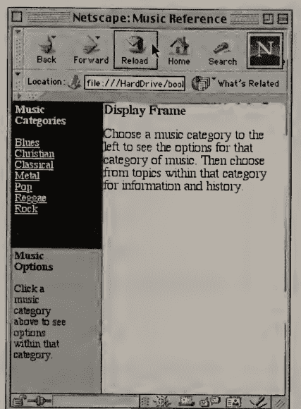

**图8.8** 一个使用了嵌套框架的在线音乐史页面。

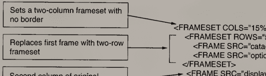

**图8.9** 为了嵌套框架，你必须使用一个新的`FRAMESET`来替换其中一个`FRAME`元素。

左下方框架的内容由HTML文档`"options.html"`提供，右侧主框架的初始内容则由HTML文档`"display.html"`提供。这些文档的实际内容在图8.8的相应框架中清晰可见。

有了这个设置后，左上角框架中的每个链接都必须指向左下方的框架，这样当点击某个类别的链接时，其选项就会在那里显示。图8.10展示了点击`"Metal"`链接的结果。

由于在图8.9中，选项框架的名称被指定为`"opt"`，因此左上角框架网页中的每个链接都必须指定`TARGET="opt"`。所以，`"Metal"`类别链接的形式如下：

```
<A HREF="metal.html" TARGET="opt">Metal</A>
```

因此，如图8.10所示，点击`"Metal"`链接后，`"metal.html"`页面就会为左下方的框架提供内容。

最后，所有不同选项的链接都必须指向右侧的主框架。图8.11描绘了在左下方框架中点击`"Grunge"`链接的结果。

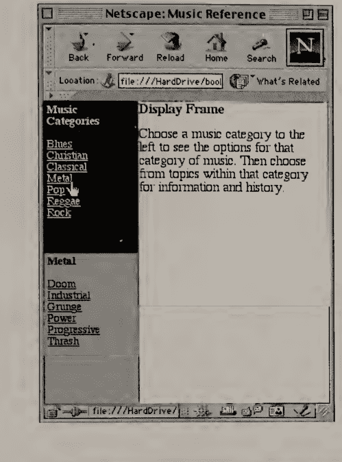

**图8.10** 当一个类别链接被点击时，该类别的子类别链接页面将被定向到左下方的框架。

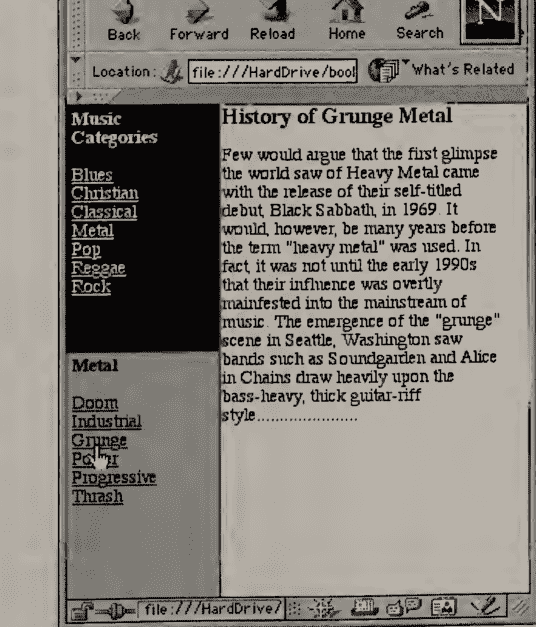

**图8.11** 当一个选项链接被点击时，该选项对应的页面必须被定向到右侧的框架。

由于在图8.9中，显示框架的名称被指定为`"dis"`，因此左下方框架网页中的每个链接都必须指定`TARGET="dis"`。所以，`"Grunge"`选项链接的形式如下：

```
<A HREF="grunge.html" TARGET="dis">Grunge</A>
```

> **注意**
>
> 上面的音乐示例使用了一个新的`FRAMESET`在原始`FRAMESET`的第一列中创建了两行。你也可以反过来做。换句话说，你可以从一个`ROWS`页面开始，并使用一个新的`FRAMESET`在其中一行创建`COLS`。需要注意的是，无论你使用多少个`FRAMESET`元素来设置框架页面，每个框架总是对应一个`FRAME`元素。这一点在图8.9中是显而易见的。

## 8.6 框架的优缺点

框架的明显缺点是，与表格相比，其页面布局选项有些受限。而正如我们所强调的，其明显优势在于可以提供固定的导航栏。然而，许多拥有精细表格布局的商业网站也使用我们所谓的`"伪固定"`导航栏。这种伪固定导航栏基本上起到相同的作用。

举个例子，考虑图7.18中的`"Knuckles' Sports World"`页面。在那次讨论中，我们关注的是该页面本身的布局，而不是整个网站可能包含的内容。首先，如果用户点击`"College Volleyball"`部分，页面中唯一应该改变的部分是左侧导航栏右侧的那些表格单元格，也许还有每周的趣味问题。换句话说，即使用户正在查看排球页面，仍然希望完全相同的导航栏出现在左侧。为了实现这一点，只需为每个运动页面使用一个模板（或主页面）即可。也就是说，每个运动页面都由同一个主文件构建，只有相应表格单元格的内容会被更改。然后，每当请求不同的运动页面时，相同的导航栏就会出现。这样，它就是伪固定的：它在每个页面上的位置相同。这需要一些冗余代码，但有其优点。

伪固定导航栏类型网站的一个显著优势是，每个页面都可以被用户的浏览器收藏。如果用户想每隔几天查看一次篮球页面，他/她只需在浏览器的下拉菜单中选择`"添加书签"`或`"添加收藏夹"`，就可以随时直接访问篮球页面。另一方面，假设一个网站像上面的音乐参考站点那样，使用框架设计了固定的导航栏。如果用户希望收藏`"History of Grunge"`页面，就会出现问题。

当框架页面加载到浏览器中时，地址栏中只列出带有`FRAMESET`的文档。在上面的例子中，`FRAMESET`文档名为`"music.html"`。无论用户点击多少链接将不同的子页面加载到不同的框架中，`FRAMESET`文档仍然是浏览器地址栏中出现的文档。因此，即使`"History of Grunge"`页面存在于主框架中，书签（或收藏夹）也只会选择`FRAMESET`文档`"music.html"`。当激活书签时，`FRAMESET`文档和框架的原始源文件将被加载。然后，你必须点击几个链接才能找回`"Grunge"`页面。

大多数主要的商业网站都使用表格结构。如果网站层次很深，用户仍然可以收藏网站的任何部分。然而，也有一些商业网站使用框架。实际上，对于个人网站来说，这可能没有多大区别。如果你需要精细的页面布局，请使用表格。如果你喜欢带有固定导航栏的幻灯片式演示，框架可能是正确的选择。根据你的需要，这基本上归结为期望的功能和常识。

最后一点，表格和框架都被现代浏览器广泛支持。然而，框架提供了一个处理旧浏览器客户端的功能，这是表格所没有的。下面的`"注意"`足以说明这一点。

> **注意**
>
> 如果你正在使用HTML编辑器来创建框架页面，它很有可能会自动将`NOFRAMES`元素插入到你的文档中。它可能出现在`FRAMESET`元素之前、之后，甚至内部。其形式如下：
>
> ```
> <NOFRAMES>
> 
> <BODY>
> 
> :
> 
> </BODY>
> 
> </NOFRAMES>
> ```
>
> 这个元素是可选的，它为不支持框架的浏览器提供了一个网页主体。在这种情况下，`NOFRAMES`元素的`BODY`部分中的任何内容都会被渲染为网页，而`FRAMESET`标签则会被忽略。如果不要求使用旧浏览器的查看者看到该页面，你可以简单地写上`"抱歉，您需要一个支持框架的浏览器才能查看此页面。"`如果必须让所有网民都能访问，通常会提供一个链接到备用的无框架页面：点击此处查看本页的无框架版本。

## 8.7 总结

### 关键术语

- 框架集
- 框架
- 父窗口
- 目标
- 嵌套框架
- 固定导航栏

框架网页实际上是多个网页合而为一。`FRAMESET`文档创建了页面的结构，但其他HTML文档为每个框架提供内容。`FRAMESET`元素取代了`FRAMESET`文档的`BODY`，并具有下表中定义的属性。

### `<FRAMESET>...</FRAMESET>`

| 属性 | 可选值 | 默认值 |
|---|---|---|
| COLS | 像素, 百分比, * | * |
| ROWS | 像素, 百分比, * | * |
| BORDER | 像素 | 浏览器相关（约5像素） |
| BORDERCOLOR | 十六进制颜色, 命名颜色 | 浏览器相关（通常是灰色） |

`FRAMESET`元素只是创建了布局。`FRAME`元素实际指定了每个框架的内容。为了给一个框架提供内容，应该正好有一个`FRAME`元素对应那个框架。请记住，框架是由`FRAMESET`元素的`COLS`和`ROWS`属性分配的。`FRAME`元素实际填充了分配好的框架。

### `<FRAME>`

| 属性 | 可选值 | 默认值 |
|---|---|---|
| SRC | URL | – |
| NAME | 字符串 | – |
| MARGINHEIGHT | 像素 | 浏览器相关（约10） |
| MARGINWIDTH | 像素 | 浏览器相关（约10） |
| SCROLLING | yes, no, auto | auto |

在嵌套框架时，一个`FRAMESET`元素取代一个`FRAME`元素，这样框架的内容提供者就是另一个`FRAMESET`。通过这种方式，你可以将一个框架细分为更多框架。`FRAME`元素仍然为嵌套框架提供内容。

`FRAME`元素的`NAME`属性除了用于将链接定向到框架外，确实没有其他用途。锚点（`<A>...</A>`）元素的`TARGET`属性实际执行了定向操作。

### `<A>...</A>`

| 属性 | 可选值 | 默认值 |
|---|---|---|
| TARGET | 框架的名称, _self, _parent | _self |

锚点的`HREF`属性指示的HTML文档将被加载到锚点元素的`TARGET`属性指定的框架中。如果未指定目标，则文档将加载到链接所在的同一框架中。这是默认行为，与`TARGET="_self"`相同。如果框架没有嵌套，`TARGET="_parent"`足以将文档加载到父窗口中。这有点像从`FRAMESET`逃逸到整个窗口。

以表格而非框架设计的商业网站要多得多。框架的主要缺点之一是，框架中显示的网页无法直接被收藏。另一方面，当希望以幻灯片式演示提供固定的导航栏时，框架是理想的选择。决定使用哪种页面布局方法在很大程度上是个人偏好和网站期望功能的问题。

如果您的框架页面没有按预期工作，以下内容将帮助您进行故障排除。

> **注意**
>
> 如果您的框架页面根本没有被渲染，问题可能是以下之一：
>
> 1. 您提供的 FRAME 元素数量与使用 FRAMESET 元素分配的框架数量不一致。
> 2. 您错误地嵌套了 FRAMESET 元素。
>
> 如果您的某个框架最初显示为空，问题可能是以下之一：
>
> 1. 您忘记了使用 SRC 属性指定框架的源文件。
> 2. SRC 属性指定的文档名称与实际文档名称不*完全*匹配。
> 3. SRC 属性指定的相对 URL 未提供指向文档的正确文件路径。
>
> 如果您的某个链接无法正常工作，请检查以下症状：
>
> 1. 链接导致文档在与链接相同的框架中加载：您忘记了使用链接将 TARGET 指向框架的名称。
> 2. 单击链接导致新页面在包含框架页面的窗口上方以*全新*窗口显示：链接的 TARGET 属性指定的名称与目标框架的名称不*完全*匹配。请检查框架名称和 TARGET 值的拼写以及大小写（大写与小写）。如果找不到 TARGET 指定名称的框架，则会创建一个新窗口。

## 8.8 复习题

在大多数情况下，仅凭课程总结来回答这些问题是不够的。

1. 描述与框架网页相关的画框类比。
2. 如果在 FRAMESET 中包含了多个 FRAME 元素，但 FRAMESET 元素中既没有使用 COLS 属性也没有使用 ROWS 属性，默认情况是什么？
3. 解释 `ROWS="3*,2*,10%"` 的效果。解释 `COLS="100,2*,*"` 的效果。绘制布局草图会有所帮助。
4. 框架的 MARGINHEIGHT 和 MARGINWIDTH 相对于表格的 CELLPADDING 提供了多大程度的灵活性？
5. 如何控制框架内的滚动？默认设置是什么？
6. NOFRAMES 元素的用途是什么？解释 NOFRAMES 内 BODY 元素的目的。
7. 解释将网页定位到框架时 `"_parent"` 和 `"_self"` 的作用。
8. 用文字描述（不写出 HTML 代码）如何嵌套框架。
9. 对比框架和表格的优势。我们所说的伪固定导航栏与固定导航栏有什么区别？

## 8.9 练习

1. 前往本书网站上第 8 课的作业部分。在练习 1 下，您将找到一张框架网页的图片。网页各个框架中的链接指定了它们所指向的框架或窗口。为这些链接创建一个用于打开的虚拟页面。该虚拟页面的颜色应与框架的源页面不同。制作一个外观大致相同的框架网页，并使每个链接指向相应框架或窗口的虚拟页面。
2. （参见练习 7.13.2。您可以使用相同的图片。）获取八张适合用作网页背景图片的图像。本练习的目的是使用框架制作幻灯片式图片展示。
   - (a) 使用一个框架作为`"固定"`导航栏，其中包含指向八张图片的链接。使用另一个框架来显示图片。对于每张图片，应有一个指向图片文件的链接（`HREF="img1.gif"`），以及另一个指向使用该图片作为背景图片的空白网页的链接（`HREF="img1.html"`）。这样，观众可以选择查看实际图片或查看作为页面背景平铺的图片。
   - (b) 使用嵌套框架来完成 (a) 部分。一个框架应包含两个链接，一个用于查看实际图片，另一个用于查看作为网页背景平铺的图片。如果点击查看实际图片的链接，第二个框架显示指向八个图片文件的链接列表。如果点击查看作为背景平铺的图片的链接，第二个框架显示指向使用这些图片作为背景的八个网页的链接列表。第三个框架用于显示。
3. 制作一个与图 8.8 至图 8.11 中讨论的网页大致相似的页面。您可以将页面精简为三个音乐类别。如果愿意，您可以自定义类别。每个类别只需包含两个子类别或该类别内的选项。实际的描述页面可以是最简化的`"虚拟"`页面，或者如果您有音乐方面的见解，请随意发挥。
4. （参见练习 5.10.5。您为该练习创建的文件可以改编后在此使用。）前往本书网站上第 8 课的作业部分。在练习 4 下，您将找到一个指向名为 `"dsl.html"` 的网页的链接，该页面讨论了 DSL 互联网连接。该页面有一个标题和四个编号为 1 至 4 的部分。下载此页面的源 HTML 文件，并为该文档制作一个包含两个框架的框架页面，要求如下：
   - (a) 当框架页面加载时，导航框架包含指向文档四个部分的链接以及一个指向文档顶部的链接。显示框架的初始源应为该文档。
   - (b) 在文档的每个部分放置一个命名锚点。导航框架中的四个链接应分别将文档的四个部分带到显示框架的顶部。导航框架中指向文档顶部的链接只需使文档顶部显示在显示框架的顶部。
   - (c) 第 4 部分有几个小节。在每个小节处放置一个命名锚点。在导航框架中，放置指向这些命名锚点的链接，使每个命名锚点出现在显示框架的顶部。这些链接应作为第 4 部分链接的子列表进行组织。
5. （参见练习 5.10.6。您为该练习创建的文件可以改编后在此使用。）前往本书网站上第 8 课的作业部分。在练习 5 下，您将找到一个指向名为 `"dsl.html"` 的网页的链接，该页面讨论了 DSL 互联网连接。该页面有一个标题和四个编号为 1 至 4 的部分。下载此页面的源 HTML 文件，并为该文档制作一个包含两个框架的框架页面，要求如下：
   - (a) 当框架页面加载时，导航框架包含一个指向文档标题页的链接，以及指向文档四个部分的链接。显示框架的初始源应为标题页。
   - (b) 制作一个简短的文档标题页，并为文档的每个部分分别制作一个单独的页面。这些就是导航框架中的链接所打开的页面。
   - (c) 第 4 部分有几个小节。在每个小节处放置一个命名锚点。在导航框架中，放置直接指向这些命名锚点的链接。这些链接应作为第 4 部分链接的子列表进行组织。

## 8.10 项目线索

### 线索 A

**任务**

(a) 完成本课的一项或多项练习。由于每项练习需要多个文件，请在您的作业目录中创建一个新文件夹来存放每项练习的文件。相应地命名新目录，例如 `"ex8_3"`。当然，您应该提供从作业页面到任何新页面的链接，反之亦然。

(b) 如果适用，完成时将所有文件传输到 Web 服务器。检查以确保传输成功。特别要检查所有链接是否正常工作。

### 线索 B

**任务**

(a) 完成本课的一项或多项练习。在您的公共目录中创建一个新文件夹来存放每项练习的文件（包括图片和其他文件）。相应地命名新目录，例如 `"ex8_3"`。当然，您应该提供从作业页面到任何新页面的链接，反之亦然。

(b) 如果适用，完成时将所有文件传输到 Web 服务器。检查以确保传输成功。特别要检查所有链接是否正常工作。

## 第9课

## 什么是 JavaScript？

好了，是时候学习 JavaScript 了。很酷。JavaScript 一定是用来把音频文件、视频文件和其他有趣的东西放到我的网页上的。答案是**绝对不是**。网页上显示的绝大多数内容都是根据 HTML 指令渲染的。那么，既然我们要学习 JavaScript，为什么之前在 HTML 课程中不学怎么做音频和视频呢？答案很简单。你已经学习了构建网页和网站的核心基础问题。构成你 HTML 知识基础的构建模块如下：

- 使用 HTML 标签和属性。
- 链接到其他文档，以及网站的链接结构。
- 将图像用于各种目的。
- 页面布局技术：表格 vs. 框架。

当然，音频和视频并不像上述内容那样处于核心概念层面。事实上，如果你想在一个网页上放一段音频片段，既然你现在掌握了上述基础知识，你可以很容易地在网上找到一个简短的教程来告诉你怎么做。实际上，根据你想在网页上放置的音频类型，可能只需要一个 HTML 元素就能将其包含进来。真正困难的部分实际上是创建音频文件。音频有多种格式，通常需要特殊的软件来创建它们。正如在这样的书中包含各种图形编辑器的教程是不现实的，提供创建音频文件的教程也是不现实的。此外，这当然也不符合本书的目标——为互联网上的交互式编程提供坚实的概念基础。

如果你坐下来，看一会儿电视，然后访问你看到的广告上的前 10 或 15 个商业网站（如今这可能花不了多长时间），你很可能不会在这些网站的前端看到大量使用音频或视频等装饰。你会遇到的是，他们巧妙地运用了你迄今所学的几乎每一个 HTML 基础知识，再加上他们熟练的图形艺术家的劳动成果。精通图形的制作，实际上是你能够创建如此专业的网页的唯一障碍（除了需要更多练习）。例如，请参阅本书网站上练习 7.13.5 附带的图片，特别是文件标签菜单栏。

然而，这些商业网站确实包含一些我们尚未涵盖的重要 HTML 结构。这些结构用于从用户那里获取输入或数据。你肯定见过带有文本字段的网页，你可以在其中输入你的姓名和地址。也许你还见过复选框，为你提供了不同的选项。下拉菜单在网页中很常见，允许你从各种选项中进行选择。此外，几乎任何带有此类结构的网页都有供你点击以提交信息进行处理的按钮。这样的结构是 HTML 表单的一部分。

HTML 表单很容易创建，特别是如果你正在熟练掌握 HTML 编辑器。本课的第一部分概述了 HTML 表单提供的各种功能，以及创建它们所需的 HTML 元素。但仅靠 HTML 表单并不能提供处理数据和与用户交互的能力。这就是 JavaScript 登场的地方。本课的第二部分介绍了 JavaScript 在处理输入到 HTML 表单中的数据时的作用，以及 JavaScript 在互联网交互式编程中的普遍角色。

## 9.1 HTML 表单概述

图 9.1 显示了一个包含 **HTML 表单** 的 HTML 文档。该表单包含我们将要探讨的大部分不同的 **表单元素**。该表单并非一个可行的披萨订单表单，而是为了展示各种表单元素的一般性质。每个表单元素前面的粗体是我们将用来指代每种表单元素类型的名称。各种表单元素有许多属性，其中许多仅在需要 JavaScript 处理表单时才需要。为了简洁地说明生成此类表单所需的 HTML，在图 9.1 下方，我们提供了关于该表单和每个表单元素的简要讨论。关于 HTML 表单的其他属性和功能的讨论将推迟到必要的 JavaScript 背景知识就绪之后进行。此外，完整的 HTML 表单参考可以在附录 A 中找到。

所有表单元素都必须定义为 HTML FORM 元素的内容：

```
<FORM> ... 在此定义各种表单元素 ... </FORM>
```

事实上，你在图 9.1 中看到的每个标记都包含在一个 FORM 元素中。文本描述实际上并非必须，但我们没有使用不同的 FORM 标签组来包围每个表单元素，而是将所有的表单元素和文本支持内容都包含在了一组 FORM 标签内。

接下来我们解释每个表单元素，但不一定是按照它们在上面表单中出现的顺序。一个 HTML 元素，即 INPUT 元素，可以生成大多数表单元素。INPUT 元素是一个非容器元素，接受 TYPE 属性。通过指定不同的类型，你可以创建你在图 9.1 中看到的七种表单元素类型中的五种。这些类型应该从下面的 INPUT 元素中很明显。

```
<INPUT TYPE=text VALUE="Enter Your Name" SIZE=15>

<INPUT TYPE=button VALUE="Click Here to Process Order.">

<INPUT TYPE=reset VALUE="Reset the form">

<INPUT TYPE=checkbox>

<INPUT TYPE=radio>
```

如你所见，VALUE 属性包含出现在实际表单元素内部的文本字符串。在文本字段（`TYPE=text`）的情况下，VALUE 属性决定了文本字段的初始内容。文本字段通常用于从用户那里获取一段简短的信息。通常，会设置 `VALUE=""` 使文本字段最初为空。无论如何，用户都会在字段中输入信息。文本字段的长度（以字符为单位）由 SIZE 属性设置。因此，上面的文本字段可以显示 15 个字符。

通用按钮（`TYPE=button`）用于触发某些操作（即调用某些 JavaScript 来执行）。当用户单击按钮时，就会发生一些事情。在上面的示例中，可能会汇总披萨订单供你最终确认。它的 VALUE 决定按钮上出现的文本。通常，该文本是指示单击按钮时将要发生的事情的某种说明。重置按钮（`TYPE=reset`）的工作方式与通用按钮完全相同，只是其操作是预先确定的。它只是将表单重置为原始状态。例如，如果你开始在各种表单元素中添加信息，然后改变主意，你只需单击重置按钮，即可将表单恢复到最初加载到浏览器时的状态。

复选框（`TYPE=checkbox`）允许选择一个或多个选项。我们在复选框定义中没有包含 VALUE 属性，因为其值在 HTML 上下文中无关紧要。每个复选框只是网页上的一个小方块，因此不需要为其显示提供值（例如，按钮上出现的文本）。由于图 9.1 中有五个复选框，因此需要五个 `TYPE=checkbox` 的 INPUT 元素。复选框的支持文本只是文本。它并非来自 HTML 属性。

单选按钮（`TYPE=radio`）的工作方式几乎与复选框完全相同。事实上，它们的名称选择得不太好，因为它们并非真正意义上的按钮（不同于通用按钮和重置按钮）。它们只是圆形的复选框。当你点击其中一个时，它会填充一个黑色的圆圈，而不是一个勾号。然而，单选按钮确实比复选框提供了一个重要的优势。你可以选择任意数量的复选框，但单选按钮可以设置为只能选择其中一个。例如，在图 9.1 中，如果你点击`"小份"`选项，`"大份"`选项上的黑色圆圈就会消失，只剩下`"小份"`选项被选中。相比之下，你可以选择任意数量的复选框配料，其余选项仍然保持选中状态。与复选框一样，创建每个独立的单选按钮都需要一个 input 元素。但是，我们将在第 14 课中学习如何设置它们，以便可以选择并行选项。

图 9.1 中出现的另外两种表单元素不是用 INPUT 元素创建的。文本区域是用 TEXTAREA 容器元素创建的：

```
<TEXTAREA ROWS=4 COLS=30>在此输入特殊要求！</TEXTAREA>
```

初始文本来自 TEXTAREA 元素的内容，而不是像文本字段那样来自 VALUE 属性。文本区域通常用于从用户那里获取详细的评论。ROWS 和 COLS 属性决定了文本区域的大小。因此，上面的文本区域可以显示四行，每行 30 个字符长度。

下拉菜单，有时称为弹出菜单，用于为用户提供选项列表。当用户点击并按住压缩菜单时，完整的菜单将出现，其中包含几个选项。事实上，这些菜单与你经常使用的计算机屏幕顶部的弹出菜单非常相似。在实践中，弹出菜单的工作方式就像一堆单选按钮，只是它更紧凑。在你点击菜单打开它之前，大部分选项都是隐藏的。这对于选项列表很大的情况非常理想，例如美国的 50 个州，如果使用单选按钮创建，会使表单变得杂乱。毫不奇怪，这些菜单是用 HTML 标签创建的。图 9.1 中出现的菜单是用 SELECT 元素创建的：

```
<SELECT>

<OPTION>自取

<OPTION>外卖

<OPTION>堂食

</SELECT>
```

OPTION 标签指定菜单中出现的每个选项。当然，还有其他属性，但它们只有在掌握 JavaScript 等编程语言时才具有相关性。

好了，HTML 表单概述到此结束。这里没有什么花哨的东西，只是一些 HTML 元素。你现在就可以坐下来，制作你喜欢的所有表单。事实上，使用一个好的 HTML 编辑器，你可以在很短的时间内快速制作出一个表单。然而，不要期望现在就能用表单做任何事情。你至少可以熟悉 HTML 表单元素，这样当需要编写程序使它们具备功能时，它们就不会显得神秘了。

> **注意**
>
> 只需记住两点：
>
> 1. 尽管表单元素看起来是独立的 HTML 元素，但它们必须定义在 HTML FORM 标签内。
> 2. 如果你的 HTML 编辑器显示了一些奇怪的属性，它们很可能只有与 JavaScript 等编程语言配合使用时才有意义。上面介绍的属性足以创建物理表单元素。

## 9.2 客户端-服务器模型

那么，当用户点击`"提交表单"`或`"处理表单"`按钮时，会发生什么呢？基本上有两种答案。表单中输入的信息在客户端计算机上进行处理，或者被发送回 Web 服务器进行处理。JavaScript 用于**客户端处理**。在第 2.4 节中，我们讨论了 http 事务。当用户请求一个网页时，HTML 文件的副本从 Web 服务器发送到发出请求的人的计算机上。这个人（实际上是其计算机）被称为**客户端**。从这个意义上说，HTML 被称为**可移植代码**：生成网页所需的 HTML 代码实际上是被传输到客户端的。JavaScript 是可移植代码的另一个例子。事实上，JavaScript 代码包含在 HTML 文档中。因此，JavaScript 代码在物理上被传输到客户端，并由客户端的浏览器执行来处理来自 HTML 表单的数据。由此产生了客户端处理这一术语。

另一种可能是将表单数据发送回 Web 服务器。相应地，这被称为**服务器端处理**。虽然 JavaScript 在服务器端处理中有一些用处，但其他语言更适合此目的。事实上，C++、Perl、Java 和 Visual Basic 等编程语言通常用于服务器端处理。将 HTML 表单数据发送到 Web 服务器进行处理，需要一种标准化的方式让浏览器向 Web 服务器发送表单数据。这种标准化被称为**通用网关接口 (CGI)**。因此，服务器端程序通常被称为 CGI 程序。图 9.2 说明了上述讨论及相关术语。

**可移植代码**（如 JavaScript）的一个主要优势是它可以直接访问网页。正如我们将在后续课程中看到的，JavaScript 可以直接（且即时地）与 HTML 表单甚至网页的其他组件进行交互。另一方面，Web 服务器上的 CGI 程序需要在客户端和 Web 服务器之间进行额外的事务处理，这会导致时间延迟（有时很显著）。但是 CGI 编程有其重要的优势。最明显的优势是 CGI 程序能够直接与**数据库**进行交互。目前，大型数据库肯定不是可移植的。换句话说，将大型数据库与 HTML 文档一起发送给客户端是不切实际的。那些用于与网页交互的数据库通常保存在 Web 服务器上（或服务器本地网络中另一台易于访问的计算机上）。接近性不仅使 CGI 类型的程序比客户端程序成为更高效的数据访问和数据检索工具，而且用于 CGI 的编程语言本身也对数据库更友好。但这是有代价的——这些语言往往比 JavaScript 等客户端语言复杂得多。

实际上，服务器端和客户端处理并非`"二选一"`的关系。高级表单处理通常需要两种技术的混合使用。图 9.2 描述了在实际情况下（例如将 HTML 表单提交到搜索引擎）如何处理来自 HTML 表单的输入。

1. 一个包含 JavaScript 的 HTML 文档被发送到客户端的浏览器。
2. 当用户提交表单时，表单数据通过使用 JavaScript 的客户端处理进行检查和清理。
3. 数据被发送到服务器上的 CGI 程序。
4. CGI 程序与数据库进行交互。
5. 结果以新网页的形式发送回客户端的浏览器。

**图 9.2** 处理 HTML 表单数据有两种基本方式。

**图 9.3** HTML 表单数据在客户端和服务器上处理的一系列事件。

## 9.3 解释型编程语言

在第 2.1 节中，我们讨论了平台独立性的一般问题。特别是，HTML 文档仅仅是被浏览器**解释**的文本（ASCII）文件。这意味着浏览器读取 HTML 文件并尽其所能地解释标记指令。如果同一个 HTML 文件再次加载到浏览器中，浏览器必须重新解释标记指令。同样，包含在 HTML 文件中的 JavaScript 也是由浏览器解释的。这样做的好处是，相同的 JavaScript 可以在互联网上从一个客户端传递到另一个客户端，被几乎每种类型计算机上的各种浏览器解释。这超越了平台问题。

相比之下，当今广泛使用的大多数编程语言是**编译型**的，而不是解释型的。C++ 是编译型语言的一个好例子。你经常使用的许多（如果不是大多数的话）应用程序（文字处理器、HTML 编辑器等）都是用 C++ 编写的。就像 HTML 一样，C++ 代码由程序员输入到文本文件中。然而，接下来发生的事情截然不同。包含 C++ 代码的文本文件被编译成可执行程序或应用程序。其结果与文本文件完全不同。像 MS Word 这样的可执行文件实际上是一个计算机程序，当你激活它时（通常通过双击其图标）它就会运行起来。

你可能多年来一直在使用这样的文字处理器，却没有意识到该应用程序是编译（非常大的）文本文件的结果。编译器本质上是一个通过解释编程代码来创建应用程序的解释器。相比之下，浏览器解释编程代码并生成一个临时网页，而不是一个永久的应用程序。这里的关键在于，编译后的应用程序必须直接与它要运行的计算机（Mac、PC 或其他）`"对话"`。这就是为什么同一个文字处理器必须有两个不同的编译版本，例如一个用于 Mac，一个用于 PC。因此，由编译语言创建的此类应用程序是依赖于平台的。

现在回到互联网。显然，如果计算机代码要在互联网上传递以处理 HTML 表单数据等，它就不能被编译成特定平台的程序。相反，它会根据客户端的需要一次又一次地被解释。这正在开始改变客户端-服务器模型运作的基本方式。`"胖客户端"`的概念是，每当需要进行某种处理时，都必须为此构建一个特定平台的编译应用程序并安装在客户端上。`"瘦客户端"`的概念是，在客户端安装一个编译好的应用程序（如 Web 浏览器），该客户端的处理需求由临时发送到客户端浏览器并在那里解释的可移植编程代码来处理。当前的模型仍然是相当`"胖"`的客户端。然而，随着互联网和客户端计算机速度的提高，该模型可能会变得更加`"瘦"`。无法预知客户端会变得多`"瘦"`，但像 Java 和 JavaScript 这样的语言肯定开始产生影响。

为了使这更具体一些，不妨使用搜索引擎的例子，因为我们对这类事务应该都比较熟悉。当你打开搜索引擎时，你会看到一个包含 HTML 表单的网页。这个表单通常只包含一个用于输入查询的文本字段和一个提交表单的按钮。有时会有复选框、单选按钮或下拉菜单，提供用于细化搜索的选项。当你点击提交按钮时，表单在客户端使用 JavaScript 进行处理。这种处理可能只是简单地检查你是否将文本字段留空，或者可能在将表单数据传递给接收查询的服务器端 CGI 程序之前对其进行组织。然后数据被发送到 CGI 程序。CGI 程序在数据库中搜索包含你查询关键词的链接。最后，所有匹配结果以新网页的形式发送回客户端。

听起来很简单？其实不然！需要专业的程序员才能开发出搜索引擎级别的网页与数据库之间的接口。事实上，这样的高级构造远远超出了本书的范围。但从理论上讲，图 9.3 所描绘的概念相当简单明了。在我们探索 JavaScript 的过程中，我们将研究使用 JavaScript 在客户端进行表单验证的一些问题，以及许多其他用途。

> **注意**
>
> 你肯定见过表单数据被提交到 Web 服务器进行处理的证据。例如，以下内容是从浏览器的地址窗口中复制的，操作是在 Dogpile 搜索引擎的查询字段中输入`"heavy metal"`并点击提交按钮（实际上，该按钮标注为`"Fetch"`）。
>
> ```
> http://www.dogpile.com/texis/search?q=heavy+metal&geo=no&fs=web
> ```
>
> URL 的第一部分基本上是 www.dogpile.com 服务器上服务器端处理程序的位置，问号后面的内容称为查询字符串。它包含了输入到搜索字段中的文本，以及一些其他只有 CGI 程序才能理解的信息。

## 9.4 JavaScript 不是 Java

鉴于当前的互联网热潮，你肯定听说过 Java。事实上，你可能想知道 Java 与 JavaScript 有什么不同。Java 最初由 Sun Microsystems 构想时（当时名称不同），是一种用于编程消费电子设备的语言，如微波炉、电子钟、洗碗机以及几乎你能想到的任何其他电子设备。鉴于电子设备制造商众多，Java 需要是*无处不在的*。这个词在韦伯斯特大词典中的定义是`"似乎同时存在于任何地方；无处不在；无所不在。"`这个词在口语化的计算机术语中逐渐演变为与平台独立性非常相似的概念。因此，Java 需要无处不在，至少相对于各种消费电子设备而言。

Java 基本上被设计成能够被各种类型的操作系统解释。这样，一个 Java 程序就能够与不同的设备`"对话"`。然而，Java 在消费电子行业从未流行起来。但随着互联网的日益普及，Sun 很快意识到这样一种语言可能非常有价值。长话短说，Sun 开始免费提供 Java 用于互联网用途。Java 是一种非常强大的面向对象编程语言。事实上，Java 功能强大到足以创建像文字处理器和 Web 浏览器这样的大型应用程序。但这涉及到将 Java 代码编译成可执行应用程序。从这个意义上说，它不是一种纯粹的

## 9.5 为什么要学习 JavaScript？

解释型语言，但在本文讨论的语境中已足够接近。Java 的主要名声在于它被浏览器和服务器解释执行。

为网页创建的 Java 程序被称为 **applet**（应用程序的小兄弟）。互联网上有大量免费下载的 applet，你只需使用 `<APPLET>...</APPLET>` HTML 容器元素即可将它们嵌入网页。只需稍加搜索，你就能找到各种 applet 及其使用说明。甚至像电子游戏这样的东西也可以以 Java applet 的形式嵌入网页。因此它们功能相当强大。为了让你有所了解，网站的第 9 课部分提供了一些 Java applet 示例。

也许这里的关键在于`"嵌入"`这个词。Java applet 嵌入网页的方式与图片非常相似。HTML APPLET 标签为 applet 分配空间，然后 applet 的代码被传输到浏览器，仅在该分配空间内进行解释和执行。与图片一样，applet 不是 HTML 文档的一部分，而是由服务器按需发送，仅在其网页的分配空间内`"存活"`。一般来说，传递功能强大的编程代码并不安全。但 Java 被限制在其`"自己的空间"`内操作对象，这一事实使得恶意程序员无法编写可移植的 Java 代码来损害你计算机上的其他文件。

JavaScript 是独立于 Java 开发的（最初同样使用了不同的名称），目的是为 Netscape 浏览器提供一种简单的编程语言，以增强网页的交互性。因此，它实际上需要成为网页的一部分，而不是页面中嵌入的某种外部对象。当 Java applet 在网页中的使用出现后，JavaScript 得到了增强，使其能够与 Java applet 交互。例如，在某个用户事件触发时，JavaScript 可以激活一个 Java applet。所以，就其本质而言，JavaScript 必须能够访问网页的几乎所有组件。因此，虽然不如 Java 强大，但 JavaScript 对网页本身拥有更多的控制权。随着浏览器功能的演进，JavaScript 也在不断发展。事实上，JavaScript 现在可以直接用于访问和控制网页的许多组件，包括 HTML 表单。

总结一下，Java 功能强大，但只能控制其在网页分配空间内所做的事。相比之下，JavaScript 不是一种同样强大的编程语言，但可以访问整个网页。在所有关于`"Java"`语言如何演进的讨论中，有一个事实不容忽视：它们以目前的形式存在仅始于 1995 年左右。但互联网就是这样。

Java 更加强大，CGI 程序提供了良好的数据库交互能力，那么为什么要从 JavaScript 开始呢？首先，要学习任何编程语言，都必须学习编程的基础知识。事实证明，这套基础知识几乎适用于任何编程语言。也就是说，使编程变得强大的相同逻辑结构基本上驱动着所有的编程语言。在演进过程中，JavaScript 已经被赋予了所有必要的特性。像 Java 这样功能更强大的语言同时也带来了更大的复杂性。学习 JavaScript 将为你提供探索 Java 和 CGI 所用语言所需的编程基础，而无需过多头疼。

使 JavaScript 成为优秀入门语言的另一个因素是它的对象能力。最强大的语言（Java、C++）被称为面向对象语言。它们的大部分威力源于与对象相关的能力。在实践中，如果你没有掌握编程基础知识，对象能力是非常难以学习的。JavaScript 的妙处在于，许多对象（如 HTML 表单）可以用 HTML 创建，然后用 JavaScript 来控制这些对象。这为面向对象编程提供了一个温和的入门，而这通常是一项令人生畏的任务。

最后，你可以编写简单的交互式编程来处理 HTML 表单，而无需过于严格地学习编程理论。此外，未来的 HTML 版本和浏览器将允许通过客户端编程对网页中的对象进行更多控制。事实上，像 JavaScript 这样的语言将被赋予对 HTML 标记的大量控制权，以至于缩写 DHTML（动态 HTML）被用来描述 HTML 与客户端编程的这种`"结合"`。在撰写本文时，Netscape 和 Explorer 对 DHTML 的实现各不相同且不兼容。然而，未来在这方面应该会更加统一。DHTML 技术提供了影响我们与电子信息交互基本方式的能力。在不远的将来，这样的技术无疑将渗透到我们在电视屏幕上看到的内容中。

## 9.6 相关技术

以上各节中一个可能令人担忧的地方是没有提到微软的名字。确实，Windows 操作系统相当程度上主导了台式计算机市场。然而，微软认识到了可移植代码对支持网页的重要性，并在 Internet Explorer 3 版中引入了 Jscript。Jscript 与 JavaScript 非常相似。事实上，有一个国际联盟一直在致力于客户端编程的标准化工作。Jscript 和 JavaScript 都已适应了这一标准化。两个浏览器的 4 版（及以上）大致支持相同的 Jscript/JavaScript 功能。考虑到这一点，本书的其余部分将坚持使用这一广泛支持的脚本标准。我们简单地将其称为 JavaScript。

微软还引入了 ActiveX，这是一种可以将对象嵌入网页的`"语言"`，其方式与 Java 类似。然而，许多人认为 ActiveX 缺乏 Java Applet 的安全特性。此外，ActiveX 目前仅受 Explorer 支持。大多数网络开发人员目前首选的语言是 Java。微软甚至推出了自己的 Java 开发环境，即 J++。

其他微软技术未能主导网络。Active Server Pages（ASP）是微软的一项技术，允许在服务器端使用 Visual Basic 进行良好的服务器-客户端交互。但这目前仅在微软网络服务器上运行。不过，ASP 受 Netscape 浏览器支持。下次你上网时看到一个 HTML 文件以`".asp"`结尾的网页，你看到的就是一个活动服务器页面，很可能是由微软网络服务器提供的。但与台式计算机市场不同，大多数网络服务器并非基于微软，因此 ASP 仍然是例外，而非主流。

## 9.7 总结

### 关键术语

- 表单
- 客户端处理
- 服务器端处理
- 解释型
- PERL
- 表单元素
- 可移植代码
- Java applet
- JavaScript
- ASP
- 客户端
- CGI
- 编译型
- Jscript

用户输入可以通过 HTML 表单从网页中获取。有几种类型的表单元素可以以不同的方式收集信息。下面进行了总结。

| 表单元素 | 示例 | HTML 代码 |
|----------------|------------------------------------------------------------|----------------------------------------------------------|
| 文本框 | x@echov.com | `<INPUT TYPE=text SIZE=10>` |
| 复选框 | ☑ | `<INPUT TYPE=checkbox>` |
| 单选按钮 | ◉ | `<INPUT TYPE=radio>` |
| 普通按钮 | Click Me | `<INPUT TYPE=button VALUE="Click Me">` |
| 重置按钮 | Reset | `<INPUT TYPE=reset>` |
| 文本域 | I am inquiring about the wildebeest you had advertised... | `<TEXTAREA ROWS=5 COLS=18></TEXTAREA>` |
| 下拉菜单 | Item1 ▾ | `<SELECT><OPTION>Item1<OPTION>Item1<OPTION>Item1</SELECT>` |

普通按钮和重置按钮的 value 属性指定按钮上显示的文本。value 属性可以与文本框一起使用，以便在页面加载时在文本框中显示文本。不过，我们是在页面加载到浏览器后手动输入了一些文本。初始文本可以通过将文本包含在 TEXTAREA 开始和结束标签之间来在文本域中显示。同样，我们在页面加载后手动添加了文本。需要注意的是，所有表单元素都必须在 HTML

```
<FORM>...</FORM>
```

元素内定义。

处理表单数据需要一种编程语言，如 JavaScript。JavaScript 用于在客户端（加载网页的计算机）处理表单数据。我们称之为客户端处理。由于 JavaScript 代码随网页一起传输到客户端，因此它被称为可移植代码。

更复杂的处理在服务器上进行，支持表单的数据库保存在那里。我们称之为服务器端处理。目前，最常用的编程语言是 PERL。处理表单数据提交到网络服务器的标准称为通用网关接口（CGI）。因此，为处理表单数据而编写的 PERL 程序被称为 CGI 程序。在许多需要收集表单数据的场景中，处理过程涉及在客户端使用 JavaScript，在服务器端使用像 Perl 这样的语言。

JavaScript 与 Java 不同。Java applet 是嵌入网页中的程序，只能控制它们被嵌入的空间。JavaScript 没有那么强大，但对网页组件有更广泛的访问权限。JavaScript 是解释型的，而非编译型的，使其能够移植到任何拥有相对较新浏览器的互联网计算机上。这是帮助网络在保持平台独立性的同时实现交互性的因素之一。

微软对JavaScript的回应是JScript。两者非常相似。事实上，本书使用了JavaScript/JScript的通用子集。微软对CGI编程的回应以Active Server Pages（ASP）的形式出现，在服务器端使用Visual Basic。由于UNIX/LINUX服务器主导Web而非微软服务器，ASP不如JavaScript和Perl在CGI方面普遍。

## 9.8 复习题

在大多数情况下，仅从课程摘要中回答这些问题是不够的。

1. 解释复选框和单选按钮之间的区别。
2. 解释在搜索引擎页面上点击`"提交"`按钮时可能发生的过程。
3. 解释解释型编程语言和编译型编程语言之间的区别。
4. 我们所说的`"胖客户端"`和`"瘦客户端"`是什么意思？
5. `"Java"`语言大约存在多久了？
6. 微软如何称呼其Java环境？它如何称呼其JavaScript版本？

## 9.9 练习

1. 为在线零售商（电商）制作一个HTML表单。它应包含四个文本字段，供用户输入其姓名、地址、邮政编码和电子邮件地址。应提供一个下拉菜单，供用户选择其居住的州（只需选择10个州）。表单应包含单选按钮，供用户从多种信用卡类型中选择支付方式。它应有一个通用的提交按钮和一个重置按钮。应提供一个文本区域用于任何额外评论，并最初包含消息`"附加评论"`。**可选：** 使用无边框HTML表格组织表单元素。

## 9.10 项目线索

在本书的剩余部分，你将完成每节课的JavaScript家庭作业。每项作业将涉及创建一个由JavaScript支持的新网页。无论你一直在进行线索A还是B，你都有一个家庭作业页面。你的家庭作业页面应包含指向每个新作业的链接。以下指南适用于你在本书剩余部分中完成的任何JavaScript作业。

(a) 创建一个新文件夹并将其命名为`"javascript"`。将其放在与你的家庭作业页面相同的目录中。你在本书剩余部分中的所有JavaScript作业都应放入该文件夹中。

(b) 你的家庭作业页面中指向JavaScript作业的链接应组织在HTML表格中。此表格应放置在你的家庭作业页面顶部，在指向HTML作业的链接之前。

| 描述 | JS 作业编号 |
| :--- | :--- |
| 在此放置一个描述，说明链接背后的页面做什么。 | JS 作业 #1 |
| 在此放置一个描述，说明链接背后的页面做什么。 | JS 作业 #2 |

(c) 每个JavaScript作业应有一个指回你的家庭作业页面的链接。链接应出现在作业页面的最顶部。

## 第10课

### 处理用户输入

在第9课讨论了HTML表单之后，你可能已经准备好创建一些花哨的交互式网页。然而，JavaScript编程（或任何编程）比HTML标记要困难得多。事实上，大多数程序员根本不认为编写HTML代码是编程。即使是处理类似图9.1中的披萨订单表单也需要相当的编程技巧。需要几个编程课程来提供这个基础。因此，与此同时，我们必须暂时停止讨论HTML表单，专注于一些JavaScript基础知识。到第13课，将奠定适当的基础，我们将把第10-12课学到的知识应用于处理来自HTML表单的输入。

## 10.1 使用JavaScript生成HTML

JavaScript代码使用HTML SCRIPT元素包含在HTML文档中。

```
<SCRIPT>

  JavaScript statements...

</SCRIPT>
```

SCRIPT标签包围JavaScript代码，这些代码在大多数情况下将采用不同的语句形式。在几乎任何编程语言中，语句都是计算机执行的指令。就像食谱是厨师的一组指令一样，程序基本上是计算机要遵循的一系列指令（语句）。例如，以下是JavaScript中一个非常基本的语句：

```
document.write("Hello!");
```

JavaScript解释器将此语句识别为：获取引号中包含的文本字符串并将其写入HTML文档。末尾的分号表示语句结束。要了解如何在HTML文档中执行前面的JavaScript语句，请查看图10.1中的HTML文件及其渲染图10.2。

`"Hello!"`和`"Goodbye!"`这两个词在浏览器窗口中的呈现方式没有区别，尽管`"Hello!"`是使用JavaScript语句生成的，而`"Goodbye!"`是作为HTML文档正文中的普通文本生成的。出于实际目的，即使不了解JavaScript，也可以像生成`"Goodbye!"`一样轻松地生成`"Hello!"`。然而，正如我们将看到的，`document.write()`语句提供了一种将输入回显给用户的方法。

`document.write()`语句也可用于将HTML标签写入文档。图10.3显示了一个HTML文档，除了HTML、HEAD和BODY标签外，使用JavaScript创建了整个网页的内容。该文档在图10.4中呈现。在这种情况下，`document.write()`语句中的文本字符串包含HTML标签和普通文本。如图10.4所示，HTML标签的标记效果与根本不使用JavaScript直接包含在文档中时没有区别。HTML标签只是指示浏览器以粗体呈现`"Scooby Doo"`，后跟换行符，然后是以纯文本呈现的`"Where are you?"`。此外，所有文本都居中显示。

`document.write()`语句的一个限制与换行符有关。例如，下面使用了两个JavaScript语句：

```
<SCRIPT LANGUAGE=JavaScript>

document.write("Dear Scooby, ");

document.write("Were you able to elude the werewolf...");

</SCRIPT>
```

我们只包含SCRIPT标签，而不是显示整个文档。与HTML一样，JavaScript是从上到下读取的。第一个语句执行，然后是第二个。结果是

> Dear Scooby, Were you able to elude the werewolf . . .

被写入HTML文档，然后被写入网页。注意`document.write()`语句不会引起换行。要将相同文本以以下形式写入文档：

> Dear Scooby,
> Were you able to elude the werewolf . . .

需要

```
<SCRIPT LANGUAGE=JavaScript>

document.write("Dear Scooby, <BR>");

document.write("Were you able to elude the werewolf ...");

</SCRIPT>
```

其中使用标准HTML BR元素强制换行。

```
<HTML>

<HEAD></HEAD>

<BODY>

<SCRIPT LANGUAGE=JavaScript>

document.write("<P ALIGN=Center><B>Scooby Doo,

</B><BR>Where are you?</P>");

</SCRIPT>

</BODY>

</HTML>
```

**图10.3** 一个HTML文档，它生成的整个网页内容都是用`document.write()`语句创建的。

**图10.4** 图10.3文档的渲染结果。

## 10.2 解释JavaScript和HTML

我们现在看到了使用JavaScript将文本和HTML标记指令都包含到HTML文档中的示例。确实，上述示例既使用了正常包含在文档中的HTML标记指令，也使用了通过JavaScript包含的指令。由于JavaScript可以生成HTML指令，因此必须首先由浏览器解释JavaScript。然后，任何生成的HTML都由浏览器解释。

可以将浏览器视为拥有两个不同的大脑，一个用于HTML，一个用于JavaScript。当网页首次加载时，JavaScript大脑（解释器）接管并读取文档中包含的所有JavaScript。然后HTML大脑（解释器）接管并处理必要的标记。由于存在各种浏览器类型和版本，这种解释顺序存在细微的变化和差异，但原则上，这就是它的工作方式。

为了进一步说明这一点，请再次考虑图10.3。正如其名称所示，`document.write()`语句将其内容写入实际的HTML文档，而不是生成的网页。但这应该是清楚的，因为语句的内容包含不应该出现在实际网页中的HTML代码。当页面加载时，浏览器的JavaScript大脑首先执行JavaScript。结果是`document.write()`语句的内容被写入文档。当JavaScript大脑完成并且HTML大脑接管时，它只看到JavaScript的结果，而不是JavaScript语句本身。因此，实际上，在JavaScript执行之后，HTML大脑看到的是

```
<HTML>

<HEAD></HEAD>

<BODY>

<P ALIGN=Center><B>Scooby Doo,</B><BR>Where are you?</P>

</BODY>

</HTML>
```

因为`document.write()`语句已经完成了它的工作。

## 10.3 JavaScript可以放置在哪里？

SCRIPT标签可以在HTML文档的HEAD或BODY部分中使用。例如，图10.5显示了一个HTML文档，其头部部分和主体部分都包含一些JavaScript。

JavaScript解释器完成后，HTML解释器看到的是

```
<HTML>

<HEAD></HEAD>

<BODY>

<B>I'm first, man!</B>

OK, buddy. That's fine.<BR>

Last but not least.

</BODY>

</HTML>
```

```
<HTML>

<HEAD>

<SCRIPT LANGUAGE=JavaScript><!--

document.write("<B>I'm first, man!</B>");

//-->

</SCRIPT>

</HEAD>

<BODY>

OK, buddy. That's fine.<BR>

<SCRIPT LANGUAGE=JavaScript><!--

document.write("Last but not least.");

//-->

</SCRIPT>

</BODY>

</HTML>
```

**图 10.5** JavaScript 语句可以定义在 HEAD 部分或 BODY 部分。

而图 10.5 中文档生成的网页所产生的标记为

```
I'm first, man!
OK, buddy. That's fine.
Last but not least.
```

首先要注意的是，HEAD 部分中的 JavaScript 语句实际上将其内容写入了文档的 BODY 部分。此外，head 部分中的 JavaScript 被写在 BODY 部分的最顶部。这并不令人意外，因为 JavaScript 是从上到下读取的，而 HEAD 部分中的 `document.write()` 语句会首先被解释。然而，BODY 部分中的 JavaScript 则根据它定义的位置来放置。即使 JavaScript 解释器先执行 HEAD 部分的代码，它也知道不能违反 body 部分中代码的顺序。因此，`"Last but not least"` 写在 `"OK, buddy. That's fine."` 之后，因为这是原始的顺序。

另一个几乎不值得提及的注意事项是，HEAD 部分中的 JavaScript 写入后会跟着一个换行和一个空行，即使没有指定任何换行。这是浏览器的一个细微特性，真的不值得你进一步评论或思考。

这些奇怪的符号

```
<!--      //-->
```

它们围绕着图 10.5 中 SCRIPT 标签内的 JavaScript，看起来可能很神秘。确实，它们的目的从上下文中看不出来。这个目的有两方面。首先，这些符号将 JavaScript 语句从不理解脚本的浏览器中隐藏起来。如果旧浏览器无法理解 SCRIPT 标签，它就会忽略它们，就像它忽略任何其他不认识的标签一样。然而，JavaScript 语句不是 HTML 标签，不会被忽略。结果将是实际的 JavaScript 语句会被标记为网页中的文本。显然，这是不可取的。另一方面，如果你对使用旧浏览器或纯文本浏览器的人没有同情心，那么这不是一个使用这些符号的充分理由。

一个更充分的理由涉及 HEAD 部分本身的性质。记住，在 HEAD 部分中只能定义极少数的 HTML 元素。特别是，`<B> ... </B>` 标签不允许出现在 HEAD 部分中。即使这些粗体标签是在 JavaScript 语句中使用的，某些浏览器的 HTML 解释器仍然会`"看到"` HEAD 部分中的这些标签，并通过无法正确渲染页面来反抗，甚至可能完全无法渲染。即使对于某些理解脚本的浏览器来说也是如此。所以，最好养成使用这些符号将 JavaScript 从浏览器的 HTML 大脑中隐藏起来的习惯。

> **注意** 此时最好制作一个 JavaScript 模板并放在手边。这样，每次你创建一个新的包含 JavaScript 的网页时，只需打开模板，执行`"另存为"`，然后就可以开始输入了。事实上，你编写的大多数 JavaScript 程序都会出现在 HTML 文档的 HEAD 部分。因此，一个在 head 部分包含 SCRIPT 标签（以及将 JavaScript 从 HTML 大脑中隐藏的符号）的模板就足够了。这比一次又一次地输入 SCRIPT 标签和符号要好。即使大多数 HTML 编辑器会为你生成 SCRIPT 标签，但给定的编辑器可能不会将它们放在 head 部分，也可能不会包含隐藏符号。一个可以重复使用的标准模板才是正确的选择。

## 10.4 提示并存储用户输入

终于该进入正题，从用户那里获取一些输入了。在我们具备处理用于用户输入的 HTML 表单的必要知识之前，我们将使用 `prompt()` 函数。图 10.6 显示了一个提示窗口。当然，这个窗口的外观会根据你使用的计算机类型而有所不同，但总体效果是相同的。本例中的用户 Bubba 需要输入一些信息，然后点击 OK 按钮。这里的关键问题是，用户输入的信息会发生什么变化？

为此，我们需要使用一个 JavaScript **变量**。理解变量的最佳方式是，它是计算机内部的一个命名内存位置。创建变量所需的语句是

```
var name;
```

这告诉计算机`"在计算机内部设置一个内存位置（变量），并将其命名为 name。"` 将变量想象成计算机内部的一个盒子，你可以在其中存储信息，而变量名则是贴在盒子上的标签。一个完美的类比是你在壁橱中放置一个盒子，用来存放物品并在稍后取出。在盒子上写明名称以便识别是很自然的。变量名在很大程度上也是同样作用的：它用于分配内存位置，以便可以检索其内容。

一旦变量被声明，提示用户输入信息的语句形式如下

```
name=prompt("Please enter your name.","");
```

这告诉计算机`"提示用户输入一个名字，然后将结果放入变量 name 中。"` 图 10.7 描述了这个过程。我们已经将创建变量的行为称为 **声明变量**。将数据放入变量的行为称为 **初始化变量**。

```
var name;
```

（在计算机内部设置一个空的内存位置）

```
name=prompt("Please enter your name.","");
```

（用户输入的名字被存储在内存位置中）

现在，我们已经将用户输入的信息存储在变量中，检索信息所需的全部操作就是按名称调用变量。语句

```
document.write(name);
```

告诉计算机，`"获取变量 name 的内容，并将这些内容写入 HTML 文档。"` 注意，变量名没有加引号。你*永远*不要用引号来引用变量。但关于这一点稍后再说。为了将所有这些整合在一起，图 10.8 展示了包含我们第一个交互式网页的文件——尽管是最简版本。本文档将上述讨论的想法整合到一个实际的程序中。

```
<HTML>

<HEAD>

<SCRIPT LANGUAGE=JavaScript><!--

var name;

name=prompt("Please enter your name.","");

document.write(name);

document.write(" ,stay out of trouble!");

//-->

</SCRIPT>

</HEAD>

<BODY>

<P>Any further contents of the web page can go here.....

</BODY>

</HTML>
```

**图 10.8** 一个交互式网页，提示用户输入名字，然后向用户显示个性化消息。

让我们简要总结一下 Bubba 将此文件加载到浏览器中时发生的事件序列。JavaScript 执行，设置了 *name* 变量，尽管 Bubba 对此没有察觉。他加载页面时首先看到的是提示窗口。当他输入 Bubba 并点击 OK 时，如图 10.6 所示，最后两条 JavaScript 语句执行。几乎立即，Bubba 就看到生成的网页，其中包含以下内容：

> Bubba, stay out of trouble!
> Any further contents of the web page can go here.....

在本节结束之前简短讨论 `prompt()` 函数本身之前，我们希望强调程序的 **自上而下逻辑**：

- 定义一个变量来存储输入
- 提示输入
- 使用存储的输入输出消息

永远记住，JavaScript 是从上到下读取的，因此你必须按照自上而下的逻辑来编写程序。在本例中，逻辑很简单，但并非总是如此。JavaScript 语句的顺序非常重要。例如，在获得用户输入之前，你无法给出个性化消息。

`prompt()` 函数本身可能看起来有点奇怪。使用了两组引号，在上面的例子中，我们将第二对留空了。以下是该语句的工作方式。

```
prompt("this text appears as instructions on the prompt

window", "any text here would actually be placed as

the initial contents of the data entry field");
```

在图 10.8 中，我们选择将第二对引号的内容留空，以便数据输入字段最初为空。也就是说，当 Bubba 第一次加载网页并看到提示窗口时，他输入名字的字段是空的。然后他输入了自己的名字。

## 10.5 使用变量处理信息

并不是每个变量都是为了存储用户输入而声明的。你也可以创建变量来帮助你处理用户已经输入的信息。例如，我们希望编写一个程序，请求用户的年龄，然后将该年龄转换为相当于狗年的年龄。惯例是每个人类年相当于七个狗年。当然，我们必须将用户输入的年龄存储到一个变量中。但随后我们还需要计算相当于狗年的年龄。为了存储这个新信息，我们定义另一个变量。自上而下的逻辑如下：

- 声明一个变量来存储年龄
- 提示用户输入年龄
- 声明一个变量来存储狗龄
- 计算狗龄并将其存储在第二个变量中
- 使用存储在两个变量中的信息写出结果

## 第10课 处理用户输入

```
<HTML>
<HEAD>
<SCRIPT LANGUAGE=JavaScript><!--
var age;
age=prompt("Please enter your age.","");
var dogage;
dogage=age*7;
document.write("You may be ");
document.write(age);
document.write(" years old but, if you were a dog, you would be ");
document.write(dogage);
document.write(" years old!");
//--></SCRIPT>
</HEAD>
<BODY>
</BODY>
</HTML>
```

**图10.9** 一个交互式网页，它提示用户输入年龄，然后使用第二个变量将该年龄换算为狗龄。

实现这一逻辑的程序如图10.9所示。同样，整个程序包含在HEAD部分中。它也可以放在BODY中，但出于稍后你会理解的原因，我们选择将它放在文档的HEAD中。

提示输入年龄并将其存储到*age*变量的操作我们已经熟悉了，因此不再进一步讨论。然而，接下来的两个语句值得讨论。假设用户在提示框中输入了45。接下来发生的情况如图10.10所示。

之后，使用多个`document.write()`语句生成一些输出。由于人的年龄和他/她在狗龄中的年龄都存储在变量中，输出语句可以检索这两条信息。注意，*age*的内容被检索了两次，一次用于计算，一次用于输出。这就是变量的本质。一旦信息被存储，你就可以随时检索它。如果用户输入45，生成的网页将包含：

> 你可能是45岁，但如果你是一只狗，你将是315岁！

用户永远不会察觉到在后台运作的变量。相反，用户看到的是通过在`document.write()`语句中按名称调用变量而检索到的变量内容。

> **注意**
>
> 使用变量的计算可以利用标准的算术运算：加法、减法、乘法和除法。这些运算的符号应该不足为奇：
>
> - `+` 加法
> - `-` 减法
> - `*` 乘法
> - `/` 除法

当需要更高级的操作类型来处理信息时，这些算术运算也可以被采用。例如，如果你想将一个数提升到三次幂，可以像下面这样使用乘法：

```
var num;
num=prompt("Enter a number to be cubed.","");
var numcubed;
numcubed=num*num*num;
```

因此，如果用户输入`"2"`，变量*numcubed*将被赋值为8。许多初学者发现这很受限。为什么计算一个数的立方要用这么粗糙的方法，而我的计算器有内置的方式来完成同样的任务？好吧，编程就是关于*精确地*告诉计算机该做什么。你可能会惊讶地发现，你的计算器计算数的幂的方式与上述方法类似。

## 10.6 变量名

由于变量是用于存储和检索信息的命名内存位置，因此需要对赋予变量的名称进行一些考量。在上述示例中，创建的变量名称反映了它们的用途（*name*、*age*、*dogage*）。一般来说，你应该采用这种做法。在上述简单的程序中，如果变量只是简单地命名为*x*或*y*，几乎不会产生混淆。然而，在更长的程序中，当大量变量被用于各种目的时，描述性的变量名使程序更容易理解，因此错误和其他问题可以更容易地被检测到。随着我们继续进行后续课程，这一点将变得明显。

JavaScript中有关于变量名称的具体规则。变量名可以由字母、数字0...9和下划线`"_"`组成。然而，它们不能以数字开头。例如，以下是有效的变量声明：

```
var total1;
var total2;
var grand_total;
var dog_age;
```

前三个对于计算一些初步总计然后得出客户账单最终总计的程序来说是很好的描述性变量名。例如，下划线非常适合在多词名称中提供空格；*grand_total*和*dog_age*对某些程序员来说可能比*grandtotal*或*dogage*更可取。我们承认*dogage*听起来有点奇怪（例如，一个人正在遛狗，路人评论道：`"你那只狗的'dogage'真不错啊！"`）。

以下是无效的变量声明，当将这些声明加载到浏览器中时会导致错误：

```
var grand total;     (哎呀！)
var 1total           (哎呀！)
var sum&total;       (哎呀！)
```

空格、开头数字和非字母字符都是不允许的。此外，与HTML标签不同，变量名是区分大小写的。也就是说，

```
var Total;
var total;
```

将声明两个不同的变量。最后一个陷阱涉及使用某些被JavaScript保留用于其他用途的单词。例如，

```
var var;
```

会产生错误，因为`"var"`是JavaScript中已使用的词。常见保留字列表见附录B。

## 10.7 变量类型

好的，变量是命名的存储位置，并且有规则管理我们如何命名变量。但我们能在变量中存储什么类型的信息呢？答案似乎很简单：用户输入的信息，或者可能是计算结果。这是对的，但事情并没有那么简单。变量包含的值通常称为**字面量**。使用这个术语，变量是可以存储不同类型字面量值的灵活内存位置。我们在本节讨论的两种字面量类型是**数字字面量**和**字符串字面量**。`"字面量"`这个术语在未来的课程中将进一步体现其相关性。与此同时，我们将经常将这两种字面量类型简称为**数字**和**字符串**。

我们先来讨论字符串。将`"string"`一词理解为字符字符串。字符串基本上只是你可以用键盘生成的一组字符。字符串可能是有意义的，也可能只是无意义的胡言乱语。以下四个字符串说明了这一点：

> `"hello there"`
>
> `"*jhft%$cd0q`ub  nf`q92834r*&6"`
>
> `"   years old!"`
>
> `"45"`

字符串必须用引号`""`定义，以便组成字符串的确切字符集合被明确界定。例如，考虑图10.9中使用的字符串`"   years old!"`。这个字符串以空格开头（通过键盘上的空格键生成）。所以实际字符串包含11个字符，包括开头的空格和单词之间的空格。如果没有界定性的引号，就无法定义其开头的空格。再举一个例子，以下字符串有多少个字符？

> xyz pdq

这并不明确。也许字符串是`"xyz pdq"`，或者可能是`"      xyz pdq      "`，由于额外的空格，这是一个长得多的字符串。你可以在图10.9中进一步看到字符串中包含额外空格的证据。如果没有额外的空格，当在网页中标记时，检索到的变量内容就会直接紧挨句子的其他单词：

> You may be45years old but, if you were a dog, you would be315years old!

并不是这些间距问题有多么严重，但它们确实有助于说明用引号定义字符字符串的必要性。

变量也可以包含数字。回顾上面列出的四个字符串，你可能会想说字符串`"45"`是一个数字。这是一个相当微妙的区别，但就计算机存储信息的方式而言，它不过是一个包含两个字符的字符串。为了说明这一点，我们在下面定义两个变量并存储不同类型的字面量。变量x被声明并初始化为包含数字45，变量y被声明并初始化为包含字符串`"45"`。

```
var x;
x=45;
```

```
var y;
y="45"
```

目前这还不太说得通，但你很快就会明白其中的原因。现在，只要意识到字符字符串使用引号存储在变量中，而数字只是单独存储。这种区别的最简单原因是，计算机以字符字符串的形式传递信息，但需要不同的数字格式来进行计算。我们稍后会回到这个概念。

为了引入更多术语，数字字面量有两种类型：整数和浮点数。整数由正和负的`"整数"`组成：

> ..., -5, -4, -3, -2, -1, 0, 1, 2, 3, 4, 5, ...

而浮点数是带小数点的数字的专门术语。可以把`"点"`理解为小数点。例如，3.14 是一个浮点数。除了引入这个术语外，我们暂不对此做进一步讨论。

为了引出另一个术语，我们回到字符串的讨论。回顾 9.2 节关于客户端-服务器模型的讨论。我们特别讨论了从客户端向 Web 服务器发送信息进行处理的概念。当信息以这种方式在计算机之间传递时，它是以字符串的形式传递的。请回顾 9.2 节末尾的说明，我们提到在 Dogpile 搜索引擎上搜索`"heavy metal"`时查询是如何被发送回服务器的。我们特别提到了 URL 末尾的查询字符串会被传送给服务器。Web 服务器接收到这个长字符串

> `"q=heavy+metal&geo=no&fs=web"`

并将其解析为其中包含的各个具体信息片段。**解析**一个字符串意味着将其拆分并转换为更小或更有用的信息片段。总结来说，HTML 表单中的信息被收集到一个长字符串中，传递给服务器，然后被解析以提取其中包含的较小信息块。它包含对`"heavy metal"`的查询、不限制地域搜索的指令，以及搜索网页（而非新闻组等）的指令。查询字符串中的 `&` 符号是分隔三个不同信息块的标记，这有助于解析过程。

## 10.8 字符串的拼接

在继续讨论数字字面量和字符串字面量之间的区别之前，我们先解释字符串的拼接操作。**拼接**的意思是将内容连接在一起。虽然加号 `+` 显然用于数字的加法运算，但在字符串中使用时具有不同的含义。考虑以下变量声明和初始化：

```
var dog;
```

```
dog="Scooby "+"Doo";
```

*dog* 变量被赋值为字符串 `"Scooby Doo"`，它是两个较小字符串 `"Scooby "` 和 `"Doo"` 的拼接结果。拼接运算符 `+` 基本上将两个较小的字符串融合为一个字符串。请注意 `"Scooby "` 字符串末尾定义的额外空格。没有这个空格，拼接结果将是 `"ScoobyDoo"`。

赋值

```
dog="Scooby"+" "+"Doo";
```

同样会使 *dog* 包含 `"Scooby Doo"`。这里我们将三个字符串拼接在一起，中间那个是只包含一个空格的字符串。

由于通过变量名调用变量会检索变量的内容，以下变量赋值使 *dog* 包含字符串 `"ScoobyDoo"`：

```
var first;
first="Scooby";
var last;
last="Doo";
dog=first+last;
```

如果我们希望在中间加上额外的空格以得到 `"Scooby Doo"`，可以这样赋值：

```
dog=first+" "+last
```

## 10.9 变量赋值

我们在上一节中反复使用的一个术语是`"赋值"`。我们特别地将一些字符串赋值给变量。变量赋值通过 `=` 号完成。事实上，我们在前面几节中一直在使用 `=` 号将值存储到变量中。在 JavaScript 中，`=` *不*表示等于。在最简单的情况下，比如

```
var x;
x=10;
```

第一条语句显然创建了一个名为 *x* 的变量。然而，第二条语句并*不*断言 *x* 与数字 10 相等。记住，*x* 是一个存储位置的名称。这条语句的意思是，`"将数字 10 取出并存储到名为 x 的变量位置中。"`但这只是一个简单的情况。一般来说，赋值运算符 `=` 执行以下操作：

```
variable = some expression;
```

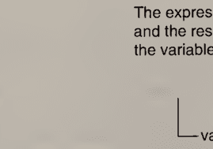

表达式可以有多种形式。重新考虑图 10.9 中的赋值语句：

```
age=prompt("Please enter your age.","");
dogage=age*7;
```

第二个赋值如图 10.10 所示。它并不断言 `"dogage 等于 age*7"`，而是说表达式 `age*7` 应当被计算并将结果存储到名为 *dogage* 的变量中。请注意，*age* 的内容没有被改变。存储在 age 中的数字只是被检索出来用于计算。在图 10.9 中的第一个赋值中，赋值运算符右边的表达式不涉及计算。相反，当计算机求值 prompt 函数时，它将用户的输入存储到变量 age 中。

赋值运算符右边的表达式类型可以非常复杂，比如

```
var x;
x=((23*11)+19)/10;
```

这使得变量 x 包含浮点数 27.2，或者可以很简单，比如

```
var y;
y=27.2;
```

这只是将数字 27.2 放入变量 y 中。此外，我们已经看到表达式可以包含其他变量，这些变量的内容会被检索并用于计算。为了强调变量赋值中表达式一侧使用的变量不会被改变，请看以下代码：

```
var x;
var y;
y=10;
x=11;
y=x;
```

这五行代码的结果是变量 x 和 y 都包含数字 11。赋值 `y=x` 从 x 中取值并存储到 y 中。x 的值没有被改变，只是被检索出来用于赋值。

为了更有力地说明赋值运算符不是对相等关系的断言，请看以下语句：

```
var z;
z=2;
z=z+1;
```

不知道最后一条语句执行的是变量赋值的话，一位代数老师会大吃一惊。确实，要解方程 `z=z+1`，你会从等式两边减去变量 z，得到简化版本 `0=1`，这显然是荒谬的。（如果 0 等于 1，宇宙的基本结构就崩塌了！）

现在，让我们按照 JavaScript 解释器的方式来解读这三条语句。实际上，让我们以解释器的口吻来说。我们创建一个名为 z 的空变量位置，然后将数字 2 放入 z 中。然后我们遇到第三条语句并计算右边的表达式。由于 z 包含 2，计算结果为数字 3。我们将这个结果赋值给 z。最终结果是 z 包含数字 3，而数字 2 已经不存在了。

## 10.10 解析用户输入

在 10.7 节中，我们暗示了计算机以字符串形式传递信息这一事实。事实上，我们通过将字符串形式的信息传递给 Web 服务器进行处理的例子引出了`"解析"`这个术语。即使在本地环境中，信息也是以字符串形式传递的。例如，`prompt()` 函数*总是*将用户的输入以字符串形式赋值给变量。

在图 10.8 的程序中，变量 *name* 被赋值为字符串 `"Bubba"`。虽然当时这没有什么特殊含义，但图 10.7 描绘了输入存储在变量中时是以字符串形式呈现的。但如果用户输入总是以字符串形式存储，那么图 10.9 程序中用户输入的数字 45 呢？从图 10.10 的描绘中你可以看到，我们确实指明用户的输入是以字符串 `"45"` 而非数字 45 的形式存储的。因此，计算实际上是将字符串 `"45"` 乘以数字 7。由于计算机使用数字而非字符串进行计算，JavaScript 解释器在进行计算之前迅速将字符串 `"45"` 解析为数字 45：

`"45" * 7 = ?`（没有意义）—解析→ `45 * 7 = 315`

在这个语境中，`"解析"`一词意味着将字符串转换为数字。所以，综合我们使用`"解析"`一词的两种语境，它可以表示将字符串拆分成更小、更有用的片段，也可以简单地表示将字符串转换为数字。无论哪种方式，解析都是从字符串中提取可用信息的一种手段。

你可能会想，`"这是不是有点吹毛求疵了？"`其实并非如此！欢迎来到计算机编程的世界。要明白这确实是一个大问题，请考虑一个交互式程序，它要从用户那里获取两个数字并求它们的平均值。该程序的自顶向下逻辑如下：

- 声明一个变量用于存储第一个数字（num1）
- 提示输入第一个数字
- 声明一个变量用于存储第二个数字（num2）
- 提示输入第二个数字
- 声明一个变量用于存储平均值（avg）
- 计算平均值：`avg = (num1+num2)/2`
- 将结果输出给用户

假设用户在两个提示框中分别输入数字 50 和 100，让我们用事件序列来描述：

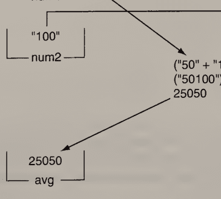

所有提示信息都以字符串形式存储。当用户输入的字符串值被提取用于计算时，计算机面对的就是`("50"+"100")`这个计算的一部分。因此，它将两个字符串连接成了`"50100"`。当面对`"50100"/2`时，计算机迅速将字符串解析为数字，并完成`50100/2`的计算，结果为25050。

所以你看，这个程序并没有按预期工作。两个数字的平均值显然应该是75。这 really serves to drive home an understanding that strings and numbers are different beasts。JavaScript传递用户输入的主要方式是字符串格式。当别无选择时，比如`"50100"/2`，JavaScript的大脑足够聪明，能将字符串`"50100"`解析为数字。然而，当面对`"50"+"100"`时，它却做了自然的事——将两个字符串连接起来。

当从用户获取数字输入时，我们建议你始终将其解析为数字。正如我们所见，JavaScript可能不会总是为你自动完成这一操作。要实现这一点，请使用`parseFloat()`函数。该函数将字符串解析为浮点数。考虑以下三个语句：

```
var num1;
num1=prompt("Please enter the first number you wish to average.","");
num1=parseFloat(num1);
```

我们对前两个很熟悉。例如，如果用户在提示框中输入50，字符串`"50"`就会存储在num1中。当然，由于第三个语句是变量赋值，

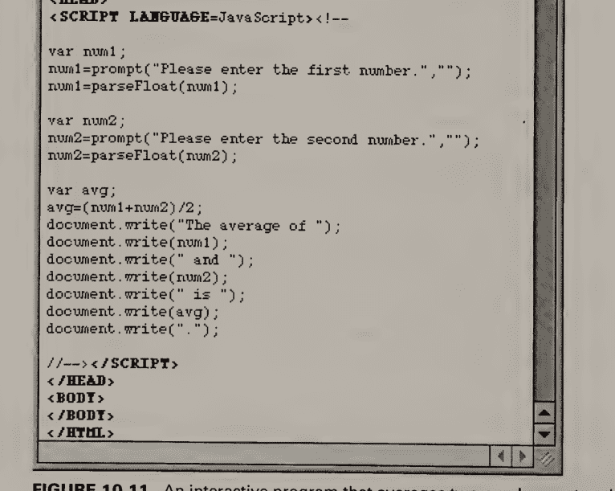

**图 10.11** 一个交互式程序，用于计算用户输入的两个数字的平均值。

右侧的表达式会被求值。发生的事情是，*num1*当前的内容，即`"50"`，被解析为数字50。完成变量赋值语句后，这个值被放入变量*num1*中。所以第三条语句的作用就是将*num1*的内容替换为其数字等价物。（名称表明字符串应该被解析为浮点数，但在本例中，由于50不需要小数点，所以不会添加小数点。换句话说，JavaScript宁愿使用50而不是50.0。）

我们现在提供一个能正常工作的平均值程序的版本。不再重复程序的自上而下的逻辑，我们只是在获取每条用户输入后对其进行解析。该程序如图10.11所示。建议读者访问网站并对该程序的两个版本进行实验。

> **注**
>
> 在图10.9中，我们想要用户的数字输入（年龄），但没有将该输入解析为数字。在那次情况下，我们侥幸成功了，因为程序仍然可以工作。然而，如果现在要重写那个程序，我们会解析用户输入。事实上，你应该养成习惯，始终将需要作为数字使用的输入进行解析。有时不解析也能蒙混过关，但如果你始终解析数字输入，就永远不会有问题。不过也别太过火。如果用户要输入一个名字，如图10.8所示，那就让它保持字符串形式。你绝无可能将`"Bubba"`这样的字符串解析成数字。

## 10.11 语句与标点

我们已经涵盖了本课要介绍的大部分实际编程概念。但我们还没有多谈JavaScript的实际**语法**。编程语言的语法指的是各种符号必须如何使用（分号、引号、句点等）以及语句本身的结构。我们目前编写的程序的自上而下的逻辑并不难理解。确实，你会发现本课末尾家庭作业程序的逻辑设计并不特别困难。然而，当你坐下来写第一个程序时，语法可能显得令人困惑。如果哪怕**一个分号或句点缺失或位置不对**，程序就无法按预期工作，或者根本不能工作。解释一些语法问题背后的原因，肯定有助于让事情更合理。

JavaScript语句是计算机要遵循的特定指令。**分号告诉**JavaScript解释器你正在终止指令。例如，

```
var x x=3;
```

会让解释器困惑，导致两个语句都无法执行。相比之下，

```
var x; x=3;
```

向计算机提供了两个不同的指令。我们将这两个语句放在同一行是为了说明问题。但在实践中，为了你自己好，应该将语句放在**单独的行上**。如果不这样做，随着你写的程序越来越长，你会得到一堆混乱的东西。即使图10.11中的程序，如果语句没有放在不同的行上，对读者来说也会相当困难。

如果你**无法将一条语句作为完整的句子读通，那它可能就不是一条语句**。例如，我们目前为止使用的三条语句，连同它们的英文等效表达，如下：

```
var  x;  (Set up an empty variable named x.)
x=55;   (Put the number 55 into x.)
x=x+5;  (Evaluate x+5 and put the result into x.)
```

每个句子的主语都是隐含的`"你"`，即`"你（计算机）帮我做这个"`。相比之下，以下不是语句：

```
x;
x+6;
```

假设变量*x*包含数字5。那么像`"x;"`这样的指令无非是告诉计算机

```
5;
```

这是毫无意义的。（在街上，你可能会成功告诉某人`"give me 5"`，但如果你直接走上去说`"Hey buddy, 5"`，你无疑会得到奇怪的反应。）同样，`x+6`这一行也是毫无意义的。要给变量*x*加上6，需要

```
x=x+6;
```

我们使用的一些语句使用了括号`()`。现在，你可以像使用计算器一样用括号来分组算术运算。例如，表达式`(1+2)*3`与`1+2*3`不同，后者使用了乘法优先于加法的自然优先级。然而，当你在JavaScript中单词末尾看到括号时，你很可能在处理一个**函数**。目前的例子有`document.write()`、`prompt()`和`parseFloat()`。无论你是否注意到，我们在前几节中已经不时在提到这些带括号的`"单词"`时引入了函数这个术语。把函数想象成你可以调用让它为你做事的内置JavaScript工具。括号的目的是让你能够向函数发送信息。例如，`document.write()`函数需要知道你希望写入HTML文档的内容。你发送给函数的信息被称为函数的**参数**。`document.write()`函数将字符串作为其参数，并作为独立的语句存在：

```
document.write("hello");
```

像`document.write()`这样能独立作为语句的函数被称为**过程函数**；它们为你执行某些过程。

`prompt()`和`parseFloat()`函数不能独立作为语句。它们被称为**值函数**，因为被调用时会返回一个值。`parseFloat()`函数将字符串作为其参数，并返回该字符串的数字等价物。例如，

```
parseFloat("123");
```

*不是*一条JavaScript语句，因为在返回其值后，它等价于

```
123;
```

这不是对计算机的指令。`prompt()`函数也是一个值函数。它接受两个由逗号分隔的字符串（一个用于指令，一个用于文本输入字段的初始内容）作为参数，并返回用户输入的内容。所以代码行

```
prompt("Enter your favorite animal name.", "");
```

等价于

```
"wildebeest";
```

这不是一条语句。（当然，这是假设用户输入了`"wildebeest"`。）你可以从本课的示例程序中看到，当我们调用值函数时，返回的值总是被赋给一个变量进行存储。在我们目前对JavaScript的探索中，别无其他选择，因为值函数**不能独立作为语句**。

## 10.12 错误

JavaScript程序中的**错误**指的是导致程序无法按预期工作或完全无法工作的问题。错误有三种类型：**语法错误、逻辑错误和用户错误**。语法错误出现在你没有正确输入JavaScript代码时。典型的例子包括忘记引号：

```
document.write("hello there);
```

忘记为函数提供所需数量的参数：

```
birthday=prompt("Please enter your birthday.");
```

或者忘记用分号终止语句。另一种常见的语法错误涉及大小写。例如，尝试调用`parseFloat()`函数**不会工作**，因为函数的名称是**parseFloat()**。还要记住变量名是区分大小写的。

如果你在浏览器中加载包含语法错误的程序，它可能根本无法工作。例如，提示框可能无法出现，或者文本可能无法按预期写入HTML文档。通常，语法错误会导致加载程序时完全没有任何反应。查找语法错误有时可能很残酷。有时**调试**（修复错误）程序的时间比最初写程序的时间还长。但这就是编程的本质。一些浏览器有帮助指出JavaScript语法错误的功能，但这在不同浏览器类型和版本之间并不一致。你最好的办法是留意你所用浏览器的任何响应。

逻辑错误涉及编写的JavaScript代码中，自上而下的逻辑未能完成应有的功能。在我们编写更复杂的程序之前，例子很难找，但一个简单的例子是错误的计算，比如试图用以下语句计算两个数字的平均值

```
avg=50+100/2;
```

这导致*avg*包含数字100，而不是期望的75，因为没有提供分组括号。避免逻辑错误的关键是在坐下来编写程序之前，仔细**规划程序的自上而下的逻辑**。这样，逻辑已经就位，你只需要担心语法。一个常见的

## 第10课 处理用户输入

有一句格言是这样说的：**"你越早坐在电脑前，编写程序所需的时间就越长。"**这句话可能看起来有点绕，但它往往是正确的。周密的计划能让实际的代码编写工作变得不那么繁琐。

第三类错误，即用户错误，涉及用户输入了错误类型的信息。随着时间的推移，我们将学习一些验证技术来帮助缓解这个问题。但与此同时，对于这类错误确实无能为力。举个例子，回顾一下图10.9中的狗龄程序。假设某个自作聪明的家伙将该程序加载到浏览器中，并在提示窗口中输入了他的名字，而不是年龄。结果会是，一个文本字符串，例如`"inglebert"`，被存储在变量*age*中。

> **注意：** 变量被命名为*age*这一事实对计算机来说几乎没有意义。描述性的变量名是为了方便程序员。计算机所知道的只是它设置了一个变量，其名称是*age*。也就是说，计算机不知道你打算将一个数字输入到该变量中，或者该数字要对应一个人的年龄。描述性的变量名仅对人类有意义。至关重要的是要记住，**计算机从不解释你的意图，它只是遵循指令！**

当文本字符串`"inglebert"`被存储在*age*中时，狗龄计算变成了

```
dogage = "inglebert" * 7;
```

这是毫无意义的。实际上，在这种情况下，变量*dogage*被赋值为**NaN（非数字）**。所以Inglebert会得到如下输出信息：

> 你可能有inglebert岁那么大，但是，如果你是一只狗，你就有NaN岁那么大！

值NaN，**技术上既不是数字也不是字符串**，是JavaScript在不知道要将什么字面量类型赋给变量时的默认值。这比导致错误是一个更好的替代方案。请注意，尝试对`parseFloat()`一个本质上不是数字的字符串也会导致NaN。以下代码会使*x*包含NaN：

```
x = parseFloat("oops");
```

## 10.13 灵活性

编程的逻辑自上而下流程具有一定的灵活性。换句话说，通常编写程序的方法不止一种。我们用一个比之前见过的稍微复杂一些的程序来演示这一点。用户需要输入一个姓名，然后是一个电话号码。随后用户将被提示订购一定数量的XL号T恤，每件20美元。同样，用户随后将被提示购买一些大号T恤，每件17美元，以及一些中号T恤，每件14美元。程序将计算总账单，包括6%的销售税。然后用户的订单将以输出形式汇总。

好的，那是五个提示框，一个用于姓名，一个用于电话号码，另外三个分别用于三种尺寸的T恤。然后需要进行一些计算，接着是一些输出。所需的逻辑与本节之前的程序没有什么不同，但我们选择将语句的组织顺序与图10.11中的略有不同。我们的自上而下逻辑如下。

- 声明所有变量（name、phone、xlarge、large、medium、subtotal、tax、total）
- 提示用户输入
- 解析数字输入（仅数字输入）
- 计算小计：`subtotal = (20 * xlarge) + (17 * large) + (14 * medium)`
- 计算税费：`tax = subtotal * .06`
- 计算总计：`total = subtotal + tax`
- 输出结果

图10.12和图10.13展示了该程序的JavaScript代码及其输出。

由于程序长度较长，图10.12中的窗口已经向下滚动。并非所有HTML标签都可见。与之前的例子相比，这是一个较长的程序，可能看起来令人生畏。但是，根据自上而下的逻辑，代码很容易推导出来。通过一些复制和粘贴操作，编写起来并不十分繁琐。

为了证明在设计给定程序的逻辑时存在灵活性，我们提供了Knuckles衬衫店程序的第二个版本逻辑。

- 声明一个用于姓名的变量（name）
- 提示用户输入姓名
- 声明一个用于电话号码的变量（phone）
- 提示用户输入电话号码
- 声明一个用于特大号数量的变量（xlarge）
- 提示用户输入特大号数量
- 将xlarge解析为数字
- 声明一个用于大号数量的变量（large）
- 提示用户输入大号数量
- 将large解析为数字
- 声明一个用于中号数量的变量（medium）
- 提示用户输入中号数量
- 将medium解析为数字
- 计算小计：`subtotal = (20 * xlarge) + (17 * large) + (14 * medium)`
- 计算税费：`tax = subtotal * .06`
- 计算总计：`total = subtotal + tax`
- 输出结果

起初，计算之前的逻辑看起来与第一个版本有很大不同。然而，它完成了相同的任务；即，它声明了必要的变量，用用户的输入初始化变量，并将将在计算中使用的变量解析为数字。这种方法与图10.11中使用的方法非常相似，即每个变量都是单独处理的。相比之下，第一个版本声明了所有变量，然后用用户输入初始化它们，最后解析必要的变量。你应该花时间让自己确信两个版本的逻辑是等效的。

那么，如果两个版本产生相同的结果，哪种方式更可取呢？答案是大多数程序员更喜欢第一个版本，即代码出现在图10.12中的版本。习惯上在程序顶部声明所有变量。这样，一眼就能看出程序中将使用哪些变量。否则变量声明会分散在程序主体中，错误更难发现。你当然不必在使用变量之前立即声明它们。一旦在顶部声明，你可以随时初始化变量。

但不要因为在设计程序逻辑时固有的灵活性而忘乎所以。使用错误的逻辑来设计程序当然是可能的。例如，在用户输入所需的大号衬衫数量之前，就尝试将大号衬衫的数量解析为数字是没有意义的；或者在从用户那里获得必要的输入之前尝试进行计算也是没有意义的。再举一个例子，你不能颠倒计算中前两个步骤的顺序

- 计算税费：`tax = subtotal * .06`
- 计算小计：`subtotal = (20 * xlarge) + (17 * large) + (14 * medium)`

因为这会尝试使用存储在*subtotal*中的值来计算税费，但*subtotal*尚未被初始化赋值。

> **注意** 至关重要的是要注意，图10.12中的某些语句足够长，以至于在我们的HTML编辑器窗口中自动换行了。这不会造成问题。但关键是它们是自动换行的，我们没有在键盘上按回车键来换到新行。如果你在JavaScript语句中间按回车键，你将有效地把语句切成两半，通常在运行程序时会导致错误发生。只有在你完成一个语句后才按回车键。

## 10.14 总结

### 关键术语

- variable（变量）
- integer（整数）
- concatenate（连接）
- argument（参数）
- syntax error（语法错误）
- debug（调试）
- string literal（字符串字面量）
- floating point（浮点数）
- assignment（赋值）
- procedure function（过程函数）
- logic error（逻辑错误）
- numeric literal（数字字面量）
- parse（解析）
- function（函数）
- value function（值函数）
- user error（用户错误）

任何出现在网页中的JavaScript代码必须作为HTML `<SCRIPT>...</SCRIPT>`容器元素的内容包含在内。此外，语言必须通过SCRIPT元素的LANGUAGE属性来指定。建议你使用`<!-- //-->`结构，以便HEAD部分中的任何JavaScript代码对HTML解释器隐藏。因此，为了节省打字，建议在HEAD部分保留一个包含以下内容的模板文件

```
<SCRIPT LANGUAGE="JavaScript"><!--
//--></SCRIPT>
```

JavaScript代码由语句组成，语句是计算机要遵循的指令。语句用于声明变量、为变量赋值以及向用户发送输出。当声明一个变量时，计算机内部会建立一个空的、命名的存储位置。使用赋值运算符`=`为变量赋值（存储值），该运算符并不表示相等。赋值运算符右侧的表达式首先被求值，然后将结果放入赋值运算符左侧的变量中。可以存储在变量中的值称为字面量，其中两种类型是数字和字符串。字符串用引号定义。基本上，计算机以字符串的形式传递信息，但需要一个不同的数字格式来进行计算。数字类型的字面量有两种形式：浮点数（带小数）和整数（整数）。如果不需要小数位来表示数字，JavaScript默认使用整数格式。

将信息存储在变量中的一种方法是直接赋值，例如`x = 5`。另一种方法是将计算结果赋给变量。第三种方法是使用`prompt()`函数从用户那里获取信息。但是`prompt()`函数总是将用户的输入作为字符串返回。因此，如果要从用户那里获取数字信息，你应该始终使用`parseFloat()`函数将其转换为数字格式。一般来说，解析字符串意味着从字符串中提取信息，通常通过将其切成小块来实现。然而，就目前的目的而言，我们只是从字符串中提取数字信息。连接使用`+`号将两个或多个字符串连接在一起。从广义上讲，它与将字符串解析成小块是相反的操作。

变量对于存储信息至关重要，但我们可以利用一些JavaScript函数来帮助获取、转换和输出信息。函数名称后面总是有括号`()`，用于括住函数的参数（或多个参数）。函数的参数是你发送给函数的信息，以便它能够完成其工作。`document.write()`函数将字符串作为其参数，并使该字符串被写入HTML文档。由于它会导致执行一个过程，因此被称为过程函数。这样的过程函数可以单独作为JavaScript语句存在。`prompt()`函数将两个字符串（用逗号分隔）作为参数，并返回用户的输入。`parseFloat()`函数将字符串作为其参数，并返回该字符串的数字等价物。由于这两个函数返回一个值，因此被称为值函数。值函数不能单独作为JavaScript语句存在。

当面临编写程序来完成某项任务时，首先构建自顶向下的逻辑是很重要的。JavaScript 语句是从上到下解释的。因此，自顶向下的逻辑就是您希望计算机执行的一系列语句。仔细的规划可以帮助您避免逻辑错误。逻辑错误基本上等同于给计算机列出一系列无法完成所需任务的指令。此外，在坐到电脑前制定好计划，可以让您专注于编写实际代码。编写 JavaScript 代码非常讲究细节——您必须严格遵循语法。语法是指所有必需的格式和标点符号。即使缺少一个`"`或`.`，程序也很可能完全无法工作。消除程序中错误的过程称为调试。程序中的错误是不可避免的，即使是高技能的专业程序员也是如此。

## 10.15 复习题

1. 给出两条建议，说明为什么要使用`<!-- //-->`来向 HTML 解释器隐藏 JavaScript。
2. 给出一个简单的代数示例，说明赋值运算符不能被理解为相等性断言。
3. 讨论变量命名规则。为什么要使用描述性的变量名？
4. 讨论 HTML 和 JavaScript 的解释顺序。具体来说，这与 `document.write()` 函数有什么关系？
5. 讨论 JavaScript 语句的本质。为什么值函数不能单独作为语句（举例说明）？
6. 描述一个可能的用户错误，并证明结果涉及第三种变量类型（除数字或字符串之外）。
7. 调试以下 JavaScript 代码：

```
var cool_word;
cool_word="lurk";
Document.write("The cool word of the day is ");
Document.write("cool_word");
```

8. 调试以下 JavaScript 代码：

```
var num1;
num1="15";
num1=num1+"2";
```

9. 调试以下 JavaScript 代码：

```
var user_name;
user-name=prompt("Please enter your name");
document.write(Hello);
document.write(user-name);
```

10. 推断以下 JavaScript 语句的精确输出：

```
var x;
var y;
y=15;
x="20";
y=x;
y=y+y;
document.write(y);
```

11. 推断以下 JavaScript 语句的精确输出：

```
var s;
var t;
s=1;
s=s-10;
t=11;
t=t+s;
s=s*(-1);
document.write(s);
document.write("<BR>");
document.write(t);
```

12. 推断以下 JavaScript 语句的精确输出。（此处可能存在调试问题，但请给出语句按原样编写的结果。）

```
var name;
var age;
name="Bert";
age=25;
document.write(name);
document.write("is <B>");
document.write("age");
document.write("</B>years old.");
```

> Bert is AGE years old

## 10.16 练习题

### 综合

1. 编写一个程序，提示用户输入华氏温度，然后输出对应的摄氏温度。（转换公式为 `C=(5/9)*(F-32)`。）
2. 编写一个程序，提示用户输入圆的直径。程序应输出圆的面积和周长。（如果*r*是半径，则面积由 π*r*² 给出，周长由 2π*r*给出。π 取 3.14。）
3. 编写一个程序，提示用户输入正方形的边长。程序应输出正方形的面积和周长。
4. 编写一个程序，提示用户输入立方体的边长。程序应输出立方体的体积和表面积。
5. 编写一个计算单利的程序。程序应提示用户输入金额（本金）、时间段（以年为单位）和年利率。程序应输出赚取的利息金额和总累积额（本金+利息）。（单利计算公式为*I = prt*（利息=本金*利率*时间）。例如，100 美元以 7.7% 的利率投资五年，可赚取 `100*.077*5` 美元的利息。）
6. 编写一个程序，提示用户输入三次考试的分数（0 到 100 分）。程序应输出三次考试分数的平均值。
7. 制作一个图 10.12 中 T 恤程序的版本，使其显示更多信息作为输出。在输出所有衬衫的小计、税费和总计之前，先输出每种尺寸衬衫的单独订单总额（税前）。
8. 编写一个模拟披萨订单的程序。程序应提示用户输入姓名和地址。然后提示用户输入想要的披萨数量（每个基本价格为 15 美元）。接着提示用户输入想要的配料数量（每份 1.50 美元）。注意，所有披萨都将使用这个配料数量。您应该计算披萨的基本总额、所有配料的总额以及小计（披萨+配料）。然后计算一些销售税和总账单。输出应该组织良好。可选：将输出组织在 HTML 表格中。
9. 第一个提示框应该询问姓名。第二个提示框应该包含一条个性化消息，询问用户距离退休还有多少年。第三个个性化消息应该询问用户当前的储蓄金额。程序应回显用户输入，并计算储蓄将增长到多少，使用 8% 的单利（见练习 5）。所谓`"个性化消息"`，我们指的是用户的姓名应出现在后两个提示框的说明中。提示：如果*x*是一个字符串变量，它可以与`prompt()`函数的参数拼接。参见第 11.3 节。

## 10.17 项目线程

本课的任何练习都应按第 9.10 节概述的指导方针，在您的作业页面中引用。

# 第 11 课

## 做出决策

**第 10 课**提供了使用变量存储和处理信息的必要背景。但缺少的一项功能是任何类型的决策过程。第 10 课的程序只能获取输入并进行简单计算。但大多数编程应用都需要根据用户输入做出某种决策：如果用户输入某样东西，程序应该让某事发生；但如果他或她输入另一样东西，程序应该让另一件事发生。不过，在直接进入 JavaScript 的决策结构之前，还有一些编程基础知识需要了解。

## 11.1 布尔变量

到目前为止，在我们对 JavaScript 的探索中，变量可以包含两种类型的字面值：数字和字符串。嗯，还有第三种类型，NaN，我们在计算结果对计算机来说没有意义时会看到它。另一种字面值类型是**布尔字面值**，它以 19 世纪英国逻辑学家乔治·布尔（George Boole）的名字命名，他形式化了符号逻辑的许多规则。与数字和字符串不同（它们有无限多个可能的值），布尔字面值只有两个值，

- true
- false

所以，例如，

```
var x;
x=false;
```

是有效的，即使存储在*x*中的值既不是数字也不是字符串。它显然不是一个数字，但您可能认为这等同于`x="false"`。然而，事实并非如此。字符串`"false"`对计算机来说只是一个毫无意义的字符串。

当我们考虑布尔表达式时，布尔变量的用处就显现出来了。**布尔表达式**的求值结果为 true 或 false。我们考虑的第一类布尔表达式使用我们称之为比较运算符的内容。尽管并非所有符号看起来都熟悉，但您从小就在使用实际的比较运算。通常，这些比较运算用于比较数字，但它们也可以用于比较字符串。

| 运算符 | 运算 |
| :--- | :--- |
| `<` | 小于 |
| `<=` | 小于或等于 |
| `>` | 大于 |
| `>=` | 大于或等于 |
| `==` | 等于 |
| `!=` | 不等于 |

考虑以下变量赋值。假设这些变量之前已经声明过。事实上，我们将在本节中使用大量变量而不声明它们，以使示例更加简洁。在编写实际程序时，您应该始终在使用变量之前声明它们。

```
x=(1<2);
y=(3.14>3.14);
z=(3.14>=3.14);
```

这些赋值使变量*x*和*z*包含 true，变量*y*包含 false。在每种情况下，右侧的表达式都是布尔表达式。您可以看到这些表达式 fundamentally 不同于像 `(4.14−3.14)` 那样结果为数字而非布尔值 true 或 false 的表达式。注意，布尔表达式也可以更复杂。语句

```
x=((8-3)>((17+3)/2));
```


使`x`包含 false。在这种情况下，分组括号非常重要，因为不清楚如何求值`8 − 3 > 17 + 3/2`，甚至不清楚这是否有意义。在第 10 课中我们详细讨论了变量赋值符号`=`并不**断言相等**，这里我们仅指出相等性断言使用双等号`==`。我们不再进一步讨论**赋值与相等的对比**，而是提供一些示例。最终，您将习惯使用双等号表示相等。

```
x=(1==2);
y=( grocer


 ```

empty=(num=="");

```

因此，相等比较可以用来测试字符串以及数字。前面的语句只是检查用户输入的内容是否为空字符串`""`，如果是，则用户将提示框的文本字段留空了。

你也可以在逻辑上玩点小花样，以相反的方式使用变量`not_empty`：

```

not_empty=(x!="");

```

如果用户输入了某些内容，`not_empty`为真，否则为假。逻辑的乐趣真是无与伦比！

检查字符串是否为空很容易，但检查两个字符串是否相等就不那么容易了。要使字符串相等，它们必须逐字母匹配且大小写一致。如果你提示用户输入一个选择，例如中号或大号披萨，检查输入就很困难。检查下面的布尔赋值：

```

size="Large";

is_large=(size=="large");

```

尽管字符串逐字母匹配，但变量`is_large`为假，因为其中一个字符串中的`"l"`是小写，而另一个是大写。

除了比较运算，我们还可以使用逻辑运算。它们如下表所示。这些运算本质上是不同的，因为它们比较的是布尔值而不是数字。

| 运算符 | 执行的操作 |
|----------|---------------------|
| `&&` | AND：仅当两个值都为真时才为真 |
| `\|\|` | OR：仅当两个值都为假时才为假 |
| `!` | NOT：对值取反 |

大多数人认为"与"、"或"和"非"的使用是微不足道的。也许在 everyday speech 中确实如此，但并不像人们想象的那么简单。事实上，符号逻辑的第一门课程会花费大量时间处理这些逻辑运算符。下面的真值表给出了"与"和"或"的所有逻辑组合。

| 表达式 | 结果值 | | 表达式 | 结果值 |
|------------|-----------------|-|------------|-----------------|
| `true&&true` | true | | `true\|\|true` | true |
| `false&&true` | false | | `false\|\|true` | true |
| `true&&false` | false | | `true\|\|false` | true |
| `false&&false` | false | | `false\|\|false` | false |

记住，"与"仅当两个操作数都为真时才为真，"或"仅当两个操作数都为假时才为假。如果你停下来想一想，这是有道理的。"非"的使用更为直接。例如，下面的语句使`x`包含真，`y`包含假。

```

x=!(1==2);

y=!(1==1);

```

这些运算符通常用于提供布尔表达式组合的逻辑结果。例如，

```

x=15;

small_positive=((x>=0)&&(x<=25));

```

使`small_positive`包含真，因为`x`中的值使两个条件都为真。通过这种方式，可以检查变量`x`是否满足某些条件。如果`x`不是小的正数（0 到 25 之间，包含边界），`small_positive`变量将包含假。

## 11.2 "if" 语句：做出决策

布尔变量本身并不是特别有用，除非你喜欢在周六晚上坐着玩逻辑游戏。然而，当与另一种 JavaScript 结构一起使用时，编程就获得了做出决策的优势。JavaScript 中提供根据不同标准采取不同行动的基本结构是"if...then"语句。

这些结构的逻辑在日常生活中被人类不假思索地使用。例如，在某一天出门前，一个人可能会遵循这样的陈述："如果预报有雨，那就带把伞。""if"部分指定要检查的条件（会下雨吗？），"then"部分指定仅在"if"部分为真时才要采取的行动。当"if"部分为假时，"then"部分被忽略。

在 JavaScript 中，"if...then"结构省略了"then"

```

if (Boolean expression) {

    statement;

}

```

但逻辑本质上是相同的。如果布尔表达式为真，则执行该语句。如果布尔表达式为假，计算机完全忽略该语句且不执行。省略"then"这个词没有任何意义；逻辑是相同的，而且少了一个词要输入！

这个结构可以扩展为包含任意数量的语句：

```

if (Boolean expression) {

    statement;

    :

    statement;

}

```

在这种情况下，如果布尔表达式为真，则执行括号中包含的**所有**语句，否则它们**全部**被忽略。请注意，在上述两个"if"结构中，绑定到结构的语句是缩进的。JavaScript 并不要求这样做，但在我们阅读和理解越来越长的程序时会有所帮助。此外，括号的位置可能看起来奇怪，但这是一个标准的编程实践，有助于可读性和错误检测。结构

```

if (Boolean expression) {statement; statement;}

```

是完全有效的。这两个语句仍然绑定到"if"子句，但这不是理想的代码格式化方式。

为了演示"if"语句功能的非常简单示例，我们将提示用户输入一个对应考试分数的数字。程序将决定用户是否通过了考试。如果考试分数为 60 或更高，用户通过。否则，用户未通过。使用新的"if"语句，程序的自上而下逻辑如下：

- 声明一个分数变量（`score`）
- 提示（并解析）分数
- `if (score>=60)`
  输出通过评语
- `if (score<60)`
  输出未通过评语

让我们像计算机一样运行这个程序。我们设置一个名为`score`的空变量。我们提示用户输入信息。他或她输入 50，我们将其赋值给`score`，然后将`"50"`解析为 50。我们检查第一个"if"的布尔表达式。它为假，所以我们什么都不做。我们检查第二个"if"语句。布尔表达式为真，所以我们执行属于该"if"的语句。这就是全部。完整程序出现在图 11.1 中。

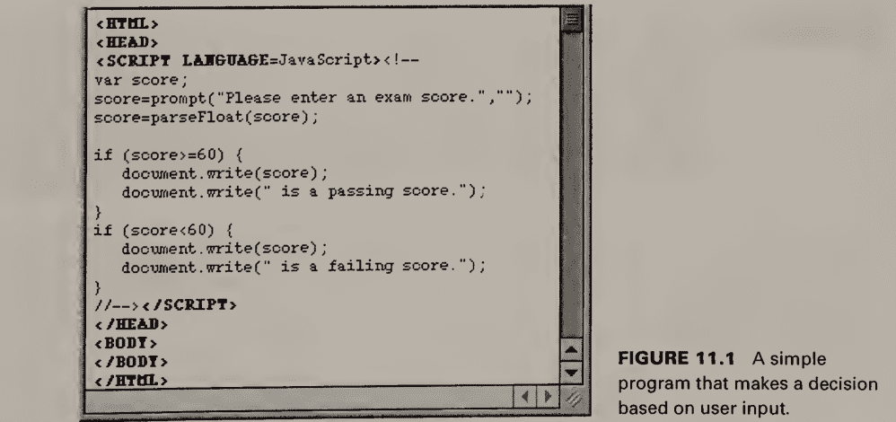

```

<HEAD>

<SCRIPT LANGUAGE=JavaScript><!--

var score;

var result;

score=prompt("Please enter an exam score.","");

score=parseFloat(score);

if (score>=60) {

  result="passing";

}

if (score<60) {

  result="failing";

}

document.write(score);

document.write(" is a ");

document.write(result);

document.write(" score.");

//--></SCRIPT>

</HEAD>

```

**图 11.2** 考试分数程序的一个版本，使用变量来存储"if"语句所做决策的结果。

"if"语句的使用带来了更巧妙的使用变量的方式。为了说明这一点，我们提供了这个程序的第二版。不是在每个"if"语句中生成潜在输出，而是使用第二个变量来存储"if"语句所做的决策。也就是说，我们创建一个名为`result`的变量，并根据用户输入的分数存储两个字符串之一`"passing"`或`"failing"`。然后我们在**整合的一组**输出语句中使用`result`的内容。这个版本的逻辑与上面的非常相似，所以我们直接显示实际程序在图 11.2 中。这进一步说明，编写程序通常有多种方法。两个程序产生完全相同的结果。然而，使用变量来存储决策结果通常是更可取的。事实上，这是我们将会定期使用的技术。

> **注意**：关于语法，此时有一个重要的说明。我们一直强调 JavaScript 语句应该以分号结尾。然而，像"if"语句这样的结构被 JavaScript 解释器识别。它知道在结束`}`之后终止"if"语句。因此，没有必要使用分号来标记"if"语句的结束。这是完全合理的。当你自己编写语句时，JavaScript 不知道何时终止你的一条指令，除非你使用分号来标记它的结束。但由于"if"语句是其内置结构的一部分，它知道该怎么做。

对于使用"if"语句的更复杂示例，让我们编写一个交互式程序，计算实得工资金额，前 40 小时按每小时 25 美元计算，加班时间按一倍半计算。程序应提示用户输入给定周的工作小时数，输出工资明细，并输出总工资。程序的顶层设计逻辑如下：

- 声明所有变量（`hours`, `reghours`, `regpay`, `overtime`, `otpay`, `total`）
- 提示（并解析）工作小时数（`hours`）

## 11.3 字符串连接的快捷方式

为了让你的生活（至少是你的编程生涯）轻松一些，我们暂时岔开话题。我们曾在第10课考虑引入这个快捷方式，但人只能一小口一小口地消化（并且理解所消化的内容）详细的编程语法（双关语，"bytes"既指"字节"也指"一小口"）。在上面11.2节的加班工资程序中，要输出结果所需的`document.write()`函数数量之多，可能显得过于繁琐——也许光看程序还不觉得，但实际编写代码时感受就完全不同了。

消除这种麻烦的关键在于记住，`document.write()`是一个以字符串作为参数的函数。此外，长字符串可以通过将短字符串拼接而成。例如

```

reghours+"regular hours:$"+regpay+"<BR>"

```

就是一个长字符串。因此，语句

```

document.write(reghours+"regular hours:$"+regpay+"<BR>");

```

是完全合法的。但等一下，变量的内容是数字而不是字符串。还记得10.9节中，当我们试图对两个用户输入的字符串型数字求平均值而没有将它们解析为真正的数字时，计算机对它们进行了拼接而不是相加。事实上，只要**存在至少一个字符串**，就会发生拼接而非严格意义上的加法。例如，

```

"2"+10+55+123+84

```

会被拼接为字符串

`"2105512384"`

这里第一个元素是字符串。考虑到这一点，图11.3末尾的`document.write()`语句可以精简为

```

document.write("Your pay breakdown is as follows:<BR>");

document.write(reghours+" regular hours: $"+regpay+"<BR>");

document.write(overtime+" overtime hours: $"+otpay);

document.write("<BR>Total pay: $"+total);

```

当然，我们本可以将其精简为一条长语句，但没有必要走极端。事实上，像这样的长语句调试起来往往令人头疼。只要漏掉一个引号，就可能导致整个程序无法运行。因此，请谨慎使用这个快捷方式，正如我们上面所做的那样。

> **注意**
>
> 如果你的某条`document.write()`语句太长以至于在编辑器窗口中会自动换行，就让它自然换行。不要在语句中间按回车键。我们不想重复强调（参见10.12节末尾的注释），但这类错误确实非常难以发现。

## 11.4 "if . . . else"结构

在"if"语句中加入"else"，本质上是为"if"条件不成立时提供一个默认处理。回到前面的人类示例，考虑这样的语句："如果天气预报说会下雨，就带伞；否则，就带墨镜。"逻辑本质上是相同的；不过，"else"部分只是在"if"部分为假时提供另一种行动方案——可以说是默认选项。在日常用语中，"否则"这个词也许更适合替代"else"。但在编程语境中，这两个词的含义是一样的。

在JavaScript中，"if . . . then . . . else"结构（实际上只是"if . . . else"）的格式为

```

if (Boolean Expression) {

    statement;

}

else {

    statement;

}

```

如果布尔表达式为真，则执行第一条语句。如果布尔表达式为假，则执行第二条语句。两条语句**绝不会**同时被执行。

"if . . . else"结构也可以用于语句组：

```

if (Boolean expression) {

    statement;

    :

    statement;

}

else {

    statement;

    :

    statement;

}

```

当布尔表达式为假时，整个第一组语句会被跳过，整个第二组语句会被执行。

在实际应用中，"if . . . else"语句的功能可以等同于两个独立的"if"语句。例如，我们可以用"if . . . else"语句重写图11.3中的加班工资程序。保持程序其余部分不变，只需将代码改为

```

if(hours<=40) {

    reghours=hours;

    overtime=0;

}

else{

    reghours=40;

    overtime=hours-40;

}

```

唯一的明显区别是计算机只需检查一个布尔条件。因此，在这方面"if . . . else"语句稍微高效一些。不过，还有一个微妙但重要的区别。假设在"if . . . else"版本中，用户输入了错误内容，比如字符串`"oops"`，这显然不是数字。奇怪的是，布尔表达式（`"oops"<=40`）的结果为假。你可能会说"当然是假的"，但实际上这个表达式根本没有意义，从技术上说，这与"假"是不同的。但在JavaScript中，如果不是真，那就是假，不管它是否有意义。因此，在程序的"if . . . else"版本中，当用户输入错误数据时，"else"分支实际上会被执行。这并不意味着程序会按预期工作。在错误输入的情况下，程序的输出会包含多个`NaN`（回忆10.11节末尾的讨论）。

所以，对于加班工资程序而言，上述微妙之处其实并无影响。输入错误时，程序就是无法按计划运行。但在新的应用场景中，我们实际上可以利用"if . . . else"语句的这一优势。我们希望编写一个交互式披萨订购程序，首先询问用户想要中号（$10）还是大号（$15）披萨。根据用户的选择，接着询问他们想订购多少个中号或大号披萨。换句话说，第二个提示框应该反映出用户在第一个提示框中做出的选择。然后程序将计算小计、销售税和总账单。

第一个提示框将要求用户输入1表示想要中号披萨，输入2表示想要大号披萨。利用"if . . . else"语句的默认处理能力，我们设置程序使得如果用户输入的不是1，则默认获得大号披萨。（大号披萨的利润率更高！）

```

if (size=="1")

    give 'em medium pizzas

else

    give 'em large pizzas

```

这样，即使用户在提示框中输入了乱七八糟的内容，`(size=="1")`也为假，他们会获得大号披萨。接下来需要解决的是如何让第二个提示框反映出用户在第一个提示框中做出的选择。最直观的做法是直接这样做。

```

if (size=="1")

    prompt for medium pizzas

else

    prompt for large pizzas

```

这样每个提示框都可以显示相应的消息。然而，没有必要使用两个不同的`prompt()`函数。回想一下`prompt()`函数的第一个参数是一个字符串，我们采用11.3节中介绍的字符串连接快捷方式。程序的自顶向下逻辑变为

```

-声明变量（size, type, price, num, subtotal, tax, total）

-提示输入尺寸（size）

-如果 (size=="1")

    type="medium"

    price=10

-否则

    type= "large"

    price=15

-提示输入（并解析）披萨数量，在消息中使用type（num）

-计算小计、税和总计

-输出结果

```

这样根据用户的第一次选择，我们既存储了价格信息用于计算，也存储了披萨类型用于第二个提示框。实际程序见图11.5。值得注意的是，我们没有解析

 ```

<HEAD>

<SCRIPT LANGUAGE=JavaScript><!--

var size;

var type;

var price;

var num;

var subtotal;

var tax;

var total;

size=prompt("Please enter 1 if you would like to order medium pizzas\nat $10 apiece or enter 2 if you would like to order large pizzas at\n$15 apiece","");

if (size=="1"){

    type="medium";

    price= exec (10);

}

else{

    type="large";

    price=15;

}

num=prompt("How many "+type+" pizzas would you like to order?","");

num=parseFloat(num);

subtotal=num*price;

tax=.06*subtotal;

total=subtotal +tax;

document.write("Order summary:<BR>"+num+" "+type+" pizzas at\n$"+price+" each: $"+subtotal);

document.write("<BR>6% sales tax: $"+tax);

document.write("<BR>The total for your order: $"+total);

//--></SCRIPT>

</HEAD>

```

我们将第一个提示框的输出转换为数字，因为我们以字符串形式检查了其值。还要注意披萨类型信息是如何与第二个`prompt()`函数的参数拼接在一起的，以及输出语句是如何通过拼接被整合的。

这个程序的输出是典型的，所以我们没有展示它。然而，这个程序最有趣的特性（除了"if...else"的使用之外）是第一个输入如何影响第二个提示框的提示内容。鼓励读者访问网站并运行这个程序。特别要注意，即使你在第一个提示框中输入乱码，也会得到大号披萨。但是，在第二个提示框中输入错误信息仍然会导致一些`NaN`输出。

关于这个程序，最后要提的一点是，我们本来可能想直接让用户在第一个提示框中输入`"medium"`或`"large"`。然而，正如我们在第11.1节末尾所指出的，字符串相等性检查非常严格。所以，即使用户输入`"Medium"`、`"MEDIUM"`或`"        medium        "`（额外空格），"if"部分都会为假，导致程序默认选择大号披萨。使用0和1是更好的选择。

## 11.5 基本输入验证

虽然上述披萨程序中"if...else"语句的默认功能提供了一定程度的用户错误保护，但很明显，这不是验证用户输入的可行方法。事实上，即使我们在加班费程序中使用了这种结构，坏的用户输入仍然会导致输出中出现多个`NaN`。为了辅助输入验证，我们将使用两个新的JavaScript函数。

首先，`alert()`函数接受一个字符串作为其参数，并导致一个小警告框出现。`alert()`函数是一个**过程函数**，因为它不返回值。因此，它单独作为一个语句存在。以下语句

```

alert("C'mon, buddy, enter the correct information.");

```

会导致一个警告框出现。显然，警告框上的消息由你发送给`alert()`函数的字符串给出。JavaScript程序的执行不会恢复，直到用户点击"OK"按钮。（我不确定警告框左边那个家伙在说什么，但我想我不希望我妈妈听到！）

我们将使用的第二个函数是`isNaN()`函数（is Not a Number，即"不是数字"）。它是一个值函数，接受一个字符串参数并返回一个布尔值。如果你发送给它的字符串不是数字，则返回`true`；如果你发送给它的字符串实际上是数字，则返回`false`。嗯，严格来说没有字符串是数字。我们这里的意思是，如果字符串不能被解析为数字，该函数返回`true`。（拼写检查器肯定不会放过"parsable"这个词，但当你写计算机科学教科书时，你可以造新词。）以下示例应该清楚地阐明这一点。

```

x=isNaN("22");

y=isNaN("2a");

```

在上述情况下，变量`x`将被赋值为`false`，变量`y`将被赋值为`true`。

为了解如何使用这两个函数来检查用户输入，我们回到图11.1的加班费程序。我们希望检查两件事：

- 1. 确保用户输入的是数字。
- 2. 确保用户输入的数字在0到168之间（一周只有168小时。如果他们能工作那么多小时，我们会付钱的。）。

回想一下，用户将工作小时数输入到变量`hours`中。要检查第一个条件，我们可以检查表达式

```

isNaN(hours)

```

如果它是真布尔表达式，用户**没有**输入数字。要检查第二个条件，我们只需检查表达式

```

(hours<0) || (168<hours)

```

如果它是真布尔表达式，那么`hours`**不在** proper 范围内。

考虑到这一点，输入验证采用以下自上而下的逻辑

- 获取输入，**不要**尝试解析它（`hours`）
- `if (isNaN(hours) or ((hours<0) || (168<hours)))`
  警告用户输入了不当值
  重新提示输入（`hours`）
- 现在解析`hours`

让我们详细讨论一下。获取输入，如果它是`NaN`**或者**不在正确范围内，那么给出警告框并第二次提示输入。记住，或（`||`）只有在两个条件都为假时才返回假。所以，如果任一条件为真，"if"语句的条件就为真，警报和重新提示就会发生。否则，整个"if"语句不会被执行。

图11.6提供了适合此目的的JavaScript代码。我们已将此代码包含在加班费程序中，以便你能看到它的位置。但是，我们没有展示整个程序。其余部分与图11.3完全相同。鼓励读者在网站上运行此程序，以了解其工作原理。

```

<SCRIPT LANGUAGE=JavaScript><!--

var hours;

var reghours;

var regpay;

var overtime;

var otpay;

var total;

hours=prompt("Enter the number of hours you worked this week.","");

if (isNaN(hours) || ((hours<0) || (168<hours))){

  alert("Make sure you enter a number between 0 and 168");

  hours=prompt("Re-enter your hours.","");

}

hours=parseFloat(hours);

if(hours<=40) {

  reghours=hours;

  overtime=0;

}

if(hours>40) {

  reghours=40;

  overtime=hours-40;

```

**图11.6** 验证用户输入的数字是否在 proper 范围内。

这种验证技术的缺点在于，如果用户固执地连续两次输入坏数据。毕竟，我们只需要检查一次输入。如果程序不得不执行第二个`prompt`语句，就没有第二道防线了。人们总是可以将几个验证结构背靠背放置，并附上越来越具威胁性的消息，但这不是期望的策略。我们暂时只能满足于此。然而，在本书后面，我们将介绍一种可以无限验证用户输入的方法。换句话说，用户可以整天输入坏数据，但将毫无进展。

## 11.6 编写程序

到目前为止，我们已经学到了足够编写有意义的程序的知识，这些程序不仅仅是简单地将信息写入浏览器窗口。乍看之下，将我们所学的概念组织成旨在完成某些任务的一系列语句似乎很简单。然而，编写程序远不止坐下来打字。在大多数情况下，需要大量的、实质性的 problem solving 才能编写出一个不仅要做应该做的事情，而且要有组织且有效率的程序。

在编写JavaScript程序的语境中，问题求解可以大致概括为三个步骤：

- 1. 彻底理解手头的问题。
- 2. 设计可行的解决方案。
- 3. 以JavaScript代码的形式实现解决方案。

虽然这可能看起来是显而易见的，但我们强调前两个步骤与第三个步骤同等重要。我们已经提到过"越早开始打字，写程序花的时间就越长"这句格言。然而，大多数初学者程序员往往忽视这一智慧。最终产品是一个JavaScript程序，人们倾向于匆忙跳过前两个步骤，直接开始打字。我们强调了自上而下的逻辑方法，这是有充分理由的。没有适当的规划，无数时间可能会花在盲目打字上。

## 11.7 高级示例（可选）

我们以这个JavaScript决策课程的最后一个较为复杂的示例结束。以下是美国国税局（IRS）发布的1998年Circular E中概述的从工资中预扣联邦税的指南。（通过一些搜索，这类信息可以在线公开获取！）请注意，这些指南并不确定你在年底将欠多少联邦税，而是确定从每张工资单中预扣多少。还需注意，这只是联邦税的预扣，不是州税、社会保险等。这些公式适用于所有 common 的 payroll periods，但我们只包括常见的那些。

首先，对于你在W-4表格上申报的每位受抚养人，你的总收入中有一笔固定金额可以免税：

## 第11课 做出决策 228

| 发薪周期 | 一个免税额 |
| :--- | :--- |
| 每周 | 51.92 |
| 每两周 | 103.85 |
| 每月 | 225.00 |

例如，如果你申报了两名受抚养人，并且每两周发一次工资，那么每份工资中有`2*103.85 = $207.70`可以免税。以下从每张工资单中扣缴预扣税的表格适用于在扣除免税额后的**总**收入。

| | 单身 | | 已婚 | |
| :--- | :--- | :--- | :--- | :--- |
| | **收入范围** | **扣缴百分比** | **收入范围** | **扣缴百分比** |
| **每周** | 0–51 | 0% | 0–124 | 0% |
| | 51–517 | 15% | 124–899 | 15% |
| | 517–1105 | 28% | 899–1855 | 28% |
| | 1105–2493 | 31% | 1855–3084 | 31% |
| | 2493–5385 | 36% | 3084–5439 | 36% |
| | 5385→ | 39.6% | 5439→ | 39.6% |
| **每两周** | 0–102 | 0% | 0–248 | 0% |
| | 102–1035 | 15% | 248–1798 | 15% |
| | 1035–2210 | 28% | 1798–3710 | 28% |
| | 2210–4987 | 31% | 3710–6167 | 31% |
| | 4987–10769 | 36% | 6167–10879 | 36% |
| | 10769→ | 39.6% | 10879→ | 39.6% |
| **每月** | 0–221 | 0% | 0–538 | 0% |
| | 221–2242 | 15% | 538–3896 | 15% |
| | 2242–4788 | 28% | 3896–8038 | 28% |
| | 4788–10804 | 31% | 8038–13363 | 31% |
| | 10804–23333 | 36% | 13363–23571 | 36% |
| | 23333→ | 39.6% | 23571→ | 39.6% |

需要注意的是，预扣税并不是按照固定百分比根据你的收入来扣缴的。你赚得越多，预扣百分比就越高。让我们通过一个示例来看看这是如何运作的。假设你是单身，申报了一名受抚养人，每月工资为 $5225。由于你申报了一名受抚养人，根据上面的第一张表，你可以获得`1*225 = $225`的免税额。那么你的调整后月收入就是 $5000。实际的预扣税则根据第二张表，使用这个调整后的收入来计算。现在，$5000 属于 31% 的范围，但他们不会简单地扣缴你调整后收入的 31%。他们会扣缴你在 221 到 2242 范围内收入的 15%，在 2242 到 4788 范围内收入的 28%，以及超过 4788 部分收入的 31%。所以在这种情况下，预扣金额为：

```
.15*(2242-221)+.28*(4788-2242)+.31*(5000-4788)
```

总计为 $1081.75。所以预扣税的计算并不是特别复杂。然而，结果确实有点令人沮丧！

我们的目标是编写一个程序，提示用户输入他们的年薪、申报的受抚养人数量以及发薪频率。为了简单起见，我们只提供每两周（每两周一次）和每月两种选项。此外，为了简单起见，我们假设在这个示例中用户是已婚的。然后程序将计算从每张工资单中需要扣缴多少金额。

输入的年薪将存入变量`salary`，受抚养人数量存入变量`dependents`。这只是数值输入。我们将省略对用户输入的正式验证，将其留作练习。需要做出的主要决策是用户输入了哪种发薪周期类型。我们将让用户输入 2 表示每两周发薪，输入 1 表示每月发薪，存入变量`pay_period`。程序的基本自上而下逻辑如下。

```
-定义变量(salary, dependents, pay_period, wage, adjwage, ouch)（可能需要更多）
-提示用户输入
-if (pay_period== "1"){ 
    计算月薪 (wage)
    计算调整后工资（扣除受抚养人免税额）(adjwage)
    计算联邦预扣税 (ouch)
}
-if (pay_period== "2"){ 
    计算双周薪 (wage)
    计算调整后工资（扣除受抚养人免税额）(adjwage)
    计算联邦预扣税 (ouch)
}
-输出结果
```

按照这个计划，虽然不太复杂，我们必须确定计算的性质。所以这个计划并没有涵盖所有细节，只是程序的主要逻辑。有了这个框架，我们就可以专注于计算了。月工资/双周工资和受抚养人免税额的计算都很直接，可以即时完成。然而，计算预扣税则要复杂得多。在每种情况下（每月/每两周），程序基本上是相同的，只是数字不同。这不是唯一正确的方法，但以下方法很直接：

```
if (15% 范围) 
    计算税 
if (28% 范围) 
    计算税 
    :
if (39.6% 范围) 
    计算税
```

因此，计算联邦预扣税的部分在每种情况下都会有上述结构。预先确定了这样的结构后，唯一需要弄清楚的就是计算税的步骤。这些需要一些思考，因为预扣税不是固定百分比。例如，对于月薪在 36% 范围内的工资，一个合适的计算是：

```
ouch = .15*(3896 - 538) + .28*(8038 - 3896) + .31*(13363 - 8038)
+ .36*(wage - 13363);
```

上述方法通常是确定如何编写复杂程序的好方法。首先弄清楚主要逻辑——需要做出哪些基本决策。有了这个框架，就更容易专注于实际计算。有了良好的程序结构计划和困难的计算方案，图 11.7 中所示的实际程序就不太难产出了。鼓励读者访问网站并使用这个程序。

对于不习惯编程的人来说，由于需要进行大量的大型计算，这个程序可能看起来非常复杂。然而，在编写程序之前就明确程序要做什么，这就已经赢了超过一半的战斗。如果没有详细的计划就坐在键盘前，对于这个程序来说将是一个耗时的错误。

程序有一个特性直到输出结果时才显现出来。需要在输出中包含正在考虑的发薪周期类型。我们 simply 声明了一个变量`period_type`，并在每种情况下相应地设置其值。注意它在`document.write()`语句中的使用。即使有了程序的逻辑，你有时仍然需要对它进行一些"微调"。

下一个示例是对图 11.7 中联邦预扣程序的一个修改版本。这个新版本比前一个版本使用了更多的变量。为了节省一些空间，我们在这里提到，有一种允许的方式可以用一行代码定义多个变量。例如，以下四个变量声明

```
var dependents;
var pay_period;
var wage;
var adjwage;
```

可以压缩成一行代码

```
var dependents, pay_period, wage, adjwage;
```

实际上，这种快捷方式使用起来很直接，所以我们不再多说什么。

修改版本的目标是在前一个程序的基础上增加另一个选项。除了用户输入的其他信息外，还会提示用户确定预扣税是为已婚人士还是单身人士计算。为单身人士计算预扣税只不过是使用一组不同的临界值。这些值在上面的表格中，位于已婚预扣临界值的右侧。

```
<HEAD>
<SCRIPT LANGUAGE="JavaScript">
<!--
var salary;
var dependents;
var pay_period;
var wage;
var adjwage;
var ouch;
var period_type;

salary=prompt("Please enter your yearly salary.","");
dependents=prompt("Please enter the number of dependents claimed on your W-4 form.","");
pay_period=prompt("Enter a 1 if you get paid monthly, or a 2 if you get paid biweekly.","");

salary=parseFloat(salary);
dependents=parseFloat(dependents);

if (pay_period=="1") {
    wage=salary/12;
    adjwage=wage-(dependents*225);

    if ((adjwage>538)&&(adjwage<=3896)){
        ouch=.15*(adjwage-538);
    }
    if ((adjwage>3896)&&(adjwage<=8038)){
        ouch=.15*(3896-538)+.28*(adjwage-3896);
    }
    if ((adjwage>8038)&&(adjwage<=13363)){
        ouch=.15*(3896-538)+.28*(8038-3896)+.31*(adjwage-8038);
    }
    if ((adjwage>13363)&&(adjwage<=23571)){
        ouch=.15*(3896-538)+.28*(8038-3896)+.31*(13363-8038)+.36*(adjwage-13363);
    }
    if (adjwage>23571){
        ouch=.15*(3896-538)+.28*(8038-3896)+.31*(13363-8038)+.36*(23571-13363)+.396*(adjwage-23571);
    }
    period_type="monthly";
}

if (pay_period=="2") {
    wage=salary/26;
    adjwage=wage-(dependents*103.85);

    if ((adjwage>248)&&(adjwage<=1798)){
        ouch=.15*(adjwage-248);
    }
    if ((adjwage>1798)&&(adjwage<=3710)){
        ouch=.15*(1798-248)+.28*(adjwage-1798);
    }
    if ((adjwage>3710)&&(adjwage<=6167)){
        ouch=.15*(1798-248)+.28*(3710-1798)+.31*(adjwage-3710);
    }
    if ((adjwage>6167)&&(adjwage<=10879)){
        ouch=.15*(1798-248)+.28*(3710-1798)+.31*(6167 teor-3710)+.36*(adjwage-6167);
    }
    if (adjwage>10879){
        ouch=.15*(1798-248)+.28*(3710-1798)+.31*(6167-3710)+.36*(10879-6167)+.396*(adjwage-10879);
    }
    period_type="biweekly";
}
document.write("A married person earning $"+salary+" per year has a "+period_type+" gross paycheck of $"+wage+". With "+dependents+" dependents claimed, $"+ouch+" is withheld from each paycheck for federal taxes alone!");
// -->
</SCRIPT>
</HEAD>
```

图 11.7 一个计算联邦税预扣的交互式程序。

第一种倾向是像上一个程序那样构建程序，但包含四个决策组件而不是两个：

```
if (single and monthly)
    do the calculations as before
if (married and monthly)
    do the calculations as before
if (single and biweekly)
    do the calculations as before
if (married and biweekly)
    do the calculations as before
```

这是一个完全可行的解决方案，但会导致程序冗长而笨重。实际上，四个计算部分中的每一个本身都是一系列五个"if"语句，每个都包含繁琐的计算。这将使程序大约是上一版本的两倍长。这本身没什么问题，但是与其单纯使用蛮力，一点巧妙的编程可以让程序更短，甚至更通用。

我们注意到，四个计算部分中所需的每个五重"if...then"语句系列是完全相同的，除了四种情况中预扣税百分比的截止值不同。让我们为每个截止点设置一个变量。变量`cut0`、`cut15`、`cut28`、`cut31`和`cut36`分别代表 0%、15%、28%、31% 和 36% 预扣税级别的截止点。那么，例如，对于落入 36% 范围的工资，以下计算

```
if ((adjwage>cut31)&&(adjwage<=cut36))
    tax=.15*(cut15-cut0)+.28*(cut28-cut15)+.31*(cut31-cut28)
        +.36*(adjwage-cut31);
```

足以适用于所有四种情况。只需为每种情况预设截止值即可。由于我们已经完成了用户输入的获取，因此在本版本的自顶向下逻辑中省略了这一点。除了之前的信息外，我们还将提示用户选择单身(1)还是已婚(2)预扣税。基本逻辑变为

- if (monthly)

    - 计算月薪 (wage)

    - 计算调整后工资（扣除受抚养人免税额） (adjwage)

- if (single)

    - 设置截止值 (cut0, cut15, cut28, cut31, cut36)

- if (married)

    - 设置截止值 (cut0, cut15, cut28, cut31, cut36)

*(续第234页。)*

```
<HEAD>
<SCRIPT LANGUAGE=JavaScript><!--
var salary, dependents, pay_period, withhold_type;
var wage, adjwage, ouch, period_type, withhold_status;
var cut0, cut15, cut28, cut31, cut36;

salary=prompt("Please enter your yearly salary.", "");
dependents=prompt("Please enter the number of dependents claimed on your W-4 form.", "");
pay_period=prompt("Enter a 1 if you get paid monthly, or a 2 if you get paid biweekly.", "");
withhold_type=prompt("Enter a ffect=JavaScript><!--
var salary, dependents, pay_period, withhold_type;
var wage, adjwage, ouch, period_type, withhold_status;
var cut0, cut15, cut28, cut31, cut36;

salary=prompt("Please enter your yearly salary.", "");
dependents=prompt("Please enter the number of dependents claimed on your W-4 form.", "");
pay_period=prompt("Enter a 1 if you get paid monthly, or a 2 if you get paid biweekly.", "");
withhold_type=prompt("Enter a 1 for single, or a 2 for married withholding.", "");

salary=parseFloat(salary);
dependents=parseFloat(dependents);

if (pay_period=="1") {
  wage=salary/12;
  adjwage=wage-(dependents*225);

  if (withhold_type=="1"){
    cut0=221;cut15=2242;cut28=4788;cut31=10804;cut36=23333;
    withhold_status="single";
  }
  if (withhold_type=="2"){
    cut0=538;cut15=3896;cut28=8038;cut31=13363;cut36=23571;
    withhold_status="married";
  }
  period_type="monthly";
}

if (pay_period=="2") {
  wage=salary/26;
  adjwage=wage-(dependents*103.80);

  if (withhold_type=="1"){
    cut0=102;cut15=1035;cut28=2210;cut31=4987;cut36=10769;
    withhold_status="single";
  }
  if (withhold_type=="2"){
    cut0=248;cut15=1798;cut28=3710;cut31=6167;cut36=10879;
    withhold_status="married";
  }
  period_type="biweekly";
}

if ((adjwage>cut0)&&(adjwage<=cut15)){
  ouch=.15*(adjwage-cut0);
}
if ((adjwage>cut15)&&(adjwage<=cut28)){
  ouch=.15*(cut15-cut0)+.28*(adjwage-cut15);
}
if ((adjwage>cut28)&&(adjwage<=cut31)){
  ouch=.15*(cut15-cut0)+.28*(cut28-cut15)+.31*(adjwage-cut28);
}
if ((adjwage>cut31)&&(adjwage<=cut36)){
  ouch=.15*(cut15-cut0)+.28*(cut28-cut15)+.31*(cut31-cut28)+.36*(adjwage-cut31);
}
if (adjwage>cut36){
  ouch=.15*(cut15-cut0)+.28*(cut28-cut15)+.31*(cut31-cut28)+.36*(cut36-cut31)+.396*(adjwage-cut36);
}

document.write("A married person earning $"+salary+" per year has a "+period_type+" gross
paycheck of $"+wage+". With "+dependents+" dependents claimed and withholding at the
"+withhold_status+" rate, $"+ouch+" is withheld from each paycheck for federal taxes
alone!");
//--></SCRIPT>
</HEAD>
```

**图 11.8** 联邦预扣税程序的一个更通用版本。

- if (biweekly)

    - 计算双周薪 (wage)

    - 计算调整后工资（扣除受抚养人免税额） (adjwage)

    - if (single)

        - 设置截止值 (cut0, cut15, cut28, cut31, cut36)

    - if (married)

        - 设置截止值 (cut0, cut15, cut28, cut31, cut36)

- 计算联邦预扣税

然后，在所有截止值和预扣税值预先确定后，联邦预扣税的计算由五个"if"语句组成，每个对应一个预扣税百分比。完整的程序如图 11.8 所示。我们再次对程序进行了一些调整。我们添加了另一个变量`withhold_status`来存储用户选择的预扣税类型。这样输出就可以包含用户选择的文本描述。

这个程序仍然可以进行几项改进。我们没有包含每周工资单选项。此外，程序非常容易受到用户错误的影响。这些改进留作练习。

## 11.8 总结

### 关键术语

布尔字面量、逻辑运算、布尔表达式、比较运算

布尔字面量用于促进编程中的决策。布尔变量仅使用两个值：真和假。因此，它们与数字或字符串字面量有根本的不同。布尔表达式的求值结果为真或假。第一种布尔表达式使用比较运算。比较运算用于检查或比较数字或字符串。以下使用相等比较`==`的两个比较表达式

```
(3.01==3)
("Yikes"=="yikes")
```

求值结果均为假。特别是，字符串必须逐个字母、逐个大小写匹配才能相等。

逻辑运算符，与(`&&`)、或(`||`)和非(`!`)，不是用来比较数字或字符串，而是用来比较其他布尔表达式。你从能说话起就在口语中使用它们，但它们的解释并不像你可能想的那么简单。（我们相信复习题会说服你的！）给定两个布尔表达式，与运算**仅当**两个表达式都为真时才为真；或运算**仅当**两个表达式都为假时才为假。以下两个逻辑表达式均为假：

```
(5>6) || ("x"=="X")
!(2*2*2==8)
```

在这样的复合表达式中，使用分组括号`()`变得非常重要。虽然玩比较和逻辑语句总是很有趣，但当它们与"if"和"if...else"语句一起使用时，它们的实用性就显而易见了。"if"语句可以提供任意数量的不同操作流程。与其像我们在本课中那样正式定义它，不如给出它所实现功能的要点。

```
-if(要检查的条件)
    执行某些操作
-if(另一个要检查的条件)
    执行不同的操作
.
.
.
-if(再另一个要检查的条件)
    再另一个操作流程
```

要检查的条件是布尔表达式，其真值可能取决于用户输入。不同的操作流程是绑定到"if"语句的 JavaScript 语句组（或单个语句）。如果"if"语句的条件为假，则绑定到该"if"的所有语句都会被计算机完全跳过。"if...else"语句提供两种不同的操作流程。"else"可以被视为默认操作流程：

```
-if(要检查的条件)
    执行某些操作
-else
    备选操作流程
```

由于"if"和"if...else"语句是自包含的，并且可以被 JavaScript 识别，因此不能用分号终止它们。但是，你定义的绑定到这些结构的语句仍应以分号终止。为了避免使用大量`document.write()`语句来输出，可以将多个短字符串连接起来作为参数。这种策略也可用于在提示框中发送指导信息。但要小心，因为将多个字符串连接起来作为函数参数在语法上要求有点高。即使缺少一个引号`"`或加号`+`也会出错。"if"语句可用于验证用户输入。一个非常有用的辅助函数是`isNaN()`函数，它接受一个字符串参数并返回真或假。例如，`isNaN("3")`为假，而`isNaN("x")`为真。在验证输入是否为数字时，可能还需要检查输入是否合理。例如，如果你要求用户输入他们的年龄，确保年龄在 0 到 125 的范围内是合理的。验证逻辑如下：

```
-提示
-if (输入无效)
    显示警告
    重新提示
-解析（如果必要）
```

"显示警告"指令涉及`alert()`函数。它不返回值，因此作为一条语句独立存在。它接受一个字符串参数，并将该字符串作为警告框上的消息显示。程序在用户点击警告框上的确定之前不会继续执行。

作为最后的提醒，您绝不能低估仔细规划程序逻辑的重要性。如果您在没有好计划的情况下就坐在电脑前编写程序，那无异于自讨苦吃。

## 11.9 复习题

1.  确定变量`a`–`e`的值。

    ```
    a = ((5 <= 5) && ((3 * 2) >= 6));
    b = (!(6 * 7 == 41) || (3 == (2 + 2)));
    c = (isNaN("2") && true);
    d = (isNaN("the") || false);
    e = (("and" == "and") && (!("good" == "evil")));
    ```

2.  确定变量`a`–`c`的值。

    ```
    x = "11";
    y = "ok";
    a = ((isNaN(x) == true) || (x <= 0));
    b = (isNaN(x) && (x < 0));
    c = (isNaN(y) || (x < 0) || (x > 20));
    ```

3.  举一个例子，说明如何以某种方式使用 "if . . . else" 语句，使得当用户输入无效时，程序可以采用默认行为并仍然正常工作。讨论在这种情况下布尔表达式是如何使用的。

4.  用户已将输入存入变量`x`。编写一个 "if" 语句，其布尔表达式在`x`不是数字或是负数时为真。

5.  用户已将输入存入变量`x`。编写一个 "if" 语句，其布尔表达式在`x`不是数字，或者`x`不在 1 到 10 的范围内时为真。

6.  讨论本课讨论的验证方法的一个局限性。

7.  在以下验证代码中找出两个逻辑错误：

    ```
    x = prompt("Please enter a positive number.", "");
    if (isNaN(x) && (x < 0)) {
        alert("I'll give you one more chance to enter a positive number.");
    }
    x = prompt("Please enter a positive number.", "");
    x = parseFloat(x);
    ```

8.  用户需要输入一个正数。为此输入编写验证代码。警报框中的消息应使用实际用户输入作为其消息的一部分。例如，如果用户输入 –2，则警报窗口应显示 "Please try again. –2 is not positive."

9.  在以下代码中找出四个语法错误：

    ```
    x = 2;
    y = 3;
    if (x <= y)
    {
        document.write(I told you so);
    }
    if (y = x) {
        document.write(I told you so)
    };
    ```

10. 确定以下代码的输出：

    ```
    x = 1;
    y = 2;
    z = 3;
    if (x >= 1) {
        x = x + 2;
        y = y + 1;
    } else {
        z = 11;
    }
    if (x != y) {
        x = 5;
        y = 5;
    }
    document.write(x + "<BR>" + y + "<BR>" + z + "<BR>");
    ```

    ```
    t = false;
    y = y - 1;
    } else {
        z = 10;
        t = (y == x);
    }
    y = 15;
    if (t) {
        x = y + y;
        t = y;
    }
    document.write(x + "<BR>" + y + "<BR>" + z + "<BR>" + t + "<BR>");
    ```

11. 确定以下代码的输出：

    ```
    x = 1;
    y = 2;
    z = 3;
    t = true;
    x = x + 1;
    if (x == z) {
    ```

## 11.10 练习

1.  编写一个程序，提示输入两个 0 到 100 之间的考试分数，计算平均分，并分配及格或不及格等级。及格线为 60%。可选：验证输入。

2.  编写一个程序，提示输入两个考试分数，然后提示输入两个测验分数。分数应在 0 到 100 的范围内。程序计算测验平均分和考试平均分，并应使用两个平均分中较高的一个来分配及格或不及格等级。及格线为 60%。可选：验证输入。

3.  编写一个程序，提示输入用户的姓名和年龄。程序应告知用户他/她距离退休还有多少年，或者已经退休了多少年。退休年龄为 65。可选：验证年龄输入。合理年龄：0 到 125。

4.  编写一个程序，提示用户输入一个华氏温度。程序应将温度转换为摄氏度（见问题 10.15.1）。如果温度高于冰点（冰点是 32°F 和 0°C），应告知用户温度高于冰点多少华氏度和摄氏度。如果温度低于冰点，应告知用户温度低于冰点多少华氏度和摄氏度。可选：验证输入。合理温度：−100° 到 200°。

5.  编写一个程序，询问您想为您的牛群购买多少只角马。您购买的前 100 只每只花费 1000 美元。超过 100 只的部分每只仅花费 800 美元。程序应输出购买明细，并应计入统一的角马税。前 100 只的税率为 8%，超过部分的税率为 5%。可选：验证输入。

6.  应提示用户是否愿意将摄氏度转换为华氏度，或将华氏度转换为摄氏度。设置程序使得，如果用户输入无效输入，程序默认为将华氏度转换为摄氏度。根据第一次输入，系统应提示用户输入华氏温度或摄氏温度。第二个提示框的消息应反映用户在第一个提示框中选择的转换类型。输出应反映转换类型和结果。摄氏度到华氏度的转换公式是`F = (9/5)*C + 32`。另一个转换公式见问题 10.15.1。可选：验证温度输入。合理温度：−100° 到 200°。

7.  重做图 11.3 的加班程序。问题的工作方式相同：超过 40 小时的部分仍然获得加班费，但超过 60 小时的部分获得双倍工资。为此问题验证输入。

8.  社会保障税（FICA）大约按 7.75% 的税率从您年薪的前 $48,000 中扣除。如果您为两个雇主工作，并且他们都在预扣 FICA，您最终可能会被预扣过多（例如，如果您每份工作的收入为 $30,000，则您被征税的总额为 $60,000）。假设用户为两个雇主工作。提示输入每份工作的年收入总额。计算多付金额（如果有）。可选：使用适当的验证。

9.  **（可选）** 重做图 11.8 的预扣程序。执行以下选项之一（或两者）：(a) 添加每周支付周期选项；(b) 验证所有输入。

## 11.11 项目线索

您为本课完成的任何练习都应在您的作业页中引用，并遵循第 9.10 节的指导原则。

# 第 12 课 对象

我们准备好使用 JavaScript 来处理 HTML 表单了吗？嗯，还没有，但快了！我们还有一个障碍要克服。我们已经了解了变量如何存储用户输入，以及我们如何根据需要从变量中检索这些信息进行处理。如果来自 HTML 表单的用户输入可以存储到我们目前所知的变量中，我们就准备就绪了。但来自 HTML 表单的信息存储在对象中，所以我们必须学习这些对象。这并不是说我们将不再使用变量。相反，对象和变量以一种不可分割的方式紧密相连。

在本课中，我们将探讨变量与对象绑定的基本方式。但在研究编程对象之前，有必要简要探讨一下现实世界中对象的本质。您会发现，与现实世界对象相关的许多概念都适用于编程对象。

## 12.1 对象的本质

韦氏《未删节词典》将名词 "object" 定义为"任何可见或有形的东西，物质产品或物质"。根据该词日常使用的语义，对象基本上是任何有形的"东西"——一个人、一辆车、一个棒球、一个原子。相比之下，无形的东西如恐惧、喜悦和懒惰则不被视为对象。在表面上，对象有名字。名字仅仅是对对象的引用，它并不定义对象的内在本质。例如，考虑美国人所说的足球。在世界上大多数地方，它被称为 football。

那么很明显，球本身的属性定义了它的本质，而不是它的名字。足球的属性包括其颜色、形状和重量。更进一步，正是这些属性的值真正决定了它是什么。因此，您可以看到，对象固有地关联着变量。要使用"变量概念"来描述一个给定的球，您可能会说`ball.color = "blue"`，`ball.shape = "round"`和`ball.weight = 1`（磅）。所有这些句点是什么意思？嗯，这是一种很好的表示法，用以表明这些属性与球相关联。如果我们仅仅说`color="blue"`，属性及其值属于球的含义就丢失了。通过这种方式，将几个变量与给定的物理对象相关联是一个自然的概念。此外，对象变量（属性）的值携带有关对象的定义性信息。

超越对象的物理属性的是其行为，即可以对对象施加的某些动作。例如，汽车可以被驾驶，棒球可以

## 12.2 JAVASCRIPT 对象

基于将多个变量与真实对象相关联这一自然概念，我们引入**编程对象，即一个或多个变量的关联**。这些变量被"绑定"到对象上，存储在这些变量中的值定义了对象的状态。

我们首先定义一个非常简单的对象。语句

```
var car = new Object();
```

创建了一个名为`car`的新对象。使用`var`表明我们**声明了一个名为`car`的新变量**。嗯，严格来说，我们确实声明了一种新类型的变量。不过，关于这个稍后再说。右侧的表达式调用**构造函数**`Object()`来创建`car`作为一个新对象。

此时，我们仅仅创建了一个通用的**名为`car`的对象，但尚未赋予它任何属性**。如 12.1 节所述，对象必须具有属性来承载信息，这些信息使对象成为其本身。现实中的汽车有许多属性——品牌、型号、发动机排量、年份等等。同样，在 JavaScript 中，这些属性也可以被赋给对象`car`。为简单起见，我们为新创建的`car`对象赋予两个属性，分别表示汽车的内部颜色和外部颜色。赋值如下。

```
car.extcolor="blue";
car.intcolor="gray";
```

所需属性的名称只需附加在对象名称之后，中间用句点隔开。属性`extcolor`是一个变量，被赋值为字符串字面量`"blue"`。同样，属性`intcolor`是一个变量，被赋值为字符串字面量`"gray"`。基本上，我们这里处理的就是一种数据结构。我们有两个变量`intcolor`和`extcolor`，绑定到`car`对象上。这两个变量可以像其他变量一样使用。关键在于，这些变量只能通过作为`car`的属性来引用。例如，语句

```
car.extcolor="white";
```

会将`car.extcolor`变量的内容更改为字符串`"white"`。然而，如果我们试图不使用对象引用来获取`car.extcolor`的内容

```
document.write(extcolor); (糟糕！)
```

我们会收到一个错误，提示`extcolor`未定义。计算机无法识别对象属性，除非该属性与其对象绑定在一起。

一般而言，对象可以包含任意数量的属性，以承载体现该对象本质所需的信息。对象及其属性的定义采用如下通用形式

```
var my_object = new Object();
my_object.property1= someValue;
my_object.property2= someValue;
:
my_object.propertyN= someValue;
```

其中对象的`N`个属性被赋予各种字面量值。在对象定义之后的任何时候，都可以通过赋值来添加新属性。例如，在程序更后面的位置，可以用如下语句添加新属性

```
my_object.yetAnotherProperty = someValue;
```

然而，建议将对象的定义集中在一起，以避免可能的混淆。

> **注意**

构造函数`Object()`不需要任何参数。换句话说，你不必向它传递任何信息，它就能完成工作。它所做的就是为你提供一个通用对象，一个没有任何属性的对象。然后你可以像上面那样定义属性。需要注意的是，这类构造函数通常以大写字母开头。以下对象声明是无效的：

```
var pizza=new object();  (糟糕！)
var hamburger=newObject();  (糟糕！)
```

构造函数`Object()`必须大写，并且必须在`new`后加一个空格；`new`始终为小写。

## 12.3 对象与基本类型

我们已经提到，对象是一种新类型的变量。鉴于对象的存在，普通变量通常被称为**基本类型**（primitives）。进而，那些可以存储在基本类型中的字面量类型通常被称为**基本类型**（primitive types）。在 JavaScript 中，主要的基本类型有 number、string 和 Boolean。

基本类型与对象的区别始于其名称的用途。回想一下变量与计算机中命名盒子之间的类比，这个盒子用于存储和检索信息。想象一个盒子，变量名称用墨水写在盒子侧面。名称与盒子不可分割。

对象则完全不同。将对象想象成一个大盒子，上面有一把锁。大盒子里面是小盒子，每个小盒子都是对象的一个属性。实际信息包含在这些小盒子中。也就是说，小盒子是作为对象属性的基本类型变量。对象的名称仅仅是对对象的引用。将对象的名称想象成打开大盒子的钥匙。你不进入大盒子内部，就无法访问对象的属性。

图 12.1 有助于说明这一点。在该图中，我们定义了一个基本类型变量和一个具有两个属性的对象。基本类型变量`num`与我们一直以来处理的变量没有什么不同。当它的名称被调用时，其内容被检索。另一方面，`person`是一个**对象**。它的名称不会检索信息。相反，对象的名称允许访问其属性。如果不通过`person.name`和`person.age`来引用，变量`name`和`age`是不可访问的。从根本上说，对象仅仅是一组相关的基本类型变量绑定在一起。

## 12.4 使用对象的简单程序

```
var name;
num = 13;

var person = new Object();
person.name = "Byron";
person.age = 40;
```

为了观察对象的实际运作，我们重写了图 11.5 中的披萨订单程序。这样你可以更专注于对象的使用，而非新程序的逻辑。回想一下，该程序询问用户是否想要中号（10 美元）或大号（15 美元）的披萨。根据输入，然后询问他们想要订购多少个中等或大号披萨。换句话说，第二个提示框应反映第一个提示框中做出的选择。然后程序将计算小计、销售税和总计。

对于这个程序，基本上有两个不同的对象是有意义的，即 **pizza** 对象和 **bill** 对象。回顾图 11.5 中的变量声明。除了变量`num`之外，所有变量都描述了这两个对象之一的属性或组成部分。`num`不指代特定披萨的属性，也不指代账单组成部分之一。所以，我们将`num`保留为基本类型。我们将所有其他变量绑定到对象上。

使用对象时，程序的逻辑实际上并没有改变，只有信息的存储方式发生了变化。下面提供了该程序的自上而下的逻辑，实际程序见图 12.2。

- 声明基本类型（`num`）

- 声明两个对象（`pizza`和`bill`）

- 提示输入尺寸（`pizza.size`）

- `if (pizza.size=="1")`

  - `pizza.type="medium";`

  - `pizza.price=10;`

- else

  - `pizza.type="large";`

  - `pizza.price=15;`

- 提示输入（并解析）披萨数量（`num`）

- 计算`bill.subtotal`、`bill.tax`和`bill.total`

- 输出结果

```
<HEAD>
<SCRIPT LANGUAGE=JavaScript><!--
var num;

var pizza=new Object();
var bill=new Object();

pizza.size=prompt("Please enter 1 if you would like to order medium
pizzas at $10 apiece or enter 2 if you would like to order large pizzas
at $15 apiece","");

if (pizza.size=="1"){
  pizza.type="medium";
  pizza.price=10;
}
else{
  pizza.type="large";
  pizza.price=15;
}

num=prompt("How many "+pizza.type+" pizzas would you like to order?","");
num=parseFloat(num);

bill.subtotal=num*pizza.price;
bill.tax=.06*bill.subtotal;
bill.total=bill.subtotal+bill.tax;

document.write("Order summary:<BR>"+num+" "+pizza.type+" pizzas at
$"+pizza.price+" each: $"+bill.subtotal);
document.write("<BR>6% sales tax: $"+bill.tax);
document.write("<BR>The total for your order: $"+bill.total);
//--></SCRIPT>
</HEAD>
<BODY>
```

图 12.2 一个披萨程序，其中大部分信息存储在对象的属性中。

你可以看到这个程序与图 11.5 中的版本工作方式完全相同。唯一的区别是三个变量绑定到`pizza`对象，另外三个变量绑定到`bill`对象。我们没有像图 11.5 那样在顶部声明所有变量，而是在顶部声明基本类型`num`和两个对象。然后，当程序中需要变量时，我们即时将它们定义为对象的属性。这实际上使程序更难阅读。确实，除了让你接触对象表示法和对象概念之外，在这个程序中使用对象完全没有意义。然而，这个程序确实向你展示了对象易于理解，而且一旦你使用对象名称提供引用，绑定到对象的基本类型变量就与普通变量一样使用。

## 12.5 复合对象

到目前为止，我们创建的所有对象都具有基本类型作为属性。然而，对象的用途远不止于构建具有基本属性的对象。例如，考虑一个包含三个属性`name`（姓名）、`age`（年龄）和`career`（职业）的`person`（人物）对象。不过，为了举例说明，我们希望`name`和`career`也是对象，每个对象都包含两个属性。`name`对象应具有`first`（名）和`last`（姓）属性，而`career`对象应具有两个属性：`occupation`（职业）和`experience`（经验）。`person`对象的`age`属性应为基本类型。让我们看看这是如何实现的：

```javascript
var person = new Object();
person.age = 31;

person.name = new Object();
person.name.first = "Bryan";
person.name.last = "Moore";

person.career = new Object();
person.career.occupation = "musician";
person.career.experience = 12;
```

首先，声明了`person`对象。它被赋予了基本属性`age`，其中存储了值 31。接下来，`name`属性被声明为一个新对象，而不是基本类型。因此，`person.name`现在是一个对象。作为对象，它需要基本属性来存储信息。相应地，`person.name`被赋予了两个基本属性。从它们的声明中可以看出，要将值存储在基本属性`person.name.first`和`person.name.last`中，需要完整引用两个**父**对象。`person.career`对象及其属性的声明遵循类似的模式。

啊，我们插入了术语“父对象”。如果没有加粗，你可能没有注意到。通过这些复合对象结构，形成了一个自然的**对象层次结构**。**属性所属的对象称为该属性的父对象**。图 12.3 展示了如上构建的`person`对象的层次结构。（我们绘制对象层次结构的方式与实际的 JavaScript 编码无关。它仅用于形象地描述复合对象结构。）

从图中可以清楚地看出，`person`对象是`name`和`career`对象的父对象。但是，如果没有基本属性来存储信息，对象层次结构就没有用处。每个对象的基本属性列在对象名称后面的方括号中。对象层次结构显示了访问基本属性所需的引用。例如，需要完整引用`person.name.career`才能从基本属性获取职业信息。实际上，这在图 12.3 之前的声明中得到了充分体现。

这可以进一步扩展。对象可以无限嵌套（当然是在合理范围内）。图 12.4 展示了一个包含八个不同对象的层次结构，每个对象都具有一些属性。

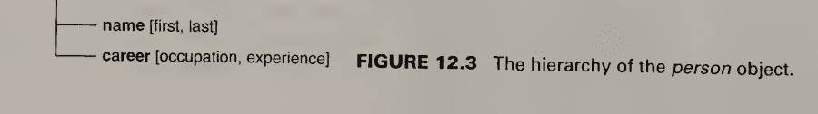

这里`object1`是所有其他对象的父对象。层次结构中较深位置的对象的属性必须通过引用其所有父对象来访问。例如，`object1.object2.object3.property`将访问`object3`的一个属性。类似地，`object1.object5.object6.object7.property`将访问`object7`的一个属性，它是层次结构中最深的对象。

在 JavaScript 编程中，很少（如果有的话）需要构建如此精细的用户自定义对象嵌套。但理解其背后的概念对于后续内容至关重要。

> **注意**

> 有必要总结本节的要点。你需要基本变量来存储信息。有时，将这些基本变量绑定到对象上是可取的。有时，当需要几组不同的基本变量时，有必要将不同的基本变量组绑定成一个对象层次结构。无论如何，层次结构分支的末端都存在包含信息的变量。要访问这些信息，可能需要引用多个对象名称。

## 12.6 浏览器窗口的对象模型

构建一个类似于图 12.2 但使用更大、更复合对象结构的例子可能是适得其反的。但你可能会惊讶地发现，当你将网页加载到浏览器窗口中时，这种结构是自然存在的。窗口是一个对象，它包含的 HTML 文档是一个对象，而组成 HTML 文档的大部分组件也是对象。图 12.5 展示了此环境的部分对象层次结构。完整的对象层次结构非常庞大，因此我们主要关注将在后续课程中使用的对象。

一旦网页加载到浏览器窗口中，这个对象层次结构就会自动创建。`window`对象是该结构的父对象。它具有一些存储窗口信息的基本属性。我们列出了其中两个。`window.closed`基本属性是布尔值，包含值`false`，因为窗口未关闭。`window.location`基本属性包含一个字符串，该字符串是窗口中显示的 HTML 文档的 URL。还有几个绑定到`window`对象的基本变量包含有关窗口的信息，但现在逐一介绍它们并无太大意义。存在包含打开窗口状态信息的变量是很自然的事情。

| 对象/属性 | 基本属性 |
| :--- | :--- |
| window | [closed, location] |
| history | [length] |
| document | [bgColor, fgColor, URL, lastModified, linkColor, vlinkColor] |
| images | [properties] |
| links | [properties] |
| frames | [properties] |
| forms | [properties] |

**图 12.5** 浏览器窗口的部分对象层次结构。

有关浏览器窗口的其他信息被组织到对象中。例如，`window.history`对象将几个包含先前加载到窗口中的文档信息的基本属性绑定在一起。坏消息是，目前 Netscape 和 Explorer 都仅支持`window.history.length`作为`window.history`对象的属性。这个基本属性包含一个数字，对应于先前在窗口中的文档数量。例如，如果你在浏览过程中打开了五个网页，`window.history.length`包含的数字就是 5。

上述`window`属性在实践中并不十分有用，但它们确实说明了各种关于浏览器窗口的信息是如何存储的。我们将重点关注`window.document`对象。加载到浏览器窗口中的文档是一个有形的对象。因此，它具有包含有关文档状态信息的属性。你可以在图 12.5 中看到几个常见的属性。当网页加载时，HTML 标记指令会为大多数这些属性（`bgColor`、`fgColor`、`linkColor`、`vlinkColor`）赋值。其他属性（`URL`、`lastModified`）包含文档来源的 URL 和文档最后修改的日期。

标记到网页中的大多数事物本身就是有形的对象。图像、链接、框架和表单等（仅举几例）都各有其属性。我们没有列出这些属性，因为我们稍后将单独研究其中的大多数对象。此外，许多属性本身又是对象，这将使图 12.5 中的对象图表变得非常大。接下来几课的主要目标是探索`forms`对象，以便我们可以使用 HTML 表单而不是提示框来编写交互式程序。同时，我们提供一些示例，让你更熟悉这个对象层次结构。

> **注意**

> 由于窗口是整个环境的父对象，你不必总是引用`window`对象来访问其属性。当 HTML 文档加载到浏览器窗口时，可以说该窗口就是文档的归属地。该文档中的任何 JavaScript 代码都与该窗口固有地关联在一起。例如，`history.length`足以访问窗口历史记录的长度，而`document.bgColor`足以

要访问窗口所包含网页的背景色，你可以使用窗口引用，但并非必须这样做。

为了进一步强调这一点，假设你打开了两个窗口，比如`window1`和`window2`。那么就需要使用`window1.document.bgColor`来明确你指的是哪个窗口。大多数情况下，我们只处理一个窗口，可以直接引用其属性而无需完整引用`window`对象。在这种情况下不会产生歧义。

## 12.7 使用窗口和文档属性

前面几节包含了许多新概念和术语。它们可能看起来令人困惑，但访问和更改`window`和`document`对象的属性却出奇地简单。第一个示例如图 12.6 所示，简单地检索了一些窗口和文档属性并将它们写入 HTML 文档。结果显示在图 12.7 中。

我们只是指示将各种属性的内容写入网页，以便我们检查其内容。因此你可以看到，通过 JavaScript，我们可以从`document`对象的属性中获取关于文档的各种信息。图 12.6 中的程序就像是文档的部分自传。通过`document.write()`方法，我们强制文档显示关于自身的 vital 信息。（幸好没有`document.secrets`属性！）

`document.bgColor`和`document.fgColor`（文本颜色）属性在 head 和 body 部分都进行了写入，以说明一个问题。在 head 部分，`window`对象的 Boolean 类型`closed`属性包含`false`，正如你所预期的那样。接下来的两行写入了`document.bgColor`和`document.fgColor`属性。由于 BODY 标签的属性指定了网页文本应为蓝色，背景

```
<HTML>
<HEAD>
<TITLE>Document Properties</TITLE>

<SCRIPT LANGUAGE=JavaScript><!--
document.write(closed);
document.write("<BR>"+ document.bgColor);
document.write("<BR>"+document.fgColor);
document.write("<BR>"+document.lastModified);
//--></SCRIPT>

</HEAD>
<BODY TEXT="#0000FF" BGCOLOR="#FFFFCC">
Blue text on a yellow background.<BR>

<SCRIPT LANGUAGE=JavaScript><!--
document.write("<BR>"+ document.bgColor);
document.write("<BR>"+document.fgColor);
//--></SCRIPT>

</BODY>
</HTML>
```


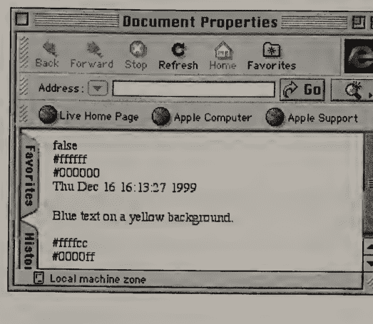

**图 12.7** 图 12.6 中网页的渲染结果。

色应为黄色，那么这两个属性中包含的默认颜色（白色背景和黑色文本）可能令人惊讶。但请记住，HEAD 部分在 BODY 部分之前被读取。在浏览器读取 BODY 标签之前，`document.bgColor`和`document.fgColor`属性仍然包含页面的**默认颜色**。最后，`document.lastModified`属性显示了作者最后更改图 12.6 中 HTML 文件的**日期**。

当`document.bgColor`和`document.fgColor`属性在 BODY 部分被重新写入时，它们已经更新了。它们现在包含的是 BODY 标签中 HTML 属性指定的颜色。这说明了一个重要的概念。HTML 标记指令指定了网页的许多属性。为了支持交互式编程以辅助网页，浏览器创建了如图 12.5 所示的对象结构。在页面加载过程中，浏览器在确定属性值后将其放入对象属性中。到页面完全加载时，对象属性已就位供 JavaScript 访问。但是，在页面完全加载之前，HTML 标记指令指定的某些文档属性尚未设置到位。

> **注意**

>

> 图 12.7 在 Explorer 浏览器中显示了`document.lastModified`属性。在 Netscape 中，此属性不可靠，经常给出一个奇怪的日期。事实上，Macintosh 计算机上的许多 Netscape 浏览器给出的日期是 1929 年 11 月 10 日。（我们假设这个日期恰在 1929 年股市大崩盘期间仅仅是个巧合。）一些 PC 浏览器也给出了奇怪的日期。鉴于此文档属性在不同浏览器之间不一致，我们建议你在网页中不要使用它。**事实上，当你看到一个网页显示其最后更新时间时，作者很可能是手动添加了日期。**

我们使用此属性只是为了引出一个重要问题。**文档对象模型（DOM）**因浏览器而异。`document.lastModified`在 Netscape 中不能一致工作这一事实并不一定是 Netscape 的缺点。Netscape 有几个文档属性在 Explorer 上无法工作。这两种浏览器只是具有不同的 DOM。由于像 JavaScript 这样的客户端编程语言能够以可预测的方式访问和控制文档的属性是理想的，一个世界性联盟已呼吁将 DOM 标准化。我们希望在不远的将来，所有浏览器都能拥有一致的 DOM。

```
<HTML>
<HEAD>
</HEAD>
<BODY>
Thanks for your support.

<SCRIPT LANGUAGE=JavaScript><!--
var x;
var y;

x=prompt("Enter 1 for red or 2 for a black background","");
y=prompt("Enter 1 for yellow or 2 for white text","");

if(x=="1"){
    document.bgColor="#ff0000";
}
else {
    document.bgColor="#000000";
}

if(y=="1"){
    document.fgColor="#ffff00";
}
else {
    document.fgColor="#ffffff";
}
//--></SCRIPT>

</BODY>
</HTML>
```

**图 12.8** 一个让用户设置`document.bgColor`和`document.fgColor`属性的程序。

图 12.6 中的程序说明了浏览器在页面加载过程中动态更新文档的属性。一旦文档被浏览器完全渲染，许多文档的属性就不能再通过 JavaScript 更改了。也就是说，一旦网页完全可见，浏览器将不允许对网页外观的某些方面进行进一步更改。不过，你可以在页面加载时使用 JavaScript 设置某些属性。下一个示例允许用户在页面加载时选择背景和文本颜色。

程序会提示用户是否想要红色或黑色背景，然后提示是否想要黄色或白色文本。程序随后相应地设置颜色。该程序如图 12.8 所示。**我们将脚本放在 body 部分，以便它能覆盖来自 body 标签的任何指令。鼓励读者在网站上尝试这个程序。**

## 12.8 对象方法

在第 12.1 节中，我们提到对象不仅有物理属性来定义其本质，对象的行为也决定其实用性。与编程对象相关的行为称为方法。**方法**是对象可以用来完成各种任务的函数。幸运的是，我们已经使用了好几个方法。我们一直称它们为函数，它们确实是函数。**方法是一种特殊类型的函数，**即属于对象的函数。

我们已经广泛使用了`document.write()`方法。函数`write()`只是附加在`document`对象上的一个函数。它的作用是什么？它将字符串写入 HTML 文档。根据对象表示法，`document.write()`中的句点用法可能会引起混淆。对象的属性存储关于对象的信息。方法是为对象执行任务的函数。因此，对象具有属性和行为。

没有这些行为，对象就不过是一个数据结构，就像图 12.3 中所示的`person`对象。**存储在该数据结构属性中的值定义了对象的状态。** 对象方法的定义使得你可以通过调用方法来改变对象的状态。一个适合改变`person`对象状态的方法可能是`growOlder()`。调用`person.growOlder()`会使该人增加一岁。也就是说，该方法会将`person.age`属性加 1。**定义我们自己的方法超出了本书的范围。** 然而，我们充分利用了现有的 JavaScript 方法，如`document.write()`，这是一个可用于改变`document`对象状态的函数。

## 12.9 window 对象的方法

我们使用过的`window`对象的两个方法是`prompt()`和`alert()`。这些方法的完整引用可以写为`window.prompt()`和`window.alert()`，但根据第 12.6 节末尾的注释，这种完整引用并非必须。这些方法属于`window`对象是有道理的，因为这些方法会使其他窗口出现。这些方法简单地允许父窗口打开辅助窗口，收集信息或发出警警，视情况而定。与术语保持一致，`alert()`是一个**过程方法**，而`prompt()`是一个**值方法**。

`window`对象的另一个有用方法是`confirm()`。该方法接受一个参数，即一个字符串。它的工作方式与`alert()`方法非常相似，你发送给该字符串会作为消息出现在一个新窗口上。这样一个窗口如图 12.9 所示。你可以在图 12.10 中看到使用`confirm()`的语句，该图显示了一个网页


**图 12.9** 由`window`对象的`confirm()`方法创建的窗口。

## 12.10 Math 对象

有一些对象不属于 window-document-etc 对象层级结构。它们只是静静潜伏，等待能够派上用场的时刻。`Math`对象就是其中之一。它有几个有用的属性，包含常见的数学常量。其中两个属性是`Math.E`和`Math.PI`。这里`E=2.718...`是自然对数的底数，`PI=3.14159...`是任何圆的周长与其直径的比值。虽然我们可以像上面那样直接输入十进制数，但这些常量具有 16 位小数的精度。在计算中使用时，必须引用`Math`对象。例如，

```
area=radius*radius*Math.PI;
```

会使`area`包含一个半径存储在变量`radius`中的圆的面积。

本书中我们几乎不需要使用这样的常量，但`Math`对象有几个相当有用的方法。下面我们介绍三个。其余方法以及更多属性列在附录 B 中。这些都是返回方法。

```
x=Math.round(3.14);
y=Math.pow(2,5);
z=Math.random();
```

`Math.round()`接受一个参数，并按常规方式将该数字四舍五入到最接近的整数。因此`x`将包含 3。`Math.pow()`接受两个参数，并返回第一个参数提升到第二个参数指定的幂次方。因此`y`包含 2 的 5 次方，即 32。`Math.random()`不接受参数，返回一个在 0 到 1 范围内的随机数。作者刚刚运行了这个方法，结果使`z`包含了`.5202123682676099`。

## 12.11 总结

### 关键术语

- 对象

- 原始类型

- 文档对象

- 构造函数

- 对象层级

- 方法

- 属性

- window 对象

在最简单的情况下，一个对象名称将一个或多个原始变量绑定在一起。构造函数`Object()`创建一个没有属性的新对象：

```
var house=new Object();
```

要添加原始属性，只需使用点号定义它们。重要的是此时不要重复使用`var`声明。对象已经声明过，只需要属性。

```
house.price=150000;
house.location="1 Elm St.";
```

当然，你也可以使用提示框将用户输入赋值给对象属性。一旦定义，你就可以像使用普通原始变量一样使用对象的属性。通过这种方式，多个相关的原始变量可以绑定到一个对象上。但你必须引用对象名称才能访问其属性。

对象的属性不必是原始类型。你可以将属性创建为新对象：

```
house.kitchen=new Object();
house.garage=new Object();
```

然后可以为复合对象分配属性：

```
house.kitchen.floor="tile"
house.kitchen.cabinets=15;
house.garage.cars=2;
house.garage.heated=true;
```

通过这种方式，可以创建一种数据结构。这样的结构称为**对象层级**。当网页浏览器打开一个窗口并加载网页时，会自动创建一个广泛的对象层级结构。这个层级结构的主要父对象是`window`对象。它有一些包含窗口信息的原始属性，但绑定到`window`对象的大多数属性本身也是对象。我们最关心的是`window.document`对象，它指的是窗口显示的 HTML 文档。由于`window`对象是与该窗口关联的对象的父对象，因此在引用其属性时省略`window`引用不会产生歧义。例如，文档对象可以直接称为`document`对象。

`document`对象有几个包含文档信息的原始属性。当网页加载时，会根据 HTML 标记指令为这些属性赋值。在页面加载过程中，JavaScript 也可以为这些属性赋值。文档有许多本身就是对象的属性。网页组件，如图像和表单，是对象，也是文档的属性。这些对象将在本书后面详细讨论。

在任何给定时间，存储在对象属性中的值反映了该对象的当前状态。为了赋予对象生命力，可以将其与一个函数关联起来。这样的函数称为**方法**。`prompt()`和`alert()`函数实际上是`window`对象的方法，可以通过完整引用来调用，`window.prompt()`和`window.alert()`。此外，`write()`是`document`对象的方法，但必须使用完整引用`document.write()`调用。

不同浏览器在`document`对象拥有的属性方面存在一些差异。由特定浏览器创建的文档对象层级通常被称为文档对象模型（DOM）。我们希望未来所有网页浏览器的 DOM 能够统一。

我们现在可以使用一些新的`window`对象方法。`confirm()`方法接受一个字符串参数，并返回一个与用户决定相对应的布尔值。`open()`方法可以接受多个参数，并使一个新窗口出现。我们还使用了`history`对象的`history.go()`方法。它接受一个参数，一个负整数，并使浏览器将之前访问过的网页加载到窗口中。最后，`Math`对象有一些包含有用常量的属性，以及一些可以执行数学计算的方法。`Math`对象不是任何其他对象的属性，必须始终大写。

## 12.12 复习题

1. 讨论原始变量名称与对象名称之间的根本区别。

2. 参考图 12.4，引用`object6`的一个属性。引用`object8`的一个属性。

3. 想想世界上的一些物理对象，并构建一个类似于图 12.4 的三层对象层级结构。在每个分支的末端列出至少两个原始属性。你的原始属性应包括三种主要原始类型字面量的各一个示例。

4. 在图 12.7 中，存储在相同`Color`属性中的值被写了两次。解释为什么相同的属性会产生两组不同的值。

5. 为什么目前在你的网页中使用`document.lastModified`属性是不可取的？描述为什么未来这可能更可靠。

6. 鉴于`alert()`和`prompt()`是`window`对象的方法，为什么我们可以在不引用`window`对象的情况下调用它们是允许的？

7. 在图 12.8 的程序中，如果用户提供了错误的输入（不是 1 或 2），会发生什么？

8. 编写一个简短的程序，显示`window`对象的`location`属性的内容。将其加载到你的浏览器中。你看到的是什么类型的 URL？为什么？

9. 在第 12.9 节接近尾声处，提供了几个可以作为参数传递给`open()`方法的选项。尝试每一个选项，并找出它们的用途。

10. 在以下代码中找出三个错误：

```
var rock = New Object;
rock = "heavy";
```

11. 在以下代码中找出三个错误：

```
var computer = new Object();
var computer.memory = new Object();
computer.memory.ram = 128;
computer.memory.hardDrive = "10 gig";
computer.memory.hardDrive.full = false;
document.write("You have " + memory.ram + " of random access memory");
```

## 12.13 练习

1. 使用一个具有三个属性的`test`对象重写练习 11.10.1，其中一个属性用于每次测试，另一个用于平均分。

2. 使用一个具有三个属性的`test`对象重写练习 11.10.2，其中一个属性用于每次测试，另一个用于测试平均分；并使用一个具有三个属性的`quiz`对象，其中一个属性用于每次小测，另一个用于小测平均分。使用一个原始值来存储两个平均分中较好的一个以及你可能需要存储的任何其他信息。

3. 编写一个交互式程序，允许用户为网页选择文本颜色、背景颜色和链接颜色。为了获得良好的视觉效果，你需要在网页中放入一些文本和几个链接。

4. 使用`confirm()`方法为用户提供关于加载哪种页面的选项。如果他们选择“确定”，则加载一个简单的无边框表格页面（或框架页面）。否则，加载一个没有表格布局的简单页面。（不要让新窗口出现。）

5. 在网页中放置一个充当链接的图像，也许是一个简单的图标。使用该图像链接让一个新窗口出现。新窗口中显示的页面应包含一条简短消息。提示：锚元素的 HREF 属性不应包含 URL，但可以包含一个 JavaScript 语句，如下所示：`HREF="javascript:statement;"`。这样，点击链接就会执行冒号后面的语句。

6. 使用`confirm()`方法询问用户是否希望在新窗口中查看网页。如果是，则为该页面打开一个新窗口并关闭原始窗口。否则，在原始窗口中显示该页面。只需制作一个带有简短消息的简单页面用于显示。提示：`window`对象有一个`close()`方法，它不接受任何参数，并关闭调用它的窗口。注意：某些浏览器会询问你是否确定要关闭窗口。

7. 使用`confirm()`方法询问用户是否希望返回他们在浏览器窗口中查看的第一个页面。如果是，则使用`history`对象的`length`属性和`go()`方法将他们送回。否则，应加载某个简单页面。（不要让新窗口出现。）

## 12.14 项目线程

你为本课所做的任何练习都应按照第 9.10 节的指南在你的作业页面中引用。

# 第 13 课

## 处理 HTML 表单简介

现在是时候开始使用 HTML 表单来获取用户输入了。如果你回忆一下介绍各种 HTML 表单元素的第 9.1 节，应该清楚 HTML 表单提供了比`prompt()`函数更多样化的获取用户输入的方式。但这种增加的多样性是有代价的。HTML 表单是对象，这增加了一层额外的难度。但是，随着对象概念的牢固建立，这种过渡并不会太困难。不过，重新阅读第 9.1 节，以便对各种表单元素及其用途有清晰的印象，将是一个好主意。在本课中，我们重点关注文本字段、文本区域和通用按钮。

## 13.1 用户事件

回顾第 9.1 节的图 9.1。该图显示了一个加载到浏览器中并等待发生某些事情的 HTML 表单。也就是说，表单正在等待用户以某种方式与表单交互。当用户对某个表单元素进行更改时，就发生了一个**事件**。在该表单中，最重要的特定事件是用户点击“处理订单”按钮。当按钮点击事件发生时，JavaScript 必须立即开始行动以处理表单中的信息。这就是事件驱动编程的概念。当某些用户事件发生时，JavaScript 必须首先检测该事件，然后必须对其采取相应措施。

事件检测是通过**事件处理程序**来完成的。让我们考虑用户点击按钮的事件。由于实际的按钮是用 HTML 创建的，因此检测按钮点击的事件处理程序是 HTML 按钮元素的一个特殊属性，这是合理的。以下按钮被赋予了`onclick`事件处理程序：


```
<FORM>
  <INPUT TYPE=button VALUE="Click Me" onclick="changecolor()">
</FORM>
```

当用户点击按钮时，`onclick`事件处理程序会自动激活。该事件处理程序的值是对名为`changecolor()`的 JavaScript 函数的调用。那么事情是这样发生的。用户点击按钮；`onclick`事件处理程序检测到该事件，并调用函数`changecolor()`。图 13.1 显示了在网页中实现此按钮所使用的 HTML 和 JavaScript。网页上唯一可见的是按钮。当按钮被点击时，网页的背景颜色变为红色。你应该在网站上试一试。


**图 13.1** 此 HTML 文档创建一个按钮。当按钮被点击时，网页的背景颜色变为红色。

你可以看到，事件处理程序调用的函数是在文档的 HEAD 部分定义的。**该函数所做的只是将`document`对象的`bgColor`属性设置为红色**。由于这是我们创建的第一个函数，有必要做一些解释。

我们在前面课程中使用的函数是内置的 JavaScript 函数（实际上是方法，因为它们都与对象相关联）。当你需要执行某些操作时，比如向文档写入`write()`、对字符串进行`parseFloat()`处理，或者提示用户输入`prompt()`，**你会调用这些方法。但现在，我们必须定义自己的函数，以便在事件处理程序激活时调用。根本没有内置函数能处理我们所有的表单处理需求。** 函数定义采用以下一般形式：

```
function name(){
    statement;
    :
    statement;
}
```

函数内部的 JavaScript 语句使其完成其定义的任务。一旦定义，你就可以像调用内置函数一样按名称调用该函数。由于这种自定义函数没有对象关联，因此调用函数不需要对象引用。在我们当前的情况下，我们让`onclick`事件处理程序调用该函数。

因此，总的来说，我们处理用户事件的策略如图 13.2 所示。当按钮被点击时会发生什么？这取决于构成函数的 JavaScript 指令。也许该函数做一些简单的事情，比如改变网页的背景颜色，如图 13.1 所示。但也许该函数包含复杂的指令，就像处理图 9.1 中的比萨表单所需的指令一样。

```
function name(){
    statement;
    .
    .
    statement;
}
```

1) 事件处理程序检测到按钮点击

2) 事件处理程序按名称调用函数

3) 函数导致某些事情发生

```
<FORM>
<INPUT TYPE=button VALUE="Click Here" onclick="name()">
</FORM>
```

**图 13.2** 处理用户事件的策略。

注意

通过点击表单按钮来更改网页的背景颜色与使用提示框更改背景颜色有根本的不同。在图 12.8 的示例中，来自提示框的输入在网页加载时被分配给文档的属性。对于 HTML 表单，页面已完全加载，事件处理程序基本上只是坐在那里等待发生某些事情。在这种情况下，浏览器已经为文档对象的属性分配了“最终”值。

目前，并非所有浏览器都允许在网页完全加载后更改许多此类属性。事实上，`document.bgColor`是唯一一个在页面加载后可以在所有浏览器中更改的有关文档颜色的属性。换句话说，某些浏览器不允许在用户点击按钮时更改文本颜色。如果未来的所有浏览器都更严格地遵循推荐的 DOM，那么像 JavaScript 这样的语言将能够动态更新文档外观的更多方面，这是目前无法做到的。

## 13.2 表单对象

在上一条注释之后，你可能会担心 JavaScript 在页面加载后对文档的控制有限。考虑图 13.3a 所示的 HTML 表单。在图 13.3b 中，我们提供了生成该网页的 HTML 文件。该表单的目的是简单的：用户应在其名字文本字段中输入名字。点击消息按钮后，用户将在表单底部的文本区域中获得一条个性化消息。还提供了一个重置按钮。

好的，那么用户在文本字段中输入名字。该名字必须存储到一个变量中。这是如何实现的呢？嗯，它被存储到一个对象的属性中。你可能会说，是什么对象？要回答这个问题，必须了解 HTML 表单对象的本质。


## 图 13a  一个点击按钮后会生成个性化消息的HTML表单。

```
<HTML>
<HEAD>
<SCRIPT LANGUAGE=JavaScript><!--
function giveMessage(){
 document.messageform.reply.value=document.messageform.fname.value+
 ", have a nice day!";
}
//--></SCRIPT>
</HEAD>
<BODY BCOLOR="#TTIICC">
<FORM NAME=messageform>
 Please enter your first name:
 <INPUT TYPE=text NAME=fname VALUE="" SIZE=10><BR>
 <INPUT TYPE=button NAME=Button VALUE="Click here for a personal
  message." onClick="giveMessage()"><BR>
 <INPUT TYPE=reset VALUE="Reset Form"><BR>
 <TEXTAREA NAME=reply ROWS=3 COLS=27 WRAP=virtual></TEXTAREA>
</FORM>
</BODY>
</HTML>
```

图 13b  包含图 13.3a 所示表单的完整文档。

表单是其所属文档的一个属性。但表单本身也是一个对象。其属性包括构成该表单的表单元素。这些元素同样是对象。最终，表单元素的属性是存储与表单关联的实际数据的原始值。通过 FORM 标签的 NAME 属性提供的表单名称，可以访问表单的属性。类似地，通过各表单元素的 NAME 属性，可以访问特定表单元素的属性。在这个对象层次结构的末端，是存储信息的原始`value`属性。

这一切听起来相当复杂，但当绘制为对象层次结构时，结构就变得清晰了。使用图 13.3b 中提供的名称，该表单的对象层次结构如图 13.4 所示。按钮也是`messageform`的对象属性，但我们在图中没有列出它们。事实上，在图 13.3b 中甚至没有给按钮命名。这样做没有必要，因为我们不打算访问它们的任何属性。按钮的唯一目的是激活事件处理程序。文本字段和文本区域处理所有数据。

## 13.3 在函数中使用局部变量

`document.messageform.fname.value`的值最初由页面加载时文本字段的 HTML 标签的 VALUE 属性设置。它最初是一个空字符串，因为我们希望页面加载时姓名文本字段为空。`document.messageform.reply.value`的值最初由`<TEXTAREA>`...`</TEXTAREA>`容器元素的内容设置。我们也将其初始值留空。

当用户输入姓名时，它被存储到原始值`document.messageform.fname.value`中。我们只需要获取这个值，将一些消息拼接到它上面，并将结果赋给`document.messageform.reply.value`。`onclick`事件处理程序被设置为调用名为`giveMessage()`的函数。在图 13.3b 中，该函数在文档的 HEAD 部分定义。

除了繁琐的对象表示法外，该函数非常简单。它将一条短消息拼接到用户输入的姓名后面，并将整个字符串赋给文本区域。

图 13.5 中的表单包含两个文本字段，用户需要在其中输入两个数字。然后出现两个按钮。点击一个按钮会使两个数字相加，点击另一个按钮则会计算两个数字的乘积。结果显示在文本区域中。首先需要注意的是，每个按钮调用不同的函数。这一点很直接。一个函数将两个数字相加，另一个函数将两个数字相乘。完整的 HTML 文件如图 13.6 所示。


**图 13.6** 用于加法/乘法表单的完整文档。

下面是一个对象图，仅显示了我们需要其值的那些表单元素。

```
document
└── addmult
    ├── num1[value]
    ├── num2[value]
    └── result[value]
```

我们首先关注`add()`函数。来自文本字段的表单值**总是**以字符串形式存储，就像来自提示框的值一样。因此，在相加之前，我们需要将这些值解析为数字。否则它们会被拼接起来。但这并不像看起来那么简单。在之前的课程中，当我们提示输入时，我们将输入放入一个变量，然后将该变量解析为一个数字。没问题。假设我们尝试将第一个文本字段的值解析为数字：

```
document.addmult.num1.value=parseFloat(document.addmult.num1.value);
```

这个语句写得正确，但它并没有按计划工作。数据不仅以字符串形式存储在表单的`value`属性中，而且`value`属性本身也无法持有数字。换句话说，你甚至不能像上面尝试的那样将数字赋给表单的`value`属性。一旦你尝试，计算机就会将其转换回字符串。

另一种方法是将表单中的两个数字存储到函数内部的局部变量中。图 13.6 中`plus()`函数的自顶向下逻辑是：

- 将文本字段的值存储到新变量 (`n1`, `n2`) 中

- 解析`n1`和`n2`

- 将它们的和赋给文本区域的`value`

虽然如果要把表单值解析为数字，变量`n1`和`n2`是绝对必要的，但它们的使用还提供了另一个优势。一旦表单值存储到`n1`和`n2`中，你就可以使用简洁的变量名来操作数据，而不必一次又一次地引用冗长的对象引用。如果图 13.6 中的函数在所有语句中都使用完整的对象引用，可读性就会降低。需要额外几行代码来声明新变量，但没关系。这仍然比在整个函数中使用完整的对象引用要好。

乘法按钮的函数`mult()`与之类似。两个函数的唯一区别是`mult()`的最后一行涉及乘法而不是加法。它们定义的顺序并不重要：我们可以调换函数出现的顺序，表单同样能正常工作。

我们引入了另一个术语“局部变量”，但未作任何解释。因此有必要简要说明一下。术语**局部变量**指的是在函数内部声明的变量，仅用于在该函数内处理信息。在图 13.6 中，每个函数都使用了自己的局部变量。我们正式声明了两次变量`n1`和`n2`，一次在`add()`函数中，一次在`mult()`函数中，这似乎是一个逻辑错误。毕竟，一个变量应该只声明一次。之后，你就可以根据需要自由地存储和检索该变量中的信息。

但是，由于这些局部变量是在函数内部声明的，它们只在函数调用期间存在。让我们梳理一下流程：带有表单的页面被加载。用户在两个文本字段中输入数字并点击`*`按钮。`mult()`函数被调用，局部变量`n1`和`n2`立即生效。它们帮助处理表单数据。当`mult()`函数完成并将两个数字的乘积写入文本区域时，这两个局部变量就从计算机内存中被擦除了。

现在用户点击`+`按钮。`add()`函数被调用，该函数内的局部变量立即生效。一旦函数完成其工作，它们就消失了。用户可以整天持续点击按钮。每次调用某个函数时，该函数内的局部变量只在该函数活跃期间被声明和使用。然后它们就消失了。相比之下，表单元素的值是**全局的**：只要页面加载，它们就一直存在，并且在任何给定时刻，它们都反映表单对象的当前状态。当用户在两次按钮点击之间且没有函数在运行时，局部函数变量根本不存在。

为了进一步强调局部函数变量的有限存在性，我们提供一个简单的例子。表单如图 13.7 所示。我们没有展示整个 HTML 文档，而是提供了该表单的 JavaScript 支持代码。表单的目的从表单本身的文字说明中可以看出。表单的名称是`clickform`

 ```
<HEAD>
<SCRIPT LANGUAGE=JavaScript><!--
var count;
count=0;

function add_one(){
count=count+1;
}

function get_total(){
document.clickform.result.value="You have clicked the button "+count+" times.";
}
//--></SCRIPT>
</HEAD>
```

# 图 13.7 一个用于统计第一个按钮被点击次数的表单。

文本框的名称是`result`。第一个按钮调用的函数名为`add_one()`，第二个按钮调用的函数名为`get_total()`。请注意，`add_one()`函数所做的全部工作就是将`count`变量加一。这个变量的有趣之处在于它并非在函数内部定义，而是定义在两个函数之外。当页面首次加载时，该变量被设置并初始化为 0。每次用户点击第一个按钮时，`add_one()`函数就将`count`的值增加一。最后，当用户点击第二个按钮时，`count`的内容会连同一条消息一起写入文本框。

让我们看看另一种情况。假设我们将`count`定义为`add_one()`函数内的局部变量。当用户点击第一个按钮时，`count`会被声明，初始化为 0，然后递增到 1。函数调用结束后，`count`会从计算机内存中被清除。下次用户再次点击第一个按钮时，同样的情况会发生。变量`count`会短暂地持有值 1，然后再次消失。事实上，用户可以整天不断点击按钮，而`count`每次都只是短暂存在。但这还不是最糟糕的问题。当用户最终点击按钮以获取总点击次数时，`get_total()`函数在尝试写入总点击数时将找不到名为`count`的变量。由于`add_one()`函数此时处于休眠状态，`count`根本就不存在。

当文档加载时，所有全局变量都会被设置并赋值。也就是说，表单的`value`属性以及未在函数中定义的变量会被赋予值。这些变量包含了与文档当前状态相关的信息。函数及其局部变量仅仅是“待命状态”。当发生诸如用户事件之类的情况时，函数才会被调用执行。这个函数调用可以更改像`count`这样的全局变量，或者表单的某个`value`属性。任何局部函数变量，比如图 13.6 中的`n1`和`n2`，只在函数活动期间辅助函数完成其任务，但并不携带关于**文档全局状态**的信息。局部变量在下次函数调用之前一直处于未定义状态，它们只在那个时刻短暂存在，以帮助函数更新文档的状态。

## 13.4 WITH 语句

能够在函数内部声明变量的概念很重要。事实上，我们将在本文剩余部分广泛使用局部函数变量。但 JavaScript 提供了一种在引用复合对象时的“快捷方式”。我们首先使用这种符号重写`add()`函数，然后进行解释。在这个版本的函数中，我们没有使用任何局部变量。相反，**表单属性被直接处理，无需借助临时变量**。

```
function plus(){
  with(document.addmult){
    num1.value=parseFloat(num1.value);
    num2.value=parseFloat(num2.value);
    result.value=num1.value+num2.value;
  }
}
```

你可能可以推断出这个语句是如何工作的。`with`语句指定了一个对象引用，本例中是对 HTML 表单`document.addmult`的引用。指定了这个引用后，你可以直接引用它的属性，本例中就是表单元素。因此，一般来说，`with`语句的形式是

```
with (object) {
  直接引用 object 的属性
}
```

但请注意，这种引用权限仅适用于包含`with`语句主体的花括号`{}`内的语句。同样重要的是要注意，你引用其属性的对象可以是复合的。事实上，就在上面的`plus()`函数中就是这样。

## 13.5 使用 HTML 表格组织表单

当表单元素包含在无边框的 HTML 表格中时，HTML 表单可以显得更有条理。这不需要你学习新的概念。你在第 7 课中就已经用无边框表格组织了整个网页。在好的 HTML 编辑器的帮助下，将你的表单元素放入表格只需要很少的额外工作。

图 13.8 使用无边框 HTML 表格组织的表单元素。

你可以将 FORM 标签放在 TABLE 标签内部

```
<TABLE><FORM>....</FORM></TABLE>
```

或者反过来：

```
<FORM><TABLE>....</TABLE></FORM>
```

无论哪种方式，TABLE 元素都不会干扰你的表单。图 13.5 中加法和乘法表单的表格版本如图 13.8 所示。我们甚至不是说这个版本在美学上更优越。但它确实有助于说明这一点。

## 13.6 文本输入验证

HTML 表单中用户输入的验证实际上与我们在第 11 课中学到的验证技术并无不同。事实上，你可以很容易地为图 13.5 的加法/乘法示例提供验证。你会希望验证用户是否输入了数字。这留作练习。

为了说明 JavaScript 在表单验证中的实用性，我们提供一个表单，用于将用户的姓名、地址和电子邮件地址提交给一个留言板数据库。该表单如图 13.9 所示。它已使用无边框表格进行了组织。

回顾第 9.2 节我们讨论的客户端-服务器模型。任何永久的留言板数据库都需要保存在 Web 服务器上。图 13.9 中 HTML 表单的目的是获取信息，在某种程度上进行验证，然后将其发送到服务器进行永久存储。由于向 Web 服务器提交表单数据的具体细节直到第 18 课才会讨论，我们将只能满足于提供表单数据的验证过程。表单底部的文本区域将简单地回显用户的输入，并表明它已被提交到留言板。

图 13.9 一个获取用户信息并将其提交到服务器端数据库的表单。

我们没有提供表单的 HTML 代码，但你现在应该有这个概念了。不过，我们确实提供了表单的部分对象图，以便你可以轻松地看到表单对象和我们将使用其值的那些元素的引用名称。

```
document
  └─ infoform
       ├─ fullname[value]
       ├─ address[value]
       ├─ email[value]
       └─ display[value]
```

我们希望完成的验证只是确保没有字段被留空。如果一个或多个字段为空，将警告用户。否则，用户将看到信息的摘要以及它已被提交的指示。submit 按钮的`onclick`事件处理程序调用的函数包含以下自顶向下的逻辑：

- 如果（一个或多个字段为空）

    警告用户

- 否则

    在文本区域中总结信息

    （将表单数据提交到服务器）

当然，对于这个示例，我们不会将信息提交到服务器，正如“否则”子句的第二行所示。我们包含那一行只是为了让你充分理解这个示例。该函数的完整代码如下。你应该在网站上试验这个程序。只要至少有一个字段为空，无论用户点击提交按钮多少次，警告都会不断弹出。

```
<HEAD>
<SCRIPT LANGUAGE=JavaScript><!--
function verify(){
  with(document.infoform){
    if((fullname.value=="")||(address.value=="")||(email.value=="")){
      alert("You have left one or more fields blank.  Please supply the necessary information, and  re-submit the form.");
    }
    else {
      display.value="The following information has been added to our\nguestbook:\r" +fullname.value+"\r"+ address.value +"\r" +email.value;
    }
  }
}
//--></SCRIPT>
</HEAD>
```

> **注意** 在将长字符串赋值给`display.value`时，使用了三次奇怪的符号。符号`\r`导致文本区域中的回车换行。你不能使用`<BR>`标签在文本区域中换行。那是一个 HTML 标签，仅用于向 HTML 文档编写 HTML 指令。

文本区域是嵌入在网页中的一个对象。它显示的是字符字符串，而不是 HTML。标记指令在文本区域中是无用的。相反，`\r`返回符号会使字符串返回到下一行。

## 13.7 一个高级示例（可选）

我们用一个更复杂的例子来结束本课，它与用户玩一个猜谜游戏。游戏规则显示在图 13.10 中表单的上方。为了不必显示表单的 HTML 代码，下面提供了一个部分对象图。

```
document
  └ guessform
      ├ guess[value]
      └ status[value]
```

按钮调用的函数名称是`check()`。我们需要着手编写这个函数。手头的第一个任务是生成一个 1 到 10 范围内的随机整数。回想第 12.10 节，`Math.random()`方法返回一个 0 到 1 范围内的随机浮点数。因此，要得到一个 1 到 10 范围内的随机整数需要一点工作。第一个倾向是使用 10 个 "if" 语句。

```
r=Math.random();
if((0<=r)&&(r<.1)){
  num=1;
}
if((.1<=r)&&(r<.2)){
  num=2;
}
⋮
```

那么变量`num`就会包含所需的随机数（即，如果`r`在 [0, .1) 区间内，设`num=1`；如果`r`在 [.1, .2) 区间内，设`num=2`，以此类推）。然而，有一种更为简洁的方法来实现同样的功能。我们首先将`r`乘以 10：

```
r=r*10;
```

得到一个范围在 0 到 10 之间的随机浮点数。然后我们可以使用`Math.round()`来获取相应的整数。但这样做并不完全正确。首先，只有范围在 (9.5, 10) 内的数会四舍五入为 10，而范围在 (8.5, 9.5) 内的数会四舍五入为 9。数字 1 到 8 的获取方式与 9 类似。因此，10 出现的概率会比数字 1 到 9 低。另一个问题是，范围在 (0, .5) 内的数会四舍五入为 0，这不是我们想要的数字之一。为了解决这个问题，我们将`r`乘以 10 再加上 0.5：

```
r=(r*10)+ .5;
```

此时`r`是一个范围在 (.5, 10.5) 内的随机浮点数，这样在我们进行四舍五入后，整数 1 到 10 每个都有同等的出现机会。将所有这些思路整合到一个语句中：

```
r=Math.round((10*Math.random()+.5));
```

使得`r`包含一个范围在 1 到 10 之间的随机整数。

好的，现在我们可以获取随机数了。接下来看看问题的逻辑。我们希望设置函数，使得用户在用完三次猜测机会后无法继续游戏。`check()`函数的一个合适的自顶向下的逻辑如下：

```
function check(){
  if (still_playing)
    total_guesses=total_guesses+1
    if (user wins)
      give winning message
      still_playing=false
    else
      if(total_guesses==3)
        give losing message
        still_playing=false
      else
        tell them how many guesses are left
  else
    alert the user that game is over
}
```

逻辑是这样的。`still_playing`是一个布尔变量。首先要做的判断是：游戏结束了吗？如果`still_playing`为`false`，用户会收到一个警告。这是为了防止游戏结束后用户继续玩。如果`still_playing`为`true`，我们将`total_guesses`加 1。然后要做另一个判断：用户赢了吗？如果是，显示获胜信息并将`still_playing`设为`false`。如果用户没有赢，还需要再做另一个判断：用户输了吗？如果`total_guesses`已经达到 3，显示失败信息并将`still_playing`设为`false`。否则，告诉用户数字不匹配，并说明还剩多少次猜测机会。

如果在这个过程中`still_playing`被设为`false`，任何进一步点击按钮（调用函数）的尝试都会导致显示游戏结束的警告。另一种可能是用户还有剩余猜测机会，`still_playing`在整个过程中保持为`true`。在这种情况下，用户点击按钮（调用函数）进行新的猜测。`total_guesses`变量再次增加 1，然后做出判断。最终，`total_guesses`会达到 3，或者用户猜中正确的数字。

带着这个逻辑，查看图 13.11 中的完整函数。你应该在网站上运行这个程序，以便更好地了解它的工作原理。

这个程序与这节课中大多数先前程序最明显的区别在于，变量实际上是在函数之前声明的。这至关重要。请记住，如果变量在函数中定义，它们会在函数被调用时创建，在函数结束时销毁。玩猜数字游戏通常涉及多次函数调用。在这个程序中，变量的内容必须在函数调用之间保留下来。否则就无法跟踪已经进行的总猜测次数以及游戏是否结束。此外，你当然不希望每次用户猜测时都生成一个新的获胜数字。

在函数外部声明的三个变量在页面加载时就会被设置和初始化。它们存在于全局环境中。每次猜测（函数调用）时，它们会被函数更新。这样，它们就能跟踪游戏的状态。它们根本不可能被定义为函数内部的局部变量。

## 13.8 小结

### 关键术语

- event（事件）

- value property（值属性）

- reset button（重置按钮）

- event handler（事件处理器）

- text area（文本区域）

- local variables（局部变量）

- text field（文本字段）

- button（按钮）

- global variables（全局变量）

当 HTML 表单加载到浏览器中时，它基本上就在那里等待用户事件。这节课中唯一涉及的事件是用户点击表单中的按钮。当发生这样的事件时，`onclick`事件处理器会检测到它并调用 JavaScript 函数。`onclick`事件处理器作为它正在监控的表单按钮的属性给出。它调用的 JavaScript 函数定义在 HTML 文档的 head 部分。

虽然按钮点击可以用来更改文档的背景颜色，但文档对象的其他物理外观属性不能以这种方式更改（至少目前不行），因为当用户点击表单按钮时，网页已经完全加载了。然而，表单元素的值可以在页面完全加载后被访问和更新。

HTML 表单是一个对象，是`document`对象的属性。在给定表单中定义的表单元素也是对象，是该表单的属性。最后，表单元素的值是原始值。对于文本字段和文本区域，这些值包含出现在该表单元素中的文本。信息不仅以字符串形式存储在表单的`value`属性中，而且你甚至不能将`value`属性更改为数字格式。`Value`属性根本无法存储数字。当你必须从表单中获取数值数据时（例如，以免加法与字符串连接混淆），你可以在函数中创建局部变量来临时存储数据。变量可以在函数内部照常声明和使用。然而，局部变量只在函数调用期间存在，以帮助函数完成其工作。

对于文本字段，其`value`属性的初始内容是由定义该字段的 INPUT 标签的 VALUE 属性设置的。但对于文本区域，其`value`属性的初始内容是由`<TEXTAREA>`...`</TEXTAREA>`容器元素的内容设置的。要在 JavaScript 中引用这些`value`属性，你必须提供完整的对象引用。这个引用的形式为：

```
document.formname.elementname.value

```

名称由表单和表单元素的 NAME 属性设置。

> **注意** 这里有很多内容。让我们理清思路。在 HTML 方面，你定义表单、表单的名称、表单元素的名称以及表单元素的初始值。事件处理器也是作为 HTML 的一部分定义的。在 JavaScript 方面，你定义事件处理器调用的函数，访问所需的表单元素值，并可以提供输出作为表单元素的值。

如果 HTML 表单中有多个按钮，它们的事件处理器可以调用不同的函数来执行不同的任务。如果使用多个函数，它们必须分别定义并具有不同的名称。然而，它们在 HEAD 部分出现的顺序并不重要。

避免使用完整对象引用的一个好方法是使用`with`语句。你在`with`语句中指定所需的对象引用，然后就可以直接访问对象属性。在处理 HTML 表单时，指定引用`document.formname`很方便。然后你可以在`with`语句的主体中直接引用表单元素。注意，你仍然需要引用表单元素的名称才能访问其`value`属性。

表单输入的验证与我们第 11 课中学到的验证技术类似。当按钮被点击时，函数检查表单数据的有效性。但在表单的情况下，你不需要重新提示输入。如果输入有缺陷，会警告用户并简单地返回到表单让用户重试。

## 13.9 复习题

1. 描述点击表单按钮时发生的事情顺序。

2. 重置按钮会导致表单重置，但它没有事件处理器。推测一下它是如何工作的。（这节课没有涉及这个问题。参见附录 D 中的答案。）

3. 如果你尝试让表单按钮更改`document.fgColor`属性，会发生什么？

4. 为什么在图 13.3 的表单中我们没有解析表单值，但在图 13.5 的表单中却这么做了？

5. 当表单中有两个不同的按钮要完成两个不同的任务时，事件处理是如何工作的？

6. 假设用户在表单的文本字段中输入了一个数字。以下语句会导致什么类型的字面量存储在该文本字段的`value`属性中？为什么？

7. 对于图 13.7 的表单，为什么`count`变量不在`add_one()`函数内声明？讨论一下如果这样做会发生什么。

8. 找出以下代码中的三个错误（假设文档的其余部分存在）：

```
document.formname.fieldname.value=
parseFloat (document.formname.
fieldname.value);
```

 272 第13课 处理HTML表单入门

```
function process(){
  with(document.formname){
    elementname.value=3;
  }
}
<INPUT TYPE=button NAME=Button
  VALUE="CLICK ME" onclick=process>
```

## 13.10 练习

- 1. 制作一个包含五个按钮的表单。每个按钮应使网页背景变为不同的颜色。

2. 制作图13.1中背景颜色程序的改进版本，使得按钮第二次被点击时，背景变回原来的颜色。后续的按钮点击使背景在两种颜色之间来回切换。

3. 制作一个表单，要求用户在文本字段中输入十六进制颜色，然后点击按钮。当按钮被点击时，背景变为该颜色。

4. 制作图13.3中表单的改进版本，如果文本字段为空或包含数字而非姓名，则向用户发出警告。

5. 制作图13.3中表单的改进版本，包含三个按钮。一个给出正面评论，一个给出中性评论，另一个给出冒犯性评论。

6. 为图13.5中的加法/乘法表单添加功能，使每种情况下都显示完整的消息。例如："1和1的和是2。"或"3和4的积是12。" 可选：验证用户输入的是否为数字。

7. 制作图13.5中加法/乘法表单的改进版本，包含减法和除法。如果点击除法，程序应验证除数不为0。可选：同时验证用户是否已在两个字段中输入了数字。

8. 制作图13.7中按钮点击程序的改进版本，包含三个不同的"点我"按钮。应有三个文本字段，分别显示每个按钮的点击次数。此外，表单不设显示总点击次数的按钮，而是每次点击任何一个"点我"按钮时，相应的文本字段立即更新。

9. 占卜程序：制作一个程序，要求用户输入姓名。用户点击按钮后获得七种 fortune 之一（此程序中除重置按钮外只有一个按钮）。例如："Raul，我看到你未来有伟大的事情。"每次点击按钮时，随机选择一条新消息。提示：如果你没有阅读第13.7节，可以在那里了解如何恰当地生成随机数。

- 注意：练习10–13是对图13.11中猜数字游戏的改进。

10. 验证用户的猜测。首先检查是否输入了适当范围内的数字（例如，不允许猜测11）。然后将用户的猜测四舍五入以去除小数位（例如，不允许猜测5.5）。

11. 添加两个小型文本字段，分别用于前两次猜测。第一次猜测后，该猜测出现在其中一个字段中。第二次猜测后，该猜测出现在第二个文本字段中。这样用户可以跟踪之前的猜测。可选：如果用户输入了之前的猜测之一，则发出警告。

12. 修改程序，使其有15个可能的数字，用户获得四次猜测机会。

13. 修改程序，使其有25个可能的数字，用户获得五次猜测机会。应另有一个文本字段。每次猜测后，用户会被告知猜测是热（相差3以内）、较热（相差5以内）、温（相差7以内）还是冷。

## 13.11 项目线索

本课的任何练习都应按第9.10节的指导原则，在你的作业页面中引用。

# 第14课

## HTML表单中的选项

有了文本字段和文本区域，你可以使用表单来获取用户的文本输入。然而，复选框、单选按钮和下拉菜单为用户提供了在表单中进行选择的功能。建议你回顾一下第9.1节，重新熟悉这三种表单元素的基本特性。处理它们的策略是相同的：当用户点击按钮时，事件处理程序调用JavaScript函数，该函数处理来自表单的信息。

与往常一样，重要的是访问网站并体验本课示例程序的交互性。随着示例交互性的增加，如果不亲自测试所有可能的输入情况，就更难全面了解程序了。

## 14.1 复选框

复选框与文本输入字段的根本区别在于，它提供开/关功能，而不是接受各种用户输入。这种开/关功能暗示了一个布尔变量，实际上，复选框就是这样工作的。**复选框**对象具有一个布尔属性。如果复选框被选中，该属性包含`true`，否则包含`false`。该属性 aptly 命名为`checked`。通过完整的对象引用，使用以下方式访问该属性：

`document.formname.checkboxname.checked`

根据复选框的状态，该值为`true`或`false`。

要感受这一点，最好通过一个示例进行。图14.1中的表单模拟了一个在线购物车。每次点击更新购物车按钮时，都会显示所选项的摘要。图14.2包含文档的代码。仅提供了HTML表单和JavaScript函数的代码。文档的其余部分已省略以节省空间。

"更新购物车"按钮调用的函数值得解释。我们使用了`with`语句来简化对象引用，但这是老套路了。之后，函数的自上而下的逻辑如下：

274 第14课 HTML表单中的选项


**图14.1** 带有复选框的宠物商店购物车。

```
<SCRIPT LANGUAGE=JavaScript><!--
function update(){
	with (document.storeform){
		var contents;
		contents="";
		if (item1.checked==true){
			contents=contents+"Cat Food\r";
		}
		if (item2.checked==true){
			contents=contents+"Rat Food\r";
		}
		if (item3.checked==true){
			contents=contents+"Bat Food\r";
		}
		if (contents==""){
			contents="Your cart is empty.";
		}
		display.value=contents;
	}
}
//--></SCRIPT>

<FORM name=storeform>
	<INPUT TYPE=checkbox NAME=item1>
	<INPUT TYPE=checkbox NAME=item2>
	<INPUT TYPE=checkbox NAME=item3>
	<INPUT TYPE=button VALUE="Update Cart" onclick="update()">
	<INPUT TYPE=reset VALUE="Clear Cart">
	<TEXTAREA NAME=display ROWS=4 COLS=18 WRAP=virtual>Happy Shopping!</TEXTAREA>
</FORM>
```

**图14.2** 图14.1中表单的核心代码。

- 声明`contents`并从空购物车开始（`contents=""`）

- 如果（`item1`被选中）

    - 将猫粮添加到`contents`

- 如果（`item2`被选中）

    - 将鼠粮添加到`contents`

- 如果（`item3`被选中）

    - 将蝙蝠粮添加到`contents`

- 如果（购物车仍为空）

    - 将合适的消息赋给`contents`

- 将`contents`赋给文本区域

该函数的逻辑非常清晰。从一个空字符串变量开始，然后测试每个复选框。如果被选中了，就将该商品追加到`contents`变量中。如果没有选择任何商品，`contents`保持为空，并将此情况的消息赋给`contents`。之后，将`contents`赋给显示区域。

如果某个框被选中，`contents`变量必须更新，而不是简单地重新赋值，这一点至关重要。例如，如果`item2`的"if"语句只包含

```
contents="Rat Food";
```

如果执行该语句，变量的先前内容将被删除。因此，如果同时选择了猫粮和鼠粮，字符串`"Rat Food"`将实际替换`"Cat Food"`，购物车显示中将不再提及猫粮。在保留`contents`先前信息的同时增加内容的赋值形式为

```
contents=contents+"Rat Food\r";
```

其中回车符将使后续添加到购物车的内容从新的一行开始。

值得注意的是，`contents`变量是局部函数变量。由于每次更新购物车时都会重新评估整个购物车显示，`contents`的值不必在函数调用后保留。其值最终存储为显示的值，并作为表单当前状态的一部分被保留。当再次调用该函数时，`contents`被重新创建以帮助统计当前复选框的选择，其遗留内容留在显示区域中。

> **注意** 有一个HTML属性可以使复选框在页面首次加载时被选中。该属性简单地命名为CHECKED。该属性不取值。如果将其包含在复选框的定义中

>

> `<INPUT TYPE=checkbox NAME=item CHECKED>`

>

> 复选框初始状态为选中。此外，它仍然可以像往常一样取消选中。我们即将讨论的**单选按钮**也使用此属性。

276 第14课 HTML表单中的选项

## 14.2 使用隐藏值处理复选框

当然，上一节的购物车示例还有不少可以改进的地方。首先，它没有提及商品的价格。其次，应该给出一个反映所选商品总价的总和。最后，包含一个用户所选商品数量的计数也没有坏处。

为了处理商品价格，我们使用复选框的`value`属性。现在，我们使用过的文本区域、文本字段和按钮的`value`属性包含的信息在网页对象上是物理标记的。例如，复选框上显然没有空间标记“点击我”。这就使得`value`属性可以自由地携带关于复选框的隐藏信息。

为了说明这一点，我们提供上述购物车的改进版本。由于我们将使用相同的表单，您可以参考图14.1。就表单的 HTML 代码而言，唯一的区别是为包含商品价格的复选框添加了 VALUE 属性。新的输入按钮代码如下：

```
<INPUT TYPE=checkbox NAME=item1 VALUE=15>
<INPUT TYPE=checkbox NAME=item2 VALUE=12>
<INPUT TYPE=checkbox NAME=item3 VALUE=17>
```

为了强调每个复选框对象的两个原始属性将被使用，图14.3给出了表单的对象图。图14.4显示了改进购物车的 JavaScript 函数。


**图14.3** 改进购物车的对象图。列出了每个复选框的两个属性。

除了计算总价和所选商品总数之外，唯一的实质性区别在于需要局部变量来存储复选框中的隐藏值。由于这些值需要相加，而 HTML 表单的`value`属性无法包含数字，因此我们在解析这些值之前将它们存储到局部变量中。该函数的自顶向下逻辑如下：

- 声明变量 (`contents`, `total_price`, `total_items`, `i1`, `i2`, `i3`;)

- 初始化计数器 (`contents=""`, `total_price=0`, `total_items=0`)

- 将（并解析）复选框的值传输到`i1`, `i2`, 和`i3`

- 如果 (`item1` 被选中)

  - 将`item1`及其价格添加到购物车

  - 将价格加到总价中

  - 将商品计数器加 1

- 对其他两个商品执行相同的过程

- 将结果赋值给显示区域

```
<SCRIPT LANGUAGE=JavaScript><!--
function update(){
    with (document.storeform){
        var contents, total_price, total_items, i1, i2, i3;

        contents="";
        total_price=0;
        total_items=0;

        i1=parseFloat(item1.value);
        i2=parseFloat(item2.value);
        i3=parseFloat(item3.value);

        if (item1.checked){
            contents="item1: $"+i1+"\r";
            total_price=total_price+i1;
            total_items=total_items+1;
        }
        if (item2.checked){
            contents=contents+"item2: $"+i2+"\r";
            total_price=total_price+i2;
            total_items=total_items+1;
        }
        if (item3.checked){
            contents=contents+"item3: $"+i3+"\r";
            total_price=total_price+i3;
            total_items=total_items+1;
        }

        display.value="Number of Items selected: "+ total_items +
            "\r"+ contents + "____________________\rTOTAL BILL: $" + total_price;
    }
}
//--></SCRIPT>
```

**图14.4** 改进购物车的 JavaScript 函数。

该函数有两个值得注意的方面。首先，“if”语句测试 (`item.checked`) 的真值。第一个购物车示例测试 (`item.checked==true`) 的真值。这两种方法是等价的。我们两种方式都做了，以示对比。其次，结果以相当复杂的方式存储在显示窗口的`value`中。一个典型的购物车显示如下所示。您应该检查显示赋值并理解其工作原理。


> 您在网上找到的真实购物车表单都有“结账”按钮。虽然 JavaScript 提供了一种在客户端更新购物车的便捷方式，但实际处理订单需要将购物结果发送到 Web 服务器。这通常是结账按钮的功能。这可能相当于简单地将购物结果写入一个数据文件以便稍后打印出来。然而，它也可能涉及 Web 服务器上更复杂的处理。

## 14.3 单选按钮与`elements[]`数组

在第9.1节中，我们指出单选按钮的工作原理基本上与复选框相同，但提供了一个额外的功能：可以配置一组单选按钮，使得它们中只能有一个被选中。例如，图14.5显示了一组三个单选按钮，配置方式使得在给定时间只能选中其中一个。

您可以看到，这三个单选按钮都具有相同的名称，`card`。在这种情况下，计算机根本不会允许选中超过一个。例如，如果您在图14.5中选择 Discover 按钮，计算机会自动使 Visa 按钮取消选中。但是，如果这些按钮被赋予不同的名称，它们的工作方式将与复选框相同。


```
<FORM name=payform>
    Choose payment type:<BR>
    Visa <INPUT TYPE=radio NAME=card>
    Discover <INPUT TYPE=radio NAME=card>
    Master Card <INPUT TYPE=radio NAME=card>
</FORM>
```

**图14.5** 当一组单选按钮具有相同的名称时，在给定时间内只能选中其中一个。

那么，我们如何确定哪个单选按钮被选中了呢？当所有三个按钮共享相同的名称时，引用

```
document.payform.card.checked
```

是模糊的。使用单选元素的名称进行引用不再能唯一访问每个单选按钮的`checked`属性。因此，就使用 JavaScript 确定哪个按钮被选中而言，这些按钮已经失去了它们的身份。

幸运的是，DOM 提供了一种替代方式来引用 HTML 表单元素。这是通过使用数组来实现的。**数组**是一个索引一组变量的对象，这些变量可以是原始值或对象。作为一个对象，数组必须用于将一组变量绑定在一起，就像我们在第12课中学到的那样。但正是数组的索引能力使其区别于普通对象。

假设一组变量具有某种内在的顺序。例如，假设要将四个数字存储在一系列变量中，并且这些变量要作为一个对象绑定在一起。将对象定义如下将是自然的：

```
var numbers=new Object();
numbers.num1=3.14;
numbers.num2=10.1;
numbers.num3=4.33;
numbers.num4=7.45;
```

该对象只是将四个变量绑定在一起。对象属性的编号用于索引它们。该对象更简洁的索引方案是直接使用数字作为属性：

```
numbers.1=3.14;
numbers.2=10.1;
numbers.3=4.33;
numbers.4=7.45;
```

但数字不是合法的变量名，因此上述方法不可行。然而，数组对象有一种内置的方式来索引变量。使用数组的内置索引能力，我们重新定义上述对象：

```
var numbers=new Array();
numbers[1]=3.14;
numbers[2]=10.1;
numbers[3]=4.33;
numbers[4]=7.45;
```

使用构造函数`Array()`，`numbers[]`被声明为一个数组而不是一个通用对象。然后，`numbers[]`数组的属性被赋予不同的索引值。`[]`括号中的值称为**索引**。数组`numbers`是一个属性被索引的对象。

回到当前的情况。我们有一组表单元素需要引用。幸运的是，当表单加载到浏览器中时，会自动创建一个`elements[]`数组来索引该表单中的元素。换句话说，您不必像我们上面定义`numbers[]`数组那样定义这个数组。元素按照它们在表单中定义的顺序被`elements[]`数组索引。因此，我们无需按名称引用表单元素，而是使用`elements`数组。

表单元素的索引从0开始，与上面从1开始索引的示例不同。图14.6显示了文档对象和该文档中表单的部分层次结构。`elements[]`数组索引的是对象（即表单的所有元素），而不是像上面`numbers`数组那样的原始值。

因此，要访问第一个表单元素的`value`属性，您提供引用

```
document.formname.elements[0].value
```


**图14.6** 表单的对象层次结构。使用`elements[]`数组而不是元素名称来引用表单的元素。

就是这么简单。回到图14.5的形式，要查看第三个复选框是否被选中，语句

```
if(document.payform.elements[2].checked){
    do something...
}
```

在未使用其名称的情况下引用了万事达卡按钮。

## 注意

我们使用单选按钮作为`elements[]`数组的引入需求。然而，该数组索引的是表单中的**所有**元素，而不仅仅是单选按钮。因此，实际上，你可以无需使用名称来引用任何表单元素的属性。你甚至可以使用`with`语句：

    with(document.formname){

        refer directly to `elements[]` array

    }

也许最难适应的部分是从0开始索引元素，而不是从1开始。但随着时间的推移，你会习惯的。

## 14.4 使用单选按钮和`elements[]`数组

为了让您看到`elements[]`数组的实际应用，我们提供了一个宠物商店在线购物车的另一个版本。图14.7显示了一个包含六个单选按钮的表单。该表单使用无边框HTML表格进行了格式化，但我们只提供了表单本身的基本代码。

在概念上，本示例与本课程之前的示例没有区别，除了单选按钮的分组功能和`elements[]`数组的需要。以下是表单的工作原理。你可以选择猫粮、鼠粮或两者兼选。这些单选按钮的功能与复选框无异。然而，每种食物的两个选项是分组的。也就是说，干/湿选项中只能选一个，颗粒/碎末选项中也只能选一个。如果用户选择了其中一种食物（猫或鼠），但未能选择该食物的选项，程序将默认为更昂贵的选项（对商家有利）。这在图14.7的购物车中存在碎末鼠粮时得到证明，即使该选项并未被选中。

为了设置使得只能选择一个猫粮选项，猫粮的两个选项都被赋予了名称`c`。同样，鼠粮的两个选项都被赋予了名称`r`。由于在本示例中我们将只使用`elements[]`数组，其他单选按钮的名称无关紧要，只要名称不与这两个组中的任何一个匹配即可。

表单中有九个不同的元素，因此会自动创建一个`elements[]`数组，索引值从0到8。下面的对象图仅显示了我们将使用其属性的那些表单元素。对于六个单选按钮，我们将只使用`checked`属性。我们可以为单选按钮使用隐藏值，但我们将其留作练习。你可以看到，当我们跳过“更新购物车”和“清除表单”按钮时，`elements[]`数组的索引从5跳到了8。当然，数组中的6和7位置是存在的，但由于我们不需要使用这些元素的任何属性，因此我们在对象图中省略了它们。

```
document
  └ storeform
    ├ elements[0][checked]　(cat food)
    ├ elements[1][checked]　(dry)
    ├ elements[2][checked]　(moist)
    ├ elements[3][checked]　(rat food)
    ├ elements[4][checked]　(pellets)
    ├ elements[5][checked]　(ground)
    └ elements[8][value]　(text area)
```


```
<FORM name=storeform>
Cat Food <INPUT TYPE=radio NAME=cat> $15 ---------->
         <INPUT TYPE=radio NAME=c> Dry
         <INPUT TYPE=radio NAME=c> Moist ($3 extra)
Rat Food <INPUT TYPE=radio NAME=rat> $12 ---------->
         <INPUT TYPE=radio NAME=r> Pellets
         <INPUT TYPE=radio NAME=r> Ground Up ($5 extra)
         <INPUT TYPE=button VALUE="Update Cart" onclick="update()">
         <INPUT TYPE=reset VALUE="Clear Form">
         <TEXTAREA ROWS=6 COLS=40 WRAP=virtual></TEXTAREA>
</FORM>
```

**图14.7** 一个使用单选按钮对选项进行分组的表单，使得组内只能选择一个。

```
<SCRIPT LANGUAGE=JavaScript><!--
function update(){
    with(document.storeform){
        var total;
        var contents;

        total=0;
        contents="";
        if(elements[0].checked){
            total=total+15;
            contents=contents+"Cat Food: $15 ";
            if(elements[1].checked){
                contents=contents+"(Dry)\r"
            }
            else{
                total=total+3;
                contents=contents+"(Moist, Add $3)\r";
            }
        }
        if(elements[3].checked){
            total=total+12;
            contents=contents+"Rat Food: $12 ";
            if(elements[4].checked){
                contents=contents+"(Pellets)\r";
            }
            else{
                total=total+3;
                contents=contents+"(Ground Up, Add $3)\r";
            }
        }
        elements[8].value= contents +"________________\rTOTAL: $"+total;
    }
}
//--></SCRIPT>
```

## 图14.8 图14.7表单对应的函数。

我们使用变量`total`和`contents`来处理购物车的总价和内容。函数的其余部分很直接。自上而下的逻辑如下所示，函数的代码见图14.8。本示例逻辑与本课程之前示例之间唯一显著的区别是使用了嵌套的“if”语句。例如，如果未选择猫粮，则永远不会进行关于猫粮类型的决策。

- 声明局部变量（`total`, `contents`）

- 如果(`catfood`被选中)

    - 将15加到`total`

    - 更新购物车内容

    - 如果(`dry`被选中)

        - 更新内容

    - 否则

        - 更新内容和总计（给他们湿粮）

- 对鼠粮进行类似的决策过程

- 将结果显示赋值给购物车显示

## 14.5 下拉菜单

在我们使用的所有其他表单对象中，它们的属性都是原始类型。`Value`属性是字符串，`checked`属性是布尔值。然而，下拉菜单是一个更复杂的对象。图14.9显示了一个包含五个选项的下拉菜单。用户从下拉菜单中选择一种颜色并点击按钮，网页的背景颜色将相应改变。我们稍后会介绍背后的函数。目前，我们专注于菜单对象本身。


```
<FORM name=colorform>
  <SELECT NAME=colormenu>
    <OPTION VALUE="#777777">flint
    <OPTION VALUE="#7465DC">violet dusk
    <OPTION VALUE="#2F8E20">clover
    <OPTION VALUE="#DA456B">carnation
    <OPTION VALUE="#F1CCCC">subtle pink
  </SELECT>
  <INPUT TYPE=button VALUE="Update Color" onclick="change()">
</FORM>
```

菜单对象有一个属性，该属性本身也是一个对象。`options[]`数组是菜单对象的一个属性，用于索引菜单的所有选项。与`elements[]`数组类似，`options[]`数组从索引0开始索引菜单的所有选项。图14.10给出了图14.9表单的完整对象层次结构。虽然我们不需要访问按钮的任何属性，但我们已将按钮包含在对象图中。由于按钮没有名称，我们将其称为`elements[1]`，因为它是第二个表单元素。然而，由于我们给菜单起了名称`colormenu`，我们通过名称而不是`elements[0]`来引用它。

从图中需要注意的第一点是，即使菜单有多个选项，它仍然只算作一个表单元素。因此，按钮是第二个表单元素，`elements[1]`。`options[]`数组将菜单的选项索引为菜单对象本身的属性，而不是表单的属性。每个菜单选项有两个我们将使用的属性。


```
document
  └─ colorform
       ├─ colormenu [selectedindex]
       │    ├─ options [0] [value, text]
       │    ├─ options [1] [value, text]
       │    ├─ options [2] [value, text]
       │    ├─ options [3] [value, text]
       │    └─ options [4] [value, text]
       └─ elements [1] (the button)
```

## 第 14 课 HTML 表单中的选项

每个选项的`value`属性都携带着隐藏信息。例如，

```
document.colorform.colormenu.options[2].value
```

包含字符串`"#2F8B20"`，这是一种十六进制的颜色表示法。`text`属性包含实际显示在菜单上的文本。因此

```
document.colorform.colormenu.options[2].text
```

包含字符串`"clover"`。

除了其`options[]`数组属性之外，菜单还有一个原始属性`selectedIndex`。（Index 中的 I 为大写。）该属性包含当前所选选项的索引，用于确定用户选择的选项。在图 14.9 中，第一个菜单项被选中，因此

```
document.colorform.colormenu.selectedIndex
```

包含 0。如果用户要在菜单上选择`"carnation"`，则`selectedIndex`属性的值会自动更改为 3；`options[]`数组中当前被选中的位置就是`selectedIndex`的值。

考虑到这一点，利用用户菜单选择的策略如下：

- 确定当前所选选项的索引

- 访问菜单`options[]`数组中相应的位置

因此，访问与用户选择相对应的十六进制颜色的合适代码为

```
var i;
var color;

i=document.colorform.colormenu.selectedIndex;
color=document.colorform.colormenu.options[i].value
```

这使得变量`color`包含当前所选选项的值。考虑到这段代码，我们可以将上述策略优化为：

- 将所选索引存储在变量`i`中

- 使用`options[]`数组中第`i`个位置的属性

利用这一策略将所选背景色赋给文档的`bgColor`属性，支持图 14.9 中表单的函数如图 14.11 所示。我们没有像上述代码那样使用`color`变量，而是直接将所选颜色赋给了`document.bgColor`。

同样的取色程序也可以使用五个具有相同名称的单选按钮来编写，这样其中只有一个可以被选中。但这将使函数包含大量代码。你必须包含一个 "if" 语句来检查每个单选按钮是否被选中。那是五个 "if" 语句。

```
<SCRIPT LANGUAGE=JavaScript><!--
function change(){
    var i=document.colorform.colormenu.selectedIndex;
    document.bgColor=document.colorform.colormenu.options[i].value;
}
//--></SCRIPT>
```

**图 14.11** 为图 14.9 中的表单设置页面背景的函数。

一般来说，下拉菜单就像一组具有相同名称的单选按钮一样工作。无论哪种方式，都有一个选项列表，用户只能选择一个。但下拉菜单有两个显著的优势。首先，你可以包含一个庞大的选项列表，而在网页上占用的空间非常小，因为在打开菜单之前只有一个菜单项可见。其次，`selectedIndex`属性准确地告诉你选择了哪个选项。而使用一堆单选按钮，你必须逐个检查。

为了结束本节，我们给出一个使用两个下拉菜单的示例。表单如图 14.12 所示。第一个菜单中选项的值对应于汽车的基础价格，第二个菜单中选项的值对应于各州的销售税百分比。（税率和汽车价格不一定准确。）

现在来看函数。当按钮被点击时，我们必须确定每个菜单当前所选中的索引。为此，我们使用两个变量`i`和`j`。我们还定义了四个额外的局部变量`baseprice`、`taxrate`、`tax`和`total`，以辅助计算。

```
<FORM name=carform>
  <SELECT NAME=car>
    <OPTION VALUE=23000>Camry
    <OPTION VALUE=20000>Concord
    <OPTION VALUE=30000>Rivera
    <OPTION VALUE=22000>Camaro
  </SELECT>
  <SELECT NAME=state>
    <OPTION VALUE=".065">Illinois
    <OPTION VALUE=".055">Indiana
    <OPTION VALUE=".05">Wisconsin
  </SELECT>
  <INPUT TYPE=button VALUE="Calculate total price" onclick="calc()">
  <TEXTAREA NAME=display ROWS=5 COLS=45 WRAP=virtual></TEXTAREA>
</FORM>
```

**图 14.12** 带有两个下拉菜单的表单。

```
<SCRIPT LANGUAGE=JavaScript><!--
function calc(){
    with (document.carform){
        var i,j,baseprice,taxrate,tax,total;

        i=car.selectedIndex;
        j=state.selectedIndex;

        baseprice=parseFloat(car.options[i].value);
        taxrate=parseFloat(state.options[j].value);
        tax=baseprice*taxrate;
        total=baseprice+tax;

        display.value="A "+car.options[i].text+" bought in the state of "
        +state.options[j].text+" has totals as follows:\r Price:$"
        +baseprice+"\r Tax: $"+tax+"\r Total: $"+total;
    }
}
// --></SCRIPT>
```

为什么每个`parseFloat`里都有 2 个`var`？

该函数的自上而下的逻辑如下。实际函数如图 14.13 所示。

- 声明局部变量（`i`、`j`、`baseprice`、`taxrate`、`tax`、`total`）

- 在`i`和`j`中存储所选选项的索引

- 存储（并解析）汽车价格和税率（`baseprice`、`taxrate`）

- 计算税额（`tax = baseprice * taxrate`）

- 计算总价（`total = baseprice + tax`）

- 将结果显示结果分配给显示区域

编写代码时必须注意的主要问题是，有两个不同的`options[]`数组，一个用于汽车菜单，一个用于州菜单。所选索引`i`仅包含汽车菜单的所选索引，所选索引`j`仅包含州菜单的所选索引。它们不可互换。

**图 14.13** 处理图 14.12 表单的函数。

## 14.6 ONCHANGE 事件处理器

还有另一个事件处理器，与下拉菜单结合使用非常有用。`onchange`可以放在创建下拉菜单的 SELECT 元素中作为其属性。这个事件处理器检测用户对菜单选择的更改，并可以调用 JavaScript 函数，就像`onclick`一样。例如，图 14.9 中的颜色更改表单根本不需要按钮，如果更改菜单就能调用该函数。你只需在菜单的开始标签中放置`onchange`：

```
<SELECT NAME=colormenu onchange="change()">
```

然后你可以完全删除该按钮。或者，如果你愿意，也可以保留该按钮。两个不同的事件处理器调用同一个函数是可以的。在给定的瞬间，只能激活其中一个事件处理器。你必须在屏幕上有两个不同的鼠标光标，才能同时导致菜单更改和点击按钮。

该表单的无按钮版本可在网站上供你体验。图 14.12 中汽车表单的无按钮版本也可在网站上找到。每个菜单都有一个调用`calc()`函数的`onchange`事件处理器。

> 在某些浏览器中，`onchange`事件处理器也适用于复选框和单选按钮。但特别需要注意的是，在某些 Netscape 版本中，它不能与复选框和单选按钮一起工作。没有必要因此避免使用它，但你不会想取消该按钮。在浏览器无法识别它的情况下，用户仍然可以像往常一样点击按钮。

## 14.7 用户选择的验证

选择验证涉及的问题不像文本输入验证那么多。对于文本输入，你可能希望检查用户是否确实输入了内容、输入了数字，或者输入了正确范围内的数字，等等。对于一组复选框或单选选项，你可能只需检查确保用户做出了选择。也就是说，如果一组选项全都未选中，你可能希望提醒用户做出某种选择。

这种验证的逻辑如下

```
if((first is not checked) && (second is not checked) && ... && (last is not checked))

    alert the user

else

    process the form
```

因此，如果没有任何一项被选中，用户会收到一个警告窗口，并且表单不会被处理。也有可能你不关心是否没有任何选项被选中。在这种情况下，不需要进行验证。

下拉菜单可能不需要验证。在上述 14.5 节的所有示例菜单中，不可能不做出选择。换句话说，菜单选项始终可见，因此始终被选中了。有些菜单的配置是使第一个菜单选项不是可选之一，而是一条说明。例如，图 14.9 中的背景颜色选择器菜单可以设置如下：

一旦菜单被打开，颜色选项就会出现。以这种方式设置的菜单相当常见。在这种情况下，验证将很简单：

```
if (the selected index is 0)

    alert the user

else

    process form
```

## 14.8 高级示例（可选）

本示例将生成不同范围内的随机数。表单外观如图14.14所示。表单的功能在表单本身上有描述，但如果不实际在网站上测试，你可能无法完全理解它。特别地，表单提供了若干验证功能。你应该尝试用几种可能的方式去“破坏”表单。这样，才能更容易理解表单背后的编程逻辑。

由于我们将使用`elements[]`数组来引用表单的元素，因此元素的名称无关紧要。注意，我们甚至没有为大多数元素提供名称。同样，唯一可见的`hidden`值出现在下拉菜单的定义中。两个单选按钮不能同时被选中，因此它们被赋予了相同的名称。所以表单并不特别复杂。但当你必须通过元素在`elements[]`数组中的位置来跟踪所有不同的表单元素时，确实会有点混乱。一个保持索引清晰的好方法是在草稿纸上快速绘制表单草图，并在每个表单元素旁边写下它的索引（当然，从0开始）。

```html
<FORM name=lottoform>
<INPUT TYPE=radio NAME=radio>
<SELECT NAME=name onchange="showRange()">
<OPTION>Pick Preset State
<OPTION VALUE=52>Indiana (Pick 6)
<OPTION VALUE=30>Indiana (Pick 5)
<OPTION VALUE=40>Louisiana (Pick 6)
<OPTION VALUE=50>Louisiana (Pick 4)
<OPTION VALUE=49>Michigan (Pick 6)
<OPTION VALUE=39>Michigan (Pick 5)
<OPTION VALUE=47>Ohio (Pick 6)
<OPTION VALUE=37>Ohio (Pick 5)
</SELECT>
<INPUT TYPE=text VALUE="" SIZE=2>
<INPUT TYPE=radio NAME=radio> Use
<INPUT TYPE=text VALUE="" SIZE=2>
<INPUT TYPE=button VALUE="Generate Number" onclick="generate()">
<INPUT TYPE=button VALUE="Clear Numbers" onclick="clearNumbers()">
<INPUT TYPE=text VALUE="" SIZE=50>
</FORM>
```

图14.14 一个随机彩票号码选择器。

现在我们来看函数。首先，注意我们在下拉菜单中包含了`onchange`事件处理器。每次当前选择改变时，该彩票的数字范围会立即显示在菜单右侧的文本区域中。这无非是将当前所选菜单选项的隐藏值赋给文本区域的`value`属性。从图14.15的源代码中可以看到，菜单事件处理器调用的函数`showRange()`正是这样做的。

由于某些信息需要在多次按钮点击之间保留，因此设置了全局变量来存储已生成的随机数数量、生成数字的范围以及先前生成的数字字符串。这些变量将在函数调用之间存在。“清除数字”按钮调用`clearNumbers()`函数，该函数重置其中两个变量。该函数还会清除显示数字的文本区域的`value`属性。

现在深入细节。“生成数字”按钮调用`generate()`函数。鉴于该函数内建了所有验证，它变得有点复杂。该函数的自顶向下逻辑如下所示。

```
-提取所选菜单索引（I）
-如果（没有单选按钮被选中或已生成十个数字）
    警告用户
-否则
    如果（第一个单选按钮被选中）
        如果（未从菜单中选择州）
            警告用户
        否则
            设置范围
            调用findNumber()函数
    否则
        如果（用户输入的范围是非数字或太小或太大）
            警告用户
        否则
            设置范围
            调用findNumber()函数
```

注意，这个函数主要是关于验证表单的。如果未选择任何选项或已经生成了10个数字，就会警告用户。否则，检查是否选择了第一个选项。如果选择了，则确保已经选择了一个州。如果是，则相应地设置范围并调用一个函数来查找数字。（我们很快会讨论这个函数。）如果用户选择了第二个单选按钮，过程是类似的。验证用户的范围。如果通过验证，则设置范围并调用一个函数来查找该数字。

## 第14课 HTML表单中的选项

```html
<SCRIPT LANGUAGE=JavaScript><!--
var count;
var previous;
var range;

count=0;
previous="";
range=0;

function findNumber(){
    count=count+1;
    rnum=Math.round((range*Math.random()+.5));
    previous=previous+rnum+" ";
    document.lottoform.elements[7].value=previous;
}
function clearNumbers(){
    count=0;
    previous="";
    document.lottoform.elements[7].value="";

}
function showRange(){
    with(document.lottoform){
        var i;
        i=elements[1].selectedIndex;
        elements[2].value=elements[1].options[i].value;
    }
}
function generate(){
    with(document.lottoform){
        var i;
        i=elements[1].selectedIndex;
        if((!elements[0].checked)&&(!elements[3].checked))||(count==10)){
            alert("Either you have not chosen whether you want to use a predefined range or your own range, or you have already generated 10 numbers. Clear the numbers and start over.");
        }
        else{
            if(elements[0].checked){
                if(i==0){
                    alert("You have chosen to use a preset state, but have not chosen a state.");
                }
                else{
                    range=elements[1].options[i].value;
                    findNumber();
                }
            }
            else{
                if(isNaN(elements[4].value)||(elements[4].value<2)||(elements[4].value>99.5)){
                    alert("You have chosen to enter your own range, but have left the field blank or have not entered a number in the range from 2 to 99.");
                }
                else{
                    range=elements[4].value;
                    findNumber();
                }
            }
        }
    }
}
//--></SCRIPT>
```

> 图14.15 支持图14.14表单的JavaScript代码。

因此，只有两种场景需要生成数字。可以在每种情况下完成整个数字生成过程，但那样是冗余的。相反，我们定义一个新函数来执行此操作。然后我们要做的就是在每种情况下调用该函数。在这个示例之前，我们只从事件处理器中调用我们自己的函数。但以这种方式调用你自己的函数是完全可以接受的。实际查找数字的函数`findNumber()`的自顶向下逻辑如下所示。请记住，在调用此函数之前，已设置好适当的范围。该函数需要做的就是使用预设范围生成该范围内的随机数。（在特定范围内生成随机数的详细讨论见13.7节。）

- 将计数器加一

- 基于范围生成一个随机数

- 将此数字附加到包含先前生成数字的字符串中

- 将更新后的数字字符串赋给显示字段

## 14.9 总结

### 关键术语

| | | |

|---|---|---|

| checked属性 | 数组 | 数组索引 |

| elements数组 | 菜单选项 | options数组 |

| selectedIndex属性 | text属性 | onchange |

复选框和单选按钮为HTML表单中的用户选择提供了支持。在一组复选框中，可以选择其中任意一个或所有。然而，如果**一组单选按钮中的每一个**都具有相同的名称，则只能选择**该组中的一个**。如果单选按钮具有不同的名称，它们的行为就和复选框一样。除了分组功能外，复选框和单选按钮的工作方式相同。你可以使用`checked`属性来检查给定的复选框或单选按钮是否被选中。`checked`属性是一个布尔变量，如果按钮被选中则包含`true`，如果未被选中则包含`false`。使用此属性的典型策略是使用`if`语句，仅在`checked`为`true`时才执行某些操作：即，如果用户选择了该选项，则做出相应反应。复选框和单选按钮都有一个可以携带隐藏信息的`value`属性。与**文本区域和字段**不同，此`value`在网页中**不可见**，而是用于携带用于处理目的的隐藏信息。`value`属性始终是一个字符串。

单选按钮的分组功能需要使用数组。由于某些单选按钮组需要使用相同的名称，因此它们的名称不再足以作为各自的引用。数组是对象，因此将一组变量绑定在一起。但它们不是通过名称来引用数组的属性，而是通过索引值来引用。这基本上为绑定在一起的变量提供了一种编号方案。这种编号方案非常适合为表单元素编号。

当网页首次被浏览器加载时，会自动创建一个`elements[]`数组。从0开始，表单中的所有元素都通过该数组进行索引。`elements[0]`指的是表单的第一个元素，`elements[1]`指的是表单的第二个元素，依此类推。该数组索引表单的所有元素，而不仅仅是单选按钮。使用特定的数组索引来引用表单元素，使得在引用元素时无需使用其名称。要访问表单第五个元素的属性，对象引用

```javascript
document.formname.elements[4].property
```

就足够了。

下拉菜单提供了一组选项，只能选择其中一个。选项本身通过`options[]`数组进行索引。此数组是菜单的一个属性。菜单本身只算作一个表单元素。`options[]`数组从0开始索引菜单的选项。

每个选项都可以携带一个隐藏值以及显示在菜单上的选项文本。值存储在`value`属性中，文本存储在`text`属性中。为了访问其中一个属性，你可以直接引用选项在`options[]`数组中的位置。

## 14.10 复习题

1.  表单名为`formx`。直接引用表单中第九个元素的`value`属性。

2.  表单名为`formx`，下拉菜单是表单中的第四个元素。直接引用该菜单第三个选项的`value`属性。

3.  在图 14.2 的宠物食品示例中，如果将所有`contents=contents+"Rat Food\r";`这样的语句替换为更简洁的`contents="Rat Food \r";`这样的语句，典型的输出会由什么组成？

4.  如何使一个复选框或单选按钮在页面加载时就处于选中状态？

5.  为什么在图 14.2 的示例中，重置按钮会导致“Happy Shopping”出现在购物车中？

6.  解释“隐藏值”这个术语，它与本课学习的 HTML 表单元素有关。与第 13 课学习的表单元素的`value`属性进行对比。

7.  从编程逻辑的角度解释，图 14.7 的程序如何默认选择更昂贵的选项，即使没有选择任何选项（例如，选择了猫粮但没有选择猫粮的具体选项）。

8.  比较和/或对比单选按钮与下拉菜单的功能。

9.  为图 14.12 的表单绘制一个完整的对象层次结构。对所有表单元素使用`elements[]`数组。

10. 以下代码试图访问下拉菜单中用户的选择。找出两个错误。

```
k=document.formname.menuname.selectedindex;
price=document.formname.options[k].value;
```

11. 描述一种策略，用于验证用户是否至少选中了一个复选框。

## 14.11 练习

1.  创建一个表单，包含四个对应于不同类型信用卡的单选按钮。只能选择其中一个按钮。当点击一个按钮时，在文本区域中给用户一条消息，内容类似于“感谢您使用????支付”。

2.  创建一个表单，包含两个下拉菜单和两个文本字段。一个菜单应包含 10 个美国州的名称。当选择一个州时，该州的首府应立即出现在文本字段中。另一个菜单应包含 10 个国家的名称。当选择一个国家时，该国家的首府应立即出现在文本字段中。

3.  创建图 14.2 示例的一个版本，该版本有四个按钮，并使用`elements[]`数组来引用表单的所有元素。

4.  重写图 14.4 的示例，不使用隐藏值属性。程序应给出**完全**相同的输出。

5.  创建图 14.4 示例的一个版本，该版本有五个选项。程序应给出小计、一些销售税和总计。这些量（小计、税和总计）中的每一个都应显示在自己的文本字段中。购物车应只包含所选项目的列表。

6.  创建一个表单，包含四个单选按钮，只能选择其中一个。表单应包含一个按钮，该按钮根据用户的选择改变背景颜色。如果点击了按钮但没有选择颜色，应提醒用户这是徒劳的尝试。

7.  为一个在线披萨店创建一个表单。该表单应有两个披萨尺寸选项，只能选择其中一个。应有三个配料选项，可以选择任意数量的配料。您可以自行设定价格。无论披萨尺寸如何，配料价格相同。当点击一个按钮时，程序应在文本区域中给出订单摘要。应给出总价。（无需销售税。）可选：验证是否至少选择了一种配料。

8.  完成上面的练习 5，增加以下内容：表单应有两个下拉菜单，一个用于支付方式（支票、Visa 等），另一个用于三个不同的销售税率。（披萨店靠近三个州的边界，必须评估不同的税率。）订单应在文本区域中进行总结，但小计、税和总计应在各自的文本字段中给出。可选：验证是否至少选择了一种配料。

9.  为一个在线音乐商店创建一个表单。您将只销售三个标题，可以使用您最喜欢的 CD 作为标题。每个标题应有一个用于选择该标题的单选按钮。此外，每个标题应有两个选项（CD、DVD），只能选择其中一个。如果用户在未选择标题的情况下选择了一个选项，则没有任何反应。如果用户选择了一个标题但未选择一个选项，则程序默认为更昂贵的选项，即 DVD。您可以自行设定价格，但 DVD 应该更贵。订单摘要应在文本区域中提供，订单总额应在单独的文本字段中给出。此问题无需销售税。

10. 完成上面的练习 7，增加以下内容：表单应有一个计数器，计算用户进行的总选择次数。表单应有一个包含运费选项（邮寄、两天空运和隔夜送达）的下拉菜单，价格各不相同。所选运费价格应乘以所选项目数量以确定运费成本。无需销售税，但小计、运费和总额应在单独的文本字段中提供。订单应在文本区域中按常规进行总结。

*练习 11-12 是图 14.14 彩票号码生成器的修改。*

11. 如果点击按钮但两个选项都未选择或已经生成了十个数字，则会发出警报。修改程序，以便针对这两种情况发出两个不同的警报。

12. 修改程序，使其不能生成重复的号码。为简单起见，此版本在必须重置之前只生成四个彩票号码。提示：将已生成的数字存储在全局变量中。

13. 制作一个新版本的程序，提供四个单选按钮，只能点击其中一个。每个按钮对应不同的范围，例如 1–30、1–35、1–40 和 1–45。当点击“生成”按钮时，应在相应范围内生成一个数字。如果没有选择范围或已经生成了六个数字，应提醒用户。

14. 完成上面的练习 13，增加以下内容：应提供一个下拉菜单，为用户提供三个选择（4、5 或 6），以确定他们想要生成多少个数字。在生成了那么多数字后，程序应提醒他们应该重新开始。如果在未选择范围的情况下点击“生成”按钮，也应提醒他们。可选：使程序不能生成重复的号码（参见练习 12 的提示）。

## 14.12 项目线索

您为本课所做的任何练习都应在您的作业页面中进行引用，遵循第 9.10 节的指导方针。

# 第 15 课

# 用于重复的循环

**我们**已经用`if`语句做了几课的决策。计算机快速评估布尔表达式并采取适当的行动。然后它继续执行程序中的下一个语句。`if`语句缺乏使计算机重复执行某项操作的能力。当需要重复测试多个单选按钮或复选框是否被选中时，我们不得不为每个选项使用一个`if`语句。

一种称为**循环**的结构可用于在需要此类重复时提供帮助。在本课中，我们将重点介绍两种不同的循环结构：`for`循环和`while`循环。为了说明这些结构的强大功能，我们在开始讨论每种循环类型时会进行一些技术解释。在此基础上，我们将循环应用于处理 HTML 表单和对提示输入进行无限验证。本课以一些可选材料结束，进一步说明了嵌套循环时的强大功能。

## 15.1 FOR 循环

为了展示`for`循环的基本性质，我们首先创建一个程序，将数字 1 到 1000 写入网页。当然，我们可以创建一个冗长的`document.write()`语句，但我们选择不这样做。您可能会惊讶地发现，只需两行简短的 JavaScript 代码。这就是编程中循环的力量。所需的 JavaScript 代码和输出如图 15.1 所示。

在图 15.1 中，浏览器窗口中只能看到最终 1000 个数字中的最后十几个，但它们都在那里。您可以看到`for`语句的主体只包含一行代码，一个`document.write()`语句，该语句写入变量`i`的内容，后跟一个换行符。不知何故，`for`语句已执行这行代码 1000 次，每次`i`的值都不同。让我们看看这是如何发生的。

`for`语句由变量`i`控制，该变量称为**循环索引**。以下是导致循环效果的事件序列：

1.  循环索引`i`被初始化为 1。

2.  检查布尔条件`i<=1000`并发现为真。

3.  布尔语句为真，执行`document.write()`语句。

例如，

```
document.formname.menuname.options[3].value
```

指的是菜单中第四个选项的隐藏值。

虽然以这种方式直接引用是可以的，但您确实需要直接引用用户选择的特定选项。菜单的`selectedIndex`属性包含当前所选选项的索引。`selectedIndex`是菜单本身的属性，而不是菜单选项的属性。

访问当前所选选项属性的一个合适策略如下：

-   将所选索引存储在变量`i`中。

-   使用`options[]`数组中第`i`个位置的属性。

有一个事件处理程序可用于下拉菜单，当当前所选选项更改时调用一个函数。`onchange`事件处理程序被定义为菜单`SELECT`标签的属性，并以与`onclick`相同的方式调用一个函数。此事件处理程序也适用于复选框和单选按钮，但并非在所有浏览器中都有效。

## 4. 赋值与循环执行

4.  赋值语句`i = i + 1`使循环索引`i`被重新赋值为 2。

5.  重复执行步骤 (2)–(4)，直到步骤 (2) 中的布尔条件被判定为`false`，此时循环终止。

上述`for`语句包含三个部分。第一部分将循环索引初始化为 1。第二部分设置循环索引的上限，此处为 1000。第三部分则在循环的每次执行中将索引值加 1。步骤 (5) 基本上意味着循环将不断执行其主体中的语句，直到循环索引的值变得足够大，使得布尔条件不再为真。

为了进一步阐明步骤 (5)，我们有必要回顾一下循环的最后几次执行过程。在循环执行了多次后，索引`i`的值为 999，并且 999 刚刚被写入。接着`i`被增加到 1000。布尔表达式 (`i <= 1000`) 仍为`true`，因此`document.write()`语句得以执行，并写入 1000。随后`i`被增加到 1001。此时布尔表达式 (`i <= 1000`) 变为`false`。循环并未最后一次执行`document.write()`语句，而是立即终止。

`for`语句中的布尔条件通常被称为**循环条件**。循环的“生命周期”完全取决于该条件的真假值。通常，`for`语句具有以下形式：

```
for (initialize index; loop condition; increment index) {
  statement;
  :
  statement;
}
```

`for`循环执行过程的图解。在程序自顶向下的流程中，循环的作用是暂时中断流程。在循环完全执行完毕之前，JavaScript 解释器不会继续执行程序中的任何后续语句。与此同时，循环体中的语句会被一遍又一遍地执行。

`for`循环体中的所有语句会一遍又一遍地执行，直到循环条件不再为真，此时计算机将跳过`for`语句体，继续执行程序。图 15.2 展示了`for`循环结构的图形化说明。计算机执行的路径由箭头标示。

“循环”一词恰当地描述了正在发生的事情。韦氏词典将及物动词“loop”定义为“环绕一次或多次；例如将导线绕在柱子上”。铁丝网的类比相当贴切；导线必须在柱子上缠绕足够多次才能继续向前延伸，这就像一个程序在继续执行之前，遇到的任何循环都必须执行足够多次。

循环索引的递增方式相当灵活。例如，

```
for (i=1; i<=100; i=i+2) {
    document.write(i+"<BR>");
}
```

会写入所有小于 100 的奇数。循环像之前一样从`i=1`开始，但在循环的每次执行中，`i`增加 2。这导致数字 1, 3, 5, ..., 99 被写入。在循环的最后一次执行中，`i`的值为 99，并且该数字被写入。随后它被增加到 101，这导致循环终止。

循环索引的初始化和循环条件的设置也具有灵活性。例如，

```
for (i=0; i<12; i=i+3) {
    document.write(i+"<BR>");
}
```

会写入数字 0、3、6 和 9。数字 12 不会被写入，因为在最后一次执行时，当`i`增加到 12，循环条件就变为`false`了。

循环甚至可以“反向”运行。例如，循环

```
for (i=20; i>=10; i=i-2) {
    document.write(i+"<BR>");
}
```

从`i=20`开始。在循环的每次执行中，索引减少 2。这个循环将数字 20, 18, 16, 14, 12 和 10 写入浏览器。在最后一次执行中，`i`的值为 10，并且该数字被写入。然后`i`被更改为 8，这导致循环终止。

## 注意

绝对有必要提醒一句：只需几行代码，就能让计算机执行数千、数百万甚至数十亿次计算。尽管现在的计算机速度很快，但它们仍有其局限性。为了说明这一点，考虑一个空循环：

```
for(i=1; i<1000000; i=i+1) {
}
```

即使循环体中没有语句，计算机仍然会执行循环一百万次。在 400 兆赫兹的计算机上，这大约需要 20 秒。换句话说，当计算机遇到上述循环时，程序自顶向下的流程会暂停 20 秒，计算机在此期间执行循环一百万次。如果将循环次数增加到一千万次，所需时间将超过四分钟。再增加两个零，程序将暂停数小时。一些浏览器在加载此类循环时实际上会弹出警告窗口。该窗口可能会显示类似这样的信息：“您确定要执行此操作吗？您希望现在中止程序吗？”

更糟糕的是可怕的无限循环，一个将永远运行下去的循环。循环

```
for(x=1; x>0; x=x+1) {
}
```

中的循环条件永远为`true`，因此循环将永远不会终止。虽然人们绝不会故意在程序中包含无限循环，但轻微的编程错误就可能导致它的发生。幸运的是，一些浏览器内置了警告功能，允许终止此类循环。有些则没有。（当作者在各种浏览器和平台上测试无限循环时，他试图强制浏览器退出，结果导致计算机崩溃了几次。）在编程的早期（在 JavaScript 和万维网成为概念之前），无限循环常常会导致计算机崩溃，使其必须重新启动。

## 15.2 循环中的计数器

我们希望编写一个程序，写出前 15 个数字的和与积。基本思路相同，但这次不是在每次循环中都写出索引的值，而是必须将其值累加到一个递增的和中，并将其乘入一个递增的积中。自顶向下的逻辑如下：

- 将`sum`初始化为 0

- 将`product`初始化为 1

- `for(i=1 到 15)`

    - `sum=sum+i`

    - `product=product*i`

- 写出`sum`和`product`

在循环之前，`sum`和`product`变量分别被设置为 0 和 1。然后循环遍历从 1 到 15 的索引值。在循环的每次执行中，`sum`和`product`变量根据当前循环索引的值进行更新。最后，在循环完全执行完毕后，`sum`和`product`的最终值作为输出给出。必要的 JavaScript 代码和输出如图 15.3 所示。

```html
<SCRIPT LANGUAGE=JavaScript><!--
var sum,product;

sum=0;
product=1;

for (i=1; i<=15 ; i=i+1) {
    sum=sum+i;
    product=product*i;
}
document.write(sum+"<BR>");
document.write(product+"<BR>");

//--></SCRIPT>
```

图 15.3 一个计算前 15 个整数和与积的循环。

第一次执行循环时，1 被加到`sum`中，`product`被乘以 1。第二次执行循环时，2 被加到`sum`中，`product`被乘以 2。这个过程持续进行，直到循环的最后一次执行将 15 加到`sum`中，并将`product`乘以 15。只有在循环完全执行完毕，并且两个变量都包含最终结果后，它们的内容才会被写入。

需要注意图 15.3 中语句的位置。特别是，只有计数器位于循环体中。你当然**不**希望像下面不正确的版本那样，在循环体中初始化计数器。

```
for (i=1; i<=15; i=i+1) {
    sum=0;
    product=1;
    sum=sum+i;
    product=product*i;
}
```

在这个循环的每次执行中，计数器在被当前循环索引值更新之前，都会被重置为其原始值。因此，上述版本的循环在执行完毕后，`sum`和`product`的值都将是 15。由于每次循环都被重置，计数器将失去其累积效果。

如果将`document.write()`语句放在循环体中，`sum`和`product`的内容将在循环的每次执行时被写入。这并没有错，但我们希望只写出最终结果。

你可能会对图 15.3 所示的输出感到惊讶，即前 15 个整数的乘积超过了 1 万亿。计算出的这个数是 15!，称为 15 的阶乘。你无疑在计算器上见过阶乘按钮，`!`。它仅仅是为了

## 15.3 使用循环处理表单

乘以一个数小于其自身的所有整数。例如，5! 是 5*4*3*2*1，等于 120。从图 15.3 中 15! 的计算可以看出，阶乘增长很快。这虽然有点偏离本节的重点，但我们将在第 17 课中再次使用阶乘。

计数器使用非常频繁，因此许多编程语言都提供了一些内置的快捷方式。JavaScript 也不例外。这些快捷方式以特殊赋值运算符的形式出现，我们在下表中列出了它们。当然，变量名`x`和`y`仅用于演示。这些赋值快捷方式可以与任何变量名一起使用。它们的用法很容易演示。图 15.3 中的循环索引本可以写成

```
for (l=1; l<=15; l++)
```

循环计数器本可以写成

```
sum+=l;
product*=l;
```

我们提到这一点是因为你可能会在网上找到的其他 JavaScript 代码中看到这些"快捷"运算符的使用。在这种情况下，你就会知道它们是什么。然而，对于初学者来说，它们的使用只会增加更多令人困惑的技术细节。在本书的其余部分，我们将不再使用它们。

| 快捷方式 | 其作用 |
|----------|-----------|
| `x++` | `x = x + 1` |
| `x--` | `x = x - 1` |
| `x += y` | `x = x + y` |
| `x -= y` | `x = x - y` |
| `x *= y` | `x = x * y` |
| `x /= y` | `x = x / y` |

在第 14 课中，所有表单都只有几个复选框或单选按钮。确定每个选项是否被选中需要单独的`if`语句：如果第一个选项被选中，执行一些操作；如果第二个选项被选中，执行一些操作，以此类推。想象一下，如果表单中有 10 或 15 个选项需要检查：那就需要 10 或 15 个单独的`if`语句。

但现在我们有了处理重复的`for`循环，我们可以实施一种新的策略。假设一个表单的前 10 个元素是 10 个复选框。那么这些复选框将占据`elements[]`数组中位置 0 到 9。使用循环进行重复，我们可以如下检查所有复选框：

```
for (i=0; i<=9; i=i+1) {
    if (elements[i].checked) {
        do something
    }
}
```

在循环的第一次执行时，当`i`为 0，第一个复选框 (`elements[0].checked`) 被`if`语句测试。在第二次执行时，当`i`为 1，第二个复选框 (`elements[1].checked`) 被测试。最后，在最后一次执行时，当`i`为 9，第十个复选框 (`elements[9].checked`) 被测试。这样，一个`if`语句就被用来检查所有的复选框。循环用于遍历`elements[]`数组中的所有十个索引位置。当前的循环索引用作`elements[]`数组中的当前索引。当然，"执行一些操作"取决于表单要完成什么任务。

现在，让我们将这个策略应用到一个具体的表单。图 15.4 所示的表单用于披萨订单。有 10 种配料，可以选择任意组合。披萨的基础价格为 10 美元，每选择一种配料增加 1.50 美元。点击按钮时，


```
<FORM name=pizzaform>
    <INPUT TYPE=checkbox NAME=Pepperoni>
    .
    .
    <INPUT TYPE=checkbox NAME=Olives>
    <INPUT TYPE=button VALUE="Calculate Order" onclick="calc()">
    <INPUT TYPE=reset VALUE="Reset Form">
    <TEXTAREA NAME=none ROWS=5 COLS=50 WRAP=virtual></TEXTAREA>
</FORM>
```

**图 15.4** 一个有 10 个复选框的披萨表单。

```
<SCRIPT LANGUAGE=JavaScript><!--
function calc(){
  var toppings,topping_total,total;
  toppings="";
  topping_total=0;
  with (document.pizzaform){
    for(i=0 ; i<=9 ; i=i+1){
      if(elements[i].checked){
        toppings=toppings+elements[i].name+" ";
        topping_total=topping_total+1.5;
      }
    }
    total=10+topping_total;
    elements[12].value=toppings+"\r_________________________\r Total of
 toppings: $"+topping_total+"\r Total Price: $"+total;
  }
}
//--></SCRIPT>
```

**图 15.5** 处理图 15.4 表单的函数。

订单会在文本区域中汇总。在表单的 HTML 代码中，我们省略了除第一个和最后一个之外的所有复选框，因为它们基本上都是相同的。

我们不仅将使用循环来遍历所有复选框，还将使用循环中的计数器来跟踪所选配料和所选配料的总成本。从原理上讲，这些计数器的功能与上面第 15.2 节中讨论的计数器相同。用于所选配料名称的计数器是`toppings`，用于配料价格的计数器是`topping_total`。使用这些计数器名称，`calc()`函数的自顶向下逻辑如下：

-   声明变量

-   初始化计数器 (`toppings=""`, `topping_total=0;`)

-   `for(i=0; i<=9; i=i+1)`

    -   如果 (`elements[i]` 被选中)

        -   将配料名称追加到`toppings`字符串

        -   将 1.50 加到`topping_total`

-   计算总计 (`total=10+ topping_total`)

-   将结果显示分配到显示区域

循环遍历每个复选框的`elements[]`数组索引。如果给定的复选框被选中，其名称将附加到配料名称的字符串计数器上，并且 1.50 美元被加到总配料成本的计数器上。在循环执行完毕后，我们将配料总计加到披萨的 10 美元基础价格上。最后，将结果显示分配到显示区域。实际的函数出现在图 15.5 中。这个程序有许多可能的变体，其中几个作为练习题给出。

> **注意**

图 14.4 和 14.5 中披萨示例的一个显著特征是，我们使用了复选框的`name`属性来携带处理表单时使用的信息。在之前的所有示例中，我们都使用`value`属性来携带复选框的隐藏信息。表单元素的名称不仅用于对象引用，还可以作为元素的属性使用。当您使用`elements[]`数组来引用表单元素时，`name`属性可以自由用于其他用途。您可以在`name`和`value`属性中同时携带有关表单元素的隐藏信息。将`value`属性与`name`属性结合使用以携带隐藏信息，留作练习。

我们现在展示一个不同类型的示例，它使用`for`循环。只要需要重复，循环就非常有用，不仅仅是在你需要遍历多个复选框的时候。在这个例子中，我们构建一个生成随机数的彩票表单。为了生成这些随机数，我们使用第 12.10 节中提到的`Math.random()`方法。此方法返回一个范围在 [0, 1] 之间的随机浮点数。该范围内的任何小数都可能出现（无理数除外，但这绝对不是本书要讲的内容）。对于彩票号码，最好生成一个范围在 1 到 40 之间的整数。完成此操作的 JavaScript 表达式是

```
Math.round((40*Math.random())+.5)
```

它以相等的概率产生 1-40 中的一个整数。我们在可选的第 13.7 节中详细讨论了这个语句。如果您想理解这个表达式（谁不想呢？），请参考该节的前几页。否则，只需满足于它生成给定范围内的一个整数。此外，该范围是灵活的。表达式

```
Math.round((25*Math.random())+.5)
```

生成一个范围在 1 到 25 之间的随机整数。

需要这种随机数生成器的表单如图 15.6 所示。由于每个下拉菜单有众多选项，我们只显示了部分选项的 HTML 源代码。从表单本身应该就能看出表单的用途。我们要做的第一件事是从两个下拉菜单中提取用户的选择。这个策略是熟悉的。我们实际上从菜单上就能获得每个菜单所需的信息。因此，我们在定义菜单项时没有使用`value`属性。相反，我们从每个菜单中提取用户选择的`text`属性。用户选择的范围存储在名为`range`的变量中。然后，用于在适当范围内生成随机整数的表达式是

```
Math.round((range*Math.random())+.5)
```

根据以上讨论。

用户想要生成的数字数量我们存储在名为`number`的变量中。为了生成那么多数字，我们使用`number`作为循环索引的上限：

```
for (x=1; x<=number; x=x+1)
    生成随机数
    更新显示窗口
```

这样，用户的选择实际上控制了循环执行的次数，从而控制了生成多少随机数字。

表单中一个从表单本身无法明显看出的特征是，我们希望在用户未能从任一菜单中进行选择时提醒他们。你可以从源代码

## 第15课 用于重复的循环

```
<FORM name=lottoform>
<SELECT NAME=rangemenu>
<OPTION>选择范围
<OPTION>25
<OPTION>26
.
.
<OPTION>59
<OPTION>60
</SELECT>
<SELECT NAME=quantitymenu>
<OPTION>生成这么多数
<OPTION>1
<OPTION>2
.
.
<OPTION>9
<OPTION>10
</SELECT>
<INPUT TYPE=button VALUE="生成" onClick="generate()">
<INPUT TYPE=text NAME=display VALUE="" SIZE=40>
</FORM>
```

**图15.6** 一个生成随机彩票号码的表单。

表单代码的设计使得每个菜单首次出现时，显示的是提示语而非实际的选项之一。考虑到这一点，该函数的顶层设计逻辑如下：

- 声明变量

- 存储每个菜单的选中选项索引（`i`, `j`）

- 如果（任一菜单仍处于选项0）

  - 给出警告

- 否则

  - 存储每个选中选项的文本（范围、数量）

  - 将显示字符串设为空（`display.value=""`）

  - `for (x=1; x<=number; x=x+1)`

    - 生成随机数（`number`）

    - 更新`display.value`

```
<SCRIPT LANGUAGE=JavaScript><!--
function generate(){
  var i,j,range,number, rnumber ;

  with(document.lottoform){

    i=rangemenu.selectedIndex;
    j=quantitymenu.selectedIndex;

    if((i==0)||(j==0)){
      alert("请在点击按钮前选择一个范围，并选择您希望生成的号码数量。");
    }
    else{
      range=parseFloat(rangemenu.options[i].text);
      number=parseFloat(quantitymenu.options[j].text);

      display.value="";

      for (x=1 ; x<=number ; x=x+1){
        rnumber=Math.round((range*Math.random())+.5);
        display.value=display.value+rnumber+" ";
      }
    }
  }
}
//--></SCRIPT>
```

**图15.7** 图15.6中表单的函数。

实际函数如图15.7所示。或许唯一需要进一步说明的特性是函数中出现的语句

```
display.value="";
```

当用户点击"生成"按钮时，多个号码将出现在显示字段中。假设用户随后选择生成一组新的号码。如果显示字段在生成新号码之前未重置为空字符串，新生成的号码将被追加到旧号码的字符串后面。我们只是希望在生成一些新号码之前，清除显示字段中任何先前生成的号码。

如果您使用这个表单一段时间，您会注意到它经常生成重复的号码。换句话说，该函数没有内置机制来检查新生成的号码是否与之前生成的任何号码重复。这个特性实现起来相当困难，因此我们将其作为本课末尾的可选章节。

## 15.4 WHILE循环

当预先知道循环必须执行多少次时，`for`循环最为有用。本课前面的示例使用`for`循环来写出前1000个数字、遍历10个复选框，以及生成若干随机数。在每种情况下，循环执行的次数都是预先确定的。您可能会认为随机数生成循环的执行次数不是预先确定的，因为那取决于用户的选择。但就循环本身而言，它是预先确定的。当轮到循环执行时，变量`number`已经明确告诉它要执行多少次。

```
<SCRIPT LANGUAGE=JavaScript><!--
var sum;
var i;

sum=0;
i=1;

while (sum <= 25000) {
    sum=sum+i;
    i=i+1;
}

document.write("需要将前"
+""+(i-1)+""个数字相加，才能使总和超过25,000。这前"
+""+(i-1)+""个数字的总和为"+sum+"。");
// --></SCRIPT>
```

需要将前224个数字相加，才能使总和超过25,000。这前224个数字的总和为25,200。

**图15.8** 一个使用`while`循环的程序。提供了输出结果。

然而，`for`循环无法处理某些情况。我们在图15.3中看到，前15个数字相加等于120。我们让循环精确执行15次。但这个问题呢：从1开始，我们必须连续相加多少个数字，总和才能超过25000？这个问题要求我们不是执行固定次数的任务，而是持续执行任务直到满足某个条件。理想的结构是`while`循环。我们在图15.8中实现了上述问题的解决方案，解释其工作原理，然后介绍`while`循环的一般结构。

该程序使用两个计数器。计数器`i`从1开始，逐个遍历正整数，计数器`sum`在每次循环执行时将`i`的当前值加到其运行总计中。循环持续进行，直到运行总计超过25,000。此时，控制循环的布尔表达式变为假。注意，计数器并不是`while`语句实际声明的一部分。循环的执行步骤为：

1. 检查布尔表达式。

2. 如果为真，执行循环体。

3. 重复（1）和（2），直到布尔表达式变为假，此时循环终止。

`document.write()`语句使用`sum`作为最终总和，但使用(`i`−1)的值来表示达到最终总和所需的数字个数，这可能看起来有些奇怪。然而，简单追踪循环的最后一遍执行，就能揭示这一表面差异背后的原因。

在循环的最后一遍执行中，`i`被加到`sum`上。由于这将是最后一遍，这次加法使`sum`大于25,000。循环体中的下一条语句使`i`增加1。下一次尝试进入循环时发现循环条件为假。此时，循环终止，计算机继续执行下一项任务，即`document.write()`语句。此时`sum`包含正确的总和，即第一个超过25,000的总和。但是，在检查布尔条件之前，`i`的值已经增加了1。现在，循环条件失败，`i`的这个最终值永远不会被加到`sum`上。换句话说，`i`的前一个值才是使总和超过25,000的那个值。

`while`循环没有内置计数器，这使得计数器的位置非常重要。例如，假设我们反转循环中语句的顺序，其余保持不变：

```
sum=0;
i=1;

while (sum<=25000) {
    i=i+1;
    sum=sum+i;
}
```

乍一看，这似乎没什么区别。但再看一遍。由于计数器的初始化保持不变，`i`仍然从1开始。但是，在被加到`sum`之前，它先增加到了2。所以这个版本不能正确工作。我们最终相加的是2 + 3 + 4 + . . .，而不是期望的1 + 2 + 3 + . . .。一些类似的例子作为复习题给出。计数器的乐趣真是无与伦比！

一般来说，`while`循环的结构为

```
while (布尔条件) {
    语句;
    :
    语句;
}
```

只要布尔表达式为真，计算机就持续执行`while`循环的循环体。与`for`循环相比，其执行流程如图15.9所示。

没有内置计数器是`while`循环和`for`循环之间最显著的直接差异。虽然在许多应用中`while`循环会与某种计数器一起使用，但并非必须。适用于`for`循环的大多数相同条件和限制也适用于`while`循环。例如，如果控制布尔表达式**始终**为真，就会产生无限循环。

关于`while`循环，几乎没有其他值得评论的内容，因为就循环概念而言，它与`for`循环并没有太大不同。它只是没有内置计数器。事实上，在许多情况下，两种循环都能同样很好地工作。例如，图15.1中的循环：

```
for (var i=1; i<=100; i=i+1)
    document.write(i+"<BR>");
```

改写为`while`循环时产生完全相同的结果：

```
var i=1;
while(i<=100){
    document.write(i+"<BR>");
    i=i+1;
}
```

尽管`for`循环的结构更为紧凑。同样，几个这样的比较作为复习题留给大家。

## 15.5 PROMPT输入的无限验证

`while`循环持续执行直到满足某个条件，这使其非常适合对`prompt()`框的用户输入进行无限验证。我们已经看到表单输入可以无限验证。当点击按钮时，函数验证

```
if(输入错误)
    警告用户
else
    处理表单
```

并且直到输入正确，表单才会被处理。这里用户通过反复点击按钮来提供重复。然而，对于提示输入，我们唯一的验证方法一直是

```
prompt
if(输入错误)
    重新提示
```

现在，我们可以在第一个`prompt()`之后放五到十个这样的`if`语句，并设想用户会在某个时刻屈服并输入正确的信息。另一种选择是将用户困在`while`循环中，直到提供正确的输入。在我们的示例中，我们为网页设置了两个秘密密码。加载页面时，系统提示用户输入密码。如果用户未能输入正确的密码，他或她将被永远重新提示。当用户输入正确的密码时，网页才被允许加载。这种验证的顶层设计逻辑为：

- 提示输入密码（`pass`）

- 假设密码不正确（初始化`correct=false`）

## 15.6 嵌套循环（可选）

处理单个循环相当直接。然而，在一个循环体内包含另一个循环是完全可行的。例如，考虑图15.11中的JavaScript代码及其输出。

这里需要解释一下。我们将索引为`m`的循环称为"外层"循环，索引为`n`的循环称为"内层"循环。外层循环的第一次执行中，`m`的值为10。外层循环体中遇到的第一件事是内层循环。执行内层循环时，计算机将`n`设为1并执行`document.write()`语句，将值10*1，即10，写入，后跟一个空格。然后计算机将`n`递增为2，发现内层循环条件仍为真，并写入新的乘积值10*2，后跟一个空格。类似地，内层循环分别写入值30、40和50，每个值后都跟一个空格。内层循环完成后，计算机执行下一条语句，写入HTML`<BR>`标签。为了完成外层循环的第一次执行，索引`m`递增为11。外层循环的布尔表达式仍为真，因此它开始新一轮执行。同样，内层循环是首要任务。内层循环完全重新执行，使`n`从1到4取值。在此期间，`m`仍为11。因此，数字11、22、33、44和55被写入，每个数字后当然都跟一个空格。现在再次写入HTML`<BR>`标签，外层循环重新开始，这次`m`的值为12。类似地，除了`m`现在等于12，内层循环导致值12、24、36、48和60被写入。这个过程继续进行。外层循环的最后一次执行中，`m`等于20，内层循环运行其全部过程，导致值20、40、60、80和100被写入。最后，`m`递增为21，外层循环最终结束。

总结一下这个冗长的解释：外层循环的每次执行中，内层循环都会完全执行。现在，内层循环每次完整运行时，语句`document.write(m*n + " ")`被执行了五次。但内层循环在外层循环的每次执行中都运行了五次（对于`n`从1到5）。因此，外层循环的10次执行中，内层循环总共完整执行了10次。这使得内层循环中的`document.write()`语句总共执行了10*4 = 40次。

当然，嵌套的`while`循环行为方式相同。事实上，`for`和`while`循环可以相互嵌套，正如本课最后一个例子所证明的。总的来说，给定一个由`for`和`while`循环的任何组合构成的嵌套循环结构，例如：

```
外层循环（执行x次） {
    内层循环（执行y次） {
        语句
    }
}
```

内层循环体中的语句将执行`x`*`y`次。在外层循环的每次执行中，内层循环都会完全执行其`y`次。但外层循环执行`x`次。这意味着内层循环总共运行了`x`次其完整的`y`次执行过程。因此，内层循环体中的语句共有`x`*`y`次执行。

实际上，图15.11的程序创建了一个行和列的表格结构。外层循环的每次执行创建一个新行，该行在内层循环完整运行时生成。这种表格结构表明了使用嵌套循环创建HTML表格的可行性。例如，一个教育网站希望使用HTML表格来显示一个标准的乘法表。

图15.12展示了一种很好的替代手动制作表格的方法。在循环开始之前，先写入起始的HTML TABLE标签。外层循环的第一次执行中，

```html
<SCRIPT LANGUAGE=JavaScript><!--

document.write("<TABLE BORDER=1 CELLPADDING=3>");
for(m=1 ; m<=9 ; m=m+1){
    document.write("<TR>");
    for(n=1 ; n<=9 ; n=n+1){
        document.write("<TD>"+m*n+"</TD>");
    }
    document.write("</TR>");
}
document.write("</TABLE>")

//--></SCRIPT>
```

**图15.12** 使用嵌套循环生成一个HTML乘法表。提供了输出。

## 15.7 使用嵌套循环的示例（可选）

`<TR>`标签被写入，开始一个新的表格行。然后内层循环执行九次，每次执行都创建一个包含`m=1`的前九个倍数的新表格单元格。内层循环完成后，写入闭合的`</TR>`标签，从而完成第一行。然后外层循环再次执行，创建一个`m=2`的新表格行。内层循环运行其全部过程，将`m=2`的前九个倍数写入每个新表格单元格。当然，这个过程会持续，直到外层循环的最后一次执行，写入`m=9`的前九个倍数。只有在所有循环完成后，才写入闭合的表格标签。

嵌套循环的一个有趣变体是内层循环的执行次数取决于外层循环的进展程度。图15.13包含这样一个例子及其输出。

```html
<SCRIPT LANGUAGE=JavaScript><!--
for(m=1; m<=9; m=m+1){
  for(n=1;n<=m;n=n+1)
    document.write(m*n+"  ");
  document.write("<BR>");
}
//--></SCRIPT>
```

**图15.13** 内层循环的循环条件取决于外层循环的循环索引的嵌套循环。

内层循环的循环条件是`(n<=m)`，因此它的执行次数取决于外层循环索引`m`的状态。外层循环的第一次执行中，`m=1`，所以内层循环只执行一次。外层循环的第二次执行中，`m=2`，所以内层循环执行两次。最后，在外层循环的最后一次执行中，内层循环执行九次。你会得到我们称之为"左下三角形"的结构。无需太多额外工作，就可以创建一个"左上三角形"版本，但我们将其留作练习。

为了说明使用嵌套循环处理HTML表单，我们制作了一个随机数彩票生成器，它扩展了图15.6示例的思路。实际上，这个版本使用了相同的HTML表单。我们不再展示该表单，而是请您参考那个图。处理该表单的函数`generate()`没有防止生成重复数字的机制。这个新版本不允许这种重复。用户可以选择彩票的数字范围和要生成的数字数量，并确保所有数字都不同。

程序的逻辑与图15.16中的版本非常相似，除了检查新生成的数字是否与先前生成的数字重复。逻辑的

新版本如下：

- 声明变量


- 存储每个菜单的所选选项索引（`i`, `j`）

- 如果（任一菜单仍处于选项0）

  弹出提醒

- 否则

  存储每个所选选项的文本（范围、数量）

  将显示字符串设为空（`display.value=" "`）

  ```
  for (x=1; x<=number; x=x+1)
    already_used=true;
    while (already_used)
      生成随机数 (rnumber)
      如果（该数字是新的）
        already_used=false;
  ```

  更新`display.value`

程序的主体结构仍然是

- 如果（用户尚未从任一菜单中做出选择）

  提醒用户

- 否则

  处理表单

在处理表单的部分，我们首先必须确定用户选择的菜单选项。然后清除显示字符串中的任何先前数字。`for`循环现在开始生成所需数量的随机数。它执行`number`次，其中`number`是用户选择的生成数量。每次循环执行时，都会生成一个新的随机数并追加到显示字符串的末尾。

上面斜体显示的程序部分代表了为确保每个新生成的数字与先前生成的数字不同而需要的新逻辑。该策略可以概括如下：假设新数字是不好的，然后使用`while`循环不断循环，直到生成一个好数字。每次通过`while`循环时，生成一个新数字并将其与先前的数字进行比较。如果是好的，布尔变量被设置为`false`，导致循环终止。否则，`while`循环再次执行，生成一个新数字并进行检查。

但这里的关键是，这个`while`循环在`for`循环的每次执行中都会运行完毕。分解这个嵌套结构来看看发生了什么是值得的。假设用户选择生成10个随机数。也就是说，`for`循环执行10次，每次生成一个数字。下面我们来逐步介绍外层循环的10次执行：

1. 生成第一个数字：`while`循环只执行一次，因为第一个数字是唯一的

2. 生成第二个数字：`while`循环持续运行，直到生成一个与第一个不同的数字

3. 生成第三个数字：`while`循环持续运行，直到生成一个与前两个不同的数字

⋮

10. 生成第十个数字：`while`循环持续运行，直到生成一个与前九个不同的数字

这样分解后，更容易看清发生了什么。然而，我们还没有给出将新生成的数字与先前生成的数字进行比较的细节。换句话说，上述逻辑中斜体部分的细节需要补充完善。

首先，我们需要某种方式来存储先前生成的数字。在第14.3节中，我们简要讨论了如何定义新数组。我们在这里构造一个数组来存储先前生成的数字：

```
var previous=new Array();
for(y=1; y<=10; y=y+1){
  previous[y]=0;
}
```

数组的名称是`previous[]`，10个索引位置中的每一个都被初始化为包含数字0。也就是说，`previous[]`将10个索引变量绑定在一起，每个变量都被设置为包含0。上面的`for`语句等价于

```
previous[1]=0;
previous[2]=0;
⋮
previous[10]=0;
```

有了这些预设的存储位置，上述斜体逻辑的详细内容如下：

```
for (x=1; x<=number; x=x+1)
  already_used=true;
  while(already_used)
    rnumber=Math.round((range*Math.random())+.5);
    match=false;
    for(z=1; z<=10; z=z+1)
      if(rnumber==previous[z])
        match=true;
    if(match==false)
      already_used=false;
  previous[x]=rnumber;
  display.value=display.value+rnumber+" ";
```

生成一个随机数。假设它与先前的数字都不匹配。`z`循环遍历`previous[]`数组的全部10个位置，查看是否有匹配项。如果有，`match`被设置为`true`。在`z`循环结束后，我们检查`match`变量的`false`设置是否仍然保持。`match`被改为`true`的唯一原因是随机数与`previous[]`数组中的某个位置匹配。如果`false`设置仍然保持，我们将`already_used`设置为`false`，从而终止`while`循环。如果`false`设置因为随机数与先前生成的某个数字匹配而被更改，`while`循环将再次执行并测试一个新的随机数。

在`while`循环结束后，我们可以确保`rnumber`包含一个与任何先前生成的数字都不同的随机数。因此，此时我们将其添加到索引`x`处的`previous`数组中，并更新显示字段。第一次通过`x`循环将随机数放入`previous[1]`。第二次通过`x`循环将随机数放入`previous[2]`。最后，最后一次通过`x`循环将随机数放入`previous[number]`。`previous[]`数组中任何未填充的位置仍设置为0。由于我们生成的随机数都在1到`range`的范围内，这些未填充的位置不会导致匹配发生。图15.14给出了完整的彩票号码函数。

```
<SCRIPT LANGUAGE=JavaScript><!--
function generate(){
    var i,j,range,number, rnumber, already_used,match ;

    var previous=new Array();
    for(y=1 ; y<=10; y=y+1){
        previous[y]=0;
    }
    with(document.lottoform){
        i=rangemenu.selectedIndex;
        j=quantitymenu.selectedIndex;

        if((i==0)||(j==0)){
            alert("Please make a range selection and choose the amount of
numbers you wish to be  generated before clicking the button.");
        }

        else{
            range=parseFloat(rangemenu.options[i].text);
            number=parseFloat(quantitymenu.options[j].text);

            display.value="";
            already_used=true;

            for (x=1 ; x<=number ;x=x+1){
                already_used=true;
                while(already_used){
                    rnumber=Math.round((range*Math.random())+.5);
                    match=false;
                    for(z=1; z<=10; z=z+1){
                        if(rnumber==previous[z]){
                            match=true;
                        }
                    }
                    if(match==false){
                        already_used=false;
                    }
                }
                previous[x]=rnumber;
                display.value=display.value+rnumber+" ";
            }
        }
    }
}
//--></SCRIPT>
```

**图15.14** 生成唯一彩票号码的完整函数。

## 15.8 小结

### 关键术语

| | |

|:---|:---|

| 循环 | 循环索引 |

| 循环条件 | 无限循环 |

循环提供了一种告诉计算机重复执行某些操作的方式。`for`循环非常适合需要固定执行次数的场景，例如测试10个复选框或将1000个数字求和。`while`循环非常适合事先不知道循环必须执行多少次的场景，例如循环直到累加足够多的数字达到某个总数，或者循环直到用户输入正确的密码。

由于`for`循环执行固定次数，它有一个内置的计数器，称为循环索引。循环持续运行，直到计数器违反循环条件。循环条件是一个布尔表达式，它设置的条件在变为`false`时最终终止循环。`while`循环没有内置计数器，但可以为其提供一个。`while`循环的循环条件可能与提供的计数器有关，也可能只是涉及一个布尔变量，该变量在某些原因变为`false`时导致循环终止。

在使用循环编程时，你必须小心不要让程序循环太多次。一个需要数千万甚至上亿次执行的循环，即使是快速的计算机也可能需要几分钟甚至几小时才能完成。甚至可能存在循环条件永远不会变为`false`的情况。这被称为无限循环。如果你在浏览器中加载了一个无限循环，你可能不得不强制关闭浏览器。在这种情况下，计算机死机甚至崩溃的情况并不少见。

## 15.9 复习题

**1. 确定每个`for`循环的输出。**

```
(a) for(i=10; i<45; i=i+5){
    document.write(i+",");
}
```

```
(b) for(i=25; i>=16; i=i-2){
    document.write(i+",");
}
```

```
(c) for(i=0; i>=0; i=i+1){
    document.write(i+",");
}
```

```
(d) for(i=0; i<0; i=i+1){
    document.write(i+",");
}
```

**2. 确定每个`for`循环的输出。**

```
(a) c=0;
for(x=1; x<=3; x=x+1){
    c=c+2*x;
}
document.write(c);
```

```
(b) c=0
for(y=2; y<10; y=y+2){
    p=1;
    c=c+y;
    p=p*y;
}
document.write(c+","+p);
```

```
(c) c=0;
for(i=1; i<=19; i=i+1){
    if(i==10){
        c=c+i;
    }
    else{
        c=c+1;
    }
}
document.write(c);
```

**3. 确定每个`while`循环的输出。**

```
(a) sum=0;
i=1;
```

## 316 课程 15 用于重复的循环

```javascript
while (sum <= 17) {
    sum = sum + 2 * i;
    i = i + 1;
}
document.write(c + "," + i);
```

```javascript
i = 1;
while (i <= 10) {
    i = i + 1;
    sum = sum + i;
}
```

(b)

```javascript
sum = 0;
i = 1;
while (i <= 17) {
    i = i + 1;
    sum = sum + 2 * i;
}
document.write(c + "," + i);
```

5.  使用相同的循环条件，将以下代码重写为`while`循环：

```javascript
for (x = 100; x > 0; x = x - 10) {
    total = total + x;
}
```

(c)

```javascript
done = false;
c = 2;
while (!done) {
    c = c + 2;
    if (c < 10) {
        c = c + 1;
        document.write(c + ",");
    } else {
        done = true;
    }
}
```

4.  使用相同的循环条件，将以下代码重写为`for`循环：

6.  在图15.10的密码示例中，如果将逻辑与（`&&`）改为逻辑或（`||`），会发生什么？

7.  在图15.10的密码示例中，如果用户不知道密码，会发生什么？

8.  在图15.7中，如果从程序中删除语句`display.value=""`，会发生什么？

9.  编写一条JavaScript语句，生成一个1到100之间（包含）的随机整数。

10. 在以下代码中找出两个错误：

```javascript
for (i = 1, i < 10, i = i + 1)
    sum = sum + i;
}
```

## 15.10 练习题

-   1. 一张纸厚0.005英寸。编写一个程序，计算将其对折35次后有多厚。提示：每次对折，厚度加倍。

-   2. 创建一个表单，要求用户在文本字段中输入一个数字。然后程序计算该数字的阶乘。可选项：验证输入是否为数字，并且是否在1到25的范围内。同时对用户输入的数字进行四舍五入，即使输入的是小数，程序也能正常工作。

-   3. 创建一个图15.4披萨表单的版本，该版本还持续计算所选配料的总数。此总数也应包含在输出中。

-   4. 创建一个图15.4披萨表单的版本，该版本为每种配料分配不同的价格。每种配料的价格应与其名称一起出现在输出中。否则，程序的工作方式应与原来相同。

-   5. 创建一个图15.4披萨表单的版本。此版本应有两个单选按钮（只能选其一），分别代表大份（$13）和中份（$10）披萨。程序还应为每种配料分配不同的价格。如果选择大份，肉类配料（表单中的第一行）每份的价格是中份的两倍。蔬菜配料（表单中的第二行）在大份和中份披萨中的价格相同。你应该分别累计每种配料的总价。这两个总价都应作为输出显示。（我们承认凤尾鱼不是蔬菜。）

-   6. 完成练习15.2，但使用此选项：不对用户输入进行四舍五入，而是增加一个额外的验证步骤，如果输入的不是整数，则向用户发出警告。提示：使用一个循环，将输入与从1到25的所有整数进行比较检查。

-   7. 创建一个图15.6选号程序的版本，该版本使用10个单选按钮（只能选其一）来选择数字范围，而不是使用下拉菜单。它仍然应该有一个用于选择数字个数的菜单。此程序中不包含任何验证。

-   8. 在练习15.6的基础上增加验证功能：你应该验证用户是否选择了单选按钮以及是否做出了菜单选择。

-   9. 在一种彩票游戏中，从总共`n`个球中选出`r`个球。使用一张彩票，你全部猜中（赢得大奖）的几率是

    $$1 \text{ in } \frac{n!}{(n-r)! * r!}$$

    例如，在40个球中选5个的游戏中，你的几率是

    $$1 \text{ in } \frac{40!}{35! * 5!}$$

    编写一个程序，计算在52个球中选6个的游戏中，中奖的几率是多少。

-   10. 创建一个图15.6选号程序的版本，该版本有一个文本字段，显示用户所选游戏中赢得大奖的几率。参见练习15.9。

* 其余练习题涉及可选章节。

-   11. 使用嵌套循环创建10个不同的2 × 2 HTML表格。为简单起见，每个表格的所有单元格只需包含一个字符，例如"x"或其他字符。

-   12. 创建一个左上角三角形乘法表。

-   13. 创建一个图15.13左下角三角形表格的版本，其中每个数字都显示在HTML表格中。请注意，某些浏览器不会渲染空的表格单元格。为避免此问题，任何空的表格单元格应包含一个与网页背景颜色相同的单个字符，这样单元格看起来仍然是空的。

-   14. 创建一个乘法表，其中只有第一行和第一列是TH单元格，而不是TD单元格。

-   15. 创建一个图15.4彩票表单的版本，该版本使用10个不同的文本字段来显示彩票号码。

## 15.11 项目线索

你为本课所做的任何练习都应按照第9.10节的指导方针，在你的作业页面中进行引用。

## 课程 16 关于数组的更多内容

在第14.3节中，我们简要介绍了定义新数组所需的JavaScript代码。自那时起，我们一直在使用在HTML表单加载到浏览器时自动创建的数组。当然，我们指的是`elements[]`数组，它索引表单的元素，以及`options[]`数组，它索引下拉菜单的选项。每个数组都只是一组对象的索引集合。不必为每个对象命名，这些数组中的每一个都通过数组索引为对象提供了自然的排序。

在本课程中，我们将专注于定义自己的数组以用于索引变量。首先，我们将创建用于索引基本变量组的数组。然后，我们将创建用于索引对象组的数组。特别是在与循环的威力相结合时，这些自定义数组被证明是一种宝贵的编程工具。

## 16.1 并行数组

假设我们正在维护一个在线通讯录，以便老同学保持联系。我们将包括一个列有同学姓名的下拉菜单。我们还希望存储他们的街道地址、居住州、邮政编码、电话号码和电子邮件地址。当从菜单中选择一个姓名时，该人的信息将显示在多个文本字段中。如图16.1所示的表单。

这是除姓名之外的五条信息。现在，下拉菜单只能在其选项的`text`和`value`属性中携带有限的信息。姓名将在菜单本身上可见，因此`text`属性包含姓名。我们可以将所有其他信息存储为每个选项`value`属性中的长字符串，但是，当你检索该信息进行显示时，它将只是一长块信息，很难分配到各个文本字段中。

为了存储所有额外的信息，我们定义了几个数组，每个数组索引一种信息类型。我们从`address[]`数组开始。首先，调用`Array()`对象构造函数。然后，将地址分配给数组的不同索引：

```javascript
var address = new Array();
address[1] = "14 Schmo Lane";
address[2] = "14 Schmart St.";
address[3] = "14 Mell Ave.";
```

其余的数组定义如图16.2所示，其中包含处理该表单的JavaScript代码。关于这些数组，有两点需要指出。首先，它们没有定义在当下拉菜单发生更改时由`onchange`事件处理程序调用的函数内部。这些数组包含用于表单的永久信息。如果它们在函数内部定义为局部变量，则每次调用函数时它们都会被重新创建。这是不必要的。相反，它们是在页面首次加载时全局定义的。然后，每次调用函数时，数组中的信息被访问和使用。

第二点需要指出的是，这些数组共享**并行**关系。这意味着一个数组中第`i`个位置的信息与另一个数组中第`i`个位置的信息是相关的。并行数组的概念在图16.3中得到了图形化的说明。你可以从图16.2中看到，例如，在每个不同的数组中调用索引3，可以检索到Pell Mell的所有不同信息片段。


```html
<FORM name=addressbook>
    <SELECT onchange="display()">
        <OPTION>Choices
        <OPTION>Joe Schmo
        <OPTION>Art Schwartz
        <OPTION>Pell Mell
    </SELECT>
    <INPUT TYPE=text VALUE="" SIZE=32>
    <INPUT TYPE=text VALUE="" SIZE=20>
    <INPUT TYPE=text VALUE="" SIZE=3>
    <INPUT TYPE=text VALUE="" SIZE=6>
    <INPUT TYPE=text VALUE="" SIZE=20>
    <INPUT TYPE=text VALUE="" SIZE=20>
</FORM>
```

**FIGURE 16.1** 一个根据下拉菜单选择显示信息的表单。

## 320 第16课 深入了解数组

```
<SCRIPT LANGUAGE=JavaScript><!--
var address=new Array();
address[1]="14 Schmo Lane";
address[2]="14 Schmart St.";
address[3]="14 Mell Ave.";

var city=new Array();
city[1]="Fort Joe";
city[2]="Artville";
city[3]="Pell Point";

var state=new Array();
state[1]="WA";
state[2]="TN";
state[3]="MI";

var zip=new Array();
zip[1]="00001";
zip[2]="00010";
zip[3]="00100";

var phone=new Array();
phone[1]="1-800-col-joey";
phone[2]="1-800-col-arty";
phone[3]="1-800-col-mell";

var email=new Array();
email[1]="joe@schmo.com";
email[2]="art@schmart.com";
email[3]="pell@mell.com";

function display(){
    with(document.addressbook){
        var i;
        i=elements[0].selectedIndex;

        if(i==0){
            for(x=1 ; x<=6 ; x=x+1){
                elements[x].value="";
            }
        }
        else{
            elements[1].value=address[i];
            elements[2].value=city[i];
            elements[3].value=state[i];
            elements[4].value=zip[i];
            elements[5].value=phone[i];
            elements[6].value=email[i];
        }
    }
}
//--></SCRIPT>
```

图16.2 图16.1通讯录表单的JavaScript代码。


图16.3 并行数组组织相关信息。一个或多个并行数组中的相关信息共享相同的数组索引。

现在来看图16.2中的函数。从图16.1的表单定义中可以看出，菜单的第一个选项是一条指令，而非姓名之一。也就是说，菜单的`options[]`数组的0索引应该产生空白的信息字段。当页面首次加载时，HTML表单属性使信息字段为空白。但是，在用户查看过几个地址之后，如果菜单被设置回指令，信息字段需要被重置回空白。考虑到这一点，该函数的自顶向下逻辑如下：

-   从菜单的`options[]`数组中提取所选索引（`i`）

-   如果（选择了位置0的指令）

    将所有显示字段设置为空白

-   否则

    将每个自定义数组中第`i`个位置的值赋给相应的文本字段

在从菜单中提取用户的选择并将其存储在变量`i`中之后，我们查看是否选择了第一个菜单项（指令）。如果是这样，我们使用一个`for`循环将所有文本字段重置为空字符串。文本字段占据`elements[]`数组的第1到第6个位置。你可以在图16.2中看到，`for`循环确实遍历了`elements[]`数组的这些位置。

否则，用户选择了某个姓名，在这种情况下，`else`子句会生效。记住，`i`包含用户从下拉菜单中选择的索引。例如，如果`i`是2，那么所有信息数组中的第二个位置将被赋值给表单的相应文本显示字段。这就是数组之间的并行关系发挥作用的地方。与`options[]`数组中第`i`个索引处的姓名相关联的信息，存储在各个信息数组的第`i`个位置。

## 16.2 数组对象

在好几个场合，我们都强调过数组是对象。它们像任何其他对象一样有属性，但数组属性是编号的，或称为索引的。我们使用过的索引都是正整数，0, 1, 2, …。但数组属性可以用任何整数来编号，…, -2, -1, 0, 1, 2, …。例如，数组定义

```
var names=new Array();
names[-5]="Bernie";
names[-3]="Robbie";
names[-1]="Ben";
names[1]="Cris";
```

是完全有效的。然而，数字-5, -3, -1, 1构成了一种非自然的索引方案。我们选择将那些属性索引从0开始、且索引逐一递增至正整数的数组定义为**标准数组**。因此，例如，`elements[]`和`options[]`数组就是标准数组。

## 第16课 深入了解数组

我们选择这种术语的原因与数组对象的`length`属性有关。每个数组都有这个属性，它简单地给出了数组属性的个数。这个属性的访问方式不像索引数组属性那样使用`[]`表示法，而是通过标准对象表示法将`length`属性附加到数组名称上：

```
arrayname.length
```

但这个属性假设数组是标准的。例如，使用此属性来查找上面定义的`names[]`数组的长度

```
x=names.length;
```

会导致变量`x`包含数字2。`length`属性发现最高数组索引是1，并假设该数组是标准的，仅包含属性`names[0]`和`names[1]`。

当声明一个空数组时，

```
var anarray=new Array();
```

`length`属性包含0。每次你添加一个属性，

```
anarray[0]=3.14;
```

`length`属性就会增加1。例如，循环

```
for(i=0 ; i<=10 ; i=i+1){
  anarray[i]=Math.random();
}
```

会导致`anarray.length`包含数字11，因为有11个数组属性索引为0-10。这里每个属性0-10包含一个随机生成的数字。然后可以使用`length`属性循环遍历数组位置：

```
for(i=0 ; i<=(anarray.length-1) ; i=i+1){
  sum=sum+anarray[i];
}
```

这会导致所有随机数被相加。请注意，循环的上限是`(anarray.length-1)`，因为数组的`length`是11，但我们只希望循环到数组索引10。让第0个索引开始一个标准数组，会导致`length`属性比最高索引大1。前述循环条件的另一种可能性是`(i<anarray.length)`。

可能会有人想利用`length`属性来填充一个新数组，

```
var somearray=new Array();
for(i=0; i<=(somearray.length-1) ; i=i+1){  (哎呀！)
  somearray[i]=Math.random();
}
```

但这个循环永远不会执行。当新数组被声明时，它的长度为0，导致`(somearray.length-1)`为负数。

有一种方法可以预定义数组的长度：`Array()`构造函数可以接受一个参数。声明

```
var somearray=new Array(100);
```

会设置一个具有100个属性的数组，索引从0到99。但你仍然需要定义数组每个属性的内容。即使数组声明了100个属性，它们都包含值`null`，因为它们尚未被赋值。但是，由于`somearray.length`已经包含100，如果你愿意，可以使用该属性通过循环来填充数组。

## 16.3 图像对象和`images[]`数组

当图像加载到浏览器中时，它会成为一个具有属性的对象。这些属性值中的许多是在图像渲染时由HTML属性设置的。例如，一个图像对象具有`src`、`height`、`width`、`hspace`和`vspace`等属性。这是自然的，因为标记图像是具有定义其状态的属性的具体对象。像文档对象一样（其大部分属性在页面加载后无法更改），图像的大部分属性在页面完全加载后也无法更新。然而，图像的`src`（源）属性可以在页面加载后更改。

图像的`src`属性最初由HTML `SRC`属性设置，该属性给出了要显示的图像的URL。但是，即使在页面完全加载后，也可以使用JavaScript为图像对象的`src`属性赋予一个新值。这个新值指定了一个新图像的URL，从而导致一个新图像替换网页中的原始图像。

当浏览器加载包含图像的网页时，会自动创建一个`images[]`数组来索引页面中的所有图像。与其他自动创建的数组一样，这个数组是标准的，从0索引开始。图像可以像HTML表单一样命名，但我们将坚持使用`images[]`数组来引用网页中的图像对象。图16.4提供了包含图像的网页的部分对象层次结构。我们为每个图像列出的唯一属性是`src`属性，因为这是唯一能用JavaScript更改的属性。请注意，图像对象是文档本身的属性，这与表单元素不同，表单元素是表单的属性，而表单又是文档的属性。


## 第16课 数组进阶

一个使用表单按钮在页面完全加载后更改`image`对象`src`属性的网页。

```html

<FORM>
<INPUT TYPE=button VALUE="Left" onclick="left()">
<INPUT TYPE=button VALUE="Right" onclick="right()">
<INPUT TYPE=button VALUE="Up" onclick="up()">
<INPUT TYPE=button VALUE="Down" onclick="down()">
</FORM>
```

**图16.5** 一个使用表单按钮在页面完全加载后更改`image`对象`src`属性的网页。

举一个简单的例子，我们创建一个包含一张图片和四个表单按钮的网页，按钮用于更改图片的源文件。每个按钮都会更改图片的源文件。这四张图片及其名称如下所示，而显示图片和表单按钮的网页则展示在图16.5中。

从标记图片的HTML代码中可以看出，页面加载时显示的是左箭头“left.gif”。每个按钮调用一个函数来更改`image`对象的`src`属性。这些JavaScript函数通常位于文档的HEAD部分，如图16.6所示。

由于HTML `IMG`标签只有一个，因此网页中只显示一张图片，该图片对应于`images[]`数组的第零个索引。因此，可以通过以下对象引用来访问该图片的`src`属性：

```
document.images[0].src
```

每个函数只是更改图片对象的源URL。根据被点击的按钮以及相应调用的函数，图片的源文件会更改为另一个箭头图片。请注意，所有图片都与HTML文档位于同一目录中，因此图片的URL就是文件名。

```html
<HEAD>
<SCRIPT LANGUAGE=JavaScript><!--
function left(){
  document.images[0].src="left.gif";
}
function right(){
  document.images[0].src="right.gif";
}
function up(){
  document.images[0].src="up.gif";
}
function down(){
  document.images[0].src="down.gif";
}
//--></SCRIPT>
</HEAD>
```

**图16.6** 用于更改图16.5中`image`对象`src`属性的函数。

## 16.4 将图片预加载到数组中

你可能已经在网站上操作过图16.5中的网页（你应该对所有示例都这样做）。你可能已经注意到那个示例有些不足之处。页面初次加载时，随网页一起传输并放入浏览器缓存内存的唯一图片是“left.gif”。（如果需要复习缓存内存的知识，请参阅第2.4节。）然后，当你点击其他按钮之一时，例如“向上”，浏览器就必须与Web服务器建立新的连接以获取“up.gif”图片文件。毫无疑问，这会导致至少一两秒的停顿。此外，你可能在浏览器的状态栏中看到一条消息，表明正在建立与服务器的新连接。在“up.gif”可以作为图片的新源文件之前，它必须先从服务器传输到缓存中。同样，点击其他两张图片的按钮也需要建立与服务器的新连接。

> **注意**

>

> 如果你没有注意到额外的服务器连接，但点击了所有按钮，那么图片已经传输到你的缓存中了。如果你再次点击这些按钮，浏览器很可能只会从缓存中检索它们。如果你希望再次见证新的服务器连接，你必须进入浏览器的首选项，让其清空缓存，然后重试。或者，如果你在计算机实验室中没有这个权限，可以换一台电脑来尝试。

避免在页面加载后更新图片`src`属性时产生额外服务器连接的方法是将图片预加载到数组中。首先，需要创建一个新数组：

```javascript
var arrows=new Array();
```

然后，由于该数组的每个属性都将是一个图片对象，因此需要为每张图片调用`Image()`对象构造函数：

```javascript
arrows[0]=new Image();
arrows[1]=new Image();
arrows[2]=new Image();
arrows[3]=new Image();
```

```html
<HEAD>
<SCRIPT LANGUAGE=JavaScript><!--
var arrows=new Array();

for(i=0 ; i<=3 ; i=i+1){
    arrows[i]=new Image();
}
arrows[0].src="left.gif";
arrows[1].src="right.gif";
arrows[2].src="up.gif";
arrows[3].src="down.gif";

function left(){
    document.images[0].src=arrows[0].src;
}
function right(){
    document.images[0].src=arrows[1].src;
}
function up(){
    document.images[0].src=arrows[2].src;
}
function down(){
    document.images[0].src=arrows[3].src;
}
//--></SCRIPT>
</HEAD>
```

**图16.7**（如上所示）

作为新的图片对象被创建，每个对象都被赋予了一个`src`属性。我们只需将希望预加载的每张图片的URL分配给其中一个图片对象即可：

```javascript
arrows[0].src="left.gif";
arrows[1].src="right.gif";
arrows[2].src="up.gif";
arrows[3].src="down.gif";
```

使用此策略的JavaScript代码如图16.7所示。首先要指出的一个重要点是，图片数组不是在某个函数内部声明和加载的。如果那样做，在调用该函数之前，图片就不会被传输到缓存中。重要的是它们必须在网页加载时作为全局变量尽快加载。

图16.7中的代码与上面关于预加载图片的讨论之间的一个区别是，它使用了一个`for`循环来将所有数组属性设置为新的`image`对象。从我们上面做的第一种方法可以看出，在四个声明中唯一变化的是数组索引。在使用数组时，应该始终寻找使用循环的方法。

由于图片已被预加载到数组中，每个函数只需将适当数组图片的源赋值给网页中图片的源。这样，预加载的图片就可以根据按钮的指示替代网页中的图片。

## 16.5 `ONLOAD`事件处理器

在大多数浏览器中，你不能在HTML `IMG`标签导致对象创建之前使用JavaScript设置图片对象的`src`属性。例如，考虑图16.8中所示的HTML文档。

**图16.8** 一个尝试在浏览器创建图片对象（本例中是`images[0]`）之前使用JavaScript设置图片源文件的HTML文档。

在HEAD部分中，一张图片被预加载到图片对象`theimage`中。然后，将此图片赋值给`document.images[0].src`。问题在于，浏览器尚未为网页中标记的图片设置`images[]`数组。由于HTML `IMG`标签没有指定`SRC`，而JavaScript语句已经执行，浏览器设置了`images[0]`，但没有源文件。图16.8中的HTML文档显示了一个25 × 25的空白图片位置。即使在HTML `IMG`标签中指定了`SRC`，JavaScript预加载的图片也不会被替换。在上一节的示例中，页面在按钮触发JavaScript更新图片源文件之前已完全加载。

然而，即使不使用表单按钮，仍然有办法让HEAD部分中的预加载图片显示在文档中。HTML `BODY`标签可以使用`onload`事件处理器。此事件处理器就像其他事件处理器一样调用JavaScript函数，但它在页面即将完成加载之前调用该函数。图16.9展示了一个使用此事件处理器来实现图16.8文档未能实现功能的HTML文档。

`onload`事件处理器的时机设置得恰到好处，确保在它调用函数之前，由HTML元素创建的所有对象都已就位，并且可供JavaScript访问。乍一看，此事件处理器似乎与其他不同，因为它看起来不像是在等待用户执行某个操作。然而，将网页加载到浏览器中是一个由用户引起的事件，无论是加载本地计算机上的页面，还是点击链接导致从远程服务器加载页面。

**图16.9** 一个使用`onload`事件处理器来标记预加载图片的HTML文档。

 ## 16.6 显示随机选择的图像

我们介绍的第一个使用预加载图像的应用是显示随机选择的图像。你可能见过这样的网页：每次加载页面时，页面的某个位置都会出现不同的图像。实现这种方式的一种方法是预加载几张图像，然后使用随机生成的数字从中选取一张。由于图像是通过文档head部分中的JavaScript随机选择的，我们利用`BODY`标签的`onload`事件处理程序将图像放置到指定位置。

在本例中，我们随机选择三张广告图像，分别是"ad1.gif"、"ad2.gif"和"ad3.gif"。首先，需要将图像预加载到一个图像对象数组中，比如使用索引为0-2的标准数组。接下来，生成一个随机数（0、1或2）。剩下的工作就是由`onload`事件处理程序调用的函数，将对应生成数字的图像放入由HTML `IMG`标签标记的图像的`src`属性中。实现此功能的HTML文档如图16.10所示。

我们在前面的示例中生成的随机数范围是从1到某个数字。在本例中，范围是0到2。生成此类数字的语句使用了减号而非加号。请读者思考其中原因。

> **注意** 使用预加载图像数组来包含随机图像存在一个缺点。如果你有10或15张这样的图像可供选择，将所有图像预加载到缓存中可能会导致明显的时间延迟。毕竟，最终只显示其中一张图像。但是，对于少量的小图像，这种策略应该不会有问题。


**图16.10** 显示随机选择图像的文档。

有几种方法可以在不预加载所有可能的图像的情况下显示随机选择的图像。其中一种替代方案留作练习。另一种替代方案是将所有图像URL存储为原始字符串变量：

```
var urls=new Array();
urls[0]="ad1.gif";
urls[1]="ad2.gif";
urls[2]="ad3.gif";
```

这样*不会*导致图像被预加载到缓存中。然后，只需将适当的URL分配给网页中图像的`src`属性即可。此时，会为图像建立服务器连接，但由于页面正在加载，用户不会察觉到延迟。图像看起来就像是通过HTML `IMG`标签正常标记的一样。

## 16.7 循环图像显示

第二个使用预加载图像的示例创建的是通常称为循环横幅的效果。这涉及到按顺序显示的两张或多张图像，并带有时间延迟。换句话说，页面加载后显示一张图像。一段时间后，比如10秒后，另一张图像将其替换。再过10秒，第三张图像将其替换。该过程以循环方式重复。

我们尚未见过可以控制网页中时间流的JavaScript机制，因此我们先介绍这一点，然后再进入循环横幅示例。（嗯，我想我们知道如何通过无限循环让浏览器卡住，但那不算数。）

JavaScript有一个函数（实际上是`window`对象的一个方法），可以定期自动调用另一个函数。举个简单的例子，图16.11展示了包含两个简单JavaScript函数和两次`setInterval()`函数调用的HTML文档的HEAD部分。（Interval中的I大写）

你会看到两个非常简单的自定义函数。一个在被调用时将网页背景变为红色，另一个在被调用时将其变为蓝色。`setInterval()`函数接受两个参数。第一个是函数名称，第二个是以毫秒为单位的时间（1/1000秒）。图16.11中第一次使用`setInterval()`指定每秒调用一次`redit()`函数。第二次使用`setInterval()`函数指定每两秒调用一次`blueit()`函数。而且，这种函数调用是

```
<HEAD>
<SCRIPT LANGUAGE=JavaScript><!--
function redit(){
  document.bgColor="red";
}
function blueit(){
  document.bgColor="blue";
}
setInterval("redit()",1000);
setInterval("blueit()",2000);
//--></SCRIPT>
</HEAD>
```

**图16.11** 使用`setInterval()`函数定期调用其他函数。

重复性的：每个颜色改变函数将自动无限期地被调用，按照指定的时间间隔。即使大多数浏览器上的停止按钮也无法阻止函数调用继续执行。

如果你在网站上查看图16.11生成的页面，很快就会明白为什么这不是一个特别赏心悦目的`setInterval()`函数用法。但是，它确实提供了一种很好的机制，用来设置循环横幅显示的时间间隔。

在循环横幅示例中，我们使用相同的三张广告图像"ad1.gif"、"ad2.gif"和"ad3.gif"。整个网页的源代码如图16.12所示。我们来逐步说明页面加载时发生的步骤。

首先，将图像预加载到图像对象数组中。接着，声明一个名为`current`的全局变量，并将其设置为包含一个0到2范围内的随机数。该变量用于跟踪当前显示的是哪张图像。由于其内容必须在函数调用之间保存，因此该变量必须全局声明。为了不偏袒任何广告，最初显示的广告是随机选择的。

其余的JavaScript代码由两个函数组成，因此它们会被JavaScript解释器记录但不会被调用。因此，到目前为止发生的只是预加载了一些图像并设置了一个全局变量。显然，在调用任一函数之前不会发生其他事情。当页面完成加载时，`onload`事件处理程序调用`getfirst()`函数。该函数做两件事。首先，它设置网页中

```
<HTML>
<HEAD>
<SCRIPT LANGUAGE=JavaScript><!--
var ads=new Array();

for(i=0 ;i<=2;i=i+1){
    ads[i]=new Image();
}

ads[0].src="ad1.gif";
ads[1].src="ad2.gif";
ads[2].src="ad3.gif";

var current;
current=Math.round(3*Math.random()-.5);

function rotate(){
    if(current<2){
        current=current+1;
    }
    else{
        current=0;
    }
    document.images[0].src=ads[current].src
}

function getfirst(){
    document.images[0].src=ads[current].src;
    setInterval("rotate()",2000);
}
//--></SCRIPT>
</HEAD>
<BODY onload="getfirst()">
<P>
</BODY>
```

**图16.12** 创建循环广告的HTML文档。

图像的源为`ads[]`数组中随机选择的索引。其次，它调用`setInterval()`函数，指示计算机从此刻起每两秒调用一次`rotate()`函数。

`rotate()`函数的逻辑总结如下：

- 如果不是最后一张图像

  - 将`current`设置为下一张图像

- 否则

  - 将`current`重置为第一张图像

- 显示新的`current`图像

它只是将当前显示的`ads[]`数组索引加一，或者如果当前显示的是数组的最后一个索引，则将当前索引重置为0。由于该函数将每两秒被调用一次，因此显示的广告将在`ads[]`数组的索引之间循环。例如，如果页面首次加载时`current`被随机设置为1，则广告将按照数组索引1、2、0、1、2、0、1、2、0、1、2、...无限循环。

## 16.8 搜索数组（可选）

### 330 第16课 更多关于数组的内容

本部分示例中使用的信息来自美国国家橄榄球联盟的NFL.com网站。特别是，使用了与1999年匹兹堡钢人队阵容相关的信息。第一个示例使用了三个包含球员信息的并行数组：`names[]`、`heights[]`和`weights[]`。每个数组中包含的信息应该可以从数组名称中明显看出。

第一个示例的目的是在`heights[]`数组中搜索阵容中最高的球员，并在`weights[]`数组中搜索最重的球员。为了使示例更有趣，我们在阵容末尾添加了两名虚构球员。这样做是为了让球队中最高的和最重的球员不是唯一的。换句话说，当我们搜索数组时，我们希望找到不止一个最高和最重的球员。由于每个数组的长度为60，我们仅提供每个数组的部分定义。数组声明出现在图16.13中。由于这些数组是并行的，因此可以使用一个索引值找到每个球员的所有信息。例如，每个数组的58号索引包含Amos Zereoue的信息。身高以英寸为单位，体重以磅为单位。

用于显示这些数组信息的HTML表单如图16.14所示。网页中有两个独立的表单。第一个名为`rosterform`，位于左侧，包含60多个文本字段，足以容纳钢人队阵容。第二个表单名为`searchform`，位于右侧。它包含两个按钮和一个文本区域。由于本示例中我们使用`elements[]`数组来访问表单元素，因此未提供表单的HTML代码。请记住有两个不同的表单，其名称已在上面提供。当然，你可以在网络上查看整个文档的源代码。

剩下的工作就是编写必要的函数。你可以在图16.13中看到它们与包含所有信息

## 16.9 小结

### 关键术语

- parallel arrays（并行数组）

- image object（图像对象）

- preloaded image（预加载图像）

- `setInterval()`

- standard arrays（标准数组）

- `images[]` array（`images[]`数组）

- onload event（`onload`事件）

- length property（`length`属性）

- src property（`src`属性）

- cycling image（循环图像）

并行数组用于组织相关联的信息组。当多个数组共享并行关系时，每个数组中第`i`个索引位置的信息是相关联的。例如，如果`names[]`数组的第五个索引包含所需的名称，那么其他数组的第五个索引就包含与该名称相关的信息。这样，一个数组可以作为引用数组，而其余的并行数组可以在后台承载所有相关信息。

一般而言，自定义数组使用`Array()`对象构造函数来声明。一旦数组按名称声明后，可以通过直接赋值将值添加到不同的数组索引中。您可以将信息赋值给任何为整数的索引值，甚至是负数。但是，使用索引值0、1、2、...的数组称为标准数组。除了数组对象的索引属性外，所有JavaScript数组都有一个`length`属性。该属性使用标准对象表示法访问：

`arrayname.length`

它包含一个与数组长度相对应的数字。该属性假定数组是标准的。因此，如果数组的最高索引是25，例如，`length`属性包含26。额外的属性对应于标准数组的零索引。

当网页加载到浏览器中时，浏览器不仅标记网页中的每个图像，还会为找到的每个`IMG`标签创建一个图像对象。这些图像对象由`images[]`数组索引。该数组是一个标准数组（类似于`elements[]`和`options[]`数组），并且是`document`对象的属性。每个图像对象都有几个对应于图像物理特征的属性，但大多数浏览器允许在页面完全加载后更改的唯一属性是`src`（源）属性。因此，例如，您可以使用表单按钮

---

加载球员到第一个表单的`showroster()`函数如下所示。第二个涉及搜索数组的示例使用了与图16.13中定义的三个相同的数组，但还使用了第四个数组。这个名为`positions[]`的数组包含每位球员打的位置。当然，该数组与其他三个数组共享并行关系。`positions[]`数组的部分定义如下：

```javascript
var positions=new Array();
positions[0]="RB";
positions[1]="WR";
positions[2]="T";
positions[3]="DE";
positions[4]="K";
positions[5]="DB";
...
positions[56]="RB";
positions[57]="QB";
positions[58]="RB";
```

位置用橄榄球的标准符号表示。好消息是您不必理解这些符号代表什么。只要明白有12种不同的位置，将名单分成12个类别就足够了。这12种不同的位置如图16.16所示，该图展示了本示例的网页。可以选择一个位置，然后点击按钮，显示该位置的所有球员。

该页面使用了与图16.15中相同的由`onload`事件处理程序调用的`showroster()`函数。当页面首次加载时，球员姓名显示在第一个表单的文本字段中。第二个表单（与上一个示例中同名，名为`searchform`）包含12个单选按钮、"get positions"按钮和文本区域。同样，最好直接创建一个新表单，这样我们就不必担心第一个表单中60多个文本字段的元素数组位置。

"get positions"按钮调用的函数名为`search()`。首先，该函数需要一个局部变量来存储从单选按钮中选择的选项。我们将这个变量命名为`search_string`。单选按钮的`value`属性包含位置缩写。因此，要获取要搜索的球员的缩写，我们遍历单选按钮并获取所选按钮的`value`属性的内容。与所选单选按钮对应的位置缩写存储在`search_string`中：

```javascript
for(i=0 ; i<=11 ; i=i+1)
    if(searchform.elements[i].checked)
        search_string=searchform.elements[i].value;
```

剩下要做的就是遍历`positions()`数组，查看哪些球员的位置与存储在`search_string`中的位置匹配。如果找到匹配的球员，就从其他三个数组中提取该球员的信息并赋值给文本区域。请记住，对于`positions()`数组中的给定索引，该球员的其余信息在其他数组的相同索引中。

```javascript
for(i=0 ; i<names.length ; i=i+1){
    if(positions[i]==search_string){
        assign info for that player to text area
    }
}
```

完整的`search()`函数如图16.17所示。

```javascript
function search() {
    with(document) {
        var search_string;
        search_string="";
        for(i=0 ; i<=11 ; i=i+1) {
            if(searchform.elements[i].checked) {
                search_string=searchform.elements[i].value;
            }
        }
        searchform.elements[13].value="";
        for(i=0 ; i<positions.length ; i=i+1) {
            if(positions[i]==search_string) {
                searchform.elements[13].value=searchform.elements[13].value+
                names[i]+"   "+heights[i]+" inches  "+weights[i]+
                " pounds\r";
            }
        }
    }
}
```

**图16.17** 由图16.16中"get position"按钮调用的函数。

完整的`searchtall()`函数显示在图16.15中。该函数中唯一尚未介绍的方面是清除文本区域先前内容的语句。此时，您应该已经习惯了这种必要性。用于最重的按钮调用的函数非常相似，因此我们不再展示两个函数。

数组定义为全局变量，位于函数外部。此外，请注意图16.13中`BODY`标签内的`onload`事件处理程序调用了一个名为`showroster()`的函数。当页面加载时，该函数将`names()`数组中的球员姓名传输到第一个表单`rosterform`的文本字段中。一个循环即可完成此操作：

```javascript
for(i=1 ; i<names.length ; i=i+1)
    document.rosterform.elements[i].value=names[i]
```

`names()`数组的每个索引被赋值给表单`elements()`数组的相同索引。由于两者都是标准数组，赋值是直接明了的。

我们选择为按钮和文本区域定义第二个表单，因为第一个表单有太多文本字段。为第二个表单`searchform`使用新的`FORM`标签后，可以清楚地通过该表单的`elements[2]`访问文本区域。当然，您可以将图16.14中的所有表单元素放在一个表单中，但那样您就必须数一下，发现文本区域可能是`elements[66]`之类的。使用两个表单只是更简单。

现在来看第二个表单的按钮调用的函数。第一个按钮调用名为`searchtall()`的函数。首先声明一个局部变量

```javascript
var temp_max;
temp_max=0;
```

并将其设置为0。然后我们遍历整个`heights()`数组，每次找到新的临时最大高度时，就将该高度存储在`temp_max`中：

```javascript
for(i=0 ; i<heights.length ; i=i+1)
    if(heights[i]>temp_max)
        temp_max=heights[i];
```

由于`temp_max`已预设为0，在循环的第一次遍历时，`heights[0]`被存储到`temp_max`中。在循环的每次后续遍历中，仅当新高度大于`temp_max`的先前值时，才将该高度存储到`temp_max`中。换句话说，每次循环时，如果遇到比以前遇到的任何高度都大的新高度，`temp_max`就被该高度替换。因此，每次遇到更大的高度时`temp_max`会更新，否则保持不变。这样，在循环遍历完整个`heights()`数组后，`temp_max`将保留在数组中找到的最大高度。

但我们希望做的不仅仅是将这个最大高度放入文本区域。应显示所有共享该高度的球员的姓名。为了找出哪些球员共享这个最大值，我们再次遍历`heights()`数组。每次找到与`temp_max`匹配的高度时，就将有关该球员的一些信息写入文本区域：

```javascript
for(i=0 ; i<heights.length ; i=i+1)
    if(heights[i]==temp_max)
        display info for player i
```

```javascript
function showroster(){
  for(i=0 ; i<names.length ;i=i+1){
    document.rosterForm.elements[i].value=names[i];
  }
}
function searchtall(){
  with(document){

    var temp_max;
    temp_max=0;

    searchForm.elements[2].value=" ";

    for(i=0 ; i<heights.length ; i=i+1){
      if(heights[i]>temp_max){
        temp_max=heights[i];
      }
    }
    for(i=0 ; i<heights.length ; i=i+1){
      if(heights[i]==temp_max){
        searchForm.elements[2].value=searchForm.elements[2].value+
        names[i]+"  "+heights[i]+" inches\r";
      }
    }

  }
}
```

**图16.15** 由图16.14中`onload`事件处理程序和"get tallest"按钮调用的函数。

```javascript
<HEAD>
<SCRIPT LANGUAGE=JavaScript><!--
var names=new Array();
names[0]="Bettis, Jerome";
names[1]="Blackwell, Will";
names[2]="Brown, Anthony";
.
.
names[58]="Zereoue, Amos";
names[59]="Tall, Johnny";
names[60]="McHeavy, Ian";

var heights=new Array();
heights[0]=71;
heights[1]=72;
heights[2]=77;
.
.
heights[58]=68;
heights[59]=79;
heights[60]=75;

var weights=new Array();
weights[0]=250;
weights[1]=190;
weights[2]=315;
.
.
weights[58]=202;
weights[59]=311;
weights[60]=322;

*Functions go here.*
//--></SCRIPT>
</HEAD>
<BODY onload="showroster()">
```

**图16.13** 三个信息并行数组。


**图16.14** 使用图16.13中数组的网页。


**图16.16** 使用四个并行数组按位置搜索球员的网页。

to change the source property of an image object and cause a new image to be rendered in the same space in the web page.

If several images are to be used to update the web page after it is fully loaded, it is advantageous to preload all of the images into a self-defined array of image objects. If the images are not preloaded, each time you try to use one of them to update the web page, a new connection to the server has to be made. The strategy for preloading images is as follows:

1.  Create a new `Array()`.

2.  Define each index of the array as a new `Image()` object.

3.  Assign the URL of an image to the `src` property of each image object.

A `for` loop is often useful when initializing several indices of an array as image objects.

Once images are preloaded into an array, they are sitting in the browser's cache waiting to be used. To update an image in a web page, you assign the `src` property of one of the preloaded images to the `src` property of the corresponding position of the `images[]` array. For example, to update the fifth image in a web page with the image in the zeroth position of the preloaded image array, you would use the following assignment:

```
document.images[4].src = preloaded[0].src;
```

The original image is immediately replaced with the preloaded image.

The `onload` event handler can be used in the `BODY` tag to call a function right as the page is finishing being loaded. One application of this event handler is to have it call a function that causes a preloaded image to appear in the web page right as the page loads. That way, you can randomly select from among several images to appear. Each time the page loads, a randomly chosen image appears in the same location.

When used in conjunction with the `setInterval()` function, preloaded images can create a cycling image display. Every few seconds, a different image is cycled into the display. The `setInterval()` function takes two arguments: the first is the name of a function and the second is a time given in milliseconds. The function is called repetitively at regular time intervals as specified by the time setting. In a cycling image display, the `setInterval()` function is used to repetitively call a function that changes the image in the display.

## 16.10 复习题

1.  Define two parallel standard arrays, each with four indices, that contain European countries and their corresponding capitals.

2.  Declare an array and write a `for` loop to assign a random number in the range from 0 to 1 to indices 2, 4, 6, . . . , 50 of the array. Use the `length` property of the array in the loop condition.

3.  The following function is called from a form button and replaces the first image of the web page with another image. What is a distinct disadvantage to this type of assignment?

    ```
    function replace() {
        document.images[0].src = "newimg.gif";
    }
    ```

4.  Write the code necessary to preload one image and assign it to take the place of the third image in the web page. Assume a button calls a function named `replace()` to make the switch.

5.  Suppose an `IMG` HTML tag in a page specifies `SRC=" "`, so that no image URL is given. How can you cause an image to appear in that spot anyway, without having the user click a form button?

6.  When does the `onload` event handler activate?

7.  How can you display a random image when a page loads without preloading all of the potential images?

8.  Write a line of JavaScript code that causes the function `change()` to be called every 5.5 seconds.

9.  Ten images are preloaded into a standard array for a cycling image display. The array index of the currently displayed image is stored in the global variable `current`. Write down an `if` statement that updates the variable `current` in such a way as to cycle through the images when the `if` statement is invoked repetitively.

10. Find two errors in the following code, which is to fill the `numbers[]` array with randomly selected numbers:

    ```
    var numbers = new Array(10);
    for (i = 1, i <= 10, i = i + 1) {
        numbers[i] = Math.random();
    }
    ```

11. Find two errors in the following code. All 10 indices of the standard array are to be filled with randomly selected numbers:

    ```
    var numbers = new array();
    for (i = 1, i < numbers.length, i = i + 1) {
        numbers[i] = Math.random();
    }
    ```

12. Find all errors in the following code. Three images are to be preloaded into the `images[]` array:

    ```
    var images = new Array();
    for (i = 0, i <= 2, i = i + 1) {
        images[i] = new Object();
    }
    images[0] = "img1.gif";
    images[1] = "img2.gif";
    images[2] = "img3.gif";
    ```

## 16.11 练习题

1.  Make a version of the addresses example of Figure 16.1 in which the pull-down menu is defined *after* the other form elements.

2.  Make a version of the addresses example of Figure 16.1 that has a checkbox. If the checkbox is checked, only the phone number and e-mail address of the selected person are displayed. If it is not checked, all of the information is shown as usual.

3.  You will have to do a little research on the Internet for this exercise. For 10 U.S. states, find the date it became a state, its capital city, the mayor of the capital city, and the current governor of the state. Organize this information into parallel arrays. When a state is selected from a pull-down menu, the rest of that state's information is displayed in text fields. The first position of the pull-down menu should contain an instruction.

4.  Make a version of the arrows page of Figure 16.5 that preloads the images and uses a pull-down menu to chose which image is currently displayed. You can get the images on the web site in the exercises for Lesson 16.

5.  Make a version of the arrows page of Figure 16.5 that preloads the images and uses only one button. When that button is clicked, one of the arrows is randomly chosen for display. You can get the images on the web site in the exercises for Lesson 16.

6.  Make a slide-show presentation using the three ad images in Figure 16.10. When the page first loads, the first ad should be displayed. There should be two buttons, "next" and "previous". When the "next" button is clicked, the next ad should be displayed. If "next" is clicked and the third ad is already displayed, the first ad should come up. The "previous" button should work similarly. You can get the images on the web site in the exercises for Lesson 16.

7.  Do Exercise 16.6, except use the left and right arrow images instead of form buttons. The images should act as links. You can get the images on the web site in the exercises for Lesson 16. Hint: The `HREF` attribute of the anchor elements can call JavaScript functions. For example,

    ```
    <A HREF="javascript:somefunction()">....</A>
    ```

    calls the function when the link is clicked.

8.  Make a version of the random-image display that does not preload the images. Don't use the method presented in Section 16.6. Rather, use the following hint: File names can be created with concatenation. For example,

    ```
    i = 3;
    name = "image" + i + ".gif";
    ```

    causes the variable `name` to contain the string "image3.gif". You can get the images on the web site in the exercises for Lesson 16.

9.  Make a version of the cycling image display of Section 16.7 that cycles the images randomly. Every few seconds, a randomly chosen image appears. You can get the images on the web site in the exercises for Lesson 16.

10. Make the following version of the cycling image display of Section 16.7. When the page loads, all three images are visible. Every few seconds, the images rotate in a cyclic fashion. In other words, the leftmost two images move one to the right, and the one on the right moves to the leftmost position. This is like a wraparound image display. You can get the images on the web site in the exercises for Lesson 16.

11. Make the following version of the cycling image display of Section 16.7. Suppose that "Moe's Tavern" has paid twice as much for the advertisement. Thus, that ad should be displayed twice as long as the others. You should accomplish this using only one call to `setInterval()` and without having to reload that image twice. That is, Moe's ad should stay put for the extra time, and not simply be replaced an extra time. You can get the images on the web site in the exercises for Lesson 16.

The rest of the exercises refer to the optional section.

12. Make a version of the form of Figure 16.14 that also has buttons for the lightest (smallest in weight) and shortest players. One of those searches turns up only one player. Add another fictitious player so that at least two players show up for each search.

13. Make a version of the form of Figure 16.16 that searches for the tallest and heaviest by position, rather than listing all players for a selected position.

14. Do exercise 16.13, but include buttons for the lightest (smallest in weight) and shortest player(s) as well.

## 16.12 项目实践

Any exercises you do for this lesson should be referenced in your homework page following the guidelines in Section 9.10.

## 第17课

函数进阶

我们已经熟悉了向内置JavaScript方法发送信息的概念。以参数形式传递给方法的信息是函数完成其工作的必要条件。例如，如果字符串参数不被使用，`alert()`方法如何完成其工作？就无法指示方法在警告窗口中显示什么文本。换句话说，如果方法不使用参数，弹出的警告窗口只能显示类似"嘿，伙计，你搞砸了。"这样的通用消息。显然，这不利于在各种场景中使用该方法来提供自定义警告。正是因为字符串参数能够向方法传递信息，才使得该方法功能多样且可复用。

实际上，方法不过是绑定到对象上的函数。因此，这本质上是一个向函数传递信息的问题。在本课中，我们将把通过参数传递信息的概念应用到自定义函数中。前几课中我们已经广泛使用了自定义函数，但我们定义的所有用于处理用户事件的函数都没有使用参数。为自定义函数添加函数参数的信息传递能力，使得这些函数能够胜任远不止处理用户事件结果的更多工作。

回想一下，过程函数不返回值，而是引发某些操作。我们已经使用过几种内置的JavaScript过程方法，如`document.write()`和`window.open()`，它们会执行某些操作来影响全局环境。我们还使用了几种返回值的值方法，如`Math.round()`和`confirm()`。此外，上述所有方法都需要以参数的形式传递信息。我们首先讨论自定义过程函数中参数的使用。（我们在前几课中创建的所有自定义函数都是过程函数。）然后讨论如何创建使用参数的自定义值函数。

## 17.1 不使用事件处理器调用自定义过程函数

我们使用内置JavaScript函数和自定义函数的方式之间存在着显著差异。自定义函数一直是通过用户事件来调用的。相比之下，我们是在JavaScript语句中调用内置函数（方法），在需要其服务时使用它们。自定义函数也可以用这种方式使用。考虑以下函数，它将一个由25个星号组成的居中字符串写入文档：

```
function hrule(){
    document.write("<P ALIGN=center>*************************</P>");
}
```

调用`hrule()`函数会在网页中创建一个自定义的换行。如果作为用户事件的结果来调用该函数，它将毫无用处，但可以用来制作带有多个此类自定义水平换行的文本网页。图17.1包含一个调用`hrule()`五次的HTML文档。

`hrule()`函数在头部部分定义，并在主体部分被多次调用。它显然是一个过程函数，因为它不返回值。此外，它作为一条独立的语句存在，这是值函数做不到的。每次需要换行时，只需调用该函数即可。就这么简单。你可以定义一个函数，而不需要用户事件来调用它，在你需要它的服务时随时调用它。图17.1中文档生成的网页如图17.2所示。

我们当然不是建议你应该使用JavaScript来生成这样的页面，但它确实说明了你可以定义函数并重复调用它们来完成特定任务。在下一节中，我们还将使用该函数的两个版本来说明自定义函数中参数的使用。实际上，你会在不使用JavaScript的情况下制作图17.2的网页，只需在每次需要换行时复制粘贴即可。或者你只需使用HTML的`HR`元素。

**图17.2** 图17.1文档的渲染结果。

## 17.2 在过程函数中使用参数

在本节中，我们制作`hrule()`函数的两个版本。第一个版本使用一个参数，第二个版本使用两个参数。在第一个版本中，我们希望能够告诉函数水平线的字符宽度是多少。也就是说，通过向函数发送不同的值，它将生成不同长度的水平线。函数定义如下。我们将该函数命名为`hrule1()`：

```
function hrule1(width){
    document.write("<P ALIGN=center>");
    for(i=1; i<=width; i=i+1){
        document.write("*");
    }
    document.write("</P>");
}
```

该函数与前面章节中定义的函数的主要区别在于函数定义中括号内出现的变量名`width`。变量`width`是接收传递给函数的值的参数。例如，调用

```
hrule1(30);
```

会将数字30发送给函数。这使得变量`width`包含30。函数参数的作用就像局部函数变量一样，不同之处在于参数是通过函数调用来初始化的。参数（变量）仅在函数调用期间存在，然后从计算机内存中清除。但在函数调用期间，我们将参数作为局部变量使用。

首先开始一个新的居中段落。然后，我们从1循环到`width`，在每次循环中写入一个星号。最后，循环运行完毕后，我们关闭段落并终止函数。所以你可以看到，每次调用函数时都可能向参数`width`发送不同的值。由于循环条件依赖于这个参数，不同的函数调用可以创建不同宽度的水平线。你所要做的就是在不同的函数调用中向函数发送不同的值。

函数的第二个版本我们命名为`hrule2()`，使用两个参数。第一个参数控制线的宽度，与`hrule1()`中相同。第二个参数用于设置构成线的键盘字符。`hrule2()`的定义如下：

```
function hrule2(width, str){
    document.write("<P ALIGN=center>");
    for(i=1; i<=width; i=i+1){
        document.write(str);
    }
    document.write("</P>");
}
```

第二个参数在函数定义中跟在第一个参数后面，用逗号分隔。调用

```
hrule2(15, "%");
```

使`width`包含15，`str`包含字符串"%"。然后函数的工作方式与前一个版本相同，只是在每次循环中，`str`的内容被写入文档。因此，每次调用函数时，你可以同时控制宽度和构成线的字符。图17.3的文档中定义并调用了该函数的两个版本，该文档的渲染结果如图17.4所示。

关于带参数调用函数，最需要注意的可能是你必须为每个函数提供正确数量的参数，并且顺序要正确。例如，以下对两个函数的调用是不恰当的：

```
hrule1(10, "!");         （出错！）
hrule2(12);             （出错！）
hrule2("Z", 11);        （出错！）
```

在第一种情况下，`hrule1()`只有一个参数，所以向它发送两个值没有意义。同样，在第二种情况下，只向`hrule2()`发送一个值也没有意义，因为该函数被设置为接收两个参数。最后，在第三种情况下，参数的顺序被违反了。你必须按照函数定义中参数的顺序向函数参数发送值。否则，值会被存储到错误的参数中。例如，在调用

```
hrule2("&", 5);
```

中，变量`width`将接收到值"&"。由于函数的定义方式，这将导致循环从1执行到"&"，这毫无意义。

344 第17课 函数进阶

```
<HTML>
<HEAD>
<SCRIPT LANGUAGE=JavaScript><!--
function hrule1(width){
    document.write("<P ALIGN=center>");
    for(i=1 ;  i<=width ; i=i+1){
        document.write("*");
    }
    document.write("</P>");
}
function hrule2(width,str){
    document.write("<P ALIGN=center>");
    for(i=1 ;  i<=width ; i=i+1){
        document.write(str);
    }
    document.write("</P>");
}
//--></SCRIPT>
</HEAD>
<BODY BGCOLOR="#FFFFCC">
<P ALIGN=center>HRULES GALORE AND MORE

<SCRIPT LANGUAGE=JavaScript><!--
hrule1(10);
hrule1(15);
hrule2(15,"=");
hrule2(10,"x x");
//--></SCRIPT>
</BODY>
</HTML>
```

图17.3 一个定义了两个带参数的函数（过程）并分别调用两次的文档。

我们再次强调，参数在函数调用期间的用法就像局部函数变量一样。一旦函数执行结束，它们就消失了。当下一次调用该函数时，参数会重新激活以接收新值。虽然上面的例子除了函数参数外没有使用任何局部变量，但在函数中定义其他可能需要的局部变量当然是合适的。随着本课的进行，我们将看到这方面的例子。与此同时，图17.5描绘了一个具有`N`个参数和`M`个局部变量的函数。无论函数需要多少个参数来接收信息，或者你需要多少个局部变量来帮助处理这些信息，原理都是一样的。值按顺序接收并赋给参数，然后像往常一样设置和初始化任何局部变量。另外请注意，在图17.5中，就像普通变量一样，函数参数可以接收三种基本类型字面量中的任何一种。

## 17.3 使用表单按钮打开新窗口

我们介绍的自定义函数中使用参数的第一个应用涉及使用通用的HTML表单按钮来调用一个打开新窗口的函数。该表单如图17.6所示，包含四个按钮。每个按钮都会导致一个小欧洲国家地图在新窗口中显示。

我们最初的倾向是简单地定义四个函数，每个按钮调用一个。然而，通过使用参数，我们可以定义一个函数来完成这项工作。每个按钮将相应国家地图的URL发送给该函数的一个参数。然后，该参数被用于向窗口对象的`open()`方法提供URL。图17.7显示了生成图17.6页面的HTML文件。在每种情况下，图像文件的URL都只是文件名，因为图像与文档存储在同一目录中。

当按钮被点击时，图像文件名被发送到`show()`函数并存储在参数`map`中。剩下的就是调用`open()`方法。（如果需要复习该方法，请参见第12.9节。）我们没有将特定的图像文件作为`open()`方法的第一个参数，而是发送存储在参数`map`中的值。由于`map`包含特定被点击按钮独有的图像文件名，因此相应的图像将在新窗口中显示。

> **注意** 关于从事件处理程序向函数发送字符串参数，有一个非常微妙的点需要说明。由于事件处理程序的值是用引号定义的，使用另一组引号来定义字符串会导致问题。例如，

>

> `onclick="show("belg.gif")"` （哎呀！）

>

> 这会导致`onclick`事件处理程序正确值的混淆。使用嵌套引号会使得“show(”看起来像是事件处理程序的值。正如你在图17.7中看到的，一个替代方法是使用单引号。这不会对`onclick`的正确值造成混淆。事实上，任何时候需要嵌套引号时，只需在内部使用单引号，应该就没问题了。

## 17.4 图像翻转效果

自定义函数中使用参数的另一个实际应用涉及图像翻转效果。你在上网时无疑已经见过很多这样的例子。当网页加载时，会显示一张图像。

当你将鼠标光标移到图像上时，它会自动更改为另一张图像。

当你将鼠标光标移开图像时，它又会恢复到原始形式。图17.8显示了一个包含三个此类翻转图像的页面。鼠标已经移到“Cool Links”图像上，导致其更改为“LINKS”。当然，要获得完整的体验，你应该在网站上亲自操作一下该页面。

你首先要做的是一些合适的图像对。你可以在网上的GIF档案中找到合适的图像，或者用图形编辑器自己制作。重要的是图像成对出现，并且尺寸相同。如果尺寸不同，你就无法来回切换图像。作业练习中需要的任何翻转图像都可以从网站上下载。

好的，那么图17.8中的翻转图像是如何工作的呢？首先，有三对图像：

```
links1.gif  pics1.gif  demos1.gif
links2.gif  pics2.gif  demos2.gif
```

每对图像创建一个翻转效果。从图像文件的名称应该很明显地看出哪一对是用于哪个翻转效果的。首先要做的就是将图像预加载到`image`对象数组中。（图像预加载技术在第16.4节中讨论过。）在本例中，我们将原始图像的图像加载到名为`first[]`的数组中，将鼠标移到原始图像上时出现的图像加载到名为`second[]`的数组中。此外，这些数组是并行的：每个翻转的两张图像共享一个共同的索引值。创建整个图像翻转的完整文档如图17.9所示。出现在两个函数定义之前的所有JavaScript代码都在预加载图像。

在讨论实现翻转效果的函数之前，我们需要先了解一下文档的HTML部分。当页面首次加载时，原始图像是通过HTML `IMG`标签设置的。此外，这些图像被设置为图像链接。围绕每个`IMG`标签的锚元素指向一个HTML文档。到此时，你应该已经相当熟悉图像链接了。

触发图像翻转效果的事件处理程序是`onmouseover`和`onmouseout`。它们的目的应该是显而易见的。前者在鼠标移开时触发。

当鼠标移至图像链接上方时触发前者，而当鼠标移回离开时则触发后者。如图17.9所示，这些事件处理程序定义在锚元素中，而非`IMG`元素中。当鼠标移至图像上时，会调用`change()`函数。让我们看看该函数是如何工作的。

由于`change()`函数要完成所有三个图像链接的图像替换，我们为它设置了一个参数`which`。每次调用`change()`函数时，会将触发调用的图像对应的位置编号发送给函数参数。由于这三个图像是网页中仅有的图像，即前三张图像，它们分别占据`images[]`数组的索引0、1和2。我们选择将这些索引作为标识发送给函数。

包含预加载图像的并行数组被定义为标准数组，以便它们也与`images[]`数组保持平行关系。由于调用`change()`函数时将鼠标经过的图像的数组索引赋值给参数`which`，函数只需取出`second[]`数组中`which`索引位置的图像，并将其赋值给`images[]`数组的`which`索引位置即可。例如，如果鼠标移至第一张图像上，就会调用`change(0)`。这使得0被赋值给参数`which`。函数中的赋值语句就等价于

```
document.images[0].src=second[0].src
```

这样，图像"links2.gif"就替换了原始图像"links1.gif"。

当用户将鼠标移回离开某张图像时，翻转效果就完成了。这会调用`changeback()`函数。该函数的工作方式非常相似：它的`which`参数接收需要切换的图像的索引，然后将`first[]`数组的`which`位置赋值给`images[]`数组的`which`位置。这样原始图像就被放回原位，翻转效果就完成了。

> 翻转图像最常用于作为网页中链接的醒目提示机制。因此，用锚元素包裹每张图像，很自然地将`onmouseover`和`onmouseout`事件处理程序放在锚元素中而非`IMG`元素中。并非所有浏览器在这些事件处理程序放在`IMG`元素中时都会激活它们。鉴于各浏览器对`IMG`元素中`onmouseover`和`onmouseout`的支持不统一，我们不建议在该HTML元素中使用这些事件处理程序。

## 17.5 自定义值函数

首先，自定义值函数可以像过程函数一样使用参数。必须有一个参数来接收发送给函数的每条信息，参数必须按正确的顺序定义以接收这些信息。实际上，图17.5中给出的函数参数概述同样适用于值函数。因此，值函数中使用参数的问题无需进一步讨论。

为了了解值函数的工作原理，我们定义并讨论一个简单的例子。下面这个值函数的目的很容易解释：你发送给函数的数字会被乘以2后返回。

```
function times2(num){
    num=num*2;
    return num;
}
```

函数参数接收函数调用发送的数字。然后将参数中的值加倍。最后，`return`语句终止函数调用。就是这么简单。存储在`num`中的值由函数返回。

因此，函数调用

```
x=times2(50);
```

使得变量`x`包含数字100。在函数调用时，50被发送给参数`num`。然后该值被加倍为100并返回。

将此值函数作为独立语句调用

```
times2(10.5);
```

（噢！）

是不可行的，因为在函数调用之后，该语句变成了

```
21;
```

这当然不是一条告诉JavaScript解释器执行某些操作的语句。实际上，函数调用被`return`语句后面的表达式完全替换了。使用上一句的术语，`return`语句后面可以跟一个表达式，而不仅仅是一个变量。确实，`times2()`的以下定义同样有效：

```
function times2(num){
    return (num*2);
}
```

我们上面提到`return`语句会终止函数。在定义上面的`times2()`函数之前，本书中我们构建的所有自定义函数都是在到达函数体的右括号时才终止。但值函数在遇到`return`语句时会立即自动终止。事实上，一个值函数可以有多个`return`语句。但这不会混淆JavaScript解释器，让它不知道该用哪个`return`语句来返回函数的值吗？不会的，因为只会遇到其中一个`return`语句。在函数的自上而下执行流程中，当遇到`return`时，函数调用就结束了，该`return`语句指定的值会被返回。由于此时函数调用已经结束，就不可能再执行另一个`return`语句了。

为了说明这一点，我们定义一个包含三个`return`语句的函数：

```
function isItBig(num){
    if(num<1000){
        return false;
    }
    if(1000<num){
        return true;
    }
    return "maybe";
}
```

一个数字被发送给该函数，函数根据数字的大小返回一个值。例如，调用

```
result=isItBig(1001);
```

使得变量`result`包含`true`。在这种情况下，函数中的最后一条语句，即返回"maybe"的那条，永远不会被执行，因为函数一遇到`return`语句就终止了。虽然`isItBig()`函数有助于说明一个要点，但人们不会构建一个可能返回布尔值或字符串的函数。通常，一个给定的函数应该只返回number、string或Boolean这三种类型中的一种。

为了展示自定义返回函数的实用性，我们首先构建一个返回发送给它的数字的阶乘的函数。（如果你不记得一个数字的阶乘是什么，请参阅第15.2节的简要讨论。）这样的值函数如下：

```
function factorial(num){
    var product;
    product=1;
    for(i=1; i<=num; i=i+1){
        product=product*i;
    }
    return product;
}
```

例如，如果进行调用

```
x=factorial(5);
```

变量`x`将包含值120，因为5! = 120。

接下来，我们使用这个函数来帮助计算各种彩票游戏的中奖概率。考虑一个大型州立彩票游戏，从40个编号球中进行选择。然后随机抽取五个。为了赢得大奖，你必须匹配全部五个球（任意顺序）。此类游戏中赢得大奖的概率为

1 in $\frac{40!}{35!*5!}$

其中计算涉及三个阶乘的运算。通常，如果一个彩票游戏从`n`个编号球中选择`r`个，匹配全部球（赢得大奖）的概率为

1 in $\frac{n!}{(n-r)! * r!}$

回到上面的40选5游戏，你可以看到三个阶乘的具体数字是如何产生的。

此示例的表单如图17.10所示。由于我们将使用`elements[]`数组来引用表单元素，因此没有提供表单的HTML代码。表单的名称是`lottoform`，按钮调用的函数名为`getodds()`。典型计算结果如图17.10下方所示。你可以看到球的总数和抽取球数的选项存储在菜单选项的`text`属性中。

如果不使用自定义值函数`factorial()`，此示例的JavaScript代码会变得相当混乱。除了其他代码外，概率计算需要三个不同的`for`循环，分别计算三个阶乘。然而，有了自定义值函数，程序的逻辑就很直观了。我们还加入了一项功能，如果用户没有从每个下拉菜单中做出选择，就会弹出提醒。否则，就进行概率计算。`getodds()`函数的自上而下逻辑

声明变量 (`i`, `j`, `n`, `r`, `odds`)

- 从两个下拉菜单中存储选中的索引 (`i`, `j`)

- 如果 (任一索引仍处于位置0)

    提示用户

- 否则

    存储 (并解析) 球的总数和被抽出的球的数量 (`n`, `r`)

    通过三次调用`factorial()`函数来计算概率 (`odds`)

    将概率赋值给文本字段

实际的JavaScript代码如图17.11所示。首先，定义了`factorial()`函数。然后，定义了`getodds()`函数。当表单中的"GET ODDS"按钮被点击时，该函数被调用来计算概率。假设用户已在两个菜单中做出选择，游戏的球数和被抽出的球数被存储在变量`n`和`r`中。为了计算概率，`factorial()`函数被调用了三次。每次调用时，都会向`factorial`函数的参数`num`传递不同的值，并返回该值的阶乘。因此，不是使用三个不同的循环

```html
<HEAD>
<SCRIPT LANGUAGE=JavaScript><!--
function factorial(num){
    var product;
    product=1;
    for(i=1 ;  i<=num ; i=i+1){
        product=product*i;
    }
    return product;
}
function getodds(){
    with(document.lottoForm){
        var i,j,n,r,odds;
        
        i=elements[0].selectedIndex;
        j=elements[1].selectedIndex;
        
        if((i==0)||(j==0)){
            alert("Please make a selection from both menus.");
        }
        else{
            n=parseFloat(elements[0].options[i].text);
            r=parseFloat(elements[1].options[j].text);
            
            odds=factorial(n)/(factorial(n-r)*factorial(r));
            
            elements[3].value=Math.round(odds);
        }
    }
}
//--></SCRIPT>
</HEAD>
```

## 图17.11

处理图17.10表单的JavaScript函数。

来分别计算三个阶乘，而是使用同一个循环三次，在每次调用`factorial()`函数时使用一次。

> **注意** 当你创建自己的函数时，建议在调用它们之前先定义它们。例如，在图17.11中，`factorial()`函数被定义在调用它的`getodds()`函数之上。在JavaScript中这并非总是至关重要，但这仍然是一个良好的编程实践。

## 17.6 使用布尔返回函数验证表单输入

为了展示值函数的另一个实际应用，我们提供一个使用多个自定义值函数来验证某些表单输入的示例。我们验证的表单如图17.12所示。再次说明，我们将使用`elements[]`数组来引用表单元素，因此不提供表单的HTML代码。表单的名称是`infoform`，"Submit"按钮调用的函数名为`check()`。提交按钮是一个通用按钮，模拟将表单信息提交到服务器上的数据库（参见第18课）。


**图17.12** 一个带有三个文本字段的表单，模拟将表单输入提交到数据库。

如果发生以下任一情况，我们将显示提示消息：

1.  名字字段为空或包含数字

2.  电子邮件字段为空或包含数字

3.  邮政编码字段为空或不包含数字

为了进行此验证，我们采用模块化方法，使用返回布尔值的值函数。我们从按钮调用的`check()`函数开始。自顶向下的逻辑如下：

```javascript
if(nameOK() and emailOK() and zipOK()) {
  提交输入
}
else {
  显示包含错误信息的提示
}
```

该函数的逻辑非常简单：如果所有三个输入字段都正确，则提交信息。否则，提示用户。当然，实际情况不可能如此简单。我们实际上还没有检查任何东西。`if`子句中的三个函数`nameOK()`、`emailOK()`和`zipOK()`就是为了完成这项工作。这三个函数中的每一个都检查相应的输入字段，如果该字段的输入正确，则返回`true`；如果输入未通过检查，则返回`false`。如果三个函数中任何一个（或全部）返回`false`，则执行`else`子句，导致显示提示。表达式(`nameOK() && emailOK() && zipOK()`)为真的唯一方式是三个函数都返回`true`。在这种情况下，每个输入字段都通过了测试，并且执行`if`子句。

现在来看`nameOK()`函数的逻辑：

```javascript
if(字段为空或是数字) {
  return false
}
else {
  return true
}
```

`nameOK()`函数只是检查字段是否为空，或者字段中是否输入了数字。如果是，函数返回`false`，表示输入错误。否则，返回`true`。其他两个函数的工作方式类似，因此我们不提供它们的逻辑。所有这三个函数都出现在图17.13中，其中包含支持该表单的完整JavaScript代码。

总结一下我们所谓的模块化方法，按钮调用`check()`函数。此函数要么显示提示，要么允许表单提交。`check()`函数并不处理验证的细节，而是将细节留给其他函数，每个输入字段一个函数。这有助于将验证分解成更小的部分，每个部分都可以单独处理。使用函数将整个任务分解成更小的部分，使代码模块化且更易于阅读。此外，如果你想向表单添加另一个字段，比如添加个人年龄字段，你需要做的就是为该字段创建一个新函数，并将该函数添加到`check()`函数中`if`语句的条件中。

```html
<HEAD>
<SCRIPT LANGUAGE=JavaScript><!--
function nameOK() {
    with(document.infoform.elements[0]) {
        if((value=="")|| !isNaN(value)){
            return false;
        }
        else{
            return true;
        }
    }
}
function emailOK() {
    with(document.infoform.elements[1]) {
        if((value=="")){
            return false;
        }
        else{
            return true;
        }
    }
}
function zipOK() {
    with(document.infoform.elements[2]) {
        if((value=="")|| isNaN(value)){
            return false;
        }
        else{
            return true;
        }
    }
}
function check() {
    if(nameOK()&& emailOK()&& zipOK()){
        with(document.infoform) {
            elements[4].value="The following information has been submitted:\r\n"+elements[0].value+"\r\n"+elements[1].value+"\r\n"+elements[2].value;
        }
    }
    else{
        alert("You have entered bad information into one or more of the fields");
    }
}
//--></SCRIPT>
</HEAD>
```

## 图17.13

图17.12表单的JavaScript代码。

## 17.7 字符串对象与验证

`String`对象对于验证表单输入非常有用。当字符串字面量存储在变量中时，该变量本质上就是一个`String`对象。因此，该对象的属性和方法都是可用的。`String`对象唯一的属性是`length`。例如，

```javascript
str="Scooby";
x=str.length;
```

导致变量`x`包含值6，因为字符串"Scooby"的长度为六个字符。此属性对于验证文本输入特别有用。例如，你可能希望验证邮政编码是否为五个字符长。

`String`对象的几个方法在附录B中列出。我们在此讨论的三个是`charAt()`、`indexOf()`和`lastIndexOf()`。组成字符串的字符索引从0开始。在这方面，你可以将字符串视为单个字符的标准数组。`charAt()`方法接受一个索引值作为参数，并返回该索引处的字符作为其值。例如，使用包含字符串"Scooby"的上述变量`str`，

```javascript
x=str.charAt(0);
y=str.charAt(4);
```

导致`x`包含"S"，`y`包含"b"。请注意，返回的值是一个单字符字符串。

`indexOf()`方法接受一个单字符字符串作为参数，并返回该字符在字符串中首次出现的索引：

```javascript
x=str.indexOf("y");
y=str.indexOf("o");
```

导致`x`包含5，`y`包含2。请注意，索引3处也有一个"o"，但该方法返回了2，因为那是找到第一个"o"的位置。有可能在字符串中找不到给定的字符。在这种情况下，`indexOf()`返回-1作为其值。例如，你可能希望验证电子邮件地址是否包含"@"字符：

```javascript
if(address.indexOf("@")==-1)
  地址中没有 "@"
else
  该字符存在于地址中
```

`lastIndexOf()`方法的工作方式非常相似。它接受一个单字符字符串作为参数，并返回该字符在字符串中最后一次出现的索引。再次使用上面的`str`变量，

```javascript
x=str.lastIndexOf("y");
y=str.lastIndexOf("o");
```

导致`x`包含5，`y`包含3。如果字符不存在于字符串中，此方法也返回-1。

在实践中，字符串对象的上述属性和方法非常易于使用。只需记住，与标准数组一样，`length`属性比最高索引值大一，因为索引从0开始。因此，例如，要计算电子邮件地址中的句点数量，你需要从0循环到比`length`小一的值

## 17.8 使用String对象进行高级表单验证（可选）

在本节中，我们使用`String`对象对图17.12中表单的输入应用一些高级验证技术。我们希望验证以下内容：

1.  名称至少四个字符长，且至少包含一个空格。

2.  电子邮件地址至少五个字符长，不包含空格，恰好包含一个"@"符号，且至少包含一个句点。

3.  邮编至少五个字符长，且不包含空格。

验证还有许多其他可能性，但以上是合理的。你需要设定一些最低标准。例如，假设你需要完整姓名（名和姓），则应有一个空格将它们分隔开。如果有多个空格也可以，因为可能存在中间名。完整姓名的最低标准可能是"Ty X"，包含空格在内共四个字符。

电子邮件的最低标准可能是x@y.z，包含五个字符、一个"@"、一个句点，且没有空格。邮编应至少五个字符长且没有空格。假设你允许形如12345-6789的邮编，则字符数超过五个也是可以的。

我们按照第17.6节示例的方式进行，按钮调用的函数保持最小化：

```
if(nameOK() and emailOK() and zipOK()){
    submit input
else
    give alert for bad info
```

我们让一个单独的函数负责处理三个输入字段各自的验证工作。只有当三个函数中有一个或多个返回`true`时才会给出警告。否则，表单将被提交。现在，每个函数都需要评估输入的字符数，但使用`String`对象的`length`属性就可以轻松实现。更困难的任务是，三个函数中的每一个都需要计算各种字符的数量，包括"@"、"."或" "。在我们处理`nameOK()`、`emailOK()`和`zipOK()`函数之前，我们先建立一个函数来完成所有不同的字符计数工作。我们将此函数命名为`numchar()`，并向它传递两个参数：要检查的字符串和要在该字符串中计数的字符：

```
function numchar(str,thechar){
    var count;
    count=0;
    for(i=0; i<=(str.length-1); i=i+1){
        if(str.charAt(i)==thechar){
            count=count+1;
        }
    }
    return count;
}
```

该函数在参数`str`中接收要检查的字符串，在参数`thechar`中接收要计数的字符。（`char`是JavaScript的保留字。）计数器设为0，然后循环遍历字符串`str`的每个字符索引。每个索引的`charAt()`结果与`thechar`进行比较。如果字符串中该索引处的字符与`thechar`匹配，则计数器加1。当字符串的每个字符都被检查完毕后，计数器中就是`thechar`的出现次数。该值随后由函数返回。

有了这个函数，我们定义`emailOK()`函数。我们选择该函数进行讨论，因为它涉及三个验证中最复杂的部分。其他两个输入字段的函数如图17.14所示，连同其余的JavaScript代码。

```
function emailOK(){
    with(document.infoform.elements[1]){
        if((value.length<5)||(numchar(value," ")>0)||
            (numchar(value,"@")!=1)||(numchar(value,".")==0)){
            return false;
        }
        else{
            return true;
        }
    }
}
```

该函数首先使用`with`语句直接引用电子邮件字段的`value`。使用`value`属性，该函数检查四个条件。如果其中任何一个为`true`，则电子邮件输入未通过测试，函数返回`false`。如果(`value.length<5`)，则字符串太短。如果(`numchar(value," ")>0`)，则电子邮件地址包含空格。注意我们将电子邮件字段的值和空格字符都传递给了`numchar()`函数。调用`numchar(value," ")`返回电子邮件字段`value`属性中空格的数量。类似地，如果(`numchar(value,"@")!==1`)，则电子邮件输入没有恰好一个"@"符号。最后，如果(`numchar(value,".")==0`)，则电子邮件输入没有句点。只有当这四个条件全部为`false`时，`emailOK()`函数才返回`true`。

```
<HEAD>
<SCRIPT LANGUAGE="JavaScript"><!--
function numchar(str,thechar) {
    var count;
    count=0;
    for(i=0; i<(str.length-1) ; i=i+1){
        if(str.charAt(i)==thechar){
            count=count+1;
        }
    }
    return count;
}
function nameOK(){
    with(document.infoform.elements[0]){
        if((value.length<4)||(numchar(value," ")==0)){
            return false;
        }
        else{
            return true;
        }
    }
}
function emailOK(){
    with(document.infoform.elements[1]){
        if((value.length<5)||(numchar(value," ")>0)
        ||(numchar(value,"@")!=1)||(numchar(value,".")==0)){
            return false;
        }
        else{
            return true;
        }
    }
}
function zipOK(){
    with(document.infoform.elements[2]){
        if((value.length<5)||(numchar(value," ")>0)){
            return false;
        }
        else{
            return true;
        }
    }
}
function check(){
    if(nameOK()&& emailOK()&& zipOK()){
        with(document.infoform){
            elements[4].value="The following information has been submitted:\r\r"+elements[0].value+"\r"
            +elements[1].value+"\r"+elements[2].value;
        }
    }
    else{
        alert("You have entered bad information into one or more of the fields");
    }
}
//--> </SCRIPT>
</HEAD>
```

### 图17.14 使用`String`对象对图17.12的表单进行验证。

## 17.9 总结

### 关键术语

parameter（参数） &emsp; image rollover（图像翻转） &emsp; `onmouseover`

`onmouseout` &emsp; return statement（`return`语句） &emsp; modular programs（模块化程序）

自定义的procedure函数可以作为语句调用：

```
functionName();
```

但自定义的value函数不能单独作为语句使用。调用value函数的典型方式是将返回值存储到变量中：

```
x=functionName();
```

换句话说，自定义函数的调用方式与内置函数（方法）相同。

正如许多内置方法需要将信息作为参数传递一样，将信息传递给自定义函数也是很有用的。对于要传递给函数的每条信息，都必须声明一个参数。参数是在函数定义时函数名后括号内命名的变量。当函数被调用时，你传递的信息会自动放入参数变量中。之后，参数的使用方式与局部函数变量相同。

函数参数在procedure函数中的一个应用是定义一个由多个表单按钮调用的函数。例如，如果每个按钮要在新窗口中打开不同的文件，一个函数就足够了。每个按钮的事件处理程序只需将不同的文件名传递给该函数。这通常比为每个按钮定义一个函数更好。

参数在procedure函数中的另一个应用涉及图像翻转，即鼠标滑过图像时图像发生变化，鼠标滑出时又恢复原状。实现这一点的好方法是将翻转图像预加载到与`images[]`数组中图像位置平行的`image`对象数组中。这样，只需两个函数即可完成图像变换。一个函数由`onmouseover`事件处理程序调用，将原始图像替换为第二个图像。另一个函数由`onmouseout`事件处理程序调用，将原始图像放回原位。无论鼠标是滑入图像还是滑出图像，由于所有数组都是平行的，函数唯一需要知道的信息就是特定图像的数组索引。将此索引传递给函数参数，使得图像翻转可以通过两个函数完成，而不是为每个图像翻转编写专用函数。

为了让value函数返回一个值，它必须包含一个`return`语句。`return`语句后面的表达式就是函数返回的值。遇到`return`语句后，对value函数的调用终止，并返回相应的值

返回的。自定义的值函数如果不带参数就没什么用。例如，可以编写一个`factorial10()`函数来返回10! = 3628800，但每次需要这个数字时，你大可以直接输入这个数字。然而，当一个数字可以作为参数发送给`factorial()`函数时，这同一个函数就可以反复调用来计算许多不同的阶乘值。如果将来这样的函数作为`Math`对象的内置方法被添加进来，也不会令人意外。

自定义函数还提供了一种良好的机制，可以用模块化的方式编写程序。例如，当用户点击表单按钮时，需要验证表单输入以提交给Web服务器。将每个不同输入字段的验证工作委托给不同的函数是很方便的。假设按钮调用了一个`check()`函数：

```
function check()
  if(field1ok() && field2ok() && ...&&fieldNok())
    submit form
  else
    give alert
```

每个输入字段的验证检查都集中在各自的函数中。这种模块化方式使得程序更易读、更易调试。每项工作都被封装在独立的函数定义中。

`String`对象对于验证表单输入非常有用。当一个字符串存储在变量中时，该变量自动可以访问`length`属性和多种方法。`length`属性包含字符串的长度，即组成字符串的字符数。字符串的字符索引方式与标准数组相同，第一个字符的索引为0。`charAt()`方法接受一个索引值作为参数，返回该索引位置的字符。`indexOf()`方法接受一个单字符字符串作为参数，返回该字符在字符串中首次出现的索引。如果在字符串中未找到该字符，该方法返回-1。`lastIndexOf()`方法的工作方式类似，但返回的是该字符最后一次出现的索引。

## 17.10 复习题

1. 比较并对比函数参数和局部变量。

2. 第17.2节中的`hrule2()`函数被设计为接受两个参数。但调用`hrule2("#", 25);`向它传递了两条信息，这有什么问题？

3. 编写一个名为`alt()`的过程函数，接受两个字符参数，分别放在两个不同的参数中。该函数将每个字符交替写入文档25次（例如，&%&%&...）。不使用表单按钮来调用此函数。

4. 编写一个名为`avg()`的值函数，接受两个数字参数，返回这两个数字的平均值。不使用表单按钮来调用此函数。

5. 当通过事件处理程序调用的函数发送一个字符串时，会出现什么问题？如何解决这个问题？

6. 在图像翻转效果中，应该将`onmouseover`和`onmouseout`事件处理程序放在哪个HTML元素中？为什么？

7. 如果一个返回函数包含多个`return`语句，会发生什么？

8. 字符串"the wildebeest"存储在变量`astring`中。以下变量分别被赋什么值？

   - `w=astring.length;`

   - `x=astring.charAt(3);`

   - `y=astring.indexOf("e");`

   - `z=astring.lastIndexOf("e");`

9. 编写一个名为`ageOK()`的函数，接受一个参数。如果传入的数字在18–110范围内，该函数应返回`true`；否则返回`false`。

10. 编写一个名为`emailOK()`的函数，接受一个字符串参数。如果该字符串少于四个字符或不包含"@"符号，函数应返回`false`；否则返回`true`。

## 17.11 练习

1. `document`对象有一个内置方法`document.writeLn()`。它接受一个字符串作为参数，将该字符串写入文档并在其后添加换行。（它的工作方式与`document.write()`类似，只是还会产生换行。）然而，该方法在所有浏览器上不能一致地工作。请编写自己的过程函数`writeLn()`来实现相同的功能。在一个网页中使用此函数三次。

2. 制作`hrule2()`函数的一个新版本，增加一个额外的参数。即新版本应有三个参数。新参数应为布尔类型。如果向该参数传入`true`值，函数应将水平线居中；如果传入`false`，则水平线不应居中。在一个网页中使用该函数两次，分别用两种方式各调用一次。

3. 制作一个包含三个按钮的网页。每个按钮应显示一个知名商业网站的名称。当该按钮被点击时，对应的网站将加载到同一窗口中。本练习的关键在于，所有三个按钮应调用同一个函数。换句话说，一个函数就足以满足所有三个按钮的需要。

4. 制作图17.6表单的一个新版本，使用下拉菜单让用户选择国家。提示：本题不需要在函数中使用参数。

5. 制作图17.6表单的一个新版本，使每张地图在各自的窗口中打开。即如果所有按钮都被点击，将出现四个新窗口，每个国家一个。提示：在函数中使用第二个参数，并为每个不同的按钮发送不同的窗口名称。

6. 使用网站上提供的图片，为图17.6中的每个国家创建一个翻转图像。当点击该国家的链接时，包含该国家地图的网页应加载到同一窗口中。（本练习不需要新窗口。）此外，包含每张地图的页面应有一个表单按钮，使包含翻转图像的原始页面重新显示。

7. 制作一个网页，显示网站上提供的空白图像。在该空白图像下方，应显示图17.6中每个国家的图像链接。这些链接的合适图像已提供在网站上。当鼠标移动到某个国家的链接上时，空白图像应被替换为该国家的图像。当鼠标移回链接之外时，原始空白图像应重新显示。这类似于一个国家幻灯片演示。

8. 制作彩票赔率程序的一个新版本，不仅给出赢得头奖的赔率，还给出二等奖和三等奖的赔率。假设有`n`个球，从中抽取`r`个作为中奖号码。如果你匹配其中任意(`r` − 1)个，则获得二等奖；如果匹配任意(`r` − 2)个，则获得三等奖。例如，在40选5的游戏中，头奖是匹配全部五个被选中的球，二等奖是匹配被选中球中的任意四个，三等奖是匹配任意三个。匹配(`r` − 1)个被选中球（二等奖）的赔率为

$$\frac{n!}{(n-r)! \cdot r!}$$

匹配(`r` − 2)个被选中球（三等奖）的赔率为

$$\frac{r! \cdot (n-r)!}{4 \cdot (r-2)! \cdot (n-r-2)!} \text{ in } \frac{n!}{(n-r)! \cdot r!}$$

9. 修改图7.13的验证程序，使其包含以下一个或两个功能。

    (a) 添加第四个输入字段，要求用户输入年龄。应验证以下三项：年龄不能为空、年龄是数字、数字在18到120之间。

    (b) 提示消息应给出关于输入未通过哪项测试的专门提示。提示：在SCRIPT部分的第一行设置一个全局变量`message`（即不要在某个函数中将其定义为局部变量）。每当某个"OK"函数中的测试未通过时，只需在`message`变量上追加一个简短的字符串。在`check()`函数中，将生成的消息发送给`alert()`函数。例如：

    `alert("Your data had the following problems:" + message);`

    其中`message`可能包含如下内容：

    > "-you left the e-mail field empty-you entered a number in the name field-"

    重要的是`message`必须是全局变量，以便它可以从任何不同的函数调用中被更新或访问。

10.（可包含练习9中的任何选项）制作一个类似于图17.12的表单，并使用`String`对象为图7.13的验证程序添加以下功能：名称至少四个字符长，电子邮件地址至少五个字符长且包含"@"符号，邮政编码至少五个字符长。

以下内容涉及可选章节。

11. 制作一个包含一个电子邮件地址文本字段的表单。为电子邮件字段的验证添加以下任意（或全部）功能：

    (a) 必须恰好有一个"@"符号。

    (b) "@"符号不能是地址的第一个或最后一个字符。

    (c) 必须至少有一个"."，但如果多于一个，不能有两个连续的句点".."。句点不能超过三个。（我们希望允许x@y.a.b.c，但不允许x@a..b）

    (d) "@"之前不能有"."。

    (e) "."不能是地址的第一个或最后一个字符。

12. 将练习11中概述的任意（或全部）功能添加到图17.14的电子邮件字段验证中。

13. 制作一个类似于以下内容的表单，请求人口统计调查的信息：


为该表单的JavaScript验证添加以下功能。*可选：* 添加电子邮件字段并包含练习11中的部分验证。

    (a) 姓名字段：

    (i) 姓和名必须各超过两个字符，但不超过20个字符。不能是数字。

    (ii) 中间名首字母字段可以留空。但如果填写了，必须恰好一个字符，且不能是数字。

    (b) 电话号码字段：

    前两个字段必须恰好三个字符，第三个字段必须恰好四个字符。所有字段必须是数字。

    (c) 邮政编码字段：

    (i) 第一个字段必须恰好包含五个字符，且必须是数字。

    (ii) 第二个字段可以为空。但如果填写了，必须恰好包含四个数字且必须是数字。

## 17.12 项目线索

你为本课所做的任何练习都应在你的作业页面中按照第9.10节的指南进行引用。

# 第18课

## JavaScript安全与提交表单数据

这是我们本书的最后一课（时光飞逝！），我们希望解决一些之前遗留下来的问题。特别是，这些遗留问题为讨论三个我们尚未涉及的HTML表单元素提供了契机：密码字段、提交按钮和隐藏表单元素。本课的材料为引入最后这三个表单元素提供了完美的背景，也为本书画上了一个圆满的句号。

第一个遗留问题涉及安全，即密码保护网页。毫无疑问，你以前在访问另一个页面之前，必须填写网页上的用户名和密码字段。坏消息是，JavaScript只能提供有限的安全性。记住，JavaScript是可移植的代码——代码随网页一起传输到客户端的浏览器。因此，用JavaScript提供完全的密码保护几乎是不可能的。用户只需查看页面的源代码，就能找到旨在保护该页面的JavaScript代码。尽管如此，JavaScript仍可用于提供一定级别的安全，因此我们介绍几种技术。但请记住，任何严肃的密码保护都必须在服务器端完成，需要借助数据库和CGI程序。我们希望你永远不会看到在线电子零售商仅使用JavaScript来保护密码和信用卡号等敏感信息。

第二个遗留问题涉及将数据发送回服务器，由CGI程序进行处理。当然，JavaScript的安全缺陷为此提供了自然的动机。我们邀请读者重新阅读第9.2节，以复习有关客户端-服务器模型的一些术语。（这更像是一个强烈的建议。）我们在本课中提到的CGI程序是用Perl（实用提取和报告语言）编写的。我们不会在本课中展示任何Perl代码，但会将数据发送到托管本书网站的一些Perl程序。至少你会感受到JavaScript如何在此类交易中提供帮助。

最后，本课的内容仅依赖于JavaScript第9至14课。换句话说，你无需学习第15至17课就能理解这些材料。然而，第15.5课的一个例子自然地过渡到了安全主题，因此我们在第18.1节的第一段中提到了它。如果你没有学过第15课，跳过那一段也不会造成任何困难。此外，有些作业练习需要第15至17课的知识。但这不是问题，因为有大量练习不依赖于那些课程。

## 18.1 密码输入元素

在第15.5节中，我们使用`while`循环为网页提供了密码保护。该循环位于页面的头部区域，只要用户不断输入错误的密码，就会无限期地重新请求输入密码到文本字段中。如果密码正确，循环终止，页面加载到浏览器中。否则，`while`循环会在头部区域无限期运行，导致浏览器在尝试显示页面时永远无法越过头部区域。因此，如果密码未知，浏览器实际上会陷入无限循环，导致用户强制浏览器退出或重启计算机。虽然有效，但你很容易看出为什么这不是一个理想的保护策略。事实上，那个例子更多的是为了演示`while`循环，而不是为页面提供一个可行的保护策略。

有一种HTML输入元素，`TYPE="password"`，我们本可以在那个例子中使用它来收集密码，而不是标准的`TYPE="text"`输入元素。但是，与其在这种导致浏览器崩溃的密码保护尝试中使用密码字段，我们使用它来提供更标准类型的保护。用户获得我们称为“入口页面”的页面，其中包含一个验证表单。只有当用户输入有效的用户名和密码时，才会授予对受保护网页的访问权限。这样的入口页面如图18.1所示。如果验证成功，用户将被重定向（参见第12.9节）到受保护的页面。否则，表单将被清除，并要求用户重试。

HTML表单中的密码字段由

```
<INPUT TYPE="password">
```

定义，并且可以像标准`TYPE="text"`文本字段一样使用`NAME`、`VALUE`和`SIZE`属性。在功能方面，密码字段与标准文本字段完全相同，只是用户输入的任何文本都会被遮蔽。图18.1显示了一个请求用户名和密码的入口页面。用户在密码字段中输入了"opensesame"。虽然表单是用无边框表格组织的，但只提供了HTML表单的代码。如你所见，按钮调用了一个名为`verify()`的JavaScript函数。该函数的逻辑如下。


```
<FORM NAME=passform>
    User Name:<INPUT TYPE=text NAME=user VALUE="" SIZE=15>
    Password:<INPUT TYPE=password NAME=pass VALUE="" SIZE=15>
    <INPUT TYPE=button VALUE="Verify" onclick="verify()">
</FORM>
```

**图18.1** 受保护页面的典型入口页面。用户名输入到文本字段中，密码输入到密码字段中。

- 如果（用户名和密码正确）

    将用户重定向到受保护页面

- 否则

    提示用户

    清除输入字段

为简单起见，我们只提供一个正确的用户名（jones）和密码（opensesame）。当然，包含多个有效的用户名和密码对并不困难，但我们将其留作练习，连同一些其他变体。支持图18.1表单的JavaScript代码如图18.2所示。

```
<SCRIPT LANGUAGE=JavaScript><!--
function verify(){
    with(document.passform){
        if((user.value=="jones")&&(pass.value=="opensesame")){
            window.location="protectedpage.html";
        }
        else{
            alert("User Name or Password incorrect. Try again.");
            user.value="";
            pass.value="";
        }
    }
}
//--></SCRIPT>
```

**图18.2** 图18.1表单调用的`verify()`函数。

> **注意**：这种密码保护的一个明显弱点是用户名和密码存在于网页的头部区域，因此会随页面一起传输到客户端的浏览器。用户只需在浏览器的下拉菜单中选择“查看源代码”，即可看到入口页面的源代码。然后，用户名和密码就很容易被获取。此外，受保护页面的实际名称出现在入口页面的源代码中。人们只需推断出服务器上文件的文件路径，并直接向该文件发出HTTP浏览器请求即可。（文件路径可以从加载入口页面的URL以及JavaScript函数中`location`语句的相对URL推断出来。）这种保护策略只能阻止普通的网络冲浪者访问受保护的页面。

## 18.2 导入外部脚本

在某些情况下，给定网站的多个网页可能需要相同的JavaScript代码。在这些情况下，可以使用HTML `SCRIPT`元素的`SRC`（源）属性将外部脚本导入到不同的页面。包含外部JavaScript代码的文件应添加文件后缀".js"，`SRC`属性的值只需是指向外部JavaScript文件的相对URL。为了演示这一点，我们使用一个包含与图18.2相同JavaScript的外部脚本来验证密码。请记住，密码保护只是外部脚本的一种潜在用途。出于多种原因可以导入脚本，当相同的JavaScript代码需要在多个页面中使用时，脚本尤其有用。

图18.3显示了创建图18.1入口页面的文档的HEAD部分。但在这个版本中，整个脚本存储在名为"external.js"的外部脚本中。你可以在图18.3中看到，"external.js"不过是一个纯文本文件，可以用"Simple Text"或"Notepad"创建。包含JavaScript代码的外部文本文件不包含`SCRIPT`标签。"external.js"中的语句被包含在调用该文件的`SRC`属性的`SCRIPT`元素中，就像它们是该文档的一部分一样。然而，当入口页面加载到用户的浏览器中时，其源代码只包含外部JavaScript文件的名称，而不是其内容。入口页面中JavaScript存在的唯一证据是空的`SCRIPT`元素，其`SRC`属性指向包含所有JavaScript的实际文件。通过这种方式，用户名-密码对和受保护文件的名称都不会出现在入口页面的源代码中。

> **注意**：乍一看，这似乎是一种为网页提供密码保护的非常安全的方法。然而，就像客户端任何安全尝试一样，存在漏洞。外部脚本的名称存在于入口页面的源代码中。用户可以获取外部文件的名称，从入口页面的URL推断出文件路径，并发出如下浏览器请求：

```
http://www.uweb.edu/scripts/external.js

```

试图获取外部脚本本身。但由于此文件不是HTML文件，并非所有浏览器都会自动加载脚本。但是，一个技术相当熟练的冲浪者可以更改浏览器的辅助应用程序（插件），以便".js"文件由文本编辑器自动打开，例如。

## 18.3 客户端的其他安全技巧

```javascript
function verify(){
    with(document.passform){
        if((user.value=="jones")&&(pass.value=="opensesame")){
            window.location="protectedpage.html";
        }
        else{
            alert("User Name or Password incorrect. Try again.");
            user.value="";
            pass.value="";
        }
    }
}
```

```html
<HTML>
<HEAD>
    <SCRIPT LANGUAGE=JavaScript SRC="external.js"><!--
    //--></SCRIPT>
</HEAD>
<BODY>
    <FORM NAME=passform>
        User Name:<INPUT TYPE=text NAME=user VALUE="" SIZE=15><BR>
        Password:<INPUT TYPE=password NAME=pass VALUE="" SIZE=15><BR>
        <INPUT TYPE=button VALUE="Verify" onclick="verify()">
    </FORM>
</BODY>
</HTML>
```

> 图18.3 `SCRIPT`元素的`SRC`（源）属性从外部文本文件导入JavaScript代码。

> 在某些Web服务器上，可以为这类密码脚本设置一个目录，该目录仅可通过内部请求访问，而不能通过外部来源的请求访问。这样，存储在服务器上的页面可以调用该脚本以获取支持，但任何外部来源都无法窃取该脚本。但服务器类型众多，并非所有服务器都能有效实现这一点。

还采用了其他技术来在客户端提供一定程度的安全性，而无需依赖服务器端数据库和CGI。这里我们简要提及其中的两种。一种简单的技术是向用户请求密码，并将其存储到名为`password`的JavaScript变量中，例如。然后我们将".html"连接到密码上：

```javascript
filename=password+".html";
```

再次使用`window`对象的`location`属性，我们将用户转移到受保护的页面：

```javascript
window.location=filename;
```

快速演示一下，假设密码是"aardvark"。当用户输入这个词时，它被存储在`password`变量中。连接操作导致`filename`变量包含字符串"aardvark.html"。然后窗口位置被设置为该文件。如果用户输入了错误的密码，他或她只会收到来自服务器的消息，指示找不到该文件——一个不存在的页面。然后用户会使用浏览器的后退按钮返回到入口页面。还可以使用此技术的其他变体，但那些留作练习。其中一种变体是将用户名和密码连接起来以获得受保护文件的文件路径，与下面的注释类似，但通过入口页面提供访问权限。

> **注意**

>

> 请注意，上述技术大致相当于在您的网站某处放置一个文件，但不提供指向该文件的任何链接。在这种情况下，某人必须知道文件的确切名称以及服务器上指向该文件的路径。例如，某人可能需要知道确切的URL

>

> http://www.uweb.edu/jones/aardvark.html

>

> 才能找到该页面。这大致相当于以jones作为用户名，aardvark作为密码。只有知道用户名和密码的人才能找到该页面，因为没有指向它的链接。知道密码名称和用户名相当于知道服务器上的一个目录名称，以及该目录中的一个文件。当然，这种技术假设您已使用索引文件隐藏了所有目录。否则，一个聪明的冲浪者可以浏览您的目录并找到您的任何文件。

最后一种技术涉及加密。在这种技术中，用户名和密码可以包含在入口页面的源代码中，但加密成不可理解的形式。例如，密码可以转换成一个数字，然后通过一些复杂的数学方程运算。通过这种方式，像"opensesame"这样的单词可以转换成像087345608273456这样的数字。虽然该数字实际上会出现在入口页面的源代码中，但某人必须找到加密过程的逆运算才能获得密码。如果加密过程足够复杂，这可能是一项艰巨的任务，即使对于熟练的数学家也是如此。采用这种策略，还有必要加密受保护HTML文件的名称，否则它将在`window.location`转移语句中可见。当然，此类加密技术远远超出了本书的范围，但许多此类脚本可以在Internet上的免费脚本库中找到。本书网站引用了几个此类库。

## 18.4 CGI程序

我们现在转换一下话题，讨论将表单数据提交到Web服务器的基本知识。如果您错过了我们在本课介绍中的建议，我们重申您应该在此刻重新阅读第9.2节，以提醒自己关于客户端-服务器模型概念的一些术语。鉴于当前课前面几节的内容，将表单数据发送回服务器的一个令人信服的理由是从服务器上安全的数据库验证密码。显然，JavaScript在安全性方面有些挑战。虽然本书无法探讨在Web服务器上管理安全密码文件的细节，但剩余部分确实涵盖了向服务器发送数据的基础知识。

CGI程序仅仅是包含编程代码行（在我们的案例中是Perl代码）的文本文件，与JavaScript代码没有太大不同。事实上，Perl使用的基本上与您在本书中学到的JavaScript相同的编程概念，尽管其语法要复杂得多。特别是，CGI程序使用变量来存储信息。现在，CGI程序正坐在Web服务器上，等待来自HTML表单的数据。作为CGI标准化的一部分，有一些特殊变量，称为**环境变量**，您的浏览器可以将来自HTML表单的信息放入其中。这些环境变量也可以被CGI程序访问。这样，CGI程序可以检索环境变量的内容并在服务器上处理该信息。在这方面，环境变量更像是浏览器和Web服务器之间的中间存储变量。图18.4演示了这一点：


**图18.4** 环境变量是服务器上的变量，浏览器可以将信息存储到其中。CGI程序从这些变量获取信息并处理它。

1. 浏览器将信息存储到环境变量中。此信息可以包括来自HTML表单的数据。

2. CGI程序访问环境变量并处理它们包含的信息。这可以包括计算以及将表单数据输入到服务器上的数据库中。

3. CGI程序以新网页的形式将结果发送回浏览器。这个新页面可以包含从数据库检索到的信息。

图18.5提供了浏览器放入环境变量的信息类型的一些具体示例，以及浏览器传递给它们的值。此交易的唯一目的是将用户名和密码发送到Web服务器。用户名和密码是从类似于图8.1的表单中获取的。表单数据包含在`QUERY_STRING`变量中。如您所见，除了表单数据之外，浏览器还将大量其他信息传输到其他环境变量。甚至作者使用的计算机类型也在`QUERY_STRING`变量上方有所体现。


**图18.5** 包含一些环境变量的表格。变量中的值是作者浏览器向服务器发送用户名和密码的交易结果，CGI程序将变量名称及其内容返回给浏览器。

由于这些变量的一些值由远程主机上的浏览器确定（您的计算机），我们鼓励您访问网站，看看您的浏览器向这些变量发送了什么值。网站上的版本不仅仅返回几个变量，如图18.5所示，而是返回所有变量及其内容。

在本书前面至少有两个场合，我们提到有时URL包含的信息不仅仅是协议、服务器地址和文件路径。事实上，第9.2节末尾的注释给出了这样一个例子。我们将URL中问号之后的信息称为查询字符串。在图18.5的浏览器地址窗口中，查询字符串完全可见。事实上，这就是浏览器将表单数据获取到`QUERY_STRING`环境变量的方式。它只是将其附加到发送给服务器的URL末尾。服务器从URL末尾解析查询字符串，并将其放入`QUERY_STRING`变量中，以便服务器上的程序可以访问其内容。

## 18.5 提交按钮

好的，那么我们如何将表单数据传输到Web服务器上的`QUERY_STRING`环境变量呢？嗯，只需以查询字符串的形式将其放到URL末尾即可。所以，真正的问题似乎是如何实现这一点。实现此功能的HTML表单元素是Submit按钮。它的定义方式与其他两种按钮（通用按钮和重置按钮）相同，但在`INPUT`元素中使用`TYPE="submit"`：

```html
<INPUT TYPE="submit" VALUE="Click here to Submit Form">
```

与其他按钮一样，`VALUE`属性的值是网页中按钮上实际显示的内容。虽然提交按钮可以使用`onclick`事件处理程序

与其他按钮类型类似，要调用JavaScript函数，通常会使用其内置的事件处理程序，当用户点击按钮时自动调用`submit()`函数。你无需定义内置的`submit()`函数，甚至不需要对它做任何引用。Submit按钮会为你调用它，而`submit()`函数在后台默默工作。

`submit()`函数会将表单数据附加到URL末尾作为查询字符串。但是什么URL呢？这由`FORM`元素的`ACTION`属性决定，如下所示：

```
<FORM ACTION="http://www.cknuckles.com/cgi/verify.cgi" METHOD="GET">
```

`ACTION`属性的值不过是一个URL，用于指定CGI程序的位置，在本例中是"verify.cgi"。该CGI程序就位于web服务器账户下一个名为"cgi"的目录中。因此，`submit()`函数会获取`ACTION`属性给出的URL，并将表单数据以查询字符串的形式追加到URL末尾。

我们选择"verify.cgi"作为CGI程序的名称，因为下面的示例使用该程序来验证web服务器上的用户名和密码。但在进入该示例之前，还有最后一点需要说明。你在`FORM`标签中看到的`METHOD="GET"`属性-值对指定了表单数据发送到CGI程序的方式。在这里，GET方法告诉`submit()`函数以查询字符串的形式发送表单数据。在本课中我们只使用GET方法，但本节末尾的注释会简要说明其局限性以及另一种替代方法。不过，不要将这个GET与ftp中使用的get类型事务混淆。这个GET在概念上完全不同。

像"verify.cgi"这样的CGI程序通常会检查数据库以确认信息是否正确。如果是，用户将进入受保护的网页。否则，用户将被要求重试。表单及其定义的HTML代码如图18.6所示。表单的提交按钮已被点击，因此GET方法使表单数据追加到了URL上。

由于整个查询字符串的长度，它在浏览器的地址栏中无法完全显示，所以我们提供如下：

```
?user=jones&pass=opensesame&Button=Submit+Form
```

这就是存储在服务器`QUERY_STRING`环境变量中的完整查询字符串。你可以看到表单中每个元素的名称和值都出现在查询字符串中。例如，表单中定义的密码字段名称为"pass"。因此，在查询字符串中，你会看到

```
pass=opensesame
```

这是Jones在隐藏的密码字段中输入的值。此外，你可以看到三个表单元素的名称-值对由"&"符号分隔（界定）。这是CGI规范的一部分，为从HTML表单传输数据提供了标准化格式。实际的CGI程序负责从服务器上的`QUERY_STRING`变量中提取数据，并从中"解析"出所需信息。我们不会关注这些细节。

交易的其余部分很简单。用户名和密码将在服务器端与安全数据库进行有效性验证。然后CGI程序要么

```
<FORM ACTION="http://www.cknuckles.com/cgi/verify.cgi" METHOD=GET>
  User Name: <INPUT TYPE=text NAME=user VALUE="" SIZE=15>
  Password: <INPUT TYPE=password NAME=pass VALUE="" SIZE=15>
  <INPUT TYPE=submit NAME=Submit VALUE="Submit Form">
</FORM>
```

**图18.6** 点击Submit按钮后的浏览器窗口。GET方法使表单数据被发送到由`ACTION`属性指定的CGI程序。表单数据以查询字符串的形式追加到URL末尾。

返回受保护的页面，要么告知用户访问被拒绝。你应该在本书的网站上实际操作这个程序。这个示例的一个有趣特点是没有使用JavaScript来处理表单。相反，内置的`submit()`函数处理表单向服务器的提交，而CGI程序处理其余部分。

> **注意** GET方法的一个局限性是，大多数web服务器对查询字符串的长度有限制。事实上，常见的限制是URL末尾最多可追加256个字符。还有另一种表单提交方法可以解决这个问题，即`METHOD=POST`。如果指定了该方法，表单数据将以更直接的方式发送到CGI程序，不使用查询字符串，也不限制表单数据量。POST的细节远远超出了本书的范围，但你至少应该知道GET和POST是唯一的两种表单提交方法。

## 18.6 使用隐藏表单元素

再次考虑图18.6中的表单，其中用户名和密码被提交到服务器进行验证。发送给服务器的查询字符串

`?user=jones&pass=opensesame&Button=Submit+Form`

实际上携带了比必要多得多的信息。事实上，查询字符串包含三个名称-值对，对应三个表单元素各一个。你可以看到"user=jones"和"pass=opensesame"这两个对分别包含表单中一个`TYPE=text`输入元素的名称以及用户输入的表单元素值。但即使是提交按钮也表示为一个名称-值对。"Button=Submit+Form"这个对包含按钮的通用名称和按钮的值。由于CGI程序只需要用户名和密码，我们其实只需要发送类似

```
?info=jones-opensesame
```

的内容到服务器即可。本书中尚未讨论的唯一一种HTML表单元素类型可以帮助我们"清理"发送到服务器之前的表单数据。由

```
<INPUT TYPE=hidden NAME=somename VALUE=somevalue>
```

定义的表单元素恰当地被称为隐藏表单元素。它被称为隐藏的，因为它在网页本身中不可见。没错，如果你将这些放入HTML表单中，浏览器根本不会渲染它们。在网页中将完全没有它们的痕迹。

我们可以使用这种`TYPE=hidden`输入元素向web服务器提交清理后的数据。最好用示例来说明。图18.7展示了我们之前在图18.6中看到的入口页面的新版本源代码。该入口表单在web

```
<HTML>
<HEAD><TITLE>Entry Page</TITLE>

<SCRIPT LANGUAGE=JavaScript><!--
function clean(){
    with(document){
        cleanform.info.value=rawform.user.value+"-"+rawform.pass.value;
        cleanform.submit();
    }
}
//--></SCRIPT>

</HEAD>
<BODY BGCOLOR="#FFFFCC">

<FORM name=rawform>
    User Name:<INPUT TYPE=text NAME=user VALUE="" SIZE=15>
    Password: <INPUT TYPE=password NAME=pass VALUE="" SIZE=15>
    <INPUT TYPE=button NAME=Button VALUE="Submit Form" onclick="clean()">
</FORM>

<FORM ACTION="http://www.cknuckles.com/cgi/verify2.cgi"
METHOD=GET name=cleanform>
    <INPUT TYPE=hidden NAME=info VALUE="">
</FORM>

</BODY>
</HTML>
```

**图18.7** 图18.6入口页面版本的源代码。该版本使用JavaScript清理数据，并使用隐藏表单将数据提交到服务器。

页面中显示的表单与图18.6没有区别。同样，我们只给出实际表单的HTML代码，省略页面布局所用的表格。

与图18.6的入口表单不同，这个使用了JavaScript。但在那之前，我们先解释一下表单。这里有两个表单。第一个大致与图18.6中使用的相同。不过，它使用的是通用按钮而非提交按钮，并且没有调用CGI程序的`ACTION`属性。第二个表单在网页中不可见。它唯一的表单元素是一个隐藏字段。如你所见，隐藏表单确实包含一个`ACTION`属性，用于调用名为"verify2.cgi"的CGI程序，使用GET（查询字符串）方法。但有趣的是，它不包含提交按钮（否则就不会是隐藏的）来调用`submit()`函数。由于这个隐藏表单是带有`ACTION`属性的那个，可想而知我们将在输入表单的数据被清理后用它来提交数据。但由于隐藏表单没有提交按钮，我们要怎么做呢？

正如我们在前面的课程中看到的，HTML表单是对象。当然，对象有方法，即属于对象的函数。事实证明，`submit()`函数是表单对象的一个方法。假设一个表单名为"formname"并有提交按钮。我们已经指出点击提交按钮会自动调用内置的`submit()`函数。这是对的，但按钮实际上调用的是

```
formname.submit();
```

因为`submit()`函数是表单的一个方法。提交隐藏表单的关键是调用其`submit`方法。这不必通过提交按钮完成，而可以使用一行JavaScript代码完成。

记住这一点，让我们过一遍图18.7中的数据清理技术。首先，用户在名为"rawform"的表单中输入用户名和密码。当该表单中的提交按钮（实际上是通用按钮）被点击时，JavaScript函数`clean()`被调用。首先，该函数将输入第一个表单的用户名和密码存储到第二个表单的隐藏输入字段中。在该赋值语句中，插入了"-"以将数据放入

```
jones-opensesame
```

这种形式。函数中的第二行JavaScript只是调用隐藏表单的`submit()`方法。结果是查询字符串

```
?info=jones-opensesame
```

被发送到URL末尾的服务器。这仍然是一个名称-值对，其中"info"是隐藏表单元素的名称，值是用户的输入。但是，它比数据输入表单三个表单元素各自的名称-值对组成的长查询字符串简洁得多。用户察觉不到表面上的提交按钮实际上是一个调用函数来提交另一个隐藏表单的通用按钮。

再举一个例子，考虑图18.8所示的表单。该表单包含五个问题。每个问题都提供了单选按钮供选择答案。我们不给出表单的完整HTML代码，而是给出大纲，包括主表单和用于提交数据的隐藏表单。展示完整的

```


```

<FORM name=quizform>

   20个单选按钮放在这里

   <INPUT TYPE=reset VALUE="重置表单"><BR>

   <INPUT TYPE=button VALUE="提交表单" onclick="grade()">

</FORM>

<FORM ACTION="http://www.cknuckles.com/cgi/quiz.cgi" METHOD=GET

name=cleanform>

   <INPUT TYPE=hidden NAME=correct VALUE="">

</FORM>

```

**图18.8** 一个包含五个问题的在线测验。当测验提交到服务器时，会返回一个结果页面，告知给出了多少个正确答案、之前参加过测验的人数，以及所有这些人的分数平均值。

单选按钮的代码。由于每组单选按钮共享相同的名称（因此每组只能选择一个），我们无论如何都需要使用`elements[]`数组来引用它们。

当问题回答完毕并点击提交按钮时，表单会提交到服务器上名为"quiz.cgi"的CGI程序。然后会返回一个结果页面，其中包含正确答案的数量、参加过测验的总人数以及平均分。显然，服务器上的CGI程序必须维护一个数据库文件，其中包含之前参加过测验的人的成绩。否则，它就无法向你返回基于以往测验的信息。但再次强调，我们不会关注实际的CGI程序，而是关注如何将表单信息传输到服务器。

表单中有20个单选按钮，五个问题各四个。我们可以将整个表单提交给CGI程序，但仅单选按钮就会产生20个名称-值对。这意味着即使我们为每个单选按钮选择两个字母的名称，查询字符串也会有大约200个字符长。为了消除这种浪费，我们只向CGI程序发送正确数量的回答。因此，我们不发送200个字符的查询字符串，而只发送一个形式如下的查询字符串

?correct=4

同样，输入表单看起来包含一个提交按钮。但它实际上是一个通用按钮，调用一个名为`grade()`的JavaScript函数，该函数有效地对测验进行评分。图18.9显示了清理输入表单并提交隐藏表单的JavaScript。

该函数只是检查每个正确答案的单选按钮是否被选中。如果被选中，正在运行的`correct`计数器加1。然后，`correct`计数器的最终总和被存储到隐藏表单元素中，隐藏表单被提交到服务器。从隐藏表单元素的名称可以看出，查询字符串确实会是如下形式

?correct=3

例如，如果用户选择了三个正确答案。

```

<SCRIPT LANGUAGE=JavaScript><!--

function grade(){

  var correct=0;

  with(document){

    if(quizform.elements[0].checked){

      correct=correct+1;

    }

    if(quizform.elements[4].checked){

      correct=correct+1;

    }

    if(quizform.elements[8].checked){

      correct=correct+1;

    }

    if(quizform.elements[12].checked){

      correct=correct+1;

    }

    if(quizform.elements[16].checked){

      correct=correct+1;

    }

    cleanform.correct.value=correct;

    cleanform.submit();

  }

}

//--></SCRIPT>

```

**图18.9** 被调用以清理图18.8输入表单的函数`clean()`。此函数将正确答案数量存储在隐藏输入元素中，并提交该表单。

> 我们在图18.9中没有提供正确答案。我们只是在每个问题的第一个选项被选中时，将`correct`计数器加1，而这些不一定是正确答案。单选按钮占据数组位置`elements[0]`到`elements[19]`。只需找出正确答案的数组位置，并在五个"if"语句中使用这些位置。

我们希望读者能访问该网站并参加测验。这样你就可以看到发送到服务器的精简查询字符串，以及CGI程序返回的结果。此外，你还会看到许多人参加测验后的累积平均分。这个平均值是服务器上累积数据库的结果，CGI程序会在每次有人填写并提交测验时更新它。你根本无法在客户端进行任何真正的数据存储。

你可能会注意到前一个示例中的一个缺陷，即正确答案出现在源代码中。在网站的版本中，我们包含了正确答案，但使用了一个外部脚本来导入`clean()`函数，这样答案就不会出现在源代码中。正如我们在本课前面提到的，这当然不是万无一失的，但它会阻止大多数浏览者获得正确答案。更安全的测验版本是将用户的选择发送回服务器。你可以发送用户选择的五个名称-值对。这仍然比发送所有20个单选按钮的名称-值对要好。这样，答案被安全地保存在服务器上，CGI程序会将其与用户的选择进行核对。我们将其作为练习留给读者。

## 18.7 小结

### 关键术语

| 密码表单元素 | 外部脚本 | `SCRIPT`标签的`SRC`属性 |
| --- | --- | --- |
| 环境变量 | `QUERY_STRING` | |
| 提交按钮 | `submit()`函数 | 查询字符串 |
| `METHOD=GET` | 隐藏表单元素 | `ACTION` |

`TYPE=password`输入表单元素可用于向用户请求密码。它的功能与`TYPE=text`输入元素类似，只是用户输入的字符被隐藏了。本课中的安全示例涉及从用户那里收集用户名和密码。如果正确，用户将被转移到受保护的网页。

验证密码的一种简单方法是使用JavaScript在文档的HEAD部分检查它们。如果信息正确，用户将使用`window.location`属性被转移到受保护的页面。保护页面的稍微安全一点的方法是使用包含验证JavaScript的外部脚本。外部脚本使用`SCRIPT`元素的`SRC`属性导入：

```

<SCRIPT LANGUAGE=JavaScript SRC="somescript.js"><!--

//--></SCRIPT>

```

外部脚本不应包含`SCRIPT`标签，而应只包含JavaScript代码本身。虽然隐藏密码保护脚本是外部脚本的一种用途，但它们在其他情况下也非常有用。当网站上的多个页面需要相同的JavaScript支持时，外部脚本尤其有用。在这种情况下，一个脚本副本可以在多个网页中使用。

380 第18课 JavaScript安全与提交表单数据

其他方法可用于在客户端提供一定程度的安全性。其中一种方法是将密码设置为文件名。然后你通过在密码后面拼接".html"后缀，将用户转移到页面

```

window.location=password+".html";

```

这种方法相当安全，因为黑客需要知道密码才能找到文件。然而，这很繁琐，因为每个密码都需要创建一个不同的文件。另一种安全措施涉及在验证脚本中对密码进行加密（搅乱）。这也相当安全，但需要一些专业知识才能完成。

大多数密码保护是使用Web服务器上的CGI程序完成的。一个包含验证表单的入口页面被发送到客户端。表单的输入以查询字符串的形式附加到URL的末尾，并发送回服务器上的`QUERY_STRING`变量。CGI程序可以从`QUERY_STRING`变量访问表单数据，并使用这些数据根据服务器上的安全数据库检查用户名和密码。如果数据有效，CGI程序会发送回受保护的页面。

虽然CGI程序的细节超出了本书的范围，但我们可以使用`TYPE=submit`输入表单元素将表单数据发送到服务器上已有的CGI程序。我们在本书中提到的CGI程序是用Perl编写的。`FORM`标签的`ACTION`属性提供了CGI程序的URL，`METHOD=GET`对确保表单数据作为查询字符串发送回去。提交按钮在被点击时调用内置的`submit()`函数。此函数自动将查询字符串附加到`ACTION`属性给出的URL上，并启动与服务器的事务。

查询字符串在问号后添加到URL的末尾。它由表单每个元素的名称-值对组成。所谓名称-值对，我们指的是表单元素的名称及其值。此值可以在表单定义中定义，也可以由用户输入到输入元素中。许多Web服务器将查询字符串的长度限制为256个字符。因此，具有大量表单元素或值特别长的表单可能不适合通过查询字符串提交。

当查询字符串太长，或者只是比需要的长时，可以采用一种策略，即使用隐藏表单元素。隐藏表单元素使用标准的`INPUT`表单元素定义，但`TYPE=hidden`。隐藏表单元素在网页中不会被标记出来。查看者甚至不会察觉到它的存在，除非查看源代码。

使用隐藏表单元素“清理”表单数据的策略可以总结如下：

- 1. 定义一个隐藏表单，它只包含隐藏元素。此表单与实际的数据输入表单完全独立。
- 2. 数据输入表单不使用提交按钮，而是使用一个伪装成提交按钮的通用按钮。这个通用按钮调用一个JavaScript函数。
- 3. JavaScript函数从数据输入表单中分离出有用信息，并将其分配给隐藏表单中的隐藏输入元素。
- 4. 然后函数调用隐藏表单的`submit`方法，导致只有一个名称-值对作为查询字符串发送。此名称-值对由隐藏表单元素的名称及其值组成。当然，它的值是从输入表单中清理出来的数据。

## 18.8 复习题

- 1. `TYPE=password`输入表单元素与`TYPE=text`输入表单元素有何不同？
- 2. 指出图18.1和图18.2中提供的密码保护方法的两个严重缺陷。
```

## 18.9 练习

1.  访问本书的官方网站，找到图18.5的页面。利用返回的环境变量列表，推断出你所用计算机的IP地址。

2.  向图18.1和图18.2的安全示例中添加以下任意（或全部）功能：

    *   (a) 包含三对正确的用户名/密码组合。

    *   (b) 当用户名或密码无效时，提示用户的警告信息应说明是用户名、密码还是两者均无法识别。只有错误的字段才应被清空。

    *   (c) 使用字符串对象的`toLowerCase()`方法，在检查之前将用户名和密码转换为全部小写字母。这样，例如Jones仍然能匹配jones。提示：以下代码行使`x`包含"scooby"。

        ```
        var x="SCOOBY";
        x=x.toLowerCase();
        ```

3.  完成练习2，但使用外部脚本。

4.  （需要第15课和第16课的知识）使用一个包含两个并行数组的外部脚本，一个数组包含10个用户名，另一个数组包含10个密码。该外部脚本还应包含一个变量，用于存储对应受保护文件名称的字符串。因此，所有敏感材料都存储在外部脚本中。其余的JavaScript应在实际的入口页面中定义。使用循环将输入的用户名和密码与数组中的进行比对。当需要为`window.location`指定受保护页面时，只需指定包含文件名的变量，将所有敏感信息留在外部脚本中。在你的设计中包含练习2的选项c。

5.  使用将密码作为受保护文件名一部分的技巧来制作一个受保护的网页。使用练习2的选项c来消除大小写敏感问题。同时，在受保护文件名中包含用户名和密码，以便用户必须知道两者才能找到文件。提示：用户名和密码各限制为三个字母。有些计算机不喜欢长文件名。

6.  制作一个表单，使用两个不同的输入字段分别请求名字和姓氏。页面应包含一个用于提交清理后表单数据的隐藏表单。查询字符串必须恰好为以下形式

    ```
    ?names=first-last
    ```

    否则CGI程序将无法正常工作。你需要将查询字符串提交到http://www.cknuckles.com/cgi/address.cgi。如果姓名与数据库中的记录完全匹配，将返回该人的地址。否则，你将收到"抱歉"消息。数据库中有三个有效的名字：Danny Jones、Bryan Moore和Steve Grodrian。搜索数据库时不区分大小写。

7.  制作一个图18.8测验的安全版本，将所选答案的索引提交给CGI程序。你可以从网站复制表单的源代码，这样就不需要全部手动输入。所选索引必须以下列精确形式的查询字符串提交

    ```
    ?chosen=3-7-11-15-19
    ```

    否则CGI程序将无法正常工作。单选按钮位于表单元素数组的第0–19位。因此，例如，如果用户选择每道题的第四个选项，就会产生上述查询字符串。你需要将查询字符串提交到http://www.cknuckles.com/cgi/quiz2.cgi。

8.  在网站该问题下方，你会找到一个包含八道题的模式匹配测验图片（这些题目也相当酷！）。你需要使用这些模式制作一个可见的在线测验。本题有两个选项：

    *   (a) 采用类似于图18.8的方法，提交一个仅包含正确回答数量的查询字符串。查询字符串必须恰好为

        ```
        ?correct=4
        ```

        并应提交到http://www.cknuckles.com/cgi/pattern.cgi。

    *   (b) （需要第15课）采用类似于练习7的方法，提交用户选择的索引。由于有八道题，每题六个答案，因此共有48个单选按钮。确保在它们之前没有定义其他表单元素，以便它们占据元素数组的第0–47位。因此，如果用户选择每道题的第一个答案，查询字符串将恰好为

        ```
        ?chosen=0-6-12-18-24-30-36-42
        ```

        你需要将测验提交到http://www.cknuckles.com/cgi/pattern2.cgi。

3.  外部脚本应该是什么类型的文件，文件扩展名（后缀）应该是什么？

4.  描述使用外部脚本来隐藏用于密码验证的JavaScript时存在的安全风险。

5.  在网站上对网页进行密码保护时，为什么网站目录中包含索引文件很重要？

6.  在图18.1和图18.2的示例中，如果密码不正确会发生什么？另一方面，当使用将密码作为受保护文件名一部分的策略时，如果密码不正确会发生什么？

7.  解释`QUERY_STRING`和查询字符串之间的区别。

8.  为什么在使用提交按钮时不需要使用`onclick`事件处理程序？

9.  详细描述查询字符串的组成部分，包括"="和"&"符号的使用。

10. 使用隐藏表单提交清理后的输入数据时，为什么表单不包含提交按钮？既然没有，那么它是如何提交到服务器的？

## 18.10 项目线索

你为这一课完成的任何练习都应按照第9.10节的指导原则引用在你的作业页面中。

# 附录A HTML快速参考

本附录提供了本书所涵盖的HTML元素的快速参考。此元素列表并不详尽。换句话说，我们没有提供所有HTML元素的列表，而只是本书所涵盖的元素。所有HTML元素的完整参考可以在*HTML 4.0 Sourcebook*（Ian Graham著，Wiley出版）中找到。此处介绍的元素对于一般的网页设计来说已经绰绰有余。

## `<A>...</A>` 锚点（超文本链接/命名锚点）

> **注释**

> `HREF`或`NAME`属性之一必须存在。当存在`HREF`时，元素的内容被标记为超文本链接的下划线文本。当存在`NAME`时，该元素在页面中充当锚点。在这种情况下，内容不是必需的。

| 属性 | 值 | 默认值 |

|---|---|---|

| **HREF** | URL（相对、绝对、片段） | – |

| **NAME** | 锚点名称 | – |

| **TARGET** | 框架名称 | – |

*   **HREF** 指定超文本链接要加载的HTML文档或图像文件。可以指向命名锚点的片段标识符。

*   **NAME** 指定页面锚点的名称。通常，超文本链接的`HREF`属性指向此名称作为片段标识符。

*   **TARGET** 使`HREF`属性指定的HTML文档或图像文件加载到指定的框架名称中。如果找不到该名称的框架，将创建一个新窗口来加载文档。

*事件处理程序：*

*   `onmouseover`

*   `onmouseout`

*   `onclick`

## `<AREA>...</AREA>`

> **注释：** 仅用于`MAP`元素内部。定义`MAP`中用于图像映射的区域。根据指定的`SHAPE`值，`COORDS`属性提供定义`SHAPE`所需的(x, y)坐标。

| 属性 | 值 | 默认值 |

|---|---|---|

| **COORDS** | (x, y)坐标序列 | – |

指定圆的中心和半径、矩形的左上角和右下角，或多边形的顶点坐标。

| 属性 | 值 | 默认值 |

|---|---|---|

| **HREF** | URL（相对、绝对、片段） | – |

指定该区域要链接到的文档或图像。

| 属性 | 值 | 默认值 |

|---|---|---|

| **SHAPE** | rect、circle、poly | – |

指示`COORDS`属性应分别期望矩形、圆形或多边形的定义坐标。

| 属性 | 值 | 默认值 |

|---|---|---|

| **TARGET** | 框架名称 | – |

文中未明确讨论，但功能与锚点元素的`TARGET`属性完全相同。

## `<B>...</B>` 粗体

> **注释：** 使文本内容以粗体显示。

## `<BLOCKQUOTE>...</BLOCKQUOTE>`

> **注释：** 使内容在左右边距上均匀缩进。

## `<BODY>...</BODY>`

> **注释：** 定义HTML文档的主体。仅在存在`FRAMESET`标签时才应省略。

| 属性 | 值 | 默认值 |

|---|---|---|

| **ALINK** | 颜色（命名颜色、十六进制） | 浏览器相关 |

指定活动链接的颜色，即正在点击过程中的链接。

| 属性 | 值 | 默认值 |

|---|---|---|

| **BACKGROUND** | URL（通常为相对路径） | – |

指向要用作网页背景平铺的背景图像。覆盖`BGCOLOR`。

## BGCOLOR

颜色（命名或十六进制）白色或灰色

为页面设置背景色。可被`BACKGROUND`属性覆盖。

## LINK

颜色（命名或十六进制）取决于浏览器

为未访问过的超链接设置颜色。

## TEXT

颜色（命名或十六进制）黑色

为页面中文本（链接除外）设置背景色。可被`FONT`或样式表覆盖。

## VLINK

颜色（命名或十六进制）取决于浏览器

为已访问过的超链接设置颜色。

*事件处理器：*

- `onload`

- `onunload`

## **<BR>** 换行

**说明**

使后续标记从下一行开始。类似于文字处理软件中的回车操作。

## **<CENTER>...</CENTER>** （已弃用/可能在未来HTML版本中删除。）

**说明**

将所包含的对象、文本等内容居中显示。计划用样式表来替代。也可以使用`<P ALIGN=center>...</P>`实现，但这会在居中对象后产生一个空行，而不仅仅是换行。（在本书出版时，几乎所有HTML编辑器都在使用`CENTER`标签。）

## **<FORM>...</FORM>** 表单区域

**说明**

所有表单元素必须在此元素内定义。

| 属性 | 值 | 默认值 |

|------------|--------|---------|

| **ACTION** | URL（相对路径、绝对路径） | — |

| 指定用于提交表单数据的CGI程序位置。 | | |

| **METHOD** | GET, POST | — |

| 指定将表单数据传输到服务器所使用的方法。GET会将表单数据附加到URL末尾。本书中未使用POST方法。 | | |

| **NAME** | 字符串 | — |

| 为表单指定名称，用于对象引用。 | | |

## **`<FRAMESET>...</FRAMESET>`** 框架区域

设置框架HTML文档的整体结构。替代`BODY`元素。框架的实际内容由`FRAME`元素决定。应包含与`FRAMESET`分配的框架数量相对应的`FRAME`元素。

| 属性 | 值 | 默认值 |

|---|---|---|

| **BORDER** | 像素 | 5 |

| **BORDERCOLOR** | 颜色（命名或十六进制） | 取决于浏览器 |

| **COLS** | %、像素、* | * |

| **ROWS** | %、像素、* | * |

指定框架之间的边框。

指定分隔框架的边框颜色。

设置框架集的列数。`*`符号表示将剩余空间分配给该列。示例：`COLS="100,*,*"`表示第一列宽度为100像素，其余两列平分剩余空间。

设置框架集的行数。`*`符号表示将剩余空间分配给该行。示例：`ROWS="100,*,*"`表示第一行高度为100像素，其余两行平分剩余空间。

## **`<FRAME>...</FRAME>`** 框架内容

为`FRAMESET`文档中的每个框架设置内容。每个`FRAMESET`元素分配的框架应恰好对应一个`FRAME`元素。

| 属性 | 值 | 默认值 |

|---|---|---|

| **MARGINHEIGHT** | 像素 | 10 |

| **MARGINWIDTH** | 像素 | 10 |

| **NAME** | 框架名称 | – |

| **SCROLLING** | yes, no, auto | auto |

指定框架内容上方和下方的空间大小。用于在框架内容与框架顶部和底部边框之间添加间距。

指定框架内容左侧和右侧的空间大小。用于在框架内容与框架左侧和右侧边框之间添加间距。

指定框架的名称。用于引用框架，以便通过超链接将文档定向到该框架（`TARGET`）。

决定是否为框架提供滚动条。默认值auto由浏览器根据需要自行决定。

| 属性 | 值 | 默认值 |

|---|---|---|

| **SRC** | URL（通常为相对路径） | — |

指定初始加载到框架中的HTML文档。如果未指定文档或指定的文档无法找到，框架最初为空白。

## **<FONT>...</FONT>** （已弃用/可能在未来HTML版本中删除。）

用于控制文本属性。计划用样式表替代。（在本书出版时，几乎所有HTML编辑器都在使用此标签。）

| 属性 | 值 | 默认值 |

|------------|--------|---------|

| **COLOR** | 颜色（命名或十六进制） | 黑色 |

| 设置文本颜色。 | | |

| **FACE** | 字体族名称 | 取决于浏览器 |

| 设置文本的字体类型。所指定的字体必须安装在浏览器所在的计算机上，否则无法渲染。如果找不到指定字体，浏览器将使用默认字体。示例：Courier、Helvetica、Times等。 | | |

| **SIZE** | 绝对值（1–7）、相对值（±1,2,3,..） | 3（通常） |

| 设置所包含文本的大小。默认值3大致相当于文字处理软件中10–12磅的字体。例如，相对值+1会使所包含的字体比默认值大一级。 | | |

## **<H1>...</H1>** 标题（H1–H6）

标题元素范围从`H1`到`H6`。每个标题都会将所包含的文本以粗体显示。字号从较大（`H1`）到较小（`H6`）不等。所有标题元素都会产生换行，后跟一个空行。

## **<HEAD>...</HEAD>** 文档头部

定义HTML文档的头部部分。该部分提供有关网页的信息，而非页面的实际内容。建议HEAD部分包含`TITLE`元素。此外，本书讨论的其他HTML元素不允许出现在HEAD部分内。例外情况是`SCRIPT`元素（参见第9课或附录B）。

## **<HR>** 水平线

用于在页面中提供美观的水平分隔线。

388 附录A HTML快速参考

| 属性 | 值 | 默认值 |

|---|---|---|

| **ALIGN** | left, right, center | center |

| **NOSHADE** | – | 带阴影 |

| **SIZE** | 像素 | 2像素 |

| **WIDTH** | %、像素 | 100% |

在页面上水平对齐水平线。

不接受任何值，使水平线渲染为纯黑色，而非多种灰度的阴影效果。这用于消除阴影所产生的三维视觉效果。

设置水平线的粗细。

设置水平线的宽度。

## **<HTML>…</HTML>**

**说明：** 完全定义HTML文档。换句话说，`HTML`元素告诉浏览器其内容是HTML标记指令。

## **<I>…</I>** 斜体

**说明：** 文本内容以斜体显示。

## **…</IMG>** 图像

**说明：** 用于在网页中嵌入图像。应始终使用`HEIGHT`和`WIDTH`属性，即使不打算调整图像大小。使用这些属性可以帮助包含图像的网页在浏览器中更快速地加载。用作图像映射时，需要使用`MAP`元素来定义图像映射的区域。

| 属性 | 值 | 默认值 |

|---|---|---|

| **ALIGN** | left, right, top, middle, bottom | bottom |

| **ALT** | 简要描述 | – |

| **BORDER** | 像素 | 0 |

"left、right"值使文本环绕图像。否则，图像将与文本内联显示。此时，默认情况下文本与图像底部对齐。另外两个值使文本与图像中部或顶部对齐。

`ALT`的值为图像提供文本替代（简要描述），适用于浏览器不支持图像或为加快浏览速度而禁用图像显示的情况。

在图像周围提供纯黑色边框。

**HEIGHT** 像素

告诉浏览器为图像高度分配多少像素。

**HSPACE** 像素 取决于浏览器

仅在图像浮动时有效（`ALIGN="left"`或`ALIGN="right"`）。此时为图像左右两侧提供间距，使文本不会紧贴图像。

**ISMAP** - -

告知浏览器该图像将用作图像映射。

**SRC** URL（通常为相对路径） -

指定要嵌入的图像来源。该值通常为指向本地网站上图像的相对URL。

**USEMAP** 映射名称 -

映射名称前应加上#符号。用于指定为图像映射定义区域的`MAP`元素的名称。

**VSPACE** 像素 取决于浏览器

仅在图像浮动时有效（`ALIGN="left"`或`ALIGN="right"`）。此时为图像上下两侧提供间距，使文本不会紧贴图像。

**WIDTH** 像素 -

告诉浏览器为图像宽度分配多少像素。

## **<INPUT TYPE=button>...</INPUT>** 通用按钮

**说明** 必须在HTML `FORM`元素内定义。通常与`onclick`事件处理器配合使用，调用自定义函数来处理表单。

| 属性 | 值 | 默认值 |

| --- | --- | --- |

| **VALUE** | 字符串 | - |

| 该字符串作为按钮上显示的文本。 | | |

**事件处理器：**

`onclick`

## **<INPUT TYPE=checkbox>...</INPUT>** 复选框

**属性** | **值** | **默认值**

---|---|---

**CHECKED** | – | 未选中

当存在时，页面加载时复选框将被选中。

**NAME** | 字符串 | –

为复选框指定一个名称以用于对象引用。当你使用`elements[]`数组引用该复选框时，可以省略此属性。

**VALUE** | 字符串 | –

该字符串在网页中不可见。其值被赋给对象的`value`属性。

*事件处理器：* `onchange`（有些不可靠）

## <INPUT TYPE=hidden>...</INPUT> 隐藏表单元素

> **注意：** 必须在HTML `FORM`元素内定义。此表单元素不会出现在网页中。它用于在后台存储额外信息。

| 属性 | 值 | 默认值 |

| :--- | :--- | :--- |

| **NAME** | 字符串 | – |

| **VALUE** | 字符串 | – |

为隐藏元素指定一个名称以用于对象引用。

此属性用于在隐藏元素中存储数据。

## <INPUT TYPE=password>...</INPUT> 密码字段

> **注意：** 必须在HTML `FORM`元素内定义。工作方式与文本输入字段完全相同，只是用户输入的字符会被隐藏。

| 属性 | 值 | 默认值 |

| :--- | :--- | :--- |

| **NAME** | 字符串 | – |

| **SIZE** | 正整数 | 30 |

| **VALUE** | 字符串 | – |

为密码字段指定一个名称以用于对象引用。

指定密码字段的宽度（以字符数为单位）。

该字符串提供字段中显示的初始文本，并设置对象`value`属性的初始值。

## <INPUT TYPE=radio>...</INPUT> 单选按钮

> **注意：** 必须在HTML `FORM`元素内定义。如果一组中的每个单选按钮具有相同的名称，则该组中只能选中一个。在这种情况下，必须使用`elements[]`数组来引用它们。

| 属性 | 值 | 默认值 |

| :--- | :--- | :--- |

| **CHECKED** | – | 未选中 |

| **NAME** | 字符串 | – |

| **VALUE** | 字符串 | – |

当存在时，页面加载时单选按钮将被选中。

为单选按钮指定一个名称以用于对象引用。

该字符串在网页中不可见。其值被赋给对象的`value`属性。

*事件处理器：* `onchange`（有些不可靠）

## <INPUT TYPE=reset>...</INPUT> 重置按钮

> **注意：** 必须在HTML `FORM`元素内定义。使其所在表单的所有元素恢复到原始状态。

| 属性 | 值 | 默认值 |

| :--- | :--- | :--- |

| **VALUE** | 字符串 | – |

该字符串提供按钮上显示的文本。

*事件处理器：* 具有内置事件处理器。自动调用`form`对象的`reset()`方法。

## <INPUT TYPE=submit>...</INPUT> 提交按钮

> **注意：** 必须在HTML `FORM`元素内定义。用于向服务器提交表单数据。单击此按钮等同于手动调用`formname.submit()`方法。

| 属性 | 值 | 默认值 |

| :--- | :--- | :--- |

| **VALUE** | 字符串 | — |

该字符串提供按钮上显示的文本。

*事件处理器：* `onclick`

## <INPUT TYPE=text>...</INPUT> 文本字段

> **注意：** 必须在HTML `FORM`元素内定义。用于从用户获取简短的文本输入。

| 属性 | 值 | 默认值 |

| :--- | :--- | :--- |

| **NAME** | 字符串 | — |

| **SIZE** | 正整数 | 30 |

| **VALUE** | 字符串 | — |

为文本字段指定一个名称以用于对象引用。

指定文本字段的宽度（以字符数为单位）。

该字符串提供字段中显示的初始文本，并设置对象`value`属性的初始值。

## <LI>...</LI> 列表项

> **注意：** 仅在`UL`（无序列表）和`OL`（有序列表）元素内使用，用于定义列表中的各个项目。`LI`元素可以使用`TYPE`属性。但是，该属性最常用于`UL`和`OL`元素本身，并且在每种情况下取不同的值。有关说明，请参阅这些元素。

## <LINK>...</LINK> 与其他文档的关系

> **注意：** 在本文中仅用于指定外部样式表。应使用以下形式：

```
<LINK HREF="sheetname.css" REL="STYLESHEET" TYPE="text/css">
```

其中唯一需要更改的是样式表的名称（或相对URL）。此名称即为`HREF`属性的值。

## <MAP>...</MAP>

> 定义要在图像映射中使用的映射。`MAP`元素内使用的`AREA`元素提供区域的边界坐标，这些坐标进而定义图像的区域。相关图像通过`NAME`属性中指定的名称引用该`MAP`。

| 属性 | 值 | 默认值 |

| :--- | :--- | :--- |

| **NAME** | 映射名称 | – |

定义映射的名称，以便图像可以使用该映射。此名称通过`IMG`元素的`USEMAP`属性进行引用。

## <OL>...</OL> 有序列表

> 定义一个有序列表，其项目以数字、字母或罗马数字排序。实际的列表项目必须在`OL`元素内使用`LI`（列表项）元素来定义。

| 属性 | 值 | 默认值 |

| :--- | :--- | :--- |

| **TYPE** | 1, A, a, I, i | 1 |

| **START** | 整数 | 1 |

分别定义列表是以常规数字（整数）、大写字母、小写字母、大写罗马数字还是小写罗马数字进行索引。

定义列表的起始索引。换句话说，你可以不从序列的第一个字符开始索引列表项目。例如，当与`TYPE="I"`一起使用时，`START=6`将使索引从罗马数字"VI"开始。

## <OPTION> 下拉菜单选项

> 必须在HTML `SELECT`元素内定义。`OPTION`标签之后和下一个`OPTION`标签之前出现的文本将被标记为该菜单选项的文本。由于没有提供`NAME`属性，菜单的不同选项对象必须通过`options[]`数组来引用。每个菜单`OPTION`不算作一个独立的表单元素。

| 属性 | 值 | 默认值 |

| :--- | :--- | :--- |

| **SELECTED** | – | 未选中 |

| **VALUE** | 字符串 | – |

当存在于某个`OPTION`标签中时，页面加载时该选项将被自动选中。

该字符串在网页中不可见。其值被赋给对象的`value`属性。

394 附录A HTML快速参考

## <P>...</P> 段落

> 可以用作非容器元素`<P>`或容器元素`<P>...</P>`。当用作`<P>`时，它会创建一个换行符后跟一个空行。当用作容器元素`<P>...</P>`时，使用`ALIGN`属性很有用。

| 属性 | 值 | 默认值 |

| :--- | :--- | :--- |

| **ALIGN** | center, left, right, justify | left |

center值不进行两端对齐。left和right选项分别仅进行左对齐和右对齐。justify选项提供两端对齐。只有最新版本的浏览器支持两端对齐。

## <PRE>...</PRE> 预格式化文本

> 保留额外的空格，使其中的文本保持其预标记状态。此元素内的额外空格可以使用空格键而非制表符来创建。通常浏览器不会完全保留格式，但效果相当接近。

## <SELECT>...</SELECT> 下拉菜单

> 必须在HTML `FORM`元素内定义。包含创建菜单选项的`OPTION`标签。即使包含多个`OPTION`，菜单也只算作一个表单元素。

| 属性 | 值 | 默认值 |

| :--- | :--- | :--- |

| **NAME** | 字符串 | – |

| **SIZE** | 正整数 | 1 |

为菜单指定一个名称以用于对象引用。

可用于使多个菜单选项可见。

*事件处理器：* `onchange`

## <SPAN>...</SPAN>

> 一个通用元素，用于标记一段文本以便应用样式表定义。

| 属性 | 值 | 默认值 |

| :--- | :--- | :--- |

| **CLASS** | 类名 | – |

此属性几乎可以与任何HTML元素一起使用，以调用特定的样式类。

## <STYLE>...</STYLE>

> **注释** 在HEAD部分中使用，用于定义样式规则。浏览器会将`STYLE`元素的内容视为样式表定义。如果通过`LINK`元素从外部样式表导入样式规则，则此元素不是必需的。以下列出了一些可以在`STYLE`元素内用于微调HTML元素的属性。此列表远非详尽，但为初学者提供了足够的灵活性。

| 属性 | 值 | 示例 |

| --- | --- | --- |

| color | 命名颜色、十六进制颜色 | red, #FF0000 |

| font-size | pt | 14pt |

| font-family | 命名字体 | Times |

| text-align | left, right, center, justify | |

| text-indent | 英寸、厘米 | .5in, 3cm |

| line-height | 整数 | 1, 2, 3, 4, ... |

| margin-left | 英寸、厘米、像素 | 2in, 1cm, 72 |

| margin-right | 英寸、厘米、像素 | 2in, 1cm, 72 |

| margin-top | 英寸、厘米、像素 | 2in, 1cm, 72 |

| margin-bottom | 英寸、厘米、像素 | 2in, 1cm, 72 |

## <TEXTAREA>...</TEXTAREA> 文本区域

> **注释** 必须在HTML `FORM`元素内定义。`TEXTAREA`容器元素的内容将显示为文本区域的初始文本。同时，这些内容被分配给对象的`value`属性。在字符串中使用“\r”可以强制文本在文本区域内换行。

| 属性 | 值 | 默认值 |

| --- | --- | --- |

| COLS | 正整数 | 27 |

| NAME | 字符串 | – |

| ROWS | 正整数 | 7 |

指定文本区域的宽度（以字符为单位）。

为菜单指定名称以便对象引用。

指定文本区域的高度（以字符行为单位）。

## <TITLE>...</TITLE>

> **注释** 在HEAD部分中使用，用于定义网页的标题。这与HTML文档的实际名称不同。文档的`TITLE`通常显示在浏览器的顶部。

## <TABLE>...</TABLE>

396 附录A HTML快速参考

> 定义一个HTML表格。实际上，必须在`TABLE`元素内使用`TR`和`TD`元素来定义实际的表格单元格。`TABLE`元素的属性影响整个表格的属性，而`TR`和`TD`的属性分别可用于更改单个表格行或单元格的属性。

| 属性 | 值 | 默认值 |

| :--- | :--- | :--- |

| **ALIGN** | left, right, center | left |

| **BACKGROUND** | URL（通常是相对路径） | - |

| **BGCOLOR** | 颜色（命名、十六进制） | 与页面相同 |

| **BORDER** | 像素 | 0 |

| **CELLPADDING** | 像素 | 1 |

| **CELLSPACING** | 像素 | 2 |

| **HEIGHT** | 像素，% | 最小值 |

| **WIDTH** | 像素，% | 最小值 |

“left, right”值会导致文本环绕表格。这对于用于支持文本的小表格很有用。在用于页面布局的表格中很少使用此属性。center属性在某些第3版及更早的浏览器中不受支持。如果浏览器不支持center，则使用默认值。

文本中未提及，因为你最可能在`TD`级别为表格单元格设置背景图像，特别是当表格用于页面布局时。但是，此属性可用于为整个表格设置背景图像。

为整个表格提供背景颜色。

指定表格周围边框以及表格单元格之间边框的厚度。当边框变厚时，会创建一个三维边框。

在表格单元格内创建空间，以在单元格内容和边框之间提供缓冲。

在表格单元格之间创建空间。

指定表格在页面中呈现的高度。默认是使表格高度刚好足以容纳其内容。

指定表格在页面中呈现的宽度。默认是使表格宽度刚好足以容纳其内容。

## <TD>...</TD> 表格数据

> 在`TR`元素内使用，用于定义表格的实际单元格。每个`TD`元素定义表格的一列。

| 属性 | 值 | 默认值 |

| --- | --- | --- |

| **ALIGN** | left, right, center | left |

| **BACKGROUND** | URL（通常是相对路径） | – |

| **BGCOLOR** | 颜色（命名、十六进制） | 与页面相同 |

| **COLSPAN** | 正整数（0, 1, 2, 3, . . .） | 0 |

| **HEIGHT** | 像素，% | 最小值 |

| **ROWSPAN** | 正整数（0, 1, 2, 3, . . .） | 0 |

| **VALIGN** | bottom, middle, top | middle |

| **WIDTH** | 像素，% | 最小值 |

*指定单元格内容在该单元格内如何水平对齐。*

*为表格单元格指定背景图像。在某些第3版及更旧的浏览器中不可靠。*

*为表格单元格提供背景颜色。*

*指定给定表格单元格跨越的列数。向右跨越其所在单元格的单元格。*

*指定表格单元格的高度。如果未使用，则单元格的高度由其内容决定。整行的高度将调整为该行中最高单元格的高度。*

*指定给定表格单元格跨越的行数。向下跨越其所在单元格的单元格。*

*指定单元格内容在该单元格内如何垂直对齐。*

*指定表格单元格的宽度。如果未使用，则单元格的宽度由其内容决定。整列的宽度将调整为该行中最宽单元格的宽度。*

## <TH>...</TH> 表格标题

> **注释** 功能与`TD`完全相同，只是文本内容以粗体渲染。接受与`TD`相同的属性。见上文。

## <TR>...</TR> 表格行

> **注释** 在`TABLE`元素内使用，用于定义表格的行。表格的实际单元格在`TR`元素内使用`TD`元素创建。虽然以下属性有时很有用，但在`TD`级别控制表格属性提供了更大的灵活性。

| 属性 | 值 | 默认值 |

| --- | --- | --- |

| **ALIGN** | left, right, center | left |

| **BGCOLOR** | 颜色（命名、十六进制） | 与页面相同 |

| **VALIGN** | bottom, middle, top | middle |

*指定单元格内容在该单元格内如何水平对齐。当在`TR`中使用时，应用于表格行内的所有单元格。*

*为整个表格行提供背景颜色。*

*指定单元格内容在该单元格内如何垂直对齐。当在`TR`中使用时，应用于表格行内的所有单元格。*

## <UL>…</UL> 无序列表

> **注释**

> 定义一个无序列表，其项目用项目符号标记。`UL`基本上定义了一个项目符号列表。实际的列表项必须在`UL`元素内使用`LI`（列表项）元素定义。

| 属性 | 值 | 默认值 |

|------------|--------|---------|

| TYPE | circle, disc, square | disc |

定义用于标记列表项的符号。disc是实心圆。square不是实心的。

# 附录B

# JAVASCRIPT对象

本附录提供JavaScript对象和保留字的快速参考。此列表并非详尽无遗，但涵盖了几乎所有浏览器都支持的JavaScript/Jscript的常用子集。

## Array

> **注释**

> 新数组通过`Array()`构造函数创建。构造函数可以接受一个正整数作为参数来设置数组的长度，但这不是必需的。

## 属性

**length** 数组的长度。此属性假定数组是标准的。

## 方法

**join(character)** 返回一个由所有数组值融合而成的字符串。该字符用于在新字符串中分隔这些值。

**reverse()** 反转数组中的索引顺序。

## Date

> **注释**

> 新日期对象通过`Date()`构造函数创建。例如，

> `var d=new Date();`

> `document.write ("The month day is "+ d.getDate());`

## 方法

**getDate()** 返回月份中的日期（1–31）。

**getDay()** 返回星期几（1–7）。

**getHours()** 返回小时（0–23）。

**getMonth()** 返回月份（1–12）。

**getSeconds()** 返回秒数（0–59）。

**getYear()** 返回年份。

## 文档对象

> 此对象是`window`对象的一个属性，在页面加载时自动创建。在文档完全加载后，大多数浏览器中唯一能持续更改的属性是`bgColor`。

## 属性

- **alinkColor**：包含活动链接的颜色。

- **bgColor**：包含背景颜色。

- **fgColor**：包含文本颜色。

- **Form**：参见Form对象。

- **Image**：参见Image对象。

- **lastModified**：包含文档最后修改的日期。（不可靠。）

- **linkColor**：包含未访问链接的颜色。

- **referrer**：包含导致当前文档加载的页面的URL。

- **vlinkColor**：包含已访问链接的颜色。

## 方法

- **write(str)**：向HTML文档写入一个字符串。

## elements[] 数组

> 此对象是包含它的表单对象的一个属性。当文档加载时，会创建一个`elements[]`数组来索引该表单的所有元素。`elements[]`数组是标准的。

## 属性

| 元素类型 | 属性 |

|---|---|

| button | name, value |

| checkbox | checked, name, value |

| radio button | checked, name, value |

| reset | name, value |

| select | name, options[]- 参见options[]对象。selectedIndex, value |

| text field | name, value |

| text area | name, value |

## 表单对象

> **注意**

> 此对象是`document`对象的一个属性。当文档加载时，会创建一个`forms[]`数组来索引该文档的所有表单对象。`forms[]`数组是标准的。

*属性*

**elements[]** 参见elements对象。

*方法*

**submit()** 将表单提交给一个CGI程序。

**reset()** 将表单元素重置为它们的原始状态。

## 全局对象

> **注意**

> 此对象不是任何对象的属性，调用其方法时也不必引用它。你只需按名称调用这些方法即可。

*方法*

**isNaN(num)** 如果该数字确实是一个数字，则返回`true`。否则，返回`false`。例如，`34z`不是一个数字。

**parseFloat(str)** 返回将字符串转换为浮点数（十进制数）的结果。

**parseInt(str,num)** 返回将字符串转换为由第二个参数给定的基数表示的整数。可以不带第二个参数使用。在这种情况下，它默认返回一个十进制整数。

## 历史对象

> **注意**

> 此对象是`window`对象的一个属性。

*属性*

**length** 包含一个数字，对应于先前已加载到窗口中的文档数量。

*方法*

**back()** 产生与点击浏览器后退按钮相同的效果。

**forward()** 产生与点击浏览器前进按钮相同的效果。

**go(-num)** 接受一个负整数作为参数，并使窗口显示窗口历史记录列表中靠后的一个文档。

## 图像对象

> 此对象是文档对象的一个属性。会自动创建一个`images[]`数组来索引所有用HTML `IMG`标记标记的图像。背景图像不会被索引。在文档完全加载后，大多数浏览器中唯一能持续更改的属性是`src`。此外，要预加载图像，可以使用`Image()`构造函数构造一个新的图像对象。

## 属性

- **border** 包含图像的边框设置，单位为像素。

- **height** 包含图像的高度，单位为像素。

- **hspace** 包含图像的水平填充设置，单位为像素。

- **name** 可以通过HTML `IMG`标记的`NAME`属性设置。在使用`Image()`构造新图像时可以声明。

- **src** 包含图像的源URL。

- **vspace** 包含图像的垂直填充设置，单位为像素。

- **width** 包含图像的宽度，单位为像素。

## 数学对象

> 如果你对数学有足够的了解，能使用下面列出的许多属性和方法，你就会知道它们的作用。调用属性或方法时不必创建新的`Math`对象。

## 属性

- **E** 包含自然对数的底数。

- **PI** 包含任意圆的周长与其直径的比值。

## 方法

- **abs(num)** 返回其参数的绝对值。

- **acos(num)** 返回其参数的反余弦值。参数以弧度为单位。

- **asin(num)** 返回其参数的反正弦值。参数以弧度为单位。

- **atan(num)** 返回其参数的反正切值。参数以弧度为单位。

- **ceil(num)** 返回大于其参数的最小整数。

- **cos(num)** 返回其参数的余弦值。参数以弧度为单位。

- **exp(num)** 返回`e`的其参数次幂。

- **floor(num)** 返回小于其参数的最大整数。

| 方法 | 描述 |

|---|---|

| **log(num)** | 返回其参数以`e`为底的对数。 |

| **max(num1,num2)** | 返回其两个参数中较大的一个。 |

| **min(num1,num2)** | 返回其两个参数中较小的一个。 |

| **pow(base,exponent)** | 返回其第一个参数的第二个参数次幂。 |

| **random()** | 返回一个0到1之间随机生成的数字。不接受参数。 |

| **round(num)** | 返回将其参数四舍五入到最接近的整数的结果。 |

| **sin(num)** | 返回其参数的正弦值。参数以弧度为单位。 |

| **sqrt(num)** | 返回其参数的平方根。 |

| **tan(num)** | 返回其参数的正切值。参数以弧度为单位。 |

## 导航器对象

> **注意** 此对象包含有关加载网页的浏览器的信息属性。它由浏览器自动创建。例如：`document.write("Aha, so you use "+ navigator.platform +" computers.");`

*属性*

| 属性 | 描述 |

|---|---|

| **appName** | 包含浏览器的名称。 |

| **appVersion** | 包含浏览器的版本号。 |

| **platform** | 包含浏览器运行的平台。 |

| **plugins[]** | 一个标准数组，用于索引浏览器的插件。 |

## options[] 数组

> **注意** 此对象是`SELECT`菜单的一个属性。它是一个标准数组，用于索引下拉菜单的所有选项。每个选项具有以下属性。

*属性*

| 属性 | 描述 |

|---|---|

| **index** | 包含一个数字，对应于该选项在`options[]`数组中持有的特定索引位置。 |

| **text** | 包含菜单上该选项显示的文本字符串。 |

| **value** | 可以为选项携带一个隐藏值。 |

## 字符串对象

> **注意** 此对象是为每个字符串自动创建的。它不是另一个对象的属性。

**属性**

**length** 包含一个数字，对应于字符串的长度（以字符为单位，空格也计算在内）。

**方法**

**charAt(index)** 返回字符串中指定索引处的字符。

**charCodeAt(index)** 返回字符串中指定索引处字符的ASCII码。

**fromCharCode(num)** 返回与该数字对应的ASCII字符。

**indexOf(character)** 返回首次找到该字符的索引。如果未找到该字符，则返回-1。

**lastIndexOf(character)** 返回最后找到该字符的索引。如果未找到该字符，则返回-1。

**split(character)** 返回子字符串数组。将字符串分割成由该字符分隔的子字符串。

**substring(index)** 返回从给定索引开始的子字符串。

**toLowerCase()** 返回全小写的字符串。

**toUpperCase()** 返回全大写的字符串。

## 窗口对象

> **注意** 此对象是`document`对象的父对象。引用此对象的属性时，不必使用`window`对象引用。

**属性**

**closed** 包含一个布尔值，对应于窗口是否打开。

**document** 参见document对象。

**history** 参见history对象。

**location** 包含窗口中当前显示的文档的URL。可以更改它以显示一个新文档。

**name** 包含窗口中当前显示的文档的名称。`name`属性由`open()`方法的第二个参数设置。当你需要引用多个打开的窗口时，这很有用。

**方法**

**alert(str)** 显示一个包含作为文本的字符串参数的警告窗口。

**clearInterval(name)** 清除一个`setInterval()`调用。要使用此方法，需将`name=setInterval()`调用分配给一个变量名。要清除一个间隔计时器，需将该名称传递给此方法。

**clearTimeout(name)** 清除一个`setTimeout()`调用。要使用此方法，需将`name=setTimeout()`调用分配给一个变量名。要清除超时，需将该名称传递给此方法。

**close()** 关闭当前窗口。如果另一个已打开窗口的名称作为参数传入，此方法将关闭该窗口。

**confirm(str)** 显示一个确认窗口，其中包含作为文本的字符串参数。

**open(url,name,"options")** 打开一个新窗口，其中包含给定URL的文档。当打开多个窗口时，可以使用名称从其他打开的窗口调用方法。可用选项在第12.9节中给出。

**prompt(str,str)** 打开一个新的提示窗口，并以字符串形式返回用户输入。第一个参数包含要显示在提示窗口中的说明。第二个参数包含默认输入，通常保留为空字符串。

**setInterval(function,time)** 使函数按固定时间间隔重复调用。时间以毫秒为单位。

**setTimeout(function,time)** 使函数在延迟一段时间后调用一次。时间以毫秒为单位。

## Javascript保留字

（按字母顺序排列）这些单词不能用作变量或函数名。

| abstract | Boolean | break | byte |

| case | catch | char | class |

| const | continue | default | delete |

| do | double | else | extends |

| false | final | finally | float |

| for | function | goto | if |

| implements | import | in | instanceof |

| int | interface | long | native |

| new | null | package | private |

| protected | public | reset | return |

| short | static | super | switch |

| synchronized | this | throw | throws |

| transient | true | try | typeof |

| var | void | while | with |

## 附录C

## 十六进制颜色表示法

我们日常使用的普通数字是十进制。例如，数字2364中的每个数字都代表10的一个幂次。分解如下：

| 2 | 3 | 6 | 4 |

|---|---|---|---|

| 10³ | 10² | 10¹ | 10⁰ |

| 1000 | 100 | 10 | 1 |

然后通过计算得出该数字：

(2 × 1000) + (3 × 100) + (6 × 10) + (4 × 1)

当然，我们不会如此详细地思考十进制数字，因为我们从小就在使用它们。使用其他基数的数字系统原理相同。与计算机相关的两个常见基数是二进制（基数2）和十六进制（基数16）。计算机基本上以二进制运行。然而，一种方便的颜色表示方式是使用十六进制（hex）。幸运的是，就颜色而言，两位数的十六进制数字就足够了。

你可能很熟悉二进制数只使用两个数字，即0和1。众所周知，十进制数使用0-9这十个数字。按照这个逻辑，基数16的十六进制数需要16个数字。其中10个数字，使用0-9很方便，但还需要另外6个数字。为此目的，使用了字母表的前六个字母，即A-F。因此，十六进制数的每个数字是以下数字之一：

0, 1, 2, 3, 4, 5, 6, 7, 8, 9, A, B, C, D, E, F

此外，每个数字代表16的一个幂次。所以，例如，两位数的十六进制数4C分解如下。

| 4 | C |

|---|---|

| 16¹ | 16⁰ |

| 16 | 1 |

利用C代表13这一事实，转换为十进制通过以下方式完成：

(4 × 16) + (C × 1) = (4 × 16) + (12 × 1) = 76

最小的两位数十六进制数是00，最大的是FF。通过类似的十进制计算，00 = 0且FF = 255。因此，使用它们的十进制转换，两位数十六进制数落在0-255的十进制范围内。共有256个可能的两位数十六进制数。另一种理解方式是，每个数字有16种可能性，因此两个数字的总可能性为16 × 16 = 256。

十六进制表示法有三个颜色分量。每个分量都是一个两位数的十六进制数。例如，#2C45F2分解如下。

# 2C 45 F2

red green blue

因此，六位数的十六进制颜色也称为RGB颜色。考虑到这一点，我们重新关注每个单独的颜色。颜色的“无”由00表示，颜色的“全饱和”由FF表示。鉴于它们分别是最小和最大的两位数十六进制数，这是合理的。下面给出RGB颜色的红色分量的一些不同值。

| hex | base 10 | 红色分量 | |

|---|---|---|---|

| 00 | 0 | 无 | （黑色） |

| 33 | 51 | 少量 | （非常深的红色，几乎是黑色） |

| 66 | 102 | 一些 | （深红色） |

| 99 | 153 | 较多 | （中等红色） |

| CC | 204 | 很多 | （中等亮红色） |

| FF | 255 | 全饱和 | （亮红色） |

我们为不同红色饱和度所做的描述听起来像是点牛排时的用语，但很难找到更好的术语。如果你记住所有颜色的缺失就是黑色，那么低饱和度端的一些指定就说得通了。

另外两个颜色分量（G和B）的工作方式类似。它们从低饱和度时非常深的色调到高饱和度时非常亮的色调。这应该很清楚，但当你将所有三种颜色组合起来创建RGB颜色时，就有点不那么直接了。首先，#FFFFFF，即每种颜色的全饱和，代表白色。这看起来可能很奇怪，但一个简单的记忆方法是，阳光（或白光）实际上包含了所有颜色的全饱和。棱镜很容易证明这一点。


黑色，即所有颜色的缺失，由RGB数字#000000表示。中间的RGB颜色有点难以预测，但作为一般规则，每个RGB分量的饱和度越低，颜色越深。这是合理的，因为当你降低每种颜色的饱和度时，你就更接近无色的状态——黑色。

为了简化中间RGB颜色的描述，我们坚持使用Web安全色。Web安全色仅使用RGB分量的值00、33、66、99、CC、FF。事实上，当我们在上面描述红色时，我们只使用了Web安全值。每个分量只有六个饱和度级别。因此，考虑到R、G和B各有六种可能性，Web安全色的数量为6 × 6 × 6 = 216。与十六进制RGB颜色的总数256 × 256 × 256 = 16,777,216相比，这显得微不足道。

为了说明RGB分量如何组合形成中间颜色，我们提供一些示例。但请注意，这些示例仅供参考。在实践中，你不需要学习如何预测RGB颜色。网站上引用了几个免费的RGB颜色选择器。尽管如此，这些示例将帮助你理解RGB十六进制颜色的本质。

每个分量相等的饱和度产生灰色：

- #333333 — 非常深的灰色，几乎是黑色

- #666666 — 中灰色

- #CCCCCC — 浅灰色

如果你将其中一个分量稍微提高一点，超过其他分量，你会得到该颜色的柔和版本：

- #336633 — 深柔和绿色

- #99CC99 — 浅柔和绿色

如果你将一种颜色大幅提高，超过其他分量，你会得到更亮的色调：

- #33FF33 — 亮绿色

- #99FF99 — 浅亮绿色

创建其他熟悉的颜色遵循熟悉的规则。例如，红色和蓝色混合成紫色：

- #660066 — 中紫色

- #FF00FF — 亮紫色

> **注意** 你可能想知道为什么计算机显示器（甚至电视屏幕）的颜色使用红、绿、蓝，而不是你小学时学过的原色（红、黄、蓝）。虽然你在学校学过的RYB颜色便于混合颜料等，但RGB更符合我们的眼睛。我们眼睛中的感光细胞，称为视锥细胞，有三种类型。三种视锥细胞中的每一种都在接近红、绿或蓝光波长之一的峰值附近。因此，RGB颜色的每个分量大致与我们眼睛中的一种视锥细胞类型相对应。简单地说，RGB比RYB更符合我们眼睛处理光线的方式。但计算机显示器和电视屏幕并非与我们的眼睛完美匹配。屏幕上用于产生RGB的荧光粉并不完全与我们RGB视锥细胞的峰值灵敏度相匹配。换句话说，你永远无法在电视上看到与自然中一样完美的日落。

## 附录D

## 精选复习题答案

## 第10章

### 10.15.7

1. var cool_word;

2. cool_word = "lurk";

3. document.write("The cool word of the day is ");

4. document.write("cool_word");

共有四处错误。第2行的语句应以分号结尾。函数名区分大小写。第3行和第4行中的大写D应改为小写。第4行应为

```
document.write(cool_word);
```

否则，字符串"cool_word"将被写入文档，而不是变量`cool_word`的内容。

### 10.15.8

1. var num1;

2. num1 = "15";

3. num1 = num1 * "2"

共有四处错误。第1行中，`var`不应大写。第2行和第3行中，数值15和2明显是用于数值计算的，不应以带引号的字符串形式给出。第3行的语句应以分号结尾。

### 10.15.9

1. var user-name;

2. user-name = prompt("Please enter your name");

3. document.write(Hello);

4. document.write(user-name);

共有三处错误。变量名`user-name`不是有效的变量名。它应该是类似`user_name`或简写`name`的形式。第2行中，`prompt()`函数需要两个参数。第3行应为

```
document.write("Hello ");
```

否则解释器会寻找名为`Hello`的变量，但并不存在这样的变量。

### 10.13.10

输出为

```
2020
```

### 10.13.11

输出为

```
9
2
```

### 10.13.12

输出为

```
Bert is age years old.
```

## 第11章

### 11.9.1

从最内层开始向外逐步求解。

```
a = true && true
a = true
b = !false || false
b = true || false
b = true
c = false && true
c = false
d = true || false
d = true
e = true && !false
e = true && true
e = true
```

### 11.9.2

从最内层开始向外逐步求解。

```
a = (false == true) || false
a = false || false
a = false
b = false & true
b = false
c = true || false || false
c = true
```

> （对于一连串的OR运算，只要其中至少一个条件为真，整个表达式就为真。如果你停下来想一想，就会觉得这很合理。）

### 11.9.4

一种解决方案：


```
if ((isNaN(x) == true) || (x < 0)) {
    give alert...reprompt
}
```

另一种解决方案：

```
if ((isNaN(x)) || (x < 0)) {
    give alert...reprompt
}
```

### 11.9.5

一种解决方案：

```
if ((isNaN(x) == true) || (x < 1) || (x > 10)) {
    give alert...reprompt
}
```

另一种解决方案：

```
if ((isNaN(x)) || (x < 1) || (x > 10)) {
    give alert...reprompt
}
```

### 11.9.7

首先，`if`条件是错误的。它始终为假。与运算（`&&`）应改为或运算（`||`）。

其次，第二个`prompt`语句应放在`if`语句内部。按照现在的写法，用户将始终会被第二次提示，即使最初输入了正确的信息。

### 11.9.8

```
num = prompt("Enter a positive number.", "");
if ((isNaN(x)) || (x < 0)) {
    alert(num + " is not valid input, try again");
    num = prompt("Enter a positive number this time, pal.", "");
}
num = parseFloat(num);
```

### 11.9.9

1. `x = 2;`

2. `y = 3;`

3. `if (x <= y)`

4. `document.write(I told you so);`

5. `}`

6. `if (y == x) {`

7. `document.write(I told you so)`

8. `}`

第3行中，`if`语句缺少开头的`{`。`document.write()`语句内部缺少字符串的引号。第7行中，语句未以分号结尾。第8行中，`if`语句不应以分号结尾。

### 11.9.10

输出为

```
3
3
3
```

### 11.9.11

输出为

```
30
15
10
15
```

## 第12章

### 12.10.3

这个解释实际上比题目要求的更详细。层次结构实际上有四层。基本布尔属性（及一些可能的值）包括`animal.biped == false`、`animal.wildebeest.head.brain.large == false`和`animal.wildebeest.legs.hooved == true`。其余基本属性都是数字类型的，除了`animal.wildebeest.head.eyes.color`，它可能包含`"brown"`。角马对象的一个合适的方法可能是`animal.wildebeest.crocLunch()`，这无疑会大幅改变角马属性中存储的值，从而显著改变角马对象的状态。

```
animal
├── wildebeest [height, weight]
│   ├── head [weight, circumference]
│   │   ├── eyes [number, color]
│   │   └── brain [lobes, large]
│   └── legs [number, hooved]
└── crocodile [...]
```

### 12.10.10

第1行中，`New`不应大写。同样在第1行中，构造函数`Object`应为`Object()`。第2行中，`"heavy"`不应赋值给对象。`rock`是一个对象而非基本类型。正确做法应该是`rock.weight = "heavy"`。

```
1. var rock = new Object;
2. rock = "heavy";
```

### 12.10.11

第2行中，`computer.memory`使用`var`声明为一个新对象。一旦在第1行声明了对象`computer`，只需要

```
computer.memory = new Object();
```

即可将`memory`设置为`computer`的一个对象属性。第2行将尝试创建一个名为`computer.memory`的全新对象，该对象与`computer`对象完全无关，而不是它的一个属性。在这种情况下，名称`computer.memory`实际上违反了变量命名规则。`Computer_memory`可以使用，但这个新对象与`computer`毫无关系。

第5行中，你不能将属性赋给`computer.memory.hardDrive`。从第4行可以看出，`hardDrive`是基本类型而非对象。第6行中，需要使用完整的对象引用`computer.memory.ram`。

```
1. var computer = new Object();
2. var computer.memory = new Object();
3. computer.memory.ram = 128;
4. computer.memory.hardDrive = "10 gig";
5. computer.memory.hardDrive.full = false;
6. document.write("You have " + memory.ram + " of random access memory");
```

## 第13章

### 13.9.2

重置按钮有一个内置的事件处理程序用于清除表单。它调用的函数是`document.formname.reset()`方法。

### 13.9.8

第1行和第5行中，函数名应为`process()`。第3行中，你还必须提供对表单元素的引用：`elementname.value`。第4行之后，需要另一个`}`来结束函数。第一个`}`关闭的是`with`语句。请记住，第4行中的大括号没有缩进，这对计算机来说没有任何影响。

```
1. function process() {
2.     with (document.formname) {
3.         value = 3;
4.     }
5. }
6. <INPUT TYPE=button NAME=Button VALUE="CLICK ME" onclick="process()">
```

## 第14章

### 14.10.1

`document.formx.elements[8].value`

### 14.10.2

`document.formx.elements[3].options[2].value`

### 14.10.5

如果未选择第一个选项，则第二个选项是否被选择无关紧要：

```
if (cheap option is chosen)
    give 'em cheap
else
    give 'em expensive
```

### 14.10.7


### 14.10.10

第1行中，`selectedIndex`属性的`I`应大写。`options[]`数组是菜单的属性，而不是表单的属性。第2行的正确引用应为`price = document.formname.menuname.options[k].value;`

```
1. k = document.formname.menuname.selectedIndex;
2. price = document.formname.menuname.options[k].value;
```

### 14.10.11

```
if (none are selected)
    alert user
else
    process form
```

## 第15章

### 15.9.1

- a) 10, 15, 20, 25, 30, 35, 40

- b) 25, 23, 21, 19, 17

- c) 无限循环——循环条件永远不会变为假。

- d) 无输出——由于循环条件初始为假，循环永远不会执行。计算机会直接跳过这个循环。

### 15.9.2

- a) 12

- b) 20, 8

- c) 28

### 15.9.3

- a) 18, 5

- b) 18, 4

- c) 5, 8

### 15.9.4

第一个加入总和的`i`值是`i = 2`。

```
for (i = 2; i <= 10; i = i + 1) {
    sum = sum + i;
}
```

### 15.9.5

第一个加入总额的`x`值是`x = 100`。

```
x = 100;
while (x > 0) {
    total = total + x;
    x = x - 10;
}
```

请注意，以下写法做的不是同一件事。

```
while (x > 0) {
    x = x - 10;
    total = total + x;
}
```

### 15.9.10

两处错误都在第一行。`for`语句使用的是分号，而非逗号。此外，循环体的开头大括号被遗漏了。

## 第16章

### 16.10.1

由于数组采用标准格式，索引从0开始。

```
var countries = new Array();
countries[0] = "Germany";
countries[1] = "France";
countries[2] = "England";
countries[3] = "Spain";

var capitals = new Array();
capitals[0] = "Berlin";
capitals[1] = "Paris";
capitals[2] = "London";
capitals[3] = "Madrid";
```

### 16.10.2

由于`length`属性要在循环条件中使用，我们必须在声明数组时定义数组长度。定义数组长度时，数组被假定为标准格式。声明长度为51的数组会创建索引0–50。然而，我们仅填充偶数索引，从2开始。

```
var numbers=new Array(51);
for(i=2 ; i<=(numbers.length-1) ; i=i+2){
    numbers[i]=Math.random();
}
```

此外，循环条件`(i<numbers.length)`就足够了。

### 16.10.4

无需创建数组来预加载一张图片。我们只需创建一个`image`对象：

```
var img=new Image();
img.src="animage.gif";

function replace(){
    document.images[2].src=img.src;
}
```

### 16.10.8

```
setInterval("change()", 5500);
```

### 16.10.9

由于数组是标准的，使用了索引0–9：

```
if(current<9){
    current=current+1;
}
else{
    current=0;
}
```

### 16.10.10

第1行中，数组构造函数应为`Array()`。第2行中，属性`numbers.length`包含0，因为数组没有属性。因此，循环从未执行。必须指定`new Array(10)`，例如。

```
1. var numbers=new Array();
2. for (i=1 ; i<numbers.length ; i=i+1){
3.     numbers[i]=Math.random();
   }
```

### 16.10.11

两个错误都在第2行。`Array(10)`创建了一个标准数组，索引为0–9。循环从`i=1`开始，未能在`numbers[0]`中放置随机数。循环在`i=10`时结束，但数组的最高索引仅为9。

```
1. var numbers=new Array(10);
2. for (i=1 ; i<=10 ; i=i+1){
3.     numbers[i]=Math.random();
   }
```

### 16.10.12

第3行中，`images[]`数组的每个位置都应是一个`new Image()`，而不仅仅是一个新的通用对象。在第4-6行中，必须将图像URL分配给图像对象的`src`属性。以下代码会将图像URL存储为原始字符串，而不会预加载图像。

```
1. var images=new Array();
2. for (i=0 ; i<=2 ; i=i+1){
3.    images[i]=new Object();
}
4. images[0]="img1.gif";
5. images[1]="img2.gif";
6. images[2]="img3.gif";
```

### 17.10.3

```
function alt(char1,char2){
    for(i=1 ; i<=25 ; i=i+1){
        document.write(char1+char2)
    }
}
```

调用该函数。

```
alt("#", "$");
```

### 17.10.4

```
function avg(num1,num2){
    var avg;
    avg=(num1+num2)/2;
    return avg;
}
```

另一种可能性：

```
function avg(num1,num2){
    return ((num1+num2)/2);
}
```

调用该函数：

```
x=avg(10, 15);
```

### 17.10.8

记住，与标准数组一样，字符索引从0开始。

- `w`包含14

- `x`包含`" "`一个空格字符串

- `y`包含2

- `w`包含11

### 17.10.9

```
function ageOK(num){
  if((isNaN(num)) || (num<18)||(num>110)){
    return false;
  }
  else{
    return true;
  }
}
```

### 17.10.10

```
function emailOK(str){
  if((str.length<4) || (str.indexOf("@")==-1)){
    return false;
  }
  else{
    return true;
  }
}
```

# 索引

- `~`, 15

- `#`, 70, 101, 104

- `../`, 93

- `\r` (文本区域中的回车符), 267

- A标签 (*参见* 锚点)

- 绝对链接/URL, 90, 96, 115

- `FORM`的`ACTION`属性, 373

- 活动服务器页面 (ASP), 183

- ActiveX, 183

- `alert()`, 225

- 对齐方式

  - 段落, 68

- 锚点, 88

  - 其属性, 107

  - `HREF` (链接), 88

  - 命名锚点 (书签), 100

- 动画GIF, 125

- 匿名ftp, 30, 114

- 小程序 (JAVA), 182

- 应用程序, 20

  - ftp, 33

  - HTML编辑器, 45, 136

  - telnet, 41

  - 文本编辑器 (记事本, Simple Text), 21, 45

- 函数参数, 204

- 算术运算, 195

- ARPANET, 3

- 数组, 278

  - 索引, 279

  - `length`属性, 322

  - 并行数组, 318

  - 搜索, 331

  - 标准数组, 321

- ASCII, 21, 36, 124

- 变量赋值运算符, 199

- 属性

  - `A`元素的属性, 88, 100, 107

  - `BODY`元素的属性, 69, 85

  - `FONT`元素的属性, 72, 85

  - `FRAME`元素的属性, 161, 170

  - `FRAMESET`元素的属性, 160, 170

  - `HR`元素的属性, 62, 84

  - `IMG`元素的属性, 132

  - `P`元素的属性, 68, 84

  - `TABLE`元素的属性, 142, 154

  - `TD`/`TR`元素的属性, 144, 154

  - 通常属性, 66

- 音频, 74

- 自动 (在ftp应用中), 124

- `B` (粗体) 标签, 51

- 骨干网, 2

- 背景

  - 页面背景色, 70, 247

  - 表格背景色, 144

  - 表格单元格背景色, 145

  - 背景图像, 125, 145

- 水平线 (参见`HR`标签)

- 主机 (互联网), 6

- `HR` (水平线) 标签, 53

  - 其属性, 62, 85

- `HREF`锚点, 89

- HTML, 22, 46

  - 属性, 62

  - 文档结构, 46

  - 编辑器, 45, 136

  - 元素, 49

  - 标签, 46

- http, 9, 25

- 超文本, 9

  - 标记语言 (HTML), 22, 46

  - 引用 (`HREF`), 89

  - 传输协议 (http), 9

- 超链接, 25

- `I` (斜体) 标签, 51

- `if...else`语句, 221

- `if`语句, 216

- 图像

  - 动画, 125

  - 背景, 125

  - 循环显示, 329

  - 尺寸, 112

  - 随机选择显示, 328

  - 下载 (如何), 114

  - 文件, 112

  - GIF/JPEG, 112

  - 图像链接, 121

  - 图像映射, 127

  - 预加载, 325, 337, 347

  - 鼠标悬停效果, 347

  - 大小, 113, 116

  - 缩略图, 122

  - 透明, 124

- `Image()`构造函数, 325

- `images[]`数组, 323

- 图像对象, 323

- `IMG`标签, 115

  - 其属性, 115, 132

- 导入

  - 脚本, 368

  - 样式表, 81

- 索引

  - 索引文件, 39, 94

  - 数组索引, 279

  - 循环索引, 294

- 无限循环, 297, 308

- 初始化变量, 192

- 内层循环, 309

- `INPUT`标签, 176, 184, 366, 375

- 互联网, 2

  - 主机, 6

  - 服务提供商, 6

- 解释型语言, 180

- 解释器 (JavaScript), 189

- InterNIC, 11

- 内部网, 4

- IP地址, 5

- `isNaN()`函数 (非数字), 225

- J++, 183

- JScript, 183

- JAVA, 181

- JPEG图像, 111

- 文本对齐 (左, 右, 两端对齐), 52, 69

- 长度

  - 数组的`length`属性, 322

  - `String`对象的`length`属性, 356

- 换行

  - 网页中的换行 (参见`BR`标签)

  - 文本区域中的换行 (参见回车符)

- 线性网站, 98

- `LINK`元素, 82

- 链接 (参见锚点), 25, 71

  - 绝对链接, 90

  - 活动链接, 71

  - ftp链接, 29

  - 图像链接, 121

  - 本地链接, 92

  - 邮件链接, 106

  - 导航链接, 92, 98

  - 无效链接, 106

  - 相对链接, 91

  - 框架目标链接, 161

  - 已访问链接, 71, 89

- 字面量

  - 布尔字面量, 213

  - 数字字面量, 196

  - 字符串字面量, 196

- 列表

  - 有序列表, 139

  - 无序列表, 137

- 本地

  - 链接, 92

  - 网络, 4

  - 变量, 262, 343

- 逻辑

  - JavaScript中的逻辑错误, 205

  - 运算符, 215

  - 自顶向下逻辑, 193

- 登录, 41

- 循环, 294

  - 循环条件, 295

  - 循环计数器, 297, 305

  - `for`循环, 294

  - 循环索引, 194

  - 无限循环, 297, 308

  - 嵌套循环, 309

  - `while`循环, 304

- Macintosh, 8, 20

- mailto

  - 协议, 9, 105

  - 链接, 105

- `Math`对象, 252

- (对象的) 方法, 249

- 模块化编程方法, 355

- 命名

  - 地址, 10

  - 锚点 (书签), 100

  - 其他文档中的锚点, 104

  - 颜色, 70

- `NaN` (非数字), 206, 225

- 导航栏, 149

- 导航链接, 92, 98

  - 固定导航链接, 168

  - 伪固定导航链接, 168

- 嵌套

  - 容器元素, 49

  - 框架, 165

  - 列表, 137

  - 循环, 309

  - 引号, 346

  - 表格, 148

- 网络, 5

- 新闻协议, 9

- 非匿名ftp, 34

- 非容器元素 (HTML), 52, 67

- 记事本, 21, 45

- NSFNET, 3

- 数字

  - 数字字面量, 196

  - 浮点数, 197

  - 整数, 197

- `Object()`构造函数, 240

- 对象, 183

  - 层次结构, 244

  - 现实生活中的对象, 239

  - JavaScript对象, 240

  - 方法, 249

  - 父对象, 244

  - 属性, 240

- 面向对象编程, 183

- `OL`标签, 139

- `onchange`事件处理程序, 286

- `onclick`事件处理程序, 256

- `onload`事件处理程序, 326

- `onmouseover`事件处理程序, 348

- `onmouseout`事件处理程序, 348

- `open()` (窗口), 252, 345

- 操作系统, 8, 20

  - LINUX, 8

  - Mac OS, 8, 20

  - Windows, 8, 20

  - UNIX, 8

- 带宽, 2

- `BLOCKQUOTE`标签, 56

- `BODY`标签, 47

  - 其属性, 69, 85, 125

- 书签 (*参见* 命名锚点)

- 布尔

  - 表达式, 213

  - 字面量, 213

  - 运算符, 214

  - 返回函数, 354

- `BR`标签, 50

- 浏览器

  - 版本 (当前), 45

- 浏览器安全颜色, 70

- 按钮

  - 通用按钮, 175, 184, 256

  - 重置按钮, 175, 184, 259

  - 提交按钮, 372

- 电缆调制解调器, 6

- 电缆

  - 传统铜缆, 1

  - 光纤, 2

- 缓存 (浏览器缓存), 27, 117, 325

- 文本区域中的回车符 (`\r`), 267

- 层叠样式表 (*参见* CSS)

- 大小写

  - 不敏感, 49

  - 敏感, 11, 73, 95, 123, 196, 205, 358

- CGI, 178, 370

- 复选框, 175, 184, 273

- `checked`属性

  - 复选框的`checked`属性, 273

  - 单选按钮的`checked`属性, 278

- `CLASS`属性 (用于CSS), 77

- 客户端, 178

  - 客户端处理, 178

- 客户端-服务器模型, 178, 370

- 颜色

  - 背景色, 70

  - 浏览器安全颜色, 70

  - 十六进制颜色 (参见附录C), 70

  - 命名颜色, 70

  - RGB颜色 (参见附录C), 70

  - 网页安全颜色, 70

- 命令行 (用于telnet), 42

- HTML注释符号, 76, 190

- 通用网关接口 (*参见* CGI)

- 编译型语言, 180

- 连接, 198, 220

- `confirm()`, 250

- 构造函数

  - 用于数组的构造函数, 318

  - 用于通用对象的构造函数, 240

  - 用于图像对象的构造函数, 325

- 容器元素 (HTML), 49, 67

  - 嵌套容器元素, 49

- 计数器, 276

  - `for`循环中的计数器, 297

  - `while`循环中的计数器, 305

- CSS, 71, 76

  - 外部样式表, 81

  - `LINK`元素, 82

  - 样式属性, 78, 86

- 循环图像显示, 329

- 数据库, 178

- 调试, 205

- 声明变量, 192

- 默认,

  - 默认文件 (用于目录), 39

  - 默认设置, 61

- 已弃用的HTML元素, 52

- 尺寸 (图像), 112

- 目录

  - 域根目录, 13

  - 公共目录, 31, 39

- DNS, 12

- DOM (文档对象模型), 246, 248, 258

  - `document`对象, 246

- `document.write()`, 186

- 域, 12

  - 域名, 11

  - 域名服务器 (DNS), 12

  - 域名后缀, 15

- DSL, 6

- 下载, 23, 33

  - 图像下载 (如何), 114

- 元素 (HTML), 49

  - 容器元素, 49

  - 非容器元素, 52, 67

- `elements[]`数组, 279

- 电子邮件 (参见mailto协议)

- 加密, 370

- 结束标签, 49

- ENIAC, 3

- 环境变量, 371

- 错误

  - 框架页面不工作, 171

  - HTML语法错误, 67

  - 图像显示不正确, 132

  - JavaScript语法错误, 203, 205

  - 链接不工作, 106

  - JavaScript逻辑错误, 205

  - 网站在本地工作但在服务器上不工作, 107

  - JavaScript用户错误, 205

- 事件, 256

- 事件处理程序, 256

  - `onchange`, 286

  - `onclick`, 256

  - `onload`, 326

  - `onmouseover`, 348

  - `onmouseout`, 348

- 表达式

  - 算术表达式, 199

  - 布尔表达式, 213

- 外部

  - 脚本, 368

  - 样式表, 81

- 阶乘, 298, 351

- Fetch, 33

- `file`协议, 9, 23, 47

- 文件大小, 113

- 文件后缀, 21

- 免费软件, 29

- 字体

  - 字体名称, 72

  - 字体大小, 72

- `FONT`标签, 71

  - 其属性, 72, 85

- 片段标识符, 101

- 框架

  - 嵌套框架, 165

  - 框架目标, 163

- `FRAME`元素, 159

  - 其属性, 161, 170

- `FRAMESET`标签, 158

  - 其属性, 160, 170

- `for`循环, 294

- `FORM`标签, 176

- 表单元素, 175

  - 使用HTML表格组织, 264

- `form`对象, 246, 259

  - `value`属性, 259

- ftp, 9, 28

  - 匿名ftp, 30, 114

  - 获取 (get), 35

  - 非匿名ftp, 34

  - 上传 (put), 35

  - 传输到Web服务器, 33, 43, 97

- 函数, 204

  - 函数参数, 204

  - 参数, 342, 349

  - 过程, 204, 340

  - `return`语句, 350

  - 自定义函数, 257, 340, 349

  - 函数值, 204, 349

- 获取 (ftp事务), 35

- 与服务器的GET事务, 373

- GIF图像, 111

  - 动画GIF, 125

  - 透明GIF, 124

- 全局变量, 262, 326

- 图形 (参见图像)

- 图形编辑器, 112, 125

- `H1`-`H6` (标题) 标签, 55

- `HEAD`标签, 47

- 头部元素, 55

- 十六进制颜色 (参见附录C), 70

- 隐藏表单元素, 374

- 层次结构网站基本原则, 98

- 层次结构

  - 对象层次结构, 244

- 运算符

  - 算术, 195

  - 布尔, 214

  - 连接, 198, 220

  - 逻辑, 215

  - 算术快捷方式, 299

  - 变量赋值, 199

- 下拉菜单的`options[]`数组, 283

- 有序列表, 139

- 外层循环, 309

- `P` (段落) 标签, 53

  - 属性, 68, 85

- 页面标记 (*参见* 命名锚点)

- 并行数组, 318

- PC, 8, 20

- 数据包, 7

- 参数

  - 在自定义过程中

    - 函数, 342

- 父窗口, 165

- 解析, 198, 200

- `parseFloat()`, 200

- 密码, 308, 365

  - 表单元素, 366

- PERL, 178, 365

- 像素, 63, 113

- 平台, 20

  - 相关的, 20, 181

  - 无关的, 21, 180

- 弹出式菜单 (*参见* 下拉菜单)

- 可移植代码, 178, 365

- 可移植性 (网站), 96

- 与服务器的POST事务, 374

- `PRE` (预格式化文本) 标签, 56

- 预加载图像, 325, 337, 347

- 基本类型, 241

- 过程函数, 204

  - 自定义的, 340

  - 带参数的自定义过程函数, 342

- `prompt()`, 191, 307

- 协议, 5

  - 文件 (本地), 9, 23, 47

  - 文件传输 (ftp), 9, 28, 33

  - 超文本传输 (http), 9, 23

  - 邮件 (mailto), 9, 105

  - 新闻 (news), 9

  - 远程登录 (telnet), 9, 41

  - TCP/IP, 5

  - WWW, 9

- 公共目录 (在服务器上), 31, 39

- 下拉菜单, 175, 184, 283

- put (ftp事务), 35

- `QUERY-STRING`环境变量, 371

- 查询字符串, 180, 198, 372

- 嵌套引号, 346

- 单选按钮, 175, 184

- 随机数 (生成), 267, 302, 328

- 随机选择图像显示, 328

- 原始数据, 124

- 相对URL, 91, 96, 115

- 分辨率, 64

- `return`语句, 350

- RGB颜色 (*参见* 附录C), 70

- 图像翻转效果, 347

- 根目录 (域名的), 13

- 路由器, 7, 12

- 扫描仪, 114

- 屏幕截图, 114

- 搜索数组, 331

- 安全, 365

- 下拉菜单的`selectedIndex`属性, 284

- `SCRIPT`标签, 186

- `SELECT`标签, 177, 184

- `self` (框架), 164

- 自定义函数

  - 过程函数, 340

  - 使用参数, 342, 349

  - 值函数, 349

- 服务器, 2, 12

  - 账户, 14, 33

  - 数据库, 179

  - 处理, 178

  - 向服务器提交数据, 373

- 服务提供商, 6, 31

- `setInterval()`函数, 329

- 共享软件, 29

- 算术快捷运算符, 299

- Simple Text, 21, 45

- 空格

  - 字体名称中的, 73

  - HTML文档中的, 48

  - HTML标签中的, 67

- `SPAN`标签, 77

- 表格中的跨行跨列, 149

- `images[]`数组的`src`属性, 324

- `SRC` (源属性), 115, 159, 368

- 标准数组, 321

- 开始标签, 49

- 语句 (JavaScript), 203

- 状态栏, 28, 89

- 字符串

  - 连接, 198, 220

  - 相等性, 215

  - 字面量, 196

  - 对象, 356

- 样式表 (*参见* CSS)

- `STYLE`标签, 76

- 提交按钮, 372

- `submit()`方法, 373

- 后缀

  - 域名, 15

  - 文件, 21, 37, 46

  - 图像文件, 111

- 语法, 203

  - JavaScript中的错误, 205

- `TABLE`标签, 141

  - 属性, 142, 154

- 将链接目标设为框架, 163

- `TD`标签 (表格数据), 141

  - 属性, 142, 154

- `TR`标签 (表格行), 141, 154

  - 属性, 142

- 表格, 141

  - 用于页面布局的无边框表格, 146

  - 用表格组织表单, 164

  - 跨行和跨列, 149

- 标签 (HTML), 46

  - 结束, 49

  - 开始, 49

- TCP/IP协议, 5

- telnet协议, 9, 41

- `TEXTAREA`标签, 177, 184, 259

- 文本区域, 175, 184, 259

- 文本字段, 175, 184, 259

- 下拉菜单的`text`属性, 183

- 缩略图, 122

- 波浪号 (`~`), 15

- 平铺 (背景图像), 126

- 时间控制, 329

- `TITLE`标签, 47

- 自上而下逻辑, 193

- 透明GIF, 124

- `UL`标签, 138

- 统一资源定位符 (URL), 8

- 无序列表, 137

- 上传, 33, 43

- URL, 8, 26

  - 绝对, 90, 96, 115

  - 区分大小写, 95

  - 链接中的, 89

  - 相对, 91, 96, 115

- JavaScript中的用户错误, 205

- 用户名, 14

- 值函数, 204, 349

  - `return`语句, 350

- `value`属性

  - 复选框的, 276

  - 下拉菜单的, 283

  - 单选按钮的, 279

  - 文本字段和文本区域的, 260

- 变量, 191

  - 赋值, 199

  - 布尔, 213

  - 声明, 192

  - 全局, 262, 326

  - 初始化, 192

  - 局部, 262, 343

  - 数值, 196

  - 基本类型, 241

  - 命名规则, 195

  - 字符串, 196

- 验证

  - JavaScript的弱点, 367

  - 使用`while`循环进行不定验证, 307

  - 使用`alert()`验证文本字段的输入, 265

  - 使用`alert()`验证提示输入, 225

  - 验证下拉菜单中的选择, 287

  - 使用布尔返回函数, 354

  - 使用`String`对象, 356

- 视频, 174

- 病毒, 28, 30

- 网络安全色, 70

- 网站, 91

  - 分层的, 98

  - 线性的, 98

  - 可移植性, 96

  - 本地运行正常但服务器上不行, 107

- ws_ftp le, 33

- WWW, 7

  - 协议, 9

- `while`循环, 304

- 窗口

  - 对象, 245, 345

  - 对象方法, 250

  - 父窗口, 165

  - `with`语句, 264

- 万维网, 7

- 换行

  - JavaScript语句中的, 210, 221

  - 网页中的文本, 53

---

# Internet编程基础

这本独特的指南介绍了使用可移植代码进行Internet编程的基础知识。内容独立于平台，因此读者可以使用任何类型的计算机来应用这些概念。在学习核心基础知识的同时，他们还将发现如何使用HTML构建网页，如何使用JavaScript在Web上编程，以及如何管理Web服务器上的账户。

- 除了探讨核心编程基础知识（如变量、决策、循环、函数和数组）外，还自然地介绍了使用文档对象模型（DOM）的对象。

- 所有章节都包含摘要、复习题和练习，以加深对材料的理解。

- 包含可选章节，为更高级的读者提供额外的挑战。

- 涵盖Web服务器账户的基础知识，包括在服务器上维护和更新网站的策略。

John Wiley & Sons, Inc

纽约 / 奇切斯特 / 魏恩海姆

布里斯班 / 新加坡 / 多伦多

www.wiley.com/college
