# JavaScript 编程入门指南：纯浏览器方法，第1版


致劳伦，以爱

## 致学生

欢迎！拿起这本书，你已经迈入了计算机科学的世界。二十五个世纪前，中国哲学家老子曾说：“千里之行，始于足下。”这本书可以成为你的起点。

计算是一项赋予巨大能力的技术。工作机会众多，薪资优厚，而具备必要技能来填补这些岗位的人却远远不够。此外，计算正在改变几乎所有学科，不仅限于科学和工程领域，也贯穿整个大学课程体系。无论你选择哪个研究领域，理解如何有效运用计算都将具有巨大价值。

为了引领你开启探索计算机科学奥秘的旅程，本书将教你如何使用一种名为 JavaScript 的语言编写程序，这是网络应用的核心技术。你将在本书学习过程中创建的程序，可以在任何网络浏览器中运行，包括你手机上的浏览器。更重要的是，本书将教授你编程的基本原理。虽然它使用 JavaScript 来阐释这些原理，但这些原理将适用于你学习的任何其他语言。

如同任何值得掌握的技能一样，编程不一定轻而易举。许多学生觉得计算机令人生畏，认为计算机科学遥不可及。然而，学习编程基础并不需要高等数学或对电子学的详细了解。关键在于你是否能从问题陈述推导出解决方案。

为此，你必须能够进行逻辑思考，并以计算机能理解的形式表达你的逻辑。也许最重要的是，你必须能够坚持完成任务，不因困难和挫折而气馁。如果你坚持这个过程，你会发现解决问题是如此令人振奋，它足以弥补沿途的任何沮丧。

祝愿你开启一段激动人心、赋能成长的旅程。

**埃里克·罗伯茨**

**斯坦福大学**

**2019年1月**

## 致教师

本书设计用于典型的大学或学院课程中的第一门编程课程。它涵盖了传统计算机科学入门课程（通常称为CS1）的内容。本书假定学生没有编程经验，既适合未来主修计算机科学的学生，也适合其他学科中对学习编程基础感兴趣的学生。

本书使用一种名为 *JavaScript* 的编程语言，它是工业界使用最广泛的语言之一，已成为编写交互式网络应用的标准语言。由于其普及性，JavaScript 被内置于所有主流网络浏览器中，这意味着任何带有浏览器的设备都可以在无需额外软件的情况下运行 JavaScript 程序。然而，本书的重点是编程的基本概念而非语言本身。它并未涵盖 JavaScript 的所有内容，并避免讲解学生可能误用的该语言的若干方面。本书所采用的 JavaScript 子集为学生提供了足够的能力来编写在任何网络浏览器中运行的精彩程序。


## 在CS1中使用JavaScript的理由

作为一门学科，计算机科学总是在不断变化。这些变化可能令人非常兴奋，尤其是对于在数字世界中成长起来的学生而言。对于教育工作者来说，飞速的发展带来了不可避免的挑战，这些挑战甚至延伸到了课程的最初级阶段。随着语言、工具和范式的更迭，教学策略必须与时俱进。

二十年前，Java编程语言凭借其对applets的支持，看起来代表着未来的潮流，并似乎有望成为基于网络编程的标准。然而事实并非如此。到2000年代初期，Java applets已经被淘汰，取而代之的是JavaScript、HTML和CSS的无处不在的组合——这正是当今网络应用的基石。

一旦JavaScript在成为网络语言的竞赛中胜出，我和几位同事便开始考虑在斯坦福大学的入门编程课程中使用它。我们最初选择JavaScript的动机主要源于我们对"只需浏览器"模式的热衷——在这种模式下，学生，即使那些除了智能手机之外无法使用电脑的学生，也能完全在网络环境中学习。当我们开始教授JavaScript版本的入门课程时，我们发现基于浏览器的模式完全符合我们的设想。学生不再需要安装和使用单独的开发环境。他们只需要一个网络浏览器，而每个学生都有浏览器。他们还能在自己的网页中添加JavaScript内容，这提高了学生的学习积极性，并鼓励他们展示自己的作品。

除了基于网络模式的优势之外，我们非常高兴地发现JavaScript作为教学语言表现得如此出色。学生掌握JavaScript的基础知识，远比他们的前辈学习Java要快得多。正如广泛使用的JavaScript对象表示法（在中有所描述）的开发者Douglas Crockford所观察到的，JavaScript是一门"优美、优雅、高度表达力的语言"，尽管它通常与其他共享其优雅特质甚少的网络技术一起使用。如果你专注于JavaScript语言本身，它的美与优雅使得教授JavaScript比教授其他语言简单得多，需要解释的令人困惑的细节也少得多。

JavaScript的相对简洁反映在这本教科书的篇幅上——它比我为同一课程编写的Java教材短了30%。尽管篇幅更短，JavaScript版本却涵盖了至少*多出*25%的内容。这种精炼的呈现方式部分反映了JavaScript程序比同等功能的Java程序更为简洁的事实。但更为重要的是，从Java到JavaScript的过渡中消失的那些程序部分，恰恰是最需要大量解释的部分。

## 教学方法

*JavaScript编程入门*采用了三种经过验证的策略来最大化学生的理解。首先，它使用Rich Pattis设计的精彩的"Karel机器人"微世界的JavaScript版本来介绍编程概念——这个微世界在近40年里一直温柔地引领斯坦福学生走进编程世界。虽然Karel章节可以跳过，但我们发现学生从该章节获得的概念理解上的提升，远超所投入的时间成本。其次，本书采用了Douglas Crockford在*JavaScript语言精粹*中推荐的编程准则，该书概述了如何用JavaScript编写优雅、结构良好的程序。第三，本书按照特定顺序呈现主题，将最具挑战性的主题推迟到学生具备必要背景知识之后。例如，关于JavaScript如何与HTML和CSS等其他网络技术协同工作的详细讨论出现在中，此时学生已经完成了数据结构和继承的章节。

## 教学特色

本书使用以下特色来增强学生的学习效果：

- 每章开头都有一张照片和一段简短的人物传记，介绍对计算机科学产生重大影响的人物。这些传记以及所选人物的多元背景，强调了计算机科学中人的因素。

- 文本中每个新术语都以粗斜体显示，并紧随其定义。

- 每种新语法形式都在该页边距的高亮方框中进行总结。

- 主要的程序示例以带编号的图形呈现，使用语法着色以确保学生能够轻松区分注释、关键字和字符串常量与其余代码。

- 所有示例程序的源代码都可在本书的网站上获取。此外，所有程序都可以在任何浏览器中运行。

- 每章包含一个全面的总结，列出本章介绍的关键概念。

- 每章总结之后是复习题，用于学生自测理解程度。复习题的答案可在网站上获取。

- 每章末尾都有一套大量的练习题，检验学生对本章内容的理解，同时为他们提供创建精彩应用的机会。

## 教师资源

以下资源可供在Pearson教师资源中心（http://www.pearsonhighered.com/irc）采用本教材的教师使用：

- 采用本教材的教师将获得一份教师指南，其中包含额外的示例、项目和编程作业的建议、教学策略提示以及可能的授课顺序调整建议。

- 本书的在线资源库包含针对全部12章的Microsoft PowerPoint幻灯片。这些幻灯片展示了每章的要点，并包含程序示例的详细动画。

- 采用者可访问包含编程练习解决方案的资源库。


## 学生资源

以下资源可在 [www.pearsonhighered.com/cs-resources](www.pearsonhighered.com/cs-resources) 获取：

-   该网站包含本书所有示例程序的源代码。这些程序的网页也允许学生直接在浏览器中运行程序。
-   对于几个最重要的示例程序，该网站允许学生逐步执行程序，以便亲眼观察其运行过程。
-   复习题可作为自测工具，帮助学生检查自己的理解程度。这些复习题的答案可在网站上找到。

## 系统要求

在入门课程中使用 JavaScript 最重要的优势在于，程序可以在任何实现了 HTML 5 和 ECMA 6 的浏览器中运行——这两者目前都被所有主流浏览器所支持。所有 JavaScript 程序都不需要依赖 JavaScript 较新版本的特性，实际上只使用了 ECMA 6 扩展，这些扩展甚至在旧版浏览器中通常也得到支持。

虽然可以使用网站上的交互式应用程序来编写简单程序，而无需使用任何其他工具，但许多学生会发现，使用更强大的文本编辑器来编写和编辑程序会更容易。网上有许多优秀的免费编辑器，我们发现最好让学生选择适合自己需求的编辑器，而不是强加某种特定的选择。

许多人以不同方式为本书的开发做出了贡献。我尤其要感谢道格拉斯·克罗克福德，他的著作《*JavaScript: The Good Parts*》证明了在 JavaScript 中编写“优美、简洁、富有表现力”的程序是可能的，并向读者展示了如何做到这一点。

我还要感谢斯坦福大学的同事，是他们让这本书得以成为可能。我衷心感谢杰里·凯恩，我在 2016–17 年春季与他共同教授了一个基于 JavaScript 的入门课程的试点版本。我们从那次实践中获益匪浅，并将这些见解和理解整合到了本书的最终版本中。除了是一位出色的合作教师，杰里还是本书文稿的不知疲倦的审阅者，阅读了多次草稿。他极其详尽的评论使本书的质量有了很大提升。我同样要感谢我的同事克里斯·皮奇、基思·施瓦茨和马蒂·斯泰普对本书的广泛贡献。我还需要感谢多代助教以及试点课程的学生们，他们都让教授这门课程变得如此激动人心。

我感谢特蕾西·约翰逊、玛西娅·霍顿、艾琳·奥尔特、梅根·雅各比以及培生团队的其他成员多年来对这本书及其前作的支持。此外，我深深感谢审稿人保罗·福多尔、伊恩·乌廷、克里斯汀·克里斯滕森和泽尔克西斯·乌姆里加尔的评论，他们提供了宝贵的反馈和建议。

一如既往，我最深的感谢献给我的妻子劳伦·拉斯克，她再次以她的魔力担任了我的内容编辑。劳伦的专业知识为文本增添了极大的清晰度和文采。没有她，任何事情都不可能达到应有的完美水平。


# *导论*

在当今许多学校……计算机正被用来给儿童编程。在我的愿景中，儿童为计算机编程，通过这样做，他们既获得了对最现代、最强大技术之一的掌控感，又与来自科学、数学和智力建模艺术的一些最深刻思想建立了亲密的联系。

> —— 西摩·帕珀特，《*Mindstorms*》，1980年


*(Rick Friedman/Corbis Entertainment/Getty Images)*

20世纪60年代，麻省理工学院的西摩·帕珀特教授使用一种名为LOGO的语言教授波士顿地区学童编程，他们编写程序来控制一只机器乌龟。这只乌龟可以前进或后退，围绕其

计算机中心，并在其底部安装笔，在大幅纸张上绘制图形。LOGO 海龟因此成为第一个编程微世界，旨在简化的环境中教授计算基础。

计算机科学是当今世界最动态、最活跃的学科领域之一。大多数学生认识到，获得计算机科学学位能提供出色的职业选择。然而，较少有人意识到，计算机科学为创造力、智力挑战以及解决世界重要问题提供了非凡的机会。

释放计算的力量需要你掌握**编程**这一学科，即将解决问题的策略转化为可由计算机执行的精确表述的过程。然而，编程并非仅通过阅读书籍就能学会。与几乎所有值得学习的技能一样，计算需要实践。本书通过编写解决有趣问题的程序，为你提供开始实践所需的工具。

同时，通过比喻性的"跳入泳池深处"来学习编程将非常困难。你必须循序渐进地学习这门学科。现代编程语言涉及如此多的细节，以至于它们的复杂性会妨碍对大局的理解。

为了避免让你被这些语言固有的复杂性所淹没，本书在一个称为**微世界**的简化环境中引入编程。从设计上讲，微世界易于理解，并使你能够立即开始编程。在此过程中，你将学习编程的基本概念，而无需掌握大量无关细节。

多年来，许多不同的微世界蓬勃发展，包括本章标题页简要介绍的 LOGO 海龟项目。本书首先介绍一个名为 Karel 的微世界，我们在斯坦福大学成功使用它已有 30 多年。使用 Karel 可以从一开始就能解决具有挑战性的问题。

而且由于 Karel 鼓励想象力和创造力，你可以在过程中获得乐趣。

## 介绍 Karel


### Richard Pattis

*（由 Richard Pattis 提供）*

在 20 世纪 70 年代，一位名叫 Richard Pattis 的斯坦福大学研究生决定，如果人们可以在一个不受大多数编程语言复杂性困扰的环境中学习编程概念，那么教授编程基础会更容易。受到 LOGO 项目成功的启发，Pattis 设计了一个微世界，学生在其中教一个虚拟机器人解决简单问题。Pattis 将他的机器人命名为 ***Karel***，以捷克剧作家 Karel Čapek 的名字命名，其 1923 年的戏剧 *R.U.R.*（《罗素姆的万能机器人》）将 *robot* 一词引入英语。Karel 立即获得成功，并很快传播到世界各地的大学。

## 在 Karel 中编程

Karel 是一个非常简单的机器人，生活在一个同样简单的世界里。通过给 Karel 一组指令，你可以指挥它在其世界中执行某些任务。这些指令构成一个 ***程序***。通用地说，构成程序的文本称为 ***代码***。当你编写 Karel 程序时，必须以精确的方式进行，以便 Karel 能够正确解释指令。你编写的每个程序都必须遵守一组定义程序是否合法的语法规则。

Karel 编程语言的规则与其他更复杂的语言类似。区别在于 Karel 的编程语言非常小——实际上，你可以在不到一小时的时间内学会关于 Karel 语言的所有知识。即便如此，你会发现，在 Karel 的世界中解决问题可能相当具有挑战性。解决问题是编程的本质。通过学习规则，你释放了问题解决的能力。

## Karel 的世界

Karel 的世界由从西向东延伸的**街道**和从南向北延伸的**大道**定义。街道和大道的交叉点称为**角落**。Karel 只能位于角落，并且必须朝向四个标准罗盘方向（北、东、南和西）之一。在下面的示例世界中，Karel 面朝东位于第 1 街和第 1 大道的角落：

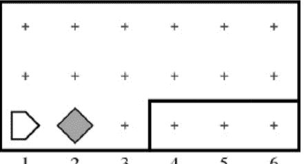

此示例中还可以看到 Karel 世界的其他几个组成部分。Karel 前方的灰色菱形物体是**哔哔器**。Rich Pattis 将哔哔器描述为"发出安静哔哔声的塑料圆锥体"。只有当 Karel 和哔哔器位于同一角落时，这些声音才能被听到。例如，Karel 在图中并未意识到哔哔器的存在，只有当 Karel 向前移动到下一个角落时才会发现哔哔器。图中的实线是**墙壁**。Karel 的世界边缘始终有墙壁，也可能包含内部墙壁。

Karel 的世界用于讲述故事，其中世界的几何结构可以有不同的解释方式。在某些情况下，适合将世界视为二维平面中的街道和大道。在其他情况下，你需要忘记街道和大道，以不同的方式思考 Karel 的世界。在示例所示的图中，最容易想象你是从侧面看到这个世界。Karel 站在地面上，内部墙壁形成一个 Karel 必须翻越的壁架。此外，哔哔器用于表示故事中出现的任何对象。你只需要运用想象力。


## Karel的内置函数

Karel在执行程序时执行的操作被称为**函数**。当Karel从工厂出厂时，它只知道如何执行中显示的四个函数。这些示例中出现的括号是Karel语法的一部分，用于指定你想要执行该操作，在编程术语中这被称为**调用函数**。

## Karel的内置函数

Karel在执行程序时执行的操作被称为***函数***。当Karel从工厂出厂时，它只知道如何执行中显示的四个函数。这些示例中出现的括号是Karel语法的一部分，用于指定你想要执行该操作，在编程术语中这被称为***调用函数***。

## Karel的内置函数

| 函数 | 描述 |
| --- | --- |
| `move()` | Karel向前移动一个街区。如果有墙阻挡道路，Karel无法向前移动。 |
| `turnLeft()` | Karel向左（逆时针）旋转90度。 |
| `pickBeeper()` | Karel从当前角落拿起一个蜂鸣器，并将其存放在蜂鸣器袋中，该袋子可以容纳无限数量的蜂鸣器。只有当该角落有蜂鸣器时，Karel才能执行`pickBeeper`函数。 |
| `putBeeper()` | Karel将一个蜂鸣器从袋中取出放在当前角落。只有当蜂鸣器袋中有蜂鸣器时，Karel才能执行`putBeeper`函数。 |

一些内置函数对Karel的活动有特定限制。如果Karel试图执行非法操作，例如穿墙移动或拾取不存在的蜂鸣器，就会发生**错误情况**。每当出现错误时，Karel会显示一条描述问题的消息并停止执行程序。

## 教授Karel解决问题

在很大程度上，学习用Karel编程就是弄清楚如何使用Karel有限的操作集来解决特定问题。举个简单的例子，假设你希望Karel将蜂鸣器从其在2nd Avenue和1st Street的初始位置移动到5th Avenue和2nd Street的壁架中心。因此，你的目标是编写一个Karel程序来完成下图所示的前后对比任务：

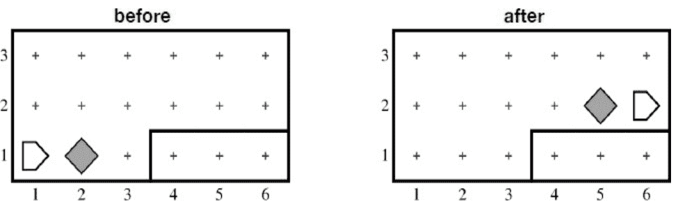

## 入门步骤

解决这个问题的前几个步骤很简单。你需要告诉Karel向前移动，拾取蜂鸣器，然后再次向前移动到达壁架底部。Karel模拟器允许你通过在一个名为**Karel控制台**的交互式窗口中输入指令来执行它们。因此，程序的前三个步骤如下所示：

```
Karel Console
> move()
> pickBeeper()
> move()
>
```

执行这些函数调用后，Karel处于以下位置：

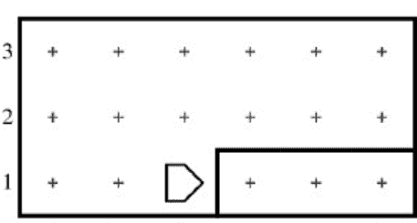

从这里开始，Karel的下一步是左转以开始攀爬壁架。这个操作也很简单，因为Karel的内置函数集包括`turnLeft`。在前面程序的末尾调用`turnLeft`会使Karel面向北方，位于3rd Avenue和1st Street的角落。如果你随后调用`move`指令，Karel将向北移动到以下位置：

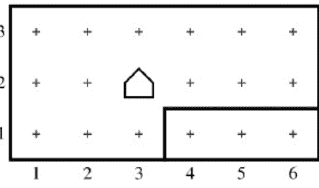

接下来你需要做的是让Karel右转，使其再次面向东方。虽然这个操作在概念上与让Karel左转一样简单，但有一个小问题：Karel的语言包含`turnLeft`指令，但没有`turnRight`指令。这就像你买了经济型号，却发现它缺少一个重要功能。

这时，你第一次有机会开始像程序员一样思考。你可以访问一组Karel函数，但不是你完全需要的那一组。你能做什么？你能只用现有功能来实现`turnRight`函数的效果吗？答案当然是肯定的。你可以通过左转三次来右转。经过三次左转后，Karel将面向所需方向。因此，程序中的接下来三步可能是：

```
turnLeft()
turnLeft()
turnLeft()
```

虽然左转三次达到了预期效果，但这远不是一个优雅的解决方案。你作为程序员想说的是：

```
turnLeft()
```

唯一的困难是Karel还没有`turnRight`函数的定义。要在程序中包含`turnRight`，你首先必须教Karel `turnRight`的含义。

## 定义函数

Karel编程语言最强大的功能之一是能够定义新函数。每当你有一系列执行某个有用任务的Karel操作——比如右转——你可以给这个序列一个名字。将一系列指令封装在一个新名称下的操作被称为*定义函数*。定义函数的格式如下：

```
function name() {
    构成函数体的语句
}
```

这个模式中的第一个单词是`function`，它在Karel和JavaScript中都用于定义函数。在编程语言中具有特定、预定义含义的单词被称为**关键字**。为了使它们更容易识别，本书中的程序清单以蓝色显示关键字。

要完成函数定义，你只需用`turnRight`替换斜体占位符*name*，并提供实现该函数所需的语句，如下所示：

```
function turnRight() {
    turnLeft();
    turnLeft();
    turnLeft();
}
```

一旦你定义了像`turnRight`这样的函数，你可以将其视为一个新的内置函数，就像`move`或`turnLeft`一样。从某种意义上说，定义函数就像为你的机器人购买升级，其中包含缺失的操作。

## 完成程序

在让Karel右转朝向壁架顶部之后，程序的其余部分很简单。你只需向前移动两次，放下蜂鸣器，然后向前移动到达所需的最终状态。从开始到结束解决该程序所需的完整步骤序列如下：

```
Karel Console
> move()
> pickBeeper()
> move()
> turnLeft()
> move()
> turnRight()
> move()
> move()
> putBeeper()
> move()
>
```

与其将每条指令输入控制台，不如定义一个新函数来包含这个指令序列。然后你可以用单个名称调用该函数。在本书中，代表完整程序的函数以大写字母开头，并且名称尽可能清楚地描述其用途。下一页顶部的代码定义了一个名为`MoveBeeperToLedge`的程序级函数以及`turnRight`函数。

## 将蜂鸣器移动到壁架的程序

```
/*
 * File: MoveBeeperToLedge.k
 * -------------------------
 * 此程序解决了将蜂鸣器移动到壁架的问题。
 */

function MoveBeeperToLedge() {
    move();
    pickBeeper();
    move();
    turnLeft();
    move();
    turnRight();
    move();
    putBeeper();
    move();
}

/*
 * 将Karel向右转90度。
 */

function turnRight() {
    turnLeft();
    turnLeft();
    turnLeft();
}
```

除了`MoveBeeperToLedge`和`turnRight`的定义外，图A 1-2还包括两个重要的编程特性示例，称为**注释**，它由旨在向人类读者解释程序操作的文本组成。在Karel中，注释以字符`/*`开头，以字符`*/`结尾。第一


注释描述了程序的整体操作；第二个注释描述了 `turnRight` 函数。在这么短的程序中，这样的注释可能是不必要的。然而，随着程序变得更加复杂，注释迅速成为记录程序设计、并使其他程序员更容易理解的关键工具。

这也说明了**语法着色**的技术，即在程序列表中使用不同颜色，以便轻松识别程序的不同组件。在作为单独图形出现的程序列表中，本书使用绿色标识注释，蓝色标识语言关键字（如 `function`），青色标识引号字符串，黑色标识程序的其余文本。根据你用来编写程序的编辑器，为各种程序组件选择的颜色可能与本书使用的不同。许多编辑器会使用额外的颜色来进行进一步的区分。对你作为程序员来说，语法着色的主要价值在于它允许你立即看到每个程序组件的开始和结束位置。

## 使用库函数

虽然中明确包含了 `turnRight` 的定义，但将这段代码复制到每个需要该函数的程序中是繁琐的。对于最常见的操作，将它们存储为易于在其他程序中重用是有意义的。在计算机科学中，有用函数和其他程序组件的集合被称为**库**。例如，`turnRight` 函数和同样有用的 `turnAround` 函数都包含在一个名为 `turns` 的特殊 Karel 库中，你只需在程序开头包含以下行即可使用它：

```
"use turns";
```

此语句要求 Karel 使用 `turns` 库，该库包含 `turnRight` 和 `turnAround` 函数的定义。本章其余部分的所有 Karel 示例都使用 `turns` 库。

## 分解

无论何时开始解决编程问题——无论该程序是用 Karel 还是更高级的编程语言编写的——你的首要任务是弄清楚如何将完整问题分解为更小的部分，称为*子问题*，每个子问题都可以作为一个单独的函数来实现。这个过程称为*分解*。分解是程序员用来管理复杂性的最强大的策略之一，你将在本书中一次又一次地看到它。

为了理解分解在非常简单的问题中是如何工作的，想象一下 Karel 站在一条“道路”上，如下方前后对比图的左侧所示：

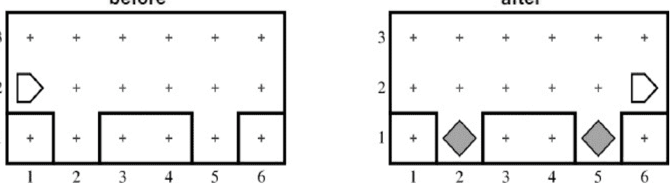

Karel 的工作是用发声器填充两个坑洞——2nd Avenue 上的一个和 5th Avenue 上的一个——然后继续前往下一个角落，最终位置如右图所示。

尽管你可以使用四个预定义指令来解决这个问题，但你可以使用函数来改进程序的结构。无论如何，你可以使用 `turnAround` 和 `turnRight` 来缩短程序并使其意图更清晰。更重要的是，你可以使用分解将问题分解为子问题，然后独立解决这些问题。例如，你可以将填充坑洞的问题分解为以下子问题：

1. 向前移动一个街区，到达 2nd Avenue 上的第一个坑洞。
2. 通过将一个发声器放入坑中来填充坑洞。
3. 向前移动三个街区，到达 5th Avenue 上的第二个坑洞。
4. 通过将一个发声器放入坑中来填充坑洞。
5. 向前移动一个街区，到达最终位置。

如果你以这种方式思考问题，你可以使用函数来确保程序反映你对问题结构的理解，如所示。

### 用于填充两个坑洞的 Karel 程序

```
/*
 * File: FillTwoPotholes.k
 * -------------------------
 * 该程序指示 Karel 填充两个坑洞，它们必须位于
 * 2nd 和 5th Avenues。
 */

"use turns";

function FillTwoPotholes() {
    move();
    fillPothole();
    move();
    move();
    move();
    fillPothole();
    move();
}

/*
 * 填充 Karel 正下方的坑洞。当你调用此函数时，Karel 必须
 * 站在坑洞正上方，面向东。当函数返回时，Karel 将位于
 * 修复后坑洞的正上方。
 */

function fillPothole() {
    turnRight();
    move();
    putBeeper();
    turnAround();
    move();
    turnRight();
}
```

与任何编程问题一样，你可能尝试过其他分解策略。一些策略使程序更容易阅读，而另一些策略只会使含义更加模糊。随着你的编程问题变得更加复杂，分解将被证明是设计过程中最重要的方面之一。

选择有效的分解更多是一门艺术而非科学，尽管你会发现随着练习会变得更好。提供了一些通用指南，将在此过程中对你有所帮助。


和任何编程问题一样，可能还有其他分解策略供你尝试。有些策略能让程序更易于阅读，而另一些则可能让含义更加晦涩。随着你的编程问题变得越来越复杂，分解会成为设计过程中最重要的方面之一。

选择有效的分解方法更多是一门艺术而非科学，不过你会随着练习而越来越好。本章提供了一些通用指南，将帮助你完成这个过程。

# 控制语句

尽管定义新函数很有用，但实际上它并不能让 Karel 解决任何新问题。函数的名称仅仅是一组特定指令的简写。因此，总是可以将一系列函数调用展开成一个单一函数来完成相同任务，尽管生成的代码可能又长又难读。指令仍然按照固定的顺序执行，这个顺序不依赖于 Karel 世界的状态。在你能够解决更有趣的问题之前，你必须能够编写超越这种严格线性、逐步执行的程序。为此，你需要学习 Karel 编程语言中的几个新语句，这些语句使 Karel 能够检查其世界并相应地改变其执行模式。

影响程序执行指令顺序的语句称为**控制语句**。控制语句分为以下两类：

1.  条件语句规定，程序中的某些语句只有在满足特定条件时才应执行。在 Karel 中，你可以使用 `if` 语句来指定条件执行。
2.  循环语句规定，程序中的某些语句应重复执行，形成程序员所说的**循环**。Karel 支持两种循环语句：一种是 `repeat` 语句，允许你将一组指令重复固定的次数；另一种是 `while` 语句，允许你在满足某个条件时重复执行一组指令。

## 条件语句

为了让你了解条件语句何时会派上用场，让我们回到第 6 章末尾介绍的填充坑洞程序。在 `fillPothole` 函数中填充坑洞之前，Karel 可能想检查是否有其他维修小组已经在那个角落用响铃器填补了坑洞。如果是这样，Karel 就不需要再放下第二个响铃器。要在程序上下文中表示这样的检查，你需要使用 `if` 语句，它有以下两种形式之一：

```
if (条件测试) {
    仅在条件为真时执行的语句
}
```

或者

```
if (条件测试) {
    条件为真时执行的语句
} else {
    条件为假时执行的语句
}
```

`if` 语句的第一种形式在你只想在特定条件下执行操作时很有用。当你需要在两种替代行动方案之间进行选择时，第二种形式是合适的。

这些模式第一行中显示的条件测试必须替换为 Karel 可以对其环境执行的测试之一，如下表所列。与函数调用类似，测试包括一对空括号，这是 Karel 语法的一部分。列表中的每个测试都与另一个检查相反条件的测试配对。例如，你可以使用 `frontIsClear` 条件来检查 Karel 前方的路径是否畅通，或者使用 `frontIsBlocked` 条件来查看是否有墙挡住了去路。选择正确的条件需要你思考问题的逻辑，并看看哪个条件最容易测试。

### Karel 可以测试的条件

| | | |
|---|---|---|
| `frontIsClear()` | `frontIsBlocked()` | Karel 前面有墙吗？ |
| `leftIsClear()` | `leftIsBlocked()` | Karel 左边有墙吗？ |
| `rightIsClear()` | `rightIsBlocked()` | Karel 右边有墙吗？ |
| `beepersPresent()` | `noBeepersPresent()` | 这个角落有响铃器吗？ |
| `beepersInBag()` | `noBeepersInBag()` | Karel 的袋子里有响铃器吗？ |
| `facingNorth()` | `notFacingNorth()` | Karel 面朝北吗？ |
| `facingEast()` | `notFacingEast()` | Karel 面朝东吗？ |
| `facingSouth()` | `notFacingSouth()` | Karel 面朝南吗？ |
| `facingWest()` | `notFacingWest()` | Karel 面朝西吗？ |

你可以使用 `if` 语句来修改 `fillPothole` 函数的定义，这样 Karel 只在该角落还没有响铃器时才放下响铃器。`fillPothole` 的新定义如下所示：

```
function fillPothole() {
    turnRight();
    move();
    if (noBeepersPresent()) {
        putBeeper();
    }
    turnAround();
    move();
}
```

这个例子中的 `if` 语句说明了 Karel 中所有控制语句的几个共同特征。控制语句以一个**头部**开始，它指明控制语句的类型以及控制程序流程所需的任何附加信息。在这个例子中，头部是

```
if (noBeepersPresent())
```

它表明只有在 `noBeepersPresent` 测试为真时，大括号内包含的语句才应执行。大括号中包含的语句代表控制语句的**主体**。

在函数中包含 `if` 语句来检查在世界当前状态下应用该函数是否合适，通常是有意义的。例如，只有当 Karel 面朝东，正好位于一个洞的上方时，调用 `fillPothole` 函数才能正确工作。你可以使用 `rightIsClear` 测试来确定南方（即 Karel 面朝方向的右侧）是否有一个洞。`fillPothole` 的以下实现包含了此测试以及你已经看到的 `noBeepersPresent` 测试：

```
function fillPothole() {
    if (rightIsClear()) {
        turnRight();
        move();
        if (noBeepersPresent()) {
            putBeeper();
        }
        turnAround();
        move();
        turnRight();
    }
}
```

从这个例子中使用的间距可以看出，每个控制语句的主体相对于包含它的语句是缩进的。这种缩进使得更容易看清哪些语句会受到控制语句的影响。当控制语句的主体包含其他控制语句时，这种缩进尤其重要。出现在其他控制语句内部的控制语句被称为*嵌套*。


## 迭代语句

在解决 Karel 问题时，你经常会发现重复是解决方案中不可或缺的一部分。如果你真的要编程一个机器人来填补路坑，那么只让它填补一个路坑就几乎不值得了。让机器人执行此类任务的价值在于，它能够重复执行程序，一个接一个地填补路坑。

为了了解如何在编程问题的语境中使用重复，请考虑以下示意图。图中，路坑在第一大道上均匀分布，位于每条偶数编号的大道上：

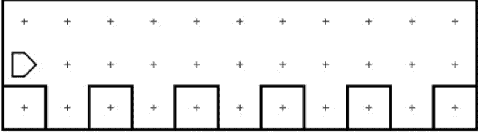

你的任务是编写一个程序，指示 Karel 填补这条路上的所有路坑。请注意，这条路在 11 号大道之后就到了尽头，这意味着你需要填补的路坑恰好是五个。

因为从这个例子中你知道恰好有五个路坑需要填补，所以你需要的控制语句是 `repeat` 语句，它指定了你希望重复某个操作预设的次数。`repeat` 语句如下所示：

```
repeat (number of repetitions) {
    statements to be repeated
}
```

例如，如果你想修改 `FillTwoPotholes.k` 程序，使其解决填补五个均匀间隔路坑的更复杂问题，你只需编写以下代码：

```
function FillFivePotholes() {
    repeat (5) {
        move();
        fillPothole();
        move();
    }
}
```

只有当你预先知道需要执行的重复次数时，`repeat` 语句才有用。在大多数应用中，重复次数是由问题的特定性质决定的。例如，一个填补路坑的机器人似乎不太可能总是能指望恰好有五个路坑。如果 Karel 能够持续填补路坑，直到遇到某个导致它停止的条件（例如到达街道尽头），那会好得多。这样的程序在应用上会更通用，并且能够正确地应用于以下任何世界，以及任何路坑恰好间隔两个路口的世界：

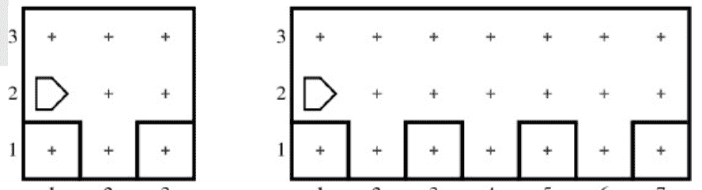

要编写一个适用于这些世界的通用程序，你需要使用 `while` 语句。在 Karel 中，`while` 语句具有以下一般形式：

```
while (*conditional test*) {
    statements to be repeated
}
```

条件测试从条件列表中选择。

为了解决填补路坑的问题，Karel 需要通过调用条件 `frontIsClear` 来检查前方路径是否畅通。如果你在 `while` 循环中使用 `frontIsClear` 条件，Karel 将重复执行循环，直到撞到墙壁。因此，`while` 语句使得解决更通用的道路修复问题成为可能，只要路坑出现在每个偶数编号的路口，并且道路尽头有一堵墙作为标记。以下 `FillRegularPotholes` 函数的定义就完成了这项任务：

```
function FillRegularPotholes() {
    while (frontIsClear()) {
        move();
        fillPothole();
        move();
    }
}
```

## 解决通用问题

到目前为止，各种填补路坑的程序还不太现实，因为它们依赖于特定的条件——比如均匀分布的路坑——这在现实世界中不太可能成立。如果你想编写一个更通用的填补路坑程序，它应该能在更少的约束条件下工作。特别是，假设路坑出现在每隔一个路口并不合理。理想情况下，对路坑的数量或间距不应有任何限制。路坑只是代表路面的墙壁上的一个开口。

要修改程序以解决这个更通用的问题，需要你以不同的方式思考整体策略。你需要让程序在道路上的每个路口调用 `fillPothole`，而不是让一个循环遍历每个路坑。

这种策略分析表明，通用问题的解决方案可能像下面的定义一样简单：

```
function FillAllPotholes() {
    while (frontIsClear()) {
        fillPothole();
        move();
    }
}
```


不幸的是，解决方案并不那么容易。按照编写的程序包含一个逻辑缺陷——程序员称之为 **bug**（错误）。本书使用右侧的错误符号来标记包含错误的函数，以确保你不会意外地将这些示例用作自己代码的模型。

这个例子中的错误相对隐蔽。即使你认为已经彻底测试过程序，也很容易错过。特别是，该程序在你迄今为止看到的所有填补路坑的世界中，以及在许多你没见过的世界中都能正确运行。只有当街道的最后一个大道上有一个路坑时，它才会失败，如下图所示：

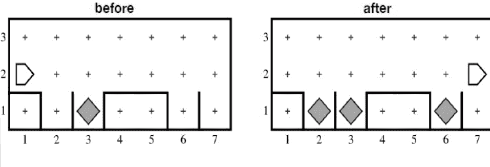

在这个例子中，Karel 停下来而没有填补最后一个路坑。事实上，如果你仔细观察执行过程，你会发现 Karel 根本没有进入那个最后的路坑去检查是否需要填补。问题出在哪里？

仔细遵循程序的逻辑，你会发现错误在于 `FillAllPotholes` 中的循环结构，它看起来是这样的：

```
while (frontIsClear()) {
    fillPothole();
    move();
}
```

一旦 Karel 完成填补 6 号大道上的路坑，它就执行 `move` 指令并返回到 `while` 循环的顶部。此时，Karel 站在 7 号大道和第二条街的拐角处，紧挨着边界墙。由于 `frontIsClear` 测试现在失败，`while` 循环在检查道路的最后一段之前就退出了。

这个程序中的错误是一个被称为 ***fencepost error*（栅栏柱错误）** 的编程问题的例子。这个名字来源于这样一个事实：要围住一段特定的距离，所需的栅栏柱数量比你想象的要多一个。例如，如果栅栏柱总是间隔 10 英尺放置，那么建造一个 100 英尺长的栅栏需要多少根柱子？答案是 11 根，如下图所示：

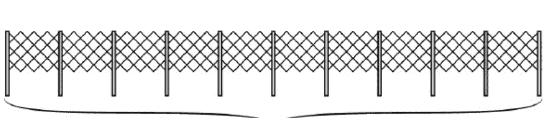

**100英尺，11根栅栏柱**

Karel 世界中的情况具有相同的结构。为了在一个有七个路口长的街道上填补路坑，Karel 需要检查七个路坑，但只需要移动六次。因为 Karel 在道路的两端开始和结束，它需要执行的 `move` 指令比它检查的路口数少一个。

一旦你发现了这个错误，修复它实际上相当容易。在 Karel 在道路尽头停下来之前，程序需要做的就是在最后一个路口进行一次特殊情况检查，如下所示：

```
function FillAllPotholes() {
    while (frontIsClear()) {
        fillPothole();
        move();
    }
    fillPothole();
}
```

完整的程序出现在下一页的顶部。


## Karel程序：填补任意数量的路坑

```
/*
 * File: FillAllPotholes.k
 * -----------------------
 * This program fills an arbitrary number of potholes in a road.
 */

"use turns";

function FillAllPotholes() {
    while (frontIsClear()) {
        fillPothole();
        move();
    }
    fillPothole();
}

/*
 * Fills a pothole immediately underneath Karel, if one exists.
 * When you call this function, Karel must be standing just above
 * the pothole, facing east.  When the function returns, Karel
 * will be in its original position above the repaired pothole.
 */

function fillPothole() {
    if (rightIsClear()) {
        turnRight();
        move();
        if (noBeepersPresent()) {
            putBeeper();
        }
        turnAround();
        move();
        turnRight();
    }
}
```


# 逐步求精

当你面对一个复杂的编程问题时，弄清楚如何将问题分解成若干部分，通常是你最重要的任务之一。一种最有效的策略叫做***逐步求精***，它包括从问题整体出发来解决问题。你把整个问题分解成若干部分，然后逐一解决每个部分，必要时再进一步分解。

# 逐步求精练习

假设 Karel 最初在世界中的 1st Street 和 1st Avenue 的拐角处面朝东。在这个世界里，每条大道可能包含一个未知高度的垂直塔楼，里面装满了响片，尽管有些大道也可能是空的。Karel 的任务是收集这些塔楼中的每一个响片，将它们全部放回 1st Street 最东边的拐角，然后返回起始位置。该图展示了这个程序在一个可能世界中的运行情况。

# `BeeperTowers` 问题的前后示意图

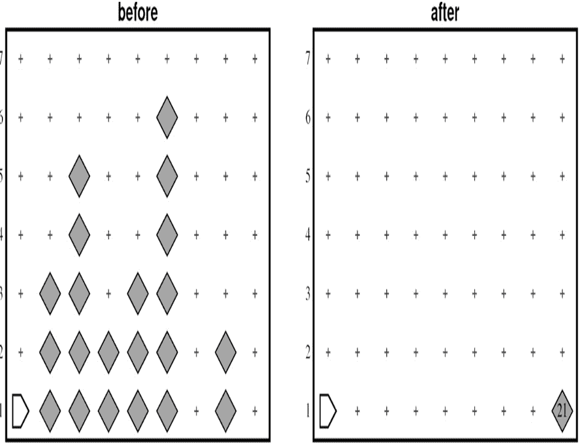

解决这个问题的关键在于以正确的方式分解程序。这项任务比你之前见过的其他任务更复杂，这使得选择合适的子问题对于获得成功的解决方案更为重要。

# 自顶向下设计的原则

逐步求精的核心思想是，你应该从程序的顶层开始设计，这指的是程序在概念上最高、最抽象的层次。在这个层次上，响片塔楼问题清楚地被分为三个独立的阶段。首先，Karel 必须收集所有的响片。其次，Karel 必须将它们存放在最后一个路口。第三，Karel 必须返回其起始位置。这个概要表明了如下的问题分解：

```
function CollectBeeperTowers() {
    collectAllBeepers();
    dropAllBeepers();
    returnHome();
}
```

在这个层次上，问题很容易理解。即使你还没有为 `CollectBeeperTowers` 函数体内的函数编写代码，重要的是要让你自己相信，只要你相信你将要编写的函数能够正确地解决子问题，你就会有一个针对整个问题的解决方案。

# 完善第一个子问题

既然你已经定义了整个程序的结构，现在是时候处理第一个子问题了，即收集所有的响片。这项任务本身比你迄今为止看到的问题更复杂。收集所有的响片意味着你必须捡起每个塔楼里的响片，直到你到达最后一个拐角。你需要对每个塔楼重复一个操作，这一事实表明你需要使用一个 `while` 循环。

但是这个 `while` 循环是什么样子的？首先，你应该考虑条件测试。你希望 Karel 在到达行末的墙壁时停止，这意味着你希望 Karel 在前面空间畅通时一直前进。因此，`collectAllBeepers` 函数将包含一个使用 `frontIsClear` 测试的 `while` 循环。在每个位置，你都希望 Karel 收集从该拐角开始的塔楼中的所有响片。如果你给这个操作起个名字，比如 `collectOneTower`，那么即使你还没有填入细节，你也可以为 `collectAllBeepers` 函数编写定义。然而，你必须小心。为了避免第 **17** 页描述的栅栏柱问题，代码必须在循环的最后一个周期之后调用 `collectOneTower`，如下所示：

```
function collectAllBeepers() {
    while (frontIsClear()) {
        collectOneTower();
        move();
    }
    collectOneTower();
}
```

如你所见，这个函数与中的 `FillAllPotholes` 函数结构相同。唯一的区别是，`collectAllBeepers` 在之前调用 `fillPothole` 的地方调用 `collectOneTower`。这两个程序都是以下通用策略的示例：

```
while (frontIsClear()) {
    *执行某个操作。*
    move();
}

*为最后一个拐角执行相同的操作。*
```

只要你需要沿着一条结束于墙壁的路径移动时对每个拐角执行一个操作，你就可以使用这个策略。如果你记住了这个通用策略，当你遇到类似形式的问题时，就可以快速编写代码。这类可重用的策略在编程中经常出现，被称为***编程惯用法***，或***模式***。你知道的模式越多，就越容易找到适合特定类型问题的模式。

# 编写下一层代码

即使 `collectAllBeepers` 的代码已经完成，在你实现 `collectOneTower` 之前，你也无法运行程序。当调用 `collectOneTower` 时，Karel 要么站在塔楼的底部，要么在一个空的拐角上。在前一种情况下，你需要收集塔楼里的响片。在后一种情况下，你可以直接继续前进。这种情况起初表明你需要一个 `if` 语句，在其中调用 `beepersPresent` 来检查塔楼是否存在。

在将这样的语句添加到代码中之前，值得思考一下你是否真的需要进行这个测试。通常，通过观察那些初看起来特殊的情况可以与更一般的情况以完全相同的方式处理，程序可以变得更加简单。对于当前的问题，你可以决定每条大道上都有一个响片塔楼，但其中一些塔楼的高度为零个响片。利用这一洞察可以简化程序，因为你不再需要测试特定的大道上是否存在塔楼。

`collectOneTower` 函数仍然足够复杂，因此进行额外一级的分解是有意义的。为了收集塔楼中的所有响片，Karel 必须爬上塔楼收集每个响片，转身，然后返回到标记世界南边界的墙壁。这些步骤表明了以下代码：

```
function collectOneTower() {
    turnLeft();
    collectLineOfBeepers();
    turnAround();
    moveToWall();
    turnLeft();
}
```

`collectOneTower` 函数开头和结尾的 `turnLeft` 指令对于该程序的正确性至关重要。当调用 `collectOneTower` 时，Karel 总是在 1st Street 的某个位置面朝东。当它完成其操作后，只有当 Karel 再次面朝东时，程序才能正确运行。在函数调用之前必须为真的条件是***前置条件***；函数执行完毕后必须适用的条件是***后置条件***。


## 收尾工作

尽管主要工作已经完成，但仍有几个遗留问题需要解决，因为还有几个函数尚未编写。幸运的是，这些函数中的每一个都可以很容易地直接编码，无需进一步分解。例如，`moveToWall`函数看起来像这样：

```
function moveToWall() {
    while (frontIsClear()) {
        move();
    }
}
```

`BeeperTowers`的完整实现见。

## 收集塔组中所有蜂鸣器的Karel程序

```
/*
 * File: BeeperTowers.k
 * --------------------
 * This program collects all the beepers in a series of towers, deposits
 * them at the easternmost corner on 1st Street, and then returns home.
 */

function BeeperTowers() {
    collectAllBeepers();
    dropAllBeepers();
    returnHome();
}

/*
 * Collects the beepers from every tower along 1st Street.
 */

function collectAllBeepers() {
    while (frontIsClear()) {
        collectOneTower();
        move();
    }
    collectOneTower();
}

/*
 * Collects the beepers in a single tower.
 */

function collectOneTower() {
    turnLeft();
    collectLineOfBeepers();
    turnAround();
    moveToWall();
    turnLeft();
}

/*
 * Collects a consecutive line of beepers.
 */

function collectLineOfBeepers() {
    while (beepersPresent()) {
        pickBeeper();
        if (frontIsClear()) {
            move();
        }
    }
}
```

```
/*
 * Drops all the beepers from Karel's bag onto the current corner.
 */

function dropAllBeepers() {
    while (beepersInBag()) {
        putBeeper();
    }
}

/*
 * Returns Karel to the corner of 1st Avenue and 1st Street, facing east.
 */

function returnHome() {
    turnAround();
    moveToWall();
    turnAround();
}

/*
 * Moves Karel forward until it is blocked by a wall.
 */

function moveToWall() {
    while (frontIsClear()) {
        move();
    }
}
```

## 1.5 Karel世界中的算法

尽管自顶向下设计是编程的关键策略，但你不能机械地应用它而不考虑问题求解策略。弄清楚如何解决某个特定问题通常需要相当的创造力。设计解决方案策略的过程传统上称为**算法设计**。

*算法*一词来自九世纪波斯数学家穆罕默德·伊本·穆萨·花拉子米（Muhammad ibn Mūsā al-Khwārizmī）的名字，他开创了代数的系统性研究。你将有机会在中更多地了解算法和花拉子米。

即使在有机会更详细地研究算法之前，考虑Karel领域中的一个简单算法也是有益的。例如，假设你想教Karel逃离任何不包含环路的迷宫。在Karel的世界中，一个迷宫可能看起来像这样：

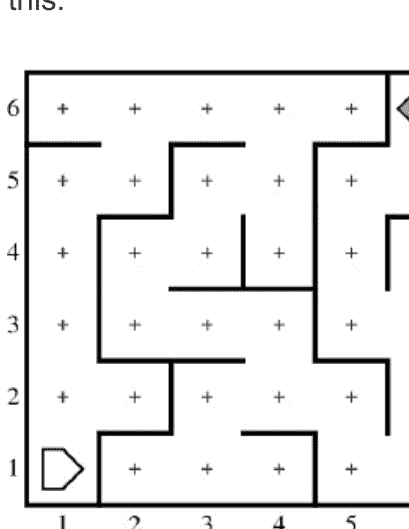

Karel的任务是在迷宫的走廊中穿行，直到找到标记出口的蜂鸣器。然而，该程序必须足够通用，能够解决任何无环路迷宫，而不仅仅是这里所示的这一个。

对于任何无环路迷宫（实际上对于任何Karel初始位置不被环路包围的迷宫），你可以使用一种称为***右手法则***的简单策略：开始时将右手放在墙上，然后穿过迷宫，手始终不离开墙壁。表达这种策略的另一种方式是逐步穿过迷宫，始终选择最右边的可用路径。实现右手法则的程序在Karel中很容易实现，并且只需一个函数即可完成：

```
function SolveMaze() {
    while (noBeepersPresent()) {
        turnRight();
        while (frontIsBlocked()) {
            turnLeft();
        }
        move();
    }
}
```

在外层`while`循环开始时，Karel向右转以检查该路径是否可用。然后内层`while`循环向左转，直到出现开口。当这种情况发生时，Karel向前移动，整个过程继续，直到Karel到达标记迷宫终点的蜂鸣器。

在本章中，你有机会认识了Karel，一个生活在非常简单世界中的非常简单的机器人。从Karel开始，使得学习编程基础成为可能，而无需掌握完整编程语言所带来的诸多复杂性。本章的重点包括：

- Karel机器人是由Rich Pattis于1970年代开发的*编程微世界*，他当时是斯坦福大学的计算机科学研究生。
- Karel生活在一个矩形世界中，由从西向东延伸的*街道*和从南向北延伸的*大道*定义。Karel始终位于标记街道与大道交叉点的*角落*上，并且必须面向四个标准罗盘方向之一（北、东、南、西）。
- Karel的世界周围有*墙壁*环绕边界，也可能包含额外的内部墙壁，阻挡Karel在两个角落之间通行。
- Karel的世界还可以包含*蜂鸣器*，Rich Pattis将其描述为"发出安静蜂鸣声的塑料锥体"。蜂鸣器可以存在于角落或Karel的蜂鸣器袋中，两者都可以容纳任意数量的蜂鸣器。
- Karel从工厂出厂时，只知道如何执行四个操作——`move`、`turnLeft`、`putBeeper`和`pickBeeper`——这些操作在第4页的有详细定义。
- 你可以通过定义*函数*来扩展Karel的操作库，函数是将操作序列收集在一起并赋予名称的集合。例如，以下函数定义使Karel能够通过执行三次连续的左转来向右转：

```
function turnRight() {
    turnLeft();
    turnLeft();
    turnLeft();
}
```

- 函数`turnRight`和`turnAround`包含在一个名为`turns`的库中，你可以通过在程序中包含以下行来使用它：

```
"use turns";
```

- 解决大型问题的最佳策略是将其分解为越来越小的子问题，每个子问题都作为一个单独的函数实现。这个过程称为*分解*或*逐步求精*。
- Karel编程语言包含的控制语句分为两类。*条件语句*允许你仅在特定条件成立时执行其他语句。*迭代语句*允许你重复执行一系列语句，可以是指定次数，也可以是只要条件成立就持续执行。
- Karel每种控制语句的语法规则出现在右侧的方框中。
- Karel可以测试的条件出现在第**12**页的中。
- 使用迭代语句时，重要的是避免*栅栏柱错误*，即未能认识到覆盖一段距离所需的`move`指令数量比角落数量少一。
- 在计算机科学中，*算法*是一种解决方案策略。算法是该领域中最重要的主题之一。

### if语句

```
if (condition) {
    statements
}
```

### if-else语句

```
if (condition) {
    statements
} else {
    statements
}
```

### repeat语句

```
repeat (count) {
    statements
}
```

### while语句

```
while (condition) {
    statements
}
```


## 练习题

1.  用自己的话解释 *编程微世界* 的含义和目的。
2.  谁创造了 Karel 微世界？
3.  名字 *Karel* 的词源是什么？
4.  定义 Karel 世界的以下几个方面：*street*、*avenue*、*corner*、*wall* 和 *beeper*。
5.  Karel 的四个预定义函数是什么？
6.  `turns` 函数库中包含的两个函数是什么？
7.  *逐步求精* 策略的含义是什么？
8.  你使用什么控制语句来仅在满足某个条件时执行语句？该语句的两种形式是什么？
9.  Karel 提供哪两个语句来重复一组语句？
10. 你用什么条件来测试 Karel 是否能从当前位置向前移动？你用什么条件来测试当前角落是否有任何 beeper？
11. 什么是 *栅栏柱错误*？
12. 什么是 *前置条件* 和 *后置条件*？
13. `collectLineOfBeepers` 函数中包含一个 `if` 语句，该语句在移动前检查 `frontIsClear` 条件。为什么进行此测试很重要？
14. 本章仅明确地定义了 `turns` 库中的一个函数。编写一个 Karel 函数来实现另一个。
15. 假设 Karel 已安顿在其房子里，该房子是下图中央的方形区域：

Karel 从房子西北角的初始位置开始，如图所示。问题是要编程 Karel 从门外收集报纸（由一个 beeper 代表），然后返回其初始位置。这个练习非常简单，主要目的是让你入门。你可以假设世界的每个部分都与图中所示完全相同。房子恰好是这个大小，门总是在所示的位置，而 beeper 就在门外。因此，你需要做的就是编写一系列必要的语句，让 Karel 执行以下任务：

- 移动到报纸处。
- 捡起它。
- 返回 Karel 原始的起点。

尽管程序只需要几行代码，但进行一定程度的分解练习仍然是值得的。在你的解决方案中，请将程序分解为包含每个步骤对应函数的形式。
16. 实现一个名为 `backup` 的 Karel 函数，其效果是使 Karel 向后移动一个方格，但使其面朝方向保持不变。例如，以下前后示意图显示了在 Karel 面朝东方位于 1st Street 和 2nd Avenue 的角落时调用 `backup` 的效果：

如果 Karel 的背部靠墙，`backup` 函数在 Karel 尝试执行作为实现一部分的 `move` 指令时应该失败。
17. 编写一个程序，教 Karel 攀登如下所示的山：

步骤如下：

- 向上移动到山脚。
- 攀登四个台阶到达山顶。
- 在山顶插一面旗帜（由一个 beeper 代表）。
- 从对面一侧爬下四个台阶。
- 向前移动到世界的东端。

世界的最终状态应如下所示：
18. 将你在练习 3 中编写的程序泛化，使 Karel 能够攀爬任何高度的阶梯状山。因此，除了攀爬该练习中的山之外，它还应该能够攀登像

或像珠穆朗玛峰一样的高峰
19. 对于生活在较寒冷气候中的人们，冬天可能是一段艰难的时光。树木已经落叶，像纪念碑一样矗立着，展现着季节的摧残，如下面的示例世界所示：

在这个示例世界中，垂直的墙段代表光秃秃的树干。Karel 的工作是攀爬每个树干，并在每棵树的顶部装饰一组四个叶子，排列成一个正方形，像这样：

因此，当 Karel 完成时，场景将如下所示：

Karel 面临的情况不必与图中所示完全匹配。可能有更多的树；Karel 只需要继续这个过程，直到 beeper 包中没有 beeper 为止。树的高度或间距也可能与图中所示不同。你的任务是设计一个足够通用的程序来解决任何此类问题，但需满足以下假设：

- Karel 从原点开始，面朝东方，位于第一棵树的西侧某处。
- 树之间总是至少间隔两个角落，这样顶部的叶子就不会相互干扰。
- 树的顶部总是至少低于顶端两个角落，这样叶子簇就不会撞到顶部墙壁。
- Karel 刚好有足够的 beeper 来装饰所有的树。因此，beeper 的原始数量必须是树数量的四倍。
- Karel 应结束时面朝东方，位于最后一棵树的底部。

仔细思考这个程序的各个部分是什么，以及你如何将其分解为更简单的子问题。如果只有一棵树会怎样？这会如何简化问题，以及你如何利用单树解决方案来帮助解决更普遍的情况？
20. 假设现在是万圣节，Karel 正在去玩"不给糖就捣蛋"的游戏。Karel 从一条死胡同街的西端开始，街道两边都有房子，如下图所示：

每座房子在前侧某个位置都有一个前廊。Karel 的任务是去每栋房子，步入门廊区域，并查看门廊是否包含糖果（由一个 beeper 代表）。如果有，Karel 应该捡起糖果。如果没有，Karel 应该继续前往下一栋房子。Karel 必须检查街道两边的每一个门廊，并且应该结束在原始交叉口，面朝相反的方向。因此，在上面所示的世界中执行你的程序后，Karel 应该结束在以下位置：

Karel 可以依赖关于世界的以下事实：

- Karel 从一条街的西端开始，面朝东方，beeper 包为空。
- 街上的房子紧密排列在一起，相邻房子之间没有空间。
- 房子的数量可以是任意的，通常大小各不相同。
- 每栋房子面向街道的一侧是一堵实心墙，除了一个小门廊，门廊总是一个路口宽。门廊可以出现在前墙的任何位置。
- 每个门廊要么是空的，要么标记着一个 beeper，代表一个万圣节糖果。
- 执行结束后，Karel 应该返回到它在街道西端的原始交叉口，但现在面朝


8. 既然卡雷尔已经掌握了万圣节，现在是时候庆祝一个不同的节日了。卡雷尔决定给一所小学班级里的每位学生送上蜂鸣器情人节礼物，这个班级正在使用卡雷尔学习编程。卡雷尔不记得每一水平行中确切有多少张课桌，但记得恰好有三排课桌，教室的布局大致如下面的图所示：

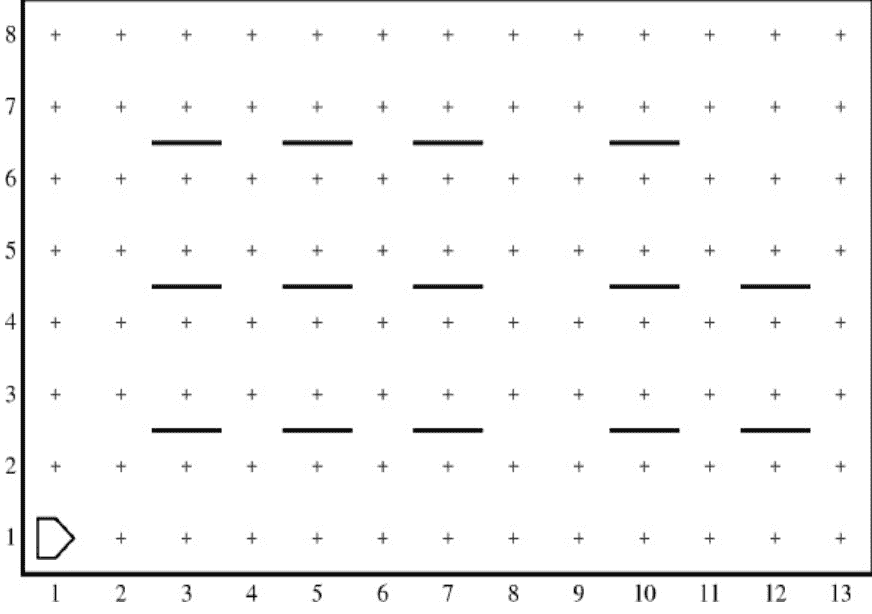

卡雷尔可以依据以下事实：

- 卡雷尔从第 1<sup>大道</sup>和第 1<sup>街</sup>出发，面向东方，包里有无限多个蜂鸣器。
- 恰好有三排学生课桌，位置如图所示，分别位于第 3、第 5 和第 7 街的南侧。
- 卡雷尔不知道每排有多少张课桌（各排可能不同），课桌之间有多少空白间隔，也不知道每排两端的课桌与教室墙壁之间有多少间隔。卡雷尔所知道的是，每张课桌恰好宽一个单位，而且没有课桌紧贴墙壁。

当卡雷尔完成时，教室里所有课桌上都应有一个情人节礼物，如下图所示：

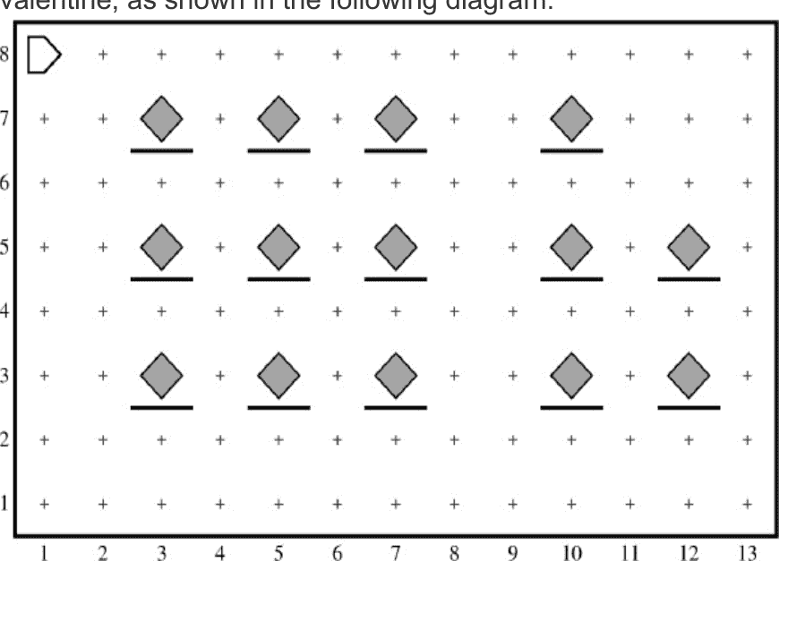

9. 听说编程至少与艺术一样是一门科学（而卡雷尔对艺术的本质完全一无所知），卡雷尔决定报名参加一个数字填色课程。在这门课中，卡雷尔面对的是一块包含蜂鸣器堆的"画布"，如下面的图所示：

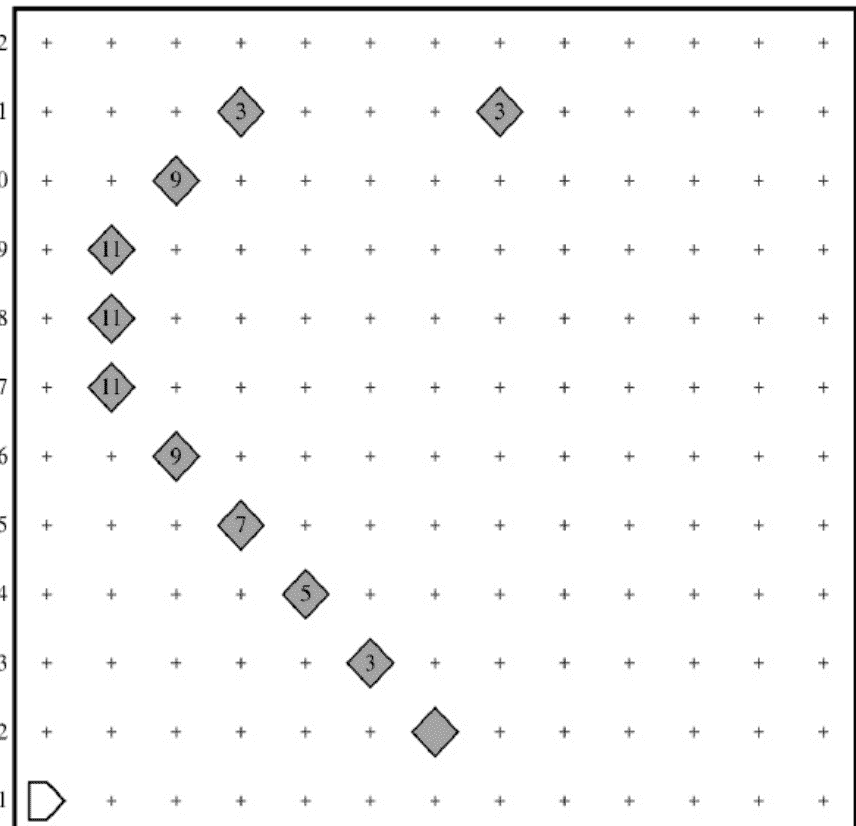

要完成数字填色任务，卡雷尔只需沿着每条街从左向右走，拾起每堆蜂鸣器，然后将那堆蜂鸣器逐个重新分配到每个相邻的角落上。

为了理解这个过程是如何运作的，我们来看看当卡雷尔到达第 11 街时会发生什么。在这一行的起点，卡雷尔站在第一个角落上，蜂鸣器包是空的，如下所示：

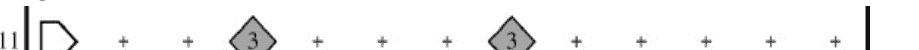

然后卡雷尔沿着街道前行，在第 4 大道上发现了一堆三个蜂鸣器。当卡雷尔到达那个角落时，它拾起了蜂鸣器。这一步使卡雷尔处于如下位置，包里有三个蜂鸣器：

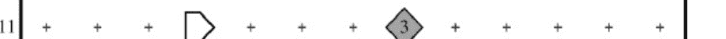

接下来，下一步是从找到蜂鸣器堆的那个角落开始，逐个放下蜂鸣器。执行这一步会得到下面的配置，此时卡雷尔的蜂鸣器包再次为空：


然后卡雷尔对第二堆蜂鸣器重复这个过程，最终在行末处于如下位置：

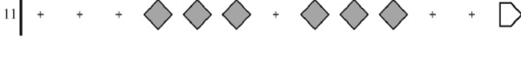

世界的最终状态应该如下所示：

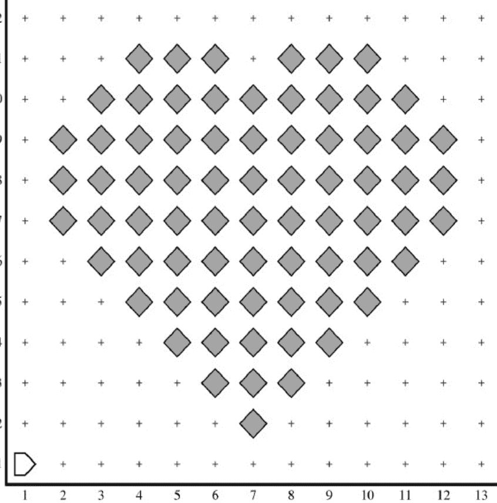

你的任务是编写一个程序，将这种数字填色图片转换为对应的完成作品。在编写程序时，卡雷尔可以依据以下关于世界的事实：

- 世界包含任意数量的蜂鸣器堆，但没有内部墙壁。
- 蜂鸣器堆中的蜂鸣器数量不会多到导致卡雷尔撞墙或撞到另一堆蜂鸣器。
- 卡雷尔始终从西南角（第 1 街和第 1 大道）面向东方开始，蜂鸣器包为空。
- 卡雷尔必须在结束执行时面向东方，位于世界的东北角。

10. 卡特里娜飓风过后十多年，墨西哥湾沿岸仍有相当大的破坏，一些社区尚未重建。作为改善国家基础设施计划的一部分，政府设立了一个名为"卡特里娜自动救济"（Katrina Automated RELief，简称 KAREL）的项目，派遣建房机器人前往修复受损区域。你的任务是为这些机器人编程。

每台机器人从一条街的西端出发，这条街可能看起来像这样：

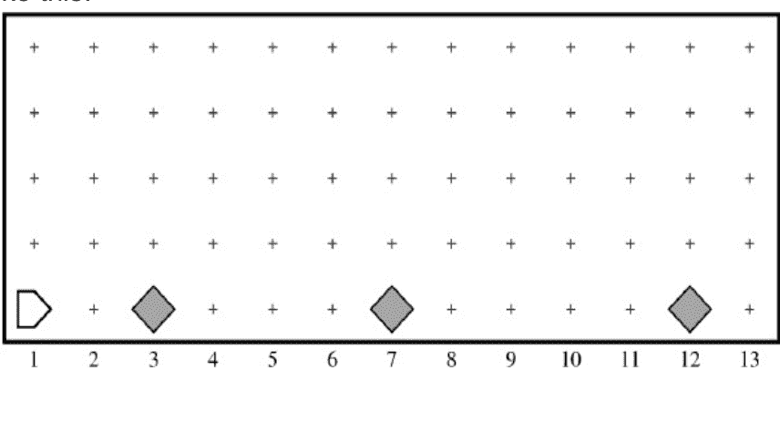

图中的每个蜂鸣器代表一处曾经矗立着房屋的废墟。卡雷尔的任务是沿着街道前行，在每个蜂鸣器标记的位置建造一栋新房屋。此外，这些房屋需要用高脚柱架起，以避免下次风暴造成损坏。每栋房屋应该完全如下图所示：

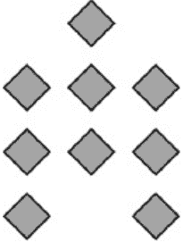

新房屋应以废墟所在位置为中心，这意味着上图中的第一栋房屋建造时其左边缘应沿第 2<sup>大道</sup>。

在运行结束时，卡雷尔应位于街道的东端，并为所示的初始条件创建一组如下所示的房屋：

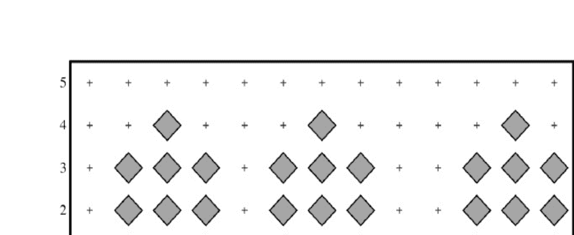

在解决此问题时，你可以依据以下关于世界的事实：

- 卡雷尔从第 1 街和第 1 大道的角落开始，面向东方，蜂鸣器包中有无限多个蜂鸣器
- 指示应建造房屋位置的蜂鸣器之间的间距，会保证有空间建造房屋而不会相互重叠或撞到墙壁。
- 卡雷尔必须在结束时面向东方，位于世界的东南角。此外，如果建造的房屋延伸到那个最终角落，卡雷尔不应撞到墙壁。

11. 在本练习中，你的任务是让卡雷尔在一个空的矩形世界内创建蜂鸣器的棋盘格图案，如图 3 中的前后对比图所示。

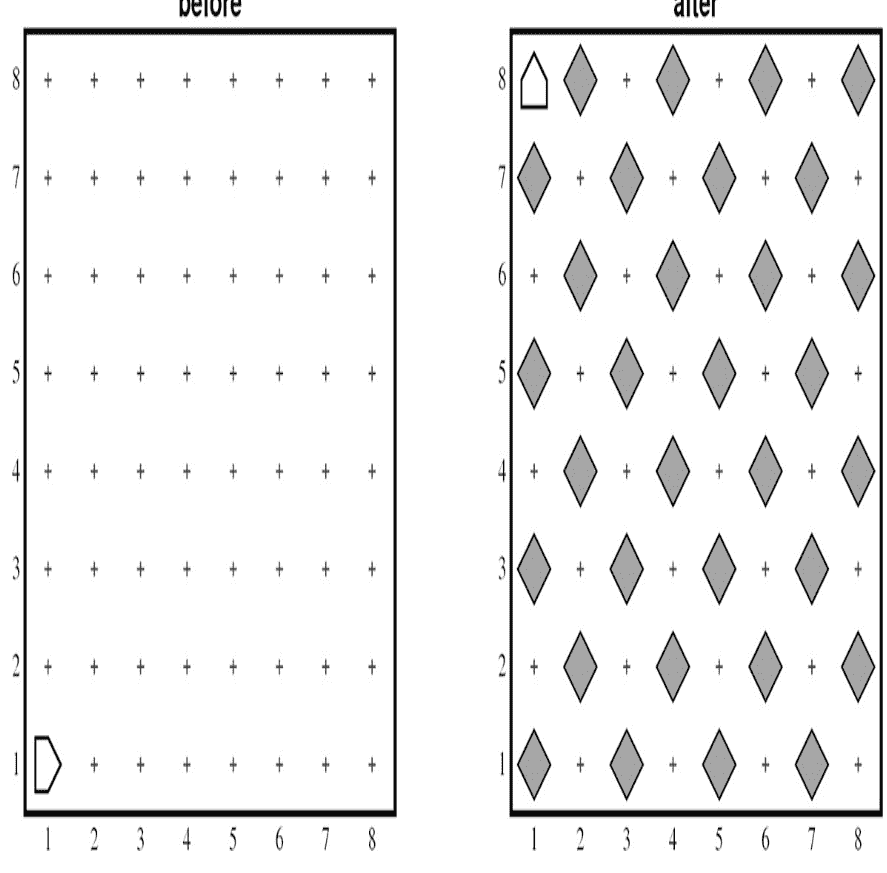

这个问题具有良好的分解结构和一些有趣的算法问题。在思考如何解决这个问题时，你应该确保你的解决方案适用于与示例中所示的标准 8 × 8 棋盘格大小不同的棋盘格。奇数尺寸的棋盘格比较棘手，你应该确保你的程序在 5 × 3 的世界中生成以下图案：

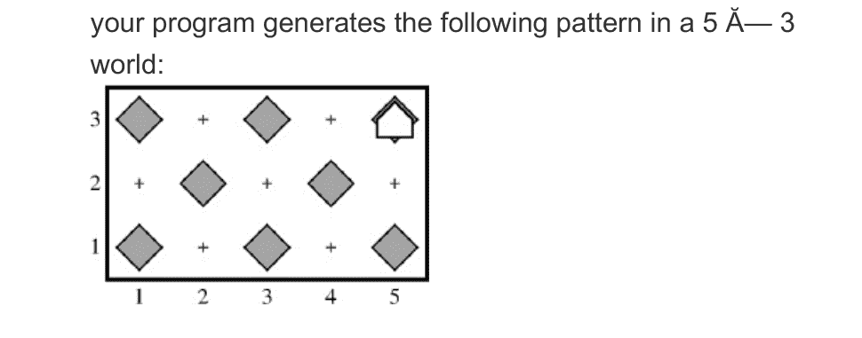

另一个需要考虑的特殊情况是世界只有一列宽或只有一行高的情况。

2.  编程让卡雷尔在第 1 街的中心放置一个蜂鸣器。例如，如果卡雷尔从以下世界开始

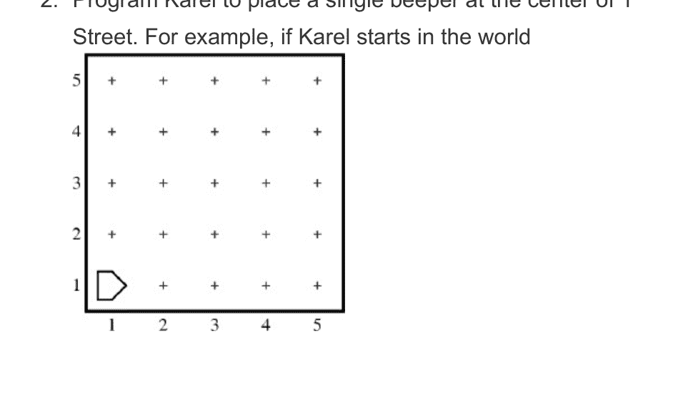

程序应在卡雷尔站在以下位置的一个蜂鸣器上结束执行：

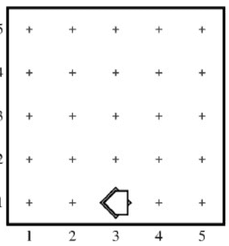

请注意，世界的最终配置在第 1<sup>街</sup>的中点应只有一个蜂鸣器。在此过程中，卡雷尔可以随意放置额外的蜂鸣器，但必须在完成之前将它们全部拾起。

在解决此问题时，你可以依据以下事实：

- 卡雷尔从第 1 大道和第 1 街出发，面向东方，包里有无限多个蜂鸣器。
- 世界的初始状态不包含内部墙壁或蜂鸣器。
- 世界不必是正方形，但你可以假设它至少与其宽度一样高。
- 如果世界的宽度是奇数，卡雷尔必须将蜂鸣器放在中心方格上。如果宽度是偶数，卡雷尔可以将蜂鸣器放在两个中心方格中的任意一个上。
- 运行结束时卡雷尔面向哪个方向无关紧要。

你可以使用许多不同的算法来解决这个问题。有趣的挑战在于想出一个有效的策略。

# JavaScript 简介

计算机程序是人类创造的最复杂的事物。

> ——道格拉斯·克罗克福德，*JavaScript: The Good Parts*，2008


*道格拉斯·克罗克福德（1955–）*

(Jagadeesh Nv/EPA/Shutterstock)

*道格拉斯·克罗克福德撰写了大量关于 JavaScript 的文章，多年来一直致力于推广这门语言的价值，这门语言获得*


尤其是在其早期，JavaScript获得了很大程度上不应有的负面声誉。在他2008年的著作《JavaScript语言精粹》中，道格拉斯·克罗克福德坚称，“在JavaScript中，存在着一种优美、精巧、表现力极强的语言”，前提是你要忽略那些大体上表面化且完全可避免的缺陷。正如我们在斯坦福大学入门编程课程中使用JavaScript所发现的，只要专注于这门语言的优秀部分，编写能体现其优美、精巧和表现力的程序一点也不难。本书的目的就是教你如何利用JavaScript来创建高度可读、结构良好的程序。

来自[斯坦福在线](https://online.stanford.edu)的Karel小世界为编程概念提供了一个温和的入门，但它至少缺失了一个极其重要的概念。尽管蜂鸣器使得Karel能够操控其世界的内容物，但Karel并未提供处理数据的有效机制。在计算机领域，术语“数据”通常等同于“信息”。计算机的大部分威力源自其高速处理大量信息的能力。在欧洲大部分地区，计算机科学常被称为**信息学**，这强调了信息所扮演的核心角色。

在能够领略计算的强大之前，你至少需要学习一种编程语言的基础知识，以便能够处理数据。本书中的程序使用的是一种名为**JavaScript**的编程语言，它已成为编写交互式Web应用的标准语言。JavaScript的第一个版本于1995年问世，据说是网景通信公司的一位程序员仅用十天就写成的。由于其流行，JavaScript被内置于每一个主要的网络浏览器中，这意味着任何带有浏览器的设备都可以运行JavaScript程序，而无需任何额外软件。

然而，本书的重点不在于JavaScript语言本身，而在于你使用该语言编写的程序。本书并未涵盖JavaScript的所有内容，并且特意避开了那些容易被误用的语言特性。即便如此，你将在本书中学到的JavaScript子集，已为你提供了必要的工具，让你能够编写出精彩的、充分利用JavaScript语言最佳特性的应用程序。

## 数据与类型

在计算机历史的大部分时间里，计算机器——甚至早于现代计算时代——主要处理数值数据。20世纪60年代中期制造的计算机与数值数据处理联系如此紧密，以至于因此获得了**数字处理器**的绰号。然而，信息以多种形式存在，并且计算机越来越擅长处理多种不同类型的数据。当你编写用于计数或求和的程序时，你处理的是**数值数据**。当你编写处理字符的程序时——这些字符通常被组合成更大的单元，如单词、句子和段落——你处理的是**字符串数据**。随着你在本书中的学习，你将了解到这些以及许多其他数据类型。

在计算机科学中，数据类型由两个属性定义：一个定义域和一个操作集合。**定义域**就是构成该类型元素的值的集合。对于数值数据，定义域由像0、42、-273和3.14159265这样的数字组成。对于字符串数据，定义域包含键盘上出现或可以在屏幕上显示的字符序列。**操作集合**是允许你操纵该类型值的工具箱。对于数值数据，操作集合包括加法、减法、乘法和除法，以及各种更复杂的函数。然而，对于字符串数据，很难想象像乘法这样的操作意味着什么。使用字符串数据需要一套不同的操作，例如将两个字符串组合成一个更长的字符串，或者比较两个字符串以查看它们的字母顺序。一般规则是，操作集合必须适用于定义域中的元素。这两个组成部分——定义域和操作集合——共同定义了一个***数据类型***。

## 数值数据

当今的计算机以如此多令人兴奋的形式存储数据，以至于数字可能显得有点乏味。即便如此，数字是讨论数据的一个良好起点，主要是因为它们既简单又熟悉。毕竟，你从学会计数起就一直在使用数字。此外，正如你将在[下一章](https://composingprograms.com/pages/12-data.html)中发现的，所有信息在计算机内部都是以数字形式表示的。

## JavaScript中的数字表示

现代编程语言的一个重要设计原则是，对人类读者来说熟悉的概念应该以容易识别的形式表达。像大多数语言一样，JavaScript对数值表示也采用了这一原则，这意味着你可以在JavaScript程序中以与在其他任何地方书写数字大致相同的方式书写数字。然而，大多数语言将数字分为两类：表示整数的**整数**，和包含小数点的***浮点数***。相比之下，JavaScript定义了单一的数字类型，它由一串数字组成，可选地包含一个小数点。负数前面带有一个减号。因此，以下示例在JavaScript中都是合法的数字：

```
0 42 -273 3.14159265 -0.5 1000000
```

请注意，大数字，例如最后一个示例中显示的数值一百万，在书写时不使用逗号将数字分组为三位一组。

数字也可以用科学计数法的一种变体来书写，其中数值表示为一个数字乘以10的幂。要在科学计数法中表示一个值，你需要用标准十进制表示法书写一个数字，后面紧跟字母E和一个整数指数，指数前面可选地带有+或-号。例如，光速（以米每秒为单位）大约是

2.9979×10⁸

在JavaScript中可以写成

```
2.9979E+8
```

在JavaScript的科学计数法中，字母E代表短语*乘以10的幂*。

## 算术表达式

数值数据的真正威力源于JavaScript允许你通过应用数学运算来执行计算，这些运算的复杂度从加法和减法到高度复杂的数学函数。与数学中一样，JavaScript允许你通过使用运算符来表示这些计算，例如用于加法和减法的`+`和`-`。

在学习JavaScript工作原理时，能够使用某个应用程序来输入JavaScript表达式并查看它们产生的值是非常有用的。与本书相关的网站就包含了这样一个应用程序，在其他JavaScript环境中也有类似的工具可用。本书中的示例说明了在名为***JavaScript控制台***的窗口中与JavaScript的交互，但即使你使用的是不同的环境，这些示例也应该很容易理解。

为了感受一下与JavaScript控制台的交互是如何工作的，假设你想解决以下问题，这个问题由创作型歌手、政治讽刺家兼数学家汤姆·莱勒在他的歌曲《新数学》中于1965年提出：


要找到答案，你只需要在 JavaScript 控制台中输入减法运算，如下所示：

```
JavaScript Console
> 342 - 173
169
>
```

这个计算是一个*算术表达式*的示例，它由一系列称为*项*（*terms*）的值组成，这些值使用称为***运算符***（***operators***）的符号进行组合，其中大多数运算符在小学算术中就为人熟知。JavaScript 中的算术运算符包括：

-   + 加法
-   – 减法（如果左侧没有值，则表示取反）
-   * 乘法
-   / 除法
-   % 取余

唯一可能看起来不太熟悉的运算符是 %，它计算一个值除以另一个值后的余数。例如，`7 % 3` 的值为 1，因为 7 除以 3 余 1。如果一个数能被另一个数整除，则没有余数，因此例如 `12 % 4` 的值为 0。在本书中，**%** 运算符仅用于正整数，其含义易于理解。

按照标准数学的惯例，乘法、除法和取余运算优先于加法和减法，不过你可以使用括号来改变求值顺序。例如，如果你想计算 4 和 7 的平均值，可以在控制台中输入以下表达式：

```
JavaScript Console
> (4 + 7) / 2
5.5
>
```

如果省略括号，JavaScript 会先将 7 除以 2，然后将 4 和 3.5 相加，得到值 7.5，如下所示：

```
JavaScript Console
> 4 + 7 / 2
7.5
>
```

如果 JavaScript 是你的第一门编程语言，这个示例中的计算看起来会非常自然，因为它遵循了常规的算术惯例。然而，如果你之前使用过其他语言，JavaScript 对数字的处理方式可能需要你以不同的方式思考算术表达式。正如本章前面提到的，许多编程语言定义了两种不同的数值类型：一种用于整数，一种用于带有小数部分的数。JavaScript 只有一种数值类型，这使得算术运算稍微简单一些。

## 优先级

JavaScript 对表达式中运算符的求值顺序由它们的**优先级**（**precedence**）决定，优先级衡量每个运算符与其两侧表达式（称为其**操作数**，**operands**）结合的紧密程度。如果两个运算符争夺同一个操作数，优先级较高的运算符会先被应用。如果两个运算符优先级相同，则按照它们的**结合性**（**associativity**）指定的顺序应用，结合性表明该运算符是从左向右分组还是从右向左分组。JavaScript 中的大多数运算符都是**左结合**（**left-associative**）的，这意味着最左边的运算符先被求值；然而，少数运算符是**右结合**（**right-associative**）的，从右向左分组，如下一页顶部所示。

## JavaScript 运算符的完整优先级表

按优先级从高到低排列的运算符

| 按优先级从高到低排列的运算符 | 结合性 |
|---|---|
| () [] . | left |
| 一元运算符: - ++ -- ! ~ typeof new | right |
| * / % | left |
| + - | left |
| << >> >>> | left |
| < <= > >= instanceof in | left |
| === !== == != | left |
| & | left |
| ^ | left |
| \| | left |
| && | left |
| \|\| | left |
| ?: | right |
| = op= | right |

展示了 JavaScript 运算符的完整优先级表，其中许多运算符你很少或根本没有机会使用。随着本书后续介绍更多运算符，你可以在此表中查找它们，了解它们在优先级层次中的位置。由于优先级规则的目的是确保 JavaScript 表达式遵循与其数学对应物相同的规则，你通常可以依靠直觉。此外，如果你有任何疑问，总是可以添加括号来明确运算顺序。

## 变量

当你编写一个处理数据值的程序时，使用名称来引用在程序运行过程中可以改变的值通常很方便。在编程中，引用值的名称称为**变量**（**variables**）。

JavaScript 中的每个变量都有两个属性：一个*名称*（*name*）和一个*值*（*value*）。要理解这些属性之间的关系，最好将变量想象成一个带有标签的盒子，就像这样：

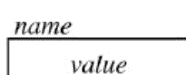

变量的名称出现在标签上，用于区分不同的盒子。如果你的程序中有三个变量，每个变量都会有不同的名称。值对应于盒子的内容。盒子的名称是固定的，但你可以根据需要随时更改值。

# 声明变量

如果你需要在 JavaScript 中创建一个新变量，现代 JavaScript 版本中的标准方法是在程序中包含一行，以关键字 `let` 开头，后跟变量名称、一个等号、该变量的初始值，最后是一个分号。引入新变量的程序行称为**声明**（**declaration**）。例如，以下声明引入了一个名为 `r` 的变量，并将其赋值为 10：

```
let r = 10;
```

从概念上讲，这个声明在计算机内存中创建了一个盒子，将其命名为 `r`，并在盒子中存储值 10，就像这样：

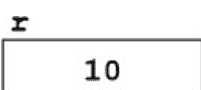


# 声明变量

如果需要在JavaScript中创建一个新变量，现代JavaScript的标准做法是在程序中添加一行以关键字 `let` 开头，后跟变量名、等号、变量的初始值，最后以分号结尾的语句。引入新变量的程序行称为 **声明**。例如，以下声明引入了一个名为 `r` 的变量并为其赋值10：

```
let r = 10;
```

从概念上讲，此声明在计算机内存中创建了一个盒子，将其命名为 `r`，并在盒中存储值10，如下所示：

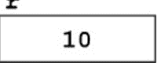

# 赋值

一旦声明了变量，就可以通过 ***赋值语句*** 更改其值，赋值语句看起来与声明类似，但开头没有 `let` 关键字。例如，如果执行赋值语句

```
r = 2.5;
```

盒子中的值将更改如下：

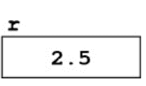

在声明或赋值语句中，等号右侧出现的值可以是任何JavaScript表达式。例如，可以使用以下声明计算3、4和5的平均值：

```
let average = (3 + 4 + 5) / 3;
```

赋值语句通常用于修改变量的当前值。例如，可以使用以下语句将 `deposit` 的值加到 `balance` 上

```
balance = balance + deposit;
```

该语句获取 `balance` 的当前值，加上 `deposit` 的值，然后将结果存回 `balance`。这种形式的赋值语句非常常见，因此JavaScript允许使用以下简写形式：

```
balance += deposit;
```

类似地，可以通过编写以下内容从 `balance` 中减去 `surcharge` 的值

```
balance -= surcharge;
```

更一般地，JavaScript语句

```
variable op= expression;
```

等同于

```
variable = variable op (expression);
```

此模式中包含括号是为了强调表达式在 *op* 应用之前被求值。此类语句称为 ***简写赋值。***

## 自增和自减运算符

除了简写赋值运算符外，JavaScript还为变量加1或减1这一特别常见的操作提供了进一步的缩写形式。将变量加1称为 ***自增***；减1称为 ***自减***。JavaScript使这些操作能够以极其紧凑的形式表达。表达式 `x++` 将变量 `x` 自增，表达式 `x--` 将其自减。

然而，这些运算符并不像上一段暗示的那么简单。`++` 和 `--` 运算符都可以用两种不同的方式书写。运算符可以放在其应用的 *操作数之后*，如表达式 `x++`，或者放在 *操作数之前*，如 `++x`。运算符跟在操作数后面的第一种形式称为 ***后缀*** 形式；运算符在操作数之前的第二种形式称为 ***前缀*** 形式。

如果仅仅是单独执行 `++` 或 `--` 运算符，前缀和后缀运算符的效果完全相同。只有在将这些运算符用作更大表达式的一部分时，才会注意到差异。此时，像所有运算符一样，自增和自减运算符会产生一个值，但该值取决于运算符相对于操作数的书写位置。两种情况如下：

- `x++` 首先计算 `x` 的值，然后将其自增。表达式的值是自增 *之前* 的原始值。
- `++x` 首先将 `x` 的值自增，然后将新值作为 `++` 操作整体的值使用。

`--` 运算符的行为类似，只是值是自减而不是自增。

乍一看，这个特性可能显得深奥且不必要，在某些方面确实如此。`++` 和 `--` 运算符当然不是必需的。此外，在很少有情况下，将这些运算符嵌入到更大的表达式中会比分离使用值和自增值过程的程序更好。另一方面，`++` 和 `--` 在C、C++、Java和JavaScript等语言共享的历史传统中根深蒂固。程序员经常使用它们，以至于它们已成为这些语言中的标准习语。鉴于它们在程序中的广泛使用，您需要理解这些运算符，以便能够理解现有代码。

## 命名约定

用于变量、常量、函数等的名称统称为 ***标识符***。在JavaScript中，标识符的构成规则是：

1. 标识符必须以字母、下划线 (_) 或美元符号 ($) 开头。
2. 所有其他字符必须是字母、数字、下划线或美元符号。本书仅在常量名称中使用下划线作为分隔符，完全不使用美元符号，美元符号通常保留给JavaScript库使用。
3. 标识符不得是 中列出的保留关键字之一。

## JavaScript中的保留字

| abstract | default | for | new | throw |
| arguments | delete | function | null | throws |
| await | do | goto | package | transient |
| boolean | double | if | private | true |
| break | else | implements | protected | try |
| byte | enum | import | public | typeof |
| case | eval | in | return | var |
| catch | export | instanceof | short | void |
| char | extends | int | static | volatile |
| class | false | interface | super | while |
| const | final | let | switch | with |
| continue | finally | long | synchronized | yield |
| debugger | float | native | this | |

标识符中出现的大写和小写字母被视为不同。因此，标识符 `ABC` 与标识符 `abc` 不同。

通过使用能够立即提示变量含义的变量名，可以使程序更具可读性。例如，如果 `r` 指圆的半径，该名称是有意义的，因为它遵循标准数学约定。但在大多数情况下，最好使用较长的名称，使阅读程序的人清楚地知道变量包含的值。例如，如果需要一个变量来跟踪文档中的页数，最好使用像 `numberOfPages` 这样的名称，而不是像 `np` 这样的缩写形式。


变量名`numberOfPages`乍看之下可能有点奇怪，因为名称中间出现了大写字母。然而，这个名称遵循的是一种已被广泛接受的变量命名规范。按照惯例，JavaScript 中的变量名以小写字母开头，但在每个新单词的开头使用大写字母。这种命名规范被称为**驼峰命名法**，因为它在变量名中间形成了大写的"驼峰"。

## 常量

你还可以通过为程序运行过程中不会改变的值命名，来提高程序的可读性。这样的值被称为**常量**。现代版本的 JavaScript 支持通过将声明中的关键字`let`替换为关键字`const`来声明常量。例如，如果你正在编写一个需要进行圆相关几何计算的程序，定义一个名为`PI`的常量会很有用，其值是数学常数 π 的合理近似值。尽管你将在本章后面发现常量`PI`已经在某个标准库中定义了，但你始终可以通过以下声明自行定义它：

```
const PI = 3.14159265;
```

按照惯例，常量名全部使用大写字母书写，单词之间用下划线分隔。

虽然常量在程序运行期间不会改变其值，但使用常量来表示那些你作为程序员可能希望在应用程序开发周期中修改的值，通常是有意义的。使用常量实现这一目的的价值将在更详细地讨论。

## 顺序计算

定义变量和常量的能力使得算术计算更易于理解，即使在控制台窗口中也是如此。例如，以下语句序列计算了半径为 10 的圆的面积：

```
const PI = 3.14159265;
let r = 10;
let area = PI * r * r;
area
314.159265
```

JavaScript 没有用于求幂的运算符，因此表示 $r^2$ 的最简单方法就是将 $r$ 与自身相乘。

## 函数

正如你在之前编写的简单 Karel 程序中所发现的，你不需要在控制台窗口中输入所有的计算操作，而是可以将这些步骤存储为函数。Karel 和 JavaScript 中的函数之间的最大区别在于，函数可以使用调用者提供的信息，然后返回信息作为回应。调用者通过在表示函数调用的括号内指定值来向函数发送信息。这些值被称为**参数**（实参）。在函数内部，每个参数都被赋值给一个称为**形参**的变量。函数使用这些形参来计算结果，并将结果返回给调用者。这个过程被称为**返回结果**。

在 JavaScript 等编程语言的语境中，术语*函数*意在唤起数学中的类似概念。像下面这样的数学函数

$$ f(x) = x^2 + 5 $$

表达了 $x$ 的值与函数值之间的关系。这种关系在右侧的图中展示，图中显示了函数值相对于 $x$ 值的变化情况。

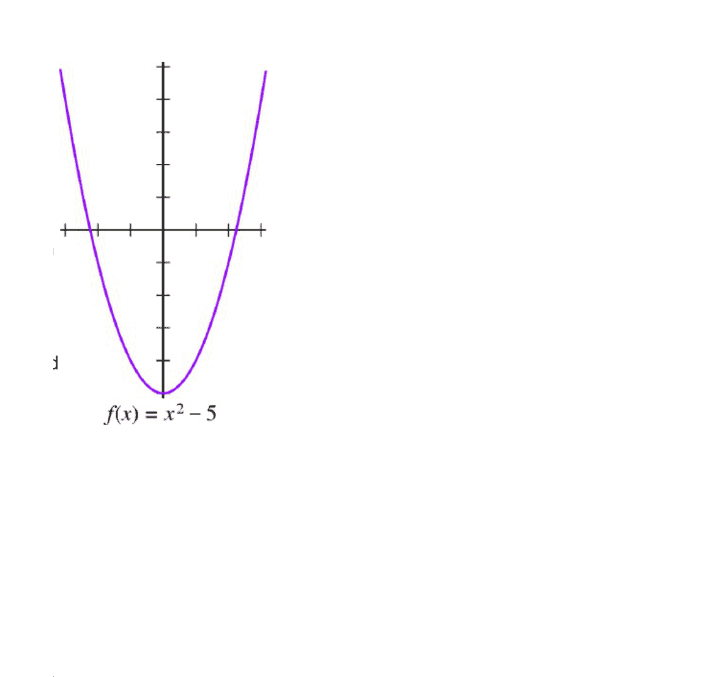

## 在 JavaScript 中实现函数

编写函数的过程最好通过示例来介绍。数学函数在 JavaScript 中的实现如下：

```
function f(x) {
    return x * x - 5;
}
```

在这个定义中，`x` 是形参变量，由调用者传递的实参来设定。例如，如果你调用`f(2)`，变量`x`将被设置为值 2。`return`语句指定了计算结果所需的运算。将`x`与自身相乘得到值 4；减去 5 得到最终结果 -1，该结果被传回给调用者。

一旦你定义了函数`f`，你就可以在控制台中这样调用它：

```
JavaScript Console
> f(0)
-5
> f(2)
-1
> f(-3)
4
>
```

形参变量和在`let`语句中引入的变量只能在它们出现的上下文——目前始终是函数——中访问。因此，这些变量被称为**局部变量**。相比之下，在函数外部声明的变量是**全局变量**，可以在程序中的任何地方使用。随着程序的增大，使用全局变量会使这些程序更难以阅读和维护。因此，本书中的程序避免使用除常量以外的任何全局变量。所以，将`PI`声明为全局变量是可以接受的，但值可能变化的变量始终是局部的。

假设你已经按照第 48 页所示定义了常量`PI`，你可以使用以下函数来计算圆的面积：

```
function circleArea(r) {
    return PI * r * r;
}
```

要调用`circleArea`函数，你只需指定半径的值即可。例如，给定上述`PI`和`circleArea`的定义，你可以在控制台窗口中执行以下命令：

```
JavaScript Console
> circleArea(1)
3.141592653
> circleArea(10)
314.1592653
>
```

你可以使用函数来计算那些在实际场景中出现但基本超出传统数学范围的值。例如，如果你到美国以外的地方旅行，你会发现世界其他地区使用摄氏度而非华氏度来测量温度。将摄氏温度转换为华氏温度等值的公式是

$$ F = \frac{9}{5}C + 32 $$

你可以轻松地将其翻译为以下 JavaScript 函数：

```
function celsiusToFahrenheit(c) {
    return 9 / 5 * c + 32;
}
```

`celsiusToFahrenheit`的使用在以下示例运行中进行了演示：

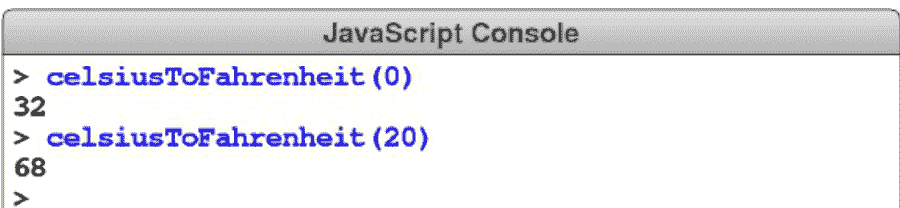

函数可以接受多个参数，在这种情况下，定义中的形参名和调用中的实参值都用逗号分隔。例如，函数

```
const INCHES_PER_FOOT = 12;
const CENTIMETERS_PER_INCH = 2.54;
```

```
function feetAndInchesToCentimeters(feet, inches) {
    let totalInches = feet * INCHES_PER_FOOT + inches;
    return totalInches * CENTIMETERS_PER_INCH;
}
```

将以英尺和英寸指定的长度转换为等值的厘米长度。

当你调用函数`feetAndInchesToCentimeters`时，必须按照形参列表指定的顺序提供实参。第一个实参指定英尺数，第二个指定英寸数。以下示例运行展示了对`feetAndInchesToCentimeters`的三次调用：第一次表明一英寸等于 2.54 厘米，第二次表明一英尺等于 30.48（12 × 2.54）厘米，第三次表明八英尺四英寸（共 100 英寸）对应的长度为 254 厘米：

```
> feetAndInchesToCentimeters(0, 1)
2.54
> feetAndInchesToCentimeters(1, 0)
30.48
> feetAndInchesToCentimeters(8, 4)
254
>
```

尽管 JavaScript 函数可以接受多个参数，但一个函数只能返回一个结果。因此，不可能编写一个 JavaScript 函数来将厘米长度转换为两个独立的值，其中一个表示完整的英尺数，另一个表示剩余的额外英寸数。正如你将在本章后面以及之后看到的，有几种策略可以让你接近实现这一目标。

第一个参数指定英尺数，第二个参数指定英寸数。以下示例展示了对 `feetAndInchesToCentimeters` 的三次调用：第一次展示一英寸等于 2.54 厘米，第二次展示一英尺等于 30.48（12 × 2.54）厘米，第三次展示八英尺四英寸（共 100 英寸）对应 254 厘米的长度：

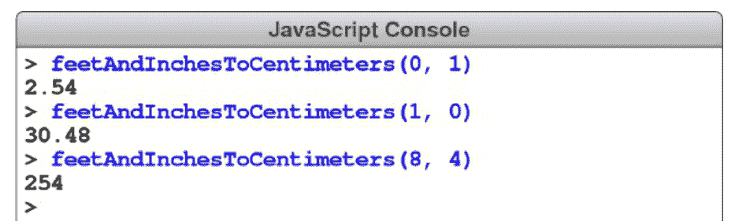

虽然 JavaScript 函数可以接受多个参数，但一个函数只能返回一个结果。因此，无法编写一个 JavaScript 函数将厘米长度转换为两个独立的值，其中一个表示英尺的整数部分，另一个表示剩余的额外英寸数。正如你将在本章后面以及 中看到的，有几种策略可以让你接近实现这一目标。

## 库函数

与所有现代语言一样，JavaScript 预定义了某些函数集合和其他有用的定义，并将这些集合作为**库**提供给程序员。JavaScript 中最有用的库之一是 `Math` 库，它包含一些在编写程序时经常会用到的数学定义，即使这些程序看起来并不特别涉及数学运算。

与 JavaScript 中大多数内置库一样，`Math` 库是作为**类**的一部分来实现的，目前你可以简单地将其理解为一个统一相关定义集合的结构。 列出了 `Math` 库中可用的若干常量和函数。

## JavaScript Math 库中的精选常量和函数

### 数学常量

| 函数 / 常量 | 描述 |
|---|---|
| Math.PI | 数学常量 π。 |
| Math.E | 数学常量 e，即自然对数的底数。 |

### 通用数学函数

| 函数 | 描述 |
|---|---|
| Math.abs(x) | 返回 x 的绝对值。 |
| Math.max(x, y, ...) | 返回参数中的最大值。 |
| Math.min(x, y, ...) | 返回参数中的最小值。 |
| Math.sqrt(x) | 返回 x 的平方根。 |
| Math.round(x) | 返回最接近 x 的整数。 |
| Math.floor(x) | 返回小于或等于 x 的最大整数。 |
| Math.ceil(x) | 返回大于或等于 x 的最小整数。 |

### 对数和指数函数

| 函数 | 描述 |
|---|---|
| Math.exp(x) | 返回 x 的指数函数值（e^x）。 |
| Math.log(x) | 返回 x 的自然对数（以 e 为底）。 |
| Math.log10(x) | 返回 x 的常用对数（以 10 为底）。 |
| Math.pow(x, y) | 返回 x^y。 |

### 三角函数

| 函数 | 描述 |
|---|---|
| Math.cos(theta) | 返回弧度角 theta 的余弦值。 |
| Math.sin(theta) | 返回弧度角 theta 的正弦值。 |
| Math.tan(theta) | 返回弧度角 theta 的正切值。 |
| Math.atan(x) | 返回 x 的主反正切值，范围在 -π/2 到 +π/2 之间。 |
| Math.atan2(y, x) | 返回 x 轴与从原点到 (x, y) 的连线之间的夹角。 |

### 随机数生成器

| 函数 | 描述 |
|---|---|
| Math.random() | 返回一个大于等于 0 但严格小于 1 的随机数。 |

在 JavaScript 中，你可以通过编写类名、一个点号以及要使用的常量或函数名称来使用类中提供的功能。例如，表达式 `Math.PI` 表示 `Math` 类中名为 `PI` 的常量，该常量被定义为尽可能接近数学常量 π 的近似值。同样，函数调用 `Math.sqrt(2)` 返回 2 的平方根的最佳近似值。

你可以在编写自己的函数时使用 `Math` 类中的函数。以下函数使用勾股定理计算从原点到点 (*x*, *y*) 的距离：

```
function distance(x, y) {
    return Math.sqrt(x * x + y * y);
}
```

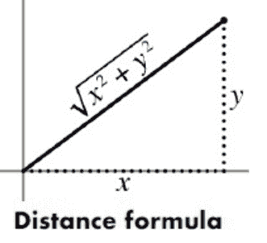

## 距离公式

## 字符串数据

到目前为止，本章中的编程示例仅处理数字数据。如今，计算机处理字符串数据的频率高于数字数据，字符串数据是对由单个字符组成的信息的统称。现代计算机处理字符串数据的能力推动了短信、电子邮件、文字处理系统、社交网络以及各种其他有用应用的发展。

从概念上讲，**字符串**是作为一个整体看待的一系列字符。与大多数现代语言一样，JavaScript 将字符串作为内置类型包含在内，在程序中通过将字符序列用引号括起来表示。例如，字符串 `"JavaScript"` 是一个由十个字符组成的序列，包括两个大写字母和八个小写字母。出自哈姆雷特独白的字符串 `"To be, or not to be"` 是一个由 19 个字符组成的序列，包括 13 个字母、五个空格和一个逗号。

JavaScript 允许你使用单引号或双引号来指定字符串，但最好选择一种风格并始终保持一致。本书中的程序使用双引号，主要是因为这种约定在各种编程语言中都很常见。唯一的例外是当字符串本身包含双引号时，例如 `'"'`，它指定一个由双引号组成的一字符字符串。你也可以通过在引号前加上反斜杠字符（\\）将引号包含在字符串中。因此，你也可以将包含双引号的一字符字符串写为 `"\""`。

在大多数情况下，你可以像使用数字一样将字符串作为 JavaScript 数据类型使用。例如，你可以声明字符串变量并为其赋值，就像处理数字变量一样。例如，声明

```
let name = "Eric";
```

声明了一个名为 `name` 的变量，并将其初始化为四字符字符串 "Eric"。与本章前面用于声明数字变量的代码一样，表示字符串值变量的最简单方法是画一个方框，名称写在外部，值写在内部，如下所示：

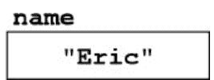

引号不是字符串的一部分，但仍然包含在方框图中，以便更容易看清字符串的起始和结束位置。

类似地，你可以声明字符串常量，如下例所示：

```
const ALPHABET = "ABCDEFGHIJKLMNOPQRSTUVWXYZ";
```


## 字符串操作

在[数据类型]中，你了解到数据类型由两个属性定义：一个*值域*和一组*操作*。对于字符串，其值域是所有字符序列的集合。在 JavaScript 中，大多数字符串操作都作为 `string` 类的一部分来定义，这些内容将在[字符串类]中详细说明。目前，只需学习两个字符串操作就足够了：

+   1.  确定字符串的长度。
    2.  将两个字符串首尾相接，这被称为**连接**。

在 JavaScript 中，你可以通过在字符串表达式末尾添加 **.length** 来确定其长度。例如，`ALPHABET.length` 的值为 26。

JavaScript 使用 + 运算符来指定连接，该运算符也用于数字的加法。当 JavaScript 计算 + 运算符时，它首先检查操作数的类型。如果两个操作数都是数字，JavaScript 将 + 运算符解释为加法。如果任一或两个操作数是字符串，JavaScript 将 + 运算符解释为连接。例如，表达式

```
2 + 2
```

的值为 4，因为 + 的两个操作数都是数字。相反，

```
"abc" + "def"
```

会产生一个六字符的字符串 "abcdef"。

在这个例子中，重要的是要观察连接运算符**不会**在单词之间引入空格字符或任何其他分隔符。如果你想将两个字符串组合成一个表示两个不同单词的单一字符串，你必须显式地包含空格。例如，假设变量 `greeting` 包含字符串 "Hello"，变量 `name` 包含字符串 "Eric"，表达式

```
greeting + " " + name
```

会产生一个十字符的字符串 "Hello Eric"。

连接运算符还允许你将字符串数据与其他数据类型组合。如果 + 的一个操作数是字符串，但另一个是其他类型的值，JavaScript 会在执行连接之前自动将该值转换为字符串。例如，表达式

```
"Fahrenheit " + 451
```

会产生字符串 "Fahrenheit 451"，因为 JavaScript 在组合字符串之前将数字值 451 转换为字符串 "451"。

## 编写简单的字符串函数

尽管你需要来自[字符串类]的额外操作来编写比最简单的字符串函数更复杂的功能，但值得看看几个仅使用连接运算符的例子。

以下函数

```
function doubleString(str) {
    return str + str;
}
```

返回提供的字符串的两个副本连接在一起。此函数支持以下示例运行：

```
JavaScript Console
> doubleString("a")
aa
> doubleString("boo")
booboo
> doubleString("hots")
hotshots
>
```

同样，你可以使用下面的函数在单词末尾添加字符串 "s" 来创建简单的复数形式：

```
function simplePlural(word) {
    return word + 's';
}
```

此函数并非适用于所有英语单词，许多单词根据词尾辅音的不同需要添加 'es' 而不是 's'。你将在[条件逻辑]中有机会解决这个更复杂的问题。

你还可以使用连接运算符为本章前面提出的将厘米距离转换为等效的英尺和英寸距离的问题提供一个部分解决方案。虽然 JavaScript 不允许你从一个函数返回两个单独的值，但你可以通过返回一个包含两个所需值的字符串来显示正确答案，如以下函数所示，该函数使用了本章前面介绍的相同常量：

```
function centimetersToFeetAndInches(cm) {
    let totalInches = cm / CENTIMETERS_PER_INCH;
    let feet = Math.floor(totalInches/INCHES_PER_FOOT);
    let inches = totalInches % INCHES_PER_FOOT;
    return feet + 'ft ' + inches + 'in';
}
```

以下控制台日志显示了对 `centimetersToFeetAndInches` 的三次调用，分别对应之前由 `feetAndInchesToCentimeters` 产生的三个值：

```
> centimetersToFeetAndInches(2.54)
0ft 1in
> centimetersToFeetAndInches(30.48)
1ft 0in
> centimetersToFeetAndInches(254)
8ft 4in
>
```

## 在浏览器中运行 JavaScript

尽管前面示例中使用的 JavaScript 控制台允许你查看 JavaScript 如何计算表达式和简单函数，但它并不能让你了解 JavaScript 如何运行一个完整的程序。JavaScript 被设计为 *World Wide Web*（通常简称为 *web*）的编程语言——web 是一个由全球计算机网络连接的庞大文档集合。JavaScript 程序通常在 Web 浏览器的控制下运行。当你访问一个包含 JavaScript 内容的页面时，你的浏览器会执行 JavaScript 程序以在屏幕上显示其输出。接下来的章节将向你展示如何将简单的 JavaScript 程序嵌入到网页中。

## "Hello World" 程序

正如学习编程时通常的情况一样，了解 JavaScript 程序如何工作的最好方法是看一个例子。尽管许多例子都可以使用，但计算机科学的文化史表明，有一个适合作为任何语言第一个示例的程序。这个编程问题首次出现在 Brian Kernighan 和 Dennis Ritchie 的 *The C Programming Language* 一书中，他们在 [前言] 的第一页提出了以下建议：

> 学习一门新的编程语言的唯一方法就是用它编写程序。所有语言的第一个程序都是一样的：
> 
> ```
> 打印文字
> 
> Hello, world
> ```
> 
> 这是最大的障碍；要跨越它，你必须能够在某个地方创建程序文本，成功编译它，加载它，运行它，并找出输出去了哪里。掌握了这些机械细节后，其他一切都相对容易了。

这个建议之后是 "Hello World" 程序的四行文本，它成为了所有 C 程序员共同遗产的一部分。

尽管 JavaScript 是从 C 派生出的众多语言之一，但 "Hello World" 程序在两种语言中看起来并不完全相同。即便如此，Kernighan 和 Ritchie 的建议仍然有效：你编写的第一个程序应该尽可能简单，这样你就可以将注意力集中在编程过程的机制上。你的任务——而且你*应该*决定接受它——是让 JavaScript 版本的 "Hello World" 在浏览器中运行。该程序的 JavaScript 版本，附有说明性注释以表示对原作者的致敬，出现在[Hello World 程序]中。


尽管 JavaScript 是众多从 C 语言衍生出的语言之一，但这两门语言中的 "Hello World" 程序看起来并不完全相同。即便如此，柯尼汉和里奇的建议依然适用：你编写的第一个程序应该尽可能简单，以便你能专注于编程过程的机制。你的任务——而且你*绝对*应该决定接受它——是让 JavaScript 版本的 "Hello World" 在浏览器中运行起来。该程序的 JavaScript 版本，包含了向原作者致敬的说明性注释，如下所示：

## JavaScript 中的 "Hello World" 程序

```
/*
 * 文件: HelloWorld.js
 * -------------------
 * 该程序在控制台显示 "hello, world"。其灵感源于
 * 布莱恩·柯尼汉和丹尼斯·里奇的经典著作《C程序设计语言》中的第一个程序。
 */

function HelloWorld() {
    console.log("hello, world");
}
```

撇开注释不谈，程序本身仅由一个函数定义组成，其函数体只有一行，如下所示：

```
    function HelloWorld() {

            console.log("hello, world");

    }
```

`HelloWorld` 函数的函数体调用了内置函数 `console.log`，并请求它在 JavaScript 控制台上显示字符串 "hello, world"。

到目前为止，一切似乎都相当简单明了。然而，正如柯尼汉和里奇所指出的，难点在于弄清楚如何在某个地方创建程序文本，如何成功编译它、加载它、运行它，并找出输出去向了哪里。这些操作——它们所涉及的步骤与柯尼汉和里奇写作的时代已不完全相同——会因你碰巧使用的编程工具而异。

你至少需要两个应用程序才能开始。首先，你需要一个**文本编辑器**，它将允许你创建 JavaScript 程序文件。所有现代计算机都自带某种文本编辑器，但如果你使用的编辑器能很好地理解 JavaScript 的结构，足以捕捉简单的排版错误，并通过以不同颜色显示各种编程结构来帮助你理解它们的功能，那么你编写程序会更容易。其次，你需要一个能读取和显示网页的**网络浏览器**。你使用哪个浏览器并不重要，只要它足够现代，能够解释 2015 年发布的 JavaScript 第 6 版即可。如果你使用的浏览器比那个版本更旧，你应该将浏览器更新到当前版本。

你需要做的第一件事是使用编辑器，完全按照上文所示输入 `HelloWorld.js` 程序，然后将其保存在计算机上的一个新文件夹中。然而，这一步只是让你在浏览器中运行程序的部分途径。为了完成任务，你需要了解更多关于 Web 的结构以及如何在网页中嵌入 JavaScript 程序。

# JavaScript 与 Web

万维网上的每个页面都由一个**统一资源定位符**或 **URL** 作为其地址来标识。大多数网页都包含指向相关主题其他页面的嵌入式引用。这些引用被称为**超链接**，赋予了 Web 其互联的结构。当你在浏览器中输入一个显式的 URL 或点击一个包含嵌入式 URL 的超链接时，浏览器会获取该地址的网页内容。对于大多数网页，浏览器使用一种称为***超文本传输协议***——在 URL 开头以 `http:` 或其安全对应项 `https:` 为前缀——的交互方案来读取页面内容。然后浏览器解释页面内容并将其显示在屏幕上。

现代网页使用三种不同但相互关联的技术来定义页面内容：

- 1. 页面的结构和内容使用用***超文本标记语言***或 **HTML** 编写的文件来定义。
- 2. 页面的视觉外观使用***层叠样式表***或 **CSS** 来指定。
- 3. 页面的任何交互行为都使用一个或多个文件来表示，这些文件通常用 JavaScript 编写。

如果你想创建专业级质量的网页，你需要了解一些关于这些技术的知识。因为本书侧重于 JavaScript 编程，所以早期章节只介绍了足够让你运行 JavaScript 程序的 HTML 和 CSS 知识。更详细地介绍了这些技术。

## JavaScript 程序的 HTML 模板

每个网页都关联一个 HTML 文件——按照惯例，通常命名为 `index.html` ——该文件描述了页面的内容。具体来说，`index.html` 文件被组织成一系列由尖括号括起来的关键字标记的部分，这些关键字在 HTML 中称为**标签**。正如你在本节后面的示例中将看到的，一些标签在结束尖括号之前包含了额外的信息。这些额外的字段称为**属性**。

`index.html` 文件以一个特殊的标签开始，该标签将文件标记为标准 HTML 索引：

```
<!DOCTYPE html>
```

在 `<!DOCTYPE>` 标签之后，HTML 标签通常成对出现。第一个标签打开 HTML 文件的一个部分。第二个标签使用相同的关键字，并在前面加上斜杠字符，关闭该部分。例如，`index.html` 文件中的整个 HTML 文本以名为 `<html>` 的标签开始，以相应的结束标签 `</html>` 结束。为了让读者清楚地了解 HTML 文件中哪些部分包含在每对标签内，开始标签和结束标签之间的行通常会缩进。

一个标准的 HTML 文件在 `<html>` 和 `</html>` 标记之间包含两个部分。第一个是 `<head>` 部分，它定义了整个页面的特性；第二个是 `<body>` 部分，它定义了页面内容。与其他成对标记一样，`<head>` 和 `<body>` 部分分别以 `</head>` 和 `</body>` 标签结束。

对于简单的基于 JavaScript 的网页，`<head>` 部分包含两种类型的内部标签。第一种是 `<title>` 部分，它定义了出现在网页顶部的标题。`<title>` 部分的形式为

```
<title>whatever title you want to use</title>
```

其中你可以将斜体文本替换为任何你想要用作标题的文本。按照惯例，本书中的网络程序使用程序文件的名称作为标题，因此 HelloWorld.js 程序的 `<title>` 部分将是

```
<title>HelloWorld</title>
```


`<head>` 部分的另一个组成部分是一个或多个 `<script>` 标签，这些标签指定了要加载的 JavaScript 文件的名称。每个 `<script>` 标签都遵循以下格式：

```
<script src="filename"></script>
```

在此模式中，你需要将 *filename* 标记替换为文件的实际名称。例如，要加载 `HelloWorld.js`，你会使用以下标签：

```
<script src="HelloWorld.js"></script>
```

随着你的程序变得更大、更复杂，它们通常需要不止一个 JavaScript 文件。在某些情况下，这些额外的 JavaScript 文件是通用库，但在另一些情况下，将复杂的应用程序细分为几个 JavaScript 文件是有意义的，每个文件负责完整程序的一部分。无论哪种情况，你都需要在 `<head>` 部分包含额外的 `<script>` 标签，以加载你的应用程序所需的任何 JavaScript 库或程序组件。

虽然“Hello World”程序从技术上讲不需要任何库，但在 `<head>` 部分添加一个库确实会让你作为程序员的生活轻松许多。请记住，克尼根和里奇的检查清单中，你的任务之一就是“找出输出去了哪里”。大多数浏览器使控制台日志难以找到，这主要是为了尽量减少普通网络用户的困惑，他们很容易被出现在控制台日志中的消息分散注意力。为了使控制台输出更容易找到，本书中使用的 `index.html` 文件包含以下 `<script>` 标签，用于加载一个名为 `JSConsole.js` 的库，该库将控制台日志显示为网页本身的一部分：

```
<script src='JSConsole.js'></script>
```

对于不包含其他内容的简单 JavaScript 网页，`<body>` 部分将是空的，开始和结束标签之间没有任何内容。然而，`<body>` 标签必须指定一个 `onload` 属性以启动程序。`onload` 属性的值是一个 JavaScript 表达式，通常是一个函数调用。例如，为了在页面加载完所有必要的 JavaScript 代码后触发对 `HelloWorld` 函数的调用，`onload` 属性的值应为 `'HelloWorld()'`。

`index.html` 文件对于“Hello World”程序的完整内容出现在[示例文件]中。你可以将此文件作为模板，用于创建你需要实现其他基于 JavaScript 的网页的 `index.html` 文件。

## "Hello World" 程序的 index.html 文件

```
<!DOCTYPE html>
<html>
  <head>
    <title>HelloWorld</title>
    <script src="JSConsole.js"></script>
    <script src="HelloWorld.js"></script>
  </head>
  <body onload="HelloWorld()"></body>
</html>
```

## 测试与调试

尽管有时对于极其简单的程序你可能会很幸运，但作为程序员，你很快不得不接受的事实之一是，你的程序很少能在第一次运行时正确执行。大多数时候，你需要花费相当一部分时间来测试程序是否正常工作，发现它不工作，然后进入**调试**过程，在这个过程中你找到并修复代码中的错误。

关于调试在编程过程中的核心地位，或许最引人注目的描述来自英国计算先驱莫里斯·威尔克斯（1913–2010），他在 1979 年根据其早年在该领域的经验提出了如下反思：

> 我们一开始编程，就惊讶地发现，让程序正确运行并不像我们想象的那么容易。我们不得不去发现调试。我记得确切的那一刻，我意识到从那时起，我生命中的很大一部分时间将花在找出自己程序中的错误上。

## 莫里斯·威尔克斯

(Science and Society Picture Library/Getty Images)

莫里斯·威尔克斯

(Science and Society Picture Library/Getty Images)

## 防御性编程

尽管完全避免缺陷是不可能的，但通过在编程过程中保持谨慎，你可以减少缺陷的数量。正如在开车时进行防御性驾驶很重要一样，在编写代码时进行防御性编程也是明智的。防御性编程最重要的方面是检查你的程序，确保它们执行你打算让它们执行的操作。你也会发现，花时间让你的代码尽可能清晰易读，将有助于避免未来出现的问题。

然而，你可以让 JavaScript 帮助你。早期版本的 JavaScript 过于宽松，未能检查常见的编程错误，例如忘记声明变量。在标准的 JavaScript 中，忘记声明变量不会生成错误消息；相反发生的是，JavaScript 会自动将该变量创建为整个 Web 文档的一部分，而这通常不是程序员的本意。

现代版本的 JavaScript 允许你在 JavaScript 文件开头包含一行

```
"use strict";
```

来启用更严格的检查。这样做使得 JavaScript 解释器能够更好地识别代码中的潜在问题。从这里开始，本书中的所有程序都将使用此特性。

## 成为一名优秀的调试者

调试是编程中最具创造性和智力挑战性的方面之一。然而，它也可能令人非常沮丧。如果你刚开始学习编程，调试中令人沮丧的方面可能远比遇到有趣智力挑战的兴奋感更为突出。这本身并不奇怪。毕竟，调试是一项需要时间学习的技能。在你获得必要的经验和专业知识之前，你进入调试世界的尝试常常会让你面对一个完全神秘的问题，而你却不知道如何解决。当你的作业第二天就要交，而你却因无法解决那个谜题而毫无进展时，沮丧可能是最自然的反应。

在很大程度上，人们在调试过程中遇到的挑战与其说是技术性的，不如说是心理上的。要成为一名成功的调试者，最重要的是开始以新的方式思考，从而克服你前进道路上的心理障碍。没有神奇的、一步一步解决问题的方法，这些问题通常是你自己造成的。你需要的是逻辑、创造力、耐心以及大量的练习。

## 编程过程的各个阶段

当你在开发一个程序时，编写代码的实际过程只是更复杂智力活动的一个组成部分。在你坐下来编写代码之前，花些时间思考程序设计总是明智的。就像你在[早期章节]使用 Karel 时发现的那样，通常有许多方法可以将一个大问题分解成更易于管理的部分。在开始编写各个函数之前，对这种分解的设计进行一些思考，几乎肯定可以减少整个项目所需的总时间“和挫败感”。编写代码后，你需要测试它是否有效，并且很可能需要花些时间找出阻止程序按你意愿运行的缺陷。

这四个活动——设计、编码、测试和调试——构成了编程过程的主要组成部分。虽然确实存在一些顺序上的限制（例如，你无法调试尚未编写的代码），但将这些阶段视为严格顺序进行的，是一个错误。学生遇到的最大问题在于认为设计并编码整个程序然后尝试让它整体运行是有意义的。专业程序员从不这样工作。他们进行初步设计，编写部分代码，测试...

将这些片段组装起来，测试它们是否按预期工作，然后修复测试中发现的错误。只有在该独立片段正常工作后，专业程序员才会返回去编写、测试和调试程序的下一个部分。他们会不时地回头审视设计，因为他们从实际观察原设计效果的经验中学习。你必须学会以大致相同的方式工作。

同样重要的是要认识到，编程过程的每个阶段都需要一种根本不同的方法。当你在各个阶段之间来回切换时，你需要采用不同的思维方式。根据我的经验，阐明这些方法差异的最佳方式是将每个阶段与一个依赖于相同技能和思维方式的职业联系起来。

在设计阶段，你必须像*建筑师*一样思考。你不仅需要理解必须解决的问题，还需要理解不同解决方案策略背后的美学。这些美学判断并非完全不受约束。你知道需要什么，你认识到什么是可能的，并在这些约束条件下选择最佳设计。

## 编程过程中的阶段与角色

- 设计 = 建筑师
- 编码 = 工程师
- 测试 = 破坏者
- 调试 = 侦探

当你进入编码阶段，你的角色转变为*工程师*。现在你的工作是运用你对编程的理解，将理论设计转化为实际实现。这个阶段绝非机械操作，需要大量的创造力，但你的目标是生成一个你相信实现了设计的程序。

在许多方面，测试阶段是这个过程中最难理解的方面。当你扮演测试者时，你的角色不是要证明程序能工作，恰恰相反。你的工作是破坏它。因此，测试者需要扮演*破坏者*的角色。你需要刻意寻找任何可能出错的地方，并在发现任何缺陷时感到真正的乐趣。正是在这个编程阶段，会出现最困难的心理障碍。作为编码者，你希望程序能工作；作为测试者，你希望它失败。许多人难以在这种方式上转移注意力。毕竟，当你恰好就是那个编码者时，很难对你指出的愚蠢错误感到过度高兴。即便如此，你也需要做出这种转变。

最后，你在调试阶段的工作是*侦探*。测试过程揭示了错误的存在，但并不一定揭示它们发生的原因。你在调试阶段的工作是梳理所有可用的证据，对哪里出了问题提出假设，通过额外的测试来验证该假设，然后进行必要的纠正。

与测试一样，当你扮演侦探角色时，调试阶段也充满了心理陷阱。当你以工程师身份编写代码时，你相信当你以建筑师身份设计它时它是正确工作的。你现在必须发现它为什么不行，这意味着你必须抛弃从早期阶段保留下来的任何先入之见，并以全新的视角来处理问题。成功做出这种转变始终是一个困难的挑战。你曾经认为正确的代码，在你第二次回来看时，很可能看起来同样正确。

你需要记住的是，测试阶段已经确定程序没有正确工作。某个地方肯定有问题。不是浏览器或JavaScript出了问题，也不是什么不幸的行星连珠。正如莎士比亚的《朱利叶斯·凯撒》中卡西斯提醒布鲁图斯的那样，“亲爱的布鲁图斯，错不在我们的星辰，而在我们自己。”当你编写代码时引入了错误，找到它就是你的工作。

本书将在你学习编写更复杂程序时提供关于调试的额外建议，但以下原则将比任何特定的调试策略或技术更有用：

> 当你试图找到一个错误时，理解你的程序正在做什么比理解它应该做什么更重要。

大多数人在代码中遇到问题时，会回到原始问题，试图弄清楚为什么他们的程序没有做他们想要的事情。尽管在某些情况下这种方法可能有帮助，但更有可能的是，这种思维方式会让你对真正的问题视而不见。如果你第一次做出了毫无根据的假设，你很可能再次这样做，从而看不到程序为什么做不对任何原因。你需要收集关于程序实际在做什么的信息，然后尝试找出它在哪里出错了。

尽管许多现代浏览器配备了复杂的JavaScript调试器，但你很可能从`console.log`函数中获得最大收益。如果你发现程序不能工作，在你认为程序可能走上错误路径的地方添加几处对`console.log`的调用。在某些情况下，只需在程序中包含这样一行代码就足够了：

```
console.log("I got here");
```

如果控制台显示消息`"I got here"`，你就知道程序已经到达了代码中的那个位置。让`console.log`调用显示一个重要变量的值通常更有帮助。例如，如果你期望变量`n`在代码中的某个点具有值100，你可以添加这行代码：

```
console.log("n = " + n);
```

如果运行程序显示`n`的值是0而不是100，你就知道问题出在这一点之前。缩小问题可能所在的程序区域，能让你处于更好的位置来找到并纠正错误。

由于调试过程类似于侦查艺术，似乎有必要提供一些我在侦探小说中遇到的、更相关的调试智慧，它们出现在下一页的开头。我还强烈推荐罗伯特·M·波西格广受好评的小说《禅与摩托车维修艺术：对价值的探究》（Bantam出版社，1974年），它被公认为是对调试艺术和心理学的最佳阐述。最相关的部分是第26章中对“毅力陷阱”的讨论。

## 侦探小说中的调试建议

> 对那些似乎迎合我们隐秘欲望的环境要持怀疑态度。

—埃米尔·加博里欧， 《勒考克先生》，1868年

> 没有什么比第一手证据更好的了。

—阿瑟·柯南·道尔爵士，《血字的研究》，1888年

> 在没有数据之前就进行理论化是一个严重的错误。人会不知不觉地开始扭曲事实以适应理论，而不是调整理论以适应事实。

—阿瑟·柯南·道尔爵士，《波西米亚丑闻》，1892年

> 在侦查艺术中，能够从众多事实中识别出哪些是次要的，哪些是至关重要的，是极其重要的。否则，你的精力和注意力就会被分散，而不是集中。

—阿瑟·柯南·道尔爵士，《瑞盖特的乡绅奇遇记》，1892年

> 运用方法和逻辑，人能完成任何事。

—阿加莎·克里斯蒂，《波洛探案集》，1924年

> 侦查需要一种近乎固执的耐心坚持。

—P. D. 詹姆斯，《不适合女人的工作》，1972年

> 事情总是比你想象的要困难。

—亚历山大·麦考尔·史密斯，《No. 1 女士侦探社》，1998年


## 一个心理障碍的例子

虽然大多数测试和调试挑战涉及的编程复杂度超出了本章的范围，但有一个非常简单的程序可以说明，假设是多么容易让你不仅对错误的原因视而不见，甚至对错误的存在本身也毫无察觉。在我多年教授计算机科学的过程中，学期初我最喜欢布置的题目之一就是编写一个函数来求解二次方程

$$ax^2 + bx + c = 0$$

正如你在中学所学的，这个方程有两个解，由以下公式给出

$$x = \frac{-b \pm \sqrt{b^2 - 4ac}}{2a}$$

第一个解是用 + 代替 ± 符号得到的；第二个解则是用 – 代替得到的。我给学生的问题是编写一个函数，以 *a*、*b* 和 *c* 作为参数，并显示 *x* 的两个解。

虽然大多数学生能正确解决这个问题，但总有一部分学生——在大班中可能多达20%——提交的函数大致如下：

```
function quadratic(a, b, c) {
    let root = Math.sqrt(b*b - 4*a*c);
    let x1 = (-b + root) / 2*a;
    let x2 = (-b - root) / 2*a;
    console.log(`x1 = ${x1}`);
    console.log(`x2 = ${x2}`);
}
```

正如 bug 符号所示，`quadratic` 的这个实现是不正确的，尽管问题很微妙。表达式 `2*a` *看起来*像是在分数的分母中，但实际上并非如此。在 JavaScript 中，相同优先级的运算符，例如定义 `x1` 和 `x2` 的行中的 `/` 和 `*`，按从左到右的顺序求值。因此，这些表达式中的括号内的值先除以 2，然后再乘以 `a`。二次公式要求分母是 `(2*a)` 这个整体，这意味着括号是必要的。

然而，这个例子真正的教训在于，许多学生不仅犯了错误，而且还未能发现它。大多数犯此错误的学生不会用 *a* 不等于1的系数值来测试他们的程序，因为那些是最容易手动计算的答案。如果 *a* 是 1，无论是乘以还是除以 *a* 都无关紧要，因为结果是一样的。更糟糕的是，那些用其他 *a* 值测试程序的学生往往没有注意到他们的程序给出了错误的答案。我经常收到类似这样的示例运行：

```
JavaScript Console
> quadratic(8, -6, 1)
x1 = 32
x2 = 16
>
```

这个示例运行声称 *x* = 32 和 *x* = 16 是方程

$$8x^2 - 6x + 1 = 0$$

的解，但很容易验证这两个值实际上都不满足该方程。即便如此，学生仍然兴高采烈地提交生成此示例运行的程序，完全没有注意到答案是错误的。

## 编写有效的测试程序

每当你编写一个函数时，最好编写一个配套函数来检查你的实现在大量测试用例下是否正确。下一页的示例展示了如何将 `quadratic` 函数的测试程序与函数定义一起包含在程序文件中。本书提供的每个示例程序都包含这样一个测试函数，你在自己的代码中采用这种做法是一个好习惯。在编写程序时考虑测试，将使你更容易发现代码中不时出现的 bug。

## 二次函数的实现及相关测试程序

```
/*
 * File: Quadratic.js
 * ------------------
 * This file defines the quadratic function, which solves the quadratic
 * equation given the coefficients a, b, and c.
 */

"use strict";

function quadratic(a, b, c) {
  let root = Math.sqrt(b*b - 4*a*c);
  let x1 = (-b + root) / (2*a);
  let x2 = (-b - root) / (2*a);
  console.log("x1 = " + x1);
  console.log("x2 = " + x2);
}

/* Test program */

function TestQuadratic() {
  console.log("x^2 + 5x + 6 = 0 (roots should be -2 and -3):");
  quadratic(1, 5, 6);
  console.log("");
  console.log("x^2 + x - 12 = 0 (roots should be 3 and -4):");
  quadratic(1, 1, -12);
  console.log("");
  console.log("x^2 - 10x + 25 = 0 (roots should be 5 and 5):");
  quadratic(1, -10, 25);
  console.log("");
  console.log("8x^2 - 6x + 1 = 0 (roots should be 0.5 and 0.25):");
  quadratic(8, -6, 1);
}
```

`TestQuadratic` 函数使用一系列参数对 `quadratic` 函数生成多个测试运行。此外，为了确保运行程序的人不会盲目相信计算机生成的答案，该程序会明确指出正确答案应该是什么。`TestQuadratic` 程序的完整示例运行如下：

```
Quadratic

> TestQuadratic()
x^2 + 5x + 6 = 0 (roots should be -2 and -3):
x1 = -2
x2 = -3

x^2 + x - 12 = 0 (roots should be 3 and -4):
x1 = 3
x2 = -4

x^2 - 10x + 25 = 0 (roots should be 5 and 5):
x1 = 5
x2 = 5

8x^2 - 6x + 1 = 0 (roots should be 0.5 and 0.25):
x1 = 0.5
x2 = 0.25
>
```

虽然不可能测试一个函数的所有输入，但通常可以确定一组测试用例来检查最可能的错误来源。例如，对于 `quadratic` 函数，你应该确保测试函数检查系数 *a*、*b* 和 *c* 的一系列值。同样重要的是——正如前面一节中的示例所展示的——要知道正确的答案应该是什么。

## 软件维护

软件开发中更令人惊讶的一个方面是，程序需要维护。事实上，对软件开发的研究表明，对于商业应用来说，在软件发布后雇佣程序员进行维护的费用占总成本的80%到90%。然而，在软件的语境下，很难准确想象维护究竟意味着什么。乍一听，这个概念相当奇怪。如果你从汽车或桥梁的角度来想，维护发生在东西损坏的时候——某些金属锈蚀了、某个机械连接件因过度使用而磨损了，或者某些东西在事故中被撞坏了。这些情况都不适用于软件。代码本身不会生锈。反复使用同一个程序不会以任何方式削弱其功能。意外的误用当然可能产生危险后果，但通常不会损坏程序本身；即使损坏了，程序通常也可以从备份副本中恢复。在这样的环境中，维护意味着什么？

软件需要维护主要有两个原因。首先，即使经过了大量测试，并且在某些情况下经过了多年的实际使用，bug 仍然可能潜伏在原始代码中。然后，当某些意想不到的情况出现时，之前处于休眠状态的 bug 会导致程序失败。因此，调试是程序维护的一个重要组成部分。然而，它并不是最重要的部分。影响更为深远的，尤其是就程序维护的整体成本而言，是程序需要根据不断变化的需求进行修改。用户经常希望他们的


## 程序维护与软件工程

应用程序和软件开发人员努力提供这些功能以保持客户忠诚度。无论是修复错误还是添加功能，都需要有人查看程序、弄清楚情况、进行必要的更改、验证这些更改是否有效，然后发布新版本。这个过程既困难又耗时、昂贵且容易出错。

程序维护尤其困难，因为许多程序员没有为长期使用而编写程序。对他们来说，让程序运行起来就足够了，然后转向其他事情。编写能够被他人理解和维护的程序的纪律被称为**软件工程**。在本书中，鼓励你编写展示有效软件工程实践的程序。

许多新手程序员会惊讶地发现，没有一套精确的规则可以遵循以确保良好的编程风格。软件工程不是一本按部就班的菜谱。相反，它是一种融合了相当多艺术性的技能。实践至关重要。就像学习成为小说家一样，通过 Berm 编写程序和阅读他人程序，可以学会编写结构良好的程序。成为有效的程序员需要纪律——这种纪律要求不抄近路，也不在匆忙完成项目时忘记未来的维护者。良好的编程实践还需要培养一种审美意识，即程序的可读性和良好的呈现方式意味着什么。

尽管编写可维护程序没有一成不变的规则，但确实有一些重要的原则，包括以下几点：

- 编写代码和注释时，要考虑到未来的维护者。
- 为变量、常量和函数选择能够传达其目的的名称。
- 使用缩进来突出程序的层次结构。
- 设计程序时，要使其易于随着需求的变化而修改。

列表中的最后一点值得进一步讨论。鉴于程序在其生命周期中不可避免地会发生变化，良好的编程实践是帮助未来的维护者进行必要的更改。支持持续维护的一个有用策略是，对将来可能需要更改的值使用常量定义。

使用常量定义的价值或许在历史背景下最容易说明。想象一下，你是20世纪60年代末的一名程序员，正在参与**ARPANET**的初步设计，这是今天互联网的前身。由于当时资源非常有限，ARPANET的设计者对可连接到网络的计算机数量（在ARPANET时代被称为***主机***）设定了限制。在ARPANET的早期，这个限制是127台主机。

如果JavaScript在1969年就存在，你可能会这样声明一个常量：

```javascript
const MAXIMUM_NUMBER_OF_HOSTS = 127;
```

然而，在之后的某个时间点，网络的爆发式增长将迫使你提高这个限制。

如果你已经定义了一个常量，那么进行这个更改会很容易，但如果你直接写了数字127，那就很难了。那样的话，你需要更改所有指代主机数量的127。有些127可能指代主机数量限制以外的东西，同样重要的是不要更改那些值。如果你在这个过程中犯了错误，你将很难追踪到这个错误。

在本章中，你已经开始学习JavaScript编程之旅，通过几个示例程序介绍了两种不同的数据类型：数字和字符串。本章介绍的要点包括：

- 本书的主要重点不是JavaScript语言本身，而是你需要理解编程基础的原则。为了减少你需要掌握的语言细节，本书依赖于道格拉斯·克罗克福德（其贡献在本章开头描述）所确定的JavaScript的“**好部分**”的特性。
- 数据值有许多不同的类型，每种类型都由一个*域*和一个*操作集*定义。
- JavaScript中的数字采用传统的十进制表示法。JavaScript还允许你通过添加字母**e**和一个指数来表示科学记数法，该指数表示数字乘以10的幂。
- 表达式由通过*运算符*连接的单个*项*组成。运算符适用的子表达式称为其*操作数*。
- 运算顺序由*优先级*规则决定。运算符及其优先级的完整表格见第**44**页。
- JavaScript中的*变量*有两个属性：名称和值。JavaScript程序中使用的变量使用以下形式的行进行*声明*：

```javascript
let identifier = expression;
```

这建立了变量的名称和初始值。

- *常量*用于指定程序中不会更改的值。你可以通过将声明中的关键字`let`替换为关键字`const`来在JavaScript中声明常量。按照惯例，常量的名称全部大写，并使用下划线标记单词边界。

- 你可以通过*赋值语句*来更改变量的值。当你将一个新值赋给变量时，任何先前的值都会丢失。

- JavaScript包括一种赋值的简写形式，其中语句

```javascript
variable op= expression;
```

等效于较长的表达式

```javascript
variable = variable op (expression);
```

- JavaScript包括运算符`++`和`--`，它们分别对变量加1和减1。这些运算符可以出现在操作数之前或之后。放置位置决定了操作是在获取值之前还是之后发生。

- *函数*是一段被组织成一个独立单元并赋予一个名称的代码。程序的其他部分可以*调用*该函数，可能传递*参数*并接收该函数*返回*的结果。

- 在函数体内声明的变量称为*局部变量*，仅在该函数内可见。在任何函数外部声明的变量是*全局变量*，可以在程序中的任何地方使用。本书避免使用全局变量，因为它们使程序更难维护。
- 返回值的函数必须有一个指定结果的`return`语句。函数可以返回任何类型的值。
- JavaScript的`Math`库定义了各种实现标准数学函数（如`sqrt`、`sin`和`cos`）的函数。更常见的数学函数列表见第**52**页。
- *字符串*是作为一个单元取在一起的字符序列。在JavaScript中，你通过将字符括在引号中来编写字符串。JavaScript接受单引号或双引号来达到此目的。
- 尽管字符串支持更多将在后面介绍的操作，但本章和接下来几章的示例仅使用`length`字段和`+`运算符。如果`+`的两个操作数都是数字，则值相加；如果任一操作数是字符串，则两个操作数都转换为字符串并*连接*在一起。
- 在编程语言C的定义性文档中，布莱恩·柯林汉和丹尼斯·里奇建议，用任何语言编写的第一个程序应该是打印字符串**"hello, world"**。本书遵循他们的建议。
- JavaScript是为配合万维网使用而设计的。JavaScript程序通常在Web浏览器的上下文中运行。


## Web技术与编程过程

-   现代网页使用三种不同的技术来定义网页内容。页面的结构和内容使用 *HTML（超文本标记语言）* 定义，视觉外观使用 CSS（*层叠样式表*）指定，而交互行为则使用 *JavaScript* 定义。
-   每个在浏览器中运行的 JavaScript 程序都必须包含一个 `index.html` 文件，该文件定义页面的整体结构，加载必要的 JavaScript 程序和库，并指定页面加载时要执行的 JavaScript 表达式。这些 `index.html` 文件具有常规形式，如 示例 所示。
-   JavaScript 文件通过 `index.html` 文件中的 `<script>` 标签加载到浏览器中，每个标签具有以下形式：

```
<script src="filename"></script>
```

-   编程过程的四个阶段是 *设计、编码、测试* 和 *调试*，尽管最好将这些阶段视为相互关联而非顺序进行的。专业程序员通常编写程序的一部分，测试它，调试它，然后回头处理下一部分。
-   编程过程中的每个阶段都需要你以不同的方式行事。在设计阶段，你扮演 *架构师* 的角色。在编码时，你充当 *工程师*。在测试期间，你必须像 *破坏者* 一样行事，努力破坏程序，而不是证明它能工作。在调试时，你需要像 *侦探* 一样思考，运用夏洛克·福尔摩斯的智慧和洞察力。
-   当你试图查找错误时，理解你的程序 *正在* 做什么比理解它 *没有* 做什么更重要。
-   在试图理解你的程序正在做什么时，你最有帮助的资源是 `console.log` 函数。
-   程序员在测试和调试阶段面临的最严重问题是心理上的，而不是技术上的。让假设和愿望妨碍理解问题所在是极其容易发生的。
-   一个良好的编程实践是在你编写的任何函数定义中包含测试程序。
-   程序在其生命周期内需要维护，既为了纠正错误，也为了在用户需求变化时添加新功能。

### 复习题

1.  定义数据类型的两个属性是什么？

2.  识别以下哪些是 JavaScript 中的合法数字：
    a. `42`
    b. `-17`
    c. `2+3`
    d. `-2.3`
    e. `20`
    f. `2.0`
    g. `1,000,000`
    h. `3.1415926`
    i. `123456789`
    j. `0.000001`
    k. `1.1E+11`
    l. `1.1X+11`

3.  使用 JavaScript 的科学计数法形式重写以下数字：
    a. `6.02252 × 10²³`
    b. `29979250000.0`
    c. `0.00000000529167`
    d. `3.1415926535`

    顺便说一下，这些值中的每一个都是一个重要的科学或数学常数的近似值：（a）阿伏伽德罗常数，即一摩尔化学物质中的分子数；（b）光速，单位为厘米每秒；（c）玻尔半径，单位为厘米，是电子在其最低能量状态下绕氢原子轨道的平均半径；以及（d）数学常数π。对于π，使用科学计数法形式没有优势，但这样做肯定是合法的。

4.  指出以下哪些是 JavaScript 中的合法变量名：
    a. x
    b. formula1
    c. average_rainfall
    d. %correct
    e. short
    f. tiny
    g. total\u00c0 output
    h. aReasonablyLongVariableName
    i. 12MonthTotal
    j. marginal-cost
    k. b4hand
    l. _stk_depth

5.  `%` 运算符在 JavaScript 中表示什么？

6.  正确还是错误：`-` 运算符在操作数前用于表示取负时，与其用于表示减法时具有相同的优先级。

7.  通过应用适当的优先级规则，计算以下每个表达式的结果：
    a. 6 + 5 / 4 - 3
    b. 2 + 2 * (2 * 2 - 2) % 2 / 2
    c. 10 + 9 * ((8 + 7) % 6) + 5 * 4 % 3 * 2 + 1
    d. 1 + 2 + (3 + 4) * ((5 * 6 % 7 * 8) - 9) - 10

8.  你会使用哪个简写赋值语句将变量 `salary` 的值乘以 2？

9.  在 JavaScript 中，编写与以下语句效果相同的语句，最常用的方式是什么？

```
x = x + 1;
```

10. 用自己的话解释递增和递减运算符的前缀形式和后缀形式之间的区别。

11. 以下每个表达式的值是什么：
    a. `Math.round(5.99)`
    b. `Math.floor(5.99)`
    c. `Math.ceil(5.99)`
    d. `Math.floor(-5.99)`
    e. `Math.sqrt(Math.pow(3, 2) + Math.pow(4, 2))`

12. 函数 `Math.random` 可能返回的值范围是多少？

13. 在 JavaScript 中如何指定字符串值？

14. 如果字符串存储在变量 `str` 中，你如何确定其长度？

15. 术语 `连接` 是什么意思？

16. JavaScript 如何决定将 `+` 运算符解释为加法还是连接？

17. 鉴于第55页定义的 `doubleString` 函数，如果你调用 `doubleString(2)`，JavaScript 会产生什么值？根据这种行为，将函数名缩短为 `double` 是否合理？为什么或为什么不？

18. 计算以下每个表达式：
    a. `123 + 456`
    b. `123 + "456"`
    c. `"Catch-" + 2 + 2`
    d. `"Citizen" + 2 * 2`

19. 布莱恩·柯林汉和丹尼斯·里奇建议，在任何语言中编写的第一个程序应该是什么？他们从这样一个简单的程序开始提出了什么理由？

20. 指定网页使用的三种技术是什么？这些技术分别控制网页的哪些方面？

21. 定义网页的 HTML 文件的约定名称是什么？

22. 用于将 JavaScript 文件加载到浏览器的 HTML 标签的语法是什么？

23. 本章中用于实现向控制台输出程序的 JavaScript 库的名称是什么？本章给出了什么理由使用该库替代标准系统控制台？

24. 如何在 JavaScript 程序中启用严格的错误检查？

25. 本章中确定的编程过程的四个阶段是什么？对于每个阶段，本章提供了什么专业角色作为执行该阶段的模型？

26. 正确还是错误：专业程序员按顺序完成编程过程的四个阶段，完成每个阶段后再进入下一个。

27. 正确还是错误：当你在测试你的程序时，你的主要目标是证明它能工作。

28. 本章提供了什么建议来帮助你有效地思考调试？

29. 文本指出哪个内置函数是最有用的调试工具？

30. 用自己的话解释 *程序维护* 的含义。

31. 本章提供了哪些指导原则来改善你的编程风格？


## 练习

1.  你将如何在 JavaScript 中实现以下数学函数：
    $$f(x) = x^2 - 5x + 6$$

2.  编写一个名为 `quotient` 的函数，它接受两个数字 `x` 和 `y`（可以假设两者都是正整数），并返回 `x / y` 的整数商，忽略任何余数。例如，调用 `quotient(9, 4)` 应返回 `2`，因为 4 在 9 中出现两次，余数为 1。如果你使用 `Math.floor` 函数，这个函数很容易编写；本练习的挑战在于仅使用标准算术运算符来编写 `quotient`。

3.  根据数学史学家的说法，德国数学家卡尔·弗里德里希·高斯（1777–1855）在很小的时候就展现出了数学天赋。上小学时，高斯被老师要求计算前 100 个整数的和。据说高斯通过计算出前 *N* 个整数的和由公式
    $$\frac{N \times (N + 1)}{2}$$
    给出，从而立即得出了答案。

    编写一个函数 `sumFirstNIntegers`，它接受 *N* 的值作为参数，并返回这些整数的和，如下列示例运行所示：
    ```
    JavaScript Console
    > sumFirstNIntegers(3)
    6
    > sumFirstNIntegers(100)
    5050
    >
    ```

4.  以第 50 页的 `celsiusToFahrenheit` 函数为模型，编写一个函数 `fahrenheitToCelsius`，用于将温度值反向转换。转换公式为
    $$C = \frac{5}{9}(F - 32)$$

5.  编写一个函数，用于计算给定底边和高度值的三角形面积，其定义如下图所示：对于任意三角形，面积总是底边乘以高度的一半。

6.  编写一个函数 `quote`，它接受一个字符串值，并在开头和结尾添加双引号。你的函数定义应该能够复现以下控制台会话：
    ```
    > quote("hello")
    "hello"
    > quote("Fahrenheit " + 11 * 41)
    "Fahrenheit 451"
    > quote("    ")
    "    "
    >
    ```
    正如此示例末尾的几行所示，`quote` 函数可以让你更容易地看清字符串的开始和结束位置，特别是当字符串包含空格时。

7.  *这是多么美好的事情，文字的毁灭。*
    > ——乔治·奥威尔《1984》中的赛姆
    在奥威尔的小说中，赛姆和他在真理部的同事们致力于将英语简化为一种更规范化的语言，称为新话。正如奥威尔在其名为《新话原则》的附录中所描述的，单词可以采用各种前缀，以消除英语中大量词汇的需要。例如，奥威尔写道，
    > 任何单词——这再次适用于语言中的每个单词——都可以通过添加前缀 *un-* 来否定，或者可以通过前缀 *plus-* 或者为了更强的强调而使用 *doubleplus-* 来加强。因此，例如，*uncold* 意为“温暖”，而 *pluscold* 和 *doublepluscold* 分别意为“非常寒冷”和“极其寒冷”。
    定义三个函数——`negate`、`intensify` 和 `reinforce`——它们分别接受一个字符串，并分别为该字符串添加前缀 **un**、**plus** 和 **double**。你的函数定义应该能够生成以下控制台会话：
    ```
    JavaScript Console
    > negate("cold")
    uncold
    > intensify("cold")
    pluscold
    > reinforce(intensify("cold"))
    doublepluscold
    > reinforce(intensify(negate("good")))
    doubleplusungood
    >
    ```

8.  使用编辑器完全按照图 2-1 和图 2-2 所示创建程序 `HelloWorld.js` 和文件 `index.html`。使用浏览器打开 `index.html` 文件，以验证你可以让 JavaScript 程序运行起来。

9.  对于第 3 到第 7 题中的每一题，编写一个测试程序，以类似于图 4-1 中 `TestQuadratic` 函数的方式显示函数的一些代表性值。创建一个 `index.html` 文件，该文件加载一个包含函数定义和测试程序的 JavaScript 文件，然后通过将 `index.html` 文件加载到浏览器中来展示你的程序是否有效。

# 控制语句

> 我有一个正在运行的编译器，但没人愿意碰它。……他们小心翼翼地告诉我，计算机只能做算术；它们不能做程序。
> ——格蕾丝·默里·霍珀，引自夏琳·比林斯所著的《格蕾丝·霍珀：海军上将与计算先驱》，1988年。

格蕾丝·默里·霍珀在瓦萨学院学习数学和物理，随后在耶鲁大学获得数学博士学位。第二次世界大战期间，霍珀加入了美国海军，并被派往哈佛大学的军械计算局，在那里她与计算先驱霍华德·艾肯共事。霍珀成为了 Mark I 数字计算机的首批程序员之一，该计算机是最早的能够执行复杂计算的机器之一。霍珀在计算机发展的早期做出了多项贡献，也是开发 COBOL 语言的主要贡献者之一，该语言至今仍在商业编程应用中广泛使用。1985 年，霍珀成为第一位被提升为海军上将的女性。在她的一生中，格蕾丝·默里·霍珀一直是计算机科学界成功女性的最显著典范。为了表彰这一贡献，现在有一个以她名字命名的双年庆——“计算机领域的女性庆典”。

在第 4 章中，你看到了几个简单的 JavaScript 函数示例。在每个示例中，函数的执行都是从函数体中的第一条语句开始，然后按顺序继续执行其余语句，期间可能会调用其他函数。在编写更有趣的应用程序之前，你需要学习如何以更复杂的方式控制程序的运行，这就像你在第 1 章中使用 Karel 程序所做的一样。

与 Karel 中的对应物类似，JavaScript 中的函数通常包含控制语句来指定操作顺序。`if` 和 `while` 语句在两种语言中基本相同，但 JavaScript 使用了一种更灵活的语句 `for` 来实现 Karel 中 `repeat` 语句的效果。此外，JavaScript 还包含一个名为 `switch` 的条件语句，它使得编写需要在多个可能的执行路径中进行选择的代码变得更加容易。本章将涵盖 JavaScript 中的这些控制语句，并在此过程中扩展你用于解决问题的工具集。

学生通常认为一定存在某种规则来决定何时需要使用编程语言提供的各种控制语句。但编程并非如此。控制语句是解决问题的工具。在确定在特定情况下使用哪种控制语句有意义之前，你必须认真思考你试图解决的问题以及你应该选择的策略。在决定如何解决底层问题之后，你才编写程序的代码。编程过程没有丝毫的自动性。

编程过程无法根据某个明确定义的算法将问题陈述转化为可工作的程序，这一事实正是编程成为如此宝贵技能的原因。如果编程过程可以按照某个明确定义的算法执行，那么这个过程就很容易自动化，从而完全消除对程序员的需求。编程包括解决问题，其中许多问题极其复杂，需要相当的独创性和创造力才能解决。解决这些问题使得计算机编程变得困难；也正是这些问题使得编程变得有趣和充满乐趣。


for solving problems. Before you can determine what control statement makes sense in a particular context, you have to give serious thought to the problem you are trying to solve and the strategy you should choose to solve it. You write the code for a program after you have decided how to solve the underlying problem. There is nothing automatic about the programming process.

The fact that there are no magic rules that turn a problem statement into a working program is what makes programming such a valuable skill. If it were possible to carry out the programming process according to some well-defined algorithm, it would be easy to automate the process and eliminate the need for programmers entirely. Programming consists of solving problems, many of which are extremely complex and require considerable ingenuity and creativity to solve. Solving such problems is what makes computer programming hard; it is also what makes programming interesting and fun.

## 布尔数据

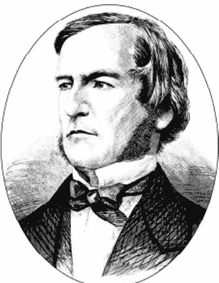

**乔治·布尔**
(Pictorial Press Ltd./Alamy Stock Photo)

两种语言中控制语句的主要区别在于可以检查的条件。Karel 的条件表达式，如 `frontIsClear` 和 `facingNorth` 等，只在 Karel 的世界中有意义。在 JavaScript 中，你通过构造值为真或假的表达式来表达条件。这类表达式称为***布尔表达式***，名称来源于英国数学家**乔治·布尔**，他发展了一种代数方法来处理这类数据。布尔值在 JavaScript 中使用一种内置类型表示，其取值域恰好包含两个值：`true` 和 `false`。

JavaScript 定义了若干用于处理布尔值的运算符。这些运算符分为两类——关系运算符和逻辑运算符，接下来的两节将分别讨论。

## 关系运算符

在 JavaScript 中，最简单的问题是比较两个数据值。例如，你可能想要判断两个值是否相等，或者一个值是否大于或小于另一个值。传统数学使用运算符 `=`、`≠`、`<`、`>`、`≤` 和 `≥` 分别表示*等于*、*不等于*、*小于*、*大于*、*小于或等于*以及*大于或等于*。遗憾的是，由于这些符号中有几个不在标准键盘上，JavaScript 以略微不同的形式表示这些运算符，使用以下字符组合代替常规的数学符号：

- `===` 等于
- `!==` 不等于
- `<` 小于
- `>` 大于
- `<=` 小于或等于
- `>=` 大于或等于

这些运算符统称为**关系运算符**，因为它们测试两个值之间的关系。与前面介绍的算术运算符类似，关系运算符出现在其适用的两个值之间。例如，如果你需要检查 `x` 的值是否小于 0，可以使用表达式 `x < 0`。

乍一看，关系运算符 `===` 和 `!==` 可能显得有些奇怪。由于单个等号已被保留用于表示赋值，JavaScript 所衍生的 C 编程语言的设计者引入了一个由两个相邻等号组成的新运算符来表示相等。JavaScript 的设计者保留了 `==` 运算符，但以一种令人困惑的方式定义它，使得无论是初学者还是有经验的程序员都难以正确使用。在 JavaScript 中，检查精确相等和精确不等价的运算符是 `===` 和 `!==`，如果你优先使用这些运算符而不是较短的形式，将会避免大量的困惑。

## 逻辑运算符

除了关系运算符（它们接受任意类型的值并产生布尔结果）之外，JavaScript 还定义了三个接受布尔操作数并将它们组合形成其他布尔值的运算符：

- `!` 逻辑非（如果后面的操作数为 `false`，则结果为 `true`）
- `&&` 逻辑与（如果两个操作数都为 `true`，则结果为 `true`）
- `||` 逻辑或（如果任一或两个操作数为 `true`，则结果为 `true`）

这些运算符称为**逻辑运算符**，按优先级从高到低排列。

尽管运算符 `&&`、`||` 和 `!` 分别对应英语单词 *and*、*or* 和 *not*，但重要的是要记住，英语在逻辑方面有些不精确。为了避免这种不精确性，以更加正式、数学化的方式来思考这些运算符会很有帮助。逻辑学家使用**真值表**来定义这些运算符，真值表展示了布尔表达式的值如何随着其操作数值的变化而变化。例如，给定布尔值 `p` 和 `q`，`&&` 运算符的真值表为

| p | q | p && q |
| :---: | :---: | :---: |
| false | false | false |
| false | true | false |
| true | false | false |
| true | true | true |

表格的最后一列给出了布尔表达式 p && q 的值，第一列和第二列分别显示了布尔变量 p 和 q 的单个值。因此，真值表中的第一行表明，当 p 为 false 且 q 为 false 时，表达式 p && q 的值也为 false。

`||` 的真值表为

| p | q | p || q |
| :---: | :---: | :---: |
| false | false | false |
| false | true | true |
| true | false | true |
| true | true | true |

尽管 `||` 运算符对应英语单词 or，但它并不表示"两者之一"，正如英语中经常使用的那样，而是表示"任一或两者"，这是它的数学含义。

`!` 运算符有以下简单的真值表：

| p | !p |
| :---: | :---: |
| false | true |
| true | false |

如果你需要确定一个更复杂的逻辑表达式如何运作，可以将其分解为这些基本运算，并为表达式的各个部分构建真值表。

在大多数情况下，逻辑表达式并没有复杂到需要使用真值表来理解。唯一经常引起困惑的情况是当 `!` 运算符与 `&&` 或 `||` 结合使用时。当英语使用者谈论不成立的情况时（正如使用 `!` 运算符时），对人类听众来说意义清晰的陈述往往与数学逻辑相矛盾。每当你发现需要表达包含 *not* 这个词的条件时，都应该格外小心以避免错误。

例如，假设你想在程序中表达"x 不等于 2 或 3 中的任何一个"这一概念。新手程序员如果只是按照英语版本的字面意思来理解，很可能会将表达式编写为：

```
x !== 2 || x !== 3
```

## 短路求值

如前所述，本书使用 bug 符号来标记包含故意错误的代码段。在本例中，问题在于代码的非正式英文翻译与其在 JavaScript 中的解释不符。如果从数学角度来看这个条件测试，可以看到当 (a) `x` 不等于 2 或 (b) `x` 不等于 3 时，表达式为 `true`。无论 `x` 取何值，这两个陈述中必有一个为 `true`，因为如果 `x` 是 2，它就不可能同时等于 3，反之亦然。要解决这个问题，你需要更精确地理解这个英文表达，使其更准确地陈述条件。也就是说，你希望条件是"并非（`x` 等于 2 或 `x` 等于 3）"。你可以直接将此表达式转换为 JavaScript：

```
!(x === 2 || x === 3)
```

但得到的表达式会有些冗长。你真正想问的是*以下两个条件是否都为* `true`：

- `x` 不等于 2，*并且*
- `x` 不等于 3。

如果以这种形式思考问题，你可以将测试写成

```
x !== 2 && x !== 3
```

这个简化是数学逻辑中以下更一般关系的具体说明：

```
!(p || q) is equivalent to !p && !q
```

对于任意逻辑表达式 *p* 和 *q*。这条变换规则及其对称形式

```
!(p && q) is equivalent to !p || !q
```

被称为**德摩根定律**，以英国数学家奥古斯都·德·摩根命名。忘记应用这些规则而依赖英语风格的逻辑，是编程错误的常见来源。

**奥古斯都·德·摩根**
*（The History Collection/Alamy Stock Photo）*

JavaScript 对 `&&` 和 `||` 运算符的解释与许多其他编程语言中的解释不同。例如在 Pascal 编程语言中，对这些运算符（写作 AND 和 OR）的求值需要计算条件的两部分，即使结果在过程进行到一半时就可以确定。

JavaScript 的设计者（或者更准确地说，JavaScript 所基于语言的设计者）采取了不同的方法，这种方法通常对程序员更方便。每当 JavaScript 求值形式为

```
exp₁ && exp₂
```

或

```
exp₁ || exp₂
```

的表达式时，各个子表达式总是从左到右求值，并且一旦可以确定答案就立即停止求值。例如，如果在涉及 `&&` 的表达式中 *exp₁* 为 `false`，则无需对 *exp₂* 求值，因为最终答案总是 `false`。类似地，在使用 `||` 的例子中，如果第一个操作数为 `true`，则无需对第二个操作数求值。这种一旦知道答案就停止的求值方式称为***短路求值***。

短路求值的主要优点是它允许一个条件控制另一个条件的执行。在许多情况下，复合条件的第二部分只有在第一部分得出某种结果时才有意义。例如，假设你想表达一个组合条件：(1) 整数 `x` 的值非零，且 (2) `x` 能整除 `y`。你可以在 JavaScript 中将此条件测试表示为

```
(x !== 0) && (y % x === 0)
```

因为表达式 `y % x` 只有在 x 非零时才会被求值。Pascal 中的相应表达式无法产生期望的结果，因为 Pascal 条件的两部分总是会被求值。因此，如果 x 为 0，包含此表达式的 Pascal 程序最终会导致除以 0，尽管它似乎有条件测试来检查这种情况。像前面例子中的条件测试

```
(x !== 0)
```

这样保护复合条件后续部分免受求值错误的条件，称为***守卫***。

## `if` 语句

在 JavaScript 中表达条件执行的最简单方式是使用 `if` 语句，它与你在 Karel 中见过的两种形式相同，如右侧语法框所示。这些模板中的 *condition* 部分是布尔表达式，如前一节所定义。在 `if` 语句的简单形式中，只有当条件测试求值为 `true` 时，JavaScript 才会执行语句块。如果条件测试为 `false`，JavaScript 将完全跳过 `if` 语句体。在包含 `else` 关键字的形式中，如果条件为 `true`，JavaScript 执行第一个语句块；如果条件为 `false`，则执行第二个。在这两种形式中，当条件表达式为 `true` 时 JavaScript 执行的代码称为***then 子句***。在 `if-else` 形式中，当条件为 `false` 时执行的代码称为***else 子句***。

```
if (condition) {
    statements
}
```

```
if (condition) {
    statements
} else {
    statements
}
```

你可以使用 `if` 语句来实现 JavaScript `Math` 类中几个最简单的函数。例如，你可以如下实现 `abs`：

```
function abs(x) {
    if (x < 0) {
        return -x;
    } else {
        return x;
    }
}
```

类似地，你可以这样实现 `max`——至少对于两个参数而言：

```
function max(x, y) {
    if (x > y) {
        return x;
    } else {
        return y;
    }
}
```

正如你在学习 Karel 时几乎肯定意识到的，使用 `if` 还是 `if-else` 形式取决于问题的结构。当你的问题要求仅在特定条件适用时才执行代码时，使用简单的 `if` 语句。当程序必须在两组独立的操作之间进行选择时，使用 `if-else` 形式。你通常可以根据如何用英语描述问题来做出这个决定。如果描述中包含 *otherwise* 或类似的表达，很可能需要使用 `if-else` 形式。如果英文描述中没有这样的概念，简单的 `if` 语句可能就足够了。


## `if` 语句的附加格式

如果 `if` 关联的任何子句仅包含单条语句，JavaScript 允许省略围绕它的花括号。然而，作为一般规则，包含这些花括号是良好实践，因为这样能让阅读代码的人更容易确定哪些语句包含在主体内。要求使用花括号也能使程序更易于维护，因为它使人们更难误以为两条连续语句由单个 `if` 语句控制。例如，以下两行代码

```
if (condition)
    statement1;
    statement2;
```

很容易被误读为

```
if (condition) statement
```

并认为 `if` 语句控制两条语句的执行。没有花括号时，*statement*₂ 不在 `if` 的范围内，将始终被执行。

本书中的程序在两种情况下放宽了 `if` 语句的每个子句都需要花括号的规则。第一种是当 `if` 语句能在一行内完成且没有 `else` 子句时。第二种是当 `else` 子句由另一个用于检查某些附加条件的测试组成时。这类语句被称为**级联 `if` 语句**，可能涉及任意数量的 `elseif` 行。例如，以下函数实现了 `Math` 类中的 `sign` 函数，它根据 `x` 的值是正数、零还是负数分别返回 −1、0 或 1：

```
function sign(x) {
    if (x < 0) {
        return -1;
    } else if (x === 0) {
        return 0;
    } else {
        return 1;
    }
}
```

请注意，不需要显式检查 `x > 0` 的条件。如果程序执行到最后的 `else` 子句，就没有其他可能性了（假设 `x` 是数字），因为前面的测试已经排除了负数和零的情况。

在许多情况下，使用 `switch` 语句从一组独立的情况中进行选择比采用级联 `if` 形式更有意义。`switch` 语句在  中描述。

## ?: 运算符

JavaScript 编程语言提供了另一种更紧凑的表达条件执行的机制，在某些情况下非常有用：?: 运算符。（这个运算符被称为**问号冒号**，尽管这两个字符在代码中实际上并不相邻。）与 JavaScript 中的任何其他运算符不同，?: 需要三个操作数。该运算的一般形式是

```
condition ? expression1 : expression2
```

当 JavaScript 遇到 ?: 运算符时，它首先计算条件。如果条件结果为 `true`，则计算 `expression1` 并用作整个表达式的值；如果条件为 `false`，则值为计算 `expression2` 的结果。因此，?: 运算符是以下语句的紧凑形式

```
if (condition) {
    使用 expression1 的值
} else {
    使用 expression2 的值
}
```

在表达式的上下文中实现。

例如，你可以使用 `?:` 运算符以以下简练形式实现 `max` 函数：

```
function max(x, y) {
    return (x > y) ? x : y;
}
```

条件周围的括号在技术上不是必需的，但许多 JavaScript 程序员在此上下文中包含它们以增强代码的可读性。

## `switch` 语句

`if` 语句非常适合程序逻辑需要双向决策点的应用：某个条件要么为 `true`，要么为 `false`，程序相应地采取行动。然而，一些应用需要涉及两个以上选择的更复杂决策结构，其中这些选择可以分为一组互斥的情况：在一种情况下，程序应执行 *x*；在另一种情况下，它应执行 *y*；在第三种情况下，它应执行 *z*；依此类推。在许多应用中，用于此类情况最合适的语句是 `switch` 语句，其概述在左侧的语法框中。

```
switch (expression) {
  case c_1:
    statements
    break;
  case c_2:
    statements
    break;
  case c_3:
    statements
    break;
  default:
    statements
    break;
}
```

`switch` 语句的标题行是

```
switch (e)
```

其中 `e` 是一个表达式。在 `switch` 语句的上下文中，此表达式称为**控制表达式**。`switch` 语句的主体分为由以下两个关键字之一引入的独立语句组：`case` 或 `default`。`case` 行及其后直到下一个这些关键字实例的所有语句称为一个 ***case 子句***。`default` 行及其关联的语句称为 ***default 子句***。例如，在语法框中显示的模板中，语句范围

```
case c₁:
    statements
    break;
```

构成了第一个 `case` 子句。

当程序执行 `switch` 语句时，控制表达式 *e* 被计算并与值 *c₁*、*c₂* 等进行比较，每个值都必须是常量。如果某个常量与控制表达式的值匹配，则执行关联 `case` 子句中的语句。当程序到达该子句末尾的 `break` 语句时，该子句指定的操作完成，程序继续执行整个 `switch` 语句之后的语句。如果没有 case 常量匹配控制表达式的值，则执行 `default` 子句中的语句。

语法框中显示的模板故意暗示 `break` 语句是语法的必需部分。我鼓励你以完全相同的形式来思考 `switch` 语法。JavaScript 的定义是，如果缺少 `break` 语句，程序在完成选定子句后开始执行下一个子句中的语句。虽然这种设计在少数不寻常的情况下可能有用，但它往往弊大于利。为了强化记住包含 `break` 语句的重要性，本文中的每个 `case` 子句都以显式的 `break` 或 `return` 语句结束。

此规则的一个例外是，指定不同常量的多个 `case` 行可以一个接一个地出现在同一语句组之前。例如，`switch` 语句可能包含以下代码：

```
case 1:
case 2:
     statements
     break;
```

这表示如果 `switch` 表达式的值是 1 或 2，则应执行指定的语句。JavaScript 解释器将此构造视为两个 `case` 子句，第一个是空的。因为空子句不包含 `break` 语句，选择该路径的程序将继续执行第二个子句。然而，从概念的角度来看，你最好将此构造视为代表两种可能性的单个 `case` 子句。


`default` 子句在 `switch` 语句中是可选的。如果没有 `case` 匹配且没有 `default` 子句，程序将直接继续执行 `switch` 语句之后的下一条语句，而不采取任何操作。为了避免程序可能忽略意外情况的问题，良好的编程实践是在每个 `switch` 语句中都包含一个 `default` 子句，除非你确定已经列举了所有可能的情况。

因为 `switch` 语句可能很长，所以 `case` 子句本身保持简短会提高程序的可读性。如果空间允许，将 `case` 标识符、构成子句主体的语句以及 `break` 或 `return` 语句放在同一行也会有所帮助。这种风格在 的 `monthName` 函数中有示例，该函数使用 `switch` 语句将数字月份转换为其名称。

 中的 `default` 子句值得特别说明。如果 `month` 参数不是 1 到 12 之间的合法值，`monthName` 函数将返回预定义的 JavaScript 常量 `undefined`，该常量通常用作标记，表示不存在有意义的结果。

## 将数字月份转换为其名称的函数

```javascript
/*
 * Converts a numeric month in the range 1 to 12 into its name.
 */

function monthName(month) {
    switch (month) {
        case 1: return "January";
        case 2: return "February";
        case 3: return "March";
        case 4: return "April";
        case 5: return "May";
        case 6: return "June";
        case 7: return "July";
        case 8: return "August";
        case 9: return "September";
        case 10: return "October";
        case 11: return "November";
        case 12: return "December";
        default: return undefined;
    }
}
```

## `while` 语句

```javascript
while (condition) {
    statements
}
```

最简单的迭代结构是 `while` 语句，它会反复执行一条简单语句或一个语句块，直到条件表达式变为 `false`。`while` 语句的模板出现在左侧的语法框中。整个语句，包括 `while` 控制行本身和包含在主体内的语句，构成了一个 *while 循环*。当程序执行 `while` 语句时，它首先计算条件表达式以判断它是 `true` 还是 `false`。如果条件为 `false`，循环*终止*，程序继续执行整个循环之后的下一条语句。如果条件为 `true`，则执行整个主体，之后程序返回顶部再次检查条件。对主体中的语句进行一次完整的执行构成循环的一个*周期*。

关于 `while` 循环的运行，有两个重要原则需要遵守：

- 1. 条件测试在循环的每个周期之前都会执行，包括第一个周期。如果初始测试结果为 `false`，则循环主体根本不会被执行。

- 2. 条件测试仅在循环周期的*开始*时执行。如果某个条件在循环执行过程中的某个时刻变为 `false`，程序不会注意到这一点，直到完成一次完整的周期执行。此时，程序会再次计算测试条件。如果仍然是 `false`，循环终止。

学习如何有效使用 `while` 循环通常需要查看一些以 `while` 循环作为解决方案策略的示例。其中一个具有特殊历史意义的应用是寻找一个整数的最大真除数，这是在曼彻斯特大学的小型实验机（Small-Scale Experimental Machine）上运行的最早程序之一——这台机器是第一台实现存储程序架构的计算机，该架构如今基本上被所有计算机采用。该程序的作者是 Tom Kilburn，他是建造这台机器的团队的首席工程师，其发明者将这台机器昵称为"Baby"。

由于 Baby 的能力极其有限，Kilburn 的算法必须简单到近乎荒谬的程度。给定一个数 *N*，程序只需从 *N* – 1 开始倒数，直到找到一个能整除 *N* 的数。适度利用 JavaScript 扩展的运算集，Kilburn 的算法可能如下所示：

```javascript
function largestFactor(n) {
    let factor = n - 1;
    while (n % factor !== 0) {
        factor--;
    }
    return factor;
}
```

使用 `largerFactor` 的两个示例计算如下控制台日志所示：

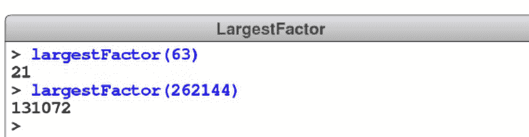

当第二个计算于 1948 年 6 月 21 日在 Manchester Baby 上运行时，程序花了 52 分钟才计算出答案。在此过程中，它证明了 Baby 架构的有效性和可靠性。

作为第二个示例，假设你被要求编写一个 `digitSum` 函数，用于将一个正整数的各位数字相加。调用 `digitSum(1729)` 应该产生结果 19，即 1 + 7 + 2 + 9。你会如何实现这样一个函数？

你的函数首先需要做的是维护一个累加值。通常的做法是声明一个名为 `sum` 的变量，将其初始化为 0，逐个将每个数字添加到 `sum` 中，最后返回 `sum` 的值。以下是这部分结构（其余部分用英语描述）：

```javascript
function digitSum(n) {
    let sum = 0;
    For each digit in the number, add that digit to sum.
    return sum;
}
```

部分使用编程语言、部分使用英语编写的程序被称为**伪代码**。

这句话

```
For each digit in the number, add that digit to sum.
```

显然指定了某种循环结构，因为有一个操作需要对数字中的每个数字重复执行。如果确定一个数字包含多少个数字很容易，你可能会选择使用本章后面描述的 `for` 循环来精确地运行那么多次周期。然而，事实上，确定一个数字包含多少位数字与将它们相加一样困难。编写这个程序的最好方法就是不断添加数字，直到你发现已经添加了最后一个。一直运行到某个条件出现的循环最常使用 `while` 语句来编码。

这个问题的核心在于确定如何将一个数字拆分为其组成数字。整数 `n` 的最后一位数字是 `n` 除以 10 后的余数，即表达式 `n % 10` 的结果。数字的其余部分——由除最后一位之外的所有数字组成的整数——由 `Math.floor(n / 10)` 给出，在数学中记为 `[n / 10]`。例如，如果 `n` 的值为 1729，你可以使用这两个表达式将该数字拆分为两部分 172 和 9，如下图所示：

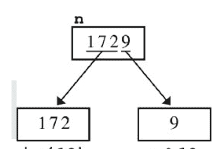

因此，为了将数字中的各位数字相加，你需要做的就是在循环的每个周期中将 `n % 10` 的值添加到变量 `sum` 中，然后将 `n` 的值替换为 `Math.floor(n / 10)`。下一个周期将添加原始数字的倒数第二位数字，依此类推，直到所有数字都被处理完毕。


但是，你如何知道何时停止呢？由于你在每个周期中计算 `Math.floor(n / 10)`，最终会到达 `n` 变为 0 的那个点。此时，你已经处理了该数字中的所有数位，可以退出循环了。因此，解决这个问题所需的 `while` 循环是：

```
while (n > 0) {
    sum += n % 10;
    n = Math.floor(n / 10);
}
```

`digitSum` 函数的完整实现如下所示。

## 计算数字中各位数之和的函数

```
/*
 * 返回 n 的各位数之和，n 必须是一个非负整数。
 */

function digitSum(n) {
  let sum = 0;
  while (n > 0) {
    sum += n % 10;
    n = Math.floor(n / 10);
  }
  return sum;
}
```

作为使用 `while` 的最后一个例子，能够向字符串添加空格以确保在固定宽度字体中（例如 JavaScript 控制台中使用的字体）显示时，不同长度的字符串仍然能够正确对齐，这很有用。例如，数字列通常按右对齐，这意味着需要在数字开头添加空格，直到其填满整个列宽。你可以使用以下函数实现此目标，该函数接受一个值（可以是任何类型）和一个字段宽度：

```
function alignRight(value, width) {
  let str = "" + value;
  while (str.length < width) {
    str = " " + str;
  }
  return str;
}
```

该函数返回一个字符串，其中 `value` 出现在宽度为 `width` 个字符的字段的右边缘。函数的第一行使用连接运算符将 `value` 转换为字符串，然后将其添加到一个不包含任何字符的字符串末尾，该字符串被称为 ***空字符串***。因此，其效果是初始化变量 `str`，使其包含 `value` 的字符串表示。在此基础上，函数使用连接在 `str` 开头添加空格，直到其达到所需长度，然后将填充后的字符串返回给调用者。你将在下一节中有机会看到 `alignRight` 的实际运行。

## `for` 语句

```
for (init; test; step) {
    statements
}
```

JavaScript 中最重要的控制语句之一是 `for` 语句，它最常用于需要将某个操作重复特定次数的情况。`for` 语句的一般形式如左侧的语法框所示。

`for` 循环的操作由 `for` 控制行上的三个斜体表达式决定：*init*、*test* 和 *step*。*init* 表达式指示 `for` 循环应如何初始化，通常包括一个指定初始值的变量声明。在 `for` 循环中，该变量被称为 **_索引变量_**。*test* 表达式是一个条件测试，其写法与 `while` 语句中的测试完全一样。只要测试表达式为 `true`，循环就会继续。*step* 表达式指示索引变量在每个周期结束时如何变化。

*init*、*test* 和 *step* 表达式的解释通过示例来说明最为简单。最常见的 `for` 循环使用以下头部行：

```
for (let i = 0; i < n; i++)
```

循环开始时声明索引变量 i 并将其初始化为 0。循环在每个周期结束时递增 i 的值，并且只要 i 小于 n 就继续。因此，该循环总共运行 n 个周期，i 的取值为 0、1、2，依此类推，直到最终值 n – 1。

更一般地，for 循环惯用法

```
for (let i = start; i <= finish; i++)
```

首先将 i 的值设置为 start，然后只要 i 的值小于或等于 finish 就继续。因此，该循环使用变量 i 从 start 计数到 finish。

你可以使用这种 for 循环惯用法来定义一个名为 `fact` 的函数，该函数接受一个整数 n 并返回其阶乘。阶乘定义为 1 到 n 之间整数的乘积，在数学中传统上写作 n!。前几个阶乘值如下表所示：

| $0!$ | $=$ | $1$ | | （根据定义） |
| $1!$ | $=$ | $1$ | $=$ | $1$ |
| $2!$ | $=$ | $2$ | $=$ | $1 \times 2$ |
| $3!$ | $=$ | $6$ | $=$ | $1 \times 2 \times 3$ |
| $4!$ | $=$ | $24$ | $=$ | $1 \times 2 \times 3 \times 4$ |
| $5!$ | $=$ | $120$ | $=$ | $1 \times 2 \times 3 \times 4 \times 5$ |
| $6!$ | $=$ | $720$ | $=$ | $1 \times 2 \times 3 \times 4 \times 5 \times 6$ |
| $7!$ | $=$ | $5040$ | $=$ | $1 \times 2 \times 3 \times 4 \times 5 \times 6 \times 7$ |
| $8!$ | $=$ | $40320$ | $=$ | $1 \times 2 \times 3 \times 4 \times 5 \times 6 \times 7 \times 8$ |
| $9!$ | $=$ | $362880$ | $=$ | $1 \times 2 \times 3 \times 4 \times 5 \times 6 \times 7 \times 8 \times 9$ |
| $10!$ | $=$ | $3628800$ | $=$ | $1 \times 2 \times 3 \times 4 \times 5 \times 6 \times 7 \times 8 \times 9 \times 10$ |

阶乘在统计学、组合数学和计算机科学中有广泛应用。因此，计算阶乘的函数是解决这些领域问题的有用工具。

作为一个编程问题，计算阶乘与一系列数字求和的问题有一些相似之处，后者出现在 `digitSum` 函数的实现中。该函数使用一个名为 `sum` 的变量来跟踪各位数的累加和。对于阶乘函数，情况非常相似，只是你需要跟踪的是一个乘积而不是一个和。跟踪累加乘积使用类似的代码；唯一显著的区别——除了将 `+` 替换为 `*` 运算符——是你必须将累加乘积初始化为 1 而不是 0。因此，`fact` 函数的完整实现如下所示：

```
function fact(n) {
    let result = 1;
    for (let i = 1; i <= n; i++) {
        result *= i;
    }
    return result;
}
```

以当前形式，你可以在控制台窗口或其他函数中使用 `fact` 函数。然而，如果你能生成如上所示的阶乘表，那也会很有用。为此，最简单的方法是使用 JavaScript 控制台通过调用函数 `console.log` 来显示输出，该函数将其参数显示在控制台上，然后将光标移动到下一行的开头。图 3-3 中的 `FactorialTable.js` 程序显示了一个阶乘列表，其范围由常量 `LOWER_LIMIT` 和 `UPPER_LIMIT` 给出，如下方的示例运行所示：

## FactorialTable

```
> FactorialTable();
0! =            1
1! =            1
2! =            2
3! =            6
4! =           24
5! =          120
6! =          720
7! =         5040
8! =        40320
9! =       362880
10! =      3628800
>
```


 ## FactorialTable

```
> FactorialTable();
 0! =        1
 1! =        1
 2! =        2
 3! =        6
 4! =       24
 5! =      120
 6! =      720
 7! =     5040
 8! =    40320
 9! =   362880
10! =  3628800
>
```

## 在控制台显示阶乘列表的程序

```
/*
 * File: FactorialTable.js
 * -----------------------
 * This program defines the function FactorialTable, which prints a table
 * of factorials in a specified range.
 */

"use strict";

/* Constants */

const LOWER_LIMIT = 0;
const UPPER_LIMIT = 10;
const NUMBER_WIDTH = 2;
const FACTORIAL_WIDTH = 7;

/*
 * Displays a table of factorials between LOWER_LIMIT and UPPER_LIMIT.
 */

function FactorialTable() {
    for (let i = LOWER_LIMIT; i <= UPPER_LIMIT; i++) {
        console.log(alignRight(i, NUMBER_WIDTH) + "! = " +
                    alignRight(fact(i), FACTORIAL_WIDTH));
    }
}

/*
 * Returns the factorial of n.  The factorial is simply the product of
 * the integers between 1 and n, inclusive.
 */

function fact(n) {
    let result = 1;
    for (let i = 1; i <= n; i++) {
        result *= i;
    }
    return result;
}

/*
 * Returns a string in which value appears at the right edge of a field
 * that is at least the specified width.  If the value does not fit in
 * that field, the returned string will be longer than the specified width.
 */

function alignRight(value, width) {
    let str = "" + value;
    while (str.length < width) {
        str = " " + str;
    }
    return str;
}
```

请注意，`FactorialTable` 程序使用 `alignRight` 来在固定宽度的列中显示数值。

虽然 `for` 循环的 *step* 部分通常用于递增索引变量，但这并非唯一的可能性。例如，你可以通过将 `i++` 替换为 `i += 2` 来每次计数增加 2，或者使用 `i--` 来向后计数。作为反向计数的示例，下面的函数从一个初始值倒数到 0：

```
function countdown(start) {
    for (let t = start; t >= 0; t--) {
        console.log(t);
    }
}
```

调用 `countdown(10)` 会在控制台上产生以下输出：

```
Countdown
10
9
8
7
6
5
4
3
2
1
0
```

`countdown` 程序演示了任何变量都可以用作索引变量。在这个例子中，变量名为 `t`，这大概是因为在火箭倒计时中这是一个传统的变量名，正如短语 "T minus 10 seconds and counting"（T 减去 10 秒并计数）中所示。

`for` 循环模式中的表达式 *init*、*test* 和 *step* 是可选的，但分号必须出现。如果 *init* 缺失，则不执行初始化。如果 *test* 缺失，则假定为 `true`。如果 *step* 缺失，则在循环周期结束时不会执行任何操作。

## `for` 与 `while` 的关系

`for` 语句

```
for (init; test; step) {
    statements
}
```

在操作方式上类似于 `while` 语句

```
init;
while (test) {
    statements
    step;
}
```

尽管你可以使用 `while` 重写 `for` 语句，但在可能的情况下使用 `for` 语句有其优势。使用 `for` 语句时，了解循环将执行多少次所需的所有信息都包含在语句的头部。例如，如果你在程序中看到以下语句

```
for (let i = 0; i < 10; i++) {
    . . . body . . .
}
```

你就知道循环体将执行 10 次，每次对应 `i` 在 0 到 9 之间的值。在相应的 `while` 循环中

```
let i = 0;
while (i < 10) {
    . . . body . . .
    i++;
}
```

如果循环体很大，底部的递增操作很容易被忽略。

虽然使用 `for` 和 `while` 的代码片段相似，但它们并非完全相同。主要区别在于索引变量声明的处理方式。在最近的 `for` 循环示例中，变量 `i` 仅在循环体内部定义，而在外部未定义。变量定义的区域称为其**作用域**。例如，`for` 循环中索引变量的作用域是包围循环体的大括号内部的代码。

## 嵌套 `for` 语句

在许多应用中，你会发现需要将一个 `for` 循环写在另一个内部，以便最内层循环的语句为 `for` 循环索引的每种可能组合都执行一次。例如，假设你想显示一个乘法表，展示 1 到 10 范围内每对数字的乘积。你希望程序的输出如下所示：

**MultiplicationTable**

|  | 1 | 2 | 3 | 4 | 5 | 6 | 7 | 8 | 9 | 10 |
|---|---|---|---|---|---|---|---|---|---|---|
| 1 | 1 | 2 | 3 | 4 | 5 | 6 | 7 | 8 | 9 | 10 |
| 2 | 2 | 4 | 6 | 8 | 10 | 12 | 14 | 16 | 18 | 20 |
| 3 | 3 | 6 | 9 | 12 | 15 | 18 | 21 | 24 | 27 | 30 |
| 4 | 4 | 8 | 12 | 16 | 20 | 24 | 28 | 32 | 36 | 40 |
| 5 | 5 | 10 | 15 | 20 | 25 | 30 | 35 | 40 | 45 | 50 |
| 6 | 6 | 12 | 18 | 24 | 30 | 36 | 42 | 48 | 54 | 60 |
| 7 | 7 | 14 | 21 | 28 | 35 | 42 | 49 | 56 | 63 | 70 |
| 8 | 8 | 16 | 24 | 32 | 40 | 48 | 56 | 64 | 72 | 80 |
| 9 | 9 | 18 | 27 | 36 | 45 | 54 | 63 | 72 | 81 | 90 |
| 10 | 10 | 20 | 30 | 40 | 50 | 60 | 70 | 80 | 90 | 100 |

绘制这个乘法表的代码如  所示。要创建单个条目，你需要一对嵌套的 `for` 循环：一个外层循环遍历每一行，一个内层循环遍历每行中的每个条目。最内层 `for` 循环内的代码将为每一行和每一列各执行一次，总共产生表中的 100 个独立条目。

## 显示乘法表的程序

```
/*
 * File: MultiplicationTable.js
 * --------------------------------------
 * This program uses nested loops to create a multiplication table.
 */

"use strict";

/* Constants */

const TABLE_SIZE = 10;
const FIELD_WIDTH = 4;

/*
 * Draws a multiplication table on the console.
 */

function MultiplicationTable() {
    for (let i = 1; i <= TABLE_SIZE; i++) {
        let line = "";
        for (let j = 1; j <= TABLE_SIZE ; j++) {
            line += alignRight(i * j, FIELD_WIDTH);
        }
        console.log(line);
    }
}
```

外层循环遍历 `i` 从 1 到 10 的每个值，负责在每个周期显示表的一行。为此，代码首先声明变量 `line` 并将其初始化为空字符串。然后内层循环遍历 `j` 从 1 到 10 的值，并将 `i` 和 `j` 的乘积拼接在 `line` 的末尾，同样使用 `alignRight` 函数确保列具有相同的宽度。当内层循环完成时，程序调用 `console.log` 显示乘法表的完整一行。

一种练习使用嵌套 `for` 循环的有用方法是编写在控制台上绘制图案的程序，通过显示字符行来实现。作为一个简单的例子，下面的函数绘制一个三角形，其中每行的星号数量增加一个：

```
function drawConsoleTriangle(size) {
    for (let i = 1; i <= size; i++) {
        let line = "";
        for (let j = 0; j < i; j++) {
            line += "*";
        }
        console.log(line);
    }
}
```

例如，调用 `drawConsoleTriangle(10)` 会在控制台上产生以下输出：


# 控制台三角形

```
*
**
***
****
*****
*******
********
*********
**********
```

你将在练习中有机会创建几个类似的显示效果。

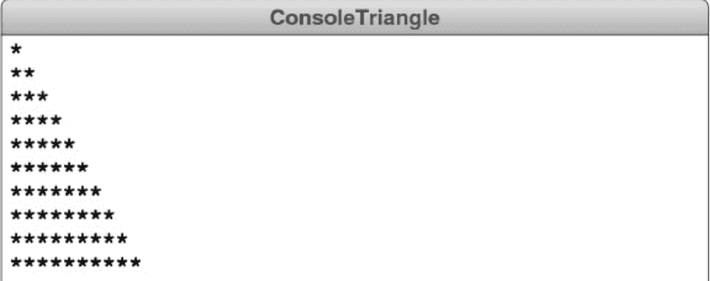

# 算法编程

算法的概念是计算机科学的基础。正如你从中学到的，*algorithm*（算法）一词源于9<sup>世纪</sup>波斯数学家穆罕默德·伊本·穆萨·阿尔·花拉子米的名字，他的工作对现代数学产生了重大影响。中包含了一尊位于他如今乌兹别克斯坦出生地附近的雕像照片。

## 乌兹别克斯坦希瓦古城门外的阿尔·花拉子米雕像


尽管通常将算法视为解决问题的策略就足够了，但现代计算机科学形式化了这一定义，使得**算法**指的是满足以下条件的解决方案策略：

- 就描述易于理解而言是明确的。
- 就能够执行策略中的步骤而言是可行的。
- 就策略在若干步骤后会终止而言是有限的。

接下来的几节将提供几个例子，说明如何使用控制语句来实现历史上几个重要的算法。

## 一个早期的平方根算法

算法的使用可以追溯到比阿尔·花拉子米时代早得多的历史时期。大约4000年前，巴比伦数学家就使用了一种算法过程来计算平方根。这种算法过程存在的主要证据来自楔形文字泥板，如图3-6所示，该图展示了一个比任何人仅通过测量所能得出的远为精确的2的平方根近似值。尽管巴比伦数学家进行必要计算的确切细节已经失传，但历史学家认为他们的技术与1<sup>世纪</sup>希腊数学家亚历山大城的海伦所描述的算法相似。海伦所描述的算法通常被称为***巴比伦方法***，以其最可能的起源命名。

展示2的平方根近似值的巴比伦楔形文字泥板


(耶鲁大学皮博迪自然历史博物馆)

左侧的楔形文字残片可追溯至第一巴比伦王朝时期，该王朝存在于公元前19世纪至16世纪。该图由一个正方形及其对角线以及三个用巴比伦数字书写的数字组成。这些数字在照片中几乎看不清楚，但在图底部的示意图中被复制了出来。

水平对角线上的数字具有以下值：

1 24 51 10

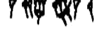

巴比伦算术使用的是六十进制系统，这意味着每个数位的值是其左边数位值的六十分之一。因此，这个数字序列对应以下计算：

1 + 24/60 + 51/60 × 60 + 10/60 × 60 × 60 ≈ 1.414213

这个值是用四个六十进制数字所能表示的最接近2的平方根的数值。

泥板上的另外两个数字说明了边长与对角线长度之间的关系。如果边长为30（左上角的 𒐕），则对角线的长度约为


42 25 35

= 42 + 25/60 + 35/60 × 60 ≈ 42.4264

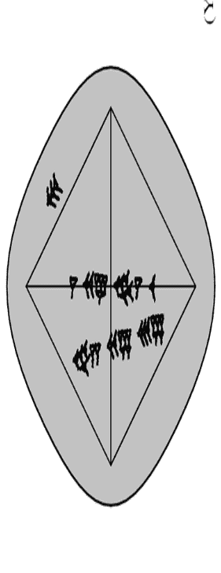

用于计算平方根的巴比伦方法是被称为***逐次逼近法***的一般技术的一个例子。在这种方法中，你从一个粗略的猜测开始，然后通过一系列使猜测值越来越接近真实值的细化步骤来改进该猜测。例如，如果你想找到某个数字*n*的平方根，你首先选择一个较小的数字*g*作为你的第一次猜测。在过程的每一步，你的猜测*g*要么小于要么大于实际的平方根。无论哪种情况，如果你用*n*除以*g*，结果总是会落在期望值的另一侧。例如，如果*g*太小，*n*除以*g*的结果就会太大，反之亦然。对这两个值取平均值总会给出更好的近似值。在每一步中，你只需将之前的猜测*g*替换为以下公式的结果，该公式对*g*和*n*除以*g*的值取平均：

$$\frac{g + \frac{n}{g}}{2}$$

然后，你继续对每个新的猜测应用此公式，直到答案尽可能接近实际值。

为了更好地理解巴比伦方法的工作原理，考虑一个简单的例子会有所帮助。假设你想计算，就像在楔形文字泥板上刻字的抄写员那样，2的平方根。*g*的一个可能的初始猜测是1，它是*n*值的一半。因此，第一个近似步骤计算以下平均值：

$$\frac{1+\frac{2}{1}}{2} = \frac{3}{2} = 1.5$$

值1.5比2的实际平方根（约1.4142136）更接近，因此该过程在正确的轨道上。

要计算下一个近似值，你需要做的就是将上一步的结果作为新的*g*代入公式，并计算新的平均值，如下所示：

$$\frac{\frac{3}{2}+\frac{2}{\frac{3}{2}}}{2} = \frac{17}{12} \approx 1.4166667$$

从这一点开始，你只需将上一步的结果作为新的*g*重复计算：

$$\frac{\frac{17}{12}+\frac{2}{\frac{17}{12}}}{2} = \frac{577}{408} \approx 1.4142157$$

再进行一次逐次逼近，你得到

$$\frac{\frac{577}{408}+\frac{2}{\frac{577}{408}}}{2} = \frac{665857}{470832} \approx 1.4142136$$

仅仅四次迭代后，巴比伦方法就产生了一个精确到小数点后八位的2的平方根近似值。此外，由于每一步都会生成一个更接近精确值的近似值，你可以重复该过程以产生任意所需精度的近似值。

中展示了使用巴比伦方法来近似计算其参数平方根的`sqrt`函数的定义。该函数使用一个`while`循环来持续该过程，直到近似值达到所需的精度级别。在此实现中，`while`循环持续进行，直到当前近似值的平方与原始数字之间的差值不再大于常量`TOLERANCE`的值。


如果你需要更高的精度，可以重复该过程以获得任意所需精度的近似值。

下面展示了使用巴比伦法求参数平方根的 `sqrt` 函数定义。该函数使用 `while` 循环持续计算，直到近似值达到所需的精度。在此实现中，`while` 循环会一直持续，直到当前近似值的平方与原始数字之间的差值不再大于常量 `TOLERANCE` 的值。

## 使用巴比伦算法计算平方根的 JavaScript 程序

```
/*
 * File: BabylonianSquareRoot.js
 * -------------------------------
 * This file implements a function sqrt that calculates square roots
 * using the Babylonian method.
 */

"use strict";

/* Define a constant specifying how close the value needs to be */

const TOLERANCE = 0.00000000000001;

/*
 * Calculates the square root of n using the Babylonian method, which
 * operates as follows:
 *
 * 1. Choose a guess g (any value will do; this code uses n / 2).
 * 2. Compute a new guess by averaging g and n / g.
 * 3. Repeat step 2 until the error is less than the desired tolerance.
 */

function sqrt(n) {
    let g = n / 2;
    while (Math.abs(n - g * g) > TOLERANCE) {
        g = (g + n / g) / 2;
    }
    return g;
}
```

## 求最大公约数

虽然你已经在编程示例的背景下看到了一些简单算法的实现，但你很少有机会专注于算法过程本身的性质。到目前为止，你看到的大多数编程问题都足够简单，以至于合适的解决方案策略会立刻浮现在脑海中。然而，随着问题变得更加复杂，它们的解决方案需要更多的思考，在编写最终程序之前，你需要考虑不止一种策略。

为了说明算法策略是如何形成的，接下来的章节将讨论经典数学中另一个问题的两种解决方案，即求两个整数的最大公约数。给定两个整数 *x* 和 *y*，***最大公约数***（简称 ***gcd***）是能同时整除两个数的最大整数。例如，49 和 35 的最大公约数是 7，6 和 18 的最大公约数是 6，32 和 33 的最大公约数是 1。

假设你需要编写一个函数，接受两个正整数 *x* 和 *y* 作为输入，并返回它们的最大公约数。从调用者的角度来看，你需要的是一个 `gcd(x, y)` 函数，它接受两个整数作为参数，并返回另一个整数作为它们的最大公约数。因此该函数的头行为

```
function gcd(x, y)
```

在许多方面，计算最大公约数最显而易见的方法就是尝试每一种可能性。首先，你只需"猜测"gcd(x,y) 是 x 和 y 中较小的那个，因为任何更大的值都不可能整除较小的数。然后你尝试用你的猜测值去除 x 和 y，看看它是否能同时整除两者。如果能，你就得到了答案；如果不能，你就将猜测值减 1 然后再次尝试。这种尝试每一种可能性的策略通常被称为**暴力方法**。

`gcd` 函数的暴力方法在 JavaScript 中如下所示：

```
function gcd(x, y) {
    let guess = Math.min(x, y);
    while (x % guess !== 0 || y % guess !== 0) {
        guess--;
    }
    return guess;
}
```

在你确定这个实现确实是计算 `gcd` 函数的有效算法之前，你需要对自己提出几个关于这段代码的问题。`gcd` 的暴力实现是否总是给出正确的答案？它是否总是会终止，还是函数可能会永远运行下去？

要确定程序是否给出正确答案，你需要查看 `while` 循环中的条件

```
x % guess !== 0 || y % guess !== 0
```

与往常一样，`while` 条件表明了循环在什么情况下会继续。要找出什么条件会导致循环终止，你需要对 `while` 条件取反。对涉及 `&&` 或 `||` 的条件取反可能很棘手，除非你记得如何应用德摩根定律，这些定律在本章前面的"逻辑运算符"部分已经介绍过。德摩根定律表明，当 `while` 循环退出时，以下条件必须成立：

```
x % guess === 0 && y % guess === 0
```

从这个条件中，你可以立即看出 `guess` 的最终值肯定是一个公约数。要认识到它实际上是最大公约数，你需要思考 `while` 循环中体现的策略。该策略中需要注意到的关键因素是程序是*从大到小*遍历所有可能性的。最大公约数不可能大于 `x` 或 `y`，因此 `guess` 的值最终必然会降到 1，除非找到了更大的公约数。此时，`while` 循环一定会终止，因为无论 `x` 和 `y` 的值是什么，1 都能同时整除它们。

在认识到该函数会终止时，关键的洞察是 `guess` 的值最终必然会降到 1，除非找到了更大的公约数。此时，`while` 循环一定会终止，因为无论 `x` 和 `y` 的值是什么，1 都能同时整除它们。

## 欧几里得算法

然而，暴力法并不是唯一有效的策略。虽然暴力算法在其他场景中有一席之地，但如果你关注效率，对于 `gcd` 函数来说它并不是一个好的选择。例如，如果你调用

```
gcd(1000005,1000000)
```

暴力算法将运行 `while` 循环体将近一百万次才能得出答案 5，而你只需要思考这两个数就能立即得出结果。

你需要找到一种算法，它保证能以正确的答案终止，但所需的步骤比暴力方法更少。这正是聪明才智和对问题的清晰理解发挥价值的地方。幸运的是，必要的创造性洞察大约在公元前 300 年被希腊数学家欧几里得描述过，他的《*几何原本*》（第七卷，命题 II）包含了这个问题的优雅解法。用现代英语描述，欧几里得算法可以如下表述：

- 1. 将 `x` 除以 `y` 并计算余数；将该余数记为 `r`。
- 2. 如果 `r` 为零，则过程完成，答案为 `y`。
- 3. 如果 `r` 不为零，则将 `x` 设为 `y` 的旧值，将 `y` 设为 `r`，并重复整个过程。

你可以轻松地将这个算法描述转化为以下代码：

```
function gcd(x, y) {
    let r = x % y;
    while (r !== 0) {
        x = y;
        y = r;
        r = x % y;
    }
    return y;
}
```

这个 `gcd` 函数的实现也能正确地找到两个整数的最大公约数。它在两个方面与暴力实现不同。一方面，它的计算速度更快。另一方面，它更难被证明是正确的。

尽管本书的范围不包括对欧几里得算法正确性的正式证明，但通过采用希腊人使用的数学思维模式，你可以很容易地理解该算法的工作原理。在希腊数学中，几何占据中心舞台，数字被视为距离。例如，当欧几里得试图找到两个整数的 greatest common divisor（最大公约数），比如 51 和 15 时，他将问题框架为寻找最长的测量棒，可以用来标记出两个涉及距离中的每一个。因此，你可以通过从两根测量棒开始来可视化这个具体问题，一根长 51 个单位，另一根长 15 个单位，如下所示：

问题是找到一根新的测量棒，并将其首尾相接地铺在这些棒子上方，使其恰好覆盖每个距离`x`和`y`。

欧几里得算法通过用较短测量棒为单位来标记较长的测量棒，如下所示：

除非较小的数是较大的数的精确除数，否则会有一些余数，如下方测量棒的阴影部分所示。在这种情况下，15 进入 51 三次，余下 6，这意味着阴影区域长 6 个单位。欧几里得的基本洞见是，原始两个距离的 greatest common divisor 也必须是较短测量棒长度和图示中阴影区域长度的 greatest common divisor。

基于这一观察，你可以通过将原问题简化为涉及较小数字的更简单的子问题来解决它。这里，新的数字是 15 和 6，你可以通过重新应用欧几里得算法来找到它们的 greatest common divisor。你首先将新值 x' 和 y' 表示为适当长度的测量棒。然后用较短的测量棒为单位来标记较长的测量棒。

这一过程再次产生了一个剩余区域，这次长度为 3。如果你再重复一次这个过程，你会发现长度为 3 的阴影区域本身就是 x' 和 y' 的公约数，因此，根据欧几里得的命题，也是原始数字 x 和 y 的公约数。3 确实是原始数字的公约数，这一点由下图证明：

欧22 欧几里得在《*Elements*》（几何原本）中提供了他命题的完整证明。如果你对两千多年前的数学家如何思考这类问题感到好奇，你可能会发现查阅原始希腊文献的译本很有趣。

尽管欧几里得算法和暴力算法都能正确计算两个整数的 greatest common divisor，但两种算法策略在效率上存在巨大差异。假设你再次调用

```
gcd(1000005,1000000)
```

暴力算法需要大约一百万步才能找到答案；欧几里得算法只需要两步。在欧几里得算法的开始，`x`是`1000005`，`y`是`1000000`，在循环的第一次迭代中`r`被设置为`5`。由于`r`的值不为 0，程序将`x`设置为`1000000`，将`y`设置为`5`，然后重新开始。在第二次迭代中，`r`的新值是`0`，因此程序退出`while`循环并报告答案是 5。

本章介绍的计算 greatest common divisor 的两种策略清楚地证明了算法的选择可以对解决方案的效率产生深远影响。如果你继续学习本书范围之外的计算机科学知识，你将学习如何量化这种性能差异，以及几种提高算法效率的通用方法。

## 避免模糊的真值标准

本书中包含的程序中，每个条件测试都会产生一个布尔值，这意味着它总是`true`或`false`之一。不幸的是，JavaScript 语言在这方面的约束要少得多。JavaScript 定义以下值（其中几个你尚未见过）为 **falsy**（假值），大概是为了暗示它们类似于合法的布尔值`false`：

```
`false`, `0`, `''`, `undefined`, `null`, and `NaN`
```

相反，JavaScript 将任何其他值定义为 **truthy**（真值）。在任何条件上下文中，任何"falsy"值都被当作`false`处理；任何"truthy"值都被当作`true`处理。

如果你想编写易于阅读和维护的程序，你绝不再应该依赖这些模糊的真假定义，并确保——正如本书所做的——每个测试都产生一个合法的布尔值。在他的书《*JavaScript: The Good Parts*》（JavaScript 语言精粹）中，道格拉斯·克罗克福德在其关于 JavaScript"糟糕部分"的附录中列出了"数量惊人的 falsy 值"。但你也可以借鉴一个更古老的来源：

> 你的话，是就说是，不是就说不是；
> 再多说便是出于邪恶。
> ——马太福音 5:37，《*新英文圣经*》

本章的目的是介绍 JavaScript 中最常见的控制语句，并给出它们使用的各种示例。重要要点包括：

- 任何现代编程语言中最有用的类型之一是*布尔数据*，其定义域仅包含两个值：`true`和`false`。
- 你可以使用*关系运算符*（`<`, `<=`, `>`, `>=`, `===`, 和 `!==`）生成布尔值，并使用*逻辑运算符*（`&&`, `||`, 和 `!`）组合布尔值。
- 逻辑运算符`&&`和`||`按照从左到右的顺序进行评估，程序一旦能确定结果就停止评估。这种行为称为*短路求值*。
- 控制语句分为两类：*条件语句*和*迭代语句*。
- `if`语句指定条件执行，即某段代码仅在特定条件适用时才执行。
- `switch`语句指定条件执行，适用于具有以下结构的问题：在情况 1 中，执行这个；在情况 2 中，执行那个；依此类推。
- `while`语句指定只要满足某个条件就重复执行。
- `for`语句指定需要在每次循环时执行某些操作以更新索引变量值的重复。`for`语句头部的一般形式是

```
for (init; test; step)
```

其中*init*通常声明并初始化一个索引变量，*test*指定循环继续的条件，*step*确定每次循环结束时执行的操作。

- 算法是一种*清晰明确*、*有效*且*有限*的策略。
- 通常有许多不同的算法可以解决特定问题。算法在效率上往往差异巨大。选择最适合应用程序的算法是程序员重要的任务之一。
- JavaScript 并不要求条件测试的值为`true`或`false`，而是允许程序员滑入使用更模糊的真值标准。如果你想编写易于阅读和维护的程序，你应该避免编写任何依赖该语言这一不幸特性的代码。


## 练习题

1.  表示两个布尔值的 JavaScript 关键字是什么？

2.  如何编写一个布尔表达式来测试整型变量`n`的值是否在 0 到 9 的范围内（含边界）？

3.  用中文描述以下条件表达式的含义：
    ```
    (x !== 4) || (x !== 17)
    ```
    对于哪些`x`值，该条件为`true`？

4.  术语*短路求值*（*short-circuit evaluation*）是什么意思？

5.  控制语句分为哪两类？

6.  说两个控制语句是*嵌套*的（*nested*）是什么意思？

7.  用中文描述`switch`语句的一般操作。

8.  本章建议`case`或`default`子句中的最后一条语句应遵循什么规则？

9.  `monthName`函数中使用什么特殊值来表示非法的数字月份？

10. 曼彻斯特大学开发的小型实验机（Small-Scale Experimental Machine）的绰号是什么？它是现代数字计算机的先驱。

11. 假设`while`循环体中包含一条语句，执行该语句会导致`while`循环的条件变为`false`。循环是在该点立即终止，还是完成当前循环周期？

12. 计算机科学家用什么术语来指代部分用编程语言编写、部分用英语编写的不完整程序？

13. 为什么`digitSum`函数前面的注释要求参数值必须为正数这一点很重要？如果参数为负数会发生什么？

14. 什么是*空字符串*（*empty string*）？在 JavaScript 中如何书写？

15. `for`语句控制行中出现的三个表达式各自的作用是什么？

16. 在以下每种情况下，你会使用什么样的`for`循环控制行：
    a. 从 1 计数到 100。
    b. 从 0 开始，每次加 7，直到数字超过两位数。
    c. 从 100 到 0，每次减 2，倒序计数。

17. 一个解题策略要满足什么条件才能称为算法？

18. 使用欧几里得算法计算 7735 和 4185 的最大公约数。计算过程中局部变量`r`依次取哪些值？

19. 在本章出现的欧几里得算法计算`gcd(x, y)`的示例中，`x`总是大于`y`。如果`x`小于`y`会发生什么？

20. 术语*falsy*和*truthy*在 JavaScript 中表示什么意思？本书建议采用什么策略来避免与这些术语相关的歧义？

## 编程题

1.  使用`max`函数的两种定义——一种使用`if`语句，一种使用`?:`运算符——作为示例，编写相应的`min`函数实现，该函数返回其两个参数中较小的一个。
2.  编写一个函数`max3`，返回其三个参数中的最大值。
3.  在美国长大的年轻人为了在长途巴士旅行中打发时间，会唱下面这首相当重复的歌：
    99 bottles of beer on the wall.
    99 bottles of beer.
    You take one down, pass it around.
    98 bottles of beer on the wall.
    98 bottles of beer on the wall. . . .
    总之，你懂的。编写一个 JavaScript 程序，使用`console.log`显示这首歌的歌词。在测试程序时，使用除 99 以外的某个常数作为初始瓶数会更合理。
4.  既然谈到了傻歌，另一首经典老歌是"This Old Man"，其第一段歌词是：
    This old man, he played 1.
    He played knick-knack on my thumb.
    With a knick-knack, paddy-whack,
    Give your dog a bone.
    This old man came rolling home.
    随后的每一段都相同，只是数字和第二行末尾的押韵词会替换，替换规则如下：
    - 2–shoe
    - 3–knee
    - 4–door
    - 5–hive
    - 6–sticks
    - 7–heaven
    - 8–pate
    - 9–spine
    - 10–shin
    编写一个程序显示这首歌的全部 10 段歌词。
5.  编写一个函数，接收一个正整数*N*，然后计算并显示前*N*个奇数整数之和。例如，如果*N*为 4，你的函数应显示值 16，即 1 + 3 + 5 + 7。
6.  *Why is everything either at sixes or at sevens?*
    > –Gilbert and Sullivan, *H.M.S. Pinafore*, 187
    编写一个程序，显示 1 到 100 之间能被 6 或 7 整除但不能同时被两者整除的整数。
7.  以`digitsum`函数为模型，定义一个函数，接收一个数字并返回一个数字，该数字包含相同的数字但顺序相反，如下面的示例运行所示：
    ```
    > reverseDigits(1729)
    9271
    > reverseDigits(123456789)
    987654321
    >
    ```
    本题的思路不是将整数逐字符拆分，直到你才会学到如何这样做。相反，你需要使用算术运算在过程中计算反转后的整数。例如，在调用`reverseDigits(1729)`时，循环第一次迭代后新整数为 9，第二次后为 92，第三次后为 927，第四次后为 9271。
8.  整数*n*的**数根**（**digital root**）定义为反复求各位数字之和直到只剩一位数字为止的结果。例如，1729 的数根可以通过以下步骤计算：
    Step 1:  1 + 7 + 2 + 9 → 19
    Step 2: 1 + 9    → 10
    Step 3: 1 + 0    → 1
    由于第三步结束时的总和是单个数字 1，该值即为数根。编写一个函数`digitalRoot`返回该值。
9.  重写第 **96** 页上的`countdown`函数，使其使用`while`循环而非`for`循环。
10. 编写一个函数`drawConsoleBox(width, height)`，在控制台上绘制指定尺寸的方框。方框的角应使用加号(+)表示，上下边框使用减号(-)表示，左右边框使用竖线(|)表示。例如，调用`drawConsoleBox(52, 6)`应产生如下图形：
    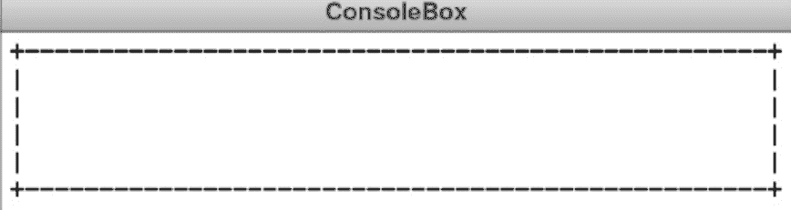
11. 编写一个函数`drawConsoleArrow(width)`，绘制一个指向右侧的三角形箭头，其中中心线具有指定的宽度。例如，调用`drawConsoleArrow(6)`应产生如下输出：
    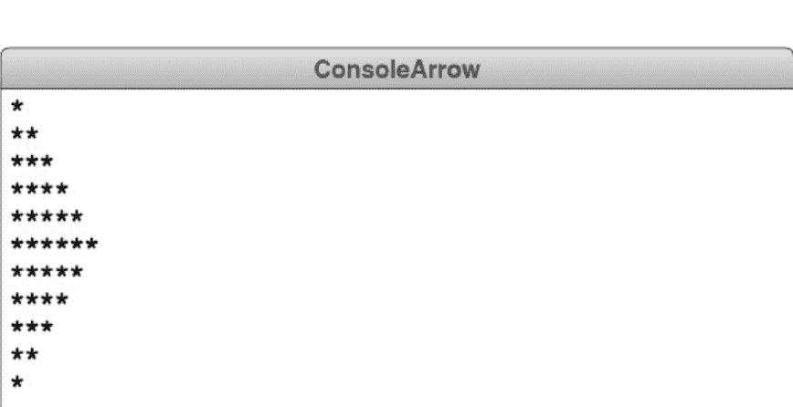
    如果在`drawConsoleTriangle`代码末尾简单地添加一个倒序计数的第二个循环，这个程序很容易编写。如果你改用单个外层循环，在达到所需宽度时改变方向，可以更好地体会 JavaScript 中`for`语句的灵活性。
12. 编写一个函数`drawConsolePyramid(height)`，绘制指定高度的金字塔，其中每行的宽度在向下移动时增加 2。每行应相对于其他行居中，底边应从左边距开始。因此，调用`drawConsolePyramid(8)`应产生如下图形：
    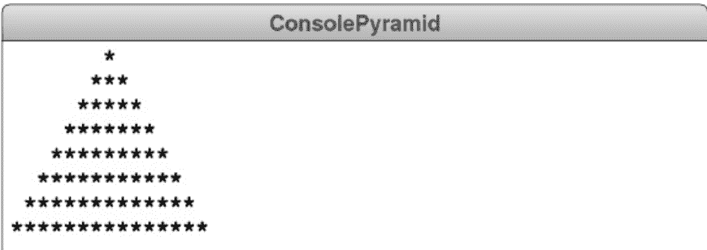
13. 为曼彻斯特婴儿机编写的第一个程序是寻找一个数的最大因子。更有趣的问题是找出所有因子的完整集合。编写一个函数`printFactors(n)`，以单行形式列出所有因子，包括数字`n`、等号和用星号分隔的各个因子，如下面的控制台日志所示：
    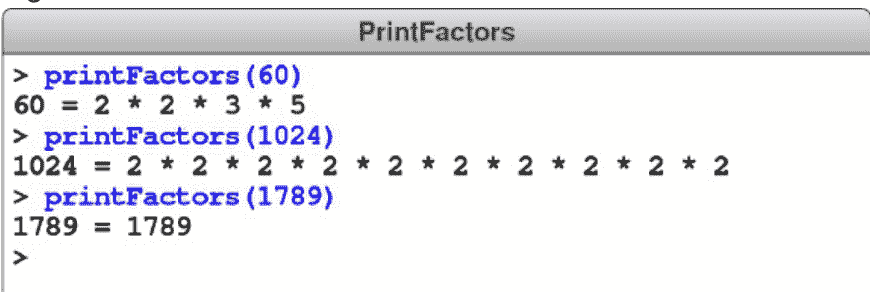
14. 德国数学家戈特弗里德·威廉·冯·莱布尼茨发现了一个相当 remarkable 的事实：数学常数 π 可以使用以下数学关系计算：
    $$\frac{\pi}{4} = 1 - \frac{1}{3} + \frac{1}{5} - \frac{1}{7} + \frac{1}{9} - \dots$$
    等号右边的公式表示一个无穷级数；每个分数代表该级数中的一项。如果从 1 开始，减去三分之一，加上五分之一，依此类推，对每个奇整数进行这样的操作，随着项数增加，得到的结果会越来越接近\(\pi/4\)的值。编写一个程序，使用莱布尼茨级数的前 10,000 项计算 π 的近似值。
15. 大于 1 的整数如果除了自身和 1 之外没有其他约数，则称为**素数**（**prime**）。例如，17 是素数，因为它除了 1 和 17 之外没有其他因子。然而，91 不是素数，因为它能被 7 和 13 整除。编写一个谓词函数`isPrime(n)`，如果整数 n 是素数则返回`true`，否则返回`false`。作为初始策略，使用暴力算法实现`isPrime`，即简单地测试每个可能的约数。一旦该版本能正常工作，尝试改进算法，在不影响正确性的前提下提高效率。
16. 希腊数学家对等于其真约数之和的数字特别感兴趣（*n*的真约数是任何小于*n*本身的约数）。他们将这样的数字称为**完全数**（**perfect numbers**）。例如，6 是完全数，因为它是 1、2 和 3 的和，这些是能整除 6 且小于 6 的整数。同样，28 是完全数，因为它是 1、2、4、7 和 14 的和。

编写一个谓词函数 `isPerfect(n)`，当整数 `n` 是**完全数**时返回 `true`，否则返回 `false`。编写一个程序来测试你的实现，该程序使用 `isPerfect` 函数逐一检查 1 到 9999 范围内的每个数字，判断是否为完全数。每当程序识别出一个完全数时，应在屏幕上显示该数字。输出的前两行应为 6 和 28。你的程序还应在该范围内找到另外两个完全数。

17. 虽然欧几里得计算最大公约数的算法是最早被冠以该术语的算法之一，但还有其他算法的历史可追溯到许多世纪以前。在中世纪，需要复杂算法思维的问题之一是确定复活节的日期——复活节定于春分之后第一个满月之后的第一个星期日。根据这一定义，计算过程涉及星期几、月球轨道以及太阳穿过黄道的运行周期之间的交互循环。解决此问题的早期算法可追溯到公元三世纪，并在八世纪学者——尊者比德——的著作中有描述。1800 年，德国数学家**卡尔·弗里德里希·高斯**发表了一种计算复活节日期的算法，该算法完全是计算性的，即它依赖于算术运算而非查表。他的算法——从德文翻译而来——见于[此处](http://gdz.sub.uni-goettingen.de/no_cache/dms/load/img/?IDDOC=137484)。

### 1. 高斯计算复活节日期的算法

I. 将需要计算复活节的年份分别除以 19、4 和 7，将这些除法的余数分别记为 a、b 和 c。如果除法结果为偶数，则将余数设为 0；商不计入考虑。以下除法同样如此。

II. 将值 19a + 23 除以 30，将余数记为 d。

III. 最后，将 2b + 4c + 6d + 3 或 2b + 4c + 6d + 4（1700 年至 1799 年之间的年份取前者，1800 年至 1899 年之间的年份取后者）除以 7，将余数记为 e。

则复活节在 3 月 22 + d + e 日，或者当 d + e 大于 9 时，在 4 月 d + e – 9 日。

译自卡尔·弗里德里希·高斯，"Berechnung des Osterfestes"，1800 年 8 月
http://gdz.sub.uni-goettingen.de/no_cache/dms/load/img/?IDDOC=137484

编写一个 JavaScript 函数 `findEaster(year)`，返回一个显示指定年份复活节日期的字符串。例如，调用 `findEaster(1800)` 返回字符串 "April 13"，因为那是高斯发表该算法那一年的复活节日期。
不幸的是，上述算法仅适用于 18 世纪和 19 世纪的年份。不过，很容易在网上搜索到适用于所有年份的扩展版本。在完成高斯算法的实现后，请进行必要的研究以实现一种更通用的方法。

# *简单图形学*

连接到数字计算机的显示器让我们有机会熟悉在物理世界中无法实现的概念。它是通向数学奇境的窗口。

> ——**伊万·萨瑟兰**，"终极显示"，196


# **伊万·萨瑟兰（1938–）**

*（由计算机历史博物馆提供）*

*伊万·萨瑟兰出生于内布拉斯加州，在高中时就对计算机产生了浓厚兴趣。当时一位家庭朋友给了他机会去编程一台名为 SIMON 的小型继电器计算机。由于当时计算机科学尚未成为一门学科，萨瑟兰在匹兹堡的卡内基理工学院（现卡内基梅隆大学）主修电气工程，随后在加州理工学院获得硕士学位，在麻省理工学院获得博士学位。他的博士论文"Sketchpad：一种人机图形通信系统"成为计算机图形学的基石之一，并引入了图形用户界面的概念，这已成为现代软件的基本特性。完成学位后，萨瑟兰先后在哈佛大学、犹他大学和加州理工学院任教，之后离开学术界创办了一家计算机图形公司。萨瑟兰于 1988 年获得 ACM 图灵奖。*

虽然仅使用在第 2 章中介绍的数值和字符串类型也能学习编程的基础知识，但数字和字符串不像计算机发展早期那样令人兴奋。对于在 21 世纪成长起来的学生来说，计算机的大部分魅力在于它能够处理其他更有趣的数据类型，包括图像和交互式图形对象。JavaScript 非常适合处理图形数据。只需引入几种图形类型，就能让你创建更具吸引力的应用程序，并给你更大的动力去掌握这些内容。

本章向你介绍**可移植图形库（Portable Graphics Library）**中的功能，这是一组用于编写简单图形应用程序的工具集。本章的讨论提供了足够的入门信息；图形库的更高级功能将在需要时逐步引入。

## 图形版的 "Hello World"

正如 `HelloWorld.js` 是展示 JavaScript 与基于 Web 的控制台配合使用的有用程序一样，使用相同的问题作为 JavaScript 图形程序的起点也是合理的。图形版 `GraphicsHelloWorld.js` 程序的代码见于此处。新的目标不再是打印 "hello, world" 这几个字，而是将这些字显示在嵌入网页中的图形窗口里。

```
/*
 * File: GraphicsHelloWorld.js
 * -------------------------
 * This program displays the string "hello, world" at location (50, 100)
 * on the graphics window. The inspiration for this program comes from
 * Brian Kernighan and Dennis Ritchie's book, The C Programming Language.
 */

"use strict";

/* Constants */

const GWINDOW_WIDTH = 500;
const GWINDOW_HEIGHT = 200;

/* Main program */

function GraphicsHelloWorld() {
    let gw = GWindow(GWINDOW_WIDTH, GWINDOW_HEIGHT);
    let msg = GLabel("hello, world", 50, 100);
    gw.add(msg);
}
```

与第 2 章中的 `HelloWorld.js` 程序一样，`GraphicsHelloWorld.js` 也设计为在浏览器中运行，因此需要一个定义网页结构的 `index.html` 文件，该文件见于此处。这个文件与 `HelloWorld.js` 的几乎完全相同。唯一的区别是该程序需要加载图形库而非控制台库。对应的 `<script>` 标签如下所示：

```
<script src="JSGraphics.js"></script>
```


`GraphicsHelloWorld.js` 程序的主函数如下所示：

```
function GraphicsHelloWorld() {
    let gw = GWindow(GWINDOW_WIDTH, GWINDOW_HEIGHT);
    let msg = GLabel("Hello, world", 50, 100);
    gw.add(msg);
}
```

`GraphicsHelloWorld.js` 程序的主函数如下所示：

```
function GraphicsHelloWorld() {
    let gw = GWindow(GWINDOW_WIDTH, GWINDOW_HEIGHT);
    let msg = GLabel("hello, world", 50, 100);
    gw.add(msg);
}
```

## `GraphicsHelloWorld.js` 的 `index.html` 文件

```
<!DOCTYPE html>
<html>
  <head>
    <title>GraphicsHelloWorld</title>
    <script src="JSGraphics.js"></script>
    <script src="GraphicsHelloWorld.js"></script>
  </head>
  <body onload="GraphicsHelloWorld()"></body>
</html>
```

`GraphicsHelloWorld` 的主体以两个变量声明开头——一个是变量 `gw`，代表"图形窗口"；另一个是变量 `msg`，指屏幕上显示的消息。这些声明本身的形式与你之前见过的相同。每个声明都声明了一个变量并将其初始化为一个值。不同的是这些值的类型。

## 类、对象和方法

关于 `GraphicsHelloWorld.js` 程序，最重要的一点是：存储在变量 `gw` 和 `msg` 中的值比你到目前为止处理过的值要复杂，尽管底层原理是相同的。到目前为止，你存储在变量中的值都是数字或字符串。在 `GraphicsHelloWorld.js` 程序中，存储在这些变量中的每个值都是**对象**，这是计算机科学中用来指代概念上整合的实体的术语，它将定义对象状态的信息和影响该状态的操作联系在一起。

这些对象中的每一个也都是**类**的代表，类最容易想象为一种模板，它定义了特定类型的所有对象共有的属性和操作。单个类可以产生许多不同的对象；每个这样的对象都被称为该类的***实例***。

# 创建对象

`GraphicsHelloWorld.js` 程序包含两个创建对象的声明：

```
let gw = GWindow(GWINDOW_WIDTH, GWINDOW_HEIGHT);
let msg = GLabel("hello, world", 50, 100);
```

`GWindow` 和 `GLabel` 函数是 `JSGraphics.js` 库的一部分，用于创建这些类的新对象。`GWindow` 类代表屏幕上的图形窗口，`GLabel` 类代表可以出现在该窗口中的字符串。创建新对象的函数称为**工厂方法**，通常以大写字母开头。

声明

```
let gw = GWindow(GWINDOW_WIDTH, GWINDOW_HEIGHT);
```

使用 `GWindow` 工厂方法创建了一个类为 `GWindow` 的对象。参数 `GWINDOW_WIDTH` 和 `GWINDOW_HEIGHT` 以称为**像素**的单位指定窗口大小，像素是覆盖显示器表面的微小点。因此，对 `GWindow` 的调用创建了一个新的 `GWindow` 对象，宽 500 像素，高 200 像素。然后该对象被赋值给名为 `gw` 的变量，这使得程序能够在代码的其余部分引用该窗口。

即使变量 `gw` 和 `msg` 的声明创建了必要的对象，这些行本身并不会使 `GLabel` 出现在 `GWindow` 中。要让消息显示出来，程序必须告诉存储在 `gw` 中的 `GWindow` 对象将存储在 `msg` 中的 `GLabel` 添加到其内部待显示图形对象列表中。这个过程的最后一步由 `GraphicsHelloWorld.js` 程序的最后一行负责，如下所示：

```
gw.add(msg);
```

理解这条语句的工作原理需要你进一步了解 JavaScript 处理对象的方式。

## 向对象发送消息

当你在使用支持对象的语言进行编程时，采用***面向对象范式***的一些思想和术语是很有用的，这是一种以对象及其交互为中心的概念模型，而不是数据与操作相分离的更传统模型。在面向对象编程中，任何触发对象特定行为的通用术语称为**消息**。在 JavaScript 中，向对象发送消息的面向对象思想是通过调用与该对象相关联的函数来实现的。与对象相关联的函数称为***方法***，调用方法的对象称为***接收者***。

在 JavaScript 中，方法调用使用以下语法：

```
receiver.name(arguments)
```

在方法调用 `gw.add(msg)` 中，存储在 `gw` 中的图形窗口是接收者，`add` 是响应消息的方法名称。参数 `msg` 让 `GWindow` 类的实现知道要添加什么图形对象，在本例中是存储在 `msg` 变量中的 `GLabel`。`GWindow` 通过在屏幕上指定坐标处显示消息来响应，从而创建如下图像：

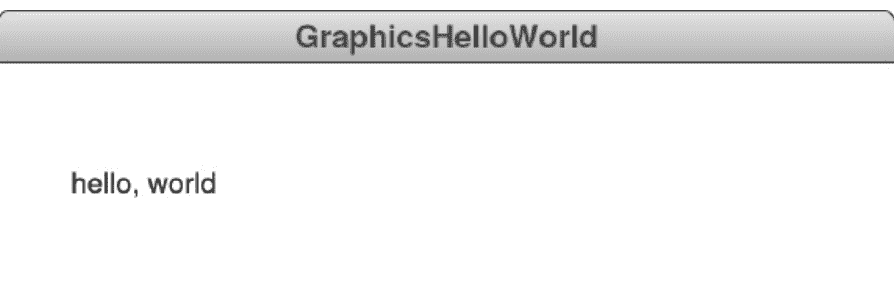

从屏幕图像中可以看到，预期的消息已经显示出来了。虽然它不是很大或令人兴奋，但你将在本章后面有机会让它变得更加生动。

## 引用

在 JavaScript 中，存储在像 `gw` 这样的变量中的值不是整个对象，而是**引用**，这是计算机内部的一种值，作为指向实际对象中数据的链接。在 `GraphicsHelloWorld.js` 程序中，声明

```
let gw = GWindow(GWINDOW_WIDTH, GWINDOW_HEIGHT);
```

将变量 `gw` 初始化为包含对浏览器窗口中能够显示图形对象的区域的引用，如下图所示：

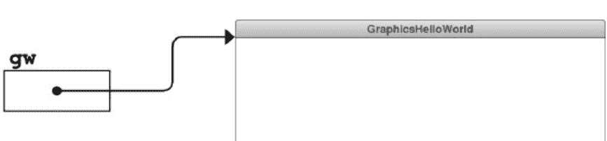

正如箭头所示，存储在 `gw` 中的引用指向一个更大的值，该值代表屏幕上的图形窗口。

声明

 ```
let msg = GLabel("hello, world", 50, 100);
```

的运行方式与此类似。这行代码创建了一个`GLabel`对象，并将该对象的引用赋值给变量`msg`，如下所示：

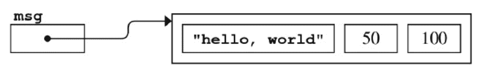

尽管我们往往可以忽略引用与其关联对象之间的区别，但理解下面的概念很重要：将对象值赋给变量时，并不会复制整个对象，而是仅复制引用。例如，如果你写下这样的声明

```
let msg2 = msg;
```

JavaScript 不会创建第二个对象，而是会安排`msg`和`msg2`都包含对*同一个*对象的引用，如下所示：

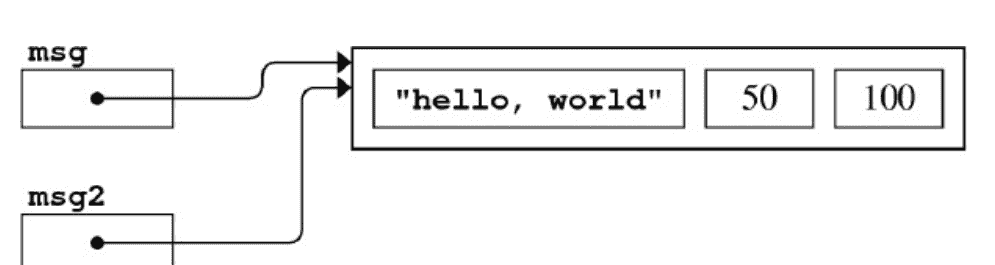

如果你需要创建第二个`GLabel`——哪怕它的内容相同——你需要调用`GLabel`工厂方法。

理解 JavaScript 如何使用引用来链接到更大的数据结构，对于你后续学习数组和对象特别重要。

## 封装

前面章节中`GLabel`对象的示意图仅展示了存储在这些对象内部的数据值。除了这些值之外，对象还包含适用于该类对象的方法，尽管除非你查看图形库的内部代码，否则看不到这些方法的代码。内部数据值和方法代码对创建`GLabel`的函数不可用，而是被安全地封装在对象内部。这种将数据和代码打包在一起的模型称为**封装**。

## 图形对象

前面介绍的`GLabel`类只是图形库中可显示在屏幕上的对象的多个类之一。本节介绍另外三个类——`GRect`、`GOval`和`GLine`——它们与`GLabel`和`GWindow`一起，为创建图形应用程序提供了一套实用的"入门工具包"。你将在本书后面有机会了解其他类。

### GRect 类

`GRect`类允许你创建矩形并将其添加到图形窗口中。例如，中的程序创建了一个图形窗口，然后在窗口中添加一个用蓝色实心填充的矩形，如下所示：

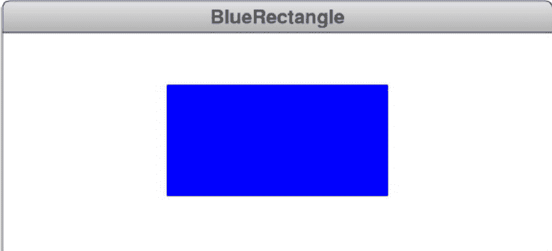

### 在图形窗口上绘制蓝色矩形的程序

```
/*
 * File: BlueRectangle.js
 * -----------------------
 * This program draws a blue rectangle on the graphics window.
 */

"use strict";

/* Constants */

const GWINDOW_WIDTH = 500;
const GWINDOW_HEIGHT = 200;

/* Main program */

function BlueRectangle() {
    let gw = GWindow(GWINDOW_WIDTH, GWINDOW_HEIGHT);
    let rect = GRect(150, 50, 200, 100);
    rect.setColor("Blue");
    rect.setFilled(true);
    gw.add(rect);
}
```

在很大程度上，`BlueRectangle.js`程序看起来与中的`GraphicsHelloWorld.js`程序非常相似。它包含了——正如本书中每个图形程序所做的那样——指示图形窗口大小的常量定义，以及一个主程序，该程序首先创建指定尺寸的`GWindow`并将其赋值给变量`gw`。

`BlueRectangle`函数中的下一条语句是

```
let rect = GRect(150, 50, 200, 100);
```

它创建了一个用于在窗口中显示矩形的`GRect`对象。在此调用中，前两个参数 150 和 50 表示矩形应放置的*x*和*y*坐标；后两个参数 200 和 100 指定矩形的宽度和高度。与之前调用`GWindow`时一样，这些值均以像素为单位，但重要的是要记住，*y*方向的坐标值随着向下移动屏幕而增加，原点(0, 0)位于左上角。为与该约定保持一致，图形对象的原点通常定义为其左上角。因此，存储在变量`rect`中的`GRect`对象被放置成其左上角位于窗口左上角相对位置(150, 50)处。这种几何关系在中有所说明。

### 图形库中使用的坐标系

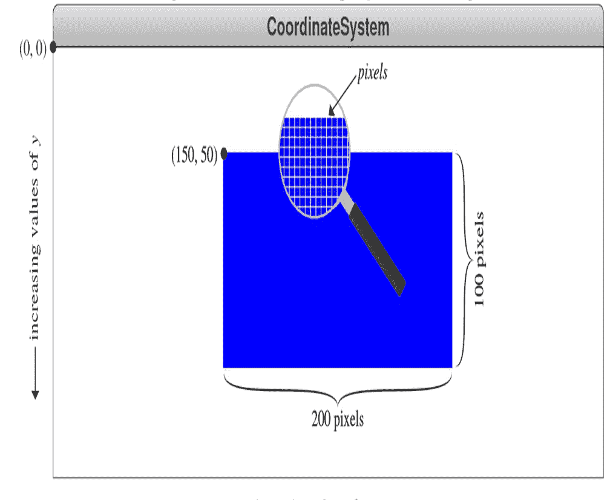

`BlueRectangle`函数中剩余的语句都是方法调用的示例。例如，语句

```
rect.setColor("Blue");
```

向矩形对象发送了一条`setColor`消息，请求它改变颜色。`setColor`的参数是一个字符串，代表 JavaScript 定义的众多颜色名称之一，这些名称列在**中**。在此例中，`setColor`调用告诉矩形将其颜色设置为蓝色。

### JavaScript 中预定义的颜色名称

- AliceBlue
- AntiqueWhite
- Aqua
- Aquamarine
- Azure
- Beige
- Bisque
- Black
- BlanchedAlmond
- Blue
- BlueViolet
- Brown
- BurlyWood
- CadetBlue
- Chartreuse
- Chocolate
- Coral
- CornflowerBlue
- Cornsilk
- Crimson
- Cyan
- DarkBlue
- DarkCyan
- DarkGoldenrod
- DarkGray
- DarkGrey
- DarkGreen
- DarkKhaki
- DarkMagenta
- DarkOliveGreen
- DarkOrange
- DarkOrchid
- DarkRed
- DarkSalmon
- DarkSeaGreen
- DarkSlateBlue
- DarkSlateGray
- DarkSlateGrey
- DarkTurquoise
- DarkViolet
- DeepPink
- DeepSkyBlue
- DimGray
- DimGrey
- DodgerBlue
- FireBrick
- FloralWhite
- ForestGreen
- Fuchsia
- Gainsboro
- GhostWhite
- Gold
- Goldenrod
- Gray
- Grey
- Green
- GreenYellow
- Honeydew
- HotPink
- IndianRed
- Indigo
- Ivory
- Khaki
- Lavender
- LavenderBlush
- LawnGreen
- LemonChiffon
- LightBlue
- LightCoral
- LightCyan
- LightGoldenrodYellow
- LightGray
- LightGrey
- LightGreen
- LightPink
- LightSalmon
- LightSeaGreen
- LightSkyBlue
- LightSlateGray
- LightSlateGrey
- LightSteelBlue
- LightYellow
- Lime
- LimeGreen
- Linen
- Magenta
- Maroon
- MediumAquamarine
- MediumBlue
- MediumOrchid
- MediumPurple
- MediumSeaGreen
- MediumSlateBlue
- MediumSpringGreen
- MediumTurquoise
- MediumVioletRed
- MidnightBlue
- MintCream
- MistyRose
- Moccasin
- NavajoWhite
- Navy
- OldLace
- Olive
- OliveDrab
- Orange
- OrangeRed
- Orchid
- PaleGoldenrod
- PaleGreen
- PaleTurquoise
- PaleVioletRed
- PapayaWhip
- PeachPuff
- Peru
- Pink
- Plum
- PowderBlue
- Purple
- RebeccaPurple
- Red
- RosyBrown
- RoyalBlue
- SaddleBrown
- Salmon
- SandyBrown
- SeaGreen
- Seashell
- Sienna
- Silver
- SkyBlue
- SlateBlue
- SlateGray
- SlateGrey
- Snow
- SpringGreen
- SteelBlue
- Tan
- Teal
- Thistle
- Tomato
- Turquoise
- Violet
- Wheat
- White
- WhiteSmoke
- Yellow
- YellowGreen


如果所列出的 140 种标准网页颜色对你来说还不够，JavaScript 允许你通过指定光的三原色——红色、绿色和蓝色的比例来指定 16,777,216 种不同的颜色。要做到这一点，你只需要将颜色指定为 "#rrggbb" 形式的字符串，其中 *rr* 表示红色值，*gg* 表示绿色值，*bb* 表示蓝色值。这些值中的每一个都表示为一个两位数的**十六进制**数，即以 16 为基数。你可能已经在设计网页时熟悉这种颜色指定方式了。如果没有，你将有机会在后续内容中了解更多关于十六进制表示法的知识。

`BlueRectangle` 函数中的下一行是方法调用

```
rect.setFilled(true);
```

它向矩形发送一个 `setFilled` 消息。`setFilled` 的参数是一个布尔值，用于指定矩形是填充的还是仅显示轮廓。调用 `rect.setFilled(true)` 表示矩形的内部应该被填充。相反，调用 `rect.setFilled(false)` 表示不应该填充，这样只留下轮廓。

`BlueRectangle` 函数中的最后一行是方法调用

```
gw.add(rect);
```

它向图形窗口发送一个 `add` 消息，要求它将存储在 `rect` 中的图形对象添加到窗口的内容中。添加矩形后产生了显示的最终内容。

默认情况下，`GRect` 函数创建未填充的矩形。因此，如果你在 `BlueRectangle.js` 中省略这条语句，结果将如下所示：


对于填充的形状，你可以通过调用 `setFillColor` 并使用的任何颜色名称来设置内部颜色。例如，如果你将 `setColor(Blue)` 替换为 `setFilledColor(Cyan)`，矩形将以青色填充但轮廓为黑色，如下所示：

## CyanFramedRectangle


## GOval 类

顾名思义，`GOval` 类用于在图形窗口中显示椭圆形图形。从结构上看，`GOval` 类与 `GRect` 类类似：`GOval` 函数本身接受与 `GRect` 函数相同的参数，两个类响应同一组方法。区别在于这些类在屏幕上产生的图形。`GRect` 类显示一个矩形，其位置和大小由参数值 *x*、*y*、*width* 和 *height* 决定。`GOval` 类显示一个椭圆，其边缘恰好接触到该矩形的边界。

`GRect` 和 `GOval` 类之间的关系最容易通过示例说明。以下函数定义取自前面的 `BlueRectangle.js` 程序，并扩展了添加具有相同坐标和尺寸的 `GOval`：

```
function GRectPlusGOval() {
    let gw = GWindow(GWINDOW_WIDTH, GWINDOW_HEIGHT);
    let rect = GRect(150, 50, 200, 100);
    rect.setFilled(true);
    rect.setColor("Blue");
    gw.add(rect);
    let oval = GOval(150, 50, 200, 100);
    oval.setFilled(true);
    oval.setColor("Red");
    gw.add(oval);
}
```

产生的输出如下所示：


在这个示例中有两个重要的注意事项。首先，红色的 GOval 延伸使其边缘接触到矩形的边界。其次，GOval 是在 GRect 之后添加的，因此隐藏了位于椭圆下方的矩形部分。如果你以相反的顺序添加这些图形，你将只能看到蓝色的 GRect，因为整个 GOval 都在 GRect 的边界之内。


## GLine 类

`GLine` 类用于在图形窗口中显示线段。`GLine` 函数接受四个参数，即两个端点的 x 和 y 坐标。例如，函数调用

```
GLine(0, 0, GWINDOW_WIDTH, GWINDOW_HEIGHT)
```

创建一个 `GLine` 对象，从图形窗口左上角的点 (0, 0) 延伸到右下角的对角点。

以下函数使用 `GLine` 类在图形窗口中绘制两条对角线：

```
function DrawDiagonals() {
    let gw = GWindow(GWINDOW_WIDTH, GWINDOW_HEIGHT);
    gw.add(GLine(0, 0, GWINDOW_WIDTH, GWINDOW_HEIGHT));
    gw.add(GLine(0, GWINDOW_HEIGHT, GWINDOW_WIDTH, 0));
}
```

在浏览器中加载此程序将生成以下显示：


## DrawDiagonals


## GLabel 类

当你在 `GraphicsHelloWorld.js` 程序中最后一次看到 `GLabel` 类时，结果并不完全令人满意。屏幕上显示的消息太小，难以引起太多注意。要使 "hello, world" 消息更大，你需要以不同的字体显示 `GLabel`。

你很可能已经从使用其他计算机应用程序的经历中了解了字体，并且直观地知道字体决定了字符显示的样式。更正式地说，**字体**是一种将字符映射为屏幕上显示的图像的编码。要更改 `GLabel` 的字体，你需要向它发送一个 `setFont` 消息，如下所示：

```
msg.setFont("36px 'Times New Roman'");
```

这对 `setFont` 方法的调用告诉存储在 `msg` 中的 `GLabel` 将其字体更改为文本行高度为 36 像素、字体族为 Times New Roman 的字体，该字体被 *The New York Times* 使用。如果你在程序中包含 `setFont` 调用，图形窗口将如下所示：


作为参数传递给 `setFont` 的字符串使用 CSS 编写，如中所述，CSS 是 Web 用于指定页面视觉外观的技术。该字符串指定了字体的几个属性，按以下顺序出现：

- **字体样式**，可用于指示字体的替代形式。此规范通常从字体字符串中省略以表示普通字体，但可以出现为 `italic` 或 `oblique` 以表示斜体变体或倾斜变体。
- **字体粗细**，指定字体应该有多黑。此规范对于普通字体省略，但可以出现为 `bold` 以指定粗体。
- **字体大小**，通过指示两行连续文本之间的距离来指定字符应该有多高。在 CSS 中，字体大小通常以像素为单位指定为一个数字后跟后缀 `px`，如最近调用 `setFont` 时使用的 `36px` 规范。
- **字体族**，指定与字体关联的名称。如果字体名称包含空格，则必须加引号，通常使用单引号，因为字体规范出现在双引号字符串内。例如，将文本设置为 Times New Roman 因此需要字体字符串包含 'Times New Roman'。由于不同的计算机支持不同的字体，CSS 允许字体规范包含几个用逗号分隔的族名称。浏览器将使用第一个可用的字体族。

CSS 定义了几个**通用族名称**，它们不标识特定字体，而是描述某种始终可用的字体类型。最常见的通用族名称出现在中。将首选字体族列表以这些通用名称之一结尾是一个好的做法，以确保你的程序能够在最广泛的浏览器集合上运行。


 ## CSS 和 JavaScript 中可用的通用字体族

| 衬线体（Serif） | 一种传统的报纸风格字体，字符在顶部和底部有短线，称为*衬线*，引导眼睛将单词视为一个整体阅读。最常见的衬线体示例是'**Times New Roman**'。 |
| 无衬线体（Sans-Serif） | 一种缺乏衬线的简约字体风格。常见的无衬线体示例包括'**Arial**'和'**Helvetica Neue**'。 |
| 等宽体（Monospaced） | 一种打字机风格的字体，所有字符宽度相同。最常见的等宽字体是'**Monaco**'和'**Courier New**'。 |

你可能已经从使用文字处理器的经验中了解到，尝试不同的字体可以带来乐趣。例如，在大多数 Macintosh 系统上，有一种名为 Lucida Blackletter 的字体，它能产生一种让人联想到中世纪彩绘手稿风格的字体。要以此字体显示消息，你可以将程序中的 `setFont` 调用更改为

```
msg.setFont("24px "Lucida Blackletter",Serif");
```

请注意，字体字符串将通用字体族名 `Serif` 作为备选。如果显示页面的浏览器找不到名为 Lucida Blackletter 的字体，它就可以用标准衬线字体之一替代，例如 Times New Roman。但是，如果它能成功加载 Lucida Blackletter 字体，输出看起来就会像这样：


`GLabel` 类使用它自己的几何模型，这与排字工人自谷登堡发明印刷机以来数个世纪使用的模型相似。字体的概念，当然，最初来源于印刷。印刷工会将不同大小和样式的活字装入印刷机，以控制字符在页面上的外观。图形库用于描述字体和标签的术语也源自排版世界。如果你学会以下术语，将更容易理解 `GLabel` 类的行为：

- **基线**是字符所坐的假想线。
- **原点**是标签文本开始的位置。在从左到右阅读的语言中，原点是基线上第一个字符左边缘的点。在从右到左阅读的语言中，原点是第一个字符右边缘的点，即行的右端。
- **高度**是多行文本中相邻基线之间的距离。
- **升部**是字符超出基线上方的最大距离。
- **降部**是字符超出基线下方的最大距离。

这些术语在 `GLabel` 类上下文中的解释如  所示。

## GLabel 类的几何结构


`GLabel` 类包含一些方法，可让你确定这些属性。例如，`GLabel` 类包含一个名为 `getAscent` 的方法，用于确定标签所用字体的升部。此外，它还包含一个名为 `getWidth` 的方法，用于确定 `GLabel` 的水平范围。

这些方法使得在窗口中居中显示标签成为可能，尽管它们提出了一个有趣的问题。你见过的唯一创建 `GLabel` 的函数将其初始坐标作为参数。如果你想居中显示标签，只有在创建标签之后才能知道这些坐标。为了解决这个问题，创建 `GLabel` 的函数有两种形式。第一种接收标签字符串以及原点的 *x* 和 *y* 坐标。第二种省略原点，将原点设置为默认值 (0, 0)。

例如，假设你想在图形窗口中将字符串 "Hello, world" 居中显示。为此，你首先需要创建 `GLabel`，然后更改其字体使标签具有你想要的外观，最后确定标签的尺寸以计算正确的初始位置。然后你可以在 `add` 方法中提供这些坐标，该方法接受可选的 `x` 和 `y` 参数来设置将对象添加到 `GWindow` 时的位置。以下程序实现了这一策略：

```
function CenteredHelloWorld() {
    let gw = GWindow(GWINDOW_WIDTH, GWINDOW_HEIGHT);
    let msg = GLabel("Hello, world");
    msg.setFont("36px Sans-Serif");
    let x = (gw.getWidth() - msg.getWidth()) / 2;
    let y = (gw.getHeight() + msg.getAscent()) / 2;
    gw.add(msg, x, y);
}
```

将 `GLabel` 居中所需的计算发生在变量 `x` 和 `y` 的声明中，它们指定了居中标签的原点。要计算标签的 `x` 坐标，你需要将原点从窗口中心向左移动标签宽度的一半。在垂直方向上居中标签则稍显棘手。你可以通过将 `y` 坐标定义为从中心线向下偏移字体升部的一半来接近正确结果。这些声明还说明了 `GWindow` 对象实现了 `getWidth` 和 `getHeight` 方法，因此你可以使用这些方法来确定窗口的宽度和高度。

运行 `centeredHelloWorld` 函数会在图形窗口上产生以下图像：


如果你是一个注重美学细节的人，你可能会发现使用 `getAscent` 垂直居中 `GLabel` 并不能产生最佳效果。大多数显示在画布上的标签看起来会低几像素。原因是 `getAscent` 返回的是字体的*最大*升部，而不是这个特定 `GLabel` 的文本实际超出基线的距离。如果你想让效果看起来完美，可能不得不将垂直居中调整一两个像素。

`GRect`、`GOval`、`GLine` 和 `GLabel` 类中最重要的方法总结在  中。其他类和方法将在后续章节中相关时介绍。

## 适用于图形对象的方法总结

## 创建图形对象的工厂方法

| 方法 | 描述 |
|---|---|
| `GRect(x, y, width, height)` | 创建具有指定尺寸的 **GRect** 对象。 |
| `GRect(width, height)` | 创建具有指定大小的 **GRect** 对象，其原点位于 (0, 0)。 |
| `GOval(x, y, width, height)` | 创建适合相应矩形内部的 **GOval**。 |
| `GOval(width, height)` | 创建椭圆适合指定大小矩形内部的 **GOval** 对象。**GOval** 的原点为 (0, 0)。 |
| `GLine(x1, y1, x2, y2)` | 创建连接 $(x_1, y_1)$ 和 $(x_2, y_2)$ 的 **GLine** 对象。 |
| `GLabel(str, x, y)` | 创建包含指定字符串的 **GLabel** 对象，其基线原点位于点 $(x, y)$。 |
| `GLabel(str)` | 创建包含指定字符串的 **GLabel** 对象，其基线原点位于点 $(0, 0)$。 |

## 所有图形对象的通用方法

| 方法 | 描述 |
|---|---|
| `object.getX()` | 返回对象的 x 坐标。 |
| `object.getY()` | 返回对象的 y 坐标。 |
| `object.getWidth()` | 返回图形对象的宽度。 |
| `object.getHeight()` | 返回图形对象的高度。 |
| `object.setColor(color)` | 将对象的颜色设置为 *color*。 |

## 仅适用于 GRect 和 GOval 类的方法

| 方法 | 描述 |
|---|---|
| `object.setFilled(flag)` | 设置此对象是否填充。 |
| `object.setFillColor(color)` | 设置用于填充对象内部的颜色。 |

## 仅适用于 GLabel 类的方法

| 方法 | 描述 |
|---|---|
| `object.setFont(str)` | 设置标签的字体。字体规格的格式为文中所述的 CSS 字符串。 |
| `object.getAscent()` | 获取字体的*升部*（超出基线上方的最大距离）。 |
| `object.getDescent()` | 获取字体的*降部*（超出基线下方的最大距离）。 |


## 图形窗口

虽然对于任何使用图形库的程序来说，`GWindow` 类都是必不可少的，但从概念上讲，它与库中的其他类有所不同。像 `GRect` 和 `GLabel` 这样的类表示可以在图形窗口中显示的对象。而 `GWindow` 类则表示图形窗口本身。

`GWindow` 对象通常通过以下代码行进行初始化：

```
let gw = GWindow(GWINDOW_WIDTH, GWINDOW_HEIGHT);
```

这段代码出现在每个使用图形库的程序开头。该语句创建图形窗口并将其安装到网页中，使其对用户可见。它还用于实现显示图形对象的概念框架。库包所实现的概念框架被称为其**模型**。模型让你了解应该如何思考和使用该包。

模型最重要的作用之一是确定该包适合使用哪些类比和隐喻。计算机图形学可以有多种现实世界的隐喻，就像创建视觉艺术有多种不同方式一样。一种可能的隐喻是绘画，画家选择画笔和颜色，然后通过在代表虚拟画布的屏幕上移动画笔来绘制图像。

为了与面向对象设计原则保持一致，可移植图形库使用了**拼贴画**的隐喻。拼贴画艺术家通过选取各种对象并将它们组装在背景画布上来进行创作。在现实世界中，这些对象可能是几何图形、从报纸上剪下的文字、由细绳组成的线条，或从杂志上获取的图片。图形库为所有这些对象提供了对应物。

图形窗口使用拼贴画模型这一事实，影响了你描述创建设计过程的方式。如果使用绘画的隐喻，你可能会谈论在特定位置进行笔触或用颜料填充某个区域。而在拼贴画模型中，关键操作是在背景画布上添加、移除对象以及重新定位它们。

拼贴画还有一个特性，即某些对象可以放置在其他对象之上，遮挡住它们后面的内容。移除这些对象后，原来位于下方的内容就会显露出来。在本书中，拼贴画中对象从后到前的排列顺序被称为**堆叠顺序**，尽管在更正式的文献中有时会称之为 **z 排序**。*z 排序* 这个名称来源于堆叠顺序沿着从 x 轴和 y 轴构成的二维平面中穿出的轴方向排列这一事实。在数学中，从平面穿出的轴被称为 **z 轴**。

`GWindow` 类导出的方法如表格所示。目前，你最重要的方法是 `add`、`getWidth` 和 `getHeight`。其他方法将在应用程序需要时作更详细的描述。

## GWindow 类中的方法

| 方法 | 描述 |
|---|---|
| `GWindow(width, height)` | 创建一个指定大小的新 `GWindow` 对象。 |
| `gw.getWidth()` | 返回图形窗口的宽度。 |
| `gw.getHeight()` | 返回图形窗口的高度。 |
| `gw.add(obj)` | 将对象添加到图形窗口中。 |
| `gw.add(obj, x, y)` | 将对象重新定位到 $(x, y)$ 并将其添加到窗口中。 |
| `gw.remove(obj)` | 从图形窗口中移除该对象。 |
| `gw.getElementCount()` | 返回窗口中显示的对象数量。 |
| `gw.getElement(k)` | 返回从后往前数索引为 $k$ 的对象。 |
| `gw.getElementAt(x, y)` | 返回覆盖点 $(x, y)$ 的最顶层图形对象。如果不存在这样的对象，`getElementAt` 返回 `null`。 |
| `gw.addEventListener(type, fn)` | 使窗口准备好通过调用 `fn` 来响应指定类型的事件。事件监听器将在第 6 章中讨论。 |

## 创建图形应用程序

一旦你能够使用图形库，就可以创建由 `GRect`、`GOval`、`GLine` 和 `GLabel` 类的实例组成的图形显示。接下来的几节将通过几个示例来说明如何在程序中使用这些类。

## 指定坐标和大小

为了了解如何设计一个图形程序，将不同的形状放置在必要位置以构成一幅完整的图像，假设你想显示一个标有欢快消息的红色气球，如下所示：


这个程序（如代码所示）显示了三个图形对象：

- 1. 一个 `GOval`，表示气球本身，黑色轮廓，红色填充
- 2. 一个 `GLine`，表示连接在气球上的绳子。在代码中，使用单词 *cord* 而非 *string*，以避免与消息产生混淆，因为后者是一个 JavaScript 字符串。
- 3. 一个 `GLabel`，显示白色绘制的字符串 `"CS is fun!"`。

## 绘制带绳红色气球的程序

```
/*
 * File: RedBalloon.js
 * --------------------
 * This program draws a red balloon emblazoned with the message
 * "CS is fun!" on the graphics window.
 */

"use strict";

/* Constants */

const GWINDOW_WIDTH = 500;
const GWINDOW_HEIGHT = 300;
const BALLOON_WIDTH = 140;
const BALLOON_HEIGHT = 160;
const BALLOON_LABEL = "CS is fun!";
const CORD_LENGTH = 100;

/* Main program */

function RedBalloon() {
    let gw = GWindow(GWINDOW_WIDTH, GWINDOW_HEIGHT);
    let cx = gw.getWidth() / 2;
    let cy = gw.getHeight() / 2;
    let balloonX = cx - BALLOON_WIDTH / 2;
    let balloonY = cy - (BALLOON_HEIGHT + CORD_LENGTH) / 2;
    let balloon = GOval(balloonX, balloonY, BALLOON_WIDTH, BALLOON_HEIGHT);
    balloon.setFilled(true);
    balloon.setFillColor("Red");
    let cordY = balloonY + BALLOON_HEIGHT;
    let cord = GLine(cx, cordY, cx, cordY + CORD_LENGTH);
    let label = GLabel(BALLOON_LABEL);
    label.setFont("bold 28px 'Helvetica Neue', 'Arial', 'Sans-Serif'");
    label.setColor("White");
    let labelX = cx - label.getWidth() / 2;
    let labelY = balloonY + (BALLOON_HEIGHT + label.getAscent()) / 2;
    gw.add(balloon);
    gw.add(cord);
    gw.add(label, labelX, labelY);
}
```

对象本身并不难创建。在创建这类显示时，通常最耗时的部分是弄清楚如何指定每个对象的大小，以及如何在窗口中定位它们，使一切都能按照你想要的方式组合在一起。

指定图形对象大小和其他属性的最简单策略是将它们定义为常量，如 `RedBalloon.js` 示例所示。这些常量表明图形窗口宽 500 像素、高 300 像素，气球本身宽 140 像素、高 160 像素，显示的消息是字符串 "CS is fun!"，系在气球底部的绳子长 100 像素。

编写程序时，你的主要任务是根据这些常量的值，精确计算出如何定位图形对象。整个图形——气球连同它的绳子——在图形窗口中居中显示，这意味着你必须相对于窗口中心来计算每个对象的坐标位置。中心坐标可以通过以下声明轻松计算出来，这些声明将在其他示例中反复出现：

```
let cx = gw.getWidth() / 2;
let cy = gw.getHeight() / 2;
```

气球椭圆的左上角随后从 `cx` 向左移动气球宽度的一半，并从 `cy` 向上移动总高度（即 `BALLOON_HEIGHT + CORD_LENGTH`）的一半。因此，椭圆左上角的坐标可以计算如下：

```
let balloonX = cx - BALLOON_WIDTH / 2;
let balloonY = cy - (BALLOON_HEIGHT + CORD_LENGTH) / 2;
```

剩余的坐标可以类似计算。例如，绳索顶部的 y 坐标可以使用以下表达式计算：

```
let cordY = balloonY + BALLOON_HEIGHT;
```

## 使用简单分解

`RedBalloon.js` 程序被编写为单个函数。在更复杂的图形应用程序中，将程序分解为多个函数是合理的，每个函数负责绘图的一部分，就像你处理 Karel 程序那样。正如在 Karel 的世界中，你需要仔细思考如何分解问题，以便每个函数都能独立成立。

要理解分解如何应用于简单的图形应用程序，假设你决定绘制一幅你梦中房子的图画，使用小学美术课中可能出现的细节水平。最终，你希望图形窗口上的图片看起来像这样：

尽管还有其他合理的选择，一种可能的策略是将问题细分为绘制房屋框架、门和每个窗户的函数。这些函数将负责绘制左侧边栏中显示的图片部分。然后，你可以通过分别调用 `drawFrame` 一次、`drawDoor` 一次和 `drawWindow` 两次来绘制整个房子。

你仍然需要做的是弄清楚这些函数中的每一个如何知道将图片的哪个部分放在哪里，以及每个组件的大小应该是多少。正如在 `RedBalloon.js` 程序中，一些值可以使用常量指定。然而，其他值必须作为参数传递给这些函数。至少，`drawWindow` 函数需要知道窗户的 *x* 和 *y* 坐标，以便它可以在两个不同的位置绘制窗户。

决定哪些值声明为常量、哪些作为参数传递需要评估两种模型之间的权衡。一般来说，声明常量更简单，但限制了程序的灵活性。同时，传递过多的参数会使函数更难理解和使用。在大多数应用程序中，采用混合策略是有意义的，即使用常量指定程序中始终不变的值，并使用参数指定调用者希望更改的值。

绘制房子的完整程序出现在接下来的两页中。每个函数接受三个参数：图形窗口 `gw`，以及坐标 *x* 和 *y*，它们指定该部分整个图片应出现在窗口上的位置。

为了与 JavaScript 的图形模型保持一致，这些坐标值指定图片组件的左上角。对于没有左上角的图形对象，通常的策略是让坐标指向该对象的外接矩形的左上角（就像 `GOval` 类那样），这称为其 **边界框**。因此，整个房子的坐标表示下图中虚线矩形的左上角：

## 绘制简单框架房子的程序

```
/*
 * 文件：DrawHouse.js
 * ------------------
 * 此程序在图形窗口中心绘制一个简单的框架房子。
 */

"use strict";

/* 常量 */

const GWINDOW_WIDTH = 500;   /* 图形窗口的宽度          */
const GWINDOW_HEIGHT = 300;  /* 图形窗口的高度         */
const HOUSE_WIDTH = 300;     /* 房子的宽度                    */
const HOUSE_HEIGHT = 210;    /* 包括屋顶的房子高度 */
const ROOF_HEIGHT = 75;      /* 框架上方的屋顶高度    */
const DOOR_WIDTH = 60;       /* 门的宽度                     */
const DOOR_HEIGHT = 105;     /* 门的高度                    */
const DOORKNOB_SIZE = 6;     /* 门把手的直径              */
const DOORKNOB_INSET_X = 5;  /* 门把手到门边缘的距离 */
const WINDOW_WIDTH = 70;     /* 每个窗户的宽度                  */
const WINDOW_HEIGHT = 50;    /* 每个窗户的高度                 */
const WINDOW_INSET_X = 26;   /* 外墙到窗户的距离 */
const WINDOW_INSET_Y = 30;   /* 天花板到窗户的距离 */

/* 主程序 */

function DrawHouse() {
    let gw = GWindow(GWINDOW_WIDTH, GWINDOW_HEIGHT);
    let houseX = (gw.getWidth() - HOUSE_WIDTH) / 2;
    let houseY = (gw.getHeight() - HOUSE_HEIGHT) / 2;
    drawFrameHouse(gw, houseX, houseY);
}

/*
 * 在图形窗口 gw 上绘制一个简单的框架房子。参数 x 和 y 指示包围整个房子的边界框的左上角。
 */

function drawFrameHouse(gw, x, y) {
    drawFrame(gw, x, y);
    let doorX = x + (HOUSE_WIDTH - DOOR_WIDTH) / 2;
    let doorY = y + HOUSE_HEIGHT - DOOR_HEIGHT;
    drawDoor(gw, doorX, doorY);
    let leftWindowX = x + WINDOW_INSET_X;
    let rightWindowX = x + HOUSE_WIDTH - WINDOW_INSET_X - WINDOW_WIDTH;
    let windowY = y + ROOF_HEIGHT + WINDOW_INSET_Y;
    drawWindow(gw, leftWindowX, windowY);
    drawWindow(gw, rightWindowX, windowY);
}
```

```
/*
 * 在图形窗口 gw 上绘制房子的框架。参数 x 和 y 指示边界框的左上角。
 */

function drawFrame(gw, x, y) {
    let roofY = y + ROOF_HEIGHT;
    gw.add(GRect(x, roofY, HOUSE_WIDTH, HOUSE_HEIGHT - ROOF_HEIGHT));
    gw.add(GLine(x, roofY, x + HOUSE_WIDTH / 2, y));
    gw.add(GLine(x + HOUSE_WIDTH / 2, y, x + HOUSE_WIDTH, roofY));
}

/*
 * 在图形窗口 gw 上绘制一扇门（带其门把手）。参数 x 和 y 指示门的左上角。
 */

function drawDoor(gw, x, y) {
    gw.add(GRect(x, y, DOOR_WIDTH, DOOR_HEIGHT));
    let doorknobX = x + DOOR_WIDTH - DOORKNOB_INSET_X - DOORKNOB_SIZE;
    let doorknobY = y + DOOR_HEIGHT / 2;
    gw.add(GOval(doorknobX, doorknobY, DOORKNOB_SIZE, DOORKNOB_SIZE));
}

/*
 * 绘制一个垂直分为两格的矩形窗户。参数 x 和 y 指示窗户的左上角。
 */

function drawWindow(gw, x, y) {
    gw.add(GRect(x, y, WINDOW_WIDTH, WINDOW_HEIGHT));
    gw.add(GLine(x + WINDOW_WIDTH / 2, y,
                x + WINDOW_WIDTH / 2, y + WINDOW_HEIGHT));
}
```

# 在图形应用程序中使用控制结构

你学过的控制语句在图形编程中经常出现，尤其是在需要在图形窗口的不同位置绘制多个相同图形副本时。例如，该程序在图形窗口中心绘制五个圆形，如下所示：


## 在图形窗口中心绘制五个圆形的程序

```
/*
 * File: DrawFiveCircles.js
 * ------------------------
 * This program draws a row of five circles centered in the graphics window.
 */

"use strict";

/* Constants */

const GWINDOW_WIDTH = 500;
const GWINDOW_HEIGHT = 200;
const CIRCLE_SIZE = 75;
const CIRCLE_SEP = 15;

/* Main program */

function DrawFiveCircles() {
  let gw = GWindow(GWINDOW_WIDTH, GWINDOW_HEIGHT);
  let cx = gw.getWidth() / 2;
  let cy = gw.getHeight() / 2;
  for (let i = 0; i < 5; i++) {
    let centerX = cx + (i - 2) * (CIRCLE_SIZE + CIRCLE_SEP);
    let circleX = centerX - CIRCLE_SIZE / 2;
    let circleY = cy - CIRCLE_SIZE / 2;
    gw.add(GOval(circleX, circleY, CIRCLE_SIZE, CIRCLE_SIZE));
  }
}
```

值得花时间看看 `DrawFiveCircles.js` 的代码，以确保你理解这些表达式如何确保圆形居中。

在处理二维图形设计时，你经常需要使用嵌套循环来沿水平和垂直方向排列图形对象。例如，`Checkerboard.js` 程序绘制了一个看起来像这样的棋盘：


## 绘制棋盘的程序

```
/*
 * File: Checkerboard.js
 * ---------------------
 * This program draws a checkerboard centered in the graphics window.
 */

"use strict";

/* Constants */

const GWINDOW_WIDTH = 500;        /* Width of the graphics window  */
const GWINDOW_HEIGHT = 300;       /* Height of the graphics window */
const N_COLUMNS = 8;              /* Number of columns             */
const N_ROWS = 8;                 /* Number of rows                */
const SQUARE_SIZE = 35;           /* Size of a square in pixels    */

/* Main program */

function Checkerboard() {
   let gw = GWindow(GWINDOW_WIDTH, GWINDOW_HEIGHT);
   let x0 = (gw.getWidth() - N_COLUMNS * SQUARE_SIZE) / 2;
   let y0 = (gw.getHeight() - N_ROWS * SQUARE_SIZE) / 2;
   for (let row = 0; row < N_ROWS; row++) {
      for (let col = 0; col < N_COLUMNS; col++) {
         let x = x0 + col * SQUARE_SIZE;
         let y = y0 + row * SQUARE_SIZE;
         let sq = GRect(x, y, SQUARE_SIZE, SQUARE_SIZE);
         sq.setFilled((row + col) % 2 !== 0);
         gw.add(sq);
      }
   }
}
```

再次值得花时间仔细阅读代码，特别注意以下细节：

-   该程序的设计使得你可以通过改变常量 `N_ROWS` 和 `N_COLUMNS` 的值来轻松更改棋盘的尺寸。
-   棋盘的排列使其在图形窗口中居中。变量 `x0` 和 `y0` 用于保存居中棋盘左上角的坐标。
-   是否填充一个方块是通过检查其行号与列号之和是偶数还是奇数来决定的。对于白色方块，这个和是偶数；对于黑色方块，这个和是奇数。然而请注意，你不需要在代码中使用 `if` 语句来测试这个条件。你只需要用合适的布尔值调用 `setFilled` 方法即可。

# 返回图形对象的函数

重要的是要记住，图形对象在 JavaScript 中是数据值，就像数字和字符串一样精确。因此，你可以将图形对象赋值给变量、将它们作为参数传递给函数调用，或者让函数将它们作为结果返回。返回 `GObject` 子类之一的值的函数，在创建需要显示具有某些预设特性（如大小和颜色）的形状的图形应用程序时，可以作为工具发挥极其有用的作用。

`Target.js` 程序通过定义一个 `createFilledCircle` 函数来说明此功能，该函数接受四个参数：表示圆心坐标的 *x* 和 *y* 值、指定圆半径的数字 *r*，以及指示 JavaScript 颜色名称的字符串 *color*。`Target.js` 程序调用 `createFilledCircle` 三次，创建了三个在红色和白色之间交替颜色且大小逐渐减小的圆。最外圆的半径由常量 `OUTER_RADIUS` 给出。两个内圆的半径分别是其大小的三分之二和三分之一。运行 `Target.js` 程序会产生以下输出：


## 在图形窗口上绘制红白相间靶心的程序

```
/*
 * File: Target.js
 * --------------
 * This program draws a target at the center of the graphics window composed
 * of three concentric circles alternately colored red and white.
 */

"use strict";

/* Constants */

const GWINDOW_WIDTH = 500;
const GWINDOW_HEIGHT = 200;
const TARGET_RADIUS = 75;

/* Main program */

function Target() {
    let gw = GWindow(GWINDOW_WIDTH, GWINDOW_HEIGHT);
    let cx = gw.getWidth() / 2;
    let cy = gw.getHeight() / 2;
    gw.add(createFilledCircle(cx, cy, TARGET_RADIUS, "Red"));
    gw.add(createFilledCircle(cx, cy, 2 * TARGET_RADIUS / 3, "White"));
    gw.add(createFilledCircle(cx, cy, TARGET_RADIUS / 3, "Red"));
}

/*
 * Creates a circle of radius r centered at the point (x, y) filled
 * with the specified color and returns the initialized GOval to
 * the caller.
 */

function createFilledCircle(x, y, r, color) {
    let circle = GOval(x - r, y - r, 2 * r, 2 * r);
    circle.setColor(color);
    circle.setFilled(true);
    return circle;
}
```

# 总结

本章介绍了可移植图形库，它允许你使用直线、矩形、椭圆和标签在屏幕上创建简单的图片。在此过程中，你有机会练习在 JavaScript 中使用对象。

本章介绍的要点包括：

-   本书中的图形程序使用 *可移植图形库*，这是一组专为入门课程设计的图形工具集合。该库以名为 `JSGraphics.js` 的单个 JavaScript 文件形式提供。
-   JavaScript 支持一种称为 *面向对象范式* 的现代编程风格，它将注意力集中在数据对象及其交互上。
-   在面向对象范式中，*对象* 是一个概念上统一的实体，它结合了该对象的状态和影响其状态的操作。每个对象是一个 *类* 的代表，类是一个模板，定义了特定类型所有对象共享的属性和操作。一个类可以产生许多不同的对象；每个这样的对象都是该类的一个 *实例*。
-   对象通过发送 *消息* 进行通信。在 JavaScript 中，这些消息是通过调用 *方法* 来实现的，方法就是属于特定类的简单函数。
-   JavaScript 中的方法调用使用接收者语法，其形式如下：


 ```
receiver.name(arguments)
```

接收器（receiver）是消息发送的目标对象，name 表示响应消息的方法名，arguments 是传递消息所携带的额外信息的值列表。

- 创建新对象的函数称为**工厂方法**（factory method），按照惯例，其名称以大写字母开头。
- 任何使用可移植图形库的 JavaScript 程序的第一行都使用以下声明创建 GWindow 对象：

```
let gw = GWindow(GWINDOW_WIDTH, GWINDOW_HEIGHT);
```

常量 GWINDOW_WIDTH 和 GWINDOW_HEIGHT 以像素为单位指定图形窗口的尺寸，像素是覆盖显示屏表面的微小圆点。初始化变量 gw 后，你就可以创建各种图形对象并将它们添加到窗口中。

- 本章介绍四类图形对象——GRect、GOval、GLine 和 GLabel，分别表示矩形、椭圆形、线段和文本字符串。其他图形对象将在后续章节中介绍。
- 所有图形对象都支持 setColor 方法，该方法将颜色名称作为字符串传入。JavaScript 定义了 140 种标准颜色，其名称列在 125 页上。
- `GRect` 和 `GOval` 类使用 `setFilled` 和 `setFillColor` 来控制形状内部是否填充以及填充什么颜色。
- `GLabel` 类使用 `setFont` 方法来设置标签显示的字体。`setFont` 的参数是 CSS 字体规范，在 **129** 页有描述。
- `GLabel` 类使用的几何模型与其他图形对象不同。该模型在 **131** 页有图示。

### 复习题

1. 本章用于实现图形输出程序的 JavaScript 库叫什么名字？

2. 用自己的话定义术语*类*（*class*）、*对象*（*object*）和*方法*（*method*）。

3. 什么是*引用*（*reference*）？

4. 面向对象范 paradigm 使用发送消息的隐喻来建模对象之间的通信。JavaScript 如何实现这一思想？

5. 什么是*接收器语法*（*receiver syntax*）？

6. 什么是*工厂方法*（*factory method*）？

7. 本书中每个图形程序的第一行是什么？

8. 本章介绍的四类图形对象是什么？

9. 如何更改图形对象的颜色？

10. `GRect` 和 `GOval` 类中的 `setFilled` 和 `setFillColor` 方法有什么用途？

11. 传递给 `setFont` 的参数字符串格式是什么？

12. 在 `GLabel` 类的上下文中定义以下术语：*基线*（*baseline*）、*原点*（*origin*）、*高度*（*height*）、*升部*（*ascent*）和*降部*（*descent*）。

13. 解释 `CenteredHelloWorld` 函数中以下两行的用途：

```
let x = (gw.getWidth() - msg.getWidth()) / 2;
let y = (gw.getHeight() + msg.getAscent()) / 2;
```

为什么在计算 *x* 坐标时使用减号，而在计算 *y* 坐标时使用加号？

14. 使用 `getAscent` 方法垂直居中 `GLabel` 时，为什么结果文本通常看起来会低几个像素？

15. 什么是*拼贴模型*（*collage model*）？

16. 术语*堆叠顺序*（*stacking order*）是什么意思？通常还用什么其他术语表示相同的概念？

1. 使用程序编辑器完全按照  和  中的样子创建程序 `GraphicsHelloWorld.js` 及其关联的 `index.html` 文件。在浏览器中打开 `index.html` 文件，以证明你可以运行图形程序。

2. 编写一个图形程序 `TicTacToeBoard.js`，在图形窗口中居中绘制一个井字棋棋盘，如下面的示例运行所示：


棋盘的大小应指定为常量，图形应在窗口中水平和垂直居中。

3. 绘制  的简化版本，展示 `GLabel` 类的几何结构。在你的实现中，应使用无衬线字体以红色显示两个字符串（`"The quick brown fox"` 和 `"jumped over the lazy dog"`），字体要足够大以便看清引导线。然后对于每个字符串，应沿基线、标记字体升边吃和标记字体降部线绘制灰色线条。最后，应绘制一个小的填充圆点来指示第一个字符串的基线原点。图形窗口将如下所示：


这个输出关于字体升部的描述比  更诚实一些，升部看起来略高于大写字母的顶部。

4. 使用图形库绘制一道类似下图的彩虹：

## 彩虹


从上到下，彩虹的七个色带分别是红色、橙色、黄色、绿色、蓝色、靛蓝色和紫色；青色是天空的亮丽颜色。请记住，本章只定义了 `GRect`、`GOval`、`GLine` 和 `GLabel` 类，不包括表示弧线的图形对象。你需要跳出框框思考，而且要比平时更字面意义上的"跳出"。

5. 如果你认为  中 `DrawHouse.js` 的输出有点平淡无奇，你不妨试试绘制厄舍府（House of Usher）的图示，埃德加·爱伦·坡（Edgar Allan Poe）这样描述它：

> 第一眼看到这座建筑，一种难以忍受的阴郁感便弥漫了我的心灵……我望着眼前的景象——望着这座单纯的房屋和周围简单的风景——望着荒凉的墙壁——望着空洞有如眼睛般的窗户……望着几棵白色的枯树树干——深感灵魂压抑。

根据坡的描述，你可以画出一座类似这样的房子：


左边的图形是带有"空洞有如眼睛般窗户"的房子，右边的三个图形是"几棵白色枯树树干"的风格化表现。

6. 编写一个程序在图形窗口中显示金字塔。金字塔由水平排列的砖块行组成，每向上移动一行，砖块数量减少一个，如下所示：


金字塔应在窗口中水平和垂直居中，并使用常量定义每块砖的尺寸和金字塔的高度。

7. 重写（并适当重命名）  中显示的 `DrawFiveCircles.js` 程序，使圆圈数量由常量 `N_CIRCLES` 给出。

8. 改进  中显示的 `Checkerboard.js` 程序，使图形窗口还显示与国际象棋初始状态相对应的红黑棋子，如下图所示：


该程序的另一个改动是，深色方格的颜色从黑色变为了灰色，这样黑色的棋子就不会在背景中难以辨认。

9.  重写 `target.js` 程序，使圆圈的数量和半径由以下常量控制：

```
const N_CIRCLES = 7;
const OUTER_RADIUS = 75;
const INNER_RADIUS = 10;
```

根据这些值，程序应生成以下显示效果：

10. 经典的视错觉提供了丰富有趣的图形练习素材。最简单的例子之一是**缪勒-莱尔错觉**，它以德国社会学家弗朗茨·卡尔·缪勒-莱尔的名字命名，他于1889年首次描述了这种效应。在一种更常见的形式中，缪勒-莱尔错觉让观看者判断下图中哪条水平线更长：

大多数人确信底部的线更长，但这两条线实际上一样长。

编写一个程序来产生本例中所示的缪勒-莱尔错觉。确保你使用常量来定义诸如各种线条长度等参数。

11. 另一个展示上下文如何影响相对大小感知的错觉是*艾宾浩斯错觉*，它由德国心理学家赫尔曼·艾宾浩斯发现，并于1901年由英国心理学家爱德华·铁钦纳出版的一本书中发表。这个错觉出现在中，它让左侧的中心圆看起来比右侧的圆小，尽管两者大小相同。编写一个程序来产生这种错觉。

12. 编写一个程序来产生*策尔纳错觉*，它由德国天体物理学家约翰·卡尔·弗里德里希·策尔纳于1860年发现。在这个错觉中，交替方向延伸的对角线使得人们难以看出水平线实际上是平行的：

13. 一个更奇特的错觉是*幼儿园错觉*（也称为**咖啡墙错觉**），它于1898年由美国心理学家亚瑟·亨利·皮尔斯首次描述。在这个错觉中，在棋盘格图案的每一行上稍微偏移方格，会使棋盘格的水平线看起来是倾斜的而不是直的。从中的 `Checkerboard.js` 程序开始，进行必要的更改以产生以下图像：

14. 中展示的***闪光网格错觉***由埃尔克·林格尔巴赫在1990年代推广，其基础是路德维玛·赫尔曼于1870年发表的一个早期错觉。在这个错觉中，观看者会看到网格交叉点处白色圆圈内的黑点。编写一个程序来复现这种错觉。

15. 我们的视觉感知深受我们对图像假设的影响。1911年，意大利心理学家马里奥·庞佐表明，人们期望在透视图中远处观察到的物体看起来更小。如果一个物体似乎违反了透视规则，我们的大脑会通过改变对其大小的感知来补偿。

在其更流行的形式中，**庞佐错觉**通过将两条水平线叠加在逐渐远去的铁轨的程式化图像上，来阐释这一原理。因为我们的经验告诉我们，铁轨在整个轨道上保持等距，所以一条横跨铁轨的线必须比一条完全落在铁轨内的线更长，如下例所示：

你的任务是使用***单点透视***技术来复现这一图像，这是一种在二维绘图中表现三维场景的技术。在使用单点透视的绘图中，物体离观看者越远，就越趋向于一个单一的***消失点***。这项技术在文艺复兴早期发展起来，由佛罗伦萨艺术家兼建筑师菲利波·布鲁内莱斯基在1415年的一幅画中使用。你创建庞佐错觉的挑战在于弄清楚随着铁轨消失在远处，每个枕木应该放置在哪里。你需要进行这些计算的数学公式见。

16. 回到1990年代初——远在JavaScript诞生之前——朱莉·泽伦斯基和凯蒂·卡普斯·帕兰特开发了一个精美的图形作业，我们在斯坦福的入门课程中使用了多年。这个作业的目标是绘制一幅***拼布被面***，它由几种不同的方块类型组成，展示了多种绗缝风格。在本次练习中，你的任务是使用图形库创建中所示的拼布被面。这个被面由以下四种方块重复组成，其中三种是之前工作的示例：

唯一的新方块是第四个，它是一种经典的绗缝图案，叫做***小木屋方块***。这个方块由向中心正方形螺旋排列的矩形组成。每个矩形的宽度和中心正方形的宽度都相同，这意味着尺寸由方块大小和螺旋中的圈数决定。

# 艾宾浩斯错觉：内圆大小相同吗？

# 闪光网格错觉

# 基于透视的缩短效果的数学原理

**步骤 1. 定义参数**

$V = 距离消失点的距离$

$h = \frac{第一条枕木长度}{2}$

定义斜率 $m = \frac{V}{h}$

**步骤 2. 绘制第二条枕木**

$d = 到下一条枕木的距离$

$h' = h - \frac{d}{m}$

**步骤 3. 找到下一条枕木**

红线标记下一条枕木。

$d' = \frac{d - \frac{d^2}{mh}}{1 + \frac{d}{mh}}$

**步骤 4. 重复该过程**

使用相同的过程来找到每一条新的枕木。

# 拼布被面的图形显示

# *函数*

我们的模块结构基于被称为信息隐藏的分解标准。根据这一原则，可能独立发生变化的系统细节应该是各自模块的秘密。

——大卫·帕纳斯、保罗·克莱门茨和大卫·韦斯，《复杂系统的模块化结构》，1985年。

# **大卫·帕纳斯（1941–）**

*（由大卫·帕纳斯提供）*

大卫·帕纳斯是爱尔兰利默里克大学软件工程荣休教授，他曾领导软件质量研究实验室，并在德国、加拿大和美国的大学任教过。他对软件工程最具影响力的贡献是他1972年开创性的论文《论将系统分解成模块所使用的标准》，该论文为本章描述的分解策略提供了大部分基础。帕纳斯教授还在1985年吸引了大量公众关注，当时他辞去了调查拟议战略防御倡议（通常称为“星球大战”）软件需求的国防部小组成员职务，理由是该系统的要求是不可能实现的。因其在揭露这些问题时所表现的勇气，帕纳斯于1987年获得了计算机专业人员社会责任组织颁发的诺伯特·维纳奖。

本章更详细地探讨了函数的概念，该概念最初在中介绍，然后在中的JavaScript背景下重新审视。函数是一组被收集在一起并赋予名称的语句。因为

函数允许程序员使用单个名称调用整套操作，使得程序变得更短、更简洁。没有函数，随着程序规模和复杂度的增加，它们将变得难以管理。

为了理解函数如何降低程序的复杂性，从两个不同的哲学视角来审视函数的作用会很有帮助：还原论和整体论。**还原论**是一种哲学原则，认为理解构成整体的各个部分，就能最好地理解整个对象。其对立面是**整体论**，它认识到整体往往大于部分之和。当你试图掌握将大程序分解为函数的技能时，必须学会从这两个视角来看待这个过程。如果你只关注大局，最终将无法理解解决问题所需的工具。然而，如果你只专注于细节，则难免会只见树木，不见森林。

在刚学习编程时，最好的方法通常是交替运用这两种视角。采取整体观有助于你培养对编程过程的直觉，使你能够退后一步审视程序，并说：“我理解这个函数的功能。”采取还原观则允许你说：“我理解这个函数是如何工作的。”这两种视角都至关重要。你需要理解函数的工作原理，以便正确地编写代码。同时，你必须能够退后一步，从整体上审视函数，从而理解它们为何重要以及如何有效使用它们。

## 函数快速回顾

尽管你从编写第一个 Karel 程序开始就在使用函数，但到目前为止，你只看到了函数所提供的计算能力的一部分。在更深入地探讨函数的工作原理之前，先回顾一些基本术语会很有帮助。首先，一个**函数**由一组语句组成，这些语句被收集在一起并赋予一个名称。执行与函数关联的这组语句的行为被称为**调用**该函数。在 JavaScript 中，要表示一次函数调用，你需要写出函数的名称，后跟一个用圆括号括起来的表达式列表。这些表达式被称为**参数**，允许调用者向函数传递信息。

## 函数定义的语法

典型的函数定义具有右侧语法框中所示的形式。这个模式中的 *name*（名称）部分表示函数名，*parameters*（参数）是接收参数值的参数名列表，*statements*（语句）代表函数体。向调用者返回值的函数必须包含至少一个 `return` 语句来指定函数的值，如第二个语法框所示。

```
function name(parameters) {
    statements
}
```

```
return value;
```

这些语法模式在 `max` 函数的定义中得到了体现，该函数如下所示：

```
function max(x, y) {
  if (x > y) {
    return x;
  } else {
    return y;
  }
}
```

该函数名为 `max`，接受两个参数 `x` 和 `y`。函数体中的语句决定这两个值中哪个更大，然后返回该值。

然而，函数通常只是为了其效果而被调用，并不需要返回显式的值。例如，和中实现完整程序的 Karel 函数和 JavaScript 函数就不包含 `return` 语句。一些语言通过将后者称为*过程*来区分返回值的函数和不返回值的函数。JavaScript 对两种类型都使用*函数*这个术语。这个术语在技术上是准确的，因为 JavaScript 函数总是返回一个值，如果没有出现 `return` 语句，则返回特殊值 `undefined`。

## 参数传递

关于调用函数的过程，最重要的一点是：参数的值是按**它们出现的顺序**复制到参数变量中的。第一个参数赋值给第一个参数变量，第二个参数赋值给第二个参数变量，依此类推。参数的名称与它们的值被赋值的顺序无关。在调用函数和被调用函数的参数列表中很可能都存在一个名为 `x` 的变量。然而，相同名称的重用仅仅是一个巧合。局部变量名和参数名仅在它们声明所在的函数内部可见。

与大多数现代语言不同，JavaScript 不检查调用中的参数数量是否与为函数指定的参数数量匹配。如果参数过多，额外的参数不会被分配给任何参数，因此实际上会被忽略。如果参数过少，任何没有对应参数的参数都会被设置为 `undefined`。


# 可选参数

在早期的语言版本中，JavaScript 缺失参数规则的主要用途之一是允许函数接受可选参数。为了测试调用者是否提供了参数，函数可以检查相应的参数变量，看其是否为 `undefined`，如果是，则替换为默认值。现代版本的 JavaScript 允许函数通过在参数列表中包含等号和值来指定默认值。例如，以下函数显示 `n` 个连续整数，如果提供了两个参数，则从 `start` 的值开始；如果第二个参数缺失，则从 1 开始：

```
function count(n, start = 1) {
  for (let i = 0; i < n; i++) {
    console.log(start + i);
  }
}
```

以下控制台会话说明了 `count` 的操作，包括给定第二个参数和未给定第二个参数的情况：

# JavaScript 控制台

```
> count(3);
1
2
3
> count(2, 10);
10
11
>
```


# 谓词函数

正如你在前面章节中所见，函数可以返回不同数据类型的值。例如，第 **90** 页的 `monthName` 返回一个字符串，第 **95** 页的 `fact` 函数返回一个数字，第 **144** 页的 `createFilledCircle` 函数返回一个 `GOval`。尽管 JavaScript 中的函数可以返回任何类型的值，但返回布尔值的函数值得特别关注，因为它们在编程中扮演着如此重要的角色。返回布尔值的函数称为**谓词函数**。

如本章前面所述，布尔值只有两个：`true` 和 `false`。因此，谓词函数——无论它接受多少个参数，或者其内部处理多么复杂——最终必须返回这两个值之一。因此，调用谓词函数的过程类似于提出一个是/否问题并得到答案。例如，以下函数定义回答了"整数 *n* 是否为偶数？"这个问题，其中 *n* 由调用者作为参数提供：

```
function isEven(n) {
    return n % 2 === 0;
}
```

如果一个数除以二没有余数，那么这个数就是偶数。如果 n 是偶数，表达式 n % 2 === 0 的值为 true，该值作为 isEven 的返回值返回。如果 n 是奇数，函数返回 false。由于 isEven 返回布尔结果，你可以直接在条件上下文中使用它。例如，以下 for 循环使用 isEven 显示 1 到 100 之间（含）的所有偶数：

```
for (let i = 1; i <= 100; i++) {
    if (isEven(i)) console.log(i);
}
```

for 循环遍历每个数字，if 语句提出一个简单的问题"这个数是偶数吗？"如果是，程序调用 console.log 显示该数字；如果不是，则不执行任何操作。

如果你正在编写一个处理日期的程序，拥有一个谓词函数 isLeapYear 来确定给定年份是否为闰年将会很有用。尽管人们倾向于认为闰年每四年出现一次，但天文现实并非如此整齐。因为地球完成公转需要的时间比 365 天多约四分之一天，所以每四年增加一天有助于使日历与太阳保持同步，但仍然存在微小偏差。为了确保年初不会在季节中缓慢漂移，实际上使用的闰年规则更为复杂。闰年每四年出现一次，但末尾为 00 的年份除外，这些年份只有在能被 400 整除时才是闰年。因此，1900 年不是闰年，尽管 1900 能被 4 整除。另一方面，2000 年是闰年，因为 2000 能被 400 整除。对于任何闰年，必须满足以下条件之一：

- 该年份能被 4 整除但不能被 100 整除，或者
- 该年份能被 400 整除。

在 JavaScript 中将正确的规则编码为谓词函数很容易，如下所示：

```
function isLeapYear(year) {
    return ((year % 4 === 0) && (year % 100 !== 0)) || 
           (year % 400 === 0);
}
```

定义函数后，你可以像这样测试闰年：

```
if (isLeapYear(year)) ...
```

# 库

编写程序来解决大型或困难的问题，不可避免地迫使你必须管理至少一定程度的复杂性。需要设计算法、考虑特殊情况、满足用户需求，以及处理无数需要搞对的细节。为了使编程可管理，你必须尽可能降低编程过程的复杂性。函数减少了一些复杂性；库在更高的细节层次上提供了类似的编程复杂性降低。函数使其调用者能够访问实现单个操作的一组步骤。库提供共享共同模型的工具集合。该模型及其概念基础构成了一个*编程抽象*。

# 创建你自己的库

你可以通过将相关定义组合到一个以标准 `.js` 扩展名结尾的文件中来定义 JavaScript 库。例如，如果你在编程中广泛使用日期，你可以将月份名称的常量定义、第 **90** 页的 `monthName` 函数和第 **159** 页的 `isLeapYear` 函数组合到一个名为 `DateLib.js` 的库中，如下一页所示。

## 一个简单的日期处理库

```
/*
 * File: DateLib.js
 * ---------------
 * This library exports the functions monthName and isLeapYear, along
 * with a set of constants giving names to the months of the year.
 */

/* Constants for the names of the months */

const JANUARY = 1;
const FEBRUARY = 2;
const MARCH = 3;
const APRIL = 4;
const MAY = 5;
const JUNE = 6;
const JULY = 7;
const AUGUST = 8;
const SEPTEMBER = 9;
const OCTOBER = 10;
const NOVEMBER = 11;
const DECEMBER = 12;

/*
 * Converts a numeric month in the range 1 to 12 into its name.
 */

function monthName(month) {
    switch (month) {
      case JANUARY: return "January";
      case FEBRUARY: return "February";
      case MARCH: return "March";
      case APRIL: return "April";
      case MAY: return "May";
      case JUNE: return "June";
      case JULY: return "July";
      case AUGUST: return "August";
      case SEPTEMBER: return "September";
      case OCTOBER: return "October";
      case NOVEMBER: return "November";
      case DECEMBER: return "December";
      default: return undefined;
    }
}

/*
 * Returns true if the specified year is a leap year, and false otherwise.
 */

function isLeapYear(year) {
    return year % 400 === 0 || (year % 4 === 0 && year % 100 !== 0);
}
```


一旦创建了 `DateLib.js` 库，你就可以像使用其他库一样使用它。你需要做的只是在 `index.html` 文件中添加一行

```
<script src="DateLib.js"></script>
```

你的 JavaScript 程序随后就能访问月份名称的常量以及函数 `monthName` 和 `isLeapYear`。在计算机科学术语中，`DateLib.js` 库**导出**这些常量和函数，它们统称为**条目**。

## 信息隐藏原则

任何库的目标之一是隐藏底层实现所涉及的复杂性。通过导出 `isLeapYear` 函数，`DateLib.js` 库隐藏了判断以 00 结尾的年份是否为闰年所涉及的复杂性。当你调用 `isLeapYear` 函数时，你无需了解其实现方式。事实上，你甚至不需要知道世纪年份存在特殊规则。这些细节仅与负责实现 `DateLib.js` 库的程序员相关。

知道如何调用 `isLeapYear` 函数和知道如何实现它都是重要的技能。然而，值得记住的是，这两种技能——调用函数和实现函数——在很大程度上是相互独立的。成功的程序员经常使用他们自己不知如何编写的函数。反之，实现库函数的程序员也无法预见该函数的所有潜在用途。

为了强调实现库的程序员与使用库的程序员之间的视角差异，计算机科学家为从事这两种角色的程序员分别命名。理所当然，实现库的程序员称为*实现者*。反之，调用库所提供函数的程序员称为该库的*客户端*。

函数和库都提供了一种工具，用于隐藏底层实现细节，使客户端无需担心它们。在计算机科学中，这种技术称为**信息隐藏**。这一基本理念由 David Parnas 在 20 世纪 70 年代初倡导，其核心是：编程系统的复杂性最好通过确保细节仅在程序相关的层次上可见来管理。例如，只有实现 `isLeapYear` 的程序员需要了解其操作的细节。仅仅使用 `isLeapYear` 的客户端可以完全不了解底层细节。

## 接口的概念

在计算机科学中，客户端与实现者之间的共识称为**接口**。从概念上讲，接口包含客户端需要了解的关于库的信息——仅此而已。对客户端来说，信息过多与信息过少一样糟糕，因为额外的细节很可能使接口更难理解。通常，接口的真正价值不在于它*揭示*的信息，而在于它*隐藏*的信息。

当你为库设计接口时，应尽量保护客户端免受实现中复杂细节的影响。这样做时，或许最好将接口视为分隔客户端与实现的墙，而非它们之间的通信渠道。

就像希腊神话中分隔恋人皮拉摩斯与提斯柏的墙一样，代表接口的墙上也有一个开口或裂缝，让双方能够交流。在编程中，这个裂缝暴露函数定义，使客户端与实现能够共享必要信息。然而，这堵墙的主要目的是将双方隔开。理想情况下，库实现所涉及的全部复杂性都位于墙的实现一侧。如果接口能够将尽可能多的复杂性远离客户端，那么它就是成功的。

## 支持随机性的库

为了让你更深入地了解库的工作原理，接下来的几节将定义一个名为 `RandomLib.js` 的库，它导出四个函数，让你能够编写看似随机选择的程序。模拟随机行为是必要的，例如，如果你想编写涉及抛硬币或掷骰子的电脑游戏，但在更实际的场景中也很有用。模拟随机过程的程序被称为*非确定性的*。

`RandomLib.js` 库的起点是 `Math.random` 函数，它包含在 `Math` 类可用函数的列表中。调用 `Math.random` 返回一个范围从 0 开始、延伸但不包括 1 的数值。偶尔，有些应用恰好需要这个范围内的随机值。然而，更多时候，你希望能以更通用的方式生成随机值。例如，如果你在编写涉及掷骰子的游戏程序，你希望能够生成 1 到 6 之间（含）的随机整数。要模拟抛硬币，一个有用的函数是产生布尔值，使 `true` 和 `false` 以相等概率出现。


## 设计 `RandomLib.js` 库的接口

设计 `RandomLib.js` 库的第一个也是最重要的步骤是设计其接口，这在很大程度上就是决定它应该导出哪些函数。这些函数应该易于使用，并尽可能隐藏底层的复杂性。它们还应提供必要的功能以满足各种客户的需求，这意味着你必须对客户可能需要的操作有所了解。理解这些需求部分取决于你自身的经验，但往往需要与潜在客户互动，以更好地了解他们的要求。

在教科书的背景下，不可能进行客户调查。因此，本章开发的 `RandomLib.js` 库提供的功能都是经过多年斯坦福大学入门编程课程教学实践验证为有用的。学生们想要的操作包括以下几种：

-   例如，如果你想模拟掷一个标准六面骰子的过程，你需要在 1 到 6 之间选择一个随机整数。
-   如果你想将一个对象放置在空间中的随机点上，你需要在应用程序适用的限制范围内选择随机的 *x* 和 *y* 坐标。
-   如果你想模拟抛硬币，你需要以 0.5 的概率生成 *heads*（正面）值，即对应 50% 的时间。
-   在某些图形应用程序中，随机选择一种颜色来在屏幕上创建意想不到的图案很有用。

将这些概念操作转化为一组函数是一项相当直接的任务，尤其是从客户的角度来看待这个问题。`RandomLib.js` 导出的四个函数分别是 `randomInteger`、`randomReal`、`randomChance` 和 `randomColor`，它们直接对应客户可能使用的四种操作。`RandomLib.js` 的完整代码如下所示，附有注释以帮助客户使用这些函数。

## 一个简单的随机库

```javascript
/*
 * File: RandomLib.js
 * ------------------
 * This file contains a simple library to support randomness.
 */

/*
 * Returns a random integer in the range low to high, inclusive.
 */

function randomInteger(low, high) {
    return low + Math.floor((high - low + 1) * Math.random());
}

/*
 * Returns a random real number in the half-open interval [low, high).
 */

function randomReal(low, high) {
    return low + (high - low) * Math.random();
}

/*
 * Returns true with probability p. A missing argument defaults to 0.5.
 */

function randomChance(p = 0.5) {
    return Math.random() < p;
}

/*
 * Returns a random opaque color expressed as a string consisting of a "#"
 * followed by six random hexadecimal digits.
 */

function randomColor() {
    let str = "#";
    for (let i = 0; i < 6; i++) {
        let d = randomInteger(0, 15);
        switch (d) {
            case 0: case 1: case 2: case 3: case 4:
            case 5: case 6: case 7: case 8: case 9: str += d; break;
            case 10: str += "A"; break;
            case 11: str += "B"; break;
            case 12: str += "C"; break;
            case 13: str += "D"; break;
            case 14: str += "E"; break;
            case 15: str += "F"; break;
        }
    }
    return str;
}
```

## 实现 `RandomLib.js` 库

尽管客户对这些函数的视图相对容易理解，但这些函数的实现都涉及一定程度的复杂性，应该对客户隐藏。本节将详细介绍每个函数的代码。

从代码清单中的注释可以看出，`randomInteger` 函数接受两个整数，并返回从第一个参数到第二个参数的闭区间内的一个整数。如果你想模拟掷骰子，可以调用

```javascript
randomInteger(1, 6)
```

`randomInteger` 函数的函数体只有一行，但需要仔细思考才能理解这一行的作用。对于参数 `low` 和 `high` 的任何值，`randomInteger` 函数返回以下表达式：

```javascript
low + Math.floor((high - low + 1) * Math.random())
```

从内向外分析这个表达式可能是最简单的方式。`Math.random` 函数调用返回一个随机数，该数最小可为 0，但始终严格小于 1。在数学中，一个实数范围可以等于一个端点但不能等于另一个端点，称为**半开区间**。在数轴上，半开区间使用空心圆标记以表示端点被排除，如下所示：


本文遵循数学的标准约定，使用方括号表示区间的闭端，使用圆括号表示区间的开端。因此，符号 [0, 1) 表示与此图对应的半开区间。

下一步是将 [0, 1) 区间中的随机值乘以可能结果的数量，该数量由以下表达式给出：

```javascript
(high - low + 1)
```

在从 `high` 中减去 `low` 之后还要加 1，一开始可能看起来令人困惑，但这种情况类似于前面介绍的栅栏柱问题。从 `high` 中减去 `low` 得到两点之间的距离，因此对应栅栏的长度。可能结果的数量是该范围覆盖的整数个数，需要记住的是，将范围定义为闭区间意味着在每个端点都有一个对应栅栏柱的整数。在掷骰子示例中，范围的长度是 5，但可能结果的数量是 6。将 `Math.random` 的结果乘以 6 会产生 [0, 6) 范围内的实数，如下所示：


`randomInteger` 的代码随后使用 `Math.floor` 将实数向下取整为最接近的较小整数。

最后一步是加上 `low` 的值，使 `randomInteger` 的可能返回值集合从正确的点开始，如下方数轴所示，其中只有实心点表示可能的值：


`randomReal` 的实现策略与 `randomInteger` 的代码大致相同，但更简单，因为它既不需要调用 `Math.floor`，也不需要调整范围以避免栅栏柱问题——在涉及实数时不适用该问题。因此代码就是：

```javascript
function randomReal(low, high) {
    return low + (high - low) * Math.random();
}
```

`randomChance` 函数用于模拟以某种固定概率发生的随机事件。按照数学惯例，概率用 0 到 1 之间的数字表示，其中 0 表示事件从不发生，1 表示事件总是发生。调用 `randomChance(p)` 以概率 `p` 返回 `true`，其中参数 `p` 的默认值为 0.5。因此，调用 `randomChance(0.75)` 有 75% 的时间返回 `true`；调用 `randomChance()` 有 50% 的时间返回 `true`。你可以使用 `randomChance` 来模拟抛硬币，如下方函数所示，它以相等的概率返回 `"heads"` 或 `"tails"`：

```javascript
function flipCoin() {
   return (randomChance() ? "heads" : "tails");
}
```

`RandomLib.js` 库中唯一剩下的函数是 `randomColor`，它从 JavaScript 中可用的 16,777,216 种不透明颜色中返回一种随机颜色。如前所述，JavaScript 允许你使用标准的 Web 约定来指定这些颜色，即写一个井号符号（`#`）后跟六个十六进制数字。十六进制表示法在其他地方有详细讨论，但要理解 `randomColor` 的实现，你只需知道十六进制表示法在熟悉的 0 到 9 数字基础上增加了

从 `A` 到 `F` 的字符。`randomColor` 的代码将变量 `str` 初始化为字符串 `"#"`，然后从 16 个可能的十六进制数字中随机选择六个额外的字符拼接到末尾。

## 使用 `RandomLib.js` 库

为了说明客户端如何使用 `RandomLib.js` 库，`Craps` 函数演示了赌场游戏 *craps*（又称“双骰子”）的玩法。游戏的规则出现在程序开头的注释中。代码本身遵循了游戏规则所规定的框架。特别是，它首先掷骰子，然后根据第一次投掷的结果选择如何继续。此外，由于掷两个骰子并确定其总和的任务在程序中的不同位置出现，因此将掷两个骰子的功能设为一个单独的函数是合理的。

### 赌场游戏 Craps 的程序

```
/*
 * 文件: Craps.js
 * --------------
 * 本程序运行赌场游戏 Craps。在游戏开始时，
 * 玩家掷一对骰子并计算总和。
 * 如果总和为 2、3 或 12（称为“craps”），玩家输。
 * 如果总和为 7 或 11（称为“自然数”），玩家赢。
 * 如果总和是任何其他数字，则该数字成为“点数”。
 * 从这里开始，玩家继续掷骰子，直到 (a) 再次出现该点数，
 * 在这种情况下玩家赢，或 (b) 出现 7，
 * 在这种情况下玩家输。数字 2、3、11 和 12 在第一次投掷后
 * 不再具有特殊意义。
 */
```

```
"use strict";
```

```
function Craps() {
    let total = rollTwoDice();
    if (total === 7 || total === 11) {
        console.log("That's a natural.  You win.");
    } else if (total === 2 || total === 3 || total === 12) {
        console.log("That's craps.  You lose.");
    } else {
        let point = total;
        console.log("Your point is " + point + ".");
        let running = true;
        while (running) {
            total = rollTwoDice();
            if (total === point) {
                console.log("You made your point.  You win.");
                running = false;
            } else if (total === 7) {
                console.log("That's a 7.  You lose.");
                running = false;
            }
        }
    }
}
```

```
/*
 * 掷两个骰子，显示它们的值，并返回它们的总和。
 */
```

```
function rollTwoDice() {
    let d1 = randomInteger(1, 6);
    let d2 = randomInteger(1, 6);
    let total = d1 + d2;
    console.log("Rolling dice: " + d1 + " + " + d2 + " + " + total);
    return total;
}
```

虽然 `Craps` 函数是非确定性的，因此每次都会产生不同的结果，但下面的控制台日志显示了两种可能的输出：

```
> Craps();
Rolling dice: 5 + 6 = 11
That's a natural.  You win.
> Craps();
Rolling dice: 4 + 5 = 9
Your point is 9.
Rolling dice: 2 + 1 = 3
Rolling dice: 3 + 4 = 7
That's a 7.  You lose.
>
```

作为使用 `RandomLib.js` 库的第二个程序示例，`RandomCircles.js` 程序显示各种随机大小、随机颜色和随机位置的圆圈。显示内容每次都会不同，但代码确保各个圆圈始终适合图形窗口。

### 在屏幕上显示随机圆圈的程序

```
/*
 * 文件: RandomCircles.js
 * -----------------------
 * 本程序绘制一组 10 个具有不同大小、位置和颜色的圆圈。
 * 每个圆圈都有一个随机选择的颜色、一个在指定范围内随机选择的
 * 半径，以及一个随机选择的位置，条件是圆圈必须适合图形窗口。
 */

"use strict";

/* 常量 */

const GWINDOW_WIDTH = 500;
const GWINDOW_HEIGHT = 300;
const N_CIRCLES = 10;
const MIN_RADIUS = 15;
const MAX_RADIUS = 50;

/* 主程序 */

function RandomCircles() {
    let gw = GWindow(GWINDOW_WIDTH, GWINDOW_HEIGHT);
    for (let i = 0; i < N_CIRCLES; i++) {
        gw.add(createRandomCircle());
    }
}

/*
 * 创建一个随机生成的圆圈。半径在 MIN_RADIUS 和 MAX_RADIUS 之间
 * 随机选择，位置选择以确保圆圈适合窗口，并为圆圈赋予随机颜色。
 */

function createRandomCircle() {
    let r = randomReal(MIN_RADIUS, MAX_RADIUS);
    let x = randomReal(r, GWINDOW_WIDTH - r);
    let y = randomReal(r, GWINDOW_HEIGHT - r);
    let circle = GOval(x - r, y - r, 2 * r, 2 * r);
    circle.setFilled(true);
    circle.setColor(randomColor());
    return circle;
}
```

## 函数调用的机制

尽管凭直觉理解函数调用过程如何工作完全可以应付，但精确理解当一个函数调用另一个函数时 JavaScript 中发生了什么会很有帮助。接下来的部分将详细描述该过程，然后带您通过一个简单的例子。

### 调用函数的步骤

每当发生函数调用时，JavaScript 解释器会执行以下操作：

+   1. 调用函数使用其自身上下文中的局部变量绑定来计算每个参数的值。因为参数是表达式，此计算可能涉及运算符和其他函数；调用函数在执行新函数之前会计算这些表达式。
2. 系统为新函数所需的所有局部变量（包括任何参数）创建新的空间。这些变量一起分配在一个块中，称为 **栈帧**。
3. 每个参数的值被复制到相应的参数变量中。对于具有多个参数的函数，这些复制按顺序发生；第一个参数复制到第一个参数，依此类推。如果有更多参数，则额外的参数值在参数初始化中不起作用。如果有更多参数，则没有对应参数的那些参数被设置为值 `undefined` 或默认值（如果指定了）。
4. 函数体中的语句被执行，直到程序遇到 `return` 语句或函数体中没有更多语句。


要执行的语句。

5. 如果存在`return`表达式，则会计算其值，并作为函数的返回值返回。
6. 为此函数调用创建的栈帧被丢弃。在此过程中，所有局部变量都会消失。
7. 调用程序继续执行，返回值被就地替换函数调用。函数返回到的点称为***返回地址***。

尽管这个过程可能看起来至少有些道理，但你可能需要通过一两个例子来彻底理解它。通读下一节中的示例将让你对该过程有所了解，但以同样的详细程度追踪你自己的一个程序会更有帮助。虽然你可以在纸上或白板上追踪程序，但最好准备一些 3 × 5 的索引卡，然后用一张卡来表示每个栈帧。使用索引卡模型的优点在于，你可以创建一个索引卡堆栈，它紧密地模拟了计算机的操作。调用函数会添加一张卡；从函数返回则会移除它。

## 组合函数

函数调用过程在具体示例的背景下最容易说明。假设你有一组六枚硬币，在美国可能是一美分、五美分、一角、两角五分、半美元和一美元。给定这六枚硬币，选择其中两枚有多少种方式？正如你在完整列举的可能性中看到的，答案是15。然而，作为一名计算机科学家，你应该立即想到更一般的问题：给定一个包含 *n* 个不同元素的集合，选择一个包含 *k* 个元素的子集有多少种方式？这个问题的答案由***组合函数*** *C(n, k)* 计算，其定义如下：

### 组合函数说明

如果你从六枚硬币开始


选择两枚硬币有15种方式：


$$C(n, k) = \frac{n!}{k!(n - k)!}$$

其中感叹号表示阶乘函数，你在前面已经见过。在JavaScript中计算组合函数的代码出现在后面。

### 数学组合函数 *C(n, k)* 的 JavaScript 实现

```
/*
 * File: Combinations.js
 * --------------------
 * This file exports an implementation of the mathematical combinations
 * function C(n, k), which is the number of ways of selecting k objects
 * from a set of n distinct objects.
 */

"use strict";

/*
 * Returns the mathematical combinations function C(n, k), which is
 * the number of ways one can choose k elements from a set of size n.
 */

function combinations(n, k) {
   return fact(n) / (fact(k) * fact(n - k));
}

/*
 * Returns the factorial of n, which is the product of all the
 * integers between 1 and n, inclusive.
 */

function fact(n) {
   let result = 1;
   for (let i = 1; i <= n; i++) {
      result *= i;
   }
   return result;
}
```

正如你所看到的，`Combinations.js` 文件包含两个函数。`combinations` 函数计算 *C(n, k)* 的值，而我们现在已经熟悉的 `fact` 函数计算阶乘。一个控制台会话，其中只调用了一次 `combinations` 函数，可能看起来像这样：

```
> combinations(6, 2)
15
>
```

### 追踪组合函数

虽然 `combinations` 函数本身很有趣，但当前示例的目的是说明调用函数所涉及的步骤。当用户在控制台窗口中输入函数调用时，JavaScript 解释器会调用函数调用过程的标准步骤。

和往常一样，第一步是在当前上下文中计算参数。在这个例子中，参数是数字6和2，因此计算过程只需跟踪这两个值。

第二步是为 `combinations` 函数创建一个帧，其中包含作为该帧一部分存储的变量所需的空间，这些变量是参数和函数声明中出现的任何变量。`combinations` 函数有两个参数且没有局部变量，因此帧只需要足够的空间来存储参数变量 `n` 和 `k`。JavaScript 解释器创建帧后，它将参数值按顺序复制到这些变量中。因此，参数变量 `n` 被初始化为6，参数变量 `k` 被初始化为2。

在本书的图表中，每个栈帧都显示为一个由双线包围的矩形。每个栈帧图都显示了函数的代码以及一个指向的手形图标，可以轻松跟踪当前执行点。该帧还包含每个局部变量的带标签的方框。因此，在参数已初始化但函数开始执行之前，`combinations` 函数的栈帧如下所示：


为了计算 `combinations` 函数的值，程序必须对 `fact` 函数进行三次调用。在JavaScript中，函数调用从左到右进行计算，因此第一次调用是调用 `fact(n)`，如下所示：


为了计算此函数，系统必须创建另一个栈帧，这次是用于参数值为6的 `fact` 函数。`fact` 的帧既有参数也有局部变量。参数 `n` 被初始化为调用参数的值，


因此，其值为6。两个局部变量`i`和`result`尚未初始化，因此包含值`undefined`，这在堆栈图中表示为空框。`fact`的新帧被堆叠在旧帧之上，这使得JavaScript解释器能够记住早期堆栈帧中的值，即使这些值当前不可见。创建新帧并初始化参数后的情况如下所示：


然后，系统执行函数`fact`中的语句。在这个例子中，`for`循环的主体被执行了六次。每次循环，`result`的值乘以循环索引`i`，这意味着它最终将持有值720（1×2×3×4×5×6，或6!）。当程序到达`return`语句时，堆栈帧如下所示：

```
function combinations(n, k) {
  function fact(n) {
    let result = 1;
    for (let i = 1; i <= n; i++) {
      result *= i;
    }
    return result;
  }
}
```

从函数返回涉及将`return`表达式（在本例中是局部变量`result`）的值复制到调用发生的位置。然后`fact`的帧被丢弃，导致以下配置：

```
function combinations(n, k) {
  return fact(n) / ( fact(k) * fact(n - k) );
}
```

该过程的下一步是第二次调用`fact`，这次使用参数`k`。在调用帧中，`k`的值为2。然后该值用于初始化新堆栈帧中的参数`n`，如下所示：

```
function combinations(n, k) {

function fact(n) {
    let result = 1;
    for (let i = 1; i <= n; i++) {
        result *= i;
    }
    return result;
}
```

计算fact(2)比之前调用fact(6)更容易在脑中进行。这一次，`result`的值将是2，然后返回给调用帧，如下所示：

```
function combinations(n, k) {
    return fact(n) / ( fact(k) * fact(n - k) );
}
```

`combinations`的代码再次调用`fact`，这次使用参数`n – k`。因此，评估此调用会创建一个新的堆栈帧，其中`n`等于4：

```
function combinations(n, k) {

    function fact(n) {
        let result = 1;
        for (let i = 1; i <= n; i++) {
            result *= i;
        }
        return result;
    }

}
```

fact(4)的值是1×2×3×4，即24。当此调用返回时，系统能够填补计算中最后一个缺失的值，如下所示：

```
function combinations(n, k) {
    return fact(n) / ( fact(k) * fact(n - k) );
}
```

然后计算机用720除以2和24的乘积，得到答案15。这个值被返回给在JavaScript控制台窗口中运行的JavaScript解释器。解释器在控制台打印该值，如下所示：


## 递归函数

`Combinations.js`程序包含一个计算阶乘的函数的简单实现，如下所示：

```
function fact(n) {
  let result = 1;
  for (let i = 1; i <= n; i++) {
    result *= i;
  }
  return result;
}
```

此实现使用`for`循环遍历1到n之间的整数。基于循环的策略被称为*迭代的*。然而，像`fact`这样的函数也可以使用一种完全不同的方法来实现，这种方法根本不需要循环。这种策略称为*递归*，即通过将问题分解为更简单的、同形式的问题来解决问题的过程。

## 递归函数

`combinations.js`程序包含一个计算阶乘的函数的简单实现，如下所示：

```
function fact(n) {
  let result = 1;
  for (let i = 1; i <= n; i++) {
    result *= i;
  }
  return result;
}
```

此实现使用`for`循环遍历1到`n`之间的整数。基于循环的策略被称为*迭代的*。然而，像`fact`这样的函数也可以使用一种完全不同的方法来实现，这种方法根本不需要循环。这种策略称为*递归*，即通过将问题分解为更简单的、同形式的问题来解决问题的过程。

### `fact`的递归公式

`fact`的迭代实现没有利用阶乘的一个重要数学性质。每个阶乘都与下一个更小整数的阶乘通过以下方式相关联：

$$n! = n \times (n-1)!$$

因此，4!是4 × 3!，3!是3 × 2!，依此类推。为了确保此过程在某一点停止，数学家将0!定义为1。因此，阶乘函数的传统数学定义如下所示：

$$n! = \begin{cases} 1 & \text{if } n=0 \\ n \times (n-1)! & \text{otherwise} \end{cases}$$

这个定义是递归的，因为它用阶乘函数的一个更简单实例（即求*n* − 1的阶乘）来定义*n*的阶乘。新问题与原问题具有相同的形式，这是递归的基本特征。然后你可以使用相同的过程来用(*n* − 2)!定义(*n* − 1)!。此外，你可以一步一步地向前推进这个过程，直到解可以用0!来表示，而0!根据定义等于1。

从程序员的角度来看，这个数学定义最重要的结果是它提供了一个递归解决方案的模板。在JavaScript中，你可以如下实现`fact`函数：

```
function fact(n) {
    if (n === 0) {
        return 1;
    } else {
        return n * fact(n - 1);
    }
}
```

如果`n`是0，`fact`的结果是1。否则，该实现通过调用`fact(n - 1)`，然后将结果乘以`n`来计算结果。此实现直接遵循阶乘函数的数学定义，并且具有完全相同的递归结构。

### 追踪递归过程

如果你根据数学定义，编写`fact`的递归实现是直接的。另一方面，即使这个定义很容易写，解决方案的简洁性可能看起来可疑。当你第一次学习递归时，`fact`的递归实现似乎遗漏了一些东西。尽管它清楚地反映了数学定义，但递归公式使得很难识别实际的计算步骤发生在哪里。例如，当你调用`fact`时，你希望计算机给你答案。在递归实现中，你所看到的只是一个将`fact`的一次调用转换为另一次调用的公式。因为该计算中的步骤不是显式的，所以当计算机得到正确答案时，它似乎有些神奇。

然而，如果你追踪计算机用于评估任何函数调用的逻辑，你会发现没有涉及魔法。当计算机评估对递归`fact`函数的调用时，它经历与评估任何其他函数调用相同的过程。

为了可视化这个过程，假设你已经执行了以下语句

```
console.log("fact(4) = " + fact(4));
```


为了对 `console.log` 的参数求值，JavaScript 调用 `fact`，这需要创建一个新的栈帧并将实参 4 复制到形参 `n` 中。`fact` 的栈帧暂时取代了原始调用的栈帧，如下图所示：


计算机现在开始对函数体求值，从 `if` 语句开始。因为 `n` 不等于 0，控制流进入 `else` 子句，程序必须求值并返回表达式

```
n * fact(n - 1)
```

的值。对该表达式求值需要计算 `fact(n - 1)` 的值，这就引入了一次递归调用。当该调用返回后，程序只需将结果乘以 `n` 即可。因此，当前计算状态可以用下图来表示：


计算的下一步是对 `fact(n - 1)` 进行求值，首先对参数表达式求值。因为 `n` 的当前值为 4，参数表达式 `n - 1` 的值为 3。然后计算机为 `fact` 创建一个新的栈帧，形参被初始化为该值。因此，下一个栈帧如下所示：


现在有两个标记为 `fact` 的栈帧。在最新的栈帧中，计算机刚开始计算 `fact(3)`。这个新栈帧遮蔽了之前的 `fact(4)` 栈帧，后者要等到 `fact(3)` 计算完成后才会重新出现。

计算 `fact(3)` 同样首先测试 `n` 的值。由于 `n` 仍然不是 0，`else` 子句指示计算机求值 `fact(n - 1)`。与之前一样，此过程需要创建一个新的栈帧来计算 `fact(2)`。按照相同的逻辑，程序接下来必须调用 `fact(1)`，而 `fact(1)` 又调用 `fact(0)`，总共创建了三个新的栈帧，如下所示：


然而，到了这一步情况发生了变化。因为 `n` 的值为 0，函数可以通过执行以下语句立即返回结果

```
return 1;
```

这条语句将值 1 返回给调用者栈帧，该栈帧重新回到栈顶，如下图所示：


从这一步开始，计算沿着每一个递归调用逐步回溯，在每一层完成返回值的计算。例如在这个栈帧中，对 `fact(n - 1)` 的调用可以被替换为值 1，正如栈帧图所示。在这个栈帧中，`n` 的值为 1，因此该调用的结果就是 1。这个结果被传播回它的调用者，如下图所示：

```
console.log("fact(4) = " + fact(4));
function fact(n) {
    function fact(n) {
        function fact(n) {
            if (n === 0) {
                return 1;
            } else {
                return n * fact(n - 1);
            }
        }
    }
}
```

因为 `n` 现在等于 2，对 `return` 语句的求值导致值 2 被传递回上一层，如下所示：

```
console.log("fact(4) = " + fact(4));
function fact(n) {
    function fact(n) {
        if (n === 0) {
            return 1;
        } else {
            return n * fact(n - 1);
        }
    }
}
```

在这个阶段，程序将 3 × 2 返回给上一层，使得最初调用 `fact` 的栈帧如下所示：

```
console.log("fact(4) = " + fact(4));
```

```
function fact(n) {
    if (n === 0) {
        return 1;
    } else {
        return n * fact(n - 1);
    }
}
```

最后一步是计算 4 × 6 并将值 24 返回给初始调用。

```
console.log("fact(4) = " + fact(4));

function fact(n) {
    if (n === 0) {
        return 1;
    } else {
        return n * fact(n - 1);
    }
}
```


最后一步是计算 4 × 6 并将值 24 返回给初始调用。

## 递归的信念之跃

展示 `fact(4)` 计算过程的目的是让你相信 JavaScript 对待递归函数与其他函数完全一样。当你面对一个递归函数时，你完全可以——即使从理论上——模拟计算机的操作并推算出它将执行什么。通过绘制所有栈帧并追踪所有变量，你可以复制整个操作过程并得出答案。但如果你这样做，通常会发现过程的复杂性最终会使计算更难理解。

每当你试图理解一个递归程序时，将底层细节搁置一旁、专注于单层操作是很有用的。在该层中，你可以假设只要参数比原始参数更简单，任何递归调用都会自动得到正确的结果。这种心理策略——假设任何更简单的递归调用都能正确工作——被称为*递归的信念之跃*。学会运用这一策略对于在实际应用中使用递归至关重要。

举个例子，考虑当你用 `n` 等于 4 调用 `fact(n)` 时会发生什么。递归实现必须计算表达式

```
n * fact(n - 1)
```

的值。将 `n` 替换为其值并计算 `n - 1` 后，可以清楚地看出结果为

```
4 * fact(3)
```

先停在这里。计算 `fact(3)` 比计算 `fact(4)` 更简单。因为更简单，递归的信念之跃允许你假设它是正确的。因此，你应该假设 `fact(3)` 的调用会正确计算出 3! 的值，即 3 × 2 × 1，也就是 6。所以 `fact(4)` 的值为 4 × 6，即 24。

## 斐波那契函数

在 1202 年出版的名为 *Liber Abbaci* 的数学论著中，意大利数学家列奥纳多·斐波那契提出了一个问题，该问题对许多领域（包括计算机科学）产生了广泛影响。该问题以种群生物学的练习形式提出——种群生物学是近年来日益重要的一门学科。斐波那契的问题关注的是：如果兔子按照以下（诚然带有虚构色彩的）规则繁殖，兔群的数量将如何逐代增长：

- 每一对有生育能力的兔子每月产出一对新的后代。
- 兔子在出生后的第二个月变得有生育能力。
- 老兔子永远不会死亡。

如果在 1 月引入一对新生兔子，到年底时会有多少对兔子？

你可以通过逐月统计兔子的数量来简单地解决斐波那契的问题。1 月初没有兔子，因为第一对兔子是在该月的某个时候引入的，到 2 月 1 日剩下一对兔子。由于最初的那对兔子是新生的，它们在 2 月尚未具有生育能力，这意味着 3 月 1 日只有最初的那对兔子。然而到了 3 月，最初的那对兔子已经到了生育年龄，这意味着一对新的兔子出生了。新增的那对兔子使兔群的数量——按对计算——在 4 月 1 日增加到两对。在 4 月，最初的那对兔子继续繁殖，但 3 月出生的兔子还太小。因此，到 5 月初共有三对兔子。从这里开始，随着每个月有更多兔子具备生育能力，兔子的数量开始急剧增长。


最初的一对兔子。然而到了三月，这对兔子已经到了繁殖年龄，这意味着一对新的兔子诞生了。这对新兔子使兔群的数量——按对计算——在4月1<sup>st</sup>增加到了两对。四月里，这对最初的兔子继续繁殖，但三月出生的兔子还太小。因此，到五月初共有三对兔子。从这时起，随着每月有更多兔子变得具有繁殖能力，兔子数量开始激增。

## 斐波那契数列中的计算术语

此时，将目前的种群数据记录为一个由带下标的项 $t_i$ 表示的序列是很有用的，每一项显示了从1月1$^{\text{st}}$实验开始算起，第 $i^{\text{th}}$ 个月初的兔子对数。这个序列本身被称为 *斐波那契* 序列，并以以下各项开始，这些项代表了我们目前的计算结果：

| $t_0$ | $t_1$ | $t_2$ | $t_3$ | $t_4$ |
|------|------|------|------|------|
| 0 | 1 | 1 | 2 | 3 |

通过做一个重要的观察，你可以简化这个序列中后续项的计算。因为在这个问题中，兔子对永远不会死亡，所以前一个月存在的所有兔子都还在。此外，每一对具有繁殖能力的兔子都生产了一对新的兔子。具有繁殖能力的兔子对的数量，简单来说就是前一个月存活的兔子数量。净效果是，序列中的每个新项必须恰好是前两项之和。因此，斐波那契序列中的接下来几项如下所示：

| $t_0$ | $t_1$ | $t_2$ | $t_3$ | $t_4$ | $t_5$ | $t_6$ | $t_7$ | $t_8$ | $t_9$ | $t_{10}$ | $t_{11}$ | $t_{12}$ |
|---|---|---|---|---|---|---|---|---|---|---|---|---|
| 0 | 1 | 1 | 2 | 3 | 5 | 8 | 13 | 21 | 34 | 55 | 89 | 144 |

因此，年末时兔子对的数量是144对。

从编程的角度来看，将生成新项的规则表达为以下更数学化的形式会有所帮助：

$$t_n = t_{n-1} + t_{n-2}$$

这种类型的表达式，其中序列中的每个元素都是根据前面的元素定义的，被称为 *递归关系*。

仅凭递归关系不足以定义斐波那契序列。尽管该公式使得计算序列中的新项变得容易，但这个过程必须从某个地方开始。为了应用该公式，你至少需要有两个已经可用的项，这意味着序列中的前两项——$t_0$ 和 $t_1$——必须被显式定义。因此，斐波那契序列各项的完整规范是：

$$t_n = \begin{cases} n & \text{如果 } n \text{ 是 0 或 1} \\ t_{n-1} + t_{n-2} & \text{否则} \end{cases}$$

这种数学形式是实现递归函数 `fib(n)` 来计算斐波那契序列第 *n* 项的理想模型。你所要做的就是将简单情况和递归关系代入标准的递归范式。`fib(n)` 的递归实现如下所示：

```
function fib(n) {
    if (n === 0 || n === 1) {
        return n;
    } else {
        return fib(n - 1) + fib(n - 2);
    }
}
```

## 对递归实现建立信心

既然你已经有了函数 `fib` 的一个递归实现，你该如何让自己相信它是有效的？你可以始终通过追踪逻辑开始。例如，考虑一下如果你调用 `fib(5)` 会发生什么。因为这不是 `if` 语句中列举的简单情况之一，所以实现通过计算以下行来得出结果：

```
return fib(n - 1) + fib(n - 2);
```

在这种情况下，这等同于：

```
return fib(4) + fib(3);
```

此时，计算机计算 `fib(4)` 的结果，将其与调用 `fib(3)` 的结果相加，并将和作为 `fib(5)` 的值返回。

但计算机如何计算 `fib(4)` 和 `fib(3)` 呢？答案当然是，它使用与计算 `fib(5)` 完全相同的策略。递归的本质是将问题分解成更简单的问题，这些问题可以通过调用完全相同的函数来解决。这些调用又被分解成更简单的调用，而更简单的调用又被分解成更更简单的调用，直到最终达到简单情况。

另一方面，最好将整个机制视为无关紧要的细节。相反，只需记住递归的信念飞跃。在这一层面上，你的工作是理解调用 `fib(5)` 是如何工作的。在追踪该函数执行的过程中，你设法将问题转化为计算 `fib(4)` 和 `fib(3)` 的和。因为参数值更小，每个这样的调用都代表一个更简单的情况。应用递归的信念飞跃，你可以假设程序正确地计算出了这些值，而无需自己经历所有步骤。为了验证递归策略，你可以直接在表格中查找答案：`fib(4)` 是 3，`fib(3)` 是 2。因此，调用 `fib(5)` 的结果是 3 + 2，即 5，这确实是正确答案。结案。你不需要看到所有细节，这些最好留给计算机。

## 递归实现的效率

然而，如果你确实决定详细分析调用 `fib(5)` 的过程，你很快就会发现这种计算极其低效。递归分解导致了许多冗余调用，计算机最终会多次计算斐波那契序列中的同一项。下一页顶部的图示说明了这种情况，该图显示了计算 `fib(5)` 所需的递归调用。如图所示，程序最终进行了一次 `fib(4)` 调用，两次 `fib(3)` 调用，三次 `fib(2)` 调用，五次 `fib(1)` 调用和三次 `fib(0)` 调用。鉴于斐波那契函数可以通过迭代高效实现，递归实现所需的步骤激增就更令人不安了。


### 计算 fib (5) 的步骤


在发现 `fib(n)` 的简单递归实现效率极低后，许多人倾向于将矛头指向递归本身。然而，在斐波那契这个例子中，问题与递归*本身*毫无关系，而在于递归的使用方式。通过采用不同的策略，完全可以写出 `fib` 函数的递归实现，其中所揭示的大规模低效性将完全消失。

与使用递归时常见的情况一样，找到更高效解决方案的关键在于采用更通用的方法。斐波那契数列并非唯一由递推关系定义的数列

$$t_n = t_{n-1} + t_{n-2}$$

根据你对前两项的选择，可以生成许多不同的数列。传统的斐波那契数列

0, 1, 1, 2, 3, 5, 8, 13, 21, 34, 55, 89, 144, . . .

来自定义 *t*₀ = 0 和 *t*₁ = 1。例如，如果定义 *t*₀ = 3 和 *t*₁ = 7，你会得到如下数列：

3, 7, 10, 17, 27, 44, 71, 115, 186, 301, 487, 788, 1275, . . .

这两个数列使用相同的递推关系，即每个新项都是前两项之和。数列之间的唯一区别在于前两项的选择。作为一般类别，遵循这种模式的数据被称为*加法数列*。

加法数列这一概念使得将求斐波那契数列第 *n* 项的问题转化为更一般的问题成为可能：求初始项为 *t*₀ 和 *t*₁ 的加法数列的第 *n* 项。这样的函数需要三个参数，在 JavaScript 中可以表示为如下函数头行：

```
function additiveSequence(n, t0, t1)
```

如果有了这样的函数，使用它来实现 `fib` 就很容易了。只需提供前两项的正确值，如下所示：

```
function fib(n) {
    return additiveSequence(n, 0, 1);
}
```

`fib` 的函数体由单行代码组成，它只做一件事：调用另一个函数，并传递几个额外的参数。这种只是简单返回另一个函数结果的函数，通常在对参数进行某种转换后，被称为*包装器*函数。包装器函数在递归编程中很常见。在大多数情况下，包装器函数的作用如这里所示：为解决问题的更通用子函数提供额外的参数。

从现在开始，剩下的唯一任务就是实现 `additiveSequence`。如果你花几分钟思考这个更一般的问题，你会发现加法数列本身具有有趣的递归特性。递归的简单情况由项 `t0` 和 `t1` 组成，它们的值是数列定义的一部分。在 JavaScript 实现中，这些项的值作为参数传递。例如，如果需要计算 *t*₀，只需返回参数 `t0`。

但如果要求你找出数列中更靠后的项呢？你需要的递归洞察是：任何加法数列的第 *n* 项，其实就是从一步之后开始的加法数列的第 (*n*−1) 项。这一洞察使得 `additiveSequence` 函数可以这样实现：

```
function additiveSequence(n, t0, t1) {
  if (n === 0) return t0;
  if (n === 1) return t1;
  return additiveSequence(n - 1, t1, t0 + t1);
}
```

如果你使用这种技术追踪 `fib(5)` 的计算步骤，你会发现计算过程中没有任何冗余计算，而这正是使之前的递归形式如此低效的原因。这些步骤直接通向解决方案，如下图所示：

```
fib(5)
  = additiveSequence(5, 0, 1)
  = additiveSequence(4, 1, 1)
  = additiveSequence(3, 1, 2)
  = additiveSequence(2, 2, 3)
  = additiveSequence(1, 3, 5)
  = 5
```

即使新的实现完全是递归的，它的效率也与传统的斐波那契函数迭代版本相当。事实上，还可以使用更高级的数学知识来写出 `fib(n)` 的递归实现，其效率远高于迭代策略。你将有机会在 的练习题中编写这种实现。

在本章中，你学习了*函数*，它使你能够用单个名称指代一整组操作。更重要的是，通过让程序员忽略内部细节，只关注函数作为一个整体的效果，函数为降低程序的概念复杂性提供了关键工具。

本章介绍的重点包括：

- *函数*由一组被收集在一起并赋予名称的程序语句组成。程序的其他部分可以*调用*该函数，可能以*参数*的形式传递信息，并接收由该函数*返回*的结果。
- 返回值的函数必须有 `return` 语句来指定结果。函数可以返回任何类型的值。
- 返回布尔值的函数称为*谓词函数*。因为你可以使用这类函数的结果在 `if` 或 `while` 语句中指定条件，所以谓词函数在编程中扮演重要角色。
- 在函数内声明的变量对于该函数是局部的，不能在函数外部使用。 internally，函数内声明的所有变量一起存储在*栈帧*中。
- *参数*是充当参数值占位符的局部变量。JavaScript 按参数出现的顺序复制参数值来初始化参数变量。如果参数多于参数，多余的将被忽略；任何额外的参数被设置为 `undefined` 或参数列表中指定的默认值。
- 当函数返回时，它从调用点精确地继续执行。计算机科学家将这一点称为*返回地址*。
- 你可以通过将必要的代码收集在以标准 `.js` 文件类型结尾的文件中来创建自己的库。然后，通过在 HTML 文件中包含适当的 `<script>` 标签来使用该库导出的条目。
- 在理解库的概念时，区分*客户端*（使用库的人）和*实现者*（编写必要代码的人）的角色很有用。客户端和实现者之间的共同理解称为*接口*。
- 展示了 `RandomLib.js` 库的代码，该库导出了一组用于处理模拟随机行为程序的功能。
- JavaScript 的函数调用实现使得一个函数可以调用自身，因为每次调用的局部变量存储在不同的栈帧中。调用自身的函数被称为*递归*函数。
- 要有效使用递归，你必须学会将分析限制在递归分解的单个层次，并依赖所有更简单递归调用的正确性，而不必追踪整个计算。相信这些更简单的调用能正确工作，通常被称为*递归信念飞跃*。
- 数学函数通常以*递推关系*的形式表达其递归性质，其中序列中的每个新元素都根据前面的元素定义。
- 尽管某些递归函数可能比其迭代对应版本效率低，但递归本身不是问题。正如


## 与所有类型的算法一样，某些递归策略比其他策略更为高效。

为了确保递归分解产生的子问题在形式上与原始问题相同，有时有必要对问题进行泛化。在这种情况下，导出给客户端的函数通常是一个*包装函数*，其唯一目的是调用第二个实现更一般情况的函数。

1. 定义以下适用于函数的术语：*调用*、*参数*、*返回值*。

2. 在 JavaScript 中如何指定函数的结果？

3. 函数体内能否有多个 `return` 语句？

4. 什么是*谓词函数*？

5. 描述*客户端*和*实现者*角色之间的区别。

6. 什么是*接口*？

7. `RandomLib.js` 库导出了哪四个函数？

8. 如何从其他程序文件中访问 `RandomLib.js` 库提供的功能？

9. 什么是*半开区间*？在数学中通常如何表示这种区间？

10. 如何使用 `randomInteger` 函数生成 1 到 100 之间的随机整数？

11. 通过手动逐步执行代码，判断 `randomInteger` 函数是否适用于负数参数。调用函数 `randomInteger(-5, 5)` 可能产生哪些结果？

12. 如果你运行中所示的 `RandomCircle.js` 程序，由于 `N_CIRCLES` 的值为 10，你预期会在图形窗口中看到 10 个圆。但事实上，你有时会看到更少的圆。这可能是为什么？

13. 描述 JavaScript 将参数值赋给形参的规则。

14. 在函数内部声明的变量称为*局部变量*。此处*局部*一词有什么重要意义？

15. 什么是*栈帧*？

16. 计算机科学家所说的*返回地址*是什么意思？

17. 描述*迭代*和*递归*策略之间的区别。

18. *递归信念飞跃*这个短语意味着什么？为什么这个概念对你作为程序员很重要？

19. 在标题为"追踪递归过程"的章节中，文本详细分析了调用 `fact(4)` 时内部发生的过程。以该章节为模型，追踪 `fib(3)` 的执行过程，勾画出过程中创建的每个栈帧。

20. 什么是*递归关系*？

21. 如果使用第 **183** 页上的递归实现来计算 `fib(10)`，`fib(1)` 被调用了多少次？

22. 什么是*包装函数*？为什么包装函数在编写递归函数时通常很有用？

1. 与大多数语言不同，JavaScript 几乎没有内置功能来支持创建格式化表格，例如数字在列中整齐对齐的那种。要创建这种格式化表格，可以创建一个 `AlignLib.js` 库，其中包含 `alignLeft`、`alignRight`（出现在中）和 `alignCenter` 函数，每个函数都接受一个值和一个宽度，并返回在该大小字段内适当对齐的值。在每种情况下，你需要将值转换为字符串，然后在末尾、开头或两端交替添加空格，直到字符串达到所需的长度。如果需要的额外空格数为奇数，你需要对 `alignCenter` 的运作方式做出某种决策。函数相关的注释应当记录你的决定。

2. 编写一个函数 `randomAverage(n)`，生成 n 个 0 到 1 之间的随机实数，然后返回这 n 个值的平均值。从统计学角度来看，调用 `randomAverage(n)` 的结果会随着 n 值的增大而趋近于 0.5。编写一个主程序，分别对 1、10、100、1000、10000、100000 和 1000000 调用 `randomAverage` 并显示结果。

3. *正面……*

*正面……*

*正面……*

> 一个意志较弱的人可能会被迫重新审视自己的信仰，即使不是在其他方面，至少也是在概率法则方面。

——汤姆·斯托帕德，《罗森克兰茨和吉尔登斯特恩已死》，1966 年

编写一个函数 `consecutiveHeads(numberNeeded)`，模拟反复抛硬币直到指定数量的正面连续出现。此时，你的程序应在控制台输出一行，显示完成此过程所需的抛硬币次数。以下控制台日志显示了程序的一种可能执行结果：

```
> consecutiveHeads(3);
Tails
Heads
Heads
Tails
Heads
Heads
Heads
It took 7 tosses to get 3 consecutive heads.
>
```

> 我绝不会相信上帝在和世界掷骰子。

——阿尔伯特·爱因斯坦，1942 年

尽管爱因斯坦提出了形而上学的反对意见，当前的物理模型，尤其是量子理论，强烈表明自然界确实涉及随机过程。例如，放射性原子的衰变并不是出于我们凡人所能理解的任何特定原因。相反，该原子在特定时间段内有随机衰变的概率。

由于物理学家将放射性衰变视为随机过程，因此随机数可以用于模拟它也就不足为奇了。假设你从一组原子开始，每个原子在任何单位时间内都有一定的衰变概率。然后你可以通过依次处理每个原子并随机决定其是否衰变来近似衰变过程。编写一个函数 `simulateRadioactiveDecay` 来模拟放射性衰变的过程。第一个参数是原子的初始数量；第二个是任何原子在一年内衰变的概率。例如，调用

```
simulateRadioactiveDecay(10000, 0.5)
```

模拟了包含 10,000 个某种放射性材料原子的样本随时间发生的变化，其中每个原子在一年内有 50% 的概率衰变。你的函数应在控制台上生成一条追踪信息，显示每年结束时剩余的原子数量，直到所有原子全部衰变。例如，你的函数输出可能如下所示：

```
> simulateRadioactiveDecay(10000, 0.5);
There are 4916 atoms at the end of year 1.
There are 2430 atoms at the end of year 2.
There are 1228 atoms at the end of year 3.
There are 637 atoms at the end of year 4.
There are 335 atoms at the end of year 5.
There are 163 atoms at the end of year 6.
There are 93 atoms at the end of year 7.
There are 46 atoms at the end of year 8.
There are 18 atoms at the end of year 9.
There are 8 atoms at the end of year 10.
There are 2 atoms at the end of year 11.
There is 1 atom at the end of year 12.
There are 0 atoms at the end of year 13.
>
```

正如数字所示，样本中大约一半的原子每年会衰变。在物理学中，表达这一观察结果的惯例是称该样本的*半衰期*为一年。

5. 随机数为近似 π 的值提供了一种有趣的策略。想象一下，你的墙上挂着一个飞镖靶，它由一个画在方形背景上的圆组成，如下图所示：


如果你完全随机地投掷一系列飞镖，忽略所有完全错过飞盘的飞镖，会发生什么？一些飞镖会落在彩色圆圈内，但有些会落在圆圈外，位于正方形的白色边角处。如果投掷是随机的，落在圆圈内的飞镖数量与击中正方形的总飞镖数量之比，应大致等于两个面积之比。这个面积比与飞盘的实际大小无关，如公式所示

$$ \frac{\text{落在圆内的飞镖数}}{\text{落在正方形内的飞镖数}} = \frac{\text{圆内面积}}{\text{正方形内面积}} $$

为了在程序中模拟这个过程，想象飞盘被绘制在标准笛卡尔坐标平面上，其中心在原点，半径为1个单位。随机向正方形投掷飞镖的过程，可以通过生成两个随机数*x*和*y*来建模，每个数都在-1和+1之间。这个(x,y)点总是位于正方形内的某个位置。如果

$$ \sqrt{x^2 + y^2} < 1 $$

那么点(x,y)就位于圆内。然而，通过将不等式两边平方，这个条件可以大大简化，得到以下更高效的测试方法：

$$ x^2 + y^2 < 1 $$

如果你执行这个模拟很多次，并计算有多少比例的飞镖落在圆内，结果将是π/4的一个近似值。

编写一个程序，模拟投掷10,000次飞镖，然后利用结果显示π的近似值。如果你的答案只有前几位数字是正确的，请不要担心。这个问题中使用的策略不是特别精确，尽管它偶尔作为近似技术被证明是有用的。在数学中，这种技术被称为**蒙特卡洛积分**，以摩纳哥首都命名，该城以其赌场而闻名。

6. 组合函数C(n, k)确定从n个元素的集合中选择k个值的方式数，忽略元素的顺序。如果值的顺序很重要——即在硬币的例子中，选择一便士然后一 dime 与选择一 dime 然后一便士被视为不同——你需要使用不同的函数，该函数计算**排列数**，即从大小为n的集合中取出k个元素并排序的所有方式。该函数表示为P(n, k)，其数学表达式如下：

$$ P(n, k) = \frac{n!}{(n - k)!} $$

尽管这个定义在数学上是正确的，但它不太适合在实践中实现，因为涉及的阶乘很快会变得过大。例如，如果你使用这个公式计算从一副标准的52张牌中选择两张牌的方式数（假设顺序很重要），你最终会试图计算以下分数：

$$ \frac{80,658,175,170,943,878,571,660,636,856,403,766,97}{30,414,093,201,713,378,043,612,608,166,064,768,84} $$

尽管答案是更容易处理的2652（52 × 51）。

编写一个函数`permutations(n, k)`，不调用`fact`函数来计算$P(n, k)$函数。你在这项任务中的一部分工作是找出如何高效地计算这个值。为此，你可能会发现用一些相对较小的值来试验，以了解公式中分子和分母中阶乘的行为方式，会很有帮助。

7. 本章中描述的组合函数$C(n, k)$的值通常以如下三角形排列显示：

$$C(0, 0)$$

$$C(1, 0) \quad C(1, 1)$$

$$C(2, 0) \quad C(2, 1) \quad C(2, 2)$$

$$C(3, 0) \quad C(3, 1) \quad C(3, 2) \quad C(3, 3)$$

$$C(4, 0) \quad C(4, 1) \quad C(4, 2) \quad C(4, 3) \quad C(4, 4)$$

$$C(5, 0) \quad C(5, 1) \quad C(5, 2) \quad C(5, 3) \quad C(5, 4) \quad C(5, 5)$$

然后根据需要继续任意多行。这个图形被称为*帕斯卡三角*，以其发明者、17世纪法国数学家布莱斯·帕斯卡命名。帕斯卡三角有一个有趣的性质：每个内部条目都是其上方两个条目之和。

编写一个函数`displayPascalTriangle(n)`，显示从第0行到第`n`行的帕斯卡三角，如下所示：

```
JavaScript Console
> displayPascalTriangle(9);
          1
         1 1
        1 2 1
       1 3 3 1
      1 4 6 4 1
     1 5 10 10 5 1
    1 6 15 20 15 6 1
   1 7 21 35 35 21 7 1
  1 8 28 56 70 56 28 8 1
 1 9 36 84 126 126 84 36 9 1
>
```

这项作业中有趣的挑战是对齐输出，为此你为练习1编写的各个函数会派上用场。

8. 帕斯卡三角中每个条目都是其上方两个条目之和这一事实，使得可以递归地计算C(n, k)。利用这一见解，在不使用任何循环或调用`fact`的情况下，编写`combinations`函数的递归实现。

9. 球形物体，如炮弹，可以堆叠成金字塔形状，顶部有一个炮弹，坐落在由四个炮弹组成的正方形上，然后坐落在由九个炮弹组成的正方形上，依此类推。编写一个递归函数`cannonball`，其参数是金字塔的高度，返回其中包含的炮弹数量。你的函数必须递归运行，不得使用任何迭代结构，如`while`或`for`。

10. 重写`fib`函数，使其以迭代方式而非递归方式运行。

11. 重写第**93**页的`digitSum`函数，使其以递归方式而非迭代方式运行。为此，你需要识别简单情况和必要的递归见解。

12. 重写第**107**页所示使用欧几里得算法的`gcd`函数，使其使用以下规则递归计算最大公约数：

- 如果$y$为零，则$x$是最大公约数。
- 否则，$x$和$y$的最大公约数总是等于$y$和$x$除以$y$的余数的最大公约数。

## 编写交互式程序

别担心失败。失败很容易。担心你是否成功，因为那样你就得处理它。

——阿黛尔·戈德堡，接受约翰·马西采访时，201

阿黛尔·戈德堡（1945–）

（安·E·姚-戴森/档案照片/盖蒂图片社）

阿黛尔·戈德堡在芝加哥大学获得信息科学博士学位，并在施乐帕洛阿尔托研究中心（PARC）担任研究职位，该中心引入了图形用户界面——这一理念自那时起已成为现代计算的核心。与PARC学习研究小组的其他人一起，戈德堡设计并实现了Smalltalk编程语言，该语言将斯堪的纳维亚发展起来的面向对象编程思想整合到一个旨在支持建构主义学习的编程环境中，在这种环境中，学生从他们的经验中构建知识。利用PARC发明的尖端技术，Smalltalk是最早为配合图形显示器而设计的编程环境之一。1987年，她与同事艾伦·凯和丹·英格尔斯一起，获得了计算机科学领域领先专业协会——计算机协会颁发的软件系统奖。

到目前为止，你与JavaScript程序的唯一直接交互都是在JavaScript控制台的背景下进行的。当你在控制台窗口中输入一个函数调用时，JavaScript解释器会调用该函数并显示结果。这种交互方式被称为**同步**的，因为用户操作

与程序的操作**同步**。相比之下，图形用户界面（通常缩写为**GUI**，发音类似“gooey”）是**异步的**，因为它允许用户在任何时候介入，通常使用鼠标或键盘来触发操作。与程序操作异步发生的操作，例如点击鼠标或在键盘上打字，通常被称为**事件**。通过响应这些事件来运行的交互式程序被称为**事件驱动**的。本章的主要目标是教你如何编写简单的事件驱动程序。

从历史上看，图形用户界面的发展与面向对象范式密切相关，后者本身通常缩写为**OOP**。GUI 和 OOP 之所以能很好地协同工作（除了它们都已成为计算机行业中流行的三个字母的流行语之外），至少有两个原因。首先，图形显示的特点是有许多独立的对象，这些对象形成一种层次结构，很容易融入面向对象范式。其次，很容易将事件视为消息，这是面向对象模型的一个核心基础。例如，点击鼠标会向应用程序发送一条消息，然后应用程序以适当的方式做出响应。

## 一等函数

在深入探讨 JavaScript 中事件驱动程序的实现细节之前，值得花一点时间考虑 JavaScript 如何实现函数的概念。到目前为止，你在本书中看到的程序中，函数和数据的概念是分开的。函数提供了表示算法的方法；这些函数然后对数据值进行操作，这些数据值作为计算的原始材料。函数一直是算法结构的一部分，而不是数据结构的一部分。然而，能够将函数用作数据值通常会使设计有效的接口变得容易得多，因为这种功能允许客户端指定操作和数据。

在 JavaScript 中，函数是同时属于程序算法结构和数据结构的值。给定一个函数值，你可以将其赋值给变量、作为参数传递或作为结果返回。当一种编程语言允许函数的行为就像任何其他数据值一样时，计算机科学家说该语言支持***一等函数***。

## 将函数声明为数据值

在 JavaScript 中，你见过的函数定义风格并不是定义函数的唯一方式。例如，与其写

```
function f(x) {
    return x * x - 5;
}
```

JavaScript 允许你使用以下声明来实现类似的结果：

```
let f = function(x) { return x * x - 5; };
```

此声明引入了一个名为 `f` 的新变量，并将该变量初始化为一个接受参数 `x` 并返回值 $x^2 - 5$ 的函数。该语法与任何其他 JavaScript 声明的语法匹配，因此在末尾需要一个分号。

函数数据类型的领域是你在 JavaScript 中可能想要定义的广泛函数谱。函数数据类型特有的操作是**应用**，即使用参数列表调用该函数的过程。无论你以哪种方式定义函数 `f`，调用它的方式都是相同的，因此 `f(3)` 产生值 4。

在 JavaScript 中，在另一个函数内部定义的函数称为***内部函数***。内部函数的主要优势是它们可以访问在定义内部函数的块中声明的局部变量。因此，内部函数的价值不仅仅是实现它的代码。内部函数还跟踪在当前作用域中定义的变量。这种代码和变量的组合称为***闭包***。

尽管这两种函数声明的语法形式相似，但存在重要区别。将函数声明为变量将函数的名称与其值分开。虽然函数值存储在名为 `f` 的变量中，但函数本身是***匿名的***，因为它没有名称。如果你使用第二种形式，JavaScript 调试器提供的信息会少一些。也许更重要的是，JavaScript 在执行外部块的任何语句*之前*，使用第一种风格定义的每个内部函数。这个过程称为***提升***。因此，内部函数的定义可以出现在主体内的任何位置，而不需要中断其流程。在本书中，内部函数通常定义在包含它们的函数或语句块的末尾。

## 将函数作为参数传递

如第 **196** 页所述，JavaScript 函数可以作为参数传递。这样做的一个直观的例子是以下函数：

```
function printFunctionTable(f, min, max) {
   for (let i = min; i <= max; i++) {
       console.log("f(" + i + ") = " + f(i));
   }
}
```

第一个参数是一个接受数字并返回结果的函数。此函数的效果是从 `min` 计数到 `max`，生成一行输出，显示函数在每个值处的值。例如，如果 `f` 按照前面部分定义为 ，调用

```
printFunctionTable(f, -2, 4);
```

产生以下输出：

f(-2) = -1
f(-1) = -4
f(0) = -5
f(1) = -4
f(2) = -1
f(3) = 4
f(4) = 11

然而，函数参数可以是任何函数，甚至可以是来自库的函数。例如，调用

```
printFunctionTable(Math.sqrt, 2, 9);
```

会生成以下控制台日志：

```
f(2) = 1.4142135623730951
f(3) = 1.7320508075688772
f(4) = 2
f(5) = 2.23606797749979
f(6) = 2.449489742783178
f(7) = 2.6457513110645907
f(8) = 2.8284271247461903
f(9) = 3
```

在调用中直接指定函数定义也是合法的，如下所示

```
printFunctionTable(function(x) { return x * x; }, 1, 4);
```

这会显示以下平方数表格：

```
JavaScript Console
f(1) = 1
f(2) = 4
f(3) = 9
f(4) = 16
```

这会显示以下平方数表格：


## 一个简单的交互式示例

在深入细节之前，考虑一个简单的例子有助于理解 JavaScript 与用户交互的模型。`DrawDots.js` 程序在用户每次点击鼠标时绘制一个小圆点。例如，如果你在窗口左上角附近点击鼠标，程序会在该位置绘制一个圆点，如下图所示：

## 用户点击鼠标时绘制圆点的程序

```
/*
 * File: DrawDots.js
 * ------------------
 * This program draws a dot every time the user clicks the mouse.
 */

"use strict";

/* Constants */

const GWINDOW_WIDTH = 500;
const GWINDOW_HEIGHT = 300;
const DOT_SIZE = 6;

/* Main program */

function DrawDots() {
    let gw = GWindow(GWINDOW_WIDTH, GWINDOW_HEIGHT);
    gw.addEventListener("click", clickAction);

    function clickAction(e) {
        let dot = GOval(e.getX() - DOT_SIZE / 2, e.getY() - DOT_SIZE / 2,
                       DOT_SIZE, DOT_SIZE);
        dot.setFilled(true);
        gw.add(dot);
    }
}
```


如果你继续在其他位置点击鼠标，圆点也会出现在那些位置。例如，你可以绘制大熊座（Ursa Major）的星座图案，它更常被称为北斗七星。你所要做的就是在每颗星星的位置点击一次鼠标，如下所示：


代码非常简短，只有一个顶级函数和几个常量定义。即便如此，该程序与你迄今为止看到的程序仍有足够的不同，因此详细讲解它是有意义的。

程序中的第一条语句只是创建了图形窗口，这与以往完全相同。下一条语句建立了图形窗口与 `clickAction` 函数所指定行为之间的联系，该函数定义在函数的末尾。通过执行以下代码行

```
gw.addEventListener("click", clickAction);
```

程序告诉图形窗口它希望响应鼠标点击。此外，对鼠标点击的响应由 `clickAction` 指定，每当发生点击时，该函数会自动被调用。

`DrawDots` 的主体以 `clickAction` 函数的定义结束，由于 JavaScript 的函数提升策略（本章前面已描述），该函数在 `DrawDots` 内部处处可访问。代码从不显式调用 `clickAction`。当调用发生时，它来自实现图形库的代码。程序不直接调用、而是作为对某些事件的响应而发生的函数被称为 ***回调函数***。这个名称反映了客户端程序与其使用的库之间的关系。作为客户端，你的程序调用 `addEventListener` 来注册对特定事件的兴趣。作为该过程的一部分，你向库提供一个函数，库可以在事件发生时调用该函数。这在某种程度上类似于提供一个回拨号码。当库实现需要回拨你时，你已经给了它这样做的手段。

既然你已经对回调函数的一般工作原理有了了解，你就能更好地理解 `clickAction` 函数，它看起来像这样：

```
function clickAction(e) {
    let dot = GOval(e.getX() - DOT_SIZE / 2,
                    e.getY() - DOT_SIZE / 2,
                    DOT_SIZE, DOT_SIZE);
    dot.setFilled(true);
    gw.add(dot);
}
```

该函数接受一个参数 `e`，它为该函数提供有关事件细节的数据。在这种情况下，`e` 是一个 ***鼠标事件***，它跟踪鼠标的位置以及其他数据。响应鼠标事件的回调函数可以通过调用 `e.getX()` 和 `e.getY()` 方法来确定鼠标的位置。这些方法各自返回以像素为单位的坐标，该坐标是相对于窗口左上角原点测量的。

`clickAction` 函数的主体创建一个由 `DOT_SIZE` 指定大小的 `GOval`，将其设置为填充状态，然后将其添加到窗口中，使其中心出现在当前鼠标位置。变量 `gw` 是 `DrawDots` 内部的局部变量，对 `clickAction` 代码是可访问的，因为该函数的定义出现在 `DrawDots` 主体内部。


## 控制对象的属性

在继续探讨更复杂的交互性示例之前，对如何操作已经放置在屏幕上的图形对象有更完整的理解是很重要的。到目前为止，你添加到图形窗口的对象都保留了它们的初始位置和尺寸。当你构建交互式程序时，你需要能够更改这些属性。

图形库中的类提供了比你目前有机会使用的更丰富的功能方法。该表列出了每个图形对象所支持的完整方法集，以及一些仅适用于 `GRect`、`GOval` 和 `GLine` 的方法。每个方法描述由一行概述该方法功能的文字组成。有关更多详细信息，你可以查阅图形库的网络文档。


## 图形库中可用方法的扩展列表

## 控制对象位置的方法

| 方法 | 描述 |
|---|---|
| obj.setLocation(x, y) | 将该对象的位置设置为点 (x, y)。 |
| obj.move(dx, dy) | 使用位移 dx 和 dy 移动该对象。 |
| obj.movePolar(r, theta) | 沿方向 theta 移动该对象 r 个像素。 |

## 控制对象外观的方法

| 方法 | 描述 |
|---|---|
| obj.setColor(color) | 设置用于显示该对象的颜色。 |
| obj.setLineWidth(width) | 设置绘制该对象所用线条的宽度。 |
| obj.setVisible(flag) | 设置该对象是否可见。 |
| obj.rotate(theta) | 围绕其原点将该对象旋转 theta 度。 |
| obj.scale(sf) | 将该对象在水平和垂直方向上均缩放 sf 倍。 |

## 控制堆叠顺序的方法

| 方法 | 描述 |
|---|---|
| obj.sendBackward() | 将该对象在堆叠顺序中后移一步。 |
| obj.sendForward() | 将该对象在堆叠顺序中前进一步。 |
| obj.sendToBack() | 将该对象移到堆叠顺序的最底部。 |
| obj.sendToFront() | 将该对象移到堆叠顺序的最顶部。 |

## 返回对象属性的方法

| 方法 | 描述 |
|---|---|
| obj.getX() | 返回该对象的 x 坐标。 |
| obj.getY() | 返回该对象的 y 坐标。 |
| obj.getWidth() | 返回该对象的宽度。 |
| obj.getHeight() | 返回该对象的高度。 |
| obj.getColor() | 返回用于显示该对象的颜色。 |
| obj.getLineWidth() | 返回绘制该对象所用线条的宽度。 |
| obj.isVisible() | 检查该对象是否可见。 |
| obj.contains(x, y) | 检查点 (x, y) 是否在该对象内部。 |

## 仅适用于 GRect 和 GOval 类的方法

| 方法 | 描述 |
|---|---|
| obj.setFilled(flag) | 设置该对象是否填充。 |
| obj.setFillColor(color) | 设置用于填充该对象内部的颜色。 |
| obj.setBounds(x, y, width, height) | 重置该对象的边界矩形。 |

## 仅适用于 GLine 类的方法

| 方法 | 描述 |
|---|---|
| obj.setStartPoint(x, y) | 更改线条的起点，同时不改变终点。 |
| obj.setEndPoint(x, y) | 更改线条的终点，同时不改变起点。 |

本章不会逐一详细介绍上述每种方法，而是呈现几个编程示例，仅在需要时引入新方法。这样一来，你就有机会在应用程序的上下文中学习每种新方法。

## 响应鼠标事件

`DrawDots.js` 程序中使用的 `"click"` 事件只是 JavaScript 允许检测的几种鼠标事件之一。`GWindow` 类实现的鼠标事件如下表所示。这些事件名称中的每一个都允许你响应特定类型的鼠标操作，其中大多数操作在使用电脑时都习以为常。例如，当你在不按下鼠标按钮的情况下在窗口中移动鼠标时，会生成 `"mousemove"` 事件。当你按住按钮移动鼠标时，会触发 `"drag"` 事件。该事件的名称来源于这样一个事实：按住按钮移动鼠标的交互模式通常用于在窗口中拖动对象。你在对象上按下鼠标按钮将其抓取，然后将其拖动到期望的位置。

## 常见鼠标事件类型

| 事件 | 描述 |
|---|---|
| "click" | 用户在窗口中单击鼠标。 |
| "dblclick" | 用户在窗口中双击鼠标。 |
| "mousedown" | 用户按下鼠标按钮。 |
| "mouseup" | 用户释放鼠标按钮。 |
| "mousemove" | 用户在按钮抬起的状态下移动鼠标。 |
| "drag" | 用户拖动鼠标（即，在按钮按下的状态下移动鼠标）。 |

以下各节提供了几个示例，说明了使用鼠标在图形窗口中创建和重新定位对象的常规方式。

## 一个简单的绘图程序

你很可能已经使用过某种允许你通过拖动鼠标在屏幕上绘制线条的应用程序。要创建一条线，你在希望线条开始的位置按下鼠标按钮，然后按住按钮拖动鼠标，直到到达希望线条结束的位置。当你拖动鼠标时，应用程序通常会实时更新线条，以便你可以看到已经绘制的内容。当你释放鼠标按钮时，线条会停留在该位置，然后你可以重复此过程来创建任意数量的新线条。

例如，假设你在屏幕某处按下鼠标按钮，然后向右拖动鼠标一英寸，同时按住按钮。你希望看到的是如下画面：


如果你随后在不释放按钮的情况下将鼠标向下移动，显示的线条将会跟随鼠标，因此你可能会看到如下画面：


当你拖动鼠标时，应用程序会反复更新线条，使其看起来随着鼠标移动而拉伸。因为这种效果恰好与你使用一根有弹性的橡皮筋将起点和鼠标光标连接起来时所期望的效果完全一致，所以这种技术被称为 ***橡皮筋***（rubber-banding）。

当你释放鼠标时，线条会停留在原处。如果你随后在同一点再次按下鼠标按钮，就可以通过拖动鼠标到新线条的终点来绘制额外的线段，如下所示：


这个应用程序的代码（如文中所示）异常简短，尽管该程序执行的任务看起来相当复杂。与 `DrawDots` 程序一样，程序开头创建 `GWindow` 对象遵循了标准约定。程序随后声明了一个名为 `line` 的变量来跟踪当前线条。程序启动时还没有线条，程序通过将其初始值设置为特殊值 `null` 来记录这一事实，`null` 在 JavaScript 中用于表示尚不存在的对象引用。`line` 的值在 `"mousedown"` 事件的代码中设置，并在 `"drag"` 事件的代码中更新。一个函数设置该值，另一个函数更新它的事实意味着，变量 `line` 必须在 `DrawLines` 函数中声明，以便两个事件处理函数都能访问它。


## DrawLines.js 程序的代码

```javascript
/*
 * 文件：DrawLines.js
 * -------------------
 * 本程序允许用户通过拖拽鼠标在屏幕上绘制线条。
 */

"use strict";

/* 常量 */

const GWINDOW_WIDTH = 500;
const GWINDOW_HEIGHT = 300;

/* 主程序 */

function DrawLines() {
    let gw = GWindow(GWINDOW_WIDTH, GWINDOW_HEIGHT);
    let line = null;
    gw.addEventListener("mousedown", mousedownAction);
    gw.addEventListener("drag", dragAction);

    function mousedownAction(e) {
        line = GLine(e.getX(), e.getY(), e.getX(), e.getY());
        gw.add(line);
    }

    function dragAction(e) {
        line.setEndPoint(e.getX(), e.getY());
    }
}
```

函数 `mousedownAction` 会创建一个新的 `GLine` 对象，将其赋值给变量 `line`，然后将该线条添加到窗口中。初始时，线条的起点和终点都在鼠标的当前位置，这意味着它表现为一个点。函数 `dragAction` 调用 `GLine` 类中的 `setEndPoint` 方法，如前所述，该方法在不改变起点的情况下更改线条的终点。这样做便实现了所需的橡皮筋效果。

## 在画布上拖拽对象

`DragObjects.js` 程序提供了一个稍微复杂的事件驱动程序示例，该程序使用鼠标在显示屏上重新定位对象。此程序开始时先向窗口添加一个蓝色矩形和一个红色椭圆，就像在 `GRectPlusGOval.js` 程序中一样。主程序的其余部分代表了拖拽对象的代码模式。

## DragObjects.js 程序的代码

```javascript
/*
 * 文件：DragObjects.js
 * ---------------------
 * 本程序允许用户在窗口中拖拽对象。
 */

"use strict";

const GWINDOW_WIDTH = 500;
const GWINDOW_HEIGHT = 200;
const GOBJECT_WIDTH = 200;
const GOBJECT_HEIGHT = 100;

function DragObjects() {
    let gw = GWindow(GWINDOW_WIDTH, GWINDOW_HEIGHT);
    let x0 = (gw.getWidth() - GOBJECT_WIDTH) / 2;
    let y0 = (gw.getHeight() - GOBJECT_HEIGHT) / 2;
    let rect = GRect(x0, y0, GOBJECT_WIDTH, GOBJECT_HEIGHT);
    rect.setFilled(true);
    rect.setColor("Blue");
    gw.add(rect);
    let oval = GOval(x0, y0, GOBJECT_WIDTH, GOBJECT_HEIGHT);
    oval.setFilled(true);
    oval.setColor("Red");
    gw.add(oval);
    let objectBeingDragged = null;
    let lastX = 0;
    let lastY = 0;
    gw.addEventListener("mousedown", mousedownAction);
    gw.addEventListener("drag", dragAction);
    gw.addEventListener("click", clickAction);

    function mousedownAction(e) {
        lastX = e.getX();
        lastY = e.getY();
        objectBeingDragged = gw.getElementAt(lastX, lastY);
    }

    function dragAction(e) {
        if (objectBeingDragged !== null) {
            objectBeingDragged.move(e.getX() - lastX, e.getY() - lastY);
            lastX = e.getX();
            lastY = e.getY();
        }
    }

    function clickAction(e) {
        if (objectBeingDragged !== null) {
            objectBeingDragged.sendToFront();
        }
    }
}
```

定义的第一个回调函数是 `mousedownAction`，它响应用户按下鼠标按钮的操作。这里，`mousedownAction` 的定义如下：

```javascript
function mousedownAction(e) {
    lastX = e.getX();
    lastY = e.getY();
    objectBeingDragged = gw.getElementAt(lastX, lastY);
}
```

前两条语句只是将鼠标的 *x* 和 *y* 坐标记录在变量 `lastX` 和 `lastY` 中。从程序中可以看到，这些变量被声明为外层 `DragObjects` 函数的局部变量，因为程序需要在响应用户拖拽鼠标操作的回调函数中使用这些值。

`mousedownAction` 函数中的最后一条语句利用了 `GWindow` 类中的一个重要的新方法。`getElementAt` 方法接收一个 *x* 和一个 *y* 坐标，然后检查窗口上显示的哪个对象包含该位置。这里需要认识到有两种可能性。首先，你可能是在某个对象上按下了鼠标按钮，这意味着你想要开始拖拽它。其次，你可能是在画布上没有可拖拽对象的其他位置按下了鼠标按钮。如果指定位置只有一个对象，`getElementAt` 就返回该对象；如果有多个对象覆盖该空间，`getElementAt` 会选择堆叠顺序中最前面的那个对象。如果该位置没有任何对象，`getElementAt` 会返回特殊值 `null`。在任何一种情况下，`mousedownAction` 函数都会将该值赋给变量 `objectBeingDragged`，该变量同样在 `DragObjects` 函数级别声明，以便所有回调函数都能共享该值。

`dragAction` 函数包含以下代码：

```javascript
function dragAction(e) {
    if (objectBeingDragged !== null) {
        objectBeingDragged.move(e.getX() - lastX,
                               e.getY() - lastY);

        lastX = e.getX();
        lastY = e.getY();
    }
}
```

`if` 语句检查是否有可拖拽的对象。如果 `objectBeingDragged` 的值为 `null`，则没有可拖拽的内容，因此函数的其余部分可以直接跳过。如果存在一个对象，你需要将其在每个方向上移动一定距离。该距离并不取决于鼠标的当前坐标，而是取决于自上次记录其位置以来鼠标移动了多远。因此，对于 *x* 和 *y* 分量，`move` 方法的参数都是鼠标当前位置减去上次事件发生时鼠标的位置。这些坐标存储在变量 `lastX` 和 `lastY` 中。移动对象后，必须更新这些变量的值，以确保它们在下次调用 `mouseDragged` 时是正确的。

`DragObjects.js` 程序中唯一的另一个特点是，该应用程序还注册了对“点击”事件的兴趣，该事件会触发调用以下函数：

```javascript
function clickAction(e) {
    if (objectBeingDragged !== null) {
        objectBeingDragged.sendToFront();
    }
}
```

添加此函数的目的是允许用户更改堆叠顺序，如前所述，堆叠顺序是对象在屏幕上的分层顺序。定义此函数可确保点击对象会将其发送到最前面。

在 `DragObjects.js` 程序中，点击对象的效果是将其移动到堆叠顺序的最前面。然而，正确实现此行为需要理解 JavaScript 生成鼠标事件的规则。“点击”事件发生在“鼠标按下”事件之后相对较短的时间内出现“鼠标抬起”事件时。等到 JavaScript 处理“点击”事件时，“鼠标按下”和“鼠标抬起”事件已经发生。`DragObjects.js` 程序没有为“鼠标抬起”指定任何操作，但会响应“鼠标按下”事件，调用 `mousedownAction`。因此，等到调用 `clickAction` 时，`mousedownAction` 函数早已设置好了 `objectBeingDragged` 的值。


是由“mouseup”事件触发的。当JavaScript处理“click”事件时，“mousedown”和“mouseup”事件早已发生。`DragObjects.js`程序没有为“mouseup”指定任何操作，但确实通过调用`mousedownAction`来响应“mousedown”事件。因此，在调用`clickAction`发生时，`mousedownAction`函数已经设置了`objectBeingDragged`的值。

## 基于定时器的动画

交互式程序不仅会响应用户事件而改变其行为，还会随时间而改变。例如，在计算机游戏中，屏幕上的对象通常会实时移动。更新图形窗口的内容使其随时间变化的过程被称为***动画***。

## `setTimeout`和`setInterval`函数

在JavaScript中实现动画的传统方式是使用**定时器**，这是一种在指定延迟后生成函数调用的机制。JavaScript定时器有两种形式。库函数

```
`setTimeout(function, delay)`
```

创建一个**一次性定时器**，在*delay*毫秒后调用*function*。函数

```
`setInterval(function, delay)`
```

创建一个**间隔定时器**，每*delay*毫秒重复调用*function*。在这两种情况下，函数都会返回一个数值，以便后续代码可以识别该定时器。如果你将这个数值存储在一个变量中，然后就可以调用`clearTimeout`或`clearInterval`（取决于定时器的类型）来停止定时器进程。因此，执行

```
let timer = setInterval(step, 20);
```

会创建一个间隔定时器，并将其标识号存储在变量`timer`中。然后，间隔定时器开始每20毫秒（即每秒五十分之一）生成一次对`step`函数的调用。这里选择`step`这个名字是为了暗示每次调用代表动画中的一个单一步骤，这被称为一个***时间步***。`step`函数不接收任何参数，因此它需要的任何信息都必须通过定义`step`的函数的局部变量来传递。

每20毫秒触发一次事件的定时器允许你足够快地更改图形窗口的状态，使得变化在人眼看来是平滑的。因此，你可以通过创建一个每20毫秒执行其回调函数的间隔定时器，然后让回调函数对该对象的位置进行增量更改，从而在屏幕上移动一个对象。当对象到达所需的最终位置时，你的程序可以通过调用以下代码来停止定时器：

```
clearInterval(timer);
```

## 一个简单的动画示例

一个基于定时器的简单动画示例出现在中，它将一个正方形从屏幕左上角的初始位置对角线移动到右下角的最终位置。程序运行`N_STEPS`个时间步，并计算变量`dx`和`dy`的值，以便正方形在这段时间内精确地移动到其最终位置。

## 将正方形对角线移动过屏幕的程序

```
/*
 * File: AnimatedSquare.js
 * ------------------------
 * This program animates a square so that it moves from the upper left
 * corner of the window to the lower right corner.
 */

"use strict";

/* Constants */

const GWINDOW_WIDTH = 500;
const GWINDOW_HEIGHT = 300;
const N_STEPS = 100;
const TIME_STEP = 20;
const SQUARE_SIZE = 50;

function AnimatedSquare() {
   let gw = GWindow(GWINDOW_WIDTH, GWINDOW_HEIGHT);
   let dx = (gw.getWidth() - SQUARE_SIZE) / N_STEPS;
   let dy = (gw.getHeight() - SQUARE_SIZE) / N_STEPS;
   let square = GRect(0, 0, SQUARE_SIZE, SQUARE_SIZE);
   square.setFilled(true);
   gw.add(square);
   let stepCount = 0;
   let timer = setInterval(step, TIME_STEP);

   function step() {
      square.move(dx, dy);
      stepCount++;
      if (stepCount === N_STEPS) clearInterval(timer);
   }

}
```

`AnimatedSquare.js`的运行情况如下面的屏幕图像所示，其中使用箭头映射了正方形从初始位置出发的轨迹：


回调函数的代码如下所示：

```
function step() {
    square.move(dx, dy);
    stepCount++;
    if (stepCount === N_STEPS) clearInterval(timer);
}
```

第一行使用`dx`和`dy`的值调整正方形的位置。第二行递增`stepCount`的值。第三行检查`stepCount`是否已达到限制，如果是，则停止定时器。`step`函数可以访问变量`square`、`dx`、`dy`、`stepCount`和`timer`，因为这些是`AnimatedSquare`中的局部变量。

## 跟踪动画的状态

随着动画变得越来越复杂，跟踪屏幕上哪些对象在移动以及下一个时间步何时发生会变得有些棘手。例如，假设你想为**169**页上的`RandomCircles.js`程序添加动画。你不想让所有圆圈同时出现，而是希望圆圈一个一个地缓慢出现。每个圆圈从一个单点开始，然后一步步增长，直到达到所需的大小。一旦达到该大小，程序就应该创建下一个圆圈并让其增长到全尺寸，如此继续，直到所有十个圆圈都显示在屏幕上。

当然，从之前的例子开始构建这个程序是很有诱惑力的。这种策略将建议在主程序内部采用以下伪代码结构：

```
for (let i = 0; i < N_CIRCLES; i++) {
    Create a circle.
    Animate that circle so that it grows to full size.
    Wait for that animation to complete.
}
```


不幸的是，这种策略在JavaScript中行不通。与大多数语言不同，JavaScript不允许程序等待某个异步任务完成，然后继续执行它们之前正在做的事情。这种限制使得无法捕捉伪代码行

```
Wait for that animation to complete.
```

的意图。JavaScript中的交互性被要求完全是事件驱动的，意思是所有操作都是为了响应与程序运行异步发生的事件。事实上，JavaScript程序通常在任何事件发生之前就已运行完成。之后，事件完全决定了应用程序如何继续。JavaScript的事件模型要求一种不同的方法，其中实现动画的`step`函数必须跟踪当前圆圈的大小，并确定它何时达到全尺寸。当它达到时，`step`函数——而不是此时已经停止运行的主程序——必须创建下一个圆圈。因此，`step`函数具有以下伪代码形式：

```
function step() {
    if (the current circle is still growing) {
        Increase the size of the current circle.
    } else if (there are more circles to create) {
        Create another circle.


## 创建十个从点开始生长至完整大小的圆的程序

```javascript
/*
 * 文件: GrowingCircles.js
 * -----------------------
 * 本程序绘制随机生长的圆，直至其达到最终大小。
 */

"use strict";

/* 常量 */

const GWINDOW_WIDTH = 500;
const GWINDOW_HEIGHT = 300;
const N_CIRCLES = 10;
const MIN_RADIUS = 15;
const MAX_RADIUS = 50;
const TIME_STEP = 20;
const DELTA_SIZE = 1;

function GrowingCircles() {
    let gw = GWindow(GWINDOW_WIDTH, GWINDOW_HEIGHT);
    let circlesCreated = 0;
    let desiredSize = 0;
    let currentSize = 0;
    let circle = null;
    let timer = setInterval(step, TIME_STEP);

    function createNewCircle() {
        let r = randomReal(MIN_RADIUS, MAX_RADIUS);
        let x = randomReal(r, GWINDOW_WIDTH - r);
        let y = randomReal(r, GWINDOW_HEIGHT - r);
        circle = GOval(x, y, 0, 0);
        circle.setFilled(true);
        circle.setColor(randomColor());
        desiredSize = 2 * r;
        currentSize = 0;
        return circle;
    }

    function step() {
        if (currentSize < desiredSize) {
            currentSize += DELTA_SIZE;
            let x = circle.getX() - DELTA_SIZE / 2;
            let y = circle.getY() - DELTA_SIZE / 2;
            circle.setBounds(x, y, currentSize, currentSize);
        } else if (circlesCreated < N_CIRCLES) {
            gw.add(createNewCircle());
            circlesCreated++;
        } else {
            clearInterval(timer);
        }
    }
}
```

- 1. `createNewCircle` 函数创建初始大小为 0 的圆。
- 2. `createNewCircle` 函数在变量 `desiredSize` 和 `currentSize` 中记录圆的最终大小和当前大小。将这两个变量都设为 0，可确保在第一个时间步就调用 `createNewCircle`。

`step` 函数的代码遵循本页前面展示的伪代码大纲。唯一的新特性是调用 `setBounds` 方法，该方法重置当前圆的位置和大小，使其在每个时间步增长一个像素。

## 扩展图形库

一直以来，你都在使用可移植图形库中的类在屏幕上创建简单图形。然而，到目前为止，你只看到了图形库提供的一小部分功能。既然你已经知道如何编写涉及动画和交互的程序，那么学习更多关于图形库及其用法的知识就很有意义了。本节介绍了三个新的类——`GArc`、`GPolygon` 和 `GCompound`——它们允许你创建更有趣的图形显示。

## `GArc` 类

`GArc` 类用于显示通过选取椭圆周长一部分而形成的弧。`GArc` 函数本身接受以下参数：

```javascript
GArc( x, y, width, height, start, sweep)
```

前四个参数指定包围弧的矩形的位置和大小，因此其解释与 `GRect` 或 `GOval` 调用中的参数完全相同。接下来的两个参数指定**起始角度**（弧开始的角度）和**扫描角度**（弧延伸的角度数）。遵循数学惯例，图形库中的角度以度为单位，从 +x 轴逆时针测量，如下所示：


这些参数的几何解释见下图。然而，这些参数的效果通过示例更容易演示。四个示例运行展示了每个图表下方代码的效果。代码片段使用不同的 `start` 和 `sweep` 值创建和显示弧。每个弧的半径为 `r` 像素，中心点位于 (`cx`, `cy`)。最后两个示例表明 `start` 和 `sweep` 的值可以为负，在这种情况下，角度沿顺时针方向延伸。

GArc 参数的几何解释


## `GArc` 对象示例


```javascript
GArc(cx - r, cy - r, 2 * r, 2 * r, 0, 60);
```


```javascript
GArc(cx - r, cy - r, 2 * r, 2 * r, 45, 180);
```


```javascript
GArc(cx - r, cy - r, 2 * r, 2 * r, -45, 90);
```


```javascript
GArc(cx - r, cy - r, 2 * r, 2 * r, 0, -135);
```

`GArc` 类实现了所示的方法。如你所见，这些方法包括 `setFilled` 和 `setFillColor`，与 `GRect` 和 `GOval` 相同。然而，填充弧的确切含义并不立即明显。在可移植图形库使用的弧填充解释中，`GArc` 的未填充版本并不仅仅是其填充对应物的边界。如果你显示一个未填充的 `GArc`，则仅显示弧本身。如果你在该弧上调用 `setFilled(true)`，图形库会将弧的端点连接到绘制弧所用的圆心，然后填充该区域的内部。以下示例运行通过显示同一个 60 度弧的未填充和填充版本来说明区别：


 ## $\text{GArc}$ 类实现的方法

| 方法 | 描述 |
| :--- | :--- |
| `arc.setFilled(flag)` | 设置该弧的扇形是否填充。 |
| `arc.setFillColor(color)` | 设置用于填充该弧扇形的颜色。 |
| `arc.setStartAngle(start)` | 将起始角度设置为 `start`。 |
| `arc.getStartAngle()` | 返回起始角度。 |
| `arc.setSweepAngle(sweep)` | 将起始角度设置为 `sweep`。 |
| `arc.getSweepAngle()` | 返回扫描角度。 |

从这个示例中需要吸取的重要教训是，如果你将 $\text{GArc}$ 设置为填充，其几何边界会发生变化。填充的弧是一个具有明确内部的楔形区域。未填充的弧只是从椭圆边界上截取的一段。如果你想显示调用 `setFilled` 会生成的楔形轮廓，最简单的策略是调用 `setFilled(true)`，然后使用 `setFillColor("White")` 将该区域的内部设置为白色。


菱形


梯形


T 形


五角星


菱形


梯形


T 形


五角星

## `GPolygon` 类

`GPolygon` 类可以显示**多边形**，这只是数学上对封闭形状的名称，其边界由直线组成。形成多边形轮廓的线段称为**边。**一对边相交的点称为**顶点。**许多多边形形状在现实世界中很常见。蜂巢中的每个细胞都是六边形，这是六边形的常用名称。停车标志是一个具有八条相同边的八边形。然而，多边形不要求具有相等的边和角。例如，左边距中的图形展示了四个符合一般定义的多边形。

如果你记住以下几点，`GPolygon` 类就很容易使用：

- 与创建其他形状的函数不同，`GPolygon` 工厂方法不会创建整个图形。相反，调用 `GPolygon` 会创建一个空多边形。创建空多边形后，你可以通过调用本节稍后描述的各种其他方法向其添加顶点。

- `GPolygon` 的原点并未定义为其左上角。毕竟，许多多边形没有左上角。相反，你——作为创建特定多边形的程序员——选择一个**参考点**来定义多边形整体的位置。然后，你根据每个顶点相对于参考点的位置来指定其坐标。这种方法使作为整体移动多边形变得更加容易。

`GPolygon` 的创建最容易通过示例来说明。假设你想创建一个表示边距中所示菱形图形的 `GPolygon`。你的第一个设计决策是选择将参考点放在哪里。对于大多数多边形，最方便的点是图形的几何中心。如果你采用该模型，则需要创建一个空的 `GPolygon` 并向其添加四个顶点，指定每个顶点相对于中心坐标的坐标。假设菱形的宽度和高度存储在常量 `DIAMOND_WIDTH` 和 `DIAMOND_HEIGHT` 中，你可以使用以下代码创建菱形 `GPolygon`：

```
let diamond = GPolygon();

diamond.addVertex(-DIAMOND_WIDTH / 2, 0);

diamond.addVertex(0, DIAMOND_HEIGHT / 2);

diamond.addVertex(DIAMOND_WIDTH / 2, 0);

diamond.addVertex(0, -DIAMOND_HEIGHT / 2);
```

然后，你可以通过执行以下语句将菱形添加到图形窗口的中心：

```
gw.add(diamond, gw.getWidth() / 2, gw.getHeight() / 2);
```

图形窗口随后看起来像这样：


当你使用 `addVertex` 方法构造多边形时，每个顶点的坐标都是相对于参考点表示的。在某些情况下，根据前一个顶点来指定每个顶点的坐标更容易。为了实现这种方法，`GPolygon` 类提供了 `addEdge` 方法，它与 `addVertex` 类似，但参数指定的是从前一个顶点到当前顶点的位移。因此，你可以通过以下调用序列绘制相同的菱形：

```
let diamond = GPolygon();
diamond.addVertex(-DIAMOND_WIDTH / 2, 0);
diamond.addEdge(DIAMOND_WIDTH / 2, DIAMOND_HEIGHT / 2);
diamond.addEdge(DIAMOND_WIDTH / 2, -DIAMOND_HEIGHT / 2);
diamond.addEdge(-DIAMOND_WIDTH / 2, -DIAMOND_HEIGHT / 2);
```

```
diamond.addEdge(-DIAMOND_WIDTH / 2, DIAMOND_HEIGHT / 2);
```

请注意，第一个顶点仍然必须使用 `addVertex` 添加，但后续顶点可以通过指定边位移来定义。

在使用 `GPolygon` 类时，你会发现有些多边形更容易通过连续调用 `addVertex` 来定义，而另一些则更容易使用 `addEdge` 来定义。然而，对于许多多边形图形，使用极坐标来定义边甚至更方便。`GPolygon` 类通过 `addPolarEdge` 方法支持这种风格。此方法与 `addEdge` 相同，但其参数是边的长度和方向，方向以从 +x 轴逆时针方向的角度表示。

`addPolarEdge` 方法使得创建那些你知道边的角度但需要三角函数来计算顶点的图形变得容易。例如，以下函数使用 `addPolarEdge` 创建一个正六边形，其中每条边的长度由参数 `side` 确定：

```
function  createHexagon(side) {

    let hex = GPolygon();

    hex.addVertex(-side, 0);

    let angle = 60;

    for (let i = 0; i < 6; i++) {
```

```
hex.addPolarEdge(side, angle);
angle -= 60;
}
return hex;
}
```

与往常一样，第一个顶点使用 `addVertex` 添加。这里，初始顶点是六边形左边缘的那个点。第一条边然后从该点以 60 度角延伸。每条后续边具有相同的长度，但以前一条边右侧 60 度的角度出发。当添加完所有六条边后，最后一条边会回到原始顶点，从而闭合多边形。

定义此方法后，执行语句

```
gw.add(createHexagon(50), gw.getWidth() / 2,
    gw.getHeight() / 2);
```

会产生以下显示：


列出了适用于 `GPolygon` 类的方法。与其他有界图形一样，`GPolygon` 实现了 `setFilled` 和 `setFillColor`。


列出了适用于 `GPolygon` 类的方法。与其他有界图形一样，`GPolygon` 实现了 `setFilled` 和 `setFillColor`。

## `GPolygon` 类实现的方法

| 方法 | 描述 |
|---|---|
| `poly.addVertex(x, y)` | 在点 $(x, y)$ 处添加一个顶点。 |
| `poly.addEdge(dx, dy)` | 添加一个相对于前一个顶点偏移 $dx$ 和 $dy$ 的顶点。 |
| `poly.addPolarEdge(r, theta)` | 添加一个沿方向 $theta$ 偏移 $r$ 单位的顶点。 |
| `poly.setFilled(flag)` | 设置多边形是否填充。 |
| `poly.setFillColor(color)` | 设置用于填充多边形的颜色。 |

作为使用 `GPolygon` 类的另一个示例，`createStar` 函数创建了一个 `GPolygon`，其边形成一颗五角星，如下所示：

# 创建五角星的函数

```javascript
/*
 * Creates a GPolygon representing a five-pointed star with the reference
 * point at the center. The size refers to the width of the star at its
 * widest point.
 */

function createStar(size) {
    let poly = GPolygon();
    let dx = size / 2;
    let dy = dx * Math.tan(18 * Math.PI / 180);
    let edge = dx - dy * Math.tan(36 * Math.PI / 180);
    poly.addVertex(-dx, -dy);
    let angle = 0;
    for (let i = 0; i < 5; i++) {
        poly.addPolarEdge(edge, angle);
        poly.addPolarEdge(edge, angle + 72);
        angle -= 72;
    }
    return poly;
}
```


尽管从数学角度来看，五角星比前面的例子更复杂，但最难的部分是确定五角星左边缘起点的坐标。计算x坐标很容易谋杀（easy），因为起点就是中心点向左半个宽度的距离。计算y方向的距离则需要一点三角学知识，可以用下图说明：


五角星外围周围的每个点形成的角度都是完整圆周的十分之一，即36度。如果画一条线平分该角度——两侧各留18度——这条线将穿过五角星的几何中心，形成图中所示的直角三角形。因此，`dy`的值等于`dx`乘以18度的正切值，如代码所示。

另一个棘手的计算是边长的计算，如下图所示：


要确定`edge`（边长）的值，需要从整条水平线（其长度由`dx`给出）中减去虚线部分的长度。虚线部分的长度很容易用三角学计算，即`dy`乘以36度的正切值。计算出这些值后，`createStar`函数的其余部分与`createHexagon`的实现模式基本相同。

## `GCompound` 类

`GCompound` 类可以轻松地将一组图形对象组装成一个单元。与 `GPolygon` 类似，调用 `GCompound` 会创建一个空结构，然后必须通过调用 `add` 来填充它，就像将这些对象添加到图形窗口中一样。组装好对象后，可以将整个 `GCompound` 添加到窗口中，此时它作为一个单一对象运行。

举个简单的例子，底部出现的 `createCrossedBox` 函数创建一个 `GCompound`，由一个矩形和两条交叉的对角线组成。例如，声明

### 围绕中心旋转交叉方框的程序

```javascript
/*
 * File: RotateCrossedBox.js
 * -------------------------
 * This program draws a crossed box and then rotates it around its center.
 */

"use strict";

/* Constants */

const GWINDOW_WIDTH = 500;
const GWINDOW_HEIGHT = 200;
const BOX_WIDTH = 200;
const BOX_HEIGHT = 100;
const TIME_STEP = 20;
const N_STEPS = 360;

/*
 * Draws a crossed box and then rotates it around its center.
 */

function RotateCrossedBox() {
    let gw = GWindow(GWINDOW_WIDTH, GWINDOW_HEIGHT);
    let box = createCrossedBox(BOX_WIDTH, BOX_HEIGHT);
    let cx = gw.getWidth() / 2;
    let cy = gw.getHeight() / 2;
    gw.add(box, cx, cy);
    let stepCount = 0;
    let timer = setInterval(step, TIME_STEP);

    function step() {
        if (stepCount < N_STEPS) {
            box.rotate(1);
            stepCount++;
        } else {
            clearInterval(timer);
        }
    }
}

/*
 * Creates a crossed box, which is a compound consisting of a GRect and
 * its two diagonals.  The reference point is at the center of the figure.
 */

function createCrossedBox(width, height) {
    let compound = GCompound();
    compound.add(GRect(-width / 2, -height / 2, width, height));
    compound.add(GLine(-width / 2, -height / 2, width / 2, height / 2));
    compound.add(GLine(-width / 2, height / 2, width / 2, -height / 2));
    return compound;
}
```

```javascript
let box = createCrossedBox(BOX_WIDTH, BOX_HEIGHT);
```

将变量 `box` 设置为一个新的 `GCompound` 对象，如下所示：


与 `GPolygon` 类一样，`GCompound` 类定义了自己的坐标系统，其中所有坐标值都是相对于参考点表示的。这种设计有两个优点。首先，将定义形状和设置坐标的过程分离意味着您可以定义 `GCompound` 而无需确切知道它将出现在哪里。如果图形窗口中对象的位置取决于其大小，这一特性特别有用。其次，除了传统的左上角之外，通常有更多合适的选择可以作为参考点。例如，`createCrossedBox` 函数返回的 `GCompound` 的参考点位于中心，这通常是一个更方便的选择。然后，中的代码可以使用以下代码将交叉方框放置在窗口中心：

```javascript
let cx = gw.getWidth() / 2;
let cy = gw.getHeight() / 2;
gw.add(box, cx, cy);
```

执行这些语句会在图形窗口上创建以下图像：


中 `RotateCrossedBox` 程序的其余部分使用定时器将方框以每次一度的增量旋转一整圈。回调函数中的语句

```javascript
box.rotate(1);
```

将 `GCompound` 围绕其参考点（在本例中即中心）逆时针旋转一度。360步后，回调函数调用 `clearInterval` 停止定时器，使交叉方框回到原始方向。

在本章中，您学习了如何创建交互式程序。本章介绍的重要知识点包括：

- JavaScript 中的交互式程序使用*事件驱动*模型，用户的操作会生成事件，这些事件相对于程序的运行是异步发生的。每个事件都会触发一个函数调用以响应该事件。
- JavaScript 中的函数是一等值，这意味着它们可以以任何其他值的所有使用方式被使用。函数可以赋值给变量，作为参数传递给其他函数，并作为函数结果返回。
- 图形库导出了大量适用于每个(describe?)图形对象的方法。这些方法列表出现在第 **202** 页的中。
- 程序通过调用图形窗口上的 `addEventListener` 方法来表明对响应鼠标事件的兴趣。
- 鼠标事件与由字符串标识的事件类型相关联。不同事件类型的名称出现在第 **203** 页的中。
- 每次调用 `addEventListener` 都会指定应该响应哪种类型事件的函数。这些函数统称为*回调函数*。
- 回调函数通常声明在封闭函数体内，以便回调函数可以访问声明回调函数的函数中的局部变量。
- 用于响应鼠标事件的回调函数接受一个包含事件信息的参数。唯一

本文中使用的鼠标事件属性是方法 `getX` 和 `getY`，它们返回鼠标事件发生时在窗口中的位置。

- `GWindow` 类包含一个方法 `getElementAt(x, y)`，返回窗口中该位置的图形对象。如果该位置没有对象，`getElementAt` 返回特殊值 `null`。

- 在 JavaScript 程序中实现动画的常用策略是使用*定时器*，它在指定的延迟后执行回调函数。如果延迟为 20 毫秒或更短，屏幕上的运动对人眼来说看起来是连续的。

- JavaScript 提供了两种定时器。函数 `setTimeout` 创建一个*一次性定时器*，在延迟后触发事件。函数 `setInterval` 创建一个*间隔定时器*，每次延迟时间到期时重复触发事件。

- `GArc` 类可以显示由边界矩形和两个角度定义的椭圆弧：一个*起始*角度，指示弧从何处开始；以及一个*扫过*角度，指示弧延伸多远。填充弧显示为楔形，其中弧的端点与中心相连。

- `GPolygon` 类可以显示任意多边形。`GPolygon` 函数本身创建一个空多边形；你通过调用方法 `addVertex`、`addEdge` 和 `addPolarEdge` 的某种组合来创建实际的多边形。

- `GCompound` 类表示包含其他图形对象的图形对象。创建 `GCompound` 使得该集合可以作为一个整体来处理。

- `GPolygon` 和 `GCompound` 类都使用内部坐标系，其中顶点或内部对象的位置是相对于调用者选择的*参考点*来指定的。这种策略使得可以在不知道对象将出现在窗口中什么位置的情况下创建对象。

1. 在 JavaScript 的语境中，什么是*事件*？
2. JavaScript 中的事件是同步的还是异步的？
3. 本章为图形用户界面与面向对象编程的密切关联提供了哪些理由？
4. 为什么 JavaScript 中的函数被称为*一等函数*？
5. 判断正误：在 JavaScript 中，你可以将显式函数定义作为参数传递给其他函数。
6. `addEventListener` 方法的两个参数是什么？
7. 你使用什么事件类型来响应鼠标点击？
8. 本章使用哪两种方法来获取有关鼠标事件的更具体信息？
9. 什么是*回调函数*？
10. 回调函数通常如何与定义它的函数共享信息？
11. 术语*橡皮筋*（rubber-banding）是什么意思？
12. 如果指定位置不存在对象，`getElementAt` 方法返回什么值？
13. 如果多个对象覆盖指定位置，`getElementAt` 方法决定返回哪个对象？
14. 用你自己的话描述在 JavaScript 中实现动画的策略。
15. 什么是*定时器*？
16. 创建定时器的两个库函数是什么？它们有何不同？
17. 如何停止定时器？
18. 描述调用 `GArc` 函数时 *start* 和 *sweep* 参数的意义。
19. 如果 `GArc` 构造函数的 `sweep` 参数为负值，意味着什么？
20. 描述以下每次调用 `GArc` 所产生的弧，其中 `cx` 和 `cy` 是窗口中心的坐标，`r` 的值为 100：

    a. `GArc(cx, cy, 2 * r, 2 * r, 0, 270)`
    
    b. `GArc(cx, cy, 2 * r, 2 * r, 135, -90)`
    
    c. `GArc(cx, cy, 2 * r, 2 * r, 180, -45)`
    
    d. `GArc(cx, cy, 3 * r, r, -90, 180)`

21. `GArc` 类如何解释填充弧的概念？
22. 描述 `GPolygon` 类中 `addVertex`、`addEdge` 和 `addPolarEdge` 方法的区别。
23. 在前述问题列出的三种方法中，哪一种通常用于向 `GPolygon` 添加第一个顶点？
24. 用你自己的话描述 `GCompound` 类的用途。
25. 文中提到 `GPolygon` 和 `GCompound` 类定义自己的参考点有什么优势？

1. 借鉴 `printFunctionTable` 函数的灵感，实现一个函数

```
function plot(gw, f, xMin, xMax, yMin, yMax)
```

通过在图形窗口中创建小的 `GLine` 线段并将它们添加到图形窗口来绘制函数 `f`。参数 `xMin`、`xMax`、`yMin` 和 `yMax` 指定了传递给函数的值和返回值与窗口坐标之间的转换。例如，窗口的左边缘应对应于函数定义域中的 `xMin` 值。例如，调用

```
plot(gw, Math.sin, -2 * Math.PI, 2 * Math.PI, -1, 1);
```

应该生成三角正弦函数的图像，x 值范围从 −2π 到 2π，显示时窗口的垂直空间从底部的 −1 到顶部的 1（注意这种解释要求你翻转 JavaScript 的坐标系，使其与传统的笛卡尔模型匹配，即 y 值随向上移动而增加）。在进行此调用后，图形窗口应如下所示：


类似地，调用

```
plot(gw, Math.sqrt, 0, 4, 0, 2);
```

应该在 x 轴上从 0 到 4 以及 y 轴上从 0 到 2 的图形上绘制 `Math.sqrt` 函数，如下所示：


2. 修改 `DrawDots` 程序，使得每次点击鼠标时绘制一个小的 ⌛。⌛ 由两条 `GLine` 对象组成，应定位成交叉点出现在鼠标点击的位置。

3. 除了 `DrawLines` 程序生成的线条绘图外，交互式绘图程序还允许你在画布上添加其他形状。在典型的绘图应用程序中，你在一个角点按下鼠标，然后将其拖到对角来创建矩形。例如，如果你在左图的位置按下鼠标，然后将其拖到右图中看到光标的位置，程序会创建所示的矩形：


随着你拖动鼠标，矩形会不断增大。当你释放鼠标按钮时，矩形完成并保持在原处。然后你可以返回并以同样的方式添加更多矩形。

尽管这个练习的代码相当短，但有一个重要的考虑因素你需要注意。在上面的例子中，初始鼠标点击在矩形的左上角。然而，你的程序必须


同样地，如果你沿着除右下以外的某个方向拖动鼠标也可以实现。例如，你应该也能够通过向左拖动来绘制矩形，如下所示：


- 4. 使用`GOval`、`GLine`和`GRect`类创建一个卡通人脸，如下所示：


一旦你画出这个图形，为`"mousemove"`事件添加回调函数，使眼睛中的瞳孔跟随光标位置。例如，如果你将光标移动到屏幕右下角，瞳孔应该偏移，使其看起来像是在看那个点，如下所示：


虽然光标在人脸外部时不太重要，但为每只眼睛独立计算瞳孔的位置很重要。例如，如果你将鼠标移到两只眼睛之间，瞳孔应该指向相反的方向，使脸看起来呈斗鸡眼。

5. 编写一个程序，在画布中心绘制一个填充的黑色正方形。一旦这部分程序运行正常，让你的程序动起来，使正方形的颜色每秒通过调用`RandomLib.js`库中的`randomColor`函数随机选择一种新颜色。你的程序应该运行一分钟然后停止。

6. 以`AnimatedSquare.js`程序为模型，编写一个在图形窗口边界内弹跳球的程序。你的程序应该开始在窗口中心放置一个`GOval`来表示球。在每个时间步，你的程序应该将球的位置偏移dx和dy像素，其中dx和dy的初始值都为1。每当球的前边缘碰到窗口边界时，你的程序应该通过将dx或dy的值取反来使球反弹，视情况而定。不用担心让程序停止。

7. 重写练习6中的程序，使球实现为一个`GCompound`，其中包含一个`GOval`，该`GOval`在x和y方向上都偏移了球的半径。做出这个改变的好处是`GCompound`的坐标现在指向球的中心，这使得检测球是否在反弹的程序代码更加对称，因此更容易理解。

8. 编写一个程序，绘制一个南瓜派的图像，将其分成由常量`N_PIECES`指示的等份楔形块。每个楔形应该是一个单独的`GArc`，填充橙色，黑色轮廓。例如，以下屏幕图像显示了当`N_PIECES`为6时的图示：


一旦你有了这个显示，为你的应用程序添加事件处理，使得点击任何楔形块都会将其从显示中移除。例如，如果你点击右上角的楔形块，屏幕图像应该看起来像这样：


- 9. PacMan系列游戏中的主角在JavaScript中使用填充的`GArc`很容易绘制。第一步，编写一个程序，在窗口左边缘添加一个PacMan图形，如下所示：


一旦你完成了这部分，添加代码使PacMan图形向右移动，直到到达图形窗口的右边缘。当PacMan移动时，你的程序应该改变起始角和扫掠角，使嘴巴看起来在张开和闭合，如下所示的图像序列：


10. PacMan形状出现在几种称为主观轮廓的视错觉例子中，这种视错觉由意大利心理学家Gaetano Kanizsa在1976年4月的*Scientific American*杂志文章中推广。以下屏幕图像展示了一个主观轮廓的例子，其中由切去部分的圆圈构成的矩形看起来比背景更亮：


虽然生成此图的最简单方式是在四个完整圆上绘制一个白色矩形，但怀疑论者可能会声称矩形的颜色比背景更亮。只使用四个填充弧来绘制此图形，使这种主张无法 defend。

11. 另一种使用填充弧的视错觉是*冯特错觉*，最早由Wilhelm Max Wundt在1898年描述。


在这种错觉中，下方的曲线看起来比上方的曲线更长，尽管两者实际上大小相同。编写一个程序，使用图形库绘制这些线段。为此，你需要先绘制一个填充弧，在上面覆盖一个较小的白色填充弧，然后用未填充的弧完成边框。

- 12. 编写一个程序，在图形窗口上绘制以下视错觉：


这种错觉的产生是因为可以将白色表面看作堆叠形成金字塔的立方体的顶部或底部。

每个单独的立方体由三个菱形多边形组成，它们的边具有不同的填充颜色，并以不同角度旋转，如下所示：


在编写这个练习时，你应该创建一个函数，返回其中一个立方体作为`GCompound`，然后用这些复合图形组装金字塔。

13. 在J. K. Rowling的*Harry Potter and the Deathly Hallows*中，相信标题中命名的传说的人通过一个结合了三个元素的符号来识别彼此——一个代表隐形斗篷的三角形，一个代表复活石的圆形，以及一个代表老魔杖的直线——叠加如下：


编写一个`createDeathlyHallowsSymbol`函数，该函数接受两个参数，分别表示图形的宽度和高度，并返回一个包含这三个元素的`GCompound`。三角形应该是一个`GPolygon`，圆形应该是一个`GOval`，直线应该是一个`GLine`。直线和三角形的几何关系很简单，但圆形相当复杂，它必须与三角形的边缘恰好相切。虽然你可以使用勾股定理来确定必要的关系，但你也可以直接使用以下公式，根据宽度*w*和高度*h*计算半径*r*：

$$r = \frac{w\sqrt{4h^2 + w^2} - w^2}{4h}$$

使用`createDeathlyHallowsSymbol`函数编写一个程序，在窗口中心显示此符号。完成后，添加代码让用户可以拖动符号在窗口中移动。

- 14. 编写一个程序来玩经典的街机游戏Breakout，该游戏由Steve Wozniak于1976年开发，他后来成为苹果的创始人之一。在Breakout中，你的目标是用弹跳球击中每块砖来清除一组砖块。

Breakout游戏的初始配置出现在 中最左侧的图中。屏幕顶部部分的彩色矩形是砖块，分别为红色、橙色、黄色、绿色和蓝色，每种颜色各两行。底部稍大的矩形是挡板。挡板在垂直维度上位置固定，但会随着鼠标来回移动，直到到达其空间的边缘。


## 1. 打砖块游戏中的选定配置


一个完整的打砖块游戏包含三个回合。每个回合，球从窗口中心向屏幕底部以随机角度发射。球会在球拍和世界墙壁上反弹。因此，经过两次反弹——一次在球拍上，一次在右墙上——球可能会有中间图所示的轨迹。从中间图可以看出，球即将与底部一排的某个砖块发生碰撞。当这种情况发生时，球会像在任何其他碰撞中一样反弹，但砖块会消失（你可以简单地将其从图形窗口中移除来实现）。

游戏按这种方式继续进行，直到出现以下条件之一：

-   球击中下墙，这意味着你一定没有用它击中过球拍的球。在这种情况下，该回合结束，并发出下一个球，假设你还没有用完三个回合的配额。如果你已经用完了，游戏以失败告终。
-   最后一个砖块被消除。在这种情况下，游戏立即结束，你可以胜利退役。

当某一列的所有砖块都被清除后，一条通往顶部墙壁的路径将会打开，如右图所示。当这种令人愉悦的情况发生时，球通常会在顶部墙壁和最上面一排砖块之间来回反弹几次，而用户根本不必担心用球拍击球。这种情况被称为"突围"。需要注意的是，尽管突围是玩家体验中非常令人兴奋的部分，但你在程序中不必做任何特殊的事情来让它发生。游戏操作与往常一样：球在墙壁上反弹，与砖块碰撞，并遵守物理定律。

实现中唯一需要一些解释的部分是检查球是否与砖块或球拍发生碰撞的问题。`getElementAt` 方法可以确定某个位置是否有对象，但检查球的中心坐标效果不好，因为球比一个点大。在这个程序中，最简单的策略是检查球所内接正方形的四个角点。如果这些点中的任何一个在砖块内部，则发生碰撞。

## 2. 纽约时代广场头条显示屏

在纽约时代广场，你可以通过观看显示屏幕上的头条新闻来了解当天的新闻，这些屏幕显示单行文本。头条最初开始出现在屏幕的右边缘，然后快速地从右向左移动。你在这个练习中的工作是编写一个程序，通过移动 `GLabel` 来模拟这种头条显示类型。

例如，假设你想用你的程序来展示著名的《*芝加哥论坛报*》的头条新闻，当时该报错误地报道了1948年总统选举的结果：

```
DEWEY DEFEATS TRUMAN
```

你的程序应该创建一个包含该头条的 `GLabel`，然后将其定位，使整个标签文本在屏幕右边缘之外被裁剪掉。然后，你的程序应该实现一个基于计时器的图形动画，在每个时间步骤将 `GLabel` 向左移动几个像素。经过几个时间步骤后，显示屏将显示头条的第一个字母，如下所示：


头条继续在屏幕上滚动，因此几秒钟后，整个第一个单词就可见了：


随着标签继续滚动，字母会从屏幕左边缘消失，同时新的字母从右边缘出现。你的程序应该继续将字母向左滚动，直到整个 `GLabel` 从视野中消失。

# 字符串

> [人口普查的工作应该]尽可能通过机械方式完成。为了实现这一点，记录必须被整理成机器能够读取的形式。这最容易通过在卡片上打孔来完成。

—— 赫尔曼·霍勒里斯，《*电动制表系统*》，1889年


**赫尔曼·霍勒里斯（1860–1929）**

*（贝特曼/盖蒂图片社）*

将文本编码为机器可读形式的想法可以追溯到十九世纪和美国发明家赫尔曼·霍勒里斯的工作。在纽约城市学院和哥伦比亚矿业学院学习工程学后，霍勒里斯在美国人口普查局担任了两年的统计学家，然后接受了麻省理工学院的教职。在人口普查局期间，霍勒里斯坚信人口普查产生的数据可以通过机器更快、更准确地统计。在1880年代末，他设计并制造了一台制表机，用于在创纪录的时间内完成1890年的人口普查。他创立的商业化其发明的公司，最初名为制表机公司，于1924年更名为国际商业机器公司（IBM）。霍勒里斯基于卡片的制表系统开创了本章描述的文本编码技术——早期的FORTRAN语言使用字母H（代表霍勒里斯）来表示文本数据，这一事实反映了这一贡献。

尽管你从开始编程起就一直在使用字符串，但你只是触及了字符串数据功能的皮毛。本章介绍了 JavaScript *string* 类中可用的功能，它为处理字符字符串提供了便利的抽象。了解这个库中可用的各种方法将使编写有趣的应用程序变得更加容易。然而，在考虑 `String` 类的细节之前，先退一步看看计算机最初是如何存储数据的，这会有所帮助。

## 二进制表示

今天的计算机以一种简单而强大的形式表示信息，允许信息——无论多么复杂——都被存储为一系列原始值，这些值只能存在于两种可能状态之一。每个这样的原始值被称为**位**（bit）。

每个位的值的解释取决于你选择如何查看底层信息。如果你把构成机器内部电路的位看作微小的开关，你可能会将这些状态标记为*关*和*开*。如果你把每个位看作逻辑值，你可能会改用布尔标签*假*和*真*。然而，由于 *bit* 一词来自 *binary digit*（二进制数字）的缩写，更常见的是将这些状态标记为 `0` 和 `1`，它们是计算机算术所基于的二进制数系统的数字。

# 二进制记数法


## 莱布尼茨

*(GL 档案馆/Alamy 图库)*

用二进制记数法表示数字的想法，比电子计算机的出现早了 250 多年。德国数学家戈特弗里德·威廉·冯·莱布尼茨（Gottfried Wilhelm von Leibniz，1646–1716）在 1703 年法国皇家科学院发表的一篇论文中，对二进制系统进行了详细的阐述。在那篇论文中，莱布尼茨写道：

> 普通算术运算是按照十进制的进位进行的。使用十个字符 0、1、2、3、4、5、6、7、8、9，它们分别表示零、一以及直到九的后续数字。达到十时，重新开始，将十记为 10；十乘十，即*一百*，记为 100；十乘一百，即*一千*，记为 1000；十乘一千记为 10000。以此类推。
>
> 但我多年来一直采用最简单的进位方式，即按二进位，我认为这是数之科学的完美形式。因此，我只使用 0 和 1 这两个字符，达到二时，便重新开始。因此*二*在这里记为 10；二乘二即*四*记为 100；二乘四即*八*记为 1000……

莱布尼茨在第二段中将二进制系统描述为"最简单的进位方式"。二进制数中的每一位，其权值都是右边相邻位的两倍。这一规则使得将二进制数转换回其十进制等效值变得十分简单：只需将该数中每一位的位权相加即可。例如，如果莱布尼茨要用二进制记数法来表示他的出生年份，他会这样写这个数：

```
    1 1 0 0 1 1 0 1 1 1 0
```

下图表明，这个值确实对应于 1646：


本书中的数字表示大多采用十进制记数法以保证可读性。如果进制无法从上下文中明确，文本将遵循通常的策略，使用下标来表示进制。例如，二进制值 11001101110 与十进制值 1646 的等价关系可以明确地写作：

$$11001101110_2 = 1646_{10}$$

## 将整数存储为比特序列

莱布尼茨所描述的二进制表示法使得将整数存储为单个比特的序列变得容易。在现代计算机硬件中，单个比特被组合成更大的单元，然后作为完整的存储单元来处理。这种最小的组合单元称为**字节**（byte），由八个比特组成。字节再组合成更大的结构，称为**字**（word），其中字通常被定义为适合保存对硬件而言最为合适的整数类型所需的位数。如今，计算机通常将其内存组织为四字或八字长的字（32 位或 64 位）。

为了解计算机如何在内部存储整数，请考虑包含以下二进制数字的字节：

| 0 | 0 | 1 | 0 | 1 | 0 | 1 | 0 |
|---|---|---|---|---|---|---|---|
| | | | | | | | |

这一比特序列表示数字四十二，你可以像莱布尼茨那样，通过计算每个单独比特的贡献来验证这一点，如下所示：


字节可以存储 0 到 255 之间的整数，即 $2^8 - 1$。超出此范围的数字必须存储在占用更多内存比特的更大单元中。


## 十六进制记数法

尽管比特图清楚地展示了计算机如何在内部存储整数值，但这些图也说明了用二进制形式书写数字是极其不便的。二进制数繁琐累赘，主要是因为它们往往非常长。十进制表示直观且熟悉，但难以理解该数字如何转换为比特。

对于那些需要理解一个数字如何转换为其二进制表示，而又不必处理横跨整页的二进制数的应用，计算机科学家转而使用***十六进制***（base 16）记数法。在十六进制记数法中，有十六个数字表示 0 到 15 的值。虽然十进制数字 0 到 9 完全可以满足前十个数字的需求，但传统算术并未定义表示其余六个数字所需的额外符号。计算机科学传统上使用字母 `A` 到 `F` 来表示，如下所示：

```
A = 10
B = 11
C = 12
D = 13
E = 14
F = 15
```

十六进制记数法的实用之处在于，你可以轻松地在十六进制值与底层二进制表示之间进行转换。只需将比特每四个组合成一组即可。例如，数字四十二可以从二进制转换为十六进制，如下所示：


前四个比特表示数字 2，后四个比特表示数字 10。将这两个数字分别转换为对应的十六进制数字，得到十六进制形式 **2A**。然后，你可以通过累加各位的值来验证这个数仍然是 42，如下所示：


如前所述，如果进制无法从上下文中明确，文本遵循使用下标表示进制的惯例。因此，数字四十二的三种最常见的表示形式——十进制、二进制和十六进制——看起来像这样：

$$42_{10} = 00101010_2 = 2\text{A}_{16}$$

然而，最重要的是记住，数字本身始终是相同的；数值进制只影响表示形式。四十二具有独立于进制的固有意义，这在某个小学生可能使用的表示法中或许最容易看出：


这种表示法中横线的数量是四十二。一个数字是用二进制、十进制还是任何其他进制书写，这是表示形式的属性，而非数字本身的属性。数字没有进制；表示才有进制。

## 非数值数据的表示

尽管到目前为止的讨论一直集中在计算机如何存储数字上，但本章讨论的是字符串，它是***非数值数据***的一个重要例子。让计算机表示非数值数据的挑战在于，找到一种将该信息存储在计算机内部的方法。

表示非数值数据的最简单策略是为需要表示的单个数据值分配数字。例如，表示一年中的月份的传统方法——即使没有计算机——就是为每个月分配一个数字：一月对应值 1，二月对应值 2，以此类推，直到十二月对应值 12。这种策略称为***枚举***（enumeration）。

一旦对一组值进行了枚举，就可以使用适当的数字代码在内存中表示这些值。例如，数值 12 对应于十二月。在内部，该值以整数形式存储——如你在前面几节中所见——表示为一串二进制数字。硬件本身无法判断该值表示的是整数 12，还是十二月的数字表示。特定值的含义取决于其使用方式。如果程序以算术方式使用该值，则被解释为整数 12。如果程序改为使用该值从列表中进行选择，


## 艾达·洛芙莱斯

（GL Archive/Alamy 图库）

用数字表示非数值数据的策略是计算史上最重要的思想之一。对这一思想最清晰、最早的阐述之一来自艾达·洛芙莱斯，她是诗人拜伦勋爵及其妻子安娜·伊莎贝拉·拜伦的女儿。19世纪40年代，洛芙莱斯夫人与英国数学家、发明家查尔斯·巴贝奇合作，为他设计的分析机提供协助。分析机是一种计算机器，它预示了现代计算机的几个基本特征，包括通过改变程序来解决不同任务的能力。事实上，我们关于分析机的大部分了解——遗憾的是它从未完成——来自洛芙莱斯翻译的意大利工程师路易吉·梅纳布雷亚对巴贝奇工作的详细描述。她的译著题为*查尔斯·巴贝奇先生发明的分析机简论*，于1843年出版，同时附上了她的解释性注释，其篇幅几乎是原论文的三倍。洛芙莱斯认识到，为分析机设计的代数模式可以扩展到包含超越简单数字的概念。她的注释展望了分析机的种种可能性，认为它有朝一日"可能创作出任何复杂程度或篇幅的精心编排的科学音乐作品"。


## 查尔斯·巴贝奇

*（美国国会图书馆印刷与摄影部 [LC-USZ62-66023]）*

在为一部关于艾达·洛芙莱斯生平与工作的影片接受采访时，多龙·斯韦德——他曾领导为伦敦科学博物馆重建巴贝奇早期的差分机——对艾达的贡献作出了如下描述：

> 艾达看到了某种东西，在某种意义上，巴贝奇未能看到。在巴贝奇的世界里，他的机器被数字所束缚……洛芙莱斯所看到的——艾达·拜伦所看到的——是数字可以表示数量以外的实体。因此，一旦你拥有了一台用于操作数字的机器，如果那些数字代表其他事物——字母、音符——那么这台机器就可以操作符号，而数字只是其中一种实例。

## 表示字符

字符串数据的基本元素是单个字符。与一年中的月份类似，字符可以通过为每个字符分配一个数字代码来在计算机内部表示。例如，你可以将连续的整数分配给字母表中的每个字母，用0表示字母A，用1表示字母B，以此类推。1605年，英国哲学家、科学家弗朗西斯·培根正是这样做的，他设计了一种现在被称为培根密码的编码消息技术。然而，更令人惊讶的是，培根的密码基于这些数字的二进制表示，这比莱布尼茨发表关于二进制算术的论文早了将近一个世纪。不过，培根密码并未在实践中使用，对后来的计算发展几乎没有或根本没有影响。


## 弗朗西斯·培根

（Georgios Kollidas/Shutterstock）

第一个在实践中广泛使用的字符二进制编码方案是**博多码**，由法国工程师埃米尔·博多于1870年发明，他是电报的先驱之一。在博多的方案中，26个字母中的每一个都被分配了一个数字代码。该编码还包括一些特殊字符，用于表示空格字符、电报打印机用于标记行尾的两个字符，以及切换到用于数字和标点的替代字符集的转换。字母表中的字母没有按顺序出现，而是经过选择，使得最常用的字母，如`e`和`t`，只需按下博多设计的输入设备上的五个键中的一个即可。


## 埃米尔·博多

（Historic Images/Alamy 图库）

字母在博多码中不连续出现这一事实，并不会使该编码方案的效果降低。编码系统的唯一基本特征是发送方和接收方就如何将字母转换为数字代码达成一致。对发送方和接收方共享通用编码的需求增加了标准化的重要性。只要所有电报操作员使用相同的代码，他们就能够相互通信。

在计算机行业的早期，由于存在不兼容的字符编码，标准化变得复杂。美国标准协会（现称为美国国家标准学会或ANSI）于1960年开始制定标准化字符编码，并于1963年正式确定为**美国信息交换标准代码**或**ASCII**。早期的IBM机器使用另一种不同的字符集，源自穿孔卡片使用的编码系统。这一早期字符集演变为一种竞争标准，称为**扩展二进制编码的十进制交换码**或**EBCDIC**。随着时间的推移，ASCII及其后续标准已成为该行业的主导标准。

在其最初的设计中，ASCII包含128个字符，足以存储拉丁字母的大小写字母、标准十进制数字、各种标点符号，以及一组称为**控制字符**的非打印字符。原始ASCII集中的字符如下表所示。表中的灰色方框对应于随时间推移已失去重要性的控制字符。JavaScript仍能识别的少数剩余控制字符使用反斜杠（`\`）后跟一个表示该字符功能的字母来表示。例如，字符`\n`表示**换行符**，它标记一行的结束。本书不使用其他控制字符。

### ASCII 中的前128个字符

| | 0 | 1 | 2 | 3 | 4 | 5 | 6 | 7 | 8 | 9 | A | B | C | D | E | F |
|---|---|---|---|---|---|---|---|---|---|---|---|---|---|---|---|---|
| 0x | \0 | | | | | | | | | \b | \t | \n | \v | \f | \r | | |
| 1x | | | | | | | | | | | | | | | | |
| 2x | space | ! | " | # | $ | % | & | ' | ( | ) | * | + | , | - | . | / |
| 3x | 0 | 1 | 2 | 3 | 4 | 5 | 6 | 7 | 8 | 9 | : | ; | < | = | > | ? |
| 4x | @ | A | B | C | D | E | F | G | H | I | J | K | L | M | N | O |
| 5x | P | Q | R | S | T | U | V | W | X | Y | Z | [ | \ | ] | ^ | _ |
| 6x | ` | a | b | c | d | e | f | g | h | i | j | k | l | m | n | o |
| 7x | p | q | r | s | t | u | v | w | x | y | z | { | | | } | ~ | |

表中的字符按照其内部值排列，这些值以十六进制表示。例如，字符A出现在标记为4x的行和标记为1的列中，因此其内部表示为41<sub>16</sub>，即十进制数65。无需记住这些值，尽管某些模式很重要。例如，本文依赖以下特性：

- 数字字符是连续的。
- 大写字母和小写字母形成两个连续的序列。

随着计算扩展到全球环境，ASCII编码系统很快显得不足。随着20世纪90年代万维网的出现，有必要扩展编码系统以涵盖更广泛的语言集合。这一扩展的结果是产生了一个称为**Unicode**的新标准，它支持更大的字符集。JavaScript中实现的Unicode版本允许使用65,536（2<sup>16</sup>）个字符。


遗憾的是，即便这个扩展后的标准在现代计算中也已经显得太小了。当前版本的Unicode包含1,114,112个字符，范围从古老的字母表到**emoji**（表情符号），即用于在短信中表达情感或想法的小型数字图像。由于这些符号是在JavaScript标准化之后才被加入Unicode的，因此将它们包含在字符串中需要额外的处理。此外，使用这些字符还需要用到一个称为*码点*（code point）的概念，该概念仅在JavaScript标准的第6版中才被引入，这已经超出了本书的讨论范围。关于码点的详细信息可以在网上找到。

## 字符串操作

JavaScript支持的字符串操作远比你在之前章节中看到的简单操作丰富得多。你已经知道JavaScript使用`+`运算符将字符串首尾相连，这称为**连接**（concatenation）。如果对两个数字使用`+`运算符，JavaScript会进行数值相加。如果`+`运算符两侧的任一值是字符串，JavaScript会将两个值都转换为字符串，然后将它们连接起来。

除了`+`运算符之外，JavaScript还允许你使用关系运算符`===`、`!==`、`<`、`<=`、`>`和`>=`来比较两个字符串值。例如，以下代码检查`str`的值是否等于`"yes"`：

```
if (str === "yes") ...
```

关系运算符使用**字典序**（lexicographic order）来比较字符串，字典序类似于传统的字母顺序，但使用每个字符底层的Unicode值进行比较。字典序意味着大小写是有区别的，因此`"a"`不等于`"A"`。在字典序中，`"a"`大于`"A"`，因为小写a的Unicode值（61₁₆或97）大于大写A的Unicode值（41₁₆或65）。

所有其他字符串操作都需要使用你在学习图形对象时学到的接收者语法来调用字符串值上的方法：

```
receiver.name (arguments)
```

下一页列出了JavaScript在其`String`类中定义的最常用方法。这些方法将在随后的章节中进行详细介绍。

## JavaScript的String类中的常用操作

### 字符串运算符

| 运算符 | 描述 |
|----------|-------------|
| `str₁ + str₂` | 将*str₁*和*str₂*首尾相连，并返回一个包含合并后字符的新字符串。由于任一操作数是字符串，JavaScript会将另一个转换为其字符串形式。 |
| `str += suffix` | 将*suffix*追加到*str*的末尾。 |
| `str₁ === str₂` `str₁ !== str₂` `str₁ < str₂` `str₁ <= str₂` `str₁ > str₂` `str₁ >= str₂` | 这些运算符比较*str₁*和*str₂*。比较使用字典序进行，即根据底层Unicode值定义的顺序。 |

### 字符串字段

| 字段 | 描述 |
|-------|-------------|
| `str.length` | 返回*str*中的字符数量。 |

### 字符串类方法

| 方法 | 描述 |
|--------|-------------|
| `String.fromCharCode(code)` | 返回一个具有指定Unicode值的单字符字符串。 |

### 字符串方法

| 方法 | 描述 |
|--------|-------------|
| `str.charAt(k)` | 返回由*str*中索引位置*k*处的字符组成的单字符字符串。 |
| `str.charCodeAt(k)` | 返回*str*中索引位置*k*处字符的Unicode值。 |
| `str.substring(p₁, p₂)` `str.substring(p₁)` | 返回一个从*str*中*p₁*位置开始、延伸到但不包括*p₂*的新字符串。如果省略*p₂*，新字符串将延续到原始字符串的末尾。 |
| `str.indexOf(pattern)` `str.indexOf(pattern, k)` | 在字符串*str*中搜索字符串*pattern*。搜索从开头开始，或者如果指定了*k*，则从索引*k*处开始。该函数返回*pattern*首次出现的索引，如果未找到则返回−1。 |
| `str.lastIndexOf(pattern)` `str.lastIndexOf(pattern, k)` | 与`indexOf`类似，但从位置*k*处向前搜索。如果省略*k*，`lastIndexOf`从字符串末尾开始搜索。 |
| `str.replace(pattern, replacement)` | 返回*str*的一个副本，其中*pattern*的第一个实例被*replacement*替换。 |
| `str.split(pattern)` | 在*pattern*的实例处分割字符串，将其拆分为子字符串数组。`split`方法将与数组一起在第8章中讨论。 |
| `str.toLowerCase()` | 返回*str*的一个副本，将所有字符转换为小写。 |
| `str.toUpperCase()` | 返回*str*的一个副本，将所有字符转换为大写。 |
| `str.startsWith(prefix)` | 如果*str*以*prefix*中的字符开头，则返回`true`。 |
| `str.endsWith(suffix)` | 如果*str*以*suffix*中的字符结尾，则返回`true`。 |
| `str.trim()` | 返回移除两端空白字符后的*str*副本。 |

## 确定字符串的长度

你可以对字符串值执行的最简单操作——你在之前的章节中已经了解过的——就是确定它的**长度**，即它包含的字符数量。给定一个JavaScript字符串变量`str`，你可以通过计算`str.length`来确定其长度。需要注意的是，与中列出的其他字符串操作不同，`length`不是定义为方法，而是定义为JavaScript**属性**，即与对象关联的数据值。将`length`定义为属性意味着属性名后面不跟括号。

例如，如果`ALPHABET`定义为

```
const ALPHABET = "ABCDEFGHIJKLMNOPQRSTUVWXYZ";
```

则表达式`ALPHABET.length`的值为26。同样，如果你使用以下声明创建变量`str`

```
let str = "";
```

则表达式`str.length`的值为0。完全不包含任何字符的字符串在编程中经常出现，被称为**空字符串**。

## 从字符串中选择字符

在JavaScript中，字符串中的位置从0开始编号。例如，`ALPHABET`中的字符编号如下图所示：

| A | B | C | D | E | F | G | H | I | J | K | L | M | N | O | P | Q | R | S | T | U | V | W | X | Y | Z |
|---|---|---|---|---|---|---|---|---|---|---|---|---|---|---|---|---|---|---|---|---|---|---|---


 ```
ALPHABET.charAt(ALPHABET.length - 1)
```

JavaScript 允许你通过调用 `charCodeAt` 方法并传入期望的索引，来检索指定索引位置字符的底层 Unicode 值。例如，

```
ALPHABET.charCodeAt(0)
```

会返回索引位置 0 处字符 `"A"` 的 Unicode 值，你可以确定其值为 `41`₁₆，或十进制的 65。要将字符码转换为字符串，你需要使用 `String.fromCharCode` 函数。该函数与各种 `Math` 函数类似，是与类而非对象相关联的。例如，调用 `String.fromCharCode(90)` 会返回单字符字符串 `"Z"`。

## 提取字符串的部分内容

拼接可以将短片段组合成更长的字符串，但你经常需要反向操作：将字符串拆分成它所包含的较短片段。作为较长字符串一部分的字符串被称为**子串**。JavaScript 的 `string` 类导出了一个名为 `substring` 的方法，它接受两个参数：你想要选择的第一个字符的索引，以及紧随目标子串之后的那个字符的索引。例如，方法调用

```
ALPHABET.substring(1, 4)
```

会返回三字符子串 "BCD"。因为在 JavaScript 中索引从 0 开始，索引位置 1 处的字符是字符 "B"。

`substring` 方法处理以下特殊情况：

- 如果省略第二个参数，则假定它为字符串的长度。
- 如果任一参数小于 0，则假定它为 0。
- 如果任一参数大于字符串的长度，则假定它为字符串的长度。
- 如果第二个参数小于第一个，则两个参数会交换顺序。

JavaScript 的 `string` 类还导出了另外两个方法 `substr` 和 `slice`，它们也用于选择子串，但在定义应出现哪些字符方面使用了不同的约定。为避免混淆，本文只使用 `substring` 方法。

## 在字符串中搜索

时不时地，你会发现搜索一个字符串以查看它是否包含特定字符或子串会很有用。为了支持此类搜索操作，JavaScript 的 `string` 类导出了一个名为 `indexOf` 的方法，它有两种形式。最简单的调用形式是

```
str.indexOf(pattern);
```

其中 *pattern* 是你要查找的内容。调用时，`indexOf` 方法会遍历 `str` 查找模式的第一次出现。如果找到搜索值，`indexOf` 返回匹配开始的索引位置。如果该字符未出现在字符串末尾之前，`indexOf` 返回 -1。

`indexOf` 方法接受一个可选的第二个参数，该参数指示开始搜索的索引位置。`indexOf` 方法的两种风格的效果如下例所示，这些示例假设变量 `str` 包含字符串 "hello, world"：

```
str.indexOf("o")        → 4     str.indexOf("o", 5)    → 8
str.indexOf("o", 9)     → -1
```

JavaScript 的 `String` 类还包含一个 `lastIndexOf` 方法，其工作方式与 `indexOf` 类似，不同之处在于它反向搜索匹配项。

## 大小写转换

`toLowerCase` 和 `toUpperCase` 方法将接收者字符串中的任何字母字符转换为指定的大小写，而其他字符保持不变。例如，如果 `str` 包含 `"hello, world"`，调用 `str.toUpperCase()` 会返回 `"HELLO, WORLD"`。同样，调用 `ALPHABET.toLowerCase()` 会返回 `"abcdefghijklmnopqrstuvwxyz"`。

重要的是要记住，JavaScript `String` 类中的方法不会改变接收者的值，而是返回一个全新的字符串值。因此，调用 `str.toUpperCase()` 不会改变变量 `str` 的值。如果你想将 `str` 的值更改为它的大写等效值，你需要使用赋值语句将该值存储回变量中，例如

```
str = str.toUpperCase();
```

`toUpperCase` 方法使得编写一个名为 `equalsIgnoreCase` 的谓词函数变得容易，该函数检查两个字符串在忽略大小写区别的情况下是否相等，如下所示：

```
function equalsIgnoreCase(s1, s2) {
    return s1.toUpperCase() === s2.toUpperCase();
}
```

## `startsWith`、`endsWith` 和 `trim` 方法

尽管最后三个方法不容易归入其他类别，但事实证明它们非常有用。`startsWith` 方法在接收者字符串以指定前缀开头时返回 `true`。例如，布尔表达式

```
answer.startsWith("y") || answer.startsWith("Y")
```

如果 `answer` 以 "y" 或 "Y" 开头，则为 `true`。`endsWith` 方法是对称的，如果字符串以指定后缀结尾，则返回 `true`。`trim` 方法在移除字符串两端的所有**空白字符**（不可见字符，如空格或制表符）后，返回字符串的副本。

一些 JavaScript 程序员避免使用这些方法，因为它们在 JavaScript 的早期版本中不存在。如果你需要确保你的代码能在尽可能多的浏览器上运行，你可以将这些工具实现为谓词函数。例如，你可以这样实现 `startsWith` 函数：

```
function startsWith(str, prefix) {
    return prefix === str.substring(0, prefix.length);
}
```

## 数字与字符串之间的转换

自...以来，你一直依赖 `+` 运算符在至少一个操作数是字符串时，会自动将数字值转换为字符串，然后再执行拼接。例如，表达式

```
"When I'm " + 8 * 8
```

首先执行乘法得到 64，将该数字转换为字符串，然后将该字符串拼接到字符 `"When I'm "` 的末尾，生成字符串 `"When I'm 64"`。然而，有时对数字字符串的格式进行更多控制是有用的。

格式化数字的一个工具是 `toString` 方法，它适用于任何数字值。不带参数时，`toString` 执行与拼接运算符相同的转换，并生成一个数字字符串。与数字一起使用时，`toString` 允许你将基数指定为参数。例如，如果 `n` 包含值 42，调用

`n.toString(16)` 会返回字符串 `"2a"`。如果你更喜欢十六进制数字使用大写，你可以在结果上调用 `toUpperCase`。

为了提供一些对数字格式化的控制，JavaScript 定义了 `toFixed` 和 `toPrecision` 方法。`toFixed` 指定在转换后的字符串中，小数点后应显示多少位数字。`toPrecision` 指定有效数字的位数。例如，调用 `Math.PI.toFixed(4)` 生成字符串 `"3.1416"`，它包含小数点后四位数字。调用 `Math.PI.toPrecision(4)` 返回 `"3.142"`，它有四位有效数字。

JavaScript 包含两个内置函数，用于将数字字符串转换为这些字符串所表示的数字值。`parseInt` 函数将一串数字字符转换为相应的数字值。默认情况下，`parseInt` 将该数字解释为十进制值，但该函数接受一个可选的第二个参数来指定基数。例如，调用 `parseInt("2A", 16)` 返回值 42。`parseFloat` 函数对表示浮点值的字符串执行类似的转换，因此 `parseFloat("3.14159")` 返回数字值 3.14159。

不幸的是，`parseInt` 和 `parseFloat` 函数在你需要确保扫描的值是合法数字时很难使用。这些函数中的每一个都通过扫描字符直到找到不属于数字的字符，然后忽略后面的任何字符，将其参数转换为数字


之后。例如，调用 `parseInt("123xyz")` 会返回整数 123，即使整个参数不是一个合法的数字。

将字符串转换为数字的一个更好策略是调用内置的 `Number` 函数，它会将其参数转换为数字。`Number` 函数通过返回 `NaN` 来表示失败，`NaN` 是 *not a number*（非数字）的缩写。在 JavaScript 中，你可以通过调用内置函数 `isNaN` 来检查一个值是否为 `NaN`。你不能使用 `===` 运算符，因为传统上定义 `NaN` 不等于它本身。尽管这个定义最初可能看起来很奇怪，但产生 `NaN` 的两个计算可能实际上是在生成不同的值。

## 对字符进行分类

当你处理字符串中的单个字符时，确定这些字符是否属于特定类别（如字母或数字）通常很有用。为此，你可以利用 Unicode 为数字以及大写和小写字母分配连续字符代码这一事实。例如，数字字符是连续的这一事实意味着你可以使用以下谓词函数来检查一个字符是否是数字：

```
function isDigit(ch) {
    return ch.length === 1 && ch >= "0" && ch <= "9";
}
```

`return` 语句中的布尔表达式首先检查参数 `ch` 是否为单字符字符串，如果是，则确保它在词法顺序中出现在 "0" 到 "9" 的包含范围内。同样，你可以使用以下函数来检查一个字符是否是大写字母：

```
function isUpperCase(ch) {
    return ch.length === 1 && ch >= "A" && ch <= "Z";
}
```

像 `isDigit` 和 `isUpperCase` 这样的函数在应用中出现得如此频繁，以至于值得将它们放入一个库中。下一页展示了 `CharacterType.js` 库的代码，该库导出了几个用于分类字符的方法。如果你在运行应用程序的 `index.html` 中加载这个库，你可以通过调用以下命令来检查变量 `ch` 是否包含字母

```
isLetter(ch)
```

## 一个按类型对字符进行分类的库

```
/*
 * File: CharacterType.js
 * ----------------------
 * This library exports a set of functions to classify a character by type.
 */
/*
 * Returns true if the character ch is a digit.
 */
function isDigit(ch) {
   return ch.length === 1 && ch >= "0" && ch <= "9";
}
/*
 * Returns true if the character ch is a letter in the Roman alphabet.
 */
function isLetter(ch) {
   return isLowerCase(ch) || isUpperCase(ch);
}
/*
 * Returns true if the character ch is a letter or a digit.
 */
function isLetterOrDigit(ch) {
   return isLetter(ch) || isDigit(ch);
}
/*
 * Returns true if the character ch is a lowercase letter.
 */
function isLowerCase(ch) {
   return ch.length === 1 && ch >= "a" && ch <= "z";
}
/*
 * Returns true if the character ch is an uppercase letter.
 */
function isUpperCase(ch) {
   return ch.length === 1 && ch >= "A" && ch <= "Z";
}
/*
 * Returns true if the character ch is a "whitespace" character.
 */
function isWhitespace(ch) {
   return ch === " " || ch === "\t" || ch === "\n" || ch === "\f" ||
                        ch === "\r" || ch === "\v";
}
```

如果你需要实现 `CharacterType.js` 提供之外的其他字符分类，你可以使用 `indexOf` 来查看目标字符是否存在于包含适当值的字符串常量中。例如，以下谓词函数测试字符 `ch` 是否为英语元音：

```
function isEnglishVowel(ch) {
    return ch.length === 1 &&
           "AEIOUaeiou".indexOf(ch) !== -1;
}
```

## 常见的字符串模式

尽管 JavaScript 的 `string` 类导出的方法为你提供了实现简单应用程序所需的工具，但通过调整实现常见操作的代码模式来编写程序通常更容易。两个最重要的字符串模式是迭代遍历字符串中的字符以及通过连接增长字符串。接下来的部分将描述这些模式。

## 迭代遍历字符串中的字符

当你处理字符串时，最重要的模式之一涉及迭代遍历字符串中的字符，这需要以下代码：

```
for (let i = 0; i < str.length; i++) {
    ...循环体，使用字符 str.charAt(i) ...
}
```

在每个循环周期中，表达式 `str.charAt(i)` 指向字符串中索引位置为 `i` 的字符。例如，你可以使用以下函数来计算字符串中的空格数：

```
function countSpaces(str) {
    let nSpaces = 0;
    for (let i = 0; i < str.length; i++) {
        if (str.charAt(i) === " ") nSpaces++;
    }
    return nSpaces;
}
```

对于某些应用，以相反方向迭代遍历字符串是有用的。这种迭代方式使用以下 `for` 循环：

```
for (let i = str.length - 1; i >= 0; i--)
```

这里，索引 `i` 从最后一个索引位置开始，然后在每个周期递减 1，直到并包括索引位置 0。

假设你理解 `for` 语句的语法和语义，你可以在每次需要这些模式时从基本原理推导出这些迭代模式。然而，这样做会极大地拖慢你的速度。这些模式值得记忆，这样你就不必浪费任何时间去思考它们。每当你意识到你需要遍历字符串中的字符时，你大脑和手指之间的神经系统中的某些部分应该能够毫不费力地将这个想法转换成以下代码行：

```
for (let i = 0; i < str.length; i++)
```


# 通过拼接增长字符串

另一个需要记忆的重要字符串模式涉及一次创建一个字符的新字符串。循环的细节取决于具体应用，但通过拼接创建字符串的通用模式如下所示：

```
let str ="";
for (whatever loop header line fits the application ) {
    str += the next substring or character ;
}
```

例如，`nCopies` 函数返回一个由 `str` 重复 `n` 次组成的字符串：

```
function nCopies(n, str) {
    let result = "";
    for (let i = 0; i < n; i++) {
        result += str;
    }
    return result;
}
```

`nCopies` 函数在需要生成某种控制台输出分隔符时非常有用。实现此目标的一种策略是使用以下语句打印一行 72 个连字符：

```
console.log(nCopies(72, "-"));
```

# 结合迭代和拼接模式

许多字符串处理函数同时使用迭代和拼接模式。例如，以下函数将参数字符串反转，使得调用 `reverse("stressed")` 返回 "desserts"：

```
function reverse(str) {
    let result = "";
    for (let i = str.length - 1; i >= 0; i--) {
        result += str.charAt(i);
    }
    return result;
}
```

你也可以通过正向运行循环并将每个新字符拼接到 `result` 字符串的前面来实现 `reverse`，如下所示：

```
for (let i = 0; i < str.length; i++) {
    result = str.charAt(i) + result;
}
```

# 字符串应用

提高对字符串理解的最简单方法是查看几个示例应用。接下来的章节将引导你了解四个以不同方式使用字符串的应用。

# 检查回文

**回文**是一个正向和反向读起来都一样的单词，例如 *level* 或 *noon*。本节的目标是编写一个谓词函数 `isPalindrome`，用于检查字符串是否为回文。调用 `isPalindrome("level")` 应返回 `true`；调用 `isPalindrome("xyz")` 应返回 `false`。

与大多数编程问题一样，解决此问题有多种策略。以下代码展示了一种策略：

```
function isPalindrome(str) {
    let n = str.length;
    for (let i = 0; i < n / 2; i++) {
        if (str.charAt(i) !== str.charAt(n - i - 1)) {
            return false;
        }
    }
    return true;
}
```

此实现使用 `for` 循环遍历字符串前半部分的每个索引位置，检查该位置的字符是否与字符串末尾对称位置的字符匹配。

然而，如果你利用已有的函数，可以用更简单的方式编写 `isPalindrome`，如下所示：

```
function isPalindrome(str) {
    return str === reverse(str);
}
```

尽管 `isPalindrome` 的两种实现都能返回正确结果，但存在各种权衡，可能导致你选择其中之一。例如，第一种实现效率更高，因为它不需要创建任何新字符串。尽管效率有差异，但第二个版本有许多优势，特别是对于新程序员来说。首先，它通过利用 `reverse` 函数重用了现有代码。其次，它隐藏了第一种版本中计算索引位置所需的复杂性。大多数学生至少需要一两分钟才能弄清楚为什么代码包含选择表达式 `str.charAt(n - i - 1)`，或者为什么在 `for` 循环测试中使用 < 运算符而不是 <=。相比之下，这一行

```
return str === reverse(str);
```

读起来像英语一样流畅：如果一个字符串反转后与原字符串相等，则它是回文。毕竟，这正是回文的定义。

特别是在学习编程时，最好朝着第二个 `isPalindrome` 实现所展示的清晰性努力，而不是试图匹配第一个版本的效率。考虑到现代计算机的速度，牺牲一些效率以使程序更易于理解几乎总是值得的。

## 生成首字母缩略词

**首字母缩略词**是通过按顺序组合一系列单词的首字母形成的新单词。例如，*NATO* 是由 *North Atlantic Treaty Organization* 的首字母组成的首字母缩略词。本节的目标是编写一个名为 `acronym` 的函数，该函数接受一个字符串并返回其首字母缩略词。例如，调用

```
acronym("North Atlantic Treaty Organization")
```

应返回字符串 `"NATO"`。类似地，调用

```
acronym("port out starboard home")
```

应返回首字母缩略词 `"posh"`。

当你第一次看到这个问题时，明显的方法可能是从第一个字符开始，然后在 `while` 循环中搜索空格。每次函数找到空格时，它可以将下一个字符拼接到用于保存结果的字符串变量的末尾。当字符串中不再出现空格时，首字母缩略词就完成了。此策略可以转换为 JavaScript 实现，如下所示：

```
function acronym(str) {
    let result = str.charAt(0);
    let sp = str.indexOf(" ");
    while (sp !== -1) {
        result += str.charAt(sp + 1);
        sp = str.indexOf(" ", sp + 1);
    }
    return result;
}
```

尽管此实现对某些字符串有效，但对其他字符串会失败。例如，只有当每对单词之间恰好用一个空格分隔时，它才会产生正确的算法。如果某些单词使用连字符分隔——例如 "self-contained underwater breathing apparatus"，其首字母缩略词为 "scuba"——此实现将无法返回正确结果。更糟糕的是，如果单词以空格结尾，函数将生成错误条件，因为调用 `str.charAt(sp + 1)` 将尝试选择字符串末尾之后的字符，而该字符不存在。

尽管以下实现初看起来可能更难理解，但它使用了一种策略来生成首字母缩略词，该策略正确处理了早期版本失败的特殊情况：

```
function acronym(str) {
    let result = "";
    let inWord = false;
    for (let i = 0; i < str.length; i++) {
        let ch = str.charAt(i);
        if (isLetter(ch)) {
            if (!inWord) result += ch;
            inWord = true;
        } else {
            inWord = false;
        }
    }
    return result;
}
```

此实现使用标准惯用法逐个字符地遍历字符串。它通过布尔变量 `inWord` 来确定单词边界，如果过程正在扫描字母则为 `true`，如果正在扫描非字母则为 `false`。只有当代码在 `inWord` 之前为 `false` 时看到字母，新字母才会被添加到首字母缩略词中。

```javascript
function acronym(str) {
  let result = "";
  let inWord = false;
  for (let i = 0; i < str.length; i++) {
    let ch = str.charAt(i);
    if (isLetter(ch)) {
      if (!inWord) result += ch;
      inWord = true;
    } else {
      inWord = false;
    }
  }
  return result;
}
```

这个实现使用了标准的习惯用法，逐个字符遍历字符串，逐一检查每个字符。它通过布尔变量 `inWord` 来确定单词边界：当正在扫描字母时，`inWord` 为 `true`；当正在扫描非字母字符时，`inWord` 为 `false`。只有当代码发现一个字母且 `inWord` 之前为 `false` 时，新字母才会被添加到首字母缩略词中。

## 将英语翻译成猪拉丁语

为了让你更深入地了解如何实现字符串处理应用，本节介绍一个 JavaScript 函数，该函数接收一行文本，并将该行中的每个单词从英语翻译成猪拉丁语——一种英语世界大多数儿童都熟悉的虚构语言。在猪拉丁语中，单词由其英语对应词通过以下规则形成：

1. 如果单词不包含任何元音，则不进行翻译，这意味着猪拉丁语单词与原始单词相同。
2. 如果单词以元音开头，猪拉丁语翻译由原始单词加上后缀 *way* 构成。
3. 如果单词以辅音开头，猪拉丁语翻译是先提取到第一个元音之前的辅音字符串，将该组辅音移到单词末尾，然后添加后缀 *ay*。

例如，假设英语单词是 *scram*。由于该单词以辅音开头，你将其分为两部分：一部分包含第一个元音之前的字母，另一部分包含该元音### 图片：scram 分成为两部分

然后将这两部分互换，并在末尾添加 *ay*，如下所示：

### 图片：scram 转换为 amscray

因此 *scram* 的猪拉丁语单词是 *amscray*。对于以元音开头的单词，例如 *apple*，你只需在末尾加上 *way*，得到 *appleway*。

`PigLatin.js` 的代码见 。该文件导出两个供客户端使用的函数。`wordToPigLatin` 函数将一个单词转换为其猪拉丁语等效形式。`toPigLatin` 函数接收一行文本，通过将行分成单词然后转换每个单词，将整个行转换为猪拉丁语。不属于单词的字符直接复制到输出行，因此标点和空格不受影响。以下控制台日志给出了 `toPigLatin` 和 `wordToPigLatin` 函数的几个示例：

## 将英语翻译成猪拉丁语的函数

```javascript
/*
 * File: PigLatin.js
 * -----------------
 * This file defines the functions wordToPigLatin and toPigLatin.
 */

"use strict";

/*
 * Converts a multi-word string from English to Pig Latin.
 */

function toPigLatin(str) {
    let result = "";
    let start = -1;
    for (let i = 0; i < str.length; i++) {
        let ch = str.charAt(i);
        if (isLetter(ch)) {
            if (start === -1) start = i;
        } else {
            if (start >= 0) {
                result += wordToPigLatin(str.substring(start, i));
            }
            start = -1;
            result += ch;
        }
    }
    if (start >= 0) {
        result += wordToPigLatin(str.substring(start));
    }
    return result;
}

/*
 * Translates a word to Pig Latin using the following rules:
 * 1. If the word begins with a vowel, add "way" to the end of the word.
 * 2. If the word begins with a consonant, extract the leading consonants
 *    up to the first vowel, move them to the end, and then add "ay".
 * 3. If the word contains no vowels, return the word unchanged.
 */

function wordToPigLatin(word) {
    let vp = findFirstVowel(word);
    if (vp === -1) {
        return word;
    } else if (vp === 0) {
        return word + "way";
    } else {
        let head = word.substring(0, vp);
        let tail = word.substring(vp);
        return tail + head + "ay";
    }
}
```

```javascript
/*
 * Returns the index of the first vowel in the word, or -1 if none.
 */
function findFirstVowel(word) {
    for (let i = 0; i < word.length; i++) {
        if (isEnglishVowel(word.charAt(i))) return i;
    }
    return -1;
}

/*
 * Returns true if the character ch is an English vowel (A, E, I, O, or U).
 */
function isEnglishVowel(ch) {
    return ch.length === 1 && "AEIOUaeiou".indexOf(ch) !== -1;
}
```

```
JavaScript Console
> toPigLatin("this is pig latin.")
isthay isway igpay atinlay.
> wordToPigLatin("scram")
amscray
> wordToPigLatin("apple")
appleway
> wordToPigLatin("trash")
ashtray
>
```

仔细查看  中 `toPigLatin` 和 `wordToPigLatin` 的实现是值得的。`toPigLatin` 函数在输入中找到单词边界，这提供了一个将字符串分割成单独单词的有用模式。`wordToPigLatin` 函数使用 `substring` 提取英语单词的各个部分，然后使用连接操作将它们重新组合成猪拉丁语形式。

## 实现简单的密码

编码和密码在有记录历史的大部分时期以某种形式存在。有证据表明，古代埃及、中国和印度就使用了编码信息，可能早在公元前第三个千年，尽管关于这些密码系统细节保存下来的很少。在《*伊利亚特*》第 6 卷中，荷马暗示了编码信息的存在，当普罗伊托斯国王试图让年轻的贝勒罗丰特斯被杀时，

> 派他去吕基亚，交给他致命的符号，他将其刻在一块折叠的 tablet 上，足以致命……

当然，莎士比亚的《*哈姆雷特*》中，罗森格兰兹和吉尔登斯滕携带了类似危险的信件，但哈姆雷特的信息是用皇家印章封存的。在《*伊利亚特*》中，文本中没有提到信件被封存，这意味着"致命符号"的含义必须以某种方式被伪装。

最早有详细资料保存下来的加密系统之一是 ***波利比奥斯方阵***，由希腊历史学家波利比奥斯在公元前二世纪开发。在这个系统中，字母表的字母排列成一个 5×5 的网格，每个字母由其行号和列号表示。例如，假设你想传递以下消息给斯巴达——这是菲迪皮德斯的英文版本：

```
THE ATHENIANS BESEECH YOU TO HASTEN TO THEIR AID
```

这条消息可以作为一系列数字对传递，如下所示：

```
44 23 15 11 44 23 15 33 24 11 33 43 12 15 43 15 15 13 23 54
34 45 44 34 23 11 43 44 15 33 44 34 44 23 15 24 42 11 24 14
```

波利比奥斯方阵的优势并不在于它允许秘密消息，而在于它简化了传输问题。消息中的每个字母都可以通过每只手持一到五个火把来表示，这使得消息可以在很远的距离上视觉传递。通过将字母表简化为易于传输的代码，波利比奥斯方阵

该技术预示了后来的发展，如摩尔斯电码和旗语通信，更不用说ASCII或Unicode等现代数字编码。

在约公元110年撰写的《罗马十二帝王传》中，罗马历史学家苏埃托尼乌斯描述了尤利乌斯·凯撒使用的一种加密系统，如下所述：

> 如果他有需要保密的事情，就会用密码书写，也就是说，通过改变字母表中字母的顺序，使任何人都无法辨认出单词。如果有人想解读这些文字并理解其含义，他必须用字母表的第四个字母，即*D*来替换*A*，其他字母也依此类推。

即使在今天，这种通过将字母在字母表中移动一定距离来对消息进行编码的技术仍被称为**凯撒密码**。根据苏埃托尼乌斯的记载，每个字母在字母表中向前移动三个位置。例如，如果凯撒有时间按照他的编码系统翻译他的临终遗言，"ET TU BRUTE"将被编码为"HW WX EUXWH"，因为E向前移动三个字母变成H，T移动三个变成W，依此类推。如果字母移动超过字母表末尾，则会循环回到开头，因此X变成A，Y变成B，Z变成C。

`caesarCipher`函数根据构建凯撒密码的规则翻译字符串中的字母。该代码使用`charCodeAt`将字符转换为它们的Unicode值，然后使用取模运算符实现循环移位，使其在到达字母表末尾时能够循环回到开头。一旦`caesarCipher`函数计算出新的字符代码，它就会使用`String.fromCharCode`将Unicode值转换回字符串。该代码确保`%`运算符的操作数为正，以保证正确的计算结果。

## 使用凯撒密码加密消息的函数

```javascript
/*
 * 使用凯撒密码加密字符串，其中将密钥的值加到每个字符上，
 * 如果需要，则循环回到字母表的开头。函数的第一行确保
 * 密钥值始终为正，方法是将负密钥转换为等效的正向移动。
 */

function caesarCipher(str, key) {
  if (key < 0) key = 26 - (-key % 26);
  let result = "";
  for (let i = 0; i < str.length; i++) {
    let ch = str.charAt(i);
    if (ch >= "A" && ch <= "Z") {
      let code = ch.charCodeAt(0);
      let base = "A".charCodeAt(0);
      ch = String.fromCharCode(base + (code - base + key) % 26);
    } else if (ch >= "a" && ch <= "z") {
      let code = ch.charCodeAt(0);
      let base = "a".charCodeAt(0);
      ch = String.fromCharCode(base + (code - base + key) % 26);
    }
    result += ch;
  }
  return result;
}
```

以下控制台日志演示了`caesarCipher`的操作：

```
JavaScript Console
> caesarCipher("Et tu, Brute?", 2)
Gv vw, Dtwvg?
> caesarCipher("Gv vw, Dtwvg?", -2)
Et tu, Brute?
> caesarCipher("This is a secret message.", 13)
Guvf vf n frperg zrffntr.
> caesarCipher("Guvf vf n frperg zrffntr.", -13)
This is a secret message.
> caesarCipher("IBM 9000", -1)
HAL 9000
>
```

密码学在计算机的早期历史中扮演了重要角色。第二次世界大战期间，英国布莱切利园的一个数学家和工程师团队使用机电设备破解了德国的恩尼格玛密码机。这一成就，其中计算机科学先驱艾伦·图发挥了关键作用，对盟军的战争努力至关重要。尽管这项工作在战后多年一直保密，但最近通过一系列电影得到了普及，包括《解码密码》、《谜》和《模仿游戏》。

## 从控制台读取


**艾伦·图**

*(私人收藏/棱镜图片/布里奇曼图像)*

你在本章中看到的图形程序使用交互的方式是现代计算机的典型方式。这些程序创建图形显示，然后让用户通过移动鼠标与这些显示进行交互。然而，这种交互风格在计算历史上相对较新。在施乐帕洛阿尔托研究中心开发GUI技术之前，大多数与计算机的交互是通过键盘完成的。1999年，科幻作家尼尔·斯蒂芬森写了一篇题为"在开始时是命令行"的文章，他在其中深情地回忆了那些早期日子的记忆。

尽管这看起来像是古老的历史，但在某些情况下，从控制台读取数据或命令仍然提供了一种有用的人机交互风格。如果没有其他方法，编写简单的基于控制台的程序来测试函数通常是最容易的，这些程序可以让你看到进行特定调用的结果。事实上，当你使用JavaScript控制台时，你正是在这样做。你输入表达式并查看结果。

基于控制台的程序对于说明编程原理也很有用。在我之前设计的旨在介绍编程艺术与科学的书中，我使用的例子之一是一个程序，它从用户那里读取整数列表并打印出它们的总和，如下控制台脚本所示：

```
> AddIntegerList();
Enter a list of integers up to a blank line.
? 1
? 2
? 3
? 4
?
The sum is 10.
>
```

`AddIntegerList`函数首先向用户给出指示，然后要求用户在控制台上输入整数，每行一个。当用户在最后一个问号后输入空行时，程序显示总和。

这类程序在JavaScript中编写起来有些棘手。JavaScript依赖于事件驱动模型，即使是与控制台的交互也是如此。因此，程序不可能打印一个问号，等待用户输入一个整数，然后继续执行程序。相反，JavaScript程序必须通过提供一个回调函数来声明它对通知一行出现感兴趣。然后，该回调函数负责处理输入并采取任何必要的操作以产生预期的结果。

`AddIntegerList.js`的代码出现在中。该程序中使用的一个新特性是`console`对象中的`requestInput`方法。第一个参数是一个**提示**，用于通知用户期望一些输入。第二个参数是当该输入出现时要调用的函数。回调函数接受一个参数，即输入行。如果该字符串为空，`processLine`会显示输入值的总和；否则，`processLine`将字符串转换为整数并将其添加到当前总和中。


# 用于添加在控制台上输入的整数列表的程序

```
/*
 * 文件：AddIntegerList.js
 * -----------------------
 * 此程序添加在控制台上输入的整数列表。
 */

"use strict";

function AddIntegerList() {
    let sum = 0;
    console.log("Enter a list of integers up to a blank line.");
    console.requestInput(" ? ", processLine);

    function processLine(line) {
        if (line === "") {
            console.log("The sum is " + sum + ".");
        } else {
            let value = Number(line);
            if (isNaN(value) || value !== Math.floor(value)) {
                console.log("Illegal integer");
            } else {
                sum += value;
            }
            console.requestInput(" ? ", processLine);
        }
    }
}
```

当您在 `index.html` 文件中包含 `JSConsole.js` 库时，浏览器通常会在 `<body>` 部分的末尾创建一个新区域来容纳控制台输出，然后在程序运行时扩展该区域。对于接受输入数据的程序，如果网页为控制台创建一个明确的区域，以使其大小不会持续变化，这将改善用户体验。您可以通过包含 HTML 标签

```
<div id="JSConsole" style="width:100%;height=h px;"></div>
```

在 `<body>` 部分内来为控制台设置固定高度，其中 *h* 表示控制台的高度（以像素为单位）。

在本章中，您已经学习了如何使用 `string` 类，这使得编写字符串处理函数成为可能，而无需担心底层表示的细节。本章的要点包括：

- 现代计算机中信息的基本单位是*位*，它可能处于两种可能状态之一。位的状态通常在内存图中用二进制数字 `0` 和 `1` 表示，但根据应用程序的不同，将这些值视为*关闭*和*打开*或*假*和*真*同样合适。
- 位序列在硬件内部组合以形成更大的结构，包括*字节*（八个位长）和*字*（足够大以包含一个标准整数）。
- 计算机科学家倾向于以*十六进制*（基数为 16）记录位序列的值，这允许以更紧凑的形式表示二进制值。
- 数字没有基数；表示形式才有。
- 非数字数据值通过对域中的元素进行编号，然后使用这些数字作为原始值的代码来表示。
- 字符在内部使用称为 *Unicode* 的编码方案表示，该方案为来自多种语言的字符分配数值。
- `string` 类表示一个在概念上为字符序列的类型。字符串中的字符位置被分配从 0 开始并延伸到小于字符串长度一个位置的索引号。
- `string` 类导出的最常用方法出现在第 **244** 页。因为 `string` 是一个类，这些方法使用接收者语法，而不是更传统的函数形式。
- 遍历字符串中字符的标准模式是

```
for (let i = 0; i < str.length; i++) {
    ...循环体操作 str.charAt(i) ...
}
```

- 通过连接扩展字符串的标准模式是

```
let str = "";
for (适合应用的任何循环头行 ) {
    str += 下一个子字符串或字符;
}
```

1. 定义以下术语：*位*、*字节*和*字*。

2. 单词 *bit* 的词源是什么？

3. 将以下每个十进制数字转换为其十六进制等效值：
   a. 17
   b. 256
   c. 1729
   d. 2766

4. 将以下每个十六进制数字转换为十进制：
   a. 17
   b. 64
   c. `CC`
   d. `FAD`

5. 哪些 JavaScript 函数允许您在数字及其相应的字符串表示形式之间进行转换？

6. 用自己的话陈述枚举原则。

7. *ASCII* 代表什么？

8. ASCII 和 Unicode 之间有什么关系？

9. 通过查阅，确定字符 `"$"`、`"@"`、`"0"` 和 `"x"` 的 Unicode 值。

10. 正确还是错误：在 JavaScript 中，您可以通过调用 `length(str)` 来确定存储在变量 `str` 中的字符串的长度。

11. 正确还是错误：字符串中的索引位置从 0 开始，延伸到字符串长度减 1。

12. 如何提取字符串中位置 *k* 的字符？如何确定该字符的 Unicode 值？

13. `substring` 方法的参数是什么？如果省略第二个参数会发生什么？

14. 什么是*字典排序*？

15. 如果模式字符串未出现，`indexOf` 返回什么值？

16. `indexOf` 的可选第二个参数的意义是什么？

17. 假设您按如下方式声明并初始化变量 `s`：

```
let s = "hello, world";
```

鉴于该声明，以下每个调用产生什么值：

   a. `s + "!"`
   b. `s.length`
   c. `s.charAt(5)`
   d. `s.indexOf("l")`
   e. `s.indexOf("l", 5)`
   f. `s.replace("h", "j")`
   g. `s.substring(0, 3)`
   h. `s.substring(7)`
   i. `s.substring(3, 5)`
   j. `s.substring(3, 3)`

18. 遍历字符串中每个字符的模式是什么？

19. 如果您想从最后一个字符开始，到第一个字符结束，反向遍历字符，问题 18 中的模式如何变化？

20. 通过连接扩展字符串的模式是什么？

1. 在中，您编写了一个程序来查找完美数。重写该程序，使其也显示这些数字的二进制形式。如果您运行此程序，您会看到前几个完美数在二进制形式下遵循一个有趣的模式。欧几里得在 2000 多年前发现了这个模式，18 世纪的瑞士数学家莱昂哈德·欧拉证明了所有偶完美数都遵循这个模式。

2. 如在 `String` 类内置方法的讨论中所指出的，`startsWith` 和 `endsWith` 方法在较旧的浏览器中未实现。以第 **247** 页的 `startsWith` 函数为模型，实现函数 `endsWith(str, suffix)`，该函数检查 `str` 是否以指定的后缀结尾。

3. 实现函数 `isEnglishConsonant(ch)`，如果 `ch` 是英语中的辅音（即除了五个元音 `"a"`、`"e"`、`"i"`、`"o"` 和 `"u"` 之外的任何字母字符），则返回 `true`。与文本中介绍的 `isEnglishVowel` 函数一样，您的方法应能识别小写和大写辅音。

4. 编写一个函数 `randomWord`，返回一个随机构造的“单词”，由随机选择的小写字母组成。单词中的字母数量也应通过在常量 `MIN_LETTERS` 和 `MAX_LETTERS` 的值之间选择一个数字来随机选择。

5. 文本。实现一个函数 `capitalize(str)`，该函数返回一个字符串，其中首字母大写（如果它是字母），所有其他字母转换为小写；除字母以外的字符


## 6. Scrabble字母计分

字母不受影响。例如，`capitalize("BOOLEAN")` 和 `capitalize("boolean")` 都应返回字符串 `"Boolean"`。

6. 在许多文字游戏中，字母根据其分值计分，分值与其在英语单词中的出现频率成反比。在 Scrabble® 中，分值分配如下：

| 分值 | 字母 |
|---|---|
| 1 | A, E, I, L, N, O, R, S, T, U |
| 2 | D, G |
| 3 | B, C, M, P |
| 4 | F, H, V, W, Y |
| 5 | K |
| 8 | J, X |
| 10 | Q, Z |

例如，单词 `"FARM"` 在 Scrabble 中价值 9 分：*F* 得 4 分，*A* 和 *R* 各得 1 分，*M* 得 3 分。编写一个函数 `scrabbleScore`，该函数接受一个单词并返回其在 Scrabble 中的得分，不计算游戏中出现的任何其他奖励。在计算分数时，应忽略除大写字母以外的任何字符。

7. 重写 `isPalindrome` 函数，使其递归运行，利用这样一个事实：如果一个字符串是回文，那么 (a) 其长度小于二，或 (b) 其首尾字符匹配，且这些字符之间的子字符串也是回文。

8. 回文的概念常常通过忽略标点、空格和字母大小写差异而扩展到整个句子。例如，句子

*Madam, I'm Adam.*

是一个句子回文，因为如果你只看字母并忽略任何大小写区别，它正向和反向读起来是一样的。

编写一个谓词函数 `isSentencePalindrome(str)`，如果 `str` 符合句子回文的这个定义，则返回 `true`。

例如，你应该能够使用你的函数来重现以下控制台会话：

```
> isSentencePalindrome("Madam, I'm Adam.")
true
> isSentencePalindrome("Able was I ere I saw Elba.")
true
> isSentencePalindrome("Not a palindrome.")
false
>
```

9. 编写一个函数 `createRegularPlural(word)`，该函数通过遵循以下标准英语规则返回 `word` 的复数形式：

  - a. 如果单词以 s、x、z、ch 或 sh 结尾，则在单词后添加 es。
  - b. 如果单词以辅音字母加 y 结尾，则将 y 改为 ies。
  - c. 在所有其他情况下，只添加 s。

设计一组测试用例来验证你的函数是否有效。

10. 在英语中，持续动作的概念使用现在进行时态表达，这涉及在动词上添加 *ing* 后缀。例如，句子 *I think* 传达了一种一个人能够思考的感觉；相比之下，句子 *I am thinking* 传达了一个人目前正在思考的印象。动词的 *ing* 形式称为**现在分词**。

不幸的是，创建现在分词并不总是简单地添加 *ing* 结尾。一个常见的例外是以无声 *e* 结尾的单词，如 *cogitate*。在这种情况下，通常会去掉 *e*，因此分词形式变为 *cogitating*。另一个常见的例外涉及以单个辅音字母结尾的单词，这通常会在分词形式中加倍。例如，动词 *run* 变为 *running*。

尽管有许多例外，但你可以通过应用以下规则来构造英语中大部分合法的动词分词形式：

  - a. 如果单词以辅音字母加 *e* 结尾，则在添加 *ing* 之前去掉 *e*。因此，*move* 应变为 *moving*。如果 *e* 前面不是辅音字母，则应保留，因此 *see* 变为 *seeing*。
  - b. 如果单词以元音字母加辅音字母结尾，则在添加 *ing* 之前插入该辅音字母的额外副本。因此，*jam* 应变为 *jamming*。然而，如果单词末尾有多个辅音字母，则不会进行加倍，因此 *walk* 变为 *walking*。
  - c. 在所有其他情况下，只需添加 *ing* 后缀。

编写一个函数 `createPresentParticiple(verb)`，该函数接受一个英语动词（你可以假设它完全由小写字母组成，且至少有两个字符长），并使用这些规则形成其分词形式。

11. 和大多数语言一样，英语包括两种数字类型。***基数词***（如 *one*、*two*、*three* 和 *four*）用于计数；***序数词***（如 *first*、*second*、*third* 和 *fourth*）用于表示序列中的位置。在文本中，序数通常通过写出数字，后跟表示相应序数的英语单词的最后两个字母来表示。因此，序数词 *first*、*second*、*third* 和 *fourth* 在印刷中经常显示为 *1st*、*2nd*、*3rd* 和 *4th*。然而，11、12 和 13 的序数分别是 *11th*、*12th* 和 *13th*。设计一条规则来确定应为每个数字添加什么后缀，然后使用这条规则编写一个函数 `createOrdinalForm(n)`，该函数将数字 `n` 的序数形式作为字符串返回。

12. *在英语中，拼写虚构的发音及其历史（或称为词源）是极大的时间浪费……*

在 20 世纪早期，英国和美国都对简化英语单词拼写规则产生了浓厚兴趣，这一直是一个难题。作为这场运动的一部分，提出的一个建议是消除所有双写字母，这样 *bookkeeper* 将写成 *bokeper*，*committee* 将变成 *comite*。编写一个函数 `removeDoubledLetters(str)`，该函数返回一个新字符串，其中 `str` 中任何重复的字符都被单个副本替换。

13. 当大数字写在纸上时，传统上——至少在美国——使用逗号将数字分成每组三个。例如，一百万通常写为 1,000,000。实现一个函数

```
function addCommas(digits)
```

该函数接受一个表示数字的十进制数字字符串，并返回从右边开始每三位插入逗号形成的字符串。你对 `addCommas` 函数的实现应该能够重现以下控制台日志：

```
> addCommas("17")
17
> addCommas("2001")
2,001
> addCommas("12345678")
12,345,678
> addCommas("999999999")
999,999,999
>
```

14. 按照目前的写法，`pigLatin` 程序在输入包含以大写字母开头的单词的字符串时，会表现得很奇怪。例如，如果你将句子中的第一个单词和 Pig Latin 语言的名称首字母大写，你会看到以下输出：

```
> toPigLatin("This is Pig Latin.")
isThay isway igPay atinLay.
>
```

重写 `wordToPigLatin` 函数，使得英语中任何以大写字母开头的单词在 Pig Latin 中仍然以大写字母开头。因此，在你对程序进行必要的更改后，输出应如下所示：

代码有 3 行。各行内容如下。

- 第 1 行。右尖括号 `toPigLatin("This is Pig Latin.")`
- 第 2 行。`IsThay isWay IgPay AtinLay.`
- 第 3 行。右尖括号

15. 英语国家的大多数人一生中都玩过 Pig Latin 游戏。还有其他发明的“语言”，其中单词是通过对英语进行一些简单的变换创造出来的。其中一种语言叫做 *Obenglobish*，在这种语言中，单词是通过在英语单词中的元音（*a*、*e*、*i*、*o* 和 *u*）前添加字母 *ob* 来创造的。例如，根据这个规则，单词 *english* 在 *e* 和 *i* 前添加字母 *ob*，形成 *obenglobish*，这就是该语言名字的由来。

在官方的 Obenglobish 中，`ob` 字符只添加在发音的元音之前，这意味着像 *game* 这样的单词会变成 *gobame*，而不是 *gobamobe*，因为最后的 *e* 是静音的。虽然不可能完美地实现这个规则，但你可以通过采用 `ob` 应添加在英语单词中每个元音之前的规则来很好地实现，但以下情况除外


+   - 跟在其他元音后面的元音
- 出现在单词末尾的e

编写一个函数`obenglobish`，该函数接受一个英语单词并使用上述翻译规则返回其对应的Obenglobish等价物。你的函数应该能够生成以下示例运行：

```
JavaScript Console
> toObenglobish("english")
obenglobish
> toObenglobish("hobnob")
hobobnobob
> toObenglobish("gooiest")
gobooiest
> toObenglobish("amaze")
obamobaze
> toObenglobish("rot")
robot
>
```

16. *人类的精神没有对应的基因。*

–1997年电影《千钧一发》（GATTACA）的标语。

所有生物的遗传密码都承载在DNA中——DNA是一种具有非凡自我复制能力的分子。DNA分子本身由一条长长的化学碱基链与另一条类似的链以双螺旋的方式缠绕而成。DNA的复制能力源于一个事实：其四种组成碱基——腺嘌呤、胞嘧啶、鸟嘌呤和胸腺嘧啶——仅以以下方式相互组合：

+   - 一条链上的胞嘧啶只能与另一条链上的鸟嘌呤配对，反之亦然。
- 腺嘌呤只能与胸腺嘧啶配对，反之亦然。

生物学家通过只写首字母来缩写碱基的名称：`A`、`C`、`G`或`T`。

在细胞内部，DNA链充当模板，其他DNA链可以附着其上。举个例子，假设你有如下DNA链，其中每个碱基的位置已按JavaScript字符串中的方式编号：


你在本练习中的任务是确定较短的DNA链可以附着在较长链的哪个位置。例如，如果你试图为如下链寻找匹配


DNA的规则规定该链只能在位置1与较长链结合：


相比之下，如下链


在位置2或位置7均可匹配。
编写一个函数

```
function findDNAMatch(s1, s2, start)
```

该函数返回DNA链`s1`可以附着到链`s2`上的第一个位置。与`indexOf`方法一样，可选参数`start`表示搜索应开始的索引位置。如果没有匹配，`findDNAMatch`应返回−1。

17. 尽管凯撒密码很简单，但也非常容易破解。一种稍微更安全的方案允许消息中的每个字母始终由另一个字母来表示，但不是通过在字母表中固定距离移位来选择的那种。这种编码方案称为**字母替换密码**。

字母替换密码的密钥是一个26个字符的字符串，它显示了字母表中26个字母各自对应的加密字母。例如，如果通信双方选择`"QWERTYUIOPASDFGHJKLZXCVBNM"`作为密钥（这是通过按顺序键入键盘上的字母键而毫无想象力地生成的），那么该密钥对应以下映射：

```
A B C D E F G H I J K L M N O P Q R S T U V W X Y Z
↓ ↓ ↓ ↓ ↓ ↓ ↓ ↓ ↓ ↓ ↓ ↓ ↓ ↓ ↓ ↓ ↓ ↓ ↓ ↓ ↓ ↓ ↓ ↓ ↓ ↓
Q W E R T Y U I O P A S D F G H J K L Z X C V B N M
```

编写一个函数`encrypt`，该函数接受一个字符串和一个26字符的密钥，并返回使用该密钥应用字母替换密码后的字符串。例如，你的函数应该能够生成以下示例运行：

```
JavaScript Console
> const KEY = "QWERTYUIOPASDFGHJKLZXCVBNM";
> encrypt("Squeamish Ossifrage", KEY)
Ljxtqdoli Glloykqut
>
```

*squeamish ossifrage*这两个单词是《科学美国人》上发表的一个密码学谜题解决方案的一部分。该谜题由Ron Rivest、Adi Shamir和Leonard Adleman设计，他们发明了广泛使用的RSA加密算法。该算法的名称来源于他们姓名的首字母。

18. 编写一个谓词函数`isKeyLegal`，该函数接受一个字符串，如果该字符串是字母替换密码中的合法密钥则返回`true`。密钥只有满足以下两个条件才是合法的：

+   1. 密钥恰好为26个字符长。
2. 每个大写字母都出现在密钥中。

这些条件自动排除了密钥包含无效字符或重复字母的可能性。毕竟，如果所有26个大写字母都出现了，且字符串恰好为26个字符长，那就没有空间容纳其他任何东西了。

19. 字母替换密码要求发送方和接收方使用不同的密钥：一个用于加密消息，另一个用于在消息到达目的地时解密它。你在本练习中的任务是编写一个函数`invertKey`，该函数接受一个加密密钥并返回相应的解密密钥。在密码学中，这个操作称为**_反转_**加密密钥。

反转密钥的思想最容易通过示例来说明。例如，假设密钥是
`"QWERTYUIOPASDFGHJKLZXCVBNM"`，如前所述。该密钥表示以下翻译规则：

```
A B C D E F G H I J K L M N O P Q R S T U V W X Y Z
↓ ↓ ↓ ↓ ↓ ↓ ↓ ↓ ↓ ↓ ↓ ↓ ↓ ↓ ↓ ↓ ↓ ↓ ↓ ↓ ↓ ↓ ↓ ↓ ↓ ↓
Q W E R T Y U I O P A S D F G H J K L Z X C V B N M
```

翻译表显示**A**映射为**Q**，**B**映射为**W**，**C**映射为**E**，依此类推。要反转加密过程，你需要从下往上阅读翻译表，查看原始文本中的哪个字母会产生加密版本中的每个字母。例如，如果你在密钥的底行查找字母**A**，你会发现对应的原始字母一定是**K**。同样，在加密消息中得到**B**的唯一方法是原始消息中以**X**开头。因此，反转翻译表的前两项如下所示：

```
A B
↓ ↓
K X
```

如果你继续这个过程，在原始翻译表的底行找到字母表中的每个字母，然后查看顶行对应的字母是什么，你最终将完成反转表，如下所示：

```
A B C D E F G H I J K L M N O P Q R S T U V W X Y Z
↓ ↓ ↓ ↓ ↓ ↓ ↓ ↓ ↓ ↓ ↓ ↓ ↓ ↓ ↓ ↓ ↓ ↓ ↓ ↓ ↓ ↓ ↓ ↓ ↓ ↓
K X V M C N O P H Q R S Z Y I J A D L E G W B U F T
```

反转密钥就是底行的26字符字符串，在本例中为"KXVMCNOPHQRSZYIJADLEGWBUFT"。

20. 编写一个程序，在控制台上读取一系列整数，直到用户输入一个空行为止。当哨兵值出现时，你的程序应显示列表中的最大值。

21. 作为稍微更有趣的挑战，编写一个程序，在输入结束空行之前，找出列表中最大和第二大的整数。该程序的示例运行可能如下所示：

```
JavaScript Console
> FindTwoLargest();
Enter a list of integers up to a blank line.
? 223
? 251
? 317
? 636
? 766
? 607
? 607
?
The largest value is 766.
The second-largest value is 636.
>
```

本例中的输入值是J. K. 罗琳的*哈利·波特*系列英国精装版的页数。因此输出告诉我们，最长的书（*哈利·波特与凤凰社*）有766页，第二长的书（*哈利·波特与火焰杯*）仅有636页。


# 数组

> 我并不是因为发明了 VisiCalc 而变得富有，但我感到自己改变了世界。这是金钱买不到的满足感。

——丹·布里克林，1985 年 11 月，引自罗伯特·斯莱特，《硅像》（*Portraits in Silico*）


**鲍勃·弗兰克斯顿和丹·布里克林**

*(计算机历史博物馆供图)*

*在现代计算中，本章介绍的数组结构最显而易见的应用之一就是电子表格，它使用二维数组来存储表格数据。第一款电子表格软件是 VisiCalc，于 1979 年由软件艺术公司（Software Arts, Incorporated）发布，这是一家由麻省理工学院毕业生丹·布里克林和鲍勃·弗兰克斯顿创立的小型创业公司。VisiCalc 证明了自己是一款受欢迎的应用，促使许多大型企业开发竞争产品，包括 Lotus 1-2-3 以及更近的 Microsoft Excel。*

*到目前为止，本书中的程序都是处理单个数据项。然而，计算的真正威力来自于处理数据集合的能力。本章介绍了**数组**的概念，即有序的值集合。数组在编程中非常重要，很大程度上是因为这种集合在现实世界中经常出现。每当你想要表示一组可以被视为序列的值时，数组很可能在解决方案中扮演重要角色。*

## 数组简介

数组是个体值的集合，其中的元素通过顺序位置来标识。你必须能够按顺序列出数组中的个体值：这是第一个，这是第二个，依此类推。从概念上讲，将数组想象成一系列盒子最容易理解，每个盒子对应数组中的一个数据值。数组中的每个值称为**元素**。

与 JavaScript 中的其他所有数据类型一样，数组可以存储在变量中，可以作为参数传递给函数，也可以从函数中返回结果。与其他所有数据类型一样，JavaScript 中的数组也支持一组适合该类型的操作。对于数组，这组操作允许你操纵元素的内容和排序。这些操作将在后续各节中概述。

## JavaScript 数组表示法

在 JavaScript 中创建数组比在大多数其他编程语言中容易得多。你只需要用方括号括起来，并用逗号分隔数组元素即可。例如，下面的声明包含了美国硬币对应的数值：

```javascript
const COINS = [ 1, 5, 10, 25, 50, 100 ];
```

在做出此定义后，常量 `COINS` 的值是一个数组，对应于下面的方框图：


此图下方方框下面的小数字表示该值在数组中的位置，称为其**索引**。使用 JavaScript 的数组表示法时，索引编号总是从 0 开始，一直运行到比元素数量少一。因此，在一个有六个元素的数组中，索引编号为 0、1、2、3、4 和 5，如上图所示。

每个 JavaScript 数组都有一个名为 `length` 的字段，其中包含元素的数量。因此，表达式

```javascript
COINS.length
```

的值为 6。

数组的元素不必是数字，而可以是任何 JavaScript 值。例如，下面的变量声明将 `hogwarts` 定义为包含 J. K. 罗琳《哈利·波特》系列小说中霍格沃茨魔法学校四个学院名称的数组：

```javascript
let hogwarts = [
    "Gryffindor", "Hufflepuff", "Ravenclaw", "Slytherin"
];
```

此数组的方框图如下所示：


表达式 `hogwarts.length` 的值为 4。

## 数组选择

要引用数组中的特定元素，需要同时指定数组名称和与该元素在数组中的位置对应的索引。在数组中标识特定元素的过程称为**选择**，在 JavaScript 中通过书写数组名称，并在其后用方括号写上索引来表示。例如，给定上一节中的数组定义，表达式 `coins[2]` 为 10，因为这是 `coins` 数组中索引 2 处的值。类似地，`hogwarts[0]` 的值为 "Gryffindor"。如果选择的索引位置超出了数组的边界，JavaScript 将返回 `undefined`。

选择表达式是可赋值的，这意味着你可以在赋值语句的左侧使用选择表达式。例如，如果霍格沃茨未来的某些领导者决定他们可能需要致敬一位更有价值的巫师， evaluating the expression

```javascript
hogwarts[3] = "Dumbledore";
```

会将 `hogwarts` 数组的值更改为

| "Gryffindor" | "Hufflepuff" | "Ravenclaw" | "Dumbledore" |
| :--- | :--- | :--- | :--- |
| 0 | 1 | 2 | 3 |

数组经常与 `for` 循环一起使用，逐步遍历数组中的每个索引位置。执行此操作的常见模式类似于  中展示的遍历字符串中字符的模式：

```javascript
for (let i = 0; i < array.length; i++) {
    ...body of loop that uses the element array[i] ...
}
```

下面的 `listArray` 函数定义提供了一个 `for` 循环与数组使用的简单示例：

```javascript
function listArray(array) {
    for (let i = 0; i < array.length; i++) {
        console.log(array[i]);
    }
}
```

此函数简单地在控制台上列出 `array` 的元素，每行一个。例如，在定义此函数后，你可以生成以下控制台会话：


## 将数组作为引用传递

第二个例子中，函数

```
function sumArray(array) {
    let sum = 0;
    for (let i = 0; i < array.length; i++) {
        sum += array[i];
    }
    return sum;
}
```

返回数组中所有元素的总和。例如，调用 `sumArray([1, 2, 3, 4])` 将返回 10（1 + 2 + 3 + 4）。同样地，如果 `coins` 按照第 274 页所示方式定义，调用 `sumArray(coins)` 将返回 191（1 + 5 + 10 + 25 + 50 + 100）。

`reverseArray` 函数是另一个接受数组参数的函数示例。该函数的作用是反转 `array` 中元素的顺序，如下所示的控制台输出所示：

```
let hogwarts = [
    "Gryffindor",
    "Hufflepuff",
    "Ravenclaw",
    "Slytherin"
];
reverseArray(hogwarts);
listArray(hogwarts)
```

```
Slytherin
Ravenclaw
Hufflepuff
Gryffindor
```

### reverseArray 函数

```
/*
 * File: ReverseArray.js
 * --------------------
 * This file exports the function reverseArray, which reverses the
 * elements of an array.
 */

"use strict";

/*
 * Reverses the elements in the array.  The change is reflected in
 * the array provided by the caller because the array is passed as a
 * reference.  The parameter variable therefore refers to the same array.
 */

function reverseArray(array) {
   for (let lh = 0; lh < Math.floor(array.length / 2); lh++) {
      let rh = array.length - lh - 1;
      let tmp = array[lh];
      array[lh] = array[rh];
      array[rh] = tmp;
   }
}
```

值得花一些时间来研究 `reverseArray` 的代码。总体策略是使用一个 `for` 循环遍历数组前半部分的索引位置，并用变量 `lh` 标记该位置，变量名暗示了你可以用左手指向的数组左侧位置的概念。循环体中的第一条语句计算数组右侧对应元素的索引位置，并将该索引存储在变量 `rh` 中。循环体的最后三行使用一个临时变量交换这两个数组元素，以确保在第一次赋值后没有值丢失。

## 将数组作为引用传递

如果你仔细思考参数传递的规则，`reverseArray` 函数会引发一个令人困惑的问题。在标题为“调用函数的步骤”一节中列出的规则里，规则 3 如下：

+   3. 每个实参的值被复制到相应的形参变量中。

有趣的是，当控制台脚本调用 `reverseArray` 时，是否应用了这条规则？`hogwarts` 数组是否被复制到了形参变量 `array` 中？如果是这样，为什么 `reverseArray` 函数没有反转副本的元素，而是保留了 `hogwarts` 的原始值不变？

回答这个问题的关键在于理解：JavaScript 数组的值不是元素序列本身，而是指向这些元素的*引用*，该引用指明了元素在计算机内存中的存储位置。当你将一个数组作为实参传递给函数时，JavaScript 复制的是引用，而不是实际的元素值。这种策略的效果是，函数和它的调用者可以访问相同的元素。

数组——以及你将了解到的所有 JavaScript 对象——都是通过引用传递的，这一概念非常重要，值得更详细地通过一个例子来说明。假设你定义了以下函数：

```
function testReverseArray() {
    let numbers = [ 1, 2, 3, 4, 5 ];
    reverseArray(numbers);
    console.log(numbers);
}
```

调用此函数会创建一个新的栈帧并声明变量 `numbers`。将 `numbers` 初始化为一个数组值后，栈帧如下所示：

需要注意的重要一点是，数组的元素存储在栈帧*之外*。`numbers` 中存储的引用指明了数组的存储位置。

当程序调用 `reverseArray` 时，新的栈帧如下所示：

```
function testReverseArray() {
    function reverseArray(array) {
        for (let lh = 0; lh < array.length / 2; lh++) {
            let rh = array.length - lh - 1;
            let tmp = array[lh];
            array[lh] = array[rh];
            array[rh] = tmp;
        }
    }
}
```

数组的元素在计算机内存中的位置与在 `testReverseArray` 的栈帧中时相同。当 `reverseArray` 返回时，`numbers` 数组中的值将被反转，如下所示：

```
function testReverseArray() {
    let numbers = [ 1, 2, 3, 4, 5 ];
    reverseArray(numbers);
    listArray(numbers);
}
```

## 访问超出数组边界的元素

JavaScript 中的数组实现方式与大多数其他编程语言中的数组不同。在内部，JavaScript 数组的实现就像任何其他复合对象一样。数组的不同之处在于程序员如何使用它们。在使用数组时，程序员习惯于使用你已经在本章中看到的数字索引。在使用对象时，程序员使用符号名称来引用各个组件，正如你将发现的那样。由于 JavaScript 对数组和对象使用相同的内部表示，因此你可以违反该命名约定而不会产生任何来自 JavaScript 解释器的错误。

数组和对象共享底层表示的一个含义是，JavaScript 允许你引用数组中索引超出已定义元素范围的元素。如果你请求这样一个元素的值，JavaScript 返回 `undefined`。如果你将一个新值赋给超出已定义边界的元素，JavaScript 会创建该元素，即使这样做会在已定义的元素中留下未定义的元素。

例如，假设你编写了声明

```
let array = [ 1, 2, 3 ];
```

它创建了一个包含三个元素的数组。已知 `array` 仅在索引位置 0、1 和 2 处有值，那么 `array[7]` 为 `undefined` 似乎是合理的。但是，如果你为该元素赋值会怎样，例如

```
array[7] = 8;
```

当 JavaScript 执行这条语句时，它会在索引 7 处创建一个元素，在数组的索引位置 3、4、5 和 6 处留下空洞，如下所示：

虽然编写在数组中间留下未填充空洞的代码会使程序更难理解，但 JavaScript 在你为每个数组索引赋值时创建新元素的事实，在 `for` 循环的上下文中提供了一种创建数组的便捷机制。例如，函数

```
function createArray(n, value) {
    let array = [ ];
```


```javascript
for (let i = 0; i < n; i++) {
  array[i] = value;
}
return array;
}
```

创建一个包含 `n` 个元素的数组，每个元素都初始化为 `value`。

根据此定义，调用 `createArray(10, 0)` 将创建如下数值数组：


同样地，调用 `createArray(8, false)` 将创建一个包含八个布尔值的数组，如下所示：


创建一个包含 `n` 个元素的数组，每个元素都初始化为 `value`。

根据此定义，调用 `createArray(10, 0)` 将创建如下数值数组：


同样地，调用 `createArray(8, false)` 将创建一个包含八个布尔值的数组，如下所示：


## 数组操作

JavaScript 提供了一系列以方法形式实现的数组操作，如  所示。其中一些方法可能看起来很熟悉，因为它们与 JavaScript 的 `String` 类中的方法相似。例如，数组和字符串都有一个 `length` 字段，用于表示值的数量，而且 `indexOf` 和 `lastIndexOf` 方法对这两个类来说都是相同的。其他方法执行类似的功能，但名称略有不同。数组的 `concat` 方法对应于字符串的 `+` 运算符，而 `slice` 方法则是数组版的 `substring`。

### JavaScript 数组类中的常见操作

**数组字段**

| `array.length` | 返回 *array* 中元素的数量。 |
| --- | --- |

**类方法**

| `Array.isArray(value)` | 如果 *value* 是数组，则返回 `true`。 |
| --- | --- |

**不改变原数组的方法**

| `array.concat(a₁, ...)` | 将此数组与任意数量的数组连接，然后返回连接结果的副本。 |
| --- | --- |
| `array.indexOf(value)`<br>`array.indexOf(value, k)` | 返回 *value* 首次出现的索引，如果找不到该元素则返回 –1。如果指定了 *k*，它表示起始点。 |
| `array.lastIndexOf(value)`<br>`array.lastIndexOf(value, k)` | 功能与 `indexOf` 类似，但从位置 *k* 开始向后搜索。如果缺少 *k*，`lastIndexOf` 从数组末尾开始。 |
| `array.slice(start, finish)` | 返回一个新数组，包含从 *start* 开始到 *finish* 之前（不含 *finish*）的所有元素。 |

**从数组中添加和移除元素的方法**

| `array.push(value, ...)` | 向数组末尾添加一个或多个值。 |
| --- | --- |
| `array.pop()` | 移除并返回最后一个元素，如果数组为空则返回 `undefined`。 |
| `array.unshift(value, ...)` | 向数组开头添加一个或多个值。 |
| `array.shift()` | 移除并返回第一个元素，如果数组为空则返回 `undefined`。 |
| `array.splice(index, count, ...)` | 从位置 *index* 开始移除 *count* 个元素，然后在该索引位置插入任何额外的参数。 |

**对数组元素进行重新排序的方法**

| `array.reverse()` | 反转数组中元素的顺序。 |
| --- | --- |
| `array.sort()`<br>`array.sort(cmp)` | 对数组元素进行排序。`sort` 方法接受一个可选的*比较函数*，如本章所述。 |

**涉及字符串和数组的方法**

| `str.split(pattern)` | 通过在 *pattern* 出现的位置分割 *str*，将其分割为子字符串数组。如果 *pattern* 是空字符串，`split` 返回包含单个字符的数组。 |
| --- | --- |
| `array.join()`<br>`array.join(sep)` | 将数组元素连接成单个字符串，使用逗号或指定的字符串 *sep* 分隔元素。 |

字符串方法可用方法与数组方法可用方法之间的主要区别在于这些方法如何操作它们所应用的值。`String` 类中的任何方法都不会改变原始字符串的内容，而是通过创建一个全新的字符串值来返回结果。例如，如果 `str` 是字符串变量，调用 `str.toUpperCase()` 不会改变 `str` 的值。实际发生的是，该调用返回一个新字符串，其中所有字符都已转换为大写。相比之下， 中的大多数方法都会改变数组的内容。这些方法将在后续章节中详细介绍。

## 添加和移除数组元素

数组类包含五种用于在数组中添加或移除元素的方法。`push` 和 `pop` 方法支持在数组末尾添加和移除元素，`unshift` 和 `shift` 方法支持在数组开头添加和移除元素，而 `splice` 方法则可以在数组的任意位置添加和移除元素。以下图示说明了每种方法的效果：


`push` 方法接受任意数量的参数，并依次将每个参数添加到数组末尾。例如，假设你已使用以下声明创建了一个包含四个字符串的数组：

```
let numbers = [ "one", "two", "three", "four" ];
```

此时，你可以将 `numbers` 的内容图示如下：


此时，调用 `numbers.push("five")` 会将字符串 "five" 添加到数组末尾，如下所示：


`pop` 方法移除数组中的最后一个元素并将其返回给调用者。因此，如果你在此配置下调用 `numbers.pop()`，`pop` 方法将移除并返回值 "five"，使数组恢复到之前的状态：


`unshift` 和 `shift` 方法与 `push` 和 `pop` 的效果相同，只是更改发生在数组的开头。例如，如果你调用 `numbers.unshift("zero")`，数组将变化如下：

**numbers**

| "zero" | "one" | "two" | "three" | "four" |
|--------|-------|--------|----------|--------|
| 0 | 1 | 2 | 3 | 4 |

在此配置下调用 `numbers.shift()` 将返回字符串 "zero" 并恢复数组的先前状态。再次调用 `numbers.shift()` 将返回字符串 "one" 并使数组处于以下状态：

**numbers**

| "two" | "three" | "four" |
|-------|----------|--------|
| 0 | 1 | 2 |

请注意，`unshift` 和 `shift` 方法在添加和移除初始元素时会改变剩余数组元素的索引号。

`splice` 方法用于在数组的任意索引位置移除和添加元素。调用的一般形式为

```
array.splice(index, count, ...)
```

其中 *index* 是发生删除和插入的数组索引，*count* 是要删除的元素数量，任何剩余的参数都插入到该位置。例如，给定最

`numbers` 数组的最近内容，调用 `numbers.splice(1, 1, "by")` 会将数组更改如下：


虽然 `splice` 是目前用于添加和删除数组元素的最灵活方法，但它绝不是最重要的需要学习的方法。根据我的经验，最常用的方法是 `push`，它使得可以逐个扩展数组元素，其方式类似于通过拼接来增长字符串的模式。例如，`push` 方法使得可以将第 **280** 页的 `createArray` 函数重写如下：

```javascript
function createArray(n, value) {
    let array = [ ];
    for (let i = 0; i < n; i++) {
        array.push(value);
    }
    return array;
}
```

`push` 和 `pop` 方法使 JavaScript 数组类能够实现一种非常有用的数据结构，称为**栈**，这是一种仅在末尾添加和删除值的列表。这一限制意味着最后添加到栈中的项总是最先被移除的项。栈在计算机科学中很重要，部分原因是嵌套函数调用以栈式方式运作。因此，最近被调用的函数是第一个返回的函数。

对于 *stack*、*push* 和 *pop* 这些词，一种常见（但可能是杜撰的）解释是栈模型源自自助餐厅中盘子的存放方式。例如，假设你在一家自助餐厅，顾客从一个弹簧加载的柱子上取自己的盘子，这种设计使得只能取走最上面的盘子，如下图所示：


当洗碗工添加一个新盘子时，它会被放在栈顶，随着弹簧被压缩，将其他盘子稍微向下推，如下所示：


顾客只能从栈顶取盘子。当他们取走时，剩余的盘子会弹回上来。最后添加到栈中的盘子是顾客取走的第一个盘子。

类似地，`push` 和 `shift` 方法协同工作来实现一种有用的数据结构，计算机科学家称之为**队列**，它类似于一条等待的队伍。`push` 方法将新元素添加到队伍的末尾；`shift` 方法从队伍的前端移除元素。如果你在本书内容之外继续学习计算机科学，你将了解更多关于栈和队列的知识。

## 重新排列数组元素的方法

数组类包含两个方法——`reverse` 和 `sort`——用于重新排列现有数组的元素。这两个函数都会更改数组的原始内容，并将更新后的数组作为其返回值，从而可以将对这些函数的调用嵌入到更大的表达式中。

`reverse` 方法是本章前面介绍的 `reverseArray` 函数的一个更高效的内置版本。因为 `reverse` 是一个方法而 `reverseArray` 是一个函数，所以你应用这些操作的方式不同。要使用 `reverseArray` 函数反转数组，客户端需要调用

```javascript
reverseArray(array);
```

要使用 `reverse` 方法达到相同的结果，客户端需要改为编写

```javascript
array.reverse();
```

`sort` 方法重新排列数组的元素，使其以升序排列。如果调用不带参数的 `sort`，JavaScript 将按照元素打印时的显示顺序对数组进行排序。这种解释对于字符串数组是合理的，但如果数组包含数值，则会产生违反直觉的结果。例如，如果你将 `array` 定义为

```javascript
let array = [ 222, 33, 4, 1111 ];
```

你可能希望调用

```javascript
array.sort();
```

能按数值大小对数组排序。但实际上不能。JavaScript 所做的是使用数字的字符串表示形式按字典序对数组进行排序，如下所示：


幸运的是，JavaScript 允许你通过向 `sort` 传递一个***比较函数***来控制排序方式。比较函数接受两个参数并返回一个数字，其符号指示这两个值之间的排序关系。如果第一个值应排在第二个值之前，返回值必须为负数；如果第一个值应排在第二个值之后，返回值必须为正数；如果两个值应排在同一位置，返回值必须为零。例如，你可以通过调用 `array.sort(sortNumerically)` 来按数值对 `array` 排序，其中 `sortNumerically` 为

```javascript
function sortNumerically(n1, n2) {
    return n1 - n2;
}
```

类似地，如果 `lines` 是一个字符串数组，你可以通过提供以下比较函数来按字母顺序排序数组，且不区分大小写：

```javascript
function sortIgnoringCase(s1, s2) {
    s1 = s1.toUpperCase();
    s2 = s2.toUpperCase();
    if (s1 < s2) return -1;
    if (s1 > s2) return 1;
    return 0;
}
```

虽然 `sort` 方法总是重新排列数组的元素使其以升序排列，但可以通过使用不同的比较函数轻松地按降序对数组排序。最通用的解决方案是定义以下函数，它接受一个比较函数并返回一个新的比较函数，该新函数以反转的参数调用原始函数：

```javascript
function reverseComparison(cmp) {
    return function(v1, v2) { return cmp(v2, v1); };
}
```

你可以使用 `reverseComparison` 来反转任何比较函数的语义。例如，你可以这样按降序且不区分大小写地对 `list` 排序：

```javascript
lines.sort(reverseComparison(sortIgnoringCase));
```

## 字符串与数组之间的转换

数组操作列表中包含两个方法，使得字符串和数组之间的相互转换变得容易。`string` 类中的 `split` 方法通过在每个匹配模式的位置分割字符串，将其分离为单独的子字符串，然后返回由这些分割点标记的字符串数组。例如，如果 `str` 包含字符串 `"16-Jul-1969"`（阿波罗 11 号登月的日期），调用 `str.split("-")` 将返回以下数组：

| "16" | "Jul" | "1969" |

数组类中的 `join` 方法则反转了这一过程。例如，如果你在包含这三个元素的数组上调用 `join("-")`，你将得到字符串 `"16-Jul-1969"`。

在使用 `split` 时，如果分隔符模式可能出现在字符串的开头或结尾，你必须格外小心。在这种情况下，`split` 返回的数组将包含空字符串，因为其参数表示的是一个分隔符，它总是位于两个子字符串之间。例如，如果变量 `dir` 包含 `"/usr/bin/"`（几个流行操作系统用于存储命令行应用程序的目录），调用 `str.split("/")` 将返回以下包含四个元素的数组：

| "" | "usr" | "bin" | "" |
|---|---|---|---|

这种情况类似于中介绍的栅栏柱问题。如果字符串中有三个分隔符字符，这些分隔符会将字符串分成四段。

当字符串由以换行字符（在 JavaScript 中表示为 `\n`）结尾的一系列行组成时，字符串末尾可能出现多余分隔符的情况尤其重要。例如，苏斯博士的 *One Fish, Two Fish, Red Fish, Blue Fish* 第一页包含分成多行的标题文字，其内部存储如下：


调用 `title.split("\n")` 将返回一个包含五个元素的数组，最后一个元素是对应于最后一个换行符之后字符的空字符串。你几乎肯定想要的是使用以下函数将标题分成其四个组成部分的行：

```javascript
function splitLines(text) {
```


```
let lines = text.split("\n");

if (lines.length > 0 &&
    lines[lines.length - 1] === "") {
    lines.pop();
}

return lines;
```

```
let lines = text.split("\n");
if (lines.length > 0 &&
    lines[lines.length - 1] === "") {
    lines.pop();
}
return lines;
```

## `ArrayLib.js` 库

本章中的几个函数非常有用，值得将它们放入一个库中。`ArrayLib.js` 库概述了您已经见过的函数 `createArray`、`listArray`、`reverseComparison` 和 `splitLines`，以及三个额外的函数——`readLineArray`、`readIntArray` 和 `readNumberArray`——它们简化了编写涉及数组的测试程序的过程。这些函数中的每一个都从控制台读取输入，直到遇到空行，然后将输入值的数组传递给指定的回调函数。例如，以下函数用作对第276页 `sumArray` 函数的测试：

```
function TestSumArray() {
    console.log("Enter a list of numbers.");
    readNumberArray(" ? ", processArray);
    function processArray(array) {
        console.log("The sum is " + sumArray(array));
    }
}
```

## ArrayLib.js 库导出的函数

| 函数 | 描述 |
| --- | --- |
| `createArray(n, value)` | 创建一个包含 *n* 个元素的数组，每个元素初始化为 *value*。 |
| `listArray(array)` | 在控制台上打印 *array* 的元素，每行一个。 |
| `reverseComparison(cmp)` | 接受一个比较函数，并返回一个以相反顺序比较其值的新函数。 |
| `splitLines(text)` | 将包含换行符的字符串分割成一个行数组，其中换行符已被移除。 |
| `readLineArray(prompt, fn)`<br>`readIntArray(prompt, fn)`<br>`readNumberArray(prompt, fn)` | 这些函数中的每一个都从控制台读取输入行，在每次输入前打印 *prompt*。当用户输入空行时，JavaScript 调用回调函数，传入一个适当类型的数组。如果为 **readIntArray** 或 **readNumberArray** 输入了非法值，用户将有机会重试。 |

## 使用数组进行制表

程序的数据结构通常设计为反映应用程序现实领域中数据的组织方式。一般来说，每当应用程序涉及可以表示为包含元素 $a_0$、$a_1$、$a_2$ 等的列表形式的数据时，数组是底层表示的自然选择。程序员将数组元素的索引称为**下标**也相当常见，这反映了数组用于保存通常在数学中用下标书写的数据这一事实。

然而，数组还有一些重要的用途，其中应用程序领域中的数据与程序中的数据之间存在不同的关系。对于某些应用程序来说，与其将数据值存储在数组的连续元素中，不如使用数据来生成数组索引更有意义。然后这些索引用于选择数组中的元素，这些元素记录数据的某些整体统计属性。理解这种方法的工作原理并领会它与数组更传统用法的区别，需要看一个具体的例子。

的练习要求您编写一个实现字母替换密码的程序，该密码通过将输入文本中的每个字母替换为通过使用密钥确定的该字母的编码版本来加密消息。虽然实现字母替换密码的任务本身是一个有趣的问题，但一个更有趣的计算问题是，如果您无法访问密钥，如何破解字母替换密码。

### 埃德加·爱伦·坡

(Universal History Archive/Shutterstock)

破解字母替换密码的问题非常简单，以至于它经常出现在称为**密码字谜**的娱乐谜题中。埃德加·爱伦·坡是密码字谜的狂热爱好者，并在他1843年的小说《金甲虫》中描述了一种解决它们的技术：

> 我的第一步是确定主要字母以及最不频繁的字母。计算所有字母后，我构建了一个如下所示的表格：
>
> . . .
>
> 现在，在英语中，出现最频繁的字母是 *e*。之后，顺序如下：*a o i d h n r s t u y c f g l m w b k p q x z*。*E* 的优势如此显著，以至于在任何长度的单个句子中，很少看到它不是主导字符。

事实上，坡列出的最常见字母一点也不准确。计算机分析揭示，英语中最常见的12个字母是

| E | T | A | O | I | N | S | H | R | D | L | U |
|---|---|---|---|---|---|---|---|---|---|---|---|
| E | T | A | O | I | N | S | H | R | D | L | U |

鉴于在他那个时代计算机化的英语文本分析尚不可用，坡犯了一些错误或许可以被原谅。然而，坡在声称发现密码字谜隐藏含义的第一步是构建一个显示每个字母出现频率的表格方面是完全正确的。一个这样做的程序出现在下一页。

## 计算字母频率的程序

```
/*
 * File: CountLetterFrequencies.js
 * -------------------------------
 * This function displays a table of letter frequencies.
 */

"use strict";

/*
 * Displays a letter-frequency table for input, which is either a string
 * or an array of strings.  Letters that never appear are not included
 * in the table.
 */

function countLetterFrequencies(input) {
    const LETTER_BASE = "A".charCodeAt(0);
    displayFrequencyTable(createFrequencyTable(input));

    function createFrequencyTable(input) {
        if (!Array.isArray(input)) input = [ input ];
        let letterCounts = createArray(26, 0);
        for (let i = 0; i < input.length; i++) {
            let line = input[i];
            for (let j = 0; j < line.length; j++) {
                let ch = line.charAt(j).toUpperCase();
                if (isLetter(ch)) {
                    letterCounts[ch.charCodeAt(0) - LETTER_BASE]++;
                }
            }
        }
        return letterCounts;
    }

    function displayFrequencyTable(letterCounts) {
        for (let i = 0; i < 26; i++) {
            let count = letterCounts[i];
            if (count > 0) {
                let ch = String.fromCharCode(LETTER_BASE + i);
                console.log(ch + ": " + count);
            }
        }
    }
}

/* Test program */

function TestCountLetterFrequencies() {
    console.log("Enter lines of text, ending with a blank line.");
    readLineArray("", countLetterFrequencies);
}
```

`CountLetterFrequencies.js` 文件中的测试程序使用 `ArrayLib.js` 中的 `readLineArray` 函数从用户读取一个行数组。回调函数是 `countLetterFrequencies`，它将工作分配给辅助函数 `createFrequencyTable` 和 `displayFrequencyTable`。`createFrequencyTable` 函数返回一个包含26个整数的数组，每个整数存储该字母出现的次数。然后 `displayFrequencyTable` 使用该数组在控制台上显示字母频率。

正如描述 `countLetterFrequencies` 函数的注释中所指出的，`input` 参数可以是单个字符串或字符串数组。支持参数类型这种灵活性的最简单方法是让代码将一种情况转换为另一种情况。在此示例中，`createFrequencyTable` 首先检查参数是否为数组。如果不是，代码将获取单个字符串参数并创建一个仅包含该元素的数组。

以下示例运行说明了测试程序的操作，使用苏斯博士的《一条鱼，两条鱼，红鱼，蓝鱼》的第一页作为输入：


输出结果显示，该文件包含四个字母 *F*、*I*、*S* 和 *H* 的副本（对应 *fish* 的四次出现），三个 *E*，两个 *O*，以及一些仅出现一次的字母。请注意，输入中从未出现的字母不会在输出中显示。

`countLetterFrequencies` 中使用的实现策略是创建一个包含 26 个整数的数组，然后利用输入字符的字符编码来选择数组中对应的元素。数组中的每个元素包含一个整数，表示该索引对应的字母的当前计数。因此，数组开头的元素对应 *A* 的数量，数组末尾的元素对应 *Z* 的数量。如果你将该数组命名为 `letterCounts`，可以通过以下方式初始化：

```
let letterCounts = createArray(26, 0)
```

这条声明使用了第 **280** 页定义的 `createArray` 函数来为包含 26 个元素的数组分配空间，如下图所示：


每当输入中出现一个字母时，你需要将 `letterCounts` 中对应的元素递增。要找到需要递增的元素，只需将字符转换为 0 到 25 范围内的整数，方法是先将字符转换为大写，然后减去 Unicode 值"A"（存储在 `LETTER_BASE` 中）。如果输入字符存储在变量 `ch` 中，递增 `letterCounts` 中对应元素的代码如下所示：

```
letterCounts[ch.charAt(0) - LETTER_BASE]++;
```

`displayFrequencyTable` 的代码则需要执行相反方向的转换。`for` 循环中 `i` 的值从 0 到 25。要将该整数转换为字符，需要以下代码：

```
let ch = String.fromCharCode(LETTER_BASE + i);
```

## 从文件中读取文本

在实际的字母频率统计应用中，你不会希望用户逐行输入文本，而是希望从包含输入文本的文件中读取数据。不幸的是，文件与 JavaScript 并不能很好地协作。JavaScript 的主要用途是在浏览器中实现交互式内容。出于安全原因，浏览器中运行的 JavaScript 程序不允许读取用户计算机上的任意文件。如果允许这样做，恶意网站就可能从用户的文件系统中收集敏感数据。唯一的例外是，当用户通过对话框选择文件（由显式用户命令触发）时，浏览器中的 JavaScript 代码可以读取该文件。

JavaScript 中文件操作的复杂性还在于，读取文件内容可能需要一些时间，取决于文件的大小。因此，大多数语言都包含从文件读取数据的库函数，并会等待该过程完成后再继续执行。然而，这种模型不适合 JavaScript，因为 JavaScript 不支持暂停执行直到操作完成的概念。如果你需要在 JavaScript 中读取文件，需要调用一个库函数来启动操作，并传入一个回调函数，该回调函数会在读取操作完成时被调用。

为了支持文件操作，本书附带的代码中包含一个名为 `JSFileChooser.js` 的库，它可以在 JavaScript 安全约束内读取文本文件。要使用该库，只需调用 `JSFileChooser.chooseTextFile`，并传入一个函数，该函数会在读取操作完成后接收文件的完整文本。例如，你可以使用以下函数来统计用户选择的文件中的字母频率：

```
function CountLetterFrequenciesInFile() {
    JSFileChooser.chooseTextFile(countLetterFrequencies);
}
```

该函数会显示一个按钮，邀请用户选择文件。按下该按钮会弹出一个对话框，允许用户浏览目录层级以找到所需文件。当用户选择一个文件时，浏览器会将文件内容作为字符串读取，然后将该字符串传递给 `countLetterFrequencies`。如前一节所述，`countLetterFrequencies` 的参数可以是字符串或字符串数组，因此将文件的完整内容传递给 `countLetterFrequencies` 是完全可以的。

`CountLetterFrequenciesInFile` 程序可以处理任意大小的文件。例如，如果用户选择了一个包含乔治·艾略特《*米德尔马契*》完整文本的文件，程序会产生以下输出：


如果你按字母频率降序排列该输出，会发现《*米德尔马契*》中出现频率最高的 12 个字母是：

| E | T | A | O | I | N | H | S | R | D | L | U |
|---|---|---|---|---|---|---|---|---|---|---|---|
| *E* | *T* | *A* | *O* | *I* | *N* | *H* | *S* | *R* | *D* | *L* | *U* |

该频率表与第 **289** 页给出的现代英语统计结果之间的唯一区别是 *H* 和 *S* 的位置互换了。一般来说，分析的文本越多，频率就越接近现代英语的计算结果。

## 多维数组

在 JavaScript 中，数组的元素可以是任何类型。特别地，数组的元素本身也可以是数组。数组的数组被称为***多维数组。***最常见的多维数组形式是二维数组，它最常用于表示各个条目形成按行和列划分的矩形结构的数据。这种二维结构被称为***矩阵。***三维或更高维度的数组在 JavaScript 中也是合法的，但使用频率较低。

作为二维数组的示例，假设你想在程序中表示井字棋游戏。你可能知道，井字棋在一个由三行三列组成的棋盘上进行，如下所示：


玩家轮流在空格中放置字母 *X* 和 *O*，试图在水平、垂直或对角线上排列三个相同的符号。

要表示井字棋棋盘，最自然的策略是使用一个三行三列的二维数组。每个元素是一个字符串，必须是以下值之一：`""`（表示空格）、`"x"` 和 `"o"`。因为棋盘初始为空，声明如下所示：

```
let board = [ [ "", "", "" ],
            [ "", "", "" ],
            [ "", "", "" ] ];
```

有了这个声明，你可以通过提供两个索引来引用各个格子中的字符，一个指定行号，另一个指定列号。在这种表示法中，每个数字的范围是 0 到 2，棋盘上各个位置的标记如下：

| board[0][0] | board[0][1] | board[0][2] |
| --- | --- | --- |
| board[1][0] | board[1][1] | board[1][2] |
| board[2][0] | board[2][1] | board[2][2] |


# 图像处理

在现代计算中，二维数组最重要的应用之一出现在计算机图形学领域。正如你在前面所学到的，图形图像是由单个像素组成的。第**124**页提供了屏幕的放大视图，展示了像素如何构成整体图像。这些图像最容易用二维数组来表示。

# GImage 类

可移植图形库将`GImage`类定义为一种图形对象，其包含使用标准格式之一编码的图像数据。三种最常见的格式是：便携式网络图形（PNG）格式、联合图像专家组（JPEG）格式，以及图形交换格式（GIF）。尽管大多数浏览器也能显示以其他格式编码的图像，但坚持使用最常见的格式可以最大程度地提高程序的可移植性。本书附带的图像文件均采用 PNG 格式。

显示图像需要两个步骤。第一步是在标准格式中创建或下载一个图像文件。图像文件的名称应以标识编码格式的扩展名结尾，通常为`.png`。此外，该文件必须与`index.html`文件存储在同一目录中。第二步是创建一个`GImage`对象并将其添加到图形窗口中，就像你对任何其他图形对象所做的那样。例如，如果你有一个名为`MyImage.png`的图像文件，你可以使用以下代码行将该图像显示在图形窗口的左上角：

```
gw.add(GImage("MyImage.png"));
```

## 确定图像的属性

不幸的是，如果你需要使用图像的属性来确定图像应放置的位置，情况就不那么简单了。例如，假设你想将图像居中显示在图形窗口中。与其他表示图形对象的类一样，`GImage`实现了`getWidth`和`getHeight`，这意味着你可以使用以下代码来居中显示图像：

```
let image = GImage("MyImage.png");
let x=(gw.getWidth()-image.getWidth())/2;
let y=(gw.getHeight()-image.getHeight())/2;
gw.add(image, x, y);
```

这段代码的问题在于，JavaScript 将读取图像实现为异步操作。调用`GImage`函数会启动读取图像的过程，但不会等待该过程完成。`GImage`类的实现知道如何在图像完全加载时更新图形窗口中的图像，但在该过程完成之前，不可能获取关于图像的任何信息。特别是，你无法通过调用`getWidth`和`getHeight`来确定图像的大小。由于你需要这些信息来居中显示图像，因此必须确保图像完全加载后，才能确定将其放置在窗口中的什么位置。

与`GWindow`类一样，`GImage`类实现了`addEventListener`方法，该方法接受一个事件名称和一个回调函数，当事件发生时会调用该回调函数。对于`GImage`而言，相关事件是`"load"`事件，它在图像完全加载时触发。`addEventListener`方法使得可以使用以下代码来居中显示图像：

```
let image = GImage("MyImage.png");
image.addEventListener("load", displayImage);

function displayImage() {
    let x = (gw.getWidth() - image.getWidth()) / 2;
    let y = (gw.getHeight() - image.getHeight()) / 2;
    gw.add(image, x, y);
}
```

如果你需要对图像进行缩放以使其达到所需大小，也需要使用回调函数。`EarthImage.js`程序中的代码展示了如何使用缩放来显示图像，使其填满窗口中的可用空间。该图像展示了 1972 年 12 月阿波罗 17 号宇航员前往月球途中看到的地球，存储在一个名为`EarthImage.png`的图像文件中。`EarthImage.js`程序将该图像文件读入`GImage`对象，然后回调函数将该对象添加到窗口中。

## 绘制阿波罗 17 号拍摄的地球图像的程序

```
/*
 * File: EarthImage.js
 * -------------------
 * This program draws a picture of the earth taken by Apollo 17 along with
 * a photo credit.
 */

"use strict";

/* Constants */

const GWINDOW_WIDTH = 400;
const GWINDOW_HEIGHT = 415;
const CITATION_FONT = "12px 'Helvetica Neue'";
const CITATION_Y = 3;

function EarthImage() {
    let gw = GWindow(GWINDOW_WIDTH, GWINDOW_HEIGHT);
    let image = GImage("EarthImage.png");
    image.addEventListener("load", displayImage);
    let citation = GLabel("Courtesy NASA/JPL-Caltech ");
    citation.setFont(CITATION_FONT);
    let x = gw.getWidth() - citation.getWidth();
    let y = gw.getHeight() - CITATION_Y;
    gw.add(citation, x, y);

    function displayImage() {
        image.scale(gw.getWidth() / image.getWidth());
        gw.add(image, 0, 0);
    }
}
```

`EarthImage.js`程序引入了图形库中一个对图像特别有用的新方法。`scale`方法按指定的缩放因子改变图像大小。如果变量`image`包含一个`GImage`对象，调用

```
image.scale(0.5);
```

会将该对象的大小调整为每个维度都变为原来的一半。同样，调用

```
image.scale(2);
```

会将其大小加倍。

在`EarthImage.js`程序中，调用

```
image.scale(gw.getWidth() / image.getWidth());
```

会将图像缩放以使其填满整个窗口的宽度。然而，程序只有在知道图像宽度的情况下才能执行此计算，而图像宽度仅在回调函数中可用。加载`EarthImage.js`程序的`index.html`文件会产生以下显示：

*Courtesy NASA/JPL-Caltech*

`EarthImage.js`程序还展示了如何在图像中包含引用标注。当你使用现有图像时，需要注意知识产权可能存在的使用限制。你在网上找到的大多数图像都受版权保护。根据版权法，你必须获得版权持有者的许可才能使用该图像，除非你对该图像的使用符合"合理使用"的指导原则——不幸的是，这一原则在数字时代已经变得更加模糊。根据"合理使用"的指导原则，你几乎肯定可以在为课程撰写的论文中使用受版权保护的图像。另一方面，你不能将同一图像放入商业出版的作品中，而必须先获得——而且可能需要付费——这样做的权利。

即使你对图像的使用属于"合理使用"指导原则的范围内，给出来源以适当的致谢也很重要。作为一般规则，每当你在网上找到想要使用的图像时，应首先检查该网站是否说明了其使用政策。许多网络上最好的图像来源都有明确的使用指导原则。有些图像是完全免费的，有些需要注明来源才能免费使用，有些可以在某些特定情境下使用但不能在其他情境下使用，还有一些则完全受限制。例如，美国国家航空航天局（`http://www.nasa.gov`）的网站拥有大量关于太空探索的图像库。正如该网站所说明的，只要你在使用图像时包含"Courtesy NASA/JPL-Caltech"的引用标注，就可以自由使用这些图像。`EarthImage.js`程序遵循了这些指导原则，并在页面上包含了所要求的引用标注。


 ## 图像的表示

在 JavaScript 中，图像是一个矩形数组，其中整个图像是多行组成的序列，而每一行又是单个像素值的序列。数组中每个元素的值表示在屏幕上对应像素位置应显示的颜色。从前文可知，在 JavaScript 中可以通过指定每个原色的强度来定义一种颜色。每种强度的取值范围是 0 到 255，因此可以存入一个八位字节。整个颜色存储在一个 32 位整数中，包含红、绿、蓝三种颜色的强度值以及一个表示颜色透明度的值，用希腊字母 alpha（α）表示。对于大多数图像中使用的纯色而言，α 的值在十进制中始终为 255，即二进制的 `11111111` 或十六进制的 `FF`。

例如，下图展示了构成颜色 `PINK` 的四个字节，JavaScript 使用十六进制值 `FF`、`C0` 和 `CB` 分别作为红色、绿色和蓝色分量。将这些值转换为二进制形式如下：

| α | 红色 | 绿色 | 蓝色 |
|:---:|:---:|:---:|:---:|
| 11111111 | 11111111 | 11000000 | 11001011 |

JavaScript 将所有颜色信息打包到一个 32 位整数中，这意味着你可以将图像存储为一个二维整数数组。整个数组的每个元素包含图像的一行。按照 JavaScript 的坐标系统，图像的行从顶部开始从 0 开始编号。每一行是一个整数数组，表示从左到右移动时每个像素的值。

## 使用 `GImage` 类操作图像

图形库中的 `GImage` 类提供了几个方法，使得执行基本图像处理成为可能。只要满足关于图像来源的某些条件，你就可以通过调用 `getPixelArray` 获取像素值的二维数组。因此，如果变量 `image` 包含一个 `GImage`，你可以通过以下调用获取其像素数组：

```
let pixelArray = image.getPixelArray();
```

图像的高度等于像素数组的行数。宽度则是任一行中元素的数量，在矩形图像中，每一行的长度都相同。因此，你可以按如下方式初始化变量来保存像素数组的高度和宽度：

```
let height = pixelArray.length;
let width = pixelArray[0].length;
```

遗憾的是，许多浏览器不允许 JavaScript 程序从任意图像获取像素数组。与读取文本文件一样，浏览器实现的安全特性禁止 JavaScript 代码读取图像内容，除非用户明确选择了该图像。为了能够编写操作图像的程序，`GImage` 包含了类方法 `GImage.chooseImage`，它允许用户从文件中选择图像，从而使图像数据可用。`GImage.chooseImage` 函数需要一个回调函数，当 JavaScript 完成数据读取时，会将完全加载的 `GImage` 传递给该回调函数。

`ChooseImage.js` 程序展示了如何使用 `GImage.chooseImage` 方法选择图像文件。在该程序中，`displayImage` 回调函数将完全加载的图像作为参数，然后使用 `getWidth` 和 `getHeight` 方法将图像置于窗口中央。

## 允许用户选择图像的程序

```
/*
 * File: ChooseImage.js
 * ---------------------
 * This program illustrates the process of choosing an image file.
 */

"use strict";

/* Constants */

const GWINDOW_WIDTH = 500;
const GWINDOW_HEIGHT = 400;

/* Main program */

function ChooseImage() {
    let gw = GWindow(GWINDOW_WIDTH, GWINDOW_HEIGHT);
    GImage.chooseImage(displayImage);

    function displayImage(image) {
        let x = (gw.getWidth() - image.getWidth()) / 2;
        let y = (gw.getHeight() - image.getHeight()) / 2;
        gw.add(image, x, y);
    }
}
```

`GImage` 类包含多个方法，以简化操作图像数据的任务。这些方法列于下表中。从表的第一部分可以看到，`GImage` 类支持两个工厂方法，一个用于从文件读取数据，另一个用于从二维数组构造 `GImage`。对于已初始化的图像，`getPixelArray` 方法返回图像内存储的像素数组。`GImage` 类还提供了用于从整数中获取像素的红色、绿色和蓝色分量，以及将红色、绿色和蓝色值组合成对应整数形式的类方法。

## GImage 类中的常用方法

创建 GImage 的工厂方法

| 方法 | 描述 |
| :--- | :--- |
| `GImage (filename)` | 通过从指定文件读取图像数据创建新的 **GImage**。 |
| `GImage (array)` | 从像素数组创建新的 **GImage**。 |

指定回调函数的方法

| 方法 | 描述 |
| :--- | :--- |
| `image.addEventListener("load", fn)` | 为图像添加一个回调函数，当图像完全加载时调用。 |

读取图像中单个像素的方法

| 方法 | 描述 |
| :--- | :--- |
| `image.getPixelArray()` | 返回此图像的像素数组。 |

类方法

| 方法 | 描述 |
| :--- | :--- |
| `GImage.chooseImage(fn)` | 允许用户打开文件选择器并选择图像文件。一旦选择了图像，JavaScript 等待图像加载完成，然后调用回调函数 `fn`，传入 **GImage** 对象。 |
| `GImage.getRed(pixel)` | 返回像素的红色分量，为 0 到 255 之间的整数。 |
| `GImage.getGreen(pixel)` | 返回像素的绿色分量，为 0 到 255 之间的整数。 |
| `GImage.getBlue(pixel)` | 返回像素的蓝色分量，为 0 到 255 之间的整数。 |
| `GImage.createRGBPixel(r, g, b)` | 根据指定的 `r`、`g` 和 `b` 分量创建像素值，每个分量都在 0 到 255 之间。 |
| `GImage.createPixelArray(width, height)` | 创建指定大小的像素数组。 |

`GImage` 类中的这些新功能使你能够编写操作图像的程序，方式与 Adobe Photoshop™ 等商业系统类似。一般的策略包括以下三个步骤，所有这些步骤都必须在图像完全加载后执行：

- 1. 使用 `getPixelArray` 获取像素值数组。


## 灰度图像转换

下面的函数定义使用该模式将图像垂直翻转：

```javascript
function flipVertical(image) {
    let array = image.getPixelArray();
    array.reverse();
    return new GImage(array);
}
```

一个更具实质性的问题是将彩色图像转换为**灰度**图像，这是一种所有像素要么为黑色、白色，或介于两者之间的灰色调的格式。为此，你需要遍历像素数组中的每个元素，并将每个像素替换为近似该颜色视觉亮度的灰色调。在计算机图形学中，这种视觉亮度称为***亮度***。

灰度转换的目标是产生一种灰色调，使其在视觉上近似每个像素的亮度。事实上，亮度并非均等地依赖于各颜色分量，而是更多地受像素中绿色含量的影响，而非红色或蓝色。红色和蓝色倾向于使图像显得更暗，而绿色则倾向于使其变亮。美国负责电视信号的标准委员会所采用的亮度公式如下：

*亮度* = 0.299 × *红色* + 0.587 × *绿色* + 0.114 × *蓝色*

下面是一个完整的灰度图像生成程序。主程序首先允许用户选择一张图像，然后等待图像加载完成。随后 `displayImages` 回调函数将原始图像和灰度图像并排显示。

### GrayscaleImage.js

```javascript
/*
 * File: GrayscaleImage.js
 * ------------------------
 * This program displays an image together with its grayscale equivalent.
 */

"use strict";

/* Constants */

const GWINDOW_WIDTH = 500;
const GWINDOW_HEIGHT = 400;
const IMAGE_SEP = 50;

/* Main program */

function GrayscaleImage() {
    let gw = GWindow(GWINDOW_WIDTH, GWINDOW_HEIGHT);
    GImage.chooseImage(displayImages);

    function displayImages(image) {
        gw.add(image, (gw.getWidth() - IMAGE_SEP) / 2 - image.getWidth(),
                        (gw.getHeight() - image.getHeight()) / 2);
        let grayscale = createGrayscaleImage(image);
        gw.add(grayscale, (gw.getWidth() + IMAGE_SEP) / 2,
                          (gw.getHeight() - image.getHeight()) / 2);
    }
}

/* Creates a grayscale image based on the luminance of each pixel */

function createGrayscaleImage(image) {
    let array = image.getPixelArray();
    let height = array.length;
    let width = array[0].length;
    for (let i = 0; i < height; i++) {
        for (let j = 0; j < width; j++) {
            let gray = luminance(array[i][j]);
            array[i][j] = GImage.createRGBPixel(gray, gray, gray);
        }
    }
    return GImage(array);
}

/* Returns the luminance of a pixel using the NTSC formula */

function luminance(pixel) {
    let r = GImage.getRed(pixel);
    let g = GImage.getGreen(pixel);
    let b = GImage.getBlue(pixel);
    return Math.round(0.299 * r + 0.587 * g + 0.114 * b);
}
```

## 章节总结

在本章中，你已经学习了如何使用*数组*，这是 JavaScript 用来表示有序数据列表的主要数据结构。本章介绍的要点包括：

- 与大多数语言一样，JavaScript 包含一个内置的*数组*类型，用于存储有序的元素集合。数组中的每个元素都有一个整数索引，用于指示其在数组中的位置。在 JavaScript 中，数组的索引号从 0 开始，就像字符串中的字符位置一样。
- JavaScript 数组通常通过将元素列表放在方括号中、以逗号分隔来创建。
- JavaScript 数组中元素的数量存储在一个名为 `length` 的字段中。
- 你可以通过在数组名后的方括号中指定所需元素的索引来选择数组的特定元素。此操作称为*选择*。
- 数组通常与 `for` 循环一起使用，使你能够遍历数组中的元素。
- JavaScript 中的数组以*引用*形式存储，指向包含数组值的内存。这一设计的一个重要含义是，将数组作为参数传递时不会复制元素。相反，JavaScript 复制的是引用值，它指定了数组数据的内部位置。因此，如果函数更改了作为参数传递的数组中任何元素的值，这些更改将对调用者可见。
- 数组支持多种以方法形式实现的操作。最重要的数组方法列于第 **281** 页的表格中。
- 尽管 JavaScript 对数据文件的支持有限，但本书附带的代码包含一个 `JSFileChooser.js` 库，该库导出允许用户选择文件的方法。
- JavaScript 支持任意维度的数组，它们以数组的数组形式表示。
- 图像表示为二维整数数组，每个整数指定一个像素的颜色，由其红色、绿色和蓝色颜色分量组合而成。
- 图形库包含一个名为 `GImage` 的类，它以一种让客户端能够访问底层像素数组的方式来支持图像。

## 练习

1. 定义以下适用于数组的术语：*元素*、*索引*、*长度*和*选择*。
2. 你会如何创建一个名为 `dwarves` 的数组，其中包含 J. R. R. Tolkien 的奇幻小说*《霍比特人》*中到达比尔博家门口的 13 位矮人的名字？他们按出场顺序依次为：Dwalin、Balin、Kili、Fili、Dori、Nori、Ori、Oin、Gloin、Bifur、Bofur、Bombur 和 Thorin。
3. 如何确定数组的长度？
4. 判断对错：数组违反了第 2 章中关于参数传递的以下规则：每个实参的值被复制到对应的形参变量中。
5. 下面的图示出现在本章中，用于说明添加和删除数组元素的五种数组方法的效果，但此版本中缺少方法名称。请补充缺失的方法名称，最好不回顾章节内容。
6. 追踪以下程序的执行过程，并显示每次 `console.log` 调用的输出：

```javascript
function ArrayMethodsReview() {
    let array = [ 0, 1 ];
    array.push(2);
    console.log("array = [" + array + "]");
    array.unshift(array.pop());
    console.log("array = [" + array + "]");
    array.splice(1, 0, 0);
    console.log("array = [" + array + "]");
}
```

7. 与 `sort` 方法配合使用的比较函数如何表示比较结果？
8. 为什么 JavaScript 对文件的使用施加了重大限制？
9. 用自己的话解释如何使用 `JSFileChooser.chooseTextFile` 来读取文本文件。
10. 什么是多维数组？
11. 文本使用以下声明来初始化一个空的井字棋棋盘：

```javascript
let board = [ [ "", "", "" ],
              [ "", "", "" ],
              [ "", "", "" ] ];
```

以下声明能完成相同的任务吗？

```javascript
let board = createArray(3, createArray(3, ""));
```


 > 在给出答案之前，请仔细思考数组是如何表示的。

+   12. 图形库中的哪个类可以在图形窗口上显示图像？

+   13. 描述图像在内部是如何表示的。

+   14. 如何从图像中提取像素数组？

+   15. 给定一个像素数组，如何确定图像的宽度和高度？

在给出答案之前，请仔细思考数组是如何表示的。

+   12. 图形库中的哪个类可以在图形窗口上显示图像？
13. 描述图像在内部是如何表示的。
14. 如何从图像中提取像素数组？
15. 给定一个像素数组，如何确定图像的宽度和高度？

+   1. 在统计学中，一组数据值通常被称为***分布***。统计分析的主要目的之一是找到将完整数据集压缩为汇总统计量的方法，这些统计量表达了分布的整体特性。最常见的统计度量是***均值***（传统上用希腊字母 μ 表示），它其实就是传统的平均值。另一个常见的统计度量是***标准差***（传统上用 σ 表示），它指示了分布中的值 *x*₁, *x*₂, . . . , *x*ₙ 与均值之间的差异程度。如果你计算的是完整分布的标准差而不是样本标准差，标准差可以表示如下：


大写希腊字母 sigma（Σ）表示对后面数量的求和，在这种情况下，它是均值与每个数据点之间差值的平方。

创建一个名为 `statsLib.js` 的库，导出函数 `mean` 和 `stdev`，每个函数都接受一个表示分布的数字数组，并返回相应的统计度量。确保注释足以让客户端理解如何使用这些函数。

+   2. 实现一个函数 `createIndexArray(n)`，它返回一个包含 `n` 个整数的数组，每个整数都设置为它在数组中的索引。例如，调用 `createIndexArray(10)` 应该返回数组


3. 本章中定义的 `reverseArray` 函数以及为所有数组对象定义的 `reverse` 方法都会改变调用数组中的值。另一种方法（在中为字符串的 `reverse` 函数所采用的）是返回一个新数组，保持原数组不变。使用这种策略来实现函数 `createReversedArray(array)`，该函数返回一个数组，其元素是原始值的逆序，而不改变 `array` 的内容。你的函数应该允许你生成以下控制台日志：

```
JavaScript Console
> let hogwarts = [
    "Gryffindor",
    "Hufflepuff",
    "Ravenclaw",
    "Slytherin"
  ];
> hogwarts
Gryffindor,Hufflepuff,Ravenclaw,Slytherin
> createReversedArray(hogwarts)
Slytherin,Ravenclaw,Hufflepuff,Gryffindor
> hogwarts
Gryffindor,Hufflepuff,Ravenclaw,Slytherin
>
```

4. 编写一个程序，检查字符串中的圆括号、方括号和大括号是否正确匹配。例如，如果你查看字符串

```
{ s = 2 * (a[2] + 3); x = (1 + (2)); }
```

你会发现所有的括号运算符都正确嵌套，每个左圆括号都有对应的右圆括号匹配，每个左方括号都有对应的右方括号匹配，等等。另一方面，以下字符串都因为所指出的原因而不平衡：

```
(([])       该行缺少一个右圆括号。
)(          右圆括号出现在左圆括号之前。
{()}        括号运算符嵌套不当。
```

解决这个问题的最简单方法是逐个字符遍历字符串，忽略除括号运算符之外的所有字符。如果你看到一个开括号运算符（左圆括号、左方括号或左大括号），将其推入一个跟踪未匹配运算符的栈中。当你看到一个闭括号运算符（右圆括号、右方括号或右大括号）时，弹出栈并确保运算符匹配。

5. 编写一个比较函数 `sortAsTitles`，它接受两个字符串并按照以下规则进行比较：

- 比较应忽略大小写的差异。
- 除空格外的所有标点符号都应忽略。
- 标题开头的单词 *a*、*an* 和 *the* 应忽略。

6. 使用 `split`、`join` 和 `sort` 方法编写一个函数 `sortLetters`，将字符串中的字符重新排列为字典序。例如，调用 `sortLetters("cabbage")` 应该返回字符串 `"aabbceg"`。

7. **直方图**是一种图表，通过将数据划分为不同的范围，然后指示有多少数据值落入每个范围来显示一组值。例如，给定以下考试分数集

100, 95, 47, 88, 86, 92, 75, 89, 81, 70, 55, 80

传统直方图将具有以下形式：

```
          *
          *
          *
    *     *     *
    *     *     *     *
00s  10s  20s  30s  40s  50s  60s  70s  80s  90s  100
```

直方图中的星号表示一个分数在40分段，一个分数在50分段，五个分数在80分段，等等。然而，当你在控制台上生成直方图时，在页面上横向显示它们更容易，如下所示：


编写一个名为 `Histogram` 的程序，允许用户选择一个包含0到100分考试分数的文件，然后显示这些分数的直方图，划分为0–9、10–19、20–29等范围，直到仅包含值100的范围。你的函数应尽可能接近示例运行中显示的格式。

8. *幻方*是一个整数二维数组，其中行、列和对角线的和都等于同一个值。最著名的幻方之一出现在阿尔布雷希特·丢勒1514年的版画*忧郁 I*中，如所示，一个4×4幻方出现在右上角，就在铃铛下方。在丢勒的幻方中，如图右侧放大的插图所示更容易阅读，所有四行、所有四列和两条对角线的和都是34。一个更熟悉的例子是以下3×3幻方，其中每一行、每一列和每条对角线的和都是15，如下所示：

### 1. 阿尔布雷希特·丢勒 *忧郁 I* (1514) 中的幻方


| 16 | 3 | 2 | 13 |
| --- | --- | --- | --- |
| 5 | 10 | 11 | 8 |
| 9 | 6 | 7 | 12 |
| 4 | 15 | 14 | 1 |


实现一个谓词函数

```
function isMagicSquare(square)
```

来测试 `square` 是否为幻方。你的函数应适用于任何大小的矩阵。如果你用行数和列数不同的数组调用 `isMagicSquare`，你的函数应返回 `false`。

+   2. 在扫雷游戏中，玩家在矩形网格上搜索隐藏的地雷，对于一个非常小的棋盘，可能看起来像这样：


在JavaScript中表示该网格的一种方法是使用布尔值数组来标记地雷位置，其中 `true` 表示地雷的位置。例如，你可以通过编写以下声明将变量 `mineLocations` 初始化为这个数组：

```
let mineLocations = [
    [ true, false, false, false, false, true ],
    [ false, false, false, false, false, true ],
    [ true, true, false, true, false, true ],
    [ true, false, false, false, false, false ],
    [ false, false, true, false, false, false ],
    [ false, false, false, false, false, false ]
];
```

编写一个函数

```
function countMines(mines)
```

遍历地雷数组并返回一个具有相同维度的新数组，指示每个位置周围有多少地雷。如果一个位置包含地雷，则 `countMines` 返回的矩阵中对应条目应为 '-1'。在扫雷中，邻域由八个相邻位置组成，只要这些位置在数组内部即可。例如，声明

```
let mineCounts = countMines(mineLocations)
```

应将 `mineCounts` 初始化为如下所示：


### 1. 典型的数独谜题及其解法

| -1 | 1 | 0 | 0 | 2 | -1 |
| --- | --- | --- | --- | --- | --- |
| 3 | 3 | 2 | 1 | 4 | -1 |
| -1 | -1 | 2 | -1 | 3 | -1 |
| -1 | 4 | 3 | 2 | 2 | 1 |
| 1 | 2 | -1 | 1 | 0 | 0 |
| 0 | 1 | 1 | 1 | 0 | 0 |

3.  在过去几十年里，一种名为*数独*的逻辑谜题风靡全球。在数独中，你从一个9×9的整数方阵开始，其中一些单元格已填入1到9之间的数字，如图左侧所示。你在谜题中的任务是将每个空格填入1到9之间的数字，使得每个数字在每一行、每一列以及每个较小的3×3方格中恰好出现一次。解法如图右侧所示。每个数独谜题都经过精心构造，确保只有唯一解。


尽管解决数独谜题所需的算法策略超出了本书的范围，但你可以轻松编写一个函数来检查提议的解法是否遵循数独规则（即在行、列或勾勒出的3×3方格中不允许重复值）。编写一个函数

```
function checkSudokuSolution(puzzle)
```

来执行此检查，并在`puzzle`是有效解时返回`true`。

### 2. 编写一个名为 `flipHorizontal` 的方法

它的工作方式类似于本章介绍的 `flipVertical` 方法，只是它在水平维度上反转图像。将一面镜子举到图像左侧，就能看到 `flipHorizontal` 的效果。你将包含左侧图像（扬·弗美尔的《倒牛奶的女仆》，约1659年）的 GImage 传递给它，调用该图像的 `flipHorizontal` 方法将返回一个新的 GImage，如右侧所示：


(世界历史档案馆/阿拉米库存照片)

3.  编写一个名为 `rotateLeft` 的方法，它接受一个 `GImage` 并生成一个新的 `GImage`，其中原始图像被向左旋转90度。


> (世界历史档案馆/阿拉米库存照片)

3.  编写一个名为 `rotateLeft` 的方法，它接受一个 `GImage` 并生成一个新的 `GImage`，其中原始图像被向左旋转90度。

# 对象

我一直努力识别并专注于那些本质性且能带来无可置疑益处的事物。例如，我认为在一种编程语言中包含一套连贯一致的数据类型声明方案是至关重要的。

> ——尼克劳斯·维尔斯，图灵奖演讲，1984年


## 尼克劳斯·维尔斯 (1934–*)

(由尼克劳斯·维尔斯提供)

瑞士计算机科学家*尼克劳斯·维尔斯*设计并构建了多种早期编程语言，包括 *Euler*、*PL360*、*Algol-W* 和 *Pascal*。其中 *Pascal* 在1970和1980年代成为入门计算机科学的标准语言。尽管格蕾丝·霍珀的 COBOL 语言（在第**79**页描述）包含了对数据记录的支持，但 *Pascal* 是第一个以一致方式将记录概念集成到类型系统中的编程语言。1975年，维尔斯出版了一本颇具影响力的著作《*算法+数据结构=程序*》，有力地辩护了数据结构与算法对编程同等重要的观点。尼克劳斯·维尔斯于1984年获得了ACM图灵奖。

当你在[第6章]学习数组时，你迈出了理解计算机编程中一个极其重要概念的第一步：使用复合数据结构来表示复杂的信息集合。当你在程序的上下文中声明一个数组时，你就能够将任意多个数据值组合成一个具有整体完整性的单一结构。然后，如果你需要这样做，你可以选择该数组的特定元素并分别操作它们。但你也可以将数组作为一个整体来一次性操作它。

将单个值组合成连贯单元的能力是现代编程语言的基本特征之一。函数允许你将许多独立操作统一在单一名称下。复合数据结构——数组只是其中的一个例子——在数据领域提供了同样的便利。在每种情况下，能够将程序的微小片段组合成一个更高级别的单一结构，既能带来概念上的简化，也显著增强了你在编程中表达想法的能力。统一的力量并非近代的发现；它催生了社会运动和国家，正如劳工颂歌所唱的“团结就是力量”，以及美国国玺上的箴言“合众为一”（*E Pluribus Unum*）所反映的那样。

尽管当你需要对可表示为有序元素列表的真实世界数据进行建模时，数组是一个强大的工具，但能够将无序的数据值组合成一个单一单元也同样重要。本章将描述JavaScript如何支持这种数据值的集合，以及如何在程序中有效地使用这些值。

## JavaScript 中的对象

解释JavaScript处理结构化数据方式的一个挑战在于，JavaScript使用*对象*这个词来指代两个不同的概念。在支持面向对象范式的语言如Java和C++中，术语**对象**指的是一个结合了数据和行为的结构。正如你将在本章后面看到的，JavaScript也允许对象承担这一角色。JavaScript还使用*对象*这个词来指代一个更古老的数据模型，传统上称为**记录**，它仅仅是一组具有整体完整性的值的集合。本章首先探讨这个更原始的模型，然后在该基础上构建更现代的对象概念，就像JavaScript本身所做的那样。本章随后介绍了**封装**的概念，即对象应充当客户端与实现之间的屏障。

封装对客户端和实现者都有好处。一方面，封装通过隐藏与实现细节相关的复杂性使客户端受益。另一方面，封装通过限制客户端可以执行的操作集合，保护实现免受粗心或恶意客户端的侵害。封装是面向对象编程的两个基本属性之一。第二个属性是继承，这将在[第10章]中介绍。


# 对象作为记录

JavaScript 中的对象与数组类似，都允许将多个数据值视为一个整体。根本区别在于各个数据值的标识方式不同。在数组中，每个元素都通过索引号来标识。而在对象中，每个内部组件（在 JavaScript 中通常称为**属性**）则通过名称来标识。

当你需要对一组具有独立组件但又构成一个整体的数据进行建模时，对象就派上用场了。例如，如果你正在为一家公司设计工资系统，每个员工都有多种属性，如姓名、职位和薪水，但将所有这些组件视为描述特定员工的单一实体仍然是有意义的。在查尔斯·狄更斯的《圣诞颂歌》中出现的斯克鲁奇与马利这家小公司，两名员工的数据可能看起来像这样：


该图中的每个对象都由三个不同的部分组成：一个表示员工姓名的 `name` 属性，一个表示职位的 `title` 属性，以及一个表示年薪的 `salary` 属性。程序可以在两个层面上处理这些员工对象。在整体层面，一个员工充当单一的数据值。你可以将它赋值给一个变量、作为参数传递，或作为结果返回。当你需要更细致地查看时，你可以选择并操作各个属性。

# 创建对象

JavaScript 创建复合对象比大多数其他现代语言更容易。要创建复合对象，你只需将一组属性规范放在花括号内。每个属性规范由属性名和它的值组成，两者用冒号分隔，而各个属性规范之间用逗号分隔。例如，下面这行代码声明了包含 Bob Cratchit 信息的变量 `clerk`：

```
let clerk =
{ name: "Bob Cratchit", title: "clerk", salary: 25 };
```

如果属性名是合法的 JavaScript 标识符，它在 JavaScript 代码中通常不加引号。不过，你也可以通过将属性名用引号括起来的方式，使用任何字符序列作为属性名。

与数组一样，JavaScript 中的对象被视为对实际值的引用。因此，`clerk` 的值最准确的示意图如下：

# clerk


clerk


# 选择属性

给定一个 JavaScript 对象，你可以使用***点运算符***来选择单个属性，其书写形式为：

*object.name*

其中 *object* 指定整个对象，*name* 指定所需的属性。因此，根据上一节中 `clerk` 的声明，你可以使用表达式 `clerk.name` 来选择 `name` 属性，在本例中它的字符串值为 `"Bob Cratchit"`。

字段也是可赋值的。例如，当改过自新的斯克鲁奇先生告诉 Bob Cratchit “我打算给你加薪”时，他可以这样写：

```
clerk.salary += 5;
```

这会为这位薪水过低的职员每年增加五英镑。此外，因为对象是以引用形式存储的，所以对作为参数传递给函数的对象属性所做的任何更改，在函数返回后都会保留。例如，如果埃比尼泽·斯克鲁奇决定更加慷慨，他可以定义以下函数，然后用它来将任何员工的薪水翻倍：

```
function doubleSalary(employee) {
  employee.salary *= 2;
}
```

# JavaScript 对象表示法 (JSON)

JavaScript 声明对象的紧凑语法非常方便，以至于催生了一种新的表示复合对象的标准，这使得在不同语言编写的应用程序之间共享数据变得更加容易。这个模型被称为***JavaScript 对象表示法***，通常缩写为 **JSON**。JSON 是 JavaScript 标准对象表示法的一个子集，它适用两个附加条件。首先，每个属性的名称必须用双引号括起来。其次，与每个属性名关联的值必须是以下形式之一：

- 一个合法的 JavaScript 数字
- 一个布尔常量，必须是 `true` 或 `false`
- 一个用双引号括起来的字符串值
- 常量值 `null`
- 一个使用方括号编写的数组，如所述
- 一个嵌入的 JSON 对象

本书其余部分包含许多使用 JSON 规则的对象示例。

# 将对象用作映射

你在本章中看到的示例都使用点运算符来选择对象的属性，这是目前最常见的方法。然而，点运算符要求你在编写程序时就知道属性的名称。对于某些应用程序，选择一个名称由用户输入或在程序运行时根据其他数据计算出来的属性会很有用。JavaScript 也允许这种形式的选择，其形式为：

```
object [ name ]
```

其中 *object* 是从中进行选择的对象，*name* 是一个指示属性名的字符串表达式。例如，如果变量 `clerk` 的定义如前一页所示，你可以通过编写 `clerk.salary` 或 `clerk["salary"]` 来选择包含该职员薪水的组件。两种形式都从存储在 `clerk` 中的对象中选择名为 "salary" 的属性。

对象的括号选择形式通常用于实现计算机科学家称为**映射**的数据结构，它在概念上类似于字典。字典允许你查找一个单词来找到它的含义。映射是字典概念的泛化，它提供了一个标识标签（称为**键**）和一个相关的**值**之间的关联，这个值通常是一个更大更复杂的结构。在字典示例中，键是你查找的单词，值是它的定义。

映射在编程中有很多应用。例如，编程语言的解释器需要能够给变量赋值，然后可以通过名称来引用这些变量。映射可以很容易地维护变量名与其对应值之间的关联。

## 使用映射将机场代码转换为城市

如果你经常乘坐飞机，你很快就会知道世界上每个机场都有一个由国际航空运输协会（IATA）分配的三字母代码。例如，纽约市的约翰·F·肯尼迪机场被分配的三字母代码是 JFK。然而，其他代码则更难识别。大多数基于网络的旅行系统都提供某种方式来查找这些代码，作为对客户服务的一部分。

实现此功能的一种简单方法是创建一个映射，其键是机场代码，值是城市名称。如果你将映射存储在一个名为 `AIRPORT_CODES` 的常量中，要找到与三字母机场代码对应的城市，你只需计算表达式 `AIRPORT_CODES[code]`。如果 `AIRPORT_CODES` 包含与机场的三字母代码匹配的属性，该表达式将从映射中返回相应的城市名称。如果没有与代码匹配的属性，则表达式的值为 `undefined`。


## 使用映射将机场代码转换为城市名称

如果你经常飞行，就会很快了解到世界上每个机场都有一个由国际航空运输协会分配的三字母代码。例如，纽约市的约翰·F·肯尼迪机场的三字母代码是JFK。然而，其他代码则更难识别。大多数基于网络的旅行系统都提供某种方式来查询这些代码，以此作为客户服务。

实现此功能的一种简单方法是创建一个映射，其键是机场代码，值是城市名称。如果将映射存储在名为`AIRPORT_CODES`的常量中，那么要查找与三字母机场代码对应的城市，只需计算表达式`AIRPORT_CODES[code]`即可。如果`AIRPORT_CODES`包含与机场三字母代码匹配的属性，该表达式将返回映射中对应的城市名称。如果没有匹配的属性，则表达式的值为`undefined`。

## 初始化映射

有趣的问题是如何初始化`AIRPORT_CODES`。在大多数语言中，传统方法是从文件中读取数据，该文件包含每个机场的三字母代码及其服务城市名称。然而，如前所述，JavaScript施加的安全限制使得处理数据文件变得困难。考虑到这些限制，初始化像`AIRPORT_CODES`这样的映射的最直接方法是在JavaScript文件中包含完整映射的JSON表示，然后使用`<script>`标签加载它，就像加载JavaScript库一样。对于将三字母机场代码转换为城市名称的应用程序，你可以将数据存储在下一页顶部所示的`AirportCodes.js`文件中。完整的三字母代码列表很长，但仍然可以轻松放入一个JavaScript文件中。

## 从机场代码到城市名称映射的JavaScript数据文件导出

```
/*
 * File: AirportCodes.js
 * ---------------------
 * 此文件以JSON格式的常量映射形式导出完整的三字母机场代码列表。
 */

const AIRPORT_CODES = {
    "ATL": "Atlanta, GA, USA",
    "ORD": "Chicago, IL, USA",
    "LHR": "London, England, United Kingdom",
    "HND": "Tokyo, Japan",
    "LAX": "Los Angeles, CA, USA",
    "CDG": "Paris, France",
    "DFW": "Dallas/Ft Worth, TX, USA",
    "FRA": "Frankfurt, Germany",
    "PEK": "Beijing, China",
    ... 超过2500个机场代码 ...
};
```

`AirportCodes.js`数据文件无需与运行应用程序的服务器位于同一台服务器上。因为网页通常使用来自网络标准仓库的库，所以浏览器允许`index.html`文件从任何URL加载脚本。例如，此文件可以存储在IATA网站上，该网站能够在分配新的机场代码时更新映射。需要此信息的Web应用程序可以直接从该网站加载`AirportCodes.js`文件。

`FindAirportCodes.js`程序展示了如何在应用程序中使用`AIRPORT_CODES`映射。该程序从用户读取三字母代码并显示相应的城市名称，如下所示：


## 将机场代码转换为城市名称的程序

```
/*
 * File: FindAirportCodes.js
 * -------------------------
 * 此程序在名为AIRPORT_CODES的常量映射中查找三字母机场代码，该映射是独立加载的。
 */

"use strict";

function FindAirportCodes() {
    console.requestInput("Airport code: ", processLine);

    function processLine(line) {
        if (line !== "") {
            let city = AIRPORT_CODES[line];
            if (city === undefined) {
                console.log("There is no airport code " + line);
            } else {
                console.log(city);
            }
            console.requestInput("Airport code: ", processLine);
        }
    }
}
```

## 遍历映射中的键

在某些应用程序中，能够遍历映射中的所有键非常有用。例如，如果你想列出服务特定国家或城市的所有机场，一种方法是遍历映射中的所有键，并列出位置值包含所需国家或城市名称的每个键。为了使此类应用程序成为可能，JavaScript包含以下特殊形式的`for`语句，该语句为映射中的每个键执行一次循环体：

```
for (let key in map ) {
    . . . 循环体 . . .
}
```

在此模式中，*key*是一个变量的名称，用于保存键的值，*map*是包含映射的变量。

`FindAirportsByLocation.js`程序使用这种形式的`for`循环来实现基于控制台的应用程序，以查找服务特定位置的机场。该应用程序的示例运行可能如下所示：

```
FindAirportsByLocation

Location: San Francisco
SFO: San Francisco, CA, USA
Location: London
LHR: London, England, United Kingdom
ELS: East London, South Africa
GON: Groton / New London, CT, USA
LCY: London, England, United Kingdom
LDY: Londonderry, Northern Ireland, United Kingdom
LGW: London, England, United Kingdom
LTN: London, England, United Kingdom
STN: London, England, United Kingdom
YXU: London, Ontario, Canada
Location:
```

## 列出服务特定位置的机场代码的程序

```
/*
 * File: FindAirportsByLocation.js
 * -------------------------------
 * 此程序列出指定位置的所有机场。
 */

"use strict";

function FindAirportsByLocation() {
   console.requestInput("Location: ", processLine);

   function processLine(line) {
      if (line !== "") {
         for (let code in AIRPORT_CODES) {
            let location = AIRPORT_CODES[code];
            if (location.indexOf(line) !== -1) {
               console.log(code + ": " + location);
            }
         }
      }
      console.requestInput("Location: ", processLine);
   }
}
```

当使用`for`循环遍历映射的元素时，重要的是不要假设这些键出现的顺序。例如，不能假设键将按字母顺序传递。如果需要确保键按字母顺序出现，则需要将键存储在数组中，然后调用`sort`将元素放入所需顺序。


## 点的表示

正如  中所述，使用对象的优点之一是能够将多个相关的信息片段组合成一个复合值，并作为一个整体进行操作。这一原则的一个重要实际应用出现在需要在二维空间中表示一个点时，例如图形窗口的绘图表面。到目前为止，本书中的图形程序一直独立跟踪 *x* 和 *y* 坐标，这对于许多应用来说已经足够了。然而，随着你开始编写更复杂的图形程序，将 *x* 和 *y* 值存储在一个称为 ***点（point）*** 的集成单元中是相当有用的。

将 *x* 和 *y* 坐标组合成一个单一的物体，使得可以将点作为复合值来处理，这意味着你可以像操作任何其他数据值一样操作它们。你可以将一个点赋值给变量，创建一个点的数组，将一个点作为参数传递给函数，以及将一个点作为结果返回。这最后一个例子——将点作为函数调用的结果返回——增加了一种原本难以实现的新能力。JavaScript 函数只允许返回单个值，因此函数无法独立返回 *x* 和 *y* 坐标。然而，函数可以返回一个点，它充当单个值。调用者随后可以提取其 *x* 和 *y* 坐标。

## 创建点的策略

JavaScript 用于创建对象的语法表达力很强，这使得在应用程序中使用点而无需定义新类型成为可能。例如，以下声明定义了两个点值变量：

```
let origin = {x:0, y:0};
let lowerRight={x:GWINDOW_WIDTH, y:GWINDOW_HEIGHT};
```

第一个声明将变量 `origin` 定义为窗口左上角坐标为 (0, 0) 的点；第二个声明将变量 `lowerRight` 定义为右下角坐标为 (x, y) 的点，假设常量 `GWINDOW_WIDTH` 和 `GWINDOW_HEIGHT` 的设置与之前的图形示例相同。一旦有了这些变量，你可以使用以下语句创建一条对角线贯穿窗口的 `GLine`：

```
GLine(origin.x, origin.y, lowerRight.x, lowerRight.y)
```

尽管许多 JavaScript 应用程序使用 JavaScript 的花括号表示法来创建新对象，但提供一个创建新对象的函数通常会更有利于改善代码结构。这样做有几个优点。最重要的是，创建新对象的函数名称也充当了该函数创建的值类型的名称。例如，工厂方法

```
function Point(x, y) {
    return { x: x, y: y };
}
```

创建并返回一个概念类型为 `Point` 的对象，尽管内部而言，使用 `Point` 函数创建的对象与使用 JavaScript 标准对象格式创建的对象之间没有区别。按照将工厂方法定义为类型的惯例，名称 `Point` 以大写字母开头，正如 `GRect` 和 `GOval` 一样。

许多学生一开始看到 `return` 语句中像 `x: x` 这样的属性定义时会感到困惑。冒号之前的 `x` 指定了属性的名称；冒号之后的 `x` 是一个表达式，指示了值，在本例中就是参数 `x`。工厂方法通常包含属性名称与属性值相匹配的表达式。事实上，使用名称与其值匹配的变量来创建对象的模式已经变得如此普遍，以至于 ECMA 5.0 标准允许在这种情况下省略属性名称。因此，现在在 JavaScript 中可以这样编写 `Point` 方法：

```
function Point(x, y) {
    return { x, y };
}
```

根据 `Point` 的这个定义，变量 `origin` 和 `lowerRight` 的声明可以改写如下：

```
let origin = Point(0, 0);
let lowerRight=Point(GWINDOW_WIDTH,GWINDOW_HEIGHT);
```

## 为 `Point` 对象添加方法

尽管上一节中的 `Point` 方法在创建图形应用程序时很有用，但它并不遵循现代面向对象设计的原则。正如  开头所述，面向对象编程的核心原则之一是封装，即对象应该在客户与底层实现之间充当屏障。这种分离通过向不需要了解细节的客户隐藏代码的内部结构来降低复杂性。同时，封装通过阻止客户对对象的内部状态进行更改来提高实现的安全性，因为这样做可能会损害其完整性。

为了理解封装的概念如何应用于 `Point` 类型的设计，思考一下 `Point` 的当前实现与图形库中的类有何不同可能会有所帮助。在某些方面，表示 `Point` 的策略与表示 `GRect` 的策略相似。正如 `Point` 工厂方法创建一个概念类型为 `Point` 的新对象一样，`GRect` 工厂创建一个概念类型为 `GRect` 的新对象。最明显的区别在于客户引用对象内分量值的方式。对于当前定义的 `Point` 对象，客户使用点运算符来选择 `x` 和 `y` 属性。对于 `GRect` 对象，客户通过调用 `getX` 和 `getY` 方法来获取其坐标。尽管 `GRect` 在逻辑上具有 `x` 和 `y` 位置，但客户无法直接引用这些内部属性。

现代编程实践强烈倾向于基于方法的模型，而不是使用点运算符来选择内部属性。使用方法来协调客户与实现之间的交互，因此提供了合理的封装级别。

要将这种封装策略应用于 `Point` 类型，你需要学习如何向 JavaScript 对象添加方法。最低限度，`Point` 类型需要定义 `getX` 和 `getY` 方法，以便客户可以在不直接引用 `x` 和 `y` 属性的情况下获取点的坐标。因此，与其让客户写

```
pt.x
```

你希望使他们能够写

```
pt.getX()
```

返回属性值的方法称为 **getter**。改变属性值的方法（这类方法要少见得多）称为 **setter**。

向 `Point` 类型添加方法并不像你最初想象的那么难。用于方法调用的接收者语法看起来非常像从对象中选择属性的操作，事实上，它正是以这种精确的方式实现的。`getX` 这个名字仅仅是 `Point` 对象中的一个属性，就像 `x` 一样。不同之处在于，`getX` 属性的值是一个返回内部 `x` 分量值的函数。毕竟，JavaScript 函数是**一等对象**，将函数值存储在对象的属性中是完全合适的。编写 `getX` 函数的唯一复杂之处在于，它的实现必须有某种方式来访问点的 x 分量的值。

在 JavaScript 中，一种非常常见（但绝非最佳）的做法是将 x 和 y 坐标作为属性存储在对象中。然后 `getX` 和 `getY` 方法可以使用关键字 `this` 来引用当前对象。在 JavaScript 中，任何使用 `receiver.name(arguments)` 语法的方法调用都会在关键字 `this` 中存储对 `receiver` 的引用，以便在方法的实现中可以访问该对象。例如，如果你调用

```
pt.getX()
```

`getX` 的实现可以将接收者的 `x` 属性引用为 `this.x`。这种策略允许你定义工厂方法 `Point` 的以下实现，该方法创建一个包含名为 `x` 和 `y` 的属性以及使用接收者语法获取相应值的方法的对象：

```
function Point(x, y) {
    return {
        x: x,
        y: y,
        getX: function() { return this.x; },
        getY: function() { return this.y; }
    };
}
```

虽然这个实现在技术上是正确的，但它严重违反了面向对象设计的原则，以至于值得用 bug 符号标记。问题在于这个版本的 `Point` 将属性 `x` 和 `y` 暴露给了客户端。给定一个点 `pt`，客户端不必调用 `pt.getX()` 来获取 `x` 坐标，而是可以直接编写 `pt.x`，完全绕过 `getX` 方法。更糟糕的是，客户端可以绕过类中的方法，直接修改 `x` 和 `y` 属性的值。允许这种访问破坏了封装原则。

更好的策略的关键在于认识到，在 `Point` 的工厂方法内定义的任何函数都可以访问 `x` 和 `y` 的值，因为它们是包含工厂方法局部变量的闭包的一部分。因此，`getX` 和 `getY` 可以简单地返回这些值，而完全不需要使用关键字 `this`，如下一个工厂方法版本所示：

```
function Point(x, y) {
    function getX() { return x; }
    function getY() { return y; }
    return { getX, getY };
}
```

工厂方法末尾的 `return` 语句返回一个只有两个公共属性的对象，即方法 `getX` 和 `getY`。该对象不包含属性 `x` 和 `y` 的定义，它们对于闭包是私有的。

本书中的所有类都使用这种基于闭包的方法，该方法改编自 Doug Crockford（在第 39 页介绍过）推荐的模型。这种策略有两个主要优点。首先，它向客户端隐藏了底层表示。其次，这种策略消除了对关键字 `this` 的需求，而 `this` 在 JavaScript 中是一个常见的困惑来源。

# `toString` 方法

添加到 `Point` 类定义中还有一个有用的功能，即一个定义对象应如何转换为字符串的方法。当 JavaScript 需要确定对象应如何表示为字符串时，它会检查该对象是否包含名为 `toString` 的方法。如果有，JavaScript 会调用该方法，然后将结果用作对象的字符串表示。例如，如果你调用

```
console.log(Point(2, 3))
```

JavaScript 将自动调用 `Point` 对象的 `toString` 方法，生成字符串 `(2, 3)`，然后显示在控制台上。

将 `toString` 添加到 `Point` 类产生了 `Point` 类的最终版本，该版本与一个简单的测试程序一起出现。`Point` 工厂方法内部除函数定义外唯一的语句是

```
return { getX, getY, toString };
```

# `Point` 类的实现

```
/*
 * 文件: Point.js
 * ----------------
 * 本文件定义了一个用于表示封装点的简单类。
 * 在此实现中，变量 x 和 y 的值存储在工厂方法的闭包中，
 * 因此对实现是私有的。客户端可以使用 getter 方法 getX 和 getY 获取这些值，
 * 但不能更改这些值。
 */

/*
 * 使用指定的 x 和 y 坐标创建一个新的 Point 对象。
 */
function Point(x, y) {
  return { getX, getY, toString };

  /*
   * 返回点的 x 分量。
   */
  function getX() {
    return x;
  }

  /*
   * 返回点的 y 分量。
   */
  function getY() {
    return y;
  }

  /*
   * 将点转换为 (x, y) 形式的字符串。
   */
  function toString() {
    return "(" + x + ", " + y + ")";
  }
}
```

它返回一个对象，其唯一可访问的属性是三个导出的方法。变量的值安全地封装在闭包内部。

在中所示的代码中，方法 `getX`、`getY` 和 `toString` 的定义出现在 `return` 语句之后。这种排序是可能的，因为 JavaScript 对内部函数应用了一个称为*提升*的过程，如中所述。因此，这些方法的定义在工厂方法内的每个点都可用。依赖提升的优点在于，这样做确保实现工厂方法的代码不会因内部函数的定义而与方法头部分离，这在一个导出多个公共方法的类中很容易超过一页。但是，使用 `let` 关键字声明的常量和变量在 JavaScript 中不会被提升，因此必须在使用之前定义。

# 在应用程序中使用点

点值对象在图形程序中通常很有用。例如，中的 `YarnPattern.js` 程序仅使用 `GLine` 对象创建美丽的图案。每个 `GLine` 对象连接存储在数组中的两个点，使用一个你可以在现实世界中轻松执行的过程。从概念上讲，该过程首先在窗口的周边排列钉子，使它们沿所有四条边均匀分布。要了解此程序如何运作，想象一下你从一个较小的图形窗口开始，其中的钉子从左上角顺时针编号：


# 模拟将纱线缠绕在一系列页面上的程序

```javascript
/*
 * 文件：YarnPattern.js
 * ----------------------
 * 本程序使用GLine类来模拟将一段纱线
 * 绕着图形窗口边缘的一系列钉子进行缠绕。
 */

"use strict";

const PEG_SEP = 12;     /* 钉子之间的间距，单位为像素 */
const N_ACROSS = 80;    /* 水平方向上的PEG_SEP单元数量  */
const N_DOWN = 50;      /* 垂直方向上的PEG_SEP单元数量    */
const DELTA = 113;      /* 每次循环跳过的钉子数量  */

/* 主程序 */

function YarnPattern() {
    let gw = GWindow(N_ACROSS * PEG_SEP, N_DOWN * PEG_SEP);
    let pegs = createPegArray();
    let thisPeg = 0;
    let nextPeg = -1;
    while (thisPeg !== 0 || nextPeg === -1) {
        nextPeg = (thisPeg + DELTA) % pegs.length;
        let p0 = pegs[thisPeg];
        let p1 = pegs[nextPeg];
        let line = GLine(p0.getX(), p0.getY(), p1.getX(), p1.getY());
        line.setColor("Green");
        gw.add(line);
        thisPeg = nextPeg;
    }
}

/*
 * 在图形窗口周界上创建一个钉子数组。
 */

function createPegArray() {
    let pegs = [ ];
    for (let i = 0; i < N_ACROSS; i++) {
        pegs.push(Point(i * PEG_SEP, 0));
    }
    for (let i = 0; i < N_DOWN; i++) {
        pegs.push(Point(N_ACROSS * PEG_SEP, i * PEG_SEP));
    }
    for (let i = N_ACROSS; i > 0; i--) {
        pegs.push(Point(i * PEG_SEP, N_DOWN * PEG_SEP));
    }
    for (let i = N_DOWN; i > 0; i--) {
        pegs.push(Point(0, i * PEG_SEP));
    }
    return pegs;
}
```

从这里开始，你通过让一段纱线穿过钉子来创建一个图形，从钉子0开始，然后在每次循环中前进`DELTA`个空间。例如，如果`DELTA`是11，纱线将从钉子0移动到钉子11，然后从钉子11移动到钉子22，接着（计数超过起点）从钉子22移动到钉子5，如下所示：


这个过程持续进行，直到纱线返回到钉子0，从而创建出以下图案：


程序首先调用`createPegArray`来创建围绕周界的点数组。代码先从左到右在顶部创建钉子，然后从上到下沿右侧创建，再从右到左在底部创建，最后从下到上沿左侧创建。当`createPegArray`返回时，`YarnPattern`程序从钉子0开始，然后在每次循环中前进`DELTA`步，直到索引循环回到0。在每次循环中，`YarnPattern`都创建一个`GLine`对象，将数组中的当前点与前一个点连接起来。

下图展示了`YarnPattern.js`使用程序清单中所示的`N_ACROSS`和`N_DOWN`值所产生的更大输出示例。

## 纱线图案程序的示例运行


# 有理数

尽管`Point`类说明了定义新类所使用的基本机制，但要深入理解这一主题，需要考虑更复杂的示例。本节将引导你设计一个类来表示**有理数**，即可以表示为两个整数商的数。在小学，你可能称这些数为**分数**。

在某些方面，有理数在概念上类似于包含小数点的JavaScript数字，如前所述，后者在内部表示为浮点数。有理数和浮点数都可以表示分数值，例如1.5，它就是有理数3/2。区别在于有理数是精确的，而内置的浮点数实现则依赖于受硬件精度限制的近似值。

为了理解这种区别为何重要，考虑以下分数的加法问题：

$$\frac{1}{2} + \frac{1}{3} + \frac{1}{6}$$

基础算术清楚地表明，数学上的精确答案是1，但如果你使用JavaScript的浮点运算，你得到的不是这个答案。

如果编写以下JavaScript程序，问题就变得清晰了：

```javascript
function FractionSum() {
    let sum = 1/2 + 1/3 + 1/6;
    console.log("1/2 + 1/3 + 1/6 = " + sum);
}
```

如果你运行这个程序，会得到以下结果：


问题在于，用于存储数字的内存单元存储容量有限，这反过来限制了它们所能提供的精度。在JavaScript标准算术的范围内，二分之一加三分之一加六分之一的和更接近0.9999999999999999，而不是1.0。相比之下，有理数不受这种舍入误差的影响，因为它不涉及近似值。此外，有理数遵循明确定义的算术规则，这些规则总结如下。由于JavaScript在其预定义类型中不包含有理数，你必须将`Rational`实现为一个新类。

## 有理数算术规则

### 加法

$$\frac{a}{b} + \frac{c}{d} = \frac{ad + bc}{bd}$$

### 减法

$$\frac{a}{b} - \frac{c}{d} = \frac{ad - bc}{bd}$$

### 乘法

$$\frac{a}{b} \times \frac{c}{d} = \frac{ac}{bd}$$

### 除法

$$\frac{a}{b} \div \frac{c}{d} = \frac{ad}{bc}$$

# 定义新类的一般策略

在面向对象语言中工作时，设计新类是你需要掌握的最重要技能。与许多编程工作一样，设计新类既是艺术也是科学。设计类需要强烈的审美意识，以及对任何将该类用作工具的客户需求的敏感性。经验和实践是最好的老师，但遵循一个通用的设计框架可以帮助你开始走上这条路。

根据我自己的经验，我发现以下方法通常很有帮助：

1.  从这个过程的最初开始，就必须牢记，库类是为了满足客户需求而设计的，而不是为了实现者的便利。在专业环境中，确保新类满足这些需求的最有效方法是让客户参与设计过程。然而，至少，在勾勒类设计的框架时，你需要将自己置于客户的角色。
2.  虽然工厂方法闭包中包含的私有数据在概念上是实现的一部分，但如果你能直观地了解这个类的对象包含哪些信息，它会简化后续的设计阶段。


3.  每当客户端创建你的类的一个新实例时，该过程的第一步就是调用工厂方法。作为设计阶段的一部分，你需要确定客户端在创建对象时需要提供哪些信息，这反过来又决定了工厂方法需要哪些参数。以 `Point` 类为例，客户端必须提供 *x* 和 *y* 坐标。

4.  在这个阶段，目标是为类导出的方法定义名称和参数，从而为你在过程开始时制定的大纲添加具体细节。

5.  完成整体设计后，你需要将其付诸实现。编写实际代码不仅对拥有一个可运行的程序至关重要，而且还能验证设计。在编写实现时，有时需要重新审视接口设计——例如，当你发现某个特定功能难以在可接受的效率水平上实现时。作为实现者，你还有责任测试你的实现，以确保类能够提供其在接口中所声明的功能。

以下章节将为 `Rational` 类执行这些步骤。

## 采用客户端视角

作为设计 `Rational` 类的第一步，你需要考虑客户端可能需要哪些功能。在一家大公司中，你可能会有各种需要使用有理数的实现团队，他们可以为你提供关于该类应包含哪些操作的良好建议。在这种情况下，与这些客户端共同商定一组设计目标将会非常有用。

然而，由于本示例是一个教科书场景，你无法与潜在的客户安排会议。该示例的主要目的是说明 JavaScript 中类定义的结构。考虑到这些限制以及管理示例复杂性的需要，合理做法是限制设计目标，使 `Rational` 类仅实现 中定义的算术运算。

## 指定 `Rational` 类的私有状态

对于 `Rational` 类，私有状态很容易指定。有理数定义为两个整数的商。因此，每个有理数对象必须跟踪这两个值。这些变量将被声明为工厂方法的局部变量，这使得它们对闭包内定义的任何方法可用，但对客户端完全隐藏。在实现中，这些变量被命名为 `num` 和 `den`，它们是数学术语 *分子*（numerator）和 *分母*（denominator）的缩写，用于指代分数的上半部分和下半部分。

## 定义 `Rational` 类的工厂方法

鉴于有理数表示两个整数的商，工厂方法大概会接受两个代表分数组成部分的数字。以这种方式定义工厂方法使得可以通过调用 `Rational(1, 3)` 来定义三分之一这个有理数。这一决定表明工厂方法的头行应该如下所示：

```
function Rational(num, den)
```

尽管 `Point` 类中的类似定义不需要对参数进行任何进一步的处理，但此时考虑是否有任何你想要提供给客户端的附加选项或需要对参数施加的约束是合理的。例如，允许客户端通过向工厂方法传递单个参数来从整数创建 `Rational` 对象可能很有用，这样调用 `Rational(2)` 会被自动视为等同于调用 `Rational(2, 1)` 来表示整数 2。该功能通过为第二个参数指定默认值 1 可以轻松实现，如下所示：

```
function Rational(num, den = 1)
```

类似地，确保为 `den` 传递的值不为 0 可能也很有用，因为有理数中不允许除以零。虽然 描述了其他报告错误的策略，但与 JavaScript 的算术约定一致的做法是返回常量 `NaN`，表示结果不是数字。`Rational` 工厂方法的开头因此可能如下所示：

```
function Rational(num, den = 1) {
    if (den === 0) return NaN;
```

然而，你可能还想对存储在闭包中的 `num` 和 `den` 的值施加额外的约束。如果客户端对分子和分母的选择不受限制，那么同一个有理数将会有许多不同的表示方式。例如，三分之一这个有理数可以写成以下任何一种分数形式：

$$\frac{1}{3} \quad \frac{2}{6} \quad \frac{100}{300} \quad \frac{-1}{-3}$$

因为这些分数都表示同一个有理数，所以在 `Rational` 对象中允许任意组合的分子和分母值是不够优雅的。简化

实现时，每个有理数必须具有一致且唯一的表示形式。

数学家通过坚持以下规则来实现这一目标：

- 分母始终为正数，这意味着值的符号存储在分子中。因此，如果客户端提供的分母为负数，则需要同时翻转分子和分母的符号。
- 有理数 0 始终表示为分数 0/1。如果没有这条规则，有理数 0 将会有许多不同的表示形式。
- 分数始终表示为最简形式，这意味着分子和分母中的任何公因数都被消去。实际上，将分数约简到最简形式的最简单方法是将分子和分母同时除以它们的最大公约数。幸运的是，你已经知道如何使用欧几里得算法计算最大公约数，该算法在第 107 页以 `gcd` 函数的形式出现。

实现这些规则需要在工厂方法中添加以下代码，该方法仍然需要导出方法的定义和 `return` 语句：

```
function Rational(num, den = 1) {
    if (den === 0) return NaN;
      if (num === 0) {
        den = 1;
      } else {
        if (den < 0) {
          den = -den;
          num = -num;
        }
        let g = gcd(Math.abs(num), den);
        num = num / g;
        den = den / g;
      }
```

```
      if (num === 0) {
        den = 1;
      } else {
        if (den < 0) {
          den = -den;
          num = -num;
        }
        let g = gcd(Math.abs(num), den);
        num = num / g;
        den = den / g;
      }
```

## 为 `Rational` 类定义方法

鉴于之前决定将 `Rational` 类的功能限制为算术运算符，确定要导出哪些方法是一项相对容易的任务。如果别无其他，至少需要导出四个算术运算符的方法，它们被缩写为以下三个字母的形式：`add`、`sub`、`mul` 和 `div`。由于这些是方法，JavaScript 要求你使用接收者语法来调用它们，这意味着你需要使用以下代码行来加总存储在变量 `a`、`b` 和 `c` 中的有理数值：

```
let sum = a.add(b).add(c);
```

尽管在专业设计的 `Rational` 类版本中还有其他有意义的方法，但此实现中定义的额外功能只有 `toString` 方法以及 `getNum` 和 `getDen` 方法，它们分别返回 `Rational` 对象的分子和分母分量。将这些 getter 方法作为对象的一部分包含在内的原因将在实现讨论中变得清晰。

## 实现 `Rational` 类

该过程的最后一步是编写 `Rational` 类的代码，其完整内容出现在接下来的两页中。特别是考虑到实现中最复杂的部分是你已经看到必要代码的工厂方法，`Rational.js` 的内容是相当直接的。

## `Rational` 类的实现

```
/*
 * File: Rational.js
 * -----------------
 * This file defines a simple class for representing rational numbers,
 * which are the quotients of two integers.
 */
"use strict";
/*
 * Creates a new Rational object with num as its numerator and den as its
 * denominator. If den is not supplied, the Rational number creates an
 * integer by assigning a default value of 1. The implementation ensures
 * that the following conditions hold for each rational number:
 *   1. The denominator must be greater than 0.
 *   2. The number 0 is always represented as 0/1.
 *   3. The fraction is always reduced to lowest terms.
 */
function Rational(num, den = 1) {
    if (den === 0) return NaN;
    if (num === 0) {
        den = 1;
    } else {
        if (den < 0) {
            den = -den;
            num = -num;
        }
        let g = Rational.gcd(Math.abs(num), den);
        num = num / g;
        den = den / g;
    }
    return { add, sub, mul, div, getNum, getDen, toString };
}
/*
 * Creates a new Rational by adding r to this Rational object.
 */
    function add(r) {
        return Rational(num * r.getDen() + r.getNum() * den,
                       den * r.getDen());
    }
/*
 * Creates a new Rational by subtracting r from this Rational object.
 */
    function sub(r) {
        return Rational(num * r.getDen() - r.getNum() * den,
                       den * r.getDen());
    }
/*
 * Creates a new Rational by multiplying this Rational object by r.
 */
    function mul(r) {
        return Rational(num * r.getNum(), den * r.getDen());
    }
/*
 * Creates a new Rational by dividing this Rational object by r.
 */
    function div(r) {
        return Rational(num * r.getDen(), den * r.getNum());
    }
/*
 * Returns the numerator of this Rational object.
 */
    function getNum() {
        return num;
    }
/*
 * Returns the denominator of this Rational object.
 */
    function getDen() {
        return den;
    }
/*
 * Converts this Rational object to a string.
 */
    function toString() {
        if (den === 1) return "" + num;
        return num + "/" + den;
    }
}
/*
 * Calculates the greatest common divisor using Euclid's algorithm.
 */
Rational.gcd = function(x, y) {
    let r = x % y;
    while (r !== 0) {
        x = y;
        y = r;
        r = x % y;
    }
    return y;
}
```

与任何将本地状态作为闭包一部分维护的 JavaScript 类一样，所有代码都出现在工厂方法内部。由于导出方法的定义出现在 `Rational` 类的工厂方法体内，它们可以访问参数变量 `num` 和 `den` 以及其他函数。工厂方法的伪代码形式如下：

```
function Rational(num, den = 1) {
    // 确保参数变量符合必要规则的代码。
    // 创建并返回封装对象的语句。
    // 导出方法的函数定义。
}
```

算术运算符的代码直接遵循其数学定义。例如，`add` 方法的实现如下所示：

```
function add(r) {
    return Rational(num * r.getDen() + r.getNum() * den,
                    den * r.getDen());
}
```

`Rational` 的参数只是加法公式所需的值：

$$\frac{a}{b} + \frac{c}{d} = \frac{ad + bc}{bd}$$

在 `add` 方法中，值 *a* 和 *b* 指当前 `Rational` 对象的分子和分母，它们可在变量 `num` 和 `den` 中获取。值 *c* 和 *d* 指作为变量 `r` 传入的 `Rational` 对象的相应分量。由于这些值不属于当前闭包的一部分，代码需要调用 `getNum` 和 `getDen` 方法来检索这些值。因此，这些方法必须作为类的一部分导出。

`add` 方法中的 `return` 语句使用计算出的分子和分母值调用 `Rational` 工厂方法。工厂方法中的代码确保结果被正确约简到最简形式，并满足对每个 `Rational` 对象内部维护的属性所施加的其他要求。

定义 `Rational` 类使得证明有理数算术的精确性成为可能。运行程序

```
function RationalSum() {
    let a = Rational(1, 2);
    let b = Rational(1, 3);
    let c = Rational(1, 6);
```


let sum = a.add(b).add(c);
    console.log(`1/2 + 1/3 + 1/6 = ${sum}`);
}
```

会在控制台产生如下输出：

| RationalSum |
|---|
| 1/2 + 1/3 + 1/6 = 1 |

# # 定义类方法

`Rational.js` 实现中最后一个值得注意的特性是 `gcd` 函数的定义。尽管 `gcd` 函数在概念上不属于 `Rational` 类，但它足够有用，可以导出供客户端使用。同时，将 `gcd` 像 `add` 或 `sub` 那样作为方法导出并不合适，因为它不适用于 `Rational` 对象，而是一个类方法，非常类似于 `Math` 库中的函数。代码结尾部分展示了如何将 `gcd` 定义为属于 `Rational` 类而非某个对象的方法。

# 将对象链接在一起

在 JavaScript 中，所有对象都以引用的形式存储。这一事实使得我们能够在更大的数据结构中记录不同值之间的连接。当一个对象包含对另一个对象的引用时，这些对象被称为***链接着*的。** 如果你继续学习更高级的计算机科学课程，你会看到许多链接对象的例子。作为这些精彩内容的预览，本节剩余部分将介绍一种名为***链表***的基本数据结构，其中引用将各个数据值连接成一条单一的线性链。

我最喜欢的链表示例灵感来源于 J. R. R. 托尔金《王者归来》中的以下段落：

> 甘道夫高声回应他的坐骑。“前进，影疾！我们必须抓紧时间。时间紧迫。看哪！刚铎的烽火已经点燃，正在呼唤援助。战争已经点燃。看，那里是阿蒙丁山的火焰，埃伦那赫山上也有火焰；它们正疾速向西传递：纳多尔、埃瑞拉斯、米斯米拉、卡兰哈德，以及罗汗边境的哈利菲瑞恩。”

彼得·杰克逊在改编这个场景作为其《指环王》电影三部曲的高潮段落时，对这个场景做出了令人回味的诠释。在米那斯提力斯的高塔上点燃第一座烽火之后，我们看到信号从一个山顶传递到另一个山顶，因为每个信号塔的看守者都时刻保持警惕，当他们看到前一站的触发信号时，便点燃自己的火焰。因此，关于刚铎危险的消息迅速跨越了将其与罗汗分隔开的许多里格，如图所示。

# 托尔金笔下刚铎烽火的示意图


为了在 JavaScript 中模拟刚铎的烽火，你需要用一个对象来表示链条中的每一座塔。这些对象是 `SignalTower` 类的实例，该类包含塔的名称以及指向链中下一座塔的引用。因此，代表米那斯提力斯的结构包含一个指向阿蒙丁山塔的引用，而后者又包含一个指向埃伦那赫山塔的引用，依此类推，直到一个标记链结束的 `null` 值。如果你采用这种方法，链表的内部结构就如图所示。每个单独的 `SignalTower` 结构代表链表中的一个**单元格**，而内部指针被称为**链接**。

# 代表刚铎烽火的链表


下一页的代码实现了 `SignalTower` 类，它导出两个方法——`getName` 和 `signal`——每个方法都在其前面的注释中进行了描述。`SignalTower` 实现还导出一个名为 `createChain` 的类方法，该方法从一个名称数组创建一组 `SignalTower` 对象。第 **341** 页的程序通过创建塔的链表，然后在链表的第一座塔上调用 `signal` 方法，模拟了点燃刚铎烽火的过程。

# 代表信号塔的类定义

```javascript
/*
 * File: SignalTower.js
 * --------------------
 * This file implements the SignalTower class, which models a
 * communications outpost of the sort used to convey the call for
 * assistance from Minas Tirith to Rohan in J. R. R. Tolkien's
 * Return of the King. Clients can call the SignalTower factory
 * method directly, although it is usually more convenient to call the
 * class method SignalTower.createChain with an array of tower names.
 */

"use strict";

/*
 * Creates a new SignalTower object from the tower's name and an
 * optional link to the next SignalTower in the chain.
 */
function SignalTower(name, link = null) {
   return { getName, signal };

   /*
    * Returns the name of the tower.
    */
   function getName() {
      return name;
   }

   /* Simulates the lighting of this signal tower and then propagates that
    * signal forward to the tower to which this tower is linked, if any.
    */
   function signal() {
      console.log("Lighting " + name);
      if (link !== null) link.signal();
   }
}

/* Creates a chain of SignalTower objects from an array of tower names.
 * This function processes the array in reverse order to ensure that the
 * elements in the list appear in the same order as the names in the array.
 */
SignalTower.createChain = function(names) {
   let towers = null;
   for (let i = names.length - 1; i >= 0; i--) {
      towers = SignalTower(names[i], towers);
   }
   return towers;
};
```

# 模拟刚铎烽火的程序

```javascript
/*
 * File: BeaconsOfGondor.js
 * -------------------------
 * This program illustrates the concept of a linked list by simulating the
 * BeaconsOfGondor story from J. R. R. Tolkien's Return of the King.
 */

"use strict";

/* Constants */

const TOWER_NAMES = [
    "Minas Tirith",
    "Amon Din",
    "Eilenach",
    "Nardol",
    "Erelas",
    "Min-Rimmon",
    "Calenhad",
    "Halifirien",
    "Rohan"
];

/* Main program */

function BeaconsOfGondor() {
    let beacons = SignalTower.createChain(TOWER_NAMES);
    beacons.signal();
}
```

在 `SignalTower` 类的实现中，最有趣的方法是 `signal`，它看起来像这样：

```javascript
function signal() {
    console.log('Lighting ' + name);
    if (link !== null) link.signal();
}
```

该实现使用 `console.log` 报告当前塔的点燃情况。如果这座塔链接到另一座塔，它会在那座塔上调用 `signal` 方法。尽管这种模式代表了 `signal` 的递归调用，但用面向对象的消息传递隐喻来思考这个操作要容易得多。当一座塔接收到信号时，它会点燃自己的信号火，从而向链中的下一座塔发送信号。


本章介绍了*对象*的概念，对象是一种用于表示一组值的数据结构。与数组类似，对象将多个值组合成一个单一单元。在数组中，单个元素通过数字索引来选择；而在对象中，单个属性通过名称来选择。JavaScript 还使用对象来实现*封装*，它在数据和行为之间提供了一道屏障。

本章介绍的重要知识点包括：

- 你可以通过将一系列名称-值对放在花括号内来在 JavaScript 中创建对象。例如，表达式 `{ name: "two", value: 2 }` 定义了一个对象，其 `name` 属性是字符串 "two"，`value` 属性是数字 2。
- 给定一个 JavaScript 对象，你可以使用点运算符来选择单个属性，点运算符后跟不带引号的属性名称。你也可以使用方括号包围一个字符串表达式来指定属性名称，从而选择单个属性。
- 与数组类似，对象被视为*引用*，这意味着在赋值或将对象作为参数传递时，对象不会被复制。
- JavaScript 中的对象实现了一种重要的数据抽象，称为*映射*（map），这是一种提供键与值之间关联的结构。
- 现代编程风格不鼓励客户端直接操作单个属性的值。使用面向对象模型的程序仅通过*方法*来访问数据。内部数据的值只出现在工厂方法闭包中，这意味着客户端无法直接访问这些值。这种实现类的策略支持*封装*原则，即对象应该作为一道屏障，将客户端与底层实现隔离开来。
- 你可以通过在序列的每个值中存储一个指向其后继值的指针来指示元素的顺序。在编程中，以这种方式设计的结构称为*链表*。将一个值连接到下一个值的指针称为*链接*。
- 标记链表结尾的常规方式是在最后一个对象的 link 属性中存储指针常量 `null`。

1. JavaScript 使用什么词来指代对象的单个组成部分？
2. *JSON* 代表什么？
3. *点运算符*是什么，如何使用？
4. 判断正误：如果你将一个 JavaScript 对象作为参数传递给函数，函数会接收到该对象的副本，因此不能更改原始对象的属性。
5. 什么是*映射*？如何在 JavaScript 中实现映射概念？
6. 如何遍历映射中的键？
7. 判断正误：遍历映射中的键总是按字母顺序处理键。
8. 判断正误：现代编程实践不鼓励直接访问对象中的数据属性。
9. 用你自己的话描述*封装*的概念。
10. 如果你将 `YarnProgram.js` 中 `DELTA` 的值从 113 改为 104，会发生什么？画面会像原来一样醒目吗？为什么或为什么不会？
11. 如何向对象添加方法？
12. JavaScript 如何使类的内部表示对其客户端隐藏？
13. 什么是*getter*和*setter*？
14. 对象中 `toString` 方法的特殊作用是什么？
15. 什么是有理数？
16. `Rational` 类的工厂方法对 `num` 和 `den` 变量的值有什么限制？
17. 如何在 JavaScript 中定义类方法？
18. 什么是*链表*？
19. 标记链表结尾的常规策略是什么？

1. 编写一个名为 `printPayroll` 的函数，它接收一个员工作为参数的数组，每个员工作定义为简单的 JavaScript 对象，并在控制台打印出每位员工的姓名、职位和工资列表。例如，如果 `SCROOGE_AND_MARLEY` 已初始化为一个包含两元素的数组，其中包含本章所示 Ebenezer Scrooge 和 Bob Cratchit 的记录，你的函数应该能够生成以下示例输出：

```
JavaScript Console
> printPayroll(SCROOGE_AND_MARLEY);
Ebenezer Scrooge (CEO)     1000
Bob Cratchit (clerk)        25
>
```

这个 `printPayroll` 的实现使用来自 的 `alignLeft` 和 `alignRight` 函数，将姓名和职位对齐在 25 字符字段的左侧，将工资对齐在 6 字符字段的右侧。

2. *多米诺骨牌*游戏使用通常是黑色矩形的牌来玩，每边有一些白点。例如，多米诺骨牌


称为 4-1 多米诺，左边有四点，右边有一点。

定义一个简单的 `Domino` 类来表示传统的多米诺骨牌。你的类应该导出以下条目：

- 一个接受每边点数的工厂方法
- 一个生成多米诺骨牌字符串表示的 `toString` 方法
- 两个名为 `getLeftDots` 和 `getRightDots` 的 getter 方法

与文中的示例一样，维护点数的这些数据结构应该是类的私有成员。通过编写一个程序来测试你的 `Domino` 类实现，该程序创建一套完整的多米诺骨牌，从 0-0 到 6-6，然后在控制台上显示这些骨牌。一套完整的多米诺骨牌包含该范围内每种可能骨牌的一个副本，不允许因翻转骨牌而产生的重复。因此，多米诺骨牌套装中有 4-1 骨牌，但没有单独的 1-4 骨牌。

3. 定义一个适合表示标准扑克牌的 `Card` 类，扑克牌由两个部分标识：**点数**（rank）和**花色**（suit）。点数存储为 1 到 13 之间的整数，其中 A 为 1，J 为 11，Q 为 12，K 为 13。花色也在内部表示为整数，始终等于以下四个常量之一：

```javascript
const CLUBS = 0;
const DIAMONDS = 1;
const HEARTS = 2;
const SPADES = 3;
```

`Card` 类应导出以下方法：

- 一个可采用两种形式的工厂方法。如果 `Card` 以两个参数调用，如 `Card(10, DIAMONDS)`，它应该从这些组成部分创建一张牌。如果 `Card` 以一个参数调用，它应该将参数解释为一个由点数（可以是数字或符号名称的首字母）和花色首字母组成的字符串，如 `10D` 或 `QS`。
- 一个 `toString` 方法，按照工厂方法概述中的描述将牌转换为字符串。例如，牌 `Card(QUEEN, SPADES)` 应该具有字符串表示 `QS`。
- getter 方法 `getRank` 和 `getSuit`。

除了 `Card` 类本身，`Card.js` 文件还应导出定义花色的常量以及通常有名称而非数字表示的四个点数的名称（`ACE`、`JACK`、`QUEEN`、`KING`）。你的实现应该能够运行以下测试程序：

```javascript
function TestCardClass() {
    for (let suit = CLUBS; suit <= SPADES; suit++) {
        let str = '';
        for (let rank = ACE; rank <= KING; rank++) {
            // ... (code truncated)
        }
    }
}
```

## 代码示例（续）

```javascript
        if (rank > ACE) str += ", ";
        str += Card(rank, suit);
    }
    console.log(str);
}
}
```

`TestCardClass` 程序的输出应该如下所示：


4. 在罗马数字中，字母表的字符用于表示整数，如下表所示：

| 符号 | 值 |
| :--- | :--- |
| I | 1 |
| V | 5 |
| X | 10 |
| L | 50 |
| C | 100 |
| D | 500 |
| M | 1000 |

罗马数字中的每个字符代表对应的值。通常，罗马数字整体的值是表中各字符值的总和。因此，字符串 `LXXVI` 表示 50 + 10 + 10 + 5 + 1，即 76。唯一的例外是，当一个较小值的字符出现在一个较大值的字符之前时，第一个字符的值会从总值中减去，因此字符串 `IX` 对应于 10 − 1，即 9。

编写一个函数 `romanToDecimal`，它接受一个表示罗马数字的字符串，并返回相应的十进制数。为了查找每个罗马数字字符的值，你的函数应该在一个实现了罗马数字转换的映射中查找该字符。如果字符串包含表中没有的字符，`romanToDecimal` 应该返回 −1。

5. 1844年5月，塞缪尔·F·B·莫尔斯通过电报从华盛顿向巴尔的摩发送了消息“上帝创造了什么！”，这标志着电子通信时代的开始。英国记者汤姆·斯坦迪奇在他1998年的书《维多利亚时代的互联网》中，相当有说服力地指出，电报对19世纪世界的影响在许多方面比互联网对20世纪的影响更为深远。


# 塞缪尔·F·B·莫尔斯

*(Everett Historical/Shutterstock)*

为了实现仅通过单个音调的有无来传递信息，莫尔斯设计了一种编码系统，其中字母和其他符号被表示为短音和长音的编码序列，传统上称为*点*和*划*。在莫尔斯电码中，26个字母由中的代码表示。

## 1. 莫尔斯电码


编写一个程序，从用户读取行，并根据行的第一个字符将每一行翻译成莫尔斯电码或从莫尔斯电码翻译回来：

- 如果行以字母开头，你需要将其翻译成莫尔斯电码。除了26个字母之外的任何字符都应被忽略。
- 如果行以句点（点）或连字符（划）开头，它应该被视为一系列莫尔斯电码字符，你需要将其翻译回字母。你可以假设输入字符串中的每个点划序列都由空格分隔，并且你可以自由忽略出现的其他任何字符。由于没有对单词之间的空格进行编码，当你的程序在这个方向翻译时，翻译消息的字符将会连在一起。

当用户输入空行时，程序应该结束。该程序的一个示例运行（取自1912年泰坦尼克号和卡帕西亚号之间的信息）可能如下所示：


2. 尽管 `CountLetterFrequencies` 程序在作为数组如何用于制表的说明中出现，但其操作在概念上更接近于映射的思想，其中每个单独的字母作为键，其对应的值是字母计数。重写 `CountLetterFrequencies.js` 程序，使其在实现中使用映射而不是数组。像以前一样，字母频率表应按字母顺序显示。

3. 对象使得可以规避 JavaScript 的限制，即函数只能返回单个值。重写第56页的 `centimetersToFeetAndInches` 函数，使其返回一个具有名为 `feet` 和 `inches` 的属性的对象，而不是字符串。

4. 编写一个函数 `midpoint`，它接受两个 `Point` 类型的值，并返回一个新的 `Point` 对象，其坐标定义由两个参数指定的线段的中点。例如，如果变量 `upperLeft` 和 `lowerRight` 定义为

```javascript
let upperLeft = Point(0, 0);
let lowerRight = Point(GWINDOW_WIDTH, GWINDOW_HEIGHT);
```

调用 `midpoint(upperLeft, lowerRight)` 应该返回一个坐标标记窗口中心的点。

5. 书中介绍的 `Rational` 类定义了方法 `add`、`sub`、`mul` 和 `div`，但除了将一个 `Rational` 值从另一个中减去并查看分子的符号外，没有提供其他比较两个有理数值的方法。将方法 `equalTo`、`lessThan` 和 `greaterThan` 添加到 `Rational.js` 文件中。这些方法中的每一个都应该将当前的 `Rational` 对象与作为参数传递的第二个对象进行比较，并返回一个布尔值，指示两个值之间是否满足指定的关系。

6. 没有理由像 中的 `SignalTower.js` 实现那样，将传递视觉信号的过程限制为单链塔。毕竟，可能有几座塔在观察来自米那斯提力斯的信号，每座塔都会通过点燃自己的信号火并将其信号传播给其链接来响应。将信号转发到后续塔的过程可以在每个塔处分叉成多条路径，形成计算机科学家称为**树**的分支结构。

重写 `SignalTower` 类，使其存储一个链接塔的数组，而不是单个链接塔。然后 `signal` 方法必须对数组中的每个塔发出信号。本练习的一个重要部分是设计一个接口，支持以对客户端方便的方式创建塔树。

通过编写一个测试程序来验证你的设计和实现，该程序创建一个树结构的塔集，并显示信号在树中的塔之间正确传播。

# 设计数据结构

> 基于抽象的模块化是做事的方式。

— "Barbara Liskov, 图灵奖演讲, 200"


Barbara Liskov (1939–)

(Barbara Liskov 提供)

Barbara Liskov 于1961年在加州大学伯克利分校获得数学学士学位。在 MITRE 公司和哈佛大学的工作接触到计算机和编程后，Liskov 回到了加利福尼亚，并于1968年从斯坦福大学获得计算机科学博士学位。在她的大部分职业生涯中，Liskov 是麻省理工学院电气工程和计算机科学教授，她在编程语言中的数据抽象方面进行了开创性的工作。她所倡导的关于封装重要性的思想此后已成为常态。由于她的许多贡献，Liskov 在2009年获得了 ACM 图灵奖。在那个场合，麻省理工学院教务长 L. Rafael Rife 观察到，“每次你与朋友交换电子邮件、在线查看银行对账单或进行 Google 搜索时，你都在利用她的研究势头。”

并向你介绍了数组和对象的概念，这两者都使得表示数据值集合成为可能。然而，这些章节专注于数组和对象在 JavaScript 中如何实现的低级细节。本章则侧重于如何使用数组和对象来实现对应用程序有用的数据结构，

## 抽象数据类型

在中，你学习了封装以及如何利用它来定义类，其中维护内部数据的变量存储在工厂方法的闭包中，因此客户端无法访问。这些类是计算机科学中一个更通用概念的例子，称为**抽象数据类型**或***ADT***，在 JavaScript 中对应于使用封装将其行为与表示细节分离的类。作为 ADT 的客户端，你知道该类的功能是什么，但不知道这些方法是如何实现的。

作为编程模型，ADT 具有以下优势：

- 向客户端隐藏内部表示意味着客户端需要理解的细节更少。
- 由于类是根据其公共行为定义的，实现类的程序员可以自由更改内部表示。与任何抽象一样，只要接口保持不变，更改实现是合适的。
- 接口边界充当一道墙，保护实现和客户端彼此隔离。如果客户端程序可以访问内部表示，它可能会以意想不到的方式更改底层数据结构中的值。保持内部表示私有可以防止客户端进行此类更改。

从中给出的两个 ADT 示例——来自的 `Point` 类和来自的 `Rational` 类——异常简单，因为其内部状态仅由工厂方法的参数组成。此外，一旦你创建了 `Point` 或 `Rational` 对象，内部状态永远不会改变。这样的类被称为**不可变的**。不可变类具有许多优势，尤其是在使用多个处理器的应用中。

在实践中，许多类需要维护随时间变化的内部状态信息。用于跟踪状态信息的变量必须在工厂方法中声明为局部变量，以便它们成为其闭包的一部分。本章中介绍的几个 ADT 示例说明了这一策略。

## 实现令牌扫描器

在中，字符串处理最复杂的示例是猪拉丁语翻译器。如所示，`PigLatin` 程序将问题分解为两个阶段：`toPigLatin` 函数将输入行拆分为单词，然后调用 `wordToPigLatin` 将每个单词转换为其猪拉丁语形式。这种分解的第一阶段与猪拉丁语领域完全无关。许多应用需要将字符串拆分为单词，或更广泛地说，拆分为通常比单个字符更长的逻辑单元。在计算机科学中，这样的单元通常称为**令牌**。

由于将字符串拆分为单个令牌的问题在应用中经常出现，因此构建一个负责该任务的库包是很有用的。接下来的几节将逐步介绍 `TokenScanner` ADT 的设计，它既易于使用又足够灵活，能够满足客户端的需求。

### 客户端对令牌扫描器的需求

与往常一样，设计 `TokenScanner` 类的最佳方式是从客户端的角度看待问题。每个想要使用扫描器的客户端都从令牌源开始，这可能是一个字符串，尽管也可能是从数据文件内容中读取的。客户端需要的是某种从该输入源检索单个令牌的方法。

有几种策略可以设计提供必要功能的 `TokenScanner` 类。例如，你可以让令牌扫描器返回包含整个令牌列表的数组。然而，这种策略不适用于处理非常长字符串的应用，因为扫描器必须创建一个包含整个令牌列表的单个数组。一种更节省空间的方法是让扫描器一次传递一个令牌。使用这种设计时，从扫描器读取令牌的过程具有以下伪代码形式：

```
创建令牌扫描器并将其初始化为从某个
字符串读取。
while (还有更多令牌可用) {
    读取下一个令牌。
}
```

这种伪代码结构立即暗示了 `TokenScanner` 类需要为客户端提供的方法类型。从这个示例中，你可以预期 `TokenScanner` 将导出以下方法：

- 一个 `TokenScanner` 工厂方法，允许客户端指定输入字符串
- 一个 `hasMoreTokens` 方法，测试是否还有剩余令牌需要处理
- 一个 `nextToken` 方法，扫描并返回下一个令牌

这些方法定义了令牌扫描器的操作结构，并且不依赖于客户端应用的特性。然而，不同的应用以不同的方式定义令牌，这意味着 `TokenScanner` 类必须给予客户端一些控制权，以决定识别哪些类型的令牌。

识别不同类型令牌的需求最容易通过提供几个示例来说明。作为起点，重温将英语翻译成猪拉丁语的问题是有用的。如果你重写 `PigLatin` 程序以使用令牌扫描器，你不能忽略空格和标点符号，因为这些字符需要是输出的一部分。在猪拉丁语问题的背景下，令牌属于以下两类之一：

1. 由连续字母和数字组成的字符串，表示一个单词
2. 由空格或标点符号组成的单字符字符串

如果你向令牌扫描器提供输入

```
This is Pig Latin.
```

重复调用 `nextToken` 必须返回以下八个令牌的序列：

[**This**] [ ] [**is**] [ ] [**Pig**] [ ] [**Latin**] [.]

相比之下，其他应用可能以不同的方式定义令牌。例如，你网页浏览器中的 JavaScript 解释器使用令牌扫描器将程序拆分为在编程上下文中有意义的令牌，包括标识符、常量、运算符和其他定义语言语法结构的符号。例如，如果你给令牌扫描器提供这一行

```
let area = 3.14159265 * r * r;
```

你希望它传递以下令牌序列：

[**let**] [**area**] [=] [**3.14159265**] [*] [**r**] [*] [**r**] [;]


这两个应用在标记的定义上有些许不同。在猪拉丁语翻译器中，任何不是由字母和数字组成的序列都会作为单字符标记返回，包括空格。相比之下，编程语言的标记扫描器通常会忽略空白字符，并将浮点数视为单个标记。

如果你继续学习编译器课程，你将了解到可以构建一个允许客户端指定构成合法标记的标记扫描器，通常通过提供一套精确的规则来实现。这种设计提供了最大的通用性。然而，通用性有时是以牺牲简单性为代价的。如果你强制客户端指定标记构成的规则，他们需要学习如何编写这些规则，这在许多方面类似于学习一门新的语言。更糟糕的是，标记构成的规则往往很难被客户端正确掌握，特别是当他们需要识别复杂的模式时，比如编译器用来识别数字的模式。

如果你在接口设计中的目标是最大化简单性，最好设计`TokenScanner`类，使客户端能够启用特定选项，允许标记扫描器在特定应用上下文中识别标记类型。如果你只需要一个将连续字母数字字符收集为单词的标记扫描器，你可以使用最简单配置的`TokenScanner`类。相反，如果你想让`TokenScanner`类识别JavaScript程序中的单元，你可以，例如，启用一个选项告诉扫描器忽略空白字符，这意味着`TokenScanner`类必须导出一个方法来控制该选项。最简单的策略是让`TokenScanner`类创建一个默认返回空白字符的标记扫描器，并导出一个`ignoreWhitespace`方法来改变该行为。这个标记扫描器实现导出的方法集见下表。`TokenScanner`类的实现并不特别困难，将在接下来的两页中展示。

## 简化版`TokenScanner`类导出的方法

| 方法 | 描述 |
|--------|-------------|
| `TokenScanner(str)` | 初始化一个从指定字符串读取标记的扫描器对象。 |
| `nextToken()` | 从此扫描器返回下一个标记。如果在没有可用标记时调用`nextToken`，它返回空字符串。 |
| `hasMoreTokens()` | 如果还有更多标记要读取，返回`true`。 |
| `ignoreWhitespace()` | 告诉扫描器忽略空白字符。 |

## 简化版`TokenScanner`类的实现

```
/*
 * 文件：TokenScanner.js
 * ---------------------
 * 本文件实现了一个简单的标记扫描器类。标记扫描器是一种抽象数据类型，
 * 它将字符串分割成独立的标记，这些标记是形成逻辑单元的连续字符字符串。
 * 这个简化版本识别两种标记类型：
 *
 *   1. 由连续字母和数字组成的字符串
 *   2. 单个字符字符串
 *
 * 要使用此类，您必须首先使用以下声明创建一个TokenScanner实例：
 *
 *     let scanner = TokenScanner(str);
 *
 * 一旦初始化了扫描器，您可以通过调用以下方法从标记流中检索下一个标记：
 *
 *     let token = scanner.nextToken();
 *
 * 要确定是否还有标记要读取，您可以调用谓词方法scanner.hasMoreTokens()，
 * 或者检查nextToken是否返回空字符串。
 *
 * 以下代码片段展示了处理字符串str中每个标记的模式：
 *
 *     let scanner = TokenScanner(str);
 *     while (scanner.hasMoreTokens()) {
 *         let token = scanner.nextToken();
 *         . . . 处理标记的代码 . . .
 *     }
 *
 * 默认情况下，TokenScanner将空白字符视为运算符并将其作为单字符标记返回。
 * 您可以通过以下调用忽略这些字符：
 *
 *     scanner.ignoreWhitespace();
 */
"use strict";

/*
 * 创建一个新的TokenScanner对象，扫描指定的字符串。
 */

function TokenScanner(str) {
    let cp = 0;
    let ignoreWhitespaceFlag = false;
    return { nextToken, hasMoreTokens, ignoreWhitespace };
}

/*
 * 从此扫描器返回下一个标记。如果在没有可用标记时调用nextToken，
 * 它返回空字符串。
 */

function nextToken() {
    if (ignoreWhitespaceFlag) skipWhitespace();
    if (cp === str.length) return "";
    let token = str.charAt(cp++);
    if (isLetterOrDigit(token)) {
        while (cp < str.length && isLetterOrDigit(str.charAt(cp))) {
            token += str.charAt(cp++);
        }
    }
    return token;
}

/*
 * 如果此扫描器还有更多标记要读取，则返回true。
 */

function hasMoreTokens() {
    if (ignoreWhitespaceFlag) skipWhitespace();
    return cp < str.length;
}

/*
 * 告诉扫描器忽略空白字符。
 */

function ignoreWhitespace() {
    ignoreWhitespaceFlag = true;
}

/*
 * 跳过下一个标记之前的任何空白字符。
 */

function skipWhitespace() {
    while (cp < str.length && isWhitespace(str.charAt(cp))) {
        cp++;
    }
}
}
```

一如既往，编写代码时必须做出的首要决策之一就是类的私有状态需要维护哪些信息。在此实现中，私有状态包括以下内容：

- 参数`str`，包含标记扫描器的输入字符串
- 变量`cp`，用于跟踪字符串中的当前位置
- 变量`ignoreWhitespaceFlag`，指示该选项是否启用

工厂方法中的代码将这些变量设置为初始值，然后返回一个包含类导出的公共方法的对象，如下所示：

```
return { nextToken, hasMoreTokens, ignoreWhitespace };
```

值得仔细研究中的代码以确保您理解它。特别是，值得花一两分钟时间查看`nextToken`的实现。此方法中的两个语句使用表达式`str.charAt(cp++)`来检索下一个字符。这是您见过的在封闭表达式中使用递增运算符结果的表达式的第一个例子。如所述，表达式`cp++`将`cp`的值加一，但然后将其先前的值返回给封闭表达式。因此，从`str`中选择的字符是变量递增*之前*由索引`cp`标记的那个字符。

`TokenScanner`类使得编写许多应用程序变得更加容易。例如，您可以通过重写`lineToPigLatin`来简化`PigLatin.js`，如下所示：

```
function toPigLatin(str) {
    let result = '';
    let scanner = TokenScanner(str);
    while (scanner.hasMoreTokens()) {
        let token = scanner.nextToken();
        if (isLetter(token.charAt(0))) {
            token = wordToPigLatin(token);
        }
        result += token;
    }
    return result;
}
```

尽管`toPigLatin`的新实现并不比原来的短多少，但代码在概念上更简单。原始代码必须在单个字符级别进行操作；新版本可以处理完整的单词，因为`TokenScanner`类负责处理底层细节。


# `JSTokenScanner` 类

本书附带的库中包含一个名为 `JSTokenScanner.js` 的库，它导出的类比前一节实现的简化版 `TokenScanner` 类提供了更大的灵活性。`JSTokenScanner` 导出的方法将在下一页列出。`JSTokenScanner` 类提供的附加功能包括：

- `setInput` 方法允许在不更改扫描器参数的情况下设置新的输入字符串。
- `saveToken` 方法允许将一个词法单元放回词法单元流中，以便后续调用 `nextToken` 时可以再次读取它。
- 该词法单元扫描器支持读取数字、带引号的字符串和多字符运算符的选项，以及忽略 JavaScript 风格的注释。
- `getTokenType` 方法可用于识别不同类型的词法单元，例如数字、字符串、运算符和标识符。

## `JSTokenScanner` 类库实现导出的方法

| 工厂方法 | |
| --- | --- |
| **JSTokenScanner** (str) | 初始化一个扫描器对象。词法单元的源从指定的字符串初始化。如果未提供字符串，客户端必须在从扫描器读取词法单元之前调用 **setInput**。 |

| 用于读取词法单元的方法 | |
| --- | --- |
| **hasMoreTokens** () | 如果输入源中还有更多词法单元可读，则返回 **true**。 |
| **nextToken** () | 返回此扫描器的下一个词法单元。如果在无可用词法单元时调用 **nextToken**，则返回空字符串。 |
| **saveToken** (token) | 保存指定的词法单元，以便在下次调用 **nextToken** 时返回它。 |

| 用于控制扫描器选项的方法 | |
| --- | --- |
| **ignoreWhitespace** () | 告知扫描器忽略空白字符。 |
| **ignoreComments** () | 告知扫描器忽略注释，注释可以是斜杠-星号或斜杠-斜杠形式。 |
| **scanNumbers** () | 告知扫描器将任何合法的数字识别为单个词法单元。数字的语法与 JavaScript 中使用的语法相同。 |
| **scanStrings** () | 告知扫描器将引号括起来的字符串作为单个词法单元返回。引号（可以是单引号或双引号）包含在扫描的词法单元中。 |
| **addWordCharacters** (str) | 将 **str** 中的字符添加到单词中合法字符的集合中。 |
| **addOperator** (op) | 定义一个新的多字符运算符。扫描器将返回最长的已定义运算符，但至少会返回一个字符。 |

| 杂项方法 | |
| --- | --- |
| **setInput** (str) | 将此扫描器的输入源设置为指定的字符串。先前源中剩余的任何词法单元将丢失。 |
| **getTokenType** (token) | 返回词法单元的类型，该类型必须是以下常量之一：**EOF, SEPARATOR, WORD, NUMBER, STRING, OPERATOR**。 |
| **getPosition** () | 返回扫描器在输入流中的当前位置。 |
| **getStringValue** (token) | 从字符串词法单元中移除引号并解释任何转义字符。 |
| **getNumberValue** (token) | 返回词法单元的数值。 |
| **verifyToken** (expected) | 读取下一个词法单元并确保它与字符串 *expected* 匹配。 |
| **isWordCharacter** (ch) | 如果字符 *ch* 在单词中是有效的，则返回 **true**。 |
| **isValidIdentifier** (token) | 如果 **token** 是一个有效的单词词法单元，则返回 **true**。 |

# 效率与表示

将抽象数据类型的行为与其底层表示分离的一个巨大优势在于，这样做可以在不强制客户端更改其程序的情况下更改该表示。只要导出的方法保持相同的参数结构并继续产生相同的效果，客户端就没有理由关心信息是如何在接口的实现端存储的。例如，如果维护抽象数据类型的程序员想出了一种更高效的表示或更好的算法，实现该改进不会对客户端产生负面影响。

接下来的几个部分将通过研究实现维护英语合法单词列表的库包的几种不同策略来阐述这一思想。尽管这样的包在概念上与字典相似，但计算机科学家通常将缺乏相关定义的单词列表称为**词库**。英语单词的词库有许多有用的应用，从检查文档中的拼写到玩文字游戏。至少，一个实现英语词库的抽象数据类型必须支持以下操作：

- 测试一串字符是否在词库中
- 按字母顺序处理词库中的每个单词

使这些操作*成为可能*只是实现者挑战的一部分。客户端还希望这些操作是*高效的*，这样他们编写的程序才不会花费不合理的大量时间。

正如你即将发现的那样，为词库做出的设计选择会对这些操作的运行速度产生显著影响。

# 不使用封装实现词库

在考虑不同的实现如何影响英语词库的性能之前，考虑一下如何在不定义抽象数据类型的情况下实现必要的操作会有所帮助。尽管英语中的单词数量很大，但在 JavaScript 中定义一个包含整个列表的常量数组工作得非常好，如下所示：

```javascript
const ENGLISH_WORDS = [
    "a", "aah", "aahed", "aahing", "aahs",
    // 大约 25,000 行 ...
    "zyzzyva", "zyzzyvas"
];
```

包含此数组的文件加载速度非常快，即使通过网络连接也是如此。此外，实现每个所需的操作很容易——不一定高效。客户端可以像下面这样遍历每个英语单词：

```javascript
let nWords = ENGLISH_WORDS.length;
for (let i = 0; i < nWords; i++) {
    let word = ENGLISH_WORDS[i];
    . . . 执行使用该单词所需的操作 . . .
}
```

类似地，你可以使用内置的 `indexOf` 方法来检查变量 `str` 是否包含一个有效的英语单词，像这样：

```javascript
if (ENGLISH_WORDS.indexOf(str.toLowerCase()) !== -1) . . .
```

然而，以这种形式实现词库有两个严重的缺陷。首先，使用 `indexOf` 来检查一个单词是否在词库中是非常低效的，正如你将在接下来的几页中看到的。也许更重要的是，让客户端直接访问 `ENGLISH_WORDS` 数组并告诉他们使用哪些数组操作，使得消除低效性变得不可能。暴露底层表示限制了可能更改的范围，因为客户端会依赖于特定的设计。

抽象数据类型通过分离行为和表示来消除这个问题。只要抽象类型支持的方法保持不变，实现者就可以自由地更改内部数据结构。


为了将 `EnglishLexicon` 实现为一种抽象类型，你必须定义一个工厂方法，该方法导出必要的方法来支持所需的操作。客户端通过调用其工厂方法并将结果赋值给一个变量来声明词典对象，如下所示：

```
let english = EnglishLexicon();
```

`EnglishLexicon` 类随后将必要的操作作为方法导出。检查某个单词是否包含在词典中可以很容易地实现为一个名为 `contains` 的谓词方法，如果参数是词典中的单词，则返回 `true`。因此，给定变量 `english`，你可以通过以下调用检查变量 `str` 是否包含合法单词：

```
english.contains(str)
```

设计支持按字母顺序处理每个单词的方法需要更多思考。本页顶部所示的遍历每个单词的代码模式对 `EnglishLexicon` 类必须支持的操作做出了不合理的假设。所需操作列表包括"按字母顺序处理词典中的每个单词"。然而，并没有要求客户端必须能够选择特定索引处的单词。某些实现策略使得按顺序处理每个单词成为可能，但无法提供高效地选择例如索引 `k` 处单词的方法。

允许客户端按顺序处理单词的一个有用策略是导出一个方法，该方法对每个单词调用客户端提供的回调函数。在计算机科学中，将操作应用于数据结构中每个元素的方法称为**映射函数**。`EnglishLexicon` 类通过导出一个名为 `map` 的方法来实现这一策略，该方法接受一个函数，然后按字母顺序对该函数应用词典中的每个单词。例如，你可以通过以下调用显示词典中的每个单词：

```
english.map(displayWord);
```

其中 `displayWord` 具有以下定义：

```
function displayWord(word) {
    console.log(word);
}
```

## 封装基于数组的实现

为了创建满足词典要求的抽象数据类型，最容易的做法是从之前基于数组的实现开始，尽管它效率极低以至于无法实际使用。下一页的代码使用基于数组的模型实现了 `contains` 和 `map` 方法。

## 基于数组的英语词典实现

```
/*
 * File: ArrayBasedLexicon.js
 * -------------------------------------------
 * This file implements the EnglishLexicon class using a sorted array to
 * store the words.  This strategy makes it easy to cycle through the
 * words in alphabetical order.  Testing whether a word is in the lexicon,
 * however, runs very slowly because the implementation uses indexOf.
 */

"use strict";

/*
 * This class implements a lexicon containing all English words.
 */

function EnglishLexicon() {

    const ENGLISH_WORDS = [
        "a", "aa", "aah", "aahed", "aahing", "aahs", "aal", "aalii",
        ...entries for the other English words...
        "zymosis", "zymotic", "zymurgies", "zymurgy", "zyzzyva", "zyzzyvas"
    ];
    return { contains, map };

/*
 * Returns true if the word appears in the lexicon.
 */

    function contains(word) {
        return ENGLISH_WORDS.indexOf(word.toLowerCase()) !== -1;
    }

/*
 * Goes through the lexicon in alphabetical order, calling fn on each word.
 */

    function map(fn) {
        for (let i = 0; i < ENGLISH_WORDS.length; i++) {
            fn(ENGLISH_WORDS[i]);
        }
    }

}
```

尽管该实现可以工作，但在词典中查找单词的策略效率极低，以至于在大多数应用中都无法使用。然而，这一说法引出了重要的问题：实现效率低下意味着什么？如何衡量实现及其底层算法的效率？

## 效率的实证测量

测量效率的一种方法是进行实证测量。在 JavaScript 中，类方法 `Date.now` 返回自 1970 年 1 月 1 日午夜以来经过的毫秒数，该时间以英国格林尼治子午线所在地为测量基准。虽然该时区仍常被称为**格林尼治标准时间**或 **GMT**，但其官方名称现已是 **UTC**，该缩写是英语和法语表达 ***coordinated universal time***（协调世界时）之间妥协的结果。UTC 标准起源于 1970 年的 Unix 操作系统，如今在广泛的操作系统和编程语言中都很常见。时间标准的存在使得在运行程序时可以使用以下代码模式计算经过的时间：

```
let start = Date.now();
... code for some operation whose running time you want to measure ...
let elapsed = Date.now() - start;
```

这种技术无法用于测量耗时少于一毫秒的操作，因为 `Date.now` 函数缺乏精度，无法准确测量如此小的时间间隔。例如，单次调用 `contains` 几乎肯定会在一毫秒之内完成，这意味着 `elapsed` 很可能为 0。为了获得准确的测量结果，有必要测量完成多次 `contains` 调用所需的时间。例如，以下函数遍历词典中的每个单词，并确定检查所有单词需要多长时间：

```
function TestLexiconTiming() {
    let english = EnglishLexicon();
    let start = Date.now();
    english.map(checkWord);
    let elapsed = Date.now() - start;
    console.log('Time: ' + elapsed + ' milliseconds');

    function checkWord(word) {
        if (!english.contains(word)) {
            console.log('contains failed for ' + word);
        }
    }
}
```

运行 `TestLexiconTiming` 会产生类似如下的输出，尽管确切的计时因机器而异：


仔细查看这个数字很重要。检查词典中的每个单词需要将近 36 秒——超过半分钟！计算机本应该很快。为什么查找几十万个单词会花费这么长时间？

这个问题的一个可能答案是，在词典中查找单词从根本上说就是一种缓慢的操作。然而，问题可能出在 `EnglishLexicon` 基于数组的实现上。探索其他可能性绝对是值得的。


运行 `TestLexiconTiming` 会产生如下所示的输出，尽管具体耗时会因机器而异：


仔细查看这个数字很重要。检查词典中的每个单词耗时将近 36 秒——超过半分钟！计算机应该很快才对。为什么查找几十万个单词需要这么长时间？

对此的一种可能的解释是，查找词典中的单词从根本上说就是一种缓慢的操作。然而，问题可能出在 `EnglishLexicon` 基于数组的实现方式上。探索其他可能性绝对是值得的。

## 使用映射实现词典

实现词典的另一种策略是将单词作为键存储在映射（map）中。基于映射实现 `EnglishLexicon` 的代码见。`ENGLISH_WORD_MAP` 中的键是英语单词，对应的值设为 `true`，不过使用任何已定义的值都可以。`contains` 方法要做的只是将参数转换为小写，然后在映射中查找该键，并检查其值是否不为 `undefined`。

## 基于映射的英语词典实现

```
/*
 * File: MapBasedLexicon.js
 * --------------------------
 * This file implements the EnglishLexicon class using a map to store
 * the words. This strategy offers fast lookup times but requires time
 * to prepare the sorted word list on the first call to map.
 */

"use strict";

/*
 * This class implements a lexicon containing all English words.
 */

function EnglishLexicon() {
    const ENGLISH_WORD_MAP = {
        a:true, aa:true, aah:true, aahed:true, aahing:true, aahs:true,
        ...entries for the other English words...
        zymurgies:true, zymurgy:true, zyzzyva:true, zyzzyvas:true
    };
    let sortedWordList = undefined;
    return { contains, map };

/*
 * Returns true if the word appears in the lexicon.
 */

    function contains(word) {
        return ENGLISH_WORD_MAP[word.toLowerCase()] !== undefined;
    }

/*
 * Goes through the lexicon in alphabetical order, calling fn on each word.
 * For efficiency, this method creates the sorted word only when the client
 * calls map for the first time. After that call, the sorted list is
 * cached in the sortedWordList array.
 */

    function map(fn) {
        if (sortedWordList === undefined) {
            sortedWordList = [ ];
            for (let key in ENGLISH_WORD_MAP) {
                sortedWordList.push(key);
            }
            sortedWordList.sort();
        }
        for (let i = 0; i < sortedWordList.length; i++) {
            fn(sortedWordList[i]);
        }
    }
}
```

`EnglishLexicon` 类基于映射的实现效率如何？运行 `TestLexiconTiming` 函数，结合中的 `EnglishLexicon` 实现，得到以下运行时间：

| TestLexiconTiming |
| --- |
| **Time: 232 milliseconds** |

基于映射版本的 `EnglishLexicon` 类比基于数组版本的运行速度快一百多倍。与此同时，这种比较并不完全公平。虽然当底层实现使用映射时 `contains` 的运行速度显著提升，但按字母顺序遍历单词的操作在基于映射的实现中所花费的时间明显多于基于数组的实现。在本文所采用的 ECMA JavaScript 第 5 版标准中，客户端无法假设使用 `for-in` 语句处理键的顺序。尽管更新版本的 JavaScript 对处理顺序提供了一定的控制，但依赖这种行为并不明智，因为这样编写的程序在旧版浏览器中将无法正常工作。你需要做的是将无序的键存储在数组中，然后使用 `sort` 方法按字母顺序排列这些键。

`map` 函数的实现会检查局部变量 `sortedWordList` 是否已经定义。如果没有，代码会通过遍历 `ENGLISH_WORD_MAP` 中的所有键，将每个键添加到 `sortedWordList` 数组中，然后对该数组进行排序，从而创建一个排序后的单词列表。后续对 `map` 的调用不需要再承担这一开销。如果你用同一个词典第二次运行 `TestLexiconTiming`，查找每个单词所需的时间会大幅下降，如下控制台日志所示：

```
TestLexiconTiming
Time: 21 milliseconds
```

使用基于映射的实现，查找词典中每个单词的过程现在比最初的基于数组的模型快了 1000 多倍。然而，即使这个开销只产生一次，在第一次调用时准备排序列表大约仍需四分之一秒。虽然四分之一秒与在基于数组的词典中查找单词所需的 36 秒不可同日而语，但如果可能的话，能避免这一开销还是很好的。

## 线性查找与二分查找算法

基于数组的 `EnglishLexicon` 原始实现运行缓慢，主要是因为 `indexOf` 方法使用的策略称为*线性查找*，它依次检查数组中的每个元素以查找匹配项。幸运的是，数组按字母顺序存储这一事实使得更优的方案成为可能。提高 `contains` 效率的关键在于，将你要查找的单词与数组中间的条目进行比较。如果你的单词在字母顺序上排在中心位置的值之前，你只需搜索数组的前半部分。反之，如果你的单词排在中心位置的值之后，你只需搜索数组的后半部分。重复这一过程意味着在搜索循环的每一轮中你都可以丢弃数组中一半的值。这个算法被称为**二分查找**，在下一页中实现。


## 使用二分查找实现基于数组的英语词典

```
/*
 * 文件：BinarySearchLexicon.js
 * --------------------------------
 * 本文件使用排序数组存储单词，并通过二分查找算法实现 `contains` 方法，
 * 从而实现了 `EnglishLexicon` 类。
 */

"use strict";

/*
 * 本类实现了一个包含所有英语单词的词典。
 */

function EnglishLexicon() {
    const ENGLISH_WORDS = [
        "a", "aa", "aah", "aahed", "aahing", "aahs", "aal", "aalii",
        ... 其他英语单词的条目 ...
        "zymosis", "zymotic", "zymurgies", "zymurgy", "zyzzyva", "zyzzyvas"
    ];
    return { contains, map };

    /*
     * 如果单词出现在词典中，则返回 true。
     */

    function contains(word) {
        word = word.toLowerCase();
        let lh = 0;
        let rh = ENGLISH_WORDS.length - 1;
        while (lh <= rh) {
            let mid = Math.floor((lh + rh) / 2);
            if (word === ENGLISH_WORDS[mid]) return true;
            if (word < ENGLISH_WORDS[mid]) {
                rh = mid - 1;
            } else {
                lh = mid + 1;
            }
        }
        return false;
    }

    /*
     * 按字母顺序遍历词典，对每个单词调用 fn。
     */

    function map(fn) {
        for (let i = 0; i < ENGLISH_WORDS.length; i++) {
            fn(ENGLISH_WORDS[i]);
        }
    }

}
```

在将参数 `word` 转换为小写以确保其与词典中的单词匹配后，`contains` 的二分查找实现首先将变量 `min` 和 `max` 设置为数组中的第一个和最后一个索引位置。第一个索引当然是 0，最后一个索引是 `ENGLISH_WORDS` 数组长度减一。如果 `word` 在词典中，它必定位于这个索引范围内的某处。该函数的其余部分由一个循环组成，该循环通过将 `word` 与索引范围中间的条目进行比较，并根据比较结果决定如何调整索引边界，从而逐步缩小该范围。循环持续进行，直到找到该单词或范围内没有剩余元素为止，这意味着该单词不在词典中。

`contains` 的二分查找实现非常重要，因此有必要通过一个示例来说明。假设你想检查 *lexicon* 是否真的是一个英语单词，还是仅仅是计算机科学家使用的专业术语的一部分。为此，你可以执行以下代码行，假设变量 `english` 已定义为英语词典：

```
if (english.contains("lexicon")) . . .
```

`ENGLISH_WORDS` 数组包含 127145 个单词，这意味着 `min` 和 `max` 的初始值分别为 0 和 127144。在循环的第一轮中，代码通过计算 `min` 和 `max` 的平均值来计算剩余范围的中点。然后，代码在调用 `Math.floor` 以确保值为整数后，将此位置存储在变量 `mid` 中。索引 63572 处的单词是陌生但合法的单词 *lightered*。由于 *lexicon* 在字典顺序上位于 *lightered* 之前，`contains` 可以将搜索范围缩小到 `min` 和 `mid - 1` 之间，从而将搜索范围缩小到索引 0 到 63571 之间。这个过程持续进行，直到找到指定的单词或索引范围内没有剩余元素。

调用 `english.contains("lexicon")` 会产生以下控制台日志所示的比较序列：

## 追踪二分查找

```
输入单词：lexicon
在 min = 0 和 max = 127144 之间搜索
考虑位于中点索引 63572 的单词 ("lightered")
"lexicon" < "lightered"，因此设置 max = mid - 1
在 min = 0 和 max = 63571 之间搜索
考虑位于中点索引 31785 的单词 ("distaining")
"lexicon" > "distaining"，因此设置 min = mid + 1
在 min = 31786 和 max = 63571 之间搜索
考虑位于中点索引 47678 的单词 ("gorp")
"lexicon" > "gorp"，因此设置 min = mid + 1
在 min = 47679 和 max = 63571 之间搜索
考虑位于中点索引 55625 的单词 ("inconsumably")
"lexicon" > "inconsumably"，因此设置 min = mid + 1
在 min = 55626 和 max = 63571 之间搜索
考虑位于中点索引 59598 的单词 ("jin")
"lexicon" > "jin"，因此设置 min = mid + 1
在 min = 59599 和 max = 63571 之间搜索
考虑位于中点索引 61585 的单词 ("lability")
"lexicon" > "lability"，因此设置 min = mid + 1
在 min = 61586 和 max = 63571 之间搜索
考虑位于中点索引 62578 的单词 ("lax")
"lexicon" > "lax"，因此设置 min = mid + 1
在 min = 62579 和 max = 63571 之间搜索
考虑位于中点索引 63075 的单词 ("lensed")
"lexicon" > "lensed"，因此设置 min = mid + 1
在 min = 63076 和 max = 63571 之间搜索
考虑位于中点索引 63323 的单词 ("libationary")
"lexicon" < "libationary"，因此设置 max = mid - 1
在 min = 63076 和 max = 63322 之间搜索
考虑位于中点索引 63199 的单词 ("leva")
"lexicon" > "leva"，因此设置 min = mid + 1
在 min = 63200 和 max = 63322 之间搜索
考虑位于中点索引 63261 的单词 ("levogyre")
"lexicon" > "levogyre"，因此设置 min = mid + 1
在 min = 63262 和 max = 63322 之间搜索
考虑位于中点索引 63292 的单词 ("lexicon")
在索引 63292 找到 "lexicon"，因此返回 true
```

正如您从追踪输出中看到的，`contains` 仅通过 12 次比较就找到了单词 *lexicon*，即使词典包含 127145 个单词。减少所需的比较次数大大加快了 `EnglishLexicon` 类的实现速度，如下方 `TestLexiconTiming` 程序的控制台日志所示：


`EnglishLexicon` 三种实现的运行时间范围凸显了选择正确算法的重要性。使用 `indexOf` 的版本必须查看数组中的每个元素，这意味着其运行时间与词典中的单词数量成正比。由于词典大小与运行时间成直接正比关系，计算机科学家说这种实现以 **线性时间** 运行。在使用二分查找的实现中，运行时间与可以将词典对半分的次数成正比，而这又与词典大小的对数成正比。因此，这种算法被认为是以 **对数时间** 运行，其增长速度比线性时间慢得多。JavaScript 中映射的内部实现使用了一种称为 **哈希** 的技术，这本质上是一种告诉计算机在哪里查找每个条目的算法。正如您将在更高级的数据结构和算法课程中发现的，哈希可以实现以 **常数时间** 运行，这意味着其性能与词典大小无关。

## 分治算法

`binarySearch` 函数通过在每次循环中将问题减半来解决在已排序数组中搜索键值的问题。依赖于将问题分解为该问题的更小实例的策略通常被称为 ***分治算法***。由于分治算法涉及以与原始问题相同的形式解决较小的实例，因此此类算法通常以递归方式实现。例如，您可以轻松地将二分查找算法实现为递归函数，并将在后续章节中有机会这样做。

分治策略非常重要，值得再看一个示例。例如，很容易编写一个函数 `raiseToPower(x, n)`，它通过依赖以下递归公式来计算 $x^n$，其中 $n$ 是非负整数：

$$x^n = \begin{cases} 1 & \text{如果 } n \text{ 为 0} \\ x \cdot x^{n-1} & \text{其他情况} \end{cases}$$

这在 JavaScript 中如下所示：

```
function raiseToPower(x, n) {
    if (n === 0) {
        return 1;
    } else {
        return x * raiseToPower(x, n - 1);
    }
}
```


```
} else {
    return x * raiseToPower(x, n - 1);
}
}
```

此函数需要进行 *n* 次递归调用来计算 `raiseToPower(x, n)`，因此运行时间为线性时间。

然而，你可以采用一种类似于二分查找中使用的递归策略，利用以下事实：

$$x^n = (x^{n/2})^2$$

当 *n* 为偶数时，以及

$$x^n = (x^{(n-1)/2})^2 \cdot x$$

当 *n* 为奇数时。这些公式使得编写 `raiseToPower` 的以下递归实现成为可能，其运行时间为对数时间：

```
function raiseToPower(x, n) {
    if (n === 0) {
        return 1;
    } else if (n % 2 === 0) {
        return square(raiseToPower(x, n / 2));
    } else {
        return x * raiseToPower(x, n - 1);
    }
}
```

```
} else {
    return square(raiseToPower(x, (n - 1) / 2)) * x;
  }
}

function square(x) {
  return x * x;
}
```

为了更好地理解此实现的工作原理，有必要跟踪计算 `raiseToPower(2, 11)` 所需的递归调用过程。在第一次调用中，`n` 为奇数，因此计算选择 `if` 语句的最后一个分支，计算 `raiseToPower(2, 5)`。由于 `n` 再次为奇数，计算再次选择最后一个分支，需要计算 `raiseToPower(2, 2)`。在该调用中，`n` 为偶数，因此 `raiseToPower` 选择中间分支来计算 `raiseToPower(2, 1)` 的值，而后者又需要调用 `raiseToPower(2, 0)`。然后计算沿递归层级回溯，在每一层对结果进行平方运算，并在每个 `n` 为奇数的层级额外乘以一个因子 2，如下图所示：

```
raiseToPower(2, 11) = 32^2 \times 2 = 2048
raiseToPower(2, 5) = 4^2 \times 2 = 32
raiseToPower(2, 2) = 2^2 = 4
raiseToPower(2, 1) = 1^2 \times 2 = 2
raiseToPower(2, 0) = 1
```

```
raiseToPower(2, 11) = 32^2 * 2 = 2048
raiseToPower(2, 5) = 4^2 * 2 = 32
raiseToPower(2, 2) = 2^2 = 4
raiseToPower(2, 1) = 1^2 * 2 = 2
raiseToPower(2, 0) = 1
```

## 表示现实世界的数据

软件开发人员需要学习的最重要的技能之一是如何将现实世界的信息表示为计算机可以轻松处理的形式。作为一个具体的例子，假设你受雇于一个政党，负责存储历届总统选举的投票数据，其理论依据是了解历史数据可能会产生影响未来选举的重要见解。作为一个起点，设计一个数据结构来表示下表中所示的信息是一项有用的练习，该表列出了 2016 年美国总统选举中四大政党的普选票数。

### 2016 年总统选举各州投票情况

| | 选举人票 | 民主党 | 共和党 | 自由意志党 | 绿党 | 其他 |
|---|---|---|---|---|---|---|
| 阿拉巴马州 | 9 | 729,547 | 1,318,255 | 44,467 | 9,391 | 21,712 |
| 阿拉斯加州 | 3 | 116,454 | 163,387 | 18,725 | 5,735 | 14,307 |
| 亚利桑那州 | 11 | 1,161,167 | 1,252,401 | 106,327 | 34,345 | 18,925 |
| 阿肯色州 | 6 | 380,494 | 684,872 | 29,829 | 9,473 | 25,967 |
| 加利福尼亚州 | 55 | 8,753,788 | 4,483,810 | 478,500 | 278,657 | 186,840 |
| 科罗拉多州 | 9 | 1,338,870 | 1,202,484 | 144,121 | 38,437 | 56,335 |
| 康涅狄格州 | 7 | 897,572 | 673,215 | 48,676 | 22,841 | 2,616 |
| 特拉华州 | 3 | 235,603 | 185,127 | 14,757 | 6,103 | 2,224 |
| 哥伦比亚特区 | 3 | 282,830 | 12,723 | 4,906 | 4,258 | 6,551 |
| 佛罗里达州 | 29 | 4,504,975 | 4,617,886 | 207,043 | 64,399 | 25,736 |
| 佐治亚州 | 16 | 1,877,963 | 2,089,104 | 125,306 | 7,674 | 14,685 |
| 夏威夷州 | 4 | 266,891 | 128,847 | 15,954 | 12,737 | 4,508 |
| 爱达荷州 | 4 | 189,765 | 409,055 | 28,331 | 8,496 | 54,608 |
| 伊利诺伊州 | 20 | 3,090,729 | 2,146,015 | 209,596 | 76,802 | 13,282 |
| 印第安纳州 | 11 | 1,033,126 | 1,557,286 | 133,993 | 7,841 | 2,712 |
| 爱荷华州 | 6 | 653,669 | 800,983 | 59,186 | 11,479 | 40,714 |
| 堪萨斯州 | 6 | 427,005 | 671,018 | 55,406 | 23,506 | 7,467 |
| 肯塔基州 | 8 | 628,854 | 1,202,971 | 53,752 | 13,913 | 24,659 |
| 路易斯安那州 | 8 | 780,154 | 1,178,638 | 37,978 | 14,031 | 18,231 |
| 缅因州 | 4 | 357,735 | 335,593 | 38,105 | 14,251 | 2,243 |
| 马里兰州 | 10 | 1,677,928 | 943,169 | 79,605 | 35,945 | 44,799 |
| 马萨诸塞州 | 11 | 1,995,196 | 1,090,893 | 138,018 | 47,661 | 53,278 |
| 密歇根州 | 16 | 2,268,839 | 2,279,543 | 172,136 | 51,463 | 27,303 |
| 明尼苏达州 | 10 | 1,367,716 | 1,322,951 | 112,972 | 36,985 | 104,189 |
| 密西西比州 | 6 | 485,131 | 700,714 | 14,435 | 3,731 | 5,346 |
| 密苏里州 | 10 | 1,071,068 | 1,594,511 | 97,359 | 25,419 | 20,248 |
| 蒙大拿州 | 3 | 177,709 | 279,240 | 28,037 | 7,970 | 4,191 |
| 内布拉斯加州 | 5 | 284,494 | 495,961 | 38,946 | 8,775 | 16,051 |
| 内华达州 | 6 | 539,260 | 512,058 | 37,384 | | 36,683 |
| 新罕布什尔州 | 4 | 348,526 | 345,790 | 30,777 | 6,496 | 12,707 |
| 新泽西州 | 14 | 2,148,278 | 1,601,933 | 72,477 | 37,772 | 13,586 |
| 新墨西哥州 | 5 | 385,234 | 319,667 | 74,541 | 9,879 | 8,998 |
| 纽约州 | 29 | 4,556,124 | 2,819,534 | 176,598 | 107,934 | 61,263 |
| 北卡罗来纳州 | 15 | 2,189,316 | 2,362,631 | 130,126 | 12,105 | 47,386 |
| 北达科他州 | 3 | 93,758 | 216,794 | 21,434 | 3,780 | 8,594 |
| 俄亥俄州 | 18 | 2,394,164 | 2,841,005 | 174,498 | 46,271 | 40,549 |
| 俄克拉荷马州 | 7 | 420,375 | 949,136 | 83,481 | | |
| 俄勒冈州 | 7 | 1,002,106 | 782,403 | 94,231 | 50,002 | 72,594 |
| 宾夕法尼亚州 | 20 | 2,926,441 | 2,970,733 | 146,715 | 49,941 | 71,648 |
| 罗德岛州 | 4 | 252,525 | 180,543 | 14,746 | 6,220 | 10,110 |
| 南卡罗来纳州 | 9 | 855,373 | 1,155,389 | 49,204 | 13,034 | 30,027 |
| 南达科他州 | 3 | 117,458 | 227,721 | 20,850 | | 4,064 |
| 田纳西州 | 11 | 870,695 | 1,522,925 | 70,397 | 15,993 | 28,017 |
| 德克萨斯州 | 38 | 3,877,868 | 4,685,047 | 283,492 | 71,558 | 51,261 |
| 犹他州 | 6 | 310,676 | 515,231 | 39,608 | 9,438 | 256,477 |
| 佛蒙特州 | 3 | 178,573 | 95,369 | 10,078 | 6,758 | 24,289 |
| 弗吉尼亚州 | 13 | 1,981,473 | 1,769,443 | 118,274 | 27,638 | 87,803 |
| 华盛顿州 | 12 | 1,742,718 | 1,221,747 | 160,879 | 58,417 | 133,258 |
| 西弗吉尼亚州 | 5 | 188,794 | 489,371 | 23,004 | 8,075 | 5,179 |
| 威斯康星州 | 10 | 1,382,536 | 1,405,284 | 106,674 | 31,072 | 50,584 |
| 怀俄明州 | 3 | 55,973 | 174,419 | 13,287 | 2,515 | 9,655 |

给定上表中的数据，需要提出的重要问题是如何以保留各个数据值之间关系的方式来表示选举信息。在这样做时，仔细思考这些关系并避免基于信息呈现给人类读者的方式草率下结论是非常有用的。例如，印刷表格的二维结构并不一定意味着最佳表示方式是二维数组，而可能仅仅表明这种表示方式最容易在印刷页面上显示。

在为各州选举计票设计数据结构时——或者就此而言的任何数据结构——重要的是要记住，数组和对象是*工具*。设计有效的数据结构要求你以整体性的方式思考，专注于这些数组和对象所表示的抽象结构。整体性思考有助于更容易地识别定义整体结构的关系。

你已经见过以下抽象数据结构的示例：

- **列表**是一种抽象数据结构，其中各个元素构成一个逻辑序列，你可以通过其位置来识别每个元素。
- **记录**是一种抽象数据结构，其中的元素是逻辑整体的一部分，但不构成有序关系。通常，记录的元素通过名称来识别。
```


+   - **映射**（Map）是一种抽象数据结构，它将一组键与一组对应的值相关联。

选择使用哪种结构取决于你试图建模的数据值的特征。如果数据集合有第一个元素、第二个元素等，列表可能是最合适的选择。如果数据集合由独立的片段组成，你大概想使用记录。最后，如果数据集合包含一组每个值都由唯一标识符标记的值，你很可能会选择映射。

二维数组可能不是存储投票数据的最佳选择，这至少有两个原因。首先，数组的元素通常是相同类型的，尽管 JavaScript 不强制执行此限制。在选举结果表中，行具有相同的结构，但列则不同。每行的第一列是分配给该州的选举人票数，而其他列则列出了各党的票数总和。这种区别表明，每行最好表示为一个对象，其中一个属性是选举人票数，另一个属性是一个将政党名称与票数总和链接起来的映射。

如果你采用这种策略，你可以像下图所示的那样表示2016年总统选举的数据。整个结构是一个数组，每个州有一个元素，哥伦比亚特区有一个元素。数组中的每个元素都是一个包含该州选举数据的对象：选举人票数和从政党名称到票数总和的映射。JSON 结构足够灵活，可以适应下图中空白单元格所代表的缺失数据值，但处理该表的代码必须允许某个字段为 `undefined` 的可能性。`index.html` 文件可以通过在 `<script>` 标签中包含 JSON 文件来加载整个数据结构，就像它是一个库一样。

```
;
;
```

## 以 JSON 形式呈现的2016年总统选举结果

```
/*
 * File: PresidentialElection2016.js
 * ----------------------------------------
 * This file exports a constant array named PRESIDENTIAL_ELECTION_2016.
 * Each array element is an object containing the following properties:
 *  name             -- The name of the state
 *  electoralVotes   -- The number of electoral votes for the state
 *  popularVote      -- A map from party names to popular vote totals
 */

const PRESIDENTIAL_ELECTION_2016 = [
    {
        "name": "Alabama",
        "electoralVotes": 9,
        "popularVote": {
            "Democratic": 729547,
            "Republican": 1318255,
            "Libertarian": 44467,
            "Green": 9391,
            "Other": 21712
        }
    },
    ...其他州的条目...
    {
        "name": "Wyoming",
        "electoralVotes": 3,
        "popularVote": {
            "Democratic": 55973,
            "Republican": 174419,
            "Libertarian": 13287,
            "Green": 2515,
            "Other": 9655
        }
    }
];
```

定义数据结构后，你就可以编写使用该结构的应用程序，生成你需要的任何摘要报告。例如，图中所示的 `CountVotes.js` 程序计算选举人票和普选票的总获胜者。选举的数据结构作为 `index.html` 文件中 `countVotes` 调用的参数提供。使用 `PresidentialElection2016.js` 数据文件在图中运行程序，会在控制台产生以下输出：

```
CountVotes
Popular vote:
  Democratic: 65853516
  Republican: 62984825
  Libertarian: 4489221
  Green: 1457216
  Other: 1884459
Electoral vote:
  Republican: 305
  Democratic: 233
```

定义数据结构后，你就可以编写使用该结构的应用程序，生成你需要的任何摘要报告。例如，图中所示的 `CountVotes.js` 程序计算选举人票和普选票的总获胜者。选举的数据结构作为 `index.html` 文件中 `countVotes` 调用的参数提供。使用 `PresidentialElection2016.js` 数据文件在图中运行程序，会在控制台产生以下输出：


## 按州统计普选票和选举人票的程序

```
/*
 * File: CountVotes.js
 * -------------------
 * This program generates a report showing the popular and electoral vote
 * totals for a presidential election in the United States.
 */

"use strict";

/*
 * This program counts the popular and electoral votes from the structure
 * stored in the data parameter, which is supplied by the index.html file.
 */

function CountVotes(data) {
    console.log("Popular vote:");
    reportVoteTotals(countPopularVotes(data));
    console.log("Electoral vote:");
    reportVoteTotals(countElectoralVotes(data));
}

/*
 * Returns a map in which the keys are the parties and the values
 * are the corresponding popular vote totals.
 */

function countPopularVotes(electionData) {
    let popularVotes = { };
    for (let i = 0; i < electionData.length; i++) {
        let stateData = electionData[i];
        for (let party in stateData.popularVote) {
            if (popularVotes[party] === undefined) popularVotes[party] = 0;
            popularVotes[party] += stateData.popularVote[party];
        }
    }
    return popularVotes;
}

/*
 * Returns a map in which the keys are the parties and the values
 * are the corresponding electoral vote totals.
 */

function countElectoralVotes(electionData) {
    let electoralVotes = { };
    for (let i = 0; i < electionData.length; i++) {
        let stateData = electionData[i];
        let party = determineWinner(stateData.popularVote);
        if (electoralVotes[party] === undefined) electoralVotes[party] = 0;
        electoralVotes[party] += stateData.electoralVotes
    }
    return electoralVotes;
}
```

```
/*
 * Generates a report showing the vote totals for each party contained
 * in votes, which is a record in which the keys are parties and the
 * values are the vote counts. The report is sorted in decreasing order
 * by vote count.
 */
function reportVoteTotals(votes) {
    let array = [ ];
    for (let party in votes) {
        array.push({ party: party, votes: votes[party] });
    }
    array.sort(sortByDecreasingVoteCount);
    for (let i = 0; i < array.length; i++) {
        let entry = array[i];
        console.log("  " + entry.party + ": " + entry.votes);
    }

/*
 * Implementation notes:
 * --------------------
 * This function implements the desired sort order for the displayed data.
 * The parameters are objects with two properties: "party" and "votes".
 * As with any comparison function, the return value is negative if e1 comes
 * before e2, positive if e1 comes after e2, and zero if the two entries are
 * the same. This function ordinarily compares the vote counts but includes
 * a special check to ensure that a party named "Other" comes at the end.
 */
    function sortByDecreasingVoteCount(e1, e2) {
        if (e1.party === "Other" && e2.party !== "Other") return 1;
        if (e1.party !== "Other" && e2.party === "Other") return -1;
        return e2.votes - e1.votes;
    }
}

/*
 * Determines which party has the largest total in votes. The argument is
 * a record in which the keys are parties and the values are vote counts.
 */
function determineWinner(votes) {
    let winner = undefined;
    let maxVotes = 0;
    for (let party in votes) {
        if (winner === undefined || votes[party] > maxVotes) {
            winner = party;
            maxVotes = votes[party];
        }
    }
    return winner;
}
```


`CountVotes` 应用程序的结构出人意料地灵活。只需更改 `index.html` 文件中 `CountVotes` 的参数，就可以轻松地将选举数据替换为任何其他年份的数据。例如，如果你要创建一个包含 2012 年总统选举数据的新文件，在 `index.html` 中使用 `<script>` 标签加载该文件，然后将 `<body>` 标签更改为

```html
<body onload="CountVotes(PRESIDENTIAL_ELECTION_2012)">
```

你将看到以下结果：


本章继续讨论 JavaScript 对象，重点关注在各种应用程序中都很有用的抽象数据类型。本章的要点包括：

-   实现一组操作而不暴露内部数据结构的类称为*抽象数据类型*。抽象数据类型相比细节可见的结构具有多项优势，包括简洁性、灵活性和安全性。
-   在抽象数据类型中分离行为和表示，允许实现者更改表示方式而不会对客户端产生不利影响。
-   具有完整性、作为一个整体的字符序列称为*标记*。本章介绍了一个简单的 `TokenScanner` 类实现，该类将字符串分割为由连续字母组成的标记。本书附带的库中包含一个 `JSTokenScanner` 类，为客户端提供了更大的灵活性。扩展后的 `JSTokenScanner` 类导出的方法见后文。
-   *词库*是不带关联定义的单词列表。
-   抽象类型的底层表示以及用于实现其方法的算法会对效率产生深远影响。例如，基于数组实现的 `EnglishLexicon` 类的运行速度比基于映射的版本慢 1000 倍。
-   *线性搜索*算法通过依次查看数组中的每个元素来操作，直到找到所需的元素。
-   *二分搜索*算法比线性搜索更高效，但要求数组中的元素按排序顺序排列。二分搜索的效率优势在于，在搜索循环的每次迭代中都可以排除剩余元素的一半。
-   类方法 `Date.now` 返回自 1970 年 1 月 1 日以来经过的毫秒数。通过在操作前后分别检查时间，你可以确定该操作所需的时间，前提是操作耗时足够长，能够达到毫秒级时钟的精度。
-   在为应用程序设计数据结构时，通常最好从抽象概念模型——列表、记录和映射——的角度来思考，而不是考虑用于表示这些模型的具体结构——数组和对象。
-   仔细思考结构关系并避免过早根据信息的呈现方式得出结论，这一点非常重要。

### 复习题

1.  什么是*抽象数据类型*？
2.  判断对错：将抽象数据类型的行为与其底层表示分离的优势之一是，这样做可以更改表示方式而无需强制客户端更改其程序。
3.  用自己的话描述标记扫描器的功能。
4.  给定本章介绍的 `TokenScanner` 类，你会使用哪些语句来列出存储在变量 `str` 中的字符串的每个标记？
5.  什么是*词库*？词库与传统词典有何不同？
6.  `EnglishLexicon` 类导出的两个公共方法是什么？
7.  什么是*映射函数*？
8.  `Date.now` 方法返回什么值？如何使用该值来测量执行某段代码所需的时间？
9.  判断对错：基于映射实现的 `EnglishLexicon` 类在检查字符串是否为合法单词时，比原始的基于数组的实现快一千多倍。
10. 后文显示了一个名为 `STATE_CODES` 的数组，其中包含按字母顺序排列的 50 个州的双字母缩写。如果你使用二分搜索算法搜索代码 `OK`，请展示涉及的步骤。找到该值需要多少次比较？

    1.  包含 50 个州双字母代码的有序数组
        `STATE_CODES`
        

    2.  你会如何向一个对计算机和编程不太熟悉的人描述二分搜索算法？

    3.  以第 369 页底部的图表为模型，绘制一个图表展示计算 `raiseToPower(3, 9)` 时进行的递归调用。

### 编程练习

1.  编写一个程序，使用 `TokenScanner` 类显示用户选择的文件中出现的最长单词。单词应定义为任何连续的字母和数字字符串，与 `TokenScanner` 类中的定义一致。

2.  编写一个名为 `CountWordFrequencies` 的程序，读取一系列行并生成一个表格，显示每个单词出现的次数。你的程序应该能够复现以下示例运行：
    

3.  编写一个 `elapsedTime` 函数，返回执行某个操作所需的毫秒数。`elapsedTime` 函数接受两个参数。第一个参数是一个回调函数，用于实现你想测量运行时间的操作。第二个参数是可选的，默认值为 1，表示在两次时间测量之间应进行多少次函数调用。虽然无法使用 `Date.now` 来测量很短的运行时间，但你可以，例如，测量以下操作需要多长时间


```
调用一个函数100,000次，然后通过将总耗时除以重复次数来计算平均运行时间。因此，你可以通过调用以下命令来查看Math库计算2的平方根需要多长时间：
```
elapsedTime(function() { Math.sqrt(2); }, 100000)
```

- 4. 在玩拼字游戏时，最需要记住的内容之一是所有合法的双字母单词列表。使用英语词汇表创建双字母单词列表很容易，但至少有两种策略可以实现。最自然的一种是遍历词汇表中的单词并打印那些长度为两个字母的单词。一种不那么明显的策略是生成所有26 × 26的字母组合，看看哪些是单词。实现每种策略，然后使用前面练习中的`elapsedTime`函数来看看哪种策略更高效。

- 5. 拼字游戏中最重要的战略原则之一是保留你的`s`字母牌，因为英语复数的规则意味着许多单词可以在末尾加上`s`钩。当然，有些单词允许在开头加上`s`字母牌，但事实证明有680个单词——包括例如`cold`和`hot`——允许在两端都加上`s`钩。编写一个程序，使用`EnglishLexicon`类来显示所有此类单词的列表。

- 6. 如果你能在一轮中打出所有七个字母牌，你将获得拼字游戏玩家所谓的**bingo**的50分奖励。为了帮助你找到bingo，有一个函数`listAnagrams`会很有用，它接受一个字符串，代表你在拼字游戏牌架上可能有的字母，并返回通过任意顺序重新排列这些字母可以形成的所有合法单词。虽然生成字符串所有排列组合的技术超出了本书的范围，但你可以通过遍历英语词汇表并打印包含相同字母集合的每个单词来达到相同的效果。以下控制台日志显示了一些示例：
```
JavaScript Console
> listAnagrams("aeinrst");
anestri
nastier
ratines
retains
retinas
retsina
stainer
stearin
> listAnagrams("adehrst");
dearths
hardest
hardset
hatreds
threads
trashed
> listAnagrams("aelqtuz");
quetzal
>
```
如果你在弄清楚如何实现`listAnagrams`时遇到困难，可以参考`from`的思路。

- 7. 教科书包含了函数`isPalindrome`的定义，该函数检查一个单词正向和反向读取是否相同。使用该函数和`EnglishLexicon`类来显示所有英文回文词。

- 8. 当你将英语转换为猪拉丁语时，大多数单词会变成听起来有点像拉丁语但不同于传统英语的音译。然而，有一些单词的猪拉丁语对应词恰好就是英语单词。例如，*trash*的猪拉丁语翻译是*ashtray*，*express*的翻译是*expressway*。使用`PigLatin.js`程序和`EnglishLexicon`类编写一个程序，显示所有此类单词的列表。

- 9. 编写一个程序，显示一个表格，显示`EnglishLexicon`类中出现的单词数量，按单词长度排序。程序的输出应如下所示：
| 长度 | 数量 |
|---|---|
| 1 | 3 |
| 2 | 94 |
| 3 | 962 |
| 4 | 3862 |
| 5 | 8548 |
| 6 | 14383 |
| 7 | 21729 |
| 8 | 26448 |
| 9 | 18844 |
| 10 | 12308 |
| 11 | 7850 |
| 12 | 5194 |
| 13 | 3275 |
| 14 | 1775 |
| 15 | 954 |
| 16 | 495 |
| 17 | 251 |
| 18 | 89 |
| 19 | 48 |
| 20 | 21 |
| 21 | 6 |
| 22 | 3 |
| 24 | 1 |
| 28 | 1 |
| 29 | 1 |

- 10. 编写一个程序，生成如第**367**页所示的二分查找算法的追踪。为了让客户端能够选择生成这样的追踪，请向`EnglishLexicon`类添加一个名为`setTraceMode`的新导出方法，该方法接受一个布尔值，指示是否应进行追踪。如果客户端在词汇表对象上调用`setTraceMode(true)`，那么调用`contains`时应在控制台生成完整的追踪。

- 11. 二分查找算法非常有用，值得将其导出给客户端。定义一个类方法
```
EnglishLexicon.binarySearch(key, array, min, max)
```
它在`array`中搜索`key`的出现，`array`必须是有序的。可选参数`min`和`max`指定了搜索中包含的索引范围。如果缺少这些参数，`binarySearch`应查看整个数组中的每个元素。`binarySearch`方法应返回`key`在`array`中出现的索引。如果`key`在数组中出现多次，返回值可以是其任意索引位置。确保更新`contains`的代码以调用`binarySearch`方法。

- 12. 重写上一个练习中的`binarySearch`方法，使其递归地而不是迭代地运行。

- 13. 能够在对数时间内计算xⁿ的事实使得能够在对数时间内计算斐波那契函数`fib(n)`，正如教科书所承诺的那样。为此，你需要依赖斐波那契函数与一个称为***黄金分割率***的值相关的事实，该值首次出现在古希腊数学中。黄金分割率通常用希腊字母phi（φ）表示，定义为满足方程
φ² − φ − 1 = 0
的值。
因为这是一个二次方程，它实际上有两个根。如果你应用二次公式，你会发现这些根是
$$\phi = \frac{1+\sqrt{5}}{2}$$
$$\hat{\phi} = \frac{1-\sqrt{5}}{2}$$
1718年，法国数学家亚伯拉罕·德·莫伊夫发现第$n^{\text{th}}$个斐波那契数可以用封闭形式表示为
$$\frac{\phi^n - \hat{\phi}^n}{\sqrt{5}}$$
此外，因为$\hat{\phi}^n$总是非常小，该公式可以简化为
$$\frac{\phi^n}{\sqrt{5}}$$
四舍五入到最接近的整数。
编写一个新的`fib`函数实现，使用德·莫伊夫公式在对数时间内计算`fib(n)`。

- 14. 使用`PresidentialElection2016.js`中的数据，找到所有获胜候选人得票率低于50%的州。在2016年，其中七个州由民主党赢得，七个州由共和党赢得。

- 15. 教科书要求你编写一个程序来计算一系列行中的单词数。扩展该程序，进行以下更改：
  - 从数据文件而不是控制台读取输入。
  - 使用`CountVotes.js`程序中的策略，按出现次数降序排序单词。
  - 允许客户端指定一个最小计数，低于该计数的单词将不被报告。例如，如果`text`包含莎士比亚《*哈姆雷特*》的完整文本，调用`sortWordFrequencies(text, 200)`应显示《哈姆雷特》中至少出现200次的单词列表，如下所示：
| 单词 | 数量 |
|---|---|
| the: | 1084 |
| and: | 966 |
| to: | 750 |
| of: | 671 |
| you: | 555 |
| i: | 551 |
| a: | 550 |
| my: | 520 |
| in: | 433 |
| it: | 419 |
| that: | 388 |
| ham: | 358 |
| is: | 346 |
| not: | 314 |
| his: | 304 |
| this: | 298 |
| with: | 278 |
| but: | 273 |
| for: | 249 |
| your: | 242 |
| me: | 234 |
| as: | 227 |
| be: | 223 |
| lord: | 223 |
| he: | 212 |
| what: | 208 |

### SortWordFrequencies

- 16. 假设一家银行雇用你作为程序员，并给了你一个任务，即自动化在当前汇率下不同外币之间的转换过程。每天，银行都会收到一个名为`ExchangeRates.js`的文件，其中包含以JSON格式存储的当前汇率。`currencies`映射中的每个值都是一个对象，指定货币名称及其相对于美元的当前汇率。例如，条目
```
"GBP": { "name": "Pound sterling", "rate": 1.23586 }
```
```


## 1. 包含以 JSON 结构表示汇率的 JavaScript 文件

```
const EXCHANGE_RATES = {
    "date": "13-Sep-2017",
    "currencies": {
        "USD": { "name": "US dollar", "rate": 1.00000 },
        "EUR": { "name": "European Euro", "rate": 1.07397 },
        "JPY": { "name": "Japanese yen", "rate": 0.00889 },
        "GBP": { "name": "Pound sterling", "rate": 1.23586 },
        "AUD": { "name": "Australian dollar", "rate": 0.77300 },
        ...其他货币的条目...
        "THB": { "name": "Thai baht", "rate": 0.02885 },
        "MYR": { "name": "Malaysian ringgit", "rate": 0.22590 }
    }
};
```

表示三字母代码 "GBP" 的名称为 "Pound sterling"，当前汇率为每英镑 1.23586 美元。
你在这道题目中的任务是编写一个程序，读取用户以以下格式输入的兑换请求：
`amount XXX -> YYY`
其中 `amount` 是你想要转换的货币金额，`XXX` 和 `YYY` 分别是旧货币和新货币的三字母代码。或者，输入行可能只包含一个三字母货币代码，在这种情况下，程序应报告该货币的完整名称。一个展示两种输入形式的示例运行如下所示：

```
JavaScript Console
Conversion: 1.00USD -> JPY
1 USD = 110.11441294928758 JPY
Conversion: 200 GBP -> EUR
200 GBP = 221.82879596017673 EUR
Conversion: MYR
MYR = Malaysian ringgit
Conversion:
```

## 2. 在 J. K. 罗琳的 *《哈利·波特》* 系列中，霍格沃茨魔法与巫术学校的学生们学习多种形式的魔法。最困难的学科之一是魔药学，由哈利最不喜欢的老师斯内普教授教授。掌握魔药学需要学生记忆用于制作所需神奇药剂的复杂配料清单。大概是为了保护我们这些麻瓜世界的人，罗琳没有给出系列中大多数魔药的完整配料清单，但我们确实了解其中一些，包括下表所示的那些。

### J. K. 罗琳的 *《哈利·波特》* 系列中使用的魔药配料

- **复方汤剂**
    - 撕碎的非洲树蛇皮
    - 荧光蟋蟀
    - 水蛭
    - 结草
    - 独角兽角粉
    - 变形草
    - 想要变成的那个人的一点东西

- **缩水药剂**
    - 切碎的雏菊根
    - 剥皮的无花果
    - 切片的毛毛虫
    - 老鼠脾脏
    - 水蛭汁

- **提神剂**
    - 研磨的圣甲虫
    - 生姜根
    - 犰狳胆汁

- **生死水**
    - 在苦艾浸液中的日光兰
    - 缬草根
    - 蓉麻豆

设计一个数据结构来编码上述信息，然后创建一个 JavaScript 文件，以 JSON 形式存储该信息。通过编写一个基于控制台的程序来测试你的数据结构，该程序请求用户输入魔药名称，然后显示其配料清单。

## 2. 对于某些应用，能够生成一系列形成顺序模式的名称非常有用。例如，如果你正在编写一个为论文中的图编号的程序，拥有一些机制来返回字符串序列 "Figure 1"、"Figure 2"、"Figure 3" 等等，将是非常方便的。然而，你可能还需要在几何图形中标记点，在这种情况下，你会希望有一组类似但独立的标签，如 P0、P1、P2 等等。

如果你更广泛地思考这个问题，你需要的抽象数据类型（ADT）是一个标签生成器，它允许客户端定义任意的标签序列，每个序列由一个前缀字符串（前一段示例中的 "Figure" 或 "P"）和一个用作序列号的整数组成。因为客户端可能希望同时激活不同的序列，所以将标签生成器定义为 `LabelGenerator` 类是有意义的。要初始化一个新的生成器，客户端需要向 `LabelGenerator` 工厂方法提供前缀字符串和初始索引作为参数。生成器创建后，客户端可以通过调用 `LabelGenerator` 对象的 `nextLabel` 来返回序列中的新标签。

设计并实现 `LabelGenerator` 类以及一个合适的程序来测试你的实现。

## 3. 当文本显示在打印页面或计算机屏幕上时，通常必须进行调整以适应固定的页边距。过宽的输出必须被拆分并显示在多行上。如果文本由单词组成，则在标记单词边界的空格处进行换行。只要一个完整的单词能放在当前行而不超过右边距，它就会被放在该行上。如果一个单词会超过右边距，则显示当前行，导致溢出的单词被放在下一行的开头。然后将后续单词添加到新创建的行中，直到该行也被填满。这个过程被称为**填充**，只要有文本需要显示或客户端指定换行，就可以重复进行。实现一个 `FilledConsole` 类，允许客户端以支持填充的方式向控制台写入数据。`FilledConsole` 工厂方法接受边距作为参数，即每行控制台允许的字符数。例如，声明

```
let fc = FilledConsole(55);
```

创建一个行宽为 55 个字符的 `FilledConsole` 对象。然后客户端通过调用两个方法之一向 `FilledConsole` 类发送输出。`print` 方法应接受任何值并将其添加到当前行的末尾，但仅在行溢出边距时才显示输出。`println` 方法操作类似，但在末尾强制换行。为了测试你的实现，编写一个程序，使用尽可能少的行显示 1 到 100 之间的整数。以下示例运行显示了使用 55 个字符填充边距时的输出：

```
1 2 3 4 5 6 7 8 9 10 11 12 13 14 15 16 17 18 19 20 21 22 23 24 25
26 27 28 29 30 31 32 33 34 35 36 37 38 39 40 41 42 43 44 45 46 47 48 49 50
51 52 53 54 55 56 57 58 59 60 61 62 63 64 65 66 67 68 69 70 71 72 73 74 75
76 77 78 79 80 81 82 83 84 85 86 87 88 89 90 91 92 93 94 95 96 97 98 99 100
```

## 4. 对于某些应用，JavaScript 对整数可以显示多少位有效数字的限制可能是一个障碍。对于这些应用，能够访问一个 `BigInteger` 类来存储具有任意多数字位的整数是很有用的。网上有几个这样的包，它们都使用的技术复杂度超出了本文的讨论范围。尽管如此，通过编写一个简化的 `BigInteger` 类，你仍然可以了解这样的包可能如何工作，该类仅支持加法和乘法。`BigInteger` 对象最简单的内部表示是一串数字，当然，这可以是任意长的。工厂方法可以接受整数或字符串作为其参数，然后可以像这样：

```
function BigInteger(n) {
    let digits = '' + n;
    return { add, mul, toString };
    . . . 你来填充这些方法的定义 . . .
}
```

这个问题中的挑战是编写执行所需算术运算的方法。在这样做时，你必须回到你在小学学习的进行手工算术的规则。

加法从数字的右端逐位进行，就像你第一次学习加多位数一样。要将两个 `BigInteger` 值相加，你需要从 `digits` 字符串中选择字符并将它们转换为数字形式。一旦你从每个数字中获得了对应的数字，你就可以将它们相加，记录单个数字的和，并跟踪进位。然后你可以继续到下一位，从右向左移动。

乘法稍微复杂一些，但也遵循你在学校学到的规则。对于乘数中的每一位数字，你可以通过重复加法形成该数字与被乘数的乘积，因为循环最多运行九次。然后你继续处理下一位数字，执行类似的计算，只需在字符串末尾连接一个 `0` 即可将结果乘以 10。然后你可以使用 `add` 方法对这些部分积求和。

通过使用它来生成一个从 0 到 25 的阶乘表来测试你的程序，如下控制台日志所示。


## 大阶乘

0! = 1
1! = 1
2! = 2
3! = 6
4! = 24
5! = 120
6! = 720
7! = 5040
8! = 40320
9! = 362880
10! = 3628800
11! = 39916800
12! = 479001600
13! = 6227020800
14! = 87178291200
15! = 1307674368000
16! = 20922789888000
17! = 355687428096000
18! = 6402373705728000
19! = 121645100408832000
20! = 2432902008176640000
21! = 51090942171709440000
22! = 1124000727777607680000
23! = 25852016738884976640000
24! = 620448401733239439360000
25! = 15511210043330985984000000

# 继承

我记得“继承”（或类与子类）概念被创造出来的那个确切时刻。我立刻意识到，这正是我与奥利-约翰·达尔（Ole-Johan Dahl）数月乃至数周以来一直苦思冥想的一个非常重要的问题的解决方案。果不其然，继承已经成为面向对象编程乃至整个编程领域的一个关键概念。

> “克里斯滕·尼高（Kristen Nygaard），在 IRIS 19 大会上的致辞，199”


## 克里斯滕·尼高（1926–2002）

（由埃里克·罗伯茨提供）

50 多年前，克里斯滕·尼高与他的同胞兼同事奥利-约翰·达尔，在挪威计算中心（一个专注于软件工程的国家资助研究实验室）开发的一种名为 SIMULA 的编程语言的背景下，阐述了面向对象编程的核心思想。尼高和达尔后来加入了奥斯陆大学的教师队伍。近年来，受 C++ 和 Java 等面向对象语言成功的推动，人们对面向对象技术的兴趣显著增长。由于他们的贡献，尼高和达尔共同获得了 2001 年美国计算机协会颁发的图灵奖以及 2001 年电气与电子工程师学会颁发的约翰·冯·诺依曼奖。克里斯滕·尼高致力于确保计算造福社会，是唯一同时获得图灵奖和诺伯特·维纳社会与专业责任奖的人。

像 JavaScript 这样的面向对象语言具有两个特性：封装和继承。我们已经详细介绍了封装。

但你尚未有机会了解 JavaScript 的 **继承** 模型，在这个模型中，一个类可以沿着类似于家族树的编程类比结构，从更高层级的其他类中获取特性。本章首先介绍生物世界中的继承概念，然后展示这一生物学隐喻如何应用于编程领域。

## 类层次结构


### 卡尔·林奈

（Gianni Dagli Orti/Shutterstock）

面向对象语言的一个决定性特征是，它们允许你指定类之间的层次关系。这些层次结构让人联想到十八世纪瑞典植物学家卡尔·林奈（Carl Linnaeus）为描绘生物世界结构而建立的生物分类系统。在林奈的概念中，生物首先被细分为 *界*。每个界进一步分解为 *门*、*纲*、*目*、*科*、*属* 和 *种* 等层次类别。每个物种不仅属于其层次结构底部的自身类别，还属于每一个更高层级的类别。

这个生物分类系统在下一页顶部进行了说明，展示了普通黑花园蚁的分类，其学名 *Lasius niger* 对应于其属和种。然而，这种蚂蚁也属于 *蚁科*，这是将其识别为蚂蚁的分类。如果你从那里向上移动层次结构，你会发现 *Lasius niger* 也属于 *膜翅目*（包括蜜蜂和黄蜂）、*昆虫纲*（包含所有昆虫）以及 *节肢动物门*（也包括例如贝类和蜘蛛）。

## 生物世界中的类层次结构

普通黑花园蚁根据其属和种被分类为 *Lasius niger*。它也是高亮链中每个类别的成员。

生物层次结构中的每个类都继承其上方各类的特性。例如，黑花园蚁有六条腿，因为蚂蚁是昆虫纲的一个子类，而所有昆虫都有六条腿。

使这个生物分类系统有用的一个特性是，所有生物都属于层次结构中每个层级的类别。因此，每个生命个体同时属于几个类别，并继承每个类别的特性。例如，*Lasius niger* 这个物种既是蚂蚁，也是昆虫、节肢动物和动物——同时具备所有这些属性。此外，每只蚂蚁都共享它从这些类别中继承的特性。昆虫纲的一个决定性特征是昆虫有六条腿。因此，所有蚂蚁都必须有六条腿，因为蚂蚁是这个类的成员。

生物学隐喻还有助于说明类和对象之间的区别。虽然每只普通黑花园蚁都有相同的生物分类，但这种蚂蚁有许多个体。用面向对象编程的术语来说，*Lasius niger* 是一个类，而每只蚂蚁都是一个对象。

JavaScript 中的类结构遵循非常相似的层次模式，如下一页所示，该图展示了图形库中各类之间的关系。`GWindow` 类自成一类。图表顶部的另一个类名为 `GObject`，你虽然尚未见过它，但在某种意义上一直在使用。`GObject` 类构成了一个层次结构的顶层，包含了所有可以在 `GWindow` 中显示的图形对象。代表图形对象的类都是 `GObject` 的后代，有些是直接后代，有些则通过一个中间类 `GFillableObject`（包含了具有可填充内部的类）间接继承。


通过一个中间类 `GFillableObject` 来实现，该类包含了具有可填充内部区域的类。

## 图形库中类的 UML 图


```
class GWindow {
  GWindow(width, height)
  add(obj)
  add(obj, x, y)
  remove(obj)
  getWidth()
  getHeight()
  getElementCount()
  getElement(k)
  getElementAt(x, y)
  addEventListener(...)
}
```

```
class GObject {
  getX()
  getY()
  getWidth()
  getHeight()
  setLocation(x, y)
  move(dx, dy)
  movePolar(r, theta)
  setColor(color)
  getColor()
  rotate(theta)
  scale(sf)
  sendBackward()
  sendForward()
  sendToBack()
  sendToFront()
}
```

```
class GLabel extends GObject {
  GLabel(str, x, y)
  GLabel(str)
  setFont(str)
  getAscent()
  getDescent()
}
```

```
class GLine extends GObject {
  GLine(x1, y1, x2, y2)
  setStartPoint(x, y)
  setEndPoint(x, y)
}
```

```
class GImage extends GObject {
  GImage(filename)
  GImage(array)
  addEventListener(...)
  getPixelArray()
}
```

```
class GCompound extends GObject {
  GCompound()
  add(obj)
  add(obj, x, y)
  remove(obj)
  getWidth()
  getHeight()
  getElementCount()
  getElement(k)
}
```

```
class GFillableObject extends GObject {
  setFilled(flag)
  setFillColor(color)
  isFilled()
  getFillColor()
}
```

```
class GRect extends GFillableObject {
  GRect(x, y, width, height)
  GRect(width, height)
}
```

```
class GOval extends GFillableObject {
  GOval(x, y, width, height)
  GOval(width, height)
}
```

```
class GArc extends GFillableObject {
  GArc(x, y, rx, ry, ...)
  GArc(rx, ry, ...)
  setStartAngle(start)
  getStartAngle()
  setSweepAngle(sweep)
  getSweepAngle()
}
```

```
class GPolygon extends GFillableObject {
  GPolygon()
  addVertex(x, y)
  addEdge(dx, dy)
  addPolarEdge(r, theta)
}
```

该图展示了用于表示类层次结构的标准方法的若干方面，这种方法称为***统一建模语言***，简称 ***UML***。在 UML 图中，每个类表现为一个矩形框，其上半部分包含类的名称。该类实现的方法出现在矩形框的下半部分。类之间的层次关系用带空心箭头的箭头表示，箭头从一个类指向层次结构中更高层级的另一个类。在层次结构中处于较低位置的类是指向类的**子类**，而被指向的类称为其**父类**。

在面向对象语言中，每个子类***继承***适用于其父类的方法，一直向上追溯到层次结构的顶端。例如，`GRect` 类继承了 `GFillableObject` 中的所有方法，而 `GFillableObject` 又继承了 `GObject` 中的所有方法。对于 `GRect` 类的实例，你可以调用 `setFillColor`，因为该方法在 `GFillableObject` 中定义。同样，你可以调用 `setColor`，它在上两级的 `GObject` 中定义。

在 UML 图中，`GObject` 和 `GFillableObject` 的类名以斜体显示。这种表示法用于定义**抽象类**，即一个永远不会用于创建对象的类，而是作为层次结构中位于其下方的**具体类**的公共父类。因为 `GObject` 是抽象类，所以你永远不会创建一个 `GObject`，而是创建其某个具体子类的实例。

除了从父类继承的方法之外，层次结构中的每个类还可以实现特定于该类的附加方法。例如，字体的概念仅适用于 `GLabel` 类，这意味着 `setFont` 方法在 `GLabel` 中定义，而不是在继承层次结构的更高层级中定义。相比之下，`setFilled` 方法仅适用于继承自 `GFillableObject` 的类，而不适用于其他 `GObject` 子类。因此，在 `GFillableObject` 中定义 `setFilled` 是合理的，这样该定义就会被 `GRect`、`GOval`、`GArc` 和 `GPolygon` 类继承。

除了从父类继承的方法之外，层次结构中的每个类还可以实现特定于该类的附加方法。例如，字体的概念仅适用于 `GLabel` 类，这意味着 `setFont` 方法在 `GLabel` 中定义，而不是在继承层次结构的更高层级中定义。相比之下，`setFilled` 方法仅适用于继承自 `GFillableObject` 的类，而不适用于其他 `GObject` 子类。因此，在 `GFillableObject` 中定义 `setFilled` 是合理的，这样该定义就会被 `GRect`、`GOval`、`GArc` 和 `GPolygon` 类继承。

## 定义员工层次结构

虽然用于跟踪员工数据的简单模型可能适用于像 Scrooge 和 Marley 这样的两人公司，但大型公司有不同类别的员工，他们在某些方面相似，在其他方面则不同。例如，一家公司可能有时薪员工、佣金员工和固定薪资员工。由于这些员工类别共享某些信息，因此定义适用于所有员工的 `getName` 和 `getJobTitle` 等方法是合理的。相比之下，计算每类员工的薪资因员工类型而异。因此，必须为 `Employee` 的每个子类分别实现 `getPay` 方法。这个模型表明，用于表示员工的类层次结构可能类似于下页顶部 UML 图所示的形式。

## 员工的简单类层次结构


该层次结构的根是 `Employee` 类，它定义了所有员工共有的方法。`Employee` 类因此导出如 `getName` 和 `getJobTitle` 等方法，其他类只需继承即可。相反，几乎可以肯定需要为每个子类编写单独的 `getPay` 方法，因为每种情况下的计算方式不同。时薪员工的薪资取决于时薪和工作小时数。对于佣金员工，薪资通常是基本工资加上该员工负责的销售额的佣金之和。同时，值得注意的是，每个员工都有一个 `getPay` 方法，即使其实现对每个子类来说各不相同。因此，UML 图在 `Employee` 类的层级中包含了一个 `getPay` 方法，即使该方法在更低层级中定义。`Employee` 类及其内部的 `getPay` 方法的名称以斜体表示，表明它们是抽象实体，作为具体定义的占位符。

接下来几页中的代码定义了 `Employee` 类及其 `HourlyEmployee` 子类的简单版本。`Employee` 的工厂方法接受两个参数 `name` 和 `title`，创建一个包含这些字段以及所有子类共有方法的对象。`HourlyEmployee` 的工厂方法接受相同的两个参数，并将它们作为参数传递给 `Employee` 以设置结构的公共部分。`HourlyEmployee` 工厂方法还定义了计算时薪员工薪资所需的局部变量，然后添加了 `getPay` 的定义：


某员工的基本工资加上其负责销售量的提成之和。同时，值得注意的是，每位员工都有一个`getPay`方法，尽管该方法在每个子类中的实现各不相同。因此，UML图在`Employee`类级别包含了`getPay`方法，即使该方法是在更低级别定义的。`Employee`类及其内部`getPay`方法的名称使用*斜体*表示，以表明这些是抽象实体，充当具体定义的占位符。

接下来的两页定义了`Employee`类及其`HourlyEmployee`子类的简单版本。`Employee`的工厂方法接受两个参数`name`和`title`，并创建一个包含这些字段以及所有子类通用方法的对象。`HourlyEmployee`的工厂方法接受相同的两个参数，并将它们作为参数传递给`Employee`以设置结构的通用部分。`HourlyEmployee`工厂方法还定义了计算小时工工资所需的局部变量，然后为`getPay`添加定义：

## `Employee`类的定义

```
/*
 * File: Employee.js
 * ------------------
 * This file defines the Employee class, which is the top of a class
 * hierarchy with three subclasses: HourlyEmployee, CommissionedEmployee,
 * and SalariedEmployee. The HourlyEmployee subclass is defined in a
 * separate file; the other two subclasses are left as exercises.
 */
"use strict";

/*
 * This class represents the superclass of the various categories of
 * employees. It defines the methods that are common to all employees.
 */

function Employee(name, title) {
  return { getName, getJobTitle, getPay, toString };
  /*
   * Returns the name of the Employee object.
   */
  function getName() {
    return name;
  }

  /*
   * Returns the job title of the Employee object.
   */
  function getJobTitle() {
    return title;
  }

  /*
   * Returns the current pay due to this employee. This method is specified
   * at this level but implemented only in each Employee subclass.
   */
  function getPay() {
    throw Error("getPay not defined at this level");
  }

  /*
   * Converts the Employee object to a string in the form "name (title)".
   */
  function toString() {
    return name + " (" + title + ")";
  }
}
```

```
function getPay() {
    return hoursWorked * hourlyRate;
}
```

## `HourlyEmployee`类的定义

```
/*
 * File: HourlyEmployee.js
 * -----------------------------
 * This file defines the HourlyEmployee subclass of Employee.
 * The definitions of CommissionedEmployee and SalariedEmployee are
 * left as exercises.
 */

"use strict";

/*
 * This subclass represents an hourly employee whose pay is the
 * product of the hourly rate and the hours worked. The code for
 * the subclass begins by calling the factory method for the
 * Employee superclass to create the template for the object.
 * It then defines the new variables and methods that the subclass
 * needs and assigns those methods to the original object.
 */

function HourlyEmployee(name, title) {
    let emp = Employee(name, title);
    let hourlyRate = 0;
    let hoursWorked = 0;
    emp.setHourlyRate = setHourlyRate;
    emp.setHoursWorked = setHoursWorked;
    emp.getPay = getPay;
    return emp;
}

/*
 * Sets the hourly rate for this employee.
 */
    function setHourlyRate(wage) {
        hourlyRate = wage;
    }

/*
 * Sets the number of hours worked in the current pay period.
 */
    function setHoursWorked(hours) {
        hoursWorked = hours;
    }

/*
 * Overrides the getPay method in the Employee superclass.
 */
    function getPay() {
        return hoursWorked * hourlyRate;
    }
}
```

由于`getPay`方法是`Employee`类本身规范的一部分，`Employee`的定义也定义了一个`getPay`方法，如下所示：

```
function getPay() {
    throw Error("getPay not defined at this level");
}
```

该函数的主体引入了一个名为`throw`的新JavaScript语句，用于发出称为**异常**的意外状况信号。尽管对异常的完整处理超出了本文的范围，但作为类设计者，以一致的方式报告错误对你来说很重要。JavaScript中内置的`Error`类创建一个异常值，JavaScript调试器将其识别为错误状况。`Error`的工厂方法接受一个消息字符串，该字符串会在调试器运行时显示在调试器中，或显示在系统控制台上。

幸运的是，只要客户端正确使用`Employee`类层次结构，这种错误状况就永远不会发生。由于`Employee`是抽象类，客户端不会调用其工厂方法，而是会创建其具体子类之一。每个子类都必须用这个计算员工工资的适当版本来替换此版本的`getPay`方法。在面向对象编程中，为在更高级别定义的方法提供新定义的过程称为**重写**。

你将有机会在中实现`Employee`的其他两个子类。

## 扩展图形类

正如你在中所见，图形库中的类形成了一个继承层次结构，其中`GRect`、`GOval`和`GLabel`等类扩展了一个更通用的类`GObject`。你可以通过定义基于现有类构建的新类来轻松扩展此层次结构。

### 扩展`GPolygon`类

在某种程度上，你已经看过创建新`GObject`子类的程序示例，尽管当时你还没有必要的词汇来这样理解它们。例如，考虑`createStar`函数，它出现在第**219**页的中。该函数创建一个空的`GPolygon`对象，然后添加必要的边来创建一个五角星，然后将其返回给客户端。然而，同样合理地可以将此函数视为新`GPolygon`子类的工厂方法，该子类在图形窗口中显示为星星。包含与相同的代码，但将该操作定义为创建新`GObject`子类的实例，而不是新的图形对象。

### 表示五角星的扩展类

```
/*
 * File: GStar.js
 * -------------
 * This file illustrates the strategy of subclassing GPolygon by
 * creating a new GObject class depicting a five-pointed star.
 */

"use strict";

/*
 * This class represents a five-pointed star with its reference point
 * at the center.  The size parameter indicates the width of the star
 * at its widest point.
 */

function GStar(size) {
    let poly = GPolygon();
    let dx = size / 2;
    let dy = dx * Math.tan(18 * Math.PI / 180);
    let edge = dx - dy * Math.tan(36 * Math.PI / 180);
    poly.addVertex(-dx, -dy);
    let angle = 0;
    for (let i = 0; i < 5; i++) {
       poly.addPolarEdge(edge, angle);
       poly.addPolarEdge(edge, angle + 72);
       angle -= 72;
    }
    return poly;
}
```

作为`GPolygon`的子类，`GStar`类实现了`setFilled`和`setFillColor`方法，这使得可以通过执行以下函数在图形窗口中心显示一个黑色轮廓的金色星星：


const STAR_SIZE = 100;

function DrawOutlinedGoldStar() {
    let gw = GWindow(GWINDOW_WIDTH, GWINDOW_HEIGHT);
    let cx = gw.getWidth() / 2;
    let cy = gw.getHeight() / 2;
    let star = GStar(STAR_SIZE);
    star.setFilled(true);
    star.setFillColor("Gold");
    gw.add(star, cx, cy);
}

运行此程序会在图形窗口中产生以下输出：


# 扩展 `GCompound` 类

事实证明，`GCompound` 类是设计扩展类的比 `GPolygon` 更有用的平台，因为它允许你将多个图形对象组合成一个作为独立单元的单一对象。一个简单的例子是，你可以扩展 `GCompound` 来创建一个名为 `GTextBox` 的新类，该类由一个矩形框组成，其中包含一个居中显示的文本字符串。`GTextBox` 的工厂方法接受三个参数：框的宽度、框的高度以及要显示在框内的文本。例如，以下程序

```
const BOX_WIDTH = 80;
const BOX_HEIGHT = 40;

function HelloBox() {
    let gw = GWindow(GWINDOW_WIDTH, GWINDOW_HEIGHT);
    let cx = gw.getWidth() / 2;
    let cy = gw.getHeight() / 2;
    let box = GTextBox(BOX_WIDTH, BOX_HEIGHT, "Hello");
    gw.add(box, cx - box.getWidth() / 2,
                cy - box.getHeight() / 2);
}
```

会在窗口中央显示一个 80 × 40 的框，其中包含字符串 `"Hello"`，如下所示：


`GTextBox` 类本身的代码见下文。

# 表示包含文本的框的扩展类

```
/*
 * File: GTextBox.js
 * -----------------
 * 本文件创建了一个新的 GTextBox 类，该类扩展了 GCompound，
 * 用于在矩形框内显示文本。
 */

"use strict";

/*
 * 本类表示一个在矩形框内显示文本的复合对象。
 * 工厂方法返回一个具有指定宽度、高度和文本的新 GTextBox 对象。
 */

function GTextBox(width, height, text) {
    const DEFAULT_FONT = "18px 'Helvetica Neue','Arial','Sans-Serif'";
    let box = GCompound();
    let frame = GRect(width, height);
    let label = GLabel(text);
    frame.setFilled(true);
    frame.setFillColor("White");
    label.setFont(DEFAULT_FONT);
    box.add(frame);
    box.add(label, (width - label.getWidth()) / 2,
                    (height + label.getAscent()) / 2);
    box.setLineColor = setLineColor;
    box.setFillColor = setFillColor;
    box.setTextColor = setTextColor;
    return box;
}

/* 设置围绕文本的框架的线条颜色 */

function setLineColor(color) {
    frame.setColor(color);
}

/* 设置围绕文本的框架的填充颜色 */

function setFillColor(color) {
    frame.setFillColor(color);
}

/* 设置框中文本的颜色 */

function setTextColor(color) {
    label.setColor(color);
}
```

除了创建 `GCompound` 及其包含的 `GRect` 和 `GLabel` 对象的工厂方法外，`GTextBox` 还导出了三个额外的方法——`setLineColor`、`setFillColor` 和 `setTextColor`——它们控制显示不同方面的颜色。这些方法中的每一个都将客户端的请求重定向给负责显示该特征的图形对象。`setLineColor` 和 `setFillColor` 方法将这些消息传递给存储在局部变量 `frame` 中的 `GRect` 对象，而 `setTextColor` 方法则向存储在变量 `label` 中的 `GLabel` 发送相应的消息。将操作传递给存储在类内部的私有对象称为***转发***。

## 分解与继承

`DrawHouse.js` 程序通过将程序划分为绘制框架、门和窗户的更小函数，展示了如何将分解思想应用于绘制房屋。假设你想编写一个图形程序来创建以下三节车厢火车的图片，它由一个黑色的机车、一个绿色的棚车和一个红色的守车组成：


你将如何着手设计这样一个程序？

如果你遵循类似于分解策略，你会通过将其划分为单独的函数（如 `drawEngine`、`drawBoxcar` 和 `drawCaboose`）来实现此程序。这些函数中的每一个又可以进一步分解为绘制每节车厢各部分的函数，特别是当相同的代码可以由多种类型的车厢共享时。然而，这种策略有一个在绘制房屋时并不那么严重的严重缺点。房屋通常固定在一个地方，而火车是设计来*移动*的。如果你想让火车图动画化，你就需要让你的程序在每个时间步改变图中*每个*图形对象的位置。如果火车是一个可以作为一个单一单元进行动画处理的 `GCompound`，那将会好得多。

幸运的是，分解策略并不局限于函数。在许多情况下，通过创建类层次结构来分解问题同样有用，该层次结构的结构反映了对象之间的关系。对于这个应用，将 `Train` 类定义为 `GCompound` 的子类是有意义的，这样它就可以作为一个单一的图形对象。火车内部的单个组件可以是名为 `TrainCar` 的类的对象，它也是 `GCompound` 的子类。三种不同类型的火车车厢则成为 `TrainCar` 的子类。

此时，仔细思考分解会很有帮助。特别是，寻找在多个子类中重复出现的子任务通常是有意义的。为了看看该策略如何应用于当前问题，值得再次看看这三种不同类型的车厢：


如果你查看这三种车厢的图示，你会看到它们共享许多共同特征。轮子是一样的，连接车厢的连接器也是一样的。事实上，车厢本身除了颜色外，车身也是一样的。每种类型的车厢共享一个共同的框架，如下所示：


因此，如果你用适当的颜色给车厢内部着色，你就可以将其作为任何三种车厢类型的基础。对于机车，你需要添加一个烟囱、一个驾驶室和一个排障器。对于棚车，你需要添加门。对于守车，你需要一个圆顶瞭望室。

为了能够绘制任何颜色的车厢，最简单的方法是让 `TrainCar` 工厂方法接受一个 `color` 参数，该参数指定最近图中所示灰色框的填充颜色。各个子类然后可以选择是否对颜色做出特定决定，比如机车总是黑色，守车总是红色，或者将选择权交给子类。例如，`Boxcar` 子类也可以接受一个 `color` 参数，然后将其传递给 `TrainCar` 工厂方法。

每节车厢有两个轮子这一事实表明，定义一个 `TrainWheel` 类将通过允许共享创建车轮的代码来简化 `TrainCar` 类。将所有这些想法结合在一起，就产生了类层次结构图。UML 图中的每个类都是 `GObject`，因此可以显示在图形窗口中。


## 火车类的 UML 图


基于此设计，你可以使用以下代码组装本节开头所示的三节车厢火车：

```
let train = Train();
train.append(Engine());
train.append(Boxcar("Green"));
train.append(Caboose());
```

第一行创建了一列空火车，其余行依次在火车末尾添加了一个车头、一个绿色货车车厢和一个守车车厢。要将火车居中放置在窗口底部，你可以利用 `Train` 类从 `GObject` 继承了 `getWidth` 方法这一特性。因此，你只需获取火车的长度，然后从窗口中心坐标中减去其宽度的一半即可。

这段代码中创建的 `Train` 对象是一个 `GCompound`，它包含了窗口中出现的所有图形对象。如果你想让火车移动，只需对 `GCompound` 的位置进行动画处理，因为它的所有部件都会随顶层复合对象一起移动。

创建并动画化这列火车的代码将在接下来三页中展示。该实现包含了 `Train`、`TrainCar`、`TrainWheel` 和 `Boxcar` 的类定义。你将有机会在练习中实现 `Engine` 和 `Caboose` 子类。

## 使用类层次结构绘制火车的程序

```
/*
 * File: DrawTrain.js
 * ----------------------
 * This program defines a class hierarchy for representing train cars
 * based on the GCompound class. The implementations of the Engine
 * and Caboose classes are left to the reader as exercises.
 */

"use strict";

/* Constants */
const GWINDOW_WIDTH = 500;       /* Width of the graphics window             */
const GWINDOW_HEIGHT = 300;      /* Height of the graphics window            */
const CAR_WIDTH = 113;           /* Width of the frame of a train car        */
const CAR_HEIGHT = 54;           /* Height of the frame of a train car       */
const CAR_BASELINE = 15;         /* Distance of car base to the track        */
const CONNECTOR = 6;             /* Width of the connector on each car       */
const WHEEL_RADIUS = 12;         /* Radius of the wheels on each car         */
const WHEEL_INSET = 24;          /* Distance from frame to wheel center      */
const CAB_WIDTH = 53;            /* Width of the cab on the engine           */
const CAB_HEIGHT = 12;           /* Height of the cab on the engine          */
const SMOKESTACK_WIDTH = 12;     /* Width of the smokestack                  */
const SMOKESTACK_HEIGHT = 12;    /* Height of the smokestack                 */
const SMOKESTACK_INSET = 12;     /* Distance from smokestack to front        */
const DOOR_WIDTH = 27;           /* Width of the door on the boxcar          */
const DOOR_HEIGHT = 48;          /* Height of the door on the boxcar         */
const CUPOLA_WIDTH = 53;         /* Width of the cupola on the caboose       */
const CUPOLA_HEIGHT = 12;        /* Height of the cupola on the caboose      */
const TIME_STEP = 20;            /* Time step for the animation              */

function DrawTrain() {
    let gw = GWindow(GWINDOW_WIDTH, GWINDOW_HEIGHT);
    let train = Train();
    train.append(Boxcar("Green"));
    let x = (gw.getWidth() - train.getWidth()) / 2;
    let y = gw.getHeight();
    gw.add(train, x, y);
    let timer = null;
    gw.addEventListener("click", clickAction);

    function clickAction() {
        timer = setInterval(step, TIME_STEP);
    }

    function step() {
        train.move(-1, 0);
        if (train.getX() + train.getWidth() < 0) {
            clearInterval(timer);
        }
    }
}
```

```
/*
 * Creates a new instance of the Train class, which is a subclass of
 * GCompound extended to include an append method.
 */

function Train() {
    let train = GCompound();
    train.append = append;
    return train;
}

/*
 * Appends the car to the end of the train.
 */

    function append(car) {
        train.add(car, train.getWidth(), 0);
    }
}

/*
 * Creates a new instance of the TrainCar class, which is the common
 * superclass for the concrete subclasses Engine, Boxcar, and Caboose.
 */

function TrainCar(color) {
    let frame = GCompound();
    let x = CONNECTOR;
    let y = -CAR_BASELINE;
    frame.add(GLine(0, y, CAR_WIDTH + 2 * CONNECTOR, y));
    frame.add(TrainWheel(), x + WHEEL_INSET,  -WHEEL_RADIUS);
    frame.add(TrainWheel(), x + CAR_WIDTH - WHEEL_INSET,  -WHEEL_RADIUS);
    let r = GRect(x, y - CAR_HEIGHT, CAR_WIDTH, CAR_HEIGHT);
    r.setFilled(true);
    r.setFillColor(color);
    frame.add(r);
    return frame;
}

/*
 * Creates a new instance of the Boxcar class in the specified color.
 */

function Boxcar(color) {
    let boxcar = TrainCar(color);
    let x = CONNECTOR + CAR_WIDTH / 2;
    let y = -(CAR_BASELINE + DOOR_HEIGHT);
    boxcar.add(GRect(x - DOOR_WIDTH, y, DOOR_WIDTH, DOOR_HEIGHT));
    boxcar.add(GRect(x, y, DOOR_WIDTH, DOOR_HEIGHT));
    return boxcar;
}
```

```
/*
 * Creates a new TrainWheel object whose reference point is the center.
 */

function TrainWheel() {
    let wheel = GCompound();
    let r = WHEEL_RADIUS;
    let circle = GOval(-r, -r, 2 * r, 2 * r);
    circle.setFilled(true);
    circle.setFillColor("Gray");
    wheel.add(circle);
    return wheel;
}
```

## 继承的替代方案

当你试图表示的对象集合具有明确的层次关系时，继承是合理的。例如，图形库中的类确实存在这种关系。它同样适用于你将在后续章节中学到的文档对象模型（Document Object Model）所支持的各种元素类型，该模型正是以继承层次结构实现的。然而，在面向对象语言中继承常常被滥用。一个类*可以*被定义为另一个类的子类，并不意味着你就*应该*这样做。

如果你翻阅像 Java 这样的面向对象语言的教材，你会发现大量使用继承却毫无明显优势的例子。例如，某些作者定义了一个 `Pizza` 类，并以 `PepperoniPizza` 和 `MushroomPizza` 作为其子类。虽然这些类可以说是 `Pizza` 类的特化，但这类例子对阐释继承的价值几乎毫无帮助。至少，所提出的策略完全无法回答以下问题：如何对既有意大利辣香肠又有蘑菇的披萨进行分类？为什么有人会试图用如此多的独立选项来定义一个类层次结构？一个好得多的策略是，在一个没有任何层次结构的简单 `Pizza` 类中存储配料列表。

在许多情况下，扩展现有类以包含新操作，不如采用将对象嵌入到一个新类中的替代策略来得恰当——该新类导出所需的操作集，然后通过将相应方法转发给嵌入的值来实现这些操作。这种嵌入与转发相结合的策略，通常是那些使用现有类的行为但在任何真实意义上并不扩展它的数据结构的最佳模型。

本章简要介绍了 JavaScript 中继承的概念以及一些恰当的示例。本章的重点包括：

-   面向对象语言中的类形成层次结构，其中较低层级的类*继承*了层次结构中上方类定义的方法。
-   一个类的直接后代称为其*子类*。一个类的直接祖先称为其*超类*。
-   构成继承层次结构的一部分但不对应任何实际对象的类称为*抽象类*。
-   *统一建模语言*（*UML*）提供了一种表示类层次结构中关系的符号体系。在 UML 图中，每个子类通过一个带有开放箭头的箭头连接到其超类。
-   本书中介绍的图形库使用了第 **390** 页 UML 图所示的类层次结构。该层次结构包含两个抽象类——GObject 和 GFillableObject——它们用于统一具有公共操作集的图形对象。
-   你可以通过层次化工厂方法调用在 JavaScript 中实现继承。子类的工厂方法调用其超类的工厂方法，然后添加子类所需的任何新定义。
-   在类的实现中报告错误的常规方式是使用以下语句抛出错误异常

```
throw Error(message);
```


其中 *message* 是一个描述错误的字符串。此语句会停止程序执行并将控制权返回给 JavaScript 调试器。如果没有调试器在运行，该消息将显示在系统控制台上。

-   继承允许你在数据领域应用自顶向下设计和逐步细化的原则。

-   图形库中的类，特别是 `GPolygon` 和 `GCompound`，为继承关系提供了有用的起点，如 `GStar.js`、`GTextBox.js` 和 `DrawTrain.js` 程序在 ， ， 和 中所展示的那样。

-   继承很容易被滥用。在许多情况下，更好的做法是将现有对象嵌入新类中，然后使用转发来实现所需的操作。

1.  选择一个最喜欢的动物并将其添加到 中的生物分类层级中。为了找到层级中的合适位置，你需要使用网络查找其门、纲、目、科、属和种。

2.  每个从 *Insecta* 类继承下来的生物都有六条腿，因为这是所有昆虫共享的属性之一。这个事实是否意味着所有有六条腿的生物都是昆虫？

3.  定义 *子类* 和 *超类* 这两个术语。

4.  对或错：子类继承其超类中的方法以及继承层级中所有超类的方法。

5.  *UML* 代表什么？

6.  在 UML 图中，子类和超类之间的关系是如何表示的？

7.  给定 UML 图中的一个类，如何确定它支持哪些方法？

8.  *抽象类* 和 *具体类* 之间有什么区别？

9.  用你自己的话，解释图中图形层级里 `GFillableObject` 类的目的。

10. `GOval` 类是否实现了 `rotate` 方法？为什么是或为什么不是？

11. `Employee` 类中 `getPay` 的实现通过抛出错误异常来表示失败。如果客户端正确使用员工层级，什么能防止此错误发生？

12. 用于描述为方法提供新定义以替换超类中定义的方法的过程的术语是什么？

13. *转发* 这个术语是什么意思？

14. 中的 `Train` 类导出了一个名为 `append` 的方法，用于在火车末尾添加一节车厢。使用 `add` 作为此方法的名称是否同样有效？

15. 对或错：继承在编程应用中经常被过度使用。

16. 本章建议了哪些策略作为继承的替代方案？

1.  通过定义 `CommissionedEmployee` 和 `SalariedEmployee`，完成 中 `Employee` 层级的定义。

2.  继承在许多游戏中自然出现。例如，如果你正在编写一个国际象棋程序，你可以通过定义一个抽象的 `ChessPiece` 类以及代表不同棋子类型的子类 `King`、`Queen`、`Rook`、`Bishop`、`Knight` 和 `Pawn` 来表示棋子。`ChessPiece` 类跟踪棋子的颜色和位置。各个子类通过实现特定棋子的走法来扩展这个通用框架。

编写定义 中 UML 图所示类所需的代码。具体类的工厂方法各接受一个参数 `bw`（可以是 `"B"` 或 `"W"`）和一个表示棋子位置的标示符，由表示列的字母和表示行的数字组成，如下图所示的初始棋盘状态：

## 1. `ChessPiece` 层级的 UML 图

例如，调用 `Queen("W", "d1")` 将在 `d1` 上创建一个白色皇后，这是其初始位置。

本练习中有趣的挑战是为每个具体类实现 `getMoves` 方法。此方法应返回一个数组，包含该棋子从其当前位置可以移动到的所有两个字符的位置，假设棋盘其余部分为空。 显示了不同棋子的移动方式，以防你不熟悉国际象棋规则。白色棋子可以移动到标有 x 的任何方格，黑色棋子可以移动到标有 o 的任何方格。最后一张图中的白色兵可以移动一格或两格，因为它处于第 2 行的初始位置，但黑色兵只能移动一格，因为它已经从第 7 行的初始位置移动过了。

## 1. 国际象棋棋子的走法

### King

### Queen

### Rook

### Bishop

### Knight

### Pawn

2.  创建一个新的 `GRegularPolygon` 类，扩展 `GPolygon`，以便轻松表示**正多边形**，即所有边长度相等且角度相等的多边形。`GRegularPolygon` 工厂方法应接受两个参数：`nSides` 表示边数，`radius` 表示从中心参考点到其任一顶点的距离。多边形应定向为底部平坦。例如，调用 `GRegularPolygon(5, 30)` 应创建一个如下所示的 `GRegularPolygon` 对象：

类似地，调用 `GRegularPolygon(200, 30)` 应创建一个 200 边的多边形，其外观——至少在图形窗口的尺度上——与半径为 30 的圆无法区分：

3.  使用上一个练习中的 `GRegularPolygon` 类创建一个 `GStopSign` 类，扩展 `GCompound` 以创建一个在窗口中心显示时如下图所示的图片：

4.  `GRect` 类的工厂方法有两种可能的参数形式。调用 `GRect(x, y, width, height)` 创建一个具有指定尺寸的 `GRect` 对象。你也可以调用 `GRect(width, height)`，创建一个初始位于原点的指定大小的 `GRect`。将此功能添加到 中的 `GTextBox` 类。

5.  扩展 `GTextBox` 类，使其也导出一个 `setFont` 方法，该方法重置用于文本字符串的字体。因为更改字体通常会改变标签的尺寸，`setFont` 的实现需要调整标签在框内的位置。


## 1. `GVariable` 类的方法实现

| 方法 | 描述 |
|---|---|
| `GVariable(name)`<br>`GVariable(name, width)`<br>`GVariable(name, width, height)` | 使用指定的名称创建一个新的 **GVariable** 对象。如果 *width* 和 *height* 参数中有任何一个缺失，实现应使用合适的默认值。**GVariable** 的初始值为 **undefined**，在变量框中应显示为空白。 |
| `gvar.getName()` | 返回 **GVariable** 的名称。一旦创建，变量的名称将无法更改。 |
| `gvar.setValue(value)` | 设置变量的值。*value* 参数可以是任何类型，其字符串表示应显示在变量框的中心。 |
| `gvar.getValue()` | 返回变量最近被设置的值。 |
| `gvar.setFont(font)` | 设置用于显示变量值的内部 **GLabel** 的字体。 |

2. 通过编写 `Engine` 和 `Caboose` 类的定义，完成 `DrawTrain.js` 程序的实现。更新主程序，使火车包含一个车头、一个绿色棚车、一个橙色棚车和一个守车。

3. 在 中，你有机会使用多个程序，通过在图形窗口上拖动鼠标来创建形状。以这些程序为起点，创建一个更精细的 `DrawShapes` 程序，在窗口左侧显示一个包含五种形状的屏幕菜单——填充矩形、轮廓矩形、填充椭圆、轮廓椭圆和直线——如下图所示：


点击菜单中的一个方块即可选择该形状作为绘图工具。因此，如果你点击菜单区域中间的填充椭圆，你的程序将绘制填充椭圆。在菜单外部点击并拖动应绘制当前选中的形状。

窗口左边缘的每个绘图工具都应该是 `GCompound`，它将工具的符号和包围的正方形组合在一起。此外，每个工具都应定义创建形状的附加方法。你的程序应检查鼠标点击是否在其中一个工具内部，如果是，则将该工具存储在变量中，以便鼠标事件的回调函数可以执行实现该工具所需的任何操作。

4. 扩展前面练习中的 `DrawShapes` 应用程序，使左侧边栏还包含一个调色板。点击其中一种颜色即可设置应用程序的当前颜色，使后续绘制的形状使用该颜色。由于没有足够的空间显示 JavaScript 的所有预定义颜色，你需要选择一个你认为美观的子集。

5. 在 1990 年代，我的斯坦福同事 Nick Parlante 开发了一款精彩的模拟游戏，它不仅涉及继承，还向继承概念所衍生的进化隐喻致敬。Darwin 游戏在一个矩形网格中进行，看起来像这样：


上一页的示例世界中有二十个生物，十个属于名为 *Flytrap* 的物种，十个属于名为 *Rover* 的物种。在每种情况下，生物在图形窗口中通过其名称的首字母来标识。方向由围绕标识字母的图形表示；生物指向箭头的方向。每个生物——你可以将其视为类似于 Karel 的简单机器人——运行一个特定于其物种的程序。因此，所有 Rover 的行为方式相同，所有 Flytrap 也是如此，但每个物种的行为与另一个物种不同。

随着模拟的进行，每个生物都会获得一个回合。在它的回合中，生物执行  第一部分中显示的某个动作。一旦这些动作之一完成，该生物的回合结束，另一个生物获得其回合。当每个生物都完成一个回合后，过程再次开始，每个生物进行第二个回合，依此类推。

## Darwin 生物编程说明

## Darwin 动作

| 动作 | 描述 |
|---|---|
| **move** | 只要生物面对的正方形是空的，生物就向前移动。如果生物被阻挡，**move** 指令不执行任何操作。 |
| **turnLeft** | 生物向左转 90 度。 |
| **turnRight** | 生物向右转 90 度。 |
| **infect** | 如果该生物前方的正方形被不同物种的生物占据，该生物将被"感染"，从而成为该物种的一个实例。旧生物被移除，并由一个相同方向的新生物替代。 |

## 控制指令

| 指令 | 描述 |
|---|---|
| **goto** *n* | 从程序数组中的索引 *n* 处取下一条指令。与所有控制动作一样，执行 **goto** 指令不算作一个回合。 |
| **ifEmpty** *n* | 如果该生物前方的正方形未被占据，则从程序数组中的索引 *n* 处取下一条指令。如果不是，则继续执行下一条指令。 |
| **ifWall** *n* | 如果该生物正对着边界墙之一，则从程序数组中的索引 *n* 处取下一条指令。如果不是，则继续执行下一条指令。 |
| **ifSame** *n* | 如果该生物前方的正方形被相同物种的生物占据，则从程序数组中的索引 *n* 处取下一条指令。如果不是，则继续执行下一条指令。 |
| **ifDifferent** *n* | 如果该生物前方的正方形被不同物种的生物占据，则从程序数组中的索引 *n* 处取下一条指令。如果不是，则继续执行下一条指令。 |
| **ifRandom** *n* | 以相等的概率随机选择是从程序数组中的索引 *n* 处取下一条指令，还是继续执行下一条指令。 |

如果一个生物在下一个正方形中面对另一个不同物种的生物，第一个生物可以"感染"第二个生物，将被感染的生物转变为感染生物的一个实例。Darwin 游戏中每个物种的目标是感染尽可能多的生物。

每个物种的程序表示为一个字符串数组，每个字符串是  中的某个语句。例如，Flytrap 生物的程序由以下五个元素的数组组成：

```
[
    "ifDifferent 3",
    "turnRight",
    "goto 0",
    "infect",
    "goto 0"
]
```

每个生物实例跟踪此程序中当前指令的索引，当生物被创建时，该索引始终从 0 开始。在一个回合中，生物执行指令，直到发生某个 Darwin 动作。例如，Flytrap 生物开始时执行数组中索引 0 处的 `"ifDifferent 3"` 指令。如果 Flytrap 正面对不同物种的生物，它会转到索引 3 处的 `"infect"` 指令并执行该操作。如果 `ifDifferent` 指令不适用，生物则继续执行索引 1 处的 `"turnRight"` 指令。无论哪种情况，该生物的

执行完动作后回合结束。在它的下一个回合，该生物体首先执行一条`goto 0`指令，手动的程序回到顶部。因此，捕蝇草生物体会顺时针旋转，直到看到不同物种的生物体，此时它会感染对方，使其变为捕蝇草。

你在此练习中的任务是：实现运行模拟的`Darwin.js`文件以及`Creature`类。`Creature`是`Flytrap`和`Rover`的抽象超类，同时也是你设计的任何其他生物体的超类。这两个子类的定义见下一页。你定义的`Creature`必须提供这些子类所需的方法。`Creature`类还负责在图形窗口中管理生物体的显示，这最容易通过将`Creature`设为`GCompound`的子类来实现。

## `Flytrap` 和 `Rover` 子类的代码

```
/*
 * This class implements the Flytrap creature.  A Flytrap never moves
 * but instead spins clockwise, infecting any creatures it sees.
 */

function Flytrap() {
    const FLYTRAP_PROGRAM = [
        "ifDifferent 3",    /* 0 */
        "turnRight",        /* 1 */
        "goto 0",           /* 2 */
        "infect",           /* 3 */
        "goto 0"            /* 4 */
    ];
    let flytrap = Creature()
    flytrap.setSymbol("F");
    flytrap.setProgram(FLYTRAP_PROGRAM);
    return flytrap;
}

/*
 * This class implements the Rover creature.  A Rover constantly moves
 * forward.  When it runs into a wall or another Rover, it randomly
 * turns left or right.
 */

function Rover() {
    const ROVER_PROGRAM = [
        "ifDifferent 10",   /* 0 */
        "ifWall 5",         /* 1 */
        "ifSame 5",         /* 2 */
        "move",             /* 3 */
        "goto 0",           /* 4 */
        "ifRandom 9",       /* 5 */
        "turnLeft",         /* 6 */
        "goto 0",           /* 7 */
        "turnRight",        /* 8 */
        "goto 0",           /* 9 */
        "infect",           /* 10 */
        "goto 0"            /* 11 */
    ];
    let rover = Creature()
    rover.setSymbol("R");
    rover.setProgram(ROVER_PROGRAM);
    return rover;
}
```

主程序`Darwin`负责以下操作：

- 设置图形窗口并绘制网格
- 初始化网格，创建每种物种各10个生物体，并将它们随机放置在网格中，朝向随机选择的方向
- 遍历网格，给每个生物体一个回合

这个问题中最有趣的部分是设计新的生物体，使其在达尔文游戏提供的"适者生存"进化挑战中表现出色。

# JavaScript 与 Web

> 我所设想的 Web，我们尚未见到。未来仍然比过去宏大得多。
>
> —— 蒂姆·伯纳斯-李，第18届万维网会议，200


(Philip Toscano/EMPPL PA Wire/AP Images)

蒂姆·伯纳斯-李毕业于牛津大学，获得物理学学位，后来成为位于瑞士日内瓦附近的国际核研究中心CERN的研究员。1989年3月，伯纳斯-李撰写了一份提案，提出一套新的通信协议，使用户能够轻松浏览存储在许多不同计算机上的大量数据仓库。这一愿景成为了万维网，如今全球数十亿人都在使用。在整个Web的发展历程中，伯纳斯-李一直致力于确保对Web的访问保持免费和开放，不受政府或企业控制的限制。由于他的开创性贡献，伯纳斯-李于2004年被伊丽莎白二世女王封为爵士，并于2016年获得图灵奖——计算机领域的最高荣誉。

JavaScript是实现Web交互式内容最广泛使用的语言，而且在未来一段时间内很可能仍然如此。在完成本书前11章后，你已经掌握了足够的JavaScript知识，可以编写令人兴奋的程序了。然而到目前为止，各章节都是孤立地讲解JavaScript，没有考虑它与其他对Web至关重要的编程模型之间的关系。本章的重点是教你如何结合这些模型来创建更复杂的应用程序。

正如你在中所学到的，三种技术分别负责网页的不同方面，如下所示：

1. HTML指定页面的结构和内容。
2. CSS控制视觉外观的风格方面。
3. JavaScript实现交互行为。

尽管详细讲解HTML和CSS至少需要另一本与本书篇幅相当的书，但本章的示例将为你创建有趣的交互式应用奠定所需的基础。

## 一个简单的交互式示例

在详细探讨JavaScript与Web环境之间的交互之前，先通过一个使用按钮触发交互的简单网页来铺垫一下是很有用的——正如大多数现代应用所做的那样。我最喜欢的这种交互模型的例证来自道格拉斯·亚当斯1979年的小说*《银河系漫游指南》*中的以下场景，其中亚瑟·登特和福特·派尔找到了一艘神奇的新宇宙飞船：

> 亚瑟听了一会儿，但由于完全听不懂福特在说什么，他开始走神，用手指沿着一台难以理解的计算机银行边缘滑动。他伸出手，按下了旁边面板上一个诱人的红色大按钮。面板亮起，显示着"请不要再次按下此按钮。"

在网页中模拟这个小插曲很容易。第一步是在窗口中创建一个按钮，目前可以先用它的颜色作为标签，如下所示：


点击按钮应显示一条警告信息，如下所示：

尽管亚当斯的故事没有给出再次按下按钮会带来什么后果，但最简单的做法是重复警告：

在网页中实现这个程序非常简单，特别是如果你利用从**开始**就在使用的 `JSConsole.js` 库。HTML 包含一个 `<button>` 标签，用于在窗口中创建按钮。按钮的标签显示在 `<button>` 标签和与之匹配的 `</button>` 标签之间，因此 HTML 规范

```
<button>RED</button>
```

会显示一个标有 `RED` 标签的按钮。按钮执行的动作在 `<button>` 标签提供的属性中指定，如  中所示的完整 `index.html` 文件。`type="button"` 属性是必需的，用于表明按下按钮将由 JavaScript 处理，而不是由提供网页的服务器处理。`onclick` 属性指定按下按钮时要执行的代码，在这种情况下是 JavaScript 调用：

```
console.log('Please do not press this button again.')
```

如  中所示的完整 `index.html` 文件。`type="button"` 属性是必需的，用于表明按下按钮将由 JavaScript 处理，而不是由提供网页的服务器处理。`onclick` 属性指定按下按钮时要执行的代码，在这种情况下是 JavaScript 调用

```
console.log('Please do not press this button again.')
```

## HitchhikerButton 页面的 `index.html` 文件

```
<!DOCTYPE html>
<html>
  <head>
    <title>HitchhikerButton</title>
    <script src="JSConsole.js"></script>
  </head>
  <body>
    <button type="button"
            onclick="console.log('Please do not press this button again.')">
      RED
    </button>
  </body>
</html>
```

传递给 `console.log` 的字符串参数用单引号括起来，因为整个表达式在 `index.html` 文件中用双引号包围。实现这个程序所需的唯一 JavaScript 代码出现在 `index.html` 文件内部，因此无需创建和加载单独的 JavaScript 文件。虽然这个按钮可能还不是小说中描述的"诱人的大红色按钮"，但你将在  中有机会弥补这个不足。

## HTML 扩展概览

本书中你见过的 `index.html` 文件只使用了 HTML 可用功能中的一小部分。当前版本的 HTML 标准，被称为 *HTML5*（写成一个单词），定义了超过 100 种不同的标签。在一本专注于 JavaScript 的书中，不可能涵盖所有这些标签，而且幸运的是，也没有必要这样做。与大多数编程语言和工具一样，最佳策略是学习足够的知识来入门，然后在这个基础上逐步构建。当你发现需要超出已有知识的功能时，可以在网上找到必要的文档。即便如此，学习一些新的 HTML 概念和标签仍然很重要，这样你的知识框架才能足够大，足以创建有趣的网页。

下一页定义了一个包含 25 个 HTML 标签的"入门套件"，足以实现本书中出现的示例和练习。如你所知，HTML 标签通常是成对出现的，因此 `<body>` 标签与标记其结束的 `</body>` 标签相匹配。然而，少数标签是独立的，不需要相应的结束标签。例如，你可以在 HTML 规范中包含一个 `<br />` 标签来插入换行。斜杠位于结束尖括号之前，表示 `<br />` 自成对，充当自己的结束标签。

## HTML 标签"入门套件"

### 文档标签

| 标签 | 说明 |
| :--- | :--- |
| `<!DOCTYPE html>` | 出现在 HTML 文档的第一行。 |
| `<html>` | 包含页面的 HTML 内容。 |
| `<head>` | 包含头部部分。 |
| `<body>` | 包含主体部分。 |

### 出现在 `<head>` 部分的标签

| 标签 | 说明 |
| :--- | :--- |
| `<title>` | 指定文档的标题，显示在浏览器标题栏中。 |
| `<script>` | 加载脚本文件，通常使用 JavaScript 编写。 |
| `<style>` | 包含 CSS 样式定义。 |
| `<link />` | 将文档链接到外部资源，例如 CSS 样式表。 |

### 块级元素

| 标签 | 说明 |
| :--- | :--- |
| `<div>` | 包含文档中可以作为一个块进行样式设置的部分。 |
| `<p>` | 包含文本段落。 |
| `<br />` | 插入换行。注意 `<br />` 没有匹配的结束标签。 |
| `<blockquote>` | 包含缩进的引用内容。 |
| `<pre>` | 包含预格式化的文本，例如程序片段。 |
| `<ol>` | 包含有序列表，其中元素带有编号。 |
| `<ul>` | 包含无序列表，其中元素前面带有标记。 |
| `<li>` | 包含属于有序列表或无序列表中的列表项。 |

### 内联元素

| 标签 | 说明 |
| :--- | :--- |
| `<span>` | 定义可以作为一个单元进行样式设置的内联区域。 |
| `<b>` | 将 `<b>` 和 `</b>` 之间的文本设置为粗体。 |
| `<i>` | 将 `<i>` 和 `</i>` 之间的文本设置为斜体。 |
| `<code>` | 将 `<code>` 和 `</code>` 之间的文本设置为等宽字体。 |
| `<a>` | 从此页面创建指向外部引用的超链接。 |
| `` | 插入由标签的 `src` 属性指定的图像。 |

### HTML 交互器

| 标签 | 说明 |
| :--- | :--- |
| `<button>` | 插入一个触发 **click** 事件的按钮。 |
| `<input>` | 插入一个在任何更改时触发 **input** 事件的文本字段。 |

### HTML 注释

| 标签 | 说明 |
| :--- | :--- |
| `<!-- . . -->` | 在 HTML 文件中包含注释，浏览器会忽略该注释。 |

你已经使用过  中第一部分的标签，以及第二部分的 `<title>` 和 `<script>` 标签。以下部分将解释如何使用其他标签来创建更有趣的网页内容。

## 在网页中显示文本

当你在浏览器中查看网页时，大部分内容以文本形式出现，并组织成段落。这些段落通常包含以各种样式设置的文本，以及图像和指向其他网页的链接。到目前为止，本书中的 `index.html` 文件仅将 `<body>` 部分用作 `JSConsole` 和 `JSGraphics` 库重复输出的占位符。要创建更有趣的网页，你需要在主体中包含其他类型的内容。

大多数情况下，你在网页上看到的文本在 `index.html` 文件中或多或少以相同的形式出现。然而，HTML 文件是用纯文本编写的。例如，你不能像使用文字处理器那样，仅仅通过在 `index.html` 文件中更改某个字的字体来将其设置为斜体。相反，你需要使用 HTML 标签来指定该格式信息。例如，要使文本以斜体显示，你需要将其放在成对的标签 `<i>` 和 `</i>` 之间。同样，你将段落文本放在标签 `<p>` 和 `</p>` 之间。因此，如果 `index.html` 文件包含以下行

```
<p>
    This paragraph consists of one sentence and
```


包含一个以<i>斜体</i>类型设置的单词。

浏览器窗口中对应的图像将如下所示：


除了单词 *italic* 按预期以斜体形式出现外，关于此输出还有其他重要细节值得注意。首先，文本使用衬线字体（通常是 Times New Roman）设置，这是浏览器在没有额外样式信息时使用的标准字体。因此，单词 *italic* 以周围衬线字体的斜体版本出现。此外，换行符在 `index.html` 文件和浏览器窗口中的出现位置不同。默认情况下，浏览器会将段落中的单词显示在单行上，直到下一个单词不再适合，此时浏览器会换行到下一行。这种行为称为**填充**。此外，填充操作是动态发生的。如果你更改窗口大小，段落中的换行符将出现在不同的位置。最后，`index.html` 文件中每行开头出现的额外空格在屏幕版本中已消失。除了包含在 `<pre>` 和 `</pre>` 标签之间的内容外，HTML 将所有空白字符同等对待，并将连续的空白字符字符串折叠为一个空格。

本示例中使用的 `<p>` 和 `<i>` 标签是两类不同 HTML 标签的代表。`<p>` 标签是**块级元素**的一个例子，它是网页中作为一个垂直单元独立存在的区域。`<i>` 标签是**内联元素**的一个例子，它是网页中可以存在于一行内的区域。例如，填充适用于块级元素的内部，但不适用于 HTML 文件中连续出现的两个块级元素。相反，出现在块级元素内的内联元素就像普通文本一样被填充。因此，由 HTML 内联元素 `<i>italic</i>` 指定的单词 *italic* 在浏览器显示中的定位方式与其余单词相同。

通过与 `<p>` 和 `<i>` 标签建立适当的联系，可以很容易地理解本节中的几个标签。例如，`<blockquote>` 标签的功能与 `<p>` 标签类似，但它还会在文本的左右两侧缩进。内联标签 `<b>` 和 `<code>` 与 `<i>` 标签类似，但分别指定粗体或等宽字体。其他标签稍微复杂一些，会在需要时介绍。

HTML 将标签括在尖括号中这一事实引发了一些有趣的问题。如果你想在网页文本中包含尖括号，例如你想说明 HTML 代码或需要包含小于和大于运算符，会发生什么？同样，如何显示标准键盘上不出现但可能对包含不同字母表语言文本的网页至关重要的特殊字符？HTML 通过为这些原本无法包含在纯文本 HTML 文件中的字符定义符号表示来解决这两个问题。这些符号字符名称称为**字符实体**，以与号开头，以分号结尾。HTML 定义了大量字符实体；本节中的那些代表典型网页中最常用的实体。

## HTML 中有用的字符实体

| `&amp;` | 与号字符 (&)，否则它会开始一个字符实体。 |
| `<` | 小于字符 (<)，否则它会开始一个 HTML 标签。 |
| `>` | 大于字符 (>)，否则它会结束一个 HTML 标签。 |
| `&nbsp;` | 一个不会跨行分割的不间断空格字符。 |
| `&lsquo;` | 左单引号字符 (')。 |
| `&rsquo;` | 右单引号字符 (')，也用作撇号。 |
| `&ldquo;` | 左双引号字符 (")。 |
| `&rdquo;` | 右双引号字符 (")。 |
| `&ndash;` | 中等宽度破折号 (–)，其宽度在传统印刷测量中为 1 en。 |
| `&mdash;` | 宽破折号 (—)，其宽度在传统印刷测量中为 1 em。 |
| `&#xdddd;` | 十六进制值为 *dddd* 的 Unicode 字符。 |

作为包含块级元素、内联元素和字符实体的示例，下一页展示了 `index.html` 文件和该网页的屏幕图像，该网页显示了 *The Hitchhiker's Guide to the Galaxy* 的开头部分，其中介绍了来自 *The Hitchhiker's Guide to the Galaxy* 的示例。`<body>` 部分包含两个用于文本段落的 `<p>` 标签，一个用于小说中嵌入引文的 `<blockquote>` 标签，以及来自原始示例的 `<button>` 标签以模拟按钮操作。HTML 代码使用 `<i>` 标签将标题设为斜体，并使用字符实体 `&rsquo;`、`&ldquo;` 和 `&rdquo;` 来产生撇号和两个双引号。如图底部的屏幕图像所示，文本中的换行符与 `index.html` 文件中的不同，因为在 `<p>` 和 `<blockquote>` 元素中应用了填充。

## 扩展的 `HitchhikerButton` 网页和示例运行

```html
<!DOCTYPE html>
<html>
  <head>
    <title>HitchhikerButton</title>
    <script src="JSConsole.js"></script>
  </head>
  <body>
    <p>
      Before exploring the interactions between JavaScript and the web environment in more detail, it is useful to set the stage by looking at a simple web page that uses buttons to trigger interactions just as most modern applications do. My favorite example comes from the following scene in Douglas Adams's 1979 novel, <i>The Hitchhiker's Guide to the Galaxy,</i> in which Arthur Dent and Ford Prefect find themselves aboard a marvelous new spaceship:
    </p>
    <blockquote>
      Arthur listened for a short while, but being unable to understand the vast majority of what Ford was saying he began to let his mind wander, trailing his fingers along the edge of an incomprehensible computer bank, he reached out and pressed an invitingly large red button on a nearby panel. The panel lit up with the words "Please do not press this button again."
    </blockquote>
    <p>
      It is easy to simulate this vignette in a web page. The first step is to create a button in the window, which for the moment can be labeled with its color, like this:
    </p>
    <button type="button"
            onclick="console.log('Please do not press this button again.')">
      RED
    </button>
  </body>
</html>
```

# HitchhikerButton

在更详细地探索 JavaScript 和 Web 环境之间的交互之前，先通过一个使用按钮触发交互（就像大多数现代应用程序一样）的简单网页来设定场景是很有用的。我最喜欢的示例来自道格拉斯·亚当斯 1979 年小说 *The Hitchhiker's Guide to the Galaxy* 中的以下场景，其中 Arthur Dent 和 Ford Prefect 发现自己身处一艘奇妙的新飞船上：

> Arthur 听了一会儿，但由于无法理解 Ford 所说的大部分内容，他开始让思绪漫游，手指沿着一个难以理解的电脑机架的边缘滑动，他伸出手按下了附近面板上一个诱人般的大红色按钮。面板亮起，显示文字 "Please do not press this button again."。

在网页中模拟这个小场景很容易。第一步是在窗口中创建一个按钮，目前可以用它的颜色来标记，像这样：

RED


## 显示图片

如果无法在文本中显示图片，现代网络将难以想象。由于大多数网页都包含图片，因此了解如何在您设计的网页中包含图片非常重要。

在一个通用的、可访问的存储库中整合图片和文字的理念，其历史远比现代网络久远。比利时书目学家和发明家保罗·奥特莱在20世纪30年代就构想出了这样一个系统。在他最具影响力的作品《*Traité de documentation: le livre sur le livre*》（其英文书名为 *Treatise on Documentation: The Book on the Book*）中，奥特莱为一个多媒体存储库提出了精妙的设计，其中预见了许多我们今天在互联网上习以为常的理念。遗憾的是，第二次世界大战期间德军占领布鲁塞尔时，奥特莱的大部分著作都被毁了。

如果您想创建一个网页来纪念这位鲜为人知的先驱者的贡献，那么在网页中包含一张奥特莱的照片和其他传记信息将很有用。幸运的是，网上有许多奥特莱的照片，其中一些属于公共领域。如果您下载其中一张图片并将其存储为文件 `PaulOtlet.png`，您可以通过编写一个 `index.html` 文件，在其中的 `<body>` 部分包含以下行来显示该图片（及其来源引用）：

```

<br />(Art Collection 4/Alamy Stock Photo)
```

`` 标签的 `src` 属性告诉浏览器在哪里可以找到图片文件。该值可以是网络上某张图片的完整 URL，此时该值以 `http:`（或如果您坚持使用安全连接，正如大多数现代网页所做的那样，则为 `https:`）为前缀。更常见的是，`src` 属性指定一个文件名，该文件通常与用于显示页面的其他文件一起出现。例如，这里图片文件 `PaulOtlet.png` 必须与 `index.html` 文件出现在同一目录中。

`alt` 属性指定了当浏览器无法显示图片时应显示什么内容。在早期网络中，使用 `alt` 属性的主要目的是为了适配不支持图片的浏览器，但此类工具现在已很少见。如今的 `alt` 属性承担着为视力受损用户提供更好服务的重要功能。当用户启用相应的辅助功能选项时，读取网页内容的文本转语音合成技术可以提供每张图片包含内容的描述。

加载包含此 `` 标签的网页会在浏览器中产生如下显示：


*(Art Collection 4/Alamy Stock Photo)*

屏幕上图片的大小与文件中包含的图片大小相同。在设计网页时，您经常会需要更改图片的大小和位置。然而，以现代的方式做到这一点需要使用 CSS 样式，如所述。

加载包含此 `` 标签的网页会在浏览器中产生如下显示：


*(Art Collection 4/Alamy Stock Photo)*

屏幕上图片的大小与文件中包含的图片大小相同。在设计网页时，您经常会需要更改图片的大小和位置。然而，以现代的方式做到这一点需要使用 CSS 样式，如所述。

## 超链接

网络的根本优势之一是网页可以包含指向提供附加信息的其他页面的引用。这些对其他页面的引用被称为***超链接***。

如同奥特莱对通用文档网络的愿景一样，将文档链接在一起的想法由来已久。一个令人惊讶的、具有现代感的网络概念出现在1945年《大西洋月刊》上一篇题为“正如我们所想”的文章中，作者是万尼瓦尔·布什，他在第二次世界大战期间领导着美国科学研究与开发办公室。信息技术先驱泰德·纳尔逊在1963年创造了“*超链接*”一词。

您可以使用 `<a>` 标签为网页添加超链接，出于历史原因，该标签通常被称为**锚点标签**。在 HTML 的早期版本中，`<a>` 标签用于标记网页中的特定位置，因此作为特定位置的锚点。该功能现在由 `id` 属性负责，但 `<a>` 标签仍然保留了其旧功能缩写的名称。锚点标签的目标页面出现在 `href` 属性中，该属性使用目标页面的 URL 作为其值。例如，如果您想在 `index.html` 文件中包含一个指向《纽约时报》主页的超链接，您可以包含一个如下所示的锚点标签：

```
<a href="https://www.nytimes.com">New York Times</a>
```

`<a>` 和 `</a>` 标签之间的文本成为超链接，在浏览器中以突出显示的形式出现。点击突出显示的链接会要求浏览器显示由 `href` 属性指定的网页。

在完整网页上下文中使用超链接的示例如所示，它显示了本节的前两段，其中包含指向“正如我们所想”文章的维基百科页面以及计算先驱万尼瓦尔·布什和泰德·纳尔逊的页面的超链接。如果您将中的 `index.html` 文件加载到浏览器中，显示效果将类似于：

```
<a href="https://www.nytimes.com">New York Times</a>
```

`<a>` 和 `</a>` 标签之间的文本成为超链接，在浏览器中以突出显示的形式出现。点击突出显示的链接会要求浏览器显示由 `href` 属性指定的网页。

在完整网页上下文中使用超链接的示例如所示，它显示了本节的前两段，其中包含指向“正如我们所想”文章的维基百科页面以及计算先驱万尼瓦尔·布什和泰德·纳尔逊的页面的超链接。如果您将中的 `index.html` 文件加载到浏览器中，显示效果将类似于：

### 超链接页面的 index.html 文件

```
<!DOCTYPE html>
<html>
  <head>
    <title>Hyperlinks</title>
  </head>
  <body>
    <p>
      One of the fundamental advantages of the web is that pages
      can include references to other pages that provide additional
      information.  These references to other pages are called
      <b><i>hyperlinks.</i></b>
    </p>
    <p>
      As with Otlet&rsquo;s vision of a universal web of documentation,
      the idea of linking documents together has a long history.
      A surprisingly modern conception of the web appears in a 1945
      article in <i>The Atlantic Monthly</i> entitled
      &ldquo;<a href="https://en.wikipedia.org/wiki/As_We_May_Think">As We
      May Think</a>,&rdquo; written by
      <a href="https://en.wikipedia.org/wiki/Vannevar_Bush">Vannevar Bush</a>,
      who headed the U.S. Office of Scientific Research and Development
      during World War II.  The pioneering information technologist
      <a href="https://en.wikipedia.org/wiki/Ted_Nelson">Ted Nelson</a>
      coined the term <i>hyperlink</i> in 1963.
    </p>
  </body>
</html>
```

## 超链接

网络的根本优势之一是网页可以包含指向提供附加信息的其他页面的引用。这些对其他页面的引用被称为*超链接*。

如同奥特莱对通用文档网络的愿景一样，将文档链接在一起的想法由来已久。一个令人惊讶的、具有现代感的网络概念出现在1945年《大西洋月刊》上一篇题为“[正如我们所想](...)”的文章中，作者是[万尼瓦尔·布什](...)，他在第二次世界大战期间领导着美国科学研究与开发办公室。信息技术先驱[泰德·纳尔逊](...)在1963年创造了*超链接*一词。

点击此页面上的三个带下划线的超链接中的任何一个，都将把浏览器重定向到相关 `href` 属性中指定的页面。


## 超链接

网页的一个基本优势在于它可以包含指向其他提供附加信息页面的引用。这些对其他页面的引用被称为***超链接***。

正如**奥特莱**（Otlet）对通用文档网络的设想一样，将文档链接在一起的想法由来已久。1945年《*大西洋月刊*》上一篇题为**的文章中，就出现了一个令人惊讶的、具有现代感的网络概念。

点击此页面上三个带下划线的超链接中的任何一个，都会将浏览器重定向到关联的`href`属性中指定的页面。

## 使用CSS

如本章开头所述，HTML用于定义网页的*结构*，而CSS用于定义其*样式*。CSS允许网页设计者控制各种属性，如字体、大小和颜色。虽然不可能涵盖CSS定义的大约400个样式属性，但下一页列出了其中一些最重要的属性。如果你发现需要控制本列表属性未涵盖的呈现样式方面，可以利用许多更详细描述CSS的网站。

### 精选CSS样式属性

#### 显示属性

| **display** | 控制元素的显示方式。对于像`<p>`和`<div>`这样形成独立垂直单元的元素，默认值是**block**，对于出现在文本行内的元素，默认值是**inline**。设置**display:none**表示该元素完全不应显示。 |
| **background-color** | 设置背景颜色。与CSS标签中所有颜色规范一样，值可以是任何合法的JavaScript/CSS颜色。 |

#### 外边距、内边距、边框和尺寸属性

| **margin** | 设置边框外的外边距区域大小。**margin**属性本身适用于所有四边。但是，你可以通过添加后缀**-left**、**-right**、**-top**或**-bottom**来设置单个值。相同的后缀也适用于**padding**和**border**。对于块级元素，**margin:auto**会将元素在包含块中居中。 |
| **padding** | 设置**padding**的大小，即内容区域和边框之间的空间。 |
| **border** | 设置此元素周围边框的属性。对应的值由三个部分组成——*样式 宽度 颜色*——用空格分隔。常见的*样式*值是**solid**、**dotted**、**dashed**和**double**。*宽度*部分指定边框的宽度，通常以像素为单位指定。*颜色*部分可以是任何JavaScript/CSS颜色。 |
| **width**<br>**height** | 设置内容区域的尺寸。值通常以像素为单位指定，或作为包含元素大小的百分比指定。 |

#### 文本属性

| **font** | 使用提供的字体样式、粗细、大小和字体族的值来设置字体属性，如第129页所述。CSS还允许你通过添加后缀**-style**、**-weight**、**-size**或**-family**来更改字体组件。 |
| **color** | 设置此元素中文本使用的颜色。 |
| **text-align** | 设置此元素中文本的水平对齐方式。可接受的值是**left**、**right**、**center**和**justify**。 |
| **text-indent** | 设置块级元素中文本第一行的缩进。缩进值可以是负数，在这种情况下，第一行会从当前外边距向左移动。 |

#### 列表属性

| **list-style-type** | 设置列表的标记或编号样式。使用`<ul>`标签创建的无序列表支持**disc**、**circle**和**square**值。使用`<ol>`标签创建的有序列表支持更广泛的属性值，包括**decimal** (1,2,3)、**lower-alpha** (a,b,c)、**upper-alpha** (A,B,C)、**lower-roman** (i,ii,iii)和**upper-roman** (I,II,III)。 |
| **list-style-image** | 将列表标记设置为由**url('filename')**指定的图像。要取消由包含列表设置的**list-style-image**，请使用值**none**。 |

## CSS声明

网页设计者通过编写一个或多个**CSS声明**来控制页面样式，每个声明由属性名、冒号、值和分号组成，如下所示：

```
name : value ;
```

与CSS属性列表中列出的CSS属性相关的值根据属性不同而采取不同的形式。以下值类型是最常见的：

-   许多CSS属性定义了一组特定于该属性的关键字值。例如，`display`属性支持关键字`block`、`inline`和`none`。每个属性支持的最常见关键字列在中。
-   *测量值*。控制元素大小或位置的CSS属性采用与测量单位相关联的值。这些属性的值由一个数字后跟中所示的单位缩写之一组成。

### CSS测量单位

| 单位 | 描述 |
|------|------|
| px | 以像素为单位的绝对大小。 |
| in | 以英寸为单位的绝对大小。 |
| cm | 以厘米为单位的绝对大小（1in = 2.54cm）。 |
| mm | 以毫米为单位的绝对大小（1in = 25.4mm）。 |
| pt | 以点为单位的绝对大小（1pt = 1/72英寸）。 |
| pc | 以派卡为单位的绝对大小（1pc = 12pt）。 |
| em | 相对大小，为当前点大小的倍数（2em是当前大小的两倍）。 |
| % | 相对大小，为容器大小的百分比（100%是完整的容器大小）。 |

-   引用颜色的CSS属性可以使用第125页中定义的任何JavaScript颜色名称。例如，CSS声明`background-color:yellow`表示黄色背景。颜色值也可以采用#*rrggbb*的形式，其中*rr*、*gg*和*bb*是颜色的十六进制分量。

你已经在第129页关于`GLabel`对象的讨论中见过`font`属性。`font`属性的值由四个值组成——*字体样式*、*粗细*、*大小*和*字体族*——用空格分隔。这些值中的每一个都是可选的，但出现的任何选项必须按指定顺序排列。例如，要将字体更改为以粗体Times New Roman显示、大小为20像素的文本，你将使用以下CSS声明：

```
font:bold 20px 'Times New Roman','Serif';
```

与你在中使用的字体规范一样，此声明包括标准衬线字体作为备用，以防Times New Roman不可用。


与你在中处理过的字体规范一样，此声明包含标准衬线字体作为备选，以防 Times New Roman 不可用。

## 为元素分配样式

HTML/CSS 组合模型支持多种将样式声明应用于 HTML 文档中元素的技术。最简单——尽管通常不是最佳——的方式是在标签中包含一个 `style` 属性。例如，以下 HTML 片段

```
<p style="font:16px 'Helvetica Neue','Sans-Serif';">
    This paragraph appears in a 16-pixel sans-serif font.
</p>
```

要求浏览器以 16 像素的无衬线字体渲染此段落的内容，如果有 Helvetica Neue 字体则使用该字体，否则使用默认的无衬线字体。在浏览器窗口中的效果如下：


此策略的问题在于 `style` 属性仅对其所在的元素生效。在大多数情况下，你需要定义在整个文档中都适用的样式。为此，常规方法是定义一组 ***CSS 规则***，每条规则的形式如下：

```
    selector {
        CSS style declarations separated by semicolons
    }
```

此模式中的 *selector* 组件可以采用以下任何一种形式：

- 此选择器形式将关联的规则应用于具有指定名称的每个标签。因此，选择器 `p` 适用于所有用 `<p>` 标签标记的段落，选择器 `code` 适用于每个 `<code>` 标签。
- 此选择器适用于每个包含与指定类匹配的 `class` 属性的元素。例如，选择器 `.example` 匹配任何包含 `class="example"` 属性的 HTML 标签。选择器的这种形式使得可以将一组样式有选择性地应用于一组指定的元素。
- 此选择器仅适用于具有指定 `id` 属性的元素。因此选择器 `#appendix` 仅适用于包含 `id="appendix"` 属性的元素。

如果一个元素适用多个选择器，浏览器会选择最具体的一个，因此基于 `id` 属性的选择会覆盖基于 `class` 属性的选择，而基于 `class` 属性的选择又会覆盖基于标签名称的选择。

> 规则列表可以出现在两个不同的位置。如果你想在单个网页中使用一组规则，可以将这些规则包含在 `<head>` 部分中的 `<style>` 标签中。例如，如果你想更改文档中的所有段落，使文本以 16 像素的无衬线字体显示，且每个段落的第一行从左边距缩进半英寸，你可以将以下 `<style>` 部分添加到 `index.html` 文件中：

```
<style>
    p {
        text-font: 16px 'Helvetica Neue','Sans-Serif';
        text-indent: 0.5in;
    }
</style>
```

如果你将此 `<style>` 部分插入到第 425 页所示的超链接示例的 `index.html` 文件中，输出将如下所示：

## 超链接

网页的基本优势之一是页面可以包含对提供额外信息的其他页面的引用。这些对其他页面的引用被称为**超链接**。

就像奥特莱特关于通用文档网络的愿景一样，将文档链接在一起的想法由来已久。一个令人惊讶的现代网络概念出现在 1945 年 *《大西洋月刊》* 上一篇题为 "As We May Think" 的文章中，作者是 [范内瓦·布什](http://example.com/vannevar-bush)，他在二战期间领导美国科学研究与开发办公室。先驱信息技术专家 [特德·纳尔逊](http://example.com/ted-nelson) 于 1963 年创造了 *超链接* 一词。

CSS 规则列表也可以存储在文件中，这使得在许多不同页面之间共享同一规则集成为可能。例如，如果你创建一个名为 `SansSerifRules.css` 的文件，其中包含本页顶部所示的规则，那么你可以通过在 `<head>` 部分中包含以下 `<link>` 标签来导入这些规则——在基于文件的模型中通常称为 **样式表**：

```
<link type="text/css" href="SansSerifRules.css"
    rel="stylesheet" />
```

样式表中定义的样式可以通过为文档定义额外的本地样式或为特定元素包含 `style` 属性来覆盖。

## 控制边距、边框、内边距和尺寸

中的第二部分的样式属性使得可以设置元素的大小、添加边框以及调整其周围的间距。虽然这些属性起初可能看起来令人困惑，但中的示意图准确地说明了在网页设计师所称的 ***CSS 盒模型***中每个关键字的含义。`width` 和 `height` 属性调整 ***内容区域*** 的大小，即窗口中显示元素内容的区域。`border` 属性控制围绕元素的边框的样式、宽度和颜色，`padding` 和 `margin` 属性分别在边框内部和外部添加额外的空间。

## CSS 盒模型


**margin** 属性设置边框外侧透明边距的宽度。

**border** 属性设置边框的宽度。

**padding** 属性设置边框内侧透明内边距的宽度。

**width** 和 **height** 属性设置内容区域的大小。

`border`、`padding` 和 `margin` 属性默认应用于内容区域的四个边。例如，CSS 样式声明

```
border:solid 1px blue;
```

在内容和内边距区域的四个边上绘制宽度为一像素的实心蓝色边框。但是，你可以通过在这些属性名称后添加 `-left`、`-right`、`-top` 和 `-bottom` 来控制各个边的属性。例如，声明

```
border-right:solid 3px black; padding-right:10px;
```

在内容区域的右侧绘制一条三像素的黑色边框，该边框与文本之间有 10 像素的间距。你可以使用这种边框样式来创建编辑器所说的**变更栏**，即在右边距中的实心黑线，用于指示自上一版本以来文档中已更改的部分。

下一页顶部的中的 `index.html` 文件展示了应用于 CSS 盒模型的每个属性在生成以下屏幕显示的页面上下文中的效果：


# StyleExample 页面的 index.html 文件

```
<!DOCTYPE html>
<html>
  <head>
    <title>StyleExample</title>
    <style>
      code {
        font-weight: bold;
      }
      #example {
        text-align: justify;
        border: solid 1px blue;
        padding-left: 15px;
        padding-right: 15px;
        width: 70%;
        margin: auto;
      }
    </style>
  </head>
  <body>
    <div id="example">
      This <code>&lt;div&gt;</code> element 中的文本被两端对齐，
      由一个蓝色的实线边框包裹，边框左右两侧各有 15 像素的内边距。
      内容区域占据水平空间的 70%，并且该 <code>&lt;div&gt;</code> 元素在窗口中居中显示。
    </div>
  </body>
</html>
```

由选择器 `#example` 标记的 CSS 规则应用于带有 `id="example"` 属性的 `<div>` 元素。此规则中的声明按照文本中描述这些属性的顺序，为该元素定义属性。`code` 标签的 CSS 规则确保 `<code>` 标签内的文本以粗体显示，这使其在页面上更加醒目。

## 连接 JavaScript 和 HTML

虽然本章开头的 `HitchhikerButton` 网页提供了一个交互性的例子，但它回避了当 JavaScript 和 HTML 需要交互时出现的最重要问题。在该示例中按下按钮会触发与该按钮关联的 `onclick` 操作，该操作执行以下代码：

```
console.log("Please do not press this button again.");
```

此操作成功是因为 `console` 是一个全局变量，因此可以在任何 JavaScript 代码中使用。要创建支持交互性的更复杂的网站，你需要学习如何让 HTML 实体与其他代码交互。

## 文档对象模型

在网页的 HTML 描述和 JavaScript 之间建立联系的关键在于，浏览器会将 `index.html` 文件的内容读入一个内部数据结构。就像基于继承的结构所描述的那样，网页的内部形式使用一个称为 ***Document Object Model***（通常缩写为 **DOM**）的分层框架。

就整体而言，DOM 极其复杂且难以理解。部分复杂性源于 DOM 必须支持一些仍然出现在某些网页中的过时特性。因此，DOM 是一个新旧特性混合的集合体，难以用一种连贯、统一的方式进行描述。幸运的是，你可以在不掌握其所有细节的情况下使用 DOM 的大部分功能。本文中的示例仅限于那些在你将 DOM 视为传统类层次结构时有意义的类、字段和方法。

DOM 类的简化 UML 图出现在 [此处]。为了使此图尽可能易于理解，层次结构中的几个类被移除，并且一些字段和方法被移动到了编写 JavaScript 代码的人最可能期望它们所在的类中。所示的具体类（位于层次结构底部）中的字段和方法，正是你想要使用的，即使它们定义的层次可能与图示略有不同。

### DOM 层次结构中类的简化 UML 图

[此处] 为 [上图] 中显示的每个字段和方法提供了一行描述。关于这些方法的更完整细节——以及此简化描述中省略的众多字段和方法的列表——在网上很容易找到。

### DOM 类的字段和方法摘要

| Node | |
| --- | --- |
| nodeName | 此节点的大写标签名称，例如 **DIV** 或 **P**。 |
| parentNode | 此节点的父节点。 |
| childNodes | 此节点子节点的节点数组。 |
| appendChild(*node*) | 将指定节点附加为此节点的最后一个子节点。 |
| addEventListener(*type, fn*) | 为此节点添加指定类型的事件监听器。 |

| Document | |
| --- | --- |
| getElementById(*id*) | 返回具有指定 **id** 的元素，如果不存在则返回 **null**。 |
| getElementsByTagName(*tag*) | 返回具有指定标签的节点数组。 |
| createElement(*tag*) | 创建具有指定标签的新元素。 |
| createTextNode(*str*) | 创建包含 *str* 的新 **Text** 节点。 |

| HTMLDocument | |
| --- | --- |
| body | 返回对应于 **\<body\>** 标签的 DOM 元素。 |

| Element | |
| --- | --- |
| getElementsByTagName(*tag*) | 返回此元素内部匹配该标签的节点数组。 |
| getAttribute(*name*) | 返回命名属性的值，如果不存在则返回 **null**。 |
| setAttribute(*name, value*) | 设置命名属性的值。 |

| HTMLElement | |
| --- | --- |
| innerHTML | 返回此元素的 HTML 文本，包括任何标签。 |
| style | CSS 样式结构，作为具有命名字段的记录。 |

| Text | |
| --- | --- |
| data | 此 **Text** 节点表示的字符串。 |

当你加载一个网页时，浏览器会设置全局变量 `document`，使其持有该页面的数据结构。JavaScript 代码随后可以调用 `document` 对象上的方法，从而完全访问其内容。这些方法允许你分析或修改页面的结构，通过提供新的 CSS 声明来更改现有元素的样式，并将回调函数附加到元素上以使其具有交互性。

`document` 变量包含 `HTMLDocument` 类的一个实例，这意味着它有一个名为 `body` 的字段。该字段反过来持有对应于 `index.html` 文件中 `<body>` 标签的 DOM 对象。此外，由于 `HTMLDocument` 是 `Document` 的子类，它继承了父类中定义的 `getElementById`、`getElementsByTagName`、`createElement` 和 `createTextNode` 方法。同样，`document` 变量也支持为 `Node` 类定义的字段和方法。

存储在 `document.body` 中的值是一个 `HTMLBodyElement` 类型的对象，它本身没有定义字段和方法。由于 `HTMLBodyElement` 从其祖先类 `HTMLElement`、`Element` 和 `Node` 继承了行为，使用 `document.body` 的代码可以使用在这些类中任何一层定义的字段和方法。每个 `HTML` 标签都与它自己的 `HTMLElement` 子类相关联，但本书中出现的这些类都没有添加任何新的字段或方法，它们已经从更靠近 DOM 层次结构根部的抽象类中可用。


## 为HTML元素附加事件监听器

为了说明如何在HTML元素和JavaScript代码之间建立连接，本节将通过实现一个简单的Web应用程序来逐步讲解，该程序使用中介绍的公式，在华氏度和摄氏度之间进行双向温度转换。温度转换器的`index.html`文件见下文。

## TemperatureConverter页面的index.html文件

```
<!DOCTYPE html>
<html>
  <head>
    <title>TemperatureConverter</title>
    <script src="TemperatureConverter.js"></script>
  </head>
  <body onload="TemperatureConverter()">
    <input id="Fahrenheit" value="32" />Fahrenheit<br />
    <input id="Celsius" value="0" />Celsius
  </body>
</html>
```

此示例中唯一的新HTML标签是`<input>`，它创建了一个允许用户输入文本的输入框。每个`<input>`字段都包含一个id属性，这使得JavaScript代码可以引用该元素，以及一个value属性，用于指示字段的初始值。index.html文件包含了所有允许浏览器显示以下页面的信息：


index.html文件还加载了TemperatureConverter.js文件，该文件出现在下一页。`<body>`标签中的onload属性会使浏览器调用TemperatureConverter函数，该函数以以下语句开始：

```
let fahrenheit = document.getElementById("Fahrenheit");
let celsius = document.getElementById("Celsius");
fahrenheit.addEventListener("input", convertFToC);
celsius.addEventListener("input", convertCToF);
```

## 在华氏度和摄氏度之间转换温度的交互程序

```
/*
 * 文件: TemperatureConverter.js
 * -------------------------------
 * 此程序实现了一个交互式的华氏度到摄氏度转换器。
 */

"use strict";

/* 常量 */
const DIGITS_AFTER_DECIMAL_POINT = 2;

/* 主程序 */
function TemperatureConverter() {
    let fahrenheit = document.getElementById("Fahrenheit");
    let celsius = document.getElementById("Celsius");
    fahrenheit.addEventListener("input", convertFToC);
    celsius.addEventListener("input", convertCToF);
}

/* 将华氏度框中的值转换为摄氏度 */
function convertFToC() {
    if (fahrenheit.value === "") {
        celsius.value = "";
    } else {
        let f = Number(fahrenheit.value);
        let c = 5 / 9 * (f - 32);
        celsius.value = roundedString(c);
    }
}

/* 将摄氏度框中的值转换为华氏度 */
function convertCToF() {
    if (celsius.value === "") {
        fahrenheit.value = "";
    } else {
        let c = Number(celsius.value);
        let f = 9 / 5 * c + 32;
        fahrenheit.value = roundedString(f);
    }
}

/* 将n转换为字符串，限制小数点后的位数 */
function roundedString(n) {
    let str = n.toFixed(DIGITS_AFTER_DECIMAL_POINT);
    while (str.endsWith("0")) {
        str = str.substring(0, str.length - 1);
    }
    if (str.endsWith(".")) str = str.substring(0, str.length - 1);
    return str;
}
```

前两行使用`getElementById`方法将DOM元素的引用存储到变量`fahrenheit`和`celsius`中。接下来的两行指定了回调函数，这些函数在发生`input`事件时被触发。例如，在`fahrenheit`中存储的`<input>`元素中输入一个字符会生成一个`input`事件，该事件调用`convertFToC`函数。此函数读取`fahrenheit`元素的`value`字段，将该字符串转换为数字，应用华氏度到摄氏度的转换公式，然后使用计算结果设置`celsius`元素的`value`字段。例如，如果用户在`fahrenheit`字段中输入212，回调函数会将相应的摄氏温度存储在`celsius`字段中，如下所示：


转换操作在每次按键时都会触发，因此用户会先看到2°F和21°F对应的摄氏度等价值，然后才会看到212°F对应的摄氏度等价值。

`convertCToF`函数以类似的方式运行，但执行反向转换。在显示转换结果之前，每个回调函数都会调用`roundedString`，以确保数值小数点后不超过两位数字。

## 可折叠列表

`<ul>`和`<ol>`标签支持在HTML中显示格式化的列表。`<ul>`标签生成**无序列表**，其中列表中每个元素前都有一个标记字符。`<ol>`标签生成**有序列表**，其中元素按照`list-style-type`属性确定的顺序连续编号。两种类型列表中的各个元素都出现在包含元素内的`<li>`标签中。

列表可以嵌套在其他列表中。例如，HTML规范

```
<ul>
    <li>Item 1</li>
    <li>
        Item 2
        <ul>
            <li>Item 2.1</li>
            <li>Item 2.2</li>
            <li>Item 2.3</li>
        </ul>
    </li>
    <li>Item 3</li>
</ul>
```

生成的两级列表在浏览器中显示时如下所示：


列表的默认格式对于较小的列表效果很好，但如果列表很大或嵌套很深，则难以阅读。在这种情况下，用户发现如果列表只显示部分详细信息会方便得多。一开始，浏览器只显示列表的顶层元素。然而，每个元素都标记有一个可点击的三角形，点击该三角形可以打开该项目以显示其内部结构。支持这种选择性查看的列表被称为***可折叠列表***。

例如，下面的屏幕显示展示了一个可折叠列表中的章节级条目，该列表显示了本书的目录，省略了属于层级较低级别的各个章节和小节的信息：

## 目录

- ▸ 第1章. 温和的入门
- ▸ 第2章. JavaScript简介
- ▸ 第3章. 控制语句
- ▸ 第4章. 简单图形
- ▸ 第5章. 函数
- ▸ 第6章. 编写交互式程序
- ▸ 第7章. 字符串
- ▸ 第8章. 数组
- ▸ 第9章. 对象
- ▸ 第10章. 设计数据结构
- ▸ 第11章. 继承
- ▸ 第12章. JavaScript与Web

点击第1章前面的三角形会展开该项目，显示下一级的详细信息，如下所示：

## 目录

- - 第1章. 温和的入门
  - 1.1 Karel简介
  - 1.2 教Karel解决问题
  - 1.3 控制语句
  - 1.4 逐步细化
  - 1.5 Karel世界中的算法
- 第2章. JavaScript简介
- 第3章. 控制语句
- 第4章. 简单图形
- 第5章. 函数
- 第6章. 编写交互式程序
- 第7章. 字符串
- 第8章. 数组
- 第9章. 对象
- 第10章. 设计数据结构
- 第11章. 继承
- 第12章. JavaScript与Web

再次点击三角形会折叠该项目并隐藏其内容。计算机科学家使用动词**切换**来描述在两种状态之间来回切换的操作。在这种情况下，点击三角形会在项目的折叠状态和展开状态之间切换。每个列表项的状态由用作列表标记的三角形方向指示。折叠的元素标记为指向右侧的三角形。展开的元素标记为指向下方的三角形。

当你展开第1章的列表时，第1.1节到第1.5节的条目都标记为指向右侧的三角形，表示它们包含更深层嵌套的额外数据。相比之下，第1.1节没有小节，


因此没有标记显示。您可以通过点击列表项前的三角形来展开前四个部分中的任何一个。例如，如果点击列表项前的三角形，该项将会展开，显示出如下三级列表：


令人惊讶的是，将传统HTML列表转换为更有用的可折叠列表形式的代码，仅需一页JavaScript代码即可完成，如下一页所示。`<body>`标签中的`onload`属性调用了`collapseAll`函数，该函数遍历每一个`<li>`标签，并对相应的DOM元素执行以下操作：

## 用于将标准HTML列表替换为可折叠列表的代码

```
/*
 * File: CollapsibleList.js
 * -----------------------------
 * This file contains code for converting HTML lists into collapsible lists.
 */
"use strict";

/*
 * Collapses all <li> elements and adds a listener for click events.
 */
function collapseAll() {
    let nodes = document.getElementsByTagName("li");
    for (let i = 0; i < nodes.length; i++) {
        initListItem(nodes[i]);
    }
}

/* Initializes a list item and marks it as collapsed */
function initListItem(listItem) {
    setDisplayState(listItem, true);
    listItem.addEventListener("click", clickAction);

    function clickAction(e) {
        e.stopPropagation();
        setDisplayState(listItem, !listItem.isCollapsed);
    }
}

/* Sets the display state of the specified list item */
function setDisplayState(listItem, isCollapsed) {
    let containsNestedLists = false;
    for (let i = 0; i < listItem.childNodes.length; i++) {
        let node = listItem.childNodes[i];
        if (node.nodeName.toLowerCase() === "ul") {
            containsNestedLists = true;
            node.style.display = (isCollapsed) ? "none" : "block";
        }
    }
    if (containsNestedLists) {
        let marker = (isCollapsed) ? "TriangleRight.png"
                                  : "TriangleDown.png";
        listItem.style.listStyleImage = "url('" + marker + "')";
        listItem.isCollapsed = isCollapsed;
    } else {
        listItem.style.listStyleImage = "none";
        listItem.style.listStyleType = "none";
    }
}
```

- 调用`setDisplayState`以确保元素初始状态为折叠。
- 添加一个事件监听器，通过调用一个在展开和折叠状态之间切换的回调函数来响应点击事件。

`setDisplayState`函数遍历列表节点的子元素，寻找嵌套的`<ul>`元素。如果找到，它会根据元素是折叠还是展开，将节点`style`字段中的`display`字段更改为`'none'`或`'block'`。它还将显示状态记录在一个名为`isCollapsed`的字段中，该字段随后用于在切换元素折叠/展开状态的回调函数中检查当前状态。最后，`setDisplayState`的代码将每个列表项开头的标记更改为指向图像文件的URL（`TriangleRight.png`或`TriangleDown.png`，针对包含嵌套子列表的列表），或设置为`"none"`（针对没有嵌套子项的列表项）。

`CollapsibleList.js`代码中有几个方面值得更详细地探讨。首先，`setDisplayState`的代码通过为`listItem.style`返回的记录中的各个字段赋予新值，来对列表样式进行必要的更改。`HTMLElement`的`style`组件中的子字段名称被选择得尽可能接近相应的CSS属性名称。在许多情况下，名称完全相同，例如赋值

```
listItem.style.display = "none";
```

其效果等同于CSS样式声明

```
display:none;
```

然而，如果CSS属性名称包含连字符（这在JavaScript标识符中是非法的），则名称需要更改。DOM使用的解决方案是删除连字符，然后将每个连字符后面的大写字母大写，从而创建一个符合JavaScript规则的驼峰式字段名。因此，赋值

```
listItem.style.listStyleImage = "none";
```

等同于CSS样式声明

```
list-style-image:none;
```

乍一看，可能不太清楚为什么对于没有嵌套子元素的列表元素，有必要将`listStyleImage`字段设置为`"none"`。默认情况下，列表项从任何包围它的列表继承行为，这意味着省略显式的`"none"`赋值将导致列表继承其父列表的图像，这并非此情况下的预期行为。

另一个需要进一步解释的特性是回调函数中的这一行

```
e.stopPropagation();
```

这一行代码的目的是确保点击事件仅影响被调用的列表项。如果列表是嵌套的，点击通常会发生在一个以上的列表节点内部。点击特定的三角形位于该三角形标记的列表节点内，但也在每个更高级别的列表节点内。当JavaScript将事件传递给DOM对象时，它首先调用最低级别的事件监听器，但默认情况下，会继续调用包含当前节点的每个更高级别节点的事件监听器。这个过程称为**事件冒泡**。每个事件在层级结构中逐级向上冒泡，以给每个节点响应的机会。调用`stopPropagation`可以阻止任何进一步的冒泡，并确保仅切换当前节点。

## 在`index.html`文件中存储数据

中描述的文档对象模型（DOM）的存在，为Web应用程序存储数据开辟了一条新途径。尽管对JavaScript施加的安全限制使其无法读取任意数据文件，但在浏览器中运行的所有JavaScript程序都可以访问`index.html`文件中包含的数据。此外，该信息已被浏览器解释并存储在DOM层次结构中。如果您能找到一种方法，以与`index.html`文件兼容的形式编码您的应用程序所需的数据，那么您就可以使用DOM中可用的方法来访问该信息。


## 使用 XML 表示数据

正如你在 中所了解的，`index.html` 文件是用一种叫做 HTML 的语言编写的。HTML 是一种更为通用的语言 **XML**（即 **_可扩展标记语言_**）的特化形式。XML 易于人类和机器阅读，并且足够灵活，可应用于许多不同的领域。在过去大约十年的时间里，商业应用越来越多地使用 XML 来存储过去以专有二进制形式表示的信息。例如，在 Microsoft Office 工具集里，文件类型 `.docx` 和 `.pptx` 中的 `x` 就表示这些文件是以 XML 格式存储的。

XML 和 HTML 都以尖括号括起来的标签所界定的节来表示结构化数据。这些标签通常是成对出现的，因此标记网页正文开始的 `<body>` 标签与标记正文结束的 `</body>` 标签相匹配。在 HTML 中没有闭合标签的标签，例如 `<br />` 标签，在 XML 中使用时*必须*在右尖括号前加上斜杠，尽管该斜杠在 HTML 中是可选的。XML 和 HTML 中的标签都可以以属性的形式指定附加信息，且属性在两种语言中具有相同的形式。

使用 XML 表示应用程序数据背后的核心思想是：所有现代浏览器都允许 `index.html` 文件包含 HTML 标签之外的 XML 代码。此外，浏览器会扫描 `index.html` 文件的全部内容，并将其组装成一个分层数据结构，该结构包含所有标签及其属性，即使这些标签和属性并未在 HTML 中定义。因此，为特定应用发明新的 XML 标签，然后将这些标签包含在 `index.html` 文件中，是完全合法的。

## 创建教学机

与大多数编程概念一样，在 `index.html` 文件中包含 XML 数据的想法最易于通过示例来说明。本节的目标是创建一个"教学机"，它使用一种叫做 **_程序化教学_** 的策略，即计算机化的教学工具提出一系列问题，先前的答案决定后续问题的顺序。只要学生答对了，程序化教学过程就会跳过简单的题目，继续挑战更有难度的主题。对于遇到困难的学生，该过程会放慢节奏，留出时间进行重复和复习。尽管程序化教学的理念大约在 40 年前曾风靡一时，但它并未达到其支持者所声称的潜力。即便如此，基于程序化教学模型构建一个简单的教学机，仍然是演示以 HTML 形式存储应用程序数据这一通用技术的有用示例。

为了让教学机应用的概念更加具体化，不妨设想一下学生可能会如何使用它。当程序启动时，它首先向学生提出一个问题。例如，一个关于简单 JavaScript 的程序化教学课程可能像这样开始：

```
TeachingMachine
True or false: Numbers in JavaScript may contain a decimal point.
>
```

然后程序等待学生输入答案。根据回答，程序将选择下一个问题，要么提供更多复习，要么让学生更快地前进。例如，如果学生输入了错误的答案，程序将继续提出另一个关于数字的问题，可能看起来像这样：

```
TeachingMachine
True or false: Numbers in JavaScript may contain a decimal point.
> false
True or false: Numbers can be negative.
>
```

如果学生给出了正确的回答，程序将进入一个更高级的问题，例如以下控制台日志中显示的那个，它询问学生关于取余运算符的问题：

```
TeachingMachine
True or false: Numbers in JavaScript may contain a decimal point.
> true
What is the value of 7 % 4?
>
```

每个问题的文本、可能的答案列表以及合适的下一个问题，都以 XML 格式存储在 `index.html` 文件中。例如，简单 JavaScript 课程中的第一个问题在 `index.html` 文件中以以下形式表示：

```
<question id="Numbers1">
    True or false: Numbers can have fractional parts.
    <answer response="true" nextQuestion="Remainders1" />
    <answer response="false" nextQuestion="Numbers2" />
</question>
```

`<question>` 标签包含了问题文本和可能的回答列表，每条回答都以带有两个属性的 `<answer>` 标签形式出现。`response` 属性表示用户可能的回答，而对应的 `nextQuestion` 属性则提供了如果用户给出该回答时下一个要问的问题的标识键。例如，在这里，输入答案 `true` 会将教学机引导至 `id` 属性为 "Remainders1" 的问题，这是关于取余运算符主题的第一个问题。反之，输入答案 `false` 会将教学机引导至 `id` 属性为 "Numbers2" 的问题，其理论依据是学生需要在该主题上进行更多练习。

一个包含七道题的 JavaScript 小课程的 `index.html` 文件见下一页。这七个问题的 `<question>` 标签被包含在 `index.html` 文件中的以下标签内：

### 一个 JavaScript 小课程的 HTML 文件

```
<!DOCTYPE html>
<html>
  <head>
    <title>Simple JavaScript</title>
    <script src="JSConsole.js"></script>
    <script src="TeachingMachine.js"></script>
  </head>
  <body onload="TeachingMachine()">
    <div style="display:none;">
      <question id="Numbers1">
        True or false: Numbers in JavaScript may contain a decimal point.
        <answer response="true" nextQuestion="Remainders1" />
        <answer response="false" nextQuestion="Numbers2" />
      </question>
      <question id="Numbers2">
        True or false: Numbers can be negative.
        <answer response="true" nextQuestion="Remainders1" />
        <answer response="false" nextQuestion="Numbers1" />
      </question>
      <question id="Remainders1">
        What is the value of 7 % 4?
        <answer response="3" nextQuestion="Boolean1" />
        <answer response="*" nextQuestion="Remainders2" />
      </question>
      <question id="Remainders2">
        What is the value of 4 % 7?
        <answer response="4" nextQuestion="Boolean1" />
        <answer response="*" nextQuestion="Remainders1" />
      </question>
      <question id="Boolean1">
        How many values are there of Boolean type?
        <answer response="2" nextQuestion="Finish" />
        <answer response="two" nextQuestion="Finish" />
        <answer response="*" nextQuestion="Boolean2" />
      </question>
      <question id="Boolean2">
        What JavaScript operator best represents the English word "and"?
        <answer response="&&" nextQuestion="Finish" />
        <answer response="*" nextQuestion="Boolean1" />
      </question>
      <question id="Finish">
        You seem to have mastered JavaScript. Start over?
        <answer response="yes" nextQuestion="Numbers1" />
        <answer response="no" nextQuestion="EXIT" />
      </question>
    </div>
  </body>
</html>
```

CSS 声明 `style="display:none;"` 确保浏览器不显示 `<question>` 标签内的嵌入文本。

`TeachingMachine` 应用程序本身的代码出现在第 **447** 页。程序首先将变量 `questionXML` 设置为对应 `index.html` 文件中第一个问题的 DOM 对象，该对象在所有 `<question>` 标签数组中的索引为 0。然后程序调用 `askQuestion` 来显示当前问题的文本。它通过调用 `console` 对象导出的一个新方法来实现。`console.write` 方法类似于 `console.log`，都会向控制台发送输出。不同之处在于，`console.write` 将其参数解释为 HTML 而非简单字符串，这意味着课程设计者可以在问题中包含 HTML 格式标签。`console.write` 的参数是 `<question>` 标签内全部 HTML 内容与字符串 `"<br />"` 的拼接，从而确保问题以换行符结尾。

## 教学机器的 JavaScript 代码

```javascript
/*
 * File: TeachingMachine.js
 * -------------------------
 * This program executes a programmed instruction course.  The questions
 * and answers appear in the index.html file in the following form:
 *
 *     <div style="display:none;">
 *       <question id="...">
 *         . . . text of the question . . .
 *         <answer response="..." nextQuestion="..." />
 *         . . . more <answer> tags . . .
 *       </question>
 *       . . . more <question> tags . . .
 *     </div>
 */
"use strict";

/* Main program */

function TeachingMachine() {
    let questionXML = document.getElementsByTagName("question")[0];
    askQuestion();

    function askQuestion() {
        console.write(questionXML.innerHTML + "<br />");
        console.requestInput("> ", checkAnswer);
    }

    function checkAnswer(str) {
        let answerXML = getAnswerXML(str.toLowerCase());
        if (answerXML === null) {
            console.log("I don't understand that response.");
        } else {
            let nextQuestionId = answerXML.getAttribute("nextQuestion");
            if (nextQuestionId === "EXIT") return;
            questionXML = document.getElementById(nextQuestionId);
        }
        askQuestion();
    }

    function getAnswerXML(str) {
        let answers = questionXML.getElementsByTagName("answer");
        for (let i = 0; i < answers.length; i++) {
            let answerXML = answers[i];
            let response = answerXML.getAttribute("response").toLowerCase();
            if (response === str || response === "*") return answerXML;
        }
        return null;
    }
}
```

问题文本写入控制台后，`askQuestion` 调用 `requestInput` 从用户处获取一行输入。当用户完成输入后，控制台调用回调函数 `checkAnswer` 来处理用户的响应。`checkAnswer` 函数调用 `getAnswerXML` 来查找用户输入的字符串，看它是否匹配该问题的任何一个预期响应。如果不匹配，`getAnswerXML` 返回 `null`，使 `checkAnswer` 能够显示一条消息要求用户重试。如果找到匹配项，`getAnswerXML` 返回对应 `<answer>` 标签的 DOM 对象。在这种情况下，`checkAnswer` 可以从该对象中检索 `nextQuestion` 属性并提出下一个问题。

`TeachingMachine` 应用程序包含几个值得注意的特殊功能：

- 如果 `<answer>` 标签中的 `response` 属性是字符串 `"*"`，它将匹配用户输入的任何答案。`getAnswerXML` 函数按顺序检查 `<answer>` 标签，因此将 `"*"` 选项仅作为最后一个选项使用是合理的。
- 如果 `nextQuestion` 属性是字符串 `"EXIT"`，`TeachingMachine` 会将该值解释为结束课程的请求。

## 更换应用领域

`TeachingMachine` 应用程序的所有数据均来自 `index.html` 文件这一事实使得该程序可以在完全不同的场景中使用。例如，如果你按以下页首所示更改定义课程内容的 XML 条目，同一个 `TeachingMachine` 程序将运行一个让人联想到 Willie Crowther 在 20 世纪 70 年代早期创建的 Adventure 程序的游戏。

## 基于文本的冒险游戏的 XML 定义

```html
<div style="display:none;">
  <question id="OutsideBuilding">
    You are standing at the end of a road before a small brick
    building.  A small stream flows out of the building and down
    a gully to the south.  A road runs up a small hill to the west.
    <answer response="south" nextQuestion="Valley" />
    <answer response="in" nextQuestion="InsideBuilding" />
    <answer response="west" nextQuestion="EndOfRoad" />
  </question>
  <question id="Valley">
    You are in a valley in the forest beside a stream tumbling along
    a rocky bed.  The stream is flowing to the south.
    <answer response="south" nextQuestion="SlitInRock" />
    <answer response="north" nextQuestion="OutsideBuilding" />
  </question>
  <question id="SlitInRock">
    At your feet all the water of the stream splashes down a two-inch
    slit in the rock.  To the south, the streambed is bare rock.
    <answer response="north" nextQuestion="Valley" />
    <answer response="south" nextQuestion="OutsideGrate" />
  </question>
  ...entries for the other rooms...
</div>
```

作为 Crowther 的 Adventure 游戏的玩家，你将扮演一名在世界中漫游的冒险者。游戏中各个位置通常被称为**房间**，即使它们可能在室外。你通过输入简单的命令在房间之间移动，如下方的示例会话所示：


# 冒险之旅！

```
你正站在一条路的尽头，面前是一座小砖房。一股细流从房中流出，沿着南边的沟壑向下流淌。一条小路向西爬上一座小山丘。
> 向南
你位于森林中的一个山谷里，旁边是湍急的溪流，流经岩石河床。溪流向南流淌。
> 向南
在你脚下，溪流的所有水流都从岩石上一道两英寸宽的缝隙中飞溅而下。往南看，河床是裸露的岩石。
>
```

本章让你初步了解如何结合使用 JavaScript、HTML 和 CSS 来创建交互式网页。虽然要全面讨论这些功能还需要另一本书，但本章的示例足以让你入门。本章的重点包括：

- HTML 包含一个 `<button>` 标签，用于显示屏幕上的按钮。点击按钮会运行与 `onclick` 属性关联的 JavaScript 代码。
- `<button>` 标签只是本章介绍的众多新 HTML 标签之一。第 **419** 页的表格总结了本章使用的标签。
- HTML 中的大多数标签都是成对出现的，既有开始标签也有结束标签；少数标签是独立的。按照惯例，本书中所有独立标签在关闭尖括号前都包含一个斜杠，例如 `<br />`。
- 用于创建网页上显示元素的标签分为两类。*块级元素*表示具有自己垂直空间的文本区域。*行内元素*出现在一行内，并且像标准文本一样参与填充。
- HTML 支持多种*字符实体*，用于显示标准键盘上没有的字符或在 HTML 中具有特殊意义的字符。第 **421** 页的表格列出了最重要的字符实体。
- `` 标签使得在网页中显示图像成为可能。`src` 属性指定图像的来源，而 `alt` 属性提供替代文本描述，以增强可访问性。
- HTML 文件使用 `<a>` 标签定义*超链接*，即从一个页面到另一个页面的活动链接。
- HTML 定义了构成网页元素的*结构*；CSS 定义了这些元素的*样式*。
- CSS 规范由一组 *CSS 规则*组成，每条规则将一个*选择器*与一组 *CSS 声明*关联起来，这些声明定义了*属性*与其对应*值*之间的关系。第 **427** 页的表格列出了 CSS 中一些最重要的可用样式属性。
- CSS 规则中的选择器可以是标签名称、以句点开头的 `class` 名称，或以井号开头的特定 `id` 名称。
- CSS 中引用长度的属性使用各种后缀来指定度量单位。这些后缀列在第 **428** 页的表格中。
- CSS 规范可以出现在单个元素的 `style` 属性中，也可以在 `index.html` 文件的 `<style>` 部分内，或者在使用 `<link>` 标签加载的单独*样式表*中。
- 块级元素的间距和边框遵循 *CSS 盒子模型*的规则，该模型见第 **431** 页的图表。
- 浏览器将 HTML 文件的全部内容读入一个称为*文档对象模型*（Document Object Model）或 *DOM* 的层次化数据结构中。DOM 层次结构的每一级都定义了字段和方法，这些字段和方法被所有子类继承。DOM 层次结构的描述出现在表格和图表中。当前页面的 `HTMLDocument` 对象存储在全局变量 `document` 中。
- `Node` 类中的 `addEventListener` 方法允许为发生在任何 HTML 元素上的事件指定一个回调函数。这些回调函数通常通过其闭包引用应用程序的私有数据。事件会传递给所有外层元素，除非调用了 `stopPropagation`。
- DOM 允许 JavaScript 程序引用 CSS 定义的属性和属性。包含连字符的 CSS 名称以驼峰式命名法书写，因此 CSS 属性 `font-size` 在 JavaScript 中变为 `fontSize`。
- JavaScript 应用程序可以通过将数据编码为 *XML*（可扩展标记语言）来在 `index.html` 文件中存储数据。

### 问题

1.  `<button>` 标签中的哪个属性使得将 JavaScript 代码与 HTML 按钮关联成为可能？
2.  在 HTML 中标记独立标签的标准惯例是什么？
3.  用自己的话描述*块级元素*和*行内元素*之间的区别。
4.  什么是*字符实体*？
5.  如何在网页中表示以下每个字符：和号字符（`&`）、小于号（`<`）、大于号（`>`）以及一个不会在行边界处断开的空格？
6.  尽管所有现代浏览器都支持显示图像，为什么在 `` 标签中包含 `alt` 属性仍然很重要？
7.  谁创造了*超链接*这个术语？本章认可哪两位人士在 20 世纪早些时候提出了类似的想法？
8.  你会使用什么 CSS 规则来将页面上所有段落的文本两端对齐？
9.  本章列出的 CSS 选择器的三种形式是什么？
10. CSS 样式规则可以出现在哪三个地方？
11. 描述 CSS 盒子模型中使用的 *border*（边距）、*margin*（外边距）、*padding*（内边距）和 *content*（内容）组件之间的关系。
12. 缩写词 *DOM* 代表什么？
13. 本章对 *DOM* 的复杂性给出了什么理由？
14. `HTMLBodyElement` 类是否支持 `addEventListener` 方法？
15. `TemperatureConverter.js` 程序中没有代码来防止用户在输入框中输入非数字的可能性。如果出现这种情况，程序会做什么？
16. 在第 439 页的第二个目录列表中，为什么 `addEventListener` 行前面没有三角形？
17. 在第 441 页代码所示的 `clickAction` 实现中，调用 `stopPropagation` 的目的是什么？描述省略此调用会导致错误行为的情况。
18. JavaScript 如何处理许多 CSS 属性名称包含连字符（这在 JavaScript 标识符中是非法的）这一事实？
19. 你会使用什么 JavaScript 代码将存储在变量 `node` 中的 HTML 元素的字体大小加倍？
20. 微软文件类型 `.docx` 和 `.pptx` 中的 `x` 代表什么？
21. 判断对错：浏览器在遇到 HTML 文件中无法识别的标签时会报告错误。
22. 描述 `console.log` 和 `console.write` 之间的区别。


 + 14. `HTMLBodyElement` 类是否支持 `addEventListener` 方法？

+ 15. `TemperatureConverter.js` 程序没有包含任何代码来防止用户可能在输入框中输入数字以外内容的情况。如果这种情况发生，程序会做什么？

+ 16. 为什么在 **439** 页第二个目录列表中，in 那一行前面没有三角符号？

+ 17. 在 **441** 页展示的 `clickAction` 实现中，调用 `stopPropagation` 的目的是什么？描述在哪些情况下省略此调用会导致错误行为。

+ 18. JavaScript 如何处理许多 CSS 属性名称包含连字符（这在 JavaScript 标识符中不合法）这一事实？

+ 19. 你会使用什么 JavaScript 代码来将存储在变量 `node` 中的 HTML 元素的字体大小加倍？

+ 20. 微软文件类型 `.docx` 和 `.pptx` 中的 `x` 代表什么？

+ 21. 判断正误：当浏览器在 HTML 文件中遇到无法识别的标签时，会报告错误。

+ 22. 描述 `console.log` 和 `console.write` 之间的区别。

+ 1. 正如本章所述，`HitchhikerButton` 页面显示的按钮并不是道格拉斯·亚当斯所描述的“极具诱惑力的大红按钮”。使用 CSS 样式更改按钮的字体大小、文本颜色、背景颜色和对齐方式，使其看起来像这样，并在窗口中水平居中：


+ 2. 从你在上一练习中编写的版本开始，重写 `HitchhikerButton` 页面，使信息在前三次按下按钮时变得越来越尖锐，如下所示：


在用户第三次按下按钮后，它应停止响应。要进行此更改，你需要创建一个计数器，该计数器需要位于程序中点击操作之外的某处，但不在全局作用域中。创建一个变量来保存该特定按钮的计数，在按钮创建时初始化。每次点击按钮时，从该变量中读取当前计数，使用它来选择适当的消息，递增计数，并将其存回变量中。在显示第三条消息后，移除处理程序，使按钮不再响应。

3. 为第 199 页的 `DrawDots.js` 程序添加一个 `Clear` 按钮。按下 `Clear` 按钮应擦除图形窗口中先前绘制的所有点。

4. 为显示 Paul Otlet 图片的网页的 `index.html` 文件添加必要的 CSS 样式，使图像在窗口中居中并动态调整大小，使其宽度为窗口大小的三分之一。将图片下方的标题和版权信息居中，使屏幕图像看起来像这样：


Paul Otlet (1868–1944)
*(Art Collection 4/Alamy Stock Photo)*

5. 编写一个程序来玩记忆游戏（Concentration）。记忆游戏的布局由一副打乱的扑克牌组成，面朝下排列成四行，每行十三张牌。然后玩家翻开任意两张牌。如果这两张牌的点数相同，则从布局中移除这两张牌。如果不匹配，则牌再次被翻回面朝下，玩家有机会选择新牌。游戏的目的是增强你对之前回合中牌的位置的记忆力。屏幕图像显示了玩家翻开两张匹配的皇后后的游戏状态，它们将被从布局中移除。你的程序应在移除或翻牌前暂停两秒钟，以便玩家记住它们的位置。

# 1. 记忆游戏进行中的屏幕图像


这个问题的挑战在于不使用图形库来实现记忆游戏。卡片应使用 `` 标签显示，你的程序应通过更改 `src` 属性为相应图像文件的名称来更新屏幕上的图像。本书网站包含一副标准扑克牌的图像文件。

2. 按照目前的编写，`TeachingMachine.js` 程序在用户给出错误答案时没有提供任何反馈。添加必要的代码以允许 `<answer>` 标签中有一个可选的 `msg` 属性。如果该属性存在，程序应在询问下一个问题之前显示该消息。

3. 修改并扩展 `TeachingMachine.js` 程序，使其运行一个更有趣的冒险游戏。你需要进行的更改包括：

- 更新 XML 结构，使新标签的名称适合冒险游戏的上下文。例如，使用标签名称 `<room>` 和 `<passage>` 似乎比使用 `<question>` 和 `<answer>` 更合适。

- 通过引入一个新的 XML `<object>` 标签向游戏添加对象，如下所示：

```
<object name="keys" description="a set of keys"
room="InsideBuilding" />
```

此示例中的属性指定对象的名称、用于描述对象的字符串以及对象最初放置的房间。

- 实现用户命令 `TAKE`、`DROP` 和 `INVENTORY`，允许玩家操作对象。例如，命令 `TAKE KEYS` 应将钥匙从当前房间取出并添加到玩家的收藏中，`DROP KEYS` 应将钥匙留在当前房间，`INVENTORY` 应显示玩家携带对象的描述。

- 通过允许玩家仅在携带某些物品时才能通过通道移动，从而创建有趣的谜题。例如，标签

```
<passage direction="down" key="keys"
              destination="BeneathGrate" />
```

表示如果玩家的物品清单中有名为 "keys" 的物品，则可以向下移动到 `id` 属性为 "BeneathGrate" 的房间。稍后的 `<passage>` 标签可以指定如果玩家在没有钥匙的情况下尝试向下移动时应采取的操作。

## 索引

- `abs` 函数, 52
- 抽象类, 391
- 抽象数据类型, 350
- 抽象, 160
- 首字母缩写词, 254
- 亚当斯，道格拉斯, 416
- `add` 方法, 126
- `addEdge` 方法, 217
- `addEventListener` 方法, 200, 296, 434
- `AddIntegerList.js`, 261
- 加法, 42
- 加性序列, 185
- `additiveSequence` 函数, 186
- 阿德尔曼，伦纳德, 271
- `addOperator` 方法, 357
- `addPolarEdge` 方法, 218
- `addVertex` 方法, 217
- `addWordCharacters` 方法, 357
- ADT, 350
- 冒险游戏, 448, 454
- `Adventure.html`, 449
- 机场代码, 318
- `AirportCodes.js`, 319
- 花拉子米，穆罕默德·伊本·穆萨, 23, 101
- 算法, 23, 100
- 算法设计, 23
- `alignCenter` 函数, 190
- `alignLeft` 函数, 190
- `alignRight` 函数, 190
- `alt` 属性, 424
- & 号, 421
- 分析机, 240
- 锚点标签, 425
- `AnimatedSquare.js`, 210
- 动画, 208
- 匿名函数, 197
- `appendChild` 方法, 434
- 应用函数, 197
- 架构师, 63
- 参数, 49, 156, 170
- 算术表达式, 42
- ARPANET, 70
- 数组, 273, 274
- `ArrayBasedLexicon.js`, 361
- 数组索引, 274
- 数组选择, 275
- 上升, 131
- ASCII, 241
- 赋值, 45
- 赋值语句, 45
- 计算机协会, 195
- 结合性, 43


- 异步交互，**196**
- 属性，**59**
- 巴贝奇，查尔斯，**240**
- Baby，**91**
- 巴比伦方法，**102**
- `BabylonianSquareRoot.js`，**104**
- `background-color` 属性，**427**
- 反斜杠，**241**
- 培根，弗朗西斯，**241**
- 培根密码，**241**
- 基线，**130**
- 博多，埃米尔，**241**
- 博多码，**241**
- 刚铎的信标，**338**
- `BeaconsOfGondor.js`，**341**
- 蜂鸣器，**3**
- `beepersInBag` 函数，**12**
- `beepersPresent` 函数，**12**
- 伯纳斯-李，蒂姆，**415**
- `BigInteger` 类，**385**
- 比林斯，查琳，**79**
- 二进制表示法，**236**
- 二分查找算法，**365**
- `binarySearch` 方法，**380**
- `BinarySearchLexicon.js`，**366**
- 宾果游戏，**379**
- 生物分类系统，**388**
- 生物层级，**388**
- 比特，**236**
- 布莱切利园，**260**
- 块级元素，**420**
- `blockquote` 元素，**419**，**421**
- `BlueRectangle.js`，**123**
- `body` 元素，**59**，**419**
- `body` 字段，**434**
- 布尔，乔治，**80**
- 布尔表达式，**80**
- `border` 属性，**427**，**430**
- 边界框，**140**
- `break` 语句，**88**
- 打砖块游戏，**232**
- 布里克林，丹，**273**
- 浏览器，**58**
- 布鲁内莱斯基，菲利波，**153**
- 暴力方法，**105**
- 冒泡，**442**
- 错误（bug），**16**
- 布什，万尼瓦尔，**424**
- 按钮，**417**
- 字节，**237**
- C(n, k)，**171**
- 凯撒密码，**259**
- 凯撒，尤利乌斯，**259**
- 咖啡馆墙错觉，**151**
- 回调函数，**200**
- 调用函数，**4**
- 驼峰命名法，**48**，**442**
- 恰佩克，卡雷尔，**2**
- `capitalize` 函数，**265**
- `Card` 类，**344**
- 基数，**267**
- 级联 `if` 语句，**86**
- 层叠样式表（CSS），**59**
- `case` 子句，**88**
- 单元格，**339**
- `celsiusToFahrenheit` 函数，**50**
- 标签居中，**131**
- `centimetersToFeetAndInches` 函数，**56**
- 更改栏，**431**
- 字符，**240**
- 字符实体，**421**
- `CharacterType.js`，**250**
- `charAt` 方法，**244**，**245**，**251**
- `charCodeAt` 方法，**244**，**259**
- 棋盘格，**36**
- `Checkerboard.js`，**143**
- `ChessPiece` 类，**407**
- `childNodes` 字段，**434**
- `chooseImage` 方法，**300**
- `ChooseImage.js`，**300**
- `chooseTextFile` 方法，**293**
- 阿加莎·克里斯蒂，**66**
- 类，**52**，**120**
- 类层次结构，**388**
- 类方法，**338**
- `clearInterval` 函数，**209**
- `clearTimeout` 函数，**209**
- 克莱门茨，保罗，**155**
- `click` 事件，**203**
- 客户端，**162**
- 闭包，**197**
- COBOL 语言，**79**，**313**
- 代码，**3**
- 编程，**63**
- 拼贴画，**134**
- 可折叠列表，**438**
- `CollapsibleList.js`，**441**
- `CollectBeeperTowers.k`，**21**
- `color` 属性，**427**
- `combinations` 函数，**171**
- `Combinations.js`，**172**
- 注释，**7**
- 比较函数，**286**
- 计算机专业人士社会责任组织，**155**
- `concat` 方法，**282**
- 连接，**54**，**243**
- 记忆游戏，**453**
- 具体类，**391**
- 条件语句，**11**
- 控制台对象，**261**
- `console.log` 方法，**58**，**65**，**95**
- `console.requestInput` 方法，**261**
- `const` 关键字，**48**
- 常量，**48**
- 常量时间，**368**
- `contains` 方法，**202**，**359**
- 内容区域，**430**
- 控制字符，**241**
- 控制表达式，**88**
- 控制语句，**10**
- 协调世界时，**360**
- 版权，**298**
- 倒计时函数，**96**
- `CountLetterFrequencies.js`，**290**
- `CountVotes.js`，**373**
- `CountWordFrequencies.js`，**378**
- `Craps.js`，**168**
- `createArray` 函数，**284**，**288**
- `createCrossedBox` 函数，**220**
- `createElement` 方法，**434**
- `createFilledCircle` 函数，**143**
- `createRGBPixel` 方法，**301**
- `createStar` 函数，**219**
- `createText` 方法，**434**
- 克罗克福德，道格拉斯，**39**
- 克劳瑟，威利，**448**
- 密码图，**289**
- CSS，**59**，**426**
- CSS 盒模型，**430**
- CSS 声明，**426**
- CSS 度量，**428**
- CSS 规则，**429**
- 坎宁斯，e. e.，**29**
- 货币，**382**
- 循环，**90**
- 达尔，奥勒-约翰，**387**
- 达尔文游戏，**411**
- `data` 字段，**434**
- 数据类型，**41**
- `Date.now` 方法，**360**
- `DateLib.js`，**161**
- `dblclick` 事件，**203**
- 棣莫弗，亚伯拉罕，**381**
- 德·摩根，奥古斯都，**84**
- 德·摩根定律，**84**
- 死亡圣器，**231**
- 调试，**61**，**63**
- 声明，**45**
- 声明变量，**45**
- 分解，**9**
- 递减运算符，**46**
- `default` 子句，**88**
- 定义函数，**6**
- 分母，**332**
- 下降，**131**
- 设计，**63**
- 侦探，**64**
- 狄更斯，查尔斯，**315**
- 数字根，**113**
- `digitSum` 函数，**93**
- `display` 属性，**427**，**445**
- `distance` 函数，**53**
- 分布，**306**
- `div` 元素，**419**
- 分治算法，**368**
- 除法，**42**
- DNA，**269**
- `Document` 类，**433**
- `document` 对象，**435**
- 文档对象模型（DOM），**433**
- DOM，**433**
- 域，**40**
- 多米诺骨牌，**344**
- 多米诺类，**344**
- 点运算符，**316**
- 柯南·道尔，阿瑟，**66**
- 拖拽事件，**203**
- `DragObjects.js`，**206**
- `DrawDots.js`，**199**
- `DrawFiveCircles.js`，**141**
- `DrawHouse.js`，**139**
- `DrawLines.js`，**205**
- `DrawShapes.js`，**410**
- `DrawTrain.js`，**402**
- 重复函数，**55**
- 丢勒，阿尔布雷希特，**309**
- `EarthImage.js`，**296**
- 复活节日期算法，**116**
- 艾宾浩斯，赫尔曼，**150**
- 艾宾浩斯错觉，**150**
- EBCDIC，**241**
- 边，**216**
- 编辑器，**58**
- 效率，**358**
- 爱因斯坦，阿尔伯特，**190**
- `elapsedTime` 函数，**378**
- `Element` 类，**433**
- 数组元素，**274**
- 《几何原本》，**106**
- 艾略特，乔治，**293**
- else 子句，**85**
- 表情符号，**242**
- `Employee` 类，**392**
- `Employee.js`，**393**
- 空字符串，**94**，**245**
- 封装，**122**，**314**，**322**
- `endsWith` 方法，**244**，**247**
- 工程师，**63**
- `EnglishLexicon` 类，**359**
- 恩尼格码，**260**
- 条目，**160**
- 枚举，**239**
- `equalsIgnoreCase` 函数，**247**
- `Error` 类，**395**
- 错误条件，**4**
- 欧几里得，**106**，**265**
- 欧几里得算法，**106**
- 欧拉，莱昂哈德，**106**，**265**
- 事件，**196**
- 事件驱动程序，**196**，**211**
- 异常，**395**
- 导出条目，**160**
- 可扩展标记语言（XML），**443**
- `facingEast` 函数，**12**
- `facingNorth` 函数，**12**
- `facingSouth` 函数，**12**
- `facingWest` 函数，**12**
- `fact` 函数，**176**
- 阶乘，**94**
- `FactorialTable.js`，**96**
- 工厂方法，**120**
- 合理使用，**298**
- `false` 常量，**81**
- 假值，**109**
- `feetAndInchesToCentimeters` 函数，**51**
- 栅栏柱错误，**17**，**166**
- `fib` 函数，**186**
- 斐波那契数列，**182**
- 斐波那契，莱昂纳多，**181**
- 字段，**315**
- `FillAllPotholes.k`，**17**
- `FilledConsole` 类，**384**
- `FillFivePotholes.k`，**14**
- 填充，**384**，**420**
- `fillPothole` 函数，**9**
- `FillRegularPotholes.k`，**15**
- `FillTwoPotholes.k`，**9**
- `FindAirportCodes.js`，**320**
- `FindAirportsByLocation.js`，**321**
- 一等函数，**196**
- `flipCoin` 函数，**167**
- `flipVertical` 函数，**302**
- 浮点数，**41**
- `floor` 函数，**52**，**92**
- 字体，**128**
- 字体族，**129**
- `font` 属性，**427**
- 字体大小，**129**
- 字体样式，**129**
- 字体粗细，**129**
- `for` 语句，**94**
- 转发，**399**
- 分数，**330**
- 弗兰克斯顿，鲍勃，**273**
- `fromCharCode` 方法，**244**
- `frontIsBlocked` 函数，**12**
- `frontIsClear` 函数，**12**
- 函数，**4**，**49**，**156**
- 加博里奥，埃米尔，**66**
- `GArc` 类，**214**
- 《千钧一发》，**269**
- 高斯，卡尔·弗里德里希，**76**，**116**
- `gcd` 函数，**104**
- `GCompound` 类，**220**，**397**
- 通用族名，**129**


- `getAttribute` 方法，**434**
- `getBlue` 方法，**301**
- `getElementAt` 方法，**207**
- `getElementById` 方法，**434**
- `getElementsByTagName` 方法，**434**
- `getGreen` 方法，**301**
- `getHeight` 方法，**202**
- `getLineWidth` 方法，**202**
- `getNumberValue` 方法，**357**
- `getPixelArray` 方法，**301**
- `getPosition` 方法，**357**
- `getRed` 方法，**301**
- `getStartAngle` 方法，**215**
- `getStringValue` 方法，**357**
- `getSweepAngle` 方法，**215**
- getter，**324**
- `getTokenType` 方法，**357**
- `getWidth` 方法，**202**
- `getX` 方法，**202**
- `getY` 方法，**202**
- GIF 格式，**295**
- Gilbert and Sullivan，**112**
- `GImage` 类，**295**
- `GLabel` 类，**122**、**128**
- `GLine` 类，**128**
- 全局变量，**50**
- GMT，**360**
- `GObject` 类，**389**
- Goldberg, Adele，**195**
- 黄金分割，**381**
- `GOval` 类，**127**
- `GPolygon` 类，**216**、**395**
- 图形用户界面，**196**
- `GraphicsHelloWorld.js`，**118**
- 灰度，**302**
- `GrayscaleImage.js`，**303**
- 大于号，**421**
- 最大公约数，**104**
- `GRect` 类，**123**、**124**
- 格林尼治标准时间，**360**
- `GrowingCircles.js`，**213**
- `GStar` 类，**396**
- `GStar.js`，**396**
- `GTextBox` 类，**397**
- `GTextBox.js`，**398**
- 守卫条件，**85**
- GUI，**196**
- Gutenberg, Johannes，**130**
- `GVariable` 类，**410**
- 半衰期，**191**
- 半开区间，**164**
- 哈希，**368**
- `hasMoreTokens` 方法，**353**、**357**
- head 元素，**59**、**419**
- 高度，**131**
- `height` 属性，**427**、**430**
- `HelloWorld.js`，**57**
- Hermann, Ludimar，**152**
- Hero of Alexandria，**102**
- 十六进制，**125**、**167**、**238**
- 直方图，**308**
- *银河系漫游指南*，**416**
- `HitchhikerButton` 程序，**417**
- 霍格沃茨，**275**
- 提升，**197**
- 整体论，**156**
- Hollerith, Herman，**235**
- Homer，**258**
- Hopper, Grace Murray，**79**
- 主机，**70**
- `HourlyEmployee.js`，**394**
- `href` 属性，**425**
- HTML，**59**、**418**
- `HTMLBodyElement` 类，**435**
- `HTMLDocument` 类，**433**、**435**
- `HTMLElement` 类，**433**
- 超链接，**58**、**424**
- 超文本标记语言 (HTML)，**59**
- 超文本传输协议，**58**
- IATA，**318**
- IBM，**235**
- 标识符，**47**
- `if` 语句，**11**、**85**
- `ignoreComments` 方法，**357**
- `ignoreWhitespace` 方法，**353**、**357**
- 图像，**295**、**419**
- 不可变类，**350**
- 实现者，**162**
- 递增运算符，**46**
- 索引，**245**、**274**
- 索引变量，**94**
- `index.html`，**59**
- `indexOf` 方法，**244**、**246**、**282**
- 信息学，**40**
- 信息隐藏，**162**
- Ingalls, Dan，**195**
- 继承，**391**
- 内联元素，**420**
- 内部函数，**197**
- `innerHTML` 字段，**434**
- `input` 元素，**419**、**436**
- 实例，**120**
- 整数，**41**
- 接口，**162**
- 互联网，**70**
- 间隔计时器，**209**
- 密钥反转，**271**
- `isDigit` 函数，**250**
- `isEnglishVowel` 函数，**249**
- `isEven` 函数，**159**
- `isLeapYear` 函数，**159**
- `isLetter` 函数，**250**
- `isLetterOrDigit` 函数，**250**
- `isLowerCase` 函数，**250**
- `isNaN` 函数，**249**
- `isPalindrome` 函数，**253**
- `isUpperCase` 函数，**250**
- `isValidIdentifier` 方法，**357**
- `isVisible` 方法，**202**
- `isWhitespace` 函数，**250**
- `IsWordCharacter` 方法，**357**
- 迭代，**176**
- 迭代语句，**10**、**13**
- Jackson, Peter，**339**
- James, P. D.，**66**
- JavaScript，**40**、**65**
- JavaScript 颜色，**125**
- JavaScript 控制台，**42**
- JavaScript 坐标系，**124**
- JavaScript 对象表示法 (JSON)，**317**
- *JavaScript: The Good Parts*，**39**
- JPEG 格式，**295**
- `JSConsole.js`，**60**
- `JSFileChooser.js`，**293**
- JSON，**316**
- `JSTokenScanner` 类，**357**
- Kanizsa, Gaetano，**230**
- Karel，**2**
- Karel 控制台，**5**
- Kay, Alan，**195**
- Kernighan, Brian，**57**
- 密钥，**317**
- Kilburn, Tom，**91**
- 幼儿园错觉，**151**
- `LabelGenerator` 类，**384**
- *Lasius niger*，**388**
- `lastIndexOf` 方法，**244**、**282**
- 左结合，**43**
- `leftIsBlocked` 函数，**12**
- `leftIsClear` 函数，**12**
- Lehrer, Tom，**42**
- Leibniz, Gottfried Wilhelm，**115**、**236**
- `length` 字段，**243**、**244**、**275**
- `let` 关键字，**45**
- 字母替换密码，**270**
- 字典序，**243**
- 词库，**358**
- 库，**8**、**51**、**160**
- 库函数，**51**
- 线性搜索算法，**365**
- 线性时间，**368**
- Lingelbach, Elke，**152**
- 链接，**339**、**419**
- 链表，**338**
- 链式结构，**338**
- Linnaeus, Carl，**388**
- Liskov, Barbara，**349**
- 列表，**370**
- `list-style-image` 属性，**427**
- `list-style-type` 属性，**427**
- `listAnagrams` 函数，**379**
- `listArray` 函数，**276**、**288**
- `load` 事件，**296**
- 局部变量，**50**、**170**
- 小木屋区块，**154**
- 对数时间，**368**、**369**
- 逻辑与，**82**
- 逻辑非，**82**
- 逻辑运算符，**82**
- 逻辑或，**82**
- LOGO，**1**
- 循环，**11**
- 循环终止，**90**
- Lovelace, Ada，**240**
- 小于号，**421**
- 亮度，**302**
- 幻方，**309**
- 曼彻斯特大学，**91**
- 映射，**317**、**362**、**370**
- `map` 方法，**360**
- `MapBasedLexicon.js`，**363**
- 映射函数，**360**
- `margin` 属性，**427**、**430**
- `Math` 库，**51**、**52**
- `Math.abs` 函数，**52**
- `Math.atan` 函数，**52**
- `Math.atan2` 函数，**52**
- `Math.ceil` 函数，**52**
- `Math.cos` 函数，**52**
- `Math.E` 常量，**52**
- `Math.exp` 函数，**52**
- `Math.floor` 函数，**52**、**92**
- `Math.log` 函数，**52**
- `Math.log10` 函数，**52**
- `Math.max` 函数，**52**
- `Math.min` 函数，**52**
- `Math.PI` 常量，**52**
- `Math.pow` 函数，**52**
- `Math.random` 函数，**52**、**163**
- `Math.round` 函数，**52**
- `Math.sin` 函数，**52**
- `Math.tan` 函数，**52**
- 矩阵，**294**
- `max` 函数，**157**
- 均值，**306**
- 度量单位，**428**
- Menabrea, Luigi，**240**
- 消息，**121**
- 方法，**121**
- 微观世界，**2**
- *Mindstorms*，**1**
- 扫雷游戏，**310**
- 模型，**134**
- 等宽字体，**130**
- 蒙特卡洛积分，**192**
- `monthName` 函数，**161**
- 摩尔斯电码，**346**
- Morse, Samuel F. B.，**346**
- 鼠标事件，**201**
- mousedown 事件，**203**
- mousemove 事件，**203**
- mouseup 事件，**203**
- `move` 函数，**4**
- `move` 方法，**202**
- `MoveBeeperToLedge.k`，**7**
- `movePolar` 方法，**202**
- 麻瓜，**383**
- 缪勒-莱耶错觉，**150**
- Müller-Lyer, Franz Karl，**150**
- 多维数组，**294**
- 乘法，**42**
- `MultiplicationTable.js`，**99**
- `NaN` 常量，**249**
- `nCopies` 函数，**252**
- 否定，**42**
- Nelson, Ted，**424**
- 嵌套控制语句，**13**
- 嵌套 `for` 语句，**99**
- 嵌套列表，**438**
- 换行符，**242**、**287**
- 新话，**77**
- `nextToken` 方法，**353**、**357**
- `noBeepersInBag` 函数，**12**
- `noBeepersPresent` 函数，**12**
- `Node` 类，**433**
- `nodeName` 字段，**434**
- 不间断空格，**421**
- 非确定性，**163**
- 非数值数据，**239**
- `notFacingEast` 函数，**12**
- `notFacingNorth` 函数，**12**
- `notFacingSouth` 函数，**12**
- `notFacingWest` 函数，**12**
- `null` 常量，**207**
- 数字计算器，**40**
- `Number` 函数，**248**
- 数字，**41**
- 分子，**332**
- 数值数据，**40**、**41**
- Nygaard, Kristen，**387**
- Obenglobish，**269**
- 对象，**119**、**314**
- 面向对象范式，**120**、**196**
- 面向对象编程，**387**
- `onclick` 属性，**417**
- 单点透视，**153**
- 一次性计时器，**209**
- `onload` 属性，**61**、**436**
- OOP，**196**
- 运算符，**42**
- 有序列表，**438**
- 序数词，**267**
- 原点，**131**


## T

`target` 方法，**386**

`target` 属性，**442**

`target` 字段，**434**

**Target.js**，143

`teach` 方法，**447**

`teach` 函数，**447**

`TeachingMachine.js`，**447**

`temperature` 函数，**437**

`TemperatureConverter.js`，**437**

`term` 方法，**42**

`termination` 方法，**90**

`testing` 函数，**63**、**67**

**TestLexiconTiming** 函数，**362**

**Text** 类，**433**

`text` 编辑器，**58**

**text-align** 属性，**427**

**text-indent** 属性，**427**

`then` 子句，**85**

井字棋，**147**、**294**

蒂奇纳，爱德华，**151**

`time` 步骤，**209**

`timer`，**209**

**title** 元素，**60**

`toggle`，**439**

`token`，**351**

`TokenScanner` 类，**351**

`TokenScanner.js`，**354**

托尔金，J. R. R.，**305**、**338**

`toLowerCase` 方法，**244**、**247**

`top-down` 设计，**19**

`toPigLatin` 函数，**256**

`toString` 方法，**325**

`toUpperCase` 方法，**244**、**247**

`Train` 类，**399**

`TrainCar` 类，**400**

`tree`，**348**

`trim` 方法，**247**

`true` 常量，**81**

真值表，**82**

真值，**109**

图灵奖，**117**、**313**、**349**、**387**、**415**

图灵，艾伦，**260**

`turnAround` 函数，**8**

`turnLeft` 函数，**4**

`turnRight` 函数，**6**

`turns` 库，**8**

## U

UML，**389**

UML 图，**391**

`undefined` 常量，**157**、**170**、**275**

Unicode，**242**

统一资源定位符 (URL)，**58**

统一建模语言 (UML)，**389**

无序列表，**438**

`unshift` 方法，**282**

URL，**58**

UTC，**360**

## V

值，**317**

值属性，**436**

破坏者，**64**

消失点，**153**

变量，**44**

尊敬的比德，**116**

`verifyToken` 方法，**357**

维米尔，扬，**312**

顶点，**216**

VisiCalc，**273**

## W

网络，**56**

网页浏览器，**58**

韦斯，戴维，**155**

`while` 循环，**90**

`while` 语句，**11**、**15**、**90**

空白字符，**247**

`width` 属性，**427**、**430**

维纳奖，**155**、**387**

威尔克斯，莫里斯，**61**

沃思，尼克劳斯，**313**

单词，**237**

`wordToPigLatin` 函数，**256**


-   万维网，56
-   沃兹尼亚克，史蒂夫，232
-   包装器，186
-   冯特，威廉·马克斯，230
-   冯特错觉，230
-   施乐帕洛阿尔托研究中心，195，260
-   XML，443
-   `YarnPattern.js`，327
-   z轴，134
-   z序，134
-   *《禅与摩托车维修艺术》*，65
-   佐尔纳错觉，151
-   佐尔纳，约翰·卡尔·弗里德里希，151
-   泽伦斯基，朱莉，154
-   + 运算符，42，244
-   += 运算符，45，244
-   - 运算符，42
-   -= 运算符，46
-   * 运算符，42
-   / 运算符，42
-   % 运算符，42
-   ! 运算符，82
-   !== 运算符，81，243
-   === 运算符，81，243
-   . 运算符，316
-   &amp; 字符实体，423
-   &gt; 字符实体，423
-   &ldquo; 字符实体，423
-   &lsquo; 字符实体，423
-   &lt; 字符实体，423
-   &mdash; 字符实体，423
-   &nbsp; 字符实体，423
-   &ndash; 字符实体，423
-   &rdquo; 字符实体，423
-   &rsquo; 字符实体，423
-   `&&` 运算符，82
-   < 运算符，81，243
-   <= 运算符，81，243
-   `<a>` 标签，419，425
-   `<b>` 标签，419
-   `<blockquote>` 标签，419，423
-   `<body>` 标签，59，419
-   `<br>` 标签，419
-   `<button>` 标签，419
-   `<code>` 标签，419
-   `<div>` 标签，419
-   `<head>` 标签，59，419
-   `<html>` 标签，419
-   `<i>` 标签，419
-   `` 标签，419
-   `<input>` 标签，419，436
-   `<li>` 标签，419，438
-   `<link>` 标签，419
-   `<ol>` 标签，419，438
-   `<p>` 标签，419
-   `<pre>` 标签，419
-   `<script>` 标签，60，419
-   `<span>` 标签，419
-   `<style>` 标签，419，429
-   `<title>` 标签，60，419
-   `<ul>` 标签，419，438
-   `<!DOCTYPE>` 标签，419
-   `>` 运算符，81，243
-   `>=` 运算符，81，243
-   `||` 运算符，82
