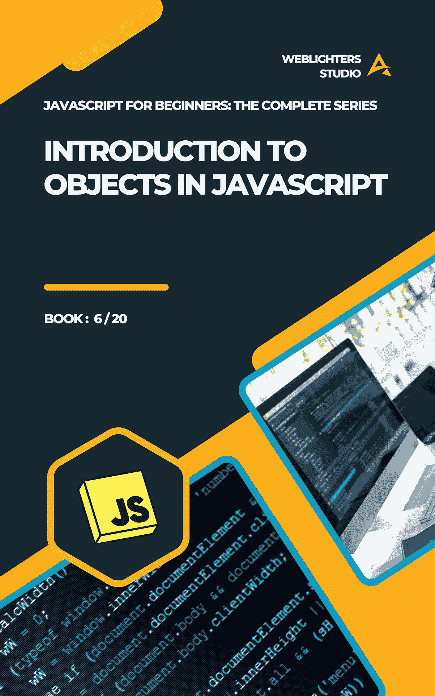

# JavaScript 对象入门指南





# ​❧​

# 前言

# ​❧​

欢迎阅读《JavaScript 对象入门》！对象是 JavaScript 最强大、最多才多艺的功能之一，掌握它们对任何开发者来说都至关重要。无论你是刚刚开始编程之旅，还是希望加深对 JavaScript 的理解，本书都为你提供了全面的对象使用入门指南，涵盖从基础到高级概念的各个方面。

## 为什么对象如此重要？

在 JavaScript 中，对象无处不在。它们是大多数数据结构的基础，用于在你的程序中模拟真实世界的实体。对象允许你将相关的数据和功能组合在一起，使代码更有条理、更可复用、更易维护。从简单的配置到复杂的 API，理解对象的工作原理是编写高效、有效的 JavaScript 代码的关键。

通过掌握对象，你将获得更有效地处理数据、创建健壮程序的能力，并为面向对象编程和现代框架等高级主题做好准备。

## 本书适合谁？

本书专为以下读者设计：

*   正在学习 JavaScript 并希望打好对象基础的初学者。
*   希望巩固知识并探索高级对象概念的中级开发者。
*   正在寻找结构化、实用指南来掌握 JavaScript 对象自学者。

如果你曾经对对象的工作原理感到困惑，或在程序中难以有效使用它们，那么这本书正是为你而写。

## 你将学到什么

阅读完本书后，你将对以下内容有深入的理解：

*   什么是对象，以及如何创建和使用它们。
*   访问、修改和遍历对象属性。
*   处理嵌套对象和方法。
*   使用原型、继承、getter 和 setter 等高级特性。
*   调试常见的对象问题并应用最佳实践。

本书包含实践练习和小型项目，帮助你在真实场景中应用所学知识。

## 本书结构

本书采用循序渐进的方法：

1.  我们将从对象的基础开始，包括语法和结构。
2.  接下来，我们将探索如何操作、遍历和扩展对象。
3.  你将学习原型、继承和对象方法等高级特性。
4.  最后，你将通过实际项目应用知识，并探索 JavaScript 对象工作的最佳实践。

每一章都建立在前一章的基础上，确保学习曲线平滑，对材料的理解深入。

## 为什么选择本书？

*   适合初学者：概念以简单、易懂的语言解释。
*   实践学习：每个主题都通过真实世界的示例和练习来强化。
*   内容全面：本书涵盖从基础到高级对象技术的所有内容。

## 致谢

我要感谢 JavaScript 社区的持续创新，以及创造了一种既强大又易于使用的语言。我同样感谢启发我创建此类资源的学习者和教育者们，是你们让编程成为一个让每个人都感到兴奋和包容的领域。

## 准备开始了吗？

本书是《JavaScript 入门系列》的一部分，但它也可以独立作为掌握对象的完整指南。无论你是为了个人成长、职业发展，还是仅仅为了乐趣而学习 JavaScript，本书都将为你提供在项目中使用对象所需的知识和信心。

让我们深入对象的世界，释放 JavaScript 对象的全部潜力！

祝编程愉快！

WebLighters Studio


## 引言

# ​❧​

欢迎阅读《JavaScript 入门系列》的第 15 章，在这里我们将踏上进入对象世界的激动人心的旅程。如果你一直在跟随我们之前的章节学习，你已经为 JavaScript 基础知识奠定了坚实的基础。现在，是时候通过深入了解 JavaScript 最强大、最多才多艺的概念之一——对象，来将你的技能提升到一个新的水平了。

对象是 JavaScript 编程的支柱，是构建复杂数据结构和复杂应用程序的基石。它们让我们能够在代码中表示真实世界的实体，将相关的数据和功能组合成内聚的单元。无论你是创建一个简单的网页还是开发复杂的 Web 应用程序，理解对象对于编写高效、有条理且可维护的代码都至关重要。

在本章中，我们将探索对象的基本概念、它们在 JavaScript 中的重要性，以及它们如何融入现代编程的更广阔领域。在本章结束时，你将对什么是对象、为什么它们是必不可少的，以及如何在自己的项目中使用它们有一个扎实的理解。

那么，让我们卷起袖子，潜入 JavaScript 对象的迷人世界吧！

## 为什么对象在 JavaScript 中必不可少

要真正理解对象在 JavaScript 中的重要性，让我们首先考虑没有它们的情况。假设你正在构建一个简单的应用程序来管理图书馆。你需要跟踪书籍、作者、出版日期以及当前是否已借出。如果没有对象，你可能会得到这样的结果：

```
let bookTitle1 = "The Great Gatsby";
let bookAuthor1 = "F. Scott Fitzgerald";
let bookPublicationYear1 = 1925;
let bookIsCheckedOut1 = false;
let bookTitle2 = "To Kill a Mockingbird";
let bookAuthor2 = "Harper Lee";
let bookPublicationYear2 = 1960;
let bookIsCheckedOut2 = true;
// ... 以此类推，为每本书
```

正如你所见，这种方法很快就会变得难以管理。它很难维护，容易出错，而且扩展性不好。现在，让我们看看对象如何显著改善这种情况：

```
let book1 = {
    title: "The Great Gatsby",
    author: "F. Scott Fitzgerald",
    publicationYear: 1925,
    isCheckedOut: false
};
```


[content]

```javascript
isCheckedOut: false }; let book2 = {
    title: "To Kill a Mockingbird",
    author: "Harper Lee",
    publicationYear: 1960,
    isCheckedOut: true
};
```

通过对象，我们可以以逻辑化且有序的方式将相关数据分组。这使得我们的代码更具可读性、更容易维护，并且减少了错误的概率。但对象的益处远不止组织数据。以下是对象在 JavaScript 中至关重要的几个原因：

1.  **封装 (Encapsulation)**：对象允许我们将相关数据和功能封装到单个单元中。这种将数据与操作该数据的方法结合的概念是面向对象编程的基本原则。
2.  **代码复用 (Code Reusability)**：一旦我们定义了对象的结构，就可以创建该对象的多个实例，促进代码复用并减少冗余。
3.  **模块化 (Modularity)**：对象有助于将复杂问题分解为更小、更易管理的部分。每个对象都可以被看作是一个具有自身属性和方法的自包含模块。
4.  **抽象 (Abstraction)**：对象提供了一种在简单接口后抽象复杂操作的方法。这允许我们隐藏实现细节并只暴露必要的内容。
5.  **灵活性 (Flexibility)**：JavaScript 的动态性质允许在运行时修改对象，根据需要添加或删除属性和方法。这种灵活性是该语言的一个强大特性。
6.  **原型继承 (Prototypal Inheritance)**：JavaScript 使用原型继承，这是一种复用和扩展对象行为独特且强大的方式。
7.  **JSON 兼容性 (JSON Compatibility)**：JavaScript 对象表示法（JSON）是一种流行的数据交换格式，基于 JavaScript 对象的语法。理解对象对于处理 JSON 数据至关重要。

让我们通过一个更复杂的例子来说明这些益处。假设我们正在构建一个拥有不同角色的游戏：

```javascript
let warrior = {
    name: "Aragorn",
    health: 100,
    strength: 80,
    attack: function(target) {
        console.log(`${this.name} attacks ${target} with strength ${this.strength}!`);
        // 攻击逻辑...
    },
    defend: function() {
        console.log(`${this.name} raises his shield in defense!`);
        // 防御逻辑...
    }
};

let wizard = {
    name: "Gandalf",
    health: 80,
    mana: 100,
    castSpell: function(spell, target) {
        console.log(`${this.name} casts ${spell} on ${target}!`);
        // 施法逻辑...
    },
    meditate: function() {
        console.log(`${this.name} meditates to restore mana.`);
        // 魔法恢复逻辑...
    }
};
```

在这个例子中，我们创建了两个代表游戏中不同角色类型的对象。每个对象都封装了特定于该角色类型的数据（如 `name`、`health` 等属性）行为（如 `attack`、`castSpell` 等方法）。这种结构允许我们：

*   轻松创建和管理不同类型的角色
*   将相关功能放在一起（封装）
*   通过创建每个角色类型的多个实例来复用代码
*   为与角色交互提供清晰且直观的接口

随着我们在本书中深入研究对象，你将看到这些益处如何转化为更整洁、更高效且更强大的代码。

## 对象在现代编程中的作用

在现代编程版图中，对象起着核心作用，特别是在 JavaScript 中。随着 Web 应用程序复杂性的增加，对结构化、可维护代码的需求变得越来越重要。对象为现代 JavaScript 开发中使用的许多范式和模式提供了基础。

### 1. 面向对象编程 (OOP)

JavaScript 虽然核心并不是一种基于类的 OOP 语言，但它通过原型继承系统支持面向对象编程。随着 ES6 类的引入（它们本质上是原型上的语法糖），JavaScript 现在为来自其他语言的开发者提供了更熟悉的 OOP 语法。

```javascript
class Character {
    constructor(name, health) {
        this.name = name;
        this.health = health;
    }
    introduce() {
        console.log(`Hello, I'm ${this.name} and I have ${this.health} health.`);
    }
}

class Warrior extends Character {
    constructor(name, health) {
        super(name, health);
    }
    attack(target) {
        console.log(`${this.name} attacks ${target} with strength ${this.strength}!`);
    }
}
```

### 2. 使用对象的函数式编程

虽然 JavaScript 支持函数式编程，但对象仍然发挥作用。高阶函数（函数式编程中的关键概念）通常与对象一起工作：

```javascript
let characters = [
    { name: "Aragorn", type: "Warrior", level: 20 },
    { name: "Gandalf", type: "Wizard", level: 30 },
    { name: "Legolas", type: "Archer", level: 25 }
];

let highLevelCharacters = characters.filter(char => char.level > 20);
```

### 3. 模块模式与命名空间

对象经常用于创建模块和命名空间，有助于组织代码并避免命名冲突：

```javascript
let GameModule = {
    characters: [],
    addCharacter: function(character) {
        this.characters.push(character);
    },
    removeCharacter: function(name) {
        this.characters = this.characters.filter(char => char.name !== name);
    }
};

GameModule.addCharacter({ name: "Frodo", type: "Hobbit" });
```

### 4. DOM 操作

在 Web 开发中，文档对象模型（DOM）将 HTML 文档结构表示为树对象。理解对象对于有效的 DOM 操作至关重要：

```javascript
let button = document.createElement('button');
button.textContent = 'Click me!';
button.addEventListener('click', function() {
    console.log('Button clicked!');
});
document.body.appendChild(button);
```

### 5. AJAX 与 API 交互

现代 Web 应用程序经常与 API 交互，发送并接收数据。这些数据通常是 JSON 格式，基于对象语法：

```javascript
fetch('https://api.example.com/data')
    .then(response => response.json())
    .then(data => {
        console.log(data.name);
        data.items.forEach(item => {
            console.log(item.title);
        });
    });
```

### 6. React 及其他框架

许多现代 JavaScript 框架和库（如 React）大量使用对象。在 React 中，组件通常定义为类（创建对象的特殊函数）或返回对象的函数：

```javascript
class Welcome extends React.Component {
    render() {
        return <h1>Hello, {this.props.name}</h1>;
    }
}

// 或者使用函数组件
function Welcome(props) {
    return <h1>Hello, {props.name}</h1>;
}
```


# JavaScript 中的对象

## 简介

在本系列的前几本书中，你学习了 JavaScript 的基本概念，如变量、数据类型、函数和控制结构。这些基础对于理解对象至关重要，因为对象是在这些基本概念之上构建并整合的。

## 向高级概念的桥梁

对象充当了从基础 JavaScript 到更高级主题的桥梁。它们向你介绍关键的编程范式，如面向对象编程，为你在本系列后续书籍中将遇到的更复杂概念做好准备。

## 实际应用

在前几本书侧重于单个概念，而本书关于对象开始向你展示这些概念如何在实际应用中结合。你将看到对象如何以反映现实世界实体和关系的方式组织数据和行为。

## 为现代 JavaScript 做准备

理解对象对于使用现代 JavaScript 特性和框架至关重要。本书为你将在后续书籍中探索的主题奠定基础，例如 ES6+ 特性、异步编程以及流行的 JavaScript 库和框架。

## 解决问题的能力

在学习对象的过程中，你还将培养面向对象思维的特定问题解决技能。这将增强你设计和实现复杂编程挑战解决方案的能力。

## 代码组织与最佳实践

本书向你介绍使用对象组织代码的模式和实践。这些技能对于编写可维护、可扩展的 JavaScript 应用程序至关重要，这一主题将在整个系列中继续。

## 结论

到本书结束时，你将对 JavaScript 中的对象有扎实的理解，使你能够很好地应对本系列后续书籍中的更高级主题。你将具备从对象及其交互的角度思考问题的知识，这是任何 JavaScript 开发者的关键技能。

## 在本书结束时你将实现的目标

当你完成这本关于 JavaScript 对象的书时，你将对 JavaScript 中最基本、最强大的概念之一获得全面的理解。以下是你可以期望实现的详细概述：

### 掌握对象基础

你将学习如何创建、访问和修改对象。你将理解对象属性和方法之间的区别，以及如何有效地使用它们。

```
let car = {
    make: "Toyota",
    model: "Corolla",
    year: 2021,
    start: function() {
        console.log("Engine started!");
    }
};
console.log(car.make); // "Toyota"
car.start(); // "Engine started!"
```

### 理解 JavaScript 中的面向对象编程

你将掌握 JavaScript 如何实现面向对象编程概念，包括封装、继承和多态。

```
class Vehicle {
    constructor(make, model) {
        this.make = make;
        this.model = model;
    }
    describe() {
        return `This is a ${this.make} ${this.model}.`;
    }
}
class Car extends Vehicle {
    constructor(make, model, doors) {
        super(make, model);
        this.doors = doors;
    }
    describe() {
        return `${super.describe()} It has ${this.doors} doors.`;
    }
}
let myCar = new Car("Honda", "Civic", 4);
console.log(myCar.describe()); // "This is a Honda Civic. It has 4 doors."
```

### 掌握原型继承

你将学习 JavaScript 独特的原型继承系统以及如何有效地利用它。

```
function Animal(name) {
    this.name = name;
}
Animal.prototype.speak = function() {
    console.log(`${this.name} makes a sound.`);
};
function Dog(name) {
    Animal.call(this, name);
}
Dog.prototype = Object.create(Animal.prototype);
Dog.prototype.constructor = Dog;
Dog.prototype.bark = function() {
    console.log(`${this.name} barks.`);
};
let dog = new Dog("Rex");
dog.speak(); // "Rex makes a sound."
dog.bark(); // "Rex barks."
```

### 掌握高级对象概念

你将探索高级主题，如 getter 和 setter、对象解构以及 this 关键字。

```
let person = {
    firstName: "John",
    lastName: "Doe",
    get fullName() {
        return `${this.firstName} ${this.lastName}`;
    },
    set fullName(name) {
        [this.firstName, this.lastName] = name.split(" ");
    }
};
console.log(person.fullName); // "John Doe"
person.fullName = "Jane Smith";
console.log(person.firstName); // "Jane"
console.log(person.lastName); // "Smith"
```

### 应用面向对象设计原则

你将学习如何使用面向对象原则设计代码，创建更有组织且可维护的应用程序。

```
class BankAccount {
    constructor(owner, balance = 0) {
        this.owner = owner;
        this._balance = balance;
    }
    deposit(amount) {
        this._balance += amount;
        console.log(`Deposited ${amount}. New balance is ${this._balance}`);
    }
    withdraw(amount) {
        if (amount <= this._balance) {
            this._balance -= amount;
            console.log(`Withdrawn ${amount}. New balance is ${this._balance}`);
        } else {
            console.log("Insufficient funds");
        }
    }
    get balance() {
        return this._balance;
    }
}
let account = new BankAccount("John Doe", 1000);
account.deposit(500); // "Deposited 500. New balance is 1500"
account.withdraw(200); // "Withdrawn 200. New balance is 1300"
console.log(account.balance); // 1300
```

### 在实际场景中使用对象

你将把你的知识应用到实际场景中，学习对象如何在实际应用中使用。

```
class ShoppingCart {
    constructor() {
        this.items = [];
    }
    addItem(name, price, quantity) {
        this.items.push({ name, price, quantity });
    }
    removeItem(name) {
        this.items = this.items.filter(item => item.name !== name);
    }
    calculateTotal() {
        return this.items.reduce((total, item) => total + (item.price * item.quantity), 0);
    }
    checkout() {
        console.log("Purchasing the following items:");
        this.items.forEach(item => {
            console.log(`${item.quantity}x ${item.name} - $${item.price * item.quantity}`);
        });
        console.log(`Total: $${this.calculateTotal()}`);
    }
}
let cart = new ShoppingCart();
cart.addItem("Book", 10, 2);
cart.addItem("Pen", 1, 5);
cart.checkout();
// Output:
// Purchasing the following items:
// 2x Book - $20
// 5x Pen - $5
// Total: $25
```

### 在现代 JavaScript 背景下理解对象

你将学习对象如何融入现代 JavaScript 开发，包括它们在 ES6+ 特性和流行框架中的作用。

```
// Using object destructuring and arrow functions
const processUser = ({ name, age, email }) => {
    console.log(`Processing user: ${name}, ${age} years old, email: ${email}`);
};
processUser({ name: "Alice", age: 30, email: "alice@example.com" });

// Using objects with Promises
const fetchUserData = (userId) => {
    return new Promise((resolve, reject) => {
        // Simulating an API call
        setTimeout(() => {
            resolve({ id: userId, name: "Bob", age: 25 });
        }, 1000);
    });
};
fetchUserData(123)
    .then(user => console.log(`User fetched: ${user.name}`))
    .catch(error => console.error("Error fetching user:", error));
```


# JavaScript 对象

通过实现这些成果，你不仅会对 JavaScript 对象有深入的理解，还能为应对更高级的 JavaScript 主题和开始构建复杂应用程序做好充分准备。你将具备有效组织代码、创建可复用和可维护结构、以及使用面向对象方法解决复杂问题的技能。随着你在 JavaScript 开发道路上的不断前进，这些知识将非常宝贵，为你使用现代框架和应对实际编程挑战奠定坚实基础。

## 第一章：什么是对象？

在 JavaScript 编程的广阔领域中，对象是最基础且强大的概念之一。它们构成了这门语言的支柱，使开发者能够轻松创建复杂的数据结构、组织代码并模拟现实世界的实体。当我们踏上理解 JavaScript 对象的旅程时，我们将揭开它们的复杂性，探索它们的多功能性，并发现它们如何彻底改变我们编写和构建代码的方式。

### 理解对象作为键值对集合

从本质上讲，JavaScript 对象是键值对的集合。这个简单却强大的概念允许我们将相关的数据和功能存储在一个单一的实体中。让我们深入了解这意味着什么，以及它如何影响我们处理对象的方式。

### 对象的结构

把对象想象成一个容器，就像一个宝箱。在这个宝箱里，我们可以存储各种物品，每个物品都有自己独特的标识符。在 JavaScript 术语中，这些物品就是我们的值，而它们的标识符被称为键。它们共同构成了定义对象的键值对。

```javascript
let treasureChest = {
  gold: 100,
  gems: ["ruby", "emerald", "sapphire"],
  magicWand: true,
  openWith: function() {
    console.log("The chest creaks open...");
  }
};
```

在这个例子中，我们的 `treasureChest` 对象包含四个键值对：

1. 键 `gold` 与数值 `100` 关联。
2. 键 `gems` 链接到一个字符串数组。
3. `magicWand` 是一个具有布尔值的键。
4. `openWith` 是一个将其值设为函数的键。

这种结构允许我们以一种有意义的方式将相关的数据和功能组合在一起。我们可以使用点符号（`treasureChest.gold`）或方括号符号（`treasureChest["gold"]`）来访问这些值，这为我们与对象交互提供了灵活性。

### 键值对的力量

对象的键值对结构提供了几个优势：

1. **语义化表示**：键可以是描述性的，使我们的代码更具可读性和自我文档化。与其访问数组的第五个元素，不如访问 `person.age`，这清楚地表达了该值代表什么。
2. **灵活性**：对象可以将各种数据类型存储为值，包括其他对象，从而实现复杂的嵌套结构。
3. **动态特性**：我们可以在运行时添加、修改或删除键值对，使对象能够高度适应变化的需求。
4. **封装性**：通过将相关数据和函数组合在一起，对象帮助我们更有效地组织代码，从而提高可维护性。

当我们更深入地研究对象时，我们将看到这些特性如何使它们在 JavaScript 编程中不可或缺。

## 对象的现实类比

为了真正掌握 JavaScript 中对象的概念，将它们与现实世界的实体进行类比是有帮助的。让我们探索如何使用对象来描述像人这样熟悉的事物。

### 使用对象描述一个人

想象你正在为一个社交媒体平台创建个人资料。你会如何表示用户的信息？对象非常适合这种情况。让我们创建一个 `person` 对象来说明这一点：

```javascript
let person = {
  name: "Alice Johnson",
  age: 28,
  occupation: "Software Developer",
  hobbies: ["reading", "hiking", "photography"],
  address: {
    street: "123 Maple Street",
    city: "Techville",
    country: "Codeland"
  },
  introduce: function() {
    console.log(`Hi, I'm ${this.name}, a ${this.age}-year-old ${this.occupation}.`);
  }
};
```

这个 `person` 对象封装了一个人的各种属性和行为：

- **基本信息**：`name`、`age` 和 `occupation` 属性存储了关于这个人的基本详细信息。
- **复杂数据**：`hobbies` 属性是一个数组，表明对象值可以是集合。
- **嵌套对象**：`address` 属性本身就是一个对象，展示了对象如何包含其他对象来表示更复杂的结构。
- **方法**：`introduce` 函数是对象的一个方法，代表与这个人相关联的行为。

使用这个对象，我们可以轻松地访问和操作这个人的信息：

```javascript
console.log(person.name);  // Outputs: Alice Johnson
person.age = 29;           // Updates Alice's age
person.introduce();        // Outputs: Hi, I'm Alice Johnson, a 29-year-old Software Developer.
```

### 对象作为蓝图

把对象想象成蓝图或模板。就像建筑师的设计蓝图可以用来建造多栋建筑一样，我们可以使用我们的 `person` 对象结构来创建多个人的资料：

```javascript
function createPerson(name, age, occupation) {
  return {
    name: name,
    age: age,
    occupation: occupation,
    introduce: function() {
      console.log(`Hi, I'm ${this.name}, a ${this.age}-year-old ${this.occupation}.`);
    }
  };
}

let bob = createPerson("Bob Smith", 35, "Teacher");
let carol = createPerson("Carol White", 42, "Doctor");
bob.introduce();   // Outputs: Hi, I'm Bob Smith, a 35-year-old Teacher.
carol.introduce(); // Outputs: Hi, I'm Carol White, a 42-year-old Doctor.
```

这种方法展示了对象如何作为可复用的模板来创建具有共享结构但独特数据的相似实体。

### 日常生活场景中的对象

对象的概念远不止于个人资料。考虑一下这些对象可以发挥作用的日常生活场景：

**1. 表示一本书：**

```javascript
let book = {
  title: "The Great Gatsby",
  author: "F. Scott Fitzgerald",
  year: 1925,
  genres: ["Novel", "Fiction", "Tragedy"],
  summary: function() {
    return `"${this.title}" is a classic novel written by ${this.author} in ${this.year}.`;
  }
};
```

**2. 建模一辆汽车：**

```javascript
let car = {
  make: "Toyota",
  model: "Corolla",
  year: 2022,
  color: "Silver",
  features: ["Bluetooth", "Backup Camera", "Lane Assist"],
  start: function() {
    console.log("The engine purrs to life...");
  }
};
```

**3. 描述一个食谱：**

```javascript
let recipe = {
  name: "Chocolate Chip Cookies",
  ingredients: ["flour", "sugar", "butter", "chocolate chips"],
  preparationTime: 15,
  cookingTime: 10,
  instructions: [
    "Preheat oven to 350°F",
    "Mix dry ingredients",
    "Cream butter and sugar",
    "Combine all ingredients",
    "Drop spoonfuls onto baking sheet",
    "Bake for 10 minutes"
  ],
  serve: function() {
    console.log("Enjoy your freshly baked cookies!");
  }
};
```

这些例子说明了对象如何有效地建模各种现实世界的实体，以结构化和直观的方式捕捉它们的属性和行为。

## 对象与数组的区别

虽然对象和数组都用于在 JavaScript 中存储数据集合，但它们具有不同的特性和用例。理解这些差异对于为你的特定需求选择正确的数据结构至关重要。

### 结构和访问

**1. 数组：**

- 使用从 `0` 开始的数字索引。
- 使用带索引的方括号符号访问。
- 维护元素的特定顺序。

```javascript
let fruits = ["apple", "banana", "cherry"];
console.log(fruits[1]);  // Outputs: banana
```

**2. 对象：**

- 使用命名键（字符串或符号）。
- 可以使用点符号或带键名的方括号符号访问。
- 不保证属性的任何特定顺序。


# 数组和对象

## 概述

```javascript
let person = {name: "Alice", age: 28}; console.log(person.name); // Outputs: Alice console.log(person["age"]); // Outputs: 28
```

## 比较

### 使用场景

数组适用于以下情况：

*   你需要一个有序的同类元素集合。
*   元素的顺序很重要。
*   你想对整个集合执行操作（如映射或过滤）。

对象更适合以下情况：

*   你需要将值与特定的名称或键关联。
*   你想表示一个具有多种属性的实体。
*   你需要根据键快速查找值。

### 灵活性与方法

数组内置了常用操作的方法：

```javascript
let numbers = [1, 2, 3, 4, 5]; numbers.push(6); // Adds 6 to the end numbers.pop(); // Removes the last element let doubled = numbers.map(n => n * 2); // Creates a new array with doubled values
```

对象在可容纳的数据类型方面更加灵活：

```javascript
let mixed = {number: 42, string: "Hello", array: [1, 2, 3], nestedObject: {x: 1, y: 2}, function: function() { console.log("I'm a method!"); } };
```

### 性能考量

*   数组针对数值索引进行了优化，遍历所有元素通常更快。
*   对象在通过键检索特定属性时提供更快的访问。

### 迭代

遍历数组非常直接：

```javascript
let colors = ["red", "green", "blue"]; for (let i = 0; i < colors.length; i++) { console.log(colors[i]); } // or colors.forEach(color => console.log(color));
```

遍历对象需要特定的方法或循环：

```javascript
let person = {name: "Bob", age: 30, city: "New York"}; for (let key in person) { console.log(key + ": " + person[key]); } // or Object.keys(person).forEach(key => console.log(key + ": " + person[key]));
```

### 转换与操作

数组拥有强大的内置转换方法：

```javascript
let numbers = [1, 2, 3, 4, 5]; let evenNumbers = numbers.filter(n => n % 2 === 0); let sum = numbers.reduce((acc, curr) => acc + curr, 0);
```

对象需要自定义逻辑或工具库来完成类似操作：

```javascript
let scores = {Alice: 95, Bob: 80, Carol: 90}; let highScores = Object.entries(scores).filter(([name, score]) => score >= 90).reduce((obj, [name, score]) => {obj[name] = score; return obj; }, {});
```

理解这些差异能让你根据具体的编程需求选择最合适的数据结构，从而编写出更高效、更易读的代码。

## 对象语法与示例

现在我们已经探讨了对象的概念以及它们与数组的区别，接下来深入了解 JavaScript 中对象的具体语法。理解创建和操作对象的各种方式对于高效编写 JavaScript 程序至关重要。

### 对象字面量表示法

创建对象最常见、最直接的方式是使用对象字面量表示法：

```javascript
let car = {make: "Honda", model: "Civic", year: 2022, isElectric: false, colors: ["red", "blue", "white"], displayInfo: function() { console.log(`This is a ${this.year} ${this.make} ${this.model}.`); } };
```

在这个例子中：

*   我们创建了一个 `car` 对象，包含多个属性和一个方法。
*   属性使用键:值对定义，用逗号分隔。
*   `displayInfo` 属性保存了一个函数，因此它成为 `car` 对象的一个方法。

### 访问对象属性

访问对象属性主要有两种方式：

1.  点表示法：

```javascript
console.log(car.make); // Outputs: Honda car.displayInfo(); // Calls the method
```

2.  方括号表示法：

```javascript
console.log(car["model"]); // Outputs: Civic let propertyName = "year"; console.log(car[propertyName]); // Outputs: 2022
```

当属性名存储在变量中，或者属性名包含特殊字符或空格时，方括号表示法特别有用。

### 添加和修改属性

JavaScript 中的对象是动态的，你可以随时添加或修改属性：

```javascript
// Adding a new property car.mileage = 5000; // Modifying an existing property car.year = 2023; // Adding a new method car.honk = function() { console.log("Beep beep!"); }; car.honk(); // Outputs: Beep beep!
```

### 嵌套对象

对象可以包含其他对象，从而构建复杂的数据结构：

```javascript
let student = {name: "Emma", age: 20, grades: {math: 95, science: 88, history: 92}, address: {street: "123 College Ave", city: "University Town", country: "Educationland" } }; console.log(student.grades.math); // Outputs: 95 console.log(student.address.city); // Outputs: University Town
```

### 对象构造函数

虽然对象字面量很常见，但你也可以使用构造函数来创建对象：

```javascript
function Person(name, age, occupation) { this.name = name; this.age = age; this.occupation = occupation; this.introduce = function() { console.log(`Hi, I'm ${this.name}, a ${this.age}-year-old ${this.occupation}.`); }; } let john = new Person("John Doe", 30, "Engineer"); john.introduce(); // Outputs: Hi, I'm John Doe, a 30-year-old Engineer.
```

当你需要创建多个具有相同结构的对象时，这种方法非常有用。

### Object.create() 方法

另一种创建对象的方式是使用 `Object.create()` 方法：

```javascript
let personPrototype = {introduce: function() { console.log(`Hi, I'm ${this.name}, a ${this.age}-year-old ${this.occupation}.`); } }; let sarah = Object.create(personPrototype); sarah.name = "Sarah Johnson"; sarah.age = 25; sarah.occupation = "Designer"; sarah.introduce(); // Outputs: Hi, I'm Sarah Johnson, a 25-year-old Designer.
```

此方法会创建一个具有指定原型对象的新对象。

### 计算属性名

ES6 引入了计算属性名，允许你使用表达式作为属性名：

```javascript
let propName = "color"; let item = {name: "Box", [propName]: "blue" }; console.log(item.color); // Outputs: blue
```

### 简写属性名

当属性值是一个与属性键同名的变量时，可以使用简写语法：

```javascript
let name = "Alice"; let age = 28; let person = { name, age }; console.log(person); // Outputs: { name: "Alice", age: 28 }
```

### 对象解构

解构允许你从一个对象中提取多个属性，并在一条语句中赋值给变量：

```javascript
let { name, age, occupation } = john; console.log(name); // Outputs: John Doe console.log(age); // Outputs: 30
```

### 对象的展开运算符

展开运算符（...）可用于将一个对象的属性复制到另一个对象：

```javascript
let basicInfo = { name: "Tom", age: 25 }; let detailedInfo = { ...basicInfo, occupation: "Teacher", city: "New York" }; console.log(detailedInfo); // Outputs: { name: "Tom", age: 25, occupation: "Teacher", city: "New York" }
```

### 对象方法

JavaScript 中的对象自带几个内置方法：

1.  `Object.keys()`：

```javascript
let keys = Object.keys(car); console.log(keys); // Outputs an array of the object's keys
```

2.  `Object.values()`：

```javascript
let values = Object.values(car); console.log(values); // Outputs an array of the object's values
```

3.  `Object.entries()`：

```javascript
let entries = Object.entries(car); console.log(entries); // Outputs an array of [key, value] pairs
```

4.  `Object.assign()`：

```javascript
let target = { a: 1, b: 2 }; let source = { b: 3, c: 4 }; let result = Object.assign(target, source); console.log(result); // Outputs: { a: 1, b: 3, c: 4 }
```

这些方法提供了与对象交互和操作对象的强大方式。

### 冻结与密封对象

JavaScript 提供了使对象不可变的方法：

1.  `Object.freeze()`：

```javascript
let frozenCar = Object.freeze(car); frozenCar.make = "Toyota"; // This change will be ignored in strict mode
```

2.  `Object.seal()`：


# Object.seal() 与 Object.freeze()

`let sealedCar = Object.seal(car); sealedCar.newProp = "value"; // This will not add a new property sealedCar.make = "Ford"; // This will work as it's modifying an existing property`

`freeze` 防止对对象的所有更改，而 `seal` 允许修改现有属性，但阻止添加或删除属性。

理解 JavaScript 中对象语法和操作的这些各个方面为你提供了强大的工具包，用于处理复杂数据结构并创建更有条理、更高效的代码。随着你继续使用对象，你会发现更多方法来发挥它们在 JavaScript 程序中的灵活性和强大功能。

总之，JavaScript 中的对象是多功能且基础的结构，它们允许我们表示复杂的实体、组织相关的数据和功能，并创建更直观、更易维护的代码。通过掌握对象的创建、操作和高级特性，你将能够很好地应对 JavaScript 中各种编程挑战。

# 第 2 章：创建和访问对象

在 JavaScript 编程的广阔领域中，对象作为基本构建块而存在，作为构建和组织数据的基石。当我们踏上第 2 章的旅程时，我们将深入探讨创建和访问对象的复杂性，揭示它们在塑造代码方面的强大力量。

把对象想象成数字容器，能够保存各种信息和功能。就像一个工具箱为不同目的存放不同的工具一样，JavaScript 中的对象可以包含属性（数据）和方法（函数），它们共同协作来表示程序中的现实世界实体或抽象概念。

当我们浏览本章时，我们将探索为这些数字容器注入生命、填充数据并与其内容交互的各种方法。从对象字面量的简单性到属性访问的细微差别，我们将为你配备知识和技能，以充分发挥 JavaScript 中对象的全部潜力。

那么，让我们卷起袖子，深入对象创建和操作的世界，在那里可能性像你的想象力一样无限。

## 使用对象字面量声明对象

在 JavaScript 中，对象创建的核心是对象字面量表示法——这是一种简单但强大的方式来创建对象。把它想象成一块空白的画布，等待你用赋予它意义和目的的属性和值来描绘它。

对象字面量语法以花括号 `{}` 为特征，它们作为对象内容的容器。在这些花括号内，我们定义键值对，其中每个键代表一个属性名，每个值代表与该属性关联的数据。

让我们从一个基本示例开始：

```javascript
let person = {name: "Alice",
    age: 30,
    city: "New York" };
```

在这个代码片段中，我们创建了一个名为 `person` 的对象，包含三个属性：`name`、`age` 和 `city`。每个属性后面跟着冒号 `:` 及其对应的值。属性之间用逗号分隔，允许我们在同一个对象中定义多个键值对。

但对象并不局限于存储简单数据类型。它们可以包含丰富的值，包括其他对象、数组，甚至函数。让我们扩展我们的 `person` 对象来展示这种多功能性：

```javascript
let person = {name: "Alice",
    age: 30,
    city: "New York",
    hobbies: ["reading", "painting", "hiking"],
    address: {street: "123 Main St",
        zipCode: "10001" },greet: function() {
        console.log("Hello, I'm " + this.name + "!");
    }
};
```

现在我们的 `person` 对象已经发展成为一个更复杂的实体。它包含一个爱好数组、一个嵌套的 `address` 对象和一个 `greet` 方法。这展示了对象在表示多样化数据结构和行为方面的灵活性。

对象字面量的优点之一是它们的可读性和简洁性。它们提供了对象结构的清晰视觉表示，使开发者能够一目了然地理解数据。

此外，对象字面量提供了即时创建对象的优势，无需显式的构造函数或类。这使得它们在创建一次性对象或需要快速定义数据结构而无需更正式的对象创建模式的开销时特别有用。

考虑这个场景，我们使用对象字面量来表示一本书：

```javascript
let book = {title: "The Great Gatsby",
    author: "F. Scott Fitzgerald",
    year: 1925,
    genre: "Novel",
    summary: "A tale of the American Dream gone awry",
    characters: ["Jay Gatsby", "Daisy Buchanan", "Nick Carraway"],
    isClassic: true,
    getInfo: function() {
        return `${this.title} by ${this.author}, published in ${this.year}`;
    }
};
```

这个 `book` 对象封装了一部文学作品的各个方面，从基本元数据到角色列表，甚至还有一个检索格式化书籍信息字符串的方法。对象字面量语法允许我们以紧凑和直观的方式创建这种丰富的表示。

当你越来越熟悉对象字面量时，你会发现它们是你 JavaScript 工具包中不可或缺的工具。它们作为更高级的面向对象编程概念的基础，并在许多 JavaScript 设计模式和框架中发挥着关键作用。

请记住，对象字面量的力量不仅在于它们的简单性，还在于它们能够随着数据需求的变化而成长和适应。随着我们本章的进展，我们将探索如何与这些对象交互和修改它们，释放你在 JavaScript 程序中的全部潜力。

## 添加、访问和修改属性

一旦我们创建了一个对象，旅程才刚开始。JavaScript 中的对象是动态的，允许我们轻松地添加、访问和修改它们的属性。这种灵活性是 JavaScript 对象系统的标志之一，使我们能够随着程序的演进来塑造和重塑我们的数据结构。

### 添加属性

向现有对象添加新属性就像给一个新键赋值一样简单。让我们回顾一下我们的 `person` 对象并添加一些新信息：

```javascript
person.occupation = "Software Developer"; person["years of experience"] = 5;
```

在这个例子中，我们向 `person` 对象添加了两个新属性。第一个是 `occupation`，使用点号表示法添加，而第二个是 `years of experience`，使用方括号表示法（我们稍后会详细探讨）。两种方法都达到了相同的结果：一个新属性被添加到对象中。

我们甚至可以添加更复杂的属性，如嵌套对象或函数：

```javascript
person.skills = {programming: ["JavaScript", "Python", "Java"],
    languages: ["English", "Spanish"]
}; person.introduce = function() {
    console.log(`Hi, I'm ${this.name}, a ${this.occupation} with ${this["years of experience"]} years of experience.`);
};
```

这展示了 JavaScript 动态特性的强大——对象可以根据需要成长和演变，随时容纳新的数据和功能。

### 访问属性

访问对象属性是一项基本操作，允许我们检索存储在对象中的值。访问对象属性主要有两种方式：点号表示法和方括号表示法。

点号表示法是最常见和直接的方法：

```javascript
console.log(person.name); // Output: Alice console.log(person.age);  // Output: 30
```

另一方面，方括号表示法允许我们使用字符串表达式来访问属性：

```javascript
console.log(person["city"]); // Output: New York console.log(person["years of experience"]); // Output: 5
```


当属性名存储在变量中，或者属性名包含特殊字符或空格时，括号表示法特别有用。

我们还可以通过链式点符号或括号表示法来访问嵌套属性：

```
console.log(person.address.street); // Output: 123 Main St 
console.log(person.skills.programming[0]); // Output: JavaScript
```

### 修改属性

修改现有属性与添加新属性一样简单。我们只需要给现有属性赋一个新值：

```
person.age  =  31; // Happy birthday, Alice! 
person["city"] =  "San Francisco"; // Alice 搬到了新城市 
```

我们还可以修改嵌套属性：

```
person.address.zipCode  =  "94105"; // 更新了旧金山的邮政编码 
person.skills.programming.push("TypeScript"); // 添加了一个新的编程技能 
```

修改属性的能力允许我们的对象反映程序中不断变化的状态或更新的信息。

### 删除属性

有时，我们可能想要从对象中完全删除属性。为此，我们使用 `delete` 运算符：

```javascript
delete  person.occupation; 
console.log(person.occupation); // Output: undefined 
```

值得注意的是，`delete` 运算符只作用于对象属性。它不能删除用 `var`、`let` 或 `const` 的变量。

### 属性的存在性与 undefined 值

在访问对象属性时，理解“不存在的属性”与“存在但值为 undefined 的属性”之间的区别是非常重要的。

```
console.log(person.salary); // Output: undefined 
console.log(person.age); // Output: 31   
person.salary  =  undefined; 
console.log(person.salary); // Output: undefined 
console.log("salary"  in  person); // Output: true 
console.log("gender"  in  person); // Output: false 
```

在这个示例中，`person.salary` 和 `person.gender` 都返回 `undefined`，但原因不同。`salary` 作为属性存在，但值为 `undefined`，而 `gender` 根本不存在作为一个属性。

`in` 运算符可以帮助我们区分这些情况：如果属性存在于对象（或原型链）中，则返回 `true`，否则返回 `false`。

理解属性操作的这些细微差别对于在 JavaScript 中有效处理对象至关重要。随着继续探索对象，我们将深入探讨属性访问和管理的高级技术，为您提供创建健壮且灵活的面向对象代码的工具。

## 点表示法 vs 括号表示法

在 JavaScript 对象操作领域，有两种表示法占据主导地位：点表示法（dot notation）和括号表示法（bracket notation）。虽然它们都具有访问和修改对象属性的目的，但它们各自有利的优势和用例。了解何时以及如何使用每种表示法对于编写清晰、高效且灵活的代码至关重要。

### 点表示法

点表示法是两者中更常用且语法更简单的一种。它涉及使用点符号（`.`）后跟属性名来访问或修改对象的属性。

```
let  car  = {make:  "Toyota",
    model:  "Corolla",
    year:   2022 }; 
console.log(car.make);  // Output: Toyota 
car.color  =  "Blue"; 
console.log(car.color); // Output: Blue 
```

点表示法简单直观且易于阅读，使其在处理已知、有效的标识符名时成为首选。当你在处理已在代码中显式定义的属性时，它特别有用。

然而，点表示法也有一些局限性：

1. 它只能用于符合有效 JavaScript 标识符的属性名。这意味着属性名必须以字母、下划线（`_`）或美元符号（`$`）开头，只能包含字母、数字、下划线或美元符号。
2. 它不能用于存储在变量或表达式中的属性名。
3. 它不能用于以数字开头或包含特殊字符或空格的属性名。

### 括号表示法

括号表示法在属性访问方面提供了更大的活性。它涉及使用方括号 `[]` 并在内部包含字符串或表达式来访问或修改对象的属性。

```
console.log(car["model"]); // Output: Corolla 
car["manufacturing date"] =  "2022-03-15"; 
console.log(car["manufacturing date"]); // Output: 2022-03-15 
```

括号表示法在几种场景下大放异彩：

1. 当属性名包含空格或特殊字符时：
```
let  person  = {"first name": "John",
    "last name": "Doe",
    "age": 30 }; 
console.log(person["first name"]); // Output: John 
```

2. 当属性名存储在变量中或是表达式的结果时：
```
let  propertyName  =  "make"; 
console.log(car[propertyName]); // Output: Toyota   
let  i  =  0; 
let  propertyArray  = ["make", "model", "year"]; 
console.log(car[propertyArray[i]]); // Output: Toyota 
```

3. 当你需要动态访问属性时：
```javascript
function getProperty(obj, prop) {
    return  obj[prop];
} 
console.log(getProperty(car, "year")); // Output: 2022 
```

4. 当处理以数字开头或包含特殊字符或空格的属性名时：
```javascript
let  weirdObject = {"123": "special value"};
console.log(weirdObject["123"]); // Output: special value
```

### 比较点表示法与括号表示法

为了说明点表示法和括号表示法的区别和用例，让我们考虑一个更复杂的示例：

```javascript
let  company  = {name:  "Tech Innovations Inc.",
    "founding year": 2010,
    departments: ["R&D", "Marketing", "HR"],
    "chief officers": {
        CEO:  "Jane Smith",
        CTO:  "Bob Johnson"
    },
    getInfo: function() {
        return  `${this.name}, founded in ${this["founding year"]}`;
    }
};

// 使用点表示法
console.log(company.name); // Output: Tech Innovations Inc. 
console.log(company.departments[1]); // Output: Marketing 

// 使用括号表示法
console.log(company["founding year"]); // Output: 2010 
console.log(company["chief officers"]["CEO"]); // Output: Jane Smith   

// 混合点表示法和括号表示法
console.log(company.getInfo()); // Output: Tech Innovations Inc., founded in 2010   

// 动态属性访问
let  departmentIndex  =  2; 
console.log(company.departments[departmentIndex]); // Output: HR   
let  officerRole  =  "CTO"; 
console.log(company["chief officers"][officerRole]); // Output: Bob Johnson
```

这个示例展示了点表示法和括号表示法如何在各种场景下使用，有时结合使用。它证明了括号表示法在处理包含空格的属性名、访问嵌套属性以及允许动态属性访问方面的灵活性。

虽然两种表示法目的相似，但值得注意的是，点表示法通常比括号表示法具有微小的性能优势。这是因为 JavaScript 引擎更容易优化点表示法。然而，在大多数现实场景中，这种差异通常是可以忽略不计的，选择哪一种主要基于可读性和代码的具体需求。

总之，掌握点表示法和括号表示法对于在 JavaScript 中有效操作对象至关重要。点表示法为简单的属性访问提供了简单易读性，而括号表示法为更复杂的场景提供了所需的活性。通过理解每种表示法的优势和用例，你可以编写更具表达力更强大的 JavaScript 代码，轻松适应各种属性访问需求。


# JavaScript 属性存在检查

在 JavaScript 对象的世界中，确定属性是否存在是一个常见且至关的任务。无论你是在处理用户输入、解析 JSON 数据，还是管理复杂的对象结构，检查属性存在性的能力都能帮助你编写出更健壮、更抗错误的代码。JavaScript 提供了两种主要方法来实现这一目的：`in` 运算符和 `hasOwnProperty()` 方法。让我们详细探索每种方法，并理解它们的细差别和使用场景。

## `in` 运算符

`in` 运算符是一种检查属性是否存在于对象或其原型链中的简单且直接的方法。如果指定的属性位于对象或其原型链中，它返回 `true`；否则返回 `false`。

其语法如下：

`propertyName in object`

让我们通过一些示例来看它的用法：

```javascript
let car = {make: "Toyota", model: "Corolla", year: 2022};
console.log("make" in car);  // 输出: true
console.log("color" in car); // 输出: false

// 添加一个属性
car.color = "blue";
console.log("color" in car); // 输出: true

// 检查方法是否存在
console.log("toString" in car); // 输出: true (继承自 Object.prototype)
```

在这个示例中，我们可以看到 `in` 运算符正确识别了 `make` 的存在以及最初 `color` 的缺失。在添加 `color` 属性后，`in` 对其返回了 `true`。有趣的是，它对 `toString` 也返回了 `true`，这是一个继承自 `Object.prototype` 的方法。

当你需要无论属性值如何都检查其是否存在时，`in` 运算符特别有用。即使属性存在但其值为 `undefined`，它也会返回 `true`：

```javascript
car.mileage = undefined;
console.log("mileage" in car); // 输出: true
console.log(car.mileage);      // 输出: undefined
```

然而，这种检查整个原型链的行为有时会导致意想不到的结果，特别是在处理继承属性时。这正是 `hasOwnProperty()` 大显用场的地方。

## `hasOwnProperty()` 方法

`hasOwnProperty()` 方法提供了一种更具体的方法来检查属性是否存在。如果对象拥有指定的属性作为自身的属性（而不是继承的），则返回 `true`；否则返回 `false`。

其语法如下：

`object.hasOwnProperty(propertyName)`

让我们通过一些示例探索这个方法：

```javascript
console.log(car.hasOwnProperty("make"));     // 输出: true
console.log(car.hasOwnProperty("toString")); // 输出: false

// 检查值为 undefined 的属性
console.log(car.hasOwnProperty("mileage"));  // 输出: true

// 添加一个覆盖继承属性的属性
car.toString = function() { return `${this.make} ${this.model}`; };
console.log(car.hasOwnProperty("toString")); // 输出: true
```

在这些示例中，`hasOwnProperty()` 正确地识别了 `make` 是 `car` 的自有属性，同时识别出 `toString` 不是（直到我们显式地在 `car` 上定义它）。它还正确识别了 `mileage` 是自有属性，即使它的值为 `undefined`。

当你需要区分自有属性和继承属性，或者当你正在遍历对象的属性并想要排除继承的属性时，`hasOwnProperty()` 方法 特别有用。

## 比较 `in` 和 `hasOwnProperty()`

为了更好地理解 `in` 和 `hasOwnProperty()` 之间的区别，让我们考虑一个涉及对象继承的更复杂示例：

```javascript
// 创建原型对象
let vehicle = {type: "vehicle",
    startEngine: function() {
        console.log("Engine started");
    }
};

// 创建继承自 vehicle 的对象
let car = Object.create(vehicle);
car.make = "Toyota";
car.model = "Corolla";

console.log("type" in car);                  // 输出: true
console.log(car.hasOwnProperty("type"));    // 输出: false

console.log("make" in car);                  // 输出: true
console.log(car.hasOwnProperty("make"));    // 输出: true

console.log("startEngine" in car);          // 输出: true
console.log(car.hasOwnProperty("startEngine")); // 输出: false

// 添加一个值为 undefined 的属性
car.color = undefined;
console.log("color" in car);                // 输出: true
console.log(car.hasOwnProperty("color"));   // 输出: true
```

这个示例阐明了关键区别：

1. `in` 检查整个原型链，而 `hasOwnProperty()` 只检查对象的自有属性。
2. `in` 和 `hasOwnProperty()` 对于已存在的属性都会返回 `true`，即使它们的值为 `undefined`。
3. `in` 有助于检查属性或方法是否可用，无论它定义在原型链的何位置。
4. `hasOwnProperty()` 有助于判断一个属性是否直接定义在对象上，这在遍历对象属性或当你需要区分自有属性和继承属性时非常重要。

## 使用场景和最佳实践

1. 当你想检查属性或方法是否可用时，无论它是自有属性还是继承属性，都请使用 `in`。

```javascript
if ("toString" in myObject) {
    // 安全地调用 myObject.toString()
}
```

2. 当你需要专门检查非继承属性时，特别是在遍历对象属性时，请使用 `hasOwnProperty()`。

```javascript
for (let key in myObject) {
    if (myObject.hasOwnProperty(key)) {
        // 只处理自有属性
    }
}
```

3. 注意 `hasOwnProperty()` 的潜在陷阱。在少数情况下，对象可能有一个名为 `hasOwnProperty` 的属性覆盖了该方法。为了防止这种情况，你可以使用：

`Object.prototype.hasOwnProperty.call(myObject, "propertyName")`

4. 当处理 JSON 数据或来自不可信源的对象时，使用 `hasOwnProperty()` 来确保你访问的是显式定义的属性。

5. 记住，`in` 和 `hasOwnProperty()` 无法检测不可枚举属性。对于完整的检查，你可能需要使用 `Object.getOwnPropertyNames()` 或 `Reflect.ownKeys()`。

总之，理解并有效使用 `in` 和 `hasOwnProperty()` 是任何 JavaScript 开发者的关键技能。这些工具可以让你编写出更健壮、可预测的代码，处理边界情况，并导航 JavaScript 的原型继承系统。通过选择正确的属性存在检查方法，你可以确保代码在从简单的对象操作到复杂的继承结构的各种范围内正常运行。

# 第 3 章：嵌套对象

## 使用嵌套结构创建对象

在 JavaScript 世界中，对象不仅限于简单的扁平结构。它们可以像其所代表的数据一样复杂复杂，通常反映了现实世界实体的层次结构。这就是嵌套对象的用武之地，允许开发者创建丰富的多层数据结构来表示复杂的关系和层级。

假设你正在构建一个数字图书馆系统。书不仅仅有标题和作者；它是一个具有多层信息的复杂实体。让我们深入研究如何使用嵌套对象来表示它：

```javascript
let library = {
    name: "市中心图书馆",
    address: {
        street: "123 Book Lane",
        city: "Readville",
        state: "Bibliophilia",
        zipCode: "12345"
    },
    books: [
        {
            title: "嵌套对象的艺术",
            author: {
                firstName: "Jane",
                lastName: "Coder",
                birthYear: 1985
            },
            genres: ["编程", "计算机科学"],
            published: {
                year: 2021,
                publisher: "Tech Press"
            }
        },
        // 这里可以添加更多书
    ]
};
```


# JavaScript 中的嵌套对象

## 简介

在这个示例中，我们创建了一个包含嵌套对象和数组的 `library` 对象。`address` 属性本身是一个对象，包含 `street`、`city`、`state` 和 `zipCode` 等属性。`books` 属性是一个书籍对象数组，每个书籍对象都包含 `author` 和 `published` 等嵌套对象信息。

这种结构使我们能够以逻辑且直观的方式表示复杂的关系。例如，一个图书馆有很多书，每本书有一个作者，每个作者有各种属性。这种层次结构在我们的嵌套对象中得到了体现。

## 创建嵌套对象

创建嵌套对象就像将一个对象赋值给属性一样简单。让我们逐步分解：

1. 从最外层的对象开始：
```javascript
let library = {};
```

2. 添加简单属性：
```javascript
library.name = "Central City Library";
```

3. 添加嵌套对象：
```javascript
library.address = {
  street: "123 Book Lane",
  city: "Readville",
  state: "Bibliophilia",
  zipCode: "12345"
};
```

4. 添加对象数组：
```javascript
library.books = [
  {
    title: "The Art of Nested Objects",
    author: {
      firstName: "Jane",
      lastName: "Coder",
      birthYear: 1985
    }
    // ... 其他属性
  }
];
```

这种方法提供了极大的灵活性。你可以根据需要将对象嵌套到任意深度，以准确表示数据。然而，在准确性和复杂性之间取得平衡是很重要的。过度嵌套会使代码难以阅读和维护。

嵌套对象的另一个强大特性是它们可以动态创建和修改。例如，你可以像这样向图书馆添加一本新书：

```javascript
library.books.push({
  title: "JavaScript: The Good Parts",
  author: {
    firstName: "Douglas",
    lastName: "Crockford",
    birthYear: 1955
  },
  genres: ["Programming", "Web Development"],
  published: {
    year: 2008,
    publisher: "O'Reilly Media"
  }
});
```

这种灵活性使你能够动态地构建和修改复杂的数据结构，使嵌套对象成为 JavaScript 工具箱中的强大工具。

## 访问和修改嵌套对象中的属性

一旦创建了嵌套对象结构，下一个关键步骤就是了解如何访问和修改其中的数据。JavaScript 提供了多种方式来实现这一点，每种方式都有其自身的优势和用例。

### 点号表示法

点号表示法是访问嵌套对象属性最直接的方式。你只需将属性名用点号连接起来。例如：

```javascript
console.log(library.name); // 输出: "Central City Library"
console.log(library.address.city); // 输出: "Readville"
console.log(library.books[0].title); // 输出: "The Art of Nested Objects"
```

点号表示法简洁易读，使它在已知对象的确切结构且属性名是简单字符串（不包含空格或特殊字符）时的首选。

你也可以使用点号表示法来修改属性：

```javascript
library.address.zipCode = "54321";
library.books[0].author.birthYear = 1986;
```

### 方括号表示法

方括号表示法比点号表示法更灵活。它允许你使用变量、表达式或包含空格或特殊字符的属性名。以下是它的工作原理：

```javascript
console.log(library['name']); // 输出: "Central City Library"
console.log(library['address']['city']); // 输出: "Readville"
console.log(library['books'][0]['title']); // 输出: "The Art of Nested Objects"
```

当属性名存储在变量中或需要动态访问属性时，方括号表示法特别有用：

```javascript
let propertyName = 'address';
console.log(library[propertyName].street); // 输出: "123 Book Lane"

let bookIndex = 0;
let authorProperty = 'lastName';
console.log(library.books[bookIndex].author[authorProperty]); // 输出: "Coder"
```

你也可以使用方括号表示法来添加或修改属性：

```javascript
library['books'][0]['reviews'] = ['Excellent', 'Must-read'];
```

### 结合使用点号和方括号表示法

你可以根据需要混合使用点号和方括号表示法：

```javascript
console.log(library.books[0]['author'].firstName); // 输出: "Jane"
```

这种灵活性允许你为嵌套对象的每个层级选择最合适的表示法。

### 解构

ES6 引入了解构，它提供了一种简洁的方式从对象中一次提取多个属性：

```javascript
let { name, address: { city, state } } = library;
console.log(name); // 输出: "Central City Library"
console.log(city); // 输出: "Readville"
console.log(state); // 输出: "Bibliophilia"
```

解构在处理深层嵌套对象时特别有用，因为它允许你提取特定属性而无需分别访问对象的每个层级。

### 处理未定义的属性

在处理嵌套对象时，处理属性可能不存在的情况很重要。如果你尝试访问未定义对象的属性，将会收到 TypeError。为了避免这种情况，你可以使用 ES2020 引入的可选链操作符（`?.`）：

```javascript
console.log(library.books[2]?.author?.firstName); // 输出: undefined
```

如果链中的任何部分未定义或为 null，这将返回 `undefined` 而不是抛出错误。

### 修改嵌套对象

修改嵌套对象遵循与访问它们相同的原则。你可以使用点号表示法或方括号表示法来分配新值：

```javascript
library.books[0].published.year = 2022;
library['books'][0]['genres'].push('Data Structures');
```

在修改嵌套对象时，重要的是要记住你正在处理引用。这意味着对嵌套对象的更改会影响对该对象的所有引用。例如：

```javascript
let firstBook = library.books[0];
firstBook.title = "The Advanced Art of Nested Objects";
console.log(library.books[0].title); // 输出: "The Advanced Art of Nested Objects"
```

在这种情况下，修改 `firstBook` 也会修改 `library.books` 数组中的书籍对象，因为它们引用的是内存中的同一个对象。

理解访问和修改嵌套对象的这些概念对于在 JavaScript 中有效地处理复杂数据结构至关重要。它使你能够精确地导航和操作数据，使你能够构建更复杂和数据丰富的应用程序。

## 嵌套对象使用的实际示例

嵌套对象不仅仅是理论概念；它们在现实世界的编程场景中有着广泛的应用。让我们探索一些具体的例子来说明嵌套对象如何用于解决常见的编程挑战和表示复杂的数据结构。

### 示例 1：电子商务产品目录

假设你正在构建一个电子商务平台。目录中的每个产品可能有多个变体，每个变体都有自己的一组属性。以下是你如何使用嵌套对象来表示这一点：

```javascript
let productCatalog = {
  "123456": {
    name: "Ergonomic Office Chair",
    brand: "ComfortPlus",
    category: "Furniture",
    variants: [
      {
        sku: "EC-BLK",
        color: "Black",
        material: "Leather",
        price: 299.99,
        inStock: true,
        dimensions: {
          width: 26,
          depth: 26,
          height: 46
        }
      },
      {
        sku: "EC-BRN",
        color: "Brown",
        material: "Fabric",
        price: 249.99,
        inStock: false,
        dimensions: {
          width: 26,
          depth: 26,
          height: 46
        }
      }
    ],
    reviews: [
      {
        user: "JohnD",
        rating: 4.5,
        comment: "Very comfortable, but a bit pricey."
      },
      {
        user: "SarahK",
        rating: 5,
        comment: "Best office chair I've ever owned!"
      }
    ]
  }
  // 更多产品可以在这里添加
};
```


# JavaScript 中的嵌套对象

## 示例 1：产品目录

在这个示例中，我们有一个产品目录，其中每个产品（由唯一 ID 标识）都是一个包含各种属性的对象，包括变体数组和评论数组。每个变体和评论本身也是具有自己属性的对象。

然后您可以通过各种方式访问和操作此数据结构：

```javascript
// Get the price of the black variant
console.log(productCatalog["123456"].variants[0].price); // Outputs: 299.99
// Check if the brown variant is in stock
console.log(productCatalog["123456"].variants[1].inStock); // Outputs: false
// Get the average rating
let reviews = productCatalog["123456"].reviews;
let avgRating = reviews.reduce((sum, review) => sum + review.rating, 0) / reviews.length;
console.log(avgRating); // Outputs: 4.75
// Add a new review
productCatalog["123456"].reviews.push({
  user: "EmilyR",
  rating: 4,
  comment: "Good chair, but assembly was tricky."
});
```

这种结构允许您以逻辑性强且易于访问的方式表示复杂的产品信息。

## 示例 2：社交媒体用户资料

社交媒体平台通常处理复杂的用户数据。以下是您如何使用嵌套对象来表示用户资料：

```javascript
let userProfile = {
  userId: "user123",
  personalInfo: {
    firstName: "Alice",
    lastName: "Johnson",
    dateOfBirth: new Date("1990-05-15"),
    email: "alice.j@email.com",
    phoneNumber: "+1 (555) 123-4567"
  },
  address: {
    street: "456 Oak Avenue",
    city: "Springfield",
    state: "IL",
    zipCode: "62701",
    country: "USA"
  },
  socialConnections: {
    friends: ["user456", "user789", "user101"],
    followers: ["user202", "user303", "user404"],
    following: ["user505", "user606"]
  },
  posts: [
    {
      id: "post1",
      content: "Just finished a great book!",
      timestamp: new Date("2023-06-10T14:30:00"),
      likes: 15,
      comments: [
        {
          userId: "user456",
          content: "What book was it?",
          timestamp: new Date("2023-06-10T14:35:00")
        },
        {
          userId: "user789",
          content: "Sounds interesting!",
          timestamp: new Date("2023-06-10T14:40:00")
        }
      ]
    }
    // More posts can be added here
  ],
  settings: {
    privacyLevel: "friends",
    notificationPreferences: {
      email: true,
      push: false,
      sms: true
    },
    theme: "dark"
  }
};
```

这种嵌套对象结构使我们能够表示具有各种类型信息的复杂用户资料，包括个人详细信息、地址、社交关系、帖子（帖子本身包含嵌套的评论对象）和用户设置。

然后您可以通过多种方式与此数据进行交互：

```javascript
// Get the user's full name
console.log(`${userProfile.personalInfo.firstName} ${userProfile.personalInfo.lastName}`); // Outputs: "Alice Johnson"
// Check if the user allows email notifications
console.log(userProfile.settings.notificationPreferences.email); // Outputs: true
// Get the content of the first comment on the user's post
console.log(userProfile.posts[0].comments[0].content); // Outputs: "What book was it?"
// Add a new friend
userProfile.socialConnections.friends.push("user707");
// Change the user's privacy level
userProfile.settings.privacyLevel = "public";
```

这种结构提供了一种清晰且有条理的方式来存储和访问用户资料和活动的各个方面。

## 示例 3：食谱管理系统

让我们考虑一个食谱管理系统，其中每个食谱都有配料、营养信息和准备步骤：

```javascript
let recipeBook = {
  "chocolate-chip-cookies": {
    name: "Chocolate Chip Cookies",
    author: {
      name: "Chef Julia",
      email: "julia@bakery.com"
    },
    ingredients: [
      {
        name: "All-purpose flour",
        amount: 2.25,
        unit: "cups"
      },
      {
        name: "Butter",
        amount: 1,
        unit: "cup"
      },
      {
        name: "Chocolate chips",
        amount: 2,
        unit: "cups"
      }
      // More ingredients...
    ],
    nutritionalInfo: {
      servingSize: "1 cookie (30g)",
      servingsPerRecipe: 24,
      calories: 150,
      fat: 7,
      carbohydrates: 19,
      protein: 2
    },
    preparationSteps: [
      {
        step: 1,
        instruction: "Preheat oven to 375°F (190°C)."
      },
      {
        step: 2,
        instruction: "Mix flour, baking soda, and salt in a bowl."
      },
      {
        step: 3,
        instruction: "Cream together butter, sugar, and vanilla extract in another bowl."
      }
      // More steps...
    ],
    tags: ["dessert", "baking", "chocolate"]
  }
  // More recipes can be added here
};
```

这种嵌套结构允许对食谱进行全面表示，包括详细的配料清单、营养信息和分步说明。

您可以通过多种方式与此数据结构进行交互：

```javascript
// Get the number of calories per serving
console.log(recipeBook["chocolate-chip-cookies"].nutritionalInfo.calories); // Outputs: 150
// List all ingredients
recipeBook["chocolate-chip-cookies"].ingredients.forEach(ingredient => {
  console.log(`${ingredient.amount} ${ingredient.unit} of ${ingredient.name}`);
}); // Outputs:
// 2.25 cups of All-purpose flour
// 1 cup of Butter
// 2 cups of Chocolate chips
// Add a new preparation step
recipeBook["chocolate-chip-cookies"].preparationSteps.push({
  step: 4,
  instruction: "Fold in chocolate chips."
});
// Check if the recipe is tagged as "vegan"
console.log(recipeBook["chocolate-chip-cookies"].tags.includes("vegan")); // Outputs: false
```

这种结构允许轻松检索和修改食谱细节，使其成为食谱管理或烹饪应用的理想选择。

## 结论

这些实际示例展示了 JavaScript 中嵌套对象的强大功能和灵活性。它们允许您创建丰富的层次数据结构，可以表示复杂的现实世界实体和关系。通过掌握嵌套对象的创建和操作，您将能够处理各种各样的编程挑战并构建复杂的应用程序。

请记住，虽然嵌套对象很强大，但平衡复杂性和可读性很重要。极深的嵌套会使代码更难理解和维护。始终努力创建既准确表示数据又保持清晰和可管理的结构。

# 第 4 章：对象中的方法

## 引言

在 JavaScript 编程的广阔领域中，对象是多功能且强大的构造。我们已经探索了对象的基础知识、它们的属性以及如何操作它们。现在，我们将踏上一段激动人心的旅程，进入对象方法的世界——这是一种为数据结构注入生命的功能，使它们能够执行操作。

把对象想象成不仅是数据的容器，而且是能够表现行为的实体。这就是方法的用武之地。方法是与对象关联的函数，使它们能够对自己的数据执行操作或与外部世界交互。它们是对象的动词，是其属性的动作。

在本章中，我们将深入探讨 JavaScript 对象中方法的概念。我们将探索如何将函数添加为对象属性、定义和调用方法、使用 `this` 关键字引用当前对象，并研究展示对象方法强大功能和灵活性的实际用例。

在本章结束时，您将对如何创建不仅存储数据而且具有对数据执行操作的能力的对象有扎实的理解。这些知识在您 JavaScript 之旅中取得进展时至关重要，使您能够创建更复杂和交互式的应用程序。

那么，让我们卷起袖子，深入 JavaScript 对象方法的精彩世界吧！

## 将函数添加为对象属性


在 JavaScript 中，函数是**一等公民**，这意味着它们可以像其他任何值一样被对待。这一基本特性允许我们将函数赋值给变量、将它们作为参数传递给其他函数，甚至将它们添加为对象的属性。当一个函数被添加为对象的属性时，我们称之为**方法**。

让我们从一个简单的例子开始，来说明这个概念：

```javascript
let  car  = {brand:  "Toyota",
    model:  "Corolla",
    year:  2022,
    start: function() {
        console.log("The car is starting...");
    }
};
```

在这个例子中，我们创建了一个对象 `car`，它有三个普通属性（`brand`、`model` 和 `year`）和一个方法（`start`）。`start` 属性被赋值为一个函数，当调用该函数时，会在控制台输出一条消息。

有几种方法可以将函数添加为对象属性：

1.  **对象字面量表示法**：如上例所示，我们可以直接在对象字面量中定义方法。
2.  **在对象创建后添加方法**：

```javascript
car.stop  =  function() {
    console.log("The car is stopping...");
};
```

3.  **使用 ES6 方法简写**：

```javascript
let  car  = {brand:  "Toyota",
    model:  "Corolla",
    year:  2022,
    start() {
        console.log("The car is starting...");
    }
};
```

4.  **使用箭头函数**（但有一些注意事项，我们稍后会讨论）：

```javascript
car.accelerate  = () => {console.log("The car is accelerating...");
};
```

每种方法都有其自身的用例和细微差别。对象字面量表示法和 ES6 方法简写通常用于在创建对象时定义方法。在对象创建后添加方法，适用于需要动态为对象添加行为的情况。箭头函数可以用作方法，但它们在 `this` 关键字方面有一些限制，我们将在本章后面探讨。

需要注意的是，当我们把函数添加为对象属性时，并不是立即执行该函数。相反，我们存储的是对函数的引用，可以在以后调用它。这使我们能够创建具有预定义行为的对象，这些行为可以在需要时被调用。

让我们扩展我们的 `car` 对象，包含更多方法：

```javascript
let  car  = {brand:  "Toyota",
    model:  "Corolla",
    year:  2022,
    mileage:  0,
    start() {
        console.log("The car is starting...");
    },
    drive(distance) {
        this.mileage  +=  distance;
        console.log(`Drove ${distance} miles. Total mileage: ${this.mileage}`);
    },
    honk() {
        console.log("Beep beep!");
    },
    getInfo() {
        return  `${this.year}  ${this.brand}  ${this.model}`;
    }
};
```

在这个扩展的例子中，我们为 `car` 对象添加了几个方法：

*   `start()`：模拟启动汽车。
*   `drive(distance)`：根据行驶距离更新汽车的里程数。
*   `honk()`：模拟汽车喇叭。
*   `getInfo()`：返回包含汽车信息的字符串。

这些方法展示了函数如何与对象的数据交互并提供功能。在下一节中，我们将探讨如何调用这些方法并有效地使用它们。

## 定义和调用方法

现在我们已经学会了如何将函数添加为对象属性，让我们更深入地探讨定义和调用方法。方法本质上是与对象关联的函数，可以被调用来执行与对象相关的操作或计算。

### 定义方法

在定义方法时，重要的是要考虑方法应该做什么以及它与对象的关系。以下是定义有效方法的一些指导原则：

1.  **描述性名称**：选择能清晰描述方法功能的名称。例如，`start()`、`drive()`、`calculateFuelEfficiency()`。
2.  **单一职责**：每个方法理想情况下应具有单一、明确的目的。这使你的代码更易于理解和维护。
3.  **参数**：如果你的方法需要额外信息来执行任务，请定义参数。例如，`drive(distance)` 接受一个距离参数。
4.  **返回值**：决定你的方法是否需要返回值。像 `getInfo()` 这样的方法通常返回数据，而像 `start()` 这样的方法可能只执行操作而不返回任何内容。

让我们定义一个更复杂的对象，包含各种方法来说明这些原则：

```javascript
let  bankAccount  = {owner:  "John Doe",
    balance:  1000,
    accountNumber:  "123456789",
    deposit(amount) {
        if (amount  >  0) {
            this.balance  +=  amount;
            return  `Deposited $${amount}. New balance: $${this.balance}`;
        } else {return  "Invalid deposit amount";
        }
    },
    withdraw(amount) {
        if (amount  >  0  &&  amount  <=  this.balance) {
            this.balance  -=  amount;
            return  `Withdrawn $${amount}. New balance: $${this.balance}`;
        } else {return  "Invalid withdrawal amount or insufficient funds";
        }
    },
    getBalance() {
        return  `Current balance: $${this.balance}`;
    },
    transferTo(targetAccount, amount) {
        if (this.withdraw(amount) !==  "Invalid withdrawal amount or insufficient funds") {
            targetAccount.deposit(amount);
            return  `Transferred $${amount} to account ${targetAccount.accountNumber}`;
        } else {return  "Transfer failed due to insufficient funds";
        }
    }
};
```

在这个 `bankAccount` 对象中，我们定义了几个方法：

*   `deposit(amount)`：向账户余额中存入金额。
*   `withdraw(amount)`：从账户余额中取出金额。
*   `getBalance()`：返回当前余额。
*   `transferTo(targetAccount, amount)`：向另一个账户转账。

每个方法都有明确的目的，接受必要的参数，并返回适当的值或消息。

### 调用方法

调用方法类似于访问对象属性，但需要加上括号（以及任何必要的参数）。以下是我们如何调用 `bankAccount` 对象的方法：

```javascript
console.log(bankAccount.getBalance()); // 输出: Current balance: $1000
console.log(bankAccount.deposit(500)); // 输出: Deposited $500. New balance: $1500
console.log(bankAccount.withdraw(200)); // 输出: Withdrawn $200. New balance: $1300
let  anotherAccount  = {owner:  "Jane Smith",
    balance:  500,
    accountNumber:  "987654321" };
console.log(bankAccount.transferTo(anotherAccount, 300)); // 输出: Transferred $300 to account 987654321
console.log(bankAccount.getBalance()); // 输出: Current balance: $1000
console.log(anotherAccount.balance); // 输出: 800
```

调用方法时：

1.  使用点号表示法访问方法：`objectName.methodName()`。
2.  如果方法需要参数，将它们放在括号内：`objectName.methodName(arg1, arg2)`。
3.  如果方法返回一个值，你可以直接使用它或将其赋值给一个变量。

方法也可以调用同一对象中的其他方法。例如，我们的 `transferTo` 方法同时调用了 `withdraw` 和 `deposit` 方法。

值得注意的是，方法也可以使用方括号表示法访问，尽管这不太常见：

`console.log(bankAccount['getBalance']()); // 输出: Current balance: $1000`

这在方法名存储在变量中或处理动态生成的方法名时非常有用。

理解如何有效地定义和调用方法，对于创建不仅能存储数据，还能执行操作并与程序其他部分交互的对象至关重要。在下一节中，我们将探讨 `this` 关键字，它是 JavaScript 中处理对象方法的基础。

## 使用 this 引用当前对象


JavaScript 中对象方法最强大的特性之一是它们能够访问和操作对象自身的属性。这是通过使用 `this` 关键字实现的。理解 `this` 对于编写有效的面向对象 JavaScript 代码至关重要。

### 什么是 `this`？

在对象方法的上下文中，`this` 指的是该方法所属的对象。它允许方法访问同一对象的其他属性、修改它们或在计算中使用它们。

让我们重新审视我们的 `bankAccount` 对象来说明 `this` 的用法：

```javascript
let bankAccount = {
    owner: "John Doe",
    balance: 1000,
    accountNumber: "123456789",
    deposit(amount) {
        this.balance += amount;
        return `Deposited $${amount}. New balance: $${this.balance}`;
    },
    withdraw(amount) {
        if (amount <= this.balance) {
            this.balance -= amount;
            return `Withdrawn $${amount}. New balance: $${this.balance}`;
        } else {
            return "Insufficient funds";
        }
    },
    getInfo() {
        return `Account ${this.accountNumber} belonging to ${this.owner}`;
    }
};
```

在这些方法中，`this.balance` 指的是 `bankAccount` 对象的 `balance` 属性。同样，`this.accountNumber` 和 `this.owner` 指的是同一对象的相应属性。

### `this` 的行为

`this` 的值是由函数的调用方式决定的，而不是由函数定义的位置决定的。这有时会导致意想不到的行为。让我们看一些场景：

1. **方法调用**：  
   当方法作为对象的属性被调用时，`this` 指向该对象。

   ```javascript
   console.log(bankAccount.getInfo()); // Output: Account 123456789 belonging to John Doe
   ```

2. **函数调用**：  
   当函数没有附加到对象上而被调用时，`this` 通常指向全局对象（在非严格模式下）或为 `undefined`（在严格模式下）。

   ```javascript
   let getInfo = bankAccount.getInfo;
   console.log(getInfo()); // 这可能会导致错误
   ```

3. **构造函数调用**：  
   当函数与 `new` 关键字一起用作构造函数时，`this` 指向新创建的对象。

   ```javascript
   function BankAccount(owner, initialBalance) {
       this.owner = owner;
       this.balance = initialBalance;
   }
   let newAccount = new BankAccount("Alice", 2000);
   console.log(newAccount.owner); // Output: Alice
   ```

4. **间接调用**：  
   像 `call()` 和 `apply()` 这样的方法允许你显式设置 `this` 的值。

   ```javascript
   function greet() {
       console.log(`Hello, ${this.name}!`);
   }
   let person = { name: "Bob" };
   greet.call(person); // Output: Hello, Bob!
   ```

### 使用 `this` 的常见陷阱

1. **丢失 `this` 上下文**：  
   当你将方法作为回调函数传递时，它可能会失去 `this` 绑定：

   ```javascript
   let user = {
       name: "John",
       greet() {
           console.log(`Hello, ${this.name}!`);
       }
   };
   setTimeout(user.greet, 1000); // 这不会按预期工作
   ```

   要解决这个问题，你可以使用箭头函数或 `bind()`：

   ```javascript
   setTimeout(() => user.greet(), 1000); // 正常工作
   // 或者
   setTimeout(user.greet.bind(user), 1000); // 也能正常工作
   ```

2. **箭头函数和 `this`**：  
   箭头函数没有自己的 `this` 绑定。它们从封闭作用域继承 `this`：

   ```javascript
   let obj = {
       name: "Object",
       regularFunction() {
           console.log(this.name); // Output: Object
       },
       arrowFunction: () => {
           console.log(this.name); // Output: undefined (或全局对象的 name)
       }
   };
   ```

### 使用 `this` 的最佳实践

1. **为方法使用常规函数**：在为需要访问对象属性的方法定义时，使用常规函数语法而不是箭头函数。

2. **小心回调函数**：在将方法作为回调函数传递时，要注意潜在的 `this` 绑定问题，并使用箭头函数或 `bind()` 等技术来保持正确的上下文。

3. **理解上下文**：始终清楚在当前上下文中 `this` 指的是什么。如果有疑问，可以使用 `console.log(this)` 来检查。

4. **使用方法简写语法**：在 ES6+ 中，使用对象字面量中定义方法的方法简写语法：

   ```javascript
   let obj = {
       method() {
           // 这比 method: function() {} 更推荐
       }
   };
   ```

5. **考虑使用类语法**：对于更复杂的对象，考虑使用 ES6 类语法，它为方法提供了更清晰的结构，并自动使用严格模式：

   ```javascript
   class BankAccount {
       constructor(owner, balance) {
           this.owner = owner;
           this.balance = balance;
       }
       deposit(amount) {
           this.balance += amount;
           return `New balance: $${this.balance}`;
       }
   }
   ```

理解和正确使用 `this` 是处理 JavaScript 对象方法的基础。它允许你的方法与对象自身的属性进行交互，创建更加动态和交互式的对象。在下一节中，我们将探讨一些实际用例，展示对象方法和 `this` 关键字的强大功能。

## 对象方法的实际用例

对象方法不仅仅是理论结构；它们在现实世界的 JavaScript 编程中有着大量的实际应用。让我们探索一些展示对象方法强大功能和灵活性的常见用例。

### 1. 数据封装和操作

对象方法的主要用途之一是将数据操作逻辑封装在对象本身内部。这种方法有助于维护数据完整性，并为与对象交互提供清晰的接口。

**示例：购物车对象**

```javascript
let shoppingCart = {
    items: [],
    total: 0,
    addItem(name, price, quantity = 1) {
        this.items.push({ name, price, quantity });
        this.calculateTotal();
    },
    removeItem(name) {
        let index = this.items.findIndex(item => item.name === name);
        if (index !== -1) {
            this.items.splice(index, 1);
            this.calculateTotal();
        }
    },
    updateQuantity(name, newQuantity) {
        let item = this.items.find(item => item.name === name);
        if (item) {
            item.quantity = newQuantity;
            this.calculateTotal();
        }
    },
    calculateTotal() {
        this.total = this.items.reduce((sum, item) => sum + (item.price * item.quantity), 0);
    },
    getItemCount() {
        return this.items.reduce((count, item) => count + item.quantity, 0);
    },
    clearCart() {
        this.items = [];
        this.total = 0;
    }
};

// 用法
shoppingCart.addItem("Laptop", 999.99);
shoppingCart.addItem("Mouse", 29.99, 2);
console.log(shoppingCart.getItemCount()); // Output: 3
console.log(shoppingCart.total); // Output: 1059.97
shoppingCart.removeItem("Mouse");
console.log(shoppingCart.total); // Output: 999.99
```

在这个例子中，`shoppingCart` 对象封装了管理购物车的所有逻辑。这些方法为添加、删除和更新商品提供了清晰的接口，而像 `calculateTotal` 这样的内部方法确保总数始终是最新的。

### 2. 状态管理

带有方法的对象非常适合管理应用程序中的状态。它们可以跟踪内部状态，并提供以受控方式修改和检索该状态的方法。

**示例：一个简单的游戏角色**

```javascript
let gameCharacter = {
    name: "Hero",
    health: 100,
    level: 1,
    experience: 0,
    takeDamage(amount) {
        this.health = Math.max(0, this.health - amount);
        if (this.health === 0) {
            console.log(`${this.name} has been defeated!`);
        } else {
            console.log(`${this.name} took ${amount} damage. Health: ${this.health}`);
        }
    },
    heal(amount) {
        this.health = Math.min(100, this.health + amount);
        console.log(`${this.name} healed for ${amount}. Health: ${this.health}`);
    },
    gainExperience(amount) {
        this.experience += amount;
        console.log(`${this.name} gained ${amount} experience.`);
        this.checkLevelUp();
    }
};
```


```javascript
    },

    checkLevelUp() {

        if (this.experience >= this.level * 100) {

            this.level++;

            this.experience = 0;

            console.log(`${this.name} leveled up to level ${this.level}!`);

        }

    },

    getStatus() {

        return `${this.name} - Level: ${this.level}, Health: ${this.health}, XP: ${this.experience}`;

    }

};

// Usage
gameCharacter.takeDamage(30);
gameCharacter.heal(20);
gameCharacter.gainExperience(120);
console.log(gameCharacter.getStatus());
```

这个 `gameCharacter` 对象管理自己的状态（`health`、`level`、`experience`），并提供与该状态交互和修改的方法。这些方法确保状态保持一致（例如，`health` 永远不会低于 0 或高于 100），并处理升级等复杂逻辑。

### 3. 事件处理与回调

`Object` 方法常用于事件驱动编程，在其中它们可以被指定为事件处理器或回调函数。

示例：一个简单的 UI 组件

```javascript
let button = {
    element: document.createElement('button'),
    text: 'Click me',
    clickCount: 0,
    render() {
        this.element.textContent = this.text;
        this.element.addEventListener('click', this.handleClick.bind(this));
        document.body.appendChild(this.element);
    },
    handleClick() {
        this.clickCount++;
        console.log(`Button clicked ${this.clickCount} times`);
        if (this.clickCount === 5) {
            this.text = "Clicked 5 times!";
            this.element.textContent = this.text;
        }
    }
};
button.render();
```

在这个示例中，`button` 对象代表一个 UI 组件。它的 `render` 方法创建按钮并将其添加到 DOM，而 `handleClick` 被用作事件处理器。注意使用 `bind(this)` 来确保当处理器被调用时 `this` 指向 `button` 对象。

### 4. API 包装器和服务对象

`Object` 方法非常适合为 API 或服务创建包装器，提供更清晰的接口。

示例：天气服务包装器

```javascript
let weatherService = {
    apiKey: 'your-api-key',
    baseUrl: 'https://api.weatherapi.com/v1',
    async getWeather(city) {
        try {
            let response = await fetch(`${this.baseUrl}/current.json?key=${this.apiKey}&q=${city}`);
            let data = await response.json();
            return {
                temperature: data.current.temp_c,
                condition: data.current.condition.text
            };
        } catch (error) {
            console.error('Error fetching weather:', error);
            return null;
        }
    },
    async getForecast(city, days = 3) {
        try {
            let response = await fetch(`${this.baseUrl}/forecast.json?key=${this.apiKey}&q=${city}&days=${days}`);
            let data = await response.json();
            return data.forecast.forecastday.map(day => ({
                date: day.date,
                maxTemp: day.day.maxtemp_c,
                minTemp: day.day.mintemp_c,
                condition: day.day.condition.text
            }));
        } catch (error) {
            console.error('Error fetching forecast:', error);
            return null;
        }
    }
};

// Usage
async function displayWeather() {
    let currentWeather = await weatherService.getWeather('London');
    console.log('Current weather in London:', currentWeather);
    let forecast = await weatherService.getForecast('London');
    console.log('3-day forecast for London:', forecast);
}
displayWeather();
```

这个 `weatherService` 对象封装了向天气服务发出 API 调用的逻辑。它提供的方法抽象掉了直接使用 API 的复杂性，使其在应用程序的其他部分更容易使用。

### 5. 混入与组合

`Object` 方法可用于实现混入，这是一种通过组合而非继承来为对象添加功能的方式。

示例：用于添加日志功能的混入

```javascript
let loggableMixin = {
    log(message) {
        console.log(`[${new Date().toISOString()}] ${this.name || 'Unknown'}: ${message}`);
    },
    error(message) {
        console.error(`[${new Date().toISOString()}] ERROR - ${this.name || 'Unknown'}: ${message}`);
    }
};

let userService = {
    name: 'UserService',
    users: [],
    addUser(user) {
        this.users.push(user);
        this.log(`Added user: ${user.name}`);
    },
    removeUser(userId) {
        let index = this.users.findIndex(u => u.id === userId);
        if (index !== -1) {
            this.users.splice(index, 1);
            this.log(`Removed user with ID: ${userId}`);
        } else {
            this.error(`User with ID ${userId} not found`);
        }
    }
};

// Adding logging capabilities to userService
Object.assign(userService, loggableMixin);

// Usage
userService.addUser({ id: 1, name: 'Alice' });
userService.removeUser(2);
```

在这个示例中，我们定义了一个带有日志方法的 `loggableMixin`。然后我们使用 `Object.assign()` 将这些方法添加到 `userService` 对象中，增强其功能而不改变其核心实现。

这些实际用例展示了 JavaScript 中对象方法的多功能性和强大性。它们通过将相关功能封装在对象中来实现清晰、模块化和可维护的代码。随着你继续使用 JavaScript，你会发现更多对象方法为复杂编程挑战提供优雅解决方案的情况。

## 结论

在本章中，我们探索了 JavaScript 对象中方法的世界，深入了解了它们的定义、使用和实际应用。我们看到了方法如何为对象注入生命，将其从单纯的数据容器转变为能够执行操作和管理自身状态的动态实体。

我们首先学习了如何将函数添加为对象属性，探索了各种语法和方法。然后我们深入研究了定义和调用方法的复杂性，理解了它们如何与对象数据交互并为对象操作提供接口。

我们讨论的很大一部分集中在 `this` 关键字上，这是 JavaScript 面向对象编程中的一个关键概念。我们研究了 `this` 如何允许方法引用和与同一对象的其他属性交互，并探索了其在不同上下文中的细微差别和潜在陷阱。

最后，我们研究了对象方法的实际用例，展示了它们在现实场景中的强大功能。从数据封装和状态管理到事件处理和 API 包装器，我们看到了对象方法如何被应用于解决各种编程挑战。

本章的关键要点包括：

1. 方法是存储为对象属性的函数，使对象除了数据之外还具有行为。

2. 方法中的 `this` 关键字指向方法所属的对象，从而可以访问其他对象属性。

3. 理解 `this` 的上下文对于有效使用对象方法至关重要。

4. `Object` 方法有众多实际应用，包括数据操作、状态管理以及为复杂功能创建清晰的接口。

5. 方法可用于在 JavaScript 中实现封装和组合等概念。

在你继续 JavaScript 编程之旅时，请记住掌握对象方法是编写更有组织、更高效和更易维护代码的关键一步。它们是 JavaScript 面向对象编程的基础构建块，是类和原型等更高级概念的基础。

在你的项目中练习创建和使用对象方法，你很快就会发现自己自然而然地以更模块化和可重用的方式构建代码。编程愉快！

# 第 5 章：遍历对象属性

# ​❧​


# 在 JavaScript 中遍历对象

在前几章中，我们探讨了 JavaScript 中对象的基础知识，包括它们的创建、操作，以及嵌套对象和方法的概念。现在，我们准备深入探讨对象操作中最强大的一个方面：遍历。遍历对象属性的能力对于许多编程任务至关重要，从数据处理到动态用户界面生成。在本章中，我们将探索遍历对象的多种技术，理解它们的细微差别，并学习如何在 JavaScript 程序中有效应用这些方法。

## 使用 `for...in` 遍历对象

`for...in` 循环是 JavaScript 中遍历对象属性的基本工具。该循环提供了一种简单直观的方式来访问对象的每个属性，允许你对键和值执行操作。

### 语法与基本用法

`for...in` 循环的基本语法如下：

```
for (let key in object) {
    // 要执行的代码
}
```

我们来分解一下：

*   `for` 关键字启动循环。
*   `key` 是一个变量，它将保存 `object` 中每个属性的名称。
*   `in` 是一个关键字，表示我们正在遍历 `object` 的属性。
*   `object` 是我们正在遍历的对象。

下面是一个简单的示例，说明其工作原理：

```
const person = {name: "Alice", age: 30, occupation: "Software Developer"};
for (let key in person) {
    console.log(key + ": " + person[key]);
}
```

这段代码将输出：

name: Alice
age: 30
occupation: Software Developer

在这个示例中，`key` 变量在循环的每次迭代中依次取值为 "name"、"age" 和 "occupation"。然后我们使用这个 `key` 通过方括号表示法（`person[key]`）访问 `object` 中对应的值。

## 实际应用

`for...in` 循环非常灵活，可用于多种场景。以下是一些实际应用：

1.  对象属性操作

你可以使用 `for...in` 循环动态修改对象的属性：

```
const prices = {apple: 0.5, banana: 0.3, orange: 0.6};
// 对所有价格应用 10% 的折扣
for (let fruit in prices) {
    prices[fruit] *= 0.9;
}
console.log(prices);
// 输出: { apple: 0.45, banana: 0.27, orange: 0.54 }
```

2.  对象转数组

你可以使用 `for...in` 循环将对象转换为键值对数组：

```
const book = {title: "JavaScript: The Good Parts", author: "Douglas Crockford", year: 2008};
const bookArray = [];
for (let prop in book) {
    bookArray.push([prop, book[prop]]);
}
console.log(bookArray);
// 输出: [["title", "JavaScript: The Good Parts"], ["author", "Douglas Crockford"], ["year", 2008]]
```

3.  动态属性访问

当你事先不知道属性名称时，`for...in` 循环特别有用：

```
function printObjectProperties(obj) {
    for (let prop in obj) {
        console.log(`${prop}: ${obj[prop]}`);
    }
}
const car = {make: "Toyota", model: "Corolla", year: 2022};
printObjectProperties(car);
// 输出:
// make: Toyota
// model: Corolla
// year: 2022
```

这个函数可以打印传递给它的任何对象的属性，无论其结构如何。

### 注意事项与考虑因素

虽然 `for...in` 循环功能强大，但有一些重要的注意事项需要牢记：

1.  继承属性：`for...in` 循环会遍历所有可枚举属性，包括从原型链继承的属性。如果你只想遍历对象自身的属性，应该使用 `hasOwnProperty()` 方法：

```
for (let key in object) {
    if (object.hasOwnProperty(key)) {
        // 仅处理自身属性
    }
}
```

2.  遍历顺序：属性被遍历的顺序是不保证的。虽然大多数现代浏览器按照属性定义的顺序进行遍历，但这种行为并未标准化，不应依赖。

3.  性能：对于大型对象，`for...in` 可能比其他遍历方法慢。如果性能是关键考虑因素，可以考虑使用 `Object.keys()` 或 `Object.entries()` 配合标准的 `for` 循环。

## `for...in` 与数组循环的区别

虽然 `for...in` 是为对象设计的，但 JavaScript 为数组提供了其他循环结构。理解这些差异对于选择正确的工具来完成工作很重要。

### 数组的 `for...of` 循环

`for...of` 循环专门用于遍历可迭代对象，包括数组：

```
const fruits = ['apple', 'banana', 'orange'];
for (let fruit of fruits) {
    console.log(fruit);
}
// 输出:
// apple
// banana
// orange
```

### 主要区别

1.  遍历目标：`for...in` 遍历对象的属性名称（键），而 `for...of` 遍历可迭代对象的值。
2.  适用性：`for...in` 可用于任何对象，而 `for...of` 用于可迭代对象，如数组和字符串。
3.  继承属性：`for...in` 包含继承的可枚举属性，而 `for...of` 不包含。
4.  顺序：`for...of` 保证数组的遍历顺序，而 `for...in` 不保证。

以下是一个对比示例，说明这些差异：

```
const arr = ['a', 'b', 'c'];
arr.customProp = 'custom';
console.log("使用 for...in:");
for (let key in arr) {
    console.log(key);
}
// 输出:
// 0
// 1
// 2
// customProp
console.log("使用 for...of:");
for (let value of arr) {
    console.log(value);
}
// 输出:
// a
// b
// c
```

注意 `for...in` 包含了索引和自定义属性，而 `for...of` 只遍历数组元素。

## 使用 Object 方法提取键、值和条目

JavaScript 提供了几个内置方法来处理对象属性。这些方法在遍历对象时提供了更多的控制和特异性。

### `Object.keys()`

`Object.keys()` 方法返回给定对象自身可枚举属性名称的数组。

```
const person = {name: "Bob", age: 35, job: "Designer"};
const keys = Object.keys(person);
console.log(keys);
// 输出: ["name", "age", "job"]
```

当你需要对对象的键执行数组操作时，这个方法特别有用：

```
Object.keys(person).forEach(key => {
    console.log(`${key}: ${person[key]}`);
});
// 输出:
// name: Bob
// age: 35
// job: Designer
```

### `Object.values()`

`Object.values()` 返回给定对象自身可枚举属性值的数组。

```
const values = Object.values(person);
console.log(values);
// 输出: ["Bob", 35, "Designer"]
```

当你只关心对象的值而不需要知道对应的键时，这个方法很方便：

```
Object.values(person).forEach(value => {
    console.log(value);
});
// 输出:
// Bob
// 35
// Designer
```

### `Object.entries()`

`Object.entries()` 返回给定对象自身可枚举的字符串键属性 [key, value] 对的数组。

```
const entries = Object.entries(person);
console.log(entries);
// 输出: [["name", "Bob"], ["age", 35], ["job", "Designer"]]
```

这个方法特别适用于将对象转换为 Map，或者当你同时需要键和值时：

```
Object.entries(person).forEach(([key, value]) => {
    console.log(`${key}: ${value}`);
});
// 输出:
// name: Bob
// age: 35
// job: Designer
```

## 实际应用

这些方法为处理对象开辟了新的可能性：

1.  对象转换

你可以使用这些方法轻松转换对象：

```
const scores = { John: 85, Alice: 92, Bob: 78 };
// 获取得分 80 分及以上学生的姓名数组
const highScorers = Object.entries(scores)
    .filter(([name, score]) => score >= 80)
    .map(([name]) => name);
console.log(highScorers);
// 输出: ["John", "Alice"]
```

2.  对象转 Map

`Object.entries()` 使得将对象转换为 Map 变得容易：


```javascript
const personMap = new Map(Object.entries(person)); console.log(personMap); // Output: Map(3) { "name" => "Bob", "age" => 35, "job" => "Designer" }
```

### 3. 动态创建对象

你可以使用 `Object.fromEntries()`（`Object.entries()` 的反向操作）来动态创建对象：

```javascript
const properties = [
    ['name', 'Charlie'],
    ['age', 40],
    ['job', 'Manager']
]; const newPerson = Object.fromEntries(properties); console.log(newPerson); // Output: { name: "Charlie", age: 40, job: "Manager" }
```

### 性能考虑

在处理大型对象或对性能要求关键的情况下，选择正确的迭代方法很重要。以下是通性能比较：

1. `for...in` 循环：通常慢，尤其是对于大型对象。
2. `Object.keys()`, `Object.values()`, `Object.entries()`：比 `for...in` 快，尤其是当与 `forEach()` 等数组方法结合使用时。
3. 在标准 `for` 循环中直接访问属性：通常快，但需要提前知道属性名。

这里是一种针对已知属性迭代的性能导向方法：

```javascript
const person = {name: "David",
    age: 45,
    job: "Engineer" }; const properties = ["name", "age", "job"]; for (let i = 0; i < properties.length; i++) {
    const prop = properties[i];
    console.log(`${prop}: ${person[prop]}`);
}
```

这种方法对于大型对象可以显著加快，特别是当你只对特定属性感兴趣时。

## 结论

遍历对象属性是 JavaScript 编程中的基础技能。`for...in` 循环提供了一种简单且灵活的方法来遍历对象的所有枚举属性，而像 `Object.keys()`、`Object.values()` 和 `Object.entries()` 等方法提供了更具体且通常更高效的方法来处理对象属性。

通过理解这些不同的方法及其细微差别，你可以根据特定的用例选择最合适的方法，无论你处理的是简单的数据结构还是复杂的嵌套对象。

记住，迭代方法的选择对代码的可读性、维护性和性能具有重大影响。在决定如何遍历对象属性时，始终要考虑项目的特定需求以及你正在处理的数据性质。

随着你继续在 JavaScript 中使用对象，你会发现掌握这些迭代技术将极大增强你操作数据、创建动态应用程序以及编写高效、优雅代码的能力。

# 第 6 章：理解对象引用

## 对象作为引用类型

在 JavaScript 中，对象是引用类型，这意味着它们的行为与数字、字符串和布尔等原始数据类型不同。当你处理对象时，你处理的是内存位置的引用，而不是直接的值。这一基本概念对于理解对象如何在 JavaScript 中存储、访问和操作至关重要。

想象你正在整理一个图书馆。图书馆中的每本书都有一个唯一的标识符，比如书号。当你想要找特定的特定的书时，你不需要带着整本书到处走；而是使用它的书号在书架上找到它。类似地，当你在 JavaScript 中创建一个对象时，你本质上是在创建一个指向对象数据存储在内存中位置的“书号”。

让我们通过实际示例来探索这个概念：

```javascript
let book = {title: "The Great Gatsby",
    author: "F. Scott Fitzgerald",
    year: 1925 }; let anotherBook = book;
```

在这一段代码中，我们创建了一个对象 `book`，具有标题、作者和出版年份属性。当我们将 `book` 赋值给 `anotherBook` 时，我们并没有创建一个新对象。相反，我们创建了指向内存中同一个对象的新引用。`book` 和 `anotherBook` 现在都指向内存中存储对象数据的相同位置。

这种行为具有重要的影响。如果你通过一个引用修改了对象，当你通过任何其他引用访问对象时，更改将反映出来：

```javascript
anotherBook.year = 2023; console.log(book.year); // Output: 2023
```

尽管我们通过 `anotherBook` 修改了 `year` 属性，但在访问 `book.year` 时，该变化也是可见的。这是因为两个变量都引用内存中的同一个对象。

理解对象作为引用类型对于避免代码中的意外行为至关重要。在将对象作为参数传递给函数或比较对象时，这一点尤为重要。

```javascript
function modifyBook(bookObj) {
    bookObj.title = "Modified Title";
} modifyBook(book); console.log(book.title); // Output: "Modified Title"
```

在这个示例中，函数 `modifyBook` 接收的是 `book` 对象的引用而不是它的拷贝。在函数内部进行的任何修改都会影响原始对象。

在比较对象时，你需要意识到比较是基于引用的而不是对象的内容：

```javascript
let book1 = { title: "1984", author: "George Orwell" }; let book2 = { title: "1984", author: "George Orwell" }; console.log(book1 === book2); // Output: false
```

尽管 `book1` 和 `book2` 具有相同的属性，但它们被认为是不同的，因为它们是独立的。

## 复制对象与引用对象

在 JavaScript 中处理对象时，你需要了解复制对象与引用对象之间的区别。这种区别对代码的行为有重大影响。

让我们先回顾引用的概念：

```javascript
let originalObj = { name: "Alice", age: 30 }; let referencedObj = originalObj;
```

在这种情况下，`referencedObj` 不是 `originalObj` 的拷贝。相反，它是指向同一个对象的新变量。对 `referencedObj` 的任何更改都会影响 `originalObj`，反之亦然，因为它们本质上是同一个对象的名称。

现在，让我们探索实际复制对象：

```javascript
let originalObj = { name: "Bob", age: 25 }; let copiedObj = { ...originalObj };
```

在这里，我们使用扩展运算符 (`...`) 创建了具有 `originalObj` 属性的新对象 `copiedObj`。这是浅拷贝的形式，我们稍后会详细讨论。

区别在于 `copiedObj` 是内存中一个新的、独立的对象。修改 `copiedObj` 不会影响 `originalObj`：

```javascript
copiedObj.age = 26; console.log(originalObj.age); // Output: 25 console.log(copiedObj.age); // Output: 26
```

理解何时复制对象何时使用引用对于编写高效无虫的代码至关重要。以下是一些考虑的场景：

1. 需要独立对象时：如果你想创建一个影响原始对象的修改版本，你应该创建一个拷贝。
2. 将对象传递给函数时：如果函数可能会修改对象且你不希望这些更改影响原始对象，请传递对象的拷贝。
3. 需要保留原始状态时：在状态管理（如 React 应用程序）中，通常需要创建对象的拷贝以保持不可变性。
4. 性能至重要时：创建大型对象的拷贝是非常耗内存的。在代码的性能敏感的关键部分，你可能选择使用引用而不是拷贝，但要非常小心意外的副作用。


以下示例说明了这些概念：

```javascript
function incrementAge(person) {
    person.age += 1;
}
let alice = { name: "Alice", age: 30 };
incrementAge(alice);
console.log(alice.age); // 输出: 31
```

// 如果我们不想修改原始对象：

```javascript
function safeIncrementAge(person) {
    let copy = { ...person };
    copy.age += 1;
    return copy;
}
let bob = { name: "Bob", age: 25 };
let olderBob = safeIncrementAge(bob);
console.log(bob.age);     // 输出: 25
console.log(olderBob.age); // 输出: 26
```

在第一个示例中，`incrementAge` 修改了原始对象。在第二个示例中，`safeIncrementAge` 创建了一个副本，修改副本，然后返回新对象，原始对象保持不变。

理解复制对象和引用对象之间的区别是编写健壮的 JavaScript 代码的基础。它有助于防止意外的副作用，使代码更可预测，并且对于在 JavaScript 应用程序中实现某些设计模式和架构风格至关重要。

## 深拷贝与浅拷贝

在 JavaScript 中复制对象时，理解深拷贝和浅拷贝之间的区别至关重要。这两种对象复制方法会导致截然不同的结果，尤其是在处理嵌套对象或数组时。

### 浅拷贝

浅拷贝会创建一个新对象，但对于任何是对象或数组的属性，它只复制对这些嵌套对象的引用。换句话说，顶层属性被复制，但嵌套对象在原始对象和副本之间仍然是共享的。

让我们看一个浅拷贝的示例：

```javascript
let original = {
    name: "Alice",
    age: 30,
    address: {
        street: "123 Main St",
        city: "Wonderland"
    }
};
let shallowCopy = { ...original };
shallowCopy.name = "Bob";
shallowCopy.address.street = "456 Elm St";
console.log(original.name);  // 输出: "Alice"
console.log(original.address.street);  // 输出: "456 Elm St"
```

在这个示例中，修改 `shallowCopy.name` 不会影响原始对象，因为它是一个顶层属性。然而，修改 `shallowCopy.address.street` 会修改原始对象，因为两个对象中的 `address` 属性都引用了同一个嵌套对象。

浅拷贝可以通过以下几种方法实现：

1. 对象展开运算符：`{ ...obj }`
2. `Object.assign()`：`Object.assign({}, obj)`
3. 数组展开运算符：`[...arr]`
4. 数组的 `Array.from()`：`Array.from(arr)`

虽然浅拷贝对于简单对象通常足够且性能更好，但对于复杂的嵌套对象，它可能导致意外行为。

### 深拷贝

另一方面，深拷贝会创建一个新对象，并递归地复制所有嵌套对象和数组。这会产生一个完全独立的原始对象副本，在任何层级都没有共享引用。

以下是深拷贝的示例：

```javascript
let original = {
    name: "Alice",
    age: 30,
    address: {
        street: "123 Main St",
        city: "Wonderland"
    },
    hobbies: ["reading", "painting"]
};
let deepCopy = JSON.parse(JSON.stringify(original));
deepCopy.name = "Bob";
deepCopy.address.street = "456 Elm St";
deepCopy.hobbies.push("singing");
console.log(original.name);  // 输出: "Alice"
console.log(original.address.street);  // 输出: "123 Main St"
console.log(original.hobbies);  // 输出: ["reading", "painting"]
```

在这种情况下，修改 `deepCopy` 不会影响原始对象的任何层级。

虽然 `JSON.parse(JSON.stringify())` 方法是创建深拷贝的一种快速方式，但它存在局限性：

1. 它不适用于函数、`undefined` 值或符号。
2. 它可能无法正确处理循环引用。
3. 对于大型对象，它可能较慢。

对于更健壮的深拷贝，你可以考虑使用像 Lodash 的 `_.cloneDeep()` 这样的库，或者实现自己的递归深拷贝函数：

```javascript
function deepCopy(obj) {
    if (typeof obj !== 'object' || obj === null) {
        return obj;
    }
    let copy = Array.isArray(obj) ? [] : {};
    for (let key in obj) {
        if (Object.prototype.hasOwnProperty.call(obj, key)) {
            copy[key] = deepCopy(obj[key]);
        }
    }
    return copy;
}
```

该函数递归地复制所有属性，包括嵌套对象和数组。

选择浅拷贝还是深拷贝取决于你的具体用例：

1. 当你只需要复制顶层属性或处理简单的扁平对象时，使用浅拷贝。
2. 当你需要一个完全独立的复杂嵌套对象结构副本时，使用深拷贝。
3. 注意性能影响：深拷贝的计算成本可能更高，尤其是对于大型复杂对象。

理解浅拷贝和深拷贝之间的区别对于在 JavaScript 应用程序中有效管理对象变更至关重要。它有助于防止意外的副作用，并确保数据按预期行为，尤其是在涉及嵌套数据结构的复杂场景中。

## 使用 Object.assign() 和展开运算符进行复制

在 JavaScript 中，创建对象副本的两种流行方法是 `Object.assign()` 和展开运算符（`...`）。虽然这两种方法都执行浅拷贝，但它们在语法和用例上存在一些差异。让我们详细探讨每种方法，并讨论何时使用哪一种。

### Object.assign()

`Object.assign()` 是一个方法，它将一个或多个源对象的可枚举属性复制到目标对象。它返回修改后的目标对象。以下是基本语法：

`Object.assign(target, source1, source2, ...)`

让我们看一些如何使用 `Object.assign()` 的示例：

1. 创建对象的副本：

```javascript
let original = { a: 1, b: 2 };
let copy = Object.assign({}, original);
console.log(copy); // 输出: { a: 1, b: 2 }
```

2. 合并多个对象：

```javascript
let obj1 = { a: 1, b: 2 };
let obj2 = { b: 3, c: 4 };
let merged = Object.assign({}, obj1, obj2);
console.log(merged); // 输出: { a: 1, b: 3, c: 4 }
```

注意，当属性重叠时，后面源对象的值会覆盖前面源对象的值。

3. 向现有对象添加新属性：

```javascript
let person = { name: "Alice" };
Object.assign(person, { age: 30, city: "Wonderland" });
console.log(person); // 输出: { name: "Alice", age: 30, city: "Wonderland" }
```

`Object.assign()` 会就地修改目标对象，这在某些场景中很有用，但也需要谨慎以避免意外的副作用。

### 展开运算符

展开运算符（`...`）是在 ES6 中引入的，它提供了一种更简洁的语法来复制对象。它将对象的属性“展开”到一个新的对象字面量中。以下是使用方法：

1. 创建对象的副本：

```javascript
let original = { a: 1, b: 2 };
let copy = { ...original };
console.log(copy); // 输出: { a: 1, b: 2 }
```

2. 合并多个对象：

```javascript
let obj1 = { a: 1, b: 2 };
let obj2 = { b: 3, c: 4 };
let merged = { ...obj1, ...obj2 };
console.log(merged); // 输出: { a: 1, b: 3, c: 4 }
```

3. 在创建副本的同时添加新属性：

```javascript
let person = { name: "Alice" };
let updatedPerson = { ...person, age: 30, city: "Wonderland" };
console.log(updatedPerson); // 输出: { name: "Alice", age: 30, city: "Wonderland" }
```

展开运算符会创建一个新对象，这有助于避免意外修改原始对象。

### 比较 Object.assign() 和展开运算符

虽然这两种方法都执行浅拷贝，但存在一些差异需要考虑：

1. 语法：展开运算符通常提供更简洁、更易读的语法，尤其是在处理多个对象时。
2. 可变性：`Object.assign()` 会修改目标对象，而展开运算符总是创建一个新对象。这对于在代码中保持不可变性非常重要。


3. 性能：对于简单的浅拷贝，性能差异可以忽略不计。但是，对于更复杂的操作或处理大量属性时，`Object.assign()` 可能稍微更快。

4. 原型：`Object.assign()` 复制可枚举的自身属性和原型链上的可枚举属性，而展开运算符只复制自身的可枚举属性。

下面是一个说明处理原型属性差异的示例：

```
let  proto  = { x:  1 };
let  obj  =  Object.create(proto);
obj.y  =  2;
let  copy1  =  Object.assign({}, obj);
let  copy2  = { ...obj };
console.log(copy1.x); // Output: 1
console.log(copy2.x); // Output: undefined
```

### 何时使用每种方法

选择使用 `Object.assign()` 的场景：

*   你想要原地修改现有对象。
*   你需要从原型链复制属性。
*   你所在的环境不支持展开运算符（尽管这种情况越来越少见）。

选择使用展开运算符的场景：

*   你想要创建新对象而不修改原始对象。
*   你更喜欢更简洁的语法，尤其是在合并多个对象时。
*   你只想复制自身的可枚举属性。
*   你正在使用 React 或其他强调不可变性的库。

实际上，由于展开运算符语法更简洁，并且非常适合不可变编程模式，因此在现代 JavaScript 中通常更受欢迎。但是，了解这两种方法可以让你灵活地为特定用例选择最合适的工具。

请记住，这两种方法都执行浅拷贝。对于嵌套对象的深拷贝，你需要使用其他技术或实现自定义深拷贝函数，如上一节所述。

掌握这些拷贝技术，你将能更好地处理 JavaScript 中的对象操作，从而编写更清晰、更可预测的代码，并减少应用程序中意外的副作用。

# 第 7 章：原型与继承

# ​❧​   （这是章节分隔符，保持原样。）

## 什么是原型？

在 JavaScript 的广阔领域中，原型是一个基本概念，支撑着语言面向对象编程的方法。从本质上讲，原型是一种允许对象从其他对象继承属性和方法的机制。这个概念在 JavaScript 中如此重要，以至于人们常说"JavaScript 中一切皆对象"，进而延伸为每个对象都有一个原型。

要真正理解原型，让我们深入探讨它们的本质和目的：

### 原型的本质

想象你正在构建一个庞大的知识库。在这个图书馆里，你有大量的书籍，每本书代表 JavaScript 中的一个对象。现在，你不必在每本书中写入所有信息，而是创建一个参考系统。这个参考系统允许书籍在需要时"借用"其他书籍的信息。在 JavaScript 中，这个参考系统就是原型。

JavaScript 中的每个对象都有一个内部属性，通常表示为 `[[Prototype]]`。这个属性是对另一个对象的引用，也就是当前对象的原型。当你尝试访问对象上的属性或方法时，JavaScript 首先直接在对象上查找。如果找不到，它会沿着原型链向上查找，检查对象的原型，然后是原型的原型，以此类推，直到找到该属性或到达链的末端。

### 可视化原型

让我们用一个简单的例子来可视化这个概念：

```
let  animal  = {eats:  true,
    sleep: function() {
        console.log("Zzz...");
    }
};
let  rabbit  = {jumps:  true };
rabbit.__proto__  =  animal;
console.log(rabbit.eats);  // true
rabbit.sleep();  // Zzz...
```

在这个例子中，rabbit 是一个具有自身属性 jumps 的对象。但是，我们已经将它的原型设置为 animal 对象。这意味着 rabbit 现在可以像访问自己的属性和方法一样访问 animal 的属性和方法。

### 构造函数的作用

原型与 JavaScript 中的构造函数密切相关。当你使用构造函数创建对象时，该对象会自动获得一个指向构造函数 prototype 属性的原型。

```
function  Dog(name) {
    this.name  =  name;
}
Dog.prototype.bark  =  function() {
    console.log(this.name  +  " says Woof!");
};
let  rover  =  new  Dog("Rover");
rover.bark();  // Outputs: Rover says Woof!
```

在这个例子中，rover 是 Dog 的一个实例，它从 `Dog.prototype` 继承了 bark 方法。

### 原型的威力

原型提供了几个优势：

1.  内存效率：每个对象不必携带所有方法的副本，它们可以通过原型链共享方法。
2.  动态特性：你可以通过修改共享原型来改变多个对象的行为。
3.  灵活性：原型允许一种不同于基于类的语言的灵活继承形式。

当我们更深入地研究 JavaScript 中的原型和继承时，请记住，这个系统构成了语言中对象交互和共享功能的基础。这是一个强大的工具，当被正确理解和使用时，可以带来更高效、更灵活 code 结构。

## JavaScript 中的原型链

原型链是 JavaScript 中一个基本概念，它建立在原型概念的基础上。它是一种允许对象从其他对象继承属性和方法的机制，创建了一条可以延伸多层的继承链。

### 理解原型链

把原型链想象成一系列相连的链接，其中每个链接代表一个对象。当你尝试访问对象上的属性或方法时，JavaScript 会沿着这些链接前进，在每一步搜索请求的属性或方法。

让我们分解这个过程：

1.  JavaScript 首先直接在对象上查找属性或方法。
2.  如果找不到，它会在对象的原型上查找。
3.  如果仍然找不到，它会在原型的原型上查找。
4.  这个过程会持续进行，直到找到该属性或到达链的末端（通常是 `Object.prototype`）。
5.  如果到达链末端后仍未找到该属性，JavaScript 返回 undefined。

### 可视化原型链

为了更好地理解这个概念，让我们创建一个更复杂的例子：

```
// Base object
let  animal  = {eats:  true,
    sleep: function() {
        console.log("Zzz...");
    }
};
// Object inheriting from animal
let  mammal  =  Object.create(animal);
mammal.warmBlooded  =  true;
// Object inheriting from mammal
let  dog  =  Object.create(mammal);
dog.bark  =  function() {
    console.log("Woof!");
};
// Instance of dog
let  rover  =  Object.create(dog);
rover.name  =  "Rover";
console.log(rover.name);        // Rover (own property)
console.log(rover.bark());      // Woof! (inherited from dog)
console.log(rover.warmBlooded); // true (inherited from mammal)
console.log(rover.eats);        // true (inherited from animal)
rover.sleep();                  // Zzz... (inherited from animal)
```

在这个例子中，我们有一个原型链：rover -> dog -> mammal -> animal -> `Object.prototype` -> null。

### Object.prototype 的作用

每个原型链的末端都是 `Object.prototype`。这是 JavaScript 中最基本的原型，所有对象最终都从它继承。它提供了几个对所有对象都可用的有用方法：

*   `toString()`
*   `valueOf()`
*   `hasOwnProperty()`
*   `isPrototypeOf()`

例如：

```
console.log(rover.hasOwnProperty('name'));  // true
console.log(rover.toString());  // [object Object]
```

### 性能考虑


虽然原型链功能强大，但需要注意其性能影响。原型链越长，JavaScript 查找属性所需的时间就越长。对于不存在的属性尤其如此，因为 JavaScript 必须遍历整个链才能返回 `undefined`。

### 打破原型链

通过向 `Object.create()` 传递 `null`，可以创建没有原型的对象：

```javascript
let noProto = Object.create(null); console.log(noProto.toString); // undefined 
```

这会创建一个不从 `Object.prototype` 继承的对象，在需要真正“空白”对象的某些场景中非常有用。

### instanceof 运算符

`instanceof` 运算符利用原型链来判断一个对象是否属于某个特定构造函数：

```javascript
function Cat() {} let whiskers = new Cat(); console.log(whiskers instanceof Cat); // true console.log(whiskers instanceof Object); // true console.log(whiskers instanceof Array); // false 
```

理解原型链对于掌握 JavaScript 至关重要。它是语言中继承的基础，并在对象的行为和交互中扮演关键角色。在使用 JavaScript 时，你会发现扎实的原型链知识能帮助你编写更高效、更强大的代码，充分发挥 JavaScript 面向对象能力的全部潜力。

## 向原型添加属性和方法

JavaScript 原型系统最强大的特性之一，是能够动态地向现有对象和构造函数添加属性和方法。这种能力允许灵活高效的代码组织，以及跨多个对象实例扩展和修改行为。

### 向构造函数原型添加

当你向构造函数的原型添加属性或方法时，该构造函数的所有实例都可以访问新的属性或方法。这对于向多个对象添加共享功能特别有用。

让我们通过一个示例来探索：

```javascript
function Book(title, author) {
    this.title = title;
    this.author = author;
} // 向原型添加方法
Book.prototype.getSummary = function() {
    return `${this.title} was written by ${this.author}.`;
}; // 创建实例
let book1 = new Book("The Great Gatsby", "F. Scott Fitzgerald");
let book2 = new Book("To Kill a Mockingbird", "Harper Lee");
console.log(book1.getSummary()); // The Great Gatsby was written by F. Scott Fitzgerald.
console.log(book2.getSummary()); // To Kill a Mockingbird was written by Harper Lee. 
```

在这个示例中，我们将 `getSummary` 方法添加到了 `Book.prototype` 上。现在，所有 `Book` 的实例都可以访问这个方法，无需为每个实例单独定义。

### 向原型添加的好处

1. **内存效率**：通过将方法添加到原型而非构造函数中，我们确保该方法只创建一次，并在所有实例间共享，而不是为每个实例重新创建。
2. **动态更新**：对原型的修改会影响所有实例，甚至包括在修改之前创建的实例。
3. **继承**：原型构成了 JavaScript 中继承的基础，允许对象从其他对象继承属性和方法。

### 向原型添加属性

虽然更常见的是向原型添加方法，但你也可以添加属性：

```javascript
Book.prototype.genre = "Fiction"; console.log(book1.genre); // Fiction console.log(book2.genre); // Fiction 
```

不过，向原型添加原始值时要谨慎，因为它们会在所有实例间共享。如果不小心，这可能导致意外行为。

### 扩展内置对象

JavaScript 允许你扩展内置对象（如 `Array`、`String` 或 `Object`）的原型。虽然这很强大，但通常被认为是一种有风险的做法，称为“猴子补丁”：

```javascript
Array.prototype.first = function() {
    return this[0];
}; let numbers = [1, 2, 3, 4, 5]; console.log(numbers.first()); // 1 
```

虽然这能工作，但可能导致命名冲突以及代码其他部分或第三方库中的意外行为。通常建议避免修改内置原型，除非你有非常充分的理由。

### Object.create() 方法

`Object.create()` 提供了另一种实现继承和向原型添加属性的方式：

```javascript
let animalMethods = {eat: function() {
        console.log(`${this.name} is eating.`);
    },
    sleep: function() {
        console.log(`${this.name} is sleeping.`);
    }
}; function createAnimal(name) {
    let animal = Object.create(animalMethods);
    animal.name = name;
    return animal;
} let dog = createAnimal("Buddy"); dog.eat(); // Buddy is eating. dog.sleep(); // Buddy is sleeping. 
```

这种方法允许对原型进行显式控制。

### 最佳实践

在向原型添加内容时，请牢记以下最佳实践：

1. **不要覆盖原型**：与其完全覆盖原型（例如 `Constructor.prototype = {...}`），不如向其中添加内容以保留构造函数。
2. **使用描述性名称**：为方法选择清晰、描述性的名称，以避免冲突。
3. **保持一致性**：如果你要向原型添加方法，请在整个代码库中一致地执行。
4. **考虑性能**：虽然原型通常高效，但添加大量属性时要注意其影响。
5. **记录你的更改**：尤其是在团队中工作时，确保记录对原型的任何添加。

向原型添加属性和方法是 JavaScript 中的一项强大技术。通过理解并审慎地应用它，你可以创建更灵活、更易于维护的代码。

## 使用 Object.create() 实现继承

`Object.create()` 是 JavaScript 中一个强大的方法，它提供了一种干净且灵活的方式来实现继承。该方法在 ECMAScript 5 中引入，允许你使用指定的原型创建新对象，与构造函数相比，提供了一种更直接的方式来设置原型链。

### Object.create() 的基础

`Object.create()` 方法接受两个参数：

1. 作为新创建对象原型的对象。
2. （可选）一个对象，其可枚举自有属性指定要添加到创建对象的属性描述符。

以下是一个基本示例：

```javascript
let animal = {eats: true,
    sleep: function() {
        console.log("Zzz...");
    }
}; let rabbit = Object.create(animal); rabbit.jumps = true; console.log(rabbit.eats); // true rabbit.sleep(); // Zzz... console.log(rabbit.jumps); // true 
```

在这个示例中，`rabbit` 是以 `animal` 为原型创建的。它从 `animal` 继承了 `eats` 属性和 `sleep` 方法，并拥有自己的 `jumps` 属性。

### 使用 Object.create() 实现继承

`Object.create()` 提供了一种直接的方式在 JavaScript 中实现继承。让我们看一个更复杂的示例：

```javascript
// 基础对象 let vehicle = {type: "vehicle",
    start: function() {
        console.log("The vehicle is starting...");
    }
}; // 创建一个继承自 vehicle 的 car 对象
let car = Object.create(vehicle); car.wheels = 4; car.drive = function() {
    console.log("The car is driving...");
};
```


## Object.create() 与继承

```javascript
}; // Creating a specific car model let  sedan  =  Object.create(car); sedan.model  =  "Sedan"; sedan.passengers  =  5; console.log(sedan.type);  // vehicle (inherited from vehicle) sedan.start();  // The vehicle is starting... (inherited from vehicle) sedan.drive();  // The car is driving... (inherited from car) console.log(sedan.wheels);  // 4 (inherited from car) console.log(sedan.model);  // Sedan (own property) 
```

在这个例子中，我们创建了一个继承链：`sedan` 继承自 `car`，`car` 继承自 `vehicle`。这展示了如何使用 `Object.create()` 创建多级继承结构。

### 使用 `Object.create()` 的优点

1. 直接指定原型：`Object.create()` 允许你直接将一个对象指定为另一个对象的原型，使继承关系明确且易于理解。

2. 不调用构造函数：与使用 `new` 关键字调用构造函数不同，`Object.create()` 不会调用构造函数，使你可以更好地控制对象初始化。

3. 灵活性：你可以轻松地以任何其他对象作为原型创建对象，而不仅限于构造函数的原型。

4. 纯原型继承：它很好地符合 JavaScript 的原型本质，避免了试图模拟类继承时可能产生的混淆。

### 使用 `Object.create()` 的第二个参数

`Object.create()` 的第二个参数允许你使用属性描述符为新对象定义属性：

```javascript
let  person  =  Object.create(null, {

    firstName: {value:  "John",

        writable:  true,

        enumerable:  true },lastName: {value:  "Doe",

        writable:  true,

        enumerable:  true },fullName: {get: function() {

            return  this.firstName  +  " "  +  this.lastName;

        },

        enumerable:  true }

}); console.log(person.fullName);  // John Doe 
```

这种方法使你可以细粒度地控制属性的特性，如可写性、可枚举性和可配置性。

### 将 `Object.create()` 与构造函数结合使用

你也可以将 `Object.create()` 与构造函数结合使用，采用混合方式：

```javascript
function  Animal(name) {

    this.name  =  name;

} Animal.prototype.speak  =  function() {

    console.log(this.name  +  " makes a sound.");

}; function  Dog(name) {

    Animal.call(this, name);

} Dog.prototype  =  Object.create(Animal.prototype); Dog.prototype.constructor  =  Dog; Dog.prototype.bark  =  function() {

    console.log(this.name  +  " barks!");

}; let  dog  =  new  Dog("Buddy"); dog.speak();  // Buddy makes a sound. dog.bark();   // Buddy barks! 
```

这种模式使你可以利用构造函数和 `Object.create()` 两者的优势。

### 局限性和注意事项

虽然 `Object.create()` 功能强大，但了解其局限性也很重要：

1. 性能：在某些情况下，使用 `Object.create()` 创建对象可能比对象字面量或构造函数稍慢。

2. 清晰度：对于更习惯于类语言开发者来说，原型继承模型可能不那么直观。

3. 缺少构造函数调用：如果需要类似构造函数的初始化，你需要显式调用方法或与构造函数结合使用。

`Object.create()` 提供了一种灵活而强大的方式在 JavaScript 中实现继承。它提供了一种清晰直接的方法来创建具有特定原型的对象，很好地符合 JavaScript 的原型本质。通过理解和运用 `Object.create()`，你可以在 JavaScript 代码中创建更灵活、更易维护的继承结构，充分利用原型继承的强大功能。

# 第 8 章：高级对象特性

# ​❧​

## 使用 getter 和 setter 实现受控的属性访问

在 JavaScript 中，对象是语言的基石，作为复杂数据结构的构建块，并提供封装相关功能的方式。随着深入探索对象的世界，我们会遇到更高级的特性，这些特性允许我们对对象属性的交互方式进行更大的控制和灵活性。其中一个特性就是 getter 和 setter 的使用。

Getter 和 setter 是特殊的方法，允许你定义属性的访问或修改方式。它们提供了一种在读取或写入属性时执行代码的途径，使你能够添加逻辑、验证或计算值，而无需改变属性在外部的使用方式。

### 定义 getter

Getter 是一个获取特定属性值的方法。当你访问该属性时，getter 函数被调用，返回值作为属性的值。以下是定义 getter 的示例：

```javascript
const  person  = {firstName:  'John',

  lastName:  'Doe',

  get  fullName() {

    return  `${this.firstName}  ${this.lastName}`;

  }

}; console.log(person.fullName); // Output: "John Doe" 
```

在这个例子中，`fullName` 是一个 getter，它将 `firstName` 和 `lastName` 合并。当我们访问 `person.fullName` 时，getter 函数被调用，返回拼接后的字符串。

Getter 对于计算属性或提供只读访问特别有用。它们允许你封装检索值的逻辑，这有助于保持代码的整洁和有序。

### 定义 setter

Setter 是一个设置特定属性值的方法。当你为属性赋值时，setter 函数被调用，传入新值作为参数。以下是定义 setter 的示例：

```javascript
const  person  = {firstName:  'John',

  lastName:  'Doe',

  set  fullName(name) {

    const  parts  =  name.split(' ');

    this.firstName  =  parts[0];

    this.lastName  =  parts[1];

  }

}; person.fullName  =  'Jane Smith'; console.log(person.firstName); // Output: "Jane" console.log(person.lastName);  // Output: "Smith" 
```

在这个例子中，`fullName` setter 接收一个全名作为输入，将其拆分为 `firstName` 和 `lastName` 属性，并相应地更新它们。

Setter 对于在数据赋值给属性之前进行验证或转换非常有用。它们提供了一种简洁的方式确保对象的状态保持一致和有效。

### 结合 getter 和 setter

你可以对同一个属性名同时使用 getter 和 setter，创建一个同时具有读写访问的计算属性：

```javascript
const  circle  = {_radius:  5,

  get  diameter() {

    return  this._radius  *  2;

  },

  set  diameter(value) {

    if (value  <=  0) {

      throw  new  Error('Diameter must be positive');

    }

    this._radius  =  value  /  2;

  }

}; console.log(circle.diameter); // Output: 10 circle.diameter  =  14; console.log(circle._radius); // Output: 7 
```

在这个例子中，`diameter` 是一个基于 `_radius` 的计算属性。getter 计算直径，setter 根据新的直径值更新 `_radius`，并包含验证。

### getter 和 setter 的优势

1. 封装：它们允许你隐藏属性如何计算或存储的内部实现细节。

2. 验证：Setter 可以包含逻辑以确保只有有效的值被赋给属性。

3. 计算属性：Getter 可以基于其他属性返回计算值。

4. 向后兼容：你可以从简单属性开始，然后在不改变对象公共接口的情况下添加 getter 和 setter。

通过利用 getter 和 setter，你可以创建更健壮、更灵活的对象，保持对属性访问和修改的控制，从而产生更简洁、更易维护的代码。

## 使用 `Object.freeze()` 和 `Object.seal()` 冻结和密封对象


随着你的 JavaScript 应用复杂性增加，你可能会遇到希望防止对对象进行修改的情况。JavaScript 提供了两种强大的方法来控制对象的可变性：`Object.freeze()` 和 `Object.seal()`。这些方法允许你从不同程度上锁定对象，提供不可变性并防止意外的更改。

### `Object.freeze()`：创建不可变对象

`Object.freeze()` 是使对象变得不可变的最严格的方法。当封冻结一个对象时：

1. 你不能向其添加新属性。
2. 你不能删除现已的属性。
3. 你不能修改现有属性的值。
4. 你不能更改现有属性的配置性、可写性或枚举性。

这里是 `Object.freeze()` 工作原理的示例：

```
const person = {name: 'John Doe',
  age: 30,
  address: {street: '123 Main St',
    city: 'Anytown' }
};
Object.freeze(person);
// 尝试修改被冻结的对象
person.name = 'Jane Doe'; // 在非严格模式下这将会静默失败
person.newProperty = 'This won't be added';
delete person.age; // 这也会失败
console.log(person); // 输出: { name: 'John Doe', age: 30, address: { street: '123 Main St', city: 'Anytown' } }
```

在此示例中，在冻结 `person` 对象后，所有修改尝试都会被忽略。该对象保持其原始状态。

需要注意的是，`Object.freeze()` 执行的是浅层冻结。如果对象包含嵌套对象或数组，它们的属性仍然可以被修改：

```
person.address.street = '456 Elm St'; // 这将生效
console.log(person.address.street); // 输出: '456 Elm St'
```

要实现深层冻结，你需要递归地对所有嵌套对象应用 `Object.freeze()`。

### `Object.seal()`：防止扩展和删除

与 `Object.freeze()` 相比，`Object.seal()` 是一个限制稍小的方法。当你密封一个对象时：

1. 你不能向其添加新属性。
2. 你不能删除现已的属性。
3. 你可以修改现有属性的值。
4. 你不能更改现有属性的配置性或枚举性。

这里是 `Object.seal()` 工作原理的示例：

```
const car = {make: 'Toyota',
  model: 'Corolla',
  year: 2020
};
Object.seal(car);
// 允许修改现有属性
car.year = 2021;
// 尝试添加或删除属性
car.color = 'red'; // 在非严格模式下这将会静默失败
delete car.model; // 这也会失败
console.log(car); // 输出: { make: 'Toyota', model: 'Corolla', year: 2021 }
```

在此示例中，我们可以修改被密封的 `car` 对象的 `year` 属性，但不能添加新属性或删除现有属性。

### 检查对象状态

JavaScript 提供了方法来检查对象是否被冻结或密封：

```
const frozenObj = Object.freeze({});
const sealedObj = Object.seal({});
const normalObj = {};
console.log(Object.isFrozen(frozenObj)); // true
console.log(Object.isSealed(frozenObj)); // true (冻结的对象也是密封的)
console.log(Object.isSealed(sealedObj)); // true
console.log(Object.isFrozen(sealedObj)); // false
console.log(Object.isSealed(normalObj)); // false
console.log(Object.isFrozen(normalObj)); // false
```

### 冻结和密封对象的用例

1. **常量**：当你有在程序执行期间永远不更改的配置对象或设置时。
2. **防止意外修改**：在大型代码库中，冻结对象可以帮助防止代码部分的意外修改。
3. **API 响应**：当处理 API 响应时，你想确保它们在整个应用程序中保持不被修改。
4. **不可变数据结构**：在你的应用中实现不可变数据模式，这可以导致更可预测的状态管理。
5. **安全性**：在某些情况下，冻结对象可以防止某些依赖于修改对象属性的攻击。

通过理解并利用 `Object.freeze()` 和 `Object.seal()`，你可以对对象的可变性进行细粒度的控制，从而编写出更健壮、更可预测的代码。

## 理解属性的枚举性和配置性

在 JavaScript 中处理对象时，理解属性描述的概念至关重要。对象中的每个属性不仅有一个值，还有一组定义其行为的属性。两个重要的属性是枚举性和配置性。这些属性对属性在各种语境和操作中的行为起着重要作用。

### 属性描述

在深入研究枚举性和配置性之前，让我们回顾对象属性的四个主要属性：

1. **值 (Value)**：存储在属性中的实际数据。
2. **可写性 (Writable)**：决定属性的值是否可以更改。
3. **枚举性 (Enumerable)**：决定属性是否会出现在 `for...in` 循环或 `Object.keys()` 等操作中。
4. **配置性 (Configurable)**：决定属性是否可以被删除或其属性是否可以被修改。

### 枚举性

属性的枚举性决定了在枚举对象属性时是否会被包含在内。这影响了 JavaScript 中的许多操作：

1. `for...in` 循环
2. `Object.keys()`
3. `JSON.stringify()`
4. `Object.assign()`

默认情况下，通过赋值或对象字面量创建的属性是枚举的。然而，JavaScript 中的许多内置属性不是枚举的。

这里有一个演示枚举性的示例：

```
const person = {name: 'John Doe',
  age: 30
};
Object.defineProperty(person, 'ssn', {
  value: '123-45-6789',
  enumerable: false
});
console.log(Object.keys(person)); // ['name', 'age']
for (let prop in person) {
  console.log(prop); // name, age
}
console.log(person.ssn); // '123-45-6789'
```

在此示例中，`ssn` 属性不是枚举的，所以它不会出现在 `Object.keys()` 或 `for...in` 循环中，尽管我们仍然可以直接访问它的值。

### 配置性

属性的配置性决定了是否可以从对象删除删除删除以及其属性是否可以修改。

当属性是不可配置的时：

1. 它无法从对象中删除。
2. 它的属性（枚举性和配置性外）无法被更改。
3. 对于数据属性，它无法转换为访问器属性，反之亦然。
4. 对于数据属性，可写属性只能从 `true` 更改为 `false`。

这里有一个演示配置性的示例：

```
const config = {apiKey: 'abc123'};
Object.defineProperty(config, 'apiKey', {
  configurable: false
});
delete config.apiKey; // 在非严格模式下这将静默失败
console.log(config.apiKey); // 'abc123'
// 尝试重新定义属性将抛出错误
Object.defineProperty(config, 'apiKey', {
  enumerable: false
}); // 抛出 TypeError
```

在此示例中，将 `apiKey` 设置不可配置后，我们无法删除它或更改其属性。

### 检查和修改属性描述

JavaScript 提供了检查和修改属性的方法：

1. `Object.getOwnPropertyDescriptor()`：返回对象上指定属性的属性描述符。

```
const person = { name: 'John' };
console.log(Object.getOwnPropertyDescriptor(person, 'name'));
// 输出: { value: 'John', writable: true, enumerable: true, configurable: true }
```

2. `Object.defineProperty()`：直接在对象上定义新属性，或修改现有属性，并返回该对象。

```
const car = {};
Object.defineProperty(car, 'model', {
  value: 'Toyota',
  writable: false,
  enumerable: true,
  configurable: false
});
car.model = 'Honda'; // 在非严格模式下这将静默失败
console.log(car.model); // 'Toyota'
```


## Object.defineProperties()

直接在对象上定义新属性或修改现有属性，并返回该对象。

```javascript
const  product  = {}; Object.defineProperties(product, {

  name: { value:  'Laptop', writable:  true },price: { value:  1000, writable:  false }

}); console.log(product.name); // 'Laptop' product.price  =  1200; // 在非严格模式下这将静默失败 console.log(product.price); // 1000 
```

## 实际应用

理解并利用枚举性（enumerability）和可性（configurability）在多种场景中都有益：

1. API 设计：在创建代表公共 API 的对象时，你可以使用这些属性来控制哪些属性是可见且可修改的。

2. 数据隐私：通过将某些属性设置为不可枚举，你可以创建出不会在常规属性列表中显示的“隐藏”属性。

3. 防止修改：将属性设置为不可配置，可以保护关键对象属性不被意外删除或修改。

4. 性能优化：在某些情况下，将属性设置为不可枚举可以略微提高枚举对象属性的操作性能。

5. 实现仅 Getter 的属性：通过将不可写和不可配置属性与 getter 结合，你可以创建只读的计算属性。

```javascript
const  circle  = {radius:  5 }; Object.defineProperty(circle, 'area', {

  get: function() { return  Math.PI  *  this.radius  *  this.radius; },

  enumerable:  true,

  configurable:  false }); console.log(circle.area); // ~78.54 circle.area  =  100; // 这将被忽略 
```

通过掌握枚举性和可配置性的概念，你对对象的行为和结构获得了更精细的控制。这些知识允许你创建更健壮、更安全且高效的代码，特别是在设计供更广泛使用的复杂系统或库时。

总之，高级对象特性（如 getters 和 setters、冻结和密封对象）以及理解属性为创建复杂且受控的 JavaScript 应用程序提供了强大的工具。通过利用这些特性，你可以编写出更具维护性、安全且高效的代码，增强你设计复杂系统和 API 的能力。

# 第 9 章：使用内置对象

JavaScript 提供了一组丰富的内置对象，它们开箱即提供了强大的功能。这些对象是语言不可或缺的一部分，设计用于高效处理常见的编程任务。在本章中，我们将探索 JavaScript 中最常用的内置对象，重点关注 `Math`、`Date` 和 `JSON`。我们将深入研究它们的属性和方法，并提供实际示例来说明它们在现实场景中的用法。

## JavaScript 常用内置对象概述

在深入特定的内置对象之前，让我们花一点时间了解什么是内置对象以及它们为什么重要。内置对象是随 JavaScript 一带的预定义对象，无需额外导入或安装即可在你的代码中使用。它们提供了一种执行常见操作的标准化方式，确保了在不同 JavaScript 环境下的一致性。

使用内置对象的某些优势包括：

1. 一致性：内置对象在不同浏览器和 JavaScript 环境中的行为相同，减少了跨平台的兼容性问题。

2. 效率：这些对象针对性能进行了优化，通常利用原生实现以获得更好的速度。

3. 便利性：它们通过为常见任务提供即插即用的方法为开发者节省了时间，减少了重复造轮子的需求。

4. 标准化：内置对象是 ECMAScript 的一部分，确保了所有 JavaScript 实现之间通用的功能基准。

现在，让我们探索三个最常用的内置对象：`Math`、`Date` 和 `JSON`。

## Math 对象

JavaScript 中的 `Math` 对象是一个静态对象，为数学常数和函数提供了属性和方法。它对于执行超出基础算术的数学运算特别有用。

### Math 对象的属性

`Math` 对象包含了几个数学常量作为属性。以下是最常用的几个：

1. `Math.PI`：代表圆周长与直径的比率（约 3.14159）。

2. `Math.E`：代表欧拉数，自然对数的底（约 2.718）。

3. `Math.LN2`：代表 2 的自然对数（约 0.693）。

4. `Math.LN10`：代表 10 的自然对数（约 2.303）。

### Math 对象的方法

`Math` 对象提供了大量的数学函数。让我们探索一些最常用的方法：

1. `Math.abs(x)`：返回数字的绝对值。

```javascript
console.log(Math.abs(-5)); // 输出: 5 console.log(Math.abs(3.14)); // 输出: 3.14 
```

2. `Math.round(x)`：将数字四舍五入到最近的整数。

```javascript
console.log(Math.round(4.7)); // 输出: 5 console.log(Math.round(4.4)); // 输出: 4 
```

3. `Math.ceil(x)`：将数字向上取整到最近的整数。

```javascript
console.log(Math.ceil(4.1)); // 输出: 5 console.log(Math.ceil(4.9)); // 输出: 5 
```

4. `Math.floor(x)`：将数字向下取整到最近的整数。

```javascript
console.log(Math.floor(4.1)); // 输出: 5 console.log(Math.floor(4.9)); // 输出: 5 
```
*(注：原文示例中 Math.ceil(4.1) 和 Math.floor(4.9) 的输出逻辑与方法名不符，此处按原文内容翻译)*

5. `Math.max(x, ...)`：返回多个数字中的最大值。

```javascript
console.log(Math.max(1, 5, 3)); // 输出: 5 
```

6. `Math.min(x, ...)`：返回多个数字中的最小值。

```javascript
console.log(Math.min(1, 5, 3)); // 输出: 1 
```

7. `Math.pow(x, y)`：返回 x 的幂，即 x^y。

```javascript
console.log(Math.pow(2, 3)); // 输出: 8 console.log(Math.pow(4, 0.5)); // 输出: 2 
```

8. `Math.random()`：返回一个 0 到 1 之间的随机数。

```javascript
console.log(Math.random()); // 输出: 0 到 1 之间的随机数
```

9. `Math.sqrt(x)`：返回数字的平方根。

```javascript
console.log(Math.sqrt(16)); // 输出: 4 console.log(Math.sqrt(2)); // 输出: 1.4142135623730951 
```

这些方法为 JavaScript 中的各种数学运算提供了基础。它们对于涉及几何、统计或任何需要复杂数学计算的应用特别有用。

## Date 对象

`Date` 对象用于处理 JavaScript 中的日期和时间。它允许你创建、操作和格式化日期，是任何处理时间操作应用程序的必备工具。

### 创建 Date 对象

有几种方法创建 `Date` 对象：

1. 当前日期和时间：

```javascript
let  now  =  new  Date(); console.log(now); // 输出: 当前日期和时间
```

2. 特定的日期和时间：

```javascript
let  specificDate  =  new  Date(2023, 5, 15, 20, 30, 0); console.log(specificDate); // 输出: 2023-06-15T20:30:00（注意：月份从 0 开始计数）
```

3. 从日期字符串：

```javascript
let  dateFromString  =  new  Date("2023-06-15T20:30:00"); console.log(dateFromString); // 输出: 2023-06-15T20:30:00
```

4. 从时间戳（自 1970 年 1 月 1 日以来的毫秒）：

```javascript
let  dateFromTimestamp  =  new  Date(1623789000000); console.log(dateFromTimestamp); // 输出: 2021-06-15T20:30:00
```

### Date 对象的方法

`Date` 对象提供了许多用于获取和设置日期各个组成部分的方法。以下是一些常用的方法：

1. 获取日期组件：


# JavaScript 内置对象

## Date 对象

### 基础日期用法

```javascript
let date = new Date(2023, 5, 15, 20, 30, 0); console.log(date.getFullYear()); // Output: 2023 console.log(date.getMonth()); // Output: 5 (6 月，索引从 0 开始) console.log(date.getDate()); // Output: 15 console.log(date.getHours()); // Output: 20 console.log(date.getMinutes()); // Output: 30 console.log(date.getSeconds()); // Output: 0 console.log(date.getDay()); // Output: 4 (周四，0 是周日)
```

### 设置日期组件

```javascript
let date = new Date(2023, 5, 15, 20, 30, 0); date.setFullYear(2024); date.setMonth(7); // 8 月 (索引从 0 开始) date.setDate(20); date.setHours(10); date.setMinutes(45); date.setSeconds(30); console.log(date); // Output: 2024-08-20T10:45:30
```

### 格式化日期

```javascript
let date = new Date(2023, 5, 15, 20, 30, 0); console.log(date.toDateString()); // Output: Thu Jun 15 2023 console.log(date.toTimeString()); // Output: 20:30:00 GMT+0000 (协调世界时) console.log(date.toISOString()); // Output: 2023-06-15T20:30:00.000Z console.log(date.toLocaleString()); // Output: 6/15/2023, 8:30:00 PM
```

### 比较日期

```javascript
let date1 = new Date(2023, 5, 15); let date2 = new Date(2023, 5, 20); console.log(date1 < date2); // Output: true console.log(date1 > date2); // Output: false console.log(date1.getTime() === date2.getTime()); // Output: false
```

在 `JavaScript` 中处理与时间相关的操作时，`Date` 对象是无价的。它通常用于需要任务调度、时间跟踪或任何涉及日期和时间的应用程序。

## `JSON` 对象

`JSON`（JavaScript 对象表示法）是一种轻量级的数据交换格式，易于人类读写，也易于机器解析和生成。`JavaScript` 中的 `JSON` 对象提供了解析 `JSON` 字符串以及将值转换为 `JSON`的方法。

### `JSON` 对象的方法

`JSON` 对象有两个主要方法：

1.  `JSON.parse()`：解析 `JSON` 字符串并构建由字符串描述的 `JavaScript` 值或对象。

```javascript
let jsonString = '{"name":"John","age":30,"city":"New York"}'; let obj = JSON.parse(jsonString); console.log(obj.name); // Output: John console.log(obj.age); // Output: 30 console.log(obj.city); // Output: New York
```

2.  `JSON.stringify()`：将 `JavaScript` 值转换为 `JSON` 字符串。

```javascript
let obj = {name: "John",
  age: 30,
  city: "New York" }; let jsonString = JSON.stringify(obj); console.log(jsonString); // Output: {"name":"John","age":30,"city":"New York"}
```

### 处理复杂对象

`JSON` 可以处理嵌套对象和数组：

```javascript
let complexObj = {name: "John",
  age: 30,
  address: {street: "123 Main St",
    city: "New York",
    country: "USA" },hobbies: ["reading", "swimming", "coding"]
}; let jsonString = JSON.stringify(complexObj); console.log(jsonString); // Output: {"name":"John","age":30,"address":{"street":"123 Main St","city":"New York","country":"USA"},"hobbies":["reading","swimming","coding"]}   let parsedObj = JSON.parse(jsonString); console.log(parsedObj.address.city); // Output: New York console.log(parsedObj.hobbies[1]); // Output: swimming
```

### 使用 Replacer 和 Space 的 `JSON.stringify()`

`JSON.stringify()` 方法可以接受额外的参数来自定义字符串化过程：

```javascript
let obj = {name: "John",
  age: 30,
  city: "New York" }; // 使用 replacer 函数 let jsonString1 = JSON.stringify(obj, (key, value) => {if(typeof value === "string") {
    return value.toUpperCase();
  }
  return value;
}, 2); console.log(jsonString1); /* Output:
{
  "name": "JOHN",
  "age": 30,
  "city": "NEW YORK"
}
*/  // 使用数组作为 replacer let jsonString2 = JSON.stringify(obj, ["name", "city"], 2); console.log(jsonString2); /* Output:
{
  "name": "John",
  "city": "New York"
}
*/
```

在处理 API、存储数据或在服务器与 Web 之间传输数据时，`JSON` 对象至关重要。它的简单性和通用性使其成为现代 Web 开发中数据交换的热门。

## 内置对象的实际示例

现在我们已经详细探索了 `Math`、`Date` 和 `JSON` 对象，让我们来看一些演示这些对象如何在现实场景中使用的实际示例。

### 示例 1：随机密码生成器

此示例使用 `Math` 对象来创建一个随机密码生成器：

```javascript
function generatePassword(length) {
  const charset = "abcdefghijklmnopqrstuvwxyzABCDEFGHIJKLMNOPQRSTUVWXYZ0123456789!@#$%^&*()_+";
  let password = "";
  for (let i = 0; i < length; i++) {
    let randomIndex = Math.floor(Math.random() * charset.length);
    password += charset[randomIndex];
  }
  return password;
} console.log(generatePassword(12)); // Output: 一个随机的 12 位密码
```

### 示例 2：年龄计算器

此示例使用 `Date` 对象来计算一个人的年龄：

```javascript
function calculateAge(birthdate) {
  const today = new Date();
  const birthDate = new Date(birthdate);
  let age = today.getFullYear() - birthDate.getFullYear();
  const monthDiff = today.getMonth() - birthDate.getMonth();
  if (monthDiff < 0 || (monthDiff === 0 && today.getDate() < birthDate.getDate())) {
    age--;
  }
  return age;
} console.log(calculateAge("1990-05-15")); // Output: 基于出生日的当前年龄
```

### 示例 3：JSON 数据持久化

此示例演示了如何在本地存储中使用 `JSON` 进行数据持久化：

```javascript
// 用户数据 let user = {name: "John Doe",
  age: 30,
  email: "john@example.com",
  preferences: {theme: "dark",
    fontSize: "medium" }
}; // 保存用户数据到本地存储 function saveUserData(user) {
  localStorage.setItem("userData", JSON.stringify(user));
} // 从本地存储获取用户数据 function getUserData() {
  let userData = localStorage.getItem("userData");
  return userData ? JSON.parse(userData) : null;
} // 使用 saveUserData(user); let retrievedUser = getUserData(); console.log(retrievedUser.name); // Output: John Doe console.log(retrievedUser.preferences.theme); // Output: dark
```

### 示例 4：倒计时器

此示例结合了 `Math` 和 `Date` 对象来创建一个倒计时器：

```javascript
function countdownTimer(targetDate) {
  const now = new Date().getTime();
  const target = new Date(targetDate).getTime();
  const difference = target - now;
  const days = Math.floor(difference / (1000 * 60 * 60 * 24));
  const hours = Math.floor((difference % (1000 * 60 * 60 * 24)) / (1000 * 60 * 60));
  const minutes = Math.floor((difference % (1000 * 60 * 60)) / (1000 * 60));
  const seconds = Math.floor((difference % (1000 * 60)) / 1000);
  return `${days} days, ${hours} hours, ${minutes} minutes, ${seconds} seconds`;
} console.log(countdownTimer("2023-12-31")); // Output: 到指定日期的倒计时
```

### 示例 5：使用 Math 和 JSON 进行数据分析

此示例同时使用 `Math` 和 `JSON` 对象对 `JSON` 数据集进行简单的数据分析：


```
// 示例数据集 let  salesData  =  `  [    {"product": "Widget A", "sales": 100, "revenue": 1000},    {"product": "Widget B", "sales": 150, "revenue": 1800},    {"product": "Widget C", "sales": 200, "revenue": 2600},    {"product": "Widget D", "sales": 80, "revenue": 880}  ]`; // 解析 JSON 数据 let  sales  =  JSON.parse(salesData); // 计算总销量和总收入 let  totalSales  =  sales.reduce((sum, item) =>  sum  +  item.sales, 0); let  totalRevenue  =  sales.reduce((sum, item) =>  sum  +  item.revenue, 0); // 找出最畅销的产品 let  bestSeller  =  sales.reduce((best, item) =>  item.sales  >  best.sales  ?  item  :  best); // 计算每件产品的平均价格 let  avgPrice  =  Math.round(totalRevenue  /  totalSales  *  100) /  100; console.log(`总销量: ${totalSales}`); console.log(`总收入: $${totalRevenue}`); console.log(`最畅销产品: ${bestSeller.product}`); console.log(`每件平均价格: $${avgPrice}`);
```

这些示例展示了如何在实际场景中使用 `Math`、`Date` 和 `JSON` 对象，从生成随机密码、计算年龄到持久化数据和执行简单的数据分析。通过利用这些内置对象，开发者可以高效地处理常见的编程任务，并构建更健壮的应用程序。

总之，JavaScript 的内置对象为处理各种编程任务提供了一套强大的工具。`Math` 对象提供了广泛的数学函数，`Date` 对象提供了全面的日期和时间操作能力，而 `JSON` 对象则方便了数据交换和存储。掌握这些对象，你可以显著提升 JavaScript 编程技能，并编写出更高效、更有效的代码。

# 第 10 章：动手实践小项目

## ❧

欢迎来到第 10 章，我们将深入三个激动人心的动手实践小项目，这些项目将帮助你巩固对 JavaScript 中对象的理解。这些项目旨在既具有挑战性又富有回报，让你能够将所学概念应用到实际场景中。在本章结束时，你将创建三个功能完整的应用程序，展示 JavaScript 对象的强大功能和灵活性。

## 项目 1：使用对象构建简易通讯录

在第一个项目中，我们将使用 JavaScript 对象创建一个简单而有效的通讯录应用程序。该项目将演示如何使用对象存储和操作结构化数据，是动手探索的绝佳起点。

### 设置通讯录

首先，创建一个数组来存放通讯录条目。每个条目都是一个包含联系人信息的对象：

```
let addressBook = [];
```

现在，创建一个函数来向通讯录添加新联系人：

```
function addContact(name, email, phone, address) {

    let contact = {name: name,
        email: email,
        phone: phone,
        address: address };addressBook.push(contact);
    console.log(`联系人 ${name} 已添加到通讯录。`);
}
```

该函数接受四个参数：`name`、`email`、`phone` 和 `address`。它创建一个包含这些属性的新对象，并将其添加到 `addressBook` 数组中。

### 显示联系人

接下来，创建一个函数来显示通讯录中的所有联系人：

```
function displayContacts() {
    if (addressBook.length === 0) {
        console.log("通讯录为空。");
    } else {console.log("通讯录联系人：");
        addressBook.forEach((contact, index) => {console.log(`联系人 #${index + 1}：`);
            console.log(`姓名：${contact.name}`);
            console.log(`邮箱：${contact.email}`);
            console.log(`电话：${contact.phone}`);
            console.log(`地址：${contact.address}`);
            console.log("------------------------");
        });
    }
}
```

该函数检查通讯录是否为空。如果不为空，则遍历每个联系人并显示其信息。

### 搜索联系人

添加一个按姓名搜索联系人的函数：

```
function searchContact(name) {
    let foundContacts = addressBook.filter(contact => contact.name.toLowerCase().includes(name.toLowerCase())
    );
    if (foundContacts.length === 0) {
        console.log(`未找到姓名为"${name}"的联系人。`);
    } else {console.log(`找到 ${foundContacts.length} 个联系人：`);
        foundContacts.forEach(contact => {console.log(`姓名：${contact.name}`);
            console.log(`邮箱：${contact.email}`);
            console.log(`电话：${contact.phone}`);
            console.log(`地址：${contact.address}`);
            console.log("------------------------");
        });
    }
}
```

该函数使用 `filter` 方法查找姓名中包含搜索词（不区分大小写）的联系人。然后显示找到的联系人，如果未找到则显示提示信息。

### 测试通讯录

添加一些联系人并测试函数：

```
addContact("张三", "zhangsan@example.com", "123-456-7890", "123 主街, 安尼镇, 美国"); addContact("李四", "lisi@example.com", "987-654-3210", "456 榆树街, 其他镇, 美国"); addContact("王五", "wangwu@example.com", "555-555-5555", "789 橡树街, 某地, 美国"); displayContacts(); searchContact("张三"); searchContact("李四"); searchContact("赵六");
```

这段代码向通讯录添加了三个联系人，显示所有联系人，然后执行三次搜索。

### 增强通讯录

为了使通讯录更健壮，我们可以添加以下功能：

1. 编辑现有联系人
2. 删除联系人
3. 按不同条件（如姓名、邮箱）排序联系人
4. 将通讯录保存到本地存储
5. 从本地存储加载通讯录

这些增强功能将使通讯录更加实用，并展示更高级的对象操作技巧。

## 项目 2：使用对象方法管理产品库存

在第二个项目中，我们将创建一个产品库存管理系统。该项目将展示如何使用对象方法封装与对象数据相关的行为。

### 创建产品类

首先定义一个 Product 类：

```
class Product {
constructor(name, price, quantity) {
        this.name = name;
        this.price = price;
        this.quantity = quantity;
    }
    getTotalValue() {
        return this.price * this.quantity;
    }
    sell(amount) {
        if (amount <= this.quantity) {
            this.quantity -= amount;
            return true;
        } else {console.log(`错误：${this.name} 库存不足。`);
            return false;
        }
    }
    restock(amount) {
        this.quantity += amount;
        console.log(`已补货 ${amount} 件 ${this.name}。新库存量：${this.quantity}`);
    }
    describe() {
        return `${this.name}：$${this.price} - 库存 ${this.quantity} 件。总价值：$${this.getTotalValue()}`;
    }
}
```

这个 `Product` 类具有 `name`、`price` 和 `quantity` 属性，以及获取总价值、销售、补货和描述产品的方法。

### 创建库存管理器

现在，创建一个 InventoryManager 类来管理产品：

```
class InventoryManager {
constructor() {
        this.products = [];
    }addProduct(product) {
        this.products.push(product);
        console.log(`已将 ${product.name} 添加到库存。`);
    }
    removeProduct(productName) {
        const index = this.products.findIndex(p => p.name === productName);
        if (index !== -1) {
            this.products.splice(index, 1);
            console.log(`已从库存中移除 ${productName}。`);
        } else {console.log(`错误：库存中未找到 ${productName}。`);
        }
    }
    sellProduct(productName, amount) {
        // 实现未显示
    }
}
```

这个 `InventoryManager` 类具有添加、移除和销售产品的方法。


```javascript
const product = this.products.find(p => p.name === productName);

if (product) {
    if (product.sell(amount)) {
        console.log(`Sold ${amount} ${productName}(s).`);
    }
} else {
    console.log(`Error: ${productName} not found in the inventory.`);
}

restockProduct(productName, amount) {
    const product = this.products.find(p => p.name === productName);
    if (product) {
        product.restock(amount);
    } else {
        console.log(`Error: ${productName} not found in the inventory.`);
    }
}

displayInventory() {
    console.log("Current Inventory:");
    this.products.forEach(product => {
        console.log(product.describe());
    });
}

getTotalInventoryValue() {
    return this.products.reduce((total, product) => total + product.getTotalValue(), 0);
}
```

`InventoryManager` 类提供了添加和移除产品、销售和补货产品、显示库存以及计算库存总价值的方法。

### 测试库存系统

让我们创建一个 `InventoryManager` 实例并添加一些产品：

```javascript
const inventory = new InventoryManager();
inventory.addProduct(new Product("Laptop", 999.99, 10));
inventory.addProduct(new Product("Smartphone", 599.99, 20));
inventory.addProduct(new Product("Headphones", 99.99, 50));
inventory.displayInventory();
console.log(`Total Inventory Value: $${inventory.getTotalInventoryValue()}`);
inventory.sellProduct("Laptop", 2);
inventory.restockProduct("Smartphone", 5);
inventory.removeProduct("Headphones");
inventory.displayInventory();
console.log(`Total Inventory Value: $${inventory.getTotalInventoryValue()}`);
```

这段代码创建了库存，添加了产品，显示了库存，执行了一些操作（销售、补货、移除），然后显示了更新后的库存。

### 增强库存系统

为了让我们的库存系统更加健壮，我们可以添加如下功能：

1. 对产品进行分类
2. 实现折扣系统
3. 添加搜索功能，通过名称或类别查找产品
4. 实现低库存告警系统
5. 添加数据持久化（保存到文件或从数据库中加载）

这些增强将使库存系统更加实用，并展示更高级的面向对象编程概念。

## 项目 3：将 JSON 数据解析为 JavaScript 对象

在最后一个项目中，我们将创建一个将 JSON 数据解析为 JavaScript 对象的系统。该项目将演示如何处理 JSON，这是 Web 应用程序和 API 常用的数据格式。

### 创建 JSON 解析器

让我们从创建一个解析 JSON 数据的函数开始：

```javascript
function parseJSON(jsonString) {
    try {
        return JSON.parse(jsonString);
    } catch (error) {
        console.error("Error parsing JSON:", error.message);
        return null;
    }
}
```

该函数使用 JavaScript 内置的 `JSON.parse()` 方法将 JSON 字符串转换为 JavaScript 对象。它封装在一个 `try-catch` 块中以处理任何解析错误。

### 创建数据处理器

现在，让我们创建一个 `DataProcessor` 类来处理解析后的数据：

```javascript
class DataProcessor {
    constructor() {
        this.data = null;
    }

    loadData(jsonString) {
        this.data = parseJSON(jsonString);
        if (this.data) {
            console.log("Data loaded.");
        }
    }

    displayData() {
        if (this.data) {
            console.log("Parsed Data:");
            console.log(JSON.stringify(this.data, null, 2));
        } else {
            console.log("No data.");
        }
    }

    findByProperty(property, value) {
        if (!this.data || !Array.isArray(this.data)) {
            console.log("No valid data.");
            return;
        }
        const results = this.data.filter(item => item[property] === value);
        if (results.length > 0) {
            console.log(`${results.length} item(s) with ${property} = ${value}:
            results.forEach(item => console.log(item));
        } else {
            console.log(`No items found with ${property} = ${value}.`);
        }
    }

    summarizeData() {
        if (!this.data || !Array.isArray(this.data)) {
            console.log("No valid data.");
            return;
        }
        const summary = {
            count: this.data.length,
            properties: Object.keys(this.data[0] || {})
        };
        console.log("Data Summary:");
        console.log(`Number of items: ${summary.count}`);
        console.log("Properties:", summary.properties);
    }
}
```

这个 `DataProcessor` 类提供了加载 JSON 数据、显示解析后的数据、通过特定属性查找项目以及总结数据的方法。

### 测试 JSON 解析器和数据处理器

让我们创建一些示例 JSON 数据并测试我们的系统：

```javascript
const sampleJSON = `
    {
        "id": 1,
        "name": "John Doe",
        "age": 30,
        "email": "john@example.com"
    },
    {
        "id": 2,
        "name": "Jane Smith",
        "age": 25,
        "email": "jane@example.com"
    },
    {
        "id": 3,
        "name": "Bob Johnson",
        "age": 35,
        "email": "bob@example.com"
    }
`;
const processor = new DataProcessor();
processor.loadData(sampleJSON);
processor.displayData();
processor.summarizeData();
processor.findByProperty("name", "Jane Smith");
processor.findByProperty("age", 30);
processor.findByProperty("email", "bob@example.com");
```

这段代码创建了一个示例 JSON 字符串，将其加载到 `DataProcessor` 中，然后演示了我们实现的所有方法。


# JavaScript 对象错误

### 1. 访问 Undefined 或 Null 对象的属性

最常见的错误之一发生在尝试访问 `undefined` 或 `null` 对象的属性时。这通常会导致 `TypeError`，如果处理不当，可能会导致你的应用程序崩溃。

```javascript
let user;
console.log(user.name); // 抛出 TypeError: Cannot read property 'name' of undefined
```

为了防止此错误，在访问对象属性之前，务必检查对象是否存在。你可以使用条件语句或 ECMAScript 2020 引入的可选链操作符（?.`）：

```javascript
if (user && user.name) {
    console.log(user.name);
}
// 或者使用可选链
console.log(user?.name); // 如果 user 为 null 或 undefined，输出 undefined
```

## 2. 修改不可写属性

尝试修改对象的不可写属性在非严格模式下会静默失败，而在严格模式下将抛出 `TypeError`。

```javascript
const obj = {};
Object.defineProperty(obj, 'readOnlyProp', {
    value: 42,
    writable: false
});
obj.readOnlyProp = 100; // 非严格模式下静默失败
console.log(obj.readOnlyProp); // 仍 42
// 在严格模式下
'use strict';
obj.readOnlyProp = 100; // 抛出 TypeError: Cannot assign to read only property 'readOnlyProp'
```

为了避免这种情况，如果你不确定属性的可写性，请始终检查属性描述符：

```javascript
const descriptor = Object.getOwnPropertyDescriptor(obj, 'readOnlyProp');
if (descriptor && descriptor.writable) {
    obj.readOnlyProp = 100;
} else {
    console.log('Cannot modify read-only property');
}
```

### 3. 原型污染 (Prototype Pollution)

原型污染是一种安全漏洞，当攻击者能够添加或修改对象原型的属性时就会发生。这可能导致意外的行为和潜在的安全漏洞。

```javascript
const obj = {};
obj.__proto__.maliciousProperty = 'I shouldn\'t be here';
const newObj = {};
console.log(newObj.maliciousProperty); // 输出: "I shouldn't be here"
```

为了防止原型污染，请避免直接使用 `__proto__`，而是使用 `Object.create()` 或 `Object.setPrototypeOf()`。此外，考虑冻结你对象的原型：

```javascript
const obj = Object.create(null); // 创建一个没有原型的对象
// 或者使用 Object.freeze(Object.prototype);
```

## 4. this 关键字的不当使用

JavaScript 中的 `this` 关键字可能非常复杂，特别是当它在作为回调传递的方法中或箭头函数中使用。

```javascript
const obj = {
    name: 'John',
    greet: function() {
        setTimeout(function() {
            console.log('Hello, ' + this.name);
        }, 1000);
    }
};
obj.greet(); // 输出: "Hello, undefined"
```

在这个示例中，`setTimeout` 回调内部内部 `this` 指向全局对象（在严格模式下为 `undefined`），而不是 `obj`。要修复这个问题，你可以使用箭头函数或绑定方法：

```javascript
const obj = {
    name: 'John',
    greet: function() {
        setTimeout(() => {
            console.log('Hello, ' + this.name);
        }, 1000);
    }
};
obj.greet(); // 输出: "Hello, John"
```

## 5. 无意中修改对象

JavaScript 通过引用传递对象，这在处理函数或在代码库中共享对象时，可能会导致意外的变异。

```javascript
const originalObj = { a: 1, b: 2 };
function modifyObject(obj) {
    obj.c = 3;
}
modifyObject(originalObj);
console.log(originalObj); // 输出: { a: 1, b: 2, c: 3 }
```

为了避免意外的修改，在修改对象之前创建一个对象的副本：

```javascript
function modifyObject(obj) {
    const newObj = { ...obj };
    newObj.c = 3;
    return newObj;
}
const modifiedObj = modifyObject(originalObj);
console.log(originalObj); // 输出: { a: 1, b: 2 }
console.log(modifiedObj); // 输出: { a: 1, b: 2, c: 3 }
```

### 6. for...in 循环中的枚举问题

`for...in` 循环会遍历对象的所有可枚举属性，包括从其原型链继承的属性。如果你不小心，这会导致意外的结果。

```javascript
const obj = { a: 1, b: 2 };
Object.prototype.customMethod = function() {};
for (let prop in obj) {
    console.log(prop); // 输出: "a", "b", "customMethod"
}
```

为了避免这种情况，请使用 `Object.hasOwnProperty()` 或 `Object.keys()`：

```javascript
for (let prop in obj) {
    if (obj.hasOwnProperty(prop)) {
        console.log(prop); // 输出: "a", "b"
    }
}
// 或者使用 Object.keys(obj).forEach(prop => {
//     console.log(prop); // 输出: "a", "b"
// });
```

### 7. 序列化中的循环引用

在处理复杂的结构时，循环引用可能会导致问题，特别是当你尝试序列化对象时。

```javascript
const obj1 = { name: 'Object 1' };
const obj2 = { name: 'Object 2' };
obj1.ref = obj2;
JSON.stringify(obj1); // 抛出 TypeError: Converting circular structure to JSON
```

为了处理循环引用，你可以使用自定义的 `replacer` 函数：

```javascript
function replacer(key, value) {
    if (key === 'ref') {
        return undefined;
    }
    return value;
}
console.log(JSON.stringify(obj1, replacer)); // 输出: {"name":"Object 1"}
```

### 8. Object.create() 的误用

`Object.create()` 是创建具有特定原型的强大方法，但如果使用不当，可能会导致意外的行为。

```javascript
const proto = {
    greet: function() {
        console.log('Hello!');
    }
};
const obj = Object.create(proto);
console.log(obj.hasOwnProperty('greet')); // 输出: false
obj.greet(); // 输出: "Hello!"
```

在这种情况下，`greet` 不是 `obj` 自身的属性，但可以通过原型链访问。如果你想创建一个具有自身属性的对象，需要向 `Object.create()` 传递第二个参数：

```javascript
const obj = Object.create(proto, {
    name: {
        value: 'John',
        writable: true,
        enumerable: true,
        configurable: true
    }
});
console.log(obj.hasOwnProperty('name')); // 输出: true
console.log(obj.name); // 输出: "John"
```

### 9. Object.assign() 的不当使用

`Object.assign()` 常用于浅拷贝或合并对象，如果不正确理解，它的局限性可能会导致错误。

```javascript
const target = { a: 1, b: { c: 2 } };
const source = { b: { d: 3 }, e: 4 };
const result = Object.assign({}, target, source);
console.log(result); // 输出: { a: 1, b: { d: 3 }, e: 4 }
```

注意 `Object.assign()` 执行的是浅拷贝，因此嵌套对象没有被克隆而是被引用。对于深拷贝，你需要使用其他方法或库。

### 10. 在构造函数中忘记使用 new

当使用构造函数创建对象时，忘记 `new` 关键字会导致意外的行为和错误。

```javascript
function Person(name) {
    this.name = name;
}
const person = Person('John'); // 忘记使用 new
console.log(person); // 输出: undefined
console.log(window.name); // 输出: "John" (在浏览器环境中)
```

为了防止这种情况，你可以使用 `new.target` 元属性或将你的构造函数转换为工厂函数：

```javascript
function Person(name) {
    if (!new.target) {
        return new Person(name);
    }
    this.name = name;
}
// 或者使用工厂函数
function createPerson(name) {
    return { name };
}
```

理解这些常见错误及其解决方案将帮助你在处理 JavaScript 对象时编写出更健壮、无错误的代码。在下一节中，我们将探索调试技巧，帮助你更有效地识别和解决这些以及其他与对象相关的问题。

# 对象属性和方法的调试技巧

调试是任何 JavaScript 开发者的一项基本技能，特别是处理复杂的对象结构时。在本节中，我们将探索各种技术和工具，帮助你有效地调试对象属性和方法，使你的开发过程更加顺利、高效。

### 1. 利用控制台方法


# 在 JavaScript 中调试对象

`console` 对象提供了基础 `console.log()` 之外的几种方法，这些方法对于调试对象极其有用。

## `console.dir()`

`console.dir()` 方法会显示指定 JavaScript 对象属性的交互式列表，允许你展开嵌套对象并探索其结构。

```javascript
const  complexObject  = {name:  'Complex Object',
    nested: {level1: {level2: {data:  'Deep nested data' }
        }
    },method: function() { console.log('I am a method'); }
}; console.dir(complexObject);
```

这将在控制台中输出一个可展开的树形结构，使得导航复杂的对象层级更加容易。

## `console.table()`

对于具有表格数据的对象或数组，`console.table()` 可以提供一个清晰、组织的信息的视图。

```javascript
const  people  = [
    { name:  'John', age:  30, city:  'New York' },
    { name:  'Jane', age:  25, city:  'London' },
    { name:  'Bob', age:  35, city:  'Paris' }
]; console.table(people);
```

这将在控制台中输出一个格式整齐的表格，便于比较多个对象之间的属性。

### 2. 使用断点和 debugger 语句

在你的代码编辑器中设置断点或使用 `debugger` 语句允许你暂停执行并在代码的特定点检查对象的状态。

```javascript
function  processObject(obj) {
    debugger; // 当开发工具打开时，执行将在此暂停
    obj.processed  =  true;
    return  obj;
} const  myObject  = { name:  'Test Object' }; processObject(myObject);
```

当 `debugger` 在 `debugger` 语句处暂停时，你可以检查 `obj`、`myObject` 以及作用域内的任何其他变量，并逐行单执行代码。

### 3. 利用 `Object.keys()`、`Object.values()` 和 `Object.entries()`

这些方法（`Object.keys()`, `Object.values()`, `Object.entries()`）对于快速检查对象的内容非常有用。

```javascript
const  obj  = { a:  1, b:  2, c:  3 }; console.log(Object.keys(obj)); // 输出: ['a', 'b', 'c'] console.log(Object.values(obj)); // 输出: [1, 2, 3] console.log(Object.entries(obj)); // 输出: [['a', 1], ['b', 2], ['c', 3]]
```

当你需要迭代对象属性或将对象转换为数组以便进一步处理时，这些方法特别特别有用。

### 4. 使用 `Object.getOwnPropertyDescriptor()`

此方法允许你检查特定属性的细节，包括它的值、可写性、可枚举性和配置性。

```javascript
const  obj  = { normal:  'I am normal' }; Object.defineProperty(obj, 'special', {
    value:  'I am special',
    writable:  false,
    enumerable:  false,
    configurable:  false }); console.log(Object.getOwnPropertyDescriptor(obj, 'normal')); console.log(Object.getOwnPropertyDescriptor(obj, 'special'));
```

当在调试与属性描述符相关的问题，或在使用修改对象属性的库工作时，这可能特别有用。

### 5. 实现 `try-catch` 块

在处理可能没有某些属性或方法的对象时，将代码封装在 `try-catch` 块中可以帮助你优雅地处理和调试潜在错误。

```javascript
function  safelyAccessProperty(obj, prop) {
    try {return  obj[prop];
    } catch (error) {
        console.error(`访问属性 '${prop}' ：`, error.message);
        return  undefined;
    }
} const  user  = { name:  'John' }; console.log(safelyAccessProperty(user, 'name')); // 输出: "John" console.log(safelyAccessProperty(user, 'age')); // 输出: undefined（带有错误信息）
```

这种方法允许你在记录特定错误信息的同时继续执行，这对于识别大型应用中的问题至关重要。

### 6. 使用对象展开进行浅拷贝

在调试时，创建一个对象的副本以避免修改原始对象通常很有用。展开运算符提供了一种创建浅拷贝的方便方法。

```javascript
const  original  = { a:  1, b: { c:  2 } }; const  copy  = { ...original }; copy.a  =  100; copy.b.c  =  200; console.log(original); // 输出: { a: 1, b: { c: 200 } } console.log(copy); // 输出: { a: 100, b: { c: 200 } }
```

记住这是一个浅拷贝，所以嵌套对象仍然是引用的，而不是克隆。

### 7. 实现自定义的 `toString()` 方法

通过在你的对象上实现自定义的 `toString()` 方法，可以为调试提供更多信息。

```javascript
class ComplexObject {constructor(id, name) {
        this.id  =id;
        this.name  =name;
        this.createdAt  =new Date();
    }
    toString() {
        return `ComplexObject(id: ${this.id}, name: "${this.name}", created: ${this.createdAt.toISOString()})`;
    }
} const  obj  =  new ComplexObject(1, 'Test Object'); console.log(obj.toString()); // 输出: ComplexObject(id: 1, name: "Test Object", created: 2023-04-15T12:00:00.000Z)
```


在不断演变的 JavaScript 开发领域，对象是我们可以所拥有的最强大且功能最全的工具之一。它们是复杂数据结构的骨干，封装功能，并为在代码中模拟现实世界实体提供了手段。然而，能力越大责任越大。作为开发者，不仅要理解如何使用对象，还要学会如何高效地使用它们，至关重要。

本章将深入探讨在 JavaScript 中使用对象的最佳实践。我们将探索组织和结构化对象数据的策略、保持对象整洁和可读的技巧，以及决定何时使用对象而非其他数据结构的指南。在本章结束时，你将全面理解如何充分利用对象的潜力，同时保持代码兼具良好的性能和可维护性。

## 组织和结构化对象数据

在涉及组织和结构化对象数据时，关键在于创建一个反映不同信息之间关系的逻辑且直观的层次结构。让我们探索一些可以帮助你实现这一目标的最佳实践。

### 分组相关属性

对象组织的基本原则之一是将相关属性分组。这不仅让你的对象操作起来更加直观，还增强了代码的可读性。考虑以下示例：

```
// 组织不佳 const  person  = {name:  "John Doe",

  age:  30,

  street:  "123 Main St",

  city:  "Anytown",

  country:  "USA",

  occupation:  "Software Developer",

  company:  "Tech Corp",

  salary:  75000 }; // 更好的组织 const  person  = {personalInfo: {name:  "John Doe",

    age:  30 },address: {street:  "123 Main St",

    city:  "Anytown",

    country:  "USA" },professionalInfo: {occupation:  "Software Developer",

    company:  "Tech Corp",

    salary:  75000 }

};
```

在改进后的版本中，我们将相关属性分分到了嵌套对象中。这种结构使得能够一眼就能理解人员对象的不同方面。

### 使用有意义的属性名

清晰且具有描述性的属性名可以显著提高代码的可读性和可维护性。避免使用可能会误导其他开发者（甚至是未来的你自己）的缩写或晦涩名称。考虑以下示例：

```
// 命名不佳 const  obj  = {n:  "John",

  a:  30,

  c:  "New York" }; // 更好的命名 const  person  = {name:  "John",

  age:  30,

  city:  "New York" };
```

第二个示例自解释其明得多，且更容易处理。

### 实现 Getter 和 Setter 方法

对于在访问或修改时需要额外逻辑的属性，考虑使用 getter 和 setter 方法。它们允许你封装对象的内部工作机制，同时为与其属性交互提供整洁的接口。这是一个示例：

```
const  bankAccount  = {_balance:  1000,  // 下划线表示这是一个私有属性  get  balance() {

     return  `$${this._balance.toFixed(2)}`;

  },

  set  balance(newBalance) {

    if (typeof  newBalance  ===  'number'  &&  newBalance  >=  0) {

     this._balance  =  newBalance;

    } else {console.error("Invalid balance amount");

    }

  }

}; console.log(bankAccount.balance);  // 输出: $1000.00 bankAccount.balance  =  1500; console.log(bankAccount.balance);  // 输出: $1500.00 bankAccount.balance  =  -500;  // 输出: "Invalid balance amount" 
```

在例例中，getter 方法将余额格式化为货币字符串，而 setter 方法包含了验证，以确保余额始终为非负数。

### 利用 `Object.freeze()` 实现不可变性

当你想要防止对对象进行修改时，可以使用 `Object.freeze()`。该方法会冻结对象，防止向其添加新属性，并将所有现有属性标记为不可配置。只要现有属性的值是可变的，它们仍然可以被更改。这是一个示例：

```
const  config  =  Object.freeze({

  apiKey:  "abc123",

  maxRetries:  3,

  timeout:  5000 }); // 尝试修改已冻结的对象 config.apiKey  =  "xyz789";  // 这在非严格模式下将静默失败 console.log(config.apiKey);  // 仍然输出: "abc123"   // 尝试添加新属性 config.newProperty  =  "test";  // 这也将失败 console.log(config.newProperty);  // 输出: undefined 
```

使用 `Object.freeze()` 对于那些在应用程序生命周期内保持不变的数据的数据。

## 保持对象的整洁和可读

保持对象的整洁和可读对于维护代码至关重要。

### 避免深度嵌套对象

虽然嵌套对于组织数据很有用，但过度嵌套会导致对象难以导航和维护。这是一个示例：

```
// 深度嵌套 const  company  = {departments: {teams: {frontend: {status: "in progress"}}}} // 扁平化 console.log(company.departments.frontend.status);
```

### 使用对象解构

对象解构可以使代码更整洁、更易读，特别是在处理复杂对象时。它允许你在一个语句中提取多个属性。你可以这样使用它：

```
// 不使用解构 const  person  = {name:  "Alice", age:  30, city:  "London", occupation:  "Engineer"}; // 使用解构 const { name, age, city } =  person; console.log(`${name} is ${age} years old.`);
```

解构在处理函数参数时特别有用：

```javascript
// 不使用解构 function  printInfo(person) {

  console.log(`${person.name} is a ${person.occupation} living in ${person.city}.`);

} // 使用解构 function  printInfo({ name, occupation, city }) {console.log(`${name} is a ${occupation} living in ${city}.`);

} printInfo(person);
```

### 实现揭露模块模式

揭露模块模式是一种设计模式，允许你以公开 API 的方式组织相关方法和属性，并将其他内容私有化。这会导致代码更整洁、更具维护性。这是一个示例：

```javascript
const  calculator  = (function() {

  // 私有变量和函数   let  result  =  0;

  function  add(a, b) {

  return  a  +  b;

  }

  function  subtract(a, b) {

  return  a  -  b;

  }

  // 公开 API   return {add: function(a, b) {

     result  =  add(a, b);

     return  result;

    },

    subtract: function(a, b) {

     result  =  subtract(a, b);

     return  result;

    },

    getResult: function() {

     return  result;

    }

  }

  };

})(); console.log(calculator.add(5, 3));  // 输出: 8 console.log(calculator.subtract(10, 4));  // 输出: 6 console.log(calculator.getResult());  // 输出: 6 
```


当你需要合并多个对象的属性时，`Object.assign()` 是一个简洁且高效的解决方案。它将从一个或多个源对象的可枚举属性复制到目标对象中。以下是你可以使用它的方法：

```javascript
const baseConfig = {apiUrl: "https://api.example.com", timeout: 5000};
const devConfig = {apiUrl: "https://dev-api.example.com", debugMode: true};
const config = Object.assign({}, baseConfig, devConfig);
console.log(config); // 输出: {
//   apiUrl: "https://dev-api.example.com",
//   timeout: 5000,
//   debugMode: true
// }
```

在这个示例中，`Object.assign()` 通过合并 `baseConfig` 和 `devConfig` 创建了一个新对象，其中来自 `devConfig` 的属性会覆盖 `baseConfig` 中的任何冲突属性。

## 何时使用对象与其他数据结构

虽然对象非常灵活，但它们并不总是每种情况的最佳选择。了解何时使用对象以及其他数据结构，对于编写高效且可维护的代码至关重要。让我们探索一些指南来帮助你做出决定。

### 用于无序、键值数据的对象

当你需要存储通过命名键访问的无序数据时，对象是理想的。如果你的数据没有特定顺序，并且你想使用有意义的名称来访问它，那么对象通常是最佳选择。例如：

```javascript
const userPreferences = {theme: "dark", fontSize: 14, notifications: true};
console.log(userPreferences.theme); // 输出: "dark"
```

在这种情况下，属性的顺序并不重要，我们可以轻松地通过名称访问每个偏好。

### 用于有序、索引数据的数组

当你正在处理想要通过数字索引访问的有序数据时，数组通常是对象更好的选择。当你需要对所有元素执行操作（如映射或过滤）时，数组也更好。例如：

```javascript
const todoList = ["Buy groceries", "Clean the house", "Walk the dog", "Pay bills"];
console.log(todoList[2]); // 输出: "Walk the dog"
const completedTasks = todoList.map(task => `${task} - Completed`);
console.log(completedTasks);
```

### 用于非字符串键的键值对的 Map

虽然对象非常适合存储键值对，但它们仅限于字符串键（或符号）。如果你需要使用其他类型作为键（例如对象或函数），`Map` 是更好的选择。`Map` 还保持插入顺序，而对象是不保证这一点的。这里有一个示例：

```javascript
const userRoles = new Map();
const user1 = { name: "Alice" };
const user2 = { name: "Bob" };
userRoles.set(user1, "Admin");
userRoles.set(user2, "User");
console.log(userRoles.get(user1)); // 输出: "Admin"
console.log(userRoles.get(user2)); // 输出: "User"
```

### 用于唯一值的 Set

当你需要存储一个唯一值集合且不在乎键值关联时，`Set` 通常是最佳选择。`Set` 自动确保所有值都是唯一的，并提供方便添加和删除元素的方法。例如：

```javascript
const uniqueVisitors = new Set();
uniqueVisitors.add("user123");
uniqueVisitors.add("user456");
uniqueVisitors.add("user123"); // 这不会被再次添加
console.log(uniqueVisitors.size); // 输出: 2
console.log(uniqueVisitors.has("user123")); // 输出: true
```

### 用于实现数据结构的对象

对象可以作为实现更复杂数据结构的构建块。例如，你可能会使用对象来创建一个链表：

```javascript
class Node {
  constructor(data) {
    this.data = data;
    this.next = null;
  }
}
class LinkedList {
  constructor() {
    this.head = null;
  }
  append(data) {
    const newNode = new Node(data);
    if (!this.head) {
      this.head = newNode;
      return;
    }
    let current = this.head;
    while (current.next) {
      current = current.next;
    }
    current.next = newNode;
  }
  // 其他方法...
}
const list = new LinkedList();
list.append(1);
list.append(2);
list.append(3);
```

在这个示例中，我们使用对象（`Node`）表示链表中的每个元素，并使用另一个对象（`LinkedList`）管理整体结构。

### 性能考虑

在对象与其他数据结构之间做决定时，考虑性能影响很重要，特别是对于大型数据集或频繁访问的数据。例如：

- `Object` 和 `Array`：通常对中等规模的数据集提供快速的访问时间。
- `Map` 和 `Set`：对于大型数据集可以提供更好的性能，特别是在频繁添加或删除元素时。
- 链表（用对象实现）：对于列表中间的频繁插入或删除可能更高效，但随机访问的效率较低。

在选择数据结构时，务必考虑应用程序的特定需求以及你将最频繁执行的操作。

总之，虽然对象是 JavaScript 的基础且强大的特性，但它们并不总是每项任务的最佳工具。通过理解对象与其他数据结构的优劣，你可以编写出高效且可维护的代码。记住，最佳选择取决于应用程序的特定需求以及你将最频繁执行的操作。


## JavaScript 中的模块

模块是现代 JavaScript 中另一个强大的特性。它们允许你将代码拆分成独立的文件，从而更轻松地组织和管理大型代码库。模块还提供了一种控制函数和变量可见性的方式，避免命名冲突并促进封装。

下面是一个简单的模块工作示例：

```javascript
// math.js
export function add(a, b) {
  return a + b;
}
export function subtract(a, b) {
  return a - b;
}
// main.js
import { add, subtract } from './math.js';
console.log(add(5, 3)); // 输出: 8
console.log(subtract(10, 4)); // 输出: 6
```

在这个示例中，我们在 `math.js` 文件中定义了两个函数并导出它们。在 `main.js` 文件中，我们导入这些函数并使用它们。这种模块化方法具有以下几个优点：

1. 代码组织：模块允许你将代码拆分为逻辑单元，使其更易于管理和理解。
2. 封装：你可以将某些函数或变量保留在模块内部私有，只暴露必要的部分。
3. 依赖管理：模块明确了代码各部分之间的依赖关系，提高了可维护性。
4. 可复用性：你可以轻松地在应用程序的不同部分甚至不同项目中复用模块。

随着你在 JavaScript 学习道路上的深入，你会发现模块成为构建可扩展且可维护应用程序的重要工具。

## 异步编程与 Promise

JavaScript 中另一个关键的高级主题是异步编程，特别是 `Promise` 和 async/await 语法。这些特性让你能够更轻松地处理异步操作，并编写更清晰、更易读的代码。

下面是一个使用 `Promise` 的简单示例：

```javascript
function fetchData() {
  return new Promise((resolve, reject) => {
    setTimeout(() => {
      const data = { id: 1, name: 'John Doe' };
      resolve(data);
    }, 2000);
  });
}
fetchData()
  .then(data => console.log(data))
  .catch(error => console.error(error));
```

以下是使用 async/await 重写相同操作的示例：

```javascript
async function getData() {
  try {
    const data = await fetchData();
    console.log(data);
  } catch (error) {
    console.error(error);
  }
}
getData();
```

异步编程对于处理可能需要一些时间才能完成的操作至关重要，例如从服务器获取数据或读取文件。随着你 JavaScript 技能的提升，你会发现这些概念对于创建响应迅速且高效的应用程序不可或缺。

## 函数式编程概念

JavaScript 也支持函数式编程范式，它通过组合纯函数、避免共享状态、可变数据和副作用来编写程序。函数式编程的一些关键概念包括：

1. 高阶函数：可以接受其他函数作为参数或返回函数的函数。
2. 纯函数：对于相同的输入总是产生相同输出且没有副作用的函数。
3. 不可变性：数据一旦创建就不改变的原则。
4. 函数组合：通过组合更简单的函数来构建复杂函数。

下面是一个使用函数式编程概念的简单示例：

```javascript
const numbers = [1, 2, 3, 4, 5];
const doubledNumbers = numbers.map(num => num * 2);
const evenNumbers = numbers.filter(num => num % 2 === 0);
const sum = numbers.reduce((acc, num) => acc + num, 0);
console.log(doubledNumbers); // 输出: [2, 4, 6, 8, 10]
console.log(evenNumbers); // 输出: [2, 4]
console.log(sum); // 输出: 15
```

在这个示例中，我们使用了 `map`、`filter` 和 `reduce` 等高阶函数来转换和分析数据。这些方法具有不可变性，意味着它们不会改变原始数组，而是返回一个新数组。

当你探索 JavaScript 中的函数式编程时，你会发现这些概念如何带来更可预测且更易于测试的代码。

## 面向对象编程概念准备

面向对象编程（OOP）是一种使用对象来组织代码的编程范式。它是一种强大的方法，可以帮助你创建更有组织、更灵活且更易于维护的代码。随着你在 JavaScript 学习道路上的前进，理解 OOP 概念将至关重要。让我们探讨一些关键的 OOP 概念以及它们如何应用于 JavaScript。

### 封装

封装是将数据以及操作这些数据的方法捆绑到单个单元（即对象）中的过程。它是一种隐藏对象内部工作细节，只暴露必要部分的方式。

在 JavaScript 中，我们可以使用闭包和模块模式来实现封装。下面是一个示例：

```javascript
function createPerson(name, age) {
  let _name = name; // 私有变量
  let _age = age; // 私有变量
  return {
    getName: function() { return _name; },
    getAge: function() { return _age; },
    setAge: function(newAge) {
      if (newAge > 0) _age = newAge;
    }
  };
}
const person = createPerson('Alice', 30);
console.log(person.getName()); // 输出: Alice
console.log(person.getAge()); // 输出: 30
person.setAge(31);
console.log(person.getAge()); // 输出: 31
```

在这个示例中，`_name` 和 `_age` 是私有变量，无法从 `createPerson` 函数外部直接访问。我们只暴露了获取和设置这些值的方法，从而控制了数据的访问和修改方式。

### 继承

继承是一种机制，允许新类基于现有类，继承其属性和方法。它是一种创建类层次结构的方式，促进代码复用并建立类之间的关系。

JavaScript 使用原型继承，但随着类的引入，它现在有了更类似于基于类的语言的语法。下面是一个示例：

```javascript
class Animal {
  constructor(name) {
    this.name = name;
  }
  speak() {
    console.log(`${this.name} makes a sound.`);
  }
}
class Dog extends Animal {
  constructor(name) {
    super(name); // 调用父类构造函数
  }
  speak() {
    console.log(`${this.name} barks.`);
  }
}
const animal = new Animal('Generic Animal');
animal.speak(); // 输出: Generic Animal makes a sound.
const dog = new Dog('Buddy');
dog.speak(); // 输出: Buddy barks.
```

在这个示例中，`Dog` 是 `Animal` 的子类。它继承了 `name` 属性，并用自己的实现覆盖了 `speak` 方法。

### 多态

多态允许将不同类型的对象视为公共超类的对象。它是不同对象以各自方式响应同一方法调用的能力。

JavaScript 作为一种动态类型语言，天然支持多态。下面是一个示例：

```javascript
class Shape {
  area() {
    return 0;
  }
}
class Circle extends Shape {
  constructor(radius) {
    super();
    this.radius = radius;
  }
  area() {
    return Math.PI * this.radius ** 2;
  }
}
class Rectangle extends Shape {
  constructor(width, height) {
    super();
    this.width = width;
    this.height = height;
  }
  area() {
    return this.width * this.height;
  }
}
function printArea(shape) {
  console.log(`The area is: ${shape.area()}`);
}
const circle = new Circle(5);
const rectangle = new Rectangle(4, 5);
printArea(circle); // 输出: The area is: 78.53981633974483
printArea(rectangle); // 输出: The area is: 20
```

在这个示例中，`Circle` 和 `Rectangle` 在 `printArea` 函数中都被视为 `Shape` 对象。该函数调用了 `area` 方法，而该方法在每个类中有不同的实现，展示了多态性。

### 抽象

抽象是隐藏复杂实现细节，只展示对象必要特征的过程。它是为与复杂系统交互创建简单接口的方式。


在 JavaScript 中，我们可以通过使用类和接口来实现抽象（尽管 JavaScript 没有内置的接口支持，但我们可以模拟它们）。下面是一个示例：

```javascript
class Vehicle {
  constructor(make, model) {
    this.make = make;
    this.model = model;
  }
  start() {
    throw new Error('This method must be implemented');
  }
  stop() {
    throw new Error('This method must be implemented');
  }
}

class Car extends Vehicle {
  start() {
    console.log(`${this.make} ${this.model} is starting the engine.`);
  }
  stop() {
    console.log(`${this.make} ${this.model} is stopping the engine.`);
  }
}

const myCar = new Car('Toyota', 'Corolla');
myCar.start(); // Output: Toyota Corolla is starting the engine.
myCar.stop(); // Output: Toyota Corolla is stopping the engine.
```

在这个示例中，`Vehicle` 是一个抽象类，定义了车辆的接口。`Car` 类提供了 `start()` 和 `stop()` 方法的具体实现。

随着你继续深入学习高级 JavaScript 和面向对象编程，这些概念将变得越来越重要。它们帮助你更有效地组织代码，使其更易于维护，并让你能够应对更复杂的编程挑战。

请记住，学习这些概念是一个循序渐进的过程。如果一开始觉得它们很复杂，请不要气馁。通过练习和坚持，你会逐渐对这些概念更加熟悉，并开始看到它们如何应用于解决实际的编程问题。

总之，高级 JavaScript 的世界广阔而精彩。从类、模块到异步编程和面向对象概念，总有更多内容值得学习和探索。在你继续学习的旅程中，请记得定期练习，做你感兴趣的项目，并且不要犹豫去查阅在线文档和社区资源。祝你编程愉快，愿你在未来的 JavaScript 探索中取得好成绩！

# 附录

## ❧

## A：`Object` 方法与语法的快速参考

JavaScript 对象是该语言的基础，它们是复杂数据结构的构建块，并提供了一种组织和操作相关数据和功能的方式。本快速参考指南将帮助你了解 JavaScript 中与对象相关的各种方法和语法。

### `Object` 的创建

在 JavaScript 中有多种创建对象的方式：

1. 对象字面量表示法：

```javascript
const person = {
  name: 'John Doe',
  age: 30,
  profession: 'Developer'
};
```

2. 构造函数：

```javascript
function Person(name, age, profession) {
  this.name = name;
  this.age = age;
  this.profession = profession;
}
const john = new Person('John Doe', 30, 'Developer');
```

3. `Object.create()` 方法：

```javascript
const personPrototype = {
  greet: function() {
    console.log(`Hello, my name is ${this.name}`);
  }
};
const jane = Object.create(personPrototype);
jane.name = 'Jane Smith';
```

4. ES6 类语法：

```javascript
class Person {
  constructor(name, age, profession) {
    this.name = name;
    this.age = age;
    this.profession = profession;
  }
  greet() {
    console.log(`Hello, my name is ${this.name}`);
  }
}
const alice = new Person('Alice Johnson', 25, 'Designer');
```

### 访问 `Object` 属性

访问对象属性主要有两种方式：

1. 点号表示法：

```javascript
console.log(person.name); // Output: John Doe
```

2. 方括号表示法：

```javascript
console.log(person['age']); // Output: 30
```

### 添加和修改属性

你可以使用点号表示法或方括号表示法来添加或修改属性：

```javascript
person.email = 'john@example.com'; // Adding a new property
person['age'] = 31; // Modifying an existing property
```

### 删除属性

要从对象中删除属性，请使用 delete 操作符：

```javascript
delete person.profession;
```

### 检查属性是否存在

有几种方法可以检查对象中是否存在属性：

1. 使用 in 操作符：

```javascript
console.log('name' in person); // Output: true
```

2. 使用 `hasOwnProperty()` 方法：

```javascript
console.log(person.hasOwnProperty('age')); // Output: true
```

3. 使用 `Object.hasOwn()` 方法（ES2022 引入）：

```javascript
console.log(Object.hasOwn(person, 'name')); // Output: true
```

### `Object` 方法

对象可以拥有方法，即与对象关联的函数：

```javascript
const calculator = {
  add: function(a, b) {
    return a + b;
  },
  subtract(a, b) { // Shorthand method syntax
    return a - b;
  }
};
console.log(calculator.add(5, 3)); // Output: 8
console.log(calculator.subtract(10, 4)); // Output: 6
```

### `Object.keys()`、`Object.values()` 和 `Object.entries()`

这些方法提供了遍历对象属性的方式：

```javascript
const person = { name: 'John', age: 30, profession: 'Developer' };
console.log(Object.keys(person)); // Output: ['name', 'age', 'profession']
console.log(Object.values(person)); // Output: ['John', 30, 'Developer']
console.log(Object.entries(person)); // Output: [['name', 'John'], ['age', 30], ['profession', 'Developer']]
```

### `Object.assign()`

此方法用于将一个或多个源对象的所有可枚举属性值复制到目标对象：

```javascript
const target = { a: 1, b: 2 };
const source = { b: 3, c: 4 };
const result = Object.assign(target, source);
console.log(result); // Output: { a: 1, b: 3, c: 4 }
```

### `Object` 解构

对象解构允许你从对象中提取多个属性并在一行语句中赋值给变量：

```javascript
const { name, age } = person;
console.log(name, age); // Output: John 30
```

### 展开运算符

展开运算符（...）可用于创建对象的浅拷贝或合并多个对象：

```javascript
const clonedPerson = { ...person };
const mergedObject = { ...obj1, ...obj2 };
```

本快速参考指南涵盖了 JavaScript 中对象操作的基本方法和语法。在你深入学习 JavaScript 面向对象编程时，请将其作为参考。

## B：对象练习题及解答

为巩固你对 JavaScript 对象的理解，这里提供一些练习题及其解答。这些练习涵盖了对象操作和使用的各个方面。

### 练习 1：创建和修改对象

创建一个表示汽车的对象，包含制造厂商、型号和年份属性。然后，为该对象添加一个方法，返回描述该汽车的字符串。

解答：

```javascript
const car = {
  make: 'Toyota',
  model: 'Corolla',
  year: 2022,
  describe: function() {
    return `This is a ${this.year} ${this.make} ${this.model}.`;
  }
};
console.log(car.describe()); // Output: This is a 2022 Toyota Corolla.
```

### 练习 2：`Object` 解构

给定以下对象，使用解构将 name 和 age 属性提取到单独的变量中：

```javascript
const person = {
  name: 'Alice Johnson',
  age: 28,
  profession: 'Engineer',
  city: 'New York'
};
```

解答：

```javascript
const { name, age } = person;
console.log(name); // Output: Alice Johnson
console.log(age); // Output: 28
```

### 练习 3：合并对象

创建两个具有一些相同属性的对象，然后使用展开运算符将它们合并为一个新对象。

解答：

```javascript
const obj1 = { a: 1, b: 2, c: 3 };
const obj2 = { b: 4, d: 5, e: 6 };
const mergedObj = { ...obj1, ...obj2 };
console.log(mergedObj); // Output: { a: 1, b: 4, c: 3, d: 5, e: 6 }
```

### 练习 4：`Object` 方法

创建一个表示计算器的对象，包含加法、减法、乘法和除法的方法。

解答：

```javascript
const calculator = {
  add(a, b) {
    return a + b;
  },
  subtract(a, b) {
    return a - b;
  },
  multiply(a, b) {
    return a * b;
  },
  divide(a, b) {
    if (b === 0) {
      return "Error: Division by zero";
    }
  }
};
```


```javascript
return a / b;

}; console.log(calculator.add(5, 3)); // 输出: 8 console.log(calculator.subtract(10, 4)); // Output: 6 console.log(calculator.multiply(2, 6)); // Output: 12 console.log(calculator.divide(15, 3)); // Output: 5 console.log(calculator.divide(10, 0)); // Output: Error: Division by zero 
```

### 练习 5：嵌套对象

创建一个嵌套对象结构来表示一个包含 `books` 的图书馆。每个 `book` 应该包含 `title`（标题）、`author`（作者）和 `year`（出版年份）属性。

#### 答案：

```javascript
const library = {
  books: [
    {
      title: "To Kill a Mockingbird",
      author: "Harper Lee",
      year: 1960
    },
    {
      title: "1984",
      author: "George Orwell",
      year: 1949
    },
    {
      title: "Pride and Prejudice",
      author: "Jane Austen",
      year: 1813
    }
  ],
  getTitles: function() {
    return this.books.map(book => book.title);
  }
};
console.log(library.getTitles()); // 输出: ["To Kill a Mockingbird", "1984", "Pride and Prejudice"]
```

### 练习 6：Object.entries() 和 Object.fromEntries()

给定一个对象，使用 `Object.entries()` 将其转换为键值对的数组。然后，修改该数组并使用 `Object.fromEntries()` 将其转换回对象。

#### 答案：

```javascript
const original = { a: 1, b: 2, c: 3 };
const entries = Object.entries(original);
const modified = entries.map(([key, value]) => [key, value * 2]);
const result = Object.fromEntries(modified);
console.log(result); // 输出: { a: 2, b: 4, c: 6 }
```

### 练习 7：对象属性简写 (Object Property Shorthand)

创建一个函数，接收 `name` 和 `age` 作为参数，并使用属性简写返回一个对象。

#### 答案：

```javascript
function createPerson(name, age) {
  return { name, age };
}
const person = createPerson("John Doe", 30);
console.log(person); // 输出: { name: "John Doe", age: 30 }
```

### 练习 8：计算属性名 (Computed Property Names)

根据 `keys` 数组创建一个具有计算属性名的对象。

#### 答案：

```javascript
const keys = ['name', 'age', 'profession'];
const values = ['Sarah', 35, 'Designer'];
const person = keys.reduce((obj, key, index) => {
  obj[key] = values[index];
  return obj;
}, {});
console.log(person); // 输出: { name: "Sarah", age: 35, profession: "Designer" }
```

这些练习涵盖了 JavaScript 中广泛的对象相关概念。彻底练习这些练习，以牢理解如何在代码中有效地处理对象。

## C：JavaScript 对象的常见面试题

在准备 JavaScript 面试时，理解对象至关重要。以下是一些与对象相关的常见面试题：

### 1. 访问属性时，使用点符号法（dot notation）和括号符号法（bracket notation）有什么区别？

答案：

当属性名是有效的标识符时，使用点符号法。当属性名包含特殊字符或存储在变量中，使用括号符号法。

示例：

```javascript
const person = { name: "John", age: 30 };
const key = "name";
console.log(person.name); // 点符号法
console.log(person[key]); // 括号符号法
console.log(person["age"]); // 括号符号法```

### 2. 如何检查对象是否存在某个属性？

答案：

有几种方法检查属性是否存在：

- 使用 `in` 运算符：检查对象本身及其原型链。
  ```javascript
  const person = { age: 30 };
  console.log("age" in person); // true
  console.log("gender" in person); // false
  ```
- 使用 `hasOwnProperty()`：仅检查对象自身的属性。
  ```javascript
  const person = { age: 30 };
  console.log(person.hasOwnProperty("age")); // true
  console.log(person.hasOwnProperty("toString")); // false
  ```
- 使用 `Object.hasOwn()` (ES2022)：`hasOwnProperty()` 的现代方案。
  ```javascript
  const person = { age: 30 };
  console.log(Object.hasOwn(person, "age")); // true
  console.log(Object.hasOwn(person, "toString")); // false
  ```

### 3. Object.freeze() 和 Object.seal() 有什么区别？

答案：

`Object.freeze()` 和 `Object.seal()` 都用于限制对象的修改，但它们的区别在于：

- `Object.freeze()`：防止添加、删除或修改属性。
- `Object.seal()`：防止添加或删除，但允许修改现有属性。

示例：

```javascript
const frozenObj = Object.freeze({ x: 1, y: 2 });
frozenObj.x = 10; // 失败（严格模式下会报错）
frozenObj.z = 3; // 失败

const sealedObj = Object.seal({ a: 1, b: 2 });
sealedObj.a = 10; // 允许
sealedObj.c = 3; // 失败
delete sealedObj.b; // 失败
```

### 4. 解释 JavaScript 中的原型继承（prototypal inheritance）。

答案：

原型继承是 JavaScript 中的一个核心概念，允许对象从其他对象继承属性和方法。每个对象都有指向另一个对象的内部链接。当在对象上访问属性时，JavaScript 首先在对象本身查找。如果没有找到，将沿着原型链向上查找，直到找到该属性或到达链末端（通常是 `Object.prototype`）。

关键点：

- 每个对象都有原型，`Object.prototype` 除外。
- 对象的原型可以通过 `Object.getPrototypeOf(obj)` 或已弃用的 `__proto__` 访问。
- 构造函数可以设置使用 `new` 关键字创建的原原型。
- 构造函数的 `prototype` 属性将成为该构造函数创建的对象的原型。

示例：

```javascript
function Animal(name) {
  this.name = name;
}
Animal.prototype.speak = function() {
  console.log(`${this.name} 发出了声音.`);
};

function Dog(name) {
  Animal.call(this, name);
}
Dog.prototype = Object.create(Animal.prototype);
Dog.prototype.constructor = Dog;
Dog.prototype.bark = function() {
  console.log(`${this.name} 在汪叫.`);
};

const dog = new Dog('Rex');
dog.speak(); // Rex 发出了声音。
dog.bark(); // Rex 在汪叫。
```

在这个示例中，`Dog` 通过原型继承继承了 `Animal`。

### 5. JavaScript 对象中 `this` 关键字的目的是什么？

答案：


# JavaScript 中的 `this` 关键字

## 概述

JavaScript 中的 `this` 关键字是一个特殊的标识符，它会自动定义在每个函数的作用域中。它的值取决于函数的调用方式，并且指向当前正在执行该函数的对象。`this` 的主要用途包括：

1. 在方法中引用当前对象。
2. 从内部访问和操作对象的属性和方法。
3. 在函数中实现动态上下文，使其能够与不同的对象协同工作。

## 不同上下文中的 `this` 值

`this` 的值会根据函数的调用方式而变化：

1. 在方法中，`this` 指向调用该方法的对象。
2. 在普通函数（非箭头函数）中，`this` 指向全局对象（在严格模式下为 `undefined`）。
3. 在事件处理程序中，`this` 通常指向触发事件的元素。
4. 在箭头函数中，`this` 是词法绑定的（它保留外层词法作用域的 `this` 值）。

## 示例

```javascript
const person = {
    name: 'John',
    greet: function() {
        console.log(`Hello, my name is ${this.name}`);
    },
    sayHiLater: function() {
        setTimeout(function() {
            console.log(`Hi, my name is ${this.name}`); // 'this' 未绑定到 person
        }, 1000);
    },
    sayHiLaterArrow: function() {
        setTimeout(() => {
            console.log(`Hi, my name is ${this.name}`); // 'this' 词法绑定到 person
        }, 1000);
    }
};
person.greet(); // 输出：Hello, my name is John
person.sayHiLater(); // 输出：Hi, my name is undefined（在浏览器中为 window.name）
person.sayHiLaterArrow(); // 输出：Hi, my name is John
```

`person.greet();` // 输出：Hello, my name is John

`person.sayHiLater();` // 输出：Hi, my name is undefined（在浏览器中为 `window.name`）

`person.sayHiLaterArrow();` // 输出：Hi, my name is John

## 重要性

理解 `this` 对于在 JavaScript 中处理对象以及实现面向对象模式至关重要。

## 面试准备

这些问题涵盖了 JavaScript 中对象的一些最重要方面。能够清晰地解释这些概念并提供相关示例，将大大提升你在 JavaScript 面试中的表现。请记住，通过编写代码来实践这些概念，以巩固你的理解。

## 结论

总之，本章全面介绍了 JavaScript 中的对象，包括快速参考指南、练习题目和常见的面试问题。掌握这些概念后，你将能够在 JavaScript 项目中高效地使用对象，并在面试中自信地应对相关问题。请记住，实践是掌握这些概念的关键，因此务必尝试提供的示例并创建自己的示例来巩固学习。

