# iPhone SDK 编程：初学者指南

For Timothy Hill and Doctor Ronald Holt. This book is not some lofty political or anthropological treatise, but it was fun writing.

## About the Author

By day, **James A. Brannan** works as a Java SOA engineer. By night, he writes computer books. This is his second book, and he has a third on the way. By necessity, he programs using Java during the day, but likes Objective-C much more. He has two kids, a wife, two Macs, and a bicycle, but no dog. He lives in Gaithersburg, Maryland.

## About the Technical Editor

**Billy Meyers** has been programming for about 15 years, and his most recent work of note is his task manager program for the iPhone called To Do's by AustinBull Software, which is one of the most popular free task managers available in Apple's App Store. He began writing code in junior high and high school, and is now working on completing a second degree in Computer Science at Texas A&M University in Commerce, Texas.

## 致谢

感谢技术编辑Billy Meyers，以及McGraw-Hill的所有人，特别是Roger Stewart、Joya Anthony、Patty Mon、Harleen Chopra和Lisa McCoy。

我真的有几次让你们费尽心力，但最终都顺利解决了。特别感谢Everaldo及其在LGPL许可下的Crystal Project图标。这些图标使我在本书及其他书籍中的示例在视觉上更具吸引力。感谢Vimeo提供如此出色的平台来托管高清视频。当然，还要感谢我的图书经纪人Neil Salkind，他引导我进入计算机书籍写作领域，并在风雨飘摇时确保航船平稳前行。最后，感谢iPhone SDK论坛（www.iphonesdk.com）。本书采用教程式方法的构想，很大程度上直接源于贵站提供的视频教程。

## 引言

人们对iPhone的反应是压倒性的。App Store以前所未有的方式激发了爱好者的想象力。爱好者们通过在App Store上销售自己的创作来赚钱——并且将继续如此。我们谈论的不一定是高深的技术创新。媒体报道称，那些让iPhone“放屁”的应用为开发者赚取了数十万美元。竞争激烈的“放屁”应用开发者甚至因App Store宝贵的收入而相互起诉。iPhone和App Store将长期存在——嗯，至少在下一个重大事物出现之前会是如此。

作为iPhone人气的证明，自从在Vimeo上发布了一些教程视频后，来自亚洲、欧洲和南美洲的人们就这些视频联系了我。因此，当我决定写这本书时，我记起了iPhone的这种国际吸引力。我尽可能让这本书适应最广泛的受众。例如，我尽量减少了口语化表达。但比避免口语化更重要的是，本书依赖于离散的、编号的步骤来说明每个主要概念。我没有用大量散文来描述iPhone SDK，而是向你展示iPhone SDK。

## 本书重点

本书有两个目标。第一个目标是让你熟练使用Interface Builder中的iPhone用户界面控件。Interface Builder是一个有用的工具，它大大简化了创建和布局用户界面控件的复杂性。本书的前提是，一旦你掌握了这个工具，使用Interface Builder构建图形用户界面（GUI）比使用代码更快、更直观。

本书的另一个目标是复习你的C语言知识并为你介绍Objective-C。很可能你自大学以来就没用过C了。在刷新你对C的记忆后，本书转向Objective-C，这是Mac OS X和iPhone OS应用程序的首选语言。

本书还提供了两章Objective-C教程。根据www.DICE.com上列出的全国范围内Objective-C程序员的工作岗位数量（不到100个），你很可能从未使用过Objective-C。但Objective-C是Cocoa和Cocoa Touch使用的语言，因此如果你想为iPhone编程，就必须理解Objective-C。本书提供了两章关于Objective-C的内容，并试图在适当的地方将Cocoa主题巧妙融入书中。

> **注意**
>
> 本书的代码示例可在www.mhprofessional.com/computingdownload下载。本书的代码示例也可在作者网站www.jamesabranan.com获取。每个“动手实践”示例的配套视频可在作者网站上找到。

## 本书内容

本书假定读者没有C或Objective-C的先验知识。尽管并不全面，但关于C和Objective-C的章节应提供足够的细节，以理解本书其余章节。本书从先决条件开始。C和Objective-C都是编程iPhone应用程序的先决条件。你不需要成为C专家才能使用Objective-C，但你应该记住C的基础知识。在提供C语言复习后，本书有两章关于Objective-C的内容。这些章节有些繁琐，远不如剩余章节精彩，但Objective-C是Cocoa Touch使用的语言，因此你最好学习它。学习Objective-C后，本书提供了一章关于在iPhone或iPod touch上安装iPhone应用程序的内容。它还提供了调试和测试应用程序的教程。

第6章终于开始了本书对UIKit的讲解。第6至10章讨论了你在布局iPhone应用程序时使用的UIView子类。第11章讨论了警告、操作表和应用程序徽章。第12和13章讨论了iPhone用户界面可用的众多控件。第13章还讨论了如何使用iPhone的摄像头。

学习UIKit之后，本书接着讨论其他几个基本的iPhone应用程序编程主题。第14章讨论使用设置应用程序设置应用程序的偏好设置。第15章讨论文件I/O、属性列表和对象归档。第16章讨论使用iPhone内置的数据库SQLite。第17章讨论Core Data，这是你编程iPhone时可以使用的最简单的持久化框架。第18章讨论在你的应用程序中使用iTunes音乐。

# 第一章

## iPhone 软件开发工具包（SDK）

### 关键技能与概念

- 了解 App Store
- 了解如何获取 Xcode 和 iPhone SDK
- 了解本书是否适合你
- 了解 Xcode 的帮助和 Apple 的在线文档
- 了解本书主要讲解用户界面控件以及如何使用 Interface Builder

我基本上是独行侠——没人给我打电话——那为何我每月花一百多美元买一部 iPhone？它是一款极其有用的小玩意儿——我是说工具。上次迷路时，我启动了地图应用，几秒钟内，它就定位了我的位置并给我提供了地图。我可以随时随地查看电子邮件，上次为了向朋友炫耀，我购买并安装了 iFart 应用。我用 iPod 应用听音乐，偶尔，也会有人给我打电话。

除了是独行侠，我也是个老家伙，算不上是宣扬 iPhone 诸多优点的最佳人选。比如，我认为发短信是浪费时间。但上周来度假的我 14 岁的侄子显然不这么认为。他大部分时间都在给国内的朋友发短信。聊些什么，谁能猜到，但他就这么发了，而我兄弟得为此买单。我还要提一句，他从 App Store 下载了应用，我兄弟也得为这些应用买单。

如果你想从我侄子那里赚点钱——我是说我兄弟的钱——你可以通过在 App Store 上编写和销售 iPhone 应用来赚一些。遗憾的是，通往财富的必由之路——iPhone 色情内容和 iPhone 赌博——在 App Store 上是禁止的，但你仍然可以编写很多其他应用。

## App Store

App Store 是一个独特的概念。App Store 是 iPhone 和 iPod touch 上的一款 Apple 应用。你可以使用 App Store 在 Apple 的 iTunes Store 中浏览和下载应用。有些应用是免费的，其他的则（通常）价格不高。使用你的 iTunes 账户，你可以直接将应用下载到你的 iPhone 或 iPod Touch 上。我喜欢的是，我可以使用在当地杂货店就能买到的 iTunes 礼品卡，不需要信用卡。

不知道买什么？你可以访问众多专门评测 App Store 应用的网站之一。例如，www.appstoreapps.com（图 1-1）对免费和付费应用都进行了评测。大多数应用都是垃圾，但有些相当不错。

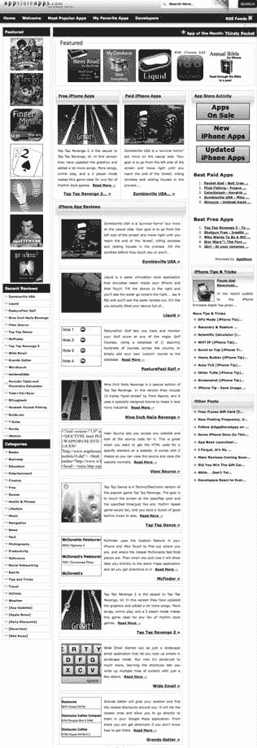

**图 1-1** appstoreapps.com 网站评测了大多数 App Store 应用。

从 App Store 下载应用既方便又便宜。这使得它成为独立开发者希望利用 iTunes Store 庞大用户群的优势而进入的一个利润丰厚的市场。独立开发者可以通过下载 iPhone SDK、开发应用并加入 iPhone 开发者计划来为 App Store 开发应用。然后 Apple 会审核你的应用，如果通过了审核流程，它就会被添加到 iTunes Store。

## 软件开发工具包（SDK）

所以你决定尝试为 App Store 开发应用。如果你想成为一名 iPhone 开发者，你必须做的第一件事就是在 iPhone Dev Center（http://developer.apple.com/iphone）注册成为会员。会员资格是免费的，并且可以下载 SDK。

你必须做的第二件事，也可以说是第一件，就是从 Apple Developer Connection 下载并安装 Xcode 和 iPhone SDK。Apple 网站上提供了分步安装说明。安装完 iPhone SDK 后，接下来你绝对应该做的是启动 Xcode 并下载文档——所有的文档（图 1-2）。这需要一些时间，但非常值得。

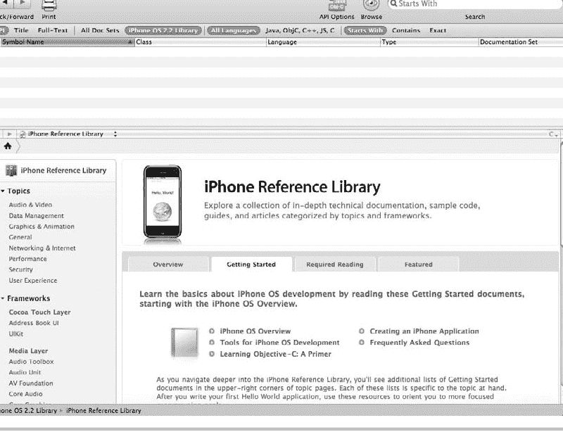

**图 1-2** Xcode 中的 iPhone Reference Library

> **注意**
>
> 你会发现 Apple 的文档出奇地完整且写得很好。我在本书中经常引用这些文档，所以最好在继续之前先下载它。

### 付费会员资格

在 iPhone 或 iPod touch 上测试应用以及在 App Store 上销售应用，需要注册 iPhone Developer Program。这个会员资格与 iPhone Dev Center 的会员资格不同。面向个人的 iPhone Developer Program 费用为 99 美元，它授予你在 iPod touch 或 iPhone 上测试所需的工具。这也是你向 App Store 提交和分发应用的方式，Apple 通过你的 iPhone Developer Program 会员资格向你分配任何可能获得的利润。

### Objective-C、Foundation Framework、Cocoa Touch 和 UIKit

Apple 将 iPhone 的技术描述为分层结构。最底层是 Core OS 层。在该层之上是 Core Services。Core Services 之上是 Media 层。最顶层是 Cocoa Touch（图 1-3）。

你可以更简化地理解 iPhone 操作系统（OS）；把它看作两层——C 层和 Cocoa 层（图 1-4）。C 层包含操作系统的底层。你可以使用 BSD UNIX 风格的 C 函数来操作这一层。这一层包括底层文件 I/O、网络套接字、POSIX 线程和 SQLite 等。Media 层也是偏底层的，包含 C 语言应用程序编程接口（API），如 OpenGL ES、Quartz 和 Core Audio。Cocoa 层覆盖在 C 层之上，它简化了 iPhone 编程。例如，你无需操作 C 字符串，而是使用 Foundation 框架的字符串 `NSString`。

### Cocoa Touch

在 iPhone 上，Cocoa 被称为 Cocoa Touch，而非简单的 Cocoa，因为 iPhone OS 包含触摸事件。如果你曾经点击、轻拂、滑动或捏合过 iPhone 的屏幕，你就知道触摸事件是什么了。触摸事件允许你编程响应用户用手指触摸屏幕的操作。

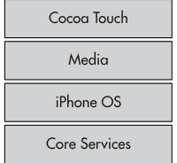

**图 1-3** iPhone 的技术分层

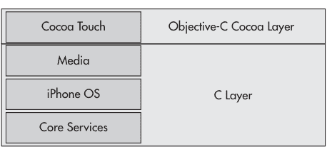

**图 1-4** iPhone 的编程分层

Cocoa Touch 还提供了 iPhone 开发所需的主要类库。你在编写每一个 iPhone 应用时都会用到的两个 Cocoa Touch 框架是 Foundation 框架和 UIKit 框架。框架是致力于类似任务的代码集合。Foundation 框架专注于标准编程主题，如集合、字符串、文件 I/O 和其他基本任务。UIKit 专注于 iPhone 的界面，包含诸如 `UIView` 之类的类。在本书中，你将花费大部分时间学习 UIKit。

## Foundation Framework

Foundation 框架包含封装了底层核心功能的 Objective-C 类。例如，你无需使用低层 C 语言文件 I/O，而是可以使用 `NSFileManager` 这个 Foundation 类。如果你希望编写稳健的 iPhone 应用，你真应该学习 Foundation 框架提供的许多实用类。Foundation 框架通过使用更高级别的 Objective-C 类来封装 C 函数，使得使用集合、日期和时间、二进制数据、URL、线程、套接字以及大多数其他底层 C 功能的编程变得更加容易。

> **提示**
>
> 参见 Apple 的 Foundation Framework Reference，了解 Foundation 框架提供的类和协议的完整列表。

> **注意**
>
> 如果你是 Java 程序员，可以这样理解 iPhone 的编程环境：Objective-C 相当于 Java 的核心语法。Foundation 框架相当于 Java 的核心类，如 `ArrayList`、`Exception`、`HashMap`、`String`、`Thread` 以及其他 Java Standard Edition 类，而 UIKit 相当于 SWING。我知道这是一种简化，但对我而言很有用。

## iPhone 框架

表 1-1 列出了你作为 iPhone 开发者可以使用的一些框架。在这些框架中，本书专注于 UIKit，而不是试图涵盖每个框架的一点点内容。

| 框架 | 用途 |
|-----------|---------|
| AddressBook | 访问用户通讯录 |
| AddressBookUI | 显示通讯录 |
| AudioToolbox | 音频数据流；播放和录制音频 |
| AudioUnit | 音频单元 |
| CFNetwork | WiFi 和蜂窝网络 |
| CoreAudio | 核心音频类 |
| CoreFoundation | 类似 Foundation 框架，但层级更低（除非万不得已，否则不要使用） |
| CoreGraphics | Quartz 2D |
| CoreLocation | 用户位置/GPS |
| Foundation | Cocoa 基础层 |
| MediaPlayer | 视频播放 |
| OpenAL | 定位音频库 |
| OpenGLES | 嵌入式 OpenGL（2D 和 3D 图形渲染） |
| QuartzCore | 核心动画 |
| Security | 证书、密钥和信任策略 |
| SystemConfiguration | 网络配置 |
| UIKit | iPhone 用户界面层 |

**表 1-1** iPhone 上的框架

本书的前提是，一旦你了解了如何使用 UIKit 类创建 iPhone 应用程序，就应该去学习其他框架。

## iPhone 的局限性

如果你从未为 iPhone 这样的小型设备编程，在开始编程之前应该了解一些限制。内存和处理速度受到约束，屏幕也很小。iPhone 的安全性也十分严格，应用程序能做的事情有限。

## 内存和处理速度

iPhone 的内存受到约束。你很可能有一台配备双核处理器和 2GB 内存的 Mac，但 iPhone 并非如此。虽然苹果公司并未公开这些信息，但根据黑客 Craig Hockenberry（来自 furborg.org）的估计，iPhone 的处理速度约为 600 MHz，可用物理内存为 128MB。与你的桌面电脑相比，该设备的内存十分有限。

> **注意**
>
> 如果你的应用程序占用过多内存，iPhone OS X 可能会突然终止你的应用程序，以防止系统崩溃。

## 小屏幕

iPhone 屏幕分辨率为 480 × 320 像素，可用空间不大。当然，iPhone 上的按钮等控件会更小，但布局空间仍然非常有限。如果你习惯了在 1280 × 800 像素的显示器上编程用户界面，必须调整你的思维方式。屏幕尺寸是有限的。

屏幕尺寸小也意味着一次只能显示一个窗口。事实上，你在本书中开发的每个应用程序都只包含一个窗口。在 iPhone 应用程序编程中，几乎没有理由去创建另一个窗口。取而代之的做法是将视图切换进和切换出应用程序的窗口。但一次只能显示一个视图——没有例外。这一限制是合理的，因为屏幕太小了。

## 安全性

你只能读写应用程序包中的目录。你的应用程序可以访问的区域被称为应用程序沙盒。你不能读取其他应用程序创建的文件，也不能写入应用程序沙盒之外的任何位置。使用 SDK 编写的应用程序无法共享资源，没有任何例外。

## 短生命周期的应用程序

iPhone 应用程序的另一个限制是它无法常驻内存。常驻内存的应用程序可以在用户运行其他应用程序时在后台运行。在为 iPhone 编程时，别想着常驻内存的应用程序——你做不到。

iPhone 一次只能运行一个程序。这一限制使你的应用程序随时面临被操作系统终止的风险。想一想：据称，iPhone 的主要功能仍然是手机。当你的应用程序运行时，可能会有电话打进来。在这种情况下，操作系统会询问用户是否接听。如果用户选择接听，iPhone OS 就会终止你的应用程序。

由于存在这种随时可能被突然终止的可能性，你应该进行防御性编程，为突然终止做好准备。你会看到 UIKit 通过提供事件处理器使这变得很容易，你可以在应用程序即将终止时实现这些处理器。

> **注意**
>
> 在你抨击苹果这一限制之前，请考虑一下另一种选择。假设你开发了一个运行时间长且耗电的常驻内存应用程序。你的应用程序用户发现他们的 iPhone 电池续航很短。他们会怪谁，你还是苹果？答案是苹果。

## 手动内存管理

Objective-C 2.0 的一大改进是垃圾回收。垃圾回收使开发人员无需担心内存管理，系统会自动完成。但 iPhone 资源有限，不支持 Objective-C 2.0 的垃圾回收。你仍然必须自己管理内存。你可以使用一种叫做 `autorelease` 的机制，它使内存管理稍微容易一些，但即使 `autorelease` 也不推荐使用。你应该手动管理内存。虽然这不算一个巨大的限制，但确实令人头疼，因为忘记释放对象是极其容易犯的错误。当然，正如你将在第 5 章中看到的，有一些工具可以帮助你追踪和修复这些错误。

## 相关文档

苹果拥有大量的在线文档。你可以通过 Developer Connection 会员资格和 Xcode 的帮助来访问这些文档。你应该经常查阅这些文档。大多数文档也以 PDF 格式提供。你应该下载并打印的前两份文档是《iPhone 应用程序编程指南》和《iPhone 开发指南》。然后你可以考虑下载并打印《Cocoa 基础指南》。你还会找到关于 Objective-C 和各种 Cocoa 类的文档。如果你按照本章前面的建议下载了文档，你会发现使用 Xcode 的帮助就能轻松获取所有这些信息。本书尽量不重复这些在线和桌面资源，而是通过提供分步示例来补充它们，展示如何完成各种操作。一旦你了解了方法，在线文档会为你展示更多选项，以扩展本书教程的内容。

## 动手试试：快速入门 iPhone 开发

本章以一个快速入门示例结尾，以激发你的兴趣。接下来的四章涵盖了学习 iPhone 的 UIKit 和 Cocoa Touch 之前你应该掌握的前置知识。但你可能已经准备好开始使用这些框架进行编程了，因此本章以一个简单的 iPhone 应用程序结尾。这个快速入门也会让你熟悉 `IBOutlet` 和 `IBAction` 关键字及其用法，并让你熟悉 Xcode 和 Interface Builder。

> **注意**
>
> 本书中几乎每个"动手试试"示例都有一个配套视频，可在我的网站（www.jamesabrannan.com）上观看。第一个视频——也就是这个"动手试试"应用程序——配有音频解说操作步骤。其余视频没有声音；不过，它们完全按照对应的"动手试试"应用程序的编号步骤进行操作，因此你可以一边参考书一边观看视频。

1. 打开 Xcode。从菜单中选择 File | New Project，New Project 对话框将出现（图 1-5）。
2. 选择 View-based Application 并点击 Choose。在 Save As 对话框中，将应用程序命名为 QuickStart（图 1-6）。

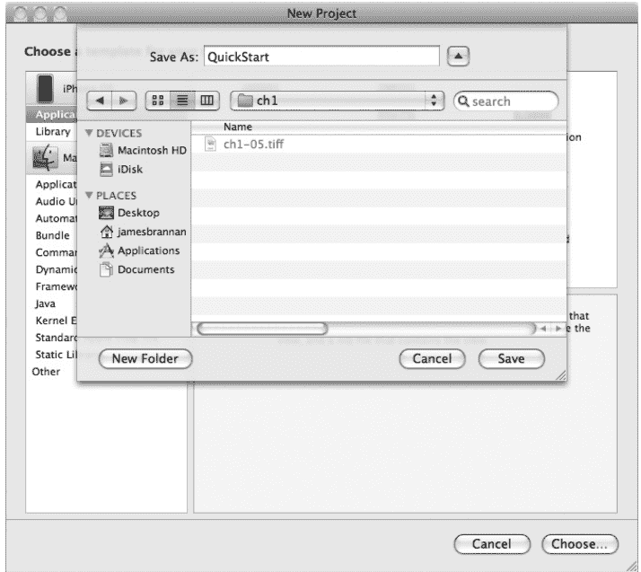

3. Xcode 应该会创建该项目。在 Groups & Files 窗格中，展开 Classes 和 Resources 文件夹（图 1-7）。
4. 双击 `QuickStartViewController.xib`，在 Interface Builder 中打开它。

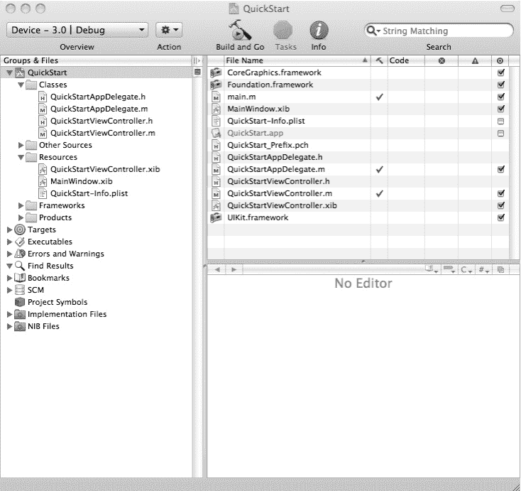

5. 如果看不到类似图 1-8 所示的画布，请双击文档窗口中的 View（图 1-9）。
6. 确保通过从 Interface Builder 的主菜单中选择 Tools | Library 来显示库。确保通过进入库的顶部窗格，展开 Library 并点击 Cocoa Touch，使库显示所有 Cocoa Touch 类（图 1-10）。

**图1-8** Interface Builder中的视图画布

**图1-9** 文档窗口

**图1-10** 库面板

**图1-11** 添加一个按钮

7. 在控件列表中滚动查找“圆角矩形按钮”。将该按钮拖放到画布上（图1-11）。
8. 双击画布上的按钮，为其添加标题。
9. 从库面板中拖拽一个标签到画布上（图1-12）。

**图1-12** 添加一个标签

10. 保存并退出 Interface Builder。
11. 在 Groups & Files 的 Classes 文件夹中选择 `QuickStartViewController.m`。Xcode 应在编辑器窗格中显示该文件（图1-13）。
12. 修改 `QuickStartViewController.m` 文件，使其与代码清单1-1匹配。
13. 打开 `QuickStartViewController.h` 并修改该文件，使其与代码清单1-2匹配。
14. 从 Xcode 的主菜单中选择“构建”|“构建”来构建应用程序。
15. 在 Interface Builder 中打开 `QuickStartViewController.xib`。

**图1-13** Xcode 显示 `QuickStartViewController.m`

16. 选择该按钮。从 Interface Builder 的主菜单中选择“工具”|“检查器”以显示检查器（图1-14）。通过点击检查器的第二个标签页打开“按钮检查器”（图1-15）。
17. 在“Touch Up Inside”旁边，点击并按住小圆圈。将光标移动到文档窗口的“File's Owner”上并释放。从弹出窗口中选择 `sayHello:`（图1-16）。

**图1-14** 检查器

**图1-15** 按钮的“按钮检查器”

18. 点击画布上的标签，检查器的内容应更新以匹配该标签。点击“New Referencing Outlet”旁边的圆圈，然后拖放到“File's Owner”上。从弹出窗口中选择 `myLabel`。注意不要选择“View”。
19. 保存并退出 Interface Builder。
20. 在 Xcode 中，确保“活动SDK”显示选择了“模拟器”和“调试”选项（图1-17）。

**图1-17** 确保“活动SDK”显示选择了“调试”和“模拟器”

21. 从 Xcode 的主菜单中，选择“构建”|“构建并运行”。Xcode 应启动模拟器，在其中安装你的应用程序，并启动该应用程序（图1-18）。
22. 选择“运行”|“控制台”以显示调试器控制台。
23. 点击按钮，标签的文本变为“Hello”，控制台显示日志（图1-19）。

**代码清单1-1** `QuickStartViewController.m`

```objective-c
#import "QuickStartViewController.h"
@implementation QuickStartViewController
@synthesize myLabel;
- (IBAction) sayHello: (id) sender {
    NSLog(@"Hello....");
    self.myLabel.text = @"Hello";
}
- (void) dealloc {
  [super dealloc];
  [myLabel release];
}
@end
```

**代码清单1-2** `QuickStartViewController.h`

```objective-c
#import <UIKit/UIKit.h>
@interface QuickStartViewController : UIViewController {
  IBOutlet UILabel * myLabel;
}
@property (nonatomic, retain) IBOutlet UILabel * myLabel;
- (IBAction) sayHello: (id) sender;
@end
```

**图1-19** 点击按钮后的应用程序

你刚刚完成了很多步骤，却没有得到解释。但你在本节“动手试一试”中所做的操作，到本书结束时将成为你的第二天性。你必须从这个简单示例中掌握的最大概念是使用 `IBAction` 和 `IBOutlet` 关键字。

本书将多次介绍 `IBAction` 和 `IBOutlet`。`IBAction` 是你在 Xcode 中将类的方法连接到使用 Interface Builder 创建的组件所触发事件的方式。`IBOutlet` 是你在 Xcode 中将类的属性连接到使用 Interface Builder 创建的图形组件的方式。

这些图形组件位于 nib 文件中，因此更准确的解释是，`IBAction` 和 `IBOutlet` 将代码连接到 nib 文件中的组件。例如，你将按钮的“Touch Up Inside”事件连接到 `sayHello:` 动作。按钮位于 nib 文件中，而 `sayHello` 方法位于编译后的类中。将 `sayHello` 方法声明为 `IBAction` 就将两者连接了起来。和按钮一样，标签也位于 nib 文件中，而 `myLabel` 属性位于编译后的类中。在类文件中将 `myLabel` 属性声明为 `IBOutlet`，然后在 Interface Builder 中连接两者，允许类通过 `myLabel` 属性操作标签。如果现在这仍然有些令人困惑，请不要担心——到本书结束时，你就明白了。如果你现在必须了解更多，第7章对 `IBOutlet` 和 `IBAction` 有更“正式”的解释。

## 总结

本章向你介绍了本书的内容。任何具备基本编程技能的人都可以在苹果的应用商店（App Store）上编写并发布应用程序。此外，他或她可以通过销售应用程序赚钱。尽管简单的应用程序都已发布，但应用商店中仍有高质量应用程序的空间。只需苹果在其网站上推荐你的应用程序，你就能为自己的努力赚取几千美元。

我热爱 iPhone 编程，我发现 Objective-C 是一门优美、优雅的语言。我确信，到本书结束时，你也会这样认为。

# 第二章

## C语言回顾

### 核心技能与概念

- 创建简单的 C 命令行程序
- 使用 C 注释
- 理解头文件、`import` 和 `include`
- 理解预处理语句
- 复习数据类型和运算符
- 理解 C 函数、基本 C 语法以及使用指针

像每个重要的现代操作系统、语言和编程工具一样，Mac OS X 和 iPhone 的操作系统（也是 OS X）都是使用 C 编程语言构建的。不是 Objective-C 编程语言和 Cocoa 框架，也不是 C++ 编程语言，而是 C。Objective-C 是使用 C 构建的面向对象语言。Cocoa 是一个框架，它使用易于使用的、用 Objective-C 编写的对象来隐藏复杂的 C 编程任务。但在你构建的每个 Cocoa 对象背后，你都能找到定义该构造的 C 代码。

> **注意**
>
> 计算机科学家丹尼斯·里奇（Dennis Ritchie）和布莱恩·柯林汉（Brian Kernighan）于1978年在贝尔实验室开发了 C 语言。

如果你想使用 Objective-C 进行编程，你必须至少了解一些 C。在本章中，你将复习基础的 C。本章假设你有一定的编程经验——例如，我假设你知道方法、整数、函数以及其他基本的编程构造是什么。理想情况下，你至少修过一门使用 Java 的大学课程或有一年使用 Java 的经验。使用 C# 的经验也足够，因为这门语言与 Java 非常相似。

## C 命令行程序

与 Java 类似，C 程序以 `main` 方法开始。C 的 `main` 方法接受一个整数和一个指向字符数组的指针作为输入，并返回一个整数。

```c
int main (int argc, const char * argv[])
```

返回的整数通常表示程序的成功或失败。零通常表示成功，而非零数字表示失败。程序员通常返回不同的值作为错误代码。然后，程序用户可以通过在应用程序文档中查找错误代码来确定出了什么问题。

`main` 在你的程序中只能实现一次。当你的程序运行时，OS X 会找到 `main` 方法并将其用作你的程序的起点。

## 使用 Xcode 创建一个简单的 C 程序

1. 打开 Xcode，并创建一个新项目。选择“命令行工具”|“标准工具”，然后点击“选择”按钮。将项目命名为“C Main Project”（图2-1）。
2. 打开 `main.c` 并注意 Xcode 创建的方法。它甚至为你创建了“Hello World”消息（代码清单2-1）。点击“构建并运行”，并查看调试器控制台的日志。

**代码清单2-1** C 程序中的 main 方法

```c
#include <stdio.h>
int main (int argc, const char * argv[]) {
    // insert code here...
    printf("Hello, World!\n");
    return 0;
}
```

**图2-1** Xcode 新项目对话框

## C 语言注释

C 语言的注释语法与 Java 相同。双斜杠（`//`）表示同一行之后的所有内容均为注释。斜杠后跟一个星号（`/*`）表示之后的所有内容均为注释，直到遇到下一个星号和斜杠（`*/`）为止。例如，以下两种写法都是注释。第一种是单行注释，第二种是多行注释。

```
// This is a comment in C code.
/* This is a multiline comment in C Code.
This comment can be multiple lines. */
```

注释当然会被编译器忽略，它们是你为将来可能调试或修改代码的程序员提供代码说明的方式。

## 理解头文件、Import 和 Include

头文件以 `.h` 为文件扩展名，包含方法原型和预处理语句。原型就是函数的签名。签名是方法名、返回类型和参数，不包含函数体。编译器使用原型，以便其他文件中的方法能够"看到"该函数。

你也可以说头文件声明了方法。声明一个方法意味着你告诉编译器，你打算定义一个与声明具有相同签名的方法。

代码中 `include` 或 `import` 一个头文件，是向编译器声明它可能会使用该头文件中的函数。通过编译器的机制，编译器会将所有文件组合在一起，并解析不同文件中方法的引用——前提是所有文件都规范地 `include` 或 `import` 了所需的头文件。

> **提示**
>
> 在标准 C 程序中，你通常看到头文件在其他文件中被 `include`。在文件中包含另一个文件时使用 `#include` 指令。在 Objective-C 中，你通常看到头文件在其他文件中被 `import`。在文件中导入另一个文件时使用 `#import` 指令。当 `import` 一个头文件时，编译器确保该头文件在你的应用程序中只被包含一次。当 `include` 一个文件时，则没有这样的保护。如果你不完全理解其中的区别，不必担心——理解这种区别并不重要。只需知道，在 iPhone 或 Mac OS X 编程时，使用 `import` 即可。

## 动手试试：创建一个头文件

1. 使用 View-based Application 模板创建一个基于视图的 iPhone 应用程序。将应用程序命名为 CreateHeaderFile。
2. 在 Groups & Files 中，创建一个名为 c_code 的新文件夹。使用 New File 对话框（图 2-2）向该文件夹添加一个 C 文件。确保选中 Also Create "cwork.h" 复选框，将文件命名为 `cwork.c`，并将其添加到项目中。

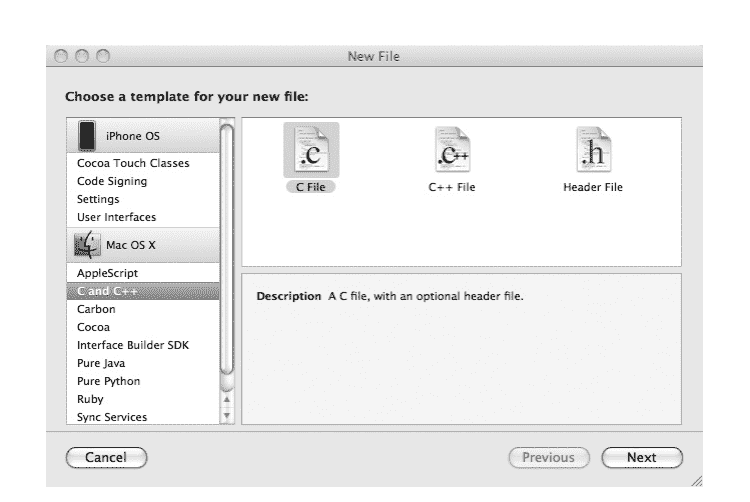

**图 2-2** 使用 New File 对话框向 Groups & Files 添加 C 文件

> **注意**
>
> 你使用基于视图的 iPhone 应用程序来演示在 iPhone 应用程序中使用 C。你可以在 iPhone 程序中自由混合使用 Objective-C 和 C，因为 Objective-C 是 C 的超集。

3. 将清单 2-2 中的代码键入 `cwork.c` 文件。确保将方法的签名添加到 `cwork.h` 中（清单 2-3）。

**清单 2-2** 在 `cwork.c` 中定义的 `sayHello` 方法

```
#include "cwork.h"
void sayHello() {
    printf("hello programmer...\n");
}
```

**清单 2-3** 在 `cwork.h` 中声明的 `sayHello` 方法

```
#include <stdio.h>
void sayHello();
```

`sayHello` 方法在 `cwork.h` 中声明，在 `cwork.c` 文件中定义。`sayHello` 方法不返回值，因此其返回类型为 `void`。`printf` 方法在标准输入输出头文件中声明，因此你需要导入 `stdio.h` 头文件。注意尖括号的使用；使用尖括号导入系统库。使用双引号导入项目专属的头文件。

4. 打开 `main.m`，导入 `cwork.h`，并将 `sayHello` 方法添加到文件中（清单 2-4）。

```
#import <UIKit/UIKit.h>
#import "cwork.h"
int main(int argc, char *argv[]) {
    NSAutoreleasePool * pool = [[NSAutoreleasePool alloc] init];
    sayHello();
    int retVal = UIApplicationMain(argc, argv, nil, nil);
    [pool release];
    return retVal;
}
```

5. 点击 Build And Go，控制台将输出 "Hello World"。

## 预处理语句

`#include` 和 `#import` 语句是预处理语句。编译程序时，编译器会在编译程序之前处理所有带 `#` 号的语句；因此，称之为预处理语句。编译器会将预处理语句替换为其对应的值。

1. 打开上一节项目 CreateHeaderFile 中的 `cwork.h` 头文件。
2. 在 `cwork.h` 中键入 `#define MYNUMBER 20` 并保存文件。
3. 将 `sayHello` 方法修改为清单 2-5 中的代码。注意你需要将 `sayHello` 方法改为返回一个整数。你还必须修改 `cwork.h` 文件（清单 2-6）。
4. 编译并运行应用程序。控制台现在应该会输出包含 `cwork.h` 中定义的数字的消息。

**清单 2-5** 修改后包含预处理语句的 `sayHello` 方法

```
int sayHello() {
    printf("hello programmer....%d\n", MYNUMBER);
    return 0;
}
```

**清单 2-6** `cwork.h` 文件

```
#include <stdio.h>
#define MYNUMBER 20
int sayHello();
```

> **注意**
>
> 你在头文件中使用 `#define` 预处理指令来定义常量。定义常量时不需要包含常量的类型。

你在 `cwork.h` 中定义了一个常量；然后编译时，编译器首先解析所有已定义的常量，将常量替换为其字面值。

## 数据类型和运算符

C 语言的基本数据类型与 Java 相同，应该看起来很熟悉（表 2-1）。

| 数据类型 | 描述 |
| --- | --- |
| char | 8 字节的 ASCII 字符 |
| short | 小整数 |
| int | 整数 |
| long | 大整数 |
| float | 浮点数，单精度 |
| double | 浮点数，双精度 |

**表 2-1** C 语言的基本数据类型

C 语言的常用运算符也应该看起来很熟悉（表 2-2）。注意该表排除了较少使用的位运算和移位运算符。

| 运算符 | 运算符字符 |
| --- | --- |
| 赋值 | = |
| 加法 | + |
| 减法 | - |
| 除法 | / |
| 乘法 | * |
| 取余（模运算） | % |
| 一元 ++ 和 -- | x++ 或 x--<br>++x 或 --x |
| 等于 | == |
| 不等于 | != |
| 大于 | > |
| 小于 | < |
| 大于等于 | >= |
| 小于等于 | <= |
| 布尔非 | ! |
| 布尔与 | && |
| 布尔或 | \|\| |

**表 2-2** C 语言的基本运算符

## 控制语句、函数和条件语句

控制语句、函数和条件语句的语法与其 Java 对应物完全相同。条件 `if` 语句与 Java 中的用法相同（清单 2-7）。

**清单 2-7** 在 C 中使用 `if` 语句

```
if(myInt < 2) {
    printf("the value is not equal");
    myOtherInt = 3;
}
else if (myInt == 5) {
    myOtherInt = 7;
}
else {
    myOtherInt = 3;
}
```

`switch` 语句也等同于 Java 的 `switch` 语句（清单 2-8）。

**清单 2-8** C 语言的 `switch` 语句

```
switch (myInt) {
    case 1:
        myOtherInt = 3;
        printf("case one");
        break;
    case 2:
        myOtherInt = 5;
        break;
    default:
        myOtherInt = 4;
}
```

如果你了解 Java，那么循环语句也应该很熟悉，包括 `do-while` 循环和 `for` 循环（清单 2-9）。

**清单 2-9** 使用 C 语言的 `while`、`do-while` 和 `for` 循环

```
int i = 0;
while(i < 20) {
    printf("loop%d", i);
    i++;
}
do {
    printf("loop%d", i);
    i--;
} while(i > 0)
for(int i =0; i < 20; i++) {
    printf("loop%d", i);
}
```

## 数组和结构体

C 语言的数组与 Java 数组类似。声明方式相同，但 C 语言没有 `new` 关键字；你只需直接使用数组即可（清单 2-10）。

**清单 2-10** 使用 C 语言数组

```
int myArray[100];
myArray[0] = 1;
myArray[1] = 2;
```

C 语言有结构体（`struct`）；Java 没有 `struct` 数据类型。在 C 语言中，`struct` 类似于类，但没有方法和继承（清单 2-11）。

**清单 2-11** C 语言的结构体

```
struct myBox {
    int length;
    int width;
}
```

数组可以包含结构体；例如，你可以声明一个数组来存放 100 个 `myBox` 实例（清单 2-12）。

**清单 2-12** 在数组中使用 C 语言结构体

```
struct myBox myBoxes[100];
myBoxes[0].length = 10;
myBoxes[0].width = 2;
```

## 函数

使用 C 语言声明函数的方式与 Java 相同，只是 C 语言不限制函数的可见性。C 语言没有 `public` 或 `private` 函数。与 Java 类似，你使用返回类型、名称和参数列表来声明 C 函数。函数声明写在头文件中，函数定义写在 C 源文件中。不返回任何值的函数使用 `void` 作为返回类型。如果函数不接受任何参数，你可以选择将参数列表列为 `void`。

```
void sayHello(void);
```

虽然你不能将函数声明为 `private`，但你可以将函数声明为 `static`。不过 C 语言中的 `static` 函数与 Java 中的 `static` 函数有很大不同。在 C 语言中，将函数声明为 `static` 类似于在 Java 中将函数声明为 `private`。在 C 语言中，只有在同一文件中声明的函数才能使用被声明为 `static` 的函数。静态函数适用于不需要在程序其他地方使用的工具函数。

```
static void sayHello(void){ printf("hello\n");}
```

注意，你不需要在头文件中声明静态方法的原型。你只需在使用该方法的源文件中直接编写该方法即可。

## printf 方法

C 语言使用 `printf` 函数向标准输出流进行输出。其声明如下：

```
int printf( const char *format, arg1, arg2, ..., argn);
```

该函数接受一个指向你希望发送到标准输出流的字符的指针，以及零个或多个用于格式化的项。例如，考虑下面的 `printf` 语句。

```
printf("Hello world...%d times", 22);
```

该语句产生以下输出。

```
Hello world...22 times
```

另一个常见的参数是用于字符串的 `%s`。例如，下面的代码演示了一个字符数组，然后将其打印出来。

```
char * hello = "hello turkey";
printf("%s\n", hello);
```

## 指针

Java 摒弃了指针；然而，Objective-C 广泛依赖于指针。指针是对另一个变量的引用，或者更技术性地说，指针是一个引用另一个变量内存空间的变量。将你的计算机内存想象成一个大的小隔间块。一个变量占据一个隔间。指针指向特定的隔间，但指针的值不是隔间中的值；指针的值是隔间的地址。

在图 2-3 中，隔间 n 位于第 2 行，第 5 列，其值为 12。隔间 n 的值是 12，地址是第 2 行，第 5 列。指针 p 指向 n 的位置，即第 2 行，第 5 列。指针 p 的值不是 12，而是第 2 行，第 5 列。这是一个重要的区别。

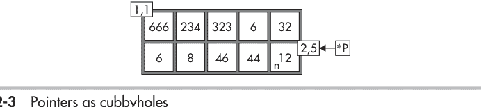

你使用星号（`*`）来表示指针。指针指向另一个变量的内存位置。与号（`&`）表示变量的内存地址。

### 尝试使用指针

1. 创建一个新的 C 命令行应用程序，命名为 Using Pointers。
2. 修改 `main.c` 文件，使其如清单 2-13 所示。
3. 点击 Build And Go。

**清单 2-13** 演示指针的 C 程序

```
#include <stdio.h>
int main (int argc, const char * argv[]) {
  int avalue = 10;
  int *pavalue = &avalue;
  printf("address:%p value:%d", pavalue, *pavalue);
  return 0;
}
```

在前面的语句中，`avalue` 的值是 10，`pavalue` 指向 `avalue` 的内存地址，而 `printf` 命令先打印 `avalue` 的地址，然后打印 `avalue` 的值，因为 `pavalue` 指向 `avalue` 的地址，而 `*pavalue` 是 `avalue` 的值。

> **注意**
>
> 如果你在 Xcode 中跟随操作，请注意你的地址值将与本章示例代码结果中列出的不同。

```
address:0xbffff628 value:10
```

4. 修改 `main`，使前两行如下所示：

```
//int avalue = 10;
int avalue;
```

5. 在方法的 `return` 语句之前添加以下行：

```
printf("value's actual value:%d", avalue);
```

6. 编译并运行。清单 2-14 包含不正确的输出。

**清单 2-14** C 命令行程序的输出

```
[Session started at 2008-09-05 21:35:14 -0400.]
address:0xbffff628 value:-1073744308 value's actual value:-1073744308
The Debugger has exited with status 0.
```

结果与预期不符。尽管第二个 `printf` 语句工作正常，但第一个不正常。初始化变量只是预留内存空间；它不会为变量赋值。当你通过指针引用一个未初始化的变量时，你会得到一个不正确的结果。在使用变量之前，你必须用一个值来初始化它。

7. 修改方法，将 `avalue` 初始化为 10，然后点击 Build And Go。调试器控制台如预期那样输出 10。

## 解引用指针

你也可以通过为指针的位置分配一个新值来解引用指针。这是通过所谓的解引用来实现的。考虑清单 2-15 中的代码。

**清单 2-15** 解引用指针

```
int a = 10;
int *b = &a;
*b = 52;
printf("value:%d value:%d", *b, a);
```

第三行将指针 `b` 指向的地址处的内存内容设置为整数值 52。指针 `b` 指向的地址恰好是变量 `a`，因此更改内容也会更改 `a` 的值，因为 `a` 是 `b` 指向的位置。运行此代码会导致两个值都打印为 52。

## 指针和数组

指针在 C 编程中一个有用的地方是数组。一种常见的技术是使用指针作为数组元素的迭代器来遍历数组。下面的项目演示了这种技术。

### 尝试使用指针和数组

1. 创建一个新的命令行应用程序，名为 C Pointer Array。
2. 修改 `main.m` 中的 `main`，使其如清单 2-16 所示。

**清单 2-16** 使用指针遍历数组的 C 程序

```
#include <stdio.h>
int main (int argc, const char * argv[]) {
    int values[10];
    int *iterator;
    for(int i = 0; i < 10; i++) {
        values[i] = i * 2;
        printf("value: %d  ", values[i]);
    }
    iterator = values;
    for(int i = 0; i < 10; i++) {
        printf("value(%d):%d ", i, *(iterator+i));
    }
    *(iterator+4) = 999;
    printf("\nvalue of element at 4: %d", values[4]);
    return 0;
}
```

3. 点击 Build And Go。清单 2-17 是调试器的输出。

**清单 2-17** 调试器控制台输出

```
[Session started at 2008-09-05 21:57:35 -0400.]
value: 0  value: 2  value: 4  value: 6  value: 8  value: 10  value: 12  value:14  value: 16  value: 18  value(0):0  value(1):2  value(2):4  value(3):6  value(4):8  value(5):10  value(6):12  value(7):14  value(8):16  value(9):18  
value of element at 4: 999
The Debugger has exited with status 0.
```

在此示例中，你使用了一个指针来遍历数组。迭代器指向数组的地址。迭代器首先指向数组在零位置的元素。迭代器 + 1 指向第一个位置的元素。迭代器 + n 指向第 n 个位置的元素。当你遍历数组的值时，你可以使用迭代器指向的地址处的值。

## 总结

本章没有提供足够的细节来完全学习 C。事实上，本章只是浅尝辄止。但它确实提供了足够的信息来理解本书的其余部分。你必须了解基本的 C 才能理解 Objective-C 和 iPhone 编程。希望本章能够充分唤醒你的记忆，以便开始下一章。如果你熟悉 Java 的基本编程结构、C 头文件和 C 指针，你应该不会理解接下来的两个 Objective-C 章节感到困难。如果你仍然不确定，你可以使用 Google 找到许多免费的在线 C 教程。但不用担心——本书将 C 的内容保持在最低限度。

> **注意**
>
> 如果你是编程和 C 编程的新手，你应该购买这本书：
>
> *The C Programming Language*，作者 Brian W. Kernighan 和 Dennis M. Ritchie。

# 第 3 章 仅够使用的 Objective-C —— 第一部分

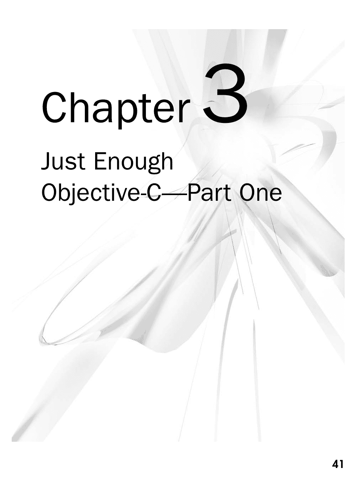

### 关键技能与概念

- 理解 Objective-C 的类和对象
- 理解接口和实现
- 理解简单的消息传递
- 理解 `alloc` 和 `init`
- 使用 `retain` 和 `release` 管理内存
- 使用 `autorelease` 管理内存

iPhone 应用程序使用 Cocoa 类，而这些类使用 Objective-C 编程语言。因此，如果你希望为 iPhone 编程，你必须了解 Objective-C。乍一看，Objective-C 的语法可能显得奇怪且困难。但别担心——这门语言很容易，它的奇怪之处将让位于一种你肯定会欣赏的优雅。在本章和下一章中，你将学习足够多的 Objective-C 以开始 iPhone 编程。

> **注意**
>
> 如果你来自 .NET 或 Java 背景，请特别注意关于内存管理的部分。与这些语言不同，iPhone 上的内存管理不是自动的。你必须手动管理内存。

### Objective-C 类和对象

Objective-C 类与任何其他面向对象编程语言中的类相同。一个类封装了状态（属性）和行为（方法），并构成了面向对象程序的基本构建块。一个面向对象的应用程序通过对象之间相互发送消息来运作。例如，在一个典型的 Java 命令行应用程序中，你通过调用一个类中称为 `main` 的静态方法来开始程序。这个 `main` 方法实例化一个或多个对象，应用程序的剩余功能由这些在 `main` 方法中实例化的对象之间传递的消息组成，以及它们可能反过来实例化的任何对象。

### 类接口和实现

Objective-C 将一个类分为接口和实现。接口声明实例变量和方法。它是一个标准的 C 头文件，不提供任何方法实现。实现包含类的方法实现。它是一个具有自己的 `.m` 扩展名而不是 `.c` 扩展名的文件。

## 试一试：生成 Objective-C 类的接口和实现

1. 创建一个新的基于视图的应用程序，并将其命名为 ChapThree。
2. 在“组与文件”（Groups & Files）中，右键点击 Classes，然后从弹出菜单中选择“添加 | 新建组”（Add | New Group）。将该组命名为 Objective-C。
3. 右键点击新创建的 Objective-C 文件夹，然后从弹出菜单中选择“添加 | 新建文件”（Add | New File）。在“新建文件”对话框中，高亮显示 Cocoa Touch Class 并选择 Objective-C class。确保“子类”（Subclass）显示为 `NSObject`（图 3-1）。点击“下一步”（Next）。
4. 在下一个对话框中，将类命名为 **Simple**。务必同时勾选询问是否为该类生成头文件的复选框。

模板为你生成了 Simple 类，将其接口写入 `Simple.h`（清单 3-1），将其实现写入 `Simple.m`（清单 3-2）。

```objc
#import <Foundation/Foundation.h>
@interface Simple : NSObject {
}
@end
```

```objc
#import "Simple.h"
@implementation Simple
@end
```

## @interface 和 @implementation 编译器指令

在 `Simple.h` 中，注意 `@interface` 编译器指令。在 `Simple.m` 文件中，注意 `@implementation` 编译器指令。这些指令将一个类的接口与实现区分开。`Simple.h` 中 `@interface` 和 `@end` 编译器指令之间的代码构成了 Simple 的接口，而 `@implementation` 和 `@end` 编译器指令之间的代码构成了 Simple 的实现。

## 方法的声明和定义

你在类的接口中声明类的方法和实例变量。你在类的实现中定义类的方法和实例变量。声明一个方法意味着你告诉编译器，该类将有一个具有特定签名的方法，但你并不提供该方法的实际代码。例如，考虑下面的方法声明：

```objc
- (void) sayHello: (NSString*) name;
```

该声明告诉编译器预期会有一个名为 `sayHello` 的方法，它返回空（`void`），并接受一个 `NSString` 作为参数。该声明并未涉及该方法的内容。

你通过定义方法来向编译器提供方法的实现。定义方法意味着你为一个方法声明提供实际的行为，即它的实现。例如，清单 3-3 中的 `sayHello` 方法提供了 `sayHello` 方法声明的行为。

### 清单 3-3：一个简单的 Objective-C 方法实现

```objc
- (void) sayHello: (NSString*) name {
    NSMutableString *message = [[NSMutableString alloc] initWithString:@"Hello there "];
    [message appendString:name];
    NSLog(message);
    [message release];
}
```

### 试一试：将 sayHello 添加到 Simple 类

1. 打开上一节的项目 ChapThree。将清单 3-3 中的 `sayHello` 方法添加到 `Simple.m`（清单 3-4）。别忘了同时将方法的声明添加到 `Simple.h`（清单 3-5）。
2. 打开 `main.m` 并导入 Simple。然后在 `main` 中，创建一个 Simple 实例并调用其 `sayHello` 方法（清单 3-6）。
3. 构建并运行程序，hello 消息将显示在调试器控制台中。

### 清单 3-4：修改后的 `Simple.m`，声明了 `sayHello`

```objc
#import "Simple.h"
@implementation Simple
- (void) sayHello: (NSString *) name {
    NSMutableString *message = [[NSMutableString alloc] initWithString:@"Hello there "];
    [message appendString:name];
    NSLog(message);
    [message release];
}
@end
```

### 清单 3-5：修改后的 `Simple.h`，声明了 `sayHello`

```objc
#import <Foundation/Foundation.h>
@interface Simple : NSObject {
}
-(void) sayHello: (NSString *) name;
@end
```

### 清单 3-6：修改后的 `main.m` 文件，用于调用 `sayHello` 方法

```objc
#import <UIKit/UIKit.h>
#import "Simple.h"
int main(int argc, char *argv[]) {
    NSAutoreleasePool * pool = [[NSAutoreleasePool alloc] init];
    Simple * mySimple = [[Simple alloc] init];
    [mySimple sayHello:@"James"];
    [mySimple release];
    int retVal = UIApplicationMain(argc, argv, nil, nil);
    [pool release];
    return retVal;
}
```

## 接口剖析

类的接口由 `import` 语句、类声明、所有实例变量和方法签名组成。查看 Simple 的接口（位于 `Simple.h` 文件中）。Objective-C 类导入或包含其他库和头文件的方式与 C 相同（仅作提醒，始终使用 `import`，这可以确保你不会重复包含同一个头文件）。以下一行向编译器声明了一个名为 Simple 并继承自 `NSObject` 的 Objective-C 类。

```objc
@interface Simple : NSObject
```

类声明后面是一对开括号和闭括号。实例变量放在这对括号之间。在闭括号下方，你添加类方法声明。在任何方法声明之后，接口以 `@end` 指令结束，该指令标志着接口的结束。图 3-2 总结了 Objective-C 接口的构成。

## 实现剖析

然而，接口只是 Objective-C 类的一半。类的实现与其接口同样重要。查看 Simple 的实现（位于 `Simple.m` 文件中）。该文件首先导入类的接口。然后，Simple 的实现以 `@implementation` 编译器指令开始。

```objc
@implementation Simple
```

Simple 的实现以 `@end` 编译器指令结束。方法定义放在这两个指令之间。图 3-3 总结了 Objective-C 类的实现。

## 公有、私有和受保护的实例变量

类可以将实例变量设置为私有（`private`）、受保护（`protected`）、公有（`public`）和包内可见（`package`）。你使用编译器指令 `@private`、`@protected`、`@public` 和 `@package` 来声明实例变量的可见性。`private` 指令确保标记为私有的变量仅对声明该实例变量的类可见。`protected` 指令确保受保护的变量仅对声明类及其后代可见。`public` 指令允许任何类访问公有变量。`package` 指令仅适用于 64 位系统，并且比其他指令更为复杂。有关 `package` 指令的更多信息，请参阅 Apple 的文档。

考虑清单 3-7 中的接口代码片段。

### 清单 3-7：公有和私有方法

```objc
@public
    NSString* groupName;
    int intGroupSize;
@private
    NSString* otherGroupName;
    int intOtherGroupSize;
```

在此接口声明中，实例变量 `groupName` 和 `intGroupSize` 是公有的，而 `otherGroupName` 和 `intOtherGroupSize` 是私有的。

## 理解简单的消息传递

Objective-C 方法与 Java 方法看起来有很大不同。尽管语法一开始令人困惑，但一旦习惯后并不难。注意，在使用 Objective-C 时，你不会说“调用一个方法”。相反，你说“向接收者发送一条消息”。例如，使用 Java 时，你可能会输入以下内容：

```java
objMyObject.getFooUsingID(33);
```

在描述这行代码时，我会写到我正在调用 `objMyObject` 的 `getFoo` 方法并传递参数 33。在 Objective-C 中，相同的消息如下所示：

```objc
[objMyObject getFooUsingID : 33];
```

在描述这行代码时，我会写到我正在发送一条 `getFooUsingID` 消息，传递参数 33，而 `objMyObject` 是接收者。

调用方法与发送消息之间的差异并不是 Objective-C 与 Java 之间的唯一区别。Objective-C 使用所谓的**中缀表示法**（infix notation）。中缀表示法混合了操作数和运算符。你无须完全理解中缀表示法，只需知道它意味着 Objective-C 看起来与 Java 和 C++ 有很大不同。Objective-C 消息以开头的方括号开始，以闭方括号后跟分号结束。对象名称跟随在开括号之后，接着是一个空格，然后是消息。传递给消息的参数跟随一个冒号。当然，你也可以有多个参数的方法，这将在下一章中看到。不过目前，先只考虑单参数方法。图 3-4 总结了带有一个参数的 Objective-C 消息。

## 在消息中使用 self

术语 `self` 指的是发送消息时的对象，同时也是消息的接收者。例如，你可能会在心里提醒自己下班回家的路上买点牛奶（清单 3-8）。

**清单 3-8** 使用 `self` 关键字的方法

```
- (void) goHome {
    [self pickupMilk];
}

- (Milk*) pickupMilk {
}
```

两个方法都在同一个对象中，因此 `goHome` 方法向自己（即 `self`）发送了 `pickupMilk` 消息。

## 嵌套参数

与 Java 类似，Objective-C 的消息也可以嵌套。例如，使用 Java 时，你可能会这样写：

```
objMyObject.getFoo(objMyFooIdentifier.getID());
```

在 Objective-C 中，同样的语句写成如下形式：

```
[objMyObject getFoo: [objMyFooIdentifier getID]];
```

使用 Java 时，你可能会将一个对象的构造函数嵌套在另一个方法中。

```
objTester.testFubar(new Fubar(33));
```

在 Objective-C 中，你也可以将对象构造函数嵌套在其他方法中。

```
[objTester testFubar:[[Fubar alloc] initWithInteger: 33]];
```

在这个方法中，首先分配并初始化一个新的 `Fubar` 实例（初始值为 33），然后将生成的对象引用作为参数传递给 `testFubar` 消息。

## 类方法和实例方法

如前所述，你在类的接口中声明方法，在类的实现中定义方法。就像 C 语言一样，方法声明仅包含方法的签名，而定义则是方法的实际实现。在这两个文件中，有两种方法类型：实例方法和类方法。实例方法以减号开头，类方法以加号开头。类方法与 Java 的静态方法类似，意味着你无需创建类的实例即可使用该方法。例如，下面是一个实例方法。

```
- (void) sayHello: (NSString*) name
```

使用该方法需要先创建一个类的实例。虽然这不是必须的，但你应该同时初始化该类。请记住，所有类都继承自 `NSObject`，它有一个 `init` 方法，因此每个 Objective-C 类都保证实现了 `init`。

```
Simple *objSimple = [[Simple alloc] init];
[objSimple sayHello:@"James"];
```

现在来看类方法。类方法以加号开头。

```
+ (id) sayGoodBye;
```

类方法在使用前不需要创建类的实例。例如，当首次为对象实例分配空间时，你会调用类的 `alloc` 方法。如果类没有实现 `alloc` 方法，运行时会向上遍历类的继承层次结构，直到找到 `alloc` 方法或到达 `NSObject` 的 `alloc` 方法并调用它。

```
Simple *mySimple = [Simple alloc];
[mySimple init];
```

这个 `alloc` 方法就是类方法的一个例子。你在调用 `alloc` 之前不需要实例化类；相反，你直接使用类调用 `alloc`。你创建和使用类方法的方式与 Java 静态方法相同。而且像 Java 静态方法一样，你有同样的限制。你不能从静态方法中引用该类的实例变量，因为实例变量尚未初始化。你也不能从同一个类的类方法中引用其他实例方法。请记住，就像 Java 静态方法一样，你使用的是未初始化的类，而不是已初始化的对象。如果你的类方法依赖于类已被初始化，将会导致运行时错误。

## 动手实践 将 sayGoodBye 添加为 Simple 的类方法

1. 在 Xcode 中打开上一个示例的项目。打开 `Simple.h` 并在其中添加 `sayGoodBye` 方法声明（清单 3-9）。务必在方法签名中使用 `+` 而不是 `-`。
2. 将方法的定义添加到 `Simple.m` 中（清单 3-10）。
3. 让 `main.m` 按照清单 3-11 的方式调用 `sayGoodBye` 方法。
4. 构建并运行应用程序，"Goodbye..." 将被写入调试器控制台（清单 3-12）。

**清单 3-9** 修改后的 `Simple.h`，包含 `sayGoodBye` 声明

```
#import <Foundation/Foundation.h>
@interface Simple : NSObject {
}
+ (void) sayGoodBye;
- (void) sayHello: (NSString *) name;
@end
```

**清单 3-10** 修改后的 `Simple.m`，包含 `sayGoodBye` 定义

```
#import "Simple.h"
@implementation Simple
+ (void) sayGoodBye {
  NSLog(@"Goodbye...");
}
- (void) sayHello: (NSString *) name {
  NSMutableString *message = [[NSMutableString alloc]
initWithString:@"Hello there"];
  [message appendString:name];
  NSLog(message);
  [message release];
}
@end
```

**清单 3-11** 修改后的 `main.h` 文件，调用 `sayGoodBye`

```
int main(int argc, char *argv[]) {
  NSAutoreleasePool * pool = [[NSAutoreleasePool alloc] init];
  Simple * mySimple = [[Simple alloc] init];
  [mySimple sayHello:@"James"];
  [mySimple release];
  [Simple sayGoodBye];
  int retVal = UIApplicationMain(argc, argv, nil, nil);
  [pool release];
  return retVal;
}
```

**清单 3-12** 运行 ChapThree 后的调试器控制台

```
[Session started at 2008-12-17 21:33:38 -0500.]
2008-12-17 21:33:40.498 ChapThree[851:20b] Hello there James
2008-12-17 21:33:40.501 ChapThree[851:20b] Goodbye...
```

## alloc 和 init 方法

`alloc` 方法是你为所有 Objective-C 类创建类实例的方式。该方法为新对象实例分配内存空间。它继承自 `NSObject` 类，因此你实际上不需要自己实现这个方法。

`init` 方法是你分配后初始化类的方式。与类方法 `alloc` 不同，`init` 方法是实例方法。`init` 方法也是 `NSObject` 中的一个方法。如果类没有特定的初始化需求，你不需要重写它，实例化类时也不被要求调用它。然而，如果你有特定的初始化需求，你应该重写这个方法。不过，良好的编程实践是始终调用 `init`，通常在与分配同一行进行。

`init` 方法返回一个 `id`。`id` 是 Objective-C 的一种类型，是指向对象实例地址的指针。不过 `id` 是弱类型的，运行时对所有 `id` 一视同仁。重写 `init` 方法时，应始终调用父类的 `init` 方法（清单 3-13）。

**清单 3-13** 一个简单的 `init` 实现

```
- (id) init {
  if (self = [super init]){ magicNumber = 5;}
  return self;
}
```

在清单 3-13 中，该方法将自己赋给父类的 `id`。如果父类的 `init` 方法失败，则返回 `nil` 值，`if` 语句失败。如果成功，求值为真，实例变量 `magicNumber` 被设置为 5。`init` 方法最后返回自身。

你也可以通过传递参数来初始化对象。按照惯例，接受参数的初始化方法命名为 `init`，后接参数的数据类型。例如，如果你想用作为参数传递的整数进行初始化，可以将清单 3-13 中的 `init` 方法修改为清单 3-14。

**清单 3-14** 一个简单的 `init` 方法

```
- (id) initWithInt : (int) value {
  if (self = [super init])
    magicNumber = value;
  return self;
}
```

## 使用 Retain 和 Release 管理内存

与 Java 或 C# 不同，在为 iPhone 编程时，你需要手动管理内存；iPhone 上没有垃圾回收。虽然从 OS X 10.5 开始，Cocoa 包含了使用自动垃圾回收的选项，但该选项在 iPhone 上不可用。表 3-1 总结了 Objective-C 的内存管理方法。

**表 3-1** `NSObject` 内存管理相关方法

| 内存相关方法 | 描述 |
| --- | --- |
| `+alloc` | 为新对象分配内存，并将对象引用计数设置为 1。 |
| `–autorelease` | 将接收者添加到自动释放池。 |
| `–dealloc` | 为引用计数为零的对象释放内存。 |
| `–release` | 将对象的引用计数减 1。 |
| `–retain` | 将对象的引用计数加 1。返回该对象的 `id`。 |
| `–copy` | 参见文档。 |

Objective-C 使用引用计数来确定是否应该释放或保留内存。当你创建类实例时，运行时为对象分配内存，并为该对象分配引用计数 1。例如，假设你有一个名为 Simple 的类。你首先使用 `NSObject` 的 `alloc` 方法为其分配空间。

```
Simple *objSimple = [[Simple alloc] init];
```

然后你使用该对象。

```
[objSimple sayHello:@"James"];
```

完成后，你调用它的 `release` 方法。如果没有找到 `release` 方法，运行时向上移动类的继承层次结构，直到找到 `release` 实现。由于所有类都继承自 `NSObject`，如果没有找到 `release` 实例，运行时调用 `NSObject` 的 `release` 方法。

```
[objSimple release];
```

当对象的引用计数达到零时，运行时调用对象的 `dealloc` 方法来释放该对象。与 `retain` 一样，如果运行时找不到 `dealloc` 方法，它会向上移动继承层次结构，直到找到一个。如果没有找到 `dealloc` 方法，运行时调用 `NSObject` 的 `dealloc` 方法，对象被释放，以便内存可以被回收。

你已经了解了 `alloc`、`release` 和 `dealloc` 的工作原理；你使用 `alloc` 方法为对象分配内存并将其引用计数设置为 1，调用 `release` 时将引用计数减 1。当对象的引用计数达到零时，程序调用 `NSObject` 的 `dealloc` 方法。

`retain` 方法将对象的引用计数加一，并以 `id` 类型返回该对象的引用。与 Java 不同，这种引用并非自动完成的；你必须显式调用 `retain` 来增加对象的引用计数。例如，考虑以下 Objective-C 代码（清单 3-15）。

### 清单 3-15 使用 retain

```
Simple *objSimple = [[Simple alloc] init];
Simple *objSimpleTwo = objSimple;
NSLog(@"retaincount: %d", [objSimple retainCount]);
[objSimple release];
//this causes an error because objSimpleTwo is released
[objSimpleTwo sayHello:@"James"];
```

> **注意：** 通常没有理由调用 `retainCount`。在本章中，我使用 `retainCount` 来说明 Objective-C 的内存管理。

第一行分配了 `objSimple`，运行时将该对象的引用计数设为一。第二条语句创建了一个指向 `objSimple` 对象的新指针；`objSimple` 和 `objSimpleTwo` 都指向内存中同一个物理对象。但由于代码没有调用 `retain`，物理对象的引用计数并未增加。当对象随后被释放时，引用计数减一，变为零。对象被释放（deallocated），因此下一行代码会出错，因为 `objSimpleTwo` 指向的是已释放的内存空间。

相反，代码应该显式地对 `objSimpleTwo` 进行 `retain`。

```
[objSimpleTwo retain];
```

对 `objSimpleTwo` 进行 `retain` 会使对象的引用计数加一，变为二。然后，当 `objSimple` 被释放时，对象的引用计数仍然为一，对象不会被释放。随后对 `sayHello` 的调用将正常工作，因为 `objSimpleTwo` 指向的对象仍然存在。注意，这是一个有些不切实际的例子，因为你永远不会像清单 3-15 那样编写代码，但它能说明 `retain` 和 `release` 的作用。

你可以重写 `NSObject` 的 `retain`、`release`、`dealloc` 和 `alloc` 方法。但如果你这样做了，务必要调用对象的父类方法版本。这些方法的调用必须沿继承层级向上到达 `NSObject`，内存管理才能正常工作。

### 动手试一试 使用手动内存管理

1. 打开之前的"动手试一试"项目，在 `Simple.m` 中实现 `dealloc`、`retain`、`release` 和 `alloc`（清单 3-16）。注意 `retain` 返回一个 `id`，而且这些方法都声明在 `NSObject` 中，不需要在 `Simple.h` 中添加它们的签名。
2. 修改 `main.m`，编写输出 Simple 的 `retainCount` 的日志语句（清单 3-17）。
3. 构建并运行应用程序。调试器会包含清单 3-16 中添加的日志输出（清单 3-18）。

### 清单 3-16 修改后的 `Simple.m`，包含内存管理方法

```
#import "Simple.h"
@implementation Simple
+ (void) sayGoodBye {
  NSLog(@"Goodbye...");
}
- (void) sayHello: (NSString *) name {
  NSMutableString *message = [[NSMutableString alloc]
initWithString:@"Hello there"];
  [message appendString:name];
  NSLog(message);
  [message release];
}
- (void) dealloc {
  NSLog(@"deallocating Simple....");
  [super dealloc];
}
- (id) retain {
  NSLog(@"retaining Simple.....");
  return [super retain];
}
- (void) release {
  NSLog(@"releasing Simple.....");
  [super release];
}
+(id) alloc {
  NSLog(@"allocating Simple....");
  return [super alloc];
}
@end
```

### 清单 3-17 修改后的 `main.m` 文件，包含 `retainCount` 日志输出

```
#import <UIKit/UIKit.h>
#import "Simple.h"
int main(int argc, char *argv[]) {
    NSAutoreleasePool * pool = [[NSAutoreleasePool alloc] init];
    Simple * mySimple = [[Simple alloc] init];
    NSLog(@"retaincount: %d", [mySimple retainCount]);
    [mySimple sayHello:@"James"];
    [mySimple release];
    [Simple sayGoodBye];
    int retVal = UIApplicationMain(argc, argv, nil, nil);
    [pool release];
    return retVal;
}
```

### 清单 3-18 调试器控制台输出的内存管理日志

```
[Session started at 2008-12-17 22:30:02 -0500.]
2008-12-17 22:30:03.894 ChapThree[1062:20b] allocating Simple....
2008-12-17 22:30:03.895 ChapThree[1062:20b] retaincount: 1
2008-12-17 22:30:03.899 ChapThree[1062:20b] Hello there James
2008-12-17 22:30:03.903 ChapThree[1062:20b] releasing Simple......
2008-12-17 22:30:03.904 ChapThree[1062:20b] deallocating Simple....
2008-12-17 22:30:03.904 ChapThree[1062:20b] Goodbye...
```

在 `main.m` 中，`main` 方法首先分配一个新的 Simple 实例，并将指针（`mySimple`）指向新分配并初始化的对象。

```
Simple *mySimple = [[Simple alloc] init];
```

`mySimple` 指向的对象的引用计数为一，清单 3-17 中的调试语句打印出的 retain count 为一。

## 实例变量与内存

在第四章中，你将学习属性（properties）。你应该使用它们及其访问器方法。如果使用了，就可以避免本节中的复杂问题。但你仍然应该了解一些关于实例变量以及它们在内存中如何处理的知识。假设你有一个实例变量 `personName` 需要设置，如清单 3-19 所示。

### 清单 3-19 `Simple.h` 中的实例变量

```
#import <Foundation/Foundation.h>
@interface Simple : NSObject {
    NSString * personName;
}
- (void) sayGoodBye;
- (void) sayName;
- (void) sayHello: (NSString *) name;
@end
```

现在假设你修改了 `sayHello` 来设置 `personName`，如清单 3-20 所示。你必须对该变量进行 `retain`；否则，它会在方法结束时失效。

### 清单 3-20 对实例变量进行 retain

```
- (void) sayHello: (NSString*) name {
    NSMutableString *message = [[NSMutableString alloc] initWithString:@"Hello there "];
    [message appendString:name];
    NSLog(message);
    personName = [name retain];
    [message release];
}
```

注意，通过对 `name` 进行 `retain`，你将其引用计数加一，返回它，然后将 `personName` 设置为它。因此，对 `name` 进行 `retain` 就是对 `personName` 进行 `retain`。在将变量赋值给另一个变量时不进行 `retain`，就像清单 3-20 那样（指不 retain 的情况），是不使用属性时可能遇到的问题类型的一个好例子。`name` 变量指针传递给 `sayHello`。假设只有一个其他指针指向 `name`（retainCount 为一）。那么，在将 `personName` 赋值为 `name` 之后，retain count 仍然为一。`personName` 指针现在完全取决于 `sayHello` 方法外部原本指向 `name` 的那个指针。当 Simple 外部的指针释放了 `name` 指向的对象时，该对象就被释放了。因此 `personName` 指针现在指向已释放的内存空间，就会发生错误。要修正这个问题，你需要对实例变量调用 `retain`，如清单 3-20 所示。每次设置实例变量时，你都应该对其进行 `retain`。这样可以确保在实例变量仍然指向该对象时，引用计数不会变为零。当然，更好的解决方案是始终使用访问器方法配合属性。你将在下一章学习访问器方法和属性。

> **注意：** 你本可以使用 `NSString` 的某个类方法来编写清单 3-20 中的代码。但使用 `stringWithString` 无法说明 `retain` 的使用。

```
personName = [NSString stringWithString:name];
```

## 使用 Autorelease 管理内存

手动管理引用计数既繁琐又容易出错。`NSObject` 的 `autorelease` 方法可以为你管理对象的引用计数。`autorelease` 方法使用一种叫做释放池（release pool）的机制来管理对象的引用。参考清单 3-17，注意该方法的第一步是分配一个 `NSAutoreleasePool`。倒数第二步是释放该池。调用 `autorelease` 会将对象添加到池中，池会为你 `retain` 该对象。考虑清单 3-21 中的 `sayHelloTom` 方法。

### 清单 3-21 使用 autorelease 的方法

```
- (void) sayHelloTom {
    Simple *objSimple = [[[Simple alloc] init] autorelease];
    [objSimple sayHello:@"Tom"];
}
```

该方法分配一个 Simple 实例，然后调用 `autorelease`，将 `objSimple` 分配给 autorelease 池。当方法执行完毕后，autorelease 池被释放，随后 Simple 实例也被释放。

> **注意：** iPhone Cocoa Touch 框架为每个事件循环创建一个 autorelease 池，并在循环完成时释放它。

使用 `autorelease` 并接受默认的 autorelease 池可以使内存管理变得简单。但问题是存在一个代价：对象会持续存在于 autorelease 池的生命周期内。有一个解决方案，那就是自己管理 `NSAutoreleasePool`。例如，你可以修改清单 3-22 来管理自己的 autorelease 池。

### 清单 3-22 管理自身 autorelease 池的 `sayHelloTom` 方法

```
- (void) sayHelloTom {
    NSAutoreleasePool *pool = [[NSAutoreleasePool alloc] init];
    Simple *objSimple = [[[Simple alloc] autorelease] init];
    [objSimple sayHello:@"Tom"];
    [pool release];
}
```

当池被释放和回收时，池会释放 `objSimple` 指向的对象。当 `objSimple` 指向的物理对象被释放时，引用计数为零，因此运行时会回收该对象。不过你应该注意，在此示例中，结果与使用默认自动释放池完全相同。除非需要创建大量对象，否则最好坚持使用默认的 `NSAutoreleasePool`，而不是尝试自行管理。毕竟，一个事件循环能持续多久呢？当然，如果正在进行一个密集的处理过程，涉及大量对象或异常大的对象，你可能会考虑手动管理自动释放池。

## 总结

你还没有完成 Objective-C 的学习。你尚未了解属性、多参数消息、Objective-C 的动态绑定和类型、继承、组合、类别、协议或异常处理。这看起来像是还有很多主题要学习，确实如此，但 Objective-C 是一门功能完备的面向对象语言。尽管本章和下一章篇幅较长，但要认识到你只是触及了 Objective-C 的皮毛。

# 第 4 章

## Objective-C 精要——第二部分

### 关键技能与概念

- 使用属性
- 理解多参数消息
- 理解 `id` 变量类型、动态类型和动态绑定
- 理解继承
- 使用组合
- 使用类别
- 使用协议
- 处理异常

在上一章中，你学习了 Objective-C 类、简单的消息语法和内存管理。在本章中，你将学习属性、多参数消息、动态绑定、多态、`id` 类型和继承。你还将了解类别和协议。最后，你将学习 Objective-C 异常处理。

## 属性

在上一章中，设置对象的实例变量时你必须手动管理内存。例如，如果使用 `retain` 和 `release`，你需要编写一个显式保留传入值的 setter 方法（清单 4-1 和 4-2）。

**清单 4-1** 编写设置实例变量的方法（接口）

```
@interface MyClass : NSObject {
    Simple * objInstanceSimple;
}
- (void) setObjInstanceSimple: (Simple*) newValue;
@end
```

**清单 4-2** 编写设置实例变量的方法（实现）

```
@implementation MyClass
- (void) setObjInstanceSimple: (Simple*) newValue {
    [newValue retain];
    [objInstanceSimple release];
    objInstanceSimple = newValue;
}
@end
```

记住，使用 Objective-C 对象时，你实际上是在操作指针。指针指向内存空间。当更改一个类型继承自 `NSObject` 的实例变量时，你是在更改它所指向的内存空间。在不使用 `retain` 或 `release` 的情况下更改变量指向的内存空间几乎总是会导致错误。在清单 4-2 中，你显式设置了 `MyClass` 的实例变量 `objInstanceSimple`。该方法首先 `retain` `newValue`。这样做的目的是防止 `newValue` 被回收，以防对象随后释放了 `newValue`。然后该方法释放 `objInstanceSimple`。这样做是为了在将 `objInstanceSimple` 更改为指向 `newValue` 所指向的内存空间时防止内存泄漏。释放 `objInstanceSimple` 后，它将 `objInstanceSimple` 更改为指向 `newValue`。

在获取和设置对象的实例变量时管理内存是一件麻烦事。Objective-C 2.0 通过使用属性使实例变量的管理变得更容易。属性是创建实例变量访问器的快捷方式。你使用编译器指令创建属性。`@property` 指令声明一个属性，`@synthesize` 告诉编译器生成访问器，`@dynamic` 告诉编译器你将自行提供访问器方法。属性指令还有一个或多个属性。表 4-1 总结了最常见的属性。

`readonly` 属性表示该属性是只读的，`synthesize` 指令仅为该属性创建一个 getter。`retain` 指示编译器创建 setter，使其 `retain` 该对象。

> **注意**
>
> 本章仅介绍属性的一些基本原则。有关属性的更完整讨论，请参阅 Apple 的文档。

| 属性 | 描述 |
|---|---|
| `assign` | Setter 将实例变量赋值为对象。 |
| `copy` | Setter 将对象复制到实例变量。 |
| `nonatomic` | 返回值不调用 `retain` 和 `autorelease`。 |
| `readonly` | 实例变量为只读；无法设置其值。 |
| `readwrite` | 实例变量具有 getter 和 setter（默认值）。 |
| `retain` | Setter 将实例变量赋值为对象并调用 `retain`。 |

**表 4-1** 本章介绍的属性

## Retain

当使用带 `retain` 的属性并自行管理内存时，你必须释放临时变量。例如，假设你设置了一个名为 `objSimpleRetain` 的实例变量，且该实例变量的属性具有 `retain` 属性。

```
@property(retain) Simple objSimple;
```

设置此属性时，你必须释放可能创建的任何临时实例。考虑以下设置 `objSimpleRetain` 的方法。

```
- (IBAction)giveWelcome {
    Simple* temp1 = [Simple alloc];
    self.objSimpleRetain = temp1;
    [objSimpleRetain sayHello:@"Mike"];
    NSLog(@"retaincount (mike): %d", [objSimpleRetain retainCount]);
    [temp1 release];
}
```

`temp1` 引用在方法结束时被释放。如果你运行 `giveWelcome` 方法，`NSLog` 将打印 retain 计数为二。retain 计数为二是因为方法首先分配了 `temp1`，将对象的 retain 计数设为一，然后设置该属性；由于属性指定了 `retain`，对象的 retain 计数变为二。最后，方法释放 `temp1`，retain 计数回到一。

请注意，你也可以同样轻松地使用 `autorelease`，让运行时在事件循环结束时释放临时对象，只需将方法改写如下：

```
- (IBAction)giveWelcome {
    Simple* temp1 = [[Simple alloc] autorelease];
    self.objSimpleRetain = temp1;
    [objSimpleRetain sayHello:@"Mike"];
    NSLog(@"retaincount (mike): %d", [objSimpleRetain retainCount]);
}
```

## Assign

你也可以通过使用 `assign` 属性来指定属性使用赋值方式。

```
@property(assign) Simple objSimple;
```

指定 `assign` 等同于简单地将指针赋值给对象而不增加其 retain 计数。你必须注意不要对临时对象调用 `autorelease` 或 `release`，因为赋值属性只是简单地指向该临时对象。我通常避免对对象使用 `assign`。

`assign` 适用于创建基本数据类型的属性。例如，你可能会将一个整数作为类的属性。整数是基本数据类型，因此你将值赋给属性；你不是将指针赋值给整数。

```
@property (assign) int myInteger;
```

## Copy

有时你可能希望获得一个独立的对象副本。你可以通过使用 `copy` 属性来实现。当你使用 `copy` 属性时，setter 会创建一个新对象并复制原始对象。此属性是一个独立的对象，与原始对象无关。复制有两种类型：浅复制和深复制。

浅复制只是复制对象对其实例变量的引用，而深复制则同时复制这些实例变量本身。进行浅复制很容易——深复制则不那么简单。

要复制你自己的自定义类，你的类必须实现 `NSCopying` 协议。你将在后面了解更多关于协议的内容；关于编写实现 `NSCopying` 协议的自定义类的全面讨论超出了本章的范围，且会不必要地增加复杂性。不过，本书将在第 15 章简要讨论 `NSCopying` 协议。请查阅 `NSCopying` 在线文档以获取更多信息。

不过，复制已实现 `NSCopying` 协议的 Cocoa 类并不超出本章的范围。例如，获取一个独立的字符串副本似乎是一个合理的需求。考虑清单 4-3 和 4-4 中的 `Foo` 类，以及一个使用 `Foo` 的方法（清单 4-5）。

**清单 4-3** `Foo` 的接口

```
#import <Foundation/Foundation.h>
@interface Foo : NSObject {
    NSString * myString;
}
@property(copy) NSString *myString;
@end
```

**清单 4-4** `Foo` 的实现

```
#import "Foo.h"
@implementation Foo
@synthesize myString;
@end
```

**清单 4-5** 一个使用 `Foo` 的方法

```
- (IBAction)giveWelcome {
    Foo * myFoo = [[Foo alloc] autorelease];
    NSString* message = [[[NSString alloc] initWithString: @"A copied string."] autorelease];
    myFoo.myString = message;
    message = @"一个已更改的字符串。";
    NSLog(myFoo.myString);
}
```

`giveWelcome` 方法创建了一个 `Foo` 实例（`myFoo`）、一个新字符串（`message`），然后将 `myFoo` 的 `myString` 属性设置为 `message`。由于 `Foo` 的接口中声明 `myString` 使用 `copy`，因此当 `giveWelcome` 设置 `myString` 时，`myFoo` 会创建新字符串的一个副本。当 `giveWelcome` 将 `message` 更改为不同的字符串时，`myFoo.myString` 的值保持不变。如果使用了 `retain` 或 `assign`，那么 `myFoo.myString` 的值也会随之改变。

## 释放属性

请记住，你定义的每个类最终都应该继承自 `NSObject` 类。`NSObject` 类包含一个 `dealloc` 方法。你使用此方法来释放任何实例变量并执行其他清理任务。当你在类中声明属性时，应该始终通过在类中声明自己的 `dealloc` 方法来覆盖此方法。你将在本书的剩余部分反复看到这一点。实际上，为了避免内存泄漏，请记住这一规则：当使用具有 `nonatomic` 和 `retain` 属性的属性时，始终在 `dealloc` 方法中释放属性。例如，在清单 4-3 中，你在 `Foo` 类中声明了一个名为 `myString` 的属性。为防止内存泄漏，`Foo` 应该有一个类似清单 4-6 的 `dealloc` 方法。随着你在本书中的学习，`dealloc` 方法应该会成为你的第二天性。

**清单 4-6** 一个简单的 `dealloc` 方法

```
- (void) dealloc {
    [super dealloc];
    [myString release];
}
```

## 多参数消息

与 Objective-C 的其他语言构造一样，多参数初看起来可能有些奇怪；然而，一旦你习惯了，我相信你会发现它的语法比 Java、C++ 和其他点表示法语言更容易。为什么我如此确信你会喜欢 Objective-C 的多参数语法？一个词，可读性。你在 Java 程序中见过多少次这样的代码？

```
objMyClass.startPlay("Adventures of Tom Thumb", 44, new CherryPie( ),
"Jack Sprat", 77);
```

这些参数到底是什么意思？你向 `objMyClass` 中的 `startPlay` 方法发送了什么？现在考虑使用 Objective-C 的相同方法。

```
[objMyClass startPlay: @"Adventures of Tom Thumb" audienceMembers:44 pie: [[CherryPie alloc] init] supportingActor:@"Jack Sprat" extrasNeeded:77];
```

使用 Objective-C 时，你完全知道发送给方法的参数的含义。你正在上演一部名为“Adventures of Tom Thumb”的戏剧，有 44 名观众成员，需要一个樱桃派，有一位名为 Jack Sprat 的配角演员，并且需要 77 名临时演员。在上一条消息中调用的方法的签名具有如下语法：

```
- (void) startPlay: (NSString*) title audienceMembers: (int) value pie: (CherryPie*) pievalue supportingActor: (NSString*) actorvalue extrasNeeded: (int) extrasvalue;
```

第一个参数是未命名的。第二个及后续参数通过一个空格、一个参数名和冒号来区分，后面是括号中的类型，然后是一个用于保存值的参数名。现在，这里是棘手的部分：当引用一个多参数方法时，在调用该方法时，你引用其命名参数。一个参数的命名参数是该参数数据类型之前的名称。当在参数所属方法的实现中使用该参数时，你引用的是实际的参数名，而不是参数名。所以，例如，在 `startPlay` 方法的实现中，你引用的是 `title`、`value`、`pievalue`、`actorvalue` 和 `extrasvalue`。当调用该方法时，你引用的是 `startPlay` 的命名参数：`audienceMembers`、`pie`、`supportingActor` 和 `extrasNeeded`。

### 试试看：创建一个简单的多参数消息

1. 创建一个新的基于视图的项目。将项目命名为 SimpleMultiArg。
2. 创建一个名为 Simple 的新 `NSObject` 子类。Xcode 会生成 `Simple.h` 和 `Simple.m` 文件。
3. 打开 `Simple.h` 并添加 `startPlay` 的方法声明（清单 4-7）。
4. 打开 `Simple.m` 并添加方法的实现（清单 4-8）。
5. 修改 `main.m` 以使用 Simple，使其如清单 4-9 所示。
6. 构建并运行应用程序。调试器控制台应输出与清单 4-10 相同的日志记录。

**清单 4-7** Simple 的接口

```
#import <Foundation/Foundation.h>
@interface Simple : NSObject {
}
- (void) startPlay: (NSString*) title audienceMembers: (int) value
supportingActor: (NSString*) actorvalue
extrasNeeded: (int) extrasvalue;
@end
```

**清单 4-8** Simple 的实现

```
#import "Simple.h"
@implementation Simple
- (void) startPlay: (NSString*) title audienceMembers: (int) value
supportingActor: (NSString*) actorvalue extrasNeeded: (int)
extrasvalue {
    NSLog(@"The title: %@", title);
    NSLog(@"Audience: %d", value);
    NSLog(@"Supporting actor: %@", actorvalue);
    NSLog(@"Extras needed: %d", extrasvalue);
}
@end
```

**清单 4-9** 修改后的 `main.m` 文件以调用 Simple 的 `startPlay` 方法

```
#import <UIKit/UIKit.h>
#import "Simple.h"
int main(int argc, char *argv[]) {
    NSAutoreleasePool * pool = [[NSAutoreleasePool alloc] init];
    Simple * objSimple = [[[Simple alloc] init] autorelease];
    [objSimple startPlay:@"Peter Pan" audienceMembers:500
    supportingActor:@"John Doe" extrasNeeded:55];
    int retVal = UIApplicationMain(argc, argv, nil, nil);
    [pool release];
    return retVal;
}
```

**清单 4-10** 运行程序后的调试器控制台输出

```
[Session started at 2008-12-29 18:49:55 -0500.]
2008-12-29 18:49:57.242 SimpleMultiArg[3132:20b] The title: Peter Pan
2008-12-29 18:49:57.243 SimpleMultiArg[3132:20b] Audience: 500
2008-12-29 18:49:57.244 SimpleMultiArg[3132:20b] Supporting actor: John Doe
2008-12-29 18:49:57.245 SimpleMultiArg[3132:20b] Extras needed: 55
```

> **注意**
>
> 方法 `startPlay` 并不是该方法的真正名称。在 Objective-C 中，如果有多个参数，那么该方法的参数（除第一个参数外）是方法名称的一部分。例如，`startPlay` 方法的实际名称如下。到本书结束时，你应该熟悉这种命名约定，因为你使用的许多方法都有多个参数。

```
startPlay:audienceMemebers:supportingActor:extrasNeeded:
```

## 理解 id 变量类型、动态类型和动态绑定

Objective-C 是一种动态类型语言。像 Java 一样，使用 Objective-C 时，对象类型可以在运行时动态确定，而不是在编译时静态确定。Objective-C 使用 `id` 数据类型实现这种动态类型。

### id 类型

`id` 变量是一种表示对象地址的数据类型。因为它只是一个地址，`id` 可以是任何对象，并且因为它的类型是一个指针，你不需要包含 `*` 符号，因为 `*` 符号表示指向特定类型的指针。例如，

```
Foo * myFoo;
```

是一个指向 `Foo` 对象的指针。编译器知道该指针指向一个包含 `Foo` 类型的地址。然而，以下情况，

```
id myFoo;
```

没有向编译器提供此类信息。编译器只知道 `myFoo` 是一个指针——编译器知道指针指向哪里，但不知道 `myFoo` 指向的数据类型。只有在运行时才能确定 `myFoo` 实际指向什么。

### 动态绑定和动态类型

Objective-C 使用所谓的动态类型和动态绑定来实现动态行为。动态类型意味着一个对象的类型直到运行时才确定。例如，一个接受 `id` 或类型为 `id` 的实例变量的方法，直到对象实际发送到该方法或分配给实例变量，都无法知道对象的类型。动态绑定意味着要调用的方法直到运行时才确定。而且，与 Java 不同，Objective-C 通常不需要在使用前将对象强制转换为其特定的数据类型。

## 理解继承

你已经看到 Objective-C 类如何从父类继承。在接口中，你通过将父类的名称放在类名称和冒号之后来指定一个类继承自另一个类。

```
@interface SimpleChild : Simple
```

像任何面向对象的语言一样，Objective-C 类通过新的方法和实例变量扩展其层次结构中更上层的祖先。Objective-C 子类也可以重新定义祖先的方法。但是，像 Java 一样（与 C++ 不同），一个 Objective-C 类只能继承一个父类；Objective-C 不支持多重继承。

## 覆盖方法

Objective-C 继承允许覆盖方法，但不允许覆盖实例变量。你已经看到在类 `Foo` 中覆盖 `NSObject` 的 `dealloc`、`retain` 和 `release` 方法的例子。

```
#import "Foo.h"
@implementation Foo
- (void) dealloc {
  NSLog(@"deallocating Foo....");
  [super dealloc];
}
---snip---
@end
```

运行时不首先调用 `NSObject` 的方法，而是首先调用 `Foo` 的，但由于 `Foo` 中的所有方法都调用其父类的每个方法的版本，运行时会在 `Foo` 的继承层次结构中查找该方法的版本，直到找到 `NSObject` 的版本。

> **术语** “super”指的是该类的父类。例如，你可能有一个名为 `doIt` 的方法，它匹配父类的 `doIt` 方法。但 `doIt` 可能增加功能而不是替换功能，因此你也应该调用父类的 `doIt` 方法。

```
- (void) doIt {
  [self doMyStuff];
  [super doIt];
}
```

## 方法重载

与 Java 不同，Objective-C 中无法进行方法重载。在 Java 中，若在同一类中提供同名但签名不同的方法，即可实现重载。例如，你可以定义如下两个方法，Java 运行时会将它们视为不同的方法。

```
public void myMethod(String name);
public void myMethod(int age);
```

但在 Objective-C 中，当遇到如下两个方法时，编译器会报错且不会编译你的类。

```
- (void) myMethod: (NSString *) name;
- (void) myMethod: (int) age;
```

由于 Objective-C 不支持方法重载，在 Objective-C 编程社区中，通常的做法是将参数名称添加到方法名中。

```
- (void) myMethodString: (NSString *) name;
- (void) myMethodInt: (int) age;
```

最后，你应该注意，对于多参数方法，只要第一个参数之外的任一参数不同，Objective-C 缺乏方法重载就不是问题。记住，方法名包括其参数名。以下两个方法名是不同的。

```
- (void) myMethod: (int) age name: (NSString *) theName;
- (void) myMethod: (NSString *) name age: (int) theAge;
```

编译器将这些方法视为不同，因为它们的名称实际上是 `myMethod:name:` 和 `myMethod:age:`，而不仅仅是 `myMethod`。习惯这种命名约定吧，起初可能看起来有些奇怪，但它确实使 Apple 的文档更易于使用。

## 使用分类

分类允许扩展其他类而无需继承。分类既可以包含新方法，也可以包含覆盖类方法的方法。当你发现所提供的类未提供所需功能时，分类最为有用。要使用分类，你需要创建一个接口和一个实现，指定你希望添加分类的类，后跟括号中的分类名称。例如，如果你希望向 `NSString` 添加一个名为 `FooCategory` 的分类，你需要在 `FooCategory.h` 文件中输入以下内容。

```
@interface NSString (FooCategory)
```

在 `FooCategory.m` 文件中，你需要输入以下内容：

```
@implementation NSString (FooCategory)
```

后跟你希望添加到 `NSString` 的任何方法。然后，在你希望使用分类方法的类中，只需导入该分类，运行时会自动解析调用，例如，

```
[objMyString aReallyDumbMethod];
```

解析到分类而非 `NSString`。

> **注意**
>
> 你不能使用分类向类添加实例变量。

> **注意**
>
> 在分类的头文件中，你必须导入包含该分类所扩展的类的头文件。

## 使用协议

协议类似于 Java 接口。在 Java 中，接口指定了实现该接口的类必须拥有的方法。这通常被称为契约。声称实现接口的类应该实现该契约——该类承诺包含所有接口方法声明的实现。因此，当你编写如下方法时，你可以确信该对象具有被调用的方法实现。

```
- (void) handleDoIt : (id <DoerProtocol>) objADoerImpl {
    [objADoerImpl doSomething];
}
```

方法 `handleDoIt` 接受一个指定为实现 `DoerProtocol` 的 `id` 作为参数。然后当 `handleDoIt` 调用 `doSomething`（在 `DoerProtocol` 中声明的方法）时，运行时自动使用动态绑定找到正确的对象方法实现并调用它。顺便说一句，在完成动态绑定和动态类型部分的任务时，你创建了一个接受 `id` 并在对象上调用特定方法的方法，名为 `play`。

```
- (void) doIt: (id) value {
    [value play];
}
```

虽然代码编译并运行了，但在我看来，这不是实现此类方法的最佳方式。相反，你应该使用协议——这样，可以明确方法的参数必须是实现了 `play` 方法的对象（假设 `play` 在协议中声明）。

```
- (void) doIt: (id <PlayerProtocol>) value {
    [value play];
}
```

接受协议作为参数的方法中的代码随后可以调用协议方法，因为知道采用该协议的类具有指定的方法。直到运行时，实际的类方法才会被动态绑定到接口方法。

考虑一个接受协议作为参数的方法。在编译时，编译器只知道该方法接受协议的一个实例。编译器不知道实际对象的数据类型。如果该方法调用协议方法，编译器只假设该方法由协议声明。编译器不知道方法定义。然而，在运行时，你将实际对象传递给该方法。当对象传递给该方法时，它是动态类型的。然后，当该方法调用协议方法时，协议方法被动态绑定到该对象的方法。因此，就像 Java 一样，你可以指定接受协议作为参数的泛型方法，然后在运行应用程序时让运行时动态类型化和绑定对象。

你可以使用 `@protocol` 编译器指令结合 `@end` 指令来定义协议。你在两个指令之间定义方法声明。例如，以下代码定义了一个名为 `MyProtocol` 的协议。

```
#import <Foundation/Foundation.h>
@protocol MyProtocol
- (NSNumber*) myMethod;
@end
```

通过在类的声明（在其头文件中）中添加协议名称，你指定类遵循该协议。

```
@interface Foo : NSObject <MyProtocol>
```

在类声明中指定协议保证该类实现了 `MyProtocol` 协议中声明的方法。

协议允许在必需的方法声明之外添加可选的方法声明。你使用 `@optional` 编译器指令指定可选方法，使用 `@required` 编译器指令指定必需方法。方法的默认值为必需。例如，你可以修改 `MyProtocol` 以包含一个可选的 `myMethodTwo` 方法。

```
#import <Foundation/Foundation.h>
@protocol MyProtocol
- (NSNumber*) myMethod;
@optional
- (void) myMethodTwo;
@end
```

当然，从一个 Java 程序员的角度来看，我质疑一个包含可选方法声明的契约背后的逻辑——如果我针对协议编写代码，我当然希望该方法存在。当然，这是 Objective-C，所以与 Java 不同，如果方法不存在，你不会得到异常。记住，在 Objective-C 中，你发送消息，如果没有人能处理该消息，则不会发生任何事情。

你使用协议类似于使用类，只是有一个细微差别。当传递类时，你实际上传递的不是类，而是指针。例如，在 `sayHello` 方法中，你传递的不是名为 `name` 的字符串参数，而是指向字符串的指针。

```
- (void) sayHello: (NSString*) name;
```

但协议不是类；它只是包含声明（而非定义）的头文件。相反，你必须只传递协议本身（`id` 会被自动理解）或者传递一个 `id`。

使用协议而非 `id` 时，你会在使用该协议的类的接口中指定类似以下内容。假设你希望为温度计定义一个协议。温度计的实现方式有很多种。然而，它们都必须告诉用户其体温。所以如果你创建了一个 `Doctor` 类，虽然你知道它应该告诉病人其体温，但你不知道 `Doctor` 将使用何种具体类型的温度计。因此你使用协议。

```
- (void) sayTemp : (<ThermProtocol>) objTherm;
```

你声明一个方法接受协议作为参数。不过，你没有指定对象的类。例如，在 `sayTemp` 方法中，你只知道 `objTherm` 采用了 `ThermProtocol`。你不知道 `objTherm` 的实际类类型。

当使用 `id` 时——顺便说一下，这是你在 Apple 文档中看到的首选语法——你会指定类似以下内容。

```
- (void) sayTemp : (id <ThermProtocol>) objTherm;
```

在这个例子中，你声明 `sayTemp` 接受任何实现了 `ThermProtocol` 的类。实际上，第一个没有 `id` 的方法签名也是在说明 `sayTemp` 接受任何实现了 `ThermProtocol` 的类，只是 `id` 被隐式省略了。两种方法签名同样有效，但按照惯例，第二种签名是大多数程序员编写的。

## 异常处理

Objective-C 的异常处理类似于 Java 和 C++。像 Java 和 C++ 一样，你使用 try-catch 块。可能引发异常的代码被包装在一个 try 块中，紧接着是一个 catch 块。`@try` 编译器指令定义了一个可能抛出异常的代码块。`@catch` 指令定义了一个处理紧跟其后的 try 块的代码块。`@finally` 指令定义了一个无论是否抛出异常都会执行的代码块。

```
@try {
}
@catch (NSException *e) {
}
@finally {
}
```

最常见的异常是 `NSException`。所有异常都继承自这个 Cocoa 类。与 Java 类似，你可以抛出异常。在 Objective-C 中，使用 `@throw` 编译器指令。

> **注意**
>
> Apple 建议使用 `NSError` Foundation Framework 类而非 `NSException` 来处理预期错误。更多信息请参阅 Apple 的《Cocoa 错误处理编程指南介绍》以及《Cocoa 异常编程主题介绍》。在本书的示例中，你会看到 `NSError` 和 `NSException` 的使用实例。

## 总结

本章在有限的篇幅中涵盖了许多主题，所以如果你感到些许困惑也是正常的。如果你理解了本章一半的主题，那么应对本书剩余部分应该不成问题。如果你愿意，可以考虑阅读 Apple 的《使用 Objective-C 进行面向对象编程》，该文档可从 iPhone 开发者站点获取。它言简意赅，对使用 Objective-C 的面向对象编程概念做了很好的介绍。由于你已经了解了 Objective-C 的基本原理，理解这份文档应该比在不了解 Objective-C 时更容易。另外，尽管出自不同出版社，我必须推荐 Stephen G. Kochan 所著的 *Programming in Objective-C 2.0*（Addison-Wesley Professional，2009）一书。这本书清晰、简洁，会教会你 Objective-C。不过，这两章应该已经提供了你需要了解的一切，帮助你理解本书的剩余部分。如果你在 2010 年冬季之后购买本书，我应该已经出版了一本关于 Objective-C 的书，名为 *Objective-C for iPhone Programmers: A Beginner's Guide*。目前请继续阅读本书，然后在深入学习高级 iPhone 主题之前，建议快速通读一本 Objective-C 书籍。一旦掌握了不同的语法，Objective-C 并不难。如果你理解了属性、协议以及在 `dealloc` 方法中释放实例变量，还有 Objective-C 的基本语法，那么你应该可以顺利进入本书的下一章。如果你具备基本理解，请相信我，到本书结束时，Objective-C 的语法会变得自然而然。

# 第 5 章

## 部署到 iPhone、调试与测试

### 关键技能与概念

- 注册 iPhone 开发者会员资格
- 获取证书与配置文件
- 调试 iPhone 应用程序
- 使用僵尸对象进行调试
- 查找内存泄漏

本书尚未涉及 iPhone 的 UIKit 或 Cocoa Touch，但请耐心等待，你将在下一章开始学习这些主题。不过不要跳到下一章；本章很重要。在本章中，你将熟悉编译、调试以及将应用程序安装到 iPhone 或 iPod Touch 上所需的许多基本任务。本章并非面面俱到，但它会向你介绍调试器、Xcode 和 Interface Builder 的主要功能，以及如何将应用程序部署到设备上进行调试。如果你还不是已注册并付费的 iPhone 开发者，现在就应该去注册。请立即前往 iPhone Dev Center（http://developer.apple.com/iphone）获取完整说明。注册之前，你无法在设备上调试应用程序。

本章涵盖两个主题：在 iPhone 或 iPod touch 上安装应用程序以及调试 iPhone 应用程序。虽然你可以使用计算机上的 iPhone Simulator 进行基本调试，但真正的调试和测试需要将应用程序安装并运行在 iPhone 或 iPod touch 上。例如，考虑内存限制。在桌面计算机上，内存几乎是无限的。而且你可能拥有双核极速处理器。iPhone 上则不同。iPhone 和 iPod touch 的可用资源少于 iPhone Simulator，因此你应该在真实设备上测试应用程序。

> **注意**
>
> 完成本章的部分任务必须拥有 iPhone Developer 会员资格。如果你还没有，可以先跟着学，但我建议尽快获取会员资格。

本章简要回顾了获取 iPhone Developer 计划会员资格的流程，然后介绍了如何为应用程序获取证书和配置文件。不过本章的介绍并不全面，因为 iPhone 网站几乎手把手地引导你完成证书和配置流程，没必要在这里重复这些手把手的指导。在将应用程序安装到 iPhone 或 iPod touch 上之后，你就可以真正地调试和测试应用程序了。本章后半部分将向你介绍在 Xcode 中调试以及使用 Instruments 测试内存泄漏。与证书和配置的讨论一样，本章对调试和测试的介绍也不够全面，但应该足以让你舒适地完成这两项任务。

### 专家问答

**问：** 为什么我现在就应该关注将应用程序部署到设备上？难道不应该等到学会开发之后再获取 iPhone Developer Program 会员资格吗？

**答：** 不应该。你应该尽快获取会员资格。有些代码在 iPhone Simulator 上可以运行，但在真实设备上不行。反之亦然。例如，截至 2009 年夏季，`MPMediaPlayer`（用于访问设备 iTunes 媒体库的 Framework）只能在设备上运行，无法在模拟器上使用。此外，看到自己的应用程序在 iPod 和 iPhone 上运行，我感到无比满足。你也可以向朋友和家人展示你的开发成果。而且，Apple 处理和审批会员申请可能需要一段时间。所以现在就去注册吧。

## 在 iPhone 上安装应用程序

在 iPhone 或 iPod touch 上安装应用程序需要 iPhone Developer 会员资格。获取会员资格后，安装应用程序并不困难，因为 Apple 的 Developer Portal 提供了分步说明。

> **注意**
>
> Apple 的《iPhone Development Guide》（可在线获取）对在 iPhone 或 iPod touch 上安装应用程序做了很好的介绍。这里的示例基于 2009 年 5 月的情况。当你阅读本章时，网页应用无疑会有所变化。不过该流程的基本原理是不变的。

## 会员资格

Developer Connection 网站上 iPhone Dev Center 的会员资格是下载 iPhone SDK 的前提条件。然而，要安装应用程序并最终在 App Store 上销售应用程序，则需要加入 iPhone Developer Program。Apple 提供两种会员类型：企业和个人。你必须申请、支付 99 美元费用，并获得批准后才能成为正式的个人会员。成为会员后，你将获得访问 iPhone Developer Program 的 Program Portal 的权限。这个网站是你获取证书、注册新设备、创建应用程序 ID 以及创建配置文件的地方。

## 证书、设备、应用程序 ID 和配置

首先需要的是证书。你按照 portal 中 Certificates 选项卡的 How To 选项卡上的说明操作即可获取证书（图 5-1）。

获取证书后，你必须注册希望用于调试的设备。我拥有 iPod touch 和 iPhone 各一部，所以两个都注册了（图 5-2）。与证书一样，完整的说明在 How To 选项卡上。

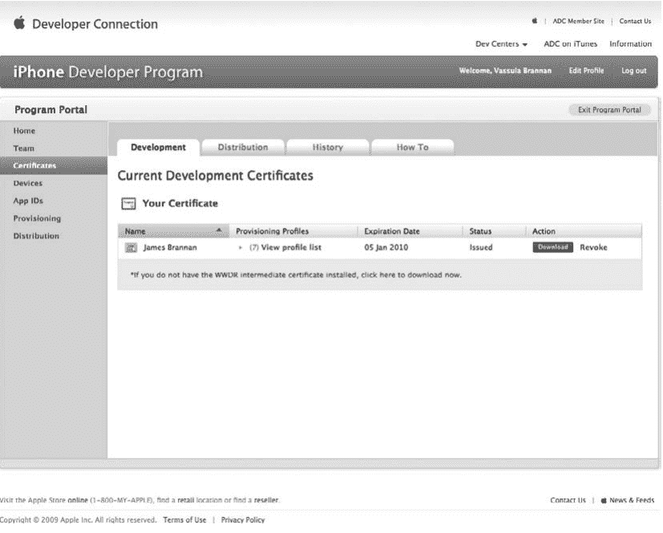

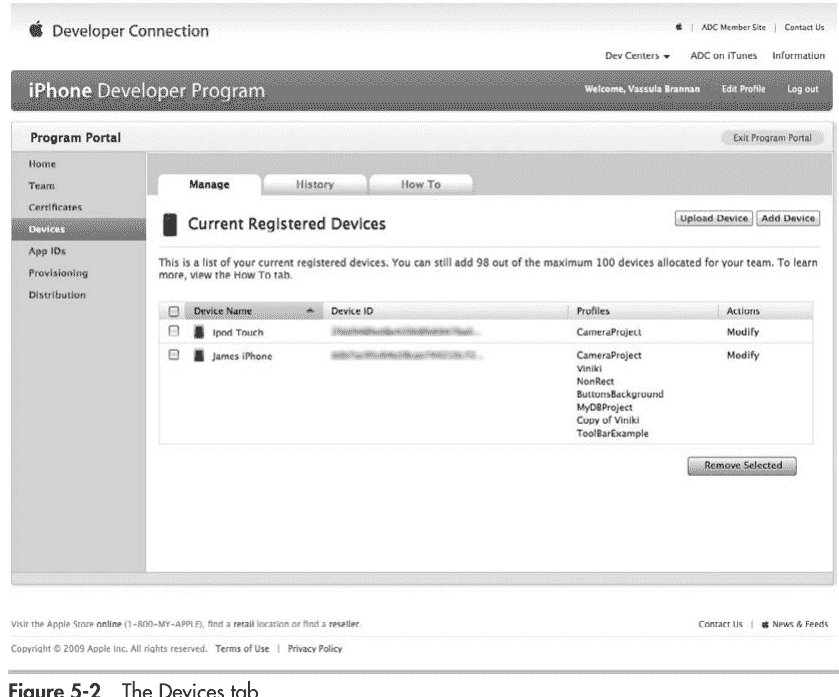

注册设备后，你可以获取应用程序 ID 并进行配置。任何希望在设备上测试的应用程序都必须有一个 App ID（图 5-3）。获取 App ID 后，你必须获取一个配置文件（图 5-4）。配置文件安装在你的设备上。应用程序与配置文件相关联，因此配置文件允许你将特定应用程序安装到特定设备上。

Apple 的 Developer Portal 对配置流程有完整的说明；该流程并不复杂。我在学习这个过程时的做法是打开两个浏览器窗口，一个用来摸索操作步骤，一个用来浏览说明文档。有两台显示器帮了大忙。在下面的示例中，我将带你完成在 iPhone 上注册和安装一个简单应用程序的过程。

若要将应用程序安装到 iPhone OS 设备上，你需要创建一个 App ID 并将其包含在预配配置文件（provisioning profiles）中。App ID 由 Apple 生成的十位字符“Bundle Seed ID”前缀和由团队管理员确定的“Bundle Identifier”后缀组成。要了解更多信息，请查看“How To”标签页。

通过使用尾部星号作为通配符，可以为所有应用程序创建一个单独的 App ID。（例如：`##########.*`）

在应用程序构建过程中，Xcode 会将你在 Xcode 项目中指定的任何 CF Bundle ID 追加到预配配置文件中的 App ID。有关 App ID 的详细信息，请查看“How To”标签页。

你无需在 Xcode 项目中输入 App ID。Xcode 会自动整合 App ID。

| 名称 | ID | 预配配置文件 | 分配日期 |
|---|---|---|---|
| ButtonsBackground | P9TRQELD8F.ButtonsBackground | ButtonsBackground | 01/21/2009 08:12 PM |
| CameraProject | W76C4RQNZA.CameraProject | CameraProject | 02/01/2009 01:18 PM |
| Hello World | CY389C269R.com.james.helloworld | | |
| MyDBProject | 5Cj8L9PZ5S.com.iPhoneBook.MyDBProje… | MyDBProject | 01/25/2009 03:25 PM |
| NonRect Application | W244NK8E8S.NonRect | NonRect | 01/19/2009 02:05 PM |
| On My Phone Applicat… | 5MT56J8J874.OnMyiPhone | | |
| ToolBarExample | 3YH54IZAEW.com.viniki.ToolBarExampl… | Copy of Viniki | 01/23/2009 05:10 AM |
| ToolBarExample | C2FJLKQ7A8.com.viniki.ToolBarExampl… | | |
| ToolBarExample Two | 7R4B4C4CZP.ToolBarExample | | |
| ToolBarExample Two | EQ7T2Q7H5R.ToolBarExample | ToolBarExample | 01/23/2009 05:16 AM |
| Viniki | 9N33MURACC.com.viniki.* | Viniki | 01/05/2009 11:37 AM |
| iTaser | URN368K7LR.com.viniki.iTaser | | |


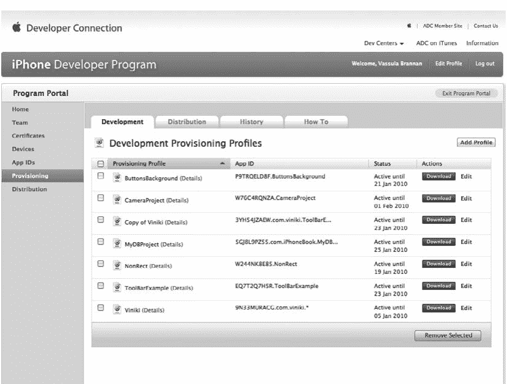

**图 5-4** “预配配置文件”标签页

## 试一试：将应用程序部署到 iPhone

1. 创建一个名为 OnMyPhone 的新基于视图的应用程序（View-based Application）。
2. 登录 iPhone 开发者计划门户。
3. 点击“Certificates”标签页。如果你尚未安装证书，请立即安装。以下步骤假设已拥有证书（参见图 5-2）。
4. 点击“Devices”标签页。如果你尚未注册设备，请立即注册。以下步骤假设已注册设备（参见图 5-3）。
5. 点击“App IDs”标签页并添加应用程序（参见图 5-3）。点击页面右侧的“Add ID”按钮，添加 OnMyPhone 应用程序（图 5-5）。
6. 点击“Provisioning”标签页，然后点击页面右侧的“Add Profile”按钮（参见图 5-4）。填写表单；务必选择你要配置的证书和设备（图 5-6）。
7. 点击“Submit”，你将返回预配页面。My On My Phone Profile 的预配配置文件状态应显示为“Pending”。刷新页面，直到状态显示“Active until”日期。通常你会很快获得配置文件。
8. 点击配置文件旁的“Download”按钮下载配置文件。配置文件标题应类似“My_On_My_Phone_Profile.mobileprovision”。将其移动到安全位置。

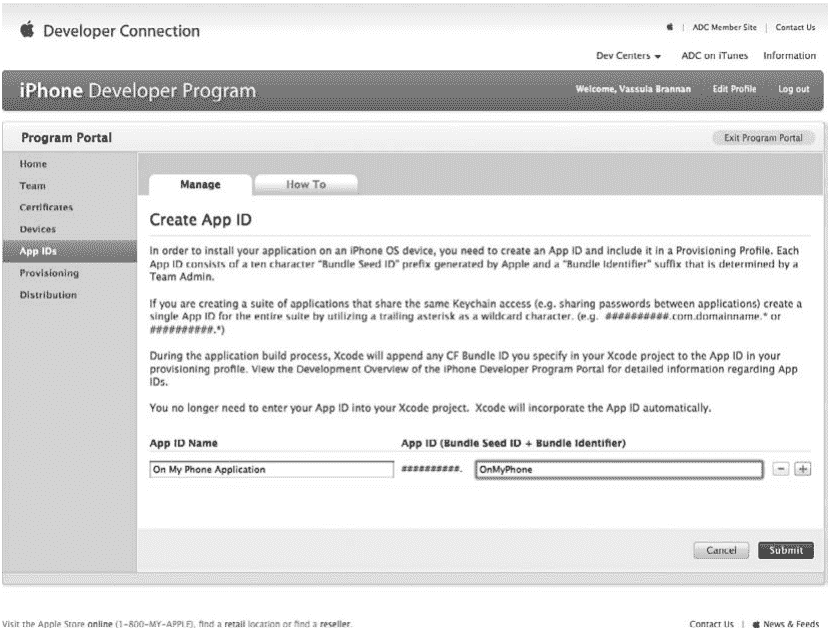

**图 5-5** 将应用程序添加到 App ID

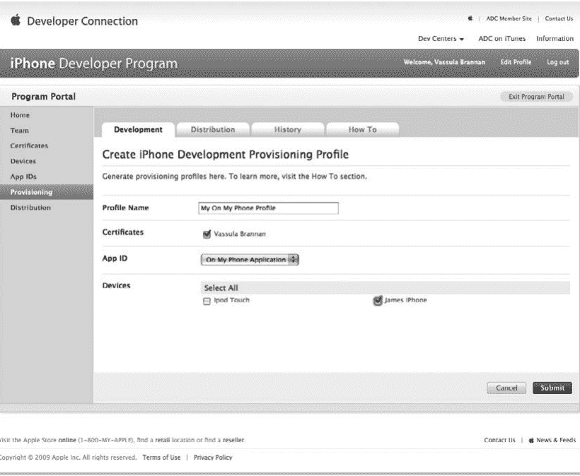

**图 5-6** 为 OnMyPhone 应用程序配置预配

9. 确保设备已连接到电脑。
10. 返回 Xcode。从 Windows 菜单中选择 Organizer。如果设备已连接，它应出现在 DEVICES 下（图 5-7）。
11. 将预配文件拖到 Provisioning 列表中。
12. 将应用程序的 Active SDK 更改为 Device – 3.0 | Debug。

> **注意**
>
> 选择你电脑上最新的 SDK，不一定是 3.0。

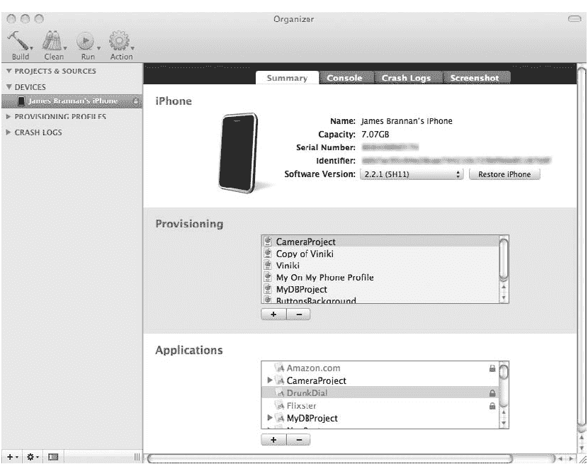

13. 第一次时你可能会收到错误（图 5-8）。不要灰心；该错误通常很容易修复。
14. 打开项目的 Project Info 窗口，然后导航到 Build 标签页。将代码签名身份（code signing identity）更改为刚刚安装的预配文件（图 5-9）。
15. 关闭 Project Info 窗口并打开 `Info.plist`。将 bundle identifier 更改为 OnMyPhone。
16. 点击“Build And Go”，应用程序将安装并在你的设备上运行。你应该会在调试器控制台（Debugger Console）中看到类似清单 5-1 的日志。


**图 5-8** 错误信息

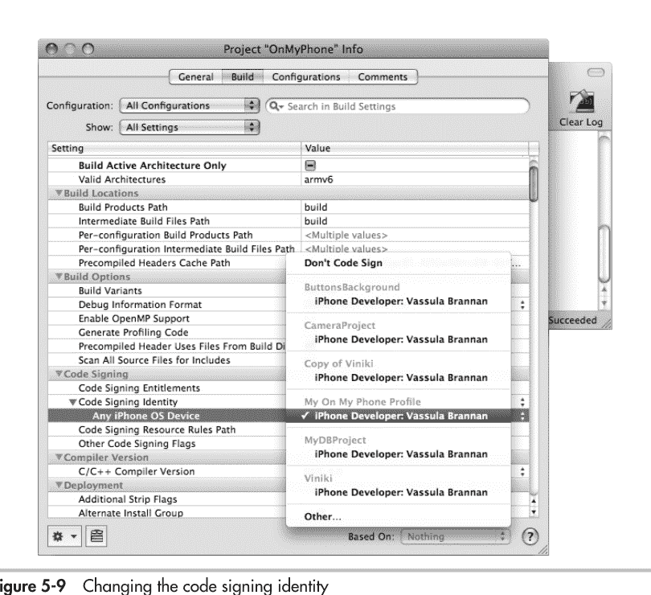

**图 5-9** 更改代码签名身份

**清单 5-1** 在 iPhone 上运行时的调试器控制台日志

```
Program loaded.
target remote-mobile /tmp/.XcodeGDBRemote-1193-51
Switching to remote protocol
mem 0x1000 0x3fffffff cache
mem 0x40000000 0xffffffff none
mem 0x00000000 0x0fff none
sharedlibrary apply-load-rules all
run
Running…
```

> **注意**
>
> 有关预配、获取 App ID 及其他程序门户主题的更多信息，请参阅 Apple 的《iPhone Developer Program User Guide》。

## 调试

如果你希望为用户提供稳健的应用程序，调试和测试你的应用程序至关重要。Xcode 提供了几个出色的工具来调试和测试你的应用程序。在本节中，你将探索使用 Xcode 的图形前端进行基本调试，该前端基于 GNU 调试器。

> **注意**
>
> 有关调试的更完整介绍，请参阅 Apple 的《Xcode Debugging Guide》，可在线获取。

## 使用调试器

Xcode 的可视化调试器覆盖在命令行 GNU 调试器之上。开源的 GNU 调试器历史悠久，是 UNIX 和 Linux 上 C 和 C++ 调试器的行业标准。图 5-10 显示了调试器窗口的各个窗格。左上角的窗格是线程列表（Thread list），有时也称为调用栈（call stack）。它告诉你应用程序在处理的任何时刻所处的位置。栈窗格下方是文本编辑器窗格。右侧窗格是变量列表（Variable list）。该窗格让你可以查看当前函数的局部变量值、参数值和常量变量。

在调试器窗口顶部，注意“Build And Go”、“Tasks”、“Restart”、“Continue”、“Step Over”、“Step Into”、“Step Out”和“Deactivate”按钮。还要注意这些按钮右侧的“Breakpoints”和“Console”按钮。表 5-1 总结了每个按钮的用途。

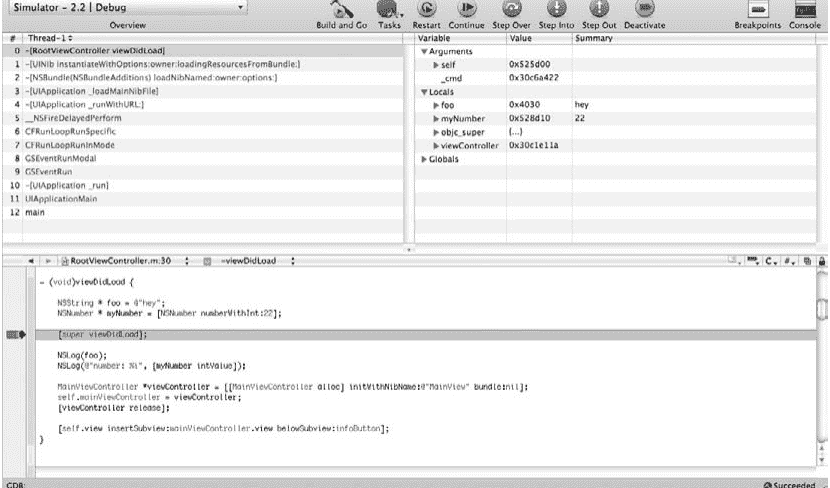

**图 5-10** 调试器窗口

**表 5-1** 调试器窗口按钮

| 按钮 | 功能 |
| :--- | :--- |
| Build And Go | 构建应用程序并在调试器中启动它。 |
| Tasks | 停止当前正在运行的任何任务。 |
| Restart | 停止并重新启动在调试器中运行的应用程序。 |
| Pause/Continue | 暂停在调试器中运行的应用程序。注意，当应用程序暂停时，此按钮显示 Continue。Continue 会“取消暂停”应用程序并恢复处理。 |
| Step Over | 处理下一行代码。如果下一行是函数调用，则跳过该函数，进入下一行。 |
| Step Into | 处理下一行代码。如果该行是函数调用，则跳转到该函数的代码中。 |
| Step Out | 处理直到函数退出。 |
| Deactivate | 禁用当前断点。 |
| Breakpoints | 打开断点窗口。 |
| Console | 打开调试器控制台窗口。 |

## 断点

断点告诉调试器在哪里暂停。如果你未设置任何断点就在调试器中运行应用程序，不会发生任何异常，因为你没有告诉应用程序暂停。设置断点有几种方式，但最简单的是点击编辑器窗口中代码行旁边的留白区域（gutter）（图 5-11）。如果你想禁用断点，再次点击它，它会变成浅蓝色，表示已禁用。如果你想移除断点，请按住 CTRL 键点击并选择弹出菜单中的“Remove Breakpoint”。或者，你可以将断点拖出留白区域来移除它。当你在调试器中运行应用程序时，它会在遇到的第一个断点处暂停处理。

## 单步执行代码

当应用程序在断点处暂停时，你可以逐步执行代码。Step Over 直接移动到下一行，跳过任何函数。Step Into 也移动到下一行，但如果下一行是函数，它会跳转到该函数的第一行，你可以要么逐行单步执行函数，要么跳出函数。如果选择“跳出”（Step Out），调试器会跳转到函数调用后的第一行。

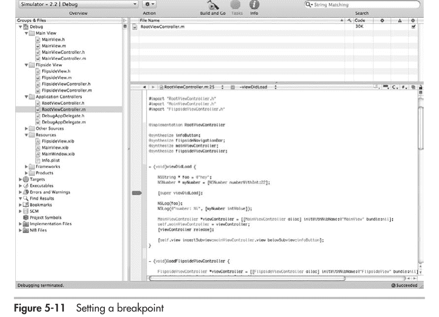

## 调试器数据提示（Debugger Datatips）

调试时可以执行的一项操作是获取变量的值，并在调试过程中修改它。你可以将光标移到变量上，会出现一个数据提示，显示该变量及其值（图 5-12）。如果需要，你甚至可以修改该值。

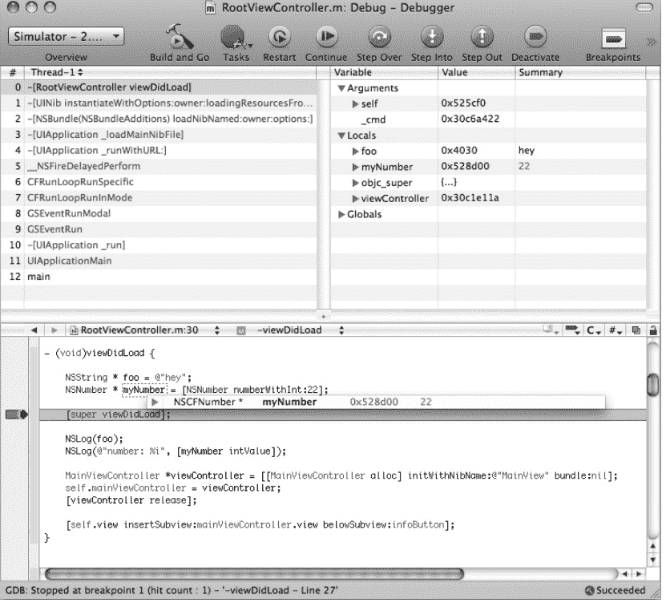

**图 5-12** 调试器数据提示

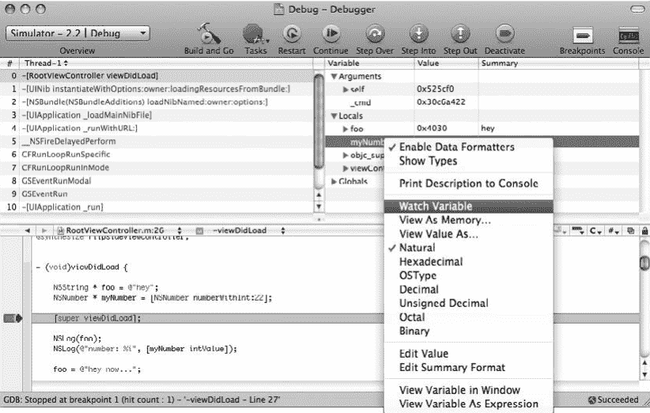

**图 5-13** 设置观察点

## 观察点（Watchpoints）

有时你可能希望在某个值发生变化时让程序暂停。观察点会在被监视项的值发生变化时暂停程序。第一次设置观察点可能有点棘手，但之后就很简单了。要设置观察点，请在调试器中启动应用程序，当应用程序在断点处暂停时，在调试器窗口的变量列表中选择该变量。右键单击它，然后从快捷菜单中选择“监视变量”（Watch Variable）（图 5-13）。点击“继续”（Continue）后，如果值发生变化，调试器会通知你并暂停（图 5-14）。

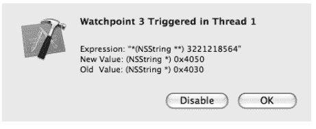

**图 5-14** 当观察点的值发生变化时，调试器会通知你

## 试一试 调试应用程序

1. 创建一个名为 Debug 的新 Utility Application。
2. 在 Interface Builder 中打开 `FlipsideView.xib`，并移除 File's Owner 连接到 view 的 outlet（图 5-15）。
3. 从 Build 菜单中选择“Build and Run”来运行应用程序。点击 Info 按钮，应用程序崩溃。虽然控制台显示了确切的错误信息，但请暂时不要理会，假装它没有显示。
4. 退出 iPhone 模拟器并返回 Xcode。
5. 打开 `MainViewController.m`，并在 `showInfo` 的第二行添加一个断点（图 5-16）。

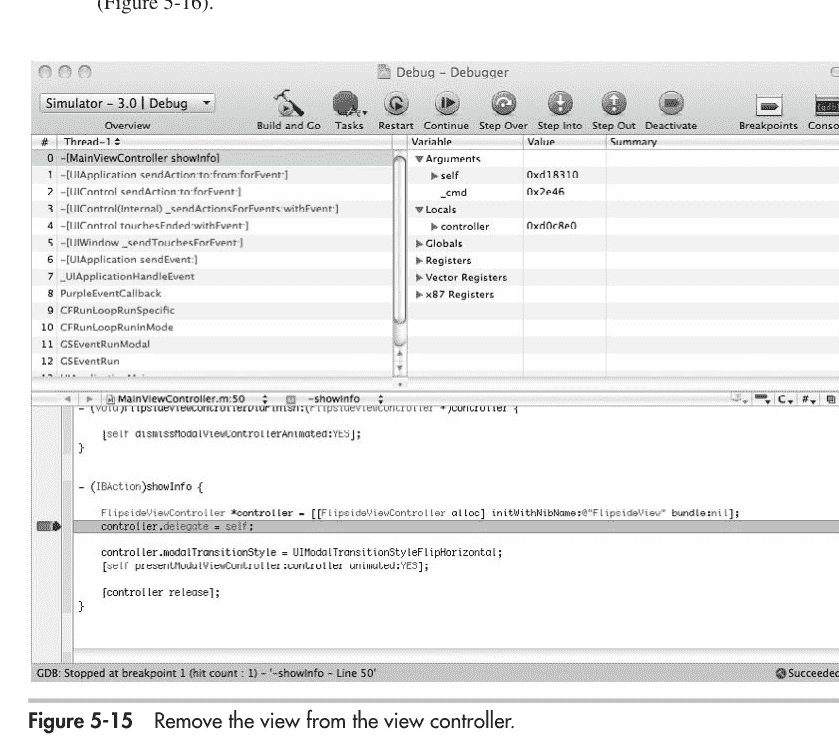

6. 从 Run 菜单中选择“Build and Debug”以在调试器中运行应用程序。如果调试器窗口不可见，从 Run 菜单中选择“Debugger”。

> **注意**
>
> Build and Go 会构建应用程序，然后根据你之前的选择运行或调试应用程序。

7. 尝试单步执行接下来的几行，应用程序崩溃。你现在确切知道代码中的哪一行导致应用程序崩溃。显示 `FlipsideViewController` 的某些操作导致了崩溃。

> **提示**
>
> 忘记设置 File's Owner 的 view outlet 是一个常见的错误。

8. 停止 iPhone 模拟器并返回 Xcode。移除断点。
9. 从 Run 菜单中选择 Show | Breakpoints。
10. 在 Debug-Breakpoints 窗口中，双击“Double-Click For Symbol”，并通过输入 `objc_exception_throw` 方法到列表中来添加一个新的断点（图 5-17）。
11. 在 Debug-Breakpoints 窗口上点击“Build And Go”以在调试器中启动应用程序。
12. 点击 Info 按钮，应用程序在新设置的断点处停止。如果调试器窗口尚未打开，请打开它（图 5-18）。
13. 注意左上角的窗口。它包含堆栈列表。沿着堆栈向下查看几项，你会看到在 `NSException` 之前最后发生的是从 nib 加载视图。沿着堆栈到第 6 行，你会在下方面板中看到视图控制器中最后执行的代码行（图 5-19）。因此你知道尝试从 nib 加载视图导致了崩溃。

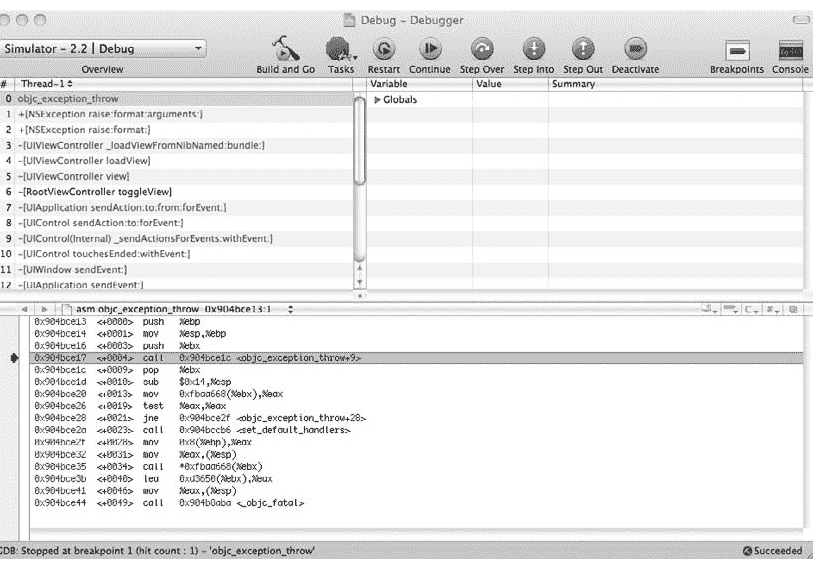

**图 5-18** 调试器在 `objc_exception_throw` 断点处暂停

## NSZombieEnabled

当一个对象被释放（deallocated）时，如果有任何对象仍持有对该已释放对象的引用，这些引用就不再指向有效对象。任何发送到该已释放对象的消息都会导致错误。通常，这种错误相当晦涩难懂。例如，以下代码片段显然是一个错误。

```
FooBar * myFooBar = [[FooBar alloc] init];
NSMutableArray * myArray = [[NSMutableArray alloc] initWithObjects:
myFooBar,nil];
[myFooBar dealloc];
[[myArray objectAtIndex:0] sayHello];
```

`FooBar` 被分配、初始化并添加到 `myArray` 中。`myFooBar` 有两个引用，因此它的 retainCount 为 2。然而，释放 `myFooBar` 会使两个引用都失效，指向已释放的内存空间。`sayHello` 消息被发送到 `myArray` 中的第一个对象——问题是该对象已不存在。虽然在这个简单的例子中很容易推测错误消息的原因，但在实际应用程序中，找到这类错误的根源往往很困难。

```
objc[1289]: FREED(id): message sayHello sent to freed object=0x521a90
Program received signal: "EXC_BAD_INSTRUCTION".
```

Zombie（僵尸对象）有助于避免这种模糊的错误，帮助你追踪错误的根源。你可以在 Xcode 中通过设置 `NSZombieEnabled` 环境变量来启用僵尸对象。然后，在调试应用程序时，调试器不会释放对象，而是创建一个僵尸对象。僵尸对象在加入亡灵之前知道它原来的身份。结果通常是你会收到一个更具描述性的错误消息。

```
2009-02-28 12:28:38.749 Zombie[1316:20b] *** -[FooBar sayHello]:
message sent to deallocated instance 0x52c6a0
```

同样，在这个简单的例子中，差别微不足道；但在实际项目中，差别并非微不足道。以下任务说明了如何使用 `NSZombieEnabled`。

## 试一试 启用僵尸对象

1. 创建一个名为 Zombie 的新 View-based Application。
2. 创建一个名为 `FooBar` 的新 Objective-C 类。
3. 创建一个名为 `helloThere` 的方法（清单 5-2）。不要忘记将该方法的签名放入 `FooBar` 的接口中（清单 5-3）。

### 清单 5-2 `FooBar.m`

```
#import "FooBar.h"
@implementation FooBar
- (void) sayHello {
    NSLog(@"Hello there...");
}
- (void) dealloc {
    [super dealloc];
}
@end
```

### 清单 5-3 `FooBar.h`

```
@interface FooBar : NSObject {
- (void) sayHello;
@end
```

4. 修改 `ZombieAppDelegate` 中的 `applicationDidFinishLaunching`（清单 5-4）。不要忘记导入 `FooBar`。

### 清单 5-4 `ZombieAppDelegate.m`

```
#import "ZombieAppDelegate.h"
#import "ZombieViewController.h"
#import "FooBar.h"
@implementation ZombieAppDelegate
@synthesize window;
@synthesize viewController;
- (void)applicationDidFinishLaunching:(UIApplication *)application {
    FooBar * myFooBar = [[FooBar alloc] init];
    NSMutableArray * myArray = [[NSMutableArray alloc]
        initWithObjects:myFooBar,nil];
    [myFooBar dealloc];
    [[myArray objectAtIndex:0] sayHello];
    [window addSubview:viewController.view];
    [window makeKeyAndVisible];
}
- (void)dealloc {
    [viewController release];
    [window release];
    [super dealloc];
}
@end
```

5. 在 Run 菜单上选择“Build And Debug”以构建并调试应用程序。

注意第一次运行应用程序时，错误描述并不那么具有描述性（清单 5-5）。调试器只知道 `sayHello` 消息被发送到了一个已经释放的对象。调试器不知道该对象的身份。要改变这一点，你必须启用僵尸对象。

### 清单 5-5 未启用僵尸对象时的调试器控制台错误日志

```
Attaching to program: `/Users/jamesbrannan/Library/Application
Support/iPhone
Simulator/User/Applications/05688B53-AF22-4F21
-95D3AFFE2682A6EA/Zombie.app/Zombie', process 1351.
objc[1351]: FREED(id): message sayHello sent to freed object=0x521bd0
Program received signal: "EXC_BAD_INSTRUCTION".
```

6. 在 Groups & Files 窗格中，展开 Executables 并双击 Zombies。这会打开 Executable Info 窗口（图 5-20）。
7. 点击 Arguments 选项卡，将 `NSZombieEnabled` 变量添加到变量列表中。将其值设为 YES 并确保已选中。
8. 构建并调试。现在错误消息更具描述性了（清单 5-6）。

### 清单 5-6 启用僵尸对象后的调试器控制台输出

```
Attaching to program: `/Users/jamesbrannan/Library/Application
Support/iPhone Simulator/User/Applications/F8340D01-C5D8-45AF-96A4
-512660FD2380/Zombie.app/Zombie', process 1387.
2009-02-28 12:40:08.812 Zombie[1387:20b] *** -[FooBar sayHello]:
message sent to deallocated instance 0x52c6a0
```

## Instruments—Leaks

Instruments 是一套功能强大的调试与测试工具。本章节无法对其进行全面介绍。这些工具包括活动监视器、CPU 采样器、泄漏、对象分配、Core Animation、OpenGL ES 以及系统使用情况（图 5-21）。

> **注意**
>
> 如需了解更多关于 Instruments 的信息，请参阅苹果官方文档《Instruments 用户指南》，可在线获取或通过 Instruments 的“帮助”菜单访问。

然而，这里值得向你介绍的一个工具是“泄漏”。你可以无需深入了解它就能使用它。“泄漏”工具允许你轻松找到应用程序中的内存泄漏。它会告诉你发生了多少次泄漏、每次泄漏的大小、泄漏的地址以及泄漏对象的类型。使用“泄漏”工具相当直观——与其解释，不如让我通过以下应用程序的示例来说明。

**试一试** **查找内存泄漏**

在下面的任务中，你将使用 iPhone 模拟器和真实设备来查找内存泄漏。如果你没有完成本章开头的 OnMyPhone 练习，请现在完成。

## 在 iPhone 模拟器上查找内存泄漏

1. 创建一个新的实用应用程序，命名为 Sieve。
2. 创建一个新的 Objective-C 类，命名为 `FooBar`。
3. 打开 `FlipsideViewController.m` 并实现 `viewDidAppear` 方法（清单 5-7）。不要忘记导入 `FooBar`。

### 清单 5-7 `viewDidAppear` 方法

```
- (void) viewDidAppear:(BOOL) animated {
  FooBar * myFooBar = [[FooBar alloc] init];
}
```

4. 构建应用程序。忽略编译器警告，它提示你在 `viewDidAppear` 中从未使用 `FooBar` 实例。
5. 选择“运行” | “使用性能工具启动” | “泄漏”。
6. 反复点击“信息”按钮和“完成”按钮大约 30 秒。完成后，点击 Instruments 窗口中的“停止”（图 5-22）。
7. 点击“泄漏”，一个泄漏对象的详细列表就会出现。点击其中一个泄漏项。
8. 点击“查看” | “扩展详细信息”，一个调用栈将出现在窗口右侧（图 5-23）。
9. 双击 `viewDidAppear` 调用，调试器将打开到分配和初始化 `FooBar` 的那一行代码。
10. 关闭调试器并返回到 Instruments 窗口。选择一个泄漏项。在列表下方，点击带有三条缩进线的按钮（图 5-24）。Instruments 将显示该泄漏的调用树。
11. 选择“反转调用树”、“隐藏系统库”和“仅显示 Objective-C”。选择泄漏项。你可能需要点击几次。“泄漏”工具仅显示你在应用程序中编写的方法（图 5-25）。

## 部署和分发你的应用程序

调试和测试完成后，你就需要为发布部署你的应用程序。但是，构建用于发布的应用程序需要一些超出本书范围的步骤。不过，这里简要总结一下。详细说明请参考本章中引用的多份文档。

## 部署你的应用程序

你在本章完成的所有出色工作，都是因为调试编译添加了这些出色的符号，调试器才能运行。你不希望这些额外的东西出现在你的发布应用程序中；它会使应用程序变慢，甚至更糟。例如，假设你将 `NSEnableZombie` 环境变量设置为 YES。现在当应用程序运行时，僵尸对象将充斥其中，而不是对象被正确释放。应用程序会变得迟钝，并且很可能被设备的操作系统突然终止。

要修改你的应用程序以用于发布，你必须做的第一件事是确保你的应用程序的活动配置设置为“发布”（Release）（图 5-26）。当然，务必确保是为设备构建，而不是为 iPhone 模拟器。然后，你必须确保构建配置正确（图 5-27）。但请注意，这个构建配置仍应视为测试配置，因为要真正构建用于发布的版本，还有一些其他步骤必须完成。

> **注意**
>
> 一本关于 Xcode 的优秀综合性书籍是 Fritz Anderson 所著的《Xcode 3 Unleashed》。虽然这本书不涵盖 iPhone 开发，但它详细讨论了调试、测试、部署以及许多其他 Xcode 主题。你应该经常参考的另一份文档是苹果的《Xcode 构建系统指南》。

## 分发你的应用程序

要真正构建你的应用程序以向广大公众发布，你必须遵循苹果关于分发应用程序的说明。完整的说明可以在苹果的《iPhone 开发者计划用户指南》中找到，此处不再重复。如果你想在 App Store 上销售你的应用程序，你必须拥有一个 iTunes Connect 账户。如果你希望直接向他人分发你的应用程序，你必须创建并下载一个 iPhone 分发证书和分发配置文件。在 Xcode 中安装这些之后，你就可以构建你的发布版本应用程序并将其分发给他人。

获得必要的凭证后，你必须创建一个新的 Xcode 构建配置。苹果的《iPhone 开发者计划用户指南》提供了如何操作的分步说明。此处不再重复这些说明，因为可以想象，当你准备在 App Store 上发布应用程序时，你将成为一名更高级的开发者，可以自己找到文档。现在，只需意识到，当你准备好将你的应用程序分发给他人或在 App Store 上发布时，你将不得不在 Xcode 中创建一个新的构建配置，相关说明在引用的手册中。

> **注意**
>
> 请记住，在已注册的测试设备上安装和调试不需要本章开头涵盖内容之外的任何东西。你无需创建不同的构建配置即可在你的设备上进行调试和测试。

## 总结

调试和测试你的应用程序需要将其安装在测试设备上。此外，在真正的 iPod touch 或 iPhone 上看到你的应用程序运行会更有成就感。但将你的应用程序安装到设备上需要你成为 iPhone 开发者计划的成员。然后，你必须按照说明获取适当的凭证，以便可以安装到你的设备上。相信我，你可以搞定在线说明，它们很容易遵循。

许多 iPhone 错误充其量是晦涩难懂的。与其毫无目的地运行和重新运行应用程序直到最终找到错误，不如花些时间学习 Xcode 提供给你的调试工具。参考本章中引用的文档。使用调试器查找错误。调试完应用程序后，在 iPhone 模拟器上测试其内存使用情况。在 iPhone 模拟器上测试后，将应用程序安装到你的设备上，并再次进行调试和测试。密切关注内存和资源使用情况，因为 iPhone 的内存是有限的。同时确保你的应用程序运行快速且响应灵敏。仔细调试和测试你的应用程序，通常决定了它在 App Store 上是“又一个小部件应用”还是“最佳小部件应用”。很可能你的应用程序不会再是任何东西的第一个，所以努力让它成为最好的。

# 第 6 章

## UIApplication 和 UIApplicationDelegate

### 关键技能与概念

- 理解 `UIApplication` 类
- 理解 `UIApplicationDelegate` 协议
- 处理应用程序启动与终止
- 处理应用程序中断

每个 iPhone 应用程序都有一个 `UIApplication`。`UIApplication` 是 iPhone 应用程序的起点，负责初始化并显示你的应用程序的 `UIWindow`。它还负责将你的应用程序的第一个 `UIView` 加载到 `UIWindow` 中。`UIApplication` 的另一项职责是管理你的应用程序的生命周期。`UIApplication` 通过一个名为 `UIApplicationDelegate` 的委托来履行这一管理职责。虽然 `UIApplication` 接收事件，但处理应用程序如何响应这些事件的却是 `UIApplicationDelegate`。`UIApplicationDelegate` 可能处理的事件包括应用程序生命周期事件（如启动和关闭）以及系统事件（如来电和日历提醒）。在本章中，学习如何将应用程序的根视图加载到 `UIWindow` 后，你将探索如何使用 `UIApplicationDelegate` 协议来处理系统事件。

## 尝试一下：向 UIApplicationDelegate 添加 UIView 和 UIViewController

在继续之前，请创建本章的项目；本章将全程使用同一个项目。在这个项目中，你将从最简单的 iPhone 模板（基于窗口的应用程序）开始，从零开始创建一个应用程序。你首先创建一个 xib 文件和对应的视图控制器。然后修改应用程序的委托，使其加载视图。

1. 从“新建项目”对话框中，创建一个新的“基于窗口的应用程序”。将项目命名为 AddViewProject。
2. 在“组与文件”中，展开 Classes 文件夹。该文件夹包含 `AddViewProjectAppDelegate.h` 和 `AddViewProjectAppDelegate.m` 文件。这两个文件实现了项目中采用 `UIApplicationDelegate` 协议的自定义类。
3. 选中 Resources 文件夹。按住 CTRL 点击，从弹出菜单中选择“添加” > “新建文件”。在“新建文件”对话框中，选择“用户界面”，然后选择“空 XIB”（图 6-1）。

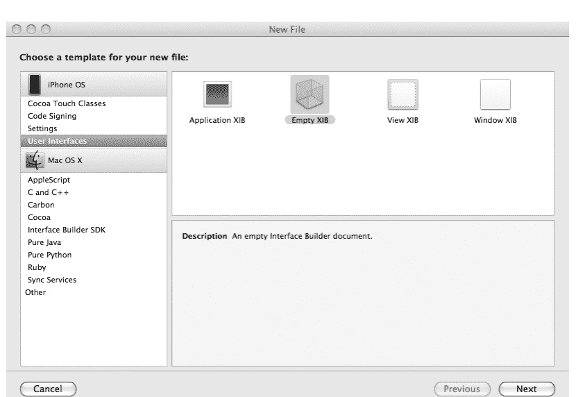

**图 6-1** 在 Interface Builder 中创建空 XIB

4. 将 xib 命名为 `FirstViewController`，然后点击完成。
5. 在“组与文件”中选中 Classes 文件夹。从菜单中选择“文件” > “新建文件”。
6. 从 Cocoa Touch 类中选择 `UIViewController` 子类，然后点击下一步（图 6-2）。

> **注意**
>
> 你本可以先创建视图控制器，然后勾选“用于用户界面的 XIB”复选框，Xcode 就会为你生成 xib 文件。

7. 将文件命名为 `FirstViewController.m`，并确保选中“同时创建 "FirstViewController.h"”复选框。点击完成。
8. 双击 `FirstViewController.xib` 并在 Interface Builder 中打开它。

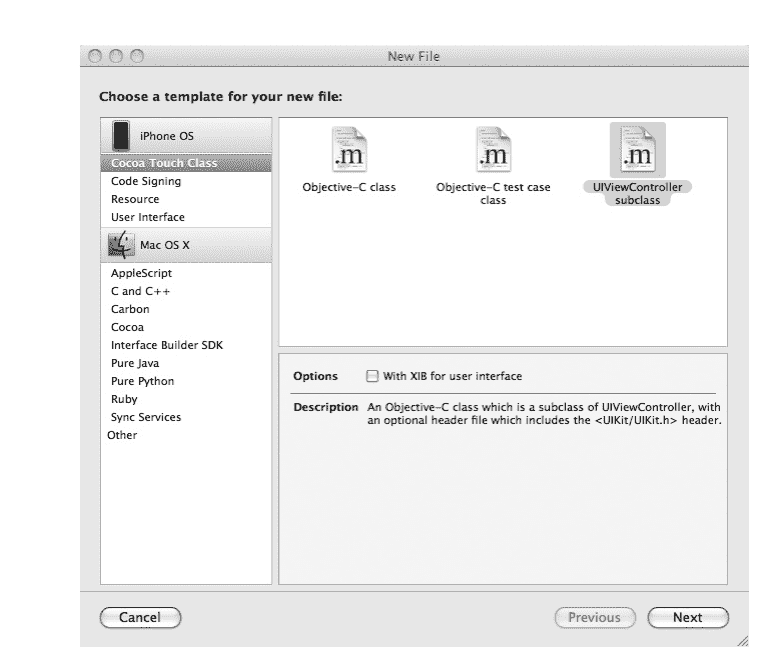

**图 6-2** 创建 `UIViewController`

9. 从库中选择一个视图，将其拖放到 `FirstViewController.xib` 文档窗口中。
10. 在文档窗口中，选中 File's Owner，并在“第一视图控制器”身份检查器中将 `FirstViewController` 设置为类（图 6-3）。
11. 在检查器中，将新创建的视图设置为 `FirstViewController` 的视图输出口（图 6-4）。
12. 选择该视图，并使用检查器更改其颜色（图 6-5）。
13. 保存 `FirstViewController.xib` 并退出 Interface Builder。
14. 打开 `AddViewProjectAppDelegate.h`，导入 `FirstViewController.h`，并创建一个引用 `FirstViewController` 类的属性（代码清单 6-1）。

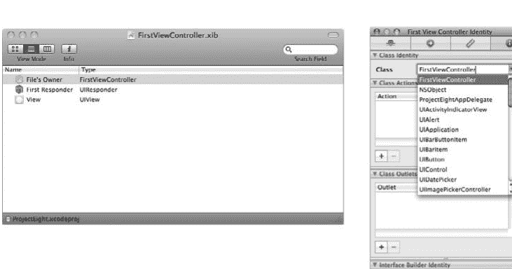


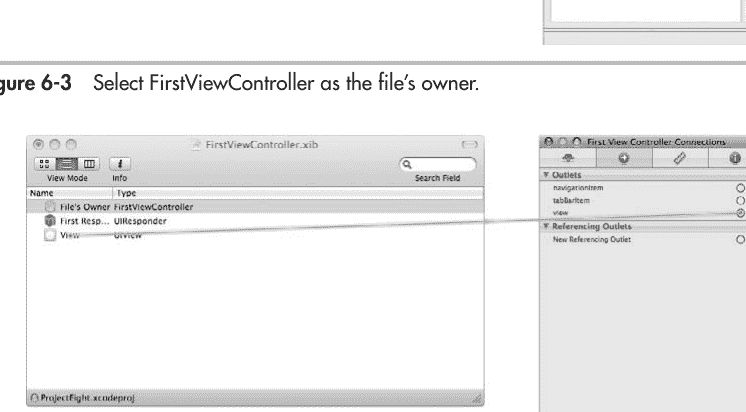


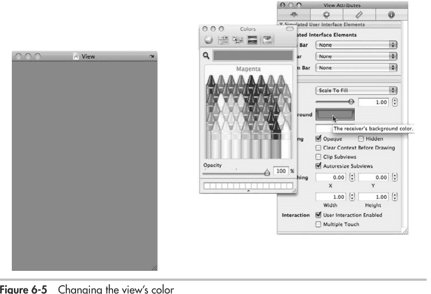

**图 6-5** 更改视图颜色

15. 打开 `AddViewProjectAppDelegate.m`，首先合成功能，并修改 `applicationDidFinishLaunching:`，使其从 `FirstViewController.xib` 获取对 `FirstViewController` 的引用，然后将其视图作为子视图添加到窗口中。`FirstViewController.m` 应与代码清单 6-2 完全相同。
16. 点击“构建并运行”。你的彩色视图应加载到 iPhone 模拟器中（图 6-6）。

**代码清单 6-1** `AddViewProjectAppDelegate.h` 接口

```
#import <UIKit/UIKit.h>
#import "FirstViewController.h";
@interface AddViewProjectAppDelegate : NSObject
<UIApplicationDelegate> {
  UIWindow *window;
  FirstViewController *first;
}
@property (nonatomic, retain) IBOutlet UIWindow *window;
@property (nonatomic, retain) FirstViewController *first;
@end
```

**图 6-6** iPhone 模拟器中的应用程序

**代码清单 6-2** `AddViewProjectAppDelegate.m` 实现

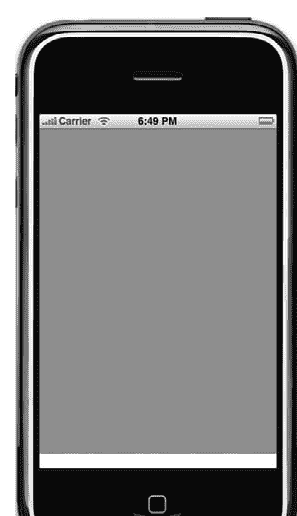

```
#import "AddViewProjectAppDelegate.h"
@implementation AddViewProjectAppDelegate
@synthesize window;
@synthesize first;
- (void)applicationDidFinishLaunching:(UIApplication *)application {
    first = [[FirstViewController alloc] initWithNibName:@"FirstViewController" bundle:nil];
    [window addSubview: [first view]];
    [window makeKeyAndVisible];
}
- (void)dealloc {
    [window release];
    [first release];
    [super dealloc];
}
@end
```

在步骤 10 和 11 中，你手动将 `AddViewProjectAppDelegate` 连接到其 `UIView`。此外，你还将其视图放置在自己的 nib 文件中。每个 nib 都有一个所有者。回想一下，每个应用程序都有一个 `UIWindow`。`UIWindow` 位于项目的 `MainWindow.xib` 中。该 nib 的所有者是 `UIApplication`。还要注意，Xcode 将 `AddViewProjectAppDelegate` 添加到 `MainWindow.xib` 中，并将其连接到 `UIWindow`，同时设置了 `UIApplication` 的委托。

你创建的 nib 应该有一个采用 `UIViewController` 协议的类作为所有者，这正是你在步骤 10 中所做的。在步骤 9 中，你将 Interface Builder 中 nib 里创建的 `UIView` 绑定到了在 Xcode 中创建的 `UIViewController`。这就是这两个对象如何“了解”彼此的方式。你将在第 7 章中学习更多关于 `UIViewController` 和 `UIView` 以及如何连接它们的内容。

> **注意**
>
> 注意，你在自己的 `FirstViewController.xib` 文件中创建了 `FirstViewController` 的视图。你本可以打开 `MainWindow.xib`，将一个视图拖到窗口上，并将此 nib 用于你的用户界面。但这不是在 nib 中使用视图的首选方式。Apple 建议每个视图使用一个 nib。提出此建议的原因是，应用程序必须加载位于同一 nib 中的所有视图和所有控件。每个视图使用一个 nib 可以减少应用程序的内存使用，因为你只需根据需要加载视图。

### 专家问答

**问：** 代码清单 6-2 中的 `initWithNibName` 那行代码是什么？

**答：** 此方法允许从 nib 文件而不是从代码初始化 `UIViewController` 的视图。当你想编写代码来初始化一个视图位于 nib 中的视图控制器时，就可以使用此方法。你应该注意，这只是将 nib 中的视图加载到类中的几种不同方式之一。在本书结束时，你将熟悉其中的大部分方法。

## 连接 UIWindow、UIApplication 和 UIApplicationDelegate

在上一节中，我仅简要提到了 `MainWindow.xib` 中的连接。但如果你想理解模板实际做了什么，这些连接值得更仔细地研究。注意，代码清单 6-1 中的 `UIWindow` 是一个 `IBOutlet`。你第一次接触 `IBOutlet` 是在第 1 章，你将在第 7 章学到更多关于它的内容。但要明白，窗口“存在”于 xib 中，而不是在委托中。虽然窗口在 `dealloc` 方法中由委托释放，但它既不是由委托代码分配的，也不是在代码清单 6-2 中初始化的。记住，代码清单 6-2 中的所有 `dealloc` 方法只是释放类对窗口的引用，而不是释放窗口本身。相反，`MainWindow.xib` 负责分配、初始化和释放 `UIWindow`。

`UIApplication` 通过查阅 `Info.plist` 文件中的 `NSMainNibFile` 键来知道要加载 `MainWindow.xib`。如果你打开 AddViewProject 项目的 `Info.plist`，你会看到“主 nib 文件基本名称”被设置为 MainWindow。在加载过程中，nib 将 `AddViewProjectAppDelegate` 设置为 `UIApplication` 的委托，并将 `UIWindow` 设置为 `AddViewProjectAppDelegate` 的窗口。两者都是它们在 Interface Builder 中各自类的输出口。

## 尝试一下：探索 MainWindow.xib

1. 打开 `MainWindow.xib` 并显示文档窗口。
2. 选中 File's Owner。注意它被设置为 `UIApplication`（图 6-7）。`UIApplication` 加载 `MainWindow.xib`。
3. 注意模板添加了 `AddViewProjectAppDelegate` 对象。
4. 注意 `AddViewProjectAppDelegate` 的输出口 `window` 被设置为 nib 中的 `UIWindow`（图 6-8）。还要注意 `UIApplication` 的委托被设置为 `AddViewProjectAppDelegate`。

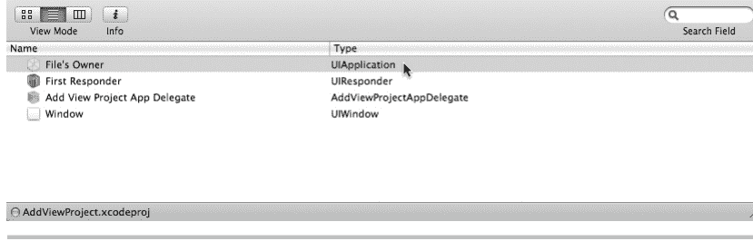

**图 6-7** 文档窗口中的 `UIApplication`

## UIApplicationDelegate 与 UIApplication

忽略 `UIApplication`——你几乎不会修改它。只需知道 `UIApplication` 会接收系统事件。你的任务是编写代码来处理这些系统事件。你在采用 `UIApplicationDelegate` 协议的类中编写这些代码。该协议有多个生命周期方法，用于处理应用程序和系统事件。表 6-1 列出了 `UIApplicationDelegate` 的方法。如果你从模板开始，Xcode 会为你创建采用 `UIApplicationDelegate` 的类，但 Xcode 不会实现 `UIApplicationDelegate` 的可选事件处理方法。例如，在本章的项目中，Xcode 创建了 `AddViewProjectAppDelegate.h` 和 `AddViewProjectAppDelegate.m` 文件。`AddViewProjectAppDelegate` 类继承自 `NSObject` 并采用 `UIApplicationDelegate`。

```
@interface AddViewProjectAppDelegate : NSObject <UIApplicationDelegate>
```

应用程序的 `UIApplication` 在 `MainWindow.xib` 中定义，它通过 outlet 引用其 `UIApplicationDelegate`（图 6-8）。当 `UIApplication` 接收到与表 6-1 中方法相关的事件时，它会调用其委托中已实现的方法。

### 专家问答

**问：** 什么是委托？

**答：** 委托是一种简化从其他类中分离处理逻辑的方式。它还避免了继承。例如，对 `UIApplication` 对象进行子类化会很麻烦。因此，Apple 提供了 `UIApplicationDelegate`。`UIApplication` 持有实现 `UIApplicationDelegate` 的类的引用。如果已实现，`UIApplication` 会将事件处理委托给 `UIApplicationDelegate` 中的适当方法。表面上看起来像是 `UIApplication` 在处理事件；实际上，是它的委托，即 `UIApplicationDelegate`，在处理事件。委托是一种常见的面向对象设计模式。有关委托和面向对象编程的更多信息，请参阅维基百科上的"委托模式"（www.wikipedia.org）。

## main.m 文件

在 AddViewProject 项目中，在 Groups & Files 中的 Other Sources 文件夹中打开 `main.m`。该文件的代码列在代码清单 6-3 中。

```
#import <UIKit/UIKit.h>
int main(int argc, char *argv[]) {
    NSAutoreleasePool * pool = [[NSAutoreleasePool alloc] init];
    int retVal = UIApplicationMain(argc, argv, nil, nil);
    [pool release];
    return retVal;
}
```

Main 使用 `UIApplicationMain` 方法创建一个 `UIApplication` 实例。每个项目都恰好有一个 `UIApplication` 对象。你可以通过调用 `UIApplication` 的 `sharedApplication` 类方法来获取该对象的引用。此方法返回应用程序 `UIApplication` 对象的单例引用。

```
UIApplication * myApplication = [UIApplication sharedApplication];
```

你通常不会用 `UIApplication` 对象做太多事情，除了获取其 `UIApplicationDelegate` 的引用。你可以通过以下代码获取 `UIApplicationDelegate` 的引用：

```
UIApplicationDelegate * myDelegate = [[UIApplication sharedApplication] delegate];
```

## 处理应用程序生命周期事件

`UIApplication` 将几个重要事件转发给其 `UIApplicationDelegate` 来处理。例如，当应用程序运行时，`applicationSignificantTimeChange:` 处理重大时间变化。`didChangeStatusBarOrientation:` 方法处理状态栏方向从竖屏变为横屏或从横屏变为竖屏时触发的事件。表 6-1 列出了 `UIApplicationDelegate` 的应用程序生命周期事件处理方法。

除了 `applicationDidFinishLaunching:` 之外，表 6-1 中的方法都不是必需的，但如果你希望开发一个健壮的应用程序，应该实现其中的大部分方法。

两个比较重要的应用程序生命周期事件是应用程序的启动和关闭。`applicationDidFinishLaunching:` 方法——一个必需的方法——是你初始化 `UIViewControllers`、`UIWindow`、将 `UIView` 添加到窗口，然后启动应用程序用户界面的地方。该方法也适用于恢复应用程序的状态，并且是执行应用程序初始化的地方。`applicationWillTerminate:` 方法适用于保存应用程序的状态。你也可以使用此方法执行清理工作。

**表 6-1** `UIApplicationDelegate` 事件处理方法

| `UIApplicationDelegate` 事件处理方法 | 方法签名 |
|---|---|
| `application:didChangeStatusBarFrame:` | `- (void) application:(UIApplication *) application didChangeStatusBarFrame: (CGRect) oldStatusBarFrame` |
| `application:didChangeStatusBarOrientation:` | `- (void) application: (UIApplication *) application didChangeStatusBarOrientation: (UIInterfaceOrientation) oldStatusBarOrientation` |
| `application:handleOpenURL:` | `- (BOOL) application: (UIApplication *) application handleOpenURL: (NSURL *) url` |
| `application:willChangeStatusBarFrame:` | `- (void) application: (UIApplication *) application willChangeStatusBarFrame: (CGRect) newStatusBarFrame` |
| `application:willChangeStatusBarOrientation:duration:` | `- (void) application: (UIApplication *) application willChangeStatusBarOrientation: (UIInterfaceOrientation) newStatusBarOrientation duration: (NSTimeInterval) duration` |
| `applicationDidBecomeActive:` | `- (void) applicationDidBecomeActive: (UIApplication *) application` |
| `applicationDidFinishLaunching:` | `- (void) applicationDidFinishLaunching: (UIApplication *) application` |
| `applicationDidReceiveMemoryWarning:` | `- (void) applicationDidReceiveMemoryWarning: (UIApplication *) application` |
| `applicationSignificantTimeChange:` | `- (void) applicationSignificantTimeChange: (UIApplication *) application` |
| `applicationWillResignActive:` | `- (void) applicationWillResignActive: (UIApplication *) application` |
| `applicationWillTerminate:` | `- (void) applicationWillTerminate: (UIApplication *) application` |

> **提示**
>
> Xcode 提供了一个叫做 Code Sense 的功能。当你输入时，Xcode 会建议它认为你正在输入的内容。如果正确，按 TAB 键，Xcode 会为你完成输入。你可以通过继续输入来忽略该建议。如果你不确定建议是否正确，按 ESC 键，Xcode 会显示一个包含可能的补全选项的下拉列表（图 6-9）。如果你没有看到此功能，请确保在 Xcode 偏好设置中配置正确（图 6-10）。

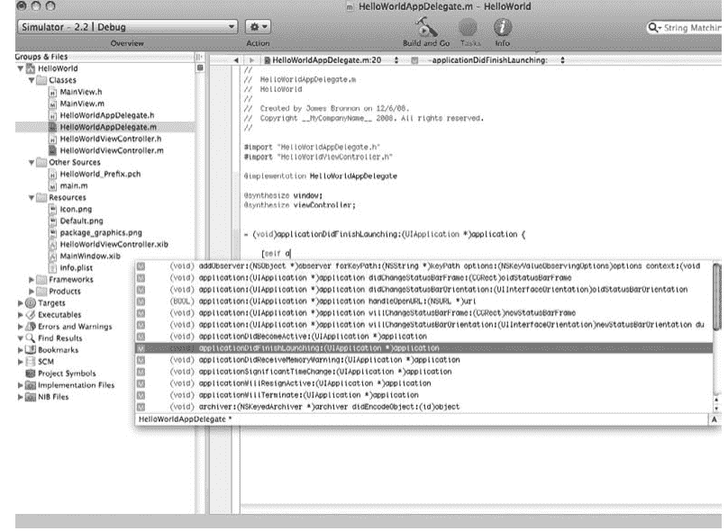

**图 6-9** Xcode 中的代码补全

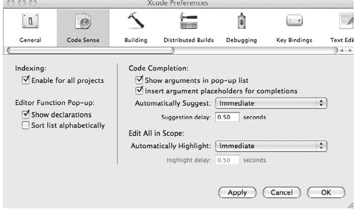

**图 6-10** Xcode 偏好设置

## 应用程序中断

在你的应用程序运行过程中，很可能会收到中断。来电会导致你的应用程序变为非活动状态。如果你决定接听电话，你的应用程序将终止。其他可能导致应用程序变为非活动状态的事件包括日历提醒和让设备进入睡眠状态（锁定设备）。`UIApplicationDelegate` 中的 `applicationWillResignActive:` 方法在应用程序变为非活动状态之前执行。`applicationDidBecomeActive:` 方法在应用程序重新变为活动状态之后执行。例如，如果你正在运行应用程序并锁定屏幕，应用程序的委托会执行 `applicationWillResignActive:` 方法。当你稍后解锁屏幕时，应用程序的委托会执行 `applicationDidBecomeActive:` 方法。

另一个重要的方法是 `applicationDidReceiveMemoryWarning:` 方法。iPhone 的内存有限——使用过多，操作系统会终止你的应用程序。但操作系统会先警告你的应用程序。当 `UIApplication` 收到此事件时，它会将该事件转发给其委托的 `applicationDidReceiveMemoryWarning:` 方法。然后委托可以处理应用程序对该警告的响应。例如，它可能会释放共享数据结构或采取其他内存回收措施。

> **注意**
>
> 虽然不是必需的，但你的应用程序应该在它的 `UIApplicationDelegate` 中处理这些重要事件。如果不这样做，当你提交应用程序到 App Store 时，Apple 可能会拒绝你的应用程序。

## 试一试：处理应用程序中断

在这个任务中，你将探索 `UIApplicationDelegate` 中的 `applicationDidReceiveMemoryWarning:`、`applicationWillResignActive:` 和 `applicationDidBecomeActive:` 方法。

1. 将 `applicationDidReceiveMemoryWarning:`、`applicationDidBecomeActive:` 和 `applicationWillResignActive:` 方法添加到 AddViewProjectDelegate 的实现（`AddViewProjectAppDelegate.m`）中。在每个方法中添加一条 `NSLog` 语句。这些方法应该类似于代码清单 6-4。
2. 点击 Build And Go，在 iPhone Simulator 中执行应用程序。
3. 从 iPhone Simulator 的菜单中选择 Hardware | Simulate Memory Warning。
4. 从 iPhone Simulator 的菜单中选择 Hardware | Lock。解锁，然后退出你的应用程序。
5. 查看 Debugger Console，它应该类似于代码清单 6-5。

**清单 6-4** `AddViewProjectAppDelegate` 的三个附加方法

```objc
- (void)applicationDidReceiveMemoryWarning:(UIApplication *) application {
    NSLog(@"hey got a memory warning....");
}
- (void)applicationWillResignActive:(UIApplication *) application {
    NSLog(@"hey I'm about to resign active status....");
}
- (void)applicationDidBecomeActive:(UIApplication *) application {
    NSLog(@"hey I'm active....");
}
@end
```

**清单 6-5** 运行应用程序的控制台输出

```
[Session started at 2008-12-07 14:56:49 -0500.]
2008-12-07 14:56:50.737 ProjectEight[2465:20b] fired application did finishLaunching...
2008-12-07 14:56:50.740 ProjectEight[2465:20b] added first view controller and made it visible...
---snip---
2008-12-07 14:57:03.247 AddViewProject[2465:20b] hey I'm active....
2008-12-07 14:57:08.094 AddViewProject[2465:20b] about to terminate...
```

当你启动应用程序以及之后解锁模拟器时，应用程序执行了 `applicationDidBecomeActive:` 方法。当你选择模拟内存警告菜单项时，它调用了 `applicationDidReceiveMemoryWarning:` 方法。而当应用程序因锁定即将变为非活动状态时，`UIApplicationDelegate` 执行了 `applicationWillResignActive:` 方法。

## 总结

`UIApplication` 是你应用程序的起点。它通常是在 `main.m` 文件中由 `main` 方法创建的第一个对象。应用程序始终与一个委托相关联。应用程序的委托是一个实现了 `UIApplicationDelegate` 协议的类。委托是你放置处理应用程序生命周期事件代码的地方。

一个 `UIApplication` 有一个 `UIApplicationDelegate`。当使用 Xcode 的模板之一时，`UIWindow`、`UIApplication` 和 `UIApplicationDelegate` 之间的连接会在 `MainWindow.xib` nib 文件中为你完成。此外，你几乎永远不需要手动创建 `UIApplication` 和 `UIApplicationDelegate`，因为每个项目模板都会为你创建这些对象。你也无需担心让 `main.m` 创建应用程序，也无需担心实现 `applicationDidFinishLaunching:` 方法，因为这些方法几乎总是为你生成的。

# 第七章

## UIView 与 UIViewController

### 关键技能与概念

- 理解 `UIView` 和 `UIViewController`
- 使用基于视图的应用程序模板创建单视图应用程序
- 使用基于窗口的应用程序模板创建单视图应用程序
- 理解应用程序委托的根视图
- 在 Interface Builder 中设置应用程序的根视图
- 使用代码设置应用程序的根视图
- 理解 `UIView` 生命周期方法

`UIView` 是 iPhone 在屏幕上显示信息的方式。`UIView` 类负责在屏幕上显示一个矩形区域。`UIViewController` 管理 `UIView` 并负责处理视图的逻辑。`UIViewController` 是视图（`UIView`）和你的数据类（模型）之间的粘合剂。

在开发 iPhone 应用程序时，你会用到许多 `UIView` 子类。实际上，你在 iPhone 图形用户界面（GUI）上使用的每个图形组件都是 `UIView` 子类。从技术上讲，一切都视图。但通常，当文档或其他材料提到“视图”时，它指的是内容视图。内容视图是一个拥有视图控制器的视图，并负责呈现一屏的用户界面。

## UIView 类

`UIView` 的职责是绘制到屏幕上以及处理与用户与应用程序交互相关的事件。`UIView` 有一个关联的 `UIViewController`。`UIViewController` 管理视图。视图控制器加载和卸载其关联的视图，管理视图，并处理其视图的应用程序生命周期事件。

你在 Interface Builder 中使用的每个 iPhone 图形控件都是 `UIView` 子类。表 7-1 列出了 `UIView` 子类。请注意，`UIScrollView` 和 `UIControl` 在表的第二列中还有进一步的子类。

`UIView` 作为容器、控件、显示、警报、操作表、导航控件以及应用程序的窗口来发挥作用。在未来的章节中，你将考虑大多数这些 `UIView` 类型。本章仅限于一个简单的显示视图和相关的视图控制器。

**表 7-1** UIKit 中的 `UIView` 子类

| `UIView` 子类 | 子类 |
| --- | --- |
| `UIWindow` | |
| `UILabel` | |
| `UIPickerView` | |
| `UIProgressView` | |
| `UIActivityIndicatorView` | |
| `UIImageView` | |
| `UITabBar` | |
| `UIToolBar` | |
| `UINavigationBar` | |
| `UITableViewCell` | |
| `UIActionSheet` | |
| `UIAlertView` | |
| `UIScrollView` | `UITableView` |
| | `UITextView` |
| `UIWebView` | |
| `UIControl` | `UIButton` |
| | `UIDatePicker` |
| | `UIPageControl` |
| | `UISegmentedControl` |
| | `UITextField` |
| | `UISlider` |
| | `UISwitch` |

## UIViewController 类

`UIViewController` 管理 `UIView`。它负责创建、显示、隐藏和销毁视图。`UIViewController` 还负责响应视图的生命周期事件、处理方向变化，并作为应用程序视图和模型之间的桥梁。视图控制器是你应用程序在模型-视图-控制器设计模式中的控制器。

## 基于视图的应用程序模板

创建单视图应用程序最简单的途径是使用 Xcode 的基于视图的应用程序模板。此模板创建一个用于管理视图的单视图和视图控制器。虽然基于视图的应用程序不如 Xcode 的其他项目模板有用，但它在此处很有用，因为它生成了最简单的 iPhone 图形应用程序，并提供了一个简单的 `UIView` 和 `UIViewController` 示例。在下一个任务中，你将使用此模板生成一个应用程序。但在继续之前，请先复习 `IBOutlet` 和 `IBAction`。

## IBOutlet 与 IBAction

你已经在前几章中使用过 `IBOutlet` 和 `IBAction`。即使不太清楚它们是什么，你可能已经对它们的功能有了很好的理解；出口和动作是你将 nib 中的东西与 nib 外的东西连接起来的方式。出口将 nib 外的实例变量连接到 nib 中的一个对象。

`IBOutlet` 是一个预处理器指令，求值为 `void`，被编译器忽略，但你真正需要知道的是，`IBOutlet` 是 Interface Builder 知道该变量是为其用途而创建的方式。当添加一个类时，Interface Builder 会扫描该类中的 `IBOutlet`，并知道这些变量旨在作为出口。然后你可以轻松地将图形组件连接到该变量，因为 Interface Builder 会自动将这些出口添加到检查器中供你选择。但请注意，Interface Builder 不会将出口连接到任何东西；它只是添加了它们。你负责添加任何连接。

动作是从 nib 中的对象发送到 nib 外的方法的消息。你在代码中使用 `IBAction` 关键字定义一个动作。像 `IBOutlet` 一样，它是一个预处理器指令，求值为 `void`。你在代码中使用 `IBAction` 关键字定义一个动作。同样，像 `IBOutlet` 一样，当你向 Interface Builder 添加一个类时，它会扫描该类中的 `IBAction` 并将其添加到检查器中供你选择。然后你可以将用户界面事件连接到代码中的特定方法。请注意，指定为动作的方法不能有返回值，因为预处理器将 `IBAction` 替换为 `void`，所以编译器看到的只是 `void`。一个动作还接受一个参数 `sender`。`sender` 是调用该动作的控件的 `id`。所以如果一个 `UIButton` 实例调用了 `changeLabelValue`，`sender` 将是指向该 `UIButton` 的指针。

```objc
- (IBAction) changeLabelValue: (id) sender;
```

`IBOutlet` 和 `IBAction` 不需要太多解释，因为你使用这两个指令如此频繁，它们已成为第二天性。任何必须与 Interface Builder 中的控件通信的 Interface Builder 外部的实例变量都必须是 `IBOutlet`。任何必须从 Interface Builder 中的控件调用的方法都必须是 `IBAction`。

## 动手实践：使用基于视图的应用程序模板

1. 使用模板创建一个新的基于视图的应用程序。将项目命名为 SimpleView。
2. 展开"类"文件夹，注意 Interface Builder 已为你创建了 `SimpleViewViewController` 类。展开"资源"文件夹，注意模板为 `SimpleViewViewController` 生成了一个单独的 nib 文件，`SimpleViewViewController.xib`。
3. 打开 `SimpleViewViewController.h`，添加一个标签和一个用于更改标签值的方法。将标签声明为 `IBOutlet`，方法声明为 `IBAction`（代码清单 7-1）。
4. 打开 `SimpleViewViewController.m`，添加 `IBOutlet` 和 `IBAction` 的定义（代码清单 7-2）。
5. 在 Interface Builder 中打开 `SimpleViewViewController.xib`，更改视图的颜色。向 `UIView` 中添加一个 `UILabel` 和一个 `UIButton`。
6. 注意，`SimpleViewViewController` 是文件的所有者。将 `SimpleViewViewController` 的 `theLabel` 出口连接到标签。
7. 将 `SimpleViewViewController` 的 `changeTheLabel` 动作连接到按钮。选择“Touch Up Inside”事件。
8. 保存并退出 Interface Builder。
9. 点击“Build And Go”运行应用程序。

### 代码清单 7-1 `SimpleViewViewController.h`

```objc
#import <UIKit/UIKit.h>
@interface SimpleViewViewController : UIViewController {
    IBOutlet UILabel * theLabel;
}
@property (nonatomic, retain) UILabel * theLabel;
- (IBAction) changeLabelValue: (id) sender;
@end
```

### 代码清单 7-2 `SimpleViewViewController.m`

```objc
#import "SimpleViewViewController.h"
@implementation SimpleViewViewController
@synthesize theLabel;
- (IBAction) changeLabelValue : (id) sender {
    [theLabel setText:@"Hello World."];
    UIButton *theBut = sender;
    NSLog(theBut.currentTitle);
    theBut.enabled = NO;
    [theBut setTitle:@"Pressed Already" forState: UIControlStateDisabled];
}
- (void)dealloc {
    [theLabel release];
    [super dealloc];
}
@end
```

花点时间研究一下基于视图的应用程序模板为你做了什么。它创建了 `SimpleViewViewController.xib`，并且通过创建 `SimpleViewViewController.h` 和 `SimpleViewViewController.m` 文件，也创建了一个 `UIViewController` 子类 `SimpleViewViewController`。此外，它还把控制器添加到了委托中（代码清单 7-3）。

在委托中，模板将应用程序的窗口和视图控制器创建为出口（代码清单 7-3 和 7-4）。在委托的 `applicationDidFinishLaunching:` 方法中，模板将视图控制器的视图添加到窗口，然后显示窗口。注意，代码中没有任何地方分配或初始化其窗口或视图控制器。相反，`Info.plist` 指定了 `MainWindow.xib` 是应用程序的主 nib 文件，因此它知道要加载 `MainWindow.xib`，而 nib 文件负责处理窗口和视图控制器的初始化。

在 `MainWindow` nib 中，模板将 nib 的文件所有者设置为 `UIApplication`。模板将 `SimpleWindowAppDelegate` 设置为应用程序的委托，并将委托的窗口设置为 `MainWindow.xib` 中的窗口。

模板还向 `MainWindow.xib` 添加了一个视图控制器，并将其设置为委托的根视图控制器。每个委托都必须有一个根视图控制器。`MainWindow.xib` 中的根视图控制器来自同样由模板创建的 `SimpleViewViewController.xib`。

模板在其自己的 xib 文件 `SimpleViewViewController.xib` 中创建了 `UIView`。它将 `SimpleViewViewController.xib` 的文件所有者设置为 `SimpleViewViewController`。它还将控制器的视图设置为 xib 中的视图。

### 代码清单 7-3 `SimpleViewAppDelegate.h`

```objc
#import <UIKit/UIKit.h>
@class SimpleViewViewController;
@interface SimpleViewAppDelegate : NSObject <UIApplicationDelegate> {
    UIWindow *window;
    SimpleViewViewController *viewController;
}
@property (nonatomic, retain) IBOutlet UIWindow *window;
@property (nonatomic, retain) IBOutlet SimpleViewViewController *viewController;
@end
```

### 代码清单 7-4 `SimpleViewAppDelegate.m`

```objc
#import "SimpleViewAppDelegate.h"
#import "SimpleViewViewController.h"
@implementation SimpleViewAppDelegate
@synthesize window;
@synthesize viewController;
- (void)applicationDidFinishLaunching:(UIApplication *)application {
    [window addSubview:viewController.view];
    [window makeKeyAndVisible];
}
- (void)dealloc {
    [viewController release];
    [window release];
    [super dealloc];
}
@end
```

## 动手实践：使用基于窗口的应用程序模板

基于视图的应用程序模板隐藏了许多开发细节。如果你是 iPhone 编程新手，基于视图的模板可能无法帮助你理清 `UIView`、`UIViewController` 及其之间的关系。为了帮助你更清晰地理解它们之间的关系，你应该了解基于视图的应用程序模板自动完成了什么。

与基于视图的应用程序模板不同，基于窗口的应用程序模板需要你理解 `UIView` 和 `UIViewController`。使用基于窗口的应用程序模板时，你必须手动创建视图和视图控制器，并将它们连接起来。在这个项目中，你将从一个基于窗口的应用程序模板开始，创建一个单视图应用程序。创建一个基于窗口的应用程序应该能巩固你对其背后创建步骤的理解。

1. 创建一个新的基于窗口的应用程序，将其命名为 SimpleWindow。
2. 选中"Resources"，创建一个空的 xib 文件。将 xib 命名为 `FirstViewController.xib`。
3. 选中"Classes"，添加一个名为 `FirstViewController` 的 `UIViewController`。Xcode 应该已经创建了 `FirstViewController.h` 和 `FirstViewController.m`。请确保“创建 xib”复选框未被选中。
4. 打开 `SimpleWindowAppDelegate.h`，导入 `FirstViewController`。向 `SimpleWindowAppDelegate.h` 添加一个 `UIViewController` 属性，使其与代码清单 7-5 相同。
5. 修改 `SimpleWindowAppDelegate.m`，使其与代码清单 7-6 相同。注意，你必须合成 `rootViewController`，并在委托的 `applicationDidFinishLaunching:` 方法中将其视图作为子视图添加到窗口中。
6. 构建应用程序。这一步很重要，如果你不构建或保存更改，任何添加的动作或出口都不会在 Interface Builder 中显示。
7. 在 Interface Builder 中打开 `FirstViewController.xib`。打开文档窗口，注意文件所有者未设置。同时注意没有 `UIView`。
8. 从库中拖拽一个视图到文档窗口。更改视图的颜色。
9. 选择“File's Owner”，在“Object Identity Inspector”面板中将其类更改为 `FirstViewController`。
10. 点击“Connections Inspector”，将 `view` 出口连接到你添加到文档窗口的视图。
11. 保存并关闭 `FirstViewController` 的文档窗口。在 Interface Builder 中打开 `MainWindow.xib`。
12. 注意，文档窗口中没有设置 `UIViewController` 或视图。
13. 从库中拖拽一个视图控制器到文档窗口（图 7-1）。

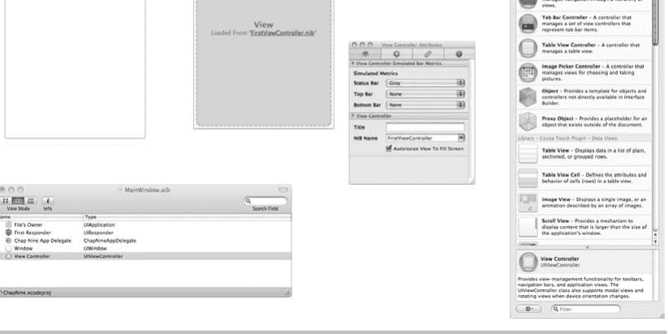

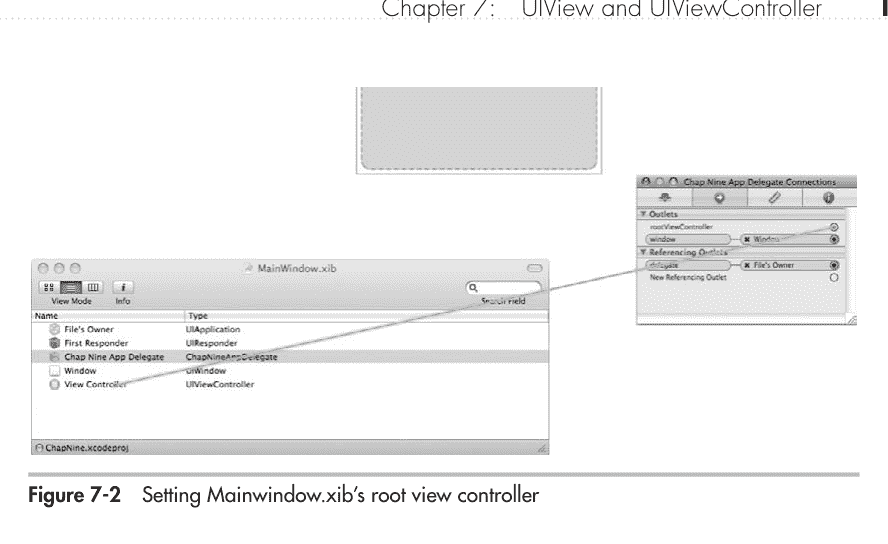

14. 在视图控制器的检查器中，将其 `NIB Name` 更改为 `FirstViewController`，类型更改为 `FirstViewController`。
15. 在文档窗口中选择“Simple Window App Delegate”。在其连接检查器中，注意 `rootViewController` 出口。将其连接到刚刚添加的视图控制器（图 7-2）。
16. 保存并退出 Interface Builder。
17. 点击“Build And Go”运行应用程序。`FirstViewController.xib` 中的视图被加载到窗口中并显示。

### 代码清单 7-5 `SimpleWindowAppDelegate.h`

```objc
#import <UIKit/UIKit.h>
@class FirstViewController;
@interface SimpleWindowAppDelegate : NSObject <UIApplicationDelegate> {
    UIWindow *window;
    FirstViewController *rootViewController;
}
@property (nonatomic, retain) IBOutlet FirstViewController *rootViewController;
@property (nonatomic, retain) IBOutlet UIWindow *window;
@end
```

### 清单 7-6 `SimpleWindowAppDelegate.m`

```
#import "SimpleWindowAppDelegate.h"
#import "FirstViewController.h"
@implementation SimpleWindowAppDelegate
@synthesize window;
@synthesize rootViewController;
- (void)applicationDidFinishLaunching:(UIApplication *)application {
    [window addSubview:rootViewController.view];
    [window makeKeyAndVisible];
}
- (void)dealloc {
    [window release];
    [rootViewController release];
    [super dealloc];
}
@end
```

在第 15 步中，你将 `FirstViewController` 连接到了应用程序的委托。这是一个重要步骤；它允许 nib 为你设置委托的根视图控制器。根视图控制器是由应用程序委托首先加载的 `UIViewController`。请记住，应用程序之所以知道要加载 `MainWindow.xib`，是因为它位于应用程序的 `Info.plist` 中。应用程序加载了 `MainWindow.xib`，看到添加到文档窗口中的 `FirstViewController` 对象，并看到委托的根视图控制器被设置为 `FirstViewController`。应用程序还知道该控制器来自 `FirstViewController.xib`。由于对象、变量和 nib 的设置，应用程序在加载 `MainWindow.xib` 时知道要从 `FirstViewController.xib` 分配并初始化一个 `FirstViewController` 实例。因为这些关系是在 Interface Builder 中建立的，所以不需要手动编写代码。这就是基于视图的应用程序模板构建简单应用程序的方式，而你刚才使用基于窗口的应用程序模板手动完成了同样的工作。

> **注意**
>
> 在本例中，你手动创建了一个 xib 并将其链接到相关的视图控制器。第 3 步特别指示你不要勾选同时创建 xib 的复选框；如果你勾选了该复选框，Xcode 将会创建一个 xib，并自动为你完成所有必要的连接。

### 专家问答

**问：** 嘿，等一下。清单 7-3 中的 `@class` 预编译器指令是什么意思，为什么你不导入类的头文件？

**答：** `@class` 是一个编译器指令，它告知编译器该类型的类将会存在。这就是所谓的*前向声明*，之所以这样命名，是因为它在类实际声明之前通知编译器。

## UIViewController 与应用程序生命周期事件

`UIViewController` 为其关联的 `UIView` 处理重要的生命周期事件。表 7-2 列出了 `UIViewController` 的视图生命周期实例方法。请注意，表 7-2 中的几个方法与应用程序委托的生命周期方法相似——例如，`didReceiveMemoryWarning:` 方法。不要让这种相似性混淆了你；记住，视图控制器中的生命周期方法用于控制器关联的视图，而不是整个应用程序。相反，委托中的生命周期方法旨在处理整个应用程序的事件。

| 视图生命周期管理实例方法 | 调用时机 |
| :--- | :--- |
| `didReceiveMemoryWarning:` | 当控制器收到内存警告时调用 |
| `didRotateFromInterfaceOrientation:` | 在视图控制器的视图旋转后调用 |
| `viewDidAppear:` | 在控制器的视图出现后调用 |
| `viewDidDisappear:` | 在控制器的视图消失后调用 |
| `viewDidLoad:` | 在控制器的视图加载到内存后调用 |
| `viewWillAppear:` | 在控制器的视图即将出现前调用 |
| `viewWillDisappear:` | 在控制器的视图即将消失前调用 |
| `willRotateToInterfaceOrientation:duration:` | 当控制器开始旋转时调用 |
| `willAnimateFirstHalfOfRotationToInterfaceOrientation:duration:` | 在视图旋转的前半部分即将开始前调用 |
| `willAnimateSecondHalfOfRotationFromInterfaceOrientation:duration:` | 在视图旋转的后半部分即将开始前调用 |

**表 7-2** `UIViewController` 的视图生命周期管理实例方法

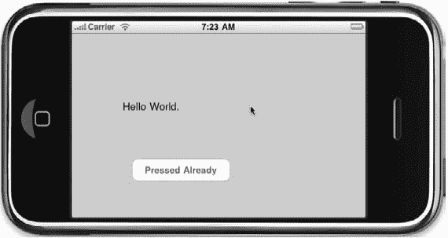

### 动手实践：探索几个生命周期方法

1. 在 Xcode 中打开 SimpleView 项目。
2. 创建一个名为 Dummy 的新 `UIViewController` 类。打开 `Dummy.m`，注意 Xcode 为你生成了大多数所需的生命周期方法，然后将它们注释掉。它甚至还为每个方法提供了简短的说明。
3. 删除 `Dummy.m` 和 `Dummy.h` 文件。
4. 将清单 7-7 中的生命周期方法添加到 `FirstViewController.m` 文件中。由于 `FirstViewController` 的父类 `UIViewController` 已经声明了所有这些方法，所以你不需要在 `FirstViewController` 的头文件中添加方法的声明。
5. 点击"Build And Go"来运行应用程序。
6. 当应用程序运行时，通过从模拟器菜单中选择 Hardware | Rotate right 将模拟器横向放置（图 7-3）。
7. 通过选择 Hardware | Simulate Memory Warning 来模拟内存警告。
8. 退出应用程序。控制台的输出应该类似于清单 7-8。

**清单 7-7** 添加到 `FirstViewController.m` 的生命周期方法

```
-(BOOL)shouldAutorotateToInterfaceOrientation:(UIInterfaceOrientation)
interfaceOrientation {
  return YES;
}
- (void)didReceiveMemoryWarning {
  NSLog(@"received memory warning....");
  [super didReceiveMemoryWarning];
}
- (void)viewDidLoad {
  NSLog(@"view did load...");
  [super viewDidLoad];
}
- (void)viewWillAppear:(BOOL)animated {
  NSLog(@"view will appear...");
}
- (void)viewDidUnload {
  NSLog(@"view did unload...");
}
- (void)didRotateFromInterfaceOrientation:(UIInterfaceOrientation)
fromInterfaceOrientation {
  NSLog(@"view rotated....");
}
```

**清单 7-8** 控制台日志

```
[Session started at 2009-06-18 07:19:59 -0400.]
2009-06-18 07:20:07.503 SimpleView[267:20b] view did load...
2009-06-18 07:20:10.815 SimpleView[267:20b] Click Me
2009-06-18 07:20:15.293 SimpleView[267:20b] Received simulated memory warning.
2009-06-18 07:20:15.294 SimpleView[267:20b] received memory warning....
2009-06-18 07:20:33.478 SimpleView[267:20b] view rotated....
```

### 专家问答

**问：** 嘿，等一下。清单 7-7 中的 `shouldAutoRotateToInterfaceOrientation:` 是什么意思？

**答：** 这个方法用于允许或禁止视图旋转。要允许视图旋转，返回 YES。要禁止，返回 NO。

## 小结

本章讨论了 `UIView` 和 `UIViewController` 类。在开发 iPhone 应用程序时，每个内容视图都应该有自己的 nib。请记住，将视图放在自己的 nib 中可以通过仅加载渲染当前视图所需的组件来节省内存。创建视图的开发模式很简单：在 Xcode 中子类化 `UIViewController`。在其自己的 nib 中创建 `UIView`。然后，在 nib 中将视图连接到视图控制器。为了使代码更易于测试和调试，请保持视图、视图控制器和 nib 之间的名称一致。在视图的视图控制器中实现你希望处理的任何与视图相关的生命周期方法。不过，请保持你的自定义代码最小化——记住，控制器的工作是充当视图和模型之间的胶水代码。考虑将更高级的代码放在辅助类中，然后让你的控制器使用这些辅助类。

既然你已经了解了如何构建每个屏幕的内容，你就可以学习如何开发将各个视图聚合到多屏幕应用程序中的视图了。在下一章中，你将开始探索使用 `UITabBar` 和 `UITabBarController` 的多视图应用程序。在学习了标签栏之后，你将转向导航控制器，然后是表格。这些视图让你能够将内容视图聚合到更丰富的多屏幕应用程序中。

# 第 8 章

## UITabBar 与 UITabBarController

### 关键技能与概念

- 理解标签栏
- 使用标签栏应用程序模板
- 创建使用标签栏的应用程序
- 向标签栏添加标签
- 自定义标签栏

标签栏由窗口底部的两个或多个标签组成。每个标签包含一个视图控制器。当用户选择某个标签时，该标签加载其视图控制器，视图控制器进而加载并显示其关联的视图。在本章中，你将探索创建标签页应用程序。在第一个任务中，你将使用 Xcode 的标签栏应用程序模板创建一个标签页应用程序。在检查此模板的结果之后，你将手动向标签栏添加第三个标签。在下一个任务中，你从基于窗口的应用程序模板开始，创建一个双标签应用程序。在此任务中，你通过手动复制标签栏应用程序模板所执行的步骤来巩固你的理解。本章的最后一个任务说明了当标签栏包含五个或更多标签时，如何允许用户自定义标签栏的标签。

## UITabBar、UITabBarController、UITabBarItem 和 UITabBarControllerDelegate

标签栏适用于呈现不同的应用程序子任务或同一数据的不同视图。如果你拥有 iPhone 或 iPod touch，你肯定熟悉标签栏控制器，因为多个应用程序都使用标签栏。例如，"时钟"应用程序有一个包含不同子任务的标签栏（图 8-1）。每个标签是一个不同的子任务：世界时钟、闹钟、秒表和计时器。iPod 应用程序展示了一个包含同一数据不同视图的标签栏（图 8-2）。"艺人"标签按艺人组织你的多媒体；"专辑"标签按专辑组织你的媒体。每个标签是同一数据（你的 iTunes 多媒体）的不同视图。iPod 应用程序还展示了另一个标签栏功能。当标签栏有四个以上的标签时，它会显示一个"更多"标签。按下"更多"后，标签栏会在可选列表中呈现其余标签（图 8-3）。你还可以使用"编辑"按钮修改 iPod 应用程序的标签栏。点击"编辑"按钮会以一种允许你修改标签栏中显示哪些标签的视图显示标签（参见图 8-3）。当遇到包含具有多个子任务的任务或需要同一数据不同视图的应用程序时，请使用标签栏。

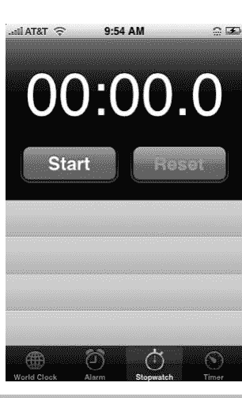

**图 8-1** “时钟”应用为每个子任务设置了一个标签页。

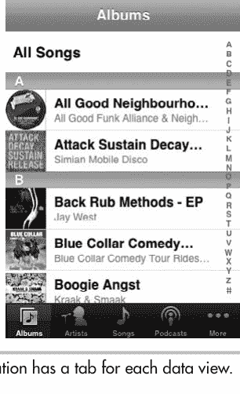

**图 8-2** “iPod”应用为每个数据视图设置了一个标签页。

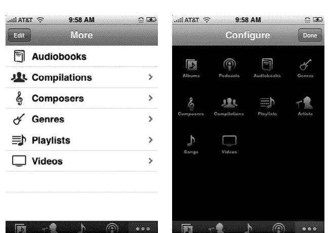

**图 8-3** “iPod”应用使用“更多”标签页来显示标签页。

> **注意**
>
> 不要使用标签栏进行顺序导航或数据深入浏览。导航控制器和表格更适合用于导航顺序列表和数据深入浏览。

你可以使用 `UITabBar` 类创建标签栏。`UITabBar` 在窗口底部边缘显示两个或多个标签页。单个标签页是 `UITabBarItem` 类的实例。你可以使用 `UITabBarController` 和 `UITabBarControllerDelegate` 将这些类联系起来。每个 `UITabBarItem` 都包含自己的视图控制器。点击一个标签页，`UITabBarItem` 会加载其视图控制器。视图控制器显示其视图。

> **注意**
>
> 一个标签页的视图控制器可能是一个高级视图，例如表格或导航控制器。第9章将演示如何将导航控制器放入标签页中。第10章将演示如何将导航控制器放入标签页中，然后在导航控制器中放入表格。

`UITabBar` 有一个关联的 `UITabBarController` 和 `UITabBarDelegate`。`UITabBarController` 管理每个标签页中的 `UIViewController` 对象。例如，如果用户希望添加、删除或重新排列标签栏项目，`UITabBarController` 负责实现该行为。本章稍后将介绍如何实现可重新排列的标签栏。但首先，考虑最简单的标签栏实现方式：标签栏应用程序模板。

## 使用标签栏应用程序模板

标签栏应用程序模板是创建标签页应用程序最简单的途径，与上一章的基于视图的应用程序模板不同，该模板对于实际项目是一个更有用的起点。在本任务中，你将使用标签栏应用程序模板创建一个简单的标签栏应用程序。检查模板的结果后，你将手动向标签栏添加第三个标签页。

1. 在“新建项目”对话框中选择该模板，创建一个新的标签栏应用程序。将项目命名为 `TabBarExOne`。
2. 在“组与文件”中，展开“类和资源”。乍一看，该模板似乎创建了与基于视图的应用程序相同的类。然而，该模板为你添加了几个标签栏相关的类，使其成为一个稍复杂的应用程序。
3. 打开 `TabBarExOneAppDelegate.h`，注意该应用程序的委托遵循 `UITabBarControllerDelegate` 协议。它还声明了一个 `UITabBarController` 属性作为 `IBOutlet`（代码清单 8-1）。
4. 打开 `MainWindow.xib` 并检查文档窗口。该模板添加了一个标签栏控制器。
5. 该模板还将 `TabBarExOneAppDelegate` 作为代理对象添加到 `MainWindow.xib`。在检查器中查看 `TabBarExOneAppDelegate` 的连接。注意 Xcode 添加了一个 `tabBarController` 属性作为 `IBOutlet`。Interface Builder 随后知道应用程序委托有一个 `tabBarController` 输出口，并将其连接到文档窗口中的标签栏控制器。
6. 在文档窗口中，在列表视图中，展开“选定的第一个视图控制器 (First)”，并注意“标签栏项目 (First)”。第二个视图控制器也有一个关联的标签栏项目。
7. 在文档窗口中，选中第二个视图控制器。注意在控制器的检查器中，`UIViewController` 来自外部 nib；该模板指定了视图控制器的 Nib 名称（图 8-4）。还注意到该模板采用了一个捷径。它没有为第二个 `SecondView.xib` 创建一个 `UIViewController`，而是使用了一个通用的 `UIViewController`。如果需要，你可以轻松地通过向 Xcode 项目添加一个新的 `UIViewController` 类并将 `SecondView.xib` 的视图控制器的类更改为所创建的类来补救。
8. 构建并运行该应用程序。一个简单的双标签应用程序在模拟器中运行。

**图 8-4** 第二个标签栏项目的视图控制器来自另一个 nib。

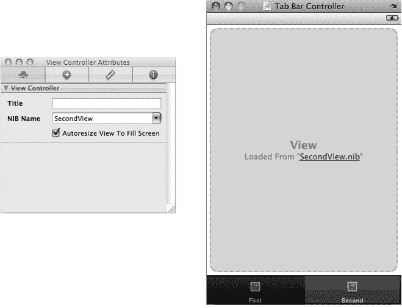

**代码清单 8-1** `TabBarExOneAppDelegate` 遵循 `UITabBarControllerDelegate` 协议。

```objectivec
#import <UIKit/UIKit.h>
@interface TabBarExOneAppDelegate : NSObject <UIApplicationDelegate,
UITabBarControllerDelegate> {
  UIWindow *window;
  UITabBarController *tabBarController;
}
@property (nonatomic, retain) IBOutlet UIWindow *window;
@property (nonatomic, retain) IBOutlet UITabBarController
*tabBarController;
@end
```


## 第 8 章：标签栏

9. 在 Interface Builder 中打开`MainWindow.xib`。
10. 在标签栏控制器的画布上，点击标记为“First”的标签栏项目。注意——只点击一次。单击一次会选择标签栏项目的视图控制器。如果你在检查器标签页标题中看到“View Controller”，就说明你只点击了一次。
11. 双击标签栏项目，你会选择实际的标签栏项目。检查器标签页标题中应出现“Tab Bar Item”。
12. 保存并关闭 Interface Builder。
13. 点击“构建并运行”，在模拟器中运行该应用程序。

标签栏应用程序模板生成一个双标签应用程序。你肯定会遇到需要更多标签页的情况。向标签栏添加另一个标签页并不困难。在下一个任务中，你将向该应用程序添加第三个标签页。

### 尝试：向标签栏应用程序添加标签栏项目

1. 如果已关闭，请在 Xcode 中打开上一个任务的应用程序。创建另一个`UIViewController`并将该控制器命名为`ThirdViewController`。确保也选中创建附带 xib 的复选框。Xcode 应生成`ThirdViewController.h`、`ThirdViewController.m`和`ThirdViewController.xib`文件。
2. 在 Interface Builder 中打开`ThirdViewController.xib`。将视图的颜色更改为非白色。保存并退出 Interface Builder。
3. 在 Interface Builder 中打开`MainWindow.xib`。从库中将一个`UIViewController`拖到文档窗口。将`UIViewController`的类更改为`ThirdViewController`。
4. 选中标签栏控制器并打开其标签栏属性检查器。
5. 向“视图控制器”列表添加一个标签栏项目。将该项目命名为“Search”，并注意标签栏控制器画布上出现第三个标签页。
6. 单击第三个标签栏项目一次。在检查器中，将类从`UIViewController`更改为`ThirdViewController`。同时将 nib 名称更改为`ThirdViewController`。
7. 双击第三个标签栏项目。在标签栏项目属性检查器中，将标签页的标识符更改为“Search”。标签页中会出现一个放大镜和“Search”（图 8-5）。
8. 保存并退出 Interface Builder。
9. 构建并运行该应用程序。该应用程序现在有了第三个标签栏项目（图 8-6）。

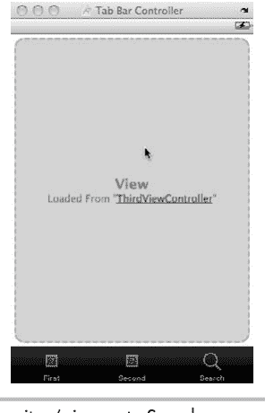

图 8-5 将标签栏项目的图像更改为“Search”

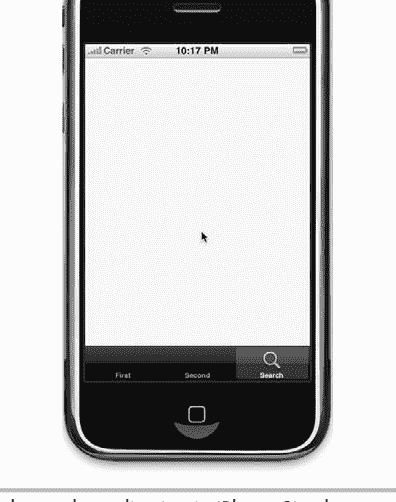

图 8-6 在 iPhone 模拟器中运行三标签应用程序

### 从头开始创建标签栏应用程序

使用模板很好，但不会教你如何实际构建一个标签页应用程序（除非你使用模板）。因此，在本任务中，你将重复标签栏应用程序模板的步骤，但从基于窗口的应用程序模板开始，并手动将标签栏项目添加到你的项目中。这并不比使用模板更难——只是稍微繁琐一些。

1. 创建一个新的基于窗口的应用程序，并将其命名为`TabBarExTwo`。
2. 打开`TabBarExTwoAppDelegate.h`并修改它，使其遵循`UITabBarControllerDelegate`协议（代码清单 8-2）。添加一个`UITabBarController`属性作为`IBOutlet`。`TabBarExTwoAppDelegate.h`应如代码清单 8-2 所示。别忘了在`TabBarExTwoAppDelegate.m`中合成该控制器。保存并构建。
3. 创建一个新的`UIViewController`类并将其命名为`FirstViewController`。创建其关联的 xib 并命名为`FirstViewController`。
4. 创建另一个`UIViewController`和关联的 xib 并命名为`SecondViewController`。
5. 打开`FirstViewController.xib`并更改视图的颜色。打开`SecondViewController.xib`并更改视图的颜色。
6. 保存并退出 Interface Builder。
7. 打开`MainWindow.xib`并将一个`UITabBarController`添加到文档窗口。Interface Builder 应显示标签栏控制器的画布。
8. 选择`TabBarExTwoAppDelegate`的连接检查器，并将其`tabBarController`输出口连接到文档窗口中的标签栏控制器。
9. 在文档窗口中，确保视图模式以列表形式显示项目。展开标签栏控制器，选择“选定的视图控制器 (Item 1)”，并在第一视图控制器标识检查器中将其类更改为`FirstViewController`。将其 Nib 名称更改为`FirstViewController`。
10. 使用与上一步相同的步骤，将“视图控制器 (Item 2)”更改为`SecondViewController`。别忘了在第二视图控制器属性检查器中将 NIB 名称设置为`SecondViewController`。
11. 将第一个标签页的标识符更改为“Recents”，第二个标签页的标识符更改为“Downloads”（图 8-7）。
12. 保存并关闭 Interface Builder。
13. 打开`TabBarExTwoAppDelegate.m`。将标签栏控制器添加到`applicationDidFinishLaunching`方法中（代码清单 8-3）。

图 8-7 第一个和第二个标签标识符

代码清单 8-2 修改后使用 UITabBarController 的 TabBarExTwoAppDelegate.h

```
#import <UIKit/UIKit.h>

@interface TabBarExTwoAppDelegate : NSObject <UIApplicationDelegate,
    UITabBarControllerDelegate> {
    UIWindow *window;
    UITabBarController *tabBarController;
}

@property (nonatomic, retain) IBOutlet UIWindow *window;
@property (nonatomic, retain) IBOutlet UITabBarController
    *tabBarController;

@end
```

代码清单 8-3 修改后使用 UITabBarController 的 TabBarExTwoAppDelegate.m

```
#import "TabBarExTwoAppDelegate.h"

@implementation TabBarExTwoAppDelegate

@synthesize window;
@synthesize tabBarController;

- (void)applicationDidFinishLaunching:(UIApplication *)application {
    [window addSubview:tabBarController.view];
    [window makeKeyAndVisible];
}

- (void)dealloc {
    [window release];
    [tabBarController release];
    [super dealloc];
}

@end
```

14. 点击 Build And Go，一个双标签应用将在 iPhone 模拟器中运行（图 8-8）。

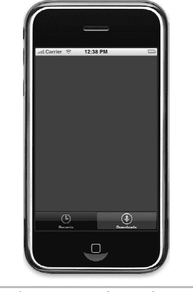

图 8-8 在 iPhone 模拟器中运行的双标签应用

### 动手实践：允许用户自定义标签栏

有时你可能希望向应用添加超过四个标签页。然而，iPhone 标签栏只能显示四个标签和一个“更多”标签。当用户按下“更多”时，多余的标签会出现在一个可选择的列表中。默认情况下，窗口顶部会显示一个带有“编辑”按钮的导航栏。然后，用户可以点击“编辑”并修改他或她希望显示在标签栏上的标签。

默认行为是允许所有标签栏项目都可编辑。如果你希望修改此默认设置并限制哪些标签可编辑，你必须修改工具栏。在此任务中，你向第一个任务的标签栏添加超过四个标签。然后，你将标签栏设置为不可编辑，接着只设置部分标签可编辑。

1. 打开 TabBarExOne 并添加一个新的视图控制器。将类命名为`FourthViewController`。确保它也创建一个关联的 xib。Xcode 应该创建`FourthViewController.h`、`FourthViewController.m`和`FourthViewController.xib`文件。
2. 在 Interface Builder 中打开`FourthViewController.xib`。更改视图的颜色。
3. 关闭`FourthViewController.xib`并在 Interface Builder 中打开`MainWindow.xib`。
4. 通过在标签栏控制器属性检查器中向视图控制器添加 One、Two 和 Three 来添加另外三个标签（图 8-9）。

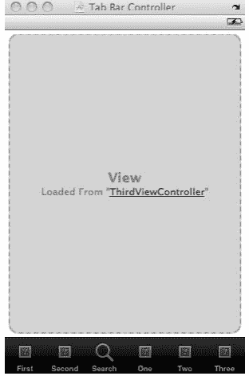

5. 将每个视图控制器的类更改为`FourthViewController`。同时将每个视图控制器的 NIB 名称更改为`FourthViewController`。

> 注意：在实际项目中，你绝不会为三个不同的标签使用同一个视图控制器。

6. 保存并退出 Interface Builder。
7. 在 iPhone 模拟器中构建并运行。注意它添加了第四个标签和一个“更多”标签（图 8-10）。当你点击“更多”标签时，它会显示一个包含另外两个标签的`UITableView`（图 8-11）。当你点击任一标签时，将显示与该标签关联的视图控制器的视图。
8. 点击“编辑”按钮，会显示一个可以配置标签栏项目的屏幕（图 8-12）。

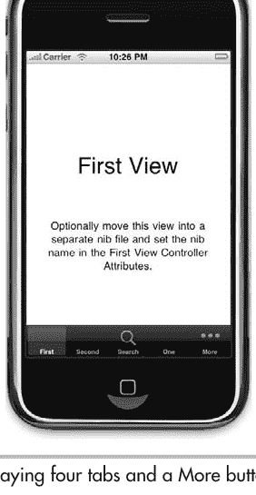

图 8-10 显示四个标签和一个“更多”按钮的应用

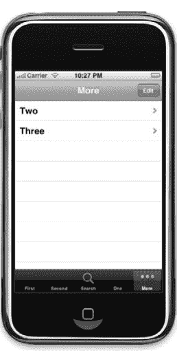

图 8-11 点击“更多”标签会以列表形式显示剩余的两个标签。

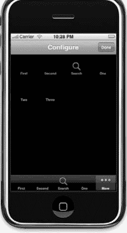

图 8-12 点击“编辑”按钮会显示一个用于配置标签栏标签的视图。

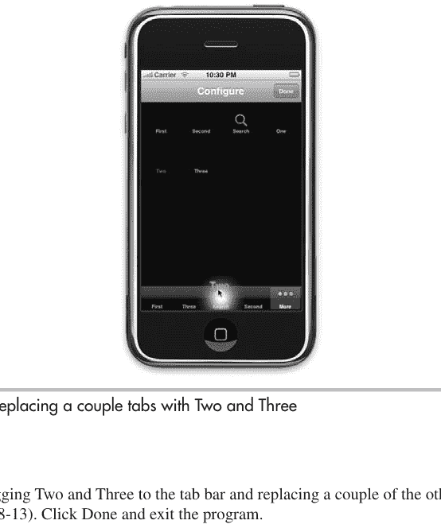

图 8-13 用 Two 和 Three 替换几个标签

9. 尝试将 Two 和 Three 拖到标签栏上，并替换其他几个标签（图 8-13）。点击“完成”并退出程序。
10. 打开`TabBarExOneAppDelegate.m`，并在`applicationDidFinishLaunching`方法中添加以下行。

```
tabBarController.customizableViewControllers = nil;
```

11. 点击 Build And Go。注意“编辑”按钮出现了，但点击它不会显示任何标签。
12. 现在再次修改`applicationDidFinishLaunching`。更改代码使其与代码清单 8-4 匹配。
13. 点击 Build And Go。注意你只能编辑 First 和 Second（图 8-14）。

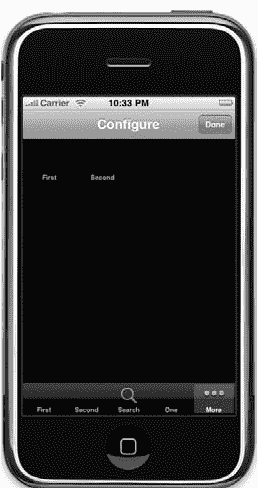

图 8-14 只有 First 和 Second 是可编辑的。

代码清单 8-4 设置 customizableViewControllers

```
- (void)applicationDidFinishLaunching:(UIApplication *)application {
  NSMutableArray * conts = [[[NSMutableArray alloc] init]
autorelease];
  [conts addObject:[tabBarController.viewControllers
objectAtIndex:0]];
  [conts addObject:[tabBarController.viewControllers
objectAtIndex:1]];
  tabBarController.customizableViewControllers = conts;
  [window addSubview:tabBarController.view];
}
```

标签栏的默认行为是，当标签栏包含超过四个标签时，允许用户重新排列、删除和添加标签。要禁用所有标签的编辑，请将标签栏控制器的`customizableViewControllers`设置为`nil`。要只禁用部分标签，请将应可编辑的标签添加到`customizableViewControllers`中。未添加到`customizableViewControllers`的标签将自动设为不可编辑。

### 总结

正如本章所示，创建一个标签式应用程序非常简单。首先，确保你的应用程序有一个`UITabBarControllerDelegate`。虽然你可以创建自己的类来遵循`UITabBarControllerDelegate`协议，但使用应用程序的委托会更容易。但请注意，使用标签栏的更复杂的应用程序应该有一个与标签栏关联的自定义委托，而不应让应用程序的主委托遵循`UITabBarControllerDelegate`。在将你的应用程序的委托更改为遵循`UITabBarControllerDelegate`后，向委托添加一个`UITabBarController`属性。然后向`MainWindow.xib`添加一个`UITabBarController`，并将控制器连接到应用程序委托的`tabBar`属性。在连接委托和标签栏控制器后，将各个`UITabBarItem`对象连接到视图控制器。创建标签式应用程序就是这么简单。

在本章中，你学习了如何创建标签栏、其关联控制器和委托。本章没有太多解释，因为标签栏最容易通过实践来学习。你使用模板和手动方式创建了标签式应用程序。如果你仍然不理解标签栏，你绝对应该重读本章，因为标签栏是你在开发 iPhone 应用程序时会经常使用的导航组件。想想你在桌面应用程序中使用标签的所有情况——标签在 iPhone 应用程序中同样无处不在。但要记住传统的用户界面 (UI) 智慧：将标签栏用于子任务和同一数据集上的不同视图。不要将标签栏用于涉及顺序步骤的任务。导航栏及其关联控制器对于这种导航更有用。在下一章中，你将学习如何创建和使用导航栏及其关联控制器。此外，你将在视图控制器中放置一个导航栏作为标签项。在学习了导航栏之后，你将探索表格。在学习了表格的基础知识后，你将在单个标签中的同一个视图控制器中放置一个导航项和一个表格。学习了表格之后，你将具备为几乎所有 iPhone 应用程序创建导航的基础知识。

## 第 9 章：UINavigationBar 和 UINavigationController

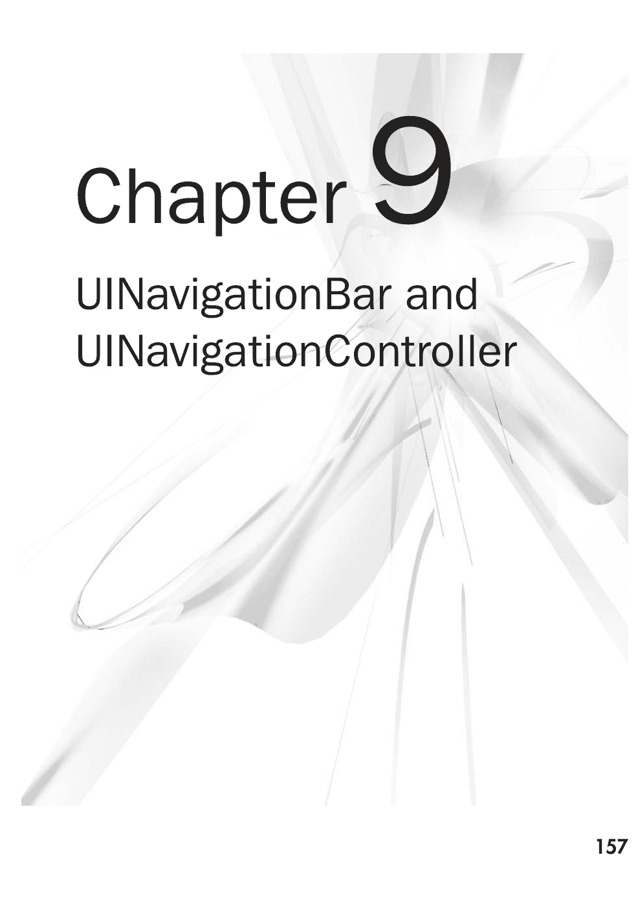

### 关键技能与概念

- 理解`UINavigationBar`、`UINavigationController`和`UINavigationItem`
- 了解如何在简单应用程序中使用导航栏
- 了解如何以编程方式操作导航栏的项目
- 在标签式应用程序的标签中添加导航栏

导航栏显示在窗口顶部，紧靠状态栏下方。导航栏可选地包含一个用于每个显示视图的标题以及一个或多个按钮。通常，当点击栏右侧的按钮时，会将用户带到另一个视图的下一步，尽管有时应用程序将右侧按钮用作“完成”按钮。栏左侧的按钮是“返回”按钮，用于返回到上一个视图。导航栏通常与表格一起使用，表格显示在其上方带有导航栏的位置。当用户点击表格的行时，导航栏关联的导航控制器会将用户带到有关所选项目的更详细信息。例如，App Store 应用程序允许用户细化其类别，直到找到感兴趣的应用程序（图 9-1）。例如，如果用户点击“游戏”，导航控制器会将用户带到“游戏”子类别。如果用户随后点击“所有游戏”，导航控制器会将用户带到 App Store 中所有游戏的表格。如果用户希望返回一步，他或她会按下导航栏左上角区域的按钮。此按钮是“返回”按钮。注意导航控制器使用上一个视图的标题作为该按钮的标题。

导航栏和导航控制器对于需要分层导航的应用程序非常有用，例如数据向下钻取。在 App Store 应用程序中，你会向下钻取到越来越具体的类别，直到达到一个项目列表，而不是进一步的子类别。当你选择一个项目时，它会带你到所选项目的更详细视图。导航栏对于单个任务中具有多个步骤的应用程序也很有用。在本章中，你将学习如何使用导航栏及其相关类。在第一个任务中，你从一个基于窗口的应用程序开始，并手动创建一个由导航控制器管理的三个视图组成的应用程序。在第二个任务中，你将复制实用程序应用程序模板。虽然此模板使用导航栏，但与其他 Apple 提供的模板相比，它有些奇怪。此模板几乎不使用 Interface Builder，而是使用代码完成几乎所有操作。此外，此模板在不使用关联导航控制器的情况下使用导航栏。完成复制实用程序应用程序模板后，本章介绍了一个嵌入在标签栏标签中的导航控制器。这也许是本章最有用的任务，不应跳过。在开发 iPhone 应用程序时，你会发现将导航控制器嵌入标签是一个普遍的要求。

图 9-1 使用 App Store 应用程序

### UINavigationBar、UINavigationController 和 UINavigationItem

在状态栏下方、应用窗口内容上方，许多应用程序都有一个导航栏。导航栏显示当前视图的标题，并包含一个或多个用于导航到其他屏幕的按钮。在本章的引言中，你看到了 App Store 应用程序，这是导航栏的典型用途。备忘录应用程序（Notes）也使用了导航栏（图 9-2）。导航栏出现在黄色记事本的上方。点击 + 键后，导航栏会显示一个新的笔记页面。导航栏的标题是"New Note"，包含一个标签为"Notes"的返回按钮和一个标签为"Done"的右侧按钮。点击任一按钮后，应用程序会将用户返回到应用程序的主页面。

你可以使用`UINavigationBar`类将导航栏添加到应用程序中。你几乎不会直接使用`UINavigationBar`类，而是使用`UINavigationBar`的控制器——`UINavigationController`。你使用`UINavigationController`来控制`UINavigationBar`。`UINavigationController`使用栈数据结构来管理一个或多个视图控制器。第一个视图控制器，即根视图控制器，是栈中的第一个项目。要导航到其他视图，你需要将视图的视图控制器压入栈中。要返回上一个视图，你需要将当前视图从栈中弹出。

图 9-2 备忘录应用程序使用了导航栏。

### 专家问答

问：什么是栈？

答：栈是一种用于存储对象集合的数据结构。你只能从栈顶添加或移除对象。想象一摞盘子：你把盘子加到顶部，也从顶部取走盘子。从底部取走会导致盘子倾倒摔碎。栈数据结构具有相同的 FIFO（先入先出）特性。把一个新项目放到栈上称为“压入”，而从栈中移除一个项目称为“弹出”。

### 动手尝试 使用导航栏构建一个三视图应用程序

通过示例来学习`UINavigationController`是最容易的。在本任务中，你将创建一个包含三个视图的简单应用程序。你可以使用导航栏在这三个视图之间导航。第一个视图在导航栏右侧有一个按钮，上面写着"Next"。点击该按钮后，应用程序会带你进入下一个视图。这个视图有一个 Back 按钮和一个在视图中而非导航栏上的按钮。点击视图中的按钮后，应用程序会带你进入第三个视图。第三个视图有一个导航栏和一个标题。

1. 创建一个新的基于窗口的应用程序（Window-based Application）。将应用程序命名为`ThreeViewNavCont`。
2. 创建三个`UIViewController`类，分别命名为`FirstViewController`、`SecondViewController`和`ThirdViewController`。务必也为每个类生成 xib 文件。
3. 打开每个 xib 并将视图的颜色更改为独特的颜色。
4. 保存并退出 Interface Builder。
5. 打开`MainWindow.xib`，从库中拖动一个导航控制器到文档窗口（图 9-3）。注意 Interface Builder 显示的导航控制器画布带有导航栏和视图。
6. 选择导航控制器的视图控制器。你可以通过文档窗口来完成，点击导航控制器旁边的展开箭头，然后选择视图控制器。或者，你也可以直接在导航控制器的画布中选择视图。在检查器中将控制器的类更改为`FirstViewController`。同时将其 NIB 名称更改为`FirstViewController`（图 9-4）。

| 名称 | 类型 |
|---|---|
| File's Owner | UIApplication |
| First Responder | UIResponder |
| Three View Nav Cont App Delegate | ThreeViewNavContAppDelegate |
| Window | UIWindow |
| Navigation Controller | UINavigationController |

图 9-3 向 MainWindow.xib 添加导航控制器

图 9-4 将视图控制器更改为 FirstViewController

7. 保存并退出 Interface Builder。
8. 在 Xcode 中打开`ThreeViewNavContAppDelegate.h`。向头文件添加`UINavigationController`的`IBOutlet`声明（清单 9-1）。

```
#import <UIKit/UIKit.h>

@interface ThreeViewNavContAppDelegate : NSObject<UIApplicationDelegate> {
    IBOutlet UIWindow *window;
    IBOutlet UINavigationController * navController;
}

@property (nonatomic, retain) IBOutlet UIWindow *window;
@property (nonatomic, retain) IBOutlet UINavigationController * navController;

@end
```

9. 将`UINavigationController`添加到`ThreeViewNavContAppDelegate.m`，并将`UINavigationController`的视图添加到窗口（清单 9-2）。保存并构建。

```
#import "ThreeViewNavContAppDelegate.h"

@implementation ThreeViewNavContAppDelegate

@synthesize window;
@synthesize navController;

- (void)applicationDidFinishLaunching:(UIApplication *)application {
    [window addSubview: navController.view];
    [window makeKeyAndVisible];
}

- (void)dealloc {
    [window release];
    [navController release];
    [super dealloc];
}

@end
```

10. 在 Interface Builder 中打开`MainWindow.xib`。右键点击文档窗口中的`ThreeViewNavContAppDelegate`，并将`navController`出口连接到文档窗口中的`UINavigationController`（图 9-5）。
11. 保存并退出 Interface Builder。
12. 点击 Build And Go 运行应用程序，`FirstViewController`的视图应该会出现（图 9-6）。

图 9-5 连接导航控制器

图 9-6 应用程序在 iPhone 模拟器中运行

使用导航栏的第一步是将导航控制器添加到文档窗口。添加导航控制器后，Interface Builder 还会添加一个根视图控制器，然后将这个视图控制器更改为你自己的视图控制器。在 Interface Builder 中进行此连接可以让 nib 管理属性的生命周期。当你构建并运行应用程序时，应用程序知道`MainWindow.xib`是应用程序的主 nib 并加载它。加载时，nib 初始化它所管理的对象，其中包括导航控制器属性`navController`。导航控制器加载其根视图控制器。因为根视图控制器具有关联的导航项，所以导航控制器会在视图上方添加一个导航栏，显示导航项的标题。由于`MainWindow.xib`处理所有应用程序的初始化，你在`applicationDidFinishLaunching`方法中所做的只是将视图添加到窗口。添加导航控制器后，你必须提供导航控件，以便用户可以在视图之间移动。你可以在导航栏本身添加一个按钮，或者在视图的画布上添加一个控件。接下来的几个步骤将同时完成这两项操作。

13. 打开`MainWindow.xib`并在文档窗口中选择导航项（图 9-7）。将导航项的标题更改为 First View, View。
14. 从库中拖动一个条形按钮项（bar button item）到导航栏（图 9-8）。将按钮重命名为"Next"。
15. 保存并退出 Interface Builder。
16. 打开`FirstViewController.h`并添加一个名为`moveToNextView`的新操作（清单 9-3）。导入`SecondViewController`并将`SecondViewController`添加为属性。

图 9-7 在文档窗口中选择导航项

图 9-8 向 FirstViewController 的导航栏添加按钮

```
Listing 9-3  FirstViewController.h

#import<UIKit/UIKit.h>
#import "SecondViewController.h"

@interface FirstViewController : UIViewController {
    SecondViewController * second;
}

@property (nonatomic, retain) SecondViewController * second;
- (IBAction) moveToNextView: (id) sender;

@end
```

17. 打开`FirstViewController.m`并实现`moveToNextView`，如清单 9-4 所示。

```
Listing 9-4  FirstViewController.m

#import "FirstViewController.h"

@implementation FirstViewController

@synthesize second;

- (IBAction) moveToNextView: (id) sender{
    self.second = [[[SecondViewController alloc]
initWithNibName:@"SecondViewController" bundle:nil] autorelease];
    [self.navigationController pushViewController:self.second animated:YES];
}

- (void)dealloc {
    [second release];
    [super dealloc];
}

@end
```

18. 构建应用程序。
19. 在 Interface Builder 中打开`MainWindow.xib`，选中`FirstViewController`，并将其`moveToNextView`动作连接到 Next 按钮（图 9-9）。
20. 保存并退出 Interface Builder。
21. 点击 Build And Go 运行应用程序。轻点 Next 按钮后，第二个视图将被显示（图 9-10）。轻点 First View，应用程序将返回到第一个视图。

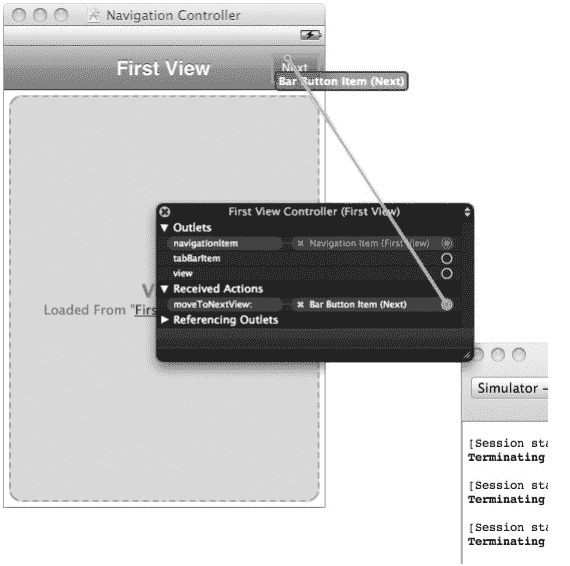

图 9-9 将 moveToNextView 动作连接到导航按钮

图 9-10 在 iPhone 模拟器中运行的应用程序

在第 13 步中，你将默认标题改成了视图的标题。实际上，更准确地说，你是将默认标题改成了视图控制器的导航项的标题。在第 14 步中，你向导航栏添加了一个栏按钮项，并将其设置为导航栏项的`rightBarButtonItem`。建立这种连接可以确保应用程序在栏的右侧显示该按钮。随后，你创建了一个动作，当点击该按钮时，将第二个视图控制器推送到导航控制器的堆栈上。导航控制器会显示此视图，以及一个包含新视图导航栏元素的导航栏。注意，你必须通过代码手动将视图控制器推送到堆栈上，如代码清单 9-4 所示。

```
[self.navigationController pushViewController:self.second animated:YES];
```

如果一个视图控制器位于导航控制器的堆栈中，那么其`navigationController`属性会自动指向管理该堆栈的导航控制器。因此，`ThreeViewNavContAppDelegate`中的导航控制器将`FirstViewController`的`SecondViewController`推送到堆栈上。注意，将`animated`参数设置为`YES`会使视图从左侧滑入。


如该任务所示，使用导航控制器和相关导航栏创建应用程序并不困难。返回按钮以及从导航控制器弹出视图控制器的功能已经为你实现。你需要提供控件和动作来将视图控制器推送到导航控制器的堆栈上。

#### 添加另一个视图

如果你希望将视图推送到导航控制器的堆栈上，并不局限于使用栏按钮。在以下步骤中，你首先向`SecondViewController`添加一个栏按钮项。然后，你向`SecondViewController`的视图添加一个额外的按钮，但它不是栏按钮，而是一个普通按钮。

1. 在 Xcode 中打开`ThreeViewNavCont`项目。
2. 打开`SecondViewController`，并将一个`UIBarButtonItem`的`IBOutlet`作为属性添加到`SecondViewController`。将该属性命名为`navBut`；别忘了合成（synthesize）该属性。
3. 打开`SecondViewController.m`，实现`viewDidLoad`方法，将`navigationItem`的右侧栏按钮项设置为`navBut`。注意，每个`UIViewController`都有一个`navigationItem`，且它是一个只读属性。
4. 在 Interface Builder 中打开`SecondViewController.xib`，并向文档窗口添加一个新的栏按钮项（图 9-11）。将新添加的栏按钮项连接到`navBut`出口。
5. 保存并退出 Interface Builder。
6. 构建并运行应用程序，第二个视图现在会在导航栏中显示其标题（图 9-12）。但请注意，点击导航栏中的 Next 按钮没有任何效果，因为你还没有将它连接到方法。


图 9-11 添加 UIBarButtonItem


图 9-12 应用程序显示第二个视图控制器的导航项标题

7. 打开`SecondViewController.h`并添加一个名为`moveToNextView`的新动作（代码清单 9-5）。导入`ThirdViewController`和`ThreeViewNavContAppDelegate`。将`ThirdViewController`添加为属性。
8. 打开`SecondViewController.m`并实现`moveToNextView`，如代码清单 9-6 所示。保存并构建。
9. 在 Interface Builder 中打开`SecondViewController.xib`。将栏按钮的选择器连接到 File's Owner 的`moveToNextView`动作（图 9-13）。
10. 保存并退出 Interface Builder。
11. 构建并运行应用程序。第二个视图现在有一个 Next 按钮，轻点它将进入下一个视图（图 9-14）。现在考虑使用普通按钮将视图推送到堆栈上。


图 9-13 将栏按钮连接到 moveToNextView 动作


图 9-14 带有 Next 按钮的第二个视图


图 9-15 将按钮连接到 moveToNextView 方法

12. 打开`SecondViewController.xib`并向视图添加一个按钮。将按钮连接到`moveToNextView`（图 9-15）。连接到按钮的 Touch Up Inside 动作。
13. 保存并退出 Interface Builder。
14. 构建并运行应用程序。点击第二个视图上的按钮，它也会导航到第三个视图。

使用按钮而不是栏按钮项就是这么简单。不过，通常在你看到的大多数 iPhone 应用程序中，视图中会显示一个表格，而不是按钮（见图 9-1）。例如，`SecondViewController`可能有一个嵌入的表格，列出了各个类别。点击表格行时，你会调用`moveToNextView`方法，并将特定表格行的标识符作为参数传递。App Store 应用程序就是这种导航类型的一个例子（见图 9-1）。

代码清单 9-5 SecondViewController.h

```
#import <UIKit/UIKit.h>
#import "ThirdViewController.h"

@interface SecondViewController : UIViewController {
    ThirdViewController * third;
    IBOutlet UIBarButtonItem * navBut;
}

@property (nonatomic, retain) IBOutlet UIBarButtonItem * navBut;
@property (nonatomic, retain) ThirdViewController * third;
- (IBAction) moveToNextView: (id) sender;

@end
```

代码清单 9-6 SecondViewController.m

```
#import "SecondViewController.h"

@implementation SecondViewController

@synthesize third;
@synthesize navBut;

- (void) viewDidLoad{
    self.navigationItem.title = @"SecondView";
    self.navigationItem.rightBarButtonItem = navBut;
}

- (IBAction) moveToNextView: (id) sender{
    self.third = [[[ThirdViewController alloc]
        initWithNibName:@"ThirdViewController" bundle:nil] autorelease];
    [self.navigationController pushViewController:self.third animated:YES];
}

- (void)dealloc {
    [third release];
    [super dealloc];
}

@end
```

### 动手实践：复现 Utility Application

如果你使用 Utility Application 模板创建了一个 Utility Application，然后查看代码，你会发现它对`UINavigationBar`的使用方式可能与你预期的略有不同。但你可以使用更标准的代码来复现该模板的结果，这正是本任务中要做的。

1. 新建一个基于 Window 的应用程序。命名为`UtilityProjectTwo`。
2. 添加两个名为`FirstViewController`和`SecondViewController`的`UIViewController`类；确保让 Xcode 为两者创建 nib 文件。
3. 在 Interface Builder 中打开两个 nib 文件，并更改两个视图的背景颜色。


图 9-16 添加导航控制器

4. 按照上一个练习的相同步骤，向`MainWindow.xib`添加一个导航控制器，并将`FirstViewController`设置为根视图控制器（图 9-16）。不要忘记在`UtilityProjectTwoAppDelegate`中创建`navController`的`IBOutlet`，并在`MainWindow.xib`中设置`navController`出口。
5. 将窗口的背景颜色改为黑色。
6. 在 Interface Builder 中打开`FirstViewController.xib`。将一个按钮拖到视图画布上。在 Button Attributes Inspector 中将按钮的类型更改为 Info Light（图 9-17）。
7. 保存并退出 Interface Builder。
8. 打开`FirstViewController.h`和`FirstViewController.m`，修改这两个文件以匹配代码清单 9-7 和 9-8。


图 9-17 更改按钮的类型

代码清单 9-7 FirstViewController.h

```
#import <UIKit/UIKit.h>
#import "SecondViewController.h"

@interface FirstViewController : UIViewController {
    SecondViewController * second;
}

@property (nonatomic, retain) SecondViewController * second;
- (IBAction)showDetails:(id)sender;

@end
```

代码清单 9-8 FirstViewController.m

```
#import "FirstViewController.h"

@implementation FirstViewController

@synthesize second;

- (void) viewWillAppear: (BOOL) animated{
    [self.navigationController setNavigationBarHidden:YES animated: NO];
}

- (IBAction)showDetails:(id)sender {
    self.second = [[[SecondViewController alloc]
 initWithNibName:@"SecondViewController" bundle:nil] autorelease];
    self.second.modalTransitionStyle = UIModalTransitionStyleFlipHorizontal;
    [self presentModalViewController:self.second animated:YES];
}

- (void)dealloc {
    [second release];
    [super dealloc];
}

@end
```

9. 打开`SecondViewController.h`和`SecondViewController.m`并修改这两个文件以匹配代码清单 9-9 和 9-10。保存并构建应用程序。

代码清单 9-9 SecondViewController.h

```
#import <UIKit/UIKit.h>

@interface SecondViewController : UIViewController {
}
- (IBAction) popSecondView;

@end
```

代码清单 9-10 SecondViewController.m

```
#import "SecondViewController.h"

@implementation SecondViewController

- (IBAction) popSecondView{
    [self dismissModalViewControllerAnimated:YES];
}

- (void)dealloc {
    [super dealloc];
}

@end
```

10. 打开`FirstViewController.xib`并将按钮连接到`showDetails`操作。
11. 打开`SecondViewController.xib`，在视图画布上、视图状态栏下方添加一个导航栏。同时，在新添加的导航栏上添加一个栏按钮项。
12. 将导航栏的样式更改为黑色半透明（图 9-18）。保存并关闭 nib 文件。


图 9-18 更改为黑色半透明

13. 将新添加的栏按钮项连接到 File's Owner 的`popSecondView`操作。
14. 保存并退出 Interface Builder。
15. 构建并运行应用程序。

参考代码清单 9-8 中的`FirstViewController`。尝试复现实用应用程序模板效果时遇到的第一个问题是如何使导航栏在第一个视图中不可见，但在第二个视图中可见。在`FirstViewController`的`viewDidAppear:`方法中添加以下代码行，即可实现不可见/可见的要求，并确保导航栏在第一个视图中隐藏。

```
[self.navigationController setNavigationBarHidden:YES animated: NO];
```

`showDetails:`方法是连接到第一个视图信息按钮的操作。当你点击信息按钮时，它会调用`showDetails:`。请注意，当导航控制器从栈中弹出第二个视图时，第一个视图的`viewDidAppear:`会被调用，确保导航栏再次被隐藏。

### 深入了解 UINavigationController

你不仅可以将项目推入栈中，还可以将项目从栈中弹出。你还可以修改导航栏，隐藏元素、添加新元素以及进行其他修改。

#### 推入和弹出

你可以使用`popViewControllerAnimated:`方法从栈中弹出视图控制器。此方法会从导航控制器的栈中弹出顶部的视图控制器，并将显示的视图更新为栈中下一个视图控制器的视图。

```
- (UIViewController *) popViewControllerAnimated: (BOOL) animated
```

该方法接受一个参数，用于指示转换是否应带动画。该方法还会返回弹出的视图控制器，以便你希望保留以备将来使用。

你可能还会用到的其他方法包括`popToRootViewControllerAnimated:`和`popToViewController:animated:`。更多信息请参考 Apple 在线文档中的 “UINavigationController Class Reference”。

#### 配置导航栏

在前面的示例中，你通过调用导航控制器的`setNavigationBarHidden:`方法来隐藏导航栏。

```
- (void)setNavigationBarHidden: (BOOL)hidden animated: (BOOL)animated
```

此方法根据你传入的初始参数是`YES`还是`NO`来隐藏或显示导航栏。你还可以通过为`animated`参数指定`YES`来指定导航栏是否应从顶部滑入。

你也可以通过更改导航栏的`style`属性来改变其样式。你可以使用代码更改导航栏的样式，但最简单的方法是通过 Interface Builder。你还可以更改导航栏的颜色。使用`tintColor`属性更改颜色。

### 试一试：在标签页中使用导航控制器

应用程序通常将导航栏与其他导航视图（如标签栏或表格视图）一起使用。你还没有学习表格视图——你将在第 10 章学习如何将表格视图与导航栏一起使用。然而，你在第 8 章学习了标签栏。导航栏可以放置在标签栏内。例如，回到 App Store 应用程序，注意导航屏幕是“精选”标签内的步骤（见图 9-1）。“精选”、“分类”、“前 25 名”和“更新”标签是同一数据上的不同视图。“搜索”标签是一个子任务。在“分类”标签内，有一个导航栏与表格视图组合。这种组合提供了一种逐层深入到特定应用程序的方法。

虽然你直到第 10 章才学习表格视图，但请考虑在标签页中使用导航栏。

1. 创建一个新的基于窗口的应用程序。将应用程序命名为`NavInTab`。
2. 创建两个新的`UIViewController`类。将第一个命名为`FirstTabViewController`，第二个命名为`StepTwoViewController`；确保为两者都创建 nib 文件。
3. 打开两个新创建的 nib 文件，并更改每个视图的背景颜色。
4. 打开`MainWindow.xib`并将一个`UITabBarController`添加到文档中。
5. 删除第一个标签栏视图控制器。将一个导航控制器拖到文档中并放置，使其成为标签栏下方的第一个项目（图 9-19）。
6. 在检查器中更改导航控制器的根视图画布，将其类和 nib 名称更改为`FirstTabViewController`。画布应显示视图来自`FirstViewController.nib`（图 9-20）。
7. 将导航项的标题从 “Root View Controller” 更改为 “step one”。
8. 从库中拖动一个栏按钮项到文档窗口中的导航项上（图 9-21）。将按钮的标题更改为 “Next”。该按钮应自动设置为导航项的`rightBarButtonItem`。如果没有，请将导航项的`rightBarButton`出口连接到新添加的栏按钮项。
9. 保存并退出 Interface Builder。


图 9-19 添加导航控制器


图 9-20 画布显示视图来自不同的 nib


图 9-21 栏按钮已添加到文档窗口

10. 打开`NavInTabAppDelegate.h`和`NavInTabAppDelegate.m`并遵循`UITabBarControllerDelegate`协议。同时添加一个`UITabBarController`属性和一个`UINavigationController`属性。修改`applicationDidFinishLaunching`以加载`tabBarController`属性的根视图。文件应匹配代码清单 9-11 和 9-12。保存并构建。

代码清单 9-11 NavInTabAppDelegate.h

```
#import <UIKit/UIKit.h>

@interface NavInTabAppDelegate : NSObject<UIApplicationDelegate,
UITabBarControllerDelegate> {
    UIWindow *window;
    UITabBarController *tabBarController;
    UINavigationController *navBarController;
}

@property (nonatomic, retain) IBOutlet UIWindow *window;
@property (nonatomic, retain) IBOutlet UITabBarController *tabBarController;
@property (nonatomic, retain) IBOutlet UINavigationController *navBarController;

@end
```

代码清单 9-12 NavInTabAppDelegate.m

```
#import "NavInTabAppDelegate.h"

@implementation NavInTabAppDelegate

@synthesize window;
@synthesize tabBarController;
@synthesize navBarController;

- (void)applicationDidFinishLaunching:(UIApplication *)application {
    [window addSubview:tabBarController.view];
    [window makeKeyAndVisible];
}

- (void)dealloc {
    [window release];
    [tabBarController release];
    [navBarController release];
    [super dealloc];
}

@end
```

11. 在 Interface Builder 中打开`MainWindow.xib`并将`NavInTabAppDelegate`的`navBarController`连接到新添加的导航控制器（图 9-22）。将`tabBarController`连接到新添加的标签栏控制器。
12. 保存并退出 Interface Builder。
13. 打开`StepTwoViewController.h`并实现`viewDidLoad`方法，使其将`navigationItem`的标题设置为 “step two”（代码清单 9-13）。


图 9-22 连接 navBarController

### 总结

创建一个带有导航栏的应用程序非常直接。在应用程序的`MainWindow.xib`中，添加一个`UINavigationController`。设置导航控制器的根视图控制器，并创建一个或多个其他视图控制器。然后添加代码，将视图控制器推送到导航控制器的栈上。当一个视图控制器被压入栈中时，它会成为最顶层的视图控制器，因此应用程序将显示该视图控制器的视图。如果你没有让导航栏的“返回”按钮不可见，那么从栈中弹出视图控制器是默认提供的功能。如果你确实让“返回”按钮不可见，或者以某种方式禁用了该按钮，你必须使用导航控制器的方法之一来弹出视图控制器。

在本章中，你学习了如何创建一个包含三个视图的导航控制器的应用程序。然后你使用导航控制器复制了实用程序应用程序模板的结果。最后，你将导航控制器嵌入到了标签栏中的一个标签页中。但本章确实省略了最常见的导航控制器用法：表格与导航控制器的结合。在下一章，在学习了表格之后，我将通过介绍导航控制器与表格控制器的结合来修正这一遗漏。学习了这种组合之后，你将对视图控制器有足够深入的了解，应该能够处理大多数 iPhone 应用程序的导航策略。

## 第 10 章：使用 UITableView 和 UITableViewController 的表格

### 关键技能与概念

- 理解表格视图
- 理解表格视图委托
- 理解表格视图数据源
- 表格行的分组与索引
- 选择表格行
- 修改表格的外观
- 在导航控制器中使用表格
- 编辑表格的行

表格视图以列表形式显示内容。表格有单列和多行。它们可以垂直滚动并显示大量数据集。例如，备忘录应用程序是包含表格的应用程序的一个好例子。备忘录的第一个屏幕是由零个或多个备忘录组成的列表。在图 10-1 中，列表包含三个备忘录。每一行都显示了备忘录的文本、记录时间以及一个展开箭头。


图 10-1 备忘录应用程序由一个 UITableView 和一个 UINavigationBar 组成。


图 10-2 使用备忘录应用程序创建新备忘录

展开箭头表示详细信息在下一个屏幕上。点击某一行后，应用程序会将用户带到该特定行备忘录的详情视图（图 10-2）。

表格可以被分组和索引。例如，iPod touch 上的音乐应用程序使用了索引（图 10-3）。设置应用程序的行是分组的（图 10-4）。

表格行也可能包含图片和其他自定义内容，如 YouTube 和 App Store 应用程序所示（图 10-5）。

正如前五张图所示，表格视图是一个用于列出项目的强大控件。你可以修改行、添加图片、选择行并进行编辑。在本章中，你将学习如何使用表格。你将学习如何构建一个表格，将其样式更改为分组样式，为其添加索引并进行装饰。你还将学习如何将表格放入导航控制器，以及如何编辑表格的行。这是一章很长的内容，但表格视图是一个强大的控件。

### UITableView

`UITableView`类代表一个表格视图。此类用于显示和编辑信息列表。它由单列多行组成。用户可以垂直滚动以浏览表格的行。每一行包含一个单元格。你可以相当大程度地自定义该单元格的外观。

你可以为表格创建索引，并创建具有零个或多个部分的表格。创建表格时，你有两种样式可供选择：`UITableViewStylePlain`或`UITableViewStyleGrouped`。普通表格样式如图 10-3 所示。分组表格样式如图 10-4 所示。你将在本章后面看到实现这两种风格的示例。


图 10-3 iPod touch 上的音乐应用程序使用了带有索引的 UITableView。


图 10-4 设置应用程序使用了分组的 UITableView。


图 10-5 YouTube 和 App Store 应用程序使用了图片和自定义单元格。

`UITableView`类有相关的`UITableViewController`、`UITableViewDelegate`和`UITableViewDataSource`。`UITableViewController`是表格视图的控制器类。你创建此类的实例来管理`UITableView`。`UITableViewDelegate`是你在编写的自定义类中采用的一个协议。此协议允许你管理选择、配置页眉和页脚以及管理单元格。`UITableViewDataSource`也是你在自定义类中采用的一个协议。此协议允许你管理表格的数据源。

### UITableViewDelegate 和 UITableViewDataSource

`UITableViewDelegate`和`UITableViewDataSource`是你的应用程序中如果包含`UITableView`，则至少一个类必须采用的协议。你可以创建自己的自定义类来采用这些协议，或者创建一个自动采用这些协议的`UITableViewController`。如果你选择使用`UITableViewController`而不是自定义类，你只需将表格视图的`dataSource`和`delegate`输出口连接到`UITableViewController`。然后你就可以在`UITableViewController`中实现这两个协议的方法。

#### UITableViewDelegate

`UITableView`的委托采用`UITableViewDelegate`协议。此协议管理选择、页眉、页眉和其他任务。表 10-1 列出了本章涵盖的方法。

| 方法 | 描述 |
|---|---|
| `tableView:heightForRowAtIndexPath:` | 提供显示行时使用的高度。 |
| `tableView:accessoryButtonTappedForRowWithIndexPath:` | 处理行被点击后的详细信息展开按钮。 |
| `tableView:willSelectRowAtIndexPath:` | 处理即将被选中的行。 |
| `tableView:didSelectRowAtIndexPath:` | 处理已被选中的行。 |
| `tableView:editingStyleForRowAtIndexPath:` | 返回行的编辑样式。这决定了单元格是显示插入附件、删除附件还是不显示附件。 |

表 10-1 本章中的 UITableViewDelegate 方法

#### UITableViewDataSource

`UITableView`的数据源采用`UITableViewDataSource`协议。表格的数据源为其提供数据。表 10-2 列出了本章涵盖的`UITableViewDataSource`协议方法。

`tableView:numberOfRowsInSection:`和`tableView:cellForRowAtIndexPath:`

每个表格的数据源都必须实现的方法是`tableView:numberOfRowsInSection:`和`tableView:cellForRowAtIndexPath:`。

| 方法 | 描述 |
|---|---|
| `tableView:numberOfRowsInSection:` | 提供一个部分中的行数。 |
| `tableView:cellForRowAtIndexPath:` | 从数据源获取单元格以放置在特定行。 |
| `numberOfSectionsInView:` | 从数据源获取表格视图中的部分数。 |
| `sectionIndexTitlesForTableView:` | 从数据源获取表格视图的索引标题。 |
| `tableView:commitEditingStyle:forRowAtIndexPath:` | 提交单元格的编辑。 |
| `tableView:canEditRowAtIndexPath:` | 返回一个布尔值，通知表格视图某行是否可以编辑。 |
| `tableView:canMoveRowAtIndexPath:` | 返回一个布尔值，通知表格视图某行是否可以移动。 |
| `tableView:moveRowAtIndexPath:toIndexPath:` | 允许移动表格单元格。 |

表 10-2 本章中的 UITableViewDataSource 方法

```
- (NSInteger)tableView:(UITableView *)tableView
    numberOfRowsInSection:(NSInteger)section
- (UITableViewCell *)tableView:(UITableView *)tableView
    cellForRowAtIndexPath:(NSIndexPath *)indexPath
```

`tableView:numberOfRowsInSection:`方法通知数据源一个分区包含多少行。`tableView:cellForRowAtIndexPath:`方法为表格视图提供其单元格。

### 采用 UITableViewDelegate 和 UITableViewDataSource 协议

在这个第一个任务中，你创建一个`UIViewController`并让它管理表格视图。你还要实现一个采用`UITableViewDelegate`和`UITableViewDataSource`协议的自定义类。

#### 创建一个空表格

1. 创建一个新的基于窗口的应用程序。将应用程序命名为`TableProjectOne`。
2. 创建一个新的`UIViewController`子类。将类命名为`MyViewController`。
3. 创建一个名为`MyViewController`的新的空 xib 文件。
4. 打开`MyViewController.xib`。
5. 向文档窗口添加一个视图，并向该视图添加一个表格视图（图 10-6）。务必调整表格视图的大小，使其完全填满视图。
6. 将文件的所有者更改为`MyViewController`。将文件的所有者视图连接到文档窗口中的视图。
7. 保存并退出 Interface Builder。
8. 将一个`MyViewController`作为`IBOutlet`添加到`TableProjectOneAppDelegate`（代码清单 10-1 和 10-2）。
9. 修改`applicationDidFinishLaunching`，使其添加`viewController`属性的视图。构建应用程序。
10. 打开`MainWindow.xib`，将一个 View Controller 拖到文档窗口。将其类和 Nib Name 更改为`MyViewController`。
11. 将`TableProjectOneAppDelegate`的`viewController`输出口连接到添加到文档窗口的`MyViewController`。
12. 保存并退出 Interface Builder。
13. 构建并运行应用程序。该应用程序将一个空表格加载到 iPhone 模拟器中（图 10-7）。

图 10-6 向 Interface Builder 项目添加 UITableView


> 注意：在步骤 1-13 中，你是将表格视图作为子视图添加到`MyViewController` Nib 中的视图。如果你愿意，可以省略额外的视图，直接将表格视图添加为 nib 的视图。但请注意，你还需要将`MyViewController`从`UIViewController`更改为`UITableViewController`。关键在于，你不必将`UITableView`放在`UIView`内部才能使用它。`UITableView`可以直接添加到 XIB 并连接到表格视图控制器的视图输出口，其工作方式相同。下一个“动手试试”示例将进行说明。

图 10-7 一个包含空 UITableView 的应用程序


代码清单 10-1 TableProjectOneAppDelegate.h

```
#import <UIKit/UIKit.h>
#import "MyViewController.h"

@interface TableProjectOneAppDelegate : NSObject
<UIApplicationDelegate> {
    UIWindow *window;
    IBOutlet MyViewController * viewController;
}

@property (nonatomic, retain) IBOutlet MyViewController *
viewController;
@property (nonatomic, retain) IBOutlet UIWindow *window;

@end
```

代码清单 10-2 TableProjectOneAppDelegate.m

```
#import "TableProjectOneAppDelegate.h"

@implementation TableProjectOneAppDelegate

@synthesize window;
@synthesize viewController;

- (void)applicationDidFinishLaunching:(UIApplication *)application {
    [window addSubview:self.viewController.view];
    [window makeKeyAndVisible];
}

- (void)dealloc {
    [window release];
    [viewController release];
    [super dealloc];
}

@end
```

在这个任务的第一步中，你创建了一个`UITableView`作为`UIView`的子视图。当`UIViewController`加载并显示其视图时，该视图会自动显示其子视图，即表格视图。但它加载的只是一个空表格。要实际将数据加载到表格中，你必须实现一个委托和一个数据源。此外，数据源必须实际为表格提供数据。在接下来的几个步骤中，你将为表格创建一个委托和数据源。

#### 添加委托和数据源

1. 创建一个名为`TableHandler`的新`NSObject`。修改`TableHandler`，使其采用`UITableViewDelegate`和`UITableViewDataSource`协议（代码清单 10-3 和 10-4）。
2. 添加一个`NSArray`属性和一个名为`fillList`的方法，用于填充数组。
3. 实现`fillArray`方法，以便应用程序有数据可以加载到表格的单元格中。
4. 实现`tableView:numberOfRowsInSection:`和`tableView:cellForRowAtIndexPath:`方法。
5. 修改`MyViewController`，使其拥有一个`TableHandler`属性（代码清单 10-5 和 10-6）。确保该属性是一个`IBOutlet`。
6. 在`MyViewController`中实现`viewDidLoad`方法，使其调用其`TableHandler`的`fillList`方法。
7. 保存并编译。
8. 打开`MyViewController.xib`，将一个对象拖到文档窗口。将该对象的类更改为`TableHandler`（图 10-8）。
9. 将文件的所有者`myHandler`输出口连接到新添加的`TableHandler`（图 10-9）。
10. 将表格视图的`dataSource`和`delegate`输出口连接到新添加的`TableHandler`。
11. 保存并退出 Interface Builder。
12. 点击 Build And Go。应用程序显示 20 行数据（图 10-10）。


图 10-10 在 iPhone 模拟器中运行的项目


代码清单 10-3 TableHandler.h

```
#import <Foundation/Foundation.h>

@interface TableHandler : NSObject <UITableViewDelegate,
UITableViewDataSource> {
    NSArray * tableDataList;
}

@property (nonatomic, retain) NSArray * tableDataList;
- (void) fillList;

@end
```

代码清单 10-4 TableHandler.m

```
#import "TableHandler.h"

@implementation TableHandler

@synthesize tableDataList;

- (void) fillList {
    NSArray * tempArray = [[NSArray alloc] initWithObjects:@"Item One",
    @"Item Two", @"Item Three", @"Item Four", @"Item Five", @"Item Six",
    @"Item Seven", @"Item Eight", @"Item Nine", @"Item Ten", @"Item Eleven",
    @"Item Twelve", @"Item Thirteen", @"Item Fourteen", @"Item Fifteen",
    @"Item Sixteen", @"Item Seventeen", @"Item Eighteen", @"Item Nineteen",
    @"Item Twenty", nil] autorelease];
    self.tableDataList = tempArray;
}

- (NSInteger)tableView:(UITableView *)tableView
    numberOfRowsInSection:(NSInteger)section {
    return [self.tableDataList count];
}

- (UITableViewCell *)tableView:(UITableView *)tableView
    cellForRowAtIndexPath:(NSIndexPath *)indexPath {
    UITableViewCell *cell = [tableView
    dequeueReusableCellWithIdentifier:@"acell"];
    if(cell == nil) {
        cell = [[[UITableViewCell alloc] initWithStyle:UITableViewCellStyle
        Default reuseIdentifier:@"acell"] autorelease];
    }
    cell.textLabel.text = [self.tableDataList objectAtIndex:[indexPath row]];
    return cell;
}

- (void)dealloc {
    [tableDataList release];
    [super dealloc];
}

@end
```

代码清单 10-5 MyViewController.h

```
#import <UIKit/UIKit.h>
#import "TableHandler.h"

@interface MyViewController : UIViewController {
    IBOutlet TableHandler * myHandler;
}

@property (nonatomic, retain) IBOutlet TableHandler * myHandler;

@end
```

代码清单 10-6 MyViewController.m

```
#import "MyViewController.h"

@implementation MyViewController

@synthesize myHandler;

- (void)viewDidLoad {
    [self.myHandler fillList];
}

- (void)dealloc {
    [self.myHandler release];
    [super dealloc];
}

@end
```

### UITableViewController

`UITableViewController`管理一个表格视图。`UITableView`可以使用在表格 nib 中定义的对象来定义表格的委托和数据源，也可以将自身用作委托和数据源。例如，在前面的示例中，你将表格的委托和数据源属性设置为`TableHandler`类。你也可以添加一个`UITableViewController`，将其设置为表格的文件所有者，然后将其输出口设置为`TableHandler`。

如果你不在表格的 nib 中提供委托和数据源，`UITableViewController`会将自身的数据源和委托设置为自身。通过这样做，`UITableViewController`省去了你必须创建自己的类来采用委托和数据源的工作。你仍然必须实现所需的任何数据源和委托方法。但是，你不是在单独的自定义类中实现这些方法，而是在`UITableViewController`子类中实现它们。然后，`UITableViewController`将作为表格的控制器、委托和数据源发挥作用。

#### 动手试试 使用 UITableViewController

在上一个“动手试试”任务中，你用了比较麻烦的方法。然而，该任务的目的是说明如何将表格视图作为子视图添加，而没有控制器。在这个“动手试试”任务中，你将使用`UITableViewController`。此外，你不是将表格视图作为子视图添加，而是直接将其作为主视图添加到 xib 中。

1. 创建一个新的基于窗口的应用程序。将应用程序命名为`TableProjectTwo`。
2. 创建一个新的`UITableViewController`子类。将类命名为`MyTableViewController`（代码清单 10-9 和 10-10）。
3. 创建一个名为`MyTableViewController`的新的空 xib 文件。
4. 打开`MyTableViewController.xib`。
5. 将一个表格视图添加到文档窗口（图 10-11）。
6. 如果文件的所有者还不是`MyTableViewController`，请将其更改为`MyTableViewController`。将文件的所有者视图连接到文档窗口中的表格视图。


7. 将新添加的表格视图的`dataSource`和`delegate`插座连接到 File's Owner。
8. 保存并退出 Interface Builder。
9. 将`MyTableViewController`添加为`TableProjectTwoAppDelegate`的一个`IBOutlet`（代码清单 10-7 和 10-8）。不要忘记导入`MyTableViewController`。
10. 修改`applicationDidFinishLaunching`，使其添加`viewController`属性的视图。构建应用程序。
11. 打开`MainWindow.xib`，将一个 Table View Controller 拖到文档窗口。将其 Class 和 Nib Name 更改为`MyTableViewController`。
12. 将`TableProjectCoding`的`viewController`插座连接到添加到文档窗口的`MyTableViewController`。
13. 保存并退出 Interface Builder。
14. 实现表格委托和数据源方法，与本章第一个“试一试”任务中的`TableHandler`做法相同。
15. 修改`MyTableViewController`，使其拥有一个名为`tableDataList`的`NSArray`，并在`viewDidLoad`方法中填充它。
16. 构建并运行应用程序。应用程序将一个空表格加载到 iPhone 模拟器中。结果应与前一个任务的结果匹配（图 10-10）。

代码清单 10-7 TableProjectTwoAppDelegate.h

```
#import <UIKit/UIKit.h>
#import "MyTableViewController.h"

@interface TableProjectTwoAppDelegate : NSObject
<UIApplicationDelegate> {
    UIWindow *window;
    IBOutlet MyTableViewController * viewController;
}

@property (nonatomic, retain) IBOutlet MyTableViewController * viewController;
@property (nonatomic, retain) IBOutlet UIWindow *window;

@end
```

代码清单 10-8 TableProjectTwoAppDelegate.m

```
#import "TableProjectTwoAppDelegate.h"

@implementation TableProjectTwoAppDelegate

@synthesize window;
@synthesize viewController;

- (void)applicationDidFinishLaunching:(UIApplication *)application {
    [window addSubview:self.viewController.view];
    [window makeKeyAndVisible];
}

- (void)dealloc {
    [window release];
    [viewController release];
    [super dealloc];
}

@end
```

代码清单 10-9 MyTableViewController.h

```
#import <Foundation/Foundation.h>

@interface MyTableViewController : UITableViewController {
    NSArray * tableDataList;
}

@property (nonatomic, retain) NSArray * tableDataList;

@end
```

代码清单 10-10 MyTableViewController.m

```
#import "MyTableViewController.h"

@implementation MyTableViewController

@synthesize tableDataList;

- (void) viewDidLoad {
    NSArray * tempArray = [[[NSArray alloc] initWithObjects:@"Item One",
@"Item Two", @"Item Three", @"Item Four", @"Item Five", @"Item Six",
@"Item Seven", @"Item Eight", @"Item Nine", @"Item Ten", @"Item Eleven",
@"Item Twelve", @"Item Thirteen", @"Item Fourteen", @"Item Fifteen",
@"Item Sixteen", @"Item Seventeen", @"Item Eighteen", @"Item Nineteen",
@"Item Twenty", nil] autorelease];
self.tableDataList = tempArray;
}

- (NSInteger) tableView : (UITableView *) tableView
numberOfRowsInSection: (NSInteger) section {
return [self.tableDataList count];
}

- (UITableViewCell *) tableView : (UITableView *) tableView
cellForRowAtIndexPath: (NSIndexPath *) indexPath {
UITableViewCell *cell = [tableView
dequeueReusableCellWithIdentifier:@"acell"];
if(cell == nil) {
cell = [[[UITableViewCell alloc] initWithStyle:UITableViewCellStyle
Default reuseIdentifier:@"acell"] autorelease];
}
cell.textLabel.text = [self.tableDataList objectAtIndex:[indexPath
row]];
return cell;
}

- (void)dealloc {
[tableDataList release];
[super dealloc];
}

@end
```

### 分组和索引

表格有两种主要样式：分组样式和普通样式。图 10-3 展示了一个普通样式的表格，而图 10-4 展示了一个分组样式的表格。普通表格也可以有索引。索引会对行进行排序，并通过让用户跳转到索引中的不同位置来加快导航速度。

#### 分组表格样式

分组是通过将`UITableView`的样式更改为 grouped 来实现的。然后，你需要告诉`UITableView`的数据源表格包含多少个分组，以及每个分组包含多少行。遵循`UITableViewDataSource`协议的类通过`numberOfSectionsInTableView`方法告知表格有多少个分组。它通过`tableView:numberOfRowsInSection:`方法告知表格每个分组中有多少行。

```
- (NSInteger)numberOfSectionsInTableView:(UITableView *)tableView
- (NSInteger)tableView:(UITableView *) tableView
numberOfRowsInSection: (NSInteger)section
```

每个分组可能有一个标题。你可以通过让你的`UITableViewDataSource`协议实现`tableView:titleForHeaderInSection`方法来添加标题。此方法为表格视图提供一个分组标题。你也可以通过实现`tableView:titleForFooterInSection:`方法为每个分组添加页脚。

```
- (NSString *)tableView:(UITableView *)tableView titleForHeaderIn
Section:(NSInteger)section
- (NSString *)tableView:(UITableView *)tableView titleForFooterIn
Section:(NSInteger)section
```

##### 试一试 分组

1. 将`TableProjectOne`从第一个任务复制到一个新位置。在 Xcode 中打开新复制的`TableProjectOne`。
2. 修改`TableHandler`中的数组，使`tableDataList`由五个数组组成的数组构成（代码清单 10-10）。
3. 将`numberOfSectionsInTableView`和`titleForHeaderInSection`方法添加到`TableHandler.m`（代码清单 10-11）。
4. 修改`numberOfRowsInSection`以返回 2。
5. 修改`cellForRowAtIndexPath`，使其使用 section 和 row（代码清单 10-12）。
6. 在 Interface Builder 中打开`MyViewController.xib`。
7. 将表格视图的 Style 从 Plain 更改为 Grouped（图 10-12）。
8. 保存并退出 Interface Builder。点击 Build And Go。表格的行被分组了（图 10-13）。

`fillList`方法初始化了一个包含五个`NSArray`的`NSArray`。`numberOfSectionsInTableView`方法简单地返回五。虽然不现实，但这个数字与数据数组（`tempArrayA`到`tempArrayB`）的数量匹配。`tableView:titleForHeaderInSection`是硬编码的，根据当前分组返回 A、B、C、D 或 E。当表格加载时，创建五个分组，每个分组都有一个来自`titleForHeaderInSection`方法的标题。每行的内容由`cellForRowAtIndexPath`方法决定。


图 10-12 将表格更改为分组样式


图 10-13 应用程序在 iPhone 模拟器中运行

代码清单 10-10 表格的列表修改为数组的数组

```
- (void) fillList {
  NSArray * tempArrayA = [[[NSArray alloc] initWithObjects:@"AItem One",
@"AItem Two", nil] autorelease];
  NSArray * tempArrayB = [[[NSArray alloc] initWithObjects:@"BItem Three",
@"BItem Four", nil] autorelease];
  NSArray * tempArrayC = [[[NSArray alloc] initWithObjects:@"CItem Five",
@"CItem Six", nil] autorelease];
  NSArray * tempArrayD = [[[NSArray alloc] initWithObjects:@"DItem Seven",
@"DItem Eight", nil] autorelease];
  NSArray * tempArrayE = [[[NSArray alloc] initWithObjects:@"EItem Nine",
@"EItem Ten", nil] autorelease];
  NSArray * tempArray = [[[NSArray alloc] initWithObjects:tempArrayA,
tempArrayB, tempArrayC, tempArrayD, tempArrayE, nil] autorelease];
  self.tableDataList = tempArray;
}
```

代码清单 10-11 对 TableHandler.m 的修改以支持分组

```
- (NSInteger) numberOfSectionsInTableView: (UITableView *) tableView {
    return 5;
}

- (NSString *) tableView: (UITableView *) tableView
titleForHeaderInSection: (NSInteger) section {
    switch (section) {
    case 0: return @"A"; break;
    case 1: return @"B"; break;
    case 2: return @"C"; break;
    case 3: return @"D"; break;
    case 4: return @"E"; break;
    }
    return nil;
}

- (NSInteger) tableView : (UITableView *) tableView
numberOfRowsInSection: (NSInteger) section {
    return 2;
}
```

代码清单 10-12 修改后的 cellForRowAtIndexPath 以使用行和分组

```
- (UITableViewCell *) tableView : (UITableView *) tableView
cellForRowAtIndexPath: (NSIndexPath *) indexPath {
    UITableViewCell *cell = [tableView dequeueReusableCellWithIdentifier:
    @"acell"];
    if(cell == nil) {
    cell = [[[UITableViewCell alloc] initWithStyle:UITableViewCellStyle
    Default reuseIdentifier: @"acell"] autorelease];
    }
    cell.textLabel.text = [[self.tableDataList objectAtIndex:indexPath.
    section]
    objectAtIndex:indexPath.row];
    return cell;
}
```

#### 索引

表格可以被索引。要索引一个表格，表格的样式应为普通样式。与分组一样，你需要实现`numberOfSectionsInTableView:`和`tableView:numberOfRowsInSection:`方法。

方法，你还实现了第三个方法：`sectionIndexTitlesForTableView:`。这个方法在你的`UITableViewDataSource`遵循类中实现，用于创建出现在表格右侧的标题。点击其中一个值后，用户将被直接带到具有相应标题的分组。

```
- (NSArray *) sectionIndexTitlesForTableView:(UITableView *) tableView
```

##### 动手试试索引

1. 打开分组"动手试试"任务中的`TableProjectOne`。
2. 打开`MyViewController.xib`，将表格视图的样式更改为 Plain。
3. 保存并退出 Interface Builder。点击 Build And Go。注意应用程序仍然是分组的，但表格的外观发生了变化（图 10-14）。


图 10-14 带有分组的 Plain 表格

4. 在`TableHandler.m`中实现`sectionIndexTitlesForTableView`方法，如清单 10-13 所示。
5. 点击 Build And Go。应用程序有了索引（图 10-15）。

清单 10-13 sectionIndexTitlesForTableView 方法

```
- (NSArray *) sectionIndexTitlesForTableView: (UITableView *) tableView {
  NSArray * keys = [[[NSArray alloc] initWithObjects: @"A", @"B", @"C", @"D", @"E",nil] autorelease];
  return keys;
}
```


图 10-15 在 iPhone Simulator 中运行的带索引表格

> 注意：不要让本章对简单`NSArray`的使用误导你，让你以为必须使用这个集合类来存储表格的数据。你可以使用任何集合类，或你认为合适的任何其他方法，只要实现了正确获取数据的方法即可。

### 表格中的图片

向表格中添加图片并不困难，前提是你可以接受图片出现在行的左上角。只需在`tableView:cellForRowAtIndexPath:`方法中将图片添加到单元格即可。请记住，此方法将`UITableViewCell`加载到行中。你可以使用此方法通过`UITableViewCell`的`imageView.image`属性用图片初始化表格单元格。然后图片将显示在表格的行中。

#### 动手试试添加图片

1. 打开上一个任务的项目。从本书的 Resources 文件夹中，将图片`power.png`、`icon.png`、`package.png`、`web.png`和`colorize.png`添加到项目的 Resources 文件夹。
2. 修改`tableView:cellForRowAtIndexPath:`方法，使其与清单 10-14 一致。
3. 点击 Build And Go。注意图片超出了表格单元格的边界（图 10-16）。

清单 10-14 添加到 TableHandler.m 中的 tableView:cellForRowAtIndexPath: 方法

```
- (UITableViewCell *) tableView : (UITableView *) tableView
cellForRowAtIndexPath: (NSIndexPath *) indexPath {
 UITableViewCell *cell = [tableView
dequeueReusableCellWithIdentifier:@"acell"];
 if(cell == nil) {
 cell = [[[UITableViewCell alloc] initWithStyle:
UITableViewCellStyleDefault reuseIdentifier:@"acell"] autorelease];
 }
 cell.textLabel.text = [[self.tableDataList objectAtIndex: indexPath.
section] objectAtIndex: indexPath.row];
 UIImage * image;
 switch (indexPath.section) {
 case 0: image = [UIImage imageNamed:@"power.png"]; break;
 case 1: image = [UIImage imageNamed:@"Icon.png"]; break;
 case 2: image = [UIImage imageNamed:@"package_graphics.png"]; break;
 case 3: image = [UIImage imageNamed:@"colorize.png"]; break;
 case 4: image = [UIImage imageNamed:@"web.png"]; break;
 }
 cell.imageView.image = image;
 return cell;
 }
```

4. 在 Preview 中缩放图片。将图片调整为 32 × 32 像素。
5. 将图片重新导入到项目中。
6. 点击 Build And Go。图片正确显示（图 10-17）。


图 10-16 图片太大，无法在应用程序的表格行中显示。


图 10-17 调整大小后的图片正确显示

### 选择行

`UITableView`允许你选择一行。通常，表格向用户呈现行，其中每一行是分层列表中的一个项目。选择一行后，用户通常会被带到另一个视图，显示该项目的详情。如果你想允许用户选择行，需要实现`tableView:willSelectRowAtIndexPath:`和`tableView:didSelectRowAtIndexPath:`方法。

```
- (NSIndexPath *) tableView:(UITableView *) tableView
willSelectRowAtIndexPath: (NSIndexPath *) indexPath
- (void) tableView: (UITableView *) tableView didSelectRowAtIndexPath:
(NSIndexPath *) indexPath
```

`tableView:willSelectRowAtIndexPath:`方法允许委托对即将被选中的行做出反应。`tableView:didSelectRowAtIndexPath:`方法允许对行的选择做出反应。这些方法很有用，因为它们允许你在表格的委托中实现当行被选中时的自定义行为。

#### 行选择

1. 在 Xcode 中打开上一个任务的项目。
2. 将清单 10-15 中的`tableView:willSelectRowAtIndexPath:`和`tableView:didSelectRowAtIndexPath:`方法添加到`TableHandler.m`。
3. 点击 Build And Go。应用程序看起来与上一个任务的结果相同。点击项目应产生类似于清单 10-16 的日志。

清单 10-15 tableView:willSelectRowAtIndexPath: 和 tableView:didSelectRowAtIndexPath: 方法

```
-(NSIndexPath *) tableView: (UITableView *) tableView willSelectRowAt
IndexPath: (NSIndexPath *) indexPath {
  NSLog(@"I selected the item at the %d array and %d item, the value is: %@",
  indexPath.section, indexPath.row,
  [[self.tableDataList objectAtIndex: indexPath.section] objectAtIndex:
  indexPath.row]);
  return indexPath;
}

-(void)tableView:(UITableView *) tableView didSelectRowAtIndexPath:
(NSIndexPath *) index {
  NSLog(@"Yes I did....");
}
```

清单 10-16 调试器控制台日志

```
[Session started at 2009-01-09 13:25:41 -0500.]
2009-01-09 13:25:45.453 TableProjectOne[2089:20b] I selected the item
at the 0 array and 0 item, the value is: AItem One
2009-01-09 13:25:45.454 TableProjectOne[2089:20b] Yes I did....
2009-01-09 13:25:48.372 TableProjectOne[2089:20b] I selected the item
at the 1 array and 0 item, the value is: BItem Three
2009-01-09 13:25:48.373 TableProjectOne[2089:20b] Yes I did....
```

### 更改行高

几节之前，你添加了太大的图片，无法在表格行中显示。正确的修复方法通常是调整图片大小。但是，有时你想要显示较大的图片、大字体的文本或自定义单元格。在表格行中增加空间的一种方法是增加行的高度。你可以使用`heightForRowAtIndexpath`方法增加行高。

#### 动手试试更改行高

1. 在 Xcode 中打开上一个任务的项目。
2. 将清单 10-17 中的`heightForRowAtIndexpath:`方法添加到`TableHandler.m`。
3. 点击 Build And Go，行高变为 90 像素（图 10-18）。


图 10-18 在 iPhone Simulator 中以 90 像素高行运行的应用程序

清单 10-17 添加到 TableView 的 heightForRowAtIndexPath 方法

```
-(CGFloat) tableView : (UITableView *) tableView
heightForRowAtIndexPath: (NSIndexPath *) indexPath {
  return 90;
}
```

### 为表格单元格添加装饰

你可以通过设置单元格的`accessoryView`或`accessoryType`属性，告诉单元格在其中放置勾选标记、展开箭头或详细信息展开按钮。装饰是为用户提供的视觉界面线索。例如，勾选标记可能通知用户他已经选择了一行。展开箭头或详细信息展开按钮可能暗示用户可以选择该行以在另一个视图中查看行的详情。勾选标记和展开按钮是为用户提供的视觉线索，不会提供响应用户点击的事件。但是，详细信息展开按钮可以响应用户的点击。

#### 动手试试为表格单元格添加装饰

1. 在 Xcode 中打开上一个项目，并将`TableHandler.m`中的`sectionIndexTitlesForTableView`方法注释掉。
2. 将`tableView:accessoryButtonTappedForRowWithIndexPath:`方法添加到`TableHandler.m`（清单 10-18）。同时修改`tableView:cellForRowAtIndexPath:`方法，为表格单元格添加装饰。
3. 点击 Build And Go。行中包含装饰（图 10-19）。当你点击详细信息展开按钮时，表格会调用`tableView:accessoryButtonTappedForRowWithIndexPath:`方法。

清单 10-18 tableView:cellForRowAtIndexPath: 和 tableView:accessoryButtonTappedForRowWithIndexPath: 方法

```
- (UITableViewCell *) tableView : (UITableView *) tableView
cellForRowAtIndexPath: (NSIndexPath *) indexPath {
  NSUInteger section = [indexPath section];
  UITableViewCell *cell = [tableView dequeueReusableCellWithIdentifier:
@"acell"];
```

图 10-19 带有辅助指示器的表格行

```
if(cell == nil) {
cell = [[[UITableViewCell alloc] initWithStyle:
UITableViewCellCellStyleDefault reuseIdentifier:@"acell"] autorelease];
}
cell.textLabel.text = [[self.tableDataList objectAtIndex:section]
objectAtIndex:[indexPath row]];
UIImage * image;
switch (indexPath.section) {
case 0: image = [UIImage imageNamed:@"power.png"]; break;
case 1: image = [UIImage imageNamed:@"Icon_resize.png"]; break;
case 2: image = [UIImage imageNamed:@"package_graphics_resize.png"];
break;
case 3: image = [UIImage imageNamed:@"colorize.png"]; break;
case 4: image = [UIImage imageNamed:@"web.png"]; break;
}
```

```
cell.imageView.image = image;
if(indexPath.section == 0) {
    cell.accessoryType = UITableViewCellAccessoryDisclosureIndicator;
} else if(indexPath.section == 1) {
    cell.accessoryType = UITableViewCellAccessoryDetailDisclosureButton;
} else {
    cell.accessoryType = UITableViewCellAccessoryCheckmark;
}
return cell;
}

- (void) tableView: (UITableView *) tableView
accessoryButtonTappedForRowWithIndexPath: (NSIndexPath *) indexPath {
    NSLog(@"hey now....");
}
```

### 自定义表格单元格

表格是可以定制的。有时你可能希望以不同于默认`UITableViewCell`的方式格式化数据。实现表格单元格格式化的最直接方法是在`UITableViewCell`中添加一个视图。你可以在代码中完成这一点，在`tableView:cellForRowAtIndexPath`方法中初始化单元格时，向其添加一个子视图。另一种技术是创建一个`UITableViewCell`的子类，然后使用 Interface Builder 创建其图形布局。

#### 试一试：使用 Interface Builder 自定义单元格

1. 新建一个基于导航的应用程序（Navigation-based Application）。将应用程序命名为`CustomizedCell`。
2. 创建一个`UITableViewCell`的新子类。注意 Xcode 为此类提供了模板。将类命名为`MyCellView`。如果已选中，务必取消选中"Use Core Data for storage"复选框。
3. 在`MyCellView`中，创建一个名为`theTextLabel`的`UILabel`输出接口（代码清单 10-19 和 10-20）。
4. 单击保存并构建。
5. 将本书 Resources 文件夹中的`money.png`拖动到项目的 Resources 文件夹中。保存。
6. 创建一个空的 XIB 文件。将文件命名为`MyCellView.xib`，并在 Interface Builder 中打开它。
7. 从库中拖放一个表格视图单元格（Table View Cell）到文档窗口中。
8. 将单元格的类从`UITableViewCell`改为`MyCellView`。
9. 在文档窗口中双击 My Cell View 以打开单元格的画布。
10. 在属性检查器中，选择`money.png`作为单元格的图像。将单元格的背景改为黄色。同时，务必设置标识符为 MyCell（图 10-20）。

图 10-20 设置标识符为 MyCell

图 10-21 向视图画布添加 UIImageView 和 UILabel

> 注意：如果没有设置单元格的标识符，该单元格将永远无法被重用。这意味着每次调用`tableView:cellForRowAtIndexPath:`时都会产生一个新的表格单元格。

11. 将一个`UIImageView`和两个`UILabel`拖动到画布上（图 10-21）。在一个标签中输入一些文本；删除另一个标签的文本。将图像视图的图像设置为`money.png`。
12. 将`MyCellView`的`theTextLabel`输出接口连接到新添加的标签。
13. 保存并退出 Interface Builder。
14. 在 Interface Builder 中打开`RootViewController.xib`，将表格视图的背景改为黄色。保存并退出 Interface Builder。
15. 修改`RootViewController`，实现所需的`UITableViewController`方法，使其与代码清单 10-21 和 10-22 匹配。
16. 修改`tableView:cellForRowAtIndexPath:`方法，设置单元格的辅助指示器、背景颜色和图像。
17. 单击 Build And Go。表格单元格将显示自定义的外观（图 10-22）。

代码清单 10-19 MyCellView.h

```
#import <UIKit/UIKit.h>

@interface MyCellView : UITableViewCell {
 IBOutlet UILabel * theTextLabel;
}

@property (nonatomic, retain) IBOutlet UILabel * theTextLabel;

@end
```

代码清单 10-20 MyCellView.m

```
#import "MyCellView.h"

@implementation MyCellView

@synthesize theTextLabel;

- (void)dealloc {
    [theTextLabel release];
    [super dealloc];
}

@end
```

代码清单 10-21 RootViewController.h

```
#import <UIKit/UIKit.h>
#import "MyCellView.h"

@interface RootViewController : UITableViewController {
}

@end
```

图 10-22 带有背景颜色的应用程序

代码清单 10-22 RootViewController.m

```
#import "RootViewController.h"
#import "CustomizedCellAppDelegate.h"

@implementation RootViewController

- (NSInteger)numberOfSectionsInTableView:(UITableView *)tableView {
  return 1;
}

- (NSInteger)tableView:(UITableView *)tableView
  numberOfRowsInSection:(NSInteger) section {
  return 5;
}

- (CGFloat)tableView:(UITableView *)tableView
  heightForRowAtIndexPath:(NSIndexPath *) indexPath {
  return 110;
}

- (UITableViewCell *)tableView:(UITableView *)tableView
  cellForRowAtIndexPath:(NSIndexPath *) indexPath {
  MyCellView *cell = (MyCellView *)[tableView
    dequeueReusableCellWithIdentifier:@"MyCell"];
  if(cell == nil) {
    cell = [[[NSBundle mainBundle] loadNibNamed:@"MyCellView" owner:self
      options:nil] objectAtIndex:0];
  }
  [cell.theTextLabel setText:@"Just some static text."];
  NSString *imagePath = [[NSBundle mainBundle] pathForResource:@"money"
    ofType:@"png"];
  cell.imageView.image = [UIImage imageWithContentsOfFile:imagePath];
  [cell setAccessoryType:UITableViewCellAccessoryCheckmark];
  cell.contentView.backgroundColor = [UIColor yellowColor];
  cell.backgroundView.backgroundColor = [UIColor yellowColor];
  return cell;
}

- (void)dealloc {
  [super dealloc];
}

@end
```

注意在前面的示例中，每次在`tableView:cellForRowAtIndexPath:`方法中调用时都会初始化单元格。此初始化遵循 Apple 的文档《iPhone OS 表格视图编程指南》。其中说明："`tableView:cellForRowAtIndexPath`应始终重置所有内容以重用单元格。"这就是在`tableView:cellForRowAtIndexPath:`中设置单元格的背景颜色、图像和标签文本的原因。在一个更实际的示例中，你可能会根据行来改变单元格的内容。

在其自己的 nib 文件中实现`UITableViewCell`并不需要像示例中那样实现`UITableViewCell`类。但是，如果你想覆盖`UITableViewCell`的方法，例如`setSelected`，则必须实现你自己的自定义类。然后在 Interface Builder 中将`UITableViewCell`的类型设置为你的自定义子类。在此示例中，该类别是`MyCellView`。实现自定义的`UITableViewCell`子类也是放置控件上的`IBOutlet`和`IBAction`的便捷位置。

> 注意：有关表格视图单元格的更多信息，请参阅 Apple《iPhone OS 表格视图编程指南》中的"深入解析表格视图单元格"（A Closer Look at Table-View Cells）。

### 将表格与导航栏和标签页一起使用

几乎每一个使用表格的应用都会将该表格与导航栏相关联。此外，在任何复杂程度的应用程序中，应用程序通常还会将任务组织到不同的标签页中。例如，iPod 应用程序有不同的标签页用于不同视图的数据。例如，"艺人"标签页按艺人排序显示用户的多媒体内容。在 iPod 应用程序的顶部是一个导航栏。当用户选择一个艺人行时，导航控制器将另一个视图压入导航控制器并显示它。

在下面的"试一试"中，我试图通过让你在标签栏标签中的导航控制器中实现一个表格，为这一章增添一些真实世界的可信度。虽然最初令人困惑，但这是一个如此常见的用户界面模式，你肯定要理解下一个任务。

#### 试一试：在标签中的导航控制器中使用表格

这是一个较长但有用的任务。其中很多内容是对前面章节的重复，但在导航控制器中的标签中使用表格是如此常见的应用程序模式，因此值得在这里详细呈现，即使任务的大部分内容是重复的。

##### 创建和连接视图

1. 新建一个基于窗口的应用程序（Window-based Application）。将应用程序命名为`TabNavTable`。
2. 将一个`UITabBarController`作为`IBOutlet`添加到`TabNavTableAppDelegate`中。将输出接口命名为`myCont`（代码清单 10-23 和 10-24）。
3. 在`TabNavTableAppDelegate`中修改`TabNavTableAppDelegate`的`applicationDidFinishLaunching`方法，以加载新添加的标签栏控制器的根视图。
4. 保存并在 Interface Builder 中打开`MainWindow.xib`。
5. 从库中将一个标签栏控制器添加到文档窗口。
6. 删除标签栏控制器的根视图控制器“已选视图控制器（项目1）”。
7. 在先前删除的根视图控制器位置添加一个导航控制器（图 10-23）。
8. 将导航控制器的视图控制器“视图控制器（根视图控制器）”从`UIViewController`更改为`UITableViewController`。保持其类型为`UITableViewController`；在接下来的几步中，你会将其更改为你自己的类`MyTableViewController`。
9. 将`TabNavTableAppDelegate`的`myCont`属性连接到标签栏控制器（图 10-24）。
10. 保存并退出 Interface Builder。
11. 创建一个`UITableViewController`的新子类。将该类命名为`MyTableViewController`，并在代码清单 10-25 和 10-26 中添加表格视图控制器的方法。
12. 添加一个名为`tableDataList`的`NSMutableArray`，并在`MyTableViewController`的`viewDidLoad`方法中填充它。
13. 创建一个新的空 nib 文件，命名为`MyTableViewController`。在 Interface Builder 中打开该 nib 文件。
14. 从库中将一个 Table View 添加到文档窗口。


图 10-23 导航控制器取代了标签的视图控制器


图 10-24 包含表格、导航栏和标签栏的应用程序

> 注意：在步骤 14 中，你是直接将表格作为主视图添加到 nib 文件中的。这与本章第一个“动手试试”示例中添加表格视图的方式形成对比。两种技术都有效。

15. 在文档窗口中，将`MyTableViewController.xib`的“文件所有者”更改为`MyTableViewController`。
16. 将“文件所有者”的视图输出口连接到你添加到文档窗口的新表格视图。
17. 将表格视图的`dataSource`和`delegate`输出口连接到“文件所有者”。
18. 保存并关闭`MyTableViewController.xib`。在 Interface Builder 中打开`MainWindow.xib`。
19. 在文档窗口中，展开标签栏控制器，然后展开导航控制器（项目）。将表格视图控制器（导航项目）从`UITableViewController`更改为`MyTableViewController`。别忘了在检查器中将其 NIB 名称更改为`MyTableViewController`，以表明表格是从另一个 nib 加载的。


图 10-25 标签栏中的表格

20. 保存并退出 Interface Builder。
21. 点击“构建并运行”。第一个标签页包含一个导航栏和一个表格视图（图 10-25）。

代码清单 10-23 TabNavTableAppDelegate.h

```
#import <UIKit/UIKit.h>

@interface TabNavTableAppDelegate : NSObject <UIApplicationDelegate> {
    UIWindow *window;
    IBOutlet UITabBarController * myCont;
}

@property (nonatomic, retain) IBOutlet UIWindow *window;
@property (nonatomic, retain) IBOutlet UITabBarController * myCont;

@end
```

代码清单 10-24 TabNavTableAppDelegate.m

```
#import "TabNavTableAppDelegate.h"

@implementation TabNavTableAppDelegate

@synthesize window;
@synthesize myCont;

- (void)applicationDidFinishLaunching:(UIApplication *)application {
    [window addSubview: myCont.view];
    [window makeKeyAndVisible];
}

- (void)dealloc {
    [myCont release];
    [window release];
    [super dealloc];
}

@end
```

代码清单 10-25 MyTableViewController.h

```
#import <UIKit/UIKit.h>

@interface MyTableViewController : UITableViewController {
    NSMutableArray * tableDataList;
}

@property (nonatomic, retain) NSMutableArray * tableDataList;

@end
```

代码清单 10-26 MyTableViewController.m

```
#import "MyTableViewController.h"

@implementation MyTableViewController

@synthesize tableDataList;

- (void) viewDidLoad {
    NSMutableArray * tempArray = [[[NSMutableArray alloc]
        initWithObjects:@"Item One",
        @"Item Two", @"Item Three", @"Item Four", @"Item Five", @"Item Six",
        @"Item Seven",
        @"Item Eight", @"Item Nine", @"Item Ten", @"Item Eleven", @"Item Twelve",
        @"Item Thirteen", @"Item Fourteen", @"Item Fifteen", @"Item Sixteen",
        @"Item Seventeen",
        @"Item Eighteen", @"Item Nineteen", @"Item Twenty", nil] autorelease];
    self.tableDataList = tempArray;
}

- (NSInteger) tableView : (UITableView *) tableView
    numberOfRowsInSection: (NSInteger) section {
    return [self.tableDataList count];
}

- (UITableViewCell *) tableView : (UITableView *) tableView
    cellForRowAtIndexPath:(NSIndexPath *) indexPath {
    UITableViewCell *cell = [tableView
        dequeueReusableCellWithIdentifier:@"acell"];
    if(cell == nil) {
        cell = [[[UITableViewCell alloc] initWithStyle:
            UITableViewCellStyleDefault reuseIdentifier:@"acell"] autorelease];
    }
    cell.textLabel.text = [self.tableDataList objectAtIndex:[indexPath
        row]];
    return cell;
}

- (void)dealloc {
    [tableDataList release];
    [super dealloc];
}

@end
```

##### 处理行选择

1. 在`MyTableViewController`中添加一个`IBOutlet`，引用一个`UINavigationController`。将该输出口命名为`navCont`。别忘了合成它并释放它。保存并编译。
2. 在 Interface Builder 中打开`MainWindow.xib`。
3. 在文档窗口中，展开标签栏控制器，然后展开导航控制器（项目）。将`MyTableViewController`的`navCont`输出口连接到导航控制器（项目）。
4. 保存并退出 Interface Builder。
5. 点击“构建并运行”。如果你正确完成了步骤，应用程序的外观没有变化。
6. 创建一个新的`UIViewController`子类，并将其命名为`TableViewDetailsViewController`（代码清单 10-27 和 10-28）。尽管你在此任务中让这个类为空，但在实际项目中，此类会包含逻辑。如果需要，选中复选框以为该类创建一个附带的 xib。
7. 如果你还没有创建，创建一个新的 View xib，并将其命名为`TableViewDetailsViewController.xib`。在 Interface Builder 中打开它。
8. 更改视图的背景颜色。
9. 确保“文件所有者”类已设置为`TableViewDetailsViewController`。同时确保“文件所有者”的视图输出口已连接到文档窗口中的视图。
10. 保存并退出 Interface Builder。
11. 打开`MyTableViewController`并导入`TableViewDetailsViewController.h`。
12. 在`MyTableViewController`中实现`tableView:didSelectRowAtIndexPath:`方法（代码清单 10-29）。
13. 在 iPhone 模拟器中构建并运行。点击一行时，会进入详情页面（图 10-26）。


图 10-26 点击行会将用户带到详情视图。

代码清单 10-27 TableViewDetailsViewController.h

```
#import <Foundation/Foundation.h>

@interface TableViewDetailsViewController : UIViewController {
}

@end
```

代码清单 10-28 TableViewDetailsViewController.m

```
#import "TableViewDetailsViewController.h"

@implementation TableViewDetailsViewController

@end
```

代码清单 10-29 添加到 MyTableViewController 的 tableView:didSelectRowAtIndexPath: 方法

```
- (void)tableView:(UITableView *)tableView didSelectRowAtIndexPath:(NSIndexPath *)indexPath {
    NSLog(@"pushing...");
    TableViewDetailsViewController * temp = [[TableViewDetailsViewController alloc] initWithNibName:@"TableViewDetailsViewController" bundle:nil] autorelease];
    [self.navCont pushViewController:temp animated:YES];
}
```

### 编辑表格单元格

表格单元格可以被编辑。你可以添加新行、删除现有行以及重新排列行。其工作方式如下：用户点击一个按钮，使表格进入编辑模式。编辑模式会显示用于添加和删除行的插入或删除附件。这些附件显示在单元格的左侧。编辑模式在表格单元格右侧显示重新排序附件。

#### 进入编辑模式

本章最后讨论如何编辑表格。表格不仅显示数据，还允许添加行、删除行和更改行的顺序。表格有两种模式：它的普通显示模式和编辑模式。当表格处于编辑模式时，它可以显示用于插入、删除和重排表格单元格的辅助控件。应用程序通过向表格视图的`setEditing:animated:`方法发送消息来将表格置于编辑模式。例如，你可以通过实现一个由表单上按钮调用的`IBAction`来调用表格的`setEditing:animated:`方法。

```
(IBAction) edit {
    [self.myTableView setEditing:YES animated:YES];
}
```

然而，自建按钮并非将表格置入编辑模式的常用方式。通常，你不是专门创建一个操作并手动调用方法，而是使用导航项，让它自动激活表格视图的编辑模式。请记住，90%的情况下，你会在导航控制器中实现表格视图。该导航控制器的导航栏可以包含一个右侧按钮。在创建导航栏按钮时，你有一个选择是创建一个“编辑”按钮。

```
self.navigationItem.rightBarButtonItem = myTableController.editButtonItem;
```

当你将该按钮设置为表格控制器的`editButtonItem`时，控制器会自动知道进入编辑模式。

#### 编辑模式方法

`tableView:canEditRowAtIndexPath:`、`tableView:canMoveRowAtIndexPath:`、`tableView:commitEditingStyle:forRowAtIndexPath:`和`tableView:editingStyleForRowAtIndexPath:`是你在`UITableViewDataSource`协议遵循者中应该实现的四个方法。

```
- (BOOL)tableView:(UITableView *)tableView canEditRowAtIndexPath:(NSIndexPath *)indexPath
- (BOOL)tableView:(UITableView *)tableView canMoveRowAtIndexPath:(NSIndexPath *)indexPath
- (void)tableView:(UITableView *)tableView commitEditingStyle:(UITableViewCellEditingStyle)editingStyle forRowAtIndexPath:(NSIndexPath *)indexPath
- (UITableViewCellEditingStyle)tableView:(UITableView *)tableView editingStyleForRowAtIndexPath:(NSIndexPath *)indexPath
```

表格通过`tableView:canEditRowAtIndexPath:`方法来了解某一行是否可编辑。如果你希望所有行都可编辑，只需让该方法返回`YES`；否则，编写代码来确定特定行是否可编辑。如果你省略此方法，则没有行是可编辑的。

`tableView:editingStyleForRowAtIndexPath:`方法告知表格该行应具有何种样式的编辑辅助控件。如果此方法返回`UITableViewCellEditingStyleNone`，则不显示任何辅助控件。如果此方法返回`UITableViewCellEditingStyleDelete`，则显示删除辅助控件。如果方法返回`UITableViewCellEditingStyleInsert`，则显示插入辅助控件。以下示例代码（清单 10-30 和图 10-27）进行了说明。


图 10-27 第一行和最后一行没有编辑样式的表格

```
// 清单10-30 tableView:editingStyleForRowAtIndexPath方法
- (UITableViewCellEditingStyle)tableView:(UITableView *)tableView editingStyleForRowAtIndexPath:(NSIndexPath *)indexPath {
    if(indexPath.row == 0 || indexPath.row == [self.workoutArray count] - 1) {
        return UITableViewCellEditingStyleNone;
    }
    return UITableViewCellEditingStyleDelete;
}
```

表格通过`tableView:canMoveRowAtIndexPath:`方法来了解某一行是否可移动。与`tableView:canEditRowAtIndexPath:`方法类似，如果所有行都可移动，只需让该方法返回`YES`；否则，编写你自己的自定义代码。如果你省略此方法，则没有行是可移动的。

`tableView:canMoveRowAtIndexPath:`方法仅阻止用户直接移动特定行。用户仍然可以将另一行移动到不可移动行所在的位置，从而间接移动该不可移动行。要防止此行为，你可以在表格视图的委托中实现`tableView:targetIndexPathForMoveFromRowAtIndexPath:toProposedIndexPath:`方法。如果建议的移动是可接受的，则返回`proposedDestinationIndexPath`；否则，返回`sourceIndexPath`。该方法的签名如下。

```
- (NSIndexPath *)tableView:(UITableView *)tableView
targetIndexPathForMoveFromRowAtIndexPath:(NSIndexPath *)sourceIndexPath
toProposedIndexPath:(NSIndexPath *)proposedDestinationIndexPath
```

`tableView:commitEditingStyle:forRowAtIndexPath:`方法提交一行的插入或删除操作。请注意`editingStyle`参数。如果删除一行，表格视图会发送`UITableViewCellEditingStyleDelete`样式作为`editingStyle`参数。如果插入一行，表格视图会发送`UITableViewCellEditingStyleInsert`样式。它使用`editingStyle`参数来告知是哪个操作导致了该方法的调用。

此方法用于实现处理行插入或删除的代码。例如，在本章中，数据来自`NSArray`或`NSMutableArray`。当使用`NSMutableArray`作为表格的数据源时，删除一行意味着你必须从数组中删除对应的项。如果插入一行，你必须在该行被插入的索引处添加一个项，并从数组中的旧位置移除该项。

#### 动手实践：编辑行

1. 将`TabNavTable`项目复制到一个新位置，并在 Xcode 中打开它。
2. 创建一个名为`AddItemViewController`的新视图控制器类（清单 10-31 和 10-32）。如果你愿意，勾选“With XIB for user interface”复选框并创建一个关联的 xib 文件。
3. 在`AddItemViewController`中添加对`MyTableViewController`的引用；但是，不要导入`MyTableViewController`，而是使用`@class`宏（清单 10-33 和 10-34）。将该属性命名为`parentTable`。
4. 为一个`UITextField`添加一个`IBOutlet`。将该文本字段命名为`addedName`。为一个栏按钮项添加一个`IBOutlet`。将该按钮命名为`doneButton`。不要忘记合成 outlet/属性。
5. 添加一个名为`exitAndSave`的`IBAction`。
6. 打开`MyTableViewController`并导入`AddItemViewController`。添加一个引用`AddItemViewController`的属性。将该引用命名为`addItemController`。同时，添加一个名为`exitAndSave`的方法和一个名为`enterAddMode`的`IBAction`。请注意，`exitAndSave`接受一个`NSString`作为参数，它不是一个`IBAction`。
7. 为一个名为`addButton`的栏按钮项添加一个`IBOutlet`。
8. 修改`viewDidLoad`方法，使其将导航项的`rightBarButtonItem`设置为其`editButtonItem`，将导航项的`leftBarButtonItem`设置为`addButton`。
9. 实现`UITableViewDataSource`协议方法：`tableView:canEditRowAtIndexPath:`、`tableView:commitEditingStyle:forRowAtIndexPath:`、`tableView:moveRowAtIndexPath:toIndexPath:`、`tableView:editingStyleForRowAtIndexPath:`和`tableView:canMoveRowAtIndexPath:`。
10. 如果你在创建视图控制器时没有完成此操作，请创建一个名为`AddItemViewController.xib`的新 View XIB。在 Interface Builder 中打开 nib 文件。
11. 确保 File's Owner 是`AddItemViewController`，如果不是，将其设置为此类。确保其视图已连接到文档窗口中的视图。
12. 向文档窗口添加一个栏按钮项。将新添加的栏按钮的标识符更改为 Done。
13. 将 File's Owner 的`doneButton` outlet 连接到新创建的 Done 按钮。
14. 向画布添加一个`UITextField`。将其连接到 File's Owner 的`addedName` outlet。
15. 将 File's Owner 的`exitAndSave` action 连接到新添加的 Done 栏按钮项。
16. 保存并退出 Interface Builder。
17. 打开`AddItemViewController`并实现`viewDidLoad`方法，使其将`navigationItem`的 title 初始化为“Add Item”，将其`rightBarButtonItem`设置为其`doneButton`。
18. 在 Interface Builder 中打开`MyTableViewController.xib`并向文档窗口添加一个栏按钮项。将该按钮的标识符更改为 Add。
19. 将 File's Owner 的`enterAddMode`属性连接到新添加的栏按钮项。同时将 File's Owner 的`addButton`连接到新添加的栏按钮项。
20. 返回到`MyTableViewController`并按照清单 10-32 实现`exitAndSave`和`enterAddMode`方法。
21. 返回到`AddItemViewController`并按照清单 10-34 实现`exitAndSave`方法。
22. 确保所有属性在每个类的`dealloc`方法中都被正确释放。
23. 保存并退出 Interface Builder。
24. 点击 Build And Go。

图 10-28 编辑模式下的表格视图

当应用程序启动时，会向用户呈现表格视图。点击编辑按钮后，应用程序将以编辑模式显示表格（图 10-28）。如果用户点击表格的某个删除辅助控件，该控件将旋转 90 度并显示一个删除按钮（图 10-29）。点击删除按钮后，该行将被删除。当用户点击并拖动右侧的移动辅助控件时，可以将该行移动到所需的新位置（图 10-30）。

如果用户决定添加一行，可以点击添加按钮，此时会向用户呈现一个输入新对象详细信息的视图（图 10-31）。如果用户决定取消此操作，只需点击返回按钮即可。如果用户决定保存记录，可以点击完成按钮，这将保存记录并返回到包含新增表格行的表格界面（图 10-32）。

为了支持行移动，你实现了`tableView:moveRowAtIndexPath:toIndexPath:`方法。在该方法中，你从`tableDataList`的旧位置获取对象，将其移除，然后添加到新位置。你还实现了`tableView:canMoveRowAtIndexPath:`和`tableView:canEditRowAtIndexPath:`方法。如果需要仅允许特定行可编辑，你需要在`tableView:canEditRowAtIndexPath:`方法中添加相应代码。如果需要仅允许特定行可移动，你需要在`tableView:canMoveRowAtIndexPath:`方法中添加代码。此处这两个方法都简单返回`YES`。


图 10-29 删除行


图 10-30 移动行

支持删除功能比移动行需要稍多一些代码，但并不复杂。你实现了`tableView:commitEditingStyle:forRowAtIndexPath:`方法。在该示例中，此方法从索引中移除对象并从表格中删除该行。

请注意，你通过实现`tableView:editingStyleForRowAtIndexPath:`并使其返回`UITableViewCellEditingStyleDelete`来禁止插入行。此方法告知表格在进入编辑模式时应在行中显示何种辅助控件（如果有）。此处显示的是删除辅助控件。

你完全未实现插入功能。插入的逻辑与删除行类似，只是样式为`UITableViewCellEditingStyleInsert`。你还需要实现代码来初始化对象，并在数据源中的适当位置插入它。例如，在前面的示例中，你可以通过将`tableView:editingStyleForRowAtIndexPath:`更改为返回`UITableViewCellEditingStyleInsert`并向`tableView:commitEditingStyle:forRowAtIndexPath:`方法添加以下代码行来支持插入行：

```
else if (editingStyle == UITableViewCellEditingStyleInsert) {
    [self.tableDataList insertObject:@"Uninitialized" atIndex:indexPath.row];
    [tableView insertRowsAtIndexPaths:[NSArray arrayWithObject:indexPath]
        withRowAnimation:YES];
}
```

然而，在此示例中，添加行并未使用表格的编辑模式。虽然可以使用表格的编辑模式插入行，但这通常不太实用。通常，表格列出各项，每行代表一个单独的项目。由于每个项目都有相关的详细信息，添加操作通常通过单独的视图控制器完成。此处，你添加了一个带有加号符号的左侧栏按钮。当用户点击该按钮时，它会调用`MyTableViewController`的`enterAddMode`方法。此方法呈现`AddItemViewController`的视图。请注意，`AddItemViewController`和`MyTableViewController`彼此都有引用。完成输入新项目后，用户点击完成，完成按钮会触发`AddItemViewController`的`exitAndSave`方法。此方法调用`MyTableViewController`的`exitAndSave`方法，然后该行将作为表格的最后一行被添加。

清单 10-31 MyTableViewController.h

```
#import <UIKit/UIKit.h>
#import "TableViewDetailsViewController.h"
#import "AddItemViewController.h"

@interface MyTableViewController : UITableViewController {
    NSMutableArray *tableDataList;
    IBOutlet UINavigationController *navCont;
    AddItemViewController *addItemController;
    IBOutlet UIBarButtonItem *addButton;
}

@property (nonatomic, retain) UINavigationController *navCont;
@property (nonatomic, retain) NSMutableArray *tableDataList;
@property (nonatomic, retain) AddItemViewController *addItemController;
@property (nonatomic, retain) UIBarButtonItem *addButton;
- (IBAction)exitAndSave:(NSString *)newValue;
- (IBAction)enterAddMode:(id)sender;

@end
```

清单 10-32 MyTableViewController.m

```
#import "MyTableViewController.h"

@implementation MyTableViewController

@synthesize tableDataList;
@synthesize navCont;
@synthesize addItemController;
@synthesize addButton;

- (IBAction)enterAddMode:(id)sender {
    self.addItemController = [[AddItemViewController alloc] 
        initWithNibName:@"AddItemViewController" bundle:nil] autorelease];
    [self.navCont pushViewController:self.addItemController animated:YES];
    self.addItemController.parentTable = self;
}

- (void)exitAndSave:(NSString *)newValue {
    [self.tableDataList addObject:newValue];
    [self.navCont popToRootViewControllerAnimated:YES];
    [self.tableView reloadData];
}

- (void)viewDidLoad {
    NSMutableArray *tempArray = [[NSMutableArray alloc] initWithObjects:
        @"Item One", @"Item Two", @"Item Three", @"Item Four", @"Item Five",
        @"Item Six", @"Item Seven", @"Item Eight", @"Item Nine", @"Item Ten",
        @"Item Eleven", @"Item Twelve", @"Item Thirteen", @"Item Fourteen",
        @"Item Fifteen", @"Item Sixteen", @"Item Seventeen", @"Item Eighteen",
        @"Item Nineteen", @"Item Twenty", nil] autorelease];
    self.tableDataList = tempArray;
    self.navigationItem.rightBarButtonItem = self.editButtonItem;
    self.navigationItem.leftBarButtonItem = self.addButton;
}

- (NSInteger)tableView:(UITableView *)tableView
    numberOfRowsInSection:(NSInteger)section {
    return [self.tableDataList count];
}

- (UITableViewCell *)tableView:(UITableView *)tableView
    cellForRowAtIndexPath:(NSIndexPath *)indexPath {
    UITableViewCell *cell = [tableView dequeueReusableCellWithIdentifier:@"acell"];
    if (cell == nil) {
        cell = [[[UITableViewCell alloc] initWithStyle:
            UITableViewCellStyleDefault reuseIdentifier:@"acell"] autorelease];
    }
    cell.textLabel.text = [self.tableDataList objectAtIndex:[indexPath row]];
    return cell;
}

- (void)tableView:(UITableView *)tableView didSelectRowAtIndexPath:
    (NSIndexPath *)indexPath {
    TableViewDetailsViewController *temp = [[
        TableViewDetailsViewController alloc] initWithNibName:
        @"TableViewDetailsViewController" bundle:nil] autorelease];
    [self.navCont pushViewController:temp animated:YES];
}

- (void)tableView:(UITableView *)tableView commitEditingStyle:
    (UITableViewCellEditingStyle)editingStyle forRowAtIndexPath:
    (NSIndexPath *)indexPath {
    if (editingStyle == UITableViewCellEditingStyleDelete) {
        [self.tableDataList removeObjectAtIndex:indexPath.row];
        [tableView deleteRowsAtIndexPaths:[NSArray arrayWithObject:indexPath]
            withRowAnimation:YES];
    }
    else if (editingStyle == UITableViewCellEditingStyleInsert) {
        [self.tableDataList insertObject:@"Uninitialized" atIndex:indexPath.row];
        [tableView insertRowsAtIndexPaths:[NSArray arrayWithObject:indexPath]
            withRowAnimation:YES];
    }
}

- (void)tableView:(UITableView *)tableView moveRowAtIndexPath:
    (NSIndexPath *)fromIndexPath toIndexPath:(NSIndexPath *)toIndexPath {
    id object = [[self.tableDataList objectAtIndex:fromIndexPath.row]
        retain];
    [self.tableDataList removeObjectAtIndex:fromIndexPath.row];
    [self.tableDataList insertObject:object atIndex:toIndexPath.row];
    [object release];
}

- (UITableViewCellEditingStyle)tableView:(UITableView *)tableView editingStyleForRowAtIndexPath:(NSIndexPath *)indexPath {
    return UITableViewCellEditingStyleDelete;
}

- (BOOL)tableView:(UITableView *)tableView canMoveRowAtIndexPath:(NSIndexPath *)indexPath {
    return YES;
}

- (BOOL)tableView:(UITableView *)tableView canEditRowAtIndexPath:(NSIndexPath *)indexPath {
    return YES;
}

- (void)dealloc {
    [tableDataList release];
    [navCont release];
    [addItemController release];
    [addButton release];
    [super dealloc];
}

@end
```

清单 10-33 AddItemViewController.h

```
#import <UIKit/UIKit.h>

@class MyTableViewController;

@interface AddItemViewController : UIViewController {
    MyTableViewController *parentTable;
    IBOutlet UITextField *addedName;
    IBOutlet UIBarButtonItem *doneButton;
}

@property (nonatomic, retain) UITextField *addedName;
@property (nonatomic, retain) MyTableViewController *parentTable;
@property (nonatomic, retain) IBOutlet UIBarButtonItem *doneButton;
- (IBAction)exitAndSave:(id)sender;

@end
```

清单 10-34 AddItemViewController.m

```
#import "AddItemViewController.h"

@implementation AddItemViewController

@synthesize addedName;
@synthesize parentTable;
@synthesize doneButton;

- (void)viewDidLoad {
    self.navigationItem.title = @"Add Item";
    self.navigationItem.rightBarButtonItem = self.doneButton;
}

- (void)dealloc {
    [parentTable release];
    [doneButton release];
    [addedName release];
    [super dealloc];
}

- (IBAction)exitAndSave:(id)sender {
    [self.parentTable exitAndSave:self.addedName.text];
}

@end
```

### 总结

这是一个漫长而艰深的章节。但可以说，`UITableView`是 iPhone 上最难但最重要的视图。如果你不理解`UITableView`及其相关类，那你就不懂 iPhone 编程。在本章中，你学习了如何使用`UITableView`及其相关类。你学习了如何在自定义类中实现代理和数据源。你还学习了如何对表格进行分组和索引。并且你学习了如何自定义表格单元格的外观。

在学习了如何实现和自定义表格之后，你接着学习了一种将表格添加到标签页内包含的导航控制器中的技巧。这是一个很长的任务，但由于它是一种非常普遍的布局模式，因此也是一项必要的任务。掌握了这项技巧后，你又学习了如何从表格中添加、移动和删除行。

> 注意：本章介绍的远非全部。还有更多方法和属性可用于自定义表格单元格的行为和外观。欲了解更多信息，请参阅本章涉及的每个类的在线类参考文档，并参考 Apple 的 iPhone OS “表格视图编程指南”。

## 第 11 章：活动进度与用户提醒

### 核心技能与概念

- 使用`UIActivityIndicatorView`指示处理状态
- 使用`UIProgressView`指示处理进度
- 使用`UIAlertView`警告用户
- 使用`UIActionSheet`通知用户
- 使用应用程序标记提醒用户关注的事项

在处理过程中，应用程序常常需要通知用户必须等待。一个构造不良的应用程序不会提供任何图形提示来表明其正在忙于处理；而一个构造良好的应用程序则会提供图形提示。iPhone SDK 提供了`UIActivityIndicatorView`和`UIProgressView`类，用于告知用户“请稍候，我正在处理。”`UIActivityIndicatorView`使用一个旋转的“齿轮”来告知用户应用程序正在处理中，并且最终会完成。`UIProgressView`控件同样告知用户“请稍候”，但它提供了关于剩余处理量的视觉提示。这两个控件的名称突出了它们的区别：活动指示器显示的是活动状态，而进度视图显示的是进度。

一个用户友好的应用程序还会在发生意外情况时通知用户，并在用户的决策可能具有潜在破坏性时通知用户。此外，应用程序会以一种突出问题重要性的方式通知用户。有时会发生意外事件，或者用户做出了一个可能具有破坏性的决定。在这些情况下，应用程序会呈现一个警告对话框。警告框在一个独立于底层界面的框中提供信息。这种分离强化了警告信息，表明情况是重要且不寻常的，区别于应用程序的典型功能。警告框也是模态的，这意味着用户在点击警告框上的某个按钮将其关闭之前，无法执行其他任何操作。操作表（Action sheets）与警告框类似，但提供了行动的替代方案，并且从应用程序的顶部滑入（桌面 OS X 应用程序）或从底部滑入（iPhone 应用程序）。你在与警告框类似的场景中使用操作表，但操作表更适用于那些与应用程序集成更紧密的操作。

### 显示活动状态——UIActivityIndicatorView

`UIActivityIndicatorView`类创建一个动画的不确定进度指示器。这个控件告知用户“请稍候，我正在处理。”该控件并不告诉用户必须等待多久。Apple 对此类的参考文档将视觉元素描述为一个动画“齿轮”，并展示了一个正在使用的活动指示器（图 11-1）。当我启动 Amazon.com 应用程序时，它会从其 Web 服务器获取我的内容。获取这些内容需要时间——具体需要多少时间，应用程序并不知道——因此该应用程序使用了一个`UIActivityIndicatorView`。


图 11-1 Amazon.com 应用程序上的活动指示器

在应用程序中使用`UIActivityIndicatorView`很简单。调用其`startAnimating`方法开始指示器的动画，调用`stopAnimating`方法停止指示器的动画。如果你希望指示器在未动画时隐藏，可以将`hidesWhenStopped`属性设置为`YES`。你还可以使用`activityIndicatorViewStyle`属性指定活动指示器的大小和样式。指示器类型有大型白色（`UIActivityIndicatorViewStyleWhiteLarge`）、白色（`UIActivityIndicatorViewStyleWhite`）和灰色（`UIActivityIndicatorViewStyleGray`）。图 11-2 展示了在 Interface Builder 中设置此属性。图 11-3 展示了在 iPhone 模拟器中的三种样式。


图 11-2 设置 UIActivityIndicatorView 的样式


图 11-3 三种不同的 UIActivityIndicatorView 样式

#### 动手实践：使用 UIActivityIndicatorView

1. 创建一个新的基于视图的应用程序。将应用程序命名为`ActivityAndProgress`。
2. 打开`ActivityAndProgressViewController`，为`UIActivityIndicatorView`添加一个`IBOutlet`，并添加一个名为`doIt`的`IBAction`（代码清单 11-1 和 11-2）。保存并构建。
3. 在 Interface Builder 中打开`ActivityAndProgressViewController.xib`。
4. 从库中将一个按钮和一个活动指示器视图拖到视图画布上（图 11-4）。
5. 将文件所有者的`doIt`操作连接到按钮的 Touch Up Inside 事件。将`myActivityView`插口连接到添加到画布上的活动指示器视图（图 11-5）。


6. 选择活动指示器视图，并在检查器中打开其视图属性。确保指示器的“停止时隐藏”和“已隐藏”复选框被选中（图 11-6）。
7. 点击“构建并运行”以在 iPhone 模拟器中运行应用程序。
8. 点击按钮两次（图 11-7）。

代码清单 11-1 ActivityAndProgressViewController.h

```
#import <UIKit/UIKit.h>

@interface ActivityAndProgressViewController : UIViewController {
    IBOutlet UIActivityIndicatorView *myActivityView;
}

@property (nonatomic, retain) IBOutlet UIActivityIndicatorView *myActivityView;
- (IBAction)doIt:(id)sender;

@end
```

代码清单 11-2 ActivityAndProgressViewController.m

```
#import "ActivityAndProgressViewController.h"

@implementation ActivityAndProgressViewController

@synthesize myActivityView;

- (IBAction) doIt: (id) sender {
    if( [myActivityView isAnimating])
        [myActivityView stopAnimating];
    else
        [myActivityView startAnimating];
}

- (void)dealloc {
    [myActivityView release];
    [super dealloc];
}

@end
```

图 11-5 将 myActivityView 输出口连接到活动指示器

图 11-6 确保指示器的 "Hide When Stopped" 和 "Hidden" 复选框被选中

图 11-7 在 iPhone 模拟器中运行的应用程序

### 显示进度——UIProgressView

进度条用于显示任务的进度。它通常用于表示“请稍候，我正在处理，还剩这么多工作量”的场景，适用于已知持续时间的任务。例如，一个应用程序可能正在处理文件内容，在处理过程中，应用程序会计算剩余百分比并使用进度条显示。随着文件内容的处理，进度条会更新显示以反映新的剩余百分比，直到处理完成。

创建进度条比创建活动指示器更复杂一些。不过，这仍然不难。在开始任务之前，请注意许多书籍和在线教程中的一个常见技巧是将进度视图设置在警告框中。虽然这种方法简单，但在本书撰写时，Apple 既不支持也不推荐这种技术。推荐的显示`UIProgressView`的方式是创建一个具有透明背景的新视图，并将进度条显示在新视图中。因为该视图覆盖在内容视图之上，所以进度条是模态的。这是本文采用的策略。

#### 尝试一下：使用 UIProgressView

1. 打开上一个任务中的`ActivityAndProgress`项目。
2. 创建一个新的`UIViewController`，命名为`PleaseWaitViewController`。确保它也会创建一个名为`PleaseWaitViewController`的关联 xib 文件。
3. 为`PleaseWaitViewController`添加一个指向`UIProgressView`的`IBOutlet`（清单 11-3 和 11-4）。
4. 将`starcopy.png`从书籍的 Resources 文件夹拖到 Xcode 的 Resources 文件夹中。
5. 构建项目，然后在 Interface Builder 中打开`PleaseWaitViewController.xib`。
6. 从库中向视图画布添加一个图像视图。选择`starcopy.png`作为图像，并将模式设置为 Scale To Fill（缩放以填充）。
7. 从库中向视图画布添加一个标签和一个进度视图（图 11-8）。
8. 将画布上的`UIProgressView`连接到`PleaseWaitViewController`中的`myProgress`输出口。
9. 保存并退出 Interface Builder。
10. 打开`ActivityAndProgressController.h`，并导入`PleaseWaitViewController`和应用程序的委托。
11. 添加一个指向`PleaseWaitViewController`的`IBOutlet`。添加一个名为`moveBar`的方法。清单 11-5 包含了完整的`ActivityAndProgressController.h`。
12. 打开`ActivityAndProgressController.m`并实现与清单 11-6 匹配的方法。请注意，`doIt`方法与上一个任务相比有所改变。
13. 在 Interface Builder 中打开`ActivityAndProgressController.xib`并添加几个控件（图 11-9）。具体选择什么并不重要，因为它们不会被用到。
14. 从库中向文档窗口添加一个视图控制器。将控制器的类更改为`PleaseWaitViewController`。同时，将控制器的 NIB 名称更改为`PleaseWaitViewController`。
15. 将 File's Owner 的`myActivityView`输出口连接到新添加的控制器。
16. 保存并退出 Interface Builder。
17. 点击 Build And Go。在 iPhone 模拟器中加载应用程序后（图 11-10），点击按钮。将显示`PleaseWaitViewController`的视图，并且进度视图会更新（图 11-11）。完成后，应用程序会移除该视图并再次显示原始视图。

图 11-8 Interface Builder 中的 PleaseWaitViewController 视图

图 11-9 ActivityAndProgressViewController 的画布

图 11-10 在 iPhone 模拟器中运行的应用程序

图 11-11 应用程序显示你添加到项目中的 UIProgressView

清单 11-3 PleaseWaitViewController.h

```
#import <UIKit/UIKit.h>

@interface PleaseWaitViewController : UIViewController {
    IBOutlet UIProgressView * myProgress;
}

@property (nonatomic, retain) IBOutlet UIProgressView * myProgress;

@end
```

清单 11-4 PleaseWaitViewController.m

```
#import "PleaseWaitViewController.h"

@implementation PleaseWaitViewController

@synthesize myProgress;

- (void)dealloc {
    [myProgress release];
    [super dealloc];
}

@end
```

清单 11-5 为本任务修改的 ActivityAndProgressViewController.h

```
#import <UIKit/UIKit.h>
#import "PleaseWaitViewController.h"
#import "ActivityAndProgressAppDelegate.h"

@interface ActivityAndProgressViewController : UIViewController {
    IBOutlet PleaseWaitViewController * myActivityView;
}

@property (nonatomic, retain) IBOutlet PleaseWaitViewController * myActivityView;
- (void) moveBar: (id) object;
- (IBAction) doit: (id) sender;

@end
```

清单 11-6 为本任务修改的 ActivityAndProgressViewController.m

```
#import "ActivityAndProgressViewController.h"

@implementation ActivityAndProgressViewController

@synthesize myActivityView;

int completed = 0;

- (void) moveBar: (id) object {
    completed ++;
    myActivityView.myProgress.progress = completed/20.0f;
    if(completed > 20) {
        [object invalidate];
        [self.myActivityView.view removeFromSuperview];
        [self.view setAlpha:1.0f];
        completed = 0;
        self.myActivityView.myProgress.progress = 0;
    }
}

- (IBAction) doIt: (id) sender {
    myActivityView.view.backgroundColor = [UIColor clearColor];
    [self.view setAlpha:0.7f];
    [((ActivityAndProgressAppDelegate *) [UIApplication sharedApplication].delegate).window insertSubview:myActivityView.view aboveSubview: self.view];
    [NSTimer scheduledTimerWithTimeInterval: 0.5 target: self selector: @selector(moveBar:) userInfo: nil repeats: YES];
}

- (void)dealloc {
    [myActivityView release];
    [super dealloc];
}

@end
```

这个任务非常酷。你首先创建了一个单独的视图控制器和视图来包含`UIProgressView`。你并不满足于仅仅使用普通视图，而是添加了一张图片并将控件放置在图片之上。之后，将视图的背景颜色设置为透明，这创造了一种非矩形视图的视觉效果（参见图 11-8）。

### 专家问答

问：那么你是通过在透明视图上使用`UIImageView`来创建非矩形视图的吗？

答：是的，这是一种技巧。更稳健的技巧是自行绘制用户界面，但从头开始绘制用户界面是很难的。在具有透明背景的视图上使用`UIImageView`很简单。让你的应用程序窗口透明，视图透明，然后将任何控件放置在它们覆盖图像的位置。例如，图 11-12 展示了一个简单的非矩形视图。

你还在`PleaseWaitViewController`（清单 11-3）中添加了一个`UIProgressView`作为输出口。然后你添加了一个`PleaseWaitViewController`（清单 11-5）作为输出口。这允许你从`ActivityAndProgressViewController`的代码中同时引用`PleaseWaitViewController`及其`UIProgressView`。

在`ActivityAndProgressViewController`中，你创建了一个名为`moveBar`的方法并修改了`doIt`方法。当用户点击`ActivityAndProgressViewController`上的按钮时，会调用`doIt`方法。该方法首先将其`myActivityView`的背景颜色设置为透明，使视图变得透明。

```
myActivityView.view.backgroundColor = [UIColor clearColor];
```

图 11-12 一个简单的非矩形视图

该方法随后设置视图的透明度级别，使其呈现出淡入、半透明的效果。

```
[self.view setAlpha:0.7f];
```

`doIt`方法还获取了应用程序窗口的引用，并将`myActivity`的视图添加到`ActivityAndProgressViewController`视图的上方。

```
[((ActivityAndProgressAppDelegate *) [UIApplication sharedApplication]
 .delegate).window insertSubview:
myActivityView.view aboveSubview: self.view];
```

为了模拟一个耗时较长的任务，你使用了`NSTimer`，它每隔半秒调用一次`ActivityAndProgressViewController`的`moveBar`方法。

```
[NSTimer scheduledTimerWithTimeInterval: 0.5 target: self selector:
@selector(moveBar:) userInfo: nil repeats: YES];
```

`moveBar`方法会更新进度条，直到其值达到 20。之后，它会停用计时器，移除`PleaseWaitViewController`的视图，并将原始视图的透明度恢复到完全不透明的状态。它还会将`UIProgressView`的进度值重新初始化为零。

### 专家问答

问：什么是`NSTimer`？

答：`NSTimer`是一个计时器。计时器会在指定的时间间隔触发事件。例如，你将时间间隔设置为 0.5 秒。你指定了目标（`self`）和消息（`moveBar`）。计时器每 0.5 秒触发一次，执行`ActivityAndProgressViewController`中的`moveBar`方法。要让计时器重复触发，你需要为`repeats`参数指定`YES`。要移除计时器，你需要使其失效（invalidate）。更多信息请参考`NSTimer`类参考文档。

### 提醒用户

使用警报（Alerts）来告知用户可能即将发生的、具有破坏性的操作，即“是否确认”类消息。这通常是由某些意外操作引起的。警报应包含两个按钮：“确定”和“取消”。应谨慎使用警报，以免打扰用户。

使用操作表（Action Sheets）来告知用户某一操作的其他可选方式。正如苹果在其文档中指出的，“照片”应用包含了一个使用操作表的良好示例（图 11-13）。用户有多种选择：将照片用作墙纸、通过电子邮件发送照片、将其分配给联系人，或不做任何操作（取消）。当需要告知用户其正在执行一个潜在的破坏性任务时，操作表同样适用。

图 11-13 照片应用中的操作表

### UIAlertView 与 UIAlertViewDelegate

`UIAlertView`向用户呈现一个模态警报。警报出现并浮动在底层视图之上。显示`UIAlertView`很简单：创建类并显示它。由于警报是模态的，在用户点击警报上的某个按钮之前，无法进行其他操作。`UIAlertViewDelegate`负责处理警报的按钮操作。如果你向警报添加了按钮，请在委托中实现`clickedButtonAtIndex:`方法。你可能还会实现其他方法，例如`alertViewCancel:`或`didPresentAlertView:`。完整的方法列表请参考苹果的`UIAlertViewDelegate`协议参考文档。

警报不应被滥用。显示过多的警报会使你的应用变得烦人，用户要么会无视警报，要么会觉得被打扰。此外，应按照苹果的建议来放置按钮。当警报用户一个潜在的破坏性结果时，将“取消”按钮放在右侧（图 11-14）。当警报用户一个无害的操作时，将“取消”按钮放在左侧（图 11-15）。

图 11-14 警告潜在破坏性操作的警报

图 11-15 警告良性操作的警报

#### 动手实践 创建一个简单的 UIAlertView

1. 创建一个新的基于视图的应用程序。将应用命名为`AlertsProgress`。
2. 将`AlertsProgressViewController`改为遵循`UIAlertViewDelegate`协议（清单 11-7）。
3. 打开`AlertsProgressViewController.m`，在`viewDidLoad`方法中添加一个警报（清单 11-8）。同时，实现`didDismissWithButtonIndex:`委托方法。
4. 点击“Build and Go”运行应用程序（图 11-16）。点击按钮，按钮的索引将被记录到调试器控制台。

图 11-16 一个简单的警报

清单 11-7 AlertsProgressViewController.h

```
#import <UIKit/UIKit.h>

@interface AlertsProgressViewController : UIViewController
<UIAlertViewDelegate> {
}

@end
```

清单 11-8 AlertsProgressViewController.m

```
#import "AlertsProgressViewController.h"

@implementation AlertsProgressViewController

- (void)viewDidLoad {
    [super viewDidLoad];
    UIAlertView * myAlert = [[[UIAlertView alloc] initWithTitle:@"视图已加载" message:@"视图加载成功。" delegate:nil cancelButtonTitle:@"确定" otherButtonTitles:nil] autorelease];
    [myAlert show];
}

- (void)alertView:(UIAlertView *)alertView didDismissWithButtonIndex:(NSInteger) buttonIndex {
    NSLog(@"buttonIndex: %i", buttonIndex);
}

- (void)dealloc {
    [super dealloc];
}

@end
```

在这个简单的应用程序中，视图的控制器实现了一个`UIAlertViewDelegate`。点击按钮后，委托的`clickedButtonAtIndex`方法会被执行。该方法会确定用户点击了哪个按钮，并据此进行相应的处理。`clickedButtonAtIndex`方法是`UIAlertViewDelegate`协议中声明的一个实例方法，其签名如下：

```
- (void)alertView: (UIAlertView *) alertView clickedButtonAtIndex: (NSInteger) buttonIndex
```

该方法通过`buttonIndex`参数接收被点击按钮的索引，类型为`NSInteger`。处理完毕后，此方法会关闭警报。

你通过以下代码创建了一个`UIAlertView`实例：

```
UIAlertView * myAlert = [[[UIAlertView alloc] initWithTitle:@"视图已加载" message:@"视图加载成功。" delegate:self cancelButtonTitle:nil otherButtonTitles:@"确定", nil] autorelease];
```

此方法便于初始化警报视图。如果你愿意，可以使用`initWithTitle`方法中的`otherButtonTitles`参数为警报添加更多按钮。下一个任务将演示一个带有两个按钮的警报。

#### 动手实践 使用带多个按钮的警报

1. 在 Xcode 中打开`AlertsProgress`项目。
2. 修改`AlertsProgressViewController`的`viewDidLoad`方法，使其与清单 11-9 匹配。
3. 点击“Build and Go”运行应用程序。警报显示两个按钮（图 11-17）。点击任一按钮，按钮的索引都会被记录到调试器控制台。你使用此索引来确定点击了哪个按钮，并进行相应的处理。

清单 11-9 显示带两个按钮的警报的代码

```
- (void)viewDidLoad {
    [super viewDidLoad];
    UIAlertView * myAlert = [[[UIAlertView alloc] initWithTitle:
        @"视图已加载" message:@"视图加载成功。" delegate:self
        cancelButtonTitle:@"确定" otherButtonTitles:@"取消",nil] autorelease];
    [myAlert show];
}
```

图 11-17 一个带两个按钮的警报

### UIActionSheet 与 UIActionSheetDelegate

虽然警报以弹出框的形式显示，但`UIActionSheet`可以从视图的底部、视图的工具栏或视图的标签栏滑入。在显示操作表时，你可以指定其滑入的位置。例如，以下代码使操作表从视图的底部滑入。

```
[myActionSheet showInView:self.view];
```

操作表的底部与视图的底部对齐。请注意，如果你在使用标签栏或工具栏时使用此设置，操作表的底部可能会被栏遮挡。为防止这种情况，你可以使用`showFromTabBar:`或`showFromToolBar:`方法来显示操作表。例如，以下代码使操作表从标签栏的顶部滑入，并将操作表的底部与标签栏的底部对齐。

```
[myActionSheet showFromTabBar:self.view];
```

`UIActionSheet`在其他方面与`UIAlertView`非常相似。你通过创建一个遵循`UIActionSheetDelegate`的类来指定操作表的委托。你使用此委托来实现按钮操作。其方法与`UIAlertViewDelegate`类似。例如，以下代码处理按钮点击：

```
- (void)actionSheet:(UIActionSheet *)actionSheet clickedButtonAtIndex:(NSInteger) buttonIndex
```

#### 动手实践 使用 UIActionSheet

1. 在 Xcode 中打开`AlertsProgress`项目。
2. 打开`AlertsProgressViewController.h`，修改类使其遵循`UIActionSheetDelegate`协议（清单 11-10）。
3. 添加一个名为`removeAll`的`IBAction`。在此方法的实现中，添加一个`UIActionSheet`来向用户确认操作（清单 11-11）。移除`viewDidLoad`方法。
4. 在 Interface Builder 中打开`AlertsProgressViewController.xib`，向视图添加一个按钮，并将 File's Owner 中的`removeAll`操作连接到按钮的“Touch Up Inside”事件（图 11-18）。保存并退出 Interface Builder。
5. 打开`AlertsProgressViewController.m`，实现`didDismissWithButtonIndex:`方法（清单 11-11）。
6. 点击“Build and Go”运行应用程序（图 11-19）。点击操作表中的每个按钮，调试器控制台应会产生类似清单 11-12 的日志结果。

清单 11-10 AlertsProgressViewController.h

```
#import <UIKit/UIKit.h>

@interface AlertsProgressViewController : UIViewController
<UIActionSheetDelegate> {
}
- (IBAction) removeAll: (id) sender;

@end
```

清单 11-11 AlertsProgressViewController.m

```
#import "AlertsProgressViewController.h"

@implementation AlertsProgressViewController

- (IBAction) removeAll: (id) sender {
  UIActionSheet * myActionSheet = [[[UIActionSheet alloc] initWithTitle:
  @"Remove all?" delegate:self cancelButtonTitle:@"No" destructiveButtonTitle:
  @"Yes" otherButtonTitles:@"Not Sure",nil] autorelease];
  [myActionSheet showInView:self.view];
}

- (void) actionSheet: (UIActionSheet *) actionSheet didDismissWithButtonIndex: (NSInteger) buttonIndex {
    NSLog(@"buttons index: %i", buttonIndex);
    if(buttonIndex == [actionSheet cancelButtonIndex]) {
        NSLog(@"cancelled...");
    }
}

- (void)dealloc {
    [super dealloc];
}

@end
```

清单 11-12 调试器控制台输出

```
[Session started at 2009-01-17 10:00:55 -0500.]
2009-01-17 10:00:59.432 AlertsProgress[861:20b] buttons index: 0
2009-01-17 10:01:01.936 AlertsProgress[861:20b] buttons index: 1
2009-01-17 10:01:04.336 AlertsProgress[861:20b] buttons index: 2
```

图 11-19 运行中的 UIActionSheet

图 11-20 应用程序角标告诉我，收件箱中有 39 封电子邮件。

### 应用程序角标

iPhone 的邮件应用程序展示了角标的使用。例如，在图 11-20 中，我的收件箱有 39 封电子邮件。使用这一功能非常简单。只需访问你应用程序的`applicationBadgeNumber`属性并进行设置即可。用户的 iPhone 会在两次使用你的程序之间记住该值。要清除角标，只需将其值设置为零。

#### 试一试 添加应用程序角标

1. 在 Xcode 中打开上一个任务。
2. 修改`didDismissWithButtonIndex`方法，使其与代码清单 11-13 一致。
3. 点击 Build And Go 运行应用程序。
4. 点击 "Yes" 按钮四到五次。退出应用程序，但保持模拟器运行。应用程序的图标上会显示一个应用程序角标（图 11-21）。
5. 再次启动应用程序；点击 "No" 按钮几次。退出应用程序，但保持模拟器运行，并注意应用程序的角标已被递减。

图 11-21 该应用程序具有一个应用程序角标。

清单 11-13 修改后的 didDismissWithButtonIndex 方法，使用应用程序角标

```
- (void) actionSheet: (UIActionSheet *) actionSheet didDismissWithButtonIndex: (NSInteger) buttonIndex {
  if (buttonIndex == [actionSheet cancelButtonIndex])
    [UIApplication sharedApplication].applicationIconBadgeNumber =
    [UIApplication sharedApplication].applicationIconBadgeNumber - 1;
  else if (buttonIndex == [actionSheet destructiveButtonIndex])
    [UIApplication sharedApplication].applicationIconBadgeNumber =
    [UIApplication sharedApplication].applicationIconBadgeNumber + 1;
}
```

### 小结

在本章中，你学习了向用户发出提醒的技术。需要时间才能完成的任务应向用户提供反馈。当应用程序可以估计任务完成所需时间时，应提供`UIProgressView`。当应用程序无法估计任务完成所需时间时，应提供`UIActivityIndicatorView`。当出现需要用户做出决策的异常情况时，应呈现`UIAlertView`。当用户正在做出可能具有破坏性的决策时，应根据情况的独特性呈现`UIAlertView`或`UIActionSheet`。如果该情况是在使用应用程序时经常发生的，则使用`UIActionSheet`。如果是不常见的情况，则使用`UIAlertView`。但要注意不要过度使用这两种控件，因为它们会打断应用程序的流程。

本章最后介绍了应用程序角标。应用程序角标有助于提醒用户有未处理的项或需要用户注意的项。应用程序角标很容易集成到你的应用程序中，但与提醒视图和操作表一样，不应被滥用。你不应该使用应用程序角标来告诉用户在备忘录应用程序中创建了多少条备忘录。这些备忘录不需要某些操作。告知用户其收件箱中有多少封电子邮件是应用程序角标的恰当用途。请运用你的最佳判断。

## 第 12 章：控件——第一部分

### 关键技能与概念

- 修改按钮
- 理解`UIToolbar`
- 理解`UISlider`和`UISwitch`
- 理解`UITextField`和`UITextView`
- 理解`UIWebView`的使用

在本章中，你将学习如何使用 iPhone SDK 提供的几种控件。你还将了解工具栏和网页浏览器视图。虽然本章并不全面，但它将帮助你开始了解创建 iPhone 应用程序时可能用到的众多控件。几个截图直接来自苹果的 UICatalog 示例应用程序（图 12-1）。你可以在苹果网站下载此应用程序。但请注意，它展示的控件是通过编程方式创建的，而不是使用 Interface Builder。

图 12-1 苹果的 UICatalog 示例应用程序

图 12-2 苹果版本的 UICatalog 按钮屏幕

### 按钮

最基本的控件 arguably 是按钮。关于按钮有什么可说的呢？你点击它们，或者在 iPhone 上你轻点它们，然后就会发生某些事。iPhone 有几种不同的按钮样式（图 12-2）。实现按钮并不难。在接下来的几个小节中，你将了解为 iPhone 编程时可用的按钮。

#### 带有背景图片和图片的 UIButton

虽然苹果的原生按钮，即圆角矩形按钮，有时看起来不错（图 12-3），但通常相当难看。

不过，你并不局限于使用普通按钮，可以让你的按钮看起来更美观。例如，你可以添加背景图片或图片。通过添加图片或背景图片来创建自定义按钮并不难，但让这些图片正确显示需要花费艺术上的努力，这很耗时。然而，结果通常值得付出额外的努力。

图 12-3 YouTube 应用程序使用普通按钮。

#### 试一试 使用自定义按钮背景图片和图片

1. 新建一个基于视图的应用程序。将其命名为`ButtonsBackground`。
2. 为`ButtonsBackgroundViewController`添加两个`UIButton`的输出口（代码清单 12-1 和 12-2）。
3. 添加一个名为`disableBut`的操作，并将代码清单 12-2 中的代码添加到该方法中。
4. 将`butbackgray.png`、`butbackbluegray.png`、`butbackgraydisabled.png`、`power.png`和`powerdisable.png`添加到 Groups & Files 中的 Resources 文件夹。你可以在这本书的资源文件夹中找到这些图片。
5. 保存并构建。
6. 在 Interface Builder 中打开`ButtonsBackgroundViewController.xib`。
7. 将三个按钮垂直拖动到视图的画布上。将第二个连接到一个输出口，将第三个按钮连接到另一个输出口。
8. 将`disableBut`操作连接到顶部按钮的 Touch Up Inside。
9. 在顶部按钮上添加 Disable 文本。

图 12-4 确保已勾选 Shows Touch on Highlight。

10. 对于第二个按钮，打开检查器到 Buttons Attributes。确保已勾选 Shows Touch on Highlight（图 12-4）。
11. 注意下拉菜单（图 12-5）。在这里你选择按钮的状态，相关字段的值将仅适用于该状态。确保已选择 Default State Configuration。
12. 将 Background 更改为`butbackgray.png`，将 Image 更改为`power.png`。
13. 选择 Highlighted State Configuration，将 Background 更改为`butbackbluegray.png`，将 Image 更改为`power.png`。
14. 选择“Disabled State Configuration”（禁用状态配置），并将“Background”（背景）更改为`butbackgraydisabled.png`，将“Image”（图像）更改为`powerdisabled.png`。
15. 对于第三个按钮，确保选中了“Default State Configuration”（默认状态配置），并在“Title”（标题）中添加文本"Shock"。为“Background”选择`butbackgray.png`。
16. 选择“Highlighted State Configuration”（高亮状态配置），并在“Title”中添加文本"Shocking"。将`butbackbluegray.png`作为背景。

清单 12-1 ButtonsBackgroundViewController.h

```
#import <UIKit/UIKit.h>

@interface ButtonsBackgroundViewController : UIViewController {
    IBOutlet UIButton * clearButton;
    IBOutlet UIButton * smallButton;
}

@property (nonatomic, retain) IBOutlet UIButton * clearButton;
@property (nonatomic, retain) IBOutlet UIButton * smallButton;
- (IBAction) disableBut: (id) sender;

@end
```

清单 12-2 ButtonsBackgroundViewController.m

```
#import "ButtonsBackgroundViewController.h"

@implementation ButtonsBackgroundViewController

@synthesize clearButton;
@synthesize smallButton;

- (IBAction) disableBut: (id) sender {
    if(clearButton.enabled == YES) {
        clearButton.enabled = NO;
        smallButton.enabled = NO;
        [((UIButton *) sender) setTitle:@"Enable" forState:UIControlStateNormal];
    }
    else {
        clearButton.enabled = YES;
        smallButton.enabled = YES;
        [((UIButton *) sender) setTitle:@"Disable" forState:UIControlStateNormal];
    }
}

- (void)dealloc {
    [clearButton release];
    [smallButton release];
    [super dealloc];
}

@end
```

注意点击按钮后的效果。按钮的背景图像会从灰色变为蓝灰色（图 12-6）。底部的按钮还会改变其标题。点击 Disable（禁用），按钮会变为灰色（图 12-7）。带有图像的按钮会将其图像和背景图像更改为您在上面所做的选择。带有标题文本的按钮具有内置的此功能。使按钮看起来被禁用是自动完成的，无需您为禁用状态指定图像。

图 12-6 按钮的背景图像发生变化

图 12-7 禁用时按钮变为灰色

> 提示：创建自定义按钮的另一种方法是将按钮的类型设置为 custom（自定义）。此处未展示该技术。不过这并不难。首先，为按钮添加一个图像。其次，将按钮的类型更改为 custom，这样只有图像是可见的。请注意，您可以为不同的按钮状态使用不同的图像，就像您在前面的示例应用程序中所做的那样。

#### 按钮类型

除了 Round Rect（圆角矩形）和 custom（自定义）之外，还有其他类型的按钮可供使用。图 12-8 展示了创建 Detail Disclosure（详细披露）按钮的方法。要创建 Detail Disclosure 按钮，请从 Interface Builder 的库中选择一个 Round Rect Button，然后将其类型更改为 Detail Disclosure button。

图 12-8 Detail Disclosure 按钮

图 12-9 Info Light 按钮、Info Dark 按钮和 Add Contact 按钮

您创建 Info light 和 Info dark 按钮的方式与 Detail Disclosure 按钮类似，通过选择 Round Rect Button 并将其类型更改为 Info light 或 Info dark（图 12-9）。您创建 Contact 按钮的方式与创建其他按钮样式相同，即选择 Round Rect Button 并更改其类型（图 12-9）。

### UIToolBar

工具栏用于在栏中添加`UIBarButtonItem`类型的按钮，通常位于视图的底部。只要稍加巧思，您几乎可以在工具栏上放置任何东西，尽管有些项目并不是真正添加到工具栏中，而是放置在工具栏上方（图 12-10）。您可以向工具栏添加以下控件：Bar Button Item、Fixed Space Bar Button Item、Flexible Space、Bar Button Item、Text Field、Switch、Slider 和 Button。将其他项目放置在工具栏上方需要使用固定或灵活间隔物（图 12-11）。在工具栏上您希望用控件覆盖的位置放置一个间隔物，然后将控件放置在间隔物上方。

图 12-10 您可以在工具栏上尽情发挥创意。

图 12-11 使用间隔物在工具栏上放置控件，例如标签

> 注意：如果您在工具栏上过于花哨，Apple 可能会批准也可能不会批准您的应用程序。如有疑问，请参阅 Apple 的用户界面指南。

#### 试一试 — 创建 UIToolbar

1. 创建一个新的基于视图的应用程序。将应用程序命名为`ToolBarProject`。
2. 在 Interface Builder 中打开`ToolBarProjectViewController.xib`。
3. 从库窗口中拖动一个 Toolbar 到视图画布上。注意它为您在工具栏上放置了一个按钮（图 12-12）。
4. 从库窗口中拖动一个 Fixed Space Bar Button Item 到视图画布上。增宽间隔物的大小。在间隔物的右侧再添加一个 Bar Button Item（图 12-13）。
5. 选择工具栏并打开其检查器窗口。将工具栏的样式更改为 Black Translucent（黑色半透明）（图 12-14）。
6. 保存并退出 Interface Builder。点击 Build And Go 运行应用程序。应用程序将显示工具栏（图 12-15）。

图 12-12 视图画布上的工具栏

图 12-13 向工具栏添加间隔物

图 12-14 由间隔物分隔的两个按钮

图 12-15 显示工具栏的示例应用程序

### UISwitch

`UISwitch`类似于切换按钮，处于开启或关闭状态。图 12-19 展示了`UISwitch`的外观。`UISwitch`有一个属性和方法用于更改其状态。布尔属性为`on`，当值为`YES`时。开关关闭时为`NO`。以下是`on`属性的声明。

```
@property(nonatomic, getter=isOn) BOOL on
```

注意 getter 的名称为`isOn`，您可以使用此 getter 来获取`on`属性的值，或者直接使用属性本身。例如，以下两条语句是等效的。

```
if( ((UISwitch *) sender).on == YES)
if( [(UISwitch *) sender) isOn] == YES)
```

您可以使用`setOn`方法以编程方式更改开关的值。此方法的方法签名如下。

```
- (void) setOn: (BOOL) on animated: (BOOL) animated
```

### UISlider

滑块是一个带有小型圆形指示器的水平条，用户可以左右移动该指示器来更改滑块的值。图 12-16 包含一个滑块示例。

#### 外观

`UISlider`类有几个属性和方法可用于修改滑块的外观。您可以使用`setThumbImage`方法修改指示器。

```
- (void) setThumbImage:(UIImage *)image forState:(UIControlState) state
```

此方法允许您为滑块提供一个图像来替代圆形指示器。Interface Builder 不提供设置此值的方法，因此您必须在首次加载包含滑块的视图时以编程方式进行设置。

您还可以指定最小值和最大值图像，它们直接出现在滑块的左侧和右侧。使用`maximumValueImage`属性设置出现在滑块右侧的图像。

```
@property(nonatomic, retain) UIImage *maximumValueImage
```

使用`minimumValueImage`属性设置出现在滑块左侧的图像。

```
@property(nonatomic, retain) UIImage *minimumValueImage
```

在下一个"试一试"示例中，将在 Interface Builder 的检查器窗格中设置这两个属性。您还可以对`UISlider`进行更多修改；有关完整列表，请参阅`UISlider`类参考。

#### 值

默认情况下，`UISlider`的值从最小值 0、最大值 1.00 和初始值 0.50 开始。滑块的值是浮点数，您可以使用`setValue`方法或`value`属性以编程方式设置该值。

```
- (void) setValue:(float) value animated:(BOOL) animated
```

最小值、最大值和初始值都是可以在编程时或通过 Interface Builder 设置的属性。

#### Continuous 属性

当用户调整指示器时，滑块会持续地更改其值。例如，当用户将指示器从左向右移动时，滑块会持续触发 value-changed 事件。您可以通过将`continuous`属性更改为`NO`来改变此行为。如果该值为`NO`，则滑块仅在用户将手指从指示器上移开时才触发事件。您可以在编程时或通过 Interface Builder 设置此属性。

#### 动手实践：使用开关和滑块

1. 新建一个基于视图的应用程序（View-based Application），命名为`SwitchSlider`。
2. 将 resources 文件夹中的`edit_add.png`和`edit_remove.png`图片拖拽到 Groups & Files 中的 Resources 文件夹。
3. 在 Interface Builder 中打开`SwitchSliderViewController.xib`。
4. 从库中添加一个 Slider（滑块）和一个 Switch（开关）。将滑块调大，设置最小值图像为`edit_remove.png`，最大值图像为`edit_add.png`（图 12-16）。
5. 注意滑块的最小值为 0，最大值为 1，保持这些值不变。
6. 保存并退出 Interface Builder。
7. 打开`SwitchSliderViewController`，实现一个名为`handleSwitch`的方法和一个名为`handleSlider`的方法（清单 12-3 和 12-4）。同时实现一个名为`mySwitch`的`UISwitch`属性。


图 12-16 包含开关和滑块的视图

8. 保存并构建。
9. 在 Interface Builder 中打开`SwitchSliderViewController.xib`。
10. 确保 File's Owner 的类型为`SwitchSliderViewController`（应该已经是了）。
11. 将`mySwitch`输出口连接到画布上的开关。
12. 将`handleSlider`动作连接到滑块的 Value Changed 事件。
13. 将`handleSwitch`动作连接到开关的 Value Changed 事件。
14. 保存并退出 Interface Builder。
15. 点击 Build And Go（图 12-17）。点击开关，它会在调试器控制台中记录日志。将滑块的值调到最右边，开关的值会变为 ON（图 12-18）。


图 12-17 在 iPhone 模拟器中运行的应用程序


图 12-18 将滑块移到最大值会改变开关的值

清单 12-3 SwitchSliderViewController.h

```
#import <UIKit/UIKit.h>

@interface SwitchSliderViewController : UIViewController {
    IBOutlet UISwitch * mySwitch;
}

@property(nonatomic, retain) UISwitch * mySwitch;
- (IBAction) handleSwitch: (id) sender;
- (IBAction) handleSlider: (id) sender;

@end
```

清单 12-4 SwitchSliderViewController.m

```
#import "SwitchSliderViewController.h"

@implementation SwitchSliderViewController

@synthesize mySwitch;

- (IBAction) handleSwitch: (id) sender {
    if( [((UISwitch *) sender) isOn] == YES){
        NSLog(@"It's on");
    }
    else {
        NSLog(@"It's off");
    }
}

- (IBAction) handleSlider: (id) sender {
    NSLog(@"value: %f", ((UISlider *)sender).value);
    if( [((UISlider *) sender) value] == ((UISlider *) sender)
        .maximumValue) {
        [mySwitch setOn:YES];
    }
}

- (void)dealloc {
    [mySwitch release];
    [super dealloc];
}

@end
```

### UITextField

iPhone 使用`UITextField`类来渲染文本框。文本框与键盘相关联，当用户点击文本框时键盘会出现。键盘样式包括数字键盘（Number Pad）、电话键盘（Phone Pad）、URL 键盘等。你可以通过编程或在 Interface Builder 中设置键盘样式（图 12-19）。

图 12-20 展示了其他几个你可能需要设置的文本框属性。你可以指定文本应该如何大写，有效选项包括：无（None）、单词首字母大写（Words）、句子首字母大写（Sentences）和所有字符大写（All Characters）。你还可以通过将 correction 属性设置为`YES`来指定文本框是否尝试纠正拼写错误。如果你希望文本框用作密码输入，则在 Interface Builder 中勾选 Secure 复选框。其他你可能希望更改的属性包括文本框的边框、背景、字体和键盘的返回键。图 12-20 展示了键盘返回键的有效选项。有关可用属性和方法的完整列表，请参阅`UITextField`类参考。

图 12-19 设置文本框的键盘类型

#### 动手实践：使用 UITextField（配合数字键盘）

1. 新建一个名为`TextField`的基于视图的应用程序。
2. 在 Interface Builder 中打开`TextViewController.xib`。从库中拖拽两个`UITextField`控件到视图画布上，并调整文本框大小。


3. 选中第二个文本框，在其检查器中将 Keyboard 改为 Number Pad。
4. 选中第一个文本框，将其 Return Key 改为 Done。
5. 保存并退出 Interface Builder。
6. 在 Xcode 中打开`TextFieldViewController`，实现`textFieldDone`动作（清单 12-5 和 12-6）。同时，为第二个文本框添加一个`IBOutlet`，并实现`numberFieldDone`方法。
7. 保存并在 Interface Builder 中打开`TextFieldViewController.xib`。将`textFieldDone`动作连接到第一个文本框的 Did End on Exit 事件。
8. 保存并退出 Interface Builder。
9. 点击 Build And Go。注意，当完成第一个文本框的编辑并点击 Done 后，文本键盘会消失。但是数字键盘没有 Done 键（图 12-21）。


图 12-21 数字键盘没有 Done 键


图 12-22 按钮位于两个文本框下方

10. 在 Interface Builder 中打开`TextFieldViewController.xib`，拖拽一个按钮到视图画布上。将按钮调整大小以覆盖整个画布。
11. 在 Document 窗口中，展开 View，确保新添加的按钮位于两个文本框的后面（图 12-22）。
12. 在检查器的 Button Attributes 面板中，将按钮的 Type 改为 custom，并取消勾选所有已勾选的绘制复选框（图 12-23）。
13. 将`numberField`输出口连接到第二个文本框。将`numberFieldDone`动作连接到添加到画布上的按钮的 Touch Up Inside 事件（图 12-24）。
14. 保存并退出 Interface Builder，然后点击 Build And Go。点击第二个文本框，数字键盘会出现。点击第二个文本框之外的任何地方，数字键盘会消失（图 12-25）。

清单 12-5 TextFieldViewController.h

```
#import <UIKit/UIKit.h>

@interface TextFieldViewController : UIViewController {
    IBOutlet UITextField * numberField;
}

@property(nonatomic, retain) UITextField * numberField;
- (IBAction) textFieldDone: (id) sender;
- (IBAction) numberFieldDone: (id) sender;

@end
```

图 12-23 将按钮类型改为 Custom


图 12-24 将 numberFieldDone 动作连接到按钮


图 12-25 数字键盘在应用中出现和消失

清单 12-6 TextFieldViewController.m

```
#import "TextFieldViewController.h"

@implementation TextFieldViewController

@synthesize numberField;

- (IBAction) textFieldDone: (id) sender {
    [sender resignFirstResponder];
}

- (IBAction) numberFieldDone: (id) sender {
    [numberField resignFirstResponder];
}

- (void)dealloc {
    [numberField release];
    [super dealloc];
}

@end
```

### UITextView

使用`UITextView`来捕获多行文本。Apple 的参考文档对此控件描述得最好："`UITextView`类实现了可滚动、多行文本区域的行为。"关于文本视图其实没有太多可说的，它就是一个文本区域，通常用于输入段落文本而不是单行文本。你可以设置多个属性来自定义控件的外观，包括`font`、`textColor`、`editable`和`textAlignment`属性。你还可以使用`hasText`方法来检查它是否有文本。图 12-26 展示了在 Interface Builder 中为`UITextView`设置的一些属性。有关`UITextView`的更多信息，请参阅`UITextView`类参考。


图 12-26 在 Interface Builder 中设置 UITextView 属性

### UISegmentedControl

分段控件将两个或多个分段组合在一起，每个分段作为一个独立的按钮。下一个任务演示分段控件的使用。

#### 动手实践：使用 UISegmentedControl

1. 新建一个名为`Segment`的基于视图的应用程序。
2. 将 resources 文件夹中的`colorize.png`和`wizard.png`图片添加到 Groups & Files 中的 Resources 文件夹。
3. 在 Interface Builder 中打开`SegmentViewController.xib`。
4. 在视图画布上添加一个 Segmented Control（分段控件）。
5. 将控件改为三个分段。将第 0 个分段的名称改为 Kids，第一个分段的图像改为`colorize.png`，第二个分段的图像改为`wizard.png`（图 12-27）。将控件的样式改为 Bordered。


图 12-27 在 Interface Builder 中修改分段控件


图 12-28 在 iPhone 模拟器中运行的分段控件


## 第12章 控件——第一部分：使用按钮、工具栏、开关、滑块、文本框、文本视图、分段控件和网页视图

### 使用分段控件

1. 保存并退出 Interface Builder。

2. 打开`SegmentViewController`，并向`SegmentViewController`添加一个名为`handleSegment`的`IBAction`（清单 12-7 和 12-8）。

3. 保存，然后在 Interface Builder 中打开`SegmentViewController.xib`。

4. 将分段控件的“值改变”（Value Changed）事件连接到 File's Owner 的`handleSegment`方法。

5. 点击“编译并运行”。图 12-28 展示了应用程序的外观，清单 12-9 包含了调试器控制台的日志记录。

```
Listing 12-7 SegmentViewController.h

#import <UIKit/UIKit.h>
@interface SegmentViewController : UIViewController {
}
- (IBAction) handleSegment: (id) sender;
@end
```

```
Listing 12-8 SegmentViewController.m

#import "SegmentViewController.h"
@implementation SegmentViewController
- (IBAction) handleSegment: (id) sender {
    UISegmentedControl * myseg = (UISegmentedControl *) sender;
    if(myseg.selectedSegmentIndex == 0) {
        NSLog(@"selected zero index...");
    }
    else if(myseg.selectedSegmentIndex == 1) {
        NSLog(@"selected one index...");
    }
    else {
        NSLog(@"selected two index...");
    }
}
- (void)dealloc {
    [super dealloc];
}
@end
```

```
Listing 12-9 The debugger console's logging for application

[Session started at 2009-03-15 15:31:19 -0400.]
2009-03-15 15:31:50.201 Segment[366:20b] selected one index...
2009-03-15 15:32:13.027 Segment[366:20b] selected two index...
2009-03-15 15:32:36.908 Segment[366:20b] selected zero index...
```

## 网页视图（Web View）

本章通过讨论网页视图来结束对控件的探讨。`UIWebView`是你用来向应用程序添加网页浏览器的类。它基于与 Safari 相同的代码基础，因此你可以使用 CSS 和 JavaScript。使用网页视图可以很简单，也可以更复杂，这取决于你希望应用程序与浏览器进行多少交互。在本章中，我们保持简单。

## UIWebView

`UIWebView`负责网页视图的显示。它是在应用程序中嵌入网页内容的简便方法。`loadRequest:`方法用于加载网页内容。你可以使用`loading`属性来检查控件加载资源的进度。你可能还希望向前或向后浏览用户的浏览历史；你可以使用`goBack`和`goForward`方法来实现。当然，你可以首先通过检查`canGoBack`或`canGoForward`属性来确定控件是否可以向后或向前导航。

如果你拥有一部 iPhone，那么我相信你已经注意到，你可以在 Safari 浏览器中点击电话号码，它会自动拨打该号码。`UIWebView`会自动实现这一行为，除非你明确地将`detectsPhoneNumbers`属性设置为`NO`来禁止它。另一个微妙但强大的方法是`stringByEvaluatingJavaScriptFromString:`方法。

```
- (NSString *)stringByEvaluatingJavaScriptFromString:(NSString *)script
```

为什么这个方法如此强大？`stringByEvaluatingJavaScriptFromString:`方法允许评估任何 JavaScript 字符串。你可以通过 JavaScript 访问页面的文档对象模型（DOM），因此你可以操作 HTML 页面的内容。

HTML DOM 是用于操作 HTML 文档的 W3C 标准。HTML DOM 超出了本书的范围，但如需更多信息，请参考 W3C School 的 HTML DOM 教程，在线地址为 www.w3schools.com。如果你希望使用网页浏览器进行编程，学习 HTML DOM 将会对你大有裨益。下面的“试一试”示例展示了如何使用`stringByEvaluatingJavaScriptFromString:`方法来打印页面的 HTML 内容。

你可以使用`UIWebView`的`loadRequest`方法导航到特定页面。

```
- (void) loadRequest: (NSURLRequest *) request
```

`loadRequest`方法将一个 URL 请求作为参数，并导航到该 URL 所代表的资源。`NSURL`类包装了`NSURLRequest`的底层 URL。`NSURLRequest`和`NSURL`都是 Foundation 框架的一部分。在下一个“试一试”示例应用程序中，你将使用这两者。

## UIWebViewDelegate

`UIWebView`也可以拥有一个委托。你可以通过创建一个采用`UIWebViewDelegate`协议的类，然后将`UIWebView`的`delegate`属性赋值为该自定义类，来为`UIWebView`创建委托。`UIWebViewDelegate`在加载网页时处理关键事件。当事件发生时，网页视图会调用相应的委托方法。例如，当网页视图即将加载页面时，它会调用`webView:shouldStartLoadWithRequest:navigationType:`方法。

```
- (BOOL)webView:(UIWebView *)webView shouldStartLoadWithRequest:(NSURLRequest *)request navigationType:(UIWebViewNavigationType)navigationType
```

当网页视图开始加载页面时，它会调用`webViewDidStartLoad:`方法。

```
- (void)webViewDidStartLoad:(UIWebView *)webView
```

当网页视图完成加载页面时，它会调用`webViewDidFinishLoad:`方法，除非发生错误，此时它会调用`webView:didFailLoadWithError:`方法。

```
- (void)webViewDidFinishLoad:(UIWebView *)webView
- (void)webView:(UIWebView *)webView didFailLoadWithError:(NSError *)error
```

## 试一试 创建一个简单的网页浏览器

1. 创建一个名为`MyWeb`的基于视图的应用程序（View-based Application）。

2. 创建一个名为`MyWebViewDelegate`的新类，并让它采用`UIWebViewDelegate`协议（清单 12-10 和 12-11）。

3. 在 Interface Builder 中打开`MyWebViewController.xib`。

4. 从库中添加一个网页视图（Web View）到画布。同时添加一个文本框和一个按钮（图 12-29）。


图 12-29 Interface Builder 中的一个简单网页浏览器

5. 将文本框的键盘类型改为 URL。

6. 保存并退出 Interface Builder。

7. 打开`MyWebViewController`，并为文本框和网页视图添加`IBOutlet`（清单 12-12 和 12-13）。添加一个名为`changeLocation`的`IBAction`。将`MyWebViewDelegate`添加为属性，并实现`viewDidLoad`方法。

8. 保存并返回 Interface Builder。

9. 将按钮的“Touch Up Inside”动作连接到`changeLocation`动作。将文本框和网页视图连接到它们各自的输出口。

10. 保存并退出 Interface Builder。

11. 编译并运行。

12. 在文本框中输入 http://www.apple.com 并点击 GO，网页将在网页视图中加载（图 12-30）。网页的 HTML 也会被记录到调试器控制台中（由于篇幅原因未作为清单提供）。


图 12-30 显示 Apple 主页的简单网页浏览器

## Listing 12-10 MyWebViewDelegate.h

```
#import <Foundation/Foundation.h>
@interface MyWebViewDelegate : NSObject <UIWebViewDelegate> {
}
@end
```

## Listing 12-11 MyWebViewDelegate.m

```
#import "MyWebViewDelegate.h"
@implementation MyWebViewDelegate
- (void)webViewDidFinishLoad: (UIWebView *) webView {
    NSLog(@"%@", [webView stringByEvaluatingJavaScriptFromString:
    @"document.documentElement.textContent"]);
}
@end
```

## Listing 12-12 MyWebViewController.h

```
#import <UIKit/UIKit.h>
#import "MyWebViewDelegate.h"
@interface MyWebViewController : UIViewController {
    IBOutlet UITextField * myTextField;
    IBOutlet UIWebView * myWebView;
    MyWebViewDelegate * myWebViewDelegate;
}
@property(nonatomic, retain) UIWebView * myWebView;
@property(nonatomic, retain) UITextField * myTextField;
@property(nonatomic, retain) MyWebViewDelegate * myWebViewDelegate;
- (IBAction) changeLocation: (id) sender;
@end
```

## Listing 12-13 MyWebViewController.m

```
#import "MyWebViewController.h"
@implementation MyWebViewController
@synthesize myWebView;
@synthesize myTextField;
@synthesize myWebViewDelegate;
- (void) viewDidLoad {
    myWebViewDelegate = [[MyWebViewDelegate alloc] init];
    myWebView.delegate = myWebViewDelegate;
}
- (void)dealloc {
    myWebView.delegate = nil;
    [myWebViewDelegate release];
    [myTextField release];
    [myWebView release];
    [super dealloc];
}
- (IBAction) changeLocation: (id) sender {
    [myTextField resignFirstResponder];
    NSURL * url = [NSURL URLWithString: myTextField.text];
    NSURLRequest * request = [NSURLRequest requestWithURL:url];
    [myWebView loadRequest:request];
}
@end
```

## 小结

本章讨论了 iPhone SDK 中可用的控件。首先你回顾了按钮。在回顾按钮之后，你学习了工具栏。紧接着工具栏，你学习了开关、滑块和文本框。注意使用键盘时的微妙之处；你必须显式地释放键盘。此外，当使用数字键盘时，如果你希望释放键盘，你必须借助“隐形按钮”技巧。然后你学习了文本视图、分段控件的使用，最后你学习了`UIWebView`。

## 第13章 控件——第二部分：使用选择器和相机

### 关键技能与概念

- 使用`UIDatePicker`选择日期

- 使用`UIPickerView`选择数值

- 使用具有多个组件的`UIPickerView`

- 使用带有`UIImageView`的`UIPickerView`

- 使用`UIImagePickerController`控制相机并访问照片库

- 使用简单的`NSNotifications`

`UIPickerView`和`UIImagePicker`这两个类有什么共同点？其实没什么共同点，除了它们最终都是`UIView`。但它们都是你可能在 iPhone 应用程序中使用的控件，因此在本关于 iPhone 控件的第二章中一起介绍。本章的前半部分介绍`UIDatePicker`和`UIPickerView`类的使用。这些类创建的可视化控件看起来类似于拉斯维加斯老虎机。本章的后半部分介绍`UIImagePickerController`的使用。这个类允许以编程方式访问 iPhone 的相机、相机胶卷和照片库。

## 使用选择器——日期选择器和选择器

你使用选择器来选择多个值中的一个。选择器有两种类型：日期选择器和选择器。日期选择器用于选择日期、时间或倒计时间隔。选择器用于选择众多值中的一个。

## 日期选择器

日期选择器选择日期和时间，将选定的值放入`NSDate`类中，并使用`UIDatePicker`类实现。如果使用 Interface Builder 开发 iPhone 应用程序，你可以从库中将日期选择器拖放到视图画布上，并在检查器中修改选择器的属性。然后你在视图关联的视图控制器中为该选择器创建一个`IBOutlet`，并将其连接到视图上的选择器。视图控制器使用这个输出口来获取`UIDatePicker`对象的选定日期。本节后面的示例将说明这一过程。

## UIDatePicker

`UIDatePicker`具有旋转滚轮，允许用户选择日期和时间。如果使用日期选择器来选择日期和时间，有效的模式有"日期与时间"、"时间"和"日期"。如果使用日期选择器来选择倒计时时间，有效的模式是"计时器"。图 13-1 展示了选择器在不同模式下的视觉效果。


**图 13-1** `UIDatePicker`有四种模式：日期与时间、时间、日期和计时器。

在使用`UIDatePicker`时，你可能需要更改几个默认属性。图 13-2 展示了在检查器中查看的模式、区域、时区、日期、最小日期、最大日期和间隔属性。

区域是一个`NSLocale`。这个类封装了针对不同日期或文化的日期格式应如何设置。时区是一个`NSTimeZone`；其默认值是操作系统的时区。`minuteInterval`是选择器显示的分钟间隔。例如，图 13-3 展示了使用 30 分钟间隔的`UIDatePicker`和使用 1 分钟间隔的`UIDatePicker`。

## NSDate

`UIDatePicker`以`NSDate`形式返回值。你可以通过其`date`属性访问日期选择器的值。例如，以下代码从`UIDatePicker`的`date`属性设置一个`NSDate`。

```
NSDate * theDate = self.datePicker.date;
```

`NSDate`是一个日期和时间。你可能会使用的几个`NSDate`方法包括`isEqualToDate:`、`earlierDate:`、`compare:`和`laterDate:`。要更深入地了解日期和时间编程，请参考苹果公司的"Date and Time Programming Guide for Cocoa"，可在线获取。


图 13-2 你可能在检查器中更改的几个`UIDatePicker`属性


图 13-3 显示 30 分钟间隔的`UIDatePicker`和显示 1 分钟间隔的`UIDatePicker`

## NSDateFormatter

当你希望显示日期时，需要使用`NSDateFormatter`。`NSDateFormatter`允许将日期显示为格式化的`NSString`。可以使用多种格式。例如，考虑以下两个格式化器。

```
NSDateFormatter * dateFormatter = [[[NSDateFormatter alloc] init] autorelease];
[dateFormatter setDateFormat:@"MM/dd/yyyy"];
```

`"MM/dd/yyyy"`格式将 2008 年 8 月 26 日输出为`"08/26/2008"`。

```
[dateFormatter setDateFormat:@"EEEE MMMM d',' yyyy"];
```

`"EEEE MMMM d',' yyyy"`格式将日期输出为`"Tuesday August 26, 2008"`。这些只是众多可用于格式化日期和时间的选择中的两个。有关更多格式，请参考苹果公司的"Data Formatting Programming Guide for Cocoa"，可在线获取。

### 动手实践 使用日期选择器

1. 创建一个新的基于视图的应用程序。将应用程序命名为`DatePickerProject`。

2. 在 Interface Builder 中打开`DatePickerProjectViewController.xib`。

3. 向画布添加一个日期选择器和一个标签（图 13-4）。

4. 将日期选择器的模式更改为"日期"（图 13-5）。

5. 保存并退出 Interface Builder。

6. 打开`DatePickerProjectViewController`，并为`UIDatePicker`添加一个`IBOutlet`，为`UILabel`添加一个`IBOutlet`（清单 13-1 和 13-2）。同时添加一个名为`changeValue`的`IBAction`。别忘了在`dealloc`方法中释放这两个输出口。

7. 保存并构建。在 Interface Builder 中打开`DatePickerProjectViewController.xib`。

8. 将文件所有者的`datePicker`输出口连接到画布上的`UIDatePicker`。将文件所有者的`theLabel`连接到画布上的`UILabel`。


图 13-4 向视图添加`UIDatePicker`和`UILabel`


图 13-5 将`UIDatePicker`的模式更改为"日期"


**图 13-6** 连接到`UIDatePicker`的 value changed 事件

9. 将文件所有者的`changeValue`操作连接到`UIDatePicker`的"值已更改"事件（图 13-6）。

10. 保存并退出 Interface Builder。

11. 点击"构建并运行"，在 iPhone 模拟器中运行应用程序（图 13-7）。调试器控制台的日志应类似于清单 13-3。


图 13-7 在 iPhone 模拟器中运行的应用程序

```
Listing 13-1 DatePickerProjectViewController.h

#import <UIKit/UIKit.h>
@interface DatePickerProjectViewController : UIViewController {
    IBOutlet UIDatePicker * datePicker;
    IBOutlet UILabel * theLabel;
}
@property (nonatomic, retain) IBOutlet UIDatePicker * datePicker;
@property (nonatomic, retain) IBOutlet UILabel * theLabel;
- (IBAction) changeValue: (id) sender;
@end
```

## Listing 13-2 DatePickerProjectViewController.m

```
#import "DatePickerProjectViewController.h"
@implementation DatePickerProjectViewController
@synthesize datePicker;
@synthesize theLabel;
- (IBAction) changeValue: (id) sender {
  NSDate * theDate = self.datePicker.date;
  NSLog(@"the date picked is: %@", [theDate description]);
  NSDateFormatter * dateFormatter = [[[NSDateFormatter alloc] init]
autorelease];
    [dateFormatter setDateFormat:@"MM/dd/yyyy"];
  NSLog(@"formatted: %@", [dateFormatter stringFromDate:theDate]);
  [dateFormatter setDateFormat:@"EEEE MMMM d',' yyyy"];
NSLog(@"formatted: %@", [dateFormatter stringFromDate:theDate]);
  [theLabel setText:[theDate description]];
}
- (void)dealloc {
  [datePicker release];
  [theLabel release];
  [super dealloc];
}
@end
```

## Listing 13-3 Debugger console output

```
2009-02-02 19:38:03.794 DatePickerProject[1033:20b] the date picked is:
2008-11-26 21:00:00 -0500
2009-02-02 19:38:03.795 DatePickerProject[1033:20b] formatted:
11/26/2008
2009-02-02 19:38:03.796 DatePickerProject[1033:20b] formatted:
Wednesday November 26, 2008
```

### 动手实践 在计时器模式下使用 UIDatePicker

`UIDatePicker`类也可用于为`NSTimer`选择持续时间。`UIDatePicker`选择一个`NSDate`，它由日期和时间组成；因此，你可以使用`NSDate`的时间来创建计时器。但`UIDatePicker`并不实现计时器；它只提供了一种选择持续时间的可视化方式。然后你必须将此持续时间与`NSTimer`一起使用。本任务将说明使用`UIDatePicker`选择一个时长，用于`NSTimer`，并在此过程中演示了`NSCalendar`、`NSDateFormatter`和`NSDateComponents`类的用法。

1. 在 Xcode 中创建一个名为`ATimer`的基于视图的应用程序。

2. 为`UIDateTime`创建一个名为`timePicker`的`IBOutlet`，以及一个名为`echoTime`的`IBAction`（清单 13-4）。

3. 实现`echoTime`方法，使其创建一个每秒触发一次的`NSTimer`（清单 13-5）。

4. 添加一个名为`echoIt`的方法，供计时器触发时调用。

5. 在 Interface Builder 中打开`ATimerViewController.xib`，将一个`UIDatePicker`放到画布上。将间隔设置为一分钟。在画布上放置一个按钮（图 13-8）。

6. 在检查器中将选择器的模式更改为 Timer。

7. 将文件所有者的`timePicker`属性连接到选择器。

8. 将文件所有者的`echoTime`操作连接到按钮的 Touch Up Inside 事件。


**图 13-8** 向画布添加按钮


图 13-9 在 iPhone 模拟器中运行应用程序

9. 保存并退出 Interface Builder。

10. 点击 Build And Go（图 13-9）。调试器控制台的输出应如清单 13-6 所示。

## 清单 13-4 ATimerViewController.h

```
#import <UIKit/UIKit.h>
@interface ATimerViewController : UIViewController {
  IBOutlet UIDatePicker * timePicker;
}

@property (nonatomic, retain) IBOutlet UIDatePicker * timePicker;
- (IBAction) echoTime: (id) sender;
- (void) echoIt: (NSTimer *) timer;
@end
```

## 清单 13-5 ATimerViewController.m

```
#import "ATimerViewController.h"
@implementation ATimerViewController
@synthesize timePicker;
NSInteger seconds = 0;
- (IBAction) echoTime: (id) sender {
  NSDate * time = timePicker.date;
  NSDateFormatter * dateFormatter = [[[NSDateFormatter alloc] init]
autorelease];
  [dateFormatter setDateFormat:@"HH:MM:SS"];
  NSLog(@"date: %@", [dateFormatter stringFromDate:time]);
  NSCalendar *gregorian = [[NSCalendar alloc] initWithCalendarIdentifier:
NSGregorianCalendar];
  NSDateComponents * comps = [gregorian components:(NSHourCalendarUnit |
NSMinuteCalendarUnit) fromDate:time];
  NSInteger hour = [comps hour];
  NSInteger minute = [comps minute];
  NSLog(@"Hour: %i", hour);
  NSLog(@"minute: %i", minute);
  NSInteger secs = hour * 60 * 60 + minute * 60;
  NSNumber * elapsedSeconds = [[NSNumber alloc] initWithInt:secs];
  NSDictionary * myDict = [NSDictionary dictionaryWithObject:
elapsedSeconds forKey:@"TotalSeconds"];
  [NSTimer scheduledTimerWithTimeInterval:1 target: self selector:
@selector(echoIt:) userInfo: myDict repeats: YES];
}
- (void) echoIt: (NSTimer *) timer {
  NSNumber * num = (NSNumber *) [[timer userInfo] valueForKey:@"Total
Seconds"];
  seconds++;
  NSInteger secs = [num integerValue] - seconds;
  NSLog(@"elapsed: %i, remaining: %i", seconds, secs);
}
- (void)dealloc {
  [timePicker release];
  [super dealloc];
}
@end
```

## 清单 13-6 ATimer 应用程序输出到调试器控制台

```
2009-02-06 07:35:21.813 ATimer[540:20b] date: 01:12:00
2009-02-06 07:35:21.814 ATimer[540:20b] Hour: 1
2009-02-06 07:35:21.814 ATimer[540:20b] minute: 11
2009-02-06 07:35:22.815 ATimer[540:20b] elapsed: 1, remaining: 4259
2009-02-06 07:35:23.815 ATimer[540:20b] elapsed: 2, remaining: 4258
--- snip ---
2009-02-06 07:35:31.815 ATimer[540:20b] elapsed: 10, remaining: 4250
```

此示例代码涉及本书其他地方未涵盖的几个概念。注意类和类。`UIDatePicker`选择计时器的小时和分钟。单击按钮后，`echoTime`方法创建一个`NSCalendar`并从时间中获取日期组件。获取总秒数后，`echoTime`将秒数添加到`NSDictionary`中，并创建一个每秒触发一次的计时器。触发时，计时器调用`echoIt`方法，将自身和字典作为参数传递。`echoIt`方法从`userInfo`参数中获取秒数。然后`echoIt`方法确定已用秒数并将其记录到调试器控制台。

## UIPickerView

`UIPickerView`允许选择一个或多个值集。`UIPickerView`由行和组件组成。将组件视为列，将行视为行。因此，如果你有一个三轮`UIPickerView`，第三个轮子就是第三个组件。`UIPickerView`必须有一个采用`UIPickerViewDelegate`的关联类，以及一个采用`UIPickerViewDataSource`的类。同一个类可以采用这两个协议。

## UIPickerViewDelegate

`UIPickerViewDelegate`协议规定了`UIPickerView`的构造方式。该协议包含类在采用此协议时可能实现的五个方法：`pickerView:rowHeightForComponent:`、`pickerView:widthForComponent:`、`pickerView:titleForRow:forComponent:`、`pickerView:viewForRow:forComponent:reusingView:`和`pickerView:didSelectRow:inComponent:`方法。

**宽度和高度** `pickerView:rowHeightForComponent:`和`pickerView:widthForComponent:`方法设置选择器组件的尺寸。请记住，选择器的组件可以包含字符串行或视图控件，如`UIImageView`。这些方法通过允许你设置组件的高度和宽度来适应控件。每个方法的签名如下。

```
- (CGFloat)pickerView:(UIPickerView *) pickerView rowHeightForComponent:
(NSInteger) component
- (CGFloat)pickerView:(UIPickerView *) pickerView widthForComponent:
(NSInteger) component
```

## 内容

`pickerView:titleForRow:forComponent:`和`pickerView:viewForRow:forComponent:reusingView:`方法提供组件的标题或视图。标题或视图是作为选择器中的行显示的内容。你必须实现这两个方法中的一个。如果使用字符串，实现`pickerView:titleForRow:forComponent:`方法；如果使用视图，实现`pickerView:viewForRow:forComponent:reusingView:`方法。每个方法的签名如下。

```
- (NSString *)pickerView:(UIPickerView *)pickerView titleForRow:
(NSInteger) row forComponent: (NSInteger) component
- (UIView *)pickerView:(UIPickerView *)pickerView
viewForRow:(NSInteger) row forComponent:(NSInteger)component
reusingView:(UIView *)view
```

## 选择

当用户选择组件的行时，`UIPickerView`调用`pickerView:didSelectRow:inComponent:`方法。它接受组件的索引号和行的索引号作为参数，因此你可以确定所选的组件和组件的行。该方法的签名如下。

```
- (void)pickerView:(UIPickerView *)pickerView didSelectRow:(NSInteger)row
inComponent:(NSInteger)component
```

## UIPickerViewDatasource

`UIPickerViewDatasource`处理`UIPickerView`的数据。它包含在采用此协议时应定义的两个方法：`numberOfComponentsInPickerView:`和`pickerView:numberOfRowsInComponent:`。`numberOfComponentsInPickerView:`方法返回选择器必须显示的组件或列数。

```
- (NSInteger)numberOfComponentsInPickerView:(UIPickerView *)pickerView
```

`pickerView:numberOfRowsInComponent:`方法返回组件的行数。

```
- (NSInteger)pickerView:(UIPickerView *)pickerView
numberOfRowsInComponent: (NSInteger) component
```

## 试一试 使用选择器

1. 创建一个名为`APicker`的基于视图的应用程序。

2. 在 Interface Builder 中打开`APickerViewController.xib`。

3. 从库中拖动一个选择器视图到画布。右键单击并注意该控件没有像`UIDatePicker`那样的选项（图 13-10）。


**图 13-10** `UIPickerView`的输出口和操作比`UIDatePicker`少

4. 向画布添加一个按钮。

5. 保存并退出 Interface Builder。

6. 创建一个名为`MyPickerDelegate`的新`NSObject`，并将其改为采用`UIPickerViewDelegate`和`UIPickerViewDataSource`协议。让`MyPickerDelegate`实现所需的方法（清单 13-7 和 13-8）。

7. 打开`APickerViewController`，为`UIPickerView`和`MyPickerDelegate`添加`IBOutlet`（清单 13-9）。添加一个名为`changeColor`的`IBAction`。

8. 实现`changeColor`操作（清单 13-10）。

9. 保存并构建。在 Interface Builder 中打开`APickerViewController.xib`。

10. 将 File's Owner 的`changeColor`操作连接到按钮的 Touch Up Inside 事件。

11. 将 File's Owner 的`myPicker`输出口连接到`UIPickerView`。

12. 从库中拖动一个对象到文档窗口。将对象的类型更改为`MyPickerDelegate`。

13. 将 File's Owner 的`myPickerDelegate`输出口连接到刚添加的对象。

14. 将`UIPickerView`的`dataSource`和`delegate`输出口连接到新添加的对象。

15. 保存并退出 Interface Builder。

16. 点击 Build And Go，在 iPhone 模拟器中运行应用程序。按下按钮后，调试器控制台会记录选择器选中的颜色（图 13-11 和清单 13-11）。

**清单 13-7** MyPickerDelegate.h

```
#import <Foundation/Foundation.h>
@interface MyPickerDelegate : NSObject <UIPickerViewDelegate,
    UIPickerViewDataSource> {
    NSArray * myData;
}
@property (nonatomic, retain) NSArray * myData;
@end
```

**清单 13-8** MyPickerDelegate.m

```
#import "MyPickerDelegate.h"
@implementation MyPickerDelegate
@synthesize myData;
- (id) init {
  if([super init] == nil) return nil;
  myData = [[NSArray alloc]
initWithObjects:@"Red",@"Yellow",@"Green",@"Blue", @"Purple", @"Orange",
@"Black", @"Gray", @"Tan", @"Pink", @"Coral", nil];
  return self;
}
- (void)pickerView:(UIPickerView *)pickerView didSelectRow:(NSInteger)row
inComponent:(NSInteger)component {
  NSLog(@"picked row: %i, component: %i", row, component);
  NSLog(@"the value: %@", [self.myData objectAtIndex:row]);
}
- (NSInteger) numberOfComponentsInPickerView: (UIPickerView *) pickerView {
  return 1;
}
- (NSInteger) pickerView: (UIPickerView *) pickerView
numberOfRowsInComponent: (NSInteger) component {
  return [self.myData count];
}
- (NSString *) pickerView: (UIPickerView *) pickerView titleForRow:
(NSInteger) row forComponent: (NSInteger) component {
  return [self.myData objectAtIndex:row];
}
- (void)dealloc {
  [myData release];
  [super dealloc];
}
@end
```

**清单 13-9** APickerViewController.h

```
#import <UIKit/UIKit.h>
#import "MyPickerDelegate.h"
@interface APickerViewController : UIViewController {
  IBOutlet UIPickerView * myPicker;
  IBOutlet MyPickerDelegate * myPickerDelegate;
}
@property (nonatomic, retain) IBOutlet UIPickerView * myPicker;
@property (nonatomic, retain) IBOutlet MyPickerDelegate *
myPickerDelegate;
- (IBAction) changeColor: (id) sender;
@end
```

**清单 13-10** APickerViewController.m

```
#import "APickerViewController.h"
@implementation APickerViewController
@synthesize myPicker;
@synthesize myPickerDelegate;
- (IBAction) changeColor: (id) sender {
    NSLog(@"the color is: %@", (NSString *)[myPickerDelegate.myData
objectAtIndex: [myPicker selectedRowInComponent:0]]);
}
- (void)dealloc {
    [myPickerDelegate release];
    [myPicker release];
    [super dealloc];
}
@end
```

**清单 13-11** 运行 APicker 应用程序时的调试控制台输出

```
[Session started at 2009-02-06 22:57:09 -0500.]
2009-02-06 22:57:13.007 APicker[429:20b] picked row: 1, component: 0
2009-02-06 22:57:13.008 APicker[429:20b] the value: Yellow
2009-02-06 22:57:14.687 APicker[429:20b] picked row: 3, component: 0
2009-02-06 22:57:14.687 APicker[429:20b] the value: Blue
2009-02-06 22:57:16.540 APicker[429:20b] picked row: 8, component: 0
2009-02-06 22:57:16.541 APicker[429:20b] the value: Tan
2009-02-06 22:57:17.499 APicker[429:20b] the color is: Tan
2009-02-06 22:57:21.215 APicker[429:20b] picked row: 10, component: 0
2009-02-06 22:57:21.215 APicker[429:20b] the value: Coral
2009-02-06 22:57:22.547 APicker[429:20b] the color is: Coral
```

`UIPickerView`必须有辅助类来采用`UIPickerViewDelegate`和`UIPickerViewDataSource`协议。在此示例中，您让一个类`MyPickerDelegate`同时采用两个协议。该委托使用简单的`NSArray`来保存`NSString`对象。由于数据是简单的字符串，委托实现了`titleForRow`方法。当用户选择某一行时，`didSelectRow`方法会将行、组件和值记录到调试器控制台。

## 试一试 使用带有两个组件的 UIPickerView

1. 在 Xcode 中打开`APicker`应用程序。

2. 修改`MyPickerDelegate`的`numberOfComponentsInPickerView`，使其返回数字 2（清单 13-13）。

3. 点击 Build And Go。注意选择器现在显示两个独立的滚轮（图 13-12）。

4. 添加第二个值数组。将该数组命名为`myData2`，并在`init`方法中初始化它，就像之前对`myData`所做的那样（清单 13-12 和 13-13）。

5. 创建两个常量，分别代表不同的滚轮：`COLOR_WHEEL`表示包含`myData`值的滚轮，`SHADE_WHEEL`表示包含`myData2`值的滚轮。请记住，常量定义在类的头文件中（清单 13-12）。

6. 修改`numberOfRowsInComponent`方法和`titleForRow`方法，以反映新增的滚轮。

7. 打开`APickerViewController.m`，修改`changeColor`方法以反映第二个滚轮（清单 13-14）。

图 13-12 带有两个组件的`UIPickerView`

8. 点击 Build And Go。应用程序显示两个滚轮。点击按钮后，调试器控制台会记录第一个滚轮的颜色和第二个滚轮的色调（图 13-13 和清单 13-15）。

**清单 13-12** 修改后的 MyPickerDelegate.h，反映两个滚轮

```
#import <Foundation/Foundation.h>
#define COLOR_WHEEL 0
#define SHADE_WHEEL 1
@interface MyPickerDelegate : NSObject <UIPickerViewDelegate,
UIPickerViewDataSource> {
    NSArray * myData;
    NSArray * myData2;
}
@property (nonatomic, retain) NSArray * myData;
@property (nonatomic, retain) NSArray * myData2;
@end
```

**清单 13-13** 修改后的 MyPickerDelegate.m，反映两个滚轮

```
#import "MyPickerDelegate.h"
@implementation MyPickerDelegate
@synthesize myData;
@synthesize myData2;
- (id) init {
    if([super init] == nil) return nil;
    myData = [[NSArray alloc]initWithObjects: @"Red", @"Yellow", @"Green",
             @"Blue",
             @"Purple", @"Orange", @"Black", @"Gray", @"Tan", @"Pink", @"Coral", nil];
    myData2 = [[NSArray alloc] initWithObjects: @"Very Dark", @"Dark", @"Normal",
             @"Light", @"Very Light", nil];
    return self;
}
- (NSInteger) numberOfComponentsInPickerView: (UIPickerView *) pickerView {
    return 2;
}
- (void)pickerView:(UIPickerView *)pickerView didSelectRow:(NSInteger)row
  inComponent:(NSInteger)component {
    NSLog(@"picked row: %i, component: %i", row, component);
    if(component == COLOR_WHEEL)
        NSLog(@"the value: %@", [self.myData objectAtIndex:row]);
    else
        NSLog(@"the value: %@", [self.myData2 objectAtIndex:row]);
}
- (NSInteger) pickerView: (UIPickerView *) pickerView numberOfRowsInComponent:
              (NSInteger) component {
    if(component == COLOR_WHEEL)
        return [self.myData count];
    else
        return [self.myData2 count];
}
- (NSString *) pickerView: (UIPickerView *) pickerView titleForRow: (NSInteger)
              row forComponent: (NSInteger) component {
    if(component == COLOR_WHEEL)
        return [self.myData objectAtIndex:row];
    else
        return [self.myData2 objectAtIndex:row];
}
- (void)dealloc {
    [myData release];
    [myData2 release];
    [super dealloc];
}
@end
```

**清单 13-14** 修改后的 changeColor 方法，反映两个滚轮

```
- (IBAction) changeColor: (id) sender {
    NSLog(@"the color is: %@ and the shade is: %@", (NSString *)
[myPickerDelegate.myData objectAtIndex: [myPicker
selectedRowInComponent: COLOR_WHEEL]], (NSString *) [myPickerDelegate
.myData2 objectAtIndex: [myPicker selectedRowInComponent:SHADE_
WHEEL]]);
}
```

**清单 13-15** 运行 APicker 应用程序时的调试器控制台日志

```
[Session started at 2009-02-06 23:01:29 -0500.]
2009-02-06 23:01:32.630 APicker[550:20b] picked row: 7, component: 0
2009-02-06 23:01:38.632 APicker[550:20b] the value: Orange
--- snip ---
2009-02-06 23:01:39.508 APicker[550:20b] the color is: Orange and the
shade is: Very Light
```

使用更多组件需要添加代码来检查选中了哪个组件。但请注意，在此任务中，您没有使用原始整数，而是为两个组件创建了常量。然后每个委托的方法检查用户选中了哪个组件。

```
if (component == COLOR_WHEEL)
    return [self.myData objectAtIndex:row];
else
    return [self.myData2 objectAtIndex:row];
```

## 试一试 将 UIImageViews 加载到 UIPickerView 中

1. 打开之前创建的`APicker`应用程序——不是有两个组件的项目，而是之前只有一个组件的项目。

2. 在`MyPickerDelegate`中，将`pickerView:titleForRow:forComponent:`方法替换为`pickerView:viewForRow:forComponent:reusingView:`（清单 13-16）。

3. 将`money.png`、`wizard.png`和`tux.png`图像添加到项目中。您可以在本书的资源文件夹中找到这些图像。

## 使用摄像头——UIImagePickerController

您无需直接操作 iPhone 的摄像头，而是通过`UIImagePickerController`来操作 iPhone 的摄像头和照片图库。使用`UIImagePickerController`，您可以拍摄或选择照片，选择性地编辑该照片，然后关闭`UIImagePickerController`，将控制权交还给您的应用程序。

## UIImagePickerController

`UIImagePickerController`与其他视图控制器不同。开发者无需创建控制器的视图并向视图画布中添加组件，因为`UIImagePickerController`的视图已经创建好，并且是 UIKit 库的一部分。开发者只需确定控制器的源类型并为该控制器实现一个委托。控制器负责创建和管理视图，而委托则负责响应用户关闭视图的操作。

## 源

截至本书出版时，iPod touch 没有摄像头。iPhone 模拟器也缺少摄像头。如果您尝试使用 iPod touch 上不存在的摄像头，将会获得一个异常。尝试在 iPhone 模拟器上使用摄像头会导致应用程序无响应，同时向调试器控制台输出一条消息（图 13-15）。

```
2009-02-09 06:50:30.164 CameraProject[216:20b] photos can only be captured on HW
```

为避免异常或应用程序无响应，`UIImagePickerController`提供了`isSourceTypeAvailable:`方法。

```
+ (BOOL) isSourceTypeAvailable: (UIImagePickerControllerSourceType) sourceType
```

如果源类型可用，此方法返回`YES`；如果不可用，则返回`NO`。有效的源类型包括：`UIImagePickerControllerSourceTypePhotoLibrary`（用于从照片图库中选择图像）；`UIImagePickerControllerSourceTypeCamera`（用于从摄像头拍摄图像）；以及`UIImagePickerControllerSourceTypeSavedPhotosAlbum`（用于从相机胶卷中选择图像，如果设备没有摄像头，则从照片图库中选择）。

确保设备具有某种源类型后，您可以设置`UIImagePickerController`的`sourceType`属性。此属性决定了`UIImagePickerController`将显示哪些控件。允许的源类型与`isSourceTypeAvailable:`方法相同。

## 编辑和委托

该控制器还具有`allowsImageEditing`属性和`delegate`属性。`allowsImageEditing`属性决定了在拍摄或选择图像后是否允许用户编辑图像。`delegate`属性指定了类的`UIImagePickerControllerDelegate`。

## UIImagePickerControllerDelegate

`UIImagePickerControllerDelegate`协议有两个您的委托应该为图像选择器实现的方法。`imagePickerController:didFinishPickingMediaWithInfo:`方法在用户选择图像后被调用。这可能是在相机胶卷或照片图库中选择了一张图像，或者在使用摄像头拍摄照片之后。该方法的签名如下。

```
- (void)imagePickerController:(UIImagePickerController *) picker didFinishPickingMediaWithInfo: (NSDictionary *) info;
```

如果您取消选择照片，则会调用`imagePickerControllerDidCancel:`方法。该方法的签名如下。

```
- (void)imagePickerControllerDidCancel:(UIImagePickerController *)picker
```

`imagePickerController:didFinishPickingMediaWithInfo:`方法有三个参数。第一个参数保存对图像选择器的引用，第二个参数保存对所选图像的引用，第三个参数引用一个包含编辑信息的`NSDictionary`。如果禁用编辑，则第三个参数为`nil`。如果启用编辑，则该参数保存未编辑的图像和裁剪的矩形。有关`imagePickerController:didFinishPickingMediaWithInfo:`方法的更多信息，请参阅 Apple 的在线`UIImagePickerControllerDelegate`参考文档。

## 尝试此操作：使用 UIImagePickerController

> **注意**

> 使用摄像头或相机胶卷需要拥有 iPhone、开发者资格以及此示例应用程序的配置文件。不过，您可以使用 iPhone 模拟器从相册中选择照片。为了照顾更多读者，本任务仅限于使用 iPhone 模拟器的照片图库。

1. 创建一个新的基于视图的应用程序。将项目命名为`CameraProject`。

2. 在 Interface Builder 中打开`CameraProjectViewController.xib`。

3. 从库中拖动一个工具栏到视图的画布上。

4. 将第一个按钮重命名为“拍摄照片”。在工具栏中添加另一个按钮，命名为“选择照片”。向画布添加一个`UIImageView`（图 13-16）。

5. 保存并退出 Interface Builder。

6. 创建一个新的`NSObject`，命名为`MyImagePickerDelegate`。修改该类以使其遵循`UINavigationControllerDelegate`和`UIImagePickerControllerDelegate`协议（清单 13-17）。添加一个属性来保存图像选择器将选择的`UIImage`。

7. 实现`imagePickerController`方法（清单 13-18）。

8. 打开`CameraProjectViewController.h`并导入`MyImagePickerDelegate`。为`MyImagePickerDelegate`添加一个`IBOutlet`，并为添加到画布的`UIImageView`添加一个`IBOutlet`（清单 13-19）。

9. 向`CameraProjectViewController`添加两个`IBAction`。将一个操作命名为`takePicture`，另一个命名为`selectPicture`（清单 13-20）。如清单 13-20 所示实现这两个方法。

10. 在`CameraProjectViewController`中实现`viewDidLoad`方法，以确保该方法支持摄像头（清单 13-20）。

> **注意**

> 如果在 iPhone 模拟器上运行，请注释掉`viewDidLoad`中检查摄像头是否可用的代码。请务必只点击“选择照片”按钮。

11. 保存并构建。

12. 在 Interface Builder 中打开`CameraProjectViewController.xib`。

13. 将 File's Owner 的`theImageView`输出口连接到画布上的`UIImageView`。

14. 将`selectPicture`操作连接到“选择照片”按钮，将`takePicture`操作连接到“拍摄照片”按钮。

15. 从库中拖动一个对象到文档窗口。将其类型更改为`MyImagePickerDelegate`。

16. 将 File's Owner 的`imagePickerDelegate`输出口连接到新创建的对象。

17. 保存并退出 Interface Builder。

18. 如果您希望使用摄像头，请按照必要的步骤注册并配置应用程序，以便您可以将其安装到您的 iPhone 上。否则，请使用“选择照片”按钮从 SDK 的相册中选择一张照片。

19. 运行该应用程序。一切按预期工作，但请注意，视图的图像并未设置为图像选择器选择的图像。

```
Listing 13-17  MyImagePickerDelegate.h
#import <Foundation/Foundation.h>
@interface MyImagePickerDelegate : NSObject <UINavigationControllerDelegate, UIImagePickerControllerDelegate> {
    UIImage * selectedImage;
}
@property (nonatomic, retain) UIImage * selectedImage;
@end
```

```
Listing 13-18  MyImagePickerDelegate.m
#import "MyImagePickerDelegate.h"
@implementation MyImagePickerDelegate
@synthesize selectedImage;
- (void)imagePickerControllerDidCancel: (UIImagePickerController *)picker {
    [picker.parentViewController dismissModalViewControllerAnimated:YES];
    [picker release];
}
- (void)imagePickerController: (UIImagePickerController *)picker didFinishPickingMediaWithInfo: (NSDictionary *)info {
    self.selectedImage = (UIImage*)[info objectForKey:UIImagePickerControllerOriginalImage];
    [picker.parentViewController dismissModalViewControllerAnimated:YES];
    [picker release];
}
- (void)dealloc {
    [selectedImage release];
    [super dealloc];
}
@end
```

```
Listing 13-19  CameraProjectViewController.h
#import <UIKit/UIKit.h>
#import "MyImagePickerDelegate.h"
@interface CameraProjectViewController : UIViewController {
    IBOutlet MyImagePickerDelegate * imgPickerDelegate;
    IBOutlet UIImageView * theImageView;
}
@property (nonatomic, retain) MyImagePickerDelegate * imgPickerDelegate;
@property (nonatomic, retain) UIImageView * theImageView;
- (IBAction) takePicture: (id) sender;
- (IBAction) selectPicture: (id) sender;
@end
```

```
#import "CameraProjectViewController.h"
@implementation CameraProjectViewController
@synthesize imgPickerDelegate;
@synthesize theImageView;
- (void)viewDidLoad {
    [super viewDidLoad];
    if(!([UIImagePickerController isSourceTypeAvailable:
    UIImagePickerControllerSourceTypeCamera]))
    {
        NSLog(@"Camera not supported...quitting application");
        UIAlertView * myAlert = [[UIAlertView alloc]
        initWithTitle:@"Camera Error" message:@"Camera Not Supported. Application will terminate." delegate:nil cancelButtonTitle:nil
        otherButtonTitles:@"OK", nil];
        [myAlert show];
        [myAlert release];
        //warning - terminate is undocumented api
        [[UIApplication sharedApplication] terminate];
    }
}
- (IBAction) takePicture: (id) sender {
    UIImagePickerController * pickCont = [[UIImagePickerController alloc] init];
    pickCont.delegate = imgPickerDelegate;
    pickCont.allowsImageEditing = YES;
    pickCont.sourceType = UIImagePickerControllerSourceTypeCamera;
    [self presentModalViewController:pickCont animated:YES];
    NSLog(@"heynow");
}
- (IBAction) selectPicture: (id) sender {
    UIImagePickerController * pickCont = [[UIImagePickerController alloc] init];
    pickCont.delegate = imgPickerDelegate;
    pickCont.allowsImageEditing = YES;
    pickCont.sourceType = UIImagePickerControllerSourceTypePhotoLibrary;
    [self presentModalViewController:pickCont animated:YES];
    NSLog(@"heynow");
    if(self.imgPickerDelegate.selectedImage != nil)
        self.theImageView.image = self.imgPickerDelegate.selectedImage;
}
- (void)dealloc {
    [theImageView release];
    [imgPickerDelegate release];
    [super dealloc];
}
@end
```

在选择或拍摄照片后，什么也没有发生，除非你再次点击应用程序的某个按钮。这时之前选择的照片才会显示出来（**图 13-17**）。原本应该发生的是，`CameraProjectViewController`中的`theImageView`显示新拍摄的照片。你可能认为在`selectPicture`方法中加入以下代码行可以解决问题，但实际上并不能。

```
    if(self.imgPickerDelegate.selectedImage != nil)
        self.theImageView.image = self.imgPickerDelegate.selectedImage;
```

注意在代理方法中添加了"heynow"日志记录。显示图像选择器后，调试器控制台立即记录"heynow"。如果日志记录没有等待图像选择器完成，那么设置图像的两行代码也不会等待，因此图像直到下次点击两个按钮中的任意一个时才会被正确设置。

必须修改`CameraProjectController`，使其在拍照时收到通知，从而更新其视图。有两种方法可以修复图像不显示的问题。首先，可以在`MyImagePickerDelegate`中添加对`CameraProjectViewController`的引用，但我不喜欢这个方案。为什么？将`CameraProjectViewController`作为属性添加到`MyImagePickerDelegate`中会在两个类之间引入**紧耦合**。这样你永远无法再次重用`MyImagePickerDelegate`，除非你同时重用`CameraProjectViewController`。不可接受。在我看来，更好的解决方案是使用**通知**。

## 通知

如果你曾经使用过 Java 监听器，你已经知道通知的基本工作原理。Cocoa 的通知类似于 Java 的监听器，但更简单、更灵活。每个 Cocoa 应用程序都有一个通知中心，`NSNotificationCenter`。应用程序中的类可以发布通知，`NSNotification`，到通知中心。其他类可以向通知中心注册以监听通知。通过通知，类之间可以相互通信，甚至不需要知道对方的存在。虽然本书没有详细介绍通知，但在接下来的几步中，你将向`CameraProjectViewController`添加通知功能。


**图 13-17** 在 iPhone 模拟器中运行应用程序并使用提供的照片库

## 注意

有关使用通知的更多信息，请参考 Apple 的通知编程主题简介。

1. 在 Xcode 中打开`CameraProject`。

2. 修改`imagePickerController:didFinishPickingMediaWithInfo:`方法以发布通知（**清单 13-21**）。

3. 向`CameraProjectViewController`添加名为`changeImage`的方法（**清单 13-22**）。

4. 修改`viewDidLoad`方法，使其观察通知（**清单 13-23**）。同时，修改`dealloc`方法，使其取消注册为通知监听器。

5. 点击 Build And Go。现在应用程序会按预期设置`UIImageView`的图像。

### 清单 13-21  修改后的 didFinishPickingMediaWithInfo 方法发布通知

```
- (void)imagePickerController:(UIImagePickerController *) picker didFinishPickingMediaWithInfo:(NSDictionary *) info {
  self.selectedImage = (UIImage*)[info objectForKey:UIImagePickerControllerOriginalImage];
  [[NSNotificationCenter defaultCenter] postNotification:@"ImagePicked" object:nil];
  [picker.parentViewController dismissModalViewControllerAnimated:YES];
  [picker release];
}
```

### 清单 13-22  changeImage 方法

```
- (void) changeImage {
  NSLog(@"IMAGE CHANGED");
  self.theImageView.image = self.imgPickerDelegate.selectedImage;
}
```

### 清单 13-23  修改后的 viewDidLoad 方法使 CameraViewController 观察通知

```
- (void)viewDidLoad {
  [super viewDidLoad];
  if(![UIImagePickerController isSourceTypeAvailable:
UIImagePickerControllerSourceTypeCamera])
  {
    NSLog(@"Camera not supported....quitting application");
    UIAlertView * myAlert = [[UIAlertView alloc]
initWithTitle:@"Camera Error" message:@"Camera Not Supported. Application will terminate." delegate:nil cancelButtonTitle:nil
otherButtonTitles:@"OK", nil];
    [myAlert show];
    [myAlert release];
    //warning - terminate is undocumented api
    [[UIApplication sharedApplication] terminate];
}
[[NSNotificationCenter defaultCenter] addObserver:self selector:
@selector(changeImage) name:@"ImagePicked" object:nil];
}
- (void)dealloc {
[super dealloc];
[theImageView release];
[imgPickerDelegate release];
[[NSNotificationCenter defaultCenter] removeObserver:self];
}
```

在本任务中，你创建了一个使用`UIImagePickerController`控制 iPhone 相机的应用程序。你创建了两个按钮，一个用于使用相机拍照，一个用于从照片库选择图像。如果你获得了该应用程序的配置授权，并在你的 iPhone 上安装了该配置，你就可以在 iPhone 上安装该应用程序并使用相机（**图 13-18**）。但在这里，你从照片库中选择照片，并在 iPhone 模拟器上运行应用程序。


**图 13-18** 在 iPhone 上使用相机

## 总结

在本章中，你使用了`UIDatePicker`、`UIPickerView`和`UIImagePickerController`。`UIDatePicker`用于选择日期和时间。你用它来选择日期，也用它来选择时间。在了解`UIDatePicker`之后，你学习了`UIPickerView`。`UIPickerView`用于选择一个字符串值或一个继承自`UIView`的对象。你使用了只有一个组件的`UIPickerView`，也使用了有两个组件的`UIPickerView`。然后，你修改了单组件的`UIPickerView`，使其显示图像而非字符串。在研究了`UIDatePicker`和`UIPickerView`控件之后，你学习了`UIImagePickerController`。这个类允许你从 iPhone 的相机、相机胶卷或照片图库中选择图像。只有第三个选项（从照片图库中选择）在 iPhone 模拟器或 iPod touch 上有效，因为它们都没有相机。在本章的最后任务中，你使用`UIImagePickerController`从 iPhone 模拟器的照片图库中选择了一张照片。

## 第 14 章：应用程序设置

### 关键技能与概念

- 创建设置包

- 了解设置字段类型

- 使用设置包的值初始化应用程序

你可以通过“设置”应用程序（图 14-1）来设置你的 iPhone 或 iPod touch。例如，你可以使用“设置”应用程序来设置设备的亮度、Wi-Fi 设置和墙纸设置。不同的应用程序也可以使用“设置”应用程序来设置其用户的配置偏好。在本章中，你将学习如何将应用程序的设置添加到“设置”应用程序中。

### “设置”应用程序

“设置”应用程序用于设置设备和不同应用程序的偏好设置。当为一个应用程序的偏好设置使用“设置”应用程序时，仅将其用于应用程序的配置设置，而非那些频繁更改的设置。通过应用程序的界面而非“设置”应用程序来更改易变的偏好设置。

### 设置包

应用程序的偏好设置存储在一个名为`Root.plist`的扩展标记语言（XML）文件中。`Root.plist`存储在一个名为`Settings.bundle`的包中。设置包不会自动添加到你的项目中，因此如果你想使用“设置”应用程序（图 14-2），必须将设置包添加到你的应用程序中。除了`Root.plist`，一个设置包还包含任何额外的`.plist`文件、用于滑块的任何图像，以及一个或多个`.lproj`文件。额外的`.plist`文件用于你的应用程序可能需要的任何子偏好设置窗格。图 14-15 展示了一个子偏好设置窗格。`.lproj`文件用于本地化字符串资源（本章不涉及）。你还可以存储 16x16 像素的图像，这些图像可能希望在偏好设置窗格中使用，因为滑块窗格上的`minimumImage`和`maximumImage`也应该存储在设置包中。

> **注意**

> 你还可以在“设置”应用程序中为你的应用程序指定一个图标。创建一个 29x29 像素的便携式网络图形（PNG）图像，并将其命名为`Icon-Settings.png`。此文件应放置在你的 Xcode 项目的“资源”文件夹中的“组与文件”下。

### 动手试试：创建一个设置包

1. 创建一个基于视图的新应用程序，命名为`MySettings`。

2. 展开“资源”文件夹，并添加一个新的设置包（图 14-2）。接受默认名称。注意`Settings.bundle`已被添加到“资源”中。

3. 展开`Settings.bundle`并点击`Root.plist`。

4. 点击“构建并运行”。点击“主屏幕”按钮结束应用程序，然后点击“设置”应用程序的图标。“设置”应用程序包含了`MySettings`（图 14-3）。点击箭头，“设置”将显示`MySettings`应用程序的默认设置屏幕（图 14-4）。

> **注意**

> 要更改此示例在“设置”中显示的标题，请在`MySettings-Info.plist`文件中更改应用程序的“束显示名称”（图 14-5）。

### 设置字段类型

**提示**

我不喜欢术语。在这本书中，我用“展开”而不是“披露”。在本章中，你会注意到你“展开”行；你并不“披露”它们。当点击那些称为“披露按钮”的小箭头时，据说会“披露”它们的内容。

你通过`Root.plist`将偏好设置添加到设置包中。不同的设置在“设置”应用程序中显示方式不同。设置的可能值有：`PSTextFieldSpecifier`、`PSTitleValueSpecifier`、`PSToggleSwitchSpecifier`、`PSMultiValueSpecifier`、`PSGroupSpecifier`和`PSChildPaneSpecifier`。本节将依次讨论每种设置。

### PSGroupSpecifier

`PSGroupSpecifier`将设置分组到一个组中。如果你有很多设置，考虑使用此说明符将你的设置分组到逻辑分组中。表 14-1 总结了`PSGroupSpecifier`的设置。

**表 14-1 PSGroupSpecifier 设置**

| 键 | 用途 | 类型 | 有效值 | 是否必需 |
|-----|---------|------|-------------|----------|
| Type | 指定偏好设置类型。 | String | PSGroupSpecifier | 是 |
| Title | 指定“设置”应用程序显示的标题。 | String | 任何字符串值。 | 是 |

### PSTextFieldSpecifier

`PSTextFieldSpecifier`用于值是一个字符串的偏好设置。表 14-2 总结了`PSTextFieldSpecifier`的设置。

**表 14-2 PSTextFieldSpecifier 设置**

| 键 | 用途 | 类型 | 有效值 | 是否必需 |
|-----|---------|------|-------------|----------|
| Type | 指定偏好设置类型。 | String | PSTextFieldSpecifier | 是 |
| Title | 指定“设置”应用程序显示的标题。 | String | 任何字符串值。 | 是 |
| Key | 指定用于存储和检索的偏好设置键。 | String | 任何字符串值。 | 是 |
| DefaultValue | 指定偏好设置的默认值。 | String | 任何字符串值。 | 否 |
| IsSecure | 指定偏好设置是否应被视为密码。 | Boolean | Yes 或 No。 | 否 |
| KeyboardType | 指定点击时显示的键盘类型。 | String | Alphabet, NumbersAndPunctuation, NumberPad, URL, EmailAddress | 否 |
| AutoCapitalizationType | 指定是否应自动大写。 | String | None, Sentences, Words, AllCharacters；默认为 None | 否 |
| AutoCorrectionType | 指定是否应自动更正拼写。 | String | Default, Yes, No | Default |

### 添加一个 PSTextFieldSpecifier

1. 在 Xcode 中打开`MySettings`。在编辑器窗口中打开`Root.plist`。

2. 展开`PreferenceSpecifiers`并删除`Item 2`、`Item 3`和`Item 4`。

3. 选择`Item 1`并点击其右侧的加号。它将添加一个新行。注意，此行是`PreferenceSpecifiers`的子项。

4. 选择`Item 2`并将其类型更改为 Dictionary。

5. 展开`Item 2`，然后点击该行右侧带有三条线的按钮。应添加一个新的子行。注意此行是`Item 2`的子项。再添加两个新的子行；确保它们是`Item 2`的子项，而不是新添加的行。将每行更改为与图 14-6 匹配。

6. 保存`.plist`文件。

7. 点击“构建并运行”。导航到“设置”和`MySettings`设置。点击文本字段，你的模拟器应与图 14-7 匹配。

**图 14-6：带有 PSTextFieldSpecifier 的 Root.plist**

| 键 | 类型 | 值 |
| --- | --- | --- |
| ▼ Root | Dictionary | (3 items) |
| Title | String | Settings Project |
| StringsTable | String | Root |
| ▼ PreferenceSpecifiers | Array | (2 items) |
| ▶ Item 1 | Dictionary | (2 items) |
| ▶ Item 2 | Dictionary | (3 items) |
| Type | String | PSTextFieldSpecifier |
| Title | String | My Text Field |
| Key | String | keyOne |

图 14-7  反映新设置的设置界面

## PSMultiValueSpecifier

`PSMultiValueSpecifier`用于从多个选项中选择一个。表 14-3 总结了`PSMultiValueSpecifier`的各项设置。注意，你需要在 Values 和 Titles 下方为每个值和每个标题创建条目。

| 键 | 用途 | 类型 | 有效值 | 必需 |
|---|---|---|---|---|
| Type | 指定偏好设置类型。 | String | PSMultiValueSpecifier | 是 |
| Title | 指定设置应用程序显示的标题。 | String | 任意字符串值 | 是 |
| Key | 指定用于存储和检索的偏好设置键。 | String | 任意字符串值 | 是 |
| Values | 指定值的数组。 | Array | 键值对条目数组 | 是 |
| Titles | 指定值数组的标题。 | Array | 键值对条目数组 | 是 |
| DefaultValue | 指定偏好设置的默认值。 | String | Values 数组中的任意值 | 是 |

表 14-3  PSMultiValueSpecifier 设置

### 动手试一试 添加 PSMultiValueSpecifier

1. 返回 Xcode 中的`MySettings`。在编辑器中打开`Root.plist`。

2. 在`PreferenceSpecifiers`下方创建`Item 3`，并确保其类型为 Dictionary。

3. 展开`Item 3`并添加六个新的子行。

4. 将第一个子行的键改为`Type`，类型改为 String，值改为`PSMultiValueSpecifier`（图 14-8）。

5. 将下一个子行的键改为`Title`，类型改为 String，值改为`Colors`。

6. 将下一个子行的键改为`DefaultValue`，类型改为 String，值改为`blue`。

7. 将下一个子行的键改为`Key`，类型改为 String，值改为`keyTwo`。

8. 将接下来的两个子行的键分别改为`Titles`和`Values`，类型改为 Array。

9. 展开`Titles`并向其添加三个子行。对`Values`执行相同操作（参见图 14-8）。将三个子标题分别赋值为`Red`、`Blue`和`Orange`。将三个子值分别赋值为`red`、`blue`和`orange`。

| 键 | 类型 | 值 |
| --- | --- | --- |
| Root | Dictionary | 3 项 |
| Title | String | Settings Project |
| StringsTable | String | Root |
| PreferenceSpecifiers | Array | 3 项 |
| Item 1 | Dictionary | 2 项 |
| Type | String | PSGroupSpecifier |
| Title | String | Group |
| Item 2 | Dictionary | 3 项 |
| Type | String | PSTextFieldSpecifier |
| Title | String | My Text Field |
| Key | String | keyOne |
| Item 3 | Dictionary | 6 项 |
| Type | String | PSMultiValueSpecifier |
| DefaultValue | String | blue |
| Title | String | Colors |
| Key | String | keyTwo |
| Titles | Array | 3 项 |
| Item 1 | String | Red |
| Item 2 | String | Blue |
| Item 3 | String | Orange |
| Values | Array | 3 项 |
| Item 1 | String | red |
| Item 2 | String | blue |
| Item 3 | String | orange |

**图 14-8**  添加了 PSMultiValueSpecifier 的 Root.plist

**图 14-9**  反映新设置的设置界面

10. 保存`.plist`文件。

11. 点击 Build And Go。导航到设置应用程序，新的设置将出现（图 14-9）。

## PSToggleSwitchSpecifier

`PSToggleSwitchSpecifier`用于选择布尔值。在设置应用程序中为此指定器显示的切换开关为开或关。表 14-4 总结了`PSToggleSwitchSpecifier`的各项设置。

| 键 | 用途 | 类型 | 有效值 | 必需 |
|---|---|---|---|---|
| Type | 指定偏好设置类型。 | String | PSToggleSwitchSpecifier | 是 |
| Title | 指定设置应用程序显示的标题。 | String | 任意字符串值 | 是 |
| Key | 指定用于存储和检索的偏好设置键。 | String | 任意字符串值 | 是 |
| TrueValue | 为真的值。 | Boolean | 布尔值 | 是 |
| FalseValue | 为假的值。 | Boolean | 布尔值 | 否 |
| DefaultValue | 指定偏好设置的默认值。 | String | TrueValue 或 FalseValue 中的字符串值 | |

表 14-4  PSToggleSwitchSpecifier 设置

### 动手试一试 添加 PSToggleSwitchSpecifier

1. 返回`Root.plist`，在`PreferenceSpecifiers`下方添加第四项（即选中`Item 3`并点击右侧的加号）。将新项的类型改为 Dictionary。

2. 展开`Item 4`并添加六个新的子行。将第一个子行的键改为`Type`，类型改为 String，值改为`PSToggleSwitchSpecifier`。将第二个子行的键改为`Title`，类型改为 String，值改为`Use Colors?`。将第三个子行的键改为`Key`，类型改为 String，值改为`keyThree`。将第四个子行的键改为`TrueValue`，类型改为 String，值改为`YES`。将第五个子行的键改为`FalseValue`，类型改为 String，值改为`NO`。最后，将第六个子行的键改为`DefaultValue`，类型改为 String，值改为`NO`（图 14-10）。

3. 保存`.plist`文件。

4. 点击 Build And Go。导航到设置界面，新值将出现（图 14-11）。

> **注意**

> 请注意，我始终将"保存`.plist`文件"作为单独的步骤说明。原因是 Build And Go 不会像保存源文件那样自动保存`.plist`文件。

| 键 | 类型 | 值 |
|---|---|---|
| Root | Dictionary | (3 项) |
| Title | String | Settings Project |
| StringsTable | String | Root |
| PreferenceSpecifiers | Array | (4 项) |
| Item 1 | Dictionary | (2 项) |
| Item 2 | Dictionary | (3 项) |
| Item 3 | Dictionary | (6 项) |
| Type | String | PSMultiValueSpecifier |
| DefaultValue | String | blue |
| Title | String | Colors |
| Key | String | keyTwo |
| Titles | Array | (3 项) |
| Values | Array | (3 项) |
| Item 4 | Dictionary | (6 项) |
| Type | String | PSToggleSwitchSpecifier |
| Title | String | Use Colors? |
| Key | String | keyThree |
| TrueValue | String | YES |
| FalseValue | String | NO |
| DefaultValue | String | NO |

**图 14-10**  添加了 PSToggleSwitchSpecifier 的 Root.plist

**图 14-11**  反映新设置的设置界面

| 键 | 用途 | 类型 | 有效值 | 必需 |
|---|---|---|---|---|
| Type | 指定偏好设置类型 | String | PSSliderSpecifier | 是 |
| Title | 指定设置应用程序显示的标题 | String | 任意字符串值 | 是 |
| Key | 指定用于存储和检索的偏好设置键 | String | 任意字符串值 | 是 |
| DefaultValue | 指定偏好设置的默认值 | Number | 最小值和最大值之间的任意数字 | 是 |
| MinimumValue | 滑块的最小值 | Number | 任意数字 | 是 |
| MaximumValue | 滑块的最大值 | Number | 任意数字 | 是 |
| MinimumValueImage | 图片路径（21 x 21 像素） | String | 有效路径 | 否 |
| MaximumValueImage | 图片路径（21 x 21 像素） | String | 有效路径 | 否 |

**表 14-5 PSSliderSpecifier 设置**

## PSSliderSpecifier

`PSSliderSpecifier`用于从值范围中选择一个值。表 14-5 总结了`PSSliderSpecifier`的各项设置。

### 动手试一试 添加 PSSliderSpecifier

1. 返回`Root.plist`，在`Item 4`下方添加一个新项。

2. 将新添加的项改为 Dictionary 类型。展开该项并向其添加两个子行。

3. 将第一个子项的键设为`Type`，类型设为 String，值设为`PSGroupSpecifier`。

4. 将第二个子项的键设为`Title`，类型设为 String，值设为`Intensity`。

5. 关闭`Item 5`并在其后添加另一个项。将该项的类型改为 Dictionary。展开新添加的项并添加六个子行。

6. 将第一个子行的键改为`Type`，类型改为 String，值改为`PSSliderSpecifier`。将第二个子行的键改为`Title`，类型改为 String，值改为`Intensity`。将第三个子行的键改为`Key`，类型改为 String，值改为`keyFour`。将第四个子行的键改为`DefaultValue`，类型改为 Number，值改为`5`。将第五个子行的键改为`MinimumValue`，类型改为 Number，值改为`0`。将第六个子行的键改为`MaximumValue`，类型改为 Number，值改为`10`。图 14-12 显示了更改后的`Root.plist`。

7. 保存`.plist`文件。

8. 点击 Build And Go，更改将出现在设置应用程序中（图 14-13）。

## PSChildPaneSpecifier

`PSChildPaneSpecifier`用于在设置应用程序中指定一个子窗格。您需要在一个单独的`.plist`文件中定义此窗格的设置。表 14-6 总结了`PSChildPaneSpecifier`的设置。

### 动手试试：添加一个 PSChildPaneSpecifier

1. 返回`Root.plist`并添加第七个项目。将其类型更改为 Dictionary。展开并添加三个子行。

2. 将第一个子行的键更改为`Type`，类型更改为 String，值更改为`PSChildPaneSpecifier`。将第二个子行的键更改为`Title`，类型更改为 String，值更改为`Shade`。将第三个子行的键更改为`File`，类型更改为 String，值更改为`Shades`（图 14-14）。

**图 14-14：添加了 PSChildPaneSpecifier 的 Root.plist**

| 键 | 用途 | 类型 | 有效值 | 是否必需 |
| --- | --- | --- | --- | --- |
| Type | 指定首选项类型。 | String | PSChildPaneSpecifier | 是 |
| Title | 指定设置应用程序显示的标题。 | String | 任何字符串值 | 是 |
| File | 指定子窗格使用的文件。 | String | 不带扩展名的 .plist 文件名 | 是 |

**表 14-6：PSChildPaneSpecifier 设置**

3. 保存。

4. 创建一个新的属性列表文件（图 14-15）。将文件命名为`Shades`。

5. 在编辑器中打开`Shades.plist`并添加一行。将该行的键更改为`Title`，类型更改为 String，值更改为`Shades`（图 14-16）。

6. 保存。

7. 点击“Build And Go”。更改将反映在设置应用程序中（图 14-17）。

| 键 | 类型 | 值 |
| --- | --- | --- |
| ▼ Root | Dictionary | (1 item) |
| Title | String | Shades |

**图 14-17：应用程序的设置窗格显示了新的子窗格**

## 使用 NSUserDefaults 读取设置

您可以使用`NSUserDefaults`类来访问默认系统。带有默认值的应用程序在启动时被加载并缓存。您使用`NSUserDefaults`类的方法访问这些值。获取值的方法包括`arrayForKey:`、`boolForKey:`、`dataForKey:`、`dictionaryForKey:`、`floatForKey:`、`integerForKey:`、`objectForKey:`、`stringArrayForKey:`和`stringForKey:`。例如，要从一个保存字符串的键中获取字符串值，您使用`stringForKey:`方法。

```objectivec
NSString* value = [[NSUserDefaults standardUserDefaults]
    stringForKey:@"myKey"] retain];
```

### 动手试试：读取设置束

1. 打开`MySettingsAppDelegate.m`并修改`applicationDidFinishLaunching:`以记录应用程序的设置（清单 14-1）。注意，您还需要初始化应用程序的设置。

**清单 14-1：MySettingsAppDelegate 中的 applicationDidFinishLaunching 方法**

```objectivec
- (void)applicationDidFinishLaunching:(UIApplication *)application {
    NSString *testValue = [[NSUserDefaults standardUserDefaults]
        stringForKey:@"keyOne"];
    if (testValue == nil) {
        NSDictionary *appDefaults = [NSDictionary
            dictionaryWithObjectsAndKeys: @"keyOneValue", @"keyOne",
            @"keyTwoValue", @"keyTwo",@"0", @"keyThree", @"keyFourValue",
            @"keyFour", nil];
        [[NSUserDefaults standardUserDefaults] registerDefaults:
            appDefaults];
        [[NSUserDefaults standardUserDefaults] synchronize];
    }
    NSUserDefaults * defaults = [NSUserDefaults standardUserDefaults];
    NSLog([defaults stringForKey:@"keyOne"]);
    NSLog([defaults stringForKey:@"keyTwo"]);
    NSLog([defaults stringForKey:@"keyThree"]);
    NSLog([defaults stringForKey:@"keyFour"]);
}
```

2. 点击“Build And Go”。调试器控制台记录了默认值（清单 14-2）。

**清单 14-2：调试器控制台记录的设置**

```
[Session started at 2009-03-11 20:44:26 -0400.]
2009-03-11 20:44:27.981 MySettings[361:20b] keyOneValue
2009-03-11 20:44:27.982 MySettings[361:20b] keyTwoValue
2009-03-11 20:44:27.982 MySettings[361:20b] 0
2009-03-11 20:44:27.982 MySettings[361:20b] keyFourValue

[Session started at 2009-03-11 20:45:24 -0400.]
2009-03-11 20:45:25.897 MySettings[368:20b] test
2009-03-11 20:45:25.898 MySettings[368:20b] blue
2009-03-11 20:45:25.899 MySettings[368:20b] YES
2009-03-11 20:45:25.899 MySettings[368:20b] 3.784314
```

3. 不要终止应用，点击 Home 按钮并导航到设置应用程序。更改`MySetting`的值。退出设置应用程序。终止 iPhone 模拟器。

4. 再次点击“Build And Go”，这次，调试器控制台应显示来自设置应用程序的默认值（参见清单 14-2）。

注意控制台没有记录`keyOne`所代表的文本值。这是因为您没有指定默认值。如果您导航到设置应用程序，为文本字段添加一个值，然后退出设置，下次启动应用程序时，`keyOne`将记录一个值。

尽管文档中没有详细说明，但在苹果的 AppSettings 示例应用程序中，提供了处理未初始化首选项的代码。清单 14-1 使用了示例应用程序的逻辑，首先检查第一个设置是否已设置。如果没有，它会为用户设置值创建默认设置。请注意，它不会保存这些值。在用户实际进入设置应用程序并更改设置之前，`MySettings`应用程序的用户首选项将始终默认为`applicationDidFinishLaunching:`方法中设置的值。

## 总结

重要的是要记住，应用程序首选项是用于不经常更改的首选项。例如，用户的用户名、密码和电子邮件地址不太可能经常更改。应用程序的首选项是使用`Root.plist`和零个或多个用于子窗格的`plist`设置的。用户通过设置应用程序修改应用程序的首选项。应用程序可以通过`NSUserDefaults`类访问其首选项。再次强调，应用程序首选项用于相对静态的首选项，而不是可能经常更改的动态首选项。

## 第 15 章：属性列表与归档

### 核心技能与概念

- 理解 iPhone 目录结构

- 将集合以属性列表的形式持久化

- 归档对象层次结构

在本章中，您将学习如何使用属性将数据持久化到文件，然后学习如何使用归档来持久化数据。然而，在学习这两个主题之前，我们先简要了解一下 iPhone 的文件系统。

## iPhone 应用程序的目录结构

持久化和归档需要将数据写入文件，但 iPhone 应用程序只能读写其沙盒内的文件。安装后，应用程序会被放置在其自己的主目录中。此目录是应用程序的根目录，不应随意修改，以免破坏应用程序。在应用程序的主目录下，是您可以写入的目录。这些目录是 Documents、Preferences、Caches 和 tmp 目录。

```
<application home directory>/Documents
<application home directory>/Library/Preferences
<application home directory>/Library/Caches
<application home directory>/tmp
```

Documents 目录是您应该写入应用程序数据文件的地方。Preferences 目录是存储应用程序首选项的地方。这些是通过 iPhone 的 AppSettings（使用`NSUserDefaults`类）设置的首选项，而不是您可能以编程方式创建的首选项。Caches 目录，就像 Documents 目录一样，是您可以持久化文件的另一个位置，尽管顾名思义，此目录应保留用于缓存数据，而不是存储应用程序文件。tmp 目录是一个临时目录，用于写入不需要在应用程序启动之间持久化的文件。您的应用程序应在不再需要时从此目录中删除文件，但 iPhone 操作系统也会在应用程序未运行时从此文件夹中删除文件。

## 目录

您将主要只从两个目录读写：Documents 目录和 tmp 目录。您希望在应用程序实例之间持久化的文件应放在 Documents 目录中。当 iPhone 或 iPod touch 通过 iTunes 备份时，这些文件也会被备份。

该目录会与用户的计算机保持同步。放置在`tmp`文件夹中的文件是临时文件，应在应用程序终止时删除。如果应用程序未清理该文件夹，iPhone 操作系统可能会根据其用于清理临时文件的算法将其删除。您永远不应在代码中硬编码指向任一文件夹的路径。使用`Documents`文件夹时，应使用`NSHomeDirectory`方法结合`NSSearchPathForDirectoriesInDomains`方法。获取`tmp`目录时，应使用`NSTemporaryDirectory`方法。

## NSHomeDirectory

`NSHomeDirectory`是您应如何获取应用程序的根目录。

```
NSString * NSHomeDirectory (void);
```

使用`NSHomeDirectory`获取`Documents`目录的路径。单独使用此方法并非非常有用，因为您通常希望获取`Documents`目录。

## NSSearchPathForDirectoriesInDomains

使用`NSSearchPathForDirectoriesInDomains`获取应用程序的`Documents`目录路径。

```
NSArray * NSSearchPathForDirectoriesInDomains ( NSSearchPathDirectory directory,
NSSearchPathDomainMask domainMask, BOOL expandTilde );
```

该方法接受三个参数：开始搜索的目录、搜索路径域掩码，以及一个指示波浪号是否应转换为实际路径的标志。该方法返回一个路径数组。虽然在台式机或笔记本电脑上数组中可能有多个元素，但在 iPhone 上，数组中将只有一个结果。以下代码演示了在 iPhone 上获取应用程序的`Documents`目录：

```
NSArray * myPaths = NSSearchPathForDirectoriesInDomains
(NSDocumentDirectory, NSUserDomainMask, YES);
NSString * myDocPath = [myPaths objectAtIndex:0];
```

在 iPhone 上，您可能为`directory`参数使用的值包括`NSDocumentDirectory`、`NSApplicationDirectory`、`NSCachesDirectory`和`NSApplicationSupportDirectory`。

## NSTemporaryDirectory

`NSTemporaryDirectory`方法返回应用程序的`tmp`目录路径。

```
NSString * NSTemporaryDirectory (void);
```

与`NSHomeDirectory`方法不同，`NSTemporaryDirectory`方法本身就很有用，因为它是获取应用程序`tmp`目录路径最直接的方式。

## 属性列表

保存应用程序设置的最简单方法是使用属性列表。如果一个对象可以序列化，您可以使用路径或 URL 将其持久化到文件中。您也可以通过从文件中读取来重新构造该对象。

### 简单序列化

`NSDictionary`、`NSArray`、`NSString`、`NSNumber`和`NSData`类及其可变等价类，都可以使用`writeToFile:`或`writeToURL:`方法保存为属性列表。

```
- (BOOL)writeToFile: (NSString *) path atomically: (BOOL)flag
- (BOOL)writeToURL: (NSURL *) aURL atomically: (BOOL)flag
```

第一个参数是保存文件的路径或 URL。第二个参数是一个标志，指示文件是否应首先保存到辅助文件。如果标志为`YES`，则数据会写入辅助文件，然后重命名为路径或 URL 指定的文件。写入辅助文件可防止在写入文件过程中失败时文件系统损坏。

> **注意**

> 您可以将`NSDictionary`、`NSArray`、`NSString`、`NSNumber`或`NSData`类，或其可变等价类之一，称为属性列表对象。因此您可以说“所有属性列表对象都包含...”，而不是单独命名每个属性列表对象。

读取属性列表回对象使用`initWithContentsOfFile:`或`initWithContentsOfURL:`方法。

```
- (id)initWithContentsOfFile: (NSString *)path
- (id)initWithContentsOfURL: (NSURL *)aURL
```

`initWithContentsOfFile:`方法接受属性文件的路径，而`initWithContentsOfURL:`接受 URL。两者都返回一个`id`。

### 尝试此操作：保留一个 NSArray

1. 创建一个名为`SimpleArray`的基于视图的新应用程序。

2. 打开`SimpleArrayAppDelegate.m`并修改`applicationDidFinishLaunching`以匹配清单 15-1。

3. 单击“构建并运行”（清单 15-2）。

4. 运行应用程序后，导航到`properties.plist`并在 TextEdit 中打开它（清单 15-3）。

**清单 15-1** SimpleArrayAppDelegate.m 中的 applicationDidFinishLaunching 方法

```
- (void)applicationDidFinishLaunching:(UIApplication *)application {
    NSMutableArray * dataArray = [[NSMutableArray alloc] initWithObjects:
        @"First", @"Second", @"Third", nil];
    NSString * path = [(NSString *) [NSSearchPathForDirectoriesInDomains(
        NSDocumentDirectory, NSUserDomainMask, YES) objectAtIndex:0]
        stringByAppendingPathComponent:@"properties.plist"];
    [dataArray writeToFile:path atomically:YES];
    NSArray * dataArray2 = [[NSArray alloc] initWithContentsOfFile:path];
    NSLog(@"objects: %@, %@, %@", [dataArray2 objectAtIndex:0],
        [dataArray2 objectAtIndex:1], [dataArray2 objectAtIndex:2]);
    [window addSubview:viewController.view];
    [window makeKeyAndVisible];
    [dataArray release];
    [dataArray2 release];
}
```

应用程序首先获取其`Documents`目录的路径，并将文件名添加到路径中。创建路径后，应用程序将数组持久化到文件中。在持久化文件后，它立即从文件内容创建一个新数组，并将数组值记录到调试器控制台。

**清单 15-2** 记录到调试器控制台

```
[Session started at 2009-02-15 15:38:39 -0500.]
2009-02-15 15:38:42.081 SimpleArray[841:20b] objects: First, Second, Third
```

值得注意的一点是，应用程序以 XML 格式持久化数组。如果您愿意，可以轻松地在任何文本编辑器中修改数据。您也可以将应用程序持久化到 URL，并且由于它是带有已发布文档类型定义（DTD）的 XML，您可以使用几乎所有具有解析 XML 和 DTD 文件库的后端编程语言来处理该文件。但是，请注意`writeToURL:atomically:`方法是同步的，您的应用程序将停止处理直到数据成功写入 URL，因此最好通过`NSURLConnection`类使用更“官方”的方式。

**清单 15-3** properties.plist 文件以 XML 形式保存。

```
<?xml version="1.0" encoding="UTF-8"?>
<!DOCTYPE plist PUBLIC "-//Apple//DTD PLIST 1.0//EN"
"http://www.apple.com/DTDs/PropertyList-1.0.dtd">
<plist version="1.0">
<array>
  <string>First</string>
  <string>Second</string>
  <string>Third</string>
</array>
</plist>
```

## NSPropertyListSerialization

使用`writeToFile:`方法将属性列表对象保存为简单属性列表通常就足够了，但您也可以通过使用`NSPropertyListSerialization`类来将属性列表对象持久化为属性列表。

### 序列化

要序列化属性列表对象，请使用`dataFromPropertyList:format:errorDescription:`方法。

```
+ (NSData *)dataFromPropertyList:(id)plist format:
(NSPropertyListFormat *)format
errorDescription:(NSString **) errorString
```

此方法的第一个参数是一个引用属性列表数据的`id`，必须是属性列表对象。请注意，`dataFromPropertyList:format:errorDescription:`方法不会打开和读取文件内容；您必须首先使用`initWithContentsOfFile:`或`initWithContentsOfURL:`方法获取数据。该方法的第二个参数是属性列表的所需格式。此参数是有效的`NSPropertyListFormat`类型之一：`NSPropertyListOpenStepFormat`、`NSPropertyListXMLFormat_v1_0`或`NSPropertyListBinaryFormat_v1_0`。该方法的最后一个参数是一个字符串，用于在发生故障时放置错误描述。顺便说一下，如果发生错误，您必须释放此字符串。该方法返回一个`NSData`对象。然后您可以使用`writeToFile:`或`writeToURL:`方法将此对象写入磁盘。

### 反序列化

要反序列化属性列表，请使用`propertyListFromData:mutabilityOption:format:errorDescription:`方法。

```
+ (id)propertyListFromData:(NSData *)data mutabilityOption:(
NSPropertyListMutabilityOptions) opt format:
(NSPropertyListFormat *)format
errorDescription:(NSString **) errorString
```

此方法的第一个参数是需要反序列化的数据。第二个参数指示属性应该是不可变的还是可变的。第三个参数指示创建属性列表的格式，第四个参数是错误描述。第二个参数的有效值为`NSPropertyListImmutable`、`NSPropertyListMutableContainers`和`NSPropertyListMutableContainersAndLeaves`。第三个参数的有效值为`NSPropertyListOpenStepFormat`、`NSPropertyListXMLFormat_v1_0`和`NSPropertyListBinaryFormat_v1_0`。请注意，与`dataFromPropertyList:`方法类似，如果操作失败，你必须释放持有错误描述的`NSString`。

## 注意

不要因为本任务中更复杂的数据结构，就认为你不能使用属性列表对象的`writeToFile:`或`writeToURL:`方法来持久化复杂数据结构。只要数据结构中的所有项目都是属性列表对象，你就可以这样做。例如，如果一个`NSArray`的每个元素都包含一个`NSDictionary`，你可以通过将`NSArray`写入文件来一次性序列化整个数据结构。

## 尝试将数据保存为 XML 属性列表

1. 创建一个名为`Properties`的基于视图的新应用程序。

2. 打开`PropertiesAppDelegate.m`并修改`applicationDidFinishLaunching`方法（代码清单 15-4）。

3. 点击 "Build And Go"。

**代码清单 15-4** PropertiesAppDelegate 的 applicationDidFinishLaunching 方法

```
- (void)applicationDidFinishLaunching:(UIApplication *)application {
  NSString * errorDescription;
  NSString *pathToFile = [[NSSearchPathForDirectoriesInDomains (
  NSDocumentDirectory, NSUserDomainMask,YES) objectAtIndex:0]
  stringByAppendingPathComponent:@"properties.plist"];
  NSData * myData;
  NSLog(pathToFile);
  if([[NSFileManager defaultManager] fileExistsAtPath:pathToFile] == NO) {
    NSMutableDictionary * dict2Serialize = [[[NSMutableDictionary
  alloc] init] autorelease];
    NSString * name = @"James";
    NSArray * kids = [NSArray arrayWithObjects:@"Nicolas",
  @"Juliana", nil];
    NSNumber * age = [NSNumber numberWithInt:40];
    [dict2Serialize setObject:name forKey:@"name"];
    [dict2Serialize setObject:kids forKey:@"kids"];
    [dict2Serialize setObject:age forKey:@"age"];
    myData = [NSPropertyListSerialization dataFromPropertyList:(id)
  dict2Serialize format:NSPropertyListXMLFormat_v1_0
  errorDescription:&errorDescription];
    if (myData)
        [myData writeToFile:pathToFile atomically:YES];
    else {
        NSLog(@"Error writing to myData, error: %@", errorDescription);
        [errorDescription release];
    }
  }
  else {
    NSLog(@"property file exists....");
    NSPropertyListFormat format;
    NSData * plistData = [NSData dataWithContentsOfFile:pathToFile];
    NSDictionary * props = (NSDictionary *) [NSPropertyListSerialization
  propertyListFromData:plistData mutabilityOption:NSPropertyListImmutable
  format:&format errorDescription:&errorDescription];
    NSLog(@"name: %@", [props objectForKey:@"name"]);
    NSLog(@"age: %i", [(NSNumber *) [props objectForKey:@"age"]
  intValue]);
    NSLog(@"kid: %@", (NSString *) [(NSArray *) [props
  objectForKey:@"kids"] objectAtIndex:0]);
    NSLog(@"kid: %@", (NSString *) [(NSArray *) [props
  objectForKey:@"kids"] objectAtIndex:1]);
  }
  [window addSubview:viewController.view];
  [window makeKeyAndVisible];
}
```

第一次运行应用程序时，不会有调试器输出。然而第二次运行时，应用程序会将信息记录到调试器控制台。请注意，你并没有直接将`NSDictionary`写入磁盘，而是首先将其转换为一个代表属性列表的`NSData`对象。如果转换为 XML 的第一步出错，错误描述将（希望）告诉你问题出在哪里。使用`NSMutableDictionary`的`writeToFile:`方法则无法提供这种错误处理。转换为属性列表后，你再使用`NSData`的`writeToFile`方法将其持久化。代码清单 15-5 列出了文件的 XML 内容。第二次运行应用程序时，你将属性列表读取为`NSData`对象并将其转换为`NSDictionary`。为了证明数据确实被正确地重新构建，你将输出记录到调试器控制台（代码清单 15-6）。

**代码清单 15-5** 应用程序保存为 XML 格式的 plist 文件

```xml
<?xml version="1.0" encoding="UTF-8"?>
<!DOCTYPE plist PUBLIC "-//Apple//DTD PLIST 1.0//EN"
"http://www.apple.com/DTDs/PropertyList-1.0.dtd">
<plist version="1.0">
<dict>
    <key>age</key>
    <integer>40</integer>
    <key>kids</key>
    <array>
        <string>Nicolas</string>
        <string>Juliana</string>
    </array>
    <key>name</key>
    <string>James</string>
</dict>
</plist>
```

**代码清单 15-6** 应用程序的调试器控制台日志输出

```
[Session started at 2009-02-15 14:25:19 -0500.]
2009-02-15 14:25:21.487 Properties[729:20b]
/Users/jamesbrannan/Library/Application Support/iPhone
Simulator/User/Applications/01AB70B1-26C5-4DE5-B222
-264710477218/Documents/properties.plist
2009-02-15 14:25:21.488 Properties[729:20b]  property file exists....
2009-02-15 14:25:21.492 Properties[729:20b]  name: James
2009-02-15 14:25:21.497 Properties[729:20b]  age: 40
2009-02-15 14:25:21.497 Properties[729:20b]  kid: Nicolas
2009-02-15 14:25:21.499 Properties[729:20b]  kid: Juliana
```

## 归档

你只能序列化和反序列化属性列表对象。此外，属性列表对象的所有组成对象本身也必须是属性列表对象。这一限制阻碍了属性列表的实用性。因此，你可以使用归档（Archiving）来替代属性列表。归档是一种比属性列表更灵活的持久化对象的方法。

你使用`NSKeyedArchiver`创建归档。这个类可以持久化任何遵循`NSCoding`协议的对象。你通过使用`NSKeyedArchiver`的配套类`NSKeyedUnarchiver`来重新构建对象。在本节中，你将学习如何创建一个遵循`NSCoding`协议的类。然后，你将学习如何归档和解档这个类。

## 需要遵循的协议

归档一个类要求该类遵循`NSCoding`协议。当创建一个遵循`NSCoding`协议的类时，该类还应该遵循`NSCopying`协议。

## NSCoding

遵循此协议的类必须实现`encodeWithCoder:`和`initWithCoder:`方法。`encodeWithCoder:`方法对对象及其实例变量进行编码，以便可以进行归档。

```
- (void)encodeWithCoder:(NSCoder *)encoder
```

`initWithCoder:`方法对对象及其实例变量进行解码。

```
- (id)initWithCoder:(NSCoder *)decoder
```

你将在接下来的示例任务中使用这两个方法。

## NSCopying

在实现`NSCoding`协议时，最佳实践要求你也实现`NSCopying`协议。遵循`NSCopying`协议的类必须实现`copyWithZone:`方法。请记住，当你将一个对象赋值给另一个时，你只是创建了对同一底层物理对象的另一个引用。例如，在下面的代码中，`A`和`B`都指向同一个最初由`A`分配和初始化的`Foo`对象。

```
Foo * A = [[Foo alloc] init];
Foo * B = A;
```

当你复制一个对象时，你会获得一个独立的物理对象，就像获得副本的对象实际分配并初始化了该对象一样。

```
Foo * A = [[Foo alloc] init];
Foo * B = [A copy];
```

允许复制的方法是`copyWithZone:`方法。

```
- (id)copyWithZone:(NSZone *)zone
```

你可以使用此方法或`NSObject`的`copy`方法来获取所谓的对象的“深拷贝”。有关更多信息，请参阅在线提供的 Apple 的“内存管理编程指南”。

## 注意

本章仅简要讨论`NSCopying`，因为本章并未使用它。将其包含在内是因为最佳实践规定，如果一个类为了归档而实现了`NSCoding`协议，那么它也必须实现`NSCopying`协议。

## NSKeyedArchiver 和 NSKeyedUnarchiver

`NSKeyedArchiver`类用于归档对象，而`NSKeyedUnarchiver`类用于解档对象。

## NSKeyedArchiver

`NSKeyedArchiver`使用`initForWritingWithMutableData:`方法将一个或多个对象存储到归档中。要被归档的对象必须实现`NSCoding`协议。

```
- (id)initForWritingWithMutableData:(NSMutableData *)data
```

此方法接受一个可写的数据对象，并以`id`类型返回归档对象。之后你可以将归档写入磁盘。

创建并将归档写入磁盘的步骤如下。首先，创建一个`NSMutableData`对象。

```
NSMutableData * theData = [NSMutableData data];
```

创建数据对象后，创建一个`NSKeyedArchiver`，将新创建的数据对象作为参数传入。

```
NSKeyedArchiver * archiver = [[NSKeyedArchiver alloc]
    initForWritingWithMutableData:theData];
```

初始化`NSKeyedArchiver`之后，对要归档的对象进行编码。如果你愿意，可以使用同一个`archiver`编码多个对象，前提是所有归档对象都实现了`NSCoding`协议。以下代码片段进行了演示。

```
[archiver encodeObject:objectA forKey:@"a"];
[archiver encodeObject:objectB forKey:@"b"];
[archiver encodeObject:objectC forKey:@"c"];
[archiver finishEncoding];
```

归档完成后，将现在包含已归档对象的数据对象写入文件。

```
[theData writeToFile:@"myfile.archive" atomically:YES]
```

## NSKeyedUnarchiver

你可以使用`NSKeyedUnarchiver`来解档。`NSKeyedUnarchiver`从使用归档初始化的数据对象中重建一个或多个对象。要被解档的对象必须实现`NSCoding`协议。在为 iPhone 编程时，使用`initForReadingWithData:`方法。

```
- (id)initForReadingWithData:(NSData *)data
```

解档的步骤与归档类似。首先，从先前归档的文件创建一个`NSData`对象。

```
NSData * theData =[NSData dataWithContentsOfFile:@"myfile.archive"];
```

创建数据对象后，创建并初始化一个`NSKeyedUnarchiver`实例。

```
NSKeyedUnarchiver * uarchiver = [[NSKeyedUnarchiver alloc]
initForReadingWithData:theData];
```

初始化`NSKeyedUnarchiver`之后，解档先前归档的对象。

```
A * objA = [[unarchiver decodeObjectForKey:@"a"] retain];
B * objB = [[unarchiver decodeObjectForKey:@"b"] retain];
C * objC = [[unarchiver decodeObjectForKey:@"c"] retain];
[unarchiver finishDecoding];
[unarchiver release];
```

## 动手试试：归档和解档一个对象

1. 创建一个名为`Encoding`的新的基于视图的应用程序。

2. 创建一个名为`Foo`的新的 Objective-C 类。

3. 向`Foo`添加两个属性。将其中一个属性设为`NSString`类型并命名为`name`，将另一个属性设为`NSNumber`类型并命名为`age`。

4. 让`Foo`遵循`NSCopying`和`NSCoding`协议（清单 15-7 和 15-8）。记住，`Foo`必须对`name`和`age`进行深拷贝。

5. 修改`Foo`，使其实现`encodeWithCoder:`、`initWithCoder:`和`copyWithZone:`方法。

6. 将`Foo`作为属性添加到`EncodingAppDelegate`中（清单 15-9 和 15-10）。

7. 实现`applicationWillTerminate:`方法，并修改`applicationDidFinishLaunching:`方法以解码和编码`Foo`。

8. 点击 Build And Go。

### 清单 15-7 Foo.h

```
#import <Foundation/Foundation.h>
@interface Foo : NSObject <NSCoding, NSCopying> {
NSString * name;
NSNumber * age;
}
@property (nonatomic, retain) NSString * name;
@property (nonatomic, retain) NSNumber * age;
@end
```

### 清单 15-8 Foo.m

```
#import "Foo.h"
@implementation Foo
@synthesize name;
@synthesize age;
- (id) copyWithZone: (NSZone *) zone {
    Foo * aFoo = [[Foo allocWithZone:zone] init];
    aFoo.name = [NSString stringWithString: self.name];
    aFoo.age = [NSNumber numberWithInt:[self.age intValue]];
    return aFoo;
}
- (void) encodeWithCoder: (NSCoder *) coder {
    [coder encodeObject: name forKey: @"name"];
    [coder encodeObject:age forKey: @"age"];
}
- (id) initWithCoder: (NSCoder *) coder {
    self = [super init];
    name = [[coder decodeObjectForKey:@"name"] retain];
    age = [[coder decodeObjectForKey:@"age"] retain];
    return self;
}
- (void) dealloc {
    [name release];
    [age release];
    [super dealloc];
}
@end
```

### 清单 15-9 EncodingAppDelegate.h

```
#import <UIKit/UIKit.h>
@class Foo;
@class EncodingViewController;
@interface EncodingAppDelegate : NSObject <UIApplicationDelegate> {
    UIWindow *window;
    EncodingViewController *viewController;
    Foo * myFoo;
}
@property (nonatomic, retain) Foo * myFoo;
@property (nonatomic, retain) IBOutlet UIWindow *window;
@property (nonatomic, retain) IBOutlet EncodingViewController
*viewController;
@end
```

### 清单 15-10 EncodingAppDelegate.m

```
#import "EncodingAppDelegate.h"
#import "EncodingViewController.h"
#import "Foo.h"
@implementation EncodingAppDelegate
@synthesize window;
@synthesize viewController;
@synthesize myFoo;
- (void)applicationDidFinishLaunching:(UIApplication *)application {
    NSString *pathToFile = [[NSSearchPathForDirectoriesInDomains(
NSDocumentDirectory, NSUserDomainMask,YES) objectAtIndex:0]
stringByAppendingPathComponent:@"foo.archive"];
    NSLog(pathToFile);
    NSData * theData =[NSData dataWithContentsOfFile:pathToFile];
    if([theData length] > 0) {
        NSKeyedUnarchiver * archiver = [[[NSKeyedUnarchiver alloc]
initForReadingWithData:theData] autorelease];
        myFoo = [archiver decodeObjectForKey:@"myfoo"];
        [archiver finishDecoding];
        NSLog(@"nth run - name: %@ age: %i", myFoo.name, [myFoo.age
intValue]);
    }
    else {
        NSLog(@"first run: no name or age");
        myFoo =[[Foo alloc] init];
        myFoo.name = @"James";
        myFoo.age = [NSNumber numberWithInt:40];
    }
    [window addSubview:viewController.view];
    [window makeKeyAndVisible];
}
- (void) applicationWillTerminate: (UIApplication *) application {
    NSString *pathToFile = [[NSSearchPathForDirectoriesInDomains(
NSDocumentDirectory, NSUserDomainMask,YES) objectAtIndex:0]
stringByAppendingPathComponent:@"foo.archive"];
    NSMutableData * theData = [NSMutableData data];
    NSKeyedArchiver * archiver = [[[NSKeyedArchiver alloc]
initForWritingWithMutableData:theData] autorelease];
    [archiver encodeObject:self.myFoo forKey:@"myfoo"];
    [archiver finishEncoding];
    if( [theData writeToFile:pathToFile atomically:YES] == NO)
        NSLog(@"writing failed....");
}
- (void)dealloc {
    [myFoo release];
    [viewController release];
    [window release];
    [super dealloc];
}
@end
```

## 动手试试：归档和解档对象层次结构

1. 在 Xcode 中打开上一个应用程序`Encoding`。

2. 创建一个新的 Objective-C 类，命名为`Bar`。让它遵循`NSCoding`和`NSCopying`协议（清单 15-11 和 15-12）。

3. 在`Bar`中添加一个`NSMutableArray`作为属性。

4. 重写`init`方法，向数组中添加几个`Foo`对象（清单 15-13）。

5. 实现`initWithCoder:`、`encodeWithCoder:`和`copyWithZone:`方法（清单 15-14）。

6. 将`Bar`作为属性添加到`EncodingAppDelegate`中。记住，你必须导入该类、在头文件中添加属性，并在实现文件中合成该属性。

7. 修改`EncodingAppDelegate`的`applicationDidFinishLaunching:`和`applicationWillTerminate:`方法以包含新创建的`Bar`属性。

8. 导航到应用程序的 Documents 目录并删除之前的`foo.archive`文件。

9. 点击 Build And Go。

### 清单 15-11 Bar.h

```
#import <Foundation/Foundation.h>
#import "Foo.h"
@interface Bar : NSObject <NSCoding, NSCopying> {
    NSMutableArray * foos;
}
@property (nonatomic, retain) NSMutableArray * foos;
@end
```

### 清单 15-12 Bar.m

```
#import "Bar.h"
@implementation Bar
@synthesize foos;
- (id) init {
    if([super init] == nil) return nil;
    Foo * foo1 = [[Foo alloc] init];
    foo1.name = @"Juliana";
    foo1.age = [NSNumber numberWithInt:7];
    Foo * foo2 = [[Foo alloc] init];
    foo2.name = @"Nicolas";
    foo2.age = [NSNumber numberWithInt:3];
    foos = [[NSMutableArray alloc] initWithObjects:foo1, foo2, nil];
    return self;
}
- (void) encodeWithCoder: (NSCoder *) coder {
    [coder encodeObject: foos forKey:@"foos"];
}
- (id) initWithCoder: (NSCoder *) coder {
    self = [super init];
    foos = [[coder decodeObjectForKey:@"foos"] retain];
    return self;
}
- (id) copyWithZone: (NSZone *) zone {
    Bar * aBar = [[Bar allocWithZone:zone] init];
    NSMutableArray *newArray = [[[NSMutableArray alloc] initWithArray:self.foos copyItems:YES] autorelease];
    aBar.foos = newArray;
    return aBar;
}
- (void) dealloc {
    [foos release];
    [super dealloc];
}
@end
```

### 清单 15-13 EncodingAppDelegate.h

```
#import <UIKit/UIKit.h>
#import "Bar.h"
@class Foo;
@class EncodingViewController;
@interface EncodingAppDelegate : NSObject <UIApplicationDelegate> {
  UIWindow *window;
  EncodingViewController *viewController;
  Foo * myFoo;
  Bar * myBar;
}
@property (nonatomic, retain) Foo * myFoo;
@property (nonatomic, retain) Bar * myBar;
@property (nonatomic, retain) IBOutlet UIWindow *window;
@property (nonatomic, retain) IBOutlet EncodingViewController
*viewController;
@end
```

### 清单 15-14 EncodingAppDelegate.m

```
#import "EncodingAppDelegate.h"
#import "EncodingViewController.h"
#import "Foo.h"
@implementation EncodingAppDelegate
@synthesize window;
@synthesize viewController;
@synthesize myFoo;
@synthesize myBar;
- (void)applicationDidFinishLaunching:(UIApplication *)application {
  NSString *pathToFile = [[NSSearchPathForDirectoriesInDomains(
NSDocumentDirectory, NSUserDomainMask,YES) objectAtIndex:0]
stringByAppendingPathComponent:@"foo.archive"];
  NSLog(pathToFile);
  NSData * theData =[NSData dataWithContentsOfFile:pathToFile];
  if([theData length] > 0) {
    NSKeyedUnarchiver * archiver = [[[NSKeyedUnarchiver alloc]
initForReadingWithData:theData] autorelease];
    myFoo = [archiver decodeObjectForKey:@"myfoo"];
    myBar = [archiver decodeObjectForKey:@"mybar"];
    [archiver finishDecoding];
  NSLog(@"nth run - name: %@ age: %i", myFoo.name, [myFoo.age
intValue]);
  NSArray * array = myBar.foos;
  for(Foo * aFoo in array) {
    NSLog(@"Foo: name: %@, age: %i", aFoo.name, [aFoo.age intValue]);
  }
  }
  else {
    NSLog(@"first run: no name or age");
    myFoo =[[Foo alloc] init];
    myFoo.name = @"James";
    myFoo.age = [NSNumber numberWithInt:40];
    myBar = [[Bar alloc] init];
  }
  [window addSubview:viewController.view];
  [window makeKeyAndVisible];
}
- (void) applicationWillTerminate: (UIApplication *) application {
    NSString *pathToFile = [[NSSearchPathForDirectoriesInDomains(
        NSDocumentDirectory, NSUserDomainMask,YES) objectAtIndex:0]
        stringByAppendingPathComponent:@"foo.archive"];
    NSMutableData * theData = [NSMutableData data];
    NSKeyedArchiver * archiver = [[[NSKeyedArchiver alloc]
        initForWritingWithMutableData:theData] autorelease];
    [archiver encodeObject:myFoo forKey:@"myfoo"];
    [archiver encodeObject:myBar forKey:@"mybar"];
    [archiver finishEncoding];
    if( [theData writeToFile:pathToFile atomically:YES] == NO)
        NSLog(@"writing failed....");
}
- (void)dealloc {
    [myFoo release];
    [myBar release];
    [viewController release];
    [window release];
    [super dealloc];
}
@end
```

当应用程序启动时，它将归档文件加载到一个数据对象中。如果该数据对象为 null，则表示文件不存在。如果文件确实存在，则对数据进行解档。当应用程序终止时，它会归档`Foo`。由于`Bar`包含一个由`Foo`对象组成的数组，因此它也会归档这些对象。归档`Foo`的键是`"myfoo"`，归档`Bar`对象的键是`"mybar"`。`Foo`和`Bar`都实现了`NSCoding`协议，这使它们能够被归档。请注意，`Bar`包含一个`NSMutableArray`的`Foo`对象。由于`NSMutableArray`采纳了`NSCoding`协议，因此`NSMutableArray`可以被编码和解码。此外，`NSMutableArray`知道如何对其组成元素进行编码或解码。

现在来检查`Bar`的`copyWithZone:`方法。由于`Bar`包含一个`NSMutableArray`的`Foo`对象，因此在复制`Bar`时，还必须复制`Bar`的`Foo`数组。但不能简单地将新`Bar`的数组设置为旧`Bar`的数组，因为这样新`Bar`的数组将只是指向旧`Bar`数组的指针。相反，你必须创建一个新的`NSMutableArray`，并用旧数组来初始化这个新数组，同时要确保将`copyItems`指定为`YES`。通过这一步骤，新`Bar`获得了旧`Bar`的`Foo`对象数组的深拷贝。

## 注意

有关归档的更多信息，请参阅"Apple's Archives and Serializations Programming Guide for Cocoa"（Apple 的 Cocoa 归档与序列化编程指南）。

## 小结

在本章中，你学习了如何使用属性列表和归档来持久化应用程序数据。就我个人而言，我不主张使用这些技术将大量对象持久化到文件中。大型对象层次结构使用 SQLite 或 Core Data 框架进行持久化要好得多。但对于少量数据，持久化到属性列表或归档中是完全可以的。在本章中，你学习了实现这两种方法的技术。根据经验法则，如果要持久化的变量不绑定到特定对象，只需将它们放入集合中，然后将集合作为属性列表进行持久化。但如果要持久化的变量是对象的属性，则让对象采纳`NSCoding`协议并归档这些对象。如果要持久化中等或大量数据，请使用 SQLite 或 Core Data 框架。如果你希望在 iPhone 或 Cocoa 应用程序之外使用数据，则应使用 SQLite。

## 第16章 使用 SQLite 进行数据持久化

### 关键技能与概念

- 创建数据库并向其中添加数据

- 在 Xcode 中包含数据库

- 从数据库中读取数据

- 使数据库可写

- 插入记录

- 更新记录

- 删除早餐记录

SQLite 数据库是一个流行的用 C 语言编写的开源数据库。该数据库体积小巧，专为嵌入应用程序而设计。与 Oracle 等数据库不同，SQLite 是一个在编译程序时包含的 C 库。SQLite 是标准开源 Linux/BSD 服务器栈的一部分，而由于 OS X 本质上是 FreeBSD，Apple 选择 SQLite 作为 iPhone 的嵌入式数据库也就顺理成章了。

## 添加 SQLite 数据库

将 SQLite 数据库添加到你的项目涉及两个步骤。首先，你必须创建数据库。在本章的第一个任务中，你将使用 Firefox SQLite Manager 插件创建一个数据库。其次，你必须将 SQLite 库添加到你的 Xcode 项目中。第一个任务还会演示如何将 SQLite 库添加到你的 Xcode 项目中。在创建并加载数据库后，你就可以使用其 C 编程接口以编程方式使用该数据库了。

## 动手实践：使用 Firefox SQLite Manager 创建简单数据库

1. 如果你还没有 Firefox，请下载并安装它。

2. 从"工具"菜单中选择"附加组件"（图 16-1）。

3. 选择"获取附加组件"，在搜索框中输入 **SQLite**，然后安装 SQLite Manager。

4. 安装完成并重新启动 Firefox 后，选择"工具" | "SQLite Manager"。


**图 16-1** 向 Firefox 添加 SQLite Manager

5. 点击"新建"图标（空白纸张图形），创建一个名为`myDatabase`的新数据库。注意 SQLite Manager 会自动添加`.sqlite`扩展名。

6. 点击"创建表"，创建一个名为`photos`的新表。

7. 添加三列：`id`、`name`和`photo`。将`id`设为 INTEGER，并勾选"主键"和"自动递增"复选框。

8. 将`name`设为 VARCHAR，并仅勾选"允许为空"。

9. 将`photo`设为 BLOB，并仅勾选"允许为空"。

10. 你的屏幕应类似于图 16-2。

11. 点击"确定"，SQLite Manager 将生成数据库表。


**图 16-2** 使用 SQLite Manager 创建数据库

> **注意**

> SQLite 不强制实施外键关系。你必须手动编写触发器来强制实施外键关系。SQLite 不支持右外连接或全外连接。SQLite 视图是只读的。

1. 点击"浏览与搜索"选项卡，然后点击"添加记录"按钮。

2. 在操作表中，将`id`留空。将`name`命名为`Icon One`。注意`photo`旁边的小回形针。将鼠标移到回形针上，工具提示应显示"Add File as a Blob"（将文件添加为 Blob）（图 16-3）。点击回形针并从本书的 Resources 文件夹中添加一张照片。如果`photo`列没有显示类似`BLOB (Size: 65984)`的内容，则文件未作为 blob 添加。

3. 点击"确定"，记录即被添加。再添加一条记录，从本书的 Resources 文件夹中选择任意图像。

4. 从菜单中选择"数据库" | "关闭数据库"，关闭数据库。退出并关闭 Firefox。

## 基础 SQLite 数据库操作

如果你曾经在编程语言中使用过数据库，那么使用 C 语言进行 SQLite 数据库操作应该会显得很直观。你打开数据库。你创建一个包含 SQL 字符串的预处理语句。该语句可能有一个或多个需要绑定值的参数。绑定之后，你执行该语句。如果语句返回结果，你将循环遍历每条记录，并将记录的列值加载到程序的变量中。遍历完所有记录后，你终止该语句，如果对数据库的操作已完成，则关闭数据库。对于大多数语言和数据库，这些步骤都是类似的。

## 打开数据库

你可以使用`sqlite3_open`、`sqlite3_open16`或`sqlite3_open_v2`命令打开数据库。本章仅使用`sqlite3_open`命令。`sqlite3_open`命令接受一个 UTF-8 字符串格式的数据库文件名并打开该数据库。列表 16-1 摘自 SQLite 在线文档，列出了`sqlite3_open`方法的签名。

```
列表 16-1 sqlite3_open 方法签名（摘自 SQLite 在线文档）

int sqlite3_open(
  const char *filename, /* 数据库文件名（UTF-8） */
  sqlite3 **ppDb /* 输出：SQLite 数据库句柄 */
);
```

该方法返回一个整数，表示方法的成功或失败代码。列表 16-2 摘自 SQLite 在线文档，列出了几个常见的结果代码。

```
列表 16-2 SQLite 返回码（摘自 SQLite 在线文档）

#define SQLITE_OK           0   /* 成功结果 */
#define SQLITE_ERROR        1   /* SQL 错误或缺少数据库 */
#define SQLITE_READONLY     8   /* 尝试写入只读数据库 */
#define SQLITE_INTERRUPT    9   /* 操作被中断 */
#define SQLITE_IOERR       10   /* 发生某种磁盘 I/O 错误 */
#define SQLITE_CANTOPEN    14   /* 无法打开数据库文件 */
#define SQLITE_MISMATCH    20   /* 数据类型不匹配 */
#define SQLITE_ROW        100   /* sqlite3_step() 有另一行数据准备就绪 */
#define SQLITE_DONE       101   /* sqlite3_step() 已完成执行 */
```

## 语句、准备语句和执行语句

使用 SQLite 的 C 接口执行 SQL 语句主要有两种方式。一种方法是使用`sqlite3_exec`方法。尽管这是一个强大的方法，但它涉及更高级的 C 编程，因此本章使用`sqlite3_stmt`结构以及`sqlite3_prepare_v2`和`sqlite3_step`语句，而不是`sqlite3_exec`函数。

### SQLite 的 sqlite3_stmt

`sqlite3_stmt`封装了一条 SQL 语句。例如，“`select * from photos`”就是一条 SQL 语句。在你的程序中，你使用一个语句来封装这个 SQL 字符串。例如，以下代码片段展示了如何创建一个 SQL 字符串、初始化一个语句并加载该语句（列表 16-3）。

```
const char *sqlselect = "SELECT id,name,photo FROM photos";
static sqlite3_stmt *statement = nil;
sqlite3_prepare_v2(database, sqlselect, -1, &statement, NULL);
```

### SQLite 的 sqlite3_prepare_v2 方法

你使用`sqlite3_prepare_v2`方法将 SQL 字符串加载到语句中。准备方法包括`sqlite3_prepare`、`sqlite3_prepare_v2`、`sqlite3_prepare_16`和`sqlite3_prepare16_v2`。本章仅使用`sqlite3_prepare_v2`方法。注意，准备语句接受的是 C 字符串，而不是`NSString`，但从`NSString`获取 C 字符串并不困难——只需调用`NSString`的`UTF8String`方法。`sqlite3_prepare_v2`方法的签名在列表 16-4 中。注意，与打开语句类似，准备语句返回一个整数结果代码，你应该在调用该方法时进行检查。

```
int sqlite3_prepare_v2(
  sqlite3 *db,           /* 数据库句柄 */
  const char *zSql,      /* SQL 语句，UTF-8 编码 */
  int nByte,             /* zSql 的最大长度（字节）。 */
  sqlite3_stmt **ppStmt, /* 输出：语句句柄 */
  const char **pzTail    /* 输出：指向 zSql 未使用部分的指针 */
);
```

准备完语句后，你执行它并逐步遍历结果。

### SQLite 的 sqlite3_step 方法

`sqlite3_step`方法执行一个准备好的语句。你必须至少调用一次此方法。例如，在调用插入或更新时，你调用一次`sqlite3_step`。你只调用一次，因为这些语句不会导致数据库返回记录集。当选择数据时，你通常需要多次调用此方法，直到没有更多结果。以下是该方法的签名。

```
int sqlite3_step(sqlite3_stmt*);
```

与其他 SQLite 方法一样，此方法返回一个响应代码，你应该在调用该方法后进行检查。

### 查询

你使用 select 语句从 SQL 数据库中查询一条或多条记录。由于 select 语句通常返回多行，因此如果你希望获取所有记录，必须遍历行集。

```
while (sqlite3_step(statement) == SQLITE_ROW) {
  // 在此处理行数据
}
```

### 获取 SQLite 列值

你通过列表 16-5 中的方法获取列值。在下一个任务之后，使用这些方法将变得更加明显。

| 列表 16-5 获取列数据的方法（摘自 SQLite 在线文档） |
|--------------------------------------------------------------------------------|
```
const void *sqlite3_column_blob(sqlite3_stmt*, int iCol);
int sqlite3_column_bytes(sqlite3_stmt*, int iCol);
int sqlite3_column_bytes16(sqlite3_stmt*, int iCol);
double sqlite3_column_double(sqlite3_stmt*, int iCol);
int sqlite3_column_int(sqlite3_stmt*, int iCol);
sqlite3_int64 sqlite3_column_int64(sqlite3_stmt*, int iCol);
const unsigned char *sqlite3_column_text(sqlite3_stmt*, int iCol);
const void *sqlite3_column_text16(sqlite3_stmt*, int iCol);
int sqlite3_column_type(sqlite3_stmt*, int iCol);
sqlite3_value *sqlite3_column_value(sqlite3_stmt*, int iCol);
```

## 打开并查询数据库

1. 在 Xcode 中打开`MyDBProject`。打开`MyDBProjectAppDelegate.h`。

2. 在 Classes 中，创建一个名为`Model`的新组。

3. 向`Model`添加一个新的 Objective-C 类`PhotosDAO`。再创建一个 Objective-C 类`PhotoDAO`。

4. 在`PhotoDAO.h`和`PhotoDAO.m`中添加`name`、`photoID`和`photo`属性（列表 16-6 和 16-7）。

5. 打开`PhotosDAO.h`并导入 SQLite3 和`PhotoDAO`。添加对将要使用的数据库的引用（列表 16-8）。

6. 向`PhotosDAO`添加一个`getAllPhotos`方法并实现该方法（列表 16-9）。

7. 打开`MyDBProjectViewController.h`并导入`PhotosDAO`和`PhotoDAO`（列表 16-10）。

8. 添加一个用于保存照片的`NSMutableArray`属性。添加一个用于`UIImageView`的`IBOutlet`。添加一个名为`theLabel`的`UILabel`，添加一个`IBAction`，并将方法命名为`changeImage`。

9. 打开`MyDBProjectViewController.m`并合成`photos`和`theImageView`（列表 16-11）。

10. 实现`viewDidLoad`和`changeImage`方法，使其与列表 16-11 一致。

11. 保存或构建应用程序。

### 列表 16-6 PhotoDAO.h

```
#import <Foundation/Foundation.h>
@interface PhotoDAO : NSObject {
    NSString * name;
    NSInteger photoID;
    UIImage * photo;
}
@property (nonatomic, retain) NSString * name;
@property (nonatomic, assign) NSInteger photoID;
@property (nonatomic, retain) UIImage * photo;
@end
```

## 清单 16-7 PhotoDAO.m

```objc
#import "PhotoDAO.h"
@implementation PhotoDAO
@synthesize name;
@synthesize photoID;
@synthesize photo;
- (void) dealloc {
    [name release];
    [photo release];
    [super dealloc];
}
@end
```

## 清单 16-8 PhotosDAO.h

```objc
#import <Foundation/Foundation.h>
#import <sqlite3.h>
#import "PhotoDAO.h"
@interface PhotosDAO : NSObject {
    sqlite3 *database;
}
- (NSMutableArray *) getAllPhotos;
@end
```

## 清单 16-9 PhotosDAO.m

```objc
#import "PhotosDAO.h"
@implementation PhotosDAO
- (NSMutableArray *) getAllPhotos {
    NSMutableArray * photosArray = [[NSMutableArray alloc] init];
    @try {
        NSFileManager *fileManager = [NSFileManager defaultManager];
        NSString *theDBPath = [[[NSBundle mainBundle] resourcePath] stringByAppendingPathComponent:@"myDatabase.sqlite"];
        BOOL success = [fileManager fileExistsAtPath:theDBPath];
        if (!success) { NSLog(@"Failed to find database file '%@'.", theDBPath);}
        if (!(sqlite3_open([theDBPath UTF8String], &database) == SQLITE_OK)) {
            NSLog(@"An error opening database, normally handle error here.");
        }
        const char *sql = "SELECT id,name,photo FROM photos";
        sqlite3_stmt *statement;
        if (sqlite3_prepare_v2(database, sql, -1, &statement, NULL) != SQLITE_OK){
            NSLog(@"Error, failed to prepare statement, normally handle error here.");
        }
        while (sqlite3_step(statement) == SQLITE_ROW) {
            PhotoDAO * aPhoto = [[PhotoDAO alloc] init];
            aPhoto.photoID = sqlite3_column_int(statement, 0);
            aPhoto.name = [NSString stringWithUTF8String:(char *)
                sqlite3_column_text(statement, 1)];
            const char * rawData = sqlite3_column_blob(statement, 2);
            int rawDataLength = sqlite3_column_bytes(statement, 2);
            NSData *data = [NSData dataWithBytes:rawData length:rawDataLength];
            aPhoto.photo = [[UIImage alloc] initWithData:data];
            [photosArray addObject:aPhoto];
            [aPhoto release];
        }
        if(sqlite3_finalize(statement) != SQLITE_OK){
            NSLog(@"Failed to finalize data statement, normally error handling here.");
        }
        if (sqlite3_close(database) != SQLITE_OK) {
            NSLog(@"Failed to close database, normally error handling here.");
        }
    }
    @catch (NSException *e) {
        NSLog(@"An exception occurred: %@", [e reason]);
        return nil;
    }
    return photosArray;
}
@end
```

## 清单 16-10 MyDBProjectViewController.h

```objc
#import <UIKit/UIKit.h>
#import "PhotoDAO.h"
#import "PhotosDAO.h"
@interface MyDBProjectViewController : UIViewController {
    NSMutableArray * photos;
    IBOutlet UIImageView * theImageView;
    IBOutlet UILabel * theLabel;
}
@property (nonatomic, retain) NSMutableArray * photos;
@property (nonatomic, retain) IBOutlet UIImageView * theImageView;
@property (nonatomic, retain) IBOutlet UILabel * theLabel;
- (IBAction) changeImage: (id) sender;
@end
```

## 清单 16-11 MyDBProjectViewController.m

```objc
#import "MyDBProjectViewController.h"
@implementation MyDBProjectViewController
@synthesize photos;
@synthesize theImageView;
@synthesize theLabel;
- (void)viewDidLoad {
    PhotosDAO * myPhotos = [[PhotosDAO alloc] init];
    self.photos = [myPhotos getAllPhotos];
    [self.theImageView setImage:((PhotoDAO *)[self.photos objectAtIndex:0]).photo];
    [self.theLabel setText:((PhotoDAO *)[self.photos objectAtIndex:0]).name];
    [myPhotos release];
    [super viewDidLoad];
}
- (IBAction) changeImage: (id) sender {
    static NSInteger currentElement = 0;
    if(++currentElement == [self.photos count]) currentElement = 0;
    PhotoDAO * aPhoto = (PhotoDAO *) [self.photos objectAtIndex:currentElement];
    [self.theLabel setText:aPhoto.name];
    [self.theImageView setImage:aPhoto.photo];
}
- (void)dealloc {
    [photos release];
    [theImageView release];
    [theLabel release];
    [super dealloc];
}
@end
```

图 16-4 向视图画布添加`UIImageView`和`UIToolBar`

12. 在 Interface Builder 中打开`MyDBProjectViewController.xib`。添加一个工具栏、一个标签和一个`UIImageView`（图 16-4）。将按钮的标题改为"Next"。清除标签中的文本。

13. 将 File's Owner 的`theLabel`输出口连接到工具栏上添加的标签。将`theImageView`输出口连接到`UIImageView`。将`changeImage`操作连接到 Next 按钮。保存并退出 Interface Builder。

14. 在 iPhone 模拟器中构建并运行应用程序。由于我是注册开发者，我将应用程序部署到了我的 iPhone 上并运行了它（图 16-5 和 16-6）。是不是很可爱？请原谅我这个计算机图书作者 obligatory 地将自己的孩子收入书中。

> **注意**

> 在开发真实应用程序时，你不应该一次性加载整个数据库，特别是在使用大型 blob 时，就像本例一样。只加载你需要的内容即可。但为了简单起见，在本任务中你加载了所有记录。

**图 16-5** 在我的 iPhone 上运行应用程序（第一张图片）

**图 16-6** 在我的 iPhone 上运行应用程序（第二张图片）

## 模型-视图-控制器

在为任何平台编写程序时，你都应该尽可能遵循 MVC 设计模式。与其将数据库逻辑放在视图或视图控制器中，不如创建独立的类，将视图层和控制器层与数据库层隔离开来。`MyDBProjectViewController`对底层的 SQLite3 库一无所知；该视图控制器只知道`PhotosDAO`和`PhotoDAO`。注意，你通过将代码放在 Classes 下自己的`Model`组中，进一步实现了代码分离。所有这些分离都使得程序的调试和维护更加容易。它也使阅读和理解本章的示例代码更加容易。

## 打开数据库

为了保持任务长度可管理且聚焦，而不是在`PhotosDAO`中创建多个数据访问方法，你只创建了一个。

```objc
- (NSMutableArray *) getAllPhotos;
```

该方法返回一个`PhotoDAO`对象的数组。`getAllPhotos`方法首先找到数据库并打开它。由于数据库位于资源文件夹中，你可以直接使用 bundle 的`resourcePath`来访问它。

```objc
NSFileManager *fileManager = [NSFileManager defaultManager];
NSString *theDBPath = [[[NSBundle mainBundle] resourcePath]
    stringByAppendingPathComponent: @"chapter18.sqlite"];
```

获取数据库路径后，你打开它。

```objc
if (!(sqlite3_open([theDBPath UTF8String], &database) == SQLITE_OK))
```

注意，在将路径传递给`sqlite3_open`方法之前，你从`NSString`中获取了`UTF8String`。

## 查询数据

打开数据库后，你从中查询照片记录。如果你曾经使用代码处理过数据库，例如 Java Database Connectivity (JDBC)，那么这段代码应该看起来很熟悉。`getAllPhotos`方法首先创建 SQL select 字符串。接着，该方法将字符串放入语句中，然后查询数据库。获取数据后，`getAllPhotos`遍历每条记录。

对于每条新记录，`getAllPhotos`创建一个新的`PhotoDAO`。然后将新创建的`PhotoDAO`对象的值设置为当前记录中的相应值。初始化`PhotoDAO`对象后，`getAllPhotos`将该对象放入`PhotosDAO`的`photosArray`中。

## 将 Blob 加载到 NSData

这个代码片段很有用。它向你展示了一种快速、简单的方法，可以将任何 blob 加载到`NSData`对象中。首先，将 blob 加载到 C 字符串中。

```objc
const char * rawData = sqlite3_column_blob(statement, 2);
```

其次，获取 blob 的字节大小。

```objc
int rawDataLength = sqlite3_column_bytes(statement, 2);
```

第三，使用 C 字符串和大小变量创建`NSData`类。

```objc
NSData *data = [NSData dataWithBytes:rawData length:rawDataLength];
```

由于你已经知道数据库 blob 是一张图像，因此你使用`UIImage`的`initWithData:`方法来初始化`PhotoDAO`的`photo`属性。

```objc
aPhoto.photo = [[UIImage alloc] initWithData:data];
```

同样的技术也适用于其他二进制数据（将`UIImage`替换为适当的类）。

## 关闭数据库

使用完语句后，通过 finalize 语句来释放其资源。

```objc
if(sqlite3_finalize(statement) != SQLITE_OK)
```

不再需要数据库后，你将其关闭。

```objc
if (sqlite3_close(database) != SQLITE_OK)
```

选择所有记录的价值有限。你很少会使用不希望限制返回结果数量的 SQL 语句。为此，你通常会在 SQL 语句中添加参数，然后在程序中用值替换这些参数。这称为将程序的值绑定到语句的参数。程序通常也不仅仅允许选择数据；大多数应用程序允许用户添加、编辑和删除记录。在下一节中，你将学习绑定、插入、更新和删除记录。

## SQLite 绑定、插入、更新和删除

SQL 允许通过 where 子句将数据限制为仅需要的数据。例如，以下语句只选择`age`列大于 30 的记录。

```sql
select * from mytable where age > 30
```

当将此类 SQL 语句放入 SQLite 语句时，你可以参数化 where 子句的值。例如，要参数化`age`的值，请编写以下代码。

```sql
select * from mytable where age > ?
```

然后你将程序的值绑定到 SQL 语句的参数。

## 绑定

你使用绑定方法将程序中的一个值绑定到 SQL 语句的参数（清单 16-12）。不同的数据类型有不同的绑定方法。

## 清单 16-12 SQLite 绑定方法（摘自 SQLite 在线文档）

```
int sqlite3_bind_blob(sqlite3_stmt*, int, const void*, int n,
  void(*)(void*));
int sqlite3_bind_double(sqlite3_stmt*, int, double);
int sqlite3_bind_int(sqlite3_stmt*, int, int);
int sqlite3_bind_int64(sqlite3_stmt*, int, sqlite3_int64);
int sqlite3_bind_null(sqlite3_stmt*, int);
int sqlite3_bind_text(sqlite3_stmt*, int, const char*, int n,
  void(*)(void*));
int sqlite3_bind_text16(sqlite3_stmt*, int, const void*, int,
  void(*)(void*));
int sqlite3_bind_value(sqlite3_stmt*, int, const sqlite3_value*);
int sqlite3_bind_zeroblob(sqlite3_stmt*, int, int n);
```

**注意**

绑定从 1 开始而不是 0。

例如，以下代码片段展示了一条 SQL 语句及其后续的绑定操作。

```
const char * select_statement = "Select * from photos where name = ?";
sqlite3_bind_text(select_statement, 1, [photo.name UTF8String], -1,
  SQLITE_TRANSIENT);
```

第一个参数是指向预编译语句的指针。第二个参数是 SQL 语句的参数编号。第三个参数是要绑定到 SQL 语句参数的值。第四个参数是值的字节数——如果为负数，则长度会从 C 字符串自动确定。

## 插入、更新和删除

使用 SQLite C 库进行插入、更新或删除记录的操作步骤几乎没有区别。主要区别是你只需调用一次`sqlite3_step`方法。通常，插入、更新或删除操作会配合绑定使用。例如，

```
insert into customers (name, age, company, location) values (?, ?, ?, ?);
```

或

```
update customers set location = ? where company = ?;
```

或

```
delete customers where company = ?;
```

在下面的任务中，你将插入、更新和删除一条记录。

## 试一试 插入、更新和删除记录

### 使数据库可写

1. 在 Xcode 中打开`MYDBProject`项目。

2. 向`PhotosDAO`添加一个名为`moveDatabase`的类方法。记住，类方法使用加号而非减号。

3. 在`PhotosDAO.m`中按照清单 16-13 实现该方法。

4. 修改`PhotosDAO`中的`getAllPhotos`方法，使其从文档目录获取记录。

5. 打开`MYDBProjectViewController.m`，并在`viewDidLoad`的第一行添加对`moveDatabase`方法的调用（清单 16-14）。

### 清单 16-13  moveDatabase 和 getAllPhotos 方法

```
+ (void) moveDatabase {
    NSFileManager *fileManager = [NSFileManager defaultManager];
    NSString *theDBPath = [[[NSBundle mainBundle] resourcePath]
        stringByAppendingPathComponent:@"myDatabase.sqlite"];
    NSError *error;
    BOOL success;
    NSArray * paths = NSSearchPathForDirectoriesInDomains
        (NSDocumentDirectory, NSUserDomainMask, YES);
    NSString * docsDir = [paths objectAtIndex:0];
    NSString * newPath = [docsDir
        stringByAppendingPathComponent:@"chapter18.sqlite"];
    [fileManager removeItemAtPath:newPath error: &error];
    success = [fileManager copyItemAtPath:theDBPath toPath:newPath
        error: &error];
    if (!success) {
        NSLog(@"Failed to copy database...error handling here %@.", [error
            localizedDescription]);
    }
}
- (NSMutableArray *) getAllPhotos {
    NSMutableArray * photosArray = [[NSMutableArray alloc] init];
    @try {
        NSFileManager *fileManager = [NSFileManager defaultManager];
        NSArray * paths = NSSearchPathForDirectoriesInDomains
            (NSDocumentDirectory, NSUserDomainMask, YES);
        NSString * docsDir = [paths objectAtIndex:0];
        NSString * theDBPath = [docsDir stringByAppendingPathComponent:
            @"myDatabase.sqlite"];
        BOOL success = [fileManager fileExistsAtPath:theDBPath];
        if (!success) {
            NSLog(@"Failed to find database file '%@'.");
        }
        if (!(sqlite3_open([theDBPath UTF8String], &database) ==
            SQLITE_OK)) {
            NSLog(@"An error opening database, normally handle error
                here.");
        }
        const char *sql = "SELECT id,name,photo FROM photos";
        sqlite3_stmt *statement;
        if (sqlite3_prepare_v2(database, sql, -1, &statement, NULL) !=
            SQLITE_OK) {
            NSLog(@"Error, failed to prepare statement, normally handle
                error here.");
        }
        while (sqlite3_step(statement) == SQLITE_ROW) {
            PhotoDAO * aPhoto = [[PhotoDAO alloc] init];
            aPhoto.photoID = sqlite3_column_int(statement, 0);
            aPhoto.name = [NSString stringWithUTF8String:(char *)
                sqlite3_column_text(statement, 1)];
            const char * rawData = sqlite3_column_blob(statement, 2);
            int rawDataLength = sqlite3_column_bytes(statement, 2);
            NSData *data = [NSData dataWithBytes:rawData length:
                rawDataLength];
            aPhoto.photo = [[UIImage alloc] initWithData:data];
            [photosArray addObject:aPhoto];
        }
        if(sqlite3_finalize(statement) != SQLITE_OK)
            { NSLog(@"Failed to finalize data statement, normally error
                handling here."); }
        if (sqlite3_close(database) != SQLITE_OK) {
            NSLog(@"Failed to close database, normally error handling
                here."); }
    }
    @catch (NSException *e) {
        NSLog(@"An exception occurred: %@", [e reason]);
        return nil;
    }
    return photosArray;
}
```

```
- (void)viewDidLoad {
  [PhotosDAO moveDatabase];
  PhotosDAO * myPhotos = [[PhotosDAO alloc] init];
  self.photos = [myPhotos getAllPhotos];
  [self.theImageView setImage:((PhotoDAO *)[self.photos
      objectAtIndex:0]).photo];
  [self.theLabel setText:((PhotoDAO *)[self.photos objectAtIndex:0])
      .name];
  [myPhotos release];
  [super viewDidLoad];
}
```

你首先需要使数据库可写。Resources 文件夹是只读的。保存更改需要数据库可写，因此你将数据库复制到文档目录。你还修改了`getAllPhotos`方法，使其从应用程序的文档目录而非资源目录获取数据库。

## 插入记录

1. 将`kids.png`添加到项目的 Resources 组中。你可以在本书的 Resources 文件夹中找到此照片。

2. 向`PhotosDAO`添加一个名为`addPhoto`的新方法。实现该方法（清单 16-15）。

3. 在`MyDBProjectViewController`中创建一个名为`addKidPhoto`的新`IBAction`（清单 16-16）。

4. 构建并保存应用程序。

5. 打开`MyDBProjectViewController.xib`，并向工具栏添加一个新的 Bar Button 项目。将栏按钮的标题改为 Add。

6. 将`addKidPhoto`操作连接到 Add 按钮。

7. 保存并退出 Interface Builder。

8. 点击 Build And Go 在 iPhone 模拟器中运行应用程序（图 16-7）。

```
- (void) addPhoto : (PhotoDAO *) photo {
  const char * sql = "insert into photos (name, photo) values (?, ?)";
  sqlite3_stmt *insert_statement = nil;
  NSArray * paths = NSSearchPathForDirectoriesInDomains
      (NSDocumentDirectory, NSUserDomainMask, YES);
  NSString * docsDir = [paths objectAtIndex:0];
  NSString * thePath = [docsDir stringByAppendingPathComponent:
      @"myDatabase.sqlite"];
  sqlite3_open([thePath UTF8String], &database);
  sqlite3_prepare_v2(database, sql, -1, &insert_statement, NULL);
  sqlite3_bind_text(insert_statement, 1, [photo.name UTF8String], -1,
      SQLITE_TRANSIENT);
  NSData * binData = UIImagePNGRepresentation(photo.photo);
  sqlite3_bind_blob(insert_statement, 2, [binData bytes], [binData
      length], SQLITE_TRANSIENT);
  sqlite3_step(insert_statement);
  sqlite3_finalize(insert_statement);
  sqlite3_close(database);
}
```

**清单 16-16** addKidPhoto IBAction

```
- (IBAction) addKidPhoto: (id) sender {
    static BOOL wasAdded;
    if (!wasAdded) {
        PhotosDAO * myPhotos = [[PhotosDAO alloc] init];
        PhotoDAO * aPhoto = [[PhotoDAO alloc] init];
        NSString * imgPath = [[[NSBundle mainBundle] resourcePath] stringByAppendingPathComponent:@"kids.png"];
        aPhoto.name = @"Kids Both";
        aPhoto.photo = [[UIImage alloc] initWithContentsOfFile:imgPath];
        [myPhotos addPhoto:aPhoto];
        [self.photos release];
        self.photos = [myPhotos getAllPhotos];
        [myPhotos release];
        wasAdded = YES;
    }
}
```

`addPhoto`方法（清单 16-15）允许插入新照片。作为简单示例，该方法仅从 Resources 组获取照片。`addPhoto`方法首先创建带参数的 SQL 字符串。然后该方法通过将问号绑定到适当的值来替换它们。例如，`name`列是文本，因此`addPhoto`将其绑定到 C 字符串。`UIImage`是二进制的，因此绑定为 blob。绑定完成后，`addPhoto`调用`sqlite3_step`方法插入记录。此方法仅调用一次，因为 insert 语句不返回数据。请注意，为简洁起见，从清单 16-6 开始省略了对返回码的检查以及其他错误处理。

## 更新记录

1. 返回 Xcode 项目。

2. 将`woman.png`从本书的 Resources 文件夹拖放到 Xcode 的 Resources 组中。

3. 向`MyDBProjectViewController.m`添加一个名为`currentID`的新`NSInteger`。修改`changeImage`方法，使其用数据库中当前照片的`id`更新此新变量（清单 16-17）。

4. 向`PhotosDAO`添加一个名为`changeAPhotoImage`的新方法（清单 16-18）。

5. 向`MyDBProjectViewController`添加一个名为`changePhotosImage`的新`IBAction`（清单 16-19）。保存并构建应用程序。

6. 在 Interface Builder 中打开`MyDBProjectViewController.xib`，并向工具栏添加另一个栏按钮。将按钮的标题改为 Change。

7. 将`changePhotosImage`操作连接到 Change 按钮。

8. 保存并退出 Interface Builder。点击 Build And Go 在 iPhone 模拟器中运行应用程序（图 16-8）。

图 16-8 更换图片

```
代码清单 16-17 currentID 变量，以及修改后的 changeImage

NSInteger currentID = 0;
- (IBAction) changeImage: (id) sender {
    static NSInteger currentElement = 0;
    if(++currentElement == [self.photos count]) currentElement = 0;
    PhotoDAO * aPhoto = (PhotoDAO *) [self.photos objectAtIndex:currentElement];
    currentID = aPhoto.photoID;
    [self.theLabel setText:aPhoto.name];
    [self.theImageView setImage:aPhoto.photo];
}
```

```
代码清单 16-18 changeAPhotoImage 方法

- (void) changeAPhotoImage: (UIImage *) image theID: (NSInteger) photoID {
    const char * sql = "update photos set photo = ? where id = ?";
    sqlite3_stmt *update_statement = nil;
    NSArray * paths = NSSearchPathForDirectoriesInDomains(NSDocumentDirectory, NSUserDomainMask, YES);
    NSString * docsDir = [paths objectAtIndex:0];
    NSString * thePath = [docsDir stringByAppendingPathComponent:@"chapter18.sqlite"];
    sqlite3_open([thePath UTF8String], &database);
    sqlite3_prepare_v2(database, sql, -1, &update_statement, NULL);
    NSData * binData = UIImagePNGRepresentation(image);
    sqlite3_bind_blob(update_statement, 1, [binData bytes], [binData length], SQLITE_TRANSIENT);
    sqlite3_bind_int(update_statement, 2, photoID);
    sqlite3_step(update_statement);
    sqlite3_finalize(update_statement);
    sqlite3_close(database);
}
```

## 代码清单 16-19 changePhotosImage 方法

```
- (IBAction) changePhotosImage: (id) sender {
    PhotosDAO * myPhotos = [[PhotosDAO alloc] init];
    NSString * imgPath = [[[NSBundle mainBundle] resourcePath] stringByAppendingPathComponent:@"woman.png"];
    [myPhotos changeAPhotoImage:[[UIImage alloc] initWithContentsOfFile: imgPath] theID: currentID];
    [self.photos release];
    self.photos = [myPhotos getAllPhotos];
    [myPhotos release];
}
```

更新记录与插入记录一样直接。`changeAPhotoImage`首先创建一个带参数的 SQL 字符串。然后将文件的二进制数据绑定到`photo`，将一个整数绑定到`id`。绑定完成后，调用一次 step 函数，完成语句的收尾工作，然后关闭数据库。注意，更新操作需要记录的`id`，因为 SQLite 使用`id`来更新正确的记录。为了满足这一需求，你添加了一个`currentID`变量，并修改了`changeImage`方法，使其将`currentID`设置为当前选中的照片记录。

## 删除记录

1. 退出应用程序并返回 Xcode。

2. 向`PhotosDAO`添加一个名为`deletePhoto`的新方法（代码清单 16-20）。

3. 向`MyDBProjectViewController`创建一个名为`deletePhoto`的新`IBAction`（代码清单 16-21）。

4. 将代码清单 16-11 中`changeImage`方法的`static NSInteger currentElement`移到`currentID`变量下方（代码清单 16-22）。移除`static`限定符。

5. 保存并构建。

6. 在 Interface Builder 中打开`MyDBProjectViewController.xib`。


7. 向工具栏添加另一个按钮，并将其标题改为 Delete。

8. 调整图片大小，并将标签移到工具栏上方，因为工具栏上的空间快不够用了（图 16-9）。

9. 将按钮连接到`deletePhoto`动作。

10. 点击 Build And Go 并尝试删除一张照片。

## 代码清单 16-20 PhotosDAO 中的 deletePhoto 方法

```
- (void) deletePhoto: (NSInteger) photoID {
    const char * sql = "delete from photos where id = ?";
    sqlite3_stmt *delete_statement = nil;
    NSArray * paths = NSSearchPathForDirectoriesInDomains(NSDocumentDirectory, NSUserDomainMask, YES);
    NSString * docsDir = [paths objectAtIndex:0];
    NSString * thePath = [docsDir stringByAppendingPathComponent: @"chapter18.sqlite"];
    sqlite3_open([thePath UTF8String], &database);
    sqlite3_prepare_v2(database, sql, -1, &delete_statement, NULL);
    sqlite3_bind_int(delete_statement, 1, photoID);
    sqlite3_step(delete_statement);
    sqlite3_finalize(delete_statement);
    sqlite3_close(database);
}
```

## 代码清单 16-21 MyDBProjectViewController 中的 deletePhoto IBAction

```
- (IBAction) deletePhoto : (id) sender {
  PhotosDAO * myPhotos = [[PhotosDAO alloc] init];
  [myPhotos deletePhoto:currentID];
  [self.photos release];
  self.photos = [myPhotos getAllPhotos];
  currentElement = 0;
  [myPhotos release];
}
```

## 代码清单 16-22 将 currentElement 放在类的顶部以便在类内共享

```
@implementation MyDBProjectViewController
@synthesize photos;
@synthesize theImageView;
@synthesize theLabel;
NSInteger currentID = 0;
NSInteger currentElement = 0;
```

delete 语句遵循与 insert 和 update 相同的模式。唯一的真正区别是 SQL 字符串。

```
const char * sql = "delete from photos where id = ?";
```

## 小结

如果你能找到一份专门从事 iPhone 编程的**永久职位**，本章涵盖的内容将会是你每天都要用到的。相信我，在 15 年的编程生涯中，我深有体会。无论是 Java、Visual Basic、ColdFusion、ASP 还是 Objective-C——如果你是为"老板"编程，那么你很可能就是在将数据从 A 点移到 B 点。抛开那些有趣的编程问题吧；从数据库中读取、写入、更新和删除值，大概要占我所写过的所有代码的至少 80%。翻译一下：**必须**掌握数据库操作才能找到工作，所以如果你跳过了本章的细节，你应该重新考虑并再复习一遍本章。SQLite 是 Apple 为 iPhone 编程选择的数据库，所以如果你想进行 iPhone 编程，就应该了解 SQLite。

## 第 17 章 Core Data

### 关键技能与概念

- 理解 Core Data 的基础知识

- 创建 Core Data 模型

- 理解如何加载、获取和保存模型的数据

- 了解在哪里获取更多 Core Data 信息

Core Data 作为 iPhone OS X 3.0 SDK 的一部分发布，可以说是持久化应用程序数据的*最佳选择*。它比使用属性更健壮，比使用 SQLite 更简单。你可以像使用数据库建模工具一样，以可视化的方式设计应用程序的数据模型。此外，它还提供了管理所创建对象的基础架构，让你不必再编写典型的对象管理代码。正如本章将要展示的，使用 Core Data 是持久化应用程序数据的自然选择。Core Data 让你能够专注于应用程序本身，而不是持久化应用程序数据的代码。

### Core Data 简介

Core Data 是一个用于**轻松**管理应用程序数据对象的框架。Core Data 由托管对象模型、托管对象上下文和持久化数据存储组成。托管对象模型包含一个对象图。对象图是对象及其相互关系的集合。你可以使用 Xcode 的数据建模器创建图。数据建模器是你以可视化的方式添加实体并在它们之间创建关系的地方。

托管对象上下文包含从托管对象模型中的实体创建的对象。托管对象上下文有一个持久化存储协调器，用于管理一个或多个持久化存储。持久化数据存储持久化由托管对象上下文创建的对象。虽然应用程序可以有多个持久化存储，但在本章中，你将自己限制为一个持久化存储。图 17-1 展示了 Core Data 架构。

### 创建模型

模型包含实体。实体包含属性。关系用于建模一个或多个实体之间的相互关系。你使用 Xcode 的数据建模器对这些概念进行建模。你可以通过 Xcode 的 New File 对话框创建一个扩展名为`.xcdatamodel`的文件来向应用程序添加模型（图 17-2）。最好将模型文件放在项目的 Resources 文件夹中。创建模型后，当你选中该文件时，Xcode 应该会自动在编辑器窗口中显示数据建模器。

## Core Data 的架构（简化）

## 实体（Entities）

实体由`NSEntityDescription`类表示，是描述`NSManagedObject`实例的模式。`NSManagedObject`就是你所持久化的对象。为了让 Core Data 知道如何实例化新的对象实例并将其持久化，它需要一个模式。模型中的实体就提供了这些模式。例如，你可能有一个包含水果摊、箱子、苹果和橙子的应用程序。一个水果摊包含一个或多个箱子。一个箱子里装有苹果和橙子的混合物。你可以使用实体来对这些对象进行建模。

## 试一试——向 Core Data 模型添加实体

在第一个任务中，你要向数据模型添加实体。这个任务中没有需要运行的内容，因为你将在后续任务中添加属性、关系、生成类，然后编写管理对象模型的代码。在这个任务中，你只需在数据建模器中创建实体。

1. 创建一个名为`FruitStand`的基于视图的应用程序。

2. 将`CoreData.framework`框架添加到你项目的框架中。

3. 向项目中添加一个名为`FruitStand`的`NSObject`。

4. 向`FruitStand`添加一个`NSMutableArray`作为属性。将该属性命名为`crates`。再添加另一个名为`standName`的`NSString`属性。别忘了在`FruitStand`的实现中对这两个属性进行 synthesize。保存或编译应用程序。

5. 通过选择 File | New File，然后选择 Data Model，向 Resources 中添加一个新的数据模型。点击 Next。将数据模型命名为`FruitStandModel`。点击 Next。

6. 下一个对话框询问你是否希望将任何预先存在的对象添加到数据模型中。添加`FruitStand`（图 17-3）。

**图 17-3** 将 FruitStand 添加到数据模型

7. Xcode 将`FruitStand`类及其属性添加到新创建的数据模型中（图 17-4）。

**图 17-4** FruitStand 已添加到数据模型

8. 创建一个名为`Crate`的新实体、一个名为`Apple`的新实体，以及一个名为`Orange`的实体。另外，添加一个名为`Fruit`的实体（图 17-5）。你可以通过在模型中 CONTROL-click 并选择 Add Entity，或者点击实体面板底部的加号来创建新实体。

9. 保存模型并编译。注意构建会失败，因为`FruitStand`包含一个未定义的属性类型。`crates`属性是`NSMutableArray`，设计用于容纳零个或多个箱子。然而，正如你在后续任务中将会看到的，这不是使用 Core Data 建模关系的方式。

10. 从`FruitStand`中删除`crates`属性并编译。

**图 17-5** 将 Crate、Fruit、Apple 和 Orange 添加到数据模型

## 属性（Attributes）

实体可以拥有属性。实体是`NSEntityDescription`对象，而属性是`NSAttributeDescription`对象。你可以将属性视为对象的属性。属性提供了关于实体的更多信息。例如，苹果可能有一个`color`属性或一个`radius`属性。

### 试一试 向 Core Data 模型添加属性

1. 在 Xcode 中打开`FruitStandModel`。在 Xcode 的数据建模器中打开数据模型。

2. 暂且放下怀疑，假设所有水果都是圆的并且有半径。CONTROL-click`Fruit`实体并从弹出菜单中选择 Add Attribute。

3. 选中刚添加的属性；将其 Name 改为`radius`，Type 改为 Float（图 17-6）。

4. 构建并退出 Xcode。

## 关系（Relationships）

实体可以与其他实体建立关系。例如，苹果和橙子都是水果的一种，一个箱子可能装有一个或多个苹果和橙子，而一个水果摊可能包含一个或多个箱子。

`Apple`和`Orange`实体是`Fruit`的子实体，或者说`Fruit`是`Apple`和`Orange`的父实体。`Fruit`与其两个子实体之间的这种关系就是继承。实体之间的继承与类之间的继承完全相同。子实体`Apple`和`Orange`继承其父实体的属性和关系。你也可以通过在数据建模器中父实体名称旁边的 Abstract 复选框使其成为抽象实体（图 17-7）。

**图 17-6** 向 Fruit 添加 radius 属性

一个`Crate`聚合零个或多个`Fruit`。一个箱子不在乎水果是苹果还是橙子，因此它只是聚合水果。一个`FruitStand`聚合零个或多个`Crate`实体。下面的任务说明了如何向数据模型添加这些关系。

**图 17-7** 实体可以声明为抽象。

## 试一试：为关系建模

1. 在 Xcode 中打开`FruitStandModel`。在 Xcode 的数据建模器中打开数据模型。

2. 选择`Orange`并将其父实体改为`Fruit`；对`Apple`重复此操作。应该会出现箭头，表示从子类指向其父类的继承关系（图 17-8）。

3. 选中`Fruit`旁边的 Abstract 复选框。想想看：你见过水果吗？我没见过；我见过苹果、香蕉、梨等等，但从没见过水果。将`Fruit`设为抽象实体。

4. 点击建模窗口左下角的小线条。

5. 从`Crate`拖到`Fruit`，创建它们之间的关系。

6. 在右上方面板中，将关系的 Name 改为`fruits`并选中 To-Many Relationship 复选框。确保选中 Optional 复选框，且 Inverse 显示为 No Inverse Relationship。将 Delete Rule 改为 Cascade（图 17-9）。

7. 为`FruitStand`与`Crate`的关系添加另一个关系。将关系的 Name 改为`crates`并选中 To-Many Relationship 复选框。将 Delete Rule 改为 Cascade。确保选中 Optional 复选框，且 Inverse 为 No Inverse Relationship。

8. 保存模型，然后构建应用程序。

**提示**

在创建`FruitStand`与`Crate`，以及`Crate`与`Fruit`之间的关系后，会出现两个构建警告，指出这些相同实体之间不存在反向关系。这意味着，就 crate-to-fruit 关系而言，你不仅应该说明一个箱子可以装多个水果，还应该说明一个水果同时只能在一个箱子里。为了简单起见，忽略这个反向关系，但要明白实际上这些警告都是正确的：一个箱子只能在一个`FruitStand`中，一个`Fruit`只能在一个`Crate`中。

**图 17-8** 添加继承

**图 17-9** 将 Delete Rule 改为 Cascade

注意你将所有关系的删除规则都指定为 Cascade。此规则告知模型，当包含对另一个对象引用的对象被删除时，同时删除被引用的对象。例如，`FruitStand`引用一个或多个`Crate`实体。该关系是级联的，因此当你删除一个`FruitStand`时，上下文会删除该摊位所有引用的箱子。你可能指定的其他删除规则包括 Nullify、Deny 和 No Action。

> **注意**

> 有关使用 Xcode 创建模型的更多信息，请参阅 Apple 的"Creating a Managed Object Model with Xcode"。

## 模型、上下文和存储区

前三个任务创建了用于在托管对象上下文中创建实体及其关系的模型。当应用程序运行时，它需要模型实例、上下文和持久化存储区。在编写应用程序代码时，持久化存储区和模型在很大程度上对你来说是透明的。你只需获取这两个项目，然后在托管对象上下文中设置引用它们的属性。

## NSManagedObjectModel

如前所述，应用程序的托管对象模型包含实体及其关系。它通过描述应用程序托管对象上下文中使用的实体来充当应用程序的模式。获取模型最简单的方法是通过`mergedModelFromBundles:`类方法。

```
managedObjectModel = [[NSManagedObjectModel mergedModelFromBundles:
nil] retain];
```

此方法通过合并它在捆绑包中找到的所有模型来创建数据模型。由于前面的代码指定了`nil`，该方法只是找到应用程序 Resources 文件夹中的所有模型，并将它们合并为一个`NSManagedObjectModel`实例。

## NSPersistentStoreCoordinator


# 持久化存储区协调器

持久化存储区协调器协调一个或多个持久化存储区，并将它们与托管对象模型相关联。尽管高级应用程序可能有多个持久化存储区，但本章仅考虑单存储区应用程序。Core Data 可以通过几种不同的方式持久化数据。你可能用于持久化数据的存储类型包括 `NSSQLiteStoreType`、`NSBinaryStoreType` 或 `NSInMemoryStoreType`。考虑以下代码片段。它通过从应用程序的 Documents 目录加载 SQLite 数据库来定义一个存储区。

```
NSURL *storeUrl = [NSURL fileURLWithPath: [[self applicationDocumentsDirectory]
stringByAppendingPathComponent: @"CoreTemplateApp.sqlite"]];
```

获取存储区的 URL 后，你需要创建一个 `NSPersistentStoreCoordinator` 实例。协调器使用托管对象模型实例来初始化存储区协调器。持久化存储区包含数据，而模型定义如何解释这些数据。

```
persistentStoreCoordinator = [[NSPersistentStoreCoordinator alloc]
initWithManagedObjectModel: [self managedObjectModel]];
```

## NSManagedObjectContext

`NSManagedObjectContext` 表示应用程序的托管对象上下文。这是你向应用程序添加实体实例（`NSManagedObject` 类）的地方。是你从持久化存储区中获取托管对象以及将托管对象存入持久化存储区的地方，也是你修改对象的地方。Apple 将上下文描述为一个巨大的"草稿本"，因为对上下文的任何操作都不会被持久化，直到代码明确告诉上下文去持久化更改。

你可以通过分配并初始化一个新的 `NSManagedObjectContext` 实例来获取应用程序的托管上下文。然后设置其持久化存储区协调器。

```
managedObjectContext = [[NSManagedObjectContext alloc] init];
[managedObjectContext setPersistentStoreCoordinator: coordinator];
```

## NSManagedObject

`NSManagedObjectContext` 管理 `NSManagedObject` 实例。`NSManagedObject` 不是实体，而是由实体创建的。应用程序从持久化存储中获取数据，并使用模型中的实体来创建放入上下文中的 `NSManagedObject`。可以将 `NSEntityDescription` 视为类，而将 `NSManagedObject` 视为对象。

前面的"Try This"任务在 `xcdatamodel` 文件中创建了实体。虽然 `NSManagedObjectModel` 使用这些实体，但 `NSManagedObjectContext` 并不使用；它管理的是 `NSManagedObject`。在应用程序中使用这些实体之前，必须生成继承自 `NSManagedObject` 类的类。创建 `NSManagedObject` 之后，就可以通过编程方式与它们交互了。下面的任务演示如何从实体创建 `NSManagedObject`。

## Try This 从实体生成 NSManagedObject

1. 在 Xcode 中打开 FruitStandProject。打开 FruitStandModel 数据模型。
2. 选中模型中的所有实体。点击 File | New File，然后选择 Managed Object Class。点击 Next，在下一屏确保选中 FruitStand 且其他值正确。点击 Next 并确保所有类都被勾选（Figure 17-10）。


图 17-10 从实体生成类

3. 如果 Xcode 在 Resources 文件夹中生成了这些类，请将类移动到 Classes 文件夹。删除旧的 `FruitStand.h` 和 `FruitStand.m`，因为你已经生成了新版本。为简洁起见，Listings 17-1 和 17-2 中只列出了生成的 FruitStand 和 Apple 的接口与实现。
4. 选择 File | New File，创建一个新的 C Header File。将文件命名为 `MyObjects.h` 并导入所有生成的头文件（Listing 17-3）。
5. 保存然后 Build 应用程序。

在此任务中，你生成了 `NSManagedObject` 的子类。打开 `Crate.h`，注意 Crate 包含一个 fruits 的 `NSSet`。它还有名为 `addFruitsObject`、`removeFruitsObject`、`addFruits` 和 `removeFruits` 的访问器方法。打开其他几个生成的类，你会看到类似的访问器。

## Listing 17-1 生成的类接口

```
#import <CoreData/CoreData.h>
@class Crate;
@interface FruitStand : NSManagedObject {
}
@property (retain) NSString * standName;
@property (retain) NSSet* crates;
@end
@interface FruitStand (CoreDataGeneratedAccessors)
- (void)addCratesObject:(Crate *)value;
- (void)removeCratesObject:(Crate *)value;
- (void)addCrates:(NSSet *)value;
- (void)removeCrates:(NSSet *)value;
@end

#import <CoreData/CoreData.h>
#import "Fruit.h"
@interface Apple : Fruit {
}
@end
```

## Listing 17-2 生成的类实现

```
#import "FruitStand.h"
#import "Crate.h"
@implementation FruitStand
@dynamic standName;
@dynamic crates;
@end
```

```
#import "Apple.h"
@implementation Apple
@end
```

## Listing 17-3 MyObjects.h

```
#import "Orange.h"
#import "FruitStand.h"
#import "Fruit.h"
#import "Crate.h"
#import "Apple.h"
```

> **NOTE**
>
> `NSManagedObject` 没有 `dealloc` 方法，因为 Core Data 框架管理它们的生命周期。Core Data 还负责在运行时生成 `NSManagedObject` 的访问器方法。

## Try This 将 Core Data 添加到应用程序代码中

1. 在 Xcode 中打开 FruitStand，打开 `FruitStandAppDelegate.h`，并导入 Core Data 头文件（Listing 17-4）。为 `NSManagedObjectContext` 类创建一个名为 `managedObjectContext` 的属性。
2. 创建一个名为 `loadCoreData` 的新方法并实现它（Listing 17-5）。
3. 在 `applicationDidFinishLaunching` 中添加调用 `loadCoreData` 方法的代码。
4. 打开 `FruitStandController.h` 并在 `FruitStandController` 的头文件中导入 Core Data。添加一个引用 `NSManagedObjectContext` 的属性，并将其命名为 `managedObjectContext`（Listings 17-6 和 17-7）。
5. 返回 `FruitStandAppDelegate.m` 中的 `applicationDidFinishLaunching` 方法，添加设置 `FruitStandViewController` 的 `managedObjectContext` 属性的代码。
6. Build 应用程序。

## Listing 17-4 FruitStandAppDelegate.h

```
#import <UIKit/UIKit.h>
#import <CoreData/CoreData.h>
@class FruitStandViewController;
```

```
@interface FruitStandAppDelegate : NSObject <UIApplicationDelegate> {
  UIWindow *window;
  FruitStandViewController *viewController;
  NSManagedObjectContext * managedObjectContext;
}
@property (nonatomic, retain) IBOutlet UIWindow *window;
@property (nonatomic, retain) IBOutlet FruitStandViewController
*viewController;
@property (nonatomic, retain) NSManagedObjectContext *
managedObjectContext;
-(void) loadCoreData;
@end
```

## Listing 17-5 FruitStandAppDelegate.m

```
#import "FruitStandAppDelegate.h"
#import "FruitStandViewController.h"
@implementation FruitStandAppDelegate
@synthesize window;
@synthesize viewController;
@synthesize managedObjectContext;
- (void) loadCoreData {
  NSArray *paths = NSSearchPathForDirectoriesInDomains(NSDocument
Directory, NSUserDomainMask, YES);
  NSString *basePath = ([paths count] > 0) ? [paths objectAtIndex:0] :
nil;
  NSLog(@"%@", basePath);
  NSURL *storeUrl = [NSURL fileURLWithPath: [basePath
stringByAppendingPathComponent: @"FruitStand.sqlite"]];
  NSError *error;
  NSPersistentStoreCoordinator * persistentStoreCoordinator =
[[NSPersistentStoreCoordinator alloc] initWithManagedObjectModel:
[NSManagedObjectModel mergedModelFromBundles:nil]];
  if (![persistentStoreCoordinator addPersistentStoreWithType:
NSSQLiteStoreType configuration:nil URL:storeUrl options:nil
error:&error]) {
    NSLog(@"error loading persistent store...");
  }
  managedObjectContext = [[NSManagedObjectContext alloc] init];
  [managedObjectContext setPersistentStoreCoordinator:
persistentStoreCoordinator];
}
```

```
- (void)applicationDidFinishLaunching:(UIApplication *) application {
  [self loadCoreData];
  viewController.managedObjectContext = self.managedObjectContext;
  [window addSubview:viewController.view];
  [window makeKeyAndVisible];
}
- (void)dealloc {
  [viewController release];
  [managedObjectContext release];
  [window release];
  [super dealloc];
}
@end
```

## Listing 17-6 FruitStandViewController.h

```
#import <UIKit/UIKit.h>
#import <CoreData/CoreData.h>
@interface FruitStandViewController : UIViewController {
  NSManagedObjectContext * managedObjectContext;
}
@property (nonatomic, retain) NSManagedObjectContext *
managedObjectContext;
@end
```

## Listing 17-7 FruitStandViewController.m

```
#import "FruitStandViewController.h"
@implementation FruitStandViewController
@synthesize managedObjectContext;
- (void)dealloc {
  [managedObjectContext release];
  [super dealloc];
}
@end
```

此任务的代码应该很容易理解。应用程序的 delegate 在 `applicationDidFinishLaunching` 中调用 `loadCoreData` 方法。此方法加载模型，从 Documents 文件夹获取持久化数据存储（如果不存在则创建），然后从持久化存储协调器初始化一个新的上下文。当 delegate 加载 `FirstViewController` 时，它还将 view controller 的上下文设置为 delegate 的上下文。`FirstViewController` 随后可以使用该上下文来添加、编辑和删除 `NSManagedObject`。

## Adding Objects

托管对象上下文管理的所有对象都是 `NSManagedObject` 实例。`NSManagedObject` 是一个实现了 Core Data 模型对象所需行为的类。你不直接创建 `NSManagedObject` 实例，而是创建其子类。这些子类通常是根据 `xcdatamodel` 文件中定义的实体创建的。

创建新托管对象最简单的方法是通过 `NSEntityDescription` 的类方法 `insertNewObjectForEntityForName:inManagedObjectContext`。

```
+ (id)insertNewObjectForEntityForName: (NSString *) entityName inManagedObjectContext: (NSManagedObjectContext *) context
```

此方法从模型中获取实体，基于该实体创建一个新的 `NSManagedObject`，并将其插入当前托管对象上下文。例如，以下代码从本章"Try This"中使用的 Apple 实体创建一个新的 Apple：

```
Apple * apple = (Apple *) [NSEntityDescription insertNewObjectForEntityForName: @"Apple" inManagedObjectContext:self.managedObjectContext];
```

插入新对象后，你就可以设置它的属性，就像它是一个普通对象一样。以下代码设置新创建的 Apple 的 radius：

```
apple.radius = [NSNumber numberWithFloat: (float) 2.4];
```

## Saving Changes

应用程序的托管对象上下文不会自动保存对模型数据的更改。你必须手动保存上下文以持久化更改。例如，在终止应用程序时，你可能希望检查上下文是否有更改，如果有，则保存它们。

```
if ([managedObjectContext hasChanges] && ![managedObjectContext save:&error])
```

上下文使用其 `save` 方法保存更改。此方法将上下文的更改持久化到其关联的持久化数据存储。该方法将错误作为参数，并返回一个指示成功或失败的布尔值。

```
- (BOOL)save: (NSError **) error
```

你也可以使用 `rollback` 方法回滚对上下文的所有更改。此方法从称为 undo stack 的结构中移除所有内容，移除所有插入和删除操作，并将所有由上下文管理的对象恢复到其原始状态。

> **NOTE**
>
> `NSManagedObjectContext` 可以有一个 `NSUndoManager` 实例分配给其 `undoManager` 属性。`NSUndoManager` 管理撤销操作。使用 Core Data 时，你可以使用此类来撤销对应用程序 `NSManagedModelContext` 所做的更改。更多信息，请参阅 `NSUndoManager` Class Reference。

## 获取实体

托管对象会保留在持久化数据存储中，直到需要时才被使用。你通过 `NSFetchRequest` 从持久化数据存储请求对象。`NSFetchRequest` 封装了从存储中检索数据的搜索条件。一个获取请求由一个 `NSEntityDescription`、一个可选的 `NSPredicate` 和一个可选的 `NSSortDescriptor` 组成。

## NSFetchRequest

`NSFetchRequest` 类是你查询持久化对象存储以获取数据的方式。它使用一个 `NSEntityDescription` 来知道要获取哪个实体。清单 17-8 创建了一个 `NSFetchRequest` 和一个 `NSEntityDescription`，并将描述符赋值给请求。然后 `NSManagedObjectContext` 执行该请求。

### 清单 17-8 NSFetchRequest 示例

```
NSFetchRequest * myRequest = [[NSFetchRequest alloc] init];
NSEntityDescription * entDesc = [NSEntityDescription
entityForName:@"Orange" inManagedObjectContext:myContext];
[myRequest setEntity:entDesc];
NSError * error;
NSArray * fetchResults = [self.managedObjectContext
executeFetchRequest:myRequest
error:&error];
if(fetchResults == nil) {
  NSLog(@"an error occurred");
  [error release];
}
```

清单 17-8 中的代码首先创建了一个新的 `NSFetchRequest`。然后，它为存在于 `myContext` 中的 Orange 实体创建了一个 `NSEntityDescription`。创建 `NSEntityDescription` 之后，它将请求的实体设置为 oranges 并执行该请求。

注意清单 17-8 选择了 `myContext` 中所有的 oranges。通常，你会希望限制返回的结果。一种实现方式是通过 `NSFetchRequest` 的 `fetchLimit` 属性。此属性限制获取请求返回的对象数量。然而，此属性无法区分要排除哪些对象。通常，你希望将结果限制为仅满足特定条件的对象。例如，你可能想要所有半径大于三的 oranges。根据给定条件限制结果的方式是通过 `NSPredicate` 类。

## NSPredicate

`NSPredicate` 类限制了 `NSFetchRequest` 返回的数据。它类似于 SQL 语句的 WHERE 子句。创建谓词最简单的方法是使用 `predicateWithFormat` 类方法。

```
+ (NSPredicate *)predicateWithFormat:(NSString *)format, ...
```

## NSSortDescriptor

默认情况下，获取的对象是未排序的；对对象进行排序需要一个 `NSSortDescriptor` 实例。此类表示获取对象集合的排序顺序。以下语句创建并初始化了一个 `NSSortDescriptor`，它按半径升序对水果进行排序：

```
NSSortDescriptor * myDesc = [[NSSortDescriptor alloc]
initWithKey:@"radius" ascending:YES];
```

一个请求可以拥有多个排序描述符，因此你需要将你的 `NSSortDescriptors` 添加到一个 `NSArray` 中，然后使用其 `setSortDescriptors` 方法将该数组添加到 `NSFetchRequest`。以下代码创建一个数组并使用上一段中的描述符对其进行初始化。然后通过传递新创建的数组来设置请求的排序描述符。

```
NSArray * myArray = [[NSArray alloc] initWithObjects:myDesc, nil];
[myRequest setSortDescriptors:myArray];
```

该代码类似于使用格式初始化一个 `NSString`。你编写表达式并包含一个替换参数，后跟一个或多个替换值。例如，你可能创建一个谓词将实体限制为那些半径大于 2.1 的对象。

```
NSPredicate * predicate = [NSPredicate predicateWithFormat: @"radius > %@",
[NSNumber numberWithFloat:(float)2.1]];
```

请注意，前面的谓词并未告诉你该谓词与哪个实体关联；要建立这种关联，你需要将实体和谓词设置到同一个获取请求上。

```
[myRequest setEntity:entDesc];
[myRequest setPredicate: predicate];
```

谓词可以在替换列表中包含多个项目。例如，你可能创建以下谓词：

```
NSPredicate * predicate = [NSPredicate predicateWithFormat:
@"radius > %@ and variety like %@", [NSNumber numberWithFloat:
(float)2.1], @"Valencia"];
```

此谓词将 2.1 赋给 radius 值，将 Valencia 赋给 variety 值。注意 "like" 关键字；Apple 的谓词语法与 SQL 有许多相似之处。

> **注意**
>
> Apple 的谓词语法非常详细。有关谓词语法的更多信息，请参阅 Apple 的《谓词编程指南》。

> **注意**
>
> 尽管本章未涵盖，但你可以在应用程序的 `xcdatamodel` 文件中预定义获取请求、谓词和排序描述符。然后在运行时，你可以从数据模型中获取这些预定义的对象并在代码中使用它们。

## 删除实体

你使用 `NSManagedObjectContext` 的 `deleteObject` 方法从应用程序的托管对象上下文中删除对象。此方法接受一个要删除的 `NSManagedObject` 实例。你可能会传递一个 Orange 实例给该方法。

```
[myContext deleteObject: (NSManagedObject *) myOrange];
```

托管对象上下文足够智能，会标记特定的 orange 以供删除；请记住，上下文实际上不会删除对象，直到代码调用上下文的 `save` 方法。

## 动手实践 添加、获取和删除实体

1. 在 Xcode 中打开 FruitStand。
2. 打开 `FruitStandViewController.h` 并导入 `MyObjects.h`。暂且放下疑虑（这是一个不切实际的示例项目），并向 `FruitStandController` 添加以下操作：`addFruitStand`、`listFruitStandContents`、`replaceApple`、`listApple` 和 `deleteFruitStand`（清单 17-9 和 17-10）。
3. 像清单中的代码那样实现这些方法。
4. 在 Interface Builder 中打开 `FruitStandViewController.xib`。
5. 添加五个按钮（图 17-11）。
6. 将每个按钮连接到 `FruitStandViewController` 中相应的操作（图 17-12）。
7. 保存并退出 Interface Builder。
8. 点击 Build And Go 在 iPhone 模拟器中运行应用程序（图 17-13）。

### 清单 17-9 FruitStandViewController.h

```
#import <UIKit/UIKit.h>
#import <CoreData/CoreData.h>
#import "MyObjects.h"
@interface FruitStandViewController : UIViewController {
  NSManagedObjectContext * managedObjectContext;
}
```

```
@property (nonatomic, retain) NSManagedObjectContext * managedObjectContext;
- (IBAction) initFruitStand: (id) sender;
- (IBAction) listFruitStandContents: (id) sender;
- (IBAction) removeApple: (id) sender;
- (IBAction) deleteFruitStand: (id) sender;
- (IBAction) listApple: (id) sender;
@end
```

### 清单 17-10 FruitStandViewController.m

```
#import "FruitStandViewController.h"
@implementation FruitStandViewController
@synthesize managedObjectContext;
- (IBAction) initFruitStand: (id) sender {
  FruitStand * stand = (FruitStand *) [NSEntityDescription
insertNewObjectForEntityForName:@"FruitStand"
inManagedObjectContext:self.managedObjectContext];
  stand.standName = [NSString stringWithFormat:
@"James's Grand Fruit Stand %i", random()/1000];
  Crate * crateOne = (Crate *) [NSEntityDescription
insertNewObjectForEntityForName:@"Crate"
inManagedObjectContext:self.managedObjectContext];
  Crate * crateTwo = (Crate *) [NSEntityDescription
insertNewObjectForEntityForName:@"Crate"
inManagedObjectContext:self.managedObjectContext];
  Orange * orangeA = (Orange *) [NSEntityDescription
insertNewObjectForEntityForName:@"Orange"
inManagedObjectContext:self.managedObjectContext];
  orangeA.radius = [NSNumber numberWithFloat:(float)4.2];
  Orange * orangeB = (Orange *) [NSEntityDescription
insertNewObjectForEntityForName:@"Orange" inManagedObjectContext:self.
managedObjectContext];
  orangeB.radius = [NSNumber numberWithFloat:(float)3.3];
  Apple * appleA = (Apple *) [NSEntityDescription
insertNewObjectForEntityForName:@"Apple"
inManagedObjectContext:self.managedObjectContext];
  appleA.radius = [NSNumber numberWithFloat:(float)1.9];
  Apple * appleB = (Apple *) [NSEntityDescription
insertNewObjectForEntityForName:@"Apple"
inManagedObjectContext:self.managedObjectContext];
  appleB.radius = [NSNumber numberWithFloat:(float) 2.4];
  [crateOne addFruitsObject:orangeA];
  [crateOne addFruitsObject:appleA];
  [crateTwo addFruitsObject:appleB];
  [crateTwo addFruitsObject:orangeB];
```

```
[stand addCratesObject:crateOne];
[stand addCratesObject:crateTwo];
NSError *error;
if (![[self managedObjectContext] save:&error]) {
    NSLog(@"Unresolved error %@, %@", error, [error userInfo]);
    [error release];
}
}
- (IBAction) listApple: (id) sender {
    NSFetchRequest * request =[[[NSFetchRequest alloc] init];
    NSEntityDescription * entity = [NSEntityDescription entityForName:@"Apple" inManagedObjectContext:self.managedObjectContext];
    [request setEntity:entity];
    NSPredicate * predicate = [NSPredicate predicateWithFormat:@"radius > %@", [NSNumber numberWithFloat:(float)2.1]];
    [request setPredicate:predicate];
    NSError *error;
    NSArray * fetchResults = [self.managedObjectContext executeFetchRequest:request error:&error];
    if(fetchResults == nil) {
        NSLog(@"an error occurred");
    }
    NSEnumerator * enumerator = [fetchResults objectEnumerator];
    id setObject;
    while( (setObject = [enumerator nextObject]) != nil) {
        NSLog(@"got an apple with radius %f", [((Fruit *)setObject).radius floatValue]);
    }
}
- (IBAction) listFruitStandContents: (id) sender {
    NSFetchRequest * request =[[[NSFetchRequest alloc] init];
    NSEntityDescription * entity = [NSEntityDescription entityForName:@"FruitStand" inManagedObjectContext:self.managedObjectContext];
    [request setEntity:entity];
    NSError *error;
    NSArray * fetchResults = [self.managedObjectContext executeFetchRequest:request error:&error];
    if (fetchResults == nil) {
        NSLog(@"Unresolved error %@, %@", error, [error userInfo]);
        [error release];
    }
    NSEnumerator * standsEnumerator = [fetchResults objectEnumerator];
    id setStandObject;
    while( (setStandObject = [standsEnumerator nextObject]) != nil) {
        NSLog(@"****** FRUIT STAND *************");
        FruitStand * stand = (FruitStand *) setStandObject;
        NSLog(@"stand name: %@", stand.standName);
        NSEnumerator * enumerator = [stand.crates objectEnumerator];
        id setObject;
        while( (setObject = [enumerator nextObject]) != nil) {
            NSEnumerator * innerEnumerator = [((Crate *) setObject).fruits objectEnumerator];
            id innerSetObject;
            NSLog(@"--------Crate----------------");
            while( (innerSetObject = [innerEnumerator nextObject]) != nil) {
                Fruit * myFruit = (Fruit *) innerSetObject;
                if( [myFruit isKindOfClass:[Orange class]]) {
                    NSLog(@"orange with radius: %f", [myFruit.radius floatValue]);
                }
                else {
                    NSLog(@"apple with radius: %f", [myFruit.radius floatValue]);
                }
            } //innermost while
        } //outer while
        NSLog(@"***************************");
    } //outermost while
    [request release];
}
- (IBAction) removeApple: (id) sender {
    NSFetchRequest  * request =[[NSFetchRequest alloc] init];
    NSEntityDescription * entity = [NSEntityDescription entityForName:@"Fruit" inManagedObjectContext:self.managedObjectContext];
    [request setEntity:entity];
    NSSortDescriptor * sortDescriptorRadius = [[NSSortDescriptor alloc] initWithKey:@"radius" ascending:NO];
    NSArray * sortDescriptors = [[NSArray alloc] initWithObjects:sortDescriptorRadius, nil];
    [request setSortDescriptors:sortDescriptors];
    NSError *error;
    NSArray * fetchResults = [self.managedObjectContext executeFetchRequest:request error:&error];
    if(fetchResults == nil) {
        NSLog(@"an error occurred");
        [error release];
    }
    NSEnumerator * enumerator = [fetchResults objectEnumerator];
    id setObject;
    while( (setObject = [enumerator nextObject]) != nil) {
        if( [(Fruit *)setObject isKindOfClass:[Apple class]]) {
            NSLog(@"removing an apple");
            [self.managedObjectContext deleteObject:(NSManagedObject *)setObject];
        }
        else NSLog(@"found an orange, leaving");
    }
    NSError *error2;
    if(![self.managedObjectContext save:&error2]) {
        NSLog(@"Unresolved error %@, %@", error2, [error2 userInfo]);
        [error2 release];
    }
    [sortDescriptors release];
    [sortDescriptorRadius release];
    [request release];
}
- (IBAction)deleteFruitStand: (id) sender {
    NSFetchRequest  * request =[[NSFetchRequest alloc] init];
    NSEntityDescription * entity = [NSEntityDescription entityForName:@"FruitStand" inManagedObjectContext:self.managedObjectContext];
    [request setEntity:entity];
    NSLog(@"deleting the fruit stand");
    NSError *error;
    NSArray * fetchResults = [self.managedObjectContext executeFetchRequest:request
        error:&error];
    if(fetchResults == nil) {
        NSLog(@"Unresolved error %@, %@", error, [error userInfo]);
        [error release];
    }
    NSEnumerator * enumerator = [fetchResults objectEnumerator];
    id setObject;
    while( (setObject = [enumerator nextObject]) != nil) {
        NSLog(@"deleting..");
        [self.managedObjectContext deleteObject: (NSManagedObject *)setObject];
    }
    NSError *error2;
    if(![self.managedObjectContext save:&error2]) {
        NSLog(@"Unresolved error %@, %@", error2, [error2 userInfo]);
        [error2 release];
    }
}
- (void)dealloc {
    [managedObjectContext release];
    [super dealloc];
}
@end
```


**图 17-11** 向画布中添加五个按钮

考虑一下应用程序的行为。当在 `FruitStandViewController` 中调用 `initFruitStand` 方法时，应用程序会创建一个新的 `FruitStand`、两个板条箱、两个苹果和两个橙子。它将一个苹果和一个橙子分配到每个板条箱中。在方法结束时，通过调用 `managedObjectContext` 的 `save` 方法将更改持久化。多次点击会创建多个 `FruitStand` 实例。虽然 Core Data 在内部将不同实例分开保存，但为了方便在调试器控制台中查看示例，你在水果摊的名称中添加了一个随机数。

调用 `listFruitStandContents` 方法会创建一个 `NSFetchRequest`，从持久数据存储中选取所有水果摊。持久化存储以 `NSSet` 的形式返回水果摊，因此该方法遍历每个水果摊，选取其板条箱。然后该方法遍历每个板条箱，列出每个板条箱的内容。每个板条箱的内容也是一个 `NSSet`，因此该方法还会遍历其中的水果。代码清单 17-11 是在调用两次 `initFruitStand` 方法后，再调用 `listFruitStandContents` 方法时调试器控制台的日志输出。


图 17-12 将五个按钮连接到相应的操作

代码清单 17-11 `listFruitStandContents` 方法的日志输出

```
2009-04-15 07:38:20.350 FruitStand[530:20b]  ******* FRUIT STAND *************
2009-04-15 07:38:20.351 FruitStand[530:20b]  stand name: James's Grand Fruit Stand
1681692
2009-04-15 07:38:20.351 FruitStand[530:20b]  --------Crate-----------
2009-04-15 07:38:20.352 FruitStand[530:20b]  orange with radius: 4.200000
2009-04-15 07:38:20.352 FruitStand[530:20b]  apple with radius: 1.900000
2009-04-15 07:38:20.353 FruitStand[530:20b]  --------Crate-----------
2009-04-15 07:38:20.353 FruitStand[530:20b]  apple with radius: 2.400000
2009-04-15 07:38:20.353 FruitStand[530:20b]  orange with radius: 3.300000
2009-04-15 07:38:20.355 FruitStand[530:20b]  *********************
```

```
2009-04-15 07:38:20.356 FruitStand[530:20b] ****** FRUIT STAND ***********
2009-04-15 07:38:20.356 FruitStand[530:20b]  stand name: James's Grand Fruit Stand
1714636
2009-04-15 07:38:20.357 FruitStand[530:20b]  ---------Crate--------------
2009-04-15 07:38:20.357 FruitStand[530:20b]  apple with radius: 1.900000
2009-04-15 07:38:20.357 FruitStand[530:20b]  orange with radius: 4.200000
2009-04-15 07:38:20.358 FruitStand[530:20b]  ---------Crate--------------
2009-04-15 07:38:20.358 FruitStand[530:20b]  orange with radius: 3.300000
2009-04-15 07:38:20.358 FruitStand[530:20b]  apple with radius: 2.400000
2009-04-15 07:38:20.359 FruitStand[530:20b]  *******************
```

请注意，在示例中，你在更改托管对象上下文后立即进行了保存。有时这可能不是期望的行为。你可以将对上下文的更改持久化延迟到应用程序终止时。此外，还有许多生命周期管理


图 17-13 应用程序在 iPhone 模拟器中运行

你可能会用到的 `NSManagedObjectContext` 方法——例如 `detectConflictsForObject`、`refreshObject`、`processPendingChanges`、`insertedObjects`、`updatedObjects` 和 `deletedObjects`。更多信息请参阅 `NSManagedObjectContext` 类参考。

`listApple` 方法演示了如何使用一个简单的谓词。调用时，该方法会为苹果创建一个 `NSFetchRequest`。它还创建了一个 `NSPredicate`，告诉请求只获取半径大于 2.1 的苹果。

```
NSPredicate * predicate = [NSPredicate predicateWithFormat: @"radius > %@",
[NSNumber numberWithFloat:(float)2.1]];
```

获取结果（一个 `NSSet`）后，它会遍历每个 `id`，将其转换为苹果对象，然后打印其半径。

`removeApple` 方法演示了如何删除托管对象。选择你感兴趣的对象，删除它们，如果你希望的话，立即将更改保存到托管上下文。

```
[self.managedObjectContext deleteObject:(NSManagedObject *)setObject];
```

清单 17-12 展示了在调用 `initFruitStand` 之后紧接着调用 `removeApple` 所产生的日志。

## 清单 17-12 调用 initFruitStand 和 removeApple 方法后的调试器控制台日志

```
2009-04-15 07:39:41.153 FruitStand[530:20b] found an orange, leaving
2009-04-15 07:39:41.153 FruitStand[530:20b] found an orange, leaving
2009-04-15 07:39:41.154 FruitStand[530:20b] removing an apple
2009-04-15 07:39:41.154 FruitStand[530:20b] removing an apple
2009-04-15 07:39:43.385 FruitStand[530:20b] ****** FRUIT STAND *********
2009-04-15 07:39:43.385 FruitStand[530:20b] stand name: James's Grand Fruit Stand
2009-04-15 07:39:43.386 FruitStand[530:20b] -------Crate-----------
2009-04-15 07:39:43.386 FruitStand[530:20b] orange with radius: 3.300000
2009-04-15 07:39:43.387 FruitStand[530:20b] -------Crate-----------
2009-04-15 07:39:43.388 FruitStand[530:20b] orange with radius: 4.200000
2009-04-15 07:39:43.388 FruitStand[530:20b] *******************
```

`deleteFruitStand` 方法也演示了如何删除托管对象。但是，它还演示了级联删除。当你删除一个水果摊时，你会删除它所有的板条箱。每个板条箱又会删除它所有的水果。使用级联删除时，你可以在短时间内删除大量数据，因此请确保这是你期望的行为。

## 总结

在本章中，你学习了 Core Data 框架的基础知识。在学习了如何为应用程序的数据对象建模之后，你学习了如何从数据模型中插入、获取和删除实例。但本章仅仅触及了 Core Data 的皮毛。创建 `NSPredicate` 的方法、创建 `NSFetchRequest` 的方法以及操作托管对象上下文的不同方式都有如此之多的变化，要全面涵盖它们将导致一本数百页的书籍。要继续学习更多关于 Core Data 的知识，请参阅苹果公司的文档。

苹果公司提供了大量关于 Core Data 框架的文档。你应该查阅的第一份资料是苹果公司的《iPhone OS Core Data 教程》。该文档提供了一个关于如何将 Core Data 框架与 `UITableView` 和 `CLLocation` 对象结合使用的教程。它与本章的示例任务类似，只是它通过一个稍微困难但更现实的示例（在 `UITableView` 中加载数据）进行了扩展。要获取更多关于使用 Xcode 数据建模器的信息，请参阅苹果公司的《使用 Xcode 创建托管对象模型》教程以及《用于 Core Data 的 Xcode 工具》。要获取更多关于编写谓词的信息，请参阅苹果公司的《谓词编程指南》。最后，要获取 Core Data 的完整参考，请参阅苹果公司的《Core Data 编程指南》。

# 第 18 章

## 多媒体

### 关键技能与概念

- 播放系统声音
- 播放歌曲
- 使用媒体播放器与设备的多媒体交互
- 播放视频

在 iPhone OS 3.0 发布之前，iPhone 对于开发多媒体应用程序来说是一个困难的平台。功能是存在的，因为你总是可以借助底层的 C API 来编程音频和视频，但高级 API 严格来说是未文档化且禁止使用的。至于通过 iTunes 放置在设备上的多媒体呢？别想了，也是禁止使用的。你希望在应用程序中播放的任何媒体都必须打包为应用程序的一部分，或者从服务器流式传输。随着 iPhone OS 3.0 的推出，这一限制发生了变化；现在你可以访问并播放用户的 iTunes 音频多媒体，这使得 iPhone 和 iPod touch 成为有史以来可编程性最强的便携式音乐播放器。

在本章中，你将探索 iPhone 和 iPod touch 的基本多媒体功能。你首先学习如何播放系统声音和较长的声音。然后你将转向媒体播放器框架，在那里你将使用该框架来选择并播放用户的 iTunes 音频多媒体。在学会播放 iTunes 媒体之后，你将学习如何使用媒体播放器框架的视频播放器来播放视频。

## 播放声音

在 iPhone 或 iPod touch 上播放短声音很容易。只需将歌曲作为系统声音加载，获取声音的 id，然后使用 `AudioServicesPlaySystemSound` 方法播放声音。使用 `AVAudioPlayer` 播放较长的声音并不困难，但稍微复杂一些。然而，在使用 `AudioServicesPlaySystemSound` 函数或 `AVAudioPlayer` 在设备上使用声音时，有一个重要的限制你必须意识到：你播放的任何媒体都必须打包为应用程序的一部分，或者必须从服务器流式传输。因此，虽然这两个类适合为你的应用程序添加声音或开发连接到流式传输多媒体的服务器的界面，但它们并不适合开发音乐播放器。相反，你应该使用媒体播放器框架，本章稍后会介绍。

### AudioServicesPlaySystemSound

`AudioServicesPlaySystemSound` 函数播放一个短的系统声音。尽管安全限制阻止你的应用程序播放设备的操作系统声音，但你可以加载并播放自己的短（30秒或更短）声音，并使用此函数播放它们。

`AudioServicesPlaySystemSound` 函数只能播放以下格式的声音：`.caf`、`.aif` 或 `.wav`。声音以设备设置的任何音频级别播放，并且在将声音 id 传递给函数后立即播放。没有暂停、倒带、快进或其他声音操作功能。你加载一个声音，函数就播放它。

```
void AudioServicesPlaySystemSound (SystemSoundID inSystemSoundID);
```

该函数接受一个 `SystemSoundID` 作为参数。`SystemSoundID` 是一个无符号整数，用于唯一标识声音。你通过将声音加载到 `AudioServicesCreateSystemSoundID` 函数中来获取 `SystemSoundID`。

```
OSStatus AudioServicesCreateSystemSoundID (CFURLRef inFileURL,
SystemSoundID * outSystemSoundID);
```

`AudioServicesCreateSystemSoundID` 函数接受一个指向文件 URL 的引用和一个用于分配值的 `SystemSoundID`。`CFURLRef` 只是一个指向 URL 的底层指针。你可以忽略创建 `CFURL`（`CFURLRef` 指向的内容），而是将 `NSURL` 强制转换为 `CFURLRef`。获取声音的 URL 后，将其传递给创建系统声音的函数。它将值分配给你定义的系统声音 ID 变量；你将该 ID 传递给系统声音播放函数；它就播放声音。

### 专家问答

**问：什么是 CFURLRef？什么是 NSURL？**

**答：** `CFURLRef` 是对 `CFURL` 对象的引用。`CFURL` 是核心基础框架的一部分，意味着它是 C 语言，而不是 Objective-C，并提供了创建和解析 URL 的函数。`NSURL` 是一个更高级的、用于处理 URL 的 Cocoa Objective-C 类。它封装了一个 URL 并提供了许多用于操作 URL 的函数。更多信息请参阅 `NSURL` 类参考。

你可以将 `NSURL *` 强制转换为 `CFURLRef`，这得益于苹果公司的"免付费桥接"功能。术语"免付费桥接"指的是某些核心基础类型可以与其更高级的 Cocoa 对应物互换。记住，指向 `NSURL` 的指针等同于 `CFURL` 引用。

### 提示

你可以使用 `AudioServicesPlaySystemSound` 来使用户的 iPhone 震动。将 `kSystemSoundID_Vibrate` 标识符常量传递给该函数。目前，只有 iPhone 可以震动；此代码在 iPod touch 上没有任何作用。

```
AudioServicesPlaySystemSound(kSystemSoundID_Vibrate);
```

## AVAudioPlayer 和 AVAudioPlayerDelegate

`AVAudioPlayer` 用于播放声音。该音频播放器不受 `AudioServicesPlaySystemSound` 函数的限制。它可以播放任意时长的声音、循环播放声音、同时播放多个声音，并允许控制声音的音量。你可能使用的方法包括 `prepareToPlay`、`play`、`pause` 和 `stop`。每个方法的功能应该都很直观。注意 `prepareToPlay` 和 `play` 返回一个 `BOOL`，因此你可以评估调用是否成功。

```
- (BOOL)prepareToPlay
- (BOOL)play
- (void)pause
- (void)stop
```

你可以使用数据或 URL 来初始化 `AVAudioPlayer`。`initWithData:error:` 函数使用封装在 `NSData` 对象中的数据来初始化音频播放器。`initWithContentsOfURL:error:` 使用 URL 引用的声音文件来初始化音频播放器。该声音文件可以位于应用程序的 bundle 中，也可以是服务器上的资源并通过流式传输。如果是流式传输，请注意前面讨论的 `prepareToPlay` 方法变得更加重要，因为它会缓冲内容并有助于减少用户播放外部资源时的等待时间。

```
- (id)initWithData:(NSData *) data error:(NSError **) outError
- (id)initWithContentsOfURL:(NSURL *) url error:(NSError **) outError
```

你可能使用的属性包括 `currentTime`、`data`、`delegate`、`duration`、`playing`、`volume` 和 `numberOfLoops`。`currentTime` 属性以 `NSTimeInterval` 返回播放时间（单位为秒）。`duration` 属性以 `NSTimeInterval` 返回声音的时长（单位为秒）。`volume` 以 0.0 到 1.0 之间的浮点数返回播放器的播放增益。`playing` 属性返回 `BOOL`，而 `numberOfLoops` 属性返回 `unsigned int`。还有更高级的属性，如 `numberOfChannels` 和 `peakPowerForChannel`。有关 `AVAudioPlayer` 属性和方法的更完整列表，请参考 `AVAudioPlayer` 类参考文档。

`AVAudioPlayer` 的 `delegate` 属性引用音频播放器的 `AVAudioPlayerDelegate` 协议。与所有协议一样，你需要实现一个采用该协议的自定义类。你可能实现的协议方法列于表 18-1 中。

| 方法 | 描述 |
| --- | --- |
| `- (void) audioPlayerBeginInterruption: (AVAudioPlayer *) player` | 响应音频播放器的中断。 |
| `- (void) audioPlayerDecodeErrorDidOccur: (AVAudioPlayer *) player error: (NSError *) error` | 响应解码错误。 |
| `- (void) audioPlayerDidFinishPlaying: (AVAudioPlayer *) player successfully: (BOOL) flag` | 响应声音播放完成。 |
| `- (void) audioPlayerEndInterruption: (AVAudioPlayer *) player` | 响应中断结束。 |

## 试一试 播放声音和 MP3

1. 创建一个新的基于视图的应用程序，命名为 Avplayer。
2. 从 Resources 文件夹中，将 mp3 文件 `charleston1925_64kb.mp3` 添加到应用程序的 Resources 文件夹中。同时添加 `burp_2.aif` 文件。
3. 将 `AudioToolbox.framework` 添加到应用程序的框架中。同时添加 `AVFoundation.framework`。记住，你可以通过选择 File | Add | Existing Frameworks 来添加框架，然后导航到该框架。记住选择与你编译的 iPhone OS 版本相对应的框架。例如，在我的项目中，我导航到 `iPhoneSimulator3.0.sdk/System/Library/Frameworks` 来查找框架。
4. 打开 `AvplayerViewController.h` 并导入 AudioToolbox 和 AVFoundation 头文件（清单 18-1）。让该类采用 `AVAudioPlayerDelegate` 协议。
5. 将一个 `SystemSoundID` 作为变量添加到 `AvplayerViewController` 中；命名为 `burpSoundID`。同时添加一个 `AVAudioPlayer` 作为变量，命名为 `player`。
6. 向 `AvplayerViewController` 添加两个 `IBActions`，命名为 `playSound` 和 `playSong`。不要忘记将这两个动作添加到 `AvplayerViewController` 的头文件和实现文件中（清单 18-2）。先不要实现这些动作，在第九步中再实现。保存应用程序。
7. 在 Interface Builder 中打开 `AvplayerViewController.xib` 并添加两个按钮。将一个按钮连接到 `playSound`，另一个按钮连接到 `playSong`。为两个按钮添加适当的标签。
8. 保存并退出 Interface Builder。
9. 实现 `playSound`、`playSong` 和 `viewDidLoad`。同时实现 `AVAudioPlayerDelegate` 协议中的 `audioPlayerDidFinishPlaying:successfully:` 方法。
10. 点击 Build And Go。点击连接到 `playSong` 的按钮开始播放歌曲。歌曲开始播放后，点击连接到 `playSound` 的按钮，iPhone 模拟器会同时发出打嗝声（图 18-1）。

这个任务很简单；首先，你加载了声音并获取了它的 id。由于系统声音为 30 秒或更短，将其加载到内存中并保持在那里应该不会会给你的设备内存带来负担。注意你并没有将较长的歌曲加载到内存中，直到在 `playSong` 方法中实际播放它，因为它需要更多的内存。

你在 `viewDidLoad` 方法中初始化系统声音。不要让这一行代码令你望而却步；它实际上做的是很简单的事情。它获取文件的路径，使用路径创建一个 `NSURL`，将其强制转换为 `CFURLRef`，并从资源创建一个系统声音。

`playSong` 方法每次在应用程序调用它时都会创建一个新的 `AVAudioPlayer` 实例。如果发生错误，该方法会记录错误；否则，它会播放歌曲。当歌曲播放完成时，它会调用 `audioPlayerDidFinishPlaying:successfully:` 方法并释放播放器。

**图 18-1** iPhone 模拟器中完成后的应用程序

**清单 18-1** AvplayerViewController.h

```
#import <UIKit/UIKit.h>
#import <AudioToolbox/AudioToolbox.h>
#import <AVFoundation/AVFoundation.h>
@interface AvplayerViewController : UIViewController
<AVAudioPlayerDelegate> {
    SystemSoundID burpSoundID;
    AVAudioPlayer * player;
}
- (IBAction) playSound: (id) sender;
- (IBAction) playSong: (id) sender;
@end
```

## 清单 18-2 AvplayerViewController.m

```
#import "AvplayerViewController.h"
@implementation AvplayerViewController
- (void) viewDidLoad {
    AudioServicesCreateSystemSoundID((CFURLRef) [NSURL fileURLWithPath:
    [[NSBundle mainBundle] pathForResource:@"burp_2" ofType:@"aif"]],
    &burpSoundID);
}
- (IBAction) playSound: (id) sender {
    AudioServicesPlaySystemSound (burpSoundID);
}
- (IBAction) playSong: (id) sender {
    NSError *error = nil;
    player = [[AVAudioPlayer alloc] initWithContentsOfURL:
    [NSURL fileURLWithPath:[[NSBundle mainBundle] pathForResource:
    @"charleston1925_64kb" ofType:@"mp3"]] error:&error];
    player.delegate = self;
    if(error != NULL) {
        NSLog([error description]);
        [error release];
    }
    [player play];
}
- (void) audioPlayerDidFinishPlaying: (AVAudioPlayer *) theplayer
    successfully:(BOOL)flag {
    [theplayer release];
}
- (void)dealloc {
    [player release];
    [super dealloc];
}
@end
```

> **注意**
>
> 这首 mp3 歌曲名为 The Charleston，是 1925 年录音的数字副本。我从互联网档案馆（Internet Archive）的 78RPMS & Cylinder Recordings Collection 获取了该 mp3。该 mp3 采用知识共享商业许可协议（Creative Commons Commercial license）授权。`burp_2.aif` 也属于公有领域。希望我在移动设备上播放打嗝声不会违反任何软件专利……

## Media Player 框架

在 iPhone OS 3.0 之前，应用程序开发者无法访问设备上通过 iTunes 加载的多媒体。随 OS 3.0 一起发布的 Media Player 框架通过提供多个与设备 iTunes 加载的多媒体交互的类，消除了这一限制。

> **注意**
>
> 在本章中运行 Media Player 音频应用程序需要将该应用程序安装在运行 iPhone OS 3.0 或更高版本的 iPod touch 或 iPhone 上。

### 媒体数据类

`MPMediaLibrary` 类表示从 iTunes 加载的设备多媒体库。`MPMediaItem` 对象表示媒体库中的每个多媒体项目。`MPMediaItem` 类包含有关媒体项目的元数据，如标题、艺术家和长度。

在使用 `MPMediaLibrary` 时，你通常会执行一个 `MPMediaQuery`，它返回一个 `MPMediaItemCollection`。尽管 Media Player 框架提供了多种以编程方式访问设备媒体的方法，但另一种方式是使用 `MPMediaPickerController`。`MPMediaPickerController` 是一个呈现与当前 iPod 应用程序类似视图的类。用户可以选择一个或多个媒体项目，然后选择器返回一个 `MPMediaItemCollection`。

选择要播放的媒体项目后，你将它们传递给 `MPMusicController` 进行播放。`MPMusicController` 类负责播放音乐、倒带、快进和其他播放功能。

#### MPMediaItem 和 MPMediaItemCollection

`MPMediaItem` 封装了设备 iTunes 多媒体集合中的单个音频多媒体元素。`MPMediaItem` 包含一个用于获取媒体项目属性的方法，即 `valueForProperty:` 方法。

```
- (id)valueForProperty:(NSString *)property
```

`valueForProperty:` 方法接受一个代表要获取值的属性的常量。注意该方法返回 `id`；这意味着函数的返回值与传递给该方法的属性常量相关联。清单 18-3 列出了你可能传递给 `valueForProperty:` 方法的属性。

**清单 18-3** 媒体项目属性

```
NSString *const MPMediaItemPropertyPersistentID;
NSString *const MPMediaItemPropertyAlbumTrackNumber;
NSString *const MPMediaItemPropertyAlbumTrackCount;
```

## 选择多媒体

在播放多媒体之前，用户必须先选择媒体项。允许用户进行此操作的最简单方式是通过 `MPMediaPickerController`。与 `UIImagePickerController` 类似，它所控制的视图对开发者是隐藏的。同样，与图像选择器一样，你可以为媒体选择器定义一个委托。该委托，即 `MPMediaPickerControllerDelegate`，用于响应用户与媒体选择器的交互。

## MPMediaPickerController

`MPMediaPickerController` 类管理媒体选择器视图。与 `UIImagePickerController` 类似，你需要以模态视图的形式呈现此控制器的视图，该视图会覆盖当前显示的视图。

```objc
[self presentModalViewController:mediaController animated:YES];
```

你可以使用 `initWithMediaTypes` 方法初始化媒体选择器，使其仅显示特定的媒体类型。此方法接受一个 `MPMediaType`；有效的类型包括 `MPMediaTypeMusic`、`MPMediaTypePodcast`、`MPMediaTypeAudioBook` 和 `MPMediaTypeAnyAudio`。注意没有 `MPMediaTypeVideo`；你无法选择或播放 iTunes 加载的视频。你还可以通过将 `allowsPickingMultimediaItems` 属性设置为 `YES` 来初始化媒体选择器，允许用户选择多个项目。如果你不设置此属性，其默认值为 `NO`。

## MPMediaPickerControllerDelegate

媒体选择器需要一个 `MPMediaPickerControllerDelegate` 才能执行任何有意义的操作。`MPMediaPickerControllerDelegate` 有两个方法需要你在采用此协议时实现：`mediaPicker:didPickMediaItems:` 和 `mediaPickerDidCancel:` 方法。

```objc
- (void) mediaPicker: (MPMediaPickerController *)mediaPicker
    didPickMediaItems: (MPMediaItemCollection *) mediaItemCollection
- (void) mediaPickerDidCancel: (MPMediaPickerController *) mediaPicker
```

`mediaPickerDidCancel:` 方法响应用户取消媒体选择器的操作，而 `mediaPicker:didPickMediaItems:` 方法响应用户在媒体选择器中选择媒体后点击"完成"按钮的操作。

## 播放多媒体 - MPMusicPlayerController

用户在选择多媒体后可能希望播放它。你可以使用 `MPMusicPlayerController` 来播放 `MPMediaItemsCollection`。此类负责播放音频媒体项。有两种播放器类型可供选择：`iPodMusicPlayer` 和 `applicationMusicPlayer`。`iPodMusicPlayer` 会替换 iPod 的状态，而 `applicationMusicPlayer` 则独立于用户的 iPod。例如，如果你使用 `iPodMusicPlayer` 并将其设置为随机播放模式，用户的 iPod 应用程序在下次使用时也会处于随机播放模式。使用 `applicationMusicPlayer` 时则不会发生这种情况，因为它不会修改 iPod 的状态。

你可以使用 `setQueueWithQuery:`、`setQueueWithItems:` 或 `setQueueWithItemCollection:` 方法初始化音乐播放器的媒体集合。set with query 方法接受一个 `MPMediaQuery`，set with items 方法接受一个包含 `MPMediaItem` 的 `NSArray`，set with collection 方法接受一个 `MPMediaItemCollection`。

你可以使用 `repeatMode` 和 `shuffleMode` 属性初始化媒体播放器的状态。如果你不设置这些属性，播放器的状态将是用户的 iPod 应用程序状态。你还可以使用 `nowPlayingItem`、`currentPlaybackTime` 和 `playbackState` 属性获取有关媒体播放器的信息。`nowPlayingItem` 属性是一个 `MPMediaItem`，表示当前正在播放的媒体项。`currentPlaybackTime` 是一个 `NSInterval`，包含当前播放项的播放位置（以秒为单位）。`playbackState` 属性以 `MPMusicPlaybackState` 的形式返回音乐播放器的播放状态。这些状态的有效值包括 `MPMusicPlaybackStateStopped`、`MPMusicPlaybackStatePlaying`、`MPMusicPlaybackStatePaused`、`MPMusicPlaybackStateInterrupted`、`MPMusicPlaybackStateSeekingForward` 和 `MPMusicPlaybackStateSeekingBackward`。

你可以使用 `play`、`pause`、`stop`、`beginSeekingForward`、`beginSeekingBackward`、`endSeeking`、`skipToNextItem`、`skipToBeginning` 和 `skipToPreviousItem` 方法来控制媒体播放器。

`play`、`pause` 和 `stop` 方法的用途不言自明。`beginSeekingForward` 和 `beginSeekingBackward` 方法分别用于快进和快退，而 `endSeeking` 方法则停止快进或快退。`skipToNextItem`、`skipToPreviousItem` 和 `skipToBeginning` 方法的用途同样不言自明。

`MPMusicPlayerController` 没有用于响应其事件的委托协议。相反，它提供了两个通知：`MPMusicPlayerControllerPlaybackStateDidChange` 和 `MPMusicPlayerControllerNowPlayingItemDidChange` 通知。第一个通知在 `MPMusicPlayerController` 的播放状态发生变化时发送。第二个通知在 `MPMusicPlayerController` 的当前播放媒体项发生变化时发送。通过使用这两个通知，你的应用程序可以响应媒体播放器的状态，正如下一个示例任务所展示的。

## 实践：使用媒体选择器和媒体播放器

1. 创建一个新的基于视图的应用程序；将其命名为 iPodSongs。
2. 将 Media Player 框架（`MediaPlayer.framework`）添加到项目的框架中。
3. 将 Resources 文件夹中的 `player_stop.png`、`player_pause.png`、`player_begin1.png`、`player_play.png`、`player_rew.png`、`player_fwd.png` 和 `player_end.png` 图像添加到项目的 Resources 文件夹中。
4. 打开 `iPodSongsViewController` 并添加四个 `IBOutlet`：三个用于 `UILabel`，一个用于 `UIView`。将这些 outlets 分别命名为 `currentTitle`、`currentArtist`、`currentLengthInSeconds` 和 `volumeView`。
5. 添加一个名为 `selectSongs` 的 `IBAction`。暂时不要实现 `selectSongs`。添加一个名为 `changeState` 的 `IBAction`（代码清单 18-5 和 18-6）。
6. 保存。在 Interface Builder 中打开 `iPodSongsViewController.xib`。创建一个按钮，并将其 Touch Up Inside 事件连接到 `selectSongs` 方法。
7. 创建五个按钮，并为每个按钮添加一个图像（图 18-2）。在检查器中为每个按钮分配唯一的标签值。将这五个按钮连接到 `changeState` 动作。
8. 在画布上添加三个标签。同时在视图的画布上添加一个 `UIView`，并将其连接到 `volumeView` outlet。
9. 将三个标签分别连接到 `currentTitle`、`currentArtist` 和 `currentLengthInSeconds` outlets。
10. 退出 Interface Builder 并返回到 `iPodSongsViewController`。
11. 创建一个新的 Objective-C 类，它是 `NSObject` 的子类，命名为 `MyMediaPickerDelegate`，并使其采用 `MPMediaPickerControllerDelegate` 协议（代码清单 18-7 和 18-8）。不要忘记导入 MediaPlayer 头文件。
12. 打开 `iPodSongsViewController` 并为 `MyMediaPickerDelegate`、`MPMediaLibrary` 和 `MPMusicPlayerController` 添加属性。将这些属性分别命名为 `mediaPickerDelegate`、`mediaLib` 和 `player`。
13. 添加一个名为 `mpVolumeView` 的 `MPVolumeView` 变量。
14. 确保 `iPodSongsViewController` 导入了 `MyMediaPickerDelegate`，并且不要忘记合成这三个属性。
15. 返回到 `MyMediaPickerDelegate` 并实现 `didPickMediaItems` 委托方法。
16. 返回到 `iPodSongsViewController` 并实现 `selectSongs` 和 `changeState` 方法。
17. 实现 `viewDidLoad` 方法和 `songsPicked` 方法，特别注意 `NSNotification`。
18. 点击 Build And Go。应用程序运行后显示控件，并允许选择多媒体。点击"完成"后，音乐播放器开始播放，并在标签中显示当前播放项（图 18-3）。

**图 18-3** 在 iPod touch 上运行的应用程序

这或许是整本书中最酷的应用程序了。它的用户界面并不漂亮，但作为一个简单的音乐播放器，它运行良好。事实上，比起 iPod touch 自带的音乐应用程序，我更喜欢它，因为我可以快速选择所有感兴趣的歌曲然后播放。我已经多次使用这个应用程序，每次锻炼都播放一个多小时，所以它确实管用。

在 `viewDidLoad` 方法中，请注意用于初始化音量控制的代码。虽然 `MPVolumeView` 类提供了一个 `sizeThatFits` 方法，但在我看来，这里展示的方法更好。只需添加一个 `UIView` 作为子视图，将其调整到所需大小，然后将音量视图添加到该子视图中。简单易行，并且保证尺寸正确。

```
mpVolumeView = [[MPVolumeView alloc] init];
[mpVolumeView setFrame:[self.volumeView bounds]];
[self.volumeView addSubview:mpVolumeView];
```

由于 `MPMediaPlayerController` 没有委托，你将 `iPodSongsViewController` 设置为 `MPMusicPlayerControllerNowPlayingItemDidChangeNotification` 事件的监听器。当播放器的当前播放项发生变化时，播放器会触发此事件。你将 `songChanged` 方法设置为事件触发时调用的方法。该方法被调用后，会获取当前播放项并更新视图的标签。

`changeState` 方法处理五个控制按钮中任意一个被点击的情况。因为每个按钮有不同的标签（tag），所以该方法可以区分哪个按钮触发了触摸结束（Touch Up Inside）事件并相应地处理消息。在实际应用中，你应该适当地禁用按钮。例如，当暂停时，暂停按钮应被禁用，只启用播放按钮。不过在这里，额外的代码会削弱示例原本要表达的重点。

除了播放器的通知，你还在 `MyMediaPickerDelegate` 中创建了自己的通知。使用媒体选择器选中一个 `MPMediaItemCollection` 后，此通知会被触发。`iPodSongsViewController` 中的 `songsPicked` 方法响应此通知。该方法接受一个 `NSNotification` 作为参数；记住，通知可以包含一个对象。这里，该对象就是选中的 `MPMediaItemCollection`。在用该集合初始化媒体播放器后，`songsPicked` 方法告诉媒体播放器开始生成播放通知，然后开始播放。

```
#import <UIKit/UIKit.h>
#import <MediaPlayer/MediaPlayer.h>
#import "MyMediaPickerDelegate.h"
@interface iPodSongsViewController : UIViewController {
    MyMediaPickerDelegate * mediaControllerDelegate;
    MPMediaLibrary * mediaLib;
    IBOutlet UILabel * currentTitle;
    IBOutlet UILabel * currentArtist;
    IBOutlet UILabel * currentLengthInSeconds;
    MPMusicPlayerController * player;
    IBOutlet UIView * volumeView;
    MPVolumeView * mpVolumeView;
}
@property (nonatomic, retain) MyMediaPickerDelegate * mediaControllerDelegate;
@property (nonatomic, retain) MPMediaLibrary * mediaLib;
@property (nonatomic, retain) UILabel * currentTitle;
@property (nonatomic, retain) UILabel * currentArtist;
@property (nonatomic, retain) UILabel * currentLengthInSeconds;
@property (nonatomic, retain) MPMusicPlayerController * player;
@property (nonatomic, retain) IBOutlet UIView * volumeView;
- (IBAction) selectSongs : (id) sender;
- (IBAction) changeState: (id) sender;
@end
```

```
#import "iPodSongsViewController.h"
@implementation iPodSongsViewController
@synthesize mediaControllerDelegate;
@synthesize mediaLib;
```

```
@synthesize currentTitle;
@synthesize currentArtist;
@synthesize currentLengthInSeconds;
@synthesize player;
@synthesize volumeView;
int currentItem = 0;
- (void) viewDidLoad {
  [MPMediaLibrary defaultMediaLibrary];
  [[NSNotificationCenter defaultCenter] addObserver:self selector:
@selector(songsPicked:) name:@"SongsPicked" object:nil];
  [[NSNotificationCenter defaultCenter] addObserver:self selector:
@selector(songChanged) name:
@"MPMusicPlayerControllerNowPlayingItemDidChangeNotification"
object:nil];
  mpVolumeView = [[MPVolumeView alloc] init];
  [mpVolumeView setFrame:[self.volumeView bounds]];
  [self.volumeView addSubview:mpVolumeView];
}
- (void) songsPicked: (NSNotification *) notification {
  player = [MPMusicPlayerController applicationMusicPlayer];
  player.repeatMode = MPMusicRepeatModeNone;
  player.shuffleMode = MPMusicShuffleModeOff;
  [player setQueueWithItemCollection:(MPMediaItemCollection *)
[notification object]];
  [player beginGeneratingPlaybackNotifications];
  [player play];
}
- (void) songChanged {
  MPMediaItem * tempMediaItem = (MPMediaItem *)player.nowPlayingItem;
  [self.currentTitle setText:[tempMediaItem valueForProperty:
MPMediaItemPropertyTitle]];
  [self.currentArtist setText: [tempMediaItem valueForProperty:
MPMediaItemPropertyArtist]];
  [self.currentLengthInSeconds setText: [NSString
stringWithFormat:@"%i",
[tempMediaItem valueForProperty:MPMediaItemPropertyPlaybackDuration]]];
}
- (IBAction) changeState: (id) sender {
  NSInteger num = ((UIControl*)sender).tag;
  switch (num) {
    case 1: [player pause]; break;
    case 2: [player play]; break;
    case 3: [player stop]; break;
    case 4: [player skipToPreviousItem]; break;
    case 5: [player skipToNextItem]; break;
  }
}
```

```
- (IBAction) selectSongs: (id) sender {
  MPMediaPickerController * mediaController =
[[MPMediaPickerController alloc] init] ;
  mediaController.allowsPickingMultipleItems = YES;
  mediaController.delegate = [[MyMediaPickerDelegate alloc] init];
  [self presentModalViewController:mediaController animated:YES];
}
- (void)dealloc {
  [[NSNotificationCenter defaultCenter] removeObserver:self];
  [mediaControllerDelegate release];
  [player stop];
  [mpVolumeView release];
  [super dealloc];
}
@end
```

## 代码清单 18-7 MyMediaPickerDelegate.h

```
#import <Foundation/Foundation.h>
#import <MediaPlayer/MediaPlayer.h>
@interface MyMediaPickerDelegate : NSObject <MPMediaPickerController
Delegate> {
}
@end
```

## 代码清单 18-8 MyMediaPickerDelegate.m

```
#import "MyMediaPickerDelegate.h"
@implementation MyMediaPickerDelegate
- (void) mediaPicker: (MPMediaPickerController *) mediaPicker
didPickMediaItems: (MPMediaItemCollection *) mediaItemCollection {
  NSArray * mediaItems = [mediaItemCollection items];
  NSEnumerator * enumer = [mediaItems objectEnumerator];
  id myObject;
  while (myObject = [enumer nextObject]) {
    MPMediaItem * tempMediaItem = (MPMediaItem *) myObject;
    NSLog(@"Title: %@", [tempMediaItem valueForProperty:
MPMediaItemPropertyTitle]);
    NSLog(@"id: %@", [tempMediaItem valueForProperty:MPMediaItemProperty
Artist]);
    NSLog(@"id: %i", [tempMediaItem valueForProperty:
MPMediaItemPropertyPersistentID]);
```

```
NSLog(@"----------------------------------");
}
[mediaPicker.parentViewController dismissModalViewControllerAnimated:YES];
[mediaPicker release];
[[NSNotificationCenter defaultCenter] postNotificationName:@"SongsPicked" object: mediaItemCollection];
}
- (void) dealloc {
    [[NSNotificationCenter defaultCenter] removeObserver: self];
    [super dealloc];
}
@end
```

## MPMoviePlayerController

`MPMoviePlayerController` 用于播放作为应用程序一部分捆绑的视频。它也可以从服务器流式传输视频。然而，尽管名称如此，它不能使用用户设备上通过 iTunes 加载的视频。

`MPMoviePlayerController` 在播放时会呈现一个模态的全屏视频。你只能通过属性非常有限地修改其外观。你可以更改的是播放器的背景颜色、视频的缩放模式，以及播放视频时向用户显示的控件。你可以使用 `backgroundColor` 属性更改播放器的背景颜色。使用 `scalingMode` 属性更改视频的缩放模式，使用 `movieControlMode` 属性更改显示的控件。

`backgroundColor` 属性在播放视频时更改播放器的背景颜色。例如，当你在 iPod touch 上使用视频应用程序观看视频时，背景是黑色的。如果你愿意，可以使用此属性更改该颜色。

`scalingMode` 属性更改视频的缩放模式。`scalingMode` 的有效值为 `MPMovieScalingModeNone`、`MPMovieScalingModeAspectFit`、`MPMovieScalingModeAspectFill` 和 `MPMovieScalingModeFill`。

`movieControlMode` 属性决定了视频播放时显示哪些控件。例如，使用视频应用程序播放视频时，如果你点击屏幕，会显示一个音量控件、一个显示视频播放位置的控件、一个缩放控件和一个"完成"按钮。你可以使用此属性修改播放器显示的控件。有效值是 `MPMovieControlModeDefault`、`MPMovieControlModeVolumeOnly` 和 `MPMovieControlModeHidden`。

你使用 `initWithContentURL:` 方法初始化播放器。此方法接受一个指向视频位置的 `NSURL`。此位置必须在你的应用程序沙盒内，或通过互联网服务器可用（它是一个 URL）。初始化播放器后，你需要调用 `prepareToPlay` 和 `play` 方法。如果你希望在播放器停止播放时收到通知，你可以注册为通知监听器，监听播放器的 `MPMoviePlayerPlaybackDidFinishNotification` 通知。

## 试一试 播放视频

1. 新建一个名为 MoviePlayer 的基于视图的应用程序。将 Media Player 框架添加到该应用程序中。
2. 将 Resources 文件夹中的短片 `short.3gp` 添加到项目的 Resources 文件夹中。
3. 打开 `MoviePlayerController`，添加一个 `MPMoviePlayerController` 作为属性，将其命名为 `moviePlayer`（列表 18-9 和 18-10）。不要忘记导入 MediaPlayer。
4. 向 `MoviePlayerViewController` 添加一个名为 `playingDone` 的方法和一个名为 `playMovie` 的 `IBAction`。按照列表 18-10 中的方式实现这两个方法。同时实现 `viewDidLoad` 方法。
5. 保存或构建。在 Interface Builder 中打开 `MovieplayerViewController.xib`。
6. 在画布上添加一个按钮，并将其连接到 `playMovie` 动作。保存并退出 Interface Builder。
7. 点击 Build And Go。

与音乐播放器类似，你在 `viewDidLoad` 方法中注册监听播放完成事件。注意，与之前的任务不同，你没有将事件名称放在引号中。这一省略是故意的。该事件与其 `NSString` 名称相同，因此你可以使用其中任何一个。`viewDidLoad` 方法还用短片 `short.3gp` 的位置初始化了电影播放器——在真实世界的应用程序中，在视图加载时加载电影可能不是一个好主意，因为电影通常非常大。

当用户点击按钮时，电影播放器开始以横屏模式播放电影（图 18-4）。点击"完成"按钮后，用户返回应用程序的竖屏视图。控制器也会收到播放器停止播放的通知，并释放播放器。

```
Listing 18-9 MovieplayerViewController.h

#import <UIKit/UIKit.h>
#import <MediaPlayer/MediaPlayer.h>
@interface MovieplayerViewController : UIViewController {
    MPMoviePlayerController * movieplayer;
}
@property (nonatomic, retain) MPMoviePlayerController * movieplayer;
- (IBAction) playMovie: (id) sender;
- (void) playingDone;
@end
```


## 列表 18-10 MovieplayerViewController.m

```
#import "MovieplayerViewController.h"
@implementation MovieplayerViewController
@synthesize movieplayer;
- (void) viewDidLoad {
    [[NSNotificationCenter defaultCenter] addObserver:self selector:@selector (playingDone) name:MPMoviePlayerPlaybackDidFinishNotification object:nil];
}
- (IBAction) playMovie: (id) sender {
    movieplayer = [[MPMoviePlayerController alloc] initWithContentOfURL:[NSURL fileURLWithPath:[[NSBundle mainBundle] pathForResource:@"short" ofType:@"3gp"]]];
    [movieplayer play];
}
- (void) playingDone {
  [movieplayer release];
  movieplayer = nil;
}
- (void)dealloc {
  [[NSNotificationCenter defaultCenter] removeObserver:self];
  [movieplayer release];
  [super dealloc];
}
@end
```

## 小结

在本章中，你学习了如何播放系统声音、音频、从 iTunes 加载的设备音频多媒体以及视频。你首先播放了系统声音。系统声音时长为 30 秒或更短，设计为可听见的提示音。你还使用 `AVAudioPlayer` 播放了 MP3。`AVAudioPlayer` 用于播放较长的声音，包括应用程序的多媒体，如 MP3。但是，音频播放器仅限于播放与应用程序捆绑的声音或从服务器流式传输的声音，无法播放从 iTunes 加载的多媒体。

较新的媒体播放器可以播放 iTunes 多媒体，但仅限于音频。你学习了如何使用媒体播放器，以及如何使用控制器选择音乐和使用播放器播放音乐。在学习了 Media Player 框架的新功能之后，你又了解了它的电影播放器。尽管它是 Media Player 框架的一部分，但你只能播放作为应用程序一部分捆绑的视频或从服务器流式传输的视频。

# 索引

## A

- accessorizing（装饰）
  - 表格单元格和，213-215
  - 表格行和，214f
- action sheets（操作表）
  - 显示，262
  - 使用，256，256f
- active configuration（活动配置），104，105f
- Active SDK（活跃 SDK），20，20f
- activity indicator（活动指示器）
  - 勾选 Hidden，246，248f
  - 勾选 Hide When Stopped，246，248f
  - 在 iPhone 模拟器中，246，248f
  - `myActivityView` 输出口
    - 连接到，245，247f
    - 视图，添加，245，246f
- `ActivityAndProgressViewController.h`，246，250
  - 修改，253
- `ActivityAndProgressViewController.m`，247，249
  - 修改，253-254
- `ActivityAndProgressViewController.xib`，250，251f
- Add Contact 按钮，278，278f
- Add Record 按钮，382
- `AddItemViewController`，230，235-236
- `AddItemViewController.h`，238
- `AddItemViewController.m`，238-239
- `addKidPhoto` IBAction，399-400
- `addPhoto` 方法，398-399
  - 使用，400
- AddViewProject，110
- `AddViewProjectAppDelegate`
  - 连接，117，118f
  - 实现，115
  - 接口，114
  - 方法，123
- `AddViewProjectAppDelegate.h`
  - 接口，114
- alerts（提醒）
  - 应用程序和，242
  - 良性操作的，258f
  - 按钮类型，256
  - 滥用，257
  - 带多个按钮的，260-261，261f
  - 潜在破坏性操作的，257f
  - 简单的，259f
  - 使用，256
- `AlertsProgressViewController.h`，259
  - `UIActionSheetDelegate` 和，263
- `AlertsProgressViewController.m`，259-260
  - `UIActionSheetDelegate` 和，263-264
- `alloc` 方法，54，54t
  - 使用，53
- Amazon.com，243，243f
- Anderson, Fritz，105m
- `APickerViewController.h`，320-321
- `APickerViewController.m`，321
- `APickerViewController.xib`，317
- App ID
  - 应用程序添加到，84f
  - 获取，81
  - 标签页，82f
- App Store
  - 从中下载应用程序，2，4
  - 在其中细化分类，158，159f
  - 从中获利，23
  - 概述，2
  - 评论，3f
  - 其中的表格行，187，189f
- Apple 实体，410，410f
- Apple 主页，300f
- application badges（应用程序角标）
  - 滥用，267
  - 使用，265-266，265-266f
- application IDs（应用程序 ID），81
- `applicationDidBecomeActive:` 方法，122
- `applicationDidFinishLaunching:` 方法，119，130，153
  - 在 `MySettingsAppDelegate` 中，357
  - 在 `SimpleArrayAppDelegate.m` 中，363
- `applicationDidReceiveMemoryWarning:` 方法，122
- applications（应用程序）
  - 提醒和，242
  - App ID，添加，84f
  - App Store，下载，2，4
  - 将 Core Data 添加到代码中，417–419
  - 调试器和，93–96，107
  - 部署，104–105
  - 分发，105–106
  - 安装时出错，86f，87
  - 中断和，122
  - iPhone，部署，83–88
  - iPhone，安装，79–81
  - 横屏模式查看，136f
  - 导航栏，创建，184
  - 数字键盘出现/消失，291，293f
  - 设置，340
  - 短生命周期，8
  - 使用 `UIActivityIndicatorView`，245–249
  - UICatalog 示例，270f
  - 基于视图的应用程序模板构建，134
  - Xcode，Build And Run，21，21f
- `applicationWillTerminate:` 方法，119
- appstoreapps.com，3f
- archiving（归档），360
  - 创建，367
  - Foo，376
  - 对象，370–373
  - 对象层次结构，373–377
  - 与属性列表对比，367
  - 需采用的协议，368
- array（数组）
  - 在 C 编程语言中，33
  - C 编程语言中，与指针一起使用，37–38
  - 持久化，363
  - 结构体在数组中，34
- `cableDataList`，修改，202，204
- `assign` 方法，64
- `ATimerViewController.h`，314
- `ATimerViewController.m`，315
- attributes（属性）
  - Core Data 模型添加，410，411f
  - 实体具有，410
- `AudioServicesPlaySystemSound`，434–435
- `autorelease` 方法，54，54t
  - 内存管理，59–60
- `AVAudioPlayer`，436，452
- `AVAudioPlayerDelegate`，436，436t
- `AvplayerViewController.h`，438
- `AvplayerViewController.m`，439

## B

- Back 按钮，158
  - 实现，170
- badge。参见 application badges
- Bar，376–377
- bar button（栏按钮）
  - 与按钮使用对比，173
  - 文档窗口，添加，179，181f
  - `moveToNextView`，连接，171，172f
  - `SecondViewController`，添加，170–174
- `Bar.h`，374
- `Bar.m`，374
- benign action alert（良性操作提醒），258f
- binding（绑定），394–395
- black translucent style（黑色半透明样式），177，177f
- blob（二进制大对象），393–394
- `BOOL`，436
- breakpoints（断点）
  - 调试器和，90
  - `objc_exception_throw` 方法添加为，95，95f
  - 设置，90f
  - `showInfo`，添加，93，94f
  - 逐步执行代码，90–91
- Build（构建），16
- Build and Go，94n
- Build And Run，21，21f
- build configuration（构建配置），104，106f
- Button Inspector（按钮检查器），17，18f
- buttons（按钮）。参见具体按钮
  - 提醒按钮，类型，256
  - 带多个按钮的提醒，260–261，261f
  - 背景图片变化，275，276f
  - 改用栏按钮，173
  - 更改类型，175，175f
  - 自定义，272–275，276f
  - 禁用/灰色显示，275，276f
  - `FirstViewController` 的导航栏，添加，166，167f
  - 功能，271
  - `IBAction`，连接到，17，19f
  - Interface Builder，添加，15，15f
  - `moveToNextView`，连接到，168，173f
  - `numberFieldDone` 连接到，292f
  - `removeAll` 动作连接到，262，263f
  - 状态选择，273，274f
  - 工具栏，自动放置，280，280f
  - 两个文本字段和，291，291f
  - 类型更改为自定义，291，292f
  - 类型，277–278
  - 在 UICatalog 中，271f
  - 视图，添加，245，246f
  - 在 YouTube 应用程序中，271，272f
- Buttons Attributes Inspector（按钮属性检查器），175，175f
  - 勾选 Shows Touch on Highlight，273，273f
  - 类型更改为自定义，291，292f
- `ButtonsBackgroundViewController.h`，275
- `ButtonsBackgroundViewController.m`，275

## C

- C 命令行程序
  - `main` 方法，26–27
  - Xcode，创建简单的，27，27f
- C 注释，28
- C 文件，28，29f
- C 编程语言
  - 数组，33
  - 数组与指针一起使用，37–38
  - 基本数据类型，31t
  - 基本运算符，32t
  - `do-while` 循环，33
  - 函数，34
  - 头文件，包含/导入，28
  - `if` 语句，32
  - 重要性，26
  - 与 Java 比较，31–36
  - 其中的 `for` 循环，33
  - 其中使用的指针，36–37
  - 其中的 `printf` 函数，35
  - 其中的 `struct`，34
  - 概述，39
  - 其中的 `switch` 语句，33
  - 其中的 `while` 循环，33
- *C Programming Language*（Kernighan 和 Ritchie），39n
- Caches 目录，360
- 调用树，103f
- 相机
  - iPhone，使用，337, 337f
  - iPhone 模拟器，尝试使用，328, 329f
  - `UIImagePickerController` 操作，328
- `CameraProjectViewController.h`，332–333
- `CameraProjectViewController.m`，333–334
- `CameraViewController`，336–337
- Cancel 按钮，257
- `canGoBack`，298
- `canGoForward`，298
- 级联删除规则，412–413, 413f, 431
- 类别，71–72
- Categories 标签页，179
- `cellForRowAtIndexPath`，205
- 单元格。*参见* 表格单元格
- Certificate 标签页，80, 80f
- 证书，80, 80f
- `CFURLRef`，435, 437
- `changeAPhotoImage` 方法，401–402
- `changeColor` 方法，325
- `changeImage` 方法，336
  - 修改后，401
- `changePhotosImage` 方法，402
- `changeState` 方法，445
- 勾选标记，213
- `@class`，135
- 类方法
  - 定义，50–51
  - `sayGoodBye` 作为，51–52
- 扩展类，11, 12f
- 点击 Disable，275
- `clickedButtonAtIndex` 方法，260
- 时钟应用程序，140, 141f
- Cocoa Touch，5f
  - Library 显示，14f
  - 其通知，334
  - 概述，5–6
- 代码感知，120
- 代码签名身份，87, 87f
- 上下文，413
- 协议，72
- `copy` 方法，54t
  - 属性和，65–66
- `copyWithZone` 方法，368
- Core Data，377
  - 添加应用程序代码，417–419
  - 架构，407f
  - 概述，406
- Core Data 模型
  - 为其添加属性，410, 411f
  - 创建新模型，406–407, 407f
  - 为其添加实体，408–409
  - FruitStand 添加到，408–409f
  - 关系和，412–413
- Core OS 层，5
- Core Services，5
- 崩溃，94
- Crate 实体，410, 410f
- Creative Commons 商业许可，439n
- 小隔间，35f
- `currentElement`，404
- `currentID` 变量，401

## D

- 数据库
  - 关闭，394
  - 操作，404
  - 打开，384
  - 打开与查询，387–391, 393
  - SQLite 管理器创建，381, 382f
  - 可写，396–398
- `datapts`，91, 91f
- 日期组件，316
- 日期选择器
  - 日期模式，308, 309f
  - 功能，304
  - 在 iPhone 模拟器中，310, 311f
  - 使用，308–312
- `DatePickerProjectViewController.h`，311
- `DatePickerProjectViewController.m`，312
- `dealloc` 方法，54, 54t
- 调试器
  - 应用程序和，93–96, 107
  - 断点和，90
  - `datapts` 和，91, 91f
  - 内存和，78
  - 打开其窗口，95, 96f
  - 监视点和，92, 92f
  - 窗口按钮，89f
  - 窗格，88, 89f
  - Xcode 和，88
- 调试器控制台，211
  - 运行 iPhone 时，87–88
  - 内存管理和，57
  - `sayGoodBye` 方法和，52
  - Settings 应用程序在，357–358
  - `UIActionSheet` 和，264
  - 僵尸进程和，99
- 深拷贝，368
- 默认状态配置，273, 274f
- 委托。*另见* `UIApplicationDelegate`
  - 定义，118
  - `MPMediaPlayerController` 和，445
  - `UIApplication` 和，123
- 删除规则，412–413, 413f
- `deleteFruitStand` 方法，431
- `deletePhoto`
  - IBAction，404
  - 方法，403–404
- 删除
  - 实体，423–431
  - SQLite 和，395–398, 402–404
  - 支持功能，235
  - 表格行，232, 233f
- 反序列化，364–365
- Detail Disclosure 按钮，277, 277f
- 详细披露按钮，213
- 详情页面，226, 226f
- 开发者门户，81
- 设备
  - Organizer 窗口显示，85, 86f
  - 注册，80
  - 标签页，81f
- Devices 标签页，81f
- `didDismissWithButtonIndex` 方法，266
- `didFinishPickingMediaWithInfo`，336
- `didReceiveWarning:` 方法，135
- 目录，360–361
- 禁用状态配置，274
- 披露箭头，213
- 分发证书，105
- 分发配置文件，105
- 文档对象模型 (DOM)，298
- 文档类型定义 (DTD)，363
- 文档，9
- Documents 目录，360
- `doIt` 方法，254–255

## E

- `echoIt` 方法，313
- `echoTime`，313–316
- Edit 按钮，151, 152f
- 编辑模式
  - 方法，228–230
  - 表格视图在，232, 232f
  - 表格和，227–228
- 编辑
  - 标签栏，150–154
  - 表格单元格，227–230
  - 表格行，230–239
  - `UIImagePickerController` 和，328
- 空表格，创建，191–194, 193f
- 空的 XIB，110, 111f
- `EncodingAppDelegate.h`，371–372, 375
- `EncodingAppDelegate.m`，372–373, 375–376
- `@end` 编译器，43
- `@end` 指令，47
- 实体。*另见* FruitStand
  - 添加，423–431
  - 属性和，410
  - Core Data 模型添加，408–409
  - 定义，407–408
  - 删除，423–431
  - 获取，421–431
  - 继承和，410–411, 412f
  - 从实体生成 `NSManagedObject`，415–417
  - 关系和，410–411
- 错误
  - 应用程序安装和，86f, 87
  - 隐晦特性，107
  - 导致源代码的堆栈跟踪，95, 97f
- 异常，74–75
- Executable Info 窗口，99, 100f
- `exitAndSave` 方法，235
- 扩展详情，102, 103f

## F

- FIFO 要求。*参见* 先进先出
- File Owner，112, 113f
- Firefox，380–383, 381f
- 先进先出要求 (FIFO 要求)，161
- `FirstTabViewController.h`，183
- `FirstTabViewController.m`，183
- `FirstTabViewController.nib`，179, 180f
- `FirstViewController`，112, 113f
  - 导航栏添加按钮，166, 167f
  - 在 iPhone 模拟器中，164, 165f
  - `MainWindow.xib`，添加，132, 132f
  - 视图控制器更改 nib 名称，161, 163f
- `FirstViewController.h`，167, 175–176
- `FirstViewController.m`，167–168, 175–176
  - 添加生命周期方法，136–137
- `FirstViewController.xib`，132–134, 177
- `FlipsideViewController`，94
- Foo，65–66
  - 归档，376
  - 添加属性，370
- FooBar，96
- `FooBar.h`，98
- `FooBar.m`，98
- FooCategory，71–72
- `Foo.h`，370–371
- `Foo.m`，371
- Foundation 框架，6
- 四标签应用程序，151, 151f
- `FourthViewController.xib`，150–151
- 框架，6–7, 7f。*另见* Foundation 框架；UIKit 框架
- Fruit 实体，410, 410f
  - 抽象，412
- FruitStand，408–409f
- `FruitStandAppDelegate.h`，417–418
- `FruitStandAppDelegate.m`，418–419
- `FruitStandViewController.h`，419, 423–424
- `FruitStandViewController.m`，419, 424–429

## G

- 生成的类
  - 实现，416–417
  - 接口，416
- `getAllPhotos` 方法，396–397
- GNU 调试器，88
- 图形用户界面 (GUI)，126
- 分组
  - 修改 `TableHandler.m` 进行分组，205
  - 表格，202–205, 203–204f
  - `UITableViewDataSource` 和，201–202
- GUI。*参见* 图形用户界面

## H

- `handleDoIt` 方法，72
- 头文件
  - C 编程语言，包含/导入，28
  - 创建，28–30, 29f
- `heightForRowAtIndexPath` 方法，212–213
- Hidden，246, 248f
- Hide When Stopped，246, 248f
- `hidesWhenStopped`，243

## I

- `IBAction`，228
  - `addKidPhoto`，399–400
  - 按钮连接到，17, 19f
  - 定义，23
  - `deletePhoto`，404
  - 关键字，9
  - 使用，128
- `IBOutlet`，9, 116
  - 定义，23
  - 使用，128
- `id` 变量类型，53
  - Objective-C 类使用，69
- 标识符
  - `MyCellView`，设置，216f
  - 标签栏，设置，147, 148f
- `if` 语句，32
- `imagePickerController` 方法，331
- 图像
  - 正确显示，210f
  - 显示不正确，209f
  - 表格，添加，208–209
- 实现
  - `AddViewProjectAppDelegate`，115
  - 生成的类，416–417
  - Objective-C 类，42–43, 47, 48f
- `@implementation`，43
- `@implementation` 编译器指令，47
- `#import`，30
- `#include`，30
- 索引，201
  - 表格，205–207, 207f
- Info dark 按钮，278, 278f
- Info Light，175, 175f
- Info light 按钮，278, 278f
- 继承，70
  - 实体和，410–411, 412f
- `init` 方法，53
- `initFruitStand` 方法，431
- `initWithNibName` 方法，116
- `initWithTitle` 方法，260
- 插入，395–400
- 实例方法，50–51
- 实例变量
  - 内存和，57–59
  - 设置实例变量的方法，62–63
  - Objective-C 类设置，47–48
  - 公共/私有方法，48
  - `retain` 方法和，58
  - 在 `Simple.h` 中，58
- 工具，100, 101f。*另见* Leaks
- `@interface`，43
- Interface Builder，9, 126
  - 添加按钮，15, 15f
  - 画布，12, 13f
  - 查看文档窗口，12, 13f
  - 添加标签，15, 16f
  - `PleaseWaitViewController` 在其中，250f
  - 打开 QuickStart，11
  - 自定义表格单元格，215–220, 218f
  - 添加 `TableHandler`，194, 195f
  - 添加 `UITableView`，191, 192f, 198, 199f
  - `UITextView` 设置，294, 294f
  - 网页浏览器在，299f
- 接口
  - Java 和，72
  - Objective-C 类，42–43, 46–47, 47f
- 中断
  - 应用程序和，122
  - 处理，122–123
- 不可见/可见要求，178
- iPhone
  - 应用程序，部署到，83–88
  - 应用程序，安装到，79–81
  - 在其上使用相机，337, 337f
  - 运行时调试器控制台日志，87–88
  - 框架，6–7, 7t
  - 限制，7–8
  - 操作系统，5
- iPhone Dev Center，4
  - 会员类型，79–80
- iPhone Developer Program，78
  - 会员重要性，79
  - 会员资格，5
- *iPhone Developer Program User Guide*，105
- iPhone Development Guide，79
- iPhone Reference Library，4f
- iPhone 模拟器，79
  - 活动指示器，246, 248f
  - 相机，尝试使用，328, 329f
  - 彩色视图，114, 115f
  - 日期选择器，310, 311f
  - `FirstViewController` 在，164, 165f
  - 四标签应用程序在，151, 151f
  - 发现内存泄漏，101–103
  - 选择器在，319f
  - `PleaseWaitViewController` 在，251, 252f
  - 显示 `SecondViewController`，168, 169f
  - `TableHandler` 在，195, 196f
  - 三标签应用程序在，145, 146f
  - 工具栏在，280, 282f
  - 两标签应用程序在，149, 149f, 183, 184f
  - `UIActionSheet` 在，262, 264f
  - `UIImagePickerController` 在，335f
  - `UIProgressView` 在，251, 252f
- iPod 应用程序，140, 141–142f
- iPod Touch，5
  - Media Player 在，445f
- `iPodSongsViewController.h`，446
- `iPodSongsViewController.m`，446–448
- `isSourceAvailable:` 方法，328
- iTunes
  - 连接账户，105
  - 多媒体和，434

## J

- Java
  - C 注释比较，28
  - C 编程语言比较，31–36
  - 经验和，26
  - 接口，72
  - 多参数和，66
  - Objective-C 类方法比较，49
- Java 监听器，334

## K

- Kernighan, Brian，26n, 39n
- 键盘
  - 返回键有效选择，289f
  - 文本字段，设置样式，287, 288f
- Kochan, Stephen G.，75

## L

- 标签，15, 16f
- 横屏模式，136f
- Leaks
  - 调用树按钮，103f
  - 扩展详情，102, 103f
  - iPhone 模拟器查找内存问题，101–103
  - 显示的方法和 Objective-C 类，103, 104f
  - 面板，102f
  - 使用，100–101
- Library，14f
- 生命周期事件。*另见* 视图生命周期实例方法
  - `UIApplication`，119
  - `UIViewController` 和，135
- 生命周期方法
  - `FirstViewController.m`，添加，136–137
  - `UIViewController` 和，135f
- `listFruitStandContents` 方法，430
- `loadRequest:` 方法，297

## M

- `main.h`：内存管理，57；`sayGoodBye` 方法，52；`sayHello` 方法，46
- `main.m`，119
- `MainWindow.xib`：其中的连接，116–117；探索，117；`FirstViewController` 添加到其中，132, 132f；导航控制器添加到其中，161, 162f；导航项在其中被选中，166, 166f；为其中设置 `rootViewController`，133, 133f；`UIApplication` 加载，117f；视图控制器添加到其中，130
- 方法。*另请参见特定方法*：`AddViewProjectAppDelegate` 的方法，123；C 命令行程序的方法，26–27；`deletePhoto` 方法，403–404；编辑模式的方法，228–230；实例变量，公有/私有，48；由方法设置实例变量，62–63；Java 与 Objective-C 类方法比较，49；Leaks 显示的 Objective-C 类和方法，103, 104f；`NSCoding` 协议的方法，368；`NSKeyedArchiver` 的方法，369；`NSKeyedUnarchiver` 的方法，369–370；Objective-C 类方法的声明/定义，45；Objective-C 类方法重载，71；Objective-C 类方法重写，70；方法类型，50–51；`UIImagePickerController` 的方法，329–330；`UITableViewCell` 重写的方法，220；`UITableViewDataSource` 的方法，190t；`UITableViewDelegate` 的方法，190t
- `MPMediaItem`，440–441
- `MPMediaItemCollection`，440–441
- `MPMediaLibrary`，440
- `MPMediaPickerController`，441–442；使用，443–449
- `MPMediaPickerControllerDelegate`，442
- `MPMoviePlayerController`，445；449–452
- `MPMusicPlayerController`，442–443；使用，443–449
- 多媒体：iTunes 和多媒体，434；播放多媒体，442–443；选择多媒体，441–442
- 多参数：Java 和多参数，66；Objective-C 类和多参数，66–67；简单多参数，67–69
- Music 应用程序，187, 188f
- MVC。*参见 Model-View-Controller*
- `myActivityView` 插座，245, 247f
- `MyCellView`：创建，215；设置标识符，216f
- Media Player：Media Player 框架，440–443；在 iPod Touch 中，445f；使用 Media Player，443–449；视频播放，450–452
- 会员资格：iPhone Dev Center 的会员类型，79–80；iPhone Developer Program 的会员资格，5；iPhone Developer Program 会员资格的重要性，79；SDK 和会员资格，5
- 内存：内存限制，8；调试器和内存，78；Debugger 控制台和内存，57；实例变量和内存，57–59；iPhone Simulator 查找内存泄漏，101–103；修改 `main.h` 进行内存管理，57；手动内存管理，9, 56–57；`NSObject` 的内存管理，54–55, 54t；Objective-C 类的内存管理，53–55, 54t；修改 `Simple.m` 进行内存管理，56
- 内存管理，59–60；Objective-C 类的内存管理，53–55, 54t
- 分钟间隔，305, 307f
- 模型，413
- Model-View-Controller（MVC），393
- More 按钮，150, 151f；More 按钮的 `UITableView`，151, 152f
- `moveBar` 方法，254–255
- `moveDatabase` 方法，396–397
- `moveToNextView`：添加，166；栏按钮连接，171, 172f；按钮连接，168, 173f；`SecondViewController.h`：添加，171, 173–174；`SecondViewController.m`：实现，171, 174
- `movieControlMode`，449
- `MoviePlayerViewController.h`，450
- `MoviePlayerViewController.m`，451–452
- MP3：Creative Commons 商业许可和 MP3，439n；播放 MP3，437–439
- `MyCellView.h`，217
- `MyCellView.m`，217–218
- `MyDBProjectViewController.h`，389–390
- `MyDBProjectViewController.m`，390
- `MyDBProjectViewController.xib`，391, 391f
- `myFoobar`，96
- `MyImagePickerDelegate.h`，332
- `MyImagePickerDelegate.m`，332
- `myLabel`，23
- `MyMediaPickerDelegate.h`，448
- `MyMediaPickerDelegate.m`，448–449
- `MyObjects.h`，417
- `MyPickerDelegate.h`，319；两个滚轮和 `MyPickerDelegate`，323
- `MyPickerDelegate.m`，320；两个滚轮和 `MyPickerDelegate`，324；修改 `UIPickerView`，327
- `MyProtocol`，73
- MySettings：MySettings 的默认屏幕，343f；包含 MySettings 的 Settings 应用程序，342, 343f
- `MySettingsAppDelegate`，357
- `mySwitch`，284
- `MyTableViewController`，230；添加 `tableView:didSelectRowAtIndexPath:` 方法到其中，227
- `MyTableViewController.h`，224, 235–236
- 消息：Objective-C 类的消息，49, 49f；`self` 关键字和消息，50
- `MyTableViewController.m`，200–201, 224–225, 236–238
- `MyTableViewController.xib`，222
- `MyViewController.h`，197
- `MyViewController.xib`，194, 195f
- `MyWebViewController.h`，301
- `MyWebViewController.m`，301–302
- `MyWebViewDelegate.h`，301
- `MyWebViewDelegate.m`，301

## N

- `navBarController`，182, 182f
- `navController`，166
- 导航栏：使用导航栏创建的应用程序，184；黑色半透明样式的导航栏，177, 177f；配置导航栏，178–179；向 `FirstViewController` 导航栏添加按钮，166, 167f；不可见/可见要求和导航栏，178；Notes 应用程序使用导航栏，160, 160f；使用导航栏，158, 166
- 导航控制器：添加导航控制器，175f, 179, 180f；向 `MainWindow.xib` 添加导航控制器，161, 162f；标签栏中的导航控制器，179–183；用导航控制器替换标签栏的视图控制器，221, 221f；标签栏中导航控制器的表格使用，220–227；使用导航控制器，158
- 导航项，166, 166f
- `NavInTabAppDelegate.h`，181
- `NavInTabAppDelegate.m`，182
- 嵌套参数，50
- New File 对话框，43, 44f
- New Project 对话框，10f
- `newValue`，63
- Next 按钮，171, 172f
- nib：标签栏视图控制器的其他 nib 表单，143, 144f；`UITableViewCell` 在 nib 中实现，220；`UIViewController` 和 nib，116；视图和 nib，138；为 nib 将视图控制器改名为 `FirstViewController`，161, 163f
- 非矩形视图，254, 255f
- Notes 应用程序：导航栏在其中使用，160, 160f；其中的新备忘录，187f；表格视图在其中使用，186f
- `NSArray`，230；保存 `NSArray`，362–364
- `NSAutoReleasePool`，59–60
- `NSCalander`，316
- `NSCoding` 协议，367；其方法，368
- `NSCopying` 协议，65；实现 `NSCopying` 协议，368
- `NSData`，393–394
- `NSDate`，305
- `NSDateFormatter`，307
- `NSDictionary`，316, 366
- `NSEntityDescription`，407, 421
- `NSException`，75
- `NSFetchRequest`，421
- `NSHomeDirectory`，361
- `NSKeyedArchiver`：`NSKeyedArchiver` 的功能，367；其方法，369
- `NSKeyedUnarchiver`，369–370
- `NSManagedObject`：添加 `NSManagedObject`，420；从实体获取 `NSManagedObject`，415–417；`NSManagedObject` 的功能，415；保存对 `NSManagedObject` 的更改，420
- `NSManagedObjectContext`，414
- `NSManagedObjectModel`，414
- `NSManagedObjects`，407
- `NSMutableArray`，230
- `NSMutableDictionary`，366
- `NSNotification`，334
- `NSNotificationCenter`，334
- `NSObject`，54–55, 54t
- `NSPersistentStoreCoordinator`，414
- `NSPredicate`，421–422
- `NSPropertyListSerialization`，364–365
- `NSSearchPathForDirectoriesInDomains`，361
- `NSSortDescriptor`，422–423
- `NSTemporaryDirectory`，361
- `NSTimer`，255；定义 `NSTimer`，256；`UIDatePicker` 帮助选择 `NSTimer` 持续时间，312–313
- `NSURL`，298；定义 `NSURL`，435
- `NSURLRequest`，298
- `NSUserDefaults`，356
- `NSZombieEnabled`：概述，96–98；使用 `NSZombieEnabled`，98–99
- 数字键盘：应用程序中出现/消失的数字键盘，291, 293f；其中没有完成键，290, 290f；与数字键盘一起使用的 `UITextField`，289–293；`numberFieldDone`，292f

## O

- `objc_exception_throw` 方法，95, 95f
- 对象层次结构，归档/解档，373–377
- Objective-C 类，6, 26：Objective-C 类使用的分类，71–72；Objective-C 类的难点，75；Objective-C 类处理的异常，74–75；垃圾回收和 Objective-C 类，9；Objective-C 类中的 `id` 变量类型，69；实现，47, 48f；Objective-C 类的实现，42–43；继承和 Objective-C 类，70；由 Objective-C 类设置的实例变量，47–48；Objective-C 类的接口，42–43, 46–47, 47f；Objective-C 类方法与 Java 方法比较，49；Leaks 显示的 Objective-C 类和方法，103, 104f；Objective-C 类的内存管理，53–55, 54t；Objective-C 类中的消息，49, 49f；Objective-C 类中的方法声明/定义，45；Objective-C 类的方法重载，71；Objective-C 类的方法重写，70；Objective-C 类和多参数，66–67；Objective-C 类和嵌套参数，50；Objective-C 类概述，42；指针和 Objective-C 类，35；Objective-C 类中的协议使用，72–74；Objective-C 类中使用 `retain` 方法，55；Xcode 的 New File 对话框创建 Objective-C 类，43, 44f
- 面向对象程序，42
- `objInstanceSimple`，63
- 在线文档，9
- OnMyPhone 应用程序，84, 85f
- 操作系统（OS），5
- Orange 实体，410, 410f
- Organizer 窗口，85, 86f

## P

- `@package` 指令，47–48
- 持久化存储，413
- 持久化：数组持久化，363
- `personName`，58
- 电话号码，298
- `PhotoDAO.h`，387
- `PhotoDAO.m`，388
- 照片，选择/拍摄，334。*另请参见* 摄像头
- `PhotosDAO.h`，388
- `PhotosDAO.m`，388–389
- 选择器。*另请参见* 日期选择器：iPhone Simulator 中的选择器，319f；使用选择器，304, 317–321
- `PleaseWaitViewController`：创建 `PleaseWaitViewController`，249；在 Interface Builder 中，250f；在 iPhone Simulator 中，251, 252f
- `PleaseWaitViewController.h`，251
- `PleaseWaitViewController.m`，253
- `.plist` 文件，341
- 指针：C 编程语言中数组与指针一起使用，37–38；C 编程语言中使用指针，36–37；指针作为小隔间，35f；解引用指针，37；操作指针，63；Objective-C 类和指针，35
- 弹出：栈弹出，178；视图控制器弹出，184
- `popViewControllerAnimated:` 方法，178
- 潜在破坏性操作的警告，257f
- 偏好设置：设置束，添加 `Root.plist` 偏好设置，345；静态特性，358；Preferences 目录，360
- 预处理器语句：定义预处理器语句，30；使用预处理器语句，30–31
- 保存：`NSArray` 的保存，362–364；保存为 XML 属性列表，365–367
- `printf` 函数，35
- `@private` 指令，47
- 处理器速度，7
- *Programming in Objective-C 2.0*（Kochan），75
- iPhone 编程：编程层次结构，6f；技术层次结构，5f；实用性，2
- 进度条：创建进度条，249–254；进度条的用途，249
- Project Info 窗口，87
- 属性：`assign` 方法和属性，64；属性的特性，63t；`copy` 方法和属性，65–66；Foo 属性，添加，370；媒体项属性，440–441；`release` 方法和属性，66；`retain` 方法和属性，64；文本框属性，设置，287, 289f；`UIDatePicker` 的属性变更，305, 306f；用户定义属性，441；使用属性，62–63
- `properties.plist`，XML 格式
- 属性列表，保存为 XML，365–367
- 属性列表：属性列表与归档对比，367；属性列表反序列化，364–365；属性列表的对象，362；属性列表序列化，364
- `@protected` 指令，47
- `@protocol` 编译器指令，73
- 协议：Objective-C 类使用的协议，72–74；温度计的协议，74
- 配置：OnMyPhone 应用程序和配置，84, 85f；配置过程，81；配置标签，83f
- Provisioning Profile 标签，83f
- `PSChildPaneSpecifier`，345；添加 `PSChildPaneSpecifier`，354–355, 356f；`Root.plist` 包含 `PSChildPaneSpecifier`，354f；`PSChildPaneSpecifier` 的设置，354t
- `PSGroupSpecifier`，345t
- `PSMultiValueSpecifier`，345；添加 `PSMultiValueSpecifier`，348–349, 349f；`Root.plist` 包含 `PSMultiValueSpecifier`，348f；`PSMultiValueSpecifier` 的设置，347t
- `PSSliderSpecifier`：添加 `PSSliderSpecifier`，352, 353f；`Root.plist` 包含 `PSSliderSpecifier`，353f；`PSSliderSpecifier` 的设置，352t
- `PSTextFieldSpecifier`：添加 `PSTextFieldSpecifier`，346；`Root.plist` 包含 `PSTextFieldSpecifier`，346f；`PSTextFieldSpecifier` 的设置，345t
- `PSTitleValueSpecifier`，345
- `PSToggleSwitchSpecifier`，345；添加 `PSToggleSwitchSpecifier`，350, 351f；`Root.plist` 包含 `PSToggleSwitchSpecifier`，351f；`PSToggleSwitchSpecifier` 的设置，349, 350t
- `@public` 指令，47
- 压入，178

## Q

- 查询，387–391, 393
- QuickStart（示例应用程序）：打开 Interface Builder，11；保存，10
- `QuickStartViewController.h`，22
- `QuickStartViewController.m`，16, 17f, 21–22

## R

- Recents，147
- 关系：Core Data 模型和关系，412–413；实体和关系，410–411
- Release，104, 105f
- `release` 方法，54, 54t；属性和 `release` 方法，66
- 释放池，59–60
- `removeAll` 动作，262, 263f
- `removeApple` 方法，431
- Resources，展开，11, 12f
- `retain` 方法，54t；实例变量和 `retain` 方法，58；Objective-C 类使用 `retain` 方法，54t；属性与 `retain` 方法一起使用，64
- 回车键，289f
- Ritchie, Dennis，26n, 39n
- `Root.plist`，341：包含 `PSChildPaneSpecifier` 的 `Root.plist`，354f；包含 `PSMultiValueSpecifier` 的 `Root.plist`，348f；包含 `PSSliderSpecifier` 的 `Root.plist`，353f；包含 `PSTextFieldSpecifier` 的 `Root.plist`，346f；设置束，`Root.plist` 添加的偏好设置，345
- `rootViewController`，133, 133f
- `RootViewController.h`，218
- `RootViewController.m`，219
- 圆角矩形按钮，277–278
- 行。*参见* 表格行

## S

- Save As 对话框，11f
- `sayGoodBye` 方法，51–52
- `sayHello` 方法，17, 19f；添加 `sayHello` 方法，29–30；修改 `main.h` 以适配 `sayHello` 方法，46；修改 `Simple.h` 以适配 `sayHello` 方法，46；`Simple.m` 中添加 `sayHello` 方法，45–46
- `sayHelloTom` 方法，59
- `scalingMode`，449
- 屏幕尺寸，8
- SDK。*参见* 软件开发工具包
- 搜索，位于标签栏，145，146f
- `SecondViewController`
  - 添加，166–167
  - 添加栏按钮至，170–174
  - iPhone 模拟器显示，168，169f
  - 为其添加"下一步"按钮，171，172f
  - 实现 `viewDidLoad` 方法以"进入第二步"，182–183
  - `SecondViewController.h`，176
  - 将 `moveToNextView` 添加至，171，173–174
  - `SecondViewController.m`，177
  - 实现 `moveToNextView`，171，174
  - `SecondViewController.xib`，177
  - `SecondView.xib`，143
- `sectionIndexTitlesForTableView` 方法，207
- 安全性，8
- 分段控件，295–297
- `SegmentViewController.h`，296
- `SegmentViewController.m`，297
- "选择照片"按钮，330
- `select` 语句，386
- `self` 关键字，50
- 序列化，364
- `setNavigationBarHidden:` 方法，178–179
- `setOn` 方法，282
- 设置
  - 应用程序的设置，340
  - 用于读取的 `NSUserDefaults`，356
  - `PSChildPaneSpecifier` 的设置，354t
  - `PSGroupSpecifier` 的设置，345t
  - `PSMultiValueSpecifier` 的设置，347t
  - `PSSliderSpecifier` 的设置，352t
  - `PSTextFieldSpecifier` 的设置，345t
  - `PSToggleSwitchSpecifier` 的设置，349，350t
  - `Shades.plist` 的设置，355f
- "设置"应用程序
  - 外观，340f
  - 在调试器控制台中，357–358
  - 功能，341
  - 与 MySettings 配合，342，343f
  - `UITableView` 与，187，188f
- 设置包
  - 创建，341–342，342f
  - 功能，341
  - 名称更改，343f
  - 读取，357–358
  - 向 `Root.plist` 添加偏好设置，345
  - `Shades.plist`，设置，355f
- 浅拷贝，65
- `shouldAutoRotateToInterfaceOrientation`，136–137
- `showDetails:` 方法，178
- `showFromToolBar:` 方法，262
- `showInfo`，93，94f
- "高亮时显示触摸"，273，273f
- Simple，67–69
- `SimpleArrayAppDelegate.m`，363
- `Simple.h`，43
  - 其中的实例变量，58
  - `sayGoodBye` 方法与，52
  - `sayHello` 方法与，46
- `Simple.m`，43
  - 内存管理与，56
  - `sayGoodBye` 方法与，52
  - 将 `sayHello` 方法添加至，45–46
- `SimpleAppDelegate.h`，130
- `SimpleAppDelegate.m`，131
- `SimpleViewController.h`，129
- `SimpleViewController.m`，129–130
- `SimpleViewController.xib`，130
- `SimpleWindowAppDelegate.h`，131，133
- `SimpleWindowAppDelegate.m`，132，134
- 滑块
  - 外观，283，284f
  - 与开关配合使用，284–287，285–286f
  - 通过移动滑块改变开关的值，285，286f
- 软件开发工具包（SDK）。*另见* Active SDK
  - 安装，4
  - 会员资格与，5
- 声音
  - `AVAudioPlayer` 与，436
  - 播放，434–435，437–439
- 间隔符，278，279f
- SQLite，377
  - 语句，385–386
  - 使用其更新数据，395–398，400–402
- SQLite 数据库
  - 添加，380
  - 操作，384–386
  - `select` 语句与，386
- SQLite 库，380
- SQLite 管理器
  - 在其中创建的数据库，381，382f
  - Firefox，添加，380–383，381f
  - 使用其添加记录，382，383f
- `sqlite3_open` 方法签名，384
- `sqlite3_prepare_v2` 方法，385
- `sqlite3_step` 方法，386
- `sqlite3_stmt`，385
- 栈
  - 定义，161
  - 错误来源定位，95，97f
  - 入栈与出栈操作，178
  - 手动将视图控制器入栈，169
- `startPlay` 方法，67–69
- 单步调试代码，90–91
- `stopAnimating` 方法，243
- 结构体，34
- 开关，282
  - 外观，284f
  - 滑块移至最大值改变开关状态，285，286f
  - 与滑块配合使用，284–287，285–286f
- `switch` 语句，33
- `SwitchSliderViewController.h`，286
- `SwitchSliderViewController.m`，287
- 系统声音，434–435

## T

- 绑定，394–395
  - 其中的列值，386
  - 使用其删除数据，395–398，402–404
  - 理解其重要性，404
  - 使用其插入数据，395–400
  - 返回码，384
- 标签栏应用程序
  - 从头创建，147–149
  - 向其添加标签栏项，145，146f
  - 标签栏应用程序模板，140
  - 复制，147
  - 使用，143–145
- 标签栏控制器属性检查器，150，150f
- 标签栏。*另见* 三标签应用；双标签应用
  - 用于时钟应用程序，140，141f
  - 配置其他标签栏，151，152f
  - 默认行为，154
  - 定义，140
  - 编辑，150–154
  - 重要性，155
  - 用于 iPod 应用程序，140，141–142f
  - 多个标签栏，145
  - 导航控制器替代其视图控制器，221，221f
  - 在其中使用导航控制器，179–183
  - 搜索位于其中，145，146f
  - 为其设置标识符，147，148f
  - 标签栏应用程序，添加，145，146f
  - 其中的表格，223，223f
  - 其中导航控制器内的表格，220–227
  - 用户自定义，150–154
  - 从其他 nib 加载的视图控制器，143，144f
- `TabBarExOneAppDelegate`，143–145
- `TabBarExTwoAppDelegate`，147
  - 带有修改的 `UITabBarController`，148–149
- 表格单元格
  - 添加附件，213–215
  - 编辑，227–230
  - 初始化，219
  - Interface Builder，自定义，215–220，218f
- 表格行，225–227
  - 添加附件，214f
  - 添加，232，234f
  - 在 App Store 中，187，189f
  - 删除，232，233f
  - 详情页与，226，226f
  - 编辑，230–239
  - 行高变化，212–213，212f
  - 移动，230，232，233f
  - 表格视图显示添加的行，232，234f
  - `UITableView`，选择，210–211
  - 在 YouTube 应用程序中，187，189f
- 表格视图，179
  - 在编辑模式下，232，232f
  - 带有表格视图的备忘录应用程序，186f
  - 功能强大，187
  - 在其中添加的表格行，232，234f
  - `UIViewController` 管理，191–194
  - 使用，186–187
- `tableDataList`，199
  - 其中的数组的数组，202，204
- `TableHandler`
  - 创建，194
  - Interface Builder，添加，194，195f
  - 在 iPhone 模拟器中，195，196f
  - `MyViewController.xib` 连接到，194，195f
  - `TableHandler.h`，196
  - `TableHandler.m`，196–197
    - 分组，修改，205
    - 将 `tableView:cellForRowAtIndexPath:` 方法添加至，208–209
- `TableProjectOneAppDelegate.h`，193
- `TableProjectOneAppDelegate.m`，194，197–198
- `TableProjectTwoAppDelegate`，200
- `TableProjectTwoAppDelegate.m`，200
- 表格
  - 编辑模式与，227–228
  - 分组，202–205，203–204f
  - 向其中添加图片，208–209
  - 添加索引，205–207，207f
  - 在标签栏的导航控制器中，220–227
  - 简单样式，206f
  - 样式，201
  - 在标签栏中，223，223f
- `tableView:accessoryButtonTappedForRowWithIndexPath:` 方法，213–215
- `tableView:canEditRowAtIndexPath:` 方法，228
- `tableView:canMoveRowAtIndexPath:` 方法，230
- `tableView:cellForRowAtIndexPath:` 方法，190–191，213–215
  - `TableHandler.m` 添加，208–209
- `TableViewDetailsViewController.h`，225，227
- `TableViewDetailsViewController.m`，225，227
- `tableView:didSelectRowAtIndexPath:` 方法，211
  - `MyTableViewController` 添加，227
- `tableView:editingStyleForRowAtIndexPath:` 方法，228–229
- `tableView:moveRowAtIndexPath:toIndexPath:` 方法，232
- `tableView:numberOfRowsInSection`，190–191
- `tableView:willSelectRowAtIndexPath:` 方法，211
- `TabNavTableAppDelegate`，220
- `TabNavTableAppDelegate.h`，223
- `TabNavTableAppDelegate.m`，224
- "拍照"按钮，330
- 临时目录，360
- 文本框
  - 两个文本框下方的按钮，291，291f
  - 为其设置的键盘样式，287，288f
  - 为其设置的属性，287，289f
  - 文本视图，294
- `TextFieldViewController.h`，291
- `TextFieldViewController.m`，293
- 温度计，74
- `theTextLabel`，215
- `ThirdViewController`，145
- 三标签应用，145，146f
- 三视图应用，161–170
- `ThreeViewNavCont`，161
- `ThreeViewNavContAppDelegate.h`，164
- `ThreeViewNavContAppDelegate.m`，164
- 定时器。*另见* `NSTimer`
  - 定义，256
  - 与 `UIDatePicker` 配合使用，312–316
- 工具栏
  - 黑色半透明样式，280，281f
  - 按钮放置在工具栏上，280，280f
  - 创意用法，279f
  - 功能，278
  - 在 iPhone 模拟器中，280，282f
  - 向其添加间隔符，280，281f
  - 间隔符放置在工具栏上，278，279f
- 双标签应用，149，149f，183，184f

## U

- `UIActionSheet`
  - 调试器控制台与，264
  - 显示，262
  - 在 iPhone 模拟器中，262，264f
  - 使用，262–264
- `UIActionSheetDelegate`，262
  - `AlertsProgressViewController.m` 与，263–264
- `UIActivityIndicatorView`
  - Amazon.com 与，243，243f
  - 使用其的应用程序，245–249
  - 通信指示，242
  - 作用，242–243
  - 样式，243，244–245f
- `UIAlertView`
  - 创建简单的警告框，258–260，259f
  - 作用，257
- `UIAlertViewDelegate`，257
- `UIApplication`
  - 与之连接，117
  - 定义，110
  - 委托与，123
  - 处理的生命周期事件，119
  - 加载 `MainWindow.xib`，117f
  - 使用，118
- `UIApplicationDelegate`
  - 事件处理方法，120t
- `UIView`，`UIViewController`
  - 添加至，110–116
  - 使用，110
  - Xcode 创建，118
- `UIBarButtonItem`，170，170f
- `UIButtons`，271–272
- UICatalog
  - 其中的按钮界面，271f
  - 示例应用程序，270f
- `UIDatePicker`
  - 功能，304
  - 分钟间隔设置，305，307f
  - 选择 `NSTimer` 持续时间，312–313
  - 属性更改，305，306f
  - 在计时器模式下，312–316
  - 值改变事件连接，310，310f
  - 向视图添加，308，308f
  - 视觉外观，305f
- `UIImagePicker`，304
- `UIImagePickerController`
  - 操纵相机，328
  - 编辑，328
  - 在 iPhone 模拟器中，335f
  - 使用，330–337
- `UIImagePickerControllerDelegate`，329–330
- `UIImageView`
  - 添加，217f
  - 创建非矩形视图，254，255f
- `UIPickerView`
  - 加载，325–327，326f
  - 使用其构建三视图应用，161–170
  - 使用，160
  - 内容，317
  - 功能，316
  - 辅助类，321
  - 为修改的 `MyPickerDelegate.m`，327
  - 插口/动作，317，318f
  - 选择，317
  - 带有两个组件，322–323f，322–325
- `UIPickerViewDataSource`，317
- `UIPickerViewDelegate`，316
- `UIProgressView`，242
  - 显示，249
  - 在 iPhone 模拟器中，251，252f
  - 使用，249–254
- `UISegmentedControl`
  - 功能，295
  - 使用，295–296f，295–297
- `UISlider`
  - 外观，283，284f
  - 值，283
- `UISwitch`
  - 外观，288f
  - 开/关属性，282
- `UITabBar` 类，142
- `UITabBarController`
  - 作用，142
  - 为修改的 `TabBarExTwoAppDelegate`，148–149
- `UITabBarControllerDelegate`
  - 创建，155
  - `TabBarExOneAppDelegate` 遵循其协议，144
- `UITabBarDelegate`，142
- `UITableView`，151，152f
  - 创建空表格视图，191–194，193f
  - 重要性，239
  - Interface Builder，添加，191，192f，198，199f
  - 在音乐应用程序中，187，188f
  - 带有分组的"设置"应用程序，187，188f
  - 使用其选择表格行，210–211
  - 用途，187–188
- `UITableViewCell`，215
  - 覆盖其方法，220
  - nib，实现，220
- `UITableViewCellEditingStyleDelete`，235
- `UITableViewCellEditingStyleInsert`，235
- `UITableViewController`
  - 功能，189，198
  - 使用，198–201
- `UITableViewDataSource`
  - 添加，194–198
  - 定义，189
  - 分组与，201–202
  - 方法，190t
- `UITableViewDelegate`
  - 添加，194–198
  - 定义，189
  - 方法，190t
- `UITableViewStyleGrouped`，187，188f
- `UITableViewStylePlain`，187，188f
- `UITextField`
  - 功能，287
  - 与数字键盘配合使用，289–293
- `UITextView`，294，294f
- `UIToolBar`，278
  - 创建，280，281–282f
- `UIView`，110
  - 作用，126
  - 子类，126，127t
- `UIViewController`
  - 创建，111，112f
  - 生命周期事件与，135
  - 生命周期方法，135t
  - nib 与，116
  - 作用，126
  - 管理表格视图，191–194
  - 添加 `UIView`，110–116
  - 理解，131
  - 使用，127
- `UIWebView`
  - 点击其中的电话号码，298
  - 职责，297–298
- `UIWebViewDelegate`，298–299
- `UIWindow`，110，116
  - 连接，116–117
- 解档
  - 一个对象，370–373
  - 一个对象层次结构，373–377
- 更新，SQLite 与，395–398，400–402
- 工具应用程序模板
  - 特殊之处，158
  - 使用，174–178

## V

- `valueForProperty:` 方法, 440
- video, 播放, 450–452
- view. *另见* 三视图应用
  - 向其中添加活动指示器, 245, 246f
  - 向其中添加按钮, 245, 246f
  - 更改颜色, 112, 114f
  - 文件所有者设置, 112, 113f
  - iPhone 模拟器显示彩色 view, 114, 115f
  - nibs 与, 138
  - 向其中添加 `UIDatePicker`, 308, 308f
  - `UIImageView` 创建非矩形 view, 254, 255f
- view controller. *另见* `rootViewController`
  - `FirstViewController`, 从其中更改 nib 名称, 161, 163f
  - `MainWindow.xib`, 添加, 130
  - 导航控制器替代标签栏的, 221, 221f
  - 弹出, 184
  - 从中移除 view, 93f
  - 设置可自定义的, 153–154
  - 栈, 手动推入, 169
  - 标签栏控制器属性检查器, 添加三个, 150, 150f
  - 来自 nib 的标签栏的, 143, 144f
- view 生命周期实例方法, 135f
- 基于 View 的应用模板
  - 由其构建的应用, 134
  - 用途, 128
  - 使用, 129–131
  - 与基于 Window 的应用模板比较, 131
- `viewDidAppear` 方法, 101–102
- `viewDidLoad` 方法, 199, 398
  - `CameraViewController`, 修改, 336–337
  - `SecondViewController` 使用其实现"第二步", 182–183
- `viewWillAppear:` 方法, 178

## W

- 监视变量, 92f
- 观察点, 调试器与, 92, 92f
- 网页浏览器
  - 在简单网页浏览器上显示 Apple 主页, 300f
  - 创建简单的, 299–302
  - 在 Interface Builder 中, 299f
- web view, 297
- `while` 循环, 33
- width/height `UIPickerView`, 316
- 基于 Window 的应用模板
  - 使用, 131–134
  - 与基于 View 的应用模板比较, 131

## X

- Xcode, 9. *另见* 标签栏应用模板
  - 在其中构建并运行应用, 21, 21f
  - 使用其创建 C 命令行程序, 27, 27f
  - 其中的代码补全, 120, 121f
  - 其调试器, 88
  - 其中用于 Objective-C 类的新建文件对话框, 43, 44f
  - 其中新建项目, 10f
  - 其中的偏好设置, 120, 121f
  - 其显示的 `QuickStartViewController.m`, 16, 17f
  - 由其创建的 `UIApplicationDelegate`, 118
- *Xcode 3 Unleashed* (Anderson), 105n
- XML. *见* 可扩展标记语言

## Y

- YouTube 应用
  - 其中的按钮, 271, 272f
  - 其中的表格行, 187, 189f

## Z

- `ZombieAppDelegate.m`, 98–99
- zombies
  - 调试器控制台与, 99
  - 启用, 98–99
  - 使用, 97
