# isbn_9780077396251

# 使用 XHTML 和 JavaScript 进行 Web 编程

## JavaScript 快速参考

## JavaScript 对象、方法和属性

参见附录 F。

## JavaScript 错误和错误信息

参见附录 G。

## 带有警告框和注释的 Script 元素

```
<script type="text/javascript">
  alert("Hello, world!")  //This is a single-line comment
  /*This is a multiple-line
  comment*/
</script>
```

## 加载新文档

```
location.href = "http://www.yahoo.com"
```

## 访问文档属性

```
alert("The title is " + document.title +
  "and the background color is " + document.bgColor)
```

## 声明和初始化变量

```
var firstNum, secondNum
var thirdNum = 56
secondNum = 37      //This is an assignment statement
var answer1 = 4.962               //number value
var answer2 = "Hello! How are you?"   //string value
var answer3 = true                     //boolean value
answer1 = 19.3    //Changing the value to 19.3
```

## 使用提示框和确认框

```
var theName = prompt("Please enter your name:", " ")
var userAnswer = confirm("Are you sure?")
```

## 声明无参数函数

```
function someName() {
  //JavaScript instructions go here
}
```

## 调用无参数函数

```
someName()
```

## 声明带参数函数

```
function sampleFunction(a, b, c) {
  alert(a)
  alert(c)
  alert(b)
}
```

## 调用带参数函数

```
sampleFunction("Bill", "Sarah", "Theresa")
```

## 声明带有局部变量的函数

```
function someName() {
  var theResult
  //Rest of function's code goes here
}
```

## 声明返回值的函数

```
function calculateAve(num1,num2,num3) {
  var average = (num1+num2+num3)/3
  return average
}
```

## 调用返回值的函数

```
var theResult
theResult = calculateAve(8, 3, 12)
```

```
var n1 = 8, n2 = 3, n3 = 12
theResult = calculateAve(n1, n2, n3)
```

## 声明接收表单的函数（表单包含文本框 `nameBox` 和 `messageBox`）

```
function displayMessage(f) {
  f.messageBox.value = "Hi" + f.nameBox.value
}
```

## 调用上面的 `displayMessage()` 函数并传递名为 `userInfoForm` 的表单

```
displayMessage(userInfoForm)
```

## 通过 `onclick` 事件处理程序调用函数

```
<input type="button" name="b1"
  value="Click here!" onclick="sampleFunction()" />
```

## 通过 `onchange` 事件处理程序调用函数

```
<input type="text" name="nameBox" size="30"
  onchange="sampleFunction()" />
```

## 数学运算符

```
var result, firstNum, secondNum, thirdNum
firstNum = firstNum + 1   //Incrementing firstNum
result = firstNum + secondNum - thirdNum
result = firstNum*secondNum     //Multiply
result = firstNum/secondNum      //Divide
firstNum++       //Same as firstNum = firstNum + 1
firstNum--       //Same as firstNum = firstNum - 1
firstNum+=7      //Same as firstNum = firstNum + 7
firstNum-=7      //Same as firstNum = firstNum - 7
firstNum*=7      //Same as firstNum = firstNum*7
firstNum/=7      //Same as firstNum = firstNum/7
```

## 无括号时的运算顺序

1. 自增和自减（`++` 和 `--`），从左到右

2. 乘法和除法，从左到右

3. 加法和减法，从左到右

## 使用 Math 对象

```
var result, theNum = 36
result = Math.sqrt(theNum)         //Square root
result = Math.pow(theNum, 2)       //Squaring
result = Math.round(theNum)        //Rounding to nearest int
result = Math.floor(theNum)        //Truncating decimal part
theNum = Math.random()     //Random no. between 0 and 1
```

## 将字符串转换为数字

```
var theStr = "72.95", theNum
theNum = parseFloat(theStr)
```

## 基本条件语句（伪代码）

```
if (some condition is true) {
  //JavaScript instructions to execute
}
```

## 复合条件语句

```
if (some condition is true) {   //This is pseudocode
  //JavaScript instructions to execute
}
else if (another condition is true) {
  //Second block of instructions
}
else if (yet another condition is true) {
  //Third block of instructions
}
else {
    //Fourth block of instructions
}
```

## 关系和逻辑运算符

`==`, `<`, `>`, `<=`, `>=`, `!=` （后者为不等运算符）

`&&` （与）, `||` （或）, `!` （非）

## 使用关系和逻辑运算符

```
if ((firstNum > 12) && (firstNum < 25)) {
    alert("The number is between 12 and 25")
}
else {
    alert("The number is out of bounds")
}

if ((firstNum > 5) || (secondNum > 9)) {
    alert("firstNum is > 5 or secondNum is > 9, or both")
}
```

## 将文本框 `box1` 的值传输到 `box2`（两者都在名为 `test` 的表单中）

```
document.test.box2.value = document.test.box1.value
```

## 测试复选框的值

```
if (document.options.sunroofCB.checked==true) {
    //JavaScript code goes here
}
```

## 测试单选按钮组中第三个按钮的值

```
if (document.survey.sodaRB[2].checked==true) {
    document.survey.messageBox.value="Good!"
}
```

## 字符串拼接（连接）

```
var greeting, userName = "Jenny"
greeting = "How are you, " + userName + "?"
```

## 将字符串转换为大写或小写

```
var stringA, stringB, myString = "Hello, Fred!"
stringA = myString.toLowerCase()     //"hello, fred!"
stringB = myString.toUpperCase()     //"HELLO, FRED!"
```

## 获取字符串的字符数

```
var nmbrChars = greeting.length
```

## 提取字符或子字符串

```
var letters, theWord = "gigabyte", someLetter
letters = theWord.substring(2,5)    //Value is "gab"
someLetter = theWord.charAt(3)    //Value is "a"
```

## 分割字符串

```
var name1, name2, name3
var customerName = "John, Jill, Jim"
name1 = customerName.split(", ")[0]    //Value is "John"
name2 = customerName.split(", ")[1]    //Value is "Jill"
name3 = customerName.split(", ")[2]    //Value is "Jim"
```

## 三种循环：`for`、`while`、`do-while`

```
var ctr
for (ctr = 1; ctr <= 3; ctr=ctr + 1) {
    alert("The value of ctr is: " + ctr)
}
ctr = 1
```

```
while (ctr <= 3) {
    alert("The value of ctr is: " + ctr)
    ctr = ctr + 1
}
ctr = 1
do {
    alert("The value of ctr is: " + ctr)
    ctr = ctr + 1
} while (ctr <= 3)
```

## 创建和填充数组

```
var sampleArray = new Array(3)
sampleArray[0] = "Hi there!"
sampleArray[2] = false
sampleArray[1] = 12.6
var daysOfWeek = new Array("Sun", "Mon", "Tue", "Wed", "Thu",
    "Fri", "Sat")
var daysOfWeek2 = ["Sun", "Mon", "Tue", "Wed", "Thu", "Fri", "Sat"]
```

## 创建名为 `userName` 的 Cookie，值为 `"Heidi"`，有效期为 6 个月

```
var theName = "Heidi"
var expDate = new Date()    //Get today's date and set it
expDate.setMonth(expDate.getMonth()+6) //6 mos. ahead
document.cookie = "userName=" + theName + ";expires=" +
    expDate.toGMTString()
```

## 读取 Cookie 的名称和值

```
var theCookieName = document.cookie.split("=")[0]
var theCookieValue = document.cookie.split("=")[1]
```

## 带有 3 个属性（分别为 `name`、`address` 和 `phone`）的对象的构造函数

```
function adrEntry(n, a, p) {
    this.name = n
    this.address = a
    this.phone = p
}
```

## 使用上面的构造函数创建对象并访问对象属性

```
var firstAdr = new adrEntry("Bill", "123 Main", "321-4567")
alert("The phone number for Bill is: " + firstAdr.phone)
```

## 从框架文档调用位于框架集文档中的函数

```
parent.someFunction()
```

## 向名为 `rightFrame` 的框架写入 HTML 文本和标签

```
var firstName = "Jamie"    //This code is in frameset doc
rightFrame.document.write("<strong>The surfer's first name
    is:</strong> " + firstName)
rightFrame.document.close()
```

## 在新窗口中打开文档

```
var sampleWindow = window.open("DocToDisplay.htm",
    "smpWin", "toolbar,scrollbars,resizable,width=250,
    height=200,left=80,top=50,screenX=80,screenY=50")
```

## 将窗口置于最前；关闭窗口

```
windowA.focus()    //Bring window A to front
if (windowB.closed == false) {    //If window B not closed,
    windowB.close()    // close it
}
```

## 大型数据集的处理：K-Means与t-SNE对比

David J. Hand 发表于 Intelligence 2006

的探索在继续：分类的改进

## 构建模式识别系统

Jain, A.K.; Duin, R.P.W.; Mao, J. (2000)

Pattern Analysis and Machine Intelligence, 22(4), 1-17

## 麦格劳-希尔/欧文的信息技术

在麦格劳-希尔高等教育，我们为高等教育市场出版教学材料。为了扩展高等学习的工具，我们出版您可能需要的一切：教科书、实验室手册、学习指南、测试材料、软件和多媒体产品——全套解决方案。

我们认识到，技术已经并将继续为教授和学生创造新的媒介，用于管理资源和相互交流信息。麦格劳-希尔/欧文继续提供最灵活和完整的教与学工具，并为不断变化的教学世界提供解决方案。麦格劳-希尔/欧文致力于为今天的教师和学生提供工具，使他们能够成功驾驭信息技术的世界。

- 研讨会系列与焦点小组——麦格劳-希尔/欧文的研讨会系列和焦点小组每年在全国各地举办。在研讨会上，我们为您提供最新的技术产品，并鼓励教学专业人士之间的合作。我们全年举行许多焦点小组会议，在那里我们可以听取您的意见，了解我们需要出版什么。

- ITAP——信息技术顾问委员会。这是一个“超级焦点小组”，我们聚集全国许多顶尖的IT教育者为期三天，告诉我们如何出版最好的IT教科书。ITAP在推动我们的出版计划方面发挥了非常重要的作用。

- 麦格劳-希尔/奥斯本——这家麦格劳-希尔公司旗下的领先贸易部门公司以其畅销的互联网图书、Harley Hahn的互联网与Web黄页以及《互联网完全参考》而闻名。如果我们在CIT/MIS中没有，您可以在奥斯本找到。更多信息，请访问奥斯本网站[www.osborne.com](http://www.osborne.com)。

- 数字解决方案——无论您是想在线授课，还是只想发布您的“实体”课程教学大纲，麦格劳-希尔/欧文都致力于出版数字解决方案。将您的课程上线不必是孤独的冒险，也不必是困难的。我们提供几种解决方案，让您可以享受将课程材料在线化的所有好处。

- 打包选项——有关我们的折扣选项的更多信息，请联系您的麦格劳-希尔/欧文销售代表，电话：1-800-338-3987，或访问我们的网站 [www.mhhe.com/it](http://www.mhhe.com/it)。

## 麦格劳-希尔高等教育

麦格劳-希尔公司旗下分部

## 前言

### 致教师

*《使用XHTML和JavaScript进行Web编程》* 旨在满足三类日益流行的课程需求。

### Web制作课程

第一类是入门级Web制作课程。过去几年，许多社区学院、大学推广项目和技校已将此类课程纳入其计划，以满足对互联网技术培训和再培训的需求。*《Web编程》* 对HTML（包括XHTML、样式表和表单）进行了扎实且最新的介绍。

### Web脚本课程

这类互联网教育项目通常还提供更高级的Web脚本课程，使用JavaScript，即互联网主要的客户端脚本语言。这些Web脚本课程的许多学生是希望熟悉JavaScript功能的网页设计师。他们通常几乎没有或没有计算机编程经验，在通常关于JavaScript的专业书籍中介绍这个主题时，他们很容易感到不知所措。相比之下，*《Web编程》* 提供了更适合JavaScript的入门介绍，特别关注初学程序员和技术类学生遇到困难最大的概念。

### CS 0 课程

第三类课程包括所谓的“CS 0”课程：为非计算机专业学生介绍计算机和/或互联网的计算机科学服务课程。美国国家科学院最近一份关于“精通信息技术”（1999）的报告建议在这些课程中加入编程入门。然而，问题随之而来：什么编程语言最适合非技术类学生？考虑到互联网的重要性及其对学生的吸引力，一个基于HTML和JavaScript精心设计的课程可以说是履行这一建议的最佳方式，许多CS 0课程正在朝这个方向发展。*《Web编程》* 非常适合这样的课程，因为它为一般编程以及特别是HTML和JavaScript提供了平缓的入门介绍。它还允许教师选择在编程内容上深入到何种程度和深度。（《教师手册》中提供了针对不同类型课程的建议覆盖范围。）

本书的其他特色包括：

- 关于XHTML本质及其与HTML关系的最新内容。（即使在许多网页设计师中，这仍然是持续困惑的来源。）

- 遵循万维网联盟强调在网页编码中区分结构和表现形式。

- 早期（但可选）介绍了在HTML中使用层叠样式表来指定网页呈现方式。

- 通过大量示例和日常比喻（例如，将数组可视化为一组小隔间或邮政信箱），对JavaScript编程进行了平滑而实质性的介绍。

- 关注不一次性引入太多内容，并实践使用熟悉的事物来学习陌生的内容（例如，使用易于理解的警报框来介绍和突出变量、函数和参数的重要方面）。

### 致学生：

万维网几乎不需要介绍。在1990年代不到十年的时间里，它从一个欧洲物理实验室的有用信息共享方案，变成了一个对社会、文化、商业、教育和技术产生深远影响的全球现象。著名作家阿瑟·C·克拉克（著有《2001：太空漫游》等多部作品）曾说过：“任何足够先进的技术都与魔法无异。”对许多人来说，万维网就是如此：魔法。网页如何被创建，然后从网络空间中提取并显示在计算机屏幕上，对他们来说是一个奇妙的谜团。然而，如果你正在阅读这本书，你大概有兴趣揭开一些这样的魔法，甚至获取一些网络魔法师的知识和技能。本书将帮助你做到这一点。它将带你回到网络的幕后，向你介绍用于创建网页的超文本标记语言（HTML）。

但我们不会止步于HTML。通过接下来学习一种名为JavaScript的编程语言，你将能够创建真正响应并与网络冲浪者交互的网页。你将学习如何制作在线计算器、测验、图像悬停效果、幻灯片等等。虽然学习编程语言并非总是容易，但我们将努力让教育之路有一个平缓的上坡，最终你会发现这段旅程非常值得付出努力。即使你不追求网页设计师或专业编程的职业生涯...

无论你将来从事何种领域，你所掌握的语法、技术知识和技能都将让你受益匪浅，并为你的职业生涯开启更多机会。

## 核心特性

*《Web编程》* 包含一系列旨在提升教学效果的核心特性：

- **源代码与浏览器对应显示的并排对比**，使用了记事本和 Internet Explorer 的屏幕截图。

- **错误提示图标**置于页边，提醒学生注意常见错误。

- **重要提示图标**置于页边，突出有用的编程技巧与建议。

- **快速检查问题**出现在每节末尾，帮助学生检验对内容的理解。

- **全面的章末材料**，包括：

  - **关键术语**列于章末。这些术语在文中首次出现时以粗体突出显示。

  - **代码示例**回顾本章涵盖的所有 HTML 和/或 JavaScript 元素的语法与用法。

  - **摘要列表**汇总本章所有的“错误提示”和重要项目。

  - **复习题**（包含选择题、填空题和简答题格式）。

  - **练习**覆盖本章主要主题，可作为家庭作业布置。

- **调试练习**用于实践识别编程错误。

- **每章详细的实验练习**，大多数设计为在两小时的实验课内完成。

- **网站构建练习**（附录 A）

这五个系列练习引导学生逐步创建一个功能完善的、由 JavaScript 驱动的网站。这些练习列于附录 A，旨在教材的各个关键节点进行。学生可以边学习边完成练习，从而在整个学期中逐步搭建起网站；也可以等到所有相关材料学完后，再将网站构建练习作为期末编程项目集中完成。

为提供明确方向，建议了三类项目：

1. 公司/组织信息网站

2. 远程学习网站

3. 电子商务网站

每个网站构建练习根据刚学过的内容和选定的项目，概述了需要添加到网站的特定功能。例如，网站构建练习 3（“添加交互功能”）建议为公司信息网站实现客户调查，为远程学习网站实现在线考试，或为电子商务网站实现订单表单计算器（以及其他想法）。

## 参考附录

尽管*《Web编程》*并非旨在成为涵盖 HTML 和 JavaScript 所有方面的综合性参考书，但它包含了足够的参考资料，使学生可以将本书作为构建 JavaScript 驱动网站的资源指南。该材料分为九个附录：

- A. 网站构建练习

- B. HTML 和 XHTML 元素

- C. HTML 转换为 XHTML

- D. 基本样式属性和值

- E. 颜色和字符代码

- F. JavaScript 版本、对象和保留字

- G. 常见 HTML 和 JavaScript 错误

- H. 在互联网上发布网页

- I. 工具和资源

## 教师资源套件

教师资源套件是一张 CD-ROM，包含 MS Word 和 .pdf 格式的教师手册、Brownstone 测试生成软件，以及每章对应的 MS Word 和 .pdf 格式的测试项目文件。

## 教师手册

- 每章的学习目标

- 带教学提示的章节大纲

- 多种建议的课程大纲，描绘涵盖章节内容的课时表和进度安排

- 章末复习题答案

## 题库

题库使用 Brownstone 的 Diploma Network Testing 软件，包含 850 道题目，并附有对教材页面的引用。

每章有 50 道题。题库由每章 20 道选择题、15 道判断题、10 道填空题和 5 道简答题组成。

## 定制网站：(http://www.mhhe.com/lagerstrom)

定制网站包含教材中的代码示例、补充习题以及教师资源套件。

## 为教师和学生提供的数字化解决方案：

PageOut 是我们的课程网站开发中心，提供教学大纲页面、URL、定制网站内容、在线测验、成绩簿、讨论区以及学生网页空间。更多信息，请访问 PageOut 网站：www.pageout.net。

## 致谢

*《Web编程》* 中的材料已在多种类型的课程和学术环境中经过实地测试。它始于 1996 年，是加州大学伯克利分校跨学科学习 110 课程——“计算机导论”的实验手册。1996 年至 2000 年间，4000 名通过该课程的学生对如何改进材料提出了许多有用的建议，数十位参与其中的教学助理也是如此。三位首席教学助理因其帮助和临危不乱的态度值得特别表彰：Chris Ritter、Susan Shepler 和 Mohamed Abdel-Kader。最近，加州大学戴维斯分校工程 7 课程——“互联网的技术与文化”以及加州大学戴维斯分校推广课程“网页 JavaScript 编程”的学生也测试了原始材料的修订版本。几位匿名评审也提供了非常有帮助的反馈，使最终成果比原本可能达到的水平更好。任何残留的错误都由我承担。

最后，Ron 和 Velma Lagerstrom、Tirso 和 Lois Serrano、Roy 和 Delfa Randles 以各自的方式做出了重要贡献，最重要的是 Lori、Ryan 和 Linnea Randles Lagerstrom。

# 第1章

# 互联网简介

### 学习目标

1. 了解互联网起源于20世纪60年代，其驱动力是两个相互关联的理念：连接异构网络和创建一个更健壮的分布式网络模型。

2. 理解信息如何通过数据包和路由器在互联网上传输。

3. 了解互联网地址的工作原理。

4. 了解早期互联网可用的服务、软件如何在互联网上分层以及万维网的起源。

5. 理解浏览器加载网页时后台发生的事情。

### 互联网的起源

简单来说，互联网是一个计算机网络的网络，或者叫网络互联（因此得名）。尽管它在20世纪90年代突然崛起，但其起源可以追溯到20世纪60年代，当时美国国防部高级研究计划局（ARPA）的官员们感到沮丧，因为他们总是不得不在不同的计算机网络之间来回切换，以便与全国各地大学的研究项目进行通信。负责监督该局计算项目的官员鲍勃·泰勒（Bob Taylor）实际上在他的办公室里不得不拥有三台不同的计算机，每台都有不同的登录和操作系统流程。因此，他在1966年提出了一个设想，即以某种方式将这些不同的计算机网络连接起来，使得用户只需处理一套通用的登录和操作系统流程。经过三年的工作，结果就是ARPANET。起初，它只连接了四个站点的计算机：加州大学洛杉矶分校、加州大学圣巴巴拉分校、犹他大学和斯坦福研究所。

然而，随着时间的推移，越来越多的计算机和网络被连接起来，主要是在大学和一些政府机构，ARPANET成为全国各地研究人员相互交流和共享文档及软件的重要工具。

另一个与国防相关的因素也推动了ARPANET的早期发展。美国和前苏联之间的冷战在20世纪60年代达到顶峰，许多人担心核战争的可能性。除其他事项外，国防部担心在这种情况下如何保持其通信和计算机网络的运行。当时计算机网络的一种常见设计是使用一台或少数几台中心计算机作为枢纽来控制网络的其余部分。从网络上一台计算机发送到另一台计算机的任何和所有信息都要通过其中一个枢纽进行路由。然而，这意味着如果一台枢纽计算机被禁用，网络的大部分也将随之瘫痪。

因此，一位名叫保罗·巴兰（Paul Baran）的研究人员提出了**分布式网络**的概念，这种网络没有中央枢纽（图1.1）。如果一台计算机被禁用，网络被设计成可以将信息流绕开它进行路由。ARPANET的设计并非基于枢纽模型，尽管在核战争中幸存并非ARPANET的最初灵感，但巴兰的分布式网络思想为开发它提供了额外的动力。

**ARPANET** 发展迅速，到20世纪80年代中期，已经拥有超过1,000台计算机或**主机**，主要分布在政府和大学站点。1986年，美国国家科学基金会（NSF）被赋予扩展网络并向没有军事背景的组织开放的责任。（大多数大学都获得了某种形式的国防资金，例如研究拨款，因此有资格使用ARPANET。）此时，许多人开始称其为互联网。

### 数据包和路由器

在没有中央枢纽来指导流量的情况下，分布式网络如何工作？在互联网的现代设计中，中央枢纽被称为**路由器**的众多连接器所取代。路由器最简单的定义是一台运行专用软件的专用计算机，使其能够连接构成互联网的众多网络。路由器可以被视为互联网的交通警察，负责指挥和路由网络流量。

流量本身由数据包组成。当通过网络将文件或消息从一台计算机发送到另一台时，文件会被分割成数据包（图1.2）。互联网上使用的典型数据包大小范围从低于100字节到1,500字节不等。每个数据包都包含“报头”信息，列出了文件名、源计算机和目标计算机以及数据包的顺序号；例如（用英语描述），“文件'某某'的22个数据包中的第5个数据包。”

然后这些数据包通过网络发送出去。最近的路由器接收它们，检查其目的地，然后将其发送到更接近最终目的地的另一个路由器。单个数据包在到达目的地之前通常会经过多个路由器。一旦所有数据包到达，文件将通过按正确顺序重新组装数据包来重构。

### TCP/IP 和域名

这种流量控制和流动的方法称为分组交换，其中“交换”是指“路由”，而不是“互换”。（想想一个铁路调车场，铁路车厢根据其目的地被调换到不同的轨道上。）互联网和类似设计的网络被称为分组交换网络。整个过程就像通过常规邮政服务给朋友寄一封五页的信，但不是将全部内容放在一个信封里，而是将每一页放在自己的信封里，然后分别寄送。

网络上的路由器不断相互通信，以获取最新的“交通报告”。例如，如果一个路由器正经历非常沉重的流量负载或因某种原因离线，其他路由器会将数据包绕过它（即发送到其他路由器），直到流量减少或路由器重新上线。因此，一个数据包可能需要经过非常迂回的路线才能到达目的地。事实上，组成文件的单个数据包甚至可能不经过相同的网络路径。例如，从旧金山一台计算机发送到波士顿一台计算机的文件，其一些数据包可能最终经过阿尔伯克基、达拉斯和亚特兰大的路由器，而另一些可能经过西雅图、芝加哥和纽约的路由器走一条向北的路线。

在互联网早期的发展过程中，它经历了几次重新设计，以改进和标准化其操作程序。最重大的标准化发生在1983年，当时网络转换为所谓的TCP/IP。

IP，代表互联网协议（Internet Protocol），是运行路由器的软件，执行将数据包尽可能快地从一台路由器移动到另一台路由器的基本任务。然而，它不做的事情是检查数据包是否到达其正确的目的地。这就是TCP，即传输控制协议（Transmission Control Protocol）的用武之地。TCP是在发送端将消息分解成数据包的软件。在数据包通过网络发送并由使用IP软件的路由器路由到正确的目的地之后，运行在接收计算机上的TCP软件将数据包重新组合成原始消息。作为这个重新组合过程的一部分，TCP还提供了一个错误检查机制，以处理在传输过程中丢失或延迟的数据包。非常简单地说，如果一个数据包没有出现在接收端，那里的TCP软件会向发送计算机上的TCP软件发送一条消息，请求它重新传输该问题数据包。

将数据包路由到其正确目的地显然需要某种寻址方案，而IP提供了这种方案。互联网上的每一台主机计算机都被赋予一个唯一的IP地址，由四个数字组成，例如`192.56.215.131`，其中每个数字可以在0到255之间。

### 从FTP到WWW的基础服务

使用IP地址中的四个数字的所有可能组合，可产生约40亿个地址。最初，这个数字似乎为扩展提供了充足的空间。但1990年代互联网的爆发式增长迅速消耗了这一储备。此外，增长趋势显然会持续，尤其是随着越来越多的手持计算机和其他小型设备（通常通过无线连接）接入互联网。因此，在1990年代中期，**互联网工程任务组（IETF）**——一个由网络研究人员、运营商和供应商组成的大型开放社区——提出了IP的更新版本，称为IPv6，即"互联网协议第6版"。（当前版本是IP第4版。IP第5版是一个有限的实验性版本，未被广泛使用。）

IPv6允许约640亿亿亿个地址，足以让我们为地球上的每一粒沙子分配一个IP地址（如果我们愿意的话）。IPv6的另一个重要特点是它能够与IPv4共存。这意味着它可以逐步融入现有互联网，而不必承担一次性升级所有内容的艰巨任务。

基于数字的IP寻址方案对计算机很合适，但对人类来说有点过于抽象。想象一下，如果没有街道名称，只有地址号码，会造成多大的混乱和困扰。与其说"我们住在主街216号"，不如说"我们住在192.56.215.131"。因此，为了人类的便利，在IP寻址系统之上建立了**互联网域名系统（DNS）**。

从最广泛的层面看，互联网被划分为不同的国家域名，包括该国网络上的所有主机。然后，在每个国家或**顶级域名**内，主机根据其所属的组织进行分组。（有时国家域名会先细分为更小的子域名，如州或省，然后再细分为城市，最后再按组织划分。）最后，主机本身被赋予一个名称。我们不必通过其IP地址（如`192.56.215.131`或其他）来指代主机，而可以使用以下通用语法来指代它：

```
hostname.organizationname.countryname
```

使用这种语法，网络上的每台主机并不一定需要不同的名称。同一国家的两个不同组织可能使用相同的主机名，但由于组织名称不同，其全名将不同。

国家名称使用特殊代码。例如，美国是`.us`，英国是`.uk`，德国是`.de`（代表Deutschland），等等。甚至南极洲也有一个代码`.aq`。句点读作"dot"，因此是"dot UK"，等等。举几个例子：

- `www.ox.ac.uk`（牛津大学）

- `www.louvre.fr`（巴黎卢浮宫官方网站）

- `www.mos.ru`（莫斯科市网站）

- `www.ci.sf.ca.us`（旧金山市网站）

- `www.tpn.aq`（塔斯马尼亚极地网络）

然而，对于美国的许多主机，使用的是另一种方案。顶级域名不是国家代码，而是由对应于主机所属组织类型的代码组成。主要类型的代码包括：`.edu`、`.com`、`.gov`、`.mil`和`.org`，分别代表教育、商业、政府、军事和非营利组织。还有`.net`，特别用于网络公司和组织。一个获得美国政府特许的特殊组织——**互联网名称与数字地址分配公司（ICANN）**——负责监督名称和IP地址的管理与分配。举几个例子：

- `socrates.berkeley.edu`

- `www.redcross.org`

- `www.att.net`

- `developer.intel.com`

- `www.whitehouse.gov`

- `www.edwards.af.mil`（爱德华兹空军基地）

请注意，`.com`、`.org`和`.net`顶级域名并非严格管制。例如，任何组织都可以使用`.org`后缀，无论其是否为非营利组织。然而，在实践中，`.org`通常确实表示非营利组织。此外，ICANN在2001年批准了几个新的顶级域名，包括`.museum`、`.aero`和`.biz`（后者是因为1990年代末`.com`名称的抢注热潮）。

任何人都可以注册带有`.com`、`.org`或`.net`后缀的域名。虽然ICANN总体上负责注册，但实际上它认证某些**域名注册商**来管理这一过程，例如Network Solutions（`www.netsol.com`）和Register.com（`www.register.com`）。这些公司以年费形式注册域名，费用通常在20美元到100美元之间，具体取决于注册商和域名类型。真正的挑战在于找到尚未被注册的域名，尤其是在`.com`域中。一些拥有理想顶级域名的国家已抓住机会，自己开展了域名业务。例如，图瓦卢的国家缩写是`.tv`。它很乐意为任何支付费用的人注册带有该后缀的域名，无论他们是否居住在图瓦卢。（特别鼓励电视台申请。）

有些人注册域名纯粹是出于投机目的，希望以后能以盈利方式出售。偶尔有人会因此暴富，特别是如果他或她在早期有远见地注册了像`internet.com`这样的名称。但商标问题会介入。如果像`microsoft.com`这样的域名可用，你可能能够注册它，尽管你无法使用它，因为法院已裁定此类名称只能由商标所有者使用。

域名本身只是一个名称。只有当它与IP地址相关联时才有意义，因为网络上计算机的编号IP地址是用于网络信息传输的。为了将域名与特定的IP地址关联起来，域名必须列在一个类似于电话簿的特殊数据库中。对于给定的域名，数据库列出相应的IP地址。该数据库存储在网络上的**DNS服务器**（或简称**名称服务器**）中。我们将在本章后面更详细地讨论服务器。目前，你可以将服务器视为网络上的一台计算机，它被设置为在网络上的其他计算机请求时向它们提供信息。因此，当网络上的一台计算机想要向另一台计算机发送信息，并且拥有该计算机的域名但没有其IP地址时，它首先将域名发送到DNS服务器。DNS服务器查找相应的IP地址并将其发送回该计算机。然后计算机就知道将其消息发送到何处。

除了TCP/IP的基本传输和寻址协议外，互联网还使用其他软件协议向用户提供各种服务。最早提供的服务包括FTP、telnet和电子邮件。

**FTP**代表文件传输协议，顾名思义，它允许互联网用户将文件从网络上的另一台计算机传输或下载到自己的计算机。**telnet**协议允许用户连接并登录（通常通过密码）到网络上的远程计算机，以访问其资源。例如，用户可能通过telnet连接到某台计算机以访问图书馆数据库。telnet有时称为远程登录，也可用作动词，例如"如果你telnet到某某计算机，你将能够访问该图书馆数据库。"FTP也可以类似使用："如果你FTP到网络上的那台计算机，你会发现一个很棒的站点，里面有很多软件可以下载。"

像FTP和telnet这样的互联网服务是建立在TCP/IP之上的。这意味着任何通过这些服务从一台计算机发送到另一台计算机的消息都要经过多个处理层。考虑从计算机A到计算机B建立telnet连接的情况（图1.3）。为此，计算机A必须运行能够呼叫计算机B并请求连接的telnet软件，而计算机B必须运行略有不同的telnet软件版本，该版本能够接收请求并通过适当的登录程序建立连接。这要求计算机A和B上的telnet程序相互发送多条消息以完成所有设置。当计算机A上的telnet软件向计算机B发送消息时，它并不直接发送数据，而是将其转交给计算机A上的TCP软件。TCP软件将消息分解为数据包，并添加必要的错误检查信息。然后，它将数据包转交给运行在计算机A上的IP软件，IP软件负责将数据包发送到网络上最近的路由器。数据包在网络中从一个路由器传递到下一个路由器，每个路由器都运行着IP软件，直到数据包最终到达计算机B。

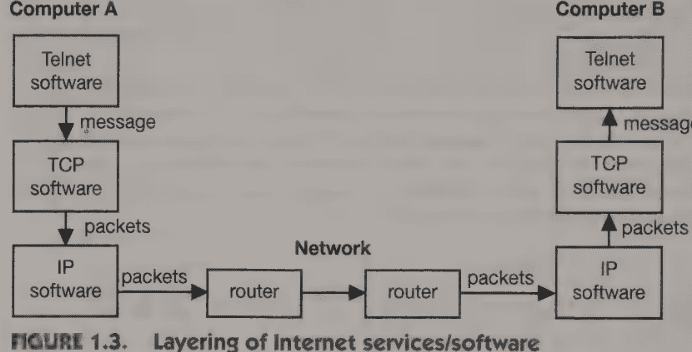

在计算机B上，过程是相反的。运行在计算机B上的IP软件接收数据包，并将其转交给运行在计算机B上的TCP软件。TCP软件的工作是将数据包重新组合成原始消息（在此过程中检查错误），并将其传递给运行在计算机B上的telnet软件。telnet软件随后读取消息并采取适当的行动。如果该行动需要向计算机A上的telnet软件发送消息，整个过程将再次开始，只是这次是从计算机B到计算机A。

虽然像FTP和telnet这样的网络服务在早期互联网上立即得到了应用，但电子邮件才是真正启动互联网的软件应用程序。电子邮件由Ray Tomlinson在1971-1972年发明，最初是对早期文件传输软件的一种临时“改造”，目的是让用户能够相互发送消息。电子邮件迅速成为大学研究人员和学生之间首选的交流方式，并且至今仍是人们决定获取互联网连接并上线的主要原因之一。

20世纪90年代人们对互联网兴趣激增的另一个主要原因当然是万维网。Web的基本协议由Tim Berners-Lee于1989年至1991年在欧洲核子研究中心（CERN）创建。Berners-Lee当时正在寻找一种方法，以便在CERN所有不同的研究小组之间访问和共享文档。尽管每个人都连接到CERN的计算机网络（而该网络又连接到互联网），但定位和共享信息却很困难。文件可以来回传输，但文件格式因小组而异。此外，即使一个人能在网络上找到所需的文件并下载下来，他可能也没有正确的软件来查看它。而当一切正常运作时，这个过程也很繁琐。Berners-Lee梦想着能够直接访问并显示他电脑上的任何信息。

为了实现他的愿景，他基于一个由来已久的想法进行了构建：**超文本**。要理解超文本的概念，想象一下你正在阅读一篇杂志文章（纸质的那种），你遇到了一个脚注或对另一篇文章的引用，而这篇文章看起来正是你想读的。为此，你可能不得不去图书馆，找到相关的杂志，然后查找那篇文章。但如果你能电子化地完成这一切呢？如果原始杂志是一本可以通过计算机网络访问的电子杂志，并将其内容显示在屏幕上呢？再假设，当你看到脚注时，只需用鼠标点击它，就能指示计算机检索并显示被引用的文章呢？那么，或许在第二篇文章中，你可能看到另一个有趣的脚注。点击那个脚注，你就能迅速在屏幕上准备好这篇文章以供浏览。决定回到前一篇文章？只需点击“返回”按钮即可。如此循环往复。

超文本非常类似于浏览百科全书或图书馆，追随你的兴趣，无论它们引向何方。它使得一种比普通书籍的线性流更具随机性、非顺序性的阅读体验成为可能。而且它不必仅仅是脚注和其他学术装饰。超链接可以直接嵌入到文档的文本中。例如，杂志文章中的关键词可以被设置为超链接——当用户点击其中一个关键词时，可能会出现该词的定义或进一步解释。或者，提到的关键人物的名字可以是超链接，点击后会弹出一个显示传记信息的屏幕。

为了允许创建超文本文档，Berners-Lee发明了一种特殊的文档格式化或“标记”语言，称为**超文本标记语言（HTML）**，以及一个传输协议，称为**超文本传输协议（HTTP）**，以便通过网络发送和接收HTML文档。他还创建了**浏览器**软件，该软件可以读取计算机收到的HTML文档中的HTML格式化指令，并在计算机显示器上显示文档。将所有这些整合在一起，就有了Berners-Lee所称的**万维网（WWW）**。

Berners-Lee和CERN在1991年向互联网社区免费提供了HTML和HTTP，这立即引起了关注。从1991年到1994年，CERN的WWW相关网络流量每年增长1000%。然而，是发生在世界另一端的一个事件，引发了20世纪90年代的互联网革命。

HTML和HTTP的第一个PC版本与使用文本用户界面的软件配合工作，没有图标、图像、鼠标指针等。伊利诺伊大学的一群研究生，在Marc Andreessen的带领下，决定将浏览器带入GUI（图形用户界面）世界。1993年，他们创建了名为Mosaic的浏览器软件，该软件允许用户轻松浏览Web的超链接路径和文档（页面），更棒的是，还能下载并显示网页上的图像。Mosaic团队的关键成员很快离开了大学，创办了一家公司，最初名为Mosaic，后来在大学抗议后更名为Netscape。正是1994年的Netscape Navigator浏览器，将万维网推向了全球现象。第二年，微软推出了自己的浏览器软件Internet Explorer。其他浏览器也存在，例如由挪威一个小组开发的Opera浏览器，尽管Explorer和Navigator主导着市场。

#### URL与客户端-服务器计算

当你使用浏览器软件访问一个、两个或三个网页时，到底发生了什么？

除非你点击了一个自动为你显示网页的超链接，否则要访问一个网页，你首先需要知道它的统一资源定位符，或**URL**。（URL的发音，有些人读作“U-R-L”，有些人读作“earl”。此外，有些人更喜欢用“统一资源标识符”或URI这个术语。）URL告诉你在哪里可以找到一个文档以及如何检索它。前面我们介绍了IP地址和域名系统，它们为连接到互联网的每台计算机提供唯一的地址。然而，任何一台给定的计算机显然都包含成千上万个文件，因此如果我们想检索某个特定的文档，我们需要更具体一些。简而言之，我们需要指定两件事：

- 1. 文档的确切位置，即可以找到该文档的计算机以及它在该计算机上的存储位置。

- 2. 检索和显示文档的方法或协议。

这两件事由URL给出。考虑以下示例：

`http://universityextension.ucdavis.edu/distancelearning/index.htm`

第一部分——`http://`——指定了通过网络传输文档的协议或规则集。其他可能性包括互联网服务FTP和telnet，或`ftp://`和`telnet://`。

第二部分——`universityextension.ucdavis.edu`——是主机名/域名的组合：`ucdavis.edu`指的是顶级教育域`edu`内的本地`ucdavis`域，而`universityextension`是`ucdavis`域内的一台主机计算机的名称。

第三部分给出了`universityextension`主机上一个文档的路径名，在本例中是`/distancelearning/index.htm`。也就是说，`index.htm`文档存储在`distancelearning`文件夹（或目录）中。（虽然可能出现比这些示例语法更复杂的URL，但这是基本形式。）从某种意义上说，URL非常类似于硬盘上文件的路径名，但这里的硬盘是整个互联网。

既然我们知道了如何通过URL指定要访问的网页，下一个问题就是：当我们指示Web浏览器前往那里时会发生什么？要回答这个问题，我们需要了解客户端-服务器模型。在这种情况下，我们的PC是客户端，而网页文档所在的计算机是服务器。服务器这个名字来源于它的职责：每当收到请求时，它就为网络上的其他计算机提供文档服务。

有时，术语客户端和服务器更具体地指涉运行在相关计算机上的软件，而不是计算机本身。Web浏览器有时被称为Web客户端或Web客户端软件。像Microsoft的Outlook和Qualcomm的Eudora程序这样的电子邮件应用程序被称为电子邮件客户端。在连接的服务器端，一台计算机可能同时运行多种类型的服务器软件，例如Web服务器软件和FTP服务器软件。一台计算机也可能同时充当客户端和服务器。可以设置一台PC来运行处理网页请求的Web服务器软件，同时该PC又运行Web客户端软件（例如Navigator或Explorer）来浏览Web。

当浏览器软件被赋予某个存储在某台计算机上的网页的URL时，它会向该计算机上的Web服务器软件发送一个请求，要求发送该网页文档。这个文档，称为**源文档**，包含了告诉浏览器如何显示网页的HTML指令。假设源文档存在且位置正确，服务器会通过发送该文档来响应请求（图1.4）。（在此过程中，它会经过涉及TCP和IP的常规分层处理。）当文档到达客户端（在本例中是我们的PC）时，浏览器软件会获取该文档，解释其中的HTML指令（或代码），并将文档显示在屏幕上。

关于这个过程，需要注意两点：第一，当你访问一个网页时，你实际上并没有“去”那里——包含该网页HTML代码的文档被发送给你，然后显示在你的计算机上。第二，HTML文档到达后，连接就断开了。这与我们都在使用的另一个网络——电话网络——非常不同。在电话通话的情况下，你与对方的连接会一直保持，直到通话结束。然而，互联网更像是一个文档传递系统。


**图 1.4.** 客户端-服务器模型

服务。客户端向服务器发送请求以获取特定文件，然后服务器通过将文件发送回来响应该请求。

这一过程中最后也是最大的谜团涉及 HTML 源文档。它包含什么样的指令？我们又该如何利用这些源文档创建自己的网页？本书其余部分将提供一些答案。

实验练习 1.1、1.2、1.3 和 1.4 可以在此时进行。

## 关键术语

- ARPANET

- 浏览器（browser）

- 客户端（client）

- 客户端-服务器模型（client-server model）

- 分布式网络（distributed network）

- DNS 服务器（DNS server）

- 域名注册商（domain name registrars）

- 域名系统（domain name system, DNS）

- 文件传输协议（FTP）

- 主机（host）

- 超文本（hypertext）

- 超文本标记语言（hypertext markup language, HTML）

- 超文本传输协议（hypertext transfer protocol, HTTP）

- 互联网名称与数字地址分配机构（Internet Corporation for Assigned Names and Numbers, ICANN）

- 互联网工程任务组（Internet Engineering Task Force, IETF）

- 互联网（internetwork）

- IP 地址（IP address）

- IPv6

- 分层（layering）

- 名称服务器（name server）

- 数据包（packet）

- 分组交换（packet-switching）

- 路由器（router）

- 服务器（server）

- 源文档（source document）

- TCP/IP

- 远程登录（telnet）

- 顶级域名（top-level domain）

- 统一资源定位符（uniform resource locator, URL）

- 万维网（World Wide Web, WWW）

## 复习题

1. Internet 这个名称从何而来？

2. 列出推动 ARPANET 早期发展的两个因素。

3. 路由器可以被视为互联网的 ________。

4. 互联网使用一种称为 ________ 的流量控制和传输方法。

5. 以下哪项提供了错误检查机制，负责处理在传输过程中丢失或延迟的数据包？

   a. 传输控制协议（TCP）

   b. 互联网协议（IP）

   c. 超文本传输协议（HTTP）

   d. 互联网错误检查协议（IECP）

6. 以下哪项是 IP 地址的示例？

   a. `www.whitehouse.gov`

   b. `http://www.whitehouse.gov/history/index.htm`

   c. `.gov`

   d. `216.43.187.162`

7. 域名系统的用途是什么？

8. 解释以下域名每个部分的含义：`socrates.berkeley.edu`。

9. 判断正误：蒂姆·伯纳斯-李发明了超文本的概念。

10. 解释以下 URL 每个部分的含义：`http://socrates.berkeley.edu/courses/history/hist181.html`。

11. 当你浏览网页并查看网页时，你的计算机充当的是：

    a. telnet

    b. 客户端

    c. 服务器

    d. 数据包

1. 简要定义和/或解释以下术语：分布式网络、路由器、分组交换。

2. 解释域名系统的工作原理及其用途。

3. HTTP 的用途是什么？

4. 使用搜索引擎或互联网目录（如 `www.google.com` 或 `www.yahoo.com`），搜索有关鲍勃·泰勒（Bob Taylor）、保罗·巴兰（Paul Baran）和蒂姆·伯纳斯-李（Tim Berners-Lee）的信息。列出每个人至少一条有趣的发现。（提示：不要只输入姓名，否则可能会得到太多无用的搜索结果。尝试输入姓名加上"互联网起源"、"互联网历史"、"ARPANET"或"万维网历史"。）

5. 使用互联网目录（如 `www.yahoo.com` 或 `www.lycos.com`），浏览并尝试为每个顶级域名 `.com`、`.edu`、`.org`、`.net`、`.gov` 和 `.mil` 找到至少一个 URL 示例。另外，找到除美国外至少五个其他国家的顶级域名 URL。

6. 使用 `www.webopedia.com` 上的在线词典，阅读其对 TCP/IP、IP 地址和 HTTP 的定义，并总结其要点。

7. 访问 `www.cybergeography.com`，点击"网络空间地图集"（Atlas of Cyberspaces）链接。探索人们尝试绘制互联网及其各个部分的各种示例。选择三类地图，简要描述该类型地图的用途（即它绘制了什么？）。作为描述的一部分，绘制该类型地图的样本草图。

8. 解释视频租赁店如何为万维网提供一个粗略的类比。

## 练习 1.1：思考网页设计

在本章中，我们从 HTML 工作原理的角度考虑了网页是如何运作的。但"网页如何运作"还有另一个同样重要的含义：网页的布局和设计。有许多网页具有创新而精巧的 HTML 代码，但在用户体验方面设计得很差。为了探索网页运作的这一方面，请访问以下至少三个网站，分析它们的布局和设计。写一篇简短的总结，比较和对比这些网页。哪些是好的，哪些是差的？需要考虑的一些问题：

1. 页面加载和显示需要多长时间？

2. 设计是简洁易读还是杂乱无章？

3. 颜色使用是否恰当，还是刺眼？

4. 图形图像使用是否恰当？它们是增强还是削弱了网站？

5. 在网站中导航和查找信息有多容易？

6. 如果你要查找该组织的地址和电话号码，能轻松找到吗？

建议网站：

| | | |

|---|---|---|

| `www.ucdavis.edu` | `www.sun.com` | `www.lycos.com` |

| `www.berkeley.edu` | `www.dell.com` | `www.excite.com` |

| `www.stanford.edu` | `www.zdnet.com` | `www.google.com` |

| `www.intel.com` | `www.cnet.com` | `www.cocacola.com` |

| `www.microsoft.com` | `www.internet.com` | `www.pepsi.com` |

| `www.apple.com` | `www.yahoo.com` | `www.7up.com` |

## 练习 1.2：网页幕后

你实际上可以查看当前显示在浏览器窗口中的任何文档的 HTML 源代码。要了解这是如何工作的，首先访问你选择的网页（网页越简单，越适合本练习）。看到网页显示在浏览器窗口中后，转到"查看"菜单并选择"源文件"（在 Explorer 中）或"页面源代码"（在 Navigator 中）。会弹出一个窗口，显示该网页的 HTML 源代码。查看一下，看看能否将一些 HTML 代码与网页上显示的相应项目对应起来。写下你对 HTML 代码注意到的几点（任何事情都可以）。（注意：有些网页使用一种称为框架的技术，将浏览器窗口分成多个独立的窗格。如果你尝试"查看源文件"方法但没有获得太多信息，并且你使用的是双键鼠标，请尝试在其中一个框架中右键单击，然后从弹出的菜单中选择"查看源文件"。）

## 练习 1.3：比较浏览器

HTML 和网页浏览器的一个优点是它们在不同计算机平台上非常相似，例如英特尔/Windows（"Wintel"）机器与 Macintosh 机器与 Unix 机器。这意味着无论你在家、办公室或学校使用什么类型的计算机，或者使用哪种网页浏览器软件，都没有关系。任何或所有这些都可以用来创建和查看网页。

然而，另一方面，两个主要浏览器——Netscape Navigator 和 Internet Explorer——在解释和显示 HTML 源文档方面确实存在一些差异。许多网民可能仍在使用的每个浏览器的旧版本，也没有实现 HTML 的较新功能。最后，由于显示器硬件和软件的差异，同一网页在 Wintel 机器上的显示可能与在 Macintosh 机器上略有不同。优秀的网页设计师总是会检查其网页显示方式的这些差异。

如果你可以同时使用 Explorer 和 Navigator，请在两个浏览器中查看你所在学校或组织的主页，并写下你看到的任何差异。（例如，比较颜色、字体样式和大小、布局位置等。）如果你有时间，请返回练习 1.1 中访问过的一些网页，并在两个浏览器中比较它们。

## 练习 1.4：追踪数据包

通过使用许多操作系统自带的两个简单实用程序，可以了解数据包在互联网上的传输方式。在大多数 Windows 和 Unix 系统上，你可以使用一个名为 `ping` 的程序来测量发送到给定互联网主机的数据包的往返时间，该主机可以通过其域名或 IP 地址指定。

要在Windows系统（Windows 98或更高版本）中执行此操作，请通过“开始”菜单选择“程序”，然后选择“MS-DOS提示符”来打开MS-DOS窗口。当MS-DOS窗口打开并显示命令行提示符时，输入`ping`后跟一个域名（例如`yahoo.com`）或一个IP地址，然后按回车键，如下所示，提示符为`C:\WINDOWS>`：

```
C:\WINDOWS>ping yahoo.com
```

`ping`程序将向指定的域名发送三个或四个数据包，然后以毫秒（千分之一秒）为单位显示每个数据包的往返时间。如果网络流量过大和/或关键路由器出现故障，往返时间将会延长。

对于Unix系统，操作步骤相同：在Unix提示符下输入`ping`后跟一个域名或IP地址。

对于Macintosh系统，你可能需要下载一个实用程序，如MacPing，可从`download.com`或`tucows.com`等网站获取。

注意：由于`ping`网络服务器是拒绝服务攻击中使用的一种方法，某些网络服务器会拒绝`ping`请求。

另一个实用程序可以让你追踪数据包从源到目标域名所经过的路由，即它从一个路由器跳转到另一个路由器的过程。在Windows系统中，你在提示符下输入`tracert`和域名。在Unix系统中，通常是`traceroute`和域名。而对于Macintosh系统，则下载并使用WhatRoute或VisualRoute之类的程序。所有这些程序都会显示数据包在到达指定目的地途中经过的路由器的名称和IP地址。（VisualRoute程序甚至会在世界地图上显示路由。）

使用`ping`和跟踪路由程序，探索至少五个不同网络服务器的数据包往返时间和路由。选择世界各地不同地点的网站。

## 创建基础网页

第 2 章

### 学习目标

- 1. 了解HTML如何在源文档中使用标签和元素来定义网页的结构。

- 2. 学习如何使用文本编辑器创建一个简单的网页。

- 3. 理解开发最新版本HTML（XHTML）的原因，以及对源文档和HTML元素的新要求。

- 4. 理解浏览器会忽略HTML源文档中的额外空格和换行符，因此换行和段落分隔必须在HTML代码本身中指定。

- 5. 学习如何使用各种基本HTML元素来创建标题、设置字体大小、块引用、强调文本和注释。

#### HTML源文档

在第1章中，我们学习了客户端-服务器模型以及网页如何工作。回顾一下：当你通过在浏览器中输入URL（或点击超链接）连接到一个网页时，浏览器会指示你的计算机通过互联网向该URL指定的计算机发送一条消息，并请求它发回某个文档（该文档也在URL中指定）。这个文档就是该网页的HTML源文档。源文档包含描述页面内容和布局的HTML源代码（指令）。它之所以被称为源代码，是因为这些代码是网页的来源。换句话说，HTML代码告诉浏览器要显示什么以及如何布局。当你的计算机收到源文档作为回复时，你的浏览器软件会解释源文档中的HTML代码，并根据HTML指令显示生成的网页——包括其文本、图形、链接等。

显然，万维网的许多奥秘必然存在于这个HTML源文档中。关于源文档首先要说明的是，它是一个**纯文本文档**。无论网页多么花哨，无论它包含多少图像、动画或其他内容，其基础都是一个简单的文本文档。（当然，这就引出了一个问题：如果源文档中只有文本，我们如何获得网页上的图像等内容？答案将等到第5章。）

第二点是，源文档中的文本由两部分组成：(1) 要在网页上显示的实际文本，以及 (2) 称为**元素**和**标签**的特殊标记，它们指定网页的结构，如标题、段落等。这些元素是HTML的核心。HTML的目的是使用这些元素来定义构成网页结构的标题、段落和其他元素。换一种说法，HTML元素*对网页内容进行分类*。它们告诉浏览器给定的文本部分是标题还是普通段落或其他内容。

例如，考虑我们将如何使用HTML对本章的内容进行分类，并将其转换为一个网页。该网页最明显的元素将是本章的五个主要章节标题：

- *HTML源文档*

- *创建源文档*

- *HTML、XML和XHTML*

- *段落和换行*

- *添加更多标签*

其中一些章节进一步划分为子章节，每个子章节都有自己的标题。例如，*HTML、XML和XHTML*部分具有以下子章节标题：

- *编写和缩进HTML代码*

- *从HTML到XHTML*

- *创建XHTML源文档*

每个子章节反过来又由段落组成。

为了在源文档中使用HTML代码表示这种结构，我们为每个元素使用成对的标签，不同类型的标签表示不同类型的元素。例如，主要章节标题使用开始标签`<h1>`和结束标签`</h1>`标记。作为一对，它们构成了标题1元素。我们看到标签通过`< >`符号与普通文本分开。结束标签在`h1`前包含一个`/`，表示标题1元素的结束。在每对标题1标签之间，我们放入标题的文本：

```
<h1>The HTML Source Document</h1>
...
<h1>Creating a Source Document</h1>
...
<h1>HTML, XML, and XHTML</h1>
...
<h1>Paragraphs and Line Breaks</h1>
...
<h1>Adding More Tags</h1>
```

当浏览器在源文档中看到这些标签时，它会以适合主要标题的样式（通常是大号粗体，尽管样式可以自定义，我们将在第3章中看到）显示`<h1>`和`</h1>`标签之间的文本。

类似地，我们对子章节标题使用标题2标签。例如：

```
<h1>HTML, XML, and XHTML</h1>
    <h2>Writing and Indenting HTML Code</h2>
    <h2>From HTML to XHTML</h2>
    <h2>Creating an XHTML Source Document</h2>
```

对于段落，我们使用`<p>`和`</p>`标签。在“HTML源文档”部分的第一段以“In Chapter 1 we learned about the client-server model and how a web page works...”这句话开始。第二段以“Clearly much of the magic of the World Wide Web must reside in this HTML source document...”开始。因此，源文档第一部分的代码将是：

```
<h1>The HTML Source Document</h1>
<p> In Chapter 1 we learned about the client-server model
and how a web page works . . . </p>
<p> Clearly much of the magic of the World Wide Web must
reside in this HTML source document . . . </p>
```

将所有这些放在一起，我们得到了源文档的body元素。body包含最终被浏览器显示为网页的HTML元素和文本。它由`<body>`和`</body>`标签标记。

```
<body>
<h1>The HTML Source Document</h1>
<p> In Chapter 1 we learned about the “client-server
model” and how a web page works . . . </p>
</body>
```

然而，这段代码还不足以构成一个完整的源文档。在body元素之前，我们还需要一个**head**元素，由`<head>`和`</head>`标签标记。head包含特殊信息，例如定义文档标题的标签：

```
<head>
    <title>Creating a Basic Web Page</title>
</head>
```

title元素中的文本（本例中为“Creating a Basic Web Page”）在浏览器窗口加载源文档并显示结果时会出现在标题栏中。当网络用户将页面添加到其书签或收藏夹列表时，也会使用此标题。

`<body>`和`<head>`元素共同构成了源文档的两个主要部分。最后，我们将完整的源代码包含在`<html>`和`</html>`标签内，这表示它是定义网页的HTML代码。

我们现在有了一个完整的（尽管相对简单的）源文档，它定义了网页的结构。图2.1显示了示例文档的源代码（仍有大量内容待填充），图2.2显示了浏览器如何显示其第一部分。此时不必担心理解源代码中使用的标签细节。我们将在本章后面介绍它们。现在你应该关注更大的图景，即源文档中的代码定义了网页的结构并对内容进行了分类。另请注意，我们在图2.2中使用了浏览器窗口的实际屏幕截图，这样你就可以在窗口顶部的标题栏中看到标题（“Creating a Basic Web Page”）。根据所使用的浏览器，窗口和按钮可能与图中显示的不同。（我们这里使用的是Explorer。请注意，对于此示例，我们设置了浏览器的“查看”选项，以在窗口顶部包含按钮和地址栏，在右侧包含滚动条，在底部包含状态栏。通常我们会省略这些，只显示浏览器窗口的标题栏和菜单栏。我们还将浏览器的“文字大小”设置为最小而不是中等。如果你在浏览器中查看此文档，文字可能会显得更大。）

此时，你可能有许多未解决的问题，例如“是否必须像图中所示那样小写输入标签？”或者“一对标签（以及其中的任何文本和/或其他标签）是否必须在同一行上？”或者“是否必须像图中所示那样缩进某些行？”以及“究竟如何创建源文档？”下一节将描述如何制作源文档，然后我们将处理其中一些**语法**问题。（语法仅仅是指事物如何书写和标点的规则。）

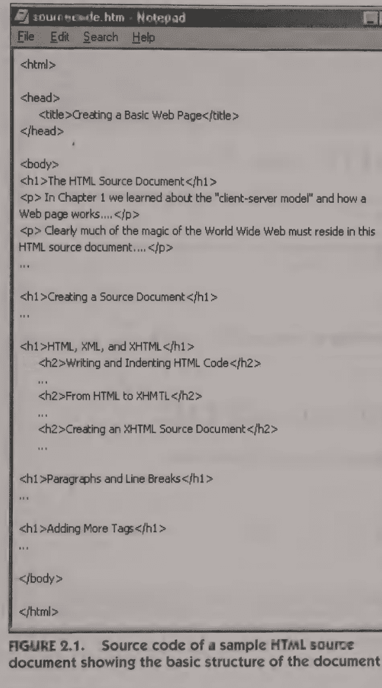

**图 2.1.** 示例 HTML 源文档的源代码，展示了文档的基本结构

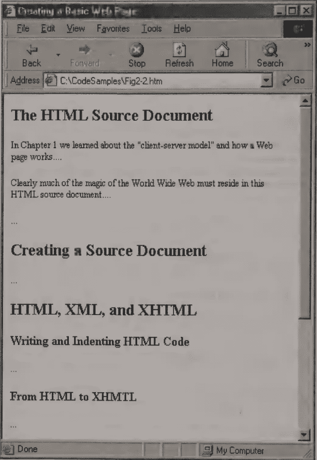

## HTML 源文档

在第 1 章中，我们了解了"客户端-服务器模型"以及网页的工作原理....

显然，万维网的诸多魔力必定蕴含在这个 HTML 源文档之中....

##### 创建源文档

...

##### HTML、XML 和 XHTML

##### 编写和缩进 HTML 代码

...

##### 从 HTML 到 XHTML

...

## 快速检查问题

- 1. HTML 代码的用途是什么？

- 2. 源文档的两大主要元素是什么？

- 3. 标签与元素之间有什么区别？

- 4. 如何为网页创建标题，浏览器会在哪里显示它？

##### 创建源文档

既然我们已经了解了 HTML 工作原理的基本概念——在源文档中使用标签来指定网页的结构——下一步就是创建实际的源文档。

为此，我们使用简单的文本处理程序，例如记事本（Notepad）、SimpleText 或 pico。记事本是 Windows 操作系统自带的免费程序，SimpleText 是 Macintosh 操作系统自带的免费程序，而 pico 则是 Unix 系统上通常可用的多种文本编辑器之一。这三者都允许用户创建纯文本文档，即不包含任何隐藏格式字符的文档（例如，用于指示边距、字体大小、字体类型、粗体文本等的字符）。文档中保存的只有用户实际输入的字符。（Windows 系统上的另一个流行选择是一款名为 TextPad 的文本处理程序。它具有记事本所缺乏的多种功能，例如自动以彩色显示 HTML 标签以区别于普通文本。可以从 `www.textpad.com` 下载试用版。）

HTML 源文档需要是纯文本文档，因为 HTML 有自己特殊的字符——标签——用于告知浏览器如何显示文档。如果文档中存在其他非 HTML 特殊字符，浏览器会将其显示为普通文本，导致混乱的结果。

尽管你可以使用 Microsoft Word 的"另存为..."选项来创建纯文本文档，但不建议这样做，因为最新版本的 Word 内置了 HTML 功能。这在实践中意味着，当你在 Word 中打开 HTML 源文档以修改 HTML 代码时，Word 会将其作为 HTML 而非纯文本来读取，因此会如同浏览器一样显示它。

也可以使用 HTML 编辑软件（如 Microsoft FrontPage、Macromedia Dreamweaver 或 Adobe GoLive）来创建 HTML 源文档。Microsoft Word 也具有有限的 HTML 编辑功能。HTML 编辑器允许用户在不掌握任何 HTML 知识的情况下创建网页（即 HTML 源文档）。即使是精通 HTML 的专业网页设计师，也经常会使用 HTML 编辑器来加快创建复杂网页的过程。然而，HTML 编辑器的便利性确实存在一些局限性。直接用 HTML 编码能够为认真或半认真的 web 设计师提供更多的功能和灵活性。任何想要不止于浅尝网页制作的人，都需要对 HTML 本身有良好的理解。

现在，打开一个像记事本或 SimpleText 这样的文本处理程序（即使不是实际操作，也在脑海中模拟），我们将创建我们的第一个 HTML 源文档。

图 2.3 展示了源文档的基本结构：包含在 `<html>` 元素中的 `<head>` 和 `<body>` 元素，以及 `<head>` 元素中的 `<title>` 元素。我们还在 `<body>` 元素中包含了一行示例文本。

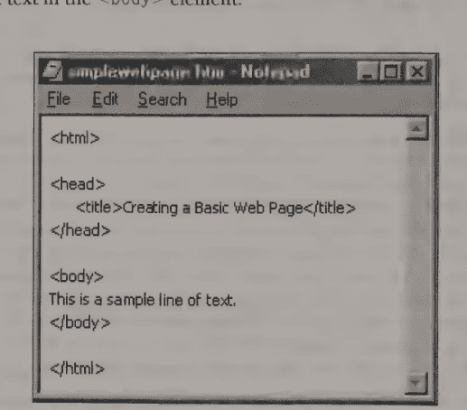


在我们能看到浏览器如何显示这段简单的源代码之前，我们需要保存它并创建源文档。我们假设一直在使用 Windows 操作系统自带的记事本程序来输入上述代码。（可以通过开始菜单打开记事本，依次选择程序和附件，你应该能在文件列表中看到它。）当我们第一次保存作品时，当然需要为文档选择一个文件名。我们可以随意命名文档（只要是合法的文件名即可），但有一个例外和一个注意事项。


例外是文件必须以 .htm 扩展名结尾（读作"点-HTM"），因为它表明该文档是 HTML 源文档。（你也可以保存为四个字母的扩展名 .html。）注意事项是，尽管文件名中使用空格和少数其他特殊字符是合法的，但在命名 HTML 文件时最好避免使用它们。

##### 创建源文档

请仅使用字母和数字。如果想创建多词文件名，可以用下划线（_）字符分隔单词，或将各个单词的首字母大写。或者也可以全部使用小写字母。

例如，我们可以将源文档命名为 `WebPage1.htm`、`simple_web_page.htm`、`SimpleWebPage.htm`，甚至 `simplewebpage.htm`。最好使用描述性强的文件名，如后三个例子所示。另一方面，不要让文件名太长太复杂，因为长名称更容易输错。此外，有些人喜欢全部使用小写字母，因为 Unix 操作系统——互联网上大多数 web 服务器使用的操作系统——区分大小写字母（即它是区分大小写的）。如果你始终用小写字母书写文件名，就永远不必担心该大写时却输入了小写。在下文中，我们假设将源文档命名为 `simplewebpage.htm`。

请注意记事本和某些其他文本编辑器的一个怪异之处：当你第一次保存文件时，会在文件名后追加 .txt 扩展名。该扩展名表示文件是纯文本文件。例如，如果我们指定名称为 *simplewebpage*，则完整文件名变为 *simplewebpage.txt*。或者，如果我们指定名称为 *simplewebpage.htm*，文件会以 *simplewebpage.htm.txt* 的名称保存。尽管 HTML 源文档是纯文本文件，但它必须以 .html 或 .htm 扩展名结尾，而不是 .txt。解决方法很简单。当你第一次使用记事本的"保存"对话框保存文件时，在文件名前后加上引号：`"simplewebpage.htm"`。这样做会告知记事本你希望文件名完全按照你指定的样子，它就不会添加 .txt 扩展名了——当然，除非你自己添加。

如果你使用的是自己的 Windows 计算机，可以通过确保 Windows 识别 .htm 文件来创建更持久的解决方案。为此，打开 Windows 资源管理器窗口，在"查看"菜单下选择"文件夹选项"。在出现的窗口中点击"文件类型"选项卡，然后点击"新建类型"按钮。会出现一个"添加新文件类型"对话框，其中有"类型说明"和"关联的扩展名"等文本框（还有几个其他框）。在"类型说明"框中输入 *HTML 源文件*，在"关联的扩展名"框中输入 *.htm*。点击两次"确定"即可完成。

源文档正确保存后，下一步是打开浏览器（Netscape Navigator、Internet Explorer 或其他浏览器），同时保持记事本（及你的 HTML 文档）也处于打开状态。我们希望能够同时看到源文档和浏览器显示的并排效果。

在浏览器中打开 `simplewebpage.htm` 文档的方法因使用的浏览器而略有不同。如果使用的是 Navigator 6 或更高版本，从"文件"菜单中选择"打开文件..."。在 Navigator 的早期版本中，从"文件"菜单中选择"打开页面..."，然后在出现的对话框右侧点击"选择文件"按钮。使用 Explorer 时，从"文件"菜单中选择"打开"，然后点击"浏览"按钮。这些操作都会调用正常的"打开文件"对话框。

此时，我们可以在文件列表中找到 `simplewebpage.htm` 文件并打开它。你也可以通过将文档图标拖拽到已打开的浏览器窗口中来更快地打开该文档。

图 2.4 展示了在浏览器中显示的结果。请注意，地址栏显示的是资源管理器正在显示计算机磁盘上某个文件夹中的本地 HTML 文件（本例中是 C: 驱动器上名为 CodeSamples 的文件夹），而不是从互联网上另一台计算机下载的源文档（这由完整的 URL 如 `http://www.someplace.com/simplewebpage.htm` 标示）。

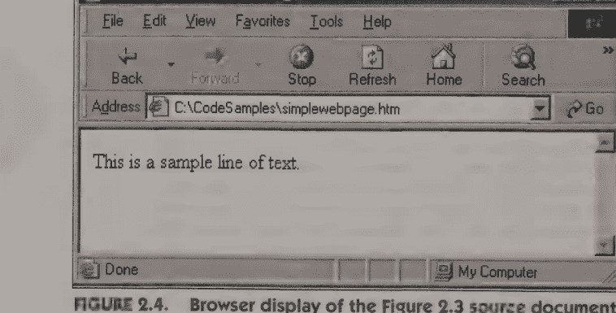

**图 2.4.** 浏览器中显示的图 2.3 源文档

> **重要提示** 请注意，这也意味着你的计算机无需连接到互联网即可创建和查看网页。你可以将浏览器运行在脱机模式下，直接用它来显示你制作并保存在硬盘上的 HTML 源文档。

使用文本编辑器创建 HTML 源文档并在浏览器中打开后，你可以通过在文本编辑器和浏览器之间来回切换来更改和微调网页。你在源文档中添加一些 HTML 代码或修改现有代码，保存更改，然后在浏览器中再次打开文档以查看结果。打开文档时，你不必再次使用“打开文件”命令。只需单击“重载”按钮（在 Navigator 中）或“刷新”按钮（在 Explorer 中），浏览器将再次获取源文档（现已更改）并显示它。


此编辑过程中的一个常见错误是忘记保存对源文档所做的更改。如果你不保存文档的新版本，浏览器将重新加载之前存在的版本，浏览器显示不会发生变化。另一个常见错误是在记事本的多个窗口中打开源文档的多个副本。这样做会让你很难记住哪个副本是当前保存的版本。

+ **快速检查问题**

1. 为什么 HTML 源文档必须是纯文本文档？

2. 给 HTML 源文档命名有什么规则？

实验练习 2.1，“一个简单的网页”，此时可以进行。

##### HTML、XML 和 XHTML

在第一节的末尾，我们注意到了一些关于 HTML 代码语法的常见问题，例如“你必须输入小写标签吗？”、“一对标签（以及其中的任何文本和/或其他标签）是否在同行上是否有关系？”以及“你必须缩进某些行吗？”。后两个问题很容易回答：答案都是“否”。然而，第一个问题将引导我们讨论 HTML 本身的性质。

##### 编写和缩进 HTML 代码

先处理简单的问题，我们在编写 HTML 代码时有很大的灵活性。例如，我们可以写成：

```
<head>
<title>Creating a Basic Web Page</title>
</head>
```

或者我们可以写成：

```
<head>
<title>
Creating a Basic Web Page
</title>
</head>
```

或者：

```
<head><title>Creating a Basic Web Page</title></head>
```

甚至像这样：

```
<head><title>
Creating a Basic Web
Page</title>
</head>
```

有两个关键规则限制了这些变化。首先，相关文本（本例中为 Creating a Basic Web Page）必须包含在适用于它的标签内（本例中为 `<title>` 和 `</title>`）。其次，不同的元素必须正确嵌套在彼此内部，而不是重叠。在本例中，`<title>` 元素应嵌套在 `<head>` 元素内。以下两个示例是错误的，因为 `</title>` 标签出现在 `</head>` 标签之后：


```
<head><title>Creating a Basic Web Page</head></title>
```

或者：

```
<head>
<title>
Creating a Basic Web Page
</head>
</title>
```

关于缩进问题，这是推荐的但不是必需的。让你的 HTML 代码对人类（包括你自己）可读总是一个好主意，即使对浏览器来说这并不重要。当浏览器加载源文档并开始显示时，它从顶部开始，逐行向下处理。在此过程中，它会忽略所有额外的空白字符（制表符和额外的空格）以及换行符。一些网页设计者喜欢使用多级缩进，而另一些则只喜欢一两级。虽然我们还没有看到更复杂的代码示例，其中缩进真正发挥作用，但你可以从下面的例子中看到可能性。


多级缩进：

```
<html>
    <head>
        <title>Creating a Basic Web page</title>
    </head>
    ...
</html>
```

较少级别的缩进：

```
<html>
<head>
    <title>Creating a Basic Web page</title>
</head>
...
</html>
```

关键点不在于使用特定级别的缩进，而在于使用足够的缩进，使你的代码易于阅读和理解。

##### 从 HTML 到 XHTML

我们上面提出的第一个问题，关于 HTML 标签中使用小写字符，看起来似乎与同行标签和缩进的问题一样简单，但事实并非如此。小写字符在 HTML 本身的演变中实际上扮演了关键角色。

尤其是在早期，HTML 的发展是杂乱无章的。蒂姆·伯纳斯-李在 1990 年代初引入该语言后，Mosaic 和 Netscape Navigator 浏览器的设计者以多种方式扩展了它。尽管 **万维网联盟**（**W3C**，网址为 `www.w3.org`）于 1994 年成立，旨在制定 HTML 的官方版本，但它很难阻止 Netscape，以及后来推出 Explorer 的微软。这两家公司都在竞相为他们的浏览器添加越来越多的功能。许多网页设计者则通过在其网页上尽可能多地使用前沿特性和技术来加剧了这种情况。结果是一种日益复杂的语言和日益复杂的浏览器，需要数兆的硬盘空间和内存。

到 1990 年代末，W3C 得以对该过程施加更多控制，并将所谓的 HTML 4 版本标准化。但是 Explorer 和 Navigator 经常以各自的方式随意对待官方版本。复杂性的问题依然存在。对于设计在个人计算机上运行的浏览器来说，这种随意性和复杂性并不会造成重大问题。个人计算机拥有充足的内存和存储空间。然而，每个人都看到，新一代支持网络的设备，如手持电脑和手机，即将到来。事实上，W3C 估计，到 2002 年，连接到互联网的计算机中可能有 75% 是小型网络支持设备。（像许多预测一样，他们的时间过于乐观，尽管趋势显然是朝着这个方向发展。）这些设备没有足够的内存和存储空间来处理具有完整功能的浏览器和显示完整功能的网页。此外，大多数为 PC 显示器设计的网页也无法在小型设备的屏幕上良好显示。

显然，需要一个更简单、更标准化的 HTML 版本，无论查看设备如何都能良好运行。为了满足这一需求，W3C 决定不制定 HTML 版本 5，而是转向他们一直在开发的另一种语言：**可扩展标记语言**，或 **XML**。创建 XML 的主要动机是需要以通用、结构化的格式通过互联网发送数据，尤其是在 1990 年代电子商务和互联网数据交换开始兴起的时候。

从根本上讲，XML 是一组规则，允许网页设计者通过创建新型标签来按照自定义需求对数据进行分类。因此名称为可扩展：XML 允许设计者扩展语言以适应他们的需求。例如，一家在线汽车经销商可能会使用像 `<make>`、`<model>`、`<year>` 这样的标签来组织和存储有关其汽车的信息。

`<numberofdoors>`、`<color>`等。或者医院可能会为其在线病人记录系统使用自定义标签，如`<patient>`、`<billingaddress>`、`<healthplan>`和`<physician>`。（HTML不具备这些功能。除了少数例外，它的所有标签都是预定义的。）

W3C认为，解决HTML问题的最佳方法是使用XML规则和理念对其进行彻底的重组和重新制定。由于这个新版本的HTML不是基于早期版本的HTML，而是基于XML，因此被命名为**Extensible Hypertext Markup Language（可扩展超文本标记语言）**，简称**XHTML**。XHTML的第一个版本于2000年1月正式发布。Navigator 6和Explorer 6在大多数情况下都支持XML，因此也支持XHTML。（XML兼容浏览器的列表可在`www.xmlsoftware.com/browsers/`找到。还需注意的是，XHTML不是XML。如果您需要XML的完整自定义功能，就必须使用XML本身，而不是XHTML。）

为了确保XML具有通用性——即无论使用何种设备都能正常工作——它有一些非常严格的语法规则。作为基于XML的语言，XHTML继承了这些规则（及其优点）。于是我们又回到了本讨论的起点：标签名称中使用小写字符的问题。HTML 4版本*不是*一种**区分大小写**的语言。这意味着，例如，它不区分`<body>`、`<BODY>`和`<bOdY>`。这三种变体都是合法的HTML代码，表示相同的含义（尽管最后一种肯定不推荐）。但XML是一种区分大小写的语言：您输入元素名称的方式很重要。W3C选择对XHTML标签使用小写字母，因此在XHTML中只有`<body>`是允许的。

我们在上面还简要提到，标签必须正确嵌套。尽管这条规则在HTML中也适用，但许多浏览器被设计为忽略该规则，将重叠的标签接受为合法的。支持XHTML的浏览器则不可如此。

再举一个例子，有时可以省略结束标签，如`</body>`，而没有任何不良影响：许多浏览器仍然会显示网页。但遵循XHTML规则的浏览器不会这样做。

您可能认为其中一些规则，例如小写限制，是过于严格的。如果所有标签名称都是小写的，这有什么要紧的，特别是如果浏览器可以被设计成能够处理这种情况的话？但语言的例外越多，浏览器需要处理所有这些情况就越复杂。而浏览器越复杂，它所需的内存和存储空间就越多。而内存和存储需求越大，它在手持电脑和手机等设备上正常工作的可能性就越小。

## 创建XHTML源文档

在图2.3中，我们回顾了构成HTML源文档的必需元素：包含在`<html>`元素中的`<head>`和`<body>`元素，以及`<head>`中的`<title>`元素。将其转换为XHTML源文档并不需要做太多改动。我们首先在最开始、`<html>`标签之前添加以下晦涩的行：

```
<?xml version="1.0"?>
<!DOCTYPE html PUBLIC
  "-//W3C//DTD XHTML 1.0 Transitional//EN"
  "http://www.w3.org/TR/xhtml11/DTD/xhtml1-
  transitional.dtd">
```

第一行是一个**XML声明**，向浏览器声明文档代码所使用的XML版本。换句话说，我们新修改的文档实际上现在是一个XML文档。但它当然不仅仅是任何XML文档：它是一个使用W3C的XHTML规范所定义的自定义标签的XML文档。如果浏览器要能够识别并正确显示文档中包含的标签，它需要了解XHTML规范。上面代码中的最后四行向浏览器提供了这些信息。这些行（可以全部写在一行）构成了所谓的**文档类型定义（Document Type Definition，DTD）**。顾名思义，DTD指定了这是什么类型的文档——在本例中，是一个XHTML文档。我们将在下一章更详细地讨论DTD的细节。

我们需要做的最后一个改动涉及`<html>`标签。它变为：

```
<html xmlns="http://www.w3.org/1999/xhtml">
```

我们添加的`xmlns`代表**XML命名空间**。命名空间帮助浏览器追踪所有自定义XML标签名称的含义，特别是如果同一名称被用于不同的标签。例如，可以想象一种情况，您想在自己使用XHTML创建的网页中使用一些自定义的XML标签。如果您的网页主题是书籍和文学，您可能会创建一个名为`<title>`的XML标签来表示书籍的标题。但这个`<title>`标签与XHTML中用于界定网页标题的`<title>`标签名称相同。您可以想象，如果浏览器没有任何办法知道哪个标签是哪个，将会导致怎样的混乱。命名空间通过向浏览器提供文档中标签含义的信息来减少这种混乱。通过在`<html>`标签中添加上述`xmlns`信息，我们告诉浏览器`<html>`元素中包含的所有标签都属于W3C定义的XHTML命名空间，位于给定的URL。

在本书中，我们不会遇到这种双重`<title>`标签的情况，因为本书的主题是学习使用XHTML，而不是如何使用XML创建自定义标签。尽管如此，在`<html>`标签中包含`xmlns`信息对于有效的XHTML文档是必需的。将所有这些组合在一起，图2.5展示了一个简单但完整的XHTML文档。（我们将其保存为`sourcecode.htm`，这个名称我们将经常用于代码示例。）

**图2.5.** 一个基本的XHTML源文档

此时您可能会问："那么，数百万遵循旧规则（或缺乏规则）的现有网页呢？它们会突然停止工作吗？"由于有如此庞大存量的大型网页是根据HTML 4版本及之前的旧规则创建的，主流PC浏览器很可能会继续识别旧的HTML代码并正确显示。但随着为手持电脑和手机等新设备设计的浏览器的出现，很可能只有基于XHTML的网页才能在这些设备上工作。认真的网页设计师已经在为其新网页使用XHTML规则，并重写以前的网页使其兼容XHTML。半认真的网页设计师也应该这样做。幸运的是，XHTML与HTML之间的差距并不是那么大。在我们深入了解XHTML的过程中，我们将指出它与旧版本HTML之间的关键区别。

注意：术语"HTML"仍在广义上用于指代该语言本身，无论是XHTML、HTML 4版本还是任何版本的HTML。我们将在本书中沿用这一用法。当需要区分XHTML与HTML 4版本（或更早版本）时，我们将使用更精确的术语。为了节省空间和聚焦要点，在我们的HTML和JavaScript示例中，我们也并非总是包含必要的DTD和命名空间信息。

## `<meta>`元素

源文档中的XML和DTD规范向浏览器提供了文档包含何种代码的信息。通常，指明文档内容的一些信息也是有用的。我们通过在`<head>`元素内添加一个或多个`<meta>`元素来实现这一点。`<meta>`元素用于指定描述文档内容的关键词以及简短描述。（"meta"一词来自希腊语，意为"关于"，因此得名：`<meta>`元素包含关于文档的信息。）在源文档中包含`<meta>`元素，使搜索引擎和互联网目录更容易对其进行分类。例如，如果我们正在为一家名为"Aromatic Coffee and Tea"的在线商店创建网页，该商店销售来自世界各地的特色咖啡和茶，我们可能会在`<head>`元素中包含以下`<meta>`元素：

```
<head>
  <title>Aromatic Coffee and Tea</title>
  <meta name="keywords" content="coffee, tea, exotic,
    imported" />
  <meta name="description"
    content="Wholesaler and retailer of coffees and teas
    from around the world" />
</head>
```

注意`<meta>`标签的语法。在"meta"一词之后，我们有两个部分，一个标为"name"，一个标为"content"。这些被称为标签属性，用于指定标签可能使用的各种选项。在本例中，`name`属性指定`<meta>`标签是用于定义文档的关键词还是文档的描述。然后，`content`属性分别指定实际的关键词或描述。像这样的属性在许多HTML元素中都有使用，我们将在第4章更详细地介绍它们。

您可能还会注意到，这里没有结束标签`</meta>`。它只是单个标签`<meta>`（末尾带斜杠），而不是`<meta>` . . . `</meta>`。这种类型的HTML元素被称为空元素。我们将在下面"`<br />`元素"一节中了解更多关于空元素及其语法的知识。

## 快速检查问题

- 1. 如何正确嵌套元素？

- 2. 为什么XHTML是一种区分大小写的语言？这意味着什么？

- 3. 要将HTML 4版本的源文档转换为XHTML源文档，需要添加哪三样东西？

#### 段落与换行

在上一节讨论为何要缩进 HTML 源代码时，我们解释道：浏览器加载源文档时，会忽略所有额外的空白字符（制表符和多余空格）以及 HTML 代码中的换行。但如果浏览器忽略源代码中的换行，它又怎么知道何时在网页上显示新行呢？

要理解 HTML 中的换行是如何工作的，不妨看看图 2.6 中的三个例子。我们发现，尽管它们的源代码在换行和间距上有所不同，但在浏览器中的显示效果却完全相同。（我们只展示 `<body>` 元素，而非整个源文档。）

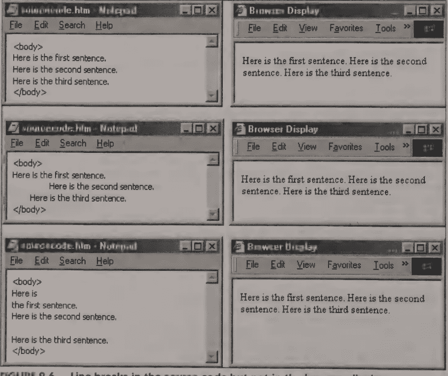

显示效果相同的原因是，HTML 使用元素——且仅使用元素——来定义文档结构。浏览器会忽略源代码中的所有换行、多余空格和制表符，将所有内容显示在同一行上，直到窗口右边缘时再自动换行。

##### `<p>` 元素

如果我们不能通过在源文档中按 Enter 键来指定换行，而必须使用元素，那该用什么呢？最常用的元素是段落元素 `<p>` 和 `</p>`，我们曾在上面"HTML 源文档"一节中首次见到。`<p>` 元素将一段文本归类为段落。Explorer 和 Navigator 通常会以单倍行距显示这段文本，并在浏览器窗口右边缘处自动换行。它们还会在段落前后插入空行。（我们说"通常"，是因为正如我们将在第 3 章看到的，可以自定义浏览器显示段落的方式。）

图 2.7 展示了 `<p>` 元素的几个例子。注意第一个例子如何将第三句话单独放在一行，上下各有一个空行。第二个例子（第六、七、八句）和第三个例子（第九、十句）展示了我们通常如何在源代码中书写 `<p>` 元素。将 `<p>` 和 `</p>` 标签单独放在一行，使代码更易读，段落边界也更清晰。（当然，这对浏览器来说没有任何区别。）

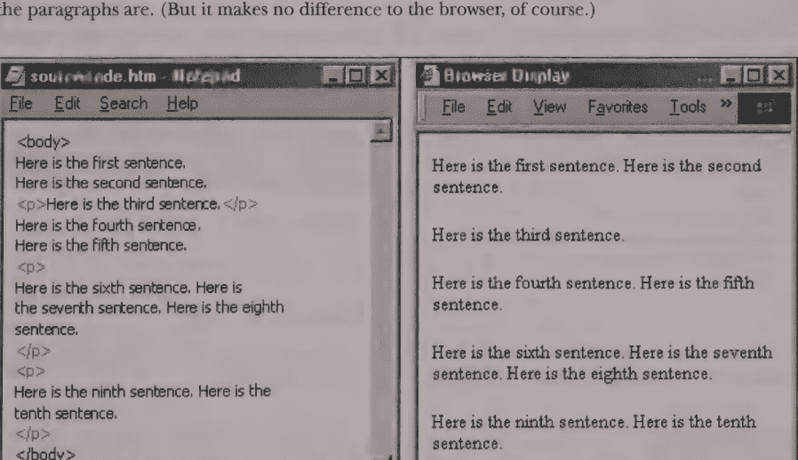

**图 2.7.** 使用 `<p>` 元素

如果你使用第 1 章练习中讨论的"查看源代码"功能来查看各种网页的底层 HTML 代码，可能会看到许多只有开始标签、没有结束标签 `</p>` 的 `<p>` 标签。原因在于，早期版本的 HTML（3.0 版本之前）只定义了 `<p>` 标签，而不是完整的 `<p> . . . </p>` 元素。因此许多网页只使用 `<p>` 标签来设计，因为这是让浏览器显示空行的简便方法。许多业余网页设计师继续使用单独的 `<p>` 标签。然而，你不应该这样做。XHTML 要求每个 `<p>` 标签都必须有对应的 `</p>` 标签。

如果你有一个使用 `<p>` 标签但没有结束 `</p>` 标签的 pre-XHTML 源文档，如图 2.8 所示，你可以简单地在每个 `<p>` 标签后立即添加一个 `</p>` 标签，使其符合 XHTML 规范（图 2.9）。

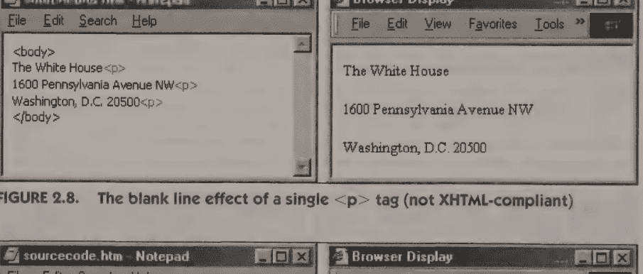

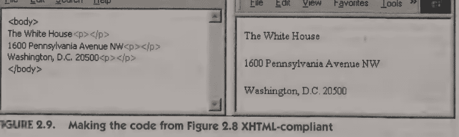

> **重要提示** 然而，一般来说，最好将相关文本放在 `<p>` 元素内部，如图 2.10 所示。这样做的主要原因将在第 3 章中说明。届时我们将了解到，只有将文本置于 `<p>` 和 `</p>` 标签之间，我们才能对段落文本应用各种样式（粗体、斜体、字体、字号等）。

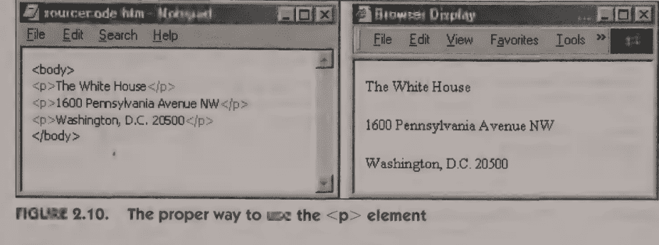

图 2.10. 正确使用 `<p>` 元素的方法

你可能会想，旧版浏览器如何处理它们不了解的新标签，比如 `</p>` 标签。答案很简单：Web 浏览器被设计为忽略任何无法识别的标签。一方面，这意味着你不必担心使用新版浏览器支持但旧版浏览器不支持的 HTML 新标签。如果网上冲浪者使用旧版浏览器查看你的页面，浏览器会直接跳过它不识别的任何标签。

另一方面，你需要知道一个标签是否新到大多数浏览器都尚未实现。如果你使用了这个新标签，你的页面可能无法在大多数用户那里正确显示。优秀的网页设计师希望自己的页面尽可能正确显示，无论冲浪者使用哪种浏览器。

##### `<br />` 元素

有时我们需要在网页的特定位置指定换行。我们已经知道 `<p>` 元素会产生换行，但同时也会添加一个空行。如果我们只需要换行，可以使用换行标签 `<br>`。这个标签是元素必须有独立的开始和结束标签这一规则的例外。不存在 `</br>` 标签。正如我们先前讨论 `<meta>` 元素时提到的，我们将这类标签称为空元素。在 XHTML 之前，`<br>` 标签和其他空元素就是直接使用的。但 XHTML 需要一些表示元素为空的标记，所以我们必须在标签末尾添加斜杠（`/`）：不写 `<br>`，而写 `<br />`。

如果你仔细观察 `<br />`，会发现 r 和 / 之间有一个空格。这个空格不是 XHTML 所要求的，但出于向后兼容的考虑而被包含进来。一些旧版浏览器在缺少这个空格时，无法正确显示换行。


图 2.11 展示了 `<br />` 元素的效果。（由于第四句话对于窗口来说太长，浏览器将其断开并换行。）

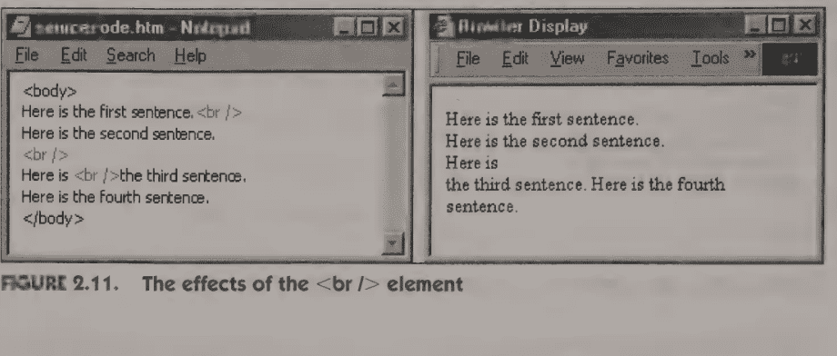

`<br />` 标签在需要让浏览器显示诗歌行或某人的地址时最为有用（图 2.12）。

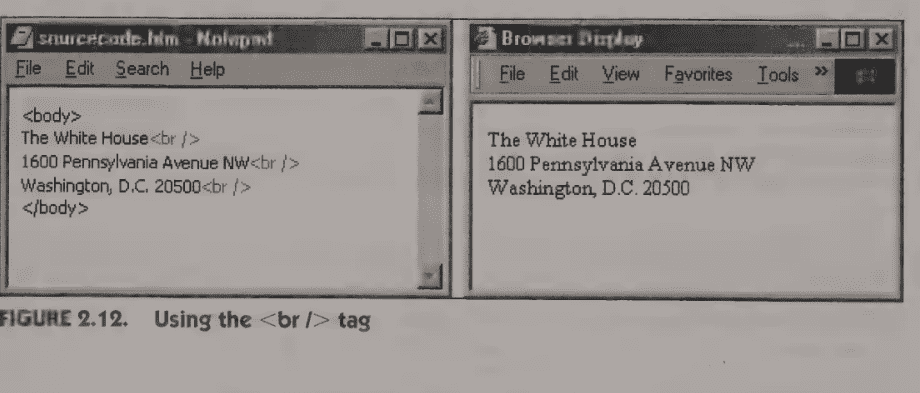

## 快速检查问题

+ 1. 浏览器如何显示源文档中的空行、制表符和多余空格？

2. 为什么使用 `<p>` 元素比只使用 `<p>` 标签更好？

3. 如果浏览器遇到不理解的标签，它会怎么做？

4. 什么是空元素？在 XHTML 中书写空元素的规则是什么？

实验练习 2.2 "行与段落"可以在此刻进行。

#### 添加更多标签

仅使用我们目前为止介绍的元素就可以创建网页，但 HTML 显然提供了更多功能。下面我们概述一些基本元素，包括六级标题、粗体和强调文本、块引用以及字号。

##### 标题

在"HTML 源文档"一节中，我们介绍了标题元素 `<h1>` 和 `<h2>`，它们是用于定义网页结构的主要 HTML 元素之二。HTML 实际上有六级标题，分别使用标签 `<h1>` . . . `</h1>`、`<h2>` . . . `</h2>`，一直到 `<h6>` . . . `</h6>`。在 Explorer 和 Navigator 等个人电脑浏览器上，标题元素内文本的默认显示设置为粗体，且大小因标题级别而异。标题 1 代表最重要的标题，标题 6 代表最不重要的。Windows 版本的 Explorer 和 Navigator 的默认设置将标题文本大小从标题 1 的 24 磅到标题 6 的 8 磅不等。浏览器还会在标题文本前后各加一个空行。（其他浏览器，如为手持设备设计的浏览器，可能有不同的默认标题显示。正如我们之前提到的，我们将在第 3 章学习如何自定义显示。）

图 2.13 展示了各级标题的代码示例，图 2.14 展示了在 Explorer 中的效果。（注意，在图 2.13 中，我们省略了必要的 XHTML 引导材料以及 `<head>` 元素，正如我们之前提到的，这样做是为了聚焦示例代码的关键部分并减少冗余。在图 2.14 中，我们使用了实际截图，并将文本大小设置为浏览器的默认值"中"，以便你能看到

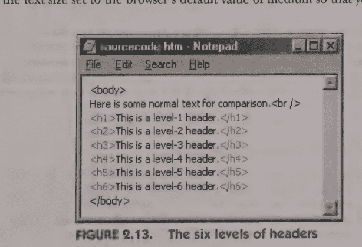

字体相对于浏览器窗口的相对大小。关于用户如何设置浏览器文本大小的更多信息，请参阅本章后面“关于字体的几点说明”部分。)

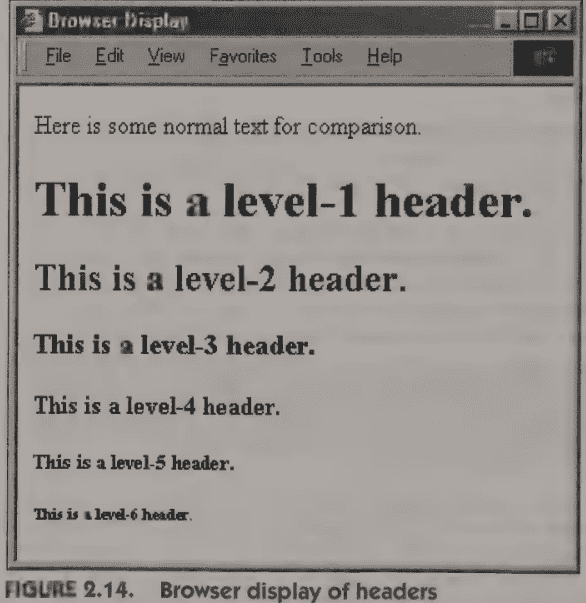

如本章开头所述，我们使用标题（headers）来指定网页各个部分和子部分的标题。例如，您可能会使用一级标题（level-1 header）来显示网页开头的大型“欢迎”消息或其他标题，然后使用较低级别的标题为页面中每个部分的开头创建子标题。

##### `<em>` 和 `<strong>` 元素

到目前为止，我们已经学习了如何使用HTML元素来分类网页的主要部分，例如标题和段落。通常我们需要分类这些元素内部的较小部分。例如，在一个段落中，我们可能希望一个单词或短语得到特别强调。我们可以使用 `<em>` 和 `<strong>` 元素来实现这一点。

`<em>` 元素将其内部的文本区域标记为强调（emphasized），而 `<strong>` 元素将其内部的文本标记为强烈（strong）或强烈强调（strongly emphasized）。为个人计算机设计的浏览器，如Navigator和Explorer，通常会以斜体显示 `<em>` 元素中的文本，并以粗体显示 `<strong>` 元素中的文本。图2.15和图2.16分别展示了一些示例代码及其显示结果。

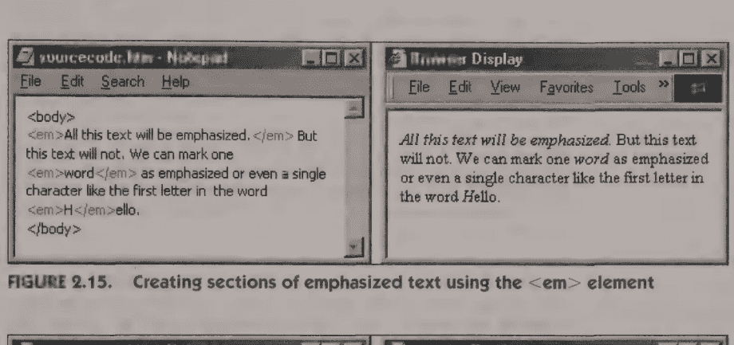

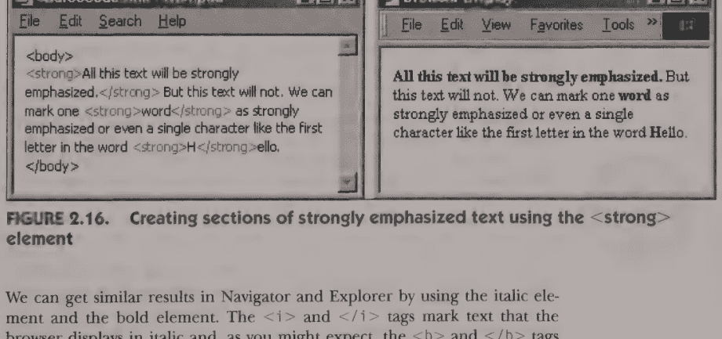

我们可以通过使用斜体元素和粗体元素在Navigator和Explorer中获得类似的结果。`<i>` 和 `</i>` 标签标记浏览器会以斜体显示的文本，正如您所预期的，`<b>` 和 `</b>` 标签标记要以粗体显示的文本。（早期的HTML版本还定义了一个 `<u>` 元素用于下划线文本，但由于浏览器传统上用下划线表示超链接，所以它很少被使用。）

`<i>` 和 `<b>` 元素是大多数人最早学习的标签之一，看起来它们似乎会比 `<em>` 和 `<strong>` 元素更受欢迎，即使没有其他原因，至少因为它们输入起来更短。但请注意它们之间的一个重要区别。`<b>` 元素定义了文本的显示或**呈现**（presentation）为粗体。相比之下，`<strong>` 元素并不决定呈现方式。根据设备和浏览器的不同，文本可能显示为粗体，也可能以完全不同的方式呈现。

`<i>` 和 `<em>` 元素之间也有同样的区别。`<i>` 元素定义呈现方式为斜体；`<em>` 元素不定义呈现方式。`<em>` 和 `<strong>` 元素是结构化或**基于内容**的元素：它们将源文档中的某些内容（通常是一个单词或短语）分类为强调或强烈强调。但它们并不预定义其内部内容的呈现方式。

呈现方式甚至不必是视觉上的。为视障人士设计的浏览器使用语音合成来“朗读”源文档。这样的浏览器可能会对分类为强调的文本使用一种语调，而对分类为强烈强调的文本使用另一种语调。

关于**结构**与呈现方式之间区别的这一点极其重要。在本章开头我们指出，HTML的主要目的是通过对其各种文本元素进行分类来定义网页的结构。然而，在HTML混乱的早期，浏览器公司和许多网页设计师开始使用标签来定义网页的不仅结构，还有呈现方式。这种方法的问题在于，它导致网页只能在运行于个人计算机（或类似计算机，如工作站）的浏览器中显示良好。如果我们希望网页在其他设备上也能显示良好，我们就必须为每种类型的设备创建单独的页面版本。

通过将呈现方式与结构分开定义，我们解决了大部分这个问题。页面的结构在HTML源文档中定义，而所使用的各种结构元素（标题、段落等）的呈现规则则在其他地方定义，要么在浏览器本身中（例如在特殊的语音合成浏览器中），要么在单独的样式表定义中（下一章的主题）。（请注意，我们所说的呈现方式也称为布局、样式和/或显示。）

W3C——通过XML、XHTML和样式表——一直试图重新强调分离结构与呈现方式的重要性，以便源文档无论在什么设备上都能适当地显示，而无需为每种类型的设备创建单独的源文档。这种分离也使得HTML代码更加模块化和优质。

此时，您可能还无法完全理解这种分离的意义，因为我们对HTML的应用还不多。当我们在下一章介绍样式表时，您将会看到以这种方式创建网页的强大之处。

目前的建议是使用 `<em>` 和 `<strong>` 元素而不是 `<i>` 和 `<b>` 元素，因为它们不预先决定页面的呈现方式，因此更灵活。（尽管使用 `<i>` 和 `<b>` 元素并不是错误的——它们仍然是XHTML的一部分。）

##### 块级元素与内联元素

如果我们想要将一些文本同时分类为标题和强调，我们只需在标题元素内部包含一个 `<em>` 元素：

```
<h2><em>This header will be both bold and
italicized</em></h2>
```

在Navigator和Explorer中，这段文本的正常呈现将是大号粗体（因为它是二级标题）并且斜体（因为它是强调）。然而，您可能会想，我们是否也可以将 `<h2>` 元素放在 `<em>` 元素内部这样写呢：

```
<em><h2>Will this header be both bold and
italicized?</h2></em>
```

答案（在XHTML中）是我们不能，因为 `<em>` 和 `<h2>` 是不同类型的标签。标题元素被设计为**块级元素**（block-level elements），这意味着它们定义了一个完整的文本部分或块。浏览器通过在其前后都放置一个空行来表示该块的范围。当您使用标题元素时，不必将它们与 `<p>` 元素结合以获得换行。它已经内置于其中。段落元素本身是块级元素的一种基本形式，`<body>` 元素是另一个例子。

另一方面，像 `<em>` 和 `<strong>` 这样的元素是**内联元素**（inline elements），因为它们用于定义一行文本中字符序列的结构，甚至是单个字符。内联元素可能不包含块级元素，但可以在块内使用。（在HTML的旧版本中，块级元素和内联元素之间的这种区分也成立，尽管浏览器经常忽略它并显示不正确的代码。）

任何内容都可以放入块级元素内，包括另一个块级元素。例如，`<body>` 元素显然包含各种其他块级标签。

##### `<blockquote>` 元素

一个偶尔有用的块级元素是 `<blockquote>` 元素。当您想要将一块文本分类为长引用时使用它。在Explorer和Navigator中，`<blockquote>` 元素的默认呈现方式是缩进整个文本块（图2.17）。

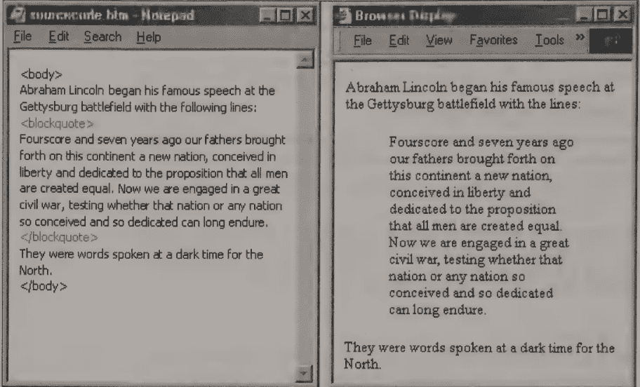

图2.17. 使用 `<blockquote>` 元素


##### 字体大小

您不应该仅为了使一些文本变为粗体而使用标题元素，除非它确实是标题。否则就是错误地分类了文本。应改用 `<strong>` 元素。同样，您也不应该仅为了改变一些文本的字体大小而使用标题元素。相反，我们使用 `<big>` 和 `</big>` 标签来标记要变大的文本，使用 `<small>` 和 `</small>` 标签来标记要变小的文本。图2.18中显示的示例让您了解这些元素在Explorer中的呈现方式，当默认文本大小设置为中等时。（Navigator类似。）

大文本和小文本的实际呈现会因用户而异，具体取决于用户为浏览器默认字体选择的字体和字体大小（下面将详细讨论）。但您可以看到，大文本将比正常显示字体（通常是12点大小）略大，小文本将略小。（通过样式表可以提供更多的大小灵活性。）

## 关于字体的几点说明

在学习了 `<big>` 和 `<small>` 元素之后，一个明显的问题是：我们能指定字体本身吗？在第3章中，我们将学习可以使用样式表或 `<font>` 元素来设置文本字体。但我们也将会了解到，`<font>` 元素是一个定义...

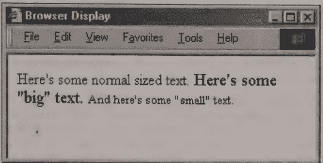

## 图 2.18. `<big>` 和 `<small>` 元素对文本大小的影响

呈现，而非结构。指定字体的首选方式是通过使用样式表。

这个问题也涉及到网页设计的另一个问题。谁应该控制网页在屏幕上的外观，是网页设计师还是浏览者？早期的浏览器设计旨在将字体选择的控制权交给浏览者，而非设计师，其原则是浏览者自由。拥有这种自由以及实现它的手段，浏览者可以根据自己的喜好自定义浏览器显示。实现这种自由的手段来自浏览器软件，它允许浏览者选择文本显示的默认字体。两大主要浏览器仍然允许这种选择。

在 Netscape Navigator 中，浏览者可以设置**可变宽度**的默认字体和**固定宽度**的默认字体。Internet Explorer 5 及更早版本称之为 proportional（比例字体）而非 variable width。Explorer 6 版本则分别将这两种类型标记为网页字体和纯文本字体。可变宽度意味着字体中的字母在行上占据不同数量的水平空间。本句的字体就是一个例子。例如，字母 i 占用的空间比字母 m 少。固定宽度或等宽字体中的字母，无论它们多么窄或宽，在行上占据的空间量都是相同的。`这句话是一个固定字体的例子，名为 Courier。`大多数字体都是可变宽度的。

要为 Navigator 设置默认字体和字号，请从“编辑”菜单中选择“首选项”，然后当“首选项”对话框出现时，检查左侧标题为“类别”下的列表。如果你看到“字体”被列出，点击它。如果你没有看到“字体”被列出，首先点击名为“外观”的主类别。此时字体应作为“外观”的子类别出现。

在 Explorer 中，从“工具”菜单中选择“Internet 选项”。然后点击“常规”选项卡，并点击“字体”按钮。要更改默认字号，请点击“辅助功能”按钮。（其理念是视力受损的浏览者会希望选择更大的默认字号。）你也可以通过从“视图”菜单中选择“文字大小”并选择“最大”、“较大”、“中等”、“较小”或“最小”（其中“中等”代表已设置的默认文字大小）来临时更改文本大小。

请注意，浏览者实际上可以为“固定宽度字体”类别选择任何字体，甚至是比例字体；也可以为“可变宽度字体”类别选择任何字体，甚至是固定宽度字体。

通常，浏览器对网页文本使用可变宽度字体，对弹出对话框使用固定宽度字体。然而，如上所述，网页设计师可能会覆盖浏览器设置，并通过各种方式指定字体样式和显示。浏览者可以通过 Navigator 中的“字体”对话框和 Explorer 中的“辅助功能”对话框（如前所述）来防止这种覆盖发生。缺点是许多网页将无法正常显示，因为它们是为使用特定字体样式和字号而定制设计的。

## 关于注释

有时你想要为你编写的 HTML 代码编写笔记或添加**注释**。这些注释是为了你自己的利益（例如，提醒你某段 HTML 代码的工作原理），或为了将来编辑你 HTML 文档的人的利益（例如，特殊的说明）。你不希望这些注释被浏览器显示。为了不让浏览者看到它们，你可以将它们放在注释标签内：

```
<!-- 注释放在这里 -->
```

注释标签内的任何内容都将被浏览器忽略（图 2.19）。

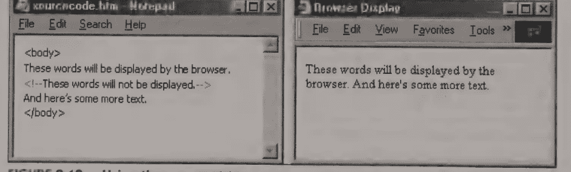

请注意，尽管注释标签看起来像一个空元素（没有结束标签），但它不需要在末尾加斜杠（` />`）。

注释可以在源文档中跨越多行：

```
<body>
<!-- 这些文字甚至换行后也不会被任何人看到 -->
</body>
```

当你正在试验 HTML 代码或修改之前编写的代码时，注释也很有用。有时你想移除一段 HTML 标签和文本，看看文档在没有它的情况下如何显示。你可以简单地将其剪切出来，如果决定保留它，稍后再粘贴回去。但用注释标签将代码包围起来更容易更快，即在代码段的开头放一个 `<!--`，在末尾放一个 `-->`。浏览器会忽略内部的所有内容，包括任何 HTML 标签。例如，在图 2.20 的代码中，浏览器将忽略 `<blockquote>` 元素而不显示它。

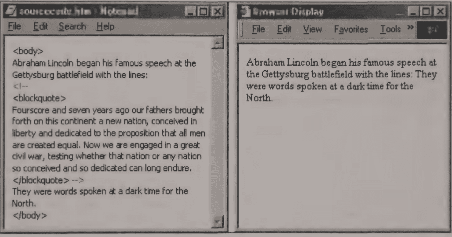

实验练习 2.3，“添加更多标签”，可以在此时完成。

## 快速检查问题

- 1. 哪个标题元素是最高级别，`<h1>` 还是 `<h6>`？

- 2. 使用 `<em>` 元素和 `<i>` 元素有什么区别？

- 3. 块级元素和内联元素有什么区别？各举一个例子。

- 4. 可变宽度字体和固定宽度字体有什么区别？

- 5. 写出一行 HTML 代码，该代码将指示浏览器将句子“Welcome to my Web page”显示为（a）强调文本，（b）强强调文本，以及（c）同时具有强调和强强调的文本。

|  |  |

|---|---|

| .htm 扩展名 | 结构 |

| .html 扩展名 | 语法 |

| 属性 | 标签 |

| 块级元素 | 纯文本文档 |

| body | 可变宽度字体 |

| 区分大小写 | 空白字符 |

| 注释 | 万维网联盟 (W3C) |

| 基于内容的元素 | XML 声明 |

| 文档类型定义 (DTD) | XML 命名空间 |

| 元素 |  |

| 空元素 |  |

| 可扩展超文本标记语言 (XHTML) |  |

| 可扩展标记语言 (XML) |  |

| 固定宽度字体 |  |

| head |  |

| HTML 源文档 |  |

| 内联元素 |  |

| 嵌套元素 |  |

| 呈现 |  |

| 源代码 |  |

## 1. 创建源文档

源文档的基本结构（HTML 版本 4）：

```
<html>
<head>
    <title>创建基本网页</title>
</head>
<body>
    这是一行示例文本。
</body>
</html>
```

定义网页的标题（代码放在 `<head>` 元素中，标题将显示在浏览器窗口的标题栏中）：

```
<title>Larry 的网页</title>
```

## 2. HTML、XML 和 XHTML

在源文档的开头添加 XML 声明和 XHTML 的文档类型定义：

```
<?xml version="1.0"?>
<!DOCTYPE html PUBLIC
    "-//W3C//DTD XHTML 1.0 Transitional//EN"
    "http://www.w3.org/TR/xhtml11/DTD/xhtml1-transitional.dtd">
```

在 `<html>` 标签中添加 XML 命名空间信息：

```
<html xmlns="http://www.w3.org/1999/xhtml">
```

使用 `<meta>` 元素（在 `<head>` 元素内）通过关键词列表和/或简短描述来描述网页的内容：

```
<meta name="keywords" content="coffee, tea, exotic, imported" />
<meta name="description"
    content="来自世界各地的咖啡和茶叶批发商和零售商" />
```

## 3. 段落和换行符

定义一个段落，其前后有空行：

```
<p>这是段落的第一句话。这是第二句话。这是第三句话。</p>
<p>这句话将是新段落的第一句……</p>
```

仅使用 `<p>` 标签在文本块之间插入空行（不推荐）：

```
这是第一句话。<p>这是第二句话，它将是新段落的开始。这是第三句话。
```

使前面的示例符合 XHTML 规范：

```
这是第一句话。<p></p>这是第二句话，它将是新段落的开始。这是第三句话。
```

插入换行符：

```
这一行将在第四个单词后<br />断行。
```

## 4. 添加更多标签

指定标题（从最重要到最不重要，级别 1 到级别 6）：

```
<h1>这是一级标题。</h1>
...
<h6>这是六级标题。</h6>
```

将文本指定为强调（通常显示为斜体）：

```
<em>这句话很可能以斜体显示。</em>
```

将文本指定为强强调（通常显示为粗体）：

```
<strong>这句话很可能以粗体显示。</strong>
```

指定文本以斜体显示（不推荐）：

```
<i>这句话将以斜体显示。</i>
```

指定文本以粗体显示（不推荐）：

```
<b>这句话将以粗体显示。</b>
```

指定块引用：

```
<blockquote>八十七年前，我们的先辈们在这个大陆上建立了一个新的国家，它孕育于自由之中，奉行一切人生来平等的原则。</blockquote>
```

指定文本比正常大小略大或略小：

```
<big>这句话的显示将略大于正常大小。</big>
<small>这句话的显示将略小于正常大小。</small>
```

在 HTML 代码中插入注释：

```
<!-- 注释放在这里 -->
```

## 练习 2.1：一个简易网页

学习 HTML 的最佳方式是停止阅读，开始动手实验。也就是说，不要只是通读这本教科书，而是要时不时地停下来亲自尝试。你会在每一章找到一个或多个实操练习，它们提供建议（如果你正在课程中使用这本教科书，那就是作业）。当练习段落以复选框 ☐ 开头时，表示该段落包含一些需要你执行的具体指令。

- ☐ 打开记事本（或等效程序——以下指令中我们统一称为记事本），创建一个新的无标题文档。你应该能够通过进入 Windows 开始菜单，依次选择程序 → 附件来找到记事本。（如果记事本已经打开，从文件菜单中选择新建。）

- ☐ 输入图 2.3 所示的 HTML 代码，但请使用包含你名字作为内容的标题，并在正文中添加 "Welcome to my Web page" 信息。不要忘记结束标签中的斜杠！

- ☐ 输入 HTML 代码后，保存文档。我们建议使用 `"simplewebpage.htm"` 作为文件名（不带引号）。无论你选择什么名称，都不要过长，并确保在名称末尾包含 .htm 扩展名，因为它表示该文档是 HTML 源文档。（你也可以保存为 .html 扩展名。）

如果你是在计算机实验室环境中，请确保将其保存在软盘（或移动硬盘）上。如果你的软盘名称没有出现在"另存为"对话框顶部的"保存位置："处，请点击"保存位置："文本框以获取下拉菜单，然后双击"3½ 软盘 (A:)"再保存。

- ☐ 现在你已经保存了源文档，打开 Netscape Navigator 或 Internet Explorer（如果尚未打开，使用开始菜单打开它）。同时保持记事本和你的 HTML 文档处于打开状态（即，不要退出记事本或关闭你的 HTML 文档）。

- ☐ 如果你使用的是 Navigator，从文件菜单中选择"打开页面..."，然后在出现的对话框右侧点击"选择文件"按钮。如果你使用的是 Explorer，从文件菜单中选择"打开"，然后点击"浏览"按钮。找到你的新源文档 `simplewebpage.htm`（或你命名的任何名称）并打开它。你应该会看到类似图 2.4 的内容。

使用记事本（以及某些其他文本处理器）保存文件时，注意它不要额外添加 .txt 扩展名到文件名中。你不需要连接互联网就可以创建源文档并在浏览器中查看它。

编辑源文档时，不要忘记在浏览器中查看之前保存你所做的更改。如果你不保存文档的新版本，当在浏览器中重新加载文档时，它将显示先前存在的版本，显示内容不会有任何变化。

HTML 元素必须正确嵌套，不能重叠。缩进你的 HTML 代码以提高可读性。设计网页时要兼容 XHTML。避免使用内部没有文本的段落元素。设计网页时要确保无论冲浪者使用哪种浏览器都能正确显示。对于仅受最新浏览器版本支持的 HTML 标签，或仅受 Explorer 支持而不受 Navigator 支持的标签（反之亦然），要谨慎使用。

为了向后兼容，在像 `<br />` 这样的空元素中，在 "/" 前加一个空格。避免使用预定义表现的 HTML 元素，如 `<b>` 和 `<i>`。内联元素不能包含块级元素。避免将元素用于非其预期用途的场合，例如仅仅为了使（非标题）文本变大加粗而使用标题元素。为你的 HTML 代码添加注释。在调试期间使用注释来注释掉代码。

1. 判断正误：HTML 第 4 版标签区分大小写。

2. 判断正误：XHTML 标签区分大小写。

3. 以下哪项会将文本行 "Welcome to my Web page" 中的第一个词（且仅第一个词）显示为强调文本？

   - a. `Welcome<em> to my Web page`

   - b. `<em>Welcome to my Web page`

   - c. `<em>Welcome</em> to my Web page`

   - d. `<em>Welcome /em> to my Web page`

4. 为什么使用 Microsoft Word 创建和编辑 HTML 源文档不是一个好主意？

5. HTML 源文档中的两个主要部分是什么？

6. 判断正误：保存 HTML 源文档时，必须使用三字母扩展名 .htm。

7. 以下哪些是源文档的合法名称？

   - a. `WebPage2.htm`

   - b. `simple_web_page.htm`

   - c. `simplewebpage.htm`

   - d. `SimpleWebPage`

8. 判断正误：要检查你创建的 HTML 源文档在 Web 浏览器中的显示效果，必须连接到互联网。

9. 以下哪项用于在 XHTML 中创建空段落？

   - a. `<p>`

   - b. `<p />`

   - c. `<p></p>`

   - d. `<p /p>`

10. Web 浏览器设计为**忽略**任何它们无法识别的标签。

11. 以下哪些是块级元素？

    - a. `<big> ... </big>`

    - b. `<h2> ... </h2>`

    - c. `<strong> ... </strong>`

    - d. `<p> ... </p>`

12. 每个字符在行上占据相同空间的字体称为**等宽**字体或**定宽**字体。每个字符在行上占据不同空间的字体称为**变宽**字体或**比例**字体。

13. 判断正误：`<strong>` 和 `<b>` 元素是等效的。

1. 简要定义以下术语：标签、元素、块级元素、内联元素。

2. 对源文档使用 .htm 扩展名与使用 .html 扩展名之间有重大区别吗？

3. 编写一个完整 XHTML 源文档的 HTML 代码，将文本 "Welcome to my Web page!" 作为一级标题。给文档起标题 "Basic Web Page。"

4. 在 `<html>` 标签中添加 "xmlns" 信息的目的是什么？

5. 编写一个源文档的 `<body>` 元素的代码，其中包含一个二级标题元素，文本为 "Section 1. All About Computers"，后跟两个三级标题元素，文本分别为 "Part A. The CPU" 和 "Part B. The Operating System"。

6. 编写一个源文档的 `<body>` 元素的代码，其中包含一个段落，正文如下：Thomas Jefferson was only 33 years old when he was chosen in June 1776 to write the first draft of the Declaration of Independence. 将 33 标记为强调文本，将 Declaration of Independence 标记为强烈强调。

7. 编写一个源文档的 `<body>` 元素的代码，其中包含两个段落。第一个段落应包含以下两句话：Alexander Graham Bell introduced his telephone invention to the public at the Philadelphia Centennial Exposition of 1876. Bell was a teacher of deaf students who was interested in developing devices that could help their learning. 第二个段落应为：The distinguished visitor Emporer Don Pedro of Brazil was rendered almost speechless by the marvel. speechless 一词应标记为比正常字号大。

8. 当你想让某些普通文本显示为大号加粗时，为什么不使用 `<h1>` 或 `<h2>` 元素？

9. 编写 HTML 代码，使用 `<blockquote>` 元素显示罗伯特·弗罗斯特著名诗歌的最后几行。

> I shall be telling this with a sigh

Somewhere ages and ages hence:

Two roads diverged in a wood, and I—

I took the one less traveled by,

And that has made all the difference.

提示：你需要使用的标签不止 blockquote 元素一个。

10. 假设以下代码旨在符合 XHTML 标准，请识别其中的错误，然后在纸上草拟出错误修正后浏览器的显示效果。

```html
<html>
<head>
<title>Sample Web Page</title>
</head>
<body>
<em><h2>Welcome to my Web page!</h2></em>
<strong>Here are some samples of my HTML expertise:</strong><br>
<BIG>Here's some big text.</BIG><br>
<smaller>Here's some smaller text.</smaller><br>
<p>And here's a new paragraph to round things out.
</html>
```

注意：以上许多问题也可以作为实验练习来完成。

现在回到记事本和 `simplewebpage.htm` 文档（从屏幕底部的任务栏选择记事本按钮，或者，如果能看到文档窗口的一部分，就直接点击进去）。在 HTML 文档的 `<body>` 元素中，在 "Welcome" 消息之后添加一些你选择的文本。然后添加 `<em>` 和 `<strong>` 元素的示例。不要花太多时间构思文本，直接输入，并把各种标签放在任何位置即可。

一旦你写了一些 HTML 代码，就保存更改。然后切换回你的网页浏览器，只需点击窗口顶部工具栏上的刷新按钮（对于 Explorer）或重新加载按钮（对于 Navigator）。

浏览器将检索、重新加载并显示当前的 HTML 文档——无论它是什么，无论是本地 HTML 文档还是远在世界另一端的计算机上的某个 HTML 文档。你对 `simplewebpage.htm` 文档所做的添加应该会被显示出来。

一个*常见错误*是在去浏览器重新加载之前忘记保存对 HTML 文档的更改。如果你不保存更改，浏览器将重新加载磁盘上仍然存在的未更改版本的文档。

如果你还没有这样做，请在你的 HTML 源文档中添加几行文本（带或不带标签），保存文档，然后在浏览器中查看结果。源文档中的换行是否与你在屏幕上看到的一致？在你自己的网页上记录你的答案。

如果你省略了一个结束标签，比如有一个 `<em>` 标签而没有对应的 `</em>`，或者一个 `<strong>` 标签而没有 `</strong>`，会发生什么？在你自己的网页上记录你的答案。

## 练习 2.2：行与段落

向你在实验练习 2.1 中创建的源文档添加必要的代码，使其成为 XHTML 源文档。

简要试验 `<br />` 标签和 `<p>` 元素，向 XHTML 源文档中添加每个元素的漂亮示例。*确保经常保存文档，这样如果电脑崩溃或网络中断，你就不会丢失太多工作和时间。*（这些事件不常发生，但一旦发生，如果你最近没有保存工作，它们将会非常令人沮丧。）

## 练习 2.3：添加更多标签

在你之前练习中创建的 XHTML 源文档中，至少添加一个在“添加更多标签”部分描述的每种标签的示例。使用标题、字体大小、引用块和注释元素。使用任何你想要的文本来展示标签的效果。当然，最简单的文本可能是对“这是标题 1 文本”等主题的各种变体，但请随意发挥创意。*确保经常保存文档，这样如果电脑崩溃或网络中断，你就不会丢失太多工作和时间。*

## 第 3 章

## 层叠样式表

### 学习目标

- 了解样式表如何使你能够自定义 HTML 元素并精确控制网页的格式。

- 了解如何指定字体特性，如大小、大写、小写、不同的粗细以及字体系列和段落特性，如缩进和行距。

- 了解如何创建称为类的子样式并使用它们，例如，在文档中创建多种段落类型。

- 了解如何在单个标签中使用样式。

- 了解如何使用 `<span>` 和 `<div>` 创建自定义的内联和块级元素。

- 了解如何使用外部样式表来标准化网站中所有页面的样式。

#### 样式的威力

在第 2 章中，我们了解了一方面是网页的结构和内容，另一方面是其呈现方式之间的区别。我们使用 HTML 元素，如 `<h1>`、`<p>`、`<em>` 和 `<strong>` 来对页面上的不同文本部分进行分类。然而，这些部分的呈现或样式并非由 HTML 元素预先决定。诚然，主要的个人计算机浏览器 Explorer 和 Navigator 会以某些默认方式显示这些元素标记的文本。例如，标题 1 元素中的文本显示为 24 磅、粗体、Times Roman 字体。`<em>` 元素标记的文本显示为斜体，而 `<strong>` 元素中的文本显示为粗体，依此类推。但是，为其他类型设备设计的浏览器可能不会显示这些默认值。为手持计算机设计的浏览器可能会以更适合其较小屏幕的 14 磅、全大写字体显示标题 1 文本。特殊的语音合成浏览器可能会使用不同的语调或其他听觉线索来显示不同的元素。

我们可以更改 Explorer 和 Navigator 自身的呈现方式。我们不必满足于以 24 磅、粗体、Times Roman 字体显示的 `<h1>` 元素。相反，我们可以使用不同的字体，将其放大到不同的大小，并且如果我们愿意，不仅可以用粗体显示文本，还可以使用小型大写字母和红色显示。在本章中，我们将学习如何通过层叠样式表（简称样式）来自定义 HTML 元素的呈现规则来实现这一点。如果你在 Microsoft Word 等文字处理程序中使用过样式表，你会发现 HTML 中的概念是相同的，只是实现方式不同。

### 创建内部样式表

我们将从一个简单的例子开始。假设我们受雇为一家名为 Red Mountain Consulting 的公司设计一个网页。我们知道，适量的颜色可以将网页（或任何文档）从普通变得引人注目。在思考页面设计时，我们决定使用 `<h2>` 元素作为主要部分标题，并通过将它们显示为红色来使它们突出。

我们可以通过创建一个**内部样式表**来重新定义 `<h2>` 元素的呈现规则或样式来实现这一点。要创建内部样式表，我们使用一个 `<style>` 元素，将其放置在 HTML 源文档的 `<head>` 部分。这里的“内部”是指样式表包含在源文档中。在本章后面，我们将学习**外部样式表**。（请记住，在本章和第 6 章讨论网页布局时，我们只是触及了使用样式所能做之事的皮毛。）

因为 HTML 文档可能使用不同的样式表语言，所以 `<style>` 元素在其起始标签中需要一些特殊信息来指定使用的是哪种语言。这些信息由标签属性提供。请记住，我们首先在 `<meta>` 标签中遇到属性，它们允许我们为标签指定附加信息和/或各种选项。在这种情况下，我们使用 `type` 属性，并使用基本语法 `nameofattribute = "valueofattribute"` 将其值设置为 `"text/css"`：

```
<style type="text/css">
...
</style>
```

值 `"text/css"` 表示此 `<style>` 元素中的样式表指令是使用层叠样式表语言以纯文本格式编写的。我们还需要为整个文档指定一个默认样式表语言，而不仅仅是像这里这样为任何单个 `<style>` 元素指定。为此，我们使用带有 `http-equiv` 和 `content` 属性的 `<meta>` 元素形式：

```
<meta http-equiv="Content-Style-Type" content="text/css" />
```

`"http-equiv"` 指的是“http 等效”，之所以这样命名是因为 HTTP Web 服务器可能会使用此信息。另请记住，`<meta>` 元素必须放在 `<head>` 元素中。

虽然从技术上讲，要在文档中使用 CSS 样式需要这个 `<meta>` 元素，但即使不包含它也可以，因为如果没有指定，浏览器将假设默认样式语言是 css。为了节省示例中的空间，我们将通常省略它。

既然我们已经完成了准备工作，现在让我们开始讨论如何使用样式来自定义浏览器对源文档的呈现。在 `<style>` 元素中，我们列出要自定义的标签名称，后跟用花括号括起来的样式定义。样式定义由一个属性和一个值组成，用冒号分隔。在我们的 `<h2>` 标签示例中，属性是 `color`，值是 `red`：

```
<head>
<title>Red Mountain Consulting Group</title>
<style type="text/css">
  h2 {color:red}
</style>
</head>
```

用英语说，这意味着我们正在告诉浏览器，文档中所有 `<h2>` 元素中的文本除了其通常的粗体和放大格式外，还应以红色显示。图 3.1 展示了我们如何将它们组合在一起。（为了节省空间，我们省略了文档开头必要的 XHTML 信息以及 `<meta>` 元素。）

### 尝试颜色

HTML 样式还允许网页设计者快速轻松地进行设计更改。例如，如果我们决定不喜欢红色，我们可以轻松地将其更改为另一种颜色，比如蓝色，只需更改样式定义：

```
<head>
  <title>Red Mountain Consulting Group</title>
  <style type="text/css">
    h2 {color:blue}
  </style>
</head>
```

## 十六种预定义颜色名称

| 颜色 | 代码 |

|---|---|

| 黑色 | 000000 |

| 灰色 | 808080 |

| 银色 | C0C0C0 |

| 白色 | FFFFFF |

| 红色 | FF0000 |

| 栗色 | 800000 |

| 洋红 | FF00FF |

| 紫色 | 800080 |

| 蓝色 | 0000FF |

| 藏青 | 000080 |

| 青色（或水绿） | 00FFFF |

| 水鸭绿 | 008080 |

| 绿色 | 008000 |

| 橄榄绿 | 808000 |

| 黄绿 | 00FF00 |

| 黄色 | FFFF00 |

有成千上万种颜色可供选择，其中大多数由六位颜色数字或颜色代码指定。其中十六种颜色既有预定义名称，也有数字代码。我们上面使用过的红色和蓝色值就是其中的两个；表3.1列出了全部16种。（注意，其中的0是数字零，而不是大写字母O。）

您可能注意到表3.1中显示的某些颜色代码中包含字母。原因是所使用的编号系统基于十六进制（基数为16）系统。该系统使用0–9这10个符号加上字母A–F来表示数字。它在计算机科学中常被使用，因为它便于在十六进制系统和计算机所依赖的二进制系统之间转换数字。此外，一个数字的十六进制表示比二进制表示紧凑得多。例如，我们常用的十进制数字214（二百一十四），在二进制系统中写作11010110，而在十六进制系统中写作D6。

在后台，颜色代码中的六个十六进制数字实际上被分成三对，每对两个数字。第一对代表红色值，第二对代表绿色值，第三对代表蓝色值。红色、绿色和蓝色是三种原色，计算机显示器通过各种组合使用它们来生成屏幕上看到的所有其他颜色。

如果我们改变主意，决定将标题改回红色，但希望使用比预定义红色更深的红色，我们可以查阅颜色表，找到更深红色的代码，例如D61130。然后我们只需将h2元素的样式定义重写为：

```
<style type="text/css">
  h2 {color:#D61130}
</style>
```

请注意，当我们使用颜色代码时，必须在它前面加上`#`符号。

有许多网站会显示各种颜色及其对应的代码。（要找到它们，可以使用您喜欢的搜索引擎，如`www.google.com`，搜索十六进制颜色代码。）但是，您应该意识到，某些颜色在所有显示器上的显示效果并不相同。一些旧显示器只能显示256种颜色。在这256种颜色中，操作系统和浏览器为自身使用保留了40种。剩余的216种颜色被称为Web安全色或**浏览器安全色**，因为它们在所有彩色显示器上都能正确显示。因此，除非您绝对需要某种特定颜色，否则您应该坚持使用这216种颜色。对于大多数用途，这些颜色提供的选择将远超您的需要。

同样重要的是不要过度使用颜色。适量的颜色和恰当的颜色组合可以很好地为页面增色。过多的颜色或错误的颜色会使页面难以阅读并造成混淆。

## 更改对齐方式

作为使用样式的另一个例子，我们可以使用`text-align`属性来定义文档中所有二级标题的对齐方式。我们不必接受标题默认的左对齐显示方式，可以定义h2样式为居中对齐：

```
<style type="text/css">
    h2 {color:red; text-align:center}
</style>
```

几点语法说明：我们使用分号分隔h2样式中的两个样式定义。分号和`text-align`之间的空格是可选的。`text-align`属性的四个可能值为`left`（这本身就是默认对齐方式）、`right`、`center`和`justify`（用于使文本两侧边距均匀）。最后，不要忘记`text-align`中的连字符！

在我们的Red Mountain Consulting示例中，我们希望主标题居中。为此，我们在样式元素中添加一个h1样式定义：

```
<style type="text/css">
    h1 {text-align:center}
    h2 {color:red; text-align:center}
</style>
```

图3.2显示了结果。

## 快速检查题

- 1. 创建一个内部样式表，将三级标题元素的样式定义为右对齐、黄色文本。

- 2. 用于定义标题对齐方式的属性名称是什么？它的可能值有哪些？

实验练习3.1“基本样式”可以在此时进行。

#### 使用样式格式化字体

想象一下，在我们设计并编写好*Red Mountain Consulting*网页的代码后，我们决定将章节标题变大一些。我们能做什么？一个解决方案是遍历整个源文档，并将所有相关的`<h2>`元素更改为`<h1>`元素。我们可以使用文本编辑器的自动查找和替换功能来加快这一过程。但是，如果我们将`<h2>`元素也用于标题以外的其他地方，这就不太有帮助了。我们似乎面临着逐个更改每个元素的繁琐任务。然而，样式的字体定义功能使得这变成一个简单的一行、一次性的更改。

##### 字体大小

使用`font-size`属性，我们可以将所有`<h2>`文本的大小更改为24磅，与`<h1>`文本大小相同：

```
<style type="text/css">
    h1 {text-align:center}
    h2 {color:red; text-align:center; font-size:24pt}
</style>
```

或者，我们可以选择一个介于常规`<h2>`大小（18磅）和`<h1>`大小之间的值：

```
<style type="text/css">
    h1 {text-align:center}
    h2 {color:red; text-align:center; font-size:20pt}
</style>
```

请注意，从技术上讲，您*不*应该在磅值20和字母pt之间留空格（尽管有些浏览器即使有多余的空格也会正确显示磅值）。

同样重要的是要记住，用户对其浏览器通常显示的字体大小有一定的控制权。正如用户可以设置浏览器要使用的默认可变宽度和固定宽度字体（如第2章所述）一样，用户也可以设置要使用的默认正常字体大小。Navigator通过允许用户设置可变宽度和固定宽度字体的大小（在编辑菜单下选择“首选项”，然后选择“字体”选项）来实现这一点。

在Explorer中，这是通过“查看”菜单下的“文本大小”选项来完成的，选择“最大”、“较大”、“中等”、“较小”或“最小”。例如，选择“中等”会将正常字体大小设置为12磅，并使常规标题大小为：`<h1>`为24磅，`<h2>`为18磅，`<h3>`为13.5磅，`<h4>`为12磅，`<h5>`为10磅，`<h6>`为7.5磅。然而，选择“较小”会导致`<h1>`文本显示为20磅，`<h2>`为16磅，`<h3>`为12磅，`<h4>`为10磅，`<h5>`为9磅，`<h6>`为7磅。

因此，对于网页设计师来说，这个故事的寓意是：如果您使用样式表将`<h2>`标题文本设置为24磅大小，认为这会使`<h2>`文本与文档中任何`<h1>`文本大小相同，但实际结果可能并非如此。如果用户已将浏览器的正常文本大小设置为“较小”，那么`<h1>`文本显示为20磅，而您的24磅二级标题将显示得比一级标题更大！

显而易见的解决方案是使用样式为文档中使用的所有标题设置精确的字体大小。这使您能够精确控制网页的显示方式，这是大多数网页设计师所欣赏和期望的。然而，另一方面，这也剥夺了用户的控制权。例如，一位视力受损的人可能会将Explorer的“文本大小”选项设置为

对于设计具有统一页眉大小的网站这一问题，也存在不那么明显的解决方案。`font-size` 属性可以设置为百分比，例如 `font-size:150%`，这将指示浏览器为该标签显示比常规尺寸大 1.5 倍的文本。或者，它可以设置为 `larger` 或 `smaller`，甚至更精确地设置为 `xx-small`、`x-small`、`small`、`medium`、`large`、`x-large` 或 `xx-large` 等值。

## 重访粗体和斜体

`<b>` 和 `<i>` 元素提供了在 Navigator 和 Explorer 中生成粗体和斜体文本的直接方法。例如，如果我们希望页眉不仅显示为粗体（默认），还显示为斜体，我们只需在每个 `<h2>` 元素内嵌套一个 `<i>` 元素：

```
<body>
<h1>Red Mountain Consulting Group</h1>
<h2><i>Our Services</i></h2>
We specialize . . .
<h2><i>Our Clients</i></h2>
Our clients range from . . .
</body>
```

直接，是的，但如果我们有很多页眉，这也有点乏味。正如你可能猜到的，使用样式可以通过 `font-style` 属性来减轻痛苦：

```
<style type="text/css">
    h2 {color:red; font-style:italic}
</style>
```

除了斜体，`font-style` 属性还可以设置为 `normal`（无斜体）或 `oblique`（一种类似于斜体的倾斜字体样式）。

但如果我们希望页眉显示为斜体而不是粗体呢？换句话说，我们能关闭页眉默认的粗体显示吗？使用样式，答案是肯定的。与粗体文本相关的样式属性是 `font-weight`。我们可以通过将 `font-weight` 设置为 `normal` 来关闭粗体。图 3.3 展示了如何设置 `h2` 样式，使所有二级页眉以居中、斜体、红色、非粗体文本显示。

`font-weight` 属性也可用于精确定义我们希望文本显示的粗细程度。它可以如上所述设置为 `normal`，当需要标准粗体文本时设置为 `bold`。它也可以设置为 `bolder` 以获得更粗的外观，或设置为 `lighter` 以获得比正常更细的外观。更精确地说，它可以设置为 100、200、300、…… 900 等数值之一，其中 400 代表正常文本，700 代表标准粗体。

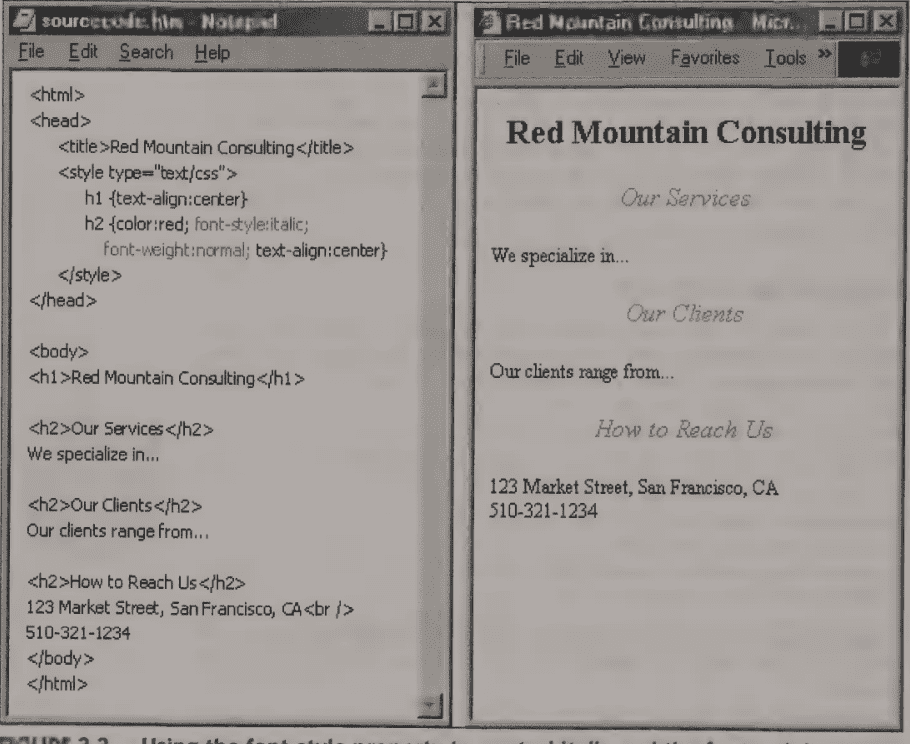

**图 3.3.** 使用 `font-style` 属性控制斜体，使用 `font-weight` 属性控制粗细

## 超越粗体和斜体

似乎粗体和斜体选项还不够我们选择，HTML 样式还提供了另外四个可以自定义的主要文本属性：`text-decoration`、`text-transform`、`font-variant` 和 `background`。

简要概述如下：

### `text-decoration`

`text-decoration` 属性控制下划线等效果，接受以下值之一：`underline`、`overline`、`line-through`、`none` 或 `blink`。最后一个值 `blink` 是对著名的 `<blink>` 标签的致敬，该标签在 Netscape Navigator 的早期版本中引入。但它的花哨特性——正如你可能猜到的，它使文本闪烁——以及业余网页设计师的过度使用，很快使它成为被嘲笑的对象。因此，请谨慎使用 `text-decoration` 属性的 `blink` 值。

### `text-transform`

`text-transform` 属性接受不言自明的值 `capitalize`、`uppercase`、`lowercase` 和 `none`。

### `font-variant`

`font-variant` 属性可以设置为 `small-caps` 或 `none`。

### `background-color`

`background-color` 属性控制文本行后面背景的颜色，可以设置为 `transparent` 或颜色名称或数字之一。

将所有这些组合起来可以产生一个非常长的样式定义。例如，我们可能决定 Red Mountain Consulting 网页上的二级页眉需要 20 点、特粗、斜体、小型大写字母、下划线、红色，并且背景色为银色。代码将是：

```
<style type="text/css">
  h2 {color:red; font-size:20pt; font-style:italic;
      font-weight:bolder; text-decoration:underline;
      font-variant:small-caps; background-color:silver}
</style>
```

你可能想知道上述每个属性的 `none` 值的用途。就页眉和 `font-weight` 属性而言，我们看到将 `font-weight` 设置为 `normal` 允许我们取消页眉的默认粗体呈现。但由于我们学过的标签（实际上，所有 HTML 标签）都没有默认的 `small-caps` 设置，例如，为什么我们需要 `font-variant` 属性的 `none` 值？稍安勿躁：当我们下面考虑样式类时，答案就会变得清晰。

## 段落样式

到目前为止，在我们的 HTML 样式讨论中，我们专注于页眉，因为它们提供了一种引入样式基本概念和语法的简单方法。但样式可以应用于任何 HTML 元素。它们对段落元素特别有用。

例如，如果我们希望网页的文本以比正常更大的字体显示，比如 14 点，那么我们可以定义一个段落样式来实现它：

```
<style type="text/css">
  p {font-size:14pt}
</style>
```

文档中任何放在 `<p>` 元素内的文本都将以 14 点大小显示。但是，请注意，要使段落样式生效，所有文本必须在段落 *元素* 中；在文档中只使用 `<p>` 标签而没有结束 `</p>` 标签将不会产生预期效果。

使用 `<p>` 元素还允许我们使用 `text-indent` 和 `line-height` 属性指定段落的首行缩进和行高。以下段落样式设置了 25 点的缩进和 24 点的行高（对于 12 点的字体大小，这对应于双倍行距）：

```
<style type="text/css">
p {text-indent:25pt; line-height:24pt}
</style>
```

或者，我们可以使用百分比，其中缩进是段落宽度的一定百分比，行高是字体大小的一定百分比：

```
<style type="text/css">
p {text-indent:12%; line-height:150%}
</style>
```

图 3.4 显示了一个示例。

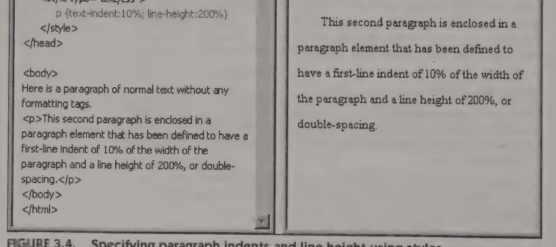

**图 3.4.** 使用样式指定段落缩进和行高

当然，这两个值不必都是百分比：

```
<style type="text/css">
  p {text-indent:25pt; line-height:150%}
</style>
```

你可以通过将 `text-indent` 属性的值设置为负数来获得悬挂缩进：

```
<style type="text/css">
  p {text-indent:-15pt}
</style>
```

对于行高，我们还可以指定一个数字，将字体大小乘以该数字以获得所需的行高。例如：

```
<style type="text/css">
  p {line-height:1.5}
</style>
```

这个 1.5 的行高值与 150% 的行高值产生相同的结果，即 1.5 倍行距。

我们甚至可以细化到浏览器应在单词之间以及单词内字母之间放置多少空间的细节（后一种效果称为字距调整）。例如：

```
<style type="text/css">
  p {word-spacing:3pt; letter-spacing:1pt}
</style>
```

然而，试图指定这种级别的细节通常需要大量的试验和错误，并且不会产生非常令人满意的结果。此外，单词和字母间距样式在 Navigator 6 之前的版本中不起作用。

## 字体系列

我们可以使用样式通过 `font-family` 属性后跟引号中的字体名称来更改显示的字体类型或系列。例如，如果我们希望文档中的所有段落都以 Lucida 字体正常大小显示，我们将 p 样式写为：

```
<style type="text/css">
  p {font-family:"Lucida"}
</style>
```

当您选择的字体未安装在用户的计算机上时，可能会出现一个潜在问题。因此，您通常至少指定两个字体系列，用逗号分隔。如果您的首选字体不太常见，明智的做法是将您的第二选择设为更常见的样式。

请注意，同一大小的不同变宽字体（例如，12磅 Times New Roman 与 12磅 Arial）通常具有非常不同的字母尺寸和间距。例如，用一种 12 磅字体显示的句子可能需要不止一行，而用另一种 12 磅字体显示同一句子可能只需不到一行。因此，你应该先用首选字体查看页面，然后用次选字体查看，以了解字体更换对页面显示的影响。

如果用户系统上两个指定字体都不可用，浏览器将使用用户在浏览器首选项中指定的默认变宽字体（PC 上通常是 Times New Roman，Macintosh 上是 Times）。虽然使用不同且独特的字体来设计网页很有趣，但用户实际看到的显示效果可能并不那么理想。因此，如果确实要更改字体，最好坚持使用常见字体。

（如果你的网页确实需要某种特定字体，可以将字体族定义嵌入到源文档中，这样字体信息会随源文档一起发送到用户的计算机。但这需要将字体定义在特殊类型的文件中，并且会减慢网页的加载和显示速度。）

我们现在已经学会了如何使用样式来设置文本显示的各个方面，包括 `font-style`（斜体或倾斜）、`font-weight`（粗体）、`font-variant`（小型大写字母）、`font-size`、`line-height` 和 `font-family`。将这些全部放在一个样式定义中会使得定义相当长且笨拙：

```css
<style type="text/css">
  p {font-style:italic; font-weight:500;
     font-variant:small-caps; font-size:14pt;
     line-height:24pt; font-family:"Lucida","Arial"}
</style>
```

不过，我们可以使用 `font` 属性来简化它：

```css
<style type="text/css">
  p {font: italic 500 small-caps 14pt/24pt "Lucida",
     "Arial"}
</style>
```

注意我们如何将字体大小和行高合并为一个值，即 `14pt/24pt`。你不必指定所有这些值。以下定义只设置了字体粗细和字体大小：

```css
<style type="text/css">
  p {font: bold 20pt}
</style>
```

虽然在上面第一个长示例中书写属性的顺序并不重要，但在第二种使用 `font` 属性简写形式的情况下，顺序确实很重要。万维网联盟（World Wide Web Consortium）定义的官方 HTML 规范规定了特定的顺序（即我们上面使用的顺序）。Navigator 遵循官方规范，但 Explorer 不遵循。在 Explorer 中，使用什么顺序都无所谓。

## 快速检查题

1. 设置标题字体大小时必须考虑哪些因素？

2. 编写一个内部样式表的 HTML 代码，将标题 3 元素重新定义为以正常（非粗体）文本显示。

3. 编写一个内部样式表的 HTML 代码，将标题 3 元素重新定义为以粗体和斜体文本显示。

4. 你使用哪个样式属性来设置大写文本？

5. 编写一个内部样式表的 HTML 代码，将段落重新定义为首行缩进行宽的 15%，行距为 1.5 倍行距。

实验练习 3.2"通过样式指定呈现方式"可以在此时完成。

#### 创建具有多种样式的标签

虽然使用段落样式来更改源文档中所有段落的显示特征确实很有帮助，但有时我们希望不同类型的段落以不同的方式显示。例如，如果我们有一个包含多个章节和每个章节中多个段落的网页，我们可能想为引言段落创建一种特殊样式。HTML 允许我们通过获取一个给定的元素并为其定义一个或多个样式"类"来实现这一点。

以下是在引言段落的特殊样式情况下如何实现。我们首先为常规段落定义一个样式，然后指定一个子样式或类，它是对主样式的修改。例如，我们将定义常规段落为斜体文本且两端对齐，引言段落具有相同的格式，但居中对齐且文本为红色。为此，我们定义一个 p 样式和一个 `p.intro` 类（或子样式），如下所示：

```css
<style type="text/css">
  p {text-align:justify; font-weight:bold}
  p.intro {text-align:center; color:red}
</style>
```

`p.intro` 类包含为其"父"样式 p 定义的完整样式集，但随后以某些方式对其进行修改或添加。在本例中，`text-align` 属性从 `justify` 更改为 `center`，并添加了 `color` 属性（红色）。`font-weight` 属性（粗体）在父样式和类中将是相同的，因为类定义没有更改它。（注意"intro"是我们的命名；我们也可以给它起其他名字，比如 `p.introductory` 或 `p.first`。）

当我们想在文档中指定使用 `p.intro` 类时，我们在 `<p>` 标签中添加一个 `class` 属性，并使用以下语法将其值指定为"intro"：

```html
<p class="intro">段落文本放在这里……</p>
```

完整代码如图 3.5 所示。

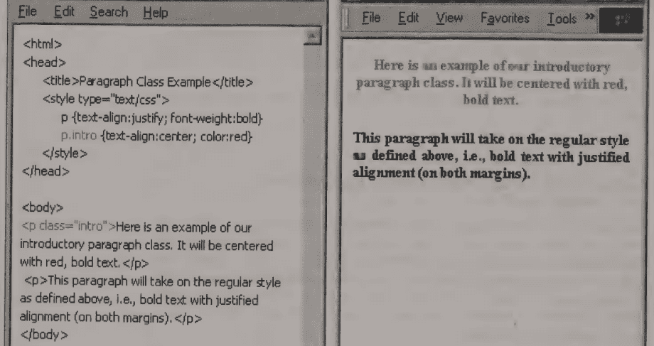

**图 3.5. 定义和使用段落类**

请记住，属性用于标签中以指定该标签可用的选项。在这种情况下，属性的名称是 `class`，其值是"intro"。在下一章中，我们将学习使用许多其他属性。

当然，我们不仅限于一个类。我们可以在 `<style>` 元素中定义任意数量的 `<p>` 类，并在 `<p>` 标签中使用 `class` 属性来指定它们的使用，使用我们给定的类名。

我们现在也可以回答上面"超越粗体和斜体"一节中提出的问题：为什么我们需要 `font-variant` 属性或 `text-transform` 属性的 `none` 值？例如，如果我们定义了一个基本段落样式，将 `text-transform` 属性设置为 `uppercase`，我们可能希望定义该段落样式的一个类，该类不使用大写文本。因此，我们使用 `none` 值来关闭大写指定，如下所示：

```css
<style type="text/css">
  p {font-style:italic; text-transform:uppercase}
  .noupper {text-transform:none}
</style>
```

图 3.6 回顾了一些可能性。注意我们如何根据要为段落使用的样式将 `class` 属性的值设置为不同的值。

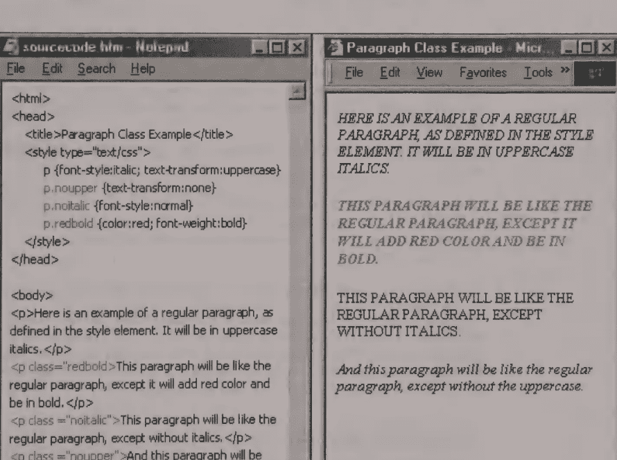

**图 3.6. 样式和类的进一步使用**

## 快速检查题

1. 什么是样式类？

2. 编写一个内部样式表的 HTML 代码，定义一个名为"boldandblue"的段落类，该类的文本将以粗体蓝色显示。

3. 根据第 2 题中的样式类定义，编写创建一个具有该样式的段落的 HTML 代码。段落文本使用"这是一个以粗体蓝色文本显示的示例段落。"

#### 使用局部样式

偶尔绕过 `<style>` 元素，直接在标签中插入样式定义是有用的。例如，如果你的整个文档中只有一个段落需要大写且为红色，为其定义样式就显得小题大做了（样式和类的概念当然是在 `<style>` 元素中定义一次样式，然后在文档中多次使用它）。

相反，你将在标签中添加一个 `style` 属性，附带预期的样式定义。

```html
<p style="text-transform:uppercase; color:red">此段落将以大写和红色显示（此外还有为常规段落定义的任何其他样式属性）。</p>
```

这被称为局部样式，因为它只影响该单个标签。

请注意，如果局部样式定义与 `<style>` 元素中该类型标签的样式定义存在任何冲突，局部样式定义将优先。在我们的示例中，`color:red` 的局部样式定义会覆盖 `<style>` 元素中 `p` 样式定义中可能存在的任何其他颜色定义。但 `p` 样式定义的其余部分将保持不变。

### 快速检查题

1. 编写一个局部样式的 HTML 代码，将单个标题 2 元素重新定义为以粗体和斜体显示。

实验练习 3.3"使用类和局部样式"可以在此时完成。

#### 创建自定义标签

我们已经了解了如何通过样式自定义现有 HTML 元素的呈现方式。同样，也可以创建全新的元素。这是通过基于两个通用标签 `<div>` 和 `<span>` 来实现的。`<div>` 标签是一个通用的块级标签（div 代表 division）。`<span>` 标签是一个通用的行内标签（span 因其跨越一系列字符而得名）。

例如，如果我们想要更改文档中选定的个别单词的字体大小该怎么办呢？当然，我们可以将每个单词放在 `<big>` 或 `<small>` 元素中。但如果我们想要的大小比这些元素提供的大小更大或更小，这就行不通了。为了满足这种需求，我们可以定义一个 span 样式，并使用 `<span>` 元素来实现它。

```html
<style type="text/css">
span {font-size:18pt}
</style>
```

然后，我们将任何想要放大的文本包裹在 `<span>` 元素中：

```html
Let me make one thing <span>perfectly</span> clear . . .
```

或者，如果你想能够将某些单词或短语的背景颜色更改为黄色以突出显示它们，你可以写：

```html
<style type="text/css">
span {background-color:yellow}
</style>
```

如果我们只需要更改某些单词的大小，而只需更改其他单词的颜色，我们将定义不同的 span 样式类，如图 3.7 所示。

请注意，我们可以将 `<span>` 元素相互嵌套，就像我们在图 3.7 的最后一句话中所做的那样，以获得大号的红色文本。或者，当然，我们也可以通过定义一个具有多个属性的另一个 span 类，用一个 `<span>` 元素来获得相同的结果：

```html
<style type="text/css">
span.largered {color:red; font-size:18pt}
</style>
```

`<div>` 元素的工作方式与 `<span>` 相同。例如，如果我们想将文档的某些部分的背景颜色更改为红色，但保持其他部分的正常背景颜色（大概是白色），我们可以定义一个带有 `redbkd` 类的 `<div>` 标签，并像通常一样使用它（图 3.8）。

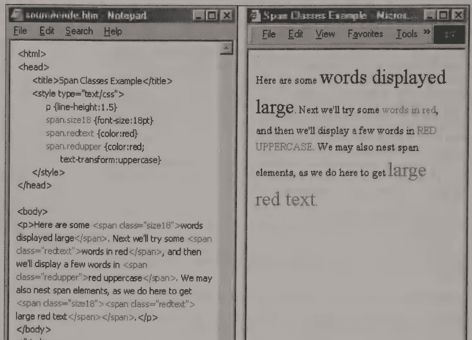

请注意，理论上我们不能使用行内 `<span>` 元素来完成我们使用块级 `<div>` 元素所做的事情，因为其中包含几个块级元素（即 `<p>` 元素）。在行内元素内嵌套一个块级元素违反了 XHTML 的规则，尽管浏览器可能会允许你这样做。

## 快速检查问题

1. `<span>` 和 `<div>` 元素之间有什么区别？

2. 编写 HTML 代码，定义一个行内自定义元素，可用于将文本格式化为蓝色文本和黄色背景，并给出一个示例，说明如何将其用于格式化文本行 “This will appear in blue with a yellow background.”。

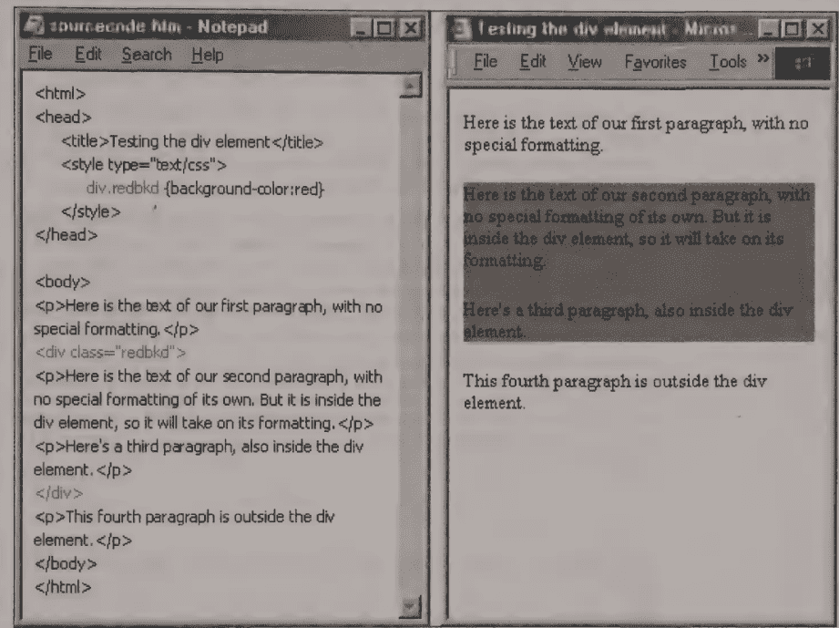

在第 5 章中，我们将学习如何使用链接创建多页网站。在设计这样的网站时，最好为所有页面采用标准的“外观和感觉”，这意味着为每个页面使用相同的一组样式定义。这可能需要大量重新输入样式定义，或者至少在源文档之间剪切和粘贴样式定义。但幸运的是，HTML 提供了一种更简单的方法，称为外部样式表。

外部样式表仅仅是一个纯文本文件，其中只包含一组样式定义，例如：

```css
h2 {color:red}
h3 {color:blue}
p {text-align:justify; font:12pt/16pt}
p.intro {text-align:center; color:red}
p.bigandbold {text-weight:900; font:20pt/30pt}
```

请注意，我们*不*将这些样式定义包裹在 `<style>` 元素中。

保存这些定义的文本文件可以取任何合法的文件名，但必须以三字母扩展名 `.css` 结尾。css 代表层叠样式表。这是万维网联盟 (World Wide Web Consortium) 赋予 HTML 样式表的官方名称。

“层叠”指的是有三种类型的样式表：本地、内部和外部。我们在“使用本地样式”一节中看到了如何为标签创建本地样式。而我们在本章其余部分所做的就是使用内部样式表——使用 `<style>` 元素定义的样式。外部样式表是本节的主题。这些样式是层叠的原因在于，你可以在一个文档中同时拥有这三种样式，当这种情况发生时，样式会层叠：任何本地样式都会覆盖任何内部样式定义，而内部样式定义又会覆盖任何外部样式定义。

为了使用外部样式表（`.css` 文档）中包含的样式，我们只需将以下 `<link>` 标签添加到 HTML 源文档的 `<head>` 元素中：

```html
<link rel="stylesheet" type="text/css"
href="mystyles.css" />
```

其中 `mystyles.css` 是存储定义的文本文件的示例名称。

当浏览器在源文档中看到此标签时，它会去寻找包含样式定义的 `mystyles.css` 文档。然后使用这些样式定义来显示源文档。为了使此功能正常工作，`mystyles.css` 文档*必须与源文档位于同一文件夹中*。

（不要混淆 `<link>` 标签和超链接，我们将在第 5 章学习超链接。）


尽管 HTML 样式表赋予了网页设计者更强大的能力和灵活性，但它们并非没有缺点。目前主要的问题是，即使是 Explorer 和 Navigator 的最新版本也没有完全实现它们。PC 上的 Navigator 版本 4 只识别大约 33% 的样式命令，而 Explorer 版本 5 只识别大约 72%，尽管大多数基本样式都可以正常工作。PC 上的 Navigator 6 和 Explorer 6 都实现了 90% 以上的样式。但旧版本的浏览器可能根本无法识别样式。因此，我们需要某种方式向这些浏览器隐藏 HTML 样式指令，因为它们会忽略 `<style>` 标签并将样式指令视为普通文本——它们会显示在网页上。

这就是 HTML 注释除了注释 HTML 代码之外的另一个用途。通过将所有样式指令放在 HTML 注释中，旧浏览器不会将这些指令显示为文本，而大多数新浏览器都设置为仍然能够识别样式指令。也就是说：

```html
<style type="text/css">
<!--
h1 {text-align:center}
h2 {color:red; text-align:center}
-->
</style>
```

请注意，注释标签位于 `<style>` 元素内部。

不幸的是，XHTML 的到来使得这种使用注释的方法失效了。原因是基于 XML 的浏览器被设置为完全忽略注释标签内的所有内容。因此，使用样式定义但又使其远离旧浏览器的唯一可靠方法是将其放入外部 `.css` 文件中，并通过上述 `<link>` 元素访问它们。（请记住，这样可以工作是因为浏览器会忽略任何它不理解的标签，因此旧浏览器会忽略 `<link>` 标签。）

尽管如此，在我们的示例中，我们将继续使用内部样式表，并且为了节省空间，我们通常会省略注释标签。

最后，你可能想知道样式表是否允许你在网页上显示重音字符和其他特殊符号。你实际上必须使用涉及字符代码的不同方法来实现这一点。详情请参见附录 E。

## 快速检查问题

1. 层叠样式表是什么意思？

2. 你应该将 `<link>` 标签放在哪里？

实验练习 3.4 “使用自定义标签和外部样式” 可以在此时进行。

- 浏览器安全颜色

- 层叠样式表

- 颜色编号（或颜色代码）

- 外部样式表

- 十六进制（基数为 16）系统

- 内部样式表

- 本地样式

- 父样式

- 属性

- 属性值

- 样式类

- 样式定义

## 1. 样式的威力

将 `<style>` 元素的样式表语言定义为 css（层叠样式表）：

```html
<style type="text/css">
...
</style>
```

使用 `<meta>` 元素将整个文档的默认样式表语言定义为 css（放在 `<head>` 元素中）：

```html
<meta http-equiv="Content-Style-Type" content="text/css" />
```

使用 `<style>` 元素（放置在 `<head>` 元素内）创建内部样式表（在此示例中定义 `<h2>` 和 `<h3>` 元素的 `color` 属性）：

```html
<style type="text/css">
 h2 {color:red}
 h3 {color:#D61130}
</style>
```

## 2. 使用样式格式化字体

使用内部样式表重新定义标题标签的格式，例如（`<style>` 元素放在 `<head>` 元素中）：

```html
<style type="text/css">
 h1 {text-align:center; font-style:italic; font-size:30pt}
 h2 {color:red; font-size:24pt; font-variant:small-caps}
</style>
```

基本样式属性及其可能的值：

- `color:red`（或其他预定义颜色名称或有效颜色编号）

- `text-align:center`（或 `right` 或 `left`）

- `font-weight:bold`（或 `normal`, `bolder`, `lighter`，或值 100, 200, . . . 900）

- `font-size:20pt`（或其他点值，或 `xx-small`, `x-small`, `smaller`, `small`, `medium`, `large`, `larger`, `x-large`, `xx-large`，或“正常”大小的百分比，例如 150%）

- `font-style:italic`（或 `normal`, `oblique`）

- `text-decoration:underline`（或 `overline`, `line-through`, `none`, `blink`）

- `text-transform:capitalize`（或 `uppercase`, `lowercase`, `none`）

- `font-variant:small-caps`（或 `none`）

- `background-color:red`（或 `transparent` 或预定义颜色名称或有效颜色编号）

- `text-indent:25pt`（或行宽的百分比，例如 10%；负值用于悬挂缩进）

- `line-height:20pt`（或单行高度的百分比，例如 150%，或乘数因子，例如 1.5）

- `font-family:"Lucida","Arial"`（首选字体名称和次选字体名称）

将 `font-style`, `font-weight`, `font-variant`, `font-size`/`line-height`, `font-family` 属性组合到一个样式定义中（顺序很重要）：

```css
font: italic bolder small-caps 14pt/24pt "Lucida","Arial"
```

## 3. 创建具有多种样式的标签

定义并使用类（子样式）：

```html
<html>
 <head>
  <title>Class Example</title>
  <style type="text/css">
   p {text-align:justify; font-weight:bold}
   p.intro {text-align:center; color:red}
  </style>
```

## 4. 使用局部样式

为单个元素实例创建局部样式：

```
<p style="text-transform:uppercase; color:red">This paragraph will be uppercase and red (in addition to any other style properties that may be defined for the regular paragraph).</p>
```

## 5. 创建自定义标签

使用 `<span>` 定义自定义行内元素，使用 `<div>` 定义自定义块级元素（也可以为每个元素定义类）：

```
<style type="text/css">
  span {background-color:yellow}
  div {background-color:red}
</style>
```

## 6. 外部样式表

使用保存在名为 `mystyles.css` 的文件中的外部样式表（该文件包含*不带* `<style>` 元素的样式定义）：

```
<link rel="stylesheet" type="text/css" href="mystyles.css" />
```

在样式定义中使用十六进制颜色代码时（例如，`h2 {color:#D61130}`），不要忘记 `#` 符号。

在为网页选择颜色时，最好坚持使用 216 种浏览器安全色。

很容易忘记许多样式属性中包含的连字符（例如，`font-size`、`text-align`）。

定义字体大小值时，不要在数字和 "pt" 之间加空格（例如，`font-size:20pt` 是正确的，`font-size:20 pt` 是不正确的）。

抵制创建闪烁文本的诱惑。

如果定义了段落样式，必须使用段落元素，而不能只使用 `<p>` 标签。

在样式定义中指定字体系列时，请列出首选字体和常用的备选字体，以防首选字体在用户的计算机上不可用。同时请注意，相同点数大小的不同字体不一定以相同的大小或间距显示。

如果使用 `font` 属性组合多个字体样式定义，请记住列出它们的顺序很重要（至少对 Navigator 浏览器而言）。

不要将 `<link>` 标签（用于外部样式表）与超文本链接混淆。

虽然 HTML 注释传统上被用来包裹样式定义，以便不支持样式的浏览器不会将其显示为普通文本，但这不再保证在支持 XML 的浏览器中有效，因为浏览器可能会忽略注释内的所有内容。

## 复习题

- 1. 哪个元素用于创建内部样式表？

  a. `<internal>`

  b. `<style>`

  c. `<internalstyle>`

  d. `<stylesheet>`

- 2. 样式定义由冒号分隔的两部分组成。它们是什么？

- 3. 有多少种颜色有预定义名称？

  a. 10

  b. 12

  c. 16

  d. 32

- 4. 有多少种浏览器安全色？

  a. 32

  b. 64

  c. 128

  d. 216

- 5. 以下哪些是用于定义文本样式的属性？它们各自的作用是什么？

  a. `font-weight`

  b. `text-style`

  c. `color`

  d. `font-align`

  e. `font-size`

- 6. 编写一个段落的样式定义，使其首行缩进 15 点。

- 7. 编写一个名为 `greekletters` 的段落类的样式定义，将其字体设置为 Symbol 字体。

- 8. 判断正误：局部样式定义总是会覆盖任何可能适用的内部和外部样式定义。

- 9. `span` 是通用行内元素，`div` 是可自定义的通用块级元素。

- 10. 判断正误：向不识别样式的旧版浏览器隐藏内部样式定义的最佳方式是将其包含在注释标签中。

## 练习

- 1. 简要定义和/或解释以下术语：样式定义、样式属性、样式类。

- 2. 使用搜索引擎，在网上搜索有关十六进制颜色编号的网站。找到你喜欢的五种浏览器安全色的颜色编号以及你喜欢的三种非浏览器安全色的颜色编号。记下这些编号以及每种颜色的简要描述（1 到 3 个词）。

- 3. 编写 HTML 代码，为一级标题创建新样式，使其变为斜体和加粗。

- 4. 编写 HTML 代码，为三级标题创建新样式，使其居中并显示为大写。

- 5. 编写 HTML 代码，定义一个常规段落样式，具有 30 点的悬挂缩进，首选字体为 Garamond，备选字体为 Bookman。

- 6. 编写 HTML 代码，使用 `font` 属性定义一个段落样式，包含 16 点斜体文本和 32 点行高。

- 7. 编写 HTML 代码，定义一个名为 `doublespace` 的段落类，修改常规段落样式（无论其如何定义）使其为双倍行距。同时编写一个该类的示例段落代码。

- 8. 编写 HTML 代码，为一级标题元素创建一个黄色文本、蓝色背景的局部样式。

- 9. 编写 HTML 代码，定义一个自定义块级元素，使其内部所有文本显示为斜体，并展示如何使用它将三段文本（使用段落元素定义）变为斜体。

- 10. 编写 HTML 代码，创建一个外部样式表，其中包含第 6 题和第 7 题中代码的样式定义。假设该样式表已保存在名为 `teststyle.css` 的文件中，展示如何编写需要应用这些样式的文档中的 HTML 标签。

- 11. 找出以下代码中的错误，然后在纸上画出浏览器在纠正错误后会如何显示该页面。（在这种情况下，不必担心添加必要的 XHTML 代码，而是专注于样式代码。）

```
<html>
<head>
  <title>Red Mountain Consulting</title>
  <link rel="stylesheet" type="text/css" href="mystyles.css" />
  <style type="text/css">
    h2 {color:lightgreen; background-color:yellow}
    p {text-align:justify; font-weight:bold}
    p.intro {text-align:center; color:blue}
  </style>
</head>
<body>
<h1>Red Mountain Consulting</h1>
<h2>Our Services</h2>
<p class="intro">We specialize in project management consulting. Our partners and associates have extensive real-world experience in bringing even the most complex and deadline-sensitive projects to successful completion on time and under budget.</p>
<h2>Our Clients</h2>
<p>Our clients range from Fortune 500 companies to the most dynamic small cap companies in a broad range of industries.</p>
<h2>How to Reach Us</h2>
<p style="font-style:italic">123 Market Street, San Francisco, CA<br />
510-321-1234</p>
</body>
</html>
```

注意：上面的大多数练习也可以作为实验练习来完成。

## 练习 3.1：基本样式

- 创建一个名为 `styling.htm` 的简单 HTML 源文档，演示使用 `<h1>` 到 `<h6>` 标题元素的 `color` 和 `text-align` 样式。使用你喜欢的任何颜色和文本。确保保存你的工作。

## 练习 3.2：通过样式指定表现形式

- 使用实验练习 3.1 的文档，添加各种示例标题和段落，演示以下样式属性的使用：`font-size`、`font-style`、`font-weight`、`text-decoration`、`text-transform`、`font-variant`、`background-color`、`text-indent`、`line-height`、`font-family` 和 `font`。每种属性至少包含一个示例。如果你想使用多种段落样式，请注释掉之前的定义或使用多个源文档。请尽情发挥创意。但也要注意，样式对拼写错误非常敏感。如果你遗漏了连字符或花括号，或者没有使用正确的名称（例如，使用 "text-style" 而不是 "font-style"），浏览器将忽略该样式。

## 练习 3.3：使用类和局部样式

- 使用实验练习 3.1 和 3.2 的文档，添加 HTML 代码来创建 `<h1>` 元素的三个不同类：一个是在蓝色背景上显示黄色文本，一个是显示小型大写字母文本但不加粗，一个是在 Arial 字体中显示红色文本。在 `<body>` 元素中为每种样式至少放置一个示例 `<h1>` 元素。

- 向文档中添加代码，定义一个使用斜体文本（和默认字体）的常规段落样式。然后定义该段落的两个类，一个使用 1.5 倍行距，另一个使用双倍行距。在 `<body>` 元素中为每种样式至少放置一个示例，确保包含足够的示例文本以便能够看到行距的效果。

- 向文档中添加代码，为文档中的 `<h2>` 元素定义一个局部样式，使其变为红色并具有 25 点的缩进。

## 练习 3.4：使用自定义标签和外部样式

- 向文档中添加至少两个 `<span>` 元素示例和两个 `<div>` 元素示例（其功能由你决定）。

- 创建一个名为 `mystyles.css` 的 .css 文件，其中包含你在前面练习中创建的样式。然后创建一个新的 HTML 源文档 `externalstyles.htm`，使用该外部样式表来定义其样式。在 `<body>` 元素中包含一些代码，演示部分（但不一定是全部）样式。

## 属性、列表和表格

### 学习目标

- 1. 了解已弃用元素以及 XHTML 的严格模式和过渡模式。

- 2. 学习如何在各种标签中使用属性来指定标签选项。

- 3. 学习使用 HTML 构建有序列表、无序列表和定义列表的各种方法。

- 4. 学习如何在网页上显示信息表格以及相关的各种选项。

#### 扩展与弃用

多年来，Navigator 和 Explorer 都在标准 HTML 版本之外自行添加了许多**扩展**功能。虽然这些 HTML 扩展功能让网页设计师能够为网页添加酷炫或实用的特性，但缺点在于，通常 Navigator 的扩展在 Explorer 中无法工作，反之亦然。例如，Navigator 的 `<blink>` 元素（用于创建闪烁文本）在 Explorer 中无法工作，而 Explorer 的 `<marquee>` 元素（用于显示滚动文本）在 Navigator 中也无法工作。

因为任何网页设计师的目标之一都是创建能够在所有访问者浏览器中正确显示的页面，所以你通常应该谨慎使用尚未获得官方认可或仅适用于单一浏览器的 HTML 特性。（你可以通过访问万维网联盟的网站 `www.w3.org` 来了解什么是官方的，什么不是。）如果由于某种原因你确实需要使用非标准的 HTML 特性，你应该在页面开头包含一条消息，告知访问者"本页面使用的特性最好在 Netscape Navigator 4.0 或更高版本[或 Internet Explorer 某版本]中查看"，或类似效果的文字。

W3C 定期"弃用"某些元素的做法进一步增加了复杂性。**已弃用**标签意味着该元素正在被淘汰，不再推荐使用，尽管它在大多数浏览器中仍能工作。其他元素则被标记为**已过时**，这意味着严格遵循新标准的浏览器将不再支持它们的使用。W3C 弃用某些元素的主要动机是需要将结构与表现分离（参见第 2 章中"`<em>` 和 `<strong>` 元素"一节）。如前所述，其理念是使用 HTML 源文档来定义网页的结构并对内容进行归类，而使用样式表来定义各种内容元素的表现形式。因此，从 HTML 4 版本开始（此时引入了样式表），许多主要用于表现用途的 HTML 元素被弃用。请记住，弃用并不一定意味着消除。大多数浏览器仍会继续支持已弃用的标签。

被弃用的较流行的表现元素之一是 `<font>`。`<font>` 元素是一个内联元素，通过 `size`、`color` 和 `face` 属性来定义文本的大小、颜色和字体样式表现。请记住，属性是我们添加到标签中用于指定该标签可用选项的内容。要在标签中使用属性，我们指定属性的*名称*，后跟等号，然后是包含在引号中的属性*值*。例如，以下 `<font>` 元素指示浏览器以红色显示包含的文本：

```
<font color="red">This is really red!</font>
```

通过添加 `size` 属性和值，还可以定义字体的显示大小：

```
<font size="5" color="red">This is really red!</font>
```

`size` 属性的值范围从 1 到 7，其中 1 最小，7 最大，3 为正常大小。`color` 属性接受常见的颜色数值或颜色名称作为其值（与样式一样，颜色数字前需加 `#` 符号），`face` 属性（表示字体的外观或样式）接受所需字体的名称。例如：

```
<font size="5" face="Garamond">This is the Garamond font
in slightly larger than normal text.</font>
```

标签中属性的顺序无关紧要。我们也可以将上面的代码写成：

```
<font face="Garamond" size="5">This is the Garamond font
in slightly larger than normal text.</font>
```

你还可以指定多种字体，以防你的首选字体在用户计算机上不可用：

```
<font face="Garamond,Arial">Let's try Garamond, or Arial
if Garamond isn't available.</font>
```

在 HTML 4 及更早版本中，属性值周围的引号并不总是必需的（取决于所使用的属性），但在 XHTML 中则是必需的。最好养成使用引号的习惯，即使你在其他源文档中看到未使用引号的情况。你也可以在等号两侧添加空格，如下所示，尽管这不是必需的。

```
<font color = "red">This is really red!</font>
```

此时你可能会想，既然它正在被淘汰，为什么还要学习这些？我们告诉你这些元素和属性，不是因为我们推荐你使用它们，而是因为你在研究网页时经常会遇到它们，应该了解它们是如何工作的。

那么 XHTML 的情况如何？因为 W3C 认识到，按照旧版 HTML 规则创建的庞大现有网页世界不会消失，也不会在短期内被更新，而且访问者会继续使用不能很好处理样式表的旧浏览器，所以它定义了多个版本的 XHTML。有一种**XHTML 严格模式**，该模式不承认已弃用的标签和属性。还有一种**XHTML 过渡模式**，该模式则承认。在这里，我们可以回到 XHTML 文档顶部的文档类型定义的细节，并更好地理解它。我们在第 2 章中使用的 DTD 是：

```
<!DOCTYPE html PUBLIC
  "-//W3C//DTD XHTML 1.0 Transitional//EN"
  "http://www.w3.org/TR/xhtml1/DTD/xhtml1-transitional.dtd">
```

请注意，"transitional"一词在此 DTD 中出现了两次。这向浏览器表明文档中的代码遵循 XHTML 的过渡模式，DTD 的最后一部分是 W3C 网站上用于定义过渡模式细节的文档的 URL。如果我们改为将"transitional"替换为"strict"，我们就是在告诉浏览器代码是干净、纯正的 XHTML：

```
<!DOCTYPE html PUBLIC
  "-//W3C//DTD XHTML 1.0 Strict//EN"
  "http://www.w3.org/TR/xhtml1/DTD/xhtml1-strict.dtd">
```

实际上，在未来几年我们将处于过渡阶段，因此你应该使用过渡 DTD。如果你要用严格的 XHTML 编写所有网页，许多访问者将无法按预期查看它们，因为他们的浏览器不能很好地处理 XHTML 和样式表。因此，你应该通过学习 XHTML 的理念和方法，并在网页中尽可能多地使用它来为未来做好准备，哪怕只是为了减少将来可能需要做的修改。然而，你也需要针对现在设计页面，以便大多数访问者现在就能按预期查看它们。这意味着有时你可能会认为最好使用已弃用的元素。只是尽量减少它们的使用，并记住样式表的优点。

**重要提示**

例如，`<font>` 元素当然是更改网页上某些文本的颜色、大小或字体的快捷简便方法。但当你需要尝试页面的整体外观时，样式的优势就变得明显了。例如，要将高亮色从红色改为黄色，只需在样式定义中做一次更改即可。相反，如果你在文档中到处使用 `<font>` 元素，你就得逐一更改每一个的颜色值。

在我们继续学习 HTML 的过程中，我们将指出哪些元素和属性是已弃用的。附录 B 中的表格也列出了已弃用的元素。

> **快速检查问题**

1. 已弃用标签和已过时标签有什么区别？

2. 是否可以在源文档中使用已弃用标签？为什么可以或为什么不可以？

3. XHTML 严格模式和过渡模式有什么区别？

#### 更多标签和属性

在 HTML 4 版本引入样式之前，标签属性是指定 HTML 元素表现的首选方式。我们将回顾一些在 HTML 源文档中最常见的属性。

## `align` 属性

在第 2 章中，我们了解了六个标题元素 `<h1>` . . . `</h1>`、`<h2>` . . . `</h2>`，等等。浏览器通常将标题文本对齐到浏览器窗口的左边缘。我们可以改用值为 `center` 的 `align` 属性来指示浏览器将标题文本居中对齐：

```
<h2 align="center">Welcome to my Web page!</h2>
```

我们也可以将其值指定为 `right` 或 `left`，这将分别使标题沿右边缘或左边缘对齐，如图 4.1 所示。

`align` 属性也可以在 `<p>` 元素中使用。如果标签中不存在 `align` 属性，则 `align="left"` 为默认值。

使文本在页面上居中的另一种方式是使用 `<center>` 元素，如图 4.2 所示。请注意，浏览器会在 `<center>` 元素后自动插入换行。

## 背景颜色

作为使用属性来定义外观的一个更丰富多彩的例子，我们来考虑`<body>`元素。通过在`<body>`开始标签中使用`bgcolor`属性，我们可以改变网页的背景颜色。基本语法如下：

`<body bgcolor="#$$$$$$">`

其中$符号被替换为颜色数字（例如，红色为FF0000；更多颜色请参考表3.1）。或者你也可以使用16个预定义颜色名称之一。例如：

`<body bgcolor="#FF00FF">`

或者等价的：

`<body bgcolor="magenta">`

图4.3展示了结果（使用偏红色替代了真实的洋红色）。

我们还可以通过在`<body>`标签中使用`text`属性来改变页面文本的颜色。以下代码将背景颜色改为黄色，文本颜色改为蓝色：

`<body bgcolor="yellow" text="blue">`

然而，与基于表现的属性一样，`bgcolor`和`text`属性已被弃用。因此，获得相同效果的首选方式是使用针对`<body>`元素的样式表：

```
<style>
    body {background-color:yellow; color:blue}
</style>
```

注意，背景颜色的属性名是`background-color`，而背景颜色的属性值名称是`bgcolor`。

## 水平分隔线

在网页中使用称为"水平分隔线"的水平线来分隔各个部分通常是很好的设计思路。我们使用的标签是`<hr />`标签，它与`<br />`标签一样，是空元素。默认情况下，水平分隔线在页面中居中显示，并带有阴影效果。过去，可以使用属性来设置分隔线的尺寸/粗细（以像素为单位——构成屏幕显示的单个点或图像元素）和宽度（以像素为单位或作为页面宽度的百分比），如图4.4所示。

**图 4.4.** 使用属性的水平分隔线示例

但是`size`和`width`属性已被弃用。相反，我们可以使用`height`和`width`属性来定义水平分隔线的样式。图4.4中第三个水平分隔线的样式为：

```
<style type="text/css">
    hr {height:7px; width:75%}
</style>
```

我们还可以通过使用`background-color`属性来改变水平分隔线的颜色，例如：

```
<style type="text/css">
    hr {height:7px; width:75%; background-color:red}
</style>
```

## 哪些标签，哪些属性？

你怎么知道哪些标签有哪些属性，哪些已被弃用，哪些没有？没有HTML参考资料你是做不到的。我们在附录B中提供了一份基本参考资料。更多详细信息也可以很容易地在Web上找到。我们在附录I中列出了一些优秀的网站。

> **快速检测问题**

1. 编写HTML代码来创建一个在页面居中对齐的二级标题，首先使用样式表，然后使用属性。（标题文本内容随意。）

2. 编写HTML代码来创建一个宽度为200像素的水平分隔线，首先使用样式表，然后使用属性。

实验练习4.1"属性实验"可以在此时进行。

#### 显示列表

有时你可能希望以列表或大纲的形式在网页上显示信息，并为子项添加缩进。HTML提供了创建三种列表的标签。我们将重点介绍两种最有用的列表——有序列表和无序列表——并对第三种列表——定义列表稍作介绍。

### 有序列表和无序列表

有序列表中的项目按数字或字母排列：1, 2, 3... 或 A, B, C... 无序列表中的项目用实心圆点（项目符号）、空心圆圈或实心方块标记。要创建有序列表，使用`<ol>`元素；对于无序列表，使用`<ul>`元素。在元素内部放置列表项目，每个项目都放在`<li>`元素中。图4.5给出了基本示例。浏览器会在每个列表前后自动插入一个空行，因为`<ol>`和`<ul>`是块级元素。它还会对每个列表进行轻微缩进。最后，请注意在HTML 4及更早版本中，不要求包含`</li>`结束标签。但XHTML要求所有元素都必须有结束标签。

### 嵌套列表

我们还可以嵌套列表以显示层次结构。当你嵌套无序列表时，顶层使用实心圆点标记每个项目（如上所示），第二层使用空心圆圈，第三层使用实心方块。图4.6展示了效果。

**图 4.5.** 基本的有序列表和无序列表

**图 4.6.** 嵌套的无序列表

注意，在源代码中我们缩进了嵌套列表以使代码更易读。但无论我们是否缩进，浏览器都会如所示那样显示。不同的浏览器可能也会以略微不同的大小显示圆点、圆圈和方块，因此，如果这对你的页面设计很重要，请务必在Explorer和Navigator中都检查显示效果。

嵌套有序列表的工作方式相同，只是所有层级都使用数字来标记每个项目。将图4.6源代码中的每个`<ul> . . . </ul>`元素改为`<ol> . . . </ol>`将得到图4.7所示的显示效果。

我们还可以嵌套不同类型的列表，例如在有序列表中嵌入无序子列表。图4.8展示了如何实现。

注意，由于第一个无序列表位于整体层次结构的第二层，它使用空心圆圈而不是实心圆点来标记其项目。

### 自定义列表显示

如果我们不喜欢HTML默认的列表编号或标记，HTML 4（或过渡性XHTML）允许我们对它们进行控制。要覆盖无序列表或子列表使用的默认项目标记，我们在`<ul>`标签中插入`type`属性。它可以取以下三个值之一：`disc`、`circle`或`square`。`type`属性也适用于有序列表，使用值`A`、`a`、`I`、`i`或`1`（分别对应按A, B, C...、a, b, c...、I, II, III...、i, ii, iii...或1, 2, 3...排序的列表）。图4.9展示了一些可能的示例。

显示列表

93

```html
<body>
<ol>
    <li>Top level, item 1</li>
    <li>Top level, item 2</li>
    <ul>
        <li>Sublevel 1, item 1</li>
        <li>Sublevel 1, item 2</li>
        <li>Sublevel 1, item 3</li>
    </ul>
    <li>Top level, item 3</li>
</ol>
</body>
```

1. Top level, item 1

2. Top level, item 2

    - Sublevel 1, item 1

    - Sublevel 1, item 2

    - Sublevel 1, item 3

3. Top level, item 3

**图 4.8.** 组合使用有序列表和无序列表

```html
<body>
Here's a top-level unordered list with square item
marks instead of the usual solid discs:
<ul type="square">
    <li>Item 1</li>
    <li>Item 2</li>
    <li>Item 3</li>
</ul>
Here's a top-level ordered list using letters:
<ol type="A">
    <li>Item 1</li>
    <li>Item 2</li>
    <li>Item 3</li>
</ol>
And here's a list using small Roman numerals:
<ol type="i">
    <li>Item 1</li>
    <li>Item 2</li>
    <li>Item 3</li>
</ol>
</body>
```

Here's a top-level unordered list with square item marks instead of the usual solid discs:

- Item 1

- Item 2

- Item 3

Here's a top-level ordered list using letters:

A. Item 1

B. Item 2

C. Item 3

And here's a list using small Roman numerals:

i. Item 1

ii. Item 2

iii. Item 3

**图 4.9.** 自定义列表的项目标记

#### 定义列表

有时可能有用的第三种列表是**定义列表**。你使用`<dl>`元素来创建定义列表，在其中使用`<dt>`元素插入“定义术语”的行，并使用`<dd>`元素插入“定义数据”的行。浏览器会自动缩进`<dd>`元素的内容。图4.10展示了如何使用这些元素来创建一个术语表。（请记住，显示中的缩进来自浏览器对`<dd>`元素的呈现，而不是源代码中的缩进。）

注意我们如何使用`<strong>`元素来进一步突出显示定义术语。缺点是必须对每个`<dt>`元素都插入`<strong>`元素。将`<dt>`元素的样式定义为使用粗体文本会容易得多：

```css
<style type="text/css">
  dt {font-weight:bold}
</style>
```

与有序列表和无序列表一样，定义列表也可以嵌套。我们留给读者自行实验代码以查看结果。

`type`属性是另一个已弃用的属性。然而，使用样式来定义列表元素的呈现方式是很简单的。例如，要指定文档中所有无序列表使用方形项目标记（如图4.9的第一个示例所示），我们在样式定义中使用`list-style`属性：

```css
<style type="text/css">
  ul {list-style:square}
</style>
```

无序列表的`list-style`属性的其他标准值包括：

```css
list-style:disc
list-style:circle
```

对于有序列表元素，可以使用以下属性：

```css
list-style:decimal        (数字 1, 2, 3 ...)
list-style:upper-alpha    (大写字母 A, B, C ...)
list-style:lower-alpha    (小写字母 a, b, c ...)
list-style:upper-roman    (罗马数字 I, II, III ...)
list-style:lower-roman    (罗马数字 i, ii, iii ...)
```

你也可以使用：

```css
list-style:url(some_image.gif)
```

它指定将文件`some_image.gif`中的图像用作项目标记。（如果图像文件与源文档不在同一目录中，则当然必须提供更完整的路径名。）

## 快速检查问题

- 1. 编写代码来创建(a)一个有序列表和(b)一个无序列表，使用以下列表项：pepperoni、salami、olives、mushrooms、extra cheese。

- 2. 可以用作无序列表项目标记的三种基本符号是什么？

- 3. 如果你在一个有序列表中嵌套另一个有序列表，顶层列表和子列表分别使用什么编号系统：1,2,3…、A,B,C,…、a,b,c,…还是i,ii,iii,…？

实验练习4.2“标签的更多练习”可以在此刻进行。

#### 转向表格

有时你会希望以表格格式在网页上呈现信息。例如，如果你正在设计个人网页，可能会创建一个表格来显示你的课程表。或者一个商业网站可能希望显示一个列出商店位置和营业时间的表格。从3.0版本开始，HTML添加了特殊标签来简化表格创建。

### 基本表格

HTML中的表格由行组成，每行由矩形框或单元格组成。HTML表格定义包含在`<table>`和`</table>`标签之间。你使用`<tr>`和`</tr>`元素分别定义表格中的每一行，然后使用`<td>`和`</td>`元素定义行中的每个单元格（其中`tr`代表表格行，`td`代表表格数据）。图4.11给出了一个简单的示例，展示了一个有四行、每行三个单元格的表格，以说明其工作原理。（注意缩进和注释，它们使代码更易于阅读，并能看清每行中单元格的定义方式。浏览器当然会忽略缩进和注释。）

非常重要的一点是不要忘记结束标签`</table>`。HTML 4和XHTML需要它。然而，有些浏览器会忽略标签缺失的事实并仍然显示表格，而其他浏览器，如Navigator 6之前的版本，则遵守规则，什么也不显示。


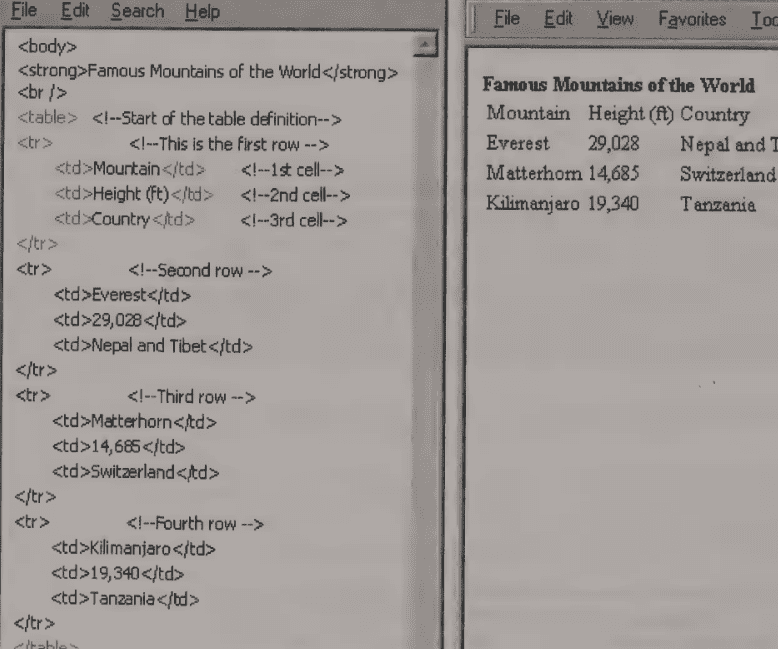

**图4.11. 创建基本表格**

### 表格边框选项

你可以在`<table>`标签中包含`border`属性，为表格及其单元格添加3D阴影边框：`<table border>`。你也可以设置边框的宽度。例如，`<table border="4">`将边框宽度设置为四像素。如果不指定宽度，默认宽度为1像素。图4.12展示了这些边框规格的结果。

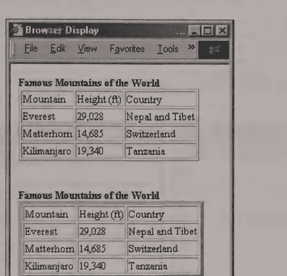

使边框可见也能让你了解浏览器如何格式化表格。每个单元格中的文本自动左对齐，同一列中的所有单元格具有相同的宽度。列的宽度由该列中文本最多的单元格决定。在图4.12表格的第一列中，是"Matterhorn"单元格，在第二列中是"Height (ft)"单元格，在第三列中是"Nepal and Tibet"。

### 表格表头和标题

HTML还有许多其他选项来自定义表格的显示。在许多表格中，如上例所示，第一行由表格列的标题或标签组成。HTML提供了一个特殊的单元格标签`<th>`（用于“表格表头”）来创建表格表头。`<th>`...`</th>`元素与普通单元格的`<td>`...`</td>`元素完全相同，但表格表头单元格内的任何文本都会自动加粗并居中。

许多表格还有标题，HTML为此提供了`<caption>`和`</caption>`标签。你将它们放在开始标签`<table>`之前。浏览器通常会将标题居中显示在表格顶部。不幸的是，不同的浏览器显示标题的方式不同，有时甚至是错误的。因此最好使用标题元素来创建标题。


将这些选项添加到我们的示例表格中，得到了图4.13的代码和显示。我们还利用这个示例来展示如果你不小心遗漏了表格行中的单元格定义会发生什么。在这种情况下，我们省略了包含Matterhorn高度（即14,685）的单元格。因此浏览器将"Switzerland"单元格读取为该行的第二个单元格，并在第三个单元格的位置留空。

```html
<body>
<strong>Famous Mountains of the World</strong>
<br />
<table border="2">
<tr>  <!--第一（表头）行 -->
    <th>Mountain</th>
    <th>Height (ft)</th>
    <th>Country</th>
</</tr>
<tr>  <!--第二行 -->
    <td>Everest</td>
    <td>29,028</td>
    <td>Nepal and Tibet</td>
</tr>
<tr>  <!--第三行（缺失单元格） -->
    <td>Matterhorn</td>
    <td>Switzerland</td>
</tr>
<tr>  <!--第四行 -->
    <td>Kilimanjaro</td>
    <td>19,340</td>
    <td>Tanzania</td>
</tr>
</table>
</body>
```

**世界著名山峰**

| Mountain | Height (ft) | Country |

| :--- | :--- | :--- |

| Everest | 29,028 | Nepal and Tibet |

| Matterhorn | | Switzerland |

| Kilimanjaro | 19,340 | Tanzania |

**图4.13. 使用`<th>`元素**

### 表格单元格中文本的对齐

单元格中的文本可以使用`<td>`标签中的`align="left"`（或`"right"`或`"center"`）属性在水平方向上向左、居中或向右对齐。也可以使用`valign="top"`（或`"middle"`或`"bottom"`）属性在垂直方向上对齐到顶部、中部或底部。如果未指定`align`和`valign`，默认的水平对齐是每个单元格的左侧，默认的垂直对齐是每个单元格的中部。

`align`和`valign`属性并未被弃用，只要你在`<td>`元素中使用它们即可。（以前将它们放在`<tr>`元素中以指定一行中所有单元格的对齐方式是合法的，但这种用法现在已被弃用。）

我们还可以调整单元格内的填充以及单元格之间的间距。填充是指单元格边缘与单元格内文本之间的空白空间，以像素为单位。它类似于文字处理文档的页边距。通过在`<table>`标签中使用`cellpadding`属性来为整个表格控制它。单元格间距指的是单元格之间分隔线的宽度（无论通过`border`属性使其可见还是保持不可见）。它也以像素为单位，通过在`<table>`标签中使用`cellspacing`属性来为整个表格设置。

图4.14展示了`align`属性在几个单元格中的使用，以及`cellpadding`和`cellspacing`属性的效果。将图4.14的结果与图4.13的结果进行比较，我们可以看到使用`cellpadding`属性会增大每个单元格的大小，而`cellspacing`属性会在单元格之间增加更多空间。

### 加宽单元格

如前所述，浏览器会根据列中文本最多的单元格自动计算表格中每列的适当宽度。然而，我们可以使用`width`属性以像素为单位手动设置宽度。我们在`<table>`标签中使用它来设置表格的整体宽度（这是合法的），在`<td>`标签中设置单个单元格的宽度（这是不太合法的，因为在那里它已被弃用）。如果单元格中的文本超过指定宽度，浏览器会自动增加单元格的高度并换行文本。在第6章中，我们将学习如何使用带`width`属性的表格来创建杂志风格的多列网页布局。

我们还可以格式化单个单元格，使其跨越一定数量的常规列或行。为此，在单元格的`<td>`标签中插入`colspan="n"`和/或`rowspan="n"`，其中`n`是要跨越的列数或行数。

图4.15展示了如何创建一个跨越所有三列的特殊顶行，以便将表格标题放在那里。它还展示了使用`width`属性使所有列具有相同宽度（在本例中为120像素）。注意"Nepal and Tibet"单元格中的文本超过120像素，因此会

 **图 4.14.** 对齐表格行和单个单元格，并设置单元格的内边距和外边距的包裹效果。（如果我们将每个单元格中的文本也居中对齐，表格看起来会更好，但为了让`width`属性的效果更清晰，我们没有这样做。"世界名山"标题居中显示，因为它位于`<th>`元素中。）

## 表格与网页布局设计

到目前为止，我们只是使用`<table>`元素来创建设计简单的表格。然而，许多网页设计师也会使用表格来创建复杂的网页布局。`<table>`元素及其各种选项使得网页可以呈现多列文本和图像，就像你在杂志和报纸上看到的那样。如果你在浏览网页时查看这类页面的源代码，你很可能会看到大量的`<tr>`和`<td>`标签。在第 6 章中，我们将学习更多关于`<table>`元素的可用选项，以及如何使用它们来创建杂志风格的网页。

## 快速检查问题

- 1. 创建表格需要使用哪三种元素？

- 2. `<th>`元素的作用是什么？

- 3. 单元格外边距（cell spacing）和单元格内边距（cell padding）有什么区别？

实验练习 4.3"表格实验"可以现在进行。

关键词：定义列表、已弃用的、扩展/扩展属性、过时的、有序列表、内边距、外边距/间距、XHTML 严格形式、XHTML 过渡形式、无序列表

## 1. 扩展与弃用

使用已弃用的`<font>`元素来指定文本部分的大小、颜色和/或字体：

```
<font size="5" color="red" face="Garamond, Arial">This will be displayed in the Garamond font in slightly larger than normal size and in red. If Garamond isn't installed on the surfer's computer, the Arial font will be substituted.</font>
```

## 2. 更多标签和属性

使用已弃用的`align`属性将标题居中对齐或右对齐（默认位置为左对齐）：

```
<h2 align="center">Welcome to my Web page!</h2>
<h2 align="right">Welcome to my Web page!</h2>
```

已弃用的`<center>`元素，用于将其内部的文本或任何元素居中对齐：

```
<center>Welcome to my Web page!</center>
```

使用已弃用的`bgcolor`属性和预定义颜色或十六进制颜色代码来指定网页的背景颜色：

```
<body bgcolor="magenta">
<body bgcolor="#FF00FF">
```

使用已弃用的`text`属性来指定网页文本的颜色：

```
<body text="blue">
```

在网页上使用样式来指定背景颜色和文本颜色：

```
<style type="text/css">
    body {background-color:yellow; color:blue}
</style>
```

使用已弃用的`width`和`size`属性创建各种样式的水平线：

```
<hr />
<hr width="150" />
<hr size="5" width="75%" />
```

使用样式表来指定水平线的呈现方式：

```
<style type="text/css">
    hr {height:7px; width:75%; background-color:red}
</style>
```

```
<li>Item 3</li>
</ol>
```

使用已弃用的`type`属性来自定义无序列表的项目符号（默认项目符号为实心圆点）：

```
<ul type="square">  <!-- type="circle" is the other option -->
  <li>Item 1</li>
  <li>Item 2</li>
  <li>Item 3</li>
</ul>
```

自定义无序列表项目符号的样式：

```
<style type="text/css">
  ul {list-style:square}   <!-- disc and circle are the other possible values -->
</style>
```

指定将图像用于无序列表的项目符号：

```
<style type="text/css">
  ul { list-style:url(some_image.gif) }
</style>
```

使用已弃用的`type`属性来自定义有序列表的编号样式（默认编号为 1,2,3…）：

```
<ol type="A"> <!-- Other options are type="a", type="I", or type="i" -->
  <li>Item 1</li>
  <li>Item 2</li>
  <li>Item 3</li>
</ol>
```

创建定义列表（`<dd>`行将显示为缩进）：

```
<dl>
  <dt>First term to be defined</dt>
    <dd>Definition of first term</dd>
  <dt>Second term to be defined</dt>
    <dd>Definition of second term</dd>
  <dt>Third term to be defined</dt>
    <dd>Definition of third term</dd>
</dl>
```

## 4. 转向表格

创建一个基本表格（本示例为 2 行，每行 3 个单元格）：

```
<table>
  <tr>
    <td>Row 1, cell 1</td>
    <td>Row 1, cell 2</td>
    <td>Row 1, cell 3</td>
  </tr>
  <tr>
    <td>Row 2, cell 1</td>
    <td>Row 2, cell 2</td>
    <td>Row 2, cell 3</td>
  </tr>
</table>
```

使用`border`属性将表格边框大小设置为 4 像素（并使其可见）：

```
<table border="4"> . . . </table>
```

在表格中放置标题行（居中、加粗文本）：

```
<tr>
  <th>Row 1, cell 1</th>
  <th>Row 1, cell 2</th>
  <th>Row 1, cell 3</th>
</tr>
```

将一行中每个单元格的文本居中对齐：

```
<tr align="center"> . . . </tr>
```

为表格设置单元格内边距和单元格外边距（以像素为单位）：

```
<table cellpadding="3" cellspacing="5"> . . . </table>
```

设置表格宽度或单个单元格的宽度（以像素为单位）：

```
<table width="500">...</table>
<td width="125"> . . . </td>
```

> 提醒与建议

- 使用 XHTML 过渡型 DTD 而不是严格型 DTD，以便让你的页面在大多数用户的浏览器上都能正常显示。但是，尽可能避免使用已弃用的标签和属性。

- 水平线可用于分隔网页上的各个部分，以获得更好的设计效果。

- 缩进和注释代码始终是值得推荐的，但在创建表格时尤为重要。

- 不要忘记表格定义末尾的`</table>`标签；某些版本的 Netscape Navigator 浏览器没有它就不会显示表格。

- 不要遗漏表格中的单元格定义；浏览器会显示该表格，但在该单元格所在行的末尾会出现空白。

> 复习题

- 1. 判断正误：当标题标签没有指定`align`属性时，默认对齐方式是左对齐。

- 2. 在`<body>`标签中，可以使用哪个属性来指定网页的背景颜色？

  a. `color`

  b. `bgcolor`

  c. `background`

  d. `backgroundcolor`

- 3. 在`<body>`标签中，可以使用哪个属性来指定网页文本的颜色？

  a. `color`

  b. `textcolor`

  c. `text`

  d. `foregroundcolor`

- 4. 判断正误：`<font>`元素是更改网页上文本字体样式和大小的首选方式。

- 5. 两种最常见的列表类型是__________和__________。

- 6. 如果你嵌套三个有序列表，每个级别使用的默认编号样式是什么？

  a. 顶层使用 1, 2, . . . ；第二层使用 1, 2, . . . ；第三层使用 1, 2, . . .

  b. 顶层使用 A, B, . . . ；第二层使用 1, 2, . . . ；第三层使用 a, b, . . . .

  c. 顶层使用 I, II, . . . ；第二层使用 A, B, . . . ；第三层使用 1, 2, . . .

  d. 顶层使用 1, 2, . . . ；第二层使用 a, b, . . . ；第三层使用 i, ii, . . .

- 7. 使用样式或`<ul>`标签的 `type` 属性可以为无序列表指定的三种项目符号类型是：______________、______________和______________。

- 8. 判断正误：创建表格时，可以省略结尾的`</table>`标签而没有任何影响。

- 9. 以下哪些属性可以用于`<td>`标签？

  a. `align`

  b. `valign`

  c. `cellpadding`

  d. `colspan`

- 10. 判断正误：`<table>`元素可用于创建网页的多列布局。

1. 简要定义和/或解释以下术语：扩展、已弃用的标签、单元格内边距。

2. 首先使用样式，然后使用属性，编写两个版本的 HTML 代码，创建一个紫色背景、白色文本的网页。

3. 写出三种不同的方法将段落居中对齐。使用"This text will be centered"作为段落内容。

4. 给定以下代码，展示如何注释掉列表中的第三项，以便只显示前两项。

```
<ul type="square">
  <li>Item 1</li>
  <li>Item 2</li>
  <li>Item 3</li>
</ul>
```

5. 使用属性，编写 HTML 代码来创建以下水平线：

   a. 一条宽度为窗口宽度的 50%，粗细为 7 像素的水平线。

   b. 一条宽度为 350 像素且居中对齐的水平线。

6. 重复练习 5，但这次使用样式类来定义水平线的呈现方式。第 a 部分的类名为"halfsize"，第 b 部分的类名为"centered350"。

7. 编写使用`type`属性创建以下嵌套有序列表的 HTML 代码：

- A. 约 2000 年的主要 PC 制造商

  1. Dell

  2. IBM

  3. Apple

  4. Hewlett-Packard

  5. Compaq

- B. 约 2000 年的个人电脑操作系统

  1. Microsoft Windows（各种版本）

  2. Mac OS

  3. Linux

8. 重复练习 7，但这次使用样式类来定义列表的呈现方式。

9. 编写一个三行四列表格的 HTML 代码。第一行应包含以下表头，居中加粗显示：姓名、办公地点、电话、电子邮件。给表格设置 3 像素宽的边框。在第二行和第三行中放入你想要的任何"姓名"信息。

10. 编写一个包含六行三列的表格的HTML代码。第一行应包含一个跨越所有三列的单元格，单元格内容为"美食好去处"。第二行应包含以下居中且加粗的表头：餐厅、食物类型和个人评分。将中间列单元格的文本显示居中，并将`cellspacing`设置为5像素，`cellpadding`设置为3像素。使用以下餐厅信息：

| 餐厅 | 食物类型 | 个人评分 |

|---|---|---|

| Strings | 意大利菜 | 3星 |

| Dos Coyotes | 新鲜墨西哥菜 | 4星 |

| Symposium | 希腊菜 | 3星 |

| The Graduate | 汉堡 | 2星 |

找出以下代码中的错误，然后在纸上画出浏览器在纠正错误后如何显示该页面。假设使用的是XHTML的过渡型DTD。

```
<html>
<head>
<title>
Chapter 4 Debugging Challenge
</title>
</head>
<body bgcolor="FFFFFF">
<h2>Welcome to my Web page!</h2>
Here are some samples of my HTML expertise:<br />
<ul type="square">
  <li>Item 1</li>
  <li>Item 2</li>
  <li>Item 3</li>
</ul>
<ol>
  <li>Item 1</li>
  <li>Item 2</li>
  <li>Item 3</li>
</ol>
<!--Here's a horizontal rule-->
<hr width="60%" />
<!--And here's a simple table:-->
<table border="medium">
<tr>
  <td>Row 1, cell 1</td>
  <td>Row 1, cell 2</td>
  <td>Row 1, cell 3</td>
</tr>
<tr>
  <td>Row 2, cell 1</td>
  <td>Row 2, cell 2</td>
  <td>Row 2, cell 3</td>
</tr>
</table>
</body>
</html>
```

注意：上述大部分练习也可作为实验练习来完成。

## 练习 4.1：属性实验

- 使用你在之前的练习中创建的HTML源文档（或者如果你愿意，可以创建一个新的源文档），简单地实验标题标签中的`align`属性、`<body>`标签中的`bgcolor`和`text`属性，以及`<hr>`标签及其属性。与以往一样，请确保频繁保存文档，以免在计算机崩溃或网络中断时丢失太多工作和时间。

- 创建第二个源文档，其中包含与第一个相同的示例，但使用内部样式表来定义呈现方式。

## 练习 4.2：标签进阶练习

- 在你之前的实验练习4.1的某个源文档中，添加有序列表、无序列表和定义列表的示例。使用你喜欢的任何文本来展示标签的效果。别忘了保存！

- 使用样式表或`type`属性，创建一个具有传统大纲编号的有序列表，如下所示：

  + I. 第一点

    - A. 子项

      - 1. 子项

      - 2. 子项

    - B. 子项

      - 1. 子项

        - a. 子项

        - b. 子项

        - c. 子项

      - 2. 子项

        - a. 子项

        - b. 子项

    - C. 子项

    - D. 子项

  + II. 第二点

  + III. 第三点

## 练习 4.3：表格实验

- 在你正在创建的文档中添加一个自选主题的"最佳"表格。例如，"本地五大美食去处"、"镇上最好的披萨"、"最佳学习场所"、"史上十大最伟大的运动员"、"当今十大CEO"等。你的表格应至少包含三列四行，外加一个跨越各列的标题。各列应有表头（例如，对于"镇上最好的披萨"表格，四列可以是：名称、位置、价格、评论）。

- 当你调整浏览器窗口大小使表格宽度超过窗口宽度时，你的表格显示会发生什么变化？

- 在同一文档中，将你的表格代码复制两份或更多份，并通过以下方式进行进一步实验：(a) 注释掉一些`<td>`元素以观察效果；(b) 为各个单元格添加`colspan`或`rowspan`属性。

# 5

图像、链接与多媒体

### 学习目标

- 学习如何在网页中插入和显示图像。

- 了解三种超文本链接类型及其使用和编码方式。

- 学习如何创建图像链接和图像映射。

- 了解在网页中使用多媒体元素的潜力和局限性，以及如何在网页中嵌入声音和视频。

#### 显示图像

既然我们已经学会了如何以多种方式对网页文本进行分类，下一步就是学习如何用图像来增添色彩。你当然已经注意到，你在万维网上看到的许多（如果不是大多数的话）文档中都有出现在页面上的图片或照片。描述这些图像的数据包含在文件中，就像网页的数据（其文本和标签）存储在源文档中一样。要将图像作为网页的一部分包含进来，你需要在源文档中使用一个标签，告诉网页浏览器在哪里可以找到该图像的数据源文件。当冲浪者的网页浏览器下载并显示描述你网页的源文档时，它也会下载你HTML文档中引用的所有图像的源文件，并显示这些图像。

## 图像类型和文件

图像文件根据图像转换为数据的过程不同而有不同的类型。最常见的类型是**图形交换格式**和**联合照片专家组**格式，它们的缩写分别为GIF和JPEG。GIF格式通常用于标志和基本图形等内容，而JPEG则专为照片图像而设计。一种较新的图像文件类型是**便携式网络图形（PNG）**，它旨在替代GIF文件。（GIF格式的缺点在于它受版权保护。顺便说一下，GIF的发音各有不同，有人读作"jiff"，有人读作"giff"，但其发明者表示他原本的意图是读作"jiff"，就像花生酱的品牌名一样。JPEG的发音是"jay-peg"，PNG的发音是"ping"。）

为了标识其包含的图像类型，图像数据文件的文件名会带有如`.gif`、`.png`或`.jpeg`（或`.jpg`）之类的扩展名。大多数较新的网页浏览器可以自动加载、解析和显示这些图像格式，但可能需要一个称为外部查看器的特殊附加程序来显示其他类型的图像。

## 创建和查找图像

你可以使用图像编辑程序（如Adobe Illustrator）或照片编辑程序（如Adobe Photoshop或Microsoft Picture It! Photo）来创建自己的图像。数码相机通常也附带基本的图像编辑软件。

另一种选择是剪贴画——可以"剪切"并粘贴到你的文档中或保存为某种图像文件格式的图像。商业剪贴画合集可以在CD-ROM上购买，不过如果你的计算机上安装了Microsoft Office套件（或类似的办公套件），你可能会发现附带的CD-ROM中包含一套剪贴画合集。

在Microsoft Word中访问剪贴画的方法：

1. 打开一个新的空白文档，然后单击"插入"菜单，选择"图片：剪贴画"。如果剪贴画已安装，将打开一个窗口，列出多个艺术类别。

2. 浏览图像，当你找到喜欢的图像时，右键单击它，并在弹出的菜单中选择"插入"选项。图像将被插入到活动的Word文档中闪烁的垂直线光标（即插入点光标）所在的位置。

3. 如果Word允许你直接将图像保存为GIF文件就好了，但它并不支持。你可以使用"文件"菜单下的"另存为网页"命令，将文档（包含其中的图像）保存为一个.htm文件，命名为`myimage.htm`（或任何你想要的名称）。在此过程中，Word不仅会保存`myimage.htm`文件，还会在`myimage.htm`文件所在的文件夹中创建一个新文件夹。这个新文件夹将被命名为`myimage_files`，其中包含一个名为类似`image001.gif`的GIF图像文件。你可以将其重命名为更具描述性的名称（但保留`.gif`扩展名）。这个GIF文件就是你可以用来将图像添加到网页中的文件。（具体操作将在下文说明。）

剪贴画和照片的合集也可以在网上获取。你可以在`gallery.yahoo.com`和`multimedia.lycos.com`找到两个优秀的图像档案库。`www.google.com`上的搜索引擎也是查找图像的绝佳方式。（单击"图片"选项卡。）但请注意，并非互联网上的所有图像都属于公共领域；也就是说，使用任何给定图像的合法权利可能受到版权法或其他法律的禁止或限制。如果一个图像没有明确标记为属于公共领域，你应该假设它不是公共领域的，并在将其发布到你的网页之前寻求许可（除非你只是在实验，从未打算将你的页面发布到互联网上）。许多受版权保护的图像还有可见的水印嵌入其中。要获取没有水印的图像，你必须为该图像付费。

然而，获取图像最简单的方式（至少出于实验目的）是将你在网页上找到的图像直接下载并保存到你自己的计算机上。

从网页上复制和保存图像的方法：

1. 在网页浏览器中显示的图像上右键单击鼠标。

2. 从弹出的菜单中，选择"图片另存为..."（Explorer）或"图像另存为..."（Navigator）。

3. 使用随后出现的"另存为..."对话框，将图像作为文件保存到你的计算机上。对话框中将自动列出图像文件的类型，文件将以该类型和正确的扩展名（例如`.jpg`）保存。

## 将图像添加到HTML文档中


一旦你找到或创建了想要包含在网页中的图像的源文件，你必须通过提供其URL来指明文件的位置。为此，你需要使用带有源属性`src`的图像标签``：

```

```

例如，告诉浏览器检索并显示位于网络服务器`www.nasa.gov`上`images`目录中名为`earth2.jpg`的图像的标签为：

```

```

请注意，``标签是一个空元素。为了符合 XHTML 规范，标签的末尾必须是`/>`，而不能只是`>`。另外请注意，属性是`src`，不是`scr`（很容易打错）。

如果你自己创建了图像，或者事先将图像文件下载到了你的计算机上，使图像文件与你的 HTML 文档位于同一目录，那么你就不需要提供完整的 URL。相反，你只需引用文件名即可：

```

```

然而，如果图像文件位于名为`astronomy`的目录中，而该目录又是源文档目录的子目录，那么代码应该是：

```

```

或者，再深入一层，如果图像文件位于名为`earth_photos`的目录中，而该目录又是`astronomy`目录的子目录，那么代码应该是：

```

```

换句话说，你只需要给出从源文档目录开始的图像文件路径（但不包括源文档目录的名称）。这被称为相对寻址或相对路径名，意味着路径名（文件的地址）是相对于源文档的位置指定的。

在我们看到如何在实际源文档中使用``元素之前，我们需要为它添加一个属性，用于指定替代文本。

## 图像的替代文本

有时浏览器无法或不愿显示图像。它可能在下载图像时遇到了问题，或者无法处理那种特定类型的图像，或者根本就无法处理图像（例如，名为 Lynx 的纯文本浏览器）。此外，浏览者可能已禁用浏览器的显示图像选项。如果是这样，浏览器将不会显示网页上的任何图像，除非浏览者手动告诉浏览器这样做。许多浏览者选择此选项，因为加载和显示图像会显著降低浏览速度，而且很多时候，他们寻找的是文本信息，而图像只是不错的附加内容，但并非必需。

（在 Explorer 中，你可以通过选择"工具"菜单下的"Internet 选项"，然后点击"高级"选项卡来打开或关闭显示图像选项。向下滚动结果列表中的项目，找到标记为"多媒体"的部分，然后点击标记为"显示图片"的复选框以打开或关闭。在 Navigator 中，在"查看"菜单下查找"显示图像"。）

因此，你应该始终提供替代文本信息，以便在图像无法显示时显示。你可以使用`alt`属性来实现：

```

```

如果由于任何原因浏览器没有显示图像，替代文本将显示在一个通用的图片框中（图 5.1）。

使用`alt`属性的另一个很好的理由是，人们正在努力使网络对视障人士更加友好。特殊的浏览器软件可以阅读并朗读网页上的文字。为图像包含替代文本可以让视障用户听到图像的简要描述。

使用`alt`属性的最后一个很好的理由很简单：在 XHTML 中，它是必需的。

## 内联图像的来龙去脉

网页上最常见的图像类型称为内联图像，因为你指定它们的位置时，就好像它们是文本行的一部分。也就是说，你在 HTML 文档的某一行中放置``标签，浏览器就会将该图像作为该行的一部分显示。当然，浏览器可能需要增加该行的行高以容纳图像，但它仍然将图像视为文本行中的一个单词。图 5.2 显示了一个示例。

你也可以通过为`img`元素设置样式定义，指示浏览器将文本行与图像的中间或顶部对齐。要指定网页上的所有图像在其行中垂直居中对齐，我们将`vertical-align`属性的值设置为`middle`（或`top`以使图像顶部与行顶部对齐）：

```
<style type="text/css">
  img {vertical-align:middle}
</style>
```

（如果我们希望对齐仅应用于某些图像，我们将使用样式类。）

或者，我们可以使用已弃用的`align`属性，其值为`top`、`middle`或`bottom`，以获得相同的结果。图 5.3 显示了结果（以及使用`align`属性的代码）。

通过指定文本环绕图像的左侧或右侧，我们可以获得更好的显示效果。我们通过使用`float`样式属性，其值为`left`或`right`来实现。该值指定图像的放置方式。值为`left`表示图像将浮动到下一行开头，并紧贴左边距，文本环绕在其右侧；值为`right`表示图像浮动到右边距，文本环绕在其左侧。或者，使用`align`属性，我们在``标签中写`align="left"`或`align="right"`。图 5.4 显示了结果，代码中使用了我们命名为`leftside`和`rightside`的两个图像样式类。

鉴于`float:right`和`float:left`的使用，似乎`float:center`（或`align="center"`）会使图像居中，并且文本在两侧环绕，这似乎是合乎逻辑的。然而，HTML 不允许这种用法。可以使用以下两种方法之一来居中图像（不环绕文本）。

要显示不带任何相关文本的居中图像（例如，组织的标志），请将``标签放在段落元素内。然后你可以使用`text-align`属性设置段落的样式：

```
<style type="text/css">
  p.centered {text-align:center}
</style>
```

段落元素的代码是：

```
<p class="centered"></p>
```

**图 5.3. 垂直对齐图像（使用图中所示的 align 属性或 vertical-align 样式属性）**

或者，你可以在段落标签中使用`align`属性：

```
<p align="center">

</p>
```

## 调整图像大小

可以包含在``标签中的另外两个属性`height`和`width`，告诉浏览器图像的确切像素大小。（参考一下，2002 年左右显示器的平均屏幕尺寸为 1024 像素宽乘以 768 像素高。）包含这些属性是很好的做法，因为这样浏览器可以在下载图像时自动预留适当的空间，并先显示文本。如果你未包含图像大小，那么浏览器必须进行额外的计算才能正确格式化图像和页面的其余部分，这会降低显示速度，从而增加等待查看你网页的浏览者的挫败感。

```
<head>
<title>Flowing Text</title>
<style type="text/css">
  img.leftside {float:left;}
  img.rightside {float:right}
</style>
</head>

<body>
<p>Built for the 1889 World Exposition, the Eiffel Tower  is located on the Champs de Mars in Paris, France. Its height of 984 feet made it the tallest structure in the world for many years. Seven thousand tons of steel were used in its construction, at a total cost equivalent to over 1 million US dollars. Alexandre Gustave Eiffel was its designer and namesake.</p>

<p>Built for the 1889 World Exposition, the Eiffel Tower  is located on the Champs de Mars in Paris, France. Its height of 984 feet made it the tallest structure in the world for many years. Seven thousand tons of steel were used in its construction, at a total cost equivalent to over 1 million US dollars. Alexandre Gustave Eiffel was its designer and namesake.
</body>
```

**图 5.4. 文本环绕图像**

HTML 语法是：

```

```

注意：`width`和`height`属性的顺序无关紧要（标签中的任何属性也是如此）。

你可以通过右键单击网页（你的或别人的）上显示的图像时出现的弹出菜单来查找图像的确切像素大小。当菜单出现时，选择"查看图像"（Navigator）或"属性"（Explorer）。在 Navigator 中，将打开一个新窗口，其中只有该图像。窗口的标题栏会显示类似"JPEG image 269x125 pixels--Netscape"的内容。第一个数字是图像的宽度，第二个数字是图像的高度。在资源管理器中，会弹出属性对话框，其中一项属性就是图像的尺寸，显示为宽度 × 高度。

如果图像文件位于计算机的某个磁盘上，你可以通过浏览器文件菜单中的打开命令直接打开它。打开后，Navigator 会再次在标题栏中显示图像尺寸，而 Explorer 会在属性对话框（通过文件菜单访问）中列出尺寸。

你也可以使用`height`和`width`属性来拉伸或缩小图像。换句话说，浏览器会改变图像的大小以适应`height`和`width`指定的尺寸。最终的显示效果可能会发生变形，具体取决于图像的类型。JPEG 图像通常调整大小效果较好，但如果你需要缩小或放大其他类型的图像并保持清晰度，最好使用 Adobe Illustrator 等绘图程序或 Adobe Photoshop 等照片编辑程序来修改原始图像。

## 快速检查问题

1.  图像文件格式的基本类型有哪些？

2.  图像处于公共领域（public domain）是什么意思？

3.  ``标签中可以使用哪些属性，每个属性的用途是什么？

4.  查找图像高度和宽度的简便方法是什么？

5.  为什么使用`alt`属性是好的做法？

实验练习 5.1"添加图像"可以在此处进行。

### 创建链接

万维网的真正威力在于其实现超文本的能力，通过超文本，冲浪者可以点击网页上特别标记的单词或图像，自动跳转或链接到另一个网页，或同一网页中的另一个位置。超文本链接就像电子参考文献或脚注一样工作。

例如，假设你正在创建一个专门介绍海洋哺乳动物的网站，其中为每个物种提供一张图片和一两段文字。如果你使用一个关于海洋哺乳动物生理学现有的网页作为你简要介绍海豚的资源，你当然应该在你的综述结尾引用它。即使你没有将其作为资源使用，你可能仍想引导冲浪者去访问该网页以获取更多信息。无论哪种情况，这都不仅仅是一个普通的引用。使用 HTML，你可以从你的页面上的引用创建一个超文本链接，指向海洋哺乳动物生理学实际网页，这样点击引用，冲浪者就会直接"跳转"到生理学网页（即冲浪者的浏览器会下载并显示生理学页面）。这被称为外部链接，因为它将冲浪者链接到外部的网页。

网页设计师以第二种方式充分利用 HTML 的超文本能力，即在其页面中提供内部链接。点击网页上的内部链接会将冲浪者跳转到同一网页的另一个部分。许多网页在页面底部包含"返回顶部"链接，以便冲浪者可以快速跳回页面顶部，而不必一路滚动回去。

网页设计师发现内部链接在创建目录方面还有另一个方便的用途。例如，在你的海洋哺乳动物网页中，你可以从列出所涵盖的海洋哺乳动物的目录开始。通过使目录中的每个条目成为超链接，冲浪者可以点击某个条目并立即跳转到网页中的相应部分，而不必向下滚动寻找。

外部链接和内部链接在网页上看起来是一样的。在大多数情况下，冲浪者仅通过上下文就能分辨出差异。作为可点击超链接功能的文本片段，无论是外部还是内部链接，都用下划线标示，并以不同于普通文本的颜色显示（图 5.5）。

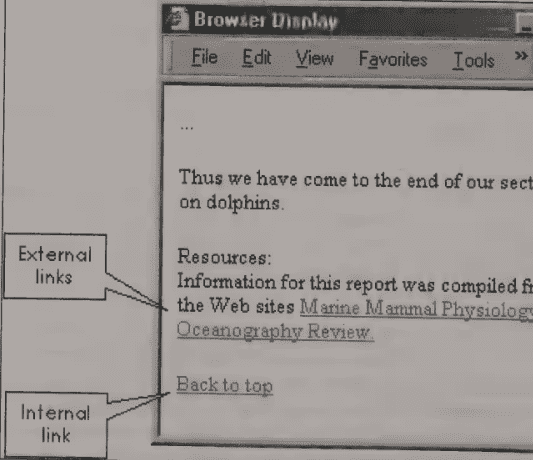

**图 5.5. 外部链接和内部链接**

链接的标准颜色是蓝色，但浏览器的用户可以自定义链接颜色。已访问的链接——即冲浪者之前点击过的链接——通常显示为红色。（本书中所有以彩色显示的链接都只是用红色显示。）

## 网站结构

这就引出了关于网站结构的简短但重要的一点。（我们将在第 6 章中对此主题有更多论述。）最简单的网页设计由单个网页（即单个 HTML 源文档）组成。页面包含的信息越多，它就越长。要访问信息，冲浪者要么向下滚动页面，要么点击提供的链接，跳转到各个信息部分。

更复杂的网站结构由多个网页组成。你将每个页面设置为单独的 HTML 文档，并提供链接供冲浪者在页面之间导航。在海洋哺乳动物网站的示例中，你会为每种哺乳动物创建一个网页——一个用于海豚，一个用于鼠海豚，等等——再加上一个介绍性页面，为冲浪者提供带有超链接的目录。图 5.6 展示了该结构。

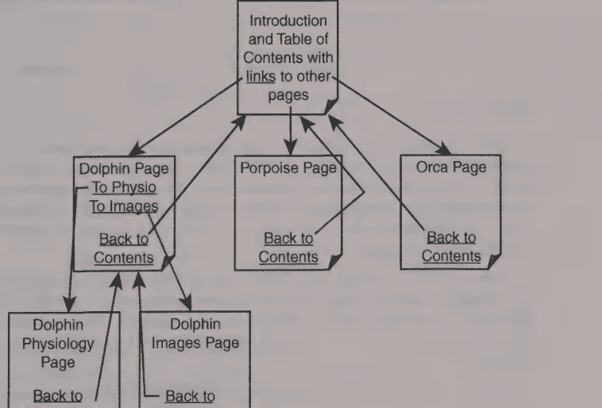

**图 5.6. 多页面网站的链接结构**

当然，更复杂的设计也可以在各个页面之间添加链接。作为对上述设计的简单补充，我们可能希望在 Dolphin Physiology Page 和 Dolphin Images Page 上添加"返回目录"链接，以便冲浪者可以一键直接跳回 Contents Page，而不必先返回到 main Dolphin Page，然后再返回到 Contents Page。更复杂的设计会使目录链接在每个页面上都可见，也许放在侧边栏中，这样冲浪者就可以即时访问网站的所有主要部分。（实现这一点的一种方法是使用框架——参见第 6 章。）

将网站（即使是小型网站）划分为多个页面的另一个优点是，网络浏览器检索和显示较小的页面速度更快。如果网站包含大量图像尤其如此。虽然大多数网络浏览器利用技术使冲浪者能够在所有图像下载和显示完毕之前就开始阅读和导航页面文本，但通常最好将网站划分为多个页面，使每个页面只有一张或几张图像。

总而言之，我们有三种可能的超链接类型：

1.  外部链接，将冲浪者从一个页面带到另一个单独网页的开头。

2.  内部链接，将冲浪者从一个网页的一部分带到同一页面的另一部分。

3.  外部/内部组合链接，将冲浪者从一个页面带到另一个单独页面的某个特定部分（即 #1 和 #2 的组合操作）。

以下各节展示了我们为每种情况编写 HTML 代码的方法。

## 外部链接

要在网页之间创建链接，我们用标签`<a href="SomeURL">`和`</a>`将超文本链接包围起来。`href`代表超文本引用（hypertext reference）。`a`代表锚点（anchor），因为我们正在本文档中锚定超文本链接的一端，而链接的另一端——目标页面——由 URL 给出。只要你知道网页的 URL，就可以链接到它。

要了解我们如何组合在一起，请考虑一个关于美国革命历史课程（History 170B）的网页的 HTML 源文档。该文档名为`history170b.html`，存储在 Internet 主机`www.ucdavis.edu`的`courses`目录中。因此，该文档的 URL 为：

```
http://www.ucdavis.edu/courses/history170b.html
```

如果我们想使用"点击此处获取有关美国革命的信息"作为冲浪者看到的链接文本来创建指向此文档的链接，那么 HTML 代码为：

```
<a href="http://www.ucdavis.edu/courses/history170b.html">
Click here for information on the American Revolution
course</a>
```

网络浏览器会将`<a>`和`</a>`标签之间的所有内容显示为链接：

Click here for information on the American Revolution course

当冲浪者点击此链接时，浏览器会查看`<a>`标签中指定的底层 URL，并下载相应的 HTML 源文档；它从`www.ucdavis.edu/courses`检索并显示`history170b.html`源文档。

如前所述，下划线和不同的颜色向冲浪者表明此文本是可点击的超链接。由于链接以这种方式与普通文本区分开来，通常没有必要给冲浪者如此明确的指示，如"点击此处获取……"。例如，你可以编写如下代码：

```
This quarter we will be offering special courses on the
<a href="http://www.ucdavis.edu/courses/history170b.html">
American Revolution</a> and the <a href="http://www.
ucdavis.edu/courses/history185b.html"> History of Technology
in America</a>, so don't miss these opportunities.
```

此代码将显示为：

This quarter we will be offering special courses on the *American Revolution* and the *History of Technology in America*, so don't miss these opportunities.

带下划线和不同颜色的文本会向冲浪者表明，点击每个链接可以获取更多关于每门课程的信息。

如果包含上述带有`<a>`元素的代码的 HTML 源文档与`history170b.html`和`history185b.html`文档存储在同一目录或文件夹中，我们就不必提供完整的 URL 来编写链接代码。相反，我们可以通过在`<a>`标签中仅提供文件名来使用相对路径名：

```
This quarter we will be offering special courses on the
<a href="history170b.html">American Revolution</a> and the
<a href="history185b.html"> History of Technology in
America</a>, so don't miss these opportunities.
```

总结：如果`<a>`标签中没有完整的 URL，网络浏览器会假设它可以在包含`<a>`标签的源文档所在的同一文件夹中找到链接的文档。

正如上面"在 HTML 文档中添加图像"一节中讨论的与图像文件类似的情况一样，如果包含`<a>`元素的源文档存储在`courses`目录中，但`history170b.html`和`history185b.html`文档存储在名为`history`的课程子目录中，那么相对路径会稍长一些：

本季度我们将提供关于<a href="history/history170b.html">美国革命</a>和<a href="history/history185b.html">美国科技史</a>的特别课程，请不要错过这次机会。

换句话说，你只需给出从源文档目录开始到链接文档的路径（但不包括源文档目录的名称）。

在可能的情况下，你应该使用相对路径来设置链接，这样你就可以将链接的文档从一个磁盘移动到另一个磁盘，而无需更改HTML代码中所有URL来反映新的磁盘名称。关键是将所有文档保存在同一目录（或文件夹）中，或者保存在同一目录的子目录中。（然后一旦你编写了链接，就不要更改它们的目录位置。）

有时候你会想在网页中包含指向其他网站的外部链接。例如，如果你正在创建一个提供计算机芯片行业新闻的网页，你可能想要添加指向该行业主要公司网站的链接，如英特尔、摩托罗拉和超微半导体（AMD）。代码和显示效果大致如图5.7所示。

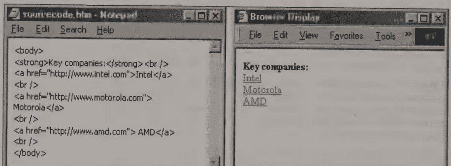

图5.7. 不含源文件的外部链接

然而，请注意图5.7代码中一个奇怪的地方。URL中没有源文档名称——没有任何带有`.html`扩展名的内容。每个`href`属性只是列出了公司的域名：`www.intel.com`、`www.motorola.com`和`www.amd.com`。例如，`href`属性告诉浏览器向`www.intel.com`服务器发送"发送文档"请求，但它没有指定要请求哪个文档。那么浏览器怎么知道要下载哪个源文档呢？

这个小谜题的答案是：在没有指定HTML源文档的情况下，服务器会向浏览器发送一个名为`index.html`的源文档。（当然，这假设`index.html`文档实际存在并存储在服务器上。有些服务器则使用`default.html`作为此默认发送操作中涉及的文档名称。）

这对作为网页设计者的你来说意味着，当你为多页网站创建主页源文档时，应该养成将其命名为`index.html`（或`index.htm`）的习惯。这样，当需要将网站文件上传到服务器并启动运行网站时，你就不必重命名主页文档。其他所有文档都可以随意命名。（有关此流程的更多细节，请参阅附录H，了解如何使网页在互联网上可用。）

## 内部链接

要从HTML文档的一部分链接到同一文档的另一部分，我们首先必须标记想要跳转到的位置。我们使用一个略有不同的锚标签版本来标记它，该标签包含`id`属性而非`href`属性：

```
<a id="SomeLabel">
```

此属性通过指定一个标识名称来标记位置。注意：这里通常使用另一个属性`name`属性来代替`id`属性。但在XHTML中，某些元素中使用`name`属性已被弃用。主要原因是`id`和`name`属性具有相似的用途，因此两者不需要同时使用。此外，`name`属性在用于创建复选框和单选按钮等功能的元素中有其他用途。

不幸的是，一些较旧的浏览器在此上下文中不识别`id`属性。因此，为了同时满足XHTML兼容性和向后兼容性，你应该在标签中同时使用`id`和`name`属性，并将它们设置为相同的值：

```
<a id="SomeLabel" name="SomeLabel">
```

然而，在我们的示例中，通常只使用`id`属性。

一旦我们建立了标签，就可以使用普通的`<a href>`标签链接到它，但有一个关键区别。我们不是为`href`分配一个URL值，而是放置一个`#`符号后跟标签名称：

```
<a href="#SomeLabel"> 点击此处跳转到本文档的其他位置</a>
```

`#`符号表示这不是一个外部链接，而是链接到我们在源文档其他位置定义的本地标签。当浏览者点击链接时，浏览器将定位文档中`<a id="SomeLabel">`标签的位置，并显示该文档部分。以下示例展示了这是如何工作的。

暂时忽略我们之前关于使用多页网站结构的建议，让我们假设我们要将海洋哺乳动物网页设置为单个页面，顶部是目录，后面是关于不同海洋哺乳动物的各个章节。我们希望浏览者能够点击目录中的项目并链接到相应章节，即使该章节显示在浏览器窗口的顶部。换句话说，我们需要内部链接。浏览者看到的初始显示如图5.8所示。

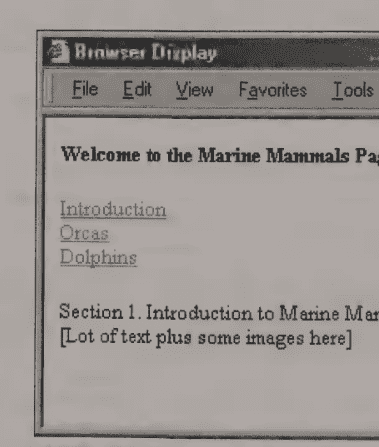

目录中的每个项目都带有下划线且颜色不同，表示这是一个链接。请注意，关于虎鲸和海豚的第2节和第3节对浏览者不可见。

当浏览者点击其中一个链接时，浏览器会将相应章节带到浏览器窗口的顶部。例如，图5.9展示了点击标签为`Dolphins`的链接后的结果。

为了编写指向"第3节. 关于海豚的一切"的链接HTML代码，我们首先在第3节开头使用带有`id`属性的`<a>`标签来定义一个标签：

```
<a id="DolphinSection">Section 3. All About Dolphins</a>
```

请注意，章节标题"Section 3. All About Dolphins"在显示时不会出现下划线，因为它是链接的目标点，而不是出发点。出发点在目录中，使用带有`href`属性的`<a>`标签编写：

```
<a href="#DolphinSection">Dolphins</a>
```

这行代码创建了一个链接，向浏览者显示为Dolphins。当浏览者点击此链接时，浏览器将找到`id`属性值为`DolphinSection`的`<a>`标签。

不要将标签名称与标签文本混淆。标签名称——在本例中是`DolphinSection`——在网页显示时不会出现。它是`<a>`标签中`id`属性的值，对浏览者不可见。标签文本——即包含在`<a>`和`</a>`标签之间的文本，在本例中是Section 3. All About Dolphins——才会显示出来。


还很容易遗漏或放错`#`符号的位置。它不是放在`<a id>`标签中的标签名称旁边。相反，它放在`<a href>`标签中，插入在标签名称前面，表示这是一个内部链接。

将所有这些结合起来，海洋哺乳动物页面的HTML代码和相应显示如图5.10所示。

## 结合外部链接和内部链接

要将一个网页链接到另一个页面中的特定位置，我们只需组合外部链接和内部链接的HTML语法。格式为：

```
<a href="SomeURLForAWebPage#SomeLabelWithinThatWebPage">Click here to go to a certain section within some web page.</a>
```

图5.10. 使用内部链接的目录

浏览者当然会看到：

[点击此处跳转到某个网页中的特定章节](#)

当链接被点击时，引用的网页将被下载，但与通常显示页面顶部不同，页面中`<a id>`标签所在的部分将被显示。

特别注意`href`值的语法：你先列出网页的URL，然后是一个`#`符号，然后是相关标签的名称。

为了给出更具体的例子，假设我们是海豚的忠实粉丝，我们了解了一个URL为的海洋哺乳动物网页

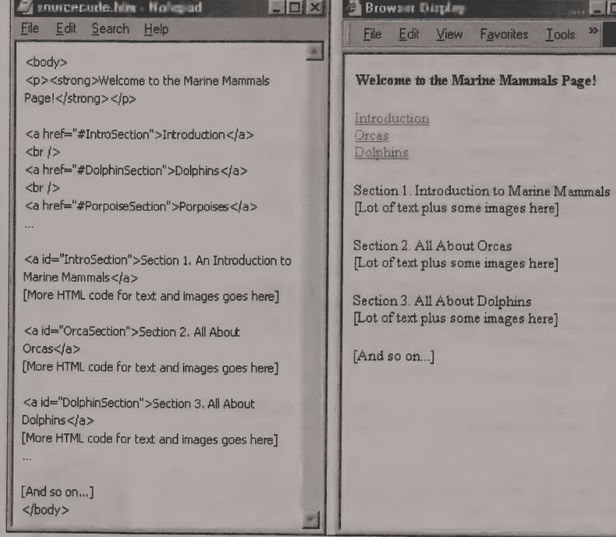

`http://www.marinebio.ucsd.edu/marinemammals.html`（非真实网址），假设我们正在创建自己的个人网页，并希望在海洋哺乳动物页面中加入一个指向海豚部分的链接。但在此之前，我们不仅需要知道该页面的 URL，还需要知道页面设计者用于海豚部分的标签的确切名称。我们该如何找到这些信息呢？联系设计者？

实际上并没有那么复杂。请记住，大多数网络浏览器允许用户查看当前显示网页的底层 HTML 代码。要在 Navigator 中查看网页的 HTML 代码，请在查看菜单中选择"页面源代码"。Navigator 将打开一个新窗口并显示源代码，其中的标签会以不同颜色显示以便区分。在 Explorer 中，在查看菜单下选择源代码。源代码文档的内容将使用记事本显示。

一旦您能看到海洋哺乳动物页面的 HTML 代码，您就可以简单地浏览它，找出定义了哪些`<a id>`或`<a name>`标签（如果有的话）。

在我们关于海洋哺乳动物页面的具体示例中，源文档的 URL 是`http://www.marinebio.ucsd.edu/marinemammals.html`，文档内海豚部分的`<a id>`标签是`DolphinSection`。您需要添加到个人网页中以创建指向该部分链接的 HTML 代码是：

```
<a href="http://www.marinebio.ucsd.edu/marinemammals.html#DolphinSection"> 点击此处获取更多关于海豚的信息！</a>
```

浏览者将看到：

**点击此处获取更多关于海豚的信息！**

然而，这个方案存在一个潜在缺陷。如果海洋哺乳动物页面的网页设计者没有在海豚部分的位置包含`<a id>`标签，我们该怎么办？您可能首先会想：没问题，我可以用浏览器查看海洋哺乳动物页面的源代码，所以我可以在需要的位置添加自己的`<a id>`标签并保存修订后的文档。

这是个好主意，但行不通。您无法修改 HTML 代码，因为您只是查看浏览器已下载到您计算机上的海洋哺乳动物源文档的副本。原始文档仍保留在`www.marinebio.ucsd.edu`的 Web 服务器上。您当然可以随意修改源代码的副本，甚至可以将更改后的文档保存到磁盘，但原始源文档不会受到影响。在这种情况下，您能做的最好的事情就是仅使用 URL，链接到海洋哺乳动物页面的开头。

## 快速自检问题

- 1. 编写创建指向文档`http://www.marinemammals.com/bluewhales.html`的外部链接的 HTML 代码。

- 2. 创建内部链接使用哪两个标签？

- 3. 在内部链接的代码中，`#`符号应该放在哪里？

- 4. 在什么条件下可以使用链接文件的名称代替链接文件的完整 URL 作为`href`属性的值？

练习 5.2"创建多页面网站"可以在此刻进行。

### 将图像制作成链接

到目前为止，在我们所有的链接示例中，我们都使用文本来显示链接。例如：

```
<a href="http://www.ucdavis.edu/courses/history170b.html">点击此处获取关于美国革命课程的信息</a>
```

浏览器显示为：

*点击此处获取关于美国革命课程的信息*

但 HTML 并不限制我们只能使用文本作为链接。我们也可以使用图像。

### 简单图像链接

创建图像链接的方法非常简单：您将"点击此处..."（或类似）文本替换为``标签。具体来说，如果我们想使用我们的埃菲尔铁塔图像作为链接到 URL 为`www.frenchtravel.com`的法国旅游网站的基础，代码将是：

```
<a href="http://www.frenchtravel.com"></a>
```

（这行代码当然假定`eiffel.gif`文件与该代码所属的 HTML 源文档位于同一目录中，否则我们必须在``标签中提供更完整的 URL。）

为了向浏览者表明显示的图像也是一个可点击的链接，浏览器会在图像周围显示一个彩色边框，使用与文本链接相同的颜色（通常是蓝色）。结果如图 5.11 所示。

### 将图像制作成链接

129

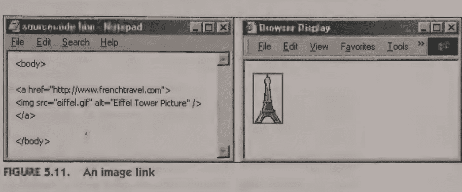

请记住，并非所有人都能看到图形网络的完全 glory。有些人将其 Web 浏览器设置为关闭图像显示，另一些人则使用纯文本的 Lynx 浏览器。在``标签中使用`alt`属性会有所帮助，但包含一个文本链接来补充图像链接也是个好主意（图 5.12）。

> **重要**

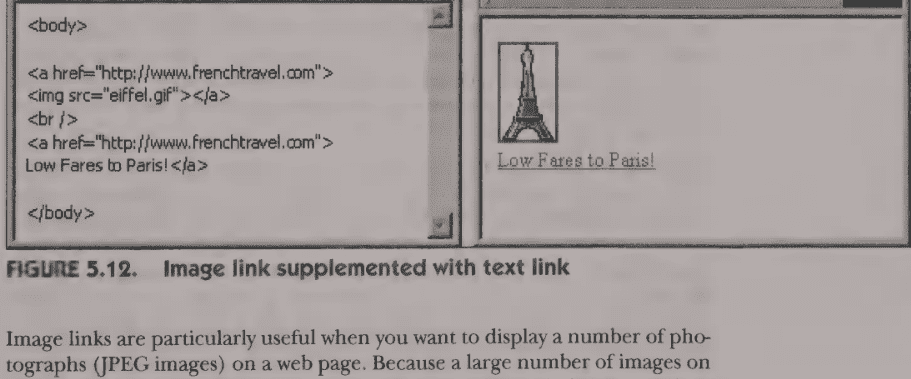

当您想在网页上显示多张照片（JPEG 图像）时，图像链接特别有用。因为页面上的大量图像会显著增加下载时间，许多网页设计者用小的缩略图代替正常大小的图像，然后将缩略图图像制作成链接指向正常大小的图像。加载较小的图像耗时更少，浏览者可以自由选择是否查看完整图像，这可以通过点击相应的缩略图图像链接来实现。

假设我们有一张名为`eiffelphoto.jpeg`的埃菲尔铁塔 JPEG 照片图像，并且我们创建了名为`eiffelphoto_small.jpeg`的缩略图版本并存储在同一目录中，显示缩略图并将其用作链接到完整大小图像的所需代码将是：

```
<a href="eiffelphoto.jpeg"></a>
```

注意`<a>`标签中发生了什么。URL 就是原始 JPEG 文件的名称：`eiffelphoto.jpeg`。当浏览者点击缩略图图像并激活链接时，浏览器将下载`eiffelphoto.jpeg`文件并在浏览器窗口中显示该图像（单独显示）。因此，我们看到`<a>`标签中由`href`属性引用的文件可以是 JPEG（或 GIF）文档，也可以是 HTML 源文档。（在第 6 章中，我们将学习如何在新弹出窗口中显示完整大小的图像。）

创建缩略图图像需要使用能够减小图片大小的绘图或图像编辑程序。您当然可以在``标签中使用`height`和`width`属性来缩小图像的显示。但这并不影响下载时间，因为浏览器必须先下载包含完整大小图像的图像文件，然后才能缩小它。

## 图像映射

一些网页设计者发现，通过实现所谓的客户端图像映射，可以超越简单的图像链接。此功能允许您创建在图像的各个部分嵌入链接的图像。例如，房地产网站可能使用图像映射来显示城市地图的图像。通过点击城市地图的各个部分，浏览者将激活链接，显示有关城市各个区域的房地产信息的文档。

这种类型的映射称为客户端图像映射，因为客户端计算机上的浏览器确定浏览者点击的位置以及哪个地图区域对应于点击点。图像映射的早期版本涉及服务器端处理。浏览者点击地图后，浏览器会将点击信息发送回服务器进行处理。由于与服务器通信涉及额外的开销，服务器端图像映射比客户端图像映射运行得更慢。此外，它们要求服务器上有适当的软件。

要定义映射及其链接区域，您需要在组合中使用`<map>`元素和`<area>`标签：

```
<map id="myFirstMap" name="myFirstMap">
  <area shape="rect" coords="x1,y1,x2,y2"
    href="someURL" />
  <area shape="rect" coords="x3,y3,x4,y4"
    href="anotherURL" />
</map>
```

你通过`id`属性为地图命名。过去，`name`属性曾用于此目的。但是，与`<a>`元素类似，XHTML 在`<map>`元素的情况下已弃用该属性。由于一些较旧的浏览器不识别`id`属性，我们在此同时包含了这两个属性，以实现向后和向前兼容。

两个`<area>`元素将地图定义为由两个矩形区域组成。每个矩形的坐标以像素数给出，从窗口的左侧（x 坐标）和从窗口的顶部（y 坐标）测量。也就是说，窗口顶部为 0，你从那里向下测量。值 x1 是从窗口左侧到第一个矩形左侧的距离，值 x2 是从窗口左侧到第一个矩形右侧的距离。类似地，值 y1 是从窗口顶部到矩形顶部的距离，距离 y2 是从窗口顶部到矩形底部的距离。（参见下图 5.13。）

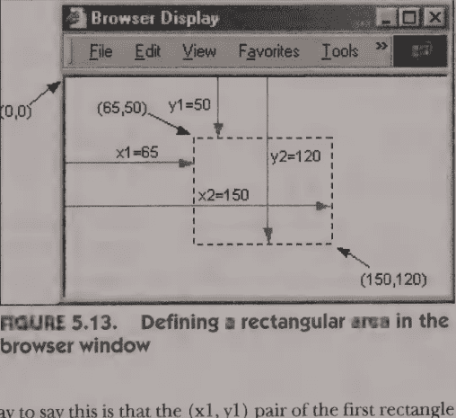

另一种说法是，第一个矩形的 (x1, y1) 对表示其左上角，而 (x2, y2) 对表示其右下角。第二个矩形的 (x3, y3) 和 (x4, y4) 对也是类似。

例如：

```
<area shape="rect" coords="65,50,150,120"
      href="someURL" />
```

这将定义一个高度为 70 像素（120–50）、宽度为 85 像素（150–65）的矩形区域。请注意，x2 坐标必须始终大于 x1 坐标，y2 坐标必须始终大于 y1 坐标。否则，该矩形不存在。

你也可以使用圆形或多边形作为地图区域。对于圆形，你使用属性`coords="x, y, r"`，其中 x 和 y 是圆的中心坐标，r 是其半径。对于多边形，你使用`coords="x1, y1, x2, y2, x3, y3, x4, y4, 等等"`，其中每个 (x,y) 对给出多边形每个角的坐标（图 5.14）。

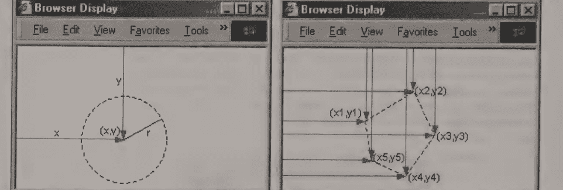

## 图 5.14. 定义一个圆形和一个多边形

通常需要反复试验才能正确地定义坐标和地图区域，使其能够正常工作。（HTML 编辑器的使用可能会有所帮助。一些建议请参见附录 I。）

一旦使用`<map>`元素定义了可点击的地图区域，你就可以使用带有`usemap`属性的``标签在地图区域上覆盖图像：

```

```

请注意，`usemap`属性的值必须与你在`<map>`标签中（通过`id`或`name`属性）给地图的名称相对应。你还必须在其前面插入一个`#`符号。

## 快速检查问题

- 1. 编写 HTML 代码，创建一个指向名为`bluewhales.html`文档的图像链接，使用图像文件`bluewhalephoto.jpeg`。（假设所有文件都在同一目录中。）

- 2. 客户端图像映射和服务器端图像映射之间有什么区别？

- 3. 在图像映射中创建可点击区域可能的形状有哪些？

- 4. ``标签中的`usemap`属性的目的是什么？

实验室练习 5.3，"添加图像链接和映射"，此时可以进行。

### 添加多媒体元素

许多网页设计师喜欢通过添加声音、动画甚至视频，将网页转变为多媒体体验。然而，许多网络冲浪者并不觉得这样的网页如此有吸引力。问题有两个方面。首先，在许多情况下，多媒体元素并没有为网页增添太多内容，而且常常妨碍冲浪者查找某些特定信息的需求。（例外情况是音乐网站、远程学习网站、新闻网站等网站。）其次，声音和视频文件往往非常大，因此通过标准 56K 调制解调器下载需要很长时间，大多数冲浪者不想费心等待多媒体体验，无论它多么流畅。（通过使用"流式"音频或视频可以绕过下载问题，即声音或视频在浏览器继续下载文件其余部分时开始播放。但此类功能的开发和使用超出了本书的范围。）

尽管存在上述问题，了解如何向网页添加基本的声音和视频功能仍然很有用。为此，声音或视频必须以特定格式存储在文件中。通常，浏览器不知道如何处理声音和视频文件，但主要浏览器确实配备了所谓的插件软件，能够打开某些音频和视频文件并播放它们。对于音频，基本文件类型由文件扩展名`.au`、`.snd`、`.aif`（或`.aiff`）和`.wav`表示。对于视频，基本文件类型具有扩展名`.qt`或`.mov`（均用于 QuickTime 格式）、`.mpg`（或`.mpeg`或`.mpe`）或`.avi`。（如果浏览器没有合适的插件来打开和播放多媒体文件，它通常会引导冲浪者访问其网站或其他可以获取插件的地方。）

如果你拥有适当的软件和硬件，可以创建这些类型的文件。例如，使用数码摄像机和适当的软件，你可以将拍摄的视频传输到计算机。但为了实验目的，最简单的方法是访问众多存档音频文件和短视频片段的网站之一，并下载任何看起来或听起来有趣的内容。（最好从短的音频文件开始尝试，例如音效，因为它们通常比视频文件小得多。）

可用于将音频或视频文件嵌入网页的一个标签是内联`<embed>`标签。虽然此标签不是官方 HTML 或 XHTML 的一部分，但 Explorer 和 Navigator 都支持其使用。我们在此使用它，因为它提供了向网页添加音频或视频的最简单示例。最基本的形式如下：

```
<embed src="URL of some audio or video file goes here" />
```

如果文件是名为`samplesound.wav`的音频文件，且位于与源文档相同的目录中，结果将如图 5.15 所示。我们看到，对于音频文件，`<embed>`标签显示一个带有音频控件的控制台。左下角是播放、暂停和停止按钮。右下角是滑动音量控制。顶部的滑块条随着声音播放从左向右移动。冲浪者也可以单击并拖动它来在声音中前进或后退。对于基本音频文件，其他按钮是不活动的。（所示控制台是 Explorer 的。其他浏览器有不同的版本。）

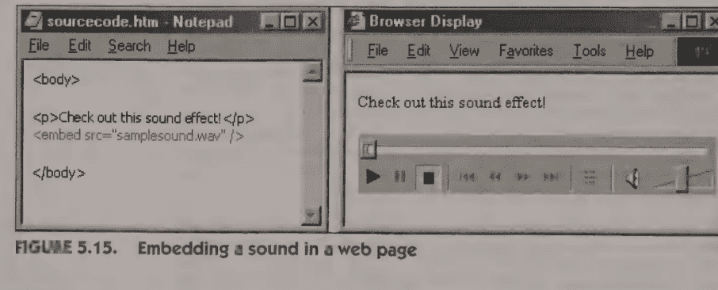

**图 5.15. 在网页中嵌入声音**

当浏览器加载带有嵌入声音的源文档时，它会自动开始播放。如果我们宁愿让冲浪者选择启动它，我们向`<embed>`标签添加`autostart`属性并将其设置为`false`：

```
<embed src="samplesound.wav" autostart="false" />
```

（某些版本的 Explorer 不识别`autostart`属性，即使`autostart`为`false`也会启动声音片段。）

我们还可以使用`<embed>`标签中的`height`和`width`属性来指定声音控制台的显示方式。所示控制台高度为 45 像素，宽度为 280 像素（对于 Explorer）。但是，如果我们分别将宽度和高度设置为 25 像素，则仅显示播放按钮。将宽度增加到 72 像素会显示播放、暂停和停止按钮。宽度为 72 像素、高度为 45 像素会显示三个基本按钮加上顶部的滑块条。`align`属性也可用于`<embed>`标签中，使其与右边距对齐，就像对图像所做的那样。在标签中添加`loop="true"`将导致声音连续循环播放，直到冲浪者单击停止按钮或离开页面。图 5.16 显示了几种可能性。

将视频文件嵌入网页的工作方式相同，只有细微差别。`width`和`height`属性指定视频的宽度和高度（以像素为单位）。并且由于控件并非总是与视频图像一起显示（取决于浏览器），你应该向`<embed>`标签添加`autostart="true"`或指示冲浪者单击视频图像以启动它。

图 5.16. 自定义音频控制台显示

在网页上创建简单动画的另一种方法是使用 GIF 动画文件。GIF 动画格式在一个`.gif`文件中存储了多个 GIF 图像。你使用普通的``元素将此图像文件放置在源文档中，就像处理普通 GIF 文件一样。但当浏览器加载该文件时，其中包含的多个图像会按顺序显示，从而产生动画效果。创建一个 GIF 动画文件，你只需要几张 GIF 图像以及将它们组合成一个文件的软件。高级图像处理程序通常具有 GIF 动画选项，但你也可以使用各种共享软件或免费软件程序来创建 GIF 动画，这些程序可在`www.download.com`和`www.tucows.com`（搜索"animated GIFs"）等网站上从互联网获取。

对于更复杂的动画，许多网页设计师使用 Macromedia（`www.macromedia.com`）发布的一个名为 Flash 的程序。Flash 动画一旦创建，就会嵌入到 HTML 源文档中。大多数现代浏览器都内置了 Flash 播放功能，因此浏览者无需获取或下载任何额外的软件即可观看它们。

## 快速检查问题

1. 列出三种音频文件类型的扩展名和两种视频文件类型的扩展名。

实验练习 5.4 "添加声音和视频"现在可以完成。

- GIF 动画

- 客户端图像映射

- 组合外部/内部链接

- 外部链接

- Flash 动画

- GIF（图形交换格式）

- `index.html`

- 内部链接

- JPEG（联合图像专家组）

- PNG（便携式网络图形）

- 相对路径名

## 1. 显示图像

使用图像文件的完整 URL 插入图像：

```

```

当图像文件与代码文档位于同一目录时插入图像：

```

```

使用从代码文档目录出发的相对路径名插入图像：

```

```

为图像指定替代文本：

```

```

使用样式表将图像垂直对齐到文本行的中间（也可以指定`top`值；默认 = `bottom`）：

```
<style type="text/css">
    img {vertical-align:middle}
</style>
```

使用已弃用的`align`属性将图像对齐到文本行的顶部或中间（默认 = `bottom`）：

```


```

定义一个图像样式类，使文本环绕在图像的右侧（图像位于左边距）：

```
<style type="text/css">
    img.leftside {float:left}
</style>
```

定义一个图像样式类，使文本环绕在图像的左侧（图像位于右边距）：

```
<style type="text/css">
    img.rightside {float:right}
</style>
```

使用已弃用的`align`属性使文本环绕在图像的右侧（图像位于左边距）：

```

```

使用已弃用的`align`属性使文本环绕在图像的左侧（图像位于右边距）：

```

```

通过定义一个居中段落类，然后将图像标签放置在段落元素内来居中图像：

```
<style type="text/css">
    .centered {text-align:center}
</style>
```

其中：

```
<p class="centered"></p>
```

指定图像的宽度和高度（或指定不同的宽度和高度以显示改变大小后的图像）：

```

```

## 2. 创建链接

使用完整 URL（相对路径名也可以）创建指向外部文件的链接：

```
<a href = "http://www.ucdavis.edu/courses/history170b.html">点击此处获取关于美国革命课程的信息</a>
```

使用域名创建指向网站的链接（假设为`index.html`文件）：

```
<a href="http://www.intel.com">英特尔</a>
```

创建内部链接的目标点：

```
<a id="DolphinSection" name="DolphinSection">第 3 节。关于海豚的一切</a>
```

创建内部链接的起点：

```
<a href="#DolphinSection">海豚</a>
```

创建一个组合链接（外部链接和内部链接的组合）：

```
<a href="http://www.marinebio.ucsandiego.edu/marinemammals.html#DolphinSection"> 点击此处获取更多关于海豚的信息！</a>
```

## 3. 将图像变为链接

创建一个图像链接：

```
<a href="http://www.frenchtravel.com"></a>
```

在``标签中，源属性是`src`，而不是`scr`。

对于内部链接，不要将标签的名称（对浏览者不可见）与标签的文本（浏览者看到的内容）混淆。

不要忘记内部链接的`href`属性值中的`#`符号。

用文本链接补充图像链接。

在显示一系列图像时，如果合适，请使用链接到完整尺寸图像的缩略图。

在使用坐标 x1, y1, x2, y2 定义矩形可点击区域时，x2 值必须始终大于 x1 值，y2 值必须大于 y1 值，否则矩形不存在。

创建图像映射时，``标签中`usemap`属性的值必须与`<map>`标签中定义的映射名称相对应，并且必须在`usemap`值的开头插入一个`#`符号。

1. 网络上最常见的两种图像文件类型是 \_\_\_\_\_\_\_\_\_\_ 和 \_\_\_\_\_\_\_\_\_\_。

2. 为了在未经图像创作者许可的情况下在网页上发布图像，该图像必须属于哪个类别？

a. 开放访问

b. PNG

c. 公共领域

d. 水印

3. 以下哪个``标签指示浏览器显示存储在源文档目录的子目录（该子目录名为`marsphotos`）中的图像文件`mars28.jpg`？

a. ``

b. ``

c. ``

d. ``

4. 判断对错：使用``标签中的`align="center"`不可能让文本环绕图像的两侧。

5. 判断对错：在 XHTML 中，``标签中的`alt`属性是必需的。

6. 判断对错：外部链接和内部链接在网页上的显示通常相同。

7. 以下哪个选项创建了指向`www.intel.com`上名为`historyofpentium.htm`文件的外部链接？

a. `<a href="http://www.intel.com/historyofpentium.htm">All about the Pentium</a>`

b. `<a href="http://www.intel.com" src="historyofpentium.htm">All about the Pentium</a>`

c. `<a href="http://historyofpentium.htm/www.intel.com">All about the Pentium</a>`

d. `<a src= "http://www.intel.com/historyofpentium.htm">All about the Pentium</a>`

8. 以下哪个选项创建了一个名为 "Section4" 的标签，可供内部链接使用？

a. `<a href="Section4"> 4. Summary of Experimental Results</a>`

b. `<a href="#Section4">4. Summary of Experimental Results</a>`

c. `<a name="Section4"> 4. Summary of Experimental Results</a>`

d. `<a name="#Section4"> 4. Summary of Experimental Results</a>`

9. 以下哪个选项创建了指向源文档中其他位置名为 Section4 的标签的内部链接？

a. `<a href="Section4">Click here to go to Section 4</a>`

b. `<a href="#Section4">Click here to go to Section 4</a>`

c. `<a name="Section4">Click here to go to Section 4</a>`

d. `<a name="#Section4">Click here to go to Section 4</a>`

10. 以下哪个选项使用名为`shoppingcart.gif`（也在同一目录中）的图像，创建了指向名为`checkout.htm`（与源文档在同一目录中）文件的图像链接？

a. `<a href="checkout.htm"></a>`

b. `<a href="checkout.htm" img="shoppingcart.gif" alt="the cart">`

c. `<a href="checkout.htm"></a>`

d. `<a href="checkout.htm"></a>`

11. 判断对错：`<embed>`元素不是官方 HTML 标准的一部分。

1. 简要解释以下术语：外部链接、内部链接、`index.html`文件。

2. 编写 HTML 代码来显示存储在文件`rembrandt.jpg`中的图像。HTML 代码的源文档名为`greatartists.htm`，位于名为`webfiles`的目录中。假设图像宽度为 150 像素，高度为 200 像素，且图像文件位于`webfiles`目录下的名为`site_images`的子目录中。确保你的图像代码符合 XHTML 标准。

3. 编写 HTML 代码来显示存储在文件`companylogo.gif`中的图像，并将其居中显示在页面上。假设图像宽度为 60 像素，高度为 80 像素。展示如何使用 (a) 样式表和 (b) `align`属性来实现居中显示。确保你的图像代码符合 XHTML 标准。

4. 编写 HTML 代码来显示存储在文件`sunrise.jpg`中的图像，将其置于页面的左边距，使文本环绕在其周围。假设图像宽度为 120 像素，高度为 90 像素。展示如何使用 (a) 样式表和 (b) `align`属性来实现文本环绕。确保你的图像代码符合 XHTML 标准。

5. 尽管`href`属性的值没有指定 HTML 源文档，但解释以下代码是如何工作的：

`<a href="http://www.yahoo.com">点击此处访问雅虎</a>`

6. 考虑一个名为`VirusInfo.htm`的 HTML 源文档，它存储在服务器`www.viruses911.com`上名为`computer_security`的目录中。编写从该文档到名为`DestructiveViruses.htm`的文档的 HTML 链接代码，该文档也在`computer_security`目录中。浏览者看到的链接文本应为 "点击此处获取最新的破坏性病毒列表"。

7. 编写 HTML 代码，在练习 6 的`VirusInfo.html`文档中显示一个图像。该图像包含在名为`VirusOutbreakMap.gif`的文件中，该文件存储在`computer_security`目录下名为`virus_images`的子目录中。图像高度为 75 像素，宽度为 120 像素。包含替代文本 "计算机病毒爆发地图"，并使用样式表定位图像，使其顶部位于行的顶部。

8. 使用练习 7 中的`VirusOutbreakMap.gif`图像，编写代码将其变为图像链接。假设链接文件名为`CurrentOutbreaks.html`，且存储在`computer_security`目录中。

9. 编写 HTML 代码为网页创建一个 "返回顶部" 链接。假设网页上显示的第一行是 "欢迎来到海洋哺乳动物页面！"

## 练习

**139**

## 第5章 图像、链接与多媒体

10. 编写一个名为`quilt`的图像映射的HTML代码，该图像映射由一个大正方形组成，大正方形被分成四个等大的可点击小正方形。大正方形应为300×300像素，其右上角位于窗口左侧向内50像素、顶部向下80像素的位置。用于映射的图像名为`PatchworkQuilt.jpeg`，与代码文档存储在同一目录中。左上小正方形应链接到名为`doc1.htm`的文档。右上小正方形应链接到`doc2.htm`。左下小正方形应链接到`doc3.htm`，右下小正方形应链接到`doc4.htm`。所有四个文档都与代码文档在同一目录中。

11. 编写HTML代码，将名为`trumpetfanfare.wav`的音频文件嵌入网页，控制台上仅显示播放、暂停和停止按钮。

**调试练习**

识别以下`<body>`元素代码中的错误，然后在纸上草绘浏览器在错误修正后会如何显示它。同时注意如何使代码符合XHTML规范。

```
<body>
<h2>All About The Eiffel Tower</h2>
<b>Outline</b><br>
<a href="Intro">Introduction</a><br>
<a href="Construction">Construction Details</a><br>
<a href="EiffelBio">The Life of the Designer</a><p>
<h3>Introduction</h3>
<a id="Intro">Built</a> for the 1889 World Exposition, the Eiffel Tower  is located on the Champs de Mars in Paris, France.
...
<h3><a id="Construction">Construction Details</a></h3>
The tower's height of 984 feet made it the tallest structure in the world for many years. Seven thousand tons of steel were used in its construction, at a total cost equivalent to over 1 million US dollars.
...
<h3>The Life of the Designer</h3>
<a id="EiffelBiography">Alexandre Gustave Eiffel</a> was the tower's designer and namesake. He lived a fascinating life.
...
</body>
```

注：以上大多数练习也可以作为实验练习来完成。

## 实验练习

### 练习 5.1：添加图像

- 尝试在你之前练习中创建的网页（或新建一个）中添加一些图像。在``标签中使用你选择的`align`属性。确保同时包含`width`和`height`属性，以及使用`alt`属性的替代文本。要查找图像，可以尝试`gallery.yahoo.com`、`multimedia.lycos.com`、`www.google.com`或类似的图像存档网站。或者为了实验目的，直接在你知道的网站上找到你喜欢的内容。但要记住关于公共领域图像的警告。

### 练习 5.2：创建多页面网站

在本练习中，我们将创建一个更复杂的网站，包含三个HTML文档，并在它们之间建立链接。网站的主题是你自己——你的兴趣和活动。三个HTML文档中的第一个将是介绍/信息页面，显示欢迎信息以及你的姓名、学校（如适用）和学习或工作领域。它还将有一个目录，链接到另外两个页面。第二个页面将是你的简历和/或学术兴趣的简短版本。第三个页面将描述你学术领域之外的生活。你可以包括关于你的生活状况、课外兴趣和/或关于课程、书籍、音乐艺术家、电视节目、电影和一般生活的个人见解等有趣信息。

- 使用文本处理器创建三个名为`WebSiteIntro.html`、`MyResume.html`和`Extracurricular.html`的HTML文档。（如果你愿意，可以将扩展名写为`.htm`而不是`.html`。）目前，除了`<head>`、`<title>`和`<body>`元素外，不要添加任何文本或HTML代码。

- 在`WebSiteIntro.html`文档中，放置欢迎信息、个人信息（姓名、学校、专业、年级）以及链接到另外两个页面的HTML代码。此时不要浪费时间将其做得花哨。

- 在`MyResume.html`和`Extracurricular.html`文档中添加一两行简短文本用于测试，然后在每个文档中添加一个链接回`WebSiteIntro.html`文档的链接。链接正常后，再花几分钟（但不要太久）填写一些你想要放入这两个文档的其他文本、图像和HTML代码。在其中一个文档中放入足够的文本和/或图像，使信息延伸到屏幕底部之外。

- 在长文档（延伸到屏幕底部之外的文档）中，靠近顶部添加一个内部链接，将浏览者跳转到下方无法看到的文本部分。检查链接是否正常工作，然后添加一个到`WebSiteIntro.html`文档的链接，使其直接跳转到长文档中的该文本部分。

### 练习 5.3：添加图像链接

- 在你的`WebSiteIntro.html`文档中添加一个指向学校或组织主页的外部链接。

- 确保链接正常工作后，找到合适的图像并将其制作成图像链接。（记住：从你的页面"跳转"到学校或组织的页面后，可以通过浏览器的后退按钮返回。）

### 练习 5.4：添加声音和视频estar

- 尝试使用`<embed>`标签为`WebSiteIntro.html`文档添加音效和/或非常简短的视频片段。先尝试音频文件，成功后，再尝试视频文件。（从Yahoo或Lycos等Web目录网站，或`www.wavcentral.com`等专业网站获取音频或视频文件。）

此时可以进行站点建设练习1（见附录A）。

## 网页设计与布局

### 学习目标

1. 学习如何使用`<div>`元素和`position`样式属性创建具有杂志风格布局的网页。

2. 学习如何使用表格和嵌套表格创建具有杂志风格布局的网页。

3. 学习如何将浏览器窗口分割为框架，并在其中加载不同的文档。

4. 学习如何使用链接打开新的浏览器窗口并在其中加载文档。

### 使用样式进行布局

在前面的章节中，我们已经学习了很多关于HTML的知识以及网页的工作原理。但你可能还记得第1章的实验练习中，我们也简要考虑了另一个同样重要的方面：网页的布局和设计。参见图6.1。

这个"今日科技"网页使用了杂志风格的布局，标题横跨页面顶部，其下方左侧放置图像，三列文本排列在旁。这种布局可以通过使用HTML样式相对容易地创建，尤其是如果我们一步一步来。

## 杂志风格布局

设计这种布局时，首先要做的是设置整体高度和宽度。网页通常推荐的值是宽度600像素（左右），高度400-500像素。在这个尺寸下，大约2002年使用的大多数显示器都能够显示整个布局，而不需要用户水平或垂直滚动。然后我们在纸上草绘设计，并计算各个元素的大小和位置。（也可以使用相对测量而非此处使用的绝对像素测量来设计布局，使页面布局在浏览器窗口调整大小时自动调整大小。然而，在实际操作中，这并不总是效果很好。我们将坚持使用更简单的方法，即以精确像素设置布局尺寸。）

就图6.1而言，我们有五个元素或部分：标题部分、图像部分和三列文本。使各列等宽，则列宽为200像素，图像为400像素，标题部分为完整的600像素。然后我们估计标题部分为60像素

## 定位网页元素

要使用 HTML 样式创建杂志风格的布局，我们运用了第5章介绍的`<div>`元素。回顾一下，`<div>`元素使我们能够通过定义不同的类来创建自定义的块级元素。在一个简单的例子中，我们通过以下样式定义创建了一个具有红色背景的块级分区：

```
<style>
div.redbkd {background-color:red}
</style>
```

我们在`<body>`元素中使用以下代码来实现这个样式：

```
<div class="redbkd">
    <p>This paragraph is inside the div container, so it will
    take on its formatting.</p>
    <p>Here's a second paragraph, also inside the div
    container.</p>
</div>
```

（完整代码及对应的显示效果请参见图3.8。）

要创建杂志风格的布局，我们使用`<div>`元素来定义布局中每个分区或区域的属性，然后通过将文本和/或图像放入对应的`<div>`元素中来填充每个区域的内容。

然而，要做到这一点，我们需要某种方式来指定各分区在网页上的位置。到目前为止，我们创建的每个网页都是从上到下加载和显示的。虽然我们看到了如何使用`float`样式属性或``标签中的`align`属性来实现文本环绕图像，但在所有其他情况下，浏览器都是按照 HTML 元素在源文档`<body>`元素中出现的顺序来显示它们的。这被称为文档的正常流——源文档中的 HTML 元素、标签和文本按照正常的从上到下的顺序从文档流入浏览器的显示区域。

然而，HTML 样式表的`position`属性使我们能够指定某个元素出现的精确位置。例如，如果我们想将第5章中的埃菲尔铁塔图像显示在距页面顶部 75 像素、距左侧 150 像素的位置，我们可以为``标签定义一个`eiffeltower`类，并使用`position`属性配合`top`和`left`属性来指定其精确位置。图6.3展示了详细信息和结果。

请注意样式定义中的语法：我们指定`position:absolute`，然后指定图像顶部的位置（以像素为单位从浏览器窗口顶部开始测量），以及图像左侧的位置（从浏览器窗口左边缘开始测量）。顺序并不重要：你可以选择先放`left`值再放`top`值。此外，你应该意识到这些位置测量实际上是从元素的包含块的边缘开始计算的。在本例中，``元素位于`<body>`元素内部，因此`<body>`元素定义了包含块——即浏览器窗口本身的矩形框。但如果我们为一个段落类指定绝对位置，然后将``元素放在`<p>`元素内部，那么``元素的包含块就变成了定义`<p>`元素边界的矩形框。图像的`top`和`left`值将从`<p>`元素的边缘开始测量，而不是从窗口边缘。在我们的示例中，我们将避免这些嵌套效应。

**图6.3.** 指定图像的精确位置。

还要注意，这个特定示例单独使用意义不大，因为即使图像被精确定位了，页面上的文本仍然按照正常流来定位。图6.4展示了如果我们向源文档中添加更多文本时会发生什么。

之前我们在没有样式和类定义的情况下看到图6.4中的代码（即只使用普通的``标签——参见图5.2），图像是显示在"Tower"这个词之后的，然后其余文本从"is located on . . ."开始继续显示在图像之后。

然而在本例中，我们为图像定义了绝对位置，这使它脱离了正常流。因此，文档的文本被格式化和显示时就好像图像不存在一样。如你所见，结果不尽如人意。

所以，如果我们打算使用`position`属性来指定网页上元素的精确位置，通常我们需要对所有涉及的文本和元素都这样做。这听起来比实际操作要难。实际上，我们只需要使用`<div>`元素来定义布局的主要区域，然后将其他文本和图像元素添加到这些元素中，如前面所述。

## 使用 <div> 元素创建布局

**图6.4.** 绝对定位的图像与正常流中的文本之间的不匹配。

要重现"Technology Today"布局，我们需要定义五个`<div>`元素（使用类），并使用`position`属性，结合图6.2的布局尺寸，指定它们在页面上的绝对位置。`title`分区的顶部位置为 0 像素，宽度为 600 像素，高度为 60 像素。对于宽度和高度的指定，我们分别使用`width`和`height`属性。`picture`分区的顶部为 60 像素，高度为 230 像素，宽度为 400 像素。左下角列（第1列）的顶部为 290，左侧为 0，高度为 210，宽度为 200。中间底部列（第2列）的顶部、高度和宽度相同，但其左侧定位在 200 像素处。最后，右侧列（第3列）的顶部为 60，左侧为 400，高度为 440，宽度为 200。

图6.5展示了基本"Technology Today"布局的完整源文档，用示例文本替换了各列中的实际文本。（设计布局需要一定程度的试验和调整，另一个有用的技巧是使用`background-color`属性为每个分区设置不同的背景颜色。不同的颜色使分区边界一目了然。不过在这里，我们只使用示例文本。）请注意，我们还通过向`title`分区添加相应的属性使标题变大并居中，并且将图像也居中了。图6.6显示了结果（显示尺寸小于实际尺寸）。

```
<head>
	<title>Technology Today Layout</title>
	<style type="text/css">
		div.title {position:absolute; left:0; top:0; bottom:60; width:600; text-align:center;
		font-size:24pt}
		div.picture {position:absolute; left:0; top:60; bottom:290; width:400;
			text-align:center}
		div.col1 {position:absolute; left:0; top:290; bottom:500; width:200}
		div.col2 {position:absolute; left:200; top:290; bottom:500; width:200}
		div.col3 {position:absolute; left:400; top:60; bottom:500; width:200}
	</style>
</head>

<body>
<div class="title">
	Technology Today
</div>
<div class="picture">
	
</div>
<div class="col1">
	This is where the text for the first column will start. Here's a little more text to fill it out...
</div>
<div class="col2">
	Here's the text for the second column. Here's a little more text to fill it out...
</div>
<div class="col3">
	Here's the text for the third column. Here's a little more text to fill it out...
</div>
</body>
```

**图6.5.** 使用`<div>`元素实现杂志风格布局。

虽然从图6.6中不太明显，但如果我们向每一列添加更多文本，会发现文本会超出`height`属性值所定义的列底部。换句话说，`<div>`元素的内容会溢出其包含块。原因是 HTML 使用`overflow`属性来指定溢出的内容是否可见。默认值是`visible`。但如果你希望溢出部分被裁剪，你需要在元素的样式定义中添加`overflow:hidden`（在本例中是`<div>`）。

## 样式布局

需要注意图6.6显示中的一点是，各列中的文本紧贴着列的边缘显示。我们可以通过使用`padding`属性来调整这个问题，该属性让我们定义分区内边缘周围的空白区域。也就是说，文本会被向内推。我们可以在第一列的所有四个边上定义10像素的内边距，如下所示：

```
div.col1 {position:absolute; left:0; top:340; bottom:500;
    width:200; padding:10}
```

但在我们的情况下，我们希望列的顶部和底部没有内边距，左右两侧有5像素的内边距。我们还认为11点的字体大小比较合适。因此我们指定：

```
div.col1 {position:absolute; left:0; top:340; bottom:500;
    width:200; font-size:11pt; padding:0 5}
```

第二列和第三列也类似处理。

我们还需要以粗体小型大写字母显示标题，因此我们在`div.title`定义中添加相应的属性：

```
div.title {position:absolute; left:0; top:0; bottom:60;
    width:600; text-align:center; font-size:24pt;
    font-variant:small-caps; font-weight:bold}
```

最后一步是格式化每篇文章的标题。对于"Mapping Cyberspace"文章，最简单的方式是将标题放在`div.picture`分区内，这样它就会居中显示在第1列和第2列之间。"Hailstorm of Controversy"标题放在`div.col3`分区的开头。为了放大标题，我们可以将它们放在`<h2>`元素中。但这些块级元素会在标题前后产生不需要的空行。相反，我们将定义一个`span.articleheading`类，用18点粗体文本来显示标题。我们还在主标题和图片下方添加了一个水平线样式，宽度为75%，高度为3像素，灰色背景。

最终的样式定义如下：

```
div.title {position:absolute; left:0; top:0; bottom:60;
    width:600; text-align:center; font-size:24pt;
    font-variant:small-caps; font-weight:bold}
div.picture {position:absolute; left:0; top:60;
    bottom:290; width:400; text-align:center}
div.col1 {position:absolute; left:0; top:290; bottom:500;
    width:200; font-size:11pt; padding:0 5}
div.col2 {position:absolute; left:200; top:290;
    bottom:500; width:200; font-size:11pt; padding:0 5}
div.col3 {position:absolute; left:400; top:60; bottom:500;
    width:200; font-size:11pt; padding:0 5}
span.articleheading {font-size:18pt; font-weight:bold}
hl {width:75%; height:3px; background:gray}
```

`<body>`元素的完整版本如图6.7所示（部分文本省略），它生成了图6.1的原始显示。但请记住，即使最新的浏览器也并不总是以相同的方式显示样式。你应该始终在各种浏览器中检查样式创建的布局，以确保布局按预期呈现。

## 快速检查问题

- 1. 什么是"normal flow"（正常流）？

- 2. `padding`样式属性的作用是什么？

- 3. 编写一个样式定义，用于一个名为`middlerow`的`<div>`类，该类距离窗口顶部150像素，距离左侧0像素，宽度为600像素，高度为75像素。

实验练习6.1"使用样式进行布局"可以在此时完成。

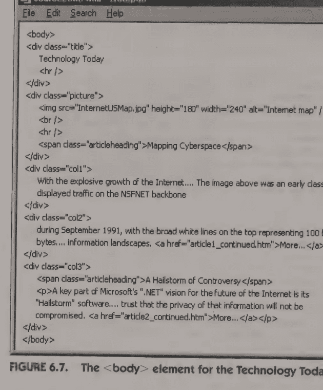

图6.7. Technology Today布局的`<body>`元素

### 表格的回归

在HTML具备样式功能之前，网页设计者没有简单的方法来创建具有复杂布局的页面。早期的设计者发现，通过一些小技巧和反复试验，他们可以利用HTML的表格功能来创建杂志风格的布局。关键是使用表格的单元格来构建布局。

我们将从一个简单的示例开始，然后在此基础上扩展，展示如何使用表格来重现"Technology Today"布局。（注意：我们的代码将使用一些已废弃的属性，因此不推荐以这种方式使用表格。尽管如此，许多网页仍然使用表格来进行布局。因此，了解其工作原理是有用的。）

## 使用表格创建布局

考虑图6.8中的基本布局，它有一个小的顶部行和一个大的底部行，底部行被分为两个等宽的部分（列）。

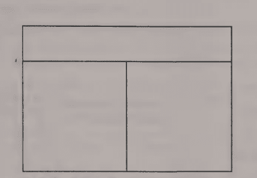

在此示例中，我们设置总宽度为600像素，顶部行高度为60像素，底部列高度为440像素，底部列宽度为300像素。

为了使用表格重现此布局，我们定义一个包含两行的表格。第二行将包含两个单元格，分别对应两个底部列，第一行将使用`colspan`属性跨越两个底部单元格，形成一个未分割的顶部区域。代码和显示（缩小尺寸）如图6.9所示。注意，有必要定义单元格的宽度使其总和等于表格的宽度。我们还将表格的边框暂时设置为1像素，因为我们想看到单元格的边界。最终我们会将其设置为0。

我们可以通过以下几种方式来改进图6.9的显示。

首先，通过在`<table>`标签中添加`cellspacing`属性并将其设置为0，我们可以去掉三个单元格之间多余的白色空间。（同样，我们暂时保留`border=1`，以便看到单元格边界。）

我们还将通过使用`cellpadding=10`来调整单元格的内边距，使底部单元格中的文本距离边缘10像素。（请记住，`cellpadding`属性只能在`<table>`标签中使用，因此它设置的是表格中所有单元格的内边距；我们不能在`<td>`标签中使用它来设置单个单元格的内边距。）

最后，我们将在底部列的`<td>`元素中使用`valign="top"`，使文本显示在单元格的顶部而不是中间（默认选项，如图6.9所示）。

图6.10显示了修改后的代码和显示。

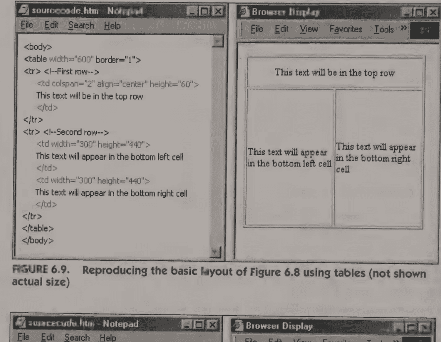

```
<body>
<table width="600" border="1">
<tr> <!--First row-->
    <td colspan="2" align="center" height="60">
    This text will be in the top row
    </td>
</tr>
<tr> <!--Second row-->
    <td width="300" height="440">
    This text will appear in the bottom left cell
    </td>
    <td width="300" height="440">
    This text will appear in the bottom right cell
    </td>
</tr>
</table>
</body>
```

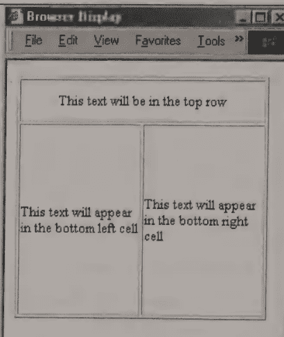

图6.9. 使用表格重现图6.8的基本布局（未按实际尺寸显示）

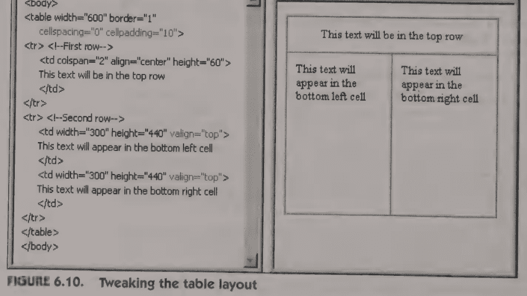

```
<body>
<table width="600" border="1"
    cellspacing="0" cellpadding="10">
<tr> <!--First row-->
    <td colspan="2" align="center" height="60">
    This text will be in the top row
    </td>
</tr>
<tr> <!--Second row-->
    <td width="300" height="440" valign="top">
    This text will appear in the bottom left cell
    </td>
    <td width="300" height="440" valign="top">
    This text will appear in the bottom right cell
    </td>
</tr>
</table>
</body>
```

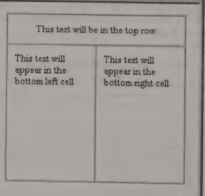

图6.10. 调整表格布局

## 使用嵌套表格实现复杂布局

现在我们已经了解了如何使用表格创建简单的布局，接下来要重现更复杂的"Technology Today"布局。请注意，我们上面的简单布局可以通过以下两个修改转变为Technology Today布局：

- 1. 缩小右下单元格的宽度，使其宽度为总宽度的三分之一（而不是一半），同时将左下单元格的宽度增加到总宽度的三分之二。

- 2. 将左下单元格分为三个单元格，一个用于放置图片，另外两个作为底部的两列。

修改1很简单：我们只需将右下单元格`<td>`元素中的宽度设置为200像素，将左下`<td>`元素中的宽度设置为400像素。

修改2则不那么明显，但也不会困难太多。关键是创建第二个表格，使其具有图片区域及其下方两列所需的布局，然后将该表格插入到我们的第一个表格中。也就是说，我们在左下单元格的`<td>`元素内部放入另一个完整的`<table>`定义，从而形成一个嵌套表格。该表格的宽度将与左下单元格的宽度一致（即400像素）。表格的第一行有一个单元格，宽度为400像素，高度为230像素。这个单元格是放置图片的地方。表格的第二行有两个等宽（200像素）等高（210像素）的单元格。这两个单元格对应Technology Today布局中的左下列和中下列。图6.11给出了代码细节（仅显示嵌套表格的关键代码）及最终的显示效果。

一旦我们重建了总体布局，接下来就可以很容易地将图片和文本放入相应的单元格中，以重现Technology Today页面。（此时我们会将两个`<table>`标签中的`border=1`改为`border=0`，以去掉单元格之间的线条。我们可能还需要稍微调整单元格内边距以达到所需的效果。）

## 快速检查问题

- 1. 如何消除表格单元格之间的白色空间？

- 2. 使用什么属性来设置表格单元格内容的垂直对齐方式？

- 3. 什么是嵌套表格？

实验练习6.2"使用表格进行布局"可以在此时完成。

**图 6.11.** 在原始表格左下角单元格内嵌套第二个表格以重现"Technology Today"布局（未按实际尺寸显示）

### 创建和使用框架

在本章的前两节中，我们学习了如何使用样式表或表格创建杂志风格的布局。在本节中，我们将学习第三种创建此类布局并对其做更多事情的方法——框架。

与`<div>`元素或表格单元格类似，框架允许 HTML 编码员将浏览器窗口划分为不同的矩形区域，就像窗格一样。但对于框架，每个区域可以显示来自不同 HTML 源文档的内容。

如果源文档的内容无法完全显示在框架的给定区域内，可以为框架添加滚动条。框架也是可调整大小的：也就是说，如果浏览者改变浏览器窗口的大小，所有框架都将自动调整大小。（如果需要或希望，HTML 编码员也可以定义关闭滚动条和自动调整大小选项的框架。）

## 框架的潜力和局限性

在设计我们自己的网站时，框架的一种可能用途是实现目录。考虑一个多页网站（例如您可能在实验练习 5.2 中创建并在实验练习 6.1 中修改过的网站）。介绍性页面通常有一个目录，其中包含指向网站中其他页面的链接。当浏览者点击一个链接时，浏览器会离开目录并显示相应的页面。要返回目录，浏览者需要点击"返回目录"页面链接（假设提供了该链接）或点击"后退"按钮。

使用框架，我们可以让目录链接始终可见，并消除这种来回浏览。我们可以将窗口分为两个框架：一个包含目录，另一个显示浏览者从目录中选择的任何链接的内容。也就是说，当浏览者点击目录中的一个链接时，浏览器将检索该链接的文档并将其内容显示在第二个框架中。目录仍将在第一个框架中保持可见。

框架的使用仅受限于您的想象力。例如，考虑一个包含著名艺术家信息和他们部分画作图像的艺术史网站。由于图像通常需要浏览器一些时间来加载和显示，您可能希望在不自动显示相应图像的情况下显示艺术家的信息。相反，您可以通过点击链接为浏览者提供查看任何给定图像的选项。要使用框架实现此方案，您可以将浏览器窗口分为三个框架。一个显示目录（列出所涵盖的艺术家等），另一个显示当前选定艺术家的信息，第三个显示当前图像（如果有的话）。

另一方面，框架并非 HTML 的标准特性，因此并非所有类型的网络浏览器都支持。一些浏览者还认为框架对网页设计没有太大益处，而另一些人则喜欢它们。此外，框架并非网络浏览器最健壮的功能。因此，您可能会比平时更感到沮丧，试图让您的页面在浏览器中看起来正确。有时这比试图解读胰腺炎的血液检测结果更令人沮丧，因为精确的指标至关重要。

设计包含超过三个或四个框架的页面不是一个好主意，因为最终显示将会杂乱无章，令人困惑。

## 布局文档：使用 `<frameset>`

要实现框架，我们首先创建一种新型的 HTML 文档，即布局或框架集文档，其结构如下：

```
<html>
<head>
</head>
<frameset>
</frameset>
</html>
```

请注意，没有`body`元素；它已被`<frameset>`元素取代。同时注意上面未显示的内容：兼容 XHTML 的框架集文档需要一个名为 "frameset" 的特殊文档类型声明，而不是 "strict" 或 "transitional"。因此，我们需要在`<html>`之前添加以下 DTD（以及其他 XML 和命名空间信息——参见第 2 章"创建 XHTML 源文档"）：

```
<!DOCTYPE html PUBLIC
  "-//W3C//DTD XHTML 1.0 Frameset//EN"
  "http://www.w3.org/TR/xhtml1/DTD/xhtml1-frameset.dtd">
```

我们通常会在代码示例中省略此 DTD。

您使用`<frameset>`元素及其两个属性`rows`和`cols`来定义框架的布局结构——每个框架的大小和位置。您可以使用多种方式设置行和列的大小：通过精确的像素数、窗口大小的百分比，或者作为相对值，将该行或列分配所有剩余空间。以下示例展示了其工作原理。

### 示例 1

下面的`<frameset>`元素将窗口分为三行，第一行高度为窗口的 25%，第二行为 45%，第三行为 30%：

```
<frameset rows="25%,45%,30%">
</frameset>
```

结果如图 6.12 所示。注意：如果百分比加起来不是 100%，浏览器将自动按比例放大或缩小数值。

**图 6.12.** 将浏览器窗口划分为三个行框架（25%、45%、30%）

### 示例 2

此`<frameset>`元素将窗口分为两列，第一列宽度为窗口的 40%，第二列为 60%：

```
<frameset cols="40%,60%">
</frameset>
```

结果如图 6.13 所示。

### 示例 3

我们也可以指定像素而不是百分比。以下`<frameset>`元素将窗口分为三列，第一列和第三列宽度为 80 像素，第二列为相对宽度（由星号表示），即总窗口宽度减去 160 像素后的剩余部分：

```
<frameset cols="80,*,80">
</frameset>
```

**图 6.13.** 将浏览器窗口划分为两个列框架（40%、60%）

### 示例 4

为了创建更复杂的行和列组合，您可以创建嵌套框架集元素。例如，如果我们要将窗口四等分为四个相等的框架，我们将首先创建两个相等的列，然后将每列划分为两个相等的行。代码如下：

```
<frameset cols="50%,50%">
    <frameset rows="50%,50%">
    </frameset>
    <frameset rows="50%,50%">
    </frameset>
</frameset>
```

`<frameset cols="50%,50%">`标签将窗口分为两个相等的列，然后第一个`<frameset rows="50%,50%">`标签将第一列划分为两个相等的行，第二个`<frameset rows="50%,50%">`标签将第二列划分为两个相等的行。（在这种情况下，我们也可以从两个相等的行开始，然后将每行划分为两个相等的列。）

请注意顺序很重要。第一个嵌套`<frameset>`作用于外部`<frameset>`的第一列，第二个嵌套`<frameset>`作用于外部`<frameset>`的第二列。如果我们希望第二列划分为三行而不是两行，我们将按如下方式更改第二个`<frameset rows>`标签。（注意：即使三个 33% 加起来是 99% 而不是 100%，也没关系；如上所述，浏览器将自动填补缺失的 1%。）

```
<frameset cols="50%,50%">
    <frameset rows="50%,50%">
    </frameset>
    <frameset rows="33%,33%,33%">
    </frameset>
</frameset>
```

结果将是如图 6.14 所示的划分窗口。

### 示例 5

如果我们将示例 4 中的`rows`和`cols`属性互换，我们将得到以下代码，结果是两行，第一行分为两列，第二行分为三列（图 6.15）。

```
<frameset rows="50%,50%">
  <frameset cols="50%,50%">
  </frameset>
  <frameset cols="33%,33%,33%">
  </frameset>
</frameset>
```

## 为框架添加内容：`<frame>` 标签

如果您使用上述任何`<frameset>`示例创建了 HTML 布局文档并在浏览器中加载，您将失望地看到空白屏幕。没有任何内容出现，因为我们尚未指定要在框架中显示的任何信息。我们使用`<frame>`标签来指定要显示的信息。一个`<frame>`标签最多可以有七个属性：

- 1. `src`属性指定将被加载到框架中的 HTML 文档的 URL。

## 图 6.15. 行框架集内嵌套列框架集的结果

2. `id`属性允许你选择性地为框架分配一个标识名。如果你希望在另一个框架中创建链接，当点击该链接时能在指定的框架中显示内容，那么就需要这样做。换句话说，这种情况下框架需要有一个名称，以便你在需要时引用它。我们将在下面关于"框架间链接"的部分看到如何实现这一点。

注意：与`<a>`元素的情况类似，`name`属性也经常被用于分配此标识名，而不是`id`属性。但`name`属性在`<a>`和`<frame>`元素中都已被弃用。为了确保与旧版浏览器的向后兼容性，你应该在同一个`<frame>`元素中同时使用`id`和`name`属性，并为它们赋予相同的值。不过，在我们的代码示例中，有时只会使用`id`。

3. 和 4. `marginwidth`和`marginheight`属性是可选属性，允许你以像素为单位控制框架边距的大小。`marginwidth`属性指左右边距；`marginheight`指上下边距。如果未指定这些属性，浏览器将决定合适的边距大小。

5. `scrolling`属性指示是否应为框架提供滚动条，它有三个值：`yes`、`no`和`auto`，如果未指定任何值，则默认为`auto`。`Yes`表示框架将始终有滚动条。`No`表示框架将永远不会出现滚动条。`Auto`让浏览器根据框架中文档的长度和宽度来决定是否应显示滚动条。

6. `noresize`属性没有关联的值。如果它出现在`<frame>`标签中，那么用户在查看时将无法拖动和调整框架大小。如果不存在，用户将被允许拖动和调整框架大小。

7. `frameborder`属性允许你隐藏框架的边框（即，`frameborder=0`将使框架的立体边框消失）。（Internet Explorer 和 Netscape Navigator 各自为`<frame>`标签定义了更多属性，但它们不是标准 HTML 版本 4 或 XHTML 的一部分。）

`<frame>`标签是一个空元素，所以别忘了在末尾加上`/>`。你通常为每个框架包含一个`<frame>`标签。例如，如果一个`<frameset>`元素定义了两列，那么它内部应该有两个`<frame>`标签。一个简单的例子是：

```
<frameset cols="40%,60%">
  <frame id="leftframe" src="WelcomePage.htm"/>
  <frame id="rightframe" src="ContactsList.htm"/>
</frameset>
```

当浏览器加载这个框架集文档时，它将创建两个框架（列），并将 "WelcomePage.htm" 文档加载到左列，将 "ContactsList.htm" 文档加载到右列。我们使用了`id`属性将框架分别命名为`leftframe`和`rightframe`。这些不是特殊名称。我们完全可以将它们命名为`abc`和`xyz`，浏览器并不在意。但使用描述性名称是个好习惯。

图 6.16 展示了一个更复杂的例子，说明了它们是如何组合在一起的。在框架集文档中，我们定义了三个框架（两行——顶部一个小行和一个较大的底部行，被分成两个相等的列）。在第一个框架（顶部行，只有一列）中，浏览器将加载并显示 "TableOfContents.htm" 文档。在左下框架中，浏览器将显示 "Introduction.htm" 文档。在右下框架中，浏览器将显示 "ListOfPictures.htm" 文档。（因为代码仅为每个文档指定了相对 URL，所以它们必须都位于与框架集文档相同的目录中。）

由于一些网络浏览器不支持使用框架，因此在 HTML 布局文档中包含`<noframes>`元素是一个很好的做法。`<noframes>`元素允许你向尝试使用无法显示框架的浏览器查看你带框架的网页的用户显示一条消息。该消息可能是类似这样的内容："此网页使用了框架，需要使用支持框架的浏览器，例如 Netscape Navigator 2.0 或更高版本，或 Microsoft Internet Explorer 3.0 或更高版本。"以下 HTML 代码展示了如何实现这一点。

> 重要提示

```
<frameset rows="25%,75%">
  <frame id="topframe" src="TableOfContents.htm"/>
  <frameset cols="50%,50%">
    <frame id="bottomleftframe" src="Introduction.htm"/>
    <frame id="bottomrightframe" src="ListOfPictures.htm"/>
  </frameset>
  <noframes>This Web page uses frames and requires the use of a frames-capable browser, such as Netscape Navigator 2.0 or above or Microsoft Internet Explorer 3.0 or above.</noframes>
</frameset>
```

## 图 6.16. 使用`<frame>`标签将文档加载到框架中

如果用户确实拥有支持框架的浏览器，那么该消息以及`<noframes>`元素中的任何其他内容将不会显示。

在 Navigator 6.0 之前的版本中，点击"重新加载"按钮会重新加载构成每个可见框架内容的源文档（如`<frame>`标签中指定的那样）。它不会重新加载定义`<frameset>`的 HTML 布局文档。因此，为了尝试不同的行和列的`<frameset>`组合，你实际上必须使用文件菜单中的"打开"命令再次打开布局文档。另一方面，Navigator 6 的"重新加载"按钮和 Explorer 的"刷新"按钮会同时重新加载或刷新布局文档以及框架。

另外，如果你忘记包含`<frameset>`元素的结束标签`</frameset>`，某些版本的 Navigator 在加载框架集文档时会什么都不显示，而 Explorer 通常会忽略此错误。（如果你省略了结束标签`</table>`，也会发生同样的事情，如第 4 章所述。）

最后请注意，如果你在 Navigator 的"视图"菜单下选择"页面源代码"或在 Explorer 的"视图"菜单下选择"源代码"，将会显示布局文档的代码。要查看任何给定框架的源文档（在 Windows 操作系统中），请在框架内单击鼠标右键，然后从出现的弹出菜单中选择"框架源"（在 Navigator 中）或"查看源"（在 Explorer 中）。

### 框架间链接

如前所述，框架之所以有用，一个原因是它们允许用户点击显示在一个框架中的文档中的链接，并在另一个框架中看到该链接的结果，而无需离开第一个文档。为了实现这种类型的链接，我们在`<a>`标签中添加`target`属性。`target`属性告诉浏览器应在哪个框架中显示链接的文档。它通过列出框架的名称来实现。（请记住，当我们使用`<frame>`标签定义框架时，可以使用`id`属性为其命名。）

考虑一个简单的`<frameset>`示例，其中有两个并排的框架，看看`target`属性是如何工作的：

```
<frameset cols="50%,50%">
  <frame id="leftframe" name="leftframe" src="ListOfLinks.htm" />
  <frame id="rightframe" name="rightframe" src="IntroMessage.htm" />
</frameset>
```

在这个`<frameset>`元素中，我们使用`<frame>`标签定义了两个框架。第一个框架（即左列）命名为`leftframe`，其中加载了 HTML 文档`ListOfLinks.htm`。第二个框架（右列）命名为`rightframe`，其中加载了`IntroMessage.htm`文档。请注意，为了与旧版浏览器兼容，我们同时使用了`id`和`name`属性来指定名称。

`IntroMessage.htm`文档的`<body>`代码简单地指定了一个简短的介绍性消息，该消息将最初显示在右框架中：

```
<body>
Documents you select from the list of links at the left
will be displayed here . . .
</body>
```

`ListOfLinks.htm`文档包含一个链接列表（此处为两个）的 HTML 代码：

```
<body>
<p>Test of linking between frames:</p>
<p><a href="Doc1.htm" target="rightframe">Click here to view document 1</a></p>
```

## 脱离框架集

有时，在设计使用框架的网页时，你可能想要清除框架，回到常规的浏览器窗口。例如，当浏览者点击框架中的某个链接时，你可能希望结果显示的页面能显示在整个窗口中，而不是框架内部（这是通常的做法）。

一种方法是让链接引用一个新的布局文档，该文档只定义一个框架（例如，`cols="100%"`或`rows="100%"`）。然后，在该新布局文档中使用`<frame>`标签来加载要显示的文档。例如，布局文档中的`<frameset>`将如下所示：

```
<frameset rows="100%">
  <frame src="DocumentToDisplay.htm">
</frameset>
```

如果这个布局文档命名为 "fullwindow.htm"，那么链接的代码将是：

```
<a href="fullwindow.htm">点击此处清除框架
并在完整窗口中查看文档</a>
```

点击此链接将导致浏览器首先加载具有单一行的布局文档，然后将`DocumentToDisplay.htm`加载到该行中。

然而，更直接和优雅的脱离框架集并让链接文档在全窗口中显示的方法是，将链接的`target`属性设置为特殊值`_top`。代码如下：

```
<a href="DocumentToDisplay.htm" target="_top"> 点击此处清除框架并在完整窗口中查看文档 </a>
```

值`_top`指的是框架集的"顶部"，即浏览器窗口。使用"top"这个词是因为浏览器通过层次结构来跟踪创建的各种框架集。浏览器窗口位于框架集层次结构的顶部，而在布局文档中定义的第一个框架集是下一级。如果这个第一个框架集内有任何嵌套的框架集，它们被认为是更下一级（两级）。（我们将在第17章将框架与JavaScript结合时，了解更多关于其工作原理的内容。）

因此，在`<a>`标签中添加`target="_top"`告诉浏览器在不带任何框架的浏览器窗口中显示链接文档。

注意：很容易忘记在 "top" 前面的下划线字符 (_)：必须是`_top`，而不是`top`。

## 快速检查问题

1.  写出将浏览器窗口分成两行的框架集的 HTML 代码，其中顶行高度为窗口高度的四分之一。

2.  写出将框架命名为 "centerframe" 并将名为 "TestPage.htm" 的文档加载到其中的 HTML 代码。

3.  `target`属性的用途是什么？

实验练习 6.3 "使用框架进行布局" 可在此时进行。

### 打开多个窗口

你也可以通过在`<a href>`标签中使用`target="windowname"`让浏览器在第二个浏览器窗口中显示文档：

```
<a href="DocumentToDisplay.htm" target="windowname"> 点击此处在新窗口中查看显示的文档</a>
```

"windowname" 这个名字由你选择。如果尚未打开具有该名称的浏览器窗口，浏览器将打开一个具有该名称的新窗口，并在其中显示文档。如果该窗口已存在，浏览器则简单地在该窗口中显示文档。请注意，窗口名称仅供浏览器内部使用；浏览者永远看不到它。

当你想在页面上提供一个链接到外部网站，但又不希望浏览者离开后忘记你的页面时，打开一个新窗口尤其有用。通过在新窗口中打开新文档，你的页面会保留在原始窗口的屏幕上。（目前，我们将只打开窗口，让它出现在浏览器放置的任何位置。稍后，在第17章，我们将学习如何使用JavaScript指定其位置和大小。）

如果你的网站有一个相关的术语表，此功能也很有用。当用户点击一个单词或短语以了解更多信息时，信息会出现在一个新窗口中，用户阅读完毕后可以关闭该窗口。

另一方面，这个新窗口功能已被许多网站过度使用，一些浏览者不太喜欢那些在他们屏幕上弹出新窗口的网站。请谨慎使用。

## 快速检查问题

1.  写出一个链接的 HTML 代码，当点击时，它会在一个新的空白窗口中加载 Microsoft 主页 (`www.microsoft.com`)。

实验练习 6.4 "实现术语表窗口" 可在此时进行。

**关键术语**

*   包含块布局（框架集）

*   文档

*   正常流

*   框架

*   嵌套框架集

*   框架集层次结构

*   嵌套表格

## 代码摘要

### 1. 使用样式进行布局

使用样式定义来指定网页元素（此处为图像）的绝对位置：

```
<style type="text/css">
    img.eiffeltower {position:absolute; top:100; left:200}
</style>
```

使用样式定义，通过指定`<div>`元素的绝对位置来创建三列：

```
div.col1 {position:absolute; left:0; top:290; bottom:500; width:200}
div.col2 {position:absolute; left:200; top:290; bottom:500; width:200}
div.col3 {position:absolute; left:400; top:60; bottom:500; width:200}
```

### 2. 表格的回归

在`<div>`元素内部添加相等的内边距（此处为10像素）：

```
div.col1 {position:absolute; left:0; top:340; bottom:500; width:200; padding:10}
```

在`<div>`元素的顶部和底部添加5像素的内边距，左右两侧添加10像素的内边距：

```
div.col1 {position:absolute; left:0; top:340; bottom:500; width:200; padding:5 10}
```

消除表格单元格之间的空白：

```
<table cellspacing="0"> . . . </table>
```

设置单元格内容的垂直对齐方式（顶部、居中或底部）：

```
<td valign="top">
```

将一个表格嵌套在另一个表格的单元格内（此处嵌套的表格有两行，第一行有两列，第二行有三列）：

```
<td width="400"> <!--外层表格的一个单元格-->
<table width="400">
<tr> <!--嵌套表格的第一行-->
<td> . . . </td>
<td> . . . </td>
</tr>
<tr> <!--嵌套表格的第二行-->
<td> . . . </td>
<td> . . . </td>
<td> . . . </td>
</tr>
</table>
</td>
```

### 3. 创建和使用框架

定义带行的框架集（此处为三行）：

```
<frameset rows="25%,45%,30%"> . . . </frameset>
```

定义带列的框架集（此处为两列）：

```
<frameset cols="40%,60%"> . . . </frameset>
```

使用像素测量值而不是窗口百分比来定义框架集（此处为三列，星号表示中间列在减去其他列的230像素后获得剩余部分）：

```
<frameset cols="80,*,150"> . . . </frameset>
```

定义嵌套框架集（此处为两列，分别有两行和三行）：

```
<frameset cols="50%,50%">
    <frameset rows="50%,50%">
    </frameset>
    <frameset rows="33%,33%,33%">
    </frameset>
</frameset>
```

将文档加载到基本框架集中（不给框架命名——见下文）：

```
<frameset cols="40%,60%">
    <frame src="WelcomePage.htm" />
    <frame src="ContactsList.htm" />
</frameset>
```

将文档加载到嵌套的框架集中：

```
<frameset rows="25%,75%">
    <frame src="TableOfContents.htm" />
    <frameset cols="50%,50%">
        <frame src="Introduction.htm" />
        <frame src="ListOfPictures.htm" />
    </frameset>
</frameset>
```

向使用不支持框架的浏览器查看页面的用户显示消息（`<noframes>`元素放置在`<frameset>`元素内部）：

```
<noframes>This Web page uses frames and requires the use of a frames-capable browser, such as Netscape Navigator 2.0 or above or Microsoft Internet Explorer 3.0 or above.</noframes>
```

为框架指定标识名称（用于链接中的`target`属性——参见下一个示例；注意`name`属性通常替代或与`id`属性一起使用，但`name`属性现已弃用）：

```
<frameset cols="50%,50%">
    <frame id="leftframe" src="ListOfLinks.htm" />
    <frame id="rightframe" src="IntroMessage.htm" />
</frameset>
```

指定链接的文档在特定框架中显示（本例中为`rightframe`）：

```
<a href="Doc1.htm" target="rightframe">Click here to view document 1</a>
```

清除框架集并恢复为全窗口显示：

```
<a href="DocumentToDisplay.htm" target="_top"> Click here to erase the frames and see the document in the full window </a>
```

## 4. 打开多个窗口

打开一个新的浏览器窗口（将 "windowname" 替换为你选择的名称）：

```
<a href="DocumentToDisplay.htm" target="windowname">Click here to see the document displayed in a new window</a>
```

当使用`position`属性指定元素在网页上的精确位置时，通常还必须指定所有其他相关文本和元素的位置。（解决方案：使用`<div>`元素来定义布局的主要部分。）

使用`<div>`元素设计布局需要一定程度的反复试验，一个有用的技巧是使用`background-color`属性为每个划分设置不同的背景色。不同的颜色可以让你轻松看到划分的边界。

在使用表格设计布局时，请确保指定单元格宽度，并且它们的总和等于表格的宽度。

保持框架集设计整洁有序，不要使用超过三到四个框架。

`<frame>`标签是一个空元素，因此不要忘记末尾的`/`。

如果你使用框架，请使用`<noframes>`元素向使用无法显示框架的浏览器的用户显示警告消息。

为了在旧版浏览器中试验不同的`<frameset>`行列组合，你必须使用文件菜单中的"打开"命令重新打开布局文档。另一方面，Navigator 6 的重新加载按钮和 Explorer 的刷新按钮确实会重新加载或刷新布局文档以及框架。

如果你忘记包含`<frameset>`元素的结束`</frameset>`标签，某些版本的 Navigator 在加载框架集文档时将显示一片空白。

要查看带有框架的网页背后的布局文档代码，请在 Navigator 的"查看"菜单中选择"页面源代码"，或在 Explorer 的"查看"菜单中选择"源代码"。要查看某个给定框架中显示内容背后的源文档，请在框架中右键单击鼠标，然后从弹出菜单中选择"框架源代码"（在 Navigator 中）或"查看源代码"（在 Explorer 中）。

在`<a>`标签的`target`属性中使用 "top" 时，很容易忘记前面的下划线（_）：必须是`_top`而不是`top`。

不要过度使用打开新浏览器窗口的功能。

1. 我们可以使用哪个元素来指定杂志风格布局中各个部分的位置？

   - a. `<div>`

   - b. `<location>`

   - c. `<position>`

   - d. `<body>`

2. 判断正误：创建杂志风格布局的关键是将所有元素保持在其"正常流"位置。

3. 判断正误：当指定 HTML 元素在浏览器窗口中的顶部和底部绝对位置时，我们指定元素顶部距离窗口顶部的像素位置以及元素底部距离窗口底部的像素位置。

4. 你使用哪个样式属性来指定`<div>`元素内部周围的额外空白空间，使其内部显示的文本不会紧贴边缘？

   - a. `whitespace`

   - b. `margin`

   - c. `padding`

   - d. `extraspace`

5. 在使用表格设计布局时，你在`<table>`元素中使用哪个属性来指定表格单元格内部边缘周围的额外空白空间？

   - a. `padding`

   - b. `cellpadding`

   - c. `margin`

   - d. `border`

6. 要设置表格单元格中文本的垂直对齐方式，我们可以使用哪个属性？

   - a. `valign`

   - b. `vertical`

   - c. `verticalalign`

   - d. `verticaltext`

7. 以下哪个`<frameset>`标签语法正确，可以创建具有三个等宽列的框架集？

   - a. `<frameset columns="33,33,33">`

   - b. `<frameset cols="1/3, 1/3, 1/3">`

   - c. `<frameset columns="33%,33%,33%">`

   - d. `<frameset cols="33%,33%,33%">`

## 练习

**8.** 判断正误：`<frame>`元素是一个空元素。

**9.** 以下哪个元素用于向尝试使用无法显示框架的浏览器查看你的框架网页的用户显示消息？

   - **a.** `<frame alt="This page requires frames" />`

   - **b.** `<frame noframes="This page requires frames" />`

   - **c.** `<noframes>This page requires frames</noframes>`

   - **d.** `<plainpage>This page requires frames</plainpage>`

**10.** 以下哪个元素创建一个链接，点击后会将名为`paradeshedule.htm`的文档加载到名为`bottomframe`的框架中？

   - **a.** `<a src="paradeshedule.htm" framename="bottomframe">Click here to see the parade schedule</a>`

   - **b.** `<a href="paradeshedule.htm" framename="bottomframe">Click here to see the parade schedule</a>`

   - **c.** `<a src="paradeshedule.htm" target="bottomframe">Click here to see the parade schedule</a>`

   - **d.** `<a href="paradeshedule.htm" target="bottomframe">Click here to see the parade schedule</a>`

**1.** 简要定义和/或解释以下术语：正常流、嵌套表格、框架集层次结构。

**2.** 编写一个 HTML 源文档的代码，将包含在文件`mydog.jpeg`中的图像显示在距离浏览器窗口顶部 50 像素、距离左侧 300 像素的位置。

**3.** 编写 HTML 代码，创建一个名为`tableofcontents`的`<div>`元素样式类，用于在网页上定义一个矩形区域，该区域从距离顶部 0 像素、距离左侧 0 像素处开始，宽度为 75 像素，高度为 150 像素。同时编写一行 HTML 代码，在该`<div>`元素中将文本 "Table of Contents" 显示为三级标题。

**4.** 编写 HTML 代码，使用一个名为`centerstage`的`<div>`元素样式类，在网页上定义一个矩形区域，该区域从距离顶部 175 像素、距离左侧 100 像素处开始，宽度为 200 像素，高度为 125 像素。在顶部和底部各设置 5 像素的内边距，在左侧和右侧各设置 3 像素的内边距。同时编写一行 HTML 代码，在该`<div>`元素中以强调文本显示 "Pretty spectacular"。

**5.** 编写一个`<table>`元素的 HTML 代码，创建一个包含两列的布局，左列宽度为 150 像素，右列宽度为 350 像素。左列应使用二级标题元素显示文本 "Presidential Portraits"，文本对齐到列顶部。右列应显示名为`abelincoln.jpg`的文件中的图像。

**6.** 编写一个`<table>`元素的 HTML 代码，创建一个包含两行的布局，顶部行高度为 350 像素，底部行高度为 75 像素。表格宽度应为 600 像素。顶部行还应分为三个等宽列。在布局的每个部分显示示例文本，如 "This is the top right section"、"This is the top middle section" 等。示例文本应对齐到每个部分的顶部，表格应无边框且单元格之间无额外间距。

**7.** 重复练习 5，但这次使用框架代替表格。将名为`presidents.htm`的文档加载到左框架中，将`abelincoln.jpg`文件加载到右框架中。左框架占窗口的 40%，右框架占窗口的 60%。

**8.** 编写一个框架集文档的 HTML 代码，将浏览器窗口分为四个框架：左列宽度为窗口的三分之一，右列宽度为窗口的三分之二，右列再分为三个框架。右列中的第一个框架高度为窗口的四分之一，第二个框架高度为窗口的二分之一

# 练习 6.1：使用样式进行布局

窗口的高度，第三个框架的高度应为窗口高度的四分之一。将名为`Doc1.htm`、`Doc2.htm`、`Doc3.htm`和`Doc4.htm`的文档分别加载到四个框架中。（你不必为这些文档编写代码；假设它们已存在。）

9. 编写 HTML 代码以创建一个链接，该链接将在名为 "newsframe" 的框架中显示名为`LatestNews.htm`的文档。链接文本应为："Click here for the latest news."

10. 编写 HTML 代码以创建一个链接，该链接将在名为 "newswindow" 的新窗口中显示名为`LatestNews.htm`的文档。链接文本应为："Click here for the latest news."

1. 找出以下代码中的错误，然后在纸上绘制浏览器在更正错误后如何显示它。（这也应该有助于你理解为什么缩进代码是个好主意，尽管浏览器并不在乎。）

- 框架集文档

```
<html>
<head>
  <title>Linking Between Frames</title>
</head>
<frameset rows="25%,75%">
<frameset cols="50%,50%">
<frame src="TableOfContents.htm">id="topframe"</frame>
<frame src="Introduction.htm">id="bottomleftframe"</frame>
<frame src="ListOfPictures.htm">id="bottomrightframe"</frame>
</frameset>
</html>
```

- `TableOfContents.htm`文档

```
<html>
<head></head>
<body>
<p>Table of Contents:</p>
<p><a href="Doc1.htm" target="rightframe">Click here to view document 1 in the bottom right frame</a></p>
<p><a href="Doc2.htm" target="leftframe">Click here to view document 2 in the bottom left frame</a></p>
</body>
</html>
```

注意：上述大部分练习也可以作为实验练习完成。

另请注意：练习 1、2 和 3 中的任何一个都可以填满一个两小时的实验课时。

## 练习 6.1：使用样式进行布局

许多专业和商业网站使用类似于图 6.19 所示的布局。左侧有一列包含导航栏：一个链接列表，可将用户带到网站内的其他页面或位置。因此，导航栏充当网站的目录。右上角部分通常显示网站的标题（和/或广告）。而右下角较大的部分包含页面的主要文本和图像（有时也分为两列或其他更复杂的布局）。


这种布局随后用作网站所有页面的模板。也就是说，每个页面左侧都有导航栏，顶部有标题部分。这种设计让浏览者时刻清楚自己所处的位置，并防止浏览者在链接中迷失。

- 使用样式，创建一个三页（或更多）的网站，使用上述或类似的模板。（例如，一些网站将导航栏放在顶部。）网站中的每个页面都应显示导航栏。这意味着每个页面在`<head>`元素中都有相同的样式定义，或者你可以在外部`.css`文件中定义样式，然后在每个页面的顶部引用它。导航栏应显示指向网站中每个页面的链接。

如果你愿意，可以使用你在实验练习 5.2 中为多页网站创建的文件。或者，设计一个模板，并为你打算创建的网站项目使用一些骨架文件（只有一两行文本的文件）进行测试。

## 练习 6.2：使用表格进行布局

- 创建实验练习 6.1 中提到的网站布局的另一个版本，但这次使用表格来指定布局。

## 练习 6.3：使用框架进行布局

- 创建实验练习 6.1 中提到的网站布局的另一个版本，但这次使用框架来指定布局，如下所述。

- 首先，创建两个名为`Doc1.htm`和`Doc2.htm`的简单 HTML 源文档。在每个文档的`<body>`元素中，放入一两个简短的句子，例如 "This is document 1"。另外创建另一个名为`PictureDoc.htm`的简单 HTML 源文档，该文档使用``标签放置内联图像。（使用你在第 5 章实验练习中使用过的图像，或在网上找另一个。）

- 创建一个 HTML 布局文档，根据练习 6.1 中的图示定义三个框架。使用`<frame>`标签将`Doc1.htm`加载到右上框架，将`Doc2.htm`加载到右下框架。使用这些标签同时为右上框架命名为 "topright"，为右下框架命名为 "bottomright"。然后创建另一个名为`TOC.html`的 HTML 源文档，它将作为你的框架网页的目录。它应使用带有`target`属性的`<a>`标签提供以下超链接条目：

- "Click here to see document 1 in the top right frame"

- "Click here to see document 2 in the top right frame"

- "Click here to see document 1 in the bottom right frame"

- "Click here to see document 2 in the bottom right frame"

- "Click here to see a picture in the bottom right frame"

（最后一个链接使用`PictureDoc.htm`文档。）

- 如果你在基本框架布局完成后还有时间，可以用你在实验练习 5.2 中为多页网站创建的文件替换骨架文件（`Doc1.htm`和`Doc2.htm`），并相应地修改目录文档。

## 练习 6.4：实现词汇表窗口

- 创建一个源文档，包含下面的文字段落（取自第 2 章开头）。然后，为每个带下划线的术语实现一个链接，点击时在新窗口中显示该术语的定义。

在第 1 章中，我们学习了客户端-服务器模型以及网页的工作原理。回顾一下：当你通过在浏览器中输入其 URL（或单击超链接）连接到网页时，浏览器会指示你的计算机通过互联网向该 URL 指定的计算机发送消息，并请求它发回某个文档。此文档就是该网页的 HTML 源文档。源文档包含 HTML "源代码"，用于描述页面的内容和布局。当你的计算机收到作为回复的源文档时，你的浏览器软件会解释源文档中的 HTML 代码，并根据 HTML 指令显示生成的网页——其文本、图形、链接等。

网站构建练习 1 可以在此时完成（参见附录 A）。

# 编程与 JavaScript 入门

### 学习目标

1. 理解编程和编程语言的本质和术语，包括语言的层次结构、面向对象编程、算法和控制结构。

2. 理解脚本语言的目的以及 Java 和 JavaScript 之间的区别。

3. 学习如何使用`<script>`元素将 JavaScript 代码插入 HTML 源文档。

4. 了解语法错误和逻辑错误，以及 Explorer 和 Navigator 如何报告错误。

5. 学习如何以及为何使用单行和多行注释来注释 JavaScript 代码，以及如何使用 HTML 注释将 JavaScript 代码隐藏在非 JavaScript 浏览器中。

6. 理解事件的概念，并学习如何创建使用 click、mouseover 和/或 mouseout 事件的点击按钮和 HTML 链接。

### 编程简介

计算机的大脑是其微处理器或中央处理单元（CPU）。CPU 是一块计算机芯片，上面蚀刻着数百万甚至数十亿个微小的晶体管（电子开关）和其他电路元件。这种电路设计使 CPU 能够处理、计算和/或操作数据和信息。（一些计算机有多个 CPU 连接在一起以提供额外的计算能力，但大多数个人计算机只有一个。）

CPU 电路的一个关键部分是一组内置指令。这组机器指令称为 CPU 的指令集，可以比作计算器上的键。正如计算器有用于执行加法、减法等运算的特殊键一样，CPU 也有执行这些基本运算以及许多其他运算的特殊指令。大多数 CPU 的指令集中有几百条或更多的指令。

从最基本的层面来说，计算机程序只是这些机器指令的待办事项列表，供 CPU 按顺序逐个执行（或执行）。考虑一个文字处理程序的例子，它允许计算机用户创建基于文本的文档，如报告或信件。构成文字处理程序的各种指令存储在硬盘或 CD-ROM 上的文件中。当你打开或运行文字处理程序时，其指令会被复制到计算机的内存（RAM）中。然后，当用户输入和格式化其文本时，CPU 会按正确的顺序访问并执行这些指令。（由于计算机的运行速度比我们快得多，在大多数情况下，CPU 实际上大部分时间都在等待用户按下某个键或选择菜单，以便知道接下来要执行什么指令。）

因此，计算机程序员的工作就是为 CPU 编写指令的待办事项列表，选择合适的指令并按正确的顺序排列它们以实现所需的结果。

## 语言的层次结构

CPU 的内置机器指令集也称为其机器语言或机器代码。机器语言指令以二进制数字的形式编写，由 1 和 0 组成（最终由 CPU 晶体管的开-关状态表示）。例如，以下 1 和 0 的序列表示 Intel Pentium 机器语言中的一条指令：

```
1000111011011000
```

（如果你真的想知道，它告诉 CPU 将其 AX 寄存器中存储的特定数字传输到其 DS 或数据段寄存器。）

一个人使用这些机器语言指令创建程序是可能的，但正如你可能从上面的例子中猜到的那样，这并不容易。因此，机器语言通常有一个对应的汇编语言，它将每条机器语言指令转换成更易于人类理解的形式。汇编语言指令的形式如下：

```
ADD AX, 14 (即，将 14 加到寄存器 AX 的内容中)
MOV BX, 6 (即，将 6 移动到寄存器 BX 中，替换其中可能存在的任何内容)
CMP AX, BX (即，比较寄存器 AX 和 BX 的内容)
```

尽管汇编语言使得编写计算机程序变得更容易，因为我们无需直接处理机器语言的1和0，但它仍然不是一件轻松的事。因此，大多数计算机程序员使用高级语言编写程序。这里的"高级"指的是，该语言的结构和语法比与底层机器语言紧密对应的低级汇编语言更接近英语。

自20世纪50年代以来，人们已经开发了许多不同的高级语言。其中一些最著名的包括 FORTRAN、BASIC、COBOL、Pascal、C++ 和 Java。不同的语言有不同的用途和优势。例如，FORTRAN（公式翻译器的缩写）是科学家和工程师的首选语言；COBOL（面向通用商业的语言）旨在简化为商业编写数据处理应用的过程；BASIC 和 Pascal 是学习编程的入门好语言；C++ 是一种强大的通用语言，与其相关语言 C 一起，也许是当今使用最广泛的语言；而 Java 是一种相对较新的语言，专为联网计算和互联网世界而设计。

高级语言中一条典型的指令或命令可能看起来像这样：

```
if (theLight == "red") {
    theBrake = "on"
}
```

即使这种 if-then 语句的语法对非程序员来说可能看起来很奇怪（花括号、双等号），但其大致含义或许可以推测出来："如果灯是红色的，那么刹车就打开"，或者"如果灯是红色的，那么就启动刹车"。然而，要用汇编语言编写等效的代码，可能需要五到十行指令，即使是经验丰富的程序员初看之下也很难理解。

## 解释器与编译器

一旦使用高级语言创建了一个程序，它就必须被翻译成 CPU 能理解的术语——机器语言——以便 CPU 可以执行它们。这个翻译过程由另一个专门为该任务编写的计算机程序完成。这个翻译程序获取高级语言程序的源代码（程序员编写的指令），并将其转换成 CPU 能理解的机器代码（也称为目标代码）。

例如，一个允许你用 BASIC 语言编程的软件应用程序，通常包含一个 BASIC 解释器，以便在你完成编写后运行程序（翻译并执行程序的指令）。

第二种方法被称为编译源代码，执行此操作的特殊程序是一个编译器。编译器获取程序的高级源代码，并在执行或运行其中的任何部分之前，将其全部翻译成机器语言。

打个比方，假设你写了一篇英语演讲稿，但被要求用另一种语言，比如中文来发表。（我们假设你两种语言都很流利。）你有两个选择。选项1是先将其完全翻译成中文，然后阅读中文文本发表演讲。选项2则更为大胆。你会带着英文版本上台，默读英文的同时用中文说出来。换句话说，你是在说话时即时逐行翻译。第一种方式对应编译器翻译源代码的方式（在运行程序之前完成所有翻译）；第二种方式对应解释器程序的工作方式（翻译一行，然后执行，再翻译另一行，再执行，如此往复）。

哪种方式更好？这取决于具体情况。使用解释器可以轻松定位程序中的错误，因为它是一次翻译并执行一行。如果某一行有错误，它通常会立即显示出来，程序也会在那一点停止运行。因此，解释器非常适合编程入门。它们还有其他用途，我们将在更具体地讨论 JavaScript 时看到。解释器逐行翻译过程的主要缺点是可能导致程序效率较低且运行较慢。回到英汉类比，如果你试图在说话时逐句将英语翻译成中文，结果可能不如你希望的那么流畅或准确。

另一方面，编译器产生的程序执行速度更快，因为在运行之前将整个程序翻译成一个文件，编译器可以优化机器代码的组织方式。同样，在英汉的例子中，如果你坐下来将演讲稿从英语书面翻译成中文，然后通过阅读中文文本来执行它，最终结果将更流畅、更准确。使用编译器的主要缺点是，由于它经常重新排列源代码以获得最佳结果，有时会使错误更难追踪。（注意：有些编程语言同时提供编译版本和解释版本；其他的则只提供其中一种。）

## 结构化编程与面向对象编程

除了将语言区分为高级与低级、编译型与解释型之外，还有另一种重要的方式来对编程语言进行分类。在20世纪60年代，一些计算机科学家开始担心早期的高级编程语言正在助长草率的编程习惯。因此，他们发起了一场运动，开发后来被称为结构化编程语言的语言。

非结构化语言与结构化语言之间的区别，就像写一篇作文是一个冗长散漫的段落，与写一篇有段落和逻辑结构的作文之间的区别。结构化语言的设计使得程序可以由更小的模块或子程序（也称为子例程、函数和/或过程）构建而成。这种模块化使得程序在之后调试和/或修改变得更容易（如果需要的话）。

尽管结构化编程产生了更好、更健壮的程序，但计算机科学家很快发现，即使是结构化编程方法在处理涉及大量程序员的非常复杂的程序时也存在问题。很难跟踪谁在做什么，以及程序的一部分如何影响另一部分。出于这些以及其他担忧，一种全新的编程范式出现了，称为面向对象编程（OOP）。在这种方法中，程序员使用自包含的软件对象来构建程序。这些对象通常由两部分组成：数据和代码（或者说，信息和指令）。著名的 OOP 语言包括 C++ 和 Java。

我们稍后将深入探讨 OOP 的一些细节。目前，一个简单的例子足以让你了解它的工作原理。任何曾经上过万维网的人都曾点击过一个按钮——例如，提交搜索请求。这个按钮本身就是一个软件对象。它包含关于自身的某些数据或信息，比如它的名称或标签（即显示在其上的文本）、颜色、大小、形状、在屏幕上的位置等等。它还包含某些指令（编程代码），告诉计算机当用户点击按钮时该做什么。

## 算法与控制结构

无论使用何种编程范式和编程语言，软件开发都不是一项简单的任务。任何相当复杂的程序在程序员坐下来实际编写代码之前都需要大量的设计工作。就像房屋建造者不会在没有设计好蓝图和示意图的情况下，抓起锤子、木头和钉子就开始盖房子一样，程序员必须首先设计出程序的纲要和结构。

一个重要的早期步骤是开发一个算法，概述程序的逻辑流程。算法就像一个从A点到B点分解成多个步骤和决策的配方。

为了理解算法的本质，考虑一个由计算机程序控制的自动驾驶汽车接近交通信号灯的情况。这部分程序的算法或配方可能是这样的：

+   1. 检查交通信号灯。

2. 如果是绿灯，则继续前行。

3. 否则，如果是红灯，则启动刹车并停车。

4. 否则（如果不是绿灯或红灯），如果是黄灯，则根据速度、距离和路况决定是否停车。

## 四种基本控制结构

上述示例除了说明算法的本质，也展示了程序所使用的四种基本流程控制结构之一：if/then 或条件控制结构。顾名思义，控制结构用于控制和引导程序的流程，以确定执行哪些指令以及何时执行。

## 结构 1：顺序结构

最简单的控制结构是顺序结构：按照列出的顺序依次执行一系列指令（图 7.1）。

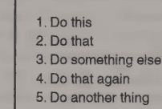

图 7.1.

一系列指令

## 结构 2：条件结构或 if/then

第二种控制结构就是前面提到的 if/then、条件或分支结构。该结构概述了程序流程中的一个分支。它就像一个道路分叉口。根据情况的不同，程序可能遵循一组指令或另一组指令，但不能同时执行两组。上面的交通信号灯示例实际上有三个分支——一组指令用于绿灯情况，另一组用于红灯情况，第三组用于黄灯情况。（并且应该还有其他分支来处理信号灯闪烁红灯或失效的情况。）图 7.2 概述了具有三个分支的条件结构。请注意，每个分支可以有不同数量的指令，并且每个分支在结束时都会返回到程序指令的主流程，程序继续向下执行。

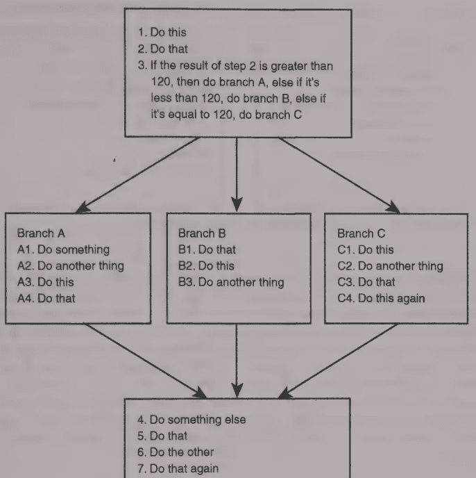

图 7.2. 具有三个分支的条件结构

## 结构 3：循环结构

第三种控制结构是循环或迭代，即程序重复执行同一系列指令，直到满足某个条件。厨房里的一个现实例子是，食谱指示厨师"按口味"加盐。厨师会加一些盐，尝一尝，再加一些盐，尝一尝，再加一些盐，尝一尝，直到味道恰到好处。我们也可以有一种循环结构，其中同一系列指令重复执行固定的次数，之后程序继续向前执行。图 7.3(a) 展示了这种结构，图 7.3(b) 展示了一个持续重复直到满足条件的循环。

## 结构 4：转移结构

第四种控制结构被称为转移、跳转或 goto。程序员可以设计程序使用转移控制结构，从程序中的一个位置跳转到另一个位置，跳过中间的指令，而不是按顺序执行指令（图 7.4）。你可能认为这种控制结构非常强大和方便，你是对的。但它也会导致一种被称为"意大利面条式代码"的严重问题，其中程序的逻辑流程由于过度跳转而变得如此混乱，以至于连程序员自己都可能难以理清头绪。结构化编程的开发，部分原因就是为了提供解决意大利面条式代码的方法。（结构化编程语言仍然包含转移结构，但对其使用有严格限制。当程序需要执行子程序或代码模块时，它会暂时将控制权转移给该模块。）

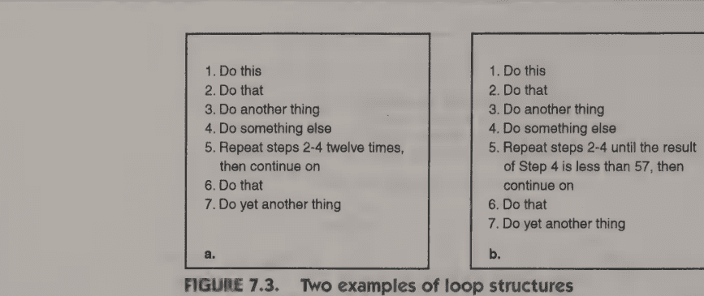

图 7.3. 两种循环结构示例

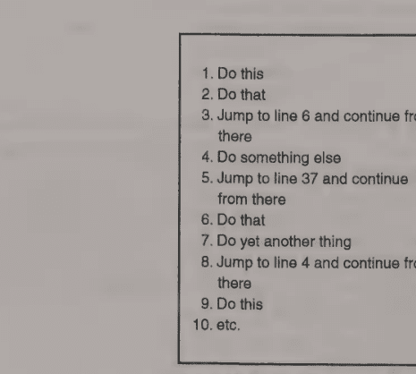

图 7.4. 转移控制结构

一旦创建了粗略的算法，程序员通常会使用流程图或伪代码方法来完善它。流程图使用图形符号绘制出程序的逻辑路径，使其易于可视化程序的流程。图 7.5 显示了一个只有红绿两种颜色的简单交通灯示例。

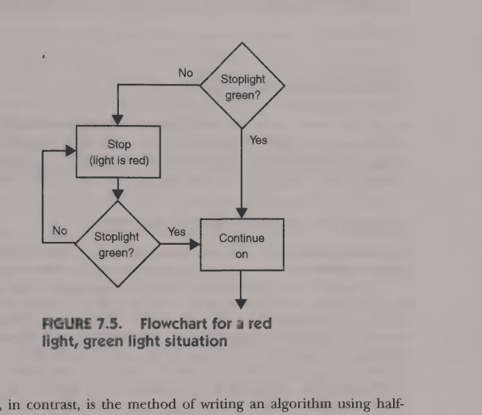

相比之下，伪代码是使用半编程语言和半英语（或其他自然语言）编写算法的方法。我们可以用交通灯示例来演示伪代码。其算法中的一行是："如果是红灯，启动刹车并停车。"在伪代码中，这可以写成：

```
if the light is red then
    put the brake on
```

最终完整的编码版本可能是：

```
if (theLight == "red") {
    theBrake = "on"
}
```

我们可以看到，伪代码版本允许程序员在不必立即担心所有语法细节——确保所有编程中的"i"都点了点，"t"都加了横杠——的情况下接近最终版本。

## 快速检查问题

-   1. 语言层次结构中的三个主要级别是什么？

-   2. 解释器和编译器有什么区别？

-   3. 什么是算法？

### 什么是 JavaScript？

在第一部分中，我们指出了几种对编程语言进行分类的方法：解释型与编译型语言、机器语言与汇编语言与高级语言、以及结构化语言与面向对象语言。另一种区分方式是区分编程语言和脚本语言。

### 脚本语言与编程语言

有时，当我们使用"编程"语言这个术语时，我们泛指所有允许我们为计算机编写执行指令的计算机语言。然而，有时它被用于更严格的意义上，与"脚本语言"相对立。简单来说，编程语言可用于创建独立的软件程序，而脚本语言通常内置在特定应用程序（如数据库或电子表格）中，不能在该应用程序之外使用。脚本语言允许软件用户通过脚本（一系列计算机执行的指令）自动化某些任务并提高该软件的可用性。脚本本质上是一个在应用程序范围内运行的小型程序。

1995年，网景公司决定在其Navigator浏览器中包含一种名为JavaScript的脚本语言。其主要动机是使网页能够更容易地检查或验证用户在页面文本框中输入的信息。例如，JavaScript可以用来查看输入是否是有效数字或是否拼写正确。但网页设计师很快为JavaScript找到了许多其他创新用途，创建了诸如图像翻转、在线测验和网页计算器之类的东西。总的来说，他们发现JavaScript是为网页添加交互性的绝佳工具。现在可以轻松设计出根据用户操作与否而以不同方式响应的网页。

JavaScript的基本思想很简单：网页设计者将JavaScript指令直接添加到HTML源文档中。在浏览器端，大多数当前浏览器（包括Navigator和Explorer，尽管微软官方称其Explorer版本的JavaScript为"JScript"）都内置了JavaScript解释器。当浏览器加载源文档时，它照常从上到下翻译HTML代码。如果它在此过程中还发现了JavaScript指令，内置的JavaScript解释器将逐行翻译并执行它们。

在本书的其余部分，我们将学习JavaScript如何工作，并探讨如何使用它来创建图像翻转、测验、计算器等等。

在我们学习第一个JavaScript之前，应该注意的是，尽管名字叫JavaScript，但它不是Java，甚至与Java没有官方关系。20世纪90年代，Java受到了广泛关注，这是一种在Sun Microsystems开发的新面向对象编程语言。这种关注源于Java针对互联网等网络环境进行了优化，而互联网当时是最热门的事物。

当后来被称为JavaScript的东西最初由网景公司开发时，它被称为LiveScript。但不久之后，Java的热潮开始兴起，因此网景公司迅速搭上了这趟顺风车（获得了Sun Microsystems的许可），将其浏览器脚本语言重命名为"JavaScript"。所以，尽管名字叫JavaScript，但它不是Java。它也不是Java的精简版。尽管它比Java更容易学习，但它本身也有许多复杂之处（其中一些我们将进行揭秘）。另一方面，JavaScript在结构和语法上与Java有许多相似之处。学习使用JavaScript可以帮助你在以后学习Java（如果你有此意愿）时打下基础。

正如HTML有一个由万维网联盟（W3C）定义和推广的官方标准一样，JavaScript也有一个标准，尽管参与方不是W3C。相反，网景公司和Sun Microsystems将JavaScript提交给了一个名为ECMA的标准组织，请求其制定一个官方标准。ECMA于1997年完成了其称为"ECMAScript"的第一版。（ECMA以前代表欧洲计算机制造商协会，但现在它就叫ECMA，读作"Eck-ma"。）截至2002年初，当前的ECMAScript版本是第三版，制定于1999年。ECMAScript的官方规范，即"ECMA标准#262"，可以在ECMA的网站`www.ecma.ch`上找到。（ECMA总部位于瑞士，因此顶级域名"ch"代表"Confederazione Helvetica"。）网景公司还在`developer.netscape.com`上列出了HTML和JavaScript资源，而微软在`msdn.microsoft.com`上提供了JScript的用户指南和语言参考。附录I列出了其他在线资源。

## 指令/代码/语句/命令

如前所述，程序或脚本由一系列计算机执行的指令或代码组成。指令也可以称为命令或语句。它们与英语等自然语言中的句子或短语有某些相似之处。JavaScript指令的一个简单示例是`alert`命令，允许程序员在屏幕上显示一个包含消息的警报框。基本语法是：

```
alert("Hello, world!")
```

警报框中显示的消息将是引号之间的内容，本例中为`Hello, world!`，如图7.6所示。（请注意，引号不会显示，因为它们是`alert`命令语法的一部分。）

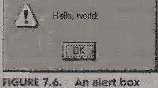

图7.6. 一个警报框

（Navigator在版本6中显示的警报框标题为"Alert"，在早期版本中为"[JavaScript Application]"，而非"Microsoft Internet Explorer"。）

与HTML不同，但与XHTML类似，JavaScript是一种区分大小写的语言，这意味着你必须正确拼写其指令，包括大小写。因此必须是`alert("Hello, world!")`，而不是`Alert("Hello, world!")`。

要使用这个JavaScript命令，我们需要将其插入到HTML源文档的适当位置。然后，当浏览器加载该文档时，它会看到JavaScript命令并执行它，显示警报框。但是，JavaScript命令不能随意插入到源文档中的任何位置。HTML不是JavaScript，反之亦然，因此我们必须向浏览器指明何时在源文档中使用HTML，何时使用JavaScript，否则它将无法处理。下一节将展示我们如何使用`<script>`元素来区分JavaScript指令和HTML指令。

## 快速检查问题

- 1. 脚本语言与通用编程语言有何不同？

- 2. 编写JavaScript命令，显示一个警报框，消息为"Good to see you! Come back again."

- 3. 说JavaScript是区分大小写的语言是什么意思？HTML区分大小写吗？

### `<script>`元素

为了在网页上使用`alert`命令或任何JavaScript命令，我们必须将其嵌入`<script>`元素中：

```
<script>
    alert("Hello, world!")
</script>
```

由于可以在HTML文档中使用其他脚本语言，你通常使用`<script>`标签中的`type`属性指定JavaScript作为脚本语言：

```
<script type="text/javascript">
    alert("Hello, world!")
    [更多JavaScript指令将在此处...]
</script>
```

`type`属性指定`<script>`元素中内容的类型，`text/javascript`中的`text`部分向浏览器表明代码是以普通文本字符编写的。虽然大多数现代浏览器会在未指定时假定脚本是用JavaScript编写的，但XHTML现在要求在`<script>`元素中使用`type`属性，并且Netscape 6+（版本6及更高版本）和Explorer 5+都支持它。过去，许多JavaScript程序员使用`language`属性而不是`type`属性来指定所使用的语言。例如：

```
<script language="JavaScript">
    [JavaScript指令将在此处...]
</script>
```

`language`属性的优点在于它允许程序员指定所使用的JavaScript版本，例如`language="JavaScript1.2"`。（最新版本是1.5。）如果你使用的是某些版本语言不支持的JavaScript功能，这一点就很重要。然而，在实践中你很少需要这样做，因为较新的浏览器支持JavaScript核心中的所有功能（我们将要学习的内容）。如果需要或有必要，你可以同时在`<script>`元素中包含`type`和`language`属性。在我们的示例中，我们将简单地坚持使用`type`属性，主要是因为W3C已弃用`language`属性。

浏览器的另一种主要脚本语言是VBScript，它基于Microsoft的Visual Basic编程语言。然而，它仅在Internet Explorer中有效。

请注意，`<script>`和`</script>`标签是HTML的一部分。但`<script>`元素内的所有内容必须是有效的JavaScript语句或命令。如果你尝试将HTML标签放入`<script>`元素中，当浏览器尝试加载页面时通常会收到错误消息，因为它期望的是JavaScript命令，而不是HTML命令。

图7.7展示了如何在完整的HTML源文档中使用JavaScript的`alert`命令以及浏览器显示过程的简单示例。

当浏览器加载此源文档时，它将显示粗体文本"This is a simple JavaScript test …"，然后它将遇到`<script>`元素及其内部的第一条指令——第一个`alert`命令。因此它会弹出第一个警报框，显示"Hello, world!"，如图顶部的浏览器显示窗口所示。当用户在警报框中单击"确定"按钮时，第一个框消失，出现第二个警报框，显示"Anybody out there?"消息，如中间的浏览器显示。最后，当用户在第二个警报框中单击"确定"按钮时，脚本结束，浏览器继续加载和显示HTML文档的其余部分（`<br />`标签和粗体"All done with the alert boxes"行）。（注意：在某些版本的Navigator中，警报框会在窗口中显示任何文本之前出现。）

可以有多个`<script>`元素，它们可以放置在`<body>`或`<head>`元素中的任何位置，可以在其他HTML代码之前、之后或之间。当你希望浏览器执行一些JavaScript代码（包含在一个`<script>`元素中），然后执行一些常规HTML代码，然后再执行更多JavaScript代码（包含在随后的HTML代码之后的第二个`<script>`元素中）时，你会使用多个`<script>`元素。请记住，浏览器在翻译和显示HTML和JavaScript代码时使用"自上而下"的方法。它从`<head>`元素的顶部开始，向下进行，按顺序执行每行HTML或JavaScript代码。

例如，我们可以在图7.7代码中的"All done with the alert boxes"行之后添加另一个`<script>`元素：

```
<body>
<strong>This is a simple JavaScript test . . . </strong>
<script type="text/javascript">
alert("Hello, world!")
alert("Anybody out there?")
</script>
<br /><strong>All done with the alert boxes.</strong>
<script type="text/javascript">
alert("Oops, here's another one")
</script>
</body>
```

`<script>`元素也可用于访问存储在另一个文件中的JavaScript代码，该文件称为"外部"文件。此外部文件是以`.js`扩展名保存的文本文件，例如`testCode.js`。该文件必须只包含JavaScript代码——没有HTML元素（包括`<script>`）。要使用存储在外部文件中的代码，只需向源文档的`<script>`元素添加`src`属性：

```
<script src="testCode.js" type="text/javascript">
</script>
```

无需在`<script>`元素中放入任何内容。当浏览器加载包含此`<script>`元素的源文档时，它也会加载`testCode.js`文件中的JavaScript代码。（如`src`属性所示，`testCode.js`文件必须与源文档在同一目录中。如果不是，则必须提供更完整的路径名。）

当你的网站有多个页面且所有页面都使用相同的JavaScript代码时，将JavaScript代码放在外部文件中特别有用。你无需在所有文档中输入（或复制粘贴）代码，而是可以将其放入一个外部文件中，并使用`<script>`元素访问它。一些JavaScript程序员也喜欢使用外部文件来向浏览者隐藏他们的JavaScript代码。浏览器的"查看源代码"选项将显示带有`src`属性和对外部文件引用的`<script>`元素，但不会显示代码本身。然而，精明的浏览者仍然可以通过检查浏览器的缓存来查看代码，因为浏览器就是在那里存储来自外部文件的代码。

随着XHTML逐渐成为标准，某些JavaScript脚本实际上将需要使用外部文件。原因是某些JavaScript符号，例如小于号（`<`），在XHTML中被保留用于其他用途。因此，严格兼容XHTML的浏览器将无法正确读取JavaScript小于号。解决此问题的唯一方法是将任何使用`<`符号的JavaScript代码放入外部文件中。（其他问题符号是`&`、`-->`和`]]>`，我们稍后会遇到其中一些。）

## 快速检查问题

- 1. `<script>`元素的目的是什么？

- 2. 编写一个`<script>`元素的代码，显示两个警报框，第一个显示"Hello!"，第二个显示"Good-bye!"。

实验练习7.1 "一个简单的脚本"可以在此时完成。

## 编程词源学

当你第一次尝试运行你编写的任何程序或脚本时，它很可能无法正常工作，因为它会有一个或多个错误或"缺陷"。通常，调试软件的过程占据了程序员50%或更多的时间。即使你事先用铅笔和纸准备代码（顺便说一句，这是个好主意），你也会发现自己不可避免地犯了一些错误。错误有两种基本类型：语法错误和逻辑错误。

### 语法错误与逻辑错误

当你拼写错误或意外遗漏了指令中的某个必需元素时，就会发生语法错误，例如遗漏了一对引号中的第二个引号。下面三行 JavaScript 代码每一行都有语法错误。你能找出来吗？（答案如下。）

```
<script type="text/javascript">
alert("My first JavaScript.)
Alert("Too exciting for words.")
alert["This is big time stuff."]
</script>
```

答案：第一行缺少第二个引号。第二行应该是`alert`而不是`Alert`。第三行中的方括号应该改为圆括号。

从这些看似微不足道却足以令程序瘫痪的例子中，我们可以清楚地看到编程语言对语法是非常挑剔的。它们要求指令以特定的方式和形式编写，程序员必须严格遵守。

当编程代码的语法正确但逻辑有误，导致代码无法完成程序员预期的功能时，就会发生逻辑错误。例如，程序员可能希望当某个值大于 50 且小于 100 时显示一条消息。但实际的程序代码可能被写成只要该值小于 100 就显示消息，这样当值为 40 时也会触发该消息。逻辑错误也被称为运行时错误，因为它们在运行程序时才会显现。

逻辑错误可能非常难以追踪。最好的对策是在编写实际代码之前，仔细思考程序的逻辑并设计出合理的算法，从而做到防患于未然。

有些人喜欢指出第三种错误，称为管理错误，即使你的代码写得完全正确，这种错误也可能发生。例如，考虑一下当你在修改和改进一个网站、可能添加一些 JavaScript 功能时可能发生的情况。你可能已经到了消除所有语法和逻辑错误的阶段，新的源文档中一切运行完美。最后一步是将其上传到 Web 服务器，替换旧版本。但在这一过程中（有时因为匆忙），上传错误文件的情况并不罕见，例如上传了一个略有过时、仍然存在 bug 的源文档版本。放慢脚步、仔细检查一切总是值得的。

# 浏览器错误消息

对于语法错误，浏览器在遇到错误时会显示一条错误消息。图 7.8 展示了 Internet Explorer 的一个典型错误消息。（我们通过在一个名为`alertbox.htm`的源文档中将`alert`命令拼写为`Alert`而非`alert`来生成该消息。）消息框的下半部分列出了错误的位置，包括行号和该行中的字符编号。（如果你没有看到消息框的下半部分，请点击"显示详细信息"按钮。）浏览器从源文档顶部开始计数行号，空行也包含在计数中。不要过于死板地理解行号——有时错误实际上在所列行号的上一行或下一行。字符编号则更不精确。


**图 7.8.** Internet Explorer 的错误消息框

如果错误位于源文档的较深处，行号很大，通常不值得逐行计数来定位错误。但它确实能给你一个大致的位置概念。（一些文本编辑器和专用 HTML 编辑器，如 Windows PC 上的 TextPad 和 HomeSite，提供了有用的行号显示选项，可在左侧边栏显示每行代码的编号。）

错误消息本身有时也可能或多或少有些用处。在图 7.8 中，它是那条神秘（但很常见的）"Object expected"（需要对象）。这意味着浏览器期望找到一个对象名称（或其他合法的 JavaScript 名称），但找到了其他内容。在我们的示例中，问题通常就是简单的拼写错误。当浏览器遇到命令`Alert("Hello, world!")`时，它无法将`Alert`识别为合法的名称。

你还应该注意，当 Explorer 遇到错误时，它会跳过不正确的代码行以及该`<script>`元素中的所有其余代码，然后继续显示源文档的其余部分。这意味着如果该`<script>`元素中有多个错误，只有第一个会被标记出来。当然，一旦你修复了第一个错误，在浏览器中重新加载源文档就会标记下一个错误（如果存在的话）。如果文档中有多个`<script>`元素且每个至少有一个错误，那么 Explorer 会显示多条错误消息，分别是它在各个`<script>`元素中发现的每个"第一个错误"。

Explorer 的早期版本会自动显示错误消息框。但由于错误消息的出现令普通上网用户感到不安，更不用说难以理解了，因此 Explorer 的近版本只在用户启用了错误消息的情况下才会显示。要启用它们，请在"工具"菜单下选择"Internet 选项"，点击"高级"选项卡，然后勾选"显示每个脚本错误的通知"复选框。你可能还会看到"禁用脚本调试"复选框旁有一个勾选标记。虽然这看起来有违直觉，但你可以保持其选中状态，因为只要"显示通知……"选项被选中，错误消息就会出现。（"禁用脚本调试"指的是超出本课程范围的高级调试技术。）网页程序员当然始终希望错误消息处于启用状态。

当错误消息框被禁用时，Explorer 会在窗口左下角的状态栏中显示一个黄色的小"警告"三角形来表示发生了错误。（不过在某些版本中该图标似乎并不总是出现。）点击该图标即可弹出错误消息框。

当 Navigator 6 中发生 JavaScript 错误时，除了浏览器跳过有问题的代码外，似乎没有其他反应。不过 Navigator 会在一个名为 JavaScript 控制台的单独窗口中报告错误。要打开该窗口，请在"任务"菜单下选择"工具"，然后在弹出的子菜单中选择"JavaScript 控制台"。图 7.9 展示了在我们的`alert`命令拼写错误情况下的界面。请注意，其错误消息更加友好且实用——"Alert is not defined"（Alert 未定义），而 Explorer 的则是"Object expected"。

与 Explorer 类似，JavaScript 控制台在每个`<script>`元素中也只会显示它发现的第一个错误。但与 Explorer 不同的是，控制台会持续列出之前的错误，直到你点击"清除"选项。例如，如果一个文档有一个 JavaScript 错误，你连续多次打开该文档，控制台会显示多条相同的错误消息。所以，当你修复了一个错误后重新加载文档，仍然在控制台上看到错误消息时，不要惊慌——那可能只是之前未被清除的消息。


4.07 版及以上（直到第 6 版）的 Navigator 副本没有 JavaScript 控制台。取而代之的是，它在窗口左下角的状态栏中显示一条晦涩的错误消息，指示用户在地址栏（即通常显示文档 URL 的位置）中输入`javascript:`。当你这样做时，会弹出一个错误窗口，提供更详细的错误消息。注意：不要漏掉末尾的冒号——输入的是`javascript:`而不是`javascript`。你也可以在"文件"菜单下选择"打开"，然后在其中输入。

不幸的是，无论你使用哪种浏览器，错误消息往往都是令人费解而非有帮助的。在这种情况下，最好的方法是反复试错：更改代码中的一处，然后再试。如果不行，再改另一处。如果还是不行，也许可以用不同的方式重写相关代码段。与你可能的想法相反，大多数脚本可以用多种不同的方式编写，每种方式都是正确的，即都能得到预期的结果（尽管某些版本在清晰度和效率方面会更优）。

最后，在极少数情况下，一个 bug 会导致灾难性的失败，浏览器会崩溃或冻结。在这种情况下，通常唯一的补救办法是重启计算机，并祈祷上次保存工作成果的时间距现在不太久。

## 快速检测题

- 1. 以`alert`命令为例，列出两种不同的语法错误。

- 2. 当你收到"Object expected"（需要对象）的错误消息时，有问题的代码中可能存在的一个简单错误是什么？

### 关于注释的评论

优秀的程序员会为他们的程序添加注释，以阐明代码的功能（或至少是其预期功能）。在编程术语中，这些注释被称为注释。注释不仅帮助其他代码阅读者（例如，当程序员晋升到更好更大的职位时，接替他的新程序员）理解代码的作用，也帮助程序员自己。比人们想象的更常见的情况是，程序员编写了一些代码，让它运行起来，然后过了一周、两周或三周再回来时，很难确切地弄清楚这段代码到底做了什么。

## 插入注释

在JavaScript中有两种类型的注释：单行注释和多行注释。两个连续的斜杠表示单行注释的开始。浏览器会忽略从双斜杠到行尾的所有内容。

```
<script type="text/javascript">
  //这是一条单行注释。
  //这是另一条。
  //浏览器会忽略双斜杠后面的所有内容。
</script>
```

单行注释可以放在一行的开头，或者放在同一行JavaScript代码的后面。

```
<script type="text/javascript">
  alert("Hi!") //向用户显示 "Hi!"。
</script>
```

要创建多行注释，请用`/*`和`*/`将注释括起来。例如：

```
<script type="text/javascript">
  /*这是一条多行JavaScript注释。
  当你需要写很多内容时，
  就使用这种格式。*/
</script>
```

多行注释也可以从与JavaScript代码相同的行开始：

```
<script type="text/javascript">
  alert("Hi!") /*向用户显示 "Hi!"。*/
  alert("Bye!") /*通过向用户显示 "Bye!"
           来结束我们在一起的时光。*/
</script>
```

请注意，以下代码是错误的，因为第二个`alert`命令实际上在注释内部，因此会被忽略：

```
<script type="text/javascript">
    alert("Hi!") /*向用户显示 "Hi!"，然后
    alert("Bye!") 显示 "Bye!" */
</script>
```

另一方面，当你试图调试一些代码时，"注释掉"JavaScript命令有时很有用。与其重写或删除你认为可能有问题的代码，不如首先在有问题的代码行开头放一个单行注释符号（即`//`），或者用多行注释将多行代码括起来，保存文件，然后在浏览器中打开它，看看问题是否消失。当你准备好将代码放回脚本时，只需删除注释符号并重新保存文件即可。

最后，不要将JavaScript注释与HTML注释混淆。请记住，HTML使用一个特殊的标签来注释，以`<!--`开头，以`-->`结尾。

```
<!--这是一个html注释-->
<!--这是另一个，使用了多行-->
```

标签内的所有内容都会被浏览器忽略。在`<script>`元素内部，你使用JavaScript注释（有一个例外，详见下一节）。在HTML源代码文档的其他任何地方，你都使用HTML注释标签。

## 为非JavaScript浏览器使网页安全

早期版本的浏览器不识别`<script>`元素以及放置在其中的JavaScript命令（例如，网景导航者，版本1.1）。当浏览器不识别一个HTML标签时，它会忽略它。但是，尽管这样的浏览器会忽略`<script>`元素，它仍会继续将该元素内的所有内容作为普通文本显示出来，即，浏览者会在网页上看到显示的JavaScript代码。为了防止这种不良情况发生，将所有JavaScript命令放在HTML注释标签内成为一种常见做法，如下所示：

```
<script type="text/javascript">
<!--
    JavaScript代码放在这里 ...
//-->
</script>
```

通过这样做，不支持JavaScript的浏览器将忽略`<!--`和`-->`之间的所有内容。而支持JavaScript的浏览器则知道忽略标记HTML注释标签开始的`<!--`，而`-->`前面的`//`（单行JavaScript注释）确保浏览器不会尝试将`-->`解释为某种JavaScript命令或符号。

不幸的是，遵循新的XML和XHTML准则的浏览器被设置为忽略HTML注释标签内的所有内容，无论里面是什么。这意味着，确保你的JavaScript代码（a）在支持JavaScript的浏览器上有效，并且（b）不会被非JavaScript浏览器显示的唯一可靠方法，是将其放在一个外部文件中，正如上面"`<script>`元素"一节所解释的那样。

## `<noscript>`元素

另一种好的做法是，向使用非JavaScript浏览器访问你的JavaScript网页的浏览者显示一条警告消息。为了仅向这些浏览者（而非使用支持JavaScript的浏览器的浏览者）显示此消息，我们使用`<noscript>`元素：

```
<body>
<noscript>此网页使用了JavaScript。要获得完整效果，
您必须使用实现了JavaScript的Web浏览器，并确保浏览器已启用JavaScript。</noscript>
. . .
</body>
```

将此`<noscript>`元素放在源代码文档`<body>`部分的开头或附近。如果浏览器可以处理JavaScript，那么它将不会显示`<noscript>`元素的内容。因此，只有那些使用无法处理JavaScript的浏览器的浏览者，或者那些在浏览器设置中关闭了JavaScript的浏览者，才会看到此消息。

## 快速检查问题

1.  编写一个`<script>`元素的代码，显示两个`alert`框，第一个显示消息"Hello!"，第二个显示消息"Good-bye!"。为每个`alert`框添加适当的注释，第一个使用单行注释，第二个使用多行注释。

2.  使用问题1中的代码，添加HTML注释，使非JavaScript浏览器不会显示JavaScript代码。

此时可以进行实验练习7.2，"调试"。

### 创建交互式网页

JavaScript的真正威力在于它能够为网页添加交互性。正如我们将要学到的，HTML允许我们向网页添加元素，如文本输入框、复选框和单选按钮。使用JavaScript，我们可以编程网页，使其对用户与这些元素的交互做出响应。例如，如果我们正在为房地产经纪人设计一个网页，我们可能想在页面上添加一个抵押贷款计算器。浏览者会在几个文本框中输入相关信息，如抵押贷款金额、利率和贷款期限，然后可以使用JavaScript处理这些信息，计算并显示有关每月还款额的答案。

## 单击按钮和单击事件

作为一个简单的入门示例，我们将学习如何创建一个单击按钮，当被单击时，会显示一个`alert`框消息。

单击按钮是可以添加到网页的一种输入元素类型。输入元素允许用户输入信息或以其他方式与页面交互。如上所述，其他常见的输入元素包括文本框（浏览者可以在其中输入文本）以及复选框和单选按钮（浏览者可以通过单击框或按钮在多个选项中进行选择）。为了在网页上创建输入元素，我们在`<form>`元素内使用`<input>`标签。图7.10展示了我们如何编写一个简单单击按钮的代码以及其外观效果。


`<input>`标签中`type`属性的值告诉浏览器要创建什么类型的输入元素。`name`属性的值（此处为`b1`）为输入元素提供一个内部名称（由我们选择），浏览者看不到。在后面的章节中，当我们学习如何使用文本框、复选框和其他输入元素时，将使用这个名称。对于单击按钮，我们实际上不需要它，通常你会看到没有`name`属性的`<input>`标签。但现在的XHTML要求必须存在此属性。

单击按钮的`value`属性告诉浏览器在按钮上放置什么文本标签（在此例中为"Click here!"）。按钮的大小会自动调整以容纳标签；文本标签越长，按钮就越宽。`<input>`标签是一个空元素（它没有结束标签），所以我们必须在末尾加上`/`。

另请注意，`<form>`元素是一个块级元素，因此在其显示前（和后）会自动创建一个空行。如果我们希望按钮出现在"Here's a simple click button"行的末尾，那么我们需要将该行文本放在`<form>`元素内部。

就目前而言，我们简单的按钮看起来可能不错，但它有一个问题：当浏览者单击它时，它不会执行任何操作。为了使其在单击时显示一个`alert`框，我们需要学习事件的概念。

事件是面向对象编程的一个核心特性。事件是发生在对象或对象特定元素上的某事。目前，我们所说的"对象"指的是像单击按钮或文本框这样的东西。（我们将在8.1节中更详细地了解一般的软件对象。）例如，如果浏览者用鼠标单击一个按钮，那就是一个单击事件。或者，如果浏览者在文本框中选择一些文本，则会发生一个选择事件。或者，如果浏览者将鼠标指针移到一个链接上，则该链接会发生一个鼠标悬停事件。浏览器会自动跟踪浏览者的操作并生成事件；网页程序员无需做任何事情来使它们发生。

程序员的工作是响应事件。当对象中发生事件时，我们可以为该对象激活一个事件处理程序，它将在事件发生时"处理"该事件并采取适当的操作。JavaScript有多种不同类型的事件和事件处理程序。我们将最常用的是单击事件及其对应的`onclick`事件处理程序。（我们稍后将了解其他类型的事件。）

对于图7.10中我们简单的"Click here!"按钮，我们希望在浏览者单击按钮时显示一个`alert`框。操作链将是：

1.  浏览者单击按钮。

2.  浏览器自动为该按钮生成一个单击事件。

3.  按钮的单击事件处理程序被触发，激活显示`alert`框的相应JavaScript命令。

一旦我们在网页上创建了单击按钮，步骤1和2就不在我们控制范围内了。图7.10的代码中缺少的是步骤3。为了给我们的按钮添加单击事件处理程序，我们在按钮的`<input>`标签中添加`onclick`属性，并将其值设置为我们希望在点击事件发生时执行的任何 JavaScript 代码。换句话说：

```
<form>
    <input type="button" name="b1" value="Click here!"
           onclick="alert('Nice going!')" />
</form>
```

`onclick`属性通常被称为`onclick`事件处理器。字面上看，它的意思是"在点击发生时，执行以下 JavaScript 代码"。在这个例子中，当按钮被点击时，`onclick`事件处理器将被触发，`alert('Nice going!')`代码被执行；也就是说，一个警报框将出现，显示消息"Nice going!"。

关于这段事件处理器代码，有两件重要的事情需要注意。首先，我们看到我们将 JavaScript 代码（`alert`命令）直接嵌入到了 HTML 标签中。这是 JavaScript 指令必须位于`<script>`元素内部这一规则的一个例外。`onclick`事件处理器在 HTML 和 JavaScript 之间提供了一道门户。`onclick`属性本身是 HTML 的一部分，而其值——本例中是`alert('Nice going!')`——则由一条 JavaScript 命令组成。

其次，我们看到有两种引号：双引号包围着`onclick`属性的完整值，单引号包围着`'Nice going!'`消息。单引号嵌套在双引号内。在这种情况下，我们必须使用两种类型的引号，因为如果我们使用两对双引号，如下所示，浏览器会感到困惑：

```
<input type="button" name="b1" value="Click here!"
       onclick="alert("Nice going!")" />
```

混淆的原因是，浏览器会看到第二个引号（就在 Nice 这个词前面的那个），并认为它与第一个引号（在 alert 词前面的那个）配成了一对。因此，它会将第二个引号解释为属性值的结束，并且不期望在那之后看到更多字符。通过在`'Nice going!'`周围使用单引号可以避免这种混淆。也可以在外面使用单引号，在警报消息周围使用双引号：

```
<input type="button" name="b1" value="Click here!"
       onclick='alert("Nice going!")' />
```

关键在于这两对引号必须是不同类型，并且其中一对必须嵌套在另一对内部。

图 7.11 显示了用户点击按钮前后浏览器的显示效果。用户在警报框中点击"确定"后，警报框消失，"Click here!"按钮可以再次被点击，从而再次触发警报框。


图 7.11. 按钮点击前后网页的显示

也可以通过用分号分隔多条 JavaScript 命令，将它们放入`onclick`属性的值中。例如：

```
<input type="button" name="b1" value="Click here!"
onclick="alert('Nice going!'); alert('Keep up the good
work!')" />
```

当用户点击该按钮时，`onclick`事件处理器将激活 JavaScript 代码："Nice going!"警报框将出现，然后，在用户点击警报框中的"确定"按钮后，"Keep up the good work!"警报框将出现。

## 链接与事件

事件并不局限于像点击按钮这样的特殊输入元素。例如，每当用户点击一个普通的 HTML 链接时，浏览器都会生成一个点击事件。链接还有另外两种与之相关的事件：mouseover 和 mouseout 事件。当用户将鼠标指针移动到链接文本上时，会发生 mouseover 事件。相反，当用户将指针移开链接时，会发生 mouseout 事件。每种类型的事件都有其对应的事件处理器：`onmouseover`和`onmouseout`。要在链接上使用 mouseover 事件，我们在其`<a>`标签中放置一个`onmouseover`事件处理器：

```
<a href="photogallery.htm" onmouseover="alert('Are you sure?')">Click here to go to the photo gallery</a>
```

当包含此代码的页面显示，并且鼠标移动到链接文本"Click here to go to the photo gallery"上时，将发生 mouseover 事件，`onmouseover`事件处理器将被激活，并出现一个带有消息"Are you sure?"的警报框。

尽管上述代码提供了`onmouseover`事件处理器的简单示例，但在实践中它并不太有用。原因是用户将无法成功点击该链接。鼠标一移过链接，用户还没来得及点击，mouseover 事件就会发生，警报框就会显示。接下来，用户点击警报框以关闭它，然后将鼠标移回链接以点击它。但在点击发生之前，另一个 mouseover 事件被生成，警报框再次出现。唯一的解决办法是按下 Enter 键关闭警报框，同时保持鼠标指针在链接上。由于指针在警报框消失时已经位于链接上，因此不会生成 mouseover 事件，链接就可以被点击了。

也可以在一个标签上添加多个事件处理器。例如，我们可以创建一个同时使用`onmouseover`和`onclick`事件处理器的链接：

```
<a href="photogallery.htm"
    onmouseover="alert('Are you sure?')"
    onclick="alert('Are you really sure?')">Photo
    gallery</a>
```

每当链接发生 mouseover 事件时，"Are you sure?"警报框就会出现；而当发生点击事件时，"Are you really sure?"警报框出现。（链接本身将在用户在此第二个警报框中点击确定后激活。）

我们将在第 9 章讨论图像翻转时，学习 mouseover 和 mouseout 事件的更好用途。同时，最后还有一个语法注意事项。

在 XHTML 之前，约定是用小写字母编写事件处理器属性，并将内部单词首字母大写：`onClick`、`onMouseover`、`onMouseout`（或者有时是`onmouseover`和`onmouseout`）。但 XHTML 要求标签和属性名称使用小写字母，这意味着你应该养成将它们写成`onclick`、`onmouseover`等的习惯。

## 快速检查问题

1.  什么是输入元素？给出两个例子。

2.  编写创建一个标签为"Search"的点击按钮的 HTML 代码。

3.  在问题 2 的点击按钮代码中，添加一个`onclick`事件处理器，该处理器将显示一个带有消息"Ready to initiate search?"的警报框。

4.  mouseover 事件和 mouseout 事件之间有什么区别？

实验练习 7.3，"一个充满事件的网页"，此时可以完成。

警报框，算法，汇编语言，大小写敏感，点击事件，编译器，条件（分支），控制结构，事件处理器，事件，执行，流程图，高级语言，输入元素，指令（代码，语句，命令），解释器，逻辑错误，循环（迭代），机器语言指令，管理错误，mouseout 事件，mouseover 事件，多行注释，面向对象编程 (OOP)，伪代码，运行，运行时错误，脚本，脚本语言，顺序，单行注释，结构化编程，语法错误，转移（跳转，跳转）

## 1. `<script>`元素

使用`<script>`元素将 JavaScript 代码插入源文档：

```
<script type="text/javascript">
    alert("Hello, world!")
    [Additional JavaScript instructions would go here . . .]
</script>
```

多个`<script>`元素：

```
<body>
<strong>This is a simple JavaScript test . . . </strong>
<script type="text/javascript">
alert("Hello, world!")
alert("Anybody out there?")
</script>
<br /><strong>All done with the alert boxes.</strong>
<script type="text/javascript">
  alert("Oops, here's another one")
</script>
</body>
```

## 2. 关于注释

使用`//`的单行注释：

```
<script type="text/javascript">
  //This is a single-line comment.
  alert("Hi!") //Display "Hi!" to the user.
  //The browser ignores everything after the two slashes.
</script>
```

使用`/*`和`*/`的多行注释：

```
<script type="text/javascript">
  /*This is a multiple-line comment in
  JavaScript. When you have a lot to say, this
  is what you use.*/
  alert("Hi!") /*Display "Hi!" to the user.*/
  alert("Bye!") /*End our time together by displaying
                  "Bye!" to the user. */
</script>
```

注释掉 JavaScript 代码（使用 HTML 注释标签），使非 JavaScript 浏览器不在网页上显示代码（但可能不适用于最新的符合 XML 的浏览器）：

```
<script type="text/javascript">
<!--
  JavaScript code goes here . .
//-->
</script>
```

创建一个仅在非 JavaScript 浏览器中出现的警告消息：

```
<body>
  <noscript>This Web page uses JavaScript. To get the full effect, you must use a Web
  browser that implements JavaScript and set the browser to have JavaScript
  enabled.</noscript>
  . . .
</body>
```

## 3. 创建交互式网页

创建一个带有`onclick`事件处理器的点击按钮，该处理器调用`alert`命令：

```
<form>
  <input type="button" name="b1" value="Click here!" onclick="alert('Nice going!')" />
</form>
```

为链接添加事件处理器：

```
<a href="photogallery.htm" onmouseover="alert('Are you sure?')"
   onclick="alert('Are you really sure?')">Photo gallery</a>
```

不要在`<script>`元素中放置 HTML 代码；该元素只能包含 JavaScript 代码。如果使用 Navigator 4.07+ 版本（直到但不包括版本 6）调试代码，请在地址栏中输入`javascript:`以查看错误消息，不要忘记`javascript:`末尾的冒号。试错通常是调试脚本最有效的方法，尤其是当错误消息含义不明时。调试代码时，不要删除可能存在问题的那行（或多行）代码，而是将它们注释掉，然后保存并重新加载源文档以检查结果。不要将 JavaScript 注释（单行`//`或多行`/*`和`*/`）与 HTML 注释（`<!--`和`-->`）混淆。使用`<noscript>`元素向使用不支持 JavaScript 的浏览器访问你基于 JavaScript 的网页的冲浪者显示警告消息。如果需要使用多组引号，例如当`onclick`事件处理程序中包含`alert`命令时，请在双引号和单引号之间交替使用，将它们嵌套起来。

1. 从根本上说，计算机程序可以被比作计算机的_________（或者更具体地说，CPU 的_________）。

2. 计算机语言的三级层次结构由_________、_________和_________组成。

3. 编译器或解释器的目的是将_________翻译成_________。

4. 四种基本控制结构是：_________、_________、_________和_________。

5. 判断题：脚本语言的主要目的是允许程序员创建独立的程序，这些程序可以独立于任何其他软件程序使用。

6. 判断题：JavaScript 之所以如此命名，是因为它是作为 Java 编程语言的一个子集开发的。

7. 判断题：JavaScript 是一种区分大小写的语言。

8. 逻辑错误的最佳治疗方法是预防，通过在开始编写实际编程代码之前创建一个设计良好的_________。

9. 以下哪些用于标记 JavaScript 中的注释？

    a. `<!--`和`-->`

    b. `//`（单独使用）

    c. `/*`（单独使用）

    d. `//`和`//`（即一对）

    e. `/*`和`*/`（一对）

    f. `/*`和`/*`（一对）

10. 判断题：尽管`<script>`元素中的`language`属性已被弃用，取而代之的是`type`属性，但它仍然可用于指定文档所使用的 JavaScript 语言的版本。

11. 哪个 HTML 元素用于创建点击按钮？

    a. `<input>`

    b. `<click>`

    c. `<formtype>`

    d. `<clickbutton>`

12. 判断题：当你需要将一对引号放在另一对引号内部时，如下代码所示，两对引号都必须是双引号。

    ```
    <input type="button" name="b1" value="Click here!" onclick="alert("Nice going!")" />
    ```

13. 当冲浪者将鼠标指针移到网页上的链接上时，浏览器会自动生成一个_________事件。可以使用_________事件处理程序来处理此事件，或将其与某些 JavaScript 代码关联。

## 练习

1. 简要定义和/或解释以下术语：运行时错误、事件处理程序、解释器、脚本。

2. 列出四种基本控制结构，并给出每种的一个现实世界示例（与文本中使用的示例不同）。

3. 编写一个在炉子上烧水的算法。

4. 编写一个修剪 50' × 100' 草坪的算法。

5. 编写一个将五张词汇闪卡按字母顺序排序的算法。尽量使你的算法足够通用，以便对一千张卡片和对五张卡片同样有效。

6. 编写一个`<script>`元素的代码，显示三个警告框，第一个消息为 "Good to see you"，第二个消息为 "Having a nice time?"，第三个消息为 "See you later."。在代码中至少包含一条注释。

7. 编写一个`<form>`元素的代码，创建一个带有`onclick`事件处理程序的点击按钮。按钮应标记为 "Display an alert"，点击后应出现一个警告框，消息为 "This is just a test."

8. 编写一个`<form>`元素的代码，创建三个并排的点击按钮，每个按钮都有`onclick`事件处理程序。第一个按钮应标记为 "Door 1"，第二个为 "Door 2"，第三个为 "Door 3."。在表单开头还包括一行纯文本，内容为 "Let's Make a Deal! Click on your choice." 当点击 "Door 1" 或 "Door 3" 按钮时，应出现一个警告框，消息为 "Sorry, you lose."。当点击 "Door 2" 按钮时，应出现一个警告框，消息为 "You are a winner!"

9. 编写一个完整 HTML 源文档的代码，其中包含一个指向名为 "finalpage.htm" 的文档的链接。链接文本应为 "Click here to go to the final page."。当冲浪者将鼠标指针移到链接上时，应出现一个警告框，消息为 "Leaving so soon?"。

10. 编写一个完整 HTML 源文档的代码，其中包含以下内容：

    a. 两个`<script>`元素，一个在`<head>`元素中，一个在`<body>`元素中。第一个应包含显示警告框消息 "Message Number 1" 和 "Message Number 2" 的代码。第二个`<script>`元素中的代码应显示一个警告框，消息为 "Message Number 3."

    b. 一个带有适当消息的`<noscript>`元素。

    c. 一个标签为 "Click here!" 的点击按钮。点击时，应出现一个警告框，消息为 "Message Number 4".

11. 找出以下代码中的错误，然后在纸上草拟浏览器在纠正错误后如何显示它。

    ```html
    <html>
    <head>
    <title>Introduction to JavaScript</title>
    </head>
    <body>
    <strong>This is a simple JavaScript test.</strong>
    <script language="text/javascript">
        Alert("Hello, world!")
        Alert("Anybody out there?")
    </script>
    <form>
        <input type="clickbutton" value="Click here!" onclick="alert("Nice touch!")">
    </form>
    <script>
    alert("Hi!") /*Display "Hi!" to the user, and then
    alert("Bye!") display "Bye!" */
    </script>
    </body>
    </html>
    ```

注意：以上大多数练习也可以作为实验练习来完成。

## 练习 7.1：一个简单的脚本

使用 JavaScript 的`alert`命令创建一个简单的网页。也就是说，在一个新的 HTML 源文档的`<body>`元素中放置一个`<script>`元素。在此`<script>`元素中，放置几个`alert`命令实例。例如：

```html
<script type="text/javascript">
    alert("My first JavaScript.")
    alert("Too exciting for words.")
    alert("This is big time stuff.")
</script>
```

尝试在`<body>`中使用多个`<script>`元素，每个元素中包含一两个`alert`命令。在`<script>`元素之间放置一些常规的 HTML 文本和标签。换句话说，稍微尝试一下，以获得使用 JavaScript 的感觉。不要忘记给你的 HTML 文档一个`<title>`元素（当然，里面要有标题）。

## 练习 7.2：排除错误

复制你在实验练习 7.1 中的源文档，给它一个新名称，例如`bugtest.htm`。使用它，看看你能生成多少种不同的错误消息。列出每种错误类型以及它在 Explorer 和 Navigator 中生成的错误消息。

## 练习 7.3：一个事件丰富的网页

创建一个至少使用一个点击按钮和至少一个链接来显示警告框消息的网页。尝试至少两种不同类型的事件处理程序。包含注释和一个`<noscript>`元素。

# 对象和变量

### 学习目标

1. 学习面向对象编程的基本概念、术语和语法。

2. 了解数据类型和变量是什么，如何创建和初始化变量，以及如何更改它们的值。

3. 了解 Web 浏览器如何围绕`document`、`location`和`history`等对象进行组织，以及如何使用 JavaScript 访问和更改网页的属性，例如其背景颜色。

### 对象简介

在进一步学习之前，我们需要了解许多关键的 JavaScript 概念和术语。

第 7 章介绍了面向对象编程语言的概念。正如我们将看到的，Web 浏览器（包括其内置的 JavaScript 语言）是围绕面向对象范式构建的。因此，有些人会将 JavaScript 标记为 OOP 语言。但是，由于作为一种脚本语言，它并没有实现像 Java 这样完整的面向对象语言的所有特性，其他人更喜欢称其为基于对象的。无论如何，理解软件对象对于理解 JavaScript 至关重要。

正如第 7 章"结构化与面向对象编程"部分简要提到的，软件世界中的对象由两个捆绑在一起的东西组成：（1）数据（例如文本和数字）和（2）通常与捆绑数据相关或以某种方式交互的代码模块（指令序列）。

另一种说法是，每个对象都有状态和特定的行为。对象的状态由其数据定义，或者用新术语来说，由其属性定义；对象的行为由其代码、指令序列定义，或者用新术语来说，由其方法定义。总而言之，一个对象由属性和方法组成。属性定义了对象的状态，方法定义了它如何行动，即它的行为。

一个现实世界中的对象示例有助于阐明这一点。发明面向对象编程（OOP）的原因之一，是它让程序员更容易创建现实世界对象的软件模型。因此，现实世界的对象可以作为理解软件对象工作方式的更熟悉的隐喻。

让我们把一个自动咖啡机作为我们"现实世界"的对象，称之为"UltraJava 2000"。之所以这样命名，是因为当它配备所有选项和配件时，可以立即制作出你想要的任何咖啡。

## 状态与属性

我们的UltraJava机器有某些设置或属性，定义了它在任何给定时间的状态。为简化起见，我们假设使用的是UltraJava的基础型号，它有三个属性：`power`（电源）、`bean`（咖啡豆）和`grind`（研磨度）。也就是说，UltraJava机器的状态由这三个属性的值决定。

`power`的值可以是`"on"`（开）或`"off"`（关）——电源属性表示机器是开还是关。`bean`可以有任意多个值（例如`"French Roast"`法式烘焙、`"Colombian"`哥伦比亚、`"Decaf French Roast"`低因法式烘焙）。也就是说，`bean`属性表示当前选择的咖啡豆类型。而`grind`表示研磨度设置，值为`"fine"`（细）、`"medium"`（中）或`"coarse"`（粗）。

因此，我们的UltraJava机器在任何给定时间的状态将是这三个属性的组合，例如`"on, French Roast, medium"`或`"off, Colombian, fine"`。更正式的写法是：

```
ultraJava.power 的值为 "on"
ultraJava.bean 的值为 "French Roast"
ultraJava.grind 的值为 "medium"
```

注意我们如何书写这些名称。`ultraJava.power`或`ultraJava.bean`或`ultraJava.grind`的通用语法是：

```
objectName.propertyName
```

这种点表示法表明指定的属性属于指定的对象。口语中，我们说"objectName-dot-propertyName"，即"ultraJava-dot-grind"。句点读作"dot"（点）。

如果你好奇为什么每个名称都以小写字母开头，例如`ultraJava`或`propertyName`，这只是许多程序员之间的一个常见约定。当我们开始命名时，可以选择大写首字母或其他方式。重要的是要保持一致，因为JavaScript是一种区分大小写的语言。这意味着名称`ultraJava`与`ultrajava`、`UltraJava`、`ULTRAJAVA`或`uLTrAJaVa`都不相同。

另一个需要注意的重要事项是属性名称（例如`power`、`bean`、`grind`）与属性值（例如`"on"`、`"French Roast"`、`"medium"`）之间的区别。将属性可视化的其中一种方式是将其想象为附着在对象上的旋钮，每个旋钮都有一个标签（名称）和某个读数（值）。

## 行为与方法

对象的另一个主要特征是其行为，由其方法定义——即它所包含的代码模块。对象的行为通常会导致其状态的变化，或者换句话说，它的方法可能会改变其属性。

请注意，"method"（方法）这个术语属于那些（a）有多种含义并且（b）可能有些模糊的英语单词之一。我们在这里为它的含义列表增添了一项，但非常精确。在面向对象编程的上下文中，方法指的是属于软件对象的一个代码模块。如果这有帮助的话，可以将方法的定义理解为一个过程；也就是说，这组代码代表了执行某个动作的一个方法或过程。

再次以我们的UltraJava咖啡机为例有助于阐明这一点。它的属性之一是`grind`——其值为`"fine"`、`"medium"`或`"coarse"`。我们如何更改研磨度设置？（出于示例目的，我们假设通过遥控器操作UltraJava咖啡机。对于不太先进的机器，当然，我们可能只是拨动开关。）

要更改对象的属性，我们向对象发送消息，告诉它执行执行更改的方法——指令序列。与属性一样，方法也有名称，因此让我们假设更改研磨度设置的方法名称是`changeGrind`。现在我们只需要知道如何定位和发送消息，以便对象接收它。我们通过给出对象名称，后跟要执行的方法名称来定位消息：

```
ultraJava.changeGrind
```

但这还不够，因为我们还需要告诉UltraJava机器我们想要哪种研磨度：`"fine"`、`"medium"`或`"coarse"`。我们通过在消息中包含一个参数来指示我们的选择，将其括在方法名称后面的括号中。有些方法需要一个参数，有些需要多个，有些则不需要。参数是我们向对象发送执行方法所需信息的方式。将所有内容整合到我们的更改研磨度示例中，我们得到：

```
ultraJava.changeGrind("coarse")
```

此命令向UltraJava发送一条消息，告诉它执行其`changeGrind`指令并切换到粗研磨度设置。要更改为细研磨度，命令将是：

```
ultraJava.changeGrind("fine")
```

如果我们有一个不需要任何输入信息的方法，那么就没有参数。例如，UltraJava机器可能有一个电源设置，可以使用名为`powerToggle`的方法切换开或关。切换电源开（如果它之前是关）或关（如果它之前是开）的命令将是：

```
ultraJava.powerToggle()
```

请注意，即使`powerToggle`方法不接受任何参数，我们仍然在末尾包含一对括号。括号表示`powerToggle`是`ultraJava`对象的一个方法，而不是属性。

在我们本书全文中提到方法时，我们通常会在其名称后附加一对空括号，以在视觉上将其与对象属性的名称区分开来。例如，我们可能会写"Now consider the `changeGrind()` method ..."或"Be careful how you use `powerToggle()` in this situation ..."或"The value of the `bean` property will then become ..."（`bean`后没有括号，因为它是属性，不是方法）。

## 调用方法与传递参数

我们将这个向对象发送消息以执行其某个方法的过程称为调用方法。也就是说，要执行方法中包含的代码，我们"调用"它。调用方法的通用语法是：

```
objectName.methodName(parameter1, parameter2, ...)
```

总之，要向对象发送消息告诉它执行某个方法，我们"调用"该方法；要调用该方法，我们只需写出它的全名，如果有的话，参数括在括号内。

如果一个方法不需要任何参数（也就是说，它不需要发送任何额外信息来执行其指令），那么正如我们在`powerToggle()`示例中看到的，括号仍然是方法调用的一部分，但里面什么都没有：

```
objectName.methodName()
```

提醒一下：你可能已经注意到，在我们上面的示例中，参数`"coarse"`和`"fine"`周围有引号，但当我们写：

```
objectName.methodName(parameter1, parameter2, ...)
```

时，它们没有出现。我们将在后面讨论变量概念时，讨论 JavaScript 中引号的作用、位置、时机和方式。

## 赋值语句

在某些情况下，我们不需要调用方法来更改对象属性的值。相反，我们可以直接为属性赋值一个新的值。我们使用赋值语句来做到这一点。语法很简单：

```
objectName.propertyName = X
```

其中`X`是属性的新值（可能是数字或一些文本），等号被称为赋值运算符。编程语言中的"运算符"是对值进行操作或处理值的东西。当你看到赋值运算符时，你从左到右阅读这行代码。在这种情况下，代码告诉浏览器取`X`的值并将其复制到`objectName.propertyName`中。或者"将`X`的值赋给`objectName`对象的`propertyName`属性"。

例如，要将UltraJava更改为细研磨度，我们可以写：

```
ultraJava.grind = "fine"
```

将此语法与以`"fine"`为参数调用`changeGrind()`方法的替代方案进行比较：

```
ultraJava.changeGrind("fine")
```

不要误读赋值语句的语法。它没有像在数学中那样使用等号来表示左侧的事物等于右侧的事物。相反，它使用等号来表示左侧的属性应被赋予右侧的值。换句话说，它是一个动态语句而不是静态语句。属性的值将会改变（当然，除非该属性的值已经等于`X`）。我们将在后面"为以后使用存储内容：变量"部分更详细地讨论赋值语句。

在我们继续之前，让我们列出迄今为止涵盖的关键术语：

-   object（对象）

-   state（状态）

-   behavior（行为）

-   property（属性）

-   name vs. value of a property（属性的名称与值）

-   method（方法）

-   parameter（参数）

-   message（消息）

-   calling a method（调用方法）

-   assignment statement（赋值语句）

确保你理解这些术语的定义以及我们如何使用它们，因为在继续学习 JavaScript 的过程中，我们还会多次遇到它们。

## 对象的层级结构

接下来要做的是在我们的 UltraJava 2000 基础模型上添加一个可选附件。具体来说，我们渴望拥有一台自动卡布奇诺咖啡机。在面向对象的类比中，卡布奇诺咖啡机本身就是一个对象——我们给它取名为`cappuccinoMaker`——它有自己的属性和方法。例如，我们的卡布奇诺咖啡机附件有一个强度设置，因此它的一个属性是`strength`，取值为`"single"`或`"double"`。它的一个方法可能是`changeStrength`。要改变强度，我们向`cappuccinoMaker`对象发送一条消息，告诉它执行其`changeStrength()`方法。语法与之前相同，只是消息的地址更长，因为`cappuccinoMaker`对象属于`ultraJava`对象。要改为双倍强度：

```
ultraJava.cappuccinoMaker.changeStrength("double")
```

我们在这里看到的是，一个对象的属性本身可能也是一个对象。也就是说，`cappuccinoMaker`既是一个独立的对象，又是`ultraJava`对象的一个属性。

一般来说，我们可以拥有完整的对象和子对象层级结构（对象层级结构），因此调用属于特定子对象的方法变为：

```
topLevelObject.secondLevelObject.thirdLevelObject.
    methodName(parm1, parm2, . . . )
```

其中`parm`是 parameter（参数）的常见缩写。而引用附加到对象的属性变为：

```
topLevelObject.secondLevelObject.thirdLevelObject.
    propertyName
```

`topLevelObject`是`secondLevelObject`的父对象，而后者也是`thirdLevelObject`的父对象。层级结构中位于`topLevelObject`下方的对象——此例中的`secondLevelObject`和`thirdLevelObject`——是`topLevelObject`的后代。我们也可以说`thirdLevelObject`是`secondLevelObject`的子对象，而`secondLevelObject`是`topLevelObject`的子对象。层级结构中位于另一对象上方的对象是它的祖先：`secondLevelObject`的祖先是`topLevelObject`；`thirdLevelObject`的祖先是`secondLevelObject`和`topLevelObject`。

对象层级结构可能很复杂，因为每个对象可能有多个子对象，而这些子对象又各自有多个子对象，依此类推。当然，每个对象也可能有自己的方法和属性。整个层级结构看起来像一张家谱（图 8.1）。

## 快速检查问题

- 1. "调用"一个方法是什么意思？

- 2. 写出执行`ultraJava`对象的`powerToggle`方法的命令。（记住`powerToggle`没有参数。）

- 3. 写出一个赋值语句，将`ultraJava`对象的`grind`属性的值改为`"medium"`。

### 存储内容以备后用：变量

在"调用方法并传递参数"一节中，我们学会了通过调用机器的`changeGrind()`方法并传递参数值`"coarse"`来更改 UltraJava 机器的`grind`设置：

```
ultraJava.changeGrind("coarse")
```

我们也可以想象这样一种情况：与其改变研磨设置，我们只想知道它是什么。与其向机器发送新的研磨值，我们想要接收研磨设置的当前值。为此，UltraJava 机器可能有一个`getGrind`方法，用于获取当前设置的值并将其发送给我们。要接收这个值，我们需要有东西来捕获和存储它，无论是`"coarse"`、`"medium"`还是`"fine"`。这个存储值的东西被称为变量。为了了解变量是什么以及它们如何工作，我们首先需要考虑 JavaScript 中可以存储的数据类型。

## JavaScript 的三种数据类型

JavaScript 有三种主要的值类型，或称为数据类型：字符串、数字和布尔值。

术语字符串指的是一串字符，即文本。我们在 JavaScript 中通过用单引号或双引号括起来表示某物是字符串，例如`"Greetings, earthling!"`或`'Greetings!'`或`"472"`或`"530-762-1234"`或`"3.14159"`。这些都是字符串，即使是数字；也就是说，JavaScript 将它们存储为文本，不能用于数学计算。在我们一直使用的`ultraJava`示例中，值`"coarse"`、`"medium"`和`"fine"`都是字符串，`"French Roast"`和`"Colombian"`也是。

如果某物是数字，我们省略引号。数字可以是整数（正或负的整数）或带小数点的实数。实数也称为浮点数，因为小数点可以浮动，如 43.587 或 75093.4 或 0.0582。

布尔值是二进制值，意味着只有两种可能的值：要么`true`要么`false`。（想想自行车——两个轮子——或者双星——两颗相互绕转的恒星等等。）布尔这个名字来自乔治·布尔（George Boole），一位 19 世纪的英国数学家，他在二进制数学方面做了开创性工作。我们的 UltraJava 机器提供了一个布尔值的简单例子。在任何给定时刻，它的电源要么开启要么关闭，其电源设置的状态存储在其`power`属性中。之前我们说过`ultraJava.power`属性的值可以是`"on"`或`"off"`。我们也可以说`ultraJava.power`要么具有布尔值`true`（意味着电源开启），要么具有值`false`（意味着电源关闭）。

我们将在后面的章节中学习如何有效使用布尔值，例如当我们在网页上创建复选框时。复选框在任何给定时刻要么被选中要么未被选中，因此其选中状态可能是`true`（它被选中）或`false`（它未被选中）。

## 变量的三个特征

我们将值，无论是字符串、数字还是布尔值，存储在称为变量的东西中。你可以将变量比作一个带标签的储存盒，我们在其中存储值以备后用。它被称为变量是因为其内容或值可能在脚本运行期间发生变化。例如，如果 JavaScript 程序中的某个给定变量存储了一个是/否问题的答案，有时它的值可能是`"Yes"`，而其他时候可能是`"No"`。或者我们可能有一个变量存储某些计算的数值结果，例如数字 438.92。如果用不同的输入数字重新计算，那么该变量将存储不同的数字。

因此，变量与属性非常相似。或者，从另一个角度来看，我们也可以说属性就是附加到某个特定对象的变量。我们对变量和属性都使用储存盒的类比，其中储存盒实际上代表计算机中存储值的内存位置。图 8.2 显示了三个变量，以储存盒的形式呈现，分别标记为`answer1`、`answer2`和`answer3`，内容是 38.4、`"George Washington"`和`false`。

每个变量都有三个特征：类型、名称和值。

- 1. **变量的类型：** 每个 JavaScript 变量在任何给定时刻都存储某种类型的值：要么是字符串，要么是数字，要么是布尔值。与许多编程语言不同，在 JavaScript 中，变量在某一时刻包含字符串，稍后可能包含实数。也就是说，变量的类型可能会改变。在编程术语中，这使 JavaScript 成为一种宽松类型的语言。许多编程语言更具限制性和强类型的特点，意味着任何给定变量只能存储一种类型的变量值。

回到我们的储存盒类比，宽松类型语言中的变量就像允许你放任何东西的储存盒。例如，你可以先放纽扣，然后取出纽扣放入蝴蝶结，之后再取出蝴蝶结放入袜子，等等。另一方面，强类型语言中的变量就像只允许放一种东西的储存盒。如果它是装纽扣的盒子，你可以更换里面的纽扣，但不允许放入蝴蝶结、袜子或其他任何东西。

- 2. **变量的名称：** 每个 JavaScript 变量都有一个变量名称。JavaScript 程序中的每个变量必须被赋予一个唯一的名称或标签，以区别于其他变量，并使 JavaScript 知道如何引用和找到它。例如，考虑一个小型 widget 公司的电子商务网页，我们需要存储 20 种产品的价格，以便使用 JavaScript 计算客户订单的总金额。我们的脚本需要 20 个"数字"类型的变量，每个变量存储一种产品的价格。为了跟踪哪个变量持有哪个产品的价格，我们会给每个变量命名，例如`BlueWidgetPrice`。

## 声明和命名变量

在我们能够使用变量来存储希望稍后使用的值之前，必须先定义或声明它。声明变量意味着使用`var`关键字指定其名称。（JavaScript 与所有编程语言一样，有一些保留给自身使用的特殊词语，称为保留字或关键字。附录 F 列出了这些保留字。）

要声明一个名为`answer`的变量，我们编写以下 JavaScript 代码行：

```
<script type="text/javascript">
  var answer
</script>
```

在变量即盒子的类比中，这段代码创建了一个存储盒子，并将其命名为`answer`。或者，就相关计算机而言，当浏览器执行这行 JavaScript 代码时，它会保留一个具有特定数字地址的内存位置，并将名称`answer`与该地址关联起来。

因此，我们可以将存储盒子类比进一步精确化，想象成邮局里的邮箱。每个邮局邮箱正面都有一个特定的数字，标识其在邮箱墙中的位置。当然，这个数字也出现在邮箱背面，以便邮局工作人员在将邮件放入邮箱时能区分哪个是哪个。当一个邮箱被某人租用时，邮局通常会在邮箱背面贴上一个带有此人姓名的标签作为额外标识符。换句话说，这个人的姓名现在与该邮箱号相关联。因此，邮箱就像计算机内存中的位置，邮箱号就像该内存位置的地址，而带有姓名的标签就像与该内存地址关联的变量名。

所以，回到我们的代码示例，每当浏览器在源文档的其他代码行中遇到名称`answer`时，它就知道这指的是某个存储值的内存位置。（将值存入变量是下一节的主题。）

创建多个变量时，我们可以将它们列在单独的行上，或者为了节省空间，列在同一行并用逗号分隔。如果在单独的行上，每一行都必须使用`var`关键字。如果在同一行上，只需要一个`var`关键字。因此，我们可以这样写：

```
<script type="text/javascript">
  var answer1
  var answer2
  var answer3
</script>
```

或者这样写：

```
<script type="text/javascript">
  var answer1, answer2, answer3
</script>
```

变量的命名不能随心所欲，必须遵循 JavaScript 的命名规则，这些规则与 HTML 类似。变量名必须以字母（A–Z 或 a–z）或下划线字符（`_`）开头。第一个字符之后，其他字符可以是字母、数字（0–9）或下划线字符。但不要使用空格或任何其他特殊符号或标点符号。

在为变量命名时，应选择一个能描述其用途的名称。如果你想存储三个数字（例如邮政编码），你可以将这三个变量命名为`a`、`b`和`c`。但`number1`、`number2`和`number3`这样的名称更具描述性，而`zipCode1`、`zipCode2`和`zipCode3`则更好。你也可以将名称大写，使用`ZipCode1`、`ZipCode2`和`ZipCode3`。一些程序员更喜欢使用下划线字符来分隔多单词变量名中的单词：`zip_code_1`、`zip_code_2`等等。还有一些人干脆全部使用小写字母，不使用任何分隔符：`zipcode1`、`zipcode2`等等。我们将继续遵循以小写字母开头并使用大写字母来区分多单词名称中单词的惯例。无论你选择哪种大小写风格，都请在定义变量名时保持一致，因为这样可以使你的代码更易读。请记住，你还必须注意名称本身的一致性，因为 JavaScript 名称区分大小写。名称`FirstAnswer`与`firstAnswer`是不同的。

虽然建议使用描述性名称，但尽量不要让变量名过长，因为这会增加打字错误和拼写错误的可能性，而这些错误查找和修复起来可能会非常令人沮丧。最后，请注意你不能使用 JavaScript 的任何保留字（例如`var`）作为自己的变量名。

在下面的例子中，我们将使用各种名称，如`answer`、`theAnswer`、`theResult`、`firstAnswer`、`secondAnswer`、`firstNumber`、`secondNumber`、`firstNum`、`secondNum`、`num1`、`num2`等等，以便你记住给变量命名有很多方式。

## 在变量中存储值

在创建变量时初始化变量是一个好习惯，这意味着给它一个初始或起始值。如果你不初始化它，那么 JavaScript 会赋予它`undefined`的值，这可能会在以后的代码中引起问题。我们使用赋值语句与`var`关键字组合来初始化变量（为节省空间，省略了`<script>`标签）：

```
var answer = 42
```

这行代码使用赋值运算符创建一个名为`answer`的变量，并为其赋值 42。换句话说，浏览器保留一个内存位置，用名称`answer`标记它，并将值 42 存储在该位置。

如果我们想将`answer`的值从 42 更改为 3.14，我们只需使用另一个赋值语句：

```
answer = 3.14
```

请注意，这里`answer`前面没有`var`。你只有在第一次声明变量时才使用`var`关键字与变量一起使用。

我们也可以将`answer`的值更改为一个字符串：

```
answer = "George Washington"
```

在浏览器执行完这最后一个赋值语句后，名为`answer`的变量（或者更准确地说，与该变量关联的内存位置）将包含文本`"George Washington"`。

或者我们可以将其更改为一个布尔值：

```
answer = true
```

注意`true`周围没有引号。如果我们将其用引号括起来，浏览器会认为你打算将字符串值`"true"`存储在名为`answer`的变量中。没有引号时，它会识别为布尔值`true`。

就像我们可以通过用逗号分隔在一行上声明多个变量一样，我们也可以在声明和初始化它们时这样做：

```
var firstNumber=98, secondNumber=5.478, surferName="Fred"
```

到目前为止，我们一直在做的是将一个固定或字面值赋给变量，例如 42、3.14、`"George Washington"`和`true`。我们也可以将一个变量的值赋给另一个变量。例如：

```
var presidentName, firstUser
presidentName = "George Washington"
firstUser = presidentName
```

请确保你清楚这段代码的最后一行做了什么和没做什么。它不是获取`presidentName`的值并将其赋值为变量`firstUser`的新值，从而使`firstUser`最终存储字符串`"presidentName"`。相反，`presidentName`是一个变量的名称，因此代码获取`presidentName`的值并将其赋值为`firstUser`变量的新值。如果我们想将字符串值`"presidentName"`存储在`firstUser`中，我们应该这样写：

```
firstUser = "presidentName"
```

我们可以通过另一种方式看到名称和值之间的区别，即使用`alert`命令显示变量`firstUser`的值。到目前为止，我们一直使用`alert`命令显示简短的消息，并且每次都将消息字符串用引号括起来，如`alert("Hello, world!")`或`alert("Are you sure?")`。当我们这样做时，我们是告诉浏览器将字面字符串发送给`alert`方法，以便在警告框中按原样显示。

但我们也可能在`alert`命令中插入一个变量名：

```
alert(firstUser)
```

在这种情况下，我们不希望`alert`命令显示字符序列 f-i-r-s-t-U-s-e-r；相反，我们希望它显示名为`firstUser`的变量的值。因此我们省略了引号。没有引号告诉浏览器`firstUser`是一个变量名，因此它应该将`firstUser`的值发送给`alert`方法，而不是字符 f-i-r-s-t-U-s-e-r。如果`firstUser`被赋值为`"George Washington"`，如我们上面的代码所示，那么警告框将显示为图 8.3 所示。

如果我们改为在`firstUser`周围加上引号，使其成为`alert("firstUser")`，那么警告框会将`firstUser`仅视为一个字符字符串，而不是变量名。图 8.4 显示了结果。

当我们有两个或更多字符串值时，我们可以使用`+`运算符将它们组合成一个字符串。正如之前在介绍赋值运算符时提到的，运算符是用于处理值或对值执行操作的东西。在算术中，我们使用`+`、`-`、`*`和`/`等运算符来对值进行加、减、乘和除运算。（我们将在第 11 章学习更多关于这些以及其他数学运算符的内容。）下面的代码取字符串`"Hello,"`和`"how are you?"`，使用`+`运算符将它们组合起来，并将结果（组合后的字符串）赋值给一个名为`typicalGreeting`的变量：

```javascript
var typicalGreeting
typicalGreeting = "Hello, " + "how are you?"
```

请注意，我们在`"Hello,"`的末尾（逗号之后）加了一个空格，这样完整的句子才能正确显示。

这个操作的专业术语是拼接：当我们把两个或多个字符串组合成一个更长的字符串时，就是在拼接它们。

我们也可以将一个字符串变量的值（如`userName`）与一个字面字符串值（如`"How are you, "`）进行拼接：

```javascript
var userName = "Jenny"
var greeting
greeting = "How are you, " + userName
```

在浏览器执行第三行代码后，`greeting`变量的值将是`"How are you, Jenny"`。如果我们想在这个字符串末尾添加一个问号，只需使用两个`+`运算符将所有三个字符串组合在一起：

```javascript
var userName = "Jenny"
var greeting
greeting = "How are you, " + userName + "?"
```

或者，将存储在变量`firstName`和`lastName`中的两个名字组合起来，并在它们之间添加一个空格：

```javascript
var fullName, firstName = "George", lastName = "Washington"
fullName = firstName + " " + lastName
```

**图 8.5.** 声明和使用变量

图 8.5 展示了一个简单脚本的代码，该脚本声明并初始化了两个变量，使用警报框显示它们的值，然后更改并显示第二个变量的值。（请注意，我们可以在`alert`命令中使用`+`运算符。）

此时，可以进行实验练习 8.1 "变量实践"。

## 返回值

在"存储供以后使用的东西：变量"一节的开头，我们考虑了想要获取 UltraJava 机器`grind`属性当前值的情况。我们将假设 UltraJava 机器有一个`getGrind()`方法，用于获取当前设置的值并将其发送给我们。但是，如前所述，我们需要有东西来捕获和存储从机器返回的值，无论是`"coarse"`、`"medium"`还是`"fine"`。换句话说，我们需要一个变量。

以下是编写代码来实现此目的的方法：

```javascript
var grindSetting
grindSetting = ultraJava.getGrind()
```

第一行代码声明了一个新变量，我们将其命名为`grindSetting`。在第二行中，请注意等号右侧的代码只是`getGrind()`方法的一个方法调用，括号内没有参数，因为我们不需要向机器发送任何额外信息来读取其`grind`属性的值。等号左侧的代码只是我们变量的名称。从右到左阅读（对于赋值语句，您应该始终这样做），完整的代码行向 UltraJava 机器发送一条消息，要求执行其`getGrind()`方法，该方法随后检查`grind`属性的当前值（`"coarse"`、`"medium"`或`"fine"`）并将其发回或返回。返回的值存储在变量`grindSetting`中。整个过程被称为返回值。我们可以使用名为`prompt()`的内置 JavaScript 命令看到一个实际例子。

`prompt()`命令类似于`alert()`命令，因为它在屏幕上显示一个带有消息的对话框。但是这个提示框还允许访问者在提示框内置的文本框中输入一些信息。因此得名：框中显示的消息"提示"访问者输入内容。

创建请求用户输入其姓名的提示框的代码如下：

```javascript
<script type="text/javascript">
    var theName
    theName = prompt("Please enter your name:", "Enter name here")
</script>
```

`prompt()`方法调用中的第一个参数是要在提示框中显示的消息；第二个参数是最初将显示在文本框本身中的文本。最终显示将类似于图 8.6（不同的浏览器会略有差异）。

图 8.6. 提示框

通常我们希望文本框最初为空，在这种情况下，我们编写：

```javascript
var theName
theName = prompt("Please enter your name:", "")
```

第二对引号之间什么都不包含是必需的；它告诉`prompt()`命令不要在提示的文本框中显示任何内容。如果完全省略它们，那么文本框中最初会显示文本`"undefined"`。

当访问者在提示的文本框中输入内容并单击确定按钮时，`prompt()`会返回文本框的值。这就是为什么我们对`prompt()`使用赋值语句，而对`alert()`则不使用，因为它不返回任何内容。在我们的例子中，访问者的姓名（或访问者输入的任何内容）将被返回并存储在名为`theName`的变量中。然后，后续代码可以以任何必要的方式使用`theName`中的值。例如，我们可能只是用警报框回显访问者的输入：

```javascript
var theName
theName = prompt("Please enter your name:", "")
alert("Greetings, " + theName)
```

将这段代码放入源文档中的`<script>`元素中，我们将得到图 8.7 所示的结果。

如果我们只需要从用户那里获得是/否类型的响应，还有另一种框——确认框——比提示框更好用。该框向访问者显示一条消息或问题，以及两个按钮：确定和取消。该框和附带的消息使用`confirm()`命令创建，带有一个参数（消息的文本）。如果访问者同意该消息并通过单击确定按钮确认，那么`confirm()`将返回一个布尔值`true`。如果访问者单击取消按钮，它将返回一个布尔值`false`。例如：

```javascript
var userAnswer
userAnswer = confirm("Are you sure you want to do that?")
alert("Your response was: " + userAnswer)
```

此代码生成的确认框将如图 8.8 所示。

确认框在以下情况下特别有用：在继续执行某些操作之前，最好先征求访问者的许可或发出警告。例如，网站上可能有一个链接，指向一个非常大的音频或视频文件。如果访问者单击该链接，确认框会显示消息 "This is a very large file. Are you sure you want to download it?"。如果访问者单击确定，下载将继续。（我们还不知道如何编写 JavaScript 代码来执行此操作，但到第 12 章结束时，我们将知道。）

## 快速检查问题

1.  编写 JavaScript 代码，声明三个名为`firstResult`、`secondResult`和`thirdResult`的变量。首先分多行编写，然后将所有声明写在一行上。

2.  重复 #2，但这次将`firstResult`初始化为值`"Hello"`，`secondResult`初始化为布尔值`true`，`thirdResult`初始化为值 18。

3.  编写代码，显示一个提示框，消息为 "Please enter your age"，并将用户的答案存储在名为`userAge`的变量中。

此时，可以进行实验练习 8.2 "简单的在线测验"。


## Web 浏览器的对象结构

我们的下一步是学习在“对象简介”一节中介绍的面向对象编程概念如何应用于 Web 浏览器。当今的 Web 浏览器以面向对象的方式构建，顶层对象是浏览器窗口。在 `window` 对象之下有三个主要对象：`location`、`document` 和 `history`（图 8.9）。这三种类型的 `window` 对象是浏览器将源文档显示为网页的基础，整个方案被称为文档对象模型 (DOM)。（较新的浏览器扩展了 DOM 以包含它们自己设计的附加对象和子对象，但除最古老的浏览器外，所有浏览器都至少使用基本的 DOM。）

除了三个主要的子对象外，`window` 对象还附带有许多其他属性和方法。其中一些方法我们已经见过并使用过：我们之前所说的“alert命令”、“prompt命令”和“confirm命令”，严格来说都是属于 `window` 对象的方法。从现在起，我们将称之为 `alert()` 方法、`prompt()` 方法和 `confirm()` 方法。因此，它们的完整 JavaScript 名称分别是 `window.alert()`、`window.prompt()` 和 `window.confirm()`。

在面向对象编程术语中，我们将浏览器窗口的三个关键对象称为 `window.location`、`window.history` 和 `window.document`。然而，在实际使用中，我们可能会省略 `window` 的引用，因为当你使用 `location`、`history` 或 `document` 作为对象时，浏览器会假定你指的是当前窗口所属的这些对象。同样，我们可以编写 `alert("Message goes here")` 而不是 `window.alert("Message goes here")`，因为 `window` 引用是假定的。

下面我们回顾一下 `document`、`location` 和 `history` 对象。

## document 对象

`document` 对象通过其属性包含当前在窗口中显示的文档信息，并通过其方法允许显示 HTML 代码。`document` 对象属性包括：

- `URL`（存储当前文档的 URL）
- `referrer`（存储链接到当前文档的文档 URL；即之前显示的文档）
- `title`（存储文档标题，由 `<title>` 元素定义）
- `bgColor`（存储文档背景颜色的数值，由文档 `<body>` 标签的 `bgcolor` 属性或 `background-color` 样式属性设置）
- `fgColor`（存储文档文本颜色的数值，由 `<body>` 标签的 `text` 属性或 `color` 样式属性设置）

我们将在后续章节回顾 `document` 对象的其他一些属性，但了解它们包括文档中所有链接和表单的列表是有用的。

`document` 对象最常用的方法是 `document.write()`（读作“document-dot-write”）方法，在某些情况下可用于向窗口写入文本和 HTML 代码。一个例子是：

```
document.write("This text will be <strong>displayed</strong> on the screen.")
```

当我们探索第 17 章中框架和 JavaScript 的组合时，`document.write()` 方法将派上用场。

## location 对象

`location` 对象存储有关当前在浏览器窗口中显示的文档 URL 的信息。`location` 对象具有属性 `location.href`，其中包含完整的 URL，此外它还有许多其他属性，用于分别存储 URL 的各个部分，例如属性 `hostname`。`hostname` 属性存储 URL 的主机和域名，例如 www.yahoo.com 和 socrates.berkeley.edu。

请注意 `location.href` 属性和 `document` 对象的 `URL` 属性之间的重要区别。`document.URL` 属性可能无法更改；它是固定的。然而，`location` 对象的属性可以更改（并且会更改窗口中显示的文档）。例如，以下 JavaScript 代码行将告诉浏览器加载 Yahoo 的主页，替换当前显示的文档：

```
<script type="text/javascript">
    location.href = "http://www.yahoo.com"
</script>
```

我们将在第 12 章学习如何创建弹出菜单和选择即转导航时使用此功能。

## history 对象

`window` 的 `history` 对象存储访问者之前访问过的 URL 列表。`history` 对象有三个方法：`history.back()`、`history.forward()` 和 `history.go()`。如果你调用 `history.back()` 方法，将显示前一个 URL 的文档。如果你调用 `history.forward()` 方法，你将移动到历史列表中下一个前进的 URL（假设访问者已在列表中后退，因此有一个页面可以前进。）换句话说，这两个方法的工作方式类似于浏览器的“后退”和“前进”按钮。

最后，你可以使用一个负数或正整数作为参数调用 `history.go()` 方法，分别向后或向前移动历史列表中相应的点击次数。例如，`history.go(-4)` 将向后移动并显示历史列表中 4 次点击之前的文档。

## 访问和更改对象属性

一些对象属性是只读的，这意味着使用 JavaScript 只能读取其值，不能更改。其他是读写属性，这意味着我们不仅可以使用 JavaScript 读取其值，还可以将其更改为新值。我们已经提到了每种情况的一个例子：`document.URL` 属性是只读的，而 `location.href` 属性是读写的。

在上面列出的 `document` 对象的其他属性中，`title` 和 `referrer` 是只读的，而 `fgColor` 和 `bgColor` 是读写的（有关少数例外情况，请参见下面的讨论）。访问和读取这些属性的一种简单方法是使用 `alert()` 方法。例如，要在警报框中显示 `document.title` 的值，我们编写如图 8.10 所示的代码。（记住 `document.title` 的值是文档 `<title>` 元素中定义的标题。）


再次注意我们如何在调用 `alert()` 方法时编写参数。它是 `alert(document.title)`，而不是 `alert("document.title")`，因为我们希望显示名为 `document.title` 的属性的值。

我们可以通过使用 `+` 运算符来改进警报框对 `document.title` 值的显示：

```
alert("The title is: " + document.title)
```

假设文档标题为“Exploring Document Properties”，结果警报框将如图 8.11 所示。

也可以创建更复杂的组合，例如：

```
alert("The title is " + document.title + "\r and the background color is " + document.bgColor)
```

此消息将如图 8.12 所示显示。请注意，我们在第二个文本字符串中使用了特殊的转义字符组合 `\r`（反斜杠 r），即 `"\r and the background color is"`。反斜杠表示后面的字符不应作为普通字符处理，而是代表一个特殊字符。在这种情况下，组合 `\r` 代表回车键字符；当消息打印时，将在单词“and”前插入换行符。（组合 `\n` 也会创建换行符。如果你想实际打印一个反斜杠，你必须写成双反斜杠 `\\`。）

虽然我们可以访问和显示 `document.title` 属性的值，但我们无法更改它，因为它是只读的。换句话说，我们不能使用 JavaScript 赋值语句尝试更改标题的值：

```
document.title = "A Better Title"  //Not allowed
```

> （再次记住，使用等号的赋值语句意味着“将右侧的值赋给左侧的任何内容”。）

相比之下，读写属性的值可以更改。考虑 `document.bgColor` 属性。它存储网页背景颜色的值，该值在 `<body>` 标签中使用 `bgcolor` 属性或 `background-color` 样式属性定义。（参见第 3 章“尝试颜色”，并记住背景颜色的值以十六进制格式存储，尽管我们可以使用以下内容指定某些基本颜色：


**图 8.11.** 在 `document.title` 的显示中添加说明性文本


**图 8.12.** 显示多个属性值并带换行符（#ffffff 是白色的颜色代码）

## 快速检查问题

1. `document.URL` 属性和 `location.href` 属性之间的关键区别是什么？

2. 编写一个 JavaScript 命令，用于在警告框中显示文档的前景色设置。

3. 编写一个 JavaScript 命令，用于将文档的背景色更改为蓝色。

实验练习 8.3 “变色龙网页”可以在此时完成。

- 赋值运算符
- 赋值语句
- 布尔值
- 调用方法
- 子对象
- 字符串拼接
- 确认框
- 数据类型
- 声明变量
- 文档对象
- 文档对象模型（DOM）
- 点表示法
- 转义字符
- 浮点数
- `history` 对象
- 初始化变量
- 整数
- `location` 对象
- 松散类型
- 属性的名称和值
- 对象层次结构
- 参数
- 父对象
- 提示框
- 对象的属性和方法
- 只读
- 可读写
- 保留字
- 返回值
- 向对象发送消息
- 对象的状态和行为
- 字符串
- 强类型
- 变量
- 变量名
- 变量类型
- 变量值
- `window` 对象

## 1. 对象简介

引用软件对象属性的语法：

`objectName.propertyName`

当方法没有输入参数时，调用（执行）软件对象方法的语法：

`objectName.methodName()`

`ultraJava.powerToggle()` // 来自虚构的 ultraJava 机器的示例

调用带有一个或多个参数的软件对象方法：

`objectName.methodName(parameter1, parameter2, parameter3)`

`ultraJava.changeGrind("coarse")` // 虚构的 ultraJava 示例

使用赋值语句为属性赋值（从右向左读取）：

`objectName.propertyName = X`

`ultraJava.grind = "fine"`

引用的对象本身是一个或多个其他对象的子对象的属性：

`topLevelObject.secondLevelObject.thirdLevelObject.propertyName`

调用的对象本身是一个或多个其他对象的子对象的方法：

`topLevelObject.secondLevelObject.thirdLevelObject.methodName(parm1, parm2, ...)`

`ultraJava.cappuccinoMaker.changeStrength("double")`

## 2. 存储内容以备后用：变量

声明一个名为 `theResult` 的变量：

`var theResult`

声明几个分别名为 `firstNum`、`secondNum` 和 `thirdNum` 的变量：

`var firstNum`

`var secondNum`

`var thirdNum`

声明名为 `answer1`、`answer2` 和 `answer3` 的变量，并分别将它们初始化为数字值、字符串值和布尔值：

```
var answer1 = 4.962
var answer2 = "Hello! How are you?"
var answer3 = true
```

或者：

```
var answer1 = 4.962, answer2 = "Hello! How are you?", answer3 = true
```

拼接几个字符串值：

```
var userName = "Jenny"
var greeting
greeting = "How are you, " + userName + "?"
```

调用返回值的方法的基本语法（赋值语句将返回的值存储在名为 `grindSetting` 的变量中）：

```
var grindSetting
grindSetting = ultraJava.getGrind()
```

显示一个带有提示信息（"Please enter . . ."）和用于用户输入的空文本框的提示框：

```
var theName
theName = prompt("Please enter your name:", "")
```

显示一个确认框，该框将根据用户在框中单击"确定"还是"取消"按钮，返回 `true` 或 `false` 的值：

```
var userAnswer
userAnswer = confirm("Are you sure you want to do that?")
```

## 3. Web 浏览器的对象结构

使用 `location` 对象的 `href` 属性，通过加载另一个页面来更改当前显示的网页：

```
location.href = "http://www.yahoo.com"
```

在警告框中显示 `document.title` 属性的值：

```
alert(document.title)
alert("The title is: " + document.title)
```

在警告框中显示多个属性值（并使用 `\r` 转义字符插入换行符）：

```
alert("The title is " + document.title + "\r and the background color is " + document.bgColor)
```

仅在声明变量时使用 `var` 关键字。

切勿将布尔值 `true` 和 `false` 放在引号内，否则它们将被视为字符串。

当你想使用 `alert()` 方法显示对象属性的值时，*不要*将属性名放在引号内。

通过为 `document.bgColor` 和 `document.fgColor` 属性赋新值来动态更改网页的背景色和文本颜色，并非对所有浏览器都有效。

注意对象属性的拼写：例如，应该是 `document.bgColor`，而不是 `document.bgcolor`。

1. 一个软件对象由两部分组成：____________ 和 ____________。

2. 判断正误：短语"调用方法"与"执行方法中的代码"意思相同。

3. 以下哪项（一项或多项）是赋值语句？

    a. `ultraJava.changeGrind("fine")`

    b. `ultraJava.bean`

    c. `ultraJava.bean = "French Roast"`

    d. `var lastBeanUsed`

4. JavaScript 中的三种主要数据类型是：____________、____________ 和 ____________。

5. 变量的三个特征是：____________、____________ 和 ____________。

6. 以下哪个术语指的是只有一种数据类型可以存储在任何给定变量中的编程语言？

    a. variable data language

    b. fixed data language

    c. loosely typed language

    d. strongly typed language

7. 以下哪项声明了一个名为 `theResult` 的变量并将其初始化为值 3.14？

    a. `declare(theResult, 3.14)`

    b. `var theResult = 3.14`

    c. `var theResult, 3.14`

    d. `variable theResult = 3.14`

8. 以下哪些是*不*合法的变量名？

    a. `answer3`

    b. `answer 3`

    c. `3answer`

    d. `3Answer`

    e. `TheAnswer`

    f. `the_answer`

    g. `the-answer`

    h. `variable`

    i. `var`

9. 执行以下三行代码后，名为 `theResult` 的变量的值是什么？

    `var firstAnswer, theResult`

    `firstAnswer = "Hello"`

    `theResult = firstAnswer`

    a. "Hello"

    b. "firstAnswer"

## 练习

1. 简要定义和/或解释以下术语：状态、行为、属性、方法、参数。

2. (a) 编写一条赋值语句，将 `ultraJava` 对象的 `bean` 属性更改为值 “French Roast”。

    (b) 假设 `ultaJava` 对象有一个名为 `changeBean()` 的方法，该方法接受一个参数，该参数是要将 `bean` 设置更改为的值，编写代码调用此方法并将 `bean` 设置更改为 “Decaf Colombian”。

3. 假设 `ultraJava` 对象有一个名为 `espressoMaker` 的子对象，该子对象有一个名为 `powerOn()` 的方法且不接受参数，编写代码调用此方法。

4. 假设练习 3 中提到的 `espressoMaker` 对象还有一个名为 `getPowerStatus()` 的方法，该方法返回值 “on” 或 “off”，编写代码调用此方法并将返回值存储在名为 `espressoPower` 的变量中。

5. 在 `<script>` 元素中，编写 JavaScript 代码来声明一个名为 `firstNum` 的数值变量并将其初始化为 47.2，一个名为 `userName` 的字符串变量并将其初始化为 “Abraham Lincoln”，以及一个名为 `matchFound` 的布尔变量并将其初始化为 false。然后编写代码将 `firstNum` 的值更改为 39.27，将 `userName` 的值更改为 “Theodore Roosevelt”，以及将 `matchFound` 的值更改为 true。

6. 在 `<script>` 元素中，编写 JavaScript 代码，使用 `prompt()` 方法询问用户输入其最喜欢的电影名称。代码应将电影名称存储在名为 `favoriteMovie` 的变量中。在用户输入电影名称并单击确定按钮后，应出现一个警报框，显示消息 “That's mine, too.”。

7. 在 `<script>` 元素中，编写 JavaScript 代码，使用 `confirm()` 方法询问用户是否要继续在线购物。代码应将答案（`true` 或 `false`）存储在名为 `checkout` 的变量中。在用户单击确定或取消按钮后，应出现一个警报框，显示消息 “Thank you.”。

8. 编写 HTML 代码创建一个标签为 “Click here to go to Yahoo.” 的点击按钮。按钮事件处理程序中的代码应是一条赋值语句，使用 `location.href` 属性将网页更改为 `www.yahoo.com`（或你选择的其他网站）的主页。

9. 为什么不能通过赋值语句给 `document.title` 属性一个新值来更改网页的标题？

10. a. 编写一行 JavaScript 代码来调用 `alert()` 方法并显示 `document.URL` 属性的值。

    b. 编写一行 JavaScript 代码来调用 `alert()` 方法并在一个警报框中显示 `document.title` 和 `document.URL` 属性的值，使得整个消息在一行上，格式如下：

    “The title is [title is displayed here] and the URL is [URL goes here].”

    c. 展示如何修改 b 部分中的代码，使得以 “and the URL is . . .” 开头的句子的第二部分在警报框中显示在单独的一行上。

11. 识别并纠正以下 `<body>` 元素代码中的错误。（假设相应的 `<head>` 元素已正确编写——只关注下面的代码。）

    ```
    <body>
    <script type="javascript">
        var last name
        var professionalTitle = Dr.
        prompt(Please enter your last name:)
        alert(Greetings, + professionalTitle + name)
        alert(For your information, the title of this document is: document.name)
    </script>
    </body>
    ```

# 练习 8.1：变量实践

- 创建一个 HTML 源文档，在 `<head>` 元素中包含一个 `<script>` 元素，使用 JavaScript 声明多个变量，如下：一个名为 `testNumber` 的数值变量，初始化为 109.4；三个名为 `name1`、`name2` 和 `name3` 的字符串变量（未初始化它们）；以及两个名为 `cream` 和 `sugar` 的布尔变量，分别初始化为 false 和 true。在一个警报框中显示 `testNumber` 的值，在第二个警报框中显示 `name1`、`name2` 和 `name3` 的值，在第三个警报框中显示布尔变量的值。字符串变量的值会显示什么？

- 向源文档添加代码，将 `testNumber` 的值更改为 75，将值 “Copernicus”、“Galileo” 和 “Newton” 分配给三个字符串变量，并将 `sugar` 的值更改为 false。像之前一样，在三个新的警报框中显示新的值。

# 练习 8.2：一个简单的在线测验

- 使用 `prompt`、`confirm` 和 `alert` 框，可以创建一个简单的在线测验。我们将使用以下三个问题作为示例。首先创建一个名为 simplequiz.htm 的新源文档，在 `<body>` 元素中包含一个 `<script>` 元素。在 `<script>` 元素中编写代码，该代码将显示一个带有问题 1 的提示框和一个空白文本框，用户可以在其中输入答案。将用户的答案存储在名为 `firstAnswer` 的变量中。然后让代码显示一个警报框，其中包含一条两行消息：“You answered [surfer's answer goes here]” 应该在第一行，“The correct answer is packet-switching” 应该在第二行。

    (true or false) 存储在名为 `thirdAnswer` 的变量中。然后显示一个警报框，其中包含用户的答案和正确答案 (true)。

三个问题：

1. 互联网使用一种称为 _____________ 的流量控制和流控制方法。

2. 哪种协议检查丢失的数据包？

    a. 传输控制协议 (TCP)

    b. 互联网协议 (IP)

    c. 互联网错误检查协议 (IECP)

3. 真还是假：XHTML 标签区分大小写（单击确定表示真，取消表示假）。

（注：在第 13 章和第 14 章中，我们将学习如何使用复选框和单选按钮创建更复杂的测验，并让 JavaScript 自动计算用户的得分。）

# 练习 8.3：一个变色龙网页

在本练习中，你将创建一个变色龙网页，用户可以点击各种按钮来更改背景和前景颜色。但首先，我们需要练习一些文档属性。

- 创建一个 HTML 源文档，在 `<body>` 元素中包含一个 `<script>` 元素。使用 `alert()` 方法，显示 `document` 对象的 `title`、`URL`、`bgColor` 和 `fgColor` 属性的值。为每个属性使用一个单独的警报框，并使每条消息类似于 “The document title is...” 或 “The background color of the document is...”（不要忘记在文档中包含 `<title>` 元素。）

- 在上一部分的 `<script>` 元素的开头，放置一条赋值语句，将页面的背景颜色更改为一个你选择的颜色。（记住，16 种预定义的颜色名称是 black、white、silver、gray、maroon、red、magenta、purple、green、lime、olive、yellow、navy、blue、teal 和 cyan。）在 `<script>` 元素的末尾，alert 命令之后，放置一条赋值语句，将背景颜色改回白色。

- 一旦你让背景颜色的更改正常工作，在开头添加一条赋值语句，将前景颜色更改为一个你选择的颜色，在末尾添加一条赋值语句，将其改回黑色。（注意：在 Navigator 的某些版本中，这可能不起作用，但可以尝试看看会发生什么。）

- 使用一个新的源文档，使用 `<form>` 元素创建至少三个点击按钮。将每个按钮标记为 Click for red、Click for blue 等等（或者直接 Red、Blue 等等；也可以使用任何你喜欢的颜色）。然后在每个按钮的事件处理程序中放置一条赋值语句，将背景颜色更改为按钮标记的颜色。完成后，点击每个按钮时，背景颜色应该会改变。

## 函数与参数

**学习目标**

- 学习如何通过声明和调用函数来模块化 JavaScript 代码。
- 学习如何将信息发送给函数进行处理。
- 学习如何使用图像对象以及 `mouseover` 和 `mouseout` 事件创建图像翻转效果。

### 分而治之：使用函数

当你使用 JavaScript 一段时间后，你可能会开始希望它有一些目前没有的方法。举一个虽然无意义但有启发性的例子：假设你正在为一个网页编写一些 JavaScript 代码，并且发现自己经常使用以下几行代码来依次弹出三个警告框：

```
<script type="text/javascript">
  alert("Here is the first alert box")
  alert("Here is the second alert box")
  alert("Here is yet a third alert box")
</script>
```

你开始想，要是不必一遍又一遍地输入相同的代码行该多好。当然，你可以每次都复制粘贴，但这也会变得很繁琐。而且，在不同地方重复使用同样的三行代码会使你的代码变得杂乱，更难阅读。

或者，考虑这样一种情况：我们希望这三个警告框由一个点击按钮的 `onclick` 事件处理程序触发。我们将不得不这样写：

```
<input type="button" value="Click here!"
       onclick="alert('Here is the first alert box');
       alert('Here is the second alert box'); alert('Here is yet a third alert box')">
```

你可以看到，试图将所有这些 JavaScript 代码都塞进 `<input>` 标签里会变得有点笨拙，而这还只是三个命令。有时候，我们需要一个事件处理程序来触发 10 行、20 行甚至更多的 JavaScript 代码。

因此，如果我们能给这些特定的代码行一个特殊的名称或标签，然后无论需要这些代码的地方都使用这个标签来代替，那将会很方便。

这个想法是编程中的一个基本概念：即**模块化**。你将代码编写成可重用的、自包含的模块，然后当你需要执行某段代码模块时，你通过名称来调用它。这样的模块不仅减少了代码的杂乱，还使得在程序中查找和排除错误变得更容易。

你可能已经意识到，对象本身及其相关方法就体现了模块化的概念。每个软件对象都是一个自包含的数据（属性）和指令（方法）包，而每个方法本身又是一个自包含的、可重用的代码模块。所以实际上我们的问题是：我们如何创建自己的方法？JavaScript 允许我们这样做的一个方式是定义自己的函数。

## 声明和调用函数

在编程的一般语境中，**函数**就是一个代码模块。在 JavaScript 的具体语境中，函数也是 `window` 对象的一个方法。换句话说，当我们在 JavaScript 中创建一个函数时，我们就是在为 `window` 对象创建一个新方法。

定义一个函数的基本语法是：

```
function someName() {
    JavaScript 指令放在这里
}
```

总结一下：我们写下 `function` 这个词，它是 JavaScript 中的一个保留字。请记住，这意味着 JavaScript 将其保留供自己使用，程序员不应以任何其他方式使用这个词。在 `function` 这个词之后，我们跟上一个我们选择的名称（它不应该是 JavaScript 的保留字）。在上面的例子中，我们使用了 `someName`。然后我们添加一对圆括号（稍后会详述——你可能已经猜到，它们与参数的使用有关）和一个左花括号。左花括号表示我们可以开始放置函数指令的部分的开始，指令按我们希望执行的顺序排列。右花括号则标志着函数定义的结束。

一些程序员更喜欢将左花括号放在单独的一行，像这样：

```
function someName()
{
    JavaScript 指令放在这里
}
```

两种位置都可以。唯一的限制是，浏览器在圆括号之后遇到的第一个字符必须是左花括号。

这个定义函数的过程通常被称为声明——你通过以上述格式编写一系列指令来定义或声明一个函数。一旦你声明了函数——或者说，一旦你写好了函数声明——它就准备好接收执行消息了，即，它准备好被调用了。你调用函数的方式与调用方法相同，但不需要列出方法所有的祖先对象。也就是说，你只需写出函数的名称。要调用我们上面例子中的 `someName()` 函数，我们会这样写：

```
someName()
```

你也可以写 `window.someName()`，因为从技术上讲，这个函数是 `window` 对象的一个方法。但通常 `window` 引用会被省略。

关于命名的提醒：我们习惯上以小写字母开头命名函数，然后在名称中的每个单词的首字母使用大写。你也可以使用下划线（_）字符来分隔名称中的单词，例如 `some_name()`。然而，你不允许在函数名中使用空格。也不应该使用字母和数字以外的任何其他字符。最后，名称的第一个字符应该是字母，而不是数字。

## 函数的一个简单例子

虽然从技术上讲并非总是必要的，但在 HTML 文档的 `<head>` 元素中声明函数是一个好习惯。这确保了浏览器在从上到下加载页面时，在函数被某个事件处理程序激活之前就能看到它们。

Web 浏览器访问并显示 HTML 源文档时做的第一件事是检查 `<head>` 元素以获取关键信息，例如网页的标题。它还会记录任何函数声明的存在，并为稍后调用它们做好适当的准备。在检查完 `<head>` 元素后，Web 浏览器会继续处理 `<body>` 元素中的 HTML 和 JavaScript 代码。它从 `<body>` 元素的顶部开始，逐行处理，将每一行找到的代码转换成浏览者将看到的网页显示。

图 9.1 的左框展示了我们如何在 `<head>` 元素中声明一个名为 `myFirstFunction()` 的函数，并从 `<body>` 元素中调用它。（左框左侧边距中的数字在下一节中有引用。）

```
<!--XHTML 和 DTD 信息放在这里-->
<html>
<head>
  <title>函数示例 1</title>
  <script type="text/javascript">
    //这里是函数声明
    function myFirstFunction() {
      alert("Hello out there")
      alert("Anybody home?")
    } //myFirstFunction 结束
  </script>
</head>

<body>
这里有一些 <em>HTML 代码</em> 作为开始... <br />
  <script type="text/javascript">
    myFirstFunction() //这是一个函数调用
  </script>
这里有一些 <strong>更多</strong> 的 HTML
代码只是展示用的...
</body>
</html>
```

```
<!--XHTML 和 DTD 信息放在这里-->
<html>
<head>
  <title>无函数示例</title>
</head>

<body>
这里有一些 <em>HTML 代码</em> 作为
开始... <br />
  <script type="text/javascript">
    alert("Hello out there")
    alert("Anybody home?")
  </script>
这里有一些 <strong>更多</strong> 的 HTML 代码
只是展示用的...
</body>
</html>
```

### 图 9.1. 声明和调用函数（左框）与不使用函数实现相同显示结果（右框）。（左框边距中的数字在“跟踪浏览器执行 HTML 和 JavaScript 代码的过程”一节中有引用。）

当浏览器加载这个源文档时，它首先读取 `<head>` 元素中的代码。在那里它找到了包含函数声明的 `<script>` 元素。它检查这段函数代码但不执行它，因为函数的代码只有在被调用时才会执行。换句话说，这只是函数的定义。

当处理到 `<body>` 元素时，它显示第一行文本：

Here's some *HTML code* just for starters...

## 追踪浏览器执行 HTML 和 JavaScript 代码的过程

（注意：由于 Navigator 的一个怪癖，它会先显示警告框，然后再显示其他内容，即使 alert 命令在源文档中位于其他内容之后。因此，我们对图 9.1 代码执行过程的描述适用于 Explorer。）

然后浏览器遇到带有对 `myFirstFunction()` 函数调用的 `<script>` 元素。这将浏览器引导至 `myFirstFunction()` 的代码，也就是说，它会跳转到 `myFirstFunction()` 的函数声明处，并执行在那里找到的代码。函数代码的第一行弹出一个显示消息 "Hello out there" 的警告框，接着是第二个显示消息 "Anybody home?" 的警告框（在用户点击第一个警告框的 OK 按钮之后）。在第二个警告框之后，浏览器位于函数的末尾，因此它会返回到调用该函数的代码行，并继续执行后续内容。在本例中，这是最后一行文本：

Here's some **more** HTML code just for show . . .

当然，我们也可以从图 9.1 右侧方框所示的版本获得相同的结果。这个源文档更简单，通常是首选方案。但我们使用"Function Example 1"（左侧方框中的代码）只是为了展示如何声明和调用函数。请记住，这一切背后的关键原则是模块化，以及它带来的好处。

尽管上述两个 HTML 文档产生相同的结果，但请注意浏览器执行每个文档时的差异。当浏览器加载无函数的源文档时，它首先执行 `<head>` 元素中的 HTML 指令。在本例中，这只是带有标题 "Functionless Example" 的 `<title>` 元素。然后它继续逐行翻译 `<body>` 元素中的指令，将其转换为网页显示，包括 `<script>` 元素中的警告框。

我们在上面简要追踪了浏览器执行"Function Example 1"源文档的过程，但让我们更详细地看看。（下面每个步骤的编号如图 9.1 所示。）

1. 它首先执行 `<head>` 中的 `<title>` 指令，然后继续到 `<script>` 元素。

2. 在那里，它找到了名为 `myFirstFunction()` 的函数声明。它记下该名称以备将来参考，以防之后遇到对 `myFirstFunction()` 的函数调用。它还会检查函数的代码（在本例中是两个 alert 命令），以确保代码合法。例如，如果我们将 `alert` 拼错为 `alart`，或者遗漏了表示函数结束的右花括号，或者犯了其他语法错误，浏览器就会生成错误消息。

3. 完成 `<head>` 元素中的代码后，浏览器移动到 `<body>`，在那里它首先翻译并显示 HTML 代码行 `Here's some <em>HTML code</em> just for starters . . .`

4. 然后它找到 `<script>` 元素，其中有一行 JavaScript 代码：对 `myFirstFunction()` 的函数调用。

5. 它从之前在 `<head>` 元素中遇到声明时记住了这个函数名，因此返回到该声明并按顺序执行函数中的每一行代码。在本例中，这意味着它执行两个 alert 命令。

6. 当它到达函数声明的末尾（由右花括号表示）时，它返回到调用该函数的位置，并继续执行下一条指令。

7. 在本例中，它返回到包含对 `myFirstFunction()` 调用的 `<script>` 元素，看到下一条指令是结束标签 `</script>`，然后继续执行最后一行 HTML 代码。

> 重复：当 Web 浏览器到达它一直在执行的函数末尾时（不是检查，而是实际执行其指令），它会返回到调用该函数的行，并继续执行后续内容。许多学生未能理解这一关键点，因此无法理解 JavaScript 函数（或几乎任何编程语言中的函数）的工作原理。

## 函数主题的变体

随着我们对 JavaScript 的学习深入，我们将创建更复杂、更有用的函数示例。但为了更好地理解函数的工作原理，我们将回顾 `myFirstFunction()` 示例的几个简单变体，使用图 9.2 所示的代码。

首先，你可以在 `<head>` 元素中的单个 `<script>` 元素内声明任意数量的函数。因此，我们可以有如图 9.2 所示的 `<script>` 元素。这段代码中发生了很多事情，但没有什么是我们之前没见过的，所以我们会慢慢来，逐点分解。


**图 9.2.** 函数主题的变体，说明执行顺序以及函数可以从其他函数内部调用的事实

请记住，关键是从 `<head>` 元素的开头开始，逐步向下进行。当你遇到函数声明时，暂时忽略它（除非你想检查语法错误）。当你遇到 HTML 代码时，它会正常显示。当你遇到函数调用时，跳转到函数声明的位置，按顺序追踪代码行，然后返回到函数调用之后的代码行并继续。

使用上述指南追踪执行顺序时，你应该发现了一个非常重要的点：*我们声明函数的顺序不一定与它们执行的顺序相同。* 也就是说，它们执行的顺序是函数*被调用*的顺序，而不是它们*被声明*的顺序。

以下是图 9.2 代码中发生的情况的概述：

1. 浏览器首先显示"This page shows how JavaScript functions are executed..."，然后是一个换行。接着它开始处理 `<script>` 元素中的 JavaScript 代码。首先它找到对函数 `wrongNumber()` 的调用。于是它跳转到 `<head>` 元素中声明 `wrongNumber()` 的位置，并执行在那里找到的指令。也就是说，它按顺序执行两个 alert 命令，先显示第一个消息"I'm sorry, you must have the wrong number"，然后显示第二个消息"Really? Then why did you answer the phone?"

2. 当它到达 `wrongNumber()` 函数声明的末尾时，它遵循上面强调的规则，返回到 `<body>` 中的 `<script>` 元素，继续执行调用 `wrongNumber()` 函数之后的行。在本例中，这是一个带有消息"How are you doing with all this?"的 alert 命令。

3. 在这个 alert 命令之后是对 `myFirstFunction()` 的函数调用，因此浏览器跳转到它的声明并执行在那里找到的两个 alert 命令。

4. 然后它返回来找到另一个对名为 `moreOfTheSame()` 的函数的调用。它跳转到它的声明，执行那里的 alert 命令（显示"These alert boxes can really get annoying"），然后找到一个对 `myFirstFunction()` 的函数调用。*在另一个函数内部调用函数是完全合法的，而且通常非常有用。*

5. 浏览器跳转并再次执行 `myFirstFunction()` 中的指令。当它完成后，返回到调用 `myFirstFunction()` 的位置——在本例中，是 `moreOfTheSame()` 函数的第二行。

6. 然后它继续执行 `moreOfTheSame()` 中的下一行代码，即弹出"Are we done yet?"消息的 alert 命令。之后，`moreOfTheSame()` 中没有更多指令了，因此它返回到调用 `moreOfTheSame()` 的位置——在本例中，是 `<body>` 的 `<script>` 元素的第四行。

7. 然后它发现下一条指令是再次调用 `myThirdFunction()` 函数，因此它跳转回去再次执行其指令。

8. 当浏览器第二次执行完 `myThirdFunction()` 返回时，它发现自己位于 `<script>` 元素的末尾，因此继续执行并显示文档中的最后两行 HTML 代码。

确保你理解这个过程。你需要知道如何查看 HTML 和 JavaScript 代码，并逐步追踪其执行行——特别是函数调用——以便了解显示结果会如何。反之，给定你想要实现的显示效果，你需要知道要编写什么 HTML 和 JavaScript 代码。（这后一种知识和技能会随着你学习 JavaScript 而逐渐获得，但要确保你在学习过程中不断培养它。）

最后一个重要点：请注意，尽管函数 `brokenConnection()` 在 `<head>` 元素的 `<script>` 元素中声明了，但它的指令从未被执行。也就是说，警告框消息"We seem to have been cut off"从未出现。原因是 `brokenConnection()` 在我们的代码中任何地方都没有被调用。我们从未告诉浏览器执行它。请记住这一点，因为在编程时很容易声明了一个函数却忘记调用它，结果你会疑惑为什么你精心编写的代码在浏览器加载文档时没有出现在屏幕上。

### 快速检查问题

1. 函数声明中的关键语法元素是什么？

2. 调用函数的基本语法是什么？

实验练习 9.1"为变色龙网页添加函数"可以在此刻进行。

### 添加传递系统：参数

我们对函数的概述还有一个主要变体要添加，那就是参数。当我们首次讨论方法和方法调用时，我们简要概述了参数的使用。参数只是我们将信息发送给方法或函数的手段，这些信息是它在执行指令过程中需要使用的。（参数的另一个有时使用的名称是实参。）

## 参数的实用性

`ultraJava` 对象的 `changeGrind()` 方法在第 8 章中作为我们的基本示例。当我们调用 `changeGrind()` 方法时，必须告诉它我们想要哪种研磨设置（"fine"、"medium" 或 "coarse"）。因此方法调用如下：

```
ultraJava.changeGrind("coarse")
```

同样地，我们也希望能在自己创建和声明的函数中实现参数功能。例如，我们可能想创建一个名为 `printGreeting()` 的函数，它接受某个人的名字——比如 Fred——然后使用 `alert` 方法显示 "Hello, Fred"。

我们可以简单地将 `printGreeting()` 函数声明如下：

```
function printGreeting() {
  alert("Hello, Fred")
}
```

每次我们想在屏幕上显示 "Hello, Fred" 时，就可以这样调用这个函数：

```
printGreeting()
```

当然，显示结果将是一个包含以下消息的警告框：

Hello, Fred

但如果我们想向其他人发送问候，比如 Ginger，我们就得再声明一个函数，命名为 `printGingerGreeting()`：

```
function printGingerGreeting() {
  alert("Hello, Ginger")
}
```

要显示 "Hello, Ginger" 的警告框，我们需要在代码中调用这个函数：

```
printGingerGreeting()
```

但显然，如果我们必须为每个想打招呼的人都编写一个单独的函数，这种编程方式并不高效也不方便。我们想要的是一个通用的"printGreeting"函数，可以向它发送任何人的名字，然后打印出 "Hello, [name]"。换句话说，我们需要创建一个使用参数的 `printGreeting()` 函数。以下是此类函数的声明方式：

```
function printGreeting(personName) {
  alert("Hello, " + personName)
}
```

在这个例子中，`personName` 是函数 `printGreeting()` 新声明的参数。我们这样调用新的 `printGreeting()` 函数：

```
printGreeting("Fred")
```

或者：

```
printGreeting("Ginger")
```

当网页浏览器遇到带有参数的函数调用（如上述例子）时，它会像往常一样跳转到函数声明处并执行其中找到的指令。但在执行过程中，它还会将值 "Fred"（或值 "Ginger"，或其他任何值）带到函数声明处，将值 "Fred" 插入到名为 `personName` 的参数中。

换句话说，函数调用 `printGreeting("Fred")` 告诉网页浏览器：去执行名为 `printGreeting()` 的函数中的指令，并将值 "Fred" 带过去，放入你在函数声明中找到的参数中，因为函数需要它来执行指令。

还要注意，实际上我们有两个参数：一个是发送端（函数调用中的值 "Fred"），另一个是接收端（函数声明中的 `personName`）。这个整个过程称为**传递参数**。

让我们看看示例中的细节。当网页浏览器跳转到 `printGreeting()` 声明时，它发现只有一条指令：

`alert("Hello, " + personName)`

因此它在屏幕上显示 "Hello, "，然后显示 `personName` 参数中的*值*，即传递给它的值 "Fred"。警告框中的结果为：

`Hello, Fred`

或者，对于函数调用 `printGreeting("Ginger")`：

`Hello, Ginger`

所以现在我们有了一个通用函数，只要我们传入某人的名字，就可以向任何人发送问候。

有三点需要注意：第一，`alert` 命令中紧随 "Hello" 之后的逗号在引号内部，因此它被视为要显示文本的一部分。

第二，请记住 `alert("Hello, " + personName)` 中的加号是我们告诉浏览器将 `personName` 的值追加到 "Hello, " 后面的方式，这样组合后的 "Hello, Fred"（或其他人）就会被显示出来。

第三，请记住我们不要在参数名 `personName` 两端加上引号，因为我们想要显示的是参数的*值*，而不是参数的*名称*。相比之下，以下代码：

`alert("Hello, " + "personName")`

将在警告框中显示：

`Hello, personName`

而代码：

```
alert("Hello, + personName")
```

将显示：

```
Hello, + personName
```

## 多个参数

函数不限于只有一个参数。函数声明的基本格式为：

```
function sampleFunction(a, b, c, d) {
    //JavaScript code that uses a, b, c, and d goes here
}
```

这个 `sampleFunction()` 声明有四个参数，分别命名为 a、b、c 和 d。（如果需要，我们可以列出更多参数。）参数在函数的代码中使用。例如：

```
function sampleFunction(a, b, c, d) {
    alert(a)
    alert(d)
    alert(c)
    alert(b)
}
```

要调用这个函数，我们会这样写：

```
sampleFunction("Bill", "Sarah", "Theresa", "John")
```

请注意，`sampleFunction()` 中的代码不一定必须按照参数列出的顺序来使用它们：它以 `alert(a)` 开始，但第二条指令是 `alert(d)`。但当我们调用函数时，顺序确实很重要。也就是说，当浏览器执行函数调用时，值 "Bill" 将被发送并放入名为 a 的参数中，值 "Sarah" 将被放入名为 b 的参数中，值 "Theresa" 将被放入名为 c 的参数中，值 "John" 将被放入名为 d 的参数中（图 9.3）。因此 "Bill" 将出现在第一个警告框中，"John" 出现在第二个警告框中，"Theresa" 出现在第三个警告框中，"Sarah" 出现在第四个警告框中。

> 给参数起有描述性的名称也是一个好主意，正如我们之前在 `printGreeting()` 示例中使用参数 `personName` 那样。如果上面的参数用于存储名字，例如，我们可能会用 `name1`、`name2`、`name3` 和 `name4` 来命名，而不是 a、b、c 和 d。

图 9.4 将所有这些整合到一个完整的脚本中。请注意，`printGreetings()` 函数被调用了两次：一次在 `<body>` 元素中的 `<script>` 元素内，一次使用 `<input>` 标签中的 `onclick` 事件处理程序。

**图 9.3. 使用多个参数**

当浏览器加载此源文档时，它将显示 "This is a sample page ..." 这一行，然后执行 `<script>` 元素中的 JavaScript 代码；也就是说，它将调用 `printGreetings()` 函数并传递值 "Brenda"、"Bob" 和 "Barry"。然后四个警告框将依次出现。当用户点击最后一个框中的 OK 按钮后，浏览器返回到 `<body>` 中的 `<script>` 元素，发现没有更多代码需要执行。于是它继续显示其余的 HTML 代码，即 `<form>` 元素中定义的按钮。如果用户点击了此按钮，将产生一个 click 事件，其 `onclick` 事件处理程序将调用 `printGreetings()` 函数并传递值 "Jim"、"Jane" 和 "Jenell"，这些值将显示在各个警告框中。

请确保你也理解 `printGreetings()` 函数中每个 `alert()` 方法调用中的代码。消息将显示如下（使用 "Brenda"、"Bob" 和 "Barry" 作为参数 `person1`、`person2` 和 `person3` 的值）：

**图 9.4. 多个参数的更多用法**

第一个警告框：Hello, Barry

第二个警告框：Brenda, how are you?

第三个警告框：Nice to see you, Bob! Going my way?

第四个警告框：See you later, Barry, Brenda, and Bob

## 快速检查问题

1. 编写一个名为 `parametersTest` 的函数声明，它有两个参数，分别命名为 `firstName` 和 `lastName`。（不要在函数内部写任何代码。）

2. 展示如何调用第 1 题中的函数，传递值 "Bill" 和 "Smith"。

实验练习 9.2"练习参数"可以在此时完成。

### 创建图像悬停效果

我们现在可以学习如何实现一种最受欢迎的网页效果之一：图像悬停（image rollovers）。图像悬停通常与图像链接结合使用。当冲浪者将鼠标移到图像链接上时，图像会发生变化。（或者，在普通链接的情况下，页面其他位置的图像可能会发生变化。）

要理解这是如何工作的，我们需要了解浏览器如何处理图像。回想一下，在网页上放置内联图像的 HTML 代码是：

```html

```

当浏览器加载图像文件并显示图像时，在幕后它实际上将其转换为一个图像对象。图像对象是文档对象的子对象，具有许多内置属性，如 `height`、`width` 和 `src`。`height` 属性存储图像的高度值（以像素为单位），`width` 属性存储其宽度值，`src` 属性存储图像文件的 URL。

由于网页上可能有许多图像，因此也有许多图像对象，浏览器通过编号系统来跟踪它们。加载的第一个图像编号为 0（！），第二个为 1，第三个为 2，依此类推。在第 14 章讨论数组时，我们会对这种编号系统有更多说明，但目前我们只需要知道，出于某种神秘的原因，它从 0 开始。还要记住，浏览器从上到下加载 HTML 源文档，因此图像编号按照它们在 `<body>` 元素中出现的 `` 标签的顺序排列。

要在 JavaScript 中引用这些图像对象，我们使用对象点符号：

```javascript
document.images[0]    //This refers to the first image
                       //object on the page
document.images[1]    //This refers to the second image
                       //object
document.images[7]    //This refers to the eighth image
                       //object (assuming it exists)
```

注意这种语法的含义：`images` 指的是网页的图像对象列表，每个图像对象属于（或是）文档对象的子对象。还要注意，图像编号用方括号括起来，方括号紧接在 `images` 之后（它们之间没有空格）。方括号是编号系统语法的一部分。不能用圆括号或花括号替代。


更进一步，我们这样引用任何给定图像对象的 `height` 或 `width` 属性：

```javascript
document.images[0].height    //This stores the height
                             //value of the first image
document.images[0].width     //This stores the width
                             //value of the first image
document.images[7].width     //This stores the width
                             //value of the eighth image
document.images[4].src       //This stores the source
                             //(URL) value of the fifth
                             //image
```

这种编号系统对浏览器来说是一种方便的方式来标记和跟踪网页的图像对象，但对网页程序员来说未必那么方便。如果我们想引用特定的图像对象，就需要知道它在网页中的编号位置，这意味着我们必须查看源文档并手动计算 `<body>` 元素中的图像，直到找到我们感兴趣的那个。

幸运的是，JavaScript 提供了一种替代方案：我们可以为图像对象指定一个标识名称，然后使用该名称而不是编号来引用该对象。指定这种名称的最简单方法是使用 `` 标签的 `id` 属性：

```html

```

如果我们的埃菲尔铁塔图片是网页上的第三张图像，我们现在可以用两种方式引用它的 `width` 属性：

```javascript
document.images[2].width
document.eiffeltowerpic.width
```

第二种方式显然对人类的眼晴和思维来说更清晰。

提醒：在第 5 章的"内部链接"一节中，我们讨论了在某些 XHTML 元素中，`name` 属性如何已被弃用，转而支持 `id` 属性。由于某些浏览器无法识别 `id` 属性，我们可以同时使用 `id` 和 `name` 属性来确保向后兼容性：


```html

```

然而，在我们的示例中，我们通常只使用 `id` 属性。

## 更改图像对象的源

图像对象的 `height` 和 `width` 属性是只读属性。它们的值由浏览器在加载和显示图像时设置，要么使用 `` 标签中提供的 `height` 和 `width` 属性的值，要么使用图像文件中包含的数据中存储的图像实际高度和宽度。因此，我们不能使用 JavaScript 赋值语句试图将埃菲尔铁塔图像的宽度更改为 95 像素：

```javascript
document.eiffeltowerpic.width = 95 //Not allowed
```

虽然无法使用图像对象的 `height` 和 `width` 属性来更改对应图像的显示高度和宽度，但可以更改图像本身。要理解这是如何工作的，可以将图像对象想象成网页布局中的矩形占位符。当网页加载时，每个占位符的高度、宽度和位置都是固定的，适当的图像会显示在每个占位符中。对于给定的占位符/图像对象，其图像文件的 URL 存储在它的 `src` 属性中。如果我们将 `src` 属性的值更改为另一个图像文件的 URL，浏览器将自动将新图像加载到占位符中。

要查看我们如何做到这一点，考虑我们通常的埃菲尔铁塔图像，存储在文件 eiffel.gif 中。显示它的 HTML 代码是：

```html

```

我们再次假设它是页面上的第三张图像，因此我们可以将它称为 `document.eiffeltowerpic` 或 `document.images[2]`。

最后，我们假设还有另一张埃菲尔铁塔亮灯时的夜景图像。这张图像存储在名为 eiffelnight.jpg 的文件中，其高度和宽度与 eiffel.gif 图像相同。以下代码将通过更改图像对象的 `src` 属性，将显示的图像从 eiffel.gif 更改为 eiffelnight.jpg：

```javascript
document.images[2].src = "eiffelnight.jpg"
```

当然，我们也可以这样写：

```javascript
document.eiffeltowerpic.src = "eiffelnight.jpg"
```

无论哪种情况，图像对象的源文件都被更改为 eiffelnight.jpg，浏览器将自动加载并显示该图像，擦除之前的图像（在本例中，是 eiffel.gif 图像）。

因此，我们看到图像对象的 `src` 属性是一个可读写属性，就像 `document.bgColor` 一样。使用 JavaScript，我们不仅可以读取它的值，还可以将其更改为新值。而当我们这样做时，就会出现一个新图像（假设 `src` 属性的新值是图像文件的 URL）。

然而，当浏览器显示新图像时，它不会更改图像对象先前设置的高度和宽度。因此，重要的是使替换图像的高度和宽度与原始图像相同，否则替换图像可能会失真。（从 Explorer 4 及以上版本和 Navigator 6 及以上版本开始，浏览器可以即时更改高度和宽度。如果替换图像与原始图像大小不同，浏览器会以其正确大小显示它，并重新格式化页面，使文本适当地环绕新图像流动。）

## 实现悬停效果

我们现在已经掌握了足够的知识来创建图像悬停效果。有两个基本步骤：

**步骤 1.** 在源文档中创建一个 `` 标签来加载原始图像。（我们将使用 eiffel.gif 图像。）在 `` 标签中使用 `id` 属性为对应的图像对象命名，这样我们就不必使用图像编号系统。（可选地，为了与旧浏览器兼容，添加与 `id` 属性相同值的 `name` 属性。）对于我们的示例，我们将使用 eiffel.gif 图像，并将图像对象命名为 eiffeltowerpic：

```html

```

**步骤 2.** 使用 `<a>` 元素创建一个链接，该链接使用 `onmouseover` 和 `onmouseout` 事件处理程序。当链接发生 mouseover 事件时，我们希望原始图像被第二张图像替换（在我们的例子中是 eiffelnight.jpg）。因此，我们将让 `onmouseover` 事件处理程序调用一个切换图像的函数：

```html
onmouseover = "switchImage()"
```

其中 `switchImage()` 函数的代码包含加载新图像的适当赋值语句：

```javascript
function switchImage() {
    document.eiffeltowerpic.src = "eiffelnight.jpg"
}
```

实际上，我们可以将整个赋值语句写在事件处理程序中：

```html
onmouseover = "document.eiffeltowerpic.src =
              'eiffelnight.jpg'"
```

但是一旦把它放在它所属的 `<a>` 标签中，就会使标签变得相当长且难以阅读。

当冲浪者将鼠标移开链接时，我们希望原始图像再次出现。因此，我们将有另一个名为 `restoreImage()` 的函数来处理这种情况。`onmouseout` 事件处理程序的代码将是：

其中 `restoreImage()` 的代码如下：

```javascript
function restoreImage() {
    document.eiffeltowerpic.src = "eiffel.gif"
}
```

同样，我们也可以将所有代码都放在 `onmouseout` 事件处理程序中：

```
onmouseout = "document.eiffeltowerpic.src = 'eiffel.gif'"
```

但这样一来，`<a>` 标签的代码会变得非常长。

图 9.5 展示了如何在源文档中将所有内容组合在一起。当浏览者将鼠标移到"点击查看夜间活动"链接上时，埃菲尔铁塔的原始图像将被夜间图像替换。然后，当鼠标移出链接时，原始图像将恢复。由于带有事件处理程序的 `<a>` 标签很长，我们使用多行编写，并将第二行缩进以便阅读。当然，也可以完全写在一行上。但请注意，永远不要将事件处理程序代码本身拆分成多行；保持整个 `onmouseover = " . . . "` 表达式在一行上。

## 使用预缓存图像实现更好的翻转效果

然而，在将图像翻转效果添加到所有网页之前，你需要了解此示例代码的一些限制。如果浏览者通过相对较慢的拨号连接查看此网页，在浏览者将鼠标移到链接上和图像变化之间可能会有一个不受欢迎的停顿。原因是浏览器必须先下载 eiffelnit.jpg 图像才能显示它。解决方法相对简单：预加载 eiffelnit.jpg 图像。预加载或预缓存图像意味着指示浏览器在页面初始加载期间将图像加载到浏览器的内存缓存中。图像最初不会出现在页面上，但一旦进入缓存，图像就会立即提供给浏览器，以便在需要显示时使用。

要预缓存图像，我们需要在浏览器内存中创建一个新的图像对象，图像可以存储在那里直到准备使用。以下赋值语句创建一个新的图像对象，并将其命名为 `nightImage`：

```javascript
var nightimage = new Image(69, 120)
```

请注意使用特殊的 JavaScript 关键字 `new` 来创建新对象。名称 `Image` 指的是图像对象"构造函数"，这是一些创建图像对象的特殊 JavaScript 代码。所示参数（69 和 120）是图像的宽度和高度。因此，当我们编写代码 `var nightimage = new Image(69, 120)` 时，它告诉浏览器构造一个新的图像对象，将其命名为 `nightimage`，并为一个宽度为 69 像素、高度为 120 像素的图像进行设置。（注意：指定宽度和高度是可选的。）

此时新的图像对象是空的；它实际上没有图像。为了将图像加载到图像对象中，我们使用赋值语句将其 `src` 属性设置为实际图像文件的位置，如上文的图像翻转效果所示：

```javascript
nightimage.src = "eiffelnight.jpg"
```

请记住，这行代码假设 eiffelnight.jpg 文件与源文档在同一文件夹中。如果不是这样，我们必须指定更长的路径名甚至完整的 URL。

我们将所有这些放在一个 `<script>` 元素中：

```html
<script type="text/javascript">
  //Construct a new image object and name it
  var nightimage = new Image(69, 120)
  //Load an image into the image object
  nightimage.src = "eiffelnight.jpg"
</script>
```

我们将这个 `<script>` 元素放在 `<head>` 元素中，因为浏览器加载页面时从 `<head>` 元素开始。因此，这种放置方式保证了图像将在浏览者有机会在页面上移动鼠标并生成任何鼠标悬停或其他事件之前加载完毕。（如果我们把 `<script>` 元素放在 `<body>` 元素的开头也能正常工作，但惯例是将其放在 `<head>` 中。）

现在我们已经将 `eiffelnight.jpg` 文件加载到 `nightimage` 图像对象中，我们需要更改 `switchImage()` 函数中的代码行。之前的代码是：

```javascript
document.eiffeltowerpic.src = "eiffelnight.jpg"
```

现在我们将其写为：

```javascript
document.eiffeltowerpic.src = nightimage.src
```

我们还应该为埃菲尔铁塔的原始图像（`eiffel.jpg`）创建一个图像对象，并相应地修改 `onmouseout` 事件处理程序，但这将留为其中一个实验练习。

最后，请注意，我们这里实现的图像翻转效果在旧版浏览器中不起作用，因为图像对象直到 Navigator 3 版本和 Explorer 4 版本才成为 JavaScript 的一部分。幸运的是，如今很少有浏览者使用如此古老的浏览器。

图 9.6 展示了我们修改后的图像翻转效果的完整脚本。

## 快速检查问题

1. 假设网页上有六张图像，写出存储第一张图像宽度的 JavaScript 属性的完整名称，以及存储第六张图像文件 URL 的属性的完整名称。

2. "预缓存"图像是什么意思？

3. 给定一个名为 `testImage` 的图像对象，写出将其源更改为存储在文件 myportrait.jpg 中的图像的 JavaScript 代码行。

此时可以进行实验练习 9.3"翻转效果实验"。

### 图 9.6. 利用预缓存翻转图像的修订版图像翻转代码

```html
<!--XHTML and DTD info goes here-->
<html>
<head>
<title>Image Rollover Example</title>
<script type="text/javascript">
    function switchImage() {
        document.eiffeltowerpic.src = "eiffelnight.jpg"
    }

    function restoreImage() {
        document.eiffeltowerpic.src = "eiffel.gif"
    }
</script>
</head>

<body>
<p>Built for the 1889 World Exposition, the Eiffel Tower  is located on the Champs de Mars in Paris, France.</p>
<p><a href="nightschedule.htm" onmouseover="switchImage()" onmouseout="restoreImage()">Click here for a schedule of all the night-time festivities</a></p>
</body>

</html>
```

### 术语表

- argument 参数
- calling a function 调用函数
- declaring a function 声明函数
- function 函数
- function call 函数调用
- function declaration 函数声明
- image object 图像对象
- image rollover 图像翻转
- modularization 模块化
- parameters 参数
- passing a parameter 传递参数
- precaching 预缓存

### 1. 分而治之：使用函数

声明无参数函数的基本语法：

```javascript
function someName() {
    JavaScript instructions go here
}
function printGreeting() {
    alert("Hello, Fred")
}
```

调用无参数函数的基本语法：

```javascript
someName()
printGreeting()
```

### 2. 添加传送系统：参数

声明带参数的函数（第一个示例中有四个）：

```javascript
function sampleFunction(a, b, c, d) {
    alert(a)
    alert(d)
    alert(c)
    alert(b)
}
function printGreeting(personName) {
    alert("Hello, " + personName)
}
```

调用带参数的函数（传递参数）：

```javascript
sampleFunction("Bill", "Sarah", "Theresa", "John")
printGreeting("Fred")
```

### 3. 创建图像翻转效果

使用图像对象编号系统引用网页上各种图像的高度、宽度和 `src` 属性：

```javascript
document.images[0].height    //This stores the height value of the first image
document.images[0].width     //This stores the width value of the first image
document.images[7].width     //This stores the width value of the eighth image
document.images[4].src       //This stores the source (URL) value of the fifth image
```

在 `` 标签中使用 `id` 属性为图像下方的图像对象命名：

```html

```

通过对象名称而非对象编号引用图像对象属性：

```javascript
document.eiffeltowerpic.width
document.eiffeltowerpic.src
```

用新图像替换原始图像：

```javascript
document.images[2].src = "eiffelnight.jpg"
document.eiffeltowerpic.src = "eiffelnight.jpg"
```

创建基本的图像翻转效果，在浏览者将鼠标移到链接上时触发，鼠标移出时恢复原始图像（注意：此示例将翻转代码放在事件处理程序中，而本章将代码放在单独的函数中）：

```html
<a href="nightschedule.htm"
   onmouseover="document.eiffeltowerpic.src = 'eiffelnight.jpg'"
   onmouseout="document.eiffeltowerpic.src = 'eiffel.gif'">Click here
   for a schedule of all the night-time festivities</a>
```

预缓存图像（将脚本放在 `<head>` 元素中）：

```javascript
var nightImage = new Image(69, 120) //Construct a new image object and name it
nightImage.src = "eiffelnight.jpg"  //Load an image into the image object
```

使用预缓存图像创建更好的图像翻转效果：

```javascript
document.eiffeltowerpic.src = nightImage.src
```

## 第 9 章 函数与参数

函数名不应以数字开头，也不应包含空格。

虽然并非总是必需，但将所有函数声明放在 `<head>` 元素（当然也包括 `<script>` 元素）内是一种良好的实践。

在跟踪 JavaScript 代码的执行时，请记住，当 Web 浏览器执行完一个函数（不是检查，而是实际执行其指令）后，它会返回到调用该函数的那一行，并继续执行后续代码。

在函数末尾放置单行注释来标注结束是有用的。

编写函数声明后，不要忘记以适当的方式和位置调用它，否则其代码将永远不会执行。

在 `alert` 命令（或类似命令）中使用参数名时，不要在其周围加引号。如果加了，显示的将是参数名，而不是参数的值。

为函数声明中的参数起描述性名称。

Web 页面图像对象的编号系统从 0 开始，而不是从 1 开始；语法使用方括号，例如 `document.images[3].width`。

请记住，由于某些浏览器不识别 `` 标签中的 `id` 属性，我们可以通过同时使用 `id` 和 `name` 属性来确保向后兼容性。

虽然将很长的 HTML 标签写在多行上是可以的，但请将任何事件处理程序的代码保持在一行——不要在中间断开。

图像翻滚效果在 Navigator 3 和 Explorer 4 之前的浏览器中无法工作。

**练习**

1. 判断对错：声明一个函数意味着执行其中包含的代码。

2. 判断对错：调用一个函数意味着让浏览器检查其语法错误。

3. 判断对错：从另一个函数内部调用一个函数是可以的。

4. 以下哪行代码调用了一个名为 `displayResult`（没有参数）的函数？

    - a. `displayResult()`
    - b. `displayResult(none)`
    - c. `function displayResult()`
    - d. `call displayResult`

5. 以下哪行代码是函数*声明*的正确开头，用于一个名为 `displayResult` 且没有参数的函数？

    - a. `displayResult()`
    - b. `displayResult(none)`
    - c. `function displayResult()`
    - d. `declare displayResult`

6. 以下哪行代码调用了一个名为 `displayResult` 的函数，该函数有一个参数，并向其发送字符串值 "Testing 1, 2, 3"？

    - a. `displayResult("Testing 1, 2, 3")`
    - b. `displayResult = "Testing 1, 2, 3"`
    - c. `function displayResult("Testing 1, 2, 3")`
    - d. `call displayResult("Testing 1, 2, 3")`

7. 以下哪行代码是函数*声明*的正确开头，用于一个名为 `displayResult` 且有一个名为 `userName` 的参数的函数？

    - a. `displayResult(userName)`
    - b. `displayResult("userName")`
    - c. `function displayResult(userName)`
    - d. `function displayResult("userName")`

8. 以下哪行代码是函数*声明*的正确开头，用于一个名为 `displayResult` 且有两个名为 `firstNum` 和 `secondNum` 的参数的函数？

    - a. `function displayResult(firstNum, secondNum)`
    - b. `function displayResult("firstNum", "secondNum")`
    - c. `function displayResult(firstNum + secondNum)`
    - d. `function displayResult(var "firstNum", "secondNum")`

9. 以下哪行代码引用了 Web 页面上的第一个图像对象？

    - a. `document.images[1]`
    - b. `document.images[image1]`
    - c. `document.images[0]`
    - d. `document.images[first]`

10. 以下哪行代码创建了一个名为 `africanSafari` 的图像对象？

    - a. `new Image(africanSafari)`
    - b. `Image = new africanSafari`
    - c. `africanSafari.src = new Image()`
    - d. `africanSafari = new Image()`

11. 以下哪行代码将存储在名为 `elephant.jpg` 的文件中的图像分配（或加载）到名为 `africanSafari` 的图像对象中？

    - a. `elephant.jpg = "africanSafari.src"`
    - b. `africanSafari.src = "elephant.jpg"`
    - c. `onmouseover = "africanSafari, elephant.jpg"`
    - d. `africanSafari = elephant.jpg`

12. 简要定义和/或解释以下术语：调用函数、声明函数、传递参数。

13. 编写一个包含两个函数声明的 `<script>` 元素的 JavaScript 代码。第一个函数名为 `cheers`，应显示两个警告框，分别包含消息 "Way to go!" 和 "Fantastic!"。第二个函数名为 `encouragement`，应显示一个警告框，消息为 "Don't give up. You can do it!"。编写第二个 `<script>` 元素，其中包含对每个这些函数的调用。通常，你会将这些 `<script>` 元素放在源文档的什么位置？

14. 编写一个包含 JavaScript 代码的 HTML 源文档，其中声明了三个函数。前两个函数应如练习 13 所指定。第三个函数应命名为 `displayAll`（无参数），其代码应首先调用 `encourage()` 函数，然后调用 `cheers()` 函数。`displayAll()` 函数应从 `<body>` 元素中的一个 `<script>` 元素调用。

15. 假设练习 14 中的 HTML 源文档存在，编写将三个单击按钮添加到文档中的代码。第一个单击按钮标记为 "Cheers"，应使用其事件处理程序调用 `cheers()` 函数。第二个单击按钮标记为 "Encouragement"，应调用 `encouragement()` 函数。第三个单击按钮标记为 "Give me both"，应调用 `displayAll()` 函数。

16. 编写一个包含 JavaScript 代码的 HTML 源文档，其中声明了一个名为 `customCheers` 的函数，该函数有两个名为 `firstCheer` 和 `secondCheer` 的参数。函数中的代码应在第一个警告框中显示 `firstCheer` 的值，在第二个警告框中显示 `secondCheer` 的值。此外，在 `<body>` 元素中的 `<script>` 元素中包含调用此函数并传递值 "Way to go!" 和 "Fantastic!" 的代码。（不需要单击按钮。）

17. 编写一个如练习 16 所述的 HTML 源文档。但不要在浏览器加载源文档时调用 `customCheers()` 函数并发送值 "Way to go!" 和 "Fantastic!"，而是使用一个提示框要求用户输入自己的加油口号或信息，然后使用第二个提示框要求输入第二个加油口号或信息。将第一个消息存储在名为 `surferMessage1` 的变量中，将第二个消息存储在名为 `surferMessage2` 的变量中。然后将这些变量的值发送给 `customCheers()` 函数。

18. 编写一个包含 JavaScript 代码的 HTML 源文档，其中声明了一个名为 `threeCheers` 的函数，该函数有三个名为 `cheer1`、`cheer2` 和 `cheer3` 的参数。函数中的代码应在单个警告框中显示 `cheer1`、`cheer2` 和 `cheer3` 的值（一个包含所有三个加油口号的消息，一个接一个）。此外，在 `<body>` 元素中的 `<script>` 元素中包含调用此函数并传递三个值 "Hip"、"Hip" 和 "Hooray" 的代码。（不需要单击按钮。）

19. 完成练习 18，但不要从 `<script>` 元素内部调用 `threeCheers()` 函数，而是使用一个标记为 "Three Cheers" 的单击按钮。该单击按钮应使用事件处理程序调用 `threeCheers()` 函数并传递三个值 "Hip"、"Hip" 和 "Hooray"。

20. 编写一个 HTML 源文档，其中声明了一个名为 `displayFullName` 的函数，该函数有三个名为 `first`、`middle` 和 `last` 的参数。函数的代码应使用警告框显示消息 "Your full name is:"，后跟 `first`、`middle` 和 `last` 的值。例如，如果 `first`、`middle` 和 `last` 的值分别为 "John"、"Fitzgerald" 和 "Kennedy"，则消息将是 "Your full name is: John Fitzgerald Kennedy." 此外，在 `<body>` 元素中包含一个 `<script>` 元素，其中包含使用三个提示框获取用户的名字、中间名和姓氏的 JavaScript 代码，分别存储在名为 `firstName`、`middleName` 和 `lastName` 的变量中。然后调用 `displayFullName()` 函数并传递 `firstName`、`middleName` 和 `lastName` 的值。

21. a. 编写将创建一个名为 `vacationImage` 的图像对象并加载名为 "AtTheBeach.jpg" 的图像文件的 JavaScript 代码。假设海滩图像的宽度为 200 像素，高度为 150 像素。

b. 编写用于链接的 JavaScript 代码，该链接使用鼠标悬停事件处理程序将海滩图像加载到名为 `myPhotos` 的图像对象中。链接文本应为："Click here to see all my summer photos." 使用 summerphotos.htm 作为链接文档。

22. 识别以下代码中的错误，然后描述纠正错误后页面将如何工作。

```
<html>
<head>
<title>Parameter Example</title>
<script type="text/javascript">
  function displayMessages(firstMsg, secondMsg, thirdMsg)
    alert(thirdMsg)
    alert("The first message is: firstMsg")
    alert(The second message is: "secondMsg")
}
```

```
</script>
</head>
<body>
这是一个使用JavaScript函数和参数的示例页面。<br />
<script type="text/javascript">
    displaymessages("准备好了吗？", "我们开始吧", "还没呢")
</script>
<form>
    <input type="button" value="点击此处查看更多消息"
        onclick="displaymessages(&quot;我们又来了&quot;, &quot;你说什么？&quot;, &quot;该走了&quot;)" />
</form>
</body>
</html>
```

## 练习 9.1：为变色龙网页添加函数

- 创建一个新的 HTML 源文档，命名为 FunctionTest.htm（或类似名称）。在 `<head>` 部分的 `<script>` 元素中声明一个名为 `myFirstFunction()` 的函数，并在其中添加一两个 alert 命令。然后在 `<body>` 部分的 `<script>` 元素中添加对该函数的调用。

- 检查 `myFirstFunction()` 是否正常工作后，在 `<head>` 元素的 `<script>` 元素中再声明几个函数，根据你的想法命名（如果灵感不足，使用 `mySecondFunction`、`myThirdFunction` 等名称也可以）。在每个函数中放入一些不同且多样的 alert 命令。然后，在 `<body>` 的 `<script>` 元素中依次调用每个函数。

- 当上述步骤完成后，尝试调用*同一个*函数两到三次。会发生什么？然后尝试改变函数调用的顺序。在显示上你注意到差异了吗？接着尝试改变函数声明的顺序，但不改变函数调用的顺序（使用复制和粘贴命令，这样你就不用重新输入所有内容）。有什么不同吗？

- 最后，打开你在实验练习 8.3 中创建的变色龙页面文档。我们想重写它以使用函数。首先，将其保存为新名称 "ChameleonPageWithFunctions.htm"（或类似名称）。在 `<head>` 部分放置一个 `<script>` 元素，并在其中声明一个名为 `changeToRed()` 的函数，其中只有一行代码：`document.bgColor = "red"`。（如果你的变色龙页面上没有“变为红色”按钮，那么就使用你页面上已有的某个颜色。）然后在 `onclick` 事件处理器中放置对 `changeToRed()` 函数的调用（即，替换之前在那里的代码行 `document.bgColor = "red"`）。对其他每个按钮和对应的颜色做同样的操作。别忘了在操作过程中保存你的工作。

## 练习 9.2：使用参数进行练习

- 创建一个新的 HTML 源文档，命名为 ParameterTest.htm（或类似名称）。以 `printGreeting()` 函数和 `personName` 参数为模板，编写一个 `displayAnswer()` 函数，该函数有一个名为 `theAnswer` 的参数。此函数应使用 `alert` 命令显示 "The answer is: "，后跟一个示例答案（无论它是什么）。例如，函数调用 `displayAnswer("red")` 将显示一个警告框，消息为 "The answer is: red"。或者 `displayAnswer("46.8")` 将显示 "The answer is: 46.8"。在 `<body>` 部分的 `<script>` 元素中放置几个对 `displayAnswer()` 的函数调用，使用不同的答案来查看它是如何工作的。

- 添加一个名为 `displayMoreAnswers()` 的函数，该函数使用两个或更多参数，并在 `<body>` 的 `<script>` 元素中为其添加一些示例函数调用。

- 最后，我们要修改我们的 ChameleonPage 代码以使用参数。打开你在练习 9.1 中创建的 ChameleonPageWithFunctions.htm 文档，并将其保存为新名称 "ChameleonPageWithParms.htm"。然后重写代码，使其不再为每种颜色变化使用一个函数，而是使用一个函数处理*所有*颜色变化的可能性。换句话说，声明一个名为 `changeTheColor()` 的函数，该函数使用一个名为 `newColor` 的参数。该函数将有一行代码，将 `newColor` 的值赋给 `document.bgColor`。然后重写每个按钮的 `onclick` 事件处理器，以调用这个新函数，并将该按钮对应的适当颜色（"red"、"blue" 等）发送给该函数。

## 练习 9.3：试验鼠标悬停效果

- 对于这个练习，你需要*两对*图像，每对存储在一个文件中（.gif 或 .jpeg）。一对中的两个图像最好具有相同的高度和宽度，但这并非绝对必要。有关获取图像的技巧，请参阅第 5 章中“创建和查找图像”部分。

- 使用一个新的源文档，使用 `` 标签在网页的某个位置显示其中一对图像中的一个。确保在标签中包含 `id` 属性（以及为了向后兼容的 `name` 属性）。然后创建一个带有 `onmouseover` 和 `onmouseout` 事件处理器的链接。（该链接可以链接到你想要的任何文档或网页。）`onmouseover` 事件处理器应调用一个函数，该函数使显示的图像切换为其配对的图像，而 `onmouseout` 事件处理器应调用一个函数，使其切换回原始图像。首先让它在不使用新图像对象的情况下工作，然后保存源文档，制作一个副本，并修改副本，使其使用新图像对象和预缓存的图像来实现鼠标悬停效果。

- 使用*第二对*图像中的第一张图像，在你上一段创建的第二个源文档中添加一个*图像链接*。（有关图像链接的复习，请参见第 5 章中的“将图像制成链接”。）在图像链接的 `<a>` 标签中添加 `onmouseover` 和 `onmouseout` 事件处理器，使得当鼠标悬停在图像链接上时，图像链接的图像变为该对的第二张图像，而当鼠标移开图像链接时，图像又变回原始图像。

## 练习 9.4：使用样式创建自定义按钮

作为鼠标悬停效果的另一个示例，并为变色龙网页增添一个很好的额外特色，我们希望制作自定义按钮，当鼠标悬停在它们上面时，颜色从白色变为按钮所用的任何背景颜色。例如，如果按钮是“变为红色”按钮，当鼠标移动到其上时，按钮将变为红色，以便在用户实际点击按钮之前，为浏览者提供背景颜色的预览。

我们可以通过结合使用 JavaScript 和 HTML 样式表来实现这一点。（有关如何使用样式表的复习，请参阅第 3 章。）

以前我们通过使用 `<form>` 元素内的 `<input>` 元素来创建点击按钮：

```
<input type="button" name="redButton" value="Click here for red!" />
```

但我们也可以使用 `<button>` 元素（在 `<form>` 元素内）来完成同样的事情：

```
<button type="button" name="redButton">Click here for red!</button>
```

`<button>` 元素的优点是按钮的标签（在这种情况下是“Click here!”）位于 `<button>` 和 `</button>` 标签之间。这使得可以使用 style 属性为该文本应用样式。例如，我们可以通过使用 `background-color` 属性将按钮的背景颜色定义为红色，而不是通常的银灰色：

```
<button type="button" name="redButton" style="background-color:red">Click here for red!</button>
```

请注意，我们在这里使用了局部样式。如果我们希望网页上的所有按钮都具有相同的样式，我们可以使用内部或外部样式表为按钮元素定义样式：

```
button {background-color:red}
```

我们还可以使用 `color`、`font-style` 和 `font-size` 属性（或任何其他可用于定义文本显示呈现的属性）来更改“Click here!”文本的颜色、字体和大小。例如：

```
<button type="button" name="redButton" style="background-color:red; font-size:24pt">Click here for red!</button>
```

或者，对于内部或外部样式表：

```
button {background-color:red; font-size:24pt}
```

（注意：你可能想知道为什么在 `<button>` 元素中我们使用了 `name` 属性而不是 `id` 属性，既然我们说过 `name` 属性已被弃用。然而，这种弃用并非普遍适用。在我们使用过的元素中，它仅在 `<a>`、`<form>`、`` 和 `<map>` 元素的情况下被弃用。其他已被弃用 `name` 属性的元素是 `<applet>`、`<frame>` 和 `<iframe>` 元素。因此，对于许多其他元素，`name` 属性仍然是一个合法的属性。）

（第二点说明：也可以将 `<button>` 元素中的“Click here!”文本替换为一个 `` 元素，这样按钮内部就会显示一个图像。）

能够自定义按钮的背景颜色和文本样式当然是好事，但对于网页设计师来说，真正的威力在于我们将这种样式用法与 JavaScript 结合起来时。使用 JavaScript，我们可以访问和更改任何网页元素的样式。例如，如果上面的按钮位于名为 `chameleonForm` 的表单中，那么我们会这样引用该按钮：

```
document.chameleonForm.redButton
```

并且我们可以这样引用其 `background-color` 样式属性的值：

```
document.chameleonForm.redButton.style.backgroundColor
```

如果我们通过 `font-size` 属性为其设置了字体大小（例如，`style="font-size:24pt"`），我们会这样引用该属性的值：

```
document.chameleonForm.redButton.style.fontSize
```

注意 HTML 样式属性名称（`font-size`）和文档对象模型属性名称（`fontSize`）在拼写上的差异。通常，使用连字符的 HTML 样式属性名称的 DOM 版本会去掉连字符，并将后续单词的首字母大写。（记住，连字符在 JavaScript 名称中不是合法字符。）

现在我们知道如何引用给定 HTML 元素的样式属性，使用 JavaScript 赋值语句更改它们就很简单了。要将 `redButton` 按钮的颜色更改为蓝色，我们编写：

```
document.chameleonForm.redButton.style.backgroundColor = "blue"
```

当浏览器执行这行代码时，它将更改按钮文本的背景颜色（假设它还不是蓝色），并以新颜色重新显示按钮。

或者要将其字体大小更改为 24 点，我们编写：

```
document.chameleonForm.redButton.style.fontSize = "24pt"
```

对于为按钮定义的任何其他样式属性，同样如此。现在应该清楚当鼠标悬停事件发生在按钮上时，我们如何更改按钮的颜色了。如果还不清楚，我们在下面概述步骤。（同时请注意，以这种方式结合样式和 JavaScript 仅适用于较新的浏览器，例如 Explorer 5.5 和 Navigator 6。）

- 复制你在实验练习 9.1 中创建的变色龙网页的源文档，并为其起一个合适的名称。（注意：可以使用实验练习 9.2 中的参数版本，但这样做需要使用一种叫做 elements 数组的东西，我们还没有介绍。参见第 14 章，“elements 数组”。）将 `<input type="button">` 标签替换为 `<button>` 元素。确保为每个按钮指定一个名称。为每个按钮添加一个 `style` 属性，该属性定义初始样式为银色背景（这是 16 种预定义颜色名称之一，通常接近网页上按钮的默认颜色）。如果你愿意，也可以指定字体大小或其他样式属性。留出

目前，请将 `onmouseover` 和 `onmouseout` 事件处理程序暂时搁置。保存你的工作并查看页面，以确保按钮按你期望的方式显示。

- 接下来，为页面上的每个按钮在 `<head>` 的 `<script>` 元素中添加一个函数。这些函数中的每一个都将使用赋值语句来更改其对应按钮的 `background-color` 样式属性，如上所述。例如，如果页面有一个“变为红色”按钮，你将添加一个名为 `redRollover()`（或类似名称）的函数。此函数的目的是在鼠标滚过按钮时改变按钮（而非整个页面背景）的颜色。为每个按钮添加完此类函数后，再为每个按钮添加另一个函数，使其颜色恢复为银色，命名方式类似于 `redToSilver()`、`blueToSilver()` 等。这些函数中的代码将把对应按钮的颜色改回银色。

- 为每个 `<button>` 标签添加 `onclick`、`onmouseover` 和 `onmouseout` 事件处理程序，以调用相应的函数。例如，“变为红色”按钮将使用一个 `changeToRed()` 函数、一个 `redRollover()` 函数和一个 `redToSilver()` 函数。按钮的 `onclick` 事件处理程序将调用 `changeToRed()` 函数；按钮的 `onmouseover` 处理程序将调用 `redRollover()` 函数；按钮的 `onmouseout` 处理程序将调用 `redToSilver()` 函数。

注意：如果你有三个按钮，最终在 `<script>` 元素中总共会有九个函数，每个按钮对应三个。这是一个相当多的函数，特别是每个函数只有一行代码。如上所述，可以使用参数以另一种方式编写此代码，参考实验练习 9.2。这样做可以将所需的函数数量从九个减少到三个（甚至更少）。但我们现在还没有掌握为此所需的全部知识。或者，我们可以将每一行代码直接放在 `<button>` 元素中适当的事件处理程序中。但这会导致 `<button>` 标签非常长，因为每个标签都需要包含三个事件处理程序。

## 第 10 章 表单与交互式浏览者

### 学习目标

1. 学习如何使用文本字段（框）来获取和响应浏览者输入的信息。

2. 学习如何将文本框值、文本框对象和表单对象传递给函数，并在函数内部访问它们。

3. 理解 focus、blur 和 change 事件之间的区别，并学习如何在文本框中使用 `onchange` 事件处理程序。

4. 学习如何将表单中已输入的信息通过电子邮件发送到指定地址。

### 使用文本框进行交互式输入/输出

到目前为止，我们已经使用点击按钮来与浏览我们网页的浏览者进行一些有限的交互。现在我们需要将此提升到一个新的层次。作为一个简单的例子，我们可能想询问浏览者的姓名，然后以个性化的问候语回复：

你的网页询问：你叫什么名字？

浏览者输入回复：奥德修斯

网页通过显示进行响应：你好，奥德修斯

我们可以通过更多地了解 HTML 表单来实现这一点。在第 7 章中，我们学习了如何使用 `<form>` 元素和 `<input>` 标签创建点击按钮。但是，正如我们之前提到的，HTML 允许我们创建包含任意数量不同表单元素或表单字段的表单，浏览者可以在其中输入信息。表单中的每个信息字段都有特定的类型（例如，用于接受文本信息的“text”，用于点击的“button”），并且通常会被赋予一个名称（例如，`textBox1`，`surferName`），以便我们可以通过名称引用该字段。

## 创建文本框

对于**文本字段**或**文本框**，我们可以根据其能显示的字符数来设定其大小。它还可以有一个默认值或初始值——当字段出现在屏幕上时显示在文本框中的一些文本。此初始文本通常用于提示浏览者输入所需的信息（例如，请在此处输入您的姓名）。

要创建文本框，我们使用 `<input>` 标签，并将 type 属性设置为 "text"。（注意：不是 "textbox"，就是 "text"。）我们还需要指定其名称和大小。图 10.1 显示了包含两个文本框的表单的 HTML 代码及其显示结果。


**图 10.1.** 创建文本框

让我们回顾一下图 10.1 中语法的细节。首先请注意，我们给 `<form>` 标签添加了一个 `id` 属性。在第 7 章和第 8 章中，当我们使用 `<form>` 元素创建点击按钮时，我们没有使用这个属性，因为我们不需要表单有名称。现在我们需要了（稍后我们将发现这一点）。我们将其值设为 `surferData`。我们还包含了一个具有相同值的 `name` 属性。正如我们之前讨论过的，XHTML 已弃用在几个元素上使用 `name` 属性，包括 `<form>`，由 `id` 属性取而代之。但是，尽管 `<form>` 元素中的 `id` 属性在 Navigator 6 中有效，但在 Explorer 6 中无效。因此，为了向后和向前兼容，我们将在代码示例中同时包含这两个属性。

`surferData` 表单中的两个文本字段分别是 `nameBox` 和 `ageBox`，长度分别为 30 个字符和 25 个字符。`nameBox` 的初始值是“Please enter your name”；`ageBox` 的初始值是“Please enter your age”。

如果我们想将两个框放在同一行，只需删除两个 `<input>` 标签之间的 `<br />` 标签即可。我们也可以通过在 `<input>` 标签中写入 `value=""`（两个引号之间没有内容）或完全省略 value 属性来创建空白文本框。如果我们选择创建空白文本框，它们（通常）需要一些供浏览者查看的标识性标签，因此我们可以使用一些常规的 HTML 格式化文本，如图 10.2 所示。（请注意，我们在“Please enter your age”行之后没有放置 `<br />` 标签，因此 `ageBox` 文本字段显示在同一行上。）


**图 10.2.** 在框外部标记文本框

浏览器会自动处理浏览者实际在字段中输入文本的过程。当浏览者点击文本字段中的鼠标时，会出现闪烁的光标。如果文本框中最初显示任何文本，浏览者可以选择它并通过输入其他内容进行替换。

## value 属性

表单是 `document` 对象的一个属性，其本身也是一个对象。它的子对象包括其每个字段（通过名称引用）及其 `length`（字段数量）。每个文本字段的主要属性名为 `value`，用于存储字段的内容（值）。例如，对于 `nameBox`，`value` 属性将存储浏览者的名字（一旦他或她输入）。我们通常使用点表示法引用字段的 `value` 属性。由于 `nameBox` 文本字段是 `surferData` 表单的子对象，而 `surferData` 表单又是 `document` 对象的子对象，因此我们通过编写以下代码引用 `nameBox` 的 `value` 属性：

```
document.surferData.nameBox.value
```

我们将这一行读作“document-dot-surferData-dot-nameBox-dot-value”，再次表示 `nameBox` 对象的 `value` 属性，该对象属于 `surferData` 表单对象，而 `surferData` 表单对象又属于 `document` 对象。

如果浏览者在 `nameBox` 文本框中输入了“Ryan”，那么以下代码：

```
alert(document.surferData.nameBox.value)
```

将显示图 10.3 所示的警报消息。


**图 10.3.** 显示文本框的值

也就是说，`nameBox` 的内容存储在其 `value` 属性中，`alert` 方法获取这些内容并显示它们。（我们在第 8 章中使用 `document.title` 和 `document.bgColor` 等属性时看到过类似的例子。）

作为另一个变体，如果浏览者在 `nameBox` 中输入了“Linnea”，以下代码：

```
alert("Good to see you, " + document.surferData.nameBox.value)
```

将显示图 10.4 中的警报消息。


**图 10.4.** 显示字符串加上文本框的值

## 检索和处理文本框信息

既然我们知道了如何创建一个简单的文本框让访问者输入信息，接下来我们需要学习如何从文本框中检索信息，以便我们可以使用它、处理它、显示它，或者做其他任何事情。作为入门示例，我们希望访问者在一个文本框中输入他或她的名字（例如，奥德修斯），然后在第二个框中显示问候语（如“你好，奥德修斯”）。

为了实现这一点，请参考图 10.5 的表单布局，其中我们有两个文本框和一个点击按钮。按钮的 `onclick` 事件处理程序调用一个名为 `printGreeting()` 的函数，该函数的代码还有待编写。当访问者输入他或她的名字并点击按钮时，我们希望 `printGreeting()` 函数从顶部的文本框中检索访问者的名字，并将其显示在底部的文本框中。

换句话说，我们希望它从 `document.surferData.nameBox.value` 中取出存储的访问者名字，并将其复制到 `outputBox` 文本字段中。使用基本的赋值语句实际上非常容易做到这一点：

```
document.surferData.outputBox.value = document.surferData.nameBox.value
```

请记住，我们是从右向左读取赋值语句的。这条赋值语句取名为 `document.surferData.nameBox.value` 的属性的值（在这种情况下是访问者的名字），并将其复制到名为 `document.surferData.outputBox.value` 的属性中。一旦访问者的名字被复制到 `document.surferData.outputBox.value`，它就会自动出现在屏幕上的 `outputBox` 中（“自动”意味着浏览器为我们完成此操作）。

还要注意一个常见的错误是编写此类代码时漏掉 `value` 属性。例如：

```
document.surferData.outputBox = document.surferData.nameBox
```

或者：

```
alert("Good to see you, " + document.surferData.nameBox)
```

当你省略 `value` 名称时，代码引用的是文本框对象本身，而不是文本框的值或内容。

因此，我们需要放入 `printGreeting()` 函数的代码就是这个简单的赋值语句：

```
function printGreeting() {
  document.surferData.outputBox.value = document.surferData.nameBox.value
}
```

然而，如上所述，这段代码并没有完全实现我们的意图，即打印包含访问者名字的问候语，例如“你好，奥德修斯”。相反，它只是在第二个文本字段中打印了访问者的名字，没有问候语。

解决这个问题很简单。我们将在 `printGreeting()` 函数中的赋值语句从：

```
document.surferData.outputBox.value = document.surferData.nameBox.value
```

改为：

```
document.surferData.outputBox.value = "Greetings, " + document.surferData.nameBox.value
```

（通常我们会把这一整行写完，但它太长了，超出了页边距，只要不是在事件处理程序中，就可以在空格处断行。）

图 10.6 展示了完整的代码以及访问者点击按钮前后的显示效果。

**图 10.6.** 点击按钮向访问者问好，显示了点击前后的显示效果

## 快速检查问题

1. 编写一个 `<input>` 标签，创建一个名为 `schoolName`、宽度为 30 个字符、初始值为“在此输入学校名称”的文本框。

2. 编写一个赋值语句的 JavaScript 代码，将名为 `inputBox` 的文本框的内容复制到名为 `outputBox` 的文本框中，这两个框都属于一个名为 `messageTransfer` 的表单。

实验练习 10.1“向访客问好”现在就可以进行了。

### 更多参数练习

我们现在要修改图 10.6 的问候打印代码，使其使用参数。我们将从一个简单的例子开始，然后逐步添加变化。

## 通过参数发送文本框信息

我们最初的不使用参数的例子是：

```
function printGreeting() {
    document.surferData.outputBox.value = "Greetings, " +
        document.surferData.nameBox.value
}
```

我们通过按钮的 `onclick` 事件处理程序调用此函数：

```
onclick = "printGreeting()"
```

### 变体 1

对于我们的第一个修改，我们将通过一个参数将 `nameBox` 的值发送给函数。实现此功能的事件处理程序代码是：

```
onclick = "printGreeting(document.surferData.nameBox.value)"
```

也就是说，存储在 `document.surferData.nameBox.value` 属性中的值将被发送到 `printGreeting()` 函数。在接收端，我们在函数声明中添加一个参数，然后在赋值语句中使用该参数：

```
function printGreeting(theName) {
    document.surferData.outputBox.value = "Greetings, " +
        theName
}
```

请记住这个参数传递的工作原理：当访问者点击按钮时，事件处理程序调用 `printGreeting()` 函数，并将其 `document.surferData.nameBox.value` 属性的值发送过去。也就是说，它发送了访问者在框中输入的任何名字。在函数端，这个值被接收并存储在名为 `theName` 的参数中。然后，`theName` 的值在赋值语句的右侧使用，将其附加到短语“Greetings, ”之后。最后，整个短语（“Greetings, ”加上访问者输入的任何名字）被复制到 `document.surferData.outputBox.value` 属性中，随即自动出现在 `outputBox`（第二个文本框）中。

换句话说，`theName` 作为 `document.surferData.nameBox.value` 的临时别名或占位符。你在函数代码中看到 `theName` 的每个地方，实际上都指向 `document.surferData.nameBox.value`。

### 变体 2

作为我们的第二个变体，我们将传递文本框对象（`document.surferData.nameBox`）而不是其值属性（`document.surferData.nameBox.value`）。`onclick` 事件处理程序将是：

```
onclick = "printGreeting(document.surferData.nameBox)"
```

函数声明将是：

```
function printGreeting(theBox) {
    document.surferData.outputBox.value = "Greetings, " +
        theBox.value
}
```

注意，我们在赋值语句中写了 `theBox.value`。因为参数 `theBox` 是 `document.surferData.nameBox` 的别名，浏览器会将 `theBox.value` 理解为引用 `document.surferData.nameBox` 的 `value` 属性。

### 变体 3

对于我们的第三个变体，我们将传递两个参数：`nameBox` 和 `outputBox`。点击按钮的事件处理程序是：

```
onclick = "printGreeting(document.surferData.nameBox,
    document.surferData.outputBox)"
```

我们遵守了命名规则（尽管通常更倾向于使用更具描述性的名称）。还要记住，参数的名称并不那么重要，重要的是它们的顺序。在上面的代码中，`document.surferData.nameBox` 被发送并存储在 `box1` 参数中，`document.surferData.outputBox` 被发送并存储在 `box2` 参数中。我们同样可以轻松地在事件处理程序的函数调用中切换框的顺序：

```
onclick="printGreeting(document.surferData.outputBox,
    document.surferData.nameBox)"
```

只要我们调整函数声明中的赋值语句以反映 `box1` 参数现在接收 `document.surferData.outputBox`，而 `box2` 参数接收 `document.surferData.nameBox`：

```
function printGreeting(box1, box2) {
    box1.value = "Greetings, " + box2.value
}
```

## 按值传递与按地址传递

### 变体 4

一个你可能认为有效但实际上无效的变体是传递两个框的 `value` 属性：

```
onclick="printGreeting(document.surferData.nameBox.value,
    document.surferData.outputBox.value)"
```

相应的函数声明将是：

```
function printGreeting(theName, theMessage) {
    theMessage = "Greetings, " + theName
}
```

这段代码看起来应该会给出与其他变体相同的结果，因为赋值语句似乎等同于：

```
document.surferData.outputBox.value = "Greetings, " +
    document.surferData.nameBox.value
```

但 JavaScript 中的一个技术细节阻止了它工作。我们使用函数中的赋值语句来更改 `outputBox` 的 `value` 属性。但是，当我们通过参数在函数内部更改某物的值时，该参数不能是对象的属性。相反，它必须是一个对象。原因是当 JavaScript 将属性传递给函数时，它发送的是该属性的*副本*存储在相应的参数中。因此，我们在函数内部对参数所做的任何更改只影响副本，而不是原始值。另一方面，当 JavaScript 将对象传递给函数时，它实际上是将实际对象发送到参数中存储，而不是对象的副本。因此，对参数所做的任何更改都会直接影响原始对象。

参数被传递给了实际的对象。（稍后我们还会进一步说明"它实际上将实际对象发送过去"到底是什么意思。）

在我们的示例中，我们将 `document.surferData.outputBox.value` 传递给了名为 `theMessage` 的参数。当浏览器执行这段代码时，它实际上只是将 `document.surferData.outputBox.value` 的一个副本发送给了参数 `theMessage`。因此，当我们在赋值语句的左侧使用这个参数，试图将 `outputBox` 的值改为 `"Greetings, " + theName`（其中参数 `theName` 的值是属性 `document.surferData.nameBox.value`）时，这是行不通的。它改变了 `theMessage` 的值，**但没有改变实际 `outputBox` 的值。**

请注意，将 `document.surferData.nameBox.value` 作为参数传递是没有问题的，因为它在函数内部没有被修改。

这两种不同的参数传递方式被称为**按复制传递**和**按地址传递**。**按复制传递**（在编程术语中有时也称为**按值传递**）意味着只有 `document.surferData.outputBox.value`（或其他什么值）的一个副本被发送到函数中，并存储在一个参数里。

要理解**按地址传递**，我们需要记住，当浏览器运行时，所有对象及其关联的方法和属性都存储在计算机的内存中。按地址传递意味着 `document.surferData.outputBox`（或其他什么）的实际内存地址被发送到函数中，并存储在一个参数里。当函数随后操作该参数时，它操作的不仅仅是一个副本，而是内存位置中对象本身。因此，函数内部对参数所做的任何更改都直接作用于存储在内存中的实际值，而不仅仅是值的副本。

因此，当我们在上面说"它实际上将实际对象发送过去"时，我们真正的意思是对象的地址被发送了过去，这样函数中的代码就可以直接访问内存位置中的对象。

以下类比或许能帮助你更好地理解这一点。想象你和一位同事一直在合作一个项目，你需要为经理起草一份报告。在交给经理之前，你想让你的同事——他住在另一个城市——审阅一下并做必要的修改、增补和删减。你已经将报告文档保存在了公司的计算机网络上。

你有两种方式将文档传给你的同事。第一种，你可以通过电子邮件发送文档的网络位置，实际上就是告诉你的同事"你可以在公司网络上找到这份报告。"你的同事所做的任何更改都会直接作用于文档的原件。这种情况类似于按地址传递参数（其中你的同事就是执行处理的函数，而文档，或者准确地说是它的地址，被传递给了函数）。

第二种可能是你通过电子邮件将文档的副本发送给你的同事，而你自己在电脑上保留原件。这样当你的同事对其进行修改时，只有副本被更改了，原件不受影响。这种情况类似于按值传递参数，因为发送的是文档的副本。


就实际的编程实践而言，需要记住的一般规则是：JavaScript 对象按地址传递，但对象属性按复制传递。其含义是：当你通过参数向函数发送某个东西，而该东西的值可能会被函数内部的代码更改时，那么你必须将它作为对象传递，而不是作为对象属性传递。

## 将表单作为参数传递


我们的 `printGreeting()` 函数是一个需要访问表单中多个元素的函数示例：`nameBox` 和 `outputBox`。在这种情况下，将整个表单对象作为参数传递通常很有用。这样我们只需要使用一个参数，但函数可以访问表单中的所有各个项目。以下是它在我们的"打印问候语"代码中的工作方式。

`onclick` 事件处理程序将调用 `printGreeting()` 函数，并将整个 `surferData` 表单发送给它（或者实际上，因为它是对象，所以发送的是它的内存地址）：

```
onclick = "printGreeting(document.surferData)"
```

`printGreeting()` 函数将接收 `document.surferData` 的地址，并将其存储在一个我们命名为 `f` 的参数中（作为"form"的缩写）。然后在函数内部，浏览器知道任何出现 `f` 的地方实际上都引用的是 `document.surferData`：

```
function printGreeting(f) {
  f.outputBox.value = "Greetings, " + f.nameBox.value
}
```

再次请注意，`f` 或任何参数名称都没有什么特殊之处。它只是一个临时别名，仅在定义它的函数内部使用。我们同样可以使用 `xyz`：

```
function printGreeting(xyz) {
  xyz.outputBox.value = "Greetings, " + xyz.nameBox.value
}
```

不过，`f` 或类似的名称是更好的选择，因为让名称具有一定的描述性是良好的编程实践。我们还能看到参数对于缩短代码长度很有帮助。例如，通过使用 `f` 作为参数名称，赋值语句变成了：

```
f.outputBox.value = "Greetings, " + f.nameBox.value
```

而不是我们最初的版本：

```
document.surferData.outputBox.value = "Greetings, " +
    document.surferData.nameBox.value
```

但更重要的是，正如我们在第 9 章"参数的实用性"一节中，当我们为 Fred 和 Ginger 打印问候语时所看到的，参数允许我们创建可以反复使用的通用函数。为了重申这一观点，但放在本章的上下文中，通过编写带有名为 `f`（或其他名称）参数的 `printGreeting()` 函数，我们可以向它发送任何包含 `outputBox` 字段和 `nameBox` 字段的表单。

例如，我们可能希望不仅在网页上放置一个名为 `surferData` 的表单，还要放置几个其他类似的表单，分别命名为 `surferData2`、`surferData3` 等。然后我们可以使用 `printGreeting()` 函数来获取 `surferData2` 的 `nameBox` 中输入的信息，并将其打印到其 `outputBox` 中，方法是使用 `surferData2` 表单中按钮的 `onclick` 事件处理程序来调用以 `surferData2` 作为参数的 `printGreeting()` 函数：

```
onclick = "printGreeting(document.surferData2)"
```

或者，对于 `surferData3` 中的类似按钮：

```
onclick = "printGreeting(document.surferData3)"
```

在每种情况下，只要 `surferData2` 和 `surferData3` 表单中有名为 `nameBox` 和 `outputBox` 的文本框，我们就不需要对 `printGreeting()` 函数声明做任何更改。函数代码保持不变：

```
function printGreeting(f) {
    f.outputBox.value = "Greetings, " + f.nameBox.value
}
```

在将表单作为参数传递时，一个常见的错误是将参数名称与实际的表单名称混淆。当我们指定一个表单名称（如 `surferData2` 或 `surferData3`）时，我们始终通过在其名称前加上 `document` 来表示该表单属于 `document` 对象，例如 `document.surferData2`、`document.surferData3` 等。但我们绝不会在参数名 `f` 前加上 `document`，因为 `f` 作为参数，是传递给函数内容的临时别名。它不是真实表单的名称。所以不要写成类似这样的代码：


```
function printGreeting(f) {
    document.f.outputBox.value = "Greetings, " + document.
        f.nameBox.value
}
```

浏览器将无法执行这个赋值语句，因为它会寻找一个名为 `f` 的实际表单，即在源文档的 `<body>` 中通过 `<form id="f">` 元素定义的表单，而它找不到这样的表单。

## 实际参数与形式参数

你可能已经注意到，在上面的示例中，参数传递过程实际上涉及两个参数。第一个是函数调用中的参数，例如 `document.surferData`：`printGreeting(document.surferData)`

```
printGreeting(document.surferData)
```

第二个是函数声明中的临时或虚拟参数，例如 `printGreeting()` 函数第一行中的 `f`：

```
function printGreeting(f) {
  //JavaScript code here
}
```

如前所述，这个虚拟参数充当一个别名。

为了区分这两种参数（一种在函数调用中，另一种在函数声明中）并保持它们清晰，我们将其称为**实际参数**和**形式参数**（其中形式意为虚拟）。在这种情况下，`document.surferData`（或 `document.surferData.nameBox` 或 `document.surferData.nameBox.value` 等）是实际参数，而 `f`（或 `theName` 或 `box1` 等）是形式参数。

你可以将实际参数和形式参数想象成连接函数调用和函数声明的管道两端。函数调用中的实际参数将其值（或地址，如果是按地址传递）插入管道，并将其发送到形式参数以供函数使用。

> 为了方便读者，我们现在提供一个半实用的记忆技巧来记住哪个是实际参数，哪个是形式参数：*实际*参数在函数*调用*中，而 "actual" 的前两个字母与 "call" 的前两个字母相同，只是顺序相反。同样，*形式*参数在函数*声明*中，并且按字母顺序，"formal" 的第一个字母紧接在 "declaration" 的前两个字母之后。

注意：可以将形式参数命名为与实际参数相同的名字。例如，我们可以用 `surferData2` 代替 `f` 作为形式参数来声明 `printGreeting()` 函数：

```
function printGreeting(surferData2) {
  surferData2.outputBox.value = surferData2.nameBox.value
}
```

事件处理程序中的函数调用仍然是：

```
onclick = "printGreeting(document.surferData2)"
```

但即使在这里实际参数和形式参数的名字看起来相同，JavaScript 也将它们视为两个不同的东西。也就是说，它创建一个名为 `surferData2` 的参数，供 `printGreeting()` 函数使用。但这个参数与名为 `document.surferData2` 的表单对象是完全独立的。我们可以通过考虑以下使用 `surferData2` 作为其形式参数的 `printGreeting()` 函数调用来理解这一点：

```
onclick = "printGreeting(document.surferData3)"
```

这是一个完全有效的对 `printGreeting()` 的调用（假设文档中存在一个名为 `surferData3` 的表单）。在这种情况下，实际参数 `document.surferData3` 中的信息将被发送到 `printGreeting()` 函数声明的形式参数 `surferData2`。你可以看到这可能会引起混淆。因此，不建议将形式参数命名为与将用作实际参数的其他东西相同的名称，因为如果你这样做，很容易忘记它们实际上是两个不同的东西。

实际参数也不必是命名属性；它可能只是一个字面值，正如我们在第 9 章讨论参数时所看到的。回顾一下我们当时考虑的简单 `printGreeting()` 函数：

```
function printGreeting(personName) {
    alert("Hello, " + personName)
}
```

这里的形式参数是 `personName`。我们使用文本字符串 `"Fred"` 作为实际参数来调用这个 `printGreeting()` 函数：

```
printGreeting("Fred")
```

也就是说，`"Fred"` 不是像 `document.surferData.nameBox.value` 这样的属性名；它是一个字面值。在这种情况下，值 `"Fred"` 将被传递并插入到 `personName` 中，然后执行 alert 命令，显示 `"Hello,"` 加上 `personName` 参数的值，即 `"Hello, Fred"`。

## 快速检查问题

- 1. 编写一个 onclick 事件处理程序的代码，该程序调用一个名为 `messageDisplay` 的函数，并发送属于名为 `quiz` 的表单的名为 `answerBox` 的文本框的值。

- 2. 如果我们有两个文本框，并且希望使用一个函数将其中一个文本框的值转移到另一个文本框，为什么我们不能将两个文本框的值都传递给该函数，并在赋值语句中使用它们来实现转移？

- 3. 编写代码声明一个名为 `displayMessage` 的函数，该函数有一个名为 `theForm` 的形式参数。调用时，该函数将接收一个表单对象并将其存储在 `theForm` 中。假设该表单有两个文本框，分别名为 `myBox` 和 `yourBox`（以及其他元素）。函数中的代码应将 `myBox` 的内容转移到 `yourBox` 中。

- 4. 在哪里可以找到形式参数，在哪里可以找到实际参数？

实验练习 10.2 “再次、再次、再次问候访客”可以在此时进行。

### 获取焦点、失去焦点和更改事件

到目前为止，我们一直在使用点击按钮来触发事件处理程序，以激活 JavaScript 代码（即，调用一个函数并执行该函数中的代码）。然而，对于文本框，我们可以使用其他事件。我们将在这里回顾其中三个：获取焦点、失去焦点和更改事件。

我们从**获取焦点事件**和**失去焦点事件**的概念开始。当用户点击文本字段中的鼠标，或通过键盘 Tab 键切换到该字段（使用 Tab 键在字段之间移动）时，我们说用户已将焦点置于该字段，或该字段已获得焦点，或者最常见的是，该字段中发生了获取焦点事件。

另一方面，当用户从当前获得焦点的字段移开时，无论是点击其他地方还是 Tab 切换到另一个字段，我们都说该字段已失去焦点并变得模糊，或者发生了失去焦点事件。正如你可能猜到的，失去焦点事件由 `onblur` 事件处理程序处理，获取焦点事件使用 `onfocus` 事件处理程序。

我们可以利用文本字段中发生失去焦点事件的事实来激活其 `onblur` 事件处理程序，该程序将调用一些 JavaScript 代码来检查文本字段中的条目是否具有适当的值。如果用户应该输入电话号码，我们会检查条目实际上是否是数字。（我们将在第 15 章学习更多关于如何进行此输入验证的内容。）

我们不经常使用获取焦点事件，但焦点的概念在其他事件中起着重要作用，例如**更改事件**。当文本字段失去焦点*并且*字段的值已更改时，该字段中会发生更改事件。当更改事件发生时，我们可以激活 `onchange` 事件处理程序以采取适当的措施。特别是，当更改事件发生时，我们使用 `onchange` 事件处理程序来调用一个函数，该函数将执行我们编写的适当的一系列指令。

让我们看看如何在本章一直在处理的“打印问候”示例中使用更改事件。与之前一样，我们将不再创建一个带有两个文本框和一个点击按钮的表单，而是简单地拥有两个文本框。图 10.7 显示了代码和显示。（为了节省空间，我们将函数的名称从 `printGreeting` 改为了简单的 `greet`。我们还更改了函数代码以使用一个参数。）

请注意，在这段代码中，`greet()` 函数是通过第一个文本框 (`nameBox`) 中的 `onchange` 事件处理程序调用的，而不是通过与点击按钮关联的 `onclick` 事件处理程序。你可以将此语法理解为告诉浏览器，在名为 `nameBox` 的文本字段*发生更改时*，去执行包含在 `greet()` 函数中的指令。如上所述，当文本字段失去焦点（当用户切换出它或点击其他地方时）*并且*字段的内容已更改时，将发生更改事件。

# 快速检测题

- 1. blur 事件与 change 事件有什么区别？

- 2. 编写一个名为 `userName` 的文本框代码，该文本框使用 `onchange` 事件处理程序来显示一个警告框，消息为“Are you sure you want to change that?”

实验练习 10.3“处理 Change 事件”可以在此刻进行。

### 提交表单信息

到目前为止，我们已经创建了表单，冲浪者输入一些信息，然后使用 JavaScript 处理这些信息并显示即时回复。但表单最初的设计目的是让冲浪者能够输入所需信息，并通过点击一个特殊的提交按钮将其发送回网页设计者/所有者（或更准确地说，存储网页的服务器）。

编写 HTML 代码来创建表单和提交按钮很容易，如下所示。但这只是过程的一方面。一旦冲浪者点击提交按钮，浏览器发送信息，网页服务器必须正确设置以接收它。标准设置需要使用所谓的 CGI（通用网关接口）脚本。这些脚本通常用一种名为 PERL（实用提取与报告语言）的编程语言编写，该语言非常适合接收和处理来自冲浪者的信息。另一种实现此类服务器端处理的流行方法是使用 Active Server Pages（ASP），这是由微软开发的技术。

然而，你不一定非要编写自己的 CGI 脚本或 ASP 文档。许多网页托管服务和/或互联网服务提供商在其服务器上提供预先编写好的 CGI 脚本，供希望在其网页上实现表单提交的客户使用。不幸的是，无论是预先编写好的还是其他的 CGI 脚本，都超出了本书的范围。幸运的是，另一方面，有一个更简单的替代方案：通过电子邮件发送表单信息。

虽然通过电子邮件提交表单不是官方 HTML 标准的一部分，但 Explorer 和 Navigator 都允许这样做（有一些下面详细说明的注意事项）。我们只需要做两件事：

- 1. 向 `<form>` 标签添加某些属性，以指示如何以及在哪里发送表单信息：

  - a. `method="post"`，告诉浏览器使用什么方法将信息发送到服务器。

  - b. `enctype="text/plain"`，告诉浏览器将信息放在电子邮件消息的正文中（`enctype` 代表编码类型）。

  - c. `action="mailto:mymail@somewhere.com"`，告诉浏览器通过电子邮件发送结果，并指定发送到哪里。

- 2. 使用带有 `type="submit"` 的 `<input>` 标签，向表单添加一个特殊的提交按钮：

  `<input type="submit" value="Submit information" />`

图 10.8 显示了带有两个文本框的此类表单的代码和显示。我们还添加了一个方便的重置按钮（使用 `type="reset"`），为冲浪者提供一种简单的方法来擦除输入的信息并重新开始。请注意，表单提交不需要 JavaScript 代码。还要注意，提交和重置按钮是 XHTML 规则中 `<input>` 元素必须具有 `name` 属性的例外。

**图 10.8. 通过电子邮件提交表单信息**

当冲浪者点击提交按钮时，浏览器获取每个表单元素中的信息（在本例中为两个文本框），并使用冲浪者计算机上的默认电子邮件应用程序将信息发送到指定的电子邮件地址。信息将以一般格式出现在电子邮件消息的正文中：

```
NameOfFormElement=ValueOfInformationEntered
```

如果在我们示例中，冲浪者在第一个文本框（`nameBox`）中输入了 "Abraham Lincoln"，在第二个文本框（`addressBox`）中输入了 "1600 Pennsylvania Avenue"，则电子邮件消息的内容将是：

```
nameBox=Abraham Lincoln
addressBox=1600 Pennsylvania Avenue
```

电子邮件消息的“发件人”字段将包含冲浪者的电子邮件地址（至少是作为冲浪者电子邮件程序属性设置的那个，这可能与冲浪者实际的电子邮件地址相同，也可能不同）。

因此，我们看到使用电子邮件提交表单信息可以完成任务，尽管如果有许多人提交信息，我们最终会收到大量需要逐一阅读的电子邮件。（相比之下，CGI 脚本可以自动化收集和处理大量冲浪者提交的表单信息。）

然而，有几个问题可能会阻碍这个电子邮件过程。首先，电子邮件表单提交仅在 Explorer 和 Navigator 4 及以上版本中有效。其次，当冲浪者点击提交按钮时，浏览器可能会显示一条消息，警告传输的信息将不会被加密，并且冲浪者的电子邮件地址将被包含在内。因此，它给冲浪者提供了取消提交的选项。第三，冲浪者的电子邮件程序和/或防火墙软件也可能会显示警告消息，因为某些病毒使用幕后电子邮件传输来传播。因此，在实践中，让冲浪者通过电子邮件向你提交表单信息充其量是难以保证的。

# 快速检测题

- 1. 编写创建一个消息为 "Place order" 的提交按钮的代码。

- 2. 编写一行 HTML 代码用于 `<form>` 标签（不是完整的元素），指示浏览器在点击其提交按钮时将表单信息通过电子邮件发送到地址 myaccount@yahoo.com。

实验练习 10.4“获取访问者联系信息”可以在此刻进行。

**关键词**

- 实际参数（actual parameter）
- 失焦事件（blur event）
- CGI（通用网关接口）脚本
- 更改事件（change event）
- 聚焦事件（focus event）
- 形式参数（formal parameter）
- 表单元素
- 表单字段
- 按地址传递（passing by address）
- 按副本传递（按值传递）
- PERL（实用提取与报告语言）
- 文本框
- 文本字段

## 1. 使用文本框进行交互式输入/输出

创建一个宽度为 30 个字符且内部有文本的文本框：

```html
<form id="surferData" name="surferData">
    <input type="text" name="nameBox" value="Please enter your name" size="30" />
</form>
```

创建一个空白文本框（在 `<form>` 元素内，如上）：

```html
<input type="text" name="nameBox" size="30" />
```

使用 JavaScript 点表示法引用文本框的内容或值：

```javascript
document.surferData.nameBox.value
```

使用赋值语句更改文本框的值（在此示例中，将 `nameBox` 的值复制到 `outputBox`）：

```javascript
document.surferData.outputBox.value = document.surferData.nameBox.value
```

## 2. 更多参数练习

通过参数将文本框的值发送（传递）给函数：

函数调用（使用按钮的 `onclick` 事件处理程序）：

```javascript
onclick = "printGreeting(document.surferData.nameBox.value)"
```

函数声明：

```javascript
function printGreeting(theName) {
    document.surferData.outputBox.value = "Greetings, " + theName
}
```

通过参数将文本框对象本身传递给函数：

函数调用：

```javascript
onclick="printGreeting(document.surferData.nameBox)"
```

函数声明：

```javascript
function printGreeting(theBox) {
    document.surferData.outputBox.value = "Greetings, " + theBox.value
}
```

将两个文本框对象传递给函数：

函数调用：

```javascript
onclick="printGreeting(document.surferData.nameBox, document.surferData.outputBox)"
```

函数声明：

```javascript
function printGreeting(box1, box2) {
    box2.value = "Greetings, " + box1.value
}
```

将整个表单传递给函数：

函数调用：

```javascript
onclick = "printGreeting(document.surferData)"
```

函数声明：

```javascript
function printGreeting(f) {
    f.outputBox.value = "Greetings, " + f.nameBox.value
}
```

## 3. 聚焦、失焦与变更事件

使用文本框的 `onchange` 事件处理程序来调用函数：

```
<input type="text" name="nameBox" size="30" onchange="greet(document.surferData)" />
```

## 4. 提交表单信息

创建一个带有提交按钮的表单，该按钮会将表单中输入的信息通过电子邮件发送到某个电子邮件地址（通常是表单创建者的邮箱）：

```
<form method="post" enctype="text/plain" action="mailto:mymail@somewhere.com">
    请输入您的姓名：<br />
    <p><input type="text" name="nameBox" size="30" /></p>
    请输入您的地址：<br />
    <p><input type="text" name="addressBox" size="30" /></p>
    <input type="submit" value="提交信息" /><br />
    <input type="reset" value="擦除信息并重新开始" />
</form>
```

> 使用 `<input>` 标签创建文本框时，请记住 type 属性的值是 "text"，而不是 "textbox"。

> 当您想要引用文本框的内容时，不要忘记在引用的末尾加上 value 属性；例如，应该是 `document.surferData.nameBox.value`，而不是 `document.surferData.nameBox`（后者指的是文本框对象，而不是其值）。

> 当您将文本框的内容发送给一个函数，并且该函数中的代码会更改该文本框的值时，您无法传递文本框的 value 属性。您必须传递文本框对象本身或文本框所属的表单对象。这是以下一般规则的一个特例。

> JavaScript 对象通过地址传递，但对象属性通过副本传递。这意味着，当您通过参数向函数发送某个东西，并且该东西的值可能被函数内部的代码更改时，您必须将其作为对象传递，而不是作为对象属性传递。

> 当函数需要访问表单中的多个元素时，将整个表单对象作为参数传递通常很有用。这样您只需要使用一个参数，但函数可以访问表单中的所有各个项。

> 传递表单作为参数时的一个常见错误是将参数名称与实际的表单名称混淆。永远不要在参数名称前加上 `document`。也就是说，如果参数名称是 `f`，永远不要写像 `document.f.outputBox.value` 这样的东西。

> 一个半有用的助记符，用于记住哪个是实际参数，哪个是形式参数：实际参数是在函数调用中的那个，而 "actual" 的前两个字母与 "call" 的前两个字母相同（尽管是反过来的）。同样，形式参数是在函数声明中的那个，并且按字母顺序，"formal" 的第一个字母紧接在 "declaration" 的前两个字母之后。

> 不要给形式参数与将用作实际参数的其他东西相同的名称，因为如果您这样做，很容易忘记它们实际上是两个不同的东西。

> 请记住，有几个障碍可能会阻碍用户通过电子邮件提交表单信息的过程。最好不要依赖它。

## 复习题

1. 以下哪行 HTML 代码创建一个名为 `userAnswer`、宽度为 45 个字符的空文本框？

    a. `<input type="textbox" name="userAnswer" width="45" />`

    b. `<input type="text" value="userAnswer" width="45" />`

    c. `<input type="textbox" name="userAnswer" size="45" />`

    d. `<input type="text" name="userAnswer" size="45" />`

    e. `<input type="text" value="userAnswer" width="45" />`

    f. `<input type="text" value="userAnswer" size="45" />`

2. 以下哪行 JavaScript 代码用于访问用户在名为 `userAnswer`、定义在名为 `messageForm` 的表单中的文本框中输入的文本？

    a. `document.messageForm.userAnswer.value`

    b. `document.messageForm.userAnswer`

    c. `messageForm.userAnswer`

    d. `userAnswer.value`

3. 假设用户在名为 `city` 的文本框中输入了城市名称，在名为 `state` 的文本框中输入了州/省名称，这两个文本框都属于名为 `addressForm` 的表单，以下哪一行代码将城市和州/省名称组合在一起（中间用逗号分隔），并在名为 `cityState` 的文本框中显示组合结果，该文本框属于名为 `mailingForm` 的表单？

    a. `document.mailingForm.cityState = document.addressForm.city + ", " + document.addressForm.state`

    b. `document.mailingForm.cityState.value = document.addressForm.city.value + ", " + document.addressForm.state.value`

    c. `mailingForm.cityState.value = addressForm.city + ", " + addressForm.state`

    d. `cityState = city + ", " + state`

4. 正确还是错误：当传递一个对象作为参数给函数时，JavaScript 传递的是该对象的内存地址。

5. 正确还是错误：传递给函数的对象属性（例如文本框的 `value` 属性）不能被函数内部的代码更改。

6. 函数声明中的参数称为 _______，而函数调用中的参数称为 _______。

7. 如果一个名为 `surveyForm` 的表单（包含两个名为 `answer1Box` 和 `answer2Box` 的文本框）被传递给一个函数，该函数有一个形式参数 `f`，那么该函数中以下哪行代码会将 `answer1Box` 的值复制到 `answer2Box` 中？

    a. `f.answer1Box.value = f.answer2Box.value`

    b. `document.f.answer1Box.value = document.f.answer2Box.value`

    c. `f.answer2Box = f.answer1Box.value`

    d. `f.answer2Box.value = f.answer1Box.value`

    e. `document.f.answer2Box.value = document.f.answer1Box.value`

8. 以下哪行代码正确使用了 `onclick` 事件处理程序来调用名为 `calculateResult()` 的函数，并传递了一个名为 `numberBox` 的文本框对象，该对象属于名为 `dataForm` 的表单？

    a. `onclick = "calculateResult(document.dataForm.numberBox.value)"`

    b. `onclick = "calculateResult(dataForm.numberBox.value)"`

    c. `onclick = "calculateResult(document.dataForm.numberBox)"`

    d. `onclick = "calculateResult(numberBox)"`

9. 以下哪行代码是名为 `combine()` 的函数的正确语法第一行，该函数使用两个参数来接收两个文本框 `box1` 和 `box2`（它们属于名为 `surferForm` 的表单）的值：

    a. `function combine(b1value, b2value)`

    b. `function combine(document.surferForm.box1, document.surferForm.box2)`

    c. `function combine(surferForm.box1, surferForm.box2)`

    d. `function combine(document.surferForm.box1.value, document.surferForm.box2.value)`

10. 正确还是错误：文本字段中的变更事件在用户更改字段内容时发生。

## 练习题

1. 简要定义和/或解释以下术语：通过地址传递、形式参数、失焦事件。

2. 编写 HTML 代码来创建一个包含四个文本框的表单，在第一行显示两个，在第二行显示两个。给每个框一个 15 个字符的宽度。每个框最初应显示文本 "Box 1"（或 "Box 2" 等），除了最后一个框应为空。

3. 给定一个名为 `testMessage` 的表单，其中包含两个名为 `firstBox` 和 `secondBox` 的文本框，编写一行 JavaScript 代码，将 `secondBox` 的内容取出，并使用消息 "The news from the second box is: [secondBox 的值将在此显示]" 在 `firstBox` 中显示。也就是说，如果 "pepperoni pizza" 显示在第二个框中，那么第一个框中的显示将变为 "The news from the second box is: pepperoni pizza"。（注意：这里不涉及参数。）

4. 给定一个名为 `question1` 的表单，其中包含两个名为 `theQuestion` 和 `theAnswer` 的文本框，为以下每种情况编写一个 `onclick` 事件处理程序的代码，该程序将调用一个名为 `checkTheAnswer` 的函数：

    - a. 将两个文本框的值传递给函数。

    - b. 将文本框对象本身传递给函数。

5. 为以下情况重复练习 4：

    - a. 将 `theQuestion` 框的值传递给函数，同时将 `theAnswer` 框本身传递给函数。

    - b. 将 `question1` 表单传递给函数。

6. 为以下每种情况编写一个名为 `processResults` 的函数代码：

    - a. 函数接收一个文本框的值并将其存储在名为 `theMessage` 的形式参数中。函数中的代码将文本框的值复制到名为 `messageDisplay` 的表单中另一个名为 `outputBox` 的文本框中。

    - b. 函数接收两个文本框对象本身，并将它们存储在名为 `box1` 和 `box2` 的形式参数中。函数中的代码将 `box1` 的值复制到 `box2` 中。

7. 为以下情况重复练习 6：

    - a. 函数接收一个文本框的值并将其存储在名为 `theMessage` 的形式参数中。它还接收一个文本框对象并将其存储在名为 `theMessageBox` 的形式参数中。函数中的代码将 `theMessage` 的值复制到由参数 `theMessageBox` 表示的文本框中。

    - b. 函数接收一个表单并将其存储在名为 `theForm` 的形式参数中。原始表单有两个名为 `inputBox` 和 `outputBox` 的文本框。函数中的代码将 `inputBox` 的值复制到 `outputBox` 中。

8. 将整个表单传递给函数而不是传递单个文本框或单个文本框值有哪些优势？

9. 编写名为 `changeTest` 的表单的 HTML 代码，该表单有两个名为 `firstBox` 和 `secondBox` 的文本框，每个大小为 40。第一个框还应该有一个 `onchange` 事件处理程序，以便当第一个框中发生更改事件时，第一个框的值会显示在第二个框中。注意：你不需要让事件处理器调用一个执行传输的函数；记住，你可以将赋值语句直接放入事件处理器中。

10. 编写一个包含三个文本框的表单的 HTML 代码，文本框分别命名为 `ageBox`、`genderBox` 和 `schoolyearBox`，并进行适当的标签标注。该表单应使用一个提交按钮，将框中的信息通过电子邮件发送到地址 studentsurvey@anonymouspollster.org。该表单还应实现一个重置按钮。

1. 识别以下代码中的错误。注意，该页面设计有两个点击按钮，每个按钮通过其事件处理器调用不同的函数。还要注意，有两个表单，分别命名为 `question1` 和 `question2`，每个表单都有一个名为 `messageBox` 的文本框。这是合法的，因为这两个消息框属于不同的表单，因此浏览器可以正确区分它们。（这就像两个同名但姓氏不同的人。）

```
<html>
<head>
<title>Questionnaire Page</title>
<script type="text/javascript">
/*The first function will (supposedly) take the surfer's answer to the ice cream question,
e.g., "Mint chocolate chip" , and display "Mint chocolate chip is my favorite tool!" in the
messageBox. The second function will (supposedly) take the surfer's answer to the movie
question, e.g., "Titanic", and display "Titanic, huh? I prefer the Marx Brothers." */
function icecreamMessage(surferAnswer, theMessage) {
    theMessage = surferAnswer + " is my favorite tool!"
}
function movieMessage(f) {
    document.f.messageBox.value = f.movieBox + ", huh? I prefer the Marx Brothers."
}
</script>
</head>
<body>
<form id="question1">
    Please enter your favorite flavor of ice cream, then click the button:<br />
    <input type="text" name="icecreamBox" size="30" /><br />
    <input type="button" name="icBtn" value="Click!"
        onclick="icecreamMessage(icecreamBox.value,messageBox.value)" /><br />
    <input type="text" name="messageBox" size="30" />
</form>
<p>
<form id="question2">
    Please enter your favorite movie of all time, then click the button:<br />
    <input type="text" name="movieBox" size="30" />
    <br />
    <input type="button" name="movieBtn" value="Click !"
        onclick="movieMessage(document.question1)">
    <br />
    <input type="text" name="messageBox" size="30" />
</form>
</body>
</html>
```

注意：以上大部分练习也可以作为实验练习。如果问题涉及一个函数，请添加一个函数调用，以便实际执行函数代码。

## 练习 10.1：问候访客

- 创建一个 HTML 源文档，其中包含两个文本框、一个点击按钮以及它们下方的第三个文本框。在代码中，将第一个文本框命名为 `name1Box`，第二个文本框命名为 `name2Box`，第三个文本框命名为 `messageBox`。将表单命名为 `visitorInfo`。应指导访问者/访客在第一个框中输入其名字，在第二个框中输入其姓氏，然后点击按钮。使用按钮的 `onClick` 事件处理器调用一个名为 `hello()` 的函数。此函数应使用赋值语句在第三个文本框中显示以下消息："你好，[名字 姓氏]！很高兴你能来。" 也就是说，如果访客在第一个框中输入"Isaac"，在第二个框中输入"Newton"，那么消息将是："你好，Isaac Newton！很高兴你能来。" 本练习不要使用任何参数。（除了"使用文本框进行交互式输入/输出"一节中的材料外，你可能还需要复习第 8 章"将值存储在变量中"一节，其中我们讨论了字符串连接。）

## 练习 10.2：一次又一次地问候访客

- 制作实验练习 10.1 中源文档的副本，并在名称末尾添加"2"来重命名它（如果你的原始文档名为 `Greeting.htm`，这个新副本将命名为 `Greeting2.htm`）。然后修改代码，使 `hello()` 函数具有两个名为 `firstName` 和 `lastName` 的形参。修改事件处理器中的函数调用，将 `name1Box` 和 `name2Box` 的值传递给该函数。当然，还要修改函数的赋值语句，使其使用这两个参数来显示消息。

- 制作本练习第一部分（你刚刚完成的部分）源文档的副本，并在其名称末尾添加"3"来重命名它。然后修改代码，使其在函数调用中传递的是文本框对象本身，而不是 `name1Box` 和 `name2Box` 的值。将函数声明中的形参命名为 `firstBox` 和 `secondBox`。此外，添加第三个名为 `thirdBox` 的参数。此参数应用于传递 `messageBox` 对象。修改函数中的赋值语句和事件处理器代码以使用所有三个参数。

- 制作本练习第二部分（你刚刚完成的部分）源文档的副本，并在其名称末尾添加"4"来重命名它。然后修改代码，使其不是将文本框作为单独的对象传递，而是将整个 `visitorInfo` 表单传递给函数。在函数声明中使用 `f` 作为参数名称（即形参）。

## 练习 10.3：处理更改事件

- 制作实验练习 10.2 第三部分（或其他部分之一）源文档的副本，并进行适当的重命名。然后从代码中删除点击按钮，并修改它，使其使用 `name2Box` 中的更改事件来触发消息的显示。

## 练习 10.4：获取访客联系信息

- 创建一个 HTML 源文档，允许访客输入其联系信息。使用八个文本框，分别用于名字、中间名首字母、姓氏、街道地址、城市、州、邮政编码和电话号码。按照访客在纸质表格上填写信息的方式来格式化这些框（将名字、中间名首字母和姓氏框都放在同一行）。为表单添加提交和重置按钮。设置提交按钮，使其在被点击时，将表单信息通过电子邮件发送到你的电子邮件地址。（要测试此功能，当然，你需要连接到互联网并能够访问你的电子邮件帐户。）

站点构建练习 2 此时可以完成（参见附录 A）。

## 第 11 章 执行计算

### 学习目标

1. 了解在网页上创建计算器的基本过程。

2. 学习如何在 JavaScript 中进行加法、减法、乘法和除法运算，以及如何使用 `Math` 对象计算平方根和生成随机数，以及如何使用 `parseFloat` 函数将字符串值转换为数值。

3. 学习如何编写执行某些计算或处理然后将结果返回到调用该函数的位置的函数。

4. 将以上所有内容结合起来，创建一个计算器，该计算器从用户那里获取矩形的长度和宽度，并计算其面积和宽度。

### 网页计算器

作为我们在网页中使用 JavaScript 实现交互性的稍复杂示例，接下来我们将考虑如何创建一个网页计算器。例如，如果我们正在设计一个金融或房地产网站，我们可能希望包含一个功能，允许访客输入利率和其他信息，并返回其每月抵押贷款付款金额。或者，举另一个例子，如果你正在设计一个电子商务网站，你需要有某种方法来计算和显示客户订单的总金额。

我们将从一个不那么宏大的例子开始：一个简单的计算器，给定矩形的长度和宽度（由访问者输入），它将计算并显示其面积和周长。

在屏幕上，我们希望它看起来像图 11.1。

## JavaScript 基础数学运算

冲浪者将在顶部的两个文本字段中输入矩形的长和宽，然后点击计算按钮，面积和周长的结果将出现在底部的两个文本字段中。我们几乎已经掌握了完成这一切所需的所有知识：

1. 创建一个表单，包含用于输入长和宽的两个输入文本字段，并附带适当的提示。

2. 在同一个表单中，创建两个输出文本字段，在屏幕上分别标注为"面积"和"周长"，如所示。

3. 仍然在同一个表单中，创建计算按钮。其 `onclick` 事件处理函数将调用一个函数，该函数通过赋值语句，根据冲浪者输入的长和宽计算矩形的面积，然后将结果复制到面积输出字段的 `value` 属性中。再使用第二条赋值语句，对周长进行同样的操作。

然而，在继续之前，我们还需要了解一些尚未涉及的知识。显然，我们必须学习如何进行加法、乘法等运算。但我们还需要学习如何将字符串（文本）值转换为数值。因为即使冲浪者在长和宽的输入框中输入了数字，JavaScript 会将这些数字存储为*文本*值，而我们显然无法将两个文本相乘。

要在 JavaScript 中执行基本算术运算，例如将两个数字相加，我们使用带有标准数学运算符的赋值语句：`+` 和 `-` 分别用于加法和减法，`*` 和 `/` 分别用于乘法和除法。例如：

```
var theResult, anotherResult, result3
theResult = 5.1 + 4.6 - 3
anotherResult = 7*3
result3 = 24 / 6
```

赋值语句的含义当然是将右侧的值取出来并复制到左侧。当右侧存在数学运算时，浏览器会从左到右依次执行（下文讨论的少数例外情况除外）。因此，在浏览器执行上述代码行之后，变量 `theResult` 的值将为 6.7，`anotherResult` 的值将为 21，`result3` 的值将为 4。

我们还可以对变量执行数学运算。例如：

```
var theResult, anotherResult, result3
theResult = 5.1 + 4.6 - 3
anotherResult = 7*3 + theResult
result3 = theResult / 10 - anotherResult
```

这里的第三行代码指示浏览器将 7 乘以 3，加上变量 `theResult` 中存储的值（6.7），然后将整个结果（此处为 27.7）复制到变量 `anotherResult` 中。类似地，最后一行代码的意思是取 `theResult` 的值，除以 10，减去 `anotherResult` 的值，然后将最终结果（-27.03）复制到变量 `result3` 中。

如果你在提前思考，可能会好奇当在计算中使用了一个变量之后又更改了该变量的值会发生什么。这种更改是追溯生效的吗？浏览器会自动返回并用新值重新计算吗？答案是否定的。考虑以下代码：

```
var firstNum, secondNum, theResult
firstNum = 12
secondNum = 7
theResult = firstNum + secondNum
firstNum = 10
alert("The value of theResult is: " + theResult)
```

在警告框中显示的 `theResult` 的值将是 19，而不是 17，即使 `firstNum` 的值已经从 12 改为 10。原因在于，包含赋值语句的代码行（`theResult = firstNum + secondNum`）在更改 `firstNum` 值的赋值语句（即 `firstNum = 10`）之前就已经执行了。只有当你——作为程序员——包含了必要的代码来重新计算，才会使用新值重新执行计算。在这个例子中，你需要在 `firstNum = 10` 之后的某个位置添加 `theResult = firstNum + secondNum` 这行代码。

另一个关于 JavaScript 中数学运算的常见问题是，在使用空格时，时间和位置是否重要。答案同样是否定的。变量名、数字和运算符之间不需要使用空格，尽管加上空格通常会有帮助。以下所有代码行的效果是相同的：

```
theResult=secondNum*3
theResult = secondNum*3
theResult = secondNum * 3
```

## 累计求和

在编程中，我们经常会遇到需要对某个值进行累计求和的情况。例如，在第 13 章中，我们将学习如何创建一个在线选择题测验。为了计算用户的总分，我们将逐一检查每个答案是否与正确答案匹配，如果匹配则给用户的分数加一分。

要实现这样的累计求和，我们定义一个名为 `nmbrCorrect`（或类似名称）的变量，并将其初始化为 0：

```
var nmbrCorrect = 0
```

然后，每当用户的答案正确时，我们按如下方式将 `nmbrCorrect` 变量加 1：

```
nmbrCorrect = nmbrCorrect + 1
```

乍一看，这行代码似乎是完全错误的。我们知道在正常的数学中，一个数不可能等于同一个数加一：5 不等于 5 + 1，一般而言，值 A 不等于 A + 1。

但这行代码是一个赋值语句，而不是一个数学等式。它的含义不是 `nmbrCorrect` 等于 `nmbrCorrect + 1`。我们应当从右侧开始阅读这行代码。它的意思是取 `nmbrCorrect` 的值，将它加 1，然后将新结果存回同一个变量 `nmbrCorrect` 中，替换其之前的值。如果在 JavaScript 执行这条指令之前 `nmbrCorrect` 的值为 0，那么执行之后 `nmbrCorrect` 的值将变为 1。

当然，我们不一定只能加 1。以下代码将 `nmbrCorrect` 的值加 28，并将结果作为 `nmbrCorrect` 的新值：

```
nmbrCorrect = nmbrCorrect + 28
```

类似地，我们可以将 `nmbrCorrect` 的值减 1 或减去任意数字：

```
nmbrCorrect = nmbrCorrect - 1
```

或者：

```
nmbrCorrect = nmbrCorrect - 43
```

我们还可以进行乘法或除法运算：

```
nmbrCorrect = 15              //Set value of nmbrCorrect
nmbrCorrect = 3*nmbrCorrect   //New value of nmbrCorrect
nmbrCorrect = 15              //Reset value of nmbrCorrect
nmbrCorrect = nmbrCorrect/5   //New value of nmbrCorrect
```

再次记住其工作原理：从第一行的右侧开始，浏览器取 `nmbrCorrect` 的值，乘以 3，然后将结果存回 `nmbrCorrect` 变量中，从而改变它的值。除法运算也是类似的。如果我们想将 `nmbrCorrect` 乘以 3 但不改变 `nmbrCorrect` 中的值，那么我们可以将结果存储在一个不同的变量中（我们将其命名为 `tripleScore`）：

```
var tripleScore
tripleScore = 3*nmbrCorrect
```

## 自增和自减运算符

由于在编程中自增或自减一个数字的操作非常频繁，JavaScript 为这类操作提供了几个特殊运算符。`++` 和 `--` 运算符分别是自增和自减运算符。给定一个名为 `nmbrCorrect` 的变量，我们可以像上面那样编写来实现自增：

```
nmbrCorrect = nmbrCorrect + 1
```

或者我们可以使用自增运算符来写：

```
nmbrCorrect++
```

执行这行代码后，`nmbrCorrect` 的值将比之前多一。自减运算符的工作方式类似，从 `nmbrCorrect` 的值中减去一：

```
nmbrCorrect--
```

也可以将自增和自减运算符放在变量名之前：

```
++nmbrCorrect
--nmbrCorrect
```

如上所述，这两种写法分别等同于 `nmbrCorrect++` 和 `nmbrCorrect--`。但如果在赋值语句中使用它们，情况会变得更复杂一些。考虑以下代码（其中所有变量都已预先声明）：

```
firstNum = 7
result1 = firstNum++
secondNum = 7
result2 = ++secondNum
```

当自增运算符放在变量名之后时（如这里的第二行），浏览器会在赋值运算符*之后*执行自增操作。换句话说，它先将 `firstNum` 的值复制到 `result1` 中，使 `result1` 的值为 7，然后将 `firstNum` 自增，使其值变为 8。然而，当自增运算符放在变量名之前时（第四行），浏览器会先执行自增操作，然后再进行赋值。因此它先将 `secondNum` 自增 1，使其变为 8，然后将 `secondNum` 的值赋给 `result2`，使其值也为 8。自减运算符的工作方式类似。

更进一步，JavaScript 还包括赋值运算符的几种组合形式：`+=`、`-=`、`*=` 和 `/=`（即"加等于"、"减等于"、"乘等于"和"除等于"运算符）。了解这些组合赋值运算符工作方式的最简单方法是通过一些简单的例子。给定一个名为 `theNum` 的变量，以下每对代码的效果是相同的：

```
theNum+=7    //These two lines of code do the same thing
theNum = theNum + 7
theNum-=7    //These two lines of code do the same thing
theNum = theNum - 7
theNum*=7    //These two lines of code do the same thing
theNum = theNum*7
theNum/=7    //These two lines of code do the same thing
theNum = theNum/7
```

> 虽然一些经验丰富的程序员喜欢使用这些组合运算符来使代码尽可能紧凑，但你应该谨慎使用它们。紧凑的代码不一定具有很好的可读性；你使用的快捷方式越多，就越容易犯错。

此外，JavaScript 中的自减运算符还存在一个问题。双减号（`--`）在 XHTML 中被保留用于其他用途。这意味着如果你想让源文档严格符合 XHTML 规范，就不能在 JavaScript 代码中使用它。如果你仍然想使用自减运算符，唯一的解决办法是将 JavaScript 代码放在源文档之外的一个单独的文本文件中。这种文件被称为外部 JavaScript 文件，其扩展名必须为 `.js`，例如 "testCode.js"。文件中的代码应该只包含 JavaScript；不要包含任何 `<script>` 元素或其他 HTML 代码。要在源文档中使用存储在外部文件中的代码，只需向源文档的 `<script>` 元素添加一个 `src` 属性：

```
<script src="testCode.js" type="text/javascript">
</script>
```

`<script>` 元素中无需放置任何内容。它的所有代码现在都在 testCode.js 文件中。当浏览器加载源文档时，它也会加载 testCode.js 文件中的 JavaScript 代码。（按照此处 `src` 属性的写法，testCode.js 文件必须与源文档位于同一目录中。如果不是，则必须提供完整的路径名。此外，一些 JavaScript 程序员喜欢向冲浪者隐藏他们的代码，因为冲浪者可以使用"查看源代码"菜单选项来查看源文档。将代码放在外部文件中可以隐藏代码。然而，一个精明的冲浪者仍然可以在浏览器的缓存中找到它。）

## 运算优先级

有时我们会遇到更复杂的数学表达式。例如：

```
theAnswer = 9+2*4
```

这行代码执行后，`theAnswer` 的值是多少？是 11*4，即 44，还是 9+8，即 17？换句话说，是先做加法还是先做乘法？

编程语言总是有内置的**优先级规则**，用于规定在上述模糊情况下数学运算的顺序。基本规则如下：

1. 自增和自减运算先于加法、减法、乘法和除法进行。

2. 接下来进行乘法和除法，从左到右。

3. 然后进行任何加法和减法，同样从左到右。

4. 最后，进行任何特殊的组合运算符（在上一节中描述）。

因此，`9+2*4` 的计算方式为 `9+(2*4)`。先计算 `2*4`，然后加上 9，得到答案 17。

然而，如果你在数学表达式中包含括号，它们将优先于其他一切运算。因此，使用括号总是一个好主意。它们能让你和任何其他阅读你代码的人更清楚地理解代码的作用，以免被误解。

考虑以下带有括号和不带括号的示例，确保你理解它们的工作原理：

```
var firstNum = 2, secondNum = 5
var thirdNum = 3, fourthNum = 8
var theAnswer = 0
theAnswer = firstNum+secondNum*thirdNum-fourthNum
    //theAnswer 的值将为 9
theAnswer = firstNum+(secondNum*thirdNum)-fourthNum
    //theAnswer 的值将为 9
theAnswer = (firstNum+secondNum)*thirdNum-fourthNum
    //theAnswer 的值将为 13
theAnswer = (firstNum+secondNum)*(thirdNum-fourthNum)
    //theAnswer 的值将为 -35
theAnswer = firstNum+secondNum*(thirdNum-fourthNum)
    //theAnswer 的值将为 -23
```

请注意，组合赋值运算符在这里几乎注定会带来麻烦。考虑以下代码：

```
result = 7
result*=2 + 3
```

`result` 的最终值是多少？优先级规则规定乘法先于加法，因此我们可能认为第二行等价于：

```
result = (result*2) + 3
```

这样 `result` 的最终值为 17。但请记住，优先级规则还规定组合赋值运算符的优先级低于加法和减法。因此，代码 `result*=2+3` 实际上等价于：

```
result = result * (2 + 3)
```

因此，正确的答案是 `result` 最终具有值 35（即 7*5）。

## Math 对象

当你需要进行比四种基本运算更复杂的数学计算时，JavaScript 提供了 `Math` 对象。`Math` 对象有许多方法，可以实现平方根、对数、三角函数等运算。我们将在这里回顾一些示例，以展示 `Math` 对象的使用方法。基本语法是：

```
theResult = Math.methodName(num1, num2, num3)
```

其中 `methodName` 是 `Math` 对象中包含的方法之一（你不能随意编造自己的方法名称），`num1`、`num2` 和 `num3` 是包含数字的变量，`theResult` 是先前声明的变量。（方法调用中可能有任意数量的实际参数，不一定像本例中那样是三个。）当执行这行代码时，浏览器调用名为 `methodName` 的方法，将数字的值发送给它，执行该方法涉及的计算，并返回单个结果，然后将其复制到名为 `theResult` 的变量中。你可能还记得，这是方法返回值时使用的语法（参见第 8 章"返回值"）。

例如，要计算一个数的平方根，我们使用 `sqrt` 方法（注意是 `sqrt`，不是 `squirt`）：

```
theResult = Math.sqrt(25)
```

执行这行代码后，`theResult` 的值将为 5。或者，在方法调用中使用变量（`num1`）代替字面值（25）作为实际参数：

```
var num1 = 36, theResult
theResult = Math.sqrt(num1)
```

执行这行代码后，`theResult` 的值将是 `num1` 值的平方根（在本例中为 6）。然而，`num1` 的值不会改变。它保持为 36。

要计算一个数的平方，例如 6² = 6*6 = 36，我们使用 `pow()` 方法（意思是"幂"，即将一个数提升到某个幂次）。`pow()` 方法接受两个参数：第一个是数值，第二个是幂的值。因此，要计算 `num1` 的平方，我们写：

```
num1 = 6
theResult = Math.pow(num1, 2)
```

要计算它的三次方，或"立方"它（6³ = 6*6*6 = 216）：

```
theResult = Math.pow(num1, 3)
```

要将一个数四舍五入到最接近的整数，我们使用 `Math` 对象的 `round()` 方法。当数字的小数部分大于或等于 0.5 时，数字向上舍入；否则，向下舍入。因此，4.7、4.613 和 4.5 将舍入为值 5，而 4.199、4.01 和 4.499 将舍入为值 4。例如：

```
num1 = 4.49
theResult = Math.round(num1) //theResult 的值将为 4
```

`num1` 的值保持为 4.49。

有时我们需要去掉小数位而不进行四舍五入，这样 4.1、4.490 和 4.99 最终都会被截断为值 4。为此，我们使用 `floor()` 方法：

```
num1 = 4.99
theResult = Math.floor(num1) //theResult 的值将为 4
```

`Math` 对象还具有用于三角函数和对数运算的方法，以及存储常用特殊数字（如 π）的属性。

当然，你可以简单地使用值 3.14 作为 π，但如果需要精确度，可以使用属性 `Math.PI`。`Math.PI` 将 π 的值存储到 18 位小数（或者，如果你感兴趣的话，3.141592653589793116）。例如，圆的周长是 π 乘以直径。在 JavaScript 中：

```
var diameter = 5
var circumference = Math.PI * diameter
```

我们这里只再提及一个方法，即 `random()` 方法。（其他方法请参见附录 F 中的 `Math` 对象列表。附录 F 正文中提到的 JavaScript 网站可以找到更多描述性信息。）`random()` 方法不接受任何参数，生成一个介于 0 和 1 之间的随机数：

```
var theNumber = Math.random()   //theNumber 的值将介于
                                //0 和 1 之间
```

我们可以使用这种方法来模拟掷六面骰子，方法是：(a) 生成一个介于 0 和 1 之间的随机数，(b) 将其乘以 6，使其成为介于 0 和 6 之间的随机数，(c) 使用 `floor()` 方法将值截断到最接近的整数，即 0、1、2、3、4 或 5，以及 (d) 加上 1，最终得到值 1、2、3、4、5 或 6。举一个具体的例子，假设以下代码的第一行生成随机数 0.903：

```
var theNumber = Math.random()         //假设 theNumber 的
                                      //值为 0.903
theNumber = theNumber * 6             //现在 theNumber 为 5.418
theNumber = Math.floor(theNumber)     //现在 theNumber 为 5
theNumber = theNumber + 1             //现在 theNumber 为 6
```

请注意，`Math.random()` 生成的值总是小于 1，因此乘以 6 总是得到一个小于 6 的数，上述序列的最终结果永远不会是 7。

我们也可以将整个操作序列放在一行中：

```
var theNumber = Math.floor(Math.random() * 6) + 1
```

一般来说，要生成一个从 1 到某个给定数字 N 的整数随机数，代码为：

```
var theNumber = Math.floor(Math.random() * N) + 1
```

## 将字符串转换为数字

现在我们已经了解了基本数学运算，我们可以回到如何将字符串或文本值转换为数字值的问题。请记住，我们的目标是创建一个网页，用户在其中输入矩形的长和宽的值到两个文本框中，然后网页将计算并显示矩形的面积和周长。问题在于，文本框的值被 JavaScript 存储为字符串，因此在我们计算矩形的面积和周长之前，需要先将它们转换为数值。幸运的是，JavaScript 提供了一个内置函数可以解决这个问题：`parseFloat()`。

`parseFloat()` 函数接收一个字符串值，解析它，并将其转换为浮点数（实数）值。为了展示 `parseFloat()` 的工作原理，让我们声明四个变量——`firstEntry`、`secondEntry`、`length` 和 `width`。我们将为 `firstEntry` 和 `secondEntry` 分配一些初始*文本*值。然后我们调用 `parseFloat()` 函数将它们转换为数值，并分别存储在名为 `length` 和 `width` 的变量中。

```
var firstEntry = "72.95", secondEntry = "43", length, width
length = parseFloat(firstEntry)
width = parseFloat(secondEntry)
```

在这三行代码执行之后，名为 `length` 的变量将存储*数字*72.95，而名为 `width` 的变量将存储*数字*43。变量 `firstEntry` 和 `secondAnswer` 仍然分别包含*字符串*值"72.95"和"43"。

请注意调用 `parseFloat()` 函数的赋值语句语法。因为它返回一个值（即一个数字），我们将方法调用放在赋值语句的右侧，就像我们处理 `Math` 对象的方法一样。通常，我们从右边开始读取：在 `length = parseFloat(firstEntry)` 这个例子中，JavaScript 调用 `parseFloat()` 函数，并将存储在 `firstEntry` 变量中的字符串值传递给它。`parseFloat()` 将字符串值转换为数字值后，返回该数字值并将其放入名为 `length` 的变量中，我们就可以使用它了。

（有时我们需要返回值是整数而不是浮点数。在这种情况下，可以使用 `parseInt()` 函数。它的工作原理类似于 `parseFloat()` 函数。）

如果 `firstEntry` 无法转换为数字会发生什么？例如，如果 `firstEntry` 存储的是像 987-1234 这样的电话号码呢？（连字符显然无法转换为数字。）在这种情况下，`parseFloat()` 将转换数字字符，直到遇到不是 0-9 的字符（本例中是连字符），此时它会停止，并只返回到该点的值。因此，字符串 987-1234 将变成数字值 987。

您还应该注意，在某些情况下，如果字符串值被用于计算，JavaScript 会自动将它们转换为数字值，因此并不总是需要使用 `parseFloat()`。尽管如此，显式地使用 `parseFloat()` 函数进行转换，而不是依赖 JavaScript 隐式地完成，是良好的编程实践。

## 快速检查题

- 1. 编写一行 JavaScript 代码，将 3 和 8 相加，减去 2.6，将结果除以 7，并将其存储在先前声明的名为 `doTheMath` 的变量中。

2. 编写一行 JavaScript 代码，使用公式 C = 2πr（其中 r 是圆的半径）计算圆的周长，并将其存储在新的全局变量 `circumference` 中。

3. 编写一行 JavaScript 代码，生成一个随机整数，该整数只能是 0 或 1，以模拟抛硬币（0 代表正面，1 代表反面）。

实验室练习 11.1，“Math 实践”，可以在此时完成。

### 从函数返回值

在上面使用 `parseFloat()` 函数和 `Math` 对象方法，以及之前使用 `prompt()` 方法等示例中，我们看到了如何调用返回值的函数。您可以将这个**返回值**的过程视为参数使用的补充。使用参数，我们能够向函数发送信息，这些信息是函数执行其指令所必需的。我们已经多次使用参数，包括使用内置方法和我们自己编写的函数。现在我们需要学习如何编写像 `parseFloat()` 这样的函数，它们不仅接收信息，而且在完成时还能返回结果。您可以将此视为建立一条双向通道，信息首先流向函数，然后返回，而不仅仅是参数的单向通道。

返回值的函数通常接受一个或多个值作为输入，并在返回结果之前处理这些值。为了进行这种处理，我们经常使用变量来存储中间值，然后是最终结果本身。然而，在函数内部使用变量有一些技巧。因此，为了学习如何编写返回值的函数，我们首先需要更多地了解变量。

## 变量的作用域：局部与全局

在第 8 章引入变量时，我们在一个 `<script>` 元素中声明和使用了所有变量。例如，图 8.5 使用 `<body>` 元素中的一个 `<script>` 元素来声明两个名为 `answer1` 和 `answer2` 的变量，并初始化和显示它们的值：

```
<script type="text/javascript">
    var answer1 = 93.7
    var answer2 = "New York"
</script>
```

```
alert("Answer #1 is: " + answer1)
alert("Answer #2 is: " + answer2)
answer2 = "California"
alert("The new value of #2 is: " + answer2)
</script>
```

然而，我们也可以在一个 `<script>` 元素中声明一个变量，而在另一个 `<script>` 元素中使用它。例如，我们可以重写代码以使用两个 `<script>` 元素，如图 11.2 所示。名为 `secondAnswer` 的变量在第一个 `<script>` 元素中声明，在其中使用，然后在第二个 `<script>` 元素中再次使用。一旦变量在源文档中被声明，您可以在该文档中的任何地方使用它（下面将详细介绍一个例外情况）。

**图 11.2.** 在整个源文档中使用一个变量

变量可以在源文档中任何地方使用的规则有一个例外，即当我们在函数代码中声明变量时。例如：

```
function testingVariables() {
    var result = 7.52
```

```
alert("The value of the result is: " + result)
result = "Texas"
alert("Now the result is: " + result)
}
```

在这种情况下，名为 `result` 的变量只能在函数本身内部使用。它不能在函数所属的源文档中的其他任何地方使用。如果您尝试这样做，将会收到错误消息。我们将这样的变量称为**局部变量**，并说它的**作用域**仅限于该函数的代码。相反，当我们在函数外部声明变量时，我们称之为**全局变量**，或者说它具有全局作用域，这意味着它可以在源文档中的任何地方使用。变量的作用域是变量的第四个关键特征，除了它的类型、名称和值。

图 11.3 显示了一个同时包含局部变量和全局变量的例子。需要思考的问题是：警告框将以什么顺序出现，它们将显示什么内容？（在继续阅读之前，请花一分钟时间猜测一下。）

检查代码，我们看到似乎涉及三个名为 `result`、`firstAnswer` 和 `secondAnswer` 的变量。当浏览器加载此源文档时，它首先看到 `<head>` 元素中的 `<script>` 元素。在那里，它发现 `firstAnswer` 和 `secondAnswer` 被声明为全局变量（因为它们不在函数内部），并分别初始化为值 93.7 和 "New York"。对 `alert()` 方法的两次调用随后显示 `firstAnswer` 和 `secondAnswer` 的值。

接下来，浏览器发现了一个名为 `testingVariables()` 的函数声明。其中有一个名为 `result` 的变量，`secondAnswer` 再次出现。但由于这是一个函数声明，浏览器此时不会执行此代码。（我们将在稍后讨论此代码的细节，当执行到调用该函数的代码行时。）

当浏览器到达 `<body>` 元素时，它发现另一个 `<script>` 元素。第一行代码是一个赋值语句，将 `secondAnswer` 的值从原来的 "New York" 更改为 "California"。然后调用 `testingVariables()` 函数。在其中，声明了一个名为 `result` 的局部变量（局部变量，因为它在函数内部声明），初始化为值 7.52，并在警告框中显示。接下来，`secondAnswer` 的值被更改为 "Florida" 并同样显示。函数执行完毕，浏览器返回到调用它的地方并继续执行。换句话说，它来到这行代码：

```
alert("The new value of #2 is: " + secondAnswer)
```

这就是变得棘手的地方。问题是：这个警告框中显示的是什么？跟踪变量 `secondAnswer` 的变化，似乎警告框会显示 "The new value of #2 is: Florida"。最初 `secondAnswer` 的值是 "New York"，然后在第二个 `<script>` 元素的第一行中被更改为 "California"，最后，

## 同时使用局部变量和全局变量

当函数被调用时，函数内的代码先将其值更改为 "Florida"，然后才使用警报框显示该值。

但这里有一个我们在上述描述中忽略的要点。函数中将 `secondAnswer` 的值更改为 "Florida" 的赋值语句前面有一个 `var` 关键字：

```
function testingVariables() {
    var result = 7.52
    alert("The value of the result is: " + result)
    var secondAnswer = "Florida"  //This declares a local
                                  //variable named secondAnswer
    alert("The value of answer #2 is: " + secondAnswer)
} //end of testingVariables
```

`var` 的存在使得这一行成为名为 `secondAnswer` 的变量的声明。而且，这是一个局部变量的声明。但是，你可能会说，我们已经有一个名为 `secondAnswer` 的变量，它在第一个 `<script>` 元素中被声明为全局变量。那么浏览器是如何解决这个冲突的呢？

答案是浏览器创建了两个独立的变量，一个全局变量和一个局部变量，它们存储在不同的内存位置，但具有相同的名称。这就像在你衣柜架上放两个一模一样的储物箱，并用相同的名称来标记它们。尽管它们名字相同，但它们是不同的箱子，里面的内容也会不同。

虽然创建两个同名变量解决了冲突，但它引入了另一个问题：当浏览器在代码行中遇到名称 `secondAnswer` 时，它如何知道指的是哪个变量？它使用的规则很简单。在那个单独的函数内部，名称 `secondAnswer` 指的是局部变量。在文档的其他任何地方（包括可能存在的任何其他函数），`secondAnswer` 指的是全局变量。

现在我们可以完全解读图 11.3 的代码，并回答第二个 `<script>` 元素中最后一个警报命令显示了什么的问题。在第二个 `<script>` 元素的开头，我们有这一行：

```
secondAnswer = "California"
```

这一行位于函数之外，指的是名为 `secondAnswer` 的全局变量，因此它将其值更改为 "California"。接着是调用 `testingVariables()` 函数。函数中的前两行代码处理名为 `result` 的局部变量。第三行声明了一个名为 `secondAnswer` 的局部变量并为其赋值 "Florida"。注意此时名为 `secondAnswer` 的全局变量的值仍然是 "California"。然后第四行显示名为 `secondAnswer` 的局部变量的值——它显示 "The value of answer #2 is: Florida"。

最后，函数代码执行结束，浏览器返回到第二个 `<script>` 元素并找到这一行：

```
alert("The new value of #2 is: " + secondAnswer)
```

这一行中的 `secondAnswer` 指的是全局变量，因此警报框显示 "The new value of #2 is: California"。

尽管浏览器在所有这些操作中没有混淆，但对我们人类来说，显然很容易搞不清楚哪个变量是哪个。所以这个故事的寓意是：要小心使用 `var` 关键字，永远不要给局部变量和全局变量赋予相同的名称。

此时你可能会想，为什么还要使用局部变量？为什么不直接将所有变量都设为全局变量，以便在源文档的任何地方使用它们呢？使用局部变量的原因是，在较长的脚本和程序中，它们有助于最大限度地减少编程错误的数量。在大型复杂程序中，有成百上千甚至数百万行代码由程序员团队编写，一个团队很容易在他们代码部分对全局变量进行操作，从而搞乱另一个团队在他们代码部分对同一全局变量的操作。尽量减少全局变量的使用可以降低此类错误的可能性。

在 HTML 源文档中使用 JavaScript 时，我们很少有超过 100 行代码的脚本，因此使用局部变量并非那么关键。然而，正如你将在其他人的代码中看到它们被使用一样，你需要知道它们是如何工作的。并且，自己使用它们就是良好的编程实践。实践的基本规则是：如果你知道只会在某个特定函数中使用一个变量，那么你应该使用 `var` 关键字在该函数内将其声明为局部变量。否则，就将其设为全局变量。在 `<head>` 元素的 `<script>` 元素开头声明源文档中使用的所有全局变量，紧接着在声明任何你将使用的函数之前，也是一种良好的形式。

> **重要提示**

你应该始终使用 `var` 关键字来声明变量。但如果你在声明变量时忘记使用 `var` 关键字，JavaScript 会忽略这个遗漏。例如，考虑以下赋值语句：

```
thirdAnswer = 3.14
```

如果浏览器执行到这行代码时，名为 `thirdAnswer` 的变量尚不存在，那么将自动创建一个新的名为 `thirdAnswer` 的变量并赋值 3.14。JavaScript 的这种行为与大多数编程语言大不相同。在大多数语言中，如果你试图给一个先前未正确声明的变量名赋值，会产生错误信息。但 JavaScript 不是这样：它只是假设既然使用了名称 `thirdAnswer`，如果该变量不存在，就应创建一个这样的变量。这个新创建的变量*总是*一个*全局*变量，即使这行代码（本例中的 `thirdAnswer = 3.14`）位于函数内部。

尽管这种自动创建变量的行为看起来很方便，但它可能导致棘手的编程错误。它也仅在新变量位于赋值语句左侧时才有效。因此，始终最好通过适当地使用 `var` 关键字来显式声明变量，无论是全局变量还是局部变量。

关于变量作用域的最后一点：当浏览器通过加载新文档替换当前文档时，原始文档中使用的所有变量都会从内存中删除，不再可用。因此，如果你有一个多页面网站，你不能在一个源文档中声明一个变量，为其存储一个值，然后试图在同一个网站的另一个文档中访问该值。（解决此限制的一种方法是使用 cookies，这是第 15 章的主题之一。另一种方法是结合使用 JavaScript 和框架，这是第 17 章的主题。）

此时可以进行实验练习 11.2，“全局和局部变量实践”。

## 返回值

作为返回值的函数示例，我们将计算三个数字的平均值。我们可能会编写一个函数来执行此计算，如下所示：

```
function calculateAverage(num1,num2,num3) {
   var average
   average = (num1+num2+num3)/3
   alert("The average is " + average)
}
```

这个函数有三个**形式参数**（`num1`、`num2` 和 `num3`）和一个**局部变量**（`average`）。要调用这个函数，我们会写：

```
calculateAverage(8, 3, 12)
```

或者可能是这样的：

```
var firstNum = 8, secondNum = 3, thirdNum = 12
calculateAverage(firstNum, secondNum, thirdNum)
```

该函数将接收三个数字，计算它们的平均值，并将结果存储在名为 `average` 的局部变量中，然后在警报框中显示结果。

现在我们将重写这个函数，使其不再在警报框中显示结果，而是**返回**结果到调用它的位置。换句话说，我们希望调用函数的代码是：

```
var theResult
theResult = calculateAverage(8, 3, 12)
alert("The average is " + theResult)
```

这段代码中的第二行将调用 `calculateAverage()` 函数并传给它值 8、3 和 12。该函数将计算它们的平均值并返回结果，然后结果将存储在名为 `theResult` 的变量中。第三行然后在警报框中显示平均值。

现在我们需要重写 `calculateAverage()` 函数，使其返回平均值。关键是使用 JavaScript 保留字 `return`，后跟我们希望返回其值的变量的名称：

```
function calculateAverage(num1,num2,num3) {
   var average
   average = (num1+num2+num3)/3
   return average
}
```

当浏览器在函数中遇到 `return` 关键字时，它会立即退出该函数，返回调用该函数的位置，并返回 `return` 关键字后面指定的值（在此例中是 `average` 变量中包含的值）。这意味着通常情况下，`return` 代码行应该是函数中的最后一行，因为它之后的任何代码都不会被执行。例如，在下面版本的函数中，`alert` 命令将永远不会执行：


```
function calculateAverage(num1,num2,num3) {
    var average
    average = (num1+num2+num3)/3
    return average
    alert("The average is " + average)
}
```

我们不必在 `return` 关键字后使用变量；任何求值为单个值的合法 JavaScript 表达式都可以。因此，我们可以这样写：

```
return (num1+num2+num3)/3
```

来代替：

```
return average
```

这样做的好处是缩短了函数中的代码：

```
function calculateAverage(num1,num2,num3) {
    return (num1+num2+num3)/3
}
```

## 快速检查问题

- 1. 什么是局部变量？使用它们有什么好处？

- 2. 编写代码声明一个名为 `ratio` 的函数，该函数有两个名为 `num1` 和 `num2` 的参数。该函数应将 `num1` 除以 `num2` 并返回结果。

- 3. 编写一行代码来调用第 1 题中的函数，并发送值 8 和 3 给它。

实验练习 11.3 “从函数返回值” 现在可以完成了。

### 实现一个简单的计算器

现在，我们终于准备好编写计算矩形面积和周长的代码了。总结一下，我们需要做的是：

- 1. 创建一个表单，命名为 `calcForm`（或任何名字），包含两个用于输入长度和宽度的文本字段（我们将它们分别命名为 `widthBox` 和 `lengthBox`），并配以适当的标签，以便用户知道哪个框是哪个，以及该做什么。

- 2. 在同一表单中，创建两个输出文本字段，命名为 `areaBox` 和 `perimeterBox`，并分别标记为“面积”和“周长”。

- 3. 仍在同一表单中，创建“计算”按钮。它的 `onclick` 事件处理程序将调用一个名为 `calc()` 的函数，并将整个表单作为参数发送给它。该函数将使用 `parseFloat()` 函数和适当的赋值语句，将输入的长度和宽度值从文本转换为数字，然后使用这些数字计算矩形的面积和周长。最后，面积和周长的计算结果将被放入面积和周长的输出字段的 `value` 属性中（`areaBox.value` 和 `perimeterBox.value`）。

## 计算器代码

将所有这些组合在一起，“计算”按钮的代码将是：

```
<input type="button" name="calcButton" value="Calculate" onclick="calc(document.calcForm)" />
```

其中 `onclick` 事件处理程序中引用的函数是：

```
function calc(f) {
    var width = parseFloat(f.widthBox.value)
    var length = parseFloat(f.lengthBox.value)
    f.areaBox.value = length*width
    f.perimeterBox.value = 2*(length+width)
}
```

回顾一下它是如何工作的：当用户点击“计算”按钮时，名为 `calcForm` 的表单（通过其全名 `document.calcForm` 引用）中的信息被传递给名为 `calc()` 的函数，在那里它被放入名为 `f` 的形参中。函数中的前两行代码取用户输入到 `widthBox` 和 `lengthBox` 中的值，并使用 `parseFloat()` 函数将它们从文本转换为数字。这些数字分别存储在名为 `width` 和 `length` 的局部变量中。最后，计算矩形的面积并将其显示在 `areaBox` 文本框中，计算周长并将其显示在 `perimeterBox` 文本框中。

图 11.4 展示了矩形计算器的完整源文档以及点击按钮前后的显示效果。

## 修订计算器代码

在我们的矩形计算器中，我们执行的是一个非常简单的计算，因此 `calc()` 函数只有几行代码。然而，有时我们有更复杂的计算和/或信息处理需要执行，我们为完成这些计算而编写的函数可能会变得非常长。达到一定规模时，将一个长函数拆分为两个或多个较短的函数是一个好的实践。这可以提高可读性并使调试更容易，因为任何错误都可以更容易地被隔离和识别。对于何时必须或应该将函数拆分为两个或多个较短的函数，并没有固定的限制，但如果你写的函数超过了一屏，那它可能太长了。

要将一个函数拆分为两个函数，我们通常这样编写：第二个函数从第一个函数内部调用。这样做时，我们通常希望第二个函数执行其指令，然后将一个值返回给第一个函数，第一个函数将使用该值来完成计算。

为了更多地练习从函数返回值，我们将把 `calc()` 函数拆分为三个函数：不再在 `calc()` 函数内部进行面积和周长计算，而是声明两个新函数——`calcArea()` 和 `calcPerim()`——分别计算面积和周长。这两个函数都将从我们原来的 `calc()` 函数中调用，并且在执行完毕后，将它们的结果返回给 `calc()` 函数，以便它可以显示最终结果。

考虑一下它是如何工作的一部分，即面积的计算。在原来的 `calc()` 函数中，我们是这样做的：

```
f.areaBox.value = length*width
```

这行代码计算面积（长乘以宽）并将结果赋给 `areaBox` 文本框进行显示。（记住，`f` 是包含传递给 `calc()` 函数的表单的形参。）现在我们将这样操作：

```
f.areaBox.value = calcArea(length, width)
```

其中我们声明自己的 `calcArea()` 函数如下：

```
function calcArea(l, w) {
  var area = l*w
  return area
}
```

换句话说，代码行

```
f.areaBox.value = calcArea(length, width)
```

告诉浏览器调用 `calcArea()` 函数并将 `length` 和 `width` 的值发送给它。`calcArea()` 函数接收这些值并将其存储在它的形参中，形参名为 `l` 和 `w`。然后函数将 `l` 和 `w` 相乘，并将结果存储在名为 `area` 的局部变量中。最后，它使用 `return` 关键字来表示存储在名为 `area` 的变量中的结果应该返回到调用该函数的地方。在这个例子中，函数是从这行代码调用的：

```
f.areaBox.value = calcArea(length, width)
```

```
<!--XHTML and DTD info goes here-->
<html>
<head>
    <title>Rectangle Calculator</title>
    <script type="text/javascript">
        function calc(f) {
            var width = parseFloat(f.widthBox.value)
            var length = parseFloat(f.lengthBox.value)
            f.areaBox.value = length*width
            f.perimeterBox.value = 2*(length+width)
        }
    </script>
</head>
<body>
<p><strong>面积和周长计算器</strong></p>
<form id="calcForm" name="calcForm">
    输入矩形的宽度：
    <input type="text" name="widthBox" size="6" /><br />
    输入矩形的长度：
    <input type="text" name="lengthBox" size="6" />
    <p>
    <input type="button" name="calcBtn"
        value="计算"
        onclick="calc(document.calcForm)" /></p>
    面积是：
    <input type="text" name="areaBox" size="12" /><br />
    周长是：
    <input type="text" name="perimeterBox" size="12" />
</form>
</body>
</html>
```


图 11.4. 矩形计算器网页的代码，以及用户点击“计算”按钮前后的显示效果

因此，返回的值被赋值给 `areaBox` 文本框的值，从而显示出来。

类似地，我们编写一个名为 `calcPerim()` 的函数来计算并返回周长值。图 11.5 展示了修改后使用返回特性的完整 `<script>` 元素。


**图 11.5.** 矩形计算器的脚本，已修改为使用多个函数和返回特性

这个修改后的版本显然比我们的第一个版本更复杂，而没有带来任何实际好处。但它是一个简单的示例，演示了如何使用 `return` 关键字，以及如何在必要时将一个长函数分成几个较短的函数。

## 快速检查问题

- 1. 重写图 11.5 中的 `calcArea()` 函数，使其不使用局部变量。

现在可以进行实验练习 11.4，“销售税计算器”。

## 关键术语

- 组合赋值运算符 (`+=`, `-=`, `*=`, 和 `/=`)
- 自减运算符 (`--`)
- 外部 JavaScript 文件
- 全局变量
- 自增运算符 (`++`)
- 局部变量
- `Math` 对象
- 数学运算符
- 从函数返回值
- 运算符优先级规则
- 作用域

## 代码摘要

### 1 使用 JavaScript 进行基础数学运算

使用 `+`, `-`, `*`, 和 `/` 运算符进行加、减、乘或除：

```
result = firstNum + secondNum - thirdNum
result = firstNum * secondNum
result = firstNum / secondNum
```

将数字变量的值增加 1：

```
firstNum = firstNum +1
```

使用自增运算符将数字变量的值增加 1：

```
firstNum++
```

将数字变量的值减少 1：

```
firstNum = firstNum - 1
```

使用自减运算符将数字变量的值减少 1：

```
firstNum--
```

使用组合赋值运算符：

```
theNum+=7       //这两行代码做同样的事情
theNum = theNum + 7
theNum-=7       //这两行代码做同样的事情
theNum = theNum -7
theNum*=7       //这两行代码做同样的事情
theNum = theNum*7
theNum/=7       //这两行代码做同样的事情
theNum = theNum/7
```

使用括号来指定数学运算的顺序：

```
theAnswer = (firstNum+secondNum)*thirdNum-fourthNum
theAnswer = firstNum+secondNum*(thirdNum-fourthNum)
```

使用 `Math` 对象计算平方根：

```
num1 = 36
theResult = Math.sqrt(num1)
```

计算一个数的平方和立方：

```
theNum = 6
firstResult = Math.pow(theNum, 2)
secondResult = Math.pow(theNum, 3)
```

将数字四舍五入到最接近的整数：

```
theResult = Math.round(theNum)
```

将数字截断为下一个最小的整数：

```
theResult = Math.floor(theNum)
```

生成一个介于 0 和 1 之间的随机数：

```
theNum = Math.random()
```

生成一个从 1 到 N（即 1, 2, 3, … N）的随机整数：

```
theNum = Math.floor(Math.random() * N) + 1
```

使用 `parseFloat()` 函数将字符串值转换为数值：

```
theStr = "72.95"
theNum = parseFloat(theStr)
```

### 从函数返回值

声明一个名为 `theResult` 的局部变量：

```
function someName() {
    var theResult
    //等等。
}
```

声明一个函数使其返回值：

```
function calculateAverage(num1,num2,num3) {
    var average = (num1+num2+num3)/3
    return average
}
```

调用一个返回值的函数：

```
var theResult
theResult = calculateAverage(8, 3, 12)
```

或者：

```
var firstNum = 8, secondNum = 3, thirdNum = 12
calculateAverage(firstNum, secondNum, thirdNum)
```

谨慎使用像 `++`, `--`, `+=`, `*=` 这样的特殊运算符。它们可以使你的代码简洁紧凑，但这种紧凑性可能会使其难以阅读和理解。它们也更容易导致编程错误，尤其是当它们与数学表达式中的其他运算符组合使用时。

自减运算符的双减号符号 (`--`) 在 XHTML 中被保留用于其他用途。如果你想在脚本中使用它，你应该将脚本放在外部文件中。

在数学表达式中使用括号。

尽管 JavaScript 会在某些计算中自动将字符串转换为数字，但使用 `parseFloat()` 显式进行转换是一个好习惯。

切勿将局部变量和全局变量赋予相同的名称。

当浏览器加载新文档时，与文档关联的所有变量都会从内存中删除，并且不再可用（使用框架或多个窗口时会有例外——参见第 17 章）。

函数中使用 `return` 关键字的代码行通常应该是函数中的最后一行。尽可能将长函数分解成两个或多个函数。

## 复习题

1. 在执行以下代码行后，名为 `anotherResult` 的变量的值是多少？

    ```
    var theResult, anotherResult
    theResult = 12 - 7 + 2
    anotherResult = 4 + theResult
    ```

    a. 4

    b. 7

    c. 11

    d. 未定义（因为代码中有错误）

2. 在执行以下代码行后，名为 `answer` 的变量的值是多少？

    ```
    var num1, num2, answer
    num1 = 15
    num2 = 3
    answer = num1/num2
    num1 = 12
    alert("The value of answer is: " + answer)
    ```

    a. 4

    b. 5

    c. 9

    d. 15

3. 在执行以下代码行后，名为 `theAnswer` 的变量的值是多少？

    ```
    theAnswer = 8 - 2 * 3 + 6 / 2
    ```

    a. 12

    b. 4

    c. 5

    d. 27

4. 下面哪一行代码将数值 9 赋值给名为 `finalResult` 的变量？

    a. `finalResult = 9`

    b. `finalResult = parseFloat("9")`

    c. `finalResult = Math.sqrt(81)`

    d. `finalResult = Math.pow(3,2)`

    e. `finalResult = Math.round(9.7)`

5. 下面哪一行代码会生成一个介于 0 和 10 之间的随机数并将其存储在名为 `randomNum` 的变量中？

    a. `randomNum = random(0, 10)`

    b. `randomNum = random(0-10)`

    c. `randomNum = Math.random(0, 10)`

    d. `randomNum = 10*Math.random()`

6. 下面哪一行代码使用公式 A = πr²（其中 r 是圆的半径）计算圆的面积，并将其存储在名为 `theArea` 的变量中？

    a. `theArea = (Math.PI)*(Math.pow(r, 2))`

    b. `theArea = pi*r_squared`

    c. `theArea = pi * Math.pow(r, 2)`

    d. `theArea = (Math.PI) * r_squared`

7. 对还是错：在源文档中第一次使用变量时，你总是必须使用 `var` 关键字来声明它，否则浏览器会生成错误消息。

8. 对还是错：如果你有一个不使用框架或多个窗口的多页网站，你不能在一页的源文档中声明变量，然后在另一源文档中尝试使用它。

9. 假设以下每一行代码都在一个函数中，哪一行会声明一个名为 `result` 的局部变量并将其初始化为 0？

    a. `result = 0`

    b. `var result`

    c. `var result = 0`

    d. `var result(0)`

10. 假设以下代码行在一个函数中，哪一行将用于返回名为 `theResult` 的变量的值？

    a. `return theResult`

    b. `pass theResult`

    c. `return = theResult`

    d. `theResult = back`

- 1. 简要定义和/或解释以下术语：弱类型、布尔值、变量作用域。

2. 局部变量和全局变量有什么区别？它们各自的优点和缺点是什么？

3. 将以下表达式写成 JavaScript 代码：取名为 `firstNum` 的变量的值，加上 3，然后乘以 5，再减去 12，最后除以 4。将结果存储在名为 `finalAnswer` 的变量中。

4. 在 `<script>` 元素中，编写一个名为 `testingVariables` 的函数的 JavaScript 代码，声明以下局部变量：一个名为 `num1` 的数字变量，初始化为 19.54；一个名为 `name3` 的字符串变量，初始化为 "Theodore Roosevelt"；一个名为 `matchFound` 的布尔变量，初始化为 true。然后编写将 `num1` 的值更改为 29.1、`name3` 的值更改为 "Abraham Lincoln"、`matchFound` 的值更改为 false 的代码。

5. 在 `<script>` 元素中，编写 JavaScript 代码，声明一个名为 `theNumber` 的全局变量并赋值为 7。添加一行代码，从 `theNumber` 中减去 4，将结果乘以 5，并将其存储在一个名为 `answer` 的新全局变量中。最后，编写一行代码将 4 加到 `answer`（使 `answer` 最终的值为 19）。

6. 在 `<script>` 元素中，编写 JavaScript 代码，声明一个名为 `theNumber` 的全局变量并赋值为 7。添加一行代码，取 `theNumber` 的平方根，将结果乘以 5，并将其存储在一个名为 `answer` 的新全局变量中。最后，编写一行代码将 `answer` 的值四舍五入到最接近的整数，并将其存储在一个名为 `finalAnswer` 的新全局变量中。

7. 在 `<script>` 元素中，编写 JavaScript 代码，声明一个名为 `luckyNumber` 的全局变量并赋予它一个 0 到 10 之间的随机值。（随机值是否是整数并不重要。）然后声明一个名为 `luckyNumber2` 的全局变量并赋予它一个 1 到 100 之间的随机整数值（即，它只能是 1, 2, 3, ... 100，而不是之间的任何数字）。

## 练习

## 练习 11.1：数学运算练习

- 创建一个新的 HTML 源文档，其中包含一个名为 `mathForm` 的表单，该表单包含一个名为 `inputBox` 的文本框、一个标有“计算”的点击按钮，以及另外三个分别名为 `result1Box`、`result2Box` 和 `result3Box` 的文本框。`inputBox` 文本框应有一个提示（可以位于其旁边或内部），要求用户输入一个数字然后点击按钮。`result1Box` 应有一个标签，上面写着“该数字的两倍是：”，`result2Box` 应有标签“该数字的一半是：”，`result3Box` 应有标签“该数字的平方根是：”。该按钮应有一个 `onclick` 事件处理程序，该处理程序调用一个名为 `sampleCalculations()` 的函数（无参数）。`sampleCalculations()` 函数中的代码应将 `inputBox` 中的值从字符串转换为数字，并将其存储在一个名为 `theNum` 的局部变量中。然后，它应将 `theNum` 乘以 2 并将结果显示在 `result1Box` 中，将 `theNum` 除以 2 并将结果显示在 `result2Box` 中，并取 `theNum` 的平方根并将结果显示在 `result3Box` 中。

## 练习 11.2：全局变量和局部变量练习

- 创建一个 HTML 源文档，在 `<head>` 元素中包含一个 `<script>` 元素，该元素使用 JavaScript 声明三个全局变量 `name1`、`name2` 和 `name3`，并分别将它们初始化为字符串值 "Copernicus"、"Galileo" 和 "Newton"。在 `<body>` 元素中使用一个单独的 `<script>` 元素，使用 `alert()` 方法显示 `name1`、`name2` 和 `name3` 的值（所有三个值显示在一个警报框中）。

- 在 `<head>` 元素中的 `<script>` 元素中声明一个名为 `testVariables` 的函数（无参数）。该函数的代码应声明一个局部变量 `name4`，将其初始化为值 "Einstein"，并在一个警报框中显示 `name4` 的值。在 `<body>` 元素中的 `<script>` 元素中，添加调用此函数的代码。


# 增强交互性

## 学习目标

1. 了解 JavaScript 如何根据某个条件是真是假来决定执行一组指令还是另一组指令。
2. 学习如何在网页上创建复选框，并读取和响应浏览者选择的复选框。
3. 学习如何在网页上创建单选按钮组，并读取和响应浏览者选择的单选按钮。
4. 学习如何在网页上创建弹出菜单，并读取和响应浏览者选择的选项。

## 条件语句

到目前为止，在我们创建交互式网页的探索中，我们已经学会了如何（1）让浏览者输入一个值（例如，一个名字），然后复述出来，比如“你好，[浏览者的名字]！”，以及（2）获取浏览者输入的一些信息并进行处理，返回一个答案，就像我们的矩形计算器那样。

现在我们想更进一步，学习如何根据浏览者输入的不同内容以不同方式做出响应。例如，你可以向浏览者提出一个是非题，比如“你的咖啡里要加糖吗？”如果浏览者回答“是”，你可以让 JavaScript 回应“一块还是两块？”如果浏览者回答“否”，你就让它回应“要加奶精吗？”

这种编程逻辑可以通过条件控制结构（也称为分支或 `if...else` 结构；参见第7章“四种基本控制结构”部分）来实现。这些名称来源于这样一个事实：你让 JavaScript 测试某个条件；如果条件为真，那么你做一件事，否则（`else`）如果为假，你就走另一条分支并做其他事。这就像道路的分岔口。程序走哪条路径取决于条件是真是假。

## `if...else` 语句

条件语句的基本语法（伪代码格式）如下：

```
if (某个条件为真) {
    // 第一个 JavaScript 语句或语句块
    // 要被执行
}
else {
    // 第二个语句或语句块要被执行
}
// 继续执行接下来的代码……
```

如果条件为真，则将执行第一个语句块，否则（`else`）将执行第二个语句块。因此，要么执行第一个语句块，要么执行第二个语句块，但不会同时执行两个。执行完其中一个语句块后，浏览器继续执行接下来的内容。成对的花括号——一个用于 `if` 子句，一个用于 `else` 子句——定义了每个语句块的开始和结束。

`else` 子句及其代码块是可选的。换句话说，你可能会有：

```
if (某个条件为真) {
    // 如果条件为真，要执行的
    // JavaScript 语句
}
// 继续执行接下来的内容……
```

在这种情况下，如果条件为真，则执行 `if` 语句内部的语句，然后浏览器继续执行接下来的内容。如果条件为假，则浏览器跳过 `if` 语句内部的语句，直接继续执行接下来的内容。

第三种可能性是有一系列互斥的 `else if` 子句，这有时被称为复合条件语句：

```
if (某个条件为真) {
    // 第一个 JavaScript 语句或语句组
    // 要被执行
}
else if (另一个条件为真) {
    // 第二个语句或语句组要被执行
}
else if (还有一个条件为真) {
    // 第三个语句或语句组要被执行
}
else {
    // 第四个语句或语句组要被执行
}
// 继续执行接下来的代码……
```

这一系列条件语句的逻辑流程如下：如果第一个条件为真，浏览器执行第一组语句，然后跳过其余所有的 `else` 子句，继续执行最后一个 `else` 子句后面的代码。如果第一个条件为假，浏览器移动到下一个 `else if` 条件并检查它。如果为真，浏览器执行第二组语句，然后跳过其余所有的 `else` 子句，继续执行下去。对于任何其他 `else if` 子句也是如此。

请注意，在我们的例子中，最后一个 `else` 子句没有 `if` 条件。如果浏览器到达这个子句（意味着它上面的所有条件都不为真），那么它将执行第四组语句。通过在复合条件语句的末尾包含这个 `else` 子句，我们保证会有一组语句被执行。这个最后的 `else` 子句实际上起到了最后选择的作用。它有时用于当之前的条件中至少有一个应该为真但却没有一个为真时显示警告信息（表明发生了错误）。然而，包含它并不是必需的。如果不存在这个子句，并且所有条件都不为真，那么浏览器将跳过所有子句中的代码。

此处需要理解的另一个关键点是，复合条件语句中最多只有一个子句会被执行，即使不止一个条件为真。原因是，一旦浏览器遇到为真的条件，它就会执行相应的代码，然后根本不会查看任何后面的 `else if` 和/或 `else` 子句。它会跳到复合条件语句的末尾，继续执行接下来的代码。

## 相等运算符

下面的例子，使用我们上面的咖啡问题和一种称为相等运算符的东西，将揭示使用条件语句的基本细节。在本章后面，我们将学习如何创建网页复选框、单选按钮和弹出菜单。它们将提供使用更复杂形式的复合条件语句的机会。

在这个例子中，我们假设使用一个名为 `document.myForm.questionBox` 的文本字段来提问（即一个名为 `questionBox` 的文本字段，它属于一个名为 `myForm` 的表单），以及一个名为 `document.myForm.answerBox` 的文本字段，浏览者将在其中输入答案。我们还假设浏览者刚刚回答了第一个问题“你的咖啡里要加糖吗？”。用于将浏览者的答案与两种可能性“是”和“否”进行核对的条件语句如下：

```
if (document.myForm.answerBox.value == "Yes") {
    document.myForm.questionBox.value = "One lump or two?"
}
else {
    document.myForm.questionBox.value = "Would you like cream?"
}
```

请注意代码中条件判断使用了双等号（`==`）。`==` 是 JavaScript 的比较运算符或关系运算符之一。它们之所以得名，是因为用于检查一个值与另一个值之间的关系。在本例中，它是相等运算符，用于告诉 JavaScript 比较其两侧两个值的大小（在本例中为 `document.myForm.answerBox.value` 和 `"Yes"`）。如果两者相等，则条件为真，执行 `if` 代码块中的语句。如果不相等，则条件为假，执行 `else` 代码块中的语句。

以下是使用相等运算符的更多简单示例：

```
var result = 12
if (result == 12) {
    alert("The result is equal to 12")
}
else {
    alert("The result is not equal to 12")
}
```

由于名为 `result` 的变量被赋值为 12，条件 `(result == 12)` 为真，浏览器将显示第一个 `alert` 框，而不会显示第二个。如果 `result` 被赋予 12 以外的值，条件将为假，此时将显示第二个 `alert` 框。

请注意，以下版本是不正确的：

```
var result = 12
if (result == 12) {
    alert("The result is equal to 12")
}
alert("The result is not equal to 12")
```

原因是，无论 `result` 是否等于 12，第二个 `alert` 框都会显示，因为 `alert` 命令不属于条件语句的一部分。因此，在这种情况下你会看到两个 `alert` 框。

我们还可以将一个变量的值与另一个变量的值进行比较：

```
var firstResult = 12, secondResult = 7
if (firstResult == secondResult) {
    alert("The two results are equal")
}
else {
    alert("The two results are not equal")
}
```

由于 `firstResult` 的值（12）与 `secondResult` 的值（7）不同，条件 `(firstResult == secondResult)` 为假，浏览器将执行 `else` 子句中的代码，显示带有“not equal”消息的 `alert` 框。

请勿将 JavaScript 中双等号的用途与等号混淆，等号是赋值运算符。后者用于赋值语句，将右侧的值复制到左侧的变量中。相比之下，双等号表示 JavaScript 要测试某物是否等于另一物。不会改变任何变量的值。

常见的错误是在检查条件时使用单等号而不是双等号，例如：

```
if (document.myForm.answerBox.value = "Yes") {
    document.myForm.questionBox.value = "One lump or two?"
}
else {
    document.myForm.questionBox.value = "Would you like cream?"
}
```

即使你知道不该这样做，你的手指在打字时可能还是不配合，因为在你的脑海中你很可能在说：“如果 `answerBox` 的值等于 Yes。”因此，养成说和思考“等于-等于”的习惯会很有帮助，例如“如果 `answerBox` 的值等于-等于 Yes。”

在条件测试中忘记使用双等号会导致一个极难调试的错误。请看以下代码：

```
var firstNum = 4, secondNum = 7
if (firstNum = secondNum) {
    alert("They're equal!")
}
else {
    alert("Not equal")
}
```

这段代码看起来直截了当。如果 `firstNum` 和 `secondNum` 相等，则会出现带有该消息的 `alert` 框，否则将显示“Not equal”消息。在本例中，`firstNum` 和 `secondNum` 显然不相等，所以应该出现“Not equal”消息。但如果你将这段代码输入到 `<script>` 元素中并在浏览器中加载源文档，你会发现出现的却是“They're equal”消息。这是怎么回事呢？

问题在于我们在条件测试中使用了单等号而不是双等号。我们应该写成：`if (firstNum == secondNum)`，而不是 `if (firstNum = secondNum)`。此外，我们的错误还因为浏览器将单等号版本视为完全合法的 JavaScript 代码而雪上加霜，它不会生成错误消息。相反，它将 `firstNum = secondNum` 作为赋值语句处理，将 `secondNum` 的值复制到 `firstNum` 中。然后，由于这是一个合法的操作，它将结果视为真结果，意味着条件为真，并执行第一个 `alert` 语句，而不是 `else` 子句中的那个。

我们还可以用这个代码示例来说明条件语句的另外三个语法要点。首先，条件周围的括号是必需的。我们不能写成：

```
if firstNum == secondNum {
  alert("They're equal!")
}
else {
    alert("Not equal")
}
```

幸运的是，这个错误确实会生成错误消息。

其次，当 `if` 或 `else` 代码块中只有单个语句时，可以省略花括号：

```
if (firstNum == secondNum)
  alert("They're equal!")
else
  alert("Not equal")
//Following JavaScript code goes here
```

> **重要提示**

尽管如此，建议仍然使用花括号，因为如果你后来决定在其中一个子句中添加更多代码行，很容易忘记添加必要的括号。

第三，条件语句的各个子句中的代码不一定需要缩进。但不缩进代码会使其更难阅读：

```
if (firstNum == secondNum) {
alert("They're equal!")
}
else {
alert("Not equal")
}
//Following JavaScript code goes here
```

你也可以将其写成以下形式来节省一些空间：

```
if (firstNum == secondNum) {alert("They're equal!")}
else {alert("Not equal")}
//Following JavaScript code goes here
```

请注意，从左到右、从上到下阅读，所有内容的顺序与之前相同，因此浏览器对两个版本的处理完全相同。但一般来说，最好使用多几行并配合缩进，以使代码更易于阅读。

## 关系运算符与嵌套条件

双等号只是众多关系运算符中的一种。JavaScript 使用的其他关系运算符列于表 12.1 中，其中包含名为 `theAnswer` 的变量的条件语句片段，展示了它们的使用方法。

### 表 12.1. 关系运算符

| 符号 | 含义 | 代码示例 |
| :--- | :--- | :--- |
| `<` | less than | `if (theAnswer < 12)` |
| `>` | greater than | `if (theAnswer > 12)` |
| `<=` | less than or equal to | `if (theAnswer <= 34)` |
| `>=` | greater than or equal to | `if (theAnswer >= 34)` |
| `!=` | not equal | `if (theAnswer != 21)` |

在第 11 章中我们提到，由于递减运算符的双减号符号在 XHTML 中被保留用于其他用途，因此有必要将使用该符号的 JavaScript 代码放在外部文件中。不幸的是，同样的情况也适用于 `<` 符号。使用递减运算符的代码总可以被重写为不使用它的形式。然而，对小于运算符这样做则更为别扭。底线是，养成将 JavaScript 代码放在外部 `.js` 文件中，并使用 `<script>` 元素中的 `src` 属性来加载代码以及源文档的习惯是很好的。（在我们的示例中，我们将继续将代码放在 `<script>` 元素中，以便可以看到源文档中 HTML 元素和 JavaScript 代码的完整组合。）

有时，在执行某段代码之前需要多个条件同时为真。在这种情况下，我们可以使用嵌套条件语句。例如，假设我们想检查名为 `firstNum` 的变量，看看它是否大于 12 且小于 25。如果是，我们将显示一个带有消息“The number is between 12 and 25”的 `alert` 框。我们可以使用两个条件语句来实现这一点，一个嵌套在另一个内部：

```
if (firstNum > 12) {
    if (firstNum < 25) {
        alert("The number is between 12 and 25")
    }
}
```

如果 `firstNum` 大于 12，则第一个条件为真，因此浏览器将执行接下来的代码，即进入第二个条件语句。如果此时发现 `firstNum` 小于 25，则显示提示消息。因此很明显，`firstNum` 必须同时大于 12 且小于 25，消息才会出现。

虽然嵌套条件语句很有用，但其逻辑流程可能比较棘手，不容易正确编写。例如，假设我们现在想修改嵌套条件语句，使得当 `firstNum` 的值不在 12 到 25 之间时，显示“The number is out of bounds”这条消息。我们可以通过在上面的嵌套条件语句中添加一个 `else` 子句来编写代码：

```
if (firstNum > 12) {
    if (firstNum < 25) {
        alert("The number is between 12 and 25")
    }
}
else {
    alert("The number is out of bounds")
}
```

乍一看，这段代码似乎能够完成任务。和之前一样，如果 `firstNum` 大于 12，第一个条件为真，因此浏览器将进入第二个条件语句。如果此时发现 `firstNum` 小于 25，则显示提示消息。

现在让我们检查一下当 `firstNum` 小于 12 时代码的表现。当 `firstNum` 小于 12 时，第一个条件为假，因此浏览器跳过接下来的代码，转而执行 `else` 子句中的代码。于是显示消息“The number is out of bounds”的提示框出现，这正是我们想要的。

最后，让我们检查一下当 `firstNum` 大于 25（比如取一个具体的值 27）时代码的表现。27 大于 12，所以第一个条件为真，浏览器执行接下来的代码，即进入第二个条件语句。但 27 不小于 25，所以第二个条件为假，`alert` 命令不会被执行。这个内部条件语句没有关联的 `else` 子句，因此浏览器将继续执行外部 `if...else` 语句之后的内容，从而不会显示“out of bounds”消息。原因是，带有“out of bounds”提示框的 `else` 子句属于第一个 `if` 条件。但当 `firstNum` 为 27 时，第一个 `if` 条件为真（即 27 大于 12），所以浏览器会跳过其关联的 `else` 子句。

> 我们在这里得到的一个教训是，在使用条件语句时，检查所有可能性的逻辑至关重要。代码编写完成后，你应该用代表各种可能性的实际值来测试它。在我们的示例中，你可以将 `firstNum` 的值设为 10 并运行代码，然后设为 15 并运行代码，最后设为 27 并运行代码。你还应该仔细注意所涉及范围的端点值（本例中为 12 和 25）。我们编写的代码使 12 和 25 这两个值属于“越界”范围。如果它们应该属于“在界内”，那么我们就需要使用 `>=` 和 `<=` 运算符，而不是 `>` 和 `<`。

还要注意，在这段代码中漏掉或放错一个花括号是多么容易。`else` 正上方的那个花括号尤其容易被遗漏。在编写像上面这样复杂的条件语句后，数一下花括号并确保它们正确配对，这始终是一个好习惯。

为了修复我们的代码，使当 `firstNum` 大于 25 时显示“out of bounds”消息，我们可以为内部条件语句添加一个 `else` 子句：

```
if (firstNum > 12) {
    if (firstNum < 25) {
        alert("The number is between 12 and 25")
    }
    else {
        alert("The number is out of bounds")
    }
}
else {
    alert("The number is out of bounds")
}
```

然而，这段代码变得有些冗长，JavaScript 提供了一种使用逻辑运算符的替代写法。

## “与”和“或”逻辑运算符

逻辑运算符 `and` 和 `or` 允许我们在单个 `if` 语句中组合两个（或更多）条件。“与”运算符由连续的两个和号（`&&`）表示。“或”运算符由连续的两个竖线（`||`）表示。单个竖线通常通过在计算机键盘上按 shift 键加反斜杠键来输入。请注意，反斜杠键的 shift 选项可能显示为断开的竖线；无论它的样式如何，它就是你要的那个键。还要注意，`&` 符号是 JavaScript 中又一个在 XHTML 中使用的符号。因此，使用该符号的代码应放在外部文件中。

例如：

```
if ((firstNum > 12) && (firstNum < 25)) {
    alert("The number is between 12 and 25")
}
else {
    alert("The number is out of bounds")
}
```

我们将其解读为：“如果 `firstNum` 的值大于 12 *并且* `firstNum` 的值小于 25，则显示提示框。”要使提示框出现，**两个**条件（`firstNum > 12` 和 `firstNum < 25`）都必须为真。如果其中一个*或*另一个为假，例如 `firstNum` 的值为 7 或 `firstNum` 的值为 27，则组合的“与”条件不为真，浏览器将跳过 `if` 子句的代码块，转而执行 `else` 子句的代码块，即显示“out of bounds”消息。

这段代码显然比上一节中使用嵌套条件语句的等效代码更简洁、更易读。

如果“与”组合中的两个条件都为假，那么组合条件当然为假。当我们涉及多个变量时可以看到这一点：

```
if ((firstNum > 5) && (secondNum > 9)) {
    alert("The first number is greater than 5 and the second number is greater than 9")
}
```

在这个示例中，如果 `firstNum` 的值为 3 且 `secondNum` 的值为 8，则两个条件都为假，组合的“与”条件也为假。表 12.2 展示了可能的组合和结果。

### 表 12.2. 条件 `if ((firstNum > 5) && (secondNum > 9))` 的结果

| firstNum | secondNum | 提示框是否出现？ |
|---|---|---|
| 7 | 12 | 是 |
| 7 | 5 | 否 |
| 3 | 12 | 否 |
| 3 | 5 | 否 |

我们还可以为组合两个条件的“与”运算符创建一个通用真值表（表 12.3）。从中我们可以看到，组合条件为真的唯一情况是第一个条件和第二个条件都为真。

### 表 12.3. “与”运算符的真值表

| 第一个条件 (1) | 第二个条件 (2) | 组合条件 (1 *and* 2) |
|---|---|---|
| 真 | 真 | 真 |
| 真 | 假 | 假 |
| 假 | 真 | 假 |
| 假 | 假 | 假 |

“或”运算符比“与”运算符限制更少。当其中一个条件为真或两个条件都为真时，它就产生真结果。组合条件为假的唯一情况是“或”运算符连接的**两个**条件都为假。例如：

```
if ((firstNum > 5) || (secondNum > 9)) {
    alert("Either the first number is > 5 or the second number is > 9, or both")
}
```

表 12.4 展示了这个条件语句的一系列示例结果。

### 表 12.4. 条件 `if ((firstNum > 5) || (secondNum > 9))` 的结果

| firstNum | secondNum | 提示框是否出现？ |
|---|---|---|
| 7 | 12 | 是 |
| 7 | 5 | 是 |
| 3 | 12 | 是 |
| 3 | 5 | 否 |

表 12.5 给出了组合两个条件的“或”运算符的通用真值表。从中我们可以看到，组合条件为假的唯一情况是第一个条件和第二个条件都为假。

### 表 12.5. “或”运算符的真值表

| 第一个条件 (1) | 第二个条件 (2) | 组合条件 (1 *or* 2) |
|---|---|---|
| 真 | 真 | 真 |
| 真 | 假 | 真 |
| 假 | 真 | 真 |
| 假 | 假 | 假 |

关于“与”和“或”运算符的最后一个语法要点是，请注意在所有“与”和“或”的示例中，我们都在每个条件周围加上了括号以便在视觉上更好地分隔它们，然后在整个条件外又加了一对外括号。外层的括号是必须的；内层的两对括号不是必须的，但它们很有帮助。

还有第三个逻辑运算符，它在布尔变量操作中偶尔很有用：非运算符。它的符号是一个感叹号。为了理解它的工作原理，假设我们正在一个通讯录数据库中搜索某人的姓名。（我们将在第 16 章学习如何使用 JavaScript 创建和搜索数据库。）如果在数据库中找到了该姓名，那么我们将把名为 `found` 的布尔变量的值设为 `true`。否则，`found` 的值将保持为 `false`，表示未找到匹配项。在这种情况下，我们想显示一个提示框，消息为“Sorry. No match found.”。实现这一点的代码可能类似于以下内容：

```
var found = false //Initialize a boolean variable named
                    //found

/*Code to search database goes here. If match is found, then
the value of the found variable will be changed to true.*/
if (! found) {
    alert("Sorry. No match found.")
}
```

我们将这个条件语句解读为“如果 not found（未找到），则显示提示消息。”“非”运算符（感叹号）将 `true` 变为 `false`，将 `false` 变为 `true`。请记住，`if` 语句中的代码只在条件为真时执行。因此，如果 `found` 变量的值为 `false`，则条件为真，提示框将被显示。如果 `found` 变量的值为 `true`，则条件为假，提示框将不会被显示。

你可以看到，使用“非”运算符时涉及的逻辑可能有点难以理解，所以除非你对逻辑有把握，否则最好避免使用它。使用等于运算符或不等于运算符虽然不如使用“非”运算符那么紧凑，但更清晰。例如，上面的条件语句可以使用等于运算符写成：

```
if (found == false) {
    alert("Sorry. No match found.")
}
```

或者使用不等于运算符写成：

```
if (found != true) {
    alert("Sorry. No match found.")
}
```

## 快速检查问题

1. 编写一个条件语句，检查名为 `examScore` 的变量值是否大于 100。如果是，显示一个提示框，消息为“大于 100！”。
2. 修改第 1 题中的代码，使得如果条件不成立，则在提示框中显示消息“100 或更少”。
3. 编写一个条件语句，检查名为 `luckyNum` 的变量值是否等于 7 或 77。如果条件成立，在提示框中显示消息“你赢了！”。

实验练习 12.1，“猜数字游戏”，此时可以进行。

## 更多 HTML 表单：复选框

当条件语句与我们尚未涉及的三种表单元素（复选框、单选按钮和弹出菜单）结合使用时，它特别有用。

### 创建复选框

复选框允许访问者对“是/否”或“真/假”情况做出响应。例如，网页上实现的一个调查问卷可能会给出一系列选项，每个选项前都有一个小复选框，并指示访问者“勾选所有适用的选项”。当访问者点击复选框时，浏览器会在其中放置一个勾选标记。如果访问者点击一个已有勾选标记的复选框，浏览器会擦除该标记。图 12.1 展示了一个使用多个复选框的示例，以及用于创建它们的 `<form>` 元素代码。

我们看到，与文本框和按钮一样，我们使用 `<form>` 元素中的 `<input>` 标签来创建复选框。

```
<input type="checkbox" name="perlCB" />
```

`type` 属性的值为 `checkbox`（但请记住，对于文本框，它是 `text` 而不是 `textbox`）。与文本框一样，我们使用 `name` 属性为复选框命名。为了在看到复选框名称时能够识别，我们通常给它们取以“CB”结尾的名称。（但这不是必需的。）

复选框的名称是一个内部名称，仅由 HTML 和 JavaScript 使用，对访问者不可见。因此，要为复选框添加标签，我们必须在 `<input>` 标签*之后*添加一些适当的文本：

```
<input type="checkbox" name="perlCB" />PERL
```

> **重要提示**

如果我们希望复选框在初始显示时就有勾选标记，我们向 `<input>` 标签添加值为“checked”的 `checked` 属性：

```
<input type="checkbox" name="perlCB"
    checked="checked" />PERL
```

注意：在 XHTML 之前的 HTML 版本中，`checked` 属性可以不写值，因此在标签中只需写 `checked` 这个词即可：

```
<input type="checkbox" name="perlCB" checked />PERL
```

当你查看其他人的 JavaScript 代码时，经常会看到这种写法。但现在 XHTML 要求每个属性都必须有一个明确的值。

### 测试复选框的状态

我们可以通过复选框的 `checked` 属性来判断访问者是否选中了它。请记住，HTML 表单是 `document` 对象的一个对象，表单中的每个元素本身也是一个具有自己属性的对象。在这种情况下，表单中的每个复选框都是一个对象，其属性之一就是 `checked`。例如，考虑一个在线汽车经销商的网页，允许访问者选择汽车的理想配置（图 12.2）。

表单的名称是 `options`，空调复选框的名称是 `airCB`，因此 `document.options.airCB.checked` 将存储空调选项是否被选中的状态。同样，属性 `document.options.sunroofCB.checked` 将存储天窗选项是否被选中，以此类推。`checked` 属性是一个布尔属性，这意味着它的值要么是 `true`，要么是 `false`（复选框要么被选中，要么未被选中）。

读取复选框的状态（选中或未选中）为使用条件语句提供了一个绝佳的机会。例如，如果天窗复选框被选中，那么我们可能希望显示一个提示框消息，称赞访问者做出了极佳的选择。以下条件语句可以完成此任务：

```
if (document.options.sunroofCB.checked == true) {
  alert("Excellent choice! But don't forget the sunscreen.")
}
else {
  alert("Are you sure you wouldn't like a sunroof?")
}
```

请记住，我们不会在布尔值 `true` 和 `false` 周围使用引号，因为如果我们使用了，它们就会变成字符串值。我们也不需要在条件语句中包含 `== true`。相反，我们可以简单地写：

```
if (document.options.sunroofCB.checked) {
  alert("Excellent choice! But don't forget the sunscreen.")
}
else {
  alert("Are you sure you wouldn't like a sunroof?")
}
```

你可以在心里将这段代码的第一行理解为：“如果 `document.options.sunroofCB` 被选中，那么……”

当访问者点击一个复选框时，浏览器会为该复选框生成一个点击事件，因此你可以使用 `onclick` 事件处理程序来响应点击。上面的天窗代码提供了一个很好的示例。当访问者点击天窗复选框时，我们希望显示两个提示消息之一。如果访问者点击复选框使其被选中，我们希望显示“Excellent choice!”消息。但如果访问者点击天窗复选框是为了取消选中它，那么我们希望显示“Are you sure...”消息。为了实现这一点，天窗复选框的 `<input>` 标签会有一个事件处理程序，将 `options` 表单传递给一个名为 `sunRoofMessage` 的函数：

```
<input type="checkbox" name="sunroof"
  onclick="sunRoofMessage(document.options)" />Sunroof
<br />
```

其中函数 `sunRoofMessage()` 声明如下：

```
function sunRoofMessage(f) {
  if (f.sunroofCB.checked) {
    alert("Excellent choice! But don't forget the
      sunscreen.")
  }
  else {
    alert("Are you sure you wouldn't like a sunroof?")
  }
}
```

或者，我们可以等到访问者勾选完所有选项后，使用一个“完成后点击这里”的按钮来激活 `displayMessage()` 函数。

```
<input type="button" name="b1"
  value="Click here when you're done"
  onclick="displayMessage(document.options)" />
```

在 `displayMessage()` 函数中，我们将使用一系列条件语句来测试每个复选框，并在一系列对应的文本框（每个复选框对应一个）中打印适当的消息，例如：

```
function displayMessage(f) {
  if (f.airCB.checked) {
    f.airMessageBox.value = "Keep it cool!"
  }
  if (f.sunroofCB.checked){
    f.sunroofMessageBox.value = "Feel the fresh air!"
  }
  if (f.audioCB.checked){
    f.audioMessageBox.value = "Crank it up!"
  }
  if (f.wheelsCB.checked){
    f.wheelsMessageBox.value = "Looking good!"
  }
}
```

请记住，函数中的 `f` 是一个形式参数，在这种情况下代表 `document.options` 表单，因此这一系列条件语句实际上就是：

```
if (document.options.airCB.checked) {
  document.options.airMessageBox.value = "Keep it cool!"
}
if (document.options.sunroofCB.checked){
  document.options.sunroofMessageBox.value = "Feel the
  fresh air!"
}
if (document.options.audioCB.checked){
  document.options.audioMessageBox.value = "Crank it up!"
}
if (document.options.wheelsCB.checked){
  document.options.wheelsMessageBox.value = "Looking
  good!"
}
```

请注意，这些条件语句中的每一个都是独立的；它们不是通过 `else if` 子句连接的。我们必须为每个复选框使用独立的条件语句，因为可能有多个框被选中，因此我们需要测试每个框。我们将在下一个练习中练习复选框的使用。但首先，我们需要了解单选按钮。

## 快速检查问题

1. 编写一个 `<input>` 标签，创建一个名为 `partTimeCB` 的复选框，并在其旁边放置一个标签，内容为“就业状态：兼职”
2. 编写一个条件语句，测试第 1 题中的复选框是否被选中。如果是，则显示一个提示框，消息为“您选择了兼职状态。”

## 更多 HTML 表单：单选按钮

与复选框组不同，单选按钮组允许访问者从多个选项中选择一个且仅一个选项。单选按钮的名字来源于旧式的按键式汽车收音机，你可以为四个或五个按钮中的每一个分配一个电台。按下一个按钮会将收音机调到其电台；当你按下另一个按钮来更改电台时，第一个按钮会弹出，因此在任何给定时间只有一个按钮（显然，只有一个电台）被选中。因此，当你想让访问者从一组互斥的选项中进行选择时，你会使用网页单选按钮组。所以单选按钮几乎总是成组出现。

单选按钮显示为一个空心圆；当访问者点击它时，浏览器会用一个黑点填充它。当一个按钮被选中，访问者点击另一个按钮时，浏览器会自动擦除第一个按钮中的点，并在第二个按钮中放入一个点。

### 创建单选按钮

与复选框组一样，你可以使用一系列 `<input>` 标签来创建一组单选按钮。如果你想让其中一个单选按钮最初就被选中，你可以在 `<input>` 标签的末尾包含 `checked="checked"`，就像处理复选框一样。

然而，单选按钮和复选框之间的一个关键区别是，由于一组中的单选按钮都是关联的（即，如果一个被选中，其他的就不会被选中），一组中的所有单选按钮必须具有相同的名称。例如，如果你想让访问者从一系列选择中表明他们最喜欢的软饮料，你可以像图 12.3 那样编写代码。我们已经将单选按钮命名为 `sodaRB`，使用末尾的 `RB` 来表示它们是单选按钮。（`RB` 不是必需的。）表单的名称是 `survey`。

### 测试单选按钮的状态

由于单选按钮与复选框不同，没有单独的名称，我们如何引用一组中的某个单选按钮呢？答案是我们使用与图像对象（第 9 章“创建图像翻转效果”）相同的编号系统。一组按钮中的每个单选按钮都会自动分配一个编号，其中 0 表示组中的第一个按钮。按钮的名称是组名后跟方括号中的按钮编号。例如，图 12.3 中的“Coke”按钮是 `sodaRB[0]`，“Pepsi”按钮是 `sodaRB[1]`，以此类推。当然，它们的完整名称分别是 `document.survey.sodaRB[0]` 和 `document.survey.sodaRB[1]`。请记住，方括号是该编号系统语法的一部分，不能用圆括号或花括号替代。

请注意，也可以通过赋予复选框相同的名称并使用与单选按钮相同的语法和编号约定来定义一组复选框。但是，尽管名称相同，复选框之间仍然是相互独立的；也就是说，如果用户勾选或取消勾选某个复选框，不会影响其他任何复选框。

要了解如何将单选按钮与 JavaScript 配合使用，假设我们想显示一条消息，该消息取决于用户在图 12.3 中选择了哪个汽水单选按钮。如果用户选择了“Coke”按钮，我们将在名为 `document.survey.messageBox` 的文本框中显示消息“It's the real thing!”（我们假设已经向调查表单添加了这样一个文本框）。如果选择了“Pepsi”按钮，消息将是“Join the Pepsi Generation!”；“Dr. Pepper”的消息将是“Be a Pepper!”，“7-Up”的消息将是“The Uncola!”，而“None of the above”的消息将是“None at all?”

单选按钮与复选按钮具有相同的 `checked` 属性。因此，为了编写这些消息的代码，我们使用一个*复合条件语句*来测试每个单选按钮的 `checked` 属性：

```
if (document.survey.sodaRB[0].checked) {
  document.survey.messageBox.value = "It's the real thing!"
}
else if (document.survey.sodaRB[1].checked){
  document.survey.messageBox.value = "Join the Pepsi Generation!"
}
else if (document.survey.sodaRB[2].checked){
  document.survey.messageBox.value = "Be a Pepper!"
}
else if (document.survey.sodaRB[3].checked){
  document.survey.messageBox.value = "The Uncola!"
}
else if (document.survey.sodaRB[4].checked){
  document.survey.messageBox.value = "None at all?"
}
```

回忆一下复合条件语句的逻辑工作方式：如果第一个按钮被选中，浏览器将写入第一条消息并*跳过*其余的 `else if` 条件。如果第一个按钮未被选中，浏览器将跳过第一条消息，转到 `else if` 子句查看第二个按钮是否被选中。如果被选中，将显示其对应的消息，然后跳过其余的 `else if` 条件。如此类推。

我们为单选按钮使用复合条件语句（包含一系列 `else if` 子句）的原因是，我们事先知道最多只能有一个单选按钮被选中。因此，一旦发现有一个被选中，就没有必要再尝试其余的按钮。

相比之下，请记住，当我们有一组复选框时，*不能*使用复合条件语句，因为可能有多个复选框被选中。相反，我们必须为每个复选框使用单独的条件语句，正如我们在“测试复选框的状态”一节末尾所看到的。

## 快速检查问题

1. 编写一组三个名为 `salaryRangeRB` 的单选按钮的 `<input>` 标签。第一个按钮标记为“Below $50,000”，第二个按钮标记为“$50,000–100,000”，第三个按钮标记为“Above $100,000”。
2. 编写一个条件语句，测试第 1 题中哪个单选按钮被选中，并在警告框中显示相应的消息（例如，“You selected: Below $50,000”）。

实验练习 12.2“The CyberPizza Page”现在可以完成了。

## 更多 HTML 表单：弹出菜单

当我们希望用户从多个选项中选择一个时，可以使用单选按钮。另一种实现方式涉及另一个 HTML 表单元素：弹出菜单。菜单中的选项列表只在用户点击菜单时才出现，因此弹出菜单在网页上占用的空间比同样列表以单选按钮形式实现要少。弹出菜单的一个常见用途是为大型网站提供快速链接列表。菜单包含网站中关键页面的列表。用户可以使用菜单选择其中一个列出的页面，然后点击“Go”按钮。按钮的事件处理程序会激活必要的代码来加载所选页面。

### 创建弹出菜单

我们将从一个更简单的示例开始，说明实现弹出菜单的基本细节。图 12.4 展示了创建菜单的 HTML 代码，该菜单列出了我们在上一节中使用的最爱汽水选项，以及菜单的两种视图。第一种视图是用户点击菜单之前的状态；第二种视图是菜单弹出（实际上是向下展开）之后的状态。一旦用户做出菜单选择并点击按钮，相应的消息将显示在文本框中。（我们将在下面添加 `displayMessage()` 函数的 JavaScript 代码。）

创建菜单的 HTML 代码使用了 `<form>` 元素，但不是使用 `<input>` 标签，而是使用一个特殊的 `<select>` 元素。在 `<select>` 元素内部，我们为菜单中的每个项目使用一个 `<option>` 元素。实际显示在菜单中的名称放在 `<option>` 元素中。

点击按钮的 `onclick` 事件处理程序调用我们命名为 `displayMessage()` 的函数，并将整个表单（`document.survey`）作为参数传递给它。该函数将使用条件语句来检查用户选择了哪个菜单选项，然后在名为 `messageBox` 的文本框中打印相应的消息。用户所选选项的编号会自动存储在菜单对象的一个名为 `selectedIndex` 的属性中。在我们的示例中，该属性的完整名称是 `document.survey.sodaMenu.selectedIndex`。与单选按钮一样，编号系统从 0 开始。因此第一个选项（此例中是 Coke）的编号是 0，第二个选项（Pepsi）的编号是 1，以此类推。

现在我们可以编写 `displayMessage()` 函数的代码，使用 `f` 作为形参名称。图 12.5 展示了函数代码以及用户在菜单中选择了“Dr. Pepper”后、点击“Click here”按钮之前和之后的显示效果。按钮点击会触发 `onclick="displayMessage(document.survey)"` 事件处理程序，该程序调用 `displayMessage()` 函数并发送 `document.survey` 表单。函数检查选择了哪个单选按钮，并在 `messageBox` 文本框中显示相应的消息。（包含函数代码的 `<script>` 元素当然应放在源文档的 `<head>` 元素中。）

请注意，我们选择将整个调查表单发送给函数，尽管我们本可以只发送 `selectedIndex` 属性的值，因为函数只需要知道这个值。

### 修改弹出菜单代码

上一节中的 `displayMessage()` 函数利用了用户所选菜单选项的编号存储在 `selectedIndex` 属性中的事实。然后条件语句测试 `selectedIndex` 的值并显示相应的消息。事实证明，可以通过将各种消息嵌入菜单本身来简化这段代码。

我们通过使用 `<option>` 标签的 `value` 属性来嵌入消息。此属性允许我们为每个菜单选项关联一个值。修改后的菜单代码如下：

```html
<select name="sodaMenu">
    <option value="It's the real thing!">Coke</option>
    <option value="Join the Pepsi generation!">Pepsi</option>
    <option value="Be a Pepper!">Dr. Pepper</option>
    <option value="The Uncola!">7-Up</option>
    <option value="None at all?">None of the above</option>
</select>
```

请记住，`<option>` 元素中的文本是冲浪者所看到的；而 `value` 属性的值仅供 HTML/JavaScript 使用，始终保持隐藏。

现在我们需要了解如何使用 JavaScript 来访问这些值。在前一节中，我们描述了浏览器如何从 0 开始对菜单选项进行编号，这与单选按钮的做法相同。与单选按钮的第二个相似之处是我们用于引用每个菜单选项的语法。请记住，如果我们有一个名为 `survey` 的表单，其中包含一组名为 `sodaRB` 的单选按钮，那么我们将该组中的第一个按钮引用为 `document.survey.sodaRB[0]`，第二个按钮引用为 `document.survey.sodaRB[1]`，依此类推。

我们对这组菜单选项使用相同的语法，只是有两个细微差别：(1) 这组菜单选项的名称预设为 `options`，因此不必自己选择名称；(2) 这些选项属于菜单对象（在本例中名为 `sodaMenu`），而菜单对象又属于名为 `survey` 的表单。相比之下，这组单选按钮属于表单对象本身。因此，第一个菜单选项的名称是 `document.survey.sodaMenu.options[0]`，第二个选项的名称是 `document.survey.sodaMenu.options[1]`，依此类推。第一个菜单选项的值（由 `value` 属性设置）的名称是 `document.survey.sodaMenu.options[0].value`，第二个选项的值的名称是 `document.survey.sodaMenu.options[1].value`，依此类推。换句话说，消息“It's the real thing!”存储在 `document.survey.sodaMenu.options[0].value` 中，消息“Join the Pepsi Generation!”存储在 `document.survey.sodaMenu.options[1].value` 中，依此类推。

这种设置使我们能够重写 `displayMessage()` 函数并去掉条件语句，如下所示：

```javascript
function displayMessage(f) {
    var menuChoice = f.sodaMenu.selectedIndex
    f.messageBox.value = f.sodaMenu.options[menuChoice].value
}
```

让我们逐行分析这段代码，弄清楚发生了什么。请记住，`onclick` 事件处理程序中的函数调用是 `displayMessage(document.survey)`。因此，`displayMessage()` 函数中的形式参数 `f` 是 `document.survey` 的别名。函数中的第一行代码声明了一个名为 `menuChoice` 的局部变量，并将弹出菜单的 `selectedIndex` 属性的值复制到 `menuChoice` 中。因此，`menuChoice` 现在存储了冲浪者选择的菜单选项的编号。如果冲浪者从菜单中选择了 Coke，`menuChoice` 的值将是 0；如果冲浪者选择了 Pepsi，`menuChoice` 的值将是 1；依此类推。

函数中的第二行是所有的关键所在。为了更容易理解，让我们假设冲浪者从菜单中选择了 7-Up。这意味着 `sodaMenu` 的 `selectedIndex` 属性的值为 3，变量 `menuChoice` 的值也是 3。因此，在这种情况下，第二行代码实际上是：

```javascript
f.messageBox.value = f.sodaMenu.options[3].value
```

或者，将 `f` 替换为 `document.survey`，就是：

```javascript
document.survey.messageBox.value = document.survey.sodaMenu.options[3].value
```

这条赋值语句告诉浏览器获取 `sodaMenu` 的选项 3 的值，并将其复制到名为 `messageBox` 的文本框中，其中选项 3 的值由 `<select>` 元素中*第四个* `<option>` 标签的 `value` 属性设置（即 7-Up 对应的那个）。换句话说，浏览器获取值“The Uncola!”并将其复制到 `messageBox` 中，在那里显示出来。

我们还可以对这个弹出菜单代码进行另外两处修改。首先，可以使 `displayMessage()` 代码更加紧凑。实际上我们并不需要 `menuChoice` 变量。与其写成

```javascript
function displayMessage(f) {
  var menuChoice = f.sodaMenu.selectedIndex
  f.messageBox.value = f.sodaMenu.options[menuChoice].value
}
```

我们可以写成：

```javascript
function displayMessage(f) {
  f.messageBox.value = f.sodaMenu.options[f.sodaMenu.selectedIndex].value
}
```

另一方面，声明 `menuChoice` 变量并将一行代码分成两行，会让我们更容易理解发生了什么。

我们要做的另一项修改涉及弹出菜单的显示方式。正如我们最初创建的那样，值“Coke”出现在菜单顶部，冲浪者可以看到，而其余菜单选项仍然隐藏。网页设计师通常更喜欢让所有选项得到同等重视，通过将第一个菜单选项的值设置为描述菜单的内容或给冲浪者提供指示，例如“Soda choices”：

```html
<select name="sodaMenu">
    <option value="">Soda choices . . .</option>
    <option value="It's the real thing!">Coke</option>
    <option value="Join the Pepsi generation!">Pepsi</option>
    <option value="Be a Pepper!">Dr. Pepper</option>
    <option value="The Uncola!">7-Up</option>
    <option value="None at all?">None of the above</option>
</select>
```

图 12.6 显示了新的显示效果。

请注意，在代码中我们将“Soda choices...”选项的值留空。还要注意，通过这一更改，各个选项的索引编号也发生了变化；也就是说，Coke 选项现在是 `document.survey.sodaMenu.options[1]` 而不是 `document.survey.sodaMenu.options[0]`，其他菜单选项同理。在我们最初版本的 `displayMessage()` 函数中，我们使用了条件语句（图 12.5），必须对一系列 `if...else if` 语句做出相应的更改。但对于我们修订后的不使用条件语句的版本，不需要做任何更改，因为在代码中没有任何地方引用任何具体的索引编号。

还可以指定菜单首次显示时出现的菜单选项。换句话说，不一定必须让第一个菜单选项成为菜单显示时出现的选项。在 `<option>` 标签中包含 `selected` 属性并将其值设为“selected”，将使该选项成为首次出现的选项。例如，如果我们希望 Dr. Pepper 选项在菜单首次显示时出现，那么代码将是：

```html
<select name="sodaMenu">
    <option value="It's the real thing!">Coke</option>
    <option value="Join the Pepsi generation!">Pepsi</option>
    <option value="Be a Pepper!" selected="selected">Dr. Pepper</option>
    <option value="The Uncola!">7-Up</option>
    <option value="None at all?">None of the above</option>
</select>
```

如果没有任何 `<option>` 标签具有 `selected` 属性，那么默认情况下第一个选项会被初始选中。

### 创建快速链接菜单

我们在上面提到，弹出菜单的一个流行用途是为大型网站提供快速链接列表，以便冲浪者可以从菜单中选择并立即跳转到他们正在寻找的页面。通过对上一节中开发的菜单代码进行一些修改，我们可以实现我们自己的快速链接菜单。

想象一下，我们正在为学院或大学设计网站。这样一个网站的快速链接列表可能包括以下页面：学术院系、体育、书店、图书馆、教务处和课程表。我们会像往常一样创建弹出菜单，只是我们将每个页面的 URL 放入 `value` 属性中（我们一会儿就会明白为什么），并在 `<select>` 标签中插入一个 `onchange` 事件处理程序：

```html
<form id="siteNav">
<select name="linksMenu"
    onchange="jumpToPage(document.siteNav)">
<option value="">Quick Links</option>
<option value="departments.htm">Academic
    Departments</option>
<option value="athletics.htm">Athletics</option>
<option value="bookstore.htm">Bookstore</option>
<option value="library.htm">Library</option>
<option value="registrar.htm">Registrar</option>
<option value="classes.htm">Schedule of
    Classes</option>
</select>
</form>
```

在这个例子中，我们使用各种源文档的名称（`departments.htm`、`athletics.htm` 等）作为 URL，这当然意味着它们必须与弹出菜单的源文档存储在同一文件夹中。我们也可以使用完整的 URL，例如 `http://www.collegename.edu/library.htm`。

`<select>` 标签中的 `onchange` 事件处理程序在菜单发生变化时激活，也就是说，当冲浪者从菜单中选择其中一个选项时。它调用一个名为 `jumpToPage()` 的函数，并将 `siteNav` 表单（代表“siteNavigation”）作为参数传递给它。`jumpToPage()` 函数将使用菜单的 `selectedIndex` 属性来查明冲浪者选择了哪个选项，然后检索该选项的值，即要跳转到的源文档的名称。例如，如果冲浪者选择了 Library 选项，`document.siteNav.linksMenu.selectedIndex` 的值将是 4。相应的选项值，存储在 `document.siteNav.linksMenu.options[4].value` 中，将是 `library.htm`。

为了跳转到 `library.htm` 页面，我们使用了一个在第 8 章中提到的小技巧，关于 `location` 对象。请记住，与 `document` 对象一样，`location` 对象属于 `window` 对象。`location` 对象的属性之一是 `href`，它存储了浏览器当前加载文档的 URL。`href` 属性是一个读写属性，因此我们可以使用赋值语句将 `href` 的值更改为另一个 URL，从而使浏览器加载该 URL 处的文档。例如，以下 JavaScript 代码行将告诉浏览器加载 Intel 的主页，替换当前显示的文档：

```javascript
<script type="text/javascript">
    location.href = "http://www.intel.com"
</script>
```

（也可以将此赋值语句写成 `window.location.href = "http://www.intel.com"`，甚至简写为 `location = "http://www.intel.com"`。这些变体中的任何一种都可以正常工作。）

因此，在我们的示例中，要跳转到 `library.htm` 页面，我们可以这样写：

```
location.href = "library.htm"
```

或者我们可以这样写：

```
location.href = document.siteNav.linksMenu.options[4].value
```

经过适当修改，这行代码构成了我们 `jumpToPage()` 函数的基础：

```
function jumpToPage(f) {
    var menuChoice = f.linksMenu.selectedIndex
    location.href = f.linksMenu.options[menuChoice].value
}
```

其中，形式参数 `f` 被传入表单 `document.siteNav`。

然而，如上所述，这个函数有一个小问题。如果浏览者选择了菜单中的第一个选项（快速链接），而不是其他选项之一，那么第一个 `<option>` 标签的 `value` 属性中没有存储任何 URL。因此，`jumpToPage()` 代码中的最后一行会解析为：

```
location.href = ""
```

这行代码的结果是浏览器会显示当前文档文件夹中的文件列表，这通常不是我们希望显示的内容。

我们可以通过将第一个 `<option>` 标签的 `value` 属性设置为包含弹出菜单代码的源文档的 URL 来修复此问题。这样，如果浏览者选择了快速链接选项，`jumpToPage()` 函数代码将只是重新加载弹出菜单的源文档。

但重新加载页面可能需要几秒钟，因此更好的解决方案是防止当浏览者选择快速链接时代码执行。我们可以使用带有不等于运算符 (`!=`) 的条件语句来实现：

```
function jumpToPage(f) {
    var menuChoice = f.linksMenu.selectedIndex
    if (f.linksMenu.options[menuChoice].value != "") {
        location.href = f.linksMenu.options[menuChoice].value
    }
}
```

如果 `f.linksMenu.options[menuChoice].value` 的值不等于 `""`（即，如果 `value` 属性不为空，而是存储了某些内容——此处为一个 URL），那么这行代码就会被执行。否则，它将被跳过，`jumpToPage()` 函数最终什么都不做。

## 关于提交表单信息的更多信息

在第 10 章关于“提交表单信息”的部分，我们学习了如何将输入到表单中的信息通过电子邮件发送回给我们。

当时我们涵盖的唯一表单元素是单击按钮和文本框。现在我们的工具库中增加了单选按钮、复选框和弹出菜单。然而，表单提交过程是完全相同的。我们向 `<form>` 标签添加 `method`、`enctype` 和 `action` 属性：

```
<form method="post" enctype="text/plain"
      action="mailto:mymail@somewhere.com">
```

并且我们向表单添加特殊的提交和重置按钮：

```
<input type="submit" value="Submit information" />
<input type="reset" value="Erase info and start over" />
```

我们没有在这些标签中包含 `name` 属性，因为与其他输入元素（文本框、单击按钮、复选框、单选按钮和弹出菜单）不同，提交和重置按钮不需要 `name` 属性。

表单信息将以以下通用格式出现在电子邮件正文中：

```
NameOfFormElement=ValueOfInformationEntered
```

此消息的右侧将是表单元素的 `value` 属性的值。当我们在本章前面介绍复选框和单选按钮时，我们没有在其 `<input>` 标签中包含 `value` 属性，因为我们不需要它们。当我们希望将表单信息提交回给我们时（无论是通过电子邮件还是其他方法，如 CGI 脚本），我们确实需要它们。例如，我们可以为天窗复选框编写如下代码：

```
<input type="checkbox" name="sunroofCB"
       value="Yes" /> Sunroof
```

如果浏览者选择了天窗复选框并提交了表单，电子邮件消息将包含以下行：

```
sunroofCB=Yes
```

同样，对于百事可乐单选按钮（在我们苏打水示例中的第二组），如果我们这样写：

```
<input type="radio" name="sodaRB"
       value="Pepsi-Cola" />Pepsi
```

那么消息将包含以下行：

```
sodaRB=Pepsi-Cola
```

如果浏览者选择的复选框和/或单选按钮的 `value` 属性没有设置为某个值，那么电子邮件消息将变为：

```
sunroofCB=on
sodaRB=on
```

对于天窗复选框，这传达了足够的信息。但在苏打水单选按钮组的情况下，这仅仅告诉我们其中有一个被选中。

对于名为 `sodaMenu` 的弹出菜单，其中一个 `<option>` 元素是：

```
<option value="Be a Pepper!">Dr. Pepper</option>
```

如果浏览者从菜单中选择此选项并提交表单，那么收到的消息将是：

```
sodaMenu=Be a Pepper!
```

然而，如果弹出菜单选项的 `<option>` 标签没有 `value` 属性，那么浏览器将发送给定 `<option>` 元素中的值，在此示例中即短语“Dr. Pepper”：

```
sodaMenu=Dr. Pepper
```

## 快速检查问题

1. 编写代码创建一个名为 `salaryMenu` 的弹出菜单，第一个选项是“Below $50,000”，第二个选项是“$50,000-100,000”，第三个选项是“Above $100,000”。
2. 编写一个条件语句，测试第 1 题中选择了哪个菜单选项，并在警告框中显示适当的消息（例如，“您选择了：Below $50,000”）。

此时可以进行实验练习 12.3，“CyberPizza 页面，续”。

## 关键术语

- 复选框
- 比较运算符
- 复合条件语句
- 条件语句
- `else` 子句
- 等于运算符
- `if` 子句
- 逻辑运算符 `and`、`or`、`not`
- 嵌套条件语句
- 弹出菜单
- 快速链接菜单
- 单选按钮
- 关系运算符
- 真值表

## 代码总结

### 1. 条件语句

`if...else` 条件语句的基本形式（`else` 子句是可选的）：

```
if (some condition is true) {
    //要执行的第一条 JavaScript 语句或语句块
} else {
    //要执行的第二条语句或语句块
}
```

使用双等号运算符检查相等性：

```
if (document.myForm.answerBox.value == "Yes") {
    document.myForm.questionBox.value = "One lump or two?"
}
else {
    document.myForm.questionBox.value = "Would you like cream?"
}
```

将一个条件语句嵌套在另一个条件语句内：

```
if (firstNum > 12) {
    if (firstNum < 25) {
        alert("The number is between 12 and 25")
    }
}
```

使用逻辑“与”运算符 (`&&`)：

```
if ((firstNum > 12) && (firstNum < 25)) {
    alert("The number is between 12 and 25")
}
else {
    alert("The number is out of bounds")
}
```

使用逻辑“或”运算符 (`||`)：

```
if ((firstNum > 5) || (secondNum > 9)) {
    alert("Either the first number is > 5 or the second number is > 9, or both")
}
```

使用逻辑非运算符 (`!`)：

```
var found = false //初始化一个名为 found 的布尔变量
/*此处为搜索数据库的代码。如果找到匹配项，则
found 变量的值将被更改为 true。*/
if (!found) {
    alert("Sorry. No match found.")
}
```

### 2. 更多 HTML 表单：复选框

创建一个复选框（在 `<form>` 元素内）：

```
<input type="checkbox" name="sunroofCB" />Sunroof
```

测试属于名为 `options` 的表单的复选框是否被选中：

```
if (document.options.sunroofCB.checked == true) {
    alert("Excellent choice! But don't forget the sunscreen.")
}
else {
    alert("Are you sure you wouldn't like a sunroof?")
}
```

### 3. 更多 HTML 表单：单选按钮

创建一组单选按钮（在 `<form>` 元素内）：

```
<input type="radio" name="sodaRB" />Coke<br />
<input type="radio" name="sodaRB" />Pepsi<br />
<input type="radio" name="sodaRB" />Dr. Pepper<br />
```

测试一组单选按钮（属于名为 `survey` 的表单）以查看哪个被选中：

```
if (document.survey.sodaRB[0].checked) {
    document.survey.messageBox.value="It's the real thing!"
}
else if (document.survey.sodaRB[1].checked){
    document.survey.messageBox.value="Join the Pepsi Generation!"
}
else if (document.survey.sodaRB[2].checked){
    document.survey.messageBox.value="Be a Pepper!"
}
```

### 4. 更多 HTML 表单：弹出菜单

创建一个弹出菜单（在 `<form>` 元素内）：

```
<select name="sodaMenu">
<option value="It's the real thing!">Coke</option>
<option value="Join the Pepsi generation!">Pepsi</option>
<option value="Be a Pepper!">Dr. Pepper</option>
</select>
```

测试弹出菜单（属于名为 `survey` 的表单）的 `selectedIndex` 属性以查看选择了哪个选项，然后将所选选项的值复制到名为 `messageBox` 的文本框中：

```
if (document.survey.sodaMenu.selectedIndex == 0) {
    document.survey.messageBox.value = document.survey.sodaMenu.options[0].value
}
else if (document.survey.sodaMenu.selectedIndex == 1){
    document.survey.messageBox.value = document.survey.sodaMenu.options[1].value
}
else if (document.survey.sodaMenu.selectedIndex == 2){
    document.survey.messageBox.value = document.survey.sodaMenu.options[2].value
}
```

使用一个函数创建快速链接弹出菜单，该函数的参数是弹出菜单所在的表单（每个网站菜单选项的值必须是该网站的 URL）：

```
function jumpToPage(f) {
    var menuChoice = f.linksMenu.selectedIndex
    location.href = f.linksMenu.options[menuChoice].value
}
```

## 注意事项

一个常见的错误是在条件语句中使用单等号而不是双等号来检查相等性。因此，养成说和思考“等于-等于”的习惯会很有帮助，例如“如果 `answerBox` 的值等于-等于 Yes”。

在条件语句中，您必须在条件周围使用至少一组括号。

当 `if` 或 `else` 子句的代码块中只有一条语句时，代码周围的花括号不是必需的，但建议仍然使用它们，因为如果您稍后添加更多代码，很容易忘记添加花括号。

与递减运算符的双减号符号一样，小于符号 (`<`) 在 XHTML 中被保留用于其他用途，因此使用它的代码应放在外部 `.js` 文件中。

虽然不是必须的，但为了可读性，建议缩进条件语句各个子句中的代码。

## 编写嵌套条件语句时的注意事项

编写嵌套条件语句时，要注意哪个 `else` 子句对应哪个 `if` 语句。

使用复杂的逻辑结构（如嵌套条件语句）时，用代表条件语句不同可能性和分支的实际值测试代码非常重要。（实际上，无论代码多简单或多复杂，这样做都是好的。）

编写嵌套条件语句或其他复杂代码时，很容易遗漏或放错花括号。

在多重条件语句（条件通过 `and` 和 `or` 等逻辑运算符连接）中，在每个条件周围加上括号是有帮助的，但不是必需的。最外层的括对是必需的。

出于识别目的，将复选框命名为以“CB”结尾（或类似名称），单选按钮组命名为以“RB”结尾是很有用的。

创建一组单选按钮时，必须给所有单选按钮相同的名称。

在创建预选复选框的 `<input>` 标签中，`checked` 属性必须有一个值才能兼容 XHTML。

使用条件语句检查复选框或单选按钮的 `checked` 属性是 `true` 还是 `false` 时，可以省略 `==true` 或 `==false`，例如 `if (document.options.sunroofCB.checked). . .`

要测试一系列复选框，必须使用一系列独立的条件语句，每个复选框一个。要测试一组单选按钮，最好使用复合条件语句（每个按钮一个 `else if` 子句），因为最多只能选中一个单选按钮。

创建弹出菜单时，`<option>` 标签后的文本是访问者看到的内容；`value` 属性的值仅用于 HTML/JavaScript，并且是隐藏的。

## 复习题

1. 判断正误：当执行下面的代码时，警告消息“The number is also greater than 40”不会出现。

```
var theNum = 45  //Initialize the value of theNum to 45
if(theNum > 30){
alert("The number is greater than 30")
}
else if (theNum > 40){
alert("The number is also greater than 40")
}
else if (theNum > 50){
alert("The number is even bigger than 50")
}
```

2. 相等运算符的符号是 `==`，赋值运算符的符号是 `=`。

3. 判断正误：条件语句中条件周围的括号是必需的。（例如，`if (firstNum == secondNum). . .` 中的括号。）

4. 如果 `num1` 的值为 8，`num2` 的值为 15，条件 `((num1 >= 8) && (num2 > 15))` 是真还是假？

5. 如果 `num1` 的值为 8，`num2` 的值为 15，条件 `((num1 >= 8) || (num2 > 15))` 是真还是假？

6. 如果 `num1` 的值为 8，`num2` 的值为 13，条件 `((num1 >= 8) || (num2 > 15))` 是真还是假？

7. 给定一个名为 `married` 的布尔变量，以下哪些条件语句是等价的（即给出相同的答案）？

    a. `if (married == true) ...`
    b. `if (married != false) ...`
    c. `if (married) ...`
    d. `if (!married) ...`

8. 以下哪行 HTML 代码创建一个标记为“Window seat”的复选框（标签是访问者在复选框旁边看到的内容）？

    a. `<input type="checkbox" name="Window seat" />`
    b. `<input type="checkbox" name="windowseatCB" value="Window seat" />`
    c. `<input type="checkbox" name="windowseat" />Window seat`
    d. `<input type="checkbox" value="Window seat" />`

9. 在名为 `foodSurvey` 的表单中，有一组名为 `favoritefoodRB` 的 10 个单选按钮，以下哪个条件语句会测试最后一个单选按钮是否被选中？

    a. `if (document.foodSurvey.favoritefoodRB.checked == true) ...`
    b. `if (document.foodSurvey.favoritefoodRB.9.checked == true) ...`
    c. `if (document.foodSurvey.favoritefoodRB.10.checked == true) ...`
    d. `if (document.foodSurvey.favoritefoodRB[9].checked == true) ...`
    e. `if (document.foodSurvey.favoritefoodRB[10].checked == true) ...`

10. 在名为 `cafeteria` 的表单中，有一个名为 `foodMenu` 的弹出菜单，以下哪个选项存储访问者选择的菜单选项编号？

    a. `document.foodMenu.cafeteria.menuChoice`
    b. `document.cafeteria.foodMenu.menuChoice`
    c. `document.foodMenu.cafeteria.selected`
    d. `document.cafeteria.foodMenu.selected`
    e. `document.foodMenu.cafeteria.selectedIndex`
    f. `document.cafeteria.foodMenu.selectedIndex`

11. 简要定义并/或解释以下术语：复合条件语句、嵌套条件语句、逻辑运算符。

12. 编写 JavaScript 代码，测试先前声明的名为 `userGuess` 的变量是否小于 50。如果是，显示一个警告框，消息为“You guessed a number that is less than 50”；否则显示一个警告框，消息为“You guessed a number greater than or equal to 50.”

13. 编写一个复合条件语句，测试先前声明的名为 `finalScore` 的变量是否大于或等于 90、小于 90 但大于或等于 80、小于 80 但大于或等于 70，或小于 70。不使用任何逻辑运算符（`&&` 或 `||`）。根据满足的条件，代码应显示一个带有适当消息（“Final score is in the 80s”或“Final score is below 70”）的警告框。

14. 重复练习 13，但这次使用逻辑运算符（`&&` 或 `||`）来测试 `finalScore` 值是否在 80 多分或 70 多分。

15. 编写一个名为 `questionForm` 的表单的 HTML 代码，其中包含四个复选框，分别名为 `movieCB`、`televisionCB`、`amradioCB` 和 `fmradioCB`。该表单的目的是询问访问者上周进行了哪些活动：去看电影、看电视、听调幅广播、听调频广播（全选）。

16. 编写 JavaScript 代码，测试练习 15 中名为 `movieCB` 的复选框是否被选中。如果被选中，显示一个警告框，消息为“Hope you enjoyed it”；否则显示一个警告框，消息为“Anything good playing this week?”

17. 编写一个名为 `actorQuestion` 的表单的 HTML 代码，其中包含一组名为 `actorsRB` 的单选按钮。该表单的目的是询问访问者他或她最喜欢的男演员：阿诺·施瓦辛格、汤姆·汉克斯、西尔维斯特·史泰龙、汤姆·克鲁斯、约翰·韦恩、哈里森·福特、罗伯特·雷德福、布拉德·皮特或其他。这组单选按钮应以垂直列显示。

18. 编写 JavaScript 代码，测试练习 17 中哪个单选按钮被选中，并在同一表单的名为 `outputBox` 的文本框中显示“You chose Schwarzenegger”或“You chose Redford”（或其他）的消息。

19. 重复练习 17，但这次使用一个名为 `actorsMenu` 的弹出菜单。（在 `<option>` 元素中指定 `value` 属性不是必需的。）

20. 编写 JavaScript 代码，使用复合条件语句测试练习 19 中选中的菜单选项，并在同一表单的名为 `outputBox` 的文本框中显示“You chose Schwarzenegger”或“You chose Redford”（或其他）的消息。

## 调试练习

识别以下代码中的错误。该页面通过复选框、单选按钮和弹出菜单向用户提供各种选择。做出选择后，用户单击一个按钮。该按钮的事件处理程序调用一个名为 `displayMessage()` 的函数，该函数应该根据用户的选择显示各种警告框。

```html
<html>
    <head>
        <title>Check boxes and Radio buttons</title>
        <script type="text/javascript">
            function displayMessage(f) {
                //Check the check boxes
                if (f.airCB[0].checked) {
                    alert("Keep it cool!")
                }
                else if (f.sunroofCB[1].checked){
                    alert("Feel the fresh air!")
                }
                else if (f.audioCB[2].checked){
                    alert("Crank it up!")
                }
                //Check the radio buttons
                if (f.colorRB[0].checked == true) {
                    alert("Nice and cool!")
                }
                else if (f.colorRB[1].checked == true){
                    alert("Refreshing!")
                }
                else if (f.colorRB[2].checked == true) {
                    alert("Who likes it hot?")
                }
                //Check the pop-up menu
                if (f.selectedIndex.checked == 0) {
                    alert("Let's get some caffeine!")
                }
                else if (f.selectedIndex.checked == 1) {
                    alert("Who needs cola?")
                }
                else if (f.selectedIndex.checked == 2) {
                    alert("Smooth and refreshing!")
                }
            }
        </script>
    </head>
    <body>
        <form id="survey" name="survey">
            <strong>Please check the options you want (check any or all):</strong><br />
            <input type="checkbox" name="airCB" />Air conditioning<br />
            <input type="checkbox" name="sunroofCB" />Sunroof<br />
            <input type="checkbox" name="audioCB" />Premium sound system<br />
            <strong>Choose your favorite color:</strong><br />
            <input type="radio" name="color[0]RB" />Blue<br />
            <input type="radio" name="color[1]RB" />Green<br />
            <input type="radio" name="color[2]RB" />Red<p>
            <strong>Choose your favorite type of soft drink:</strong><br />
            <select name="sodaMenu">
                <option>Coke</option>
                <option>Lemon-lime</option>
                <option>Root beer</option>
            </select>
            <input type="button" name="b1" value="Click when done"
            onclick="displayMessage(document.survey)" />
        </form>
    </body>
</html>
```

## 练习 12.1：猜数字游戏

创建一个名为 `GuessingGame.htm` 的 HTML 源文档，其中包含一个文本框、一个点击按钮和另一个文本框，它们位于名为 `guessForm` 的表单中。应指导访问者在第一个框中输入一个 1 到 10 之间的整数进行猜测，然后点击按钮。按钮中的 `onClick` 事件处理程序应调用一个名为 `checkTheNumber()` 的函数，该函数接受 `guessForm` 作为参数，将文本框中的输入从字符串转换为数字，并检查它是否等于 7（或者您想设为幸运数字的 1 到 10 之间的任何其他数字）。如果访问者的猜测与幸运数字匹配，则应在第二个文本框中显示“You win!”消息；否则，应显示“Sorry, try again”消息。

- 保存一份“猜数字”源文档的副本，重命名为 `GuessingGame2.htm`，然后修改新版本，使其不使用预设数字作为幸运数字，而是使用 `Math.random()` 方法（在第 11 章“Math 对象”一节中介绍）从 1 到 10 中随机选择一个数字，并将其存储在名为 `luckyNumber` 的全局变量中。请注意，此代码必须位于 `checkTheNumber()` 函数之外，否则每次访问者点击按钮时，幸运数字都会改变。

- 可选：保存一份 `GuessingGame2.htm` 文档的副本并重命名为 `GuessingGame3.htm`。修改代码，使其统计访问者猜测该数字所需的次数，然后在“You win”消息中显示该数字（例如，“You win! It took you 4 guesses.”）。再添加一个标记为“Play again with a new lucky number”的点击按钮，访问者可以使用它生成一个新的随机数。（在 `GuessingGame2.htm` 版本中，访问者必须重新打开文档才能生成新的随机数。）最后，当访问者的猜测与幸运数字只相差 1 时，在第二个文本框中显示消息“Close, but not quite. Try again.”；当相差 2 或 3 时，显示消息“You're getting warmer. Try again.”；当相差超过 3 时，显示消息“You're cold as ice. Try again.”

## 练习 12.2：CyberPizza 页面

- 创建一个名为 `CyberPizza.htm` 的源文档，设计为披萨订单网页。该页面将要求访问者说明他或她想要的披萨配料和披萨饼底。提供意大利辣香肠、香肠、番茄、橄榄、蘑菇和凤尾鱼作为配料，薄饼、厚白饼或厚麦饼作为饼底选择。使用一组复选框作为配料选择，一组单选按钮作为饼底选择。同时实现一个“立即下单”点击按钮，供访问者在准备好下单时点击，以及两个文本字段，您可以在订单下达后向访问者输出消息。将所有这些元素放在同一个名为 `pizzaForm` 的表单中。

- 当访问者点击“立即下单”按钮时，使用其 `onClick` 事件处理程序调用一个名为 `respondToOrder()` 的函数，该函数以 `f` 作为其形式参数。调用该函数时，将 `document.pizzaForm` 作为实际参数发送。`respondToOrder()` 函数应使用条件语句检查访问者是否选择了凤尾鱼。如果是，在*第一个*文本框中显示一条消息：“Anchovies!?! Count me out!”；如果不是，在第一个文本框中显示一条消息：“Excellent choices! I can't wait to eat!” 在 `<head>` 元素内的 `<script>` 元素中声明该函数。

- 在上述功能实现后，在 `respondToOrder()` 函数的条件语句中添加第三个条件：检查用户是否选择了意大利辣香肠**或**香肠，如果是，在第一个文本字段中显示一条消息：“Ugh! Too much fat! I'm on a diet.” 即条件语句的结构如下（其中方括号内的文本应替换为相应的 JavaScript 代码）：

```
if [凤尾鱼框被选中] {
    [在第一个文本框中写入适当的消息]
}
else if [意大利辣香肠框**或**香肠框被选中] {
    [在第一个文本框中写入适当的消息]
}
else {
    [在第一个文本框中写入“Excellent choices”消息]
}
```

- 最后，向 `respondToOrder()` 函数添加一个**单独的**条件语句，检查饼底选择的单选按钮。如果饼底选择是薄饼，在*第二个*文本字段中打印一条消息：“Crisp and crunchy!”；否则，如果饼底选择是厚白饼，在第二个文本字段中打印消息：“Nice and chewy!”；否则，如果饼底选择是厚麦饼，打印消息：“Sounds healthy!”

## 练习 12.3：CyberPizza 页面（续）

- 保存一份 `CyberPizza.htm` 文档的副本并重命名为 `CyberPizza2.htm`。添加一个弹出菜单，允许访问者选择门店位置：市中心、北区、南区、东区或西区。同时在页面底部添加第三个文本框，并在 `respondToOrder()` 函数中添加相应代码，以便在第三个文本框中显示所选的门店位置。消息应为：“Your order will be delivered from our South location”（或所选的任何位置）。

- 可选：使用 Google 或 Yahoo 等搜索网站，花几分钟时间寻找有趣的披萨相关网站。找到三四个后，在 `CyberPizza2.htm` 文档中添加一个“快速链接”菜单，使访问者可以直接跳转到这些网站。

# 第 13 章 综合应用：在线测验和幻灯片放映

## 学习目标

1. 学习如何使用单选按钮创建在线测验，并使用条件语句为测验评分。
2. 学习如何为测验实现填空题，并检查访问者的答案。
3. 学习如何使用图像对象和内置的 JavaScript 定时函数创建自动幻灯片放映。

## 实现在线测验

在本章中，我们将把过去几章学到的许多内容整合起来，首先创建一个交互式测验，其次创建一个自动幻灯片放映。

我们将使用单选按钮和文本框来实现交互式测验。（相同的格式也可用于在线问卷调查。）这样的测验为复习和整合关键概念（如函数、参数、`return` 语句和表单元素）提供了一个很好的练习。

测验将向访问者/学生呈现一系列多选题。每个问题的答案将显示为一组单选按钮。选择完答案后，学生将点击“Grade my answers!”按钮，此时 `onclick` 事件处理程序将调用一个函数来处理并显示学生的分数。

对于一个示例测验，我们将使用三个关于阿波罗首次登月任务主题的问题。图 13.1 显示了创建多选题和结果显示的关键代码部分。（我们将在下面添加 JavaScript。）

```html
<form id="question1" name="question1">
1. 人类何时首次踏上月球？<br />
  <input type="radio" name="choiceRB">
  a. 1967<br />
  <input type="radio" name="choiceRB">
  b. 1969<br />
  <input type="radio" name="choiceRB">
  c. 1971<br />
</form><hr />

<form id="question2" name="question2">
2. 第一位完成此举的人是谁？<br />
  <input type="radio" name="choiceRB">
  a. 尼尔·阿姆斯特朗<br />
  <input type="radio" name="choiceRB">
  b. 巴兹·奥尔德林<br />
  <input type="radio" name="choiceRB">
  c. 吉姆·洛威尔<br />
</form><hr />

<form id="question3" name="question3">
3. 第一个月球基地是什么？<br />
  <!-- 此处放置类似代码，以列出本题的可能答案 -->
</form><hr />

<form id="answersForm" name="answersForm">
  <input type="button" value="评分！"
  onclick="processScore()"><p></p>
  <strong>正确答案：</strong><br />
  第1题：<input type="text"
  name="answer1Box" size="1"><br />
  第2题：<input type="text"
  name="answer2Box" size="1"><br />
  第3题：<input type="text"
  name="answer3Box" size="1">
  <p>你在3题中得了 <input type="text"
  name="scoreBox" size="1"> 分。</p>
</form>
```

请注意，虽然我们可以使用一个包含所有显示的问题和答案的长表单，但我们实际上为每个问题使用一个单独的表单，外加一个名为 `answersForm` 的表单。该表单定义了点击按钮、用于显示正确答案的文本框以及用于显示学生分数的文本框。为每个问题使用单独的表单使得单选按钮的代码编写起来稍微简单一些。

我们还为每个问题的单选按钮组使用了相同的名称 `choiceRB`，以此标记每个问题的可能选项。我们可以这样做而不会让浏览器感到困惑，因为每组单选按钮都属于不同的表单，因此每个单选按钮的完整名称是唯一的。例如，`document.question1.choiceRB[0]` 指的是**第一个**问题的第一个单选按钮，而 `document.question2.choiceRB[0]` 指的是**第二个**问题的第一个单选按钮。如果我们将所有问题都放在一个表单中，那么我们就必须为每组单选按钮使用不同的名称。

### 评分

`answersForm` 中点击按钮的 `onclick` 事件处理器调用了一个名为 `processScore()` 的函数。此函数将对照每个问题的正确答案，检查学生的单选按钮答案，并统计正确答案的总数。在我们之前使用函数检查表单元素（如单选按钮）的示例中，我们将表单作为参数发送给函数。但在这个例子中，我们根本没有使用任何参数。为什么不呢？

原因在于我们处理的是多个表单——每个问题一个表单，加上 `answersForm`——函数需要访问所有这些表单。因此，我们必须将每个表单作为参数传递给函数。函数调用将是：

```
onclick = "processScore(question1, question2, question3,
                    answersForm)"
```

与之匹配的函数声明的第一行将是这样的：

```
function processScore(q1, q2, q3, ansForm) {
    //等。
}
```

对于一个三题的测验来说，这还不算太糟。但如果我们有 20 道、50 道或 100 道题呢？

另一个选择是将整个文档传递给函数：

```
onclick = "processScore(document)"
```

函数声明将是：

```
function processScore(d) {
    //等。
}
```

在这种情况下，形式参数 `d` 成了 `document` 的别名。这解决了为每个问题都需要一个参数的问题。然而，为了使我们的测验代码尽可能简单，我们将编写不带任何参数的 `processScore()` 函数，而将上述方法留给练习 5。

`processScore()` 函数将做三件事：

1. 声明一个名为 `score` 的局部变量，并将其初始化为 0。此变量将用于记录学生的分数。
2. 使用一系列条件语句，将学生每个问题的答案（根据学生勾选的单选按钮记录）与正确答案进行比较。如果匹配，则向 `score` 变量加一分。
3. 显示学生的总分以及每个问题的正确答案。

实现这些步骤的代码如下所示。代码中的注释将帮助你识别每个部分（尽管它们也使代码看起来比实际更长）。请注意，由于我们没有使用任何参数，我们必须使用所涉及的单选按钮和文本框的完整名称（例如 `document.question1.choiceRB[1]`）。

```
function processScore() {
  var score = 0    //初始化一个变量以记录
                   //分数

  //接下来，检查用户给出的每个答案，如果正确则向score加1
  //第1题的正确答案是单选按钮1
  //（即答案b）
  if (document.question1.choiceRB[1].checked) {
    score = score + 1
  }

  //第2题的正确答案是单选按钮0
  //（即答案a）
  if (document.question2.choiceRB[0].checked) {
    score = score + 1
  }

  //第3题的正确答案是单选按钮2
  //（即答案c）
  if (document.question3.choiceRB[2].checked) {
    score = score + 1
  }

  //在分数框中显示最终的分数值
  document.answersForm.scoreBox.value = score

  //显示正确答案
  document.answersForm.answer1Box.value = "b"
  document.answersForm.answer2Box.value = "a"
  document.answersForm.answer3Box.value = "c"
} //函数 processScore 结束
```

确保你理解分数是如何统计的。`score` 变量的初始值为 0。如果学生第一题答对了，那么赋值语句 `score = score + 1` 会获取 `score` 的当前值（即 0），将其加 1，然后成为 `score` 的新值。因此现在 `score` 的值为 1。如果学生第二题答对了，那么赋值语句 `score = score + 1` 会获取 `score` 的当前值（即 1），将其加 1，然后成为 `score` 的新值。因此现在 `score` 的值为 2。依此类推。

### 修改评分代码

上一节中的 `processScore()` 函数代码运行良好。但是，如果我们有一个更长的测验，我们将最终得到一个非常长的条件语句序列。因此，将答案检查代码放入一个函数中将会很有用。如果我们正在创建多个不同的测验，这样的函数也会很方便，因为这样我们就可以轻松地为每个制作的测验重用答案检查代码。

我们将这个答案检查函数命名为 `multipleChoicePoint()`。它将在 `processScore()` 函数内部被调用，并接收两个参数：与待评分问题对应的表单，以及该问题的正确答案对应的单选按钮编号。它将对照学生勾选的单选按钮（存储在问题表单中）检查该正确答案。如果学生回答正确，该函数将返回值 1——学生因正确回答得到 1 分。否则，它将返回值 0。换句话说，它决定学生是否因给定的多项选择题而得分；因此我们为它选择了这个名字：`multipleChoicePoint()`。话虽如此，代码将是：

```
function multipleChoicePoint(theQuestion, correctAnswer) {
   if (theQuestion.choiceRB[correctAnswer].checked) {
      return 1
   }
   else {
      return 0
   }
} //函数 multipleChoicePoint 结束
```

为了检查第一个问题，我们将如下调用此函数：

```
score = multipleChoicePoint(document.question1, 1)
```

这行代码调用该函数，并将名为 `document.question1` 的表单以及该问题正确答案对应的单选按钮编号（1，对应答案 b）发送给它。该函数将检查学生是否点击了 `document.question1` 表单中的单选按钮 1。如果是，则返回值 1 并存储在名为 `score` 的变量中。如果不是，则返回值 0 并存储在 `score` 中。

这种函数调用语法对于第一个问题来说没有问题。但对于后续问题，我们当然需要将返回值加到 `score` 变量的当前值上（也就是说，我们需要在检查每个问题时保持 `score` 的累计计数）。所以我们实际上需要写成：

```
score = score + multipleChoicePoint(document.question1, 1)
```

这一行是我们原始代码中 `score = score + 1` 这一行的修订版本。检查问题 2 和问题 3 的代码将是：

```
score = score + multipleChoicePoint(document.question2, 0)
score = score + multipleChoicePoint(document.question3, 2)
```

综合起来，图 13.2 展示了完整的修订脚本。

## 快速检查问题

1. 为名为 `sampleQuestion` 的表单编写 HTML 代码，创建一个带单选按钮的多选题。（自拟问题和可能的答案。）
2. 如果第 1 题中的问题分值为 3 分，学生的分数累计在名为 `studentScore` 的变量中，请写出检查该问题并在答对时为学生加 3 分的单行 JavaScript 代码。

实验练习 13.1“感受测验代码”可以在此时进行。

## 添加填空题

现在我们想为测验添加另一个问题，但这次不再给用户多选题的便利，而是想让它成为一道填空题。题目是：“第一个登陆月球的登月舱叫什么名字（一个词）？”（答案是“Eagle”，正如从月球上传来的那句著名的话：“休斯顿，这里是静海基地。鹰已着陆。”）

### 检查填空题

对于填空题，我们必须仔细考虑程序将如何检查用户是否输入了正确答案。第一部分很直接，因为我们可以像检查数字一样，在条件语句中使用双等号（`==`）来检查字符串是否相等。例如，如果我们有一个名为 `studentName` 的变量，我们可以检查它的值是否为“Fred”，如下所示：

```
if (studentName=="Fred") {
  document.myForm.messageBox.value="Did you dance with
Ginger?"
}
```

但如果学生没有输入“Eagle”作为填空答案，而是输入了“eagle”或“EAGLE”呢？假设我们想接受所有这些答案为正确，我们可以使用组合条件语句，为每种可能性写一个 `if` 语句。在上面的“Fred”示例中，代码将是：

```
if (studentName=="Fred") {
  document.myForm.messageBox.value="Did you dance with
Ginger?"
}
else if (studentName=="fred") {
  document.myForm.messageBox.value="Did you dance with
Ginger?"
}
else if (studentName=="FRED") {
  document.myForm.messageBox.value="Did you dance with
Ginger?"
}
```

注意我们使用了 `else if` 子句，因为如果 `studentName` 的值是“Fred”，就不需要检查其他两种可能性；如果不是“Fred”而是“fred”，也不需要检查它是否是“FRED”。

然而，这段代码比我们希望的更加冗余，因为每个 `if` 语句都有相同的“Did you dance”代码行。事实上，我们可以通过使用上一章介绍的逻辑运算符“或”来压缩它。我们需要的逻辑是：如果 `studentName` 的值是“Fred”**或** `studentName` 的值是“fred”**或** `studentName` 的值是“FRED”，则显示消息“Did you dance with Ginger?”。记住，“或”运算符的符号是两条竖线，`||`，因此我们写成：

```
if ((studentName=="Fred") || (studentName=="fred") ||
  (studentName=="FRED")) {
  document.myForm.messageBox.value="Did you dance with
Ginger?"
}
```

注意，除了将每个等式条件用括号括起来——`(studentName=="fred")`——我们还将整个三个条件组用一对外层括号括起来。如果我们省略外层括号，JavaScript 会生成错误消息。

实验练习 13.2“添加填空题”可以在此时进行。

### 改进填空代码

尽管检查用户填空答案的条件语句工作正常，但如果我们能像脚本检查多选题答案并递增 `score` 变量一样来检查填空答案，那就更好了。也就是说，我们使用 `multipleChoicePoint()` 函数来检查多选题答案并递增 `score`：

```
score = score + multipleChoicePoint(document.question3, 2)
```

所以对于“Eagle”问题，我们想写成类似这样：

```
score = score + writeinPoint(document.question5, "Eagle")
```

`writeinPoint()` 函数接收两个参数：给定填空问题的表单和该问题的正确答案。`writeinPoint()` 函数的代码将与 `multipleChoicePoint()` 函数类似，即如果答案正确返回 1，不正确返回 0。条件语句的格式当然会略有不同。不是检查是否选择了正确的单选按钮，而是检查 `writeinAnswer` 文本框的值是否与正确答案匹配。

然而，会出现一个小问题，因为如上一节所述，“Eagle”问题的正确答案不只是“Eagle”，还包括“eagle”或“EAGLE”。我们可以通过将所有三个答案传递给 `writeinPoint()` 函数来考虑这一点：

```
score = score + writeinPoint(document.question5, "Eagle",
    "eagle", "EAGLE")
```

不过，我们不这样做，而是使用 JavaScript 的一个内置功能，它使我们能够将任何字符串值转换为全部大写或全部小写字符。例如，我们可以将用户对“Eagle”问题的填空答案（存储在 `document.question5.writeinAnswer.value` 中）在条件语句检查之前转换为全部小写字母。通过这样做，我们不需要将答案与“Eagle”、“eagle”和“EAGLE”进行比较，而只需与“eagle”比较。

实现这一点的关键是，当声明字符串变量时，JavaScript 实际上将其变为字符串对象，而每个字符串对象都有一个名为 `toLowerCase()` 的内置方法和一个名为 `toUpperCase()` 的方法。顾名思义，`toLowerCase()` 字符串方法将字符串转换为全部小写字符，`toUpperCase()` 方法将字符串转换为全部大写字符。我们这样使用它们：

```
var stringA, stringB
var myString = "Hello, Fred!"

stringA = myString.toLowerCase() //将 myString 的值转换为小写
                                 //并存储在名为 stringA 的变量中

stringB = myString.toUpperCase() //将 myString 的值转换为大写
                                 //并存储在名为 stringB 的变量中
```

执行这些代码行后，`stringA` 的值将是“hello, fred!”，`stringB` 的值将是“HELLO, FRED!”。但 `myString` 仍将保持其原始值“Hello, Fred!”。

如果我们要转换属于名为 `myForm` 的表单的名为 `userNameBox` 的文本框的值，代码将是：

```
stringA = document.myForm.userNameBox.value.toLowerCase()
stringB = document.myForm.userNameBox.value.toUpperCase()
```

别忘了这里的 `value` 属性！

实验练习 13.3 要求你通过为“Eagle”问题的检查添加字符串转换代码来改进实验练习 13.2 的代码。

## 快速检查问题

1. 写一个条件语句，检查名为 `firstName` 的变量是否具有值“Fred”，以及名为 `lastName` 的变量是否具有值“Astaire”。如果两个条件都为真，则在属于名为 `danceForm` 的表单的名为 `outputBox` 的文本框中显示消息“How is Ginger?”。（不用担心检查 `firstName` 是否可能是“fred”或“FRED”，`lastName` 是否可能是“astaire”或“ASTAIRE”。）
2. 写一个条件语句，将名为 `firstName` 的变量的值转换为小写字符，并检查其是否具有值“fred”。对名为 `lastName` 且具有值“astaire”的变量执行相同操作。如果两个条件都为真，则在属于名为 `danceForm` 的表单的名为 `outputBox` 的文本框中显示消息“How is Ginger?”。

实验练习 13.3“改进代码”可以在此时进行。

## 自动幻灯片展示

在第 9 章的“创建图像翻转”一节中，我们学习了如何使用图像对象在鼠标悬停事件发生时更改图像。现在我们将看到如何使用带有图像对象的条件语句来创建自动循环的幻灯片展示。

以下是我们将需要的关键要素：

1. 一个图像对象，外加几个将以两秒间隔加载到该对象中以创建幻灯片的图像文件。在本例中，我们将使用三个图像文件，分别命名为 `firstimage.jpg`、`secondimage.jpg` 和 `thirdimage.jpg`。我们将图像对象命名为 `slideShow`。
2. 一个名为 `currentImage` 的变量，用于跟踪当前正在显示的图像（图像 1、2 或 3）。当需要显示新图像时，`currentImage` 的值将增加 1，除非其当前值为 3。在这种情况下，它应被重置为 1，以便幻灯片可以自动循环播放。
3. 一个条件语句，用于检查 `currentImage` 变量的值，并执行显示相应图像的代码。
4. 一个计时机制，用于指示何时应显示下一张图像。

除了计时机制，我们已经学习了如何完成所有其他部分。对于计时机制，我们使用一个名为 `setTimeout()` 的特殊 JavaScript 函数。这个函数的作用就像一个闹钟。我们可以设置它在将来的某个时间触发，当它触发时，它会调用我们指定的一个函数。因此它需要两个参数：第一个是一个*字符串*，指定了要调用的函数名；第二个是一个*数字*，指定了以毫秒（秒的*千分之一*）为单位的时间间隔值。

将其应用到我们的幻灯片中，我们将使用 `setTimeout()` 函数每两秒（或 2000 毫秒）调用一个名为 `changeImage()` 的函数。必要的代码是：

```
setTimeout("changeImage()", 2000)
```

`changeImage()` 函数的核心将是上述步骤 2 和 3，编写为两个条件语句（图 13.3）。第一个条件语句检查 `currentImage` 的值。如果它小于 3（即，如果它是 1 或 2），则将其增加 1 以显示下一张图像。另一种可能性是它等于 3，在这种情况下，`else` 子句将其重置为值 1。然后第二个条件语句检查 `currentImage` 的值，并将相应的图像文件加载到图像对象中。最后，调用 `setTimeout()` 函数来重置计时器，以便再过两秒。

请注意，一旦 `setTimeout()` 函数设置了计时器，该函数就会结束，以便浏览器可以继续执行接下来的任何代码。与 `alert` 方法的行为形成对比。当调用 `alert` 方法并且警告框出现时，直到用户点击确定按钮，`alert` 方法才会结束。因此，在此之前浏览器不会做任何其他事情——它只是坐着等待。

在第 8 章介绍图像翻转效果时，我们指出它们仅在 Navigator 版本 3 和 Explorer 版本 4 或更高版本中有效。当时我们还没有学习条件语句。但现在我们知道它们了，我们可以使用一个条件语句来确保图像翻转代码不会在旧版浏览器中“崩溃”并生成错误消息。问题在于引用图像对象的赋值语句，例如：

```
document.slideShow.src = "thirdimage.jpg"
```

不了解图像对象的旧版浏览器无法识别 `document.slideShow.src` 是有效的，因此它们会生成错误消息。我们通过将代码封装在 `changeImage()` 函数体内的另一个条件语句中来解决这个问题，该条件语句检查浏览器是否了解图像对象。为了检查这一点，我们查看 `document` 对象的 `images` 属性。如果该属性的值为 `true`（即，浏览器了解图像对象），则图像翻转继续进行，并设置 `setTimeout()` 函数。如果该属性的值为 `false`，则跳过图像翻转代码，并且永远不会设置 `setTimeout()` 函数。关键条件语句就是 `if (document.images==true)`，如下所示：

```
if (document.images==true) {
    if (currentImage < 3) {
        currentImage = currentImage + 1
    }
    else {
        currentImage = 1
    }

    if (currentImage == 1) {
        document.slideShow.src = "firstimage.jpg"
    }
    else if (currentImage == 2) {
        document.slideShow.src = "secondimage.jpg"
    }
    else if (currentImage == 3) {
        document.slideShow.src = "thirdimage.jpg"
    }

    setTimeout("changeImage()", 2000)
}
```

请注意，我们也可以将条件语句写为：

```
if (document.images) { //等等 }
```

要让幻灯片放映启动并运行，剩下的事情只有：（1）在 `<body>` 容器中包含一个 `` 标签，该标签显示幻灯片的第一张图像，并指定图像对象的名称（`slideShow`）；（2）将 `currentImage` 变量初始化为 0（它将在 `changeImage()` 函数第一次执行时被更改为 1）；以及（3）第一次调用 `changeImage()` 函数以启动幻灯片放映。

显示图像并将其与名为 `slideShow` 的图像对象关联的 `` 标签将是：

```

```

（注意：为了向后兼容，我们可能还希望在此标签中包含一个 `name` 属性，即 `name="slideShow"`。）

我们在 `<script>` 容器中、`changeImage()` 函数声明之前声明并将 `currentImage` 变量初始化为 0。因此，浏览器将在加载页面时对其进行初始化。（注意，我们不能使其成为局部变量并在函数内初始化，因为那样每次函数执行时它都会被重置为 0，从而破坏图像的计数。）

```
<script type="text/javascript">
    var currentImage = 0
    function changeImage() {
        //等等
    }
</script>
```

最后，我们在 `` 标签创建图像对象后立即第一次调用 `changeImage()` 函数：

```

<script type="text/javascript">
   changeImage()
</script>
```

虽然这段代码工作正常，但我们也采用一种更复杂的方法来第一次调用 `changeImage()` 函数。关键是在 `<body>` 标签中使用一个 `onload` 事件处理程序。当浏览器完成加载网页时，它会生成一个 `load` 事件，该事件与 `<body>` 容器关联（即，`load` 事件表示源文档的主体现已完全加载）。因此，我们可以在 `<body>` 标签中使用 `onload` 事件处理程序，在页面加载并准备就绪时执行一些 JavaScript。在这种情况下，我们只是想调用 `changeImage()` 函数。关键代码如下所示。请注意，我们仍然必须在 `<script>` 容器的开头声明 `currentImage` 变量并将其初始化为 0。`onload` 代码替换的唯一代码是调用 `changeImage()` 函数的那一行。

```
<body onload="changeImage()">
   <p>来看看我们的幻灯片放映……</p>
   
   <script type="text/javascript">
      //这里删除了 changeImage() 函数调用
   </script>
</body>
```

图 13.4 显示了幻灯片的完整代码。总结一下，当浏览器从上到下加载这段代码时，发生的关键事情是：

1. 在 `<head>` 容器中，`currentImage` 变量被初始化为 0，`changeImage()` 函数声明被检查（但未执行）。
2. 在 `<body>` 容器中，显示 `firstimage.jpg` 图像（在初始文本行之后），并将其与名为 `slideShow` 的图像对象关联。
3. 浏览器完成加载文档（无论 `<body>` 容器中还有什么其他内容），然后生成一个 `load` 事件，激活 `<body>` 容器的 `onload` 事件处理程序。
4. `onload` 事件处理程序调用 `changeImage()` 函数，其中 `currentImage` 的值增加 1（因此现在其值为 1）。然后条件语句测试 `currentImage` 的值，并将 `firstimage.jpg` 加载到 `slideShow` 图像对象中。（换句话说，这次图像并未改变，因为 `` 标签已经加载了第一张图像。）`setTimeout()` 函数被设置为两秒后唤醒并再次调用 `changeImage()` 函数。
5. 两秒后，`setTimeout()` 函数触发并调用 `changeImage()` 函数，该函数将 `currentImage` 递增（因此现在它的值为 2）。条件语句测试 `currentImage` 的值，并将 `secondimage.jpg` 加载到 `slideShow` 图像对象中，从而改变显示的图像。最后，`setTimeout()` 函数被重置为两秒。
6. 两秒后，`setTimeout()` 函数触发，过程重复，将 `currentImage` 递增到 3 并加载第三张图像。
7. 两秒后，`setTimeout()` 函数触发，过程重复，但这次 `currentImage` 被重置为 1 并加载第一张图像。

如此循环往复。

## 快速检查题

1. 编写代码，设置一个定时器，时间为一分钟，届时将调用名为 `displayWarning()` 的函数。
2. 编写代码，使用加载事件，在浏览器完成页面加载后调用名为 `displayWarning()` 的函数。

此时可以完成实验练习 13.4，“添加幻灯片显示”。

## 关键术语

- 加载事件
- 字符串对象

## 代码摘要

### 1. 实现在线测验

通过初始化一个名为 `score` 的变量为 0，然后为每个正确答案递增它来计算测验分数：

```
score = score + 1
```

声明一个函数，该函数接受两个参数：一个包含一组名为 `choiceRB` 的单选按钮的表单，以及一个数字值，该值指示哪个单选按钮是正确选项。然后，如果用户的选择与正确选择匹配，则返回 1，否则返回 0：

```
function multipleChoicePoint(theQuestion, correctAnswer) {
  if (theQuestion.choiceRB[correctAnswer].checked) {
    return 1
  }
  else {
    return 0
  }
}
```

为某个问题调用上述函数，该问题以第一个单选按钮（编号 0）为正确答案：

```
score = score + multipleChoicePoint(document.question2, 0)
```

### 2. 添加填空题

将字符串转换为全小写或全大写字母：

```
var stringA, stringB
var myString = "Hello, Fred!"
stringA = myString.toLowerCase()   //将 myString 的值转换为小写
                                 // 并存储在名为 stringA 的变量中
stringB = myString.toUpperCase()   //将 myString 的值转换为大写
                                 // 并存储在名为 stringB 的变量中
```

将文本框的内容转换为全小写或全大写字母：

```
stringA = document.myForm.userNameBox.value.toLowerCase()
stringB = document.myForm.userNameBox.value.toUpperCase()
```

### 3. 自动幻灯片显示

设置一个闹钟定时器，在未来的 N 毫秒（其中 1 毫秒是 1/1000 秒）后触发，并调用名为 `someFunction()` 的函数：

```
setTimeout("someFunction()", N)
```

## 注意事项

> 请记住，当在条件语句中使用逻辑运算符（如“与”和“或”）测试多个条件时，必须将整个条件集括在括号内。

在检查一个字符串值是否与另一个字符串相等时，最好先将其全部转换为大写或小写字母（假设字母的大小写无关紧要）。

## 复习题

1. 以下哪项会递增名为 `score` 的变量？

    a. `document.increment(score)`
    b. `increment(score)`
    c. `score = score + 1`
    d. `score = 1`
    e. `score++`

2. 正确或错误：当使用条件语句检查名为 `document.someForm.choiceRB[3]` 的单选按钮是否具有 `true` 值时，可以使用以下两种方式中的任何一种编写。可以是：

```
if(document.someForm.choicesRB[3].checked==true){
    //更多代码在此处
}
```

或者：

```
if (document.someForm.choicesRB[3].checked){
  //更多代码在此处
}
```

3. 正确或错误：以下条件语句检查名为 `document.someForm.choicesRB` 的一组单选按钮中的第四个单选按钮是否具有值 `true`。

```
if (document.someForm.choicesRB[4].checked==true){
  //更多代码在此处
}
```

4. 以下哪行代码，当作为函数中最后执行的行放置时，将返回值 12？

    a. `return 12`
    b. `function return 12`
    c. `var return 12`
    d. `return = 12`

5. 正确或错误：以下代码正确检查名为 `studentName` 的变量是否具有值“Marilyn”或值“MARILYN”。

```
if ((studentName=="Marilyn") or (studentName=="MARILYN")){
  //更多代码在此处
}
```

6. 以下哪行代码将名为 `userAnswer` 的字符串变量的值转换为全小写字符并存储在名为 `modifiedAnswer` 的变量中？

    a. `modifiedAnswer = userAnswer.toLowerCase()`
    b. `toLowerCase(modifiedAnswer, userAnswer)`
    c. `modifiedAnswer = toLowerCase(userAnswer)`
    d. `userAnswer.toLowerCase() = modifiedAnswer`

7. 以下哪行代码设置一个 3 秒的定时器，届时将调用名为 `displayMessage()` 的函数？

    a. `setTimer("displayMessage()", 3)`
    b. `setAlarm("displayMessage()", 3)`
    c. `setTimeout("displayMessage()", 3000)`
    d. `setAlarm("displayMessage()", 3000)`

8. 以下哪行代码将存储在图像文件 `eiffeltower.jpg` 中的图像加载到名为 `parisSights` 的图像对象中？

    a. `document.parisSights = "eiffeltower.jpg"`
    b. `document.parisSights.src = "eiffeltower.jpg"`
    c. `"eiffeltower.jpg" = document.parisSights`
    d. `load(parisSights, "eiffeltower.jpg")`

9. 简要定义和/或解释以下术语：字符串对象、加载事件、`setTimeout()` 函数。

10. 编写 HTML 代码，创建一个名为 `vpQuestion` 的表单，该表单创建一个可能有多个正确答案的多选题，因此学生必须选择一个或多个答案才能答对。问题是：以下哪位总统也曾担任美国副总统？可能的答案（将使用复选框实现）是：西奥多·罗斯福、富兰克林·罗斯福、哈里·杜鲁门、约翰·F·肯尼迪、理查德·尼克松和罗纳德·里根。将复选框命名为 `trooseveltCB`、`frooseveltCB`、`trumanCB`、`kennedyCB`、`nixonCB` 和 `reaganCB`，并将它们垂直排列显示。

11. 编写一个条件语句，检查学生对练习 10 中问题的答案，如果学生回答正确，则向先前声明的名为 `quizScore` 的变量添加五分。（正确答案是西奥多·罗斯福、哈里·杜鲁门和理查德·尼克松。请注意，为了正确，学生应勾选所有这三个答案，并且不勾选任何其他答案。）

12. 编写 JavaScript 代码，检查学生对练习 10 中问题的答案，并根据以下方式向先前声明的名为 `quizScore` 的变量添加或扣减分数：对于每个正确选择的姓名，学生获得一分，但对于每个错误选择的姓名，学生扣除一分。（正确的姓名是西奥多·罗斯福、哈里·杜鲁门和理查德·尼克松。）

13. “给测验评分”部分介绍了一种基本方法，用于为多选题编写一个不使用参数的 `processScore()` 函数。重写 `processScore()` 函数的代码以及调用它的 `onclick` 事件处理程序的代码，以便将整个 `document` 对象作为参数传递给该函数。

14. 编写代码，获取名为 `document.infoForm.userNameBox` 的文本框的值，将其转换为大写字符，并存储在名为 `allcapsName` 的全局变量中。然后使用条件语句检查 `allcapsName` 的值是否为“JAMES”。如果是，在名为 `document.infoForm.greetingBox` 的文本框中显示消息“Good to see you again, Mr. Bond”。

15. 编写一个源文档的代码，该文档一旦被浏览器加载，将每五秒显示一个警报框，消息为“Are we having fun yet?”。

16. 编写一个源文档的代码，该文档一旦被浏览器加载，将每两秒显示一张随机图像。随机图像应从存储在文件 `image1.jpg`、`image2.jpg`、... `image10.jpg` 中的一组 10 张图像中选择。使用 JavaScript 的随机数生成器（参见第 11 章中的“Math 对象”）生成一个 1 到 10 之间的数字，然后使用复合条件语句每次选择应显示的图像。当页面首次加载时，显示 `image1.jpg` 作为起始图像。假设所有图像的高度为 75 像素，宽度为 125 像素。

17. 有一种方法可以通过使用 JavaScript 自动将数字转换为字符串的能力来大幅缩短练习 16 的代码。我们知道可以使用 `+` 运算符连接字符串，例如：

```
var userName = "Jennifer"
var greeting = "Hello," + name + "!"    //greeting 的值将为 "Hello, Jennifer!"
```

但是，如果我们将 `userName` 变量替换为存储数字的变量，JavaScript 将自动将数字转换为字符串值，然后将整个字符串组合在一起。例如：

```
var someNumber = 34.7
var message = "The number is: " + someNumber + "!"
```

此赋值语句获取 `someNumber` 的值（34.7）并将其转换为字符串“34.7”，然后与其他字符串连接，因此 `message` 变量的值将是：“The number is 34.7!”。但 `someNumber` 本身的值仍然是数字 34.7。（这种数字到字符串的转换仅在数字位于 `+` 运算符的右侧且字符串位于左侧时有效。有关更多详细信息，请参见第 17 章中关于“屏幕宽度和数字到字符串转换”的部分。）

完成练习 16，但不使用条件语句。提示：关键是获取 1 到 10 之间的随机数，然后在赋值语句中使用此数字构造一个包含相应图像文件名的字符串。例如，如果随机数的值为 7，则字符串的值将为“image7.jpg”，然后可用于更改图像。

## 调试练习

识别并修正以下 JavaScript 代码中的错误。所讨论的文档包含三个表单，分别命名为 `q1Form`、`q2Form` 和 `q3Form`，每个表单实现一道多项选择题，每道题包含一组三个名为 `answerRB` 的单选按钮。下面的 `processScore()` 函数通过一个 `onclick` 事件处理器调用，其语法为：`onclick = "processScore()"`。代码的设置应使得每答对一题得 2 分，但每次答错一题则扣 1 分。

```
<script type="text/javascript">
    function multipleChoicePoint(Q, A) {
        if (q1Form.answerRB[Q, A].checked)
            return 2
        else
            return 0
    } //function multipleChoicePoint 结束

    function processScore() {
        //三道题的正确答案分别是单选按钮 1、0 和 2
        score = score + multipleChoicePoint(q1Form, 1)
        score = score + multipleChoicePoint(q2Form, 0)
        score = score + multipleChoicePoint(q3Form, 2)

        //在警告框中显示最终的分数值
        alert("You scored " + score + " points.")
    } //function processScore 结束
</script>
```

## 练习 13.1：熟悉测验代码

- 创建一个源文档，使用课本中的阿波罗测验问题实现一个在线测验。为确保你理解交互式测验的代码工作原理，请在测验中添加第四道题：“首次登月的是哪个任务？”可能的答案是：“a. 阿波罗 8 号 b. 阿波罗 11 号 c. 阿波罗 13 号”（正确答案是 b）。

## 练习 13.2：添加填空题

- 在你测验文档的 `<body>` 容器中，最后一道多项选择题的表单之后，为填空题创建一个新表单，使用一个文本框供用户输入答案。将表单命名为 `question5`，文本框命名为 `writeInBox`。
- 在 `processScore()` 函数中，检查用户多项选择题答案并计算总分的行之后（即 `score = score + multipleChoicePoint( . . . )` 这些行），添加一个条件语句来检查用户的填空题答案。如果用户输入了“Eagle”或“eagle”或“EAGLE”，则向 `score` 变量加 1 分。（注意，你不需要使用 `multipleChoicePoint()` 函数来完成此操作，因为该函数是为多项选择题设计的。）
- 不要忘记相应地修改 `answersForm`，使其除了显示多项选择题答案外，还能显示填空题的正确答案。
- 向测验添加第二道填空题，问题为：“首次登月发生时，美国总统的姓氏是什么？”（答案是“Nixon”。）将表单命名为 `question6`，文本框命名为 `writeInBox`。

## 练习 13.3：改进代码

- 将你在实验练习 13.2 中编写的用于检查两道填空题答案的条件语句用 JavaScript 注释括起来。（即不要删除它们，只需将它们放在注释内使其失效。）用以下代码替换它们：

```
score = score + writeinPoint(document.question5, "Eagle")
score = score + writeinPoint(document.question6, "Nixon")
```

- 编写 `writeinPoint()` 函数的函数声明，包含两个名为 `theQuestion` 和 `correctAnswer` 的形参。使用一个条件语句检查用户在 `writeInBox` 文本框中输入的值是否等于 `correctAnswer`。但在执行条件语句之前，将存储在 `theQuestion.writeInBox` 中的用户答案转换为小写，并将 `correctAnswer` 的值也转换为小写。然后使用条件语句比较这两个小写版本，看看它们是否相等。

注意：我们可以不将形参 `correctAnswer` 的值转换为小写，而只需在调用 `writeinPoint()` 函数时将“Eagle”写成“eagle”，将“Nixon”写成“nixon”。但无论如何，在函数内部进行转换是一个好做法，因为它使函数更健壮。也就是说，无论函数调用中正确答案的值是如何书写的，该函数仍然能够正确地进行检查。

## 练习 13.4：添加幻灯片放映

- 创建一个名为 `SlideShow.htm` 的新源文档，实现一个包含三或四张图像的简单幻灯片放映。这些图像最好具有相同的高度和宽度，但这并非绝对必要。有关获取图像的技巧，请参阅第 5 章中“创建和查找图像”部分。
- 可选：保存一份幻灯片放映源文档的副本，并将其重命名为 `ManualSlideShow.htm`。创建两个分别标有“下一张”和“上一张”的点击按钮。“下一张”按钮应调用一个函数来显示序列中的下一张图像，“上一张”按钮应调用一个函数来显示序列中的上一张图像。每个函数都应相应地更改用于跟踪当前图像的全局变量的值。一旦“下一张”和“上一张”按钮工作正常，再添加一个“首页”按钮，该按钮将返回幻灯片放映的第一张图像。最后，尝试用一个函数替换负责“下一张”、“上一张”和“首页”按钮的三个函数。新函数应使用一个参数来告诉它应该执行哪个操作。

# 第 14 章 循环与数组

## 学习目标

1. 考虑如何使用 JavaScript 创建和评分性格类型测验。
2. 学习如何使用 `for` 循环、`while` 循环和 `do-while` 循环实现循环结构，以及如何避免常见的循环错误。
3. 学习如何创建称为数组的复合变量，并在其中存储各种值。
4. 学习如何通过数字而不是名称来引用表单元素，例如文本框、单选按钮和复选框。
5. 学习如何使用数组和循环计算一组数字的平均值，以及如何使用 `forms` 数组创建性格类型测验。

## 另一种类型的测验

我们在第 13 章创建的在线测验是标准的多项选择测验，每道题有且只有一个正确答案。由于此类测验的 a、b 或 c 答案没有规律可循，我们的代码必须逐一检查每道题。测验中的问题越多，我们就需要编写越多的行代码。

然而，并非所有测验都有这个缺点。例如，考虑一下在线和线下随处可见的性格测试。它们范围广泛，从学术性的（如迈尔斯-布里格斯性格测试）到异想天开的（如声称能揭示你最像哪个卡通人物的测试）。这种类型的测试通常设置为：“a”答案都对应某种特质，“b”答案对应另一种特质，以此类推。因此，要为测试结果评分，我们只需统计测试者选择“a”、“b”等的次数即可。

对于一道有三个可能答案的题目（由一个名为 `question1` 的表单中一组三个名为 `choiceRB` 的单选按钮表示），以下条件语句就能完成任务：

```
var scoreA = 0, scoreB = 0, scoreC = 0

if (document.question1.choiceRB[0].checked) {
    scoreA = scoreA + 1
}
else if (document.question1.choiceRB[1].checked) {
    scoreB = scoreB + 1
}
else if (document.question1.choiceRB[2].checked) {
    scoreC = scoreC + 1
}
```

变量 `scoreA` 跟踪在整个测试系列中，第一个答案 (a) 被选中的次数；`scoreB` 跟踪第二个答案 (b) 被选中的次数；`scoreC` 跟踪第三个答案 (c) 被选中的次数。如果用户在第一个问题（由第二个单选按钮表示）上选择了答案 (b)，那么上面的代码会使 `scoreB` 的值增加 1，而 `scoreA` 和 `scoreC` 的值保持为 0。

第二个问题的条件语句将是：

```
if (document.question2.choiceRB[0].checked) {
    scoreA = scoreA + 1
}
else if (document.question2.choiceRB[1].checked) {
    scoreB = scoreB + 1
}
else if (document.question2.choiceRB[2].checked) {
    scoreC = scoreC + 1
}
```

如果用户再次选择了答案 (b)，那么 `scoreB` 将再次递增，其值变为 2，而 `scoreA` 和 `scoreC` 仍然为 0。对于测试中剩余的问题，以此类推。对于每个问题，三个变量 `scoreA`、`scoreB` 和 `scoreC` 中只有一个会递增。最后，`scoreA`、`scoreB` 和 `scoreC` 的值将分别告诉我们用户选择答案 (a)、答案 (b) 和答案 (c) 的次数。

如果测试中有 25 道题，那么就会有 25 个像上面那样的条件语句，每个语句检查一道题。但如果我们看上面第一题和第二题的代码，我们会发现这两个条件语句几乎完全相同。唯一的区别是所涉及的表单名称：第一个条件语句引用 `question1` 表单，第二个引用 `question2` 表单。其余问题的条件语句也会几乎完全相同，只是它们会引用名为 `question3`、`question4` 等的表单。

当我们遇到相同的代码块反复出现，只是略有变化的情况时，我们通常可以用编程循环来替代这些重复。我们在第 7 章“四种基本控制结构”一节中介绍了循环的概念。现在是时候学习如何在 JavaScript 中使用它们，以及最终如何利用循环来实现上述的测验示例了。

## 三种类型的循环

我们使用编程循环来一次又一次地重复一条或多条指令。计算机非常擅长这种重复性工作，因为它们比人类快得多，而且从不厌烦。JavaScript 有三种主要类型的循环，第一种是 `for` 循环。

### `for` 循环

`for` 循环会*固定次数*地重复其包含的指令（因此得名）。伪代码格式的基本语法如下：

```
for (循环次数) {
    // 在此执行一系列指令...
}
```

考虑一个简单的例子。如果我们想连续弹出五个警告框，都显示消息“我应得A+！”，我们可以将其编程为五个顺序调用的 `alert()` 方法：

```
alert("我应得A+！")
alert("我应得A+！")
alert("我应得A+！")
alert("我应得A+！")
alert("我应得A+！")
```

这当然可行，尽管不太优雅。如果我们想执行 20 次、50 次或 100 次，这种技术会使我们的程序变得非常杂乱（而且你的编程风格绝对得不到 A+）。

但是通过使用 `for` 循环，我们可以让代码变得非常紧凑：

```
for (5 次) {
    alert("我应得A+！")
}
```

这段代码告诉浏览器连续重复 `alert` 命令五次。（“5 次”部分仍然是伪代码格式。）如果我们在 `for` 循环体（由一对花括号界定）内放入多行代码，浏览器会将这些行作为一组进行重复。例如，以下 `for` 循环：

```
for (3 次) {
    alert("你好！")
    alert("再见！")
}
```

将显示六个警告框，消息交替出现：首先是“你好！”，然后是“再见！”，接着又是“你好！”，然后是“再见！”，再是“你好！”，最后是“再见！”。每次循环时，浏览器都会按顺序执行循环体内的每一行代码。

现在我们只需要用 JavaScript 写出“5 次”或“3 次”这部分。我们在这里使用一个计数器变量来告诉浏览器三件事：从什么数字开始循环、循环多长时间，以及每次循环如何增加计数器。例如，如果我们想从 1 开始计数，到 5 结束，每次循环将计数器加 1，我们会这样写：

```
var ctr
for (ctr = 1; ctr <= 5; ctr = ctr + 1) {
    alert("我应得A+！")
}
```

第一行 `for` 后面括号中的表达式使用了 JavaScript 语法来告诉浏览器它需要知道的三件事。表达式的第一个部分是赋值语句 `ctr = 1`。这设置了计数器变量的起始值（在本例中我们将其命名为 `ctr`）。表达式的第二个部分是条件 `ctr <= 5`。这定义了循环的“继续”条件。它告诉浏览器，只要 `ctr` 的值小于或等于 5，就继续循环。表达式的第三个部分是赋值语句 `ctr = ctr + 1`，它告诉浏览器每次循环将 `ctr` 的值增加 1。还要注意使用分号来分隔括号内的三个部分。不要使用逗号！

为了更好地理解 `for` 循环的工作原理以及循环执行时 `ctr` 变量发生的变化，请逐步考虑以下 `for` 循环：

```
for (ctr = 1; ctr <= 3; ctr = ctr + 1) {
    alert("ctr 的值是：" + ctr)
}
```

**步骤 1（开始）：** 浏览器开始执行循环，并将 `ctr` 的值设置为 1。它还会检查继续条件（`ctr <= 3`），以查看是否应该继续执行循环体代码。在这种情况下，条件为真，因为 1 小于等于 3，所以它进入循环。

**步骤 2（执行循环体）：** 浏览器显示警告框，消息为“ctr 的值是：1”。如果 `alert` 命令之后还有其他代码行，浏览器也会按顺序执行它们。

**步骤 3（增加计数器变量并检查是否应继续循环）：** 然后浏览器到达循环体的末尾（由右花括号标记）。此时它返回到第一行 `for` 语句，并做两件事。首先，它执行递增指令，即 `ctr=ctr+1`，所以现在 `ctr` 的值为 2。其次，它使用 `ctr` 的新值检查继续条件，以查看是否应继续循环。在这种情况下，条件为真，因为 2 小于等于 3，所以它再次进入循环。

**步骤 4 和 5：** 浏览器重复步骤 2 和 3，但这次 `ctr` 的值为 2。因此警告框显示消息“ctr 的值是：2”。回到顶部，递增指令将 `ctr` 加 1，使其变为 3。继续条件为真（3 小于等于 3），所以它再次进入循环。

**步骤 5 和 6：** 浏览器重复步骤 2 和 3，但这次 `ctr` 的值为 3。因此警告消息是“ctr 的值是：3”。回到顶部，递增指令将 `ctr` 加 1，使其变为 4。现在继续条件不再为真（4 不小于等于 3）。所以浏览器不再继续进入循环，而是继续执行循环之后的任何代码。

所有这些操作都在后台进行。访问者看到的结果仅仅是三个警告框，第一个显示消息：

```
ctr 的值是：1
```

第二个显示消息：

```
ctr 的值是：2
```

第三个显示消息：

```
ctr 的值是：3
```

`for` 循环的便利性和强大功能在我们决定要计数到 100 而不是 3 时变得清晰。我们所要做的就是将 3 改为 100：

```
for (ctr = 1; ctr <= 100; ctr = ctr + 1) {
    alert("ctr 的值是：" + ctr)
}
```

如果我们想按除 1 以外的其他数字递增计数，可以更改递增条件。每次将 `ctr` 变量增加 2，我们这样写：

```
for (ctr = 1; ctr <= 100; ctr = ctr + 2) {
    alert("ctr 的值是：" + ctr)
}
```

这种情况下警告框消息将是：“ctr 的值是：1”、“ctr 的值是：3”、“ctr 的值是：5”，等等，直到“ctr 的值是：99”。请注意，即使继续条件说明只要 `ctr` 小于等于 100 就继续，“ctr 的值是：100”这个消息也不会出现。因此，你不能只看继续条件中的 100 就假设它会是显示的最后一个值。显示的最后一个值还取决于递增指令。

要显示偶数而不是奇数，我们将起始条件从 1 改为 0：

```
for (ctr = 0; ctr <= 100; ctr = ctr + 2) {
    alert("ctr 的值是：" + ctr)
}
```

现在警告框消息将是：“ctr 的值是：0”、“ctr 的值是：2”、“ctr 的值是：4”，等等，直到“ctr 的值是：100”。

也可以使用 `for` 循环进行倒序计数。我们只需将递增赋值语句改为递减赋值语句。将 `ctr = ctr + 1` 或 `ctr = ctr + 2` 等改为 `ctr = ctr - 1` 或 `ctr = ctr - 2`，或任何我们想要的递减量。以下循环显示从 100 倒数到 0 的警告框消息：

```
for (ctr = 100; ctr >= 0; ctr = ctr - 1) {
    alert("ctr 的值是：" + ctr)
}
```

这个循环的计数器变量起始值是 100。继续条件是 `ctr >= 0`（而不是像之前那样小于等于）。递减指令是 `ctr = ctr - 1`。

然而，大多数时候我们需要正向计数，每次将 `ctr` 变量增加 1。许多程序员喜欢在 `for` 循环中使用递增运算符或 `++` 运算符。你只需写：`ctr++`。请记住，这告诉浏览器将 `ctr` 的值增加 1（详见第 11 章“递增和递减运算符”一节）。在 `for` 循环中使用它，看起来像这样：

```
for (ctr = 1; ctr <= 100; ctr++) {
    alert("ctr 的值是：" + ctr)
}
```

还要记住，递增运算符可以单独在一行使用，作为 `ctr = ctr + 1` 的替代：

```
var ctr = 5
ctr++
alert("ctr 的现在值是：" + ctr)
```

类似地，我们可以使用递减运算符（`--`），并写 `ctr--` 来替代 `ctr = ctr - 1`。

关于 `for` 循环的几点语法和错误提示：首先，我们已经提到，在 `for` 循环中，必须在起始条件和继续条件之间，以及在继续条件和递增指令之间使用分号。原因是 JavaScript 使用分号来分隔出现在同一行的指令。通常我们将每条 JavaScript 指令写在单独的一行，所以不需要使用分号。但在这里我们需要，而且必须是分号，不能是逗号。

其次，JavaScript 区分大小写，因此在 `for` 循环中必须是 `for`，而不是 `For`。

第三，在上面的示例中，我们使用了变量名 `ctr` 作为计数器变量。但这并不是一个特殊的名称。它只是我们选择使用的名称；我们同样可以使用 `count`、`counter`、`i` 或 `xyz` 或其他任何名称（只要它是合法的变量名）。许多程序员使用 `i` 或 `j` 作为循环计数器变量的名称。

第四，虽然在循环之前使用 `var` 关键字正式声明计数器变量是一个好习惯，但并非必需。如第 11 章“变量的作用域”一节所述，当浏览器遇到像 `for` 循环中的起始条件（例如 `ctr = 1`）这样的赋值语句，而该变量之前未被声明时，它会自动创建一个具有给定名称的新全局变量。

最后，请注意 `for` 循环结束后计数器变量的值不一定是继续条件的“停止”值。在我们上面的逐步示例中，我们检查了以下停止值为 3 的循环（即 `ctr <= 3`）：

```
for (ctr = 1; ctr <= 3; ctr = ctr + 1) {
  alert("The value of ctr is: " + ctr)
}
```

我们看到最后一个警告框是在 `ctr` 值为 3 时显示的。然后 `ctr` 递增 1 变为 4，此时浏览器检查继续条件并发现它为假，因此循环结束。我们可以通过在循环后添加一个 `alert` 方法调用来检查循环结束后 `ctr` 的值：

```
for (ctr = 1; ctr <= 3; ctr = ctr + 1) {
  alert("The value of ctr is: " + ctr)
}
alert("The post-loop value of ctr is: " + ctr)
```

执行此代码时，最后一条消息是“The post-loop value of ctr is: 4”。

### `while` 循环

与 `for` 循环不同，`while` 循环会迭代不确定的次数，这使其成为在事先不知道需要循环多少次、但希望在某个条件发生前持续循环的情况下的首选循环方式，例如某个变量的值被改变。其基本形式为：

```
while (some condition is true) {
  //Execute instructions listed here...
}
```

用通俗的英语来说，`while` 循环的含义是：只要某个测试条件为真（“while”某个测试条件为真），就持续执行循环内的指令。因此，这个测试条件类似于 `for` 循环的继续条件。但与 `for` 循环不同的是，`while` 循环没有起始条件或增量指令。

为了演示 `while` 循环的一个简单但实用的用途，我们将使用提示框让浏览者猜测一个 1 到 10 之间的数字。如果浏览者输入 7，我们就显示一个提示消息“You win!”。否则，我们会让浏览者再次猜测。（我们在实验练习 12.1 中考虑过这个“猜数字”游戏的一个变体，但没有使用提示框。）

显然，这里存在一种需要反复执行相同代码（提示框）的情况，因此建议使用循环。但我们事先不知道循环需要重复多少次，因为我们不知道浏览者要花多长时间才能猜中 7。因此我们无法使用 `for` 循环。另一方面，`while` 循环则非常适合。下面是用 `while` 循环编写这段代码的一种方式：

```
var theGuess, theNumber
theGuess = prompt("Enter a number from 1 to 10 and click OK:", "")
theNumber = parseFloat(theGuess) //Convert string to number

while (theNumber != 7) {
    theGuess = prompt("Enter a number from 1 to 10 and click OK:", "")
    theNumber = parseFloat(theGuess)
}

alert("You guessed it! It was 7.")
```

逐行分析，我们首先声明了名为 `theGuess` 和 `theNumber` 的变量，并提示浏览者输入一个 1 到 10 之间的数字。浏览者输入的数字存储在 `theGuess` 中。但由于它来自文本框，所以是以字符串值的形式存储的。因此，我们使用 `parseFloat()` 函数将其转换为数值，并存储在名为 `theNumber` 的变量中。然后，`while` 循环的测试条件检查 `theNumber` 是否不等于 7。如果不等于 7，条件为真，执行 `while` 循环中的代码。也就是说，再次弹出提示框，浏览者输入另一个数字，该数字从字符串值转换为数值，然后再次回到循环的测试条件。如果在测试条件步骤，数字等于 7，则测试条件为假，循环停止。然后 `alert()` 命令显示“You guessed it”消息。

注意，在这段代码中，`while` 循环可能永远不会执行。如果浏览者第一次就输入 7，那么 `while` 循环的测试条件第一次就为假，循环完全被跳过。还要注意，代码看起来有点冗余。我们有两行代码——两个赋值语句——是重复的。当你看到这样重复的内容时，通常可以更紧凑地编写它。在这种情况下，我们可以写成：

```
var theGuess, theNumber = 0

while (theNumber != 7) {
  theGuess = prompt("Enter a number from 1 to 10 and click OK:", "")
  theNumber = parseFloat(theGuess)
}

alert("You guessed it! It was 7.")
```

这段修改后的代码的关键在于，我们将 `theNumber` 的值初始化为 0，以确保 `while` 循环的测试条件第一次保证为真。然后循环体执行，提示框出现，依此类推。

也可以编写像 `for` 循环一样计数的 `while` 循环，执行固定次数。虽然通常在这种情况下我们会使用 `for` 循环，但我们将展示如何使用 `while` 循环来实现，因为这说明了 `while` 循环工作原理的一个关键点。

在上一节中，我们使用 `for` 循环来计数 1、2、3，数字依次出现在连续的提示框中：

```
var ctr
for (ctr = 1; ctr <= 3; ctr++) {
  alert("The value of ctr is: " + ctr)
}
```

这是该代码的 `while` 循环版本：

```
var ctr = 1
while (ctr <= 3) {
  alert("The value of ctr is: " + ctr)
  ctr = ctr + 1
}
```

由于 `while` 循环没有内置的起始条件和增量指令，我们必须单独提供它们。第一行 `var ctr = 1` 设置了 `ctr` 的初始值。循环体中的最后一行 `ctr = ctr + 1` 将 `ctr` 的值增加 1。

我们也可以通过将增量行放在循环开头，并修改初始化行和继续测试条件来得到相同的结果：

```
var ctr = 0
while (ctr < 3) {
  ctr = ctr + 1
  alert("The value of ctr is: " + ctr)
}
```

我们必须将 `ctr` 的值初始化为 0，因为一旦进入循环，它首先被增加 1，然后才在提示消息中显示。我们还需要将上一段代码中的继续测试条件从 `ctr <= 3` 改为这段代码中的 `ctr < 3`。要理解原因，让我们看看浏览器如何逐步执行这段代码。

**步骤 1（初始化）：** 声明一个名为 `ctr` 的变量，并赋值为 0。

**步骤 2–5（第一次循环）：** 检查 `ctr` 是否小于 3。是的（它等于 0），所以继续执行循环内的指令。将 `ctr` 加 1，所以现在它的值是 1。在提示框中显示 `ctr` 的值（即“The value of ctr is: 1”）。循环结束，所以回到开头（即 `while` 行的继续测试条件）。

**步骤 6–9（第二次循环）：** 重复步骤 2–5，将 `ctr` 增加 1，并显示消息“The value of ctr is: 2”。

**步骤 10–13（第三次循环）：** 检查 `ctr` 是否小于 3。是的（此时它等于 2），所以继续执行循环指令。将 `ctr` 加 1，所以现在它等于 3。在提示框中显示 `ctr` 的值（即“The value of ctr is: 3”）。循环结束，所以回到开头（`while` 行）。

**步骤 14（第四次到达循环顶部）：** 检查 `ctr` 是否小于 3。不是（它现在等于 3），所以跳过循环指令，继续执行循环之后的代码。

因此，这个循环迭代三次，并显示三个提示框，消息分别为“The value of ctr is: 1”、“The value of ctr is: 2”和“The value of ctr is: 3”。

现在我们可以看到我们想用这个例子说明的关于 `while` 循环的关键点了。在步骤 11 中，注意 `ctr` 已经不再小于 3 了。换句话说，循环的继续测试条件（`ctr < 3`）不再为真。但循环并没有结束，因为浏览器还“不知道”这一点：它还没有到达检查 `ctr` 值的测试条件行。只有在到达步骤 14 时，它才执行测试并停止循环。

我们还可以从这个例子中得出另一个道理。如果你看着上面的 `while` 循环，问自己屏幕输出会是什么样子，而且，特别是，如果有人问你是否会打印出“The value of ctr is: 3”这条消息，你可能会认为不会。因为测试条件不就是“`while (ctr < 3)`”吗？但“The value of ctr is: 3”这条消息确实会被打印出来，原因在于 `ctr` 变为 3 的时刻与浏览器回到循环开头检查条件的时刻之间存在延迟。

因此，在编写涉及计数器变量的 `while` 循环时，你必须非常小心。很容易编写出一个你以为会迭代 10 次但实际上迭代了 9 次或 11 次的循环。这类错误非常常见，它有一个专门的名称：差一错误。

编写不正确的 `while` 循环也可能导致所谓的无限循环。例如（这次使用名为 `counter` 的变量）：

```
counter = 0
while (counter < 2) {
    alert("The count is: " + counter)
    counter = counter - 2
}
```

变量 `counter` 的初始值为 0，满足 `counter < 2` 的条件。然后在循环中，我们每次将其值减去 2，所以它将始终小于 2，而 `alert()` 方法会被反复执行。

下面是另一个无限循环的例子：

```
counter = 1
while (counter <= 4) {
    alert("The count is: " + counter)
}
counter = counter + 1
```

这个循环会无限迭代，因为 `counter = counter + 1` 语句不在 `while` 循环体内。按照目前的写法，`while` 循环只包含那一条 `alert` 语句。因此 `counter` 将始终 <= 4，循环永远不会结束，而 `counter = counter + 1` 这一行永远不会被执行。要使 `counter = counter + 1` 这一行成为 `while` 循环的一部分，我们当然必须将它放在定义循环所属语句的花括号内部。

通过在循环内部改变计数器变量的值，也可以用 `for` 循环产生无限循环。例如：

```
for (ctr = 1; ctr <= 7; ctr++) {
    alert("The value of ctr is: " + ctr)
    ctr = 4
}
```

这段代码将显示一个提示框，消息为“The value of ctr is: 1”，但随后 `ctr` 的值被更改为 4。浏览器将回到 `for` 循环的顶部，将 `ctr` 递增为 5，测试它并发现它小于等于 7，然后继续执行循环代码。因此接下来将显示消息“The value of ctr is: 5”。但紧接着，`ctr` 的值又被改回 4，整个过程重新开始。所以 `ctr` 的值将在 4 和 5 之间来回振荡，循环的继续条件将始终为 `true`。结果就是一个无限循环。出于这些以及其他原因，你绝不应该在循环内部改变 `for` 循环的计数器变量的值。

### `do-while` 循环

JavaScript 的第三种循环类型是 `do-while` 循环（有时简称为 `do` 循环）。它的工作原理类似于 `while` 循环，不同之处在于继续测试条件位于循环末尾而不是开头。其基本语法是：

```
do {
  // JavaScript instructions go here...
} while (some condition is true)
```

循环体内的代码（由花括号界定）将一直执行，直到条件被判定为 `false`。

我们之前使用 `while` 循环编写的“猜数字”示例是：

```
var theGuess, theNumber = 0

while (theNumber != 7) {
  theGuess = prompt("Enter a number from 1 to 10 and click OK:", "")
  theNumber = parseFloat(theGuess)
}

alert("You guessed it! It was 7.")
```

我们同样可以使用 `do-while` 循环来编写：

```
var theGuess, theNumber

do {
  theGuess = prompt("Enter a number from 1 to 10 and click OK:", "")
  theNumber = parseFloat(theGuess)
} while (theNumber != 7)

alert("You guessed it! It was 7.")
```

除了循环本身之外，唯一的区别是我们不需要将 `theNumber` 初始化为 0，因为它在循环末尾才会被测试。

我们也可以在 `do-while` 循环中使用计数器变量。以下代码在连续的提示框中依次显示 1、2 和 3：

```
var ctr = 1
do {
  alert("The value of ctr is: " + ctr)
  ctr = ctr + 1
} while (ctr <= 3)
```

作为对比，`while` 循环版本是：

```
var ctr = 1
while (ctr <= 3) {
  alert("The value of ctr is: " + ctr)
  ctr = ctr + 1
}
```

## 快速检查题

1. 编写一个 `for` 循环，在连续的提示框中显示 2 到 9 的整数（第一个提示消息为“The number is 2”，第二个为“The number is 3”，以此类推）。
2. 重复第 1 题，但分别使用 `while` 循环和 `do-while` 循环。
3. 编写代码，显示一个包含消息“Yes or No?”的提示框，并将用户的响应存储到名为 `theAnswer` 的变量中。
4. 以下循环将执行多少次迭代（即提示框会出现多少次）？提示框中显示的最后一个数字是什么？

```
Loop 1
var ctr = 0
while (ctr < 3) {
  ctr = ctr + 1
  alert(ctr)
}

Loop 2
var ctr
for (ctr = 0; ctr < 3;
ctr++){
  alert(ctr)
}

Loop 3
var ctr = 0
while (ctr < 3) {
  alert(ctr)
  ctr = ctr + 1
}
```

此时可以完成实验练习 14.1“转圈圈”。

## 数组

一个非常有用的编程概念是数组，它经常与循环配合使用。在 JavaScript 程序中，我们有时需要存储一系列变量。例如，我们可能想存储 20 个学生的姓名，或者 30 道判断题的答案。我们可以简单地声明 20 个独立的字符串变量来存储学生姓名，以及 30 个独立的布尔变量来存储判断题答案，以此类推。但 JavaScript 和大多数高级编程语言提供了一种更好的方式：一种称为数组的复合变量类型。

### 数组作为储物格

数组是数据的有序集合。如果单个变量像一个储物盒，那么数组就像一系列编号的盒子或储物格，每个储物格存储一个值。我们不是给每个储物格命名（如我们对单个变量所做的那样），而是给整系列储物格（整个数组）一个名称，然后通过从 0 开始的数字（0、1、2、3、4 等）来引用每个单独的储物格，即数组元素。然后我们可以在每个元素中存储数字、字符串或布尔值（图 14.1）。我们实际上之前已经多次遇到过这个概念：在图像对象、单选按钮和弹出菜单中。这些都使用了 JavaScript 内置的特殊类型的数组。但现在，我们想要创建自己的数组。

### 创建数组

与图像对象一样，我们通过使用保留字 `new` 调用特殊的数组构造函数来创建数组。在这种情况下，构造函数的名称是 `Array` 而不是 `Image`，我们传递给它的是数组应包含的元素数量，而不是图像的宽度和高度。当然，我们还必须给数组一个变量名。使用 `sampleArray` 作为数组名称，创建一个像图 14.1 中那样的七元素数组的代码是：

```
var sampleArray = new Array(7)
```

关于这段代码的语法有三点：(a) 右侧的构造函数名 `Array` 必须大写；(b) 函数名 `Array` 后面是圆括号，而不是方括号；(c) 我们不必在变量名中使用 `Array` 这个名称（我们可以将其命名为 `sample` 而不是 `sampleArray`）。

我们通过引用每个元素的编号来为数组的每个元素或储物格赋值，其中编号系统从 0 开始。因此 `sampleArray` 的七个元素编号从 0 到 6。与之前一样，我们将数字放在紧跟名称后面的方括号中。

```
sampleArray[0] = "Hi"
sampleArray[1] = 39.72
sampleArray[2] = 25
sampleArray[3] = true
sampleArray[4] = "Bye"
sampleArray[5] = false
sampleArray[6] = -54.9
```

在口语中，你会说“The value of sampleArray sub 2 is 25”（即“`sampleArray` sub 2 的值是 25”）或“The value of sampleArray sub 4 is the word 'Bye'”（即“`sampleArray` sub 4 的值是单词‘Bye’”）。也就是说，你使用“sub”一词来表示这是一个数组元素。（有些程序员用“index”代替“sub”，例如“The value of sampleArray index 2 is 25”，即“`sampleArray` index 2 的值是 25”。）

我们不必按顺序为每个元素赋值。我们同样可以通过以下方式来填充这个数组：

```
sampleArray[4] = "Bye"
sampleArray[6] = -54.9
sampleArray[3] = true
sampleArray[1] = 39.72
sampleArray[2] = 25
sampleArray[0] = "Hi"
sampleArray[5] = false
```

请注意，尽管在许多情况下，数组的所有元素都是相同的变量类型（即字符串、数字或布尔值），但它们也可能是不同的类型，正如我们上面的示例所示。许多编程语言不允许这种多样性——它们将数组内容限制为所有相同类型的值。

JavaScript 还允许你动态增加数组的大小。例如，尽管我们的 `sampleArray` 只有七个元素（编号从 0 到 6），我们可以这样写：

```
sampleArray[7] = 37
```

大多数编程语言在此时会报错。它们不允许你为不存在的数组元素赋值，也不允许在数组创建后改变其大小。这种限制并非没有道理，因为它有时能帮助你（程序员）避免麻烦。但在 JavaScript 的情况下，它只是动态地增加了数组的大小，创建了一个新的*第八个*元素，并将值 37 赋给了它。这有一个花哨的名字，叫做动态数组寻址，“动态”指的是数组的大小可以随时增加。

如果所需的数组不是太大，JavaScript 还提供了另外两种方便的方式来创建和填充数组。例如，考虑一个我们想要存储工作日缩写名称的数组。我们可以使用数组构造函数创建它，然后使用赋值语句来填充它：

```
var daysOfWeek = new Array(7)
daysOfWeek[0] = "Sun"
daysOfWeek[1] = "Mon"
daysOfWeek[2] = "Tue"
//等等。
```

结果将是一个如图 14.2 所示的数组。

但我们也可以通过将数组元素的值直接传递给数组构造函数来创建这个数组：

```
var daysOfWeek = new Array("Sun", "Mon", "Tue", "Wed",
    "Thu", "Fri", "Sat")
```

这行代码创建了 `daysOfWeek` 数组，并将值“Sun”放入 `daysOfWeek[0]`，将值“Mon”放入 `daysOfWeek[1]`，以此类推。

更好的是，我们可以省略对数组构造函数的显式调用，只需在一对方括号内列出数组元素的值：

```
var daysOfWeek = ["Sun", "Mon", "Tue", "Wed", "Thu",
    "Fri", "Sat"]
```

然而，这最后两种创建和填充数组的方法仅在 JavaScript 版本 1.2（或更高版本）中可用，该版本首次包含在 Navigator 版本 4 和 Explorer 版本 4 中。

### 将数组与循环结合使用

我们现在可以看到数组和循环如何很好地协同工作。例如，如果我们想在一系列警报框中显示之前创建的 `sampleArray` 每个元素的值，我们可能会使用七个 `alert()` 命令来完成：

```
alert(sampleArray[0])
alert(sampleArray[1])
alert(sampleArray[2])
alert(sampleArray[3])
alert(sampleArray[4])
alert(sampleArray[5])
alert(sampleArray[6])
```

但 `for` 循环允许我们更紧凑地编写此代码：

```
var ctr
for (ctr = 0; ctr <= 6; ctr++) {
  alert(sampleArray[ctr])
}
```

注意我们如何使用变量 `ctr` 来引用数组元素；在循环的第一次迭代中，`ctr` 的值为 0，将显示 `sampleArray[0]` 的值；第二次迭代中，`ctr` 的值为 1，将显示 `sampleArray[1]` 的值，依此类推，直到 `ctr` 为 6。

循环也常用于用初始值填充数组。以下代码会将值“Hello”赋给 `sampleArray` 的七个元素中的每一个：

```
var ctr
for (ctr = 0; ctr <= 6; ctr++) {
  sampleArray[ctr] = "Hello"
}
```

我们也可以使用循环将所有数组值初始化为 0：

```
var ctr
for (ctr = 0; ctr <= 6; ctr++) {
  sampleArray[ctr] = 0
}
```

有时我们需要用遵循某种模式的数字来填充数组，例如 0, 1, 2, 3, 4，等等。循环使这变得容易。为了用整数 0 到 6 填充 `sampleArray`，我们写：

```
var ctr
for (ctr = 0; ctr <= 6; ctr++) {
  sampleArray[ctr] = ctr
}
```

注意赋值语句是如何工作的。在第一次循环迭代中，当 `ctr` 的值为 0 时，它将是：

```
sampleArray[0] = 0
```

换句话说，值 0 将被赋给数组的第 0 个元素。在下一次迭代中，赋值语句会将值 1 放入数组的第 1 个元素：

```
sampleArray[1] = 1
```

以此类推。结果数组如图 14.3 所示。

如果我们想用整数 1 到 7 而不是 0 到 6 来填充数组，我们会写：

```
var ctr
for (ctr = 0; ctr <= 6; ctr++) {
    sampleArray[ctr] = ctr + 1
}
```

这个循环等价于以下七个赋值语句：

```
sampleArray[0] = 1
sampleArray[1] = 2
sampleArray[2] = 3
sampleArray[3] = 4
sampleArray[4] = 5
sampleArray[5] = 6
sampleArray[6] = 7
```

当程序员使用这样的 `for` 循环时，他们有时更喜欢将继续条件写为 `ctr < 7` 而不是 `ctr <= 6`：

```
var ctr
for (ctr = 0; ctr < 7; ctr++) {
    sampleArray[ctr] = ctr + 1
}
```

两种条件给出的结果相同，但数字 7 直观地提醒循环将迭代七次。

## 快速检查问题

1. 展示两种编写代码的方式，创建一个名为 `colors` 的数组，并用值“blue”、“red”、“yellow”、“green”、“purple”和“orange”填充它。
2. 编写代码，创建一个名为 `someNumbers` 的 10 元素数组，然后使用一个循环用数字 10、20、30、40、... 90、100 填充该数组。
3. 编写一行代码，将 `someNumbers` 数组中最后一个元素的值更改为 101。

实验练习 14.2，“一个问候语数组”，此时可以完成。

## `elements` 数组

实验练习 14.2 通过使用两个数组（一个存储五个问候语，一个存储五个名称）在警报框中显示个性化问候语，提供了一些使用数组和循环的练习。现在我们想改进这个“问候语”代码，允许用户在文本框中输入四个名称和四个问候语，然后当用户点击“显示！”按钮时，我们将让 JavaScript 在四个输出文本框中显示完整的问候语。（我们使用四个而不是五个问候语只是为了节省一点空间。）图 14.4 显示了实现此功能的 `<body>` 容器代码（不包括必要的 JavaScript 代码，我们稍后会添加），图 14.5 显示了按钮点击前后的相应显示。

请注意，我们使用了三种不同的表单：一个用于名称文本框（一个名为 `namesForm` 的表单，包含 `n1Box`、`n2Box` 等框），一个用于问候语文本框（`greetingsForm`，包含 `g1Box`、`g2Box`...），以及一个用于输出文本框（`outputForm`，包含 `o1Box`、`o2Box`...）。我们稍后就会明白为什么这很有用。还要注意，按钮的 `onclick` 事件处理程序调用了一个名为 `displayGreetings()` 的函数，并将 `document` 对象作为参数传递给它。该函数将获取存储在前两个表单（`namesForm` 和 `greetingsForm`）中的信息，将它们组合在一起，并在 `outputForm` 文本框中显示出来。

该函数的代码将是：

```
function displayGreetings(d) {
  d.outputForm.o1Box.value = d.greetingsForm.g1Box.value
    + " " + d.namesForm.n1Box.value
  d.outputForm.o2Box.value = d.greetingsForm.g2Box.value
    + " " + d.namesForm.n2Box.value
  d.outputForm.o3Box.value = d.greetingsForm.g3Box.value
    + " " + d.namesForm.n3Box.value
  d.outputForm.o4Box.value = d.greetingsForm.g4Box.value
    + " " + d.namesForm.n4Box.value
}
```

让我们探讨一下这里发生了什么。我们用一个名为 `d` 的单个形式参数声明了 `displayGreetings()` 函数。这个参数将作为 `document` 对象的别名，它是在 `onclick` 事件处理程序中的 `displayGreetings()` 函数调用中传递的内容。函数中的第一行代码是一个赋值语句，它将 `g1Box` 的值与 `n1Box` 的值用一个空格连接起来，并将结果放入 `o1Box`：

```
d.outputForm.o1Box.value = d.greetingsForm.g1Box.value
  + " " + d.namesForm.n1Box.value
```

`displayGreetings()` 函数中的其余代码只是对第二到第四个问候语和名称做同样的事情。

```html
<body>
<form id="namesForm" name="namesForm">
    请在下面的框中输入四个名字：<br />
    <input type="text" name="n1Box" size="15">
    <input type="text" name="n2Box" size="15">
    <br />
    <input type="text" name="n3Box" size="15">
    <input type="text" name="n4Box" size="15">
</form>

<form id="greetingsForm" name="greetingsForm">
    请在下面输入四条简短的问候语：<br />
    <input type="text" name="g1Box" size="15">
    <input type="text" name="g2Box" size="15">
    <br />
    <input type="text" name="g3Box" size="15">
    <input type="text" name="g4Box" size="15">
    <p>
    <input type="button" value="显示！"
        onclick="displayGreetings(document)">
    </p>
</form>

<form id="outputForm" name="outputForm">
    <input type="text" name="o1Box" size="30">
    <br />
    <input type="text" name="o2Box" size="30">
    <br />
    <input type="text" name="o3Box" size="30">
    <br />
    <input type="text" name="o4Box" size="30">
</form>
</body>
```

你可能会想，如果我们有大量的问候语和名字需要显示，这可能会变得非常乏味，你的想法是对的。幸运的是，JavaScript 通过其内置的 `elements` 数组提供了一种使事情稍微更紧凑的方法。

仔细想想，一个 HTML 表单就像一个数组。它有一定数量的输入元素来存储信息（例如，五个文本框、三个单选按钮等）。事实上，JavaScript 确实像对待数组一样对待表单。特别是，我们可以通过一个数字——元素在表单中的位置——来引用一个给定的表单元素，而不是通过它的名字来引用。

也就是说，当我们创建一个表单时，JavaScript 会创建一个表单元素的数组：在 `<form>` 容器内定义的第一个输入元素是所谓的 `elements` 数组的第 0 个元素，第二个是 `elements` 数组的第 1 个元素，以此类推。这与单选按钮的工作原理完全类似，只不过被编号的是表单元素，而不是单选按钮。与 JavaScript 中的所有数组一样，编号系统从 0 开始，而不是 1。一个例子展示了这是如何工作的。我们不必像上面那样写，

```javascript
d.outputForm.o1Box.value = d.greetingsForm.g1Box.value + " "
    + d.namesForm.n1Box.value
```

我们可以写：

```javascript
d.outputForm.elements[0].value =
    d.greetingsForm.elements[0].value + " "
    + d.namesForm.elements[0].value
```

也就是说，我们不必通过 `outputForm` 的给定名称来引用 `o1Box` 元素，而是可以通过 `d.outputForm.elements[0]` 来引用它，即 `o1Box` 文本框是 `outputForm` 中的第 0 个元素。（请记住，`d` 是代表 `document` 对象的形式参数；实际的名称是 `document.outputForm.o1Box` 和 `document.outputForm.elements[0]`。）另外两个文本框也可以使用各自表单的 `elements` 数组来编写：`d.greetingsForm.g1Box` 可以写成 `d.greetingsForm.elements[0]`，`d.namesForm.n1Box` 可以写成 `d.namesForm.elements[0]`。

同样，函数代码第二行中对 `o2Box`、`g2Box` 和 `n2Box` 的引用都可以用 `elements[1]` 来替换，因为它们分别是各自表单中的第 1 个元素：

```javascript
d.outputForm.elements[1].value =
    d.greetingsForm.elements[1].value + " "
    + d.namesForm.elements[1].value
```

以此类推。

实验练习 14.3 要求你通过将文本框的给定名称替换为对应的 `elements` 数组引用来完成函数代码的重写。完成之后，下一步是将这四个赋值语句替换为 `for` 循环内的一个赋值语句。

请注意，`elements` 数组会编号并引用表单内的所有元素，而不仅仅是文本框。如果一个名为 `testForm` 的表单被用来创建一个复选框，后面跟着一组三个单选按钮，然后是两个文本框，那么该复选框可以被引用为 `document.testForm.elements[0]`；这三个单选按钮可以被引用为 `document.testForm.elements[1]`、`document.testForm.elements[2]` 和 `document.testForm.elements[3]`；而文本框将是 `document.testForm.elements[4]` 和 `document.testForm.elements[5]`。

不要将 `elements` 数组与“数组元素”这个术语混淆。数组元素是一个适用于所有数组的通用术语。它指的是数组的各个格子及其内容。`elements` 数组是一个特殊的 JavaScript 数组，它为 HTML 表单中的元素建立索引。

## 快速检查问题

1. 考虑一个名为 `outputForm` 的表单，其中有五个文本框。使用 `elements` 数组，编写代码将值“Hello”赋给第一个文本框，将值“Good-bye”赋给最后一个文本框。
2. 考虑一个名为 `messageForm` 的表单，其中有 10 个文本框。使用 `elements` 数组和 `for` 循环，编写代码将值 1 赋给第一个文本框，2 赋给第二个文本框，依此类推，直到 10 赋给第十个文本框。
3. 数组元素和 `elements` 数组有什么区别？

实验练习 14.3，“修改问候语数组”，现在可以完成了。

## 循环与数组的更多应用

在第 11 章，“实现一个简单的计算器”一节中，我们编写了一个函数，它接收三个数字作为输入，计算它们的平均值，然后返回结果。函数的一个版本是：

```javascript
function calculateAverage(num1, num2, num3) {
  var average
  average = (num1+num2+num3)/3
  return average
}
```

第二个更短的版本是：

```javascript
function calculateAverage(num1, num2, num3) {
  return (num1+num2+num3)/3
}
```

然而，无论我们使用哪个版本，该函数都有一个主要缺点：它只能计算三个数字的平均值。我们可以通过使用数组和循环来解决这个问题。我们不是将要计算平均值的数字分别发送给函数，而是首先将它们存储在一个数组中，然后将整个数组发送给函数。我们还将作为第二个参数将要计算平均值的数字个数发送给函数。该函数将使用一个 `for` 循环来对数组中的数字求和，然后将总和除以数字个数以得到平均值。

### 改进 `calculateAverage()` 函数

下面的代码展示了该函数。第一个参数 `theNumbers` 接收数字数组；第二个参数 `numNumbers` 接收数组中数字个数的值：

```javascript
function calculateAverage(theNumbers, numNumbers) {
  var sum = 0, ctr, average
  for (ctr=0; ctr<=numNumbers-1; ctr++) {
    sum = sum + theNumbers[ctr]
  }
  average = sum/numNumbers
  return average
}
```

如果我们有一个名为 `examScores` 的数组，里面填满了 5 个数字（考试成绩），那么我们会这样调用这个函数：

```javascript
var averageScore
averageScore = calculateAverage(examScores, 5)
```

关于函数中的 `for` 循环，有两点需要注意。首先，继续条件是 `ctr <= numNumbers - 1`。终点不是 `numNumbers`，而是比 `numNumbers` 小一，因为数组的编号系统当然是从 0 开始的。所以如果数组中有五个数字（使 `numNumbers` 等于 5），那么循环中的 `ctr` 变量将从 0 到 4。也就是说，这五个数字存储在数组的 0 到 4 号格子中。

其次，循环体中的赋值语句

```javascript
sum = sum + theNumbers[ctr]
```

展示了我们如何对数组中的值求和。要理解这是如何工作的，想象一下数组保存着 5、9 和 2 这三个数字，如图 14.6 所示。（数组中的元素 3 到 6 是空的。）

变量 `sum` 在函数中初始化为 0，其目的是保存数组值的运行总和。

第一次循环时，当 `ctr` = 0（且 `sum` = 0），`sum` 赋值语句的右边将是 0 + `theNumbers[0]`，即 0 + 5。所以 `sum` 的新值将是 5。

第二次循环时，当 `ctr` = 1，赋值语句的右边将是 5 + `theNumbers[1]`，即 5 + 9。所以 `sum` 的新值将是 14。

第三次循环时，当 `ctr` = 2，赋值语句的右边将是 14 + `theNumbers[2]`，即 14 + 2。所以 `sum` 的新值是 16，然后循环停止。

### `forms` 数组

我们开始本章时考虑了如何创建一个多项选择题测试，该测试本身就是或类似于性格测试。为了给这样的测试评分，我们统计测试者选择三种可能答案（a）、（b）和（c）的次数。假设这三个答案由一组名为 `choiceRB` 的单选按钮表示，并且每个问题都在一个单独的名为 `question1`、`question2` 等的表单中编码，那么检查第一个问题的条件语句是：

```
var scoreA = 0, scoreB = 0, scoreC = 0
if (document.question1.choiceRB[0].checked) {
    scoreA = scoreA + 1
}
else if (document.question1.choiceRB[1].checked) {
    scoreB = scoreB + 1
}
else if (document.question1.choiceRB[2].checked) {
    scoreC = scoreC + 1
}
```

而检查第二道题的条件语句为：

```
if (document.question2.choiceRB[0].checked) {
    scoreA = scoreA + 1
}
else if (document.question2.choiceRB[1].checked) {
    scoreB = scoreB + 1
}
else if (document.question2.choiceRB[2].checked) {
    scoreC = scoreC + 1
}
```

后续的题目也会使用类似的条件语句。题目越多，条件语句就越多。然而，我们之前注意到，这些条件语句非常相似，唯一的区别就是表单的名称（`question1` 与 `question2` 与 `question3` 等）。借助另一个 JavaScript 内置数组——`forms` 数组——我们可以将整个系列的条件语句替换为 `for` 循环内的一个条件语句。

`forms` 数组的作用方式与 `elements` 数组相同，只不过它是对文档中的所有表单进行编号，而不是对单个表单中的所有元素进行编号。例如，我们可以使用给定的名称来引用示例中的 `question1` 表单：`document.question1`。但假设此表单是源文档中的第一个表单，我们也可以使用 `forms` 数组来引用它：`document.forms[0]`。那么，第一个表单中最后一个（三个中的）单选按钮的完整名称就可以写成：`document.forms[0].choiceRB[2]`。同样地，假设 `question2` 表单是源文档中列出的第二个表单，我们可以将其引用为 `document.forms[1]`，它的第一个单选按钮就是 `document.forms[1].choiceRB[0]`。以此类推，适用于所有的问题表单。

我们也可以同时引用 `forms` 数组和 `elements` 数组来指代表单元素。如果文档中的第一个表单定义了两个文本框，然后是两个复选框，那么文本框的名称将是 `document.forms[0].elements[0]` 和 `document.forms[0].elements[1]`，而复选框将是 `document.forms[0].elements[2]` 和 `document.forms[0].elements[3]`。换句话说，我们不需要知道表单或表单中输入元素的给定名称。我们只需要知道文档中表单的编号以及该表单中输入元素的编号。另一方面，不要过度使用 `forms` 和 `elements` 数组，因为缺少给定名称时，代码往往更难阅读和理解。`forms` 和 `elements` 数组最好在需要利用其编号系统来运用循环时使用。

练习 11 要求你使用 `forms` 数组重写上述 `question1` 和 `question2` 的条件语句，实验练习 14.4 则提供了一个创建简单（且简化）性格测试的实践机会。

## 快速检查问题

1. 考虑一个名为 `examPoints` 的 50 元素数组，它存储了学生在 50 道题目中每道题获得的分数。编写代码计算总分数，并将其存储在名为 `totalPoints` 的变量中。
2. 考虑一个包含五个表单的文档，每个表单都有一个名为 `messageBox` 的文本框。使用 `forms` 数组，编写代码将值“Hello”赋给第一个表单的 `messageBox`，将值“Good-bye”赋给最后一个表单的 `messageBox`。

实验练习 14.4，“性格测试”，可以在此时完成。

## 关键术语

| 关键术语 | 关键术语 | 关键术语 |
| --- | --- | --- |
| array（数组） | elements array（`elements` 数组） | off-by-one error（差一错误） |
| array constructor function（数组构造函数） | for loop（`for` 循环） | while loop（`while` 循环） |
| array elements（数组元素） | forms array（`forms` 数组） | |
| do-while loop（`do-while` 循环） | infinite loop（无限循环） | |

## 代码总结

### 1. 三种循环类型

一个基本的 `for` 循环，在连续的警告框中显示数字 1、2 和 3：

```
var ctr
for (ctr = 1; ctr <= 3; ctr=ctr+1) {
    alert("The value of ctr is: " + ctr)
}
```

一个计数到 100 并使用递增运算符（`ctr++`）的 `for` 循环：

```
for (ctr = 1; ctr <= 100; ctr++) {
    alert("The value of ctr is: " + ctr)
}
```

一个以 2 为步长计数的 `for` 循环：

```
for (ctr = 0; ctr <= 100; ctr=ctr+2) {
    alert("The value of ctr is: " + ctr)
}
```

一个从 100 倒数到 0 的 `for` 循环：

```
for (ctr = 100; ctr >= 0; ctr=ctr-1) {
    alert("The value of ctr is: " + ctr)
}
```

使用 `while` 循环计数到 3：

```
var ctr = 1
while (ctr <= 3) {
    alert("The value of ctr is: " + ctr)
    ctr = ctr + 1
}
```

使用提示框和 `while` 循环编写一个简单的“猜数字”游戏：

```
var theGuess, theNumber = 0
while (theNumber != 7) {
    theGuess = prompt("Enter a number from 1 to 10 and click OK:", "")
    theNumber = parseFloat(theGuess)
}
alert("You guessed it! It was 7.")
```

使用 `do-while` 循环计数到 3：

```
var ctr = 1
do {
    alert("The value of ctr is: " + ctr)
    ctr = ctr + 1
} while (ctr <= 3)
```

### 2. 数组

创建一个名为 `sampleArray` 的五元素数组：

```
var sampleArray = new Array(5)
```

为五个数组元素赋值（顺序不限）：

```
sampleArray[0] = "Hi there!"
sampleArray[4] = 26.3
sampleArray[3] = false
sampleArray[1] = "Fred"
sampleArray[2] = 12
```

通过直接向数组构造函数传入数组值来创建数组：

```
var daysOfWeek = new Array("Sun", "Mon", "Tue", "Wed", "Thu", "Fri", "Sat")
```

完全不使用数组构造函数来创建数组：

```
var daysOfWeek = ["Sun", "Mon", "Tue", "Wed", "Thu", "Fri", "Sat"]
```

使用 `for` 循环将相同的值“Hello”赋给 `sampleArray` 的五个元素：

```
var ctr
for (ctr = 0; ctr <= 4; ctr++) {
    sampleArray[ctr] = "Hello"
}
```

使用 `for` 循环将值 0、1、2、3 和 4 赋给 `sampleArray` 的五个元素：

```
var ctr
for (ctr = 0; ctr <= 4; ctr++) {
    sampleArray[ctr] = ctr
}
```

### 3. `elements` 数组

使用内置的 `elements` 数组而非元素的给定名称，引用名为 `outputForm` 的表单中的第三个元素（例如，一个文本框）：

```
document.outputForm.elements[2].value = "You win!"
```

### 4. 循环与数组的更多内容

对存储在数组中的数值求和，其中 `numNumbers` 是数组值的数量，`theNumbers` 是数组的名称：

```
for (ctr=0; ctr<=numNumbers-1; ctr++) {
    sum = sum + theNumbers[ctr]
}
```

使用内置的 `forms` 数组而非表单的给定名称，引用文档中的第四个表单：

```
document.forms[3].messageBox.value = "You win!"
```

## 注意事项

> 使用分号，而非逗号，来分隔 `for` 循环括号内的三项（起始条件、继续条件和递增语句）。

请记住 JavaScript 是区分大小写的，所以循环中是 `for` 而不是 `For`。

循环执行完毕后，循环计数器变量的值不一定等于循环继续条件的停止值。

仅仅因为循环中的计数器变量具有使循环继续条件为假的值（即，该停止了），循环也不一定会立即停止。它只会在条件被检查时停止（对于 `while` 循环是在循环顶部，对于 `do-while` 循环是在循环末尾）。

编写循环和在心里阅读循环时，要注意差一错误。

注意无限循环，例如当 `while`（或 `do-while`）循环中的递增条件不在循环体内时。

切勿在循环内部更改 `for` 循环计数器变量的值。

在使用数组构造函数时，确保将 `Array` 首字母大写，并正确使用圆括号（而非方括号）。

不要将 `elements` 数组与数组元素这一术语混淆。数组元素是一个适用于所有数组的通用术语。`elements` 数组是一个特殊的 JavaScript 数组，用于索引 HTML 表单中的元素。

使用循环遍历数组的值时，请记住编号系统从 0 开始，而不是 1。

## 复习题

1. 以下哪些是 JavaScript 中的循环类型？

    a. `while`
    b. `repeat`
    c. `iterate`
    d. `do-while`

2. 以下哪种循环保证其代码至少执行一次？

    a. `for`
    b. `repeat`
    c. `do-while`

3. 在以下循环中，警告框会显示多少次？

```
for (ctr=0; ctr<4; ctr++){
  alert("有人在家吗？")
}
```

    a. 0
    b. 3
    c. 4
    d. 无限

4. 在以下循环中，警告框会显示多少次？

```
while (ctr<=5){
  ctr=0
  alert("有人在家吗？")
}
```

    a. 0
    b. 3
    c. 4
    d. 无限

5. 在以下循环中，警告框会显示多少次？

```
for (ctr=0; ctr<5; ctr=ctr+3){
  alert("有人在家吗？")
}
```

    a. 0
    b. 2
    c. 3
    d. 4

6. 以下哪行代码创建了一个名为 `phoneNumbers` 且包含 50 个元素的数组？

    a. `var phoneNumbers = array(50)`
    b. `var phoneNumbers[50] = array`
    c. `var phoneNumbers = new Array(50)`
    d. `var phoneNumbers = new Array[49]`
    e. `var phoneNumbers = newarray(50)`

7. 以下哪行代码将值 51.9 赋给名为 `theResults` 的数组的第七个元素？

    a. `theResults[6] = 51.9`
    b. `theResults.value[6] = 51.9`
    c. `theResults[6].value = 51.9`
    d. `theResults[7].value = 51.9`
    e. `theResults[7] = 51.9`
    f. `theResults(7) = 51.9`

8. 判断对错：在 JavaScript 中，数组中的所有值必须是相同类型（全为数字、全为字符串或全为布尔值）。

9. 考虑一个名为 `messageForm` 的表单，其中有三个名为 `box1`、`box2` 和 `box3` 的文本框。以下哪行代码将值“Good decision”赋给 `box3`？（可能不止一个正确）

    a. `document.box3.value = "Good decision"`
    b. `document.messageForm.elements[2].value = "Good decision"`
    c. `document.element[3].value = "Good decision"`
    d. `document.messageForm.elements[3].value = "Good decision"`

10. 考虑一个包含三个未命名表单的源文档。第二个表单有四个名为 `firstBox`、`secondBox`、`thirdBox` 和 `fourthBox` 的文本框。以下哪行代码将值“Nice choice”赋给 `fourthBox`？（可能不止一个正确。）

    a. `document.secondForm.fourthBox.value = "Nice choice"`
    b. `document.forms[1].elements[3].value = "Nice choice"`
    c. `document.forms[1].fourthBox.value = "Nice choice"`
    d. `document.forms[2].elements[4].value = "Nice choice"`
    e. `document.forms[2].fourthBox.value = "Nice choice"`

11. 简要定义和/或解释以下术语：递减运算符、差一错误、数组构造函数。

12. 编写一个 `for` 循环的代码，该代码按顺序显示一系列警告框，第一个框包含消息“Counting by fives: 5”，第二个框包含消息“Counting by fives: 10”，依此类推，直到最后一个框包含消息“Counting by fives: 50”。然后使用另一个 `for` 循环显示另一系列警告框，但从 50 倒数到 0，每次减 10。新序列中的第一条消息应为“Counting backward by tens: 50”，然后是“Counting backward by tens: 40”，依此类推，直到最后一条消息“Counting backward by tens: 0”。

13. 使用 `while` 循环重复练习 12。

14. 使用 `do-while` 循环重复练习 12。

15. 描述以下循环将显示什么：

```
循环 A：
var ctr
for (ctr = 1; ctr <= 6; ctr = ctr + 2) {
    alert("计数为: " + ctr)
}
```

```
循环 B：
var counter = 1
while (counter < 5) {
    alert("计数为: " + counter)
}
```

```
循环 C：
var count = 1
do {
    alert("计数为: " + count)
} while (count == 5)
```

16. 编写 JavaScript 代码，创建三个数组，每个数组包含 100 个元素。将数组命名为 `countingNumbers`、`evenNumbers` 和 `oddNumbers`。然后使用一个 `for` 循环将 `countingNumbers` 数组填充为数字 1 到 100，使用另一个 `for` 循环将 `evenNumbers` 数组填充为数字 2 到 200，再使用第三个 `for` 循环将 `oddNumbers` 数组填充为数字 1 到 199。

17. 编写 JavaScript 代码，使用 `prompt` 框要求用户输入一个 2 到 10 之间的数字。然后创建一个具有该数量元素的数组（即用户输入的任何数字），并使用 `for` 循环用 0 到 1 之间的随机数完全填充该数组。（使用第 11 章介绍的随机数函数。）

18. 修改练习 17 中的代码，使数组用等于 0 或 1 的随机数填充。假设 0 代表正面，1 代表反面，那么值数组就代表抛硬币一定次数（由用户指定）的结果。使用循环和条件语句计算数组中正面（0）出现的次数，并在警告框中显示总抛掷次数（数组的元素数量）和正面次数。

19. 考虑一个名为 `infoForm` 的表单，它定义了三个复选框，然后是一个按钮，最后是两个文本框。使用 `elements` 数组，编写一个条件语句的代码，测试第三个复选框是否被选中。如果被选中，应在第一个文本框中显示消息“Good choice!”。如果未被选中，则应在*第二个*文本框中显示消息“What about choice 3?”。

20. 编写一个名为 `maxValue()` 的函数的代码，该函数有两个参数，分别名为 `theArray` 和 `numValues`。该函数应使用一个循环和一个条件语句来找到数组中的最大值，然后返回该值。

21. 重写“`forms` 数组”一节开头的 `question1` 和 `question2` 条件语句，使其使用 `forms` 数组。然后，再次使用 `for` 循环重写它们，使代码只有一个条件语句（在循环内）。如果问题数量是 25 个而不是仅仅 2 个，展示你将如何更改循环。

## 调试练习

识别并纠正以下代码中的错误。该页面设计用于让用户在四个文本框中各输入一个数字，然后点击按钮。然后 `calculate()` 函数应使用 `for` 循环结合 `elements` 数组计算四个数字的总和和平均值。最后，它在两个文本框中显示结果。

```html
<html>
<head>
<script type="text/javascript">
  function calculate(f) {
    var sum, ctr
    for (ctr = 0, ctr <= 4, ctr++) {
      sum = elementsArray[ctr].value
    }
    f.sumBox.value = sum
    f.averageBox.value = sum/4
  }
</script>
</head>
<body>
Please enter four numbers in the boxes below:<br />
<form id="numbersForm" name="numbersForm">
  <input type="text" name="num1Box" size="5"><br />
  <input type="text" name="num2Box" size="5"><br />
  <input type="text" name="num3Box" size="5"><br />
  <input type="text" name="num4Box" size="5">
  <p>
  <input type="button" value="Calculate Sum and Average"
    onclick="calculate(document)">
  <p>
  The sum is: <input type="text" name="sumBox" size="6"><br />
  The average is: <input type="text" name="averageBox" size="6"><br />
</form>
</body>
</html>
```

## 练习 14.1：兜圈子

- 创建一个实现“猜我的生日”游戏的源文档，如下所示。定义两个全局变量，一个名为 `birthMonth`，另一个名为 `birthDate`，并将月份（全小写字母）赋给第一个变量，日期赋给第二个变量（例如，对于 9 月 15 日的生日，`birthMonth` 的值应设置为“september”，`birthDate` 的值应设置为 15）。使用提示框，首先应要求用户输入一年中的月份。代码应使用 `while` 循环不断要求用户输入月份，直到与预设月份匹配。（提示：你可能想使用 `toLowerCase()` 方法将输入的月份转换为全小写字母，然后再检查是否匹配。）
- 一旦用户猜对了月份，使用第二个提示框和循环要求用户输入月份中的日期（1 到 31；假设用户知道每个月有多少天——不用担心提醒用户该月份有多少天）。
- 在代码中添加一个名为 `guessCounter` 的全局变量，用于跟踪用户猜对生日需要多少次猜测。最后在一个警告框中显示这个数字，并附上适当的消息。
- 可选：在代码中添加一个条件语句，当用户尝试猜测月份中的日期时，给出提示。如果猜测太高，显示一个警告框，内容为“太高了。再试一次。”，对于猜测太低的情况也类似处理。如果你愿意，也可以对猜测月份做同样的操作。

## 练习 14.2：问候语数组

作为结合数组和循环的入门练习，考虑以下 `<body>` 元素的代码（注意注释）：

```html
<body>
<strong>向朋友们问好！</strong><br />
<script type="text/javascript">
/*以下指令创建一个名为 greetings 的数组，包含五个元素，并将各种问候语存储在数组的元素 0 到 4 中*/
var greetings = new Array(5)
greetings[0] = "Hi "
greetings[1] = "Hello "
greetings[2] = "How are you, "
greetings[3] = "Good to see you, "
greetings[4] = "Have a good day, "

/*以下指令创建一个名为 names 的数组，包含五个元素，并将各种名字存储在数组的元素 0 到 4 中*/
var names = new Array(5)
names[0] = "Fred"
names[1] = "Ethel"
names[2] = "Lucy"
names[3] = "Ricky"
names[4] = "Desi"

/*以下指令使用一个 for 循环在五个警告框中显示五个问候语和名字*/
var ctr
for (ctr = 0; ctr <= 4; ctr++) {
    alert(greetings[ctr] + names[ctr])
}
</script>
</body>
```

- 创建一个源文档，实现上述代码。加载文档时，你应该看到五个警告框，每个框包含一个问候语和一个名字。
- 修改代码，使问候语和名字以相反的顺序显示（即，先显示“Have a good day, Desi”，最后显示“Hi Fred”）。
- 修改代码，使警告框显示所有五个问候语和所有五个名字的组合（即，第一个警告框显示“Hi Fred”，第二个显示“Hi Ethel”，第三个显示“Hi Lucy”，等等，直到所有 25 种组合都显示完毕）。（提示：你需要使用两个嵌套的 `for` 循环。）

## 练习 14.3：修改问候语数组

- 创建一个源文档，实现“`elements` 数组”一节中描述的 `displayGreetings()` 函数。使用 `elements` 数组重写 `displayGreetings()` 函数中的四个赋值语句。
- 修改 `displayGreetings()` 函数，使用一个 `for` 循环来执行四个赋值语句。
- 修改 `displayGreetings()` 函数，使其接受第二个参数，该参数指定要处理的问候语和名字的数量。使用此参数来控制 `for` 循环的迭代次数。

## 练习 14.4：性格测试

- 创建一个源文档，实现一个简单的性格测试。测试应包含五个问题，每个问题有三个可能的答案（a、b 和 c）。每个问题的答案应使用一组名为 `choiceRB` 的单选按钮来实现。每个问题应放在一个单独的表单中，分别命名为 `question1`、`question2`、`question3`、`question4` 和 `question5`。
- 使用 `forms` 数组和 `for` 循环编写一个 `processScore()` 函数，该函数统计测试者选择答案 a、b 和 c 的次数。将计数存储在名为 `scoreA`、`scoreB` 和 `scoreC` 的变量中。
- 在 `processScore()` 函数中，使用条件语句根据 `scoreA`、`scoreB` 和 `scoreC` 的值显示一条消息。例如，如果 `scoreA` 的值最大，显示消息“You are a type A person!”；如果 `scoreB` 的值最大，显示消息“You are a type B person!”；如果 `scoreC` 的值最大，显示消息“You are a type C person!”。（如果出现平局，可以显示一条消息，例如“You are a mix of types!”）
- 在页面底部添加一个文本框，用于显示测试结果消息。


```
var names = new Array(5)

names[0] = "John"

names[1] = "Jack"

names[2] = "Jenny"

names[3] = "Jill"

names[4] = "Jake"

/*以下指令在第一个警告框中写入第一个问候语和第一个名字，然后在下一个警告框中写入第二个问候语和第二个名字，依此类推*/

alert(greetings[0] + names[0])

alert(greetings[1] + names[1])

alert(greetings[2] + names[2])

alert(greetings[3] + names[3])

alert(greetings[4] + names[4])

</script>

</body>
```

## 字符串、日期和 Cookie

### 学习目标

- 理解验证（validating）和核实（verifying）输入信息的区别，以及 JavaScript 为何非常适合进行验证。
- 学习如何使用字符串对象的 `length` 属性以及 `substring()` 和 `charAt()` 方法来验证冲浪者的 identification number。
- 学习如何使用 `Date` 对象查找并显示当前时间。
- 学习如何使用 cookie 存储信息以备后用。

### 验证与核实

在设计交互式网页时，我们经常需要验证和/或核实冲浪者的输入。以一个受密码保护的网站为例，密码长度必须在四到十个字符之间，并且必须包含至少一个非字母字符。（这类限制很常见，目的是让别人更难猜出密码可能是什么。）当用户在文本框中输入密码时，通常会先进行验证——检查它是否符合限制条件。然后，如果用户输入的密码是有效的，就必须进行核实——检查它是否是实际有效的密码，通常是通过在包含当前密码的数据库中查找。

核实密码需要将其发送回网页所在的服务器，因为数据库位于那里。虽然可以使用 JavaScript 进行此类服务器端交互，但这需要更复杂的编程技术以及其他编程语言（例如所谓的 CGI 脚本），这些内容超出了本书的范围。然而，JavaScript 非常适合密码验证的过程，因为所有必要的计算都可以完全在用户的计算机（客户端）上进行。

## 验证 Identification Number

为了探究 JavaScript 如何用于验证冲浪者的输入，并作为我们在第 13 章开发的交互式测验的收尾工作，我们将在测验开头添加两个文本框，供冲浪者输入他或她的姓名和学号（student identification, SID）。

就学号而言，我们希望确保冲浪者输入的是一个有效的学号，我们假设学号为八位数字，不包含字母或其他字符。因此，我们需要做的是：(a) 检查包含学号的字符串长度是否为八个字符，以及 (b) 检查冲浪者输入的每个字符是否为 0 到 9 之间的数字。

## 字符串作为对象

幸运的是，JavaScript 为我们提供了一些便利。正如我们在第 13 章"改进填空代码"部分所见，JavaScript 中的字符串变量实际上是一个字符串对象，该对象带有若干方法和单个属性。字符串方法共有 30 种，使程序员不仅能够改变字符串的大小写，还能在字符串中搜索给定字符和/或将其替换为另一个字符。（完整列表请参见附录 F 中的 JavaScript 对象表。）

字符串对象的唯一属性是 `length`，它存储字符串中的字符数。以下代码将显示一个警告框，消息为"The length of the string is 12"：

```
var numberCharacters

var myString = "Hello, Fred!"

numberCharacters = myString.length

alert("The length of the string is " + numberCharacters)
```

请注意，每个空格、标点符号或其他特殊字符都算作一个字符。

如果就学号而言，我们有一个名为 `SIDBox` 的文本框，它属于一个名为 `surferInfo` 的表单，那么 `document.surferInfo.SIDBox.value.length` 包含 `SIDBox` 中内容的长度，即它拥有的字符数。因此，我们可以看到检查输入的学号是否具有正确字符数是很容易的：我们使用条件语句来检查 `document.surferInfo.SIDBox.value.length` 是否等于 8。

## `substring()` 和 `charAt()` 方法

每个字符串对象还有一个名为 `substring()` 的方法，可以从字符串中提取给定的字符或字符序列。这正是我们需要的，用于检查用户学号的每个单独数字是否在 0 到 9 之间（含）。思路是逐个提取每个字符，并检查它是否为 0 到 9 之间的数字。如果其中有一个不是，我们将显示警告消息并要求冲浪者重新输入学号。让我们首先看看如何使用 `substring()` 方法从字符串中提取字符。

假设我们有一个名为 `myString` 的字符串变量和另一个名为 `theChar` 的字符串变量，那么从 `myString` 中提取第一个字符并将其存储在 `theChar` 中的语法是：

```
theChar = myString.substring(0,1)
```

用英语说是：使用 `substring()` 方法从 `myString` 的第 0 个位置（即字符串中的第一个字符——通常，JavaScript 从 0 开始编号，而不是 1）提取字符，并将其存储在名为 `theChar` 的变量中。请注意，该方法的名称是 `substring`，不是 `subString`。

如果我们想从 `myString` 中提取前两个字符并将它们存储在名为 `moreChars` 的变量中，代码将是：

```
moreChars = myString.substring(0,2)
```

因此，如果 `myString` 包含值 "How are you?"，那么这行代码将使 `moreChars` 具有值 "Ho"。

另一个例子：如果我们想从 `myString` 中提取第三到第七个字符并将它们存储在 `moreChars` 中，代码将是：

```
moreChars = myString.substring(2,7)
```

并且，再次假设 `myString` 包含值 "How are you?"，`moreChars` 将具有值 "w are"。

总结：在 `substring(x,y)` 方法中，第一个参数 (x) 告诉我们从字符串中提取子串的起始位置（从 0 开始计数），第二个参数 (y) 给出子串的结束位置加一。快速判断 `substring()` 方法将提取多少字符的方法是：用 y 减去 x。例如，`myString.substring(2,5)` 将从字符串的第 2 个位置（第三个字符）开始，并提取 5 - 2 = 3 个字符。

如果我们只需要从字符串中提取一个字符，我们也可以使用字符串对象的 `charAt()` 方法。要提取字符串中的第三个字符（位于位置 2）并将其存储在名为 `theChar` 的变量中，我们写：

```
theChar = myString.charAt(2)
```

请注意，当我们说从字符串中"提取"或"取出"一个或多个字符时，我们实际上是指取出一份副本并将其存储在其他地方。也就是说，使用 `substring()` 和 `charAt()` 方法并不会减少字符串中的字符数量。

## 验证冲浪者的身份证号

现在，让我们看看如何应用 `substring()` 方法来验证冲浪者的学生证号码。（我们同样可以使用 `charAt()` 方法。）我们假设已在 ApolloQuiz.html 源文档的开头定义了一个名为 `surferInfo` 的表单，该表单包含两个分别名为 `nameBox` 和 `SIDBox` 的文本框。因此，SID 将被存储在 `document.surferInfo.SIDBox.value` 中。

我们希望使用 `substring()` 方法提取 SID 字符串的第一个字符，检查它是否为 0 到 9 之间的数字，如果不是，则在屏幕上弹出一个警告框，要求冲浪者输入有效的 SID。如果第一个字符没问题，那么我们希望检查第二个字符，以此类推，直到第八个也是最后一个字符。

我们通过将 `substring()` 方法应用于文本框的 `value` 属性（当然是一个字符串）来提取 SID 字符串的第一个字符：

```
theChar = document.surferInfo.SIDBox.value.substring(0, 1)
```

在我们提取字符并将其存储在 `theChar` 中之后，我们使用一个条件语句来检查它是否是 "0" 到 "9" 之间的字符。注意，我们这里在数字周围加了引号，因为这些是字符，而不是普通的数字。因此，带有 `alert()` 方法的条件语句如下所示：

```
if ((theChar < "0") || (theChar > "9")) {

  alert("Invalid SID! No non-number characters allowed.")

}
```

这个条件语句检查 `theChar` 的值是否小于 "0" 或大于 "9"。如果这两个条件中有一个为真，那么 `theChar` 就不可能是 "0"、"1"、……、"9" 这些值之一，此时将调用 `alert()` 方法在屏幕上显示警告信息。

你可能想知道一个字符如何能"小于"另一个字符。答案是 JavaScript 实际上是在比较这些字符的 ASCII 码。ASCII（发音为 "ask-kee"，是 American Standard Code for Information Interchange 的缩写）以一种有序的方式为每个字符分配了一个数字，它的设置使得字符 "0" 的 ASCII 码小于字符 "1"，字符 "1" 的 ASCII 码又小于字符 "2"，以此类推。

同样，字符 "A"、"B"、"C" 等的 ASCII 码也是按顺序从低到高排列的，小写字符 "a"、"b"、"c" 等也是如此。（大写字符 "A" 到 "Z" 的实际 ASCII 码是 65 到 90，而小写字母 "a" 到 "z" 的 ASCII 码是 97 到 122。数字 "0" 到 "9" 的 ASCII 码是 48 到 57。）这个系统使得许多事情成为可能，其中之一就是可以使用 JavaScript 按字母顺序对值进行排序。如果我们把两个人的姓氏存储在变量 `lastName1` 和 `lastName2` 中，我们可以使用 `substring()` 方法或 `charAt()` 方法提取每个姓氏的第一个字符，然后比较这些字符，看看在字母表中哪个在前哪个在后。

回到 SID 号码，一旦我们检查了 SID 字符串的第一个字符是否在 "0" 到 "9" 之间（包含两端），我们只需对第二到第八个字符重复这个过程即可。请记住，要提取字符串中的第二个字符，我们使用 `substring(1,2)`；提取第三个字符，使用 `substring(2,3)`，以此类推。因此，要依次提取每个字符，我们首先使用 `substring(0,1)` 执行上述赋值语句，然后使用 `substring(1,2)` 进行另一次赋值，再使用 `substring(2,3)`，依此类推，直到使用 `substring(7,8)` 提取最后一个字符。你应该能看出一个可以利用适当的 `for` 循环来实现的模式。也就是说，用伪 JavaScript 代码表示，该算法是：

```
for (charNumber从0到7循环) {

  从字符串中提取第charNumber个字符（即0, 1, 2, 3, ...或7）

  使用条件语句检查其值是否< "0"或> "9"，如果不符合，则调用"alert"方法显示警告信息

}
```

实验练习 15.1（在下一节末尾）要求你用 JavaScript 编写这个算法。

## 使用 `break` 语句停止循环

有时，在循环完成其全部迭代次数之前停止它是有用的。在上面紧接的例子中，一旦发现 SID 中的某个数字无效，继续检查剩下的数字就是浪费时间。因此没有必要继续执行 `for (charNumber从0到7循环)` 循环。JavaScript 提供了一种简洁有效的方法来停止循环的执行：`break` 语句。当浏览器遇到 `break` 命令时，它会跳出循环，然后继续执行循环之后的任何代码。

例如，下面的 `for` 循环搜索一个包含 10 个单选按钮（名为 `drinkChoice`，属于一个名为 `myForm` 的表单）的数组，以查看哪个被选中。一旦它找到一个被选中的单选按钮，就没有必要继续下去，因为在任何给定时刻，一组按钮中只能有一个被选中：

```
for (counter = 0; counter <= 9; counter++) {

  if (document.myForm.drinkChoice[counter].checked) {

    alert("Button number " + counter + " is checked.")

    break

  }

}
```

请注意，当 `break` 语句跳出循环时，`counter` 变量包含被选中的单选按钮的编号。因此，我们也可以将上述代码写成：

```
for (counter = 0; counter <= 9; counter++) {

    if (document.myForm.drinkChoice[counter].checked) {

        break

    }

}

alert("Button number " + counter + " is checked.")
```

## 快速检查问题

1. 执行以下代码后，`chars1` 和 `chars2` 的值将是什么？

```
var chars1, chars2, userName

userName = "George Washington"

chars1 = userName.charAt(3)

chars2 = userName.substring(4, 8)
```

2. 检查一个字符是否"小于"另一个字符意味着什么？为什么我们可以说 "Z" 小于 "a"？

实验练习 15.1，"验证身份证号"，可以在此时进行。

### 访问 `Date` 对象

一些网站会根据星期几甚至一天中的时间显示不同的信息。要实现这一点，正在显示的网页需要读取冲浪者计算机系统时钟存储的日期和时间。JavaScript 通过 `Date` 对象可以轻松地做到这一点。我们使用带有关键字 `new` 和没有参数的正常语法创建一个新的 `Date` 对象：

```
var timeAndDate = new Date()
```

生成的存储对象保存了根据冲浪者计算机系统时钟创建该对象时的日期和时间。（因此你不一定能假设时间和日期是准确的。）然后，我们可以使用 `Date` 对象的各种方法来访问时间和日期信息。我们将在本节介绍其中一些方法，并在下一节关于 cookie 的部分再介绍一些。（总共有近 50 种方法；我们在附录 E 中列出了它们。）

我们可以使用以下方法从 `Date` 对象中获取年份、月份（编号从 0–11）、月份中的日期（1–31）、星期几（编号从 0 开始，周日为 0）、小时（0–23）、分钟（0–59）和秒数（0–59）：

```
var timeAndDate = new Date() //创建一个Date对象

var theYear = timeAndDate.getFullYear() //四位数年份，例如2002

var theMonth = timeAndDate.getMonth() //月份编号为0-11

var dateOfMonth = timeAndDate.getDate() //月份中的日期编号为1-31

var dayOfWeek = timeAndDate.getDay() //星期几编号为0-6

var theHour = timeAndDate.getHours() //小时编号为0-23

var theMinute = timeAndDate.getMinutes() //分钟编号为0-59

var theSecond = timeAndDate.getSeconds() //秒数编号为0-59
```

作为使用时间信息的一个简单例子，考虑当冲浪者点击按钮时，我们如何在一个名为 `hoursBox`、`minutesBox` 和 `secondsBox`（属于一个名为 `timeForm` 的表单）的文本框中显示当前的小时、分钟和秒数。我们将让按钮的事件处理程序调用以下函数：

```
function displayTime() {

    var currentTime, hour, minute, second

    currentTime = new Date()

    document.timeForm.hoursBox.value = currentTime.getHours()

    document.timeForm.minutesBox.value = currentTime.getMinutes()

    document.timeForm.secondsBox.value = currentTime.getSeconds()

}
```

我们也可以在一个文本框中以"小时:分钟:秒数"（例如，11:49:03）的格式显示整个时间。但这需要更多的代码。当分钟值或秒数是单个数字（0–9）时，我们需要添加一个前导 0，否则像 11:49:03 这样的时间会显示为 11:49:3。这个编码任务我们留给实验练习 15.2。

在下一节，我们还将学习如何更改 `Date` 对象中包含的时间和日期。但请注意，更改 `Date` 对象的时间和日期不会影响实际的系统时钟。`Date` 对象只是存储一个静态的时间和日期。

## 快速检查问题

- 1. 编写代码创建一个名为 `currentTime` 的新 `Date` 对象。
- 2. 编写代码获取存储在 `currentTime` 中的小时值，并将其存储在名为 `currentHours` 的变量中。

此时可以进行实验练习 15.2，"使用日期对象"。

### 创建和读取 Cookie

在编程中，通常需要存储程序停止运行后仍需保留的值。我们通常通过将值写入磁盘上的文件来实现这一点。用户可以在稍后返回，使用程序打开文件并添加或编辑存储的数据。然而，JavaScript 由于安全原因被禁止写入用户的磁盘。如果访问者下载的网页包含能够访问其硬盘的 JavaScript 代码，则可能被恶意用于在用户不知情的情况下监视和/或修改其系统和数据文件。

这个安全限制的一个例外是 Cookie。网页（有时是网页服务器）被允许在访问者计算机上的一个特殊文件（称为 cookie 文件）中存储有限量的信息。当访问者再次下载该网页时，网页可以访问 cookie 文件，读取之前存储的信息，并在必要时存储新信息。（"cookie"一词的来源不明，但它可能源自 UNIX 编程术语 "magic cookies"，指跟踪程序或用户进度的小数据片段。）

### Cookie 简介

举例说明 Cookie 的使用方式：当访问者首次访问某个网页时，该网页可能会将访问者的姓名（在访问者在文本框中输入后）存储在 cookie 中。然后，当访问者下次下载该页面时，该页面可以检查之前的 cookie，并向访问者显示个性化的问候语。仅限会员的网站通常会将会员的登录名和密码存储为 cookie，这样会员就不必每次访问网站时都输入登录名和密码。相反，当会员下载该网站的主页时，页面的服务器会检查 cookie 文件，检索该会员首次访问时存储的登录名和密码，并将其与服务器数据库中存储的名称和密码进行匹配。（此类操作需要服务器端处理，超出了本文的范围。但在实验练习 15.3 中，我们将使用 cookie 实现一个简单的客户端密码系统。）

电子商务网站通常在访问者浏览网站和填写购物车时，将 cookie 用于临时目的。请记住，JavaScript 变量与特定页面相关联，因此当加载另一个页面时，所有变量值通常都会消失。（此规则的例外情况发生在使用框架或多窗口时——参见第 17 章。）这意味着一个页面存储的任何信息都无法传递到另一个页面。在编程术语中，变量的值不会在页面实际加载到浏览器后持续存在。这对电子商务网站来说是一个问题，因为在线购物者在购物时通常会浏览多个页面，选择各种商品放入购物车。为了克服这种持续性问题并记住用户选择了哪些商品，网站会将商品信息存储在 cookie 中。然后，当购物者准备结账时，商品信息就会从 cookie 中检索出来。

尽管 cookie 文件可能包含来自许多不同网页的 cookie，但只有创建 cookie 的网页才被允许访问它，或者来自同一服务器或同一互联网域名（例如，netscape.com、microsoft.com、yahoo.com）的网页可以访问它。这使得像电子商务网站这样的多页面网站可以访问其众多不同网页创建的所有 cookie。

然而，cookie 中可以存储的信息量是有限的。根据 cookie 的构建方式，最大字符数从 2000 到 4000 不等。而且，来自某个互联网域名的网页创建的所有 cookie 总数不得超过 4000 个字符。cookie 文件中允许的 cookie 总数也可能有限制。例如，某些版本的 Navigator 的最大限制是 300 个 cookie。因此，大多数 cookie 都有过期日期（下文将详细说明），以便浏览器可以自动删除旧的 cookie。

cookie 文件的名称和位置因所使用的浏览器（Explorer、Navigator 等）和操作系统（Windows、Mac、Linux 等）的组合而异。如果你想在特定计算机上找到它，请查阅一本好的互联网参考书，或者尝试使用操作系统的搜索功能查找包含 "cookie" 一词的文件或文件夹。但请注意：永远不要尝试编辑 cookie 文件的原始版本，因为这样做可能会损害你的浏览器与某些网站的正常交互。

cookie 的完整使用和部署需要 JavaScript 和/或服务器端编程的高级知识。此外，你应该意识到，cookie 的使用在某些方面存在争议，因为一些网站使用它们来跟踪访问者的浏览习惯并获取关于访问者的其他信息，从而侵犯了他们的隐私。因此，一些访问者会设置其浏览器的偏好设置，以防止在其系统上使用 cookie。万维网联盟也一直在致力于隐私偏好平台项目（P3P），希望标准化网站之间的隐私实践，并使访问者能够在与网站交互时预先指定其隐私偏好。关于 P3P 的更多信息可以在 http://www.w3.org/P3P/p3pfaq.html 上找到。

然而，如果明智地使用，cookie 可以成为设计交互式网站的有效工具，并且学习如何使用 JavaScript 创建和读取简单的 cookie 相对容易。

## 创建简单的 Cookie

最基本地说，cookie 只是一串以特殊格式排列的文本。cookie 字符串包含诸如创建 cookie 的服务器或网页的域、cookie 的过期日期、cookie 的名称以及存储 cookie 值的文本字符串（例如，登录名、密码或购物车商品）等信息。

要使用 JavaScript 创建 cookie，我们将一个字符串值赋给 `document` 对象的 `cookie` 属性，即 `document.cookie`。字符串值的格式有严格规定。它最多可以包含五个部分，顺序如下：

- 1. cookie 名称和 cookie 值。
- 2. cookie 的过期日期。
- 3. 创建 cookie 的网页的路径名。
- 4. 创建 cookie 的服务器的域名。
- 5. 可用于限制对 cookie 访问的安全参数。

在创建简单 cookie 时，通常不指定 cookie 字符串的第 3、4 和 5 部分，由浏览器填写默认值。

我们可以仅使用第一部分（cookie 的名称和值）来创建 cookie。例如，如果我们想创建一个名为 `userName` 的 cookie 并存储名称 "Heidi"，我们可以编写以下赋值语句：

```
document.cookie = "userName=Heidi"
```

这行代码将文本字符串 `userName=Heidi` 存储在 cookie 文件中。等号是必需的：它用于分隔 cookie 名称（此处为 `userName`）和 cookie 值（Heidi）。

如果访问者已将其姓名输入到名为 `document.someForm.nameBox` 的文本框中，代码将是：

```
var theName = document.someForm.nameBox.value

document.cookie = "userName=" + theName
```

不要被这行代码中的两个等号搞混了。第一个等号是赋值运算符，意思是浏览器会取左侧的值并将其复制到 `document.cookie` 中。第二个等号在引号内，因此是 Cookie 字符串的一部分。它用于分隔 Cookie 名称和 Cookie 值。

还要注意，即使 `userName` 是 Cookie 的名称，我们谈论它具有值 Heidi（或其他任何值），但它并不是一个变量名。它只是构成 Cookie 的文本字符串的第一部分。

总结一下：创建简单 Cookie 的一般过程是构造一个格式为 `"cookieName=cookieValue"` 的字符串，然后将其赋给 `document.cookie`。再举一个例子，我们可能想要存储访问者在名为 `document.someForm.pwdBox` 的文本框中输入的密码。Cookie 名称可能是 `password`，Cookie 值将是 `document.someForm.pwdBox.value`。创建该 Cookie 的代码将是：

```
document.cookie = "password=" + document.someForm.pwdBox.value
```

## 设置过期日期

为了给 Cookie 添加过期日期，我们只需构造一个更长的字符串，在 Cookie 名称和值之后包含日期信息。日期必须以格林威治标准时间（GMT）指定，但幸运的是 JavaScript 提供了一种简单的方法来完成此操作。例如，如果我们想设置一个从现在起 30 天后过期的日期，我们首先要创建一个新的 `Date` 对象：

```
var expDate = new Date()
```

默认情况下，这个新的 `Date` 对象将存储其创建时的日期和时间。下一步是将其存储的日期提前 30 天。一种方法是使用 `Date` 对象的 `setTime()` 方法。此方法可以将 `Date` 对象设置为我们想要的任何日期和时间，只要我们以自 1970 年 1 月 1 日以来的毫秒数来指定日期和时间（！），因为这就是浏览器存储日期和时间信息的方式。（一秒钟有一千毫秒；也就是说，一毫秒是千分之一秒。）因此，要将 30 天添加到当前日期，我们需要计算 30 天中的毫秒数。计算很简单：30 天乘以每天 24 小时，乘以每小时 60 分钟，乘以每分钟 60 秒，乘以每秒 1000 毫秒：

```
var thirtyDaysInMilliseconds = 30*24*60*60*1000
```

**重要提示**

我们使用 `expDate` 对象的 `getTime()` 方法获取当前日期（以毫秒格式）：

```
var currentDateInMilliseconds = expDate.getTime()
```

因此，从现在起 30 天后的毫秒格式将是：

```
var thirtyDaysFromNow = currentDateInMilliseconds + thirtyDaysInMilliseconds
```

变量 `thirtyDaysFromNow` 存储从 1970 年 1 月 1 日到未来第 30 天的时间，以毫秒为单位。

最后，我们将 `thirtyDaysFromNow` 的值传递给 `expDate` 对象（所有 `Date` 对象都有）的 `setTime()` 方法：

```
expDate.setTime(thirtyDaysFromNow)
```

`expDate` 对象现在存储了一个 30 天后的日期。完整的代码是：

```
var expDate = new Date()

var thirtyDaysInMilliseconds = 30*24*60*60*1000

var currentDateInMilliseconds = expDate.getTime()

var thirtyDaysFromNow = currentDateInMilliseconds + thirtyDaysInMilliseconds

expDate.setTime(thirtyDaysFromNow)
```

我们也可以用更紧凑的方式编写：

```
var expDate = new Date()

expDate.setTime(expDate.getTime() + 30*24*60*60*1000)
```

尽管使用毫秒进行这样的计算有些繁琐，但现在我们知道它是如何工作的，我们就可以将过期日期设置为我们想要的任何未来时间。尽管如此，了解 JavaScript 提供了另一种更优雅的方式来指定一个月后（或两个月或三个月或任意多个月）的过期日期是有用的，这可以通过使用日期对象的 `getMonth()` 和 `setMonth()` 方法来实现。

带有注释的代码如下：

```
var expDate = new Date()                       //创建一个新的

                                               //日期对象

var currentMonth = expDate.getMonth()          //获取当前

                                               //月份

expDate.setMonth(currentMonth + 1)             //将当前月份加 1

                                               //并将 expDate

                                               //设置为该月份

                                               //（提前 1 个月）
```

一旦我们设置了过期日期，我们就可以使用 `Date` 对象的 `toGMTString()` 方法将其更改为 GMT 时间字符串：

```
expDate.toGMTString()
```

最后，要将此过期日期添加到 Cookie 字符串中，我们在 Cookie 的 `name=value` 部分之后立即附加一个分号、单词 `expires` 和一个等号，后跟 GMT 字符串的值：

```
var theName = document.someForm.nameBox.value

document.cookie = "userName=" + theName + ";expires=" + expDate.toGMTString()
```

因此，包含名称、值和过期日期的 Cookie 字符串的第一部分是 `"cookieName=cookieValue;expires="`，后跟 GMT 语法的过期日期（我们不需要知道其细节）。请注意，此字符串中没有空格。

当创建 Cookie 时，浏览器不会立即将其存储在 Cookie 文件中。相反，它将其值保留在内存中。只有当访问者退出浏览器时，它才会将 Cookie 写入 Cookie 文件。此外，如果在创建 Cookie 时未指定过期日期，浏览器永远不会将 Cookie 写入 Cookie 文件。Cookie 在访问者退出浏览器时消失。尽管您可能认为这使得 Cookie 毫无价值，但它实际上是上述购物车案例的常用方法。在购物者从一页移动到下一页时存储购物车信息的 Cookie 不需要在购物者结账后保留信息。（例外情况是，如果网站希望将信息保存在"废弃的"购物车中，以防购物者稍后回来完成购物。）

## 读取 Cookie

由于 Cookie 的目的是存储信息以备后用，我们需要知道如何读取先前创建的 Cookie 的内容。JavaScript 仅限于读取 Cookie 的名称和值。它无法读取过期日期或 Cookie 中可能包含的任何其他信息，例如路径名或域名。

要读取 Cookie 字符串的内容，我们使用 `split()` 方法将其拆分为名称和值。`split()` 方法是所有字符串对象的一部分。您通过向其传递一个字符作为参数来使用它。然后它在字符串中查找该字符，并在字符出现的任何地方拆分字符串，将字符串分成多个部分，并将每个部分存储在一个数组中。每个部分通过数字引用，通常从 0 开始。一个简单的示例可以更容易地了解其工作原理：

```
var testStr = "alpha&beta&gamma"

var thePieces = testStr.split("&")
```

名为 `thePieces` 的变量现在是一个字符串数组，`thePieces[0]` 的值为 `"alpha"`，`thePieces[1]` 的值为 `"beta"`，`thePieces[2]` 的值为 `"gamma"`（图 15.1）。请注意，指定的拆分字符（在本例中为 `&`）不包含在这些字符串片段中。

当您处理和操作字符串信息时，`split()` 方法经常派上用场。例如，如果您将某人的全名（名字、中间名和姓氏，每个之间用空格分隔）存储在名为 `customerName` 的字符串变量中，您可以通过指定空格作为拆分字符来分隔这三个名字：

```
var namePieces, firstName, middleName, lastName

var customerName = "John William Smith"

namePieces = customerName.split(" ")  //在空格字符处

                                      //拆分字符串

firstName = namePieces[0]              //firstName 将具有

                                      //值 "John"

middleName = namePieces[1]             //middleName 将具有

                                      //值 "William"

lastName = namePieces[2]               //lastName 将具有

                                      //值 "Smith"
```

我们可以通过将数组元素引用（即方括号中的数字）直接放在对 `split()` 方法的引用来省略 `namePieces` 变量并缩短此代码：

```
var firstName, middleName, lastName

var customerName = "John William Smith"

firstName = customerName.split(" ")[0]   //firstName 将具有

                                        //值 "John"

middleName = customerName.split(" ")[1]  //middleName 将具有

                                        //值 "William"

lastName = customerName.split(" ")[2]      //lastName 将
                                        //具有值
                                        //"Smith"
```

另一个常见的示例使用 `split()` 方法将电子邮件地址拆分为其组成部分，即用户名和域名：

```javascript
var emailName, domainName

var emailAddress = "jwsmith@someorganization.com"

emailName = emailAddress.split("@")[0]

domainName = emailAddress.split("@")[1]
```

浏览器执行此代码后，`emailName` 将存储值 "jwsmith"，`domainName` 将存储 "someorganization.com"。

在 cookie 的情况下，我们通过在等号处拆分 `document.cookie` 字符串来提取其名称和值：

```javascript
var theCookieName, theCookieValue

theCookieName = document.cookie.split("=")[0]

    // 检索 cookie 的名称

theCookieValue = document.cookie.split("=")[1]

    // 检索 cookie 的值
```

如果我们使用之前示例中的代码创建了此 cookie：

```javascript
var theName = document.someForm.nameBox.value

document.cookie = "userName=" + theName
```

并且用户在 `nameBox` 中输入了 "Roy"，那么名为 `theCookieName` 的变量将具有值 "userName"，而名为 `theCookieValue` 的变量将具有值 "Roy"。

## 创建和读取多个 Cookie

我们经常需要通过创建多个 cookie 在 cookie 文件中存储多个值。创建多个 cookie 的过程遵循与创建单个 cookie 相同的格式，但读取多个 cookie 的过程增加了一个新的复杂性。

例如，要将用户名和密码存储为单独的 cookie，我们只需为 `document.cookie` 编写两个赋值语句（假设 `expDate` 已经创建并设置）：

```javascript
var theName = document.someForm.nameBox.value

var thePwd = document.someForm.pwdBox.value

document.cookie = "userName=" + theName + ";expires=" +

    expDate.toGMTString()

document.cookie = "password=" + thePwd + ";expires=" +

    expDate.toGMTString()
```

尽管此代码的最后一行看起来像是获取 `document.cookie` 字符串并用密码值替换上一行存储的 `userName` 值，但它实际上指示浏览器在 cookie 文件中添加一个具有密码值的新 cookie。换句话说，每次你的代码在赋值语句中使用 `document.cookie` 时，浏览器只是将新 cookie 的数据追加到 cookie 文件中。之前创建的 cookie 不会被擦除。

为了读取多个 cookie 的值，JavaScript 不将多个 cookie 视为单独的实体，而是视为存储在 `document.cookie` 中的一个长 cookie 字符串的一部分。单个 cookie 的 `"cookieName=cookieValue"` 字符串被组合成一个字符串，每个 `"cookieName=cookieValue"` 字符串之间用分号和空格分隔。如果我们的 cookie 文件中有三个 cookie，那么这三个 cookie 的组合字符串具有以下通用格式：

```
cookie1Name=cookie1Value; cookie2Name=cookie2Value;

cookie3Name=cookie3value
```

举一个具体的例子，假设我们创建了三个分别名为 "userName"、"userEmail" 和 "userZip"（用于用户的邮政编码）的 cookie。假设 `expDate` 对象已经创建，并且用户在相应的文本框中输入了 "Meg"、"technophile@somecompany.com" 和 "10014"，代码将是：

```javascript
var name = document.someForm.nameBox.value

var emailAddress = document.someForm.emailBox.value

var zipCode = document.someForm.zipBox.value

document.cookie = "userName=" + name + ";expires=" + expDate.toGMTString()

document.cookie = "userEmail=" + emailAddress + ";expires=" + expDate.toGMTString()

document.cookie = "userZip=" + zipCode + ";expires=" + expDate.toGMTString()
```

尽管这些是单独的 cookie，但 JavaScript 访问它们时就像它们是由存储在 `document.cookie` 中的一个长字符串组成一样。此外，JavaScript 只能看到名称和值信息，而看不到日期信息。换句话说，对于 JavaScript 来说，`document.cookie` 的值是：

```
userName=Meg; userEmail=technophile@somecompany.com; userZip=10014
```

要拆分此字符串并提取各个 cookie 的值，我们两次应用 `split()` 方法。我们首先使用分隔符 "; "（分号后跟一个空格）拆分组合字符串：

```javascript
var theCookies = document.cookie.split("; ")
```

执行此行代码后，`theCookies[0]` 将具有值 "userName=Meg"，`theCookies[1]` 将具有值 "userEmail=technophile@somecompany.com"，`theCookies[2]` 将具有值 "userZip=10014"。

然后我们对其中任何一个元素使用带有等号的 `split()` 方法来提取所需的值。例如，要提取第三个 cookie 的值：

```javascript
var valueOfCookie3 = theCookies[2].split("=")[1]

// 结果将是 "10014"
```

或者提取第三个 cookie 的名称：

```javascript
var nameOfCookie3 = theCookies[2].split("=")[0]

// 结果将是 "userZip"
```

再举一个例子，考虑我们上面开始的 `userName` 和 `password` 示例。如果用户输入了名称 "Theresa" 和密码 "zyx"，组合字符串的形式将是：

```
userName=Theresa; password=zyx
```

要提取 `userName` 和 `password` cookie 的值，我们首先在 "; "（分号和空格）处拆分整个字符串，以分离多个名/值对，然后在等号处拆分名/值对：

```javascript
var theUserName, theUserPwd

var theCookies = document.cookie.split("; ")

theUserName = theCookies[0].split("=")[1]    // 结果

                                          // 将是

                                          //"Theresa"

theUserPwd = theCookies[1].split("=")[1]      // 结果

                                          // 将是

                                          //"zyx"
```

## 快速检查问题

1. 编写创建一个名为 `lastName` 且值为 Washington 的 cookie 的代码。
2. 重写 #1 中的代码，使该 cookie 的过期日期为未来三个月。
3. 编写代码以读取 #2 中的 cookie 并在名为 `document.outputForm.messageBox` 的文本框中显示其值。

实验练习 15.3，"创建一个简单的密码系统"，可以在此时完成。

### 关键术语

- ASCII 数字
- cookie
- cookie 文件
- cookie 字符串
- `Date` 对象
- 变量的持久性
- 隐私偏好平台项目（P3P）
- 验证
- 核实

### 1. 验证标识号

通过使用字符串对象的 `length` 属性查找名为 `testString` 的字符串中包含的字符数（即字符串的长度）：

```javascript
var numberChars = testString.length
```

使用字符串对象的 `substring()` 方法从字符串中提取子字符串：

```javascript
var secretWord= "gigabyte"

var slangTerm = secretWord.substring(0,3)   //slangTerm 的值将是 "gig"

var anotherTerm = secretWord.substring(4,8)  //anotherTerm 将是 "byte"

var thirdTerm = secretWord.substring(2,5)   //thirdTerm 将是 "gab"

var firstLetter = secretWord.substring(0,1) //firstLetter 将是 "g"
```

使用字符串对象的 `charAt()` 方法从字符串中提取单个字符：

```javascript
var secretWord= "gigabyte"

var firstLetter = secretWord.charAt(0)     //firstLetter 的值将是 "g"

var anotherLetter = secretWord.charAt(4)  //anotherLetter 将是 "b"
```

检查一个字符是否"小于"另一个字符（基于其 ASCII 数字）：

```javascript
if (theChar < "0") {

    alert("Invalid entry!")

}
```

使用 `break` 语句在循环完成所有迭代之前跳出循环（使用遍历一组名为 `drinkChoice` 的单选按钮以查看哪个被选中的示例）：

```javascript
for (counter = 0; counter <= 9; counter++) {

    if (document.myForm.drinkChoice[counter].checked) {

        alert("Button number " + counter + " is checked.")

        break

    }

}
```

### 2. 访问 `Date` 对象

创建一个新的 `Date` 对象并使用其一些内置方法来访问存储在其中的时间和日期信息：

```javascript
var timeAndDate = new Date()            // 创建一个 Date 对象

var theYear = timeAndDate.getFullYear() // 四位数年份，例如 2002

var theMonth = timeAndDate.getMonth()   // 月份编号为 0-11

var dateOfMonth = timeAndDate.getDate() // 月份中的日期编号为 1-31

var dayOfWeek = timeAndDate.getDay()     // 星期几编号为 0-6
```

## 3. 创建和读取 Cookie

创建一个名为 `userName`，值为 `Heidi` 的 cookie：

```
document.cookie = "userName=Heidi"
```

创建一个名为 `password` 的 cookie，其值为文本框 `document.someForm.pwdBox` 中存储的内容：

```
document.cookie = "password=" + document.someForm.pwdBox.value
```

使用 `Date` 对象的 `getTime()` 和 `setTime()` 方法将其设置为未来某个时间（本例中为 30 天，以毫秒计）：

```
var theDate = new Date()

var currentTime = theDate.getTime()

theDate.setTime(currentTime + 30*24*60*60*1000)
```

使用 `Date` 对象的 `getMonth()` 和 `setMonth()` 方法将其设置为未来某个月份（本例中为 6 个月）：

```
var theDate = new Date()

var currentMonth = theDate.getMonth()

theDate.setMonth(currentMonth + 6)
```

创建一个未来 12 个月的过期日期，将其转换为 GMT（格林尼治标准时间）字符串，并放入 cookie 字符串中：

```
var expDate = new Date()

expDate.setMonth(expDate.getMonth() + 12)

var theName = document.someForm.nameBox.value

document.cookie = "userName=" + theName + ";expires=" + expDate.toGMTString()
```

使用字符串对象的 `split()` 方法将字符串分割成多个部分：

```
var firstName, middleName, lastName

var customerName = "John William Smith"

firstName = customerName.split(" ")[0] //firstName 的值将为 "John"

middleName = customerName.split(" ")[1] //middleName 的值将为 "William"

lastName = customerName.split(" ")[2] //lastName 的值将为 "Smith"
```

使用 `split()` 方法读取单个 cookie 的名称和值：

```
theCookieName = document.cookie.split("=")[0] //检索 cookie 的名称

theCookieValue = document.cookie.split("=")[1] //检索 cookie 的值
```

创建多个 cookie：

```
var theName = document.someForm.nameBox.value

var thePwd = document.someForm.pwdBox.value

document.cookie = "userName=" + theName + ";expires=" + expDate.toGMTString()

document.cookie = "password=" + thePwd + ";expires=" + expDate.toGMTString()
```

读取多个 cookie（JavaScript 将多个 cookie 检索为一个长长的 cookie 名称/值对字符串，每对之间用分号和空格分隔，例如 `userName=Theresa; password=zyx`）：

```
var theUserName, theUserPwd

var theCookies = document.cookie.split("; ") //分割成单独的 cookie

theUserName = theCookies[0].split("=")[1] //值将为 "Theresa"

theUserPwd = theCookies[1].split("=")[1] //值将为 "zyx"
```

`substring()` 方法的名称不是 `subString()`。

快速判断 `substring(x,y)` 方法将提取多少个字符的方法是：用 y 减去 x。

存储在 `Date` 对象中的时间和日期信息基于创建 `Date` 对象时访问者计算机的系统时钟。因此，不要假设 `Date` 对象中的信息是准确的。

`Date` 对象存储的是静态的时间和日期。可以更改 `Date` 对象中的信息，但这样做不会影响系统时钟。

由于隐私问题，cookie 存在争议，因此请审慎使用。

不要混淆涉及 `document.cookie` 的赋值语句中两个等号的含义。第一个是赋值运算符；第二个是 cookie 字符串的一部分，用作分隔符。

虽然我们谈论 cookie 的名称和值，但 cookie 名称不是常规的变量名。它只是构成 cookie 的字符串的第一部分。

浏览器仅在访问者退出浏览器时将 cookie 保存到磁盘，如果 cookie 没有过期日期，则永远不会保存到磁盘。

- 1. 判断正误：JavaScript 非常适合验证用户输入数据，例如验证用户的会员识别号以进入网站。
- 2. 考虑一个属于名为 `userData` 的表单的名为 `userNameBox` 的文本框。假设用户已在 `userNameBox` 中输入了他/她的名字，以下哪项存储了名字中的字符数？
   a. `document.userData.userNameBox.characters`
   b. `document.userData.userNameBox.length`
   c. `document.userData.userNameBox.value.characters`
   d. `document.userData.userNameBox.value.length`
   e. `characters(document.userData.userNameBox)`
   f. `length(document.userData.userNameBox)`
- 3. 给定一个名为 `userAnswer` 的字符串，以下哪项从字符串中提取第二、第三和第四个字符，并将它们存储在先前声明的名为 `someChars` 的变量中？
   a. `someChars = userAnswer.substring(2,5)`
   b. `someChars = userAnswer.substring(1,4)`
   c. `someChars = userAnswer.substring(2,4)`
   d. `someChars = userAnswer.substring(1,3)`
   e. `userAnswer.substring(2,5).someChars`
   f. `userAnswer.substring(1,4).someChars`
   g. `userAnswer.substring(2,4).someChars`
   h. `userAnswer.substring(1,3).someChars`
- 4. 给定一个名为 `customerName` 的字符串，以下哪项（一项或多项）从字符串中提取第一个字符，并将其存储在名为 `firstLetter` 的变量中？
   a. `firstLetter = customerName.substring(0,1)`
   b. `firstLetter = customerName.substring(1,1)`
   c. `firstLetter = customerName.substring(1,2)`
   d. `firstLetter = customerName.charAt(0)`
   e. `firstLetter = customerName.charAt(1)`
- 5. 给定以下代码，警告框会出现吗？

```
var letter1 = "B"

var letter2 = "b"

if (letter1 < letter2){

    alert("The character B is less than the character b.")

}
```

- 6. 判断正误：`break` 语句用于提前停止循环的执行。
- 7. 给定一个名为 `currentDate` 的日期对象，存储当前日期和时间，以下哪行代码将检索当前小时值并将其存储在名为 `theHour` 的变量中？
   a. `var theHour = getHours(currentDate)`
   b. `var theHour = getHours()`
   c. `var theHour = currentDate.getHours()`
   d. `currentDate.getHours(theHour)`
- 8. 以下哪行代码创建了一个名为 `state` 的 cookie 并在其中存储了值 California？
   a. `document.cookie = "state=California"`
   b. `document.cookie(state,"California")`
   c. `document.cookie.name = "state", document.cookie.value = "California"`
   d. `cookieName = "State", cookieValue = "California"`
- 9. 给定一个名为 `expirationDate` 的日期对象，存储当前日期和时间，以下哪行代码将 `expirationDate` 的日期值更改为 9 个月后？
   a. `expirationDate.setMonth(9)`
   b. `expirationDate.setMonth(expirationDate.getMonth() + 9)`
   c. `expirationDate.currentMonth = expirationDate.currentMonth + 9`
   d. `expirationDate.getMonth() + 9`
- 10. 给定第 8 题中提到的 cookie，以下哪行代码将检索其值（即 California）并将其存储在名为 `userState` 的变量中？
   a. `var userState = document.cookie.value`
   b. `var userState = document.cookie.split("=")[0]`
   c. `var userState = document.cookie.split("=")[1]`
   d. `var userState = document.cookie.split("=")`

1. 简要定义和/或解释以下术语：验证、变量持久性、ASCII 数字。
2. 编写代码，测试名为 `document.InputForm.nameBox` 的文本框的值，查看其有多少个字符。如果超过 10 个字符，显示一个警告框，消息为 "Do you have a nickname?"
3. 编写代码，提取名为 `customer1` 的变量的第一个字符和名为 `customer2` 的变量的第一个字符，并将它们分别存储在名为 `firstLetter1` 和 `firstLetter2` 的变量中。比较这两个字符，并在名为 `document.resultsForm.sortBox` 的文本框中按字母顺序显示两个客户的姓名。如果两个字符相同，则显示消息 "Both customers names start with the same letter."
4. 重复练习 3，但这次针对三个客户姓名。假设所有三个姓名都以不同的字母开头。
5. `Date` 对象方法 `getUTCDay()`、`getUTCHours()` 和 `getUTCMinutes()` 与 `getDay()`、`getHours()` 和 `getMinutes()` 的作用相同，只是它们返回的是协调世界时，这是格林尼治标准时间的另一种说法，也是时间的另一种说法。

编写一个名为 `setTimeCookie()` 的函数的代码，该函数创建一个名为 `timeOfVisit` 的 cookie，并将当前小时存储在其中。该函数应由源文档 `<body>` 标签中的 `onLoad` 事件处理程序调用。将 cookie 的过期日期设为距现在 12 个月。

8. 编写代码，读取练习 7 中设置的 cookie 的值，并将其显示在一个名为 `timeOfVisitBox` 的文本框中，该文本框属于一个名为 `timeForm` 的表单。

9. 编写一个名为 `setDateCookie()` 的函数的代码，该函数 (a) 创建一个名为 `lastVisitMonth` 的 cookie，并将当前月份的值存储在其中；以及 (b) 创建第二个名为 `lastVisitDate` 的 cookie，并将当前月份日期（1-31）的值存储在其中。将这两个 cookie 的过期日期设为距现在 9 个月。

10. 编写代码，读取练习 9 中设置的 cookie 的值，并将它们显示在名为 `monthOfVisitBox` 和 `dateOfVisitBox` 的文本框中，这些文本框属于一个名为 `timeForm` 的表单。

识别并修正以下 JavaScript 代码中的错误。该代码应该创建一个名为 `userName` 的 cookie，并给它一个存储在名为 `nameBox` 的文本框中的值，该文本框属于一个名为 `someForm` 的表单。该 cookie 应该有一个距现在 9 个月的过期日期。然后，该代码还应该读取该 cookie 的值，并将其显示在警告框中。

```javascript
<script type="text/javascript">

  var expDate = new Date()

  expDate.setMonth(expDate.getMonth() + 9)

  var theName = document.someForm.nameBox.value

  document.cookie = "userName=" + theName + ";expires=" + expDate.toGMTString()

  var theCookies = document.cookie

  var theUserName = theCookies.split(";")[0].split("=")[1]

  alert("The value of the cookie is " + theUserName)

</script>
```

注意：以上大多数练习也可以作为实验练习来完成。如果问题涉及函数，请添加一个函数调用，以便实际执行该函数代码。

## 练习 15.1：验证身份识别号码

使用"验证身份识别号码"一节中的示例代码和算法作为指导，在你的 Apollo Quiz 网页（实验练习 13.1–13.3）中添加两个文本框，提示冲浪者输入他或她的姓名和 8 位身份识别号码。同时，在 Quiz 程序的 `processScore()` 函数开头添加代码，检查冲浪者是否输入了有效的 SID。也就是说，首先检查 SID 字符串的长度是否为 8 个字符，如果是，则逐个检查每个字符，确保每个字符都在 0 到 9 之间（含）。用伪 JavaScript 编写，你的代码将具有以下格式：

```
if (the length does not equal 8) {

  Use alert box to display message "SID must be 8

  numbers long. Please re-enter your SID."

}

else {

  The SID length is correct, so now check each of the

  characters in the SID string to make sure they're

  between "0" and "9". In other words, the for loop

  outlined at the end of the section on "Validating the Surfer's Identification Num-

  ber" goes here.

}
```

请记住，SID 字符串的长度存储在 `document.surferInfo.SIDBox.value.length` 中。通过输入各种 SID 号码来检查你的代码，看看会发生什么。

一旦上述代码运行正常，尝试在 `for` 循环中省略 `break` 语句，并写下当你输入包含多个错误字符的 SID 时（例如，字母而不是数字）会发生什么。然后将 `break` 语句放回去。

最后，我们需要再做一个调整。你可能会注意到，按照当前代码的写法，即使冲浪者输入了错误的 SID（并收到了适当的警告消息），`processScore()` 函数仍会继续对冲浪者的测验答案进行评分。我们希望在冲浪者输入有效的 SID 之前不要这样做。换句话说，如果冲浪者输入了错误的 SID，我们希望跳过 `processScore()` 函数中的其余指令。

基本算法是：

- 在 `processScore()` 函数开头检查 SID 号码
- 如果 SID 号码正确，则继续执行 `processScore()` 的指令

实现此算法的一种常见方式是使用标志变量。标志变量是一个布尔变量，用于指示某事是否已发生，或某事是否为真。（这个名字来源于带有红色金属标志的老式邮箱。当标志升起时，它向邮递员表示箱中有待寄出的邮件。当标志放下时，没有待寄出的邮件。）

在 `processScore()` 函数开头声明一个名为 `validSID` 的变量，并将其初始化为 `true` 值。此标志变量将指示 SID 号码的形式（长度为 8，仅数字）是否有效。如果代码发现 SID 号码无效并显示警告消息，请在 `alert` 命令后添加一行代码，将 `validSID` 的值设置为 `false`。然后在检查 SID 的代码之后、`processScore()` 函数中其余代码之前添加一个条件语句。此条件语句应检查 `validSID` 的值是否为 `true`。如果是，则应执行 `processScore()` 的其余指令。换句话说，此条件语句的主体必须包含所有其余用于测试冲浪者答案并显示结果的代码。

## 练习 15.2：使用 `Date` 对象

- 重写文中描述的 `displayTime()` 函数，使其以小时:分钟:秒的格式（例如，11:49:03）在单个文本框中显示时间。同时使其小时显示为 1-12（上午或下午），而不是 0-23。

- 可选：创建一个网页，根据页面加载时的时间显示不同的图像。为此，使用一个图像对象和三个存储高度和宽度大致相同的图像文件。在 `<body>` 元素中使用 `` 标签加载一个与三个图像高度和宽度相同的空白图像（要显示空白图像，对 `src` 属性使用 `src=""`）。使用 `id` 属性将图像命名为 `randomImage`。在名为 `picture1`、`picture2` 和 `picture3` 的 `Image` 对象中预缓存三个图像文件（参见第 9 章"使用预缓存图像实现更好的翻转效果"一节）。如果你完成了第 13 章中的实验练习 13.4（幻灯片放映），请使用你当时使用的图像。否则，找三个新图像（任何图像都可以——参见第 5 章"创建和查找图像"一节，了解获取图像的技巧）。

然后在 `<body>` 标签中使用一个调用名为 `chooseImage()` 函数的 `onLoad` 事件处理程序。`chooseImage()` 函数应创建一个新的 `Date` 对象，并检查当前的秒数值。使用条件语句，如果值在 0 到 19 之间，将第一个图像（`picture1.src`）加载到 `randomImage` 对象的 `src` 属性中；如果在 20 到 39 之间，将第二个图像（`picture2.src`）加载到 `randomImage`；如果在 40 到 59 之间，将第三个图像（`picture3.src`）加载到 `randomImage`。（`onLoad` 事件处理程序在第 13 章"自动幻灯片放映"一节中有所涵盖。）注意：此代码可以轻松修改，以便在一天中的不同时间（早晨、下午、晚上）或一年中的不同季节（秋季、冬季、春季、夏季）显示不同的图像，从而使你能够自动为不同时间或季节自定义网页外观。

## 练习 15.3：创建简单的密码系统

- 创建一个名为 SetPassword.htm 的源文档，显示"欢迎首次访问者"，并提示冲浪者通过在文本框中输入密码并单击按钮来设置密码。单击按钮的 `onclick` 事件处理程序应调用一个函数，该函数创建一个名为 `password` 的 cookie，存储冲浪者的密码，并设置 12 个月的过期日期。

- 创建第二个名为 CheckPassword.htm 的源文档，使用文本框提示冲浪者输入他或她的密码，然后单击标有"安全检查"的按钮。按钮的 `onclick` 事件处理程序应调用一个函数，该函数检索存储在 cookie 文件中的密码（运行 SetPassword.htm 文档中脚本的结果），并将其与冲浪者的输入进行比较。如果匹配，显示带有消息 "Valid password" 的警告框，然后使用一行使用 `window.location` 属性的代码加载名为 MainPage.htm 的文档。即：

```javascript
window.location = MainPage.htm
```

MainPage.htm 文档应简单地在一个 `<h2>` 元素中显示文本 "Welcome to the main page"。如果密码不匹配，则仅显示警告消息 "Invalid password. Please reenter it."

- 如上所述编写 SetPassword.htm 和 CheckPassword.htm 文档的代码时，冲浪者必须知道先加载 SetPassword.htm 以便设置密码。更好的方式是浏览器自动将冲浪者路由到正确的页面：如果尚未设置密码，则路由到 SetPassword.htm；如果已设置密码，则路由到 CheckPassword.htm。

## 自定义对象：创建和搜索数据库

### 学习目标

1. 理解数据库的基本概念和术语，如记录和字段，以及如何使用对象创建数据库。
2. 学习如何创建具有自定义属性的对象。
3. 学习如何在 JavaScript 中将数据库实现为对象数组。
4. 学习如何使用条件语句和循环在数据库中搜索指定信息。

### 数据库基础

有时在编写 JavaScript 程序时，我们需要创建相关联的变量组。这在制作数据库时经常用到。

例如，考虑我们如何创建一个存储姓名、地址和电话号码的数据库。我们会将信息以简单的表格数据库存储，如表 16.1 所示，由字段（列标题）和记录（信息行）组成。字段和记录是标准的数据库术语。简单的表格数据库称为平面文件数据库。

表 16.1 中的数据库有三个字段——姓名、地址和电话——以及六条记录——存储关于 Bill、Theresa、Emily、Clyde、John 和 Sarah 的信息。（我们可能包含任何数量的其他字段，如城市、州、邮政编码、手机等，但这里限于三个以节省空间。）

那么我们如何在 JavaScript 中实现这样的数据库呢？答案是"对象"。如果我们思考，对象及其相关属性类似于数据库中的记录及其字段。例如，我们可能有这样一个对象，

表 16.1. 简单数据库

| 姓名    | 地址             | 电话     |
|---------|------------------|----------|
| Bill    | 123 Main Street  | 321-4567 |
| Theresa | 456 Elm Place    | 987-1234 |
| Emily   | 65 Oriole Drive  | 487-0246 |
| Clyde   | 1003 Court Street| 357-9087 |
| John    | 294 Amherst Avenue| 732-7457|
| Sarah   | 98 Stanford Place| 487-3123 |

它有三个属性：`name`、`address` 和 `phone`。如果我们能创建多个该对象的副本，或许命名为 `Object1`、`Object2` 等，那么我们就可以将数据库每条记录中的信息存储在这些对象中。也就是说，每个对象都相当于数据库中的一条记录。`Object1` 的 `name` 属性存储 "Bill"，其 `address` 属性存储 "123 Main Street"，其 `phone` 属性存储 "321-4567"。`Object2` 的 `name` 属性存储 "Theresa"，其 `address` 属性存储 "456 Elm Place"，依此类推。表 16.1 的数据库需要六个这样的对象。

### 快速检查问题

1. 数据库记录和数据库字段之间有什么区别？
2. 如果你有一个在字段标题姓名、日期和购买金额下存储客户信息的数据库，描述你将如何实现该数据库中的一条记录作为对象。

### 创建自定义对象

下一个问题是，我们如何定义和创建自己的 JavaScript 对象？过去我们创建过 JavaScript 中已定义的对象，如图像对象（第 9 章）和日期对象（第 15 章）。要创建图像对象，我们调用图像对象的构造函数（`Image`），使用 `new` 关键字并将生成的 `Image` 对象赋值给变量名：

```
var someImage = new Image(69, 120)
```

（请记住，两个参数是图像文件的宽度和高度值，将在代码后面的某个点与 `Image` 对象关联。这些参数是可选的。）

在面向对象编程术语中，这行代码创建了一个 `Image` 对象的实例。也就是说，我们可以将 `Image` 对象构造函数视为定义 `Image` 对象的基本模板或蓝图。通过调用构造函数，我们基于模板创建一个实际的 `Image` 对象。想象的松饼制造机为构造函数提供了一个很好的类比。机器存储松饼的配方或蓝图，但不是实际的松饼。当我们告诉机器这样做时（通过按按钮之类），就会生产出松饼。从机器出来的每个松饼都是松饼蓝图/配方的"实例"。

我们可以使用两步流程定义和创建自己的自定义对象。首先，我们编写构造函数，通过指定对象应具有的属性和方法来定义对象的模板。其次，我们通过使用 `new` 关键字按照上述语法调用构造函数来创建实际对象（或严格来说，对象的"实例"）。

对于 JavaScript 数据库，我们只需要创建具有属性但没有方法的对象。让我们看看如何工作，通过创建一个将具有三个属性的对象的模板：命名为 `name`、`address` 和 `phone`。构造函数代码以如下方式定义此模板：

```
function addressEntry(nm, adr, ph) {

    this.name = nm

    this.address = adr

    this.phone = ph

}
```

我们将构造函数命名为 `addressEntry()`，并给它三个赋值语句：`this.name = nm`、`this.address = adr` 和 `this.phone = ph`。请注意关键字 `this` 的使用。它是 JavaScript 中"此对象"的简写。因此，当我们写 `this.name` 时，它表示"此对象的 `name` 属性"。所以，用英语说，赋值语句 `this.name = nm` 意味着将形式参数 `nm` 的值复制到新对象的 `name` 属性中。类似地，`adr` 的值复制到 `address` 属性中，`ph` 的值复制到 `phone` 属性中。

当我们考虑如何调用构造函数时，更容易理解这是如何工作的。要基于 `addressEntry()` 模板创建新对象，并将字符串值 "Bill"、"123 Main Street" 和 "321-4567" 存储在其 `name`、`address` 和 `phone` 属性中，我们写：

```
var firstAddress = new addressEntry("Bill", "123 Main

Street", "321-4567")
```

当浏览器执行这行代码时，值 "Bill" 传递给 `addressEntry()` 函数中的形式参数 `nm`，值 "123 Main Street" 传递给形式参数 `adr`，值 "321-4567" 传递给形式参数 `ph`。从这些值通过构造函数中的赋值语句复制到对象的 `name`、`address` 和 `phone` 属性中。新对象因此被创建，上面赋值语句的左侧将其命名为 `firstAddress`。（当然，我们可以选择其他名称。）然后我们可以使用对象的常规点符号引用这些值。例如，`firstAddress.name` 的值为 "Bill"，`firstAddress.address` 的值为 "123 Main Street"，`firstAddress.phone` 的值为 "321-4567"。

不要忘记在创建对象的代码行中包含关键字 `new`；很容易遗漏。还要注意 `nm`、`adr` 和 `ph` 只是执行将值转移到对象属性中的服务的形式参数。对象属性的实际名称是 `name`、`address` 和 `phone`。所以我们可以引用 `firstAddress.name` 或 `firstAddress.address` 或 `firstAddress.phone`，但不能引用 `firstAddress.nm`、`firstAddress.adr` 或 `firstAddress.ph`。

类似地，我们可以创建单独的对象来存储示例地址数据库中其他条目的信息：

```
var secondAddress = new addressEntry("Theresa", "456 Elm Place", "987-1234")

var thirdAddress = new addressEntry("Emily", "65 Oriole Drive", "487-0246")

//依此类推 . . .
```

这里的每个赋值语句都创建了一个名为 `secondAddress` 或 `thirdAddress` 等的 `addressEntry` 对象的新实例，并将指示的信息存储在其属性中。换句话说，数据库的每一行或记录都被定义为单独的对象。完整的数据库作为一组对象存在。然后可以通过其对象名称和特定属性访问数据库中任何给定条目的信息。例如，要在警告框中显示 Theresa 的电话号码，我们会写：

```
alert("The phone number for Theresa is: " + secondAddress.phone)
```

### 快速检查问题

1. 使用 `addressEntry()` 构造函数，编写创建名为 `myAddress` 的对象并将你的姓名、地址和电话号码存储在其属性中的代码。
2. 编写一个赋值语句，将 #1 中 `myAddress` 对象中存储的地址显示在名为 `outputBox` 的文本框中，该文本框属于名为 `someForm` 的表单。

### 数据库作为对象数组

尽管我们现在已经看到如何通过为数据库中的每条记录创建一个对象来在 JavaScript 中创建数据库，但我们有一个问题：搜索数据库中的信息非常困难。例如，如果我们想要搜索数据库以查找艾米丽的电话号码，我们必须逐个检查每个对象的 `name` 属性，直到找到艾米丽的名字，然后才能获取并显示电话号码。实现此功能的代码如下：

```
if (firstAddress.name == "Emily") {

    alert("The number for Emily is: " + firstAddress.phone)

}

if (secondAddress.name == "Emily") {

    alert("The number for Emily is: " + secondAddress.phone)

}

if (thirdAddress.name == "Emily") {

    alert("The number for Emily is: " + thirdAddress.phone)

}

//对所有六个（或任意多个）addressEntry对象依此类推

//对象
```

为解决这种不便，我们将把各自拥有独立名称（如 `firstAddress`、`secondAddress` 等）的一组 `addressEntry` 对象，转换为一个使用单一名称和编号系统的 `addressEntry` 对象数组。具体做法是使用名称 `addresses` 作为数组名。首先，我们照常声明数组，然后使用构造函数将数组的每个元素定义为一个对象，其各属性中存储特定信息。也就是说，为了创建一个可以存储通讯录数据库中六条记录信息的数组，我们这样编写：

```
var addresses = new Array(6)  //创建一个名为addresses的

                              //6元素数组

addresses[0] = new addressEntry("Bill", "123 Main Street",

    "321-4567")

addresses[1] = new addressEntry("Theresa", "456 Elm

    Place", "987-1234")

addresses[2] = new addressEntry("Emily", "65 Oriole

    Drive", "487-0264")

//依此类推，直到addresses[5]
```

如果你将此代码与上一节"创建自定义对象"中的非数组版本进行比较，你会发现唯一的区别是变量的名称。变量 `firstAddress` 变成了 `addresses[0]`，`secondAddress` 变成了 `addresses[1]`，依此类推。

现在我们可以通过下标引用数组中的每个对象，例如 `addresses[0]`、`addresses[1]`、`addresses[2]` 等（对应我们之前命名的 `firstAddress`、`secondAddress` 和 `thirdAddress`）。上面的条件语句系列将变为：

```
if (addresses[0].name == "Emily") {

    alert("The number for Emily is: " + addresses[0].phone)

}

if (addresses[1].name == "Emily") {

    alert("The number for Emily is: " + addresses[1].phone)

}

if (addresses[2].name == "Emily") {

    alert("The number for Emily is: " + addresses[2].phone)

}

//对所有六个（或任意多个）addressEntry对象依此类推
```

乍一看，通过这种替换我们似乎没有获得太多好处。但随后我们看到了数字模式，并记起可以使用循环。所有六个条件语句都可以被以下 `for` 循环替代：

```
var ctr

for (ctr = 0; ctr < 6; ctr++) {

    if (addresses[ctr].name == "Emily") {

        alert("The number for Emily is: " +

        addresses[ctr].phone)

    }

}
```

理解使用 JavaScript 创建网页数据库的局限性很重要。出于安全原因，JavaScript 不能用于将信息保存到磁盘（cookies 是有限的例外）。此限制意味着数据库仅存在于源文档本身的代码中，而浏览者无法更改该代码。因此，不可能向浏览者提供向 JavaScript 数据库添加新记录或修改现有记录的选项，而这些是数据库的常见操作。您也不想使用 JavaScript 创建一个非常大的数据库，因为浏览器下载包含数据库代码和信息（以及常规 HTML 代码）的源文档将花费太长时间。

> 重要提示

当网页设计师需要为网站添加数据库功能时，他们通常会在服务器（或连接到服务器的计算机）上创建和存储数据库。因此，与数据库的任何交互都需要浏览者的客户端机器和服务器之间的通信。例如，当您在网页的搜索文本框中输入单词或短语并单击"搜索"按钮时，您在文本框中输入的信息会被发送回服务器及其数据库进行处理（这涉及 CGI 编程、活动服务器页面或其他类似技术）。然后，结果从服务器发送回客户端机器，浏览器为您显示它们。

但即使有这些限制，JavaScript 数据库也可以发挥有用的作用。例如，一个拥有数百名员工的中型组织可能希望在其网站上包含其员工的联系信息。它可能只是创建一个按字母顺序列出所有员工的页面，但它也可以将员工信息作为对象数组存储在源文档中。对象数组中的每个对象将包含一名员工的联系信息。在页面上包含一个搜索文本框（以及执行搜索所需的必要 JavaScript 代码）将使浏览者能够直接跳转到所寻求的联系信息。（如何实现搜索功能是下一节的主题。）

在像这样的员工数据库中存储单条记录大约需要 100 个字节。（这个数字是基于这样一个事实：创建对象的代码行通常有 60 到 150 个字符长，而文本文档中的每个字符占用 1 个字节的存储空间。）因此，将 200 条记录键入源文档的 `<script>` 元素中，将使源文档的大小增加大约 20,000 字节。这个大小相当于一个中型图像文件的大小，因此通常不会显著影响源文档的下载时间。（尽管最初键入所有用于在数据库中创建每条记录的 JavaScript 代码需要一段时间。）

## 快速检查题

- 1. 编写一行代码，该代码将在 `addresses` 对象数组中创建第六个对象，并在其中存储莎拉的联系信息（如表 16.1 所列）。
- 2. 编写一个条件语句，检查 #1 中的 "Sarah" 对象，以查看其中存储的电话号码是否为 "123-4567"。

实验练习 16.1，"创建数据库"，此时可以进行。

### 搜索数据库

在实验练习 16.1 中，我们将引导您完成为"伟大的物理学发现"网页创建数据库的步骤。此数据库中的一个字段存储物理学家的国籍。作为搜索数据库的示例，我们将考虑如何搜索物理数据库以查找所有具有特定国籍的物理学家。该网页将提示浏览者输入一个国籍，然后页面将返回数据库中所有该国籍物理学家的列表。

实现此类搜索功能的算法将是：

1. 提示用户输入要搜索的国籍（即，一个文本框和一个标有"搜索"的点击按钮）。
2. 当浏览者单击"搜索"按钮时，使用其 `onclick` 事件处理程序调用名为 `searchForNationality()` 的函数，并将国籍名称作为参数发送给该函数。
3. `searchForNationality()` 函数将逐个对象地遍历数据库的对象数组，使用条件语句检查对象 `nationality` 属性中存储的国籍是否与我们要查找的国籍（存储在第 2 步的参数中）匹配。
4. 如果找到匹配项，则使用赋值语句将科学家的名称存储在名为 `searchResults` 的字符串中。JavaScript 完成搜索后，我们将在文本框或文本区域中显示 `searchResults` 的内容。
5. 继续执行直到到达对象数组的末尾，以防该国籍在数据库中多次出现。

实验练习 16.2，此时可以进行，将指导您完成在 JavaScript 代码中实现此算法的过程。

- 构造函数
- 对象的实例
- 记录
- 字段

## 1. 创建自定义对象

声明一个构造函数，该函数定义了一个具有三个名为 `name`、`address` 和 `phone` 属性的对象：

```
function addressEntry(nm, adr, ph) {

  this.name = nm

  this.address = adr

  this.phone = ph

}
```

通过调用构造函数并传递要存储在新对象属性中的值来创建一个新对象实例（该对象将命名为 `firstAddress`）：

```
var firstAddress = new addressEntry("Bill", "123 Main Street", "321-4567")
```

显示存储在 `firstAddress` 对象 `phone` 属性中的值：

```
alert("The phone number for Bill is: " + firstAddress.phone)
```

使用条件语句检查存储在 `firstAddress` 对象 `name` 属性中的值：

```
if (firstAddress.name == "Emily") {

  alert("The number for Emily is: " + firstAddress.phone)

}
```

## 2. 作为对象数组的数据库

使用 `addressEntry()` 构造函数创建一个名为 `addresses` 的对象数组：

```
var addresses = new Array(6)

addresses[0] = new addressEntry("Bill", "123 Main Street", "321-4567")

addresses[1] = new addressEntry("Theresa", "456 Elm Place", "987-1234")

addresses[2] = new addressEntry("Emily", "65 Oriole Drive", "487-0246")

//依此类推，直到addresses[5]
```

## 使用条件语句检查 `addresses` 对象数组中第一个对象的 `name` 属性中存储的值：

```
if (addresses[0].name == "Emily") {

    alert("Emily 的号码是: " + addresses[0].phone)

}
```

在 `for` 循环中使用条件语句来检查数组中所有对象的 `name` 属性的值：

```
var ctr

for (ctr = 0; ctr < 6; ctr++){

    if (addresses[ctr].name == "Emily") {

        alert("Emily 的号码是: " + addresses[ctr].phone)

    }

}
```

调用构造函数以创建新对象时，不要忘记包含关键字 `new`。

不要混淆构造函数中形式参数的名称与待构建对象属性的实际名称。属性名称是通过 `this.propertyName` 语法指定的。

JavaScript 不适合创建大型数据库或为用户提供添加或修改数据库记录选项的数据库。但是，中小型数据库（最多几百条记录）可以运行良好。

1. 判断正误：在一个简单的表格（平面文件）数据库中，该数据库由包含各种列标题的信息行组成（如表 16.1 所示），列对应于数据库记录，行对应于数据库字段。
2. 判断正误：构造函数定义了对象的蓝图。
3. 假设存在一个名为 `dvdInfo()` 的构造函数，并且它创建了一个具有三个属性的对象，这些属性名为 `title`、`artist` 和 `year`（分别对应 DVD 录像的标题、艺术家姓名和创作年份），以下哪行代码创建了一个名为 `beethoven5` 的 `dvdInfo` 实例，其值为 "Fifth Symphony"、"Beethoven" 和 "1808"？
   - a. `var beethoven5.dvdInfo = "Fifth Symphony", "Beethoven", "1808"`
   - b. `var beethoven5 = dvdInfo("Fifth Symphony", "Beethoven", "1808")`
   - c. `var beethoven5 = new dvdInfo("Fifth Symphony", "Beethoven", "1808")`
   - d. `dvdInfo("Fifth Symphony", "Beethoven", "1808") = beethoven5`
4. 给定复习题 3 中的 `beethoven5` 对象，以下哪项存储了值 "Beethoven"？
   - a. `beethoven5`
   - b. `dvdInfo.artist`
   - c. `beethoven5.artist`
   - d. `dvdInfo`
5. 给定复习题 3 中的 `beethoven5` 对象，以下哪项将值 "1808" 赋给名为 `famousYear` 的变量？
   - a. `var famousYear = beethoven5.year`
   - b. `var famousYear = beethoven5("1808")`
   - c. `var famousYear = dvdInfo("1808")`
   - d. `var famousYear = new dvdInfo("1808")`

## 自定义对象：创建和搜索数据库

**6.** 以下哪行代码创建了一个包含 500 个对象、名为 `beethovenWorks` 的数组？

```
a. var beethovenWorks = array(500)

b. var beethovenWorks = array[500]

c. var beethovenWorks = Array(500)

d. var beethovenWorks = Array[500]

e. var beethovenWorks = new array(500)

f. var beethovenWorks = new array[500]

g. var beethovenWorks = new Array(500)

h. var beethovenWorks = new Array[500]
```

**7.** 以下哪行代码使用复习题 3 中的 `dvdInfo()` 构造函数来创建一个具有值 "Fifth Symphony"、"Beethoven" 和 "1808" 的对象，并将其存储在复习题 6 中数组的第五个元素中？

```
a. beethovenWorks[4].dvdInfo = "Fifth Symphony", "Beethoven", "1808"

b. beethovenWorks[5].dvdInfo = "Fifth Symphony", "Beethoven", "1808"

c. beethovenWorks[5] = dvdInfo("Fifth Symphony", "Beethoven", "1808")

d. beethovenWorks[4] = new dvdInfo("Fifth Symphony", "Beethoven", "1808")
```

**8.** 以下哪个条件语句检查 `beethovenWorks` 数组中第十个元素的 `year` 属性的值是否等于 "1801"？

```
a. if (beethovenWorks[9].year == "1801") { . . . }

b. if (beethovenWorks[10].year == "1801") { . . . }

c. if (beethovenWorks.year[9] == "1801") { . . . }

d. if (beethovenWorks.year[10] == "1801") { . . . }
```

## 练习

**1.** 简要解释以下术语：记录、字段、实例。

**2.** 编写一个名为 `restaurantRecord` 的构造函数的代码，该函数定义了一个具有五个属性的对象，属性名为 `name`、`address`、`phone`、`priceCategory` 和 `rating`。

**3.** 编写代码，调用练习 2 中定义的构造函数来创建一个名为 `firstRestaurant` 的新对象，其字符串值为 "Gina's Grill"、"123 Main Street"、"555-123-4567"、"moderate" 和 "2 stars"。

**4.** 编写代码，创建一个名为 `restaurants` 的数组，该数组有 100 个元素，用于提供本地餐厅信息的网页。然后，使用练习 2 中定义的构造函数，编写代码来创建并将三个新对象存储在数组的前三个元素中。第一个对象的属性值应为 "Carlo's Cafe"、"456 A Street"、"555-765-4321"、"inexpensive" 和 "2 stars"。第二个对象的属性值应为 "Gina's Grill"、"123 Main Street"、"555-123-4567"、"moderate" 和 "2 stars"。第三个对象的值应为 "Billie's Bistro"、"789 6th Street"、"555-321-7654"、"pricey" 和 "3 stars"。

**5.** 给定练习 4 中描述的名为 `restaurants` 的对象数组，编写一个 `for` 循环的代码，用于搜索名为 "Sam's Steakhouse" 的餐厅。如果找到该餐厅，代码应在名为 `document.searchForm.resultsBox` 的文本框中显示餐厅名称、地址、电话号码、价格类别和评级。如果未找到该餐厅，代码应在该文本框中显示 "Not found" 消息。假设数据库中只有一个同名餐厅（数组中的一个条目）。基于最后一个假设，代码应在找到餐厅时停止搜索数组。

**6.** 给定练习 4 中描述的名为 `restaurants` 的对象数组，编写一个 `for` 循环的代码，统计价格类别为 "moderate" 的餐厅数量。将累计计数存储在名为 `moderateCount` 的变量中。计数完成后，在名为 `document.searchForm.tallyBox` 的文本框中显示结果。

**7.** 给定练习 4 中描述的名为 `restaurants` 的对象数组，编写一个 `for` 循环的代码，统计满足以下两个条件的餐厅数量：价格类别为 "moderate" 且评级为 "3 stars"。将累计计数存储在名为 `moderate3starCount` 的变量中。计数完成后，在名为 `document.searchForm.tallyBox` 的文本框中显示结果。

**8.** 给定练习 4 中描述的名为 `restaurants` 的对象数组，编写一个 `for` 循环的代码，统计位于 530 区号的餐厅数量。（提示：你需要使用第 15 章讨论的 `substring()` 方法。）将累计计数存储在名为 `areacodeCount` 的变量中。计数完成后，在名为 `document.searchForm.tallyBox` 的文本框中显示结果。

**9.** 考虑一个名为 `diceRolls` 的数组，它有 100 个元素。该数组填充了表示两个骰子投掷结果的、从 2 到 12 的随机数。编写一个 `for` 循环的代码，统计数字 7 在数组中出现的次数。将累计计数存储在名为 `nmbrOfSevens` 的变量中。计数完成后，在名为 `document.resultsForm.sevensBox` 的文本框中显示结果。

**10.** 考虑一个名为 `monthlySales` 的数组，它存储了公司从一月到十二月每个月的销售结果（即数组有 12 个元素）。编写一个 `for` 循环的代码，找出销售额最高的月份。搜索完成后，在属于名为 `salesResults` 的表单的、名为 `highMonthBox` 的文本框中显示月份编号（1 = 一月，2 = 二月，等）和销售额。（假设所有月份的销售额都不同。）

识别并纠正以下 `<script>` 元素中的错误。该代码应定义一个包含四个对象的数组，该数组表示一个通讯录数据库。通讯录对象具有三个名为 `name`、`address` 和 `phone` 的属性。代码使用 `for` 循环来搜索数据库中名为 "Clyde" 的记录，并显示 Clyde 的电话号码。

```
<script type="text/javascript">

    var addresses = new Array(3)

    addresses[0] = addressEntry("Bill", "123 Main Street", "321-4567")

    addresses[1] = addressEntry("Theresa", "456 Elm Place", "987-1234")

    addresses[2] = addressEntry("Emily", "65 Oriole Drive", "487-0246")

    addresses[3] = addressEntry("Clyde", "1003 Court Street", "357-9087")

    var ctr

    for (ctr = 0; ctr < 3; ctr++){

        if (addressEntry[0] = "Clyde") {

            alert("The number for Clyde is: " + addresses.phone)

        }

    }

</script>
```

注意：上面的大多数练习也可以作为实验练习来完成。如果某个题目涉及一个函数，需要添加一个函数调用以便实际执行该函数代码。

## 练习 16.1：创建数据库

在本练习中，我们将创建一个关于"物理学伟大发现"的网页，该网页有一个底层数据库，其中包含这些伟大发现的相关信息。当页面加载时，数据库中的信息不会直接显示。相反，页面会提示访问者输入一个国籍，然后网页将搜索数据库并显示该国籍的物理学家列表。（显然，网页还应该提供按姓名搜索物理学家以及按名称或年份搜索发现的选项，但我们将略去这些复杂功能。）首先，我们需要建立数据库。

☐ 创建一个名为 PhysicsDatabase.htm 的源文档，实现以下数据库。

| 发现/事件 | 大约年份 | 科学家 | 国籍 |
|---|---|---|---|
| 万有引力定律 | 1687 | Isaac Newton | 英国 |
| 能量守恒 | 1850 | William Thomson | 英国 |
| X 射线 | 1895 | Wilhelm Roentgen | 德国 |
| 放射性 | 1896 | Henri Becquerel | 法国 |
| 电子 | 1897 | J.J. Thomson | 英国 |
| 镭 | 1898 | Marie Curie | 法国 |
| 相对论 | 1905 | Albert Einstein | 瑞士 |
| 电荷单位 | 1910 | Robert Millikan | 美国 |

为此，编写一个名为 `scientificDiscovery()` 的构造函数，定义一个包含四个属性的对象，属性名称分别为 `name`、`year`、`scientist` 和 `nationality`。然后编写代码，使用该函数创建一个名为 `discoveries` 的数组，包含八个对象（数据库中八条记录各对应一个对象）。所有这些代码应放在 `<head>` 元素中的 `<script>` 元素内。

在 `<body>` 中，创建一个名为 `searchForm` 的表单，包含文本"请输入国籍"，随后是一个名为 `nationalityBox` 的文本框，以及一个标记为"搜索"的点击按钮。在点击按钮下方创建一个文本区域框，设置为 8 行、60 个字符宽度，如下所示：

```
<textarea name="resultsDisplay" rows="8" cols="60" wrap="wrap">Search results displayed here . . . </textarea>
```

（文本区域类似于文本框，但有多个行。该文本区域的全名为 `document.searchForm.resultsDisplay`，其内容存储在 `document.searchForm.resultsDisplay.value` 中。）

我们将在实验练习 16.2 中为该文档添加必要的搜索代码。

## 练习 16.2：搜索数据库

☐ 使用实验练习 16.1 中的源文档，声明一个名为 `searchForNationality()` 的函数，带有一个参数 `n`（代表国籍）。该函数将包含搜索数据库的代码。"搜索"点击按钮的 `onclick` 事件处理程序应调用此函数，并将访问者在 `nationalityBox` 文本框中输入的值传递给它。先不用 `for` 循环来编写搜索代码。也就是说，`searchForNationality()` 将包含八个条件语句，分别对应数据库中的每个对象/记录。请注意以下提示和说明。

第一个条件语句将检查 `discoveries[0].nationality` 是否等于 `n`（`n` 已被赋予访问者在文本框中输入的值）。请注意，你不需要使用 `substring()` 方法来判断 `n` 是否匹配每个 `discoveries` 对象的 `nationality` 属性。一个简单的条件语句，检查 `n` 是否等于每个对象中存储的国籍即可。另外，暂时不用考虑用户输入国籍时首字母大写的问题，按原样使用即可。

如果 `discoveries[0].nationality` 的值等于 `n` 的值，则使用赋值语句将科学家的姓名存储在一个名为 `searchResults` 的字符串中。但你需要仔细编写这个赋值语句。下一个条件语句将检查 `discoveries[1].nationality`，如果它等于 `n`，也会将该科学家的姓名存储到字符串变量 `searchResults` 中。因此，你必须小心不要覆盖之前任何匹配的姓名。也就是说，我们不仅仅是将第二个姓名存储到 `searchResults` 中，而是要将它追加到 `searchResults` 中已有的内容之后。我们使用如下赋值语句来实现：

```
searchResults = searchResults + discoveries[0].scientist + "\r"
```

对于第二个姓名（假设国籍匹配）：

```
searchResults = searchResults + discoveries[1].scientist + "\r"
```

换句话说，这个赋值语句的右侧告诉浏览器取出 `searchResults` 的当前值，并将 `discoveries[1].scientist` 的值添加（追加）到其末尾。末尾的 `"\r"` 是一个特殊字符组合，代表回车符。换句话说，当整个 `searchResults` 字符串显示在文本区域中时，每个科学家的姓名之后都会有一个换行。在 `searchForNationality()` 函数的最开头，我们还应该放一行代码将 `searchResults` 初始化为空字符串：

```
searchResults = ""
```

☐ 编写完八个条件语句后，添加一条赋值语句，将 `searchResults` 的内容显示在文本区域中。别忘了定期保存你的工作！

☐ 一旦你用八个条件语句使 `searchForNationality()` 函数正常运行，你应该能够看出如何用一个 `for` 循环来替代它们，现在就这样做吧。提示：我们在"将数据库作为对象数组"一节中编写过类似的 `for` 循环。（不要删除那九个条件语句；只需用 `/*` 和 `*/` 将它们注释掉即可。）

☐ 可选：不再仅仅在文本区域中显示科学家的姓名，而是重写代码，使其显示科学家的姓名、发现的名称以及发现的年份，后面跟一个换行符。（当然，你需要将文本区域框加宽。）

☐ 可选：添加第二个搜索选项，允许用户输入两个年份——起始年份和结束年份，然后搜索数据库并显示在这两个年份之间发生的所有发现。

## 使用框架和窗口的 JavaScript

### 第 17 章

### 学习目标

1. 学习如何将 JavaScript 与框架配合使用，以便能够测试访问者的输入并即时做出个性化显示响应。
2. 学习如何使用 JavaScript 打开新的浏览器窗口并向其中写入内容。

### 使用框架实现动态内容

在第 6 章中，我们学习了如何使用框架为网页创建杂志风格的布局，以及如何在一个框架中创建链接，将源文档加载到另一个框架中。这种框架之间的链接使网页更加美观和交互性更强，但仍存在局限性。每个链接都是静态的——也就是说，选择某个链接总是会在同一个框架中加载相同的文档，从而显示相同的内容。如果我们能根据访问者的某些输入来改变显示内容，那就更好了。例如，考虑上一章的"物理学伟大发现"数据库。我们可能希望重新设计它，使用两个并排的框架。左侧框架将显示提示用户输入要搜索的国籍的文本框。一旦访问者输入国籍并点击"搜索数据库"功能，数据库就会被搜索（使用实验练习 16.2 中开发的代码）。但结果将不再显示在文本区域中，而是使用 JavaScript 将其显示在右侧框架中。这样做，我们就能使用 HTML 元素和标签以几乎任何想要的方式来格式化显示。例如，我们可以将结果显示为有序列表或表格格式。最终呈现的是一种更具视觉吸引力的设计，如图 17.1 所示（使用表格格式，并用 `<th>` 标签使"发现""年份"等标题显示为粗体）。

## CyberPizza 网页

对于我们这个结合框架与 JavaScript 的网页示例，我们将回到第 12 章练习 12.2 和 12.3 中的 CyberPizza 页面，并通过将其分割成两个并排的框架来对其进行优化。左侧框架将包含复选框、单选按钮和点击按钮，允许用户选择披萨的配料和饼底；右侧框架则将在用户点击"提交披萨订单"按钮后显示其选择。基本显示效果如图 17.2 所示，即页面加载后的状态。

这个修订后的 CyberPizza 网页使用了三个文档：`CyberPizza.htm` 作为框架集文档，`SelectPizza.htm` 作为包含左侧框架代码的文档，以及 `DisplayChoices.htm` 作为包含右侧框架初始显示代码的文档。后者是三个文档中最简单的一个。它仅以粗体显示一行文字："您的披萨选择将在此处显示..."。完整文档如下：

```html
<!--XHTML 和 DTD 信息放在这里-->

<html>

<head>

    <title>Choices Display</title>

</head>

<body>

    <strong>Your pizza choice will be displayed here ...</strong>

</body>

</html>
```

接下来，我们将依次查看另外两个文档。

## CyberPizza `<frameset>` 代码

CyberPizza.htm 框架集文档包含如图 17.3 所示的代码。它将浏览器分为两个列框架，分别命名为 `leftFrame` 和 `rightFrame`，并将源文档 `SelectPizza.htm` 加载到 `leftFrame` 中，将文档 `DisplayChoices.htm` 加载到 `rightFrame` 中。目前，我们将忽略 `displayOrder()` 函数的目的和内容。

```html
<!--XHTML 和框架集 DTD 信息放在这里-->

<html>

<head>

    <title>CyberPizza Page</title>

    <script type="text/javascript">

        function displayOrder(tpgForm,crustForm) {

            //稍后讨论的代码放在这里...

        }

    </script>

</head>

<frameset cols="50%,50%">

    <frame id="leftFrame" name="leftFrame" src="SelectPizza.htm" />

    <frame id="rightFrame" name="rightFrame" src="DisplayChoices.htm" />

</frameset>

</html>
```

**图 17.3.** CyberPizza 页面的框架集文档

## SelectPizza.htm 代码（左侧框架）

图 17.4 包含了 `SelectPizza.htm` 文档的代码，该文档被加载到左侧框架中。

对 `SelectPizza.htm` 代码的初步检查表明，它使用复选框和单选按钮为用户提供披萨配料和饼底的选择。我们还注意到代码为每个复选框和单选按钮指定了一个 `value` 值。稍后我们将使用这些值在右侧框架中显示用户的选择。当用户选择所需的配料和饼底并点击"提交披萨订单"按钮时，按钮的事件处理程序将调用一个名为 `parent.displayOrder()` 的函数，并传递两个参数（`toppings` 表单和 `crusts` 表单）。

要理解这里发生的情况，请思考我们希望 CyberPizza 页面如何工作。我们使用左侧框架中的表单获取用户的披萨订单，并希望在右侧框架中显示该订单。但是，左侧框架和右侧框架涉及两个独立的文档。`SelectPizza.htm` 文档被加载到左侧框架中，我们在此文档中声明和调用的任何函数都只会在该框架中起作用。那么，我们如何从左侧框架调用 `displayOrder()` 函数，却让它在右侧框架中起作用呢？答案是，当我们使用框架时，一个文档中的函数调用可以引用在完全不同的文档中声明的函数，只要这两个文档同时存在于框架集的不同框架中即可。

```html
<!--XHTML 和 DTD 信息放在这里-->

<html>

<head>

    <title>Pizza Selection Page</title>

</head>

<body>

<h2>Welcome to the CyberPizza Page!</h2>

<em>Please indicate your desired toppings and crust choice below:</em>

<form id="toppings" name="toppings">

    The toppings of the day are: <br />

    <input type="checkbox" name="pepCB" value="Pepperoni" />Pepperoni<br />

    <input type="checkbox" name="ssgCB" value="Sausage" />Sausage<br />

    <input type="checkbox" name="tomCB" value="Tomatoes" />Tomatoes<br />

    <input type="checkbox" name="olvCB" value="Olives" />Olives<br />

    <input type="checkbox" name="mrCB" value="Mushrooms" />Mushrooms<br />

    <input type="checkbox" name="onCB" value="Onions" />Onions<br />

    <input type="checkbox" name="anchCB" value="Anchovies" />Anchovies<br />

</form>

<p></p>

<form id="crusts" name="crusts">

    The crusts of the day are:<br />

    <input type="radio" name="crustRB" value="Thick & chewy white" />Thick &

        chewy white<br />

    <input type="radio" name="crustRB" value="Thin & crispy white" />Thin & crispy

        white<br />

    <input type="radio" name="crustRB" value="Thick & healthy wheat" />Thick &

        healthy wheat<br />

</form>

<p></p>

<form id="placeOrder" name="placeOrder">

    <input type="button" name="b1" value="Submit Pizza Order"

    onclick="parent.displayOrder(document.toppings, document.crusts)" />

</form>

</body>

</html>
```

**图 17.4.** CyberPizza 页面左侧框架的 SelectPizza.htm 代码

我们如何调用存在于另一个文档中的函数？方法和以前一样：我们写出它的名字，以便 JavaScript 知道去执行该函数。但现在，为了找到该函数，JavaScript 需要一个更完整的地址。这类似于告诉某人朋友住在主街 123 号，与告诉某人朋友住在加利福尼亚州旧金山市主街 123 号之间的区别。在第一种情况下，假设你正在旧金山进行谈话，因此不需要提及城市和州。但如果你在芝加哥谈话，你就会提及更完整的地址。

调用 `displayOrder()` 函数的完整地址是：

```javascript
parent.displayOrder(document.toppings, document.crusts)
```

这只是向浏览器表明，它不会在当前文档中找到 `displayOrder()` 函数，而是在其父文档中。`parent` 是 JavaScript 中的一个保留字，指的是一个文档的框架集文档。也就是说，创建一个或多个框架的框架集文档被称为这些框架的父文档。在这个例子中，`SelectPizza.htm` 的父文档或框架集文档是 `CyberPizza.htm`，因为 `CyberPizza.htm` 文档是创建框架并将 `SelectPizza.htm` 加载到左侧框架的框架集文档。因此，通过将函数调用写成 `parent.displayOrder()`，我们告诉浏览器将在 `CyberPizza.htm` 文档中找到 `displayOrder()` 函数。

图 17.5 图示了父框架集文档与左右框架中的两个子文档（在本例中为 `SelectPizza.htm` 和 `DisplayChoices.htm`）之间的层级关系。

## `displayOrder()` 函数

现在让我们看看 `displayOrder()` 函数的细节，该函数在 `CyberPizza.htm` 文档的 `<head>` 元素中声明，如图 17.6 所示。

你可能首先注意到 `displayOrder()` 代码中奇怪的一点是对 `rightFrame.document.write()` 的所有引用。我们将先解释 `document.write()` 部分。

`document.write()` 方法（发音为 document-dot-write，表示属于 `document` 对象的 `write()` 方法）是一个 JavaScript 方法...

## 17.5 Frameset 层级结构

**图 17.5.** 一个基础双帧框架集的层级结构

```javascript
function displayOrder(tpgForm, crustForm) {

  /*使用有序列表在右帧显示选中的配料。*/

  rightFrame.document.write("<h3>Your pizza order is: </h3>")

  rightFrame.document.write("Toppings:")

  rightFrame.document.write("<ol>")

  for (count = 0; count <= 6; count++) {

    if (tpgForm.elements[count].checked) {

      rightFrame.document.write("<li>", tpgForm.elements[count].value, "</li>")

    }

  }

  rightFrame.document.write("</ol><p></p>")

  /*使用无序列表在右帧显示选中的饼底类型。*/

  rightFrame.document.write("Crust:")

  rightFrame.document.write("<ul>")

  for (count = 0; count <= 2; count++) {

    if (crustForm.elements[count].checked) {

      rightFrame.document.write("<li>", crustForm.elements[count].value, "</li>")

      break

    }

  }

  rightFrame.document.write("</ul><p></p>")

  rightFrame.document.close()

} //函数 displayOrder 结束
```

**图 17.6.** `displayOrder()` 函数的代码，用于在右帧显示冲浪者的披萨选择

该方法接受一行 HTML 代码并将其写入屏幕显示。例如：

```html
<script type="text/javascript">

    document.write("Testing, testing, 1, 2, 3...")

</script>
```

这行 JavaScript 代码会简单地在浏览器窗口中显示 HTML 代码行 "Testing, testing, 1, 2, 3..."。在这个例子中，HTML 代码只是文本。但我们也可以包含标签：

```javascript
document.write("<strong>Testing,</strong> Testing<br />

    <em>1, 2, 3...</em>")
```

显示的结果将是：

**Testing Testing**
*1, 2, 3...*

变量也可以作为参数用于 `document.write()` 方法。以下代码将显示 `firstName` 的值：

```javascript
var firstName = "Jamie"

document.write("<strong>The surfer's first name is: 

    </strong> " + firstName)
```

作为替代，我们可以使用逗号代替加号来组合两个或多个要写入的内容：

```javascript
document.write("<strong>The surfer's first name is: 

    </strong> ", firstName)
```

总之，`document.write()` 方法赋予我们动态创建 HTML 代码的能力。（尽管在你对这些可能性感到过于兴奋之前，请阅读下一节以了解其局限性。）

代码 `rightFrame.document.write()` 中的 `rightFrame` 引用是什么？请记住，`rightFrame` 是在框架集文档中定义第二个框架时为其指定的名称。我们需要在 `displayOrder()` 函数中包含对它的引用，因为我们需要告诉浏览器我们希望在哪个框架中显示披萨订单结果。例如，下面的代码行告诉浏览器在右帧中使用 `document.write()` 方法以标题 3 格式显示 "Your pizza order is:"：

```javascript
rightFrame.document.write("<h3>Your pizza order is:</h3>")
```

注意：如果这行代码位于 `leftFrame` 文档（`SelectPizza.htm`）中，我们必须在 `rightFrame` 之前添加一个 `parent` 引用：

```javascript
parent.rightFrame.document.write("<h3>Your pizza order is: 

    </h3>")
```

在 `leftFrame` 文档中没有 `rightFrame`。相反，`rightFrame` 是在父文档中定义的。`parent` 引用告诉浏览器："返回到父文档，然后转到由父文档定义的 'rightFrame'。"在我们的 CyberPizza 示例中，`displayOrder()` 函数的代码位于父文档（CyberPizza.htm）中，而不是 `leftFrame` 文档（SelectPizza.htm）中，因此单独引用 `rightFrame` 就足够了。

在 `displayOrder()` 代码中最后需要注意的一点是我们如何使用 `for` 循环、条件语句和 `document.write()` 方法，通过有序列表显示冲浪者的配料选择，通过无序列表显示饼底选择。显示结果的示例如图 17.7 所示。

**图 17.7.** 点击提交按钮后的 CyberPizza 页面，在右帧中以有序列表显示配料，以无序列表显示饼底

## 17.5.1 分析代码

让我们分析用于显示有序列表的代码：

```javascript
rightFrame.document.write("<ol>")

for (count = 0; count <= 6; count++) {

    if (tpgForm.elements[count].checked) {

        rightFrame.document.write("<li>", tpgForm.elements[count].value, "</li>")

    }

}

rightFrame.document.write("</ol><p></p>")
```

这段代码背后的基本思想是将有序列表的 HTML 命令写入右帧，其中列表中的每一项将是冲浪者选择的配料之一。例如，如果冲浪者选择了意大利辣香肠、橄榄和蘑菇，HTML 代码将是：

```html
<ol>

<li>Pepperoni</li>

<li>Olives</li>

<li>Mushrooms</li>

</ol>
```

然而，事情并不像看上去那么简单，因为我们无法预先知道冲浪者会选择哪些配料。如果冲浪者选择两种配料，那么我们将需要编写两行 `<li>`。如果选择三种配料，那么将有三行 `<li>`，以此类推。并且无论选择多少种配料，我们都需要知道它们是哪些。我们通过使用 `for` 循环和条件语句来确定所有这些。

上面的第一行代码 `rightFrame.document.write("<ol>")` 将 `<ol>` 标签写入右帧。然后我们进入 `for` 循环和条件语句，它们使用 `elements` 数组遍历所有复选框并测试哪些被选中。这段循环代码等同于七个条件语句：

```javascript
if (tpgForm.elements[0].checked) {

    rightFrame.document.write("<li>", tpgForm.elements[0].value, "</li>")

}

if (tpgForm.elements[1].checked) {

    rightFrame.document.write("<li>", tpgForm.elements[1].value, "</li>")

}

//等等。

if (tpgForm.elements[6].checked) {

    rightFrame.document.write("<li>", tpgForm.elements[6].value, "</li>")

}
```

请记住，`tpgForm` 是 `displayOrder()` 函数中第一个形式参数的名称，指的是 `SelectPizza.htm` 中的 `toppings` 表单。因此，例如 `tpgForm.elements[2]` 指的是 `toppings` 表单中的第三个输入元素，在这种情况下是第三个复选框。

当浏览器发现一个复选框被选中时，它使用 `document.write()` 方法将一个 `<li>` 元素写入右帧，其中包含与该复选框对应的配料值。如果你回顾 `SelectPizza.htm`（图 17.4）中的表单，你会注意到我们在每个复选框中使用了 `value` 属性来存储关联配料的名称在其 `value` 属性中，正是为了在必要时可以在这里显示它。

`for` 循环遍历完所有复选框并编写 `<li>` 行之后，下一行 JavaScript 代码编写结束的 `</ol>` 标签以完成有序列表（它还添加了一个空的 `<p>` 元素以生成一个空行）：

```javascript
rightFrame.document.write("</ol><p></p>")
```

代码继续以类似的 `for` 循环测试 `crusts` 表单（由形式参数 `crustForm` 表示）中的单选按钮，并创建一个无序列表：

```javascript
rightFrame.document.write("Crust:")

rightFrame.document.write("<ul>")

for (count = 0; count <= 2; count++) {

    if (crustForm.elements[count].checked) {

        rightFrame.document.write("<li>", crustForm.

            elements[count].value, "</ul>")

        break

    }

}

rightFrame.document.write("</ul><p></p>")
```

这段代码与有序列表代码之间唯一的显著区别（除了只有三个单选按钮之外）是在条件语句中存在 `break` 命令。我们包含它是因为一旦浏览器发现其中一个单选按钮被选中，就没有必要检查其余的了。所以 `break` 命令会停止循环。

`displayOrder()` 函数中的最后一行代码调用了 `document` 对象的 `close()` 方法：

```javascript
rightFrame.document.close()
```

此方法采取必要的步骤来正确完成写入过程，通过关闭文档输出流（见下一节）并完成右帧中的文档显示。（有一个相应的 `document.open()` 方法用于打开文档以通过 `document.write()` 方法接收 HTML 代码，但其使用是可选的，因为 `document.write()` 方法本身会在文档未打开时自动打开它。）

## 文档输出流

使用 `document.write()` 方法存在一个重要的限制。它只能在 Web 浏览器主动加载 HTML 源文档到窗口或框架中时起作用。当 Web 浏览器获取 HTML 源文档并开始将 HTML 代码翻译以在屏幕上显示时，它会打开一个称为文档输出流的东西。

你几乎可以从字面上这样理解：Web 浏览器获取 HTML 代码，将其翻译，然后将其"喷洒"到屏幕上，从顶部开始，一直向下到底部。一旦文档完成加载，显示内容已经喷洒或写入屏幕，这个代码输出流就会关闭，该文档便无法再进行写入。在 Navigator 中，输出流的关闭会通过状态栏左下角的 "Document: Done" 消息来提示。在 Explorer 中，消息则简单显示为 "Done"。

因此，`document.write()` 方法通常不能与 `<input>` 标签元素（如点击按钮、单选按钮和复选框）一起使用。例如，你不能使用条件语句检查某些单选按钮，然后使用 `document.write()` 在包含这些单选按钮的同一个窗口中显示内容，因为单选按钮直到文档加载完成且文档输出流关闭后才能使用，而到这时 `document.write()` 对该文档将不再起作用。如果你尝试在文档加载后使用 `document.write()`，浏览器将打开一个新的文档输出流，并用 `document.write()` 方法指定的内容替换当前文档。

不过，既然我们现在了解了框架，我们就可以使用 `document.write()` 方法在与单选按钮（或其他元素）不同的框架中显示内容，正如上面 `displayOrder()` 函数所演示的那样。

## 快速检查问题

- 1. 考虑一个框架集文档，它定义了三个行框架（分别命名为 `topFrame`、`middleFrame` 和 `bottomFrame`），并分别将 `Doc1.htm`、`Doc2.htm` 和 `Doc3.htm` 加载到每个框架中。假设框架集文档中包含一个名为 `calculateResults()` 的函数，无参数，请写出从 `Doc3.htm` 文档中调用此函数的代码行（即，代码行位于 `Doc3.htm` 的 `<script>` 元素中）。
- 2. 针对 #1 中的 `calculateResults()` 函数，写出其中一行代码，使其在中间框架中以斜体显示文本 "The results are: "。

实验练习 17.1 "Using JavaScript with Frames" 可以在此时完成。

### 操纵窗口

在第 6 章的"打开多个窗口"一节中，我们学习了一种简单方法：当冲浪者点击链接时，让浏览器在全新的窗口中显示文档。诀窍是在 `<a>` 标签中设置 `target` 属性为某个名称，例如 "windowname"：

```
<a href="DocumentToDisplay.htm" target="windowname">Click here to see the document displayed in a new window</a>
```

名称 `windowname` 由你自己选择。如果该名称的浏览器窗口尚未打开，浏览器将打开一个具有该名称的新窗口并在其中显示文档。如果窗口已经存在，浏览器就会直接在其中显示文档。请记住，冲浪者看不到窗口名称，因为它只是供浏览器内部使用的名称。冲浪者看到的是窗口的标题栏，它将显示 DocumentToDisplay.htm 文档中 `<title>` 元素的内容。然而，这种技术只能打开窗口。JavaScript 让我们能够做更多。

### 创建自定义窗口

首先，我们可以使用 `window` 对象的 `open()` 方法来打开窗口。代码如下：

```
var sampleWindow = window.open("DocumentToDisplay.htm",

    "testWin", "width=250,height=200,left=110,top=60")
```

我们可以看到 `open()` 方法接受三个字符串参数。第一个字符串指定要在新打开窗口中显示的源文档名称；第二个字符串指定一个名称，供 `target` 属性引用该窗口；第三个字符串指定窗口的各种特性，例如宽度、高度以及屏幕上的顶部和左侧位置，以像素为单位。`top` 值指定新窗口顶部相对于屏幕顶部的像素位置；`left` 值指定窗口 `left` 边缘相对于屏幕左侧的像素位置。（如上所写，这种 `left` 和 `top` 值的指定方式仅在 Explorer 中有效。我们将在下面讨论 Navigator 版本。）

当执行 `window.open()` 方法时，浏览器会创建一个新的窗口对象。赋值语句左侧的变量名——本例中为 `sampleWindow`——就是赋予新窗口对象的名称。它用于在后续的 JavaScript 代码中引用该窗口。例如，我们可以通过调用其 `close()` 方法来关闭窗口：

```
sampleWindow.close()
```

当然，冲浪者总是可以通过点击关闭框来关闭窗口。由于存在这种可能性，在调用 `close()` 方法之前，最好先检查窗口是否仍然打开。我们通过检查窗口的 `closed` 属性来实现：

```
if (sampleWindow.closed == false) {

    sampleWindow.close()

}
```

窗口对象的另一个有用方法是 `focus()` 方法。调用此方法时，会将指定窗口带到所有其他打开窗口的前面：

```
sampleWindow.focus()
```

总体而言，窗口对象有超过 40 种方法，加上超过 50 个属性。我们在附录 F 中列出了基本的方法。关于它们的更多详细信息可以在该附录引用的 JavaScript 网站上找到。（有时窗口对象及其相关的子对象、方法和属性被称为浏览器对象模型（Browser Object Model），正如我们谈论文档对象及其子对象、方法和属性时 referred to as the Document Object Model。由于文档对象是窗口对象的子对象——见图 8.9——文档对象模型在技术上是浏览器对象模型的一部分。）

请注意窗口对象名称（`sampleWindow`）与我们用于第二个参数的名称（`testWin`）之间的区别：

```
var sampleWindow = window.open("DocumentToDisplay.htm",

    "testWin", "width=250,height=200,left=110,top=60")
```

`testWin` 名称仅在窗口作为 `target` 属性引用的目标时使用。以下 HTML 代码行将在新窗口中显示列出的源文档（假设窗口已打开）：

```
<a href="DocumentToDisplay.htm" target="testWin">Click here to see the document displayed in a new window</a>
```

如果你不打算编写这样的代码，可以在创建窗口时将名称留空：

```
var sampleWindow = window.open("DocumentToDisplay.htm", "",

    "width=250,height=200,left=110,top=60")
```

你也可以省略其他参数，简单地写：

```
var sampleWindow = window.open()
```

在这种情况下，浏览器将打开一个新窗口，并赋予其默认大小和位置（通常在屏幕左上角）。

在第三个参数字符串中可以指定超过 25 种可能的窗口特性。除了 `height`、`width`、`top` 和 `left` 之外，最常见的三个是布尔值：`toolbar`、`scrollbars` 和 `resizable`。当你希望窗口具有工具栏和/或滚动条和/或可调整大小（通过冲浪者拖动窗口右下角的调整大小框）时，将它们包含在参数字符串中。以下代码创建了一个可调整大小、带有工具栏和滚动条的窗口：

```
var secondWindow = window.open("DocumentToDisplay.htm", "",

    "toolbar,scrollbars,resizable,width=250,height=200,

    left=110,top=60")
```

如果你省略第三个参数，浏览器将创建一个具有所有正常窗口特性的默认窗口。但是，当你使用第三个参数指定任何一个窗口特性时，其他特性就会自动关闭。换句话说，一旦指定了一个特性，你就必须同时指定你希望窗口拥有的所有其他特性。

如上所述，`top` 和 `left` 特性仅在 Explorer 中有效。要在 Navigator 中设置窗口位置，必须使用 `screenX` 和 `screenY` 来指定窗口在屏幕上的左侧和顶部位置。幸运的是，可以在第三个参数中同时包含 `top` 和 `screenY`，以及 `left` 和 `screenX`。如果浏览器无法识别其中任何一个，它会忽略它们。因此，在 Explorer 和 Navigator 中都能正常工作的打开并定位基本窗口（不带工具栏等）的代码是：

```
var secondWindow = window.open("DocumentToDisplay.htm", "",

    "width=250,height=200,left=110,top=60,screenX=110,

    screenY=60")
```

你可能会注意到，我们在第三个参数字符串中的值之间没有添加空格。从技术上讲，我们可以添加空格，但实际上某些浏览器在有空格时会出现问题。第三个参数中列出的特性顺序也不重要。

## 屏幕宽度和数字到字符串的转换

单独使用 `left` 和 `top` 值（或 `screenX` 和 `screenY` 值）无法将窗口居中于屏幕中央或将窗口定位到屏幕右边缘。要做到这一点，我们需要知道用户屏幕的宽度和高度。幸运的是，Explorer 和 Navigator 的第 4 版都引入了 `screen` 对象作为 `window` 对象的子对象。`screen` 对象的属性中包括 `height` 和 `width`，它们以像素为单位存储用户屏幕的高度和宽度。这些值可以通过 `window.screen.height` 和 `window.screen.width` 访问，或者直接使用 `screen.height` 和 `screen.width`，因为 `window` 引用是隐含的。

要将窗口定位到屏幕右边缘，我们首先需要确定窗口的宽度。然后从总屏幕宽度中减去这个宽度，该值存储在 `screen.width` 中。得出的值就是窗口的左侧位置。例如，如果我们希望窗口宽度为 300 像素，那么窗口的左侧位置将是：

```
var leftPosition = screen.width - 300
```

如果屏幕宽度为 1024 像素，那么变量 `leftPosition` 的值将是 1024 − 300，即 724。这就是我们想要设置的窗口左边缘位置。窗口的右边缘将位于 724 + 300 = 1024 处，也就是屏幕的右边缘。

要实现这一效果，还有另一个棘手的部分。请记住，`window.open()` 方法的第三个参数用于指定窗口特性（宽度、高度、滚动条等），它是一个字符串。因此，我们不能直接使用 `leftPosition` 这个数值。我们需要进行数值到字符串的转换，以便将其插入到窗口特性字符串中的正确位置。幸运的是，如果我们使用连接（`+`）运算符，JavaScript 会自动进行这种转换（参见第 8 章"将值存储在变量中"一节）。下面是一个简单的示例，展示了它的工作原理：

```
var sampleString1, sampleString2, theNum, result1, result2

sampleString1 = "The answer is: "

sampleString2 = "George Washington"

firstNum = 59

result1 = sampleString1 + sampleString2

result2 = sampleString1 + firstNum
```

当浏览器执行这段代码时，`result1` 的值将是连接后的字符串 "The answer is: George Washington"。但是，涉及 `result2` 的赋值语句看起来似乎会产生错误消息，因为你怎么能将字符串和数字相加呢？然而，实际上，当 `+` 运算符左侧的变量包含字符串（在本例中是 `sampleString1`），而 `+` 运算符右侧的变量包含数字（在本例中是 `firstNum`）时，JavaScript 的规则规定将右侧的数字值转换为字符串，然后与左侧的字符串变量连接。最终结果是一个字符串。因此，在我们的示例中，`firstNum` 的值被转换为字符串值 "59"，并追加到 `sampleString1` 上。因此，`result2` 的值将是字符串 "The answer is: 59"。

（注意：如果数字在前，然后是 `+` 运算符，再是字符串，JavaScript 会尝试将字符串转换为数字并进行常规的算术加法。但是，正如第 11 章 "Converting Strings to Numbers" 一节中讨论的那样，最好使用 `parseFloat()` 函数显式地进行字符串到数字的转换。）

现在我们可以编写代码来创建一个宽度为 300 像素的窗口，并将其定位在屏幕的右边缘。我们假设窗口高度为 180 像素，窗口顶部边缘距离屏幕顶部 75 像素。代码如下：

```
var leftPosition = screen.width - 300

var featuresString = "width=300,height=180,left=" +

  leftPosition + ",top=75"

var rightedgeWindow = window.open("DocumentToDisplay.htm",

  "", featuresString)
```

当浏览器执行 `featuresString` 的赋值语句时，它会将 `leftPosition` 的数值转换为字符串值，将其追加到字符串 `"width=300,height=180,left="` 上，然后再将字符串 `",top=75"` 追加到末尾。因此，假设屏幕宽度为 1024 像素，`featuresString` 的值将是：

```
"width=300,height=180,left=724,top=75"
```

在这个示例中，我们省略了 Navigator 的 `screenX` 和 `screenY` 值，但它们可以以同样的方式包含进去。我们也不需要使用 `featuresString` 变量。相反，我们可以将所有内容都放在 `window.open()` 方法中：

```
var rightedgeWindow = window.open("DocumentToDisplay.htm",

    "","width=300,height=180,left=" + leftPosition +

    ",top=75")
```

练习 10 提供了编写代码将窗口居中显示在屏幕上的挑战。

虽然设计一个打开并使用多个窗口的网站是一个很好的 JavaScript 练习，但要注意它们往往容易出错。例如，我们可以使用 `document.write()` 方法向新打开的窗口写入 HTML 文本和标签，就像我们对框架所做的那样。代码如下：

```
var secondWindow = window.open("blank.htm", "",

    "width=250,height=200,left=110,top=60,screenX=110,

    screenY=60")

secondWindow.document.write("<strong>This will appear in

    the new window</strong>")
```

但是，Explorer 尤其对这个命令序列处理不好。它可能在还没完成打开窗口的操作时就尝试执行 `document.write()` 代码，因此会生成错误消息。

另外，请记住我们在第 6 章 "Opening Multiple Windows" 一节中的讨论，一些网站过度使用弹出窗口，因此许多上网者已经对它们产生了反感。因此，无论是从设计角度还是代码角度来看，最好不要过于迷恋多个窗口。

## 快速检查问题

- 1. 编写 JavaScript 代码，打开一个新窗口，高度为 100 像素，宽度为 150 像素，位置距离屏幕顶部 50 像素，距离左侧 50 像素。同时为窗口添加滚动条。
- 2. 修改创建 `rightedgeWindow` 的代码，使其包含 Navigator 的 `screenX` 和 `screenY` 值。

实验练习 17.2，"自定义警告框"，可以在此时完成。

## 关键术语

- 浏览器对象模型
- 文档输出流
- 数值到字符串的转换
- 父文档
- 窗口特性

## 1. 使用框架实现动态内容

考虑一个名为 `displayOrder()` 的函数，无参数，在框架集文档中声明。要从加载到框架集某个框架中的文档调用它，请写：

```
parent.displayOrder()
```

使用 JavaScript 编写 HTML 文本和标签（在页面加载时）：

```
<script type="javascript">

  var firstName = "Jamie"

  document.write("<strong>The surfer's first name is:</strong> " + firstName)

</script>
```

将 HTML 文本和标签写入名为 `rightFrame` 的框架中（此代码行必须在 `rightFrame` 文档的父文档中）：

```
rightFrame.document.write("<h3>Your pizza order is:</h3>")
```

在一个或多个 `document.write()` 语句向框架写入 HTML 代码后，关闭文档输出流：

```
rightFrame.document.close()
```

当代码行位于框架集另一个框架的文档中时，将 HTML 文本和标签写入名为 `rightFrame` 的框架中（框架集不能有嵌套框架）：

```
parent.rightFrame.document.write("<h3>Your pizza order is:</h3>")
```

## 2. 操作窗口

打开一个新窗口并设置其高度、宽度和位置，以及将在其中显示的文档：

```
var secondWindow = window.open("DocumentToDisplay.htm", "win2",

  "width=250,height=200,left=110,top=60,screenX=110,screenY=60")
```

关闭窗口（并检查窗口的 `closed` 属性，确保在关闭之前它当前是打开的）：

```
if (secondWindow.closed == false) {

  secondWindow.close()

}
```

将一个窗口带到所有其他窗口的前面：

```
secondWindow.focus()
```

创建一个具有工具栏、滚动条且可调整大小的窗口：

```
var secondWindow = window.open("DocumentToDisplay.htm", "",

  "toolbar,scrollbars,resizable,width=250,height=200")
```

## 复习问题

使用连接（`+`）运算符将数字转换为字符串：

```
var sampleString = "The answer is: "

var firstNum = 59

var result = sampleString1 + firstNum    //firstNum将被转换为"59"
```

使用 `window.screen` 对象访问用户屏幕的高度和宽度（以像素为单位）：

```
var heightOfScreen = screen.height

var widthOfScreen = screen.width
```

向新窗口写入 HTML 代码：

```
secondWindow.document.write("<strong>This will appear in the new window</strong>")
```

`document.write()` 方法通常不能与 `<input>` 元素（如点击按钮、单选按钮和复选框）一起使用，因为输入元素在文档加载完成且文档输出流关闭之前还无法使用，而此时使用 `document.write()` 是无效的。（例外情况是使用多个框架或窗口时。）

创建新窗口时，不要混淆窗口对象的名称（由创建窗口的赋值语句左侧的 JavaScript 变量引用）和 `window.open()` 方法中第二个参数指定的名称（它与 HTML `<a>` 标签中 `target` 属性的使用相关）。

使用 `window.open()` 方法的第三个参数指定窗口的特性（如高度、宽度、滚动条等）时，必须指定每个你想要的特性；没有默认特性。（如果省略第三个参数，窗口将显示其默认特性。）

使用 `window.open()` 方法的第三个参数指定窗口的特性（如高度、宽度、滚动条等）时，不要在特性规范之间放置空格，因为某些浏览器无法很好地处理它们。

使用 JavaScript 创建和操作多个浏览器窗口往往会在浏览器中产生比正常情况更多的错误，因此只有在有充分理由时才使用它们。（一些用户也觉得它们很烦人。）

1. 以下哪行代码正确地调用了 `document.write()` 方法，使其以粗体文本显示消息 "Anybody home?"？
   a. `document.write(<b> + "Anybody home?" + </b>)`
   b. `document.write("<b> + Anybody home? + </b>")`
   c. `document.write("<b>Anybody home?</b>")`
   d. `document.write(<b>, "Anybody home?", + </b>)`

2. 以下哪行代码正确地调用了 `document.write()` 方法，使其显示消息 "The answer is: "，后跟名为 `theResult` 的变量的值？
   a. `document.write("The answer is: " + theResult)`
   b. `document.write("The answer is: ", theResult)`
   c. `document.write("The answer is: theResult")`
   d. `document.write("The answer is: " + "theResult")`

3. 判断正误：`document.write()` 方法只能在浏览器加载文档期间用于在浏览器窗口中显示文本。

## 第 17 章 使用框架和窗口的 JavaScript

4. 假设一个网页使用了三个分别名为 `topFrame`、`middleFrame` 和 `bottomFrame` 的框架。框架集文档中有一个名为 `calculateResults()` 的函数，该函数不接受任何参数。一个名为 `middleTest.htm` 的文档被加载到 `middleFrame` 中。下列哪行代码使用 `onclick` 事件处理程序从 `middleTest.htm` 文档内部调用 `calculateResults()` 函数？（即调用该函数的代码包含在 `middleTest.htm` 文档中。）
   a. `onclick = "calculateResults()"`
   b. `onclick = "frameset.calculateResults()"`
   c. `onclick = "middleFrame.calculateResults()"`
   d. `onclick = "parent.calculateResults()"`

5. 基于复习题 4 中的网页，下列哪行代码可以在 `calculateResults()` 函数中使用，以便将消息 "You're right!" 写入 `bottomFrame`？
   a. `document.write("You're right!")`
   b. `document.bottomFrame.write("You're right!")`
   c. `bottomFrame.document.write("You're right!")`
   d. `parent.document.write("You're right!")`

6. 如果复习题 4 中提到的 `calculateResults()` 函数声明在 `middleTest.htm` 文档中而非框架集文档中，下列哪行代码可以在 `calculateResults()` 函数中使用，以便在 `bottomFrame` 中显示消息 "Good job!"？
   a. `parent.document.write("Good job!")`
   b. `parent.document.bottomFrame.write("Good job!")`
   c. `parent.bottomFrame.document.write("Good job!")`
   d. `bottomFrame.document.write("Good job!")`

7. 下列哪行代码可以打开一个新的浏览器窗口，使用默认大小和位置？
   a. `var secondWindow = new window`
   b. `var secondWindow = window.open()`
   c. `var secondWindow = openNewWindow()`
   d. `var secondWindow = defaultWindow`

8. 下列哪行代码可以将复习题 7 中创建的窗口带到所有其他窗口的前面？
   a. `secondWindow.focus()`
   b. `secondWindow.bringToFront()`
   c. `secondWindow = window.bringToFront()`
   d. `focus.secondWindow`

9. 下列哪行代码可以打开一个新的浏览器窗口，使用默认大小和位置，并带有滚动条？该窗口还可以调整大小，并显示一个名为 `productInformation.htm` 的文档。
   a. `var productInformation = new window("scrollbars,resizable")`
   b. `var secondWindow = openNewWindow("productInformation.htm", "scrollbars,resizable")`
   c. `var secondWindow = window.open("productInformation.htm", "W2", "scrollbars,resizable")`
   d. `var secondWindow = resizableWindow("productInformation.htm", "scrollbars,resizable")`

10. 以下代码执行后，变量 `result` 的值是多少？
    `var firstNum = "7"`
    `var secondNum = 5`
    `var result = firstNum + secondNum`
    a. 7
    b. 5
    c. 12
    d. 75
    e. 将显示一条错误消息

1. 简要解释以下术语：父文档、文档输出流。

2. 编写 JavaScript 代码，使用 `document.write()` 方法（在放置于 `<body>` 元素中的 `<script>` 元素内），将 "Welcome to my web page" 显示为一级标题，随后将 "Here is the *Table of Contents*" 以常规字号显示（其中，如所示，*Table of Contents* 为斜体）。

3. 编写 JavaScript 代码，使用 `for` 循环和 `document.write()` 方法（在放置于 `<body>` 元素中的 `<script>` 元素内），以粗体显示数字 1 到 20。每个数字应位于单独的一行。

4. 编写框架集文档的 HTML 代码，将浏览器窗口分为三个列框架，分别名为 `leftFrame`、`middleFrame` 和 `rightFrame`。第一列应占窗口的 20%，另外两列各占 40%。将一个名为 `contents.htm` 的文档加载到左框架中，将一个名为 `userinfo.htm` 的文档加载到中间框架中，将一个名为 `userportrait.htm` 的文档加载到右框架中。

5. 基于练习 4 中概述的框架集文档，编写代码在框架集文档的 `<head>` 元素中的 `<script>` 元素内声明一个名为 `displayMessage()` 的函数。该函数应有一个名为 `f` 的参数，用于接收一个包含名为 `userNameBox` 的文本框的表单。函数的代码应获取 `userNameBox` 的值，并将其以 "Greetings, User!" 的格式作为二级标题显示在中间框架中（其中 User 替换为 `userNameBox` 的实际值）。

6. 完成练习 5，但这次假设 `displayMessage()` 函数声明在加载到左框架中的 `contents.htm` 文档中。你需要对 `displayMessage()` 代码做哪些更改？

7. 假设练习 4 中提到的 `contents.htm` 文档有一个点击按钮，编写其 `onclick` 事件处理程序的代码，该代码将调用练习 5 中的 `displayMessage()` 函数，并传递一个名为 `infoForm` 的表单（其中包含一个名为 `userNameBox` 的文本框）。

8. 完成练习 7，但这次假设 `displayMessage()` 函数声明在 `userinfo.htm` 文档中（位于中间框架）。

9. 编写 JavaScript 代码，打开一个新的、不可调整大小的窗口，带有滚动条，高度为 200 像素，宽度为 325 像素，位于屏幕的左上角。在该窗口中显示一个名为 `SpecialOffer.htm` 的文档。

10. 编写 JavaScript 代码，打开一个新的窗口，高度为 200 像素，宽度为 325 像素，位于屏幕的正中心（水平和垂直方向均居中）。不要假设屏幕具有特定的高度和宽度，而应使用 `screen.height` 和 `screen.width` 属性。在该窗口中显示一个名为 `SpecialOffer.htm` 的文档。该窗口不应有工具栏和滚动条，且不可调整大小。

11. 编写 JavaScript 代码，打开一个新的、可调整大小的窗口，高度为 125 像素，宽度为 200 像素，位于距离屏幕顶部 100 像素、距离左侧 100 像素的位置。然后以二级标题格式显示单词 "Glossary"，并在其下方以粗体显示文本 "DOM: Document Object Model"，然后关闭文档输出流。

找出并纠正以下函数中的错误。该函数声明在一个定义了两个框架的框架集文档中，两个框架分别名为 `topFrame` 和 `bottomFrame`。当调用该函数时，会传入一个包含四个文本框（没有其他输入元素）的表单。表示该表单的形式参数名为 `f`。该函数的目的是使用 `elements` 数组以有序列表的形式显示四个文本框的值。

```
function displayBoxInfo(f) {

    document.topFrame.write("<h3>Contents of the four textboxes</h3>")

    for (count=0; count<=4; count++) {

        document.topFrame.write("<ol>")

        document.topFrame.write("<li> elements[count].value")

        document.topFrame.write("</ol>")

    }

} //end of function displayBoxInfo
```

注意：以上大多数练习也可以作为实验练习完成。如果问题涉及函数，请添加函数调用以使函数代码实际执行。

## 练习 17.1：使用 JavaScript 与框架

在本练习中，我们将创建一个包含两个并排框架的网页。在左侧，我们将提示访问者输入其姓名，然后点击按钮。当访问者点击按钮时，我们将使用其 `onclick` 事件处理程序调用位于框架集（或父）文档中的函数。该函数将在右框架中以大字号显示对用户的回复。

- 创建一个名为 `JSFramesTest.htm` 的 HTML 框架集文档，包含两个并排的列。使用 `<frame>` 标签将一个名为 `GetUserName.htm` 的文档加载到左框架中，将一个名为 `BigReply.htm` 的文档加载到右框架中。同时在每个 `<frame>` 标签中使用 `id` 和 `name` 属性为框架指定适当的名称。

- 创建 `GetUserName.htm` 和 `BigReply.htm` 文档。`GetUserName.htm` 文档应提示用户在文本框中输入其姓名，然后点击按钮。也就是说，你需要创建一个包含文本框和点击按钮的表单。`BigReply.htm` 文档应简单地显示消息 "Your name will appear here in big type . . ."。

- 在 `JSFramesTest.htm` 的 `<head>` 容器中，声明一个名为 `displayBigReply()` 的函数，该函数有一个名为 `theName` 的参数。在函数体中，使用 `document.write()` 方法将 `theName` 作为一级标题（即 `<h1> . . . </h1>` 容器）显示在 `right` 框架中。

- 最后，请注意我们省略了 `GetUserName.htm` 中按钮的 `onclick` 事件处理程序的函数调用。该事件处理程序应调用 `displayBigReply()` 函数，并将存储在表单文本框中的用户姓名发送给它。请使用适当的 `parent` 语法补全这部分代码。

- 可选：重写为实验练习 16.1 和 16.2 中的 "Great Physics Discoveries" 页面所编写的代码，使该页面由两个并排的框架组成（类似于 CyberPizza 页面）。左框架应显示一个文本框，提示用户输入要搜索的国籍。当访问者点击搜索按钮时，应像以前一样搜索数据库，但不在文本区域中显示结果，而是使用 JavaScript 将其以 HTML 表格格式显示在右框架中。

## 练习 17.2：自定义警告框

CyberPizza 页面（以及类似页面）存在一个潜在问题：如果用户在未选择饼底选项的情况下点击了"提交披萨订单"按钮，就会出现问题。为了应对这种情况，`displayOrder()` 函数最好在未选择饼底时显示一个警告框，提示用户请选择一种饼底类型。我们当然可以使用常规警告框来实现，但 JavaScript 的 `window` 命令使我们能够创建带有格式化文本的自定义警告框。（我们也可以简单地在首次显示时，通过向其中一个 `<input>` 标签添加 `checked="checked"` 值，将某个饼底单选按钮设为默认选中。但这样可能会招致那些不想要默认选中的饼底、却又没意识到需要勾选其他选项的客户的投诉。）

☐ 要测试自定义警告框，请创建一个简单的无框架文档，其中包含三个饼底选项的单选按钮、一个"提交披萨订单"按钮以及一个名为 `displayOrder()` 的函数。在 `displayOrder()` 函数的开头，编写代码来检测单选按钮，如果都没有被选中，则在屏幕中央附近显示一个新窗口。这个新窗口应显示一个名为 CrustAlert.htm 的文档，其中包含一行文本"提交订单前请输入饼底选择"（使用一些 HTML 标签进行适当的格式化）。CrustAlert.htm 文档还应包含一个标记为"关闭窗口"的按钮。此按钮的事件处理程序应调用一个名为 `closeTheWindow()` 的函数，且不带参数。该函数的代码应简单地为：`self.close()`。这里的 `self` 关键字，正如你可能猜到的，指的是当前窗口。因此，这行代码将关闭 CrustAlert 窗口。（用户当然也可以点击窗口的关闭框来关闭它。）注意：由于本练习的目的是练习使用 JavaScript 创建窗口，因此 `displayOrder()` 函数中除了检测单选按钮并生成自定义警告框的代码外，无需放入任何其他代码。当然，在正常情况下，你会用检测单选按钮并显示用户选择的代码来填充函数的其余部分。

## 网站构建练习

### 网站构建练习 1：基本网站结构

这是关于构建网站的五个练习中的第一个。它们的目的是引导你从头开始构建一个功能丰富的、由 JavaScript 驱动的网站。你可以按照文中提到的顺序（在各章末尾）完成这些练习，从而在学习过程中逐步构建网站；或者，你也可以等到所有相关材料都学完后，再专注于网站构建练习，将其作为期末编程项目。（当然，你的老师会对使用哪种方法有自己的看法。）

你的第一个任务是选择你想要设计的网站类型：

1. 公司或组织信息网站
2. 远程学习网站
3. 电子商务网站

每个网站构建练习将根据所涵盖的内容和所选网站类型，建议为网站添加某些功能。

开发一个成熟的电子商务网站，或任何这些网站中的一个，当然超出了这个网站构建项目的范围。如今，大多数商业或专业网站都需要服务器端处理，这是另一本书或课程的主题。但这些练习将向你介绍设计和编码专业网站客户端前端所涉及的许多问题。

这第一个网站构建练习的目的是设计网站的骨架结构和导航路径。

注意：如果你愿意，可以推迟这个第一次练习，直到完成第 6 章，该章涵盖了如何创建多栏和其他杂志式版面功能。

#### 步骤 1

从上述三个选择中选择你想要创建的网站类型。一旦你做出决定，或者至少有了想法，请使用网站目录或搜索引擎查找一些此类网站。研究它们是如何设计的。包含什么样的功能？什么效果好？什么效果不好？你喜欢什么？不喜欢什么？如需进一步见解和技巧，请查阅一个或多个专门从事网站设计的网站，例如 www.useit.com 或 www.webpagesthatsuck.com。

#### 步骤 2

回顾图 5.6（多页网站的结构）和相应的讨论。在一张纸上，按照图 5.6 的思路勾勒出你网站的基本设计。特别要考虑网站的主要部分以及如何在介绍页面上实现目录。如果你已经学完了第 6 章，思考一下你如何可能使用多栏布局或框架。另一方面，要避免过于雄心勃勃或花哨。此时，简单更好。

#### 步骤 3

将步骤 2 图表中表示的每一页都在另一张纸上勾勒出其细节。（在电影行业，这被称为故事板制作——创建一系列草图来勾勒故事序列，或者在我们的例子中，是网站设计。）

#### 步骤 4

为你网站设计的基本结构和导航路径创建 HTML 源文档。省略每个页面的大多数细节。在每个页面上放置一个简短的标题和/或描述，以及导航到网站其他页面所需的链接就足够了。目标是创建一个骨架网站，其中导航可用，但几乎不包含其他内容。

### 网站构建练习 2：基本用户输入

如果你在完成第 10 章后进行此练习，你目前为止在 JavaScript 中学到的大部分内容都是为接下来的几章做准备，在那里我们将学习如何做诸如创建在线计算器和在线测验之类的事情。但文本框结合表单提交（第 10 章，"提交表单信息"一节）现在允许你为你正在构建的网站添加一些实用的东西。

将你在网站构建练习 1 中创建的骨架网站，添加以下一个或多个选项到其某个页面。（我们为每种网站类型建议一个选项。）

#### 选项 1（用于公司或组织信息网站）

向你的网站添加一个页面，允许访问者请求有关你组织的信息并加入其邮件列表。你需要用于名字、姓氏、街道地址等的文本框，以及提交和重置按钮。使用你自己的电子邮件地址作为提交目标。

#### 选项 2（用于远程学习网站）

向你的网站添加一个页面，允许访问者通过文本框提交一个简短测验的答案。每个文本框应标有测验的一个问题。（针对你希望的任何主题编造几个示例问题。）当然，要包含提交和重置按钮，并使用你自己的电子邮件地址作为提交目标。

#### 选项 3（用于电子商务网站）

向你的网站添加一个页面，允许访问者提交对某个产品更多信息的请求。在页面上列出几个示例产品及其产品编号，并指示访问者在文本框中输入产品编号。（你可能还需要添加几个文本框以允许访问者输入多个产品编号，因为每个框中应仅输入一个产品编号。）当然，还要包含用于名字、姓氏、街道地址等的文本框，以及提交和重置按钮。使用你自己的电子邮件地址作为提交目标。（注意：当你了解其他类型的 HTML 表单元素（如复选框和弹出菜单）时，你将能够改进此用户界面。就目前而言，让访问者自己输入产品编号有点繁琐。）

### 网站构建练习 3：交互功能

基于你在网站构建练习 1 和 2 中开发的网站，添加以下一个或多个交互选项到其某个页面。（我们为每种网站类型建议一个选项。）

#### 选项 1（用于公司或组织信息网站）

向网站添加一个包含多项选择题的客户调查。使用提交按钮将结果通过电子邮件发送到你的电子邮件地址。你可能还需要

#### 选项 2（用于远程学习网站）

为你的网站添加一个页面，实现一个或多个多项选择测验。每个测验可以作为学生练习的自测选项，也可以是实际的测验，并将结果提交回给你（通过电子邮件）。

#### 选项 3（用于电子商务网站）

使用复选框为网站添加订单表单，其中每个复选框代表一种产品（列出价格）。每种产品旁边还应有一个文本框，允许访问者输入所需数量。添加一个"计算总计"按钮，用于计算并显示计划购买的总金额，包括税费以及某种运费和手续费。你还可以重新设计"网站构建练习 2"中的信息请求流程，使其使用复选框和/或弹出菜单代替文本框来进行产品选择。

### 网站构建练习 4：验证和存储信息

基于你在之前的网站构建练习中制作的网站，添加以下一个或多个选项。

#### 用户界面防护

如果你的网站使用文本框接收用户输入，请添加输入验证代码以确保用户正确输入信息。例如，如果要求用户输入电子邮件地址，应检查输入的地址是否符合电子邮件地址的正确格式（使用 @ 字符和具有有效后缀的域名，如 .com、.edu、.org、.net、.mil 或 .gov）。

#### 存储信息

为你的网站添加基本的密码系统和/或简单的数据存储功能。例如，公司网站可以有一个页面，销售人员可以在其中输入每周（或每月）的销售结果，并将其存储在 cookie 中（每位销售人员一个 cookie）。网站上的另一个页面将读取这些 cookie 并显示最近的销售结果。远程学习网站可以存储和显示每位学生已完成的在线测验结果，以便学生跟踪自己的成绩（每位学生一个 cookie）。电子商务网站则需要一个购物车功能，在结账前存储购物者的选择。（请注意，cookie 的值可以是将一系列结果拼接在一起的长字符串。例如，四次测验的结果可以是类似 "13,24,18,19" 的字符串。然后可以使用 `split()` 方法按逗号分割字符串，以提取各个分数。）

### 网站构建练习 5：可搜索数据库

基于你在之前的网站构建练习中制作的网站，添加一个页面，提供可搜索的数据库，并使用框架和 `document.write()` 方法以列表或表格格式显示结果。你可以考虑为公司网站创建员工通讯录，为电子商务网站创建产品信息数据库或商店位置列表，为远程学习网站创建不断更新的测验。（对于测验，数据库中的每条记录将存储一道测验题、可能的答案和正确答案。当学生点击"参加测验"按钮时，代码将随机选择并显示设定数量的测验题目。）

## 附录 B HTML 和 XHTML 元素

本附录并不涵盖 Internet Explorer 和 Netscape Navigator 中已实现的所有 HTML 标签和属性的可能变体，而是列出了 XHTML 1.0 版本中的元素。每个元素列表中的"状态"行指示该元素是属于 XHTML 1.0 strict、XHTML 1.0 transitional 还是 XHTML 1.0 frameset。XHTML 1.0 strict 中的所有元素都包含在 transitional 版本中，transitional 和 frameset DTD 的组合基本上构成了较早的 HTML 4。关于 HTML 4、XHTML 1.0 strict、XHTML 1.0 transitional 和 XHTML 1.0 frameset 之间差异的讨论，请参阅第 2 章中的"HTML、XML 和 XHTML"部分以及第 4 章中的"扩展和废弃"部分。另请参阅下面关于 XHTML 1.1 的说明。

下表中每个元素条目都包含该元素属性的信息，分为五类：核心属性、必需属性、其他属性、废弃属性和事件处理程序。

核心属性是四个基本属性，可用于大多数元素。它们是：

1. `class`（为元素指定类名）
2. `id`（为元素指定唯一的标识名）
3. `style`（为元素指定样式）
4. `title`（为元素指定建议性信息）

必需属性是元素要符合 XHTML 标准就必须存在的属性。（大多数当前浏览器比标准更宽松，但将来可能并非如此。）

其他属性是可选属性，可与该元素配合使用。

废弃属性是包含在 HTML 4 标准中（以及 XHTML 1.0 transitional 中）但被标记为即将淘汰的属性。这些属性现已从 XHTML 1.0 strict 中移除。它们被废弃和移除的最常见原因是它们指定了文档的呈现方式，而现在指定呈现方式的首选方法是样式表（如第 3 章"样式的力量"部分所述）。你应该避免使用废弃属性（和废弃元素），尽管大多数浏览器出于向后兼容的考虑，在可预见的未来仍会继续支持它们。

事件处理程序属性（事件处理程序）提供对事件处理的支持。10 个事件处理程序 `onclick`、`ondblclick`、`onmousedown`、`onmouseup`、`onmousemove`、`onmouseover`、`onmouseout`、`onkeypress`、`onkeydown` 和 `onkeyup` 可以在大多数元素中使用（如下方每个元素列表所示）。其他事件处理程序如 `onchange`、`onload`、`onunload`、`onfocus` 和 `onblur` 只能在某些元素中使用。

第六类属性——国际化属性——未包含在列表中。此类包含 `lang` 和 `dir` 属性。`lang` 属性指定文档中使用的基础自然语言，例如 "en" 表示英语、"fr" 表示法语、"de" 表示德语、"es" 表示西班牙语、"zh" 表示中文等。`dir` 属性指定所使用语言的方向，可以是 "ltr"（从左到右）或 "rtl"（从右到左）。`lang` 和 `dir` 属性可用于除 `<applet>`、`<base>`、`<basefont>`、`<bdo>`、`<br>`、`<frame>`、`<frameset>`、`<iframe>`、`<param>` 和 `<script>` 之外的所有元素。（如下所述，`lang` 属性在 XHTML 1.1 中已被 `xml:lang` 属性取代。另请注意，HTML 圈子中缩写 "i18n" 用于表示"国际化"。）

下方列表中包含了每个属性功能的简要描述。更详细的信息可在万维网联盟网站上找到：www.w3.org。特别是，HTML 4 中所有元素的文档（其中大部分在 XHTML 中仍然存在）位于 www.w3.org/TR/REC-html40。各元素详细信息的链接可在 www.w3.org/TR/REC-html40/index/elements.html 的元素综合表中找到（此表中的所有元素都包含在下面的列表中）。属性表位于 www.w3.org/TR/REC-html40/index/attributes.html。

截至 2002 年春季，XHTML 的最新版本是 XHTML 1.1。它基于 XHTML 1.0 strict，有一些不同之处。这些不同之处是：

1. `lang` 属性已被 `xml:lang` 属性取代。
2. `<a>` 和 `<map>` 元素的 `name` 属性已被 `id` 属性取代。虽然 `name` 属性在 XHTML 1.0 strict 中用于 `<a>` 和 `<map>` 元素时已被正式废弃，但它仍然包含在规范中。然而，在 XHTML 1.1 中，这些元素不再有 `name` 属性。

如果理清这一切让人困惑，底线是：任何以下列为属于 XHTML 1.0 strict 的元素都可以放心使用，任何列出的非废弃属性也同样如此。

## `<!-- -->` 元素

*状态：* XHTML 1.0 严格。

*用途：* 在源文档中插入注释。

*核心属性：* 不适用。

*必需属性：* 无。

*其他属性：* 无。

*已弃用属性：* 无。

*事件处理程序属性：* 无。

## `<!DOCTYPE>` 元素

*状态：* XHTML 1.0 严格。

*用途：* 指示文档所使用的文档类型定义（DTD）。

*核心属性：* 不适用。

*必需属性：* 无。

*其他属性：* 无。

*已弃用属性：* 无。

*事件处理程序属性：* 无。

## `<?xml>` 元素

*状态：* XHTML 1.0 严格。

*用途：* 指示所使用的 XML 版本。

*核心属性：* 不适用。

*必需属性：* 无。

*其他属性：* 无。

*已弃用属性：* 无。

*事件处理程序属性：* 无。

## `<a>` ... `</a>` 元素

*状态：* XHTML 1.0 严格（`target` 属性在 XHTML 1.0 frameset DTD 中定义）。

*用途：* 创建链接和锚点。

*核心属性：* 可以使用（`class`、`id`、`style`、`title`）。

*必需属性：* 无。

*其他属性：*

| 属性 | 描述 |
| :--- | :--- |
| `accesskey` | （为链接添加键盘快捷键） |
| `href` | （指定要链接的网页 URL 或锚点名称） |
| `name` | （指定锚点的名称；在 XHTML 1.1 中已弃用，推荐使用 `id` 属性） |
| `tabindex` | （定义用户在页面元素间按 Tab 键切换的顺序） |
| `target` | （指定加载链接文档的窗口或框架） |

*已弃用属性：*

| 属性 | 描述 |
| :--- | :--- |
| `charset` | （指定链接文档的字符编码） |
| `coords` | （与客户端图像映射一起使用） |
| `hreflang` | （指定链接文档的基本语言） |
| `rel` | （指定当前文档与链接文档之间的关系类型） |
| `rev` | （指定链接文档与当前文档之间的反向关系） |
| `shape` | （与客户端图像映射一起使用） |

*事件处理程序属性：* `onclick`、`ondblclick`、`onmousedown`、`onmouseup`、`onmousemove`、`onmouseover`、`onmouseout`、`onkeypress`、`onkeydown`、`onkeyup`、`onfocus`、`onblur`

## `<abbr>` ... `</abbr>` 元素

*状态：* XHTML 1.0 严格。

*用途：* 指定一个缩写（对自动拼写检查器有用）。

*核心属性：* 可以使用（`class`、`id`、`style`、`title`）。

*必需属性：* 无。

*其他属性：* 无。

*已弃用属性：* 无。

*事件处理程序属性：* `onclick`、`ondblclick`、`onmousedown`、`onmouseup`、`onmousemove`、`onmouseover`、`onmouseout`、`onkeypress`、`onkeydown`、`onkeyup`

## `<acronym>` ... `</acronym>` 元素

*状态：* XHTML 1.0 严格。

*用途：* 指定一个首字母缩略词（对自动拼写检查器有用）。

*核心属性：* 可以使用（`class`、`id`、`style`、`title`）。

*必需属性：* 无。

*其他属性：* 无。

*已弃用属性：* 无。

*事件处理程序属性：* `onclick`、`ondblclick`、`onmousedown`、`onmouseup`、`onmousemove`、`onmouseover`、`onmouseout`、`onkeypress`、`onkeydown`、`onkeyup`

## `<address>` ... `</address>` 元素

*状态：* XHTML 1.0 严格。

*用途：* 指定网页设计师的电子邮件地址。

*核心属性：* 可以使用（`class`、`id`、`style`、`title`）。

*必需属性：* 无。

*其他属性：* 无。

*已弃用属性：* 无。

*事件处理程序属性：* `onclick`、`ondblclick`、`onmousedown`、`onmouseup`、`onmousemove`、`onmouseover`、`onmouseout`、`onkeypress`、`onkeydown`、`onkeyup`

## `<applet>` ... `</applet>` 元素

*状态：* XHTML 1.0 过渡型（已弃用）。

*用途：* 插入一个小程序。

*核心属性：* 可以使用（`class`、`id`、`style`、`title`）。

*必需属性：*

- `height`（指定小程序显示的高度）
- `width`（指定小程序显示的宽度）

*其他属性：*

- `align`（指定小程序在页面上的对齐方式）
- `alt`（指定描述小程序的替代文本）
- `archive`（指定小程序要预加载的文件的 URL）
- `code`（指定小程序文件的名称）
- `codebase`（指定小程序的基本 URL）
- `hspace`（指定小程序显示左右两侧的空白量）
- `name`（指定在源文档中使用的小程序的名称）
- `object`（指定有关小程序代码的信息）
- `vspace`（指定小程序显示上下两侧的空白量）

*已弃用属性：* 不适用（整个元素已弃用）。

*事件处理程序属性：* 无。

## `<area />` 元素

*状态：* XHTML 1.0 严格（`target` 属性在 XHTML 1.0 frameset DTD 中定义）。

*用途：* 指定图像映射中某部分的坐标和链接目标。

*核心属性：* 可以使用（`class`、`id`、`style`、`title`）。

*必需属性：*

- `alt`（指定图像的替代文本）

*其他属性：*

- `accesskey`（为链接添加键盘快捷键）
- `coords`（指定图像映射区域的坐标）
- `href`（指定链接目标的 URL）
- `shape`（指定区域的形状——矩形、圆形或多边形）
- `tabindex`（定义用户在页面元素间按 Tab 键切换的顺序）
- `target`（指定加载链接文档的窗口或框架）

*已弃用属性：* 无。

*事件处理程序属性：* `onclick`、`ondblclick`、`onmousedown`、`onmouseup`、`onmousemove`、`onmouseover`、`onmouseout`、`onkeypress`、`onkeydown`、`onkeyup`、`onfocus`、`onblur`

## `<b>` ... `</b>` 元素

*状态：* XHTML 1.0 严格。

*用途：* 将文本标记为粗体。

*核心属性：* 可以使用（`class`、`id`、`style`、`title`）。

*必需属性：* 无。

*其他属性：* 无。

*已弃用属性：* 无。

*事件处理程序属性：* `onclick`、`ondblclick`、`onmousedown`、`onmouseup`、`onmousemove`、`onmouseover`、`onmouseout`、`onkeypress`、`onkeydown`、`onkeyup`

*注意：* 虽然未被弃用，但建议使用如 `<strong>` 等元素代替。

## `<base />` 元素

*状态：* XHTML 1.0 严格。

*用途：* 指定用于生成相对 URL 地址的基本 URL 和链接的默认目标。

*核心属性：* 不可用。

*必需属性：* 无。

*其他属性：*

- `href`（指定要与文档中任何相对 URL 一起使用的基本 URL）
- `target`（指定加载链接文档的默认窗口或框架，如果未通过 `<a>` 元素中的 `target` 属性另行指定）

*已弃用属性：* 无。

*事件处理程序属性：* 无。

## `<basefont />` 元素

*状态：* XHTML 1.0 过渡型（已弃用）。

*用途：* 指定整个网页的默认字体。

*核心属性：* 不可用，但 `id` 属性除外。

*必需属性：* 无。

*其他属性：*

- `color`（指定默认字体颜色）
- `face`（指定默认字体系列）
- `size`（指定默认字体大小）

*已弃用属性：* 不适用（整个元素已弃用）。

*事件处理程序属性：* 无。

## `<bdo>` ... `</bdo>` 元素

*状态：* XHTML 1.0 严格。

*用途：* 覆盖文本显示的默认方向。

*核心属性：* 可以使用（`class`、`id`、`style`、`title`）。

*必需属性：*

- `dir`（指定文本方向，`ltr` 或 `rtl`——从左到右或从右到左）

*其他属性：*

- `lang`（指定自然语言代码）

*已弃用属性：* 无。

*事件处理程序属性：* `onclick`、`ondblclick`、`onmousedown`、`onmouseup`、`onmousemove`、`onmouseover`、`onmouseout`、`onkeypress`、`onkeydown`、`onkeyup`

## `<big>` ... `</big>` 元素

*状态：* XHTML 1.0 严格。

*用途：* 指定比正常更大的文本。

*核心属性：* 可以使用（`class`、`id`、`style`、`title`）。

*必需属性：* 无。

*其他属性：* 无。

*已弃用属性：* 无。

*事件处理程序属性：* `onclick`、`ondblclick`、`onmousedown`、`onmouseup`、`onmousemove`、`onmouseover`、`onmouseout`、`onkeypress`、`onkeydown`、`onkeyup`

## `<blockquote>` ... `</blockquote>` 元素

*状态：* XHTML 1.0 严格。

*用途：* 指定一个块级引用。

*核心属性：* 可以使用（`class`、`id`、`style`、`title`）。

*必需属性：* 无。

*其他属性：*

- `cite`（指定块引用参考的 URL）

*已弃用属性：* 无。

*事件处理程序属性：* `onclick`、`ondblclick`、`onmousedown`、`onmouseup`、`onmousemove`、`onmouseover`、`onmouseout`、`onkeypress`、`onkeydown`、`onkeyup`

## `<body>` ... `</body>` 元素

*状态：* XHTML 1.0 strict。

*用途：* 定义页面内容的主区域。

*核心属性：* 可以使用（`class`、`id`、`style`、`title`）。

*必需属性：* 无。

*其他属性：* 无。

*已弃用属性：*

- `alink`、`link`、`vlink`（分别指定活动链接、新链接和已访问链接的颜色）
- `background`（通过图像文件的 URL 指定背景图像）
- `bgcolor`（指定页面的背景颜色）
- `text`（指定页面上文本的颜色）

*事件处理程序属性：* `onclick`、`ondblclick`、`onmousedown`、`onmouseup`、`onmousemove`、`onmouseover`、`onmouseout`、`onkeypress`、`onkeydown`、`onkeyup`、`onload`、`onunload`

## `<br />` 元素

*状态：* XHTML 1.0 strict。

*用途：* 指定换行。

*核心属性：* 可以使用（`class`、`id`、`style`、`title`）。

*必需属性：* 无。

*其他属性：* 无。

*已弃用属性：* `clear`（用于停止文本环绕图像）

*事件处理程序属性：* 无。

## `<button>` ... `</button>` 元素

*状态：* XHTML 1.0 strict。

*用途：* 创建一个可点击按钮。

*核心属性：* 可以使用（`class`、`id`、`style`、`title`）。

*必需属性：* 无。

*其他属性：*

- `accesskey`（为链接添加键盘快捷键）
- `disabled`（将按钮标记为禁用）
- `name`（指定按钮的内部名称以供脚本使用）
- `type`（指定按钮类型：`button`、`submit` 或 `reset`）
- `tabindex`（定义用户在页面上按 Tab 键遍历元素的顺序）
- `value`（指定按钮的初始值）

*已弃用属性：* 无。

*事件处理程序属性：* `onclick`、`ondblclick`、`onmousedown`、`onmouseup`、`onmousemove`、`onmouseover`、`onmouseout`、`onkeypress`、`onkeydown`、`onkeyup`、`onfocus`、`onblur`

## `<caption>` ... `</caption>` 元素

*状态：* XHTML 1.0 strict。

*用途：* 为表格指定标题。

*核心属性：* 可以使用（`class`、`id`、`style`、`title`）。

*必需属性：* 无。

*其他属性：* 无。

*已弃用属性：* `align`（指定标题相对于表格的对齐方式）

*事件处理程序属性：* `onclick`、`ondblclick`、`onmousedown`、`onmouseup`、`onmousemove`、`onmouseover`、`onmouseout`、`onkeypress`、`onkeydown`、`onkeyup`

*注意：* 必须紧邻在 `<table>` 开始标签之后放置。

## `<center>` ... `</center>` 元素

*状态：* XHTML 1.0 transitional（已弃用）。

*用途：* 用于将页面上的文本或图像居中。

*核心属性：* 可以使用（`class`、`id`、`style`、`title`）。

*必需属性：* 无。

*其他属性：* 无。

*已弃用属性：* 无。

*事件处理程序属性：* `onclick`、`ondblclick`、`onmousedown`、`onmouseup`、`onmousemove`、`onmouseover`、`onmouseout`、`onkeypress`、`onkeydown`、`onkeyup`

## `<cite>` ... `</cite>` 元素

*状态：* XHTML 1.0 strict。

*用途：* 将文本标记为引用或参考（通常以斜体显示）。

*核心属性：* 可以使用（`class`、`id`、`style`、`title`）。

*必需属性：* 无。

*其他属性：* 无。

*已弃用属性：* 无。

*事件处理程序属性：* `onclick`、`ondblclick`、`onmousedown`、`onmouseup`、`onmousemove`、`onmouseover`、`onmouseout`、`onkeypress`、`onkeydown`、`onkeyup`

## `<code>` ... `</code>` 元素

*状态：* XHTML 1.0 strict。

*用途：* 将文本标记为计算机代码（通常以等宽字体显示）。

*核心属性：* 可以使用（`class`、`id`、`style`、`title`）。

*必需属性：* 无。

*其他属性：* 无。

*已弃用属性：* 无。

*事件处理程序属性：* `onclick`、`ondblclick`、`onmousedown`、`onmouseup`、`onmousemove`、`onmouseover`、`onmouseout`、`onkeypress`、`onkeydown`、`onkeyup`

## `<col>` ... `</col>` 元素

*状态：* XHTML 1.0 strict。

*用途：* 用于将表格中的列分组为单个单元。

*核心属性：* 可以使用（`class`、`id`、`style`、`title`）。

*必需属性：* 无。

*其他属性：*

- `align`（指定列中数据的水平对齐方式）
- `char`（指定一个要对齐的单个字符，如小数点）
- `charoff`（指定对齐字符的偏移量）
- `span`（指定跨越的列数）
- `valign`（指定列中数据的垂直对齐方式）
- `width`（指定列的宽度）

*已弃用属性：* 无。

*事件处理程序属性：* `onclick`、`ondblclick`、`onmousedown`、`onmouseup`、`onmousemove`、`onmouseover`、`onmouseout`、`onkeypress`、`onkeydown`、`onkeyup`


## `<colgroup>` ... `</colgroup>` 元素

状态：XHTML 1.0 strict。

用途：用于将表格中的列合并为单个单元。

核心属性：可以使用（`class`、`id`、`style`、`title`）。

必需属性：无。

其他属性：

- `align`（指定列中数据的水平对齐方式）
- `char`（指定一个要对齐的单个字符，如小数点）
- `charoff`（指定对齐字符的偏移量）
- `span`（指定跨越的列数）
- `valign`（指定列中数据的垂直对齐方式）
- `width`（指定列的宽度）

已弃用属性：无。

事件处理属性：

`onclick`、`ondblclick`、`onmousedown`、`onmouseup`、`onmousemove`、`onmouseover`、`onmouseout`、`onkeypress`、`onkeydown`、`onkeyup`

## `<dd>` ... `</dd>` 元素

状态：XHTML 1.0 strict。

用途：标记定义列表中的定义项。

核心属性：可以使用（`class`、`id`、`style`、`title`）。

必需属性：无。

其他属性：无。

已弃用属性：无。

事件处理属性：

`onclick`、`ondblclick`、`onmousedown`、`onmouseup`、`onmousemove`、`onmouseover`、`onmouseout`、`onkeypress`、`onkeydown`、`onkeyup`

## `<del>` ... `</del>` 元素

状态：XHTML 1.0 strict。

用途：标记已删除的文本（通常用删除线显示）。

核心属性：可以使用（`class`、`id`、`style`、`title`）。

必需属性：无。

其他属性：

- `cite`（指定一个文档的 URL，解释为什么删除该文本）
- `datetime`（指定删除操作的日期和时间）

已弃用属性：无。

事件处理属性：

`onclick`、`ondblclick`、`onmousedown`、`onmouseup`、`onmousemove`、`onmouseover`、`onmouseout`、`onkeypress`、`onkeydown`、`onkeyup`

## `<dfn>` ... `</dfn>` 元素

状态：XHTML 1.0 strict。

用途：将文本标记为页面上使用的术语的定义。

核心属性：可以使用（`class`、`id`、`style`、`title`）。

必需属性：无。

其他属性：无。

已弃用属性：无。

事件处理属性：

`onclick`、`ondblclick`、`onmousedown`、`onmouseup`、`onmousemove`、`onmouseover`、`onmouseout`、`onkeypress`、`onkeydown`、`onkeyup`

## `<dir>` ... `</dir>` 元素

状态：XHTML 1.0 transitional（已弃用）。

用途：用于创建多列目录列表。

核心属性：可以使用（`class`、`id`、`style`、`title`）。

必需属性：无。

其他属性：

- `compact`（指定列表项之间的间距减小，但许多浏览器不支持该属性的使用）

已弃用属性：无。

事件处理属性：

`onclick`、`ondblclick`、`onmousedown`、`onmouseup`、`onmousemove`、`onmouseover`、`onmouseout`、`onkeypress`、`onkeydown`、`onkeyup`

## `<div>` ... `</div>` 元素

状态：XHTML 1.0 strict。

用途：用于将网页划分为不同的区域（通常用于布局或样式目的）。

核心属性：可以使用（`class`、`id`、`style`、`title`）。

必需属性：无。

其他属性：无（核心属性 `class` 和 `id` 经常与 `<div>` 一起使用）。

已弃用属性：

- `align`（指定水平对齐方式：左对齐、居中或右对齐）

事件处理属性：

`onclick`、`ondblclick`、`onmousedown`、`onmouseup`、`onmousemove`、`onmouseover`、`onmouseout`、`onkeypress`、`onkeydown`、`onkeyup`

## `<dl>` ... `</dl>` 元素

状态：XHTML 1.0 strict。

用途：指定一个定义列表。

核心属性：可以使用（`class`、`id`、`style`、`title`）。

必需属性：无。

其他属性：无。

已弃用属性：

- `compact`（指定列表项之间的间距减小，但许多浏览器不支持该属性的使用）

事件处理属性：

`onclick`、`ondblclick`、`onmousedown`、`onmouseup`、`onmousemove`、`onmouseover`、`onmouseout`、`onkeypress`、`onkeydown`、`onkeyup`

## `<dt>` ... `</dt>` 元素

状态：XHTML 1.0 strict。

用途：标记定义列表中的定义术语。

核心属性：可以使用（`class`、`id`、`style`、`title`）。

必需属性：无。

其他属性：无。

已弃用属性：无。

事件处理属性：

`onclick`、`ondblclick`、`onmousedown`、`onmouseup`、`onmousemove`、`onmouseover`、`onmouseout`、`onkeypress`、`onkeydown`、`onkeyup`

## `<em>` ... `</em>` 元素

状态：XHTML 1.0 strict。

用途：标记强调文本（通常由个人电脑浏览器以斜体显示）。

核心属性：可以使用（`class`、`id`、`style`、`title`）。

必需属性：无。

其他属性：无。

已弃用属性：无。

事件处理属性：

`onclick`、`ondblclick`、`onmousedown`、`onmouseup`、`onmousemove`、`onmouseover`、`onmouseout`、`onkeypress`、`onkeydown`、`onkeyup`

## `<embed>` ... `</embed>` 元素

状态：非官方 HTML，但 Internet Explorer 和 Navigator 或多或少支持。

用途：用于在网页中嵌入多媒体元素，例如声音。

核心属性：不适用。

必需属性：无。

其他属性：

- `align`（控制按钮的水平对齐方式：左对齐、居中或右对齐）
- `autostart`（多媒体效果是否在页面加载时自动开始）
- `controls`（控制按钮的显示，例如播放、暂停等）
- `loop`（效果是否循环播放多次）
- `src`（多媒体文件的URL）
- `width`、`height`（控制按钮控制台的宽度和高度）

废弃属性：不适用（从未具有官方HTML状态）。

事件处理程序属性：无。

## `<fieldset>` ... `</fieldset>` 元素

状态：XHTML 1.0 strict。

用途：将独立的表单字段组合成一个组。

核心属性：可使用（`class`、`id`、`style`、`title`）。

必需属性：无。

其他属性：无。

废弃属性：无。

事件处理程序属性：

`onclick`、`ondblclick`、`onmousedown`、`onmouseup`、`onmousemove`、`onmouseover`、`onmouseout`、`onkeypress`、`onkeydown`、`onkeyup`

说明：与 `<legend>` 元素配合使用。

## `<font>` ... `</font>` 元素

状态：XHTML 1.0 transitional（已废弃）。

用途：用于为文本指定字体显示信息。

必需属性：无。

其他属性：

- `color`（指定字体颜色）
- `face`（指定字体字样）
- `size`（指定字体大小）

废弃属性：不适用（整个元素已被废弃）。

事件处理程序属性：无。

## `<form>` ... `</form>` 元素

状态：XHTML 1.0 strict。

用途：用于创建用户输入表单。

核心属性：可使用（`class`、`id`、`style`、`title`）。

必需属性：

- `action`（指定用于处理表单的服务器端脚本的URL；仅在使用客户端JavaScript代码处理表单时不适用）

其他属性：

- `method`（指定提交表单信息时使用的方法）
- `enctype`（指定表单的内容类型）
- `accept`（服务器可处理的文件上传的MIME类型列表）
- `accept-charset`（服务器接受的字符集列表）

废弃属性：

- `name`（指定表单的名称以便脚本使用；已废弃，建议使用 `id` 属性代替）

事件处理程序属性：

`onclick`、`ondblclick`、`onmousedown`、`onmouseup`、`onmousemove`、`onmouseover`、`onmouseout`、`onkeypress`、`onkeydown`、`onkeyup`、`onsubmit`、`onreset`

说明：为了向后兼容和向前兼容，请同时使用 `name` 和 `id` 属性（设置为相同的值）。

## `<frame />` 元素

状态：XHTML 1.0 frameset。

用途：指定框架的属性，包括源文档。

核心属性：可使用（`class`、`id`、`style`、`title`）。

必需属性：无。

其他属性：

- `frameborder`（指定是隐藏还是显示框架边框）
- `longdesc`（指定包含框架详细说明的文件的URL）
- `marginheight`（指定框架边距的高度，以像素为单位）
- `marginwidth`（指定框架边距的宽度，以像素为单位）
- `noresize`（阻止用户调整框架大小）
- `scrolling`（指定是否使用滚动条）
- `src`（指定要加载到框架中的源文档）

废弃属性：

- `name`（指定框架的名称；已废弃，建议使用 `id` 属性代替）

事件处理程序属性：无。

说明：为了向后兼容和向前兼容，请同时使用 `name` 和 `id` 属性（设置为相同的值）。

## `<frameset>` ... `</frameset>` 元素

状态：XHTML 1.0 frameset。

用途：指定框架的属性，包括源文档。

核心属性：可使用（`class`、`id`、`style`、`title`）。

必需属性：无。

其他属性：

- `rows`（指定框架集的行数和大小）
- `cols`（指定框架集的列数和大小）

废弃属性：无。

事件处理程序属性：`onload`、`onunload`。

## `<hn>` ... `</hn>` 元素（其中 n = 1、2、3、4、5 或 6）

状态：XHTML 1.0 strict。

用途：将文本标记为六级标题之一。

核心属性：可使用（`class`、`id`、`style`、`title`）。

必需属性：无。

其他属性：无。

废弃属性：

- `align`（指定标题的水平对齐方式）

事件处理程序属性：

`onclick`、`ondblclick`、`onmousedown`、`onmouseup`、`onmousemove`、`onmouseover`、`onmouseout`、`onkeypress`、`onkeydown`、`onkeyup`

## `<head>` ... `</head>` 元素

状态：XHTML 1.0 strict。

用途：创建网页的头部区域。

核心属性：不可用。

必需属性：无。

其他属性：

- `profile`（指定元数据配置文件的URL，包含有关文档的信息）

废弃属性：无。

事件处理程序属性：无。

## `<hr />` 元素

状态：XHTML 1.0 strict。

用途：创建水平分隔线。

核心属性：可使用（`class`、`id`、`style`、`title`）。

必需属性：无。

其他属性：无。

废弃属性：

- `align`（指定分隔线的对齐方式——`left`、`center` 或 `right`）
- `noshade`（指定纯色，无阴影）
- `size`（指定高度，以像素为单位）

事件处理程序属性：

`onclick`、`ondblclick`、`onmousedown`、`onmouseup`、`onmousemove`、`onmouseover`、`onmouseout`、`onkeypress`、`onkeydown`、`onkeyup`

## `<html>` ... `</html>` 元素

状态：XHTML 1.0 strict。

用途：将文档定义为HTML源文档。

核心属性：不可用。

必需属性：无。

其他属性：

- `xmlns`（指定文档的XML命名空间；在XHTML 1.1中为必须）

废弃属性：

- `version`（指定DTD版本；现已被DTD声明取代）

事件处理程序属性：无。

## `<i>` ... `</i>` 元素

状态：XHTML 1.0 strict。

用途：将文本标记为斜体。

核心属性：可使用（`class`、`id`、`style`、`title`）。

必需属性：无。

其他属性：无。

废弃属性：无。

事件处理程序属性：

`onclick`、`ondblclick`、`onmousedown`、`onmouseup`、`onmousemove`、`onmouseover`、`onmouseout`、`onkeypress`、`onkeydown`、`onkeyup`

说明：虽然未被废弃，但建议使用 `<em>` 等元素代替。

## `<iframe>` ... `</iframe>` 元素

状态：XHTML 1.0 frameset。

用途：创建内联框架。

核心属性：可使用（`class`、`id`、`style`、`title`）。

必需属性：无。

其他属性：

- `frameborder`（指定是隐藏还是显示框架边框）
- `marginheight`（指定框架边距的高度，以像素为单位）
- `marginwidth`（指定框架边距的宽度，以像素为单位）
- `scrolling`（指定是否使用滚动条）
- `src`（指定要加载到框架中的源文档）

废弃属性：

- `name`（指定框架的名称；已废弃，建议使用 `id` 属性代替）

事件处理程序属性：无。

说明：为了向后兼容和向前兼容，请同时使用 `name` 和 `id` 属性（设置为相同的值）。

## `` 元素

状态：XHTML 1.0 strict。

用途：指定图像在网页上的放置位置。

核心属性：可使用（`class`、`id`、`style`、`title`）。

必需属性：

- `alt`（指定描述图像的替代文本）
- `src`（指定图像文件的URL）

其他属性：

- `height`、`width`（指定图像的高度和宽度，以像素为单位）
- `ismap`（指定使用服务器端图像映射）
- `longdesc`（包含图像详细说明的文档的URL）
- `usemap`（指定使用客户端图像映射）

废弃属性：

- `align`（指定图像的对齐方式：`top`、`middle`、`bottom`、`left`、`right`）
- `border`（指定图像周围边框的宽度）
- `hspace`、`vspace`（指定图像顶部、底部和两侧的空间大小）
- `name`（指定图像的名称；已废弃，建议使用 `id` 属性代替）

事件处理程序属性：

`onclick`、`ondblclick`、`onmousedown`、`onmouseup`、`onmousemove`、`onmouseover`、`onmouseout`、`onkeypress`、`onkeydown`、`onkeyup`

## `<input />` 元素

状态：XHTML 1.0 strict。

用途：用于创建表单组件（如文本框、单选按钮等）

核心属性：可使用（`class`、`id`、`style`、`title`）。

必需属性：

- `name`（`submit` 和 `reset` 输入元素除外）

其他属性：

- `accept`（服务器可处理的文件上传的MIME类型列表）
- `accesskey`（为链接添加键盘快捷键）
- `alt`（提供简短的替代说明）
- `checked`（指定单选按钮或复选框是否默认选中）
- `disabled`（禁用表单组件）
- `maxlength`（指定文本字段的最大字符数）
- `name`（指定表单组件的名称）
- `readonly`（使文本字段或密码字段只读，用户无法更改）
- `size`（指定文本字段的大小）
- `src`（指定图形提交按钮的图像源文件）
- `tabindex`（指定组件在制表顺序中的位置）
- `type`（指定表单组件的类型）
- `usemap`（指定用于客户端图像映射的映射）
- `value`（指定与组件关联的值）

废弃属性：无。

事件处理程序属性：

`onclick`、`ondblclick`、`onmousedown`、`onmouseup`、`onmousemove`、`onmouseover`、`onmouseout`、`onkeypress`、`onkeydown`、`onkeyup`、`onfocus`、`onblur`、`onselect`、`onchange`

## `<ins>` ... `</ins>` 元素

状态：XHTML 1.0 strict。

用途：标记已插入到文档先前版本中的文本（通常显示为下划线；特别用于法律文档）。

核心属性：可使用（`class`、`id`、`style`、`title`）。

必需属性：无。

其他属性：

| 属性 | 说明 |
|---|---|
| `cite` | 指定一个 URL，用于链接到解释为何删除该文本的文档 |
| `datetime` | 指定删除操作发生的日期和时间 |

已弃用属性：无。

事件处理程序属性：

`onclick`、`ondblclick`、`onmousedown`、`onmouseup`、`onmousemove`、`onmouseover`、`onmouseout`、`onkeypress`、`onkeydown`、`onkeyup`

## `<isindex />` 元素

状态：XHTML 1.0 过渡版（已弃用）。

用途：创建单行输入文本字段。

核心属性：可使用（`class`、`id`、`style`、`title`）。

必需属性：无。

其他属性：

| 属性 | 说明 |
|---|---|
| `prompt` | 指定输入字段的提示信息 |

已弃用属性：无。

事件处理程序属性：无。

说明：应使用表单中的 `<input>` 元素来创建输入文本框，而非使用 `<isindex />`。

## `<kbd>` ... `</kbd>` 元素

状态：XHTML 1.0 严格版。

用途：标记表示键盘输入的文本（通常使用等宽字体显示）。

核心属性：可使用（`class`、`id`、`style`、`title`）。

必需属性：无。

其他属性：无。

已弃用属性：无。

事件处理程序属性：

`onclick`、`ondblclick`、`onmousedown`、`onmouseup`、`onmousemove`、`onmouseover`、`onmouseout`、`onkeypress`、`onkeydown`、`onkeyup`

## `<label>` ... `</label>` 元素

状态：XHTML 1.0 严格版。

用途：用于为表单元素提供可见的标签。

核心属性：可使用（`class`、`id`、`style`、`title`）。

必需属性：无。

其他属性：

- `accesskey`（为标签添加键盘快捷键）
- `for`（指示要标记的表单元素的 `id`）

已弃用属性：无。

事件处理程序属性：

`onclick`、`ondblclick`、`onmousedown`、`onmouseup`、`onmousemove`、`onmouseover`、`onmouseout`、`onkeypress`、`onkeydown`、`onkeyup`

## `<legend>` ... `</legend>` 元素

状态：XHTML 1.0 严格版。

用途：用于为字段集添加标签。

核心属性：可使用（`class`、`id`、`style`、`title`）。

必需属性：无。

其他属性：

- `accesskey`（为图例添加键盘快捷键）

已弃用属性：

- `align`（图例的对齐方式——`top`、`bottom`、`left` 或 `right`）

事件处理程序属性：

`onclick`、`ondblclick`、`onmousedown`、`onmouseup`、`onmousemove`、`onmouseover`、`onmouseout`、`onkeypress`、`onkeydown`、`onkeyup`

## `<li>` ... `</li>` 元素

状态：XHTML 1.0 严格版。

用途：创建列表项。

核心属性：可使用（`class`、`id`、`style`、`title`）。

必需属性：无。

其他属性：无。

已弃用属性：

- `type`（指定列表项的样式）
- `value`（设置列表项的编号）

事件处理程序属性：

`onclick`、`ondblclick`、`onmousedown`、`onmouseup`、`onmousemove`、`onmouseover`、`onmouseout`、`onkeypress`、`onkeydown`、`onkeyup`

## `<link />` 元素

状态：XHTML 1.0 严格版（`target` 属性需要 XHTML 1.0 框架集版）

用途：指定与媒体无关的链接（主要用途是指定文档的外部样式表）。

核心属性：可使用（`class`、`id`、`style`、`title`）。

必需属性：无。

其他属性：

- `charset`（指定链接文档的字符编码）
- `href`（指定链接文档的 URL）
- `hreflang`（指定链接文档的基本语言）
- `media`（指定用于显示的媒体类型，如 "screen"）
- `rel`（指定当前文档与链接文档之间的正向链接）
- `rev`（指定链接文档与当前文档之间的反向链接）
- `target`（指定链接文档的框架）
- `type`（指定链接文档的 MIME 类型）

已弃用属性：无。

事件处理程序属性：

`onclick`、`ondblclick`、`onmousedown`、`onmouseup`、`onmousemove`、`onmouseover`、`onmouseout`、`onkeypress`、`onkeydown`、`onkeyup`

说明：只能在 `<head>` 元素中使用。

## `<map>` ... `</map>` 元素

状态：XHTML 1.0 严格版。

用途：用于创建客户端图像映射。

核心属性：可使用（`class`、`id`、`style`、`title`）。

必需属性：

- `id`（指定映射的标识名称；见下文注释）

其他属性：无。

已弃用属性：

- `name`（指定映射的名称；在 XHTML 1.1 中已弃用，推荐使用 `id` 属性）

事件处理程序属性：

`onclick`、`ondblclick`、`onmousedown`、`onmouseup`、`onmousemove`、`onmouseover`、`onmouseout`、`onkeypress`、`onkeydown`、`onkeyup`

说明：为了向后和向前兼容，请同时使用 `name` 和 `id` 属性（设置为相同的值）。

## `<menu>` ... `</menu>` 元素

状态：XHTML 1.0 过渡版（已弃用）。

用途：用于创建单列菜单列表。

核心属性：可使用（`class`、`id`、`style`、`title`）。

必需属性：无。

其他属性：

- `compact`（指定列表项之间的间距减小，但许多浏览器不支持此属性）

已弃用属性：无。

事件处理程序属性：

`onclick`、`ondblclick`、`onmousedown`、`onmouseup`、`onmousemove`、`onmouseover`、`onmouseout`、`onkeypress`、`onkeydown`、`onkeyup`

## `<meta />` 元素

状态：XHTML 1.0 严格版。

用途：提供有关网页的信息。

核心属性：不可用。

必需属性：

- `content`（为元信息指定值）

其他属性：

- `http-equiv`（由 HTTP 服务器用于生成响应）
- `name`（为元信息指定名称）
- `scheme`（用于解释 `content` 值）

已弃用属性：无。

事件处理程序属性：无。

## `<noframes>` ... `</noframes>` 元素

状态：XHTML 1.0 框架集版。

用途：标记在网页使用框架但浏览器无法显示框架时要显示的文本。

核心属性：可使用（`class`、`id`、`style`、`title`）。

必需属性：无。

其他属性：无。

已弃用属性：无。

事件处理程序属性：

`onclick`、`ondblclick`、`onmousedown`、`onmouseup`、`onmousemove`、`onmouseover`、`onmouseout`、`onkeypress`、`onkeydown`、`onkeyup`

## `<noscript>` ... `</noscript>` 元素

状态：XHTML 1.0 严格版。

用途：标记在网页使用脚本但浏览器不支持脚本时要显示的文本。

核心属性：可使用（`class`、`id`、`style`、`title`）。

必需属性：无。

其他属性：无。

已弃用属性：无。

事件处理程序属性：

`onclick`、`ondblclick`、`onmousedown`、`onmouseup`、`onmousemove`、`onmouseover`、`onmouseout`、`onkeypress`、`onkeydown`、`onkeyup`

## `<object>` ... `</object>` 元素

状态：XHTML 1.0 严格版。

用途：用于在网页中嵌入对象，如 Java 小程序。

核心属性：可使用（`class`、`id`、`style`、`title`）。

必需属性：无。

其他属性：

| 属性 | 说明 |
|---|---|
| `archive` | 指定包含对象使用资源的一个或多个档案的 URL |
| `classid` | 指定对象实现的 URL |
| `codebase` | 指定使用到的相对 URL 的基本路径 |
| `codetype` | 指定对象数据的内容类型 |
| `data` | 指定对象数据位置的 URL |
| `declare` | 指定 `object` 元素仅为声明，而非实例化 |
| `height` | 指定对象的高度，覆盖默认高度 |
| `name` | 指定对象的名称 |
| `standby` | 指定对象加载时显示的待机消息 |
| `tabindex` | 指定在 Tab 顺序中的位置 |
| `type` | 指定对象数据的内容类型 |
| `usemap` | 指定与客户端图像映射一起使用 |
| `width` | 指定对象的宽度，覆盖默认宽度 |

已弃用属性：无。

事件处理程序属性：

`onclick`、`ondblclick`、`onmousedown`、`onmouseup`、`onmousemove`、`onmouseover`、`onmouseout`、`onkeypress`、`onkeydown`、`onkeyup`

## `<ol>` ... `</ol>` 元素

状态：XHTML 1.0 严格版。

用途：创建有序列表。

核心属性：可使用（`class`、`id`、`style`、`title`）。

必需属性：无。

其他属性：无。

已弃用属性：

| 属性 | 说明 |
|---|---|
| `compact` | 指定列表项之间的间距减小，但许多浏览器不支持此属性 |
| `start` | 指定列表中首项的起始编号 |
| `type` | 指定列表项的样式 |

事件处理属性：

`onclick`、`ondblclick`、`onmousedown`、`onmouseup`、`onmousemove`、`onmouseover`、`onmouseout`、`onkeypress`、`onkeydown`、`onkeyup`

## `<optgroup>` ... `</optgroup>` 元素

状态：XHTML 1.0 strict。

用途：用于创建带有子菜单的弹出式菜单。

核心属性：可以使用（`class`、`id`、`style`、`title`）。

必需属性：

- `label`（指定选项组的标签）

其他属性：

- `disabled`（禁用子菜单）

已弃用属性：无。

事件处理属性：

`onclick`、`ondblclick`、`onmousedown`、`onmouseup`、`onmousemove`、`onmouseover`、`onmouseout`、`onkeypress`、`onkeydown`、`onkeyup`

## `<option>` ... `</option>` 元素

状态：XHTML 1.0 strict。

用途：用于指定弹出式菜单选项。

核心属性：可以使用（`class`、`id`、`style`、`title`）。

必需属性：无。

其他属性：

- `disabled`（禁用菜单选项）
- `label`（提供比元素本身内容更短的菜单选项标签）
- `selected`（指定该选项默认被选中）
- `value`（指定菜单选项的初始值）

已弃用属性：无。

事件处理属性：

`onclick`、`ondblclick`、`onmousedown`、`onmouseup`、`onmousemove`、`onmouseover`、`onmouseout`、`onkeypress`、`onkeydown`、`onkeyup`

## `<p>` ... `</p>` 元素

状态：XHTML 1.0 strict。

用途：标记一个段落。

核心属性：可以使用（`class`、`id`、`style`、`title`）。

必需属性：无。

其他属性：无。

已弃用属性：

- `align`（指定段落的对齐方式——左对齐、居中、右对齐、两端对齐）

事件处理属性：

`onclick`、`ondblclick`、`onmousedown`、`onmouseup`、`onmousemove`、`onmouseover`、`onmouseout`、`onkeypress`、`onkeydown`、`onkeyup`

## `<param />` 元素

状态：XHTML 1.0 strict。

用途：在 `<object>` 或 `<applet>` 元素内使用，用于指定参数值。

核心属性：仅 `id` 可用。

必需属性：

- `name`（指定参数名称）

其他属性：

- `value`（指定参数的值）
- `valuetype`（指定参数值的类型）

已弃用属性：无。

事件处理属性：

`onclick`、`ondblclick`、`onmousedown`、`onmouseup`、`onmousemove`、`onmouseover`、`onmouseout`、`onkeypress`、`onkeydown`、`onkeyup`

## `<pre>` ... `</pre>` 元素

状态：XHTML 1.0 strict。

用途：标记文本，使其按照源文档中输入的格式原样显示（等宽字体）。

核心属性：可以使用（`class`、`id`、`style`、`title`）。

必需属性：无。

其他属性：

- `xml:space`（指定元素中的空白是否应被视为有意义）

已弃用属性：

- `width`（指定要格式化的文本宽度；大多数浏览器不支持）

事件处理属性：

`onclick`、`ondblclick`、`onmousedown`、`onmouseup`、`onmousemove`、`onmouseover`、`onmouseout`、`onkeypress`、`onkeydown`、`onkeyup`

## `<q>` ... `</q>` 元素

状态：XHTML 1.0 strict。

用途：标记作为简短引用的文本。

核心属性：可以使用（`class`、`id`、`style`、`title`）。

必需属性：无。

其他属性：

- `cite`（指定引用来源的 URL）

已弃用属性：无。

事件处理属性：

`onclick`、`ondblclick`、`onmousedown`、`onmouseup`、`onmousemove`、`onmouseover`、`onmouseout`、`onkeypress`、`onkeydown`、`onkeyup`

## `<s>` ... `</s>` 元素

状态：XHTML 1.0 transitional（已弃用）。

用途：标记删除线文本（通常显示为带有一条横线）。

核心属性：可以使用（`class`、`id`、`style`、`title`）。

必需属性：无。

其他属性：无。

已弃用属性：无。

事件处理属性：

`onclick`、`ondblclick`、`onmousedown`、`onmouseup`、`onmousemove`、`onmouseover`、`onmouseout`、`onkeypress`、`onkeydown`、`onkeyup`

## `<samp>` ... `</samp>` 元素

状态：XHTML 1.0 strict。

用途：标记文本为示例程序/脚本输出（通常以等宽字体显示）。

核心属性：可以使用（`class`、`id`、`style`、`title`）。

必需属性：无。

其他属性：无。

已弃用属性：无。

事件处理属性：

`onclick`、`ondblclick`、`onmousedown`、`onmouseup`、`onmousemove`、`onmouseover`、`onmouseout`、`onkeypress`、`onkeydown`、`onkeyup`

## `<script>` ... `</script>` 元素

状态：XHTML 1.0 strict。

用途：用于在网页中包含脚本。

核心属性：可以使用（`class`、`id`、`style`、`title`）。

必需属性：

- `type`（指定脚本语言）

其他属性：

- `charset`（指定外部脚本文档的字符编码）
- `defer`（指定浏览器延迟执行脚本）
- `src`（指定外部脚本的 URL）
- `xml:space`（指定元素中的空白是否应被视为有意义）

已弃用属性：

- `language`（指定脚本语言；已弃用，建议使用 `type` 属性）

事件处理属性：无。

## `<select>` ... `</select>` 元素

状态：XHTML 1.0 strict。

用途：创建弹出式菜单。

核心属性：可以使用（`class`、`id`、`style`、`title`）。

必需属性：无。

其他属性：

- `disabled`（禁用菜单）
- `multiple`（允许用户从菜单选项中进行多选）
- `name`（为菜单指定名称）
- `size`（指定菜单中可见的行数）
- `tabindex`（指定菜单在 Tab 顺序中的位置）

已弃用属性：无。

事件处理属性：

`onclick`、`ondblclick`、`onmousedown`、`onmouseup`、`onmousemove`、`onmouseover`、`onmouseout`、`onkeypress`、`onkeydown`、`onkeyup`、`onfocus`、`onblur`、`onchange`

## `<small>` ... `</small>` 元素

状态：XHTML 1.0 strict。

用途：指定比正常文字更小的文本。

核心属性：可以使用（`class`、`id`、`style`、`title`）。

必需属性：无。

其他属性：无。

已弃用属性：无。

事件处理属性：

`onclick`、`ondblclick`、`onmousedown`、`onmouseup`、`onmousemove`、`onmouseover`、`onmouseout`、`onkeypress`、`onkeydown`、`onkeyup`

## `<span>` ... `</span>` 元素

状态：XHTML 1.0 strict。

用途：用于样式的可自定义内联元素。

核心属性：可以使用（`class`、`id`、`style`、`title`）。

必需属性：无。

其他属性：无。

已弃用属性：无。

事件处理属性：

`onclick`、`ondblclick`、`onmousedown`、`onmouseup`、`onmousemove`、`onmouseover`、`onmouseout`、`onkeypress`、`onkeydown`、`onkeyup`

## `<strike>` ... `</strike>` 元素

状态：XHTML 1.0 transitional（已弃用）。

用途：标记删除线文本（通常显示为带有一条横线）。

核心属性：可以使用（`class`、`id`、`style`、`title`）。

必需属性：无。

其他属性：无。

已弃用属性：无。

事件处理属性：

`onclick`、`ondblclick`、`onmousedown`、`onmouseup`、`onmousemove`、`onmouseover`、`onmouseout`、`onkeypress`、`onkeydown`、`onkeyup`

备注：与 `<s>` 元素相同。

## `<strong>` ... `</strong>` 元素

状态：XHTML 1.0 strict。

用途：标记强强调文本（在个人电脑浏览器中通常显示为粗体）。

核心属性：可以使用（`class`、`id`、`style`、`title`）。

必需属性：无。

其他属性：无。

已弃用属性：无。

事件处理属性：

`onclick`、`ondblclick`、`onmousedown`、`onmouseup`、`onmousemove`、`onmouseover`、`onmouseout`、`onkeypress`、`onkeydown`、`onkeyup`

## `<style>` ... `</style>` 元素

状态：XHTML 1.0 strict。

用途：用于定义样式表信息。

核心属性：不可用。

必需属性：

- `type`（指定样式表语言）

其他属性：

- `media`（指定样式预期的目标媒介；默认值为 "screen"）
- `title`（为样式提供建议性标题）
- `xml:space`（指定元素中的空白是否应被视为有意义）

已弃用属性：无。

事件处理属性：无。

## `<sub>` ... `</sub>` 元素

状态：XHTML 1.0 strict。

用途：标记下标文本。

核心属性：可以使用（`class`、`id`、`style`、`title`）。

必需属性：无。

其他属性：无。

已弃用属性：无。

事件处理属性：

`onclick`、`ondblclick`、`onmousedown`、`onmouseup`、`onmousemove`、`onmouseover`、`onmouseout`、`onkeypress`、`onkeydown`、`onkeyup`

## `<sup>` ... `</sup>` 元素

状态：XHTML 1.0 strict。

用途：标记上标文本。

核心属性：可以使用（`class`、`id`、`style`、`title`）。

必需属性：无。

其他属性：无。

已弃用属性：无。

事件处理属性：

`onclick`、`ondblclick`、`onmousedown`、`onmouseup`、`onmousemove`、`onmouseover`、`onmouseout`、`onkeypress`、`onkeydown`、`onkeyup`

## `<table>` ... `</table>` 元素

状态：XHTML 1.0 strict。

用途：创建表格。

核心属性：可以使用（`class`、`id`、`style`、`title`）。

必需属性：无。

其他属性：

- `border`（指定表格边框的宽度）
- `cellpadding`（指定表格单元格内的空白边距）
- `cellspacing`（指定表格单元格之间的间距）
- `frame`（指定外边框的哪些部分可见）
- `rules`（指定哪些"规则"——单元格之间的分隔线——可见）
- `summary`（提供表格用途和内容的摘要）
- `width`（指定表格宽度）

已弃用的属性：

- `align`（指定表格在文档中的对齐方式——左、居中、右）
- `bgcolor`（指定单元格的背景颜色）

事件处理属性：

`onclick`、`ondblclick`、`onmousedown`、`onmouseup`、`onmousemove`、`onmouseover`、`onmouseout`、`onkeypress`、`onkeydown`、`onkeyup`

## `<tbody>` ... `</tbody>` 元素

状态：XHTML 1.0 strict。

用途：定义表格的主体（用于指定表格部分的样式）。

核心属性：可以使用（`class`、`id`、`style`、`title`）。

必需属性：无。

其他属性：

- `align`（指定水平对齐方式——左、居中、右、两端对齐、字符对齐）
- `char`（指定用于对齐的单个字符，例如小数点）
- `charoff`（指定相对于对齐字符的偏移量）
- `valign`（指定垂直对齐方式——顶部、居中、底部、基线）

已弃用的属性：无。

事件处理属性：

`onclick`、`ondblclick`、`onmousedown`、`onmouseup`、`onmousemove`、`onmouseover`、`onmouseout`、`onkeypress`、`onkeydown`、`onkeyup`

## `<td>` ... `</td>` 元素

状态：XHTML 1.0 strict。

用途：指定表格单元格的内容（数据）。

核心属性：可以使用（`class`、`id`、`style`、`title`）。

必需属性：无。

其他属性：

- `abbr`（指定表头单元格的缩写）
- `align`（指定水平对齐方式——左、居中、右、两端对齐、字符对齐）
- `axis`（指定单元格的概念分类）
- `char`（指定用于对齐的单个字符，例如小数点）
- `charoff`（指定相对于对齐字符的偏移量）
- `colspan`（指定单元格跨越的列数）
- `headers`（指定为该单元格提供表头信息的表头单元格列表）
- `rowspan`（指定单元格跨越的行数）
- `scope`（指定表头为其提供信息的数据单元格集合）
- `valign`（指定垂直对齐方式——顶部、居中、底部、基线）

已弃用的属性：

- `bgcolor`（指定单元格的背景颜色）
- `nowrap`（禁用单元格的文本换行）
- `width`、`height`（指定单元格的宽度和高度）

事件处理属性：

`onclick`、`ondblclick`、`onmousedown`、`onmouseup`、`onmousemove`、`onmouseover`、`onmouseout`、`onkeypress`、`onkeydown`、`onkeyup`

## `<textarea>` ... `</textarea>` 元素

状态：XHTML 1.0 strict。

用途：在表单中创建多行文本输入框。

必需属性：无。

其他属性：

- `accesskey`（添加链接的键盘快捷键）
- `cols`（指定文本区域的列数，即宽度）
- `disabled`（禁用文本区域）
- `name`（指定文本区域的名称）
- `readonly`（使文本区域只读，用户无法更改其内容）
- `rows`（指定文本区域的行数）
- `tabindex`（指定文本区域在 Tab 键顺序中的位置）

已弃用的属性：无。

事件处理属性：

`onclick`、`ondblclick`、`onmousedown`、`onmouseup`、`onmousemove`、`onmouseover`、`onmouseout`、`onkeypress`、`onkeydown`、`onkeyup`、`onblur`、`onselect`、`onchange`

## `<tfoot>` ... `</tfoot>` 元素

状态：XHTML 1.0 strict。

用途：定义表格的页脚（用于指定表格部分的样式）。

核心属性：可以使用（`class`、`id`、`style`、`title`）。

必需属性：无。

其他属性：

- `align`（指定水平对齐方式——左、居中、右、两端对齐、字符对齐）
- `char`（指定用于对齐的单个字符，例如小数点）
- `charoff`（指定相对于对齐字符的偏移量）
- `valign`（指定垂直对齐方式——顶部、居中、底部、基线）

已弃用的属性：无。

事件处理属性：

`onclick`、`ondblclick`、`onmousedown`、`onmouseup`、`onmousemove`、`onmouseover`、`onmouseout`、`onkeypress`、`onkeydown`、`onkeyup`

## `<th>` ... `</th>` 元素

状态：XHTML 1.0 strict。

用途：指定表格的表头单元格。

核心属性：可以使用（`class`、`id`、`style`、`title`）。

必需属性：无。

其他属性：

- `align`（指定水平对齐方式——左、居中、右、两端对齐、字符对齐）
- `axis`（指定单元格的概念分类）
- `char`（指定用于对齐的单个字符，例如小数点）
- `charoff`（指定相对于对齐字符的偏移量）
- `colspan`（指定单元格跨越的列数）
- `headers`（指定为该单元格提供表头信息的表头单元格列表）
- `rowspan`（指定单元格跨越的行数）
- `scope`（指定表头为其提供信息的数据单元格集合）
- `valign`（指定垂直对齐方式——顶部、居中、底部、基线）

已弃用的属性：

- `bgcolor`（指定单元格的背景颜色）
- `nowrap`（禁用单元格的文本换行）
- `width`、`height`（指定单元格的宽度和高度）

事件处理属性：

`onclick`、`ondblclick`、`onmousedown`、`onmouseup`、`onmousemove`、`onmouseover`、`onmouseout`、`onkeypress`、`onkeydown`、`onkeyup`

## `<thead>` ... `</thead>` 元素

状态：XHTML 1.0 strict。

用途：定义表格的表头部分（用于指定表格部分的样式）。

核心属性：可以使用（`class`、`id`、`style`、`title`）。

必需属性：无。

其他属性：

| 属性 | 说明 |
|---|---|
| `align` | 指定水平对齐方式——左、居中、右、两端对齐、字符对齐 |
| `char` | 指定用于对齐的单个字符，例如小数点 |
| `charoff` | 指定相对于对齐字符的偏移量 |
| `valign` | 指定垂直对齐方式——顶部、居中、底部、基线 |

已弃用的属性：无。

事件处理属性：

`onclick`、`ondblclick`、`onmousedown`、`onmouseup`、`onmousemove`、`onmouseover`、`onmouseout`、`onkeypress`、`onkeydown`、`onkeyup`

## `<title>` ... `</title>` 元素

状态：XHTML 1.0 strict。

用途：定义网页的标题（必需）。

核心属性：不可用。

必需属性：无。

其他属性：无。

已弃用的属性：无。

事件处理属性：无。

## `<tr>` ... `</tr>` 元素

状态：XHTML 1.0 strict。

用途：在表格中创建一行。

核心属性：可以使用（`class`、`id`、`style`、`title`）。

必需属性：无。

其他属性：

| 属性 | 说明 |
|---|---|
| `align` | 指定水平对齐方式——左、居中、右、两端对齐、字符对齐 |
| `char` | 指定用于对齐的单个字符，例如小数点 |
| `charoff` | 指定相对于对齐字符的偏移量 |
| `valign` | 指定垂直对齐方式——顶部、居中、底部、基线 |

已弃用的属性：

- `bgcolor`（指定表格行的背景颜色）

事件处理属性：

`onclick`、`ondblclick`、`onmousedown`、`onmouseup`、`onmousemove`、`onmouseover`、`onmouseout`、`onkeypress`、`onkeydown`、`onkeyup`

## `<tt>` ... `</tt>` 元素

状态：XHTML 1.0 strict。

用途：将文本标记为以固定宽度字体（"电传打字机字体"）显示。

核心属性：可以使用（`class`、`id`、`style`、`title`）。

必需属性：无。

其他属性：无。

已弃用的属性：无。

事件处理属性：

`onclick`、`ondblclick`、`onmousedown`、`onmouseup`、`onmousemove`、`onmouseover`、`onmouseout`、`onkeypress`、`onkeydown`、`onkeyup`

## `<u>` ... `</u>` 元素

状态：XHTML 1.0 transitional（已弃用）。

用途：将文本标记为带下划线。

核心属性：可以使用（`class`、`id`、`style`、`title`）。

必需属性：无。

其他属性：无。

已弃用的属性：无。

事件处理属性：

`onclick`、`ondblclick`、`onmousedown`、`onmouseup`、`onmousemove`、`onmouseover`、`onmouseout`、`onkeypress`、`onkeydown`、`onkeyup`

备注：不建议使用，原因如下：(a) 链接通常以带下划线的方式显示；(b) 文本样式应通过样式表来实现。

## `<ul>` ... `</ul>` 元素

状态：XHTML 1.0 strict。

用途：创建无序列表。

核心属性：可以使用（`class`、`id`、`style`、`title`）。

必需属性：无。

其他属性：无。

已弃用属性：

- `compact`（指定减少列表项之间的间距，但许多浏览器不支持其使用）
- `type`（指定列表项的样式）

事件处理属性：

`onclick`、`ondblclick`、`onmousedown`、`onmouseup`、`onmousemove`、`onmouseover`、`onmouseout`、`onkeypress`、`onkeydown`、`onkeyup`

## `<var>` ... `</var>` 元素

状态：XHTML 1.0 strict。

用途：将文本标记为变量名称。

核心属性：可以使用（`class`、`id`、`style`、`title`）。

必需属性：无。

其他属性：无。

已弃用属性：无。

事件处理属性：

`onclick`、`ondblclick`、`onmousedown`、`onmouseup`、`onmousemove`、`onmouseover`、`onmouseout`、`onkeypress`、`onkeydown`、`onkeyup`

## 附录 C 将 HTML 转换为 XHTML

本附录回顾了将 HTML 源文档转换为有效 XHTML 文档时需要进行的更改。万维网联盟（World Wide Web Consortium）提供了一个便捷的软件工具，可帮助你自动完成大部分转换工作并清理 HTML 代码。该工具名为 HTML Tidy，可从 www.w3.org 免费下载。

1. 在 HTML 源文档的开头添加以下两个标签：

```
<?xml version="1.0"?>

<!DOCTYPE html PUBLIC
    "-//W3C//DTD XHTML 1.0 Strict//EN"
    "http://www.w3.org/TR/xhtml11/DTD/xhtml11-strict.dtd">
```

第一个标签是 XML 声明，用于声明该文档符合 XML（可扩展标记语言）1.0 版本。第二个标签是文档类型定义（DTD），用于指定所使用的 XHTML 版本。其中的 "Strict" 和 "strict" 表示该文档符合 XHTML 的严格版本。如果文档使用的是较旧版本的 HTML（例如版本 4），其中包含已弃用的元素，则应将 "Strict" 和 "strict" 替换为 "Transitional" 和 "transitional"。如果文档是框架集文档或使用 `target` 属性在框架之间进行链接，则这两个词应为 "Frameset" 和 "frameset"。有关这些内容的更多信息，请参阅第 2 章"创建 XHTML 源文档"一节以及第 4 章"扩展与弃用"一节。

2. 按以下方式为 `<html>` 标签添加 `xmlns`（XML 命名空间）属性：

```
<html xmlns="http://www.w3.org/1999/xhtml">
```

此属性告知浏览器，`<html>` 元素内包含的所有标签均属于万维网联盟定义的 XHTML 命名空间，该命名空间位于给定的 URL 处。虽然此属性不是官方要求的，但包含它会很有帮助。（在 XHTML 1.1 中，它是必需的。有关命名空间用途的更多信息，请参阅第 2 章"创建 XHTML 源文档"一节。）

3. 所有元素名称、属性名称和样式属性名称必须使用小写字母。

4. 所有元素必须具有结束标签。例如，过去列表中的 `<li>` 元素通常在没有结束 `</li>` 标签的情况下编写。类似地，许多网页设计者使用 `<p>` 标签时也没有结束 `</p>` 标签。在 XHTML 中，`</li>` 和 `</p>` 必须分别存在。唯一的例外是单标签的空元素——但请参阅第 5 条。

5. 为空元素（根据官方定义没有结束标签的元素）添加 `/`。例如：

```
<br> 变为 <br />
<hr> 变为 <hr />
```

空元素包括 `<area />`、`<base />`、`<basefont />`（但已弃用）、`<br />`、`<hr />`、``、`<input />`、`<isindex />`（已弃用）、`<link />`、`<meta />` 和 `<param />`。上述示例也可以写成 `<br></br>` 和 `<hr></hr>`，但某些现有浏览器对此语法存在问题。

另一方面，此 `/` 语法不应用于可能没有内容的非空元素。例如，一个内部没有任何内容的段落元素应写为：

```
<p></p>
```

而不是：

```
<p />
```

6. 所有属性值必须用引号括起来。下面的第一个示例是正确的，第二个则不正确。

```
<input type="text" name="usernameBox" size="25" />
<input type="text" name="usernameBox" size=25 />
```

7. 任何没有值的属性都必须被赋予值。例如，考虑一个创建复选框的 `<input>` 元素，该复选框在出现时已经被选中。以前这段代码通常写作：

```
<input type="checkbox" name="sunroofCB" checked />
```

但现在 `checked` 属性必须指定一个值，因此应写为：

```
<input type="checkbox" name="sunroofCB"
checked="checked" />
```

涉及以下属性：`compact`、`nowrap`、`ismap`、`declare`、`noshade`、`checked`、`disabled`、`readonly`、`multiple`、`selected`、`noresize` 和 `defer`。

8. 如果属性值包含 `&` 字符，则必须将 `&` 替换为其字符代码：

```
&amp;
```

换句话说，在单独的 `&` 字符后加上 `a-m-p` 和分号。进行此替换的原因是 `&` 字符在 XML 中具有特殊含义。（除非源文档涉及 CGI 脚本的使用，否则包含 `&` 字符的属性值将很少出现。附录 E 提供了有关字符代码的更多信息。）

9. 所有元素必须正确嵌套。元素不应相互重叠，如下所示。

```
<!--不正确-->
<p><strong>Here is some sample text.</p></strong>

<!--正确-->
<p><strong>Here is some sample text.</strong></p>
```

某些元素也不应嵌套。这些限制如下：

- `<a>` 元素不能包含任何其他 `<a>` 元素。
- `<button>` 元素不能包含 `<input>`、`<select>`、`<textarea>`、`<label>`、`<button>`、`<form>`、`<fieldset>`、`<iframe>` 或 `<isindex>` 元素。
- `<form>` 元素不能包含任何其他 `<form>` 元素。
- `<label>` 元素不能包含任何其他 `<label>` 元素。
- `<pre>` 元素不能包含 ``、`<object>`、`<big>`、`<small>`、`<sub>` 或 `<sup>` 元素。

10. 如果在以下任何元素中使用了 `name` 属性，请添加 `id` 属性并将其设置为相同的值。这些元素是：`<a>`、`<applet>`、`<form>`、`<frame>`、`<iframe>`、`` 和 `<map>`。这些元素的 `name` 属性已被弃用，建议使用 `id` 属性。但请注意，`name` 属性对于 `<input>` 等元素并未被弃用。

11. 如果任何元素使用了 `lang` 属性，请添加 `xml:lang` 属性并将其设置为相同的值。（`lang` 属性已被弃用，建议使用 `xml:lang` 属性。）

12. 检查具有必需属性的标签是否确实包含了这些属性。以下属性是必需的：

- `<area>` 和 `` 元素必须具有 `alt` 属性
- `` 元素还必须具有 `src` 属性
- `<input>` 和 `<param>` 元素必须具有 `name` 属性（`<input>` 元素中的提交和重置按钮除外）
- `<script>` 和 `<style>` 元素必须具有 `type` 属性
- `<meta>` 元素必须具有 `content` 属性
- `<optgroup>` 元素必须具有 `label` 属性
- `<map>` 元素必须具有 `id` 属性

13. 如果文档包含样式表或脚本，请检查样式定义或脚本代码中是否存在以下字符。这些字符在 XML（以及 XHTML）中具有特殊含义，因此浏览器对它们的处理将与预期不同：

```
<
&
]]>
--
```

如果存在任何这些字符，则应使用外部样式表和/或外部脚本。或者，你可以将样式定义或脚本代码放在 `<![CDATA[` 和 `]]>` 之间，如下所示：

```
<script type="text/javascript">
<![CDATA[
//在此放置脚本
]]>
</script>
```

另请注意，使用 HTML 注释标签对较旧的不兼容浏览器隐藏样式和脚本的常见做法，在遵循 XHTML 规则的新浏览器中并不能保证有效，因为浏览器可能会完全忽略注释标签内的内容。

14. 消除属性值内的任何换行符和连续空格（或其他空白字符）。并非所有浏览器（无论是新浏览器还是旧浏览器）都能很好地处理它们。例如：

```
<input type="button" name="b1" value="Click here!"
onclick="displayMsg(document.someForm.userBox)" />
```

最好在必要时在属性之间换行：

```
<input type="button" name="b1" value="Click here!"
onclick="displayMsg(document.someForm.userBox)" />
```

## 基本样式属性与值

下表列出了文中涵盖的基本样式属性，以及另外一些属性。完整的样式列表及其配套文档可在 www.w3.org/TR/REC-CSS2 找到。注意：在最新版本的 Explorer 和 Navigator（Explorer 5.5 或更高版本，以及 Navigator 6.0）中，JavaScript 可以通过任何 HTML 元素底层对象的 `style` 属性来访问和修改该元素的样式。例如，参见第9章的实验练习4，该示例展示了如何创建一个红色点击按钮，并在鼠标悬停（`mouseover`）事件发生时改变其颜色样式。

### 文本格式化样式

| 属性 | 用途 | 取值 | 示例 |
| --- | --- | --- | --- |
| `background-color` | 指定元素的背景颜色 | 颜色名称或颜色编号，或 `transparent` 值 | `background-color:red`<br>`background-color:transparent`<br>`background-color:#A23F14` |
| `background-image` | 指定用于元素背景的图片 | 图片文件的 URL，或 `none` 值 | `background-image: url(mydog.gif)` |
| `background-repeat` | 指定背景图片是否平铺 | `repeat`<br>`repeat-x`（仅横向平铺）<br>`repeat-y`（仅纵向平铺）<br>`no-repeat` | `background-repeat:repeat-x` |
| `background-position` | 指定背景图片相对于元素的位置 | 从元素左侧和顶部向下的像素数 (x,y)，或百分比值，或以下值之一：`top`、`center` 或 `bottom` 作为 x 值，`left`、`center` 或 `right` 作为 y 值 | `background-position:50,30`<br>`background-position:10%,15%`<br>`background-position:center, center`<br>`background-position:top,left` |
| `color` | 指定文本或其他元素的前景色 | 颜色名称或颜色编号 | `color:red`<br>`color:#FF358E` |
| `font` | 参见表末注释 | | |
| `font-family` | 指定字体类型 | 一个或多个字体名称（引号非必需但建议使用，尤其适用于多词字体名称） | `font-family:"Arial"`<br>`font-family:"Arial", "Lucida"` |
| `font-size` | 指定字体大小 | 磅值，或正常大小的百分比，或以下值之一：`xx-small`、`x-small`、`smaller`、`small`、`medium`、`large`、`larger`、`x-large`、`xx-large` | `font-size:24pt`<br>`font-size:150%`<br>`font-size:x-small` |
| `font-style` | 指定斜体 | `italic`<br>`normal`<br>`oblique` | `font-style:italic` |
| `font-variant` | 指定小型大写字母 | `small-caps`<br>`none` | `font-variant:small-caps` |
| `font-weight` | 指定粗细程度 | 100、200、...、900 中的一个值（900 为最粗），或以下值之一：`bold`、`normal`、`bolder`、`lighter` | `font-weight:800`<br>`font-weight:bold` |
| `line-height` | 指定行间距 | 磅值，或单行高度的百分比，或倍数因子 | `line-height:20pt`<br>`line-height:150%`<br>`line-height:1.5` |
| `text-align` | 指定对齐方式 | `center`<br>`left`<br>`right` | `text-align:center` |
| `text-decoration` | 指定下划线等 | `underline`<br>`overline`<br>`line-through`<br>`none`<br>`blink` | `text-decoration:underline` |
| `text-indent` | 指定缩进 | 磅值，或行宽度的百分比；负值表示悬挂缩进 | `text-indent:30pt`<br>`text-indent:10%`<br>`text-indent:-30pt`<br>`text-indent:-10%` |
| `text-transform` | 指定大小写转换 | `capitalize`<br>`uppercase`<br>`lowercase`<br>`none` | `text-transform:capitalize` |

`font-style`、`font-weight`、`font-variant`、`font-size`/`line-height` 和 `font-family` 属性可以通过 `font` 属性合并为一个样式定义。例如（顺序必须如下所示）：

```
font: italic bolder small-caps 14pt/24pt "Lucida","Arial"
```

### 列表格式化

无序列表的项目标记样式可以通过 `list-style` 属性来指定：

```
list-style:square
list-style:disc
list-style:circle
```

对于有序列表元素，可以使用以下属性：

```
list-style:decimal    (数字 1, 2, 3...)
list-style:upper-alpha (大写字母 A, B, C...)
list-style:lower-alpha (小写字母 a, b, c...)
list-style:upper-roman (罗马数字 I, II, III...)
list-style:lower-roman (罗马数字 i, ii, iii...)
```

你也可以使用：

```
list-style:url(some_image.gif)
```

这会指定文件 `some_image.gif` 中的图片作为项目标记。（如果图片文件与源文档不在同一目录，当然必须提供更完整的路径名。）

### 链接格式化

页面上的链接样式可以通过以下方式指定：使用 `a:link` 表示常规链接，`a:visited` 表示已访问链接（用户已点击的链接），`a:action` 表示正在点击过程中的链接，`a:hover` 表示鼠标悬停时的链接。例如，要指定常规链接的文本以红色显示且不带下划线，样式定义为：

```
a:link {color:red; text-decoration:none}
```

或者，要指定所有链接在鼠标悬停时变为粗体：

```
a:hover {font-weight:bold}
```

`a:visited` 和 `a:action` 也类似。

### 布局指定样式

| 属性 | 用途 | 取值 | 示例 |
| :--- | :--- | :--- | :--- |
| `border` | 在元素周围创建边框并指定其宽度、样式和颜色（这三项必须按此顺序全部指定；要单独指定某个方面，参见下文） | `thin`、`medium`、`thick` 或像素数表示宽度<br>`none`、`dotted`、`dashed`、`solid`、`double`、`groove`、`ridge`、`inset`、`outset`<br>颜色名称或编号表示颜色 | `border:thick double green`<br>`border:thin inset #FA14E3`<br>`border:8px solid yellow` |
| `border-width` | 仅指定边框的宽度 | `thin`、`medium`、`thick` 或像素数（`medium` 为默认值） | `border-width:thick`<br>`border-width:12px` |
| `border-style` | 仅指定边框的样式 | `none`、`dotted`、`dashed`、`solid`、`double`、`groove`、`ridge`、`inset`、`outset`（`solid` 为默认值） | `border-style:dotted`<br>`border-style:ridge` |
| `border-color` | 仅指定边框的颜色 | 颜色名称或编号 | `border-color:red`<br>`border-color:#35F2E8` |
| `border-top` | 与 `border` 相同，但仅指定边框顶边的样式 | 参见 `border` 的取值 | `border-top:thick double blue` |
| `border-bottom` | 与 `border` 相同，但仅指定边框底边的样式 | 参见 `border` 的取值 | `border-bottom:thin inset red` |
| `border-left` | 与 `border` 相同，但仅指定边框左边的样式 | 参见 `border` 的取值 | `border-left:thick groove red` |
| `border-right` | 与 `border` 相同，但仅指定边框右边的样式 | 参见 `border` 的取值 | `border-right:thin ridge blue` |
| `border-top-width` | 指定边框顶边的宽度 | 与 `border-width` 相同 | `border-top-width:thin`<br>`border-top-width:5px` |
| `border-top-style` | 指定边框顶边的样式 | 与 `border-style` 相同 | `border-top-style:groove` |
| `border-top-color` | 指定边框顶边的颜色 | 与 `border-color` 相同 | `border-top-color:blue` |
| （其他边框组合类似） | | | |
| `float` | 指定文本如何环绕元素流动 | `left`（指定元素在左侧，文本在右侧流动）或 `right` | `float:left`<br>`float:right` |
| `margin` | 指定元素周围边距的大小（元素周围的透明空间）；不适用于绝对定位的元素 | 像素数，或父元素（包含该边距元素的元素）宽度的百分比 | `margin:30`（四边均设为30像素）<br>`margin:20 30`（上下设为20，左右设为30）<br>`margin:10 12 20 12`（按上、右、下、左的顺序设置） |
| `padding` | 指定元素边框与其内容之间的内边距（空白空间） | 像素数，或父元素的百分比 | `padding:10`<br>`padding:12%`<br>`padding:7 10`（上下设为7，左右设为10）<br>`padding:5 8 5 3`（按上、右、下、左的顺序设置） |
| `padding-top` | 指定顶部内边距 | 与 `padding` 相同 | `padding-top:12` |
| `padding-bottom` | 指定底部内边距 | | `padding-bottom:7` |
| `padding-left` | 指定左侧内边距 | | `padding-left:4` |
| `padding-right` | 指定右侧内边距 | | `padding-right:6` |

| 属性 | 用途 | 取值 | 示例 |
| --- | --- | --- | --- |
| `position:absolute` | 指定元素的绝对定位，相对于其父元素（即包含它的元素） | 以像素或父元素的%偏移量指定 `top`、`bottom`、`left` 或 `right` 值 | `position:absolute; top:20; left:50`<br>`position:absolute; top:8%; left:11%` |
| `vertical-align` | 指定元素相对于其父元素的垂直对齐方式 | `baseline`<br>`middle`<br>`sub`<br>`super`<br>`text-top`<br>`text-bottom`<br>`top`<br>`bottom` | `vertical-align:middle` |

## 颜色和字符代码

### 颜色代码

用于在网页上指定颜色的十六进制颜色代码，以及浏览器安全色的概念，在第 3 章的"颜色实验"一节中有详细说明。这里我们列出 16 种具有定义名称的基本颜色。请记住，当将颜色编号用作属性或样式属性的值时，必须在前面加上 `#` 符号，例如：

```
<style type="text/css">
  h2 {color:#D61130}
</style>
```

如需更多颜色和颜色代码，请查看附录 I 中列出的面向 HTML 的网站。其中一个网站 www.webmonkey.com 有一张非常漂亮的 216 种浏览器安全色表格（在快速参考列表中点击 Color Codes）。从第 4 版开始，Explorer 增加了一些其他颜色名称，如 `darkseagreen`、`lemonchiffon` 和 `cornflowerblue`。Navigator 也有类似的名称，但并不总是完全相同。由于这些不兼容性，对于除了 16 种预定义名称之外的颜色，您应该坚持使用颜色编号。

| 颜色 | 编号 |
|-------|--------|
| black | `#000000` |
| gray | `#808080` |
| silver | `#C0C0C0` |
| white | `#FFFFFF` |
| red | `#FF0000` |
| maroon | `#800000` |
| magenta | `#FF00FF` |
| purple | `#800080` |
| blue | `#0000FF` |
| navy | `#000080` |
| cyan (or aqua) | `#00FFFF` |
| teal | `#008080` |
| green | `#008000` |
| olive | `#808000` |
| lime | `#00FF00` |
| yellow | `#FFFF00` |

### 字符代码

有时您可能需要在网页上使用特殊字符。例如，您可能想使用版权符号 © 在页面上添加版权声明，或使用注册商标符号 ® 来指定注册商标。或者，如果您的页面包含一些外文表达，您可能需要使用带重音符号的字符。这些字符不会出现在常规电脑键盘上，因此您无法直接在源文档中输入它们。

此外，某些符号在 HTML 中具有特殊含义，例如标签中的 `<` 和 `>`。如果您有一个数学教程网页，您需要使用这些符号来表示小于号和大于号。但如果您直接将它们输入到 HTML 代码中，浏览器会尝试按照它们的特殊 HTML 含义来解释它们。

为了解决这些问题，HTML 实现了数字字符代码，有时还有缩写字符名称，用于特殊符号。例如，要在网页上放置 © 符号，您可以在希望它出现的位置输入 `&#169;`（即一个 `&` 符号、数字符号、数字 1、6、9，最后是一个分号）。或者您可以输入 `&copy;`（一个 `&` 符号、单词 copy，然后是一个分号）。对于小于号，您输入 `&#60;` 或 `&lt;`（lt 代表 less than）。类似地，大于号是 `&#62;` 或 `&gt;`。例如，如果您想显示句子"完成以下题目，以回答 A 的值是否大于 B 的值。"，您应该写成：

```
Do the following problem to answer whether the value of A is &#62; the value of B.
```

或者：

```
完成以下题目，以回答 A 的值是否 &gt; B 的值。
```

一般来说，最好使用缩写名称，如 `&gt;` 和 `&copy;`，因为当您在源文档中看到字符代码时，更容易理解它是什么。然而，另一方面，过时的浏览器版本有时只能识别数字而不能识别名称。

许多网页设计师过去经常使用的一个字符是不间断空格，其代码为 `&nbsp;` 或 `&#160;`。他们用它来强制浏览器在原本不会（因为浏览器会忽略源文档中额外的常规空格字符和制表符）的位置插入空白。所以您有时会在网页的源代码中看到这个字符编号。但是您自己应该很少（如果有的话）这样使用它。定义这种格式的首选方式是使用样式表。

下表列出了您最可能需要使用的符号的字符代码和名称。完整的列表可以在 http://www.w3.org/TR/REC-html40/sgml/entities.html 找到。W3C 对字符代码的官方名称是"字符实体引用"。附录 I 中列出的许多网站也发布了完整或部分列表。请注意，一些原先编号在 128 到 156 范围内的字符已经被重新编号，以避免由于某些计算机操作系统对它们显示不同字符而导致的冲突。例如，Ÿ 的编号原来是 159，但现在首选的编号是 376。然而，请注意，这些新编号以及一些更为广泛使用的编号可能在旧版浏览器中无法正常工作。如果您使用字符代码，应该检查它们在不同浏览器版本中的显示效果。

| 字符/符号 | 数字代码 | 名称代码 |
|---|---|---|
| " | `&#34;` | `&quot;` |
| ' | `&#8216;` | `&lsquo;` |
| ' | `&#8217;` | `&rsquo;` |
| " | `&#8220;` | `&ldquo;` |
| " | `&#8221;` | `&rdquo;` |
| & | `&#38;` | `&amp;` |
| < | `&#60;` | `&lt;` |
| > | `&#62;` | `&gt;` |
| (不间断空格) | `&#160;` | `&nbsp;` |
| – (短破折号) | `&#8211;` | `&ndash;` |
| — (长破折号) | `&#8212;` | `&mdash;` |
| ¡ | `&#161;` | `&iexcl;` |
| ¢ | `&#162;` | `&cent;` |
| £ | `&#163;` | `&pound;` |
| ¥ | `&#165;` | `&yen;` |
| € | `&#8364;` | `&euro;` |
| § | `&#167;` | `&sect;` |
| © | `&#169;` | `&copy;` |
| « | `&#171;` | `&laquo;` |
| » | `&#187;` | `&raquo;` |
| ® | `&#174;` | `&reg;` |
| ° | `&#176;` | `&deg;` |
| ± | `&#177;` | `&plusmn;` |
| µ | `&#181;` | `&micro;` |
| ¶ | `&#182;` | `&para;` |
| · | `&#183;` | `&middot;` |
| ¿ | `&#191;` | `&iquest;` |
| ÷ | `&#247;` | `&divide;` |
| × | `&#215;` | `&times;` |
| − | `&#8722;` | `&minus;` |
| ≠ | `&#8800;` | `&ne;` |
| ¼ | `&#188;` | `&frac14;` |
| ½ | `&#189;` | `&frac12;` |
| ¾ | `&#190;` | `&frac34;` |
| √ | `&#8730;` | `&radic;` |
| À | `&#192;` | `&Agrave;` |
| à | `&#224;` | `&agrave;` |
| Á | `&#193;` | `&Aacute;` |
| á | `&#225;` | `&aacute;` |
| Â | `&#194;` | `&Acirc;` |
| â | `&#226;` | `&acirc;` |
| Ã | `&#195;` | `&Atilde;` |
| ã | `&#227;` | `&atilde;` |
| Ä | `&#196;` | `&Auml;` |
| ä | `&#228;` | `&auml;` |
| Å | `&#197;` | `&Aring;` |
| å | `&#229;` | `&aring;` |
| Æ | `&#198;` | `&AElig;` |
| æ | `&#230;` | `&aelig;` |
| È | `&#200;` | `&Egrave;` |
| è | `&#232;` | `&egrave;` |
| É | `&#201;` | `&Eacute;` |
| é | `&#233;` | `&eacute;` |
| Ê | `&#202;` | `&Ecirc;` |
| ê | `&#234;` | `&ecirc;` |
| Ë | `&#203;` | `&Euml;` |
| ë | `&#235;` | `&euml;` |
| Ì | `&#204;` | `&Igrave;` |
| ì | `&#236;` | `&igrave;` |
| Í | `&#205;` | `&Iacute;` |
| í | `&#237;` | `&iacute;` |
| Î | `&#206;` | `&Icirc;` |
| î | `&#238;` | `&icirc;` |
| Ï | `&#207;` | `&Iuml;` |
| ï | `&#239;` | `&iuml;` |
| Ò | `&#210;` | `&Ograve;` |
| ò | `&#242;` | `&ograve;` |
| Ó | `&#211;` | `&Oacute;` |
| ó | `&#243;` | `&oacute;` |
| Ô | `&#212;` | `&Ocirc;` |
| ô | `&#244;` | `&ocirc;` |
| Õ | `&#213;` | `&Otilde;` |
| õ | `&#245;` | `&otilde;` |
| Ö | `&#214;` | `&Ouml;` |
| ö | `&#246;` | `&ouml;` |
| Ø | `&#216;` | `&Oslash;` |
| ø | `&#248;` | `&oslash;` |
| Π| `&#338;` | `&OElig;` |
| œ | `&#339;` | `&oelig;` |
| Ù | `&#217;` | `&Ugrave;` |
| ù | `&#249;` | `&ugrave;` |
| Ú | `&#218;` | `&Uacute;` |
| ú | `&#250;` | `&uacute;` |
| Û | `&#219;` | `&Ucirc;` |
| û | `&#251;` | `&ucirc;` |
| Ü | `&#220;` | `&Uuml;` |
| ü | `&#252;` | `&uuml;` |
| Ÿ | `&#376;` | `&Yuml;` |
| ÿ | `&#255;` | `&yuml;` |
| Ç | `&#199;` | `&Ccedil;` |
| ç | `&#231;` | `&ccedil;` |
| ß | `&#223;` | `&szlig;` |
| Ñ | `&#209;` | `&Ntilde;` |
| ñ | `&#241;` | `&ntilde;` |
| Α | `&#913;` | `&Alpha;` |
| Β | `&#914;` | `&Beta;` |
| Γ | `&#915;` | `&Gamma;` |
| Δ | `&#916;` | `&Delta;` |
| Ε | `&#917;` | `&Epsilon;` |
| Ζ | `&#918;` | `&Zeta;` |

| 字符/符号 | 数字代码 | 名称代码 |
| --- | --- | --- |
| H | `&#919;` | `&Eta;` |
| Θ | `&#920;` | `&Theta;` |
| I | `&#921;` | `&Iota;` |
| K | `&#922;` | `&Kappa;` |
| Λ | `&#923;` | `&Lambda;` |
| M | `&#924;` | `&Mu;` |
| N | `&#925;` | `&Nu;` |
| Ξ | `&#926;` | `&Xi;` |
| O | `&#927;` | `&Omicron;` |
| Π | `&#928;` | `&Pi;` |
| Ρ | `&#929;` | `&Rho;` |
| Σ | `&#930;` | `&Sigma;` |
| Τ | `&#931;` | `&Tau;` |
| Υ | `&#932;` | `&Upsilon;` |
| Φ | `&#933;` | `&Phi;` |
| Χ | `&#934;` | `&Chi;` |
| Ψ | `&#935;` | `&Psi;` |
| Ω | `&#936;` | `&Omega;` |
| α | `&#945;` | `&alpha;` |
| β | `&#946;` | `&beta;` |
| γ | `&#947;` | `&gamma;` |
| δ | `&#948;` | `&delta;` |
| ε | `&#949;` | `&epsilon;` |
| ζ | `&#950;` | `&zeta;` |
| η | `&#951;` | `&eta;` |
| θ | `&#952;` | `&theta;` |
| ι | `&#953;` | `&iota;` |
| κ | `&#954;` | `&kappa;` |
| λ | `&#955;` | `&lambda;` |
| μ | `&#956;` | `&mu;` |
| ν | `&#957;` | `&nu;` |
| ξ | `&#958;` | `&xi;` |
| ο | `&#959;` | `&omicron;` |
| π | `&#960;` | `&pi;` |
| ρ | `&#961;` | `&rho;` |
| ς | `&#962;` | `&sigmaf;` |
| σ | `&#963;` | `&sigma;` |
| τ | `&#964;` | `&tau;` |
| υ | `&#965;` | `&upsilon;` |
| φ | `&#966;` | `&phi;` |
| χ | `&#967;` | `&chi;` |
| ψ | `&#968;` | `&psi;` |
| ω | `&#969;` | `&omega;` |
| ≤ | `&#8804;` | `&le;` |
| ≥ | `&#8805;` | `&ge;` |
| ∞ | `&#8734;` | `&infin;` |
| † | `&#8224;` | `&dagger;` |
| ‡ | `&#8225;` | `&Dagger;` |
| ♠ | `&#9824;` | `&spades;` |
| ♣ | `&#9827;` | `&clubs;` |
| ♥ | `&#9829;` | `&hearts;` |
| ♦ | `&#9830;` | `&diams;` |

以下符号的代码和名称在 Navigator 6 中有效，但在 Explorer 6 中无效。

## JavaScript 版本、对象和保留字

### JavaScript 开发概述

| JavaScript 的关键版本 | 浏览器版本 | 日期 |
| --- | --- | --- |
| JavaScript 1.0 | Navigator 2.0 | 1996年3月 |
| JavaScript 1.1 | Navigator 3.0 | 1996年8月 |
| JavaScript 1.2 | Navigator 4.0-4.05 | 1997年6月 |
| JavaScript 1.3 | Navigator 4.06-4.7 | 1998年11月 |
| JavaScript 1.4 | — | |
| JavaScript 1.5 | Navigator 6.0 和 Mozilla（Navigator 6 所基于的开源浏览器） | 2000年11月 |

| JScript 的关键版本 | 浏览器版本 | 日期 |
| --- | --- | --- |
| JScript 1.0 | Explorer 3.0 | 1996年8月 |
| JScript 3.0 | Explorer 4.0 | 1997年10月 |
| JScript 5.0 | Explorer 5.0 | 1999年3月 |
| JScript 6.0 | Explorer 6.0 | 2001年10月 |

### ECMAScript 的最新版本

ECMAScript 第三版大致等同于 JavaScript 1.5。截至2002年春季，第四版的制定工作正在进行中。

### JavaScript 保留字

JavaScript 有许多为自己保留的词，这意味着你不应将它们用于自己的变量或函数名。下面列表中的一些保留字被 JavaScript（或 JScript）明确使用。其他则是出现在 Java 编程语言中，被 JavaScript 保留以防止浏览器方面可能产生的混淆。还有一些是为将来可能使用而保留的词。此外，应避免将任何 JavaScript 对象、属性或函数名用于自己的对象、函数和变量。这些名称包括诸如 `button`、`checkbox`、`radio`、`Array`、`array`、`form`、`document`、`element`、`elements`、`frame`、`Image`、`image`、`Date`、`date`、`String`、`string`、`link`、`self`、`top`、`parseFloat`、`alert`、`confirm`、`prompt` 等词。因为这些名称大多是单个完整的单词，所以如果你将你的名称设为两个单词的组合或缩写（例如 `ctr`、`nmbr`、`num` 等），你就不太可能遇到麻烦。

- `abstract`
- `as`
- `asset`
- `boolean`
- `break`
- `byte`
- `case`
- `catch`
- `char`
- `class`
- `const`
- `continue`
- `debugger`
- `default`
- `delete`
- `do`
- `double`
- `else`
- `enum`
- `export`
- `extends`
- `event`
- `false`
- `final`
- `finally`
- `float`
- `for`
- `function`
- `goto`
- `if`
- `implements`
- `import`
- `in`
- `instanceof`
- `insure`
- `int`
- `interface`
- `internal`
- `is`
- `long`
- `namespace`
- `native`
- `new`
- `null`
- `package`
- `private`
- `protected`
- `public`
- `require`
- `return`
- `sbyte`
- `set`
- `short`
- `static`
- `super`
- `switch`
- `synchronized`
- `this`
- `throw`
- `throws`
- `transient`
- `true`
- `try`
- `typeof`
- `uint`
- `ulong`
- `use`
- `ushort`
- `var`
- `void`
- `volatile`
- `while`
- `with`

## JavaScript 对象、方法和属性表

在过去几年中，JavaScript 发展迅猛，以至于 Explorer 6 和 Navigator 6 中的版本实现了近 100 个对象，总共包含 600 多个方法和属性。现在，网页上的任何 HTML 元素都可以通过 JavaScript 访问和操作。然而，要理解和使用这些对象及其方法和属性，需要我们进入 JavaScript 高级编程领域。此外，其中一些方法和属性仅在 Explorer 或仅在 Navigator 中有效。因此，我们将下表的内容限制在已涵盖的核心 JavaScript 对象以及 1997 年以后大多数浏览器中实现的对象。（对于 Explorer 和 Navigator，这意味着 4 及更高版本。）在某些情况下，例如 `Date` 对象，我们仅涵盖其中几个方法，但我们无论如何都会给出完整列表。有关各种对象的更多信息，可以在下一段列出的网站或几本优秀的 JavaScript 参考书中找到。此外，有时你可以通过在源文档中试用该方法并使用警报框显示结果来弄清楚它是如何工作的。

有关 Internet Explorer 版本的 JavaScript (JScript) 的完整文档可在 msdn.microsoft.com/library 找到。（在屏幕左侧的目录中，单击 Web Development，然后单击 Scripting。）有关 Navigator（以及现在的 Mozilla）版本的 JavaScript 的文档可在 http://www.mozilla.org/docs/web-developer 访问（向下滚动到 Scripting 部分）。ECMAScript 的文档不是非常用户友好，但可以在 http://www.ecma.ch/ecma1/STAND/ECMA-262.HTM 找到。ECMAScript 第三版基本上包含在 JavaScript 1.5 和 JScript 6.0 中，尽管 JavaScript 和 JScript 各自在许多方面都超越了它。有关万维网联盟 (World Wide Web Consortium) 标准化文档对象模型 (Document Object Model) 工作的信息可在 www.w3.org 找到（单击页面左侧索引中的 DOM 链接）。

图 F.1 显示了构成基本文档对象模型（在 Navigator 2 和 Explorer 3 中实现）的对象的层次结构图。除了 `link` 和 `anchor` 对象外，所有这些对象都在正文中或多或少地进行了详细介绍。`link` 对象位于源文档中任何 `<a href>` 元素背后，`anchor` 对象位于使用的任何 `<a id>`（或 `<a name>`）元素背后。两者的属性和方法列在第 562 页开始的表格中。另请注意，相同的图表也适用于框架 (frame) 的情况，框架对象取代了层次结构顶部的窗口对象 (window object)。


### 表格说明

参数（斜体）显示在接受它们的方法中。例如，`document` 对象的 `write()` 方法接受一个字符串作为参数，因此列为 `write("string")`。可选参数显示在方括号中，例如 `document` 对象的 `open()` 方法的 `open([mimetype])`。作为数组的属性用方括号内的 *i* 表示（*i* 代表数组元素的索引号），例如属于 `form` 对象的 `elements` 数组：`elements[i]`。有关每个对象、属性、方法和事件处理程序的详细信息，请参阅上述列出的网络参考。并且再次注意，此表代表了自 1997 年以来在所有（或几乎所有）浏览器中实现的 JavaScript 的核心。自那时起，两大浏览器已添加了更多的对象、属性、方法和事件处理程序。

| 对象 | 属性 | 方法 | 事件处理程序 |
| --- | --- | --- | --- |
| `anchor` | `name` | (none) | (none) |
| `area` | `hash`<br>`host`<br>`hostname`<br>`href`<br>`pathname`<br>`port`<br>`protocol`<br>`search`<br>`target` | (none) | `onmouseout`<br>`onmouseover` |
| `Array` | `length` | `concat(anotherArray)`<br>`join("separatorChar")`<br>`reverse()`<br>`slice(i)`<br>`sort(compareFunction)`<br>`toString()` | (none) |
| `button` | `checked`<br>`form`<br>`name`<br>`type`<br>`value` | `click()` | `onclick`<br>`onmousedown`<br>`onmouseup` |
| `checkbox` | `checked`<br>`defaultChecked`<br>`form`<br>`name`<br>`type`<br>`value` | `click()` | `onclick`<br>`onmousedown`<br>`onmouseup` |
| `Date` | (none) | `getFullYear()`<br>`getYear()`<br>`getMonth()`<br>`getDate()`<br>`getDay()`<br>`getHours()`<br>`getMinutes()`<br>`getSeconds()`<br>`getTime()`<br>`getMilliseconds()`<br>`getUTCFullYear()`<br>`getUTCMonth()`<br>`getUTCDate()`<br>`getUTCDay()` | (none) |

### JavaScript 对象、方法和属性对照表

| 对象 | 属性 | 方法 | 事件处理程序 |
| :--- | :--- | :--- | :--- |
| `Date` | | `getUTCHours()`<br>`getUTCMinutes()`<br>`getUTCSeconds()`<br>`getUTCTime()`<br>`getUTCMilliseconds()`<br>`setFullYear(datevalue)`<br>`setYear(datevalue)`<br>`setMonth(datevalue)`<br>`setDate(datevalue)`<br>`setDay(datevalue)`<br>`setHours(datevalue)`<br>`setMinutes(datevalue)`<br>`setSeconds(datevalue)`<br>`setTime(datevalue)`<br>`setMilliseconds(datevalue)`<br>`setUTCFullYear(datevalue)`<br>`setUTCMonth(datevalue)`<br>`setUTCDate(datevalue)`<br>`setUTCDay(datevalue)`<br>`setUTCHours(datevalue)`<br>`setUTCMinutes(datevalue)`<br>`setUTCSeconds(datevalue)`<br>`setUTCTime(datevalue)`<br>`setUTCMilliseconds(datevalue)`<br>`getTimezoneOffset()`<br>`toGMTString()`<br>`toLocaleString()`<br>`toString()`<br>`toUTCString()`<br>`parse("datestring")`<br>`UTC(datevalue)` | |
| `document` | `alinkColor`<br>`anchors[i]`<br>`applets[i]`<br>`bgColor`<br>`cookie`<br>`domain`<br>`embeds[i]`<br>`fgColor`<br>`forms[i]`<br>`images[i]`<br>`lastModified`<br>`linkColor`<br>`links[i]`<br>`location`<br>`referrer`<br>`title`<br>`URL`<br>`vlinkColor` | `clear()`<br>`close()`<br>`open([mimetype])`<br>`write("string")`<br>`writeln("string")` | |
| `form` | `action`<br>`elements[i]`<br>`encoding`<br>`length`<br>`method`<br>`name`<br>`target` | `reset()`<br>`submit()` | `onreset`<br>`onsubmit` |
| `hidden` | `defaultValue`<br>`form`<br>`name`<br>`type`<br>`value` | `blur()`<br>`focus()`<br>`select()` | `onblur`<br>`onchange`<br>`onfocus`<br>`onkeydown`<br>`onkeypress`<br>`onkeyup`<br>`onselect` |
| `history` | `length`<br>`current`<br>`next`<br>`previous` | `back()`<br>`forward()`<br>`go(integer)` 或 `go("URL")` | （无） |
| `image` | `border`<br>`complete`<br>`height`<br>`hspace`<br>`lowsrc`<br>`name`<br>`src`<br>`vspace`<br>`width` | （无） | `onabort`<br>`onerror`<br>`onload` |
| `link` | `hash`<br>`host`<br>`hostname`<br>`href`<br>`pathname`<br>`port`<br>`protocol`<br>`search`<br>`target` | （无） | `onclick`<br>`onmousedown`<br>`onmouseout`<br>`onmouseover`<br>`onmouseup` |
| `location` | `hash`、`host`、`hostname`、`href`、`pathname`、`port`、`protocol` | `assign("URL")`、`reload(booleanvalue)`、`replace("URL")` | （无） |
| `Math` | `E`、`LN2`、`LN10`、`LOG2E`、`LOG10E`、`PI`、`SQRT1_2`、`SQRT2` | `abs(value)`、`acos(value)`、`asin(value)`、`atan(value)`、`atan2(value1, value2)`、`ceil(value)`、`cos(value)`、`exp(value)`、`floor(value)`、`log(value)`、`max(value1, value2)`、`min(value1, value2)`、`pow(value, power)`、`random()`、`round(value)`、`sin(value)`、`sqrt(value)`、`tan(value)` | （无） |
| `navigator` | `appCodeName`、`appName`、`appVersion`、`platform`、`userAgent` | `javaEnabled()`、`taintEnabled()` | |
| `Number` | `MAX_VALUE`、`MIN_VALUE`、`NaN`、`NEGATIVE_INFINITY`、`POSITIVE_INFINITY` | `toString()`、`valueOf()` | |
| `password` | `defaultValue`、`form`、`name`、`type` | `blur()`、`focus()`、`select()` | `onblur`、`onchange`、`onfocus`、`onkeydown`、`onkeypress`、`onkeyup`、`onselect` |
| `radio` | `checked`<br>`form`<br>`length`<br>`name`<br>`type`<br>`value` | `click()` | `onclick`<br>`onmousedown`<br>`onmouseup` |
| `reset` | `checked`<br>`form`<br>`name`<br>`type`<br>`value` | `click()` | `onclick`<br>`onmousedown`<br>`onmouseup` |
| `screen` | `availHeight`<br>`availWidth`<br>`colorDepth`<br>`height`<br>`pixelDepth`<br>`width` | （无） | |
| `select` | `length`<br>`name`<br>`options[i]`<br>`options[i].defaultSelected`<br>`options[i].index`<br>`options[i].selected`<br>`options[i].text`<br>`options[i].value`<br>`selectedIndex`<br>`type` | `blur()`<br>`focus()` | `onblur`<br>`onchange`<br>`onfocus` |
| `String` | `length` | `anchor("anchorname")`<br>`big()`<br>`blink()`<br>`bold()`<br>`charAt(index)`<br>`charCodeAt(i)`<br>`concat(anotherString)`<br>`fixed()`<br>`fontcolor(#colornumber)`<br>`fontsize(sizenumber)`（其中 `sizenumber` = 1 到 7）<br>`fromCharCode(charNum1, charNum2,...)`<br>`indexOf(searchString, startIndex)`<br>`italics()`<br>`lastIndexOf(searchString, startIndex)`<br>`link()`<br>`match(regularExpression)`<br>`replace(regularExpression, replaceString)`<br>`search(regularExpression)`<br>`slice(startIndex [, endIndex])`<br>`small()`<br>`split("splitCharacter")`<br>`strike()`<br>`sub()`<br>`substr(startIndex [, length])`<br>`substring(startIndex, endIndex)`<br>`sup()`<br>`toLowerCase()`<br>`toString()`<br>`toUpperCase()`<br>`valueOf()` | |
| `submit` | `checked`、`form`、`name`、`type`、`value` | `click()` | `onclick`、`onmousedown`、`onmouseup` |
| `text` | `defaultValue`、`form`、`name`、`type`、`value` | `blur()`、`focus()`、`select()` | `onblur`、`onchange`、`onfocus`、`onkeydown`、`onkeypress`、`onkeyup`、`onselect` |
| `textarea` | `form`、`name`、`type`、`value` | `blur()`、`focus()`、`select()` | `onblur`、`onchange`、`onfocus`、`onkeydown`、`onkeypress`、`onkeyup`、`onselect` |
| `window` | `closed`、`defaultStatus`、`document`、`frames[i]`、`history`、`location`、`name`、`navigator`、`opener`、`parent`、`screen`、`self`、`status`、`top`、`window` | `alert("message")`、`blur()`、`clearInterval(intervalID)`、`clearTimeout(timeoutID)`、`close()`、`confirm("message")`、`focus()`、`moveBy(xvalue, yvalue)`、`moveTo(xvalue, yvalue)`、`open(URL,"name","specifications")`、`prompt("message", "reply")`、`resizeBy(xvalue, yvalue)`、`resizeTo(width, height)`、`scroll(xvalue, yvalue)`、`scrollBy(xvalue, yvalue)`、`scrollTo(xvalue, yvalue)`、`setInterval(function, milliseconds [,options])`、`setTimeout(function, milliseconds [,options])` | `onblur`、`onerror`、`onfocus`、`onload`、`onresize`、`onunload` |

## 常见 HTML 和 JavaScript 错误

在每一章中，我们都用错误警告图标标示了需要注意的错误。这些警告也在每章末尾进行了总结，所以请记得在那里复习。在本附录中，我们列出了 HTML、XHTML 和 JavaScript 中一些最常见的错误，以及 Internet Explorer 的错误消息。

### 常见 HTML 和 XHTML 错误

（另请参阅附录 C，了解将 HTML 文档转换为有效 XHTML 文档的要求。）

1. *遗漏 `<html>` 标签或 .htm（或 .html）扩展名，或者将源文档保存为 .txt 扩展名。* HTML 文档中的这些错误会导致部分（但不是全部）浏览器显示源文档的实际 HTML 代码，而不是代码本应创建的网页。在 XHTML 中，`<html>` 元素是必需的。
2. *遗漏 `<table>` 或 `</frameset>` 标签。* 几乎任何容器的结束标签都很容易被遗漏，但这两个示例会引起特殊问题。如果缺少 `</table>` 或 `</frameset>`，许多版本的 Navigator 将不会在页面上显示任何内容。（大多数版本的 Explorer 会直接忽略缺失的标签，并照常显示表格或框架。）因此，如果你在 Navigator 中查看页面发现大部分内容为空白，很可能是你遗漏了这些标签之一。
3. *在段落元素中遗漏 `</p>` 标签。* 在 XHTML 中，结束 `</p>` 标签是必需的（所有非空元素的结束标签都是必需的）。在定义段落样式时通常也需要它，否则样式将不起作用。
4. *在空元素中遗漏斜杠（ / ）。* 要符合 XHTML 规范，空元素（没有结束标签的元素）末尾必须有斜杠。例如，应该是 `<br />` 而不是 `<br>`，以及：

```

```

而不是：

```

```

5. *样式定义中的拼写错误。* 样式定义中的任何错误，无论多么微小，通常都会导致浏览器忽略该定义。因此，如果你指定了一个样式但它在浏览器中没有按预期显示，首先应检查拼写（注意连字符！）以及分隔样式定义的分号。

### 常见 JavaScript 错误

1. *忘记在字面字符串（即实际字符）两端加引号。* 例如：

```
alert(Hello)
```

对比：

```
alert("Hello")
```

或者：

```
document.myForm.nameBox.value = George
```

对比：

```
document.myForm.nameBox.value = "George"
```

在以上每个示例的第一种情况中，JavaScript 会尝试将 `Hello` 和 `George` 解释为变量名，而不是字面字符串值。

另一种容易遗漏字符串引号的情况是在条件语句中：

```
if (userName == Ginger) {
    alert("Would you like to dance?")
}
```

同样，由于 "Ginger" 没有加引号，JavaScript 会将 `Ginger` 解释为变量名，因此尝试将变量 `userName` 的内容与名为 `Ginger` 的假定变量的内容进行比较。

2. *引号嵌套不正确或不匹配。* 例如：

```
alert("He said, "Hello"")
```

对比：

```
alert("He said, 'Hello'")
alert('He said, "Hello"')
```

或者：

```
document.myForm.nameBox.value = "George'
```

对比：

```
document.myForm.nameBox.value = 'George'
document.myForm.nameBox.value = "George"
```

这两种情况中的第一个示例都是不正确的。在 JavaScript 中，使用单引号还是双引号并不重要，但如果你有多对引号，引号类型必须交替使用。否则，就像第一个 `alert` 示例那样，JavaScript 会将 `Hello` 前面的第二个双引号与第一个引号匹配，从而认为它标记了字符串的结束。在 George 的示例中，简单来说就是一对引号必须要么全是单引号，要么全是双引号，不能混用。

3. *花括号问题。* 很容易在某个地方漏掉一个花括号。例如，你能看出下面代码有什么问题吗？

```
if (temperature == "hot") {
    alert("Let's go swimming!")
else {
    alert("Time to hit the books.")
}
```

这个条件语句在 `else` 之前缺少一个右花括号。在这种情况下，JavaScript 会识别到 `else` 语句之前应该有一个。但在其他情况下，它可能要到代码后面才会识别到缺少花括号，因为它会尝试匹配左花括号和右花括号，直到最后发现自己有一个没有匹配的花括号。

花括号放错位置可能导致问题，比如我们接下来要说的错误：无限循环。

4. *循环问题。* 我们在第 14 章给出了几个无限循环的例子。例如，花括号放错位置可能会导致计数器递增的那一行代码留在循环之外：

```
counter = 1
while (counter <= 4) {
    alert("The count is: " + counter)
}
counter = counter + 1
```

如果你没有正确输入条件，也可能导致无限 `for` 循环。例如：

```
for (counter=0; counter; counter++) {
    //some code here
}
```

请注意，这个循环没有结束条件（它只是 `counter`，而不是像 `counter <= 10` 这样的条件）。另外，我们说到 `for` 循环，不要忘记用分号而不是逗号来分隔循环开始处的三个条件。并且一定要始终检查循环的第一次和最后一次迭代，以避免差一错误，即循环执行次数比你期望的多一次或少一次。

5. *混淆单等号和双等号。* 请记住，单等号 (`=`) 用于赋值语句，双等号 (`==`) 用于比较条件。记住双等号表示比较的一个方法是，记住另外两个比较运算符也使用双符号：`<=` 表示小于或等于，`>=` 表示大于或等于。

然而，在应该使用双等号的地方，输入或书写单等号仍然非常容易，尤其是在条件语句中。例如：

```
if (temperature = "hot") {
    alert("Let's go swimming!")
}
else {
    alert("Time to hit the books.")
}
```

这是一个非常难以发现的错误，不仅因为在阅读代码时很容易忽略，还因为 JavaScript 不会为这段代码生成错误消息。相反，(`temperature = "hot"`) 表达式将*永远为真*（因为它是一个赋值语句），因此 "Let's go swimming" 消息（或那里是任何代码）将*永远出现*，而 "Time to hit the books" 消息永远不会出现。

6. *嵌套条件语句。* 考虑以下代码：

```
if (sky == "blue") {
    if (waves == "high") {
        alert("Cowabunga!")
        //如果天空是蓝色且海浪很高，则执行此操作
    }
}
else {
    alert("The sky must be cloudy and the waves must be low.")
    //如果天空不是蓝色且海浪
    //不高，则执行此操作
}
```

这段代码的问题在于，如果天空不等于 "blue"，那么无论海浪的值是否为 "high"，`else` 语句都会执行（尽管注释是这么说的）。换句话说，在天空的值为 "cloudy" 且海浪的值为 "high" 的情况下，消息 "The sky must be cloudy and the waves must be low" 也会出现。

7. *变量名、函数名或保留字拼写错误或拼写不同。* 请记住 JavaScript 区分大小写，所以变量名 `firstAnswer` 不同于 `FirstAnswer`。还要注意，保留字、方法名和属性名必须拼写正确，包括大小写。大多数保留字都是小写字母。例如，当你声明一个函数时，应该是 `function` 而不是 `Function`。然而，一些明显的例外是数组、日期和图像的构造函数。要创建一个数组，你必须写：

```
var sampleArray = new Array(50)
```

而不是：

```
var sampleArray = new array(50)
```

方法名和属性名通常使用内部大写，例如 `document` 对象的 `bgColor` 属性（所以是 `document.bgColor`，而不是 `document.bgcolor`）或 `parseFloat()` 函数。

8. *在构造函数调用中忘记 `new` 关键字。* 当使用构造函数创建数组、日期对象、图像对象或你自己的对象时，很容易忘记包含 `new` 关键字。应该是：

```
var sampleArray = new Array(50)
```

而不是：

```
var sampleArray = Array(50)
```

9. *关于 `var` 关键字的错误以及局部变量和全局变量的混淆。* 只有在第一次声明变量时才使用 `var` 关键字。如果你对同一个变量名使用多次，最终可能会得到两个同名但独立的变量，一个局部变量和一个全局变量。

10. *布尔值问题。* 切勿将布尔值 `true` 和 `false` 放在引号中，否则它们将被视为字符串。

11. *引用数组时忘记方括号。* 数组名称后面总是有一对方括号，例如 `sampleArray[27]`。

12. *在声明或调用无参数函数时忘记圆括号。* 函数名称后面总是有圆括号，无论是否有任何参数。例如，给定以下函数声明：

```
function sampleFunction() {
    //代码放在这里
}
```

正确调用此函数的方式是：

```
sampleFunction()
```

而不是：

```
sampleFunction
```

13. *未终止的多行注释。* 在多行注释中，很容易忘记结束的 `*/`。

14. *错误地使用 `value` 属性。* 许多 JavaScript 初学者对何时使用 `value` 属性感到困惑。很简单，切勿在字符串变量末尾添加 `value`。`value` 是某些输入元素的属性名称，但不是字符串的属性。我们主要将其用于文本框，但它也是文本区域、单选按钮和复选框的有效属性。因此，要在名为 `outputBox`（属于名为 `myForm` 的表单）的文本框中显示消息，你可以写：

```
document.myForm.outputBox.value = "Greetings!"
```

要将相同的消息放入名为 `testString` 的字符串变量中，你可以写：

```
testString = "Greetings!"
```

但切勿写：

```
testString.value = "Greetings!"
```

15. *Explorer 中令人费解的 "Object Expected" 错误消息。* 你可能在 Explorer 中收到的最常见的 JavaScript（JScript）错误消息就是 "Object expected"。（有关 Explorer 和 Navigator 中如何显示错误消息的回顾，请参见第 7 章的 "浏览器错误消息" 部分。）问题可能有很多，但最常见的情况是某些地方拼写错误。因此，在假设是复杂问题之前，请检查你的拼写和语法。

16. *将属性值作为参数传递并试图在函数中修改它。* 请记住，当你将对象的属性（例如，文本框的 `value` 属性）传递给函数时，只发送副本。因此，在函数内部对这个值所做的任何更改都不会影响实际的对象属性。例如，如果你将文本框的 `value` 属性（如 `document.myForm.outputBox.value`）传递给函数，并将其存储在名为 `outputValue` 的形参中，那么在函数代码中对 `outputValue` 所做的任何更改都不会影响 `outputBox` 的实际值。（详情请参见第 10 章的 "按值传递与按地址传递" 部分。）

### Internet Explorer 中的 JavaScript (JScript) 错误消息

下面的两个列表列出了 Internet Explorer 可能显示的 JScript 运行时错误消息和语法错误消息。Navigator 的消息类似（尽管不完全相同）。尽管其中一些消息涉及高级问题，但这些消息很好地提醒了可能出错的地方。每个错误消息的更完整描述可在 http://msdn.microsoft.com/library 找到（在左侧菜单中选择 Web Development，然后选择 Scripting，然后选择 Documentation，然后选择 JScript，最后选择 Reference 和 Errors）。

#### JScript 运行时错误

JScript 运行时错误是当 Explorer 尝试执行代码但发现无法执行时发生的错误。

| 错误编号 | 描述 |
|---|---|
| 5029 | 数组长度必须是有限的正整数 |
| 5030 | 数组长度必须被赋值为一个有限的正数 |
| 5028 | 需要数组或 `arguments` 对象 |
| 5010 | 需要布尔值 |
| 5003 | 不能对函数结果赋值 |
| 5000 | 不能对 `this` 赋值 |
| 5006 | 需要日期对象 |

| 错误编号 | 说明 |
| --- | --- |
| 5015 | 应为枚举器对象 |
| 5022 | 发生了异常且未被捕获 |
| 5020 | 正则表达式中缺少 `)` |
| 5019 | 正则表达式中缺少 `]` |
| 5023 | 函数没有有效的原型对象 |
| 5002 | 应为函数 |
| 5008 | 非法赋值 |
| 5021 | 字符集中的范围无效 |
| 5014 | 应为 JScript 对象 |
| 5001 | 应为数字 |
| 5007 | 应为对象 |
| 5012 | 应为对象成员 |
| 5016 | 应为正则表达式对象 |
| 5005 | 应为字符串 |
| 5017 | 正则表达式语法错误 |
| 5026 | 小数位数超出范围 |
| 5027 | 精度超出范围 |
| 5025 | 要解码的 URI 不是有效的编码 |
| 5024 | 要编码的 URI 包含无效字符 |
| 5009 | 未定义的标识符 |
| 5018 | 意外的量词 |
| 5013 | 应为 VBArray |

#### JScript 语法错误

JScript 语法错误是指 JavaScript 代码未遵循该语言正确的语法规则时发生的错误。浏览器会在尝试执行任何代码之前捕获这些错误。

| 错误编号 | 说明 |
| --- | --- |
| 1019 | 循环外不能有 `break` |
| 1020 | 循环外不能有 `continue` |
| 1030 | 条件编译已关闭 |

| 错误编号 | 说明 |
| :--- | :--- |
| 1027 | `default` 在 `switch` 语句中只能出现一次 |
| 1005 | 缺少 `(` |
| 1006 | 缺少 `)` |
| 1012 | 缺少 `/` |
| 1003 | 缺少 `:` |
| 1004 | 缺少 `;` |
| 1032 | 缺少 `@` |
| 1029 | 缺少 `@end` |
| 1007 | 缺少 `]` |
| 1008 | 缺少 `{` |
| 1009 | 缺少 `}` |
| 1011 | 缺少 `=` |
| 1033 | 缺少 `catch` |
| 1031 | 应为常量 |
| 1023 | 应为十六进制数字 |
| 1010 | 应为标识符 |
| 1028 | 应为标识符、字符串或数字 |
| 1024 | 应为 `while` |
| 1014 | 无效字符 |
| 1026 | 找不到标签 |
| 1025 | 标签重复定义 |
| 1018 | 函数外的 `return` 语句 |
| 1002 | 语法错误 |
| 1035 | `Throw` 必须在同一源代码行后跟表达式 |
| 1016 | 未结束的注释 |
| 1015 | 未结束的字符串常量 |

## 在 Internet 上发布网页

将网页或多页网站发布到 Internet 上以便任何人都可以查看，有三个基本步骤。

1. 获取包含网站托管服务的 Internet 账户。如果您通过 Internet 服务提供商（ISP）连接到 Internet，那么您可能已经可以使用网站托管服务了。许多 ISP 作为常规月费的一部分，在其 Web 服务器上为小型网站提供免费存储空间。在这种情况下，您网页的 URL 可能是 ISP 的 URL 加上与您的用户名对应的目录名的组合。例如，如果您的 ISP 是 someISP.com，而您 ISP 账户的用户名是 webguru，那么您网站的 URL 可能类似于：

```
http://www.someISP.com/webguru
```

大多数 ISP 还提供每月多付几美元的选项，以获得更高级别的网站托管服务。通常的好处是更多的存储空间，以及可以使用您自己的域名，这样您网站的 URL 将类似于：

```
http://www.javascriptgenius.com
```

这假设您已经通过域名注册商之一（如 netsol.com 或 register.com）注册了域名 "javascriptgenius"。（有关域名和注册商的更多详情，请参见第 1 章中的 "TCP/IP 和域名" 部分。）

如果您没有 ISP 账户，或者您的 ISP 不提供网站托管服务，还有其他选择。一些教育机构允许学生通过学生账户发布基本网页，所以如果您是学生，值得去了解一下可能性。或者，一些公司为小型网站提供免费托管服务。最著名的是 www.geocities.com（现为 Yahoo 的一部分）。其他（免费或付费的）可以通过查阅 www.freewebspace.net、www.webhostingratings.com 和 www.10-best-web-site-and-domain-hosting-services.com 等网站找到。

2. *准备您的网页/网站。* 要将网页或网站发布到 Internet 上，您应首先确保所有相关的源文档和图像文件都包含在同一个文件夹中。（如果该文件夹中没有其他子文件夹，这是最简便的，但如果有也可以。）您还应该彻底检查网站中的错误、断开的链接等。现在修复它们比以后更容易。最后，网站初始页面的源文档应命名为 `index.htm` 或 `index.html`。此名称表示它是网站的默认页面。（某些网站托管服务更喜欢使用 `default.htm` 而不是 `index.htm`，因此请咨询您的服务提供商。）如果您必须将文档名称更改为 `index.htm` 或 `default.htm`，请不要忘记更改网站中其他引用您主页的链接代码。

3. *将您网站的源文档从您的计算机传输到您的网站托管账户（即，传输到您网站托管服务中连接到 Internet 并充当 Web 服务器的计算机）。* 完成此传输的常用方法是使用 FTP（文件传输协议）软件。您的 ISP 或网站托管服务可能会提供有关如何具体操作的确切说明。但如果没有，您可以在 http://help.yahoo.com/help/us/geo/gftp（geocities 网站的一部分）找到有关使用 FTP 软件的基本信息。如果您使用的是学校电脑，上面可能已经安装了 FTP 软件。如果您使用的是自己的电脑，您可以从 www.download.com 和 www.tucows.com 等网站下载 FTP 软件。其中最受欢迎的 Windows 程序是 WS_FTP 和 Absolute FTP。对于 Macintosh 用户，Fetch 和 Transmit 这两个程序备受好评。或者，您的网站托管服务可能会推荐和/或提供 FTP 软件。

如果您设计的网站中，源文档和图像文件存储在多个子文件夹中，您可能需要在网站托管账户中重新创建这些文件夹（或目录）。FTP 软件通常允许您执行此操作。

一旦您传输了源文档和文件，并且您的网站已经启动并运行，请务必对其进行全面测试。请记住，全世界都可以看到它，而一个带有断开链接和/或 JavaScript 错误的网站，说起来至少是令人尴尬的。

## 工具和资源

### 网页开发工具

有数十种软件工具可帮助您创建网站。我们在下面列出了一些最受欢迎的。

### 基于文本的 HTML 编辑器

基于文本的 HTML 编辑器大大改进了**记事本（Notepad）**和**SimpleText**等简单文本编辑器的功能。例如，它们允许您通过指向并单击来插入 HTML 元素，而无需键入所有的 `<` 和 `>`，并且它们会以彩色显示 HTML 元素，使代码更易于阅读。Windows 上最受欢迎的中档 HTML 编辑器之一是 **Macromedia 的 HomeSite**，可从 www.macromedia.com 以约 $100 的价格购买。（还提供演示版。）一种价格较低但功能少很多的替代方案是 **TextPad**（约 $30，www.textpad.com）。或者，您可以选择 **NoteTab Light**（www.notetab.com）或 **1st Page 2000**（www.evrsoft.com）来获得免费的 HTML 编辑器。名为 **Arachnophilia** 的程序也有许多忠实用户，可作为关怀软件（careware）获取（有关关怀软件的有趣要求，请参见 www.arachnophilia.com）。在 Macintosh 方面，**BBEdit** 评价非常高。它可从网站 www.bbedit.com 以约 $120 的价格购买，还提供 Lite 免费版本。

### 所见即所得 HTML 编辑器

WYSIWYG（所见即所得）编辑器允许您在不了解任何 HTML 的情况下创建网页。此类别中最受欢迎的中档选择是 **Microsoft FrontPage**（$175–200）。如果您的 PC 上安装了 Microsoft Office，您可能已经在计算机上安装了它，因为它通常与 Office 捆绑销售。其最新版本还允许更有经验的 Web 设计人员直接编写 HTML 代码。另一个不错的选择是 **NetObjects Fusion**，售价约 $100（www.netobjects.com）。大多数专业的 Web 设计师们更青睐像 **Macromedia Dreamweaver**（www.macromedia.com）或 **Adobe GoLive**（www.adobe.com）这样的功能强大、全能型程序。两者都有 PC 和 Mac 版本，价格在 300 到 400 美元之间。

### 图形工具

**Adobe Photoshop** 是图像编辑的首选软件（大约 500-600 美元），尽管也有更便宜的共享软件程序。（有关这些程序及相关问题的更多信息，可以访问一个很好的网站：graphicsoft.about.com。）**Macromedia Flash**（www.macromedia.com，大约 400-500 美元）被许多网页设计师用来以最少的努力创建复杂的网页动画。两者都有 PC 和 Mac 版本。

### 软件下载网站

通过搜索 **www.download.com** 和 **www.tucows.com** 等下载网站，可以找到许多有用且相对便宜的实用程序。

### 官方 HTML 和 JavaScript 文档

#### HTML 和 XHTML

当你想了解 HTML 和相关事宜的官方信息时，**万维网联盟**（位于 www.w3.org）是必访之地。

#### JavaScript（Netscape Navigator）

位于 developer.netscape.com 的 **DevEdge** 网站有许多关于 JavaScript 以及 HTML 信息的有用链接。JavaScript 手册和文章可以在 developer.netscape.com/docs 找到。由于这份文档涉及 Navigator 的较旧版本，DevEdge 网站上没有直接链接到它。但它仍然是非常有用的信息，因此值得直接将给定的 URL（即 developer.netscape.com/docs）输入到浏览器中。Netscape Navigator 底层的浏览器引擎现在是一个名为 Mozilla 的开源软件项目，因此另一个获取 JavaScript 信息的良好官方站点可以在 www.mozilla.org/docs/web-developer 找到（向下滚动到脚本部分）。

#### JScript（Internet Explorer）

关于 JScript（微软在 Internet Explorer 中实现的 JavaScript 版本）的文档，可以通过访问 **msdn.microsoft.com/library** 获取（在屏幕左侧的目录中，点击“Web Development”，然后点击“Scripting”）。

#### ECMAScript

虽然它的格式对网络开发者不太友好，但 ECMAScript（JavaScript 的标准化版本）的文档可以在 www.ecma.ch/ecma1/stand/ECMA-262.htm 找到。

#### 文档对象模型

**万维网联盟**网站（www.w3.org）提供了关于文档对象模型的官方信息。（点击页面左侧索引中的“DOM”链接。）

### HTML 和 JavaScript 网站

位于 www.hwg.org 的 **HTML 作家协会**是一个非营利组织，于 2002 年与国际网站管理员协会合并。他们共同在全球拥有超过 147,000 名成员。虽然 www.hwg.org 网站上的一些 HTML 信息仅对会员开放（每年 49 美元），但大部分内容对所有人开放。

其他 HTML 和 JavaScript 网站可以通过你喜爱的网络索引或搜索引擎找到，例如 www.yahoo.com、www.lycos.com、www.ask.com 或 www.google.com。我们在下面列出了一些结果。但有一组值得你查看的网站是通过 about.com 找到的。about.com 的理念是让人类专家或“向导”持续搜索并整理任何给定主题的最佳网站。此外，向导通常提供该主题的其他相关信息，例如软件评论。对于 HTML，about.com 上要访问的网站是 html.about.com 和 webdesign.about.com，而对于 JavaScript，则是 javascript.about.com。要了解关于互联网趋势和技术的一般新闻，请参阅 internet.about.com。

另一个需要收藏的主要网站是 www.cnet.com，它提供一般的计算新闻以及硬件和软件评论，而恰如其名的 www.internet.com 则专注于互联网本身。与 www.cnet.com 相关的一个专注于网络设计和开发的网站是 Builder.com，位于 www.builder.com（或 builder.com.com）。点击左侧导航栏中的“Web Design Library”链接，然后向下滚动，你会找到指向 Authoring and Site Design、Graphics and Multimedia、Programming and Scripting 等方面的链接。

此外，还有许多关于 HTML 或 JavaScript 或两者的优秀网站。困难的是决定最常访问哪一个。几个不错的网站与 www.internet.com 有关联：www.webreference.com 提供一般信息，www.javascript.com 和 javascript.internet.com 提供 JavaScript 信息，包括许多示例脚本。

其他优秀网站包括 www.webmonkey.com、www.jsworld.com、www.javascriptgate.com 和 www.docjs.com。关于网站设计以及特别是不应该做什么的问题，请参阅 www.useit.com 和 www.webpagesthatsuck.com。

最后，别忘了收藏与本教材配套的网站，网址为 www.mhhe.com/lagerstrom。

## 索引

- `&&`（与运算符），337
- `*`（乘法运算符），299
- `++`（自增运算符），301
- `+`（加法运算符），299
- `==`（比较运算符），332
- `<>`（尖括号），18
- `/`（除法运算符），299
- `<a>` 标签，165
- `−`（减法运算符），299
- `—`（自减运算符），301
- `||`（或运算符），337

### A

- 加法运算符（`+`），299
- Adobe GoLive，23
- 高级研究计划局（ARPA），1
- .aif 文件扩展名，133
- 警告框，188
- 算法。*另请参阅* 编程
  - 控制结构与，181–182
- 对齐属性，146
  - 讨论，86–88
- 与运算符，337–341
- 马克·安德森，10
- 动画。*另请参阅* 图形；多媒体
  - 动画 GIF 文件，135
  - Flash 动画，135
- `<area>` 元素，130，131
- 参数，249。*另请参阅* 参数
- ARPA。*参见* 高级研究计划局
- ARPANET，1–3
  - 主机，3
- 数组元素，404
- 数组。*另请参阅* 变量
  - `calculateAverage()` 函数，413–414
  - 创建，404–406
  - 作为分格，404
  - `elements` 数组，409–412
  - `forms` 数组，414–416
  - 概述，403–404
  - 循环与，406–408，413
- ASCII 数字，428
- 汇编语言，178。*另请参阅* 编程
- 赋值运算符，215
  - JavaScript 组合，302
- 赋值语句，299
  - 对象与，215–216，233–234
- 属性
  - 对齐属性，86–88
  - 背景颜色，88–89
  - `frameborder` 属性，163
  - 水平线，89–90
  - HTML 标签，33
  - 标签与，90
- .au 文件扩展名，133
- 音频。*参见* 交互性；多媒体
- .avi 文件扩展名，133

### B

- `<b>` 元素
  - 讨论，41–42，63
  - 与 `<strong>` 元素比较，42
- 背景色属性，65。*另请参阅* 颜色
- 保罗·巴兰，2
- BASIC，179
- 行为，对象，212
- 蒂姆·伯纳斯-李，8–9，29
- `<big>` 标签，44
- 闪烁属性，64–65
- 块级元素。*另请参阅* 元素
  - 与内联元素对比，43，73
- `<blockquote>` 元素，43
- Blur 事件，讨论，286–287
- `<body>` 元素，19–20，88
- Body 元素，源文档，19–20
- 乔治·布尔，218
- 布尔值，218
- 边框
  - 图像，128
  - 表格，97
- `<br/>` 元素，89
  - 讨论，37–38
- `< >` 符号使用，18
- Break 语句，用于停止循环，429–430
- 浏览器。*参见* 网页浏览器
- 浏览器对象模型，478
- 错误。*另请参阅* 调试；编程
  - 浏览器错误消息，193–196
  - 逻辑错误，192，193
  - 管理错误，193
  - 语法错误，192，193
- 按钮。*另请参阅* 单选按钮
  - 单击按钮和单击事件，200–204
    - `input` 元素，200

### C

- C++，179，181
- `Calc()` 函数，316
- `calculateAverage()` 函数。*另请参阅* 数组
  - 改进，413–414
- 计算器。*另请参阅* 交互性
  - 简单计算器
    - 计算器代码，316
    - 计算器代码修订，316–319
    - 概述，315–316
  - 网页计算器，297–298
- 标题，表格，97–98
- 层叠样式表，76。*另请参阅* 样式表
- 大小写敏感性
  - HTML，30
  - JavaScript，213
- 单元格。*另请参阅* 表格
  - 在表格单元格中对齐文本，99
  - 填充，99
  - 间距，99
  - 加宽单元格，99–100
- `<center>` 元素，86–87
- 中央处理器（CPU），177
  - 执行，178
- 欧洲核子研究组织（CERN），8，9
- CGI。*参见* 公共网关接口
- Change 事件。*另请参阅* 事件
  - 讨论，286–287
- `charAt()` 方法，427–428
- 复选框。*另请参阅* 表单；提示框；文本框
  - 创建，341–342
  - 测试状态，343–346
- 圆形，用于地图，132
- 类
  - 样式，69–72
    - 父样式，70
- 单击事件。*另请参阅* 事件
  - 单击按钮与，200–204
- 客户端，11
- 客户端-服务器计算
  - 讨论，10–12
    - 客户端，11
    - 服务器，11
    - 源文档，11
- 剪贴画。*另请参阅* 图像
  - 访问，110–111
- COBOL，179
- 代码。*另请参阅* 算法；HTML 代码；编程；源文档
  - HTML 代码
    - HTML 到 XHTML，29–30
    - 编写和缩进，27–28
  - JavaScript，187–188
    - 机器码，178
    - 模块化，42
    - 伪代码，185
    - 源代码，17

### 索引（续）

- 意大利面条式代码，184
- 追踪浏览器执行HTML和JavaScript代码，245–246

### 颜色

*另见* 图像；多媒体

- 背景颜色，88–89
- `background-color` 属性，65
- 在链接中，121
- 样式表与颜色，57–60
  - 颜色代码，58
  - 颜色编号，58, 59
  - 十六进制系统，58
- 网页
  - 背景颜色，234
  - 前景色，234

- 列中的文本，150
- `.com` 域名，6
- JavaScript 命令，187–188

### 注释

- 讨论，46–47, 197
- JavaScript 注释
  - 与 HTML 注释的比较，198
  - 插入方法，197–198
  - 使网页对非 JavaScript 浏览器安全，198–199
  - 多行注释，197
  - `<noscript>` 元素，199
- 单行注释，函数，246
- 样式与注释，77

- 公共网关接口（CGI），288
- 相等运算符（`==`），332
- 编译器，179–180。*另见* 编程
- 变量拼接，224

#### 条件语句

- 相等运算符，331–335
- 概述，329–330
- `if...else` 语句，330–331
- 逻辑运算符，337–341
- 嵌套条件语句，335
- 关系运算符与嵌套条件，335–337

- 确认框，变量，227

### 构造函数

*另见* 对象

- 对象，453

### 控制结构

*另见* 结构

- 算法与控制结构，181–182
- 基本控制结构
  - 条件或 if/then，182–183
  - 概述，182
  - 迭代，183
  - 循环，183
  - 顺序，182
  - 转移，183–184
- 分支结构，182

- Cookie 文件，432。*另见* Cookies
- Cookie 字符串，434。*另见* 字符串

### Cookies

- 创建，434–435
  - 多个，439–441
- 讨论，313–314
- 过期日期设置，435–437
- 概述，432–434
  - 持久性，433
- 读取，437–439
  - 多个，439–441

- CPU。*见* 中央处理器
- 崩溃，196。*另见* 错误
- `.css` 文件扩展名，76
- CyberPizza `<frameset>` 代码，468
- CyberPizza 网页，466–467

## D

- 数据类型。*见* JavaScript 数据类型

### 数据库

- 作为对象数组，454–457
- 概述，451–452
  - 字段，451
  - 记录，451
- 搜索，457–458

### Date 对象

*另见* 对象

- 访问，430–432

- `<dd>` 元素，94

### 调试

*另见* 程序错误

- 用于调试的注释，198

- 十进制数，305
- 递减运算符，301–303, 396
- 定义列表，94–95。*另见* 列表
- 扩展与废弃，83–86
- `displayOrder()` 函数。*另见* 框架
  - 框架，470–475
- 分布式网络，2
- `<div>` 元素，146, 157
  - 用 `<div>` 创建布局，147–152
- 除法运算符（`/`），299
- `<dl>` 元素，94
- DNS。*见* 域名系统
- DNS 服务器，7

### Do-while 循环

*另见* 循环

- 讨论，402–403

- Document 对象，230。*另见* 对象
- 文档对象模型（DOM），229
- 文档输出流，框架，476
- 文档类型定义（DTD），XML，31
- DOM。*见* 文档对象模型

### 域名

*另见* IP 地址

- 国家代码，5
  - 图瓦卢，6
- 组织代码，6
- 顶级域名，5

- 域名注册商，6

### 域名系统（DNS）

- 商标问题，6–7

- 点表示法语法，对象，212
- `<dt>` 元素，94
- DTD。*见* 文档类型定义

### 动态内容

*另见* 框架

- 框架，465–466

## E

- 电子商务，Cookies，433
- 电子邮件，8
- 电子邮件客户端，11
- ECMA，187
- 编辑，HTML 编辑器，23–24
- `.edu` 域名，6

### 元素

*另见* 标签

- 数组元素，404
- `<b>` 元素，41–42, 63
- 块级元素与行内元素，43, 73
- `<blockquote>` 元素，43
- `<br/>` 元素，37–38
- 包含块，146
- 基于内容的元素，42
- 已废弃，84
- `<em>` 元素，40–43
- 空元素，37, 89
- HTML 中的使用，35
- `<i>` 元素，41–42, 63
- 嵌套元素，28
- 过时元素，84
- `<p>` 元素，35–37
- 在网页上的定位，145–147
- `<strong>` 元素，40–43

### 元素数组

*另见* 数组

- 讨论，409–412

- `<em>` 元素，55
  - 讨论，40–43
- `<embed>` 标签，133–134
- 相等运算符，讨论，331–335
- 错误，差一错误，401
- 转义字符组合，对象，232–233
- Eudora，11

### 事件处理程序

*另见* 事件

- `onchange` 事件处理程序，286

### 事件

- `change` 事件，286–287
- `click` 事件，201
- 事件处理程序，201
- `focus` 事件，286–287
- 链接与事件，204–205
- `mouseout` 事件，204
- `mouseover` 事件，201
- `select` 事件，201

### 可扩展超文本标记语言（XHTML）

- JavaScript 与 XHTML，192
- `<meta>` 元素，33
- XHTML 严格形式，85
- XHTML 过渡形式，85
- XHTML 源文档，30–32
  - 文档类型定义，31
  - XML 声明，31

### 可扩展标记语言（XML）

- XML 声明，31

- 扩展与废弃，83–86

## F

### 字段

- 数据库字段，451
- 表单字段，271
- 文本字段，272

- 文件，JavaScript 外部文件，190–192, 302–303

- 文件传输协议（FTP），7

- Flash 动画，135。*另见* 多媒体

- Float 样式属性，114, 146

- 浮点数，218

- `floor()` 方法，305

### 流程图

*另见* 代码；编程

### Focus 事件

*另见* 事件

- 讨论，286–287

### 字体

*另见* 文本

- 讨论，44–46
- 可变宽度字体，68

- `<font>` 元素，44–45
  - 已废弃，84–85

- 字体大小，44

- `font-style` 属性，63

- `font-variant` 属性，65, 71

- `font-weight` 属性，63

### For 循环

*另见* 循环

- 讨论，393–397

- Form 元素，271。*另见* 表单

- `<form>` 元素，200

### 表单

*另见* 复选框；弹出菜单；单选按钮；文本框

- 提交表单信息，288–290, 357–359
  - CGI，288
  - PERL，288

### Forms 数组

*另见* 数组

- 讨论，414–416

- FORTRAN，179

- `<frame>` 标签，属性，161–163

- `frameborder` 属性，163

### 框架

- 动态内容
  - CyberPizza `<frameset>` 代码，468
  - CyberPizza 网页，466–467
  - `displayOrder()` 函数，470–475
  - 文档输出流，476
  - 概述，465–466
  - `SelectPizza.htm` 代码，468–470
- `<frame>` 标签，161–165
- 概述，156–157
- 脱离框架集，167–168
  - 框架集层次结构，168
- 布局文档 `<frameset>`，158–161
  - 嵌套框架集，160
- 框架间链接，165–167
- `<noframes>` 元素，163–164
- 父文档，470
- 潜力和局限，157–158
- 屏幕宽度与数字到字符串的转换，479–481

### 框架集文档

- 嵌套框架集，160

- 框架集层次结构，168

- FTP。*见* 文件传输协议

### 函数

*另见* 变量

- 拆分为多个函数，317–318
- 声明和调用，242–243
  - 函数声明，243
  - 声明顺序，248
- 定义，242
- 示例，243–245
- 概述，241–242
  - 模块化，242
- 命名，243
- 圆括号在函数中的使用，242
- 从函数返回值，308, 314–315
- 追踪浏览器执行 HTML 和 JavaScript 代码，245–246
- 函数主题的变化，246–249

## G

- GIF。*见* 图形交换格式
- `.gov` 域名，6
- 图形用户界面（GUI），10

### 图形交换格式（GIF）

*另见* 图像

- 动画 GIF 文件，135

- GUI。*见* 图形用户界面

## H

- `<h>` 元素，39, 55
  - 讨论，18–20

- Head 元素，源文档，20, 243–244

### 标题标签

*另见* 标签

- 讨论，18–19, 39–40

##### 标题

*见* 标题；网页

- 格式化，151
- 概述，39–40
- 表格，97–98
- 以标题显示的文本，39, 63
  - `<big>` 标签，44
  - `<em>` 元素，43
  - `<strong>` 元素，44
- `text-align` 属性，60

- 标题，源文档，18–19

- 十六进制系统，颜色，58

- History 对象，231。*另见* 对象

- 主机，3

- `<hr>` 元素，89

- `.htm` 文件扩展名，24

- HTML。*见* 超文本标记语言
- HTML 代码。*见* 代码
- HTML 编辑器，23–24
- HTML 源文档。*见* 源文档
- `.html` 文件扩展名，24
  - 扩展与废弃，83–86

- `<html>` 标签，20。*另见* 标签

- HTTP。*见* 超文本传输协议

- 超文本，9

### 超文本标记语言（HTML）

- 与 XHTML 的比较，32

- 超文本传输协议（HTTP），9

## I

- `<i>` 元素，讨论，41–42, 63

- ICANN。*见* 互联网名称与数字地址分配机构

- `id` 属性，131, 256
  - `<frame>` 标签，162

- IETF。*见* 互联网工程任务组

- If...else 语句，讨论，330–331

- Image 对象，255。*另见* 图像
  - 更改其来源，257–258

### 图像翻转

*另见* 图像

- 自动幻灯片放映，378–384
- 更改图像对象的来源，257–258
- 概述，255–256
- 实现，258–259
- 使用预缓存图像，259–261

### 图像

*另见* 颜色；多媒体

- 添加到 HTML 文档，111–112
  - 相对路径名，112
- 图像的替代文本，112
- 边框，128
- 创建和查找，110–111
- 文件类型，109–110
  - 图形交换格式，109
  - 联合图像专家组，109
  - 可移植网络图形，110

### 索引（续）

总体而言，109

图像映射，130–132

客户端图像映射，130

内联图像，113–115，133

作为链接，总体而言，128

将链接作为，简单图像链接，128–130

预缓存，259

调整图像大小，115–117

缩略图，129

`` 标签，111，146

自增运算符，301–303，396

缩进

代码，28

指定，66

Index.html 源文档，123

无限循环，401。另见 *循环*

内联元素。另见 *元素*

与块级元素对比，43，73

内联图像，133。另见 *图像*

讨论，113–115

`<input>` 标签，200

指令，JavaScript，187–188

整数，218。另见 *数学运算符*

交互性。另见 *计算器*；*JavaScript*；*多媒体*；*在线测验*；*文本框*

自动幻灯片放映，378–384

按钮单击和单击事件，200–204

事件，201

总体而言，199–200

链接和事件，204–205

网页计算器，297–298

互联网。另见 *万维网*

基本服务，7–10

域名系统，4–7，5

起源，1–3

互联网名称与数字地址分配机构 (ICANN)，6

互联网工程任务组 (IETF)，5

Internet Explorer，10。另见 *Web 浏览器*

默认字体，45，62

错误，195

互联网协议 (IP)，4

IPv6，5

互连网络，1

解释器，179–180。另见 *编程*

IP。见 *互联网协议*

IP 地址，4，5。另见 *域名*；*统一资源定位符*

## J

Java，179，181。另见 *JavaScript*

与 JavaScript 对比，187

JavaScript。另见 *交互性*；*JavaScript 数据类型*；*多媒体*；*编程*

算术与，299–300

插入注释，197–198

外部文件，190–192，302–303

总体而言，186，211

指令/代码/语句/命令，187–188

作为松散类型语言，219

确保网页在非 JavaScript 浏览器中安全，198–199

数学

将字符串转换为数字，306–308

总体而言，299–300

自增和自减运算符，301–303

保持运行总计，300–301

Math 对象，304–306

运算优先级，303–304

`<script>` 元素，189–192

脚本与编程语言，186–187

JavaScript 数据类型

布尔值，218

整数，218

字符串，218

联合图像专家组 (JPG)，109–110

JPG。见 *联合图像专家组*

`.js` 文件扩展名，190

## L

标签，已弃用的 label，84

层，域名，7

布局

- 创建
  - 使用 `<div>` 元素，147–152
  - 使用嵌套表格，155
  - 使用表格，153–154
- 杂志风格布局，143–145
- 定位网页元素，145–147
- 样式与，143
- 表格与网页布局设计，100–101

布局文档，158–161

`<li>` 元素，90

换行，总体而言，34–35

链接

- 框架之间，165–167
- 外部/内部链接组合，120
  - 讨论，125–128
- 创建，117–119
  - 寻址，122
  - 事件与，204–205
- 外部链接，118
  - 讨论，120–123
- 作为图像的链接
  - 总体而言，128
  - 简单图像链接，128–130
- 内部链接，118
  - 讨论，123–125
- 快速链接菜单，355–357
- 网站结构，119–120

列表

- 自定义列表显示，92–94
- 定义列表，94–95
- 嵌套列表，90–92
- 有序和无序列表，90

本地样式，72。另见 *样式*

Location 对象，231

对数运算，305

逻辑运算符

- "与" 运算符，337–341
- 非运算符，340
- "或" 运算符，337–341

循环

- 数组与，406–408，413
- do-while 循环，402–403
- 总体而言，393
- 无限循环，401
- for 循环，393–397
- 使用 break 语句停止，429–430
- while 循环，397–402

## M

机器语言，178。另见 *编程*

Macromedia Dreamweaver，23

`<map>` 元素，130

Marginheight 属性，`<frame>` 标签，162

Marginwidth 属性，`<frame>` 标签，162

Math 对象，讨论，304–306

数学运算符，299

- JavaScript 数学
  - 将字符串转换为数字，306–308
  - 总体而言，299–300
  - 自增和自减运算符，301–303
  - 保持运行总计，300–301
  - Math 对象，304–306
  - 运算优先级，303–304

菜单。见 *弹出菜单*

`<meta>` 元素

- 属性，33
- 用途，57

方法

- 特征，242
- 对象，212
  - 行为与，213–214
- 调用方法并发送参数，214–215

Microsoft FrontPage，23

Microsoft Outlook，11

Microsoft Word，23

- 剪贴画，110–111

`.mil` 域名，6

模块化，242

Mosaic，10，29

鼠标悬停事件，201

`.mov` 文件扩展名，133

`.mpg` 文件扩展名，133

多媒体。另见 *图像*；*交互性*

- 总体而言，133–135
- 动画 GIF 文件，135

乘法运算符 (`*`)，299

## N

Name 属性与 id 属性对比，123

`.net` 域名，6

Netscape，10，29，186。另见 *Web 浏览器*

- 默认字体，45

网络，总体而言，1

Network Solutions，6

Noresize 属性，163

`<noscript>` 元素，199

非运算符，340

Notepad，23，24，25

数字。另见 *整数*；*数学运算符*；*字符串*

- 将字符串转换为数字，306–308
- 总体而言，479–481

## O

面向对象编程 (OOP)。另见 *对象*；*编程*

- 与结构化编程对比，180–181，211

对象。另见 *变量*

- 赋值语句与，215–216
- 行为，212
- 行为和方法，213–214
  - 参数，213
  - 发送消息，213
- 构造函数，453
- 创建，自定义对象，452–454
- 数据库，作为对象数组，454–457
- document 对象，230
- 文档对象模型，229
- 总体而言，211–212
- history 对象，231
- image 对象，255
- 对象实例，453
- location 对象，231
- 方法，212
  - 调用方法并发送参数，214–215
- 对象层次结构，216–217
  - 子级，216
  - 父级，216
- Web 浏览器的对象结构，229–234
- 属性
  - 访问和更改，231–234
  - 转义字符组合，232–233
  - 只读属性，231
  - 可读写属性，231，233–234
- 状态，212
- 状态和属性，212–213
  - 点符号语法，212
- 字符串作为对象，426
- window 对象，229–230

差一错误，401

在线测验。另见 *交互性*；*测验*

- 总体而言，369–371
- 评分测验，371–373
- 修改评分代码，373–374

填空题

- 检查，375–376
- 总体而言，374–375
- 改进填空题代码，377–378

路径，相对路径名，112

OOP。见 *面向对象编程*

PERL。见 *实用提取和报告语言*

`open()` 方法，477

个性测试，391–393

Opera，10

pico，23

或运算符，337–341

隐私偏好平台项目 (P3P)，434

有序列表，90。另见 *列表*

PNG。见 *可移植网络图形*

`.org` 域名，6

多边形，用于映射，132

Overflow 属性，149

## P

弹出菜单

- 创建，349–351
- 总体而言，349
- 快速链接菜单，创建，355–357
- 修改菜单代码，351–355

`<p>` 元素，55，66

- 讨论，35–37

可移植网络图形 (PNG)，110

P3P。见 *隐私偏好平台项目*

实用提取和报告语言 (PERL)，288

数据包

- 路由器与，3–4
  - 分组交换，4

呈现

- JavaScript，186–188
- 网页，与结构对比，42，44–45

段落样式，讨论，65–67

编程。另见 *代码*

- 警告框，188
- 算法和控制结构，181–182
- 崩溃，196
- 编程的词源学，总体而言，192
- 错误
  - 浏览器错误消息，193–196
  - 逻辑错误，192，193
  - 管理错误，193
  - 语法错误，192，193
- 流程图使用，185
- 总体而言，177–178
- 解释器和编译器，179–180
- 语言
  - 汇编语言，178
  - 高级语言，179
  - 机器码，178
  - 机器语言，178
  - 强类型，219

段落。另见 *文本*

- 总体而言，34–35

参数

- 实参与形参，284–285
- 总体而言，249–250
- 多个参数，252–254
- 命名，252
- 对象与，213
- 按复制传递与按地址传递，280–282
- 按值传递，281
- 将表单作为参数传递，282–283
- 传递参数，251
- 通过参数传递文本框信息，278–280
- 参数的用途，250–252

父文档，框架，470

括号，在函数中的使用，242

`parseFloat()` 函数，307，308

Pascal，179

密码，验证，425

模块化，242

伪代码，185

运算符优先级规则，303

结构化编程与面向对象编程，180–181

提示框。*另见* 复选框变量，226

属性

特征，242

与变量的比较，218–219

对象，访问和更改，231–234

样式定义，57

Value 属性，273–274

伪代码，185。*另见* 代码

## Q

.qt 文件扩展名，133

测验。*另见* 在线测验个性测试，391–393

引号，单引号和双引号，202

## R

单选按钮。*另见* 按钮

- 创建，346–347
- 概述，346
- 测试状态，347–349

`random()` 方法，306

读写属性，对象，231，233–234

记录，数据库，451

关系运算符 (`==`)，332

- 嵌套条件和，335–337

保留字，变量，220

`round()` 方法，305

四舍五入，305

路由器，数据包和，3–4

运算符优先级规则，编程，303

## S

`<script>` 元素，JavaScript，189–192，195

脚本，脚本语言与编程语言，186–187

Scrolling 属性，`<frame>` 标签，162

搜索，数据库，457–458

Select 事件，201

顺序，控制结构，182

服务器，11

SID。*见* 学生身份识别号

SimpleText，23，24

Size 属性，89

幻灯片。*另见* 图像 自动幻灯片放映，378–384

.snd 文件扩展名，133

源代码，17

源文档，11，127。*另见* 代码；网页

- 收集，23–27
- 讨论，17–23
- 缩进，28
- index.html 源文档，123
- 嵌套元素，28
- 文档的正常流，146
- 保存，25–27
- 纯文本状态，18
- body 元素，19
- 元素，18
- head 元素，20
- 标签，18
- 创建 XHTML 源文档，30–32

`<span>` 标签，与 div 标签，73

`sqrt()` 方法，305

平方根，305

Src 属性

- `<frame>` 标签，161
- JavaScript，191–192

状态，对象，212

语句，JavaScript，187–188

字符串，218

- cookie 字符串，434
- 作为对象，426
- 屏幕宽度和数字到字符串的转换，479–481

`<strong>` 元素。*另见* 文本

- 讨论，40–43
- 与 `<b>` 元素的比较，42
- 用途，44，55

结构。*另见* 控制结构

- 网页浏览器，网页浏览器的对象结构，229–234
- 网页
  - 与呈现的比较，42，44–45
  - 概述，119–120

结构化编程，与面向对象编程，180–181，211

学生身份识别号 (SID)，426

- 验证，428–429

样式，57。*另见* 样式表

- 样式类别，69–72
  - 父样式，70
- 创建具有多种样式的标签，69–72
- float 样式属性，114
- 使用样式格式化字体
  - `background-color`，65
  - 粗体和斜体，63–67
  - 字体族，67–69
  - 字体大小，62–63
  - `font-variant`，65
  - 概述，61
  - 段落样式，65–67
  - `text-decoration`，64–65
  - `text-transform`，65，71
- 局部样式，72
- 属性，57
- 值，57

样式表，42

- 级联样式表，76
- 更改对齐方式，60
- 颜色使用，57–60
  - 颜色代码，58
  - 颜色编号，58，59
  - 十六进制系统，58
- 外部样式表，75–77
- 概述，55–56
- 内部样式表，56–57

`<style>` 元素，56–57

`substring()` 方法，427–428

减法运算符 (`-`)，299

Sun Microsystems，187

## T

表格

- 在表格单元格中对齐文本，99
- 基本表格，96
- 边框选项，97
- 单元格，加宽单元格，99–100
- 概述，95，152
- 表头和标题，97–98
- 使用表格进行布局创建，153–154
- 嵌套表格，155
- 网页布局设计和，100–101

`<table>` 标签，96，99

标签，18。*另见* 元素；HTML标签 属性和，90

- `< >` 符号的使用，18
- 创建
  - 自定义标签，73–75
  - 具有多种样式的标签，69–72
- `<div>` 标签，与 `<span>` 标签，73
- 概述，39
- 头部标签，18–19，39–40
- 嵌套，28，30

Target 属性，165

Taylor, Bob，1

TCP。*见* 传输控制协议

TCP/IP。*见* 传输控制协议/互联网协议

Telnet 协议，7

文本。*另见* `<strong>` 元素；文本框

- 在表格单元格中对齐文本，99
- 图像的替代文本，112
- 粗体文本显示，41，55–56，63–67
- 多列文本，150
- 字体大小，44
- 字体，讨论，44–46
- 斜体文本显示，41，55–56，63–67
- 标签文本，125
- 段落，34–35
- 呈现
  - 浏览器的影响，44
  - 定义，42
  - 空白和，28，34–35

文本框

- 实参与形参，284–285
- 创建，272–273
- 概述，271–272
- 按值传递与按引用传递，280–282
- 将表单作为参数传递，282–283
- 检索和处理信息，275–278
- 通过参数发送信息，278–280
- value 属性，273–274

文本字段，272

文本处理器，23，25

文本环绕，图像周围，114

Text-align 属性，标题，60

Text-decoration 属性，64–65

Text-transform 属性，65

缩略图，129。*另见* 图像；链接

`<title>` 标签，28

Tomlinson, Ray，8

传输控制协议 (TCP)，4

传输控制协议/互联网协议 (TCP/IP)

- 域名和，4–7
- 层次，7

三角函数操作，305–306

.txt 文件扩展名，25

## U

`<ul>` 元素，90

统一资源定位符 (URL)，10。*另见* IP 地址

- 客户端-服务器计算，10–12

美国国防部高级研究计划局，1

Unix，23

无序列表，90。*另见* 列表

URL。*见* 统一资源定位符

## V

验证

- 使用 break 语句停止循环，429–430
- 概述，426
- 字符串作为对象，426
- `substring()` 和 `charAt()` 方法，427–428
- 验证用户的 ID 号，428–429
- 与验证的区别，425

值。*另见* Value 属性

- 按值传递参数，281
- 从函数返回值，308，314–315
- 样式定义，57
- 变量
  - 返回一个值，225–229
  - 在变量中存储值，222–225

Value 属性。*另见* 属性

- 文本框，273–274

变量。*另见* 数组；函数；对象

- 特征，218–220
  - 名称，219–220
  - 类型，219
  - 值，220
- 连接，224
- 声明和命名，220–221
  - 保留字，220
  - 使用 var 关键字，313
- 概述，217
- 全局变量，310
- 初始化变量，222
- JavaScript 数据类型
  - 布尔值，218
  - 整数，218
  - 字符串，218
- 局部变量，310
- 局部变量与全局变量，308–314
- 返回一个值，225–229
  - 确认框，227
  - 提示框，226
- 在变量中存储值，222–225
- 变量名，219
- 变量值，219

VBScript，189

验证，与验证的区别，425

## W

W3C。*见* 万维网联盟

.wav 文件扩展名，133

网页浏览器，211。*另见* Internet Explorer；Netscape

- 使网页对不支持 JavaScript 的浏览器安全，198–199
- 对象结构，229–234

网页。*另见* 标题；源文档

- 背景颜色，234
- 前景颜色，234
- 高度和宽度值，143–144
- 使网页对不支持 JavaScript 的浏览器安全，198–199
- 结构与呈现，42，44–45

网页计算器，297–298。*另见* 计算器

While 循环。*另见* 循环 讨论，397–402

空白

- 代码中的空白，28
- 浏览器忽略的空白，34–35

Width 属性，89

窗口对象，229–230

窗口

- 创建自定义窗口，477–479
- 概述，477
- 打开多个窗口，168–169
- 窗口功能，478

文字处理器，23，25

万维网联盟 (W3C)，29

- 隐私偏好平台项目，434

万维网 (WWW)，9。*另见* 互联网

WWW。*见* 万维网

## X

XHTML。*见* 可扩展超文本标记语言

XML。*见* 可扩展标记语言

---

麦格劳-希尔公司

ISBN-13: 978-0-07-739625-1
ISBN-10: 0-07-739625-1
