# ISBN 9781269563901

## 关于作者

Rachelle Reese 近20年来一直从事编程和数据库开发课程的编写工作。她是一位动物爱好者，与丈夫住在农场。她还是 Dime Store Novel 都市奇幻系列小说的合著者，并出版了两部短篇小说集：《树林之骨》和《疯子之心》。

Damian Lai 在 ITT 技术学院 Sylmar 分校和加州州立大学洛杉矶分校任教计算机和数学课程已有20年。除了从事编程和数据库开发课件编写10年外，他自1997年起还在 Wilshire Associates 担任 Java 开发人员。目前，他与妻子 Angela 和两个儿子 Jeff 和 Kobe 一起住在洛杉矶。

## 致谢

Rachelle Reese -- 我要感谢所有与我集思广益、共同编写本手册的人。这是一次充满挑战的冒险。

Damian Lai -- 我要感谢 Rachelle Reese 和 Pearson 团队在完成本手册过程中给予的所有支持和帮助。这是一个非常有挑战性但也很愉快的项目。

## 简介

本手册中的实验旨在让你练习使用 HTML5、CSS、JavaScript 和 jQuery。这些实验被设计为在 ITT-Lab 虚拟机上完成。要运行虚拟机，你需要一台安装了 VMware Player 5.01（或更高版本）的计算机。VMware Player 可从 http://www.vmware.com 免费下载。实验 1.1 解释了如何复制和打开虚拟机。

我们的目标不仅是为你提供关于你所进入领域的信息，还要激发你探索对你而言可用的许多选择。移动网络开发是一个充满活力的环境。这是一个令人兴奋的世界，你总能期待新事物和更好事物的出现。网络开发是一个可以让你创造性地表达自己，同时运用技术技能的领域。当你完成这些实验时，让你的好奇心推动你前进。搜索更多信息，通过修改一行代码来实验看看会发生什么，创建你自己的项目并尝试新事物。程序员可以通过玩耍学到很多东西——信不信由你。

### 实验 1-1：配置 ITT-Lab

#### 目的

在本实验中，你将准备 ITT-Lab 虚拟机以供后续实验使用。你还将探索如何使用 VMware Player，并对 ITT-Lab 虚拟机进行简要浏览。此外，你将把虚拟机放到你的 USB 外接硬盘上，这样你就可以在任何运行 VMware Player 5 的计算机上使用它。你可以在以下网址免费下载 VMware Player 5：

https://my.vmware.com/web/vmware/free-desktop_end_user_computing/vmware_player/5_0

在本实验中，你需要在 Microsoft Word 文档中回答几个问题。实验完成后，你需要提交该 Word 文档。

#### 目标

- 演示如何启动、暂停和启动 ITT-Lab 虚拟机。
- 演示如何向 ITT-Lab 虚拟机复制文件以及从虚拟机复制文件。

#### 如何融入课程

你将使用 ITT-Lab 虚拟机来完成本课程中的所有实验。

#### 预计完成时间：35 分钟

#### 任务 1：了解宿主计算机的资源

1. 点击 **开始** | **控制面板**。
2. 点击 **系统和安全**。

> ¹ 也可以通过点击 **开始** > 右键点击 **计算机** > 点击 **属性** 来完成此操作。

3. 点击"查看 RAM 容量和处理器速度"。
4. 记录以下信息：

已安装内存：___________________

#### 任务 2：提取并使用你的虚拟机

1. 将预安装的 ITT-Lab 虚拟机复制到你的 USB 外接口袋硬盘上。

    a. 在你的 USB 便携硬盘上创建一个文件夹，用于存储课程中使用的所有虚拟机。你可以将文件夹命名为类似"我的课程虚拟机"的名称，并按课程编号在其中创建子文件夹。

    b. 在你上一步创建的文件夹下，创建一个以课程编号命名的子文件夹（SD1340）。

    c. 导航到 `C:\Virtual Machines\` 并找到 `ITT-Lab Android.zip` 文件。

    d. 右键点击 `ITT-Lab.zip` 并选择"提取"，将文件解压到你在外接 USB 硬盘上刚创建的 SD1340 文件夹中。

2. 在 VMware Player 中启动虚拟机。

    a. 从桌面的"开始"按钮启动 VMware Player，如下所示。

    b. 点击"打开虚拟机"链接。

    c. 浏览到你将 ITT-Lab 虚拟机复制到 USB 硬盘的文件夹，双击 `ITT-Lab.vmx` 将其选为要打开的虚拟机。如果系统提示你选择"已移动"还是"已复制"，请选择 **我已复制它**。

3. 一旦左侧栏中的 ITT-Lab 虚拟机就绪，高亮显示"ITT-Lab"图标并点击"编辑虚拟机设置"。

4. 为网络适配器选择"仅主机"。²

5. 如果主机有 4GB 以上的 RAM（你在任务 1 步骤 4 中记录的值），选择 **内存** 并将内存设置为 2 GB，如下所示。

6. 点击 **确定**。

7. 在 VMware Player 主屏幕左侧双击 ITT-Lab 以打开虚拟机。Windows XP 将开始启动。虚拟机完全启动可能需要几分钟。

8. **此虚拟机主要预装了你在课程中使用的软件开发工具。** 重要提示：本课程要求的 Microsoft Office（包括 Visio）不是虚拟机的组成部分；你需要切换到主机（实验室计算机本身）来使用所有 Microsoft Office 应用程序。

9. 点击 **开始** | **控制面板**。

10. **双击"系统"**。

11. 虚拟机有多少 RAM？

已安装 RAM：____________________

12. 点击 **取消**。关闭 **控制面板**。

#### 任务 3：学习如何保存和复制文件

1. 在 ITT-Lab 上，点击 **开始 | 我的电脑**。点击 **网上邻居**。你应该能看到一个虚拟机共享文件夹。如果没有，请联系你的指导教师。虚拟机共享文件夹是宿主操作系统上的一个文件夹，用于将文件传输到 ITT-Lab，以及临时存储将要通过电子邮件发送给指导教师或在实验室打印机上打印的文件。此文件夹的内容会经常删除，因此每次退出实验时，你都应该将所有文件保存到自己的 USB 硬盘上，切勿将以后需要的文件存储在主机上。

2. 在 ITT-Lab 上创建一个永久存储文件的文件夹。

    a. 点击 **我的文档**。

    b. 点击 **新建文件夹**。

3. 将文件夹命名为 **SD1340**。

4. 关闭虚拟机：与使用任何真实计算机一样，你必须始终退出应用程序，并通过点击"开始"按钮并选择"关闭"选项来正确关闭虚拟机。等待虚拟机完全断电，计算机返回 VMware Player 主屏幕。

不要在没有正确关闭虚拟机的情况下直接关闭 VMware Player。这样做可能会损坏你的虚拟机，并且你将丢失保存在虚拟机上的所有配置和数据。

5. 一旦虚拟机完全断电，你将返回到 VMware Player 菜单窗口，如下所示。注意虚拟机的状态为"已关闭"。

6. 将主机上 SD1340 文件夹中的所有文件复制到 USB 外接硬盘。

7. 使用实验计算机工具栏中的  调出设备菜单，双击以打开可移动设备图标。

8. 在物理移除 USB 驱动器之前，选择你的 USB 驱动器将其弹出。

### 实验 1-2：使用 HTML5 创建网页

#### 目的

在本实验中，你将创建并测试一个使用 HTML5 标签的网页。

在本实验中，你需要在 Microsoft Word 文档中回答几个问题。实验完成后，你需要提交该 Word 文档。

#### 目标

- 识别 HTML4、XHTML 和 HTML5 之间的区别。
- 使用 HTML5 标签在网页上构建内容。

#### 如何融入课程

HTML5 分区标签使你能够以比 XHTML 和 HTML4 更有意义的方式组织网页内容。通过学习如何使用这些标签，你可以更轻松地根据上下文含义将 CSS 样式应用到网页的各个部分。本实验还将向你介绍研究哪些浏览器支持各种 HTML5 功能的方法。构建网站时，了解它在不同浏览器中的显示方式至关重要。

#### 预计完成时间：65 分钟

#### 任务 1：使用 HTML5 标签创建网页

1. 启动 VMware Player。
2. 启动 ITT-Lab 虚拟机。
3. 安装 HTML-Kit。

   a. 从虚拟机启用 Internet 连接。

      i. 点击 **Player | Manage | Virtual Machine Settings**。

      ii. 选择 **Network Adapter**。

      iii. 选择 **Bridged**，如下所示。

² 注意：为网卡选择"仅主机"模式将允许虚拟机仅与主机通信。如果需要与 LAN 上的其他计算机和 Internet 通信，虚拟机的网卡需要设置为"桥接"或"NAT"模式，这可以在 VMware Player 的设置中更改。请注意，任何设置更改都需要在虚拟机未开机时配置。

      iv. 单击**确定**。

   b. 打开 Web 浏览器并访问 [http://htmlkit.com](http://htmlkit.com)。

   c. 单击**获取先前版本（免费）**。

   d. 单击**免费下载 HTML Kit 292**。

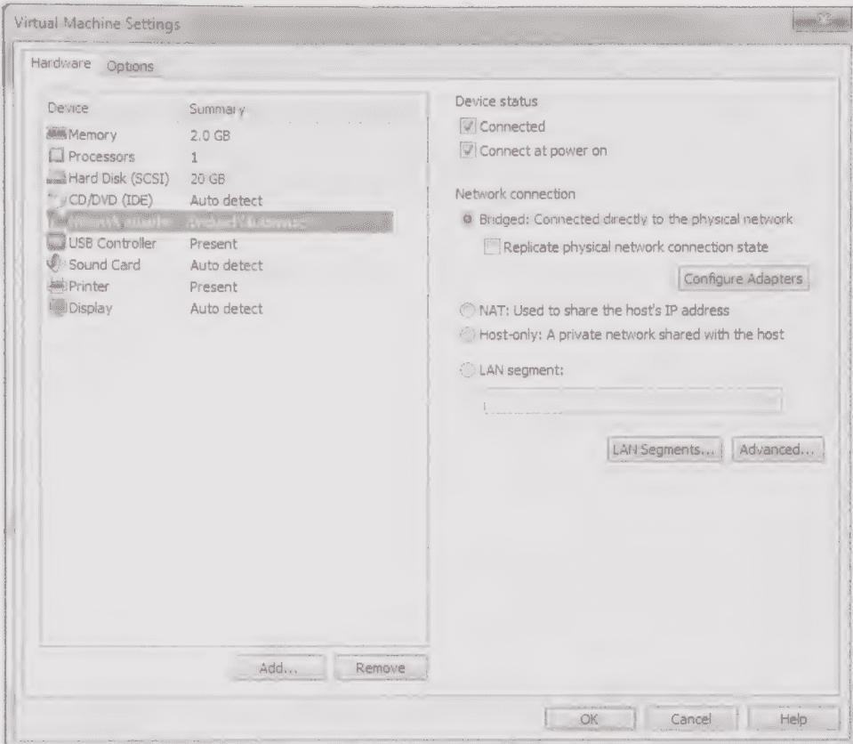

   e. 单击下载 HTML-Kit 292。

   f. 完成安装向导。

   g. 在提示时，选择执行完整安装。

   h. 一直使用默认设置，直到进入此屏幕：

   i. 当看到此屏幕时，清除复选框，以便不安装 HTML-Kit Tools。

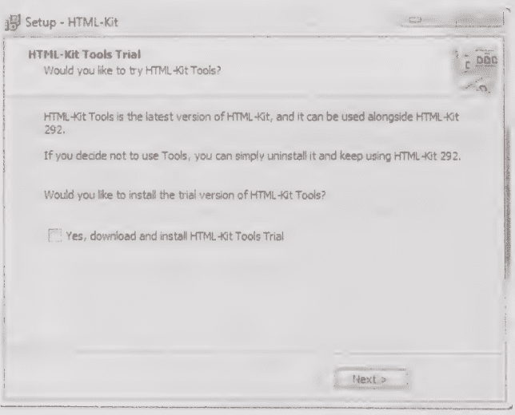

   j. 继续完成安装。

   k. 将虚拟机设置改回仅主机模式。

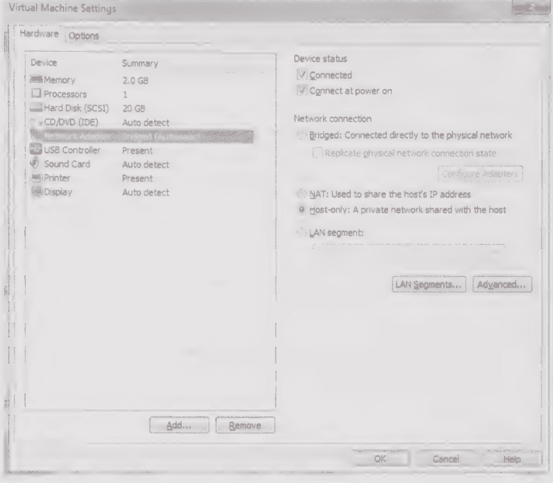

4. 打开 HTML-Kit。

    a. 单击**开始 | HTML-Kit | HTML-Kit 292**。

    b. 如果提示将 HTML 文件与 HTML-Kit 关联，请单击**是**。

    c. 保持默认设置并单击**确定**。

    d. 单击**是**以自动检测浏览器。

    e. 在提示下载 Web 链接时，单击**否**。

    f. 在提示启用自动更新检查时，单击**否**。

    g. 在提示进行 HTML-Kit Web 导览时，单击**否**。

    h. 验证是否已选择**创建新文件**，然后单击**确定**。

    i. 单击**文件 | 保存**。

    j. 将文件保存到"我的文档"中的 SD1340 文件夹，文件名为 *nn*Lab1-2.html，其中 *nn* 为您的姓名首字母。

5. 修改默认 HTML 标记，使其符合 HTML5。

    a. 将页面标题更改为**一切精彩之物**。

    b. 默认使用哪个版本的 HTML？

    c. 将 doctype 元素更改为：

    d. 大小写有关系吗？

    e. 对于哪些版本的 HTML 或 XHTML，大小写有关系？

```
<!DOCTYPE HTML>
```

6. 在 `<body>` 块中添加以下 `<section>` 标签。

```
<section id="main">

</section>
```

7. 在 `<section>` 块中添加以下 `<header>` 标签。

```
<header>

    <h1>Awesome Goodies</h1>

</header>
```

8. 在 `<header>` 块下方添加以下 `<nav>` 标签。

```
<nav>
    <ul>
        <li><a href="#">Home</a></li>
        <li><a href="#">Photos</a></li>
        <li><a href="#">Cartoons</a></li>
    </ul>
</nav>
```

9. 添加一个 ID 为 "aboutme" 的 section。它应包含以下元素：

    a. 一个包含带有您姓名的 `<h2>` 元素的 header。

    b. 一篇关于您的简短文章。

    c. 一个包含您最喜欢引言的 figure。

    d. 一个包含引言来源的 figure 标题。

使用以下 HTML 作为定义该 section 的指南：

```
<section id="aboutme">
    <header>
        <h2>Student name</h2>
    </header>
    <article>
        <p>A short paragraph about the student
        <figure>
            <p>Quote goes here</p>
            <figcaption>source of quote</figcaption>
        </figure>
        <p>And some more paragraph</p>
    </article>
</section>
```

10. 测试网页。

    a. 保存文件。

    b. 单击**视图 | 在浏览器中预览 | Internet Explorer 8.00.xxx.xxxx**。

    c. 语义元素对文本的显示方式有任何影响吗？

    d. 打开 Windows 资源管理器并导航到 SD1340 文件夹。

    e. 右键单击 *nnLab1-2* 并选择**打开方式 | Google Chrome**。

    f. 语义元素对文本的显示方式有任何影响吗？如果有，请描述差异。

    g. 这告诉您关于 HTML 5 浏览器支持的什么信息？

11. 研究 HTML 5 的浏览器支持。

    a. 单击**Player | 管理 | 虚拟机设置**。

    b. 单击**网络适配器**。

    c. 选择**桥接模式**并单击**确定**。

    d. 打开 Internet Explorer。

    e. 导航到 **http://html5test.com**。

    f. 查看结果。IE 8 支持 `<section>` 元素吗？

    g. 单击**其他浏览器**。

    h. 目前哪个浏览器对 HTML5 的支持最好？

    i. 单击**移动设备**。

    j. 目前哪个浏览器对 HTML5 的支持最好？

    k. 目前哪个浏览器对 HTML 5 的支持最差？

    l. 单击 **Android 2._call**。Android 2.3 Web 浏览器支持 `<section>` 元素吗？

    m. 单击**功能特性**。

    n. 选择图 1-2 中显示的三种功能特性：1。

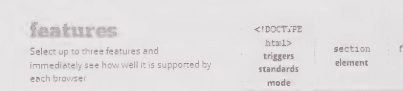

    o. 支持全部三种功能特性的最早 FireFox 版本是哪个？

    p. 支持全部三种功能特性的最早 Internet Explorer 版本是哪个？

    q. 支持全部三种功能特性的最早 Android 版本是哪个？

    r. 关闭 Internet Explorer。

    s. 单击**Player | 管理 | 虚拟机设置**。

    t. 单击**网络适配器**。

    u. 选择**仅主机模式**并单击**确定**。

#### 任务 2：使用 CSS 对页面应用样式

1. 将以下 `<style>` 块添加到 `<head>` 块中。

```
<style type="text/css">
<!--
header { color:red;}
section#main { border:5px solid blue;}
figure {background-color:yellow;}
figcaption {font-style:italic;}
h2 {color:green;
    background-color:wheat;}

-->
</style>
```

2. 保存文件。

3. 在 IE 8 和 Google Chrome 中测试更改。

    a. 页面在 IE 8 中显示时应用了哪些样式？

    b. 页面在 Chrome 中显示时应用了哪些样式？

    c. 哪个样式应用于您的姓名？

    d. 这告诉您关于样式应用优先级顺序的什么信息？

4. 将 *nn*Lab1-2 复制到主机，并将其与问题的答案一起提交给讲师。

5. 关闭虚拟机。

#### 课程项目第一部分：使用 HTML 创建主页

在整个课程中，您将构建一个网站的桌面版和移动版。该网站应关于您的某个爱好或兴趣。在本单元中，您将选择网站的焦点，并使用 HTML5 语义元素构建主页。主页至少应包含：

- 三个 `<section>` 块
- 一篇文章
- 一张带标题的图片
- 一个包含指向您爱好相关网站链接的导航部分
- 用于标识每个部分的标题

使用您在 SD1240 中学到的 CSS 样式为页面应用颜色和边框。如果您需要复习 CSS，请使用 Internet 和 ITTTech 虚拟库来搜索答案。

在本单元结束前提交 HTML 页面。

## 实验 2-1：使用 CSS 样式格式化网页

### 目的

在本实验中，您将创建并测试一个使用一些 CSS 样式标签的网页。

您将创建一个 Microsoft Word 文档并将所有必需的屏幕截图放在那里，这将在实验完成时提交。

### 目标

- 使用 CSS 背景格式化网页。
- 使用 CSS 文本装饰格式化网页。
- 使用 CSS 链接格式化网页。
- 使用 CSS 列表格式化网页。

### 如何融入

在本实验中，您将学习如何使用 CSS 3 格式化背景、文本、链接和列表。正确使用 CSS 格式化将使您的网站在视觉上令人愉悦，并帮助用户找到他们正在寻找的信息。

**预计完成时间：40 分钟**

### 任务 1：使用 CSS 背景图像格式化网页

1. 启动 VMware Player。
2. 启动 ITT-Lab 虚拟机。
3. 打开 HTML-Kit。

   a. 单击**开始 | HTML-Kit | HTML-Kit 292**。

   b. 验证是否已选择**创建新文件**，然后单击**确定**。

   c. 单击**文件 | 保存**。

   d. 将文件保存到"我的文档"中的 SD1340 文件夹，文件名为 *nn*Lab2-1-1.html。

   e. 将 DOCTYPE 更改为指定您正在使用 HTML5。

   f. 将 `<title>` 更改为 CSS 背景图像。

4. 在 Internet 上查找将用作背景图像的图像。

5. 将图像文件保存到 SD1340 文件夹。

注意：您可能需要在主机上搜索图像文件，然后将其复制到主机。

6. 在 `<body>` 块中添加以下 `<head>` 标签：

（注意：您可能有不同的背景图像文件名。）

```
<head>
<style>
body
{
background-image:url('CSS3.jpg');
}
</style>
</head>
```

7. 在浏览器窗口中预览，查看背景图像是否为重复图像。

以下是输出示例：

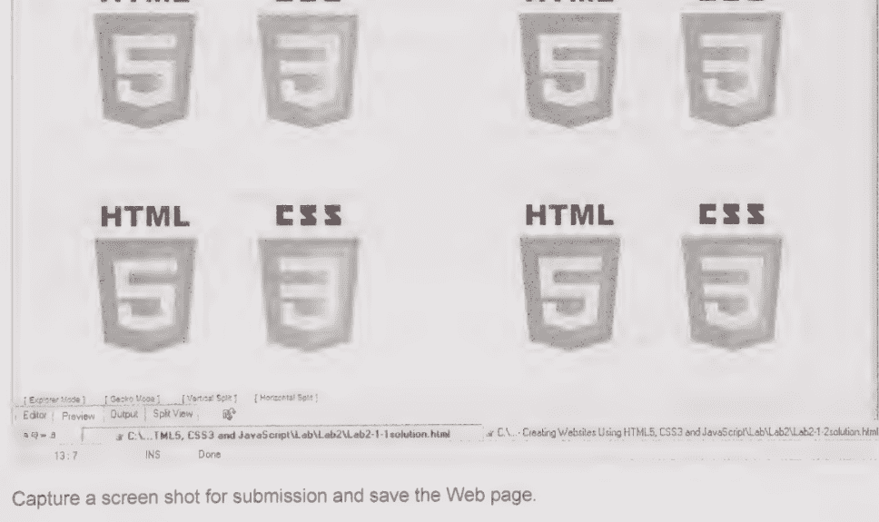

8. 截取屏幕截图以提交并保存网页。

### 任务 2：使用 CSS 文本装饰格式化网页

### 任务 2：使用 CSS 链接背景颜色设置网页格式

1. 新建一个名为 *nnLab2-1-3.html* 的 HTML 文档，并将其保存到 SD1340 文件夹中。

2. 将 DOCTYPE 修改为指定使用 HTML5。

3. 将 `<title>` 修改为 **CSS Links Background Color**。

4. 在 `<head>` 块内添加以下 `<style>` 标签：

```
<style>
a:link {background-color:yellow;} /* unvisited link */
a:visited {background-color:green;} /* visited link */
a:hover {background-color:red;} /* mouse over link */
a:active {background-color:white;} /* selected link */
</style>
```

5. 在 `<body>` 块内添加以下代码：

注意：如果虚拟机没有互联网连接，该链接可能无法正常工作。

```
<p><b><a href="http://www.itt-tech.edu" target="_blank">This is a link</a></b></p>
```

6. 测试你是否设置了以下链接背景颜色：

- a. 将未访问链接的背景颜色设置为黄色。
- b. 将已访问链接的背景颜色设置为绿色。
- c. 将鼠标悬停链接的背景颜色设置为红色。
- d. 将选中链接的背景颜色设置为白色。

以下是一个输出示例：

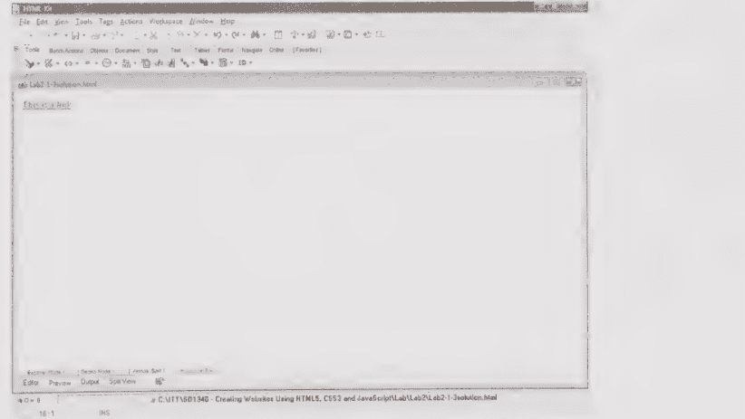

7. 截取屏幕截图以备提交，并保存该网页。

### 任务 3：使用 CSS 不同的列表项标记设置网页格式

1. 新建一个名为 *nnLab2-1-4.html* 的文件，并将其保存到 SD1340 文件夹中。

2. 将 DOCTYPE 修改为指定使用 HTML 5。

3. 将 `<title>` 修改为 **CSS Different List Item Markers**。

4. 在 `<head>` 块内添加以下 `<style>` 标签：

```
<style>
ul.a {list-style-type:circle;}
ul.b {list-style-type:square;}
ol.c {list-style-type:upper-roman;}
ol.d {list-style-type:lower-alpha;}
</style>
```

5. 在 `<body>` 块内添加以下代码：

```
<p>Example of unordered lists:</p>

<ul class="a">
<li>Oranges</li>
<li>Apples</li>
<li>Grapes</li>
</ul>

<ul class="b">
    <li>Oranges</li>
<li>Apples</li>
<li>Grapes</li>
</ul>

<p>Example of ordered lists:</p>

<ol class="c">
<li>Oranges</li>
<li>Apples</li>
<li>Grapes</li>
</ol>

<ol class="d">
<li>Oranges</li>
<li>Apples</li>
<li>Grapes</li>
</ol>
```

6. 测试并验证你是否设置了以下列表项标记：

- a. 无序列表使用圆形标记。
- b. 无序列表使用方形标记。
- c. 有序列表使用罗马数字。
- d. 有序列表使用小写字母。

以下是一个输出示例（见下图）：

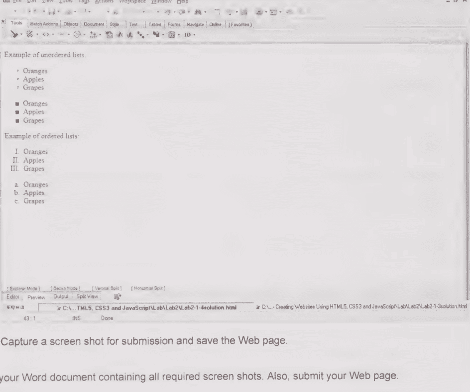

7. 截取屏幕截图以备提交，并保存该网页。

提交包含所有所需屏幕截图的 Word 文档。同时，提交你的网页。

## 实验 2-2：使用 CSS 盒模型设置网页格式

### 目的

在本实验中，你将创建并测试一个使用部分 CSS 盒模型标签的网页。

创建一个 Microsoft Word 文档，将所有所需的屏幕截图放在其中，在实验完成时提交。

### 目标

- 使用 CSS 盒模型设置网页格式。

### 应用场景

了解如何使用 CSS 盒模型可以帮助你以易于理解的方式在网页上排列内容。对盒模型的一般性理解是学习如何构建可在多种设备上查看的动态网站的基本先决条件。

### 预计完成时间：20 分钟

### 任务 1：使用 CSS 盒模型设置网页格式

1. 新建一个名为 *nnLab2-2-1.html* 的 HTML 页面，并将其保存到 SD1340 文件夹中。

2. 将 DOCTYPE 修改为指定使用 HTML5。

3. 将 `<title>` 修改为 **CSS Box Model**。

4. 在 `<head>` 块内添加以下 `<style>` 标签：

   （注意：width 设置取决于你使用的图片大小）

5. 在 `<body>` 块内添加以下代码：

   （注意：width 设置取决于你使用的图片大小）

```
<style>
div.box
{
width:499px;
padding:10px;
border:5px solid red;
margin:0px;
}
</style>
```

```

<div class="box">The picture above is 499px wide.
The total width of this element is also 499px.</div>
```

6. 测试你是否设置了 CSS 盒模型属性：

- a. 将 width 设置为 499px。
- b. 将 padding 设置为 10px。
- c. 将 border 设置为 5px。
- d. 将 border 设置为红色纯色。
- e. 将 margin 设置为 0px。

以下是一个输出示例：

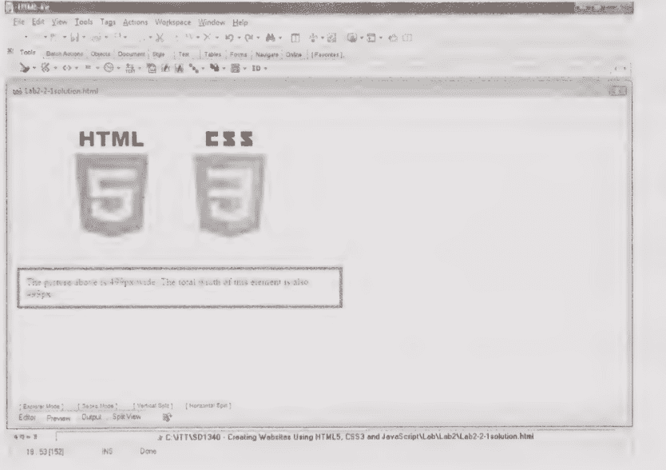

7. 截取屏幕截图以备提交，并保存该网页。

提交包含所有所需屏幕截图的 Word 文档。同时提交你的网页。

## 实验 2-3：使用 CSS 定位设置网页格式

### 目的

在本实验中，你将创建并测试一个使用部分 CSS 定位标签的网页。

创建一个 Microsoft Word 文档，将所有所需的屏幕截图放在其中，在实验完成时提交。

### 目标

- 使用 CSS 固定定位设置网页格式。
- 使用 CSS 相对定位设置网页格式。
- 使用 CSS 绝对定位设置网页格式。
- 使用 CSS 重叠元素设置网页格式。

### 应用场景

CSS 3 不仅可以让你在固定位置或相对于其他元素定位元素，还允许你重叠元素。在本实验中，你将探索各种定位选项及其对网页显示方式的影响。

### 预计完成时间：40 分钟

### 任务 1：使用 CSS 固定定位设置网页格式

1. 新建一个名为 nnLab2-3-1.html 的文件，并将其保存到 SD1340 文件夹中。

2. 将 DOCTYPE 修改为指定使用 HTML5。

3. 将 `<title>` 修改为 **CSS Fixed Positioning**。

4. 在 `<head>` 块内添加以下 `<style>` 标签：

5. 在 `<body>` 块内添加以下代码：

```
<style>
p.pos_fixed
{
position:fixed;
top:50px;
right:50px;
}
</style>
```

```
<p class="pos_fixed">Some more text1</p>
<p><b>CSS Fixed Positioning</b></p>
<p>Some text2</p><p>Some text3</p><p>Some text4</p><p>Some text5</p><p>Some text6</p>
<p>Some text7</p><p>Some text8</p><p>Some text9</p><p>Some text10</p><p>Some text11</p>
<p>Some text12</p><p>Some text13</p><p>Some text14</p><p>Some text</p><p>Some text15</p>
```

6. 验证文本是否使用 CSS 固定定位显示。

以下是一个输出示例：

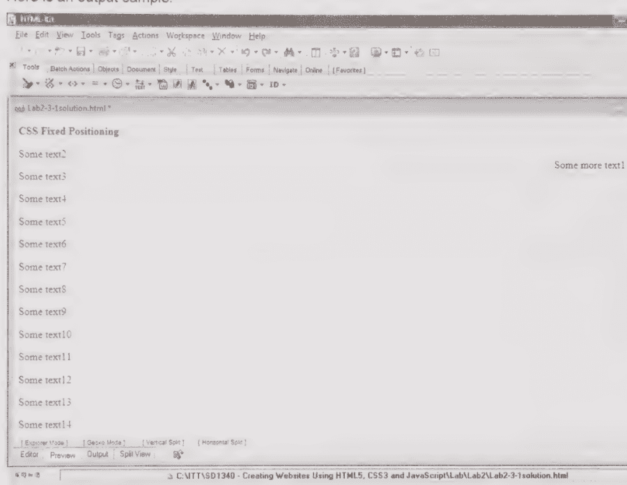

7. 截取屏幕截图以备提交，并保存该网页。

### 任务 2：使用 CSS 相对定位设置网页格式

1. 新建一个名为 nnLab2-3-2.html 的文件，并将其保存到 SD1340 文件夹中。

2. 将 DOCTYPE 修改为指定使用 HTML5。

3. 将 `<title>` 修改为 **CSS Relative Positioning**。

4. 在 `<head>` 块内添加以下 `<style>` 标签：

```
<style>
h2.pos_top
{
position:relative;
top:100px;
}
</style>
```

5. 在 `<body>` 块内添加以下代码：

```
<h2>This is a heading with no position</h2>
<h2 class="pos_top">This heading is moved downwards by 100px according to its normal position</h2>
```

6. 测试并验证 CSS 相对定位是否用于显示第二行文本。

以下是一个输出示例：

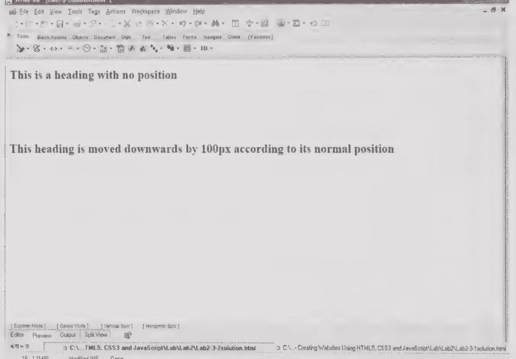

7. 截取屏幕截图以备提交，并保存该网页。

### 任务 3：使用 CSS 绝对定位设置网页格式

1. 新建一个名为 `nnLab2-3-3.html` 的文件，并将其保存到 SD1340 文件夹中。

2. 将 DOCTYPE 修改为指定使用 HTML5。

3. 将 `<title>` 修改为 **CSS Absolute Positioning**。

4. 在 `<head>` 块内添加以下 `<style>` 标签：

5. 在 `<body>` 块内添加以下代码：

```
<h1>This is a heading with an absolute position</h1>
<p>With absolute positioning, an element can be placed anywhere on a page.
The heading below is placed 200px from the left of the page and 150px from the top of the page.</p>
```

6. 进行测试，验证是否使用 CSS 绝对定位来显示第二行文本。

以下是输出示例：

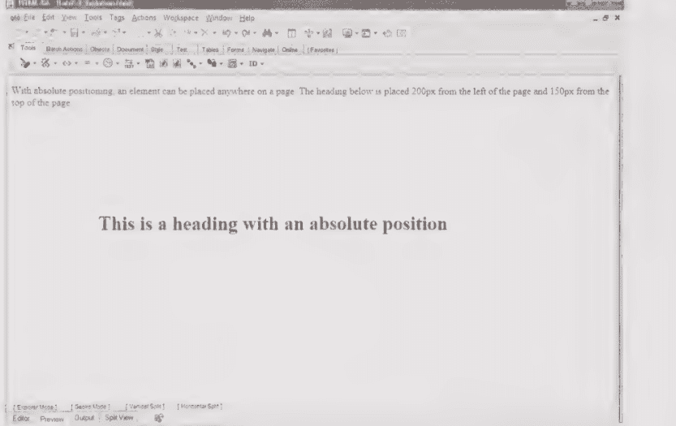

7. 截取屏幕截图以供提交，并保存网页。

### 任务 4：使用 CSS 重叠元素格式化网页

1. 创建一个名为 `nnLab2-3-4.html` 的新文件，并将其保存到 SD1340 文件夹中。

2. 将 DOCTYPE 更改为指定使用 HTML5。

3. 将 `<title>` 更改为 CSS Overlapping Elements。

4. 在 `<head>` 块内添加以下 `<style>` 标签：

```
<style>
img
{
position:absolute;
left:0px;
top:0px;
z-index:-1;
}
</style>
```

5. 在 `<body>` 块内添加以下代码：

```
<h1>This is a heading</h1>

<p>Because the image has a z-index of -1, it will be placed behind the text.</p>
```

6. 进行测试，验证文本是否重叠在图像上。

以下是输出示例：

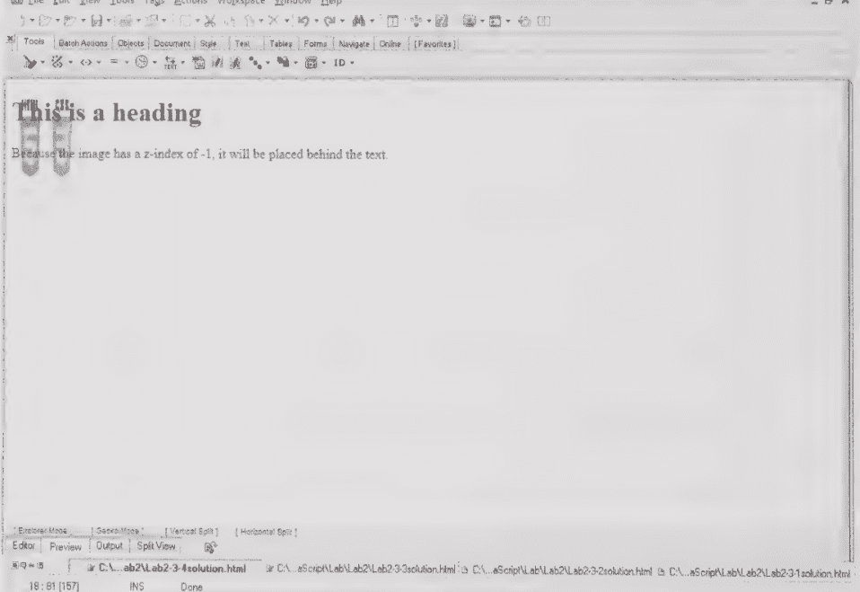

7. 截取屏幕截图以供提交，并保存网页。

8. 将所有 HTML 和图像文件复制到主机，并将它们与屏幕截图一起交给指导教师。

9. 关闭虚拟机。

提交包含所有所需屏幕截图的 Word 文档。同时提交你的网页。

### 课程项目第 2 部分：应用样式到主页

在整个课程中，你将构建一个网站的桌面版本和移动版本。该网站应该是关于你的一项爱好或兴趣的。在本单元中，你将继续完善在上个单元完成的主页。主页应包含以下功能：

- 居中的背景图像

  提示：使用 `background-repeat` 和 `background-position` 属性

- 设置为列表项标记的图像图标

  提示：使用 `list-style-image` 属性

- 链接/已访问/未访问/悬停链接的标准化颜色

  提示：使用 `<a>` 标签的属性来设置 link、visited、hover 和 active

- 总宽度为 300px 的文本段落

  提示：使用 `<div>` 标签的属性来设置 width、padding、border 和 margin

使用互联网和 ITT Tech 虚拟图书馆搜索 CSS 属性。

在本单元结束前提交 HTML 页面。

## 实验 3-1：比较固定布局、流式布局和混合布局

### 目的

在本实验中，你将创建一个 HTML 页面并定义 CSS 样式，将固定布局、流式布局和混合布局应用到该页面。

在本实验中，你需要在 Microsoft Word 文档中回答几个问题，并在实验完成后提交。

### 目标

- 使用 CSS 创建固定布局网页。
- 使用 CSS 创建混合布局网页。

### 应用场景

构建一个可以在多台设备上显示且在用户调整浏览器窗口大小时能够正确显示的网页是一项具有挑战性的任务。在本实验中，你将学习使用 CSS 创建固定布局网页以及混合布局。你将比较浏览器窗口大小调整时内容显示的差异。

**预计完成时间：50 分钟**

### 任务 1：创建使用固定布局的网页

1. 启动 VMware Player。
2. 启动你的 ITT-Lab 虚拟机。
3. 将 `Lab3starter.zip` 文件复制到虚拟机上的 SD1340 文件夹并解压文件。
4. 启动 HTML-Kit。
5. 打开 `Lab3-1starter.htm`。
6. 查看标记。
7. 在默认浏览器中查看 `Lab3-1starter.htm`。
8. 信息是如何显示的？
9. 创建一个新的样式表。

   a. 点击 File | New。

   b. 点击 Style Sheets 选项卡。

   c. 选择 Blank Style Sheet 并点击 OK。

   d. 将样式表保存为 `nn3-1fixed.css`。

10. 在样式表中定义以下样式：

```
#header {
position: absolute;
left: 0px;
top: 0px;
width: 800px;
background-color: cyan;
}
#footer {
position: absolute;
left: 0px;
top: 1700px;
width: 800px;
background-color: cyan;
}
```

```
#leftbar {
position: absolute;
left: 0px;
top: 140px;
width: 200px;
height: 1500px;
background-color: yellow;
}
```

```
#content {
position: absolute;
left:200px;
top: 140px;
width: 300px;
padding-left: 50px;
padding-right: 50px;
}
```

```
#rightbar {
position: absolute;
left: 600px;
top: 140px;
width: 200px;
height: 1500px;
background-color: red;
}
```

11. 在 `Lab3-1starter.htm` 文件的 `<head>` 块中添加以下元素以引用样式表：

```
<link href="nnLab3-1fixed.css" rel="stylesheet" type="text/css" />
```

12. 在浏览器中测试页面。

    a. 当你将浏览器窗口缩小时会发生什么？

    b. 当你将浏览器窗口放大时会发生什么？

13. 保存你的文件。

### 任务 2：修改页面以使用混合布局

1. 创建一个新样式表并将其保存为 `nnLab3-1hybrid.css`。

2. 定义以下样式：

```
body {
    margin: 0;
    padding: 0;
}
```

3. 保存样式表。

4. 修改 `Lab3-1starter.htm` 文件中的 `<link>` 元素以引用新样式表。

5. 测试页面。

    a. 内容是如何显示的？

6. 定义以下样式：

```
#header {
    float: left;
    width: 100%;
    background-color: cyan;
}

#footer {
    float: left;
    width: 100%;
    background-color: cyan;
}
```

7. 保存样式表并测试你的更改。

    a. 有哪些不同？

    b. 调整窗口大小。青色的条会发生什么变化？

8. 为 wrapper `<div>` 添加如下样式：

```
#wrapper {
    float: left;
    padding-left: 200px;
    padding-right: 200px;
}
```

9. 保存样式表并测试你的更改。

    a. 有哪些不同？

10. 为 leftbar `<div>` 添加如下样式：

```
#leftbar {
position: relative;
float: left;
width: 200px;
background-color: yellow;
right: 200px;
margin-right: -100%;
}
```

11. 保存样式表并测试你的更改。确保测试调整浏览器窗口大小。

    a. 有哪些不同？

12. 为 rightbar `<div>` 添加如下样式：

```
#rightbar {
position: relative;
float: left;
width: 200px;
background-color: red;
margin-right: -200px;
}
```

13. 保存样式表并测试你的更改。确保测试调整浏览器窗口大小。

    a. rightbar `<div>` 显示在哪里？

14. 为 content `<div>` 添加如下样式：

```
#content {
position: relative;
float: left;
background-color: tan;
width: 100%;
}
```

15. 保存样式表并测试你的更改。确保测试调整浏览器窗口大小。

    a. content `<div>` 使用的是什么类型的布局？

16. 为 leftbar、rightbar 和 content 样式添加以下属性：

```
margin-bottom: -2000px;
padding-bottom: 2000px;
```

17. 保存样式表并测试你的更改。

    a. 页脚发生了什么变化？

18. 为 footer 样式添加以下属性：

```
position: relative;
```

19. 保存样式表并测试你的更改。

    a. 页脚显示在哪里？

20. 为 wrapper 样式添加以下属性：

```
overflow: hidden;
```

21. 保存样式表并测试你的更改。

    a. 页脚显示在哪里？

22. 保存你的更改。将起始文件、图形和 `.css` 文件打包压缩，与你的 Word 文档一起提交。

提交包含所有所需屏幕截图的 Word 文档。同时提交你的压缩文件。

## 实验 3-2：向网页添加 JavaScript

### 目的

在本实验中，你将创建一个使用 JavaScript 显示随机星期几和随机颜色的网页。

在本实验中，你需要在 Microsoft Word 文档中回答几个问题，并在实验完成后提交。

### 目标

- 创建 JavaScript 事件处理程序。
- 使用 JavaScript 显示随机内容。
- 使用注释记录 JavaScript 代码。

### 应用场景

JavaScript 是一种客户端脚本语言，可用于使网站更具动态性。本实验通过要求你输入为你提供的代码，然后使用该代码作为编写自己 JavaScript 代码的模型，来向你介绍 JavaScript。本实验为你提供了将在课程其余部分使用的 JavaScript 基础知识。

**预计完成时间：50 分钟**

### 任务 1：创建 JavaScript 函数

1. 启动 VMware Player。
2. 启动 ITT-Lab 虚拟机。
3. 打开 HTML-Kit。
4. 创建一个新的 HTML 文件并将其保存为 *nn*Lab3-2.htm。
5. 修改默认的 HTML 标记使其为 HTML 5。
6. 将 `<title>` 更改为 Your Lucky Day。
7. 在 `<head>` 块内添加以下 `<script>` 块：

```
<script language="JavaScript" type="text/javascript">
<!--

function getLuckyInfo() {
//Create an array and populate it with 7 colors
```

```
colors = new Array(7);
colors[0] = "lightpink";
colors[1] = "orange";
colors[2] = "yellow";
colors[3] = "lightgreen";
colors[4] = "lightblue";
colors[5] = "violet";
colors[6] = "white";

//Calculate a random number between 0 and the number of elements
//in the colors array
}
//-->
</script>
```

8. 回答以下问题：

    a. 函数中定义了什么变量？

    b. `colors` 数组中有多少个元素？

9. 在底部注释下方添加代码，以计算一个介于 0 和 `colors` 数组元素数量之间的随机数。将这个随机数存储在一个名为 `i` 的变量中。提示：以第 279 页的代码为例。

10. 在你步骤 9 中添加的代码下方，添加以下代码。

```
//Show the color and the color name
document.write("<p style='background-color: " + colors[i] + "'>
Your lucky color is " + colors[i] + "</p>");
```

11. 在 `<body>` 代码块中添加以下 `<script>` 代码块。

```
<div id="luckyinfo">
<script language="JavaScript" type="text/javascript">
<!--
        getLuckyInfo();

//-->
</script>
```

在 Internet Explorer 中显示该页面。将显示以下消息：

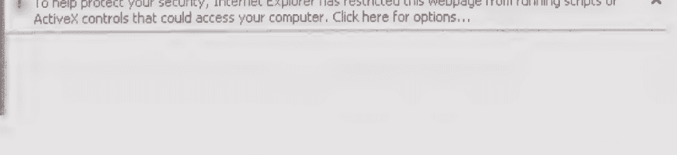

点击黄色栏并选择 **允许阻止的内容**。

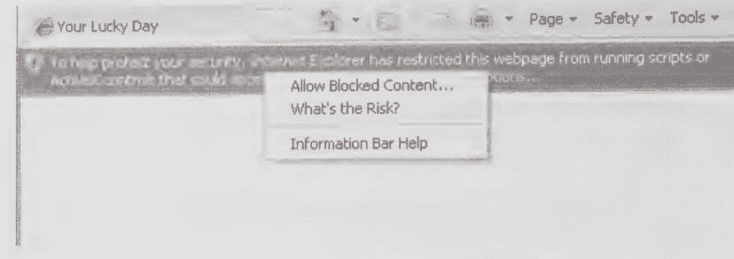

当出现以下安全警告时，点击 **是**。

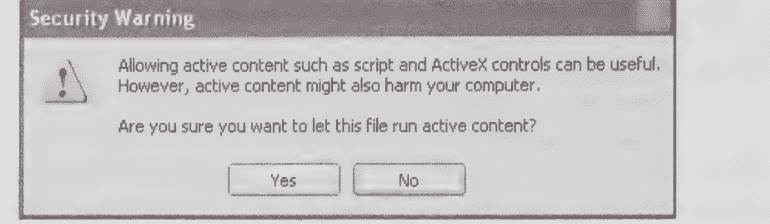

你的屏幕上应显示一条类似于此的消息，尽管颜色可能不同：

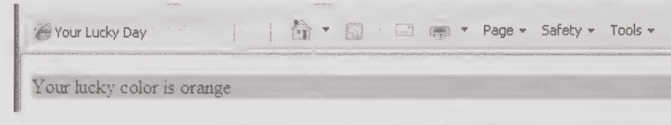

### 任务 2：修改 JavaScript 函数

1. 修改函数以执行以下任务：

   a. 创建一个名为 `days` 的 7 元素数组。

   b. 用星期几填充 `days` 数组。

   c. 添加代码以写出 "Your lucky day is x!"，其中 x 是星期几数组中与存储在 `i` 中的随机数相对应的元素。

   d. 确保为你的代码添加注释。

   e. 测试你的代码。结果应如下所示：

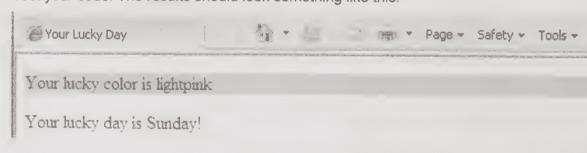

### 任务 3：添加 JavaScript 事件处理程序

1. 在 `<body>` 代码块中的 `<script>` 代码块之后添加以下元素。

```
<a href="#" onmouseover="alert('Not a chance!');">Change your luck</a>
```

2. 测试以确保当鼠标悬停在链接上时，会出现以下消息框：

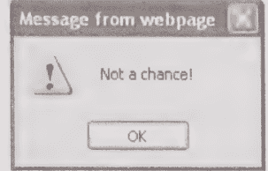

3. 保存你的 HTML 文件并将其与 Word 文档一起提交给你的讲师。

提交包含所有必需屏幕截图的 Word 网页。同时提交你的网页。

### 课程项目第 3 部分：将混合布局应用于主页

在整个课程中，你将构建一个网站的桌面版和移动版。该网站应关于你的一个爱好或兴趣。在本单元中，你将创建一个外部样式表，将主页格式化为具有以下元素的混合布局：

- 一个页眉
- 一个页脚
- 一个具有固定布局的左栏
- 一个具有固定布局的右栏
- 一个具有流式布局的中栏

如果你需要复习 CSS，请使用互联网和 ITT Tech 虚拟图书馆寻找答案。

在本单元结束时，提交 CSS 样式表和 HTML 页面。

## 实验 4-1：使用 JavaScript 为网页编程

### 目的

在本实验中，你将在网页上编写和测试 JavaScript 代码。

创建一个 Microsoft Word 文档，并将所有必需的屏幕截图放在其中，你将在完成实验时提交该文档。

### 目标

- 使用 Javascript 变量为网页编程。
- 使用 Javascript 数据类型为网页编程。
- 使用 Javascript 对象为网页编程。
- 使用 Javascript 时间和日期为网页编程。
- 使用 Javascript 函数为网页编程。
- 使用 Javascript 数组为网页编程。

### 如何融入其中

在本实验中，你将继续探索 JavaScript。你将学习如何声明变量，并探索 JavaScript 如何处理各种数据类型。由于 JavaScript 是一种松散类型的语言，你会发现 JavaScript 变量的行为与使用强类型语言的其他语言略有不同。你还将学习如何使用对象、时间、日期、函数和数组。这些都是关键的编程元素，你将使用它们来编写执行多种操作的 JavaScript 代码。

**预计完成时间：50 分钟**

### 任务 1：为使用 JavaScript 变量的网页编程

1. 启动 VMware Player。
2. 启动 ITT-Lab 虚拟机。
3. 打开 HTML-Kit。

   a. 点击 **Start** | **HTML-Kit** | **HTML-Kit 292**。

   b. 验证是否选择了 **Create a new file**，然后点击 **OK**。

   c. 点击 **File** | **Save**。

   d. 将文件保存到"我的文档"中的 SD1340 文件夹，命名为 **nnLab4-1-1.html**。

   e. 更改 DOCTYPE 以指定你正在使用 HTML 5。

   f. 将 `<title>` 更改为 "JavaScript variables"。

4. 在 `<head>` 代码块中添加以下 `<script>` 标签：

```
<script>
var x=5;
var y=6;
var z=x+y;

var pi=3.14;
var name="John Doe";

document.write("x = " + x + "<br>");
document.write("y = " + y + "<br>");
document.write("z = x + y = " + z + "<br><br>");
document.write("pi = " + pi + "<br>");
document.write("My name is " + name + "<br>");
</script>
```

a. 你将使用什么代码来声明一个名为 `product` 的变量并将其设置为 `y` 和 `z` 的乘积？

5. 在浏览器窗口中预览以查看不同变量的值。

以下是输出示例：

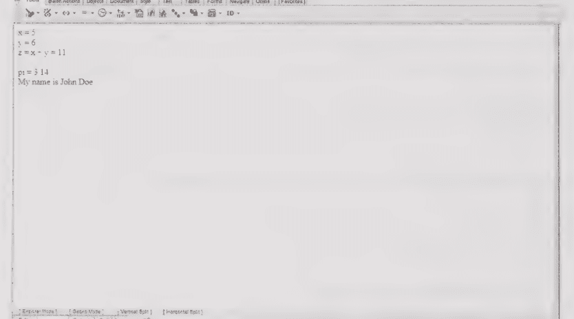

6. 捕获屏幕截图以供提交并保存网页。

### 任务 2：为使用 JavaScript 数据类型的网页编程

1. 点击 **File | New Document** 创建一个名为 *nnLab4-1-2.html* 的新文档，并将其保存到 SD1340 文件夹。

2. 更改 DOCTYPE 以指定你正在使用 HTML 5。

3. 将 `<title>` 更改为 "JavaScript Data Types"。

4. 在 `<head>` 代码块中添加以下代码：

```
<script>
var carname1="Volvo XC60";
var carname2='"Volvo XC60"';
var answer1="It's alright";
var answer2="He is called 'Johnny'";
var answer3='He is called "Johnny"';

var x1=34.00;
var x2=34;
var y=123e5;
var z=123e-5;

var condition1=true;
var condition2=false;

document.write("carname1 = " + carname1 + "<br>")
document.write("carname2 = " + carname2 + "<br>")
document.write("answer1 = " + answer1 + "<br>")
document.write("answer2 = " + answer2 + "<br>")
document.write("answer3 = " + answer3 + "<br><br>")

document.write("x1 = " + x1 + "<br>")
document.write("x2 = " + x2 + "<br>")
document.write("y = " + y + "<br>")
document.write("z = " + z + "<br><br>")

document.write("condition1 = " + condition1 + "<br>")
document.write("condition2 = " + condition2 + "<br>")
</script>
```

a. 你将使用什么代码来声明一个名为 `title` 的变量并将其设置为 'The Sun Also Rises'？

b. 在浏览器窗口中预览以查看不同数据类型变量的值。

以下是输出示例：

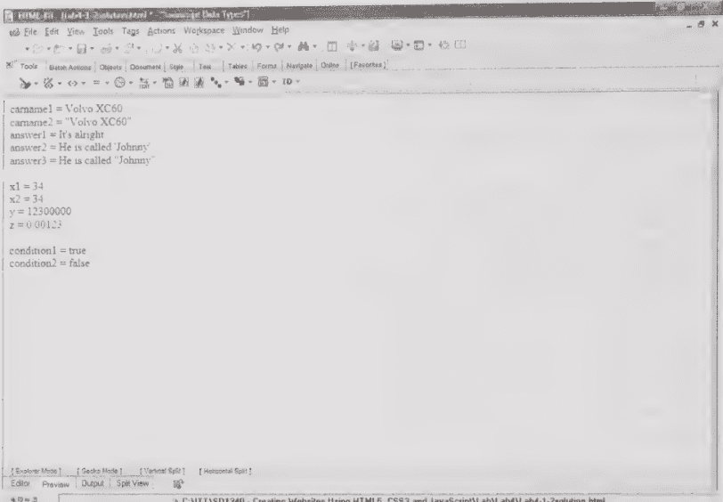

6. 捕获屏幕截图以供提交并保存网页。

### 任务 3：为使用 Javascript 对象的网页编程

1. 点击 **File | New Document** 创建一个名为 *nnLab4-1-3.html* 的新文档，并将其保存到 SD1340 文件夹。

2. 更改 DOCTYPE 以指定你正在使用 HTML 5。

3. 将 `<title>` 更改为 "JavaScript Objects"。

4. 在 `<head>` 代码块中添加以下代码：

```
<script>
var person=new Object();
person.firstname="John";
person.lastname="Doe";
person.age=50;
person.eyecolor="blue";
person.fullname = person.firstname + " " + person.lastname;

document.write("person is an object<br>");
document.write("person.firstname = " + person.firstname +
"<br>");
document.write("person.lastname = " + person.lastname + "<br>");
document.write("person.age = " + person.age + "<br>");
document.write("person.eyecolor = " + person.eyecolor + "<br>");

document.write("person.fullname = " + person.fullname + "<br>");

document.write("person.fullname.length = " + person.fullname.length + "<br>");

document.write("person.fullname.toUpperCase() = " + person.fullname.toUpperCase() + "<br>");

</script>
```

a. 字符串的 `length` 属性的用途是什么？

5. 在浏览器窗口中预览，查看点击鼠标事件。

输出示例如下：

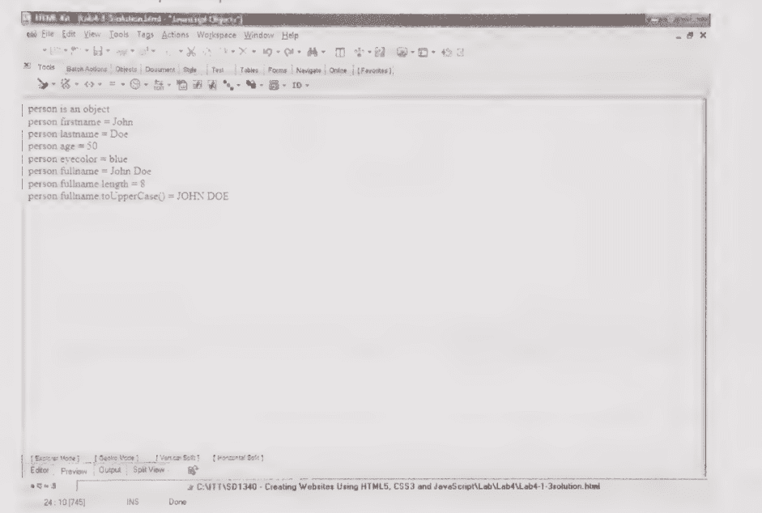

6. 截取屏幕截图以供提交，并保存该网页。

### 任务 4：使用 JavaScript 时间和日期编程网页

1. 点击 **文件 | 新建文档** 创建一个名为 *nnLab4-1-4.html* 的新文档，并将其保存到 SD1340 文件夹。
2. 更改 DOCTYPE 以指定你正在使用 HTML5。
3. 将 `<title>` 更改为 "Javascript times and dates"。
4. 在 `<head>` 块内添加以下代码：

```
<script>

var d=new Date();

document.write("The current local date and time:<br>");

document.write(d);

</script>
```

5. 在浏览器窗口中预览，查看当前的本地日期和时间。

输出示例如下：

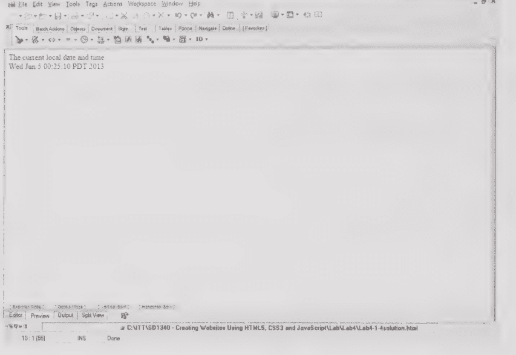

6. 截取屏幕截图以供提交，并保存该网页。

### 任务 5：使用 JavaScript 函数编程网页

1. 点击 **文件 | 新建文档** 创建一个名为 *nnLab4-1-5.html* 的新文档，并将其保存到 SD1340 文件夹。
2. 更改 DOCTYPE 以指定你正在使用 HTML5。
3. 将 `<title>` 更改为 "JavaScript functions"。
4. 在 `<body>` 块内添加以下代码：

```
<p>Click the button to call a function with an argument</p>

<button onclick="myFunction('ITT Tech')">Try it</button>

<script>

function myFunction(name)

{

    alert("Welcome to " + name);

}

</script>
```

5. 在浏览器窗口中预览，查看如何向函数传递参数。

输出示例如下：

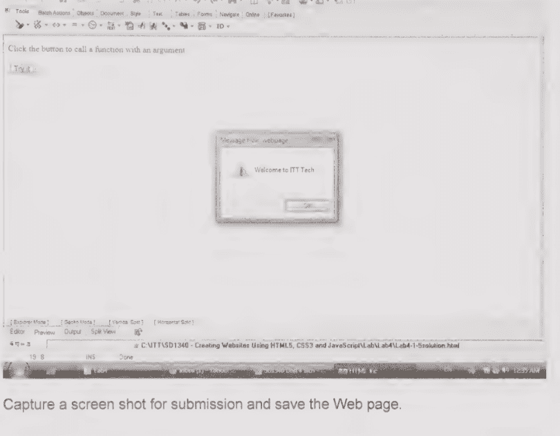

6. 截取屏幕截图以供提交，并保存该网页。

### 任务 6：使用 JavaScript 数组编程网页

1. 点击 **文件 | 新建文档** 创建一个名为 *nnLab4-1-6.html* 的新文档，并将其保存到 SD1340 文件夹。
2. 更改 DOCTYPE 以指定你正在使用 HTML5。
3. 将 `<title>` 更改为 "Javascript arrays"。
4. 在 `<head>` 块内添加以下代码：

```
<script>

var mycars = new Array();

mycars[0] = "Lexus";

mycars[1] = "Acura";

mycars[2] = "Infiniti";

document.write("mycars is an array of car brand names<br>");

document.write("mycars[0] = " + mycars[0] + "<br>");

document.write("mycars[1] = " + mycars[1] + "<br>");

document.write("mycars[2] = " + mycars[2] + "<br>");

</script>
```

a. 你会使用什么代码将 Ford 添加到 `mycars` 数组中？

5. 在浏览器窗口中预览，查看数组的内容。

输出示例如下：

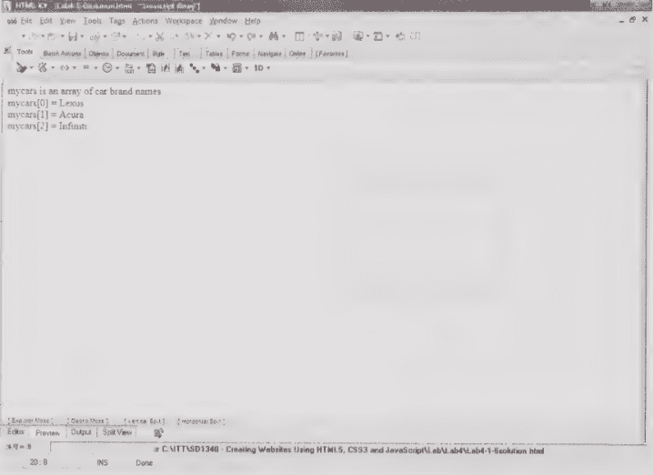

6. 截取屏幕截图以供提交，并保存该网页。

提交包含所有所需屏幕截图的 Word 文档。同时提交你的网页。

## 实验 4-2：使用 HTML 文档对象模型 (DOM) 编程网页

### 目的

在本次实验中，你将编程并测试一个使用 HTML DOM 的网页。

创建一个 Microsoft Word 文档，并将所有必需的屏幕截图放在其中；你将在实验完成时提交该文档。

### 目标

- 通过 Id 查找 HTML 元素来测试网页。
- 通过标签名称查找 HTML 元素来测试网页。
- 通过 Id 更改 HTML 样式来测试网页。
- 通过 Id 显示或隐藏 HTML 内容来测试网页。

### 如何契合

理解 DOM 对于编写操作和格式化网页上显示内容的 JavaScript 代码至关重要。在本次实验中，你将了解 DOM，并学习如何动态显示文本以及使用 JavaScript 代码为元素应用格式。

**预计完成时间：50 分钟**

### 任务 1：通过 Id 查找 HTML 元素来测试网页

1. 点击 **文件 | 新建文档** 创建一个名为 *nnLab4-2-1.html* 的新文档，并将其保存到 SD1340 文件夹。
2. 更改 DOCTYPE 以指定你正在使用 HTML5。
3. 将 `<title>` 更改为 "Finding the HTML Elements by Id"。
4. 在 `<body>` 块内添加以下代码：

```
<p>This example demonstrates the <b>getElementById</b>

method!</p>

<p id="intro">Hello World!</p>

<p id="end">Goodbye World!</p>

<br>

<script>

    x=document.getElementById("intro");

    y=document.getElementById("end");

    document.write("<p>The text from the intro paragraph: " +

x.innerHTML + "</p>");

    document.write("<p>The text from the end paragraph: " +

y.innerHTML + "</p>");

</script>
```

a. 执行以下语句后，`s` 的值会是什么？

```
s = x.nodeName;
```

5. 在浏览器窗口中预览，查看如何通过 Id 查找 HTML 元素。

输出示例如下：

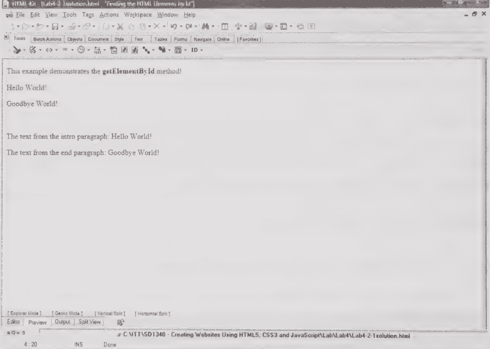

6. 截取屏幕截图以供提交，并保存该网页。

### 任务 2：创建并测试通过标签名称查找 HTML 元素的网页

1. 点击 **文件 | 新建文档** 创建一个名为 *nnLab4-2-2.html* 的新文档，并将其保存到 SD1340 文件夹。
2. 更改 DOCTYPE 以指定你正在使用 HTML5。
3. 将 `<title>` 更改为 "Finding the HTML Elements by tag Name"。
4. 在 `<body>` 块内添加以下代码：

```
<p>This example demonstrates the <b>getElementsByTagName</b> method</p>

<div id="main">

<p>Hello World!</p>

<p>The DOM is very useful.</p>

</div>

<div id="second">

<p>End World!</p>

<p>The DOM is very challenging to learn.</p>

</div>

<br>

<script>

var x1=document.getElementById("main");

var y1=x1.getElementsByTagName("p");

var x2=document.getElementById("second");

var y2=x2.getElementsByTagName("p");

document.write('First paragraph inside id = "main" is ' + y1[0].innerHTML + "<br>");

document.write('Second paragraph inside id = "main" is ' + y1[1].innerHTML + "<br><br>");

document.write('First paragraph inside id = "second" is ' + y2[0].innerHTML + "<br>");

document.write('Second paragraph inside id = "second" is ' + y2[1].innerHTML);

</script>
```

a. 你会使用什么代码来声明一个变量并将其设置为一个包含文档中所有段落元素的数组？

5. 在浏览器窗口中预览，查看如何通过标签名称查找 HTML 元素。

输出示例如下（见下文）：

6. 截取屏幕截图以供提交，并保存该网页。

### 任务 3：通过 Id 更改 HTML 样式来测试网页

1. 点击 **文件 | 新建文档** 创建一个名为 *nnLab4-2-3.html* 的新文档，并将其保存到 SD1340 文件夹。
2. 更改 DOCTYPE 以指定你正在使用 HTML5。
3. 将 `<title>` 更改为 "Change the style of HTML by Id"。
4. 在 `<body>` 块内添加以下代码：

```
<h1 id="id1">ITT Technical Institute</h1>

<br>

<button type="button"

onclick="document.getElementById('id1').style.color='red'">

Change to Red</button>

<button type="button"

onclick="document.getElementById('id1').style.color='blue'">

Change to Blue</button>
```

a. 你会添加什么代码到按钮的 `onclick` 事件中，以将网页中所有 `<h1>` 元素变成蓝色？

5. 在浏览器窗口中预览，查看如何通过 Id 更改 HTML 的样式。

输出示例如下：

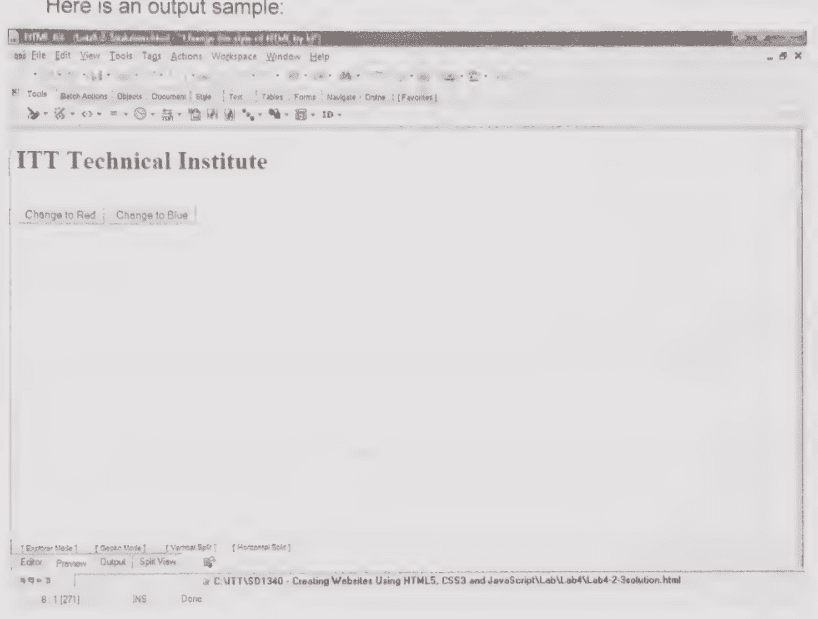

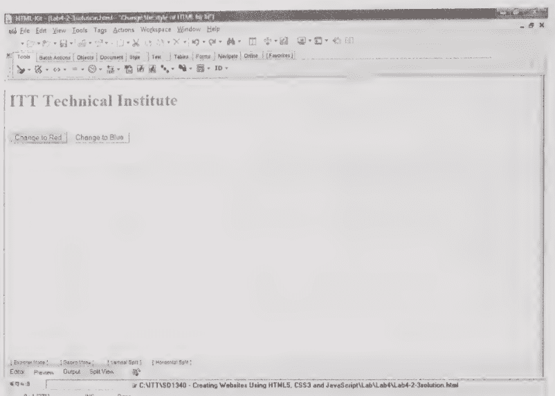

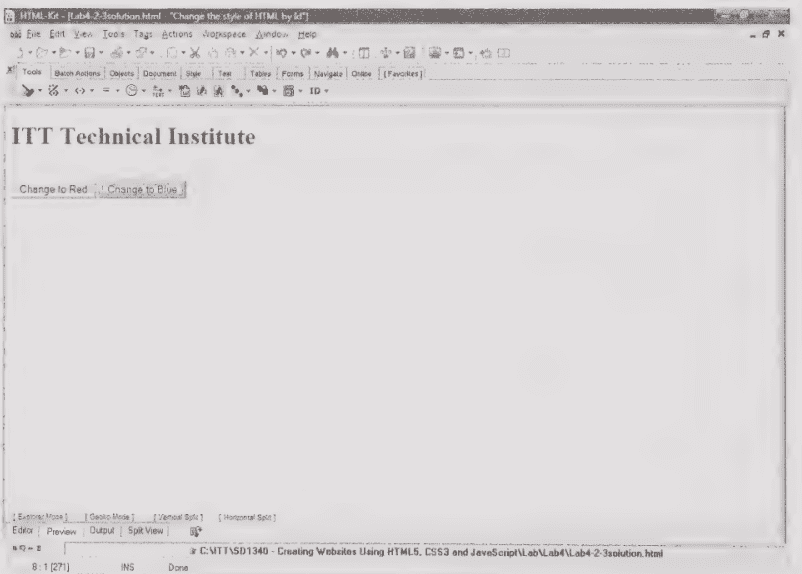

6. 截取每次颜色更改的屏幕截图以供提交，并保存该网页。

### 任务 4：通过 Id 显示或隐藏 HTML 内容来测试网页

1. 点击 **文件 | 新建文档** 创建一个名为 *nnLab4-2-4.html* 的新文档，并将其保存到 SD1340 文件夹。
2. 更改 DOCTYPE 以指定你正在使用 HTML5。
3. 将 `<title>` 更改为 "Show or hide the HTML content by Id"。
4. 在 `<body>` 块内添加以下代码：

```
<p id="p1">

This is a text.<br>

This is a text.<br>

This is a text.<br>

This is a text.<br>

This is a text.<br>

This is a text.<br>
```

### 课程项目第 4 部分：创建注册表单以收集新成员信息

在整个课程中，你将构建一个网站的桌面版和移动版。该网站应关于你的某个爱好或兴趣。在本单元中，你将创建注册表单来收集成员信息。注册表单应至少包含以下必填字段：

- 必填表单字段：
  - 用户名
  - 密码
  - 电子邮件地址
  - 是否向公开展示联系信息的选项
  - 是否接收网站更新的选项
  - 描述新成员的文本区域
- 以"2014年10月24日"格式显示当前日期。
- 创建另一个按钮。当用户点击它时，弹窗将显示更多新成员的联系信息。

使用你的教科书、互联网和 ITT Tech 虚拟图书馆搜索 JavaScript 和 DOM 属性的帮助。

在本单元结束前提交 HTML 页面。

6. 截取屏幕截图以供提交，并保存网页。
7. 将所有 HTML 和图像文件复制到主机，并将它们连同屏幕截图一起提交给你的指导教师。
8. 关闭你的虚拟机。

提交包含所有必需屏幕截图的 Word 文档。同时提交你的网页。

## 实验 5-1：为网页添加表单和数据验证

### 目的

在本次实验中，你将添加一个使用 HTML5 中引入的部分 `<input>` 类型的表单。你将编写执行数据验证的 JavaScript 代码。你还将编写 JavaScript 代码来创建自定义对象。

在本实验中，你将需要在 Microsoft Word 文档中回答几个问题，并在实验完成时提交。

### 目标

- 创建 JavaScript 函数。
- 创建自定义对象。
- 使用和扩展内置对象。
- 编写使用条件语句的代码。
- 编写使用循环的代码。

### 如何融入

表单允许用户向你的网站提交数据。然而，验证提交的数据以确保服务器端处理表单的代码能够使用这些数据是至关重要的。数据验证还有助于防范通过向服务器端组件发送无效输入来操作的某些类型的攻击。在本实验中，你将学习执行数据验证的基本技术。更高级的技术将在 SD2520 中介绍。本实验还允许你练习使用内置和自定义对象，以及控制 JavaScript 函数流程的语句。

### 预计完成时间：100 分钟

### 任务 1：创建包含表单的 HTML 页面

1. 启动 VMware Player。
2. 启动 ITT-Lab。
3. 启动 HTML-Kit 并创建一个新的 HTML 文件。
4. 将文件保存为 `nnLab5-1.htm`。
5. 更改 DOCTYPE 以指定你正在使用 HTML5。
6. 将 `<title>` 更改为 Event Scheduler。
7. 将以下 HTML 添加到 `<body>` 块中：

```
<form name="evtForm" method="post">

<table>

<tr>

<td>

Event Date: </td><td><input type=date id="evtDate" /></td>

</tr>

<tr><td>Title:</td><td><input id="evtTitle" /></td></tr>

<tr><td>Maximum attendees:</td><td><input type=number

id="maxattendees" /></td></tr>

<tr><td>Event Coordinator: </td><td><input id="evtCoordinator"

/></td></tr>

<tr><td>Phone number (numbers only): </td><td><input type=tel

id="phonenum" /></td></tr>

<tr><td>Email: </td><td><input type=email id="email" /></td></tr>

<tr><td>More info: </td><td><input type=url id="infourl"

/></td></tr>

</table>

<input type=submit value="Submit" />

</form>
```

   a. 你使用的哪些 `<input>` 字段是在 HTML5 中引入的？

8. 在 Internet Explorer 8 和 Google Chrome 中预览页面。

   a. 两者之间有什么区别？

### 任务 2：使用 JavaScript 实现 ScheduledEvent 类

1. 在 `<header>` 块中添加 `<script>` 块。
2. 通过添加如下所示的函数来定义名为 `ScheduledEvent` 的对象：

```
function ScheduledEvent(evtdate, evtTitle, maxattendees,

coordinator, phonenum, email, infourl) {

    this.evtdate = evtdate;

    this.evttitle = evtTitle

    this.maxattendees = maxattendees;

    this.coordinator = coordinator;

    this.phonenum = phonenum;

    this.email = email;

    this.infourl = infourl;
```

3. 定义一个名为 `PrintEvent` 的函数，将有关已安排活动的信息写入页面。使用以下代码：

```
function PrintEvent()

{

document.write("<p>You have scheduled an event named " +

this.evtTitle);

document.write(" that will occur on " + this.evtdate + " and

allow up to " + this.maxattendees + " attendees. ");

document.write("The event is coordinated by " + this.coordinator

+ " who can be reached at " + this.phonenum);

document.write(" or by email at " + this.email + ".  ");

document.write("More information about the event is available at

<a href='" + this.infourl + "'> " + this.infourl + "</a></p>");

}
```

4. 修改 `ScheduledEvent` 对象，使其实现一个名为 `PrintEvent` 的方法，该方法调用 `PrintEvent` 函数。提示：参考教科书第 355 页。
5. 使用此处所示的代码创建一个名为 `Validate` 的函数：

```
function Validate() {

    with (document.evtForm) {

    evt = new ScheduledEvent(evtDate.value, evtTitle.value,

maxattendees.value, evtCoordinator.value, phonenum.value,

email.value, infourl.value);

    }

    with (evt)

    {

    evt.PrintEvent();

    }

         return true;

}
```

6. 修改 `<form>` 元素，使 `onsubmit` 事件调用 `Validate` 函数。
7. 点击 **查看 | 预览 | 在浏览器窗口中预览**。
8. 如果提示保存更改，点击 **是**。你的表单应如下所示。如果出现任何错误，请修复它们。
9. 使用以下测试数据填写表单并点击 **提交**：

| 活动日期 | 5/1/2015 |
| 标题 | 五一节庆典 |
| 最大参加人数 | 2000 |
| 活动协调员 | Jane Smith |
| 电话号码 | 5551212 |
| 电子邮件 | janesmith@galaevents.com |
| 更多信息 | http://mayday.galaevents.com |

10. 你的输出应如下所示。如果不是，请纠正任何问题并重新测试。当输出正确时，截取屏幕截图并将其粘贴到你的 Word 文档中。

### 任务 3：实现数据验证

1. 通过在调用 `PrintEvent` 之前立即添加以下代码来修改 `Validate` 函数。

```
if(evtdate.length < 1)

{

    alert("You must enter a date.");

    return false;

}
```

2. 通过预览表单并尝试在不输入活动日期的情况下提交来测试代码。应显示以下消息：

3. 以步骤 1 中输入的代码为例，添加代码以实现以下验证规则。使用验证规则作为提示消息。

- 协调员姓名必须至少为五个字符长。
- 标题必须至少为一个字符长。

4. 使用以下测试用例测试验证：

| 日期 | 标题 | 协调员 | 结果 |
| :--- | :--- | :--- | :--- |
| 5/1/2015 | 阳光下的乐趣 | | 协调员姓名必须至少为五个字符长。 |
| 5/1/2015 | | Tony Woo | 标题必须至少为一个字符长。 |
| 5/1/2015 | 阳光下的乐趣 | Tony Woo | 不应显示警告，输入的数据应作为输出写入。 |

5. 添加以下函数以测试值是否为数字：

```
function IsNumeric(sNumber)

{

var numberChars = "0123456789.";

var IsNumber = true;

var currentChar;

//loop through the characters to ensure that each is a character

//that would be included in a positive number

for (i = 0; i < sNumber.length && IsNumber == true; i++)

{

currentChar = sNumber.charAt(i);

if (numberChars.indexOf(Char) == -1)

{

IsNumber = false;

}

}

return IsNumber;

}
```

   a. 你会做出什么更改以接受正数和负数均为有效？

6. 在任务 3 步骤 3 中添加的代码下方添加以下代码。

```
if(!IsNumeric(maxattendees))

{

    alert("The maximum number of attendees must be a number");

    return false;

}
```

7. 使用以下测试用例进行测试。

| 日期 | 标题 | 协调员 | 最大参加人数 | 结果 |
| :--- | :--- | :--- | :--- | :--- |
| 5/1/2015 | 阳光下的乐趣 | Tony Woo | | 最大参加人数必须为数字 |
| 5/1/2015 | 阳光下的乐趣 | Tony Woo | 两百 | 出席者必须是数字。最大出席人数必须是数字。 |
| 5/1/2015 | 阳光下的乐趣 | Tony Woo | 200 | 不应显示任何警告。正确的信息应显示在屏幕上。 |

8. 向 `Validate` 函数添加代码，确保电话号码字段包含的值为数字。
9. 在 Word 文档中为该功能创建一个测试用例。测试每个条件并记录结果。
10. 将以下函数添加到脚本块中：

```
function IsEmail(sEmail)
{
    if ((sEmail.length < 6) || (sEmail.indexOf("@", 0) == -1))
        return false;
    else
        return true;
}
```

a. 说明该函数实现的验证规则。

11. 修改 `Validate` 函数，以验证电子邮件地址符合任务 3 第 10 步中定义的规则。

12. 在 Word 文档中，创建一个测试用例来测试验证电子邮件地址的代码是否正常工作。测试每个条件并记录结果。

13. 使用您在任务 3 第 10 步中编写的代码作为模型，编写一个函数来验证以下规则：

- `infourl` 必须至少为 12 个字符，并且必须包含字符 "://"。

14. 修改 `Validate` 函数，以验证 `infourl` 符合任务 3 第 13 步中定义的规则。

15. 在 Word 文档中，创建一个测试用例来测试验证 `infourl` 的代码是否正常工作。测试每个条件并记录结果。

提交包含所有必需屏幕截图的 Word 文档。同时提交您的网页。

### 课程项目第 5 部分：为网站添加注册表单

在整个课程中，您将构建一个网站的桌面版和移动版。该网站应关于您的爱好或兴趣之一。在本单元中，您将为网站的注册页面添加验证逻辑。注册页面应实现为表单，并提供适当的数据验证。至少，应收集和验证以下数据。

- 电子邮件地址（必填。必须包含 @。）
- 密码（必须至少 8 个字符长，并且至少包含一个字母字符和一个数字字符）
- 名字（必填。）
- 姓氏（必填。）
- 年龄（必填。必须是 14 到 110 之间的数字值）。

如果验证成功，注册信息应写入页面。

请在本单元结束前提交 HTML 页面。

## 实验 6-1：使用 HTML 事件编程网页

### 目的

在本实验中，您将创建并测试响应 HTML 事件的程序。

创建一个 Microsoft Word 文档，并将任何所需的屏幕截图放在其中。您将在实验结束时提交该文档。

### 目标

- 描述 JavaScript 事件处理程序的工作原理。
- 创建 JavaScript 事件处理程序。

### 如何融入

理解 DOM 对于访问和操作 HTML 文档至关重要。在本实验中，您将研究 HTML 元素如何允许 JavaScript 对 HTML 事件做出反应。

### 预计完成时间：60 分钟

### 任务 1：当鼠标移过或移出图像时对网页进行编程

1. 启动 VMware Player。
2. 启动 ITT-Lab 虚拟机。
3. 打开 HTML-Kit。

   a. 单击**开始 | HTML-Kit | HTML-Kit 292**。

   b. 验证已选中**创建新文件**并单击**确定**。

   c. 单击**文件 | 保存**。

   d. 将文件保存到"我的文档"中的 SD1340 文件夹，文件名为 *nnLab6-1-1.html*。

   e. 更改 DOCTYPE 以指定您正在使用 HTML 5。

   f. 将 `<title>` 更改为 Mouse Over and Mouse Out Event。

4. 在互联网上找到两张图片，并将图像文件保存到 SD1430 文件夹。

（注意：您可能需要在主机上搜索图像文件，然后将其复制到虚拟机。）

5. 在 `<head>` 块内添加以下 `<script>` 标签：

（注意：您可能有不同的图像文件名。）

```
<script>
function secondImg(x)
{
    x.src="HTML5.jpg";
}

function firstImg(x)
{
    x.src="CSS3.jpg";
}
</script>
```

6. 在 `<body>` 块内添加以下 HTML 代码：

（注意：您可能有不同的图像文件名。）

```

```

```
<p>当用户将鼠标指针移到图像上时，会触发函数 secondImg()。</p>
<p>当鼠标指针移出图像时，会触发函数 firstImg()。</p>
```

a. `this` 关键字指的是什么对象？

7. 在浏览器窗口中预览以查看 Mouse Over 和 Mouse Out 事件。

以下是输出示例：

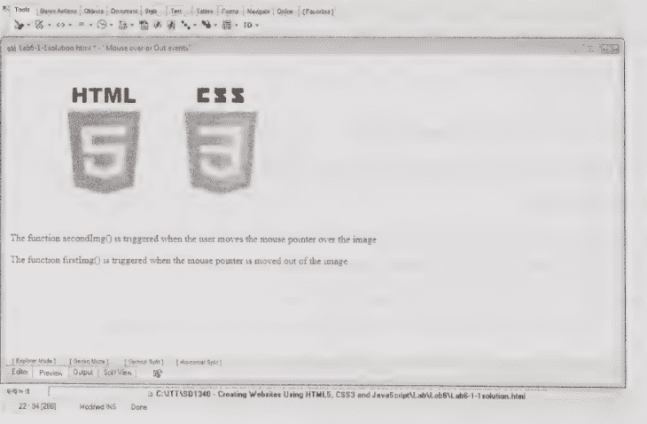

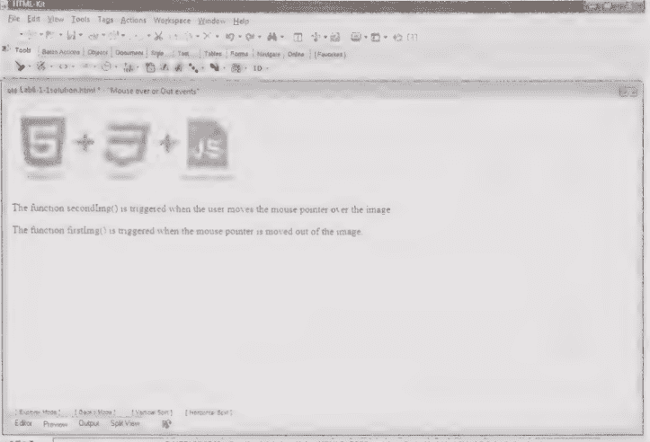

8. 截取每个状态的屏幕截图以供提交，并保存网页。

### 任务 2：对网页进行编程以响应用户鼠标点击

1. 单击**文件 | 新建文档**创建一个名为 *nnLab6-1-2.html* 的新文档，并将其保存到 SD1340 文件夹。

2. 更改 DOCTYPE 以指定您正在使用 HTML5。

3. 将 `<title>` 更改为 Click Mouse Event。

4. 在 `<head>` 块内添加以下代码：

```
<script type="application/javascript">
function clickMeEvent(obj)
{
    if (obj.innerHTML=="Click Me<br>Thank You<br>Goodbye")
    {
        obj.style.display="none";
    }
    else if (obj.innerHTML=="Click Me<br>Thank You")
    {
        obj.innerHTML="Click Me<br>Thank You<br>Goodbye";
    }
    else if (obj.innerHTML=="Click Me")
    {
        obj.innerHTML="Click Me<br>Thank You";
    }
}
</script>
```

5. 在 `<body>` 块内添加以下代码：

```
<div style="width:100%;height:140px;">
    <div style="background-color:red;width:170px;height:80px;margin:20px;
    padding-top:20px;color:white;font-weight:bold;font-size:18px;float:left;
    text-align:center;"
    onclick="clickMeEvent(this)">Click Me</div>
</div>
```

a. 变量 `obj` 指的是什么对象？

6. 在浏览器窗口中预览以查看 Click Mouse 事件。

（注意：此网页仅适用于 IE 9 或更高版本，因此请使用 Google Chrome 或 Firefox 预览）

以下是输出示例：

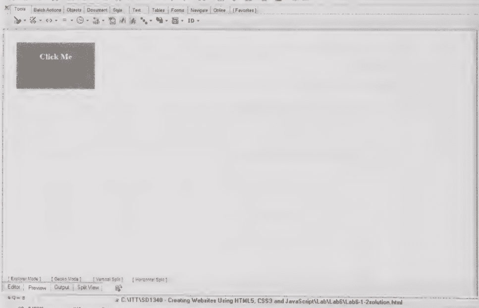

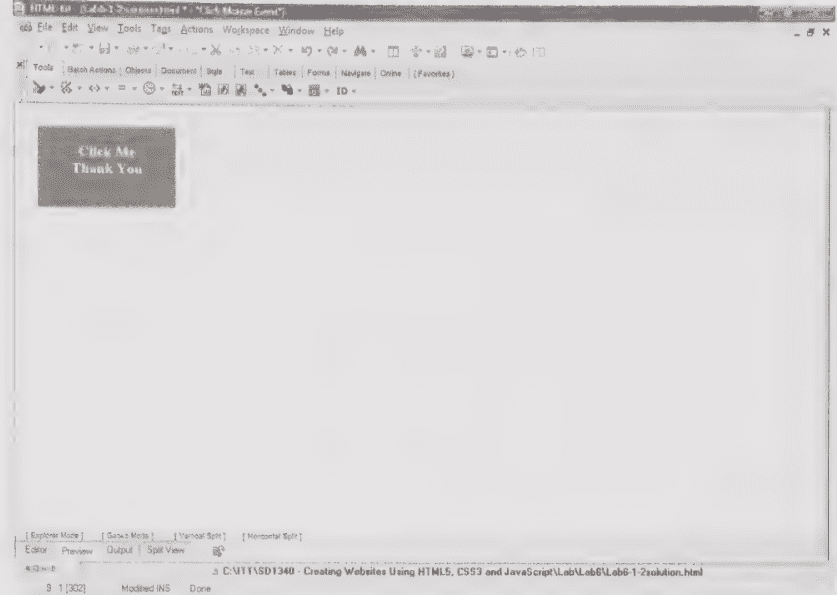

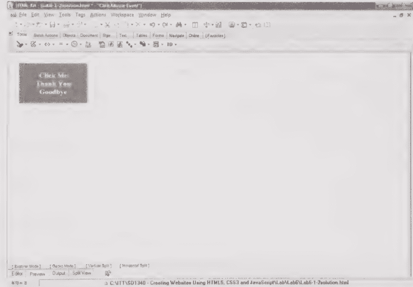

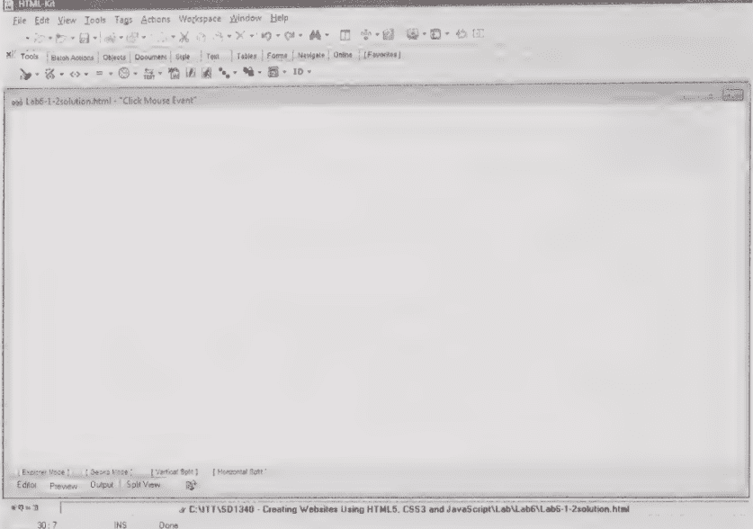

7. 截取每个状态的屏幕截图以供提交，并保存网页。

### 任务 3：当页面加载时对网页进行编程以执行操作

1. 单击**文件 | 新建文档**创建一个名为 *nn*Lab6-1-3.html 的新文档，并将其保存到 SD1340 文件夹。

2. 更改 DOCTYPE 以指定您正在使用 HTML 5。

3. 将 `<title>` 更改为 Loading A Page Event。

4. 在 `<head>` 块内添加以下代码：

```
<script>
function myFunction()
{
    alert("A page is loaded");
}
</script>
```

a. 除了 `alert()` 方法，再命名两个 Window 对象的弹出消息框。

5. 在 `<body>` 标签内添加以下代码：

```
onload="myFunction()"
```

6. 在 `<body>` 块内添加以下代码：

```
<h1>Hello World!</h1>
```

7. 在浏览器窗口中预览以查看页面加载事件。

以下是输出示例：

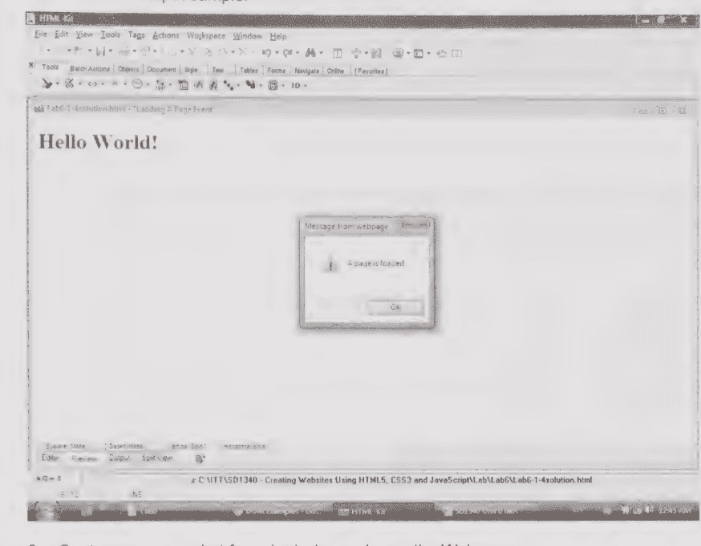

8. 截取屏幕截图以供提交，并保存网页。

### 任务 4：当图像加载时对网页进行编程以执行操作

1. 单击**文件 | 新建文档**创建一个名为 *nnLab6-1-4.html* 的新文档，并将其保存到 SD1340 文件夹。

2. 更改 DOCTYPE 以指定您正在使用 HTML 5。

3. 将 `<title>` 更改为 Loading An Image Event。

4. 通过互联网搜索图像文件，并将图像文件保存到 SD1430 文件夹。

（注意：您可能需要在主机上搜索图像文件，然后将其复制到主机。）

5. 在 `<head>` 块内添加以下代码：

```
<script>
function loadImage()
{
    alert("An image is loaded");
}
```

### 任务 4：编写一个网页，在图片加载时执行操作

1. 点击 **文件 | 新建文档** 创建一个名为 *nnLab6-1-4.html* 的新文档，并将其保存到 SD1340 文件夹。

2. 更改 DOCTYPE 以指明你正在使用 HTML 5。

3. 将 `<title>` 更改为 "图片加载事件"。

4. 在 `<head>` 代码块中添加以下代码：

```
<script>
function loadImage()
{
    alert("Image is loaded!");
}
</script>
```

5. 在 `<body>` 代码块中添加以下代码：

（注意：你的图片文件名可能不同。）

```

```

a. 除了 `onload` 事件，再列举 Image 对象的 2 个事件。

6. 在浏览器窗口中预览以查看图片加载事件。

以下是输出示例：

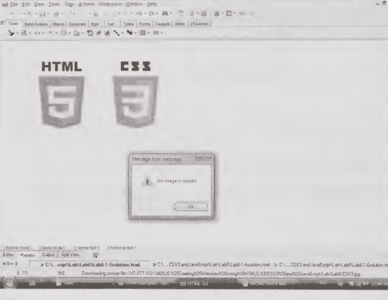

7. 截屏并保存网页。

### 任务 5：编写一个网页，在输入框内容改变时执行操作

1. 点击 **文件 | 新建文档** 创建一个名为 *nnLab6-1-5.html* 的新文档，并将其保存到 SD1340 文件夹。

2. 更改 DOCTYPE 以指明你正在使用 HTML 5。

3. 将 `<title>` 更改为 "输入框内容改变事件"。

4. 在 `<head>` 代码块中添加以下代码：

```
<script>
function myFunction()
{
    var x = document.getElementById("name");
    x.value = x.value.toUpperCase();
}
</script>
```

a. 变量 `x` 引用的是哪个对象？

5. 在 `<body>` 代码块中添加以下代码：

```
Enter your name: <input type="text" id="name" onchange="myFunction()">
<br><br><br>
<p>When you leave the input field, a function is triggered which transforms
the input text to upper case.</p>
```

6. 在浏览器窗口中预览以查看输入框改变事件。在字段中输入内容，然后点击页面的其他位置使字段失去焦点。

以下是输出示例：

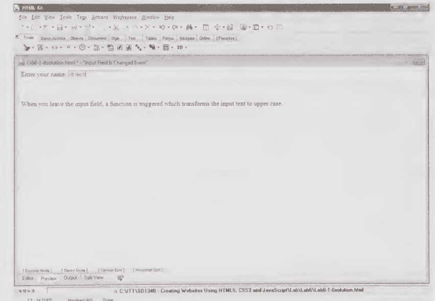

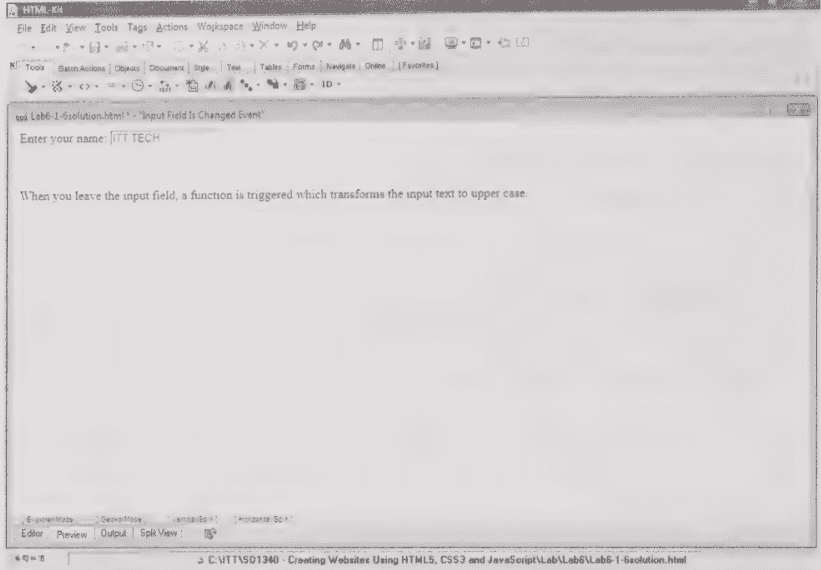

7. 截屏以供提交，并保存网页。

### 任务 6：编写一个网页，在表单按钮被点击时执行操作

1. 点击 **文件 | 新建文档** 创建一个名为 *nnLab6-1-6.html* 的新文档，并将其保存到 SD1340 文件夹。

2. 更改 DOCTYPE 以指明你正在使用 HTML 5。

3. 将 `<title>` 更改为 "表单按钮点击事件"。

4. 在 `<head>` 代码块中添加以下代码：

```
<script>
function myFunction()
{
    document.getElementById("display").innerHTML = "Thank You!";
}
</script>
```

a. `innerHTML` 属性是设置还是返回节点对象或元素对象的内部 HTML 文本值？

5. 在 `<body>` 代码块中添加以下代码：

```
<p>Click the button to trigger a function.</p>
<button onclick="myFunction()">Click me</button>
<p id="display"></p>
```

6. 在浏览器窗口中预览以查看表单按钮点击事件。

以下是输出示例：

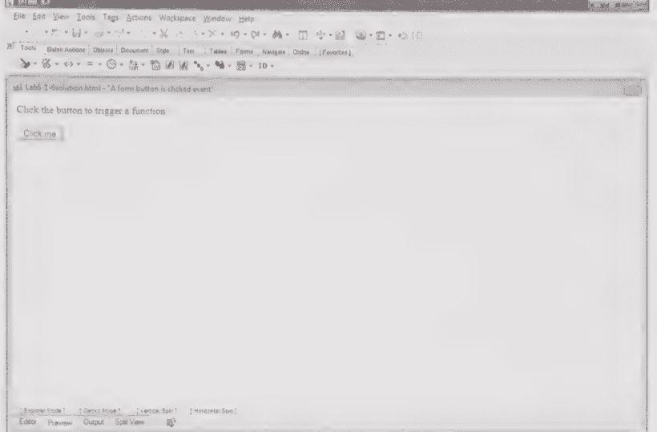

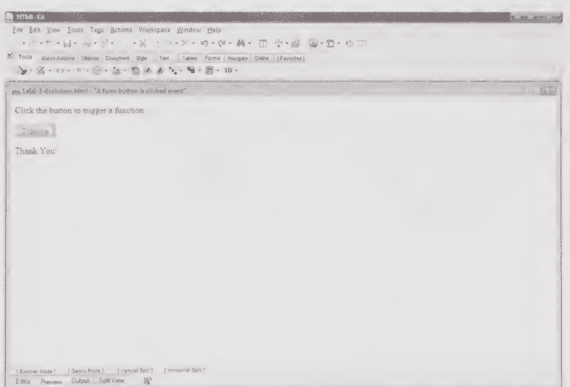

7. 截屏以供提交，并保存网页。

提交包含所有必需截图的 Word 文档。同时提交你的网页。

## 实验 6-2：在不同移动设备上显示 HTML5 网页

### 目的

在本实验中，你将学习在不同移动设备上显示 HTML5 网页。

创建一个 Microsoft Word 文档，并将所有必需的截图放置其中，你将在完成实验时提交该文档。

### 目标

- 在不同移动设备上显示 HTML5 网页。

### 知识背景

不同移动设备的 Web 浏览器具有不同的尺寸和分辨率。在本实验中，你将学习如何在一些不同移动浏览器的模拟器上显示 HTML5 网页。

**预计完成时间：40 分钟**

### 任务 1：在不同移动设备上显示移动网页

1. 已下载 Opera Mobile Emulator，请执行以下步骤：

    a. 从你的虚拟机启用 Internet 连接。

        i. 点击 **Player | Manage | Virtual Machine Settings**。

        ii. 选择 **Network Adapter**。

        iii. 选择 **Bridged**，如下所示。

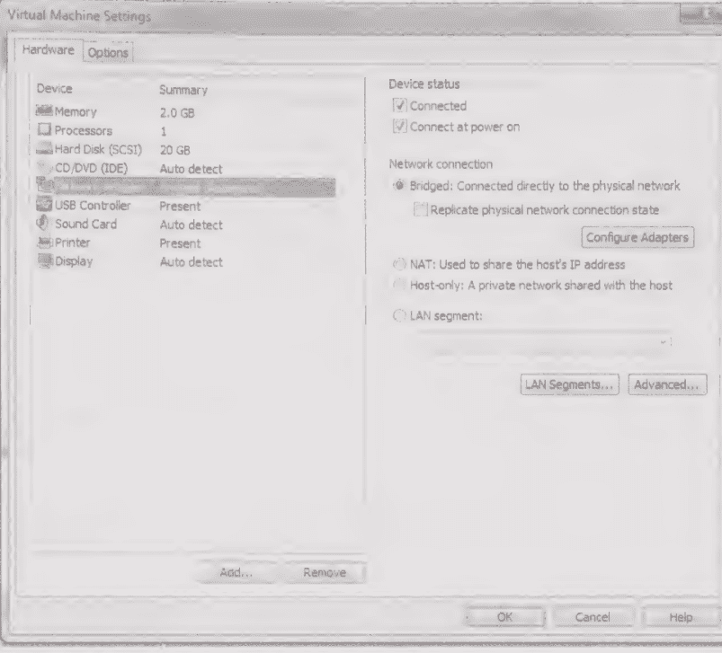

        iv. 点击 **OK**。

    b. 下载 Opera Mobile Emulator。

        i. 打开浏览器。

        ii. 导航至 http://www.opera.com/developer/mobile-emulator

        iii. 点击 Opera Mobile Emulator 12.1 for Windows。

        iv. 将 `Opera_Mobile_Emulator_12.1_Windows.exe` 保存到 SD1340 文件夹。

        v. 将 Opera Mobile Emulator 安装到计算机。

    c. 将你的虚拟机设置改回 Host-Only。

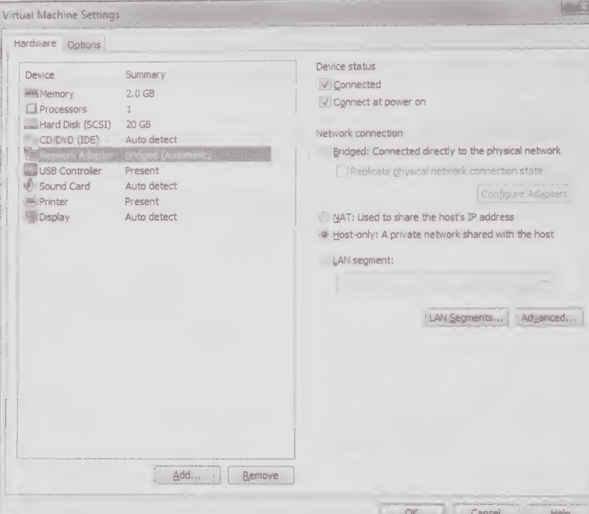

2. 启动 Opera Mobile Emulator。

3. 选择 Amazon Kindle Fire 来显示网页并测试 HTML 事件。

4. 在地址栏中输入 `Lab6-1-1.html` 的路径，以 Amazon Kindle Fire 形式查看网页。

输入

```
file://localhost/C:/Documents%20and%20Settings/Administrator/My%20Documents/SD1340/Lab9-1-1.htm
```

（注意：你的文件名和路径名可能不同）

5. 截取模拟器的屏幕截图：

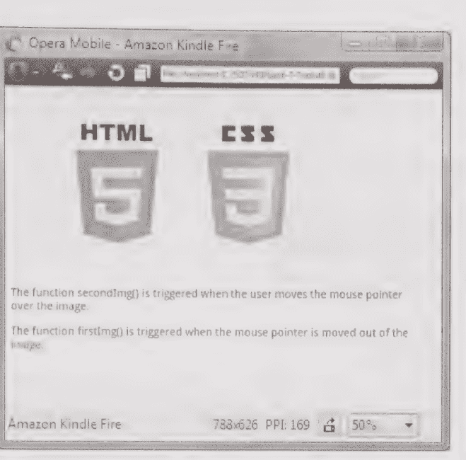

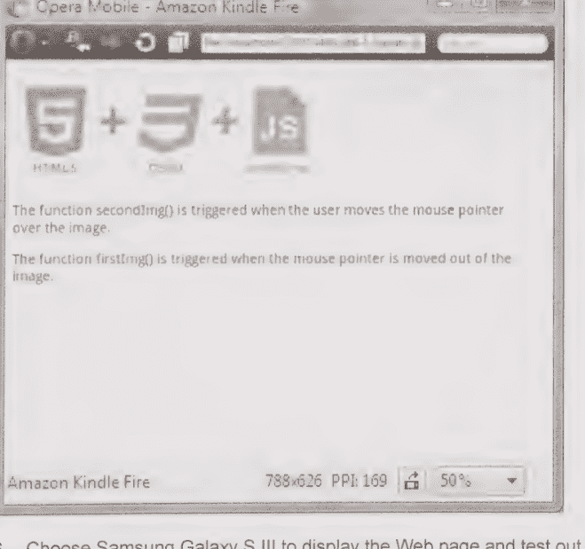

6. 选择 Samsung Galaxy S III 来显示网页并测试 HTML 事件。

7. 在地址栏中输入 `Lab6-1-1.html` 的路径，以 Samsung Galaxy S III 形式查看网页。

输入

```
file://localhost/C:/Documents%20and%20Settings/Administrator/My%20Documents/SD1340/Lab6-1-1.htm
```

（注意：你的文件名和路径名可能不同）

8. 截取模拟器的屏幕截图：

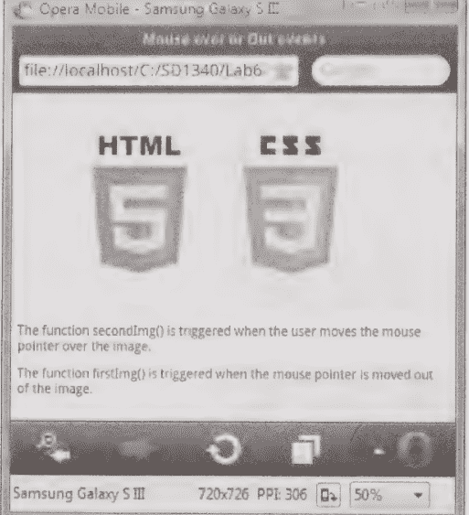

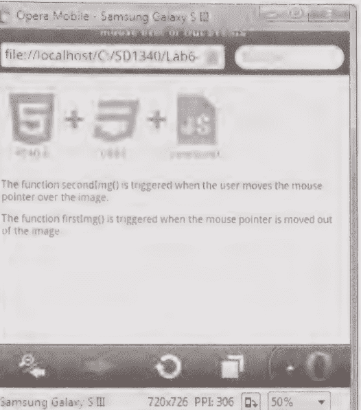

9. 对 *nnLab6-1-2.html* 文件重复步骤 4-8。

10. 对 *nnLab6-1-3.html* 文件重复步骤 4-8。

11. 对 *nnLab6-1-4.html* 文件重复步骤 4-8。

12. 对 *nnLab6-1-5.html* 文件重复步骤 4-8。

13. 对 *nnLab6-1-6.html* 文件重复步骤 4-8。

14. 将所有 HTML 和图片文件复制到主机，并将其与屏幕截图一起交给你的讲师。

15. 关闭你的虚拟机。

### 课程项目第 6 部分：为注册表单添加 HTML 事件

在整个课程中，你将构建一个网站的桌面版和移动版。该网站应围绕你的一个爱好或兴趣。在本单元中，你将增强网站的注册页面。注册页面应实现为一个表单，并应通过 Javascript 提供以下功能和交互：

- 创建一个可以改变背景颜色或图片的按钮。
- 一个重置按钮——点击此按钮时，所有表单数据将被清除。
- 当所有表单数据被清除时，将焦点设置回第一个表单字段。
- 当用户点击任何必填表单字段时，弹出一个警告框。警告框将提供所需数据及其格式的示例。
- 创建一个帮助图标（类似问号图标）。当用户将鼠标悬停在其上时，将显示一些帮助参考信息（例如所需数据及其格式的示例）。当用户将鼠标移开图标时，帮助信息将隐藏。
- 在至少两种移动设备上测试网站（使用 Opera Mobile Emulator），并截屏以供提交。

使用互联网和 ITT Tech 虚拟图书馆搜索 JavaScript 和 HTML DOM 的帮助。

在本单元结束时提交 HTML 页面。提交包含所有必需截图和你的网页的 Word 文档。

## 实验 7-1：创建一个使用渐进增强的网页

### 目的

在本实验中，你将创建并测试一个使用渐进增强以支持多种设备的网页。

创建一个 Microsoft Word 文档来回答问题并将任何必需的截图放置其中。你将在完成实验时提交 Word 文档以及你的网页。

### 目标

- 解释渐进增强的用途。
- 使用媒体查询支持各种设备。
- 使用移动元标签为移动端优化网页。

### 知识背景

随着具有不同浏览器功能和屏幕尺寸的移动设备的普及，Web 开发人员必须在其网页中包含代码，以确保网页在多种设备上正确呈现。媒体查询和移动元标签有助于 Web 开发人员创建对移动设备友好的网页。

**预计完成时间：70 分钟**

### 任务 1：创建一个针对台式机或笔记本电脑设备优化的网页

1. 启动 VMware Player。
2. 启动 ITT-Lab 虚拟机。
3. 打开 HTML-Kit。

    a. 点击 **Start | HTML-Kit | HTML-Kit 292**。

    b. 验证是否已选择 **Create a new file**，然后点击 **OK**。

    c. 点击 **File | Save**。

    d. 将文件保存到 My Documents 中的 SD1340 文件夹，命名为 *nnLab7-1.html*。

    e. 更改 DOCTYPE 以指明你正在使用 HTML 5。

    f. 将 `<title>` 更改为产品评论页面。

4. 将以下 HTML 添加到 `<body>` 部分：

```
<form>
<section id="Instructions">
<h1>感谢您分享您的意见</h1>
<p>请使用此表单告诉我们您的想法。请对每个功能进行 1 到 5 分的评分。</p>
</section>
<section id="Wrapper">
<section id="Ranking">
<h4>易于使用</h4>
<input id="usabilityslider" type="text"/>
<h4>符合预期</h4>
<input id="worksslider" type="text" />
</section>

<section id="Explain">
<h2>请告诉我们更多</h2>
<p>我们将非常感谢您对产品的更多反馈。</p>
<textarea id="moreinfo" rows=7></textarea>
<input type="submit" name="submit" value="提交" />
<p>致电 555-1212 联系我们</p>
</section>
</section>
</form>
```

5. 在 Internet Explorer 8 和 Google Chrome 中测试该页面。

    a. 输入元素在每个浏览器中是如何显示的？

6. 按如下方式修改 `usabilityslider` 输入元素：

```
<input id="usabilityslider" type="range" min=1 max=5 />
```

7. 修改 `worksslider` 输入元素，使其显示与 `usabilityslider` 元素相同的范围。

8. 在 Internet Explorer 8 和 Google Chrome 上测试网页。

    a. 页面有何不同？

    b. 为了确保用户在 IE 8 上只输入 1 到 5 之间的值，你会采取什么额外步骤？

9. 按如下方式修改电话号码：

```
<p>致电 <a href="tel:5551212">555-1212</a> 联系我们</p>
```

10. 在 IE 8 和 Google Chrome 上测试该页面。

    a. 电话号码如何显示？

    b. 此链接在智能手机上的功能是什么？

### 任务 2：使用 CSS 格式化页面

1. 创建一个新的空白样式表。

2. 将其保存为 `nnLab7-1.css`。

3. 使用以下代码定义样式：

```
#Instructions {
    float: left;
    width: 100%;
    background-color: #f0fff0;
}

#Wrapper {
    float: left;
    padding-left: 200px;
    padding-right: 200px;
}

#Ranking {
    position: relative;
    float: left;
    width: 200px;
    right: 200px;
    margin-right: -100%;
}

#Explain {
    position: relative;
    float: right;
    margin-left: -200px;
}
```

4. 在 `<head>` 部分添加以下 `<link>` 元素：

```
<link href="nnLab7-1.css" rel="stylesheet" type="text/css"/>
```

5. 在 Google Chrome 中测试 html 页面。

    a. 当你将浏览器窗口变得非常窄时会发生什么？

6. 在 IE 中测试 html 页面。

    a. 发生了什么？

### 任务 3：添加代码以使样式在 IE 中工作

1. 在 `<head>` 部分添加以下 `<script>` 代码块：

```
<script>
(function() {
  document.createElement("section");
}
)();
</script>
```

2. 在 Internet Explorer 中预览页面。当提示是否允许脚本时，选择 **允许已阻止的内容**。

    a. 此代码对 IE 中页面的支持方式有何影响？

### 任务 4：添加 CSS3 媒体查询

1. 创建一个新的 CSS 文件并保存为 *nnLab7-1mobile.css*。

2. 定义以下样式：

```
#Wrapper {
padding-left: 0;
padding-right: 0;
}

#Ranking {
background-color: lightgray;
height: 200px;
width: 100%;
positioning: absolute;
top: 10%;
left: 0px;
}

#Explain {

height: 300px;
width: 100%;
positioning: absolute;
top: 210px;
left: 0 px;

}
```

3. 添加以下媒体查询。

```
<link href="lab7-1mobile.css" rel="stylesheet" media="only screen and (max-width:320px)">
<link href="lab7-1mobile.css" rel="stylesheet" media="only screen and (min-width:320px) and (max-width:480px)">
```

4. 通过在 Google Chrome 中显示进行测试。水平缩小窗口。截取两种样式的屏幕截图并将其粘贴到你的 Word 文档中。

    a. 发生了什么？

5. 通过在 IE 8 中显示进行测试。水平缩小窗口。

    a. 发生了什么，为什么？

6. 将你的 `.htm` 和 `.css` 文件与 Word 文档一起提交。

提交包含所有必需屏幕截图和网页的 Word 文档。

## 实验 7-2：使用验证器和模拟器测试网页

### 目的

在本次实验中，你将使用验证器和模拟器测试在实验 7-1 中创建的网页。你还将向网页添加一个圆形，并验证其在两种浏览器中均可正常工作。

创建一个 Microsoft Word 文档来回答问题并放置所有必需的屏幕截图。在实验结束时，你将提交 Word 文档以及你的网页。

### 目标

- 解释渐进增强的使用。
- 使用媒体查询来支持各种设备。
- 使用移动元标签来优化网页以适应移动设备。

### 课程关联

随着具有不同浏览器功能和屏幕尺寸的移动设备的普及，Web 开发人员必须在网页中包含代码，以确保网页在多种设备上正确呈现。媒体查询和移动元标签有助于 Web 开发人员创建移动友好的网页。

### 预计完成时间：70 分钟

### 任务 1：在各种移动设备上测试你的网页

1. 启动 VMware Player。
2. 启动 ITT-Lab 虚拟机。
3. 打开 HTML-Kit。

    a. 单击"开始 | HTML-Kit | HTML-Kit 292"。

    b. 打开 `nnLab7-1.htm` 并将其另存为 `nnLab7-2.htm`。

4. 在 Google Chrome 中打开 `nnLab7-2.htm`。

5. 单击右上角的按钮（图 x-x）并选择"工具 | 开发人员工具"。

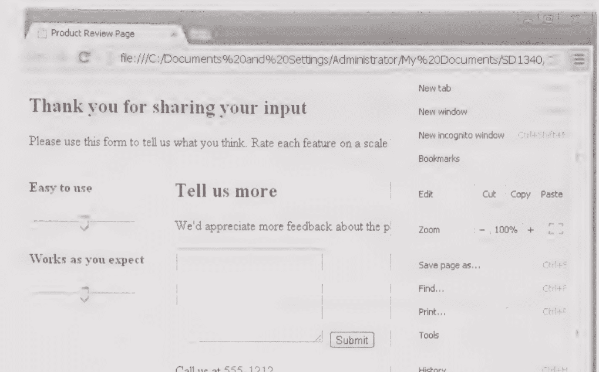

6. 单击右下角的 **设置** 按钮。

7. 勾选 **用户代理** 并选择 Android 2.3 Nexus。

    a. 发生了什么？

8. 选择 **iPhone iOS 4**。

    a. 发生了什么？

    b. 为什么？

9. 选择 **Android 4.02 Galaxy Nexus**。

    a. 发生了什么？

10. 通过将以下 `<meta>` 标签添加到 `<head>` 部分来修改你的 HTML 代码。

11. 保存你的页面。

12. 在 Google Chrome 中，勾选 **设备指标** 并将屏幕分辨率设置为 480 x 480。

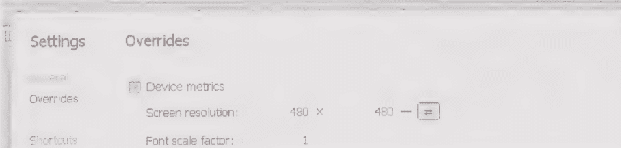

a. 是否应用了垂直布局？

### 任务 2：在灰色矩形内添加一个圆形

1. 创建一个新的 HTML 页面并将其另存为 `nn7-2-2.htm`。

2. 将 doctype 更改为引用 HTML 5。

3. 将页面标题更改为圆形。

4. 将以下 HTML 添加到 `<body>` 部分：

```
<div class="Circle">
Hello
</div>
<div class="Circle">
World
</div>
```

5. 在 `<head>` 部分中定义以下样式：

```
.Circle {
    background-color: green;
    color: white;
    height: 10em;
    width: 10em;
    border-radius: 5em;
    text-align: center;
    line-height: 10em;
}
```

6. 在 Google Chrome 和 Internet Explorer 中查看页面。截取每个浏览器的屏幕截图并将其粘贴到你的 Word 文档中。

7. 将 Circle 样式的高度更改为 5em。

8. 在两种浏览器中进行测试。

    a. 发生了什么？

9. 将 Circle 的行高更改为 5em。

10. 再次在两种浏览器中进行测试。截取屏幕截图并将其粘贴到你的 Word 文档中。

### 任务 3：使用验证器测试你的 HTML 和 CSS

1. 在你的主机上，启动一个 Web 浏览器并导航到：

    http://validator.w3.org/

2. 单击"直接输入验证"。

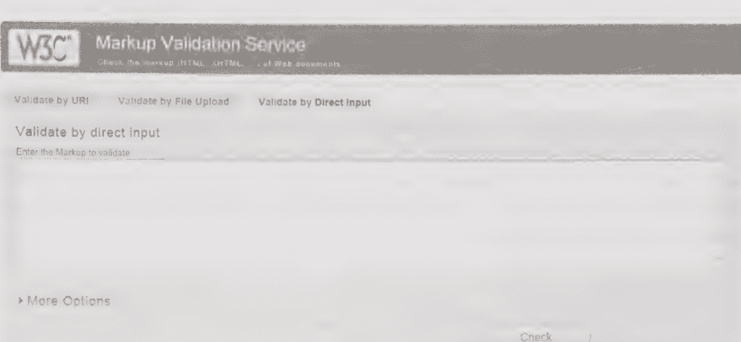

3. 选择所有文本并复制。将其粘贴到验证窗口中，然后单击 **检查**。截取输出结果的屏幕截图并将其粘贴到你的 Word 文档中。

4. 使用相同的过程来验证 *nnLab7-2-2.html*。

5. 单击 CSS 验证服务。

6. 使用直接输入来验证你在实验 7-1 中的两个 CSS 文件。复制结果并将其粘贴到 Word 文档中。

7. 提交你的 Word 文档和 HTML 文件。

### 课程项目第 7 部分：创建网站的移动版本

在整个课程中，你将构建一个网站的桌面版和移动版。该网站应与你的爱好或兴趣之一相关。在本单元中，你将通过创建和链接 CSS 样式表来增强主页和注册页面，这些样式表将为小于 320 像素宽的屏幕尺寸以及 320 到 480 像素宽的屏幕尺寸设置页面格式。你还将添加脚本，以确保在 IE 8 中查看页面时应用 HTML5 样式。

- 为主页创建两个 CSS 样式表：一个用于小于 320 像素宽，另一个用于 320 到 480 像素宽之间。
- 为注册页面创建两个 CSS 样式表：一个用于小于 320 像素宽，另一个用于 320 到 480 像素宽之间。
- 添加 JavaScript 代码，为两个页面将你使用的 HTML5 元素添加到 DOM 中。
- 为主页和注册页面添加必要的媒体查询和元标签。

使用教科书获取有关 JavaScript 和媒体查询的帮助。使用互联网和 ITT-Tech 虚拟图书馆搜索有关 CSS 的帮助。

在本单元结束时提交 HTML 和 CSS 页面。提交包含所有必需屏幕截图的 Word 文档。同时提交你的网页。

## 实验 8-1：编写使用 `<canvas>` 元素的网页

### 目的

在本实验中，你将创建并测试一个使用 `<canvas>` 元素的 HTML5 网页。

创建一个 Microsoft Word 文档，将所有必需的截图放在其中，在实验完成时提交。

### 目标

- 使用 `<canvas>` 元素在网页上绘制图形。
- 使用 `<canvas>` 元素在网页上显示图像。

### 如何融入

HTML5 的 `<canvas>` 元素用于通过 JavaScript 即时绘制图形。在本实验中，你将学习如何使用 `<canvas>` 元素进行绘制和添加图像。

### 预计完成时间：60 分钟

### 任务 1：编写网页在画布上填充颜色

1. 启动 VMware Player。
2. 启动 ITT-Lab 虚拟机。
3. 打开 HTML-Kit。

    a. 点击**开始 | HTML-Kit | HTML-Kit 292**。

    b. 确认**创建新文件**已选中，然后点击 **OK**。

    c. 点击**文件 | 保存**。

    d. 将文件保存到"我的文档"中的 SD1340 文件夹，文件名为 *nn*Lab8-1-1.html。

    e. 将 DOCTYPE 改为指定使用 HTML 5。

    f. 将 `<title>` 改为 Fill Color Onto A Canvas。

4. 在 `<body>` 块内添加以下 HTML 代码：

```
<canvas id="myCanvas" width="200" height="100" style="border:1px solid blue">
Your browser does not support the HTML5 canvas tag.
</canvas>

<script>
    var c=document.getElementById("myCanvas");
    var ctx=c.getContext("2d");
    ctx.fillStyle="red";
    ctx.fillRect(0,0,150,75);
</script>
```

a. 使用什么方法来查找画布？

5. 在浏览器窗口中预览，查看带有填充颜色矩形的画布。

（注意：此网页仅适用于 IE 9 或更高版本，请使用 Google Chrome 或 Firefox 预览）

以下是输出示例：

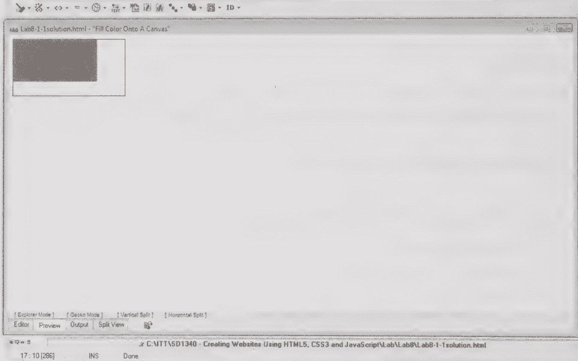

6. 截取屏幕截图用于提交，并保存网页。

### 任务 2：编写网页在画布上绘制线条

1. 点击**文件 | 新建文档**，创建名为 *nn*Lab8-1-2.html 的新文档，并将其保存到 SD1340 文件夹。

2. 将 DOCTYPE 改为指定使用 HTML 5。

3. 将 `<title>` 改为 Draw A Line To A Canvas。

4. 在 `<body>` 块内添加以下代码：

```
<canvas id="myCanvas" width="200" height="100" style="border:1px solid blue">
Your browser does not support the HTML5 canvas tag.</canvas>

<script>
var c=document.getElementById("myCanvas");
var ctx=c.getContext("2d");
ctx.moveTo(0,0);
ctx.lineTo(200,100);
ctx.strokeStyle='red';
ctx.stroke();
</script>
```

a. 使用什么方法设置线条颜色？

5. 在浏览器窗口中预览，查看画布上绘制的彩色线条。

（注意：此网页仅适用于 IE 9 或更高版本，请使用 Google Chrome 或 Firefox 预览）

6. 以下是输出示例：


7. 截取屏幕截图用于提交，并保存网页。

### 任务 3：编写网页在画布上绘制圆形

1. 点击**文件 | 新建文档**，创建名为 *nn*Lab8-1-3.html 的新文档，并将其保存到 SD1340 文件夹。

2. 将 DOCTYPE 改为指定使用 HTML5。

3. 将 `<title>` 改为 Draw Circles To A Canvas。

4. 在 `<body>` 块内添加以下代码：

```
<canvas id="myCanvas" width="200" height="250" style="border:1px solid blue;">
Your browser does not support the HTML5 canvas tag.</canvas>

<script>
    var c=document.getElementById("myCanvas");
    var ctx=c.getContext("2d");
    ctx.beginPath();
    ctx.arc(95,50,40,0,2*Math.PI);
    ctx.strokeStyle='red';
    ctx.stroke();

    ctx.beginPath();
    ctx.arc(95,200,40,0,2*Math.PI);
    ctx.fillStyle='red';
    ctx.fill();
</script>
```

a. 使用什么方法绘制圆形？

5. 在浏览器窗口中预览，查看画布上的填充颜色圆形和空心圆形。

（注意：此网页仅适用于 IE 9 或更高版本，请使用 Google Chrome 或 Firefox 预览）

以下是输出示例：


6. 截取屏幕截图用于提交，并保存网页。

### 任务 4：编写网页在画布上绘制文本

1. 点击**文件 | 新建文档**，创建名为 *nn*Lab8-1-4.html 的新文档，并将其保存到 SD1340 文件夹。

2. 将 DOCTYPE 改为指定使用 HTML 5。

3. 将 `<title>` 改为 Draw Text To A Canvas。

4. 在 `<body>` 块内添加以下代码：

```
<canvas id="myCanvas" width="250" height="200" style="border:1px solid blue">
Your browser does not support the HTML5 canvas tag.</canvas>

<script>
    var c=document.getElementById("myCanvas");
    var ctx=c.getContext("2d");
    ctx.font="40px Arial";
    ctx.fillStyle='red';
    ctx.fillText("Hello World",10,50);
    ctx.strokeStyle='red';
    ctx.strokeText("Hello World",10,150);
</script>
```

a. 使用什么方法绘制无填充文本？

5. 在浏览器窗口中预览，查看画布上的填充颜色文本和描边文本。

（注意：此网页仅适用于 IE 9 或更高版本，请使用 Google Chrome 或 Firefox 预览）

以下是输出示例：


6. 截取屏幕截图用于提交，并保存网页。

### 任务 5：编写网页在画布上添加渐变

1. 点击**文件 | 新建文档**，创建名为 nnLab8-1-5.html 的新文档，并将其保存到 SD1340 文件夹。

2. 将 DOCTYPE 改为指定使用 HTML 5。

3. 将 `<title>` 改为 Add Linear Gradient Onto A Canvas。

4. 在 `<body>` 块内添加以下代码：

```
<canvas id="myCanvas" width="400" height="100" style="border:1px solid blue">
Your browser does not support the HTML5 canvas tag.</canvas>

<script>
    var c=document.getElementById("myCanvas");
    var ctx=c.getContext("2d");

    // Create gradient
    var grd=ctx.createLinearGradient(0,0,400,0);
    grd.addColorStop(0,"yellow");
    grd.addColorStop(1,"black");

    // Fill with gradient
    ctx.fillStyle=grd;
    ctx.fillRect(10,10,350,80);
</script>
```

a. 渐变位置的值是什么？

5. 在浏览器窗口中预览，查看画布上的线性渐变色。

（注意：此网页仅适用于 IE 9 或更高版本，请使用 Google Chrome 或 Firefox 预览）

6. 以下是输出示例：


7. 截取屏幕截图用于提交，并保存网页。

提交包含所有必需截图的 Word 文档。同时提交你的网页。

## 实验 8-2：使用 HTML5 表单元素编写网页

### 目的

在本实验中，你将创建并测试一个带有 HTML5 表单元素的网页。

创建一个 Microsoft Word 文档，将所有必需的截图放在其中，在实验完成时提交。

### 目标

- 创建一个使用 HTML5 特性的表单。
- 创建一个执行输入验证的表单。

### 如何融入

HTML5 提供了新的输入特性，以实现更好的输入控制和验证。在本实验中，你将学习如何使用 HTML5 表单元素。

### 预计完成时间：40 分钟

### 任务 1：编写网页使用 datetime-local 类型进行用户输入

1. 点击**文件 | 新建文档**，创建名为 *nn*Lab8-2-1.html 的新文档，并将其保存到 SD1340 文件夹。

2. 将 DOCTYPE 改为指定使用 HTML 5。

3. 将 `<title>` 改为 Datetime-local Type For User Input。

4. 在 `<body>` 块内添加以下代码：

```
<form action="">
  Birthday (date and time):<input type="datetime-local"
name="bdaytime">
<input type="submit">
</form>
```

a. `datetime-local` 输入类型能否选择特定时区？

5. 在浏览器窗口中预览，查看 `datetime-local` 类型的用户输入。

（注意：此网页仅适用于 Google Chrome）

以下是输出示例：


6. 截取屏幕截图用于提交，并保存网页。

### 任务 2：编写网页使用 month 类型进行用户输入

1. 点击 **文件 | 新建文档** 创建名为 nnLab8-2-2.html 的新文档，并将其保存到 SD1340 文件夹。

2. 将 DOCTYPE 改为指定使用 HTML 5。

3. 将 `<title>` 改为 Month And Year Type For User Input。

### 任务 3：编写一个网页，为用户输入提供数字类型

1. 点击**文件 | 新建文档**，创建一个名为 *nnLab8-2-3.html* 的新文档，并将其保存到 SD1340 文件夹。

2. 更改 DOCTYPE 以指定你正在使用 HTML 5。

3. 将 `<title>` 更改为"用于用户输入的数字类型"。

4. 在 `<body>` 代码块中添加以下代码：

```
<form action="">
  Quantity (between 1 and 10):<input type="number" name="quantity" min="1" max="10">
  <input type="submit">
</form>
```

a. 使用数字类型输入时，有哪些限制字段？

5. 在浏览器窗口中预览，查看用户输入的数字类型。

（注意：此网页仅适用于 IE 9 或更高版本，请使用 Google Chrome 进行预览）

以下是输出示例：


6. 捕获屏幕截图以供提交，并保存该网页。

### 任务 4：编写一个网页，为用户输入提供范围类型

1. 点击**文件 | 新建文档**，创建一个名为 `nnLab8-2-4.html` 的新文档，并将其保存到 SD1340 文件夹。

2. 更改 DOCTYPE 以指定你正在使用 HTML 5。

3. 将 `<title>` 更改为"用于用户输入的范围类型"。

4. 在 `<body>` 代码块中添加以下代码：

```
<form action="" method="get">
  Points (1-10):<input type="range" name="points" min="1" max="10">
  <input type="submit">
</form>
```

a. 除了 `max` 和 `min`，还有哪些其他属性可用于指定范围类型输入？

5. 在浏览器窗口中预览，查看用户输入的范围类型。

（注意：此网页仅适用于 IE 9 或更高版本，请使用 Google Chrome 进行预览）

以下是输出示例：


6. 捕获屏幕截图以供提交，并保存该网页。

### 任务 5：编写一个网页，为用户输入提供 pattern 属性

1. 点击**文件 | 新建文档**，创建一个名为 *nnLab8-2-5.html* 的新文档，并将其保存到 SD1340 文件夹。

2. 更改 DOCTYPE 以指定你正在使用 HTML5。

3. 将 `<title>` 更改为"用于用户输入的 pattern 属性"。

4. 在 `<body>` 代码块中添加以下代码：

```
<form action="">
  Three letter country code: <input type="text" name="country_code"
       pattern="[A-Za-z]{3}" title="Three letter country code">
  <input type="submit">
</form>
```

5. 在浏览器窗口中预览，查看用户输入的 pattern 属性。测试有效和无效的输入。

（注意：此网页仅适用于 IE 9 或更高版本，请使用 Google Chrome 或 Firefox 进行预览）

以下是输出示例：


6. 捕获屏幕截图以供提交，并保存该网页。

### 任务 6：编写一个网页，为用户输入提供 required 属性

1. 点击**文件 | 新建文档**，创建一个名为 *nnLab8-2-6.html* 的新文档，并将其保存到 SD1340 文件夹。

2. 更改 DOCTYPE 以指定你正在使用 HTML5。

3. 将 `<title>` 更改为"用于用户输入的 required 属性"。

4. 在 `<body>` 代码块中添加以下代码：

```
<form action="">
  Username (required):<input type="text" name="usrname" required>
  <input type="submit">
</form>
```

5. 在浏览器窗口中预览，查看用户输入的 required 属性。

6. 以下是输出示例：

（注意：此网页仅适用于 IE 9 或更高版本，请使用 Google Chrome 或 Firefox 进行预览）


7. 捕获屏幕截图以供提交，并保存该网页。

8. 将所有 HTML 和图像文件复制到主机，并将它们与屏幕截图一起交给你的讲师。

9. 关闭你的虚拟机。

### 课程项目第 8 部分：为注册表单添加 HTML 事件

在整个课程中，你将构建一个网站的桌面版和移动版。该网站应该关于你的一个爱好或兴趣。在本单元中，你将使用以下功能来增强网站：

- 在主页上使用 `<canvas>` 标签创建一个多色标题文本，以描述该网站。

  提示：阅读第 168-169 页关于使用多色的内容。

- 在注册页面上，为任何与日期相关的表单字段使用 `datetime-local` 类型或 `month` 类型输入。

- 在注册页面上，使用 `required` 属性来验证任何必填字段。

- 使用至少两个移动设备（使用 Google Chrome 的模拟器）测试该网站，并截取屏幕截图以供提交。

使用互联网和 ITT Tech 虚拟图书馆搜索有关 JavaScript 和 HTML DOM 的帮助。

在本单元结束时，提交你创建的 HTML 和 CSS 页面。提交包含所有必需屏幕截图的 Word 文档。

## 实验 9-1：使用 jQuery 框架编写网页

### 目的

在本实验中，你将创建并测试一个使用 jQuery 框架的 HTML5 网页。

创建一个 Microsoft Word 文档，并将所有必需的屏幕截图放置在其中，你将在实验结束时提交该文档。

### 目标

- 使用 jQuery 选择器。
- 包含并使用 jQuery 框架。

### 契合点

使用 jQuery 的目的是使 JavaScript 更易于用于网站开发。在本实验中，你将学习如何安装 jQuery 以及如何使用 jQuery 来简化 JavaScript 编程。

**预计完成时间：60 分钟**

### 任务 1：安装和测试 jQuery 框架

1. 启动 VMware Player。
2. 启动 ITT-Lab 虚拟机。
3. 下载 jQuery 库，执行以下步骤：

    a. 从你的虚拟机启用 Internet 连接。

        i. 点击 **Player | Manage | Virtual Machine Settings**。

        ii. 选择 **Network Adapter**。

        iii. 选择 **Bridged**，如下所示。


        iv. 点击 **OK**。

    b. 下载 jQuery。

        i. 打开一个浏览器。

        ii. 导航至 **http://jquery.com/**。

        iii. 点击 **Download jQuery**。

        iv. 点击 **Download the Compressed Production jQuery 1.10.1**。

        v. 注意：可能有更新版本的 jQuery。如果有，请下载支持 Internet Explorer 8 的生产版本。

        vi. 将 Javascript 文件 `jquery-1.10.1.min.js` 保存到 SD1340 文件夹。

4. 将你的虚拟机设置改回 Host-Only。


5. 打开 HTML-Kit。

    a. 点击 **Start | HTML-Kit | HTML-Kit 292**。

    b. 验证是否选择了 **Create a new file**，然后点击 OK。

    c. 点击 **File | Save**。

    d. 将文件保存到"我的文档"中的 SD1340 文件夹，文件名为 *nn*Lab9-1-1.html。

    e. 更改 DOCTYPE 以指定你正在使用 HTML 5。

    f. 将 `<title>` 更改为"My First jQuery Web Page"。

6. 在 `<head>` 代码块中添加以下 HTML 代码：

```
<script src="jquery-1.10.1.min.js"></script>

<script>
$(document).ready(function(){
  $("p").click(function(){
    $(this).hide();
  });
});
</script>
```

a. 为什么 `<script>` 标签内没有 "text/javascript"？

7. 在 `<body>` 代码块中添加以下 HTML 代码：

```
<p>If you click on me, I will be gone!</p>
<p>If you click on me, I will be away!</p>
<p>If you click on me, I don't know what will happen!</p>
```

8. 在浏览器窗口中预览，查看你是否可以使用 jQuery 框架。

以下是输出示例：


9. 捕获屏幕截图以供提交，并保存该网页。

### 任务 2：使用 jQuery 编写具有隐藏和显示效果的网页

1. 点击**文件 | 新建文档**创建一个名为 *nnLab9-1-2.html* 的新文档，并将其保存到 SD1340 文件夹。

2. 更改 DOCTYPE 以指定你使用的是 HTML 5。

3. 将 `<title>` 更改为 Hide And Show Effects。

4. 在 `<head>` 块中添加以下代码：

```
<script src="jquery-1.10.1.min.js">
</script>

<script>
$(document).ready(function(){
    $("#hide").click(function(){
        $(".p1").hide();
        $(".p2").show();
        $("hr").hide();
    });
    $("#show").click(function(){
        $(".p2").hide();
        $(".p1").show();
    });
});
</script>
```

a. 给出一个元素选择器的例子。

b. 给出一个 id 选择器的例子。

c. 给出一个类选择器的例子。

5. 在 `<body>` 块中添加以下代码：

```
<p class="p1">If you click on the "Hide" button, I will disappear.</p>
<p class="p2">If you click on the "Show" button, I will show up.</p>
<hr>
<br>
<button id="hide">Hide</button>
<button id="show">Show</button>
```

6. 在浏览器窗口中预览，以查看 HTML 元素的隐藏和显示效果。

以下是一个输出示例：


7. 截取屏幕截图以供提交，并保存网页。

### 任务 3：使用 jQuery 编写具有淡入和淡出效果的网页

1. 点击**文件 | 新建文档**创建一个名为 *nnLab9-1-3.html* 的新文档，并将其保存到 SD1340 文件夹。

2. 更改 DOCTYPE 以指定你使用的是 HTML 5。

3. 将 `<title>` 更改为 Fade In And Fade Out Effects。

4. 在 `<head>` 块中添加以下代码：

```
<script src="jquery-1.10.1.min.js">
</script>

<script>
$(document).ready(function(){
  $(".button1").click(function(){
    $("#div1").fadeIn();
    $("#div2").fadeIn("slow");
    $("#div3").fadeIn(3000);
  });
});
</script>

<script>
$(document).ready(function(){
  $(".button2").click(function(){
    $("#div1").fadeOut();
    $("#div2").fadeOut("slow");
    $("#div3").fadeOut(3000);
  });
});
</script>
```

a. 除了 `fadeIn()` 和 `fadeOut()` 方法外，还有哪些淡入淡出方法可用？

5. 在 `<body>` 块中添加以下代码：

```
<p>Demonstrate fadeIn() with different parameters.</p>
<button class="button1">Click to fade in boxes</button>
<br>
<p>Demonstrate fadeOut() with different parameters.</p>
<button class="button2">Click to fade out boxes</button>
<br><br>
<div id="div1"
style="width:80px;height:80px;display:none;background-color:red;">
</div><br>
<div id="div2"
style="width:80px;height:80px;display:none;background-color:green;">
</div><br>
<div id="div3"
style="width:80px;height:80px;display:none;background-color:blue;">
</div>
```

6. 在浏览器窗口中预览，以查看 HTML 元素的淡入和淡出效果。

以下是一个输出示例：


7. 截取屏幕截图以供提交，并保存网页。

### 任务 4：使用 jQuery 添加向下滑动和向上滑动效果

1. 点击**文件 | 新建文档**创建一个名为 *nnLab9-1-4.html* 的新文档，并将其保存到 SD1340 文件夹。

2. 更改 DOCTYPE 以指定你使用的是 HTML 5。

3. 将 `<title>` 更改为 Slide Down And Slide Up Effects。

4. 在 `<head>` 块中添加以下代码：

```
<script src="jquery-1.10.1.min.js"></script>

<script>
$(document).ready(function(){
  $("#title").click(function(){
    $("#panel").slideToggle("slow");
  });
});
</script>

<style type="text/css">
#panel,#title
{
padding:10px;
color:blue;
text-align:center;
background-color:red;
}
#panel
{
padding:50px;
display:none;
}
</style>
```

a. 除了 `slideToggle` 方法外，还有哪些滑动方法可用？

5. 在 `<body>` 块中添加以下代码：

```
<div id="title">Click to slide the panel down or up</div>
<div id="panel">Hello world!</div>
```

6. 在浏览器窗口中预览，以查看 HTML 元素的向下滑动和向上滑动效果。

以下是一个输出示例：


7. 截取屏幕截图以供提交，并保存网页。

### 任务 5：使用 jQuery 为网页添加动画效果

1. 点击**文件 | 新建文档**创建一个名为 *nnLab9-1-5.html* 的新文档，并将其保存到 SD1340 文件夹。

2. 更改 DOCTYPE 以指定你使用的是 HTML 5。

3. 将 `<title>` 更改为 Animated Effects。

4. 在 `<head>` 块中添加以下代码：

```
<script src="jquery-1.10.1.min.js"></script>

<script>
$(document).ready(function(){
  $("button#demo").click(function(){
    $("div#demo").animate({left:"300px",opacity:"0.5"}, "slow");
    $("div#demo").animate({fontSize:"4em"}, "slow");
  });
});
</script>
```

5. 在 `<body>` 块中添加以下代码：

```
<button id="demo">Start Animation</button><br><br>
<div id="demo" style="background:orange; height:100px;
width:300px; position:relative;">
ITT Tech</div>
```

6. 在浏览器窗口中预览，以查看 HTML 元素的动画效果。

7. 以下是一个输出示例：


8. 截取屏幕截图以供提交，并保存网页。

提交包含所有必需屏幕截图和网页的 Word 文档。

## 实验 9-2：使用 jQuery Mobile 编写移动网页

### 目的

在本实验中，你将创建并测试一个使用 jQuery Mobile 的移动网页。

创建一个 Microsoft Word 文档，并将所有必需的屏幕截图放在其中，在实验完成后提交。

### 目标

- 使用 jQuery Mobile 创建网页。
- 使用移动初始化事件。

### 如何融入

jQuery Mobile 是一个专为移动设备创建网站和应用程序而设计的 HTML5 UI 框架。在本实验中，你将学习如何安装和测试使用 jQuery Mobile 的移动网站。

**预计完成时间：40 分钟**

### 任务 1：安装并测试 jQuery Mobile 框架

1. 要下载 jQuery Mobile 库，请执行以下步骤：

    a. 从虚拟机启用互联网连接。

        i. 点击**播放器 | 管理 | 虚拟机设置**。

        ii. 选择**网络适配器**。

        iii. 选择**桥接模式**，如下图所示。


        iv. 点击**确定**。

    b. 下载 jQuery Mobile。

        i. 打开浏览器。

        ii. 导航到 [http://jquerymobile.com/](http://jquerymobile.com/)。

        iii. 点击**下载**。

        iv. 向下滚动并点击 **Zip 文件：jquery.mobile-1.3.1.zip**。

        v. 将 `jquery.mobile-1.3.1.zip` 保存到 SD1340 文件夹。

        vi. 解压文件，确保以下 3 项位于 SD1340 文件夹中：

            1. `jquery.mobile-1.3.1.min.js` 文件
            2. `jquery.mobile-1.3.1.min.css` 文件
            3. `images` 文件夹

2. 将虚拟机设置改回仅主机模式。


3. 点击**文件 | 新建文档**创建一个名为 *nnLab9-2-1.html* 的新文档，并将其保存到 SD1340 文件夹。

4. 更改 DOCTYPE 以指定你使用的是 HTML 5。

5. 将 `<title>` 更改为 My First jQuery Mobile Web Page。

6. 在 `<head>` 块中添加以下 HTML 代码：

```
<meta name="viewport" content="width=device-width, initial-scale=1">
<script src="jquery-1.10.1.min.js"></script>
<script src="jquery.mobile-1.3.1.min.js"></script>
<link rel="stylesheet" href="jquery.mobile-1.3.1.min.css" />
```

7. 在 `<body>` 块中添加以下 HTML 代码：

```
<div data-role="page">
  <div data-role="header" data-theme="b">
    <h1>My Title</h1>
  </div>
  <div data-role="content" data-theme="b">
    <p>Hello World 1</p>
    <p>Hello World 2</p>
    <p>Hello World 3</p>
    <p>Hello World 4</p>
    <p>Hello World 5</p>
    <p>Hello World 6</p>
    <p>Hello World 7</p>
    <p>Hello World 8</p>
    <p>Hello World 9</p>
    <p>Hello World 10</p>
  </div>
  <div data-role="footer" data-theme="b">
    <h4>我的页脚</h4>
  </div>
</div>
```

8. 启动 Opera Mobile Emulator 并选择 Samsung Galaxy S III 来显示网页。

9. 在地址栏中输入 `Lab9-2-1.html` 的路径来查看网页。

10. 输入

```
file://localhost/C:/Documents%20and%20Settings/Administrator/My%20Documents/SD1340/Lab9-2-1.htm
```

（注意：你的文件名和路径名可能有所不同）

11. 对模拟器进行截图：


12. 截取屏幕截图以供提交，并保存该网页。

### 任务 2：编程制作带列表视图的移动网页

1. 点击 **文件 | 新建文档** 创建一个名为 *nnLab9-2-2.html* 的新文档，并将其保存到 SD1340 文件夹。

2. 更改 DOCTYPE 以指定你使用的是 HTML 5。

3. 将 `<title>` 更改为 Making A Listview。

4. 在 `<head>` 块中添加以下 HTML 代码：

```
<meta name="viewport" content="width=device-width, initial-scale=1">
<script src="jquery-1.10.1.min.js"></script>
<script src="jquery.mobile-1.3.1.min.js"></script>
<link rel="stylesheet" href="jquery.mobile-1.3.1.min.css" />
```

5. 在 `<body>` 块中添加以下代码：

```
<div data-role="page">
    <ul data-role="listview" data-inset="true" data-filter="true">
        <li><a href="#">Appetizers</a></li>
        <li><a href="#">Salads</a></li>
        <li><a href="#">Soups</a></li>
        <li><a href="#">Entrees</a></li>
        <li><a href="#">Deserts</a></li>
        <li><a href="#">Beverages</a></li>
    </ul>
</div>
```

6. 启动 Opera Mobile Emulator 并选择 Samsung Galaxy S III 来显示网页。

7. 在地址栏中输入 `Lab9-2-2.html` 的路径来查看网页。

8. 输入

```
file://localhost/C:/Documents%20and%20Settings/Administrator/My%20Documents/SD1340/Lab9-2-2.htm
```

（注意：你的文件名和路径名可能有所不同）

9. 对模拟器进行截图：


10. 截取屏幕截图以供提交，并保存该网页。

### 任务 3：编程制作带按钮图标的移动网页

1. 点击 **文件 | 新建文档** 创建一个名为 *nnLab9-2-3.html* 的新文档，并将其保存到 SD1340 文件夹。

2. 更改 DOCTYPE 以指定你使用的是 HTML 5。

3. 将 `<title>` 更改为 Adding Buttons。

4. 在 `<head>` 块中添加以下 HTML 代码：

```
<meta name="viewport" content="width=device-width, initial-scale=1">
<script src="jquery-1.10.1.min.js"></script>
<script src="jquery.mobile-1.3.1.min.js"></script>
<link rel="stylesheet" href="jquery.mobile-1.3.1.min.css" />
```

5. 在 `<body>` 块中添加以下代码：

```
<div data-role="page">
    <p><a href="#" data-role="button" data-icon="arrow-l" data-theme="a">
    Left arrow button</a></p>
    <p><a href="#" data-role="button" data-icon="arrow-r" data-theme="b">
    Right arrow button</a></p>
    <p><a href="#" data-role="button" data-icon="delete" data-theme="c">
    Delete button</a></p>
    <p><a href="#" data-role="button" data-icon="gear" data-theme="d">
    Gear button</a></p>
    <p><a href="#" data-role="button" data-icon="info" data-theme="e">
    Info button</a></p>
    <p><a href="#" data-role="button" data-icon="refresh" data-theme="a">
    Refresh button</a></p>
    <p><a href="#" data-role="button" data-icon="forward" data-theme="b">
    Forward button</a></p>
    <p><a href="#" data-role="button" data-icon="back" data-theme="c">
    Back button</a></p>
    <p><a href="#" data-role="button" data-icon="home" data-theme="d">
    Home button</a></p>
    <p><a href="#" data-role="button" data-icon="search" data-theme="e">
    Search button</a></p>
</div>
```

6. 启动 Opera Mobile Emulator 并选择 Samsung Galaxy S III 来显示网页。

7. 在地址栏中输入 `Lab9-2-3.html` 的路径来查看网页。

```
file://localhost/C:/Documents%20and%20Settings/Administrator/My%20Documents/SD1340/Lab9-2-3.htm
```

（注意：你的文件名和路径名可能有所不同）

8. 对模拟器进行截图：


9. 截取屏幕截图以供提交，并保存该网页。

### 课程项目第 9 部分：为网站添加 jQuery 和 jQuery Mobile

在整个课程中，你将构建一个网站的桌面版和移动版。该网站应围绕你的一项爱好或兴趣。在本单元中，你将使用以下功能来增强网站：

- 导入 jQuery JavaScript 文件 `jquery-1.10.1.min.js`，并为网站添加至少两个 jQuery 效果。
- 使用两种不同的 Web 浏览器测试 jQuery 效果，并截取屏幕截图以供提交。
- 然后导入 jQuery Mobile JavaScript 文件 `jquery.mobile-1.3.1.min.js` 和 jQuery Mobile CSS 文件 `jquery.mobile-1.3.1.min.css` 到网站中。为网站添加至少两个 jQuery Mobile 按钮。
- 使用两种不同的移动设备（使用 Opera Mobile 模拟器）测试网站，并截取屏幕截图以供提交。

使用互联网和 ITT Tech 虚拟图书馆搜索有关 jQuery 和 jQuery Mobile 的帮助。

请在本单元结束前提交 HTML 页面。提交包含所有必需屏幕截图的 Word 文档。

## 实验 10-1：创建具有 HTML 5 链接类型的网页

### 目的

在本次实验中，你将创建并测试一个使用 HTML5 链接类型的网页。

创建一个 Microsoft Word 文档来回答问题并放置所有必需的屏幕截图。在完成实验后，你将连同你的网页一起提交 Word 文档。

### 目标

- 描述 HTML5 中的新链接功能。
- 创建一个使用 HTML5 链接类型的网页。

### 适用场景

HTML5 链接类型允许你为页面上的链接添加含义。一些链接类型可以帮助你更好地设置文档样式，而另一些则会影响搜索引擎爬虫查看你内容的方式。在本次实验中，你将尝试使用 HTML5 中引入的几种链接类型。

### 预计完成时间：50 分钟

### 任务 1：添加上一页和下一页链接

1. 启动 VMware Player。
2. 启动 ITT-Lab 虚拟机。
3. 将 `Lab10-1Starter.zip` 文件复制到 ITT-Lab 并将其解压到 SD1340。
4. 打开 HTML-Kit。

   a. 点击 **开始 | HTML-Kit | HTML-Kit 292**。

   b. 确认已选择 **Create a new file**，然后点击 **OK**。

   c. 点击 **文件 | 保存**。

   d. 将文件保存到"我的文档"中的 SD1340\Lab10-1Starter 文件夹，命名为 *nn*Lab10-1.html。

   e. 更改 DOCTYPE 以指定你使用的是 HTML5。

   f. 将 `<title>` 更改为 HTML5 Link Types。

5. 在 `<body>` 部分添加以下 HTML：

```
<a href="FirstPage.html" rel="prev">Previous</a>
<a href="LastPage.html" rel="next">Next</a>
```

6. 测试页面。

   a. 链接之间有什么区别吗？

7. 创建一个新的样式表。将其保存为 `nnLab10-1styles.css`。

8. 定义以下样式：

```
[rel=prev] {
background-color: navy;
color: white;
}

[rel=next] {
background-color: maroon;
color: white;
}
```

9. 将样式表链接到 `FirstPage.html`、`LastPage.html` 和 `nnLab10-1.html`。

10. 修改 `FirstPage.html` 中的占位符链接，使其成为链接到 `nnLab10-1.html` 的"下一页"链接。

11. 修改 `NextPage.html` 中的占位符链接，使其成为链接到 `nnLab10-1.html` 的"上一页"链接。

12. 测试以验证以下内容：

    a. 样式已应用于"上一页"和"下一页"。

    b. 你可以前后导航。

13. 截取每个页面的屏幕截图并粘贴到你的 Word 文档中。

### 任务 2：添加图标链接

1. 将以下 `<link>` 元素添加到 `nnLab10-1.htm` 的 `<head>` 块中：

```
<link rel="icon" href="lab10icon.ico">
```

2. 在 Internet Explorer 8 中测试该链接。

   a. 在 IE 8 中查看页面。

   b. 点击 **收藏夹**。

   c. 点击 **添加到收藏夹**。

   d. 显示收藏夹栏。

   e. 你的图标是否显示了？

3. 在 Chrome 中测试该链接。

   a. 在 Chrome 中查看页面。

   b. 点击**收藏**图标。

   c. 点击 **Done**。

   d. 点击**设置**图标并选择**显示书签栏**。

   e. 你的书签是否显示了？

   f. 自定义图标是否显示了？

4. 在 Firefox 中测试链接。

   a. 打开 Firefox 并导航到你的 `nnLab10-1.htm` 文件。


   b. 点击**书签**图标。

   c. 点击**完成**。

   d. 图标是否已添加到书签栏？

### 任务 3：添加外部链接

1. 将以下链接添加到 `nnLab10-1.html`。

```
<a href="ExternalPage.html" rel="external">External</a>
```

2. 在任何浏览器中预览页面。

3. 点击链接并验证页面是否正确显示。

   a. 如何让页面在单独的窗口中显示？

4. 如果你尚未下载 jQuery 库，请执行以下步骤：

   a. 从虚拟机启用 Internet 连接。

      i. 点击**播放器 | 管理 | 虚拟机设置**。

      ii. 选择**网络适配器**。

      iii. 选择**桥接**，如下所示。


      iv. 点击**确定**。

   b. 下载 jQuery。

      i. 打开浏览器。

      ii. 导航到 http://jquery.com/。

      iii. 点击**下载 jQuery**。

      iv. 点击**下载压缩版生产环境 jQuery 1.10.1**。

（注意：可能有更新的 jQuery 版本。如果有，请下载支持 Internet Explorer 8 的生产版本。）

      v. 点击**保存**。

      vi. 浏览到 `SD1340/Lab10-1starter` 文件夹并将其保存在那里。

   c. 将虚拟机设置改回仅主机模式。


   d. 将以下 `<script>` 元素添加到 `<head>` 部分：

```
<script src="jquery-1.10.1.min.js"></script>
```

   e. 将以下 `<script>` 代码块添加到 `<body>` 代码块的底部：

```
<script>
$("[rel=external]").attr("target", "_blank");
</script>
```

   f. 在至少两个浏览器中测试所有链接。

      i. 哪些链接在新页面中打开了？

### 任务 4：添加侧边栏链接

1. 将以下链接添加到 *nn*Lab10-1.html。

```
<a href="SidePanel.html" rel="sidebar">Side Bar</a>
```

2. 在 IE 中测试链接。

   a. 发生了什么？

3. 在 Chrome 中测试链接。

   a. 发生了什么？

4. 在 Firefox 中测试链接。

   a. 发生了什么？

5. 点击**添加**。

6. 点击**视图 | 侧边栏 | 书签**。

7. 点击**侧面板**。你的浏览器窗口应该看起来像这样。


8. 提交你的 HTML 和 CSS、图标文件以及 Word 文档。

提交包含所有必需屏幕截图的 Word 文档。同时提交你的网页。

## 实验 10-2：创建使用地理定位 API 的网页

### 目的

在本实验中，你将创建并测试一个使用 Bing Maps API 的网页。

创建一个 Microsoft Word 文档来回答问题并放置任何必需的屏幕截图。你将在实验完成时提交 Word 文档，以及你的网页。

### 目标

- 描述地理定位 API 的功能。
- 创建使用地理定位 API 的网页。

### 如何融入

地理定位可以由任何支持地理定位 API 的浏览器使用。然而，它对移动设备（如智能手机）最有用，因为它们可能会改变位置。此外，基于位置的网站可以帮助外出用户找到他们需要的、与其当前位置相关的信息。

在本实验中，你将使用一些 jQuery。虽然 jQuery 直到下一个单元才会讨论，但不用担心这里的语法。只需按提供的方式输入代码即可。

### 预计完成时间：50 分钟

### 任务 1：创建使用 Google Maps API 的网页

1. 启动 VMware Player。
2. 启动 ITT-Lab 虚拟机。
3. 在"我的文档"中 SD1340 文件夹内创建一个名为 Lab10-2 的文件夹。
4. 打开 HTML-Kit。

   a. 点击**开始 | HTML-Kit | HTML-Kit 292**。

   b. 验证**创建新文件**已选中，然后点击**确定**。

   c. 点击**文件 | 保存**。

   d. 将文件保存到"我的文档"中的 SD1340\Lab10-2 文件夹，文件名为 *nn*Lab10-2.html。

   e. 更改 DOCTYPE 以指定你使用的是 HTML 5。

   f. 将 `<title>` 更改为 Geolocation。

5. 将以下 HTML 添加到 `<body>` 代码块。

```
<p id="demo">点击按钮获取你的位置</p>
<button onclick="getLocation()">试一试</button>
<div id="mapholder"></div>
```

6. 在浏览器中预览以验证显示的网页看起来像这样：


7. 将带有以下代码的 `<script>` 代码块添加到 `<body>` 代码块的底部：

```
<script>
var x = document.getElementById("demo");
function getLocation()
  {
    if (navigator.geolocation)
      {
        navigator.geolocation.getCurrentPosition(showPosition, showError);
      }
    else
      {
        x.innerHTML = "Geolocation is not supported by this browser.";
      }
  }
</script>
```

8. 将 `showPosition` 函数添加到 `<script>` 代码块。`showPosition` 函数使用 Google Maps API 显示带有用户位置的地图。

```
function showPosition(position)
{
  var latlon = position.coords.latitude + "," + position.coords.longitude;
  var img_url = "http://maps.googleapis.com/maps/api/staticmap?center="
    + latlon + "&zoom=14&size=400x300&sensor=false";
  document.getElementById("mapholder").innerHTML = "";
}
```

9. 将错误回调函数添加到 `<script>` 代码块。

```
function showError(error)
{
  switch(error.code)
  {
    case error.PERMISSION_DENIED:
      x.innerHTML = "User denied the request for Geolocation."
      break;
    case error.POSITION_UNAVAILABLE:
      x.innerHTML = "Location information is unavailable."
      break;
    case error.TIMEOUT:
      x.innerHTML = "The request to get user location timed out."
      break;
    case error.UNKNOWN_ERROR:
      x.innerHTML = "An unknown error occurred."
      break;
  }
}
```

### 任务 2：测试你的网页

1. 在 Word 文档中创建一个测试表，用于记录主机上每个浏览器的结果。

2. 将 *nn*Lab10-2.html 文件复制到你的主机。

3. 在每个浏览器中测试并记录结果。

提交包含所有必需屏幕截图的 Word 文档。同时提交你的网页。

### 课程项目第 10 部分：测试并最终确定你的网站

在整个课程中，你将构建一个网站的桌面版和移动版。该网站应关于你的一个爱好或兴趣。在本单元中，你将测试并最终确定你的网站。

确保在桌面和移动浏览器中测试你的最终网站。

在本单元结束时提交所有 HTML 和 CSS 页面。

---

www.pearsonlearningsolutions.com

W7-AYB-476

ISBN-13: 978-1-269-56390-1

ISBN-10: 1-269-56390-4

9 781269 563901

90000

PEARSON

ALWAYS LEARNING
